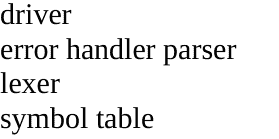
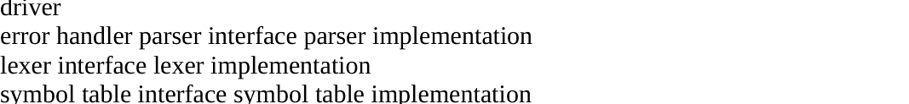
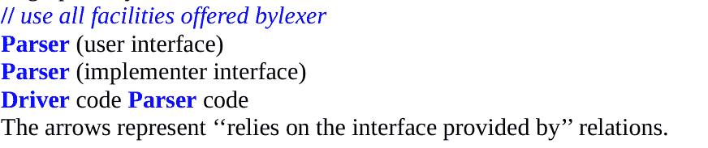
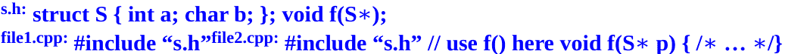
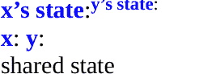
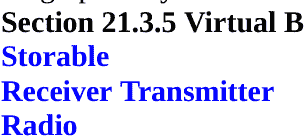
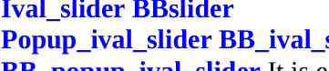
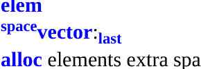
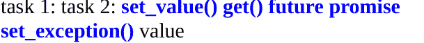
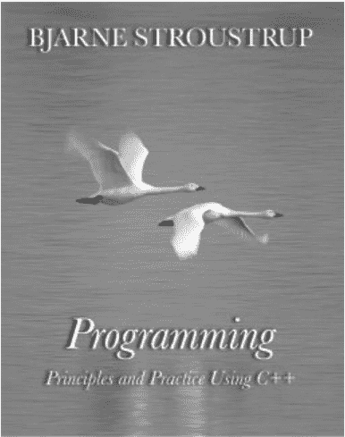

# 学习 C++ 编程语言：成为完整的 C++ 程序员

和性能？

C++ 的使用多年来发生了巨大变化，语言本身也是如此。从程序员的角度来看，大多数变化都是改进。当前的 ISO 标准 C++（ISO/IEC 14882-2011，通常称为 C++11）与之前的版本相比，是编写高质量软件的更好工具。它为何更好？现代 C++ 支持哪些编程风格和技术？哪些语言和标准库特性支持这些技术？优雅、正确、可维护且高效的 C++ 代码的基本构建块是什么？本书回答的就是这些关键问题。许多答案与 1985 年、1995 年或 2005 年的 C++ 不同：进步在发生。

C++ 是一种通用编程语言，强调类型丰富的轻量级抽象的设计和使用。它特别适合资源受限的应用，例如在软件基础设施中发现的应用。C++ 奖励那些花时间掌握编写高质量代码技术的人。C++ 是一种认真对待编程任务的人使用的语言。我们的文明在关键程度上依赖于软件；它最好是高质量的软件。

有数十亿行 C++ 部署在生产环境中。这使得稳定性变得至关重要，因此 1985 年和 1995 年的 C++ 代码仍然有效，并且将在未来几十年继续有效。然而，对于所有应用，使用现代 C++ 你可以做得更好；如果你坚持使用旧风格，你将编写质量更低、性能更差的代码。对稳定性的强调也意味着你今天编写的符合标准的代码在几十年后仍将有效。本书中的所有代码均符合 2011 年 ISO C++ 标准。

本书面向三个读者群体：

- 想要了解最新 ISO C++ 标准提供的功能的 C++ 程序员；
- 想知道 C++ 除了 C 之外还提供什么的 C 程序员；以及
- 具有 Java、C#、Python 和 Ruby 等应用语言背景的人，寻找“更接近机器”的东西——更灵活的东西、提供更好编译时检查的东西，或提供更好性能的东西。

自然地，这三组人并非互斥——专业软件开发人员掌握的不仅仅是一种编程语言。

本书假设其读者是程序员。如果你问，“什么是 `for` 循环？”或“什么是编译器？”那么本书（目前）不适合你；相反，我推荐我的《Programming: Principles and Practice Using C++》来开始学习编程和 C++。

此外，我假设读者作为软件开发人员具有一定的成熟度。如果你问“为什么要麻烦测试？”或说“所有语言基本上都一样；只要给我语法”或确信有一种语言适合所有任务，这不是你的书。

C++11 相比 C++98 提供了哪些功能？适合具有大量并发性的现代计算机的机器模型。用于进行系统级并发编程的语言和标准库设施（例如使用多核）。正则表达式处理、资源管理指针、随机数、改进的容器（包括哈希表）等。

通用和统一的初始化、更简单的 `for` 语句、移动语义、基本的 Unicode 支持、lambda、通用常量表达式、对类默认值的控制、可变参数模板、用户定义字面量等。请记住，这些库和语言特性是为了支持开发高质量软件的编程技术而存在的。它们旨在组合使用——作为建筑积木——而不是单独相对孤立地用于解决特定问题。计算机是通用机器，C++ 在此能力上为其服务。特别是，C++ 的设计旨在足够灵活和通用，以应对其设计者无法想象的未来问题。

## 致谢

除了在前几版致谢部分提到的各位之外，我还要感谢 Pete Becker、Hans-J. Boehm、Marshall Clow、Jonathan Coe、Lawrence Crowl、Walter Daugherty、J. Daniel Garcia、Robert Harle、Greg Hickman、Howard Hinnant、Brian Kernighan、Daniel Krügler、Nevin Liber、Michel Michaud、Gary Powell、Jan Christiaan van Winkel 和 Leor Zolman。没有他们的帮助，这本书会贫乏得多。

感谢 Howard Hinnant 回答了关于标准库的许多问题。

Andrew Sutton 是 Origin 库的作者，该库在模板章节中模拟概念的讨论中进行了大量测试，以及第 29 章中矩阵库的主题。Origin 库是开源的，可以通过在网上搜索“Origin”和“Andrew Sutton”找到。

感谢我的研究生设计课程，他们发现了“导览章节”中比任何其他人更多的错误。

如果我能遵循我审阅者的每一项建议，这本书无疑会得到很大改进，但它也会长几百页。每位专家审阅者都建议添加技术细节、高级示例和许多有用的开发惯例；每位新手审阅者（或教育工作者）都建议添加示例；大多数审阅者都正确地指出本书可能太长了。

感谢普林斯顿大学计算机科学系，尤其是 Brian Kernighan 教授，在我撰写本书的学术休假期间接待了我。

感谢剑桥大学计算机实验室，尤其是 Andy Hopper 教授，在我撰写本书的学术休假期间接待了我。

感谢我的编辑 Peter Gordon 和他在 Addison-Wesley 的制作团队 together with annotations to make it more comprehensible.

The primary aim of this book is to help the reader understand how the facilities offered by C++ support key programming techniques. The aim is to take the reader far beyond the point where he or she gets code running primarily by copying examples and emulating programming styles from other languages. Only a good understanding of the ideas behind the language facilities leads to mastery. Supplemented by implementation documentation, the information provided is sufficient for completing significant real-world projects. The hope is that this book will help the reader gain new insights and become a better programmer and designer.

## Acknowledgments

In addition to the people mentioned in the acknowledgement sections of the first and second editions, I would like to thank Matt Austern, Hans Boehm, Don Caldwell, Lawrence Crowl, Alan Feuer, Andrew Forrest, David Gay, Tim Griffin, Peter Juhl, Brian Kernighan, Andrew Koenig, Mike Mowbray, Rob Murray, Lee Nackman, Joseph Newcomer, Alex Stepanov, David Vandevoorde, Peter Weinberger, and Chris Van Wyk for commenting on draft chapters of this third edition. Without their help and suggestions, this book would have been harder to understand, contained more errors, been slightly less complete, and probably been a little bit shorter.

I would also like to thank the volunteers on the C++ standards committees who did an immense amount of constructive work to make C++ what it is today. It is slightly unfair to single out individuals, but it would be even more unfair not to mention anyone, so I’d like to especially mention Mike Ball, Dag Bruck, Sean Corfield, Ted Goldstein, Kim Knuttila, Andrew Koenig, Dmitry Lenkov, Nathan Myers, Martin O’Riordan, Tom Plum, Jonathan Shapiro, John Spicer, Jerry Schwarz, Alex Stepanov, and Mike Vilot, as people who each directly cooperated with me over some part of C++ and its standard library.

After the initial printing of this book, many dozens of people have mailed me corrections and suggestions for improvements. I have been able to accommodate many of their suggestions within the framework of the book so that later printings benefitted significantly. Translators of this book into many languages have also provided many clarifications. In response to requests from readers, I have added appendices D and E. Let me take this opportunity to thank a few of those who helped: Dave Abrahams, Matt Austern, Jan Bielawski, Janina Mincer Daszkiewicz, Andrew Koenig, Dietmar Kuhl, Nicolai Josuttis, Nathan Myers, Paul E. Sevin, Andy Tenne-Sens, Shoichi Uchida, Ping-Fai (Mike) Yang, and Dennis Yelle.

## Preface to the Second Edition

> The road goes ever on and on.
>
> – Bilbo Baggins

As promised in the first edition of this book, C++ has been evolving to meet the needs of its users. This evolution has been guided by the experience of users of widely varying backgrounds working in a great range of application areas. The C++ user-community has grown a hundredfold during the six years since the first edition of this book; many lessons have been learned, and many techniques have been discovered and/or validated by experience. Some of these experiences are reflected here.

The primary aim of the language extensions made in the last six years has been to enhance C++ as a language for data abstraction and object-oriented programming in general and to enhance it as a tool for writing high-quality libraries of user-defined types in particular. A “high-quality library,” is a library that provides a concept to a user in the form of one or more classes that are convenient, safe, and efficient to use. In this context, *safe* means that a class provides a specific type-safe interface between the users of the library and its providers; *efficient* means that use of the class does not impose significant overheads in run-time or space on the user compared with handwritten C code.

This book presents the complete C++ language. Chapters 1 through 10 give a tutorial introduction; Chapters 11 through 13 provide a discussion of design and software development issues; and, finally, the complete C++ reference manual is included. Naturally, the features added and resolutions made since the original edition are integral parts of the presentation. They include refined overloading resolution, memory management facilities, and access control mechanisms, type-safe linkage, `const` and `static` member functions, abstract classes, multiple inheritance, templates, and exception handling.

C++ is a general-purpose programming language; its core application domain is systems programming in the broadest sense. In addition, C++ is successfully used in many application areas that are not covered by this label. Implementations of C++ exist from some of the most modest microcomputers to the largest supercomputers and for almost all operating systems. Consequently, this book describes the C++ language itself without trying to explain a particular implementation, programming environment, or library.

This book presents many examples of classes that, though useful, should be classified as “toys.” This style of exposition allows general principles and useful techniques to stand out more clearly than they would in a fully elaborated program, where they would be buried in details. Most of the useful classes presented here, such as linked lists, arrays, character strings, matrices, graphics classes, associative arrays, etc., are available in “bulletproof” and/or “goldplated” versions from a wide variety of commercial and non-commercial sources. Many of these “industrial strength” classes and libraries are actually direct and indirect descendants of the toy versions found here.


This edition provides a greater emphasis on tutorial aspects than did the first edition of this book. However, the presentation is still aimed squarely at experienced programmers and endeavors not to insult their intelligence or experience. The discussion of design issues has been greatly expanded to reflect the demand for information beyond the description of language features and their immediate use. Technical detail and precision have also been increased. The reference manual, in particular, represents many years of work in this direction. The intent has been to provide a book with a depth sufficient to make more than one reading rewarding to most programmers. In other words, this book presents the C++ language, its fundamental principles, and the key techniques needed to apply it. Enjoy!

## Acknowledgments

In addition to the people mentioned in the acknowledgements section in the preface to the first edition, I would like to thank Al Aho, Steve Buroff, Jim Coplien, Ted Goldstein, Tony Hansen, Lorraine Juhl, Peter Juhl, Brian Kernighan, Andrew Koenig, Bill Leggett, Warren Montgomery, Mike Mowbray, Rob Murray, Jonathan Shapiro, Mike Vilot, and Peter Weinberger for commenting on draft chapters of this second edition. Many people influenced the development of C++ from 1985 to 1991. I can mention only a few: Andrew Koenig, Brian Kernighan, Doug McIlroy, and Jonathan Shapiro. Also thanks to the many participants of the “external reviews” of the reference manual drafts and to the people who suffered through the first year of X3J16.

## Preface to the First Edition

> *Language shapes the way we think, and determines what we can think about.*
>
> — B.L. Whorf

C++ is a general purpose programming language designed to make programming more enjoyable for the serious programmer. Except for minor details, C++ is a superset of the C programming language. In addition to the facilities provided by C, C++ provides flexible and efficient facilities for defining new types. A programmer can partition an application into manageable pieces by defining new types that closely match the concepts of the application. This technique for program construction is often called *data abstraction*. Objects of some user-defined types contain type information. Such objects can be used conveniently and safely in contexts in which their type cannot be determined at compile time. Programs using objects of such types are often called *object based*. When used well, these techniques result in shorter, easier to understand, and easier to maintain programs.

The key concept in C++ is *class*. A class is a user-defined type. Classes provide data hiding, guaranteed initialization of data, implicit type conversion for user-defined types, dynamic typing, user-controlled memory management, and mechanisms for overloading operators. C++ provides much better facilities for type checking and for expressing modularity than C does. It also contains improvements that are not directly related to classes, including symbolic constants, inline substitution of functions, default function arguments, overloaded function names, free store management operators, and a reference type. C++ retains C’s ability to deal efficiently with the fundamental objects of the hardware (bits, bytes, words, addresses, etc.). This allows the user-defined types to be implemented with a pleasing degree of efficiency.

C++ and its standard libraries are designed for portability. The current implementation will run on most systems that support C. C libraries can be used from a C++ program, and most tools that support programming in C can be used with C++.

This book is primarily intended to help serious programmers learn the language and use it for nontrivial projects. It provides a complete description of C++, many complete examples, and many more program fragments.

### Acknowledgments

对许多朋友和同事的批评。尤其是 Tom Cargill、Jim Coplien、Stu Feldman、Sandy Fraser、Steve Johnson、Brian Kernighan、Bart Locanthi、Doug McIlroy、Dennis Ritchie、Larry Rosler、Jerry Schwarz 和 Jon Shopiro 为该语言的开发提供了重要思路。Dave Presotto 编写了流 I/O 库的当前实现。

此外，数百人通过向我发送改进建议、他们遇到的问题的描述以及编译器错误，为 C++ 及其编译器的开发做出了贡献。我只能提及其中几位：Gary Bishop、Andrew Hume、Tom Karzes、Victor Milenkovic、Rob Murray、Leonie Rose、Brian Schmult 和 Gary Walker。

许多人也帮助了本书的制作，尤其是 Jon Bentley、Laura Eaves、Brian Kernighan、Ted Kowalski、Steve Mahaney、Jon Shopiro 以及 1985 年 6 月 26-27 日在俄亥俄州哥伦布贝尔实验室举办的 C++ 课程的参与者。

# Part I

## 引言

本介绍概述了 C++ 编程语言及其标准库的主要概念和特性。它还提供了本书的概述并解释了对语言设施及其使用的描述方法。此外，入门章节还提供了有关 C++ 的一些背景信息、C++ 的设计以及 C++ 的使用。

## 章节

- 1 读者须知
- 2 C++ 之旅：基础
- 3 C++ 之旅：抽象机制
- 4 C++ 之旅：容器和算法
- 5 C++ 之旅：并发和实用工具

## 2 引言 Part I

> “... 还有你，Marcus，你给了我许多东西；现在我将给你这个好建议。做许多人。放弃总是 Marcus Cocoza 的游戏。你太担心 Marcus Cocoza 了，以至于你真的成了他的奴隶和囚徒。你没有做任何事情而不先考虑它会对 Marcus Cocoza 的幸福和声望产生什么影响。你一直非常害怕 Marcus 可能会做蠢事，或感到无聊。那又有什么关系呢？全世界各地的人都在做蠢事……我希望你轻松些，你那颗小小的心再次变得轻松。你必须从现在起，成为多于一个人，许多人，你能想到的尽可能多的人……”
>
> – Karen Blixen, *The Dreamers from Seven Gothic Tales (1934)*

## 1 读者须知

> Hurry Slowly (festina lente).
>
> – Octavius, Caesar Augustus

- 本书的结构
- 引言；基本设施；抽象机制；标准库；示例和参考
- C++ 的设计
- 编程风格；类型检查；C 兼容性；语言、库和系统
- 学习 C++
- C++ 编程；C++ 程序员建议；C 程序员建议；
- Java 程序员建议
- 历史
- 时间线；早期岁月；1998 标准；2011 标准；C++ 用途是什么？
- 建议
- 参考文献

### 1.1 本书的结构

纯教程按主题排序，确保在介绍之前不使用任何概念；必须从第一页开始线性阅读。相反，纯参考手册可以从任何点开始访问；它简洁地描述每个主题，并引用相关主题的（前后）参考。纯教程原则上可以在没有先决条件的情况下阅读——它仔细描述了所有内容。纯参考只能由熟悉所有基本概念和技术的人使用。本书结合了两者的方面。如果你知道大多数概念和技术，你可以按章节甚至按节访问它。如果不是，你可以从开头开始，但请不要在细节上陷入困境。利用索引和交叉引用。

使本书的各部分相对自成体系意味着一些重复，但重复也为线性阅读本书的人提供了复习。本书大量交叉引用了它本身和 ISO C++ 标准。有经验的程序员可以阅读 C++ 的（相对）快速“导览”以获得使用本书作为参考所需的概览。本书由四部分组成：

- Part I
- Part II
- Part III
- Part IV

引言：第 1 章（本章）是本书的指南，并提供了一些 C++ 背景。第 2-5 章快速介绍了 C++ 语言及其标准库。

**基本设施：** 第 6-15 章描述了 C++ 的内置类型以及由它们构建程序的基本设施。

**抽象机制：** 第 16-29 章描述了 C++ 的抽象机制及其用于面向对象和泛型编程的使用。第 30-44 章提供了标准库的概述并讨论了兼容性问题。

#### 1.1.1 引言

本章，第 1 章，提供了本书的概述、如何使用它的一些提示，以及有关 C++ 及其使用的一些背景信息。鼓励你快速浏览它，阅读看起来有趣的内容，并在阅读本书其他部分后返回。请不要觉得有义务在继续之前仔细阅读全部内容。

以下章节提供了 C++ 编程语言及其标准库的主要概念和特性的概述：

- *Chapter 2*
- *Chapter 3*
- *Chapter 4*
- *Chapter 5*

*A Tour of C++: The Basics* 描述了 C++ 的内存、计算和错误处理模型。

*A Tour of C++: Abstraction Mechanisms* 介绍了支持数据抽象、面向对象编程和泛型编程的语言特性。*A Tour of C++: Containers and Algorithms* 介绍了标准库提供的字符串、简单 I/O、容器和算法。

*A Tour of C++: Concurrency and Utilities* 概述了与资源管理、并发、数学计算、正则表达式等相关的标准库实用工具。

这次 C++ 设施的旋风之旅旨在让读者品尝 C++ 所提供的东西。特别是，它应该说服读者 C++ 自本书第一、二、三版以来已经取得了长足的进步。

#### 1.1.2 基本设施

Part II 专注于支持传统上在 C 和类似语言中进行的编程风格的 C++ 子集。它介绍了类型、对象、作用域和存储的概念。它介绍了计算的基础：表达式、语句和函数。模块化——由命名空间、源文件和异常处理支持——也被讨论：

- Chapter 6: Types and Declarations — 基本类型、命名、作用域、初始化、简单类型推导、对象生命周期和类型别名
- Chapter 7: 指针、数组和引用
- Chapter 8: 结构、联合和枚举
- Chapter 9: 语句 —— 声明作为语句、选择语句（`if` 和 `switch`）、迭代语句（`for`、`while` 和 `do`）、`goto` 和注释
- Chapter 10: 表达式 —— 台式计算器示例、运算符概览、常量表达式和隐式类型转换
- Chapter 11: 选择操作 —— 逻辑运算符、条件表达式、递增和递减、自由存储（`new` 和 `delete`）、`{}`-列表、lambda 表达式和显式类型转换（`static_cast` 和 `const_cast`）
- Chapter 12: 函数 —— 函数声明和定义、内联函数、`constexpr` 函数、参数传递、重载函数、前置和后置条件、函数指针和宏
- Chapter 13: 异常处理 —— 错误处理风格、异常保证、资源管理、强制不变量、`throw` 和 `catch`、`vector` 实现
- Chapter 14: 命名空间 —— `namespace`、模块化和接口、使用命名空间的组合
- Chapter 15: 源文件和程序 —— 单独编译、链接、使用头文件以及程序的开始和终止

我假设你熟悉 Part I 中使用的大多数编程概念。例如，我解释了 C++ 表达递归和迭代的设施，但我没有深入技术细节，也没有花太多时间解释这些概念为何有用。

此规则的例外是异常。许多程序员缺乏异常经验，或从资源管理和异常处理未集成的语言（如 Java）中获得经验。因此，异常处理章节（第 13 章）介绍了 C++ 异常处理和资源管理的基本哲学。它详细介绍了策略，重点是“资源获取即初始化”技术（RAII）。

#### 1.1.3 抽象机制

Part III 描述了 C++ 支持各种形式抽象的设施，包括面向对象和泛型编程。章节大致分为三类：类、类层次结构和模板。

前四章集中于类本身：

- 第 16 章：类：用户定义类型的概念，即类，是所有 C++ 抽象机制的基础。
- 第 17 章：构造、清理、拷贝和移动 展示了程序员如何定义类对象创建和初始化的含义。进一步地，拷贝、移动和销毁的含义也可以被指定。
- 第 18 章：运算符重载 介绍了为用户定义类型赋予运算符含义的规则，重点在于常规的算术和逻辑运算符，例如 `+`、`*` 和 `&`。
- 第 19 章：特殊运算符 讨论了为非算术目的使用用户定义运算符，例如 `[]` 用于下标，`()` 用于函数对象，以及 `->` 用于“智能指针”。

类可以组织成层次结构：

- 第 20 章：派生类 介绍了用类构建层次结构的基本语言设施以及使用它们的基本方式。我们可以在接口（抽象类）与其实现（派生类）之间提供完全分离；它们之间的连接由虚函数提供。C++ 对访问控制的模型（`public`、`protected` 和 `private`）也被介绍。
- 第 21 章：类层次结构 讨论了有效使用类层次结构的方法。它还介绍了多重继承的概念，即一个类具有多个直接基类。


- 第 22 章：运行时类型信息 介绍了使用存储在对象中的数据在类层次结构中导航的方法。我们可以使用 `dynamic_cast` 来询问基类对象是否被定义为派生类对象，并使用 `typeid` 从对象中获取最小信息（例如其类的名称）。

许多最灵活、高效且有用的抽象涉及将类型（类）和算法（函数）参数化为其他类型和算法：

- 第 23 章：模板 介绍了模板背后的基本原理及其使用。类模板、函数模板和模板别名都被介绍。

- 第 24 章：通用编程 介绍了设计通用程序的基本技术。从多个具体代码示例中提取抽象算法的技术是核心所在，同样重要的是概念指定通用算法对其参数的要求。

- 第 25 章：特化 描述了模板如何根据一组模板参数生成类和函数特化。

- 第 26 章：实例化 侧重于名称绑定的规则。

- 第 27 章：`模板与层次结构` 解释了模板和类层次结构如何组合使用。

- 第 28 章：`元编程` 探索了模板如何用于生成程序。模板提供了用于生成代码的图灵完备机制。

- 第 29 章：`矩阵设计` 给出了一个较长的示例，以展示如何组合使用语言特性来解决复杂的设计问题：设计具有近乎任意元素类型的 N 维矩阵。

支持抽象技术的语言特性是在这些技术的上下文中描述的。第三部分中的介绍技术与第二部分不同，因为我不假设读者已了解所描述的技术。

### 1.1.4 标准库

库章节比语言章节更少教程化。特别是，它们旨在按任意顺序阅读，并可作为库组件的用户级手册使用：

- 第 30 章：`标准库概述` 对标准库进行了概述，列出了标准库头文件，并介绍了语言支持和诊断支持，例如 `exception` 和 `system_error`。

- 第 31 章：`STL 容器` 介绍了来自迭代器、容器和算法框架的容器（称为 `STL`），包括 `vector`、`map` 和 `unordered_set`。

- 第 32 章：`STL 算法` 介绍了来自 STL 的算法，包括 `find()`、`sort()` 和 `merge()`。

- 第 33 章：`STL 迭代器` 介绍了来自 STL 的迭代器和其他实用工具，包括 `reverse_iterator`、`move_iterator` 和 `function`。

- 第 34 章：`内存与资源` 介绍了与内存和资源管理相关的实用组件，例如 `array`、`bitset`、`pair`、`tuple`、`unique_ptr`、`shared_ptr`、分配器和垃圾回收接口。

- 第 35 章：`实用工具` 介绍了次要实用组件，例如时间实用工具、类型特征和各种类型函数。

- 第 36 章：`字符串` 记录了 `string` 库，包括字符特征，这是使用不同字符集的基础。

- 第 37 章：`正则表达式` 描述了正则表达式语法以及用于字符串匹配的各种使用方式，包括 `regex_match()` 用于匹配完整字符串，`regex_search()` 用于在字符串中查找模式，`regex_replace()` 用于简单替换，以及 `regex_iterator` 用于字符流的通用遍历。

- 第 38 章：`I/O 流` 记录了流 I/O 库。它描述了格式化和非格式化输入输出、错误处理和缓冲。

- 第 39 章：`本地化` 描述了类 `locale` 及其各种 `facets`，为处理字符集、数值格式化、日期和时间格式化的文化差异提供支持，等等。

- 第 40 章：`数值` 描述了数值计算的设施（例如 `complex`、`valarray`、随机数和广义数值算法）。

- 第 41 章：`并发` 介绍了 C++ 基础内存模型以及为无锁并发编程提供的设施。

- 第 42 章：`线程与任务` 介绍了提供线程和锁式并发编程的类（例如 `thread`、`timed_mutex`、`lock_guard` 和 `try_lock()`）以及基于任务的并发支持（例如 `future` 和 `async()`）。

- 第 43 章：`C 标准库` 记录了作为 C++ 标准库一部分的 C 标准库（包括 `printf()` 和 `clock()`）。

- 第 44 章：`兼容性` 讨论了 C 与 C++ 之间以及标准 C++（也称为 ISO C++）与其前版本之间的关系。

### 1.1.5 示例与参考

本书强调程序组织而非算法设计。因此，我避免使用巧妙或难以理解的算法。通常，简单的算法更适合说明语言定义的一个方面或关于程序结构的一个观点。例如，我使用 Shell 排序，而在实际代码中快速排序会更好。经常，将其重新实现为更合适的算法是一个练习。在实际代码中，调用库函数通常比这里用于说明语言特性的代码更合适。

教科书示例必然会扭曲软件开发的视图。通过澄清和简化示例，因规模而产生的复杂性就消失了。我认为没有比编写现实规模的程序更好的替代方法来获得对编程和编程语言真实情况的印象。本书集中于语言特性和标准库设施。这些是构成每个程序的基础技术。强调了此类组合的规则和技术。

示例的选择反映了我对编译器、基础库和模拟的背景。重点反映了我对系统编程的兴趣。示例是实际代码中发现内容的简化版本。简化是必要的，以防止编程语言和设计要点淹没在细节中。我的理想是说明设计原则、编程技术、语言构造或库特性时最短最清晰的示例。没有“花哨”的示例而没有现实代码中的对应物。对于纯语言技术示例，我使用名为 `x` 和 `y` 的变量、名为 `A` 和 `B` 的类型以及名为 `f()` 和 `g()` 的函数。

在可能的情况下，C++ 语言和库特性是在其使用上下文中介绍的，而不是以手册的枯燥方式介绍。所介绍的语言特性和描述的详细程度大致反映了我对有效使用 C++ 所需内容的看法。目的是让你了解一个特性如何使用，通常与其他特性组合。对语言特性或库组件的每个语言技术细节的理解既不是编写好程序的必要条件也不是充分条件。事实上，痴迷于理解每个细节是糟糕的——过度复杂和过于巧妙的代码的处方。所需要的是对设计和编程技术的理解以及对应用领域的欣赏。

我假设你可以使用在线信息来源。语言和标准库规则的最终仲裁者是 ISO C++ 标准 `[C++,2011]`。

对本书部分的引用形式为 `§2.3.4`（第 2 章，第 3 节，第 4 小节）和 `§iso.5.3.1`（ISO C++ 标准，`§5.3.1`）。斜体仅用于强调（例如，“字符串字面量不可接受”），首次出现的重要概念（例如，多态），以及代码示例中的注释。

为节省几棵树并简化增补，本书的数百个练习已移至网络。在 `www.stroustrup.com` 查找它们。

本书中使用的语言和库是 C++ 标准 `[C++,2011]` 定义的“纯 C++”。因此，示例应可在每个最新的 C++ 实现上运行。本书中的主要程序片段已使用多个 C++ 实现进行尝试。仅使用最近采纳到 C++ 的特性的示例并非在每个实现上都能编译。然而，我认为没有必要提及哪些实现未能编译哪些示例。这种信息很快就会过时，因为实现者正在努力确保其实现正确接受每个 C++ 特性。有关如何应对旧 C++ 编译器以及为 C 编译器编写的代码的建议，请参阅第 44 章。

我自由地在认为最合适的地方使用 C++11 特性。例如，我更喜欢 `{}` 风格的初始化器和 `using` 进行类型别名。在某些地方，这种用法可能会让“老手”感到惊讶。然而，感到惊讶通常是重新审视材料的良好开端。另一方面，我并不仅仅因为它们是新特性就使用新特性；我的理想是基本思想最优雅的表达——这可能非常好地使用 C++ 或甚至 C 中已存在很久的东西。

显然，如果你必须使用 C++11 之前的编译器（例如，因为你的某些客户尚未升级到当前标准），你必须避免使用新特性。然而，请不要仅仅因为它们是旧的和熟悉的就假设“旧方法”更好或更简单。`§44.2` 总结了 C++98 与 C++11 之间的差异。

### 1.2 C++ 的设计

编程语言的目的是帮助在代码中表达思想。在这方面，编程语言执行两个相关的任务：它提供

软件基础设施（例如，设备驱动程序、通信协议栈、虚拟机、

操作系统、

操作系统、编程环境和基础库）的实现主要是系统编程。对 C++ 我长期以来对其的描述中“偏向系统编程”这一限定词的重要性在于，C++ 并未因为了使其更适合其他应用领域而抛弃面向硬件和系统资源的高级使用设施而被简化（妥协）。

当然，你也可以完全隐藏硬件的方式编程，使用昂贵的抽象（例如，每个对象都在自由存储区上，每个操作都是虚函数），

使用不优雅的风格

（例如，过度抽象），或几乎不使用抽象（“华丽的汇编代码”）。

然而，许多语言都能做到这一点，所以这些并不是 C++ 的区别性特征。

`设计与演化 C++` 书籍 `[Stroustrup,1994]`（被称为 `D&E`）更详细地阐述了 C++ 的思想和设计目标，但应注意两个原则：

- `在 C++ 之下不留给更低级语言的空间`（除极少数情况下的汇编代码外）。如果你能在更低级语言中编写出更高效的代码，那么该语言很可能会成为首选的系统编程语言。

- `你不用的就不用付费`。如果程序员可以手工编写合理的代码来模拟一种语言特性或基本抽象，并且提供哪怕稍好的性能，就一定会有人这么做，而且很多人会效仿。因此，一种语言特性和基本抽象必须设计成与等价替代方案相比不会浪费一个字节或一个处理器周期。这被称为 `零开销原则`。

这些是严苛的原则，但在某些（但显然不是全部）上下文中是必不可少的。特别是，

零开销原则反复促使 C++ 采用比最初设想更简单、更优雅、更强大的设施。STL 就是一个例子（`§4.1.1`, `§4.4`, `§4.5`, Chapter 31, Chapter 32, Chapter 33）。这些原则在提高编程水平的工作中至关重要。

### 1.2.1 编程风格

语言特性存在是为了提供对编程风格的支持。请不要把单个语言特性看作解决方案，而应将其看作可组合以表达解决方案的多样化集合中的一块构建砖。

设计和编程的一般理想可以简单地表达：

- 直接在代码中表达思想。

- 在代码中独立地表达独立的思想。

- 直接在代码中表示思想之间的关系。

- 自由地组合代码中表达的思想——仅在组合有意义的地方和时间。

- 简单的思想简单地表达。

这些是许多人共享的理想，但为其提供支持而设计的语言可能差异巨大。其根本原因在于，一种语言体现了一组工程权衡，反映了不同个人和社区的不同需求、品味和历史。C++ 对一般设计挑战的回答受其起源于系统编程（可追溯到 C 和 BCPL `[Richards,1980]`）、其旨在通过抽象解决程序复杂性问题（可追溯到 Simula）的目标，以及其历史的影响。

C++ 语言特性最直接地支持四种编程风格：

- 过程式编程

- 数据抽象

- 面向对象编程

- 泛型编程

然而，重点在于对这些有效组合的支持。对大多数非平凡问题的最佳（最可维护、最可读、最小、最快等）解决方案往往是结合了这些风格各方面的方案。

正如在计算领域的重要术语中通常一样，这些术语在计算行业和学术界的各个部分有各种流行的定义。例如，我所指的“编程风格”，其他人称之为“编程技术”或“范式”。我更喜欢将“编程技术”用于更有限且特定于语言的东西。我对“范式”一词感到不舒服，因为它显得自命不凡，并且（根据库恩的原始定义）暗示了排他性的主张。

我的理想是能够优雅地组合使用以支持编程风格的连续体和各种编程技术的语言设施。

- `过程式编程`：这是以处理和设计合适的数据结构为重点的编程。这是 C 设计要支持的（以及 Algol、Fortran 以及许多其他语言）。C++ 的支持体现在内置类型、运算符、语句、函数、`结构体`、`联合体`等形式上。在少数例外之外，C 是 C++ 的子集。与 C 相比，C++ 通过许多额外的语言构造以及更严格、更灵活、更具支持性的类型系统为过程式编程提供了进一步的支持。

- `数据抽象`：这是以接口设计为重点的编程，通常隐藏实现细节，特别是表示。C++ 支持具体类和抽象类。定义具有私有实现细节的类、构造函数和析构函数以及相关操作的设施直接支持这一点。抽象类的概念为完全数据隐藏提供了直接支持。

- `面向对象编程`：这是以类层次结构的设计、实现和使用为重点的编程。除了允许定义类格外，C++ 还提供了一系列用于导航类格并简化从现有类派生出一个类的定义的功能。类层次结构提供运行时多态性（`§20.3.2`, `§21.2`）和封装（`§20.4`, `§20.5`）。

- `泛型编程`：这是以通用算法的设计、实现和使用为重点的编程。这里，“通用”是指算法可以设计为接受各种类型，只要它们满足算法对其参数的要求。模板是 C++ 对泛型编程的主要支持。模板提供（编译时）参数化多态。

几乎任何提高类灵活性或效率的东西都会改善对所有这些风格的支持。因此，C++ 可以（并且已经被）称为类导向的。这些设计和编程风格中的每一个都为 C++ 的合成做出了贡献。exclusively 专注于其中一种风格是一个错误：除了玩具示例之外，这样做会导致开发工作浪费和次优（不灵活、冗长、性能差、不可维护等）代码。

当有人仅通过其中一种风格来描述 C++（例如，“C++ 是一种面向对象的语言”）或使用一个术语（例如，“混合”或“混合范式”）来暗示更受限制的语言会更可取时，我会皱眉。前者忽略了所有提到的风格都对合成做出了重要贡献这一事实；后者否定了合成的有效性。提到的风格不是截然不同的替代方案：每一种都为更具表达力和有效性的编程风格贡献了技术，而 C++ 为它们的组合使用提供了直接的语言支持。

从其诞生开始，C++ 的设计就旨在对编程和设计风格进行综合。甚至 C++ 最早的已发表描述 `[Stroustrup,1982]` 也展示了结合使用这些不同风格的示例，并提出了旨在支持此类组合的语言特性：

• 类支持所有提到的风格；所有风格都依赖于用户将思想表示为用户定义的类型或用户定义类型的对象。

• `public`/`private` 访问控制通过在接口和实现之间做出明确区分来支持数据抽象和面向对象编程。

• 成员函数、构造函数、析构函数和用户定义的赋值提供了数据抽象和面向对象编程所需的对象干净的功能接口。它们还提供了泛型编程所需的统一记法。更一般的重载必须等到 1984 年，统一初始化则要等到 2010 年。

• 函数声明为成员函数以及独立函数提供特定的静态检查接口，因此它们支持所有提到的风格。它们对于重载是必要的。当时，C 缺少“函数原型”，但 Simula 也有函数声明以及成员函数。

• 泛型函数和参数化类型（使用宏从函数和类生成）支持泛型编程。模板必须等到 1988 年。

• 基类和派生类为面向对象编程和某些形式的数据抽象提供了基础。虚函数必须等到 1983 年。

• 内联使得在系统编程中使用这些设施以及构建运行时和空间高效的库变得负担得起。

这些早期特性是通用的抽象机制，而非对不相交编程风格的支持。今天的 C++ 为基于轻量级抽象的设计和编程提供了更好的支持，但优雅而高效代码的目标从一开始就存在。自 1981 年以来的发展为最初考虑的编程风格（“范式”）的综合提供了更好的支持，并显著改善了它们的集成。

C++ 中的基本对象具有标识；也就是说，它位于内存中的特定位置，并且可以与具有（潜在）相同值的其他对象区分开来

comparing addresses. Expressions denoting such objects are called lvalues (`§6.4`). However, even from the earliest days of C++’s ancestors `[Barron,1963]` there have also been objects without identity (objects for which an address cannot be safely stored for later use). In C++11, this notion of rvalue has been developed into a notion of a value that can be moved around cheaply (`§3.3.2`, `§6.4.1`, `§7.7.2`). Such objects are the basis of techniques that resemble what is found in functional programming (where the notion of objects with identity is viewed with horror). This nicely complements the techniques and language features (e.g., lambda expressions) developed primarily for generic programming. It also solves classical problems related to “simple abstract data types,” such as how to elegantly and efficiently return a large matrix from an operation (e.g., a matrix +).

From the very earliest days, C++ programs and the design of C++ itself have been concerned about resource management. The ideal was (and is) for resource management to be

- simple (for implementers and especially for users),

- general (a resource is anything that has to be acquired from somewhere and later released),

- efficient (obey the zero-overhead principle; `§1.2`),

- perfect (no leaks are acceptable), and

- statically type-safe.


Many important C++ classes, such as the standard library’s `vector`, `string`, `thread`, `mutex`, `unique_ptr`, `fstream`, and `regex`, are resource handles. Foundation and application libraries beyond the standard provided many more examples, such as `Matrix` and `Widget`.

The initial step in supporting the notion of resource handles was taken with the provision of constructors and destructors in the very first “C with Classes” draft. This was soon backed with the ability to control copy by defining assignment as well as copy constructors. The introduction of move constructors and move assignments (§3.3) in C++11 completes this line of thinking by allowing cheap movement of potentially large objects from scope to scope (§3.3.2) and to simply control the lifetime of polymorphic or shared objects (§5.2.1).

The facilities supporting resource management also benefit abstractions that are not resource handles. Any class that establishes and maintains an invariant relies on a subset of those features.

### 1.2.2 Type Checking

The connection between the language in which we think/program and the problems and solutions we can imagine is very close. For this reason, restricting language features with the intent of eliminating programmer errors is, at best, dangerous. A language provides a programmer with a set of conceptual tools; if these are inadequate for a task, they will be ignored. Good design and the absence of errors cannot be guaranteed merely by the presence or absence of specific language features. However, the language features and the type system are provided for the programmer to precisely and concisely represent a design in code.

The notion of static types and compile-time type checking is central to effective use of C++. The use of static types is key to expressiveness, maintainability, and performance.

Following Simula, the design of user-defined types with interfaces that are checked at compile time is key to the expressiveness of C++. The C++ type system is extensible in nontrivial ways (Chapter 3, Chapter 16, Chapter 18, Chapter 19, Chapter 21, Chapter 23, Chapter 28, Chapter 29), aiming for equal support for built-in types and user-defined types.

C++ type-checking and data-hiding features rely on compile-time analysis of programs to prevent accidental corruption of data. They do not provide secrecy or protection against someone who is deliberately breaking the rules: C++ protects against accident, not against fraud. They can, however, be used freely without incurring run-time or space overheads. The idea is that to be useful, a language feature must not only be elegant, it must also be affordable in the context of a real-world program.

C++’s static type system is flexible, and the use of simple user-defined types implies little, if any, overhead. The aim is to support a style of programming that represents distinct ideas as distinct types, rather than just using generalizations, such as integer, floating-point number, string, “raw memory,” and “object,” everywhere. A type-rich style of programming makes code more readable, maintainable, and analyzable. A trivial type system allows only trivial analysis, whereas a type-rich style of programming opens opportunities for nontrivial error detection and optimization. C++ compilers and development tools support such type-based analysis [Stroustrup,2012].

Maintaining most of C as a subset and preserving the direct mapping to hardware needed for the most demanding low-level systems programming tasks implies the ability to break the static type system. However, my ideal is (and always was) complete type safety. In this, I agree with Dennis Ritchie, who said, “C is a strongly typed, weakly checked language.” Note that Simula was both type-safe and flexible. In fact, my ideal when I started on C++ was “Algol68 with Classes” rather than “C with Classes.” However, the list of solid reasons against basing my work on type-safe Algol68 [Woodward,1974] was long and painful. So, perfect type safety is an ideal that C++ as a language can only approximate. But it is an ideal that C++ programmers (especially library builders) can strive for. Over the years, the set of language features, standard-library components, and techniques supporting that ideal has grown. Outside of low-level sections of code (hopefully isolated by type-safe interfaces), code that interfaces to code obeying different language conventions (e.g., an operating system call interface), and the implementations of fundamental abstractions (e.g., `string` and `vector`), there is now little need for type-unsafe code.

### 1.2.3 C Compatibility

C++ was developed from the C programming language and, with few exceptions, retains C as a subset. The main reasons for relying on C were to build on a proven set of low-level language facilities and to be part of a technical community. Great importance was attached to retaining a high degree of compatibility with C [Koenig,1989] [Stroustrup,1994] (Chapter 44); this (unfortunately) precluded cleaning up the C syntax. The continuing, more or less parallel evolution of C and C++ has been a constant source of concern and requires constant attention [Stroustrup,2002]. Having two committees devoted to keeping two widely used languages “as compatible as possible” is not a particularly good way of organizing work. In particular, there are differences in opinion as to the value of compatibility, differences in opinion on what constitutes good programming, and differences in opinion on what support is needed for good programming. Just keeping up communication between the committees is a large amount of work.

One hundred percent C/C++ compatibility was never a goal for C++ because that would compromise type safety and the smooth integration of user-defined and built-in types. However, the definition of C++ has been repeatedly reviewed to remove gratuitous incompatibilities; C++ is now more compatible with C than it was originally. C++98 adopted many details from C89 (§44.3.1). When C then evolved from C89 [C,1990] to C99 [C,1999], C++ adopted almost all of the new features, leaving out VLAs (variable-length arrays) as a misfeature and designated initializers as redundant. C’s facilities for low-level systems programming tasks are retained and enhanced; for example, see inlining (§3.2.1.1, §12.1.5, §16.2.8) and `constexpr` (§2.2.3, §10.4, §12.1.6).

Conversely, modern C has adopted (with varying degrees of faithfulness and effectiveness) many features from C++ (e.g., `const`, function prototypes, and inlining; see [Stroustrup,2002]).

The definition of C++ has been revised to ensure that a construct that is both legal C and legal C++ has the same meaning in both languages (§44.3).

One of the original aims for C was to replace assembly coding for the most demanding systems programming tasks. When C++ was designed, care was taken not to compromise the gains in this area. The difference between C and C++ is primarily in the degree of emphasis on types and structure. C is expressive and permissive. Through extensive use of the type system, C++ is even more expressive without loss of performance.

Knowing C is not a prerequisite for learning C++. Programming in C encourages many techniques and tricks that are rendered unnecessary by C++ language features. For example, explicit type conversion (casting) is less frequently needed in C++ than it is in C (§1.3.3). However, good C programs tend to be C++ programs. For example, every program in Kernighan and Ritchie, The C Programming Language, Second Edition [Kernighan,1988], is a C++ program. Experience with any statically typed language will be a help when learning C++.

### 1.2.4 Language, Libraries, and Systems


The C++ fundamental (built-in) types, operators, and statements are those that computer hardware deals with directly: numbers, characters, and addresses. C++ has no built-in high-level data types and no high-level primitive operations. For example, the C++ language does not provide a matrix type with an inversion operator or a string type with a concatenation operator. If a user wants such a type, it can be defined in the language itself. In fact, defining a new general-purpose or application-specific type is the most fundamental programming activity in C++. A well-designed user-defined type differs from a built-in type only in the way it is defined, not in the way it is used. The C++ standard

实现自己的库。然而，如果标准库提供了解决问题的组件，那么几乎总是最好使用该组件而不是自己构建。即使对于特定问题而言，标准组件可能略逊于自建组件，标准组件也更可能具有更广泛的适用性、更广泛的可用性和更广泛的知名度。从长远来看，标准组件（可能通过方便的自定义接口访问）更有可能降低长期维护、移植、调优和教育成本。

你可能会怀疑，使用更详细的类型结构来指定程序会增加程序源文本的大小（甚至生成的代码大小）。对于 C++ 来说并非如此。声明函数参数类型、使用类等的 C++ 程序通常比不使用这些功能的等效 C 程序略短一些。在使用库的情况下，C++ 程序看起来会比其 C 等价物短得多，当然，前提是能够构建一个可用的 C 等价物。

C++ 支持系统编程。这意味着 C++ 代码能够有效地与系统上用其他语言编写的软件互操作。用单一语言编写所有软件的想法是一种幻想。从一开始，C++ 就被设计为能够简单高效地与 C、汇编和 Fortran 互操作。我的意思是，C++、C、汇编或 Fortran 函数可以调用其他语言中的函数，而无需额外开销或传递它们之间的数据结构转换。

C++ 被设计为在单个地址空间内运行。多个进程和多个地址空间的使用依赖于（超语言的）操作系统支持。特别是，我假设 C++ 程序员可以使用操作系统的命令语言将进程组合成一个系统。最初，我依赖于 UNIX Shell 来实现这一点，但几乎任何“脚本语言”都可以胜任。因此，C++ 没有为多个地址空间提供支持，也没有为多个进程提供支持，但它从最早的时期就被用于依赖这些功能的系统。C++ 被设计为大型、并发、多语言系统的一部分。

# 1.3 学习 C++

没有编程语言是完美的。幸运的是，编程语言不必完美才能成为构建优秀系统的良好工具。事实上，通用编程语言不可能对它所承担的众多任务都完美无缺。对一项任务而言是完美的，对另一项任务而言往往严重有缺陷，因为在某一领域的完美意味着专业化。因此，C++ 被设计为构建各种系统的良好工具，并允许以直接的方式表达各种思想。

并非所有内容都可以用语言的内置功能直接表达。事实上，这甚至不是理想状态。语言特性存在是为了支持各种编程风格和技术。因此，学习一门语言的任务应侧重于掌握该语言的原生和自然风格——而不是理解每个语言特性的每一个细节。编写程序至关重要；理解编程语言不仅仅是一种智力练习。实践应用思想是必要的。

在实际编程中，了解最晦涩的语言特性或使用最多的特性几乎没有优势。孤立的单个语言特性几乎没有意义。只有在技术和其他特性的上下文中，特性才获得意义和趣味。因此，在阅读以下章节时，请记住，检查 C++ 细节的真正目的是能够协同使用语言特性和库设施，以在合理设计的背景下支持良好的编程风格。

没有重要系统完全以语言特性本身为基础构建。我们构建和使用库来简化编程任务并提高系统的质量。我们使用库来提高可维护性、可移植性和性能。基本应用程序概念在库中表示为抽象（例如，类、模板和类层次结构）。许多最基本的编程概念在标准库中表示。因此，学习标准库是学习 C++ 的不可分割的一部分。标准库是大量关于如何很好地使用 C++ 的经验知识的宝库。

C++ 被广泛用于教学和研究。这让一些人感到惊讶——他们正确地指出 C++ 并不是设计过的最小或最干净的语言。它是：

- 足够干净，可以成功教授基本设计和编程概念
- 足够全面，可以作为教授高级概念和技术的载体
- 足够现实、高效和灵活，可用于要求苛刻的项目
- 足够商业化，可以作为将所学知识应用于非学术用途的载体
- 足够可用，可供依赖多样化开发和执行环境的组织和协作使用

C++ 是一种你可以不断成长的语言。

学习 C++ 最重要的是要专注于基本概念（例如类型安全、资源管理和不变式）和编程技术（例如使用作用域对象进行资源管理以及在算法中使用迭代器），而不是迷失在语言技术细节中。学习编程语言的目的是成为更好的程序员，即在设计和实现新系统以及维护旧系统方面更有效率。为此，对编程和设计技术的理解远比理解所有细节更重要。对技术细节的理解会随着时间和实践而来。

C++ 编程基于强大的静态类型检查，大多数技术旨在实现高水平的抽象和对程序员想法的直接表示。这通常可以在不与低级技术相比降低运行时和空间效率的情况下完成。为了获得 C++ 的好处，来自不同语言的程序员必须学习并内化惯用的 C++ 编程风格和技术。对于习惯于更早、表达能力较弱的 C++ 版本的程序员也同样适用。

不加思考地将一种语言中有效的技术应用于另一种语言，通常会导致笨拙、性能差且难以维护的代码。这样的代码也最令人沮丧，因为每一行代码和每一个编译器错误信息都在提醒程序员所使用的语言与“旧语言”不同。你可以用 Fortran、C、Lisp、Java 等风格在任何语言中编写代码，但这样做在哲学不同的语言中既不愉快也不经济。每种语言都可以成为编写 C++ 程序想法的肥沃来源。然而，想法必须转化为与 C++ 的整体结构和类型系统相契合的东西，才能在 C++ 中有效。在语言的基本类型系统之上，只有 Pyrrhic 胜利是可能的。

在关于是否需要在学习 C++ 之前先学习 C 的持续争论中，我坚信最好直接学习 C++。C++ 更安全、更具表达力，并且减少了对低级技术的关注。在你接触到 C 和 C++ 的共同子集以及 C++ 中直接支持的一些高级技术之后，再学习为弥补其缺乏高级设施而需要的 C 的棘手部分会更容易。第 44 章是程序员从 C++ 转向 C 的指南，例如处理遗留代码。我对如何向新手教授 C++ 的看法在 [Stroustrup,2008] 中有所体现。

C++ 有几个独立开发的实现。它们得到了大量工具、库和软件开发环境的支持。为了帮助掌握所有这些，你可以找到教科书、手册和令人眼花缭乱的各种在线资源。如果你计划认真使用 C++，我强烈建议你获得对其中几种来源的访问权限。每种来源都有其自身的侧重点和偏见，因此至少使用两种。

## 1.3.1 C++ 编程

问题“如何在 C++ 中编写好的程序？”与问题“如何写出好的英语散文？”非常相似。有两个答案：“知道你想说什么”和“练习。模仿好的写作。”两者似乎对 C++ 和英语都同样适用——而且同样难以遵循。

C++ 编程的主要理想——与大多数高级语言编程一样——是将设计中的概念（思想、概念等）直接表达在代码中。我们力求确保我们在谈论的概念、在白板上用方框和箭头表示的概念，以及在（非编程）教科书中找到的概念，在我们的程序中都有直接且明显的对应物：

- [1] 在代码中直接表示思想。
- [2] 在代码中直接表示思想之间的关系（例如，层次、参数和所有权关系）。
- [3] 在代码中独立地表示独立的思想。
- [4] 保持简单的事情简单（而不使复杂的事情不可能）。

更具体地说：

- [5] 优先使用静态类型检查的解决方案（在适用时）。
- [6] 保持信息局部化（例如，避免全局变量，最小化指针的使用）。
- [7] 不要过度抽象（即，不要在明显需求和经验之外进行泛化、引入类层次结构或参数化）。

更具体的建议列在 §1.3.2 中。

## 1.3.2 对 C++ 程序员的建议

到目前为止，许多人已经使用 C++ 十年或二十年了。更多的人在单一环境中使用 C++，并学会了与早期编译器和第一代库所施加的限制共存。常年以来，经验丰富的 C++ 程序员未能注意到的，往往不是新特性的引入本身，而是特性之间关系的变化，这些变化使得根本性的新编程技术成为可能。换句话说，你在初学 C++ 时没有想到或认为不切实际的东西，今天可能已是更优的方法。你只有重新审视基础才能发现这一点。

按顺序阅读各章。如果你已经知道某章的内容，几分钟内即可完成。如果你还不了解该章内容，你将学到一些意想不到的东西。我在撰写本书时学到了不少，我怀疑几乎没有 C++ 程序员能掌握所有介绍的特性和技术。此外，要很好地使用该语言，你需要一种能为特性集合带来秩序的视角。通过其组织和示例，本书提供了这种视角。

利用新的 C++11 设施来现代化你的设计和编程技术：

- [1] 使用构造函数来建立不变式 (§2.4.3.2, §13.4, §17.2.1)。
- [2] 使用构造函数/析构函数对来简化资源管理 (RAII; §5.2, §13.3)。
- [3] 避免“裸” `new` 和 `delete` (§3.2.1.2, §11.2.1)。
- [4] 使用容器和算法而非内置数组和特设代码 (§4.4, §4.5, §7.4, 第 32 章)。
- [5] 优先使用标准库设施而非本地开发的代码 (§1.2.4)。
- [6] 使用异常而非错误码来报告无法在本地处理的错误 (§2.4.3, §13.1)。
- [7] 使用移动语义来避免复制大型对象 (§3.3.2, §17.5.2)。
- [8] 使用 `unique_ptr` 来引用多态类型的对象 (§5.2.1)。
- [9] 使用 `shared_ptr` 来引用共享对象，即没有单一所有者负责其销毁的对象 (§5.2.1)。
- [10] 使用模板来保持静态类型安全 (消除强制转换) 并避免不必要的类层次结构使用 (§27.2)。

重新审视对 C 和 Java 程序员的建议也可能是一个好主意 (§1.3.3, §1.3.4)。

## 1.3.3 对 C 程序员的建议

越了解 C，就越难避免以 C 风格编写 C++，从而失去 C++ 的许多潜在好处。请查看第 44 章，其中描述了 C 与 C++ 之间的差异。

- [1] 不要把 C++ 视为在 C 上添加了几个特性的语言。C++ 可以这样使用，但只是次优的。要从 C++ 相比 C 获得真正重大的优势，你需要采用不同的设计和实现风格。
- [2] 不要在 C++ 中写 C；这对维护和性能来说往往是严重次优的。
- [3] 将 C++ 标准库作为新技术和编程风格的老师。注意与 C 标准库的差异 (例如，使用 `=` 而非 `strcpy()` 进行复制，使用 `==` 而非 `strcmp()` 进行比较)。
- [4] 宏替换在 C++ 中几乎永远不需要。使用 `const` (§7.5)、`constexpr` (§2.2.3, §10.4)、`enum` 或 `enum class` (§8.4) 来定义显式常量，使用 `inline` (§12.1.5) 来避免函数调用开销，使用 `template` (§3.4, 第 23 章) 来指定函数和类型的族，使用 `namespace` (§2.4.2, §14.3.1) 来避免名称冲突。
- [5] 不要在需要之前声明变量，并在声明时立即初始化。声明可以出现在语句可以出现的地方 (§9.3)、`for` 语句的初始化器中 (§9.5)，以及条件中 (§9.4.3)。
- [6] 不要使用 `malloc()`。`new` 运算符 (§11.2) 做同样的工作更好，并且不要使用 `realloc()`，而是尝试使用 `vector` (§3.4.2)。不要只是用“裸” `new` 和 `delete` 替换 `malloc()` 和 `free()` (§3.2.1.2, §11.2.1)。
- [7] 避免使用 `void*`、`union` 和强制转换，除非在某个函数或类的实现深处。它们的使用限制了类型系统能提供的支持，并可能损害性能。在大多数情况下，强制转换是设计错误的迹象。如果你必须使用显式类型转换，尝试使用命名转换之一 (例如 `static_cast`; §11.5.2) 以更精确地说明你的意图。
- [8] 最小化数组和 C 风格字符串的使用。C++ 标准库字符串 (§4.2)、数组 (§8.2.4) 和 `vector` (§4.4.1) 通常可以用更简单、更易维护的代码替代传统的 C 风格。一般来说，尽量不要自己构建标准库已经提供的东西。
- [9] 除非常专门的代码 (例如内存管理器) 和简单的数组遍历 (例如 `++p`) 外，避免指针算术。
- [10] 不要假设以 C 风格费力编写的东西 (避免使用类、模板和异常等 C++ 特性) 比更简短的替代方案 (例如使用标准库设施) 更高效。经常 (但当然并非总是) 情况相反。为了遵守 C 链接约定，C++ 函数必须声明为具有 C 链接 (§15.2.5)。

## 1.3.4 对 Java 程序员的建议

C++ 和 Java 是语法相似但相当不同的语言。它们的目标显著不同，其许多应用领域也不同。Java 并不是 C++ 的直接继任者，意味着一种能做前者所能做的一切、但更好且更多的语言。要很好地使用 C++，你需要采用适合 C++ 的编程和设计技术，而不是试图在 C++ 中写 Java。这不仅仅是记住用 `new` 创建的对象需要删除，因为你不能依赖垃圾收集器的存在：

- [1] 不要简单地在 C++ 中模仿 Java 风格；这对可维护性和性能来说往往是严重次优的。
- [2] 使用 C++ 的抽象机制 (例如类和模板)：不要出于虚假的熟悉感而退回到 C 风格的编程。
- [3] 将 C++ 标准库作为新技术和编程风格的老师。
- [4] 不要立即为你的所有类发明一个唯一的基类 (`Object` 类)。通常，你可以在许多/大多数类中不使用它而做得更好。
- [5] 最小化引用和指针变量的使用：使用局部变量和成员变量 (§3.2.1.2, §5.2, §16.3.4, §17.1)。
- [6] 记住：变量永远不会隐式地是引用。
- [7] 将指针视为 C++ 对 Java 引用的等价物 (C++ 引用更受限制；C++ 引用不可重新绑定)。
- [8] 函数默认不是虚函数。并非每个类都意味着用于继承。
- [9] 使用抽象类作为类层次结构的接口；避免“脆弱的基类”，即具有数据成员的基类。
- [10] 尽可能使用作用域资源管理 (“资源获取即初始化”; RAII)。
- [11] 使用构造函数来建立类不变式 (如果不能则抛出异常)。
- [12] 如果在对象被删除时 (例如超出作用域) 需要清理操作，请为此使用析构函数。不要模仿 `finally` (这样做更随意，长期来看比依赖析构函数工作量大得多)。
- [13] 避免“裸” `new` 和 `delete`；相反，使用容器 (例如 `vector`、`string` 和 `map`) 和句柄类 (例如 `lock` 和 `unique_ptr`)。
- [14] 使用自由函数 (非成员函数) 来最小化耦合 (例如参见标准算法)，并使用命名空间 (§2.4.2, 第 14 章) 来限制自由函数的范围。
- [15] 不要使用异常规范 (except `noexcept`; §13.5.1.1)。
- [16] C++ 嵌套类没有对外部类对象的访问权限。
- [17] C++ 只提供最基本的运行时反射：`dynamic_cast` 和 `typeid` (第 22 章)。更多地依赖编译时设施 (例如编译时多态；第 27 章, 第 28 章)。

大多数这些建议同样适用于 C# 程序员。

# 1.4 历史

我发明了 C++，撰写了其早期定义，并制作了其第一个实现。我选择并制定了 C++ 的设计准则，设计了其主要语言特性，开发或帮助开发了许多早期库，并在 C++ 标准委员会中负责处理扩展提案。

C++ 的设计目的是提供 Simula 的程序组织设施 [Dahl,1970] [Dahl,1972]，同时具有 C 的效率和灵活性用于系统编程 [Kernighan,1978] [Kernighan,1988]。Simula 是 C++ 抽象机制的最初来源。类概念 (具有派生类和虚函数) 是从它借来的。然而，模板和异常后来才进入 C++，灵感来源不同。

C++ 的演进始终在其使用背景下进行。我花了很多时间倾听用户并寻求经验程序员的意见。特别是，AT&T Bell 实验室的同事们对 C++ 在其第一个十年中的成长至关重要。

本节是一个简要概述；它并不试图提及每一个语言特性和 library component. Furthermore, it does not go into details. For more information, and in particular for more names of people who contributed, see [Stroustrup,1993], [Stroustrup,2007], and [Stroustrup,1994]. My two papers from the ACM History of Programming Languages conference and my Design and Evolution of C++ book (known as “D&E”) describe the design and evolution of C++ in detail and document influences from other programming languages.


Most of the documents produced as part of the ISO C++ standards effort are available online [WG21]. In my FAQ, I try to maintain a connection between the standard facilities and the people who proposed and refined those facilities [Stroustrup,2010]. C++ is not the work of a faceless, anonymous committee or of a supposedly omnipotent “dictator for life”; it is the work of many dedicated, experienced, hard-working individuals.

## 1.4.1 Timeline

The work that led to C++ started in the fall of 1979 under the name “C with Classes.” Here is a simplified timeline:

1979 Work on “C with Classes” started. The initial feature set included classes and derived classes, public/private access control, constructors and destructors, and function declarations with argument checking. The first library supported non-preemptive concurrent tasks and random number generators.

1984 “C with Classes” was renamed to C++. By then, C++ had acquired virtual functions, function and operator overloading, references, and the I/O stream and complex number libraries.

1985 First commercial release of C++ (October 14). The library included I/O streams, complex numbers, and tasks (nonpreemptive scheduling).

1985 The C++ Programming Language (“TC++PL,” October 14) [Stroustrup,1986].

1989 The Annotated C++ Reference Manual (“the ARM”).

1991 The C++ Programming Language, Second Edition [Stroustrup,1991], presenting generic programming using templates and error handling based on exceptions (including the “Resource Acquisition Is Initialization” general resource management idiom).

1997 The C++ Programming Language, Third Edition [Stroustrup,1997] introduced ISO C++, including namespaces, dynamic_cast, and many refinements of templates. The standard library added the STL framework of generic containers and algorithms.

1998 ISO C++ standard.

2002 Work on a revised standard, colloquially named C++0x, started.

2003 A “bug fix” revision of the ISO C++ standard was issued. A C++ Technical Report introduced new standard-library components, such as regular expressions, unordered containers (hash tables), and resource management pointers, which later became part of C++0x.

2006 An ISO C++ Technical Report on Performance was issued to answer questions of cost, predictability, and techniques, mostly related to embedded systems programming.

variadic template arguments, lambda expressions, type aliases, a memory model suitable for concurrency, and much more. The standard library added several components, including threads, locks, and most of the components from the 2003 Technical Report.

2011 ISO C++11 standard was formally approved.

2012 The first complete C++11 implementations emerged.

2012 Work on future ISO C++ standards (referred to as C++14 and C++17) started.

2013 The C++ Programming Language, Fourth Edition introduced C++11.

During development, C++11 was known as C++0x. As is not uncommon in large projects, we were overly optimistic about the completion date.

## 1.4.2 The Early Years

I originally designed and implemented the language because I wanted to distribute the services of a UNIX kernel across multiprocessors and local-area networks (what are now known as multicores and clusters). For that, I needed some event-driven simulations for which Simula would have been ideal, except for performance considerations. I also needed to deal directly with hardware and provide high-performance concurrent programming mechanisms for which C would have been ideal, except for its weak support for modularity and type checking. The result of adding Simula-style classes to C, “C with Classes,” was used for major projects in which its facilities for writing programs that use minimal time and space were severely tested. It lacked operator overloading, references, virtual functions, templates, exceptions, and many, many details [Stroustrup,1982]. The first use of C++ outside a research organization started in July 1983.

The name C++ (pronounced “see plus plus”) was coined by Rick Mascitti in the summer of 1983 and chosen as the replacement for “C with Classes” by me. The name signifies the evolutionary nature of the changes from C; “++” is the C increment operator. The slightly shorter name “C+” is a syntax error; it had also been used as the name of an unrelated language. Connoisseurs of C semantics find C++ inferior to ++C. The language was not called D, because it was an extension of C, because it did not attempt to remedy problems by removing features, and because there already existed several would-be C successors named D. For yet another interpretation of the name C++, see the appendix of [Orwell,1949].

C++ was designed primarily so that my friends and I would not have to program in assembler, C, or various then-fashionable high-level languages. Its main purpose was to make writing good programs easier and more pleasant for the individual programmer. In the early years, there was no C++ paper design; design, documentation, and implementation went on simultaneously. There was no “C++ project” either, or a “C++ design committee.” Throughout, C++ evolved to cope with problems encountered by users and as a result of discussions among my friends, my colleagues, and me.

### 1.4.2.1 Language Features and Library Facilities

The very first design of C++ (then called “C with Classes”) included function declarations with argument type checking and implicit conversions, classes with the public/private distinction between the interface and the implementation, derived classes, and constructors and destructors. I used macros to provide primitive parameterization.

This was in use by mid-1980. Late that year, I was able to present a set of language facilities supporting a coherent set of programming styles; see §1.2.1. In retrospect, I consider the introduction of constructors and destructors most significant. In the terminology of the time, “a constructor creates the execution environment for the member functions and the destructor reverses that.” Here is the root of C++’s strategies for resource management (causing a demand for exceptions) and the key to many techniques for making user code short and clear. If there were other languages at the time that supported multiple constructors capable of executing general code, I didn’t (and don’t) know of them. Destructors were new in C++.

C++ was released commercially in October 1985. By then, I had added inlining (§12.1.5, §16.2.8), const (§2.2.3, §7.5, §16.2.9), function overloading (§12.3), references (§7.7), operator overloading (§3.2.1.1, Chapter 18, Chapter 19), and virtual functions (§3.2.3, §20.3.2). Of these features, support for run-time polymorphism in the form of virtual functions was by far the most controversial. I knew its worth from Simula but found it impossible to convince most people in the systems programming world of its value. Systems programmers tended to view indirect function calls with suspicion, and people acquainted with other languages supporting object-oriented programming had a hard time believing that virtual functions could be fast enough to be useful in systems code. Conversely, many programmers with an object-oriented background had (and many still have) a hard time getting used to the idea that you use virtual function calls only to express a choice that must be made at run time. The resistance to virtual functions may be related to a resistance to the idea that you can get better systems through more regular structure of code supported by a programming language. Many C programmers seem convinced that what really matters is complete flexibility and careful individual crafting of every detail of a program. My view was (and is) that we need every bit of help we can get from languages and tools: the inherent complexity of the systems we are trying to build is always at the edge of what we can express.


Much of the design of C++ was done on the blackboards of my colleagues. In the early years, the feedback from Stu Feldman, Alexander Fraser, Steve Johnson, Brian Kernighan, Doug McIlroy, and Dennis Ritchie was invaluable.

In the second half of the 1980s, I continued to add language features in response to user comments. The most important of those were templates [Stroustrup,1988] and exception handling [Koenig,1990], which were considered experimental at the time the standards effort started. In the design of templates, I was forced to decide among flexibility, efficiency, and early type checking. At the time, nobody knew how to simultaneously get all three, and to compete with C-style code for demanding systems applications, I felt that I had to choose the first two properties. In retrospect, I think the choice was the correct one, and the search for better type checking of templates continues [Gregor,2006] [Sutton,2011] [Stroustrup,2012a]. The design of exceptions focused on multilevel propagation of exceptions, the passing of arbitrary information to an error handler, and the integrations between exceptions and resource management by using local objects with destructors to represent and release resources (what I clumsily called “Resource Acquisition Is Initialization”; §13.3).

I generalized C++’s inheritance mechanisms to support multiple base classes

[Stroustrup,1987a]。这被称为 `multiple inheritance`，并且被认为困难且有争议。我认为它远不如模板或异常重要。抽象类的多重继承（通常称为 `interfaces`）现在在支持静态类型检查和面向对象编程的语言中已成为通用标准。

### Section 1.4.2.1 Language Features and Library Facilities

C++ 语言与本书中介绍的一些关键库设施携手演进。例如，我与运算符重载机制一起设计了 `complex` [Stroustrup,1984]、`vector`、`stack` 和 `(I/O) stream` [Stroustrup,1985] 类。第一个 `string` 和 `list` 类是由 Jonathan Shapiro 和我作为同一项工作的组成部分开发的。Jonathan 的 `string` 和 `list` 类是作为库的一部分首次得到广泛使用的第一个类。标准 C++ 库中的 `string` 类源于这些早期的工作。[Stroustrup,1987b] 中描述的任务库是 1980 年编写的第一个“带类的 C”程序的一部分。我编写了它及其相关的类以支持 Simula 风格的模拟。不幸的是，我们不得不等到 2011 年（30 年！）才获得并发支持的标准化并普遍可用（§1.4.4.2，§5.3，第 41 章）。模板设施的发展受到了 Andrew Koenig、Alex Stepanov、我以及其他人设计的各种 `vector`、`map`、`list` 和 `sort` 模板的影响。

C++ 在一个拥有众多已建立和实验性编程语言的环境中成长（例如，`Ada` [Ichbiah,1979]、`Algol 68` [Woodward,1974] 和 `ML` [Paulson,1996]）。当时，我熟悉约 25 种语言，它们对 C++ 的影响记录在 [Stroustrup,1994] 和 [Stroustrup,2007] 中。然而，决定性的影响始终来自我遇到的应用程序。这是一种有意的政策，使 C++ 的开发“问题驱动”而不是模仿。

### 1.4.3 The 1998 Standard

C++ 使用的爆炸性增长导致了一些变化。1987 年某个时候，很明显 C++ 的正式标准化是不可避免的，我们需要开始为标准化工作做准备 [Stroustrup,1994]。结果是采取了有意识的努力来在 C++ 编译器的实现者和主要用户之间保持联系。这是通过纸质和电子邮件以及在 C++ 会议和其他地方的面对面会议完成的。

AT&T Bell Labs 通过允许我与实现者和用户分享 C++ 参考手册修订版的草案，为 C++ 及其更广泛的社区做出了重大贡献。因为这些人中的许多人供职于可能被视为与 AT&T 竞争的公司，这一贡献的重要性不容低估。一个不太开明的公司仅仅通过无所作为就可能导致严重的语言碎片化问题。事实是，约有一百名来自数十个组织的个人阅读并对后来成为普遍接受的参考手册以及 ANSI C++ 标准化工作的基础文档的内容进行了评论。他们的名字可以在 `The Annotated C++ Reference Manual`（“the ARM”）[Ellis,1989] 中找到。ANSI 的 X3J16 委员会于 1989 年 12 月在 Hewlett-Packard 的倡议下成立。1991 年 6 月，这一 ANSI（美国国家）C++ 标准化成为 ISO（国际）C++ 标准化工作的一部分，并命名为 WG21。从 1990 年起，这些联合 C++ 标准委员会一直是 C++ 演进和定义完善的主要论坛。我始终参与这些委员会。特别是，作为扩展工作组（后称为演进组）的主席，我直接负责处理对 C++ 进行重大更改的提案以及添加新的语言特性。1995 年 4 月发布了供公众审阅的初始草案标准。第一个 ISO C++ 标准（ISO/IEC 14882-1998）[C++,1998] 于 1998 年以 22-0 的国家投票获得批准。2003 年发布了该标准的“错误修复版”，因此你有时会听到人们提到 C++03，但它本质上与 C++98 相同的语言。

#### 1.4.3.1 Language Features

当 ANSI 和 ISO 标准化工作开始时，大多数主要语言特性已经到位并记录在 ARM [Ellis,1989] 中。因此，大部分工作涉及特性的完善及其规范。特别是模板机制受益于大量的详细工作。为应对 C++ 程序规模的增加和库数量的增加而引入了命名空间。在 Hewlett-Packard 的 Dmitry Lenkov 的倡议下，引入了使用运行时类型信息（RTTI；第 22 章）的最小设施。我曾将此类设施排除在 C++ 之外，因为我在 Simula 中发现它们被严重过度使用。我曾试图让可选的保守垃圾回收设施被接受，但失败了。我们不得不等到 2011 年标准才获得该功能。

显然，1998 年的语言在特性和特别是规范的细节方面远优于 1989 年的语言。然而，并非所有更改都是改进。除了不可避免的轻微错误外，有两个主要特性被添加，事后看来本不应该添加：

- `Exception specifications` 提供对函数允许抛出哪些异常的运行时强制执行。它们是在 Sun Microsystems 人员的积极倡议下添加的。`Exception specifications` 证明对于提高可读性、可靠性和性能来说弊大于利。它们在 2011 年标准中被弃用（计划未来移除）。2011 年标准引入了 `noexcept` (§13.5.1.1) 作为解决 `exception specifications` 旨在解决的许多问题的更简单解决方案。

- 分离模板及其使用的编译一直很明显是理想的 [Stroustrup,1994]。如何在模板的实际使用限制下实现这一点却并不明显。在委员会进行了长时间的辩论后，达成了一个妥协，并将一种称为 `export templates` 的东西作为 1998 年标准的一部分进行了规范。这并不是对该问题的优雅解决方案，只有一家供应商实现了 `export`（Edison Design Group），该特性在 2011 年标准中被移除。我们仍在寻找解决方案。我的观点是，根本问题不在于分离编译本身，而在于模板的接口与实现之间的区别没有得到很好的规范。因此，`export` 解决了错误的问题。未来，“`concepts`”（§24.3）的语言支持可能通过提供模板要求的精确规范来提供帮助。这是一个活跃的研究和设计领域 [Sutton,2011] [Stroustrup,2012a]。

#### 1.4.3.2 The Standard Library

1998 年标准中最伟大和最重要的创新是将 STL，即算法和容器的框架，纳入标准库（§4.4，§4.5，第 31 章，第 32 章，第 33 章）。这是 Alex Stepanov（与 Dave Musser、Meng Le 等人一起）的作品，基于十多年对通用编程的工作。Andrew Koenig、Beman Dawes 和我做了很多工作来帮助 STL 被接受 [Stroustrup,2007]。STL 在 C++ 社区内部以及更广泛的范围内都产生了巨大的影响。

除了 STL 之外，标准库有点像组件的拼凑物，而不是统一的设计。我未能在 C++ 的 Release 1.0 中随附一个足够大的基础库 [Stroustrup,1993]，并且 AT&T 的一位不 helpful（非研究）经理阻止了我的同事和我在 Release 2.0 中纠正这一错误。这意味着在标准化工作开始时，每个主要组织（例如 Borland、IBM、Microsoft 和 Texas Instruments）都有自己的基础库。因此，委员会仅限于基于一直可用的组件（例如 `complex` 库）、可以在不干扰主要供应商库的情况下添加的内容以及确保不同非标准库之间合作所需的内容的拼凑物。

标准库 `string`（§4.2，第 36 章）起源于我在 Bell Labs 与 Jonathan Shapiro 的早期工作，但在标准化期间由多个不同个人和团体进行了修订和扩展。用于数值计算的 `valarray` 库（§40.5）主要是 Kent Budge 的工作。Jerry Schwarz 将我的 `streams` 库（§1.4.2.1）改造成 `iostreams` 库（§4.3，第 38 章），使用了 Andrew Koenig 的 `manipulator` 技术（§38.4.5.2）和其他想法。`iostreams` 库在标准化期间进一步完善，其中大部分工作由 Jerry Schwarz、Nathan Myers 和 Norihiro Kumagai 完成。

按商业标准衡量，C++98 标准库很小。例如，没有标准的 GUI、数据库访问库或 Web 应用程序库。此类库广泛可用，但不是 ISO 标准的一部分。原因在于实践和商业，而不是技术。然而，C 标准库是（并且是）许多有影响力的人衡量标准库的标准，与之相比，C++ 标准库是巨大的。

### 1.4.4 The 2011 Standard

当前的 C++，C++11，长期以来被称为 C++0x，是 WG21 成员的工作。委员会在日益繁重的自我施加的流程和程序下工作。这些流程可能导致了更好的（更严格的）规范，但也限制了创新 [Stroustrup,2007]。2009 年发布了供公众审阅的初始草案标准。第二个 ISO C++ 标准（ISO/IEC 14882-2011）[C++,2011] 于 2011 年 8 月以 21-0 的国家投票获得批准。

两个标准之间存在很长的间隔的一个原因是委员会的大多数成员（包括我）都错误地认为 ISO 规则要求

在标准发布后才开始进行新功能的工作的“等待期”。因此，对新语言特性的认真工作直到 2002 年才开始。其他原因包括现代语言及其基础库规模的增大。以标准文本页数计，语言增长了约 30%，标准库增长了约 100%。增幅很大程度上源于更详细的规范，而非新功能。此外，对新 C++ 标准的工作显然必须非常小心，不能通过不兼容的更改损害旧代码。委员会必须不破坏的 C++ 代码有数十亿行。

C++11 工作的总体目标为：

- 使 C++ 成为更好的系统编程和库构建语言。

- 使 C++ 更易于教学和学习。

目标已在 [Stroustrup,2007] 中记录并详细说明。

为使并发系统编程类型安全且可移植，投入了大量精力。这涉及内存模型 (§41.2) 和一组用于无锁编程的设施 (§41.3)，主要由 Hans Boehm、Brian McKnight 等人完成。在此基础上，我们添加了 `threads` 库。Pete Becker、Peter Dimov、Howard Hinnant、William Kempf、Anthony Williams 等人做了大量工作。为了提供在基本并发设施之上可以实现的内容示例，我提出了“在不显式使用锁的情况下在任务间交换信息的方式”的工作，这成为 `futures` 和 `async()` (§5.3.5)；Lawrence Crowl 和 Detlef Vollmann 完成了大部分工作。并发是一个需要非常长论文才能完整详细列出谁做了什么以及为什么的领域。在这里，我甚至无法尝试。

#### 1.4.4.1 语言特性

将 C++98 扩展为 C++11 所添加的语言特性和标准库设施列表见 §44.2。除了并发支持外，语言的每项新增都可被视为“次要”，但这样做会忽略重点：语言特性旨在组合使用以编写更好的程序。所谓“更好”是指更易读、更易写、更优雅、更不易出错、更易维护、运行更快、消耗资源更少等。

以下是 `<|message|>` 我认为最广泛有用的新“构建砖块”，影响 C++11 代码风格，并附上文本引用及其主要作者：

- 默认值控制：`=delete` 和 `=default`：§3.3.4, §17.6.1, §17.6.4；Lawrence Crowl 和 Bjarne Stroustrup。

- 从其初始化器推导对象类型，`auto`：§2.2.2, §6.3.6.1；Bjarne Stroustrup。我首次于 1983 年设计并实现 `auto`，但因 C 兼容性问题而不得不移除。

- 广义常量表达式求值（包括字面量类型），`constexpr`：§2.2.3, §10.4, §12.1.6；Gabriel Dos Reis 和 Bjarne Stroustrup [DosReis,2010]。

- 类内成员初始化器：§17.4.4；Michael Spertus 和 Bill Seymour。

- 继承构造函数：§20.3.5.1；Bjarne Stroustrup、Michael Wong 和 Michel Michaud。

- Lambda 表达式，即在表达式中使用时隐式定义函数对象的方式：§3.4.3, §11.4；Jaakko Jarvi。

- 移动语义，即在不复制的情况下传递信息的方式：§3.3.2, §17.5.2；Howard Hinnant。

- 声明函数可能不抛出异常的方式 `noexcept`：§13.5.1.1；David Abrahams、Rani Sharoni 和 Doug Gregor。

- 空指针的正式名称，§7.2.2；Herb Sutter 和 Bjarne Stroustrup。

- 范围 `for` 语句：§2.2.5, §9.5.1；Thorsten Ottosen 和 Bjarne Stroustrup。

- 重写控制：`final` 和 `override`：§20.3.4。Alisdair Meredith、Chris Uzdavinis 和 Ville Voutilainen。

- 类型别名，为类型或模板提供别名的机制。特别是，通过绑定另一个模板的一些参数来定义模板的方式：§3.4.5, §23.6；Bjarne Stroustrup 和 Gabriel Dos Reis。

- 具类型且作用域受限的枚举：`enum class`：§8.4.1；David E. Miller、Herb Sutter 和 Bjarne Stroustrup。

- 通用且统一的初始化（包括任意长度的初始化列表和防止窄化）：§2.2.2, §3.2.1.3, §6.3.5, §17.3.1, §17.3.4；Bjarne Stroustrup 和 Gabriel Dos Reis。

- 变参模板，即向模板传递任意数量任意类型参数的机制：§3.4.4, §28.6；Doug Gregor 和 Jaakko Jarvi。

还有许多人值得在此列出。提交给委员会的技术报告 [WG21] 和我的 C++11 FAQ [Stroustrup,2010a] 给出了许多名字。委员会工作组的会议记录中还提及更多。我的名字出现如此频繁（我希望）并非出于虚荣，而是因为我选择从事我认为重要的工作。这些特性将在优秀代码中无处不在。其主要作用是完善 C++ 特性集，以更好地支持编程风格 (§1.2.1)。它们是 C++11 综合的基石。


大量工作投入到一个未进入标准的提案中。“Concepts” 是用于指定和检查模板参数要求的设施 [Gregor,2006]，基于先前研究（例如，[Stroustrup,1994] [Siek,2000] [DosReis,2006]）和委员会的广泛工作。它已被设计、规范化、实现并测试，但委员会以压倒性多数决定该提案尚未准备就绪。如果我们能够完善“concepts”，它将是 C++11 中最重要的单一特性（其唯一竞争者是并发支持）。然而，委员会以复杂性、使用难度和编译时性能为由否决了“concepts” [Stroustrup,2010b]。我认为我们（委员会）对 C++11 的“concepts”做出了正确决定，但该特性确实是“溜走的那一个”。这目前是活跃的研究和设计领域 [Sutton,2011] [Stroustrup,2012a]。

#### 1.4.4.2 标准库

成为 C++11 标准库的工作始于一个标准委员会技术报告（“TR1”）。最初，Matt Austern 是库工作组的负责人，后来 Howard Hinnant 接任，直到我们在 2011 年发布最终草案标准。

与语言特性一样，我只列出少数标准库组件，并附上文本引用和最密切相关的人员姓名。更详细的列表见 §44.2.2。一些组件，例如 `unordered_map`（哈希表），是我们未能及时完成以纳入 C++98 标准的东西。许多其他组件，例如 `unique_ptr` 和 `function`，是基于 Boost 库的技术报告（TR1）的一部分。Boost 是一个志愿者组织，旨在基于 STL 提供有用的库组件 [Boost]。

- 哈希容器，如 `unordered_map`：§31.4.3；Matt Austern。

- 基本并发库组件，如 `thread`、`mutex` 和 `lock`：§5.3, §42.2；Pete Becker、Peter Dimov、Howard Hinnant、William Kempf、Anthony Williams 等人。

- 启动异步计算并返回结果，`future`、`promise` 和 `async()`：§5.3.5, §42.4.6；Detlef Vollmann、Lawrence Crowl、Bjarne Stroustrup 和 Herb Sutter。

- 垃圾回收接口：§34.5；Michael Spertus 和 Hans Boehm。

- 正则表达式库，`regexp`：§5.5, 第 37 章；John Maddock。

- 随机数库：§5.6.3, §40.7；Jens Maurer 和 Walter Brown。终于到了。我在 1980 年随“C with Classes”发布了第一个随机数库。

一些实用组件在 Boost 中进行了尝试：

- 用于简单高效传递资源的指针，`unique_ptr`：§5.2.1, §34.3.1；Howard E. Hinnant。这最初称为 `move_ptr`，本应是 `auto_ptr`，如果我们在 C++98 时知道如何做的话。

- 用于表示共享所有权的指针，`shared_ptr`：§5.2.1, §34.3.2；Peter Dimov。这是 Greg Colvin 的 C++98 `counted_ptr` 提案的继任者。

- `tuple` 库：§5.4.3, §28.5, §34.2.4.2；Jaakko Jarvi 和 Gary Powell。他们感谢了包括 Doug Gregor、David Abrahams 和 Jeremy Siek 在内的长名单贡献者。

- 通用的 `bind()`：§33.5.1；Peter Dimov。他的致谢列出了 Boost 的真正名人堂（包括 Doug Gregor、John Maddock、Dave Abrahams 和 Jaakko Jarvi）。

- 用于保存可调用对象的 `function` 类型：§33.5.3；Doug Gregor。他感谢 William Kempf 等人的贡献。

#### 1.4.5 C++ 用途是什么？

到目前为止（2013 年），C++ 无处不在：它在你的电脑、你的手机、你的汽车中，甚至可能在你的相机中。你通常看不到它。C++ 是一种系统编程语言，其最普遍的使用深藏在我们作为用户永远不会查看的基础设施中。

C++ 被数百万程序员在几乎每个应用领域使用。当前部署的 C++ 代码有数十亿行（数千百万行）。这种大规模使用由半打独立实现、数千个库、数百本教科书和数十个网站支持。各种层面的培训和教育广泛可用。

早期应用往往具有强烈的系统编程色彩。例如，

一些早期的操作系统是用 C++ 编写的：[Campbell,1987]（学术），[Rozier,1988]（实时），[Berg,1995]（高吞吐量 I/O）。许多当前的操作系统（例如 Windows、Apple 的 OS、Linux 以及大多数便携设备操作系统）都有关键部分是用 C++ 实现的。你的手机和互联网路由器很可能就是用 C++ 编写的。我认为 C++ 对于无妥协的底层效率至关重要。这使我们能够用 C++ 编写设备驱动程序和其他依赖于在实时约束下直接操作硬件的软件。在此类代码中，性能的可预测性至少与原始速度一样重要。往往，结果系统的紧凑性也很重要。C++ 的设计使得每个语言特性都可以在严苛的时间和空间约束下的代码中使用（§1.2.4）[Stroustrup,1994,§4.5]。

当今最显眼且广泛使用的系统中的关键部分是用 C++ 编写的。例子有 Amadeus（航空票务）、Amazon（网络商务）、Bloomberg（金融信息）、Google（网络搜索）和 Facebook（社交媒体）。许多其他编程语言和技术在实现上严重依赖 C++ 的性能和可靠性。例子包括最广泛使用的 Java 虚拟机（例如 Oracle 的 HotSpot）、JavaScript 解释器（例如 Google 的 V8）、浏览器（例如 Microsoft 的 Internet Explorer、Mozilla 的 Firefox、Apple 的 Safari 和 Google 的 Chrome）以及应用程序框架（例如 Microsoft 的 .NET Web 服务框架）。我认为 C++ 在基础设施软件领域具有独特的优势 [Stroustrup,2012a]。

大多数应用程序都有对可接受性能至关重要的代码段。然而，最大的代码量并不在这些段中。对于大多数代码而言，可维护性、易于扩展和易于测试是关键。C++ 对这些问题的支持使其在可靠性至关重要且需求随时间显著变化的领域得到广泛使用。例子有金融系统、电信、设备控制和军事应用。几十年来，美国长途电话系统的中央控制一直依赖 C++，每一次 800 电话（即由被叫方付费的电话）都由 C++ 程序路由 [Kamath,1993]。许多此类应用程序都很大且寿命很长。因此，稳定性、兼容性和可扩展性一直是 C++ 开发中的主要关注点。数百万行 C++ 程序很常见。

### Section 1.4.5 What is C++ used for?

游戏是另一个需要多种语言和工具共存且需要提供无妥协效率的语言（通常在“不寻常”的硬件上）的领域。因此，游戏一直是 C++ 的另一个主要应用领域。

过去所称的系统编程广泛存在于嵌入式系统中，因此在要求苛刻的嵌入式系统项目中大量使用 C++ 并不令人惊讶，包括计算机断层扫描（CAT 扫描仪）、飞行控制软件（例如 Lockheed-Martin）、火箭控制、船舶发动机（例如来自 MAN 的世界上最大的船用柴油发动机的控制）、汽车软件（例如 BMW）以及风力涡轮机控制（例如 Vesta）。

C++ 并不是专门为数值计算而设计的。然而，大量的数值、科学和工程计算是用 C++ 完成的。这主要原因是传统的数值工作通常必须与图形结合，并且与不符合传统 Fortran 模式的数据结构相关的计算结合（例如 [Root,1995]）。我特别高兴看到 C++ 被用于重大的科学事业中，例如人类基因组计划、NASA 的火星探测车、CERN 对宇宙基本原理的探索，以及许多其他项目。

C++ 能够有效地用于需要在多种应用领域工作的应用程序，这是一个重要的优势。涉及本地和广域网络、数值、图形、用户交互和数据库访问的应用程序很常见。传统上，这些应用领域被认为是不同的，并由使用多种编程语言的不同技术社区服务。然而，C++ 在所有这些领域以及更多领域中被广泛使用。它被设计成 C++ 代码可以与用其他语言编写的代码共存。在这里，C++ 几十年来的稳定性也很重要。此外，没有真正的大型系统是 100% 用单一语言编写的。因此，C++ 最初的设计目标——互操作性——变得很重要。

大型应用程序并不是仅用原始语言编写的。C++ 由多种库（超出 ISO C++ 标准库）和工具集支持，例如 Boost [Boost]（可移植基础库）、POCO（Web 开发）、QT（跨平台应用程序开发）、wxWidgets（跨平台 GUI 库）、WebKit（Web 浏览器布局引擎库）、CGAL（计算几何）、QuickFix（金融信息交换）、OpenCV（实时图像处理）以及 Root [Root,1995]（高能物理）。C++ 库有成千上万个，因此不可能全部跟上。

### 1.5 Advice

每一章都包含一个“Advice”部分，其中包含与其内容相关的具体建议。这样的建议是粗略的经验法则，而不是不可改变的法律。建议应仅在合理的情况下应用。没有什么是能替代智力、经验、常识和良好的品味的。

我发现“永远不要这样做”形式的规则没有帮助。因此，大多数建议都表述为做什么的建议。负面建议往往不表述为绝对禁止，我会尝试提出替代方案。我不知道 C++ 的任何主要特性是我没有看到被很好地利用的。“Advice”部分不包含解释。相反，每条建议都附有指向本书相应部分的引用。

首先，这里有一些从 C++ 的设计、学习和历史部分得出的高层次建议：

- [1] 直接在代码中表示思想（概念），例如作为函数、类或枚举；§1.2。

- [2] 目标是让你的代码既优雅又高效；§1.2。

- [3] 不要过度抽象；§1.2。

- [4] 将设计重点放在提供优雅和高效的抽象上，可能以库的形式呈现；§1.2。

- [5] 直接在代码中表示思想之间的关系，例如通过

- [6] 在代码中单独表示独立的思想，例如避免类之间的相互依赖；§1.2.1。

- [7] C++ 不仅仅是面向对象的；§1.2.1。

- [8] C++ 不仅仅是用于泛型编程；§1.2.1。

- [9] 优先选择可以静态检查的解决方案；§1.2.1。

- [10] 使资源显式化（将它们表示为类对象）；§1.2.1, §1.4.2.1。

- [11] 简单的思想要简单地表达；§1.2.1。

- [12] 使用库，尤其是标准库，而不是试图从头开始构建一切；§1.2.1。

- [13] 使用类型丰富的编程风格；§1.2.2。

- [14] 底层代码不一定高效；不要因担心性能问题而避免使用类、模板和标准库组件；§1.2.4, §1.3.3。

- [15] 如果数据有不变式，就封装它；§1.3.2。

- [16] C++ 不仅仅是带少量扩展的 C；§1.3.3。

总的来说：写一个好的程序需要智力、品味和耐心。你不可能第一次就做对。尝试！

### 1.6 References

- [Austern,2003]

- [Barron,1963]

- [Barton,1994]

- [Berg,1995]

- [Boehm,2008]

- [Boost]

- [Budge,1992] Matt Austern et al.: *Untangling the Balancing and Searching of Balanced Binary Search Trees*. Software – Practice & Experience. Vol 33, Issue 13. November 2003.

- D. W. Barron et al.: *The main features of CPL*. The Computer Journal. 6 (2): 134. (1963). comjnl.oxfordjournals.org/content/6/2/134.full.pdf+html.

- J. J. Barton and L. R. Nackman: *Scientific and Engineering C++: An Introduction with Advanced Techniques and Examples*. Addison-Wesley. Reading, Massachusetts. 1994. ISBN 0-201-53393-6.

- William Berg, Marshall Cline, and Mike Girou: *Lessons Learned from the OS/400 OO Project*. CACM. Vol. 38, No. 10. October 1995.

- Hans-J. Boehm and Sarita V. Adve: *Foundations of the C++ concurrency memory model*. ACM PLDI’08.

- The Boost library collection. www.boost.org.

- Kent Budge, J. S. Perry, and A. C. Robinson: *High-Performance Scientific Computation Using C++*. Proc. USENIX C++ Conference. Portland, Oregon. August 1992.

- [C,1990]

- [C,1999]

- [C,2011]

- [C++,1998]

- [C++Math,2010]

[C++,2011]

[Campbell,1987]

[Coplien,1995]

[Cox,2007]

[Czarnecki,2000]

[Dahl,1970]

[Dahl,1972]

[Dean,2004]

[Dechev,2010]

[DosReis,2006]

[DosReis,2010]

[DosReis,2011]

[Ellis,1989]

[Freeman,1992]

[Friedl,1997]:

X3 秘书处：标准 – C 语言。X3J11/90-013。ISO 标准 ISO/IEC 9899-1990。计算机与商业设备制造商协会。华盛顿特区。

ISO/IEC 9899。标准 – C 语言。X3J11/90-013-1999。ISO/IEC 9899。

标准 – C 语言。X3J11/90-013-2011。ISO/IEC JTC1/SC22/WG21：

国际标准 – C++ 语言。ISO/IEC 14882:1998。

国际标准 – 对 C++ 库的扩展以支持数学特殊函数。ISO/IEC 29124:2010。

ISO/IEC JTC1/SC22/WG21：国际标准 – C++ 语言。ISO/IEC 14882:2011。

Roy Campbell 等：多处理器操作系统设计。Proc. USENIX C++ 会议。圣达菲，新墨西哥州。1987 年 11 月。James O. Coplien：奇异递归模板模式。The C++ Report。1995 年 2 月。

Russ Cox：正则表达式匹配可以简单且快速。2007 年 1 月。swtch.com/~rsc/regexp/regexp1.html。

K. Czarnecki 和 U. Eisenecker：生成式编程：方法、工具和应用。Addison-Wesley。马萨诸塞州雷丁。2000 年。ISBN 0-201-30977-7。

O-J. Dahl、B. Myrhaug 和 K. Nygaard：SIMULA 通用基语言。挪威计算中心 S-22。挪威奥斯陆。1970 年。

O-J. Dahl 和 C. A. R. Hoare：结构化编程中的分层程序构造。Academic Press。纽约。1972 年。

J. Dean 和 S. Ghemawat：MapReduce：大规模集群上的简化数据处理。OSDI’04：第六届操作系统设计与实现研讨会。2004 年。

D. Dechev、P. Pirkelbauer 和 B. Stroustrup：理解并有效防止基于描述符的无锁设计中的 ABA 问题。13th IEEE Computer Society ISORC 2010 Symposium。2010 年 5 月。Gabriel Dos Reis 和 Bjarne Stroustrup：指定 C++ 概念。POPL06。2006 年 1 月。

Gabriel Dos Reis 和 Bjarne Stroustrup：系统编程语言的通用常量表达式。SAC-2010。第 25 届 ACM 应用计算研讨会。2010 年 3 月。

Gabriel Dos Reis 和 Bjarne Stroustrup：C++ 的原则性、完整且高效的表示。Journal of Mathematics in Computer Science。第 5 卷，第 3 期。

2011。

Margaret A. Ellis 和 Bjarne Stroustrup：*The Annotated C++ Reference Manual*。

Addison-Wesley。马萨诸塞州雷丁。1990 年。ISBN 0-201-51459-1。Len Freeman 和 Chris Phillips：*Parallel Numerical Algorithms*。Prentice Hall。美国新泽西州恩格尔伍德克利夫斯。1992 年。ISBN 0-13-651597-5。Jeffrey E. F. Friedl：*Mastering Regular Expressions*。O’Reilly Media。美国加利福尼亚州塞巴斯托波尔。1997 年。ISBN 978-1565922570。

[Gamma,1995]

[Gregor,2006]

[Hennessy,2011]

[Ichbiah,1979]

[Kamath,1993]

[Kernighan,1978]

[Kernighan,1988]

[Knuth,1968]

[Koenig,1989]

[Koenig,1990]

[Kolecki,2002]

[Langer,2000]

[McKenney]


[Maddock,2009] [Orwell,1949] [Paulson,1996]

[Pirkelbauer,2009]

[Richards,1980]

[Root,1995] Erich Gamma 等：*Design Patterns: Elements of Reusable Object-Oriented Software*。Addison-Wesley。马萨诸塞州雷丁。1994 年。ISBN 0-201-63361-2。

Douglas Gregor 等：*Concepts: Linguistic Support for Generic Programming in C++*。OOPSLA’06。

John L. Hennessy 和 David A. Patterson：*Computer Architecture, Fifth Edition: A Quantitative Approach*。Morgan Kaufmann。美国加利福尼亚州旧金山。2011 年。ISBN 978-0123838728。

Jean D. Ichbiah 等：*Rationale for the Design of the ADA Programming Language*。SIGPLAN Notices。第 14 卷，第 6 期。1979 年 6 月。

Yogeesh H. Kamath、Ruth E. Smilan 和 Jean G. Smith：*Reaping Benefits with Object-Oriented Technology*。AT&T Technical Journal。第 72 卷，第 5 期。1993 年 9 月/10 月。

Brian W. Kernighan 和 Dennis M. Ritchie：*The C Programming Language*。Prentice Hall。美国新泽西州恩格尔伍德克利夫斯。1978 年。

Brian W. Kernighan 和 Dennis M. Ritchie：*The C Programming Language, Second Edition*。Prentice-Hall。美国新泽西州恩格尔伍德克利夫斯。1988 年。ISBN 0-13-110362-8。

Donald E. Knuth：*The Art of Computer Programming*。Addison-Wesley。马萨诸塞州雷丁。1968 年。

Andrew Koenig 和 Bjarne Stroustrup：*C++: As close to C as possible – but no closer*。The C++ Report。第 1 卷，第 7 期。1989 年 7 月。

A. R. Koenig 和 B. Stroustrup：*Exception Handling for C++ (revised)*。Proc USENIX C++ Conference。1990 年 4 月。

Joseph C. Kolecki：*An Introduction to Tensors for Students of Physics and Engineering*。NASA/TM-2002-211716。

Angelika Langer 和 Klaus Kreft：*Standard C++ IOSTreams and Locales: Advanced Programmer’s Guide and Reference*。Addison-Wesley。2000 年。ISBN 978-0201183955。

Paul E. McKenney：*Is Parallel Programming Hard, And, If So, What Can You Do About It?* `kernel.org`。俄勒冈州科瓦利斯。2012 年。`http://kernel.org/pub/linux/kernel/people/paulmck/perfbook/perfbook.html`。

John Maddock：*Boost.Regex*。`www.boost.org`。2009 年。

George Orwell：*1984*。Secker and Warburg。伦敦。1949 年。

Larry C. Paulson：*ML for the Working Programmer*。Cambridge University Press。剑桥。1996 年。ISBN 0-521-56543-X。

P. Pirkelbauer、Y. Solodkyy 和 B. Stroustrup：*Design and Evaluation of C++ Open Multi-Methods*。Science of Computer Programming。Elsevier Journal。2009 年 6 月。doi:10.1016/j.scico.2009.06.002。

Martin Richards 和 Colin Whitby-Strevens：*BCPL – The Language and Its Compiler*。Cambridge University Press。剑桥。1980 年。ISBN 0-521-21965-5。

*ROOT: A Data Analysis Framework*。`root.cern.ch`。它似乎很合适用来自 CERN 的工具来代表，CERN 是万维网的诞生地，

+   [Rozier,1988]

+   [Siek,2000]

+   [Solodkyy,2012]

+   [Stepanov,1994]

+   [Stewart,1998]

+   [Stroustrup,1982]

+   [Stroustrup,1984]

+   [Stroustrup,1985]

+   [Stroustrup,1986]

+   [Stroustrup,1987]

+   [Stroustrup,1987b]

+   [Stroustrup,1988]

+   [Stroustrup,1991]

+   [Stroustrup,1993]

+   [Stroustrup,1994]

+   [Stroustrup,1997]

+   [Stroustrup,2002]

+   [Stroustrup,2007]

Web 地址。

M. Rozier 等：*CHORUS Distributed Operating Systems*。Computing Systems。第 1 卷，第 4 期。1988 年秋季。

Jeremy G. Siek 和 Andrew Lumsdaine：*Concept checking: Binding parametric polymorphism in C++*。Proc. First Workshop on C++ Template Programming。德国埃尔福特。2000 年。

Y. Solodkyy、G. Dos Reis 和 B. Stroustrup：*Open and Efficient Type Switch for C++*。Proc. OOPSLA’12。

Alexander Stepanov 和 Meng Lee：*The Standard Template Library*。HP Labs Technical Report HPL-94-34 (R. 1)。1994 年。

G. W. Stewart：Matrix Algorithms, Volume I. Basic Decompositions。SIAM。美国宾夕法尼亚州费城。1998 年。

B. Stroustrup：Classes: An Abstract Data Type Facility for the C Language。Sigplan Notices。1982 年 1 月。“C with Classes”的首次公开描述。

B. Stroustrup：Operator Overloading in C++。Proc. IFIP WG2.4 Conference on System Implementation Languages: Experience & Assessment。1984 年 9 月。

B. Stroustrup：An Extensible I/O Facility for C++。Proc. Summer 1985 USENIX Conference。

B. Stroustrup：The C++ Programming Language。Addison-Wesley。马萨诸塞州雷丁。1986 年。ISBN 0-201-12078-X。

B. Stroustrup：Multiple Inheritance for C++。Proc. EUUG Spring Conference。1987 年 5 月。

B. Stroustrup 和 J. Shopiro：A Set of C Classes for Co-Routine Style Programming。Proc. USENIX C++ Conference。圣达菲，新墨西哥州。1987 年 11 月。

B. Stroustrup：Parameterized Types for C++。Proc. USENIX C++ Conference, Denver。1988 年。

B. Stroustrup：The C++ Programming Language (Second Edition)。Addison-Wesley。马萨诸塞州雷丁。1991 年。ISBN 0-201-53992-6。

B. Stroustrup：A History of C++: 1979-1991。Proc. ACM History of Programming Languages conference (HOPL-2)。ACM Sigplan Notices。第 28 卷，第 3 期。1993 年。

B. Stroustrup：The Design and Evolution of C++。Addison-Wesley。马萨诸塞州雷丁。1994 年。ISBN 0-201-54330-3。

B. Stroustrup：The C++ Programming Language, Third Edition。Addison-Wesley。马萨诸塞州雷丁。1997 年。ISBN 0-201-88954-4。精装本（“Special” Edition）。2000 年。ISBN 0-201-70073-5。

B. Stroustrup：C and C++: Siblings, C and C++: A Case for Compatibility, and C and C++: Case Studies in Compatibility。The C/C++ Users Journal。2002 年 7 月至 9 月。`www.stroustrup.com/papers.html`。

B. Stroustrup：Evolving a language in and for the real world: C++ 1991-2006。ACM HOPL-III。2007 年 6 月。

[Stroustrup,2008]

[Stroustrup,2010a] [Stroustrup,2010b]

[Stroustrup,2012a]

[Stroustrup,2012b]

[Sutton,2011]

[Tanenbaum,2007]

[Tsafrir,2009]

[Unicode,1996]

[UNIX,1985]

[Vandevoorde,2002]

[Veldhuizen,1995] [Veldhuizen,2003]

[Vitter,1985]

[WG21]

[Williams,2012]

[Wilson,1996]

[Wood,1999]

[Woodward,1974] B. Stroustrup: Programming – Principles and Practice Using C++. Addison-Wesley. 2009. ISBN 0-321-54372-6.

B. Stroustrup: The C++11 FAQ. `www.stroustrup.com/C++11FAQ.html`.

B. Stroustrup: The C++0x “Remove Concepts” Decision. Dr. Dobb’s Journal. July 2009.

B. Stroustrup and A. Sutton: A Concept Design for the STL. WG21 Technical Report N3351==12-0041. January 2012.

B. Stroustrup: Software Development for Infrastructure. Computer. January 2012. doi:10.1109/MC.2011.353.

A. Sutton and B. Stroustrup: Design of Concept Libraries for C++. Proc. SLE 2011 (International Conference on Software Language Engineering). July 2011.

Andrew S. Tanenbaum: Modern Operating Systems, Third Edition. Prentice Hall. Upper Saddle River, New Jersey. 2007. ISBN 0-13-600663-9.

Dan Tsafrir et al.: Minimizing Dependencies within Generic Classes for Faster and Smaller Programs. ACM OOPSLA’09. October 2009.

The Unicode Consortium: The Unicode Standard, Version 2.0. Addison-Wesley. Reading, Massachusetts. 1996. ISBN 0-201-48345-9.

UNIX Time-Sharing System: Programmer’s Manual. Research Version, Tenth Edition. AT&T Bell Laboratories, Murray Hill, New Jersey. February 1985.

David Vandevoorde and Nicolai M. Josuttis: C++ Templates: The Complete Guide. Addison-Wesley. 2002. ISBN 0-201-73484-2.

Todd Veldhuizen: Expression Templates. The C++ Report. June 1995.

Todd L. Veldhuizen: C++ Templates are Turing Complete. Indiana University Computer Science Technical Report. 2003.

Jeffrey Scott Vitter: Random Sampling with a Reservoir. ACM Transactions on Mathematical Software, Vol. 11, No. 1. 1985.

ISO SC22/WG21 The C++ Programming Language Standards Committee: Document Archive. `www.open-std.org/jtc1/sc22/wg21`.

Anthony Williams: C++ Concurrency in Action – Practical Multithreading. Manning Publications Co. ISBN 978-1933988771.

Gregory V. Wilson and Paul Lu (editors): Parallel Programming Using C++. The MIT Press. Cambridge, Mass. 1996. ISBN 0-262-73118-5.

Alistair Wood: Introduction to Numerical Analysis. Addison-Wesley. Reading, Massachusetts. 1999. ISBN 0-201-34291-X.

P. M. Woodward and S. G. Bond: Algol 68-R Users Guide. Her Majesty’s Stationery Office. London. 1974.

- Introduction

- The Basics
  - Hello, World!
  - Types, Variables, and Arithmetic
  - Constants
  - Tests and Loops
  - Pointers, Arrays, and Loops

- User-Defined Types
  - Structures
  - Classes
  - Enumerations

- Modularity
  - Separate Compilation
  - Namespaces
  - Error Handling

- Postscript

- Advice

# 2 A Tour of C++: The Basics

> The first thing we do, let’s kill all the language lawyers.
>
> – Henry VI, Part II

## 2.1 Introduction


The aim of this chapter and the next three is to give you an idea of what C++ is, without going into a lot of details. This chapter informally presents the notation of C++, C++’s model of memory and computation, and the basic mechanisms for organizing code into a program. These are the language facilities supporting the styles most often seen in C and sometimes called procedural programming. Chapter 3 follows up by presenting C++’s abstraction mechanisms. Chapter 4 and Chapter 5 give examples of standard-library facilities.

The assumption is that you have programmed before. If not, please consider reading a textbook, such as Programming: Principles and Practice Using C++ [Stroustrup,2009], before continuing here. Even if you have programmed before, the language you used or the applications you wrote may be very different from the style of C++ presented here. If you find this “lightning tour” confusing, skip to the more systematic presentation starting in Chapter 6.

This tour of C++ saves us from a strictly bottom-up presentation of language and library facilities by enabling the use of a rich set of facilities even in early chapters. For example, loops are not discussed in detail until Chapter 10, but they will be used in obvious ways long before that. Similarly, the detailed description of classes, templates, free-store use, and the standard library are spread over many chapters, but standard-library types, such as `vector`, `string`, `complex`, `map`, `unique_ptr`, and `ostream`, are used freely where needed to improve code examples.

As an analogy, think of a short sightseeing tour of a city, such as Copenhagen or New York. In just a few hours, you are given a quick peek at the major attractions, told a few background stories, and usually given some suggestions about what to see next. You do not know the city after such a tour. You do not understand all you have seen and heard. To really know a city, you have to live in it, often for years. However, with a bit of luck, you will have gained a bit of an overview, a notion of what is special about the city, and ideas of what might be of interest to you. After the tour, the real exploration can begin.

This tour presents C++ as an integrated whole, rather than as a layer cake. Consequently, it does not identify language features as present in C, part of C++98, or new in C++11. Such historical information can be found in §1.4 and Chapter 44.

## 2.2 The Basics

C++ is a compiled language. For a program to run, its source text has to be processed by a compiler, producing object files, which are combined by a linker yielding an executable program. A C++ program typically consists of many source code files (usually simply called `source files`).

source file 1

source file 2

compile compile

object file 1 link executable file object file 2

An executable program is created for a specific hardware/system combination; it is not portable, say, from a Mac to a Windows PC. When we talk about portability of C++ programs, we usually mean portability of source code; that is, the source code can be successfully compiled and run on a variety of systems.

The ISO C++ standard defines two kinds of entities:

- `Core language features`, such as built-in types (e.g., `char` and `int`) and loops (e.g., `for`-statements and `while`-statements)

- `Standard-library components`, such as containers (e.g., `vector` and `map`) and I/O operations (e.g., `<<` and `getline()`)

The standard-library components are perfectly ordinary C++ code provided by every C++ implementation. That is, the C++ standard library can be implemented in C++ itself (and is with very minor uses of machine code for things such as thread context switching). This implies that C++ is sufficiently expressive and efficient for the most demanding systems programming tasks.

C++ is a statically typed language. That is, the type of every entity (e.g., object, value, name, and expression) must be known to the compiler at its point of use. The type of an object determines the set of operations applicable to it.

### 2.2.1 Hello, World!

The minimal C++ program is

```
int main() { } // the minimal C++ program
```

This defines a function called `main`, which takes no arguments and does nothing (§15.4).

Curly braces, {}, express grouping in C++. Here, they indicate the start and end of the function body. The double slash, //, begins a comment that extends to the end of the line. A comment is for the human reader; the compiler ignores comments.

Every C++ program must have exactly one global function named `main()`. The program starts by executing that function. The `int` value returned by `main()`, if any, is the program’s return value to “the system.” If no value is returned, the system will receive a value indicating successful completion. A nonzero value from `main()` indicates failure. Not every operating system and execution environment make use of that return value: Linux/Unix-based environments often do, but Windows-based environments rarely do.

Typically, a program produces some output. Here is a program that writes `Hello, World!`:

```
#include <iostream>
int main()
{
std::cout << "Hello, World!\n";
}
```

The line `#include <iostream>` instructs the compiler to include the declarations of the standard stream I/O facilities as found in `iostream`. Without these declarations, the expression

```
std::cout << "Hello, World!\n"
```

would make no sense. The operator `<<` ("put to") writes its second argument onto its first. In this case, the string literal `"Hello, World!\n"` is written onto the standard output stream `std::cout`. A string literal is a sequence of characters surrounded by double quotes. In a string literal, the backslash character `\` followed by another character denotes a single "special character." In this case, `\n` is the newline character, so that the characters written are Hello, World! followed by a newline.

The `std::` specifies that the name `cout` is to be found in the standard-library namespace (§2.4.2, Chapter 14). I usually leave out the `std::` when discussing standard features; §2.4.2 shows how to make names from a namespace visible without explicit qualification.

Essentially all executable code is placed in functions and called directly or indirectly from `main()`. For example:

```
#include <iostream>
using namespace std; // make names from std visible without std:: (§2.4.2)
double square(double x) // square a double precision floating-point number
{
return x*x;
}
void print_square(double x)
{
cout << "the square of " << x << " is " << square(x) << "\n";
}

int main()
{
print_square(1.234); // print:the square of 1.234 is 1.52276
}
```

A "return type" `void` indicates that a function does not return a value.

### 2.2.2 Types, Variables, and Arithmetic

Every name and every expression has a type that determines the operations that may be performed on it. For example, the declaration

```
int inch;
```

specifies that `inch` is of type `int`; that is, `inch` is an integer variable.

A `declaration` is a statement that introduces a name into the program. It specifies a type for the named entity:

- A `type` defines a set of possible values and a set of operations (for an object).

- An `object` is some memory that holds a value of some type.

- A `value` is a set of bits interpreted according to a type.

- A `variable` is a named object.

C++ offers a variety of fundamental types. For example:

```
bool // Boolean, possible values are true and false
char // character, for example, ‘a’, ‘z’, and ‘9’
int // integer, for example, 1, 42, and 1066
double // double-precision floating-point number, for example, 3.14 and 299793.0
```

Each fundamental type corresponds directly to hardware facilities and has a fixed size that determines the range of values that can be stored in it:

```
bool:
char:
int:
double:
```


A `char` variable is of the natural size to hold a character on a given machine (typically an 8-bit byte), and the sizes of other types are quoted in multiples of the size of a `char`. The size of a type is implementation-defined (i.e., it can vary among different machines) and can be obtained by the `sizeof` operator; for example, `sizeof(char)` equals `1` and `sizeof(int)` is often `4`.

The arithmetic operators can be used for appropriate combinations of these types:

### Section 2.2.2 Types, Variables, and Arithmetic

```
x+y // plus
+x // unary plus
x-y // minus
-x // unary minus
x*y // multiply
x/y // divide
x%y // remainder (modulus) for integers
```

So can the comparison operators:

```
x==y // equal
x!=y // not equal
x<y // less than
x>y // greater than
x<=y // less than or equal
x>=y // greater than or equal
```

In assignments and in arithmetic operations, C++ performs all meaningful conversions (§10.5.3) between the basic types so that they can be mixed freely:

```
void some_function() {
// function that doesn’t return a value
double d = 2.2; int i = 7;
// initialize floating-point number
// initialize integer
d = d+i; // assign sum to d
i=d*i; // assign product to i (truncating the double d*i to an int)
}
```

Note that `=` is the assignment operator and `==` tests equality.

C++ offers a variety of notations for expressing initialization, such as the `=` used above, and a universal form based on curly-brace-delimited initializer lists:

```
double d1 = 2.3; double d2 {2.3};
complex<double> z = 1; complex<double> z2 {d1,d2}; complex<double> z3 = {1,2};
// a complex number with double-precision floating-point scalars
// the = is optional with { ... }
vector<int> v {1,2,3,4,5,6}; // a vector of ints
```

The `=` form is traditional and dates back to C, but if in doubt, use the general `{}-list` form (§6.3.5.2). If nothing else, it saves you from conversions that lose information (narrowing conversions; §10.5):

```
int i1 = 7.2; // i1 becomes 7
int i2 {7.2}; // error :floating-point to integer conversion
int i3 = {7.2}; // error :floating-point to integer conversion (the = is redundant)
```

A constant (§2.2.3) cannot be left uninitialized and a variable should only be left uninitialized in extremely rare circumstances. Don’t introduce a name until you have a suitable value for it. Userdefined types (such as `string`, `vector`, `Matrix`, `Motor_controller`, and `Orc_warrior`) can be defined to be implicitly initialized (§3.2.1.1).

When defining a variable, you don’t actually need to state its type explicitly when it can be deduced from the initializer:

```
auto b = true; auto ch = ‘x’; auto i = 123;
auto d = 1.2;
auto z = sqrt(y);
// a bool
// a char
// an int
// a double
// z has the type of whatever sqrt(y) returns
```

With `auto`, we use the `=` syntax because there is no type conversion involved that might cause problems (§6.3.6.2).

We use `auto` where we don’t have a specific reason to mention the type explicitly.

“Specific reasons” include:

- The definition is in a large scope where we want to make the type clearly visible to readers of our code.

- We want to be explicit about a variable’s range or precision (e.g., `double` rather than `float`). Using `auto`, we avoid redundancy and writing long type names. This is especially important in generic programming where the exact type of an object can be hard for the programmer to know and the type names can be quite long (§4.5.1).

In addition to the conventional arithmetic and logical operators (§10.3), C++ offers more specific operations for modifying a variable:

```
x+=y // x=x+y
++x // increment: x = x+1
x-=y // x=x-y
--x // decrement: x = x-1
x*=y // scaling: x = x*y
x/=y // scaling: x = x/y
x%=y // x=x%y
```

These operators are concise, convenient, and very frequently used.

### 2.2.3 Constants

C++ supports two notions of immutability (§7.5):

- `const`: meaning roughly “I promise not to change this value” (§7.5). This is used primarily to specify interfaces, so that data can be passed to functions without fear of it being modified. The compiler enforces the promise made by `const`.

- `constexpr`: meaning roughly “to be evaluated at compile time” (§10.4). This is used primarily to specify constants, to allow placement of data in memory where it is unlikely to be corrupted, and for performance.

For example:

```
const int dmv = 17;
int var = 17;
// dmv is a named constant
// var is not a constant
constexpr double max1 = 1.4*square(dmv); // OK if square(17) is a constant expression
constexpr double max2 = 1.4*square(var); // error :var is not a constant expression
const double max3 = 1.4*square(var); // OK, maybe evaluated at run time
```

```
double sum(const vector<double>&);
vector<double> v {1.2, 3.4, 4.5};
const double s1 = sum(v); // OK: evaluated at run time
constexpr double s2 = sum(v); // error :sum(v) not constant expression
// sum will not modify its argument (§2.2.5)
// v is not a constant
```

For a function to be usable in a constant expression, that is, in an expression that will be evaluated by the compiler, it must be defined `constexpr`. For example:

```
constexpr double square(double x) { return x *x; }
```

To be `constexpr`, a function must be rather simple: just a `return`-statement computing a value. A `constexpr` function can be used for non-constant arguments, but when that is done the result is not a constant expression. We allow a `constexpr` function to be called with non-constant-expression arguments in contexts that do not require constant expressions, so that we don’t have to define essentially the same function twice: once for constant expressions and once for variables.

In a few places, constant expressions are required by language rules (e.g., array bounds (§2.2.5, §7.3), `case` labels (§2.2.4, §9.4.2), some template arguments (§25.2), and constants declared using `constexpr`). In other cases, compile-time evaluation is important for performance. Independently of performance issues, the notion of immutability (of an object with an unchangeable state) is an important design concern (§10.4).

### 2.2.4 Tests and Loops

C++ provides a conventional set of statements for expressing selection and looping. For example, here is a simple function that prompts the user and returns a Boolean indicating the response:

```
bool accept() {
cout << "Do you want to proceed (y or n)?\n"; // writequestion
char answer = 0; cin >> answer; // read answer
if (answer == ‘y’) return true; return false;
}
```

To match the `<<` output operator (“put to”), the `>>` operator (“get from”) is used for input; `cin` is the standard input stream. The type of the right-hand operand of `>>` determines what input is accepted, and its right-hand operand is the target of the input operation. The `\n` character at the end of the output string represents a newline (§2.2.1).

The example could be improved by taking an `n` (for “no”) answer into account:

```
bool accept2() {
cout << "Do you want to proceed (y or n)?\n"; // writequestion
char answer = 0; cin >> answer; // read answer
switch (answer) {
case ‘y’:
return true;

case ‘n’:
return false;
default:
cout << "I’ll take that for a no.\n";
return false;
}
}
```

A `switch`-statement tests a value against a set of constants. The `case` constants must be distinct, and if the value tested does not match any of them, the `default` is chosen. If no `default` is provided, no action is taken if the value doesn’t match any `case` constant.

很少有程序不用循环就能写成。例如，我们可能希望给用户几次机会来输入可接受的输入：

```
bool accept3()
{
int tries = 1;
while (tries<4) {
cout << "Do you want to proceed (y or n)?\n"; char answer = 0;
cin >> answer;

// writequestion
// read answer
switch (answer) {
case 'y':
return true;

case 'n':
return false;
default:
cout << "Sorry, I don't understand that.\n"; ++tries; // increment
}
}
cout << "I'll take that for a no.\n";
return false;
}
```

`while`语句会一直执行，直到其条件变为`false`。

### 2.2.5 指针、数组和循环

可以这样声明一个元素类型为`char`的数组：


```
char v[6]; // array of 6 characters
```

类似地，可以这样声明一个指针：

```
char*p; // pointer to character
```

在声明中，`[]`表示“……的数组”，`*`表示“指向……的指针”。所有数组的下界都是0，因此`v`有6个元素，`v[0]`到`v[5]`。数组的大小必须是常量表达式（§2.2.3）。指针变量可以保存适当类型对象的地址：

```
char*p = &v[3]; // p points to v's fourth element
```

```
char x = *p; // *p is the object that p points to
```

在表达式中，前缀一元`*`表示“……的内容”，前缀一元`&`表示“……的地址”。我们可以用图形表示上述初始化定义的结果：

p:

0: 1: 2: 3: 4: 5: v:

考虑将十个元素从一个数组复制到另一个数组：

```
void copy_fct()
{
int v1[10] = {0,1,2,3,4,5,6,7,8,9};
int v2[10]; // to become a copy of v1
for (auto i=0; i!=10; ++i) // copy elements
v2[i]=v1[i];
// ...
}
```

这个`for`语句可以读作“将`i`设为0；当`i`不等于10时，复制第`i`个元素并递增`i`”。应用于整型变量时，递增运算符`++`只会加1。C++还提供了一种更简单的`for`语句，称为基于范围的`for`语句，用于以最简单的方式遍历序列：

```
void print()
{
int v[] = {0,1,2,3,4,5,6,7,8,9};
for (auto x : v) // foreach x in v
cout << x << '\n';
for (auto x : {10,21,32,43,54,65})
cout << x << '\n';
// ...
}
```

第一个基于范围的`for`语句可以读作“对于`v`的每一个元素，从第一个到最后一个，将其副本放入`x`并打印”。注意，当我们用列表初始化数组时，不必指定数组边界。基于范围的`for`语句可用于任何元素序列（§3.4.1）。

如果我们不想将`v`中的值复制到变量`x`中，而只是让`x`引用某个元素，可以这样写：

```
void increment() {
int v[] = {0,1,2,3,4,5,6,7,8,9};
for (auto& x : v)
++x;
// ...
}
```

在声明中，一元后缀`&`表示“引用”。引用与指针类似，不同之处在于你不需要使用前缀`*`来访问引用所引用的值。此外，引用在初始化后不能再引用另一个对象。当运算符（如`&`、`*`和`[]`）用于声明时，被称为声明符运算符：

```
T a[n]; // T[n]: array of n Ts (§7.3)
T* p; // T*: pointer to T (§7.2)
T& r; // T&: reference to T (§7.7)
T f(A); // T(A): function taking an argument of type A returning a result of type T (§2.2.1)
```

我们努力确保指针始终指向某个对象，这样解引用它才是有效的。当我们没有对象可指向，或者需要表示“没有可用对象”的概念（例如，列表的末尾）时，我们给指针赋值为`nullptr`（“空指针”）。所有指针类型共享唯一的`nullptr`：

```
double * pd = nullptr;
Link<Record>* lst = nullptr; // pointer to a Link to a Record
int x = nullptr; // error: nullptr is a pointer not an integer
```

通常明智的做法是检查一个本应指向某对象的指针参数确实指向了某对象：

```
int count_x(char * p, char x)
// count the number of occurrences of x in p[]
// p is assumed to point to a zero-terminated array of char (or to nothing)
{
if (p==nullptr) return 0; int count = 0;
for (; *p!=0; ++p)
if (*p==x)
++count; return count;
}
```

注意，我们可以使用`++`将指针移动到数组的下一个元素，而且如果不需要初始化器，可以省略`for`语句中的初始化器。`count_x()`的定义假定`char*`是C风格字符串，即该指针指向一个以空字符结尾的`char`数组。在老代码中，通常使用`0`或`NULL`而不是`nullptr`（§7.2.2）。然而，使用`nullptr`可以消除整数（如`0`或`NULL`）与指针（如`nullptr`）之间可能出现的混淆。

第2.3节 用户自定义类型 47

## 2.3 用户自定义类型

我们把可以从基本类型（§2.2.2）、`const`修饰符（§2.2.3）和声明符运算符（§2.2.5）构建的类型称为*内置类型*。C++的内置类型和操作集合非常丰富，但有意保持在低层次。它们直接而高效地反映了传统计算机硬件的能力。然而，它们并没有为程序员提供方便编写高级应用的高层设施。相反，C++通过一套精密的*抽象机制*增强了内置类型和操作，程序员可以从中构建这样的高层设施。C++的抽象机制主要是为了让程序员设计和实现自己的类型，并配有合适的表示和操作，同时也为了让程序员能简单而优雅地使用这些类型。使用C++抽象机制从内置类型构建出的类型称为*用户自定义类型*。它们被称为类和枚举。本书的大部分内容专门讨论用户自定义类型的设计、实现和使用。本章其余部分介绍用于此目的的最简单、最基本的设施。第3章更完整地描述抽象机制及其支持的编程风格。第4章和第5章概述标准库；由于标准库主要由用户自定义类型组成，它们给出了使用第2章和第3章介绍的语言设施和编程技术可以构建出什么的示例。

### 2.3.1 结构体

构建新类型的第一步通常是将它所需的元素组织成一个数据结构，即结构体（struct）：

```
struct Vector {
int sz; // number of elements
double* elem; // pointer to elements
};
```

这个`Vector`的第一版由一个`int`和一个`double*`组成。可以这样定义`Vector`类型的变量：

```
Vector v;
```

然而，它本身并没有多大用处，因为`v`的`elem`指针没有指向任何东西。为了有用，我们必须给`v`一些元素来指向。例如，我们可以这样构造一个`Vector`：

```
void vector_init(Vector& v, int s)
{
v.elem = new double[s]; // allocate an array of s doubles
v.sz = s;
}
```

也就是说，`v`的`elem`成员获得由`new`运算符产生的指针，`v`的`size`成员获得元素个数。`Vector&`中的`&`表示我们通过非常量引用（§2.2.5，§7.7）传递`v`；这样，`vector_init()`就可以修改传递给它的`vector`。`new`运算符从称为自由存储区（也称为动态内存和堆；§11.2）的区域分配内存。

`Vector`的一个简单用法如下：

```
double read_and_sum(int s)
// read s integers from cin and return their sum; s is assumed to be positive
{
Vector v;
vector_init(v,s); // allocate s elements for v
for (int i=0; i!=s; ++i)
cin>>v.elem[i]; // read into elements

double sum = 0;
for (int i=0; i!=s; ++i)
sum+=v.elem[i]; // take the sum of the elements
return sum;
}
```

要让我们的`Vector`像标准库中的`vector`一样优雅和灵活，还有很长的路要走。特别是，`Vector`的使用者必须了解`Vector`表示的每一个细节。本章剩余部分和下一章将逐步改进`Vector`，以此作为语言特性和技术的示例。第4章介绍标准库`vector`，其中包含许多很好的改进；第31章将结合其他标准库设施介绍完整的`vector`。

我将`vector`和其他标准库组件用作示例

- 用于说明语言特性和设计技术，

- 以及帮助你学习和使用标准库组件。

不要重新发明标准库组件，如`vector`和`string`；直接使用它们。我们使用`.`（点）通过名字（以及通过引用）访问结构体成员，而通过指针访问结构体成员时使用`->`。例如：

```
void f(Vector v, Vector& rv, Vector * pv)
{ int i1 = v.sz; int i2 = rv.sz; int i4 = pv->sz;
}
```

 // access through name // access through reference // access through pointer

第2.3.2节 类 49

### 2.3.2 类

将数据与对数据的操作分开定义有其优点，例如可以任意方式使用数据。然而，要让用户自定义类型具备“真正类型”所期望的所有属性，就需要在表示和操作之间建立更紧密的联系。特别是，我们常常希望将表示对用户隐藏，以简化使用、保证数据使用的一致性，并允许我们日后改进表示。要做到这一点，我们必须区分类型的接口（供所有人使用）和其实现（实现可以访问原本不可访问的数据）。支持这一点的语言机制称为类。类被定义为一组成员，这些成员可以是数据、函数或类型成员。接口由类的公有成员定义，私有成员只能通过该接口访问。例如：

```
class Vector {
public:
Vector(int s) :elem{new double[s]}, sz{s} { } // construct a Vector
double& operator[](int i) { return elem[i]; } // element access: subscripting
int size() { return sz; }
private:
double*elem; // pointer to the elements
int sz; // the number of elements
};
```

有了这些，我们就可以定义新类型`Vector`的变量：

```
Vector v(6); // a Vector with 6 elements
```

我们可以用图形说明`Vector`对象：

除了类之外，C++ 还支持一种简单的用户定义类型，我们可以枚举其值：

```
enum class Color { red, blue , green };
enum class Traffic_light { green, yellow, red };
Color col = Color::red;
Traffic_light light = Traffic_light::red;
```

请注意，枚举数（例如 `red`）在其枚举类的范围内，因此它们可以在不同的枚举类中重复使用而不会混淆。例如，`Color::red` 是 `Color` 的 `red`，与 `Traffic_light::red` 不同。

枚举用于表示一组小的整数值。它们用于使代码比在未使用符号（和助记）枚举数名称时更易读、更不易出错。

`enum` 之后的 `class` 指定枚举是强类型的，并且其枚举数是有作用域的。作为独立的类型，枚举类有助于防止常量被意外误用。特别是，我们不能混合使用 `Traffic_light` 和 `Color` 值：

```
Color x = red; // error : which red?
Color y = Traffic_light::red; // error :that red is not a Color
Color z = Color::red; // OK
```

同样，我们也不能隐式地混合 `Color` 和整数值：

```
int i = Color::red; // error :Color ::redis not an int
Color c = 2; // error :2isnot a Color
```

如果你不想显式限定枚举数名称，并且希望枚举数的值为 `int`（无需显式转换），你可以从 `enum class` 中移除 `class` 以获得“普通枚举”（§8.4.2）。

默认情况下，枚举类仅定义赋值、初始化和比较（例如 `==` 和 `<`；§2.2.2）。然而，枚举是用户定义的类型，因此我们可以为其定义运算符：

### Section 2.3.3 Enumerations 51

```
Traffic_light& operator++(Traffic_light& t) // prefix increment: ++
{
switch (t) {
case Traffic_light::green: return t=Traffic_light::yellow; case Traffic_light::yellow:
return t=Traffic_light::red; case Traffic_light::red: return t=Traffic_light::green; }
}
```

```
Traffic_light next = ++light; // next becomes Traffic_light::green
```

C++ 还提供了一种类型较弱的“普通”枚举（§8.4.2）。

## 2.4 Modularity

C++ 程序由许多单独开发的部分组成，例如函数（§2.2.1，第 12 章）、用户定义类型（§2.3、§3.2，第 16 章）、类层次结构（§3.2.4，第 20 章）和模板（§3.4，第 23 章）。管理的关键在于清楚地定义这些部分之间的交互。第一步也是最重要的一步是区分某个部分接口与其实现。在语言层面，C++ 通过声明表示接口。声明指定了使用函数或类型所需的一切。例如：

```
double sqrt(double); // the square root function takes a double and returns a double
class Vector {
public:
Vector(int s);
double& operator[](int i);
int size();
private:
double* elem; // elem points to an array of sz doubles
int sz;
};
```

这里的关键点是，函数体，即函数定义，是“在别处”的。对于此示例，我们可能希望 `Vector` 的表示也“在别处”，但我们稍后会处理这个问题（抽象类型；§3.2.2）。`sqrt()` 的定义如下所示：

```
double sqrt(double d) // definition of sqrt()
// ... algorithm as found in math textbook ...
}
```

对于 `Vector`，我们需要定义全部三个成员函数：

```
Vector::Vector(int s) // definition of the constructor :elem{new double[s]}, sz{s} // initialize members
{
}
double& Vector::operator[](int i)
{
return elem[i];
}
// definition of subscripting
int Vector::size()
{
return sz;
}
// definition of size()
```

我们必须定义 `Vector` 的函数，但不必定义 `sqrt()`，因为它是标准库的一部分。然而，这并无实质区别：库只是一些“我们碰巧使用的其他代码”，使用与我们相同的语言设施编写。

### 2.4.1 Separate Compilation

C++ 支持分离编译的概念，其中用户代码仅看到所使用类型和函数的声明。这些类型和函数的定义在单独的源文件中，并在单独编译。这可用于将程序组织成一组半独立的代码片段。这种分离可用于最小化编译时间，并严格执行程序逻辑上不同部分之间的分离（从而最大限度地减少错误发生的机会）。库通常是单独编译的代码片段（例如函数）。

通常，我们将指定模块接口的声明放在一个文件中，文件名指示其预期用途。例如：

```cpp
// Vector.h:

class Vector {
public:
    Vector(int s);
    double& operator[](int i);
    int size();
private:
    double* elem; // elem points to an array of sz doubles
    int sz;
};
```

此声明将放在 `Vector.h` 文件中，用户将 `include` 该文件，称为 *头文件*，以访问该接口。例如：

```cpp
// user.cpp:
#include “Vector.h” #include <cmath> using namespace std;

// get Vector’s interface
// get the standard-library ymath function interface including sqrt() // makes zd members visible (§2.4.2)
```

### Section 2.4.1 Separate Compilation 53


```cpp
double sqrt_sum(Vector& v) {
    double sum = 0;
    for (int i=0; i!=v.size(); ++i)
        sum+=sqrt(v[i]); // sum of square roots
    return sum;
}
```

为了帮助编译器确保一致性，提供 `Vector` 实现的 `.cpp` 文件也会包含提供其接口的 `.h` 文件：

```cpp
// Vector.cpp:
#include "Vector.h" // get the interface

Vector::Vector(int s)
:elem{new double[s]}, sz{s}
{
}
```

```cpp
double& Vector::operator[](int i)
{
return elem[i];
}
```

```cpp
int Vector::size()
{
return sz;
}
```

`user.cpp` 和 `Vector.cpp` 中的代码共享 `Vector.h` 中呈现的 `Vector` 接口信息，但这两个文件在其他方面是独立的，可以单独编译。图形上，程序片段可以表示如下：

```
Vector.h:

Vector interface

user.cpp:

#include "Vector.h" use Vector

Vector.cpp:

#include "Vector.h" define Vector
```

严格来说，使用分离编译不是语言问题；它是关于如何最好地利用特定语言实现的问题。然而，它具有很大的实际重要性。最佳方法是最大化模块化，通过语言特性在逻辑上表示该模块化，然后通过文件在物理上利用模块化以实现有效的分离编译（第 14 章，第 15 章）。

### 2.4.2 Namespaces

除了函数（§2.2.1，第 12 章）、类（第 16 章）和枚举（§2.3.3、§8.4）之外，C++ 还提供命名空间（第 14 章）作为一种机制，用于表达某些声明属于一起，并且其名称不应与其他名称冲突。例如，我可能想尝试自己的复数类型（§3.2.1.1、§18.3、§40.4）：

```cpp
namespace My_code {
class complex {/* ... */};
complex sqrt(complex);
// ...
int main();
}
int My_code::main() {
complex z {1,2};
auto z2 = sqrt(z);
std::cout << '{' << z2.real() << ',' << z2.imag() << "}\n"; // ...
};
int main()
```

然后告诉用户。用户可以采取适当的行动。例如，`Vector::operator[]()` 可以检测到越界访问尝试并抛出 `out_of_range` 异常：

```cpp
double& Vector::operator[](int i)
{
if (i<0 || size()<=i) throw out_of_range{"Vector::operator[]"};
return elem[i];
}
```

`throw` 将控制权转移到在直接或间接调用 `Vector::operator[]()` 的某个函数中为 `out_of_range` 类型异常提供的处理程序。为此，实现将根据需要展开函数调用栈，以返回到该调用者的上下文（§13.5.1）。例如：

```cpp
void f(Vector& v)
{
// ...
try { // exceptions here are handled by the handler defined below
v[v.size()]=7; // try to access beyond the end of v
}
catch (out_of_range) { // oops: out_of_range error
// ... handle range error ...
}
// ...
}
```

我们将我们感兴趣处理异常的代码放入 `try` 块中。该对 `v[v.size()]` 的尝试赋值将失败。因此，提供 `out_of_range` 处理程序的 `catch` 子句将被进入。`out_of_range` 类型在标准库中定义，事实上也被一些标准库容器访问函数使用。

使用异常处理机制可以使错误处理更简单、更系统化、更易读。有关更多讨论、细节和示例，请参阅第 13 章。

### 2.4.3.2 Invariants

使用异常来发出越界访问信号是函数检查其参数并因基本假设、前条件不成立而拒绝执行的一个例子。如果我们正式指定了 `Vector` 的下标运算符，我们会说“索引必须在 `[0:size())` 范围内”，而这正是我们在 `operator[]()` 中测试的内容。每当我们定义一个函数时，我们都应考虑其前条件是什么，以及是否可行地对其进行测试（参见 §12.4、§13.4）。

然而，`operator[]()` 作用于 `Vector` 类型的对象，除非 `Vector` 的成员具有“合理”的值，否则它所做的任何事情都没有意义。特别是，我们确实说过“`elem` 指向一个 `sz` 个 `double` 的数组”，但我们只是在注释中说了这一点。对类应为真之事的陈述称为类不变式，或简称为不变式。构造函数的任务是为其类建立不变式（以便 member functions can rely on it) and for the member functions to make sure that the invariant holds when they exit. Unfortunately, our `Vector` constructor only partially did its job. It properly initialized the `Vector` members, but it failed to check that the arguments passed to it made sense. Consider:

```cpp
Vector v(-27);
```

This is likely to cause chaos.

Here is a more appropriate definition:

```cpp
Vector::Vector(int s)
{
  if (s<0) throw length_error{};
  elem = new double[s];
  sz = s;
}
```

I use the standard-library exception `length_error` to report a non-positive number of elements because some standard-library operations use that exception to report problems of this kind. If operator `new` can’t find memory to allocate, it throws a `std::bad_alloc`. We can now write:

```cpp
void test()
{
  try {
    Vector v(-27);
  }
  catch (std::length_error) {
    // handle negativesize
  }
  catch (std::bad_alloc) {
    // handle memoryexhaustion
  }
}
```

You can define your own classes to be used as exceptions and have them carry arbitrary information from a point where an error is detected to a point where it can be handled (§13.5).

Often, a function has no way of completing its assigned task after an exception is thrown. Then, “handling” an exception simply means doing some minimal local cleanup and rethrowing the exception (§13.5.2.1).

The notion of invariants is central to the design of classes, and preconditions serve a similar role in the design of functions. Invariants

- helps us to understand precisely what we want
- forces us to be specific; that gives us a better chance of getting our code correct (after debugging and testing).

The notion of invariants underlies C++’s notions of resource management supported by constructors (§2.3.2) and destructors (§3.2.1.2, §5.2). See also §13.4, §16.3.1, and §17.2.

### 2.4.3.3 Static Assertions

Exceptions report errors found at run time. If an error can be found at compile time, it is usually preferable to do so. That’s what much of the type system and the facilities for specifying the interfaces to user-defined types are for. However, we can also perform simple checks on other properties that are known at compile time and report failures as compiler error messages. For example:

```cpp
static_assert(4<=sizeof(int), "integers are too small"); // checkinteger size
```

This will write integers are too small if `4<=sizeof(int)` does not hold, that is, if an `int` on this system does not have at least 4 bytes. We call such statements of expectations assertions.

The `static_assert` mechanism can be used for anything that can be expressed in terms of constant expressions (§2.2.3, §10.4). For example:

```cpp
constexpr double C = 299792.458; // km/s
void f(double speed) {
const double local_max = 160.0/(60*60); // 160 km/h == 160.0/(60*60) km/s
static_assert(speed<C, "can't go that fast"); // error :speed must be a constant
static_assert(local_max<C, "can't go that fast"); // OK
// ...
}
```

In general, `static_assert(A,S)` prints `S` as a compiler error message if `A` is not true. The most important uses of `static_assert` come when we make assertions about types used as parameters in generic programming (§5.4.2, §24.3).

For runtime-checked assertions, see §13.4.

## 2.5 Postscript

The topics covered in this chapter roughly correspond to the contents of Part II (Chapters 6–15). Those are the parts of C++ that underlie all programming techniques and styles supported by C++. Experienced C and C++ programmers, please note that this foundation does not closely correspond to the C or C++98 subsets of C++ (that is, C++11).

## 2.6 Advice

- [1] Don’t panic! All will become clear in time; §2.1.
- [2] You don’t have to know every detail of C++ to write good programs; §1.3.1.
- [3] Focus on programming techniques, not on language features; §2.1.

# A Tour of C++: Abstraction Mechanisms

> *Don’t Panic!*
>
> — Douglas Adams

- Introduction
- Classes
  Concrete Types; Abstract Types; Virtual Functions; Class Hierarchies
- Copy and Move
  Copying Containers; Moving Containers; Resource Management; Suppressing Operations
- Templates
  Parameterized Types; Function Templates; Function Objects; Variadic Templates; Aliases
- Advice

## 3.1 Introduction

This chapter aims to give you an idea of C++’s support for abstraction and resource management without going into a lot of detail. It informally presents ways of defining and using new types (*user-defined types*). In particular, it presents the basic properties, implementation techniques, and language facilities used for *concrete classes, abstract classes,* and *class hierarchies*. Templates are introduced as a mechanism for parameterizing types and algorithms with (other) types and algorithms. Computations on user-defined and built-in types are represented as functions, sometimes generalized to *template functions* and *function objects*. These are the language facilities supporting the programming styles known as *object-oriented programming* and *generic programming*. The next two chapters follow up by presenting examples of standard-library facilities and their use.

The assumption is that you have programmed before. If not, please consider reading a textbook, such as *Programming: Principles and Practice Using C++* [Stroustrup,2009], before continuing here. Even if you have programmed before, the language you used or the applications you wrote may be very different from the style of C++ presented here. If you find this “lightning tour” confusing, skip to the more systematic presentation starting in Chapter 6.


As in Chapter 2, this tour presents C++ as an integrated whole, rather than as a layer cake. Consequently, it does not identify language features as present in C, part of C++98, or new in C++11. Such historical information can be found in §1.4 and Chapter 44.

# 3.2 Classes

The central language feature of C++ is the `class`. A class is a user-defined type provided to represent a concept in the code of a program. Whenever our design for a program has a useful concept, idea, entity, etc., we try to represent it as a class in the program so that the idea is there in the code, rather than just in our head, in a design document, or in some comments. A program built out of a well chosen set of classes is far easier to understand and get right than one that builds everything directly in terms of the built-in types. In particular, classes are often what libraries offer.

Essentially all language facilities beyond the fundamental types, operators, and statements exist to help define better classes or to use them more conveniently. By “better,” I mean more correct, easier to maintain, more efficient, more elegant, easier to use, easier to read, and easier to reason about. Most programming techniques rely on the design and implementation of specific kinds of classes. The needs and tastes of programmers vary immensely. Consequently, the support for classes is extensive. Here, we will just consider the basic support for three important kinds of classes:

- Concrete classes (§3.2.1)
- Abstract classes (§3.2.2)
- Classes in class hierarchies (§3.2.4)

An astounding number of useful classes turn out to be of these three kinds. Even more classes can be seen as simple variants of these kinds or are implemented using combinations of the techniques used for these.

## 3.2.1 Concrete Types

The basic idea of `concrete classes` is that they behave “just like built-in types.” For example, a complex number type and an infinite-precision integer are much like built-in `int`, except of course that they have their own semantics and sets of operations. Similarly, a `vector` and a `string` are much like built-in arrays, except that they are better behaved (§4.2, §4.3.2, §4.4.1).

The defining characteristic of a concrete type is that its representation is part of its definition. In many important cases, such as a `vector`, that representation is only one or more pointers to more data stored elsewhere, but it is present in each object of a concrete class. That allows implementations to be optimally efficient in time and space. In particular, it allows us to

- place objects of concrete types on the stack, in statically allocated memory, and in other objects (§6.4.2);
- refer to objects directly (and not just through pointers or references);
- initialize objects immediately and completely (e.g., using constructors; §2.3.2); and
- copy objects (§3.3).

The representation can be private (as it is for `Vector`; §2.3.2) and accessible only through the member functions, but it is present. Therefore, if the representation changes in any significant way, a user must recompile. This is the price to pay for having concrete types behave exactly like built-in types. For types that don’t change often, and where local variables provide much-needed clarity and efficiency, this is acceptable and often ideal. To increase flexibility, a concrete type can keep major parts of its representation on the free store (dynamic memory, heap) and access them through the part stored in the class object itself. That’s the way `vector` and `string` are implemented; they can be considered resource handles with carefully crafted interfaces.

### 3.2.1.1 An Arithmetic Type

The “classical user-defined arithmetic type” is `complex`:

```
class complex {
double re, im; // representation: two doubles
public:
complex(double r, double i) :re{r}, im{i} {} complex(double r) :re{r}, im{0} {}
complex() :re{0}, im{0} {}

// construct complex from two scalars // construct complex from one scalar // default
complex: {0,0}

double real() const { return re; } void real(double d) { re=d; } double imag() const {
return im; } void imag(double d) { im=d; }

complex& operator+=(complex z) { re+=z.re, im+=z.im; return *this; } // add to re
and im // and return the result
complex& operator-=(complex z) { re-=z.re, im-=z.im; return *this; }
complex& operator*=(complex); // defined out-of-class somewhere
complex& operator/=(complex); // defined out-of-class somewhere
};
```

This is a slightly simplified version of the standard-library `complex` (§40.4). The class definition itself contains only the operations requiring access to the representation. The representation is simple and conventional. For practical reasons, it has to be compatible with what Fortran provided 50 years ago, and we need a conventional set of operators. In addition to the logical demands, `complex` must be efficient or it will remain unused. This implies that simple operations must be inlined. That is, simple operations (such as constructors, `+=`, and `imag()`) must be implemented without function calls in the generated machine code. Functions defined in a class are inlined by default. An industrial-strength `complex` (like the standard-library one) is carefully implemented to do appropriate inlining.

A constructor that can be invoked without an argument is called a `default constructor`. Thus, `complex()` is `complex`’s default constructor. By defining a default constructor you eliminate the possibility of uninitialized variables of that type.

The `const` specifiers on the functions returning the real and imaginary parts indicate that these functions do not modify the object for which they are called. Many useful operations do not require direct access to the representation of `complex`, so they can be defined separately from the class definition:

```
complex operator+(complex a, complex b) { return a+=b; }
complex operator-(complex a, complex b) { return a-=b; }
complex operator-(complex a) { return {-a.real(), -a.imag()}; } // unary y minus
complex operator*(complex a, complex b) { return a*=b; }
complex operator/(complex a, complex b) { return a/=b; }
```

some environments you can’t use a collector, and sometimes you prefer more precise control of destruction (§13.6.4) for logical or performance reasons. We need a mechanism to ensure that the memory allocated by the constructor is deallocated; that mechanism is a `destructor`:

```
class Vector {
private:
 double* elem; // elem points to an array of sz doubles
 int sz;
public:
 Vector(int s) : elem{new double[s]}, sz{s}
 {
   // constructor: acquire resources
   for (int i=0; i!=s; ++i) elem[i]=0; }
 // initialize elements
 ~Vector() { delete[] elem; } // destructor: release resources
 double& operator[](int i); int size() const;
};
```

The name of a destructor is the complement operator, `~`, followed by the name of the class; it is the complement of a constructor. `Vector`’s constructor allocates some memory on the free store (also called the `heap` or `dynamic store`) using the `new` operator. The destructor cleans up by freeing that memory using the `delete` operator. This is all done without intervention by users of `Vector`. The users simply create and use `Vectors` much as they would variables of built-in types. For example:

```
void fct(int n)
{
 Vector v(n);
 // ... use v ...
 { Vector v2(2*n); // ... use v and v2 ...
 } // v2 is destroyed here
 // ... use v ..
} // v is destroyed here
```

`Vector` obeys the same rules for naming, scope, allocation, lifetime, etc., as does a built-in type, such as `int` and `char`. For details on how to control the lifetime of an object, see §6.4. This `Vector` has been simplified by leaving out error handling; see §2.4.3.


The constructor/destructor combination is the basis of many elegant techniques. In particular, it is the basis for most C++ general resource management techniques (§5.2, §13.3). Consider a graphical illustration of a `Vector`:

`Vector`:

`elem`: 0: 1: 2: 3: 4: 5: `sz`: 6 0 0 0 0 0 0

The constructor allocates the elements and initializes the `Vector` members appropriately. The destructor deallocates the elements. This `handle-to-data model` is very commonly used to manage data that can vary in size during the lifetime of an object. The technique of

acquiring resources in a constructor and releasing them in a destructor, known as `Resource Acquisition Is Initialization` or RAII, allows us to eliminate “naked `new` operations,” that is, to avoid allocations in general code and keep them buried inside the implementation of well-behaved abstractions. Similarly, “naked `delete` operations” should be avoided. Avoiding naked `new` and naked `delete` makes code far less error-prone and far easier to keep free of resource leaks (§5.2).

### 3.2.1.3 Initializing Containers

A container exists to hold elements, so obviously we need convenient ways of getting elements into a container. We can handle that by creating a `Vector` with an appropriate number of elements and then assigning to them, but typically other ways are more elegant. Here, I just mention two favorites:

- `Initializer-list constructor`: Initialize with a list of elements.

- `push_back()`: Add a new element at the end (at the back) of the sequence.

These can be declared like this:

```
class Vector {
public:
Vector(std::initializer_list<double>); // initialize with a list
// ...
void push_back(double); // add element at end increasing the size by one
// ...
};
```

The `push_back()` is useful for input of arbitrary numbers of elements. For example:

```
Vector read(istream& is)
{
Vector v;
for (double d; is >> d); // read floating-point values into d
v.push_back(d); // add d to v
return v;
}
```

The input loop is terminated by an end-of-file or a formatting error. Until that happens, each number read is added to the `Vector` so that at the end, `v`’s size is the number of elements read. I used a `for`-statement rather than the more conventional `while`-statement to keep the scope of `d` limited to the loop. The implementation of `push_back()` is discussed in §13.6.4.3. The way to provide `Vector` with a move constructor, so that returning a potentially huge amount of data from `read()` is cheap, is explained in §3.3.2.

The `std::initializer_list` used to define the initializer-list constructor is a standard-library type known to the compiler: when we use a `{}`-list, such as `{1,2,3,4}`, the compiler will create an object of type `initializer_list` to give to the program. So, we can write:

```
Vector v1 = {1,2,3,4,5};
Vector v2 = {1.23, 3.45, 6.7, 8};
// v1 has 5 elements // v2 has 4 elements
```

defined like this:

```
Vector::Vector(std::initializer_list<double> lst) // initialize with a list : elem{new double[lst.size()]}, sz{lst.size()}
{
    copy(lst.begin(),lst.end(),elem); // copy from lst into elem
}
```

## 3.2.2 Abstract Types

Types such as `complex` and `Vector` are called `concrete types` because their representation is part of their definition. In that, they resemble built-in types. In contrast, an `abstract type` is a type that completely insulates a user from implementation details. To do that, we decouple the interface from the representation and give up genuine local variables. Since we don’t know anything about the representation of an abstract type (not even its size), we must allocate objects on the free store (§3.2.1.2, §11.2) and access them through references or pointers (§2.2.5, §7.2, §7.7).

First, we define the interface of a class `Container` which we will design as a more abstract version of our `Vector`:

```
class Container {
public:
    virtual double& operator[](int) = 0;
    virtual int size() const = 0;
    virtual ~Container() { }
};

// pure virtual function
// const member function (§3.2.1.1) // destructor (§3.2.1.2)
```

This class is a pure interface to specific containers defined later. The word `virtual` means “may be redefined later in a class derived from this one.” Unsurprisingly, a function declared `virtual` is called a `virtual function`. A class derived from `Container` provides an implementation for the `Container` interface. The curious `=0` syntax says the function is `pure virtual`; that is, some class derived from `Container` must define the function. Thus, it is not possible to define an object that is just a `Container`; a `Container` can only serve as the interface to a class that implements its `operator[]()` and `size()` functions. A class with a pure virtual function is called an `abstract class`.

This `Container` can be used like this:

```
void use(Container& c)
{
    const int sz = c.size();
    for (int i=0; i!=sz; ++i) cout << c[i] << '\n'; }

```

Note how `use()` uses the `Container` interface in complete ignorance of implementation details. It uses `size()` and `[]` without any idea of exactly which type provides their implementation. A class that provides the interface to a variety of other classes is often called a `polymorphic type` (§20.3.2).

如同抽象类常见的那样，Container 没有构造函数。毕竟，它没有任何数据需要初始化。另一方面，Container 却有一个析构函数，而且该析构函数是虚函数。同样，这对于抽象类来说也很常见，因为它们通常是通过引用或指针来操作的，而通过指针销毁一个 Container 的人并不知道其实现拥有何种资源；另见 §3.2.4。

一个实现了抽象类 Container 定义的接口所需函数的容器可以使用具体的类 Vector：

```
class Vector_container : public Container { // Vector_container implements Container
Vector v;
public:
Vector_container(int s) : v(s) { } // Vector of s elements
~Vector_container() {}

double& operator[](int i) { return v[i]; }
int size() const { return v.size(); }
};
```

`:public` 可以读作“派生自”或“是…的子类型”。类 Vector_container 被称为派生自类 Container，而类 Container 被称为类 Vector_container 的基类。另一种替代术语分别称 Vector_container 和 Container 为子类和超类。派生类被说成是从其基类继承成员，因此使用基类和派生类通常被称为继承。

成员 `operator[]()` 和 `size()` 被称为覆盖了基类 Container 中的对应成员 (§20.3.2)。析构函数 `~Vector_container()` 覆盖了基类析构函数 `~Container()`。请注意，成员析构函数 `~Vector()` 会被其类的析构函数 `~Vector_container()` 隐式调用。

对于像 `use(Container&)` 这样完全不了解实现细节而使用 Container 的函数，必然有其他函数来创建一个它可以操作的

```
draw_all(v); // call draw() for each element
rotate_all(v,45); // call rotate(45) for each element
}// all Shapes implicitly destroyed
```

现在，该对象由 `unique_ptr` 拥有，当不再需要它时（即其 `unique_ptr` 超出作用域时），`unique_ptr` 将删除该对象。

为了使 `unique_ptr` 版本的 `user()` 能够工作，我们需要接受 `vector<unique_ptr<Shape>>` 的 `draw_all()` 和 `rotate_all()` 版本。编写许多这样的 `_all()` 函数可能会变得繁琐，因此 §3.4.3 展示了一种替代方案。

# 3.3 复制与移动

默认情况下，对象可以被复制。这对于用户定义类型的对象和内置类型都成立。复制的默认含义是逐成员复制：复制每个成员。例如，使用 §3.2.1.1 中的 `complex`：

```
void test(complex z1)
{
complex z2 {z1}; // copyinitialization
complex z3;
z3 = z2; // copyassignment
// ...
}
```

现在 `z1`、`z2` 和 `z3` 具有相同的值，因为赋值和初始化都复制了两个成员。

在设计类时，我们必须始终考虑对象是否以及如何被复制。对于简单的具体类型，逐成员复制通常正是正确的复制语义。对于某些复杂的具体类型（如 `Vector`），逐成员复制并非正确的复制语义，而对于抽象类型，它几乎从来都不是。

第 3.3.1 节 复制容器 73


## 3.3.1 复制容器

当一个类是资源句柄时，即它负责通过指针访问的对象，默认的逐成员复制通常会带来灾难。逐成员复制会违反资源句柄的不变式（§2.4.3.2）。例如，默认复制会使 `Vector` 的副本与原始对象引用相同的元素：

```
void bad_copy(Vector v1)
{
Vector v2 = v1; // copy v1’s representation into v2
v1[0] = 2; // v2[0] is now also 2!
v2[1] = 3; // v1[1] is now also 3!
}
```

假设 `v1` 有四个元素，结果可以图形化表示如下：

v1: v2:

4 4

2 3

幸运的是，`Vector` 拥有析构函数这一事实强烈暗示默认的（逐成员）复制语义是错误的，编译器至少应对此示例发出警告（§17.6）。我们需要定义更好的复制语义。

类对象的复制由两个成员定义：`复制构造函数`和`复制赋值`：

```
class Vector {
private:
    double* elem; // elem points to an array of sz doubles
    int sz;
public:
    Vector(int s);
    ~Vector() { delete[] elem; }
    // constructor: establish invariant, acquire resources // destructor: release resources
    Vector(const Vector& a);
    Vector& operator=(const Vector& a);
    // copy constructor // copy assignment
    double& operator[](int i);
    const double& operator[](int i) const;
    int size() const; };
```

`Vector` 的复制构造函数的一个合适定义会为所需数量的元素分配空间，然后将元素复制到其中，这样在复制之后每个 `Vector` 都拥有自己的一份元素副本：

```
Vector::Vector(const Vector& a) // copy constructor : elem{new double[sz]}, // allocate space for elements sz{a.sz}
{
    for (int i=0; i<sz; ++i) // copy elements
        elem[i] = a.elem[i];
}
```

`v2=v1` 示例的结果现在可以表示为：

v1: v2: 4 4

2 3

当然，除了复制构造函数之外，我们还需要一个复制赋值：

```
Vector& Vector::operator=(const Vector& a) // copy assignment {
    double* p = new double[a.sz];
    for (int i=0; i!=a.sz; ++i)
        p[i] = a.elem[i];
    delete[] elem; // delete old elements
    elem = p;
    sz = a.sz;
    return *this;

}
```

名称 `this` 在成员函数中预定义，并指向调用该成员函数的对象。类 `X` 的复制构造函数和复制赋值通常声明为接受类型为 `const X&` 的参数。

## 3.3.2 移动容器

我们可以通过定义复制构造函数和复制赋值来控制复制，但对于大型容器，复制可能代价高昂。考虑：

```
Vector operator+(const Vector& a, const Vector& b)
{
if (a.size()!=b.size())
throw Vector_size_mismatch{};

Vector res(a.size());
for (int i=0; i!=a.size(); ++i) res[i]=a[i]+b[i];

return res;
}
```

第 3.3.2 节 移动容器 75

从 `+` 返回涉及将结果从局部变量 `res` 复制到调用者可以访问的某个位置。我们可能会这样使用这个 `+`：

```
void f(const Vector& x, const Vector& y, const Vector& z)
{
Vector r;
//...
r = x+y+z;
//...
}
```

那将至少复制两次 `Vector`（每次使用 `+` 运算符一次）。如果 `Vector` 很大，比如说有 10,000 个 `double`，那可能会很尴尬。最尴尬的部分是 `operator+()` 中的 `res` 在复制之后再也不用了。我们其实并不想要复制；我们只是想从函数中取出结果：我们想要*移动*一个 `Vector` 而不是*复制*它。幸运的是，我们可以明确表述这一意图：

```
class Vector {
//...
Vector(const Vector& a); // copyconstructor Vector& operator=(const Vector& a); // copyassignment
Vector(Vector&& a); // moveconstructor
Vector& operator=(Vector&& a); // moveassignment
};
```

有了这个定义，编译器将选择*移动构造函数*来实现返回值从函数中转移出来。这意味着 `r=x+y+z` 将不会涉及 `Vector` 的复制。相反，`Vector` 只是被移动。

与通常情况一样，`Vector` 的移动构造函数很容易定义：

```
Vector::Vector(Vector&& a)
:elem{a.elem}, // "grab the elements" from a
 sz{a.sz}
{
 a.elem = nullptr; // now has no elements
 a.sz = 0;
}
```

`&&` 表示“右值引用”，是一种可以绑定到右值的引用（§6.4.1）。“右值”一词旨在与“左值”互补，“左值”大致意思是“可以出现在赋值左侧的东西”。因此，右值初步近似地说是你不能赋值给它的一个值，例如函数调用返回的整数，而右值引用是对其他任何人都无法赋值的对象的引用。`operator+()` 中 `Vector` 的局部变量 `res` 就是一个例子。

移动构造函数*不*接受 `const` 参数：毕竟，移动构造函数应该从其参数中移除值。*移动赋值*的定义与此类似。当右值引用被用作初始化器或赋值的右侧时，就会应用移动操作。

移动之后，被移动过的对象应处于允许析构函数运行的状态。通常，我们还应该允许对已移动对象进行赋值（§17.5、§17.6.2）。当程序员知道某个值将不再被使用，但又不能指望编译器足够聪明地推断出这一点时，程序员可以明确指定：

```
Vector f()
{
Vector x(1000);
Vector y(1000);
Vector z(1000);
// …
z=x; // we get a copy
y = std::move(x); // we get a move
// …
return z; // we get a move
};
```

标准库函数 `move()` 返回其参数的右值引用。就在 `return` 之前，我们有：

```
z: x: y:
1000 nullptr 0 1000
1 2 … 1 2 …
```

当 `z` 被销毁时，它也被（通过 `return`）移动了，因此和 `x` 一样，它是空的（不包含任何元素）。

## 3.3.3 资源管理

通过定义构造函数、复制操作、移动操作和析构函数，程序员可以完全控制所包含资源（例如容器的元素）的生命周期。此外，移动构造函数允许对象简单且廉价地从一个作用域移动到另一个作用域。这样，那些我们无法或不想从作用域复制出去的对象，可以被简单且廉价地移动出去。考虑一个表示并发活动的标准库 `thread`（§5.3.1）和一个包含一百万个 `double` 的 `Vector`。前者无法复制，而后者我们不想复制。

```
```cpp

std::vector<thread> my_threads;

Vector init(int n) {

    thread t {heartbeat}; // run heartbeat concurrently (on its own thread)

    my_threads.push_back(move(t)); // move t into my_threads

    // ... more initialization ...

    Vector vec(n);

    for (int i=0; i<vec.size(); ++i) vec[i] = 777;

    return vec; // move res out of init()

}

auto v = init(); // start heartbeat and initialize v

```
```

这使得资源句柄（如 `Vector` 和 `thread`）在许多情况下成为使用指针的替代方案。事实上，标准库中的“智能指针”（如 `unique_ptr`）本身就是资源句柄（§5.2.1）。

我使用标准库 `vector` 来保存 `thread`，是因为直到 §3.4.1 我们才能用元素类型参数化 `Vector`。

正如 `new` 和 `delete` 从应用程序代码中消失一样，我们也可以让指针消失在资源句柄中。在这两种情况下，结果都是更简单、更可维护的代码，且没有额外开销。特别是，我们可以实现*强资源安全*；也就是说，我们可以消除广义资源概念下的资源泄漏。例如，`vector` 持有内存，`thread` 持有系统线程，`fstream` 持有文件句柄。

## 3.3.4 抑制操作

对层次结构中的类使用默认复制或移动通常是一场灾难：仅给定一个指向基类的指针，我们根本不知道派生类有哪些成员（§3.2.2），所以无法知道如何复制它们。因此，通常最好的做法是*删除*默认的复制和移动操作，即消除这两个操作的默认定义：

```
```cpp

class Shape {

public:

    Shape(const Shape&) = delete;

```
```

```
Shape& operator=(const Shape&) =delete;
// no copyoperations
Shape(Shape&&) =delete;
Shape& operator=(Shape&&) =delete;
// no moveoperations
~Shape(); // ...
};
```

现在对 `Shape` 的复制尝试将在编译时被捕获。如果需要在类层次结构中复制对象，请编写某种 `clone` 函数 (§22.2.4)。

在这种特定情况下，如果忘记删除复制或移动操作，也不会造成危害。当用户显式声明了析构函数时，不会为类隐式生成移动操作。此外，在这种情况下生成复制操作已被弃用 (§44.2.3)。这可以成为一个很好的理由，即使编译器本会隐式提供析构函数，也要显式定义析构函数 (§17.2.3)。

类层次结构中的基类只是我们不想复制的对象的一个例子。资源句柄通常不能仅通过复制其成员来复制 (§5.2, §17.2.2)。

`=delete` 机制是通用的，也就是说，它可用于抑制任何操作 (§17.6.4)。

# 3.4 模板

想要一个 `vector` 的人不太可能总是想要一个 `double` 的 `vector`。`vector` 是一个通用概念，与浮点数的概念无关。因此，`vector` 的元素类型应该独立表示。模板是我们可以对其进行参数化的一组类型或值的类或函数。我们使用模板来表示最好被理解为非常通用的概念的概念，从中我们可以通过指定参数，例如元素类型 `double`，来生成特定的类型和函数。

## 3.4.1 参数化类型

我们可以通过使其成为模板并用参数替换特定的类型 `double`，将我们的 `double` 向量类型推广为任意事物向量类型。例如：

```
template<typename T>
class Vector {
private:

T* elem; // elem points to an array of sz elements of type T
int sz;
public:
Vector(int s); // constructor: establish invariant, acquire resources
~Vector() { delete[] elem; } // destructor: release resources
// ... copy and move operations ...

T& operator[](int i);
```

```
const T& operator[](int i) const;
int size() const { return sz; }
};
```

`template<typename T>` 前缀使 `T` 成为其前缀的声明的参数。它是 C++ 的数学“对所有 `T`”或更精确地说是“对所有类型 `T`”的版本。成员函数可能类似地定义：

```
template<typename T>
Vector<T>::Vector(int s)
{
if (s<0) throw Negative_size{}; elem = new T[s];
sz = s;
}
```

```
template<typename T>
const T& Vector<T>::operator[](int i) const {
if (i<0 || size()<=i)
throw out_of_range{"Vector::operator[]"};
return elem[i];
```

给定这些定义，我们可以像这样定义 `Vectors`：

```
Vector<char> vc(200); // vector of 200 characters
Vector<string> vs(17); // vector of 17 strings
Vector<list<int>> vli(45); // vector of 45 lists of integers
```

`Vector<list<int>>` 中的 `>>` 终止嵌套模板参数；它不是误放的输入运算符。它不需要像 C++98 那样在两个 `>` 之间放置空格。

我们可以像这样使用 `Vectors`：

```
void write(const Vector<string>& vs) // Vector of some strings
{
for (int i = 0; i!=vs.size(); ++i)
cout << vs[i] << '\n';
}
```

为了支持我们 `Vector` 的 range for 循环，我们必须定义合适的 `begin()` 和 `end()` 函数：

```
template<typename T>
T* begin(Vector<T>& x)
{
return &x[0]; // pointer to first element }
```

```
template<typename T> T* end(Vector<T>& x) {
return x.begin()+x.size(); // pointer to one-past-last element }
```

给定这些，我们可以写：

```
void f2(const Vector<string>& vs) // Vector of some strings {
for (auto& s : vs)
cout << s << '\n';
}
```

类似地，我们可以将列表、向量、映射（即关联数组）等定义为模板 (§4.4, §23.2, 第 31 章)。

模板是一种编译时机制，因此使用它们与“手写代码”相比不会产生运行时开销 (§23.2.2)。

## 3.4.2 函数模板

模板的用途远不止于用元素类型参数化容器。特别是，它们在标准库中被广泛用于参数化类型和算法 (§4.4.5, §4.5.5)。例如，我们可以编写一个函数来计算任何容器的元素值的总和，如下所示：

```
template<typename Container, typename Value> Value sum(const Container& c, Value v) {
for (auto x : c)
v+=x;
return v;
}
```

`Value` 模板参数和函数参数 `v` 用于允许调用者指定累加器的类型和初始值（用于累加和的变量）：

```
void user(Vector<int>& vi, std::list<double>& ld, std::vector<complex<double>>& vc) {
int x = sum(vi,0); // the sum of a vector of ints (add ints) double d = sum(vi,0.0); // the sum of a vector of ints (add doubles) double dd = sum(ld,0.0); // the sum of a list of doubles
auto z = sum(vc,complex<double>{}); // the sum of a vector of complex<double> // the initial value is {0.0,0.0}
}
```

将 `int` 加到 `double` 的目的是优雅地处理大于最大 `int` 的数字。请注意 `sum<T,V>` 的模板参数的类型是从函数参数推导出来的。幸运的是，我们不需要显式指定这些类型。

这个 `sum()` 是标准库 `accumulate()` 的简化版本 (§40.6)。


## 3.4.3 函数对象

一种特别有用的模板类型是函数对象（有时称为 functor），它用于定义可以像函数一样调用的对象。例如：

```
template<typename T>
class Less_than {
    const T val; // value to compare against

public:
    Less_than(const T& v) :val(v) { }
    bool operator()(const T& x) const { return x<val; } // call operator
};
```

函数 `operator()` 实现“函数调用”、“调用”或“应用”运算符 `()`。

我们可以为某些参数类型定义 `Less_than` 的命名变量：

```
Less_than<int> lti {42}; // lti(i) will compare i to 42 using < (i<42)
Less_than<string> lts {"Backus"}; // lts(s) will compare s to "Backus" using < (s<"Backus")
```

We can call such an object, just as we call a function:

```
void fct(int n, const string & s)
{
    bool b1 = lti(n); // true if n<42
    bool b2 = lts(s); // true if s<"Backus"
    // ...
}
```

此类函数对象被广泛用作算法的参数。例如，我们可以计算谓词返回 `true` 的值的出现次数：

```
template<typename C, typename P>
int count(const C& c, P pred)
{
    int cnt = 0;
    for (const auto& x : c)
        if (pred(x))
            ++cnt;
    return cnt;
}
```

谓词是可以调用以返回 `true` 或 `false` 的东西。例如：

```
void f(const Vector<int>& vec, const list<string>& lst, int x, const string& s)
{
    cout << "number of values less than " << x
         << ": " << count(vec,Less_than<int>{x})
         << '\n';

    cout << "number of values less than " << s
         << ": " << count(lst,Less_than<string>{s})
         << '\n';
}
```

这里，`Less_than<int>{x}` 构造一个调用运算符与 `int` `x` 比较的对象；`Less_than<string>{s}` 构造一个与 `string` `s` 比较的对象。这些函数对象的美妙之处在于它们将要比较的值带在身边。我们不必为每个值（和每种类型）编写单独的函数，也不必引入讨厌的全局变量来保存值。此外，对于像 `Less_than` 这样简单的函数对象，内联很简单，因此 `Less_than` 的调用比间接函数调用高效得多。携带数据加上其效率使得函数对象作为算法参数特别有用。

用于指定通用算法的关键操作的函数对象（例如 `count()` 的 `Less_than`）通常被称为 *policy objects*。

我们必须将 `Less_than` 与其使用分开定义。这可能被视为不便。因此，有一种用于隐式生成函数对象的记法：

```
void f(const Vector<int>& vec, const list<string>& lst, int x, const string& s)
{
    cout << "number of values less than " << x
         << ": " << count(vec,[&](int a){ return a<x; })
         << '\n';

    cout << "number of values less than " << s
         << ": " << count(lst,[&](const string& a){ return a<s; })
         << '\n';
}
```

记法 `[&](int a){ return a<x; }` 称为 *lambda expression* (§11.4)。它生成一个与 `Less_than<int>{x}` 完全相同的函数对象。`[&]` 是一个 *capture list*，指定将使用的局部名称（如 `x`）将通过引用传递。如果我们只想“捕获” `x`，我们可以这样说：`[&x]`。如果我们想给生成的对象一个 `x` 的副本，我们可以这样说：`[=x]`。捕获无内容是 `[]`，捕获所有使用的局部名称通过引用是 `[&]`，捕获所有使用的局部名称按值是 `[=]`。

使用 lambda 可以方便简洁，但也可能晦涩。对于非平凡的操作（比如超过简单表达式的操作），我更喜欢命名该操作以更清晰地说明其目的并使其在程序的多个地方可用。

在 §3.2.4 中，我们注意到必须编写许多函数来对 `vectors` 的指针和 `unique_ptrs` 的元素执行操作，例如 `draw_all()` 和 `rotate_all()`。函数对象（尤其是 lambdas）可以通过允许我们将容器的遍历与对每个元素要执行的操作的规范分离来提供帮助。

首先，我们需要一个函数，将操作应用于指针容器中元素的每个对象所指向的对象：

```
template<class C, class Oper>
void for_all(C& c, Oper op) // assume that C is a container of pointers
{
    for (auto& x : c)
        op(*x); // pass op() a reference to each element pointed to
}
```

现在，我们可以编写一个来自§3.2.4的`user()`版本，而无需编写一组`for_all`函数：

```cpp
void user()
{
    vector<unique_ptr<Shape>> v;
    while (cin)
        v.push_back(read_shape(cin));
    for_all(v,[](Shape& s){ s.draw(); }); // draw_all()
    for_all(v,[](Shape& s){ s.rotate(45); }); // rotate_all(45)
}
```

我将`Shape`的引用传递给lambda，这样lambda就不必关心对象在容器中的具体存储方式。特别地，如果我将`v`改为`vector<Shape*>`，那些`for_all()`调用仍然可以工作。

## 3.4.4 可变参数模板

模板可以定义接受任意数量的任意类型参数。这样的模板称为*可变参数模板*。例如：

```cpp
template<typename T, typename ... Tail>
void f(T head, Tail... tail)
{
    g(head); // do something to head
    f(tail...); // try again with tail
}
void f() { } // do nothing
```

实现可变参数模板的关键在于，当你向它传递参数列表时，可以将第一个参数与其余参数分开。在这里，我们对第一个参数（`head`）做某种处理，然后用其余参数（`tail`）递归调用`f()`。省略号`...`用于表示列表的“其余部分”。当然，最终`tail`会变为空，我们需要一个单独的函数来处理这种情况。

我们可以这样调用这个`f()`：

```cpp
int main()
{
    cout << "first: ";
    f(1,2.2,"hello");

    cout << "\nsecond: ";
    f(0.2,'c',"yuck!",0,1,2);
    cout << "\n";
}
```

这将调用`f(1,2.2,"hello")`，进而调用`f(2.2,"hello")`，再调用`f("hello")`，最后调用`f()`。调用`g(head)`可能会做什么？显然，在真实程序中，它会做我们希望对每个参数做的事情。例如，我们可以让它将其参数（此处为`head`）写入输出：

模板参数。例如：

```cpp
template<typename Key, typename Value>
class Map {
// ...
};
template<typename Value>
using String_map = Map<string,Value>;
String_map<int> m; // m is a Map<string,int> See §23.6.
```

## 3.5 建议

- [1] 直接用代码表达思想；§3.2。
- [2] 定义类来直接在代码中表示应用概念；§3.2。
- [3] 使用具体类来表示简单概念和性能关键的组件；§3.2.1。
- [4] 避免“裸”的`new`和`delete`操作；§3.2.1.2。
- [5] 使用资源句柄（resource handles）和RAII来管理资源；§3.2.1.2。
- [6] 当需要完全分离接口和实现时，使用抽象类作为接口；§3.2.2。
- [7] 使用类层次结构来表示具有固有层次结构的概念；§3.2.4。
- [8] 在设计类层次结构时，区分实现继承和接口继承；§3.2.4。
- [9] 控制对象的构造、复制、移动和销毁；§3.3。
- [10] 按值返回容器（依靠移动来提高效率）；§3.3.2。
- [11] 提供强资源安全性；也就是说，永远不要泄漏任何你认为是资源的东西；§3.3.3。
- [12] 使用定义为资源句柄模板的容器来保存同类型值的集合；§3.4.1。
- [13] 使用函数模板来表示通用算法；§3.4.2。
- [14] 使用函数对象（包括lambda）来表示策略和动作；§3.4.3。
- [15] 使用类型和模板别名来提供统一表示法，以表示在相似类型或不同实现之间可能变化的类型；§3.4.5。

# C++之旅：容器与算法

> *既然无知是瞬间的，何必浪费时间学习？*

> — 霍布斯

- 库

  - 标准库概述；标准库头文件和命名空间

- 字符串

- 流I/O

  - 输出；输入；用户定义类型的I/O

- 容器

  - `vector`; `list`; `map`; `unordered_map`; 容器概述

- 算法

  - 迭代器的使用；迭代器类型；流迭代器；谓词；算法概述；容器算法

- 建议

## 4.1 库

没有任何重要的程序是只用一种裸编程语言写成的。首先，要开发一组库，这些库随后构成进一步工作的基础。大多数程序用裸语言编写非常繁琐，而几乎任何任务都可以通过使用好的库变得简单。

承接第2章和第3章，本章和下一章将快速浏览关键的标准库设施。我假设你以前编程过。如果没有，在继续之前请考虑阅读一本教科书，例如*《编程：原理与实践（C++版）》*[Stroustrup,2009]。即使你以前编程过，你所使用的库或编写的应用程序也很可能与这里所呈现的C++风格大不相同。如果你觉得这次“闪电之旅”令人困惑，可以跳到第6章开始的更系统、自底向上的语言介绍。类似地，第30章开始对标准库进行更系统的描述。

我将非常简要地介绍有用的标准库类型，如`string`、`ostream`、`vector`、`map`（本章）、`unique_ptr`、`thread`、`regex`和`complex`（第5章），以及它们最常见的用法。这样做可以让我在后续章节中给出更好的示例。和第2章、第3章一样，强烈建议你不要因为对细节理解不完整而分心或气馁。本章的目的是让你初步了解即将到来的内容，并传达对最实用库设施的基本理解。

标准库的规范几乎占ISO C++标准的三分之二。去探索它吧，并优先于自制的替代品。它的设计经过了大量思考，实现更是如此，而且维护也需要付出大量努力。

## 批准页

论文题目：影响菲律宾邦板牙省选定微型、小型和中型企业（MSMES）绩效的因素

作者：ALDRIN V. PADILLA

日期：

## 论文批准

| 日期 | 批准人 |
|------|--------|
|      | 指导老师 |
|      | 成员 |
|      | 成员 |
|      | 成员 |
|      | 成员 |

根据共和国第8293号法案的规定，本论文特此批准提交和答辩。

- 它几乎对每个C++程序员（无论是新手还是专家）都有帮助，
- 它应该以一种通用形式提供，与同一设施的简单版本相比不增加显著开销，并且
- 简单用途应该易于学习（相对于其任务的固有复杂性）。

本质上，C++标准库提供了最常见的基础数据结构以及用于它们的基础算法。

### 4.1.2 标准库头文件和命名空间

每个标准库设施都通过某个标准头文件提供。例如：

```cpp
#include<string>
#include<list>
```

这使得标准字符串和链表可用。

标准库定义在名为`std`的命名空间（§2.4.2, §14.3.1）中。要使用标准库设施，可以使用`std::`前缀：

```cpp
std::string s {"Four legs Good; two legs Baaad!"};
std::list<std::string> slogans {"War is peace", "Freedom is Slavery", "Ignorance is Strength"};
```

为了简单起见，在示例中我很少显式使用`std::`前缀，也不会总是显式`#include`必要的头文件。要编译和运行这里的程序片段，你必须`#include`适当的头文件（如§4.4.5、§4.5.5和§30.2所列），并使它们声明的名称可访问。例如：

```cpp
#include<string> // make the standard string facilities accessible
using namespace std; // make std names available without std:: prefix

string s {"C++ is a general-purpose programming language"}; // OK: string is std::string
```

通常，将命名空间中的每个名称都倒入全局命名空间是很糟糕的做法。然而，在本书中，我几乎只使用标准库，并且了解它提供了什么是件好事。所以，我不会在每个标准库名称前加`std::`前缀，也不会在每个示例中都`#include`适当的头文件。假设已经这样做了。

以下是标准库头文件的选择，所有这些都在命名空间`std`中提供声明：

| 头文件 | 标准库设施 | 章节 | ISO |
|--------|------------|------|-----|
| `<algorithm>` | `copy()`、`find()`、`sort()` | §32.2 | §iso.25 |
| `<array>` | `array` | §34.2.1 | §iso.23.3.2 |
| `<chrono>` | `duration`、`time_point` | §35.2 | §iso.20.11.2 |
| `<cmath>` | `sqrt()`、`pow()` | §40.3 | §iso.26.8 |
| `<complex>` | `complex`、`sqrt()`、`pow()` | §40.4 | §iso.26.8 |
| `<fstream>` | `fstream`、`ifstream`、`ofstream` | §38.2.1 | §iso.27.9.1 |
| `<future>` | `future`、`promise` | §5.3.5 | §iso.30.6 |
| `<iostream>` | `istream`、`ostream`、`cin`、`cout` | §38.1 | §iso.27.4 |
| `<map>` | `map`、`multimap` | §31.4.3 | §iso.23.4.4 |
| `<memory>` | `unique_ptr`、`shared_ptr`、`allocator` | §5.2.1 | §iso.20.6 |
| `<random>` | `default_random_engine`、`normal_distribution` | §40.7 | §iso.26.5 |
| `<regex>` | `regex`、`smatch` | Chapter 37 | §iso.28.8 |
| `<string>` | `string`、`basic_string` | Chapter 36 | §iso.21.3 |
| `<set>` | `set`、`multiset` | §31.4.3 | §iso.23.4.6 |
| `<sstream>` | `istrstream`、`ostrstream` | §38.2.2 | §iso.27.8 |
| `<thread>` | `thread` | §5.3.1 | §iso.30.3 |
| `<unordered_map>` | `unordered_map`、`unordered_multimap` | §31.4.3.2 | §iso.23.5.4 |
| `<utility>` | `move()`、`swap()`、`pair` | §35.5 | §iso.20.1 |
| `<vector>` | `vector` | §31.4 | §iso.23.3.6 |

This listing is far from complete; see §30.2 for more information.

## 4.2 字符串

标准库提供了一种字符串类型来补充字符串字面量。字符串类型提供了多种有用的字符串操作，例如连接。例如：

```
string compose(const string& name, const string& domain)
{
    return name + '@' + domain;
}
```


```cpp
auto addr = compose("dmr","bell-labs.com");
```

这里，`addr` 被初始化为字符序列 `dmr@bell-labs.com`。字符串的“加法”意味着连接。你可以将字符串、字符串字面量、C 风格字符串或字符连接到字符串上。标准字符串具有移动构造函数，因此即使按值返回很长的字符串也是高效的 (§3.3.2)。

在许多应用中，连接最常见的形式是在字符串末尾添加内容。这直接由 `+=` 操作支持。例如：

```cpp
void m2(string& s1, string& s2)
{
s1 = s1 + '\n'; // append newline
s2 += '\n'; // append newline
}
```

这两种向字符串末尾添加的方式在语义上是等价的，但我更喜欢后者，因为它更明确地说明了其作用，更简洁，并且可能更高效。

字符串是可变的。除了 `=` 和 `+=` 之外，还支持下标访问（使用 `[]`）和子字符串操作。标准库字符串在第 36 章中描述。除其他有用的特性外，它提供了操作子字符串的能力。例如：

```cpp
string name = "Niels Stroustrup";
```

```cpp
void m3() {
string s = name.substr(6,10); // s="Stroustrup"
name.replace(0,5,"nicholas"); // name becomes "nicholas Stroustrup"
name[0] = toupper(name[0]); // name becomes "Nicholas Stroustrup"
}
```

`substr()` 操作返回一个 `string`，它是其参数指示的子字符串的副本。第一个参数是 `string` 中的一个索引（位置），第二个是所需子字符串的长度。由于索引从 `0` 开始，`s` 得到的值为 `Stroustrup`。

`replace()` 操作用一个值替换子字符串。在这种情况下，从 `0` 开始长度为 `5` 的子字符串是 `Niels`；它被 `nicholas` 替换。最后，我用其大写等价物替换初始字符。因此，`name` 的最终值为 `Nicholas Stroustrup`。请注意，替换字符串的大小不必与它所替换的子字符串相同。

自然地，`string` 可以与彼此以及字符串字面量进行比较。例如：

```cpp
string incantation;
void respond(const string& answer)
{
if (answer == incantation) {
// perform magic
}
else if (answer == "yes") {
//...
}
//...
}
```

`string` 库在第 36 章中描述。实现 `string` 的最常见技术在 `String` 示例 (§19.3) 中给出。

# 4.3 流 I/O

标准库通过 `iostream` 库提供格式化的字符输入和输出。输入操作是类型化的并且可以扩展以处理用户定义的类型。本节是对 `iostreams` 使用的非常简要的介绍；第 38 章是对 `iostream` 库设施的相当完整的描述。

其他形式的交互，例如图形 I/O，是通过非 ISO 标准的一部分的库处理的，因此此处不描述。

## 4.3.1 输出

I/O 流库为每种内置类型定义输出。此外，很容易定义用户定义类型的输出 (§4.3.3)。运算符 `<<`（“put to”）用作 `ostream` 类型对象的输出运算符；`cout` 是标准输出流，`cerr` 是报告错误的标准流。默认情况下，写入 `cout` 的值会被转换为字符序列。例如，要输出十进制数字 `10`，我们可以写：

```cpp
void f()
{
  cout << 10;
}
```

这会在标准输出流上放置字符 `1` 后跟字符 `0`。等价地，我们可以写：

```cpp
void g()
{
  int i {10};
  cout << i;
}
```

不同类型的输出可以以明显的方式组合：

```cpp
void h(int i)
{
  cout << "the value of i is ";
  cout << i;
  cout << '\n';
}
```

对于 `h(10)`，输出将为：

**the value of i is 10**

人们很快就会厌倦在输出多个相关项时重复输出流的名称。幸运的是，输出表达式的结果本身也可以用于进一步输出。例如：

```cpp
void h2(int i)
{
  cout << "the value of i is " << i << '\n';
}
```

这个 `h2()` 产生的输出与 `h()` 相同。

字符常量是单引号括起来的字符。请注意，字符作为字符输出而不是作为数值。例如：

```cpp
void k()
{
  int b = 'b'; // note: char implicitly converted to int
  char c = 'c';
  cout << 'a' << b << c;
}
```

字符 `'b'` 的整数值是 `98`（在我使用的 C++ 实现中使用的 ASCII 编码），所以这将输出 `a98c`。

## 4.3.2 输入

标准库为输入提供 `istreams`。与 `ostreams` 一样，`istreams` 处理内置类型的字符字符串表示，并且可以很容易地扩展以处理用户定义的类型。

运算符 `>>`（“get from”）用作输入运算符；`cin` 是标准输入流。`>>` 的右操作数的类型决定了接受什么输入以及输入操作的目标。例如：

```cpp
void f()
{
    int i;
    cin >> i; // read an integer into i
    double d;
    cin >> d; // read a double-precision floating-point number into d
}
```

这会从标准输入读取一个数字，例如 `1234`，到整数变量 `i`，以及一个浮点数，例如 `12.34e5`，到双精度浮点变量 `d`。

通常，我们想要读取一系列字符。一种方便的方法是读取到 `string` 中。例如：

```cpp
void hello()
{
    cout << "Please enter your name\n";
    string str;
    cin >> str;
    cout << "Hello, " << str << "\n";
}
```

如果你输入 `Eric`，响应是：

**Hello, Eric!**

默认情况下，空白字符 (§7.3.2)，例如空格，会终止读取，所以如果你输入 `Eric Bloodaxe` 假装成不幸的约克国王，响应仍然是：

**Hello, Eric!**

你可以使用 `getline()` 函数读取整行（包括终止的换行符）。例如：

```cpp
void hello_line()
{
    cout << "Please enter your name\n";
    string str;
    getline(cin,str);
    cout << "Hello, " << str << "\n";
}
```

使用此程序，输入 `Eric Bloodaxe` 会产生期望的输出：**Hello, Eric**

终止行的换行符会被丢弃，所以 `cin` 已准备好进行下一次输入行。

标准字符串具有很好的属性，即会扩展以容纳你放入的内容；你不必预先计算最大大小。所以，如果你输入几兆字节的分号，程序会回显数页的分号给你。

## 4.3.3 用户定义类型 I/O

除了内置类型和标准 `strings` 的 I/O 外，`iostream` 库允许程序员为自己的类型定义 I/O。例如，考虑一个简单的类型 `Entry`，我们可能用它来表示电话簿中的条目：

```cpp
struct Entry {
  string name;
  int number;
};
```

我们可以定义一个简单的输出运算符以使用 `{"name",number}` 格式写入 `Entry`，类似于我们在代码中用于初始化的格式：

```cpp
ostream& operator<<(ostream& os, const Entry& e)
{
  return os << "{" << e.name << ", " << e.number << "}";
}
```

用户定义的输出运算符将其输出流（按引用）作为第一个参数并将其作为结果返回。详情见 §38.4.2。

相应的输入运算符更复杂，因为它必须检查正确的格式并处理错误：

```cpp
istream& operator>>(istream& is, Entry& e)
// read { "name", number } pair. Note: formatted with { " ", and }
{
  char c, c2;
  if (is >> c && c == '{' && is >> c2 && c2 == '"') { // start with a {
    string name;
    while (is.get(c) && c != '"')
      name += c;
    // the default value of a string is the empty string: "" // anything before a " is part of the name
    if (is >> c && c == ',') {
      int number = 0;
      if (is >> number >> c && c == '}') { // read the number and a }
        e = {name, number}; // assign to the entry
        return is;
      }
    }
  }
}
is.setf(ios_base::failbit); // register the failure in the stream
return is;
}
```

输入操作返回其 `istream` 的引用，可用于测试操作是否成功。例如，当用作条件时，`is>>c` 表示“我们是否成功地从 `is` 读取到 `c`？”

`is>>c` 默认会跳过空白字符，但 `is.get(c)` 不会，因此此 `Entry` 输入运算符会忽略（跳过）名称字符串外部的空白字符，但不会忽略名称字符串内部的空白字符。例如：

```
{ "John Marwood Cleese", 123456 }
{"Michael Edward Palin",987654}
```

我们可以像这样从输入中读取这样的一对值到一个 `Entry` 中：

```cpp
for (Entry ee; cin>>ee; )
cout << ee << '\n';
```

输出为：

```cpp
// read from cin into ee
// write ee to cout
```

```cpp
{"John Marwood Cleese", 123456}
{"Michael Edward Palin", 987654}
```

有关编写用户定义类型的输入运算符的更多技术细节和技术，请参阅 §38.4.1。有关在字符流中识别模式的更系统技术（正则表达式匹配），请参阅 §5.5 和第 37 章。

# 4.4 容器

大多数计算涉及创建值的集合然后操作这些集合。读取字符到字符串中并打印出字符串就是一个简单的例子。主要目的是保存对象的类通常称为容器。为给定任务提供合适的容器并用有用的基本操作支持它们，是构建任何程序的重要步骤。

为了说明标准库容器，考虑一个用于保存姓名和电话号码的简单程序。这是不同背景的人会认为不同方法“简单且显而易见”的那种程序。§4.3.3 中的 `Entry` 类可用于保存简单的电话簿条目。在这里，我们故意忽略许多现实世界的复杂性，例如许多电话号码没有简单的 32 位 `int` 表示形式这一事实。

## 4.4.1 `vector`

最有用的标准库容器是 `vector`。`vector` 是给定类型元素的序列。元素在内存中连续存储：

```cpp
vector:
elem: 0: 1: 2: 3: 4: 5:
sz: 6
```

§3.2.2 和 §3.4 中的 `Vector` 示例给出了 `vector` 实现的想法，而 §13.6 和 §31.4 提供了详尽的讨论。

我们可以用其元素类型的一组值初始化一个 `vector`：

```cpp
vector<Entry> phone_book = {
{"David Hume",123456},
{"Karl Popper",234567},
{"Bertrand Arthur William Russell",345678}
};
```

元素可以通过下标访问：

```cpp
void print_book(const vector<Entry>& book)
{
for (int i = 0; i!=book.size(); ++i)
cout << book[i] << '\n';
}
```

与往常一样，索引从 `0` 开始，因此 `book[0]` 包含 `David Hume` 的条目。`vector` 成员函数 `size()` 给出元素的数量。

`vector` 的元素构成一个范围，因此我们可以使用范围 for 循环（§2.2.5）：

```cpp
void print_book(const vector<Entry>& book)
{
for (const auto& x : book) // for ”auto” see §2.2.2
cout << x << '\n';
}
```

当我们定义一个 `vector` 时，我们为其指定初始大小（初始元素数量）：

```cpp
vector<int> v1 = {1, 2, 3, 4}; // size is 4
vector<string> v2; // size is 0
vector<Shape*> v3(23); // size is 23; initial element value: nullptr
vector<double> v4(32,9.9); // size is 32; initial element value: 9.9
```

显式大小用普通括号括起来，例如，`(23)`，并且默认情况下元素被初始化为元素类型的默认值（例如，指针的 `nullptr` 和数字的 `0`）。如果你不想要默认值，可以将其指定为第二个参数（例如，`v4` 的 32 个元素的 `9.9`）。

初始大小可以更改。`vector` 上最有用的操作之一是 `push_back()`，它在 `vector` 的末尾添加一个新元素，使其大小增加一。例如：

```cpp
void input()
{
for (Entry e; cin>>e;)
phone_book.push_back(e);
}
```

这会从标准输入读取 `Entry` 到 `phone_book`，直到到达输入结束（例如文件结束）或输入操作遇到格式错误。标准库 `vector` 的实现使得通过重复 `push_back()` 增长 `vector` 是高效的。

`vector` 可以在赋值和初始化中复制。例如：

```cpp
vector<Entry> book2 = phone_book;
```

`vector` 的复制和移动由构造函数和赋值运算符实现，如 §3.3 中所述。赋值 `vector` 涉及复制其元素。因此，在 `book2` 的初始化之后，`book2` 和 `phone_book` 持有电话簿中每个 `Entry` 的单独副本。当 `vector` 包含许多元素时，这种看似无害的赋值和初始化可能代价高昂。在不希望复制的情况下，应使用引用或指针（§7.2，§7.7）或移动操作（§3.3.2，§17.5.2）。

#### 4.4.1.1 元素

像所有标准库容器一样，`vector` 是某些类型 `T` 的元素的容器，即 `vector<T>`。几乎任何类型都符合元素类型的条件：内置数字类型（如 `char`、`int` 和 `double`）、用户定义类型（如 `string`、`Entry`、`list<int>` 和 `Matrix<double,2>`）以及指针（如 `const char *`、`Shape*` 和 `double*`）。当你插入一个新元素时，其值会被复制到容器中。例如，当你将整数值 `7` 放入容器时，结果元素确实具有值 `7`。元素不是指向包含 `7` 的对象的引用或指针。这使得容器紧凑且访问速度快。对于关心内存大小和运行时间性能的人来说，这一点至关重要。

#### 4.4.1.2 范围检查

标准库 `vector` 不保证范围检查（§31.2.2）。例如：

```cpp
void silly(vector<Entry>& book)
{
int i = book[ph.size()].number; // book.size() is out of range
// ...
}
```

该初始化很可能会将一些随机值放入 `i` 而不是给出错误。这是不希望的，并且超出范围的错误是一个常见问题。因此，我经常使用 `vector` 的简单范围检查适配：

```cpp
template<typename T>
class Vec : public std::vector<T> {

public:
```


using `vector<T>::vector`; // use the constructors from vector (under the name Vec); see §20.3.5.1

`T& operator[](int i)` // range check { return `vector<T>::at(i);` }

`const T& operator[](int i) const` // range check const objects; §3.2.1.1 { return `vector<T>::at(i);` }

};

```

`Vec` 从 `vector` 继承所有内容，除了它重新定义的下标操作以进行范围检查。 `at()` 操作是 `vector` 下标操作，如果其参数超出 `vector` 的范围，则抛出类型为 `out_of_range` 的异常（§2.4.3.1，§31.2.2）。

对于 `Vec`，超出范围的访问将抛出用户可以捕获的异常。 例如：

```

void checked(`Vec<Entry>& book`)

{

try { `book[book.size()]` = `{"Joe",999999}`; // will throw an exception

// …

}

catch (`out_of_range` e) {

`cout` << “range error\n”;

}

}

```

异常将被抛出，然后被捕获（§2.4.3.1，第 13 章）。 如果用户没有捕获异常，程序将以明确定义的方式终止，而不是以未定义的方式继续或失败。 减少未捕获异常带来的意外的一种方法是使用 `main()`，其主体为 `try` 块。 例如：

```

int `main()`

try {

// your code

}

catch (`out_of_range` e) {

`cerr` << “range error\n”;

}

catch (…) {

`cerr` << “unknown exception thrown\n”;

}

```

这提供了默认异常处理程序，因此如果我们未能捕获某些异常，则会在标准错误诊断输出流 `cerr` 上打印错误消息（§38.1）。 一些实现通过提供 `vector` 的范围检查版本（例如作为编译器选项）来为你省去定义 `Vec`（或等效项）的麻烦。

## 4.4.2 list

标准库提供了一个双向链表，称为 `list`：

`list`:
4 links links links links

我们使用列表来处理序列，其中我们希望在不移动其他元素的情况下插入和删除元素。 插入和删除电话簿条目可能是常见的，因此列表


可能适用于表示一个简单的电话簿。例如：

```

`list<Entry>` `phone_book` = {

`{"David Hume",123456}`,

`{"Karl Popper",234567}`,

`{"Bertrand Arthur William Russell",345678}`

};

```

当我们使用链表时，我们倾向于不像通常对向量那样使用下标来访问元素。相反，我们可能会在列表中搜索具有给定值的元素。为此，我们利用列表是如 §4.5 中所述的序列这一事实：

```

int `get_number`(`const string& s`)

{

for (`const auto& x` : `phone_book`)

if (`x.name`==`s`)

return `x.number`;

return 0; // use 0 to represent “number not found”

}

```

对 `s` 的搜索从列表开头开始，并一直进行到找到 `s` 或到达 `phone_book` 的末尾为止。

有时，我们需要标识列表中的一个元素。例如，我们可能想要删除它或在其之前插入一个新条目。为此我们使用迭代器：列表迭代器标识列表的一个元素，并且可用于遍历列表（因此得名）。每个标准库容器都提供 `begin()` 和 `end()` 函数，分别返回指向第一个元素和最后一个元素之后一个元素的迭代器（§4.5，§33.1.1）。使用迭代器显式地，我们可以——以不太优雅的方式——像这样编写 `get_number()` 函数：

```

int `get_number`(`const string& s`)

{

for (`auto p` = `phone_book.begin()`; `p`!=`phone_book.end()`; ++`p`)

if (`p->name`==`s`)

return `p->number`;

return 0; // use 0 to represent “number not found”

}

```

事实上，这大致就是编译器实现简洁且不易出错的范围 for 循环的方式。给定一个迭代器 `p`，`*p` 是它所指的元素，++`p` 使 `p` 前进以指向下一个元素，并且当 `p` 引用一个具有成员 `m` 的类时，`p->m` 等价于 `(*p).m`。

向列表添加元素和从列表中删除元素很容易：

```

void `f`(`const Entry& ee`, `list<Entry>::iterator p`, `list<Entry>::iterator q`)

{

`phone_book.insert(p,ee)`; // add `ee` before the element referred to by `p`

`phone_book.erase(q)`; // remove the element referred to by `q`

}

```

有关 `insert()` 和 `erase()` 的更完整描述，请参见 §31.3.7。

这些列表示例可以使用 `vector` 完全相同地编写，并且（令人惊讶的是，除非你理解机器架构）在使用小型 `vector` 时性能会优于小型 `list`。当我们想要的只是一个元素序列时，我们可以在 `vector` 和 `list` 之间进行选择。除非你有不这样做的理由，否则使用 `vector`。`vector` 在遍历（例如 `find()` 和 `count()`）以及排序和搜索（例如 `sort()` 和 `binary_search()`）方面性能更好。

## 4.4.3 map

编写代码在 `(name,number)` 对的列表中查找名称是相当繁琐的。此外，线性搜索对于除最短列表之外的所有列表都是低效的。标准库提供了一个搜索树（红黑树）称为 `map`：

`map`: links
4 links
`key`:
`value`: links links

在其他上下文中，`map` 被称为关联数组或字典。它被实现为平衡二叉树。

标准库 `map`（§31.4.3）是为查找而优化的值对容器。我们可以使用与 `vector` 和 `list` 相同的初始化器（§4.4.1，§4.4.2）：

```

`map<string,int>` `phone_book` {

`{"David Hume",123456}`,

`{"Karl Popper",234567}`,

`{"Bertrand Arthur William Russell",345678}`

};

```

当以其第一种类型的值（称为键）索引时，`map` 返回第二种类型对应的值（称为值或映射类型）。例如：

```

int `get_number`(`const string& s`)

{

return `phone_book[s]`;

}

```

换句话说，对 `map` 进行下标操作本质上就是我们所称的 `get_number()` 的查找。如果找不到键，它将被以其值的默认值进入 `map`。整数类型的默认值是 0；我恰好选择的值代表一个无效的电话号码。

如果我们想避免将无效号码输入到我们的电话簿中，我们可以改用 `find()` 和 `insert()` 而不是 `[]`（§31.4.3.1）。

## 4.4.4 unordered_map

`map` 查找的成本为 `O(log(n))`，其中 `n` 是 `map` 中元素的数量。这相当不错。例如，对于包含 1,000,000 个元素的 `map`，我们只需进行大约 20 次比较和间接引用即可找到一个元素。然而，在许多情况下，我们可以通过使用哈希查找而不是使用 `<` 等排序函数进行比较来做得更好。标准库的哈希容器被称为“无序”，因为它们不需要排序函数：`unordered_map`：rep
hash table:

例如，我们可以使用来自 `<unordered_map>` 的 `unordered_map` 作为我们的电话簿：

```

`unordered_map<string,int>` `phone_book` {

`{"David Hume",123456}`,

`{"Karl Popper",234567}`,

`{"Bertrand Arthur William Russell",345678}`

};

```

与 `map` 一样，我们可以对 `unordered_map` 进行下标操作：

```

int `get_number`(`const string& s`)

{

return `phone_book[s]`;

}

```

标准库 `unordered_map` 为 `string` 提供默认哈希函数。如果必要，你可以提供自己的（§31.4.3.4）。

## 4.4.5 Container Overview

标准库提供了一些最通用和有用的容器类型，以便程序员可以选择最适合应用程序需求的容器：

### Standard Container Summary

- `vector<T>`
- `list<T>`
- `forward_list<T>`
- `deque<T>`
- `set<T>`
- `multiset<T>`
- `map<K,V>`
- `multimap<K,V>`
- `unordered_map<K,V>` `unordered_multimap<K,V>` `unordered_set<T>`
- `unordered_multiset<T>`

A variable-size `vector` (§31.4)
A doubly-linked `list` (§31.4.2)

A singly-linked `list` (§31.4.2)
A double-ended queue (§31.2)
A `set` (§31.4.3)
A `set` in which a value can occur many times (§31.4.3) An associative array (§31.4.3)
A `map` in which a key can occur many times (§31.4.3) A `map` using a hashed lookup (§31.4.3.2)
A `multimap` using a hashed lookup (§31.4.3.2) A `set` using a hashed lookup (§31.4.3.2)
A `multiset` using a hashed lookup (§31.4.3.2)

无序容器针对使用键进行查找进行了优化（通常是字符串）；换句话说，它们使用哈希表实现。

标准容器在 §31.4 中描述。容器在命名空间 `std` 中定义，并在头文件 `<vector>`、`<list>`、`<map>` 等中呈现（§4.1.2，§30.2）。此外，标准库还提供容器适配器 `queue<T>`（§31.5.2）、`stack<T>`（§31.5.1）、`deque<T>`（§31.4）和 `priority_queue<T>`（§31.5.3）。标准库还提供更专业的类似容器的类型，例如固定大小的数组 `array<T,N>`（§34.2.1）和 `bitset<N>`（§34.2.2）。

标准容器及其基本操作在记法上被设计为相似。此外，各种容器的操作含义是等价的。基本操作适用于所有有意义且能有效实现的容器类型。例如：

- `begin()` 和 `end()` 分别给出指向第一个元素和最后一个元素之后一个元素的迭代器。
- `push_back()` 可用于（高效地）向 `vector`、`forward_list`、`list` 等容器的末尾添加元素。
- `size()` 返回元素数量。

这种记法和语义上的统一使程序员能够提供新的容器类型，这些类型可以与标准类型非常相似地使用。范围检查的 `vector`，`Vector`（§2.3.2，§2.4.3.1）就是一个例子。容器接口的统一性也使我们能够独立于单个容器类型指定算法。然而，每个都有其优缺点。例如，对 `vector` 进行下标和遍历是廉价且容易的。另一方面，插入或删除元素时 `vector` 的元素会被移动；`list` 具有完全相反的特性。请注意，对于短小的元素序列，`vector` 通常比 `list` 更有效（即使对于 `insert()` 和 `erase()` 也是如此）。我建议将标准库 `vector` 作为元素序列的默认类型：你需要有理由选择其他类型。

# 4.5 Algorithms

数据结构，如列表或向量，本身并不是很有用。要使用它，我们需要用于基本访问的操作，例如添加和删除元素（如为 `list` 和 `vector` 所提供的）。此外，我们很少只是将对象存储在容器中。我们对它们进行排序、打印、提取子集、删除元素、搜索对象等。因此，除了提供最常见的容器类型外，标准库还提供了容器的最常见算法。例如，以下对 `vector` 进行排序


# 4.5 算法

并将每个唯一 `vector` 的元素复制一份放到一个列表中：

```cpp

bool `operator<`(`const Entry& x`, `const Entry& y`) // less than

{

    return `x.name` < `y.name`; // order `Entry`s by their names

}

```

```cpp

void `f`(`vector<Entry>& vec`, `list<Entry>& lst`) {

    `sort`(`vec.begin()`, `vec.end()`); // use `<` for order

    `unique_copy`(`vec.begin()`, `vec.end()`, `lst.begin()`); // don’t copy adjacent equal elements

}

```

标准算法在第 32 章中描述。它们以元素序列为表达形式。序列由一对迭代器表示，指定第一个元素和最后一个元素之后的元素：

```

iterators: `begin()` `end()`

elements:

```

在示例中，`sort()` 对迭代器对 `vec.begin()` 和 `vec.end()` 定义的序列进行排序——恰好是向量的所有元素。对于写入（输出），你只需要指定要写入的第一个元素。如果写入多个元素，则该初始元素之后的元素将被覆盖。因此，为了避免错误，`lst` 必须至少有与 `vec` 中唯一值一样多的元素。

如果我们想将唯一元素放在一个新容器中，我们可以这样写：

```cpp

`list<Entry>` `f`(`vector<Entry>& vec`)

{

    `list<Entry>` `res`;

    `sort`(`vec.begin()`, `vec.end()`);

    `unique_copy`(`vec.begin()`, `vec.end()`, `back_inserter`(`res`)); // append to `res`

    return `res`;

}

```

`back_inserter()` 在容器的末尾添加元素，扩展容器以容纳它们（§33.2.2）。因此，标准容器加上 `back_inserter()` 消除了使用易出错的显式 C 风格内存管理使用 `realloc()` 的需求（§31.5.1）。标准库的 `list` 具有移动构造函数（§3.3.2，§17.5.2），使得按值返回 `res` 是高效的（即使对于包含数千个元素的列表也是如此）。

如果你发现像 `sort(vec.begin(), vec.end())` 这样的成对迭代器风格的代码很繁琐，你可以定义算法的容器版本并写成 `sort(vec)`（§4.5.6）。

## 4.5.1 迭代器的使用

当你第一次遇到一个容器时，可以获得一些指向有用元素的迭代器；`begin()` 和 `end()` 就是最好的例子。此外，许多算法返回迭代器。例如，标准算法 `find` 在序列中查找值并返回指向找到元素的迭代器：

```cpp

bool `has_c`(`const string& s`, `char c`) // does `s` contain the character `c`?

{

    `auto p` = `find`(`s.begin()`, `s.end()`, `c`);

    if (`p` != `s.end()`)

        return true;

    else

        return false;

}

```

像许多标准库搜索算法一样，`find` 返回 `end()` 表示“未找到”。`has_c()` 的等价、更短的定义是：

```cpp

bool `has_c`(`const string& s`, `char c`) // does `s` contain the character `c`?

{

    return `find`(`s.begin()`, `s.end()`, `c`) != `s.end()`;

}

```

一个更有趣的练习是找到字符串中字符的所有出现位置。我们可以将出现位置的集合作为字符串迭代器的向量返回。返回向量是高效的，因为向量提供移动语义（§3.3.1）。假设我们希望修改找到的位置，我们传递一个非 `const` 字符串：

```cpp

`vector<string::iterator>` `find_all`(`string& s`, `char c`) // find all occurrences of `c` in `s`

{

    `vector<string::iterator>` `res`;

    for (`auto p` = `s.begin()`; `p` != `s.end()`; ++`p`)

        if (`*p` == `c`)

            `res.push_back`(`p`);

    return `res`;

}

```

我们使用常规循环遍历字符串，使用 `++` 一次移动迭代器 `p` 一个元素，并使用解引用运算符 `*` 查看元素。我们可以这样测试 `find_all()`：

```cpp

void `test`()

{

    `string m` {"Mary had a little lamb"};

    for (`auto p` : `find_all`(`m`, '`a`'))

        if (`*p` != '`a`')


```
            cerr << "a bug!\n";

}
```

对 `find_all()` 的该调用可以像这样图形化表示：

```
find_all(m, 'a'):

m: M a r y h a d a l i t t l e l a m b
```

迭代器和标准算法在所有使用它们有意义的标准容器上等价地工作。因此，我们可以对 `find_all()` 泛化：

```cpp
template<typename C, typename V>
vector<typename C::iterator> find_all(C& c, V v) // find all occurrences of v in c
{
    vector<typename C::iterator> res;
    for (auto p = c.begin(); p != c.end(); ++p)
        if (*p == v)
            res.push_back(p);
    return res;
}
```

需要 `typename` 来告知编译器 `C` 的 `iterator` 应该是一个类型，而不是某个类型的数值，例如整数 7。我们可以通过引入类型别名（§3.4.5）来隐藏此实现细节：

```cpp
template<typename T>
using Iterator = typename T::iterator;
```

```cpp
template<typename C, typename V>
vector<Iterator<C>> find_all(C& c, V v)
{
    vector<Iterator<C>> res;
    for (auto p = c.begin(); p != c.end(); ++p)
        if (*p == v)
            res.push_back(p);
    return res;
}
```

我们现在可以写：

```cpp
void test()
{
    string m {"Mary had a little lamb"};
    for (auto p : find_all(m, 'a')) // p is a string::iterator
        if (*p != 'a')
            cerr << "string bug!\n";

    list<double> ld {1.1, 2.2, 3.3, 1.1};
    for (auto p : find_all(ld, 1.1))
        if (*p != 1.1)
            cerr << "list bug!\n";

    vector<string> vs {"red", "blue", "green", "green", "orange", "green"};
    for (auto p : find_all(vs, "green"))
        if (*p != "green")
            cerr << "vector bug!\n";

    for (auto p : find_all(vs, "green"))
        *p = "vert";
}
```

迭代器用于分离算法和容器。算法通过迭代器操作其数据，并且不知道元素存储在哪个容器中。相反，容器不知道在其元素上操作的算法；它所做的只是按请求提供迭代器（例如，`begin()` 和 `end()`）。这种数据存储与算法之间的分离模型提供了非常通用和灵活的软件。

## 4.5.2 迭代器类型

迭代器到底是什么？任何特定的迭代器都是某种类型的对象。然而，存在许多不同的迭代器类型，因为迭代器需要保存执行其工作所需的信息，特别是针对特定容器类型。这些迭代器类型可能与容器和它们服务的专门需求一样不同。例如，`vector` 的迭代器可以是普通指针，因为指针是引用 `vector` 元素的合理方式：

```
iterator: p
vector: P i e t H e i n
```

或者，`vector` 迭代器可以实现为指向 `vector` 的指针加上一个索引：

```
iterator: (start == p, position == 3)
vector: P i e t H e i n
```

使用这样的迭代器可以允许范围检查。

`list` 迭代器必须比简单的元素指针更复杂，因为 `list` 的元素通常不知道该 `list` 的下一个元素在哪里。因此，`list` 迭代器可能是指向链接的指针：

```
iterator: p
list: link link link link ...
elements: P i e t
```

所有迭代器的共同点是它们的语义和操作命名。例如，对任何迭代器应用 `++` 都会产生引用下一个元素的迭代器。类似地，`*` 产生迭代器所引用的元素。事实上，任何遵循这些简单规则的对象都是迭代器（§33.1.4）。此外，用户很少需要知道特定迭代器的类型；每个容器“知道”其迭代器类型，并在约定名称 `iterator` 和 `const_iterator` 下提供它们。例如，`list<Entry>::iterator` 是 `list<Entry>` 的通用迭代器类型。我们很少需要担心该类型是如何定义的细节。

## 4.5.3 流迭代器

迭代器是处理容器中元素序列的通用且有用的概念。然而，容器并不是我们找到元素序列的唯一地方。例如，输入流产生一系列值，我们将一系列值写入输出流。因此，迭代器的概念可以有效地应用于输入和输出。

要创建一个 `ostream_iterator`，我们需要指定将使用哪个流以及写入其中的对象的类型。例如：

```cpp
ostream_iterator<string> oo {cout}; // writes strings to cout
```

对 `*oo` 进行赋值的效果是将所赋的值写入 `cout`。例如：

```cpp
int main()
{
    *oo = "Hello, ";
    ++oo;
    *oo = "world!\n";
}
```

```
// meaning cout<<"Hello,"
// meaning cout<<"world!\n"
```

这是向标准输出写入经典消息的另一种方式。`++oo` 操作用于模拟通过指针向数组写入元素。

类似地，`istream_iterator` 允许我们将输入流视为一个只读容器。同样，我们必须指定要使用的流以及期望值的类型：

```
istream_iterator<string> ii {cin};
```

输入迭代器成对使用以表示一个序列，因此我们必须提供一个 `istream_iterator` 来指示输入的结束。这就是默认的 `istream_iterator`：

```
istream_iterator<string> eos {};
```

通常，`istream_iterator` 和 `ostream_iterator` 并不直接使用，而是作为参数提供给算法。例如，我们可以编写一个简单程序来读取文件、对读入的单词排序、消除重复项并将结果写入另一个文件：

```
int main() {
string from, to;
cin >> from >> to; // get source and target file names
ifstream is {from};
istream_iterator<string> ii {is}; istream_iterator<string> eos {};
// input stream for file "from" // input iterator for stream // input sentinel
ofstream os{to};
ostream_iterator<string> oo {os,"\n"};
// output stream for file "to" // output iterator for stream
vector<string> b {ii,eos}; sort(b.begin(),b.end());
// b is a vector initialized from input [ii:eos) // sort the buffer
unique_copy(b.begin(),b.end(),oo); // copy buffer to output, discard replicated values
return !is.eof() || !os; // return error state (§2.2.1, §38.3)
}
```

`ifstream` 是一种可附加到文件的 `istream`，`ofstream` 是一种可附加到文件的 `ostream`。`ostream_iterator` 的第二个参数用于分隔输出值。

实际上，这个程序比实际需要的更长。我们将字符串读入 `vector`，然后对它们执行 `sort()`，再写出它们并消除重复项。一个更优雅的解决方案是根本不存储重复项。这可以通过将字符串保存在 `set` 中来实现，`set` 不会保留重复项，并使其元素保持有序（§31.4.3）。这样，我们就可以将使用 `vector` 的那两行代码替换为使用 `set` 的一行代码，并将 `unique_copy()` 替换为更简单的 `copy()`：

```
set<string> b {ii,eos}; // collect strings from input
copy(b.begin(),b.end(),oo); // copy buffer to output
```

我们只使用了一次 `ii`、`eos` 和 `oo` 这些名字，因此可以进一步缩小程序的规模：

```
int main() {
string from, to;
cin >> from >> to; // get source and target file names
ifstream is {from}; ofstream os {to};
// input stream for file “from” // output stream for file “to”
set<string> b {istream_iterator<string>{is},istream_iterator<string>{}}; // read input
copy(b.begin(),b.end(),ostream_iterator<string>{os,"\n"}); // copy to output
return !is.eof() || !os; // return error state (§2.2.1, §38.3)
}
```

最后的这种简化是否提高了可读性，取决于个人品味和经验。

## 4.5.4 谓词

在上述例子中，算法只是“内置”了对序列中每个元素执行的操作。然而，我们经常希望将该操作作为算法的参数。例如，`find` 算法（§32.4）提供了一种查找特定值的便捷方式。一个更通用的变体查找满足指定要求的元素，即谓词（§3.4.2）。例如，我们可能希望在 `map` 中查找第一个大于 42 的值。`map` 允许我们将其元素作为 (key,value) 对序列进行访问，因此我们可以在 `map<string,int>` 的序列中搜索一个 `pair<const string,int>`，其中 `int` 大于 42：

```
void f(map<string,int>& m)
{
auto p = find_if(m.begin(),m.end(),Greater_than{42});
// ...
}
```

这里，`Greater_than` 是一个函数对象（§3.4.3），它持有要比较的值（42）：

```
struct Greater_than {
int val;
Greater_than(int v) : val{v} { }
bool operator()(const pair<string,int>& r) { return r.second>val; }
};
```

或者，我们可以使用 lambda 表达式（§3.4.3）：

```
int cxx = count_if(m.begin(), m.end(), [](const pair<string,int>& r) { return r.second>42; });
```

## 4.5.5 算法概述

算法的一般定义是“一组有限的规则，它为求解特定问题集合给出了一系列操作，并具有五个重要特征：有穷性……确定性……输入……输出……有效性”[Knuth,1968,§1.1]。在 C++ 标准库的语境中，算法是作用于元素序列上的函数模板。

标准库提供了数十种算法。这些算法定义在命名空间 `std` 中，并在 `<algorithm>` 头文件中呈现。这些标准库算法都将序列作为输入（§4.5）。从 `b` 到 `e` 的半开序列记作 `[b:e]`。以下是一些我觉得特别有用的：

```
p = find(b,e,x)
p = find_if(b,e,f)
n = count(b,e,x)
n = count_if(b,e,f)
replace(b,e,v,v2)
replace_if(b,e,f,v2)
p = copy(b,e,out)
p = copy_if(b,e,out,f)
p = unique_copy(b,e,out) sort(b,e)
sort(b,e,f)
(p1,p2) = equal_range(b,e,v)
p = merge(b,e,b2,e2,out)
```

### 选定的标准算法

`p` 是 `[b:e]` 中第一个使得 `*p==x` 的 `p`

`p` 是 `[b:e]` 中第一个使得 `f(*p)==true` 的 `p`

`n` 是 `[b:e]` 中使得 `*q==x` 的元素 `*q` 的数量

`n` 是 `[b:e]` 中使得 `f(*q,x)` 的元素 `*q` 的数量

将 `[b:e]` 中使得 `*q==v` 的元素 `*q` 替换为 `v2`

将 `[b:e]` 中使得 `f(*q)` 的元素 `*q` 替换为 `v2`

将 `[b:e]` 复制到 `[out:p]`

将 `[b:e]` 中使得 `f(*q)` 的元素 `*q` 复制到 `[out:p]`

将 `[b:e]` 复制到 `[out:p]`；不复制相邻的重复项

使用 `<` 作为排序标准对 `[b:e]` 的元素进行排序

使用 `f` 作为排序标准对 `[b:e]` 的元素进行排序

`[p1:p2]` 是已排序序列 `[b:e]` 中值为 `v` 的子序列；基本上是对 `v` 的二分查找

将两个已排序序列 `[b:e]` 和 `[b2:e2]` 合并到 `[out:p]`

这些算法以及更多算法（见第 32 章）可应用于容器、**字符串**和内置数组的元素。

## 4.5.6 容器算法

序列由一对迭代器 `[begin:end]` 定义。这既通用又灵活，但大多数时候，我们是将算法应用于作为容器内容的序列。例如：`sort(v.begin(),v.end());` 为什么不直接说 `sort(v)`？我们可以轻松地提供这个简写：

```
namespace Estd {
using namespace std;
template<class C> void sort(C& c) {
sort(c.begin(),c.end()); }
template<class C, class Pred> void sort(C& c, Pred p)
{
sort(c.begin(),c.end(),p); }
//...
}
```


我将 `sort()`（以及其它算法）的容器版本放入它们自己的命名空间 `Estd`（“扩展的标准库”）中，以避免干扰其他程序员对命名空间 `std` 的使用。

# 4.6 建议

- [1] 不要重复发明轮子；使用库；§4.1。
- [2] 有选择时，优先使用标准库而非其它库；§4.1。
- [3] 不要以为标准库对所有事情都是理想的；§4.1。
- [4] 记住要 `#include` 你所用设施的相应头文件；§4.1.2。
- [5] 记住标准库工具定义在命名空间 `std` 中；§4.1.2。
- [6] 优先使用 `string` 而非 C 风格字符串（`char*`；§2.2.5）；§4.2、§4.3.2。
- [7] `iostream` 是类型敏感、类型安全且可扩展的；§4.3。
- [8] 优先使用 `vector<T>`、`map<K,T>` 和 `unordered_map<K,T>` 而非 `T[]`；§4.4。
- [9] 了解你的标准容器及其权衡；§4.4。
- [10] 将 `vector` 作为你的默认容器；§4.4.1。
- [11] 偏爱紧凑的数据结构；§4.4.1.1。
- [12] 如有疑问，使用带范围检查的 `vector`（如 `Vec`）；§4.4.1.2。
- [13] 使用 `push_back()` 或 `back_inserter()` 向容器添加元素；§4.4.1、§4.5。
- [14] 在 `vector` 上使用 `push_back()`，而不是在数组上使用 `realloc()`；§4.5。
- [15] 在 `main()` 中捕获常见异常；§4.4.1.2。
- [16] 了解你的标准算法，并优先于手写循环使用它们；§4.5.5。
- [17] 如果迭代器的使用变得繁琐，定义容器算法；§4.5.6。

# C++ 之旅：并发与实用工具

> 当你想要教导时，要简洁。
> – 西塞罗

- 引言
- 资源管理 `unique_ptr` 和 `shared_ptr`
- 并发

任务和 `thread`；传递参数；返回结果；共享数据；通信任务

- 小型实用组件

时间；类型函数；`pair` 和 `tuple`

- 正则表达式
- 数学

数学函数和算法；复数；随机数；向量运算；数值限制

- 建议

# 5.1 引言

从终端用户角度来看，理想的标准库应直接提供支持几乎所有需求的组件。对于给定的应用领域，一个庞大的商业库可以接近这一理想。然而，这并不是 C++ 标准库所追求的目标。一个可管理、普遍可用的库不可能对所有人都是万能的。相反，C++ 标准库旨在提供对大多数人在大多数应用领域都有用的组件。也就是说，它旨在服务于所有需求的交集而非并集。此外，对少数广泛重要的应用领域，例如数学计算和文本处理，支持也逐渐加入其中。

# 5.2 资源管理

任何非平凡程序的一个关键任务是管理资源。资源是指必须获取并在之后（显式或隐式）释放的东西。示例包括内存、锁、套接字、线程句柄和文件句柄。对于长期运行的程序，若未能及时释放资源（“泄漏”），可能会导致严重的性能下降，甚至可能导致令人沮丧的崩溃。即使对于短程序，泄漏也可能成为尴尬，例如资源短缺会使运行时间增加数个数量级。

标准库组件的设计不会泄漏资源。为此，它们依赖于使用构造函数/析构函数对的基本语言支持

确保资源不会超出负责它的对象的生命周期。`Vector` 使用构造函数/析构函数对来管理其元素的生命周期就是一个例子（§3.2.1.2），所有标准库容器都是以类似方式实现的。重要的是，这种方法与使用异常进行错误处理能正确交互。例如，该技术用于标准库的锁类：

```
mutex m; // used to protect access to shared data

// ...

void f()

{

unique_lock<mutex> lck {m}; // acquire the mutex m

// ... manipulate shared data ...

}

```

一个线程在 `lck` 的构造函数获取其互斥量 `m`（§5.3.4）之前不会继续执行。相应的析构函数释放资源。因此，在此示例中，`unique_lock` 的析构函数在线程控制离开 `f()` 时释放互斥量（通过 `return`、通过“掉出函数末尾”，或通过异常抛出）。

这是“资源获取即初始化”技术（RAII；§3.2.1.2，§13.3）的应用。该技术是 C++ 中惯用资源处理的基础。容器（如 `vector` 和 `map`）、`string` 和 `iostream` 都以类似方式管理其资源（如文件句柄和缓冲区）。

## 5.2.1 `unique_ptr` 和 `shared_ptr`

到目前为止的示例处理了在作用域中定义的对象，在退出作用域时释放它们获取的资源，但对于在自由存储上分配的对象怎么办？在 `<memory>` 中，标准库提供了两种“智能指针”来帮助管理自由存储上的对象：

- [1] `unique_ptr` 表示唯一所有权（§34.3.1）
- [2] `shared_ptr` 表示共享所有权（§34.3.2）

这些“智能指针”最基本的使用是防止因粗心编程造成的内存泄漏。例如：

```
void f(int i, int j) // X* vs.unique_ptr<X>

{

X* p = new X; // allocate a new X

unique_ptr<X> sp {new X}; // allocate a new X and give its pointer to unique_ptr

// ...

if (i<99) throw Z{}; if (j<77) return;

// may throw an exception // may return early"

p->do_something(); // may throw an exception

sp->do_something(); // may throw an exception

// ...

delete p; // destroy *p

}

```

在这里，如果 `i<99` 或 `j<77`，我们“忘记”删除 `p`。另一方面，`unique_ptr` 确保其对象在我们以任何方式退出 `f()` 时都被正确销毁（通过抛出异常、执行 `return`，或“掉出函数末尾”）。具有讽刺意味的是，我们本可以通过不使用指针、不使用 `new` 来简单地解决这个问题：

```
void f(int i, int j) // use a local variable

{

X x;

// ...

}

```

不幸的是，`new`（以及指针和引用）的过度使用似乎是一个日益严重的问题。然而，当你确实需要指针语义时，`unique_ptr` 是一种非常轻量的机制，与正确使用内置指针相比没有空间或时间开销。其进一步用途包括在函数之间传递自由存储分配的对象：

```
unique_ptr<X> make_X(int i)

// make an X and immediately give it to a unique_ptr

{

// ... check i, etc. ...

return unique_ptr<X>{new X{i}};

}

```

`unique_ptr` 是对单个对象（或数组）的句柄，就像 `vector` 是对对象序列的句柄一样。两者都控制其他对象的生命周期（使用 RAII），并且都依赖于移动语义使返回变得简单高效。

`shared_ptr` 与 `unique_ptr` 类似，只是 `shared_ptr`s 是被复制而不是移动的。某个对象的 `shared_ptr`s 共享对该对象的所有权，并且该对象在最后一个 `shared_ptr` 被销毁时被销毁。例如：

```
void f(shared_ptr<fstream>);

void g(shared_ptr<fstream>);

void user(const string& name, ios_base::openmode mode) {

shared_ptr<fstream> fp {new fstream(name ,mode)}; if (!*fp) throw No_file{}; // make sure the file was properly opened

f(fp); g(fp); // ...

}

```

现在，由 `fp` 的构造函数打开的文件将由最后一个函数关闭，该函数显式或隐式销毁 `fp` 的副本。请注意，`f()` 或 `g()` 可能启动持有 `fp` 副本的任务，或以其他方式存储在 `user()` 之外存活的副本。因此，`shared_ptr` 提供了一种垃圾回收形式，尊重内存管理对象的基于析构函数的资源管理。这既不是免费的，也不是极其昂贵的，但确实使共享对象的生命周期难以预测。仅在你确实需要共享所有权时才使用 `shared_ptr`。

有了 `unique_ptr` 和 `shared_ptr`，我们可以为许多程序实现完整的“无裸 `new`”策略（§3.2.1.2）。然而，这些“智能指针”在概念上仍然是指针，因此对于资源管理而言，它只是我的第二选择——在容器和其他在更高概念层面上管理其资源的类型的后面。特别是，`shared_ptr`s 本身并不提供其所有者中哪些可以读取和/或写入共享对象的规则。数据竞争（§41.2.4）和其他形式的混淆并不能仅通过消除资源管理问题来解决。

我们何时使用“智能指针”（如 `unique_ptr`）而不是为资源专门设计的资源句柄和操作（如 `vector` 或 `thread`）？毫不奇怪，答案是“当我们需要指针语义时”。

- 当我们共享一个对象时，我们需要指针（或引用）来引用共享对象，因此 `shared_ptr` 成为明显的选择（除非有明显的单一所有者）。
- 当我们引用一个多态对象时，我们需要一个指针（或引用），因为我们不知道所引用对象的确切类型甚至其大小），因此 `unique_ptr` 成为明显的选择。
- 一个共享的多态对象通常需要 `shared_ptr`s。

我们不需要使用指针从函数返回对象集合；一个作为资源句柄的容器就能简单高效地完成此操作（§3.3.2）。

# 5.3 并发

并发——同时执行多个任务——被广泛用于提高吞吐量（通过为单个计算使用多个处理器）或提高响应性（允许程序的一部分在另一部分等待响应时继续进展）。所有现代编程语言都为此提供支持。C++ 标准库提供的支持是便携且类型安全的变体，已在 C++ 中使用超过 20 年，并且几乎被现代硬件普遍支持。标准库支持主要旨在支持系统级并发，而非直接提供复杂的更高层并发模型；这些模型可以作为使用标准库设施构建的库提供。

标准库直接支持在单个地址空间中并发执行多个线程。为此，C++ 提供了合适的内存模型（§41.2）和一组原子操作（§41.3）。然而，大多数用户只会以标准库和基于其构建的库的形式看到并发。本节简要给出主要标准库并发支持设施的示例：线程、互斥量、`lock()` 操作、`packaged_tasks` 和 `future`。这些特性直接建立在操作系统提供的功能之上，与之相比不会产生性能损失。

## 5.3.1 任务和线程

我们称一个可能与其他计算并发执行的计算为任务。线程是程序中任务的系统级表示。一个要与其他任务并发执行的任务，可以通过构造一个以任务为参数的 `std::thread`（位于 `<thread>`）来启动。任务可以是一个函数或函数对象：

```
void f(); // function

struct F {

    void operator()();

};

// function object

// F's call operator (§3.4.3)

void user() {

    thread t1 {f}; thread t2 {F()};

    // f() executes in separate thread // F()() executes in separate thread

    t1.join(); // wait for t1

    t2.join(); // wait for t2

}

```

`join()` 确保在这些线程完成之前我们不会退出 `user()`。“join”意味着“等待线程终止”。

程序中的线程共享同一个地址空间。在这一点上，线程不同于进程，进程一般不会直接共享数据。由于线程共享地址空间，它们可以通过共享对象（§5.3.4）进行通信。这种通信通常由锁或其他机制控制，以防止数据竞争（对变量的不受控并发访问）。

对并发任务进行编程可能非常棘手。考虑任务 `f`（一个函数）和 `F`（一个函数对象）的可能实现：

```
void f() { cout << "Hello "; }

struct F {

    void operator()() { cout << "Parallel World!\n"; }

};

```

这是一个糟糕错误的例子：在这里，`f` 和 `F()` 都在没有任何同步形式的情况下使用了 `cout` 对象。由于两个任务中各个操作的执行顺序未定义，因此产生的输出将不可预测，并且可能因程序的不同次执行而有所变化。程序可能会产生“奇怪”的输出，例如

```
PaHeralllel o World!
```

在定义并发程序的任务时，我们的目标是让任务完全分离，除非它们以简单且明显的方式进行通信。理解并发任务的最简单方式，是把它看作一个恰好与调用者并发运行的函数。要做到这一点，我们只需传递参数、取回结果，并确保其间不使用共享数据（无数据竞争）。

## 5.3.2 传递参数

通常，任务需要数据来处理。我们可以轻松地将数据（或指向数据的指针或引用）作为参数传递。考虑：

```
void f(vector<double>& v); // function do something with v

function object: do something with v struct F { //

// vector<double>& v;

F(vector<double>& vv) :v{vv} { }

void operator()(); // application operator ;§3.4.3

};

int main() {

vector<double> some_vec {1,2,3,4,5,6,7,8,9}; vector<double> vec2 {10,11,12,13,14};

thread t1 {f,some_vec}; thread t2 {F{vec2}};

// f(some_vec) executes in a separate thread // F(vec2)() executes in a separate thread

t1.join(); t2.join();

}

```

显然，`F{vec2}` 在 `F` 中保存了一个指向参数向量的引用。`F` 现在可以使用该数组，并且希望在 `F` 执行期间没有其他任务访问 `vec2`。按值传递 `vec2` 可以消除这种风险。

使用 `{f,some_vec}` 进行初始化时，用到了一个线程可变参数模板构造函数，它可以接受任意序列的参数（§28.6）。编译器会根据后续参数检查第一个参数能否被调用，并构建必要的函数对象传递给线程。因此，如果 `F::operator()()` 和 `f()` 执行相同的算法，这两个任务的处理方式大致等价：两种情况下，都会为线程构造一个可执行的函数对象。

## 5.3.3 返回结果

在 §5.3.2 的示例中，我通过非 `const` 引用传递参数。只有在我预期任务会修改所引用数据的值时，我才会这样做（§7.7）。这是一种有点隐蔽但并非不常见的返回结果的方式。一种不那么晦涩的做法是通过 `const` 引用传递输入数据，并将存放结果的位置作为单独的参数传递：

```
void f(const vector<double>& v, double* res);// take input from v; place result in *res

class F {

public:

F(const vector<double>& vv, double* p) :v{vv}, res{p} { }

void operator()(); // place result in *res

private:

const vector<double>& v; // source of input double*res; // target for output

};

```

```
int main() {

vector<double> some_vec; vector<double> vec2;

// ...

double res1; double res2;

thread t1 {f,some_vec,&res1}; // f(some_vec,&res1) executes in a separate thread

thread t2 {F{vec2,&res2}}; // F{vec2,&res2}() executes in a separate thread

t1.join(); t2.join();

cout << res1 << ' ' << res2 << '\n';

}

```

我认为通过参数返回结果并不是特别优雅，因此在 §5.3.5.1 中我会回到这个主题。

## 5.3.4 共享数据

有时任务需要共享数据。在这种情况下，访问必须同步，以便同一时刻最多只有一个任务可以访问。经验丰富的程序员会意识到这是一种简化（例如，多个任务同时读取不可变数据没有问题），但请思考如何确保同一时刻最多只有一个任务能访问给定的对象集合。

解决方案的基本要素是互斥量（mutex），一种“互斥对象”。线程通过 `lock()` 操作获取互斥量：

```
mutex m; // controlling mutex

int sh; // shared data

void f() {

unique_lock<mutex> lck {m}; // acquire mutex

sh += 7; // manipulate shared data

}// release mutex implicitly
```


`unique_lock` 的构造函数通过调用 `m.lock()` 获取互斥量。如果另一个线程已经获取了互斥量，该线程会等待（“阻塞”）直到另一个线程完成其访问。一旦某个线程完成了对共享数据的访问，`unique_lock` 就会通过调用 `m.unlock()` 释放互斥量。互斥与锁相关工具位于 `<mutex>` 中。共享数据与互斥量之间的对应关系是约定俗成的：程序员只需要知道哪个互斥量对应哪份数据。显然，这容易出错，同样明显的是，我们会尝试通过各种语言手段使这种对应关系变得清晰。例如：

```cpp
class Record {

public:

mutex rm;

// ...

};
```

不需要天才也能猜到，对于一个名为 `rec` 的 `Record`，`rec.rm` 是在访问 `rec` 的其他数据之前应当获取的互斥量，尽管加一条注释或使用更好的名字可能对读者更有帮助。

在执行某些操作时，同时访问多个资源的情况并不少见。这可能会导致死锁。例如，如果线程1获取了 `mutex1`，然后尝试获取 `mutex2`，而线程2获取了 `mutex2`，然后尝试获取 `mutex1`，那么两个任务都将永远无法继续推进。标准库以同时获取多个锁的操作形式提供了帮助：

```cpp
void f()

{

// ...

unique_lock<mutex> lck1 {m1,defer_lock}; // defer_lock: don’t yet try to acquire the mutex

unique_lock<mutex> lck2 {m2,defer_lock};

unique_lock<mutex> lck3 {m3,defer_lock};

// ...

lock(lck1,lck2,lck3); // acquire all three locks

// ... manipulate shared data ...

}// implicitly release all mutexes
```

这个 `lock()` 只有在获取了它的全部互斥量参数后才会继续执行，并且在持有某个互斥量时绝不会阻塞（“进入睡眠”）。各个 `unique_lock` 的析构函数确保线程离开作用域时互斥量会被释放。

通过共享数据进行通信是相当底层的。特别是，程序员必须设法了解各个任务已经完成了哪些工作、尚未完成哪些工作。在这方面，使用共享数据不如调用与返回的概念。另一方面，有些人确信共享数据一定比复制参数和返回值更高效。当涉及大量数据时，这确实可能如此，但加锁和解锁是相对昂贵的操作。另一方面，现代机器非常擅长复制数据，尤其是像 `vector` 元素这样紧凑的数据。所以不要因为“效率”而不加思考地选择共享数据进行通信，最好也不要未经测量就做出选择。

### 5.3.4.1 等待事件

有时，线程需要等待某种外部事件，例如另一个线程完成一项任务，或者经过一定的时间。最简单的“事件”就是时间的流逝。考虑：

```cpp
using namespace std::chrono; // see §35.2

auto t0 = high_resolution_clock::now();

this_thread::sleep_for(milliseconds{20});

auto t1 = high_resolution_clock::now();

cout << duration_cast<nanoseconds>(t1-t0).count() << " nanoseconds passed\n";
```

注意，我甚至不需要启动一个线程；默认情况下，`this_thread` 指的是这唯一的一个线程（§42.2.6）。

我使用 `duration_cast` 将时钟的单位调整为我想要的纳秒。尝试比这更复杂的时间操作之前，请先阅读 §5.4.1 和 §35.2。时间设施位于 `<chrono>` 中。

用于通过外部事件进行通信的基本支持由 `<condition_variable>` (§42.3.4) 中的 `condition_variables` 提供。`condition_variable` 是一种允许一个 `thread` 等待另一个 `thread` 的机制。特别是，它允许一个 `thread` 等待某个 `condition`（通常称为 `event`）发生，该事件是其他 `thread` 所做工作的结果。

考虑两个 `threads` 通过 `queue` 传递消息进行通信的经典示例。为简单起见，我将 `queue` 及其避免该 `queue` 竞态条件的机制声明为生产者和消费者全局可见：

```cpp
class Message { // object to be communicated

// ...

};

queue<Message> mqueue; // the queue of messages

condition_variable mcond; // the variable communicating events mutex mmutex; // the locking mechanism
```

类型 `queue`、`condition_variable` 和 `mutex` 由标准库提供。
`consumer()` 读取并处理 `Messages`：

```cpp
void consumer()

{

while(true) {

unique_lock<mutex> lck{mmutex}; // acquire mmutex while (mcond.wait(lck)) /* do nothing*/; // release lck and wait;

// re-acquire lck upon wakeup // get the message auto m = mqueue.front();

mqueue.pop();

lck.unlock(); // release lck

// ... process m ...

}

}
```

这里，我显式地用 `mutex` 上的 `unique_lock` 保护对 `queue` 和 `condition_variable` 的操作。等待 `condition_variable` 会释放其锁参数，直到等待结束（以便队列非空），然后重新获取它。

对应的 `producer` 如下所示：

```cpp
void producer()

{

while(true) {

Message m;

// ... fill the message ...

unique_lock<mutex> lck {mmutex}; // protect operations

mqueue.push(m);

mcond.notify_one(); // notify

}// release lock(at end of scope) }
```

使用 `condition_variables` 支持许多优雅且高效的共享形式，但可能相当棘手 (§42.3.4)。

## 5.3.5 Communicating Tasks

标准库提供了一些设施，允许程序员在概念层面上以任务（可能并发执行的 work）为操作对象，而不是直接在更低层的线程和锁层面操作：

- [1] `future` 和 `promise` 用于从在单独线程上启动的任务返回一个值
- [2] `packaged_task` 用于帮助启动任务并连接返回结果的机制
- [3] `async()` 用于以非常类似于调用函数的方式启动任务。

这些设施位于 `<future>` 中。

### 5.3.5.1 future and promise

关于 `future` 和 `promise` 的重要点是，它们能够在两个任务之间传输一个值，而无需显式使用锁；“系统”会高效地实现传输。基本思想很简单：当一个任务想要将一个值传递给另一个任务时，它将该值放入一个 `promise` 中。某种程度上，实现会使该值出现在对应的 `future` 中，从中可以读取它（通常由任务的启动者读取）。我们可以图形化地表示这一点：

task1: task2: `set_value() get()` future promise
`set_exception()` value

如果我们有一个名为 `fx` 的 `future<X>`，我们就可以从中 `get()` 一个类型为 `X` 的值：

```cpp
Xv=fx.get(); // if necessary, wait for the value to get computed
```

如果值还不存在，我们的线程将被阻塞，直到它到达。如果值无法计算，`get()` 可能会抛出异常（来自系统或从我们试图 `get()` 值的任务中传输而来）。

`promise` 的主要目的是提供简单的“put”操作（称为 `set_value()` 和 `set_exception()`）以匹配 `future` 的 `get()`。名称“future”和“promise”是历史性的；请不要怪我。它们又是另一个肥沃的双关语来源。

如果您有一个 `promise` 并需要将类型为 `X` 的结果发送到一个 `future`，您可以做两件事之一：传递一个值或传递一个异常。例如：

```cpp
void f(promise<X>& px) // atask: place the result in px

{

//... try { X res;

//... compute a value for res ...

px.set_value(res);

}

catch (...) { // oops: couldn’t compute res

// pass the exception to the future’s thread:

px.set_exception(current_exception());

}

}
```

`current_exception()` 指的是被捕获的异常 (§30.4.1.2)。
为了处理通过 future 传输的异常，`get()` 的调用者必须准备好在某处捕获它。例如：

```cpp
void g(future<X>& fx) {

// ... try {

// atask: get the result from fx

Xv=fx.get(); // ... use v ... }

catch (...) {

// if necessary,wait for the value to get computed

// oops: someone couldn’t compute v // ... handle error ...

}

}
```

### 5.3.5.2 packaged_task

我们如何将 future 放入需要结果的任务中，并将对应的 promise 放入应产生该结果的线程中？`packaged_task` 类型被提供以简化设置与 futures 和 promises 连接的任务以在线程上运行。`packaged_task` 提供包装代码，将任务的返回值或异常放入 promise 中（如 §5.3.5.1 所示的代码）。如果您通过调用 `get_future` 请求它，`packaged_task` 将为您提供与其 promise 对应的 future。例如，我们可以设置两个任务，各自使用标准库 `accumulate()` (§3.4.2, §40.6) 对 `vector<double>` 的元素求和：

```cpp
double accum(double * beg, double * end, double init) // compute the sum of [beg:end)

starting with the initial value init

{

return accumulate(beg,end,init);

}
```

```cpp
double comp2(vector<double>& v) {

using Task_type = double(double*,double*,double); // type of task

packaged_task<Task_type> pt0 {accum}; packaged_task<Task_type> pt1 {accum};

// package the task (i.e., accum)

future<double> f0 {pt0.get_future()}; future<double> f1 {pt1.get_future()};

// get hold of pt0’s future // get hold of pt1’s future

double * first = &v[0];

thread t1 {move(pt0),first,first+v.size()/2,0}; thread t2 {move(pt1),first+v.size()/2,first+v.size(),0};

// start a thread for pt0 // start a thread for pt1

// ...

return f0.get()+f1.get(); // get the results

}
```

`packaged_task` 模板以任务的类型作为其模板参数（这里是 `Task_type`，即 `double(double*,double*,double)` 的别名）并以任务作为其构造函数参数（这里是 `accum`）。需要 `move()` 操作，因为 `packaged_task` 不能被复制。

请注意此代码中没有显式提及锁：我们能够专注于要完成的任务，而不是用于管理其通信的机制。两个任务将在单独的线程上运行，因此可能并行执行。

### 5.3.5.3 async()

我在本章中追求的思路是我认为最简单但仍是最强大的之一：将任务视为一个函数，该函数可能与其他任务并发运行。它远非 C++ 标准库支持的唯一模型，但对于广泛的需求来说效果很好。更微妙和棘手的模型，例如依赖共享内存的编程风格，可以根据需要使用。

要启动可能异步运行的任务，我们可以使用 `async()`：

```cpp
double comp4(vector<double>& v)

// spawn many tasks if v is large enough

{

if (v.size())<10000) return accum(v.begin(),v.end(),0.0);

auto v0 = &v[0]; auto sz = v.size());

auto f0 = async(accum,v0,v0+sz/4,0.0); // first quarter auto f1 = async(accum,v0+sz/4,v0+sz/2,0.0); // second quarter auto f2 = async(accum,v0+sz/2,v0+sz*3/4,0.0); // third quarter auto f3 = async(accum,v0+sz*3/4,v0+sz,0.0); // fourth quarter

return f0.get()+f1.get()+f2.get()+f3.get(); // collect and combine the results

}
```

基本上，`async()` 将函数调用的“调用部分”与“获取结果部分”分开，并将两者都与任务的实际执行分开。使用 `async()`，您不必考虑线程和锁。相反，您只需以可能异步计算其结果的任务为思考对象。有一个明显的限制：不要甚至考虑对共享需要加锁的资源的任务使用 `async()` —— 使用 `async()` 时您甚至不知道将使用多少个线程，因为这取决于 `async()` 根据调用时系统可用资源的情况来决定。例如，`async()` 可能在决定使用多少线程之前检查是否有空闲核心（处理器）可用。

请注意 `async()` 不仅仅是专门用于并行计算的机制

性能提升。例如，它还可以用于产生一个任务，从用户那里获取信息，同时让“主程序”继续处理其他事情（§24.6）。

# 5.4 小型实用组件

并非所有标准库组件都作为带有明确标签的工具（如“容器”或“I/O”）的一部分出现。本节给出一些小型但广泛使用的组件的示例：

- `clock` 和 `duration` 用于测量时间。
- 类型函数，例如 `iterator_traits` 和 `is_arithmetic`，用于获取类型信息。
- `pair` 和 `tuple` 用于表示小型的、可能异构的值集合。

这里的要点是，一个函数或类型不一定非要复杂或与大量其他函数和类型紧密关联才有用。此类库组件主要充当更强大的库设施（包括标准库的其他组件）的构建块。

## 5.4.1 时间

标准库提供了处理时间的功能。例如，下面是对某操作计时的基本方法：

```cpp
using namespace std::chrono; // see §35.2

auto t0 = high_resolution_clock::now();

do_work();

auto t1 = high_resolution_clock::now();

cout << duration_cast<milliseconds>(t1-t0).count() << "msec\n";
```


时钟返回一个 `time_point`（时间点）。将两个 `time_point` 相减得到一个 `duration`（时间段）。不同的时钟以不同的时间单位给出结果（我使用的时钟以`纳秒`为单位），因此通常最好将 `duration` 转换为已知单位。这正是 `duration_cast` 所做的。

用于处理时间的标准库设施位于子命名空间 `std::chrono` 中的 `<chrono>` (§35.2) 内。

不要在没有进行时间测量的情况下就对代码的“效率”发表声明。关于性能的猜测是最不可靠的。

## 5.4.2 类型函数

类型函数是在编译时求值的函数，它以类型作为参数或返回类型。标准库提供了多种类型函数，帮助库实现者和一般程序员编写利用语言、标准库和代码本身的特性的代码。

对于数值类型，来自 `<limits>` 的 `numeric_limits` 提供了各种有用信息（§5.6.5）。例如：

```cpp
constexpr float min = numeric_limits<float>::min(); // smallest positive float (§40.2)
```

类似地，可以使用内置的 `sizeof` 运算符（§2.2.2）获取对象大小。例如：

```cpp
constexpr int szi = sizeof(int); // the number of bytes in an int
```

此类类型函数是 C++ 用于编译时计算的机制的一部分，它们允许比以往更严格的类型检查和更好的性能。使用这些特性通常被称为元编程，或者（涉及模板时）模板元编程（第28章）。这里我只介绍标准库提供的两个设施：`iterator_traits`（§5.4.2.1）和类型谓词（§5.4.2.2）。

### 5.4.2.1 iterator_traits

标准库的 `sort()` 接受一对迭代器，它们应该定义一个序列（§4.5）。此外，这些迭代器必须提供对该序列的随机访问，即它们必须是随机访问迭代器。某些容器（例如 `forward_list`）不提供这种访问。特别是，`forward_list` 是单向链表，因此下标访问代价高昂，而且没有合理的方式引用前一个元素。然而，与大多数容器一样，`forward_list` 提供前向迭代器，可用于通过算法和 `for` 语句遍历序列（§33.1.1）。

标准库提供了一种机制 `iterator_traits`，允许我们检查支持哪种迭代器。有了它，我们可以改进 §4.5.6 中的范围 `sort()`，使其接受 `vector` 或 `forward_list`。例如：

```cpp
void test(vector<string>& v, forward_list<int>& lst)
{
    sort(v); // sort the vector
    sort(lst); // sort the singly-linked list
}
```

使这一切工作所需的技术通常很有用。

首先，我编写两个辅助函数，它们接受一个额外参数，指示用于随机访问迭代器还是前向迭代器。接受随机访问迭代器参数的版本很简单：

```cpp
template<typename Ran>
void sort_helper(Ran beg, Ran end, random_access_iterator_tag) {
    sort(beg,end); // just sort it
}
// for random-access iterators // we can subscript into [beg:end)
```

前向迭代器版本几乎一样简单；只需将列表复制到 `vector` 中，排序，然后再复制回来：

```cpp
template<typename For>
void sort_helper(For beg, For end, forward_iterator_tag) {
    vector<decltype(*beg)> v {beg,end}; // initialize a vector from [beg:end)
    sort(v.begin(),v.end());
    copy(v.begin(),v.end(),beg); // copy the elements back
}
```

`decltype()` 是一个内置类型函数，返回其参数声明的类型（§6.3.6.3）。因此，`v` 是一个 `vector<X>`，其中 `X` 是输入序列的元素类型。

真正的“类型魔法”在于辅助函数的选择：

```cpp
template<typename C>
void sort(C& c)
{
    using Iter = Iterator_type<C>;
    sort_helper(c.begin(),c.end(),Iterator_category<Iter>{});
}
```

这里，我使用了两个类型函数：`Iterator_type<C>` 返回 `C` 的迭代器类型（即 `C::iterator`），然后 `Iterator_category<Iter>{}` 构造一个“标签”值，指示所提供的迭代器种类：

- 如果 `C` 的迭代器支持随机访问，则为 `std::random_access_iterator_tag`。
- 如果 `C` 的迭代器支持前向迭代，则为 `std::forward_iterator_tag`。

有了它，我们可以在编译时在两种排序算法之间进行选择。这种称为标签分派（tag dispatch）的技术是标准库及其他地方用于提高灵活性和性能的多种技术之一。

标准库对使用迭代器技术（如标签分派）的支持，以来自 `<iterator>`（§33.1.3）的简单类模板 `iterator_traits` 的形式提供。这允许对 `sort()` 中使用的类型函数进行简单定义：

```cpp
template<typename C>
using Iterator_type = typename C::iterator; // C’s iterator type
template<typename Iter>
using Iterator_category = typename std::iterator_traits<Iter>::iterator_category; // Iter’s category
```

如果你不想了解用于提供标准库功能的“编译时类型魔法”是什么，你可以自由地忽略诸如 `iterator_traits` 之类的设施。但那样你就无法使用它们支持的技术来改进自己的代码。

### 5.4.2.2 类型谓词

标准库类型谓词是一种简单的类型函数，回答关于类型的基本问题。例如：

```cpp
bool b1 = Is_arithmetic<int>(); bool b2 = Is_arithmetic<string>();
// yes,int is an arithmetic type
// no,std::string is not an arithmetic type
```

这些谓词位于 `<type_traits>` 中，并在 §35.4.1 中描述。其他示例包括 `is_class`、`is_pod`、`is_literal_type`、`has_virtual_destructor` 和 `is_base_of`。当我们编写模板时，它们最为有用。例如：

命名并不是特别有创意，一开始可能看起来有点奇怪，但当我们想要编写泛型代码时，这种一致的命名是一种恩惠。

标准库的 `pair`（来自 `<utility>`）在标准库和其他地方都很常用。如果 `pair` 的元素支持运算符（如 `=`、`==` 和 `<`），则 `pair` 也支持这些运算符。`make_pair()` 函数可以轻松地创建 `pair`，而无需显式提及其类型（§34.2.4.1）。例如：

```cpp
void f(vector<string>& v)
{
    auto pp = make_pair(v.begin(),2); // pp is a pair<vector<string>::iterator,int>
    // ...
}
```

如果你需要多于两个（或更少）元素，可以使用 `tuple`（来自 `<utility>`；§34.2.4.2）。`tuple` 是元素的异构序列；例如：

```cpp
tuple<string,int,double> t2("Sild",123, 3.14); // the type is explicitly specified
auto t = make_tuple(string("Herring"),10, 1.23); // the type is deduced
// tisatuple<string,int,double>
```

`tuple` 的元素是编号的（从零开始），而不是像 `pair` 的元素那样命名（`first` 和 `second`）。要获得元素的编译时选择，我遗憾地必须使用丑陋的 `get<1>(t)`，而不是 `get(t,1)` 或 `t[1]`（§28.5.2）。

与 `pair` 类似，如果 `tuple` 的元素可以被赋值和比较，那么 `tuple` 也可以。

`pair` 在接口中很常见，因为我们经常希望返回多个值，例如结果和该结果质量的指示。需要三个或更多部分的结果较少见，因此 `tuple` 更常用于泛型算法的实现中。

# 5.5 正则表达式

正则表达式是文本处理的强大工具。它们提供了一种简单而简洁地描述文本模式的方法（例如，美国邮政编码如 TX 77845，或 ISO 风格的日期如 2009-06-07），并能在文本中高效地查找这些模式。在 `<regex>` 中，标准库以 `std::regex` 类及其支持函数的形式提供正则表达式支持。为了体验一下 `regex` 库的风格，让我们定义一个模式并打印它：

```cpp
regex pat (R"(\w{2}\s*\d{5}(-\d{4})?)"); // ZIP code pattern: XXdddd-dddd and variants
cout << "pattern: " << pat << '\n';
```

几乎使用过任何语言正则表达式的人都会对 `\w{2}\s*\d{5}(-\d{4})?` 感到熟悉。它指定了一个模式：以两个字母 `\w{2}` 开头，可选地后跟一些空格 `\s*`，然后是五个数字 `\d{5}`，并且可选地后跟一个连字符和四位数字 `-\d{4}`。如果你不熟悉正则表达式，现在可能正是学习它们的好时机（[Stroustrup,2009]，[Maddock,2009]，[Friedl,1997]）。

正则表达式在 §37.1.1 中进行了总结。

为了表达模式，我使用一个以 `R"(` 开头、以 `)"` 结尾的原始字符串字面量（§7.3.2.1）。这样可以在字符串中直接使用反斜杠和引号。使用模式的最简单方式是在流中搜索它：

```cpp
int lineno = 0;
for (string line; getline(cin,line);) { // read into line buffer
    ++lineno;
    smatch matches; // matched strings go here
    if (regex_search(line,matches,pat)) // search for pat in line
        cout << lineno << ": " << matches[0] << '\n';
}
```

`regex_search(line,matches,pat)` 在 `line` 中搜索与存储在 `pat` 中的正则表达式匹配的内容，如果找到任何匹配，就将它们存储在 `matches` 中。如果没有找到匹配，`regex_search(line,matches,pat)` 返回 `false`。`matches` 变量的类型是 `smatch`。这个“s”代表“sub”（子匹配），`smatch` 是子匹配的 `vector`。第一个元素，这里是 `matches[0]`，是完整匹配。

更完整的描述请参见第 37 章。

# 5.6 数学

C++ 并非主要为了数值计算而设计。然而，C++ 被大量用于数值计算，标准库也反映了这一点。

## 5.6.1 数学函数与算法

在 `<cmath>` 中，我们可以找到“常用数学函数”，例如用于 `float`、`double` 和 `long double` 类型参数的 `sqrt()`、`log()` 和 `sin()`（§40.3）。这些函数的复数版本可以在 `<complex>` 中找到（§40.4）。

在 `<numeric>` 中，我们可以找到一小组通用数值算法，例如 `accumulate()`。例如：

```cpp
void f()
{
    list<double> lst {1, 2, 3, 4, 5, 9999.99999};
    auto s = accumulate(lst.begin(),lst.end(),0.0); // calculate the sum
    cout << s << '\n'; // print 10014.9999
}
```

这些算法适用于所有标准库序列，并且可以接受操作作为参数（§40.6）。

## 5.6.2 复数

标准库支持一组复数类型，类似于 §2.3 中描述的 `complex` 类。为了支持标量为单精度浮点数（`float`）、双精度浮点数（`double`）等的复数，标准库的 `complex` 是一个模板：

```cpp
template<typename Scalar>
class complex {
public:
    complex(const Scalar& re ={}, const Scalar& im ={});
    // ...
};
```

复数支持常用的算术运算和最常用的数学函数。例如：

```cpp
void f(complex<float> fl, complex<double> db)
{
    complex<long double> ld {fl+sqrt(db)};
    db += fl*3;
    fl = pow(1/fl,2);
    // ...
}
```

`sqrt()` 和 `pow()`（幂运算）函数是 `<complex>` 中定义的常用数学函数之一。更多细节请参见 §40.4。

## 5.6.3 随机数

随机数在许多场景中都很有用，例如测试、游戏、模拟和安全。应用领域的多样性体现在标准库在 `<random>` 中提供的多种随机数生成器上。随机数生成器由两部分组成：

- [1] 一个引擎，用于产生随机或伪随机值序列。
- [2] 一个分布，将这些值映射到某个范围内的数学分布。

分布的例子包括 `uniform_int_distribution`（生成的所有整数概率均等）、`normal_distribution`（“钟形曲线”）和 `exponential_distribution`（指数增长）；每一种都作用于某个指定范围。例如：

```cpp
using my_engine = default_random_engine; // type of engine
using my_distribution = uniform_int_distribution<>; // type of distribution
my_engine re {};
my_distribution one_to_six {1,6};
auto die = bind(one_to_six,re); // make a generator
int x = die(); // roll the die: x becomes a value in [1:6]
```

标准库函数 `bind()` 创建一个函数对象，该对象将在给定其第二个参数（此处为 `re`）作为其参数的情况下调用其第一个参数（此处为 `one_to_six`）（§33.5.1）。因此，调用 `die()` 等价于调用 `one_to_six(re)`。

由于其毫不妥协地关注通用性和性能，一位专家将标准库随机数组件称为“每个随机数库长大后的理想模样”。然而，它很难被称为“对新手友好”。`using` 语句让所做的事情更加明显。否则，我本可以这样写：

```cpp
auto die = bind(uniform_int_distribution<>{1,6}, default_random_engine{});
```

哪个版本更易读完全取决于上下文和读者。对于新手（无论背景如何），随机数库完全通用的接口可能是一个严重的障碍。一个简单的均匀随机数生成器通常足以入门。例如：

```cpp
Rand_int rnd {1,10}; // make a random number generator for [1:10]
int x = rnd(); // x is a number in [1:10]
```

那么，我们怎样才能得到它呢？我们必须将类似 `die()` 的东西封装到 `Rand_int` 类中：

```cpp
class Rand_int {
public:
    Rand_int(int low, int high) : dist{low,high} { }
    int operator()() { return dist(re); } // draw an int
private:
    default_random_engine re;
    uniform_int_distribution<> dist;
};
```

这个定义仍然是“专家级”的，但在面向新手的 C++ 课程的第一周，使用 `Rand_int()` 是可以应付的。例如：

```cpp
int main()
{
    Rand_int rnd {0,4}; // make a uniform random number generator
```


vector<int> histogram(5); // make a vector of size 5

for (int i=0; i!=200; ++i)
    ++histogram[rnd()]; // fill histogram with the frequencies of numbers [0:4]

for (int i = 0; i!=histogram.size(); ++i) { // write out a bar graph
    cout << i << '\t';
    for (int j=0; j!=histogram[i]; ++j) cout << '*';
    cout << endl;
}

输出是一个（令人安心地无趣的）均匀分布（具有合理的统计变化）：

0 *******************************

1 *******************************

C++ 没有标准图形库，所以我使用“ASCII 图形”。显然，C++ 有很多开源和商业的图形及 GUI 库，但在本书中，我将限制自己只使用 ISO 标准设施。

关于随机数的更多信息，请参见 §40.7。

## 5.6.4 向量运算

§4.4.1 中描述的 `vector` 被设计为一种通用的值持有机制，具有灵活性，并适合容器、迭代器和算法的架构。然而，它不支持数学向量运算。将此类运算添加到 `vector` 中很容易，但其通用性和灵活性排除了对严肃数值工作来说通常至关重要的优化。因此，标准库（在 `<valarray>` 中）提供了一个类似 `vector` 的模板，名为 `valarray`，它不那么通用，但更易于针对数值计算进行优化：

```cpp
template<typename T>
class valarray {
    //...
};
```

`valarray` 支持常用的算术运算和最常用的数学函数。例如：

```cpp
void f(valarray<double>& a1, valarray<double>& a2)
{
    valarray<double> a = a1*3.14+a2/a1; // numeric array operators *, +, /, and =
    a2 += a1*3.14;
    a = abs(a);
    double d = a2[7];
    //...
}
```

更多细节请参见 §40.5。特别是，`valarray` 提供了步长访问来帮助实现多维计算。

## 5.6.5 数值极限

在 `<limits>` 中，标准库提供了描述内置类型属性的类——例如 `float` 的最大指数或 `int` 的字节数；参见 §40.2。例如，我们可以断言 `char` 是有符号的：

```cpp
static_assert(numeric_limits<char>::is_signed, "unsigned characters!");
static_assert(100000<numeric_limits<int>::max(), "small ints");
```

注意，第二个断言（只有它）之所以有效，是因为 `numeric_limits<int>::max()` 是一个 `constexpr` 函数（§2.2.3，§10.4）。

# 5.7 建议

- [1] 使用资源句柄来管理资源（RAII）；§5.2。
- [2] 使用 `unique_ptr` 引用多态类型的对象；§5.2.1。
- [3] 使用 `shared_ptr` 引用共享对象；§5.2.1。
- [4] 使用类型安全的并发机制；§5.3。
- [5] 尽量减少共享数据的使用；§5.3.4。
- [6] 不要因为“效率”而不加思考地选择共享数据进行通信，最好不要在没有测量的情况下这样做；§5.3.4。
- [7] 要从并发任务的角度思考，而不是线程；§5.3.5。
- [8] 一个库不一定非要庞大或复杂才有用；§5.4。
- [9] 在声称效率之前，先对程序进行计时；§5.4.1。
- [10] 你可以编写代码来显式依赖类型的属性；§5.4.2。
- [11] 使用正则表达式进行简单的模式匹配；§5.5。
- [12] 不要试图仅使用语言本身进行严肃的数值计算；要使用库；§5.6。
- [13] 数值类型的属性可以通过 `numeric_limits` 获取；§5.6.5。

# 第二部分
# 基础设施

本部分描述了 C++ 的内置类型以及由它们构建程序的基础设施。C++ 的 C 子集与 C++ 对传统编程风格的额外支持一起呈现。它还讨论了将 C++ 程序组合成逻辑和物理部分的基础设施。

# 章节

+   6 类型和声明
+   7 指针、数组和引用
+   8 结构体、联合体和枚举
+   9 语句
+   10 表达式
+   11 选择操作
+   12 函数
+   13 异常处理
+   14 命名空间
+   15 源文件和程序

# 134 基础设施 第二部分

> “… 我长期以来对哲学家对所有问题的决定都抱有怀疑，并发现自己更倾向于质疑，而不是同意他们的结论。他们有一个错误，几乎没有例外；他们过于局限于自己的原则，而没有考虑到自然在其所有运作中如此偏爱的巨大多样性。当一位哲学家一旦抓住一个他喜爱的原则，该原则或许可以解释许多自然现象时，他就会将同一原则扩展到整个创造物，并将每一种现象都归结于它，即使是通过最暴力、最荒谬的推理。…”

– David Hume,
*Essays, Moral, Political, and Literary.* PART I. (1752)

# 类型和声明

> *完美只在崩溃的边缘实现。*
> — C. N. Parkinson

+   - ISO C++ 标准
+   实现；基本源字符集
+   - 类型
+   基本类型；布尔类型；字符类型；整数类型；浮点类型；前缀和后缀；void；大小；对齐
+   - 声明
+   声明的结构；声明多个名称；名称；作用域；初始化；推导类型：`auto` 和 `decltype()`
+   - 对象和值
+   左值和右值；对象的生命周期
+   - 类型别名
+   - 建议

# 6.1 ISO C++ 标准

C++ 语言和标准库由其 ISO 标准定义：ISO/IEC 14882:2011。在本书中，对标准的引用形式为 §iso.23.3.6.1。在本书的文本被认为不精确、不完整或可能错误的情况下，请查阅标准。但不要期望标准是一个教程或对非专家来说容易获取。

严格遵守 C++ 语言和库标准本身并不能保证代码良好，甚至不能保证代码可移植。标准并不说明一段代码是好是坏；它只是说明程序员可以从实现中依赖什么以及不能依赖什么。编写完全糟糕但符合标准的程序很容易，而且大多数现实世界的程序都依赖于标准不保证可移植的特性。它们这样做是为了访问系统接口和硬件特性，这些特性无法直接用 C++ 表达，或需要依赖特定的实现细节。

标准将许多重要事项视为*实现定义*。这意味着每个实现必须为构造提供特定且明确定义的行为，并且该行为必须有文档记录。例如：

```cpp
unsigned char c1 = 64; // well defined: a char has at least 8 bits and can always hold 64
unsigned char c2 = 1256; // implementation-defined: truncation if a char has only 8 bits
```

`c1` 的初始化是明确定义的，因为 `char` 至少有 8 位。然而，`c2` 初始化的行为是实现定义的，因为 `char` 的位数是实现定义的。如果 `char` 只有 8 位，值 1256 将被截断为 232 (§10.5.2.1)。大多数实现定义特性与运行程序所使用的硬件差异有关。

其他行为是*未指定*的；也就是说，一系列可能的行为都是可接受的，但实现者没有义务说明实际发生的是哪一种。通常，将某事物视为未指定的原因是其确切行为由于根本原因而不可预测。例如，`new` 返回的确切值是未指定的。除非采用某种同步机制来防止数据竞争 (§41.2)，否则从两个线程分配给变量的值也是未指定的。

在编写现实世界的程序时，通常有必要依赖实现定义的行为。这种行为是我们为能够在大量系统上有效运行而付出的代价。例如，如果所有字符都是 8 位且所有指针都是 32 位，C++ 会简单得多。然而，16 位和 32 位字符集并不罕见，16 位和 64 位指针的机器也很常见。

为了最大化可移植性，明智的做法是明确我们依赖的实现定义特性，并将更微妙的示例隔离在程序中明确标记的部分中。这种做法的典型例子是以常量和类型定义的形式在某个头文件中呈现对硬件大小的所有依赖。为了支持此类技术，标准库提供了 `numeric_limits` (§40.2)。许多关于实现定义特性的假设可以通过将其作为静态断言来检查 (§2.4.3.3)。例如：

```cpp
static_assert(4<=sizeof(int),"sizeof(int) too small");
```

未定义行为更糟糕。标准将构造视为*未定义*，如果实现不需要任何合理行为。通常，使用未定义特性的程序会因某种明显的实现技术而表现得很糟糕。例如：

```cpp
const int size = 4*1024;
char page[size];
void f()
{
    page[size+size] = 7; // undefined
}
```

此代码片段的合理结果包括覆盖不相关的数据并触发硬件错误/异常。实现不需要在合理结果中做出选择。在使用强大的优化器时，未定义行为的实际影响可能变得非常不可预测。如果存在一组合理且易于实现的可选方案，则该特性被视为未指定或实现定义，而不是未定义。
值得花费相当多的时间和精力来确保程序不使用标准视为未指定或未定义的任何内容。在许多情况下，存在工具可以帮助做到这一点。

## 6.1.1 实现

C++ 实现可以是 *hosted* 或 *freestanding* (§iso.17.6.1.3)。托管实现包括标准中描述的所有标准库设施 (§30.2) 以及本书中描述的设施。独立实现可以提供更少的标准库设施，只要提供以下内容即可：

## 独立实现头文件

+   类型
+   实现属性
+   整数类型
+   启动和终止
+   动态内存管理
+   类型识别
+   异常处理
+   初始化列表
+   其他运行时支持
+   类型特征
+   原子操作

`<cstddef>` §10.3.1 `<cfloat>` `<limits>` `<climits>` §40.2 `<cstdint>` §43.7 `<cstdlib>` §43.7 `<new>` §11.2.3 `<typeinfo>` §22.5 `<exception>` §30.4.1.1 `<initializer_list>` §30.3.1 `<cstdalign>` `<cstdarg>` `<cstdbool>` §12.2.4, §44.3.4 `<type_traits>` §35.4.1 `<atomic>` §41.3

独立实现适用于仅在最少操作系统支持下运行的代码。许多实现还提供（非标准）选项以不使用异常，用于真正最小的、接近硬件的程序。

## 6.1.2 基本源字符集

C++ 标准和本书中的示例使用 *基本源字符集* 编写，该字符集由美国变体的国际 7 位字符集 ISO 646-1983，即 ASCII (ANSI3.4-1968) 中的字母、数字、图形字符和空白字符组成。这可能会给在不同字符集环境中使用 C++ 的人带来问题：

+   - ASCII 包含标点字符和运算符符号（如 `]`、`{` 和 `!`），这些字符在某些字符集中不可用。
+   - 我们需要一种表示没有方便字符表示的字符的记法（如换行和“值为 17 的字符”）。
+   - ASCII 不包含用于书写英语以外的语言的字符（如 `ñ`、`þ` 和 `Æ`）。

要对源代码使用扩展字符集，编程环境可以将扩展字符集映射到基本源字符集，有多种方式，例如使用通用字符名 (§6.2.3.2)。

# 6.2 类型

考虑：

`x = y+f(2);`

要使这在 C++ 程序中是有意义的，名称 `x`、`y` 和 `f` 必须被适当地声明。也就是说，程序员必须指定名为 `x`、`y` 和 `f` 的实体存在，并且它们的类型分别是 `=`（赋值）、`+`（加法）和 `()`（函数调用）有意义的类型。

C++ 程序中的每个名称（标识符）都有一个与其关联的类型。该类型决定了可以对该名称（即该名称所指的实体）应用哪些操作，以及如何解释这些操作。例如：

```cpp
float x; // x is a floating-point variable
int y = 7; // y is an integer variable with the initial value 7
float f(int); // f is a function taking an argument of type int and returning a floating-point number
```

这些声明会使示例变得有意义。因为 `y` 被声明为 `int`，所以它可以被赋值、用作 `+` 的操作数等。另一方面，`f` 被声明为接受 `int` 作为参数的函数，因此可以用整数 `2` 来调用它。

本章介绍基本类型 (§6.2.1) 和声明 (§6.3)。其示例仅用于演示语言特性；它们并非旨在做任何有用的事情。更广泛、更现实的示例留待后章。本章仅提供构成 C++ 程序的最基本元素。你必须知道这些元素，以及与之相关的术语和简单语法，才能在 C++ 中完成一个真正的项目，尤其是阅读他人编写的代码。然而，彻底理解本章提到的每一个细节并不是理解后续章节的必要条件。因此，你可能更喜欢快速浏览本章，了解主要概念，并在需要了解更多细节时再返回。

## 6.2.1 基本类型

C++ 拥有一组基本类型，对应于计算机最常见的最基本存储单元以及最常见的用于保存数据的方式：

- §6.2.2 布尔类型 (`bool`)
- §6.2.3 字符类型（例如 `char` 和 `wchar_t`）
- §6.2.4 整数类型（例如 `int` 和 `long long`）
- §6.2.5 浮点类型（例如 `double` 和 `long double`）
- §6.2.7 一种类型 `void`，用于表示信息的缺失

从这些类型出发，我们可以使用声明符运算符构造其他类型：

- §7.2 指针类型（例如 `int*`）
- §7.3 数组类型（例如 `char[]`）
- §7.7 引用类型（例如 `double&` 和 `vector<int>&&`）

此外，用户可以定义额外的类型：

- §8.2 数据结构和类（第 16 章）
- §8.4 用于表示特定值集合的枚举类型（`enum` 和 `enum class`）

布尔、字符和整数类型统称为 *整型*。整型和浮点类型统称为 *算术类型*。枚举和类（第 16 章）称为 *用户定义类型*，因为它们必须由用户定义，而不是像基本类型那样在不经先前声明的情况下即可使用。相比之下，基本类型、指针和引用统称为 *内置类型*。标准库提供了许多用户定义类型（第 4 章，第 5 章）。

整型和浮点类型以多种尺寸提供，以让程序员在存储消耗、精度和计算可用范围之间进行选择 (§6.2.8)。假设计算机提供字节来保存字符，提供字来保存和计算整数值，提供最适合浮点计算的实体，以及提供地址来引用这些实体。C++ 基本类型以及指针和数组以一种相对实现无关的方式向程序员呈现这些机器级概念。

对于大多数应用程序，我们可以使用 `bool` 表示逻辑值，`char` 表示字符，`int` 表示整数值，`double` 表示浮点值。剩余的基本类型是用于优化、特殊需求和兼容性的变体，最好在需要时再忽略。

## 6.2.2 布尔值

布尔值 `bool` 可以有两种值之一 `true` 或 `false`。布尔值用于表达逻辑操作的结果。例如：

```cpp
void f(int a, int b)
{
    bool b1 {a==b};
    // ...
}
```

如果 `a` 和 `b` 具有相同的值，`b1` 变为 `true`；否则，`b1` 变为 `false`。

`bool` 的常见用途是作为测试某些条件（谓词）的函数的结果类型。例如：

```cpp
bool is_open(File*);
```

```cpp
bool greater(int a, int b) { return a>b; }
```

根据定义，`true` 在转换为整数时具有值 `1`，而 `false` 具有值 `0`。相反，整数可以隐式转换为 `bool` 值：非零整数转换为 `true`，而 `0` 转换为 `false`。例如：

```cpp
bool b1 = 7; bool b2 {7};
// 7!=0, so b becomes true // error :narrowing (§2.2.2, §10.5)
int i1 = true; int i2 {true};
// i1 becomes 1 // i2 becomes 1
```

如果你更喜欢使用 `{}`-初始化器语法来防止窄化，但仍想将 `int` 转换为 `bool`，你可以显式地进行：

```cpp
void f(int i) {
    bool b {i!=0};
    // ...
};
```

在算术和逻辑表达式中，`bool` 会被转换为 `int`；对转换后的值执行整数算术和逻辑操作。如果结果需要转换回 `bool`，则 `0` 转换为 `false`，非零值转换为 `true`。例如：

```cpp
bool a = true; bool b = true;
```

```cpp
bool x = a+b; bool y = a||b; bool z = a-b;
```

```cpp
// a+b is 2, so x becomes true
// a||b is 1, so y becomes true ("||" means "or") // a-b is 0, so z becomes false
```


指针可以隐式转换为 `bool` (§10.5.2.5)。非空指针转换为 `true`；值为 `nullptr` 的指针转换为 `false`。例如：

```cpp
void g(int * p)
{
    bool b = p; // narrows to true or false
    bool b2 {p!=nullptr}; // explicit test against nullptr
    if (p) { // equivalent to p!=nullptr
        // ...
    }
}
```

我更喜欢 `if (p)` 而不是 `if (p!=nullptr)`，因为它更直接地表达了“如果 `p` 有效”的概念，而且也更简短。更短的形式减少了出错的机会。

## 6.2.3 字符类型

有许多字符集和字符集编码在使用。C++ 提供了多种字符类型来反映这种——往往令人困惑——的多样性：

- `char`：默认字符类型，用于程序文本。`char` 用于实现的字符集，通常为 8 位。
- `signed char`：与 `char` 类似，但保证是有符号的，即能够保存正值和负值。
- `unsigned char`：与 `char` 类似，但保证是无符号的。
- `wchar_t`：用于保存更大的字符集，例如 Unicode（参见 §7.3.2.2）。`wchar_t` 的大小由实现定义，且足够大以容纳实现区域设置支持的最大字符集（第 39 章）。
- `char16_t`：用于保存 16 位字符集的类型，例如 UTF-16。
- `char32_t`：用于保存 32 位字符集的类型，例如 UTF-32。

这些是六种不同的类型（尽管 _t 后缀通常用于表示别名；§6.5）。在每个实现中，`char` 类型将与 `signed char` 或 `unsigned char` 之一相同，但这三个名称仍被视为不同的类型。

`char` 变量可以保存实现字符集的一个字符。例如：

```cpp
char ch = 'a';
```

几乎普遍地，`char` 有 8 位，因此可以保存 256 个不同的值之一。通常，字符集是 ISO-646 的变体，例如 ASCII，从而提供键盘上的字符。许多问题源于该字符集仅部分标准化。

不同自然语言支持的字符集之间以及以不同方式支持同一自然语言的字符集之间存在严重差异。在这里，我们只关心此类差异如何影响 C++ 的规则。如何在多语言、多字符集环境中编程的更大、更有趣的问题超出了本书的范围，尽管在多处有所提及（§6.2.3，§36.2.1，第 39 章）。

可以安全地假设实现字符集包括十进制数字、英语的 26 个字母字符以及一些基本标点字符。不安全地假设：

- 8 位字符集不超过 127 个字符（例如，一些集合提供 255 个字符）。
- 字母字符不比英语多（大多数欧洲语言提供更多，例如 æ、þ 和 ß）。
- 字母字符是连续的（EBCDIC 在 `'i'` 和 `'j'` 之间留有间隙）。
- 用于编写 C++ 的每个字符都可用（例如，一些国家字符集不提供 `{`、`}`、`[`、`]`、`|` 和 `\`）。
- `char` 适合 1 字节。有些嵌入式处理器没有字节访问硬件，其 `char` 为 4 字节。此外，合理地使用 16 位 Unicode 编码作为基本 `char`。

只要可能，我们应避免对对象的表示做出假设。这一通用规则也适用于字符。

每个字符在其实现使用的字符集中都有一个整数值。例如，在 ASCII 字符集中，`'b'` 的值为 98。以下是输出你输入的任何字符的整数值的循环：

```cpp
void intval()
{
    for (char c; cin >> c; )
        cout << "the value of " << c << " is " << int{c} << '\n';
}
```

记号 `int{c}` 给出字符 `c` 的整数值（“我们可以从 `c` 构造的 `int`”）。将 `char` 转换为整数的可能性引发了问题：`char` 是有符号还是无符号？8 位字节表示的 256 个值可以解释为 0 到 255 的值，也可以解释为 −127 到 127 的值。不，不是 −128 到 127 像人们期望的那样：C++ 标准为 one's-complement 硬件留下了可能性，而这排除了一个值；因此，使用 −128 是不可移植的。不幸的是，`signed` 或 `unsigned` 对于普通的 `char` 是实现定义的。C++ 提供了两种答案确定的类型：`signed char`，可以容纳至少 −127 到 127 的值，以及 `unsigned char`，可以容纳至少 0 到 255 的值。幸运的是，差异仅在 0 到 127 范围之外的值时才重要，而最常见的字符都在该范围内。

存储在普通 `char` 中的超出该范围的值可能导致微妙的可移植性问题。参见 §6.2.3.1 如果你需要使用不止一种类型的 `char` 或将整数存储在 `char` 变量中。

请注意，字符类型是整型类型 (§6.2.1)，因此算术和按位逻辑运算 (§10.3) 适用。例如：

```cpp
void digits()
{
    for (int i=0; i!=10; ++i)
        cout << static_cast<char>('0'+i);
}
```

这是一种将十个数字写入 `cout` 的方法。字符字面量 `'0'` 被转换为其在字符集中的整数值并加上 `i`。得到的 `int` 然后被转换为 `char` 并写入 `cout`。普通的 `'0'+i` 是一个 `int`，因此如果我省略了 `static_cast<char>`，输出将是类似 48, 49 等，而不是 0, 1 等。

### 6.2.3.1 Signed 和 Unsigned 字符

是否将普通 `char` 视为 `signed` 或 `unsigned` 是实现定义的。这为一些令人不快的意外和实现依赖打开了可能性。例如：

```cpp
char c = 255; // 255 是“全为一”，十六进制 0xFF
int i = c;
```

`i` 的值会是什么？不幸的是，答案是未定义的。在具有 8 位字节的实现上，答案取决于“全为一” `char` 位模式扩展到 `int` 时的含义。在 `char` 为 `unsigned` 的机器上，答案是 255。在 `char` 为 `signed` 的机器上，答案是 −1。在这种情况下，编译器可能会警告将字面量 255 转换为 `char` 值 −1。然而，C++ 没有提供检测此类问题的通用机制。一个解决方案是避免使用普通 `char`，只使用特定的 `char` 类型。不幸的是，一些标准库函数，例如 `strcmp()`，只接受普通 `char` (§43.4)。

`char` 必须与 `signed char` 或 `unsigned char` 完全相同地表现。然而，这三种 `char` 类型是不同的，因此你不能混合指向不同 `char` 类型的指针。例如：

```cpp
void f(char c, signed char sc, unsigned char uc)
{
    char* pc = &uc; // error : no pointer conversion
    signed char* psc = pc; // error : no pointer conversion
    unsigned char* puc = pc; // error : no pointer conversion
    psc = puc; // error : no pointer conversion
}
```

三种 `char` 类型的变量可以自由地相互赋值。然而，将过大值赋给 `signed char` (§10.5.2.1) 仍然是未定义的。例如：

```cpp
void g(char c, signed char sc, unsigned char uc)
{
    c = 255; // 如果普通 char 为 signed 且为 8 位，则为实现定义
    c = sc; // OK
    c = uc; // 如果普通 char 为 signed 且 uc 的值过大，则为实现定义
    sc = uc; // 如果 uc 的值过大，则为实现定义
    uc = sc; // OK: 转换为 unsigned
    sc = c; // 如果普通 char 为 unsigned 且 c 的值过大，则为实现定义
    uc = c; // OK: 转换为 unsigned
}
```

为了具体说明，假设 `char` 为 8 位：

```cpp
signed char sc = -160;
unsigned char uc = sc; // uc == 116 (因为 256-160==116)
cout << uc; // 打印 't'
```

```cpp
char count[256]; // 假设 8 位 char
++count[sc]; // 很可能灾难：越界访问
++count[uc]; // OK
```

如果全程使用普通 `char` 并避免负字符值，则不会出现这些潜在问题和混淆。

### 6.2.3.2 字符字面量

字符字面量是用单引号括起来的单个字符，例如，`'a'` 和 `'0'`。字符字面量的类型是 `char`。字符字面量可以隐式转换为其在 C++ 程序运行的机器字符集中的整数值。例如，如果你在 ASCII 字符集的机器上运行，`'0'` 的值是 48。使用字符字面量而不是十进制表示法使程序更具可移植性。

少数字符具有使用反斜杠 `\` 作为转义字符的标准名称：

| Name | ASCII Name | C++ Name |
|------|------------|----------|
| Newline | NL (LF) | `\n` |
| Horizontal tab | HT | `\t` |
| Vertical tab | VT | `\v` |
| Backspace | BS | `\b` |
| Carriage return | CR | `\r` |
| Form feed | FF | `\f` |
| Alert | BEL | `\a` |
| Backslash | \ | `\\` |
| Question mark | ? | `\?` |
| Single quote | ' | `\'` |
| Double quote | " | `\"` |
| Octal number ooo | | `\ooo` |
| Hexadecimal number hhh | | `\xhhh ...` |

尽管看起来如此，这些都是单个字符。

我们可以将实现字符集中的字符表示为一、二或三位八进制数（`\` 后跟八进制数字）或十六进制数（`\x` 后跟十六进制数字）。十六进制数字序列没有限制。八进制或十六进制数字序列以第一个不是八进制数字或十六进制数字的字符终止。例如：

| Octal | Hexadecimal | Decimal | ASCII |
|-------|-------------|---------|-------|
| `'\6'` | `'\x6'` | 6 | ACK |
| `'\60'` | `'\x30'` | 48 | `'0'` |
| `'\137'` | `'\x05f'` | 95 | `'_'` |

这使得可以表示机器字符集中的每个字符，特别是将此类字符嵌入字符字符串中（参见 §7.3.2）。使用任何数字表示法表示字符会使程序在具有不同字符集的机器之间不可移植。

可以把多个字符放在字符字面量中，例如，`'ab'`。此类用法已过时、依赖实现且最好避免。这样的多字符字面量的类型是 `int`。

当使用八进制表示法在字符串中嵌入数字常量时，最好始终使用三位数字表示该数字。该表示法本身就难以阅读，无需担心常量后的字符是否为数字。对于十六进制常量，使用两位数字。考虑这些例子：

```cpp
char v1[] = "a\xah\129";
char v2[] = "a\xah\127";
char v3[] = "a\xad\127";
char v4[] = "a\xad\0127";
```

```cpp
// 6 chars: 'a' '\xa' 'h' '\12' '9' '\0'
// 5 chars: 'a' '\xa' 'h' '\127' '\0'
// 4 chars: 'a' '\xad' '\127' '\0'
// 5 chars: 'a' '\xad' '\012' '7' '\0'
```

宽字符字面量的形式为 `L'ab'` 且类型为 `wchar_t`。引号之间的字符数量及其含义是实现定义的。

C++ 程序可以操作比 127 字符的 ASCII 集合更丰富的字符集，例如 Unicode。此类较大字符集的字面量以 `U` 或 `u` 开头，后跟四个或八个十六进制数字的序列。例如：

```cpp
U'\UFADEBEEF'
u'\uDEAD'
u'\xDEAD'
```

较短的记法 `u'\uXXXX'` 等价于 `U'\U0000XXXX'`，其中 X 为任意十六进制数字。十六进制数字的数量不同于四或八是词法错误。十六进制数字的含义由 ISO/IEC 10646 标准定义，此类值称为通用字符名。在 C++ 标准中，通用字符名在 §iso.2.2、§iso.2.3、§iso.2.14.3、§iso.2.14.5 和 §iso.E 中描述。

## 6.2.4 整数类型

与 `char` 类似，每个整数类型有三种形式：“普通” `int`、`signed int` 和 `unsigned int`。此外，整数有四种大小：`short int`、“普通” `int`、`long int` 和 `long long int`。`long int` 可以称为普通 `long`，`long long int` 可以称为普通 `long long`。类似地，`short` 是 `short int` 的同义词，`unsigned` 是 `unsigned int` 的同义词，`signed` 是 `signed int` 的同义词。没有 `long short int` 等价于 `int`。

无符号整数类型非常适合将存储视为位数组的用途。用 `unsigned` 代替 `int` 来获得一个额外的位来表示正整数几乎从来都不是一个好主意。通过声明变量为 `unsigned` 来确保某些值是正数的尝试通常会被隐式转换规则 (§10.5.1、§10.5.2.1) 击败。

与普通 `char` 不同，普通 `int` 总是 `signed`。`signed int` 类型只是其普通 `int` 对应的更明确的同义词，而不是不同的类型。

如果你需要对整数大小进行更详细的控制，可以使用 `<cstdint>` (§43.7) 中的别名，例如 `int64_t`（恰好 64 位的有符号整数）、`uint_fast16_t`（恰好 8 位的无符号整数，据称是最快的此类整数）和 `int_least32_t`（至少 32 位的有符号整数，就像普通 `int` 一样）。普通整数类型具有定义良好的最小大小 (§6.2.8)，因此 `<cstdint>` 有时是冗余的且可能被过度使用。

除了标准整数类型之外，实现可以提供扩展整数类型（`signed` 和 `unsigned`）。这些类型必须像整数一样表现，并在考虑转换和整数字面量值时被视为整数类型，但它们通常具有更大的范围（占用更多空间）。

### 6.2.4.1 整数字面量

整数字面量有三种形式：十进制、八进制和十六进制。十进制字面量最常用，看起来你会期望的那样：

`7 1234 976 12345678901234567890`

编译器应该警告表示过长的字面量，但对于 `{}` 初始化器 (§6.3.5) 只有错误是保证的。

以零开头后跟 `x` 或 `X`（`0x` 或 `0X`）的字面量是十六进制（基数 16）数字。以零开头但不跟 `x` 或 `X` 的字面量是八进制（基数 8）数字。例如：

| Decimal | Octal | Hexadecimal |
|---------|-------|-------------|
| `0` | `0` | `0x0` |
| `2` | `02` | `0x2` |
| `63` | `077` | `0x3f` |
| `83` | `0123` | `0x63` |

字母 `a`、`b`、`c`、`d`、`e` 和 `f`，或其大写等价物，分别用于表示 10、11、12、13、14 和 15。八进制和十六进制表示法最适用于表达位模式。用这些表示法表达真正的数字可能导致有些情况会出人意料。例如，在一台将 `int` 表示为 16 位二进制补码整数的机器上，`0xffff` 是负数 −1。如果使用更多位来表示整数，它就会是正数 65535。

后缀 `U` 可用于显式地书写无符号字面量。类似地，后缀 `L` 可用于显式地书写 `long` 字面量。例如，`3` 是 `int`，`3U` 是 `unsigned int`，`3L` 是 `long int`。

允许组合使用后缀。例如：

```cpp
cout << 0xF0UL << ' ' << 0LU << '\n';
```

如果没有提供后缀，编译器会根据字面量的值及实现的整数大小（§6.2.4.2）为整数字面量指定一个合适的类型。

最好将不直观的常量的使用限制在少数带有充分注释的 `const`（§7.5）、`constexpr`（§10.4）和枚举器（§8.4）初始化器中。

### 6.2.4.2 整数字面量的类型

一般而言，整数字面量的类型取决于其形式、值和后缀：

- 如果是十进制且没有后缀，其类型依次为以下能表示其值的类型中的第一个：`int`、`long int`、`long long int`。

- 如果是八进制或十六进制且没有后缀，其类型依次为以下能表示其值的类型中的第一个：`int`、`unsigned int`、`long int`、`unsigned long int`、`long long int`、`unsigned long long int`。

- 如果带有后缀 `u` 或 `U`，其类型依次为以下能表示其值的类型中的第一个：`unsigned int`、`unsigned long int`、`unsigned long long int`。

- 如果是十进制且带有后缀 `l` 或 `L`，其类型依次为以下能表示其值的类型中的第一个：`long int`、`long long int`。


- 如果是八进制或十六进制且带有后缀 `l` 或 `L`，其类型依次为以下能表示其值的类型中的第一个：`long int`、`unsigned long int`、`long long int`、`unsigned long long int`。

- 如果带有后缀 `ul`、`lu`、`uL`、`Lu`、`Ul`、`lU`、`UL` 或 `LU`，其类型依次为以下能表示其值的类型中的第一个：`unsigned long int`、`unsigned long long int`。

- 如果是十进制且带有后缀 `ll` 或 `LL`，其类型为 `long long int`。

- 如果是八进制或十六进制且带有后缀 `ll` 或 `LL`，其类型依次为以下能表示其值的类型中的第一个：`long long int`、`unsigned long long int`。

- 如果带有后缀 `llu`、`llU`、`ull`、`Ull`、`LLu`、`LLU`、`uLL` 或 `ULL`，其类型为 `unsigned long long int`。

例如，在 `int` 为 32 位的机器上，`100000` 的类型是 `int`；而在 `int` 为 16 位、`long` 为 32 位的机器上，其类型是 `long int`。类似地，在 `int` 为 32 位的机器上，`0XA000` 的类型是 `int`；而在 `int` 为 16 位的机器上，其类型是 `unsigned int`。

使用后缀可以避免这些实现相关的依赖：在所有机器上，`100000L` 的类型都是 `long int`，`0XA000U` 的类型都是 `unsigned int`。

## 6.2.5 浮点类型

浮点类型表示浮点数。浮点数是实数的近似表示，以固定数量的内存来表示。共有三种浮点类型：`float`（单精度）、`double`（双精度）和 `long double`（扩展精度）。

单精度、双精度和扩展精度的确切含义由实现定义。在精度选择很关键的问题上，选择正确的精度需要对浮点计算有深入的理解。如果你不具备这种理解，请寻求建议、花时间学习，或者使用 `double` 并寄希望于最好的结果。

### 6.2.5.1 浮点字面量

默认情况下，浮点字面量的类型是 `double`。同样，编译器应当对过大而无法表示的浮点字面量发出警告。下面是一些浮点字面量：

`1.23 .23 0.23 1. 1.0 1.2e10 1.23e−15`

请注意，浮点字面量中间不能出现空格。例如，`65.43 e−21` 不是浮点字面量，而是四个独立的词法记号（会导致语法错误）：

`65.43 e − 21`

如果你想要一个 `float` 类型的浮点字面量，可以使用后缀 `f` 或 `F` 来定义：

`3.14159265f 2.0f 2.997925F 2.9e−3f`

如果你想要一个 `long double` 类型的浮点字面量，可以使用后缀 `l` 或 `L` 来定义：

`3.14159265L 2.0L 2.997925L 2.9e−3L`

## 6.2.6 前缀与后缀

表示字面量类型的后缀以及少量前缀五花八门：

### 算术字面量的前缀与后缀

| 表示法 | 词缀含义 | 示例 | ISO 参考 |

|---|---|---|---|

| `0` 前缀 | 八进制 | `0776` | §6.2.4.1 §iso.2.14.2 |

| `0x 0X` 前缀 | 十六进制 | `0xff` | §6.2.4.1 §iso.2.14.2 |

| `uU` 后缀 | 无符号 | `10U` | §6.2.4.1 §iso.2.14.2 |

| `lL` 后缀 | 长整型 | `20000L` | §6.2.4.1 §iso.2.14.2 |

| `ll LL` 后缀 | 长长整型 | `20000LL` | §6.2.4.1 §iso.2.14.2 |

| `fF` 后缀 | 单精度浮点型 | `10f` | §6.2.5.1 §iso.2.14.4 |

| `eE` 中缀 | 浮点 | `10e−4` | §6.2.5.1 §iso.2.14.4 |

| `.` 中缀 | 浮点 | `12.3` | §6.2.5.1 §iso.2.14.4 |

| `‘` 前缀 | 字符 | `‘c’` | §6.2.3.2 §iso.2.14.3 |

| `u’` 前缀 | `char16_t` | `u’c’` | §6.2.3.2 §iso.2.14.3 |

| `U’` 前缀 | `char32_t` | `U’c’` | §6.2.3.2 §iso.2.14.3 |

| `L’` 前缀 | `wchar_t` | `L’c’` | §6.2.3.2 §iso.2.14.3 |

| `“` 前缀 | 字符串 | `“mess”` | §7.3.2 §iso.2.14.5 |

| `R”` 前缀 | 原始字符串 | `R”(\\b)”` | §7.3.2.1 §iso.2.14.5 |

| `u8” u8R”` 前缀 | UTF-8 字符串 | `u8”foo”` | §7.3.2.2 §iso.2.14.5 |

| `u” uR”` 前缀 | UTF-16 字符串 | `u”foo”` | §7.3.2.2 §iso.2.14.5 |

| `U” UR”` 前缀 | UTF-32 字符串 | `U”foo”` | §7.3.2.2 §iso.2.14.5 |

| `L" LR"` 前缀 | `wchar_t` 字符串 | `L"foo"` | §7.3.2.2 §iso.2.14.5 |

请注意，这里的“字符串”指的是“字符串字面量”（§7.3.2），而不是 `std::string` 类型。

显然，我们也可以将 `.` 和 `e` 视为中缀，将 `R"` 和 `u8"` 视为一组分隔符的第一部分。不过，相对于给这些令人眼花缭乱的字面量一个总体概览，命名法在我看来并不那么重要。

后缀 `l` 和 `L` 可以与后缀 `u` 和 `U` 组合，以表示 `unsigned long` 类型。例如：

```
1LU // unsigned long
2UL // unsigned long
3ULL // unsigned long long
4LLU // unsigned long long
5LUL // error
```

后缀 `l` 和 `L` 也可以用于浮点字面量，以表示 `long double`。例如：  

`1L // long int`  

`1.0L // long double`

`R`、`L` 和 `u` 前缀可以组合使用，例如，`uR"** (foo\(bar))**"`。请注意，`U` 前缀用于字符（无符号）与用于字符串 UTF-32 编码（§7.3.2.2）时的含义存在巨大差异。

此外，用户可以为用户自定义类型定义新的后缀。例如，通过定义用户自定义字面量运算符（§19.2.6），我们可以得到：

```
"foo bar"s // a literal of type std::string
123_km // a literal of type Distance
```

不以 `_` 开头的后缀保留给标准库使用。

## 6.2.7 void

`void` 类型在语法上是一种基本类型。然而，它只能用作更复杂类型的一部分；不存在 `void` 类型的对象。它要么用于指定函数不返回值，要么用作指向未知类型对象的指针的基类型。例如：

```
void x; // error :there are no void objects
void& r; // error :there are no references to void
void f(); // function f does not return a value (§12.1.4)
void*pv; // pointer to object of unknown type (§7.2.1)
```

声明函数时，必须指定返回值的类型。逻辑上，你可能会认为可以省略返回类型来表示函数不返回值。然而，这会把语法搞得一团糟（§iso.A）。因此，`void` 被用作“伪返回类型”来表示函数不返回值。

## 6.2.8 大小

C++ 基本类型的某些方面，例如 `int` 的大小，是由实现定义的（§6.1）。我会指出这些依赖性，并经常建议避免它们或采取措施减小其影响。你为什么要费心呢？在各种系统上编程或使用各种编译器的人非常在乎这一点，因为如果不这样做，他们就不得不浪费时间查找和修复难以捉摸的 bug。那些声称不在乎可移植性的人通常是因为他们只使用单一系统，并且觉得可以抱持“语言就是我的编译器所实现的东西”这种态度。这是一种狭隘且短视的观点。如果你的程序成功了，它就会被移植，那么就得有人去查找并修复与实现相关特性有关的问题。此外，程序往往还需要用同一系统上的其他编译器进行编译，即使你最喜欢的编译器的未来版本也可能在某些行为上不同于当前版本。在编写程序时就了解并限制实现依赖的影响，远比事后试图理清这团乱麻要容易得多。

限制实现相关的语言特性的影响相对容易。而限制与系统相关的库设施的影响则要困难得多。在可行的地方尽可能使用标准库设施是一种方法。

之所以提供多种整数类型、多种无符号类型和多种浮点类型，是为了让程序员能够利用硬件特性。在许多机器上，不同类型的基本类型在内存需求、内存访问时间和计算速度方面存在显著差异。如果你了解某台机器，通常很容易为特定变量选择适当的整数类型。而编写真正可移植的低层代码则更难。

下面是一个可能的基本类型集合和示例字符串字面量（§7.3.2）的图形化表示：

```
char ‘a’
bool 1
short 756
int 100000000
long 1234567890
long long 1234567890
int* &c1
double 1234567e34
long double 1234567e34
char[14] Hello, world!\0
```

按同样的比例（每字节 0.2 英寸），一兆字节的内存会向右延伸约 3 英里（5 公里）。

C++ 对象的大小以 `char` 大小的倍数表示，因此根据定义，`char` 的大小为 1。对象或类型的大小可以使用 `sizeof` 运算符（§10.3）获得。以下是关于基本类型大小的保证：

- `1 ≡ sizeof(char) ≤ sizeof(short) ≤ sizeof(int) ≤ sizeof(long) ≤ sizeof(long long)`

- `1 ≤ sizeof(bool) ≤ sizeof(long)`

- `sizeof(char)` ≤ `sizeof(wchar_t)` ≤ `sizeof(long)`

- `sizeof(float)` ≤ `sizeof(double)` ≤ `sizeof(long double)`

- `sizeof(N)` ≡ `sizeof(signed N)` ≡ `sizeof(unsigned N)`

在最后一行中，`N` 可以是 `char`、`short`、`int`、`long` 或 `long long`。此外，可以保证 `char` 至少有 8 位，`short` 至少有 16 位，`long` 至少有 32 位。`char` 可以保存机器字符集的一个字符。`char` 类型应由实现选择为在给定计算机上保存和操作字符的最合适的类型；它通常是一个 8 位字节。类似地，`int` 类型应被选择为在给定计算机上保存和操作整数的最合适的类型；它通常是一个 4 字节（32 位）字。不要假设更多。例如，有些机器的 `char` 为 32 位。假设 `int` 的大小与指针的大小相同是非常不明智的；许多机器（“64 位架构”）的指针比整数更大。请注意，并不保证 `sizeof(long)` < `sizeof(long long)` 或 `sizeof(double)` < `sizeof(long double)`。

一些基本类型的实现定义方面可以通过简单使用 `sizeof` 找到，更多内容可在 `<limits>` 中找到。例如：

```
#include <limits> // §40.2
#include <iostream>

int main() {
cout << “size of long ” << sizeof(1L) << ‘\n’; cout << “size of long long ” << sizeof(1LL) << ‘\n’;

cout << “largest float == ” << std::numeric_limits<float>::max() << ‘\n’;
cout << “char is signed == ” << std::numeric_limits<char>::is_signed << ‘\n’;
}
```

`<limits>`（§40.2）中的函数是 `constexpr`（§10.4），因此它们可以在不产生运行时开销的情况下使用，并且可以在需要常量表达式的上下文中使用。

基本类型可以在赋值和表达式中自由混合。在可能的情况下，值会被转换以不丢失信息（§10.5）。

如果值 `v` 可以精确表示为类型 `T` 的变量，则将 `v` 转换为 `T` 是值保持的。非值保持的转换最好避免（§2.2.2，§10.5.2.6）。

如果需要特定大小的整数，例如 16 位整数，可以 `#include` 标准头文件 `<cstdint>`，它定义了多种类型（或更确切地说是类型别名；§6.5）。例如：

```
int16_t x {0xaabb}; // 2bytes
int64_t xxxx {0xaaaaabbbbccccdddd}; // 8bytes
int_least16_t y; // at least 2 bytes (just like int)
int_least32_t yy // at least 4 bytes (just like long)
int_fast32_t z; // the fastest int type with at least 4 bytes
```

标准头文件 `<cstddef>` 定义了一个在标准库声明和用户代码中广泛使用的别名：`size_t` 是一个实现定义的无符号整数类型，可以容纳每个对象的字节大小。因此，它用于需要保存对象大小的地方。例如：

```
void *allocate(size_t n); // get n bytes
```

类似地，`<cstddef>` 定义了有符号整数类型 `ptrdiff_t`，用于保存减去两个指针得到的元素数量的结果。

## 6.2.9 Alignment

对象不仅需要足够的存储空间来保存其表示。此外，在某些机器架构上，用于保存它的字节必须具有适当的对齐，以便硬件能够高效地（在极端情况下能够）访问它。例如，4 字节的 `int` 通常必须在字（4 字节）边界上对齐，有时 8 字节的 `double` 必须在字（8 字节）边界上对齐。当然，这完全取决于实现，对大多数程序员来说是完全隐式的。你可以在几十年内编写良好的 C++ 代码，而无需显式考虑对齐。对齐最常在对象布局中变得可见：有时结构体包含“空洞”以改善对齐（§8.2.1）。

`alignof()` 运算符返回其参数表达式的对齐方式。例如：

```
auto ac = alignof('c'); auto ai = alignof(1); auto ad = alignof(2.0);
```

```
// the alignment of a char // the alignment of an int // the alignment of a double
```

```
int a[20];
```

```
auto aa = alignof(a); // the alignment of an int
```

有时，我们需要在声明中使用对齐方式，其中 `alignof(x+y)` 这样的表达式是不允许的。相反，我们可以使用类型说明符 `alignas`：`alignas(T)` 表示“与 `T` 一样对齐”。例如，我们可以为某个类型 `X` 预留未初始化的存储空间，如下所示：

```
void user(const vector<X>& vx)
{
constexpr int bufmax = 1024;
alignas(X) buffer[bufmax]; // uninitialized

const int max = min(vx.size(),bufmax/sizeof(X));
uninitialized_copy(vx.begin(),vx.begin()+max,buffer); // ...
}
```

# 6.3 Declarations

在使用 C++ 程序中的名称（标识符）之前，必须先声明它。也就是说，必须指定其类型以告知编译器该名称指的是何种实体。例如：

```
char ch;
string s;
auto count = 1;
```

```
const double pi {3.1415926535897};
extern int error_number;
const char * name = “Njal”;
const char* season[] = { “spring”, “summer”, “fall”, “winter” }; vector<string> people { name, “Skarkhedin”, “Gunnar” }; struct Date { int d, m, y; };
int day(Date* p) { return p->d; }
double sqrt(double);
template<class T> T abs(T a) { return a<0 ? -a : a; }
```

```
constexpr int fac(int n) { return (n<2)?1:n*fac(n-1); } constexpr double zz { ii*fac(7) };
```

```
// possible compile-time evaluation (§2.2.3) // compile-time initialization
```


```
using Cmplx = std::complex<double>; struct User;
enum class Beer { Carlsberg, Tuborg, Thor }; namespace NS { int a; }
```

```
// type alias (§3.4.5, §6.5) // type name
```

从这些示例可以看出，声明不仅仅是简单地将类型与名称关联。大多数这些声明也是定义。定义是在程序中使用实体所需的所有内容都已提供的声明。特别是，如果表示某事物需要内存，则其定义会为该内存分配空间。另一种术语将声明视为接口的一部分，将定义视为实现的一部分。采用这种观点时，我们尝试用可以在单独文件中复制的声明来组成接口（§15.2.2）；为内存分配空间的定义不属于接口。

假设这些声明在全局作用域中（§6.3.4），我们有：

```
char ch;
auto count = 1;
const char* name = “Njal”;
```

```
// set aside memory for a char and initialize it to 0 // set aside memory for an int initialized to 1
// set aside memory for a pointer to char
// set aside memory for a string literal “Njal”
// initialize the pointer with the address of that string literal
```

```
struct Date { int d, m, y; }; int day(Date* p) { return p->d; }
```

```
// Date is a struct with three members
// day is a function that executes the specified code
```

```
using Point = std::complex<short>;// Point is a name for std::complex<short>
```

在上述声明中，只有三个不是定义：

```
double sqrt(double); extern int error_number; struct User;
```

```
// function declaration // variable declaration // type name declaration
```

也就是说，如果使用，它们所引用的实体必须在其他地方定义。例如：

```
double sqrt(double d) { /* ... */ }
```

```
int error_number = 1;
struct User {/*...*/};
```

在 C++ 程序中，每个名称必须有且仅有一个定义（对于 #include 的影响，参见 §15.2.3）。然而，可以有多个声明。

实体的所有声明必须在其类型上达成一致。因此，此片段有两个错误：

```
int count;
int count; // error : redefinition
```

### Section 6.3 Declarations 153

```
extern int error_number;
extern short error_number; // error : type mismatch
```

这没有错误（对于 extern 的使用，参见 §15.2）：

```
extern int error_number;
extern int error_number; // OK: redeclaration
```

一些定义明确指定了它们所定义实体的“值”。例如：

```
struct Date { int d, m, y; };
using Point = std::complex<short>; // Point is a name for std::complex<short>
int day(Date* p) { return p->d; }
const double pi {3.1415926535897};
```

对于类型、别名、模板、函数和常量，“值”是永久的。对于非 const 数据类型，初始值以后可能会更改。例如：

```
void f()
{
int count {1}; // initialize count to 1
const char* name {"Bjarne"}; // name is a variable that points to a constant (§7.5)
count = 2; // assign 2 to count
name = "Marian";
}
```

在定义中，只有两个没有指定值：

```
char ch;
string s;
```

参见 §6.3.5 和 §17.3.3，了解变量何时以及如何被赋予默认值。任何指定值的声明都是定义。

## 6.3.1 The Structure of Declarations

声明的结构由 C++ 语法定义（§iso.A）。该语法从早期的 C 语法开始，历经四十年演变，相当复杂。然而，在不做太多激进简化的情况下，我们可以将声明视为具有五个部分（按顺序）：

- 可选的前缀说明符（例如，`static` 或 `virtual`）

- 基本类型（例如，`vector<double>` 或 `const int`）

- 可选包含名称的声明符（例如，`p[7]`、`n` 或 `*(* )[]`）

- 可选后缀函数说明符（例如，`const` 或 `noexcept`）

- 一个可选的初始化器或函数体（例如，`={7,5,3}` 或 `{return x;}`）

除函数和命名空间定义外，声明以分号结束。考虑一个 C 风格字符串数组的定义：

```
const char * kings[] = { “Antigonus”, “Seleucus”, “Ptolemy” };
```

这里，基类型是 `const char`，声明符是 `*kings[]`，而初始化器是 `=` 后跟 `{}`-列表。

限定符是一个初始关键字，例如 `virtual` (§3.2.3, §20.3.2)、`extern` (§15.2) 或 `constexpr` (§2.2.3)，它指定所声明内容的某种非类型属性。

声明符由一个名称和可选的一些声明符运算符组成。最常见的声明符运算符是：

## Declarator Operators

+   prefix `*` pointer

+   prefix `* const` constant pointer

+   prefix `* volatile` volatile pointer

+   prefix `&` lvalue reference (§7.7.1)

+   prefix `&&` rvalue reference (§7.7.2)

+   prefix `auto` function (using suffix return type)

+   postfix `[]` array

+   postfix `()` function

+   postfix `->` returns from function

如果它们全部都是前缀或后缀，其使用将很简单。然而、`*`、`[]` 和 `()` 被设计为镜像它们在表达式中的使用（§10.3）。因此，`*` 是前缀，而 `[]` 和 `()` 是后缀。后缀声明符运算符的绑定比前缀更紧密。因此，`char * kings[]` 是一个指向 `char` 的指针数组，而 `char (* kings)[]` 是一个指向 `char` 数组的指针。我们必须使用括号来表达诸如“指向数组”和“指向函数”之类的类型；请参阅 §7.2 中的示例。

请注意，声明中不能省略类型。例如：

```
const c = 7; // error : no type
gt(int a, int b) // error : no return type
{
return (a>b) ? a : b;
}
```

```
unsigned ui; // OK: “unsigned” means “unsigned int”
long li; // OK: “long” means “long int”
```

在此，标准 C++ 与早期版本的 C 和 C++ 不同，后者允许前两个示例，因为当未指定类型时，`int` 被视为类型（§44.3）。这种“隐式 int”规则是微妙错误和大量混淆的来源。

一些类型具有由多个关键字组成的名称，例如 `long long` 和 `volatile int`。一些类型名称甚至看起来不像名称，例如 `decltype(f(x))`（调用 `f(x)` 的返回类型；§6.3.6.3）。

`volatile` 限定符在 §41.4 中描述。

`alignas()` 限定符在 §6.2.9 中描述。

## 6.3.2 Declaring Multiple Names

可以在单个声明中声明多个名称。声明只需包含一个逗号分隔的声明符列表。例如，我们可以这样声明两个整数：

```
int x, y; // int x; int y;
```

运算符仅适用于单个名称，而不适用于同一声明中的后续名称。例如：

```
int * p, y; // int* p; int y; NOTint* y;
```

```
int x, *q; // int x; int* q;
```

```
int v[10], *pv; // int v[10];int* pv;
```

使用多个名称和非平凡声明符的此类声明使程序更难阅读，应避免。

## 6.3.3 Names

名称（标识符）由一系列字母和数字组成。第一个字符必须是字母。下划线字符 `_` 被视为字母。C++ 对名称中字符数不设限制。然而，某些实现部分不受编译器编写者控制（尤其是链接器），而那些部分有时会施加限制。某些运行时环境也需要扩展或限制标识符中接受的字符集。扩展（例如，在名称中允许字符 `$`）会产生不可移植的程序。C++ 关键字（§6.3.3.1），如 `new` 或 `int`，不能用作用户定义实体的名称。名称的示例是：

```
hello this_is_a_most_unusually_long_identifier_that_is_better_avoided DEFINED foO bAr u_name HorseSense var0 var1 CLASS _class __
```

不能用作标识符的字符序列示例是：

```
012 a fool $sys class 3var
```

```
pay.due foo~bar .name if
```

以非下划线开头的非局部名称保留给实现和运行时环境中的特殊设施，因此此类名称不应在应用程序中使用。同样，以双下划线（`__`）开头或以下划线后跟大写字母开头的名称（例如 `_Foo`）是保留的（§iso.17.6.4.3）。

读取程序时，编译器总是寻找可以构成名称的最长字符序列。因此，`var10` 是一个名称，而不是名称 `var` 后跟数字 `10`。此外，`elseif` 是一个名称，而不是关键字 `else` 后跟关键字 `if`。

大写和小写字母是不同的，因此 `Count` 和 `count` 是不同的名称，但通常不建议选择仅因大小写而不同的名称。一般来说，最好避免仅以细微方式不同的名称。例如，在某些字体中，大写“o”（`O`）和零（`0`）很难区分，正如小写“L”（`l`）、大写“i”（`I`）和一（`1`）一样。因此，`l0`、`IO`、`l1`、`Il` 和 `Ill` 是标识符名称的糟糕选择。并非所有字体都有相同的问题，但大多数都有一些问题。

来自大范围的名称应具有相对较长且相当明显的名称，例如 `vector`、`Window_with_border` 和 `Department_number`。然而，如果名称仅在小范围内使用，代码会更清晰，例如 `x`、`i` 和 `p`。函数（第 12 章）、类（第 16 章）和命名空间（§14.3.1）可用于保持范围小。经常使用的名称保持相对简短，而很少使用的实体则保留真正长的名称通常很有用。

选择名称以反映实体的含义而不是其实现。例如，即使电话号码恰好存储在 `vector`（§4.4）中，`phone_book` 也比 `number_vector` 更好。不要在名称中编码类型信息（例如，`pcname` 表示名称是 `char*` 或 `icount` 表示计数是 `int`），正如在具有动态或弱类型系统的语言中有时所做的那样：

+   - 在名称中编码类型会降低程序的抽象级别；特别是，它会阻止泛型编程（依赖于名称能够引用不同类型的实体）。

+   - 编译器跟踪类型比你更好。

+   - 如果你想更改名称的类型（例如，使用 `std::string` 来保存名称），你将不得不更改名称的每个使用（否则类型编码就会成为谎言）。

+   - 你能想到的任何类型缩写系统，随着你使用的类型种类增加，都会变得过于复杂和晦涩。

选择好的名称是一门艺术。

尽量保持一致的命名风格。例如，将用户定义类型的名称大写，并以小写字母开头非类型实体的名称（例如，`Shape` 和 `current_token`）。此外，对宏使用全大写（如果你必须使用宏（§12.6）；例如，`HACK`）并且绝不用于非宏（甚至不是非宏常量）。使用下划线分隔标识符中的单词；`number_of_elements` 比 `numberOfElements` 更易读。然而，由于程序通常由来自不同来源的片段组成，并且存在几种不同的合理风格，因此一致性很难实现。在使用缩写和首字母缩略词时保持一致。请注意，语言和标准库对类型使用小写；这可以看作是它们属于标准的提示。

### 6.3.3.1 Keywords The C++ keywords are: C++ Keywords

```
alignas alignof and and_eq asm auto bitand bitor bool break case catch char char16_t char32_t class compl const constexpr const_cast continue decltype default delete do double dynamic_cast else enum explicit extern false float for friend goto if inline int long mutable namespace new noexcept not not_eq nullptr operator or or_eq private protected public register reinterpret_cast return short signed sizeof static static_assert static_cast struct switch template this thread_local throw true try typedef typeid typename union unsigned using vir void volatile wchar_t while xor xor_eq
```

此外，单词 `export` 保留供将来使用。

## 6.3.4 作用域

声明将名字引入作用域；也就是说，名字只能在程序文本的特定部分使用。

- *局部作用域*：在函数（第12章）或lambda（§11.4）中声明的名字称为*局部名字*。其作用域从声明点延伸到其声明所在块的末尾。*块*是由一对`{}`界定的代码段。函数和lambda参数名字被视为它们所在函数或lambda最外层块中的局部名字。

- *类作用域*：如果名字定义在类中，且不在任何函数、类（第16章）、枚举类（§8.4.1）或其他命名空间内，则称为*成员名字*（或*类成员名字*）。其作用域从类声明的起始`{`延伸到类声明的末尾。

- *命名空间作用域*：如果名字定义在命名空间（§14.3.1）中，且不在任何函数、lambda（§11.4）、类（第16章）、枚举类（§8.4.1）或其他命名空间内，则称为*命名空间成员名字*。其作用域从声明点延伸到其命名空间的末尾。命名空间名字也可以从其他翻译单元（§15.2）访问。

- *全局作用域*：如果名字定义在任何函数、类（第16章）、枚举类（§8.4.1）或命名空间（§14.3.1）之外，则称为*全局名字*。全局名字的作用域从声明点延伸到其声明所在文件的末尾。全局名字也可以从其他翻译单元（§15.2）访问。从技术上讲，全局命名空间被视为一个命名空间，因此全局名字是命名空间成员名字的一个例子。

- *语句作用域*：如果名字定义在*for-*、*while-*、*if-*或*switch*-语句的`()`部分中，则它处于语句作用域。其作用域从声明点延伸到其语句的末尾。语句作用域中的所有名字都是局部名字。

- *函数作用域*：标签（§9.6）从声明点起到函数末尾都在作用域内。

块中的名字声明可以隐藏外层块中的声明或全局名字。也就是说，名字可以在块内被重新定义以引用不同的实体。退出块后，名字恢复其先前的含义。例如：

```
int x; // global x

void f() {
    int x; // local x hides global x
    x = 1; // assign to local x
    {
        int x; // hides first local x
        x = 2; // assign to second local x
    }
    x = 3; // assign to first local x
}

int* p = &x; // take address of global x
```

编写大型程序时，隐藏名字是不可避免的。然而，人类读者很容易注意不到名字已被隐藏（也称为*遮蔽*）。由于这类错误相对罕见，它们可能非常难以发现。因此，应尽量减少名字隐藏。使用像`i`和`x`这样的名字作为全局变量或大型函数中的局部变量是在自找麻烦。

可以使用作用域解析运算符`::`来引用被隐藏的全局名字。例如：

```
int x;

void f2() {
    int x = 1; // hide global x
    ::x = 2; // assign to global x
    x = 2; // assign to local x
    // ...
}
```


无法使用被隐藏的局部名字。

非类成员名字的作用域从其声明点开始，即在完整声明符之后、初始化器之前。这意味着名字甚至可以用于指定其自身的初始值。例如：

```
int x = 97;
void f3() {
    int x = x; // perverse: initialize x with its own (uninitialized) value
}
```

如果变量在初始化之前被使用，好的编译器会发出警告。

在块中，不使用`::`运算符也可以使用单个名字引用两个不同的对象。例如：

```
int x = 11;

void f4() // perverse: use of two different objects both called x in a single scope
{
    int y = x; // use global x: y = 11
    int x = 22;
    y = x; // use local x: y = 22
}
```

同样，最好避免这种微妙的情况。

函数参数的名字被认为是在函数的最外层块中声明的。例如：

```
void f5(int x)
{
    int x; // error
}
```

这是错误的，因为`x`在同一作用域中被定义了两次。

在`for`语句中引入的名字是该语句的局部名字（处于语句作用域）。这允许我们在函数中反复使用传统的循环变量名字。例如：

```
void f(vector<string>& v, list<int>& lst)
{
    for (const auto& x : v) cout << x << '\n';
    for (auto x : lst) cout << x << '\n';
    for (int i = 0; i != v.size(); ++i) cout << v[i] << '\n';
    for (auto i : {1, 2, 3, 4, 5, 6, 7}) cout << i << '\n';
}
```

这里不包含名字冲突。

不允许将声明作为`if`语句分支上的唯一语句（§9.4.1）。

## 6.3.5 初始化

如果为对象指定了初始化器，该初始化器决定对象的初始值。初始化器可以使用四种语法风格之一：

```
X a1 {v};
X a2 = {v};
X a3 = v;
X a4(v);
```

其中，只有第一种可以在所有上下文中使用，我强烈推荐使用它。它比其他形式更清晰、更不容易出错。然而，第一种形式（用于`a1`）是C++11中新增的，所以其他三种形式是你在旧代码中看到的。使用`=`的两种形式是你在C中使用的。旧习惯难改，所以我有时（不一致地）在用简单值初始化简单变量时使用`=`。例如：

```
int x1 = 0;
char c1 = 'z';
```

然而，任何比这复杂得多的情况最好使用`{}`。使用`{}`的初始化，即*列表初始化*，不允许窄化（§iso.8.5.4）。也就是说：

- 整数不能转换为无法容纳其值的另一个整数。例如，`char`到`int`是允许的，但`int`到`char`不允许。

- 浮点值不能转换为无法容纳其值的另一种浮点类型。例如，`float`到`double`是允许的，但`double`到`float`不允许。

- 浮点值不能转换为整数类型。

- 整数值不能转换为浮点类型。

例如：

```
void f(double val, int val2)
{
    int x2 = val; // if val == 7.9, x2 becomes 7
    char c2 = val2; // if val2 == 1025, c2 becomes 1
    int x3 {val}; // error: possible truncation
    char c3 {val2}; // error: possible narrowing
    char c4 {24}; // OK: 24 can be represented exactly as a char
    char c5 {264}; // error (assuming 8-bit chars): 264 cannot be represented as a char
    int x4 {2.0}; // error: no double to int value conversion
    // ...
}
```

内置类型的转换规则参见§10.5。

使用`auto`让类型由初始化器确定时，使用`{}`初始化没有任何优势，而且还有一个陷阱。陷阱是，如果初始化器是一个`{}`-列表，我们可能不希望推导其类型（§6.3.6.2）。例如：

```
auto z1 {99}; // z1 is an initializer_list<int>
auto z2 = 99; // z2 is an int
```

因此，使用`auto`时优先使用`=`。

可以定义一个类，使对象既可以通过值列表初始化，也可以在给定几个并非只是要存储值的参数时被构造。经典的例子是整数`vector`：

```
vector<int> v1 {99}; // v1 is a vector of 1 element with the value 99
vector<int> v2(99); // v2 is a vector of 99 elements each with the default value 0
```

我使用构造函数的显式调用`(99)`来获得第二种含义。大多数类型不会提供这种令人困惑的替代形式——甚至大多数`vector`也不会；例如：

```
vector<string> v1{"hello!"}; // v1 is a vector of 1 element with the value "hello!"
vector<string> v2("hello!"); // error: no vector constructor takes a string literal
```

因此，除非你有充分的理由不这样做，否则优先选择`{}`初始化而不是其他形式。空初始化器列表`{}`用于表示需要默认值。例如：

```
int x4 {}; // x4 becomes 0
double d4 {}; // d4 becomes 0.0
char* p {}; // p becomes nullptr
vector<int> v4{}; // v4 becomes the empty vector
string s4 {}; // s4 becomes ""
```

大多数类型都有默认值。对于整数类型，默认值是零的合适表示。对于指针，默认值是`nullptr`（§7.2.2）。对于用户定义类型，默认值（如果有）由类型的构造函数确定（§17.3.3）。

对于用户定义类型，直接初始化（允许隐式转换）和拷贝初始化（不允许隐式转换）之间可能存在区别；参见§16.2.6。特定种类对象的初始化在适当的地方讨论：

- 指针：§7.2.2、§7.3.2、§7.4

- 引用：§7.7.1（左值）、§7.7.2（右值）

- 数组：§7.3.1、§7.3.2

- 常量：§10.4

- 类：§17.3.1（不使用构造函数），§17.3.2（使用构造函数），§17.3.3（默认），§17.4（成员和基类），§17.5（拷贝和移动）

- 用户定义容器：§17.3.4

### 6.3.5.1 缺失的初始化器

对于许多类型，包括所有内置类型，都可以省略初始化器。如果这样做

– 而且不幸的是这种情况很常见 – 情况会变得更复杂。如果你不喜欢这些复杂性，就坚持一致地进行初始化。唯一真正适合未初始化变量的情况是大型输入缓冲区。例如：

```
constexpr int max = 1024 *1024;
char buf[max];
some_stream.get(buf,max); // read at most max characters into buf
```

我们完全可以对`buf`进行初始化：

```
char buf[max] {}; // initialize every char to 0
```

通过冗余地进行初始化，我们会承受性能损失，这可能相当显著。在你能避免的情况下避免使用这种低级的缓冲区使用，并且不要在不知道的情况下留下未初始化的缓冲区，例如通过测量，与使用已初始化数组相比，优化是否显著。

如果没有指定初始化器，全局（§6.3.4）、命名空间（§14.3.1）、局部静态（§12.1.8）或静态成员（§16.2.12）（统称为静态对象）将被初始化为适当类型的`{}`。例如：

```
int a; // means “int a{};” so that a becomes 0
double d; // means “double d{};” so that d becomes 0.0
```

局部变量和在自由存储上创建的对象（有时称为动态对象或堆对象；§11.2）默认情况下不会被初始化，除非它们是具有默认构造函数的用户定义类型（§17.3.3）。例如：

```
void f()
{
    int x; // x does not have a well-defined value
    char buf[1024]; // buf[i] does not have a well-defined value

    int* p {new int}; // *p does not have a well-defined value
    char* q {new char[1024]}; // q[i] does not have a well-defined value
    string s;
    vector<char> v;
    // s == "" because of string’s default constructor // v == {} because of vector’s default constructor
    string* ps {new string}; // ...
}
// *ps is "" because of string’s default constructor
```

如果你想要对内置类型的局部变量或使用 `new` 创建的内置类型对象的初始化，请使用 `{}`。例如：

```
void ff()
{
    int x {}; // x becomes 0
    char buf[1024]{}; // buf[i] becomes 0 for all i
    int* p {new int{10}}; // *p becomes 10
    char* q {new char[1024]{}}; // q[i] becomes 0 for all i
    // …
}
```

如果数组或结构被默认初始化，则其成员也会被默认初始化。

### 6.3.5.2 初始化器列表

到目前为止，我们考虑了没有初始化器和一个初始化器值的情况。更复杂的对象可能需要多个值作为初始化器。这主要通过用 `{` 和 `}` 限定的初始化器列表来处理。例如：

```
int a[] = { 1, 2 };
struct S { int x, string s };
S s = { 1, “Helios” };
complex<double> z = { 0, pi };
vector<double> v = { 0.0, 1.1, 2.2, 3.3 };

// array initializer

// struct initializer // use constructor // use list constructor
```

对于数组的 C 风格初始化，请参见 §7.3.1。对于 C 风格结构，请参见 §8.2。对于具有构造函数的用户定义类型，请参见 §2.3.2 或 §16.2.5。对于初始化器列表构造函数，请参见 §17.3.4。

在上述情况下，`=` 是冗余的。然而，有些人喜欢加上它以强调一组值用于初始化一组成员变量。

在某些情况下，也可以使用函数风格的参数列表（§2.3，§16.2.5）。例如：

```
complex<double> z(0,pi); vector<double> v(10,3.3);
// use constructor
// use constructor : v gets 10 elements initialized to 3.3
```

在声明中，空的一对括号 `()` 总是意味着“函数”（§12.1）。因此，如果你想明确表示“使用默认初始化”，你需要 `{}`。例如：

```
complex<double> z1(1,2);
complex<double> f1();
// function-style initializer (initialization by constructor) // function declaration
complex<double> z2 {1,2}; complex<double> f2 {};
// initialization by constructor to {1,2}
// initialization by constructor to the default value {0,0}
```

请注意，使用 `{}` 记法的初始化不会收窄（§6.3.5）。

当使用`auto`时，`{}`-列表的类型会被推导为`std::initializer_list<T>`。例如：

```
auto x1 {1,2,3,4}; // x1 is an initializer_list<int>
auto x2 {1.0, 2.25, 3.5 }; // x2 is an initializer_list of<double>
auto x3 {1.0,2}; // error :cannot deduce the type of {1.0,2} (§6.3.6.2)
```

### Section 6.3.5.2 Initializer Lists 163

## 6.3.6 推导类型：`auto` 和 `decltype()`

语言提供了两种从表达式推导类型的机制：

- `auto`用于从其初始化器推导对象的类型；该类型可以是变量的类型、`const`或`constexpr`。

- `decltype(expr)`用于推导不是简单初始化器的东西的类型，例如函数的返回类型或类成员的类型。

这里进行的推导非常简单：`auto`和`decltype()`只是报告编译器已知的表达式的类型。

### 6.3.6.1 `auto` 类型说明符

当变量的声明具有初始化器时，我们不需要显式指定类型。相反，我们可以让变量具有其初始化器的类型。考虑：

```
int a1 = 123;
char a2 = 123;
auto a3 = 123; // the type of a3 is “int”
```

整数字面量`123`的类型是`int`，所以`a3`是一个`int`。也就是说，`auto`是初始化器类型的占位符。

对于像`123`这样简单的表达式，使用`auto`而不是`int`并没有太多优势。类型越难写、越难知道，`auto`就越有用。例如：

```
template<class T> void f1(vector<T>& arg)
{
    for (vector<T>::iterator p = arg.begin(); p!=arg.end(); ++p) *p=7;
    for (auto p = arg.begin(); p!=arg.end(); ++p)
        *p=7;
}
```

使用`auto`的循环更方便书写，也更容易阅读。此外，它对代码更改更具弹性。例如，如果我将`arg`改为列表，使用`auto`的循环仍然能正确工作，而第一个循环则需要重写。因此，除非有充分的理由不使用，否则在小范围内使用`auto`。

如果作用域很大，显式提及类型可以帮助定位错误。也就是说，与使用特定类型相比，使用`auto`可能会延迟类型错误的检测。例如：

```
void f(double d)
{
    constexpr auto max = d+7;
    int a[max]; // error : arraybound not an integer
    // ...
}
```

如果`auto`导致惊讶，最好的补救措施通常是使函数更小，这通常是一个好主意（§12.1）。

我们可以为推导出的类型添加限定符和修饰符（§6.3.1），例如`const`和`&`（引用；§7.7）。例如：

```
void f(vector<int>& v)
{
    for (const auto& x : v) { // x is a const int&
        // ...
    }
}
```

这里，`auto`由`v`的元素类型决定，即`int`。

请注意，表达式的类型永远不是引用，因为引用在表达式中会被隐式解引用（§7.7）。例如：

```
void g(int& v)
{
    auto x = v; // x is an int (not an int&)
    auto& y = v; // y is an int&
}
```

### 6.3.6.2 `auto` 和 `{}`-列表

当我们显式提及正在初始化的对象的类型时，我们需要考虑两种类型：对象的类型和初始化器的类型。例如：

```
char v1 = 12345; // 12345 is an int
int v2 = 'c'; // 'c' is a char
T v3 = f();
```

通过对此类定义使用`{}`-初始化器语法，我们最大限度地减少了不幸转换的可能性：

```
char v1 {12345}; // error : narrowing
int v2 {'c'}; // fine: implicit char->int conversion
T v3 {f()}; // works and only if the type of f() can be implicitly converted to a T
```


当我们使用`auto`时，只涉及一种类型，即初始化器的类型，我们可以安全地使用`=`语法：

```cpp
auto v1 = 12345; // v1 is an int
auto v2 = 'c'; // v2 is a char
auto v3 = f(); // v3 is of some appropriate type
```

事实上，使用`auto`时使用`=`语法可能是一个优势，因为`{}`-列表语法可能会让某人感到惊讶：

```cpp
auto v1 {12345}; // v1 is a list of int
auto v2 {'c'}; // v2 is a list of char
auto v3 {f()}; // v3 is a list of some appropriate type
```

这很合理。考虑：

## 第 6.3.6.2 节 `auto` 和 `{}`-列表

```cpp
auto x0 {};// error :cannot deduce a type
auto x1 {1}; // list of int with one element
auto x2 {1,2}; // list of int with two elements
auto x3 {1,2,3}; // list of int with three elements
```

类型为`T`的元素的同质列表的类型被认为是`initializer_list<T>`类型（§3.2.1.3，§11.3.3）。特别是，`x1`的类型并非推导为`int`。如果是这样，`x2`和`x3`的类型会是什么？

因此，我建议在我们不表示“列表”时，使用`=`而不是`{}`来指定`auto`的对象。

## 6.3.6.3 `decltype()` 说明符

当我们有合适的初始化器时，可以使用`auto`。但有时，我们希望在不定义已初始化变量的情况下推导类型。那么，我们可以使用声明类型说明符：`decltype(expr)`是`expr`的声明类型。这在泛型编程中很有用。考虑编写一个将两个元素类型可能不同的矩阵相加的函数。结果的类型应该是什么？当然是矩阵，但其元素类型可能是什么？显而易见的答案是，和的元素类型是元素的和的类型。因此，我可以声明：

```cpp
template<class T, class U>
auto operator+(const Matrix<T>& a, const Matrix<U>& b) ->
Matrix<decltype(T{}+U{})>;
```

我使用后缀返回类型语法（§12.1）以便能够用参数来表达返回类型：`Matrix<decltype(T{}+U{})>`。也就是说，结果是一个`Matrix`，其元素类型是通过对来自参数矩阵的元素对进行加法`T{}+U{}`所得到的类型。

在定义中，我再次需要`decltype()`来表达`Matrix`的元素类型：

```cpp
template<class T, class U>
auto operator+(const Matrix<T>& a, const Matrix<U>& b) ->
Matrix<decltype(T{}+U{})> {
Matrix<decltype(T{}+U{})> res; for (int i=0; i!=a.rows(); ++i) for (int j=0; j!=a.cols(); ++j) res(i,j) += a(i,j) + b(i,j); return res;
}
```

# 6.4 对象和值

我们可以分配和使用没有名称的对象（例如，使用`new`创建），并且可以对看起来很奇怪的表达式进行赋值（例如，`*p[a+10]=7`）。因此，我们需要一个“内存中的某物”的名称。这是对象最简单、最根本的概念。也就是说，对象是一个存储的连续区域；左值是一个引用对象的表达式。“左值”一词最初被创造出来表示“可以出现在赋值左手边的东西”。然而，并非每个左值都可以在赋值的左手边使用；左值可以引用一个常量（§7.7）。未声明为`const`的左值通常称为可修改左值。这种简单且低级的对象概念不应与类对象和多态类型的对象概念混淆（§3.2.2，§20.3.2）。

## 6.4.1 左值和右值

为了补充左值的概念，我们有右值的概念。大致上，右值意味着“不是左值的值”，例如临时值（例如，函数返回的值）。

如果你需要更技术性的描述（例如，因为你想阅读 ISO C++ 标准），你需要对左值和右值有更精细的看法。对于对象在寻址、复制和移动方面，有两个属性很重要：

- 有身份：程序具有对象的名称、指针或引用，以便可以确定两个对象是否相同、对象的值是否已更改等。

- 可移动：对象可以被移动（即，我们允许将它的值移动到另一个位置并使对象处于有效但未指定的状态，而不是复制；§17.5）。

事实证明，这两个属性的四种可能组合中有三种对于精确描述 C++ 语言规则是必要的（我们不需要既没有身份也不能被移动的对象）。使用“m 表示可移动”和“i 表示有身份”，我们可以将这种表达式分类图形化地表示：

`lvalue {i&!m} xvalue {i&m} prvalue {!i&m}`

`glvalue {i} rvalue {m}`

因此，经典的左值是具有身份且不能被移动的东西（因为我们在移动后可以检查它），而经典的右值是我们允许从中移动的任何东西。其他替代方案是`prvalue`（“纯右值”）、`glvalue`（“广义左值”）和`xvalue`（“x”表示“非凡的”或“仅限专家”；对这个“x”的含义建议非常富有想象力）。例如：

```cpp
void f(vector<string>& vs)
{
vector<string>& v2 = std::move(vs); // move vs to v2
// ...
}
```

这里，`std::move(vs)`是一个`xvalue`：它显然具有身份（我们可以将其称为`vs`），但我们通过调用`std::move()`明确给予了它被移动的许可（§3.3.2，§35.5.1）。对于实际编程，思考`rvalue`和`lvalue`通常就足够了。请注意，每个表达式要么是左值，要么是右值，但不能两者都是。

## 6.4.2 对象的生命周期

对象的生命周期在其构造函数完成后开始，并在其析构函数开始执行时结束。没有声明构造函数的类型（如`int`）的对象可以被认为具有不执行任何操作的默认构造函数和析构函数。

我们可以根据其生命周期对对象进行分类：

- *自动*: 除非程序员另有指定（§12.1.8，§16.2.12），在函数中声明的对象在其定义被遇到时创建，并在其名称超出作用域时销毁。这类对象有时称为 *自动* 对象。在典型的实现中，自动对象分配在栈上；函数的每次调用都有自己的 *栈帧* 来容纳其自动对象。

- *静态*: 在全局或命名空间作用域中声明的对象（§6.3.4）以及在函数（§12.1.8）或类（§16.2.12）中声明的静态对象只创建和初始化一次（仅一次），并“存活”直到程序终止（§15.4.3）。这类对象称为 *静态* 对象。静态对象在程序执行期间地址相同。静态对象在多线程程序中可能导致严重问题，因为它们在所有线程之间共享，通常需要加锁以避免数据竞争（§5.3.1，§42.3）。

- *自由存储*: 使用`new`和`delete`运算符，我们可以创建生命周期由我们直接控制的对象（§11.2）。

- *临时对象*（例如，计算中的中间结果或用于保存对`const`引用参数的值的对象）：其生命周期由其使用决定。如果它们绑定到引用，其生命周期就是该引用的生命周期；否则，它们“存活”到它们所属的完整表达式结束为止。*完整表达式*是不属于另一个表达式的表达式。通常，临时对象是自动的。

- *线程本地* 对象；即声明为`thread_local`的对象（§42.2.8）：这类对象在其线程创建时创建，并在其线程销毁时销毁。

*静态* 和 *自动* 传统上被称为 *存储类*。

数组元素和非静态类成员的生命周期由它们所属的对象的生命周期决定。

# 6.5 类型别名

有时，我们需要为类型取一个新名字。可能的原因包括：

- 原始名称太长、复杂或难看（在某些程序员眼中）。

- 编程技术要求在上下文中不同类型具有相同的名称。

- 某个特定类型仅在一处提及以简化维护。

例如：

```cpp
using Pchar = char*;// pointer to character
using PF = int(*)(double); // pointer to function taking a double and returning an int
```

相似的类型可以定义相同的成员别名：

```cpp
template<class T>
class vector {
using value_type = T; // every container has a value_type
// ...
};

template<class T>
class list {
using value_type = T; // every container has a value_type
// ...
};
```

好与坏，类型别名是其他类型的同义词而不是不同的类型。也就是说，别名引用它所别名的类型。例如：

```cpp
Pchar p1 = nullptr; // p1 is a char*
char* p3 = p1; // fine
```

希望拥有语义相同或表示相同的不同类型的人应查看枚举（§8.4）和类（第 16 章）。

在许多上下文中，使用关键字`typedef`并将声明的名称放在变量声明中它本应出现的位置的较旧语法可以等价地使用。例如：

```cpp
typedef int int32_t; // equivalent to "using int32_t = int;"
typedef short int16_t; // equivalent to "using int16_t = short;"
typedef void(*PtoF)(int); // equivalent to "using PtoF = void(*)(int);"
```

别名用于使我们的代码与底层机器的细节绝缘。名称`int32_t`表示我们希望它代表 32 位整数。用`int32_t`而不是“普通 int”编写代码后，我们可以将代码移植到`sizeof(int)==2`的机器上，只需重新定义代码中`int32_t`的唯一出现以使用更长的整数：

```cpp
using int32_t = long;
```

`_t`后缀是别名（“typedefs”）的惯例。`int16_t`、`int32_t`等别名可以在`<stdint>`中找到（§43.7）。请注意，根据其表示而不是其目的为类型命名不一定是个好主意（§6.3.3）。

`using`关键字也可以用于引入模板别名（§23.6）。例如：

```cpp
template<typename T>
using Vector = std::vector<T, My_allocator<T>>;
```

我们不能对别名应用类型说明符，如`unsigned`。例如：

```cpp
using Char = char;
using Uchar = unsigned Char; // error
using Uchar = unsigned char; // OK
```

# 6.6 建议

1. 有关语言定义问题的最终权威，请参阅 ISO C++ 标准；§6.1。
2. 避免未指定和未定义行为；§6.1。
3. 隔离必须依赖于实现定义行为的代码；§6.1。
4. 避免对字符的数值做出不必要的假设；§6.2.3.2，§10.5.2.1。
5. 记住以 0 开头的整数是八进制；§6.2.4.1。
6. 避免“魔术常量”；§6.2.4.1。
7. 避免对整数的大小做出不必要的假设；§6.2.8。
8. 避免对浮点类型的范围和精度做出不必要的假设；§6.2.8。
9. 优先使用普通的`char`而非`signed char`和`unsigned char`；§6.2.3.1。
10. 谨慎处理有符号类型和无符号类型之间的转换；§6.2.3.1。
11. 每个声明只声明一个名字；§6.3.2。
12. 保持常用和局部的名字简短，保持不常用和非局部的名字更长；§6.3.3。
13. 避免使用看起来相似的名字；§6.3.3。
14. 为对象命名时反映其含义而非其类型；§6.3.3。
15. 保持一致的命名风格；§6.3.3。
16. 避免`ALL_CAPS`名称；§6.3.3。
17. 保持作用域小；§6.3.4。
18. 不要在作用域和其外层作用域中使用相同的名字；§6.3.4。
19. 对于具有命名类型的声明，优先使用`{}`初始化器语法；§6.3.5。
20. 对于使用`auto`的声明中的初始化，优先使用`=`语法；§6.3.5.1。
21. 避免未初始化的变量；§6.3.5.1。


[22] 在内置类型用于表示的值可能发生变化的情况下，使用别名为内置类型定义有意义的名字；§6.5。

[23] 使用别名定义类型的同义词；使用枚举和类来定义新类型；

§6.5。

本页 intentionally left blank

# 指针、数组和引用

- Introduction
- Pointers
- `void*`; `nullptr`
- Arrays
- Pointers into Arrays
- Pointers and const
- Pointers and Ownership
- References
- Advice

Array Initializers; String Literals

Navigating Arrays; Multidimensional Arrays; Passing Arrays

Lvalue References; Rvalue References; References to References; Pointers and References

> The sublime and the ridiculous are often so nearly related that it is difficult to class them separately.
>
> — Thomas Paine

# 7.1 Introduction

本章讨论用于引用内存的基本语言机制。显然，我们可以通过名字引用一个对象，但在 C++ 中（大多数）对象“具有身份”。也就是说，它们驻留在内存中的特定地址，并且如果知道其地址和类型，就可以使用该对象。用于保存和使用地址的语言构造是指针和引用。

# 7.2 Pointers

对于类型 `T`，`T*` 是类型“指向 `T` 的指针”。也就是说，类型为 `T*` 的变量可以保存类型为 `T` 的对象的地址。例如：

```
char c = ‘a’;
char*p = &c; // pholds the address of c; & is the address-of operator
```

或图形表示：

```
p: &c c: ‘a’
```

指针上的基本操作是解引用，即引用指针所指向的对象。此操作也称为间接。解引用运算符是（前缀）一元 `*`。例如：

```
char c = ‘a’;
char*p = &c; // pholds the address of c; & is the address-of operator
```

```
char c2 = *p; // c2 == 'a'; * is the dereference operator
```

`p` 所指向的对象是 `c`，且 `c` 中存储的值为 ‘a’，因此赋给 `c2` 的 `*p` 的值是 ‘a’。可以对数组元素的指针执行一些算术运算（§7.4）。指针的实现旨在直接映射到程序运行的机器的寻址机制。大多数机器可以寻址一个字节。不能寻址的机器往往具有从字中提取字节的硬件。另一方面，很少有机器可以直接寻址单个位。因此，使用内置指针类型可以独立分配并指向的最小对象是一个 `char`。请注意，`bool` 占据的空间至少与 `char` 一样多（§6.2.8）。要更紧凑地存储更小的值，可以使用按位逻辑运算（§11.1.1）、结构中的位域（§8.2.7）或 `bitset`（§34.2.2）。

`*`，表示“指向”，用作类型名的后缀。不幸的是，指向数组的指针和指向函数的指针需要更复杂的记法：

```
int *pi; // pointer to int
```

```
char**ppc; // pointer to pointer to char
```

```
int*ap[15]; // array of 15 pointers to ints
```

```
int (*fp)(char*); // pointer to function taking a char* argument; returns an int
```

```
int* f(char*); // function taking a char* argument; returns a pointer to int
```

有关声明语法的解释请参见 §6.3.1，完整语法请参见 §iso.A。指向函数的指针可能很有用；它们在 §12.5 中讨论。指向类成员的指针在 §20.6 中介绍。

## 7.2.1 void*

在低级代码中，我们偶尔需要存储或传递内存位置的地址，而实际上并不知道存储在其中的对象类型。`void*` 用于此目的。你可以把 `void*` 读作“指向未知类型对象的指针”。

Section 7.2.1 void* 173

任何对象类型的指针都可以赋给 `void*` 类型的变量，但指向函数（§12.5）的指针或指向成员（§20.6）的指针不能。此外，`void*` 可以赋给另一个 `void*`，`void*` 可以进行相等和不等比较，并且 `void*` 可以显式转换为另一种类型。其他操作是不安全的，因为编译器无法知道实际指向的对象类型。因此，其他操作会导致编译时错误。要使用 `void*`，我们必须显式将其转换为指向特定类型的指针。例如：

```
void f(int * pi)
{
void* pv = pi; // ok: implicit conversion of int* to void*
*pv; // error :can’t dereference void*
++pv; // error :can’t increment void* (the sizeof the object pointed to is unknown)
int* pi2 = static_cast<int*>(pv); // explicit conversion back to int*
double * pd1 = pv; // error
double* pd2 = pi; // error
double* pd3 = static_cast<double*>(pv); // unsafe(§11.5.2)
}
```

一般来说，使用已被转换（“强制转换”）为与所指向对象类型不同的类型的指针是不安全的。例如，机器可能假设每个 `double` 都分配在 8 字节边界上。如果是这样，如果 `pi` 指向一个未按此方式分配的 `int`，则可能会出现奇怪的行为。这种显式类型转换本质上是不安全且丑陋的。因此，所使用的记法 `static_cast`（§11.5.2）被设计为丑陋且易于在代码中查找。

`void*` 的主要用途是用于传递给不允许对对象类型做出假设的函数，以及从函数返回未类型化的对象。要使用此类对象，我们必须使用显式类型转换。

使用 `void*` 指针的函数通常存在于系统的最底层，在那里操作实际硬件资源。例如：

```
void * my_alloc(size_t n); // allocate n bytes from myspecial heap
```

在系统更高层出现的 `void*` 应该被高度怀疑，因为它们可能是设计错误的指标。当用于优化时，`void*` 可以隐藏在类型安全接口后面（§27.3.1）。

指向函数（§12.5）的指针和指向成员（§20.6）的指针不能赋给 `void*`。

## 7.2.2 nullptr

字面量 `nullptr` 表示空指针，即不指向对象的指针。它可以赋给任何指针类型，但不能赋给其他内置类型：

```
int * pi = nullptr;
double* pd = nullptr;
int i = nullptr; // error :is not a pointer
```

只有一个 `nullptr`，可用于每种指针类型，而不是为每种指针类型提供一个空指针。

在引入 `nullptr` 之前，零（0）被用作空指针的记法。例如：`int*x=0;// x gets the value nullptr`

没有对象分配地址 0，且 0（全零位模式）是最常见的 `nullptr` 表示。零（0）是一个 `int`。然而，标准转换（§10.5.2.3）允许 0 被用作指针或指向成员类型的常量。

流行的做法是定义宏 `NULL` 来表示空指针。例如：

```
int*p = NULL; // using the macro NULL
```

然而，不同实现中 `NULL` 的定义存在差异；对于

例如，`NULL` 可能是 0 或 0L。在 C 中，`NULL` 通常是 `(void_*)0`，这使得它在 C++ 中是非法的（§7.2.1）：

```
int *p = NULL; // error :can't assign a void* to an int*
```

使用 `nullptr` 使代码比其他替代方案更具可读性，并且当函数重载为接受指针或整数时，可以避免潜在的混淆（§12.3.1）。

# 7.3 数组

对于类型 `T`，`T[size]` 是“由 `size` 个 `T` 类型元素组成的数组”这一类型。元素从 0 到 `size-1` 进行索引。例如：

```
float v[3]; // an array of three floats: v[0], v[1], v[2]
```

```
char*a[32]; // an array of 32 pointers to char: a[0] .. a[31]
```

可以使用下标运算符 `[]` 或通过指针（使用运算符 `*` 或运算符 `[]`；§7.4）来访问数组。例如：

```
void f()
{
int aa[10];
aa[6] = 9; // assign to aa's 7th element
int x = aa[99]; // undefined behavior
}
```

访问超出数组范围的行为是未定义的，并且通常是灾难性的。特别是，运行时范围检查既不保证会发生，也不常见。

数组的元素个数（即数组边界）必须是常量表达式（§10.4）。如果需要可变边界，请使用 `vector`（§4.4.1，§31.4）。例如：

```
void f(int n)
{
int v1[n]; // error : array size not a constant expression
vector<int> v2(n); // OK: vector with n int elements
}
```

多维数组表示为数组的数组（§7.4.2）。

数组是 C++ 在内存中表示对象序列的基本方式。如果你想要的只是内存中给定类型对象的固定长度序列，数组是理想的解决方案。对于其他所有需求，数组都有严重的问题。

数组可以静态分配、在栈上分配，也可以在自由存储区分配（§6.4.2）。例如：

```
int a1[10]; // 10 ints in static storage
```

```
void f() {
int a2 [20]; // 20 ints on the stack
int*p = new int[40]; // 40 ints on the free store
// ...
}
```

C++ 内建数组本质上是一种底层设施，主要应用于更高级、行为更良好的数据结构（如标准库中的 `vector` 或 `array`）的实现内部。数组没有赋值操作，数组名在最轻微的诱导下就会隐式转换为指向其首元素的指针（§7.4）。特别是，要避免在接口中使用数组（例如作为函数参数；§7.4.3，§12.2.2），因为隐式转换为指针是 C 代码和 C 风格 C++ 代码中许多常见错误的根源。如果你在自由存储区分配数组，务必只对其指针执行一次 `delete[]`，并且仅在最后一次使用之后执行（§11.2.2）。最容易、最可靠的做法是让资源句柄（例如 `string`（§19.3，§36.3）、`vector`（§13.6，§34.2）或 `unique_ptr`（§34.3.1））控制自由存储区数组的生命周期。如果你静态分配数组或在栈上分配数组，务必永远不要对其执行 `delete[]`。显然，C 程序员无法遵循这些建议，因为 C 缺乏封装数组的能力，但这并不表示这些建议在 C++ 语境中没有价值。

最广泛使用的数组类型之一是零终止的 `char` 数组。C 就是以这种方式存储字符串的，因此零终止的 `char` 数组通常被称为 C 风格字符串。C++ 字符串字面量遵循这一约定（§7.3.2），一些标准库函数（例如 `strcpy()` 和 `strcmp()`；§43.4）也依赖该约定。通常，`char*` 或 `const char*` 被假定指向一个零终止的字符序列。

## 7.3.1 数组初始化器

数组可以用值列表来初始化。例如：

```
int v1[] = { 1, 2, 3, 4 };
char v2[] = { ‘a’, ‘b’, ‘c’, 0 };
```

当数组在声明时没有指定大小，但带有初始化器列表时，数组大小通过统计初始化器列表中的元素个数来计算。因此，`v1` 和 `v2` 的类型分别是 `int[4]` 和 `char[4]`。如果显式指定了大小，在初始化器列表中给出多余的元素就是错误。例如：

```
char v3[2] = { ‘a’, ‘b’, 0 }; // error : too many initializers
char v4[3] = { ‘a’, ‘b’, 0 }; // OK
```

如果初始化器为数组提供的元素过少，其余元素将用 0 填充。例如：

```
int v5[8] = { 1, 2, 3, 4 };
```

等价于

```
int v5[] = { 1, 2, 3, 4 , 0, 0, 0, 0 };
```

数组没有内建的拷贝操作。你不能用一个数组初始化另一个数组（即使是完全相同的类型也不行），也没有数组赋值：

```
int v6[8] = v5; // error :can't copy an array(cannot assign an int* to an array)
v6 = v5; // error : no array assignment
```

类似地，你不能按值传递数组。另见 §7.4。

当你需要对对象集合进行赋值时，请改用 `vector`（§4.4.1，§13.6，§34.2）、`array`（§8.2.4）或 `valarray`（§40.5）。

字符数组可以方便地用字符串字面量初始化（§7.3.2）。

## 7.3.2 字符串字面量

字符串字面量是用双引号括起来的字符序列：

```
“this is a string”
```

字符串字面量实际上包含的字符数比它看起来多一个；它由空字符 `'\0'`（值为 0）终止。例如：

```
sizeof("Bohr")==5
```

字符串字面量的类型是“适当数量的 `const` 字符组成的数组”，因此 “Bohr” 的类型为

`const char[5]`。

在 C 和较旧的 C++ 代码中，你可以将字符串字面量赋给非 `const` 的 `char*`：

```
void f()
{
char*p = “Plato”; // error,but accepted in pre-C++11-standard code
p[4] = ‘e’; // error :assignment to const
}
```

接受这种赋值显然是不安全的。它过去是（现在也是）一些隐蔽错误的根源，所以如果某些旧代码因此无法编译，请不要抱怨太多。让字符串字面量不可变不仅显而易见，而且还使得实现能够在字符串字面量的存储和访问方式上进行显著的优化。

如果我们想要一个保证可以修改的字符串，就必须把字符放在非 `const` 数组中：

```
void f()
{
char p[] = “Zeno”; // p is an array of 5 char
p[0] = ‘R’; // OK
}
```

字符串字面量是静态分配的，因此从函数返回它是安全的。例如：

```
const char * error_message(int i)
{
// ...
return “range error”;
}
```

保存 “range error” 的内存在调用 `error_message()` 之后不会消失。两个相同的字符串字面量是作为一个数组还是两个数组分配，由实现定义（§6.1）。例如：

```
const char* p = “Heraclitus”;
const char* q = “Heraclitus”;
```

```
void g() {
if (p == q) cout << “one!\n”; // the result is implementation-defined
// ...
}
```

注意，`==` 应用于指针时比较的是地址（指针值），而不是所指向的值。

空字符串写作一对紧挨着的双引号“”，其类型为 `const char[1]`。空字符串的唯一字符就是终止空字符 `'\0'`。

用于表示非图形字符的反斜杠约定（§6.2.3.2）也可以在字符串中使用。这样就可以在字符串中表示双引号（“）和转义字符反斜杠（\）。到目前为止，最常见的此类字符是换行符 `'\n'`。例如：

```
cout<<“beep at end of message\a\n”;
```

转义字符 `'\a'` 是 ASCII 字符 BEL（也称为 alert），它会发出声音。

在（非原始）字符串字面量中不可能包含“真正的”换行：

```
“this is not a string
but a syntax error”
```

长字符串可以用空白拆开，使程序文本更整洁。例如：

```
char alpha[] = “abcdefghijklmnopqrstuvwxyz”
“ABCDEFGHIJKLMNOPQRSTUVWXYZ”;
```

编译器会拼接相邻的字符串，因此 `alpha` 同样可以用下面的单个字符串初始化：

```
“abcdefghijklmnopqrstuvwxyzABCDEFGHIJKLMNOPQRSTUVWXYZ”;
```

字符串中可以包含空字符，但大多数程序不会预料到它之后还有字符。例如，字符串 “Jens\000Munk” 会被 `strcpy()` 和 `strlen()` 等标准库函数当作 “Jens” 处理；见 §43.4。

### 7.3.2.1 原始字符串


要在字符串字面量中表示反斜杠（`\`）或双引号（`"`），我们必须在其前面加上反斜杠。这很合乎逻辑，而且在大多数情况下相当简单。然而，如果字符串字面量中需要大量反斜杠和大量引号，这种简单的技术就会变得难以管理。特别是在正则表达式中，反斜杠既用作转义字符，也用于引入表示字符类的字符（§37.1.1）。这是许多编程语言共有的约定，所以我们不能直接改变它。因此，当你编写用于标准 regex 库（第 37 章）的正则表达式时，反斜杠是转义字符这一事实会成为明显的错误来源。

考虑如何写出表示两个单词由一个反斜杠（`\`）分隔的模式：

```
string s = “\w\w”; // I hope I got that right
```

为了避免这种约定冲突带来的挫败感和错误，C++ 提供了原始字符串字面量。原始字符串字面量是这样一种字符串字面量：其中反斜杠就是反斜杠（双引号就是双引号），因此我们的示例变成了：

```
string s = R“(w\w)”; // I’m pretty sure I got that right
```

原始字符串字面量使用 `R"(ccc)"` 表示法来表示字符序列 `ccc`。开头的 `R` 用于区分原始字符串字面量与普通字符串字面量。圆括号的存在是为了允许（“无需转义的”）双引号。例如：

```
R"("quoted string")" // the string is "quoted string"
```

那么，我们如何把字符序列 `)"` 放进原始字符串字面量中呢？幸运的是，这是一个很少见的问题；`"(` 和 `)"` 只是默认的分隔符对。我们可以在 `"(...)"` 的 `(` 之前和 `)` 之后添加分隔符。例如：

```
R"***("quoted string containing the usual terminator (")")***"
// "quoted string containing the usual terminator (")"
```

`)` 之后的字符序列必须与 `(` 之前的字符序列完全相同。这样我们就能处理（几乎）任意复杂的模式。

除非你使用正则表达式，否则原始字符串字面量可能只是一种新奇特性（而且还要多学一样东西）。但正则表达式非常有用且应用广泛。来看一个现实世界中的例子：

```
"('(?:[^\\]|\.)*|' (?:[^\\]|\.)*')" // Are the five backslashes correct or not?
```

面对这样的例子，即使是专家也容易感到困惑，而原始字符串字面量正好能帮上大忙。

与非原始字符串字面量不同，原始字符串字面量可以包含换行符。例如：

```
string counts {R"(1
22
333)"};
```

等价于

```
string x {"1\n22\n333"};
```

## 7.3.2.2 更大的字符集

带有前缀 `L` 的字符串（如 `L"angst"`）是宽字符字符串（§6.2.3），其类型为 `const wchar_t[]`。类似地，带有前缀 `LR` 的字符串（如 `LR"(angst)"`）是类型为 `const wchar_t[]` 的宽字符原始字符串（§7.3.2.1）。这种字符串以 `L'\0'` 字符结尾。

### 第 7.3.2.2 节 更大的字符集（第 179 页）

有六种支持 Unicode 的字符字面量（Unicode 字面量）。这听起来有点过多，但 Unicode 有三种主要编码：UTF-8、UTF-16 和 UTF-32。对于这三种编码中的每一种，都同时支持原始字符串和“普通”字符串。所有三种 UTF 编码都支持全部 Unicode 字符，因此使用哪一种取决于你需要适配的系统。基本上，所有互联网应用（例如浏览器和电子邮件）都依赖其中一种或多种编码。

UTF-8 是一种可变宽度编码：常见字符占 1 字节，较少使用的字符（按某种使用频率估计）占 2 字节，更罕见的字符占 3 或 4 字节。特别是，ASCII 字符在 UTF-8 中占 1 字节，其编码（整数值）与 ASCII 相同。各种拉丁字母、希腊字母、西里尔字母、希伯来字母、阿拉伯字母等等都占 2 字节。

UTF-8 字符串以 `'\0'` 结尾，UTF-16 字符串以 `u'\0'` 结尾，UTF-32 字符串以 `U'\0'` 结尾。我们可以用多种方式表示一个普通的英文字符串。考虑一个使用反斜杠作为分隔符的文件名：

```
“folder\ file” // implementation character set string
R”(folder\file)” // implementation character rawset string
u8”folder\file” // UTF-8 string
u8R”(folder\file)” // UTF-8 rawstring
u”folder\file” // UTF-16 string
uR”(folder\file)” // UTF-16 rawstring
U”folder\file” // UTF-32 string
UR”(folder\file)” // UTF-32 rawstring
```

如果打印出来，这些字符串看起来都一样；但除了“普通”字符串和 UTF-8 字符串之外，它们的内部表示很可能不同。

显然，Unicode 字符串的真正用途是能够把 Unicode 字符放入其中。例如：

```
u8”The official vowels in Danish are: a, e, i, o, u, \u00E6, \u00F8, \u00E5 and y.”
```

适当地打印该字符串，你会得到：

```
The official vowels in Danish are: a, e, i, o, u, æ, ø, å and y.
```

`\u` 后面的十六进制数是一个 Unicode 码点（§iso.2.14.3）[Unicode,1996]。这样的码点与所使用的编码无关；实际上，它在不同编码中会有不同的表示（字节中的位模式）。例如，`u'\u0430'`（西里尔小写字母“а”）在 UTF-8 中是 2 字节十六进制值 D0B0，在 UTF-16 中是 2 字节十六进制值 0430，在 UTF-32 中是 4 字节十六进制值 00000430。这些十六进制值被称为通用字符名称。

`u` 和 `R` 的顺序以及它们的大小写是有讲究的：`RU` 和 `Ur` 不是有效的字符串前缀。

# 7.4 指向数组的指针

在 C++ 中，指针和数组关系密切。数组名可以用作指向其首元素的指针。例如：

```
int v[] = { 1, 2, 3, 4 };
int* p1 = v; // pointer to initial element (implicit conversion) int* p2 = &v[0]; // pointer to initial element
int* p3 = v+4; // pointer to one-beyond-last element
```

或图示如下：

```
p1 p2 p3
v: 1 2 3 4
```

取数组末尾之后一个元素的指针是保证可行的。这对许多算法（§4.5、§33.1）很重要。然而，由于这样的指针实际上并不指向数组中的元素，因此不能用于读取或写入。取首元素之前的元素地址，或取最后一个元素之后（one-past-the-last）的地址，结果是未定义的，应当避免。例如：

```
int* p4 = v-1; // before the beginning, undefined: don’t do it
int* p5 = v+7; // beyond the end, undefined: don’t do it
```

在 C 风格的代码中，数组名到指向其首元素的指针的隐式转换被广泛用于函数调用。例如：

```
extern "C" int strlen(const char*); // from <string.h>
void f() {
char v[] = "Annemarie";
char*p=v; // implicit conversion of char[] to char*
strlen(p);
strlen(v); // implicit conversion of char[] to char*
v = p; // error :cannot assign to array
}
```

两次调用传递给标准库函数 `strlen()` 的值是相同的。问题在于无法避免这种隐式转换。换句话说，无法声明一个函数，使函数调用时数组 `v` 被复制。幸运的是，不存在从指针到数组的隐式或显式转换。

数组参数到指针的隐式转换意味着被调函数无法得知数组的大小。然而，被调函数必须以某种方式确定大小，才能执行有意义的操作。与其它接受字符指针的 C 标准库函数一样，`strlen()` 依靠零表示字符串结束；`strlen(p)` 返回直到终止符 0（不含终止符）为止的字符数。这些都是相当底层的操作。标准库中的 `vector`（§4.4.1、§13.6、§31.4）、`array`（§8.2.4、§34.2.1）和 `string`（§4.2）没有这个问题。这些库类型通过 `size()` 给出元素个数，而不必每次都去数元素。

## 7.4.1 遍历数组

高效而优雅地访问数组（以及类似的数据结构）是许多算法的关键（见 §4.5、第 32 章）。访问可以通过指向数组的指针加下标实现，也可以通过指向元素的指针实现。例如：

```
void fi(char v[])
{
for (int i = 0; v[i]!=0; ++i) use(v[i]);
}
void fp(char v[]) {
for (char*p=v; *p!=0; ++p)
use(*p);
}
```

前缀 `*` 运算符对指针进行解引用，因此 `*p` 是 `p` 指向的字符；`++` 使指针递增，使其指向数组的下一个元素。

没有内在的理由认为某个版本会比另一个版本更快。使用现代编译器，两个示例应该（而且通常确实）生成相同的代码。程序员可以根据逻辑和审美上的理由在这两个版本之间进行选择。

对内置数组进行下标操作是根据指针运算 `+` 和 `*` 定义的。对于每个内置数组 `a` 以及 `a` 范围内的整数 `j`，都有：

```
a[j] == *(&a[0]+j) == *(a+j) == *(j+a) == j[a]
```

人们通常会很惊讶地发现 `a[j]==j[a]`。例如，`3["Texas"]=="Texas"[3]=='a'`。这种小聪明在生产代码中没有立足之地。这些等价关系非常底层，不适用于标准库容器（如 `array` 和 `vector`）。

对指针应用算术运算符 `+`、`-`、`++` 或 `--` 的结果取决于所指向对象的类型。当对类型 `T*` 的指针 `p` 应用算术运算符时，`p` 被假定指向 `T` 类型对象数组中的某个元素；`p+1` 指向该数组的下一个元素，`p-1` 指向前一个元素。这意味着 `p+1` 的整数值比 `p` 的整数值大 `sizeof(T)`。例如：

```
template<typename T>
int byte_diff(T* p, T* q)
{
return reinterpret_cast<char*>(q)-reinterpret_cast<char*>(p); }
```

```
void diff_test() {
int vi[10];
short vs[10]; cout << vi << ' ' << &vi[1] << ' ' << &vi[1]-&vi[0] << ' ' <<
byte_diff(&vi[0],&vi[1]) << '\n'; cout << vs << ' ' << &vs[1] << ' ' << &vs[1]-&vs[0]
<< ' ' << byte_diff(&vs[0],&vs[1]) << '\n';
}
```

输出为：

```
0x7fffaef0 0x7fffaef4 1 4
0x7fffaedc 0x7fffaede 1 2
```

指针值是以默认的十六进制表示法打印的。这表明在我的实现中，`sizeof(short)` 为 2，`sizeof(int)` 为 4。

指针相减只有在两个指针都指向同一数组的元素时才有定义（尽管语言没有快速的方法来确保这一点）。当从另一个指针 `q` 中减去指针 `p` 得到 `q-p` 时，结果是序列 `[p:q)` 中数组元素的个数（一个整数）。可以将整数加到指针上，也可以从指针中减去整数；两种情况下结果都是一个指针值。如果该值不指向与原指针同一个数组中的某个元素，也不是该数组的尾后位置，那么使用该值的结果是未定义的。例如：

```
void f()
{
int v1[10]; int v2[10];
int i1 = &v1[5]-&v1[3]; // i1 = 2
int i2 = &v1[5]-&v2[3]; // result undefined
```

```
int* p1 = v2+2; // p1 = &v2[2]
int* p2 = v2-2; // *p2 undefined
}
```

复杂的指针运算通常是不必要的，最好避免。指针的加法没有意义也不被允许。

数组不是自描述的，因为数组的元素个数不保证与数组一起存储。这意味着要遍历一个不包含像 C 风格字符串那样的终止符的数组，我们必须以某种方式提供元素个数。例如：

```
void fp(char v[], int size)
{
for (int i=0; i!=size; ++i)
use(v[i]); // hope that v has at least size elements
for (int x : v)
use(x); // error :range-for does not work for pointers

const int N = 7;
char v2[N];
for (int i=0; i!=N; ++i)

use(v2[i]);
for (int x : v2)
use(x); // range-for works for arrays of known size
```

这种数组概念本质上是低级的。通过使用标准库容器 `array`（§8.2.4、§34.2.1）可以获得内置数组的大部分优点和很少的缺点。某些 C++ 实现为数组提供可选的范围检查。然而，这种检查可能相当昂贵，因此通常仅用作开发辅助工具（而不是包含在生产代码中）。如果你不为单个访问使用范围检查，尝试保持一致的策略，只在定义良好的范围内访问元素。这最好在通过更高级别的容器类型的接口操作数组时完成，例如 `vector`，在这种情况下，很难对有效元素的范围感到困惑。

## 7.4.2 多维数组

多维数组表示为数组的数组；一个 3×5 的数组声明如下：`int ma[3][5];` // 3 个数组，每个有 5 个 int

我们可以这样初始化 `ma`：

```
void init_ma()
{
for (int i = 0; i!=3; i++) for (int j = 0; j!=5; j++) ma[i][j] = 10*i+j; }
or graphically:
ma: 00 01 02 03 04 10 11 12 13 14 20 21 22 23 24
```

数组 `ma` 只是我们作为 3 个包含 5 个 int 的数组访问的 15 个 int。特别是，内存中没有单个对象是矩阵 `ma` —— 只有元素被存储。

维度 **3** 和 **5** 仅存在于编译器源代码中。当我们编写代码时，我们的工作是 somehow 记住它们并在需要时提供维度。例如，我们可以这样打印 `ma`：

```
void print_ma()
{
for (int i = 0; i!=3; i++) {
for (int j = 0; j!=5; j++)
cout << ma[i][j] << '\t';
cout << '\n';
}
}
```

在某些语言中用于数组边界的逗号记法不能在 C++ 中使用，因为逗号 (,) 是一个序列运算符 (§10.3.2)。幸运的是，大多数错误都被编译器捕获。例如：

```
int bad[3,5];
int good[3][5];
int ouch = good[1,4]; int nice = good[1][4];

// error : comma not allowed in constant expression
// 3 arrays with 5 ints each
// error : int initialized by int* (good[1,4] means good[4], which is an int*)
```

## 7.4.3 传递数组

数组不能直接按值传递。相反，数组作为指向其第一个元素的指针传递。例如：

```
void comp(double arg[10]) // arg is a double*
{
for (int i=0; i!=10; ++i) arg[i] +=99;
}

void f() {
double a1[10]; double a2[5]; double a3[100];

comp(a1);
comp(a2); // disaster!
comp(a3); // uses only the first 10 elements
};
```

这段代码看起来合理，但事实并非如此。代码可以编译，但调用 `comp(a2)` 将会写出 `a2` 的边界之外。此外，任何猜测数组是按值传递的人都会失望：对 `arg[i]` 的写入是直接写入 `comp()` 参数的元素，而不是写入副本。该函数也可以等价地写成

```
void comp(double* arg)
{
```

```
for (int i=0; i!=10; ++i)
arg[i]+=99;
}
```

现在这种荒谬性（希望）是显而易见的。当用作函数参数时，数组的第一个维度简单地被视为指针。指定的任何数组边界都将被忽略。这意味着如果你想在不丢失大小信息的情况下传递一系列元素，就不应该传递内置数组。相反，你可以将数组作为成员放在类中（如对 `std::array` 所做的那样）或定义一个充当句柄的类（如对 `std::string` 和 `std::vector` 所做的那样）。


如果你坚持直接使用数组，你将不得不处理错误和混淆，而得不到明显的优势。考虑定义一个用于操作二维矩阵的函数。如果维度在编译时已知，就没有问题：

```
void print_m35(int m[3][5])
{
for (int i = 0; i!=3; i++) {
for (int j = 0; j!=5; j++) cout << m[i][j] << '\t'; cout << '\n';
}
```

第 7.4.3 节 传递数组 185

作为多维数组表示的矩阵是作为指针传递的（而不是复制；§7.4）。数组的第一个维度与查找元素的位置无关；它只是说明存在多少个适当类型的元素（这里是 `int[5]`）。例如，查看上面 `ma` 的布局并注意，仅知道第二个维度是 5，我们就可以定位任意 `i` 的 `ma[i][5]`。因此，第一个维度可以作为参数传递：

```
void print_mi5(int m[][5], int dim1)
{
for (int i = 0; i!=dim1; i++) {
for (int j = 0; j!=5; j++)
cout << m[i][j] << '\t';
cout << '\n';
}
}
```

当两个维度都需要传递时，“显而易见的解决方案”不起作用：

```
void print_mij(int m[][], int dim1, int dim2) // doesn’t behave as most people would think {
for (int i = 0; i!=dim1; i++) {
for (int j = 0; j!=dim2; j++)
cout << m[i][j] << '\t'; // sur prise!
cout << '\n';
}
}
```

幸运的是，参数声明 `m[][]` 是非法的，因为为了找到元素的位置，多维数组的第二个维度必须已知。

然而，表达式 `m[i][j]` 被（正确地）解释为 `*(*(m+i)+j)`，尽管这可能不是程序员的本意。正确的解决方案是：

```
void print_mij(int* m, int dim1, int dim2)
{
for (int i = 0; i!=dim1; i++) {
for (int j = 0; j!=dim2; j++)
cout << m[i*dim2+j] << '\t'; // obscure
cout << '\n';
}
}
```

在 `print_mij()` 中用于访问成员的表达式等价于编译器在知道最后一个维度时生成的表达式。

要调用此函数，我们将矩阵作为普通指针传递：

```
int test()
{
int v[3][5] = {
{0,1,2,3,4}, {10,11,12,13,14}, {20,21,22,23,24} ;
print_m35(v);
print_mi5(v,3);
print_mij(&v[0][0],3,5);
}
```

注意最后一次调用中使用了 `&v[0][0]`；`v[0]` 也会起作用，因为它等价，但 `v` 会是类型错误。这种微妙而混乱的代码最好被隐藏。如果你必须直接处理多维数组，请考虑封装依赖于它的代码。以这种方式，你可能会减轻下一个触及该代码的程序员的任务。提供一个具有适当下标运算符的多维数组类型可以让大多数用户不必担心数组中数据的布局 (§29.2.2, §40.5.2)。

标准 `vector` (§31.4) 不会遭受这些问题。

# 7.5 指针和 const

C++ 对“常量”提供了两种相关的含义：

- `constexpr`: 在编译时求值 (§2.2.3, §10.4)。

- `const`: 在此作用域内不修改 (§2.2.3)。

基本上，`constexpr` 的作用是启用并确保编译时求值，而 `const` 的主要作用是指定接口中的不可变性。本节主要关注第二种作用：接口规范。

许多对象在初始化后其值不会被更改：

- 使用符号常量比在代码中直接使用文字更易于维护。

- 许多指针经常被读取但从不通过它们写入。

- 大多数函数参数是只读不写的。

为了表达这种初始化后不可变的概念，我们可以在对象的定义中添加 `const`。例如：

```
const int model = 90; const int v[] = { 1, 2, 3, 4 }; const int x;
```

```
// model is a const // v[i] is a const
// error : no initializer
```

因为声明为 `const` 的对象不能被赋值，所以它必须被初始化。声明某物为 `const` 确保其值在其作用域内不会改变：

```
void f()
{
model = 200; // error
v[2] = 3; // error
}
```

请注意 `const` 修改一个类型；它限制了对象的使用方式，而不是指定常量的分配方式。例如：

```
void g(const X* p)
{
// can’t modify *p here
```

第 7.5 节 指针和 const 187

```
void h() {
X val; // val can be modified here
g(&val);
// ...
}
```

在使用指针时，涉及两个对象：指针本身和指向的对象。“前缀”指针声明的 `const` 使对象而不是指针成为常量。要声明指针本身而不是指向的对象为常量，我们使用声明符运算符 `*const` 而不是普通的 `*`。例如：

```
void f1(char* p) {
char s[] = “Gorm”;

const char * pc = s; pc[3] = ‘g’;
pc = p;

// pointer to constant
// error :pc points to constant // OK

char *const cp = s; cp[3] = ‘a’;
cp = p;

// constant pointer // OK
// error :cp is constant

const char *const cpc = s; cpc[3] = ‘a’;
cpc = p;
}
```

```
// const pointer to const
```

// error :cpc points to constant // error :cpc is constant

使指针成为常量的声明符运算符是 `*const`。没有 `const` 声明符运算符，因此出现在 `*` 之前的 `const` 被视为基类型的一部分。例如：

```
char *const cp; // const pointer to char
char const*pc; // pointer to const char
const char*pc2; // pointer to const char
```

有些人发现按从右到左阅读此类声明很有帮助，例如，“`cp` 是一个指向 `char` 的 `const` 指针”以及“`pc2` 是一个指向 `char const` 的指针”。

通过一个指针访问的对象可能是常量，而通过其他方式访问时可能是可变的。这对于函数参数特别有用。通过将指针参数声明为 `const`，函数被禁止修改指向的对象。例如：

```
const char* strchr(const char* p, char c); char* strchr(char* p, char c);
// find first occurrence of c in p // find first occurrence of c in p
```

第一个版本用于元素不得被修改的字符串，并返回一个指向 `const` 的指针，不允许修改。第二个版本用于可变字符串。

你可以将非常量变量的地址赋给指向常量的指针，因为这样不会造成危害。然而，常量的地址不能赋给无限制的指针，因为这会允许改变对象的值。例如：

```
void f4() {
int a = 1;
const int c = 2; const int* p1 = &c; const int* p2 = &a; int* p3 = &c;
*p3 = 7;
}
```

```
// OK
// OK
// error :initialization of int* with const int* // try to change the value of c
```

通过显式类型转换（§16.2.9, §11.5）显式移除指向 `const` 的指针的限制是可能的，但通常是不明智的。

# 7.6 指针与所有权

资源是指需要获取然后释放的东西（§5.2）。由 `new` 分配并由 `delete` 释放的内存（§11.2）以及由 `fopen()` 打开并由 `fclose()` 关闭的文件（§43.2）都是资源的例子，其最直接的句柄是指针。这可能非常令人困惑，因为指针很容易在程序中传递，而类型系统没有任何东西可以区分拥有资源的指针和不拥有资源的指针。考虑：

```
void confused(int* p)
```

```
{ // delete p? }
int global {7};
void f() {
X* pn = new int{7};
int i {7};
int q = &i;
confused(pn);
confused(q);
confused(&global);
}
```

如果 `confused()` 删除 `p`，程序在后两次调用中会严重出错，因为我们不能删除不是由 `new` 分配的对象（§11.2）。如果 `confused()` 不删除 `p`，程序会泄漏（§11.2.1）。在这种情况下，显然 `f()` 必须管理其在自由存储上创建的对象的生命周期，但在一般情况下，在大型程序中跟踪需要删除的内容需要一种简单且一致的策略。

通常，最好立即将代表所有权的指针放入资源句柄类中，例如 `vector`、`string` 和 `unique_ptr`。这样，我们就可以假设每个不在资源句柄内的指针都不是所有者，不得被删除。第 13 章更详细地讨论资源管理。

# 7.7 引用

指针允许我们以低成本传递大量数据：我们只需传递其地址作为指针值，而不是复制数据。指针的类型决定了通过指针可以对数据做什么。使用指针与使用对象名称有几个不同之处：

- 我们使用不同的语法，例如，`*p` 而不是 `obj` 和 `p->m` 而不是 `obj.m`。

- 我们可以在不同时间让指针指向不同的对象。

- 使用指针时必须比直接使用对象更小心：指针可能是 `nullptr` 或指向我们预期之外的对象。

这些差异可能令人烦恼；例如，一些程序员认为 `f(&x)` 与 `f(x)` 相比很丑陋。更糟的是，管理具有不同值的指针变量并保护代码免受 `nullptr` 可能性的影响可能是一项重大负担。最后，当我们想要重载运算符，例如 `+` 时，我们希望写 `x+y` 而不是 `&x+&y`。解决这些问题的语言机制称为引用。与指针一样，引用是对象的别名，通常实现为保存对象机器地址，并且与指针相比不会产生性能开销，但它与指针的不同之处在于：

- 你使用与对象名称完全相同的语法访问引用。

- 引用始终引用其初始化时引用的对象。

- 没有“空引用”，我们可以假设引用引用一个对象

（§7.7.4）。

引用是对象的替代名称，别名。引用的主要用途是为函数指定参数和返回值，一般而言，特别是为重载运算符（第 18 章）。例如：

```
```cpp

template<class T>

class vector {

T* elem;

// ...

public:

T& operator[](int i) { return elem[i]; } // return reference to element

const T& operator[](int i) const { return elem[i]; } // return reference to const element

void push_back(const T& a); // pass element to be added by reference // ...

};

void f(const vector<double>& v) {

double d1 = v[1]; // copy the value of the double referred to by v.operator[](1) into d1

v[2] = 7; // place 7 in the double referred to by the result of v.operator[](2)

v.push_back(d1); // give push_back() a reference to d1 to work with

}

```
```

通过引用传递函数参数的想法与高级编程语言一样古老（Fortran 的第一个版本就使用了它）。

为了反映值/rvalue 和 const/非 const 的区别，有三种引用：

- *左值引用*：用于引用我们想要更改其值的对象

- **常量引用**：用于引用我们不想更改其值的对象（例如，常量）

- *右值引用*：用于引用我们使用后无需保留其值的对象（例如，临时对象）

统称为 *引用*。前两种都称为 *左值引用*。

## 7.7.1 左值引用

在类型名称中，记号 `X&` 表示“引用 `X`”。它用于对左值的引用，因此通常称为 *左值引用*。例如：

```
```cpp

void f()

{

int var = 1;

int& r {var}; // r and var now refer to the same int

int x = r; // x becomes 1

r = 2; // var becomes 2

}

```
```

为确保引用是某物的名称（即它绑定到一个对象），

我们必须初始化引用。例如：

```
int var = 1;
int& r1 {var}; // OK: r1 initialized
int& r2; // error : initializer missing
extern int& r3; // OK: r3 initialized elsewhere
```

引用的初始化与对其的赋值是完全不同的。尽管看起来如此，没有任何运算符作用于引用。例如：

```
void g()
{
int var = 0;
int& rr {var};
++rr; // var is incremented to 1
int* pp = &rr; // pp points to var
}
```

这里，`++rr` 并不是递增引用 `rr`；而是将 `++` 应用于 `rr` 引用的 `int`，即 `var`。因此，引用在初始化后其值不能被改变；它始终引用其初始化时表示的对象。要获取引用 `rr` 表示的对象的指针，我们可以写 `&rr`。因此，我们不能有指向引用的指针。此外，我们不能定义引用的数组。在这种意义上，引用不是对象。

引用的明显实现是作为（常量）指针，每次使用时都被解引用。以这种方式思考引用不会造成多大伤害，只要记住引用不是可以像指针那样操作的可以操作的对象：

```
pp: &ii
rr: ii 1
```

在某些情况下，编译器可以优化掉引用，使得运行时没有代表该引用的对象。

当初始化器是左值（你可以取其地址的对象；参见 §6.4）时，引用的初始化是微不足道的。“普通” `T&` 的初始化器必须是类型为 `T` 的左值。

`const T&` 的初始化器不必是左值，甚至不必是类型 `T`。在这种情况下：

- [1] 首先，如果必要，应用隐式类型转换到 `T`（参见 §10.5）。

- [2] 然后，将结果值放入类型为 `T` 的临时变量中。

- [3] 最后，将此临时变量用作初始化器的值。

考虑：

```
double& dr = 1;
const double& cdr {1};
// error : lvalue needed // OK
```

对这个最后初始化的解释可能是：

```
double temp = double{1}; // first create a temporary with the right value
const double& cdr {temp}; // then use the temporary as the initializer for cdr
```

A temporary created to hold a reference initializer persists until the end of its reference’s scope. References to variables and references to constants are distinguished because introducing a temporary for a variable would have been highly error-prone; an assignment to the variable would become an assignment to the – soon-to-disappear – temporary. No such problem exists for references to constants, and references to constants are often important as function arguments (§18.2.4). A reference can be used to specify a function argument so that the function can change the value of an object passed to it. For example:

```
void increment(int& aa)
{
++aa; }
```

```
void f() {
int x = 1;
increment(x); // x=2
}
```


The semantics of argument passing are defined to be those of initialization, so when called, `increment`’s argument `aa` became another name for `x`. To keep a program readable, it is often best to avoid functions that modify their arguments. Instead, you can return a value from the function explicitly:

```cpp
int next(int p) { return p+1; }
```

```cpp
void g() {
    int x = 1;
    increment(x); // x=2
    x = next(x); // x=3
}
```

`increment(x)` notation doesn’t give a clue to the reader that `x`’s value is being modified, the way `x = next(x)` does. Consequently, “plain” reference arguments should be used only where the name of the function gives a strong hint that the reference argument is modified.

References can also be used as return types. This is mostly used to define functions that can be used on both the left-hand and right-hand sides of an assignment. A `Map` is a good example. For example:

```cpp
template<class K, class V>
class Map { // a simple map class
public:
V& operator[](const K& v); // return the value corresponding to the key v
pair<K,V>* begin() { return &elem[0]; }
pair<K,V>* end() { return &elem[0]+elem.size(); }
private:
vector<pair<K,V>> elem; // {key,value} pairs
};
```

The standard-library `map` (§4.4.3, §31.4.3) is typically implemented as a red-black tree, but to avoid distracting implementation details, I’ll just show an implementation based on linear search for a key match:

```cpp
template<class K, class V>
V& Map<K,V>::operator[](const K& k)
{
    for (auto& x : elem)
        if (k == x.first)
            return x.second;
    elem.push_back({k,V{}}); // add pair at end (§4.4.2)
    return elem.back().second; // return the (default) value of the new element
}
```

I pass the key argument, `k`, by reference because it might be of a type that is expensive to copy. Similarly, I return the value by reference because it too might be of a type that is expensive to copy. I use a `const` reference for `k` because I don’t want to modify it and because I might want to use a literal or a temporary object as an argument. I return the result by non`const` reference because the user of a `Map` might very well want to modify the found value. For example:

```cpp
int main() // count the number of occurrences of each word on input
{
    Map<string,int> buf;
    for (string s; cin >> s;)
        ++buf[s];
    for (const auto& x : buf)
        cout << x.first << ": " << x.second << '\n';
}
```

Each time around, the input loop reads one word from the standard input stream `cin` into the string `s` (§4.3.2) and then updates the counter associated with it. Finally, the resulting table of different words in the input, each with its number of occurrences, is printed. For example, given the input

`aa bb bb aa aa bb aa aa`

this program will produce

```text
aa: 5
bb: 3
```

The range `for` loop works for this because `Map` defined `begin()` and `end()`, just as is done for the standard-library `map`.

## 7.7.2 Rvalue References

The basic idea of having more than one kind of reference is to support different uses of objects:

- A non`const` lvalue reference refers to an object, to which the user of the reference can write.
- A `const` lvalue reference refers to a constant, which is immutable from the point of view of the user of the reference.

An rvalue reference refers to a temporary object, which the user of the reference can (and typically will) modify, assuming that the object will never be used again. We want to know if a reference refers to a temporary, because if it does, we can sometimes turn an expensive copy operation into a cheap move operation (§3.3.2, §17.1, §17.5.2). An object (such as a `string` or a `list`) that is represented by a small descriptor pointing to a potentially huge amount of information can be simply and cheaply moved if we know that the source isn’t going to be used again. The classic example is a return value where the compiler knows that a local variable returned will never again be used (§3.3.2).

An rvalue reference can bind to an rvalue, but not to an lvalue. In that, an rvalue reference is exactly opposite to an lvalue reference. For example:

```cpp
string var {"Cambridge"}; string f();

string& r1 {var};
string& r2 {f()};
string&& rr1 {f()};
string&& rr2 {var};
string&& rr3 {"Princeton"};

// lvalue reference, bind r1 to var (an lvalue) // lvalue reference, error: f() is an rvalue
// lvalue reference, error: cannot bind to temporary string&& rr1 {f()}; // rvalue
// reference, fine: bind rr1 to rvalue (a temporary) string&& rr2 {var}; // rvalue
// reference, error: var is an lvalue string&& rr3 {"Oxford"}; // rr3 refers to a temporary
// holding “Oxford”

const string& cr1 {"Harvard"}; // OK: make temporary and bind to cr1
```

The `&&` declarator operator means “rvalue reference.” We do **not** use `const` rvalue references; most of the benefits from using rvalue references involve writing to the object to which it refers. Both a `const` lvalue reference and an rvalue reference can bind to an rvalue. However, the purposes will be fundamentally different:

- We use rvalue references to implement a “destructive read” for optimization of what would otherwise have required a copy.
- We use a `const` lvalue reference to prevent modification of an argument.

An object referred to by an rvalue reference is accessed exactly like an object referred to by an lvalue reference or an ordinary variable name. For example:

```cpp
string f(string&& s)
{
    if (s.size())
        s[0] = toupper(s[0]);
    return s;
}
```

Sometimes, a programmer knows that an object won’t be used again, even though the compiler does not. Consider:

```cpp
template<class T>
swap(T& a, T& b) // “old-style swap”
{
    T tmp {a}; // now we have two copies of a
    a = b; // now we have two copies of b
    b = tmp; // now we have two copies of tmp (aka a)
}
```

If `T` is a type for which it can be expensive to copy elements, such as `string` and `vector`, this `swap()` becomes an expensive operation. Note something curious: we didn’t want any copies at all; we just wanted to move the values of `a`, `b`, and `tmp` around. We can tell that to the compiler:

```cpp
template<class T>
void swap(T& a, T& b) // “perfect swap” (almost)
{
    T tmp {static_cast<T&&>(a)}; // the initialization may write to a
    a = static_cast<T&&>(b); // the assignment may write to b
    b = static_cast<T&&>(tmp); // the assignment may write to tmp
}
```

The result value of `static_cast<T&&>(x)` is an rvalue of type `T&&` for `x`. An operation that is optimized for rvalues can now use its optimization for `x`. In particular, if a type `T` has a move constructor (§3.3.2, §17.5.2) or a move assignment, it will be used. Consider `vector`:

```cpp
template<class T> class vector {
    // ...
    vector(const vector& r); // copy constructor(copy r’s representation)
    vector(vector&& r); // move constructor(“steal” representation from r)
};
vector<string> s;
vector<string> s2 {s};
vector<string> s3 {s + "tail"};
// s is an lvalue, so use copy constructor
// s + "tail" is an rvalue so pick move constructor
```

The use of `static_cast` in `swap()` is a bit verbose and slightly prone to mistyping, so the standard library provides a `move()` function: `move(x)` means `static_cast<X&&>(x)` where `X` is the type of `x`. Given that, we can clean up the definition of `swap()` a bit:

```cpp
template<class T> void swap(T& a, T& b) {
    // “perfect swap” (almost)
    T tmp {move(a)}; // move from a
    a = move(b); // move from b
    b = move(tmp); // move from tmp
}
```

In contrast to the original `swap()`, this latest version need not make any copies; it will use move operations whenever possible.

Since `move(x)` does not move `x` (it simply produces an rvalue reference to `x`), it would have been better if `move()` had been called `rval()`, but by now `move()` has been used for years.

我认为这个 `swap()` “几乎完美”，因为它只会交换左值。考虑：

```cpp
void f(vector<int>& v)
{
    swap(v,vector<int>{1,2,3}); // replace v’s elements with 1,2,3
    // ...
}
```


想要用某种默认值替换容器内容的情况并不少见，但这个特定的 `swap()` 无法做到这一点。解决方案是将其通过两个重载来增强：`template<class T> void swap(T&& a, T& b); template<class T> void swap(T& a, T&& b)`

我们的示例将由 `swap()` 的最后一个版本处理。标准库采取不同的方法，通过为 `vector`、`string` 等定义 `shrink_to_fit()` 和 `clear()`（§31.3.3）来处理 `swap()` 的 `rvalue` 参数最常见的情况：

```
void f(string& s, vector<int>& v)
{
s.shrink_to_fit(); // makes.capacity()==s.size()
swap(s,string{s}); // makes.capacity()==s.size()
v.clear(); // make it empty
swap(v,vector<int>{}); // make it empty
v = {}; // make it empty
}
```

右值引用也可以用于提供完美转发（§23.5.2.1, §35.5.1）。所有标准库容器都提供移动构造函数和移动赋值（§31.3.2）。此外，它们插入新元素的操作，例如 `insert()` 和 `push_back()`，都有接受右值引用的版本。

### 7.7.3 引用到引用

如果你对一个类型的引用取引用，你得到的是对该类型的引用，而不是某种特殊的引用到引用类型。但是什么样的引用？左值引用还是右值引用？考虑：

```
using rr_i = int&&; using lr_i = int&;
using rr_rr_i = rr_i&&; using lr_rr_i = rr_i&; using rr_lr_i = lr_i&&; using lr_lr_i = lr_i&;

// “int && &&” is an int&&
// “int && &” is an int&
// “int & &&” is an int&
// “int & &” is an int&
```

换句话说，左值引用总是获胜。这是有道理的：我们能做的任何类型操作都无法改变左值引用引用的是左值这一事实。这有时被称为引用折叠。

语法不允许

```
int &&& r = i;
```

引用到引用只能作为别名（§3.4.5, §6.5）或模板类型参数（§23.5.2.1）的结果发生。

### 7.7.4 指针和引用

指针和引用是两种在程序的不同位置引用对象而无需复制的机制。我们可以用图示来展示这种相似性：

pp: &ii

rr: ii: 1

两者各有优缺点。

如果你需要更改所引用的对象，请使用指针。你可以使用 `=`、`+=`、`-=`、`++` 和 `--` 来更改指针变量的值（§11.1.4）。例如：

```
void fp(char* p) {
while (*p)
cout << ++*p; }
void fr(char& r) {
while (r)
cout << ++r; // oops: increments the char referred to,not the reference // near-infinite loop!
}

void fr2(char& r) { char*p = &r; // get a pointer to the object referred to
while (*p)
cout << ++*p;
}
```

相反，如果你想确保一个名字始终引用同一个对象，请使用引用。例如：

```
template<class T> class Proxy {
T& m;
public:
Proxy(T& mm) :m{mm} {}
// ...
};

// Proxy refers to the object with which it is initialized
template<class T> class Handle {
T * m;
public:
Proxy(T* mm) :m{mm} {}

// Handle refers to its current object
void rebind(T* mm) { m = mm; }
// ...
```

```
// no value
}
else {
// use r
}
```

显然，你需要有合适的定义的 `nullX`。这种风格不是惯用的，我不推荐它。程序员可以假定引用是有效的。创建无效引用是可能的，但你必须刻意为之。例如：

```
char* ident(char * p) { return p; }
char& r {*ident(nullptr)}; // invalid code
```

这段代码不是有效的 C++ 代码。即使你的当前实现没有捕获它，也不要编写这样的代码。

## 7.8 建议

- [1] 保持指针的使用简单直接；§7.4.1。
- [2] 避免非平凡的指针算术；§7.4。
- [3] 注意不要写出数组的边界之外；§7.4.1。
- [4] 避免多维数组；改用合适的容器；§7.4.2。
- [5] 使用 `nullptr` 而不是 `0` 或 `NULL`；§7.2.2。
- [6] 使用容器（例如，`vector`、`array` 和 `valarray`）而不是内置的（C 风格）数组；§7.4.1。
- [7] 使用 `string` 而不是零终止的 `char` 数组；§7.4。
- [8] 对于使用反斜杠的复杂字符串字面量，使用原始字符串；§7.3.2.1。
- [9] 优先使用 `const` 引用参数而不是普通引用参数；§7.7.3。
- [10] 仅对转发和移动语义使用右值引用；§7.7.2。
- [11] 将表示所有权的指针放在句柄类中；§7.6。
- [12] 除低级代码外避免 `void*`；§7.2.1。
- [13] 使用 `const` 指针和 `const` 引用在接口中表达不可变性；§7.5。
- [14] 优先使用引用作为参数而不是指针，除非“无对象”是合理的选项；§7.7.4。

*本页故意留空*

- - 引言

- - 结构体 `struct` 布局；`struct` 名称；结构体和类；结构体和数组；类型等价；Plain Old Data；字段

- - 联合体

- 联合体和类；匿名 `union`

- - 枚举

- `enum classes`；普通 `enums`；未命名 `enums`

- - 建议

## 8.2 Structures

结构体类型的变量可以使用 `{}` 记法进行初始化（§6.3.5）。例如：

```
Address jd = {
"Jim Dandy",
61, "South St",
"New Providence",
{'N','J'}, "07974"
};
```

请注意 `jd.state` 不能由字符串 “NJ” 初始化。字符串以零字符 `'\0'` 终止，所以 “NJ” 有三个字符——比 `jd.state` 能容纳的还要多一个。我故意为成员使用相当低级的类型，以说明如何做到这一点以及可能导致什么样的问题。

结构体通常通过使用 `->`（结构体指针解引用）运算符的指针来访问。例如：

```
void print_addr(Address* p)
{
cout << p->name << '\n'
<< p->number << ' ' << p->street << '\n' << p->town << '\n'
<< p->state[0] << p->state[1] << ' ' << p->zip << '\n';
}
```

当 `p` 是指针时，`p->m` 等价于 `(*p).m`。

或者，结构体可以通过引用传递并使用 `.`（结构体成员访问）运算符访问：

```
void print_addr2(const Address& r)
{
cout << r.name << '\n'
<< r.number << ' ' << r.street << '\n'
<< r.town << '\n'
<< r.state[0] << r.state[1] << ' ' << r.zip << '\n';
}
```

参数传递在 §12.2 中讨论。

结构体类型的对象可以赋值、作为函数参数传递，并作为函数的结果返回。例如：

```
Address current;

Address set_current(Address next) {
address prev = current;
current = next;
return prev;
```

其他合理的操作，例如比较（`==` 和 `!=`），默认不可用。然而，用户可以定义此类运算符（§3.2.1.1, 第 18 章）。

### 8.2.1 `struct` 布局

`struct` 的对象按声明顺序保存其成员。例如，我们可能将原始设备读数存储在如下结构中：

```
struct Readout {
    char hour; // [0:23]
    int value;
    char seq; // sequence mark['a':'z']
};
```

你可以想象 `Readout` 对象的成员在内存中的布局如下：

`hour`: `value`: `seq`:

成员按声明顺序分配在内存中，因此 `hour` 的地址必须小于 `value` 的地址。另见 §8.2.6。

然而，`struct` 对象的大小不一定是其成员大小之和。这是因为许多机器要求某些类型的对象分配在架构相关的边界上，或者如果它们这样分配会更高效。例如，整数通常分配在字边界上。在这样的机器上，对象被认为必须正确对齐（§6.2.9）。这导致结构中出现“空洞”。在具有 4 字节 `int` 的机器上，`Readout` 更现实的布局为：

`hour`: `value`: `seq`:

在这种情况下，如许多机器上一样，`sizeof(Readout)` 为 12，而不是从简单地将各个成员的大小相加所期望的 6。你可以通过按大小排序成员（先大后小）来最小化浪费的空间。例如：

```
struct Readout { int value; char hour; char seq;
};
```

```
// [0:23]
// sequence mark['a':'z']
value: (hour,seq):
```

请注意，这仍然在 `Readout` 中留下 2 字节的“空洞”（未使用空间），并且 `sizeof(Readout)==8`。原因是当我们把两个对象放在一起时，例如在一个 `Readout` 数组中，我们需要保持对齐。10 个 `Readout` 对象的数组大小为 `10*sizeof(Readout)`。

通常最好按可读性顺序排列成员，仅在有 demonstrated need to optimize. Use of multiple access specifiers (i.e., `public`, `private`, or `protected`) can affect layout (§20.5).

### 8.2.2 `struct` 名称

类型的名称在遇到后立即可用，而不仅仅是在完整的声明被看到之后。例如：

```
struct Link {
Link* previous;
Link* successor;
};
```

然而，直到看到其完整声明之前，不可能声明 `struct` 的新对象。例如：

```
struct No_good {
No_good member; // error : recursive definition
};
```

这是错误，因为编译器无法确定 `No_good` 的大小。为了允许两个（或更多）`struct` 互相引用，我们可以声明一个名称为 `struct` 的名称。例如：

```
struct List; // structname declaration: List to be defined later

struct Link {
Link* pre;
Link* suc;
List* member_of; int data;
};
struct List {
Link* head;
};
```

如果没有 `List` 的第一次声明，在 `Link` 的声明中使用指针类型 `List*` 将会是语法错误。

只要该使用不需要知道名称的成员或结构的大小，`struct` 的名称就可以在类型定义之前使用。然而，直到 `struct` 声明完成之前，该 `struct` 都是不完整类型。例如：

```
struct S; // “S” is the name of some type

extern S a;
S f();
void g(S);
```

```
Point p0; // danger :uninitialized if in local scope (§6.3.5.1)
Point p1 {}; // default construction: {{},{}}; that is {0,0}
Point p2 {1}; // the second member is default constructed: {1,{}}; that is {1,0}
Point p3 {1,2}; // {1,2}
```

如果需要重新排序参数、验证参数、修改参数、建立不变量（§2.4.3.2, §13.4）等，则需要构造函数。例如：

```
struct Address { string name; int number; string street; string town; char state[2]; char zip[5];

// “Jim Dandy”
// 61
// “South St”
// “NewProvidence” // ’N’ ’J’
// 07974

Address(const string n, int nu, const string& s, const string& t, const string& st, int z); };
```

这里，我添加了一个构造函数以确保每个成员都被初始化，并允许我对邮政编码使用 `string` 和 `int`，而不是处理单个字符。例如：

```
Address jd = {
“Jim Dandy”,
61, “South St”,
“New Providence”,
“NJ”, 7974 // (07974 would be octal; §6.2.4.1)
};
```

`Address` 构造函数可以这样定义：

```
Address::Address(const string& n, int nu, const string& s, const string& t, const string& st, int z) // validate postal code
:name{n},
number{nu},
street{s},
town{t}
{
if (st.size()!=2)
error(“State abbreviation should be two characters”)
state = {st[0],st[1]}; ostringstream ost; ost << z;
string zi {ost.str()}; switch (zi.size()) { case 5:
// store postal code as characters // an output string stream; see §38.4.2 // extract
characters from int
zip = {zi[0], zi[1], zi[2], zi[3], zi[4]}; break;
case 4: // star ts with '0'
zip = {'0', zi[0], zi[1], zi[2], zi[3]}; break;
default:
error("unexpected ZIP code format"); }
// ... check that the code makes sense ...
}
```

### 8.2.4 Structures and Arrays

自然地，我们可以有 `struct` 的数组和包含数组的 `struct`。例如：

```
struct Point {
int x,y
};

Point points[3] {{1,2},{3,4},{5,6}}; int x2 = points[2].x;
struct Array {
Point elem[3]; };
Array points2 {{1,2},{3,4},{5,6}};
int y2 = points2.elem[2].y;
```

将内置数组放在 `struct` 中允许我们将该数组视为对象：我们可以在初始化（包括参数传递和函数返回）和赋值中复制包含它的 `struct`。例如：

```
Array shift(Array a, Point p)
{
for (int i=0; i!=3; ++i) { a.elem[i].x += p.x; a.elem[i].y += p.y;
}
return a;
}
```

```
Array ax = shift(points2,{10,20});
```

`Array` 的记法有点原始：为什么是 `i!=3`？为什么要不断重复 `.elem[i]`？为什么只是 `Point` 类型的元素？标准库提供了 `std::array` (§34.2.1) 作为固定大小数组作为 `struct` 的想法更完整、更优雅的发展：


```
template<typename T, size_t N>
struct array { // simplified (see §34.2.1)
T elem[N];

T * begin() noexcept { return elem; }
const T* begin() const noexcept {return elem; } T* end() noexcept { return elem+N;
}
const T* end() const noexcept { return elem+N; }
```

```
constexpr size_t size() noexcept;
T& operator[](size_t n) { return elem[n]; }
const T& operator[](size_type n) const { return elem[n]; }
T * data() noexcept { return elem; }
const T * data() const noexcept { return elem; }
// ...
};
```

这个 `array` 是一个模板，允许任意数量的元素和任意类型。它还直接处理异常的可能性 (§13.5.1.1) 和 `const` 对象 (§16.2.9.1)。使用 `array`，我们现在可以写：

```
struct Point {
int x,y
};

using Array = array<Point,3>; // arrayof3Points

Array points {{1,2},{3,4},{5,6}}; int x2 = points[2].x;
int y2 = points[2].y;
```

# Section 8.2.4 Structures and Arrays

```
Array shift(Array a, Point p)
{
for (int i=0; i!=a.size(); ++i) { a[i].x += p.x;
a[i].y += p.y;
}
return a;
}
```

```
Array ax = shift(points,{10,20});
```

`std::array` 相对于内置数组的主要优点是它是一个正确的对象类型（有赋值等）并且不会隐式转换为指向单个元素的指针：

```
ostream& operator<<(ostream& os, Point p)
{
cout << ‘{‘ << p[i].x << ‘,’ << p[i].y << ‘}’;
}

void print(Point a[],int s) // must specify number of elements { for (int i=0; i!=s; ++i)
cout << a[i] << ‘\n’; }

template<typename T, int N> void print(array<T,N>& a) {
for (int i=0; i!=a.size(); ++i) cout << a[i] << ‘\n’; }
Point point1[] = {{1,2},{3,4},{5,6}}; array<Point,3> point2 = {{1,2},{3,4},{5,6}};
// 3elements // 3elements

void f() {
print(point1,4); // 4isabad error print(point2);
```

```
struct S6 : S1 { }; // aPOD
struct S7 : S0 { int b; }; // aPOD
struct S8 : S1 { int b; }; // not a POD (data in both S1 and S0)
struct S9 : S0, S1 {}; // aPOD
```

对于我们将对象作为“纯数据”操作（作为 POD），对象必须

- 没有复杂的布局（例如带有 `vptr`; (§3.2.3, §20.3.2)，

- 没有非标准（用户定义）的复制语义，并且

- 有一个平凡的默认构造函数。

显然，我们需要精确地定义 POD，以便我们只在不会破坏任何语言保证的情况下使用此类优化。正式地（§iso.3.9, §iso.9），POD 对象必须是

- 一个 `标准布局类型`，并且

- 一个 `可 trivial 复制的类型`，

- 一个具有平凡默认构造函数的类型。

相关的概念是 `trivial 类型`，它是一个具有

- 平凡默认构造函数和

- 平凡的复制和移动操作的

类型

非正式地，如果默认构造函数不需要做任何工作，则它是平凡的（如果需要定义一个，请使用 `=default` §17.6.1）。

除非它

- 具有非静态成员或基不是标准布局，

- 具有虚函数 (§3.2.3, §20.3.2)，

- 具有虚基 (§21.3.5)，

- 具有引用成员 (§7.7)，

- 对非静态数据成员具有多个访问说明符 (§20.5)，或

- 通过以下方式阻止重要的布局优化

- 在多于一个基类中或在派生类和基中同时具有非静态数据成员，或

- 具有与第一个非静态数据成员相同类型的基类。

基本上，标准布局类型是一种具有与 C 中明显等价的布局并且在常见 C++ 应用程序二进制接口 (ABI) 可以处理的并集中的类型。

除非它具有非平凡的复制操作、移动操作或析构函数 (§3.2.1.2, §17.6)，否则类型是可 trivial 复制的。非正式地，如果复制操作可以实现为按位复制，则它是平凡的。那么，是什么使复制、移动或析构函数变得非平凡？

- 它是用户定义的。

- 它的类具有虚函数。

- 它的类具有虚基。

- 它的类具有基或成员不是平凡的。

内置类型的对象是可 trivial 复制的，并且具有标准布局。此外，可 trivial 复制对象的数组是可 trivial 复制的，并且标准布局对象的数组具有标准布局。考虑一个例子：

```
template<typename T>
void mycopy(T* to, const T* from, int count);
```

不能对位域取地址。除此之外，它可以像其他变量一样使用。注意，`bool` 位域确实可以用一个二进制位来表示。在操作系统内核或调试器中，`PPN` 类型可能像下面这样使用：

```
void part_of_VM_system(PPN* p)
{
// ...
```

# 第8.2.7节 位域

```
if (p->dirty) { // contents changed
// copytodisk
p->dirty = 0;
}
}
```

令人惊讶的是，使用位域把几个变量打包进一个字节并不一定会节省空间。它确实节省了数据空间，但在大多数机器上，操作这些变量所需代码的体积会增加。曾有程序在把二进制变量从位域改成字符后，体积显著缩小！此外，访问 `char` 或 `int` 通常比访问位域快得多。位域只不过是一种便捷的简写，用来通过按位逻辑运算符（§11.1.1）从字的某一部分提取信息或向其中插入信息。

# 8.3 联合

`联合体`是一种 `结构体`，其中所有成员都被分配在同一地址上，因此 `联合体` 只占用与其最大成员一样大的空间。当然，一个 `联合体` 在同一时刻只能保存一个成员的值。例如，考虑一个保存名字和值的符号表条目：

```
enum Type { str, num };

struct Entry {
char* name;
Type t;
char*s; // use s if t==str
int i; // use i if t==num
};
void f(Entry* p) {
if (p->t == str)
cout << p->s;
// ...
}
```

成员 `s` 和 `i` 绝不会同时使用，因此空间被浪费了。只要指定两者都是 `联合体` 的成员，就可以轻松省出这块空间，如下所示：

```
union Value {
char* s;
int i;
};
```

语言不会跟踪 `联合体` 当前保存的是哪种值，因此程序员必须自己跟踪：

```
struct Entry {
char* name;
Type t;
Value v; // use v.s if t == str; use v.i if t == num
};
void f(Entry* p) {
if (p->t == str)
cout << p->v.s;
// ...
}
```

为了避免错误，可以将 `联合体` 封装起来，使类型字段与 `联合体` 成员访问之间的对应关系得到保证（§8.3.2）。

联合有时会被误用于“类型转换”。这种误用主要出现在那些在没有显式类型转换机制的语言中受过训练的程序员身上，因为他们不得不这样做。例如，下面这段代码仅仅通过假设按位等价，就把一个 `int` “转换”成了 `int*`：

```
union Fudge {
int i;
int* p;
};

int * cheat(int i) {
Fudge a;
a.i = i;
return a.p; // bad use
}
```

这根本不是真正的转换。在某些机器上，`int` 和 `int*` 占用的空间大小并不相同；在另一些机器上，任何整数都不可能拥有奇数地址。这样使用 `联合体` 既危险又不可移植。如果你确实需要这种本质上很丑陋的转换，请使用显式类型转换运算符（§11.5.2），让读者看清正在发生什么。例如：

```
int* cheat2(int i)
{
return reinterpret_cast<int*>(i); // obviously ugly and dangerous
}
```

这里，如果对象的大小不同，编译器至少还有机会向你发出警告；而且这样的代码本身就格外扎眼。

使用联合对于数据的紧凑性以及由此带来的性能可能至关重要。然而，大多数程序并不会因为使用联合而改进多少，而且联合相当容易出错。因此，我认为联合是一种被过度使用的特性；能不用就不用。

## 第8.3.1节 联合与类

## 8.3.1 联合与类

许多非平凡的联合都有一个成员，它远大于最常用的成员。由于联合的大小至少与其最大成员一样大，空间会被浪费。这种浪费通常可以通过使用一组派生类（§3.2.2，第20章）而不是联合来消除。

从技术上讲，联合是一种结构体（§8.2），而结构体又是一种类（第16章）。然而，为类提供的许多设施并不适用于联合，因此对联合施加了一些限制：

- [1] 联合不能有虚函数。

- [2] 联合不能有引用类型成员。

- [3] 联合不能有基类。

- [4] 如果联合的某个成员带有用户自定义的构造函数、复制操作、移动操作或析构函数，那么该联合对应的特殊函数会被删除（§3.3.4，§17.6.4）；也就是说，该特殊函数不能用于联合类型的对象。

- [5] 联合中至多一个成员可以拥有类内初始化器（§17.4.4）。

- [6] 联合不能用作基类。

这些限制避免了许多微妙的错误，并简化了联合的实现。后者之所以重要，是因为使用联合往往是出于优化考虑，我们不希望被强加的“隐藏成本”损害这种优化。

从带有构造函数（等）成员的联合中删除构造函数（等）的规则，使简单联合保持简单，并在需要时迫使程序员提供复杂操作。例如，由于 Entry 没有任何成员带有构造函数、析构函数或赋值操作，我们可以自由地创建和复制 Entry。例如：

```
void f(Entry a)
{
Entry b = a;
};
```

如果对更复杂的联合也这样做，就会导致实现困难或错误：

```
union U {
int m1;
complex<double> m2; // complex has a constructor
string m3; // string has a constructor (maintaining a serious invariant)
};
```

要复制 U，我们必须决定使用哪种复制操作。例如：

```
void f2(U x)
{
U u; // error :which default constructor?
U u2=x; // error : which copy constructor?
u.m1 = 1; // assign to int member
string s = u.m3; // disaster :read from string member
return; // error :which destructors are called for x, u, and u2?
}
```

先写一个成员再读另一个成员是非法的，但人们仍然会这样做（通常是出于错误）。在这种情况下，string 复制构造函数将以无效参数被调用。幸好 U 无法编译。需要时，用户可以定义一个包含联合的类，由这个类妥善处理带构造函数、析构函数和赋值操作的联合成员（§8.3.2）。如果需要，这样的类还可以防止先写一个成员再读另一个成员的错误。

至多可以为一个成员指定类内初始化器。如果指定了，该初始化器将用于默认初始化。例如：

```
union U2 {
int a;
const char* p {""};
};
U2 x1; // default initialized to x1.p == "" U2 x2 {7}; // x2.a == 7
```

## 8.3.2 匿名联合

为了了解如何编写一个类来克服联合被误用的问题，可以考虑 Entry 的一个变体（§8.3）：

```
class Entry2 { // two alternative native representations represented as a union
private:
enum class Tag { number, text };
Tag type; // discriminant

union { // representation
int i;
string s; // string has default constructor, copy operations, and destructor
};
public:
struct Bad_entry { }; // used for exceptions
string name;
~Entry2();
Entry2& operator=(const Entry2&); // necessary because of the string variant
Entry2(const Entry2&);

// …

int number() const; string text() const;

void set_number(int n);
void set_text(const string&);
// …

};
```

我并不喜欢 get/set 函数，但在这种情况下，我们确实需要在每次访问时执行非平凡的用户指定操作。我选择以值来命名“get”函数，并用 `set_` 前缀来命名“set”函数。在众多命名约定中，这恰好是我最喜欢的一种。

## 第8.3.2节 匿名联合

读访问函数可以这样定义：

```
int Entry2::number() const
{
if (type!=Tag::number) throw Bad_entry{}; return i;
};

string Entry2::text() const {
if (type!=Tag::text) throw Bad_entry{};
return s;
};
```

这些访问函数会检查类型标签；如果标签正是与我们想要的访问正确对应的那一个，就返回值的引用；否则抛出异常。这种联合通常被称为带标签联合或有判别联合。

写访问函数基本上做同样的类型标签检查，但请注意，设置新值时必须考虑先前的值：

```
void Entry2::set_number(int n)
{
if (type==Tag::text) {
s.~string(); // explicitly destroying (§11.2.4) type = Tag::number;
}
i=n;
}

void Entry2::set_text(const string& ss) {
if (type==Tag::text)
s = ss;
else {
new(&s) string{ss}; // placement new: explicitly construct string (§11.2.4) type = Tag::text;
}
}
```

使用联合体迫使我们使用原本晦涩且底层的语言设施（显式构造和析构）来管理联合体元素的生命周期。这也是我们应当警惕使用联合体的另一个原因。

注意，Entry2 声明中的联合体没有命名。这使它成为一个匿名联合体（anonymous union）。匿名联合体是一个对象，而不是一种类型，并且可以在不提及对象名的情况下访问其成员。这意味着我们可以像使用类的其他成员一样使用匿名联合体的成员——只要我们记住，联合体成员实际上一次只能使用一个。

Entry2 有一个类型为 string 的成员，该类型带有用户自定义的赋值运算符，因此 Entry2 的赋值运算符被删除（§3.3.4, §17.6.4）。如果我们想要对 Entry2 进行赋值，就必须定义 Entry2::operator=()。赋值结合了读取和写入的复杂性，但在其他方面逻辑上与访问函数类似：

```
Entry2& Entry2::operator=(const Entry2& e) // necessary because of the string variant
{
if (type==Tag::text && e.type==Tag::text) { s=e.s; // usual string assignment return *this;
}
if (type==Tag::text) s.~string(); // explicit destroy(§11.2.4)
switch (e.type) {
case Tag::number:
i = e.i;
break;
case Tag::text:
new(&s)(e.s); // placement new: explicit construct (§11.2.4)
type = e.type;
}
return *this;
}
```


构造函数和移动赋值可以根据需要类似地定义。我们至少需要一两个构造函数来建立类型标签与值之间的对应关系。析构函数必须处理 `string` 的情况：

```
Entry2::~Entry2()
{
if (type==Tag::text) s.~string(); // explicit destroy(§11.2.4)
}
```

# 8.4 枚举

枚举是一种可以保存由用户指定的一组整数值的类型（§iso.7.2）。枚举的一些可能值被命名，称为枚举项。例如：

```
enum class Color { red, green, blue };
```

这定义了一个名为 `Color` 的枚举，其中有 `red`、`green` 和 `blue` 这些枚举项。在口语中，“an enumeration”常被简称为“an enum”。

枚举有两种：

- [1] 枚举类（`enum class`）：枚举项名称（如 `red`）局限于枚举内，其值不会隐式转换为其他类型
- [2] 普通枚举（`plain enum`）：枚举项名称与枚举处于同一作用域，其值会隐式转换为整数

一般来说，应优先使用枚举类，因为它们带来的意外更少。

## 8.4.1 枚举类

枚举类是一种有作用域且强类型的枚举。例如：

```
enum class Traffic_light { red, yellow, green };
enum class Warning { green, yellow, orange, red };// fire alert levels
Warning a1 = 7;
int a2 = green;
int a3 = Warning::green; Warning a4 = Warning::green;
// error : no int->Warning conversion // error :green not in scope
// error : no Warning->int conversion // OK
void f(Traffic_light x) {
if (x == 9) {/*...*/} if (x == red) {/*...*/}
// error :9 is not a Traffic_light // error :no red in scope if (x == Warning::red) {/*...*/}
// error :x is not a Warning
if (x == Traffic_light::red) {/*...*/} // OK
}
```

注意，两个枚举中出现的枚举项不会冲突，因为每个枚举项都位于其自身枚举类的作用域内。

枚举由某种整数类型表示，每个枚举项由某个整数值表示。我们称用于表示枚举的类型为其底层类型。底层类型必须是带符号或无符号整数类型之一（§6.2.4）；默认为 `int`。我们可以明确指定：

```
enum class Warning : int { green, yellow, orange, red }; // sizeof(Warning)==sizeof(int)
```

如果觉得这样太浪费空间，我们可以改用 `char`：

```
enum class Warning : char { green, yellow, orange, red }; // sizeof(Warning)==1
```

默认情况下，枚举项的值从 0 开始依次递增分配。于是我们得到：

```
static_cast<int>(Warning::green)==0
static_cast<int>(Warning::yellow)==1
static_cast<int>(Warning::orange)==2
static_cast<int>(Warning::red)==3
```

声明一个 `Warning` 变量而不是普通的 `int`，可以向用户和编译器提示其预期用途。例如：

```
void f(Warning key)
{
switch (key) {
case Warning::green: // do something break;
case Warning::orange: // do something break;
case Warning::red:
// do something
break;
}
}
```

人类可能会注意到缺少 `yellow`，编译器也可能会发出警告，因为四个 `Warning` 值中只处理了三个。

枚举项可以用整型类型（§6.2.1）的常量表达式（§10.4）来初始化。例如：

```
enum class Printer_flags {
acknowledge=1,
paper_empty=2,
busy=4,
out_of_black=8,
out_of_color=16,
// 
};
```

`Printer_flags` 的枚举项的值被特意选择为可以通过按位运算进行组合。枚举是用户自定义类型，因此我们可以为其定义 `|` 和 `&` 运算符（§3.2.1.1, 第 18 章）。例如：

```
constexpr Printer_flags operator|(Printer_flags a, Printer_flags b)
{
return static_cast<Printer_flags>(static_cast<int>(a)|static_cast<int>(b));
}
```

```
constexpr Printer_flags operator&(Printer_flags a, Printer_flags b)
{
return static_cast<Printer_flags>(static_cast<int>(a)&static_cast<int>(b));
}
```

显式转换是必要的，因为枚举类不支持隐式转换。有了这些针对 `Printer_flags` 的 `|` 和 `&` 定义，我们可以编写：

```
void try_to_print(Printer_flags x)
{
if (x&Printer_flags::acknowledge) {
// ...
}
else if (x&Printer_flags::busy) {
// ...
}
else if (x&(Printer_flags::out_of_black|Printer_flags::out_of_color)) {
// either we are out of black or we are out of color
// ...
}
// ...
}
```

我将 `operator|()` 和 `operator&()` 定义为 `constexpr` 函数（§10.4, §12.1.6），因为有人可能希望在常量表达式中使用这些运算符。例如：

```
void g(Printer_flags x)
{
switch (x) {
case Printer_flags::acknowledge:
// ...
break;
case Printer_flags::busy:
// ...
break;
case Printer_flags::out_of_black:
// ...
break;
case Printer_flags::out_of_color:
// ...
break;
case Printer_flags::out_of_black&Printer_flags::out_of_color: // we are out of black and out of color
// ...
break;
}
// ...
}
```

可以先声明一个枚举类而不定义它（§6.3），直到以后再定义。例如：

```
enum class Color_code : char; // declaration
void foobar(Color_code*p); // use of declaration
// ...
enum class Color_code : char { // definition
red, yellow, green, blue
};
```

整型类型的值可以显式转换为枚举类型。除非该值位于枚举底层类型的范围内，否则这种转换的结果是未定义的。例如：

```
enum class Flag : char{ x=1, y=2, z=4, e=8 };
Flag f0 {}; // f0 gets the default value 0
Flag f1 = 5; // type error: 5 is not of type Flag
Flag f2 = Flag{5}; // error: no narrowing conversion to an enum class Flag
Flag f3 = static_cast<Flag>(5); // bruteforce
Flag f4 = static_cast<Flag>(999); // error: 999 is not a char value (maybe not caught)
```

最后的赋值示例说明了为什么没有从整数到枚举的隐式转换；大多数整数值在特定枚举中没有对应的表示。每个枚举项都有一个整数值。我们可以显式地提取该值。例如：

```
int i = static_cast<int>(Flag::y); // becomes 2
char c = static_cast<char>(Flag::e); // becomes 8
```

枚举值范围的概念与 Pascal 语言家族中的枚举概念不同。然而，要求枚举项集合之外的值也要良好定义的位操作示例（如 `Printer_flags` 示例）在 C 和 C++ 中有着悠久的历史。

枚举类的 `sizeof` 是其底层类型的 `sizeof`。特别是，如果没有显式指定底层类型，其大小就是 `sizeof(int)`。

## 8.4.2 普通枚举

普通枚举大致就是 C++ 在引入枚举类之前所提供的特性，因此你会在大量 C 和 C++98 风格的代码中看到它们。普通枚举的枚举项会被导出到枚举的作用域中，并隐式转换为某种整数类型的值。考虑 §8.4.1 中移除“`class`”后的示例：

```
enum Traffic_light { red, yellow, green };
enum Warning { green, yellow, orange, red }; // fire alert levels
// error: two definitions of yellow (to the same value) // error: two definitions of red (to different values)

Warning a1 = 7;
int a2 = green;
int a3 = Warning::green; Warning a4 = Warning::green;

// error: no int->Warning conversion // OK: green is in scope and converts to int // OK: Warning->int conversion
// OK

void f(Traffic_light x) {
    if (x == 9) { /* ... */ } if (x == red) { /* ... */ }

    // OK (but Traffic_light doesn’t have a 9) // error: two reds in scope
    if (x == Warning::red) { /* ... */ } // OK (Ouch!)
    if (x == Traffic_light::red) { /* ... */ } // OK
}
```

我们很“幸运”，在同一个作用域内用两个普通枚举定义 `red` 使我们避免了一些难以发现的错误。考虑通过消除枚举符歧义来“清理”普通枚举的做法（这在小型程序中很容易做到，在大型程序中却极其困难）：

```
enum Traffic_light { tl_red, tl_yellow, tl_green };
enum Warning { green, yellow, orange, red }; // fire alert levels
```

```
void f(Traffic_light x) {
if (x == red) { /* ... */ } // OK (ouch!)
if (x == Warning::red) { /* ... */ } // OK (ouch!)
if (x == Traffic_light::red) { /* ... */ } // error :red is not a Traffic_light value
}
```

编译器接受了 `x==red` 这种写法，这几乎肯定是一个 bug。将名字注入外层作用域（普通枚举会这样做，而枚举类或类不会）就是命名空间污染，在大型程序中可能成为一个大问题（第14章）。

你可以像指定枚举类的底层类型一样，为普通枚举指定底层类型。如果指定了底层类型，就可以只声明枚举而不定义，稍后再定义。例如：

```
enum Traffic_light : char { tl_red, tl_yellow, tl_green }; // underlying type is char
enum Color_code : char; // declaration
void foobar(Color_code*p); // use of declaration
// ...
enum Color_code : char { red, yellow, green, blue }; // definition
```

如果不指定底层类型，就不能在未定义枚举的情况下声明它；其底层类型由一个相对复杂的算法确定：当所有枚举符都为非负时，枚举的取值范围是 [0:2^k-1]，其中 2^k 是能容纳所有枚举符的最小的 2 的幂。如果存在负枚举符，则取值范围是 [-2^k:2^k-1]。这定义了使用常规二进制补码表示时，能够容纳枚举符值的最小位域。例如：

```
enum E1 { dark, light }; // range 0:1
enum E2 { a = 3, b = 9 }; // range 0:15
enum E3 { min = -10, max = 1000000 }; // range -1048576:1048575
```

将整数显式转换为普通枚举的规则与类枚举相同，只是当没有显式底层类型时，除非该值位于枚举的取值范围之内，否则转换结果未定义。例如：

```
enum Flag { x=1, y=2, z=4, e=8 }; // range 0:15
Flag f0 {}; // f0 gets the default value 0
Flag f1 = 5; // type error:5 is not of type Flag
Flag f2 = Flag{5}; // error :no explicit conversion from int to Flag
Flag f2 = static_cast<Flag>(5); // OK: 5 is within the range of Flag
Flag f3 = static_cast<Flag>(2|e); // OK: 12 is within the range of Flag
Flag f4 = static_cast<Flag>(99); // undefined: 99 is not within the range of Flag
```

由于存在从普通枚举到其底层类型的隐式转换，我们无需定义 `|` 就能使这个例子工作：`z` 和 `e` 会被转换为 `int`，因此可以计算 `z|e`。枚举的 `sizeof` 是其底层类型的 `sizeof`。如果未显式指定底层类型，则为某个能容纳其取值范围且不大于 `sizeof(int)` 的整型，除非某个枚举符无法表示为 `int` 或 `unsigned int`。例如，在 `sizeof(int)==4` 的机器上，`sizeof(e1)` 可能是 1 或 4，但不会是 8。

## 8.4.3 未命名枚举

普通枚举可以是未命名的。例如：

```
enum { arrow_up=1, arrow_down, arrow_sideways };
```

当我们需要的是整数常量集，而不是用于变量的类型时，就会使用这种形式。

# 8.5 建议

- [1] 当数据的紧凑性很重要时，排列结构体数据成员时应让较大的成员在前、较小的成员在后；§8.2.1。
- [2] 使用位域来表示硬件强加的数据布局；§8.2.7。
- [3] 不要天真地试图通过把多个值打包进一个字节来优化内存占用；§8.2.7。
- [4] 使用联合体来节省空间（表示可选情况），绝不要用于类型转换；§8.3。
- [5] 使用枚举来表示命名常量的集合；§8.4。
- [6] 优先使用枚举类而非“普通”枚举，以减少意外；§8.4。
- [7] 为枚举定义操作，以便安全、简单地使用；§8.4.1。

- 引言
- 语句小结
- 声明作为语句
- 选择语句：`if` 语句；`switch` 语句；条件中的声明
- 迭代语句：范围 `for` 语句；`for` 语句；`while` 语句；`do` 语句；循环退出
- `goto` 语句
- 注释与缩进
- 建议

```
switch ( condition ) statement

iteration-statement:

while ( condition ) statement

do statement while ( expression );

for ( for-init-statement condition_opt ; expression_opt ) statement
for ( for-init-declaration : expression ) statement

statement-list:

statement statement-list_opt

condition:

expression
```


type-specifier declarator = expression

type-specifier declarator { expression }

handler-list:

handler handler-list_opt

handler:

catch ( exception-declaration ){ statement-list_opt }

分号本身也是一条语句，即空语句。

# 第9.2节 语句小结 227

由一对花括号（即 `{` 和 `}`）包围的（可能为空的）语句序列称为块或复合语句。在块中声明的名字，在块结束时离开作用域（§6.3.4）。

声明本身就是一条语句；C++ 没有赋值语句或过程调用语句；赋值和函数调用都是表达式。

`for-init-statement` 必须是声明或表达式语句。注意两者都以分号结尾。

`for-init-declaration` 必须是单个未初始化变量的声明。

处理异常的语句，即 try 块，将在 §13.5 中描述。

# 9.3 声明作为语句

声明是一条语句。除非变量被声明为 `static`，否则每当控制流经过该声明时，都会执行其初始化器（另见 §6.4.2）。之所以允许在可以使用语句的任何地方（以及其他几个地方；§9.4.3、§9.5.2）使用声明，是为了让程序员尽量减少由未初始化变量导致的错误，并使代码具有更好的局部性。很少有什么理由在变量有值可存之前就引入它。例如：

```
void f(vector<string>& v, int i, const char * p)
{
if (p==nullptr) return;
if (i<0 || v.size()<=i)
error("bad index");
string s = v[i];
```

```cpp
if (s == p) {
// ...
}
// ...
}
```

把声明放在可执行代码之后的能力，对许多常量以及单赋值风格的编程至关重要；在单赋值风格中，对象的值在初始化后不会被改变。对于用户定义类型，将变量定义推迟到有合适的初始化器可用时，也可能带来更好的性能。例如：

```cpp
void use()
{
string s1;
s1 = “The best is the enemy of the good.”;
// ...
}
```

这要求先进行默认初始化（得到空字符串），然后再赋值。这可能比直接初始化为所需的值更慢：

```cpp
string s2 {“Voltaire”};
```

在没有任何初始化器的情况下声明一个变量，最常见的原因是它需要一条语句来赋予其所需的值。输入变量是为数不多的合理例子：

```cpp
void input()
{
int buf[max];
int count = 0;
for (int i; cin>>i;) {

if (i<0) error(“unexpected negative value”);
if (count==max) error(“buffer overflow”);
buf[count++] = i;

}
// ...
}
```

我假设 `error()` 不会返回；如果它会返回，这段代码可能会导致缓冲区溢出。通常，`push_back()`（§3.2.1.3、§13.6、§31.3.6）能为这类例子提供更好的解决方案。

# 9.4 选择语句

可以使用 if 语句或 switch 语句来测试一个值：

```cpp
if ( condition ) statement
if ( condition ) statement else statement
switch ( condition ) statement
```

条件要么是表达式，要么是声明（§9.4.3）。

## 9.4.1 if 语句

在 if 语句中，如果条件为真，则执行第一个（或唯一）语句；如果条件为假，则执行第二个语句（如果指定）。如果条件求值的结果不是布尔值，则在可能的情况下会隐式转换为 bool。这意味着任何算术或指针表达式都可以用作条件。例如，如果 x 是整数，则

```
if (x) // ...
means
if (x != 0) // ...
```

对于指针 p，

```
if (p) // ...
```

是“p 是否指向有效对象（假设已正确初始化）？”的直接测试，等价于

```
if (p != nullptr) // ...
```

请注意，“普通”枚举可以隐式转换为整数然后转换为 bool，而枚举类则不能（§8.4.1）。例如：

```
enum E1 { a, b };
enum class E2 { a, b };
void f(E1 x, E2 y) {
if (x) // OK
// ...
if (y) // error :no conversion to bool
// ...
if (y==E2::a) // OK
// ...
}
```

逻辑运算符

```
&& || !
```

最常用于条件中。运算符 `&&` 和 `||` 在不需要时不会求值其第二个参数。例如，

```
if (p && 1<p->count) // ...
```

这仅在 p 不为 nullptr 时才测试 1<p->count。

对于在每种情况下都产生值的两种替代方案的选择，条件表达式（§11.1.3）比 if 语句更直接地表达意图。例如：

```
int max(int a, int b)
{
return (a>b)?a:b; // return the larger of a and b
}
```

名称只能在其声明的作用域内使用。特别是，它不能在 `if` 语句的另一分支中使用。例如：

```
void f2(int i)
{
if (i) { int x = i+2;
++x;
// ...
}
else {
++x; // error :x is not in scope
}
++x; // error :x is not in scope
}
```

`if` 语句的分支不能仅是一个声明。如果需要在分支中引入名称，则必须将其包含在块中（§9.2）。例如：

```
void f1(int i) {
if (i) int x = i+2; // error :declaration of if-statement branch
}
```

## 9.4.2 switch 语句

`switch` 语句在一组替代方案（`case` 标签）中进行选择。`case` 标签中的表达式必须是整型或枚举类型的常量表达式。在 `switch` 语句中，`case` 标签的值不能重复使用。例如：

```
void f(int i)
{
switch (i) {
case 2.7: // error :floating point uses for case
// ...
case 2:
// ...
case 4-2: // error :2 used twice in case labels
// ...
};
```

`switch` 语句也可以改写为一组 `if` 语句。例如：

```
switch (val) {
case 1:
f();
break;
case 2:
g();
break;
default:
h();
break;
}
```

这可以表示为：

```
if (val == 1)
f();
else if (val == 2)
g();
else
h();
```

含义相同，但第一个 switch 版本更受青睐，因为操作的性质（将单个值与一组常量进行比较）是明确的。这使得 switch 语句对于非平凡的示例更易于阅读。它通常还会导致生成更好的代码，因为没有理由反复检查各个值。相反，可以使用跳转表。

请注意，除非你希望继续执行下一个 case，否则 switch 的 case 必须以某种方式终止。考虑：

```
switch (val) { // beware
case 1:
cout << "case 1\n";

case 2:
cout << "case 2\n";
default:
cout << "default: case not found\n";
}
```

当 val==1 时调用，输出会让不熟悉的人大吃一惊：

```
case 1
case 2
default: case not found
```

最好对（罕见的）有意贯穿的 case 进行注释，这样未注释的贯穿就可以被视为错误。例如：

```
switch (action) { // handle (action,value) pair
case do_and_print:
act(value);
// no break: fall through to print
case print:
print(value);
break;
// ...
}
```

`break` 是终止 case 的最常见方式，但 `return` 通常也很有用（§10.2.1）。何时应使用 switch 语句的 default？没有一个答案能涵盖所有情况。一个用途是让 default 处理最常见的情况。另一个常见用途恰恰相反：default 操作只是捕获错误的一种方式；每个有效替代方案都由 case 覆盖。然而，有一种情况不应使用 default：如果 switch 旨在为枚举的每个枚举数提供一个 case。如果是这样，省略 default 会给编译器一个机会来警告一组 case 几乎但不完全匹配枚举数集合。例如，这几乎肯定是一个错误：

```
enum class Vessel { cup, glass, goblet, chalice };

void problematic(Vessel v) {
switch (v) {
case Vessel::cup: /* ... */ break;
case Vessel::glass: /* ... */ break;
case Vessel::goblet: /* ... */ break;
}
```

当在维护期间添加新枚举数时，这种错误很容易发生。对“不可能”的枚举数值的测试最好单独进行。

### 9.4.2.1 case 中的声明

可以在 switch 语句的块内声明变量，这很常见且普遍。然而，不可能绕过初始化。例如：

```
void f(int i) {
switch (i) {
case 0:
int x;
int y = 3; string s;
case 1:
// uninitialized
// error :declaration can be bypassed (explicitly initialized)
// error :declaration can be bypassed (implicitly initialized)
++x; // error :use of uninitialized object
++y;
s = “nasty!”;
}
}
```

这里，如果 i==1，执行线程会绕过 y 和 s 的初始化，因此 f() 将无法编译。不幸的是，因为 int 不必初始化，x 的声明不是错误。然而，其使用是错误的：我们读取了未初始化的变量。不幸的是，编译器通常只对未初始化变量的使用给出警告，并且无法可靠地捕获所有此类误用。像往常一样，避免未初始化变量（§6.3.5.1）。

如果需要在 switch 语句中使用变量，我们可以通过将声明及其使用包含在块中来限制其作用域。示例请参见 §10.2.1 中的 prim()。

## 9.4.3 条件中的声明

为了避免变量的意外误用，通常最好将变量引入到尽可能小的范围。特别是，通常最好将局部变量的定义推迟到可以为其赋初始值时。这样，就不会在使用变量之前就使用它而陷入麻烦。

这两个原则最优雅的应用之一是在条件中声明变量。考虑：

```
if (double d = prim(true)) {
  left /= d;
  break;
}
```

这里，`d` 被声明并初始化，初始化后 `d` 的值被用作条件的值。`d` 的作用域从其声明点延伸到条件所控制的语句的末尾。例如，如果 `if` 语句有 `else` 分支，`d` 将在两个分支中都处于作用域内。

明显且传统的替代方案是在条件之前声明 `d`。然而，这在字面上为在初始化之前或其预期使用寿命之后使用 `d` 打开了作用域：

```
double d;
// …
d2 = d; // oops!
// …
if (d = prim(true)) {
  left /= d;
  break;
}
// …
d = 2.0; // two unrelated uses of d
```

除了在条件中声明变量的逻辑优势之外，这样做还能产生最紧凑的源代码。

条件中的声明必须声明并初始化单个变量或 `const`。

# 9.5 迭代语句

循环可以用 `for-`、`while-` 或 `do` 语句表示：

```
while ( condition ) statement
do statement while ( expression );
for ( for-init-statement conditionₒₚₜ ; expressionₒₚₜ ) statement
for ( for-declaration : expression ) statement
```

`for-init-statement` 必须是声明或 `expression-statement`。请注意

both end with a semicolon.

The statement of a `for`-statement (called the *controlled statement* or the *loop body*) is executed repeatedly until the condition becomes `false` or the programmer breaks out of the loop some other way (such as a `break`, a `return`, a `throw`, or a `goto`).

More complicated loops can be expressed as an algorithm plus a lambda expression (§11.4.2).

## 9.5.1 Range-for Statements

The simplest loop is a range-for-statement; it simply gives the programmer access to each element of a range. For example:

```
int sum(vector<int>& v)
{
    int s = 0;
    for (int x : v) s += x; return s;
}
```

The `for (int x : v)` can be read as “for each element `x` in the range `v`” or just “for each `x` in `v`.” The elements of `v` are visited in order from the first to the last.

The scope of the variable naming the element (here, `x`) is the `for`-statement.

The expression after the colon must denote a sequence (a range); that is, it must yield a value for which we can call `v.begin()` and `v.end()` or `begin(v)` and `end(v)` to obtain an iterators (§4.5):

- [1] the compiler first looks for members `begin` and `end` and tries to use those. If a `begin` or an `end` is found that cannot be used as a range (e.g., because a member `begin` is a variable rather than a function), the range-for is an error.

- [2] Otherwise, the compiler looks for a `begin/end` member pair in the enclosing scope. If none is found or if what is found cannot be used (e.g., because the `begin` did not take an argument of the sequence’s type), the range-for is an error.

The compiler uses `v` and `v+N` as `begin(v)` and `end(v)` for a built-in array `T v[N]`. The `<iterator>` header provides `begin(c)` and `end(c)` for built-in arrays and for all standard-library containers. For sequences of our own design, we can define `begin()` and `end()` in the same way as it is done for standard-library containers (§4.4.5).


The controlled variable, `x` in the example, that refers to the current element is equivalent to `p` when using an equivalent `for`-statement:

```
int sum2(vector<int>& v)
{
    int s = 0;
    for (auto p = begin(v); p != end(v); ++p) s += *p;
    return s;
}
```

If you need to modify an element in a range-for loop, the element variable should be a reference. For example, we can increment each element of a `vector` like this:

```
void incr(vector<int>& v)
{
    for (int& x : v)
        ++x;
}
```

References are also appropriate for elements that might be large, so that copying them to the element value could be costly. For example:

```
template<class T> T accum(vector<T>& v)
{
    T sum = 0;
    for (const T& x : v)
        sum += x;
    return sum;
}
```

Note that a range-for loop is a deliberately simple construct. For example, using it you can’t touch two elements at the same time and can’t effectively traverse two ranges simultaneously. For that we need a general for-statement.

### Section 9.5.2 for Statements 235

## 9.5.2 for Statements

There is also a more general for-statement allowing greater control of the iteration. The loop variable, the termination condition, and the expression that updates the loop variable are explicitly presented “up front” on a single line. For example:

```
void f(int v[], int max)
{
    for (int i = 0; i!=max; ++i) v[i] = i*i;
}
```

This is equivalent to

```
void f(int v[], int max) {
    int i = 0; // introduce loop variable
    while (i!=max) { // test termination condition
        v[i] = i*i; // execute the loop body
        ++i; // increment loop variable
    }
}
```

A variable can be declared in the initializer part of a for-statement. If that initializer is a declaration, the variable (or variables) it introduced is in scope until the end of the for-statement. It is not always obvious what is the right type to use for a controlled variable in a for loop, so `auto` often comes in handy:

```
for (auto p = begin(c); p!=end(c); ++p) {
    // … use iterator p for elements in container c …
}
```

If the final value of an index needs to be known after exit from a `for`-loop, the index variable must be declared outside the `for`-loop (e.g., see §9.6).

If no initialization is needed, the initializing statement can be empty.

If the expression that is supposed to increment the loop variable is omitted, we must update some form of loop variable elsewhere, typically in the body of the loop. If the loop isn’t of the simple “introduce a loop variable, test the condition, update the loop variable” variety, it is often better expressed as a `while`-statement. However, consider this elegant variant:

```
for (string s; cin>>s;)
    v.push_back(s);
```

Here, the reading and testing for termination and combined in `cin>>s`, so we don’t need an explicit loop variable. On the other hand, the use of `for`, rather than `while`, allows us to limit the scope of the “current element,” `s`, to the loop itself (the `for`-statement).

A `for`-statement is also useful for expressing a loop without an explicit termination condition:

```
for (;;) { // “forever”
    // ...
}
```

However, many consider this idiom obscure and prefer to use:

```
while(true) { // “forever”
    // ...
}
```

## 9.5.3 while Statements

A `while`-statement executes its controlled statement until its condition becomes `false`. For example:

```
template<class Iter, class Value>
Iter find(Iter first, Iter last, Value val)
{
    while ( first!=last && *first!=val)
        ++first;
    return first;
}
```

I tend to prefer `while`-statements over `for`-statements when there isn’t an obvious loop variable or where the update of a loop variable naturally comes in the middle of the loop body. A `for`-statement (§9.5.2) is easily rewritten into an equivalent `while`-statement and vice versa.

## 9.5.4 do Statements

A `do`-statement is similar to a `while`-statement except that the condition comes after the body. For example:

```
void print_backwards(char a[], int i) // i must be positive
{
    cout << '{'; do {
        cout << a[--i];
    } while (i);
    cout << '}';
}
```

This might be called like this: `print_backwards(s,strlen(s));` but it is all too easy to make a horrible mistake. For example, what if `s` was the empty string?

In my experience, the do-statement is a source of errors and confusion. The reason is that its body is always executed once before the condition is evaluated. However, for the body to work correctly, something very much like the condition must hold even the first time through. More often than I would have guessed, I have found that condition not to hold as expected either when the program was first written and tested or later after the code preceding it has been modified. I also prefer the condition “up front where I can see it.” Consequently, I recommend avoiding do-statements.

## 9.5.5 Loop Exit

If the condition of an iteration statement (a for-, while-, or do-statement) is omitted, the loop will not terminate unless the user explicitly exits it by a `break`, `return` (§12.1.4), `goto` (§9.6), `throw` (§13.5), or some less obvious way such as a call of `exit()`(§15.4.3). A `break` “breaks out of” the nearest enclosing `switch`-statement (§9.4.2) or iteration-statement. For example:

```
void f(vector<string>& v, string terminator)
{
    char c;
    string s;
    while (cin>>c) {
        // ...
        if (c == '\n') break;
        // ...
    }
}
```

We use a `break` when we need to leave the loop body “in the middle.” Unless it warps the logic of a loop (e.g., requires the introduction of an extra varible), it is usually better to have the complete exit condition as the condition of a `while`-statement or a `for`-statement.

Sometimes, we don’t want to exit the loop completely, we just want to get to the end of the loop body. A `continue` skips the rest of the body of an iteration-statement. For example:

```
void find_prime(vector<string>& v)
{
    for (int i = 0; i!=v.size(); ++i) {
        if (!prime(v[i])) continue;
        return v[i];
    }
}
```

在 `continue` 之后，循环的增量部分（如果有）会被执行，然后是循环条件（如果有）。因此 `find_prime()` 也可以等价地写成：

```
void find_prime(vector<string>& v)
{
    for (int i = 0; i!=v.size(); ++i) { if (!prime(v[i])) {
        return v[i];
    }
    }
}
```

# 9.6 goto 语句

C++ 拥有臭名昭著的 `goto`：

```
goto identifier ;
identifier : statement
```

在一般的高级编程中，`goto` 很少有用途，但在由程序生成而非人工直接编写的 C++ 代码中，它可能非常有用；例如，`goto` 可用于由解析器生成器从语法生成的解析器中。

标签的作用域是它所在的函数（§6.3.4）。这意味着你可以使用 `goto` 在块内外跳转。唯一的限制是不能跳过初始化器或进入异常处理程序（§13.5）。

在普通代码中，`goto` 的少数合理用途之一是从嵌套循环或 `switch` 语句中跳出（`break` 仅跳出最内层的循环或 `switch` 语句）。例如：

```
void do_something(int i, int j)
// do something to a two-dimensional matrix called mn
{
    for (i = 0; i!=n; ++i)
        for (j = 0; j!=m; ++j)
            if (nm[i][j] == a)
                goto found;
    // not found
    // ...
    found:
    // nm[i][j] == a
}
```

请注意，这个 `goto` 只是向前跳转以退出其循环。它不会引入新的循环或进入新的作用域。这使得它成为 `goto` 最不麻烦、最不令人困惑的用途。

# 9.7 注释和缩进

审慎使用注释并一致使用缩进可以使阅读和理解程序的任务变得更加愉快。正在使用多种不同的缩进风格。我看不出有根本理由偏爱其中一种（尽管像大多数程序员一样，我有自己的偏好，本书反映了这些偏好）。注释的风格也适用。

注释可以被误用，以至于严重影响程序的可读性。编译器不理解注释的内容，因此无法确保注释

- 有意义，

- 描述程序，并且

- 保持最新。

大多数程序都包含难以理解、含糊不清且纯粹错误的注释。糟糕的注释比没有注释更糟。

如果某事可以用语言本身表述，就应该这样做，而不是仅在注释中提及。这一评论针对的是诸如以下注释：

```
// variable “v” must be initialized
// variable “v” must be used only by function “f()”
// call function “init()” before calling any other function in this file
// call function “cleanup()” at the end of your program
```

```
// don’t use function “weird()”
// function “f(int ...)” takes two or three arguments
```

此类注释通常可以通过正确使用 C++ 使其变得不必要。

一旦某事已在语言中明确表述，就不应在注释中再次提及。例如：

```
a = b+c; // a becomes b+c
count++; // increment the counter
```

此类注释比单纯冗余更糟。它们增加了读者必须查看的文本量，它们通常会掩盖程序的结构，并且可能出错。请注意，此类注释在编程语言教科书中用于教学目的时被广泛使用，例如本书。这是教科书中的程序与真实程序不同的众多方式之一。

好的注释说明一段代码打算做什么（代码的意图），而代码（仅）说明它做了什么（就其如何做而言）。最好以足够高的抽象级别表达注释，以便人类在不深入细节的情况下即可理解。

我的偏好是：

- 每个源文件一个注释，说明其中声明的共同点、参考手册、程序员姓名、维护的一般提示等。

- 每个类、模板和命名空间一个注释

- 每个非平凡函数一个注释，说明其目的、所用算法（除非显而易见），以及它对其环境所做的假设

- 每个全局和命名空间变量和常量一个注释

- 代码不明显和/或不可移植的地方有几个注释

- 很少其他内容

例如：


```cpp
// thl.c: Implementation of the symbol table.

/* Gaussian elimination with partial pivoting. See Ralston: “A first course …” pg 411.
// scan(p,n,c) requires that p points to an array of at least n elements
// sort(p,q) sorts the elements of the sequence [p:q) using < for comparison.

// Revised to handle invalid dates. Bjarne Stroustrup,Feb 29 2013
```

```

精心挑选并写得很好的注释集是良好程序的重要组成部分。写好注释可能与编写程序本身一样困难。它是一门值得培养的艺术。请注意，`/**/` 风格的注释不嵌套。例如：

```cpp

/*

removeexpensivecheck

if (check(p,q)) error(“bad p q”) /* should never happen */

*/

```

这种嵌套应为最终的 `*/` 不匹配而报错。

# 9.8 建议

- [1] 不要在有值可初始化它之前声明变量；§9.3, §9.4.3, §9.5.2。
- [2] 当有选择时，优先使用 `switch` 语句而不是 `if` 语句；§9.4.2。
- [3] 当有选择时，优先使用范围 `for` 语句而不是 `for` 语句；§9.5.1。
- [4] 当有明显的循环变量时，优先使用 `for` 语句而不是 `while` 语句；§9.5.2。
- [5] 当没有明显的循环变量时，优先使用 `while` 语句而不是 `for` 语句；§9.5.3。
- 避免使用 `do` 语句；§9.5。
- [7] 避免使用 `goto`；§9.6。
- [8] 保持注释简洁；§9.7。
- [9] 不要在注释中说明可以在代码中清楚表述的内容；§9.7。
- [10] 在注释中说明意图；§9.7。
- [11] 保持一致的缩进风格；§9.7。

分析，输入函数处理输入和词法分析，符号表保存永久信息，驱动程序处理初始化、输出和错误。我们可以添加许多功能使这个计算器更有用，但代码已经足够长了，而且大多数功能只会增加代码量，而不会提供对 C++ 用法的额外见解。

## 10.2.1 解析器

以下是计算器所接受语言的语法：

```

program:

end // end is end-of-input expr_list end

```

```

expr_list:

expression print // print is newline or semicolon expression print expr_list

```

```

expression:

expression + term expression - term term

```

```

term: term / primary term * primary primary

```

```

primary:

number // number is a floating-point literal name // name is an identifier name = expression

- primary

( expression )

```

换句话说，一个程序是由分号分隔的表达式序列。表达式的基本单元是数字、名称以及运算符 `*`、`/`、`+`、`-`（一元和二元）和 `=`（赋值）。名称在使用前无需声明。

我使用一种称为递归下降的语法分析风格；它是一种流行且直接的自顶向下技术。在 C++ 这样的语言中，函数调用相对便宜，它也是高效的。对于语法中的每个产生式，都有一个函数调用其他函数。终结符（例如，`end`、`number`、`+` 和 `-`）由词法分析器识别，非终结符由语法分析函数 `expr()`、`term()` 和 `prim()` 识别。一旦（子）表达式的两个操作数都已知，表达式就会被求值；在真正的编译器中，可以在此点生成代码。

对于输入，解析器使用一个 `Token_stream` 来封装字符的读取及其组合成 `Tokens`。也就是说，`Token_stream` 会“分词”：它将字符流，例如 `123.45`，转换为 `Tokens`。`Token` 是一个 `{token 类型, 值}` 对，例如 `{number,123.45}`，其中 `123.45` 已被转换为浮点值。解析器的主要部分只需要知道 `Token_stream` 的名称 `ts`，以及如何从中获取 `Tokens`。为了读取下一个 `Token`，它调用 `ts.get()`。为了获取最近读取的 `Token`（“当前 token”），它调用 `ts.current()`。除了提供分词功能外，`Token_stream` 还隐藏了字符的实际来源。我们将看到它们可以直接来自用户键入到 `cin`、来自程序命令行，或来自任何其他输入流（§10.2.7）。

**`Token`**的定义如下：

```

enum class Kind : char {

name, number, end,

plus='+', minus='-', mul='*', div='/', print=';', assign='=', lp='(', rp=')'

};

struct Token {

Kind kind;

string string_value;

double number_value;

};

```

用字符的整数值来表示每个记号既方便又高效，还有助于使用调试器的人。只要没有用作输入的字符的值恰好与某个枚举值相同即可——就我所知，目前没有任何字符集的打印字符具有个位数的整数值。

**`Token_stream`**的接口如下：

```

class Token_stream {

public:

Token get();

const Token& current();

// ...

};

```

```

// 读取并返回下一个记号 // 最近读取的记号

```

其实现见§10.2.2。

每个语法分析函数都接受一个**`bool`**（§6.2.2）参数，名为**`get`**，用来指示该函数是否需要调用**`Token_stream::get()`**来获取下一个记号。每个语法分析函数计算“它自己的”表达式并返回结果。函数**`expr()`**处理加法和减法。它由一个循环组成，该循环查找要加或减的项：

```

double expr(bool get) {

double left = term(get);

// 加法和减法

for (;;) { // “永远”

switch (ts.current().kind) {

case Kind::plus:

left += term(true);

break;

case Kind::minus:

left -= term(true);

break;

default:

return left;

}

}

}

```

这个函数本身并没有做太多事情。它像大型程序中典型的较高级函数一样，调用其他函数来完成实际工作。

**`switch`**语句（§2.2.4，§9.4.2）将其条件值（在**`switch`**关键字后的括号中给出）与一组常量进行比较。**`break`**语句用于退出**`switch`**语句。如果被测试的值不匹配任何**`case`**标签，则执行**`default`**分支。程序员可以不提供**`default`**。

注意，类似`2−3+4`的表达式会按语法规则计算为`(2−3)+4`。奇怪的记号`for(; ;)`是表示无限循环的一种方式；你可以把它读作“永远”（§9.5）；**`while(true)`**是另一种写法。**`switch`**语句会不断执行，直到遇到不是`+`和`−`的东西，然后执行**`default`**分支中的**`return`**语句。

运算符`+=`和`−=`用于处理加法和减法；也可以使用`left=left+term(true)`和`left=left−term(true)`，而不改变程序的含义。但`left+=term(true)`和`left−=term(true)`不仅更简短，还能更直接地表达预期操作。每个赋值运算符都是一个独立的词法记号，因此`a+=1;`会因为`+`和`=`之间有空格而成为语法错误。

C++为二元运算符提供了赋值运算符：

```

+ - * / % & | ^ << >>

```

这样，以下赋值运算符都是可能的：

```

+= -= *= /= %= &= |= ^= <<= >>=

```

**`%`**是取模（余数）运算符；**`&`**、**`|`**和**`^`**分别是按位逻辑与、或和异或；**`<<`**和**`>>`**是左移和右移运算符；§10.3总结了这些运算符及其含义。对于应用于内置类型操作数的二元运算符`@`，表达式`x@=y`等价于`x=x@y`，但`x`只求值一次。

函数**`term()`**处理乘法和除法，其方式与**`expr()`**处理加法和减法相同：

```

double term(bool get) // 乘法和除法

{

double left = prim(get);

for (;;) {

switch (ts.current().kind) {

case Kind::mul:

left *= prim(true);

break;

case Kind::div:

if (auto d = prim(true)) {

left /= d;

break;

}

return error("divide by 0");

default:

return left;

}

}

}

```

除以零的结果是未定义的，而且通常是灾难性的。因此我们在除法前检查0，如果检测到零除数就调用`error()`。函数`error()`在§10.2.4中描述。

变量`d`在程序中恰好需要它的地方引入，并立即初始化。在条件中引入的名字的作用域是由该条件控制的语句，而得到的值就是条件的值（§9.4.3）。因此，当且仅当`d`非零时，除法运算和赋值`left/=d`才会执行。

处理初等表达式的函数`prim()`与`expr()`和`term()`很相似，但因为我们处在调用层次中较低的位置，所以会做一些实际的工作，并且不需要循环：

```

double prim(bool get) // 处理初等表达式

{

if (get) ts.get(); // 读取下一个记号

switch (ts.current().kind) {

case Kind::number: // 浮点常量

{ double v = ts.current().number_value;

ts.get();

return v;

}

case Kind::name:

{ double& v = table[ts.current().string_value]; if (ts.get().kind == Kind::assign) v = expr(true); return v;

}

// 找到对应的 // 看到“=”：赋值

case Kind::minus: // 一元减号

return -prim(true);

case Kind::lp:

{ auto e = expr(true);

if (ts.current().kind != Kind::rp) return error("')' expected");

ts.get(); // 吞掉“)”

return e;

}

default:

return error("primary expected");

}

}

```

当看到一个数字（即整数或浮点字面量）记号时，其值被放入`number_value`中。类似地，当看到一个名字（无论其如何定义；见§10.2.2和§10.2.3）记号时，其值被放入`string_value`中。

注意，`prim()`总是比它分析初等表达式所需的记号多读一个。原因是在某些情况下它必须这样做（例如，判断一个名字是否被赋值），所以为了保持一致，它在所有情况下都必须这样做。在语法分析函数只需要前进到下一个记号的情况下，它不会使用`ts.get()`的返回值。这没问题，因为我们可以从`ts.current()`获取结果。如果忽略`get()`返回值让我感到不安，我可能会添加一个只更新`current()`而不返回值的`read()`函数，或者显式“丢弃”结果：`void(ts.get())`。

在处理名字之前，计算器必须先向前查看以确定它是被赋值还是仅仅被读取。在两种情况下，都要查询符号表。符号表是一个`map`（§4.4.3，§31.4.3）：

```

map<string,double> table;

```

也就是说，当`table`以字符串为索引时，得到的值是字符串对应的`double`。例如，如果用户输入

```

radius = 6378.388;

```

计算器会进入`case Kind::name`并执行

```

double& v = table["radius"];

// ... expr()计算要赋的值 ...

v = 6378.388;

```

引用`v`用于在`expr()`从输入字符计算出`6378.388`期间持有与`radius`关联的`double`值。

第14章和第15章讨论如何将程序组织为一组模块。然而，这个计算器示例的声明可以有一个例外地排列，使每个声明都恰好出现一次并且在使用之前出现。这个例外是`expr()`，它调用`term()`，`term()`调用`prim()`，而`prim()`又调用`expr()`。这个调用循环必须以某种方式打破。在`prim()`定义之前声明

```

double expr(bool);

```

即可很好地解决。

# 10.2.2 输入

读取输入通常是程序中最杂乱的部分。为了与人交流，程序必须应付人的反复无常、习惯和看似随机的错误。试图强迫人按照更适合机器的行为方式行事，通常（合理地）会被认为令人反感。底层输入例程的任务是读取字符并从它们组合出更高层的记号。然后这些记号成为高层例程的输入单元。在这里，底层输入由`ts.get()`完成。编写底层输入例程不一定是日常工作。许多系统为此提供了标准函数。

首先，我们需要看到`Token_stream`的完整定义：

```

class Token_stream {

```


```

public:

Token_stream(istream& s) : ip{&s}, owns{false} { }

Token_stream(istream* p) : ip{p}, owns{true} { }

~Token_stream() { close(); }

Token get(); // read and return next token

Token& current(); // most recently read token

void set_input(istream& s) { close(); ip = &s; owns=false; } void set_input(istream* p) { close(); ip = p; owns = true; }

private:

void close() { if (owns) delete ip; }

istream *ip; // pointer to an input stream

bool owns; // does the Token_stream own the istream?

Token ct {Kind::end} ; // current token

};

```

我们用一个输入流初始化一个 `Token_stream` (§4.3.2, 第38章)，它从中获取字符。`Token_stream` 遵循的约定是：它拥有作为指针传入的 `istream`（并最终删除它；§3.2.1.2, §11.2），但不拥有作为引用传入的 `istream`。这对于这个简单的程序来说可能有点复杂，但对于持有指向需要销毁的资源的指针的类来说，这是一种有用且通用的技术。

一个 `Token_stream` 持有三个值：指向其输入流的指针（`ip`）、一个布尔值（`owns`），表示是否拥有输入流，以及当前标记（`ct`）。

我给 `ct` 一个默认值，因为不这样做显得粗心。人们不应该在调用 `get()` 之前调用 `current()`，但如果他们这样做了，他们会得到一个定义良好的 `Token`。我选择 `Kind::end` 作为 `ct` 的初始值，这样如果程序误用 `current()`，也不会得到一个不在输入流中的值。

我分两个阶段介绍 `Token_stream::get()`。首先，我提供一个看似简单但给用户带来负担的版本。接下来，我将其修改为略显不那么优雅但使用起来容易得多的版本。`get()` 的思路是读取一个字符，用该字符决定需要组成哪种标记，在需要时读取更多字符，然后返回表示所读字符的 `Token`。

初始语句从 `*ip`（`ip` 指向的流）读取第一个非空白字符到 `ch` 中，并检查读取操作是否成功：

```

Token Token_stream::get()

{

char ch = 0; *ip>>ch;

switch (ch) {

case 0:

return ct={Kind::end}; // assign and return

```

默认情况下，`operator >>` 会跳过空白（即空格、制表符、换行符等），并且如果输入操作失败，则 `ch` 的值保持不变。因此，`ch==0` 表示输入结束。

赋值是一个运算符，赋值的结果是被赋值变量的值。这使我能够在同一语句中将值 `Kind::end` 赋给 `ct` 并返回它。单条语句而不是两条语句在维护时很有用。如果赋值和返回在代码中被分开，程序员可能会更新其中一个而忘记更新另一个。

还要注意 `{}`-list 记法（§3.2.1.3, §11.3）在赋值右手侧的使用。那是一个表达式。我本可以把该 `return` 语句写成：

```

ct.kind = Kind::end; // assign

return ct; // return


然而，我认为将一个完整的对象 `{Kind::end}` 赋值为更清晰，而不是处理 `ct` 的各个成员。`{Kind::end}` 等价于 `{Kind::end,0,0}`。如果我们关心 `Token` 的后两个成员，这很好；如果我们担心性能，这就不太好。这里两者都不是，但一般来说，处理完整对象比单独操作数据成员更清晰、更不易出错。下面的案例给出了另一种策略的例子。

在考虑完整函数之前，先分别考虑其中的一些案例。表达式终止符 `‘;’`、括号和运算符的处理很简单，只需返回它们的值：

```
case ‘;’: // end of expression; print

case ‘*’:

case ‘/’:

case ‘+’:

case ‘-’:

case ‘(’:

case ‘)’:

case ‘=’:

return ct={static_cast<Kind>(ch)};
```

需要 `static_cast`（§11.5.2），因为没有从 `char` 到 `Kind` 的隐式转换（§8.4.1）；只有某些字符对应 `Kind` 值，所以我们必须在此情况下“认证” `ch`。

数字的处理如下：

```
case ‘0’: case ‘1’: case ‘2’: case ‘3’: case ‘4’: case ‘5’: case ‘6’: case ‘7’: case ‘8’: case ‘9’: case ‘.’:

ip->putback(ch); // put the first digit (or .) back into the input stream

*ip >> ct.number_value; // read the number into ct

ct.kind=Kind::number;

return ct;
```

将 `case` 标签水平堆叠而不是垂直堆叠通常不是一个好主意，因为这种排列更难阅读。然而，为每个数字写一行很繁琐。因为 `operator >>` 已经为读取浮点值到 `double` 定义，所以代码很简单。首先，初始字符（数字或点）被放回 `cin`。然后，浮点值可以被读入 `ct.number_value`。

如果标记不是输入结束、运算符、标点字符或数字，它必须是名称。名称的处理方式与数字类似：

```
default: // name,name =, or error

if (isalpha(ch)) {

ip->putback(ch); // put the first character back into the input stream

*ip>>ct.string_value; // read the string into ct

ct.kind=Kind::name;

return ct;

}
```

最后，我们可能只是遇到错误。处理错误的简单但相当有效的方法是调用 `error()` 函数写出错误，然后如果 `error()` 返回则返回一个 `print` 标记：

```
error("bad token");

return ct={Kind::print};
```

标准库函数 `isalpha()`（§36.2.1）用于避免将每个字符作为单独的 `case` 标签列出。应用于字符串的 `operator >>` 会一直读取到遇到空白。因此，用户必须在以名称作为操作数的运算符之前用空格终止名称。这并不理想，所以我们将在 §10.2.3 中回到这个问题。

下面，终于给出了完整的输入函数：

```
Token Token_stream::get()

{

char ch = 0; *ip>>ch;

switch (ch) {

case 0:

return ct={Kind::end}; // assign and return

case ';': // end of expression; print

case '*':

case '/':

case '+':

case '-':

case '(': 

case ')':

case '=':

return ct={static_cast<Kind>(ch)};

case '0': case '1': case '2': case '3': case '4': case '5': case '6': case '7': case '8': case '9': case '.':

ip->putback(ch); // put the first digit (or .) back into the input stream

*ip >> ct.number_value; // read number into ct

ct.kind=Kind::number;

return ct;

default: // name,name =, or error

```

标准库函数 `isspace()` 提供了对空白的标准化测试（§36.2.1）；`isspace(c)` 如果 `c` 是空白字符则返回非零值，否则返回零。该测试以表查找实现，因此使用 `isspace()` 比测试各个空白字符要快得多。类似的函数测试字符是否为数字（`isdigit()`）、字母（`isalpha()`）或数字或字母（`isalnum()`）。

跳过空白后，下一个字符用于确定即将出现的词法标记的类型。

由 `>>` 读取到字符串直到遇到空白所引起的问题是通过一次读取一个字符，直到找到不是字母或数字的字符来解决的：

```
default: // NAME, NAME=, or error

if (isalpha(ch)) {

    string_value = ch;

    while (ip->get(ch) && isalnum(ch))

        string_value += ch; // append ch to end of string_value

    ip->putback(ch);

    return ct={Kind::name};

}
```

幸运的是，这两个改进都可以通过修改代码的单个局部部分来实现。构造程序使其改进仅通过局部修改即可实现是一个重要的设计目标。

你可能会担心一次一个地向 `string` 的末尾添加字符会效率低下。对于非常长的 `string` 来说确实如此，但所有现代 `string` 实现都提供“小字符串优化”（§19.3.3）。这意味着处理我们可能在计算器中（甚至在编译器中）用作名称的那种字符串不会涉及任何低效操作。特别是，使用短 `string` 不需要使用自由存储。短 `string` 的最大字符数取决于实现，但 14 是一个不错的猜测。

# 10.2.4 错误处理

检测和报告错误总是很重要的。然而，对于这个程序，简单的错误处理策略就足够了。`error()` 函数只是计数错误、写出错误消息并返回：

```
int no_of_errors;

double error(const string& s)

{

    no_of_errors++;

    cerr << “error: ” << s << '\n';

    return 1;

}
```

流 `cerr` 是一个通常用于报告错误的无缓冲输出流（§38.1）。

返回值的理由是错误通常发生在

to going to the very end of a loop.

# 10.2.6 头文件

计算器使用标准库设施。因此，必须包含适当的头文件来完成程序：

```
#include<iostream> // I/O

#include<string> // strings

#include<map> // map

#include<cctype> // isalpha(), etc.
```

所有这些头文件都提供 `std` 命名空间中的设施，因此要使用它们提供的名称，我们必须使用 `std::` 进行显式限定，或者通过以下方式将名称引入全局命名空间

```
using namespace std;
```

为了避免将表达式的讨论与模块化问题混淆，我采用了后者。第 14 章和第 15 章讨论了如何使用命名空间将此计算器组织成模块，以及如何将其组织成源文件。

# 10.2.7 命令行参数

程序编写并测试后，我发现先启动程序，然后输入表达式，最后退出很麻烦。我最常见的用途是计算单个表达式。如果该表达式可以作为命令行参数提供，则可以避免几次按键。

程序通过调用 `main()` 开始（§2.2.1, §15.4）。执行此操作时，`main()` 会获得两个参数，指定参数数量，通常称为 `argc`，以及参数数组，通常称为 `argv`。参数是 C 风格字符字符串（§2.2.5, §7.3），因此 `argv` 的类型为 `char*[argc+1]`。程序名（在命令行中出现的形式）作为 `argv[0]` 传递，因此 `argc` 始终至少为 1。参数列表以零结尾；也就是说，`argv[argc]==0`。例如，对于命令

```
dc 150/1.1934
```

参数具有以下值：

```
argc: 2 argv: 0

"dc" "150/1.1934"
```

由于调用 `main()` 的约定与 C 共享，因此使用了 C 风格的数组和字符串。想法是以与从输入流读取相同的方式从命令字符串读取。读取字符串的流不出所料地称为 `istringstream`（§38.2.2）。因此，要计算命令行上提供的表达式，我们只需让我们的 `Token_stream` 从适当的 `istream` 读取即可：

```
Token_stream ts {cin};

int main(int argc, char * argv[]) {

switch (argc) {

case 1: // read from standard input break;

case 2: // read from argument string ts.set_input(new istringstream{argv[1]});

break;

default:

error("too many arguments");

return 1;

}

table["pi"] = 3.1415926535897932385; // insert predefined names table["e"] = 2.7182818284590452354;

calculate();

return no_of_errors;

}
```

要使用 `istringstream`，请包含 `<sstream>`。

很容易修改 `main()` 以接受多个命令行参数，但这似乎没有必要，尤其是可以作为单个参数传递多个表达式：

```
dc "rate=1.1934;150/rate;19.75/rate;217/rate"
```

我使用引号是因为 `;` 是我的 UNIX 系统上的命令分隔符。其他系统在程序启动时提供参数有不同的约定。

简单如它们是，`argc` 和 `argv` 仍然是轻微但令人讨厌的错误来源。为了避免这些错误，尤其是为了更轻松地传递程序参数，我倾向于使用一个简单的函数来创建 `vector<string>`：

```
vector<string> arguments(int argc, char * argv[])

{

vector<string> res;

for (int i = 0; i!=argc; ++i)

res.push_back(argv[i]);

return res;

}


更复杂的参数解析函数并不少见。

# 10.2.8 风格说明

对于不熟悉关联数组的程序员来说，将标准库 `map` 用作符号表似乎几乎像作弊。它不是。标准库和其他库就是为了被使用而设计的。通常，库在其设计和实现上投入的精力比程序员为仅在单个程序中使用的手工代码所能承受的要多。

查看计算器的代码，尤其是第一个版本，我们可以看到并没有太多传统的 C 风格、低级代码呈现。许多传统的棘手细节已被标准库类（如 `ostream`、`string` 和 `map` (§4.3.1, §4.2, §4.4.3, §31.4, 第 36 章, 第 38 章) 的使用所取代。

注意循环、算术和赋值的相对稀少。这是代码不直接操作硬件或实现低级抽象时应有的方式。

# 10.3 运算符摘要

本节介绍表达式的摘要和一些示例。每个运算符后面跟着一个或多个常用名称及其使用示例。在这些表中：

+   - `name` 是标识符（例如 `sum` 和 `map`）、运算符名称（例如 `operator int`、`operator+` 和 `operator"" km`）或模板特化的名称（例如 `sort<Record>` 和 `array<int,10>`），可能使用 `::` 限定（例如 `std::vector` 和 `vector<T>::operator[]`）。
+   - `class-name` 是类的名称（包括 `decltype(expr)`，其中 `expr` 表示一个类）。
+   - `member` 是成员名称（包括析构函数的名称或成员模板的名称）。
+   - `object` 是产生类对象的表达式。
+   - `pointer` 是产生指针的表达式（包括 `this` 和支持指针操作的该类型的对象）。
+   - `expr` 是表达式，包括字面量（例如 `17`、`"mouse"` 和 `true`）。
+   - `expr-list` 是（可能为空）的表达式列表。
+   - `lvalue` 是表示可修改对象的表达式 (§6.4.1)。
+   - `type` 只有在出现在括号中时才能是完全通用的类型名（带有 `*`、`()` 等）；在其他地方，有限制 (§iso.A)。
+   - `lambda-declarator` 是（可能为空、以逗号分隔）的参数列表，可选后跟 `mutable` 说明符，可选后跟 `noexcept` 说明符，可选后跟返回类型 (§11.4)。
+   - `capture-list` 是指定上下文依赖的（可能为空）列表 (§11.4)。
+   - `stmt-list` 是（可能为空）的语句列表 (§2.2.4, 第 9 章)。

表达式的语法与操作数类型无关。此处介绍的含义适用于操作数为内置类型时 (§6.2.1)。此外，您可以为应用于用户定义类型的运算符定义含义 (§2.3, 第 18 章)。

表只能近似语法规则的细节。详情请参阅 §iso.5 和 §iso.A。

# 运算符摘要（继续） (§iso.5.1)

| Parenthesized expression | Lambda | Scope resolution | Scope resolution | Global |
|---|---|---|---|---|
| `( expr )` | `[ capture-list ] lambda-declarator { stmt-list } §11.4` | `class-name :: member §16.2.3` | `namespace-name :: member §14.2.1` | `:: name §14.2.1` |

每个方框包含具有相同优先级的运算符。较高方框中的运算符具有较高优先级。例如，`N::x.m` 表示 `(N::m).m` 而不是非法的 `N::(x.m)`。

# 运算符摘要（继续，继续）

- Member selection
- Member selection
- Subscribing
- Function call
- Value construction
- Function-style type conversion
- Post increment
- Post decrement
- Type identification
- Run-time type identification
- Run-time checked conversion
- Compile-time checked conversion
- Unchecked conversion
- `const` conversion
- Size of object
- Size of type
- Size of parameter pack
- Alignment of type
- Pre increment
- Pre decrement
- Complement
- Not
- Unary minus
- Unary plus
- Address of
- Dereference
- Create (allocate)
- Create (allocate and initialize)
- Create (allocate and initialize)
- Create (place)
- Create (place and initialize)
- Create (place and initialize)
- Destroy (deallocate)
- Destroy array
- Can expression throw?
- Cast (type conversion)
- Member selection
- Member selection

`object` · `member` §16.2.3  `pointer`-> `member` §16.2.3  `pointer` [ `expr` ] §7.3  `expr` ( `expr-list` ) §12.2  `type` { `expr-list` } §11.3.2  `type` ( `expr-list` ) §11.5.4  `lvalue` ++ §11.1.4  `lvalue`-- §11.1.4
typ​​eid ( `type` ) §22.5  `typeid` ( `expr` ) §22.5  `dynamic_cast` < `type` > ( `expr` ) §22.2.1  `static_cast` < `type` > ( `expr` ) §11.5.2  `reinterpret_cast` < `type` > ( `expr` ) §11.5.2  `const_cast` < `type` > ( `expr` ) §11.5.2  `sizeof` `expr` §6.2.8  `sizeof` ( `type` ) §6.2.8  `sizeof...` `name` §28.6.2
`alignof` ( `type` ) §6.2.9  ++ `lvalue` §11.1.4  -- `lvalue` §11.1.4  ~ `expr` §11.1.2  ! `expr` §11.1.1  - `expr` §2.2.2  + `expr` §2.2.2  & `lvalue` §7.2  * `expr` §7.2  `new` `type` §11.2  `new` `type` ( `expr-list` ) §11.2  `new` `type` { `expr-list` } §11.2  `new` ( `expr-list` ) `type` §11.2.4  `new` ( `expr-list` ) `type` (

在应用语法规则之前，词法记号由字符组成。选择最长的可能字符序列来构成一个记号。例如，`&&` 是单个运算符，而不是两个 `&` 运算符，`a+++1` 表示 `(a++) + 1`。这有时被称为最大吞噬规则。

# 记号摘要（§iso.2.7）

| 记号类别 | 示例 | 参考 |
| --- | --- | --- |
| 标识符 | `vector`、`foo_bar`、`x3` | §6.3.3 |
| 关键字 | `int`、`for`、`virtual` | §6.3.3.1 |
| 字符字面量 | `'x'`、`'\n'`、`U'\UFADEFADE'` | §6.2.3.2 |
| 整数字面量 | `12`、`012`、`0x12` | §6.2.4.1 |
| 浮点字面量 | `1.2`、`1.2e-3`、`1.2L` | §6.2.5.1 |
| 字符串字面量 | `"Hello!"`、`R"("World"!)"` | §7.3.2 |
| 运算符 | `+=`、`%`、`<<` | §10.3 |
| 标点符号 | `;`、`,`、`{`、`}`、`(`、`)` | |
| 预处理器记号 | `#`、`##` | §12.6 |

空白字符（如空格、制表符和换行符）可以作为记号分隔符（例如，`int count` 是一个关键字后跟一个标识符，而不是 `intcount`），但在其他情况下会被忽略。

# 替代表示（§iso.2.12）

| 关键字 | 运算符 |
| --- | --- |
| `and` | `&&` |
| `and_eq` | `&=` |
| `bitand` | `&` |
| `bitor` | `\|` |
| `compl` | `~` |
| `not` | `!` |
| `not_eq` | `!=` |
| `or` | `\|\|` |
| `or_eq` | `\|=` |
| `xor` | `^` |
| `xor_eq` | `^=` |

例如

```cpp
bool b = not (x or y) and z;
```

```cpp
int x4 = ~ (x1 bitor x2) bitand x3;
```

等价于

```cpp
bool b = !(x || y) && z;
```

```cpp
int x4 = ~(x1 | x2) & x3;
```

注意，`and` 不等价于 `&`；如果你更喜欢关键字，必须写 `bitand`。

# 10.3.1 结果

算术运算符的结果类型由一组称为“通常算术转换”（§10.5.3）的规则确定。总体目标是产生“最大”操作数类型的结果。例如，如果二元运算符有一个浮点操作数，则使用浮点算术进行计算，结果为浮点值。类似地，如果它具有 `long` 操作数，则使用长整数算术进行计算，结果为 `long`。小于 `int` 的操作数（如 `bool` 和 `char`）在应用运算符之前会转换为 `int`。

关系运算符 `==`、`<=` 等产生布尔结果。用户自定义运算符的含义和结果类型由其声明决定（§18.2）。

在逻辑可行的情况下，接受左值操作数的运算符的结果是表示该左值操作数的左值。例如：

```cpp
void f(int x, int y)
{
    int j = x = y; // the value of x=y is the value of x after the assignment
    int* p = &++x; // p points to x
    int* q = &(x++); // error: x++ is not an lvalue (it is not the value stored in x)
    int* p2 = &(x>y?x:y); // address of the int with the larger value
    int& r = (x<y)?x:1; // error: 1 is not an lvalue
}
```

如果 `?:` 的第二和第三个操作数都是左值且类型相同，则结果就是该类型且为左值。以这种方式保留左值可以在使用运算符时提供更大的灵活性。这在编写需要统一且高效地处理内置类型和用户自定义类型的代码时特别有用（例如，编写模板或生成 C++ 代码的程序时）。

`sizeof` 的结果是一种称为 `size_t` 的无符号整数类型，定义在 `<cstddef>` 中。指针相减的结果是一种称为 `ptrdiff_t` 的有符号整数类型，定义在 `<cstddef>` 中。

实现不必检查算术溢出，而且几乎没有任何实现会检查。例如：

```cpp
void f()
{
    int i = 1;
    while (0 < i) ++i;
    cout << "i has become negative!" << i << '\n';
}
```

这（最终）会尝试将 `i` 增加到超过最大整数。此后发生的行为是未定义的，但通常该值会“回绕”为一个负数（在我的机器上是 −2147483648）。类似地，除以零的效果也是未定义的，但这样做通常会导致程序突然终止。特别是，下溢、溢出和除以零不会抛出标准异常（§30.4.1.1）。

# 10.3.2 求值顺序

表达式中子表达式的求值顺序是未定义的。特别是，你不能假设表达式是从左到右求值的。例如：

```cpp
int x = f(2)+g(3); // undefined whether f() or g() is called first
```

在没有表达式求值顺序限制的情况下，可以生成更好的代码。然而，求值顺序不受限制可能导致未定义的结果。例如：

```cpp
int i = 1;
v[i] = i++; // undefined result
```

该赋值可能被求值为 `v[1]=1` 或 `v[2]=1`，甚至可能导致更奇怪的行为。编译器可以对此类歧义发出警告。不幸的是，大多数编译器不会，所以小心不要编写对同一对象读取或写入多次的表达式，除非它使用单个运算符（如 `++` 和 `+=`）使其定义明确，或使用 `,`（逗号）、`&&` 或 `||` 明确表达顺序。

运算符 `,`（逗号）、`&&`（逻辑与）和 `||`（逻辑或）保证其左操作数先于右操作数求值。例如，`b=(a=2,a+1)` 将 3 赋给 `b`。`||` 和 `&&` 的使用示例见 §10.3.3。对于内置类型，`&&` 的第二操作数仅在其第一操作数为 `true` 时才求值，`||` 的第二操作数仅在其第一操作数为 `false` 时才求值；这有时被称为短路求值。注意，顺序运算符 `,`（逗号）在逻辑上与函数调用中用于分隔参数的逗号不同。例如：

```cpp
f1(v[i],i++); // two arguments
f2( (v[i],i++) ); // one argument
```

对 `f1` 的调用有两个参数 `v[i]` 和 `i++`，参数表达式的求值顺序未定义，因此应避免。参数表达式的顺序依赖是非常糟糕的风格，并且具有未定义行为。对 `f2` 的调用只有一个参数，即逗号表达式 `(v[i],i++)`，它等价于 `i++`。这令人困惑，因此也应避免。

可以使用括号强制分组。例如，`a*b/c` 表示 `(a*b)/c`，因此必须使用括号才能得到 `a*(b/c)`；只有当用户无法区分时，`a*(b/c)` 才可能被求值为 `(a*b)/c`。特别是，对于许多浮点计算，`a*(b/c)` 和 `(a*b)/c` 有显著差异，因此编译器将严格按照书写方式求值这些表达式。

# 10.3.3 运算符优先级

优先级层次和结合性规则反映了最常见的用法。例如：`if (i<=0 || max<i) // ...` 表示“如果 `i` 小于或等于 0 或者 `max` 小于 `i`”。也就是说，它等价于 `if ( (i<=0) || (max<i) ) // ...`，而不是合法但无意义的 `if (i <= (0||max) < i) // ...`。

然而，只要程序员对这些规则有疑问，就应该使用括号。随着子表达式变得更加复杂，括号的使用变得更加常见，但复杂的子表达式是错误之源。因此，如果你开始觉得需要使用括号，可以考虑使用一个额外的变量来拆分表达式。

有些情况下，运算符优先级不会产生“显而易见”的解读。例如：

```cpp
if (i&mask == 0) // oops! == expression as operand for &
```

这并不会先对 `i` 应用掩码，然后测试结果是否为零。因为 `==` 的优先级高于 `&`，该表达式被解读为 `i&(mask==0)`。幸运的是，编译器很容易对大多数此类错误发出警告。在这种情况下，括号很重要：

```cpp
if ((i&mask) == 0) // ...
```

值得注意的是，下面这种写法并不像数学家可能预期的那样工作：

```cpp
if (0 <= x <= 99) // ...
```

这是合法的，但它被解读为 `(0<=x)<=99`，其中第一次比较的结果是 `true` 或 `false`。然后这个布尔值被隐式转换为 1 或 0，再与 99 比较，结果为 `true`。要测试 `x` 是否在 0..99 范围内，我们可以使用

```cpp
if (0<=x && x<=99) // ...
```

新手常犯的一个错误是在条件中使用 `=`（赋值）而不是 `==`（等于）：`if (a = 7) // oops! constant assignment in condition`

这很自然，因为在许多语言中 `=` 表示“等于”。同样，编译器很容易对大多数此类错误发出警告——而且许多编译器确实会这样做。我不建议为了弥补编译器警告不足而扭曲你的风格。特别是，我不认为这种风格值得：

```cpp
if (7 == a) // try to protect against misuse of =; not recommended
```


# 10.3.4 临时对象

通常，编译器必须引入一个对象来保存表达式的中间结果。例如，对于 `v=x+y*z`，`y*z` 的结果在加到 `x` 之前必须先放在某处。对于内置类型，这一切都被处理得让临时对象（通常简称为临时量）对用户不可见。然而，对于持有资源的用户自定义类型，了解临时对象的生存期可能很重要。除非绑定到引用或用于初始化命名对象，否则临时对象在其创建所在的全表达式结束时被销毁。全表达式是指不是其他表达式的子表达式的表达式。

标准库的 `string` 有一个成员 `c_str()`（§36.3），它返回一个指向以零结尾的字符数组（§2.2.5、§43.4）的 C 风格指针。此外，运算符 `+` 被定义为字符串连接。这些对于 `string` 来说都是有用的设施。然而，它们组合在一起可能会引起难以理解的问题。例如：

```cpp
void f(string& s1, string& s2, string& s3)
{
const char* cs = (s1+s2).c_str();
cout << cs;
if (strlen(cs=(s2+s3).c_str())<8 && cs[0]=='a') {
// cs used here
}
}
```

可能，你的第一反应是“但不要那样做！”我同意。然而，这种代码确实会被写出来，所以了解它是如何被解释的很有价值。

一个临时的 `string` 对象被创建来保存 `s1+s2`。接下来，从该对象中提取一个指向 C 风格字符串的指针。然后——在表达式结束时——临时对象被删除。然而，`c_str()` 返回的 C 风格字符串是作为保存 `s1+s2` 的临时对象的一部分分配的，并且在该临时对象被销毁后，其存储空间不保证仍然存在。因此，`cs` 指向已释放的存储空间。输出操作 `cout<<cs` 可能按预期工作，但那纯属运气。编译器可以检测并警告此类问题的许多变体。

`if` 语句的问题则更为微妙。条件会按预期工作，因为创建保存 `s2+s3` 的临时对象的完整表达式就是条件本身。然而，该临时对象在进入受控语句之前就被销毁了，因此在其中任何对 `cs` 的使用都不能保证有效。

请注意，在这种情况下，就像在许多其他情况下一样，临时对象的问题源于以低级方式使用高级数据类型。更清晰的编程风格会产生更易理解的程序片段，并且完全避免了临时对象的问题。例如：

```cpp
void f(string& s1, string& s2, string& s3)
{
  cout << s1+s2;
  string s = s2+s3;
  if (s.length()<8 && s[0]=='a') {
    // use s here
  }
}
```

一个临时对象可以用作 `const` 引用的初始化器或命名对象。例如：

```cpp
void g(const string&, const string&);
void h(string& s1, string& s2) {
  const string& s = s1+s2; string ss = s1+s2;
  g(s,ss); // we can use s and ss here
}
```

这没问题。临时对象在“它”的引用或命名对象超出作用域时被销毁。请记住，返回对局部变量的引用是一个错误（§12.1.4），并且临时对象不能绑定到非 `const` 左值引用（§7.7）。

临时对象也可以通过显式调用构造函数（§11.5.1）在表达式中显式创建。例如：

```cpp
void f(Shape& s, int n, char ch)
{
  s.move(string{n,ch}); // construct a string with n copies of ch to pass to Shape::move()
}
```

```cpp
...
}
```

此类临时对象的销毁方式与隐式生成的临时对象完全相同。

# 10.4 常量表达式

C++ 对“常量”提供了两种相关的含义：

- `constexpr`：在编译时求值（§2.2.3）。
- `const`：在此作用域中不修改（§2.2.3，§7.5）。

基本上，`constexpr` 的作用是启用并确保编译时求值，而 `const` 的主要作用是指定接口中的不可变性。本节主要关注第一个作用：编译时求值。

*常量表达式* 是编译器可以求值的表达式。它不能使用编译时未知的值，也不能产生副作用。最终，常量表达式必须以整数值（§6.2.1）、浮点值（§6.2.5）或枚举值（§8.4）开始，我们可以使用运算符和 `constexpr` 函数将这些值组合起来，这些函数本身也产生值。此外，一些地址可以在某些形式的常量表达式中使用。为简单起见，我在 §10.4.5 中单独讨论这些。

人们可能想要一个命名常量而不是字面量或存储在变量中的值的原因有多种：

- [1] 命名常量使代码更易于理解和维护。
- [2] 变量可能会被更改（因此我们在推理时必须比对常量更谨慎）。
- [3] 语言要求常量表达式用于数组大小、`case` 标签和 `template` 值参数。
- [4] 嵌入式系统程序员喜欢将不可变数据放入只读内存，因为只读内存比动态内存更便宜（就成本和能耗而言），并且通常更充足。此外，只读内存中的数据对大多数系统崩溃具有免疫力。
- [5] 如果初始化在编译时完成，则多线程系统中的该对象不会出现数据竞争。
- [6] 有时，在编译时计算一次会比在运行时计算一百万次带来显著更好的性能。

请注意原因 [1]、[2]、[5] 和（部分）[4] 都是逻辑上的。我们并不仅仅因为对性能的执念而使用常量表达式。通常，原因是常量表达式是对系统需求的更直接表示。

作为数据项的定义的一部分（在这里，我故意避免使用“变量”一词），`constexpr` 表达了对编译时求值的需求。如果 `constexpr` 的初始化器不能在编译时求值，编译器会报错。例如：

```cpp
int x1 = 7;
constexpr int x2 = 7;
constexpr int x3 = x1; constexpr int x4 = x2;

void f() {
constexpr int y3 = x1; constexpr int y4 = x2; // ...
}

// error: initializer is not a constant expression // OK
// error: initializer is not a constant expression // OK
```

聪明的编译器可能会推断出 `x3` 初始化器中 `x1` 的值为 `7`。然而，我们更愿意不依赖编译器的聪明程度。在大型程序中，在编译时确定变量的值通常非常困难或不可能。

常量表达式的表达能力很强。我们可以使用整数、浮点和枚举值。我们可以使用任何不修改状态的运算符（例如 `+`、`?` 和 `[]`，但不能使用 `=` 或 `++`）。我们可以使用 `constexpr` 函数（§12.1.6）和字面量类型（§10.4.3）来提供相当高的类型安全性和表达能力。与宏（§12.6）通常所做的相比，这几乎是不公平的。

条件表达式运算符 `?:` 是常量表达式中的选择手段。例如，我们可以在编译时计算整数平方根：

```cpp
constexpr int isqrt_helper(int sq, int d, int a)
{
return sq <= a ? isqrt_helper(sq+d,d+2,a) : d;
}

constexpr int isqrt(int x)
{
return isqrt_helper(1,3,x)/2 - 1;
}

constexpr int s1 = isqrt(9); // s1 becomes 3
constexpr int s2 = isqrt(1234);
```

`?:` 的条件会被求值，然后选中的替代分支会被求值。未选中的替代分支不会被求值，甚至可能不是常量表达式。同样，`&&` 和 `||` 的未被求值的操作数也不必是常量表达式。此功能主要用于有时用作常量表达式、有时不用的 `constexpr` 函数。

## 10.4.1 符号常量

常量（`constexpr` 或 `const` 值）最重要的单一用途就是为值提供符号名称。应系统地使用符号名称以避免代码中的“魔法数字”。代码中随意散布的字面量值是维护中最糟糕的隐患之一。如果一个数值常量，例如数组边界，在代码中重复出现，就很难修改该代码，因为该

潜在的常量表达式。例如：

```cpp
constexpr Point origo {0,0};
constexpr int z = origo.x;
constexpr Point a[] = {
origo, Point{1,1}, Point{2,2}, origo.move(3,3)
};
constexpr int x = a[1].x; // x becomes 1
constexpr Point xy{0,sqrt(2)}; // error :sqrt(2)is not a constant expression
```

请注意，我们可以拥有 `constexpr` 数组，并且可以访问数组元素和对象成员。

自然地，我们可以定义 `constexpr` 函数以接受字面量类型的参数。例如：

```cpp
constexpr int square(int x)
{
return x*x;
}

constexpr int radial_distance(Point p)
{
return isqrt(square(p.x)+square(p.y)+square(p.z));
}
```

```cpp
constexpr Point p1 {10,20,30};
constexpr p2 {p1.up(20)};
constexpr int dist = radial_distance(p2);
// the default constructor is constexpr // Point::up() is constexpr
```

我使用 `int` 而不是 `double` 只是因为我手头没有 `constexpr` 浮点平方根函数。

对于成员函数，`constexpr` 隐含 `const`，因此我不必写：

```cpp
constexpr Point move(int dx, int dy) const { return {x+dx,y+dy}; }
```

## 10.4.4 引用参数

在使用 `constexpr` 时，关键是要记住 `constexpr` 完全是关于值的。这里没有可以改变值或产生副作用的对象：`constexpr` 提供了一种微型的编译时函数式编程语言。也就是说，你可能会猜测 `constexpr` 不能处理引用，但这只部分正确，因为 `const` 引用引用值，因此可以使用。考虑标准库中对通用 `complex<T>` 的 `complex<double>` 特化：

```cpp
template<> class complex<double> {
public:
constexpr complex(double re = 0.0, double im = 0.0);

constexpr complex(const complex<float>&);
explicit constexpr complex(const complex<long double>&);

constexpr double real(); void real(double);
constexpr double imag(); void imag(double);

// read the real part
// set the real part
// read the imaginary part
// set the imaginary part

complex<double>& operator= (double);
complex<double>& operator+=(double);
//...
};
```

显然，像 `=` 和 `+=` 这样修改对象的操作不能是 `constexpr`。相反，像 `real()` 和 `imag()` 这样仅读取对象的操作可以是 `constexpr`，并且在给定常量表达式时可以在编译时求值。有趣的成员是从另一种 `complex` 类型的模板构造函数。考虑：

```cpp
constexpr complex<float> z1 {1,2}; constexpr double re = z1.real();
constexpr double im = z1.imag(); constexpr complex<double> z2 {re,im}; constexpr complex<double> z3 {z1};
// note: <float> not <double>
// z2 becomes a copy of z1
// z3 becomes a copy of z1
```

### Section 10.4.4 Reference Arguments

拷贝构造函数之所以有效，是因为编译器识别出引用（`const complex<float>&`）引用的是一个常量值，并且我们只是使用该值（而不是尝试对引用或指针做任何高级或愚蠢的操作）。

文字类型允许进行类型丰富的编译时编程。传统上，C++ 编译时求值仅限于使用整数值（并且没有函数）。这导致代码不必要地复杂且容易出错，因为人们将每种类型的信息都编码为整数。模板元编程（第 28 章）的一些用法就是例子。其他程序员则更喜欢运行时求值，以避免在贫乏的语言中编写的困难。

# 10.4.5 Address Constant Expressions

静态分配对象的地址（§6.4.2），例如全局变量，是一个常量。然而，其值是由链接器分配，而不是编译器，因此编译器无法知道此类地址常量的值。这限制了指针和引用类型的常量表达式的范围。例如：

```cpp
constexpr const char * p1 = “asdf”;
constexpr const char* p2 = p1; // OK
constexpr const char* p2 = p1+2; // error :the compiler does not know the value of p1
constexpr char c = p1[2]; // OK, c==‘d’; the compiler knows the value pointed to by p1
```

悄悄丢弃信息（“窄化转换”）。
编译器可以警告许多可疑的转换。幸运的是，许多编译器确实会这样做。
`{}`-初始化器语法可防止窄化（§6.3.5）。例如：

```cpp
void f(double d)
{
char c {d}; // error :double-precision floating-point to char conversion
}
```

如果不可避免地需要可能窄化的转换，请考虑使用某种形式的运行时检查转换函数，例如 `narrow_cast<>()`（§11.5）。

## 10.5.2.1 Integral Conversions

整数可以转换为另一种整数类型。普通枚举值可以转换为整数类型（§8.4.2）。

如果目标类型为无符号，则结果值只是源中尽可能多的位以适应目标（如果需要则丢弃高位）。更精确地说，结果是与源整数模 2 的 n 次方同余的最小无符号整数，其中 n 是用于表示无符号类型的位数。例如：

```cpp
unsigned char uc = 1023; // binary111111111: uc becomes binary11111111, that is,255
```

如果目标类型为有符号，则如果它可以在目标类型中表示，则值不变；否则，值是实现定义的：

```cpp
signed char sc = 1023; // implementation-defined
```

合理的結果是 127 和 −1（§6.2.3）。
布尔值或普通枚举值可以隐式转换为其整数等价物（§6.2.2, §8.4）。

## 10.5.2.2 Floating-Point Conversions

浮点值可以转换为另一种浮点类型。如果源值可以在目标类型中精确表示，则结果是原始数值。如果源值介于两个相邻目标值之间，则结果是这两个值之一。否则，行为未定义。例如：

```cpp
float f = FLT_MAX; double d = f;
// largest float value // OK: d == f
double d2 = DBL_MAX; float f2 = d2;
long double ld = d2; long double ld2 = numeric_limits<long double>::max();
double d3 = ld2; // undefined if sizeof(long double)>sizeof(double)
// largest double value
// undefined if FLT_MAX<DBL_MAX
// OK: ld = d3
```

`DBL_MAX` 和 `FLT_MAX` 在 `<climits>` 中定义；`numeric_limits` 在 `<limits>` 中定义（§40.2）。


## 10.5.2.3 Pointer and Reference Conversions

任何指向对象类型的指针都可以隐式转换为 `void*`（§7.2.1）。指向派生类的指针（引用）可以隐式转换为指向可访问且无歧义的基的指针（引用）（§20.2）。请注意，指向函数或指向成员的指针不能隐式转换为 `void*`。

求值为 0 的常量表达式（§10.4）可以隐式转换为任何指针类型的空指针。同样，求值为 0 的常量表达式可以隐式转换为指向成员的类型（§20.6）。例如：

```cpp
int * p = (1+2)*(2*(1-1)); // OK, but weird
```

优先使用 `nullptr`（§7.2.2）。

`T*` 可以隐式转换为 `const T*`（§7.5）。同样，`T&` 可以隐式转换为 `const T&`。

## 10.5.2.4 Pointer-to-Member Conversions

指向成员的指针和引用可以按 §20.6.3 中所述隐式转换。

## 10.5.2.5 Boolean Conversions

指针、整数和浮点值可以隐式转换为 `bool`（§6.2.2）。非零值转换为 `true`；零值转换为 `false`。例如：

```cpp
void f(int * p, int i)

{

bool is_not_zero = p; // true if p!=0

bool b2 = i; // true if i!=0

```

指针到 `bool` 的转换在条件中很有用，但在其他地方令人困惑：

```cpp
void fi(int);

void fb(bool);

void ff(int * p, int* q) {

if (p) do_something(*p); // OK

if (q!=nullptr) do_something(*q); // OK, but verbose

// ...

fi(p); // error :no pointer to int conversion

fb(p); // OK: pointer to bool conversion (surprise!?)

}

```

希望编译器对 `fb(p)` 发出警告。

## 10.5.2.6 Floating-Integral Conversions

当浮点值转换为整数值时，小数部分会被丢弃。换句话说，从浮点类型到整数类型的转换会截断。例如，`int(1.6)` 的值是 1。如果截断后的值无法在目标类型中表示，则行为未定义。例如：

```cpp
int i = 2.7; // i becomes 2

char b = 2000.7; // undefined for 8-bit chars: 2000 cannot be represented as an 8-bit char

```

从整数到浮点类型的转换在硬件允许的范围内尽可能数学正确。如果积分值不能精确表示为浮点类型的值，则会发生精度损失。例如：

```cpp
int i = float(1234567890);

```

在 `int` 和 `float` 都使用 32 位表示的机器上，`i` 的值是 1234567936。

显然，最好避免可能破坏值的隐式转换。事实上，编译器可以检测并警告一些明显危险的转换，例如从浮点到整数以及从 `long int` 到 `char`。然而，一般的编译时检测是不切实际的，因此程序员必须小心。当“小心”不够时，程序员可以插入显式检查。例如：

```cpp
char checked_cast(int i)

{

char c = i; // warning: not portable (§10.5.2.1) if (i != c) throw std::runtime_error{"int-to-char check failed"}; return c;

}

```

```cpp
void my_code(int i) {

char c = checked_cast(i);

```

### Section 10.5.2.6 Floating-Integral Conversions 271

表达检查转换的更通用技术在 §25.2.5.1 中介绍。

要以保证可移植的方式截断，需要使用 `numeric_limits`（§40.2）。

在初始化中，可以通过使用 `{}`-初始化器符号（§6.3.5）来避免截断。

# 10.5.3 Usual Arithmetic Conversions

这些转换在二元运算符的操作数上执行，以将它们带到共同类型，然后该类型用作结果的类型：

- [1] 如果任一操作数为 `long double` 类型，则另一个转换为 `long double`。
- 否则，如果任一操作数为 `double`，则另一个转换为 `double`。
- 否则，如果任一操作数为 `float`，则另一个转换为 `float`。
- 否则，对两个操作数执行积分提升（§10.5.1）。

- [2] 否则，如果任一操作数为 `unsigned long long`，则另一个转换为 `unsigned long long`。
- 否则，如果一个操作数为 `long long int`，另一个为 `unsigned long int`，则如果 `long long int` 可以表示 `unsigned long int` 的所有值，则 `unsigned long int` 转换为 `long long int`；否则，两个操作数都转换为 `unsigned long long int`。否则，如果任一操作数为 `unsigned long long`，则另一个转换为 `unsigned long long`。
- 否则，如果一个操作数为 `long int`，另一个为 `unsigned int`，则如果 `long int` 可以表示 `unsigned int` 的所有值，则 `unsigned int` 转换为 `long int`；否则，两个操作数都转换为 `unsigned long int`。
- 否则，如果任一操作数为 `long`，则另一个转换为 `long`。
- 否则，如果任一操作数为 `unsigned`，则另一个转换为 `unsigned`。
- 否则，两个操作数都是 `int`。

这些规则使得将无符号整数转换为可能 `larger size implementation-defined`。That is yet another reason to avoid mixing unsigned and signed integers.

# 10.6 Advice

+ [1] 优先使用标准库而非其他库和“手工编写的代码”；§10.2.8。
+ [2] 仅在必要时才使用字符级输入；§10.2.3。
+ [3] 在读取时，始终考虑格式不正确的输入；§10.2.3。
+ [4] 优先使用合适的抽象（类、算法等）而非直接使用语言特性（例如 `int s`、语句）；§10.2.8。
+ [5] 避免复杂的表达式；§10.3.3。
+ [6] 如果对运算符优先级有疑问，请加括号；§10.3.3。
+ [7] 避免求值顺序未定义的表达式；§10.3.2。
+ [8] 避免窄化转换；§10.5.2。
+ [9] 定义符号常量以避免“魔法常量”；§10.4.1。
+ [10] 避免窄化转换；§10.5.2。

# 11
# 选择操作

> 当有人说“我想要一种编程语言，只需说明我希望完成什么即可”时，就给他一根棒棒糖。
> — Alan Perlis

- Etc. 运算符
- 逻辑运算符；按位逻辑运算符；条件表达式；增量和减量
- 免费存储
- 内存管理；数组；获取内存空间；重载 `new`
- 列表
- 实现模型；限定列表；非限定列表
- Lambda 表达式
- 实现模型；Lambda 的替代方案；捕获；调用和返回；Lambda 的类型
- 显式类型转换
- 构造；命名转换；C 风格转换；函数风格转换
- 建议

# 11.1 Etc. 运算符

本节考察一组简单的运算符的混合包：逻辑运算符（`&&`、`||` 和 `!`）、按位逻辑运算符（`&`、`|`、`^`、`<<` 和 `>>`）、条件表达式（`?:`）以及增量和减量运算符（`++` 和 `--`）。除了细节不适合在运算符讨论的其他地方之外，它们几乎没有什么共同之处。

## 11.1.1 逻辑运算符

逻辑运算符 `&&`（与）、`||`（或）和 `!`（非）接受算术和指针类型的操作数，将其转换为 `bool`，并返回 `bool` 结果。`&&` 和 `||` 运算符仅在必要时才计算其第二个参数，因此可用于控制求值顺序（§10.3.2）。例如：

```cpp
while (p && !whitespace(*p)) ++p;
```

这里，如果 `p` 为 `nullptr`，则不会被解引用。

## 11.1.2 按位逻辑运算符

按位逻辑运算符 `&`（与）、`|`（或）、`^`（异或、xor）、`~`（补码）、`>>`（右移）和 `<<`（左移）应用于积分类型对象——即 `char`、`short`、`int`、`long`、`long long` 及其无符号对应类型，以及 `bool`、`wchar_t`、`char16_t` 和 `char32_t`。普通枚举（但不是枚举类）可以隐式转换为整数类型并用作按位逻辑运算的操作数。通常的算术转换（§10.5.3）决定结果的类型。

按位逻辑运算符的典型用途是实现小型集合（位向量）的概念。在这种情况下，无符号整数的每一位代表集合的一个成员，而位数限制了成员的数量。二元运算符 `&` 被解释为交集，`|` 被解释为并集，`^` 被解释为对称差，`~` 被解释为补集。枚举可用于命名此类集合的成员。以下是从 `ostream` 的实现中借用的一个小例子：

```cpp
enum ios_base::iostate {

goodbit=0, eofbit=1, failbit=2, badbit=4

};
```

流的实现可以像这样设置和测试其状态：

```cpp
state = goodbit;

// ...

if (state&(badbit|failbit)) // stream not good

```

额外的括号是必要的，因为 `&` 的优先级高于 `|`（§10.3）。一个函数在到达输入末尾时可能会这样报告：

```cpp
state |= eofbit;
```

`|=` 运算符用于向状态添加内容。简单的赋值，`state=eofbit`，将会清除所有其他位。

这些流状态标志可以从流实现外部观察。例如，我们可以像这样查看两个流的状态有何不同：

```cpp
int old = cin.rdstate(); // ... use cin ...

if (cin.rdstate()^old) {

// ...

}

// rdstate() returns the state

// has anything changed?

```

计算流状态的差异并不常见。对于其他类似类型，计算差异是必不可少的。例如，考虑比较表示正在处理的信号中断集合的位向量与表示等待处理的信号中断集合的位向量。

请注意，这种位操作是从 `iostreams` 的实现中取出的，而不是来自用户界面。方便的位操作可能非常重要，但为了可靠性、可维护性、可移植性等，应将其保留在系统的低层级。对于更一般的集合概念，请参阅标准库 `set`（§31.4.3）和 `bitset`（§34.2.2）。

按位逻辑运算可用于从字中提取位域。例如，可以像这样提取 32 位 `int` 的中间 16 位：

```cpp
constexpr unsigned short middle(int a)

{

static_assert(sizeof(int)==4,"unexpected int size"); static_assert(sizeof(short)==2,"unexpected short size"); return (a>>8)&0xFFFF;

}

```

```cpp
int x = 0xFF00FF00; // assume sizeof(int)==4

short y = middle(x); // y=0x00FF

```

使用字段（§8.2.7）是这种移位和掩码的便捷简写。

不要将按位逻辑运算符与逻辑运算符 `&&`、`||` 和 `!` 混淆。后者返回 `true` 或 `false`，主要用于编写 `if-`、`while-` 或 `for-` 语句中的测试（§9.4、§9.5）。例如，`!0`（非零）的值为 `true`，转换为 1，而 `~0`（零的补码）是全为 1 的位模式，在二进制补码表示中值为 −1。

## 11.1.3 条件表达式

一些 `if` 语句可以用条件表达式方便地替换。例如：

```cpp
if (a <= b)

max = b;

else

max = a;

```

这更直接地表达为：

```cpp
max = (a<=b) ? b : a;
```

条件周围的括号不是必需的，但我发现使用它们时代码更易读。

条件表达式很重要，因为它们可用于常量表达式（§10.4）。一对表达式 `e1` 和 `e2` 可以在条件表达式 `c?e1:e2` 中用作替代，前提是它们具有相同类型，或者存在一个公共类型 `T`，它们都可以隐式转换为该类型。对于算术类型，通常的算术转换（§10.5.3）用于找到该公共类型。对于其他类型，要么 `e1` 可以隐式转换为 `e2` 的类型，要么反之亦然。此外，一个分支可能是一个 `throw-expression`（§13.5.1）。例如：

```cpp
void fct(int * p)

{

int i = (p) ? *p : std::runtime_error{"unexpected nullptr}; // ...

}

```

## 11.1.4 增量和减量

`++` 运算符用于直接表达递增，而不是使用加法和赋值的组合间接表达它。只要左值没有副作用，`++lvalue` 意味着 `lvalue+=1`，这又意味着 `lvalue=lvalue+1`。表示要递增的对象的表达式只被求值一次（仅一次）。递减类似地由 `--` 运算符表达。

运算符 `++` 和 `--` 既可以作为前缀运算符也可以作为后缀运算符使用。`++x` 的值是 `x` 的新值（即递增后的值）。例如，`y=++x` 等价于 `y=(x=x+1)`。`x++` 的值 however 是 `x` 的旧值。例如，`y=x++` 等价于 `y=(t=x,x=x+1,t)`，其中 `t` 是与 `x` 相同类型的变量。

像向指针添加 `int` 或从指针减去 `int` 一样，指针上的 `++` 和 `--` 操作以指针指向的数组的元素为单位进行；`p++` 使 `p` 指向下一个元素（§7.4.1）。

`++` 和 `--` 运算符特别适用于在循环中递增和递减变量。例如，可以像这样复制一个以零结尾的 C 风格字符串：

```cpp
void cpy(char* p, const char* q)

{

while (*p++ = *q++);

}

```

像 C 一样，C++ 因能够实现这种简洁的、表达式导向的编码而备受喜爱和憎恨。考虑：`while (*p++ = *q++);`

这对非 C 程序员来说有点晦涩，但由于这种编码风格并不少见，值得更仔细地检查。首先考虑一种更传统的复制字符数组的方法：

```cpp
int length = strlen(q);

for (int i = 0; i<=length; i++)

p[i] = q[i];

```

这很浪费。找到以零结尾的字符串的长度是通过读取字符串查找终止零来完成的。因此，我们读取字符串两次：一次查找其长度，一次复制它。所以我们改用这种方法：

```cpp
int i;

for (i = 0; q[i]!=0 ; i++)

p[i] = q[i];

p[i] = 0; // terminatingzero

```

用于索引的变量 `i` 可以被消除，因为 `p` 和 `q` 是指针：

```cpp
while ( *q!=0){

*p= *q;

p++; // point to next character

q++; // point to next character

}

*p=0; // terminatingzero

```

由于后缀递增操作允许我们先使用值然后再递增它，我们可以重写循环如下：

```cpp
while (*q!=0){

*p++ = *q++;

}

*p=0; // terminating zero
```

`*p++ = *q++` 的值是 `*q`。因此我们可以将示例重写如下：

```cpp
while ((*p++ = *q++) != 0) { }
```

在这种情况下，我们在已经将 `*q` 复制到 `*p` 并递增了 `p` 之后，才注意到 `*q` 为零。因此，我们可以消除对终止零的最后一次赋值。最后，通过观察我们不需要空块，并且 `!=0` 是多余的，因为积分条件的运算结果总是与零进行比较，我们可以进一步简化示例。于是，我们得到了我们要发现的版本：

```cpp
while (*p++ = *q++);
```

这个版本比之前的版本可读性更差吗？对有经验的 C 或 C++ 程序员来说，并不是。这个版本在时间和空间上比之前的版本更高效吗？除了第一个调用了 `strlen()` 的版本之外，并不是；性能是等效的，并且通常会生成相同的代码。

复制以零结尾的字符字符串最有效的方法通常是标准的 C 风格字符串复制函数：

```cpp
char * strcpy(char*, const char*); // from <string.h>
```

对于更一般的复制，可以使用标准的 `copy` 算法（§4.5, §32.5）。在可能的情况下，优先使用标准库设施，而不是摆弄指针和字节。标准库函数可能会被内联（§12.1.3）甚至使用专门的机器指令实现。因此，在相信某段手工编写的代码优于库函数之前，你应该仔细测量。即使它确实更好，这种优势在其他硬件+编译器组合上可能不存在，而且你的替代方案可能会给维护者带来头痛。

# 11.2 Free Store

命名对象的生命周期由其作用域决定（§6.3.4）。然而，通常很有用的是创建一个与创建它的作用域无关而存在的对象。例如，创建在创建它们的函数返回后仍可使用的对象是很常见的。运算符 `new` 创建此类对象，而运算符 `delete` 可用于销毁它们。由 `new` 分配的对象被称为“在 `free store` 上”（也称为“在 `heap` 上”或“在 `dynamic memory` 中”）。

考虑我们如何以与台式计算器（§10.2）使用的风格编写编译器。语法分析函数可能会构建表达式树供代码生成器使用：


struct Enode {

Token_value oper;

Enode* left;

Enode* right;

// ...

```
};
Enode* expr(bool get) {
Enode* left = term(get);
for (;;) {
switch (ts.current().kind) {
case Kind::plus:
case Kind::minus:
left = new Enode {ts.current().kind,left,term(true)};
break;
default:
return left; // returnnode
}
}
}
```

在 `Kind::plus` 和 `Kind::minus` 情况下，会在 free store 上创建一个新的 `Enode` 并通过值 `{ts.current().kind,left,term(true)}` 初始化它。resulting 指针被赋给 `left` 并最终从 `expr()` 返回。

我使用了 `{}`-list 记法来指定参数。或者，我也可以使用旧式的 `()`-list 记法来指定初始化器。然而，尝试对使用 `new` 创建的对象使用 `=` 记法进行初始化会导致错误：

```
int * p = new int = 7; // error
```

如果一个类型有默认构造函数，我们可以省略初始化器，但内置类型默认是未初始化的。例如：

```
auto pc = new complex<double>; auto pi = new int;
// the complex is initialized to {0,0} // the int is uninitialized
```

这可能会令人困惑。为了确保获得默认初始化，请使用 `{}`。例如： `auto pc = new complex<double>{};` // the complex is initialized to `{0,0}` `auto pi = new int{};` // the int is initialized to `0`

代码生成器可以使用 `expr()` 创建的 `Enodes` 并删除它们：

```
void generate(Enode * n)
{
switch (n->oper) {
case Kind::plus:
// use n
delete n; // delete an Enode from the free store
}
}
```

由 `new` 创建的对象存在，直到它被 `delete` 显式销毁。然后，它占用的空间可以被 `new` 重用。C++ 实现不保证存在“垃圾收集器”，它会查找未引用的对象并使其可供 `new` 重用。因此，我假设使用 `new` 创建的对象会手动使用 `delete` 释放。

## Section 11.2 Free Store 279

`delete` 运算符只能应用于由 `new` 返回的指针或 `nullptr`。对 `nullptr` 应用 `delete` 没有效果。

如果被删除的对象是具有析构函数（§3.2.1.2, §17.2）的类，则在对象的内存被释放以供重用之前，`delete` 会调用该析构函数。

## 11.2.1 Memory Management

free store 的主要问题是：

- `Leaked objects`: 人们使用 `new` 然后忘记 `delete` 分配的对象。

- `Premature deletion`: 人们 `delete` 了他们还有其他指针指向的对象，然后后来使用该其他指针。

- `Double deletion`: 一个对象被删除两次，调用其析构函数（如果有）两次。

泄漏的对象可能是一个严重的问题，因为它们可能导致程序耗尽空间。过早删除几乎总是很糟糕的问题，因为指向“已删除对象”的指针不再指向有效对象（因此读取它可能会产生错误结果），并且可能确实指向已被重用于另一个对象的内存（因此写入它可能会破坏不相关的对象）。考虑这个非常糟糕的代码示例：

```
int * p1 = new int{99};
int* p2 = p1;
delete p1;
p1 = nullptr;
char* p3 = new char{'x'}; *p2 = 999;
cout << *p3 << '\n';
```

// potential trouble

// now p2 doesn't point to a valid object

// gives a false sense of safety

// p3 may now point to the memory pointed to by p2 // this may cause trouble

// may not print x

双重删除是一个问题，因为资源管理器通常无法跟踪代码对资源的拥有情况。考虑：

```
void sloppy() // very bad code
{
int* p = new int[1000]; // ... use *p ...
delete[] p;

// acquire memory
// release memory
// ... wait a while ...
delete[] p; }
// but sloppy() does not own *p
```

到第二次 `delete[]` 时，`*p` 指向的内存可能已被重新分配用于其他用途，并且分配器可能会被破坏。用 `string` 替换该示例中的 `int`，我们会看到 `string` 的析构函数试图读取已被重新分配并可能被其他代码覆盖的内存，并使用读取的内容尝试删除内存。总之，双重删除是未定义行为，结果不可预测且通常是灾难性的。

人们犯这些错误的原因通常不是恶意，而且往往也不是简单的粗心；在一大程序中始终释放每个已分配对象是真正困难的（并且恰好在计算的正确点释放一次）。首先，对程序的局部部分进行分析将检测不到这些问题，因为错误通常涉及多个独立部分。

作为使用“裸” `new` 和 `delete` 的替代方案，我可以推荐两种避免此类问题的资源管理通用方法：

- [1] 如果你不需要，就不要把对象放在 free store 上；优先使用作用域变量。

- [2] 当你在 free store 上构造一个对象时，将其指针放入一个管理器对象（有时称为句柄）中，该管理器对象具有将在销毁时销毁它的析构函数。示例有 `string`、`vector` 和所有其他标准库容器、`unique_ptr`（§5.2.1, §34.3.1）以及 `shared_ptr`（§5.2.1, §34.3.2）。在可能的情况下，让该管理器对象成为作用域变量。许多对 free store 的经典使用可以通过使用移动语义（§3.3, §17.5.2）将作为管理器对象的较大对象从函数返回来消除。这种规则 [2] 通常被称为 RAII（“Resource Acquisition Is Initialization”；§5.2, §13.3），它是避免资源泄漏并使使用异常进行错误处理变得简单和安全的基本技术。

标准库 `vector` 是这些技术的示例：

```
void f(const string& s)
{
vector<char> v;
for (auto c : s)
v.push_back(c);
// ...
}
```

`vector` 将其元素保存在 free store 上，但它自行处理所有分配和释放。在此示例中，`push_back()` 执行 `new s` 以获取其元素的空间，并执行 `delete s` 以释放不再需要的空间。然而，`vector` 的用户无需了解这些实现细节，只需依赖 `vector` 不会泄漏即可。

计算器示例中的 `Token_stream` 是另一个更简单的示例（§10.2.2）。在那里，用户可以使用 `new` 并将 resulting 指针交给 `Token_stream` 管理：

```
Token_stream ts{new istringstream{some_string}};
```

我们不需要仅仅为了从函数中获取一个大对象而使用 free store。例如：

```
string reverse(const string& s)
{
string ss;
for (int i=s.size()-1; 0<=i; --i)
```

```
ss.push_back(s[i]);
return ss;
}
```

与 `vector` 一样，`string` 本质上是其元素的句柄。因此，我们只需将 `ss` 移出 `reverse()`，而无需复制任何元素（§3.3.2）。

资源管理中的“智能指针”（例如 `unique_ptr` 和 `smart_ptr`）是这些思想的又一例证（§5.2.1、§34.3.1）。例如：

```
void f(int n)
{
int* p1 = new int[n]; // potential trouble unique_ptr<int[]> p2 {new int[n]};
```

```
// ...
if (n%2) throw runtime_error("odd");
delete[] p1; // we may never get here
}
```

对于 `f(3)`，`p1` 指向的内存泄漏了，但 `p2` 指向的内存被正确且隐式地释放。

对于 `new` 和 `delete` 的使用，我的经验法则是“不允许裸 `new`”；也就是说，`new` 应出现在构造函数和类似操作中，`delete` 应出现在析构函数中，二者共同提供一套连贯的内存管理策略。此外，`new` 通常用于资源句柄的参数中。

如果其他所有方法都失效（例如，有人拥有大量旧代码，其中大量无节制地使用 `new`），C++ 提供了与垃圾回收器的标准接口（§34.5）。

# 11.2.2 数组

对象数组也可以使用 `new` 创建。例如：

```
char * save_string(const char* p)
{
char* s = new char[strlen(p)+1]; strcpy(s,p); // copy from p to s return s;
}
```

```
int main(int argc, char * argv[]) {
if (argc < 2) exit(1);
char* p = save_string(argv[1]);
// ...
delete[] p;
}
```

“普通”的 `operator delete` 用于删除单个对象；`delete[]` 用于删除数组。除非你确实必须直接使用 `char*`，否则可以使用标准库中的 `string` 来简化 `save_string()`：

```
string save_string(const char* p)
{
return string{p};
}
int main(int argc, char * argv[]) {
if (argc < 2) exit(1);
string s = save_string(argv[1]);
// ...
}
```

特别是，`new[]` 和 `delete[]` 消失了。为了释放由 `new` 分配的空间，`delete` 和 `delete[]` 必须能够确定所分配对象的大小。这意味着使用标准实现的 `new` 分配的对象将比静态对象占用稍多一点的空间。至少需要空间来保存对象的大小。通常每次分配需要两个字或更多字用于自由存储区的管理。大多数现代机器使用 8 字节的字。当我们分配许多对象或大对象时，这种开销并不明显，但如果在自由存储区上分配大量小对象（例如 `int` 或 `Point`），这种开销就很重要了。

注意，`vector`（§4.4.1、§31.4）是一个正规的对象，因此可以使用普通的 `new` 和 `delete` 来分配和释放。例如：

```
void f(int n)
{
vector<int>* p = new vector<int>(n); // individual object
int* q = new int[n]; // array
// ...
delete p;
delete[] q;
}
```

`delete[]` 运算符只能应用于 `new` 返回的指向数组的指针，或空指针（§7.2.2）。对空指针应用 `delete[]` 没有任何效果。但是，不要使用 `new` 创建局部对象。例如：

```
void f1()
{
X* p = new X;
// ... use *p ...
delete p;
}
```

这既冗长、低效又容易出错（§13.3）。尤其是，在 `delete` 之前返回或抛出异常会导致内存泄漏（除非再添加更多代码）。相反，应使用局部变量：

```
void f2()
{
X x;
```

对于 `<new>` 中定义的函数，用户可以为特定类定义 `operator new()` 等（§19.2.5）。根据通常的作用域规则，类成员 `operator new()` 等会被优先于 `<new>` 中的相应版本找到并使用。

# 11.2.4 重载 new

默认情况下，`operator new` 在自由存储区上创建对象。如果我们希望在其他地方分配对象该怎么办？考虑一个简单的类：

```
class X {
public:
X(int);
// ...
};
```

我们可以通过提供带有额外参数的分配函数（§11.2.3），并在使用 `new` 时提供这些额外参数，从而将对象放在任何地方：

```
void* operator new(size_t, void* p) { return p; } // explicit placement operator
void* buf = reinterpret_cast<void*>(0xF00F); // significant address X* p2 = new(buf) X; // construct an X at buf; // invokes: operator new(sizeof(X),buf)
```

由于这种用法，向 `operator new()` 提供额外参数的 `new(buf) X` 语法被称为“定位语法”。注意，每个 `operator new()` 的第一个参数都是 `size`，并且所分配对象的大小是隐式提供的（§19.2.5）。`new` 运算符使用的 `operator new()` 按照通常的参数匹配规则进行选择（§12.3）；每个 `operator new()` 的第一个参数都是 `size_t`。

“定位” `operator new()` 是最简单的此类分配器。它定义在标准头文件 `<new>` 中：

```
void* operator new (size_t sz, void* p) noexcept; void* operator new[](size_t sz, void* p) noexcept;
// place object of size sz at p // place object of size sz at p
void operator delete (void* p, void*) noexcept; // if (p) make *p invalid
void operator delete[](void* p, void*) noexcept; // if (p) make *p invalid
```

“定位 delete”运算符不执行任何操作，只是可能通知垃圾回收器，被删除的指针不再安全地派生（§34.5）。

placement new 构造还可以用于从特定的 arena（内存区域）分配内存：

```
class Arena {
public:
virtual void* alloc(size_t)=0;
virtual void free(void*)=0;
// ...
};
```

```
void* operator new(size_t sz, Arena* a)
{
return a->alloc(sz);
}
```

现在，可以根据需要从不同的 Arena 中分配任意类型的对象。例如：

```
extern Arena* Persistent; extern Arena* Shared;
void g(int i) {
X* p = new(Persistent) X(i); X* q = new(Shared) X(i); // ...
}
// Xinpersistent storage // Xinshared memory
```

## 第 11.2.4 节 重载 new 285

将对象放置在不受标准自由存储区管理器（直接）控制的区域中，意味着在销毁该对象时需要格外小心。其基本机制是显式调用析构函数：

```
void destroy(X * p, Arena* a)
{
p->~X(); // call destructor
a->free(p); // free memory
}
```

注意，除非是在资源管理类的实现中，否则应避免显式调用析构函数。即使是大多数资源句柄也可以用 `new` 和 `delete` 编写。然而，如果不使用显式析构函数调用，就很难沿着标准库 `vector`（§4.4.1、§31.3.3）的思路实现一个高效的通用容器。新手在显式调用析构函数之前应该三思，并且在此之前还应向更有经验的同事请教。

关于 placement new 如何与异常处理交互的示例，请参见 §13.6.1。对于数组的定位分配，没有特殊的语法。也没有必要，因为任意类型都可以通过 placement new 进行分配。不过，可以为数组定义 `operator delete()`（§11.2.3）。

### 11.2.4.1 nothrow new

在必须避免异常的程序中（§13.1.5），我们可以使用 `new` 和 `delete` 的 nothrow 版本。例如：

```
void f(int n)
{
int* p1 = new(nothrow) int[n]; // allocate n ints on the free store
if (p==nullptr) { // no memory available
// ... handle allocation error ...
}
// ...
operator delete(nothrow,p); // deallocate *p
}
```

`nothrow` 是标准库类型 `nothrow_t` 的一个对象的名字，用于消除歧义；`nothrow` 和 `nothrow_t` 在 `<new>` 中声明。实现这一功能的函数位于 `<new>` 中：


```
void * operator new(size_t sz, const nothrow_t&) noexcept; // allocate sz bytes;
// return nullptr if allocation failed
void operator delete(void* p, const nothrow_t&) noexcept; // deallocate space allocated by new

void * operator new[](size_t sz, const nothrow_t&) noexcept; // allocate sz bytes;
// return nullptr if allocation failed
void operator delete[](void* p, const nothrow_t&) noexcept; // deallocate space allocated by new
```

如果没有足够的内存可供分配，这些 `operator new` 函数将返回 `nullptr`，而不是抛出 `bad_alloc`。

# 11.3 列表

除了用于初始化命名变量（§6.3.5.2）之外，`{}`-列表还可以在许多（但不是全部）地方用作表达式。它们可以有两种形式：

- [1] 由类型限定，`T{...}`，表示“创建一个由 `T{...}` 初始化的 `T` 类型对象”；§11.3.2

- [2] 不带限定的 `{...}`，其类型必须根据使用上下文来确定；§11.3.3

例如：

```
struct S { int a, b; };
struct SS { double a, b; };
void f(S); // f() takes an S
void g(S);
void g(SS); // g() is overloaded
void h() {
f({1,2}); // OK: call f(S{1,2})

g({1,2}); // error : ambiguous
g(S{1,2}); // OK: call g(S)
g(SS{1,2}); // OK: call g(SS)
}
```

与它们用于初始化命名变量（§6.3.5）时一样，列表可以有零个、一个或多个元素。`{}`-列表用于构造某种类型的对象，因此元素的数量和类型必须满足构造该类型对象的要求。

## 11.3.1 实现模型

对于 `{}`-列表，其实现模型包含三个部分：

- 如果 `{}`-列表用作构造函数参数，则其实现与使用 `()`-列表完全相同。列表元素不会被复制，除非作为按值传递的构造函数参数。

- 如果 `{}`-列表用于初始化聚合体（数组或没有 `constructor`），each list element initializes an element of the aggregate. List elements are not copied except as by-value arguments to aggregate element constructors.

- 如果使用 `{}`-list 构造一个 `initializer_list` 对象，则每个列表元素用于初始化 `initializer_list` 的 *底层* 数组的元素。元素通常从 `initializer_list` 复制到我们使用它们的地方。

请注意，这是我们理解 `{}`-list 语义的一般模型；编译器可以在不改变含义的前提下应用巧妙的优化。考虑：

```
vector<double> v = {1, 2, 3.14};
```

标准库的 `vector` 有一个初始化列表构造函数 (§17.3.4)，因此初始化列表 `{1,2,3.14}` 被解释为一个临时对象，按如下方式构造并使用：

## 11.3.1 Implementation Model

```
const double temp[] = {double{1}, double{2}, 3.14};
const initializer_list<double> tmp(temp,sizeof(temp)/sizeof(double));
vector<double> v(tmp);
```

也就是说，编译器构造一个包含初始值已转换为所需类型（此处为 `double`）的数组。此数组作为 `initializer_list` 传递给 `vector` 的初始化列表构造函数。初始化列表构造函数随后将值从数组复制到其元素的数据结构中。请注意，`initializer_list` 是一个小型对象（可能为两个字），因此按值传递是有意义的。

底层数组是不可变的，因此在标准规则范围内，`{}`-list 的含义在两次使用之间不会改变。考虑：

```
void f()
{
initializer_list<int> lst {1,2,3};
cout << *lst.begin() << '\n';
*lst.begin() = 2; // error :lst is immutable
cout << *lst.begin() << '\n';
}
```

特别是，`{}`-list 不可变意味着从中获取元素的容器必须使用复制操作，而不是移动操作。

`{}`-list（及其底层数组）的生命周期由其使用的作用域决定 (§6.4.2)。当用于初始化类型为 `initializer_list<T>` 的变量时，列表与该变量一样长久。当在表达式中使用（包括作为其他类型变量的初始值，例如 `vector<T>`）时，列表在其完整表达式结束时被销毁。

## 11.3.2 Qualified Lists

初始化列表作为表达式的基本思想是，如果你可以使用以下记号初始化变量 `x`

```
T x {v};
```

那么你就可以使用 `T{v}` 或 `new T{v}` 创建一个与表达式值相同 的对象。使用 `new` 将对象放在自由存储区并返回指向它的指针，而“普通的 `T{v}`”则在局部作用域中创建一个临时对象 (§6.4.2)。例如：

```
struct S { int a, b; };

void f()
{
S v {7,8}; // direct initialization of a variable
v = S{7,8}; // assign using qualified list
S* p = new S{7,8}; // constructon free store using qualified list
}
```

使用限定列表构造对象的规则是直接初始化的规则 (§16.2.6)。从某种角度来看，包含一个元素的限定初始化列表可视为从一种类型到另一种类型的转换。例如：

```
template<class T>
T square(T x)
{
return x*x; }

void f(int i) {
double d = square(double{i});
complex<double> z = square(complex<double>{i});
}
```

该思想在 §11.5.1 中进一步探讨。

## 11.3.3 Unqualified Lists

无限定列表用于预期类型已明确已知的地方。它只能作为表达式用于以下情况：

- 一个函数参数

- 一个返回值

- 赋值运算符（`=`、`+=`、`*=` 等）的右操作数

- 一个下标

例如：

```
int f(double d, Matrix& m)
{
int v {7}; // initializer (direct initialization) int v2 = {7}; // initializer (copyinitialization)
int v3 = m[{2,3}]; // assume m takes value pairs as subscripts

v = {8}; // right-hand operand of assignment
v += {88}; // right-hand operand of assignment
{v} = 9; // error :not left-hand operand of assignment
v = 7+{10}; // error :not an operand of a non-assignment operator
```

```
f({10.0}); // function argument
return {11}; // returnvalue
}
```

不允许无限定列表出现在赋值左侧的主要原因是 C++ 语法允许在该位置使用 `{` 表示复合语句（块），因此对人类可读性会造成问题，而对编译器来说消解歧义会很棘手。这不是一个不可克服的问题，但决定不朝该方向扩展 C++。

当用作命名对象的初始值且不使用 `=`（如上面的 `v`）时，无限定 `{}`-list 执行直接初始化 (§16.2.6)。在所有其他情况下，它执行拷贝初始化 (§16.2.6)。特别是，初始化器中多余的 `=` 限制了可以用给定的 `{}`-list 执行的初始化集合。

## 11.3.3 Unqualified Lists

标准库类型 `initializer_list<T>` 用于处理可变长度的 `{}`-list (§12.2.2.3)。其最明显用途是允许用户定义容器的初始化列表 (§3.2.1.3)，但也可以直接使用；例如：

```
int high_value(initializer_list<int> val)
{
int high = numeric_traits<int>::lowest(); if (val.size()==0) return high;
for (auto x : val)
if (x>high) high = x;
return high; }
int v1 = high_value({1,2,3,4,5,6,7});
int v2 = high_value({-1,2,v1,4,-9,20,v1});
```

`{}`-list 是处理不同长度的同质列表的最简单方法。然而，请注意零个元素可能是一个特殊情况。如果是这样，该情况应由默认构造函数处理 (§17.3.3)。

`{}`-list 的类型（仅当）所有元素为同一类型时可以推导。例如：

```
auto x0 = {}; // error (no element type)
auto x1 = {1}; // initializer_list<int>
auto x2 = {1,2}; // initializer_list<int>
auto x3 = {1,2,3}; // initializer_list<int>
auto x4 = {1,2,0}; // error : nonhomogeneous list
```

不幸的是，我们不会为普通模板参数推导无限定列表的类型。例如：

```
template<typename T>
void f(T);

f({}); // error : type of initializer is unknown
f({1}); // error : an unqualified list does not match “plain T”
f({1,2}); // error : an unqualified list does not match “plain T”
```

```
f({1,2,3}); // error: an unqualified list does not match “plain T”
```

我称之为“不幸”，因为这是一个语言限制，而不是基本规则。从技术上讲，我们完全可以像对 `auto` 初始化器那样，将这些 `{}`-list 的类型推导为 `initializer_list<int>`。

同样，我们也不会推导作为模板表示的容器的元素类型。例如：

```
template<class T>
void f2(const vector<T>&);
f2({1,2,3}); // error: cannot deduce T
f2({"Kona", "Sidney"}); // error: cannot deduce T
```

这同样不幸，但从语言技术角度来看更容易理解：在这些调用中 nowhere 提到 `vector`。要推导 `T`，编译器首先必须决定用户确实想要一个 `vector`，然后查看 `vector` 的定义，看看它是否有接受 `{1,2,3}` 的构造函数。一般来说，这需要实例化 `vector` (§26.2)。这完全可以处理，但可能在编译时间上代价高昂，如果 `f2()` 有许多重载版本，则可能产生歧义和混淆的机会，这就是谨慎的原因。要调用 `f2()`，请更具体一些：

```
f2(vector<int>{1,2,3}); // OK
f2(vector<string>{"Kona", "Sidney"}); // OK
```

# 11.4 Lambda Expressions

`lambda expression`，有时也称为 `lambda function` 或（严格来说不正确，但口语中）`lambda`，是定义和使用匿名函数对象的简化记法。代替定义一个带 `operator()` 的命名类，随后创建该类的对象，最后调用它，我们可以使用简写。这在我们想要将操作作为参数传递给算法时特别有用。在图形用户界面（以及其他地方）的上下文中，这类操作通常被称为 `callbacks`。本节侧重于 lambda 的技术方面；关于 lambda 使用的示例和技术可在其他地方找到 (§3.4.3, §32.4, §33.5.2)。

lambda 表达式由一系列部分组成：

- 一个可能为空的 *捕获列表*，指定定义环境中哪些名称可以在 lambda 表达式的主体中使用，以及这些名称是按值复制还是按引用访问。捕获列表由 `[]` 限定 (§11.4.3)。

- 一个可选的 *参数列表*，指定 lambda 表达式所需的参数。参数列表由 `()` 限定 (§11.4.4)。

- 一个可选的 `mutable` 说明符，表示 lambda 表达式的主体可以修改 lambda 的状态（即更改按值捕获的变量的副本） (§11.4.3.4)。

- 一个可选的 `noexcept` 说明符。

- 一个可选的返回类型声明，形式为 `-> type` (§11.4.4)。

- 一个 *主体*，指定要执行的代码。主体由 `{}` 限定 (§11.4.3)。传递参数、返回结果和指定主体的细节与函数相同，并在第 12 章中介绍。函数不提供“捕获”局部变量的概念。这意味着 lambda 可以充当局部函数即使 though a function cannot.

## 11.4.1 Implementation Model

Lambda expressions can be implemented in a variety of ways, and there are some rather effective ways of optimizing them. However, I find it useful to understand the semantics of a lambda by considering it a shorthand for defining and using a function object.

Consider a relatively simple example:

```cpp
void print_modulo(const vector<int>& v, ostream& os, int m) // output v[i] to os if v[i]%m==0
{
    for_each(begin(v),end(v),
        [&os,m](int x) { if (x%m==0) os << x << '\n'; }
    );
}
```

To see what this means, we can define the equivalent function object:

```cpp
class Modulo_print {
    ostream& os; // members to hold the capture list
    int m;
public:
    Modulo_print(ostream& s, int mm) : os(s), m(mm) {} // capture
    void operator()(int x) const
    { if (x%m==0) os << x << '\n'; }
};
```

The capture list, `[&os,m]`, becomes two member variables and a constructor to initialize them. The & before `os` means that we should store a reference, and the absence of a & for `m` means that we should store a copy. This use of & mirrors its use in function argument declarations.

The body of the lambda simply becomes the body of the operator(). Since the lambda doesn’t return a value, the operator() is void. By default, operator() is const, so that the lambda body doesn’t modify the captured variables. That’s by far the most common case. Should you want to modify the state of a lambda from its body, the lambda can be declared mutable (§11.4.3.4). This corresponds to an operator() not being declared const.


An object of a class generated from a lambda is called a closure object (or simply a closure). We can now write the original function like this:

```cpp
void print_modulo(const vector<int>& v, ostream& os, int m)
// output v[i] to os if v[i]%m==0
{
    for_each(begin(v),end(v),Modulo_print{os,m});
}
```

If a lambda potentially captures every local variable by reference (using the capture list `[&]`), the closure may be optimized to simply contain a pointer to the enclosing stack frame.

## 11.4.2 Alternatives to Lambdas

That final version of `print_modulo()` is actually quite attractive, and naming nontrivial operations is generally a good idea. A separately defined class also leaves more room for comments than does a lambda embedded in some argument list.

However, many lambdas are small and used only once. For such uses, the realistic equivalent involves a local class defined immediately before its (only) use. For example:

```cpp
void print_modulo(const vector<int>& v, ostream& os, int m) // output v[i] to os if v[i]%m == 0
{
    class Modulo_print {
        ostream& os; // members to hold the capture list
        int m;
    public:
        Modulo_print(ostream& s, int mm) : os(s), m(mm) {} // capture
        void operator()(int x) const
        { if (x%m==0) os << x << '\n'; }
    };
    for_each(begin(v),end(v),Modulo_print(os,m));
}
```

Compared to that, the version using the lambda is a clear winner. If we really want a name, we can just name the lambda:

```cpp
void print_modulo(const vector<int>& v, ostream& os, int m)
// output v[i] to os if v[i]%m == 0
{
    auto Modulo_print = [&os,m] (int x) { if (x%m==0) os << x << '\n'; };
    for_each(begin(v),end(v),Modulo_print);
}
```

Naming the lambda is often a good idea. Doing so forces us to consider the design of the operation a bit more carefully. It also simplifies code layout and allows for recursion (§11.4.5). Writing a `for`-loop is an alternative to using a lambda with a `for_each()`. Consider:

```cpp
void print_modulo(const vector<int>& v, ostream& os, int m)
// output v[i] to os if v[i]%m == 0
{
    for (auto x : v)
        if (x%m==0) os << x << '\n';
}
```

Many would find this version much clearer than any of the lambda versions. However, `for_each` is a rather special algorithm, and `vector<int>` is a very specific container. Consider generalizing `print_modulo()` to handle arbitrary containers:

```cpp
template<class C>
void print_modulo(const C& v, ostream& os, int m)
// output v[i] to os if v[i]%m==0
{
    for (auto x : v)
        if (x%m==0) os << x << '\n';
}
```

This version works nicely for a map. The C++ range `for`-statement specifically caters to the special case of traversing a sequence from its beginning to its end. The STL containers make such traversals easy and general. For example, using a `for`-statement to traverse a map gives a depth-first traversal. How would we do a breadth-first traversal? The `for`-loop version of `print_modulo()` is not amenable to change, so we have to rewrite it to an algorithm. For example:

```cpp
template<class C>
void print_modulo(const C& v, ostream& os, int m)
// output v[i] to os if v[i]%m==0
{
    breadth_first(begin(v),end(v),
        [&os,m](int x) { if (x%m==0) os << x << '\n'; }
    );
}
```

Thus, a lambda can be used as “the body” for a generalized loop/traversal construct represented as an algorithm. Using `for_each` rather than `breadth_first` would give depth-first traversal.

The performance of a lambda as an argument to a traversal algorithm is equivalent (typically identical) to that of the equivalent loop. I have found that to be quite consistent across implementations and platforms. The implication is that we have to base our choice between “algorithm plus lambda” and “for-statement with body” on stylistic grounds and on estimates of extensibility and maintainability.

## 11.4.3 Capture

The main use of lambdas is for specifying code to be passed as arguments. Lambdas allow that to be done “inline” without having to name a function (or function object) and use it elsewhere. Some lambdas require no access to their local environment. Such lambdas are defined with the empty lambda introducer `[]`. For example:

```cpp
void algo(vector<int>& v)
{
    sort(v.begin(),v.end()); // sort values
    // ...
    sort(v.begin(),v.end(),[](int x, int y) { return abs(x)<abs(y); }); // sort absolute values
    // ...
}
```

If we want to access local names, we have to say so or get an error:

```cpp
void f(vector<int>& v)
{
    bool sensitive = true;
    // ...
    sort(v.begin(),v.end(),
        [](int x, int y) { return sensitive ? x<y : abs(x)<abs(y); } // error: can’t access sensitive
    );
}
```

I used the lambda introducer `[]`. This is the simplest lambda introducer and does not allow the lambda to refer to names in the calling environment. The first character of a lambda expression is always `[`. A lambda introducer can take various forms:

- `[]`: an empty capture list. This implies that no local names from the surrounding context can be used in the lambda body. For such lambda expressions, data is obtained from arguments or from nonlocal variables.

- `[&]`: implicitly capture by reference. All local names can be used. All local variables are accessed by reference.

- `[=]`: implicitly capture by value. All local names can be used. All names refer to copies of the local variables taken at the point of call of the lambda expression.

- `[capture-list]`: explicit capture; the capture-list is the list of names of local variables to be captured (i.e., stored in the object) by reference or by value. Variables with names preceded by `&` are captured by reference. Other variables are captured by value. A capture list can also contain `this` and names followed by `...` as elements.

- `[&, capture-list]`: implicitly capture by reference all local variables with names not mentioned in the list. The capture list can contain `this`. Listed names cannot be preceded by `&`. Variables named in the capture list are captured by value.

- `[=, capture-list]`: implicitly capture by value all local variables with names not mentioned in the list. The capture list cannot contain `this`. The listed names must be preceded by `&`. Variables named in the capture list are captured by reference.

Note that a local name preceded by `&` is always captured by reference and a local name not preceded by `&` is always captured by value. Only capture by reference allows modification of variables in the calling environment.

The capture-list cases are used for fine-grained control over what names from the call environment are used and how. For example:

```cpp
void f(vector<int>& v)
{
bool sensitive = true;
// ...
sort(v.begin(),v.end())
[sensitive](int x, int y) { return sensitive ? x<y : abs(x)<abs(y); }
);
}
```

通过在捕获列表中提及 `sensitive`，我们使其可以在 lambda 内部访问。由于没有另行指定，我们确保 `sensitive` 是按“值”捕获的；正如参数传递一样，传递副本是默认方式。如果我们希望按“引用”捕获 `sensitive`，可以在捕获列表中的 `sensitive` 前添加 `&`，写成 `[&sensitive]`。

按值捕获和按引用捕获之间的选择，基本上与函数参数的选择相同（§12.2）。如果需要写入被捕获的对象，或者该对象很大，我们会使用引用。不过，对于 lambda，还需要考虑 lambda 可能比其调用者存活得更久这一问题（§11.4.3.1）。将 lambda 传递给另一个线程时，按值捕获（`[=]`）通常是最佳选择：通过引用或指针访问另一个线程的栈，可能会严重影响性能或正确性；而尝试访问已终止线程的栈，则可能导致极难查找的错误。

如果需要捕获可变参数模板（§28.6）的参数，请使用 `...`。例如：

第 11.4.3 节 捕获 295

```
template<typename... Var> void algo(int s, Var... v) {
auto helper = [&s,&v...] { return s*(h1(v...)+h2(v...)); }
// ...
}
```

注意，在捕获问题上很容易变得过于自作聪明。通常，捕获和参数传递之间存在选择。在这种情况下，捕获通常需要编写的代码最少，但也最容易造成混淆。

### 11.4.3.1 Lambda 与生命周期

lambda 可能比其调用者存活得更久。如果我们将 lambda 传递给另一个线程，或者被调用函数将 lambda 保存起来以便稍后使用，就可能发生这种情况。例如：

```
void setup(Menu& m)
{
// ...
Point p1, p2, p3;
// compute positions of p1, p2, and p3
m.add("draw triangle",[&]{ m.draw(p1,p2,p3); }); // probable disaster
// ...
}
```

假设 `add()` 是一个向菜单添加（名称、操作）对的操作，并且 `draw()` 操作本身有意义，那么这里就留下了一颗定时炸弹：`setup()` 执行完毕后，

稍后——可能是几分钟之后——用户按下 `draw triangle` 按钮，而 lambda 试图访问那些早已不存在的局部变量。在这种情况下，如果 lambda 还要写入一个按引用捕获的变量，情况会更加糟糕。


如果 lambda 可能比其调用者存活得更久，我们必须确保所有局部信息（如果有）都被复制到闭包对象中，并且值通过 `return` 机制（§12.1.4）或合适的参数返回。对于 `setup()` 示例，这很容易做到：

```
m.add("draw triangle",[=]{ m.draw(p1,p2,p3); });
```

可以将捕获列表视为闭包对象的初始化列表，将 `[=]` 和 `[&]` 视为简写形式（§11.4.1）。

### 11.4.3.2 命名空间名称

我们不需要“捕获”命名空间变量（包括全局变量），因为它们始终可访问（前提是它们处于作用域内）。例如：

```
template<typename U, typename V>
ostream& operator<<(ostream& os, const pair<U,V>& p)
{
return os << ‘{‘ << p.first << ‘,’ << p.second << ‘}’; }
void print_all(const map<string,int>& m, const string& label) {
cout << label << ":\n{\n";
for_each(m.begin(),m.end(),
[](const pair<string,int>& p) { cout << p << ‘\n’; });
cout << "}\n";
}
```

这里，我们不需要捕获 `cout` 或 `pair` 的输出运算符。

### 11.4.3.3 Lambda 与 this

在成员函数中使用 lambda 时，如何从 lambda 访问类对象的成员？我们可以将 `this` 添加到捕获列表中，从而将类成员纳入可能被捕获的名称集合。当我们希望在成员函数的实现中使用 lambda 时，就会采用这种方式。例如，我们可能有一个用于构造请求并获取结果的类：

```
class Request {
function<map<string,string>(const map<string,string>&)> oper; // operation // arguments
// targets

map<string,string> values; map<string,string> results; public:
Request(const string& s); // parse and store request
void execute() {
[this]() { results=oper(values); } }
};
// do oper to values yielding results
```

```cpp
// error :body too complicated // forreturn type deduction // returntype is int
// OK: explicit returntype
```

使用后置返回类型表示法时，不能省略参数列表。

## 11.4.5 Lambda 的类型

为了允许对 lambda 表达式进行优化，lambda 表达式的类型并未被定义。不过，可以将其视为 §11.4.1 所述风格的函数对象类型。该类型称为闭包类型，并且对每个 lambda 都是唯一的，因此没有两个 lambda 具有相同的类型。如果两个 lambda 具有相同的类型，模板实例化机制可能会陷入混乱。lambda 属于一种局部类类型，具有一个构造函数和一个 const 成员函数 `operator()()`。除了将 lambda 用作参数外，我们还可以使用它来初始化声明为 `auto` 的变量，或者初始化 `std::function<R(AL)>`，其中 R 是 lambda 的返回类型，AL 是其参数类型列表（§33.5.3）。

例如，我可能会尝试编写一个 lambda，用于反转 C 风格字符串中的字符：

```
auto rev = [&rev](char* b, char* e)
{if(1<e-b) { swap(*b,*--e); rev(++b,e); } }; // error
```

然而，这是不可能的，因为在 `auto` 变量的类型推导完成之前，不能使用该变量。相反，我可以先引入一个名称，然后使用它：

```
void f(string& s1, string& s2)
{
function<void(char* b, char* e)> rev =
[&](char * b, char* e) { if (1<e-b) { swap(*b,*--e); rev(++b,e); } };
rev(&s1[0],&s1[0]+s1.size());
rev(&s2[0],&s2[0]+s2.size());
}
```

现在，`rev` 的类型在使用它之前就已经指定。

如果我们只是想为 lambda 命名，而不是递归使用它，`auto` 可以简化这一过程：

```
void g(vector<string>& vs1, vector<string>& vs2)
{
auto rev = [&](char* b, char* e) { while (1<e-b) swap(*b++,*--e); };
rev(&s1[0],&s1[0]+s1.size());
rev(&s2[0],&s2[0]+s2.size());
}
```

不捕获任何内容的 lambda 可以赋值给适当类型的函数指针。例如：

```
double (*p1)(double) = [](double a) { return sqrt(a); };
double (*p2)(double) = [&](double a) { return sqrt(a); }; // error :the lambda captures
double (*p3)(int) = [](int a) { return sqrt(a); }; // error :argument types do not match
```

# 11.5 显式类型转换

有时，我们必须将一种类型的值转换为另一种类型的值。许多（可以说是过多的）此类转换会根据语言规则隐式完成（§2.2.2、§10.5）。例如：

```
double d = 1234567890; // integer to floating-point
int i = d; // floating-point to integer
```

在其他情况下，我们必须进行显式转换。

出于逻辑和历史原因，C++ 提供了便利性和安全性各不相同的显式类型转换操作：

- 使用 `{}` 表示法进行构造，以类型安全的方式构造新值（§11.5.1）

- 命名转换，提供不同程度的危险性：

  - `const_cast`，用于获取对声明为 const 的对象的写访问权限（§7.5）

  - `static_cast`，用于反转定义明确的隐式转换（§11.5.2）

  - `reinterpret_cast`，用于改变位模式的含义（§11.5.2）

  - `dynamic_cast`，用于动态检查的类层次结构导航（§22.2.1）

- C 风格转换，提供任意一种命名转换以及这些转换的某些组合（§11.5.3）

- 函数式表示法，为 C 风格转换提供另一种表示法（§11.5.4）

我按照个人偏好的顺序以及使用时的安全性对这些转换进行了排列。

除了 `{}` 构造表示法之外，我不能说自己喜欢其中任何一种，不过至少 `dynamic_cast` 会进行运行时检查。对于两个标量数值类型之间的转换，我倾向于使用自己编写的显式转换函数 `narrow_cast`，以处理值可能被缩窄的情况：

第 11.5 节 显式类型转换 299

```
template<class Target, class Source> Target narrow_cast(Source v)
{
auto r = static_cast<Target>(v); // convert the value to the target type if
(static_cast<Source>(r)!=v)
throw runtime_error("narrow_cast<>() failed");
return r;
}
```

也就是说，如果我可以将一个值转换为目标类型，再将结果转换回源类型，并且得到原始值，那么我就认为转换结果是可以接受的。这是语言应用于 `{}` 初始化值的规则（§6.3.5.2）的一种推广。例如：

```
void test(double d, int i, char * p)
{
auto c1 = narrow_cast<char>(64);
auto c2 = narrow_cast<char>(-64); // will throw if chars are unsigned auto c3 = narrow_cast<char>(264); // will throw if chars are 8-bit and signed
auto d1 = narrow_cast<double>(1/3.0F); // OK
auto f1 = narrow_cast<float>(1/3.0); // will probably throw
```

auto c4 = narrow_cast<char>(i); // may throw

auto f2 = narrow_cast<float>(d); // may throw

auto p1 = narrow_cast<char*>(i); // compile-time error

auto i1 = narrow_cast<int>(p); // compile-time error

auto d2 = narrow_cast<double>(i);

auto i2 = narrow_cast<int>(d);

// may throw (but probably will not)

// may throw

根据你对浮点数的使用情况，对于浮点转换，使用范围测试可能比使用 `!=` 更值得。这可以通过特化（§25.3.4.1）或类型特征（§35.4.1）轻松实现。

## 11.5.1 构造

从值 e 构造类型 T 的值可以用记号 `T{e}` 表示（§iso.8.5.4）。例如：

```
auto d1 = double{2}; // d1==2.0
double d2 {double{2}/4}; // d1==0.5
```

`T{v}` 记号的部分吸引力在于它只执行“行为良好”的转换。例如：

```
void f(int);
void f(double);

void g(int i, double d) {
f(i); // call f(int)
f(double{}); // error :{} doesn’t do int to floating conversion

f(d); // call f(double)
f(int{d}); // error :{} doesn’t truncate
f(static_cast<int>(d)); // call f(int) with a truncated value

f(round(d)); // call f(double) with a rounded value
f(static_cast<int>(lround(d))); // call f(int) with a rounded value
// if the d is overflows the int, this still truncates
}
```

我不认为浮点数的截断（例如 7.9 到 7）是“行为良好”的，因此在需要截断时必须显式指定是件好事。如果需要舍入，我们可以使用标准库函数 `round()`；它执行“常规 4/5 舍入”，例如 7.9 到 8，7.4 到 7。

有时会令人惊讶的是，使用 {} 构造不允许 int 到 double 的转换，但是如果 int 的大小与 double 的大小相同（这并不少见），那么某些此类转换必然会丢失信息。考虑：

```
static_assert(sizeof(int)==sizeof(double),"unexpected sizes");
int x = numeric_limits<int>::max(); // largest possible integer
double d = x;
int y = x;
```

我们不会得到 x==y。然而，我们仍然可以用可以精确表示的整数字面量来初始化 double。例如：

```
double d { 1234 }; // fine
```

使用所需类型进行显式限定并不会启用行为不良的转换。例如：

```
void g2(char * p) {
int x = int{p}; using Pint = int*; int* p2 = Pint{p}; // ...
}
```

```
// error :no char* to int conversion
// error :no char* to int* conversion
```

对于 `T{v}`，“相当行为良好”被定义为从 v 到 T 的“非窄化”转换（§10.5），或者具有适合 T 的构造函数（§17.3）。

构造函数记号 `T{}` 用于表示类型 T 的默认值。例如：

```
template<class T> void f(const T&);
```

```
void g3() {
f(int{}); // default int value
f(complex<double>{}); // default complex value
// ...
}
```

对于内置类型，显式使用构造函数的值是转换为该类型后的 0（§6.3.5）。因此，`int{}` 是书写 0 的另一种方式。对于用户定义的类型 T，`T{}` 由默认构造函数（如果有）定义（§3.2.1.1，§17.6），否则由每个成员的默认构造 `MT{}` 定义。

显式构造的未命名对象是临时对象，并且（除非绑定到引用）其生命周期仅限于使用它们的完整表达式（§6.4.2）。在这一点上，它们不同于使用 `new` 创建的未命名对象（§11.2）。

## 11.5.2 命名强制转换

某些类型转换不是行为良好的，也不易于进行类型检查；它们不是从一组明确定义的实参值简单构造值。例如：

```
IO_device * d1 = reinterpret_cast<IO_device*>(0Xff00); // device at 0Xff00
```

编译器无法知道整数 0Xff00 是否是有效地址（I/O 设备寄存器的地址）。因此，转换的正确性完全掌握在程序员手中。显式类型转换（通常称为强制转换）有时是必不可少的。然而，传统上它被严重过度使用，并且是错误的主要来源。

需要显式类型转换的另一个经典示例是处理“原始内存”，即保存或将保存编译器未知类型对象的内存。例如，内存分配器（如 `operator new()`；§11.2.3）可能返回一个指向新分配内存的 `void*`：

```
void* my_allocator(size_t);
void f() {
int* p = static_cast<int*>(my_allocator(100)); // new allocation used as ints
// ...
}
```

编译器不知道 `void*` 所指向对象的类型。

命名强制转换背后的基本思想是使类型转换更加可见，并允许程序员表达强制转换的意图：

- `static_cast` 在相关类型之间转换，例如同一类层次结构中的一种指针类型到另一种指针类型、整型到枚举，或浮点类型到整型。它还执行由构造函数（§16.2.6，§18.3.3，§iso.5.2.9）和转换运算符（§18.4）定义的转换。

- `reinterpret_cast` 处理不相关类型之间的转换，例如整数到指针，或指针到不相关的指针类型（§iso.5.2.10）。

- `const_cast` 在仅 const 和 volatile 限定符不同的类型之间进行转换（§iso.5.2.11）。

- `dynamic_cast` 对指向类层次结构的指针和引用执行运行时检查的转换（§22.2.1，§iso.5.2.7）。

命名强制转换之间的这些区别允许编译器进行一些最小限度的类型检查，并使程序员更容易找到以 `reinterpret_cast` 形式表示的更危险的转换。有些 `static_cast` 是可移植的，但很少有 `reinterpret_cast` 是可移植的。对于 `reinterpret_cast`，几乎没有任何保证，但通常它会产生一个与实参具有相同位模式的新类型值。如果目标类型至少具有与原始值一样多的位，我们可以将结果 `reinterpret_cast` 回其原始类型并使用它。只有将结果转换回完全相同的原始类型时，`reinterpret_cast` 的结果才保证可用。请注意，`reinterpret_cast` 是必须用于函数指针（§12.5）的那种转换。考虑：

```
char x = ‘a’;
int* p1 = &x; // error :no implicit char* to int* conversion
int* p2 = static_cast<int*>(&x); // error :no implicit char* to int* conversion
int* p3 = reinterpret_cast<int*>(&x); // OK: on your head be it
struct B { /*...*/ };
struct D : B { /*...*/ }; // see §3.2.2 and §20.5.2
B * pb = new D; // OK: implicit conversion from D* to B*
D* pd = pb; // error :no implicit conversion from B* to D*
D* pd = static_cast<D*>(pb); // OK
```


类指针之间和类引用类型之间的转换在 §22.2 中讨论。如果你觉得想使用显式类型转换，请花时间考虑是否确实有必要。在 C++ 中，当 C 需要显式类型转换时，大多数情况下并不需要（§1.3.3），而且在早期版本的 C++ 需要它的许多情况下也不需要（§1.3.2，§44.2.3）。在许多程序中，显式类型转换可以完全避免；在其他程序中，它的使用可以局限于少数例程。

## 11.5.3 C 风格强制转换

C++ 从 C 继承了记号 `(T)e`，它执行任何可以表示为 `static_cast`、`reinterpret_cast`、`const_cast` 组合的转换，以从表达式 `e` 生成类型 `T` 的值（§44.2.3）。不幸的是，C 风格强制转换还可以从指向某个类的指针转换为指向该类的私有基类的指针。千万不要这样做，如果你误操作了，希望编译器能发出警告。这种 C 风格强制转换比命名转换运算符危险得多，因为这种记法在大型程序中更难发现，而且程序员想要进行的转换类型并不明确。也就是说，`(T)e` 可能是在相关类型之间进行可移植转换，在无关类型之间进行不可移植转换，或者从指针类型中移除 `const` 修饰符。如果不了解 `T` 和 `e` 的具体类型，你无法分辨。

## 11.5.4 函数风格强制转换

从值 `e` 构造类型 `T` 的值可以用函数记号 `T(e)` 表示。例如：

```
void f(double d)
{
int i = int(d); // truncated
complex z = complex(d); // make a complex from d
// ...
}
```

`T(e)` 构造有时被称为函数风格强制转换。不幸的是，对于内置类型 `T`，`T(e)` 等价于 `(T)e`（§11.5.3）。这意味着对于许多内置类型，`T(e)` 是不安全的。

```
void f(double d, char * p)
{
int a = int(d); // truncates
int b = int(p); // not portable
// ...
}
```

即使将较长的整数类型显式转换为较短的整数类型（例如 `long` 到 `char`）也可能导致不可移植的实现定义行为。

对于行为良好的构造，优先使用 `T{v}` 转换；对于其他转换，优先使用命名强制转换（例如 `static_cast`）。

# 11.6 建议

- 优先使用前缀 `++` 而不是后缀 `++`；§11.1.4。

- 使用资源句柄来避免泄漏、过早删除和双重删除；§11.2.1。

- 不要在没有必要时把对象放到自由存储区；优先使用作用域变量；§11.2.1。

- 避免“裸 `new`”和“裸 `delete`”；§11.2.1。

- 使用 RAII；§11.2.1。

- 如果操作需要注释，优先使用命名函数对象而不是 lambda；§11.4.2。

- 如果操作通常很有用，优先使用命名函数对象而不是 lambda；§11.4.2。

- 保持 lambda 简短；§11.4.2。

- 为了可维护性和正确性，要注意引用捕获；§11.4.3.1。

- 让编译器推导 lambda 的返回类型；§11.4.4。

- 使用 `T{e}` 记法进行构造；§11.5.1。

- 避免显式类型转换（casts）；§11.5。

- 当显式类型转换必要时，优先使用命名转换；§11.5。

- 考虑在数值类型之间转换时使用运行时检查的转换，如 `narrow_cast<>()`；§11.5。

# 本页 intentionally left blank

# 12

# 函数

> 死亡给所有狂热分子！

> – Paradox

- 函数声明

- 为什么需要函数？；函数声明的组成部分；函数定义；返回值；`inline` 函数；`constexpr` 函数；`[[noreturn]]` 函数；局部变量

- 参数传递

- 引用参数；数组参数；列表参数；未指定数量的参数；默认参数

- 重载函数

- 自动重载解析；重载与返回类型；重载与作用域；多参数的解析；手动重载解析

- 前置条件和后置条件

- 函数指针

- 宏

- 条件编译；预定义宏；Pragmas

- 建议

# 12.1 函数声明

在 C++ 程序中完成某项任务的主要方式是调用函数来执行。定义函数是你指定操作如何执行的方式。函数在被声明之前不能被调用。

函数声明给出函数的名称、返回值的类型（如果有）、以及调用时必须提供的参数的数量和类型。例如：

```
Elem *next_elem(); // no argument; return an Elem*
void exit(int); // int argument; return nothing
double sqrt(double); // double argument; return a double
```

参数传递的语义与拷贝初始化的语义相同（§16.2.6）。参数类型会被检查，并在必要时进行隐式参数类型转换。例如：

```
double s2 = sqrt(2); // call sqrt() with the argument double{2}
double s3 = sqrt("three"); // error : sqrt() requires an argument of type double
```

这种检查和类型转换的价值不容低估。

函数声明可以包含参数名。这对程序的阅读者有帮助，但除非声明同时也是函数定义，否则编译器会忽略这些名称。作为返回类型，`void` 表示函数不返回值（§6.2.7）。

函数的类型由返回类型和参数类型组成。对于类成员函数（§2.3.2，§16.2），类名也是函数类型的一部分。例如：`double f(int i, const Info&); char& String::operator[](int);` // type: `double(int,const Info&)` // type: `char& String::(int)`

## 12.1.1 为什么需要函数？

存在一种悠久且声名狼藉的传统，即编写非常长的函数——长达数百行。我曾经遇到过一个（手写的）函数，代码超过 32,768 行。编写此类函数的人似乎未能认识到函数的主要目的之一：将复杂计算分解为有意义的块并命名它们。我们希望代码是可理解的，因为这是迈向可维护性的第一步。可理解性的第一步是将计算任务分解为可理解的块（表示为函数和类）并命名它们。这样的函数随后提供了计算的基本词汇，就像类型（内置和用户定义）提供数据的基本词汇一样。C++ 标准算法（例如，`find`、`sort` 和 `iota`）提供了一个良好的开端（第 32 章）。接下来，我们可以将表示常见或专门任务的函数组合成更大的计算。

代码中的错误数量与代码量和代码复杂度密切相关。这两个问题都可以通过使用更多且更短的函数来解决。使用函数来执行特定任务通常可以避免我们在其他代码中间编写特定代码片段；将其设为函数迫使我们命名该活动并记录其依赖关系。此外，函数调用和返回使我们免于使用容易出错的控制结构，例如 `gotos`（§9.6）和 `continues`（§9.5.5）。除非结构非常规则，否则嵌套循环是可避免的错误来源（例如，使用点积来表达矩阵算法而不是嵌套循环；§40.6）。

最基本的建议是保持函数大小在屏幕上可以整体查看。错误往往在我们只能一次查看算法的一部分时悄悄出现。对许多程序员来说，这将函数限制在约 40 行左右。我的理想尺寸还要小得多，可能平均为 7 行。

在几乎所有情况下，函数调用的成本都不是重要因素。在成本可能显著的情况下（例如，频繁使用的访问函数，如 `vector` 下标），内联可以消除它（§12.1.5）。将函数用作结构化机制。

第 12.1.2 节 函数声明的组成部分 307

## 12.1.2 函数声明的组成部分

除了指定名称、参数集和返回类型外，函数声明还可以包含各种说明符和修饰符。总共我们可以有：

- 函数的名称；必需

- 参数列表，可能为空 `()`；必需

- 返回类型，可能为 `void`，并且可能是前缀或后缀（使用 `auto`）；必需

- `inline`，表示希望通过内联函数体来实现函数调用（§12.1.5）

- `constexpr`，表示如果给定常量表达式作为参数，则函数应能在编译时求值（§12.1.6）

- `noexcept`，表示函数可能不抛出异常（§13.5.1.1）

- 链接说明，例如 `static`（§15.2）

- `[[noreturn]]`，表示函数将不会使用正常的调用/返回机制返回（§12.1.4）

此外，成员函数可以指定为：

- `virtual`，表示它可以在派生类中被重写（§20.3.2）

- `override`，表示它必须重写基类的虚函数（§20.3.4.1）

- `final`，表示它不能在派生类中被重写（§20.3.4.2）

- `static`，表示它与特定对象无关（§16.2.12）

- `const`，表示它可能不会修改其对象（§3.2.1.1，§16.2.9.1）

如果你想让读者头疼，你可以写类似这样的东西：

```
struct S {
[[noreturn]] virtual inline auto f(const unsigned long int *const) -> void const noexcept;
};
```

## 12.1.3 函数定义

每个被调用的函数必须在某处被定义（仅一次；§15.2.3）。函数定义是在其中给出函数体的函数声明。例如：

```
void swap(int*, int*); // a declaration
```

```
void swap(int * p, int*q) // a definition {
int t = *p;
*p= *q;
*q=t;
}
```

定义和函数的所有声明必须指定相同的类型。

不幸的是，为了保持与 C 的兼容性，参数类型的最高层级的 `const` 会被忽略。例如，这是同一个函数的两个声明：

```
void f(int); // type is void(int)
void f(const int); // type is void(int)
```

该函数 `f()` 可以定义为：

```
void f(int x) { /* we can modify x here */ }
```

或者，我们可以把 `f()` 定义为：

```
void f(const int x) { /* we cannot modify x here */ }
```

在任何一种情况下，`f()` 可以或不可以修改的参数都是调用方提供的副本，因此不会有调用上下文被 obscure 修改的危险。

函数参数名不是函数类型的一部分，在不同的声明中不必相同。例如：

```
int& max(int& a, int& b, int& c); // return a reference to the larger of a, b, and c
int& max(int& x1, int& x2, int& x3)
{
return (x1>x2)? ((x1>x3)?x1:x3) : ((x2>x3)?x2:x3);
}
```

在非定义的声明中为参数命名是可选的，通常用于简化文档。相反，我们可以通过不为其命名来表示函数定义中的参数未被使用。例如：

```
void search(table* t, const char* key, const char*)
// no use of the third argument
}
```

通常，未命名的参数源于代码的简化或为扩展提前规划。在这两种情况下，保留参数即使未使用，也能确保调用者不受更改的影响。

除了函数之外，还有一些其他东西我们可以调用；这些遵循为函数定义的大多数规则，例如参数传递的规则（§12.2）：

- `构造函数`（§2.3.2, §16.2.5）在技术上不是函数；特别是，它们不返回值，可以初始化基类和成员（§17.4），并且不能取其地址。

- `析构函数`（§3.2.1.1.2, §17.2）不能被重载并且不能取其地址。

- `函数对象`（§3.4.3, §19.2.2）不是函数（它们是对象）并且不能被重载，但它们的 `operator()` 是函数。

- `Lambda 表达式`（§3.4.3, §11.4）基本上是定义函数对象的简写。

# 12.1.4 返回值

每个函数声明都包含函数 *返回类型* 的说明（构造函数和类型转换函数除外）。传统上，在 C 和 C++ 中，返回类型在函数声明中位于函数名之前。然而，函数声明也可以使用将返回类型放在参数列表之后的语法来编写。例如，以下两个声明是等价的：

```
string to_string(int a);
auto to_string(int a) -> string;
// prefix return type // suffix return type
```

也就是说，前缀 `auto` 表示返回类型放在参数列表之后。后缀返回类型前面有 `->`。

后缀返回类型的主要用途出现在返回类型依赖于参数的函数模板声明中。例如：

```
template<class T, class U>
auto product(const vector<T>& x, const vector<U>& y) -> decltype(x*y);
```

然而，后缀返回语法可用于任何函数。函数后缀返回语法与 Lambda 表达式语法（§3.4.3, §11.4）之间存在明显的相似性；很遗憾这两个构造并不相同。

不返回值 的函数具有 `void` 的“返回类型”。

必须从未声明为 `void` 的函数返回一个值（然而 `main()` 是特殊的；见 §2.2.1）。相反，不能从 `void` 函数返回一个值。例如：

```
int f1() { }
void f2() { }
// error :no value returned
// OK
int f3() { return 1; } void f4() { return 1; }
// OK
// error : return value in void function
int f5() { return; } void f6() { return; }
// error : return value missing // OK
```

返回值由 `return-statement` 指定。例如：

```
int fac(int n)
{
return (n>1) ? n*fac(n-1) : 1;
}
```

一个函数调用自身被称为递归。

一个函数中可以有多个 `return-statement`：

```
int fac2(int n)
{
if (n > 1)
return n*fac2(n-1); return 1;
}
```

与参数传递的语义一样，函数返回值 的语义与拷贝初始化（§16.2.6）的语义相同。`return-statement` 初始化一个返回类型的变量。返回表达式的类型与返回类型进行检查，并执行所有标准和用户定义的类型转换。例如：

```
double f() { return 1; } // 1 is implicitly converted to double{1}
```

每次调用函数时，其参数和局部（自动）变量的新副本都会被创建。存储在函数返回后会被重用，因此永远不应返回指向局部非静态变量的指针。指向的位置的内容将不可预测地发生变化：

```
int * fp() {
int local = 1;
// ...
return &local; // bad
}
```

使用引用时也会出现等效的错误：

```
int& fr()
{
int local = 1;
//...
return local; // bad
}
```

幸运的是，编译器可以很容易地警告返回对局部变量的引用（大多数编译器都会这样做）。不存在 `void` 值。然而，`void` 函数的调用可以用作 `void` 函数的返回值。例如：

```
void g(int* p);

void h(int * p) {
//...
return g(p); // OK: equivalent to “g(p); return;”
}
```

这种返回形式在编写返回类型为模板参数的模板函数时很有用，以避免特殊情况。

`return`-statement 是退出函数的五种方式之一：

- • 执行 `return`-statement。

- • “掉出”函数的末尾；即简单地到达函数体末尾。这仅允许在未声明返回值的函数（即 `void` 函数）以及 `main()` 中，在 `main()` 中掉出末尾表示成功完成（§12.1.4）。

- • 抛出未在本地捕获的异常（§13.5）。

- • 因为在 `noexcept` 函中抛出异常且未在本地捕获而终止（§13.5.1.1）。

- • 直接或间接调用不返回的系统函数（例如 `exit()`；§15.4）。

一个不正常返回的函数（即通过 `return` 或“掉出末尾”）可以被标记为 `[[noreturn]]`（§12.1.7）。

# 12.1.5 inline 函数

函数可以被定义为 `inline`。例如：

```
inline int fac(int n)
{
return (n<2) ? 1 : n*fac(n-1);
}
```

`inline` 说明符是向编译器提示它应尝试为 `fac()` 的调用生成内联代码，而不是将函数代码写一次然后通过通常的函数调用机制调用。聪明的编译器可以为调用 `fac(6)` 生成常量 720。相互递归的内联函数、内联函数根据输入是否递归等，使得不可能保证内联函数的每次调用都被实际内联。编译器的聪明程度无法立法，因此一个编译器可能生成 720，另一个生成 `6*fac(5)`，还有一个生成未内联的调用 `fac(6)`。如果你想要保证值在编译时计算，请声明它为 `constexpr` 并确保其求值中使用的所有函数都是 `constexpr`（§12.1.6）。

为了在没有异常聪明的编译和链接设施的情况下使内联成为可能，内联函数的定义——而不仅仅是声明——必须在作用域内（§15.2）。`inline` 说明符不影响函数的语义。特别是，内联函数仍然具有唯一的地址，内联函数的静态变量（§12.1.8）也是如此。


如果内联函数在多个翻译单元中定义（例如，通常因为它在头文件中定义；§15.2.2），则不同翻译单元中的定义必须相同（§15.2.3）。

# 12.1.6 `constexpr` 函数

通常，函数不能在编译时求值，因此不能在常量表达式（§2.2.3, §10.4）中调用。通过指定函数为 `constexpr`，我们表示希望在给定常量表达式作为参数时，它可用于常量表达式。例如：

```
constexpr int fac(int n)
{
return (n>1) ? n*fac(n-1) : 1;
}
constexpr int f9 = fac(9); // must be evaluated at compile time
```

当 `constexpr` 用于函数定义时，其含义是“在给定常量表达式作为参数时应可用于常量表达式”。当用于对象定义时，其含义是“在编译时求值初始化器”。例如：

```
void f(int n) {
int f5 = fac(5); int fn = fac(n);
// maybe evaluated at compile time // evaluated at run time (n is a variable)
constexpr int f6 = fac(6); constexpr int fnn = fac(n);
// must be evaluated at compile time
// error :can’t guarantee compile-time evaluation (n is a variable)
char a[fac(4)]; char a2[fac(n)];
// OK: array bounds must be constants and fac() is constexpr // error :array bounds must be constants and n is a variable
// ... }
```

要能在编译时求值，函数必须足够简单：`constexpr` 函数必须由单个 return-statement 组成；不允许循环和局部变量。

此外，`constexpr` 函数不能有副作用。也就是说，`constexpr` 函数是一个纯函数。例如：

```
int glob;
constexpr void bad1(int a) // error :constexpr function cannot be void
{
glob = a; // error :side effect in constexpr function
}
constexpr int bad2(int a)
{
if (a>=0) return a; else return -a;
}
// error :if-statement in constexpr function
constexpr int bad3(int a) {
sum = 0;
for (int i=0; i<a; +=i) sum +=fac(i); return sum;
}
// error : local variable in constexpr function // error :loop in constexpr function
```

`constexpr` 构造函数的规则有所不同（§10.4.3）；在那里，只允许对成员进行简单的初始化。

`constexpr` 函数允许递归和条件表达式。这意味着如果你真的想的话，你可以用 `constexpr` 函数表达几乎任何东西。然而，你会发现除非你将 `constexpr` 函数的使用限制在它们 intended 的相对简单的任务上，否则调试会变得不必要地困难，并且编译时间会比你希望的更长。

通过使用字面值类型（§10.4.3），`constexpr` 函数可以被定义为使用用户定义的类型。像内联函数一样，`constexpr` 函数遵循 ODR（“一个定义规则”），因此不同翻译单元中的定义必须相同（§15.2.3）。你可以将 `constexpr` 函数视为内联函数（§12.1.5）的一种受限形式。

## 12.1.6.1 `constexpr` 和引用

`constexpr` 函数不能有副作用，因此写入非局部对象是不可能的。然而，`constexpr` 函数可以引用非局部对象，只要它不写入它们。

```
constexpr int ftbl[] { 1, 2, 3, 5, 8, 13 };
constexpr int fib(int n)
{
return (n<sizeof(ftbl)/sizeof(*ftbl)) ? ftbl[n] : fib(n);
}
```

`constexpr` 函数可以接受引用参数。当然，它不能通过此类引用写入，但 `const` 引用参数与以往一样有用。例如，在标准库（§40.4）中我们找到：

```
template<> class complex< float> { public:
// ...
explicit constexpr complex(const complex<double>&);
// ...
};
```

这允许我们写：

```
constexpr complex<float> z {2.0};
```

逻辑上为 `const` 引用参数构造的临时变量简单地成为编译器内部的值。

`constexpr` 函数可以返回引用或指针。例如：

```
constexpr const int * addr(const int& r) { return &r; } // OK
```

然而，这样做让我们远离了 `constexpr` 函数作为常量表达式求值的一部分的基本作用。特别是，确定此类函数的结果是否为常量表达式可能相当棘手。考虑：

```
static const int x = 5;
constexpr const int* p1 = addr(x); // OK
constexpr int xx = *p1; // OK

static int y;
constexpr const int* p2 = addr(y); // OK
constexpr int yy = *y; // error :attempt to read a variable

constexpr const int* tp = addr(5); // error :address of temporary
```

## 12.1.6.2 条件求值

在 `constexpr` 函数中，未被取的条件表达式的分支不会被求值。这意味着未被取的分支可能需要运行时求值。例如：

```
constexpr int check(int i)
{
return (low<=i && i<high) ? i : throw out_of_range();
}

constexpr int low = 0; constexpr int high = 99;
// ...
constexpr int val = check(f(x,y,z));
```

你可以想象 `low` 和 `high` 是在编译时已知但不在设计时已知的配置参数，并且 `f(x,y,z)` 计算某个实现相关的值。

initializer lists 的描述在 §12.2.3 中，以及向模板函数传递参数的方式在 §23.5.2 和 §28.6.2 中。

# 12.2.1 引用参数

考虑：

```
void f(int val, int& ref)
{
++val;
++ref;
}
```

当 `f()` 被调用时，`++val` 增加第一个实际参数的局部副本，而 `++ref` 增加第二个实际参数。考虑：

```
void g()
{
int i = 1;
int j = 1;
f(i,j);
}
```

调用 `f(i,j)` 将增加 `j` 但不增加 `i`。第一个参数 `i` 按值传递；第二个参数 `j` 按引用传递。如 §7.7 中所述，修改按引用传递参数的函数会使程序难以阅读，通常应避免（但参见 §18.2.5）。然而，对于大型对象，按引用传递比按值传递明显更高效。在这种情况下，参数可能被声明为 `const` 引用以表明引用仅出于效率原因使用，而不是为了使被调用函数能够更改对象的值：

```
void f(const Large& arg)
{
// “arg” 的值不能被更改
// （除非使用显式类型转换；§11.5）
}
```

引用参数声明中缺少 `const` 被视为有意修改变量的声明：

```
void g(Large& arg); // 假设 g() 修改 arg
```

同样，声明指针参数为 `const` 告诉读者函数不会更改该指针指向的对象的价值。例如：

```
int strlen(const char *); // C 风格字符串中的字符数
char* strcpy(char* to, const char* from); // 复制 C 风格字符串
int strcmp(const char*, const char*); // 比较 C 风格字符串
```

随着程序规模的增大，使用 `const` 参数的重要性也随之增加。

请注意，参数传递的语义与赋值语义不同。这对于 `const` 参数、引用参数以及某些用户定义类型的参数很重要。

遵循引用初始化的规则，字面值、常量以及需要转换的参数可以作为 `const T&` 参数传递，但不能作为普通的（非 `const`）`T&` 参数传递。允许对 `const T&` 参数进行转换可确保此类参数可以获得与 `T` 参数完全相同的一组值，如果必要的话，通过在临时对象中传递值来实现。例如：

```
float fsqrt(const float&); // Fortran 风格的 sqrt 接受引用参数
void g(double d) {
float r = fsqrt(2.0f); r = fsqrt(r);
r = fsqrt(d);
}
// 传递对保存 2.0f 的临时对象的引用
// 传递对 r 的引用
// 传递对保存 static_cast<float>(d) 的临时对象的引用
```

禁止对非 `const` 引用参数进行转换（§7.7）可避免因引入临时对象而导致愚蠢错误的可能性。例如：

```
void update(float& i);
void g(double d, float r) {
update(2.0f); // error : const argument
update(r); // 传递对 r 的引用
update(d); // error :type conversion required
}
```

如果允许这些调用，`update()` 将悄悄地更新立即被删除的临时对象。通常，这对程序员来说会是一个不愉快的惊喜。

如果我们想精确一点，按引用传递将是按左值引用传递，因为函数也可以接受右值引用。如 §7.7 中所述，右值可以绑定到右值引用（但不能绑定到左值引用），左值可以绑定到左值引用（但不能绑定到右值引用）。例如：

```
void f(vector<int>&);
void f(const vector<int>&);
void f(vector<int>&&);
// （非 const）左值引用参数 // const 左值引用参数 // 右值引用参数

void g(vector<int>& vi, const vector<int>& cvi) {
f(vi); // 调用 f(vector<int>&)
f(cvi); // 调用 f(const vector<int>&)
f(vector<int>{1,2,3,4}); // 调用 f(vector<int>&&);
```

我们必须假设函数会修改右值参数，使其仅可用于销毁或重新赋值（§17.5）。右值引用的最明显用途是定义移动构造函数和移动赋值（§3.3.2，§17.5.2）。我确信有人会为 `const`-右值引用参数找到巧妙的用途，但到目前为止，我还没有看到真正的用例。

请注意，对于模板参数 `T`，模板参数类型推导规则使 `T&&` 与类型 `X` 的 `X&&` 有显著不同的含义（§23.5.2.1）。对于模板参数，右值引用最常用于实现“完美转发”（§23.5.2.1，§28.6.3）。我们如何选择参数传递的方式？我的经验法则是：[1] 对小型对象使用按值传递。[2] 使用按 `const`-引用传递来传递你不需要修改的大值。[3] 将结果作为 `return` 值返回，而不是通过参数修改对象。[4] 使用右值引用来实现移动（§3.3.2，§17.5.2）和转发（§23.5.2.1）。[5] 如果“无对象”是一个有效替代方案，则传递指针（并用 `nullptr` 表示“无对象”）。[6] 仅在必须时才使用按引用传递。

最后一条经验法则中的“当你必须时”指的是观察到传递指针通常是处理需要修改的对象（§7.7.1，§7.7.4）的一种比使用引用更不晦涩的机制。

# 12.2.2 数组参数

如果数组用作函数参数，则传递其初始元素的指针。例如：

```
int strlen(const char*);

void f()
{
  char v[] = “Annemarie”;
  int i = strlen(v);
  int j = strlen(“Nicholas”);
}
```

也就是说，类型为 `T[]` 的参数在传递时会被转换为 `T*`。这意味着对数组参数的元素进行赋值会更改参数数组元素的价值。换句话说，数组与其他类型不同，数组不是按值传递的。相反，传递的是指针（按值）。

数组类型的参数等同于指针类型的参数。例如：

```
void odd(int * p);
void odd(int a[]);
void odd(int buf[1020]);
```

这三个声明是等价的，并声明了同一个函数。如 usual，参数名不影响函数的类型（§12.1.3）。传递多维数组的规则和技术可以在 §7.4.3 中找到。

数组的大小对被调用函数不可用。这是错误的主要来源，但有几种方法可以规避这个问题。C 风格字符串以零结尾，因此其大小可以计算（例如，通过可能代价昂贵的 `strlen()` 调用；§43.4）。对于其他数组，可以传递一个指定大小的第二个参数。例如：

```
void compute1(int * vec_ptr, int vec_size); // one way
```

充其量这是一种变通方法。通常最好传递对某个容器的引用，例如 `vector` (§4.4.1, §31.4)、`array` (§34.2.1) 或 `map` (§4.4.3, §31.4.3)。

如果你真的想传递一个数组，而不是容器或指向数组第一个元素的指针，你可以声明一个参数类型为数组引用。例如：

```
void f(int(&r)[4]);

void g() {
int a1[] = {1,2,3,4}; int a2[] = {1,2};

f(a1); // OK
f(a2); // error : wrong number of elements
}
```

请注意，元素数量是引用-数组类型的一部分。这使得此类引用比指针和容器（如 `vector`）灵活得多。引用数组的主要用途是在模板中，此时元素数量会被推导出来。例如：

```
template<class T, int N> void f(T(&r)[N])
{
// ... }
int a1[10];
double a2[100];

void g() {
f(a1); // T is int; N is 10
f(a2); // T is double; N is 100
}
```

这通常会导致为每次使用不同数组类型调用 `f()` 而生成多个函数定义。

多维数组很棘手（参见 §7.3），但通常可以用指针数组代替，并且它们不需要特殊处理。例如：

```
const char * day[] = {
"mon", "tue", "wed", "thu", "fri", "sat", "sun"
};
```

一如既往，`vector` 和类似类型是内置低级数组和指针的替代方案。

# 12.2.3 列表参数

如果作用域内存在一个具有初始化列表参数的函数，但参数列表与之不匹配，则可以选用另一个函数。调用 `f({1,"MKS"})` 就是一个例子。

请注意，这些规则仅适用于 `std::initializer_list<T>` 参数。对于 `std::initializer_list<T>&` 或在其他作用域中恰好命名为 `initializer_list` 的其他类型则没有特殊规则。

# 12.2.4 未指定的参数数量

对于某些函数，不可能指定调用时期望的所有参数的数量和类型。为了实现此类接口，我们有三种选择：

1. 使用可变参数模板 (§28.6)：这允许我们以类型安全的方式处理任意数量的任意类型，通过编写一个小的模板元程序来解释参数列表以确定其含义并采取适当的操作。
2. 使用 `initializer_list` 作为参数类型 (§12.2.3)。这允许我们以类型安全的方式处理任意数量的单一类型参数。在许多上下文中，这种同质列表是最常见且最重要的情况。
3. 用省略号 (`...`) 终止参数列表，这意味着“也许还有更多参数”。这允许我们通过使用 `<cstdarg>` 中的一些宏来处理任意数量的（几乎）任意类型。这种解决方案*不是*固有类型安全的，并且在使用复杂的用户定义类型时可能难以使用。然而，这一机制自 C 的早期时代就被使用了。

前两种机制在其他地方有描述，因此我只描述第三种机制（尽管我认为它在大多数用途上不如其他两种）。例如：

```
int printf(const char * ...);
```

这指定了对标准库函数 `printf()` (§43.3) 的调用必须至少有一个参数，即 C 风格字符串，但可能还有其他参数。例如：

```
printf("Hello, world!\n");
printf("My name is %s %s\n", first_name, second_name);
printf("%d + %d = %d\n",2,3,5);
```


此类函数必须依赖于编译器在解释其参数列表时不可用的信息。在`printf()`的情况下，第一个参数是格式字符串，其中包含特殊的字符序列，允许`printf()`正确处理其他参数；`%s`表示“期望一个`char*`参数”，而`%d`表示“期望一个`int`参数”。然而，编译器通常无法保证在调用中确实提供了期望的参数，或者参数是期望的类型。例如：

```
#include <cstdio>
int main()
{
std::printf("My name is %s %s\n",2);
}
```

这不是有效的代码，但大多数编译器不会捕获此错误。充其量，它会产生一些奇怪的输出（试试看！）。

显然，如果一个参数未被声明，编译器就没有执行标准类型检查和类型转换所需的信息。在这种情况下，`char`或`short`作为`int`传递，而`float`作为`double`传递。这不一定是程序员所期望的。

一个设计良好的程序最多只需要少数几个参数类型未完全指定的函数。重载函数、使用默认参数的函数、接受`initializer_list`参数的函数以及可变参数模板可以在大多数情况下负责类型检查，而在这些情况下否则会考虑不指定参数类型。只有当参数数量和参数类型都变化并且可变参数模板解决方案被认为不可取时，才需要省略号。

省略号最常见的用途是为在 C++ 提供替代方案之前就已定义的 C 库函数指定接口：

```
int fprintf(FILE*, const char*...); // from <cstdio>
int execl(const char*...); // from UNIX header
```

用于访问此类函数中未指定参数的标准宏集合可以在`<cstdarg>`中找到。考虑编写一个错误函数，它接收一个指示错误严重性的整数参数，后跟任意数量的字符串。想法是通过将每个单词作为单独的 C 风格字符串参数传递来组合错误消息。字符串参数列表应以空指针终止：

```
extern void error(int ...);
extern char* itoa(int, char[]); // int to alpha
```

```
int main(int argc, char * argv[]) {
switch (argc) {
case 1:
error(0,argv[0],nullptr);
break;
case 2:
error(0,argv[0],argv[1],nullptr);
break;
default:
char buffer[8];
error(1,argv[0],"with",itoa(argc-1,buffer),"arguments",nullptr);
}
//...
}
```

函数`itoa()`返回表示其`int`参数的 C 风格字符串。它在 C 中很流行，但不是 C 标准的一部分。

我总是传递`argv[0]`，因为按惯例，那是程序的名称。

请注意，使用整数 0 作为终止符将不可移植：在某些实现中，整数 0 和空指针没有相同的表示（§6.2.8）。这说明了一旦使用省略号抑制了类型检查，程序员将面临的微妙性和额外工作。

`error()`函数可以这样定义：

```
#include <cstdarg>

void error(int severity ...) // "severity" followed by a zero-terminated list of char*s {
va_list ap;
va_start(ap,severity); // arg startup

for (;;) {
char* p = va_arg(ap,char*); if (p == nullptr) break; cerr << p << ' ';
}
va_end(ap); // arg cleanup
cerr << '\n';
if (severity) exit(severity);
}
```

首先，定义并通过调用`va_start()`初始化一个`va_list`。宏`va_start`接收`va_list`的名称和最后一个形式参数的名称作为参数。宏`va_arg()`用于按顺序选取未命名的参数。在每次调用中，程序员必须提供一个类型；`va_arg()`假定已传递该类型的实际参数，但它通常没有办法确保这一点。在使用`va_start()`的函数返回之前，必须调用`va_end()`。原因是`va_start()`可能会以这样的方式修改栈，使得返回无法成功完成；`va_end()`撤销此类修改。

或者，`error()`可以使用标准库的`initializer_list`定义：

```
void error(int severity, initializer_list<string> err)
{
for (auto& s : err)
cerr << s << ' ';
cerr << '\n';
if (severity) exit(severity);
}
```

然后它必须使用列表记法调用。例如：

```
switch (argc) {
case 1:
error(0,{argv[0]});
break;
case 2:
error(0,{argv[0],argv[1]});
break;
default:
error(1,{argv[0],"with",to_string(argc-1),"arguments"}); }
```

标准库提供了`int`到`string`的转换函数`to_string()`（§36.3.5）。如果我不必模仿 C 风格，我会通过将容器作为单个参数传递来进一步简化代码：

```
void error(int severity, const vector<string>& err) // almost as before
{
for (auto& s : err)
cerr << s << ' '; cerr << '\n';
if (severity) exit(severity); }

vector<string> arguments(int argc, char * argv[]) // package arguments {
vector<string> res;
for (int i = 0; i!=argc; ++i) res.push_back(argv[i]); return res
}

int main(int argc, char * argv[]) {
auto args = arguments(argc,argv);
error((args.size()<2)?0:1,args);
// ...
}
```

辅助函数`arguments()`很简单，`main()`和`error()`也很简单。`main()`与`error()`之间的接口更通用，因为它现在传递了所有参数。这将允许以后改进`error()`。使用`vector<string>`比使用任意数量的参数要少出错得多。

# 12.2.5 默认参数

一个通用函数通常需要比处理简单情况更多的参数。特别是，构造对象的函数（§16.2.5）通常提供多种选项以实现灵活性。考虑 §3.2.1.1 中的类`complex`：

```
class complex {
double re, im;
public:
complex(double r, double i) :re{r}, im{i} {} complex(double r) :re{r}, im{0} {}
complex() :re{0}, im{0} {}
// default complex: {0,0}
// ...
};
// construct complex from two scalars // construct complex from one scalar
```

`complex`的构造函数的行为相当简单，但从逻辑上讲，有三个函数（这里是构造函数）做本质上相同的任务是有些奇怪的。此外，对于许多类，构造函数做更多的工作，重复性很常见。我们可以通过将其中一个构造函数视为“真正的”并转发给它来处理重复性（§17.4.3）：

```
complex(double r, double i) :re{r}, im{i} {} complex(double r) :complex{r,0} {}
complex() :complex{0,0} {}
```

```
// construct complex from two scalars  // construct complex from one scalar  // default
complex: {0,0}
```

假设我们想为`complex`添加一些调试、跟踪或统计收集代码；我们现在有一个单一的位置可以这样做。然而，这可以进一步缩写：

```
complex(double r ={}, double i ={}) :re{r}, im{i} {} // construct complex from two scalars
```

这使得如果用户提供的参数少于所需的两个参数，则使用默认值变得清晰。拥有单个构造函数加上一些简写表示的意图现在是明确的。

默认参数在函数声明时进行类型检查，并在调用时求值。例如：

```
class X {
public:
static int def_arg;
void f(int =def_arg);
// ...
};

int X::def_arg = 7;

void g(X& a) {
a.f(); // maybe f(7)
a.def_arg = 9;
a.f(); // f(9)
}
```

可以改变值的默认参数最好通常避免，因为它们引入了微妙的上下文依赖。

只能为尾部参数提供默认参数。例如：

```
int f(int, int =0, char * =nullptr); // OK
int g(int =0, int =0, char*); // error
int h(int =0, int, char*=nullptr); // error
```

请注意`*`与`=`之间的空格是重要的（`*=`是赋值运算符；§10.3）：`int nasty(char*=nullptr); // syntax error`

在同一作用域中，后续声明不能重复或更改默认参数。例如：

```
void f(int x = 7); void f(int = 7); void f(int = 8);

// error : cannot repeat default argument // error : different default arguments

void g() {
```

```cpp
void f(int x = 0); // OK: this declaration hides the outer one

// ...

}
```

在嵌套作用域中声明一个名称以隐藏外部作用域中相同名称的声明是容易出错的。

# 12.3 重载函数

通常，给不同的函数不同的名称是个好主意，但当不同的函数在概念上对不同类型的对象执行相同的任务时，给它们相同的名称会更方便。对不同类型使用相同名称的操作称为 *重载*。该技术已用于 C++ 中的基本操作。即，加法只有一个名称`+`，但它可用于添加整数和浮点类型的值以及这些类型的组合。这个想法很容易扩展到程序员定义的函数。例如：

```cpp
void print(int);        // print an int

void print(const char*); // print a C-style string
```

就编译器而言，相同名称的函数唯一共同点就是该名称。 presumably，函数在某种意义上是相似的，但语言并不限制或帮助程序员。因此，重载函数名主要是一种记号上的便利。这种便利对于具有惯用名称的函数如`sqrt`、`print`和`open`来说是重要的。当名称在语义上很重要时，这种便利变得至关重要。例如，这发生在`+`、`*`和`<<`等运算符的情况下，构造函数的情形（§16.2.5，§17.1），以及泛型编程中（§4.5，第 32 章）。

模板提供了一种系统地定义重载函数集的方法（§23.5）。

## 12.3.1 自动重载解析

当函数`fct`被调用时，编译器必须确定要调用的名为`fct`的函数中的哪一个。这是通过将实际参数的类型与作用域内所有名为`fct`的函数的参数类型进行比较来完成的。想法是调用与参数最匹配的函数，如果没有函数是最匹配的则给出编译时错误。例如：

```cpp
void print(double);

void print(long);

void f() {

    print(1L); // print(long)

    print(1.0); // print(double)

    print(1); // error, ambiguous: print(long(1)) or print(double(1))?

}
```

为了近似我们认为合理的内容，按顺序尝试一系列标准：

```
print_int(i); // OK print_char(c); // OK print_string(p); // OK
print_int(c); // OK? calls print_int(int(c)), prints a number
print_char(i); // OK? calls print_char(char(i)), narrowing
print_string(i); // error
print_int(d); // OK? calls print_int(int(d)), narrowing
}
```

与重载的`print()`相比，我们必须记住几个名称并正确使用它们。这可能很乏味，妨碍了泛型编程（§4.5）的尝试，并且通常鼓励程序员关注相对低级的类型问题。由于没有重载，所有标准转换都适用于这些函数的参数。这也可能导致错误。在前面的示例中，这意味着只有四个语义可疑的调用中的一个被编译器捕获。特别是，两个调用依赖于容易出错的窄化（§2.2.2，§10.5）。因此，重载可以增加不合适的参数被编译器拒绝的机会。

## 12.3.2 重载与返回类型

返回类型不参与重载解析。原因是为了保持单个运算符（§18.2.1，§18.2.5）或函数调用上下文的解析与上下文无关。考虑：

```
float sqrt(float);
double sqrt(double);

void f(double da, float fla) {
float fl = sqrt(da); // call sqrt(double)
double d = sqrt(da); // call sqrt(double)
fl=sqrt(fla); // call sqrt(float)
d = sqrt(fla); // call sqrt(float)
}
```

如果考虑返回类型，就不可能再单独查看`sqrt()`的调用并确定调用了哪个函数。

## 12.3.3 重载与作用域

重载发生在重载集的成员之间。默认情况下，这意味着单个作用域的函数；声明在不同非命名空间作用域中的函数不重载。例如：

```
void f(int);

void g() {
void f(double);
f(1); // call f(double)
}
```

显然，`f(int)`会是`f(1)`的最佳匹配，但只有`f(double)`在作用域内。在 such cases, local declarations can be added or subtracted to get the desired behavior. As always, intentional hiding can be a useful technique, but unintentional hiding is a source of surprises.

A base class and a derived class provide different scopes so that overloading between a base class function and a derived class function doesn’t happen by default. For example:

```
struct Base {
void f(int);
};

struct Derived : Base { void f(double);
};

void g(Derived& d)
{
d.f(1); // call Derived::f(double);
}
```

当跨类作用域（§20.3.5）或命名空间作用域（§14.4.5）需要重载时，可以使用`using-declarations`或`using-directives`（§14.2.2）。参数相关查找（§14.2.4）也可以导致跨命名空间的重载。

# 12.3.4 Resolution for Multiple Arguments

我们可以使用重载解析规则来选择最合适的函数，当类型之间的效率或精度差异很大时。例如：


```
int pow(int, int);
double pow(double , double);
complex pow(double , complex);
complex pow(complex, int);
complex pow(complex, complex);

void k(complex z) {
int i = pow(2,2); // invoke pow(int,int)
double d = pow(2.0,2.0); // invoke pow(double,double)
complex z2 = pow(2,z); // invoke pow(double,complex)
complex z3 = pow(z,2); // invoke pow(complex,int)
complex z4 = pow(z,z); // invoke pow(complex,complex)
}
```

In the process of choosing among overloaded functions with two or more arguments, a best match is found for each argument using the rules from §12.3. A function that is the best match for one argument and a better or equal match for all other arguments is called. If no such function exists, the call is rejected as ambiguous. For example:

```
void g()
{
double d = pow(2.0,2); // error : pow(int(2.0),2) or pow(2.0,double(2))?
}
```

The call is ambiguous because `2.0` is the best match for the first argument of `pow(double ,double)` and `2` is the best match for the second argument of `pow(int,int)`.

# 12.3.5 Manual Overload Resolution

Declaring too few (or too many) overloaded versions of a function can lead to ambiguities. For example:

```
void f1(char);
void f1(long);
void f2(char*); void f2(int*);
```

```
void k(int i) {
f1(i); // ambiguous: f1(char) or f1(long)?
f2(0); // ambiguous: f2(char*) or f2(int*)?
}
```

Where possible, consider the set of overloaded versions of a function as a whole and see if it makes sense according to the semantics of the function. Often the problem can be solved by adding a version that resolves ambiguities. For example, adding

```
inline void f1(int n) { f1(long(n)); }
```

would resolve all ambiguities similar to `f1(i)` in favor of the larger type `long int`.

One can also add an explicit type conversion to resolve a specific call. For example:

```
f2(static_cast<int*>(0));
```

However, this is most often simply an ugly stopgap. Soon another similar call will be made and have to be dealt with.

Some C++ novices get irritated by the ambiguity errors reported by the compiler. More experienced programmers appreciate these error messages as useful indicators of design errors.

# 12.4 Pre- and Postconditions

Every function has some expectations on its arguments. Some of these expectations are expressed in the argument types, but others depend on the actual values passed and on relationships among argument values. The compiler and linker can ensure that arguments are of the right types, but it is up to the programmer to decide what to do about “bad” argument values. We call logical criteria that are supposed to hold when a function is called preconditions, and logical criteria that are supposed to hold when a function returns its postconditions. For example:

```
int area(int len, int wid)
/*
calculate the area of a rectangle
precondition: len and wid are positive
postcondition: the return value is positive
```

```
postcondition: the return value is the area of a rectangle with sides len and wid */
{
    return len*wid; }
```

Here, the statements of the pre- and postconditions are longer than the function body. This may seem excessive, but the information provided is useful to the implementer, to the users of `area()`, and to testers. For example, we learn that `0` and `−12` are not considered valid arguments. Furthermore, we note that we could pass a couple of huge values without violating the precondition, but if `len*wid` overflows either or both of the postconditions are not met.

What should we do about a call `area(numeric_limits<int>::max(),2)`?

[1] Is it the caller’s task to avoid it? Yes, but what if the caller doesn’t?

[2] Is it the implementer’s task to avoid it? If so, how is an error to be handled?

There are several possible answers to these questions. It is easy for a caller to make a mistake and fail to establish a precondition. It is also difficult for an implementer to cheaply, efficiently, and completely check preconditions. We would like to rely on the caller to get the preconditions right, but we need a way to test for correctness. For now, just note that some pre- and postconditions are easy to check (e.g., `len` is positive and `len*wid` is positive). Others are semantic in nature and hard to test directly. For example, how do we test “the return value is the area of a rectangle with sides `len` and `wid`”? This is a semantic constraint because we have to know the meaning of “area of a rectangle,” and just trying to multiply `len` and `wid` again with a precision that precluded overflow could be costly.

It seems that writing out the pre- and postconditions for `area()` uncovered a subtle problem with this very simple function. This is not uncommon. Writing out pre- and postconditions is a great design tool and provides good documentation. Mechanisms for documenting and enforcing conditions are discussed in §13.4.

If a function depends only on its arguments, its preconditions are on its arguments only. However, we have to be careful about functions that depend on non-local values (e.g., a member function that depends on the state of its object). In essence, we have to consider every nonlocal value read as an implicit argument to a function. Similarly, the postcondition of a function without side effects simply states that a value is correctly computed, but if a function writes to nonlocal objects, its effect must be considered and documented.

- The writer of a function has several alternatives, including:

- [1] Make sure that every input has a valid result (so that we don’t have a precondition).

- [2] Assume that the precondition holds (rely on the caller not to make mistakes).

- [3] Check that the precondition holds and throw an exception if it does not.

- [4] Check that the precondition holds and terminate the program if it does not.

If a postcondition fails, there was either an unchecked precondition or a programming error. §13.4 discusses ways to represent alternative strategies for checking.

# 12.5 Pointer to Function

Like a (data) object, the code generated for a function body is placed in memory somewhere, so it has an address. We can have a pointer to a function just as we can have a pointer to an object. However, for a variety of reasons – some related to machine architecture and others to system design – a pointer to function does not allow the code to be modified. There are only two things one can do to a function: call it and take its address. The pointer obtained by taking the address of a function can then be used to call the function. For example:

```
void error(string s) {/*...*/}
pointer to function taking a string argument and returning nothing void (*efct)(string); //
void f() {
efct = &error; // efct points to error
efct("error"); // call error through efct
}
```

The compiler will discover that `efct` is a pointer and call the function pointed to. That is, dereferencing a pointer to function using `*` is optional. Similarly, using `&` to get the address of a function is optional:

```
void (*f1)(string) = &error; void (*f2)(string) = error;
// OK: same as = error // OK: same as = &error
void g() { f1("Vasa"); // OK: same as (*f1)("Vasa")
(*f1)("Mary Rose"); // OK: as f1("MaryRose")
}
```

Pointers to functions have argument types declared just like the functions themselves. In pointer assignments, the complete function type must match exactly. For example:

```
void (*pf)(string); // pointer to void(string)
void f1(string); // void(string)
int f2(string); // int(string)
void f3(int*); // void(int*)
void f() {

pf = &f1; // OK
pf = &f2; // error : bad return type pf = &f3; // error :bad argument type

pf("Hera"); // OK
pf(1); // error :bad argument type
int i = pf("Zeus"); // error :void assigned to int
}
```

The rules for argument passing are the same for calls directly to a function and for calls to a function through a pointer.


You can convert a pointer to function to a different pointer-to-function type, but you must cast the resulting pointer back to its original type or strange things may happen:

```
using P1 = int(*)(int*);
using P2 = void(*)(void);
```

```cpp
void f(P1 pf) {

P2 pf2 = reinterpret_cast<P2>(pf);

pf2(); // likely serious problem

// convert pf2 “back again” P1 pf1 = reinterpret_cast<P1>(pf2);

int x = 7;

int y = pf1(&x);

// ...

}
// OK
```

我们需要最糟糕的转换，即 `reinterpret_cast`，来进行函数指针类型的转换。原因在于使用错误类型的函数指针的结果是如此不可预测且依赖于系统。例如，在上面的示例中，被调用的函数可能会写入其参数所指向的对象，但调用 `pf2()` 并未提供任何参数！

函数指针提供了一种参数化算法的方式。由于 C 没有函数对象 (§3.4.3) 或 lambda 表达式 (§11.4)，因此在 C 风格代码中，函数指针被广泛用作函数参数。例如，我们可以将排序函数所需的比较操作作为函数指针提供：

```
using CFT = int(const void*, const void*);
void ssort(void * base, size_t n, size_t sz, CFT cmp) /*
Sort the “n” elements of vector “base” into increasing order using the comparison function pointed to by”cmp”. The elements are of size”sz”.
Shell sort(Knuth, Vol3, pg84) */
{ for (int gap=n/2; 0<gap; gap/=2)
for (int i=gap; i!=n; i++)
for (int j=i -gap; 0<=j; j-=gap) {
char* b = static_cast<char*>(base); // necessary cast
char* pj = b+j*sz; // &base[j]
char* pjg = b+(j+gap)*sz; // &base[j+gap]
if (cmp(pjg,pj)<0) { // swap base[j] and base[j+gap]:
for (int k=0; k!=sz; k++) {
char temp = pj[k];
pj[k] = pjg[k];
pjg[k] = temp;
}
}
}
}
```

`ssort()` 例程并不知道它所排序对象的类型，只知道元素的数量（数组大小）、每个元素的大小以及用于执行比较的函数。`ssort()` 的类型被选为与标准 C 库排序例程 `qsort()` 的类型相同。实际程序使用 `qsort()`、C++ 标准库算法 `sort()` (§32.6) 或专门的排序例程。这种代码风格在 C 中很常见，但在 C++ 中表达该算法并非最优雅的方式（参见 §23.5，§25.3.4.1）。

这样的排序函数可用于排序如下表：

```
struct User {
const char* name;
const char* id;
int dept;
};

vector<User> heads = {
“Ritchie D.M.”, “dmr”, 11271, “Sethi R.”, “ravi”, 11272, “Szymanski T.G.”, “tgs”, 11273, “Schryer N.L.”, “nls”, 11274, “Schryer N.L.”, “nls”, 11275, “Kernighan B.W.”, “bwk”, 11276
};
void print_id(vector<User>& v) {
for (auto& x : v)
cout << x.name << ‘\t’ << x.id << ‘\t’ << x.dept << ‘\n’;
}
```

为了能够排序，我们必须首先定义适当的比较函数。比较函数必须在其第一个参数小于第二个参数时返回负值，相等时返回零，否则返回正数：

```
int cmp1(const void* p, const void* q) // Compare name strings
{
return strcmp(static_cast<const User*>(p)->name,static_cast<const User*>(q)->name);
}

int cmp2(const void* p, const void* q) // Compare dept numbers
{
return static_cast<const User*>(p)->dept - static_cast<const User*>(q)->dept;
}
```

在指针到函数的赋值或初始化时，参数或返回类型的隐式转换不存在。这意味着你无法通过编写以下内容来避免丑陋且容易出错的转换：

```
int cmp3(const User* p, const User* q) // Compare ids
{
return strcmp(p->id,q->id);
}
```

原因在于将 `cmp3` 作为 `ssort()` 的参数会违反 `cmp3` 将以 `const User*` 类型参数被调用的保证（另见 §15.2.6）。

该程序排序并打印：

```cpp
int main()
{
  cout << “Heads in alphabetical order:\n”; ssort(heads,6,sizeof(User),cmp1);
  print_id(heads);
  cout << ‘\n’;

  cout << “Heads in order of department number:\n”;
  ssort(heads,6,sizeof(User),cmp2);
  print_id(heads);
}
```

为了比较，我们可以等价地写成：

```cpp
int main()
{
  cout << “Heads in alphabetical order:\n”;
  sort(heads.begin(), head.end(),
       [](const User& x, const User& y) { return x.name<y.name; });
  print_id(heads);
  cout << ‘\n’;

  cout << “Heads in order of department number:\n”; sort(heads.begin(), head.end(),
       [](const User& x, const User& y) { return x.dept<y.dept; });
  print_id(heads);
}
```

无需提及大小，也无需任何辅助函数。如果显式使用 `begin()` 和 `end()` 很烦人，可以通过使用接受容器的 `sort()` 版本来消除它 (§14.4.5)：

```cpp
sort(heads, [](const User& x, const User& y) { return x.name<y.name; });
```

你可以通过赋值或初始化函数指针来获取重载函数的地址。在这种情况下，目标的类型用于从重载函数集合中选择。例如：

```cpp
void f(int); int f(char);

void (*pf1)(int) = &f; int (*pf2)(char) = &f; void (*pf3)(char) = &f;

// void f(int)
// int f(char)
// error : no void f(char)
```

也可以获取成员函数的地址 (§20.6)，但指向成员函数的指针与指向（非成员）函数的指针截然不同。指向 `noexcept` 函数的指针可以声明为 `noexcept`。例如：

```cpp
void f(int) noexcept; void g(int);

void (*p1)(int) = f;

void (*p2)(int) noexcept = f; void (*p3)(int) noexcept = g;

// OK: but we throw away useful information
// OK: we preserve the noexcept information
// error: we don’t know that g doesn’t throw
```

函数指针必须反映函数的链接方式 (§15.2.6)。链接说明或 `noexcept` 不能出现在类型别名中：

`using Pc = extern “C” void(int);` // error: linkage specification in alias
`using Pn = void(int) noexcept;` // error: noexcept in alias

# 12.6 宏

宏在 C 中非常重要，但在 C++ 中用途要少得多。关于宏的第一条规则是：除非必须，否则不要使用它们。几乎每个宏都展示了编程语言、程序或程序员中的缺陷。由于它们在编译器正式处理之前重新排列程序文本，因此宏也是许多编程支持工具的主要问题。因此，当你使用宏时，应期望诸如调试器、交叉引用工具和剖析器等工具的服务质量下降。如果你必须使用宏，请仔细阅读你所使用的 C++ 预处理器参考手册，并尽量不要过于聪明。此外，为了提醒读者，请遵循使用大量大写字母命名宏的约定。宏的语法在 §iso.16.3 中介绍。

我建议仅将宏用于条件编译 (§12.6.1)，特别是用于包含保护 (§15.3.3)。

一个简单的宏是这样定义的：

```
#define NAME rest of line
```

在 `NAME` 作为标记出现时，它会被 `rest of line` 替换。例如：

```
named = NAME

will expand into

named = rest of line
```

宏也可以定义为带参数。例如：

```
#define MAC(x,y) argument1: x argument2: y
```

当 `MAC` 被使用时，必须提供两个参数字符串。它们将在 `MAC()` 展开时替换 `x` 和 `y`。例如：

```
expanded = MAC(foo bar, yuk yuk)

will be expanded into

expanded = argument1: foo bar argument2: yuk yuk
```

宏名不能重载，宏预处理器无法处理递归调用：

```
#define PRINT(a,b) cout<<(a)<<(b)

#define PRINT(a,b,c) cout<<(a)<<(b)<<(c) /* trouble?: redefines, does not overload*/

#define FAC(n) (n>1)?n*FAC(n−1):1 /* trouble: recursive macro*/
```

宏操作字符字符串，对 C++ 语法知之甚少，对 C++ 类型或作用域规则一无所知。只有宏的展开形式会被编译器看到，因此宏中的错误会在宏展开时报告，而不是在定义时报告。这会导致非常晦涩的错误信息。

以下是一些合理的宏：

```
#define CASE break;case
```

```
#define FOREVER for(;;)
```

以下是一些完全不必要的宏：

```
#define PI 3.141593
```

```
#define BEGIN {
```

```
#define END }
```

以下是一些危险的宏：

```
#define SQUARE(a) a*a
```

```
#define INCR_xx (xx)++
```

要了解它们为何危险，请尝试展开以下内容：

```
int xx = 0; // global counter
```

```
void f(int xx)
{
int y = SQUARE(xx+2); // y=xx+2*xx+2; that is,y=xx+(2*xx)+2 INCR_xx; // increments argument xx (not the global xx)
```

如果你必须使用宏，请在引用全局名称时使用作用域解析运算符 `::` (§6.3.4)，并在可能的情况下将宏参数名出现的地方用括号括起来。例如：

```
#define MIN(a,b) (((a)<(b))?(a):(b))
```

这处理了更简单的语法问题（通常会被编译器捕获），但没有处理副作用问题。例如：

```
int x = 1;
int y = 10;
int z = MIN(x++,y++); // x becomes 3; y becomes 11
```

如果你必须编写需要注释的复杂宏，使用 `/* */` 注释是明智的，因为某些旧的 C 预处理器不了解 `//` 注释，有时会被用作 C++ 工具的一部分。例如：

```
#define M2(a) something(a) /* thoughtful comment*/
```

使用宏，你可以设计自己的私有语言。即使你更喜欢这种“增强语言”而不是纯 C++，大多数 C++ 程序员也会觉得它难以理解。此外，预处理器是一个非常简单的大脑宏处理器。当你尝试做一些非平凡的事情时，你可能会发现它要么不可能，要么不必要地困难。`auto`、`constexpr`、`const`、`decltype`、`enum`、`inline`、lambda 表达式、`namespace` 和 `template` 机制可以用作对预处理器构造的许多传统用途的更好行为的替代。例如：

```
const int answer = 42;
```

```
template<class T>
inline const T& min(const T& a, const T& b) {
return (a<b)?a:b;
}
```

编写宏时，通常需要为某事物取一个新名字。可以使用 `##` 宏操作符将两个字符串连接起来创建一个字符串。例如：

```
#define NAME2(a,b) a##b

int NAME2(hack,cah)();
```

会生成

```
int hackcah();
```

在替换字符串中，参数名前面的单个 `#` 表示包含宏参数的字符串。例如：

```
#define printx(x) cout << "x" << " = " << x << '\n';

int a = 7;
string str = "asdf";

void f() {
    printx(a); // cout << "a" << " = " << a << '\n';
    printx(str); // cout << "str" << " = " << str << '\n';
}
```

写 `#x` = " 而不是 `#x` << " = " 是晦涩的“巧妙代码”，而不是错误。相邻的字符串字面量会被连接起来 (§7.3.2)。

指令

```
#undef X
```

确保没有名为 `X` 的宏被定义——无论该指令之前是否已定义。这为防止不期望的宏提供了一些保护。然而，要知道 `X` 对一段代码的影响本应是什么并不总是容易的。

宏的参数列表（“替换列表”）可以为空：

```
#define EMPTY() std::cout<<"empty\n"

EMPTY(); // print"empty\n"

EMPTY; // error : macro replacement list missing
```

我很难想到空宏参数列表的用途，而这些用途不是容易出错的或恶意的。

宏甚至可以是可变参数的。例如：

```
#define err_print(...) fprintf(stderr,"error: %s %d\n", __VA_ARGS__)

err_print("The answer",54);
```

省略号 (`...`) 表示 `__VA_ARGS__` 代表实际作为字符串传递的参数，因此输出为：

```
error: The answer 54
```

# 12.6.1 条件编译

宏的一种用途几乎无法避免。指令

```
#ifdef IDENTIFIER
```

如果 `IDENTIFIER` 已被定义则不执行任何操作，但如果未定义，则该指令会导致忽略所有输入，直到遇到 `#endif` 指令为止。例如：

```c
int f(int a
#ifdef arg_two
,int b
#endif
);
```

除非已 `#defined` 一个名为 `arg_two` 的宏，否则会生成：

```c
int f(int a
);
```

此示例会让假设程序员行为正常的工具感到困惑。

大多数 `#ifdef` 的使用没那么奇怪，并且在适度使用时，`#ifdef` 及其补充 `#ifndef` 危害不大。另见 §15.3.3。

用于控制 `#ifdef` 的宏的名称应仔细选择，以免与普通标识符冲突。例如：

```c
struct Call_info {
Node* arg_one;
Node* arg_two;
// ...

};
```

这段看似无害的源文本如果有人写下：

```c
#define arg_two x
```


# 12.6.2 预定义宏

编译器预定义了一些宏 (§iso.16.8, §iso.8.4.1)：

- `__cplusplus`：在 C++ 编译中定义（在 C 编译中未定义）。其值在 C++11 程序中为 `201103L`；之前的 C++ 标准具有更低的值。
- `__DATE__`：日期，格式为 `"yyyy:mm:dd"`。
- `__TIME__`：时间，格式为 `"hh:mm:ss"`。
- `__FILE__`：当前源文件名。
- `__LINE__`：当前源文件中的源行号。
- `__func__`：一个实现定义的 C 风格字符串，用于命名当前函数。
- `__STDC_HOSTED__`：如果实现是托管的 (§6.1.1)，则为 `1`；否则为 `0`。此外，还有一些宏由实现有条件地定义：
- `__STDC__`：在 C 编译中定义（在 C++ 编译中未定义）
- `__STDC_MB_MIGHT_NEQ_WC__`：如果在 `wchar_t` 的编码中，基本字符集 (§6.1) 的成员可能具有与作为普通字符字面量时的值不同的代码值，则为 `1`
- `__STDC_PP_STRICT_POINTER_SAFETY__`：如果实现具有严格指针安全 (§34.5)，则为 `1`；否则未定义。
- `__STDC_THREADS__`：如果程序可以有多个执行线程，则为 `1`；否则未定义。

types;
§12.3.
[19] 在整数上重载时，提供函数以消除常见的歧义；
§12.3.5. [20] 为你的函数指定前置条件和后置条件； §12.4。
[21] 优先使用函数对象（包括 lambda）和虚函数而不是函数指针；

§12.5.
[22] 避免宏； §12.6。
[23] 如果必须使用宏，请使用大量大写字母的丑陋名称； §12.6。

*本页 intentionally left blank*

# 13 异常处理

> 不要在我打断时打断我。
> —— 温斯顿·丘吉尔

- 错误处理
- 异常；传统错误处理；勉强应付；对异常的另类看法；无法使用异常时；分层错误处理；异常与效率
- 异常保证
- 资源管理

最后

- 强制不变量
- 抛出和捕获异常

抛出异常；捕获异常；异常与线程

- 一个 vector 实现
简单的 vector；显式表示内存；赋值；改变大小
- 建议

# 13.1 错误处理

本章介绍使用异常的错误处理。为了有效进行错误处理，必须基于策略使用语言机制。因此，本章介绍了异常安全保证，这是从运行时错误中恢复的核心，以及资源获取即初始化（RAII）技术，用于使用构造函数和析构函数进行资源管理。异常安全保证和 RAII 都依赖于不变量的规范，因此介绍了用于强制断言的机制。

此处介绍的语言设施和技术解决了与软件中错误处理相关的问题；异步事件的处理是另一个主题。

错误讨论集中于无法在本地（单个小函数内）处理的错误，因此需要将错误处理活动分离到程序的不同部分中。这样的程序部分通常是分别开发的。因此，我经常将被调用以执行任务的程序部分称为“库”。库只是普通代码，但在错误处理讨论的上下文中，值得记住的是，库设计者往往甚至不知道库将成为哪种程序的一部分：

- 库的作者可以检测到运行时错误，但通常没有任何想法该如何处理它。
- 库的用户可能知道如何应对运行时错误，但很难检测到它（否则它本应在用户代码中被处理，而不是留给库来发现）。异常的讨论集中于需要在长期运行的系统、可靠性要求严格的系统和库中处理的难题。不同种类的程序有不同的要求，我们投入的精力和努力应反映这一点。例如，我不会将这里推荐的每种技术都应用于仅为自己编写的两页程序。然而，这里介绍的许多技术简化了代码，因此我会使用它们。

## 13.1.1 异常

`异常` 的概念是为了帮助将信息从错误被检测到的点传递到可以处理的点。无法应对问题的函数会 `抛出` 异常，希望其（直接或间接）调用者能够处理该问题。想要处理某类问题的函数通过 `捕获` 相应的异常来表明这一点 (§2.4.3.1)：

- 调用组件通过在 `try`-块的 `catch`-子句中指定它愿意处理的异常种类来表明其愿意处理的故障类型。
- 无法完成其指定任务的被调用组件通过使用 `throw`-表达式抛出异常来报告其失败。

考虑一个简化和程式化的示例：

```
void taskmaster()

{

try { auto result = do_task();

// use result

}

catch (Some_error) {

// failure to do_task: handle problem }

}

int do_task() {

// ...

if (/* could perform the task */) return result;

else

throw Some_error{};

}

```

`taskmaster()` 要求 `do_task()` 做一件工作。如果 `do_task()` 能够完成该工作并返回正确结果，一切正常。否则，`do_task()` 必须通过抛出某个异常来报告失败。`taskmaster()` 已准备好处理 `Some_error`，但也可能抛出其他种类的异常。例如，`do_task()` 可能调用其他函数来完成大量子任务，其中之一可能因为无法完成其指定的子任务而抛出。与 `Some_error` 不同的异常表示 `taskmaster()` 无法完成其工作，必须由调用 `taskmaster()` 的代码来处理。

被调用函数不能仅仅返回并表明发生了错误。如果

程序要继续工作（而不仅仅是打印错误信息并终止），返回的函数必须使程序保持在良好状态并且不泄漏任何资源。异常处理机制与构造函数/析构函数机制以及并发机制集成在一起，以帮助确保（§5.2）。异常处理机制：

- 是在传统技术不足、不优雅或容易出错时的替代方案
- 是完整的；它可用于处理普通代码检测到的所有错误
- 允许程序员将错误处理代码与“普通代码”明确分离，从而使程序更易读且更易于工具处理
- 支持更规范的错误处理风格，从而简化了分别编写的程序片段之间的协作

异常是为表示错误发生而抛出的对象。它可以是任何可复制的类型，但强烈建议仅使用专门为此目的定义的用户定义类型。这样，我们就最大限度地减少了两个不相关的库使用相同的值，例如 `17`，来表示不同错误，从而使我们的恢复代码陷入混乱的可能性。

异常由已表达对处理特定类型异常感兴趣的代码捕获（`catch` 子句）。因此，定义异常最简单的方法是为一种错误专门定义一个类并抛出它。例如：

```
struct Range_error {};

void f(int n) {

if (n<0 || max<n) throw Range_error {};

// ...

}

```

如果这很乏味，标准库定义了一个小的异常类层次结构（§13.5.2）。异常可以携带有关其所代表错误的 `message` 信息。其类型表示错误的类型，而它所持有的数据表示该错误的特定发生。例如，标准库异常包含一个字符串值，可用于传输诸如抛出位置之类的信息（§13.5.2）。

## 13.1.2 传统错误处理

考虑异常的替代方案，用于检测无法在本地处理的函数遇到的问题（例如，超出范围的访问），因此必须向调用者报告错误。每种传统方法都有问题，而且都不是通用的：

- 终止程序。这是一种相当激进的方法。例如：

```
if (something_wrong) exit(1);
```

对于大多数错误，我们可以并且必须做得更好。例如，在大多数情况下，我们至少应在终止前写出合理的错误消息或记录错误。特别是，不了解程序目的和总体策略的库在开发过程中后期或开发过程被认为完成并将程序交给无辜用户后出现错误结果。 在终止不可接受的情况下，我们可以捕获所有异常（§13.5.2.2）。因此，异常只有在程序员允许其终止时才会终止程序。通常，这比传统的不完整恢复导致灾难性错误时的无条件终止更可取。当终止是可以接受的响应时，未捕获的异常将实现这一点，因为它会变成对 `terminate()` 的调用（§13.5.2.5）。此外，`noexcept` 说明符（§13.5.1.1）可以使这种愿望明确化。

有时，人们试图通过写出错误消息、弹出对话框询问用户帮助等来缓解“勉强应付”的不吸引人之处。这种方法主要在调试情况下有用，在这种情况下用户是熟悉程序结构的程序员。在非开发人员手中，要求（可能缺席的）用户/操作员提供帮助的库是不可接受的。好的库不会以这种方式“喋喋不休”。如果需要通知用户，异常处理程序可以组合合适的消息（例如，对芬兰用户使用芬兰语，或对错误日志系统使用 XML）。异常提供了一种方法，让检测到无法恢复的问题的代码将问题传递给可能能够恢复的系统部分。只有对程序运行上下文有所了解的系统部分才有机会组合有意义的错误消息。

请认识到错误处理将仍然是一项困难的任务，并且异常处理机制——尽管比它所取代的技术更正式——与仅涉及局部控制流的语言特性相比仍然相对不结构化。C++ 异常处理机制为程序员提供了一种在系统结构中最自然地处理错误的方法。异常使错误处理的复杂性变得可见。然而，异常并不是这种复杂性的原因。请小心不要责怪信使传递坏消息。

## 13.1.4 对异常的另类看法

“异常”是那些对不同的人意味着不同事情的词之一。C++ 异常处理机制旨在支持处理无法在本地处理的错误（“异常条件”）。特别是，它旨在支持由独立开发的组件组成的程序中的错误处理。鉴于程序的一部分无法执行其给定任务并没有什么特别异常之处，“异常”一词可能被认为有点误导。可以将大多数程序运行中发生的事件视为异常吗？可以把计划并处理的事件视为错误吗？这两个问题的答案都是“可以”。“异常”并不意味着“几乎从不发生”或“灾难性”。

### 13.1.4.1 异步事件

该机制旨在仅处理同步异常，例如数组范围检查和 I/O 错误。异步事件，例如键盘中断和电源故障，不一定是异常的，并且不由该机制直接处理。异步事件需要与异常（按此定义）根本不同的机制来干净高效地处理它们。许多系统提供诸如信号之类的机制来处理异步性，但由于这些机制往往依赖于系统，因此此处未描述。

### 13.1.4.2 不是错误的异常

把异常理解为“系统的某个部分无法完成被要求做的事情”（§13.1.1，§13.2）。

异常 `throw` 相对于函数调用应该是不频繁的，否则系统的结构会被掩盖。然而，我们应该期望大多数大型程序在正常且成功的运行过程中 `throw` 并 `catch` 至少一些异常。

如果异常是预期且被捕获的，以至于它对程序的行为没有不良影响，那么它怎么会是错误呢？只是因为程序员将其视为错误，并将异常处理机制视为处理错误的工具。或者，可以将异常处理机制视为只是另一种控制结构，一种向调用者返回值的替代方式。考虑一个二叉树搜索函数：

```
void fnd(Tree * p, const string& s)

{

if (s == p->str) throw p; // found s if (p->left) fnd(p->left,s);

if (p->right) fnd(p->right,s);

}

```

```
Tree* find(Tree* p, const string& s) {

try { fnd(p,s);

}

catch (Tree* q) { // q->str==s

return q;

}

return 0;

}

```

这实际上有一定魅力，但应避免，因为它可能导致混淆和低效。在任何可能的情况下，都应坚持“异常处理是错误处理”的观点。这样做时，代码被明确分为两类：普通代码和错误处理代码。这使得代码更易于理解。

此外，异常机制的实现是基于假设这种简单模型构成了异常使用的基础。

错误处理本质上是困难的。任何有助于保持什么是错误以及如何处理错误的清晰模型的东西都应被珍惜。

## 13.1.5 当你不能使用异常时

使用异常是处理 C++ 程序中错误的唯一完全通用和系统化的方法。然而，我们必须不情愿地得出结论：由于实际和历史原因，存在无法使用异常的程序。例如：

- 嵌入式系统中一个时间关键的组件，其中操作必须保证在特定最大时间内完成。在没有能够准确估计异常从 `throw` 传播到 `catch` 的最大时间的工具的情况下，必须使用替代的错误处理方法。

- 一个大型旧程序，其中资源管理是临时性的混乱（例如，自由存储区使用“裸”指针、`new` 和 `delete` 以非系统的方式“管理”，而不是依赖于某种系统化方案，例如资源句柄（如 `string` 和 `vector`；§4.2，§4.4））。

在这种情况下，我们被迫回到“传统”（异常之前）的技术。由于此类程序产生于多种历史背景并响应多种约束，我无法给出如何处理它们的通用建议。然而，我可以指出两种流行的技术：

- 为了模仿 RAII，为每个具有构造函数的类提供一个 `invalid()` 操作，该操作返回某个 `error_code`。一个有用的约定是 `error_code==0` 表示成功。如果构造函数未能建立类不变量，它确保不会泄漏任何资源并且 `invalid()` 返回非零 `error_code`。这解决了如何从构造函数中获取错误条件的问题。然后用户可以在每次构造对象后系统地测试 `invalid()`，并在失败时进行适当的错误处理。例如：

```
void f(int n)

{

my_vector<int> x(n);

if (x.invalid()) {

// ... deal with error ...

}

// ...

}

```

- 为了模仿一个函数要么返回一个值要么抛出异常，函数可以返回一个 `pair<Value ,Error_code>` (§5.4.3)。然后用户可以在每次函数调用后系统地测试 `error_code`，并在失败时进行适当的错误处理。例如：

```
void g(int n)

{

auto v = make_vector(n); // return a pair

if (v.second) {

// ... deal with error ...

}

auto val = v.first;

// ...

}

```

这种方案的变体已取得相当成功，但与以系统方式使用异常相比显得笨拙。

## 13.1.6 层次化错误处理

异常处理机制的目的是为程序的一个部分告知另一部分所请求的任务无法执行（检测到“异常情况”）提供一种手段。假设程序的两个部分是独立编写的，并且处理异常的程序部分通常能够对错误做出合理的处理。

为了在程序中有效地使用处理器，我们需要一个整体策略。也就是说，程序的各个部分必须就异常的使用方式和错误的处理位置达成一致。异常处理机制本质上是非局部的，因此坚持整体策略至关重要。这意味着错误处理策略最好在设计的早期阶段就加以考虑。它还意味着该策略必须简单（相对于整个程序的复杂性），并且明确。过于复杂的东西在错误恢复这样一个本质上棘手的问题上将无法始终如一地坚持。

成功的容错系统是多层次的。每一层都尽可能处理尽可能多的错误，而不会变得过于复杂，并将剩余的错误留给更高层。异常支持这种观点。此外，`terminate()` 通过提供一种转义机制来支持这种观点，如果异常处理机制本身被破坏或未被完全使用，从而导致异常未被捕获。同样，`noexcept` 为那些尝试恢复似乎不可行的错误提供了一种简单的转义。

并非每个函数都应该是防火墙。也就是说，并非每个函数都能很好地测试其前置条件，以确保没有任何错误可能阻止其满足后置条件。这种方法行不通的原因因程序而异，也因程序员而异。然而，对于较大的程序：

- [1] 为确保这种“可靠性”概念所需的工作量太大，无法始终如一地完成。
- [2] 时间和空间上的开销太大，系统无法可接受地运行（会有倾向于一次又一次地检查相同的错误，例如无效参数）。
- [3] 用其他语言编写的函数不会遵守规则。
- [4] 这种纯粹局部的“可靠性”概念会导致复杂性，反而成为整体系统可靠性的负担。

然而，将程序划分为要么成功完成要么以明确方式失败的独立子系统是必不可少的、可行的且经济的。因此，主要库、子系统和关键接口函数应以这种方式设计。此外，在大多数系统中，可以设计每个函数以确保它始终要么成功完成，要么以明确的方式失败。

通常，我们没有从头设计整个系统代码的奢侈。因此，要将通用错误处理策略强加于程序的所有部分，我们必须考虑到使用不同于我们策略的程序片段。为此，我们必须解决与程序片段管理资源的方式以及在发生错误后它使系统处于何种状态相关的各种问题。目标是使程序片段看起来遵循通用错误处理策略，即使它在内部遵循不同的策略。

偶尔，有必要将一种错误报告样式转换为另一种样式。例如，我们可能会检查 `errno` 并在调用 C 库后可能抛出异常，或者相反，在从 C++ 库返回到 C 程序之前捕获异常并设置 `errno`：

```
void callC() // Call a C function from C++; convert err not to a throw {

errno = 0;

c_function();

if (errno) {

// ... local cleanup, if possible and necessary... throw C_blewit(errno);

}

}

```

```
extern "C" void call_from_C() noexcept // Call a C++ function from C; convert a throw to err no {

try { c_plus_plus_function();

}

catch (...) {

// ... local cleanup, if possible and necessary...

errno = E_CPLPLFCTBLEWIT;

}

}


在这种情况下，系统地进行操作以确保错误报告样式的转换是完整的非常重要。不幸的是，这种转换通常在“混乱的代码”中最为理想，而“混乱的代码”没有明确的错误处理策略，因此很难系统化。

错误处理应尽可能分层。如果一个函数检测到运行时错误，它不应向其调用者请求帮助进行恢复或资源获取。这种请求会在系统依赖关系中设置循环。这反过来使程序难以理解，并引入了错误处理和恢复代码中出现无限循环的可能性。

## 13.1.7 异常与效率

从原则上讲，异常处理可以实现为在不抛出异常时没有运行时开销。此外，这可以做到以至于抛出异常的成本与调用函数相比并不算太昂贵。在保持与 C 调用序列、调试器约定等兼容的同时，在不增加显著内存开销的情况下做到这一点是可能的，但很困难。然而，请记住，异常的替代方案也不是免费的。传统系统中有一半代码用于错误处理的情况并不少见。

考虑一个看似与异常处理无关的简单函数 `f()`：

```cpp
void f()

```

库函数（如 `atexit()` 和 `qsort()`）可以抛出异常，并且可以利用这一事实来生成更好的代码。

在将“C 函数”声明为 `noexcept` 之前，花一点时间考虑它是否可能抛出异常。例如，它可能已被转换为使用 C++ `operator new`，该运算符可以抛出 `bad_alloc`，或者它可能调用会抛出异常的 C++ 库。

正如以往，缺乏度量时关于效率的讨论毫无意义。

# 13.2 异常保证

为了从错误中恢复——即捕获异常并继续执行程序——我们需要知道在尝试恢复操作之前和之后程序的状态可以假设什么。只有这样，恢复才有意义。因此，我们称一个操作为异常安全，如果该操作在因抛出异常而终止时使程序保持在有效状态。然而，为了使其有意义和有用，我们必须精确地说明我们所说的“有效状态”是什么意思。为了使用异常进行实际设计，我们还必须将过于笼统的“异常安全”概念分解为几个具体的保证。

在推理对象时，我们假设一个类具有类不变量（§2.4.3.2，§17.2.1）。我们假设该不变量由其构造函数建立，并由所有有权访问对象表示的函数在对象被销毁之前一直维护。因此，通过有效状态我们指的是构造函数已完成且析构函数尚未进入。对于不易被视为对象的数据，我们必须类似地推理。也就是说，如果假设两块非局部数据具有特定的关系，我们必须将其视为不变量，我们的恢复操作必须保留它。例如：

```cpp
namespace Points { // (vx[i],vy[i]) is a point for all i

vector<int> vx;

vector<int> vy;

};

```

这里假设 `vx.size()==vy.size()` 是（始终）为真。然而，这只是在注释中说明的，而编译器不读注释。这种隐式不变量可能非常难以发现和维护。

在 `throw` 之前，函数必须将所有已构造的对象置于有效状态。然而，这种有效状态可能不适合调用者。例如，`string` 可能被留为空字符串，或者容器可能被留为未排序。因此，为了完全恢复，错误处理程序可能必须生成比 `catch` 子句入口处存在的（有效）值更适合/更期望于应用程序的值。

C++ 标准库为设计异常安全的程序组件提供了一个通常有用的概念框架。库为每个库操作提供以下保证之一：

- 所有操作的 basic guarantee：所有对象的基本不变量都得到维护，并且不会泄漏资源，例如内存。特别是，每个内置类型和标准库类型保证在每次标准库操作之后（§iso.17.6.3.1），你可以销毁一个对象或对其赋值。
- 关键操作的强保证：除了提供基本保证之外，要么操作成功，要么它没有任何效果。该保证为关键操作提供，例如 `push_back()`、对 `list` 的单元素 `insert()`，以及 `uninitialized_copy()`。
- 某些操作的不抛保证：除了提供基本保证之外，一些操作保证不会抛出异常。该保证为少数简单操作提供，例如两个容器的 `swap()` 和 `pop_back()`。

基本保证和强保证都以以下条件为前提：

- 用户提供的操作（例如赋值和 `swap()` 函数）不会使容器元素处于无效状态，
- 用户提供的操作不会泄漏资源，以及
- 析构函数不会抛出异常（§iso.17.6.5.12）。

违反标准库要求，例如让析构函数抛出异常而退出，在逻辑上等同于违反基本语言规则，例如解引用空指针。实际效果也等同且往往是灾难性的。基本保证和强保证都要求没有资源泄漏。这对于任何无法承受资源泄漏的系统都是必要的。特别是，抛出异常的操作不仅要使操作数保持在定义良好的状态，还必须确保其获取的每个资源（最终）被释放。例如，在抛出异常的点，所有已分配的内存必须被释放或由某个对象拥有，而该对象又必须确保内存被正确释放。例如：

```cpp
void f(int i)

{

int* p = new int[10];

// ...

if (i<0) {

delete[] p; // delete before the throw or leak

throw Bad();

}

// ...

}

```

请记住，内存并不是唯一可能泄漏的资源类型。我认为任何必须从系统另一部分获取并（显式或隐式）归还的东西都是资源。文件、锁、网络连接和线程都是系统资源的例子。函数在抛出异常之前可能必须释放这些资源或将它们交给某个资源处理器。

C++ 语言对部分构造和析构的规则确保在构造子对象和成员时抛出的异常会被正确处理，而无需标准库代码特别关注（§17.2.3）。该规则是处理异常的所有技术的关键基础。

一般来说，我们必须假设每个可能抛出异常的函数都会抛出异常。这意味着我们必须结构化代码，使其不会陷入复杂控制结构和脆弱数据结构的“老鼠窝”。在分析代码潜在错误时，简单、高度结构化、“程式化”的代码是理想的；§13.6 包含此类代码的现实示例。

# 13.3 资源管理

当一个函数获取资源——即它打开文件、从自由存储区分配一些内存、获取互斥锁等——时，资源被正确释放对于系统的未来运行通常是至关重要的。通常这种“正确释放”是通过让获取资源的函数在返回给调用者之前释放它来实现的。例如：

```cpp
void use_file(const char*fn) // naive code {

FILE* f = fopen(fn,"r");

// ... use f ...

fclose(f);

}

```

这看起来合理，直到你意识到如果在 `fopen()` 调用之后、`fclose()` 调用之前出现问题，异常可能导致 `use_file()` 在未调用 `fclose()` 的情况下退出。在不支持异常处理的语言中也可能出现完全相同的问题。例如，标准 C 库函数 `longjmp()` 可能导致相同的问题。甚至普通的 `return` 语句也可能在不关闭 `f` 的情况下退出 `use_file`。

使 `use_file()` 容错的第一次尝试看起来像这样：

```cpp
void use_file(const char*fn) // clumsy code

{

FILE* f = fopen(fn,"r"); try {

// ... use f ...

}

catch (...) { // catch every possible exception

fclose(f);

throw;

}

fclose(f);

}

```

使用文件的代码被包含在一个 `try` 块中，该块捕获每个异常，关闭文件，然后重新抛出异常。

这个解决方案的问题在于它冗长、乏味且可能代价高昂。更糟的是，当必须获取和释放多个资源时，此类代码会变得显著更复杂。幸运的是，有一个更优雅的解决方案。问题的一般形式如下：

```cpp
void acquire()

{

// acquire resource 1 // ...

// acquire resource n

// ... use resources ...

// release resource n

// ...

// release resource 1

}

```

通常资源必须按获取的逆序释放。这与通过构造函数创建的局部对象并通过析构函数销毁的行为非常相似。因此，我们可以使用具有构造函数和析构函数的类的对象来处理此类资源获取和释放问题。例如，我们可以定义一个像 `FILE*` 一样的类 `File_ptr`：

```cpp
class File_ptr {

FILE * p;

public:

File_ptr(const char* n, const char*a) // open file n

: p{fopen(n,a)}

{

if (p==nullptr) throw runtime_error{"File_ptr: Can’t open file"};

}

File_ptr(const string& n, const char *a) // open file n :File_ptr{n.c_str(),a}

{}

explicit File_ptr(FILE *pp) // assume ownership of pp :p{pp}

{

if (p==nullptr) throw runtime_error("File_ptr: nullptr");

}

// ... suitable move and copy operations ...

~File_ptr() { fclose(p); }

operator FILE*() { return p; }

};

```

我们可以根据 `FILE*` 或 `fopen()` 所需的参数构造一个 `File_ptr`。在任何一种情况下，`File_ptr` 都将在其作用域结束时被销毁，其析构函数将关闭文件。如果 `File_ptr` 无法打开文件，它会抛出异常，因为否则对文件句柄的每个操作都必须测试 `nullptr`。我们的函数现在缩小到最小：

```cpp
void use_file(const char* fn)

{

File_ptr f(fn,"r");

// ... use f ...

}

```

无论函数是正常退出还是因抛出异常而退出，析构函数都会被调用。也就是说，异常处理机制使我们能够将错误处理代码从主算法中移除。resulting 代码比其传统对应物更简单、更不易出错。

使用局部对象管理资源的技术通常被称为“资源获取即初始化”（RAII；§5.2）。这是一种通用技术，依赖于构造函数和析构函数的属性及其与异常处理的交互。

经常有人建议编写“句柄类”（RAII 类）很乏味，因此为 `catch(...)` 操作提供更友好的语法会提供更好的解决方案。这种方法的问题在于，你必须记住在以无纪律的方式获取资源的地方“捕获并纠正”问题（在大型程序中通常有数十或数百处），而句柄类只需编写一次。

只有在构造函数完成后，对象才被视为已构造。然后且仅然后，栈展开（§13.5.1）才会为对象调用析构函数。由子对象组成的对象在子对象已被构造的程度上被构造。数组在元素已被构造的程度上被构造（并且只有在展开期间才销毁完全构造的元素）。

构造函数试图确保其对象被完全且正确地构造。当无法实现时，一个写得好的构造函数会尽可能地将系统的状态恢复到创建之前的状态。理想情况下，一个设计良好的构造函数总是实现这两种替代方案之一，并且不会让其对象处于某种“半构造”状态。这可以通过将 RAII 技术应用于成员来简单实现。

考虑一个类 `X`，其构造函数需要获取两个资源：文件 `x` 和互斥锁 `y`（§5.3.4）。此获取可能会失败并抛出异常。类 `X` 的构造函数绝不能在获取了文件但未获取互斥锁（或获取了互斥锁但未获取文件，或两者均未获取）的情况下完成。此外，这应该在不对程序员施加复杂性负担的情况下实现。我们使用两个类 `File_ptr` 和 `std::unique_lock`（§5.3.4）的对象来表示已获取的资源。资源的获取由表示该资源的局部对象的初始化表示：

```cpp
class Locked_file_handle {

File_ptr p;

unique_lock<mutex> lck;

public:

X(const char* file, mutex& m)

:p{ file ,"rw"}, // acquire “file”

lck{m} // acquire “m”

{}

//...

};

```

现在，如同局部对象的情况一样，实现处理所有簿记工作。用户完全不需要跟踪。例如，如果在 `p` 已构造但 `lck` 尚未构造之前发生异常，则 `invoked.`。

这意味着在遵循这种简单的资源获取模型时，构造器的作者无需编写显式的异常处理代码。
最常见的资源是内存，而 `string`、`vector` 以及其他标准容器都使用 RAII 来隐式管理获取和释放。与使用 `new`（并且可能还有 `delete`）进行特设内存管理相比，这节省了大量工作并避免了大量错误。
当需要指向对象的指针而不是局部对象时，请考虑使用标准库类型 `unique_ptr` 和 `shared_ptr`（§5.2.1，§34.3）来避免泄漏。

## 13.3.1 Finally

将资源表示为带析构函数的类对象所需的纪律让一些人感到困扰。一次又一次，人们为在异常发生后编写任意清理代码而发明了“finally”语言结构。这种技术通常不如 RAII，因为它们是特设的，但如果你真的想要特设，RAII 也能提供。 首先，我们定义一个类，它将在析构函数中执行任意操作。

```cpp
template<typename F>

struct Final_action {

Final_action(F f): clean{f} {}

~Final_action() { clean(); }

F clean;

};

```

“finally action”作为参数传递给构造函数。

接下来，我们定义一个方便推导操作类型 的函数：

```cpp
template<class F>

Final_action<F> finally(F f)

{

return Final_action<F>(f);

}

```

最后，我们可以测试 `finally()`：

```cpp
void test()

// handle undisciplined resource acquisition // demonstrate that arbitrary actions are possible

{

int* p = new int{7};

int* buf=(int*)malloc(100*sizeof(int));

// probably should use a unique_ptr (§5.2) // C-style allocation

auto act1 = finally([&]{ delete p; free(buf); // C-style deallocation cout<< “Goodby, Cruel world!\n”;

```

（以及类似的条件）：

- 就别那么做：满足前置条件是调用者的职责，如果调用者没有做到，就让不良结果发生——最终这些错误会通过改进设计、调试和测试从系统中消除。
- 终止程序：违反前置条件是一个严重的设计错误，在存在此类错误的情况下程序不得继续。希望整个系统能够从一个组件（该程序）的失败中恢复——最终这类故障可能也会通过改进设计、调试和测试从系统中消除。

为什么有人会选择这些替代方案之一？第一种方法通常与性能需求有关：系统地检查前置条件可能导致对逻辑上不必要的条件的重复测试（例如，如果调用者已正确验证数据，则成千上万个被调用函数中的数百万次测试在逻辑上可能是冗余的）。性能上的成本可能很显著。为了获得这种性能，在测试期间承受反复崩溃可能是值得的。显然，这假设你最终能将所有关键的前置条件违规从系统中清除。对于一些系统，通常是完全由一个组织控制的系统，这是一个现实的目标。

第二种方法倾向于用于在前置条件失败时认为完全且及时的恢复不可行的系统。也就是说，确保恢复是完整的，会给系统设计和实现带来不可接受的复杂性。另一方面，终止程序被认为是可以接受的。例如，如果重新运行程序并使用使重复失败不太可能发生的输入和参数很容易，那么将程序终止视为可接受是合理的。一些分布式系统就是这样（只要终止的程序只是完整系统的一部分），我们为自己消费编写的许多小型程序也是如此。

现实中，许多系统使用异常和这两种替代方法 的混合。 三者都共享这样一个共同观点：前置条件应被定义并遵守；不同之处在于执行方式以及是否认为恢复是可行的。程序结构可能因是否以（局部）恢复为目标而截然不同。在大多数系统中，一些异常是在根本不期望恢复的情况下抛出的。例如，我经常抛出异常以确保某些错误日志记录或在终止或重新初始化进程之前生成一个体面的错误消息（例如，从 `main()` 中的 `catch(...)`）。

表达对期望条件和不变量的检查使用了各种技术。当我们想对检查的逻辑原因保持中立时，我们通常使用断言一词，通常缩写为 `assert`。断言只是一个被假定为真的逻辑表达式。然而，为了使断言不仅仅是一条注释，我们需要一种表达如果它为假时会发生什么的方法。查看各种系统，我看到在表达断言时有各种需求：

- 我们需要在编译时断言（由编译器评估）和运行时断言（在运行时评估）之间进行选择。
- 对于运行时断言，我们需要在 `throw`、`terminate` 或 `ignore` 之间进行选择。
- 除非某个逻辑条件为真，否则不应生成任何代码。例如，某些运行时断言只有在逻辑条件为真时才应被评估。通常，逻辑条件是类似调试标志、检查级别或用于在要强制执行的断言之间选择的掩码之类的东西。
- 断言不应冗长或复杂编写（因为它们可能非常常见）。并非每个系统都需要或支持每种替代方案。

标准提供了两种简单机制：

- 在 `<cassert>` 中，标准库提供了 `assert(A)` 宏，如果宏 `NDEBUG`（“not debugging”）未定义，则在运行时检查其断言 `A`（§12.6.2）。如果断言失败，编译器会输出包含（失败的）断言、源文件名和源文件行号的错误消息并终止程序。
- 语言提供了 `static_assert(A,message)`，它无条件地在编译时检查其断言 `A`（§2.4.3.3）。如果断言失败，编译器会输出消息并且编译失败。

当 `assert()` 和 `static_assert()` 不足时，我们可以使用普通代码进行检查。例如：

```cpp
void f(int n)

// n should be in [1:max)

{
```


```cpp
if (2<debug_level && (n<=0 || max<n) throw Assert_error("range problem"); // ...
```

然而，使用这种“普通代码”往往会模糊正在测试的内容。我们是：

- 评估我们测试的条件吗？（是的，`2<debug_level` 部分。）
- 评估一个条件，该条件对于某些调用预期为真，对于其他调用不为真吗？（否，因为我们抛出异常——除非有人试图将异常仅用作另一种返回机制；§13.1.4.2。）
- 检查一个永远不应失败的前置条件吗？（是的，异常只是我们选择的响应。）

更糟糕的是，前置条件测试（或不变量测试）很容易分散到其他代码中，从而更难发现也更容易出错。我们希望有一个可识别的机制来检查断言。以下是一个（可能有点过于复杂）用于表达各种断言和对失败的各种响应的机制。首先，我定义了决定何时测试以及断言失败时该做什么的机制：

```cpp
namespace Assert {

enum class Mode { throw_, terminate_, ignore_ };

constexpr Mode current_mode = CURRENT_MODE;

constexpr int current_level = CURRENT_LEVEL;

constexpr int default_level = 1;

constexpr bool level(int n) { return n<=current_level; }

struct Error : runtime_error {

Error(const string& p) :runtime_error(p) {} };

// ...

}
```

想法是只要断言的“级别”低于或等于 `current_level` 就进行测试。如果断言失败，则使用 `current_mode` 在三种替代方案中进行选择。`current_level` 和 `current_mode` 是常量，因为想法是除非我们做出决定，否则根本不为断言生成任何代码。想象 `CURRENT_MODE` 和 `CURRENT_LEVEL` 在程序的构建环境中设置，可能作为编译器选项。

程序员将使用 `Assert::dynamic()` 来进行断言：

```cpp
namespace Assert {

// ...

string compose(const char * file, int line, const string& message) // compose message

including file name and line number

{

ostringstream os ("(");

os << file << "," << line << "):" << message; return os.str();

template<bool condition =level(default_level), class Except = Error> void

dynamic(bool assertion, const string& message ="Assert::dynamic failed")

{

if (assertion)

return;

if (current_mode == Assert_mode::throw_) throw Except{message};

if (current_mode == Assert_mode::terminate_) std::terminate();

}

template<>

void dynamic<false ,Error>(bool, const string&) // do nothing {

}

void dynamic(bool b, const string& s) // default action

{

dynamic<true ,Error>(b,s);

}

void dynamic(bool b) // default message

{

dynamic<true ,Error>(b);

}

}
```

我选择了名称 `Assert::dynamic`（意为“在运行时评估”）以与 `static_assert`（意为“在编译时评估”；§2.4.3.3）形成对比。

可以进一步使用实现技巧来最小化生成的代码量。或者，如果需要更多灵活性，我们可以在运行时进行更多测试。这个 `Assert` 不是标准的一部分，主要作为说明问题和实现技术的示例。我怀疑断言机制的需求变化太大，无法在所有地方使用单一机制。

我们可以使用 `Assert::dynamic` 如下：

```cpp
void f(int n)
// n should be in [1:max)
{
Assert::dynamic<Assert::level(2),Assert::Error>(
(n<=0 || max<n), Assert::compose(__FILE__,__LINE__,"range problem"); // ...
}
```

The `__FILE__` and `__LINE__` are macros that expand at their point of appearance in the source code (§12.6.2). I can’t hide them from the user’s view by placing them inside the implementation of `Assert` where they belong.

`Assert::Error` is the default exception, so we need not mention it explicitly. Similarly, if we are willing to use the default assertion level, we don’t need to mention the level explicitly:

```cpp
void f(int n)
// n should be in [1:max)
{
Assert::dynamic((n<=0 || max<n),Assert::compose(__FILE__,__LINE__,"range problem"); // ...
}
```

I do not recommend obsessing about the amount of text needed to express an assertion, but by using a namespace directive (§14.2.3) and the default message, we can get to a minimum:

```cpp
void f(int n)
// n should be in [1:max)
{
dynamic(n<=0||max<n);
// ...
}
```

It is possible to control the testing done and the response to testing through build options (e.g., controlling conditional compilation) and/or through options in the program code. That way, you can have a debug version of a system that tests extensively and enters the debugger and a production version that does hardly any testing.

I personally favor leaving at least some tests in the final (shipping) version of a program. For example, with `Assert` the obvious convention is that assertions marked as level zero will always be checked. We never find the last bug in a large program under continuous development and maintenance. Also, even if all else works perfectly, having a few “sanity checks” left to deal with hardware failures can be wise.

Only the builder of the final complete system can decide whether a failure is acceptable or not. The writer of a library or reusable component usually does not have the luxury of terminating unconditionally. I interpret that to mean that for general library code, reporting an error – preferably by throwing an exception – is essential.

As usual, destructors should not throw, so don’t use a throwing `Assert()` in a destructor.

# 13.5 Throwing and Catching Exceptions

This section presents exceptions from a language-technical point of view.

## 13.5.1 Throwing Exceptions

We can `throw` an exception of any type that can be copied or moved. For example:

```cpp
class No_copy {
No_copy(const No_copy&) = delete; // prohibit copying (§17.6.4)
};
class My_error {
// ...
};
void f(int n)
{
switch (n) {
case 0: throw My_error{}; case 1: throw No_copy{}; case 2: throw My_error; }
}
// OK
// error : can’t copy a No_copy
// error : My_error is a type, rather than an object
```

The exception object caught (§13.5.2) is in principle a copy of the one thrown (though an optimizer is allowed to minimize copying); that is, a `throw x;` initializes a temporary variable of `x`’s type with `x`. This temporary may be further copied several times before it is caught: the exception is passed (back) from called function to calling function until a suitable handler is found. The type of the exception is used to select a handler in the `catch`-clause of some `try`-block. The data in the exception object – if any – is typically used to produce error messages or to help recovery. The process of passing the exception “up the stack” from the point of throw to a handler is called *stack unwinding*. In each scope exited, the destructors are invoked so that every fully constructed object is properly destroyed. For example:

```cpp
void f()
{
string name {"Byron"}; try {
string s = "in"; g();
}
catch (My_error) { // ...
}
}
```

```cpp
void g() {
string s = "excess"; {
string s = "or"; h();
}
}
```

```cpp
void h() {
  string s = "not";
  throw My_error{};
  string s2 = "at all";
}
```

After the throw in `h()`, all the `strings` that were constructed are destroyed in the reverse order of their construction: `"not"`, `"or"`, `"excess"`, `"in"`, but not `"at all"`, which the thread of control never reached, and not `"Byron"`, which was unaffected.

Because an exception is potentially copied several times before it is caught, we don’t usually put huge amounts of data in it. Exceptions containing a few words are very common. The semantics of exception propagation are those of initialization, so objects of types with move semantics (e.g., `strings`) are not expensive to throw. Some of the most common exceptions carry no information; the name of the type is sufficient to report the error. For example:

```cpp
struct Some_error { };

void fct() {
  // ...
  if (something_wrong)
    throw Some_error{};
}
```

There is a small standard-library hierarchy of exception types (§13.5.2) that can be used either directly or as base classes. For example:

```cpp
struct My_error2 : std::runtime_error {
  const char* what() const noexcept { return "My_error2"; }
};
```

The standard-library exception classes, such as `runtime_error` and `out_of_range`, take a string argument as a constructor argument and have a virtual function `what()` that will regurgitate that string. For example:

```cpp
void g(int n) // throws some exception
{
  if (n) throw std::runtime_error{"I give up!"}; else
  throw My_error2{};
}

void f(int n) // see what exception g() throws
{
  try { void g(n); }
  catch (std::exception& e) { cerr << e.what() << '\n'; }
}
```

### 13.5.1.1 `noexcept` Functions

Some functions don’t throw exceptions and some really shouldn’t. To indicate that, we can declare such a function `noexcept`. For example:

```cpp
double compute(double) noexcept; // may not throw an exception
```

Now no exception will come out of `compute()`.


Declaring a function `noexcept` can be most valuable for a programmer reasoning about a program and for a compiler optimizing a program. The programmer need not worry about providing `try`-clauses (for dealing with failures in a `noexcept` function) and an optimizer need not worry about control paths from exception handling.

However, `noexcept` is not completely checked by the compiler and linker. What happens if the programmer “lied” so that a `noexcept` function deliberately or accidentally threw an exception that wasn’t caught before leaving the `noexcept` function? Consider:

```
double compute(double x) noexcept;
{
string s = “Courtney and Anya”;
vector<double> tmp(10);
// ...
}
```

The `vector` constructor may fail to acquire memory for its ten `double`s and throw a `std::bad_alloc`. In that case, the program terminates. It terminates unconditionally by invoking `std::terminate()` (§30.4.1.3). It does not invoke destructors from calling functions. It is implementation-defined whether destructors from scopes between the `throw` and the `noexcept` (e.g., for `s` in `compute()`) are invoked. The program is just about to terminate, so we should not depend on any object anyway. By adding a `noexcept` specifier, we indicate that our code was not written to cope with a `throw`.

#### 13.5.1.2 The `noexcept` Operator

It is possible to declare a function to be conditionally `noexcept`. For example:

```
template<typename T>
void my_fct(T& x) noexcept(Is_pod<T>());
```

The `noexcept(Is_pod<T>())` means that `My_fct` may not throw if the predicate `Is_pod<T>()` is `true` but may throw if it is `false`. I may want to write this if `my_fct()` copies its argument. I know that copying a POD does not throw, whereas other types (e.g., a `string` or a `vector`) may.

The predicate in a `noexcept()` specification must be a constant expression. Plain `noexcept` means `noexcept(true)`.

The standard library provides many type predicates that can be useful for expressing the conditions under which a function may throw an exception (§35.4).

What if the predicate we want to use isn’t easily expressed using type predicates only? For example, what if the critical operation that may or may not throw is a function call `f(x)`? The `noexcept()` operator takes an expression as its argument and returns `true` if the compiler “knows” that it cannot throw and `false` otherwise. For example:

```
template<typename T>
void call_f(vector<T>& v) noexcept(noexcept(f[v[0]]))
{
for (auto x : v) f(x);
}
```

#### 13.5.1.2 noexcept 运算符

`noexcept` 的双重提及看起来有点奇怪，但 `noexcept` 并不是一个常见的运算符。`noexcept()` 的操作数不会被求值，因此在示例中，如果我们向 `call_f()` 传递一个空向量，就不会出现运行时错误。

`noexcept(expr)` 运算符并不会费尽心机地判断 `expr` 是否会抛出异常；它只是查看 `expr` 中的每一个操作，如果它们全部具有求值为 `true` 的 `noexcept` 说明，则返回 `true`。`noexcept(expr)` 不会深入查看 `expr` 中使用的操作的定义。条件 `noexcept` 说明和 `noexcept()` 运算符在适用于容器的标准库操作中很常见且很重要。例如 (§iso.20.2.2)：

```
template<class T, size_t N>
void swap(T (&a)[N], T (&b)[N]) noexcept(noexcept(swap(*a, *b)));
```

#### 13.5.1.3 异常说明

在旧的 C++ 代码中，你可能会找到异常说明。例如：

```
void f(int) throw(Bad,Worse); // 只能抛出 Bad 或 Worse 异常
void g(int) throw(); // 不能抛出
```

空的异常说明 `throw()` 被定义为等价于 `noexcept` (§13.5.1.1)。也就是说，如果抛出异常，程序就会终止。

非空异常说明，例如 `throw(Bad,Worse)`，的含义是：如果函数（这里是 `f()`）抛出任何在列表中未提及或未公有派生自列表中提及的异常的异常，就会调用 `unexpected` 处理程序。`unexpected` 异常的默认效果是终止程序 (§30.4.1.3)。非空的 `throw` 说明很难很好地使用，并且意味着为了判断是否抛出正确的异常而进行可能昂贵的运行时检查。该特性并未成功，已被弃用。不要使用它。

如果你想动态检查抛出了哪些异常，请使用 `try-block`。

## 13.5.2 捕获异常

考虑：

```
void f()
{
try { throw E{};
}
catch(H) {
// 我们什么时候进入这里？
}
}
```

在以下情况下会调用处理程序：

[1] 如果 `H` 与 `E` 相同类型

[2] 如果 `H` 是 `E` 的无歧义公有基类

[3] 如果 `H` 和 `E` 都是指针类型并且对它们所指的类型满足 [1] 或 [2]

[4] 如果 `H` 是引用并且对 `H` 所指的类型满足 [1] 或 [2]

此外，我们可以像向函数参数添加 `const` 一样向用于捕获异常的类型添加 `const`。这不会改变我们能捕获的异常集合；它只是限制我们不能修改捕获到的异常。

原则上，异常在抛出时会复制 (§13.5)。实现可以采用多种策略来存储和传输异常。但是，可以保证有足够的内存来允许 `new` 抛出标准的内存不足异常 `bad_alloc` (§11.2.3)。

注意通过引用捕获异常的可能性。异常类型通常作为类层次结构的一部分定义，以反映它们所代表的错误种类之间的关系。例如，参见 §13.5.2.3 和 §30.4.1.1。组织异常类到层次结构中的技术很常见，以至于一些程序员更喜欢通过引用捕获每一个异常。

`try-block` 的 `try` 部分和 `catch` 子句中的 `{}` 都是真正的范围。因此，如果一个名称要在 `try-block` 的两个部分或其外部使用，该名称必须在 `try-block` 外部声明。例如：

```
void g()
{
int x1;

try { int x2 = x1;
// ...
}
catch (Error) {
++x1; // OK
++x2; // 错误 :x2 不在作用域
int x3 = 7;
// ...
}
catch(...) {
++x3; // 错误 :x3 不在作用域
// ...
}

++x1; // OK
++x2; // 错误 :x2 不在作用域
++x3; // 错误 :x3 不在作用域
}
```

“捕获一切”子句 `catch(...)` 在 §13.5.2.2 中解释。

### 13.5.2.1 重新抛出

捕获异常后，处理程序通常会决定它无法完全

这会捕获每一个标准库异常。然而，标准库异常只是异常类型的一个集合。因此，你不能通过捕获 `std::exception` 来捕获每一个异常。如果有人（不明智地）抛出一个 `int` 或来自某个应用程序特定层次结构的异常，它就不会被 `std::exception&` 的处理程序捕获。

然而，我们经常需要处理每一种异常。例如，如果 `m()` 应该使某些指针保持其找到时的状态，那么我们可以在处理程序中编写代码为它们赋予可接受的值。就函数而言，省略号 `...` 表示“任何参数” (§12.2.4)，因此 `catch(...)` 意味着“捕获任何异常”。例如：

```
void m()
{
try {
// ... something ...
}
catch (...) { // 处理每一个异常
// ... 清理 ...

throw;
}
}
```

### 13.5.2.3 多个处理程序

`try-block` 可以有多个 `catch` 子句（处理程序）。由于派生异常可以被多个异常类型的处理程序捕获，`try` 语句中处理程序的书写顺序很重要。处理程序按顺序尝试。例如：

```
void f()
{
try {
// ...
}
catch (std::ios_base::failure) {
// ... 处理任何 iostream 错误 (§30.4.1.1) ...
}
catch (std::exception& e) {
// ... 处理任何标准库异常 (§30.4.1.1) ...
}
catch (...) {
// ... 处理任何其他异常 (§13.5.2.2) ...
}
}
```

编译器知道类层次结构，因此可以警告许多逻辑错误。例如：

```
void g()
{
try {
//...
}
catch (...) {
//... 处理每一个异常 (§13.5.2.2)...
}
catch (std::exception& e) {
//...处理任何标准库异常 (§30.4.1.1)...

catch (std::bad_cast) {
//... 处理 dynamic_cast 失败 (§22.2.1)...
}
}
```

这里，异常永远不会被考虑。即使我们移除了“捕获全部”处理程序，`bad_cast` 也不会被考虑，因为它派生自 `exception`。将异常类型与 `catch` 子句匹配是一个（快速的）运行时操作，并且不如（编译时）重载解析那么通用。

### 13.5.2.4 函数 try-Block

函数的函数体可以是一个 `try-block`。例如：

```
int main()
try
{
//... 做某事 ...
}
catch (...) {
//... 处理异常 ...
}
```

对于大多数函数，使用函数 `try-block` 所获得的只是一些记号上的便利。然而，`try-block` 允许我们处理构造函数中基类或成员初始化器抛出的异常 (§17.4)。默认情况下，如果在基类或成员初始化器中抛出异常，该异常会传递给调用该成员类构造函数的代码。然而，构造函数本身可以通过将完整的函数体——包括成员初始化列表——包围在 `try-block` 中来捕获此类异常。例如：

```
class X {
vector<int> vi;
vector<string> vs;

// ...
public:
X(int,int);
// ...
};
X::X(int sz1, int sz2) try
:vi(sz1), // 用 sz1 个 int 构造 vi vs(sz2), // 用 sz2 个字符串构造 vs
{
// ...
}
catch (std::exception& err) { // 在此处捕获 vi 和 vs 抛出的异常 // ...
```

因此，我们可以捕获成员构造函数抛出的异常。同样，我们可以在析构函数中捕获成员析构函数抛出的异常（尽管析构函数绝不应抛出）。然而，我们不能“修复”对象并像异常未发生一样正常返回：来自成员构造函数的异常意味着该成员可能未处于有效状态。此外，其他成员对象要么不会被构造，要么已经在栈展开过程中调用了它们的析构函数。

在构造函数或析构函数的函数 `try-block` 的 `catch` 子句中，我们能做的最好就是抛出异常。默认操作是在 `catch` 子句的末尾“掉落”时重新抛出原始异常 (§iso.15.3)。

对于普通函数的 `try-block` 没有此类限制。

### 13.5.2.5 终止

存在一些情况，异常处理必须被放弃以采用更不微妙的错误处理技术。指导原则是：

- 不要在处理异常时抛出异常。

- 不要抛出无法被捕获的异常。

如果异常处理实现发现你做了其中任何一件，它将终止你的程序。

如果你设法在同一时间（在同一线程中，你做不到）使两个异常处于活动状态，系统将不知道要尝试处理哪个异常：你的新异常还是它正在尝试处理的那个。请注意，异常在进入 `catch` 子句时即被视为已处理。重新抛出异常 (§13.5.2.1) 或在 `catch` 子句内抛出新异常被视为原始异常已被处理后进行的新的抛出。你可以在析构函数内（甚至在栈展开期间）抛出异常，只要你在析构函数离开之前捕获它。

调用 `terminate()` 的具体规则是 (§iso.15.5.1)

- 当未找到适合抛出的异常的处理程序时

- 当 `noexcept` 函数试图以抛出方式退出时

- 当在栈展开期间调用的析构函数试图以抛出方式退出时

- 当为传播异常而调用的代码（例如复制构造函数）试图通过 `throw` 退出时

- 当有人试图在当前没有正在处理的异常时重新抛出异常（`throw;`）

- 当静态分配对象或线程局部对象的析构函数试图通过 `throw` 退出时

- 当静态分配对象或线程局部对象的初始化器试图通过 `throw` 退出时

- 当作为 `atexit()` 函数调用的函数试图通过 `throw` 退出时

在这些情况下，会调用函数 `std::terminate()`。此外，如果更温和的处理方式不可行，用户也可以调用 `terminate()`。

“试图通过 `throw` 退出”是指：某处抛出了异常，但异常未被捕获，因此运行时系统试图将其从某个函数传播给其调用者。

默认情况下，`terminate()` 会调用 `abort()`（§15.4.3）。对于大多数用户而言，这种默认行为是正确的选择，尤其是在调试期间。如果无法接受这种行为，用户可以通过从 `<exception>` 中调用 `std::set_terminate()` 来提供一个*终止处理函数*：

### 第 13.5.2.5 节 终止

```
using terminate_handler = void(* )(); // from <exception>
[[noreturn]] void my_handler() // a terminate handler cannot return {
// handle termination my way }

void dangerous() // very! {
terminate_handler old = set_terminate(my_handler);
// ...
set_terminate(old); // restore the old terminate handler
}
```

返回值是之前通过 `set_terminate()` 设置的函数。


例如，终止处理函数可以用来终止进程，或者重新初始化系统。其意图是：当异常处理机制所实现的错误恢复策略失败，并且需要转而采用更高层次的容错策略时，将`terminate()`作为一种强硬措施使用。如果进入了终止处理函数，那么基本上无法再对程序的数据结构作任何假设；必须假定它们已经损坏。即使使用`cerr`写入错误消息，也必须假定这种操作存在危险。此外，请注意，按照当前`dangerous()`的写法，它并不是异常安全的。在`set_terminate(old)`之前发生`throw`，甚至发生`return`，都会使`my_handler`保持生效，而这并非预期。如果确实必须操作`terminate()`，至少应使用RAII（§13.3）。

终止处理函数不能返回给调用者。如果它试图返回，`terminate()`将调用`abort()`。请注意，`abort()`表示程序异常退出。函数`exit()`可用于退出程序，并通过返回值向外围系统表明此次退出是正常还是异常（§15.4.3）。

程序因未捕获异常而终止时，是否调用析构函数由实现定义。在某些系统中，为了能够从调试器恢复程序，绝不能调用析构函数。在另一些系统中，在搜索处理函数的过程中，*不*调用析构函数在架构上几乎是不可能的。

如果希望确保在发生原本未捕获的异常时执行清理，可以在`main()`中添加一个捕获所有异常的处理函数（§13.5.2.2），同时保留针对真正关心的异常的处理函数。例如：

``` 
int main()
try {
//...
}
catch (const My_error& err) {
//... handle myerror ... }
catch (const std::range_error&) {
cerr << "range error: Not again!\n"; catch (const std::bad_alloc&) {
cerr << "new ran out of memory\n";
}
catch (...) {
//...
}
```

这将捕获所有异常，但命名空间变量和线程局部变量的构造与析构过程中抛出的异常除外（§13.5.3）。没有办法捕获命名空间变量和线程局部变量初始化或析构期间抛出的异常。这也是应尽可能避免全局变量的另一个原因。

捕获异常时，通常并不知道异常抛出的确切位置。与调试器可能掌握的程序状态相比，这意味着信息有所丢失。因此，在某些 C++ 开发环境中，对于某些程序和某些人而言，不捕获那些程序没有设计为能够恢复的异常可能更为合适。

有关如何将`throw`的位置编码到所抛出异常中的示例，请参阅断言（§13.4）。

## 13.5.3 异常与线程

如果某个线程中的异常未被捕获（§5.3.1、§42.2），就会调用`std::terminate()`（§13.5.2.5）。因此，如果不希望某个线程中的错误终止整个程序，就必须捕获所有希望恢复的错误，并以某种方式将它们报告给程序中关注该线程运行结果的部分。此时，“捕获所有异常”结构`catch(...)`（§13.5.2.2）非常有用。

我们可以使用标准库函数`current_exception()`（§30.4.1.2），将一个线程中抛出的异常传递给另一个线程中的处理函数。例如：

``` 
try { //... do the work...
}
catch(...) {
```

``` 
prom.set_exception(current_exception());
}
```

这是`packaged_task`用于处理用户代码中异常的基本技术（§5.3.5.2）。

# 13.6 `vector` 的实现

标准 `vector` 为编写异常安全代码的技术提供了极佳的示例：它的实现展示了许多场景中都会出现的问题，以及适用于广泛场景的解决方案。

显然，`vector`的实现依赖于许多语言设施，这些设施用于支持类的实现和使用。如果你还不熟悉 C++ 的类和模板，可能会希望在阅读完第 16 章、第 25 章和第 26 章之后，再学习这个示例。不过，要充分理解 C++ 中异常的使用，需要比本章前面那些代码片段更完整的示例。

编写异常安全代码时可用的基本工具包括：

- `try`块（§13.5）。
- 对“资源获取即初始化”技术（§13.3）的支持。

需要遵循的一般原则是：

- 在替代信息尚未准备好使用之前，绝不要丢弃原有信息。
- 抛出或重新抛出异常时，始终让对象保持有效状态。

这样，我们就始终能够从错误状态中回退出来。遵循这些原则的实际困难在于，一些看似无害的操作（例如`<`、`=`和`sort()`）可能会抛出异常。知道在应用程序中应该注意什么，需要经验积累。

编写库时，理想目标是实现强异常安全保证（§13.2），并始终提供基本保证。编写特定程序时，对异常安全的关注程度可能较低。例如，如果我为自己编写一个简单的数据分析程序，通常会愿意让程序在极不可能发生的内存耗尽情况下终止。

正确性与基本异常安全密切相关。特别是，提供基本异常安全的技术，例如定义并检查不变式（§13.4），与用于使程序变得简洁且正确的技术相似。因此，提供基本异常安全保证（§13.2），甚至强异常安全保证所带来的开销，可能非常小，甚至可以忽略不计。

## 13.6.1 一个简单的 `vector`

`vector`（§4.4.1、§31.4）的典型实现通常包含一个句柄，其中保存指向第一个元素、尾后元素以及已分配空间尾后位置的指针（§31.2.1）（或者使用“指针加偏移量”的等价信息表示）：

``` 
elem
space vector: last
alloc elements extra space
```

此外，它还保存一个分配器（此处为`alloc`），`vector`可以通过它为元素获取内存。默认分配器（§34.4.1）使用`new`和`delete`来获取和释放内存。下面是一个经过简化的`vector`声明，只展示讨论异常安全和避免资源泄漏所需的内容：

``` 
template<class T, class A = allocator<T>>
class vector {
private:
T *elem; // start of allocation
T*space; // end of element sequence, start of space allocated for possible expansion
T*last; // end of allocated space
A alloc; // allocator
public:
using size_type = unsigned int; // type used for vector sizes
explicit vector(size_type n, const T& val = T(), const A& = A());
vector(const vector& a);
vector& operator=(const vector& a);
// copy constructor // copy assignment
vector(vector&& a);
vector& operator=(vector&& a);
// move constructor // move assignment
~vector();
size_type size() const { return space -elem; } size_type capacity() const { return last -elem; }
void reserve(size_type n); // increase capacity to n
void resize(size_type n, const T& = {}); // increase size to n
void push_back(const T&);
// add an element at the end
// ...
};
```

首先考虑构造函数的一种简单实现：将`vector`初始化为`n`个值为`val`的元素：

``` 
template<class T, class A>
vector<T,A>::vector(size_type n, const T& val, const A& a) // warning:
naive implementation

:alloc{a} // copy the allocator
{
elem = alloc.allocate(n); // get memory for elements (§34.4)
space = last = elem+n;
for (T* p = elem; p!=last; ++p)
a.construct(p,val); // construct copy of val in *p (§34.4)
```

这里有两种可能引发异常的来源：

- [1] `allocate()`如果没有可用内存可能会抛出异常。
- [2] `T`的拷贝构造函数如果无法拷贝`val`可能会抛出异常。

那分配器的拷贝呢？我们可以设想它会抛出异常，但标准明确要求它不会这样做（§iso.17.6.3.5）。无论如何，我编写的代码即使它真的抛出异常也不会有问题。

在这两种`throw`的情况下，都没有创建`vector`对象，因此`vector`的析构函数不会被调用（§13.3）。当`allocate()`失败时，`throw`会在获取任何资源之前退出，所以一切正常。当`T`的拷贝构造函数失败时，我们已经获取了一些必须释放的内存以避免内存泄漏。更糟的是，`T`的拷贝构造函数可能在正确构造了几个元素之后，但在构造完所有元素之前抛出异常。这些`T`对象可能拥有随后会被泄漏的资源。

为了解决这个问题，我们可以跟踪哪些元素已被构造，并在出错时销毁这些（且仅这些）元素：

``` 
template<class T, class A>
vector<T,A>::vector(size_type n, const T& val, const A& a) // elaborate implementation

:alloc{a} // copy the allocator
{
elem = alloc.allocate(n); // get memory for elements

iterator p;

try { iterator end = elem+n;
for (p=elem; p!=end; ++p)

alloc.construct(p,val); // construct element (§34.4)
last = space = p;
}
catch (...) {

for (iterator q = elem; q!=p; ++q)
alloc.destroy(q); // destroy constructed elements
alloc.deallocate(elem,n); // free memory
throw; // rethrow
}
}
```

请注意`p`的声明在`try`-块之外；否则，我们将无法在`try`-部分和`catch`-子句中同时访问它。

这里的开销是`try`块的开销。在良好的 C++ 实现中，这一开销与分配内存和初始化元素的成本相比可以忽略不计。对于进入`try`块会产生成本的实现，在`try`之前添加一个`if (n)`测试来显式处理（非常常见的）空`vector`情况可能是值得的。

该构造函数的核心部分是`std::uninitialized_fill()`实现的重复：

``` 
template<class For, class T>
void uninitialized_fill(For beg, For end, const T& x)
{
For p; try {
for (p=beg; p!=end; ++p)
::new(static_cast<void *>(&*p)) T(x); // construct copy of x in *p (§11.2.4) }
catch (...) {
for (For q = beg; q!=p; ++q)
(&*q)->~T(); // destroy element (§11.2.4)
throw; // rethrow (§13.5.2.1)
}
}
```

有趣的构造`&*p`负责处理不是指针的迭代器。在这种情况下，我们需要取解引用得到的元素地址来获得指针。结合显式的全局`::new`，显式转换为`void*`确保使用标准库的 placement 函数（§17.2.4）来调用构造函数，而不是为`T*`使用某个用户定义的`operator new()`。`vector`构造函数中的`alloc.construct()`调用只是这种`placement new`的语法糖。同样，`alloc.destroy()`调用只是隐藏了显式析构（像`(&*q)->~T()`）。这段代码运行在相当低的层次上，编写真正通用的代码可能很困难。

幸运的是，我们不必发明或实现`uninitialized_fill()`，因为标准库提供了它（§32.5.6）。通常必须拥有要么成功完成并初始化每个元素，要么失败且不留下任何已构造元素的初始化操作。因此，标准库提供了`uninitialized_fill()`、`uninitialized_fill_n()`和`uninitialized_copy()`（§32.5.6），它们提供强保证（§13.2）。

`uninitialized_fill()`算法不保护元素析构函数或迭代器操作抛出的异常（§32.5.6）。这样做代价高昂且可能不可能。

`uninitialized_fill()`算法可应用于许多种类的序列。因此，它采用前向迭代器（§33.1.2）并且无法保证按构造的逆序销毁元素。

使用`uninitialized_fill()`，我们可以简化我们的构造函数：

``` 
template<class T, class A>
vector<T,A>::vector(size_type n, const T& val, const A& a) // still a bit messy
:alloc(a) // copy the allocator
{
 elem = alloc.allocate(n); // get memory for elements
 try {
 uninitialized_fill(elem,elem+n,val); // copy elements
 space = last = elem+n;
 }
 catch (...) {
 alloc.deallocate(elem,n); // free memory
 throw; // rethrow
 }
}
```

这比该构造函数的第一个版本有了显著改进，但下一节将演示如何进一步简化它。

构造函数会重新抛出捕获到的异常。其意图是使`vector`对异常透明，以便用户能够确定问题的确切原因。所有标准库容器都有此特性。异常透明通常是模板和其他“薄”软件层的最佳策略。这与系统的较大部分（“模块”）形成对比，后者通常需要对所有抛出的异常负责。也就是说，此类模块的实现者必须列出模块可能抛出的每个异常。实现这一点可能涉及将异常分组到层次结构中（§13.5.2）并使用`catch(...)`（§13.5.2.2）。

## 13.6.2 Representing Memory Explicitly

经验表明，使用显式的`try`块编写正确的异常安全代码比大多数人预期的要困难。事实上，这是不必要困难的，因为存在另一种选择：“资源获取即初始化”技术（§13.3）可用于减少必须编写的代码量并使代码更规范。在本例中，`vector`所需的关键资源是用于保存其元素的内存。通过提供一个辅助类来表示`vector`使用的内存概念，我们可以简化代码并降低意外忘记释放它的可能性：

``` 
template<class T, class A = allocator<T> >
struct vector_base { // memory structure for vector
 A alloc; // allocator
 T*elem; // start of allocation
 T*space; // end of element sequence, start of space allocated for possible expansion
 T*last; // end of allocated space

 vector_base(const A& a, typename A::size_type n)
 : alloc{a}, elem{alloc.allocate(n)}, space{elem+n}, last{elem+n} { }
 ~vector_base() { alloc.deallocate(elem,last-elem); }

 vector_base(const vector_base&) = delete; // no copy operations vector_base&
 operator=(const vector_base&) = delete;
 vector_base(vector_base&&); // move operations

 vector_base& operator=(vector_base&&);
};
```

只要`elem`和`last`正确，`vector_base`就可以被销毁。类`vector_base`处理类型`T`的内存，而不是类型`T`的对象。因此，`vector_base`的使用者必须显式地在分配的空间中构造所有对象，并在销毁`vector_base`本身之前销毁`vector_base`中所有已构造的对象。


`vector_base`专为`vector`的实现的一部分而设计。很难预测一个类会被怎样使用以及在何处使用，因此我确保`vector_base`不能被拷贝，并且`vector_base`的移动也能正确转移为元素分配的内存的所有权：

```
template<class T, class A>
vector_base<T,A>::vector_base(vector_base&& a)
: alloc{a.alloc},
elem{a.elem},
space{a.space},
last{a.space}
{
a.elem = a.space = a.last = nullptr; // no longer owns any memory }
```

```
template<class T, class A>
vector_base<T,A>&& vector_base<T,A>::operator=(vector_base&& a) {
swap(*this,a); return *this; }
```

此移动赋值的定义使用`swap()`来转移为元素分配的任何内存的所有权。这里没有类型`T`的对象需要销毁：`vector_base`处理内存，而将类型`T`对象的相关问题留给`vector`。

有了`vector_base`，`vector`可以这样定义：

```
template<class T, class A = allocator<T> >
class vector {
vector_base<T,A> vb; // the data is here
void destroy_elements();
public:
using size_type = unsigned int;

explicit vector(size_type n, const T& val = T(), const A& = A());
vector(const vector& a);
vector& operator=(const vector& a);
// copy constructor // copy assignment
vector(vector&& a);
vector& operator=(vector&& a);
// move constructor // move assignment
~vector() { destroy_elements(); }
size_type size() const { return vb.space–vb.elem; } size_type capacity() const { return vb.last–vb.elem; }
void reserve(size_type); // increase capacity
void resize(size_type, T = {}); // change the number of elements
void clear() { resize(0); } // make the vector empty
void push_back(const T&); // add an element at the end
// ...};
```

```
template<class T, class A>
void vector<T,A>::destroy_elements() {
for (T * p = vb.elem; p!=vb.space; ++p)
p->~T(); // destroy element (§17.2.4)
vb.space=vb.elem;
}
```

The `vector` destructor explicitly invokes the `T` destructor for every element. This implies that if an element destructor throws an exception, the `vector` destruction fails. This can be a disaster if it happens during stack unwinding caused by an exception and `terminate()` is called (§13.2). In the case of normal destruction, throwing an exception from a destructor typically leads to resource leaks and unpredictable behavior of code relying on reasonable behavior of objects. There is no really good way to protect against exceptions thrown from destructors, so the library makes no guarantees if an element destructor throws (§13.2).

Now the constructor can be simply defined:

```
template<class T, class A>
vector<T,A>::vector(size_type n, const T& val, const A& a)
:vb{a,n} // allocate space for n elements {
uninitialized_fill(vb.elem,vb.elem+n,val); // make n copies of val
}
```

The simplification achieved for this constructor carries over to every `vector` operation that deals with initialization or allocation. For example, the copy constructor differs mostly by using `uninitialized_copy()` instead of `uninitialized_fill()`:

```
template<class T, class A>
vector<T,A>::vector(const vector<T,A>& a)
:vb{a.alloc,a.size()}
{
uninitialized_copy(a.begin(),a.end(),vb.elem);
}
```

This style of constructor relies on the fundamental language rule that when an exception is thrown from a constructor, subobjects (including bases) that have already been completely constructed will be properly destroyed (§13.3). The `uninitialized_fill()` algorithm and its cousins (§13.6.1) provide the equivalent guarantee for partially constructed sequences.

The move operations are even simpler:

```
template<class T, class A>
vector<T,A>::vector(vector&& a) // move constructor
:vb{move(a.vb)} // transfer ownership
{
}
```

The `vector_base` move constructor will set the argument’s representation to “empty.” For the move assignment, we must take care of the old value of the target:

```
template<class T, class A>
vector<T,A>& vector<T,A>::operator=(vector&& a) // move assignment
{
clear(); // destroy elements
swap(*this,a); // transfer ownership
}
```

The `clear()` is strictly speaking redundant because I could assume that the rvalue `a` would be destroyed immediately after the assignment. However, I don’t know if some programmer has been playing games with `std::move()`.

## 13.6.3 Assignment

As usual, assignment differs from construction in that an old value must be taken care of. First consider a straightforward implementation:

```
template<class T, class A>
vector<T,A>& vector<T,A>::operator=(const vector& a) // offers the strong guarantee (§13.2)
{
vector_base<T,A> b(alloc,a.size()); // get memory
uninitialized_copy(a.begin(),a.end(),b.elem); // copy elements
destroy_elements(); // destroy old elements
swap(vb,b); // transfer ownership
return *this; // implicitly destroy the old value
}
```

This `vector` assignment provides the strong guarantee, but it repeats a lot of code from constructors and destructors. We can avoid repetition:

```
template<class T, class A>
vector<T,A>& vector<T,A>::operator=(const vector& a) // offers the strong guarantee (§13.2)
{
vector temp {a}; // copy allocator
std::swap(*this,temp); // swap representations
return *this;
}
```

The old elements are destroyed by `temp`’s destructor, and the memory used to hold them is deallocated by `temp`’s `vector_base`’s destructor.

The reason that the standard-library `swap()` (§35.5.2) works for `vector_bases` is that we defined `vector_base` move operations for `swap()` to use.

The performance of the two versions ought to be equivalent. Essentially, they are just two different ways of specifying the same set of operations. However, the second implementation is shorter and doesn’t replicate code from related `vector` functions, so writing the assignment that way ought to be less error-prone and lead to simpler maintenance.

Note that I did not test for self-assignment, such as `v=v`. This implementation of `=` works by first constructing a copy and then swapping representations. This obviously handles self-assignment correctly. I decided that the efficiency gained from the test in the rare case of self-assignment was more than offset by its cost in the common case where a different `vector` is assigned.

In either case, two potentially significant optimizations are missing:

- If the capacity of the `vector` assigned to is large enough to hold the assigned `vector`, we don’t need to allocate new memory.

- An element assignment may be more efficient than an element destruction followed by an element construction.

Implementing these optimizations, we get:

```
template<class T, class A>
vector<T,A>& vector<T,A>::operator=(const vector& a) // optimized, basic guarantee (§13.2) only {
if (capacity() < a.size()) { // allocate new
vector representation: vector temp {a}; // copy
allocator
swap(*this,temp); // swap representations
return *this; // implicitly destroy the old value
}
if (this == &a) return *this; // optimize self assignment
size_type sz = size();
size_type asz = a.size();
vb.alloc = a.vb.alloc;
if (asz<=sz) {
copy(a.begin(),a.begin()+asz,vb.elem); for (T* p = vb.elem+asz; p!=vb.space; ++p) p ->~T();
} else {
copy(a.begin(),a.begin()+sz,vb.elem); // copy the allocator
// destroy sur plus elements (§16.2.6)
uninitialized_copy(a.begin()+sz,a.end(),vb.space); // construct extra elements }
vb.space = vb.elem+asz;
return *this;
}
```

These optimizations are not free. Obviously, the complexity of the code is far higher. Here, I also test for self-assignment. However, I do so mostly to show how it is done because here it is only an optimization.

The `copy()` algorithm (§32.5.1) does not offer the strong exception-safety guarantee. Thus,


if `T::operator=()` throws an exception during `copy()`, the `vector` being assigned to need not be a copy of the `vector` being assigned, and it need not be unchanged. For example, the first five elements might be copies of elements of the assigned `vector` and the rest unchanged. It is also plausible that an element — the element that was being copied when `T::operator=()` threw an exception — ends up with a value that is neither the old value nor a copy of the corresponding element in the `vector` being assigned. However, if `T::operator=()` leaves its operands in valid states before it throws (as it should), the `vector` is still in a valid state — even if it wasn’t the state we would have preferred.

The standard-library `vector` assignment offers the (weaker) basic exception-safety guarantee of this last implementation — and its potential performance advantages. If you need an assignment that leaves the `vector` unchanged if an exception is thrown, you must either use a library implementation that provides the strong guarantee or provide your own assignment operation. For example:

```cpp
template<class T, class A>

void safe_assign(vector<T,A>& a, const vector<T,A>& b) // simple a = b

{

    vector<T,A> temp{b}; // copy the elements of b into a temporary

    swap(a,temp);

}

```

Alternatively, we could simply use call-by-value (§12.2):

```cpp
template<class T, class A>

void safe_assign(vector<T,A>& a, vector<T,A> b) // simple a = b (note: b is passed by value) {

    swap(a,b);

}

```

I never can decide if this last version is simply beautiful or too clever for real (maintainable) code.

## 13.6.4 Changing Size

One of the most useful aspects of `vector` is that we can change its size to suit our needs. The most popular functions for changing size are `v.push_back(x)`, which adds an `x` at the end of `v`, and `v.resize(s)`, which makes `s` the number of elements in `v`.

### 13.6.4.1 `reserve()`

The key to a simple implementation of such functions is `reserve()`, which adds free space at the end for the `vector` to grow into. In other words, `reserve()` increases the `capacity()` of a `vector`. If the new allocation is larger than the old, `reserve()` needs to allocate new memory and move the elements into it. We could try the trick from the unoptimized assignment (§13.6.3):

```cpp
template<class T, class A>

void vector<T,A>::reserve(size_type newalloc) // flawed first attempt
{
if (newalloc<=capacity()) return; // never decrease allocation
vector<T,A> v(capacity()); // make vector with the new capacity
copy(elem,elem+size(),v.begin()); // copy elements
swap(*this,v); // install new value
}// implicitly release old value
```

这具有提供强保证的优点。然而，并非所有类型都有默认值，因此此实现存在缺陷。此外，先默认构造元素然后再复制元素，两次遍历元素有点奇怪。所以让我们进行优化：

```cpp
template<class T, class A>
void vector<T,A>::reserve(size_type newalloc) {
if (newalloc<=capacity()) return;
vector_base<T,A> b {vb.alloc,newalloc}; uninitialized_move(elem,elem+size(),b.elem);
// never decrease allocation // get new space
// move elements
swap(vb,b); // install new base
}// implicitly release old space
```

问题在于标准库并不提供 `uninitialized_move()`，所以我们必须自己编写：

```cpp
template<typename In, typename Out>
Out uninitialized_move(In b, In e, Out oo)
{
for (; b!=e; ++b,++oo) {
new(static_cast<void*>(&*oo)) T{move(*b)}; // move constructor
b->~T(); // destroy
}
return oo;
}
```

一般来说，如果移动操作失败，无法恢复原始状态，所以我不尝试恢复。此 `uninitialized_move()` 仅提供基本保证。然而，它很简单，对于绝大多数情况它很快。此外，标准库的 `reserve()` 仅提供基本保证。

### 13.6.4.1 reserve()

每当 `reserve()` 可能移动了元素时，指向该 `vector` 的任何迭代器都可能失效（§31.3.3）。

记住，移动操作不应抛出异常。在极少数情况下，明显的移动实现可能会抛出异常时，我们通常会费尽心思避免这种情况。移动操作抛出异常是罕见的、意外的，并且会损害对代码的正常推理。如果可能的话一定要避免。标准库的 `move_if_noexcept()` 操作在这里可能有所帮助（§35.5.1）。

显式使用 `move()` 是必要的，因为编译器不知道 `elem[i]` 即将销毁。

### 13.6.4.2 resize()

`vector` 成员函数 `resize()` 改变元素数量。给定 `reserve()`，`resize()` 的实现相当简单。如果元素数量增加，我们必须构造新元素。相反，如果元素数量减少，我们必须销毁多余的元素：

```cpp
template<class T, class A>
void vector<T,A>::resize(size_type newsize, const T& val)
{
reserve(newsize);
if (size()<newsize)
uninitialized_fill(elem+size(),elem+newsize,val); // construct new elements: [size():newsize)
else
destroy(elem+size(),elem+newsize); // destroy surplus elements: [newsize:size())
vb.space = vb.last = vb.elem+newsize;
}
```

没有标准的 `destroy()`，但很容易编写：

```cpp
template<typename In>
void destroy(In b, In e)
{
for (; b!=e; ++b) // destroy[b:e)
b->~T();
}
```

### 13.6.4.3 push_back()

从异常安全角度来看，`push_back()` 与赋值类似，因为我们必须确保如果添加新元素失败，`vector` 保持不变：

```cpp
template< class T, class A>
void vector<T,A>::push_back(const T& x)
{
if (capacity()==size()) // no more free space; relocate: reserve(size?2*size:8); // grow or start with 8
vb.alloc.construct(&vb.elem[size()],x); // add x at end
++vb.space; // increment size
}
```

自然地，用于初始化 `space` 的拷贝构造函数可能会抛出异常。如果发生这种情况，`vector` 的值保持不变，`space` 未递增。

然而，`reserve()` 可能已经重新分配了现有元素。

此 `push_back()` 定义包含两个“魔数”（`2` 和 `8`）。工业级实现不会这样做，但它仍会有决定初始分配大小的值（此处为 `8`）和增长速率的值（此处为 `2`，表示每次 `vector` 否则会溢出时大小加倍）。碰巧的是，这些值并不不合理或不常见。假设一旦我们看到一个 `vector` 的 `push_back()`，我们几乎肯定会看到更多。因子二大于最小化平均内存使用的数学最优因子（`1.618`），以便为内存不是很小的系统提供更好的运行时性能。

### 13.6.4.4 Final Thoughts

注意 `vector` 实现中 `try`-块的缺失（除了隐藏在 `uninitialized_copy()` 中的那个）。状态的更改是通过仔细排序操作来实现的，这样如果抛出异常，`vector` 保持不变或至少有效。

通过排序和 RAII 技术（§13.3）获得异常安全的方法往往比使用 `try`-块显式处理错误更优雅、更高效。异常安全方面的大多数问题源于程序员以不幸的方式排序代码，而不是缺乏特定的异常处理代码。排序的基本规则是不要在替换对象构造完成并可以在不抛出异常的情况下赋值之前销毁信息。

异常引入了意外的控制流的可能性。对于具有简单局部控制流的代码片段，例如 `reserve()`、`safe_assign()` 和 `push_back()` 示例，惊喜的机会是有限的。相对简单地查看此类代码并问：“此行代码是否可能抛出异常，如果抛出会怎样？”对于具有复杂控制结构的较大函数，例如复杂的条件语句和嵌套循环，这可能很困难。添加 `try`-块会增加这种局部控制结构复杂性，因此可能成为混淆和错误的来源（§13.3）。我推测排序方法和 RAII 方法相对于更广泛使用 `try`-块的有效性源于局部控制流的简化。简单、规范化的代码更容易理解，更容易正确，更容易生成良好的代码。

此 `vector` 实现作为异常可能带来的问题以及解决这些问题的技术的示例而呈现。标准并不要求实现必须与此处呈现的完全相同。然而，标准确实要求示例提供的异常安全保证。

# 13.7 Advice

- [1] 在设计早期制定错误处理策略；§13.1。

- [2] 抛出异常以指示无法执行分配的任务；§13.1.1。

- [3] 使用异常进行错误处理；§13.1.4.2。

- [4] 使用专门设计的用户定义类型作为异常（而非内置类型）；§13.1.1。

- [5] 如果出于某种原因无法使用异常，则模拟它们；§13.1.5。

- [6] 使用分层错误处理；§13.1.6。

- [7] 保持错误处理的各个部分简单；§13.1.6。

- [8] 不要在每个函数中尝试捕获每个异常；§13.1.6。

- [9] 始终提供基本保证；§13.2, §13.6。

- [10] 除非有理由不这样做，否则提供强保证；§13.2, §13.6。

- [11] 让构造函数建立不变量，并在无法建立时抛出；§13.2。

- [12] 在抛出异常之前释放本地拥有的资源；§13.2。

- [13] 确保构造函数中获取的每个资源在该构造函数中抛出异常时得到释放；§13.3。

- [14] 不要在更局部的控制结构足够的情况下使用异常；§13.1.4。

- [15] 使用“资源获取即初始化”技术管理资源；§13.3。

- [16] 最小化 `try`-块的使用；§13.3。

- [17] 并非每个程序都需要异常安全；§13.1。

- [18] 使用“资源获取即初始化”和异常处理器维护不变量；§13.5.2.2。

- [19] 优先使用适当的资源句柄而非结构较少的 finally；§13.3.1。

- [20] 围绕不变量设计错误处理策略；§13.4。

- [21] 能在编译时检查的内容通常最好在编译时检查（使用 `static_assert`）；§13.4。

- [22] 设计错误处理策略以允许不同级别的检查/强制执行；§13.4。

- [23] 如果你的函数可能不抛出，声明它 `noexcept`；§13.5.1.1。

- [24] 不要使用异常规范；§13.5.1.3。

- [25] 通过引用捕获可能属于层次结构的异常；§13.5.2。

- [26] 不要假设每个异常都派生自类 `exception`；§13.5.2.2。

- [27] 让 `main()` 捕获并报告所有异常；§13.5.2.2, §13.5.2.4。

- [28] 不要在准备好其替换之前销毁信息；§13.6。

- [29] 在从赋值抛出异常之前使操作数保持有效状态；§13.2。

- [30] 切勿让异常从析构函数中逃逸；§13.2。

- [31] 保持普通代码和错误处理代码分离；§13.1.1, §13.1.4.2。

- [32] 注意由 `new` 分配的内存因异常未被释放而导致的内存泄漏；§13.3.3。

- [33] 假设函数可能抛出的每个异常都会被抛出；§13.2。

- [34] 库不应单方面终止程序。相反，抛出异常并让调用者决定；§13.4。

- [35] 库不应产生面向最终用户的诊断输出。相反，抛出异常并让调用者决定；§13.1.3。

+   - 组合问题

+   - 命名空间

+     显式限定；`using`-声明；`using`-指令；与实参相关的查找；命名空间是开放的

+   - 模块化与接口

+     命名空间作为模块；实现；接口与实现

+   - 使用命名空间进行组合

+     便利性与安全性；命名空间别名；命名空间组合；组合与选择；命名空间与重载；版本控制；嵌套命名空间；未命名命名空间；C 头文件

+   - 建议

# 14

# 命名空间

> 现在是 787 年！公元？

> ——蒙提·派森

# 14.1 组合问题

任何现实的程序都由若干相互独立的部分组成。函数（§2.2.1，第 12 章）和类（§3.2，第 16 章）提供了相对细粒度的关注点分离，而“库”、源文件和翻译单元（§2.4，第 15 章）则提供了更粗粒度的分离。逻辑上的理想状态是模块化，也就是说，让相互独立的事物保持独立，并且只允许通过定义明确的接口访问某个“模块”。C++ 没有提供一个支持模块概念的单一语言特性；它没有模块构造。相反，模块化是通过函数、类和命名空间等其他语言设施的组合，以及源代码组织来表达的。

本章和下一章讨论程序的粗粒度结构及其作为源文件的物理表示。也就是说，这两章更多关注“大规模编程”，而不是单个类型、算法和数据结构的优雅表达。

考虑一下当人们没有针对模块化进行设计时可能出现的一些问题。例如，一个图形库可能提供不同种类的图形 `Shape`，以及帮助使用这些图形的函数：


现在，又有人提供了另一个库，其中包含用于文本处理的功能：

```
// Text_lib:
class Glyph { /* ... */ }; class Word { /* ... */ }; class Line { /* ... */ }; class Text { /* ... */ };
// sequence of Glyphs // sequence of Words // sequence of Lines
File* open(const char*); // open text file
Word operator+(const Line&, const Line&); // concatenate
```

暂时忽略图形和文本处理方面的具体设计问题，只考虑如何在一个程序中同时使用 `Graph_lib` 和 `Text_lib` 所带来的问题。

假设（这是非常现实的）`Graph_lib` 中的功能定义在一个头文件（§2.4.1）`Graph_lib.h` 中，而 `Text_lib` 中的功能定义在另一个头文件 `Text_lib.h` 中。现在，我可以“无意地”同时 `#include` 这两个头文件，并尝试使用两个库中的功能：

```
#include “Graph_lib.h”
#include “Text_lib.h”
// …
```

仅仅 `#include` 这些头文件就会导致大量错误消息：`Line`、`Text` 和 `open()` 以编译器无法消除歧义的方式被定义了两次。尝试使用这些库还会产生更多错误消息。

处理这类名称冲突有许多技术。例如，有些问题可以通过将一个库的所有功能放入少数几个类中、使用自认为不常见的名称（例如使用 `Text_box` 而不是 `Text`），或者系统地为库中的名称添加前缀（例如 `gl_shape` 和 `gl_line`）来解决。这些技术（也称为“变通方案”和“技巧”）在某些情况下有效，但并不通用，而且使用起来可能不方便。例如，名称往往会变得很长，而使用许多不同的名称会妨碍泛型编程（§3.4）。

# 14.2 命名空间

命名空间这一概念用于直接表示一组直接相关的功能，例如某个库的代码。命名空间的成员处于同一个作用域中，可以相互引用而无需特殊表示法；而从命名空间外部访问它们则需要使用显式表示法。特别是，我们可以将不同的声明集合（例如库接口）分隔到不同的命名空间中，从而避免名称冲突。例如，我们可以将图形库命名为 `Graph_lib`：

```
namespace Graph_lib {
class Shape { /* … */ };
class Line : public Shape { /* … */ }; class Poly_line: public Shape { /* … */ }; class Text: public Shape { /* … */ };

// connected sequence of lines // text label
Shape operator+(const Shape&, const Shape&); // compose
Graph_reader open(const char*); // open file of Shapes }
```

同样，我们的文本库显然可以命名为 `Text_lib`：

```
namespace Text_lib { class Glyph { /* … */ }; class Word { /* … */ }; class Line { /* … */ }; class Text { /* … */ };

// sequence of Glyphs // sequence of Words // sequence of Lines
File* open(const char*); // open text file
Word operator+(const Line&, const Line&); // concatenate
}
```

只要我们能够选择不同的命名空间名称，例如 `Graph_lib` 和 `Text_lib`（§14.4.2），现在就可以将两组声明一起编译，而不会发生名称冲突。

命名空间应当表达某种逻辑结构：命名空间中的声明整体上应该提供一组在用户看来彼此统一的功能，并体现共同的设计决策。应当把它们视为一个逻辑单元，例如“图形库”或“文本处理库”，这类似于我们看待类的成员的方式。事实上，在命名空间中声明的实体被称为该命名空间的成员。

命名空间是一个（有名称的）作用域。你可以在后续声明中访问命名空间中较早定义的成员，但不能（除非采取特殊措施）从命名空间外部引用这些成员。例如：

```
class Glyph { /* ... */ };
class Line { /* ... */ };
```

```
namespace Text_lib {
class Glyph { /* ... */ };
class Word { /* ... */ }; // sequence of Glyphs
class Line { /* ... */ }; // sequence of Words
class Text { /* ... */ }; // sequence of Lines

File* open(const char*); // open text file
Word operator+(const Line&, const Line&); }
```

```
Glyph glyph(Line& ln, int i); // ln[i]
```

这里，`Text_lib::Line` 声明中的 `Word` 和 `Line` 采用局部名称查找。该局部名称查找不受全局 `Line` 的影响。相反，全局 `glyph()` 声明中的 `Glyph` 和 `Line` 指的是全局的 `::Glyph` 和 `::Line`。这种（非局部）查找不受 `Text_lib` 的 `Glyph` 和 `Line` 的影响。

要引用命名空间的成员，可以使用其完全限定名称。例如，如果我们希望定义一个使用 `Text_lib` 中定义的 `glyph()`，可以写成：

```
Text_lib::Glyph glyph(Text_lib::Line& ln, int i); // ln[i]
```

从命名空间外部引用其成员的其他方式包括 `using`-声明（§14.2.2）、`using`-指令（§14.2.3）和与实参相关的查找（§14.2.4）。

```
// concatenate Text_lib::operator+() refer to Text_lib::Word and
```

## 14.2.1 显式限定

可以在命名空间定义中声明某个成员，然后使用命名空间名称 :: 成员名称表示法在之后定义它。命名空间的成员必须使用这种表示法引入：

```
namespace namespace-name {
// declaration and definitions
}
```

例如：

```
std::istringstream iss(s);
for (std::string buf; iss>>buf;)
res.push_back(buf);
return res;
}
```

反复使用限定名 `std` 既烦琐又分散注意力。特别是在这个小例子中，我们重复了四次 `std::string`。为减轻这一问题，我们可以使用 `using`-声明，说明在这段代码中，string 表示 `std::string`：

```
using std::string; // use “string” to mean “std::string”
std::vector<string> split(const string& s)
// split s into its whitespace-separated substrings
{
std::vector<string> res; std::istringstream iss(s);
for (string buf; iss>>buf;)
res.push_back(buf);
return res;
}
```

`using`-声明会在某个作用域中引入一个同义名称。通常，最好让局部同义名称尽可能保持局部化，以避免混淆。

当 `using`-声明用于重载名称时，它适用于所有重载版本。例如：

```
namespace N {
void f(int);
void f(string);
};

void g() {
using N::f;
f(789); // N::f(int)
f("Bruce"); // N::f(string)
}
```

关于 `using`-声明在类层次结构中的使用，请参见 §20.3.5。

## 14.2.3 `using`-指令

在 `split()` 示例（§14.2.2）中，即使为 `std::string` 引入了同义名称，我们仍然使用了三次 `std::`。很多时候，我们希望无需限定就能使用命名空间中的每个名称。可以为命名空间中的每个名称分别提供 `using`-声明来实现这一点，但这很烦琐，而且每当命名空间中添加或删除名称时，都需要额外处理。另一种方法是使用 `using`-指令，请求命名空间中的每个名称都可以在当前作用域中无须限定地访问。例如：

```
using namespace std; // make every name from std accessible
```

```cpp
vector<string> split(const string& s)
// split s into its whitespace-separated substrings
{
vector<string> res;
istringstream iss(s);
for (string buf; iss>>buf;)
res.push_back(buf);
return res;
}
```

一个 `using`-directive 使命名空间中的名称几乎就像在命名空间之外声明的一样可用（另请参见 §14.4）。使用 `using`-directive 使来自常用且众所周知的库的名称无需限定即可使用，这是一种简化代码的流行技术。本书在整个书中使用该技术来访问标准库设施。标准库设施定义在命名空间 `std` 中。

在函数内部，`using`-directive 可以安全地用作记号便利，但在使用全局 `using`-directive 时应谨慎，因为过度使用会导致命名空间引入的正是为了避免的名称冲突。例如：

```cpp
namespace Graph_lib {
class Shape { /* ... */ };
class Line : Shape { /* ... */ }; class Poly_line: Shape { /* ... */ }; class Text: Shape { /* ... */ };

// connected sequence of lines // text label
Shape operator+(const Shape&, const Shape&); // compose
Graph_reader open(const char*); // open file of Shapes }

namespace Text_lib { class Glyph { /* ... */ }; class Word { /* ... */ }; class Line { /* ... */ }; class Text { /* ... */ }; }

// sequence of Glyphs // sequence of Words // sequence of Lines
File* open(const char*); // open text file
Word operator+(const Line&, const Line&); // concatenate }
using namespace Graph_lib; using namespace Text_lib;
Glyph gl; // Text_lib::Glyph
vector<Shape**> vs; // Graph_lib::Shape
```

到目前为止，一切都很好。特别是，我们可以使用不冲突的名称，例如 `Glyph` 和 `Shape`。然而，一旦我们使用其中一个冲突的名称，就会发生名称冲突——就好像我们没有使用命名空间一样。例如：

```cpp
Text txt;
File* fp = open("my_precious_data");
// error : ambiguous // error : ambiguous
```

因此，我们必须在全局范围内谨慎使用 `using`-directive。特别是，不要在头文件中放置 `using`-directive 到全局范围，除非在非常特殊的情形下（例如，为了便于过渡），因为你永远不知道头文件可能会被 `#include` 到哪里。

## 14.2.4 实参相关查找

一个接受用户定义类型 `X` 的参数的函数通常在与 `X` 相同的命名空间中定义。因此，如果在使用的上下文中找不到函数，我们会在其参数的命名空间中查找。例如：

```
namespace Chrono { class Date { /* ... */ };
bool operator==(const Date&, const std::string&);
std::string format(const Date&); // make string representation // ... }

void f(Chrono::Date d, int i) {
std::string s = format(d); std::string t = format(i);
}
```

```
// Chrono::format()
// error: no format() in scope
```

这种查找规则（称为 argument-dependent lookup 或简称为 ADL）与使用显式限定相比为程序员节省了大量输入，但它不会像 `using`-directive (§14.2.3) 那样污染命名空间。它对于操作数操作符 (§18.2.5) 和模板参数 (§26.3.5) 尤其有用，在这些情况下显式限定可能非常繁琐。

请注意，命名空间本身需要在作用域中，并且函数必须先声明才能被找到并使用。

自然地，一个函数可以接受来自多个命名空间的参数。例如：

```
void f(Chrono::Date d, std::string s)
{
if (d == s) {

// ...

}
else if (d == “August 4, 1914”) {

// ...

}
}
```

在这种情况下，我们在调用的作用域中查找函数（如同以往），并在每个参数的命名空间中查找（包括每个参数的类及其基类），然后对我们找到的所有函数进行通常的重载决议 (§12.3)。特别是，对于调用 `d == s`，我们将在包围 `f()` 的作用域中查找 `operator==`，在 `std` 命名空间中（其中为 `string` 定义了 `==`），以及在 `Chrono` 命名空间中。存在 `std::operator==( )`，但它不接受 `Date` 参数，因此我们使用接受的 `Chrono::operator==( )`。另请参见 §18.2.5。

当类成员调用命名函数时，同一类及其基类的其他成员优先于可能基于参数类型找到的函数（操作符遵循不同的规则；§18.2.1，§18.2.5）。例如：

```
namespace N {
struct S { int i };
void f(S);
void g(S);
void h(int);
}
```

```
struct Base {
void f(N::S);
};

struct D : Base { void mf();

void g(N::S x) {
f(x); // call Base::f()
mf(x); // call D::mf()
h(1); // error :no h(int) available
}
};
```

在标准中，参数相关查找的规则以关联命名空间 (§iso.3.4.2) 的形式表述。基本上：

- 如果参数是类成员，则关联命名空间为该类本身（包括其基类）及其封闭命名空间。
- 如果参数是命名空间的成员，则关联命名空间为封闭命名空间。
- 如果参数是内置类型，则没有关联命名空间。

参数相关查找可以节省大量繁琐且分散注意力的输入，但有时会产生令人惊讶的结果。例如，搜索函数 `f()` 的声明时，并不会优先考虑在 `f()` 被调用的命名空间中的函数（类中调用 `f()` 的函数则会这样）。


```
namespace N {
template<class T>
void f(T, int); // N::f()
class X { };
}
namespace N2 { N::X x;
void f(N::X, unsigned);
void g()
{
f(x,1); // calls N::f(X,int)
}
```

```
}
```

选择`N2::f()`似乎很明显，但并未这样做。重载决议被应用并找到最佳匹配：`N::f()`是`f(x,1)`的最佳匹配，因为`1`是`int`而不是`unsigned`。相反，已经看到过在调用者的命名空间中选择函数的例子，但程序员期望使用来自已知命名空间的更好函数（例如，来自`std`的标准库函数）。这可能非常令人困惑。另请参见§26.3.6。

# 14.2.5 Namespaces Are Open

命名空间是开放的；也就是说，你可以从多个单独的命名空间声明中向其添加名称。例如：

```
namespace A {
int f(); // now A has member f()
}
```

```
namespace A {
int g(); // now A has two members, f() and g()
}
```

这样，命名空间的成员不必放在单个文件中的连续位置。这在将旧程序转换为使用命名空间时很重要。例如，考虑一个未使用命名空间编写的头文件：

```
// myheader

void mf(); // myfunction
void yf(); // your function
int mg(); // myfunction
// ...
```

这里，我们（不明智地）只是添加了所需的声明，而没有考虑模块化。这可以重写而不重新排序声明：

```
// myheader

namespace Mine { void mf(); // ...
}
// myfunction
void yf(); // your function (not yet put into a namespace)

namespace Mine { int mg();
// ...
}
// myfunction
```

在编写新代码时，我更喜欢使用许多较小的命名空间（参见§14.4），而不是将真正主要的代码块放入单个命名空间中。然而，在将大型软件转换为使用命名空间时，这通常不切实际。

定义命名空间的成员在多个单独的命名空间声明中的另一个原因是，有时我们希望区分用作接口的命名空间部分和用于便于实现的部分；§14.3提供了示例。

命名空间别名（§14.4.2）不能用于重新打开命名空间。

# 14.3 Modularization and Interfaces

任何现实的程序都由若干个独立的部分组成。例如，即使是简单的“Hello, world!”程序也涉及至少两个部分：用户代码请求打印 **Hello, world!**，而 I/O 系统执行打印。

考虑§10.2中的台式计算器示例。它可以被视为由五个部分组成：

- [1] 解析器，进行语法分析：`expr()`、`term()`和`prim()`
- [2] 词法分析器，从字符中组成标记：`Kind`、`Token`、`Token_stream`和`ts`
- [3] 符号表，保存（string,value）对：`table`
- [4] 驱动程序：`main()`和`calculate()`
- [5] 错误处理程序：`error()`和`number_of_errors`

这可以图形化表示：



其中箭头表示“使用”。为了简化图示，我没有表示每个部分都依赖于错误处理。事实上，计算器最初被设想为三个部分，驱动程序和错误处理程序是为了完整性而添加的。

当一个模块使用另一个模块时，它不需要知道被使用模块的全部内容。理想情况下，模块的大多数细节对其用户来说是未知的。因此，我们在模块与其接口之间做出区分。例如，解析器直接依赖于词法分析器的接口（仅此而已），而不是完整的词法分析器。词法分析器只是实现其接口中公布的服务。这可以像这样图形化呈现：



虚线表示“实现”。我认为这才是程序的真实结构，我们作为程序员的工作是忠实地在代码中体现这一点。完成之后，代码将简单、高效、可理解、可维护等，因为它将直接反映我们的基本设计。

以下小节展示了如何使台式计算器程序的逻辑结构清晰，§15.3展示了如何将程序源文本物理组织以利用它。计算器是一个微小的程序，所以在“现实生活”中我不会像这里这样在很大程度上使用命名空间和分离编译（§2.4.1, §15.1）。使计算器的结构显式化只是一个说明对较大程序有用的技术而不至于淹没在代码中的示例。在实际程序中，由单独命名空间表示的每个“模块”通常会有数百个函数、类、模板等。

错误处理渗透到程序的结构中。在将程序分解为模块或（相反）将程序从模块组合起来时，我们必须注意尽量减少由错误处理引起的模块之间的依赖关系。C++ 提供了异常来将错误检测和报告与错误处理解耦（§2.4.3.1, 第13章）。

模块化的概念远不止本章和下一章讨论的那些。例如，我们可能会使用并发执行和通信的任务（§5.3, 第41章）或进程来表示模块化的重要方面。同样，使用单独的地址空间以及在地址空间之间通信信息也是这里未讨论的重要主题。我认为这些模块化概念在很大程度上是独立且正交的。有趣的是，在每种情况下，将系统划分为模块都很简单。难题是提供跨模块边界的安全、方便且高效的通信。

## 14.3.1 命名空间作为模块

命名空间是表达逻辑分组的机制。也就是说，如果某些声明根据某些标准在逻辑上属于一起，它们可以放在一个共同的命名空间中来表达这一事实。因此，我们可以使用命名空间来表达计算器的逻辑结构。例如，台式计算器（§10.2.1）的解析器的声明可以放在命名空间`Parser`中：

```
namespace Parser {
 double expr(bool);
 double prim(bool get) { /* ... */ }
 double term(bool get) { /* ... */ }
 double expr(bool get) { /* ... */ }
}
```

函数`expr()`必须先声明然后再定义，以打破§10.2.1中描述的依赖循环。

台式计算器的输入部分也可以放在自己的命名空间中：

```
namespace Lexer {
 enum class Kind : char { /* ... */ };
 class Token { /* ... */ };
 class Token_stream { /* ... */ };

 Token_stream ts;
}
```

符号表非常简单：

```
namespace Table {
map<string,double> table;
}
```

驱动程序不能完全放入命名空间，因为语言规则要求`main()`必须是全局函数：

```
namespace Driver {
void calculate() { /*...*/ }
}
```

```
int main() { /*...*/ }
```

错误处理程序也很简单：

```
namespace Error {
int no_of_errors;
double error(const string& s) { /*...*/ }
}
```

这种命名空间的使用使词法分析器和解析器向用户提供的东西变得明确。如果我包含了函数的源代码，这种结构就会被掩盖。如果在实际大小的命名空间的声明中包含函数体，你通常必须浏览大量信息才能找到提供的服务，也就是找到接口。

一种替代依赖于单独指定的接口的方法是提供一个工具，从包含实现细节的模块中提取接口。我不认为这是一个好的解决方案。指定接口是一个基本的设计活动，一个模块可以向不同的用户提供不同的接口，而且通常接口在实现细节具体化之前就已经设计好了。

以下是将接口与实现分离的`Parser`版本：

```
namespace Parser {
double prim(bool);
double term(bool);
double expr(bool);
}
```

```
double Parser::prim(bool get) { /*...*/ }
double Parser::term(bool get) { /*...*/ }
double Parser::expr(bool get) { /*...*/ }
```

请注意，由于将实现与接口分离，每个函数现在恰好有一个声明和一个定义。用户只会看到包含声明的接口。实现——在这种情况下是函数体——将被放置在“其他地方”，用户无需查看。

理想情况下，程序中的每个实体都属于某个可识别的逻辑单元（“模块”）。因此，非平凡程序中的每个声明理想情况下都应位于某个命名空间中，该命名空间以指示其在程序中的逻辑作用命名。例外是`main()`，它必须为全局，以便编译器将其识别为特殊（§2.2.1, §15.4）。

## 14.3.2 实现

一旦模块化，代码会是什么样子？这取决于我们如何决定访问其他命名空间中的代码。我们始终可以像引入命名空间之前一样访问“我们自己的”命名空间中的名称。但是，对于其他命名空间中的名称，我们必须在显式限定、using-declarations 和 using-directives 之间进行选择。

`Parser::prim()`为命名空间在实现中的使用提供了一个很好的测试用例，因为它使用了其他每个命名空间（除了`Driver`）。如果我们使用显式限定，我们得到：

```
double Parser::prim(bool get) // handle primaries
{
if (get) Lexer::ts.get();

switch (Lexer::ts.current().kind) {
case Lexer::Kind::number: // floating-point constant
{ double v = Lexer::ts.current().number_value;
Lexer::ts.get();
return v;
}
case Lexer::Kind::name:
{ double& v = Table::table[Lexer::ts.current().string_value];
if (Lexer::ts.get().kind == Lexer::Kind::assign) v = expr(true); // ‘=’ seen: assignment
return v;
}
case Lexer::Kind::minus: // unary minus
return -prim(true);
case Lexer::Kind::lp:
{ double e = expr(true);
if (Lexer::ts.current().kind != Lexer::Kind::rp) return Error::error("‘)’ expected");
Lexer::ts.get(); // eat ‘)’
return e;
}
default:
return Error::error("primary expected");
}
}
```

我数了14次`Lexer::`的出现，（尽管理论相反）我不认为更明确的模块化使用提高了可读性。我没有使用`Parser::`，因为在`namespace Parser`内部那样做是冗余的。

如果我们使用 using-declarations，我们得到：

```
using Lexer::ts; using Lexer::Kind; using Error::error; using Table::table;
// saves eight occurrences of “Lexer::” // saves six occurrences of “Lexer::” // saves two occurrences of “Error::” // saves one occurrence of “Table::”

double prim(bool get) // handle primaries {
if (get) ts.get();
switch (ts.current().kind) {
case Kind::number: // floating-point constant { double v = ts.current().number_value;
ts.get();
return v;
}
case Kind::name:
{ double& v = table[ts.current().string_value]; if (ts.get().kind == Kind::assign) v = expr(true); // ‘=’ seen: assignment
return v;
}
case Kind::minus: // unary minus
return -prim(true);
case Kind::lp:
{ double e = expr(true);
// ‘=’ seen: assignment
if (ts.current().kind != Kind::rp) return error("‘)’ expected");
ts.get(); // eat ‘)’
return e;
}
default:
return error("primary expected");
}
}
```

我猜`Lexer::`的 using-declarations 是值得的，但其他人的价值是边际的。

如果我们使用 using-directives，我们得到：

```
using namespace Lexer; using namespace Error; using namespace Table;

double prim(bool get) {
// as before }
// saves fourteen occurrences of “Lexer::” // saves two occurrences of “Error::” // saves one occurrence of “Table::”
// handle primaries
```

`using`-declarations for `Error` 和 `Table` 在记法上没有买到多少，而且可以认为它们模糊了以前限定名称的来源。

因此，显式限定、`using`-declarations 和 `using`-directives 之间的权衡必须逐案进行。经验法则是：

- 1. 如果对几个名称的某种限定真的很常见，请为该命名空间使用 `using`-directive。
- 2. 如果对来自命名空间的特定名称的某种限定很常见，请为该名称使用 `using`-declaration。
- 3. 如果对名称的限定不常见，请使用显式限定以使其来源清晰。
- 4. 不要为与用户在同一命名空间中的名称使用显式限定。

## 14.3.3 接口和实现

应该很清楚，我们为`Parser`使用的命名空间定义并不是`Parser`向其用户展示的理想接口。相反，`Parser`声明了编写各个解析器函数所需的声明集，以便更方便。`Parser`向其用户提供的接口应该简单得多：

```
namespace Parser { // user interface
double expr(bool);
}
```

我们看到命名空间`Parser`用于提供两件事：

[1] 实现解析器的函数的共同环境

[2] 解析器向其用户提供的外部接口

因此，驱动代码`main()`应该只看到用户接口。实现解析器的函数应该看到我们决定作为表达这些函数共享环境的最佳接口。那就是：

```
namespace Parser { // implementer interface
double prim(bool);
double term(bool);
double expr(bool);

using namespace Lexer; using Error::error; using Table::table;
}
```

或图形化地：



我们可以给用户接口和实现者接口不同的名称，但

(because namespaces are open; §14.2.5) we don’t have to. The lack of separate names need not lead to confusion because the physical layout of the program (see §15.3.2) naturally provides separate (file) names. Had we decided to use a separate implementation namespace, the design would not have looked different to users:

### Section 14.3.3 Interfaces and Implementations


```
namespace Parser { // user interface double expr(bool);
}

namespace Parser_impl { using namespace Parser;
// implementer interface

double prim(bool); double term(bool); double expr(bool);
using namespace Lexer; // use all facilities offered by Lexer using Error::error;
using Table::table;
}
```

or graphically:

```text
Parser (user interface)
Parser_impl (implementer interface)
Driver code Parser code
```

For larger programs, I lean toward introducing `_impl` interfaces.

The interface offered to implementers is larger than the interface offered to users. Had this interface been for a realistically sized module in a real system, it would change more often than the interface seen by users. It is important that the users of a module (in this case, `Driver` using `Parser`) be insulated from such changes.

# 14.4 Composition Using Namespaces

In larger programs, we tend to use many namespaces. This section examines technical aspects of composing code out of namespaces.

## 14.4.1 Convenience vs. Safety

A using-declaration adds a name to a local scope. A using-directive does not; it simply renders names accessible in the scope in which they were declared. For example:

```
namespace X {
int i, j, k;
int k;

void f1() {
int i = 0;
using namespace X; // make names from X accessible
i++; // local i
j++; // X::j
k++; // error : X's k or the global k?
::k++; // the global k
X::k++; // X's k
}
void f2() {
int i = 0;
using X::i; using X::j; using X::k;
// error : is declared twice in f2()
// hides global k
i++; j++; // X::j
k++; // X::k
}
```

A locally declared name (declared either by an ordinary declaration or by a using-declaration) hides nonlocal declarations of the same name, and any illegal overloading of the name is detected at the point of declaration.

Note the ambiguity error for `k++` in `f1()`. Global names are not given preference over names from namespaces made accessible in the global scope. This provides significant protection against accidental name clashes, and – importantly – ensures that there are no advantages to be gained from polluting the global namespace.

When libraries declaring many names are made accessible through using-directives, it is a significant advantage that clashes of unused names are not considered errors.

## 14.4.2 Namespace Aliases

If users give their namespaces short names, the names of different namespaces will clash:

```
namespace A {// short name, will clash (eventually)
// ...
}
A::String s1 = “Grieg”;
A::String s2 = “Nielsen”;
```

However, long namespace names can be impractical in real code:

```
namespace American_Telephone_and_Telegraph { // too long
// ...
}
American_Telephone_and_Telegraph::String s3 = “Grieg”;
American_Telephone_and_Telegraph::String s4 = “Nielsen”;
```

This dilemma can be resolved by providing a short alias for a longer namespace name:

```
// use namespace alias to shorten names:
namespace ATT = American_Telephone_and_Telegraph;
ATT::String s3 = “Grieg”;
ATT::String s4 = “Nielsen”;
```

Namespace aliases also allow a user to refer to “the library” and have a single declaration defining what library that really is. For example:

```
namespace Lib = Foundation_library_v2r11;
// …
Lib::set s;
Lib::String s5 = “Sibelius”;
```

This can immensely simplify the task of replacing one version of a library with another. By using `Lib` rather than `Foundation_library_v2r11` directly, you can update to version “v3r02” by changing the initialization of the alias `Lib` and recompiling. The recompile will catch source-level incompatibilities. On the other hand, overuse of aliases (of any kind) can lead to confusion.

## 14.4.3 Namespace Composition

Often, we want to compose an interface out of existing interfaces. For example:

```
namespace His_string {
class String { /* … */ };
String operator+(const String&, const String&);
String operator+(const String&, const char*);
void fill(char);
// …
}
namespace Her_vector {
template<class T>
class Vector { /* … */ }; // …

namespace My_lib {
using namespace His_string;
using namespace Her_vector;
void my_fct(String&);
}
```

Given this, we can now write the program in terms of `My_lib`:

```
void f()
{
My_lib::String s = “Byron”; // finds My_lib::His_string::String // …
}

using namespace My_lib;

void g(Vector<String>& vs) {
// …
my_fct(vs[5]);
// …
}
```

If an explicitly qualified name (such as `My_lib::String`) isn’t declared in the namespace mentioned, the compiler looks in namespaces mentioned in using-directives (such as `His_string`). Only if we need to define something do we need to know the real namespace of an entity:

```
void My_lib::fill(char c) // error : no fill() declared in My_lib
{
    // ...
}
void His_string::fill(char c) // OK: fill() declared in His_string
{
    // ...
}
void My_lib::my_fct(String& v) // OK: String is My_lib::String, meaning His_string::String
{
    // ...
}
```

Ideally, a namespace should

+ [1] express a logically coherent set of features,
+ [2] not give users access to unrelated features, and
+ [3] not impose a significant notational burden on users.

Together with the `#include` mechanism (§15.2.2), the composition techniques presented here and in the following subsections provide strong support for this.

## 14.4.4 Composition and Selection

Combining composition (by using-directives) with selection (by using-declarations) yields the flexibility needed for most real-world examples. With these mechanisms, we can provide access to a variety of facilities in such a way that we resolve name clashes and ambiguities arising from their composition. For example:

```
namespace His_lib {
class String {/* ... */};
template<class T>
class Vector {/* ... */}; // ...
}
namespace Her_lib {
template<class T>
class Vector {/* ... */}; class String {/* ... */}; // ...
}
```

```
namespace My_lib {
using namespace His_lib;
using namespace Her_lib;
// everything from His_lib
// everything from Her_lib
using His_lib::String;
using Her_lib::Vector;
// resolve potential clash in favor of His_lib
// resolve potential clash in favor of Her_lib
template<class T>
class List {/* ... */};
// ...
}
```

When looking into a namespace, names explicitly declared there (including names declared by using-declarations) take priority over names made accessible in another scope by a using-directive (see also §14.4.1). Consequently, a user of `My_lib` will see the name clashes for `String` and `Vector` resolved in favor of `His_lib::String` and `Her_lib::Vector`. Also, `My_lib::List` will be used by default independently of whether `His_lib` or `Her_lib` is providing a `List`.

Usually, I prefer to leave a name unchanged when including it into a new namespace. Then, I don’t have to remember two different names for the same entity. However, sometimes a new name is needed or simply nice to have. For example:

```
namespace Lib2 {
using namespace His_lib;
using namespace Her_lib;

// everything from His_lib
// everything from Her_lib
using His_lib::String;
using Her_lib::Vector;
// resolve potential clash in favor of His_lib
// resolve potential clash in favor of Her_lib
using Her_string = Her_lib::String; // rename
template<class T>
using His_vec = His_lib::Vector<T>; // rename

template<class T>
class List { /*...*/ }; // additional stuff
// ...
}
```

There is no general language mechanism for renaming, but for types and templates, we can introduce aliases with `using` (§3.4.5, §6.5).

## 14.4.5 Namespaces and Overloading

Function overloading (§12.3) works across namespaces. This is essential to allow us to migrate existing libraries to use namespaces with minimal source code changes. For example:

```
// old A.h:
void f(int);
// ...

// old B.h:
void f(char); // ...

// old user.c:
#include "A.h"
#include "B.h"
void g()
{
f('a'); // calls the f() from B.h
}
```

This program can be upgraded to a version using namespaces without changing the actual


```cpp
// newA.h:
namespace A { void f(int); // ...
}
// newB.h:
namespace B { void f(char); // ...
}
```

### 第 14.4.5 节 命名空间与重载 411

```cpp
// newuser.c:
#include "A.h" #include "B.h"
using namespace A; using namespace B;
void g()
{
  f('a'); // calls the f() from B.h
}
```

如果我们想让`user.c`完全保持不变，我们就会把`using`-指令放在头文件中。然而，通常最好避免在头文件中使用`using`-指令，因为这样做会大大增加名称冲突的可能性。

这种重载规则还提供了一种扩展库的机制。例如，人们经常想知道为什么他们必须显式地提及一个序列才能使用标准库算法来操作容器。例如：

```cpp
sort(v.begin(),v.end());
```

为什么不写：

```cpp
sort(v);
```

原因在于通用性的需求（§32.2），但操作容器是迄今为止最常见的情况。我们可以这样来满足这种情况：

```cpp
#include<algorithm>

namespace Estd {
using namespace std;
template<class C>

void sort(C& c) { std::sort(c.begin(),c.end()); }
template<class C, class P>
void sort(C& c, P p) { std::sort(c.begin(),c.end(),p); }
}
```

`Estd`（我的“扩展`std`”）提供了人们经常想要的容器的`sort()`版本。这些当然是使用来自`<algorithm>`的`std::sort()`实现的。我们可以这样使用它：

```cpp
using namespace Estd;

template<class T>
void print(const vector<T>& v) {
for (auto& x : v)
cout << v << ' ';
cout << '\n';
void f()
{
std::vector<int> v {7, 3, 9, 4, 0, 1};
sort(v);
print(v);
sort(v,[](int x, int y) { return x>y; });
print(v);
sort(v.begin(),v.end());
print(v);
sort(v.begin(),v.end(),[](int x, int y) { return x>y; });
print(v);
}
}
```

命名空间查找规则和模板的重载规则确保我们找到并调用正确的`sort()`变体并得到预期的输出：

```
013479
974310
013479
974310
```

如果我们从`Estd`中删除`using namespace std;`，这个例子仍然会工作，因为`std`的`sort()`会通过参数依赖查找找到（§14.2.4）。然而，我们随后就找不到为我们定义在`std`之外的容器定义的标准`sort()`。

### 14.4.6 版本控制

许多接口类型最严峻的考验是应对一系列新版本。考虑一个广泛使用的接口，比如 ISO C++ 标准头文件。过一段时间后，会定义一个新版本，比如 C++98 头文件的 C++11 版本。函数可能已被添加，类被重命名，不应存在的专有扩展被移除，类型改变，模板被修改。为了让实现者“有趣”，数以亿计行代码“在外”使用旧头文件，而新版本实现者永远无法看到或修改它们。毋庸置疑，打破此类代码会引起愤怒的抗议，而没有新且更好的版本也会如此。前面描述的命名空间设施可以用非常小的例外来处理这个问题，但在涉及大量代码时，“非常小”仍然意味着大量代码。因此，有一种选择两个版本的方法，它简单而明显地保证用户只能看到某个特定版本。这称为内联命名空间：

```cpp
namespace Popular {
```

`f(); g(); h();`

### 第 14.4.7 节 嵌套命名空间 415

```cpp
void X::g() {
f(); // error :no f() in X
Y::f(); // OK
}
```

```cpp
void h() {
f(); // error :no global f()
Y::f(); // error :no global Y
X::f(); // error :no f() in X
X::Y::f(); // OK
}
```

有关标准库中嵌套命名空间的示例，请参阅`chrono`（§35.2）和`rel_ops`（§35.5.3）。

### 14.4.8 无名命名空间

有时将一组声明包装在命名空间中很有用，仅仅是为了防止名称冲突的可能性。也就是说，目标是保持代码的局部性而不是向用户提供接口。例如：

```cpp
#include "header.h"
namespace Mine {
int a;
void f() {/* ...*/}
int g() {/* ...*/}
}
```

由于我们不希望名称`Mine`在本地上下文之外被知晓，发明一个可能意外与他人名称冲突的冗余全局名称就变得很麻烦。在这种情况下，我们可以简单地让命名空间没有名称：

```cpp
#include "header.h"
namespace {
int a;
void f() {/* ...*/}
int g() {/* ...*/}
}
```

显然，必须有某种方式从无名命名空间之外访问无名命名空间的成员。因此，无名命名空间具有隐含的`using`-directive。之前的声明等价于

```cpp
namespace $$$ {
int a;
void f() {/* ...*/}
int g() {/* ...*/}
}
```

```cpp
#include <cstdio> using std::printf; // ...
```

### 第 14.4.9 节 C 头文件 417

另一个优点是`printf()`的`using`-声明阻止用户（意外或故意）在全局作用域中定义非标准的`printf()`。我认为非本地`using`-指令主要是一个过渡工具。我也将它们用于基本的基础库，例如 ISO C++ 标准库（`std`）。大多数引用其他命名空间中名称的代码可以用显式限定和`using`-声明更清晰地表达。

命名空间与链接的关系在 §15.2.5 中描述。

## 14.5 建议

- [1] 使用命名空间表达逻辑结构；§14.3.1。

- [2] 将每个非本地名称，除了`main()`，放在某个命名空间中；§14.3.1。

- [3] 设计命名空间，以便您可以方便地使用它而不意外获得对无关命名空间的访问；§14.3.3。

- [4] 避免为命名空间使用非常短的名称；§14.4.2。

- [5] 如有必要，使用命名空间别名来缩写长命名空间名称；§14.4.2。

- [6] 避免给命名空间的用户带来沉重的记号负担；§14.2.2, §14.2.3。

- [7] 为接口和实现使用单独的命名空间；§14.3.3。

- [8] 使用`Namespace::member`记号定义命名空间成员；§14.4。

- [9] 使用`inline`命名空间支持版本控制；§14.4.6。

- [10] 为过渡、基础库（如`std`）或在本地作用域内使用`using`-指令；§14.4.9。

- [11] 不要在头文件里放`using`-指令；§14.2.3。

***本页 intentionally left blank***

- • 分离编译

- • 链接

  文件本地名称；头文件；单一定义规则；标准库头文件；与非 C++ 代码的链接；链接与函数指针

- • 使用头文件

  单头组织；多头组织；包含保护

- • 程序

  非本地变量的初始化；初始化与并发；程序终止

- • 建议

# 源文件和程序

> *形式必须追随功能。*

> – Le Corbusier

## 15.1 分离编译

任何现实的程序都由许多逻辑上独立的组件组成（例如，命名空间；第 14 章）。为了更好地管理这些组件，我们可以将程序表示为一组（源代码）文件，其中每个文件包含一个或多个逻辑组件。我们的任务是为程序设计一个物理结构（文件集），以一致、可理解和灵活的方式表示逻辑组件。特别是，我们旨在实现接口（例如，函数声明）和实现（例如，函数定义）的清晰分离。文件是传统的存储单元（在文件系统）和传统的编译单元。有一些系统不以文件集的形式存储、编译和向程序员呈现 C++ 程序。然而，这里讨论将集中在采用传统文件使用方式的系统上。

将完整程序放在一个文件中通常是不可能的。特别是，标准库和操作系统的代码通常不作为用户程序的一部分以源代码形式提供。对于规模现实的应用，即使将用户自己的全部代码放在单个文件中也是不切实际且不方便的。程序组织成文件的方式可以帮助强调其逻辑结构，帮助人类读者理解程序，并帮助编译器强制执行该逻辑结构。当编译单元是文件时，只要对它或它所依赖的东西做了任何（无论多小）的更改，就必须重新编译整个文件。对于即使是中等规模的程序，通过将程序划分为合适大小的文件，可以显著减少花费在重新编译上的时间。

用户向编译器提供一个 *源文件*。该文件随后被预处理；即，进行宏处理（§12.6）并通过`#include`指令引入头文件（§2.4.1, §15.2.2）。预处理的结果称为 *翻译单元*。这就是编译器本身处理的内容，也是 C++ 语言规则所描述的内容。在本书中，我仅在有必要区分程序员所见与编译器所认为时，才区分源文件和翻译单元。

为了实现分离编译，程序员必须提供声明，提供在与程序其余部分隔离的情况下分析翻译单元所需的类型信息。由多个单独编译部分组成的程序中的声明必须以与由单个源文件组成的程序中的声明完全相同的方式保持一致。您的系统有工具来帮助确保这一点。特别是，链接器可以检测许多不一致。*链接器* 是将单独编译的部分绑定在一起的程序。链接器有时（令人困惑地）被称为 *装载器*。链接可以在程序开始运行之前完全完成。或者，新代码可以稍后添加到正在运行的程序中（“动态链接”）。

程序组织成源文件通常称为程序的*物理结构*。程序在不同文件中的物理分离应以程序的逻辑结构为指导。指导程序由命名空间组成以形成程序的相同依赖关系问题也指导其组成源文件。然而，程序的逻辑结构和物理结构不必相同。例如，使用多个源文件来存储单个命名空间中的函数、在单个文件中存储命名空间定义的集合，或将命名空间的定义分散到多个文件中（§14.3.3）可能是有帮助的。

这里，我们首先考虑一些与链接相关的技术细节，然后讨论将台式计算器（§10.2，§14.3.1）拆分为文件两种方法。

## 15.2 链接

函数、类、模板、变量、命名空间、枚举和枚举器的名称必须在所有翻译单元中一致使用，除非它们被明确指定为局部。确保每个命名空间、类、函数等在出现的每个翻译单元中都被正确声明，并且所有引用同一实体的声明都是一致的是程序员的任务。例如，考虑两个文件：

```cpp
// file1.cpp:

int x = 1;

int f() { /* do something*/ }

// file2.cpp:

extern int x;

int f();

void g() { x = f(); }
```

`file2.cpp` 中 `g()` 使用的 `x` 和 `f()` 是在 `file1.cpp` 中定义的。关键字 `extern` 表示 `file2.cpp` 中 `x` 的声明（仅仅是）声明而不是定义（§6.3）。如果 `x` 被初始化，`extern` 将被简单忽略，因为带初始化器的声明始终是定义。对象必须在程序中恰好定义一次。它可以被声明多次，但类型必须完全一致。例如：

```cpp
// file1.cpp:

int x = 1;

int b = 1;

extern int c;

// file2.cpp:

int x; // means “int x = 0;”

extern double b;

extern int c;
```

这里有三个错误：`x` 被定义了两次，`b` 被声明了两次类型不同，并且 `c` 被声明了两次但未定义。这类错误（链接错误）无法被一次只看一个文件的编译器检测到。然而，其中许多可以被链接器检测到。例如，我所知道的所有实现都正确诊断了`x`的重复定义。然而，`b`的不一致声明在流行实现中未被捕获，并且`c`的缺失定义通常只有在`c`被使用时才会被捕获。

请注意，在全局或命名空间作用域中未带初始化器定义的变量会默认初始化（§6.3.5.1）。对于非静态局部变量或在自由存储上创建的对象（§11.2）则不适用。

在类体之外，实体必须在被使用之前声明（§6.3.4）。例如：

```cpp
// file1.cpp:

int g() { return f()+7; } int f() { return x; } int x;

// error :f() not (yet) declared // error :x not (yet) declared
```

可以在与定义不同的翻译单元中使用的名称称为具有外部链接。前面示例中的所有名称都具有外部链接。只能在定义它的翻译单元中引用的名称称为具有内部链接。例如：

```cpp
static int x1 = 1; const char x2 = ‘a’;

// internal linkage: not accessible from other translation units // internal linkage: not accessible from other translation units
```

在命名空间作用域中使用时（包括全局作用域；§14.2.1），关键字 `static`（有些不合逻辑）意味着“不能从其他源文件访问”（即内部链接）。如果你希望 `x1` 能从其他源文件访问（“具有外部链接”），应删除 `static`。关键字 `const` 隐含默认内部链接，因此如果你希望 `x2` 具有外部链接，需要在其定义前加上 `extern`：

```cpp
int x1 = 1; // external linkage: accessible from other translation units extern const char x2 = ‘a’; // external linkage: accessible from other translation units
```

链接器看不到的名称，例如局部变量的名称，被称为没有链接。内联函数（§12.1.3，§16.2.8）必须在每个使用它的翻译单元中完全相同定义（§15.2.3）。因此，以下示例不仅是坏品味；它是非法的：

```cpp
// file1.cpp:

inline int f(int i) { return i; }

// file2.cpp:

inline int f(int i) { return i+1; }
```

不幸的是，实现很难捕获此错误，并且以下——否则完全合理的——外部链接与内联的组合被禁止以使编译器编写者的生活更简单：

```cpp
// file1.cpp:

extern inline int g(int i);

int h(int i) { return g(i); } // error :g() undefined in this translation unit

// file2.cpp:

extern inline int g(int i) { return i+1; }

// ...
```

我们通过使用头文件（§15.2.2）保持内联函数定义一致。例如：

```cpp
// h.h:

inline int next(int i) { return i+1; }

// file1.cpp:

#include "h.h"

int h(int i) { return next(i); } // fine

// file2.cpp:

#include "h.h"

// ...
```

默认情况下，命名空间作用域中的 `const` 对象（§7.5）、`constexpr` 对象（§10.4）、类型别名（§6.5）以及用 `static`（§6.3.4）声明的任何内容都具有内部链接。因此，以下示例是合法的（尽管可能令人困惑）：

```cpp
// file1.cpp:

using T = int;

const int x = 7;

constexpr T c2 = x+1;

// file2.cpp:

using T = double; const int x = 8;

constexpr T c2 = x+9;
```

为确保一致性，请将别名、`const`、`constexpr` 和 `inline` 放在头文件中（§15.2.2）。`const` 可以通过显式声明获得外部链接：

```cpp
// file1.cpp:

extern const int a = 77;

// file2.cpp:

extern const int a;

void g()

{

cout << a << '\n';

}
```

这里，`g()` 将打印 77。

管理模板定义的技巧在 §23.7 中描述。

### 15.2.1 文件局部名称

全局变量通常最好避免，因为它们会导致维护问题。特别是，很难知道它们在程序中的使用位置，并且它们可能是多线程程序中数据竞争的来源（§41.2.4），导致非常晦涩的错误。

```cpp
// from standard include directory // from current directory
```

不幸的是，`#include` 指令的 `<>` 或 `""` 内的空格是有意义的：

```cpp
#include < iostream > // will not find <iostream>
```

似乎每次文件被包含时重新编译源文件是奢侈的，但文本可以是对程序接口信息的相当密集的编码，并且编译器只需要分析实际使用的细节（例如，模板体通常直到实例化时才完全分析；§26.3）。此外，大多数现代 C++ 实现提供某种形式的（隐式或显式）头文件预编译，以最小化处理重复编译同一头文件所需的工作。

作为经验法则，头文件可能包含：

- 命名命名空间

- 内联命名空间

- 类型定义

- 模板声明

- 模板定义

- 函数声明


- 内联函数定义 `constexpr` 函数定义 数据声明
- `const` 定义
- `constexpr` 定义
- 枚举
- 名称声明
- 类型别名

```
namespace N { /* ... */ }
inline namespace N { /* ... */ }
struct Point { int x, y; };
template<class T> class Z;
template<class T> class V { /* ... */ };
extern int strlen(const char*);
inline char get(char* p) { /* ... */ }
constexpr int fac(int n) { return (n<2) ? 1 : fac(n-1); } extern int a;
const float pi = 3.141593;
constexpr float pi2 = pi*pi;
enum class Light { red, yellow, green };
class Matrix;
using value_type = long;
```

## 15.2.2 头文件

- 编译时断言
- 包含指令
- 宏定义
- 条件编译指令 注释

```
static_assert(4<=sizeof(int),"small ints"); #include<algorithm>
#define VERSION 12.03
#ifdef __cplusplus
```

这个关于头文件中可以放置哪些内容的经验法则并不是语言要求。它只是使用 `#include` 机制来表达程序物理结构的一种合理方式。反过来，头文件绝不应包含：

- 普通函数定义
- 数据定义
- 聚合定义
- 匿名命名空间
- `using` 指令

```cpp
char get(char * p) {return *p++; }
int a;
short tbl[] = { 1, 2, 3 };
namespace { /* ... */ }
using namespace Foo;
```

包含此类定义的头文件将导致错误，或者（对于 `using` 指令而言）导致混乱。头文件通常以 `.h` 为后缀，包含函数或数据定义的文件以 `.cpp` 为后缀。因此它们常分别被称为“`.h` 文件”和“`.cpp` 文件”。其他约定还包括 `.c`、`.C`、`.cxx`、`.cc`、`.hh` 和 `.hpp`。你的编译器手册会非常具体地说明这个问题。

建议将简单常量的定义（而非聚合的定义）放在头文件中的原因是，实现很难避免复制出现在多个翻译单元中的聚合。此外，简单情况要常见得多，因此对于生成良好代码更为重要。

在 `#include` 的使用上，明智的做法是不要耍小聪明。我的建议是：

- 只将头文件作为 `#include`（不要 `#include` “包含变量定义和非内联函数的普通源代码”）。
- 只 `#include` 完整的声明和定义。
- 只将 `#include` 放在全局作用域、链接规范块以及转换旧代码时的命名空间定义中（§15.2.4）。
- 将所有的 `#include` 放在其他代码之前，以尽量减少非预期的依赖。
- 避免宏魔法。
- 尽量减少头文件中非该头文件局部的名字（尤其是别名）的使用。我最不喜欢做的事情之一，就是追踪由某个名字被宏替换成完全不同的东西而导致的错误，而这个宏定义在一个我从未听说过的、被间接 `#include` 的头文件中。

### 15.2.3 单一定义规则

给定的类、枚举、模板等必须在程序中恰好定义一次。从实际的角度来看，这意味着某个类必须恰好有一个定义存在于某个单一文件中。不幸的是，语言规则不可能如此简单。例如，类的定义可以通过宏展开来构成（呃！），类的定义也可以通过 `#include` 指令（§15.2.2）以文本形式包含到两个源文件中。更糟的是，“文件”并不是 C++ 语言定义中的一个概念；有些实现并不把程序存储在源文件中。

因此，标准中关于类、模板等必须有唯一定义的规则，其表述方式在某种程度上更为复杂和微妙。这条规则通常被称为 *单一定义规则*（“ODR”）。也就是说，类、模板或内联函数的两个定义被视为同一个唯一定义的实例，当且仅当 [1] 它们出现在不同的翻译单元中，[2] 它们逐词元完全相同，且 [3] 这些词元在两个翻译单元中的含义相同。

```cpp
// file1.cpp:
struct S { int a; char b; };
void f(S*);

// file2.cpp:
struct S { int a; char b; };
void f(S* p) { /* ... */ }
```

ODR 规定这个示例是有效的，且 `S` 在两个源文件中指代同一个类。然而，像这样把定义写两遍并不明智。维护 `file2.cpp` 的人自然会认为 `file2.cpp` 中 `S` 的定义是 `S` 的唯一定义，从而随意修改它。这可能会引入难以发现的错误。

ODR 的意图是允许从同一个源文件将类定义包含到不同的翻译单元中。例如：

```cpp
// s.h:
struct S { int a; char b; };
void f(S*);

// file1.cpp:
#include "s.h" // use f() here

// file2.cpp:
#include "s.h"
void f(S* p) { /* ... */ }
```

或者以图形方式展示：



以下是违反 ODR 的三种方式的示例：

```cpp
// file1.cpp:
struct S1 { int a; char b; };
struct S1 { int a; char b; }; // error: double definition
```

这是一个错误，因为 `struct` 不能在一个翻译单元中定义两次。

```cpp
// file1.cpp:
struct S2 { int a; char b; };
// file2.cpp:
struct S2 { int a; char bb; }; // error
```

这是一个错误，因为 `S2` 被用来命名在成员名称上不同的类。

```cpp
// file1.cpp:
typedef int X;
struct S3 { X a; char b; };

// file2.cpp:
typedef char X;
struct S3 { X a; char b; }; // error
```

这里 `S3` 的两个定义逐词元完全相同，但这个示例是错误的，因为名字 `X` 的含义在两个文件中被偷偷地弄成了不同的。

检查不同翻译单元中不一致的类定义超出了大多数 C++ 实现的能力。因此，违反 ODR 的声明可能成为微妙错误的来源。不幸的是，将共享定义放在头文件中并 `#include` 它们的技术并不能防止最后这种形式的 ODR 违规。局部类型别名和宏可以改变被 `#include` 的声明的含义：

```cpp
// s.h:
struct S { Point a; char b; };

// file1.cpp:
#define Point int
#include "s.h" // ...

// file2.cpp:
class Point { /* ... */ };
#include "s.h"
// ...
```

抵御这类取巧手段的最佳方法，是让头文件尽可能自包含。例如，如果类 `Point` 已在 `s.h` 头文件中声明，那么该错误本可以被检测到。

只要遵守 ODR，模板定义就可以被 `#include` 到多个翻译单元中。这甚至适用于函数模板定义和包含成员函数定义的类模板。

### 15.2.4 标准库头文件

标准库的功能通过一组标准头文件（§4.1.2、§30.2）呈现。标准库头文件不需要后缀；它们之所以被识别为头文件，是因为使用 `#include <…>` 语法而不是 `#include "…"` 来包含它们。缺少 `.h` 后缀并不说明头文件如何存储。像 `<map>` 这样的头文件通常作为名为 `map.h` 的文本文件存储在某个标准目录中。另一方面，标准头文件并不要求以常规方式存储。实现可以利用对标准库定义的了解来优化标准库的实现以及标准头文件的处理方式。例如，实现可以将标准数学库（§40.3）的知识内建，并将 `#include<cmath>` 当作一个开关，使标准数学函数可用，而无需实际读取任何文件。

对于每个 C 标准库头文件 `<X.h>`，都有一个对应的标准 C++ 头文件 `<cX>`。例如，`#include<cstdio>` 提供了 `#include<stdio.h>` 所提供的功能。一个典型的 `stdio.h` 看起来像这样：

```cpp
#ifdef __cplusplus
namespace std { extern "C" {
#endif

/*...*/
int printf(const char*, ...);
/*...*/

#ifdef __cplusplus
}
}
// ...
using std::printf; // make printf available in global namespace
// ...
#endif
```

也就是说，实际的声明（很可能）是共享的，但必须处理链接和命名空间问题，才能让 C 和 C++ 共享一个头文件。宏 `__cplusplus` 由 C++ 编译器（§12.6.2）定义，可用于区分 C++ 代码和面向 C 编译器的代码。

```cpp
// for C++ compilers only (§15.2.5)
// the standard library is defined in namespace std (§4.1.2)
// stdio functions have C linkage (§15.2.5)
```

### 15.2.5 与非 C++ 代码的链接

通常，C++ 程序包含用其他语言（如 C 或 Fortran）编写的部分。类似地，C++ 代码片段也常被用作主要由其他语言（如 Python 或 Matlab）编写的程序的一部分。在不同语言编写的程序片段之间，甚至在同一语言编写但由不同编译器编译的程序片段之间，协作可能很困难。例如，不同语言以及同一语言的不同实现，在以下方面可能存在差异：使用机器寄存器保存参数的约定、参数在栈上的布局、字符串和整数等内置类型的布局、编译器传递给链接器的名称形式，以及链接器所需的类型检查量。为了帮助解决这些问题，可以在 `extern` 声明中指定要使用的链接约定。例如，下面声明了 C 和 C++ 标准库函数 `strcpy()`，并指定它应按照（系统特定的）C 链接约定进行链接：

```cpp
extern "C" char* strcpy(char*, const char*);

// ...

#ifdef __cplusplus

}

#endif
```

预定义宏名称 `__cplusplus` (§12.6.2) 用于确保当文件作为 C 头文件使用时，C++ 构造会被编辑掉。

任何声明都可以在链接块内出现：

```
extern "C" { // any declaration here, for example:
int g1; // definition
extern int g2; // declaration, not definition
}
```

特别地，变量的作用域和存储类 (§6.3.4, §6.4.2) 不受影响，因此 `g1` 仍然是全局变量——并且仍然是定义而不是仅仅声明。要声明但不定义变量，必须在声明中直接使用关键字 `extern`。例如：

```
extern "C" int g3;
extern "C" { int g4; }
// declaration, not definition
// definition
```

乍一看这看起来很奇怪。然而，这是保持在 `extern-declaration` 中添加“C”时含义不变以及将文件封闭在链接块中时文件含义不变的简单结果。

具有 C 链接的名称可以在命名空间中声明。命名空间会影响在 C++ 程序中访问该名称的方式，但不会影响链接器看到的方式。来自 `std` 的 `printf()` 就是一个典型例子：

```
#include<cstdio>
void f() {
std::printf("Hello, "); // OK
printf("world!\n"); // error :no global printf()
}
```

即使调用 `std::printf`，它仍然是同一个旧的 C `printf()` (§43.3)。

请注意，这使我们能够将具有 C 链接的库包含到我们选择的命名空间中，而不是污染全局命名空间。不幸的是，对于在全局命名空间中定义具有 C++ 链接的函数的头文件，我们无法获得同样的灵活性。原因是 C++ 实体的链接必须考虑命名空间，以便生成的目标文件能够反映使用或不使用命名空间的情况。

### 15.2.6 链接与函数指针

在同一个程序中混合 C 和 C++ 代码片段时，我们有时希望将在一个语言中定义的函数的指针传递给在另一种语言中定义的函数。如果两种语言的实现共享链接约定和函数调用机制，这种传递函数指针是微不足道的。然而，这种共同性通常不能假设，因此必须小心确保函数以它期望的方式被调用。

当为声明指定链接时，指定的链接适用于该声明引入的所有函数类型、函数名和变量名。这使得各种奇怪——并且偶尔是必要的——链接组合成为可能。例如：

```
typedef int (*FT)(const void*, const void*); // FT has C++ linkage
extern "C" {
typedef int (*CFT)(const void*, const void*); // CFT has C linkage
// cmp has C linkage
void qsort(void* p, size_t n, size_t sz, CFT cmp);
}
void isort(void * p, size_t n, size_t sz, FT cmp);
void xsort(void* p, size_t n, size_t sz, CFT cmp);
extern "C" void ysort(void* p, size_t n, size_t sz, FT cmp);
// cmp has C++ linkage
// cmp has C linkage
// cmp has C++ linkage
int compare(const void*, const void*); // compare() has C++ linkage
extern "C" int ccmp(const void*, const void*); // ccmp() has C linkage
void f(char * v, int sz) {
qsort(v,sz,1,&compare); // error
qsort(v,sz,1,&ccmp); // OK
isort(v,sz,1,&compare); // OK
isort(v,sz,1,&ccmp); // error
}
```

在 C 和 C++ 使用相同调用约定的实现中可能会将标记为 error 的声明作为语言扩展接受。然而，即使对于兼容的 C 和 C++ 实现，`std::function` (§33.5.3) 或具有任何形式捕获的 lambda (§11.4.3) 也无法跨越语言障碍。

## 15.3 使用头文件

为了说明头文件的使用，我展示了表达计算器程序 (§10.2, §14.3.1) 物理结构的几种替代方法。

### 15.3.1 单头文件组织

将程序划分为多个文件的最简单解决方案是将定义放在合适数量的 `.cpp` 文件中，并将它们之间协作所需的类型、函数、类等声明放在单个 `.h` 文件中，每个 `.cpp` 文件都 `#include` 该文件。这是我为自己使用的简单程序最初会采用的组织方式；如果后来发现需要更复杂的东西，我会稍后重新组织。

对于计算器程序，我们可能会使用五个 `.cpp` 文件——`lexer.cpp`、`parser.cpp`、`table.cpp`、`error.cpp` 和 `main.cpp`——来保存函数和数据定义。头文件 `dc.h` 包含在多个 `.cpp` 文件中使用的每个名称的声明：


```
// dc.h:
#include <map>
#include <string>
#include <iostream>

namespace Parser { double expr(bool); double term(bool); double prim(bool);
}

namespace Lexer {
enum class Kind : char {
    name, number, end,
    plus='+', minus='-', mul='*', div='/', print=';', assign='=', lp='(', rp=')'
};

struct Token {
    Kind kind;
    string string_value; double number_value;
};

class Token_stream {
public:
    Token(istream& s) : ip{&s}, owns{false}, ct{Kind::end} { }
    Token(istream* p) : ip{p}, owns{true}, ct{Kind::end} { }
    ~Token() { close(); }
    Token get();
    Token& current();
    // read and return next token
    // most recently read token
    void set_input(istream& s) { close(); ip = &s; owns=false; }
    void set_input(istream* p) { close(); ip = p; owns = true; }
private:
    void close() { if (owns) delete ip; }
    istream *ip; // pointer to an input stream
    bool owns; // does the Token_stream own the istream?
    Token ct {Kind::end}; // current_token
};
}

extern Token_stream ts;
namespace Table {
extern map<string,double> table;
}

namespace Error {
extern int no_of_errors; double error(const string& s);
}

namespace Driver {
void calculate();
}
```

关键字`extern`用于每个变量声明，以确保我们在各个`.cpp`文件中`#include dc.h`时不会发生多次定义。相应的定义可以在适当的`.cpp`文件中找到。

我根据`dc.h`中的声明需要添加了标准库头文件，但我没有添加仅为单个`.cpp`文件方便而需要的声明（例如`using`-声明）。

```
// lexer.cpp:

#include "dc.h"
#include <cctype>
#include <iostream> // redundant: in dc.h

Lexer::Token_stream ts;
Lexer::Token Lexer::Token_stream::get() { /* ... */ }
Lexer::Token& Lexer::Token_stream::current() { /* ... */ }
```

我对定义使用了显式限定，`Lexer::`，而不是简单地将它们全部封闭在`namespace Lexer { /* ... */ }`中

这避免了意外向`Lexer`添加新成员的可能性。另一方面，如果我想向`Lexer`添加不是其接口一部分的成员，我就必须重新打开命名空间 (§14.2.5)。

以这种方式使用头文件可确保头文件中的每个声明最终都会包含在包含其定义的`.cpp`文件中。例如，编译`lexer.cpp`时，编译器将看到：

```
namespace Lexer { // from dc.h
// …
class Token_stream {
public:
    Token get();
// …
};
// …

Lexer::Token Lexer::Token_stream::get() { /* ... */ }
```

这确保编译器会检测到为名称指定的类型不一致。例如，如果`get()`被声明为返回`Token`，但定义为返回`int`，则`lexer.cpp`的编译将因类型不匹配错误而失败。如果缺少定义，链接器会捕获该问题。如果缺少声明，一些`.cpp`文件将无法编译。

文件`parser.cpp`将如下所示：

```
// parser.cpp:
#include "dc.h"

double Parser::prim(bool get) { /* ... */ }
double Parser::term(bool get) { /* ... */ }
double Parser::expr(bool get) { /* ... */ }
```

文件`table.cpp`将如下所示：

```
// table.cpp:

#include "dc.h"

std::map<std::string,double> Table::table;
```

符号表是一个标准库的`map`。

文件`error.cpp`变为：

```
// error.cpp:

#include "dg.h"
// anymore #includes or declarations
int Error::no_of_errors;
double Error::error(const string& s) { /* ... */ }
```

最后，文件`main.cpp`将如下所示：

```
// main.cpp:

#include "dc.h"

#include <sstream>

#include <iostream> // redundant: in dc.h

void Driver::calculate() { /* ... */ }

int main(int argc, char * argv[]) { /* ... */ }
```

要被识别为程序的`main()`，`main()`必须是一个全局函数（§2.2.1, §15.4），因此这里没有使用命名空间。

系统的物理结构可以这样呈现：

```
<sstream> <map> <string> <cctype> <iostream>

dc.h

table.cpp parser.cpp main.cpp lexer.cpp error.cpp
```

顶部的头文件都是标准库设施的头文件。对于许多形式的程序分析，这些库可以被忽略，因为它们是众所周知且稳定的。对于微小的程序，结构可以通过将所有`#include`指令移到公共头文件中来简化。同样，对于小型程序，将`error.cpp`和`table.cpp`从`main.cpp`中分离出来通常是过度的。

这种单头文件的物理划分方式在程序很小且其各部分不打算单独使用时最有用。注意当使用命名空间时，程序的逻辑结构仍然在`dc.h`中表示。如果不使用命名空间，结构就会被掩盖，尽管注释可以提供帮助。

对于大型程序，在传统的基于文件的开发环境中，单头文件方法是不可行的。对公共头文件的更改会强制重新编译整个程序，并且由多个程序员更新该单个头文件容易出错。除非在编程风格上强烈强调依赖命名空间和类的使用，否则随着程序的增长，逻辑结构会恶化。

# 15.3.2 多头文件组织

一种替代的物理组织方式让每个逻辑模块都有自己的头文件来定义其提供的设施。每个`.cpp`文件然后都有一个对应的`.h`文件来指定它提供的内容（其接口）。每个`.cpp`文件包含其自己的`.h`文件，并且通常还包含其他`.h`文件，这些文件指定了它为了实现接口中宣传的服务而需要从其他模块获得的内容。这种物理组织对应于模块的逻辑组织。用户接口放在其`.h`文件中，实现者接口放在后缀为`_impl.h`的文件中，而模块对函数、变量等的定义则放在`.cpp`文件中。这样，解析器就由三个文件表示。解析器的用户接口由`parser.h`提供：

```
// parser.h:
namespace Parser { // interface for users
double expr(bool get);
}
```

为函数`expr()`、`prim()`和`term()`实现解析器所共享的环境由`parser_impl.h`呈现：

```
// parser_impl.h:

#include "parser.h" #include "error.h" #include "lexer.h"

using Error::error;

using namespace Lexer;

namespace Parser { // interface for implementers

double prim(bool get);

double term(bool get);

double expr(bool get);

}
```

如果我们使用了`Parser_impl`命名空间（§14.3.3），用户接口和实现者接口之间的区别会更清晰。

用户接口在头文件`parser.h`中被`#include`，以便编译器有机会检查一致性（§15.3.1）。

实现解析器的函数存储在`parser.cpp`中，并附带解析器函数所需的头文件的`#include`指令：

```
// parser.cpp:
#include "parser_impl.h" #include "table.h"
using Table::table;

double Parser::prim(bool get) {/*...*/}
double Parser::term(bool get) {/*...*/}
double Parser::expr(bool get) {/*...*/}
```

图形上，解析器及其驱动程序的使用如下所示：

```
parser.h lexer.h error.h table.h

parser_impl.h

# main.cpp parser.cpp
```

正如预期的那样，这与 §14.3.1 中描述的逻辑结构非常接近。为了简化此结构，我们本可以在`parser_impl.h`中`#include table.h`而不是在`parser.cpp`中。然而，`table.h`是不需要表达解析器函数共享上下文的东西的一个例子；它仅由其实现需要。事实上，它仅被一个函数`prim()`使用。

### Section 15.3.2 Multiple-Header Organization 437

因此，如果我们真的想最小化依赖关系，我们可以将`prim()`放在它自己的`.cpp`文件中并仅在那里`#include table.h`：

- `parser.h` `lexer.h` `error.h` `table.h`

- `parser_impl.h`

- `parser.cpp` `prim.cpp`

这种细化除非对于更大的模块，否则是不合适的。对于实际大小的模块，通常在需要为单个函数的地方`#include`额外的文件。此外，不少见的是有多个`_impl.h`，因为模块的不同函数子集需要不同的共享上下文。

请注意，`_impl.h`记法不是标准或甚至常见的约定；它只是我喜欢的命名方式。

为什么要费心使用这种更复杂的多个头文件方案？显然，把所有声明都扔进一个单一头文件，如对`dc.h`所做的那样，只需要远少得多的思考。

多头文件组织可扩展到比我们的玩具解析器大几个数量级的模块，以及比我们的计算器大几个数量级的程序。使用这种组织类型的根本原因是它提供了更好的关注点定位。在分析和修改大型程序时，程序员必须专注于相对较小的代码块。多头文件组织使得很容易确定解析器代码依赖于什么并忽略程序的其余部分。单头文件方法迫使我们查看任何模块使用的每个声明并决定它是否相关。简单事实是，代码的维护不可避免地是在不完整的信息和局部视角下进行的。多头文件组织使我们能够仅凭局部视角“由内而外”成功地工作。单头文件方法——像每个以全局信息存储为中心的组织一样——需要自上而下的方法，并且永远让我们怀疑到底什么依赖于什么。更好的定位导致编译模块所需的信息更少，从而编译更快。效果可能非常显著。我见过编译时间因简单的依赖分析导致更好的头文件使用而下降 1000 倍。

## 15.3.2.1 其他计算器模块

剩余的计算器模块可以像解析器一样组织。然而，这些模块太小，不需要自己的`_impl.h`文件。这样的文件仅在逻辑模块的实现由许多需要共享上下文的函数组成（除了提供给用户的内容）时才需要。

错误处理程序在`error.h`中提供其接口：

```
// error.h:

#include<string>

namespace Error {

int number_of_errors;

double error(const std::string&);

}
```

实现在`error.cpp`中找到：

```
// error.cpp:

#include "error.h"

int Error::number_of_errors;

double Error::error(const std::string&) { /* ... */ }
```

词法分析器提供了一个相当庞大且杂乱的接口：

```
// lexer.h:

#include<string> #include<iostream>

namespace Lexer {

enum class Kind : char { /* ... */ };

class Token { /* ... */ };

class Token_stream { /* ... */ };

extern Token_stream is;

}
```

除了`lexer.h`，词法分析器的实现还依赖于`error.h`以及`<cctype>`中的字符分类函数（§36.2）：

```
// lexer.cpp:
#include "lexer.h"
#include "error.h"
#include <iostream> // redundant: in lexer.h #include <cctype>
Lexer::Token_stream is; // defaults to "read from cin"
Lexer::Token Lexer::Token_stream::get() { /* ... */ };
Lexer::Token& Lexer::Token_stream::current() { /* ... */ };
```

我们本可以将`error.h`的`#include`指令提取为词法分析器的`_impl.h`文件。然而，我认为对于这个微小的程序来说这是过度的。

### Section 15.3.2.1 Other Calculator Modules 439

像往常一样，我们在模块的实现中`#include`模块提供的接口——在本例中为`lexer.h`——以便给编译器一个检查一致性的机会。

符号表本质上是自包含的，尽管标准库头文件`<map>`可能拖入各种有趣的东西来为高效的`map`模板类实现：

```
// table.h:

#include <map> #include <string>

namespace Table {

extern std::map<std::string,double> table;

}
```

因为我们假设每个头文件都可能被多个`.cpp`文件`#include`，所以必须将`Table`的声明与其定义分开：

```
// table.cpp:

#include "table.h"

std::map<std::string,double> Table::table;
```

我只是把驱动程序塞进了`main.cpp`：

```
// main.cpp:

#include "parser.h"

#include "lexer.h" // to be able to set ts

#include "error.h"

#include "table.h" // to be able to predefine names

#include <sstream> // to be able to put main()’s arguments into a string stream

namespace Driver {

void calculate() {/*...*/}

}

int main(int argc, char* argv[]) {/*...*/}
```


对于更大的系统，通常值得把驱动程序分离出来，并尽量减少 `main()` 中完成的工作。这样 `main()` 调用位于独立源文件中的驱动程序函数。对于打算用作库的代码来说，这一点尤其重要。此时，我们不能依赖 `main()` 中的代码，而必须准备好让驱动程序被各种函数调用。

# 15.3.2.2 头文件的使用

程序应使用多少头文件取决于许多因素。其中许多因素与你的系统处理文件的方式有关，而非 C++ 本身。例如，如果你的编辑器/IDE 不便于同时查看多个文件，那么使用大量头文件的吸引力就会降低。

提醒一句：几十个头文件加上程序运行环境的标准头文件（其数量通常数以百计）通常是可管理的。然而，如果你把大型程序的声明分割成逻辑上最小尺寸的头文件（把每个结构声明放在单独的文件中，等等），那么即使是小型项目，也很容易得到数百个文件构成的难以管理的混乱局面。我觉得这有些过头了。

对于大型项目，多个头文件是不可避免的。在这样的项目中，数百个文件（不包括标准头文件）是常态。当它们的数量开始以千计时，真正的混乱才刚开始。在这种规模下，这里讨论的基本技术仍然适用，但管理它们变成了一项艰巨的任务。诸如依赖分析器之类的工具会很有帮助，但如果程序结构混乱、杂乱无章，它们对编译器和链接器的性能也起不了多大作用。记住，对于实际规模大小的程序，单头文件风格并不可行。这样的程序必然有多个头文件。对于构成程序的各个部分，（反复地）需要在两种组织风格之间做出选择。

单头文件风格与多头文件风格并非真正的二选一。它们是互补的技术，每当设计一个重要的模块时都必须加以考虑，并且随着系统的演进必须重新考虑。至关重要的是要记住，一种接口不可能对所有人都同样适用。通常值得区分实现者的接口和用户的接口。此外，许多较大的系统的组织方式是：为大多数用户提供简单接口，为专家用户提供更全面的接口，这是一个好主意。专家用户的接口（“完整接口”）往往 `#include` 了大量特性，远远超过普通用户想要了解的范围。事实上，普通用户的接口通常可以通过剔除那些需要包含头文件（这些头文件定义了普通用户所不知晓的设施）的特性来识别。“普通用户”一词并无贬义。在我不必成为专家的领域，我强烈倾向于做一个普通用户。这样，我就能将麻烦降到最低。

# 15.3.3 包含守卫

多头文件方法的思想是将每个逻辑模块表示为一个一致的、自包含的单元。从整个程序来看，使每个逻辑模块完整所需的许多声明是冗余的。对于较大的程序，这种冗余可能导致错误，因为包含类定义或内联函数的头文件会在同一编译单元中被 `#include` 两次（§15.2.3）。

- 我们有两种选择。我们可以：
  - [1] 重新组织程序以消除冗余，或者
  - [2] 找到一种允许重复包含头文件的方法。

第一种方法——它造就了计算器的最终版本——对于实际规模大小的程序来说是繁琐且不切实际的。我们还需要那种冗余，以便程序的各个部分在孤立的情况下也能被理解。

分析冗余的 `#include` 以及由此对程序进行的简化，无论从逻辑角度，还是从减少编译时间的角度，其益处都是显著的。然而，这种分析很少能彻底完成，因此必须采用某种允许冗余 `#include` 的方法。最好系统地应用它，因为我们无从知晓用户认为多么彻底的分析才算值得。

传统的解决方案是在头文件中插入包含守卫。例如：

```cpp
// error.h:

#ifndef CALC_ERROR_H

#define CALC_ERROR_H

namespace Error { // ...

}

#endif // CALC_ERROR_H
```

如果 `CALC_ERROR_H` 已被定义，编译器将忽略 `#ifndef` 和 `#endif` 之间的文件内容。因此，在编译过程中第一次看到 `error.h` 时，会读取其内容并给 `CALC_ERROR_H` 赋予一个值。如果在编译过程中编译器再次遇到 `error.h`，其内容将被忽略。这是一种宏技巧，但它行之有效，并且在 C 和 C++ 世界中无处不在。标准头文件都有包含守卫。

头文件基本上是在任意的上下文中被包含的，并且没有针对宏名称冲突的命名空间保护。因此，我为包含守卫选择了相当长而难看的名字。

一旦人们习惯了头文件和包含守卫，他们往往会直接或间接地包含大量头文件。即使 C++ 实现对头文件处理进行了优化，这也可能是不可取的。它会导致编译时间不必要地变长，并将大量声明和宏带入作用域。后者可能以不可预测且有害的方式影响程序的含义。头文件只应在必要时包含。

# 15.4 程序

程序是由链接器组合起来的一组分别编译的单元。该集合中使用的每个函数、对象、类型等都必须有唯一的定义（§6.3、§15.2.3）。程序必须恰好包含一个名为 `main()` 的函数（§2.2.1）。程序执行的主要计算始于对全局函数 `main()` 的调用，止于从 `main()` 返回。`main()` 的返回类型是 `int`，所有实现都支持以下两个版本的 `main()`：

```cpp
int main() { /*...*/ }
```

```cpp
int main(int argc, char* argv[]) { /*...*/ }
```

一个程序只能提供这两个版本之一。此外，实现还可以允许其他版本的 `main()`。`argc`、`argv` 版本用于从程序的环境中传递参数；参见 §10.2.7。

`main()` 返回的 `int` 作为程序的结果传递给调用 `main()` 的任何系统。`main()` 返回非零值表示出错。对于包含全局变量（§15.4.1）或抛出未捕获异常（§13.5.2.5）的程序，这个简单的说明必须加以详述。

## 15.4.1 非局部变量的初始化

原则上，在任何函数之外定义的变量（即全局变量、命名空间变量和类静态变量）会在 `main()` 被调用之前初始化。翻译单元中的此类非局部变量按定义顺序初始化。如果这样的变量没有显式初始化器，则默认初始化为其类型的默认值（§17.3.3）。内置类型和枚举的默认初始值是 `0`。例如：

```cpp
double x = 2; // nonlocal variables

double y;

double sqx = sqrt(x+y);
```

这里，`x` 和 `y` 在 `sqx` 之前初始化，因此调用了 `sqrt(2)`。

不同翻译单元中的全局变量没有保证的初始化顺序。因此，在……的初始化器之间建立顺序依赖是不明智的


不同编译单元中的全局变量。此外，无法捕获由全局变量的初始化器抛出的异常（§13.5.2.5）。通常最好尽量减少全局变量的使用，特别是限制需要复杂初始化的全局变量的使用。

存在多种用于强制不同翻译单元中全局变量初始化顺序的技术。然而，没有一种技术既可移植又高效。特别是，动态链接库与具有复杂依赖关系的全局变量共存并不愉快。

通常，返回引用的函数是全局变量的一个很好的替代方案。例如：

```cpp
int& use_count()

{

static int uc = 0;

return uc;

}
```

此时调用 `use_count()` 就像一个全局变量，除了它在首次使用时初始化（§7.7）。例如：

```cpp
void f()

{

cout << ++use_count(); // read and increment

// ...

}

```

像其他 `static` 用法一样，此技术不是线程安全的。局部 `static` 的初始化是线程安全的（§42.3.3）。在这种情况下，初始化甚至使用的是常量表达式（§10.4），因此它在链接时完成，不受数据竞争的影响（§42.3.3）。然而，`++` 可能导致数据竞争。

非局部（静态分配）变量的初始化由实现用于启动 C++ 程序的机制控制。该机制只有在 `main()` 被执行时才保证能正常工作。因此，应避免在 intended 作为非 C++ 程序片段执行的 C++ 代码中使用需要运行时初始化的非局部变量。

请注意，由常量表达式初始化的变量（§10.4）不能依赖于来自其他翻译单元的对象的值，并且不需要运行时初始化。因此，此类变量在所有情况下都是安全的。

# 15.4.2 初始化与并发

考虑：

```cpp
int x = 3;

int y = sqrt(++x);
```

`x` 和 `y` 的值可能是什么？显而易见的答案是“3 和 2！”为什么？静态分配对象的常量表达式初始化是在链接时完成的，因此 `x` 变成 `3`。然而，`y` 的初始化器不是常量表达式（`sqrt()` 不是 `constexpr`），因此 `y` 直到运行时才初始化。然而，单个翻译单元中静态分配对象的初始化顺序是明确定义的：它们按定义顺序初始化（§15.4.1）。因此，`y` 变成 `2`。

这个论证的缺陷在于，如果使用多个线程（§5.3.1, §42.2），每个线程都会执行运行时初始化。没有隐式提供的互斥来防止数据竞争。然后，一个线程中的 `sqrt(++x)` 可能发生在另一个线程成功递增 `x` 之前或之后。因此，`y` 的值可能是 `sqrt(4)` 或 `sqrt(5)`。

为了避免此类问题，我们应该（像往常一样）：

- 尽量减少静态分配对象的使用并保持其初始化尽可能简单。
- 避免依赖于其他翻译单元中动态初始化的对象（§15.4.1）。此外，为避免初始化中的数据竞争，按以下顺序尝试这些技术：
  - [1] 使用常量表达式初始化（请注意，未初始化的内置类型被初始化为零，并且标准容器和字符串通过链接时初始化被初始化为空）。
  - [2] 使用无副作用的表达式初始化。
  - [3] 在计算的已知单线程“启动阶段”中初始化。
  - [4] 使用某种形式的互斥（§5.3.4, §42.3）。

# 15.4.3 程序终止

程序可以通过多种方式终止：

- [1] 从 `main()` 返回
- [2] 调用 `exit()`
- [3] 调用 `abort()`
- [4] 抛出未捕获的异常
- [5] 违反 `noexcept`
- [6] 调用 `quick_exit()`

此外，还有各种表现不佳且实现相关的方式使程序崩溃（例如，将 `double` 除以零）。

如果程序使用标准库函数 `exit()` 终止，则会调用已构造的静态对象的析构函数（§15.4.1, §16.2.12）。然而，如果程序使用标准库函数 `abort()` 终止，则不会调用它们。请注意，这意味着 `exit()` 并不会立即终止程序。在析构函数中调用 `exit()` 可能导致无限递归。`exit()` 的类型为：

```cpp
void exit(int);
```

像 `main()` 的返回值（§2.2.1）一样，`exit()` 的参数作为程序的值返回给“系统”。零表示成功完成。

调用 `exit()` 意味着调用函数及其调用者的局部变量的析构函数将不会被调用。抛出异常并捕获它可确保局部对象被正确销毁（§13.5.1）。此外，`exit()` 的调用会在不给调用该调用 `exit()` 的函数的调用者处理问题的机会的情况下终止程序。因此，通常最好通过抛出异常离开上下文，让处理程序决定下一步做什么。例如，`main()` 可以捕获所有异常（§13.5.2.2）。

C（和 C++）标准库函数 `atexit()` 提供了在程序终止时执行代码的可能性。例如：

```cpp
void my_cleanup();

void somewhere() {

if (atexit(&my_cleanup)==0) {

// my_cleanup will be called at normal termination

}

else {

// oops: too many atexit functions

}

}
```

这与程序终止时全局变量的析构函数的自动调用非常相似（§15.4.1, §16.2.12）。`atexit()` 的参数不能接受参数或返回结果，并且 `atexit` 函数的数量有一个实现定义的限制。`atexit()` 返回非零值表示已达到限制。这些限制使得 `atexit()` 看起来比乍看之下更有用。基本上，`atexit()` 是 C 缺乏析构函数的变通方法。

在调用 `atexit(f)` 之前创建的已构造静态分配对象（§6.4.2）的析构函数将在 `f` 被调用之后被调用。在调用 `atexit(f)` 之后创建的此类对象的析构函数将在 `f` 被调用之前被调用。

`quick_exit()` 函数与 `exit()` 类似，只是它不调用任何析构函数。你使用 `at_quick_exit()` 注册要在 `quick_exit()` 时调用的函数。
`exit()`、`abort()`、`quick_exit()`、`atexit()` 和 `at_quick_exit()` 函数在 `<cstdlib>` 中声明。

# 15.5 建议

[1] 使用头文件表示接口并强调逻辑结构；§15.1, §15.3.2。 [2] `#include` 实现其函数的源文件中的头文件；§15.3.1。 [3] 不要在不同的翻译单元中定义具有相同名称但含义相似但不同的全局实体；§15.2。

[4] 避免在头文件中定义非内联函数；§15.2.2。
[5] 仅在全局作用域和命名空间中使用 `#include`；§15.2.2。
[6] `#include` 仅完整的声明；§15.2.2。
[7] 使用包含保护；§15.3.3。

[8] `#include` C 头文件到命名空间中以避免全局名称；§14.4.9, §15.2.4。 [9] 使头文件自包含；§15.2.3。

[10] 在用户接口和实现者接口之间进行区分；§15.3.2。 [11] 在普通用户接口和专家用户接口之间进行区分；§15.3.2。 [12] 避免在 intended 用于作为非 C++ 程序一部分的代码中使用需要运行时初始化的非局部对象；§15.4.1。

*本页故意留空*

# 第三部分

# 抽象机制

本部分描述了 C++ 定义和使用新类型的设施。commonly 称为 *面向对象编程* 和 *泛型编程* 的技术被介绍。

# 章节

- 16 类
- 17 构造、清理、复制和移动
- 18 运算符重载
- 19 特殊运算符
- 20 派生类
- 21 类层次结构
- 22 运行时类型信息
- 23 模板
- 24 泛型编程
- 25 特化
- 26 实例化
- 27 模板与层次结构
- 28 元编程
- 29 矩阵设计

# 448 抽象机制 第三部分

> “... 没有什么比推行一种新秩序更困难的，也没有什么比成功更可疑的，也没有什么比处理起来更危险的了。对于改革者来说，旧秩序的受益者都是他的敌人，而新秩序的受益者只是他冷淡的捍卫者...”

— 尼科洛·马基雅维利（《君主论》§vi）

- 引言
- 类基础

成员函数；默认复制；访问控制；`class` 和 `struct`；构造函数；`explicit` 构造函数；类内初始化器；类内函数定义；可变性；自引用；成员访问；`static` 成员；成员类型

- 具体类

成员函数；辅助函数；重载运算符；具体类的意义

- 建议

# 类

> *那些类型并不是“抽象的”；它们和 `int` 和 `float` 一样真实。*  
> — Doug McIlroy

# 16.1 引言

C++ 类是创建可像内置类型一样方便使用的新类型的工具。此外，派生类（§3.2.4, 第 20 章）和模板（§3.4, 第 23 章）允许程序员在类之间表达（层次和参数化）关系并利用这些关系。

类型是对概念（思想、概念等）的具体表示。例如，C++ 内置类型 `float` 及其运算 `+`、`−`、`∗` 等，提供数学实数概念的具体近似。类是用户定义的类型。我们设计新类型是为了提供一个概念的定义，该概念在内置类型中没有直接对应物。例如，我们可能在处理电话的程序中提供类型 `Trunk_line`，为视频游戏提供类型 `Explosion`，或为文本处理程序提供类型 `list<Paragraph>`。提供与应用程序概念紧密匹配的类型使程序更容易理解、更容易推理、更容易修改，并且比不这样做的程序更简洁。精心选择的用户定义类型集也使程序更简洁。此外，它使许多类型的代码分析成为可能。特别是，它使编译器能够检测到非法使用对象，而这些对象否则只能通过详尽的测试才能发现。

定义新类型的根本思想是将实现的偶然细节（例如，用于存储该类型对象的数据的布局）与正确使用它所必需的属性（例如，可以访问数据的函数的完整列表）分开。这种分离最好通过将对数据结构及其内部维护例程的所有使用通过特定接口进行，从而表达。

本章重点关注相对简单的“具体”用户定义类型，从逻辑上看它们与内置类型差别不大：

§16.2 *类基础* 介绍了定义类及其成员的基本设施。  
§16.3 *具体类* 讨论了优雅高效的具体类的设计。以下章节将更详细地介绍并介绍抽象类和类层次结构：

- *第 17 章*
- *第 18 章*
- *第 19 章*
- *第 20 章*
- *第 21 章*

*第 22 章 构造、清理、复制和移动* 介绍了各种方法

```cpp
// a member function
// set a new value // return the old value
X var {7}; // a variable of type X, initialized to 7

int user(X var, X * ptr) {
    int x = var.mf(7); // access using . (dot)
    int y = ptr->mf(9); // access using -> (arrow)
    int z = var.m; // error: cannot access private member
}
```

以下各节在此基础上进行扩展并给出理由。风格是教程式的：逐步发展思想，细节推迟到以后。

# 16.2.1 成员函数

考虑使用 `struct`（§2.3.1, §8.2）实现日期概念来定义 `Date` 的表示以及用于操作此类型变量的一组函数：


```cpp
struct Date { // representation
    int d, m, y;
};

void init_date(Date& d, int, int, int);
void add_year(Date& d, int n);
void add_month(Date& d, int n);
void add_day(Date& d, int n);

// initialized
// add n years to d // add n months to d // add n days to d
```

数据类型 `Date` 与这些函数之间没有明确的联系。可以通过将函数声明为成员来建立这种联系：

```cpp
struct Date {
    int d, m, y;

    void init(int dd, int mm, int yy);
    void add_year(int n);
    void add_month(int n);
    void add_day(int n);
};

// initialize
// add n years // add n months // add n days
```

在类定义中声明的函数（`struct` 是一种类；§16.2.4）称为 `成员函数`，只能使用标准的结构成员访问语法 (§8.2) 为适当类型的特定变量调用。例如：

```cpp
Date my_birthday;
void f() {
    Date today;
    today.init(16,10,1996);
    my_birthday.init(30,12,1950);

    Date tomorrow = today;

    tomorrow.add_day(1);

    // ...

}
```

由于不同的结构可以具有同名的成员函数，因此在定义成员函数时必须指定结构名称：

```cpp
void Date::init(int dd, int mm, int yy) {
    d = dd;
    m = mm;
    y = yy;
}
```

在成员函数中，成员名称可以在不显式引用对象的情况下使用。在这种情况下，该名称指的是调用该函数的对象的该成员。例如，当为 `today` 调用 `Date::init()` 时，`m=mm` 分配给 `today.m`。另一方面，当为 `my_birthday` 调用 `Date::init()` 时，`m=mm` 分配给 `my_birthday.m`。类成员函数“知道”它为哪个对象被调用。但请参阅 §16.2.12 中关于静态成员的概念。

# 16.2.2 默认复制

默认情况下，对象可以被复制。特别是，类对象可以用其类的对象的副本进行初始化。例如：

```cpp
Date d1 = my_birthday; // initialization bycopy
Date d2 {my_birthday}; // initialization bycopy
```

第 16.2.2 节 默认复制 453

默认情况下，类对象的副本是每个成员的副本。如果该默认值不是类 X 所需的行为，则可以提供更合适的行为 (§3.3, §17.5)。同样，类对象默认可以通过赋值进行复制。例如：

```cpp
void f(Date& d) {
    d = my_birthday;
}
```

再次，默认语义是按成员复制。如果这不是类 X 的正确选择，用户可以定义适当的赋值运算符 (§3.3, §17.5)。

# 16.2.3 访问控制

前一小节中 `Date` 的声明提供了一组用于操作 `Date` 的函数。然而，它没有规定这些函数应该是唯一直接依赖于 `Date` 表示的函数，并且是唯一直接访问 `Date` 类对象的函数。这种限制可以通过使用类而不是 `struct` 来表达：

```cpp
class Date {
    int d, m, y;

public:
    void init(int dd, int mm, int yy); // initialize
    void add_year(int n);
    void add_month(int n);
    void add_day(int n);
};

// add n years / add n months / add n days
```

`public` 标签将类体分为两部分。第一部分，即 `private` 部分中的名称，只能由成员函数使用。第二部分，即 `public` 部分，构成了类对象的公共接口。`struct` 只是一个默认情况下成员为 `public` 的 `class` (§16.2.4)；成员函数可以像以前一样定义和使用。例如：

```cpp
void Date::add_year(int n) {
    y += n;
}
```

然而，非成员函数被禁止使用私有成员。例如：

```cpp
void timewarp(Date& d) {
    d.y -= 200; // error : Date::y is private
}
```

`init()` 函数现在是必不可少的，因为使数据私有迫使我们提供初始化成员的方法。例如：

```cpp
Date dx;
dx.m = 3; // error: m is private
dx.init(25,3,2011); // OK
```

将对数据结构的访问限制为明确声明的函数列表可以获得几个好处。例如，任何导致 `Date` 采用非法值（例如，2016 年 12 月 36 日）的错误都必须由成员函数中的代码引起。这意味着调试的第一阶段——定位——在程序甚至运行之前就已完成。这是一般观察的一个特例，即对类型 `Date` 的行为的任何更改都可以通过对其成员的更改来实现并且必须实现。特别是，如果我们更改类的表示，我们只需要更改成员函数以利用新的表示。用户代码仅直接依赖于公共接口，无需重写（尽管可能需要重新编译）。另一个优点是潜在用户只需检查成员函数的定义即可学习如何使用类。更微妙但最重要的优点是，专注于设计良好的接口只是导致更好的代码，因为否则用于调试的想法和时间被用于与正确使用相关的关注。

对私有数据的保护依赖于对类成员名称使用的限制。它

因此可以通过地址操作（§7.4.1）和显式类型转换（§11.5）来规避。但这当然是在作弊。C++ 防止的是意外而非蓄意规避（欺诈）。只有硬件才能对通用语言的恶意使用提供完美保护，而即使在现实系统中做到这一点也很困难。

# 16.2.4 class 和 struct

构造

```cpp
class X { ... };
```

称为 `class definition`；它定义了一个名为 X 的类型。出于历史原因，class 定义通常被称为 `class declaration`。此外，像非定义的声明一样，class 定义可以使用 `#include` 在不同的源文件中重复，而不违反单一定义规则（§15.2.3）。

按定义，`struct` 是成员默认公开的 class；也就是说，

```cpp
struct S {
  /* ... */
};
```

只是

```cpp
class S { public: /* ... */ };
```

的简写。

这两种 S 的定义是可互换的，尽管通常明智的做法是坚持一种风格。你使用哪种风格取决于情况和个人喜好。我倾向于对我认为只是“简单数据结构”的类使用 `struct`。如果我认为一个类是“具有不变式的适当类型”，我就使用 `class`。构造函数和访问函数即使对于 `structs` 也非常有用，但作为简写而不是不变式的保证（§2.4.3.2，§13.4）。

默认情况下，`class` 的成员是私有的：

```cpp
class Date1 {
  int d, m, y; // private by default

public:
  Date1(int dd, int mm, int yy);
  void add_year(int n); // add n years
};
```

然而，我们也可以使用访问说明符 `private:` 来说明其后的成员是私有的，就像 `public:` 说明其后的成员是公有的：

```cpp
struct Date2 {
private:
  int d, m, y;

public:
  Date2(int dd, int mm, int yy);
  void add_year(int n); // add n years
};
```

除了名称不同之外，Date1 和 Date2 是等价的。类中声明数据不必放在前面。事实上，通常更有意义将数据成员放在最后以强调提供公共用户界面的函数。例如：

```cpp
class Date3 {
public:
    Date3(int dd, int mm, int yy);
    void add_year(int n); // add n years

private:
    int d, m, y;
};
```

在实际代码中，公共接口和实现细节通常比教程示例更广泛，我通常更喜欢 Date3 使用的风格。访问说明符可以在单个类声明中使用多次。例如：

```cpp
class Date4 {
public:
    Date4(int dd, int mm, int yy);

private:
    int d, m, y;

public:
    void add_year(int n); // add n years
};
```

像 Date4 那样有多个 `public` 部分往往会变得混乱，并且可能会影响对象布局（§20.5）。有多个 `private` 部分也是如此。然而，允许在类中使用多个访问说明符对于机器生成的代码很有用。

# 16.2.5 构造函数

使用诸如 `init()` 之类的函数为类对象提供初始化是不优雅且容易出错的。因为在任何地方都没有说明对象必须被初始化，程序员可能会忘记这样做——或者做两次（通常结果同样灾难性）。更好的方法是允许程序员声明一个函数，其明确目的是初始化对象。因为这样的函数构造给定类型的值，所以它被称为构造函数。构造函数通过具有与类本身相同的名称来识别。例如：

```cpp
class Date {
    int d, m, y;

public:
    Date(int dd, int mm, int yy); // constructor
    // ...
};
```

当一个类有构造函数时，该类的所有对象都将通过构造函数调用进行初始化。如果构造函数需要参数，则必须提供这些参数：

```cpp
Date today = Date(23,6,1983);
```

```cpp
class Date {
    int d, m, y;

public:
    Date(int dd = 0, int mm = 0, int yy = 0);
    // ...
};

Date::Date(int dd, int mm, int yy) {
    d = dd ? dd : today.d;
    m = mm ? mm : today.m;
    y = yy ? yy : today.y;
    // check that the Date is valid
}
```

当参数值用于表示“选择默认值”时，所选值必须在该参数可能值的集合之外。对于 `day` 和 `month`，这显然如此，但对于 `year`，零可能不是一个明显的选择。幸运的是，欧洲历法中没有零年；1AD（`year==1`）紧跟在 1BC（`year==-1`）之后。

或者，我们可以直接将默认值用作默认参数：

```cpp
class Date {
    int d, m, y;

public:
    Date(int dd = today.d, int mm = today.m, int yy = today.y);
    // ...
};

Date::Date(int dd, int mm, int yy) {
    // check that the Date is valid
}
```

然而，我选择使用 `0` 来避免将实际值构建到 `Date` 的接口中。这样，我们就有机会在以后改进默认值的实现。

请注意，通过保证对象的正确初始化，构造函数大大简化了成员函数的实现。给定构造函数后，其他成员函数不再需要处理未初始化数据的情况（§16.3.1）。

# 16.2.6 explicit 构造函数

默认情况下，通过单个参数调用的构造函数充当从其参数类型到其类型的隐式转换。例如：

```cpp
complex<double> d {1}; // d == {1,0} (§5.6.2)
```

这种隐式转换可能非常有用。复数就是一个例子：如果我们省略虚部，我们就得到实轴上的复数。这正是数学所要求的。然而，在许多情况下，这种转换可能成为混淆和错误的重要来源。考虑 `Date`：

```cpp
void my_fct(Date d);
```

```cpp
void f() {
    Date d {15}; // plausible: x becomes {15,today.m,today.y}

    // ...

    my_fct(15); // obscure

    d = 15; // obscure

    // ...
}
```

充其量这很晦涩。数字 15 与 `Date` 之间没有清晰的逻辑联系，独立于我们代码的复杂性。

幸运的是，我们可以指定构造函数不作为隐式转换使用。用关键字 `explicit` 声明的构造函数只能用于初始化和显式转换。例如：

```cpp
class Date {
    int d, m, y;

public:
    explicit Date(int dd = 0, int mm = 0, int yy = 0);
    // ...
};
```

```cpp
Date d1 {15}; // OK: considered explicit
Date d2 = Date{15}; // OK: explicit
Date d3 = {15}; // error :=initialization does not do implicit conversions
Date d4 = 15; // error :=initialization does not do implicit conversions
```

```cpp
void f() {
    my_fct(15); // error :argument passing does not do implicit conversions
    my_fct({15}); // error :argument passing does not do implicit conversions
    my_fct(Date{15}); // OK: explicit

    // ...
}
```

使用 `=` 的初始化被认为是拷贝初始化。原则上，初始化器的拷贝被放置到被初始化对象中。然而，这种拷贝可能会被优化掉（省略），并且如果初始化器是右值（§6.4.1），则可能使用移动操作（§3.3.2，§17.5.2）。省略 `=` 使初始化变为显式。显式初始化称为直接初始化。

默认情况下，声明一个可以用单个参数调用的构造函数为 `explicit`。你需要有充分的理由不这样做（如 `complex`）。如果你定义了一个隐式构造函数，最好记录你的理由，否则维护者可能会怀疑你疏忽了（或无知）。

如果构造函数在类外声明为 `explicit` 且定义在类外，则该 `explicit` 不能重复：

```cpp
class Date {
    int d, m, y;

    int y {today.y};

public:
    Date(int, int, int); // day,month, year
    Date(int, int); // day,month, today’syear
    Date(int); // day,today’smonth and year
    Date(); // default Date: today
    Date(const char*); // date in string representation
    // ...
};
```

现在，每个构造函数都已初始化 d、m 和 y，除非它自己这样做。例如：

```cpp
Date::Date(int dd)
    : d{dd}
{
    // check that the Date is valid
}
```

这等价于：

```cpp
Date::Date(int dd)
    : d{dd}, m{today.m}, y{today.y}
{
    // check that the Date is valid
}
```

# 16.2.8 类内函数定义

在类定义内定义的成员函数——而不是仅在其中声明——被视为内联（§12.1.5）成员函数。也就是说，成员函数在类内的定义适用于小型、很少修改、经常使用的函数。像其所属的类定义一样，在类内定义的成员函数可以使用 `#include` 在多个转换单元中重复。像类本身一样，成员函数的含义必须在 `#include` 的任何地方都相同（§15.2.3）。

成员可以独立于该成员的定义位置引用其类的另一个成员（§6.3.4）。考虑：

```cpp
class Date {
public:
    void add_month(int n) { m += n; } // increment the Date’s m

    // ...

private:
    int d, m, y;
};
```

也就是说，函数和数据成员声明的顺序无关。我也可以等价地写：

```cpp
class Date {
public:
    void add_month(int n) { m += n; }

    // ...

private:
    int d, m, y;
};

// increment the Date's m
inline void Date::add_month(int n) // add n months
{
    m += n; // increment the Date's m
}
```


这种后一种风格通常用于保持类定义简单易读。它还提供了类接口与其实现之间的文本分离。
显然，我简化了 `Date::add_month` 的定义；仅仅加上 `n` 并希望得到一个合适的日期是太天真了（§16.3.1）。

# 16.2.9 可变性

我们可以将命名对象定义为常量或变量。换句话说，一个名字可以引用一个保存不可变值或可变值的对象。由于精确的术语可能有点笨拙，我们最终称某些变量为常量或更简称为 `const` 变量。对以英语为母语的人来说这听起来可能很奇怪，但该概念是有用的，并且深深嵌入 C++ 类型系统。系统地使用不可变对象会导致代码更易理解、更早发现错误，有时还能提高性能。特别是，在多线程程序中，不可变性是最有用的属性之一（§5.3，第 41 章）。

要使其在内置类型的简单常量定义之外更有用，我们必须能够定义在用户定义类型的 `const` 对象上操作的函数。对于独立函数而言，这意味着接受 `const T&` 参数的函数。对于类而言，这意味着我们必须能够定义在 `const` 对象上工作的成员函数。

## 16.2.9.1 常量成员函数

目前为止定义的 `Date` 提供了为 `Date` 赋值的成员函数。
不幸的是，我们没有提供检查 `Date` 值的办法。这个问题可以通过添加读取日、月和年的函数来轻松解决：

```cpp
class Date {

int d, m, y;

public:

int day() const { return d; }

int month() const { return m; }

int year() const;

void add_year(int n); // add n years

};
```

函数声明中在（空）参数列表之后的 `const` 表示这些函数不会修改 `Date` 的状态。当然，编译器会捕获违反此承诺的意外尝试。例如：

```cpp
int Date::year() const
{
return ++y; // error :attempt to change member value in const function
}
```

当 `const` 成员函数在其类之外定义时，需要 `const` 后缀：

```cpp
int Date::year() // error : const missing in member function type
{
return y;
}
```

换句话说，`const` 是 `Date::day()`、`Date::month()` 和 `Date::year()` 类型的一部分。`const` 成员函数既可以为 `const` 对象也可以为非 `const` 对象调用，而非 `const` 成员函数只能为非 `const` 对象调用。例如：

```cpp
void f(Date& d, const Date& cd)
{
int i = d.year(); // OK d.add_year(1); // OK
int j = cd.year(); // OK
cd.add_year(1); // error :cannot change value of a const Date
}
```

## 16.2.9.2 物理与逻辑上的常量性

有时，一个成员函数在逻辑上是 `const`，但它仍需要更改成员的值。也就是说，对用户而言，该函数似乎没有改变其对象的状态，但用户无法直接观察到的某些细节会被更新。这通常被称为 *逻辑常量性*。例如，`Date` 类可能有一个返回字符串表示的函数。构造这种表示可能是一项相对昂贵的操作。因此，保留一份副本是有意义的，这样重复请求只需返回副本，除非 `Date` 的值已被更改。缓存值的做法对于更复杂的数据结构更为常见，但让我们看看它如何能应用于 `Date`：

```cpp
class Date {
public:
// ...
string string_rep() const; // string representation
private:
bool cache_valid;
string cache;
void compute_cache_value(); // fill cache
};
```

从用户的角度来看，`string_rep` 不会改变其 `Date` 的状态，所以它显然应该是一个 `const` 成员函数。另一方面，`cache` 和 `cache_valid` 成员必须偶尔更改，否则设计就说不通了。

这类问题可以通过使用强制转换等暴力方法解决，例如 `const_cast`（§11.5.2）。然而，也有不涉及破坏类型规则的相当优雅的解决方案。

## 16.2.9.3 mutable

我们可以将类的成员定义为 `mutable`，这意味着即使在 `const` 对象中也可以修改它：

```cpp
class Date {

public:

// ...

string string_rep() const;

private:

mutable bool cache_valid;

mutable string cache;

void compute_cache_value() const;

// ...

};

// stringrepresentation

// fill (mutable) cache
```

现在我们可以以显而易见的方式定义 `string_rep()`：

```cpp
string Date::string_rep() const

{

if (!cache_valid) {

compute_cache_value();

cache_valid = true;

}

return cache;

}
```

我们现在可以对 `const` 和非 `const` 对象都使用 `string_rep()`。例如：

```cpp
void f(Date d, const Date cd)

{

string s1 = d.string_rep();

string s2 = cd.string_rep(); // OK! // ...

}
```

## 16.2.9.4 通过间接引用的可变性

声明成员为 `mutable` 最适合于仅允许小型对象表示中的一小部分发生变化的情况。更复杂的情况通常最好通过将变化的数据放在单独的对象中并间接访问来处理。
如果使用该技术，带字符串缓存的示例变为：

```cpp
struct cache { bool valid; string rep;

};

class Date {

public:

// ...

string string_rep() const; // string representation

private:

cache *c; // initialize in constructor

void compute_cache_value() const; // fill what cache refers to

// ...

};

string Date::string_rep() const

{

if (!c->valid) {

compute_cache_value();

c->valid = true;

}

return c->rep;

}
```

支持缓存的编程技术推广到各种形式的延迟求值。请注意，`const` 不会（传递地）应用于通过指针或引用访问的对象。

人类读者可能会将此类对象视为“一种子对象”，但编译器并不知道此类指针或引用与其它指针有何不同。也就是说，成员指针没有区别于其它指针的特殊语义。

# 16.2.10 自引用

状态更新函数 `add_year()`、`add_month()` 和 `add_day()`（§16.2.3）被定义为不返回值。对于这样一组相关的更新函数，通常很有用的是返回对已更新对象的引用，以便可以链接操作。例如，我们希望写：

```cpp
void f(Date& d)

{

// ...

d.add_day(1).add_month(1).add_year(1);

// ...

}
```

为 `d` 增加一天、一个月和一年。为此，每个函数必须声明为返回对 `Date` 的引用：

```cpp
class Date {

// ...

Date& add_year(int n); // add n years

Date& add_month(int n); // add n months

Date& add_day(int n); // add n days

};
```

每个（非静态）成员函数都知道它为哪个对象被调用，并且可以显式引用它。例如：

```cpp
Date& Date::add_year(int n)

{

if (d==29 && m==2 && !leapyear(y+n)) { // beware of February29

d=1;

m=3;

}

y+=n;

return *this;

}
```

表达式 `*this` 指的是成员函数被调用的对象。

在非静态成员函数中，关键字 `this` 是指向函数被调用对象的指针。在类 `X` 的非 `const` 成员函数中，`this` 的类型是 `X*`。然而，`this` 被视为右值，因此不可能获取 `this` 的地址或为 `this` 赋值。在类 `X` 的 `const` 成员函数中，`this` 的类型是 `const X*`，以防止修改对象本身（另见 §7.5）。

`this` 的大多数用法是隐式的。特别是，类内部对非静态成员的每个引用都依赖于对 `this` 的隐式使用来获取适当对象的成员。例如，`add_year` 函数也可以等价但繁琐地这样定义：

```cpp
Date& Date::add_year(int n)

{

if (this->d==29 && this->m==2 && !leapyear(this->y+n)) { this->d = 1;

this->m = 3;

}

this->y += n;

return *this;

}
```

`this` 的一个常见显式用法是在链表操作中。例如：

```cpp
struct Link {

Link* pre;
Link* suc;
int data;

Link* insert(int x) // insert x before this
{
    return pre = new Link(pre,this,x);
}
void remove() // remove and destroy this
{
    if (pre) pre->suc = suc;
    if (suc) suc->pre = pre;
    delete this;
}
// ...
};
```

对于作为模板的派生类，访问基类成员时必须显式使用 `this`（§26.3.7）。

# 16.2.11 成员访问

类 `X` 的成员可以通过对类 `X` 的对象应用 `.`（点）运算符或对指向类 `X` 对象的指针应用 `->`（箭头）运算符来访问。例如：

```cpp
struct X {

void f();

int m;

};

void user(X xx, X * px) {

m=1; // error: there is no m in scope

x.m = 1; // OK

x->m = 1; // error: x is not a pointer

px->m = 1; // OK

px.m = 1; // error: px is a pointer

}
```

显然，这里有点冗余：编译器知道一个名字是指 `X` 还是 `X*`，因此单个运算符本已足够。然而，程序员可能会感到困惑，所以从 C 语言诞生之初起，规则就是使用不同的运算符。

从类内部访问成员则不需要运算符。例如：

```cpp
void X::f()

{

m=1; // OK: “this->m = 1;” (§16.2.10)

}
```

也就是说，未限定的成员名在行为上就像前面加了 `this->`。注意，成员函数可以在成员被声明之前引用该成员的名字：

```cpp
struct X {

int f() { return m; } // fine: return this X's m

int m;

};
```

如果我们想泛指某个成员，而不是某个特定对象的成员，则用类名后跟 `::` 来限定。例如：

```cpp
struct S {

int m;

int f();

static int sm;

};

int X::f() { return m; }

int X::sm {7};

int (S::* ) pmf() {&S::f};
```

最后一种构造（指向成员的指针）相当少见且深奥；见 §20.6。我在这里提到它只是为了强调 `::` 规则的通用性。

# 16.2.12 [static] 成员

为 `Date` 提供默认值的便利是以一个严重的隐藏问题为代价的。我们的 `Date` 类依赖于全局变量 `today`。这个 `Date` 类只能在 `today` 被定义且被每一段代码正确使用的上下文中使用。正是这种约束使得类在最初编写它的上下文之外毫无用处。用户尝试使用这种依赖上下文的类时会遇到太多令人不快的意外，维护也变得混乱。也许“只是一个小小的全局变量”并非不可管理，但这种风格会导致代码除了原始程序员之外无人能用。应该避免这样做。

幸运的是，我们可以在不承担公开可访问全局变量负担的情况下获得这种便利。类的一部分但并非该类对象的一部分的变量称为静态成员。静态成员只有一个副本，而不是像普通非静态成员那样每个对象一个副本（§6.4.2）。类似地，需要访问类成员但不需要针对特定对象调用的函数称为静态成员函数。

下面是一个重新设计，它保留了 `Date` 构造函数默认值的语义，同时避免了依赖全局变量带来的问题：

```cpp
class Date {

int d, m, y;

static Date default_date;

public:

Date(int dd =0, int mm =0, int yy =0);

// ...

static void set_default(int dd, int mm, int yy); // set default_date to Date(dd,mm,yy)

};
```

现在我们可以像这样定义 `Date` 构造函数来使用 `default_date`：

```cpp
Date::Date(int dd, int mm, int yy)

{

d=dd?dd:default_date.d; m = mm ? mm : default_date.m; y = yy ? yy : default_date.y;

// ... checkthat the Date is valid ...

}
```

使用 `set_default()`，我们可以在适当的时候更改默认日期。静态成员可以像任何其他成员一样被引用。此外，静态成员可以不提及对象而被引用，而是用其类的名字来限定它。例如：

```cpp
void f()

{

Date::set_default(4,5,1945); // call Date's static member set_default()

}
```

如果使用静态成员——无论是函数还是数据成员——它必须在某处定义。关键字 `static` 在静态成员的定义中不会重复。例如：

```cpp
Date Date::default_date {16,12,1770}; // definition of Date::default_date

void Date::set_default(int d, int m, int y)

{

default_date = {d,m,y};

}

// definition of Date::set_default

// assign newvalue to default_date
```

现在，默认值是贝多芬的出生日期——除非有人另有决定。注意，`Date{}` 用作 `Date::default_date` 值的记号。例如：

```cpp
Date copy_of_default_date = Date{};

void f(Date);

void g()

{

f(Date{});

}
```

因此，我们不需要单独的函数来读取默认日期。此外，在目标类型明确是 `Date` 的情况下，单独的 `{}` 就足够了。例如：

```cpp
void f1(Date);

void f2(Date);

void f2(int);

void g() {

f1({}); // OK: equivalent to f1(Date{})

f2({}); // error :ambiguous: f2(int) or f2(Date)?

f2(Date{}); // OK

}
```

在多线程代码中，静态数据成员需要某种锁定或访问规范以避免竞争条件（§5.3.4、§41.2.4）。由于多线程如今非常普遍，遗憾的是静态数据成员在旧代码中相当流行。旧代码往往以隐含竞争条件的方式使用静态成员。

# 16.2.13 成员类型

类型和类型别名可以是类的成员。例如：

```cpp
template<typename T>

class Tree {

using value_type = T;

enum Policy { rb, splay, treeps };

class Node {

Node* right;

Node* left;

value_type value;

public:

void f(Tree*);

};

Node* top;

public:

void g(const T&);

// ...

};

// member alias // member enum // member class
```


成员类（通常称为嵌套类）可以引用其外围类的类型和静态成员。只有当给它一个外围类的对象来引用时，它才能引用非静态成员。为了避免深入二叉树的复杂性，我使用纯粹技术性的“`f()` 和 `g()`”风格示例。

嵌套类可以访问其外围类的成员，甚至私有成员（就像成员函数一样），但它没有外围类当前对象的概念。例如：

```cpp
template<typename T> void Tree::Node::f(Tree* p) {
    top = right;
    p->top = right;
    // error :no object of type Tree specified
    // OK
    value_type v = left->value; // OK: value_type is not associated with an object
}
```

类对其嵌套类的成员没有任何特殊访问权限。例如：

```cpp
template<typename T>
void Tree::g(Tree::Node* p)
{
    value_type val = right ->value; // error :no object of type Tree::Node
    value_type v = p->right->value; // error : Node::right is private
    p->f(this); // OK
}
```

成员类更多是一种记号上的便利，而非具有根本重要性的特性。另一方面，成员别名很重要，它是依赖关联类型的泛型编程技术的基础（§28.2.4、§33.1.3）。成员枚举通常是枚举类的替代方案，可以避免用枚举器的名字污染外围作用域（§8.4.1）。

# 16.3 具体类

前一节在介绍定义类的基本语言特性的背景下，讨论了`Date`类设计的零散细节。这里我将重点反转过来，讨论一个简单而高效的`Date`类的设计，并展示语言特性如何支持这种设计。

小型、被大量使用的抽象在许多应用中很常见。例如拉丁字符、中文字符、整数、浮点数、复数、点、指针、坐标、变换、（指针，偏移量）对、日期、时间、范围、链接、关联、节点、（值，单位）对、磁盘位置、源代码位置、货币值、直线、矩形、定标定点数、带小数的数、字符串、向量和数组。每个应用都会用到其中几种。通常，其中一些简单的具体类型会被大量使用。一个典型的应用会直接使用少数几种，并间接从库中使用更多种。

C++ 直接支持其中少数抽象作为内置类型。然而，大多数抽象并未且无法由语言直接支持，因为它们的数量太多。此外，通用编程语言的设计者无法预见每个应用的具体需求。因此，必须为用户提供定义小型具体类型的机制。这类类型被称为具体类型（concrete types）或具体类（concrete classes），以区别于抽象类（§20.4）和类层次结构中的类（§20.3、§21.2）。

如果一个类的表示是其定义的一部分，那么这个类就称为具体类（concrete class）。这使它区别于提供多种实现接口的抽象类（§3.2.2、§20.4）。拥有可用的表示允许我们：

- 将对象放置在栈上、静态分配的内存中以及其它对象中
- 复制和移动对象（§3.3、§17.5）
- 直接引用命名对象（而不是通过指针和引用访问）。这使得具体类易于推理，并且编译器容易为其生成最优代码。因此，对于小型、常用且性能关键的类型，如复数（§5.6.2）、智能指针（§5.2.1）和容器（§4.4），我们更倾向于使用具体类。

早期C++的一个明确目标就是很好地支持此类用户自定义类型的定义和高效使用。它们是优雅编程的基础。与通常情况一样，简单平凡的东西在统计意义上远比复杂精巧的东西重要。有鉴于此，让我们构建一个更好的`Date`类：

```cpp
namespace Chrono {

enum class Month { jan=1, feb, mar, apr, may, jun, jul, aug, sep, oct, nov, dec };

class Date {

public: // public interface:

class Bad_date { }; // exception class

explicit Date(int dd ={}, Month mm ={}, int yy ={}); // {} means “pick a default”

// nonmodifying functions for examining the Date:

int day() const;

Month month() const;

int year() const;

string string_rep() const;

void char_rep(char s[], int max) const;

// string representation

// C-style string representation

// (modifying) functions for changing the Date:

Date& add_year(int n);

Date& add_month(int n);

Date& add_day(int n);

private:

bool is_valid();

int d, m, y;

};

// add n years // add n months // add n days
// check if this Date represents a date // representation

bool is_date(int d, Month m, int y);
bool is_leapyear(int y);

// true for valid date // true if y is a leap year

bool operator==(const Date& a, const Date& b);
bool operator!=(const Date& a, const Date& b);

const Date& default_date(); // the default date

ostream& operator<<(ostream& os, const Date& d); // print to os
istream& operator>>(istream& is, Date& d); // read Date from is into d
} // Chrono
```

这组操作对于用户自定义类型来说相当典型：

- [1] 一个构造函数，指定该类型的对象/变量如何被初始化（§16.2.5）。
- [2] 一组允许用户检查`Date`的函数。这些函数被标记为`const`，表示它们不会修改所调用对象/变量的状态。
- [3] 一组允许用户修改`Dates`的函数，而不必了解表示的细节或处理语义的复杂性。
- [4] 隐式定义的操作，允许`Dates`被自由复制（§16.2.2）。
- [5] 一个类`Bad_date`，用于将错误作为异常报告。
- [6] 一组有用的辅助函数。辅助函数不是成员，不能直接访问`Date`的表示，但通过使用命名空间`Chrono`表明它们与`Date`相关。

我定义了一个`Month`类型，以处理记忆月份/日期顺序的问题，例如，避免混淆6月7日写成`{6,7}`（美式）还是`{7,6}`（欧式）。

我曾考虑引入单独的类型`Day`和`Year`来处理`Date{1995,Month::jul,27}`与`Date{27,Month::jul,1995}`之间可能产生的混淆。然而，这些类型不会像`Month`类型那样有用。无论如何，几乎所有此类错误在运行时都会被捕获——公元27年7月26日在我的工作中并不是一个常见日期。处理大约1800年之前的历史日期是一个棘手的问题，最好留给历史专家。此外，月份的日期不能脱离其月份和年份来正确检查。

为了让用户即使在上下文已隐含年份和月份时也无需显式提及它们，我添加了一种提供默认值的机制。注意，对于`Month`，`{}`给出（默认）值`0`，就像整数一样，即使它不是有效的`Month`（§8.4）。然而，在这种情况下，这恰恰是我们想要的：一个本来非法的值来表示“选择默认值”。提供默认值（例如，为`Date`对象提供默认值）是一个棘手的设计问题。对于某些类型，有一个约定俗成的默认值（例如，整数为`0`）；对于其他类型，默认值无意义；最后，还有一些类型（如`Date`）是否提供默认值的问题并不简单。在这种情况下，最好——至少在一开始——不提供默认值。我为`Date`提供一个默认值主要是为了能够讨论如何做到这一点。

我省略了§16.2.9中的缓存技术，因为对这种简单的类型来说没有必要。如果需要，它可以作为实现细节添加，而不会影响用户接口。下面是一个如何用`Dates`的小型——且是人为构造的——示例：

```cpp
void f(Date& d)
{
    Date lvb_day {16, Month::dec, d.year()};
    if (d.day()==29 && d.month()==Month::feb) { // ...
    }
    if (midnight()) d.add_day(1);
    cout << "day after:" << d+1 << '\n';
    Date dd; // initialized to the default date
    cin >> dd;
    if (dd==d) cout << "Hurray!\n";
}
```

这里假定已经为`Dates`声明了加法运算符`+`。我在§16.3.3中进行了声明。

注意使用`Month`对`dec`和`feb`进行显式限定。我使用`enum class`（§8.4.1）是为了能够使用月份的短名称，同时也确保它们的使用不会晦涩或产生歧义。

为什么值得为日期这样简单的东西定义一种特定类型？毕竟，我们可以只定义一个简单的数据结构：

```cpp
struct Date {
    int day, month, year;
};
```

然后每个程序员都可以决定如何处理它。但是，如果我们那样做，每个用户要么必须直接操作`Dates`的组成部分，要么必须提供单独的函数来这样做。实际上，日期的概念将散布在整个系统中，这将使其难以理解、记录或修改。不可避免地，仅将概念提供为简单结构会给该结构的每个用户带来额外工作。

而且，尽管`Date`类型看起来简单，但要正确实现需要一些思考。例如，递增一个`Date`必须处理闰年、月份长度不同的事实等等。此外，日-月-年表示对许多应用来说相当糟糕。如果我们决定改变它，我们只需要修改一组指定的函数。例如，要将`Date`表示为1970年1月1日之前或之后的天数，我们只需更改`Date`的成员函数。

为了简化，我决定消除更改默认日期的概念。这样做消除了产生混淆的一些机会，也消除了多线程程序中竞态条件的可能性（§5.3.1）。我曾认真考虑过完全消除默认日期的概念。那将迫使用户始终显式地初始化其`Dates`。然而，这可能不方便且令人意外，更重要的是，用于通用代码的常见接口需要默认构造（§17.3.3）。这意味着我作为`Date`的设计者必须选择默认日期。我选择了1970年1月1日，因为这是C和C++标准库时间例程的起点（§35.2、§43.6）。显然，消除`set_default_date()`导致`Date`失去了一些通用性。然而，设计——包括类设计——在于做出决策，而不是仅仅决定推迟决策或向用户保留所有选项。

为了保留将来改进的机会，我将`default_date()`声明为一个辅助函数：

```cpp
const Date& Chrono::default_date();
```

## 16.3.1 成员函数

自然，每个成员函数的实现必须在其某处提供。例如：

```cpp
Date::Date(int dd, Month mm, int yy)
    :d{dd}, m{mm}, y{yy}
{
    if (y == 0) y = default_date().year();
    if (m == Month{}) m = default_date().month();
    if (d == 0) d = default_date().day();
    if (!is_valid()) throw Bad_date();
}
```

构造函数会检查所提供的数据是否表示一个有效的`Date`。如果不是，例如`{30,Month::feb,1994}`，它会抛出异常（§2.4.3.1，第13章），这表明出了问题。如果提供的数据可以接受，则会进行明显的初始化。初始化是一个相对复杂的操作，因为它涉及数据验证。这相当典型。另一方面，一旦创建了`Date`，就可以在无需进一步检查的情况下使用和复制它。换句话说，构造函数为类建立了不变式（在本例中，即它表示一个有效日期）。其他成员函数可以依赖该不变式并必须维护它。这种设计技术可以极大地简化代码（参见§2.4.3.2，§13.4）。

我使用值`Month{}`——它不代表月份且整数值为`0`——来表示“选择默认月份”。我本可以在`Month`中专门定义一个枚举值来表示这一点。但我决定使用一个明显异常的值来表示“选择默认月份”更好，而不是给人一种一年有13个月之感。请注意`Month{}`，即`0`，可以使用，因为它在枚举`Month`保证的范围内（§8.4）。

我使用成员初始化器语法（§17.4）来初始化成员。之后，我检查`0`并按需修改值。这在（希望很少见的）错误情况下显然不能提供最佳性能，但使用成员初始化器使代码结构清晰。这使得风格比替代方案更不易出错且更易于维护。如果我追求最佳性能，我会使用三个单独的构造函数而不是一个带默认参数的构造函数。

我考虑过将验证函数`is_valid()`设为`public`。然而，我发现由此产生的用户代码比依赖捕获异常的代码更复杂且更不健壮：

```cpp
void fill(vector<Date>& aa)
{
    while (cin) {
        Date d;
        try {
            cin >> d;
        }
        catch (Date::Bad_date) {
            // ... myerror handling ...
            continue;
        }
        aa.push_back(d); // see §4.4.2
    }
}
```

然而，检查一个`{d,m,y}`值集是否构成有效日期的计算并不依赖于`Date`的表示，因此我通过辅助函数实现了`is_valid()`：

```cpp
bool Date::is_valid()
{
    return is_date(d, m, y);
}
```

为什么同时存在`is_valid()`和`is_date()`？在这个简单示例中，我们只用一个也能应付，但我可以想象在某些系统中`is_date()`（如这里）检查`(d,m,y)`元组是否表示有效日期，而`is_valid()`在此基础上额外检查该日期是否能合理表示。例如，`is_valid()`可能会拒绝现代历法尚未广泛使用之前的日期。

与此类简单具体类型一样，`Date`成员函数的定义在平凡和不太复杂之间变化。例如：

```cpp
inline int Date::day() const
{
    return d;
}

Date& Date::add_month(int n) {
    if (n==0) return *this;
    if (n>0) {
        int delta_y = n/12; // number of whole years
        int mm = static_cast<int>(m)+n%12; // number of months ahead
        if (12 < mm) { // note: dec is represented by12
            ++delta_y;
            mm -= 12;
        }
        // … handle the cases where the month mm doesn’t have day…
        y += delta_y;
        m = static_cast<Month>(mm);
        return *this;
    }
    // … handle negative n…
    return *this;
}
```

我不会说`add_month()`的代码很漂亮。事实上，如果我加上所有细节，它甚至可能接近相对简单的现实世界代码的复杂性。这指出了一个问题：增加一个月在概念上很简单，为什么我们的代码变得复杂了？在本例中，原因是`d,m,y`表示法对计算机来说不如对我们方便。更好的表示法（对于许多用途）只是自某个定义的“零日”（例如1970年1月1日）起的天数。这会使对`Dates`的计算变得简单，以提供适合人类阅读的输出为代价。

请注意赋值和拷贝初始化默认提供（§16.2.2）。此外，`Date`不需要析构函数，因为`Date`不拥有资源，在其离开作用域时不需要清理（§3.2.1.2）。

## 16.3.2 辅助函数

通常，一个类有一组相关函数，它们不必定义在类本身中，因为它们不需要直接访问表示。例如：

```cpp
int diff(Date a, Date b); // number of days in the range [a,b) or [b,a)
bool is_leapyear(int y);
bool is_date(int d, Month m, int y);
const Date& default_date();
Date next_weekday(Date d);
Date next_saturday(Date d);
```

将此类函数定义在类本身中会使类接口复杂化，并在考虑表示变更时增加需要检查的函数数量。

这些函数如何与类`Date`“关联”？在早期的C++中，就像在C中一样，它们的声明只是放在与类`Date`声明相同的文件中。需要`Dates`的用户会通过包含定义接口的文件使它们全部可用（§15.2.2）。例如：

```cpp
#include "Date.h"
```

另外（或作为替代），我们可以通过将类及其辅助函数封闭在命名空间中使关联显式化（§14.3.1）。


```
namespace Chrono { // facilities for dealing with time
class Date { /* ... */ };
int diff(Date a, Date b);
bool is_leapyear(int y);
bool is_date(int d, Month m, int y);
const Date& default_date();
Date next_weekday(Date d);
Date next_saturday(Date d);
// ...
}
```

`Chrono` 命名空间自然也会包含相关的类，例如 `Time` 和 `Stopwatch`，以及它们的辅助函数。使用命名空间来容纳单个类通常是一种过度设计，会导致不便。

自然地，辅助函数必须在某处定义：

```
bool Chrono::is_date(int d, Month m, int y)
{
    int ndays;
    switch (m) {
        case Month::feb:
            ndays = 28+is_leapyear(y);
            break;
        case Month::apr: case Month::jun: case Month::sep: case Month::nov:
            ndays = 30;
            break;
        case Month::jan: case Month::mar: case Month::may: case Month::jul: case Month::aug: case Month::oct: case Month::dec:
            ndays = 31;
            break;
        default:
            return false;
    }
    return 1<=d && d<=ndays;
}
```

我在这里故意有点偏执。`Month` 不应超出 `jan` 到 `dec` 范围，但这是可能的（有人可能在强制转换时粗心），所以我进行了检查。

麻烦的 `default_date` 最后变成：

```
const Date& Chrono::default_date()
{
    static Date d {1,Month::jan,1970}; return d;
}
```

# 16.3.3 重载运算符

添加函数以实现惯用记法通常很有用。例如，`operator==()` 定义相等运算符 `==` 使其适用于 `Dates`：

```
inline bool operator==(Date a, Date b) // equality
{
    return a.day()==b.day() && a.month()==b.month() && a.year()==b.year();
}
```

其他明显候选是：

```
bool operator!=(Date, Date);
bool operator<(Date, Date);
bool operator>(Date, Date);
// inequality
// less than
// greater than
// …
Date& operator++(Date& d) { return d.add_day(1); } Date& operator--(Date& d) {
    return d.add_day(-1); }
// increase Date by one day // decrease Date by one day
```

```
Date& operator+=(Date& d, int n) { return d.add_day(n); } Date& operator-=(Date& d, int n) { return d.add_day(-n); }
// add n days
// subtract n days
```

```
Date operator+(Date d, int n) { return d+=n; } Date operator-(Date d, int n) { return d+=n; }
// add n days
// subtract n days
```

```
ostream& operator<<(ostream&, Date d); istream& operator>>(istream&, Date& d);
// output d // read into d
```

这些运算符与 `Date` 一起定义在 `Chrono` 中，以避免重载问题并受益于参数依赖查找（§14.2.4）。

对于 `Date`，这些运算符可以看作是便利设施。然而，对于许多类型 —— 例如复数（§18.3）、向量（§4.4.1）和类函数对象（§3.4.3，§19.2.2）—— 使用惯用运算符已根深蒂固，以至于其定义几乎是强制性的。运算符重载在第 18 章讨论。

对于 `Date`，我曾想过将 `+=` 和 `-=` 作为成员函数提供而不是 `add_day()`。如果我这样做，我会遵循一个常见习惯用法（§3.2.1.1）。请注意赋值和拷贝初始化默认提供（§16.3，§17.3.3）。

# 16.3.4 具体类的意义

我称像 `Date` 这样的简单用户定义类型为具体类型，以将其与抽象类（§3.2.2）和类层次结构（§20.4）区分开来，并强调它们与内置类型如 `int` 和 `char` 的相似性。具体类像内置类型一样使用。具体类型也被称为值类型，其使用被称为值导向编程。它们的使用模型和设计背后的“哲学”与通常所说的面向对象编程（§3.2.4，第 21 章）大不相同。

具体类型的意图是做好一件相对简单的事情，并且高效。它通常不以向用户提供修改具体类型行为的设施为目标。特别是，具体类型不打算显示运行时多态行为（参见§3.2.3，§20.3.2）。

如果你不喜欢具体类型的某个细节，你就构建一个具有期望行为的新类型。如果你想“重用”一个具体类型，你就在新类型的实现中使用它，就像使用 `int` 一样。例如：

```
class Date_and_time {
private:
    Date d;
    Time t;
public:
    Date_and_time(Date d, Time t);
    Date_and_time(int d, Date::Month m, int y, Time t);
    // ...
};
```

另外，第20章中讨论的派生类机制也可以用来通过描述所需的不同之处，从一个具体类定义新的类型。`Vec` 从 `vector` (§4.4.1.2) 的定义就是一个例子。然而，由于缺乏虚函数和运行时类型信息（§17.5.1.4，第22章），从具体类派生应谨慎进行且仅在很少情况下使用。

使用一个足够好的编译器，像 `Date` 这样的具体类在时间和空间上不会产生任何隐藏开销。特别是，访问具体类的对象不需要通过指针进行间接访问，并且具体类的对象中不存储“维护”数据。具体类型的大小在编译时已知，因此对象可以分配在运行时栈上（即，无需自由存储操作）。对象的布局在编译时已知，因此操作的内联可以轻易实现。同样，与 C 和 Fortran 等其他语言的布局兼容性无需特殊努力即可实现。

一套良好的此类类型可以为应用程序提供基础。特别是，它们可用于使接口更具体且不易出错。例如：

```
Month do_something(Date d);
```

这比以下情况更不可能被误解或误用：

```
int do_something(int d);
```

缺乏具体类型可能导致晦涩的程序，以及浪费时间让每个程序员编写代码直接操作表示为内置类型简单聚合的“简单且频繁使用”的数据结构。或者，应用程序中缺乏合适的“小型高效类型”可能导致使用过于通用且昂贵的类时出现严重的运行时和空间效率低下。

# 16.4 建议

- [1] 将概念表示为类；§16.1。
- [2] 将类的接口与其实现分离；§16.1。
- [3] 仅当它确实只是数据且数据成员没有有意义的不变量时才使用公共数据（`struct`）；§16.2.4。
- [4] 定义构造函数来处理对象的初始化；§16.2.5。
- [5] 默认情况下将单参数构造函数声明为 `explicit`；§16.2.6。
- [6] 声明一个不修改其对象状态的成员函数为 `const`；§16.2.9。
- [7] 具体类型是最简单的类类型。在适用时，优先使用具体类型而不是更复杂的类和纯数据结构；§16.3。
- [8] 仅当函数需要直接访问表示时才将其设为成员

# 17 构造、清理、拷贝和移动

> 无知比知识更常产生自信。
> —— 查尔斯·达尔文

- 引言
- 构造函数和析构函数
  - 构造函数与不变量；析构函数与资源；基类和成员析构函数；调用构造函数和析构函数；虚析构函数
- 类对象初始化
  - 无构造函数初始化；使用构造函数初始化；默认构造函数；初始化列表构造函数
- 成员和基类初始化
  - 成员初始化；基类初始化器；委托构造函数；在类中初始化器；静态成员初始化
- 拷贝和移动
  - 拷贝；移动
- 生成默认操作
  - 显式默认值；默认操作；使用默认操作；已删除函数
- 建议

## 17.1 引言

本章重点关注对象“生命周期”的技术方面：我们如何创建对象，如何拷贝它，如何移动它，以及当它消失时如何清理它？“拷贝”和“移动”的正确定义是什么？例如：

```
string ident(string arg) {
    // string passed by value (copied into arg)
    return arg;
}
// return string (move the value of arg out of ident() to a caller)

int main() {
    string s1 {"Adams"};
    s1 = ident(s1);
    string s2 {"Pratchett"};
    s1 = s2;
    // initialize string (construct in s1).
    // copy s1 into ident()
    // move the result of ident(s1) into s1; // s1’s value is “Adams”.
    // initialize string (construct in s2)
    // copy the value of s2 into s1
    // both s1 and s2 have the value “Pratchett”.
}
```

显然，在调用 `ident()` 之后，`s1` 的值应该是“Adams”。我们将 `s1` 的值拷贝到参数 `arg` 中，然后将 `arg` 的值从函数调用中移出（并）移回 `s1`。接下来，我们用值“Pratchett”构造 `s2` 并将其拷贝到 `s1`。最后，在退出 `main()` 时我们销毁变量 `s1` 和 `s2`。拷贝和移动的区别在于，拷贝后两个对象必须具有相同的值，而移动后源对象不需要保留其原始值。移动可用于源对象将不再被使用的情况。它们对于实现资源移动的概念特别有用（§3.2.1.2，§5.2）。

这里使用了几个函数：

- 用字符串字面量初始化字符串的构造函数（用于 `s1` 和 `s2`）
- 拷贝字符串的拷贝构造函数（拷贝到函数参数 `arg`）
- 移动字符串值的移动构造函数（从 `arg` 移出 `ident()` 到保存 `ident(s1)` 结果的临时变量）
- 移动字符串值的移动赋值（从保存 `ident(s1)` 结果的临时变量移动到 `s1`）
- 拷贝字符串的拷贝赋值（从 `s2` 拷贝到 `s1`）
- 释放 `s1`、`s2` 以及保存 `ident(s1)` 结果的临时变量所拥有的资源的析构函数

优化器可以消除其中一些工作。例如，在这个简单示例中，临时变量通常会被消除。然而，从原则上讲，这些操作会被执行。构造函数、拷贝和移动赋值操作以及析构函数直接支持生命周期和资源管理的视图。对象在其构造函数完成后被视为其类型的对象，并且在其析构函数开始执行之前一直保持为其类型的对象。对象生命周期与错误之间的交互在 §13.2 和 §13.3 中进一步探讨。特别是，本章不讨论半构造和半销毁对象的问题。

对象的构造在许多设计中起关键作用。这种广泛的使用反映在支持初始化的语言特性的范围和灵活性中。类型的构造函数、析构函数以及拷贝和移动操作在逻辑上不是分离的。我们必须将它们作为匹配的集合来定义，否则会遭受逻辑或性能问题。如果类 `X` 有一个执行非平凡任务的析构函数，例如自由存储释放或锁释放，该类很可能需要完整的函数集合：

```
class X {
    X(Sometype); // “ordinary constructor”: create an object
    X(); // default constructor
    X(const X&); // copy constructor
    X(X&&); // move constructor
    X& operator=(const X&); // copy assignment: clean up target and copy
    X& operator=(X&&); // move assignment: clean up target and move
    ~X(); // destructor: clean up
    // ...
};
```

对象被拷贝或移动的情况有五种：

- 作为赋值的源
- 作为对象初始化器
- 作为函数参数
- 作为函数返回值
- 作为异常

在所有情况下，拷贝或移动构造函数将被应用（除非可以优化掉）。除了命名对象和自由存储上的对象的初始化外，构造函数还用于初始化临时对象（§6.4.2）并实现显式类型转换（§11.5）。除了“普通构造函数”之外，这些特殊成员函数可以由编译器生成；参见 §17.6。

本章充满了规则和技术细节。这些对于全面理解是必要的，但大多数人只是从示例中学习一般规则。

## 17.2 构造函数和析构函数

我们可以通过定义构造函数来指定类的对象应如何初始化（§16.2.5，§17.3）。为了补充构造函数，我们可以定义析构函数以确保在对象销毁时进行“清理”（例如，当它超出作用域时）。C++ 中许多最有效的资源管理技术都依赖于构造函数/析构函数对。同样，依赖于一对操作的其它技术，例如 do/undo、start/stop、before/after 等也如此。例如：

```
struct Tracer {
    string mess;
    Tracer(const string& s) :mess{s} { clog << mess; }
    ~Tracer() {clog << "~" << mess; }
};

void f(const vector<int>& v) {
    Tracer tr {"in f()\n"};
    for (auto x : v) {
        Tracer tr {string{"v loop "}+to<string>(x)+"\n"}; // §25.2.5.1
        // ...
    }
}
```

我们可以尝试一个调用：

```
f({2,3,5});
```

这将打印到日志流：

```
in f()
v loop 2
~v loop 2
```

### 17.2.1 构造函数和不变量

与类同名的成员称为构造函数。例如：

```
class Vector {
public:
    Vector(int s);
    // ...
};
```

构造函数声明指定参数列表（与函数完全相同），但没有返回类型。类名在类内不能用于普通成员函数、数据成员、成员类型等。例如：

```
struct S {
    S(); // fine
    void S(int); // error :no type can be specified for a constructor
    int S; // error :the class name must denote a constructor
    enum S { foo, bar }; // error :the class name must denote a constructor
};
```

构造函数的任务是初始化其类的对象。通常，这种初始化必须建立类不变量，即在调用成员函数（来自类外）时必须成立的东西。考虑：

```
class Vector {
public:
    Vector(int s);
    // ...
private:
    double* elem; // elem points to an array of sz doubles
    int sz; // sz is non-negative
};
```

这里（通常如此），不变量以注释形式陈述：“`elem` 指向一个包含 `sz` 个 `double` 的数组”以及“`sz` 为非负数”。构造函数必须使其为真。例如：

```
Vector::Vector(int s) {
    if (s<0) throw Bad_size{s};
    sz = s;
    elem = new double[s];
}
```


此构造函数尝试建立不变量，如果不能，则抛出异常。如果构造函数无法建立不变量，则不会创建对象，并且构造函数必须确保没有资源泄漏（§5.2，§13.3）。资源是我们需要获取并在完成后（显式或隐式）归还（释放）的任何东西。资源的例子有内存（§3.2.1.2）、锁（§5.3.4）、文件句柄（§13.3）和线程句柄（§5.3.1）。

为什么要定义不变量？

- 为了集中类的设计工作（§2.4.3.2）
- 为了阐明类的行为（例如，在错误条件下；§13.2）
- 为了简化成员函数的定义（§2.4.3.2，§16.3.1）
- 为了阐明类的资源管理（§13.3）
- 为了简化类的文档

平均而言，定义不变量所付出的努力最终会节省工作。

# 17.2.2 析构函数和资源

构造函数初始化对象。换句话说，它创建成员函数操作的运行环境。有时，创建该环境涉及获取必须在使用后释放的资源——例如文件、锁或一些内存（§5.2，§13.3）。因此，一些类需要一个函数，该函数保证在对象被销毁时被调用，其方式类似于构造函数保证在对象创建时被调用。不可避免地，这种函数被称为析构函数。析构函数的名称为 `~` 后跟类名，例如 `~Vector()`。`~` 的一种含义是“补集”（§11.1.2），并且类的析构函数与其构造函数互补。析构函数不接受参数，并且一个类只能有一个析构函数。

当自动变量离开作用域、自由存储上的对象被删除等时，析构函数会被隐式调用。只有在非常罕见的情况下，用户才需要显式调用析构函数（§17.2.4）。

析构函数通常清理并释放资源。例如：

```cpp
class Vector {

public:

Vector(int s) :elem{new double[s]}, sz{s} {};

~Vector() { delete[] elem; }

// ...

private:

double*elem; // elem points to an array of sz doubles

int sz; // sz is non-negative

};
```

例如：

```cpp
// constructor: acquire memory // destructor: release memory
Vector * f(int s) {
Vector v1(s);

// ...
```

此构造函数尝试建立不变量，如果不能，则抛出异常。如果构造函数无法建立不变量，则不会创建对象，并且构造函数必须确保没有资源泄漏（§5.2，§13.3）。资源是我们需要获取并在完成后（显式或隐式）归还（释放）的任何东西。资源的例子有内存（§3.2.1.2）、锁（§5.3.4）、文件句柄（§13.3）和线程句柄（§5.3.1）。

构造函数按声明顺序执行成员和基构造函数（不是初始化器的顺序）：如果两个构造函数使用不同的顺序，析构函数就无法（在没有严重开销的情况下）保证按构造的逆序销毁。另见 §17.4。

如果一个类被使用以至于需要默认构造函数，并且该类没有其他构造函数，编译器将尝试生成默认构造函数。例如：

```cpp
struct S1 {
string s;
};
```

`S1 x;` // OK: `x.s` is initialized to `""` 同样，如果需要初始化器，可以使用逐成员初始化。例如：

```cpp
struct X { X(int); };
```

```cpp
struct S2 { X x; };
```

`S2 x1;` // error :
`S2 x2 {1};` // OK: `x2.x` is initialized with `1` 另见 §17.3.1。

# 17.2.4 调用构造函数和析构函数

析构函数在离开作用域或被 `delete` 时会被隐式调用。通常不仅不需要显式调用析构函数；这样做会导致严重的错误。
然而，存在罕见但重要的情况，其中必须显式调用析构函数。考虑一个容器（像 `std::vector`）维护一个可以增长和收缩的内存池（例如使用 `push_back()` 和 `pop_back()`）。当我们添加一个元素时，容器必须为特定地址调用其构造函数：

```cpp
void C::push_back(const X& a)
{

// ...

new(p) X{a}; // copy construct an X with the value a in address p

// ...

}
```

这种构造函数的使用称为“定位 new”（§11.2.4）。

相反，当我们移除一个元素时，容器需要调用其析构函数：

```cpp
void C::pop_back()
{

// ...

p->~X(); // destroy the X in address p

}
```

`p->~X()` 记法为 `*p` 调用 `X` 的析构函数。该记法绝不应用于以正常方式销毁的对象（其对象离开作用域或被 `delete`）。有关在内存区域中显式管理对象的更完整示例，请参阅 §13.6.1。

如果为类 `X` 声明了析构函数，则每当 `X` 离开作用域或被删除时都会隐式调用它。这意味着我们可以通过将析构函数声明为 `=delete`（§17.6.4）或 `private` 来阻止 `X` 的销毁。

这两种替代方案中，使用 `private` 更灵活。例如，我们可以创建一个类，其对象可以显式销毁，但不能隐式销毁：

```cpp
class Nonlocal {

public:

// ...

void destroy() { this->~Nonlocal(); } // explicit destruction

private:

// ...

~Nonlocal(); // don't destroy implicitly

};

void user() {

Nonlocal x;

X* p = new Nonlocal; // ...

delete p;

// error : cannot destroy a Nonlocal // OK

// error : cannot destroy a Nonlocal p.destroy(); // OK

}
```

# 17.2.5 虚析构函数

析构函数可以声明为虚函数，并且对于具有虚函数的类通常应该如此。例如：

```cpp
class Shape {

public:

// ...

virtual void draw() = 0;

virtual ~Shape();

};

class Circle {

public:

// ...

void draw();

~Circle(); // overrides ~Shape()

// ...

};
```

我们需要虚析构函数的原因是，通常通过基类提供的接口操作的对象也经常通过该接口被删除：

```cpp
void user(Shape * p) {

p->draw(); // invoke the appropriate draw()

// ...

delete p; // invoke the appropriate destructor

};
```

如果 `Shape` 的析构函数不是虚函数，该 `delete` 将无法调用适当的派生类析构函数（例如 `~Circle()`）。这种失败将导致被删除对象拥有的资源（如果有）泄漏。

# 17.3 类对象初始化

本节讨论如何使用和不使用构造函数的类对象初始化。它还展示了如何定义构造函数以接受任意大小的同质初始化列表（例如 `{1,2,3}` 和 `{1,2,3,4,5,6}`）。

## 17.3.1 无构造函数的初始化

我们不能为内置类型定义构造函数，但可以用合适类型的值对其进行初始化。例如：

```cpp
int a {1};

char* p {nullptr};
```

同样，我们可以使用以下方式初始化未定义构造函数的类的对象

- 逐成员初始化，
- 拷贝初始化，或
- 默认初始化（无初始化器或空初始化列表）。

例如：

```cpp
struct Work {

string author;

string name;

int year;

};

Work s9 { "Beethoven", "Symphony No. 9 in D minor, Op. 125; Choral", 1824 };

// memberwise initialization

Work currently_playing { s9 }; // copy initialization

Work none {}; // default initialization
```

`currently_playing` 的三个成员是 `s9` 的副本。
使用 `{}` 的默认初始化定义为用 `{}` 初始化每个成员。因此，`none` 被初始化为 `{{},{},{}}`，即 `{"","",0}`（§17.3.3）。

在未声明需要参数的构造函数时，也完全可以省略初始化器。例如：

```cpp
Work alpha;
```

```cpp
void f() {

    Work beta;

    // ...

}
```

对此，规则并不像我们希望的那样清晰。对于静态分配的对象（§6.4.2），规则与你使用了 `{}` 完全相同，因此 `alpha` 的值是 `{"", "", 0}`。然而，对于局部变量和自由存储对象，默认初始化只对类类型的成员进行，而内置类型成员保持未初始化，因此 `beta` 的值是 `{"", "", unknown}`。

之所以如此复杂，是为了在少数关键情况下提升性能。例如：

```cpp
struct Buf {

    int count;

    char buf[16*1024];

};
```

你可以将 `Buf` 用作局部变量，在将其作为输入操作的目标之前无需初始化。大多数局部变量初始化对性能并不关键，而未初始化的局部变量是错误的主要来源。如果你希望保证初始化，或者只是不喜欢意外，请提供一个初始化器，例如 `{}`。例如：

```cpp
Buf buf0; // statically allocated, so initialized by default

void f() {

    Buf buf1; // leave elements uninitialized

    Buf buf2 {}; // I really want to zero out those elements

    int* p1 = new int; // *p1 is uninitialized

    int* p2 = new int{}; // *p2 == 0

    int* p3 = new int{7}; // *p3 == 7

    // ...

}
```

自然，逐成员初始化只有在我们能够访问成员时才有效。例如：

```cpp
template<class T>

class Checked_pointer { // control access to T* member

public:

    T& operator *(); // check for nullptr and return value

    // ...

};

Checked_pointer<int> p {new int{7}}; // error: can't access p.p
```

如果一个类拥有私有的非静态数据成员，则需要构造函数来初始化它。

# 17.3.2 使用构造函数初始化

当逐成员复制不充分或不可取时，可以定义构造函数来初始化对象。特别是，构造函数通常用于为其类建立不变量，并获取实现该目的所需的资源（§17.2.1）。

如果一个类声明了构造函数，那么每个对象都会使用某个构造函数。试图在缺少构造函数所需的正确保初始化器的情况下创建对象是错误的。例如：

```cpp
struct X {

X(int);

};

X x0; // error : no initializer

X x1 {}; // error : empty initializer

X x2 {2}; // OK

X x3 {"two"}; // error :wrong initializer type

X x4 {1,2}; // error :wrong number of initializers

X x5 {x4}; // OK: a copy constructor is implicitly defined (§17.6)
```

请注意，当你定义一个需要参数的构造函数时，默认构造函数（§17.3.3）就消失了；毕竟，`X(int)` 表明构造一个 `X` 需要一个 `int`。然而，复制构造函数并不会消失（§17.3.3）；其假设是对象可以被复制（一旦正确构造）。在后者可能引发问题（§3.3.1）的地方，你可以专门禁止复制（§17.6.4）。

我使用 `{}` 记法是为了明确表达我正在初始化这一事实。我不是（仅仅）在赋值、调用函数或声明函数。初始化所用的 `{}` 记法可以在任何能够构造对象的地方向构造函数提供参数。例如：

```cpp
struct Y : X {

X m {0}; // provide default initializer for member m

Y(int a) :X{a}, m{a} {}; // initialize base and member (§17.4)

Y() : X{0} { }; // initialize base and member

};

X g {1}; // initialize global variable

void f(int a) {

X def {};

Y de2 {};

X* p {nullptr};

X var {2};

p = new X{4};

X a[] {1,2,3};

vector<X> v {1,2,3,4};

}
```

```cpp
// error :no default value for X // OK: use default constructor

// initialize local variable

// initialize object on free store // initialize array elements // initialize vector elements
```

因此，`{}` 初始化有时被称为通用初始化：这种记法可以用于任何地方。此外，`{}` 初始化是统一的：无论你在何处使用 `{v}` 记法用值 `v` 初始化类型为 `X` 的对象，都会创建相同的类型 `X` 的值（`X{v}`）。

用于初始化的 `=` 和 `()` 记法（§6.3.5）并不通用。例如：

```cpp
struct Y : X {

X m;

Y(int a) : X(a), m=a { }; // syntax error:can’t use = for member initialization

};

X g(1); // initialize global variable

void f(int a) {

X def(); // function returning an X (surprise!?)

X* p {nullptr};

X var = 2; // initialize local variable

p = new X=4; // syntax error:can’t use = for new

X a[](1,2,3); // error :can’t use () for array initialization

vector<X> v(1,2,3,4); // error :can’t use () for list elements

}
```

`=` 和 `()` 初始化记法也不是统一的，但幸运的是，这种情况的示例并不常见。如果你坚持使用 `=` 或 `()` 初始化，就必须记住它们允许出现的位置及其含义。

常规的重载决议规则（§12.3）适用于构造函数。例如：

```cpp
struct S {

S(const char*);

S(double*);

};

S s1 {“Napier”}; // S::S(const char*)

S s2 {new double{1.0}}; // S::S(double*);

S s3 {nullptr}; // ambiguous: S::S(const char*) or S::S(double*)?
```

注意，`{}`-初始化记法不允许窄化转换（§2.2.2）。这是 `{}` 风格优于 `()` 或 `=` 的另一个原因。

## 17.3.2.1 由构造函数初始化

使用 `()` 记法，你可以在初始化中请求使用构造函数。也就是说，你可以确保对于某个类，你会得到由构造函数进行的初始化，而不是得到 `{}` 记法同样提供的逐成员初始化或初始化列表初始化（§17.3.4）。例如：

```cpp
struct S1 {

int a,b; // no constructor

};
```

```cpp
struct S2 {
  int a,b;
  S2(int a = 0, int b = 0): a(aa), b(bb) {}
};
// constructor
S1 x11(1,2); // error: no constructor S1 x12 {1,2}; // OK: memberwise initialization
S1 x13(1); // error: no constructor S1 x14 {1}; // OK: x14.b becomes 0
S2 x21(1,2); // OK: use constructor S2 x22 {1,2}; // OK: use constructor
S2 x23(1); // OK: use constructor and one default argument
S2 x24 {1}; // OK: use constructor and one default argument
```

`{}` 初始化的统一使用在 C++11 中才成为可能，因此较老的 C++ 代码使用 `()` 和 `=` 初始化。因此，`()` 和 `=` 可能更让你熟悉。然而，除了在极少数需要区分“用元素列表初始化”和“用构造函数参数列表初始化”的情况外，我不知道有任何逻辑上的理由偏好 `()` 记法。例如：


```cpp
vector<int> v1 {77}; // one element with the value 77
vector<int> v2(77); // 77 elements with the default value 0
```

这个问题——以及做出选择的必要性——可能出现在：具有初始化列表构造函数（§17.3.4）的类型（通常是容器）同时还有一个接受元素类型参数的“普通构造函数”时。特别是，我们偶尔必须对整数和浮点数向量使用 `()` 初始化，但对字符串向量和指针向量则永远不需要这样做：

```cpp
vector<string> v1 {77}; // 77 elements with the default value ""
// (vector<string>(std::initializer_list<string>) doesn't accept {77})
vector<string> v2(77); // 77 elements with the default value ""

vector<string> v3 {"Booh!"}; vector<string> v4("Booh!");
// one element with the value “Booh!”
// error: no constructor takes a string argument
vector<int*> v5 {100,0}; // 100 int*s initialized to nullptr (100 is not an int*)

vector<int **> v6 {0,0}; // 2 int*s initialized to nullptr
vector<int**> v7(0,0); // empty vector (v7.size() == 0)
vector<int**> v8; // empty vector (v7.size() == 0)
```

`v6` 和 `v7` 这两个示例只对语言律师和测试人员有意义。

# 17.3.3 默认构造函数

可以在不带参数的情况下调用的构造函数称为默认构造函数。默认构造函数非常常见。例如：

```cpp
class Vector {
public:
  Vector(); // default constructor: no elements
  // ...
};
```

如果未指定参数或提供了空的初始化列表，则使用默认构造函数：
`Vector v1;` // OK
`Vector v2 {};` // OK

默认参数（§12.2.5）可以使一个带参数的构造函数变成默认构造函数。例如：

```cpp
class String {

public:

String(const char* p = ""); // default constructor :empty string

// ...

};

String s1; // OK

String s2 {}; // OK
```

标准库中的 `vector` 和 `string` 就具有这样的默认构造函数（§36.3.2、§31.3.2）。

内置类型被认为具有默认构造函数和复制构造函数。然而，对于内置类型，默认构造函数不会为未初始化的非静态变量调用（§17.3）。内置类型的默认值为：整数为 `0`，浮点类型为 `0.0`，指针为 `nullptr`。例如：

```cpp
void f()

{

int a0; int a1();

// uninitialized

// function declaration (intended?)

int a {};

double d {};

// a becomes 0 // d becomes 0.0 char* p {}; // p becomes nullptr

int* p1 = new int; // uninitialized int

int* p2 = new int{}; // the int is initialized to 0

}

```

内置类型的构造函数最常用于模板参数。例如：

```cpp
template<class T>

struct Handle {

T* p;

Handle(T* pp = new T{}) :p{pp} { }

// ...

};

Handle<int> px; // will generate int{}
```

生成的 `int` 将被初始化为 `0`。

引用和 `const` 对象必须初始化（§7.7, §7.5）。因此，包含此类成员的类无法默认构造，除非程序员提供类内成员初始化器（§17.4.4）或定义一个初始化它们的默认构造函数（§17.4.1）。例如：

```cpp
int glob {9};

struct X {

const int a1 {7}; const int a2; const int& r {9}; int& r1 {glob}; int& r2;

// OK

// error :requires a user-defined constructor // OK

// OK

// error :requires a user-defined constructor

};

X x; // error :no default constructor for X
```

数组、标准库 `vector` 以及类似容器可以声明为分配一定数量的默认初始化元素。在这种情况下，用作 `vector` 或数组元素类型的类显然需要默认构造函数。例如：

```cpp
struct S1 { S1(); };

struct S2 { S2(string); };

// has default constructor // no default constructor

S1 a1[10];

S2 a2[10];

S2 a3[] { "alpha", "beta" };

// OK: 10 default elements

// error : cannot initialize elements

// OK: two elements: S2{ "alpha" }, S2{ "beta" }
```

```cpp
vector<S1> v1(10);

vector<S2> v2(10);

vector<S3> v3 { "alpha", "beta" };

// OK: 10 default elements

// error : cannot initialize elements

// OK: two elements: S2{ "alpha" }, S2{ "beta" }
```

```cpp
vector<S2> v2(10,""); vector<S4> v4;

// OK: 10 elements each initialized to S2{""} // OK: no elements
```

一个类何时应有默认构造函数？一个简单的技术性答案是“当你将它用作数组等的元素类型时”。然而，更好的问题是“对哪些类型来说拥有默认值是有意义的？”或者“这个类型是否有一个我们可以‘自然地’用作默认值的‘特殊’值？” `string` 有空字符串 `""`，容器有空集合 `{}`，数值类型有零。为 `Date`（§16.3）确定默认值时的困难在于没有“自然的”默认日期（大爆炸过于久远，且与我们日常日期没有精确关联）。在设定默认值时，不要过于聪明是个好主意。例如，对于元素没有默认值的容器，通常最好的解决办法是等有合适的值后再分配元素（例如使用 `push_back()`）。

# 17.3.4 初始化列表构造函数

接受单个 `std::initializer_list` 类型参数的构造函数称为初始化列表构造函数。初始化列表构造函数用于使用 `{}`-列表作为其初始化值来构造对象。标准库容器（例如 `vector` 和 `map`）具有初始化列表构造函数、赋值操作等（§31.3.2, §31.4.3）。考虑：

```cpp
vector<double> v = { 1, 2, 3.456, 99.99 };
```

```cpp
list<pair<string,string>> languages = {

{"Nygaard","Simula"}, {"Richards","BCPL"}, {"Ritchie","C"}

};
```

```cpp
map<vector<string>,vector<int>> years = {

{"Maurice","Vincent", "Wilkes"},{1913, 1945, 1951, 1967, 2000} ,

{"Martin", "Richards"}{1982, 2003, 2007},

{"David", "John", "Wheeler"}, {1927, 1947, 1951, 2004}

};
```

接受 `{}`-列表的机制是一个接受 `std::initializer_list<T>` 类型参数的函数（通常是构造函数）。例如：

```cpp
void f(initializer_list<int>);

f({1,2});

f({23,345,4567,56789}); f({}); // the empty list

f{1,2}; // error :function call () missing

years.insert({{"Bjarne","Stroustrup"},{1950, 1975, 1985}});
```

初始化列表可以是任意长度，但必须是同质的。也就是说，所有元素必须是模板参数类型 `T`，或者可隐式转换为 `T`。

## 17.3.4.1 initializer_list 构造函数消歧

当一个类有多个构造函数时，通常会使用重载决议规则（§12.3）来为给定的参数集合选择合适的构造函数。在选择构造函数时，默认构造函数和初始化列表具有优先权。考虑：

```cpp
struct X {

X(initializer_list<int>);

X();

X(int);

};

X x0 {}; // empty list: default constructor or initializer-list constructor? (the default constructor) X x1 {1}; // one integer:an int argument or a list of one element? (the initializer-list constructor)
```

规则如下：

- 如果默认构造函数或初始化列表构造函数都可能被调用，优先选择默认构造函数。
- 如果初始化列表构造函数和“普通构造函数”都可能被调用，优先选择初始化列表构造函数。

第一条规则“优先选择默认构造函数”基本上是常识：能选最简单的构造函数时就选它。此外，如果你设计的初始化列表构造函数处理空列表的方式与默认构造函数不同，那很可能是一个设计错误。

第二条规则“优先选择初始化列表构造函数”是为了避免基于不同元素数量产生不同的决议。考虑 `std::vector`（§31.4）：

```cpp
vector<int> v1 {1}; // one element

vector<int> v2 {1,2}; // two elements

vector<int> v3 {1,2,3}; // three elements
```

```cpp
vector<string> vs1 {"one"};

vector<string> vs2 {"one", "two"};

vector<string> vs3 {"one", "two", "three"};
```

在每种情况下，都会使用初始化列表构造函数。如果我们确实想要调用接受一个或两个整数参数的构造函数，必须使用 `()` 表示法：

```cpp
vector<int> v1(1); // one element with the default value (0)

vector<int> v2(1,2); // one element with the value 2
```

## 17.3.4.2 initializer_lists 的使用

带有 `initializer_list<T>` 参数的函数可以使用成员函数 `begin()`、`end()` 和 `size()` 将其作为序列访问。例如：

```cpp
void f(initializer_list<int> args)

{

for (int i = 0; i!=args.size(); ++i)

cout << args.begin()[i] << "\n";

}
```

不幸的是，`initializer_list` 不提供下标操作。

`initializer_list<T>` 按值传递。这是重载决议规则（§12.3）所要求的，并且不会带来额外开销，因为 `initializer_list<T>` 对象只是指向 `T` 数组的一个小型句柄（通常为两个词）。

那个循环也可以等价地写成：

```cpp
void f(initializer_list<int> args)

{

for (auto p=args.begin(); p!=args.end(); ++p) cout << *p << "\n";

}
```

或者：

```cpp
void f(initializer_list<int> args) {

for (auto x : args) cout << x << "\n"; }
```

要显式使用 `initializer_list`，必须 `#include` 定义它的头文件：`<initializer_list>`。然而，由于 `vector`、`map` 等使用 `initializer_lists`，它们的头文件（`<vector>`、`<map>` 等）已经 `#include <initializer_list>`，所以很少需要直接包含。

`initializer_list` 的元素是不可变的。甚至不要考虑尝试修改它们的值。例如：

```cpp
int f(std::initializer_list<int> x, int val)

{

    *x.begin() = val; // error : attempt to change the value of an initializer-list element

    *x.begin(); // OK

}

void g() {

    for (int i=0; i!=10; ++i)

        cout << f({1,2,3},i) << '\n';

}
```

如果 `f()` 中的赋值成功，那么看起来 `{1,2,3}` 中 `1` 的值可以改变。这会对我们一些最基本的概念造成严重破坏。由于 `initializer_list` 元素是不可变的，我们不能对其应用移动构造函数（§3.3.2, §17.5.2）。

容器可能像这样实现初始化列表构造函数：

```cpp
template<class E>

class Vector {

public:

    Vector(std::initializer_list<E> s); // initializer-list constructor

    // ...

private:

    int sz;

    E* elem;

};

template<class E>

Vector::Vector(std::initializer_list<E> s)

    :sz{s.size()} // set vector size {

    reserve(sz); // get the right amount of space

    uninitialized_copy(s.begin(), s.end(), elem); // initialize elements in elem[0:s.size()) }
```

初始化列表是通用且统一的初始化设计（§17.3）的一部分。

## 17.3.4.3 直接初始化与拷贝初始化

直接初始化和拷贝初始化（§16.2.6）之间的区别在 `{}` 初始化中仍然保留。对于容器，这意味着该区别同时应用于容器及其元素：

- 容器的初始化列表构造函数可以是 `explicit` 的，也可以不是。
- 初始化列表元素类型的构造函数可以是 `explicit` 的，也可以不是。对于 `vector<vector<double>>`，我们可以看到直接初始化与拷贝初始化在元素上的区别。例如：

```cpp
vector<vector<double>> vs = {

{10,11,12,13,14}, // OK: vector of five elements

{10}, // OK: vector of one element

10, // error : vector<double>(int) is explicit

vector<double>{10,11,12,13}, // OK: vector of five elements

vector<double>{10}, // OK: vector of one element with value 10.0

vector<double>(10), // OK: vector of 10 elements with value 0.0

};
```

一个容器可以有一些构造函数是 `explicit` 的，而另一些不是。标准库中的 `vector` 就是一个例子。例如，`std::vector<int>(int)` 是 `explicit` 的，但 `std::vector<int>(initializer_list<int>)` 不是：

```cpp
vector<double> v1(7); vector<double> v2 = 9;

// OK: v1 has 7 elements; note: uses () rather than {} // error : no conversion from int to vector

void f(const vector<double>&); void g()
{


```
v1 = 9; // error : no conversion from int to vector f(9); // error : no conversion from int to vector }
```

将`()`替换为`{}`后，我们得到：

```
vector<double> v1 {7};

vector<double> v2 = {9};

// OK: v1 has one element (with the value 7) // OK: v2 has one element (with the value 9)

void f(const vector<double>&); void g()

{

v1 = {9}; // OK: v1 now has one element (with the value 9)

f({9}); // OK: f is called with the list {9}

}
```

显然，结果截然不同。
这个例子经过精心设计，给出了最令人困惑的情况示例。请注意，明显的歧义（在人看来而不是编译器）在较长列表的情况下不会出现。例如：

```
vector<double> v1 {7,8,9}; vector<double> v2 = {9,8,7};

// OK: v1 has three elements with values {7,8,9} // OK: v2 has three elements with values {9,8,7}
```

```
void f(const vector<double>&); void g()

{

v1 = {9,10,11}; // OK: v1 now has three elements with values {9,10,11} f({9,8,7,6,5,4}); // OK: f is called with the list {9,8,7,6,5,4}

}
```

类似地，对于非整数类型的元素列表，潜在的歧义也不会出现：

```
vector<string> v1 { “Anya”}; // OK: v1 has one element (with the value “Anya”)

vector<string> v2 = {“Courtney”}; // OK: v2 has one element (with the value “Courtney”)
```

```
void f(const vector<string>&); void g()

{

v1 = {“Gavin”}; // OK: v1 now has one element (with the value “Gavin”) f({“Norah”}); // OK: f is called with the list {“Norah”}

}
```

# 17.4 成员与基类初始化

构造函数可以建立不变量并获取资源。通常，它们通过初始化类的成员和基类来实现这一点。

## 17.4.1 成员初始化

考虑一个可能用于保存小型组织信息的类：

```
class Club {

string name;

vector<string> members;

vector<string> officers;

Date founded;

// ...

Club(const string& n, Date fd);

};
```

`Club`的构造函数将俱乐部名称和成立日期作为参数。成员的构造函数的参数在包含类的构造函数定义中的成员初始化列表中指定。例如：

```
Club::Club(const string& n, Date fd)

: name{n}, members{}, officers{}, founded{fd}

{

// ...

}
```

成员初始化列表以冒号开头，各个成员初始化器用逗号分隔。

成员构造函数在包含类自身构造函数体执行之前被调用（§17.2.3）。构造函数按照成员在类中声明的顺序调用，而不是按照它们在初始化列表中出现的顺序。为避免混淆，最好按成员声明顺序指定初始化器。如果你没弄对顺序，希望编译器给出警告。成员析构函数在类自身析构函数体执行之后，按照构造顺序的逆序调用。

如果成员构造函数不需要参数，则无需在成员初始化列表中提及该成员。例如：

```
Club::Club(const string& n, Date fd)

: name{n}, founded{fd}

{

//...

}
```

这个构造函数与前一个版本等价。在每种情况下，`Club::officers` 和 `Club::members` 都被初始化为没有元素的`vector`。

通常最好明确初始化成员。注意，内置类型的“隐式初始化”成员会被保留为未初始化状态（§17.3.1）。

构造函数可以初始化其类的成员和基类，但不能初始化其成员或基类的成员或基类。例如：

```
struct B { B(int); /*...*/};

struct BB : B { /*...*/ };

struct BBB : BB {

BBB(int i) : B(i) {}; // error : trying to initialize base’s base

//...

};
```

### 17.4.1.1 成员初始化与赋值

对于初始化与赋值含义不同的类型，成员初始化器至关重要。例如：

```
class X {

const int i;

Club cl;

Club& rc;

//...

X(int ii, const string& n, Date d, Club& c) : i{ii}, cl{n,d}, rc{c} { }

};
```

引用成员或`const`成员必须被初始化（§7.5、§7.7、§17.3.3）。

然而，对于大多数类型，程序员可以选择使用初始化器还是使用赋值。在这种情况下，我通常倾向于使用成员初始化器语法，以明确正在进行初始化。通常，使用初始化器语法（与使用赋值相比）还有效率优势。例如：

```
class Person {

string name;

string address;

// ...

Person(const Person&);

Person(const string& n, const string& a);

};

Person::Person(const string& n, const string& a) : name{n}

{

address = a;

}
```

这里，`name`用`n`的副本初始化。另一方面，`address`首先被初始化为空字符串，然后被赋值为`a`的副本。

## 17.4.2 基类初始化器

派生类的基类以与非数据成员相同的方式初始化。也就是说，如果基类需要初始化器，则必须在构造函数中作为基类初始化器提供。如果我们愿意，可以显式指定默认构造。例如：

```
class B1 { B1(); }; // has default constructor

class B2 { B2(int); } // no default constructor

struct D1 : B1, B2 {

D1(int i) :B1{}, B2{i} {} };

struct D2 : B1, B2 {

D2(int i) :B2{i} {} // B1{} is used implicitly };

struct D1 : B1, B2 {

D1(int i) {} // error :B2 requires an int initializer

};
```

与成员一样，初始化顺序是声明顺序，建议按该顺序指定基类初始化器。基类在成员之前初始化，在成员之后销毁（§17.2.3）。

## 17.4.3 委托构造函数

如果你希望两个构造函数执行相同操作，可以重复代码，或者定义“一个`init()`函数”来执行公共操作。这两种“解决方案”都很常见（因为旧版 C++ 没有提供更好的方式）。例如：

```
class X {

int a;

validate(int x) { if (0<x && x<=max) a=x; else throw Bad_X(x); }

public:

X(int x) { validate(x); }

X() { validate(42); }

X(string s) { int x = to<int>(s); validate(x); } // §25.2.5.1

// ...

};
```

冗长妨碍可读性，重复容易出错。两者都不利于可维护性。另一种方法是用一个构造函数定义另一个构造函数：

```
class X {

int a;

public:

X(int x) { if (0<x && x<=max) a=x; else throw Bad_X(x); }

X() :X{42} { }

X(string s) :X{to<int>(s)} { } // §25.2.5.1

// ...

};
```

也就是说，使用类自身名称（其构造函数名）的成员风格初始化器在构造过程中调用另一个构造函数。这样的构造函数称为委托构造函数（偶尔也称为转发构造函数）。

你不能既委托又显式初始化成员。例如：

```
class X {

int a;

public:

X(int x) { if (0<x && x<=max) a=x; else throw Bad_X(x); }

X() :X{42}, a{56} { } // error

// ...

};
```

在构造函数的成员和基类初始化器列表中调用另一个构造函数进行委托，与在构造函数体内显式调用构造函数是非常不同的。考虑：

```
class X {

int a;

public:

X(int x) { if (0<x && x<=max) a=x; else throw Bad_X(x); }

X() { X{42}; } // likely error

// ...

};
```

`X{42}` 只是创建一个新的未命名对象（临时对象），并且不对其进行任何操作。这种用法往往是个 bug。希望编译器给出警告。

一个对象在其构造函数完成之前不被视为已构造（§6.4.2）。当使用委托构造函数时，只有在委托构造函数完成时对象才被视为构造完成——仅完成被委托的构造函数是不够的。除非其原始构造函数完成，否则不会为对象调用析构函数。

如果您只需要将成员设置为默认值（该默认值不依赖于构造函数参数），成员初始化器（§17.4.4）可能更简单。

## 17.4.4 类内初始化器

我们可以在类声明中为非静态数据成员指定初始化器。例如：

```
class A {

public:

int a {7};

int b = 77;

};
```

由于与解析和名称查找相关的一些晦涩的技术原因，`{}` 和 `=` 初始化器记法可用于类内成员初始化器，但 `()` 记法不可用。默认情况下，构造函数会使用此类内初始化器，因此该示例等价于：

```
class A {

public:

int a;

int b;

A() : a{7}, b{77} {}

};
```

此类内初始化器的使用可以节省一点输入，但真正的益处在于具有多个构造函数的更复杂类中。通常，多个构造函数对某个成员使用相同的初始化器。例如：

```
class A {

public:

A() : a{7}, b{5}, algorithm{"MD5"}, state{"Constructor run"} {}

A(int a_val) : a{a_val}, b{5}, algorithm{"MD5"}, state{"Constructor run"} {}

A(D d) : a{7}, b{g(d)}, algorithm{"MD5"}, state{"Constructor run"} {}

// ...

private:

int a, b;

HashFunction algorithm; //  cryptographic hash to be applied to all As

string state; //  string indicating state in object lifecycle

};
```

`algorithm` 和 `state` 在所有构造函数中具有相同的值这一事实在代码混乱中丢失了，很容易成为维护问题。为了使公共值明确，我们可以提取数据成员的唯一初始化器：

```cpp
// that is,::count2
// that is,this->m1+::count; that is,::count2+::count // veryodd constructor
```

成员初始化按声明顺序进行（§17.2.3），因此首先 `m1` 被初始化为全局变量 `count2` 的值。全局变量的值是在为新的 `S` 对象运行构造函数时获取的，因此它可能会（并且在此示例中确实）发生变化。接下来，`m2` 通过调用全局 `f()` 进行初始化。

在成员初始化器中隐藏对全局数据的微妙依赖是不好的做法。

## 17.4.5 静态成员初始化

`static` 类成员是静态分配的，而不是每个类的对象的一部分。通常，`static` 成员声明充当类外部定义的声明。例如：

```
class Node {
// ...
static int node_count;
};
// declaration
int Node::node_count = 0; // definition
```

然而，对于少数简单特殊情况，可以在类声明中初始化 `static` 成员。`static` 成员必须是 `const` 的整型或枚举类型，或是字面量类型的 `constexpr`（§10.4.3），并且初始化器必须是 *常量表达式*。例如：

```
class Curious {
public:
static const int c1 = 7; // OK
static int c2 = 11; // error : not const
const int c3 = 13; // OK, but not static (§17.4.4)
static const int c4 = sqrt(9); // error : in-class initializer not constant
static const float c5 = 7.0; // error : in-class not integral (use constexpr rather than const)
// ...
};
```

如果（且仅当）您以需要将其存储为内存中对象的方式使用已初始化的成员时，该成员必须在某处（唯一地）定义。初始化器不得重复：

```
const int Curious::c1; // 不要在此重复初始化器
const int* p = &Curious::c1; // OK: Curious::c1 已被定义
```

成员常量的主要用途是为类声明中其他地方需要的常量提供符号名称。例如：

```
template<class T, int N>
class Fixed { // fixed-size array
public:
static constexpr int max = N;

// ...
private:
T a[max];

};
```

对于整数，枚举器（§8.4）在类声明中定义符号常量提供了另一种选择。例如：

```
class X {

enum { c1 = 7, c2 = 11, c3 = 13, c4 = 17 };
```

# 17.5 拷贝与移动

当我们需要将值从 `a` 转移到 `b` 时，通常有两个在逻辑上不同的选项：

- *拷贝* 是 `x=y` 的常规含义；也就是说，其效果是 `x` 和 `y` 的值都等于赋值前 `y` 的值。
- *移动* 使 `x` 保留 `y` 的原值，而 `y` 处于某种移后状态。对于最有趣的情况，即容器而言，该移后状态为“空”。

这种简单的逻辑区别因传统以及我们对移动和拷贝使用相同记法而变得复杂。

通常，移动不会抛出异常，而拷贝可能会（因为它可能需要获取资源），并且移动通常比拷贝更高效。当您编写移动操作时，应使源对象处于有效但未指定的状态，因为它最终会被销毁，而析构函数不能销毁处于无效状态的对象。此外，标准库算法依赖于能够对移后对象进行赋值（使用移动或拷贝）。因此，设计您的移动操作使其不抛出异常，并使源对象处于允许销毁和赋值的状态。

为了免去我们繁琐的重复工作，拷贝和移动有默认定义（§17.6.2）。

## 17.5.1 拷贝

类 `X` 的拷贝由两个操作定义：

- 拷贝构造函数：`X(const X&)`
- 拷贝赋值：`X& operator=(const X&)`

您可以用更冒险的参数类型定义这两个操作，例如 `volatile X&`，但不要这样做；您只会让自己和他人困惑。拷贝构造函数应该在不修改它的情况下复制对象。同样，您可以将 `const X&` 用作拷贝赋值的返回类型。我的观点是这样做造成的困惑多于其价值，因此我对拷贝的讨论假设这两个操作具有常规类型。

考虑一个简单的二维 `Matrix`：

```
template<class T>
class Matrix {

array<int,2> dim; // twodimensions

T*elem; // pointer to dim[0]*dim[1] elements of type T

public:

Matrix(int d1, int d2) :dim{d1,d2}, elem{new T[d1*d2]} {} // simplified (no error handling)

int size() const { return dim[0]*dim[1]; }

Matrix(const Matrix&); // copyconstructor Matrix& operator=(const Matrix&); // copyassignment
```


Matrix(Matrix&&); // move constructor
Matrix& operator=(Matrix&&); // move assignment

~Matrix() { delete[] elem; }

首先我们注意到默认拷贝（拷贝成员）会灾难性地错误：`Matrix` 元素不会被拷贝，`Matrix` 拷贝将拥有指向与源相同元素的指针，并且 `Matrix` 析构函数会两次删除（共享的）元素（§3.3.1）。

然而，程序员可以为这些拷贝操作定义任何合适的含义，对于容器而言，常规含义是拷贝所包含的元素：

```cpp
template<class T>

Matrix::Matrix(const Matrix& m) // copy constructor

: dim{m.dim},

elem{new T[m.size()]}

{

uninitialized_copy(m.elem,m.elem+m.size(),elem); // copy elements

}

```

```cpp
template<class T>

Matrix& Matrix::operator=(const Matrix& m) // copy assignment {

if (dim[0]!=m.dim[0] || dim[1]!=m.dim[1])

throw runtime_error("bad size in Matrix =");

copy(m.elem,m.elem+m.size(),elem); // copy elements

}

```

拷贝构造函数和拷贝赋值不同之处在于拷贝构造函数初始化未初始化的内存，而拷贝赋值运算符必须正确处理已经构造并且可能拥有资源的对象。

`Matrix` 拷贝赋值运算符具有这样的特性：如果元素拷贝抛出异常，赋值的目标可能保留其旧值和新值的混合。那就是，该 `Matrix` 赋值提供了基本保证，但没有强保证（§13.2）。如果这不可接受，我们可以通过先制作拷贝然后交换表示的基本技术来避免它：

```cpp
Matrix& Matrix::operator=(const Matrix& m) // copy assignment

{

Matrix tmp {m}; // make a copy

swap(tmp,*this); // swap tmp's representation with *this's

return *this;
}
```

`swap()` will be done only if the copy was successful. Obviously, this `operator=()` works only if the implementation `swap()` does not use assignment (`std::swap()` does not); see §17.5.2.

Usually a copy constructor must copy every nonstatic member (§17.4.1). If a copy constructor cannot copy an element (e.g., because it needs to acquire an unavailable resource to do so), it can throw an exception.

Note that I did not protect `Matrix`’s copy assignment against self-assignment, `m=m`. The reason I did not test is that self-assignment of the members is already safe: both my implementations of `Matrix`’s copy assignment will work correctly and reasonably efficiently for `m=m`. Also, self-assignment is rare, so test for self-assignment in a copy assignment only if you are sure that you need to.

### Section 17.5.1.1 Beware of Default Constructors 509

### 17.5.1.1 Beware of Default Constructors

When writing a copy operation, be sure to copy every base and member. Consider:

```cpp
class X {
string s;
string s2;
vector<string> v;
X(const X&) // copy constructor
:s{a.s}, v{a.v} // probably sloppy and probably wrong
{
}
// ...
};
```

Here, I “forgot” to copy `s2`, so it gets default initialized (to “”). This is unlikely to be right. It is also unlikely that I would make this mistake for a simple class. However, for larger classes the chances of forgetting go up. Worse, when someone long after the initial design adds a member to a class, it is easy to forget to add it to the list of members to be copied. This is one reason to prefer the default (compiler-generated) copy operations (§17.6).

### 17.5.1.2 Copy of Bases

For the purposes of copying, a base is just a member: to copy an object of a derived class you have to copy its bases. For example:

```cpp
struct B1 {
B1();
B1(const B1&);
// ...
};
```

```cpp
struct B2 {
B2(int);
B2(const B2&); // ...
};
struct D : B1, B2 {
D(int i) :B1{}, B2{i}, m1{}, m2{2*i} {}
D(const D& a) :B1{a}, B2{a}, m1{a.m1}, m2{a.m2} {} B1 m1;
B2 m2;
};
D d {1}; // construct with int argument
D dd {d}; // copy construct
```

The order of initialization is the usual (base before member), but for copying the order had better not matter.

A virtual base (§21.3.5) may appear as a base of several classes in a hierarchy. A default copy constructor (§17.6) will correctly copy it. If you define your own copy constructor, the simplest technique is to repeatedly copy the virtual base. Where the base object is small and the virtual base occurs only a few times in a hierarchy, that can be more efficient than techniques for avoiding the replicated copies.

### 17.5.1.3 The Meaning of Copy

What does a copy constructor or copy assignment have to do to be considered “a proper copy operation”? In addition to be declared with a correct type, a copy operation must have the proper copy semantics. Consider a copy operation, `x=y`, of two objects of the same type. To be suitable for value-oriented programming in general (§16.3.4), and for use with the standard library in particular (§31.2.2), the operation must meet two criteria:

- Equivalence: After `x=y`, operations on `x` and `y` should give the same result. In particular, if `==` is defined for their type, we should have `x==y` and `f(x)==f(y)` for any function `f()` that depends only on the values of `x` and `y` (as opposed to having its behavior depend on the addresses of `x` and `y`).

- Independence: After `x=y`, operations on `x` should not implicitly change the state of `y`, that is `f(x)` does not change the value of `y` as long as `f(x)` doesn’t refer to `y`.

This is the behavior that `int` and `vector` offer. Copy operations that provide equivalence and independence lead to simpler and more maintainable code. This is worth stating because code that violate these simple rules is not uncommon, and programmers don’t always realize that such violations are the root cause of some of their nastier problems. A copy that provides equivalence and independence is part of the notion of a regular type (§24.3.1).

First consider the requirement of equivalence. People rarely violate this requirement deliberately, and the default copy operations do not violate it; they do memberwise copy (§17.3.1, §17.6.2). However, tricks, such as having the meaning of copy depend on “options,” occasionally appear and typically cause confusion. Also, it is not uncommon for an object to contain members that are not considered part of its value. For example, a copy of a standard container does not copy its allocator because the allocator is considered

part of the container, rather than part of its value. Similarly, counters for statistics gathering and cached values are sometimes not simply copied. Such “non-value” parts of an object’s state should not affect the result of comparison operators. In particular, `x=y` should imply `x==y`. Furthermore, slicing (§17.5.1.4) can lead to “copies” that behave differently, and is most often a bad mistake.

Now consider the requirement of independence. Most of the problems related to (lack of) independence have to do with objects that contain pointers. The default meaning of copy is memberwise copy. A default copy operation copies a pointer member, but does not copy the object (if any) that it points to. For example:

```cpp
struct S {
  int* p; // a pointer
};

S x {new int{0}}; void f() {
  S y {x}; // “copy” x

  *y.p = 1;
  *x.p = 2;
  delete y.p;
  y.p = new int{3}; *x.p = 4;
}
```

```
// change y; affects x
// change x; affects y
// affects x and y
// OK: change y; does not affect x // oops: write to deallocated memory
```

Here I violated the rule of independence. After the “copy” of `x` into `y`, we can manipulate part of `x`’s state through `y`. This is sometimes called *shallow copy* and (too) often praised for “efficiency.” The obvious alternative of copying the complete state of an object is called *deep copy*. Often, the better alternative to deep copy is not a shallow copy, but a move operation, which minimizes copying without adding complexity (§3.3.2, §17.5.2).

A shallow copy leaves two objects (here, `x` and `y`) with a *shared state*, and has a huge potential for confusion and errors. We say that the objects `x` and `y` have become *entangled* when the requirement of independence have been violated. It is not possible to reason about an entangled object in isolation. For example, it is not obvious from the source code that the two assignments to `*x.p` can have dramatically different effects.

We can represent two entangled objects graphically:



Note that entanglement can arise in a variety of ways. Often, it is not obvious that entanglement has happened until problems arise. For example, a type like `S` may incautiously be used as a member of an otherwise well-behaved class. The original author of `S` may be aware of the entanglement and prepared to cope with it, but someone naively


assuming that copying an `S` meant copying its complete value could be surprised, and someone who finds an `S` deeply nested in other classes could be very surprised.

We can address problems related to the lifetime of a shared subobject by introducing a form of garbage collection. For example:

```
struct S2 {
  shared_ptr<int> p;
};

S2 x {new int{0}}; void f() {
  S2 y {x}; // “copy” x

  * y.p = 1; // change y, affects x
  * x.p = 2; // change x, affects y
  y.p.reset(new int{3}); // change y; affects x
  * x.p = 4; // change x; affects y
}
```

In fact, shallow copy and such entangled objects are among the sources of demands for garbage collection. Entangled objects lead to code that is very hard to manage without some form of garbage collection (e.g., `shared_ptr`s).

However, a `shared_ptr` is still a pointer, so we cannot consider objects containing a `shared_ptr` in isolation. Who can update the pointed-to object? How? When? If we are running in a multithreaded system, is synchronization needed for access to the shared data? How can we be sure? Entangled objects (here, resulting from a shallow copy) is a source of complexity and errors that is at best partially solved by garbage collection (in any form).

Note that an immutable shared state is not a problem. Unless we compare addresses, we cannot tell whether two equal values happen to be represented as one or two copies. This is a useful observation because many copies are never modified. For example, objects passed by value are rarely written to. This observation leads to the notion of `copy-on-write`. The idea is that a copy doesn’t actually need independence until a shared state is written to, so we can delay the copying of the shared state until just before the first write to it. Consider:

```
class Image {
public:
  // ...
  Image(const Image& a); // copyconstructor
  // ...
  void write_block(Descriptor);
  // ...
private:
  Representation* clone(); // copy*rep
  Representation* rep;
  bool shared;
};
```

假设一个 `Representation` 可能非常庞大，而 `write_block()` 的开销相比于测试一个 bool 要昂贵得多。那么，取决于 `Image` 的使用方式，实现拷贝构造函数为浅拷贝是有意义的：

```
Image::Image(const Image& a) // do shallow copy and prepare for copy-on-write
:rep{a.rep},
shared{true}
{
}
```

我们在拷贝构造函数的参数受到保护时在写入前复制 `Representation`：

```
void write_block(Descriptor d)
{ if (shared) {
rep = clone(); shared = false;
}
// make a copy of *rep // no more sharing
// ... now we can safely write to our own copy of rep ...
}
```

像任何其他技术一样，写时复制并不是万灵药，但它可以是真正拷贝的简单性和浅拷贝的效率的有效结合。

### 17.5.1.4 切片

指向派生类的指针隐式转换为指向其公有基类的指针。当应用于拷贝操作时，这一简单且必要的规则（§3.2.4，§20.2）会导致粗心者陷入陷阱。考虑：

```
struct Base {
int b;
Base(const Base&);
// ...
};

struct Derived : Base {
int d;
Derived(const Derived&); // ...
};

void naive(Base * p) {
b2 = *p; // may slice: invokes Base::Base(const Base&) // ...
}

void user() {
Derived d;
naive(&d);
Base bb = d; // slices: invokes Base::Base(const Base&), not Derived::Derived(const
Derived&) // ...
}
```

变量 `b2` 和 `bb` 包含 `d` 的 `Base` 部分的拷贝，即 `d.b` 的拷贝。成员 `d.d` 未被拷贝。这种现象称为 `切片`。它可能是你想要的（例如，参见 §17.5.1.2 中 `D` 的拷贝构造函数，我们将选定的信息传递给基类），但通常是一个微妙的错误。如果你不想切片，有两个主要工具可以防止它：[1] 禁止基类的拷贝：`delete` 拷贝操作（§17.6.4）。[2] 防止派生类指针转换为基类指针：将基类设为

`private` 或 `protected` 基类（§20.5）。

前者会使 `b2` 和 `bb` 的初始化成为错误；后者会使 `naive()` 的调用和 `bb` 的初始化成为错误。

# 17.5.2 移动

从 `a` 获取值到 `b` 的传统方式是拷贝它。对于计算机内存中的整数，这几乎是唯一有意义的事情：硬件可以用单条指令完成。然而，从一般和逻辑的角度来看并非如此。考虑交换两个对象值的明显实现 `swap()`：

```
template<class T> void swap(T& a, T& b) {
const T tmp = a; a = b;
// put a copy of a into tmp // put a copy of b into a
b = tmp; // put a copy of tmp into b
};
```

在 `tmp` 的初始化之后，我们有两个 `a` 值的拷贝。在对 `tmp` 的赋值之后，我们有两个 `b` 值的拷贝。在对 `b` 的赋值之后，我们有两个 `tmp` 值的拷贝（即 `a` 的原始值）。然后我们销毁 `tmp`。这听起来工作量很大，而且确实如此。例如：

```
void f(string& s1, string& s2,
vector<string>& vs1, vector<string>& vs2,
Matrix& m1, Matrix& m2)
{
swap(s1,s2);
swap(vs1,vs2);
swap(m1,m2);
}
```

如果 `s1` 有一千个字符怎么办？如果 `vs2` 有一千个元素，每个元素有一千个字符怎么办？如果 `m1` 是一个 1000*1000 的 `doubles` 矩阵怎么办？拷贝这些数据结构的成本可能很显著。事实上，标准库的 `swap()` 一直被精心设计以避免对 `string` 和 `vector` 的此类开销。也就是说，已经做出了努力来避免拷贝（利用了 `string` 和 `vector` 对象实际上只是指向其元素的句柄这一事实）。必须做类似的工作来避免 `Matrix` 的 `swap()` 的严重性能问题。如果我们唯一的操作是拷贝，就必须对大量不属于标准的数据结构和函数做类似的工作。

根本问题是我们根本不想做任何拷贝：我们只想交换成对的值。

我们也可以从完全不同的角度来看拷贝问题：我们通常不会在非必要时拷贝物理事物。如果你想借我的手机，我把手机交给你，而不是为你制作一份拷贝。如果你把我的车借走，我给你一把钥匙，你开走我的车，而不是开走你新制作的我的车的拷贝。一旦我把一个对象交给你，你就拥有它，我不再拥有它。因此，我们谈论“给予”、“移交”、“转移所有权”和“移动”物理对象。计算机中的许多对象更像物理对象（我们不会在没有需要且成本高昂的情况下拷贝它们），而不是整数值（我们通常拷贝它们，因为那样更容易、更便宜）。例子包括锁、套接字、文件句柄、线程、长字符串和大型向量。

为了让用户避免拷贝的逻辑和性能问题，C++ 直接支持 `移动` 的概念以及 `拷贝` 的概念。特别是，我们可以定义 `移动构造函数` 和 `移动赋值` 来移动而不是拷贝其参数。

再次考虑 §17.5.1 中的简单二维 `Matrix`：

```
template<class T>
class Matrix {
std::array<int,2> dim;
T* elem; // pointer to sz elements of type T

Matrix(int d1, int d2) : dim{d1,d2}, elem{new T[d1*d2]} {} int size() const { return dim[0]*dim[1]; }
Matrix(const Matrix&); // copy constructor
Matrix(Matrix&&); // move constructor
Matrix& operator=(const Matrix&); // copy assignment
Matrix& operator=(Matrix&&); // move assignment
~Matrix(); // destructor
// ...
};
```

`&&` 表示右值引用（§7.7.2）。

移动赋值的思想是分别处理左值和右值：拷贝赋值和拷贝构造函数接受左值，而移动赋值和移动构造函数接受右值。对于 `return` 值，选择移动构造函数。

我们可以定义 `Matrix` 的移动构造函数来简单地从其源中获取表示并用一个空的 `Matrix` 替换它（销毁起来很便宜）。例如：

```
template<class T>
Matrix<T>::Matrix(Matrix&& a) // move constructor
:dim{a.dim}, elem{a.elem} // grab a’s representation
{
a.dim = {0,0}; // clear a’s representation
a.elem = nullptr;
}
```

对于移动赋值，我们可以简单地做一个交换。利用交换来实现移动赋值的思想是源即将被销毁，所以我们可以让源的析构函数为我们做必要的清理工作：

```
template<class T>
Matrix<T>& Matrix<T>::operator=(Matrix&& a) // move assignment {
swap(dim,a.dim); // swap representations
swap(elem,a.elem);
return *this;
}
```

移动构造函数和移动赋值接受非 const（右值）引用参数：它们可以，也通常会，写入其参数。然而，移动操作的

并不是编译器的职责去决定什么是过度什么是必要的。要为你自己的数据结构获得拷贝到移动的优化，你必须提供移动操作（显式或隐式；参见 §17.6）。

内置类型，如 `int` 和 `double*`，被认为具有简单的拷贝的移动操作。像往常一样，你必须小心包含指针的数据结构（§3.3.1）。特别是，不要假设被移动的指针被设为 `nullptr`。拥有移动操作会影响从函数返回大型对象的惯用法。考虑：

```
Matrix operator+(const Matrix& a, const Matrix& b)
// res[i][j] = a[i][j]+b[i][j] for each i and j
{
if (a.dim[0]!=b.dim[0] || a.dim[1]!=b.dim[1])
throw std::runtime_error("unequal Matrix sizes in +");

Matrix res{a.dim[0],a.dim[1]};
constexpr auto n = a.size();
for (int i = 0; i!=n; ++i)

res.elem[i] = a.elem[i]+b.elem[i];
return res;
}
```

`Matrix` 有一个移动构造函数，因此“按值返回”既简单高效又“自然”。如果没有移动操作，我们会有性能问题并且必须求助于变通方法。我们可能考虑过：

```
Matrix& operator+(const Matrix& a, const Matrix& b) // beware!
{
Matrix& res = *new Matrix; // allocate on free store
// res[i][j] = a[i][j]+b[i][j] for each i and j
return res;
}
```

在 `operator+()` 中使用 `new` 并不明智，并且迫使用户处理棘手的内存管理问题：

- 通过 `new` 创建的对象如何被删除？

- 我们需要垃圾回收器吗？

- 我们应该使用 `Matrix` 的池而不是通用的 `new` 吗？

- 我们需要使用引用计数的 `Matrix` 表示吗？

- 我们应该重新设计 `Matrix` 加法的接口吗？

- `operator+()` 的调用者是否必须记住删除结果？

- 如果计算抛出异常，新分配的内存会怎样？

这些替代方案都不优雅也不通用。

# 17.6 生成默认操作

编写常规操作，如拷贝和析构函数，可能会很繁琐且容易出错，因此编译器可以根据需要为我们生成它们。默认情况下，一个类提供：

- 默认构造函数：`X()`

- 拷贝构造函数：`X(const X&)`

- 拷贝赋值：`X& operator=(const X&)`

- 移动构造函数：`X(X&&)`

- 移动赋值：`X& operator=(X&&)`

- 析构函数：`~X()`

默认情况下，如果程序使用它，编译器会生成其中每一个操作。然而，如果程序员通过定义一个或多个这些操作来接管控制，相关操作的生成将被抑制：

- 如果程序员为一个类声明了任何构造函数，则不会为该类生成默认构造函数。

- 如果程序员为一个类声明了拷贝操作、移动操作或析构函数，则不会为该类生成拷贝操作、移动操作或析构函数。

不幸的是，第二条规则只是不完全被强制执行：为了向后兼容，即使定义了析构函数，拷贝构造函数和拷贝赋值也会被生成。然而，这种生成在 ISO 标准中已被弃用（§iso.D），你应该期望现代编译器会对此发出警告。

如果需要，我们可以明确哪些函数被生成（§17.6.1）以及哪些不被生成（§17.6.4）。

## 17.6.1 显式默认值

由于否则默认操作的生成可能会被抑制，必须有一种方法来获取默认值。此外，一些人更喜欢在程序文本中看到操作的完整列表，即使该完整列表并非必需。例如，我们可以写：

```
class gslice {
  valarray<size_t> size;
  valarray<size_t> stride;
  valarray<size_t> d1;
public:
  gslice() = default;
  ~gslice() = default;
  gslice(const gslice&) = default;
  gslice(gslice&&) = default;
  gslice& operator=(const gslice&) = default;
  gslice& operator=(gslice&&) = default;
  // ...
};
```

这是 `std::gslice` 实现的一部分（§40.5.6）等价于：

```
class gslice {
  valarray<size_t> size;
  valarray<size_t> stride;
  valarray<size_t> d1;
public:
// ...
};
```

我更喜欢后者，但我可以看到在由经验不足的 C++ 程序员维护的代码库中使用前者的意义：你看不到的东西，你可能会忘记。


使用`=default`总是比自己编写默认语义的实现更好。有人可能会认为写点东西比什么都不写更好，于是写：

```
class gslice {
valarray<size_t> size; valarray<size_t> stride; valarray<size_t> d1;

public:
// ...
gslice(const gslice& a);
};

gslice::gslice(const gslice& a)
:size{a.size },
stride{a.stride},
d1{a.d1}
{
}
```

这不仅冗长，使`gslice`的定义更难阅读，而且也为犯错提供了机会。例如，我可能会忘记拷贝其中一个成员并让它被默认初始化（而不是拷贝）。此外，当用户提供一个函数时，编译器不再知道该函数的语义，一些优化就会被抑制。对于默认操作，这些优化可能很重要。

## 17.6.2 默认操作

每个生成的操作的默认含义，如编译器生成时所实现，是将该操作应用于类的每个基类和非静态数据成员。也就是说，我们得到逐成员拷贝、逐成员默认构造等。例如：

```
struct S {
string a;
int b;
};
```

```
S f(S arg) {
S s0 {}; // default construction: {"",0}
S s1 {s0}; // copyconstruction
s1 = arg; // copyassignment
return s1; // moveconstruction
```

```
```cpp

struct Z { // invariant:

// my_favorite is the index of my favorite element of elem

// largest points to the element with the highest value in elem

vector<int> elem;

int my_favorite;

int* largest;

};

```
```

程序员在注释中声明了一个不变量，但编译器不读注释。此外，程序员没有留下关于该不变量如何建立和维护的提示。特别是，没有声明构造函数或赋值。那个不变量是隐式的。其结果是`Z`可以使用默认操作进行拷贝和移动：

```
```cpp

Z v0; // no initialization (oops! possibility of undefined values) Z val { {1,2,3},1,&val[2]};

// OK, but ugly and error-prone

Z v2 = val; // copies: v2.largest points into val

Z v3 = move(val); // moves: val.elem becomes empty; v3.my_favorite is out of range

```
```

这是一团糟。根本问题是`Z`设计得很糟糕，因为关键信息“隐藏”在注释中或完全缺失。默认操作生成的规则是启发式的，旨在捕获常见错误并鼓励对构造、拷贝、移动和销毁的系统化方法。尽可能：

- [1] 在构造函数中建立不变量（可能包括资源获取）。

- [2] 使用拷贝和移动操作维护不变量（使用通常的名称和类型）。

- [3] 在析构函数中执行必要的清理（包括可能释放资源）。

## 17.6.3.3 资源不变量

与资源管理相关的不变量是最关键和最明显的用途之一。考虑一个简单的`Handle`：

```
```cpp

template<class T> class Handle {

T * p;

public:

Handle(T* pp) :p{pp} { }

T& operator*() { return *p; }

~Handle() { delete p; }

};

```
```

想法是，你构造一个`Handle`，给定一个使用`new`分配的对象指针。`Handle`提供对指向对象的访问并最终`delete`该对象。例如：

```
```cpp

void f1()

{

Handle<int> h {new int{99}};

// ...

```
```

`Handle`声明了一个带参数的构造函数；这会抑制默认构造函数的生成。这很好，因为默认构造函数可能会使`Handle<T>::p`未初始化：

```
void f2()
{
  Handle<int> h; // error : no default constructor
  // ...
}
```

没有默认构造函数使我们免于使用随机内存地址进行`delete`的可能性。此外，`Handle`声明了一个析构函数：这会抑制拷贝和移动操作的生成。同样，这使我们免于一个糟糕的问题。考虑：

```
void f3() {
  Handle<int> h1 {new int{7}};
  Handle<int> h2 {h1}; // error : no copy constructor
  // ...
}
```

如果`Handle`有默认拷贝构造函数，`h1`和`h2`都将拥有指针的拷贝，并且两者都会`delete`它。结果将是未定义的并且很可能灾难性的（§3.3.1）。注意：拷贝操作的生成只是被弃用，而不是被禁止，所以如果你忽略警告，你可能会让这个例子通过编译器。一般来说，如果一个类有指针成员，默认的拷贝和移动操作应被视为可疑。如果该指针成员表示所有权，逐成员拷贝是错误的。如果该指针成员不表示所有权并且逐成员拷贝是合适的，显式的`=default`和注释很可能是一个好主意。

如果我们想要拷贝构造，我们可以定义类似：

```
template<class T>
class Handle {
  // ...

  Handle(const T& a) :p{new T{*a.p}} { } // clone

};
```

## 17.6.3.4 部分指定的不变量

依赖于不变量但仅通过构造函数或析构函数部分表达它们的麻烦示例更少见但并非闻所未闻。考虑：

```
class Tic_tac_toe {
public:
  Tic_tac_toe(): pos(9) {} // always 9 positions
  Tic_tac_toe& operator=(const Tic_tac_toe& arg) {
```

```
for(int i = 0; i<9; ++i)
pos.at(i) = arg.pos.at(i); return *this;
}
// ... other operations ...
enum State { empty, nought, cross };
private:
vector<State> pos;
};
```

这据说曾是真实程序的一部分。它使用“魔数”9来实现拷贝赋值，该赋值访问其参数`arg`而不检查参数是否真的有九个元素。此外，它显式实现了拷贝赋值，但没有实现拷贝构造函数。我认为这不是好的代码。

### Section 17.6.3.4 Partially Specified Invariants 523

我们定义了拷贝赋值，因此我们也必须定义析构函数。该析构函数可以是`=default`，因为它所需要做的只是确保成员`pos`被销毁，而如果没有定义拷贝赋值，本来也会这样做。此时，我们注意到用户定义的拷贝赋值本质上就是默认情况下会得到的那一个，因此我们也可以将其`=default`。为完整起见再添加一个拷贝构造函数，我们得到：

```
class Tic_tac_toe {
public:
Tic_tac_toe(): pos(9) {} // always9positions
Tic_tac_toe(const Tic_tac_toe&) = default;
Tic_tac_toe& operator=(const Tic_tac_toe& arg) = default;
~Tic_tac_toe() = default;
// ... other operations ...
enum State { empty, nought, cross };
private:
vector<State> pos;
};
```

观察到这一点，我们意识到这些`=default`的净效果只是消除了移动操作。我们想要这样吗？可能不是。当我们把拷贝赋值设为`=default`时，我们消除了对魔数9的讨厌依赖。除非`Tic_tac_toe`上的其他操作，目前为止尚未提及，也“硬编码了魔数”，否则我们可以安全地添加移动操作。做到这一点最简单的方法是移除显式的`=default`，然后我们会发现`Tic_tac_toe`实际上是一个完全普通的类：

```
class Tic_tac_toe {
public:
// ... other operations ...
enum State { empty, nought, cross };
private:
vector<State> pos {Vector<State>(9)}; // always9positions
};
```

我从这个例子以及其他定义了“奇特组合”的默认操作的例子中得出的一个结论是，我们应该对这类类型高度怀疑：它们的非规则性往往隐藏着设计缺陷。对于每个类，我们都应问自己：

- [1] 是否需要默认构造函数（因为默认的默认构造函数不充分或已被其他构造函数抑制）？

- [2] 是否需要析构函数（例如，因为某些资源需要被释放）？

- [3] 是否需要拷贝操作（因为默认的拷贝语义不充分，例如因为该类旨在作为基类或因为它包含指向必须由该类删除的对象的指针）？

- [4] 是否需要移动操作（因为默认语义不充分，例如因为空对象没有意义）？

特别是，我们绝不能孤立地考虑其中一个操作。

# 17.6.4 deleted Functions

我们可以“删除”一个函数；也就是说，我们可以声明一个函数不存在，这样尝试使用它（隐式或显式）就会出错。最明显的使用是消除原本会被默认的函数。例如，通常希望防止用作基类的类的拷贝，因为这种拷贝很容易导致切片（§17.5.1.4）：

```
class Base {
// ...
Base& operator=(const Base&) = delete;// disallowcopying
Base(const Base&) = delete;

Base& operator=(Base&&) = delete; // disallowmoving Base(Base&&) = delete;
};
Base x1;
Base x2 {x1}; // error : no copy constructor
```

启用和禁用拷贝与移动通常更方便地通过说明我们想要什么（使用`=default`；§17.6.1）而不是说明我们不想要什么（使用`=delete`）来实现。然而，我们可以删除任何我们可以声明的函数。例如，我们可以从函数模板的可能特化集合中消除一个特化：

```
template<class T>
T* clone(T*p) // returncopyof*p
{
return new T{*p}; };
Foo* clone(Foo*) = delete; // don’t trytoclone a Foo

void f(Shape * ps, Foo* pf) {
Shape* ps2 = clone(ps); Foo* pf2 = clone(pf);
}

// fine
// error : clone(Foo*) deleted
```

另一个应用是消除不需要的转换。例如：

```cpp
struct Z {
// ...
Z(double); // can initialize with a double
Z(int) = delete; // but not with an integer
};

void f() {
Z z1 {1}; // error: Z(int) deleted
Z z2 {1.0}; // OK
}
```

### Section 17.6.4 deleted Functions 525

进一步的用途是控制类可以被分配的位置：

```cpp
class Not_on_stack {
// ...
~Not_on_stack() = delete;
};

class Not_on_free_store {
// ...
void* operator new(size_t) = delete;
};
```

你不能拥有一个无法被销毁的局部变量（§17.2.2），也不能在你已`=deleted`其类内存分配操作符时在自由存储上分配对象（§19.2.5）。例如：

```cpp
void f()
{
Not_on_stack v1; // error: can’t destroy Not_on_free_store
Not_on_free_store v2; // OK

Not_on_stack* p1 = new Not_on_stack; // OK
Not_on_free_store* p2 = new Not_on_free_store; // error: can’t allocate
}
```

然而，我们永远无法`delete`那个`Not_on_stack`对象。使析构函数`private`（§17.2.2）的替代技术可以解决这个问题。

注意`=delete`d函数与根本未声明的函数之间的区别。在前一种情况下，编译器注意到程序员尝试使用`deleted`函数并给出错误。在后一种情况下，编译器会寻找替代方案，例如不调用析构函数或使用全局`operator new()`。

# 17.7 Advice

- [1] 将构造函数、赋值和析构函数设计为一组匹配的操作；§17.1。

- [2] 使用构造函数为类建立不变量；§17.2.1。

- [3] 如果构造函数获取资源，其类需要析构函数来释放资源；§17.2.2。

- [4] 如果类有虚函数，它需要虚析构函数；§17.2.5。

- [5] 如果类没有构造函数，它可以通过逐成员初始化进行初始化；§17.3.1。

- [6] 优先使用`{}`初始化而非`=`和`()`初始化；§17.3.2。

- [7] 仅当存在“自然”的默认值时才为类提供默认构造函数；§17.3.3。

- [8] 如果类是容器，请为其提供`initializer-list`构造函数；§17.3.4。

- [9] 按声明顺序初始化成员和基类；§17.4.1。

- [10] 如果类有引用成员，它可能需要拷贝操作（拷贝构造函数和拷贝赋值）；§17.4.1.1。

- [11] 在构造函数中优先使用成员初始化而非赋值；§17.4.1.1。

- [12] 使用类内初始化器提供默认值；§17.4.4。

- [13] 如果类是资源句柄，它可能需要拷贝和移动操作；§17.5。

- [14] 编写拷贝构造函数时要小心复制每个需要被复制的元素（注意默认初始化器）；§17.5.1.1。

- [15] 拷贝操作应提供等价性和独立性；§17.5.1.3。

- [16] 警惕纠缠的数据结构；§17.5.1.3。

- [17] 优先使用移动语义和写时复制而非浅拷贝；§17.5.1.3。

- [18] 如果类用作基类，请防止切片；§17.5.1.4。

- [19] 如果类需要拷贝操作或析构函数，它可能需要构造函数、析构函数、拷贝赋值和拷贝构造函数；§17.6。

- [20] 如果类有指针成员，它可能需要析构函数和非默认拷贝操作；§17.6.3.3。

- [21] 如果类是资源句柄，它需要构造函数、析构函数和非默认拷贝操作；§17.6.3.3。

- [22] 如果默认构造函数、赋值或析构函数是合适的，让编译器生成它（不要自己重写）；§17.6。

- [23] 明确你的不变量；使用构造函数建立它们，使用赋值维护它们；§17.6.3.2。

- [24] 确保拷贝赋值对自赋值是安全的；§17.5.1。

- [25] 向类添加新成员时，检查是否有用户定义的构造函数需要更新以初始化该成员；§17.5.1。

# 18 运算符重载

> *我使用一个词时，它的意思正是我选择的意思——不多也不少。*

> — Humpty Dumpty

- 引言

- 运算符函数

  二元和一元运算符；运算符的预定义含义；运算符与用户定义类型；传递对象；命名空间中的运算符

- 一个复数类型

  成员和非成员运算符；混合模式算术；转换；字面量；访问器函数；辅助函数

- 类型转换

  转换运算符；`explicit`转换运算符；歧义

- 建议

# 18.1 引言

每个技术领域——以及大多数非技术领域——都发展出了约定俗成的简写符号，以便方便地呈现和讨论涉及频繁使用的概念。例如，由于长期熟悉，

`x+y *z`

比

`将 y 乘以 z 并将结果加到 x 上`

更清晰。对常用操作的简洁记法的重视程度很难被高估。像大多数语言一样，C++ 为其内置类型支持一组运算符。然而，大多数习惯上使用运算符的概念并不是 C++ 中的内置类型，因此必须表示为用户定义类型。例如，如果你在 C++ 中需要复数算术、矩阵代数、逻辑信号或字符字符串，你使用类来表示这些概念。为此类类定义运算符有时允许程序员提供比仅使用基本函数式记法所能实现的更常规、更方便的对象操作记法。考虑：

```
class complex { // verysimplified complex
 double re, im;
 public:
 complex(double r, double i) : re{r}, im{i} { }
 complex operator+(complex);
 complex operator*(complex);
};
```

这定义了一个复数概念的简单实现。`complex` 由一对双精度浮点数表示，由


运算符`+`和`*`操作。程序员定义`complex::operator+()`和`complex::operator*()`为`+`和`*`分别提供含义。例如，如果`b`和`c`为`complex`类型，`b+c`意味着`b.operator+(c)`。我们现在可以近似常规解释`complex`表达式：

```
void f()
{
complex a = complex{1,3.1}; complex b {1.2, 2};
complex c {b};

a=b+c;
b=b+c*a;
c=a*b+complex(1,2);
}
```

通常的优先级规则仍然适用，因此第二个语句意味着`b=b+(c*a)`，而不是`b=(b+c)*a`。

请注意，C++ 语法是这样编写的，`{}`记法只能用于初始化器以及赋值运算符的右侧：

```
void g(complex a, complex b)
{
a = {1,2}; // OK: right hand side of assignment
a += {1,2}; // OK: right hand side of assignment
b = a+{1,2}; // syntax error
b = a+complex{1,2}; // OK
g(a,{1,2}); // OK: a function argument is considered an initializer
{a,b} = {b,a}; // syntax error
}
```

似乎没有根本原因不使用`{}`在更多地方，但编写允许`{}`在表达式中到处使用的语法的技术问题，例如，如何知道分号后的`{`是表达式的开始还是块的开始？以及给出良好的错误信息，这导致了在表达式中对`{}`的更有限的使用。

运算符重载最明显的使用之一是针对数值类型。然而，用户定义运算符的用处并不局限于数值类型。例如，一般和抽象接口的设计通常会导致使用`->`、`[]`和`()`等运算符。

# 18.2 运算符函数

可以声明定义以下运算符含义的函数 (§10.3)：

`+` `−` `*` `/` `%` `^` `&`
`|` `~` `!` `=` `<` `>` `+=`
`-=` `*=` `/=` `%=` `^=` `&=` `|=`
`<<` `>>` `>>=` `<<=` `==` `!=` `<=`
`>=` `&&` `||` `++` `--` `->*` `,`
`->` `[]` `()` `new` `new[]` `delete` `delete[]`

以下运算符不能由用户定义：

`::` 作用域解析 (§6.3.4, §16.2.12)

`.` 成员选择 (§8.2)

`->*` 通过指向成员的指针进行成员选择 (§20.6)

它们以名称而不是值作为第二个操作数，并提供引用成员的主要手段。允许重载它们会导致细微差别 [Stroustrup,1994]。

命名的“运算符”不能被重载，因为它们报告其操作数的根本事实：

`sizeof` 对象大小 (§6.2.8)

`alignof` 对象对齐 (§6.2.9)

`typedef` 对象 type_info (§22.5)

最后，三元条件表达式运算符不能被重载（没有特别根本的原因）：

`?:` 条件求值 (§9.4.1)

此外，用户定义字面量 (§19.2.6) 是通过使用`operator""`记法定义的。这是一种语法上的权宜之计，因为没有名为`""`的运算符。类似地，`operator T()`定义了转换为类型`T` (§18.4)。

不可能定义新的运算符标记，但当这组运算符不足时，你可以使用函数调用记法。例如，使用`pow()`，而不是`**`。这些限制可能看起来很严厉，但更灵活的规则很容易导致歧义。例如，定义运算符`**`表示指数运算似乎是显而易见且简单的任务，但再想想。`**`应该左结合（像 Fortran）还是右结合（像 Algol）？表达式`a**p`应该解释为`a**(p)`还是`(a)**(p)`？所有此类技术问题都有解决方案。然而，应用微妙的技术规则是否会带来更可读、更易维护的代码是非常不确定的。如果有疑问，使用命名函数。

运算符函数的名称是关键字`operator`后跟运算符本身，例如，`operator<<`。运算符函数像任何其他函数一样声明和调用。运算符的使用只是对运算符函数的显式调用的简写。例如：

```
void f(complex a, complex b) {
complex c = a + b; // shorthand
complex d = a.operator+(b); // explicit call
}
```

给定之前对`complex`的定义，这两个初始化器是同义的。

## 18.2.1 二元和一元运算符

二元运算符可以由接受一个参数的非静态成员函数或接受两个参数的非成员函数定义。对于任何二元运算符`@`，`aa@bb`可以解释为`aa.operator@(bb)`或`operator@(aa,bb)`。如果两者都定义，重载解析 (§12.3) 决定使用哪种解释，如果有的话。例如：

```
class X {
public:
void operator+(int);
X(int);
};

void operator+(X,X);
void operator+(X,double);

void f(X a) {
a+1; // a.operator+(1)
1+a; // ::operator+(X(1),a)
a+1.0; // ::operator+(a,1.0)
}
```

一元运算符，无论前缀还是后缀，都可以由接受零参数的非静态成员函数或接受一个参数的非成员函数定义。对于任何前缀一元运算符`@`，`@aa`可以解释为`aa.operator@()`或`operator@(aa)`。如果两者都定义，重载解析 (§12.3) 决定使用哪种解释，如果有的话。对于任何后缀一元运算符`@`，`aa@`可以解释为`aa.operator@(int)`或`operator@(aa,int)`。这在 §19.2.4 中进一步解释。如果两者都定义，重载解析 (§12.3) 决定使用哪种解释，如果有的话。运算符只能为语法中为其定义的语法声明 (§iso.A)。例如，用户不能定义一元`%`或三元`+`。考虑：

```
class X {
public: // members (with implicit this pointer):
X *operator&(); // prefix unary&(address of) X operator&(X); // binary & (and)
X operator++(int); // postfix increment (see §19.2.4) X operator&(X); // X
operator/(); //
};
error : ternary error : unary /
```

```
// nonmember functions :
X operator -(X); // prefix unaryminus X operator-(X,X); // binary minus X operator--(X&,int); // postfix decrement X operator-(); // X operator-(X,X,X); // X operator%(X); //
error : no oper and error : ternary
error : unary %
```

运算符`[]`描述在 §19.2.1，运算符`()`在 §19.2.2，运算符`->`在 §19.2.3，运算符`++`和`--`在 §19.2.4 中，以及 §11.2.4 和 §19.2.5 中的分配和释放操作符。

操作符`operator=` (§18.2.2)、`operator||` (§19.2.1)、`operator()` (§19.2.2) 和`operator->` (§19.2.3) 必须是 nonstatic 成员函数。

`&&`、`||`和`,`（逗号）的默认含义涉及顺序：第一个操作数在第二个之前被求值（对于`&&`和`||`，第二个操作数不总是被求值）。该特殊规则不适用于用户定义的`&&`、`||`和`,`（逗号）版本；相反，这些操作符被当作其他二元操作符一样处理。

## 18.2.2 操作符的预定义含义

某些内置操作符的含义被定义为等价于对相同参数的其他操作符的某种组合。例如，如果`a`是`int`，`++a`意味着`a+=1`，进而意味着`a=a+1`。除非用户将其定义为，否则这些关系不适用于用户定义的操作符。例如，编译器不会从`Z::operator+()`和`Z::operator=()`的定义生成`Z::operator+=()`的定义。

操作符`=`（赋值）、`&`（取地址）和`,`（顺序；§10.3.2）在应用于类对象时具有预定义含义。这些预定义含义可以被消除（“删除”；§17.6.4）：

```
class X {
public:
// ...
void operator=(const X&) = delete;
void operator&() = delete;
void operator,(const X&) = delete;
// ...
};

void f(X a, X b) {
a = b; // error : no operator=()
&a; // error : no operator&()
a,b; // error : no operator,()
}
```

或者，可以通过合适的定义赋予它们新的含义。

## 18.2.3 操作符和用户定义类型

操作符函数必须么是成员么至少有一个用户定义类型的参数（重新定义`new`和`delete`操作符的函数除外）。此规则确保用户不能更改表达式的含义，除非表达式包含用户定义类型对象。特别是，不可能定义一个操作符函数，其操作完全针对指针。这确保了 C++ 是可扩展的但不可变的（类对象的操作符`=`、`&`和`,`除外）。

旨在接受内置类型 (§6.2.1) 作为其第一个操作数的操作符函数不能是成员函数。例如，考虑将复变量`aa`加到整数

创建的对象通常是一个非常糟糕的主意：使用指针会导致表示问题，并且通过指针或引用引用自由存储上的对象会导致内存管理问题。相反，按值返回对象。对于大型对象，例如`Matrix`，定义移动操作以使此类值的传输高效 (§3.3.2, §17.5.2)。例如：

```
Matrix operator+(const Matrix& a, const Matrix& b) // return-by-value
{
Matrix res {a};
return res+=b;
}
```

请注意，返回其参数对象之一的操作符可以——并且通常确实——返回引用。例如，我们可以这样定义`Matrix`的`operator+=`：

```
Matrix& Matrix::operator+=(const Matrix& a) // return-by-reference
{
if (dim[0]!=a.dim[0] || dim[1]!=a.dim[1])
throw std::exception("bad Matrix += argument");

double * p = elem;
double* q = a.elem;
double* end = p+dim[0]*dim[1]; while(p!=end)

*p++ += *q++
return *this;
}
```

这对于实现为成员的操作符函数尤其常见。如果一个函数只是将对象传递给另一个函数，则应使用右值引用参数 (§17.4.3, §23.5.2.1, §28.6.3)。

## 18.2.5 命名空间中的操作符

操作符要么是类的成员，要么定义在某个命名空间中（可能是全局命名空间）。考虑标准库中字符串 I/O 的这个简化版本：

```
namespace std { // simplified std
class string {
//...
};
class ostream {
//...
ostream& operator<<(const char*); // output C-style string
};

extern ostream cout;
ostream& operator<<(ostream&, const string&); // output std::string }// namespace std
int main() {

const char* p = “Hello”;

std::string s = “World”;

std::cout << p << “,” << s << “!\n”;

}
```

自然地，这会输出 Hello, world!。但为什么呢？注意我没有通过编写以下内容使所有内容都从`std`可访问：

```
using namespace std;
```

相反，我对`string`和`cout`使用了`std::`前缀。换句话说，我表现得最好，没有污染全局命名空间或以其他方式引入不必要的依赖。

C 风格字符串的输出操作符是`std::ostream`的成员，因此按定义

```
std::cout << p
```

意味着

```
std::cout.operator<<(p)
```

然而，`std::ostream`没有输出`std::string`的成员函数，所以

```
std::cout << s
```

意味着

```
operator<<(std::cout,s)
```

命名空间中定义的操作符可以根据其操作数类型找到，就像函数可以根据其参数类型找到一样 (§14.2.4)。特别是，`cout`在命名空间`std`中，因此在寻找`<<`的合适定义时，会考虑`std`。以这种方式，编译器找到并使用：

```
std::operator<<(std::ostream&, const std::string&)
```

考虑一个二元操作符`@`。如果`x`的类型为`X`，`y`的类型为`Y`，`x@y`的解析如下：

- 如果`X`是类，则在`X`中或`X`的基类中查找`operator@`；并且
- 在`x@y`周围的上下文中查找`operator@`的声明；并且
- 如果`X`在命名空间`N`中定义，则在`N`中查找`operator@`的声明；并且
- 如果`Y`在命名空间`M`中定义，则在`M`中查找`operator@`的声明。

可能会找到多个`operator@`的声明，并使用重载解析规则 (§12.3) 找到最佳匹配（如果有）。此查找机制仅在操作符至少有一个用户定义类型操作数时才应用。因此，用户定义转换 (§18.3.2, §18.4) 将被考虑。注意类型别名只是同义词，而不是单独的用户定义类型 (§6.5)。一元操作符的解析类似。

注意在操作符查找中，成员和非成员之间没有偏好。这与命名函数的查找不同 (§14.2.4)。操作符隐藏的缺失确保内置操作符永远不可访问，并且用户可以在不修改现有类声明的情况下为操作符提供新含义。例如：

```
X operator!(X);
```

```
struct Z {
Z operator!(); // does not hide ::operator!()
X f(X x) {/* ...*/ return !x; } // invoke::operator!(X)
int f(int x) {/* ...*/ return !x; } // invokethe built-in ! for ints
};
```

特别是，标准`iostream`库定义了`<<`成员函数以输出内置类型，并且用户可以定义`<<`以输出用户定义类型，而无需修改类`ostream` (§38.4.2)。

# 18.3 复数类型

§18.1 中介绍的复数的实现对于任何人来说都过于严格。例如，我们期望以下内容有效：

```
void f()
{
complex a {1,2};
complex b {3};
complex c {a+2.3};
complex d {2+b};
b=c*2*c;
}
```

此外，我们期望提供一些额外的操作符，例如`==`用于比较和`<<`用于输出，以及一套合适的数学函数，例如`sin()`和`sqrt()`。

类`complex`是一个具体类型，因此其设计遵循 §16.3 中的指南。此外，复数算术的用户严重依赖操作符，因此`complex`的定义引入了操作符重载的大多数基本规则。

本节中开发的`complex`类型使用`double`作为其标量，大致等同于标准库`complex<double>` (§40.4)。

## 18.3.1 成员和非成员操作符

我更倾向于最小化直接操作对象表示的函数数量。这可以通过仅在类本身中定义固有修改其第一个参数值的操作符，例如`+=`来实现。然后，仅仅基于其参数值产生新值的操作符，例如`+`，在类外定义并在其实现中使用基本操作符：

```
class complex {
double re, im;
public:
complex& operator+=(complex a); // needs access to representation // ...
};
```

```
complex operator+(complex a, complex b)
```

```
{
return a += b; // access representation through +=
}
```


对该运算符`+()`的参数按值传递，因此`a+b`不会修改其操作数。给定这些声明，我们可以写：

```cpp
void f(complex x, complex y, complex z)
{
complex r1 {x+y+z}; // r1 = operator+(operator+(x,y),z)
complex r2 {x}; // r2 = x
r2 += y; // r2.operator+=(y)
r2 += z; // r2.operator+=(z)
}
```

除了可能的效率差异外，`r1`和`r2`的计算是等价的。复合赋值运算符如`+=`和`*=`通常比其“简单”对应运算符`+`和`*`更容易定义。这起初让大多数人感到惊讶，但它源于这样一个事实：`+`操作涉及三个对象（两个操作数和结果），而`+=`操作只涉及两个对象。在后一种情况下，通过消除对临时变量的需求，运行时效率得到提高。例如：

```cpp
inline complex& complex::operator+=(complex a)
{
re += a.re;
im += a.im;
return *this;
}
```

这不需要临时变量来保存加法的结果，并且编译器很容易将其完美内联。

一个好的优化器也会为普通`+`运算符的使用生成接近最优的代码。然而，我们并不总是拥有好的优化器，而且并非所有类型都像`complex`那样简单，因此§19.4讨论了通过直接访问类的表示来定义运算符的方法。

## 18.3.2 混合模式算术

为了处理`2+z`，其中`z`是`complex`，我们需要定义`operator+`以接受不同类型的操作数。在Fortran术语中，我们需要混合模式算术。我们可以通过添加运算符的适当版本来简单实现：

```cpp
class complex {
double re, im;
public:
complex& operator+=(complex a) {
re += a.re; im += a.im; return *this; }
```

接受单个参数指定了从其参数类型到构造函数的类型的转换。例如：

```cpp
class complex {
double re, im;
public:
complex(double r) : re{r}, im{0} { } // 从 double 构建 complex
// …
};
```

构造函数指定了实数轴在复平面中的传统嵌入。

构造函数是创建给定类型值的规定。当期望一个类型的值并且该值可以通过构造函数从作为初始化器或赋值值的提供值创建时，就会使用构造函数。因此，接受单个参数的构造函数不必显式调用。例如：

```cpp
complex b {3};
```

意味着

```cpp
complex b {3,0};
```

用户定义的转换仅在唯一时才会被隐式应用 (§12.3)。如果您不希望构造函数被隐式使用，请将其声明为`explicit` (§16.2.6)。

自然地，我们仍然需要接受两个`double`的构造函数，并且默认构造函数将`complex`初始化为`{0,0}`也很有用：

```cpp
class complex {
double re, im;
public:
complex() : re{0}, im{0} { }
complex(double r) : re{r}, im{0} { }
complex(double r, double i) : re{r}, im{i} { }
// …
};
```

使用默认参数，我们可以缩写：

```cpp
class complex {
double re, im;
public:
complex(double r =0, double i =0) : re{r}, im{i} { }
// …
};
```

默认情况下，复制`complex`值被定义为复制实部和虚部 (§16.2.2)。例如：

```cpp
void f()
{
complex z;
complex x {1,2};
complex y {x}; // y 也有值 {1,2} z=x; // z 也有值 {1,2}
}
```

### 18.3.3.1 操作数的转换

我们为四种标准算术运算符中的每一种定义了三个版本：

```cpp
complex operator+(complex,complex);
complex operator+(complex,double);
complex operator+(double ,complex);
// ...
```

这可能会很繁琐，而繁琐的事情很容易出错。如果每个函数每个参数的类型有三种替代方案怎么办？我们需要每个单参数函数的三个版本，每个双参数函数的九个版本，每个三参数函数的 27 个版本，等等。通常这些变体非常相似。事实上，几乎所有变体都涉及将参数转换为通用类型然后执行标准算法的简单转换。

为每种参数组合提供函数的不同版本的一种替代方法是依赖转换。例如，我们的`complex`类提供了一个将`double`转换为`complex`的构造函数。因此，我们只需声明`complex`的相等运算符的一个版本：

```cpp
bool operator==(complex,complex);
```

```cpp
void f(complex x, complex y) {
x==y; // 意味着 operator==(x,y)
x==3; // 意味着 operator==(x,complex(3))
3==y; // 意味着 operator==(complex(3),y)
}
```

出于某些原因，可能更喜欢定义单独的函数。例如，在某些情况下，转换会带来开销，而在其他情况下，对于特定参数类型可以使用更简单的算法。在这些问题不显著的情况下，依赖转换并仅提供函数的最通用变体——以及可能几个关键变体——可以遏制混合模式算术可能产生的变体组合爆炸。

当存在函数的多个变体或运算符时，编译器必须根据参数类型和可用的（标准和用户定义）转换来选择“正确”的变体。除非存在最佳匹配，否则表达式是模糊的并且是错误（参见 §12.3）。

在表达式中通过构造函数显式或隐式构造的对象是自动的，并且将在第一个机会时被销毁（参见 §10.3.4）。

不会对`.`（或`->`）的左手边应用隐式用户定义转换。这即使在`.`是隐式的情况下也是如此。例如：

```cpp
void g(complex z)
{
3+z; // OK: complex(3)+z
3.operator+=(z); // error :3 is not a class object
3+=z; // error :3 is not a class object
}
```

因此，您可以通过将该运算符设为成员来近似运算符要求其左操作数为左值的概念。然而，这只是近似，因为可以使用修改操作（如`operator+=`）访问临时对象：

```cpp
complex x {4,5}
complex z {sqrt(x)+={1,2}}; // like tmp=sqrt(x), tmp+={1,2}
```

如果我们不想要隐式转换，我们可以使用`explicit`来抑制它们 (§16.2.6, §18.4.2)。

## 18.3.4 字面量

我们有内置类型的字面量。例如，`1.2`和`12e3`是`double`类型的字面量。对于`complex`，我们可以通过声明`constexpr`构造函数 (§10.4) 来非常接近地实现这一点。例如：

```cpp
class complex {
public:
constexpr complex(double r =0, double i =0) : re{r}, im{i} { }
// ...
}
```

有了这个，`complex`可以在编译时从其组成部分构造，就像内置类型的字面量一样。例如：

```cpp
complex z1 {1.2,12e3};
constexpr complex z2 {1.2,12e3}; // 保证编译时初始化
```

当构造函数简单且内联时，尤其是当它们是`constexpr`时，将字面量参数的构造函数调用视为字面量是相当合理的。

我们可以更进一步并引入用户定义的字面量 (§19.2.6) 来支持我们的`complex`类型。特别是，我们可以定义`i`为表示“虚数”的后缀。例如：

```cpp
constexpr complex<double> operator "" i(long double d) // 虚数字面量
{
return {0,d}; // complex 是字面量类型
}
```

这将允许我们写：

```cpp
complex z1 {1.2+12e3i};
```

```cpp
complex f(double d) {
auto x {2.3i};
return x+sqrt(d+12e3i)+12e3i;
}
```

这个用户定义的字面量给我们一个优势，超过`constexpr`构造函数所能提供的：我们可以在表达式中间使用用户定义的字面量，而`{}`记法只能在由类型名限定时使用。上面的示例大致等价于：

```cpp
complex z1 {1.2,12e3};
complex f(double d) {
complex x {0,2.3};
return x+sqrt(complex{d,12e3})+complex{0,12e3};
}
```

我怀疑字面量的风格选择取决于你的审美感和你工作领域的惯例。标准库的`complex`使用`constexpr`构造函数而不是用户定义的字面量。

## 18.3.5 访问器函数

到目前为止，我们只为`class complex`提供了构造函数和算术运算符。这对于实际使用来说还不够。特别是，我们通常需要能够检查和更改实部和虚部的值：

```cpp
class complex {
double re, im;
public:
constexpr double real() const { return re; }
constexpr double imag() const { return im; }
void real(double r) { re = r; }
void imag(double i) { im = i; }
// ...
};
```

我不认为提供对类所有成员的单独访问是个好主意；通常不是这样。对于许多类型，单独访问（有时称为 get-and-set 函数）是灾难的邀请。如果我们不小心，单独访问可能会破坏不变量，并且通常会使表示的更改变得复杂。例如，考虑从 §16.3 的 `Date` 或（甚至更多）从 §19.3 的 `String` 提供每个成员的 getter 和 setter 所带来的误用机会。然而，对于 `complex`，`real()` 和 `imag()` 在语义上是重要的：一些算法如果能够独立设置实部和虚部则可以更清晰地编写。例如，给定 `real()` 和 `imag()`，我们可以将简单、常见且有用的操作，如 `==`，简化为非成员函数（而不损害性能）：

```cpp
inline bool operator==(complex a, complex b)
{
return a.real()==b.real() && a.imag()==b.imag();
}
```

## 18.3.6 辅助函数

如果我们把所有零碎的部分组合起来，`complex` 类就变成了：

```cpp
class complex {
 double re, im;
 public:
 constexpr complex(double r =0, double i =0) : re(r), im(i) { }

 constexpr double real() const { return re; } constexpr double imag() const { return im; }
 void real(double r) { re = r; } void imag(double i) { im = i; }
 complex& operator+=(complex); complex& operator+=(double);
 // -=, *=, and /= 
};
```

此外，我们必须提供一些辅助函数：

```cpp
complex operator+(complex,complex);
complex operator+(complex,double);
complex operator+(double ,complex);

// binary -, *, and /
complex operator-(complex); // unary minus complex operator+(complex); // unary plus
bool operator==(complex,complex); bool operator!=(complex,complex);
istream& operator>>(istream&,complex&); // input
ostream& operator<<(ostream&,complex); // output
```

请注意，成员 `real()` 和 `imag()` 对于定义比较是必不可少的。以下大多数辅助函数的定义同样依赖于 `real()` 和 `imag()`。我们可能会提供函数以允许用户以极坐标形式思考：

```cpp
complex polar(double rho, double theta); complex conj(complex);
double abs(complex); double arg(complex); double norm(complex);
double real(complex); double imag(complex);
// for notational convenience // for notational convenience
```

最后，我们必须提供一套适当的标准数学函数：

```cpp
complex acos(complex);
complex asin(complex);
complex atan(complex);
// ...
```

从用户角度来看，这里介绍的`complex`类型几乎与标准库中`<complex>`中的`complex<double>`完全相同（§5.6.2, §40.4）。

## 18.4 Type Conversion

类型转换可以通过以下方式实现

- 接受单个参数的构造函数（§16.2.5）
- 转换运算符（§18.4.1）

在任何一种情况下，转换都可以是

- `explicit`；即转换仅在直接初始化时执行（§16.2.6），即作为不使用`=`的初始化器。
- 隐式；即只要能无歧义地使用，就会应用（§18.4.3），例如作为函数参数。

### 18.4.1 Conversion Operators

使用接受单个参数的构造函数来指定类型转换很方便，但其含义可能是不希望的。此外，构造函数不能指定

1. 从用户定义类型到内置类型的隐式转换（因为内置类型不是类），或
2. 从新类到先前定义的类的转换（而不修改旧类的声明）。

这些问题可以通过为源类型定义 *转换运算符* 来处理。成员函数`X::operator T()`，其中`T`是类型名，定义了从`X`到`T`的转换。例如，我们可以定义一个6位非负整数`Tiny`，它可以在算术运算中自由地与整数混合。`Tiny`在运算溢出或下溢时会抛出`Bad_range`：

```cpp
class Tiny {
char v;
void assign(int i) { if (i&~077) throw Bad_range(); v=i; }
public:
class Bad_range { };
Tiny(int i) { assign(i); }
Tiny& operator=(int i) { assign(i); return *this; }
operator int() const { return v; } // conversion to int function
};
```

范围在`Tiny`由`int`初始化时以及`int`被赋给它时进行检查。复制`Tiny`时不需要范围检查，因此默认的复制构造函数和赋值是合适的。

为了在`Tiny`变量上启用通常的整数运算，我们定义了从`Tiny`到`int`的隐式转换，`Tiny::operator int()`。请注意，被转换的类型是运算符名称的一部分，不能在转换函数的返回值中重复：

```cpp
Tiny::operator int() const { return v; } // right
int Tiny::operator int() const { return v; } // error
```

在这方面，转换运算符也类似于构造函数。每当`Tiny`出现在需要`int`的地方，就会使用适当的`int`。例如：

```cpp
int main()
{
Tiny c1=2;
Tiny c2=62;
Tiny c3=c2-c1; // c3 = 60
Tiny c4 = c3; // no range check(not necessary) int i = c1+c2; // i=64
c1 = c1+c2; // range error:c1 can't be 64
i=c3-64; // i=-4
c2 = c3-64; // range error:c2 can't be -4
c3 = c4; // no range check(not necessary)
}
```

转换函数似乎在处理数据结构时特别有用，其中读取（由转换运算符实现）是微不足道的，而赋值和初始化则明显不那么微不足道。

`istream`和`ostream`类型依赖于转换函数来实现诸如`while (cin>>x) cout<<x;`的语句。

输入操作`cin>>x`返回一个`istream&`。该值会隐式转换为指示`cin`状态的值。然后`while`可以测试该值（参见§38.4.4）。然而，通常最好不要以在转换中丢失信息的方式定义从一种类型到另一种类型的隐式转换。


通常，明智的做法是对转换运算符的使用要谨慎。过度使用会导致歧义。虽然编译器会捕获此类歧义，但解决起来可能很麻烦。最好的想法是最初通过命名函数（如 `X::make_int()`）进行转换。如果这样的函数变得流行到显式使用显得不优雅，可以将其替换为转换运算符 `X::operator int()`。

如果同时定义了用户定义转换和用户定义运算符，就可能在用户定义运算符和内置运算符之间产生歧义。例如：

```
int operator+(Tiny,Tiny);
void f(Tiny t, int i)
{
t+i; // error,ambiguous: “operator+(t,Tiny(i))”or“int(t)+i”?
}
```

因此，通常最好依赖于给定类型的用户定义转换或用户定义运算符，而不要同时使用两者。

## 18.4.2 explicit Conversion Operators

转换运算符通常被定义为可以在任何地方使用。然而，可以声明转换运算符为 `explicit` 并使其仅适用于直接初始化（§16.2.6），其中等价的 `explicit` 构造函数将被使用。例如，标准库的 `unique_ptr`（§5.2.1, §34.3.1）有一个显式转换为 `bool`：

```
template <typename T, typename D = default_delete<T>>
class unique_ptr {
public:
// ...
explicit operator bool() const noexcept; // does *this hold a pointer (that is not nullptr)?
// ...
};
```

将此转换运算符声明为 `explicit` 的原因是避免在令人惊讶的上下文中使用它。考虑：

```
void use(unique_ptr<Record> p, unique_ptr<int> q)
{
if (!p) // OK: we want this use throw Invalid_unique_ptr{};
bool b = p; // error ; suspicious use
int x = p+q; // error ; we definitely don’t want this
}
```

如果 `unique_ptr` 的转换为 `bool` 不是 `explicit`，最后两个定义将编译通过。`b` 的值将变为 `true`，`x` 的值将变为 `1` 或 `2`（取决于 `q` 是否有效）。

## 18.4.3 Ambiguities

将类型为 `V` 的值赋给类 `X` 的对象是合法的，如果存在赋值运算符 `X::operator=(Z)` 使得 `V` 是 `Z`，或者存在 `V` 到 `Z` 的唯一转换。初始化的处理方式等同。

在某些情况下，期望类型的值可以通过重复使用构造函数或转换运算符构造。这必须通过显式转换来处理；只允许一个层级的用户定义隐式转换。在某些情况下，期望类型的值可以通过多种方式构造；此类情况是非法的。例如：

```
class X { /*...*/ X(int); X(const char*); };
class Y { /*...*/ Y(int); };
class Z { /*...*/ Z(X); };

X f(X); Y f(Y);
Z g(Z);

void k1() {
f(1); // error :ambiguous f(X(1)) or f(Y(1))? f(X{1}); // OK
f(Y{1}); // OK
```

```
g("Mack"); // error :two user-defined conversions needed; g(Z{X{"Mack"}}) not tried
g(X{"Doc"}); // OK: g(Z{X{"Doc"}})
g(Z{"Suzy"}); // OK: g(Z{X{"Suzy"}})
}
```

仅当调用无法仅使用内置转换解析时，才会考虑用户定义转换。例如：

```
class XX { /*...*/ XX(int); };
void h(double); void h(XX);
void k2()
{
h(1); // h(double{1}) or h(XX{1})? h(double{1})!
}
```

调用 `h(1)` 意味着 `h(double(1))`，因为该替代方案仅使用标准转换而不是用户定义转换（§12.3）。

转换规则既不是最简单的实现，也不是最简单的文档，也不是可以设想的最一般的规则。然而，它们更安全，结果的解析通常比替代方案更不令人惊讶。手动解决歧义比找到由未预料的转换引起的错误要容易得多。

### Section 18.4.3 Ambiguities

坚持严格的自底向上分析意味着返回类型不用于重载解析。例如：

```
class Quad {
public:
Quad(double);
// ...
};

Quad operator+(Quad,Quad);

void f(double a1, double a2) {
Quad r1 = a1+a2; // double-precision floating-point add
Quad r2 = Quad{a1}+a2; // force quad arithmetic
}
```

选择这种设计的原因部分在于严格的自底向上分析更易于理解，部分在于编译器的职责不是决定程序员可能想要的加法精度。

一旦初始化或赋值的两边类型都被确定，就会使用两种类型来解析初始化或赋值。例如：

```
class Real {
public:
operator double();
operator int();
```

```cpp
// ...
};

void g(Real a) {
    double d = a; int i = a;
    // d = a.double(); // i = a.int();
    d = a; i = a; }
// d = a.double(); // i = a.int();
```

在这些情况下，类型分析仍然是自底向上的，每次一次只考虑一个操作符及其参数类型。

# 18.5 建议

- [1] 主要定义操作符以模仿常规用法；§18.1。

- [2] 如果默认值不适合某个类型，则重新定义或禁止拷贝；§18.2.2。

- [3] 对于大型操作数，使用 `const` 引用参数类型；§18.2.4。

- [4] 对于大型结果，使用移动构造函数；§18.2.4。

- [5] 对于需要访问表示的操作，优先使用成员函数而非非成员；§18.3.1。

- [6] 对于不需要访问表示的操作，优先使用非成员函数而非成员；§18.3.2。

- [7] 使用命名空间将辅助函数与“其”类关联；§18.2.5。

- [8] 对称操作符使用非成员函数；§18.3.2。

- [9] 使用成员函数表达要求其左操作数为左值的操作符；§18.3.3.1。

- [10] 使用用户定义字面量以模仿常规记法；§18.3.4。

- [11] 仅当类的基本语义需要时，才为数据成员提供 `set()` 和 `get()` 函数；§18.3.5。

- [12] 谨慎引入隐式转换；§18.4。

- [13] 避免值破坏性（“窄化”）转换；§18.4.1。

- [14] 不要将同一转换同时定义为构造函数和转换操作符；§18.4.3。

# 特殊操作符

> *我们都是特例。*  

> – Albert Camus

- 引言

- 特殊操作符  

  下标；函数调用；解引用；递增和递减；分配和释放；用户定义字面量

- 一个字符串类  

  基本操作；字符访问；表示；成员函数；辅助函数；使用我们的字符串

- 友元  

  寻找友元；友元与成员

- 建议

# 19.1 引言

重载不仅仅用于算术和逻辑操作。事实上，操作符在容器（如 `vector` 和 `map`；§4.4）、“智能指针”（如 `unique_ptr` 和 `shared_ptr`；§5.2.1）、迭代器（§4.5）以及其他关注资源管理的类的设计中至关重要。

# 19.2 特殊操作符

操作符

`[] () -> ++ -- new delete`

之所以特殊，只是因为代码中使用它们到程序员定义的映射，与常规一元和二元操作符（如 `+`、`<` 和 `~`；§18.2.3）所使用的映射略有不同。 `[]`（下标）和 `()`（调用）操作符是最有用的用户定义操作符之一。

## 19.2.1 下标

`operator[]` 函数可用于为类对象赋予下标含义。 `operator[]` 函数的第二个参数（下标）可以是任意类型。这使得定义 `vectors`、关联数组等成为可能。

作为示例，我们可以像这样定义一个简单的关联数组类型：

```
struct Assoc {
vector<pair<string,int>> vec; // vector of {name,value} pairs
const int& operator[](const string&) const;
int& operator[](const string&);
```

一个 `Assoc` 保留一个 `std::pair` 的 vector。实现使用与 §7.7 中相同的平凡且低效的搜索方法：

```
int& Assoc::operator[](const string& s)
// search for s; return a reference to its value if found;
// otherwise, make a new pair {s,0} and return a reference to its value
{
for (auto x : vec)
if (s == x.first) return x.second; vec.push_back({s,0}); // initial value: 0
return vec.back().second; // return last element (§31.2.2) }
```

我们可以用以下方式使用 `Assoc`：

```
int main() // count the occurrences of each word on input {
Assoc values;
string buf;
while (cin>>buf) ++values[buf];
for (auto x : values.vec)
cout << '{' << x.first << ',' << x.second << "}\
";
}
```

标准库的 `map` 和 `unordered_map` 是关联数组思想的进一步发展（§4.4.3，§31.4.3），实现更不那么天真。

`operator[]` 必须是非静态成员函数。

## 19.2.2 函数调用

函数调用，即 `expression(expression-list)` 的记法，可以解释为一个二元操作，`expression` 为左操作数，`expression-list` 为右操作数。调用操作符 `()` 可以像其他操作符一样被重载。例如：

```
struct Action {
int operator()(int);
pair<int,int> operator()(int,int); double operator()(double); // ...
};

void f(Action act) {
int x = act(2);
auto y = act(3,4);
double z = act(2.3);
// ...
};
```

`operator()` 的参数列表根据通常的参数传递规则进行求值和检查。重载函数调用操作符似乎主要用于定义仅有一个操作的类型，以及对于一个操作占主导地位的类型。*调用操作符* 也称为 *应用操作符*。

最明显也是最重要的 `()` 操作符的用途是为在某种程度上像函数一样表现的对象提供通常的函数调用语法。像函数一样表现的对象通常称为 *函数式对象* 或简单地称为 *函数对象*（§3.4.3）。这样的函数对象允许我们编写将非平凡操作作为参数的代码。在许多情况下，函数对象能够保存执行其操作所需的数据至关重要。例如，我们可以定义一个带有 `operator()` 的类，将存储的值加到其参数上：

```
class Add {
complex val;
public:
Add(complex c) : val{c} { }  // save value
Add(double r, double i) : val{{r,i}} { }

void operator()(complex& c) const { c += val; } // add a value to argument
};
```

`Add` 类的对象用一个复数初始化，并在使用 `()` 调用时，将该数加到其参数上。例如：

```
void h(vector<complex>& vec, list<complex>& lst, complex z)
{
for_each(vec.begin(),vec.end(),Add{2,3});
for_each(lst.begin(),lst.end(),Add{z});
}
```

这将把 `complex{2,3}` 加到 `vector` 的每个元素上，并把 `z` 加到 `list` 的每个元素上。注意 `Add{z}` 构造的对象会被 `for_each()` 重复使用：`Add{z}` 的 `operator()` 会为序列的每个元素调用一次。

这一切之所以能工作，是因为 `for_each` 是一个模板，它对第三个参数应用 `()` 而不关心该第三个参数到底是什么：

```
template<typename Iter, typename Fct> Fct for_each(Iter b, Iter e, Fct f)
{
while (b != e) f(*b++);
return f;
}
```

乍一看，这种技术可能显得晦涩，但它简单、高效且极其有用（§3.4.3，§33.4）。

注意，lambda 表达式（§3.4.3，§11.4）基本上是定义函数对象的语法。例如，我们可以写成：

```
void h2(vector<complex>& vec, list<complex>& lst, complex z)
{
for_each(vec.begin(),vec.end(),[](complex& a){ a+={2,3}; });
for_each(lst.begin(),lst.end(),[](complex& a){ a+=z; });
```

在这种情况下，每个 lambda 表达式都生成等价于函数对象 `Add` 的东西。 `operator()` 的其他流行用途是作为子串操作符和多维数组的下标操作符（§29.2.2，§40.5.2）。

`operator()` 必须是非静态成员函数。

函数调用操作符通常是模板（§29.2.2，§33.5.3）。

## 19.2.3 解引用

解引用操作符 `->`（也称为 *箭头* 操作符）可以定义为一元后缀操作符。例如：

```
class Ptr {
// ...
X* operator->();
};
```

`Ptr` 类的对象可以像指针一样用于访问 `X` 类的成员。例如：

```
void f(Ptr p)
{
p->m = 7; // (p.operator->())->m = 7
}
```

对象 `p` 转换为指针 `p.operator->()` 的过程不依赖于被指向的成员 `m`。这就是 `operator->()` 被视为一元后缀操作符的含义。然而，并没有引入新的语法，所以 `->` 之后仍然需要成员名。例如：

```
void g(Ptr p)
{
X* q1 = p->; // syntax error X* q2 = p.operator->(); // OK
}
```

重载 `->` 主要用于创建“智能指针”，即像指针一样表现的对象，并且在通过它们访问对象时执行某些操作。标准库的“智能指针” `unique_ptr` 和 `shared_ptr`（§5.2.1）提供了 `operator->`。

作为示例，我们可以定义一个类 `Disk_ptr` 用于访问存储在磁盘上的对象。

`Disk_ptr` 的构造函数接受一个可用于在磁盘上找到对象的名称，

`Disk_ptr::operator->()` 在通过其 `Disk_ptr` 访问对象时将对象带入主内存，并且 `Disk_ptr` 的析构函数最终会将更新后的对象写回磁盘：

```
template<typename T>
class Disk_ptr {
```

如果提供多个此类运算符，最好提供它们之间的等价关系；正如在提供了 `++`、`+=`、`=` 和 `+` 的情况下，最好确保对于某个类 `X` 的简单变量 `x`，`++x` 和 `x+=1` 与 `x=x+1` 具有相同的效果。

`->` 的重载对于一类有趣的程序非常重要，而不仅仅是一个小小的奇闻。原因在于，间接访问是一个关键概念，而重载 `->` 为在程序中表示间接访问提供了一种清晰、直接且高效的方式。迭代器（第 33 章）就是一个重要示例。

运算符 `->` 必须是非静态成员函数。如果使用它，其返回类型必须是指针，或者是一个可以对其应用 `->` 的类对象。模板类成员函数的函数体只有在该函数被使用时才会进行检查（§26.2.1），因此我们可以定义 `operator->()`，而不必担心 `Ptr<int>` 之类的类型，因为对这些类型来说，`->` 没有意义。

尽管 `->` 与 `.`（点号）相似，但无法重载运算符 `.`（点号）。

# 19.2.4 自增和自减

人们发明“智能指针”后，通常会决定提供自增运算符 `++` 和自减运算符 `--`，以模拟这些运算符在内置类型中的用法。当目标是用一种“智能指针”类型替代普通指针类型时，这一点尤其明显且必要；这种智能指针具有相同的语义，只是增加了一些运行时错误检查。例如，考虑下面这个麻烦的传统程序：


```
void f1(X a) // traditional use
{
X v[200];
X* p = &v[0];
p--;
*p=a; // oops: p out of range, uncaught
++p;
*p=a; // OK
}
```

这里，我们可能希望将`X*`替换为类`Ptr<X>`的对象，只有当它确实指向一个`X`时，才能对其解引用。我们还希望确保只有当`p`指向数组中的对象时，才能对其进行自增和自减，并且自增和自减操作的结果仍然指向该数组中的对象。也就是说，我们希望得到类似下面的代码：

```
void f2(Ptr<X> a) // checked
{
X v[200];
Ptr<X> p(&v[0],v);
p--;
*p=a; // run-time error: p out of range
++p;
```

```
*p=a; // OK
}
```

自增和自减运算符在 C++ 运算符中是独特的，因为它们既可以用作前缀运算符，也可以用作后缀运算符。因此，我们必须为`Ptr<T>`定义前缀和后缀自增、自减运算符。例如：

```
template<typename T>
class Ptr {
T* ptr;
T* array;
int sz;
public:
template<int N>
Ptr(T* p, T(&a)[N]); // bind to array a, sz==N, initial value p
Ptr(T* p, T* a, int s); // bind to array a of size s, initial value p
Ptr(T*p); // bind to single object, sz==0, initial value p

Ptr& operator++(); // prefix
Ptr operator++(int); // postfix
Ptr& operator--(); // prefix
Ptr operator--(int); // postfix
T& operator*(); // prefix
};
```

`int`参数用于表示该函数将被用于`++`的后缀形式。这个`int`从不使用；该参数只是一个哑元，用于区分前缀形式和后缀形式。记住哪个版本的`operator++`是前缀形式的方法是：不带哑元参数的版本是前缀形式，这一点与其他一元算术和逻辑运算符完全相同。哑元参数仅用于这种“特殊的”后缀`++`和`--`。

考虑在设计中省略后缀`++`和`--`。它们不仅在语法上比较特殊，实现起来通常也比前缀版本略困难，效率更低，而且使用频率也更低。例如：

```
template<typename T>
Ptr& Ptr<T>::operator++() // return the current object after incrementing
{
// ... check that ptr+1 can be pointed to ...
return *++ptr;
}
template<typename T>
Ptr Ptr<T>::operator++(int) // increment and return a Ptr with the old value
{
// ... check that ptr+1 can be pointed to ...
Ptr<T> old {ptr,array,sz};
++ptr;
return old;
}
```

前缀自增运算符可以返回其对象的引用。后缀自增运算符则必须创建一个新对象并返回它。

使用`Ptr`后，该示例等价于：

```
void f3(T a) // checked
{
T v[200];
Ptr<T> p(&v[0],v,200);
p.operator--(0); // suffix: p--
p.operator*() = a; // run-time error: p out of range
p.operator++(); // prefix: ++p
p.operator*() = a; // OK
}
```

完整实现类`Ptr`的任务留作练习。§27.2.2 给出了一个在可继承性方面行为正确的指针模板。

# 19.2.5 分配和释放

运算符`new`（§11.2.3）通过调用一个`operator new()`来获取内存。同样，运算符`delete`通过调用一个`operator delete()`来释放内存。用户可以重新定义全局的`operator new()`和`operator delete()`，也可以为特定类定义`operator new()`和`operator delete()`。

使用标准库类型别名`size_t`（§6.2.8）表示大小时，全局版本的声明如下：

```
void * operator new(size_t);
void* operator new[](size_t);
void operator delete(void*,size_t);
void operator delete[](void*,size_t);
```

```
// use for individual object // use for array
// use for individual object // use for array
```

```
// for more versions, see §11.2.4
```

也就是说，当`new`需要为`X`类型的对象从自由存储区获取内存时，它会调用`operator new(sizeof(X))`。同样，当`new`需要为包含`N`个`X`类型对象的数组从自由存储区获取内存时，它会调用`operator new[](N*sizeof(X))`。一个`new`表达式可能会请求多于`N*sizeof(X)`所表示的内存，但它始终会以字符数量（即字节数量）为单位进行请求。

替换全局的`operator new()`和`operator delete()`并非胆小者所为，也不推荐这样做。毕竟，其他人可能依赖默认行为的某些方面，甚至可能已经提供了这些函数的其他版本。

一种更有选择性、通常也更好的方法，是为特定类提供这些操作。这个类可能是许多派生类的基类。例如，我们可能希望让类`Employee`为自身及其所有派生类提供专用的分配器和释放器：

```
class Employee {
public:
// ...
void* operator new(size_t);
void operator delete(void*,size_t);
void* operator new[](size_t);
void operator delete[](void*,size_t);
};
```

成员`operator new()`和`operator delete()`隐式地都是静态成员。因此，它们没有`this`指针，也不会修改对象。它们提供由构造函数进行初始化、由析构函数进行清理的存储空间。

```
void* Employee::operator new(size_t s)
{
// allocate s bytes of memory and return a pointer to it
}
void Employee::operator delete(void* p, size_t s)
{
if (p) { // delete only if p!=0; see §11.2, §11.2.3
// assume p points to s bytes of memory allocated by Employee::operator new()
// and free that memory for reuse
}
}
```

此前神秘的`size_t`参数的用途现在显而易见了。它表示被删除对象的大小。删除一个“普通的”`Employee`时，参数值为`sizeof(Employee)`；删除一个派生自`Employee`且自身没有`operator delete()`的`Manager`时，参数值为`sizeof(Manager)`。这样，类专用分配器就不必在每次分配中存储大小信息。当然，类专用分配器也可以像通用分配器一样存储这些信息，并忽略传递给`operator delete()`的`size_t`参数。不过，这样做会使其难以在通用分配器的速度和内存消耗方面取得显著改进。

编译器如何知道应向`operator delete()`提供正确的大小？`delete`操作中指定的类型与被删除对象的类型相匹配。如果通过指向基类的指针删除对象，那么该基类必须具有虚析构函数（§17.2.5），才能提供正确的大小：

```
Employee* p = new Manager; // potential trouble (the exact type is lost)
// ...
delete p; // hope Employee has a virtual destructor
```

原则上，释放工作随后由析构函数完成（析构函数知道其类的大小）。

# 19.2.6 用户定义字面量

C++ 为各种内置类型提供了字面量（§6.2.6）：

```
123 // int
1.2 // double
1.2F // float
```

```
‘a’ // 字符
1ULL // 无符号长长整型
0xD0 // 十六进制无符号数
"as" // C 风格字符串（const char[3]）
```

此外，我们还可以为用户定义类型定义字面量，并为内置类型定义新的字面量形式。例如：

```
“Hi!”s // 字符串，而不是“以零结尾的 char 数组”
1.2i // 虚数
101010111000101b // 二进制数
123s // 秒
123.56km // 不是英里！（单位）
1234567890123456789012345678901234567890x // 扩展精度
```

这种用户定义字面量通过字面量运算符实现。字面量运算符可以将带有给定后缀的字面量映射为所需的类型。字面量运算符的名称是 `operator"""` 后跟后缀。例如：

```
constexpr complex<double> operator"""i(long double d) // 虚数字面量
{
return {0,d}; // complex 是字面量类型
}
```

```
std::string operator"""s(const char* p, size_t n) // std::string 字面量
{
return string{p,n}; // 需要从自由存储区分配内存
}
```

这两个运算符分别定义了后缀 i 和 s。我使用 constexpr 来启用编译期求值。有了它们，我们就可以这样写：

```
template<typename T> void f(const T&);

void g() {
f("Hello"); // 传递指向 char* 的指针
f("Hello"s); // 传递（五字符）字符串对象 f("Hello\n"s); // 传递（六字符）字符串对象

auto z = 2+1i; // complex{2,1}
}
```

其基本的（实现）思想是：在解析出可能是字面量的内容后，编译器总会检查其是否带有后缀。用户定义字面量机制只是允许用户指定新的后缀，并定义如何处理此前的字面量。不可能重新定义内置字面量后缀的含义，也不能扩展字面量的语法。

有四种字面量可以添加后缀，从而构成用户定义字面量（§iso.2.14.8）：

- 整数字面量（§6.2.4.1）：由接受 unsigned long long 或 `const char*` 参数的字面量运算符，或由模板字面量运算符接受，例如 `123m` 或 `12345678901234567890X`

- 浮点字面量（§6.2.5.1）：由接受 `long double` 或 `const char*` 参数的字面量运算符，或由模板字面量运算符接受，例如 `12345678901234567890.976543210x` 或 `3.99s`

- 字符串字面量（§7.3.2）：由接受一对（`const char*`，`size_t`）参数的字面量运算符接受，例如 `“string”s` 和 `R”(Foo\bar)”_path`

- 字符字面量（§6.2.3.2）：由接受 char、wchar_t、char16_t 或 char32_t 类型字符参数的字面量运算符接受，例如 `‘f’_runic` 或 `u’ BEEF’_w`。例如，我们可以定义一个字面量运算符，用于收集无法由任何内置整数类型表示的整数值的数字：

```
Bignum operator""" x(const char* p)
{
return Bignum(p);
}
```

```
void f(Bignum);
f(123456789012345678901234567890123456789012345x);
```

这里，C 风格字符串 “123456789012345678901234567890123456789012345” 被传递给 operator""" x()。注意，我没有将这些数字放在双引号中。我要求运算符接收一个 C 风格字符串，而编译器根据所提供的数字为我生成并传递了这个字符串。

若要将程序源文本中的 C 风格字符串传递给字面量运算符，我们需要同时请求字符串及其字符数。例如：

```
string operator""" s(const char* p, size_t n);
```

```
string s12 = “one two”s; // 调用 operator ""("one two",7)
string s22 = “two\ntwo”s; // 调用 operator ""("two\ntwo",7)
string sxx = R”(two\ntwo)”s; // 调用 operator ""("two\ntwo",8)
```

在原始字符串（§7.3.2.1）中，“\n”表示两个字符 ‘\’ 和 ‘n’。

之所以要求提供字符数，是因为如果我们想要“一种不同类型的字符串”，几乎总是也需要知道字符数。

只接受 `const char*` 参数（不接受长度参数）的字面量运算符可以应用于整数字面量和浮点字面量。例如：

```
string operator""" SS(const char*p); // 警告：这不会按预期工作
string s12 = “one two”SS; string s13 = 13SS;
// 错误：没有适用的字面量运算符 // 可以，但为什么有人要这样做？将数值转换为字符串的字面量运算符可能会令人相当困惑。模板字面量运算符是一种将其参数作为模板参数包，而不是函数参数来接收的字面量运算符。例如：
```

```
template<char...>
constexpr int operator""" _b3(); // 三进制，即以 3 为基数
```

本节介绍的相对简单的字符串类展示了若干技术，这些技术对于设计和实现使用约定俗成运算符的类非常有用。这个 String 是标准库字符串（§4.2，第 36 章）的简化版本。String 提供值语义、对字符的检查式和非检查式访问、流 I/O、对 rangefor 循环的支持、相等运算以及连接运算符。我还添加了一个 String 字面量，而 std::string 尚未提供这种字面量。

为了与 C 风格字符串（包括字符串字面量（§7.3.2））实现简单互操作，我将字符串表示为以零结尾的字符数组。为实现真实的使用场景，我实现了短字符串优化。也就是说，只有少量字符的 String 会将这些字符存储在类对象本身中，而不是自由存储区中。这可以优化短字符串的使用。经验表明，对于大量应用而言，大多数字符串都很短。在多线程系统中，这种优化尤其重要，因为此时通过指针（或引用）共享数据不可行，而自由存储区的分配和释放相对昂贵。

为了使 String 能够通过在末尾添加字符来高效地“增长”，我实现了一种为这种增长保留额外空间的方案，其原理类似于 vector（§13.6.1）所采用的方案。这使 String 成为各种输入形式的合适目标。

编写一个更好的字符串类，或编写一个提供更多功能的字符串类，是一项很好的练习。完成练习后，我们可以丢弃自己的练习成果，改用 std::string（第 36 章）。

# 19.3.1 基本操作

类 String 提供通常的一组构造函数、析构函数和赋值操作（§17.1）：

```
class String {
public:
String(); // 默认构造函数：x{""}
explicit String(const char*p); // 从 C 风格字符串构造：x{"Euler"}
String(const String&); // 复制构造函数 String& operator=(const String&); // 复制赋值 String(String&& x); // 移动构造函数 String& operator=(String&& x); // 移动赋值
~String() { if (short_max<sz) delete[] ptr; } // 析构函数
// ...
};
```

这个 String 具有值语义。也就是说，在执行赋值 s1=s2 后，字符串 s1 和 s2 完全彼此独立，之后对其中一个字符串的修改不会影响另一个字符串。另一种选择是让 String 具有指针语义，即允许在 s1=s2 之后对 s2 的修改也影响 s1 的值。在合理的情况下，我更倾向于使用值语义；complex、vector、Matrix 和 string 都是例子。不过，要使值语义具有可接受的开销，我们需要在不需要复制时通过引用传递 String，并实现移动语义（§3.3.2、§17.5.2）来优化返回操作。

String 稍微复杂的表示方式见 §19.3.3。注意，它

需要用户定义版本的复制操作和移动操作。

# 19.3.2 对字符的访问

字符串访问运算符的设计是一个困难的问题，因为理想情况下，访问应当使用约定俗成的表示法（即使用 []），效率最高，并且进行范围检查。

遗憾的是，这些性质无法同时具备。这里，我遵循标准库的做法：使用传统的 [] 下标表示法提供高效但不进行检查的操作，同时提供进行范围检查的 at() 操作：


# 19.3.3 String 类设计与实现

```cpp
class String { public:
//...
char& operator[](int n) { return ptr[n]; } char operator[](int n) const { return ptr[n]; }
// 未检查的元素访问
char& at(int n) { check(n); return ptr[n]; } char at(int n) const { check(n); return ptr[n]; }
// 进行范围检查的元素访问
String& operator+=(char c); // 在末尾添加 c
const char* c_str() { return ptr; } const char* c_str() const { return ptr; }
// C 风格字符串访问
int size() const { return sz; } int capacity() const
// 元素数量
// 元素加可用空间 { return (sz<=short_max) ? short_max : sz+space; }
//...
};
```

其思想是将 `[]` 用于普通场景。例如：

第 19.3.2 节 对字符的访问 563

```cpp
int hash(const String& s) {
int h {s[0]};
for (int i {1}; i!=s.size(); i++) h ^= s[i]>>1; return h;
}
// 对 s 的未检查访问
```

这里，使用经过检查的 `at()` 是多余的，因为我们只会从 0 到 `s.size()-1` 正确访问 `s`。

当我们认为可能出错时，可以使用 `at()`。例如：

```cpp
void print_in_order(const String& s,const vector<int>& index)
{
for (x : index) cout << s.at(x) << '\n';
}
```

遗憾的是，假定人们会在可能出错的地方始终一致地使用 `at()`，未免过于乐观。因此，某些 `std::string` 的实现（`[]`/`at()` 约定正是借鉴自 `std::string`）也会检查 `[]`。我个人更倾向于至少在

```cpp
void move_from(String& x);
};

```

这支持了众所周知的短字符串优化，使用两种字符串表示：

+   • 如果 `sz<=short_max`，字符存储在 `String` 对象本身的数组 `ch` 中。

+   • 如果 `!(sz<=short_max)`，字符存储在自由存储区，我们可以为扩展分配额外空间。成员 `space` 是此类字符的数量。在这两种情况下，元素数量保存在 `sz` 中，我们查看 `sz` 来确定给定字符串使用哪种实现方案。

在这两种情况下，`ptr` 都指向元素。这对性能至关重要：访问函数无需测试使用哪种表示；它们只需使用 `ptr`。只有构造函数、赋值、移动和析构函数 (§19.3.4) 必须关心这两种替代方案。

我们仅在 `sz<=short_max` 时使用数组 `ch`，仅在 `!(sz<=short_max)` 时使用整数 `space`。因此，为 `String` 对象同时为 `ch` 和 `space` 分配空间是浪费的。为了避免这种浪费，我使用了一个联合 (§8.3)。特别是，我使用了一种称为匿名联合 (§8.3.2) 的联合形式，它专门设计用于允许类管理对象的替代表示。匿名联合的所有成员都分配在同一内存中，从同一地址开始。任何时候只能使用其中一个成员，但除此之外，它们的使用方式与包围匿名联合的范围的独立成员完全相同。确保它们不会被误用是程序员的工作。例如，`String` 中使用 `space` 的所有成员函数都必须确保设置的是 `space` 而不是 `ch`。这是通过查看 `sz<=short_max` 来完成的。换句话说，`String` 在某种程度上是一个带判别式的联合，`sz<=short_max` 作为判别式。

## Section 19.3.3.1 Ancillary Functions

## 19.3.3.1 Ancillary Functions

除了为通用使用而设计的函数外，我发现当我提供三个辅助函数作为“构建块”来帮助我处理 somewhat tricky 的表示并最大限度地减少代码重复时，我的代码变得更清晰。其中两个需要访问 `String` 的表示，因此我将它们设为成员。然而，我将它们设为私有成员，因为它们不代表通常有用且安全使用的操作。对于许多有趣的类，实现不仅仅是表示加上公共函数。辅助函数可以减少代码重复、改善设计并提高可维护性。

第一个这样的函数将字符移动到新分配的内存中：

```cpp
char * expand(const char* ptr, int n) // expand into free store
{
char* p = new char[n];
strcpy(p,ptr); // §43.4
return p;
}
```

该函数不访问 `String` 表示，因此我没有将其设为成员。第二个实现函数由复制操作使用，为 `String` 提供另一个成员的副本：

```cpp
void String::copy_from(const String& x)
// make *this a copy of x
{
if (x.sz<=short_max) { // copy *this
memcpy(this,&x,sizeof(x)); // §43.5
ptr = ch;
}
else { // copy the elements
ptr = expand(x.ptr,x.sz+1);
sz = x.sz;
space = 0;
}
}
```

对目标 `String` 所需的任何清理都是 `copy_from()` 调用者的任务；`copy_from()` 无条件地覆盖其目标。我使用标准库 `memcpy()` (§43.5) 将源的字节复制到目标中。这是一种低级且有时相当糟糕的函数。只有在复制的内存中没有带构造函数或析构函数的对象时才应使用它，因为 `memcpy()` 对类型一无所知。两个 `String` 复制操作都使用 `copy_from()`。

用于移动操作的对应函数是：

```cpp
void String::move_from(String& x)
{
if (x.sz<=short_max) { // copy *this
memcpy(this,&x,sizeof(x)); // §43.5
ptr = ch;
}
else { // grab the elements
ptr = x.ptr;
sz = x.sz;
space = x.space;
x.ptr = x.ch; // x = ""
x.sz = 0;
x.ch[0]=0;
}
}
```

它也无条件地使目标成为其参数的副本。然而，它不会让其参数拥有任何自由存储。我本也可以在长字符串情况下使用 `memcpy()`，但由于长字符串表示仅使用 `String` 表示的一部分，我决定单独复制使用的成员。

# 19.3.4 Member Functions

默认构造函数将 `String` 定义为空：

```cpp
String::String() // default constructor :x{""}
: sz{0}, ptr{ch} // ptr points to elements,ch is an initial location (§19.3.3)
{
ch[0] = 0; // terminating 0
}
```

有了 `copy_from()` 和 `move_from()`，构造函数、移动和赋值实现起来相当简单。接受 C 风格字符串参数的构造函数必须确定字符数并适当地存储它们：

```cpp
String::String(const char * p)
:sz{strlen(p)},
ptr{(sz<=short_max) ? ch : new char[sz+1]},
space{0}
{
strcpy(ptr,p); // copy characters into ptr from p
}
```

如果参数是短字符串，`ptr` 设置为指向 `ch`；否则，在自由存储上分配 `space`。在任何一种情况下，字符都从参数字符串复制到 `String` 管理的内存中。

复制构造函数只是复制其参数的表示：

```cpp
String::String(const String& x) // copy constructor
{
copy_from(x); // copy representation from x
}
```

我没有费心去优化源大小等于目标大小的情况（如 `vector` 所做的；§13.6.3）。我不知道这是否值得。同样的，移动构造函数将表示从其源移动（并且可能将其参数设为空字符串）：

```cpp
String::String(String&& x) // move constructor
{
move_from(x);
}
```

与复制构造函数类似，复制赋值使用 `copy_from()` 来克隆其参数的表示。此外，它必须删除目标拥有的任何自由存储并确保不会出现自赋值问题（例如，`s=s`）：

```cpp
String& String::operator=(const String& x)
{
if (this==&x) return *this; // deal with self-assignment
char* p = (short_max<sz) ? ptr : 0;
copy_from(x);
delete[] p;
return *this;
}
```

`String` 移动赋值删除其目标的自由存储（如果有），然后进行移动：

```cpp
String& String::operator=(String&& x)
{
if (this==&x) return *this; // deal with self-assignment (x = move(x) is insanity)
if (short_max<sz) delete[] ptr; // delete target
move_from(x); // does not throw
return *this;
}
```

在逻辑上，将源移动到自身是可能的（例如，`s=std::move(s)`），因此我们再次需要防止自赋值（尽管可能性不大）。

在逻辑上最复杂的 `String` 操作是 `+=`，它将字符添加到字符串末尾，使其大小增加一：

```cpp
String& String::operator+=(char c)
{
if (sz==short_max) { // expand to long string
int n = sz+sz+2; // double the allocation (+2 because of the terminating 0)
ptr = expand(ptr,n);
space = n-sz-2;
}
else if (short_max<sz) {
if (space==0) { // expand in free store
int n = sz+sz+2; // double the allocation (+2 because of the terminating 0)
char* p = expand(ptr,n);
delete[] ptr;
ptr = p;
space = n-sz-2;
}
}
else
--space;
ptr[sz] = c; // add c at end
ptr[++sz] = 0; // increase size and set terminator
return *this;
}
```

这里有很多事情：`operator+=()` 必须跟踪使用的是哪种表示（短或长）以及是否有额外的可用空间可供扩展。如果需要更多空间，将调用 `expand()` 为该空间分配内存并将旧字符移动到新空间。如果需要删除旧分配，则将其返回，以便 `+=` 可以删除它。一旦有足够的空间可用，将新字符 `c` 放入其中并添加终止符 `0` 就很简单了。

注意对 `space` 可用内存的计算。在所有 `String` 实现中，这花费了最长的时间才弄对：这是一个容易出现差一错误的混乱的小计算。那个重复的常量 `2` 感觉非常像一个“魔数”。

所有 `String` 成员在确定可以放置新表示之前都不会修改新表示。特别是，它们在任何可能的 `new` 操作完成之后才 `delete`。事实上，`String` 成员提供强异常保证 (§13.2)。

如果你不喜欢作为 `String` 实现一部分呈现的那种繁琐代码，只需使用 `std::string`。在很大程度上，标准库设施存在是为了在大多数情况下让我们免于在如此低的级别编程。更进一步：编写字符串类、`vector` 类或 `map` 是极好的练习。然而，一旦练习完成，一个结果应该是欣赏标准所提供的东西并希望不维护自己的版本。

# 19.3.5 Helper Functions

为了完成类 `String`，我提供了一组有用的函数、流 I/O、range-for 循环支持、比较和连接。这些都镜像了 `std::string` 使用的设计选择。特别是，`<<` 只是打印字符而不添加格式，而 `>>` 在读取前跳过初始空白，直到找到终止空白（或流的末尾）：

```cpp
ostream& operator<<(ostream& os, const String& s)
{
    return os << s.c_str(); // §36.3.3
}

istream& operator>>(istream& is, String& s) {
    s = ""; // clear the target string
    is >> ws; // skip whitespace (§38.4.5.1)
    char ch = ' ';
    while(is.get(ch) && !isspace(ch)) s+=ch;
    return is;
}
```

我提供 `==` 和 `!=` 用于比较：

```cpp
bool operator==(const String& a, const String& b) {
    if (a.size()!=b.size())
        return false;
    for (int i = 0; i<a.size(); ++i) if (a[i]!=b[i])
        return false;
    return true;
}
bool operator!=(const String& a, const String& b)
{

return !(a==b);

}
```

添加 `<` 等运算符并不困难。

为了支持范围 `for` 循环，我们需要 `begin()` 和 `end()`（§9.5.1）。同样，我们可以将它们提供为独立的（非成员）函数，而无需直接访问 `String` 的实现：

```cpp
char* begin(String& x) // C-string-style access
{
return x.c_str();
}

char* end(String& x)
{
return x.c_str()+x.size();
}

const char* begin(const String& x)
{
return x.c_str();
}

const char* end(const String& x)
{
return x.c_str()+x.size();
}
```

给定用于在末尾添加字符的成员函数 `+=`，很容易通过非成员函数提供连接运算符：

```cpp
String& operator+=(String& a, const String& b) // concatenation
{
for (auto x : b) a+=x;

return a;
String operator+(const String& a, const String& b) // concatenation {
String res {a};
res += b;
return res;
}
```

我觉得自己在这里可能有一点“作弊”。我是否应该提供一个将 C 风格字符串添加到末尾的成员 `+=`？标准库字符串确实提供了这样的功能，但即使没有它，与 C 风格字符串进行连接仍然可以正常工作。例如：

```cpp
String s = “Njal “;
s += “Gunnar”; // concatenate: add to the end of s
```

这里对 `+=` 的使用会被解释为 `operator+=(s,String(“Gunnar”))`。我的猜测是，我可以提供一个更高效的 `String::operator+=(const char*)`，但我不知道这种额外的性能在实际代码中是否值得。在这种情况下，我倾向于采取保守做法，提供最小化的设计。能够实现某件事本身，并不是实现它的充分理由。

同样，我也没有尝试通过考虑源字符串的大小来优化 `+=`。添加表示 `String` 的 `_s` 字符串字面量后缀非常简单：

```cpp
String operator""_s(const char* p, size_t)
{
return String{p};
}
```

现在我们可以这样写：

```cpp
void f(const char*); // C-style string
void f(const String&); // our string
void g() {
f(“Madden’s”); // f(const char*)
f(“Christopher’s”_s); // f(const String&);
}
```

# 19.3.6 使用我们的 String

主程序只是对 `String` 运算符进行了一些简单测试：

```cpp
int main()
{
String s (“abcdefghij”); cout << s << ‘\n’;
s+=‘k’;
s += ‘l’;
s+=‘m’;
s += ‘n’;
cout << s << ‘\n’;
```


```
String s2 = “Hell”;
s2 += ” and high water”; cout << s2 << ‘\n’;
String s3 = “qwerty”;
s3 = s3;
String s4 =“the quick brown fox jumped over the lazy dog”; s4 = s4;
cout << s3 << ” ” << s4 << “\n”;
cout << s + “. ” + s3 + String(“.”) + “Horsefeathers\n”;
String buf;
while (cin>>buf && buf!=“quit”)
cout << buf << ” ” << buf.size() << ” ” << buf.capacity() << ‘\n’;
}
```

这个 `String` 缺少许多你可能认为重要甚至必不可少的功能。

不过，就其所实现的功能而言，它与 `std::string`（第 36 章）非常相似，并展示了标准库字符串实现中所使用的技术。

# 19.4 友元

普通的成员函数声明指定了三个逻辑上相互独立的事项：

[1] 该函数可以访问类声明中的私有部分。

[2] 该函数位于类的作用域中。

[3] 必须在对象上调用该函数（拥有一个 `this` 指针）。

通过将成员函数声明为静态函数（§16.2.12），我们可以只赋予它前两个属性。通过将非成员函数声明为友元，我们可以只赋予它第一个属性。也就是说，被声明为友元的函数可以像成员函数一样访问类的实现，但在其他方面与该类相互独立。

例如，我们可以定义一个将 `Matrix` 与 `Vector` 相乘的运算符。自然地，`Vector` 和 `Matrix` 都会隐藏各自的表示，并提供一套完整的操作来处理其类型的对象。然而，我们的乘法例程不能同时成为这两个类的成员。此外，我们也不希望提供底层访问函数，让每个用户都能读写 `Matrix` 和 `Vector` 的完整表示。为避免这种情况，我们将 `operator*` 声明为二者的友元：

```
constexpr rc_max {4}; // row and column size
class Matrix;

class Vector {
float v[rc_max];
// ...
friend Vector operator*(const Matrix&, const Vector&);
};
class Matrix {
Vector v[rc_max];
// ...
friend Vector operator*(const Matrix&, const Vector&);
};
```

现在，`operator*()` 可以深入访问 `Vector` 和 `Matrix` 的实现。这为复杂的实现技术提供了可能，不过一种简单的实现方式是：

```
Vector operator *(const Matrix& m, const Vector& v)
{
Vector r;
for (int i = 0; i!=rc_max; i++) { // r[i] = m[i] * v;
r.v[i] = 0;
for (int j = 0; j!=rc_max; j++)
r.v[i] += m.v[i].v[j] * v.v[j];
}
return r;
}
```

友元声明既可以放在类声明的私有部分，也可以放在公有部分；这并没有区别。与成员函数一样，友元函数会显式声明在其所属友元类的声明中。因此，它和成员函数一样，都是该接口的一部分。

一个类的成员函数可以成为另一个类的友元。例如：

```
class List_iterator {
// ...
int* next();
};

class List {
friend int* List_iterator::next();
// ...
};
```

有一种简写形式，可以将一个类的所有函数都声明为另一个类的友元。例如：

```
class List {
friend class List_iterator;
// ...
};
```

这个友元声明会将 `List_iterator` 的所有成员函数都设为 `List` 的友元。

将一个类声明为友元，就会授予该类的每个函数访问权限。这意味着，仅通过查看授予访问权限的类本身，我们无法知道哪些函数可以访问其表示。在这一点上，友元类声明不同于成员函数和友元函数的声明。显然，应谨慎使用友元类，并且只能用来表达紧密相关的概念。

也可以将模板参数设为友元：

```
template<typename T>
class X {
friend T;
friend class T; // redundant “class”
// ...
};
```

通常，可以选择将一个类设为成员（嵌套类），或者将其设为非成员友元（§18.3.1）。

## 19.4.1 查找友元

友元必须已经在外围作用域中声明，或者定义在声明它为友元的类所直接处于的非类作用域中。对于首次作为友元声明的名称，不会考虑最内层外围命名空间作用域之外的作用域（§iso.7.3.1.2）。请看下面这个技术性示例：

```
class C1 { }; // will become friend of N::C
void f1(); // will become friend of N::C

namespace N {
class C2 { }; // will become friend of C void f2() { } // will become friend of C

class C {
int x;
public:
friend class C1; friend void f1();

// OK (previously defined)

friend class C3; friend void f3(); friend class C4; friend void f4();
};
// OK (defined in enclosing namespace)
// First declared in N and assumed to be in N
class C3 {}; // friend of C void f3() { C x; x.x = 1; } // OK: friend of C }// namespace N
class C4 { }; // not friend of N::C
void f4() { N::C x; x.x = 1; } // error :x is private and f4() is not a friend of N::C
```

即使友元函数没有在直接外围作用域中声明，也可以通过其参数找到它（§14.2.4）。例如：

```
void f(Matrix& m)
{
invert(m); // Matrix's friend invert()
}
```

因此，应当在外围作用域中显式声明友元函数，或者让它接受一个属于其类的参数，或接受一个派生自该类的类的参数。否则，无法调用该友元函数。例如：

```
// no f() in this scope

class X {
friend void f(); // useless
friend void h(const X&); // can be found through its argument
};

void g(const X& x) {
f(); // no f() in scope h(x); // X's friend h()
}
```

## 19.4.2 友元与成员

什么时候应该使用友元函数，什么时候成员函数是指定某种操作的更好选择？

首先，我们尽量减少访问类表示的函数数量，并尽力使访问函数集合尽可能合理。因此，第一个问题不应是“它应该是成员、静态成员，还是友元？”而应该是“它真的需要访问权限吗？”通常，需要访问权限的函数集合比我们最初愿意相信的要小。有些操作必须是成员，例如构造函数、析构函数和虚函数（§3.2.3、§17.2.5），但通常仍然存在选择。由于成员名称属于类的局部作用域，需要直接访问类表示的函数应当是成员，除非存在特定理由使其成为非成员。

考虑一个类 `X`，它为某个操作提供了多种调用方式：

```
class X {
// ...
X(int);

int m1(); // member int m2() const;

friend int f1(X&); // friend,not member
friend int f2(const X&);
friend int f3(X);
};
```

成员函数只能针对其所属类的对象调用；不会对 `.` 或 `->` 最左侧的操作数应用用户定义的转换（但请参见 §19.2.3）。例如：

```
void g()
{
99.m1(); // error :X(99).m1() not tried 99.m2(); // error :X(99).m2() not tried
```

第 19.4.2 节 友元与成员 575

全局函数 `f1()` 具有类似的性质，因为不会对非 `const` 引用参数使用隐式转换（§7.7）。但是，可以对 `f2()` 和 `f3()` 的参数应用转换：

```
void h()
{
f1(99); // error :f1(X(99)) not tried: non-const X& argument
f2(99); // OK: f2(X(99)); const X& argument
f3(99); // OK: f3(X(99)); X argument
}
```

因此，修改类对象状态的操作应当是成员函数，或者是接受非 `const` 引用参数（或非 `const` 指针参数）的函数。

修改操作数的运算符（例如 `=`、`*=` 和 `++`）对于用户定义类型而言，最自然的定义方式是成员函数。相反，如果希望对操作的所有操作数都进行隐式类型转换，实现该操作的函数就必须是非成员函数，并且接受 `const` 引用参数或非引用参数。对于那些应用于基本类型时不要求操作数为左值的运算符（例如 `+`、`–` 和 `||`），其实现函数通常就是这种情况。然而，这类运算符通常需要访问表示其操作数类的表示。因此，二元运算符是最常见的友元函数来源。

除非定义了类型转换，否则似乎没有令人信服的理由在采用引用参数的成员和友元之间做出选择，或反之亦然。在某些情况下，程序员可能更偏好一种调用语法而非另一种。例如，大多数人似乎更喜欢记法 m2=inv(m) 来从 m 产生一个被反转的 Matrix，而不喜欢替代方案 m2=m.inv()。另一方面，如果 inv() 是反转 m 本身，而不是产生一个是 m 的逆的新的 Matrix，则它应为成员。

在其他条件相同的情况下，将需要直接访问表示的操作实现为成员函数：

- 不可能知道是否有人将来会定义一个转换运算符。
- 成员函数调用语法向用户明确表明对象可能被修改；而引用参数则远没有那么明显。
- 成员体内的表达式可能比全局函数中等价的表达式明显更短；非成员函数必须使用显式参数，而成员可以使用 this 隐式使用。
- 成员名是局部的，因此它们往往比非成员函数的名称更短。
- 如果我们已定义了成员 f()，而后来我们需要非成员 f(x)，我们可以简单地将其定义为意味着 x.f()。

相反，不需要直接访问表示的操作通常最好表示为非成员函数，可能放在使它们与类的关系明确的命名空间中（§18.3.6）。

# 19.5 建议

- [1] 使用 `operator[]( )` 进行下标和基于单个值的选择；§19.2.1。
- [2] 使用 `operator()( )` 进行调用语义、下标和基于多个值的选择；§19.2.2。
- [3] 使用 `operator->( )` 来解引用“智能指针”；§19.2.3。
- [4] 优先使用前缀 `++` 而非后缀 `++`；§19.2.4。
- [5] 只有在确实需要时才定义全局 `operator new( )` 和 `operator delete( )`；§19.2.5。
- [6] 定义成员 `operator new( )` 和成员 `operator delete( )` 以控制特定类或类层次结构对象的分配和释放；§19.2.5。
- [7] 使用用户定义字面量来模仿常规记法；§19.2.6。
- [8] 将字面量运算符放在单独的命名空间中以允许选择性使用；§19.2.6。
- [9] 对于非专门化用途，优先使用标准字符串（第 36 章）而不是你自己练习的结果；§19.3。
- [10] 如果你需要非成员函数访问类的表示（例如，为了改进记法或访问两个类的表示），请使用友元函数；§19.4。
- [11] 优先使用成员函数而非友元函数来授予对类实现的访问权限；§19.4.2。

- 引言
- 派生类
  - 成员函数；构造函数和析构函数
- 类层次结构
  - 类型字段；虚函数；显式限定；覆盖控制；`using` 基成员；返回类型放松
- 抽象类
- 访问控制
  - `protected` 成员；对基类的访问；`using`-声明和访问控制
- 成员指针
  - 函数成员指针；数据成员指针；基和派生成员
- 建议

# 派生类

> *不要不必要地复制对象。*

> – 威廉·奥卡姆

# 20.1 引言

从 Simula 开始，C++ 借用了类和类层次结构的思想。此外，它还借用了类的设计思想，即类应用于对程序员和应用程序世界中的概念建模。C++ 提供了直接支持这些设计概念的语言构造。相反，使用语言特性来支持设计思想区分了 C++ 的有效使用。将语言构造仅用作传统类型编程的记号道具，就会错失 C++ 的关键优势。

一个概念（思想、观念等）并不孤立存在。它与相关概念共存，并从与其他概念的关系中获得很大力量。例如，试着解释什么是汽车。很快你就会引入轮子、引擎、司机、行人、卡车、救护车、道路、石油、超速罚单、汽车旅馆等概念。由于我们用类来表示概念，问题就变成如何表示概念之间的关系。然而，我们不能在编程语言中直接表达任意关系。即使可以，我们也不想这样做。为了有用，我们的类应该比我们日常的概念定义得更狭窄——而且更精确。

派生类的概念及其相关的语言机制是为了表达层次关系而提供的，即表达类之间的共同性。例如，圆和三角形的概念相关，因为它们都是形状；也就是说，它们有共同的形状概念。因此，我们明确定义类 `Circle` 和类 `Triangle` 使其具有共同的类 `Shape`。在这种情况下，共同的类，这里是 `Shape`，被称为基类或超类，而从中派生的类，这里是 `Circle` 和 `Triangle`，被称为派生类或子类。在程序中不涉及形状概念地表示圆和三角形就会错过本质。本章是对这一简单思想的探索，这一思想是通常所说的面向对象编程的基础。语言特性支持从现有类构建新类：

- *实现继承：* 通过共享基类提供的设施来节省实现工作
- *接口继承：* 允许不同的派生类通过公共基类提供的接口可互换使用

接口继承通常被称为 *运行期多态*（或 *动态多态*）。相比之下，通过模板（§3.4，第 23 章）提供的与继承无关的类的统一使用通常被称为 *编译期多态*（或 *静态多态*）。

类层次结构的讨论分为三章：

- *派生类*（第 20 章）：本章介绍支持面向对象编程的基本语言特性。涵盖基类和派生类、虚函数以及访问控制。
- *类层次结构*（第 21 章）：本章侧重于使用基类和派生类有效地围绕类层次结构的概念组织代码。本章的大部分内容致力于编程技术的讨论，但也涵盖了多重继承（具有多个基类的类）的技术方面。
- *运行期类型识别*（第 22 章）：本章描述了显式遍历类层次结构的技巧。特别是，介绍了类型转换操作 `dynamic_cast` 和 `static_cast`，以及用于确定给定其一个基类的对象的类型（`typeid`）的操作。

关于类型层次组织的基本思想的简要介绍可以在第 3 章找到：基类和派生类（§3.2.2）和虚函数（§3.2.3）。这些章节更详细地检查了这些基本特性和其相关的编程和设计技术。

# 20.2 派生类

考虑构建一个处理某公司雇员的程序。这样的程序可能有如下数据结构：

```
struct Employee {
string first_name, family_name;
char middle_initial;
Date hiring_date;
short department;
// ...
};
```

接下来，我们可能尝试定义一个经理：

```
struct Manager {
Employee emp; // 经理的雇员记录
list<Employee*> group; // 被管理的员工
short level;
// ...
};
```

经理也是一个雇员；Employee 数据存储在 Manager 对象的 emp 成员中。这对人类读者——尤其是细心的读者——可能显而易见，但没有任何东西告诉编译器和其他工具 Manager 也是一个 Employee。Manager* 不是 Employee*，因此不能简单地在需要另一个的地方使用一个。特别是，不能在不编写特殊代码的情况下将一个 Manager 放入雇员列表中。我们可以对 Manager* 使用显式类型转换，或将 emp 成员的地址放入雇员列表。然而，这两种解决方案都不优雅且可能相当晦涩。正确的方法是明确声明一个 Manager 是一种 Employee，只额外增加了一点信息：

```
struct Manager : public Employee {
list<Employee*> group;
short level;
// ...
};
```

Manager 派生自 Employee，反之，Employee 是 Manager 的基类。类 Manager 除自身成员（group、level 等）外，还拥有类 Employee 的成员（first_name、department 等）。

派生关系通常用一条从派生类指向其基类的箭头来表示，表示派生类引用其基类（而不是反之）：

Employee

Manager

派生类通常被说成继承其基类的属性，因此这种关系也被称为继承。基类有时被称为超类，派生类被称为子类。然而，对于注意到派生类对象中的数据是其基类对象数据超集的人来说，这种术语容易让人困惑。从派生类保存更多数据、提供更多函数这个意义上讲，派生类通常比其基类更大（且绝不会更小）。


派生类概念的一种流行且高效的实现方式是：将派生类的对象表示为基类的一个对象，并在末尾追加属于派生类的特定信息。例如：

Employee: Manager:

```
first_name first_name
family_name family_name
...
...
group
level ...
```

派生一个类并不隐含内存开销。所需空间仅仅是成员所需的空间。

以这种方式从 `Employee` 派生 `Manager`，使 `Manager` 成为 `Employee` 的一个子类型，因此任何可以接受 `Employee` 的地方都可以使用 `Manager`。例如，我们现在可以创建一个 `Employee` 列表，其中有些是 `Manager`：

```
void f(Manager m1, Employee e1)
{
list<Employee*> elist {&m1,&e1};
// ...
}
```

`Manager`（也）是一种 `Employee`，所以 `Manager*` 可以用作 `Employee*`。类似地，`Manager&` 可以用作 `Employee&`。然而，`Employee` 不一定是 `Manager`，所以 `Employee*` 不能用作 `Manager*`。一般来说，如果类 `Derived` 有一个公有基类 `Base`（§20.5），那么 `Derived*` 可以无需显式类型转换而赋给 `Base*` 类型的变量。相反的转换，从 `Base*` 到 `Derived*`，则必须显式进行。例如：

```
void g(Manager mm, Employee ee) {
Employee* pe = &mm; Manager* pm = &ee;
// OK: every Manager is an Employee // error : not every Employee is a Manager
pm->level = 2; // disaster : ee doesn’t have a level
pm = static_cast<Manager*>(pe); // bruteforce: works because pe points // to the Manager mm
pm->level = 2; // fine: pm points to the Manager mm that has a level }
```

换句话说，通过指针和引用操作时，派生类对象可以被当作其基类对象来对待。反之则不然。`static_cast` 和 `dynamic_cast` 的用法将在 §22.2 中讨论。

将一个类用作基类，相当于定义该类的一个（未命名的）对象。因此，一个类必须被定义后才能用作基类（§8.2.2）：

```
class Employee; // declaration only, no definition
class Manager : public Employee { // error : Employee not defined // ...
};
```

# 20.2.1 成员函数

诸如 `Employee` 和 `Manager` 这样的简单数据结构，其实并不那么有趣，也往往没什么用处。我们需要提供带有合适操作集合的恰当类型，而且不能受制于特定表示的细节。例如：

```
class Employee {
public:
void print() const;
string full_name() const { return first_name + ' ' + middle_initial + ' ' + family_name; }
// ...
private:
string first_name , family_name;
char middle_initial;
// ...
};
```

```
class Manager : public Employee {
public:
void print() const;
// ...
};
```

派生类的成员可以使用基类的公有——以及受保护（见 §20.5）——成员，就像它们在派生类自身中声明一样。例如：

```
void Manager::print() const
```

```
{
cout << "name is " << full_name() << '\n';
// ...
}
```

然而，派生类不能访问基类的私有成员：

```
void Manager::print() const
{
cout << " name is " << family_name << '\n'; // error!
// ...
}
```

第二个版本的 `Manager::print()` 将无法编译，因为 `family_name` 对 `Manager::print()` 不可访问。

这会让一些人感到惊讶，但请考虑另一种选择：如果派生类的成员函数可以访问基类的私有成员，那么私有成员的概念将变得毫无意义，因为程序员只需从类派生一个新类，就能访问类的私有部分。此外，人们再也无法通过查看声明为该类成员和友元的函数来找到私有名的所有用途。人们必须检查整个程序中所有源文件以寻找派生类，然后检查这些类的每个函数，再查找从这些类派生的每个类，等等。这充其量是乏味的，而且往往是不切实际的。在可接受的情况下，可以使用受保护成员而不是私有成员（§20.5）。

通常，最干净的解决方案是让派生类只使用其基类的公有成员。例如：

```
void Manager::print() const
{
Employee::print(); // print Employee information
cout << level; // print Manager-specific information
// ...
}
```

注意必须使用 `::`，因为 `print()` 在 `Manager` 中被重新定义了。这种名称重用很典型。粗心的人可能会这样写：

```
void Manager::print() const
{
print(); // oops!
// print Manager-specific information
}
```

结果是产生一系列递归调用，最终以某种形式的程序崩溃告终。

# 20.2.2 构造函数与析构函数

与通常一样，构造函数和析构函数是不可或缺的：

- 对象自底向上构造（先基类后成员，先成员后派生类），自顶向下析构（先派生类后成员，先成员后基类）；§17.2.3。

- 每个类都可以初始化自己的成员和基类（但不能直接初始化其基类的成员或基类）；§17.4.1。

- 通常，层次结构中的析构函数需要是虚函数；§17.2.5。

- 层次结构中类的拷贝构造函数应谨慎使用（如果确实要使用），以避免切片；§17.5.1.4。

- 构造函数或析构函数中虚函数调用、`dynamic_cast` 或 `typeid()` 的解析反映的是构造和析构的阶段（而不是尚未完成对象的类型）；§22.4。

在计算机科学中，“上”和“下”可能会让人非常困惑。在源代码中，基类的定义必须出现在其派生类定义之前。这意味着对于小例子，基类在屏幕上显示在派生类上方。此外，我们倾向于绘制根在顶部的树。然而，当我谈论自底向上构造对象时，我指的是从最基础的（例如基类）开始，然后再构建依赖于它的部分（例如派生类）。我们从根（基类）向叶子（派生类）构建。

# 20.3 类层次结构

派生类本身也可以是基类。例如：

```
class Employee { /* ... */ };
class Manager : public Employee { /* ... */ };
class Director : public Manager { /* ... */ };
```

这样一组相关的类传统上称为类层次结构。这种层次结构通常是一棵树，但也可以是更一般的图结构。例如：

```
class Temporary{/* ... */};
class Assistant : public Employee { /* ... */ };
class Temp : public Temporary, public Assistant { /* ... */ };
class Consultant : public Temporary, public Manager { /* ... */ };
```

或以图形表示：

Temporary        Employee

Assistant        Manager

Temp

Consultant       Director

因此，如 §21.3 中详细解释的那样，C++ 可以表达类的一个有向无环图。

## 20.3.1 类型字段

要把派生类用作不仅仅是声明中的便捷简写，我们必须解决以下问题：给定一个类型为 `Base*` 的指针，它指向哪个派生类型

object pointed to really belong? There are four fundamental solutions:

+ [1] 确保仅指向单一类型的对象（§3.4，第23章）。

+ [2] 在基类中放置类型字段供函数检查。

+ [3] 使用 `dynamic_cast`（§22.2，§22.6）。

+ [4] 使用虚函数（§3.2.3，§20.3.2）。

除非你使用了 `final`（§20.3.4.2），方案1依赖于比编译器所能获得的更多关于所涉及类型的知识。一般来说，试图比类型系统更聪明并不是一个好主意，但（尤其结合模板的使用）它可以用来实现同质容器（如标准库的 `vector` 和 `map`）并具有无与伦比的性能。方案[2]、[3]和[4]可用于构建异构列表，即（指向）多种不同类型对象的列表。方案[3]是方案[2]的语言支持变体。方案[4]是方案[2]的一种特殊类型安全变体。方案[1]和[4]的组合尤其有趣且强大；在几乎所有情况下，它们产生的代码比方案[2]和[3]更清晰。

让我们首先检查简单的类型字段方案，看看为什么通常最好避免它。manager/employee 示例可以这样重新定义：

```
struct Employee {
  enum Empl_type { man, empl };
  Empl_type type;

  Employee() : type(empl) { }
  string first_name, family_name; char middle_initial;

  Date hiring_date; short department; // …
};
struct Manager : public Employee { Manager() { type = man; }
  list<Employee **> group; // people managed
  short level;
  // …
};
```

在此基础上，我们现在可以编写一个打印每个 `Employee` 信息的函数：

```
void print_employee(const Employee * e)
{
  switch (e->type) {
  case Employee::empl:
    cout << e->family_name << '\t' << e->department << '\n'; // …
    break;
  case Employee::man:
    { cout << e->family_name << '\t' << e->department << '\n'; // …
      const Manager* p = static_cast<const Manager*>(e); cout << " level " << p->level
      << '\n';
```

```
// ...
break;
}
}
}
```

并用它来打印 `Employee` 列表，如下所示：

### Section 20.3.1 Type Fields 585

```
void print_list(const list<Employee*>& elist) {
for (auto x : elist)
print_employee(x);
}
```

这工作得很好，尤其是在由单个人维护的小程序中。然而，它有一个根本性的弱点，即它依赖于程序员以编译器无法检查的方式操作类型。这个问题通常会变得更糟，因为 `print_employee()` 等函数通常被组织成利用所涉及类的共同性：

```
void print_employee(const Employee * e)
{
cout << e->family_name << '\t' << e->department << '\n';
// ...
if (e->type == Employee::man) {
const Manager* p = static_cast<const Manager*>(e);
cout << " level " << p->level << '\n';
// ...
}
}
```

在处理许多派生类的庞大函数中，找到所有埋藏在其中的对类型字段的测试可能很困难。即使找到了，理解正在发生的事情也可能很困难。此外，任何新增 `Employee` 类型的添加都涉及对系统中所有关键函数的更改——那些包含对类型字段测试的函数。程序员必须考虑更改后可能需要对类型字段进行测试的每个函数。这意味着需要访问关键源代码以及由此产生的受影响代码测试的必要开销。使用显式类型转换是一个强有力的提示，表明改进是可能的。

换句话说，使用类型字段是一种容易出错的技术，会导致维护问题。随着程序规模的增大，问题会变得更严重，因为使用类型字段违反了模块化和数据隐藏的理想。每个使用类型字段的函数都必须知道包含类型字段的类的每个派生类的表示和其他实现细节。

似乎任何可从每个派生类访问的公共数据，例如类型字段，都会诱使人们添加更多此类数据。公共基类因此成为各种“有用信息”的存储库。这反过来又使基类和派生类的实现以最不希望的方式交织在一起。在一个大型类层次结构中，

公共基类中可访问（非私有）的数据成为层次结构的“全局变量”。为了实现干净的设计和更简单的维护，我们希望保持问题分离并避免相互依赖。

# 20.3.2 Virtual Functions

虚函数通过允许程序员在基类中声明函数，并在每个派生类中重新定义这些函数，从而克服了类型字段方案的问题。编译器和链接器将保证对象与其应用的函数之间的正确对应。例如：

```
class Employee {
public:
Employee(const string& name, int dept);
virtual void print() const;
// ...
private:
string first_name , family_name;
short department;
// ...
};
```

关键字 `virtual` 表示 `print()` 可以作为在此类中定义的 `print()` 函数以及从它派生的类中定义的 `print()` 函数的接口。在派生类中定义此类 `print()` 函数时，编译器确保在每种情况下为给定的 `Employee` 对象调用正确的 `print()`。

为了允许虚函数声明作为在派生类中定义的函数的接口，为派生类中的函数指定的参数类型不能与基类中声明的参数类型不同，并且仅允许返回类型有非常轻微的更改（§20.3.6）。虚成员函数有时称为方法。

虚函数必须为首次声明它的类定义（除非它被声明为纯虚函数；参见§20.4）。例如：

```
void Employee::print() const
{
cout << family_name << '\t' << department << '\n';
// ...
}
```

即使没有类从其类派生，也可以使用虚函数，并且不需要派生类提供自己的虚函数版本，除非需要。派生类时，如果需要，只需提供适当的函数即可。例如：

```
class Manager : public Employee {
public:
Manager(const string& name, int dept, int lvl);
void print() const;
// ...
```

```
private:
list<Employee*> group;
short level;
// ...
};
void Manager::print() const {
Employee::print();
cout << "\tlevel " << level << '\n'; // ...
```

### Section 20.3.2 Virtual Functions 587

派生类中具有与基类中虚函数相同名称和相同参数类型集的函数被称为覆盖基类版本的虚函数。此外，可以用更派生的返回类型覆盖来自基类的虚函数（§20.3.6）。

除非我们明确说明调用虚函数的哪个版本（如 `Employee::print()` 中的调用），否则覆盖函数会根据调用它的对象选择最合适的。无论使用哪个基类（接口）来访问对象，我们在使用虚函数调用机制时始终获得相同的函数。

全局函数 `print_employee()`（§20.3.1）现在变得不必要了，因为 `print()` 成员函数已取代了它的位置。`Employee` 列表可以这样打印：

```
void print_list(const list<Employee*>& s)
{
for (auto x : s)
x->print();
}
```

每个 `Employee` 将根据其类型写出。例如：

```
int main()
{
Employee e {"Brown",1234}; Manager m {"Smith",1234,2};
print_list({&e,&m});
}
```

生成：

```
Smith 1234
level 2
Brown 1234
```

请注意，即使 `print_list()` 在特定的派生类 `Manager` 甚至被构思之前就已编写并编译，这也有效！这是类的一个关键方面。当正确使用时，它成为面向对象设计的基石，并为不断发展的程序提供了一定的稳定性。

从 `Employee` 的函数中获得“正确”的行为，而与具体是什么

使用作用域解析运算符 `::` 调用函数，如 `Manager::print()` 所做，可以确保不使用虚机制：


# 第 20.3.3 节 显式限定

```
void Manager::print() const
{
    Employee::print(); // not a virtual call
    cout << "\tlevel " << level << '\n'; // ...
}
```

否则，`Manager::print()` 会遭受无限递归。限定名称的使用还有另一个可取的效果。也就是说，如果一个虚函数也是内联的（这种情况并不少见），那么使用 `::` 指定的调用可以使用内联替换。这为程序员提供了一种高效的方式来处理一些重要的特殊情况，即一个虚函数为同一对象调用另一个虚函数。`Manager::print()` 就是一个例子。因为在调用 `Manager::print()` 时对象的类型就已确定，所以对于由此产生的对 `Employee::print()` 的调用，就无需再次动态确定。

# 20.3.4 重写控制

如果你在一个派生类中声明一个函数，其名称和类型与基类中的虚函数完全相同，那么派生类中的函数就会覆盖基类中的函数。这是一条简单而有效的规则。然而，对于更大的类层次结构，很难确定你是否真的覆盖了你想要覆盖的函数。考虑：

```
struct B0 {
    void f(int) const;
    virtual void g(double);
};

struct B1 : B0 {/* ... */};
struct B2 : B1 {/* ... */};
struct B3 : B2 {/* ... */};
struct B4 : B3 {/* ... */};
struct B5 : B4 {/* ... */};

struct D : B5 {
    void f(int) const;
    void g(int);
    virtual int h();
};
```

```
// override f() in base class
// override g() in base class
// override h() in base class
```

这说明了三种错误，当它们出现在一个真实的类层次结构中时，这些错误远非明显，而这些类 `B0...B5` 每个都有许多成员，并且散布在许多头文件中。在这里：

- `B0::f()` 不是虚的，所以你不能覆盖它，只能隐藏它（§20.3.5）。

- `D::g()` 的参数类型与 `B0::g()` 不同，所以如果它覆盖了任何东西，它覆盖的就不是虚函数 `B0::g()`。最可能的是，`D::g()` 只是隐藏了 `B0::g()`。

- `B0` 中没有名为 `h()` 的函数，如果 `D::h()` 覆盖了任何东西，它就不是来自 `B0` 的函数。最可能的是，它引入了一个全新的虚函数。

- 我没有向你展示 `B1...B5` 中的内容，所以也许由于这些类中的声明而导致了完全不同的事情。我个人不会（冗余地）对一个旨在覆盖的函数使用 `virtual`。对于较小的程序（尤其是编译器对常见错误有足够警告的情况下），正确完成重写并不困难。然而，对于更大的层次结构，更具体的控制是有用的：

- `virtual`：函数可以被覆盖（§20.3.2）。

- `=0`：函数必须是 `virtual` 并且必须被覆盖（§20.4）。

- `override`：函数旨在覆盖基类中的虚函数（§20.3.4.1）。

- `final`：函数不打算被覆盖（§20.3.4.2）。

在没有这些控制的情况下，非 `static` 成员函数当且仅当它覆盖了基类中的 `virtual` 函数时才是虚的（§20.3.2）。

编译器可以警告显式重写控制的不一致使用。例如，使用 `override` 对九个虚基类函数中的七个进行类声明可能会让维护者感到困惑。

## 20.3.4.1 override

我们可以明确表达我们想要覆盖的意图：

```
struct D : B5 {
    void f(int) const override;
    void g(int) override;
    virtual int h() override;
};
// error :B0::f() is not virtual
// error :B0::f() takes a double argument
// error :no function h() to override
```

给定此定义（并且假设中间基类 `B1`...`B5` 没有提供相关函数），所有三个声明都会产生错误。

在一个大型或复杂的类层次结构中，有许多虚函数，最好只使用 `virtual` 来引入新的虚函数，并对所有 intended as overriders 的函数使用 `override`。使用 `override` 有点冗长，但能澄清程序员的意图。

`override` 说明符在声明的最后出现，在所有其他部分之后。例如：

```
void f(int) const noexcept override; // OK (if there is a suitable f() to override)
override void f(int) const noexcept; // syntax error
void f(int) override const noexcept; // syntax error
```

而且，是的，`virtual` 是前缀而 `override` 是后缀，这很不合逻辑。这是我们在数十年兼容性和稳定性方面付出的代价的一部分。

`override` 说明符不是函数类型的一部分，不能在类外定义中重复。例如：

```
class Derived : public Base {
    void f() override;
    void g() override;
};
void Derived::f() override {
// ... }
void g() {
// ... }
// OK if Base has a virtual f()
// OK if Base has a virtual g()
```

```
// error : override out of class
// OK
```

有趣的是，`override` 并不是一个关键字；它被称为 *上下文关键字*。也就是说，`override` 在少数上下文中有特殊含义，但在其他地方可以用作标识符。例如：

```
int override = 7;
struct Dx : Base {
    int override;
    int f() override {
        return override + ::override;
    }
};
```

不要沉迷于这种巧妙的做法；它会使维护复杂化。`override` 是上下文关键字而不是普通关键字的原因仅仅在于，存在大量代码在数十年里将 `override` 用作普通标识符。另一个上下文关键字是 `final`（§20.3.4.2）。

### 第 20.3.4.1 节 override

一个特殊的含义在少数上下文中但可以在其他地方用作标识符。例如：

```
int override = 7;
struct Dx : Base {
    int override;
    int f() override {
        return override + ::override;
    }
};
```

不要沉迷于这种巧妙的做法；它会使维护复杂化。`override` 是上下文关键字而不是普通关键字的原因仅仅在于，存在大量代码在数十年里将 `override` 用作普通标识符。另一个上下文关键字是 `final`（§20.3.4.2）。

## 20.3.4.2 final

当我们声明一个成员函数时，我们可以选择 `virtual` 或不 `virtual`（默认值）。我们对希望派生类编写者能够定义或重新定义的函数使用 `virtual`。我们基于类的含义（语义）做出选择：

- 我们能否想象需要进一步派生类？

- 派生类的设计者是否需要重新定义该函数来实现一个合理的目标？

- 覆盖函数是否容易出错（即，覆盖函数提供虚函数的预期语义是否困难）？

如果对所有三个问题的答案都是“否”，我们可以将函数保留为非 `virtual`，以获得设计简单性和偶尔的性能提升（主要来自内联）。标准库中充满了这样的例子。

更罕见的是，我们有一个以虚函数开始的类层次结构，但在定义了一组派生类之后，其中一个答案变成了“否”。例如，我们可以想象一种语言的抽象语法树，其中所有语言构造都已定义为派生自几个接口的具体节点类。我们只有在更改语言时才需要派生新类。在这种情况下，我们可能希望阻止用户覆盖虚函数，因为此类覆盖唯一能做的就是改变我们语言的语义。也就是说，我们可能希望将我们的设计对用户的修改关闭。例如：

```
struct Node { // interface class
    virtual Type type() = 0;
    // ...
};
class If_statement : public Node {
public:
    Type type() override final; // prevent further overriding
    // ...
};
```

在现实的类层次结构中，通用接口（这里是 `Node`）和表示特定语言构造的派生类（这里是 `If_statement`）之间会有几个中间类。然而，这个例子中的关键点是 `Node::type()` 旨在被覆盖（这就是为什么它被声明为 `virtual`），而它的覆盖者 `If_statement::type()` 则不打算被覆盖（这就是为什么它被声明为 `final`）。在使用 `final` 为成员函数之后，它就不能再被覆盖，尝试这样做会是一个错误。例如：

```
class Modified_if_statement : public If_statement {
public:
    Type type() override; // error :If_statement::type() is final
    // ...
};
```

我们可以使一个类的每个虚成员函数都为 `final`；只需在类名后添加 `final`。例如：

```
class For_statement final : public Node {
public:
    Type type() override;
    // ...
};
```

```
class Modified_for_statement : public For_statement { // error :For_statement is final
    Type type() override;
    // ...
};
```

好与坏，添加 `final` 到类不仅阻止了覆盖，也阻止了从类进一步派生。有些人使用 `final` 来尝试获得性能——毕竟，非虚函数比虚函数更快（在现代实现中可能快约 25%），并且提供了更大的内联机会（§12.1.5）。然而，不要盲目地将 `final` 用作优化辅助；它会影响类层次结构设计（通常为负面），并且性能改进很少显著。在声称效率改进之前请做一些认真的测量。在 `final` 清楚地反映了你认为适当的类层次结构设计时使用 `final`。也就是说，使用 `final` 来反映语义需求。

`final` 说明符不是函数类型的一部分，不能在类外定义中重复。例如：

```
class Derived : public Base {
    void f() final; // OK if Base has a virtual f()
    void g() final; // OK if Base has a virtual g()
    // ...
};

void Derived::f() final // error: final out of class {
    // ...
}

void g() final // OK {
    // ...
}
```

与 `override` (§20.3.4.1) 类似，`final` 是一个上下文关键字。也就是说，`final` 在少数上下文中有特殊含义，但在其他地方可以作为普通标识符使用。例如：

```
int final = 7;

struct Dx : Base {
    int final;
    int f() final {
        return final + ::final;
    }
};
```

不要沉迷于这种聪明的做法；它会使维护变得复杂。`final` 是上下文关键字而不是普通关键字的原因是，存在大量代码在几十年里一直将 `final` 用作普通标识符。另一个上下文关键字是 `override` (§20.3.4.1)。

# 20.3.5 using Base Members

函数不会跨作用域重载（§12.3.3）。例如：

```
struct Base {
    void f(int);
};

struct Derived : Base {
    void f(double);
};

void use(Derived d) {
    d.f(1); // call Derived::f(double)
    Base& br = d;
    br.f(1); // call Base::f(int)
}
```

这可能会让人感到惊讶，有时我们希望重载以确保使用最佳匹配的成员函数。对于命名空间而言，`using`-声明可用于将函数添加到作用域。例如：

```
struct D2 : Base {
    using Base::f; // bring all fs from Base into D2
    void f(double);
};
```

不要做那种事情。

我们通过简单地说明构造函数应该被继承来解决这个问题：

```
template<class T>
struct Vector : std::vector<T> {
    using vector<T>::vector; // inherit constructors
    T& operator[](size_type i) { check(i); return this->elem(i); }
    const T& operator[](size_type i) const { check(i); return this->elem(i); }
    void check(size_type i) { if (this->size()<i) throw Bad_index(i); }
};

Vector<int> v { 1, 2, 3, 5, 8 }; // OK: use initializer-list constructor from std::vector
```

这种 `using` 的用法与对普通函数的用法完全等价（§14.4.5, §20.3.5）。

如果你愿意，你可以通过在派生类中定义需要显式初始化的新成员变量来继承构造函数，从而射伤自己的脚：

```
struct B1 {
    B1(int) {}
};

struct D1 : B1 {
    using B1::B1; // implicitly declares D1(int)
    string s; // string has a default constructor
    int x; // we “forgot” to provide for initialization of x
};

void test() {
    D1 d {6}; // oops: d.x is not initialized
    D1 e; // error: D1 has no default constructor
}
```

`D1::s` 被初始化而 `D1::x` 未被初始化的原因是，继承的构造函数等价于一个仅初始化基类的构造函数。在这种情况下，我们可以等价地写成：

```
struct D1 : B1 {
    D1(int i) : B1(i) {}
    string s; // string has a default constructor
    int x; // we “forgot” to provide for initialization of x
};
```

一种去除脚上子弹的方法是添加类内成员初始化器（§17.4.4）：

```
struct D1 : B1 {
    using B1::B1; // implicitly declares D1(int)
    int x {0}; // note: x is initialized
};

void test() {
    D1 d {6}; // d.x is zero
}
```

最常见的做法是避免过于聪明，将继承构造函数的用法限制在未添加数据成员的简单情况。

# 20.3.6 Return Type Relaxation

重写函数的类型必须与所重写的虚函数类型相同这一规则有所放宽。也就是说，如果原始返回类型为 `B*`，则重写函数的返回类型可以为 `D*`，前提是 `B` 是 `D` 的公有基类。类似地，返回类型 `B&` 可以放宽为 `D&`。这有时被称为 *协变返回* 规则。

这种放宽仅适用于指针或引用的返回类型，而不适用于“智能指针”如 `unique_ptr`（§5.2.1）。特别地，参数类型的规则没有类似的放宽，因为那会导致类型违规。

考虑一个表示不同种类表达式的类层次结构。除了用于操作表达式的操作之外，基类 `Expr` 还会提供用于创建各种表达式类型的新表达式对象的设施：

```
class Expr {
public:
    Expr(); // default constructor
    Expr(const Expr&); // copy constructor
    virtual Expr* new_expr() = 0;
    virtual Expr* clone() = 0;
    // ...
};
```


思路是 `new_expr()` 创建表达式类型的默认对象，而 `clone()` 创建对象的副本。两者都将返回某个特定派生自 `Expr` 的类的对象。它们永远不能仅仅返回“纯 `Expr`”，因为 `Expr` 被有意且恰当地声明为抽象类。

派生类可以重写 `new_expr()` 和/或 `clone()` 以返回其自己的类型对象：

```cpp
class Cond : public Expr {

public:

    Cond();

    Cond(const Cond&);

    Cond* new_expr() override { return new Cond(); }

    Cond* clone() override { return new Cond(*this); }

    // ...

};
```

这意味着给定一个 `Expr` 类的对象，用户可以创建一个“完全相同类型”的新对象。例如：

```cpp
void user(Expr * p)

{

    Expr* p2 = p->new_expr();

    // ...

}
```

分配给 `p2` 的指针被声明为指向“纯 `Expr`”，但它将指向派生自 `Expr` 的对象，例如 `Cond`。

`Cond::new_expr()` 和 `Cond::clone()` 的返回类型是 `Cond*` 而不是 `Expr*`。这允许在不丢失类型信息的情况下克隆一个 `Cond`。类似地，派生类 `Addition` 的 `clone()` 将返回一个 `Addition*`。例如：

```cpp
void user2(Cond * pc, Addition* pa)

{

    Cond* p1 = pc->clone();

    Addition* p2 = pa->clone();

    // ...

}
```

如果我们对 `Expr` 使用 `clone()`，我们只知道结果是一个 `Expr*`：

```cpp
void user3(Cond * pc, Expr* pe)

{

    Cond* p1 = pc->clone();

    Cond* p2 = pe->clone(); // error: Expr::clone() returns an Expr*

    // ...

}
```

因为诸如 `new_expr()` 和 `clone()` 之类的函数是 `virtual` 并且它们（间接地）构造对象，所以它们通常被称为 *虚构造函数*。每个都只是使用构造函数来创建合适的对象。

要创建一个对象，构造函数需要知道对象的确切类型。因此，构造函数不能是 `virtual`。此外，构造函数并不完全是普通函数。特别是，它与内存管理例程的交互方式与普通成员函数不同。因此，你不能获取构造函数的指针并将其传递给对象创建函数。

这两种限制都可以通过定义一个调用构造函数并返回已构造对象的函数来规避。这很幸运，因为在不知道其确切类型的情况下创建新对象通常很有用。`Ival_box_maker` (§21.2.4) 就是一个专门为此设计的类的例子。

# 20.4 Abstract Classes

许多类类似于类 `Employee`，它们既可作为自身使用，也可作为派生类的接口使用，还可作为派生类的实现的一部分使用。对于此类类，§20.3.2 中描述的技术就足够了。然而，并非所有类都遵循这种模式。有些类，例如类 `Shape`，表示抽象概念，对象无法存在。`Shape` 只有作为从它派生的某个类的基才有意义。这可以从无法为其虚函数提供合理的定义这一事实看出：

```cpp
class Shape {

public:

    virtual void rotate(int) { throw runtime_error{"Shape::rotate"}; } // inelegant

    virtual void draw() const { throw runtime_error{"Shape::draw"}; }

    // ...

};
```

尝试制作这种未指明的形状很愚蠢但合法：

```cpp
Shape s; // silly: “shapeless shape”
```

这很愚蠢，因为对 `s` 的每个操作都会导致错误。

更好的替代方案是将类 `Shape` 的虚函数声明为纯虚函数。虚函数通过“伪初始化器” `=0` 被“设为纯”：

```cpp
class Shape { // abstract class

public:

    virtual void rotate(int) = 0; // pure virtual function

    virtual void draw() const = 0; // pure virtual function

    virtual bool is_closed() const = 0; // pure virtual function

    // ...

    virtual ~Shape(); // virtual

};
```

具有一个或多个纯虚函数的类是抽象类，不能创建该抽象类的对象：

```cpp
Shape s; // error: variable of abstract class Shape
```

抽象类旨在作为通过指针和引用访问对象的接口（以保留多态行为）。因此，抽象类通常需要有一个虚析构函数 (§3.2.4, §21.2.2)。由于抽象类提供的接口不能用于使用构造函数创建对象，抽象类通常没有构造函数。

抽象类只能用作其他类的接口。例如：

```cpp
class Point { /* ... */ };

class Circle : public Shape {

public:

    void rotate(int) override { }

    void draw() const override;

    bool is_closed() const override { return true; }

    Circle(Point p, int r);

private:

    Point center;

    int radius;

};
```

# 第 20.4 节 抽象类

如果派生类中未定义纯虚函数，则该纯虚函数仍然是纯虚函数，因此派生类也是抽象类。这使我们能够分阶段构建实现：

```cpp
class Polygon : public Shape { // abstract class

public:

    bool is_closed() const override { return true; }

    // ... draw and rotate not overridden...

};
```

```cpp
Polygon b {p1,p2,p3,p4}; // error :declaration of object of abstract class Polygon
```

`Polygon` 仍然是抽象的，因为我们没有重写 `draw()` 和 `rotate()`。只有在完成这些重写后，我们才有可以创建对象的类：

```cpp
class Irregular_polygon : public Polygon {

    list<Point> lp;

public:

    Irregular_polygon(initializer_list<Point>);

    void draw() const override;

    void rotate(int) override;

    // ...

};
```

```cpp
Irregular_polygon poly {p1,p2,p3,p4}; // assume that p1 .. p4 are Points defined somewhere
```

抽象类提供接口而不暴露实现细节。例如，操作系统可能会在抽象类后面隐藏其设备驱动程序的细节：

```cpp
class Character_device {

public:

    virtual int open(int opt) = 0;

    virtual int close(int opt) = 0;

    virtual int read(char* p, int n) = 0;

    virtual int write(const char* p, int n) = 0;

    virtual int ioctl(int ...) = 0; //device I/O control

    virtual ~Character_device() {} // virtual destructor

};
```

然后我们可以将驱动程序指定为派生自 `Character_device` 的类，并通过该接口操作各种驱动程序。

抽象类支持的设计风格称为接口继承，与具有状态和/或已定义成员函数的基类支持的实现继承相对。两种方法可以结合使用。也就是说，我们可以定义并使用同时具有状态和纯虚函数的基类。然而，这种方法混合可能会令人困惑，需要格外小心。

随着抽象类的引入，我们有了使用类作为构建块以模块化方式编写完整程序的基本设施。

# 20.5 访问控制

类的成员可以是 `private`、`protected` 或 `public`：

- 如果它是 `private`，其名称只能由声明它的类中的成员函数和友元使用。
- 如果它是 `protected`，其名称只能由声明它的类中的成员函数和友元以及从该类派生的类的成员函数和友元使用（参见 §19.4）。
- 如果它是 `public`，其名称可以被任何函数使用。

这反映了访问类的函数有三种类型：实现该类的函数（其友元和成员）、实现派生类的函数（派生类的友元和成员）以及其他函数。这可以图形化地表示：

general users derived class’s member functions and friends
own member functions and friends

public:
protected:
private:

访问控制统一应用于名称。名称所指的内容不影响其使用的控制。这意味着我们可以拥有私有成员函数、类型、常量等，以及私有数据成员。例如，高效的非侵入式列表类通常需要数据结构来跟踪元素。列表是非侵入式的，如果它不需要修改其元素（例如，通过要求元素类型具有链接字段）。用于组织列表的信息和数据结构可以保持私有：

```cpp
template<class T>

class List {

public:

    void insert(T);

    T get();

    // ...

private:

    struct Link { T val; Link* next; };

    struct Chunk {

        enum { chunk_size = 15 };

        Link v[chunk_size];

        Chunk* next;

        Chunk* allocated;

        Link* free;

        Link* get_free();

        Link* head;

    };

};
```

公共函数的定义相当直接：

```cpp
template<class T>

void List<T>::insert(T val)

{

    Link * lnk = get_free();

    lnk->val = val;

    lnk->next = head;

    head = lnk;

}

template<class T>

T List<T>::get() {

    if (head == 0)

        throw Underflow{}; // Underflow is my exception class

    Link * p= head;

    head = p->next;

    p->next = free;

    free = p;

    return p->val;

}
```

与常见情况一样，支持（此处为私有）函数的定义有点棘手：

```cpp
template<class T>

typename List<T>::Link* List<T>::get_free()

{

    if (free == 0) {

        // ... allocate a new chunk and place its Links on the free list ...

    }

    Link* p = free;

    free = free->next;

    return p;

}
```

通过在成员函数定义中写 `List<T>::` 进入 `List<T>` 作用域。然而，由于 `get_free()` 的返回类型在名称 `List<T>::get_free()` 之前被提及，因此必须使用完整名称 `List<T>::Link` 而不是简写 `Link`。另一种选择是使用返回类型的后缀表示法 (§12.1.4)：

```cpp
template<class T>

auto List<T>::get_free() -> Link* {

    // ...

}
```

非成员函数（除友元外）没有这种访问权限：

```cpp
template<typename T>

void would_be_meddler(List<T>* p)

{

    List<T>::Link *q=0; // error: List<T>::Link is private

    // ...

    q=p->free; // error: List<T>::free is private

    // ...

    if (List<T>::Chunk::chunk_size > 31) { // error: List<T>::Chunk::chunk_size is private

        // ...

    }

}
```

在 `class` 中，成员默认为 `private`；在 `struct` 中，成员默认为 `public` (§16.2.4)。

使用成员类型的明显替代方案是将类型放在周围的命名空间中。例如：

```cpp
template<class T>

struct Link2 {

    T val;

    Link2* next;

};

template<class T>

class List {

private:

    Link2<T>* free;

    // ...

};
```

`Link` 隐式地使用 `List<T>` 的参数 `T` 参数化。对于 `Link2`，我们必须使其显式。

如果嵌套类不依赖于模板类的所有参数，非成员版本可能更可取；参见 §23.4.6.3。

如果嵌套类本身不是通常有用的，并且封闭类需要访问其表示，声明成员类为 `friend` (§19.4.2) 可能是一个好主意：

```cpp
template<class T>

class List;

template<class T>

class Link3 {

    friend class List<T>; // only List<T> can access Link<T>

    T val;

    Link3* next;

    template<class T>

};

class List {

private:

    Link3<T>* free;

    // ...

};
```

编译器可能会重新排序具有单独访问说明符的类的部分 (§8.2.6)。例如：

```cpp
class S {

public:

    int m1;

public:

    int m2;

};
```

编译器可能会决定 `m2` 在 `S` 对象的布局中先于 `m1`。这种重新排序可能会让程序员感到惊讶，并且是实现相关的，因此不要在没有充分理由的情况下对数据成员使用多个访问说明符。

## 20.5.1 protected 成员

在设计类层次结构时，我们有时会提供专为派生类实现者设计而非供普通用户使用的函数。例如，我们可以为派生类实现者提供（高效的）未检查的访问函数，并为其他人提供（安全的）检查访问。将未检查的版本声明为 `protected` 可以实现这一点。例如：

```cpp
class Buffer {

public:

    char& operator[](int i); // checked access

    // ...

protected:

    char& access(int i); // unchecked access

    // ...

};
```

```cpp
class Circular_buffer : public Buffer {

public:

    void reallocate(char* p, int s); // change location and size

    // ...

};
```

```cpp
void Circular_buffer::reallocate(char * p, int s)// change location and size {

    // ...

    for (int i=0; i!=old_sz; ++i)

        p[i] = access(i); // no redundant checking

    // ...

}

void f(Buffer& b)

{

    b[3] = ‘b’;

    b.access(3) = ‘c’;

}

// OK (checked)

// error : Buffer ::access() is protected
```

另一个例子，参见 §21.3.5.2 中的 `Window_with_border`。
派生类只能访问基类的 `protected` 成员以用于其自己的类型的对象：


```cpp
class Buffer {
protected:
char a[128];
// ...
};

class Linked_buffer : public Buffer { // ...
};

class Circular_buffer : public Buffer { // ...
void f(Linked_buffer* p)
{
a[0] = 0; // OK: access to Circular_buffer’s own protected member
p->a[0] = 0; // error : access to protected member of different type
}
};
```

这可以防止一个派生类破坏属于其他派生类的数据时发生的细微错误。

#### 20.5.1.1 `protected` 成员的使用

数据隐藏的简单`private`/`public`模型很好地服务于具体类型（§16.3）的概念。然而，当使用派生类时，类的使用者有两种类型：派生类和“普通公众”。实现类上的操作的成员和友元代表这些使用者对类对象进行操作。`private`/`public`模型允许程序员清楚地区分实现者和普通公众，但它没有提供专门针对派生类的方法。

声明为`protected`的成员比声明为`private`的成员更容易被滥用。特别是，声明数据成员为`protected`通常是设计错误。将大量数据放在所有派生类共用的公共类中会使该数据容易被破坏。更糟的是，`protected`数据像`public`数据一样难以重构，因为没有很好的方法找到每个使用。因此，`protected`数据成为软件维护问题。

幸运的是，你不必使用`protected`数据；`private`是类中的默认值，并且是通常更好的选择。以我的经验，总会有替代方案，不必将大量信息放在公共基类中供派生类直接使用。

#### 20.5.1.1 使用 `protected` 成员

然而，对于受保护的成员函数而言，这些反对意见都不重要；`protected`是指定供派生类使用的操作的绝佳方式。§21.2.2 中的`Ival_slider`就是一个例子。如果该示例中的实现类是私有的，那么进一步的派生将不可行。另一方面，将提供实现细节的基类设为公共会招致错误和误用。

### 20.5.2 基类的访问控制

与成员一样，基类可以声明为`private`、`protected`或`public`。例如：

```cpp
class X : public B { /*...*/ };

class Y : protected B { /*...*/ };

class Z : private B { /*...*/ };
```

不同的访问说明符服务于不同的设计需求：

- `public`派生使派生类成为其基类的子类型。例如，`X`是一种`B`。这是最常见的派生形式。

- `private`基类在通过限制对基类的接口以提供更强保证时最为有用。例如，`B`是`Z`的实现细节。§25.3 中那个为其`Vector<void*>`基类添加类型检查的指针`Vector`模板就是一个很好的例子。

- `protected`基类在以进一步派生为常态的类层次结构中很有用。与`private`派生一样，`protected`派生用于表示实现细节。§21.2.2 中的`Ival_slider`就是一个很好的例子。

基类的访问说明符可以省略。在这种情况下，对于`class`，基类默认为`private`；对于`struct`，基类默认为`public`。例如：

```cpp
class XX : B { /*...*/ }; // B 是 private 基类

struct YY : B { /*...*/ }; // B 是 public 基类
```

人们期望基类是`public`（即表示子类型关系），因此省略基类的访问说明符对`class`来说可能会令人惊讶，但对`struct`来说则不然。

基类的访问说明符控制对基类成员的访问，以及从派生类类型到基类类型的指针和引用的转换。考虑从基类`B`派生的类`D`：

- 如果`B`是`private`基类，则其`public`和`protected`成员只能由`D`的成员函数和友元使用。只有`D`的友元和成员才能将`D*`转换为`B*`。

- 如果`B`是`protected`基类，则其`public`和`protected`成员只能由`D`的成员函数和友元以及从`D`派生的类的成员函数和友元使用。只有`D`的友元和成员以及从`D`派生的类的友元和成员才能将`D*`转换为`B*`。

- 如果`B`是`public`基类，则其`public`成员可以被任何函数使用。此外，其`protected`成员可以被`D`的成员和友元以及从`D`派生的类的成员和友元使用。任何函数都可以将`D*`转换为`B*`。

这基本上重申了成员访问规则（§20.5）。在设计类时，我们选择基类访问的方式与选择成员访问的方式相同。有关示例，请参见 §21.2.2 中的`Ival_slider`。

#### 20.5.2.1 多重继承与访问控制

如果在多重继承格（§21.3）中可以通过多条路径到达基类的名称，那么只要通过任何一条路径可以访问，它就是可访问的。例如：

```cpp
struct B {

    int m;

    static int sm;

    // ...

};

class D1 : public virtual B { /* ... */ };

class D2 : public virtual B { /* ... */ };

class D12 : public D1, private D2 { /* ... */ };

D12* pd = new D12;

B* pb = pd; // OK：通过 D1 可访问

int i1 = pd->m; // OK：通过 D1 可访问
```

如果单个实体可以通过多条路径到达，我们仍然可以在没有歧义的情况下引用它。例如：

```cpp
class X1 : public B { /* ... */ };

class X2 : public B { /* ... */ };

class XX : public X1, public X2 { /* ... */ };

XX* pxx = new XX;

int i1 = pxx->m; // 错误，有歧义：是 XX::X1::B::m 还是 XX::X2::B::m？

int i2 = pxx->sm; // OK：XX 中只有一个 B::sm（sm 是静态成员）
```

### 20.5.3 `using`-声明与访问控制

`using`-声明（§14.2.2、§20.3.5）不能用来获取额外的信息访问权。它仅仅是一种使已可访问的信息更方便使用的机制。另一方面，一旦访问权可用，就可以将其授予其他用户。例如：

```cpp
class B {

private:

    int a;
```

```cpp
class Std_interface {

public:

    virtual void start() = 0;

    virtual void suspend() = 0;

    virtual void resume() = 0;

    virtual void quit() = 0;

    virtual void full_size() = 0;

    virtual void small() = 0;

    virtual ~Std_interface() {}

};
```

每个操作的确切含义由调用它的对象来定义。通常，在发出请求的人或程序与接收请求的对象之间有一层软件。理想情况下，这类中间软件层不应需要了解各个操作（如`resume()`和`full_size()`）的任何细节。如果它们需要了解，那么每次操作发生变化时，中间层都必须更新。因此，这类中间层仅仅传输表示要调用操作的数据，从请求的发出方传送到接收方。

实现这一点的一种简单方法是发送一个表示要调用的操作的**字符串**。例如，要调用`suspend()`，我们可以发送字符串“suspend”。然而，必须有人创建该字符串，也必须有人解码它以确定它对应于哪个操作——如果有对应操作的话。这通常显得间接而繁琐。相反，我们可以简单地发送一个表示操作的整数。例如，可以用 2 来表示`suspend()`。但是，虽然整数对机器来说处理起来很方便，但对人来说可能会变得相当晦涩。我们仍然需要编写代码来确定 2 表示`suspend()`并调用`suspend()`。

不过，我们可以使用成员指针来间接引用类的成员。考虑`Std_interface`。如果我想在不直接提及`suspend()`的情况下为某个对象调用`suspend()`，我需要一个指向`Std_interface::suspend()`的成员指针。我还需要一个指向或引用我要挂起的对象的指针或引用。考虑一个简单的例子：

```cpp
using Pstd_mem = void (Std_interface::*)(); // 指向成员的指针类型

void f(Std_interface* p)

{

    Pstd_mem s = &Std_interface::suspend; // 指向 suspend() 的指针

    p->suspend(); // 直接调用

    p->*s(); // 通过成员指针调用

}
```

可以通过将地址运算符`&`应用于完全限定的类成员名来获得成员指针，例如`&Std_interface::suspend`。类型为“指向类 X 成员的指针”的变量使用形式为`X::*`的声明符来声明。

使用别名来弥补 C 声明符语法可读性不足的做法很典型。但请注意`X::*`声明符与传统的`*`声明符的精确匹配方式。

成员指针`m`可以与对象结合使用。运算符`->*`和`.*`允许程序员表达这种结合。例如，`p->*m`将`m`绑定到`p`所指向的对象，而`obj.*m`将`m`绑定到对象`obj`。结果可以根据`m`的类型来使用。无法存储`->*`或`.*`操作的结果以供以后使用。

自然，如果我们知道要调用哪个成员，我们会直接调用它，而不是使用成员指针。与普通函数指针一样，当我们需要在不知道函数名称的情况下引用某个函数时，会使用指向成员函数的指针。然而，成员指针并不像指向变量的指针或指向函数的指针那样是指向某块内存的指针。它更像是对结构体的偏移量或对数组的索引，但当然，实现会考虑数据成员、虚函数、非虚函数等之间的差异。当成员指针与指向正确类型对象的指针结合时，会产生一个标识特定对象的特定成员的东西。

`p->*s()`调用可以这样图形化表示：

```
vtable:

p: X::start

s: X::suspend
```

### 20.6.1 指向函数成员的指针

因为指向虚成员的指针（本例中的`s`）是一种偏移量，它不依赖于对象在内存中的位置。因此，只要两边使用相同的对象布局，指向虚成员的指针就可以在不同的地址空间之间传递。与指向普通函数的指针一样，指向非虚成员函数的指针不能在地址空间之间交换。

注意，通过成员指针调用的函数可以是**虚**函数。例如，当我们通过成员指针调用`suspend()`时，对于应用该成员指针的对象，我们会得到正确的`suspend()`。这是成员指针的一个基本特性。

在编写解释器时，我们可能会使用成员指针来调用以字符串形式呈现的函数：

```cpp
map<string, Std_interface*> variable;

map<string, Pstd_mem> operation;

void call_member(string var, string oper)

{

    (variable[var]->*operation[oper])(); // var.oper()

}
```

一个**静态**成员不与特定对象关联，因此指向**静态**成员的指针只是一个普通指针。例如：

```cpp
class Task {

    // ...

    static void schedule();

};

void (*p)() = &Task::schedule;         // OK

void (Task::* pm)() = &Task::schedule; // 错误：普通指针赋值给成员指针
```

指向数据成员的指针在 §20.6.2 中描述。

### 20.6.2 指向数据成员的指针

自然地，指向成员的指针概念适用于数据成员以及带参数和返回类型的成员函数。例如：

```cpp
struct C {

const char* val;

int i;

void print(int x) { cout << val << x << '\n'; } int f1(int);

void f2();

C(const char* v) { val = v; }

};

using Pmfi = void (C::*)(int); // pointer to member function of C taking an int

using Pm = const char* C::*; // pointer to char* data member of C

void f(C& z1, C& z2) {

C* p = &z2;

Pmfi pf = &C::print; Pm pm = &C::val;

z1.print(1);

(z1.*pf)(2);

z1.*pm = "nv1 "; p->*pm = "nv2 "; z2.print(3);

(p->*pf)(4);

pf = &C::f1; // error : return type mismatch

pf = &C::f2; // error :argument type mismatch

pm = &C::i; // error : type mismatch

pm = pf; // error : type mismatch

}
```

指向函数的指针类型像其他任何类型一样检查。

### 20.6.3 基类和派生类成员

派生类至少具有从其基类继承的成员。通常它还有更多。这意味着我们可以安全地将指向基类成员的指针赋给指向派生类成员的指针，但反之则不行。这种属性通常称为逆变。例如：

```cpp
class Text : public Std_interface {

public:

void start();

void suspend();

// ...

virtual void print();

private:

vector s;

};

void (Std_interface::* pmi)() = &Text::print; // error

void (Text::*pmt)() = &Std_interface::start; // OK
```

这种逆变规则似乎与“我们可以将指向派生类的指针赋给指向其基类的指针”这一规则相反。事实上，这两种规则都存在是为了保持一个基本保证：指针永远不会指向一个对象，该对象至少不具备指针所承诺的属性。在这种情况下，`Std_interface::*`可以应用于任何`Std_interface`，而其中大多数对象很可能不是`Text`类型。因此，它们不具有我们试图用来初始化`pmi`的成员`Text::print`。通过拒绝初始化，编译器使我们免于运行时错误。

### 20.7 建议

[1] 避免类型字段；§20.3.1。  
[2] 通过指针和引用访问多态对象；§20.3.2。  
[3] 使用抽象类以将设计集中于提供干净的接口；§20.4。  
[4] 在大型类层次结构中使用`override`使重写显式化；§20.3.4.1。  
[5] 仅谨慎地使用`final`；§20.3.4.2。  
[6] 使用抽象类来指定接口；§20.4。  
[7] 使用抽象类以将实现细节排除在接口之外；§20.4。  
[8] 具有虚函数的类应具有虚析构函数；§20.4。  
[9] 抽象类通常不需要构造函数；§20.4。  
[10] 优先使用私有成员作为实现细节；§20.5。  
[11] 优先使用公共成员作为接口；§20.5。  
[12] 仅在确实需要时才谨慎使用受保护成员；§20.5.1.1。  
[13] 不要声明受保护的数据成员；§20.5.1.1。

# 类层次结构

> *抽象是选择性无知。*  
> — Andrew Koenig

- 简介
- 类层次结构的</message?>
  - 实现继承；接口继承；替代实现；本地化对象创建
- 多重继承
  - 多个接口；多个实现类；歧义解析；基类的重复使用；虚基类；复制 vs. 虚基
- 建议

## 21.1 简介

本章的主要关注点是设计技术，而非语言特性。示例取自用户界面设计，但我避免了通常用于图形用户界面（GUI）系统的事件驱动编程主题。关于屏幕上的操作如何转化为成员函数调用的详细讨论将对类层次结构设计的问题贡献甚少，却有巨大的分心潜力：它本身就是一个有趣且重要的主题。欲了解 GUI，请查阅众多 C++ GUI 库之一。

## 21.2 类层次结构的 fiy

考虑一个简单的设计问题：为程序（“应用程序”）提供一种从用户获取整数值的方法。这可以通过令人眼花缭乱的多种方式完成。为了使我们的程序免受这种多样性的影响，并且也有机会探索可能的 fiy 选择，让我们首先定义程序对这种简单输入操作的模型。

想法是有一个类`Ival_box`（“整数值输入框”），它知道将接受的输入值范围。程序可以向`Ival_box`请求其值，并在必要时要求其提示用户。此外，程序可以询问`Ival_box`用户自上次查看以来是否更改了值：

```
user

(via “system”)

Ival_box:
```


value application `set_value()` `get_value()`

由于实现这种基本思想的方式有很多，我们必须假设会有许多不同种类的 `Ival_box`，例如滑块、用户可以在其中输入数字的普通框、拨号盘和语音交互。

总体方法是为应用程序构建一个“虚拟用户界面系统”。该系统提供现有用户界面系统提供的部分服务。它可以在各种系统上实现，以确保应用程序代码的可移植性。当然，还有其他方法可以使应用程序与用户界面系统隔离开来。我选择这种方法是因为它通用，因为它允许我展示各种技术和 fiy 权衡，因为这些技术也是构建“真实”用户界面系统时使用的技术，而且——最重要的是——这些技术适用于远超接口系统狭窄领域的各种问题。

除了忽略如何将用户操作（事件）映射到库调用的主题外，我还忽略了多线程 GUI 系统中锁定的需求。

## 21.2.1 实现继承

我们的第一个解决方案是使用实现继承的类层次结构（如旧程序中常见）。

类 `Ival_box` 定义了所有 `Ival_box` 的基本接口，并指定了更具体的 `Ival_box` 类型可以覆盖的默认实现。此外，我们声明实现基本概念所需的数据：

```
class Ival_box {

protected:

int val;

int low, high;

bool changed {false}; // changed by user using set_value()

public:

Ival_box(int ll, int hh):val{ll}, low{ll}, high{hh}{ }

virtual int get_value() { changed = false; return val; } virtual void set_value(int i) {

changed = true; val = i; } virtual void reset_value(int i) { changed = false; val = i; }

virtual void prompt() { }

virtual bool was_changed() const { return changed; }

virtual ~Ival_box() { }; };

// for application // for user

// for application
```

第 21.2.1 节 实现继承 615

函数的默认实现相当粗糙，这里主要用于说明预期语义。现实的类例如会提供一些范围检查。程序员可能会像这样使用这些“ival 类”：

```
void interact(Ival_box * pb)
{
pb->prompt(); // alert user
// ...
int i = pb->get_value();

if (pb->was_changed()) {
// ... newvalue; do something ... }
else {
// ... do something else ... }
}

void some_fct() {
unique_ptr<Ival_box> p1 {new Ival_slider{0,5}}; // Ival_slider derived from Ival_box
interact(p1.get());

unique_ptr<Ival_box> p2 {new Ival_dial{1,12}};
interact(p2.get());
}
```

大多数应用程序代码都是以（指向）普通`Ival_box`的形式编写的，就像`interact()`那样。这样，应用程序就不必知道`Ival_box`概念的潜在大量变体。对此类专用类的了解被隔离在创建此类对象的相对较少的函数中。这使用户免受派生类实现更改的影响。大多数代码可以对存在不同种类的`Ival_box`的事实视而不见。

我使用`unique_ptr`（§5.2.1，§34.3.1）以避免忘记删除`ival_box`。

为简化讨论，我不涉及程序如何等待输入的问题。

也许程序确实在`get_value()`中等待用户（例如，使用`future`上的`get()`；§5.3.5.1），也许程序将`Ival_box`与事件关联并准备响应回调，或者也许程序为`Ival_box`启动一个线程并稍后查询该线程的状态。此类决策在用户界面系统的 fiy 中至关重要。然而，在这里以任何现实的细节讨论它们只会分散对编程技术和语言设施的介绍。这里描述的 fiy 技术和支持它们的语言设施并非特定于用户界面。它们适用于更广泛的问题范围。

不同种类的`Ival_box`被定义为派生自`Ival_box`的类。例如：

```
class Ival_slider : public Ival_box {
private:
// ... graphics stuff to define what the slider looks like,etc. ...
public:
Ival_slider(int, int);
int get_value() override; // get value from user and deposit it in val
void prompt() override;
};
```

`Ival_box`的数据成员被声明为 protected 以允许从派生类访问。因此，`Ival_slider::get_value()`可以将值存入`Ival_box::val`。受保护成员可由类自己的成员和派生类的成员访问，但对普通用户不可访问（参见 §20.5）。

除了`Ival_slider`之外，我们还会定义`Ival_box`概念的其他变体。这些可以包括`Ival_dial`，它允许您通过转动旋钮来选择值；

`Flashing_ival_slider`在你要求它`prompt()`时会闪烁；而`Popup_ival_slider`则通过出现在某个显眼的位置来响应`prompt()`，从而使用户难以忽略它。

我们从哪里获取图形相关的东西？大多数用户界面系统都提供一个类来定义实体在屏幕上的基本属性。因此，如果我们使用“Big Bucks Inc.”的系统，我们就必须让我们的每个`Ival_slider`、`Ival_dial`等类都成为一种`BBwidget`。这最简单的方法是通过重写我们的`Ival_box`使其派生自`BBwidget`。这样一来，我们的所有类都继承了`BBwidget`的所有属性。例如，每个`Ival_box`都可以放置在屏幕上，遵守图形样式规则，被调整大小，被拖动等，均根据`BBwidget`系统设定的标准。我们的类层次结构如下所示：

```
class Ival_box : public BBwidget { /* ... */ }; // rewrite to use BBwidget
class Ival_slider : public Ival_box { /* ... */ };
class Ival_dial : public Ival_box { /* ... */ };
class Flashing_ival_slider : public Ival_slider { /* ... */ };
class Popup_ival_slider : public Ival_slider { /* ... */ };
```

或图形化表示：

```
+   BBwidget

+   Ival_box

+   Ival_slider Ival_dial

+   Popup_ival_slider Flashing_ival_slider
```

### 21.2.1.1 Critique

这种设计在许多方面工作得很好，对于许多问题来说这种层次结构是一个不错的解决方案。然而，存在一些棘手细节，可能会促使我们寻找替代设计。

我们将`BBwidget`改造为`Ival_box`的基类。这并不完全正确（即使在现实世界系统中这种风格很常见）。使用`BBwidget`并不是我们对`Ival_box`基本概念的一部分；它是一个实现细节。让`Ival_box`派生自`BBwidget`将实现细节提升为一级设计决策。这可能是正确的。例如，使用“Big Bucks Inc.”定义的运行环境可能是一个关键决策，基于我们组织开展业务的方式。然而，如果我们还想为“Imperial Bananas”、“Liberated Software”和“Compiler Whizzes”的系统提供`Ival_boxes`的实现呢？我们就必须维护四个不同的程序版本：

```
class Ival_box : public BBwidget { /* ... */ }; class Ival_box : public CWwidget { /* ... */ }; class Ival_box : public IBwidget { /* ... */ }; class Ival_box : public LSwindow { /* ... */ };
// BB version // CW version // IB version // LS version
```

拥有多个版本可能导致版本控制的噩梦。

实际上，我们不太可能找到一个简单连贯的双字母前缀方案。更可能的是，不同供应商的库位于不同的命名空间中，并对相似概念使用不同的术语，例如`BigBucks::Widget`、`Wizzies::control`和`LS::window`。但这并不影响我们的类层次结构设计讨论，所以为了简化我忽略了命名和命名空间问题。

另一个问题是，每个派生类都共享在`Ival_box`中声明的基本数据。该数据当然也是一个实现细节，它也渗入了我们的`Ival_box`接口。从实际角度来看，在许多情况下它也是错误的数据。例如，`Ival_slider`不需要专门存储值。它可以很容易地从滑块的位置计算出来，当有人执行`get_value()`时即可。一般来说，保持两组相关但不同的数据是自找麻烦。迟早有人会让它们不同步。此外，经验表明，初级程序员倾向于以不必要且导致维护问题的方式操作受保护的数据。数据成员最好保持私有，以便派生类的编写者无法篡改它们。更好的是，数据应放在派生类中，在那里可以精确定义以满足需求，并且不会给无关的派生类带来复杂性。在几乎所有情况下，受保护的接口应只包含函数、类型和常量。

派生自`BBwidget`的好处是使`BBwidget`提供的设施可供`Ival_box`的使用者使用。不幸的是，这也意味着对类`BBwidget`的更改可能迫使用户重新编译甚至重写他们的代码以恢复更改。特别是，大多数 C++ 实现的工作方式意味着基类大小的更改需要重新编译所有派生类。

最后，我们的程序可能需要在混合环境中运行，其中不同用户界面系统的窗口共存。这可能发生在两种系统以某种方式共享一个屏幕的情况下，或者因为我们的程序需要与不同系统的用户通信。将我们的用户界面系统“硬连线”作为我们唯一的`Ival_box`接口的唯一基类，灵活性不足以处理这些情况。

## 21.2.2 Interface Inheritance

因此，让我们重新开始并构建一个新的类层次结构，以解决对传统层次结构的批评中提出的问题：

- [1] 用户界面系统应是一个实现细节，对不想了解它的用户隐藏。
- [2] `Ival_box`类不应包含任何数据。
- [3] 在用户界面系统更改后，使用`Ival_box`系列类的代码不应需要重新编译。
- [4] 不同接口系统的`Ival_boxes`应能在我们的程序中共存。

可以采取多种替代方法来实现这一点。在这里，我介绍一种能干净地映射到 C++ 语言的方法。首先，我将类`Ival_box`指定为纯接口：

```
class Ival_box {
public:
    virtual int get_value() = 0;
    virtual void set_value(int i) = 0;
    virtual void reset_value(int i) = 0;
```

不同的设计，具有一套单独的权衡。

对一些人来说，“多重继承”这个词意味着复杂和可怕。然而，使用一个基类用于实现细节，另一个用于接口（抽象类）的做法，是所有支持继承和编译时检查接口的语言所共有的。特别是，对抽象类`Ival_box`的使用几乎与在 Java 或 C# 中使用接口的使用相同。

有趣的是，这个`Ival_slider`的声明允许应用程序代码像以前一样编写。我们所做的只是以更合乎逻辑的方式重构实现细节。

许多类在对象消失前需要某种形式的清理。由于抽象类`Ival_box`无法知道派生类是否需要此类清理，它必须假设需要。我们通过在基类中定义虚析构函数`Ival_box::~Ival_box()`并在派生类中适当地重写它来确保正确的清理。例如：

```
void f(Ival_box * p)
{
// ...
delete p;
}
```

`delete`操作符显式销毁`p`所指向的对象。我们无法确切知道`p`所指向的对象属于哪个类，但由于`Ival_box`的虚析构函数，（可选地）由该类析构函数定义的适当清理将被执行。

`Ival_box`层次结构现在可以这样定义：

```
class Ival_box { /* ... */ };
class Ival_slider
: public Ival_box, protected BBwidget { /* ... */ };
class Ival_dial
: public Ival_box, protected BBwidget { /* ... */ };
class Flashing_ival_slider
: public Ival_slider { /* ... */ };
class Popup_ival_slider
: public Ival_slider { /* ... */ };
```

或图形化：

```
BBwidget Ival_box BBwidget

Ival_slider Ival_dial

Popup_ival_slider Flashing_ival_slider
```

我使用虚线来表示受保护继承（§20.5.1）。普通用户无法访问受保护的基类，因为它们（正确地）被视为实现的一部分。

## 21.2.3 Alternative Implementations

这种设计比传统设计更干净、更易于维护——而且效率不低。然而，它仍然未能解决版本控制问题：

```
class Ival_box { /* ... */ }; // common
class Ival_slider
: public Ival_box, protected BBwidget { /* ... */ }; // for BB
class Ival_slider
: public Ival_box, protected CWwidget { /* ... */ }; // for CW
// ...
```

即使两种用户界面系统本身可以共存，也没有办法让`BBwidgets`的`Ival_slider`与`CWwidgets`的`Ival_slider`共存。显而易见的解决方案是定义多个具有不同名称的`Ival_slider`类：

```
class Ival_box { /* ... */ };
class BB_ival_slider
: public Ival_box, protected BBwidget { /* ... */ };
class CW_ival_slider
: public Ival_box, protected CWwidget { /* ... */ };
// ...
```

或图形化：

```
BBwidget Ival_box CWwidget
BB_ival_slider CW_ival_slider
```

为了进一步将我们的面向应用的`Ival_box`类与实现细节隔离开，我们可以从`Ival_box`派生一个抽象的`Ival_slider`类，然后从该类派生系统特定的`Ival_sliders`：

```
class Ival_box { /* ... */ };
class Ival_slider
: public Ival_box { /* ... */ };
class BB_ival_slider
: public Ival_slider, protected BBwidget { /* ... */ };
class CW_ival_slider
: public Ival_slider, protected CWwidget { /* ... */ };
// ...
```

或图形化：

```
Ival_box
BBwidget Ival_slider CWwidget
BB_ival_slider CW_ival_slider
```

通常，我们可以通过在实现层次结构中利用更具体的类来做得更好。例如，如果“Big Bucks Inc.”系统有一个滑块类，我们可以直接从`BBslider`派生我们的`Ival_slider`：

```
class BB_ival_slider
: public Ival_slider, protected BBslider { /* ... */ };

class CW_ival_slider
: public Ival_slider, protected CWslider { /* ... */ };
```

或图形表示为：


当我们的抽象与用于实现的系统提供的抽象并不太不同时——这种情况并不少见——这种改进变得显著。在这种情况下，编程被简化为在相似概念之间进行映射。此时，仅在很少情况下才会从通用基类（如`BBwidget`）派生。

完整的层次结构将由我们原始的应用导向概念层次结构组成，以接口形式表示为派生类：


```
class Ival_box { /* ... */ };
class Ival_slider
: public Ival_box { /* ... */ };
class Ival_dial
: public Ival_box { /* ... */ };
class Flashing_ival_slider
: public Ival_slider { /* ... */ };
class Popup_ival_slider
: public Ival_slider { /* ... */ };
```

随后是该层次结构针对各种图形用户界面系统的实现，以派生类的形式表示：

```
class BB_ival_slider
: public Ival_slider, protected BBslider { /* ... */ };
class BB_flashing_ival_slider
: public Flashing_ival_slider, protected BBwidget_with_bells_and_whistles { /* ... */ };
class BB_popup_ival_slider
: public Popup_ival_slider, protected BBslider { /* ... */ };
class CW_ival_slider
: public Ival_slider, protected CWslider { /* ... */ };
// ...
```

使用明显的缩写，该层次结构可以图形化地表示如下：


原始的`Ival_box`类层次结构保持不变，其周围环绕着实现类。

### 21.2.3.1 评述

抽象类设计灵活且几乎与依赖于定义用户界面系统的公共基的等效设计一样简单易用。在后者设计中，窗口类是树的根。在前者中，原始的应用类层次结构保持不变，作为提供其实现的类的根。从应用的角度来看，这两种设计在强意义上是等价的，即几乎所有代码在两种情况下都能不变地工作且方式相同。在任何一种情况下，你都可以查看`Ival_box`系列类，而大多数时候无需关心与窗口相关的实现细节。例如，如果我们从一个类层次结构切换到另一个，如果我们切换类层次结构，就无需重写 §21.2.1 中的`interact()`。

在任何一种情况下，当用户界面系统的公共接口发生变化时，每个`Ival_box`类的实现都必须重写。然而，在抽象类设计中，几乎所有用户代码都受到实现层次结构变化的保护，并且在这种变化后无需重新编译。这在实现层次结构的供应商发布一个“几乎兼容”的新版本时尤其重要。此外，抽象类层次结构的用户比经典层次结构的用户更不容易被锁定在专有实现中。`Ival_box`抽象类应用层次结构的用户无法意外使用来自实现的设施，因为只有在`Ival_box`层次结构中明确指定的设施才可访问；没有任何内容从实现特定的基类隐式继承。

这一思路的逻辑结论是一个向用户表示为抽象类层次结构并由经典层次结构实现的系统。换句话说：

- 使用抽象类来支持接口继承 (§3.2.3, §20.1)。

- 使用具有虚函数实现的基类来支持实现继承 (§3.2.3, §20.1)。

## 21.2.4 局部化对象创建

大部分应用都可以使用`Ival_box`接口编写。此外，如果派生接口演进以提供比纯`Ival_box`更多的设施，那么大部分应用都可以使用`Ival_box`、`Ival_slider`等接口编写。然而，对象的创建必须使用实现特定的名称，例如`CW_ival_dial`和`BB_flashing_ival_slider`。我们希望将此类特定名称出现的次数降到最低，而对象创建除非系统化进行，否则很难局部化。

通常的解决方案是引入间接层。这可以通过多种方式实现。一种简单的方法是引入一个抽象类来表示创建操作集合：

```
class Ival_maker {
public:
virtual Ival_dial* dial(int, int) =0; // makedial
virtual Popup_ival_slider* popup_slider(int, int) =0; // makepopup slider
// ...
};
```

对于`Ival_box`系列类族中用户应了解的每个接口，类`Ival_maker`都提供一个创建对象的函数。此类有时被称为工厂，其函数有时（有些误导性地）被称为虚构造函数 (§20.3.6)。

我们现在用派生自`Ival_maker`的类来表示每个用户界面系统：

```
class BB_maker : public Ival_maker { // makeBBversions
public:
Ival_dial* dial(int, int) override;
Popup_ival_slider* popup_slider(int, int) override;
// ...
};
```

```
class LS_maker : public Ival_maker { // makeLSversions
public:
Ival_dial* dial(int, int) override;
Popup_ival_slider* popup_slider(int, int) override;
// ...
};
```

每个函数都创建所需接口和实现类型的对象。例如：

```
Ival_dial* BB_maker::dial(int a, int b)
{
return new BB_ival_dial(a,b);
}
```

```
Ival_dial* LS_maker::dial(int a, int b)
{
return new LS_ival_dial(a,b);
}
```

给定一个`Ival_maker`，用户现在可以在不知道使用哪个用户界面系统的情况下创建对象。例如：

```
void user(Ival_maker& im) {
unique_ptr<Ival_box> pb {im.dial(0,99)}; // create appropriate dial // ...
}
```

```
BB_maker BB_impl; LS_maker LS_impl;
void driver() {
// forBBusers // forLSusers
user(BB_impl); // use BB
user(LS_impl); // use LS
}
```

向此类“虚构造函数”传递参数有点棘手。特别是，我们不能用不同参数覆盖表示接口的基类函数在不同派生类中。这意味着设计工厂类接口需要相当多的前瞻性。

## 21.3 多重继承

如 §20.1 中所述，继承旨在提供两种好处之一：

- 共享接口：导致使用类的代码重复减少并使此类代码更统一。这通常称为运行时多态或接口继承。

- 共享实现：导致代码更少且实现代码更统一。这通常称为实现继承。

一个类可以结合这两种风格的方面。

在此，我们探讨多重基类的更一般用途，并检查与组合和访问来自多个基类的特性相关的更多技术问题。

### 21.3.1 多个接口

抽象类（例如，(`Ival_box`; §21.2.2)）是表示接口的明显方式。

对于没有可变状态的抽象类，类层次结构中单次和多次使用基类之间实际上几乎没有区别。潜在歧义的解析在 §21.3.3、§21.3.4 和 §21.3.5 中讨论。事实上，任何没有可变状态的类都可以在多重继承格中作为接口使用，而不会产生显著的复杂性和开销。关键观察是，没有可变状态的类如果需要可以被复制，如果希望也可以被共享。

在面向对象设计中，使用多个抽象类作为接口几乎是普遍的（在任何具有接口概念的语言中）。

### 21.3.2 多个实现类

考虑一个模拟地球轨道上天体的仿真，其中轨道物体表示为类`Satellite`的对象。`Satellite`对象将包含轨道、大小、形状、反照率、密度参数等，并提供轨道计算、修改属性等操作。卫星的例子将是岩石、旧航天器残骸、通信卫星和国际空间站。这些类型的卫星将是派生自`Satellite`的类的对象。此类派生类将添加数据成员和函数，并重写`Satellite`的某些虚函数以适当地调整其含义。

现在假设我想以图形方式显示这些仿真的结果，并且我有一个可用的图形系统，该系统使用（并不少见）的策略，即从保存图形信息的公共基类派生要显示的对象。此图形类将提供屏幕放置、缩放等操作。为了通用性、简洁性和隐藏实际图形系统的细节，我将把提供图形（或实际上非图形）输出的类称为`Display`。

我们现在可以定义一个模拟通信卫星的类，类`Comm_sat`：

```
class Comm_sat : public Satellite, public Display {
public:
// ...
};
```

or graphically:

```
Satellite Displayed
Comm_sat
```

`Comm_sat`除了为`Comm_sat`专门定义的操作之外，`Satellite`和`Displayed`上的操作的并集也可以应用。例如：

```
void f(Comm_sat& s)
{
  s.draw(); // Displayed::draw()
  Pos p = s.center(); // Satellite::center()
  s.transmit(); // Comm_sat::transmit()
}
```

同样，`Comm_sat`可以传递给期望`Satellite`的函数，也可以传递给期望`Displayed`的函数。例如：

```
void highlight(Displayed*);
Pos center_of_gravity(const Satellite*);

void g(Comm_sat * p) {
  highlight(p); // pass a pointer to the Displayed part of the Comm_sat
  center_of_gravity(p); // pass a pointer to the Satellite part of the Comm_sat
}
```

其实现显然涉及某种（简单的）编译器技术，以确保期望`Satellite`的函数看到的`Comm_sat`的部分与期望`Displayed`的函数所看到的部分不同。虚函数按通常方式工作。例如：

```
class Satellite {
public:
  virtual Pos center() const = 0; // center of gravity
  // ...
};

class Displayed {
public:
  virtual void draw() = 0;
  // ...
};

class Comm_sat : public Satellite, public Displayed { public:
  Pos center() const override;
  void draw() override;
  // ...
};

// override Satellite::center() // override Displayed::draw()
```

这确保了当`Comm_sat`被视为`Comm_sat`和`Displayed`时，分别会调用`Comm_sat::center()`和`Displayed::draw()`。

为什么我不只是将`Comm_sat`的`Satellite`和`Displayed`部分完全分开？我本可以定义`Comm_sat`拥有一个`Satellite`成员和一个`Displayed`成员。或者，我本可以定义`Comm_sat`拥有一个`Satellite_*`成员和一个`Displayed_*`成员，并让其构造函数建立适当的连接。对于许多设计问题，我会那样做。然而，启发此示例的系统建立在具有虚函数的`Satellite`类和（单独设计的）具有虚函数的`Displayed`类的思想之上。你通过派生提供自己的卫星和自己的显示对象。特别是，你必须重写`Satellite`虚成员函数和`Displayed`虚成员函数来指定你自己的对象的行为。这就是多重继承基类具有状态和实现时难以避免的情况。变通方法可能很痛苦且难以维护。

将两个原本无关的类通过多重继承“粘合”在一起作为第三个类的实现是粗糙的、有效的、相对重要但并不很有趣。基本上，它使程序员免于编写大量转发函数（以补偿我们只能重写基类中定义的函数这一事实）。该技术不会显著影响程序的整体设计，有时可能会与隐藏实现细节的愿望相冲突。然而，一种技术不必聪明才有用。

我通常更喜欢拥有单一的实现层次结构和（在需要时）提供接口的多个抽象类。这通常更灵活，并导致更容易演进的系统。然而，你并不总是能做到这一点——尤其是当你需要使用不想修改的现有类时（例如，因为它们是别人库的一部分）。

请注意，仅使用单继承时，程序员对实现类`Displayed`、`Satellite`和`Comm_sat`的选择将受到限制。`Comm_sat`可以是`Satellite`或`Displayed`，但不能同时是两者（除非`Satellite`派生自`Displayed`或反之亦然）。任一替代方案都涉及灵活性损失。

谁会想要一个`Comm_sat`类？与一些人的猜测相反，`Satellite`示例是真实的。确实存在——也许仍然存在——一个按照此处描述多重实现继承的方式构建的程序。它用于研究涉及卫星、地面站等的通信系统的设计。事实上，`Satellite`派生自一个早期的并发任务概念。给定这样的仿真，我们可以回答关于通信流量的问题，确定地面站被雷雨阻断时的适当响应，考虑卫星连接与地面连接之间的权衡等。

### 21.3.3 Ambiguity Resolution

两个基类可能具有同名的成员函数。例如：

```
class Satellite {
public:
virtual Debug_info get_debug();
// ...
};

class Displayed {
public:
virtual Debug_info get_debug();
//...
};
```

当使用`Comm_sat`时，这些函数必须消除歧义。这可以通过用其类名限定成员名来简单完成：

```
void f(Comm_sat& cs)
{
Debug_info di = cs.get_debug(); // error : ambiguous
di = cs.Satellite::get_debug(); // OK
di = cs.Displayed::get_debug(); // OK
}
```

然而，显式消除歧义很混乱，因此通常最好通过在派生类中定义新函数来解决此类问题：

```
class Comm_sat : public Satellite, public Displayed {
public:
Debug_info get_debug() // override Comm_sat::get_debug() and Displayed::get_debug()
{
Debug_info di1 = Satellite::get_debug();
Debug_info di2 = Displayed::get_debug();
return merge_info(di1,di2);
}
//...
};
```

派生类中声明的函数会覆盖其基类中同名同类型的所有函数。通常，这正是正确的做法，因为在单个类中使用相同名称表示不同语义的操作通常是不好的。虚函数的理想情况是，对函数的调用效果与使用哪个接口找到该函数无关（§20.3.2）。

在重写函数的实现中，通常有必要显式限定名称以获得来自基类的正确版本。限定名，例如`Telstar::draw`，可以指在`Telstar`或其基类之一中声明的`draw`。例如：

```
class Telstar : public Comm_sat {
public:
void draw()
{
Comm_sat::draw(); // finds Displayed::draw // ... own stuff ...
}
//...
};
```

or graphically:

```
Satellite Displayed
Comm_sat
Telstar
```

如果`Comm_sat::draw`没有解析为在`Comm_sat`中声明的`draw`，编译器会递归地在其基类中查找；也就是说，它会查找`Satellite::draw`和`Displayed::draw`，并在必要时在其基类中查找。如果恰好找到一个匹配，该名称将被使用。否则，`Comm_sat::draw`要么未找到，要么不明确。

如果在`Telstar::draw()`中我写了 plain`draw()`，结果将是`Telstar::draw()`的“无限”递归调用。

我本可以写`Displayed::draw()`，但如果有人添加了`Comm_sat::draw()`，代码就会被微妙地破坏；通常最好引用直接基类而不是间接基类。我本可以写`Comm_sat::Displayed::draw()`，但那会是冗余的。如果我写了`Satellite::draw()`，结果将是错误，因为`draw`在类层次结构的`Displayed`分支上。

`get_debug()`示例基本上假设`Satellite`和`Displayed`的至少某些部分是共同设计的。名称、返回类型、参数类型和语义完全匹配纯属偶然的可能性极低。更可能的是，类似的功能以不同方式提供，因此需要付出努力才能将其合并为可一起使用的东西。我们最初可能被提供两个我们无法修改的类`SimObj`和`Widget`，我们不能完全修改它们，它们提供的东西也不完全是我们需要的，而且它们提供的东西是通过不兼容的接口提供的。在这种情况下，我们可能会将`Satellite`和`Displayed`设计为我们的接口类，为我们的更高层类提供“映射层”以使用：


```
class Satellite : public SimObj {
// map SimObj facilities to something easier to use for Satellite simulation
public:
virtual Debug_info get_debug(); // call SimObj::DBinf() and extract information // ...
};
```

```
class Displayed : public Widget {
// map Widget facilities to something easier to use to display Satellite simulation results
public:
virtual Debug_info get_debug(); // read Widget data and compose Debug_info // ...
};
```

or graphically:

SimObj Widget

Satellite Displayed

Comm_sat

Telstar

有趣的是，这正是我们用来消除歧义的

unlikely case where two base classes provided operations with exactly the same name, but with different semantics: add an interface layer. Consider the classical (but mostly hypothetical/theoretical) example of a class of a `draw()` member function in a video game involving cowboys:

```
class Window {
public:
void draw(); // display image
// ...
};
```

```
class Cowboy {
public:
void draw(); // pull gun from holster
// ...
};
```

```
class Cowboy_window : public Cowboy, public Window {
// ...
};
```

How do we override `Cowboy::draw()` and `Window::draw()`? These two functions have radically different meanings (semantics) but are identical in name and type; we need to override them by two separate functions. There is no direct language solution to this (exotic) problem, but adding intermediate classes will do:

```
struct WWindow : Window {
using Window::Window;
virtual void win_draw() = 0;
void draw() override final { win_draw(); }
};
```

```
// inherit constructors
// force derived class to override // display image
```

```
struct CCowboy : Cowboy{
using Cowboy::Cowboy;
virtual void cow_draw() = 0;
void draw() override final { cow_draw(); }
};
```

```
// inherit constructors
// force derived class to override // pull gun from holster
```

```
class Cowboy_window : public CCowboy, public WWindow { public:
void cow_draw() override;
void win_draw() override;
// ...
};
```

Or graphically:

Window Cowboy

WWindow CCowboy

Cowboy_window Had the designer of Window been a bit more careful and specified `draw()` to be const, the whole problem would have evaporated. I find that fairly typical.

# 21.3.4 Repeated Use of a Base Class

When each class has only one direct base class, the class hierarchy will be a tree, and a class can only occur once in the tree. When a class can have multiple base classes, a class can appear multiple times in the resulting hierarchy. Consider a class providing facilities for storing state in a file (e.g., for breakpointing, debug information, or persistence) and restoring it later:

```
struct Storable { // persistent storage
virtual string get_file() = 0;
virtual void read() = 0;
virtual void write() = 0;

virtual ~Storable() {}
};
```

Such a useful class will naturally be used in several places in a class hierarchy. For example:

```
class Transmitter : public Storable { public:
void write() override;
// ...
};
```

```
class Receiver : public Storable { public:
void write() override;
// ...
};
```

```
class Radio : public Transmitter, public Receiver {
public:
string get_file() override;
void read() override;
void write() override;
// ...
};
```

Given that, we could imagine two cases:

- [1] A Radio object has two subobjects of class `Storable` (one for Transmitter and one for Receiver ).

- [2] A Radio object has one subobject of class `Storable` (shared by Transmitter and Receiver). The default, provided for the example as written, is two subobjects. Unless you

state otherwise, you get one copy for each time you mention a class as a base. Graphically, we can represent that

like this:


A virtual function of a replicated base class can be overridden by a (single) function in a derived class. Typically, an overriding function calls its base class versions and then does the work specific to the derived class:

```
void Radio::write()
{
Transmitter::write();
Receiver::write();
// ... write radio-specific information...
}
```

Casting from a replicated base class to a derived class is discussed in §22.2. For a technique for overriding each of the `write()` functions with separate functions from derived classes, see §21.3.3.

# 21.3.5 Virtual Base Classes

The Radio example in the previous subsection works because class `Storable` can be safely, conveniently, and efficiently replicated. The reason for that is simply that `Storable` is an abstract class providing a pure interface. A `Storable` object holds no data of its own. This is the simplest case and the one that offers the best separation of interface and implementation concerns. In fact, a class could not without some difficulty determine that there were two `Storable` subobjects on a Radio.

What if `Storable` did hold data and it was important that it should not be replicated? For example, we might define `Storable` to hold the name of the file to be used for storing the object:

```
class Storable {
public:
Storable(const string& s); // store in file named s
virtual void read() = 0;
virtual void write() = 0;
virtual ~Storable();
protected:
string file_name;

Storable(const Storable&) = delete;
Storable& operator=(const Storable&) = delete;
};
```

Given this apparently minor change to `Storable`, we must change the design of Radio. All

parts of an object must share a single copy of `Storable`. Otherwise, we could get two parts of something derived from `Storable` multiple times using different files. We avoid replication by declaring a base `virtual`: every `virtual` base of a derived class is represented by the same (shared) object. For example:

```
class Transmitter : public virtual Storable {
public:
    void write() override;
    // ...
};

class Receiver : public virtual Storable { public:
    void write() override;
    // ...
};

class Radio : public Transmitter, public Receiver { public:
    void write() override;
    // ...
};
```

Or graphically:



Compare this diagram with the drawing of the `Storable` object in §21.3.4 to see the difference between ordinary inheritance and virtual inheritance. In an inheritance graph, every base class of a given name that is specified to be `virtual` will be represented by a single object of that class. On the other hand, each base class not specified `virtual` will have its own subobject representing it.

Why would someone want to use a virtual base containing data? I can think of three obvious ways for two classes in a class hierarchy to share data:

- [1] Make the data nonlocal (outside the class as a global or namespace variable).

- [2] Put the data in a base class.

- [3] Allocate an object somewhere and give each of the two classes a pointer.

Option [1], nonlocal data, is usually a poor choice because we cannot control what code accesses the data and how. It breaks all notions of encapsulation and locality.

Option [2], put the data in a base class, is usually the simplest. However, for single inheritance that solution makes useful data (and functions) “bubble up” to a common base class; often it “bubbles” all the way to the root of an inheritance tree. This means that every member of the class hierarchy gets access. That is logically very similar to using nonlocal data and suffers from the same problems. So we need a common base that is not the root of a tree – that is, a virtual base.

Option [3], sharing an object accessed through pointers, makes sense. However, then constructor(s) need to set aside memory for that shared object, initialize it, and provide pointers to the shared object to objects needing access. That is roughly what constructors

do to implement a virtual base.

If you don’t need sharing, you can do without virtual bases, and your code is often better and typically simpler for it. However, if you do need sharing within a general class hierarchy, you basically have a choice between using a virtual base and laboriously constructing your own variants of the idea.


We can represent an object of a class with a virtual base like this:

- `Receiver`
- `Transmitter`
- `Radio`
- `Storable`

The “pointers” to the shared object representing the virtual base, `Storable`, will be offsets, and often one of those can be optimized away by placing `Storable` in a fixed position relative to either the `Receiver` or the `Transmitter` subobject. Expect a storage overhead of one word for each virtual base.

## 21.3.5.1 Constructing Virtual Bases

Using virtual bases you can create complicated lattices. Naturally, we would prefer to keep the lattices simple, but however complicated we make them, the language ensures that a constructor of a virtual base is called exactly once. Furthermore, the constructor of a base (whether virtual or not) is called before its derived classes. Anything else would cause chaos (that is, an object might be used before it had been initialized). To avoid such chaos, the constructor of every virtual base is invoked (implicitly or explicitly) from the constructor for the complete object (the constructor for the most derived class). In particular, this ensures that a virtual base is constructed exactly once even if it is mentioned in many places in the class hierarchy. For example:

```
struct V {
  V(int i);
  // ...
};

struct A {
  A(); // default constructor // ...
};

struct B : virtual V, virtual A {
  B() : V{1} { /* ... */ }; // default constructor; must initialize base V // ...
};

class C : virtual V {
public:
  C(int i) : V{i} { /* ... */ }; // must initialize base V
  // ...
};

class D : virtual public B, virtual public C {
  // implicitly gets the virtual base V from B and C
  // 隐式地从 B 获取虚基类 A
public:
  D() {/*...*/} // error :no default constructor for C or V
  D(int i) :C{i} {/*...*/}; // error :no default constructor for V
  D(int i, int j) :V{i}, C{j} {/*...*/} // OK
  // ...
};
```

请注意 `D` 能够并且必须为 `V` 提供一个初始化器。`V` 并未被显式提及为 `D` 的基类这一事实无关紧要。对虚基类的认知以及初始化它的义务会“冒泡”到最派生类。虚基类始终被视为其最派生类的直接基类

### Section 21.3.5.1 Constructing Virtual Bases

`class`. 两个 `B` 和 `C` 都初始化 `V` 这一事实无关紧要，因为编译器不知道该偏好这两个初始化器中的哪一个。因此，只有最派生类提供的初始化器会被使用。

虚基类的构造函数在它的派生类的构造函数之前被调用。实际上，这并没有我们希望的那样局部化。特别是，如果我们从 `D` 派生出另一个类 `DD`，那么 `DD` 就必须做工作来初始化虚基类。除非我们可以简单地继承 `D` 的构造函数 (§20.3.5.1)，否则这会很麻烦。这应该鼓励我们不要过度使用虚基类。

这个关于构造函数的逻辑问题对于析构函数并不存在。它们只是以与构造相反的顺序被调用 (§20.2.2)。特别是，虚基类的析构函数恰好被调用一次。

## 21.3.5.2 Calling a Virtual Class Member Once Only

在为带有虚基类的类定义函数时，程序员通常无法知道该基类是否会与其他派生类共享。这在实现需要为每次派生函数调用恰好调用一次基类函数的服务时可能成为一个问题。必要时，程序员可以通过仅从最派生类调用虚基类函数来模拟构造函数的方案。例如，假设我们有一个基本的 `Window` 类，它知道如何绘制其内容：

```
class Window {
public:
// basic stuff
virtual void draw();
};
```

此外，我们还有各种装饰窗口并添加设施的方法：

```
class Window_with_border : public virtual Window {
// border stuff
protected:
void own_draw(); // displaythe border
public:
void draw() override;
};

class Window_with_menu : public virtual Window {
// menustuff
protected:
void own_draw(); // displaythe menu
public:
void draw() override;
};
```

`own_draw()` 函数不必是 `virtual`，因为它们 intended 从一个“知道”其被调用对象的类型的虚 `draw()` 函数内部调用。

由此，我们可以组合一个合理的 `Clock` 类：

```
class Clock : public Window_with_border, public Window_with_menu { // clockstuff
protected:
void own_draw(); // displaythe clockface and hands
public:
void draw() override;
};
```

或图形表示：


`draw()` 函数现在可以使用 `own_draw()` 函数来定义，这样任何 `draw()` 的调用者都会恰好让 `Window::draw()` 被调用一次。这与调用 `draw()` 的 `Window` 类型无关：

```
void Window_with_border::draw()
{
Window::draw();
own_draw(); // displaythe border
}

void Window_with_menu::draw() {
Window::draw();
own_draw(); // displaythe menu
}

void Clock::draw() {
Window::draw();
Window_with_border::own_draw();
Window_with_menu::own_draw();
own_draw(); // displaythe clockface and hands
}
```

请注意，限定调用，例如 `Window::draw()`，不使用虚调用机制。相反，它直接调用显式命名的函数，从而避免讨厌的无限递归。从虚基类到派生类的转换在 §22.2 中讨论。

# 21.3.6 Replicated vs. Virtual Bases

使用多重继承来为表示纯接口的抽象类提供实现会影响程序的设计方式。类 `BB_ival_slider` (§21.2.3) 是一个例子：

```
Section 21.3.6

class BB_ival_slider : public Ival_slider, protected BBslider {
// interface
// implementation
// implementation of functions required by Ival_slider and BBslider, using facilities from BBslider };
```

在此示例中，两个基类在逻辑上扮演不同的角色。一个基类是提供接口的 `public` 抽象类，另一个是提供实现“细节”的 `protected` 具体类。这些角色反映在类的风格以及提供的访问控制 (§20.5) 中。这里使用多重继承几乎是必不可少的，因为派生类需要覆盖来自接口和实现的虚函数。

例如，再次考虑 §21.2.1 中的 `Ival_box` 类。最终 (§21.2.2)，我将所有 `Ival_box` 类都设为抽象，以反映它们作为纯接口的角色。这样做使我能够将所有实现细节放在特定的实现类中。此外，所有实现细节的共享都是在用于实现的窗口系统的经典层次结构中完成的。

当使用抽象类（没有任何共享数据）作为接口时，我们有选择：

- 复制接口类（在类层次结构中每提及一次就有一个对象）。
- 使接口类 `virtual` 以在提及它的所有类层次结构中共享一个简单对象

使用 `Ival_slider` 作为虚基类，我们得到：

```
class BB_ival_slider
: public virtual Ival_slider, protected BBslider { /* ... */ };

class Popup_ival_slider
: public virtual Ival_slider { /* ... */ };

class BB_popup_ival_slider
: public virtual Popup_ival_slider, protected BB_ival_slider { /* ... */ };
```

或图形表示：



很容易想象进一步从 `Popup_ival_slider` 派生的接口，以及从此类派生的进一步实现类和

# `BB_popup_ival_slider`.

然而，我们也有这种使用复制的 `Ival_slider` 对象的替代方案：

```
class BB_ival_slider
: public Ival_slider, protected BBslider {/*...*/};

class Popup_ival_slider
: public Ival_slider {/*...*/};

class BB_popup_ival_slider
: public Popup_ival_slider, protected BB_ival_slider {/*...*/};
```

或图形表示：

```
Ival_slider Ival_slider BBslider
Popup_ival_slider BB_ival_slider
BB_popup_ival_slider
```

令人惊讶的是，一种设计相对于另一种设计并没有根本的运行时间或空间优势。尽管如此，存在逻辑上的差异。在复制的 `Ival_slider` 设计中，`BB_popup_ival_slider` 不能隐式转换为 `Ival_slider`（因为那会是模棱两可的）：

```
void f(Ival_slider* p);

void g(BB_popup_ival_slider* p)
{
f(p); // error : Popup_ival_slider ::Ival_slider or BB_ival_slider ::Ival_slider?
}
```

另一方面，可以构造出合理的场景，其中虚基类设计中隐含的共享会导致从基类的转换出现歧义 (§22.2)。然而，这样的歧义很容易处理。

我们如何在接口的虚基类和复制基类之间进行选择？最常见的情况是，我们当然没有选择，因为我们必须符合现有设计。当我们有选择时，我们可以考虑到（令人惊讶的是）复制基类解决方案往往会导致稍小的对象（因为不需要支持共享的数据结构），并且我们通常通过“虚构造函数”或“工厂函数” (§21.2.4) 获取接口对象。例如：

```
Popup_ival_slider * popup_slider_factory(args)
{
//...
return new BB_popup_ival_slider(args);
//...
}
```

不需要显式转换即可从实现（这里是 `BB_popup_ival_slider`）获取到其直接接口（这里是 `Popup_ival_slider`）。

## 21.3.6.1 Overriding Virtual Base Functions

派生类可以覆盖其直接或间接虚基类的虚函数。特别是，两个不同的类可能会覆盖虚基类的不同虚函数。以这种方式，多个派生类可以为接口贡献实现

由一个虚基类呈现。例如，`Window` 类可能具有函数 `set_color()` 和 `prompt()`。在这种情况下，`Window_with_border` 可能重写 `set_color()` 作为控制配色方案的一部分，而 `Window_with_menu` 可能重写 `prompt()` 作为其控制用户交互的一部分：

### Section 21.3.6.1 Overriding Virtual Base Functions 639

```
class Window {
//...
virtual void set_color(Color) = 0; virtual void prompt() = 0;
};

// set background color
```

```
class Window_with_border : public virtual Window {
//...
void set_color(Color) override; // control background color
};
```

```
class Window_with_menu : public virtual Window {
//...
void prompt() override; // control user interactions
};
```

```
class My_window : public Window_with_menu, public Window_with_border {
//...
};
```

如果不同的派生类重写同一个函数怎么办？这仅在某个重写类派生自重写该函数的每个其他类时才允许。也就是说，一个函数必须重写所有其他函数。例如，`My_window` 可以重写 `prompt()` 以改进 `Window_with_menu` 提供的功能：

```
class My_window : public Window_with_menu, public Window_with_border {
//...
void prompt() override;
};
```

或图形表示：

```
// don’t leave user interactions to base
Window { set_color(), prompt() }
Window_with_border { set_color() } Window_with_menu { prompt() }
My_window { prompt() }


如果两个类重写了基类函数，但彼此之间没有重写，则类层次结构是一个错误。原因在于无法使用单个函数为所有调用提供一致的含义，而与它们使用哪个类作为接口无关。或者，用实现术语来说，无法构造虚函数表，因为对完整对象的该函数调用将是模棱两可的。例如，如果在 §21.3.5 中 `Radio` 未声明 `write()`，则 `Receiver` 和 `Transmitter` 中 `write()` 的声明将在定义 `Radio` 时导致错误。与 `Radio` 一样，此类冲突通过向最派生类添加重写函数来解决。

一个为虚基类提供部分——但不是全部——实现的类通常称为 `mixin`。

# 21.4 Advice

[1] 使用 `unique_ptr` 或 `shared_ptr` 以避免忘记删除使用 `new` 创建的对象；§21.2.1。 [2] 避免在作为接口的基类中使用数据成员；§21.2.1.1。 [3] 使用抽象类来表达接口；§21.2.2。 [4] 为抽象类提供虚析构函数以确保正确清理；§21.2.2。 [5] 在大型类层次结构中使用 `override` 使重写显式化；§21.2.2。 [6] 使用抽象类来支持接口继承；§21.2.2。 [7] 使用具有数据成员的基类来支持实现继承；§21.2.2。 [8] 使用普通多重继承来表达功能的并集；§21.3。 [9] 使用多重继承将实现与接口分离；§21.3。 [10] 使用虚基类来表示层次结构中某些类但不是全部类共有的东西；§21.3.5。

恢复对象的“丢失”类型需要我们以某种方式要求对象揭示其类型。对对象的任何操作都需要我们拥有适合该对象的指针或引用。因此，检查对象在运行时的类型最明显且有用的操作是返回有效指针的类型转换操作，如果对象是预期类型，则返回空指针，如果不是。`dynamic_cast` 运算符正是这样做的。例如，假设“系统”使用指向 `BBwindow` 的指针调用 `my_event_handler()`，其中发生了活动。然后我可能会使用 `Ival_box` 的 `do_something()` 调用我的应用程序代码：

```cpp
void my_event_handler(BBwindow* pw)

{

if (auto pb = dynamic_cast<Ival_box*>(pw)) { // does pw point to an Ival_box? // ...

int x = pb->get_value(); // use the Ival_box

// ...

}

else {

// ... oops! cope with unexpected event ...

}

}
```

解释这里发生的事情的一种方法是 `dynamic_cast` 将用户界面系统的面向实现的语言转换为应用程序的语言。需要注意的是，此示例中未提及的是对象的实际类型。对象将是 `Ival_box` 的特定种类，例如 `Ival_slider`，由 `BBwindow` 的特定种类实现，例如 `BBslider`。在“系统”与应用程序之间的这种交互中，使对象的实际类型明确既不必要也不理想。接口存在以表示交互的本质。特别是，设计良好的接口隐藏了不必要的细节。

图形上，`pb=dynamic_cast<Ival_box*>(pw)` 的动作可以这样表示：

pw BBwindow Ival_box pb
BBslider Ival_slider
BB_ival_slider

# Section 22.2 Class Hierarchy Navigation 643

从 `pw` 和 `pb` 出发的箭头表示指向所传递对象的指针，而其余箭头表示所传递对象的不同部分之间的继承关系。

在运行时使用类型信息通常称为“运行时类型信息”，通常缩写为 `RTTI`。
从基类到派生类的转换通常称为向下转换，因为继承树的绘制约定是从根向下生长。类似地，从派生类到基类的转换称为向上转换。从基类到兄弟类的转换，如从 `BBwindow` 到 `Ival_box` 的转换，称为交叉转换。

## 22.2.1 dynamic_cast

`dynamic_cast` 运算符接受两个操作数：用 `<` 和 `>` 括起来的类型，以及用 `(` 和 `)` 括起来的指针或引用。首先考虑指针情况：

```cpp
dynamic_cast<T*>(p)
```

如果 `p` 是类型 `T*` 或类型 `D*`，其中 `T` 是 `D` 的基类，则结果就好像我们只是将 `p` 分配给 `T*` 一样。例如：

```cpp
class BB_ival_slider : public Ival_slider, protected BBslider {

// ...

};

void f(BB_ival_slider * p) {

Ival_slider* pi1 = p; // OK Ival_slider* pi2 = dynamic_cast<Ival_slider*>(p); // OK

BBslider* pbb1 = p; // error : BBslider is a protected base BBslider* pbb2 =

dynamic_cast<BBslider*>(p); // OK: pbb2 becomes nullptr

}
```

这（向上转换）是不有趣的情况。然而，令人放心的是，`dynamic_cast` 不允许意外违反私有和受保护基类的保护。由于用作向上转换的 `dynamic_cast` 与简单赋值 `*` 完全相同，因此它不产生开销并且对其词法上下文敏感。

`dynamic_cast` 的目的是处理编译器无法确定转换正确性的情况。在这种情况下，`dynamic_cast<T*>(p)` 查看 `p` 指向的对象（如果有）。如果该对象是类 `T` 或具有类型为 `T` 的唯一基类，则 `dynamic_cast` 返回指向该对象的类型为 `T*` 的指针；否则，返回 `nullptr`。如果 `p` 的值为 `nullptr`，则 `dynamic_cast<T*>(p)` 返回 `nullptr`。请注意转换必须指向唯一标识对象的要求。可以构造出转换失败并返回 `nullptr` 的示例，因为 `p` 指向的对象具有表示类型为 `T` 的基的多个子对象（§22.2）。

`dynamic_cast` 需要指向多态类型的指针或引用才能进行向下转换或交叉转换。例如：

```cpp
class My_slider: public Ival_slider { // polymorphic case (Ival_slider has virtual

functions) // ...

};

class My_date : public Date { // base not polymorphic (Date has no virtual functions) //

...

};

void g(Ival_box * pb, Date* pd) {

My_slider* pd1 = dynamic_cast<My_slider*>(pb); // OK

My_date* pd2 = dynamic_cast<My_date*>(pd); // error : Date not polymorphic

}
```

要求指针的类型为多态简化了 `dynamic_cast` 的实现，因为它使得找到保存对象类型所需信息的位置变得容易。典型的实现会附加一个“类型信息对象”

(§22.5) 通过将指向类型信息的指针放在对象的类 (§3.2.3) 的虚函数表中，将其关联到一个对象。例如：

```cpp
**My_slider:**

...

vptr vtbl: **type_info**:...

“**My_slider**” bases

**type_info:**

“**Ival_slider**”

**My_slider::get_value()**
```

虚线箭头表示一个偏移量，它允许仅根据指向多态子对象的指针找到完整对象的开始。很明显，`dynamic_cast` 可以高效地实现。所涉及的只是对代表基类的 `type_info` 对象的几次比较；不需要昂贵的查找或字符串比较。

将 `dynamic_cast` 限制为多态类型从逻辑上讲也是有意义的。也就是说，如果一个对象没有虚函数，就不能在不知道其确切类型的情况下安全地操作它。因此，应注意不要将此类对象放入其类型未知的情况下。如果其类型已知，我们就不需要使用 `dynamic_cast`。

`dynamic_cast` 的目标类型不必是多态的。这使我们能够将具体类型包装在多态类型中，例如，通过对象 `I/O` 系统 (§22.2.4) 传输，然后稍后“解包”具体类型。例如：

```cpp
class Io_obj { // base class for object I/O system

virtual Io_obj* clone() = 0;

};
```

### Section 22.2.1 dynamic_cast

```cpp
class Io_date : public Date, public Io_obj { };

void f(Io_obj* pio) {

Date* pd = dynamic_cast<Date*>(pio);

// ...

}
```

`dynamic_cast` 到 `void*` 可用于确定多态类型对象的开始地址。例如：

```cpp
void g(Ival_box* pb, Date* pd)

{

void* pb2 = dynamic_cast<void*>(pb); // OK

void* pd2 = dynamic_cast<void*>(pd); // error: Date not polymorphic

}
```

在派生类对象中，表示基类的对象，例如 `Ival_box`，不一定是该最派生类对象中的第一个子对象。因此，`pb` 不一定与 `pb2` 持有相同的地址。

此类转换仅对与非常低级函数的交互有用（只有此类函数处理 `void*` s）。不能从 `void*` 进行 `dynamic_cast`（因为没有办法知道在哪里找到 `vptr`；§22.2.3）。

### 22.2.1.1 dynamic_cast to Reference

要获得多态行为，必须通过指针或引用操作对象。当 `dynamic_cast` 用于指针类型时，`nullptr` 表示失败。这对于引用来说既不可行也不希望。

给定一个指针结果，我们必须考虑结果为 `nullptr` 的可能性，即指针不指向对象。因此，指针的 `dynamic_cast` 结果应始终显式测试。对于指针 `p`，`dynamic_cast<T*>(p)` 可以看作是问题“`p` 所指向的对象，如果有，是类型 `T` 吗？”例如：

```cpp
void fp(Ival_box* p)

{

if (Ival_slider* is = dynamic_cast<Ival_slider*>(p)) { // does p point to an Ival_slider?

// ... use is ...

}

else {

// ... *p not a slider;handle alternatives ...

}

}
```

另一方面，我们可以合法地假设引用引用一个对象 (§7.7.4)。因此，引用 `r` 的 `dynamic_cast<T&>(r)` 不是一个问题而是一个断言：“`r` 所引用的对象是类型 `T`。” `dynamic_cast` 对于引用的结果由 `dynamic_cast` 本身的实现隐式测试。如果 `dynamic_cast` 到引用的操作数不是预期类型，则会抛出 `bad_cast` 异常。例如：

```cpp
void fr(Ival_box& r) {

Ival_slider& is = dynamic_cast<Ival_slider&>(r); // r references an Ival_slider! // ...

use is ...

}

```

失败的动态指针转换和失败的动态引用转换的结果差异反映了引用和指针之间的根本差异。如果用户想防止对引用的错误转换，必须提供合适的处理程序。例如：

```cpp
void g(BB_ival_slider& slider, BB_ival_dial& dial)

{

try { fp(&slider); // pointer to BB_ival_slider passed as Ival_box*

fr(slider); // reference to BB_ival_slider passed as Ival_box&

fp(&dial); // pointer to BB_ival_dial passed as Ival_box*

fr(dial); // dial passed as Ival_box

}

catch (bad_cast) { // §30.4.1.1

// ...

}

}
```

对 `fp()` 的调用和第一次对 `fr()` 的调用将正常返回（假设 `fp()` 真的可以处理 `BB_ival_dial`），但第二次调用 `fr()` 将导致 `bad_cast` 异常，该异常将被 `g()` 捕获。

显式对 `nullptr` 的测试很容易被意外遗漏。如果这让你担心，你可以编写一个转换函数，在失败时抛出异常而不是返回 `nullptr`。

# 22.2.2 Multiple Inheritance

当仅使用单继承时，一个类及其基类构成以单个基类为根的树。这很简单但通常限制很大。当使用多重继承时，就没有单一根。就其本身而言，这并不会使事情复杂化太多。然而，如果一个类在层次结构中出现多次，我们在引用表示该类的对象或对象时必须小心一些。

自然地，我们尝试在应用程序允许的范围内保持层次结构尽可能简单（并且不过于简单）。然而，一旦构建了非平凡的层次结构，我们有时需要导航它以找到要使用的特定类。这种需求有两种变体：

- 有时，我们希望明确命名一个基类以用作接口，例如，解决歧义或调用特定函数而不依赖于虚函数机制（显式限定调用；§21.3.3）。
- 有时，我们希望给定指向另一个的指针，获得指向层次结构子对象的指针，例如，从指向基的指针获取指向完整派生类对象的指针（向下转换；§22.2.1）或从指向另一个基的指针获取指向基类对象的指针（交叉转换；§22.2.4）。

在这里，我们考虑如何使用类型转换（casts）导航类层次结构以获得所需类型的指针。为了说明可用的机制和指导它们的规则，考虑一个包含重复基和虚基的格：

Section 22.2.2 Multiple Inheritance

```cpp
class Component

: public virtual Storable { /*...*/ };

class Receiver

: public Component { /*...*/ };

class Transmitter

: public Component { /*...*/ };

class Radio

: public Receiver, public Transmitter { /*...*/ };
```

或图形表示：

Storable
Component Component
Receiver Transmitter

Radio

这里，`Radio` 对象有两个 `Component` 子对象。因此，在 `Radio` 内部从 `Storable` 到 `Component` 的 `dynamic_cast` 将是模棱两可的并返回 `0`。根本没有办法知道程序员想要哪个 `Component`：

```cpp
void h1(Radio& r)

{

Storable* ps = &r; // a Radio has a unique Storable

//...

Component* pc = dynamic_cast<Component*>(ps); // pc = 0; a Radio has two Components //...

}

```

通常——并且典型地——程序员（以及查看单个翻译单元的编译器）并不知道完整的类格。相反，代码是用对某个子格的知识编写的。例如，程序员可能只知道 `Radio` 的 `Transmitter` 部分并编写：

```cpp
void h2(Storable*ps) // ps might or might not point to a Component

{

if (Component* pc = dynamic_cast<Component*>(ps)) {

// we have a component!

}

else {

// it wasn’t a Component

}

}
```

指向 `Radio` 对象的指针的歧义通常在编译时无法检测到。这种运行时歧义检测仅对虚基是必需的。对于普通基，下转换时（即朝向派生类；§22.2）总是有唯一的给定转换的子对象（或没有）。对于虚基，等价的歧义发生在上转换时（即朝向基），但此类歧义在编译时被捕获。

# 22.2.3 static_cast and dynamic_cast

`dynamic_cast` 可以从多态虚基类转换到派生类或同胞类 (§22.2.1)。`static_cast` (§11.5.2) 不检查它转换的对象，因此它不能：

```cpp
void g(Radio& r)

{

Receiver* prec = &r; // Receiver is an ordinary base of Radio Radio* pr =

static_cast<Radio*>(prec); // OK, unchecked

pr = dynamic_cast<Radio*>(prec); // OK, run-time checked

Storable * ps = &r; // Storable is a virtual base of Radio

}
```

```cpp

pr = static_cast<Radio*>(ps); // error: cannot cast from virtual base

pr = dynamic_cast<Radio*>(ps); // OK, run-time checked

}
```


`dynamic_cast` 要求一个多态操作数，因为非多态对象中没有存储任何可用于查找其作为基类所代表的那些对象的信息。特别是，具有由其他语言（如 Fortran 或 C）确定的布局约束的类型的对象，可以用作虚基类。对于这类对象，只有静态类型信息可用。然而，提供运行时类型识别所需的信息包括实现 `dynamic_cast` 所需的信息。

为什么有人会想用 `static_cast` 来导航类层次结构？使用 `dynamic_cast` 会有运行时开销（§22.2.1）。更重要的是，在 `dynamic_cast` 可用之前就已经编写了数百万行代码。这些代码依赖于其他方式来确保转换是有效的，因此 `dynamic_cast` 所做的检查被视为多余。然而，这类代码通常使用 C 风格转换（§11.5.3）编写；往往会留下难以发现的错误。在可能的情况下，应使用更安全的 `dynamic_cast`。

编译器不能对 `void*` 所指向的内存做任何假设。这意味着必须检查对象以确定其类型的 `dynamic_cast` 不能从 `void*` 进行转换。为此，需要 `static_cast`。例如：

```cpp
Radio* f1(void* p)
{
    Storable* ps = static_cast<Storable*>(p); // trust the programmer
    return dynamic_cast<Radio*>(ps);
}
```

`dynamic_cast` 和 `static_cast` 都遵守 `const` 和访问控制。例如：

```cpp
class Users : private set<Person> { /*...*/ };

void f2(Users* pu, const Receiver* pcr)
{
    static_cast<set<Person>*>(pu); // error: access violation
    dynamic_cast<set<Person>*>(pu); // error: access violation
    static_cast<Receiver*>(pcr); // error: can't cast away const
    dynamic_cast<Receiver*>(pcr); // error: can't cast away const
    Receiver* pr = const_cast<Receiver*>(pcr); // OK
    // ...
}
```

无法使用 `static_cast` 或 `reinterpret_cast` 转换到私有基类，而“去掉 `const`”（或 `volatile`）需要 `const_cast`（§11.5.2）。即便如此，也只有在对象最初没有被声明为 `const`（或 `volatile`）时，使用转换得到的结果才是安全的（§16.2.9）。

# 22.2.4 恢复接口

从设计角度看，`dynamic_cast`（§22.2.1）可以看作是一种询问对象是否提供给定接口的机制。

举个例子，考虑一个简单的对象 I/O 系统。用户希望从流中读取对象，确定它们是预期的类型，然后使用它们。例如：

```cpp
void user()
{
    // ... open file assumed to hold shapes, and attach ss as an istream for that file ...
    unique_ptr<Io_obj> p{get_obj(ss)}; // read object from stream
    if (auto sp = dynamic_cast<Shape*>(p.get())) {
        sp->draw(); // use the Shape
        // ...
    }
    else {
        // oops: non-shape in Shape file
    }
}
```

函数 `user()` 完全通过抽象类 `Shape` 处理形状，因此可以使用各种形状。使用 `dynamic_cast` 是必不可少的，因为对象 I/O 系统可以处理许多其他类型的对象，而且用户可能意外打开了一个包含用户从未听说过的类的完全有效对象的文件。

我使用 `unique_ptr<Io_obj>`（§5.2.1、§34.3.1）以便不会忘记删除由 `get_obj()` 分配的对象。

这个对象 I/O 系统假定读写的每个对象都是派生自 `Io_obj` 的类的对象。`Io_obj` 类必须是多态类型，以便 `get_obj()` 的用户能够使用 `dynamic_cast` 来恢复返回对象的“真实类型”。例如：

```cpp
class Io_obj {
public:
    virtual Io_obj* clone() const = 0; // polymorphic
    virtual ~Io_obj() {}
};
```

对象 I/O 系统中的关键函数是 `get_obj()`，它从 `istream` 读取数据，并基于这些数据创建类对象。假设输入流上表示对象的数据以一个标识对象类的字符串作为前缀。`get_obj()` 的工作是读取该字符串，并调用一个能够读取并创建正确类对象的函数。例如：

```cpp
using Pf = Io_obj*(istream&); // pointer to function returning an Io_obj*
map<string, Pf> io_map; // maps strings to creation functions
string get_word(istream& is); // read a word from is; throw Read_error if the read failed

Io_obj* get_obj(istream& is)
{
    string str = get_word(is); // read initial word
    if (auto f = io_map[str])   // look up str to get function
        return f(is);            // call function
    throw Unknown_class{};       // no match for str
}
```

名为 `io_map` 的映射表保存了名称字符串与能够构造具有该名称的类的对象的函数之间的配对。

我们可以按 `user()` 的需要从 `Io_obj` 派生 `Shape` 类：

```cpp
class Shape : public Io_obj {
    // ...
};
```

然而，使用已定义的 `Shape`（§3.2.4）而不加修改会更有趣（而且在许多情况下更现实）：

```cpp
struct Io_circle : Circle, Io_obj {
    Io_circle(istream&); // initialize from input stream
    Io_circle* clone() const { return new Io_circle{*this}; } // use copy constructor
    static Io_obj* new_circle(istream& is) { return new Io_circle{is}; } // for io_map
};
```

这个例子展示了如何借助一个抽象类将某个类适配到层次结构中，而所需的远见要比一开始就把它构建为节点类所需的远见更少（§21.2.2）。

`Io_circle(istream&)` 构造函数使用其 `istream` 参数中的数据初始化对象。`new_circle()` 函数是放入 `io_map` 中的那个函数，用于让对象 I/O 系统知道该类。例如：

```cpp
io_map["Io_circle"] = &Io_circle::new_circle; // somewhere
```

其他形状以同样的方式构造：

```cpp
class Io_triangle : public Triangle, public Io_obj {
    // ...
};
```

```cpp
io_map["Io_triangle"] = &Io_triangle::new_triangle; // somewhere
```

# 22.2.4 恢复接口

如果编写对象 I/O 脚手架的工作变得繁琐，模板可能会有所帮助：

```cpp
template<class T>
struct Io : T, Io_obj {
public:
    Io(istream&); // initialize from input stream
    Io* clone() const override { return new Io{*this}; }
    static Io* new_io(istream& is) { return new Io{is}; } // for io_map
};
```

有了这个模板，我们可以定义 `Io_circle`：

```cpp
using Io_circle = Io<Circle>;
```

不过，我们仍然需要显式定义 `Io<Circle>::Io(istream&)`，因为它需要了解 `Circle` 的细节。请注意，`Io<Circle>::Io(istream&)` 无权访问 `T` 的私有或受保护数据。其思想是，类型 `X` 的传输格式就是使用 `X` 的某个构造函数构造 `X` 所需的信息。流中的信息不一定是 `X` 成员值的序列。

`Io` 模板是一个将具体类型适配到类层次结构中的例子，其方式是提供一个作为该层次结构节点的句柄。它从模板参数派生，以允许从 `Io_obj` 进行转换。例如：

```cpp
void f(Io<Shape>& ios)
{
    Shape* ps = &ios;
    // ...
}
```

不幸的是，从模板参数派生使得 `Io` 无法用于内置类型：

```cpp
using Io_date = Io<Date>; // wrap concrete type
using Io_int = Io<int>;   // error: cannot derive from built-in type
```

这个问题可以通过将用户对象作为 `Io_obj` 的成员来处理：

```cpp
template<class T>
struct Io : Io_obj {
    T val;
    Io(istream&); // initialize from input stream
    Io* clone() const override { return new Io{*this}; }
    static Io* new_io(istream& is) { return new Io{is}; } // for io_map
};
```

现在我们可以处理：

```cpp
using Io_int = Io<int>; // wrap built-in type
```

由于将值作为成员而不是基类，我们不能再直接将 `Io_obj<X>` 转换为 `X`，因此我们提供了一个函数来完成这一操作：

```cpp
template<typename T>
T* get_val(Io_obj* p)
{
    if (auto pp = dynamic_cast<Io<T>*>(p))
        return &pp->val;
    return nullptr;
}
```

`user()` 函数现在变成：

```cpp
void user()
{
    // ... open file assumed to hold shapes, and attach ss as an istream for that file ...
    unique_ptr<Io_obj> p{get_obj(ss)}; // read object from stream

    if (auto sp = get_val<Shape>(p.get())) {
        sp->draw(); // use the Shape
        // ...
    }
    else {
        // ... oops: cope with non-shape in Shape file ...
    }
}
```

这个简单的对象 I/O 系统并不能满足所有人的需求，但它几乎可以放在一页纸上，而且其关键机制有许多用途。它是用于以类型安全的方式通过通信通道传输任意对象的系统“接收端”的蓝图。更一般地，这些技术可用于根据用户提供的字符串调用函数，以及通过运行时类型识别发现的接口来操作未知类型的对象。

通常，这种对象 I/O 系统的发送方部分也会使用 RTTI。考虑：

```cpp
class Face : public Shape {
public:
    Shape* outline;
    array<Shape*> eyes;
    Shape* mouth;
    // ...
};
```

要正确写出 `outline` 所指向的 `Shape`，我们需要弄清楚它是哪种 `Shape`。这项工作由 `typeid()` 完成（§22.5）。通常，我们还必须保留一个（指针、唯一标识符）对的表，以便能够传输链接的数据结构，并避免重复由多个指针（或引用）指向的对象。

# 22.3 双分派与访问者

经典的面向对象编程基于根据对象的动态类型（最派生类的类型）选择虚拟函数，仅给出指向接口（基类）的指针或引用。特别是，C++ 可以对一次一个类型执行这种运行时查找（也称为动态分派）。在这方面，C++ 与 Simula 和 Smalltalk 以及 Java 和 C# 等更新的语言相似。无法根据两个动态类型选择函数可能是一个严重的限制。此外，虚拟函数必须是成员函数。这意味着我们无法在不修改提供接口的基类（们）以及应受影响的所有派生类的情况下向类层次结构添加虚拟函数。这也可能是一个严重的问题。本节描述了这些问题的解决方法：

- §22.3.1 双分派 展示了如何根据两种类型选择虚拟函数。
- §22.3.2 访问者 展示了如何使用双分派仅在层次结构中添加一个虚拟函数的情况下向类层次结构添加多个函数。

这些技术的最现实的例子出现在我们处理数据结构时，例如向量、图或指向多态类型对象的指针。在这种情况下，对象的实际类型（例如，向量元素或图节点）只能通过（隐式或显式）检查基类提供的接口在动态时才知道。

## 22.3.1 双分派

考虑如何根据两个参数选择函数。例如：

```cpp
void do_something(Shape& s1, Shape& s2)
{
    if (s1.intersect(s2)) {
        // the two shapes overlap
    }
    // ...
}
```

我们希望它对 `Shape` 层次结构中的任意两个类都有效，例如 `Circle` 和 `Triangle`。

基本策略是进行一次虚拟函数调用以选择 `s1` 的正确函数，然后进行第二次调用以选择 `s2` 的正确函数。为了简化，我将省略是否实际相交的计算，只写出选择正确函数的代码骨架。首先我们定义带有相交函数的 `Shape`：

```cpp
class Circle;
class Triangle;

class Shape {
public:
    virtual bool intersect(const Shape&) const = 0;
    virtual bool intersect(const Circle&) const = 0;
    virtual bool intersect(const Triangle&) const = 0;
};
```

接下来我们需要定义 `Circle` 和 `Triangle` 以重写这些虚拟函数：

```cpp
class Circle : public Shape {
public:
    bool intersect(const Shape&) const override;
    virtual bool intersect(const Circle&) const override;
    virtual bool intersect(const Triangle&) const override;
};

class Triangle : public Shape {
public:
    bool intersect(const Shape&) const override;
    virtual bool intersect(const Circle&) const override;
    virtual bool intersect(const Triangle&) const override;
};
```

现在每个类都可以处理 `Shape` 层次结构中的所有可能类，因此我们只需要决定每种组合应该做什么：

```cpp
bool Circle::intersect(const Shape& s) const { return s.intersect(*this); }
bool Circle::intersect(const Circle&) const { cout << "intersect(circle,circle)\n"; return true; }
bool Circle::intersect(const Triangle&) const { cout << "intersect(circle,triangle)\n"; return true; }
```


bool Triangle::intersect(const Shape& s) const { return s.intersect( *this); }

bool Triangle::intersect(const Circle&) const { cout <<"intersect(triangle ,circle)\n"; return true; } bool Triangle::intersect(const Triangle&) const { cout <<"intersect(triangle ,triangle)\n"; return true; }

```

这里有趣的函数是 `Circle::intersect(const Shape&)` 和 `Triangle::intersect(const Shape&)`。这些需要处理 `Shape&` 参数，因为该参数必须引用一个派生类。技巧/技术是简单地以相反的顺序进行虚拟调用。完成之后，我们就进入了四个可以实际执行相交计算的函数之一。

我们可以通过创建一个包含所有 `Shape*` 值对的 `vector` 并为它们调用 `intersect()` 来测试这一点：

```

void test(Triangle& t, Circle& c)

{

vector<pair<Shape*,Shape*>> vs { {&t,&t}, {&t,&c}, {&c,&t}, {&c,&c} };

for (auto p : vs)

p.first->intersect(*p.second);

}

```

使用 `Shape*` 确保我们依赖于类型的运行时解析。我们得到：

```

intersect(triangle ,triangle)

intersect(triangle ,circle)

intersect(circle,triangle)

intersect(circle,circle)

```

如果你认为这很优雅，你需要提高标准，但它完成了任务。随着类层次结构的增长，所需的虚拟函数数量呈指数增长。在大多数情况下这是不可接受的。将此扩展到三个或更多参数是微不足道的，但很繁琐。最糟糕的是，每次新的操作和每个新的派生类都需要修改层次结构中的每个类：这种双分派技术具有高度侵入性。理想情况下，我更希望有一个简单的 `intercept(Shape&,Shape&)` 函数，并为所需形状的特定组合指定重写器。这是可以实现的 [Pirkelbauer,2009]，但在 C++11 中不可行。

双分派的笨拙并没有使它试图解决的问题变得不重要。想要一个操作，例如 `intersect(x,y)`，它取决于两个（或更多）操作数的类型，这并不罕见。变通方法比比皆是。例如，基于抽象语法树（ASTs）的工具：

```

class Visitor;

class Node {

public:

virtual void accept(Visitor&) = 0; };

class Expr : public Node {

public:

void accept(Visitor&) override; };

class Stmt : public Node {

public:

void accept(Visitor&) override;

};

```

目前为止，一切都很好：`Node` 层次结构只是提供了一个虚拟函数 `accept()`，它接受一个 `Visitor&` 参数，表示应对给定类型的 `Node` 执行的操作。

我在这里没有使用 `const`，因为通常来自 `Visitor` 的操作可能会更新被“访问”的 `Node` 或 `Visitor` 本身。

现在 `Node` 的 `accept()` 执行双分派技巧并将 `Node` 本身传递给 `Visitor` 的 `accept()`：

```

void Expr::accept(Visitor& v) { v.accept(*this); }

void Stmt::accept(Visitor& v) { v.accept(*this); }

```

`Visitor` 声明一组操作：

```

class Visitor {

public:

virtual void accept(Expr&) = 0;

virtual void accept(Stmt&) = 0;

};

```

我们可以通过从 `Visitor` 派生并重写其 `accept()` 函数来定义操作集。例如：

```

class Do1_visitor : public Visitor {

void accept(Expr&) { cout << “do1 to Expr\n”; }

void accept(Stmt&) { cout << “do1 to Stmt\n”; }

};

```

```

class Do2_visitor : public Visitor {

void accept(Expr&) { cout << “do2 to Expr\n”; } void accept(Stmt&) { cout << “do2 to Stmt\n”; }

};

```

## 22.3.2 访问者

我们可以通过创建一个指针对的 `vector` 来测试，以确保使用运行时类型解析：

```

void test(Expr& e, Stmt& s)

```

# 22.5 类型识别

`dynamic_cast` 运算符可以满足大多数关于运行时对象类型信息的需要。重要的是，使用它编写的代码能够与程序员明确提及的那些类的派生类正确配合工作。因此，`dynamic_cast` 以与虚函数类似的方式保留了灵活性和可扩展性。

然而，有时必须知道对象的确切类型。例如，我们可能想知道对象类的名称或其布局。`typeid` 运算符通过返回表示其操作数类型的对象来提供此功能。如果 `typeid()` 是一个函数，其声明看起来会像这样：

```cpp

class type_info;

const type_info& typeid(expression); // pseudo declaration

```

也就是说，`typeid()` 返回对标准库中名为 `type_info` 的类型的引用，该类型在 `<typeinfo>` 中定义：

- 以类型名称作为操作数时，`typeid(type_name)` 返回对表示 `type_name` 的 `type_info` 的引用；`type_name` 必须是完全定义的类型 (§8.2.2)。
- 以表达式作为操作数时，`typeid(expr)` 返回对表示 `expr` 所指对象的类型的 `type_info` 的引用；`expr` 必须引用完全定义的类型 (§8.2.2)。如果 `expr` 的值是 `nullptr`，`typeid(expr)` 会抛出 `std::bad_typeid`。`typeid()` 可以找到由引用或指针引用的对象的类型：

```cpp

void f(Shape& r, Shape* p)

{

    typeid(r); // type of the object referred to by r

    typeid(*p); // type of the object pointed to by p

    typeid(p); // type of the pointer, that is, Shape* (uncommon, except as a mistake)

}

```

如果 `typeid()` 的操作数是被解引用的指针或对多态类型的引用，则返回的 `type_info` 是该对象的最派生类的类型，即对象定义时使用的类型。如果操作数是值为 `nullptr` 的多态类型的被解引用指针，`typeid()` 会抛出 `std::bad_typeid`。如果 `typeid()` 的操作数具有非多态类型或不是左值，则结果在编译时确定，且不会求值操作数表达式。

例如：

```cpp

struct Poly { // polymorphic base class

    virtual void f();

    //...

};

struct Non_poly { /*...*/ }; // no virtual functions

struct D1 : Poly { /*...*/ };

struct D2 : Non_poly { /*...*/ };

```

```cpp

void f(Non_poly& npr, Poly& pr) {

    cout << typeid(npr).name() << '\n'; // writes something like "Non_poly"

    cout << typeid(pr).name() << '\n'; // name of Poly or a class derived from Poly

}

```

```cpp

void g() {

    D1 d1;

    D2 d2;

    f(d2,d1); // writes "Non_poly D1"

    f(*static_cast<Poly*>(nullptr), *static_cast<Non_poly*>(nullptr)); // oops!

}

```

最后一次调用会在抛出 `bad_typeid` 之前仅打印 `Non_poly`（因为 `typeid(npr)` 未被求值）。

`type_info` 的定义如下所示：

```cpp

class type_info {

    // data

public:

    virtual ~type_info(); // is polymorphic

    bool operator==(const type_info&) const noexcept;

    bool operator!=(const type_info&) const noexcept; // can be compared

    bool before(const type_info&) const noexcept; // ordering

    size_t hash_code() const noexcept; // for use by unordered_map and the like

    const char* name() const noexcept; // name of type

    type_info(const type_info&) = delete; // prevent copying

    type_info& operator=(const type_info&) = delete; // prevent copying

};

```

`before()` 函数允许对 `type_info` 进行排序。特别是，它允许 `type_id` 被用作有序容器的键（如 `map`）。`before()` 定义的顺序与继承关系之间没有关联。`hash_code()` 函数允许 `type_id` 被用作哈希表的键（如 `unordered_map`）。

不能保证系统中每种类型只有一个 `type_info` 对象。事实上，在使用动态链接库时，实现很难避免重复的 `type_info` 对象。因此，我们应使用 `type_info` 对象上的 `==` 来测试相等性，而不是对指向此类对象的指针使用 `==`。

我们有时想知道对象的确切类型，以便对整个对象（而不仅仅是其某个基类）执行某些服务。理想情况下，此类服务应作为虚函数呈现，这样就不必知道确切类型。在某些情况下，无法为所有被操作的对象假设一个通用接口，因此必须通过确切类型进行迂回 (§22.5.1)。另一个更简单的使用是为诊断输出获取类的名称：

```cpp

#include <typeinfo>

void g(Component* p)

{

    cout << typeid(*p).name();

}

```

类名称的字符表示是实现定义的。此 C 风格字符串驻留在系统拥有的内存中，因此程序员不应尝试对其执行 `delete[]`。

## 22.5.1 扩展类型信息

`type_info` 对象仅包含最少的信息。因此，找到对象的确切类型通常只是获取并使用有关该类型的更详细信息的第一步。

考虑一个实现或工具如何能在运行时向用户提供有关类型的信息。假设我有一个工具为每个使用的类生成对象布局描述。我可以将这些描述符放入一个映射中，以便用户代码可以查找布局信息：

```cpp

#include <typeinfo>

map<string, Layout> layout_table;

void f(B * p) {

    Layout& x = layout_table[typeid(*p).name()]; // find the Layout based on *p’s name

    // ... use x ...

}

```

resulting data structure looks like this:

```

layout_table:

“T” object... layout

```

其他人可能会提供完全不同类型的信息：

```cpp

unordered_map<type_index,Icon> icon_table; // §31.4.3.2

void g(B * p) {

    Icon& i = icon_table[type_index{typeid(*p)}];

    // ... use i ...

}

```

`type_index` 是用于比较和哈希 `type_info` 对象的标准库类型 (§35.5.4)。resulting data structure looks like this:

```

icon_table: ...

type_index<typeid(T)>

...

icon

```

# 22.6 RTTI 的使用与误用

`function)`，此类修改本身可能带来问题。例如，可能需要在那些不需要或不有意义的函数所在的类中引入虚函数的虚拟实现。§22.2.4 中给出了使用 RTTI 实现简单对象 I/O 系统的例子。

对于那些有 Smalltalk、预泛型 Java 或 Lisp 等严重依赖动态类型检查的语言背景的人来说，结合过于通用的类型使用 RTTI 具有诱惑力。考虑：

```cpp

// misuse of run-time type information:

class Object { // polymorphic

    // ...

};

class Container : public Object {

public:

    void put(Object*);

    Object* get();

    // ...

};

class Ship : public Object { /*...*/ };

Ship* f(Ship* ps, Container* c) {

    c->put(ps); // put the Ship into the container

    // ...

    Object* p = c->get(); // retrieve an Object from the container

    if (Ship* q = dynamic_cast<Ship*>(p)) { // run-time check that the Object is a Ship

        return q;

    }

    else {

        // ... do something else (typically, error handling) ...

    }

}

```

这里，类 `Object` 是一个不必要的实现产物。它过于通用，因为它不对应于应用域中的抽象，并迫使应用程序程序员使用实现层面的抽象（`Object`）。这类问题通常通过使用仅保存单一类型指针的容器模板来更好地解决：

```cpp

Ship* f(Ship* ps, vector<Ship*>& c)

{

    c.push_back(ps); // put the Ship into the container

    // ...

    return c.pop_back(); // retrieve a Ship from the container

}


这种代码风格比纯 Object 基于的替代方案更不易出错（静态类型检查更好）且更简洁。结合虚函数的使用，这种技术可以处理大多数情况。在模板中，模板参数 `T` 取代了 `Object` 并实现了静态类型检查 (§27.2)。

# 23 模板

> 在此处引用你的话。
> — B. Stroustrup

## 23.1 引言与概述

模板以类型作为参数进行编程，为泛型编程（§3.4）提供了直接支持。C++ 模板机制允许将类型或值作为类、函数或类型别名定义中的参数。模板提供了一种直接的方式来表示各种通用概念，并提供了组合这些概念的简单方法。由此产生的类和函数在运行时和空间效率上可以与手写的、通用性较低的代码相媲美。

模板仅依赖于它从参数类型中实际使用的属性，并不要求用作实参的类型之间显式相关。特别是，用于模板的实参类型不必属于某个继承层次结构。内置类型可以作为模板实参，并且非常常见。

模板提供的组合是类型安全的（没有任何对象能被以与其定义不一致的方式隐式使用），但遗憾的是，模板对其实参的要求无法在代码中简单而直接地表达（§24.3）。

标准库中的每一个主要抽象都以模板表示（例如，`string`、`ostream`、`regex`、`complex`、`list`、`map`、`unique_ptr`、`thread`、`future`、`tuple` 和 `function`），关键操作也是如此（例如，字符串比较、输出运算符 `<<`、复数算术运算、列表的插入与删除以及 `sort()`）。这使得本书的库相关章节（第四部分）成为模板及依赖模板的编程技术的丰富示例来源。

这里介绍模板时，主要侧重于设计、实现和使用标准库所需的技术。标准库比大多数软件需要更高程度的通用性、灵活性和效率。因此，可用于设计和实现标准库的技术，在设计解决各种问题的方案时也是有效且高效的。这些技术使实现者能够将复杂的实现隐藏在简单的接口背后，并在用户有特定需求时向其暴露复杂性。

模板及其使用的基本技术是本章及随后六章的重点。本章重点介绍最基本的模板设施和使用它们的基本编程技术：

- **§23.2 一个简单的字符串模板：** 通过字符串模板的示例介绍定义和使用类模板的基本机制。
- **§23.3 类型检查：** 适用于模板的类型等价和类型检查的基本规则。
- **§23.4 类模板成员：** 如何定义和使用类模板的成员。
- **§23.5 函数模板：** 如何定义和使用函数模板。函数模板与普通函数之间的重载是如何解析的。
- **§23.6 模板别名：** 模板别名为隐藏实现细节和清理模板使用的记号提供了强大的机制。
- **§23.7 源代码组织：** 如何将模板组织到源文件中。
- 第24章 *泛型编程* 介绍了泛型编程的基本技术，并探讨了概念（对模板实参的要求）的基本思想：
  - **§24.2 算法与提升：** 从具体示例开发通用算法的基本技术示例。
  - **§24.3 概念：** 介绍并讨论概念的基本含义，即模板可以对其模板实参施加的一组要求。
  - **§24.4 使概念具体化：** 介绍使用以编译期谓词形式表达的概念的技术。
- 第25章 *特化* 讨论了模板实参传递和特化的概念：
  - **§25.2 模板参数与实参：** 什么可以作为模板实参：类型、值和模板。如何指定和使用默认模板实参。
  - **§25.3 特化：** 针对特定模板实参集合的模板的特殊版本（称为特化）可以由编译器从模板生成，也可以由程序员提供。
- 第26章 *实例化* 介绍了与模板特化生成相关的问题。
- **§28.5 编译期列表：`tuple`：** 如何构建和访问包含（几乎）任意类型元素的列表。
- **§28.6 可变参数模板：** 如何（以静态类型安全的方式）定义接受任意数量、任意类型模板实参的模板。
- **§28.7 SI 单位示例：** 该示例将简单的元编程技术与其他编程技术相结合，提供了一个计算库，这些计算在编译期会检查米、千克和秒单位制是否正确使用。
- 第29章 *矩阵设计* 演示了如何组合使用各种模板特性来解决一个具有挑战性的设计任务：
  - **§29.2 一个矩阵模板：** 如何定义一个 N 维矩阵，并支持灵活且类型安全的初始化、下标访问和子矩阵。
  - **§29.3 矩阵算术运算：** 如何为 N 维矩阵提供简单的算术运算。
  - **§29.4 矩阵实现：** 一些有用的实现技术。
  - **§29.5 求解线性方程组：** 一个简单矩阵使用的示例。

模板在本书前面已经介绍过（§3.4.1、§3.4.2），并且贯穿全书使用，因此我假设你对它们已有一定了解。

## 23.2 一个简单的字符串模板

```cpp
template<typename C>
class String {
public:
    String();
    explicit String(const C*);
    String(const String&);
    String& operator=(const String&); // ...
    C& operator[](int n) { return ptr[n]; }
    String& operator+=(C c);
    // ...
private:
    static const int short_max = 15;
    int sz;
    C* ptr; // ptr points to sz Cs
};
```

// uncheckedelement access // add c at end
// for the short string optimization

模板`template<typename C>`前缀指定正在声明一个模板，并且类型参数 `C` 将在声明中使用。引入之后，`C` 就像其他类型名一样使用。`C` 的作用域延伸到以 `template<typename C>` 为前缀的声明的末尾。你可能更喜欢更短且等价的形式 `template<class C>`。在任何一种情况下，`C` 都是一个类型名；它不必是类的名字。数学家会把 `template<typename C>` 认作传统“对所有 `C`” 的变体，更具体地说就是“对所有类型 `C`” 或甚至“对所有 `C`，使得 `C` 是一个类型”。如果你按这种思路思考，你会注意到 C++ 缺乏一个完全通用的机制来指定模板参数 `C` 的所需属性。也就是说，我们不能说“对所有 `C`，使得 ...” 其中“...” 是 `C` 的一组需求。换句话说，C++ 没有直接的方式来说明模板参数 `C` 应该是什么类型的 (§24.3)。

类模板的名字后跟一个被 `<>` 括起来的类型，是由模板定义的类的名字，可以像其他类名一样使用。例如：

```cpp
String<char> cs;
String<unsigned char> us;
String<wchar_t> ws;
struct Jchar { /*...*/ }; // Japanese character
```

```cpp
String<Jchar> js;
```

### Section 23.2 A Simple String Template

除了其名字的特殊语法外，`String<char>` 的工作方式就好像它是用 §19.3 中 `String` 类的定义定义的。把 `String` 做成模板允许我们为 `char` 的 `String` 提供的设施也提供给任何种类字符的 `String`。例如，如果我们使用标准库的 `map` 和 `String` 模板，那么 §19.2.1 中的词计数示例就变成：

```cpp
int main() // count the occurrences of each word on input
{
    map<String<char>,int> m;
    for (String<char> buf; cin>>buf;)
    ++m[buf];
    // ... write out result ...
}
```

对于我们的日文字符类型 `Jchar` 的版本是：

```cpp
int main() // count the occurrences of each word on input {
    map<String<Jchar>,int> m;
    for (String<Jchar> buf; cin>>buf;)
    ++m[buf];
    // ... write out result ...
}
```

标准库提供了模板类 `basic_string`，它与模板化的 `String` 类似 (§19.3, §36.3)。在标准库中，`string` 是 `basic_string<char>` 的同义词 (§36.3)： `using string = std::basic_string<char>;`
这使我们能够像这样编写词计数程序：

```cpp
int main() // count the occurrences of each word on input
{
    map<string,int> m;
    for (string buf; cin>>buf;)
    ++m[buf];
    // ... write out result ...
}
```

通常，类型别名 (§6.5) 对于缩短由模板生成的类的长名字很有用。此外，我们通常不希望知道类型的定义细节，而别名允许我们隐藏一个类型是由模板生成的这一事实。

## 23.2.1 Defining a Template

由类模板生成的类是一个完全普通的类。因此，使用模板并不意味着除了等价的“手写”类所使用的之外还有任何运行期机制。事实上，使用模板可以导致生成的代码减少，因为类模板的成员函数代码只有在该成员被使用时才会被生成 (§26.2.1)。

除了类模板之外，C++ 还提供函数模板 (§3.4.2, §23.5)。我将在类模板的上下文中介绍模板的大部分“机制”，并将函数模板的详细讨论推迟到 §23.5。模板是给定合适的模板参数如何生成某物的规范；进行该生成的语言机制（实例化 (§26.2) 和特化 (§25.3)）并不关心是生成类还是函数。因此，除非另有说明，模板的规则同样适用于类模板和函数模板。模板也可以作为别名定义 (§23.6)，但其他合理的构造，例如命名空间模板，并未提供。

有些人会在术语 *class template* 和 *template class* 之间做语义区分；我不这么做；那太微妙了：请把这两个术语视为可互换的。同样，我把 *function template* 视为与 *template function* 可互换。

在设计类模板时，通常先调试一个特定的类，例如 `String`，然后再把它变成像 `String<C>` 这样的模板是明智的。通过这样做，我们在具体示例的上下文中处理了许多设计问题和大部分代码错误。这种调试对所有程序员都很熟悉，大多数人在处理具体示例时比处理抽象概念更好。之后，我们可以在不被更常规错误分散注意力的情况下处理可能出现的泛化问题。同样，在尝试理解一个模板时，想象它对某个特定类型参数例如 `char` 的行为，然后再尝试理解模板的全部一般性，通常是有用的。这也符合这样一种哲学：通用组件应作为一个或多个具体示例的泛化来开发，而不是仅仅从第一性原理设计 (§24.2)。

类模板的成员以与非模板类相同的方式声明和定义。模板成员不必在模板类本身内定义。在这种情况下，其定义必须在别处提供，就像非模板类成员一样 (§16.2.1)。模板类的成员本身就是以其模板类的参数为参数的模板。当这样的成员在类外定义时，必须显式声明为模板。例如：

```cpp
template<typename C>
String<C>::String() // String<C>’s constructor
  :sz{0}, ptr{ch}
{
  ch[0] = {}; // terminating 0 of the appropriate character type }
template<typename C>
String& String<C>::operator+=(C c) {
  // ... add c to the end of this string ...
  return *this;
}
```

模板参数，例如 `C`，是一个参数而不是特定类型的名字。然而，这并不影响我们使用该名字编写模板代码的方式。在 `String<C>` 的作用域内，对模板本身的名字使用 `<C>` 限定是多余的，因此 `String<C>::String` 是构造函数的名称。

正如程序中只能有一个函数定义类的成员函数一样，程序中也只能有一个函数模板定义类模板的成员函数。然而，特化 (§25.3) 使我们能够为特定的模板参数提供替代实现。对于函数，我们还可以使用重载来为不同参数类型提供不同的定义 (§23.5.3)。

### Section 23.2.1 Defining a Template

类模板名不能被重载，因此如果一个类模板在一个作用域中被声明，就不能在该作用域中用相同名字声明其他实体。例如：

```cpp
template<typename T>
class String { /* ... */ };
class String { /* ... */ }; // error: double definition
```

用作模板参数的类型必须提供模板期望的接口。例如，用作 `String` 参数的类型必须提供通常的拷贝操作 (§17.5, §36.2.2)。请注意，不同参数对于同一个模板参数不必通过继承相关。另见 §25.2.1（模板类型参数）、§23.5.2（模板参数推导）和 §24.3（模板参数的要求）。

### 23.2.2 Template Instantiation

可能是一个主要问题，我们需要设计程序以最小化其后果。

模板机制的根本弱点是无法直接表达对模板参数的要求。例如，我们不能说：

```cpp
template<Container Cont, typename Elem>
requires Equal_comparable<Cont::value_type,Elem>()
int find_index(Cont& c, Elem e);
```

*// requirements for types Cont and Elem // find the index of e in c*

也就是说，我们在 C++ 本身中没有直接说 **Cont** 应该是一个可以充当容器的类型，并且类型 **Elem** 应该是一个允许我们将值与 **Cont** 的元素进行比较的类型的方法。正在进行工作以使这在未来版本的 C++ 中成为可能（在不损失灵活性、不损失运行期性能且不显著增加编译时间的情况下 [Sutton,2011]），但现在我们不得不没有。

处理与模板参数传递相关问题的第一步是建立一个框架和词汇来讨论需求。把对模板参数的一组需求看作一个谓词。例如，我们可以把“**C** 必须是一个容器”看作一个谓词，它接受一个类型 **C** 作为参数，如果 C 是一个容器（按我们定义的方式），则返回 **true**，如果不是则返回 **false**。例如，**Container<vector<int>>()** 和 **Container<list<string>>()** 应该是 true，而 **Container<int>()** 和 **Container<shared_ptr<string>>()** 应该是 false。我们称这种谓词为 *concept*。概念目前还不是 C++ 中的语言构造；它是我们用来推理模板参数要求、在注释中使用以及有时用我们的代码支持的概念 (§24.3)。

首先，把概念看作设计工具：将 **Container<T>()** 指定为一组注释，说明类型 **T** 必须具有哪些属性才能使 **Container<T>()** 为真。例如：

- **T** 必须有一个下标运算符 (`[]`)。
- **T** 必须有一个 `size()` 成员函数。
- **T** 必须有一个成员类型 **value_type**，它是其元素的类型。

请注意，这个列表是不完整的（例如，`[]` 以什么作为参数并返回什么？）并且未能解决大多数语义问题（例如，`[]` 实际上做什么？）。然而，即使是一部分需求也可能有用；即使非常简单也允许我们手工检查我们的使用

### Section 23.3 Type Checking

并捕获明显的错误。例如，**Container<int>()** 显然为假，因为 **int** 没有下标运算符。我将回到概念的设计 (§24.3)，考虑在代码中支持概念的技术 (§24.4)，并给出一个有用的概念集的示例 (§24.3.2)。现在，只需注意 C++ 不直接支持概念，但这并不意味着概念不存在：对于每一个工作的模板，设计者对其参数都有一些概念在心里。Dennis Ritchie 著名地说过，“C 是一种强类型、弱检查的语言。” 你可以对 C++ 的模板说同样的话，只是模板参数要求（概念）的检查实际上是完成的，但它

done too late in the compilation process and at an unhelpfully low level of abstraction.

# 23.3.1 类型等价

给定一个模板，我们可以通过提供模板实参来生成类型。例如：

```cpp
String<char> s1;
String<unsigned char> s2;
String<int> s3;
using Uchar = unsigned char; using uchar = unsigned char;
String<Uchar> s4; String<uchar> s5; String<char> s6;
template<typename T, int N> // §25.2.2
class Buffer;
Buffer<String<char>,10> b1;
Buffer<char,10> b2;
Buffer<char,20-10> b3;
```


当对同一模板使用同一组模板实参时，我们总是引用同一个生成的类型。然而，在这个上下文中，“相同”是什么意思？别名不会引入新类型，所以 `String<Uchar>` 与 `String<uchar>` 和 `String<unsigned char>` 是相同的类型。反过来，因为 `char` 和 `unsigned char` 是不同的类型（§6.2.3），所以 `String<char>` 和 `String<unsigned char>` 是不同的类型。

编译器能够计算常量表达式（§10.4），因此 `Buffer<char,20-10>` 被识别为与 `Buffer<char,10>` 相同的类型。
由同一模板通过不同模板实参生成的类型是不同的类型。特别是，由相关实参生成的类型不会自动相关。例如，假设 `Circle` 是 `Shape` 的一种：

```
Shape *p {new Circle(p,100)}; // Circle* converts to Shape*

vector<Shape>* q {new vector<Circle>{}}; // error :no vector<Circle>* to vector<Shape>* conversion

vector<Shape> vs {vector<Circle>{}}; // error :no vector<Circle> to vector<Shape> conversion

vector<Shape*> vs {vector<Circle*>{}}; // error :no vector<Circle*> to vector<Shape*> conversion
```

如果允许这样的转换，将会导致类型错误（§27.2.1）。如果需要在生成的类之间进行转换，程序员可以自行定义它们（§27.2.2）。

# 23.3.2 错误检测

模板先被定义，之后与一组模板实参结合使用。在定义模板时，定义会被检查是否存在语法错误，以及可能还可以在独立于特定模板实参的情况下检测到的其他错误。例如：

```
template<typename T>

struct Link {

Link* pre;

Link* suc // syntax error:missing semicolon

T val; };

template<typename T>

class List {

Link<T> * head;

public:

List() :head{7} { }

List(const T& t) : head{new Link<T>{0,o,t}} { }

// ...

void print_all() const;

};

// error :pointer initialized with int // error :undefined identifier o
```

编译器可以在定义时或稍后的使用点捕获简单的语义错误。用户通常倾向于尽早检测，但并非所有“简单”错误都容易被发现。这里，我犯了三个“错误”：

- 一个简单的语法错误：在声明末尾漏掉了一个分号。
- 一个简单的类型错误：无论模板参数是什么，指针都不能用整数 `7` 初始化。
- 一个名字查找错误：标识符 `o`（当然，是把 `0` 误打成了 `o`）不能作为 `Link<T>` 构造函数的实参，因为作用域内没有这个名字。

模板定义中使用的名字要么在作用域内，要么以某种合理明显的方式依赖于模板参数（§26.3）。依赖模板参数 `T` 的最常见和明显的方式包括：显式使用名字 `T`，使用 `T` 的一个成员，以及接受一个类型为 `T` 的实参。例如：

```
template<typename T>

void List<T>::print_all() const

{

for (Link<T>* p = head; p; p=p->suc) // p depends on T

cout << *p; // << depends on T

}
```

与模板参数使用相关的错误在模板被使用之前是无法检测到的。例如：

```
class Rec {

string name;

string address;

};

```

void f(const List<int>& li, const List<Rec>& lr) {

li.print_all();

lr.print_all();

}

```

`li.print_all()` 没问题，但 `lr.print_all()` 会给出类型错误，因为没有为 `Rec` 定义 `<<` 输出运算符。与模板参数相关的错误最早可以在模板针对特定模板实参首次使用时被检测到。这个时点被称为*首次实例化点*（§26.3.3）。实现被允许将几乎所有的检查推迟到程序链接时，而对于某些错误，链接时也是可以进行完整检查的最早时点。无论检查在何时完成，检查的规则集是相同的。当然，用户更倾向于尽早检查。

# 23.4 类模板成员

与普通类完全一样，模板类可以有多种成员：

- 数据成员（变量和常量）；§23.4.1
- 成员函数；§23.4.2
- 成员类型别名；§23.6
- `static` 成员（函数和数据）；§23.4.4
- 成员类型（例如，成员类）；§23.4.5
- 成员模板（例如，成员类模板）；§23.4.6.3

此外，类模板可以声明`友元`，就像“普通类”一样；§23.4.7。

类模板成员的规则与其生成的类的规则相同。也就是说，如果你想知道模板成员的规则是什么，只需查找普通类成员的规则（第16章、第17章和第20章）；这就能回答大多数问题。

## 23.4.1 数据成员

与“普通类”一样，类模板可以拥有任意类型的数据成员。`非静态`数据成员可以在其定义中初始化（§17.4.4），也可以在构造函数中初始化（§16.2.5）。例如：

```
template<typename T>

struct X {

  int m1 = 7;

  T m2;

  X(const T& x) : m2{x} { }

};

X<int> xi {9};

X<string> xs {"Rapperswil"};
```

非静态数据成员可以是 `const` 的，但遗憾的是不能是 `constexpr` 的。

## 23.4.2 成员函数

与“普通类”一样，类模板的非静态成员函数可以在类内定义，也可以在类外定义。例如：

```
template<typename T>

struct X {

void mf1() {/*...*/} // defined in-class

void mf2();

};

template<typename T>

void X<T>::mf2() {/*...*/} // defined out of class
```

类似地，模板的成员函数可以是虚函数，也可以不是。然而，虚成员函数不能同时是成员函数模板（§23.4.6.2）。

## 23.4.3 成员类型别名

成员类型别名，无论是通过 `using` 还是 `typedef` 引入（§6.5），在类模板的设计中起着重要作用。它们以一种易于从类外部访问的方式定义类的相关类型。例如，我们将容器的迭代器和元素类型指定为别名：

```
template<typename T>

class Vector {

public:

using value_type = T;

using iterator = Vector_iter<T>; // Vector_iter is defined elsewhere

// ...

};
```

模板实参名 `T` 只能被模板自身访问，因此对于其他代码来说，若要引用元素类型，我们必须提供一个别名。

类型别名在泛型编程中扮演重要角色，因为它们允许类的设计者为不同类（和类模板）中具有共同语义的类型提供通用名字。作为成员别名的类型名通常被称为关联类型。`value_type` 和 `iterator` 这两个名字借自标准库的容器设计（§33.1.3）。如果某个类缺少所需的成员别名，可以使用 `trait` 来弥补（§28.2.4）。

## 23.4.4 静态成员

未在类内定义的静态数据或函数成员必须在程序中有一个唯一定义。例如：

```
template<typename T>

struct X {
static constexpr Point p {100,250}; // Point must be a literal type (§10.4.3)
static const int m1 = 7;
static int m2 = 8; // error : not const

static int m3;
static void f1() { /* ... */ } static void f2();
};
template<typename T> int X<T>::m1 = 88; // error : two initializers
template<typename T> int X<T>::m3 = 99;

template<typename T> void X<T>::f2() { /* ... */ }
```

与非模板类一样，字面类型的 `const` 或 `constexpr` 静态数据成员可以在类内初始化，并且无需在类外定义（§17.4.5，§iso.9.2）。

静态成员仅在它被使用时才需要定义（§iso.3.2，§iso.9.4.2，§16.2.12）。例如：

```
template<typename T>
struct X {
static int a;
static int b;
};

int * p = &X<int>::a;
```

如果程序中对 `X<int>` 的提及仅此而已，那么对于 `X<int>::a` 我们会得到一个“未定义”错误，但对于 `X<int>::b` 则不会。

## 23.4.5 成员类型

与“普通类”一样，我们可以将类型定义为成员。通常，这样的类型可以是类或枚举。例如：

```
template<typename T>
struct X {
enum E1 { a, b };
enum E2; // error : underlying type not known
enum class E3;
enum E4 : char;

struct C1 { /* ... */ }; struct C2;
};
template<typename T>
enum class X<T>::E3 { a, b }; // needed
template<typename T>
enum class X<T>::E4 : char { x, y }; // needed
template<typename T>
struct X<T>::C2 { /* ... */ }; // needed
```

类的成员枚举的类外定义仅允许用于我们已知其底层类型（§8.4）的枚举。正如通常一样，非类枚举的枚举数被置于枚举的作用域中；也就是说，对于成员枚举，枚举数位于其类的作用域中。

# 23.4.6 成员模板

一个类或类模板可以拥有本身就是模板的成员。这使我们能够以令人愉悦的控制和灵活性来表示相关的类型。例如，复数最好表示为某种标量类型的数值对：

```
template<typename Scalar>

class complex {

    Scalar re, im;

public:

    complex() : re{}, im{} {}

    template<typename T>

    complex(T rr, T ii = 0) : re{rr}, im{ii} {}

    // default constructor

    complex(const complex&) = default;

    // copy constructor

    template<typename T>

    complex(const complex<T>& c) : re{c.real()}, im{c.imag()} {}

    // ...

};
```

这允许在复数类型之间进行数学上有意义的转换，同时禁止不期望的窄化转换（§10.5.2.6）：

```
complex<float> cf;

complex<double> cd{cf};

complex<float> cf2{cd};

complex<float> cf3{2.0, 3.0};

complex<double> cd2{2.0F, 3.0F};

// OK: uses float to double conversion

// default value

// OK: uses float to double conversion

// error: no implicit double-to-float conversion

// error: no implicit double-to-float conversion

class Quad {

    // no conversion to int

};

complex<Quad> cq;

complex<int> ci{cq}; // error: no Quad to int conversion
```

给定 `complex` 的此定义，我们可以从 `complex<T2>` 或从一对 `T2` 值构造一个 `complex<T1>` 当且仅当我们可以从 `T2` 构造一个 `T1`。这似乎

## 23.4.6.3 嵌套的使用

通常，将信息尽可能地保持在本地是一个好主意。这样，名称更容易找到，也不太可能与其他程序中的任何内容发生冲突。这种思路导致类型被定义为成员。这样做通常是一个好主意。然而，对于类模板的成员，我们必须考虑成员类型的参数化是否合适。形式上，模板的成员依赖于模板的所有参数。这在成员的行为实际上并不使用每个模板参数的情况下会产生不幸的副作用。一个著名的例子是链表的链接类型。考虑：

```
template<typename T, typename Allocator>

class List {

private:

    struct Link {

        T val;

        Link* succ;

        Link* prev;

    };

    // ...

};
```

这里，`Link` 是 `List` 的实现细节。因此，它似乎是最好在 `List` 的作用域中定义甚至保持私有的类型的完美例子。这是一种流行的设计，通常工作得非常好。但令人惊讶的是，与使用非本地 `Link` 类型相比，它可能意味着性能成本。假设 `Link` 的任何成员都不依赖于 `Allocator` 参数，并且我们需要 `List<double, My_allocator>` 和 `List<double, Your_allocator>`。现在 `List<double, My_allocator>::Link` 和 `List<double, Your_allocator>::Link` 是不同的类型，因此使用它们的代码不能（在没有巧妙的优化器的情况下）是相同的。也就是说，当 `Link` 是一个成员而它只使用 `List` 的两个模板参数之一时，这意味着一些代码膨胀。这促使我们考虑一种 `Link` 不是成员的设计：

```
template<typename T, typename Allocator>

class List;

template<typename T>

class Link {

    template<typename U, typename A>

    friend class List;

    T val;

    Link* succ;

    Link* prev;

};

template<typename T, typename Allocator>

class List {

    // ...

};
```

我将 `Link` 的所有成员设为私有并授予 `List` 访问权限。除了使名称 `Link` 非本地化之外，这保留了 `Link` 是 `List` 的实现细节的设计意图。

## 23.4.6.3 嵌套的使用

但如果嵌套类 *不* 被视为实现细节会怎样？也就是说，如果我们需要一种关联类型供各种用户使用呢？考虑：

```
template<typename T, typename A>

class List {

public:

    class Iterator {

        Link<T>* current_position;

    public:

        // ... usual iterator operations ...

    };

    Iterator<T, A> begin();

    Iterator<T, A> end();

    // ...

};
```

这里，成员类型 `List<T, A>::Iterator` （显然）不使用第二个模板参数 `A`。然而，因为 `Iterator` 是一个成员并且因此形式上依赖于 `A` （编译器不知道相反的情况），我们就不能编写一个独立于它们如何使用分配器构造的用于处理 `Lists` 的函数：

```
void fct(List<int>::Iterator b, List<int>::Iterator e) // error: List takes two arguments

{

    auto p = find(b, e, 17);

    // ...

}

void user(List<int, My_allocator>& lm, List<int, Your_allocator>& ly) {

    fct(lm.begin(), lm.end());

    fct(ly.begin(), ly.end());

}


相反，我们需要编写一个依赖于分配器参数的函数模板：

```cpp
void fct(List<int, My_allocator>::Iterator b,
         List<int, My_allocator>::Iterator e) {
    auto p = find(b, e, 17);
    // ...
}
```

然而，这破坏了我们的 `user()`：

```cpp
void user(List<int, My_allocator>& lm, List<int, Your_allocator>& ly) {
    fct(lm.begin(), lm.end());
    fct(ly.begin(), ly.end()); // error: fct takes List<int, My_allocator>::Iterators
}
```

```cpp
// ...
};
```

名称后跟的 `<>` 用于明确指出友元是一个函数模板。没有 `<>`，将假设为非模板函数。然后可以定义乘法运算符以直接访问 `Vector` 和 `Matrix` 的数据：

# 23.4.7 友元

```cpp
template<typename T>
Vector<T> operator*(const Matrix<T>& m, const Vector<T>& v) {
    Vector<T> r;
    // ... use m.v[i] and v.v[i] for direct access to elements ...
    return r;
}
```

友元不影响模板类定义的作用域，也不影响模板使用的作用域。相反，友元函数和运算符是通过基于其参数类型的查找找到的 (§14.2.4, §18.2.5, §iso.11.3)。像成员函数一样，友元函数仅在被使用时才实例化 (§26.2.1)。

像其他类一样，类模板可以指定其他类为友元。例如：

```cpp
class C;
using C2 = C;

template<typename T>
class My_class {
    friend C;
    friend C2;
    friend C3;
    friend class C4;
};
```

```cpp
// OK: C is a class
// OK: C2 is an alias for a class
// error: no class C3 in scope
// OK: introduces a new class C4
```

自然地，令人感兴趣的情况是那些友元依赖于模板参数的情况。例如：

```cpp
template<typename T>
class my_other_class {
    friend T;
    friend My_class<T>;
    friend class T;
};
```

```cpp
// my argument is my friend!
// My_class with the corresponding argument is my friend
// error: redundant “class”
```

正如以往，友情既不被继承也不具有传递性 (§19.4)。例如，即使 `My_class<int>` 是友元并且 C 是 `My_class<int>` 的友元，C 也不会成为 `My_other_class<int>` 的友元。

我们不能直接使一个模板成为类的友元，但我们可以使一个友元声明成为模板。例如：

```cpp
template<typename T, typename A>
class List;

template<typename T>
class Link {
    template<typename U, typename A>
    friend class List;
    // ...
};
```

不幸的是，没有办法说 `Link<X>` 应该仅是 `List<X>` 的友元。友元类旨在允许表示紧密相关的概念的小集群。一种复杂的友情模式几乎肯定是一个设计错误。

# 23.5 函数模板

对于许多人来说，模板的第一个也是最明显的使用是定义和使用容器类，例如 `vector` (§31.4)、`list` (§31.4.2) 和 `map` (§31.4.3)。不久之后，就出现了使用函数模板来操作此类容器的需求。对向量的排序是一个简单的例子：

```cpp
template<typename T> void sort(vector<T>&); // declaration

void f(vector<int>& vi, vector<string>& vs) {
    sort(vi); // sort(vector<int>&);
    sort(vs); // sort(vector<string>&);
}
```

当调用函数模板时，函数参数的类型决定使用模板的哪个版本；也就是说，模板参数是从函数参数推导出来的 (§23.5.2)。

自然地，函数模板必须在某处定义 (§23.7)：

```cpp
template<typename T>
void sort(vector<T>& v) // definition
// Shell sort (Knuth, Vol. 3, p. 84)
{
    const size_t n = v.size();
    for (int gap = n / 2; 0 < gap; gap /= 2)
        for (int i = gap; i < n; i++)
            for (int j = i - gap; 0 <= j; j -= gap)
                if (v[j + gap] < v[j]) { // swap v[j] and v[j + gap]
                    T temp = v[j];
                    v[j] = v[j + gap];
                    v[j + gap] = temp;
                }
}
```

# 23.5 函数模板

请将这个定义与 §12.5 中定义的 `sort()` 进行比较。这个模板化版本更简洁、更短，因为它可以依赖更多关于它所排序元素类型的信息。通常它也更快，因为它不依赖函数指针来进行比较。这意味着不需要间接函数调用，并且内联一个简单的 `<` 很容易。

进一步简化是使用标准库的模板 `swap()`（§35.5.2），将操作缩减为其自然形式：

```cpp
if (v[j+gap]<v[j])
    swap(v[j],v[j+gap]);
```

这不会引入任何新的开销。更好的是，标准库的 `swap()` 使用移动语义，因此我们可能会看到速度提升（§35.5.2）。

在这个例子中，`operator <` 用于进行比较。然而，并非所有类型都有 `<` 运算符。这限制了 `sort()` 这个版本的使用，但通过添加一个参数（参见 §25.2.3）可以轻松避免这一限制。例如：

```cpp
template<typename T, typename Compare = std::less<T>>
void sort(vector<T>& v) // definition
{
    // Shell sort (Knuth, Vol. 3, pg. 84)
    Compare cmp; // make a default Compare object
    const size_t n = v.size();
    for (int gap=n/2; 0<gap; gap/=2)
        for (int i=gap; i<n; i++)
            for (int j=i-gap; 0<=j; j-=gap)
                if (cmp(v[j+gap],v[j]))
                    swap(v[j],v[j+gap]);
}
```

我们现在可以使用默认的比较操作（`<`）进行排序，或者提供我们自己的比较操作：

```cpp
struct No_case {
    bool operator()(const string& a, const string& b) const; // compare case insensitive
};

void f(vector<int>& vi, vector<string>& vs) {
    sort(vi);                            // sort(vector<int>&)
    sort<int,std::greater<int>>(vi);     // sort(vector<int>&) using greater
    sort(vs);                            // sort(vector<string>&)
    sort<string,No_case>(vs);            // sort(vector<string>&) using No_case
}
```

不幸的是，只有尾部模板实参可以被指定这一规则，导致我们在指定比较操作时必须指定（而不是推导）元素类型。函数模板实参的显式指定在 §23.5.2 中解释。

## 23.5.1 函数模板实参

函数模板对于编写适用于各种容器类型的通用算法至关重要（§3.4.2，§32.2）。在调用时根据函数实参推导出模板实参的能力至关重要。

只要函数实参列表能唯一确定模板实参的集合，编译器就可以从调用中推导出类型实参和非类型实参。例如：

```cpp
template<typename T, int max> struct Buffer {
    T buf[max];
public:
    // ...
};
```

```cpp
template<typename T, int max>
T& lookup(Buffer<T,max>& b, const char* p);

Record& f(Buffer<string,128>& buf, const char* p) {
    return lookup(buf,p); // use the lookup() where T is string and max is 128
}
```

这里，`lookup()` 的 `T` 被推导为 `string`，`max` 被推导为 `128`。

注意，类模板参数永远不会被推导。原因在于，类的多个构造函数所提供的灵活性，在许多情况下会使这种推导变得不可能，在更多情况下则会使其晦涩难懂。相反，特化（§25.3）提供了一种机制，可以在模板的备选定义之间进行隐式选择。如果我们需要创建推导类型的对象，通常可以通过调用一个函数来进行推导（和创建）。例如，考虑标准库 `make_pair()`（§34.2.4.1）的一个简单变体：

```cpp
template<typename T1, typename T2> pair<T1,T2> make_pair(T1 a, T2 b) {
    return {a,b};
}

auto x = make_pair(1,2);
auto y = make_pair(string("New York"),7.7);

// x is a pair<int,int>
// y is a pair<string,double>
```

如果无法从函数实参中推导出模板实参（§23.5.2），我们必须显式指定它。这与为模板类显式指定模板实参的方式相同（§25.2，§25.3）。例如：

```cpp
template<typename T>
T* create(); // make a T and return a pointer to it

void f() {
    vector<int> v; // class template argument int
    int* p = create<int>(); // function template argument int
    int* q = create(); // error: can’t deduce template argument
}
```

这种使用显式指定来为函数模板提供返回类型的做法非常常见。它允许我们定义对象创建函数族（例如 `create()`）和转换函数族（例如 §27.2.2）。`static_cast`、`dynamic_cast` 等的语法（§11.5.2，§22.2.1）与显式限定的函数模板语法相匹配。默认模板实参可以在某些情况下简化显式限定（§25.2.5.1）。

## 23.5.2 函数模板实参推导

编译器可以从类型由以下构造组成的模板函数实参中，推导出类型模板实参 `T` 或 `TT`，以及非类型模板实参 `I`（§iso.14.8.2.1）：

```
T const T volatile T
T* T& T[constant_expression] type[I] class_template_name<T>
class_template_name<I> TT<T> T<I> T<>
T type::* TT::* type T::*
T(*)(args) type (T::*)(args) T (type::*)(args)
type (type::*)(args_TI) T (T::*)(args_TI) type (T::*)(args_TI) T (type::*)(args_TI)
type (*)(args_TI)
```

这里，`args_TI` 是一个参数列表，通过递归应用这些规则可以从中确定 `T` 或 `I`，而 `args` 是一个不允许推导的参数列表。如果不能以这种方式推导出所有参数，则调用是歧义的。例如：

```cpp
template<typename T, typename U>
void f(const T*, U(*)(U));

int g(int);

void h(const char * p) {
    f(p,g); // T is char, U is int
    f(p,h); // error: can’t deduce U
}
```

查看 `f()` 第一次调用的实参，我们很容易推导出模板实参。查看 `f()` 的第二次调用，我们看到 `h()` 与模式 `U(*)(U)` 不匹配，因为 `h()` 的实参类型和返回类型不同。

如果一个模板参数可以从多个函数实参推导出来，那么每次推导的结果必须是相同的类型。否则，调用就是一个错误。例如：

```cpp
template<typename T>
void f(T i, T* p);

void g(int i) {
    f(i,&i); // OK
    f(i,"Remember!"); // error, ambiguous: T is int or T is const char?
}
```

## 23.5.2.1 引用推导

对左值和右值采取不同的操作可能是有用的。考虑一个用于保存 {整数，指针} 对的类：

```cpp
template<typename T>
class Xref {
public:
    Xref(int i, T* p)      // store a pointer: Xref is the owner
        :index{i}, elem{p}, owner{true} {}
    Xref(int i, T& r)      // store a pointer to r, owned by someone else
        :index{i}, elem{&r}, owner{false} {}
    Xref(int i, T&& r)     // move r into Xref, Xref is the owner
        :index{i}, elem{new T{move(r)}}, owner{true} {}
    ~Xref()
    {
        if (owner) delete elem;
    }
    // ...
private:
    int index;
    T* elem;
    bool owner;
};
```

所以：

```cpp
string x {"There and back again"};
Xref<string> r1 {7,"Here"};
Xref<string> r2 {9,x};
Xref<string> r3 {3,new string{"There"}};

// r1 owns a copy of string{"Here"}
// r2 just refers to x
// r3 owns the string{"There"}
```

这里，`r1` 选择 `Xref(int,string&&)`，因为“Here”是一个右值。类似地，`r2` 选择 `Xref(int,string&)`，因为 `x` 是一个左值。

左值和右值通过模板实参推导来区分：类型 `X` 的左值被推导为 `X&`，右值被推导为 `X`。这与将值绑定到非模板实参的右值引用（§12.2.1）不同，但对于实参转发（§35.5.1）特别有用。考虑编写一个工厂函数，在自由存储区上创建 `Xref` 并返回指向它们的 `unique_ptr`：

```cpp
template<typename T>
T&& std::forward(typename remove_reference<T>::type& t) noexcept; // §35.5.1

template<typename T>
T&& std::forward(typename remove_reference<T>::type&& t) noexcept;
```


```cpp
template<typename TT, typename A> unique_ptr<TT> make_unique(int i, A&& a)
// simple variant of make_shared (§34.3.2)
{
    return unique_ptr<TT>{new TT{i, forward<A>(a)}};
}
```

我们希望 `make_unique<T>(arg)` 从 `arg` 构造一个 `T`，而不产生任何多余的副本。要做到这一点，保持左值/右值的区分是至关重要的。考虑：

```cpp
auto p1 = make_unique<Xref<string>>(7,"Here");
```

“Here”是一个右值，因此调用 `forward(string&&)`，传递一个右值，从而调用 `Xref(int,string&&)`，从持有“Here”的 `string` 中进行移动。

更有趣（微妙）的情况是：

```cpp
auto p2 = make_unique<Xref<string>>(9,x);
```

这里，`x` 是一个左值，因此调用 `forward(string&)`，传递一个左值：`forward()` 的 `T` 被推导为 `string&`，因此返回值变为 `string& &&`，即 `string&`（§7.7.3）。从而，对于左值 `x` 调用 `Xref(int,string&)`，因此 `x` 被复制。

不幸的是，`make_unique()` 不是标准库的一部分，但它仍然被广泛支持。使用可变参数模板进行转发（§28.6.3），定义一个能够接受任意实参的 `make_unique()` 相对容易。

## 23.5.3 函数模板重载

我们可以声明多个同名的函数模板，甚至可以在同一名字下声明函数模板和普通函数的组合。当调用一个重载函数时，需要进行重载决议，以找到正确的要调用的函数或函数模板。例如：

```cpp
template<typename T>
T sqrt(T);

template<typename T>
complex<T> sqrt(complex<T>);

double sqrt(double);

void f(complex<double> z) {
    sqrt(2); // sqrt<int>(int)
    sqrt(2.0); // sqrt(double)
    sqrt(z); // sqrt<double>(complex<double>)
}
```

与函数模板是对函数概念的概括一样，在存在函数模板的情况下的解析规则是对函数重载解析规则的概括。基本上，对于每个模板，我们找到最适合函数参数集的特化。然后，我们将这些特化和所有普通函数一起应用通常的函数重载解析规则（§iso.14.8.3）：

- [1] 找出将参与重载解析的函数模板特化（§23.2.2）的集合。通过考虑每个函数模板并决定如果没有同名的其他函数模板或函数在作用域内，将使用哪些模板参数（如果有的话）来完成此操作。对于调用 `sqrt(z)`，这使得 `sqrt<double>(complex<double>)` 和 `sqrt<complex<double>>(complex<double>)` 成为候选。另见 §23.5.3.2。
- [2] 如果两个函数模板都可以调用并且其中一个比另一个更特化（§25.3.3），则在以下步骤中仅考虑最特化的模板函数。对于调用 `sqrt(z)`，这意味着 `sqrt<double>(complex<double>)` 比 `sqrt<complex<double>>(complex<double>)` 更受青睐：任何匹配 `sqrt<T>(complex<T>)` 的调用也匹配 `sqrt<T>(T)`。
- [3] 对这组函数加上任何普通函数进行重载解析，如对普通函数所述（§12.3）。如果函数模板的参数已通过模板参数推导确定（§23.5.2），则该参数也不能再应用提升、标准转换或用户定义转换。对于 `sqrt(2)`，`sqrt<int>(int)` 是精确匹配，因此优先于 `sqrt(double)`。
- [4] 如果一个函数和一个特化是同样好的匹配，则优先选择函数。因此，对于 `sqrt(2.0)`，`sqrt(double)` 优先于 `sqrt<double>(double)`。
- [5] 如果找不到匹配，则调用是错误。如果我们最终得到两个或多个同样好的匹配，则调用是不明确的，是错误。

例如：

```cpp
template<typename T>
T max(T,T);
const int s = 7;

void k() {
    max(1,2); // max<int>(1,2)
    max('a','b'); // max<char>('a','b')
    max(2.7,4.9); // max<double>(2.7,4.9)
    max(s,7); // max<int>(int{s},7) (trivial conversion used)

    max('a',1); // error: ambiguous: max<char,char>() or max<int,int>()?
    max(2.7,4); // error: ambiguous: max<double,double>() or max<int,int>()?
}
```

最后两个调用的问题在于，我们在模板参数唯一确定之后才应用提升和标准转换。没有规则告诉编译器优先选择哪种解析。在大多数情况下，语言规则将微妙的决定留给程序员可能是好的。令人惊讶的歧义错误的替代方案是来自意外解析的令人惊讶的结果。人们对重载解析的“直觉”差异很大，因此不可能设计出一套完美直观的重载解析规则。

### 23.5.3.1 歧义解析

我们可以通过显式限定来解决这两个歧义：

```cpp
void f()
{
    max<int>('a',1); // max<int>(int('a'),1)
    max<double>(2.7,4); // max<double>(2.7,double(4))
}
```

或者，我们可以添加合适的声明：

```cpp
inline int max(int i, int j) { return max<int>(i,j); }
inline double max(int i, double d) { return max<double>(i,d); }
inline double max(double d, int i) { return max<double>(d,i); }
inline double max(double d1, double d2) { return max<double>(d1,d2); }
```

```cpp
void g() {
    max('a',1); // max(int('a'),1)
    max(2.7,4); // max(2.7,4)
}
```

对于普通函数，普通重载规则（§12.3）适用，并且 `inline` 的使用确保不会产生额外开销。

`max()` 的定义是微不足道的，因此我们本可以直接实现比较而不是调用 `max()` 的特化。然而，使用模板的显式特化来定义此类解析函数是一种轻松定义此类解析函数的方法，并且可以通过避免在多个函数中几乎相同的代码来帮助维护。

### 23.5.3.2 参数替换失败

在为函数模板的参数集寻找最佳匹配时，编译器会考虑参数是否可以用完整函数模板声明（包括返回类型）所要求的方式使用。例如：

```cpp
template<typename Iter>
typename Iter::value_type mean(Iter first, Iter last);
```

```cpp
void f(vector<int>& v, int * p, int n) {
    auto x = mean(v.begin(),v.end()); // OK
    auto y = mean(p,p+n); // error
}
```

这里，`x` 的初始化成功，因为参数匹配并且 `vector<int>::iterator` 有一个名为 `value_type` 的成员。`y` 的初始化失败，因为即使参数匹配，`int*` 也没有名为 `value_type` 的成员，所以我们不能说：

```cpp
int*::value_type mean(int*, int*); // int* does not have a member called value_type
```

但是，如果还有另一个 `mean()` 的定义会怎样？

```cpp
template<typename Iter>
typename Iter::value_type mean(Iter first, Iter last); // #1

template<typename T>
T mean(T*,T*); // #2
```

```cpp
void f(vector<int>& v, int * p, int n) {
    auto x = mean(v.begin(),v.end()); // OK: call #1
    auto y = mean(p,p+n); // OK: call #2
}
```

这可行：两个初始化都成功。但为什么在尝试将 `mean(p,p+n)` 与第一个模板定义匹配时没有得到错误？参数完全匹配，但通过代入实际模板参数（`int*`），我们得到函数声明：

```cpp
int*::value_type mean(int*, int*); // int* does not have a member called value_type
```

当然这是垃圾：指针没有成员 `value_type`。幸运的是，仅考虑此可能的声明本身并不是错误。有一条语言规则（§iso.14.8.2）说明此类替换失败不是错误。它只是导致模板被忽略；也就是说，模板不向重载集合贡献特化。完成此操作后，`mean(p,p+n)` 匹配声明 #2，被调用。

如果没有“替换错误不是失败”规则，即使有无错误替代方案（如 #2），我们也会得到编译时错误。此外，此规则为我们在模板之间进行选择提供了一个通用工具。基于此规则的技术在 §28.4 中描述。特别是，标准库提供 `enable_if` 以简化模板的条件定义（§35.4.2）。

该规则以不可发音的缩写 SFINAE 为人所知（Substitution Failure Is Not An Error）。SFINAE 通常用作动词，F 发音为 “v”：“I SFINAE'd away that constructor.” 这听起来很令人印象深刻，但我倾向于避免这种行话。“构造函数因替换失败而被消除”对大多数人来说更清晰，并且对英语语言的破坏也更少。

因此，如果——在生成候选函数以解析函数调用的过程中——编译器发现自己生成了一个会毫无意义的模板特化，则该候选不会进入重载集合。如果模板特化会导致类型错误，则认为它是毫无意义的。在此，我们仅考虑声明；模板函数定义和类成员的定义在实际使用之前不予考虑（或生成）。例如：

```cpp
template<typename Iter>
Iter mean(Iter first, Iter last) // #1
{
    typename Iter::value_type v = *first; // ...
}

template<typename T>
T* mean(T*,T*); // #2
```

```cpp
void f(vector<int>& v, int * p, int n) {
    auto x = mean(v.begin(),v.end()); // OK: call #1
    auto y = mean(p,p+n); // error: ambiguous
}
```

`mean()` #1 的声明对于 `mean(p,p+n)` 是可以的。编译器不会开始实例化该 `mean()` 的主体并因类型错误而将其消除。

这里，结果是歧义错误。如果没有 `mean()` #2，声明 #1 将被选中，我们将遭受实例化时错误。因此，函数可能被选为最佳匹配但仍无法编译。

### 23.5.3.3 重载与派生

重载解析规则确保函数模板与继承正确交互：

```cpp
template<typename T>
class B {/*...*/};
template<typename T>
class D : public B<T> {/*...*/};
template<typename T> void f(B<T>*);
void g(B<int>* pb, D<int>* pd) {
    f(pb); // f<int>(pb) of course
    f(pd); // f<int>(static_cast<B<int>*>(pd));
           // standard conversion D<int>* to B<int>* used
}
```

在此示例中，函数模板 `f()` 接受任何类型 `T` 的 `B<T>*`。我们有一个类型为 `D<int>*` 的参数，因此编译器很容易推断通过选择 `T` 为 `int`，调用可以唯一解析为对 `f(B<int>*)` 的调用。

### 23.5.3.4 重载与非推导参数

函数参数不参与模板参数推导时，被视为非模板函数的参数完全一样。特别是，通常的转换规则适用。考虑：

```cpp
template<typename T, typename C>
T get_nth(C& p, int n); // get the nth element
```

这个函数 presumably 返回容器 `C` 的第 `n` 个元素的 value。因为 `C` 必须从 `get_nth()` 调用中的实际参数推导出来，所以第一个参数不适用转换。然而第二个参数是完全普通的，因此会考虑全部可能的转换范围。例如：

```cpp
struct Index {
    operator int(); // ...
};

void f(vector<int>& v, short s, Index i) {
    int i1 = get_nth<int>(v,2); // exact match
    int i2 = get_nth<int>(v,s); // standard conversion: short to int
    int i3 = get_nth<int>(v,i); // user-defined conversion: Index to int
}
```

这种记法有时被称为显式特化 (§23.5.1)。

## 23.6 模板别名

我们可以用 `using` 语法或 `typedef` 语法定义一个类型的别名 (§6.5)。`using` 语法在重要意义上更通用，因为它可用于定义一个模板的别名，其中部分参数已被绑定。考虑：

```cpp
template<typename T, typename Allocator = allocator<T>> class vector;
using Cvec = vector<char>; // both arguments are bound
Cvec vc = {'a', 'b', 'c'}; // vc is a vector<char, allocator<char>>
template<typename T>
using Vec = vector<T, My_alloc<T>>; // vector using myallocator (2nd argument is bound)
Vec<int> fib = {0, 1, 1, 2, 3, 5, 8, 13}; // fib is a vector<int, My_alloc<int>>
```

一般来说，如果我们绑定了模板的所有参数，我们得到一个类型，但如果只绑定了部分参数，我们得到一个模板。请注意，使用 `using` 在别名定义中得到的结果始终是一个别名。也就是说，当我们使用别名时，它与使用原始模板完全等价。例如：

```cpp
vector<char, allocator<char>> vc2 = vc; // vc2 and vc are of the same type
vector<int, My_alloc<int>> verbose = fib; // verbose and fib are of the same type
```

别名与原始模板的等价性意味着，如果你特化了模板，你在使用别名时（正确地）会得到特化。例如：

```cpp
template<int N>
struct int_exact_traits { // idea: int_exact_traits<N>::type is a type with exactly N bits
    using type = int;
};

template<>
struct int_exact_traits<8> { using type = char; };

template<>
struct int_exact_traits<16> { using type = short; };

template<int N>
using int_exact = typename int_exact_traits<N>::type; // define alias for convenient notation
int_exact<8> a = 7; // int_exact<8> is an int with 8 bits
```

如果特化没有通过别名使用，我们就不能声称 `int_exact` 只是 `int_exact_traits<N>::type` 的别名；它们的行为会不同。另一方面，你不能定义别名的特化。如果你能这样做，人类阅读者很容易对特化了什么感到困惑，因此没有提供特化别名的语法。

## 23.7 源代码组织

使用模板组织代码有三种比较明显的方式：

- [1] 在翻译单元中使用模板之前包含模板定义。
- [2] 在翻译单元中使用模板之前仅包含模板声明。将模板的定义稍后包含在翻译单元中（可能在它们使用之后）。
- [3] 在翻译单元中使用模板之前仅包含模板声明。将模板定义在另一个翻译单元中。


出于技术和历史原因，选项 [3]，模板定义与其使用的分离编译，并未提供。最常见的做法是在你使用它们的每个翻译单元中包含（通常 `#include`）你使用的模板的定义，并依赖实现来优化编译时间和消除对象代码重复。例如，我可能会在头文件 `out.h` 中提供一个模板 `out()`：

```cpp
// file out.h:
#include<iostream>
template<typename T> void out(const T& t) {
    std::cerr << t;
}
```

我们会在任何需要 `out()` 的地方 `#include` 这个头文件。例如：

```cpp
// file user1.cpp:
#include "out.h" // use out()
```

和

```cpp
// file user2.cpp:
#include "out.h"
// use out()
```

也就是说，`out()` 的定义以及它所依赖的所有声明都被 `#include` 到多个不同的编译单元中。由编译器在需要时生成代码并优化读取冗余定义的过程。此策略将模板函数视为与内联函数相同的方式处理。

这种策略的一个明显问题是，用户可能会意外地依赖仅为 `out()` 定义而包含的声明。这种危险可以通过采用方法 [2]“稍后包含模板定义”、使用命名空间、避免宏，以及一般减少包含的信息量来限制。理想情况是最小化模板定义对其环境的依赖。

为了对我们简单的 `out()` 示例使用“稍后包含模板定义”方法，我们首先将 `out.h` 分成两部分。声明进入 `.h` 文件：

```cpp
// file outdecl.h:
template<typename T> void out(const T& t);
```

定义进入 `out.cpp`：

```cpp
// file out.cpp:
#include <iostream>

template<typename T> void out(const T& t) {
  std::cerr << t;
}
```

用户现在 `#include` 两者：

```cpp
// file user3.cpp:
#include "out.h"
// use out()
#include "out.cpp"
```

这最大限度地降低了模板实现对用户代码产生不良影响的可能性。不幸的是，这也增加了用户代码中某些内容（比如宏）对模板定义产生不良影响的可能性。

正如以往，非 `inline`、非模板函数和 `static` 成员 (§16.2.12) 必须在某个编译单元中有唯一的定义。这意味着此类成员最好不要用于在许多翻译单元中包含的模板。如 `out()` 所示，模板函数的定义可能在不同的翻译单元中重复，因此请注意可能微妙地改变定义含义的上下文：

```cpp
// file user1.cpp:
#include "out.h" // use out()
```

和

```cpp
// file user4.cpp:
#define std MyLib
#include "out.c"
// use out()
```

这种狡猾且容易出错的宏使用改变了 `out` 的定义，使得 `user4.cpp` 的定义与 `user1.cpp` 的不同。这是一个错误，但实现可能无法捕获。这种错误在大型程序中很难检测，因此请注意最小化模板的上下文依赖，并对宏 (§12.6) 保持高度怀疑。

如果你需要更多控制实例化的上下文，你可以使用显式实例化和 `extern templates` (§26.2.2)。

## 23.7.1 链接

模板的链接规则是生成的类和函数的链接规则 (§15.2, §15.2.3)。这意味着如果类模板的布局或内联函数模板的定义发生变化，使用该类或函数的全部代码都必须重新编译。

对于定义在头文件中的模板并“到处”包含的情况，这可能意味着大量重新编译，因为模板倾向于在头文件中包含大量信息，比使用 `.cpp` 文件的非模板代码更多。特别是，如果使用动态链接库，则必须注意模板的所有使用都是一致定义的。

有时，通过将使用封装在非模板接口的函数中，可以最小化对复杂模板库更改的暴露。例如，我可能想使用支持各种类型（例如，第 29 章，§40.4，§40.5，§40.6）的通用数值库来实现一些计算。然而，我通常知道计算中使用的类型。例如，在一个程序中我可能始终使用 `double` 和 `vector<double>`。在这种情况下，我可以定义：

```cpp
double accum(const vector<double>& v)
{
    return accumulate(v.begin(), v.end(), 0.0);
}
```

在此基础上，我可以在代码中使用简单的非模板声明 `accum()`：`double accum(const vector<double>& v);`

对 `std::accumulate` 的依赖已消失到其余代码不可见的 `.cpp` 文件中。此外，我只在该 `.cpp` 文件中承受 `#include<numeric>` 的编译时间开销。

请注意，我借此机会简化了 `accum()` 相对于 `std::accumulate()` 的接口。模板库良好属性的关键属性——通用性——在特定应用中可被视为复杂性的来源。

我怀疑我不会对标准库模板使用这种技术。它们在多年间保持稳定，并且为实现所知。特别是，我没有费心封装 `vector<double>`。然而，对于更复杂、晦涩或频繁变化的模板库，这种封装是有用的。

## 23.8 建议

- [1] 使用模板表达适用于多种参数类型的算法；§23.1。

- [2] 使用模板表达容器；§23.2。

3. 注意，`template<class T>` 与 `template<typename T>` 是等价的；§23.2。

4. 定义模板时，首先设计和调试一个非模板版本；之后通过添加参数进行泛化；§23.2.1。

5. 模板是类型安全的，但检查发生得太晚；§23.3。

6. 设计模板时，仔细考虑其模板参数所假设的概念（需求）；§23.3。

7. 如果类模板应当可拷贝，请为它提供非模板拷贝构造函数和非模板拷贝赋值运算符；§23.4.6.1。

8. 如果类模板应当可移动，请为它提供非模板移动构造函数和非模板移动赋值运算符；§23.4.6.1。

9. 虚函数成员不能是模板成员函数；§23.4.6.2。

10. 仅当某个类型依赖于类模板的全部参数时，才将其定义为模板的成员类型；§23.4.6.3。

11. 使用函数模板来推导类模板实参类型；§23.5.1。

12. 重载函数模板，以便为各种实参类型获得相同的语义；§23.5.3。

13. 利用实参替换失败来为程序提供恰到好处的函数集合；§23.5.3.2。

14. 使用模板别名来简化记法并隐藏实现细节；§23.6。

15. 模板没有独立编译：在每个使用它们的翻译单元中 `#include` 模板定义；§23.7。

16. 对于无法处理模板的代码，使用普通函数作为接口；§23.7.1。

17. 对大型模板和具有非平凡上下文依赖的模板进行单独编译；§23.7。

# 泛型编程

- 引言

- 算法与提炼

- 概念

  - 发现概念；概念与约束

- 使概念具体化

  - 公理；多参数概念；值概念；约束检查；模板定义检查

- 建议

> 现在是将你的工作置于坚实理论基础之上的好时机。

> —— 萨姆·摩根

## 24.1 引言

模板有何用处？换句话说，当你使用模板时，哪些编程技术是有效的？模板提供了：

- 将类型（以及值和模板）作为参数传递而不丢失信息的能力。这意味着极佳的内联机会，当前的实现充分利用了这一点。

- 延迟类型检查（在实例化时进行）。这意味着有机会将不同上下文中的信息编织在一起。

- 将常量值作为参数传递的能力。这意味着能够进行编译期计算。

换句话说，模板为编译期计算和类型操作提供了一种强大的机制，可以产生非常紧凑且高效的代码。记住，类型（类）既可以包含代码，也可以包含值。

模板第一个也是最常见的用途是支持泛型编程，即专注于通用算法的设计、实现和使用的编程。这里的“通用”意味着可以设计一个算法，使其接受各种各样的类型，只要这些类型满足算法对其参数的要求。模板是 C++ 对泛型编程的主要支持。模板提供了（编译期的）参数化多态。

关于“泛型编程”有很多定义。因此，这个术语可能会让人困惑。然而，在 C++ 的语境中，“泛型编程”意味着强调使用模板实现的通用算法的设计。

更侧重于生成式技术（将模板视为类型和函数生成器）并依赖类型函数来表达编译期计算的做法，称为模板元编程，这是第 28 章的主题。

针对模板提供的类型检查，检查的是模板定义中参数的使用，而不是对照显式接口（在模板声明中）进行检查。这提供了通常被称为鸭子类型（“如果它走路像鸭子，叫声像鸭子，那么它就是鸭子”）的一种编译期变体。或者——使用更技术的术语来说——我们对值进行操作，一个操作的存在和含义完全取决于其操作数的值。这与另一种观点不同，即对象具有类型，类型决定了操作的存在和含义。值“存活”于对象中。这正是对象（如变量）在 C++ 中的工作方式，只有满足对象要求的值才能放入其中。使用模板在编译期所做的事情并不会

显然，这计算的是参数数组中 `double` 值的总和。再考虑：

```cpp
struct Node {
Node* next;
int data;
};

int sum_elements(Node * first, Node* last) // another concrete algorithm on list of ints
{
int s = 0;
while (first!=last) {
s += first->data;
first = first->next;
}
return s;
}
```

这计算的是由 `Node` 实现的单向链表中 `int` 值的总和。

这两个代码片段在细节和风格上有所不同，但有经验的程序员会立刻说：“嗯，这只是 `accumulate`（累加）算法的两种实现罢了。”这是一种流行的算法。和大多数流行算法一样，它有很多名字，包括 `reduce`、`fold`、`sum` 和 `aggregate`。然而，让我们尝试分阶段地从这两个具体示例中开发出一个通用算法，以便体会提炼（lifting）的过程。首先，我们尝试把数据类型抽象掉，这样我们就不必具体说明

- `double` 与 `int`，或

- 数组与链表。

为此，我写一些伪代码：

```text
// pseudo code:

T sum(data)
// somehow parameterize by the value type and the container type
{
T s=0
while (not at end) {
s = s + current value
get next data element
}
return s
}
```

为了使之具体化，我们需要三个操作来访问“容器”数据结构：

- 未到达末尾

- 获取当前值

- 获取下一个数据元素

对于实际的数据，我们还需要三个操作：

- 初始化为零

- 相加

- 返回结果

显然，这相当不精确，但我们可以把它转换成代码：

```cpp
// concrete STL-like code:

template<typename Iter, typename Val> Val sum(Iter first, Iter last)
{
  Val s = 0;
  while (first!=last) {
    s=s + *first;
    ++first;
  }
  return s;
}
```

在这里，我利用了已知的表示值序列的常用 STL 方式（§4.5）。序列由一对迭代器表示，支持三种操作：

- `*` 用于访问当前值

- `++` 用于向前移动到下一个元素

- `!=` 用于比较迭代器，以检查是否到达序列末尾

我们现在有了一个可用于数组和链表，也可用于 `int` 和 `double` 的算法（函数模板）。数组示例能立即工作，因为 `double*` 就是迭代器的一个示例：

```cpp
double ad[] = {1,2,3,4};
double s = sum<double*>(ad,ad+4);
```

要使用手工打造的单向链表，我们需要为它提供一个迭代器。给定少数几个操作，`Node*` 就可以充当迭代器：

```cpp
struct Node { Node* next; int data; };

Node * operator++(Node * p) { return p->next; } int operator*(Node * p) { return p->data; } Node* end(lst) { return nullptr; }

void test(Node* lst)
{
  int s = sum<int*>(lst,end(lst));
}
```

我使用 `nullptr` 作为末尾迭代器。我使用显式模板实参（此处为 `<int>`），以便让调用者能指定用于累加器变量的类型。

到目前为止，我们所拥有的已经比许多真实世界的代码更通用。例如，`sum()` 可以用于浮点数（各种精度）的链表、整数（各种范围）的数组，以及许多其他类型，如 `vector<char>`。重要的是，`sum()` 与我们最初的手工函数一样高效。我们不想以牺牲性能为代价来获得通用性。

有经验的程序员会注意到，`sum()` 还可以进一步泛化。特别是，使用额外的模板实参有些笨拙，而且我们要求初始值为 0。我们可以让调用者提供初始值，然后推导 `Val`，从而解决这个问题：

```cpp
template<typename Iter, typename Val> Val accumulate(Iter first, Iter last, Val s) {
while ( first!=last) { s=s+ *first; ++first;
}
return s;
}
```

```cpp
double ad[] = {1,2,3,4};
double s1 = accumulate(ad,ad+4,0.0); double s2 = accumulate(ad,ad+4,0);
```

// 以 double 累加 // 以 int 累加

但为什么是 `+` 呢？有时我们想对元素做乘法。事实上，我们可能想对序列元素施加的操作似乎相当多。这引出了进一步的泛化：

```cpp
template<typename Iter, typename Val, typename Oper>
Val accumulate(Iter first, Iter last, Val s, Oper op)
{
while ( first!=last) { s = op(s,*first); ++first;
}
return s;
}
```

现在我们使用实参 `op` 将元素值与累加器组合起来。例如：

```cpp
double ad[] = {1,2,3,4};
double s1 = accumulate(ad,ad+4,0.0,std::plus<double>); // as before
double s2 = accumulate(ad,ad+4,1.0,std::multiplies<double>);
```

标准库提供常见的操作，如 `plus` 和 `multiply`，作为函数对象用作实参。在这里，我们看到了让调用者提供初始值的用处：对于累加而言，0 和 `*` 不能很好地配合。标准库对 `accumulate()` 提供了进一步的泛化，允许用户提供 `=` 的替代操作，用于组合“加法”的结果与累加器（§40.6）。

提炼是一项需要应用领域知识和一些经验的技能。设计算法时最重要的一条指导准则是：从具体示例中提炼算法，而不要添加会损害其使用的特性（表示法或运行时开销）。标准库算法正是在高度关注性能问题的情况下进行提炼的成果。

## 24.3 概念

lists of requirements (concepts) that we have used for other templates. We try to find simple, preferably common, concepts that can express what would otherwise be many long lists of requirements. The aim here is to make our design benefit from general work on classification. The resulting concepts are easier to give meaningful names and easier to remember. They should also maximize the degree of interoperability of templates and types by limiting variations in concepts to what is essential.

The first two steps are – for fundamental reasons – very similar to the way we generalize (“lift”) concrete algorithms into generic algorithms (§24.2). The last step counteracts the temptation to provide each algorithm with a set of argument requirements that exactly match its implementation. Such requirement lists are overspecialized and not stable: each change to the implementation would imply changes to the requirements documented as part of the algorithm’s interface.


For `String<C>`, first consider the operations actually performed on the parameter `C` by the implementation of `String` (§19.3). That will be the minimal set of requirements for that implementation of `String`:

- [1] `C`s are copied by copy assignment and copy initialization.

- [2] `String` compares `C`s using `==` and `!=`.

- [3] `String` makes arrays of `C`s (that implies default construction of `C`s).

- [4] `String` takes the address of `C`s.

- [5] `C`s are destroyed when a `String` is destroyed.

- [6] `String` has `>>` and `<<` operators that somehow must read and write `C`s.

Requirements [4] and [5] are technical requirements that we usually assume for all data types, and I will not discuss types that fail to meet them; such types are almost all overly clever artifacts. The first requirement – that values can be copied – is not true for a few important types, such as `std::unique_ptr`, that represent real resources (§5.2.1, §34.3.1). However, it is true for almost all “ordinary types,” so we require it. The ability to invoke a copy operation goes together with the semantic requirement that a copy really is a copy of the original, that is, that – except for taking the address – the two copies behave identically. Therefore, the ability to copy usually (as for our `String`) goes together with the requirement to provide `==` with the usual semantics.

By requiring assignment, we imply that a `const` type cannot be used as a template argument. For example, `String<const char>` is not guaranteed to work. That’s fine in this case, as in most cases. Having assignment means that an algorithm can use temporary variables of its argument type, create containers of objects of an argument type, etc. It does not imply that we cannot use `const` to specify interfaces. For example:

```
template<typename T>
bool operator==(const String<T>& s1, const String<T>& s2)
{
if (s1.size()!=s2.size()) return false;
for (auto i = 0; i!=s1.size(); ++i)
if (s1[i]!=s2[i]) return false;
return true;
}
```

For `String<X>` we require that objects of type `X` can be copied. Independently, through the `const` in its argument types, `operator==( )` promises not to write to the `X` elements.

Should we require a move for an element type `C`? After all, we provide move operations for `String<C>`. We could, but it’s not essential: what we do with a `C` can be handled by copying, and if some copy is implicitly turned into a move (e.g., when we return a `C`), so much the better. In particular, potentially important examples, such as `String<String<char>>`, will work fine (correctly and efficiently) without adding move operations to the requirements.

So far, so good, but the last requirement (that we can read and write `C`s using `>>` and `<<`) seems excessive. Do we really read and write every kind of string? Maybe it would be better to say that if we read and write a `String<X>`, then `X` must provide `>>` and `<<`? That is, instead of placing a requirement on `C` for the whole `String`, we require it (only) for `String`s that we actually read and write.

This is an important and fundamental design choice: we can place a requirement on class template arguments (so that they apply to all class members) or just to template arguments on individual class function members. The latter is more flexible, but also more verbose (we have to express the requirement for each function that needs it) and harder for a programmer to remember.

Looking at the list of requirements so far, I note the absence of a couple of operations that are common for “ordinary characters” in “ordinary strings”:

- [1] No ordering (e.g., `<`)

- [2] No conversion to an integer value

After this initial analysis we can consider which “well-known concepts” (§24.3.2) our lists of requirements relate to. The central concept for “ordinary types” is `regular`. A `regular` type is a type that

- you can copy (using assignment or initialization) with the proper copy semantics (§17.5.1.3),

- you can default construct,

- doesn’t have problems with various minor technical requirements (such as taking the address of a variable),

- you can compare for equality (using `==` and `!=`).

That seems an excellent choice for our `String` template arguments. I considered leaving out the equality comparisons but decided that copying without equality is rarely useful. Typically, `Regular` is the safe bet, and thinking about the meaning of `==` can help avoid errors in the definition of copying. All the built-in types are regular.

But does it make sense to leave out ordering (`<`) for `String`? Consider how we use strings. The desired use of a template (such as `String`) should determine its requirements on its arguments. We do compare strings extensively, and in addition we use comparisons indirectly when we sort sequences of strings, we put strings into sets, etc. Also, the standard-library `string` does provide `<`. It is usually a good idea to look to the standard for inspiration. So, we require not just `Regular` for our `String`, but also ordering. That’s the concept `Ordered`.

Interestingly, there has been quite some debate on whether `Regular` should require `<` or not. It seems that most types related to numbers have a natural order. For example, characters are encoded in bit patterns that can be interpreted as integers, and any sequence of values can be lexicographically ordered. However, many types do not have a natural order (e.g., complex numbers and images) even though we could define one. Other types have several natural orderings, but no unique best ordering (e.g., records may be ordered by name or by address). Finally, some (reasonable) types simply don’t have an order. For example, consider:

```
enum class rsp { rock, scissors, paper };
```

The rock-scissors-and-paper game critically depends on

- `scissors<rock`,

- `rock<paper`, and

- `paper<scissors`.

However, our `String` is not supposed to take an arbitrary type as its character type; it is supposed to take a type that supports string operations (such as comparisons, sorting, and I/O), so I decided to require ordering.

Adding a default constructor and the `==` and `<` operator, to our requirements for `String`’s template argument allows us to provide several useful operations for `String`. In fact, the more we require of a template argument type, the easier the various tasks become for the template implementer and the more services the template can offer to its users. On the other hand, it is important not to load down a template with requirements that are only used rarely and by specific operations: each requirement places a burden on the implementer of argument types and limits the set of types that can be used as arguments. So, for `String<X>` we require:

- `Ordered<X>`

- `>>` and `<<` for `X` (only) if we use `String<X>`’s `>>` and `<<`

- Convertibility to an integer (only) if we define and use a conversion operation from `X`

So far, we have expressed our requirement of a character type for `String` in terms of syntactic properties, such as `X` must provide copy operations, `==`, and `<`. In addition, we must require that these operations have the right semantics; for example, a copy operation makes a copy, `==` (equality) compares for equality, and `<` (less than) provides ordering. Often, this semantics involves relations among the operations. For example, for the standard library, we have (§31.2.2.1):

- The result of a copy compares equal to anything the original compares equal to (`a==b` implies `T{a}==T{b}`) and the copy is independent of its source (§17.5.1.3).

- A less-than comparison (e.g., `<`) provides a strict weak order (§31.2.2.1).

The semantics are defined in English text or (better still) mathematics, but unfortunately we have no way of expressing semantic requirements in C++ itself (but see §24.4.1). For the standard library, you can find the semantic requirements written in formalized English in the ISO standard.


# 24.3.2 Concepts and Constraints

A concept is not an arbitrary collection of properties. Most lists of properties of a type (or

一组类型）并不能定义一个连贯且有用的概念。一个需求列表若要作为概念有用，就必须反映一组算法或一个模板类的一组操作的需求。在许多领域中，人们设计或发现了描述该领域基本概念的概念（C++ 中“concept”一词的技术用法正是考虑到这一常见用法而选定的）。有意义的概念似乎出奇地少。例如，代数建立在幺半群、域和环等概念之上，而 STL 则依赖前向迭代器、双向迭代器和随机访问迭代器等概念。在一个领域中发现新概念是一项重大成就；这不是你应当期望每年都能做到的事情。大多数情况下，你通过研读某个研究领域或应用领域的基础文献来发现概念。本书使用的一组概念将在 §24.4.4 中描述。

“概念”是一个非常普遍的想法，本质上与模板没有任何关系。即使是 `K&R C [Kernighan,1978]` 也有概念，例如有符号整型就是该语言对内存中整数概念的一种概括。我们对模板实参的需求就是概念（无论以何种方式表达），因此大多数与概念相关的有趣问题都出现在模板语境中。

我将概念视为一种精心构造的实体，它反映了应用领域的基本属性。因此，概念应该只有少数几个，并且可以作为算法和类型设计的指南。类比物理插头和插座：我们希望数量最少，以简化生活并降低设计和构建成本。这一理想可能会与每个泛型算法（§24.2）和每个参数化类追求最小需求的想法相冲突。此外，这一理想还可能与本应为类提供绝对最小接口（§16.2.3）的想法相冲突，甚至与某些程序员认为自己有权“完全按自己喜欢的方式”编写代码的想法相冲突。然而，没有努力和某种形式的标准，我们无法获得插头兼容性。

我把成为概念的标准定得很高：我要求通用性、一定的稳定性、跨许多算法的可用性、语义一致性，等等。事实上，许多我们希望用于模板实参的简单约束，按照我的标准并不能算作概念。我认为这是不可避免的。特别是，我们编写了许多并不反映通用算法或广泛适用类型的模板。相反，它们是实现细节，其实参只需反映某个模板的必需细节，而该模板只打算在某个东西的某一次实现中单独使用。我将此类模板实参的需求称为约束，或者（如果你愿意）称为特设概念。看待约束的一种方式是，将它们视为接口的不完整（部分）规范。通常，部分规范可能很有用，而且远比没有规范好。

例如，考虑一个用于实验平衡二叉树平衡策略的库。该树将 `Balancer` 作为模板实参：

```
template<typename Node, typename Balancer>
struct node_base { // base of balanced tree
// ...
}
```

`Balancer` 只是一个对节点提供三种操作的类。例如：

```
struct Red_black_balance {
// ...
template<typename Node> static void add_fixup(Node* x);
template<typename Node> static void touch(Node* x);
template<typename Node> static void detach(Node* x);
};
```

显然，我们想说明对 `node_base` 实参的要求，但 `Balancer` 并不旨在成为广泛使用且易于理解的接口；它只打算用作平衡树特定实现的一个细节。这种 balancer 的想法（我犹豫是否使用“概念”一词）不太可能被用于其他地方，甚至不太可能在平衡树实现的大规模重写中原样保留。很难准确界定 balancer 的语义。首先，`Balancer` 的语义将严重依赖于 `Node` 的语义。在这些方面，`Balancer` 不同于真正的概念，例如 `Random_access_iterator`。不过，我们仍然可以将 balancer 的最小规范——“对节点提供这三个函数”——用作 `node_base` 实参的一个约束。

请注意，“语义”一词在概念讨论中反复出现。我发现，在判断某个东西是一个概念，还是仅仅是对某个类型（或一组类型）的特设约束集合时，“我能否写出一种半形式化的语义？”这个问题最有帮助。如果我能写出有意义的语义规范，那我就拥有一个概念。如果不能，我所拥有的只是一个约束；它可能有用，但不应指望它稳定或广泛有用。

# 24.4 使概念具体化

遗憾的是，C++ 没有专门的语言设施来直接表达概念。然而，仅将“概念”作为一种设计观念，并以注释形式非正式地呈现，并不理想。首先，编译器不理解注释，因此仅以注释表达的需求必须由程序员检查，无法帮助编译器提供良好的错误信息。经验表明，即使没有直接的语言支持就无法完美地表示概念，我们仍然可以使用对模板实参属性执行编译期检查的代码来近似地实现概念。

概念是一个谓词；也就是说，我们将概念视为一个编译期函数，它查看一组模板实参，如果它们满足概念的要求则返回 `true`，否则返回 `false`。因此，我们将概念实现为 `constexpr` 函数。在这里，我将使用术语“约束检查”来指代对 `constexpr` 谓词的调用，该谓词针对一组类型和值检查某个概念。与真正的概念不同，约束检查不处理语义问题；它只检查关于语法属性的假设。

考虑我们的 `String`；它的字符类型实参应当是 `Ordered`：

```
template<typename C>
class String {
static_assert(Ordered<C>(), “String’s character type is not ordered”);
// ...
};
```

当 `String<X>` 以类型 `X` 实例化时，编译器将执行 `static_assert`。如果 `Ordered<X>()` 返回 `true`，则编译继续，并生成与没有该断言时完全相同的代码。否则，就会产生错误信息。

乍一看，作为权宜之计，这看起来相当合理。我更愿意这样写：

```
template<Ordered C>
class String {
// ...
};
```

然而，那是将来才能做到的事，所以让我们看看如何定义谓词 `Ordered<T>()`：

```
template<typename T>
constexpr bool Ordered()
{
return Regular<T>() && Totally_ordered<T>();
}
```

也就是说，如果某个类型既是 `Regular` 又是 `Totally_ordered`，那么它就是 `Ordered`。让我们“深入挖掘”一下，看看这意味着什么：

```
template<typename T>
constexpr bool Totally_ordered()
{
return Equality_comparable<T>() // has == and !=
&& Has_less<T>()&& Boolean<Less_result<T>>()
&& Has_greater<T>() && Boolean<Greater_result<T>>() && Has_less_equal<T>()
&& Boolean<Less_equal_result<T>>() && Has_greater_equal<T>() &&
Boolean<Greater_equal_result<T>>();
}
```

```
template<typename T>
constexpr bool Equality_comparable() {
return Has_equal<T>() && Boolean<Equal_result<T>>()
&& Has_not_equal<T>() && Boolean<Not_equal_result<T>>();
}
```

因此，如果类型 `T` 是 `regular`（规则类型），并提供通常的六种比较操作，那么它就是有序的。这些比较操作必须产生可以转换为 `bool` 的结果。比较运算符还应当具有其应有的数学含义。C++ 标准精确地规定了这一点（§31.2.2.1、§iso.25.4）。

`Has_equals` 是使用 `enable_if` 以及 §28.4.4 中描述的技术实现的。我将约束名称大写（例如 `Regular`），尽管这样做违反了我的“排版风格”。

style” of capitalizing type and template names, but not functions. However, concepts are even more fundamental than types, so I feel a need to emphasize them. I also keep them in a separate namespace (`Estd`) in the hope that very similar names will eventually become part of the language or the standard library.

Digging a bit further into the set of useful concepts, we can define `Regular`:

```
template<typename T> constexpr bool Regular() {
  return Semiregular<T>() && Equality_comparable<T>();
}
```

`Equality_comparable` gives us `==` and `!=`. `Semiregular` is the concept that express the notion of a type that doesn’t have unusual technical restrictions:

```
template<typename T>
constexpr bool Semiregular()
{
  return Destructible<T>()
    && Default_constructible<T>()
    && Move_constructible<T>()
    && Move_assignable<T>()
    && Copy_constructible<T>()
    && Copy_assignable<T>();
}
```

A `Semiregular` can be both moved and copied. That describes most types, but there are examples of types that cannot be copied, such as `unique_ptr`. However, I don’t know of useful types that can be copied but not moved. Types that can neither be moved nor copied, such as `type_info` (§22.5), are very rare and tend to reflect system properties.

We can also use constraints checks for functions; for example:

```
template<typename C>
ostream& operator<<(ostream& out, String<C>& s)
{
  static_assert(Streamable<C>(), “String’s character not streamable”);
  out << “'”;
  for (int i=0; i!=s.size(); ++i) cout << s[i];
  out << “'”;
}
```

The concept `Streamable` needed by `String`’s output operator `<<` requires its argument `C` to provide the output operator `<<`:

```
template<typename T>
constexpr bool Streamable()
{
  return Input_streamable<T>() && Output_streamable<T>();
}
```

That is, `Streamable` tests that we can use the standard stream I/O (§4.3, Chapter 38) for a type. Checking concepts through constraints-check templates has obvious weaknesses:

- Constraints checks are placed in definitions, but they really belong in declarations. That is,

- The checking of constraints occurs as part of the instantiation of the constraints-check template. Therefore, the checking may occur later than we would like. In particular, we would have preferred for a constraints check to be guaranteed to be done by the compiler at the point of the first call, but that is impossible without language changes.

- We can forget to insert a constraints check (especially for a function template).

- The compiler does not check that a template implementation uses only the properties specified in its concepts. Thus, a template implementation may pass the constraints check, yet still fail to type check.

- We do not specify semantic properties in a way that a compiler can understand (e.g., we use comments).

a concept is part of the interface to an abstraction, but a constraints check can be used only in its implementation.

Adding constraints checks makes the requirements on template arguments explicit, and if a constraints check is well designed, it leads to more comprehensible error messages. If we forget to insert constraints checks, we are back to the ordinary type checking of the code generated by template instantiation. That can be unfortunate, but it is not disastrous. These constraints checks are a technique for making checking of designs based on concepts more robust, rather than an integral part of the type system.

If we want to, we can place constraints checks almost anywhere. For example, to guarantee that a particular type is checked against a particular concept, we could place constraints checks in a namespace scope (e.g., the global scope). For example:

```
static_assert(Ordered<std::string>, "std::string is not Ordered"); // will succeed
static_assert(Ordered<String<char>>, "String<char> is not Ordered"); // will fail
```


The first `static_assert` checks if the standard string is `Ordered` (it is, because it provides `==`, `!=`, and `<`). The second checks if our `String` is `Ordered` (it is not, because I “forgot” to define `<`). Using such a global check will perform the constraints check independently of whether we actually use that particular specialization of a template in the program. Depending on our aims, that can be an advantage or a bother. Such a check forces type checking to be done at a specific point in the program; that is usually good for error isolation. Also, such checks can help unit testing. However, for programs using a number of libraries, explicit checks quickly become unmanageable.

Being `Regular` is an ideal for a type. We can copy objects of regular types, put them into `vector`s and arrays, compare them, etc. If a type is `Ordered`, we can also use its objects in sets, sort sequences of such objects, etc. So, we go back and improve our `String` to make it `Ordered`. In particular, we add `<` to provide a lexicographical ordering:

```
template<typename C>
bool operator<(const String<C>& s1, const String<C>& s2)
{
static_assert(Ordered<C>(),"String’s character type not ordered"); bool eq = true;
for (int i=0; i!=s1.size() && i!=s2.size(); ++i) {
if (s2[i]<s1[i]) return false;
if (s1[i]<s2[i]) eq = false; // not s1==s2 }
if (s2.size()<s1.size()) return false; // s2 is shorter than s1
if (s1.size()==s2.size() && eq) return false; // s1==s2
return true;
```

# 24.4.1 Axioms

As in mathematics, an axiom is something we can’t prove. It is something we assume to be true. In the context of requirements for template arguments, we use “axiom” in that sense to refer to semantic properties. We use an axiom to state what a class or an algorithm assumes about its set of inputs. An axiom, however expressed, represents an algorithm’s or class’s expectations of (assumptions about) its arguments. We cannot in general test to see whether an axiom holds for values of a type (that is one reason we refer to them as axioms). Furthermore, an axiom is only required to hold for the values actually used by an algorithm. For example, an algorithm can carefully avoid dereferencing null pointers or copying a floating-point `NaN`. If so, it could have axioms that require pointers to be dereferenceable and floating-point values to be copyable. Alternatively, axioms can be written with the general assumption that singular values (e.g., `NaN` and `nullptr`) violate some precondition, so that they need not be considered.

C++ does not (currently) have any way of expressing axioms, but as for concepts, we can make our idea of a concept a bit more concrete than a comment or some text in a design document.

Consider how we might express some of the key semantic requirements for a type to be regular:

```
template<typename T>
bool Copy_equality(T x) // semantics of copyconstruction
{
return T{x}==x; // acopycompares equal to what it is a copyof }

template<typename T>
bool Copy_assign_equality(T x, T& y) // semantics of assignment {
return (y=x, y==x); // the result of an assignment compares equal to the source of the assignment }
```

In other words, copy operations make copies.

```
template<typename T>
bool Move_effect(T x, T& y) // semantics of move
{
return (x==y ? T{std::move(x)}==y : true) && can_destroy(y); }

template<typename T>
bool Move_assign_effect(T x, T& y, T& z) // semantics of moveassignment {
return (y==z ? (x=std::move(y), x==z)) : true) && can_destroy(y);
}
```

In other words, a move operation yields a value that compares equal to whatever the source of the move operation compared equal to, and the source of the move can be destroyed.

These axioms are represented as executable code. We might use them for testing, but most importantly, we have to think harder to express them than we would have to simply write a comment. The resulting axioms are more precisely stated than would have been the case in “ordinary English.” Basically, we can express such pseudo axioms using first-order predicate logic.

# 24.4.2 Multi-argument Concepts

When looking at a single-argument concept and applying it to a type, it looks very much as if we are doing conventional type checking and that the concept is the type of a type. That’s part of the story, but only a part. Often, we find that relationships among argument types are essential for correct specification and use. Consider the standard-library `find()` algorithm:

```
template<typename Iter, typename Val>
Iter find(Iter b, Iter e, Val x);
```

The `Iter` template argument must be an input iterator, and we can (relatively) easily define a constraints-check template for that concept.

So far, so good, but `find()` depends critically on comparing `x` to elements of the sequence `[b:e)`. We need to specify that comparison is required; that is, we need to state that `Val` and and the value type of the input iterator are equality comparable. That requires a two-argument version of `Equality_comparable`:

```
template<typename A, typename B>
constexpr bool Equality_comparable(A a, B b)
{
return Common<T, U>()
&& Totally_ordered<T>()
&& Totally_ordered<U>()
&& Totally_ordered<Common_type<T,U>>()
&& Has_less<T,U>() && Boolean<Less_result<T,U>>()
&& Has_less<U,T>() && Boolean<Less_result<U,T>>()
&& Has_greater<T,U>() && Boolean<Greater_result<T,U>>()
&& Has_greater<U,T>() && Boolean<Greater_result<U,T>>()
&& Has_less_equal<T,U>() && Boolean<Less_equal_result<T,U>>()
&& Has_less_equal<U,T>() && Boolean<Less_equal_result<U,T>>()
&& Has_greater_equal<T,U>() && Boolean<Greater_equal_result<T,U>>() &&
Has_greater_equal<U,T>() && Boolean<Greater_equal_result<U,T>>();
```

这对于一个简单的概念来说显得相当冗长。然而，我希望对所有运算符以及它们使用的对称性做出明确说明，而不是将复杂性隐藏在概括之中。

在此基础上，我们可以定义 `find()`：

```
template<typename Iter, typename Val>
Iter find(Iter b, Iter e, Val x)
{
static_assert(Input_iterator<Iter>(), "find() requires an input iterator");
static_assert(Equality_comparable<Value_type<Iter>,Val>(), "find()'s iterator and value arguments must match");
while (b!=e) {
if (*b==x) return b; ++b;
}
return b;
```

多参数概念在指定通用算法时特别常见且有用。这也是你会发现概念数量最多、并且需要指定新概念的地方最多（而不是从常用概念的目录中挑选“标准”概念）。众所周知类型的变化似乎比算法对其参数的要求变化更有限。

# 24.4.3 Value Concepts

概念可以表达对一组模板参数的任意（语法）要求。特别是，模板参数可以是整数值，因此概念可以接受整数参数。例如，我们可以编写一个约束检查来测试值模板参数是否很小：

```
template<int N>
constexpr bool Small_size()
{
return N<=8;
}
```

一个更现实的例子是概念中数值参数只是其中之一。例如：

```
constexpr int stack_limit = 2048;
template<typename T,int N>
constexpr bool Stackable() // T is regular and N elements of T can fit on a small stack {
return Regular<T>() && sizeof(T)*N<=stack_limit;
```

这实现了“小到可以栈分配”的概念。它可能像这样使用：

```
template<typename T, int N>
struct Buffer {
//...
};
template<typename T, int N> void fct()
{
static_assert(Stackable<T,N>(),"fct() buffer won’t fit on stack");
Buffer<T,N> buf;
//...
}
```

Compared to the fundamental concepts for types, value concepts tend to be small and ad hoc.

# 24.4.4 Constraints Checks

本书中使用的约束检查可以在本书的支持网站上找到。它们不是标准的一部分，我希望将来它们会被适当的语言机制取代。然而，它们对于思考模板和类型设计很有用，并反映了标准库中 de facto 的概念。它们应放在单独的命名空间中，以避免干扰可能的未来语言特性和概念思想的替代实现。我使用命名空间 `Estd`，但那可能是一个别名（§14.4.2）。以下是你可能会觉得有用的几个约束检查：

- `Input_iterator<X>`: `X` 是一个迭代器，我们只能使用一次来遍历序列（使用 `++` 向前），每个元素只读取一次。

- `Output_iterator<X>`: `X` 是一个迭代器，我们只能使用一次来遍历序列（使用 `++` 向前），每个元素只写入一次。

- `Forward_iterator<X>`: `X` 是一个迭代器，我们可以使用它来遍历序列（使用 `++` 向前）。这就是单链表（例如 `forward_list`）自然支持的。

- `Bidirectional_iterator<X>`: `X` 是一个迭代器，我们可以向前（使用 `++`）和向后（使用`--`）移动。这就是双向链表（例如 `list`）自然支持的。

- `Random_access_iterator<X>`: `X` 是一个迭代器，我们可以使用它来遍历序列（向前和向后）并使用下标随机访问元素，以及使用 `+=` 和 `-=` 进行定位。这就是数组自然支持的。

- `Equality_comparable<X,Y>`: 一个 `X` 可以使用 `==` 和 `!=` 与一个 `Y` 进行比较。

- `Totally_ordered<X,Y>`: `X` 和 `Y` 是 `Equality_comparable`，并且一个 `X` 可以使用 `<`, `<=`, `>` 和 `>=` 与一个 `Y` 进行比较。

- `Semiregular<X>`: `X` 可以被复制、默认构造、在自由存储上分配，并且没有烦人的次要技术限制。


- `Regular<X>`: `X`s 是 `Semiregular` 并且可以使用相等进行比较。标准库容器要求其元素是 regular 的。

- `Ordered<X>`: `X`s 是 `Regular` 和 `Totally_ordered.` 标准库关联容器要求其元素是有序的，除非你显式提供比较操作。

- `Assignable<X,Y>`: 一个 `Y` 可以使用 `=` 分配给一个 `X`。

- `Predicate<F,X>`: 一个 `F` 可以对一个 `X` 调用并产生一个 `bool`。

- `Streamable<X>`: 一个 `X` 可以使用 iostreams 进行读写。

- `Movable<X>`: 一个 `X` 可以被移动；也就是说，它具有移动构造函数和移动赋值。此外，一个 `X` 是可寻址的并且可析构的。

- `Copyable<X>`: 一个 `X` 是 `Movable` 并且也可以被复制。

- `Convertible<X,Y>`: 一个 `X` 可以隐式转换为一个 `Y`。

- `Common<X,Y>`: 一个 `X` 和一个 `Y` 可以无歧义地转换为一个称为 `Common_type<X,Y>` 的公共类型。这是语言规则对 `?:` 运算数兼容性的形式化（§11.1.3）。例如，`Common_type<Base_*,Derived_*>` 是 `Base_*` 并且 `Common_type<int,long>` 是 `long`。

- `Range<X>`: 一个 `X` 可以被 rangefor 使用（§9.5.1），也就是说，`X` 必须提供成员 `x.begin()` 和 `x.end()`，或非成员等价物 `begin(x)` 和 `end(x)`，具有所需语义。

显然，这些定义是不正式的。在大多数情况下，这些概念基于标准库类型谓词（§35.4.1），并且 ISO C++ 标准提供了正式定义（例如，§iso.17.6.3）。

# 24.4.5 Template Definition Checking

约束检查模板确保类型提供了概念所需属性。如果模板的实现实际上使用了超出其概念保证的属性，我们可能会得到类型错误。例如，标准库 `find()` 要求一对输入迭代器作为参数，但我们可能会（不谨慎地）像这样定义它：

```
template<typename Iter, typename Val>
Iter find(Iter b, Iter e, Val x)
{
static_assert(Input_iterator<Iter>(),"find(): Iter is not a Forward iterator");
static_assert(Equality_comparable<Value_type<Iter>,Val>, "find(): value type doesn’t match iterator");

while (b!=e) {
if (*b==x) return b;
b = b+1; // note: not ++b
}
return b;
}
```

现在，`b+1` 是一个错误，除非 `b` 是一个随机访问迭代器（而不仅仅是约束检查所保证的前向迭代器）。然而，约束检查并不能帮助我们检测该问题。例如：

```
void f(list<int>& lst, vector<string>& vs)
{
auto p = find(lst.begin(),lst.end(),1209); // error :list does not provide + auto q =
find(vs.begin(),vs.end(),"Cambridge"); // OK: vector provides +
//...
}
```

对 `list` 的 `find()` 调用将失败（因为 `+` 未为 `list` 提供的前向迭代器定义），而对 `vector` 的调用将成功（因为 `b+1` 对 `vector<string>::iterator` 是可以的）。

约束检查主要为模板的用户提供服务：实际的模板参数会根据模板的要求进行检查。另一方面，约束检查并不能帮助希望确保实现不使用超出概念中指定的属性的模板编写者。理想情况下，类型系统会确保这一点，但这需要仍在未来语言特性中。所以，我们如何测试参数化类或通用算法的实现？

概念提供了一个强有力的指导：实现不应使用参数的任何属性，而这些属性未由概念指定，因此我们应该使用仅提供实现概念所指定的属性的论证来测试实现，而仅限于这些属性。这种类型有时被称为原型。

因此，对于 `find()` 示例，我们查看 `Forward_iterator` 和 `Equality_comparable` 或标准的关于前向迭代器和相等可比较概念的定义（§iso.17.6.3.1, §iso.24.2.5）。然后，我们决定需要一个 `Iterator` 类型至少提供：

- 一个默认构造函数

- 一个拷贝构造函数和拷贝赋值

- 运算符 `==` 和 `!=`

- 前缀运算符 `++`

- 一个类型 `Value_type<Iterator>`

- 前缀运算符 `*`

- 将 `*` 的结果赋给 `Value_type<Iterator>` 的能力

- 将 `Value_type<Iterator>` 赋给 `*` 的结果的能力

这与标准库前向迭代器相比略有简化，但足以用于 `find()`。通过查看概念来构建该列表很容易。

给定这个列表，我们需要找到或定义一个类型，它仅提供所需的功能。对于 `find()` 所需的前向迭代器，标准库 `forward_list` 完全符合要求。这是因为“前向迭代器”被定义为表达可以遍历单链表的东西的概念。并不少见，流行类型是流行概念的原型。如果我们决定使用现有类型，我们必须小心，不要选择比所需更灵活的类型。例如，测试算法（如 `find()`）时典型的错误是使用 `vector`。然而，

`vector` 的通用性和灵活性使其如此受欢迎，但也使其无法作为许多简单算法的原型。

如果我们找不到符合需求的现有类型，就必须自己定义一个。这是通过列出需求并定义合适的成员来完成的：

```
template<typename Val>
struct Forward { // for checking find()
Forward();
Forward(const Forward&);
Forward operator=(const Forward&);
bool operator==(const Forward&);
bool operator!=(const Forward&);
void operator++();
Val& operator*(); // simplified: does not handle a proxy for Val
};

template<typename Val>
using Value_type<Forward<Val>> = Val; // simplified; see §28.2.4
void f() {
Forward<int> p = find(Forward<int>{},Forward<int>{},7);
}
```

在这种级别的测试中，我们无需检查这些操作是否真正实现了正确的语义。我们只需检查模板实现是否依赖于它不应该依赖的属性。

在这里，我通过不为 `Val` 参数引入原型来简化测试。相反，我只是使用了 `int`。在 `Val` 的原型和 `Iter` 的原型之间测试非平凡的转换将需要显著更多的工作，而且很可能没有特别的用处。

编写一个测试框架来检查 `find()` 对 `std::forward_list` 或 `X` 的实现并非易事，但它并不是通用算法设计者面临的最困难的任务之一。使用相对较小且规范良好的概念集可以使任务变得可管理。测试可以而且应该完全在编译时进行。

请注意，这种简单的规范和检查策略导致 `find()` 要求其迭代器参数具有 `Value_type` 类型函数 (§28.2)。这允许指针用作迭代器。对于许多模板参数来说，允许使用内置类型以及用户定义的类型非常重要 (§1.2.2, §25.2.1)。

## 24.5 Advice

- [1] 模板可以在不丢失信息的情况下传递参数类型；§24.1。

- [2] 模板提供了编译时编程的通用机制；§24.1。

- [3] 模板提供了编译时的“鸭子类型”；§24.1。

- [4] 通过从具体示例中“提升”来设计通用算法；§24.2。

- [5] 通过以概念形式指定模板参数要求来泛化算法；§24.3。

- [6] 不要对常规记法赋予不常规的含义；§24.3。

- [7] 将概念用作设计工具；§24.3。

- [8] 通过使用通用且规范的模板参数要求，实现算法和参数类型之间的“即插即用兼容性”；§24.3。

- [9] 通过最小化算法对其模板参数的要求然后进行泛化以实现更广泛的使用来发现概念；§24.3.1。

- [10] 概念不仅仅是对算法特定实现的需要描述；§24.3.1。

- [11] 如果可能，选择一个来自众所周知的概念列表的概念；§24.3.1, §24.4.4。

- [12] 模板参数的默认概念是 `Regular`；§24.3.1。

- [13] 并非所有模板参数类型都是 `Regular`；§24.3.1。

- [14] 概念需要语义方面；它主要不是句法概念；§24.3.1, §24.3.2, §24.4.1。

- [15] 在代码中使概念具体化；§24.4。

- [16] 将概念表达为编译时谓词（`constexpr` 函数）并使用 `static_assert()` 或 `enable_if<>` 测试它们；§24.4。

- [17] 将公理用作设计工具；§24.4.1。

- [18] 将公理用作测试指南；§24.4.1。

- [19] 一些概念涉及两个或多个模板参数；§24.4.2。

- [20] 概念不仅仅是类型的类型；§24.4.2。

- [21] 概念可以涉及数值；§24.4.3。

- [22] 将概念用作测试模板定义的指南；§24.4.5。

# 25 Specialization

> *It ain’t what you don’t know that gets you into trouble. It’s what you know for sure that just ain’t so.*

> — Mark Twain

- Introduction

- Template Parameters and Arguments

  - Types as Arguments; Values as Arguments; Operations as Arguments; Templates as Arguments; Default Template Arguments

- Specialization

  - Interface Specialization; The Primary Template; Order of Specialization; Function Template Specialization

- Advice

## 25.1 Introduction

在过去二十年里，模板已从一个相对简单的想法发展成为大多数高级 C++ 编程的支柱。特别是，模板是以下技术的关键：

- 提高类型安全性（例如，通过消除强制转换的使用；§12.5）；

- 提高程序的抽象层级（例如，通过使用标准容器和算法；§4.4, §4.5, §7.4.3, Chapter 31, Chapter 32）；以及

- 提供更灵活、类型安全且高效的类型和算法参数化 (§25.2.3)。

这些技术都严重依赖于模板代码能够无开销且类型安全地使用模板参数的能力。大多数技术还依赖于模板提供的类型推导机制（有时称为 *编译时多态*；§27.2）。这些技术是 C++ 在性能关键领域使用的支柱，例如高性能数值计算和嵌入式系统编程。成熟的例子请参见标准库（Part IV）。

本章和接下来的两章介绍了支持旨在实现无妥协的灵活性和性能的技术的高级和/或专门的语言特性。许多这些技术主要由库实现者开发和使用。像大多数程序员一样，我更喜欢大部分时间忘记这些更高级的技术。在我能做到的时候，我保持代码简单并依赖库，以便我能从专家在特定应用领域使用高级特性中受益。

模板在 §3.4 中引入。本章是介绍模板及其用法的系列内容的一部分：

- 第 23 章对模板进行了更详细的介绍。

- 第 24 章讨论了通用编程，即模板最常见的用途。

- 第 25 章（本章）展示了如何用一组参数专门化一个模板。

- 第 26 章关注与名称绑定相关的模板实现问题。

- 第 27 章讨论模板与类层次结构之间的关系。

- 第 28 章关注模板作为生成类和函数的语言。

- 第 29 章展示了基于模板的编程技术的一个更大例子。

## 25.2 Template Parameters and Arguments

模板可以接受参数：

- *类型参数* 的“type type”

- *值参数* 的内置类型，例如 `ints` (§25.2.2) 和指向函数的指针 (§25.2.3)

- *模板参数* 的“type template” (§25.2.4)

类型参数是最常见的，但值参数对于许多重要技术至关重要 (§25.2.2, §28.3)。

模板可以接受固定数量的参数或可变数量的参数。可变参数模板的讨论推迟到 §28.6。

请注意，使用以大写字母开头的简短名称作为模板类型参数的名称是很常见的，例如 `T`、`C`、`Cont` 和 `Ptr`。这是可以接受的，因为此类名称往往是约定俗成的，并且限制在相对较小的范围内 (§6.3.3)。然而，使用 `ALL_CAPS` 时，总是存在与宏冲突的可能性 (§12.6)，因此不要使用可能与可能宏名称冲突的足够长的名称。

### 25.2.1 Types as Arguments

模板参数通过在前面加上 `typename` 或 `class` 被定义为 *类型参数*。使用两者得到的结果完全等价。每个类型（内置或用户定义）对于声明为接受类型参数的模板在语法上都是可接受的。例如：

```
template<typename T>
void f(T);
template<typename T> class X {
```

```
f(1); // T deduced to be int
f<double>(1); // T is double
f<complex<double>>(1); // T is complex<double>
```

```
X<double> x1; // T is double
X<complex<double>> x2; // T is complex<double>
```

类型参数不受约束；也就是说，类的接口中没有任何内容将其约束为某种类型的类型或类层次结构的一部分。参数类型的有效性完全取决于其在模板中的使用，提供了一种鸭子类型形式 (§24.1)。你可以将通用约束实现为概念 (§24.3)。

用户定义类型和内置类型在使用作为模板参数时被同等处理。这对于允许我们定义对用户定义类型和内置类型都以相同方式工作的模板至关重要。例如：

```
vector<double> x1; // vector of doubles
vector<complex<double>> x2; // vector of complex<double>
```

特别地，与使用另一者相比，使用任一者都不会暗示空间或时间上的开销：

- 内置类型的数值不会被“装箱”到特殊的容器对象中。

- 所有类型的数值都是直接从 `vector` 中检索，而不使用可能昂贵的（例如，虚）“get() 函数”。

- 用户定义类型的数值不会通过引用隐式访问。要用作模板参数的类型必须在作用域内并且可访问。例如：

```
class X {
class M {/*...*/}; // ...
void mf();
};

void f() {
struct S {/*...*/}; vector<S> vs; vector<X::M> vm; // ...
}
```

```
void M::mf() {
// OK
// error :X::M is private
vector<S> vs; vector<M> vm;
// error :no S in scope // OK
}
```

# 25.2.2 值作为参数

不是类型或模板的模板参数称为值参数，向其传递的参数称为值参数。例如，整数参数在提供大小和限制时很有用：

```
template<typename T, int max>
class Buffer {

T v[max];
public:
Buffer() { }
//...
};
```

```
Buffer<char,128> cbuf;
Buffer<int,5000> ibuf;
Buffer<Record,8> rbuf;
```

像 `Buffer` 这样简单且受约束的容器在运行时效率和紧凑性至关重要时很重要。它们避免了使用更通用的 `string` 或 `vector` 所暗示的自由存储的使用，同时不会像内置数组（§7.4）那样遭受隐式转换为指针。标准库的 `array`（§34.2.1）实现了这一思想。

模板值参数的参数可以是（§iso.14.3.2）：

- 积分常量表达式（§10.4）

- 指向具有外部链接的对象或函数的指针或引用（§15.2）

- 非重载的指向成员的指针（§20.6）

- 空指针（§7.2.2）

用作模板参数的指针必须采用 `&of` 的形式，其中 `of` 是对象或函数的名称，或采用 `f` 的形式，其中 `f` 是函数的名称。指向成员的指针必须采用 `&X::of` 的形式，其中 `of` 是成员的名称。特别是，字符串字面量不能用作模板参数：

```
template<typename T, char* label>
class X { // ... };
```


```cpp
X<int,"BMW323Ci"> x1; char lx2[] = "BMW323Ci"; X<int,lx2> x2;
// error : string literal as template argument
// OK: lx2 has external linkage
```

这种限制，就像禁止浮点模板值参数一样，存在是为了简化单独编译的翻译单元的实现。最好将模板值参数视为传递整数和指针给函数的机制。抵制尝试做更巧妙事情的诱惑。不幸的是（没有根本原因），字面类型（§10.4.3）不能用作模板值参数。值模板参数是某些更高级的编译时计算技术（第 28 章）的机制。

整数模板参数必须是常量。例如：

```cpp
constexpr int max = 200;
```

```cpp
void f(int i) {
Buffer<int,i> bx; Buffer<int,max> bm; // ...
}
// error :constant expression expected // OK: constant expression
```

相反，模板中的值模板参数是常量，因此尝试更改参数的值是错误。例如：

```cpp
template<typename T, int max>
class Buffer {
T v[max];
public:
Buffer(int i) { max = i; } // error :attempt to assign to template value argument
// ...
};
```

类型模板参数可以在模板参数列表中稍后用作类型。例如：

```cpp
template<typename T, T default_value>
class Vec {
// ...
};
Vec<int,42> c1;
Vec<string,""> c2;
```

当与默认模板参数（§25.2.5）结合使用时，这变得特别有用；例如：

```cpp
template<typename T, T default_value = T{}>
class Vec {
// ...
};
```

```cpp
Vec<int,42> c1;
Vec<int> c11; // default_value is int{}, that is, 0
Vec<string,"forty two"> c2;
Vec<string> c22; // default_value is string{}, that is, ""
```

# 25.2.3 操作作为参数

考虑标准库 map（§31.4.3）的稍微简化版本：

```cpp
template<typename Key, class V>
class map {
// ...
```

我们如何为 Keys 提供比较标准？

- 我们不能将比较标准硬编码到容器中，因为容器通常不能对其元素类型施加需求。例如，默认情况下，map 使用 < 进行比较，但并非所有 Keys 都有我们想要使用的 <。

- 我们不能将排序标准硬编码到 Key 类型中，因为通常有多种基于键对元素进行排序的方式。例如，最常见的 Key 类型之一是 string，而字符串可以根据多种标准进行排序（例如，区分大小写和不区分大小写）。

因此，排序标准既不内置于容器类型，也不内置于元素类型。原则上，map 的排序标准的概念可以表示为：

[1] 一个模板值参数（例如，指向比较函数的指针）

[2] 一个模板类型参数，确定比较对象的类型

乍一看，第一种解决方案（传递特定类型的比较对象）似乎更简单。例如：

```cpp
template<typename Key, typename V, bool (*cmp)(const Key&, const Key&)>
class map {
public:
map();
// ...
};
```

此 map 要求用户以函数形式提供比较：

```cpp
bool insensitive(const string& x, const string& y)
{
    // compare case insensitive (e.g., "hello" equals "Hello")
}
```

```cpp
map<string,int,insensitive> m; // compare using insensitive()
```

然而，这并不灵活。特别是，map 的设计者必须决定是否使用指向函数的指针或某种特定类型的函数对象来比较（未知的）Key 类型。此外，由于比较运算符的参数类型必须依赖于 Key 类型，很难提供默认的比较标准。

因此，第二种替代方案（将比较的类型作为模板类型参数传递）更为常见，也是标准库中使用的方法。例如：

```cpp
template<typename Key, class V, typename Compare = std::less<Key>>
class map {
public:
    map() { /*...*/ } // use the default comparison
    map(Compare c) : cmp{c} { /*...*/ } // override default
    Compare cmp {}; // default comparison
};
```

最常见的情况，使用小于比较，是默认值。如果我们想要不同的比较标准，可以将其作为函数对象（§3.4.3）提供：

```cpp
map<string,int> m1; // use the default comparison (less<string>)
map<string,int,std::greater<string>> m2; // compare using greater<string>()
```

函数对象可以携带状态。例如：

```cpp
Complex_compare f3 {"French",3}; map<string,int,Complex_compare> m3 {f3}; // make a comparison object (§25.2.5) // compare using f3()
```

我们也可以使用指向函数的指针，包括可以转换为指向函数的指针的 lambda（§11.4.5）。例如：

```cpp
using Cmp = bool(*)(const string&,const string&);
map<string,int,Cmp> m4 {insensitive}; // compare using a pointer to function
map<string,int,Cmp> m5 {[](const string& a, const string& b) { return a>b; } };
```

将比较操作作为函数对象传递与传递指向函数的指针相比有显著好处：

- 在类内定义的简单类成员函数很容易内联，而通过指向函数的指针调用的内联需要编译器的特别关注。

- 没有数据成员的函数对象可以零运行时成本传递。

- 多个操作可以作为单个对象传递而没有额外的运行时成本。

map 的比较标准只是一个例子。然而，用于传递它的技术是通用的，被广泛用于用“策略”参数化类和函数。示例包括算法的动作（§4.5.4，§32.4）、容器的分配器（§31.4，§34.4）以及 unique_ptr 的删除器（§34.3.1）。当我们需要为函数模板指定参数时，例如 sort()，我们也有相同的设计替代方案，标准库也为这些情况选择了替代方案 [2]（例如参见 §32.4）。

如果我们的程序中只有一个比较标准的用途，使用 lambda 来更简洁地表达函数对象版本可能有意义：

```cpp
map<string,int,Cmp> c3 {[](const string& x, const string& y) const { return x<y; }};
// error
```

不幸的是，这不起作用，因为 lambda 不能转换为函数对象类型。我们可以命名 lambda 然后使用该名称：

```cpp
auto cmp = [](const string& x, const string& y) const { return x<y; };
map<string,int,decltype(cmp)> c4 {cmp};
```

我发现从设计和维护的角度来看，命名操作是有用的。此外，任何被命名并在非局部声明的操作都可能找到其他用途。

# 25.2.4 模板作为参数

有时将模板——而不是类或值——作为模板参数传递是有用的。例如：

```cpp
template<typename T, template<typename> class C> class Xrefd {
C<T> mems;
C<T*> refs;
// ...
};
template<typename T>
using My_vec = vector<T>; // use default allocator
Xrefd<Entry,My_vec> x1; // store cross references for Entries in a vector
template<typename T> class My_container { // ...
};
Xrefd<Record,My_container> x2; // store cross references for Records in a My_container
```

要将模板声明为模板参数，我们必须指定其所需参数。例如，我们指定 Xrefd 的模板参数 C 是一个接受单个类型参数的模板类。如果我们不这样做，我们就无法使用 C 的特化。使用模板作为模板参数的目的是通常我们希望用多种参数类型（例如 T 和 T*）实例化它。也就是说，我们希望以另一个模板为参数来表达模板的成员声明，但我们希望该其他模板是参数，以便用户可以指定它。

只有类模板可以作为模板参数。模板只需要一个或两个容器的常见情况通常最好通过传递容器类型（§31.5.1）来处理。例如：

```cpp
template<typename C, typename C2>
```

```cpp
class Xrefd2 {
    C mems;
    C2 refs;
    // ...
};

Xrefd2<vector<Entry>, set<Entry*>> x;
```

这里，`C` 和 `C2` 的值类型可以通过一个简单的类型函数（§28.2）获得，该函数用于获取容器的元素类型，例如 `Value_type<C>`。这就是标准库容器适配器（如 `queue`（§31.5.2））所使用的技术。

# 25.2.5 默认模板参数

为每次 `map` 使用显式指定比较准则很繁琐——尤其是 `less<Key>` 通常是最好的选择。我们可以将 `less<Key>` 指定为 `Compare` 模板参数的默认类型，这样只有不常见的比较准则才需要显式指定：

```cpp
template<typename Key, class V, typename Compare = std::less<Key>>
class map {
public:
    explicit map(const Compare& comp = {});
    // ...
};

map<string, int> m1;
map<string, int, less<string>> m2;
```

```cpp
struct No_case {
    // define operator()() to do case-insensitive string comparison
};

// will use less<string> for comparisons
// same type as m1
map<string, int, No_case> m3; // m3 is of a different type from m1 and m2
```

注意默认的 `map` 构造函数会创建一个默认的比较对象，`Compare{}`。这是常见情况。如果我们想要更复杂的构造，就必须显式进行。例如：

```cpp
map<string, int, Complex_compare> m{Complex_compare{"French", 3}};
```

对模板参数的默认参数的语义检查只有在使用该默认参数时才会进行。特别是，只要我们避免使用默认模板参数 `less<Key>`，我们就可以比较类型为 `X` 的值，即使 `less<X>` 无法编译。这一点在标准容器的设计中至关重要（例如，`std::map`），它们依赖于模板参数来指定默认值（§31.4）。

与默认函数参数（§12.2.5）一样，默认模板参数只能为尾部参数指定和提供：

```cpp
void f1(int x = 0, int y); // error: default argument not trailing
void f2(int x = 0, int y = 1); // OK

f2(, 2); // syntax error
f2(2);   // call f(2, 1);

template<typename T1 = int, typename T2>
class X1 { // error: default argument not trailing
    // ...
};

template<typename T1 = int, typename T2 = double>
class X2 { // OK
    // ...
};

X2<, float> v1; // syntax error
X2<float> v2;   // v2 is an X2<float, double>
```

不允许使用“空”参数来表示“使用默认值”是在灵活性和避免晦涩错误机会之间做出的刻意权衡。

通过模板参数提供策略然后将该参数默认为最常见的策略的技术在标准库中几乎无处不在（例如，§32.4）。有趣的是，它并未用于 `basic_string`（§23.2，第36章）的比较。相反，标准库字符串依赖于 `char_traits`（§36.2.2）。同样，标准算法依赖于 `iterator_traits`（§33.1.3），而标准库容器依赖于分配器（§34.4）。特征的使用在 §28.2.4 中介绍。

## 25.2.5.1 默认函数模板参数

自然地，默认模板参数对于函数模板也很有用。例如：

```cpp
template<typename Target = string, typename Source = string>
Target to(Source arg) // convert Source to Target
{
    stringstream interpreter;
    Target result;

    if (!(interpreter << arg)       // write arg into stream
        || !(interpreter >> result) // read result from stream
        || !(interpreter >> std::ws).eof()) // stuff left in stream?
        throw runtime_error{"to<>() failed"};

    return result;
}
```

函数模板参数只有在无法推导或没有默认值时才需要显式提及，因此我们可以写：

```cpp
auto x1 = to<string, double>(1.2); // very explicit (and verbose)
auto x2 = to<string>(1.2);         // Source is deduced to double
auto x3 = to<>(1.2);               // Target is defaulted to string; Source is deduced to double
auto x4 = to(1.2);                 // the <> is redundant
```

如果所有函数模板参数都是默认的，可以省略 `<>`（与函数模板特化完全相同；§25.3.4.1）。

这种 `to()` 实现对于简单类型的组合（如 `to<double>(int)`）来说有点笨重，但可以提供特化作为改进实现（§25.3）。请注意 `to<char>(int)` 将无法工作，因为 `char` 和 `int` 没有共享的字符串表示。对于标量数值类型之间的转换，我更倾向于使用 `narrow_cast<>`（§11.5）。

# 25.3 特化

默认情况下，模板为用户可能想到的每个模板参数（或模板参数组合）提供单一定义。这对于编写模板的人来说并不总是合理。我可能想说，“如果模板参数是指针，就使用这个实现；如果不是，就使用那个实现”，或者“除非模板参数是从类 `My_base` 派生的指针，否则报错。” 许多此类设计问题可以通过提供模板的替代定义并让编译器根据使用时提供的模板参数在它们之间进行选择来解决。模板的此类替代定义称为 *用户定义特化*，或简称为 *用户特化*。考虑 `Vector` 的可能用途：

```cpp
template<typename T>
class Vector { // general vector type
    T* v;
    int sz;

public:
    Vector();
    explicit Vector(int);

    T& elem(int i) { return v[i]; }
    T& operator[](int i);
    void swap(Vector&);
    // ...
};

Vector<int> vi;
Vector<Shape*> vps;
Vector<string> vs;
Vector<char*> vpc;
Vector<Node*> vpn;
```


在这种代码中，大多数 `Vector` 将是某种指针类型的 `Vector`。原因有很多，但主要原因是为了保留运行时多态行为，我们必须使用指针（§3.2.2，§20.3.2）。也就是说，任何实践面向对象编程并使用类型安全容器（如标准库容器）的人最终都会得到大量指向指针的容器。

大多数 C++ 实现的默认行为是复制模板函数的代码。这通常对运行时性能有益，但如果不加以注意，会导致像 `Vector` 示例这样的关键情况下的代码膨胀。

幸运的是，有一个明显的解决方案。指针容器可以共享单一实现。这可以通过特化来表达。首先，我们为指向 `void` 的指针定义 `Vector` 的一个版本（特化）：

```cpp
template<>
class Vector<void*> { // complete specialization
    void** p;
    // ...

    void*& operator[](int i);
};
```

然后此特化可以作为所有指针 `Vector` 的通用实现使用。另一个用途是基于存储 `void*` 的单一共享实现类来实现 `unique_ptr<T>`。

`template<>` 前缀表示这是一个可以在不带模板参数的情况下指定的特化。特化要使用的模板参数在名称后的 `<>` 括号中指定。也就是说，`<void*>` 表示此定义用作每个 `T` 为 `void*` 的 `Vector` 的实现。

`Vector<void*>` 是一个完整特化。也就是说，使用特化时没有需要指定或推导的模板参数；`Vector<void*>` 用于像这样声明的 `Vector`：

```cpp
Vector<void*> vpv;
```

要定义一个用于每个指针的 `Vector` 且仅用于指针的 `Vector` 的特化，我们可以写：

```cpp
template<typename T>
class Vector<T*> : private Vector<void*> { // partial specialization
public:
    using Base = Vector<void*>;

    Vector() {}
    explicit Vector(int i) : Base(i) {}

    T*& elem(int i) {
        return reinterpret_cast<T*&>(Base::elem(i));
    }

    T*& operator[](int i) {
        return reinterpret_cast<T*&>(Base::operator[](i));
    }

    // ...
};
```

名称后的特化模式 `<T*>` 表示此特化用于每种指针类型；也就是说，此定义用于每个模板参数可以表示为 `T*` 的 `Vector`。例如：

```cpp
Vector<Shape*> vps; // <T*> is <Shape*> so T is Shape
Vector<int**> vppi; // <T*> is <int**> so T is int*
```

包含模板参数的特化模式的特化称为偏特化，与完整特化（例如 `Vector<void*>` 的定义）相对，后者的“模式”只是特定类型。

请注意，当使用偏特化时，会从特化模式中推导出模板参数；模板参数不是简单地实际模板参数。特别是，对于 `Vector<Shape*>`，`T` 是 `Shape` 而不是 `Shape*`。

给定 `Vector` 的此偏特化，我们为所有指针的 `Vector` 提供了一个共享实现。`Vector<T*>` 类只是通过派生和内联展开对 `Vector<void*>` 的接口。

重要的是，这种对 `Vector` 实现的改进必须在不影响向用户呈现的接口的情况下实现。特化是一种为通用接口的不同用途指定替代实现的方法。当然，我们本可以给通用的 `Vector` 和指向者的 `Vector` 起不同的名字。然而，当我那样尝试时，许多本应知道更好的人忘记使用指针类，发现他们的代码比预期大得多。在这种情况下，隐藏关键实现细节在通用接口之后要好得多。

这种技术在实际使用中成功遏制了代码膨胀。那些不使用这种技术（在 C++ 或其他具有类似类型参数化设施的语言中）的人发现，即使在中等规模的程序中，重复的代码也可能花费数兆字节的代码空间。通过消除编译这些额外版本的 `Vector` 操作所需的时间，这种技术还可以大幅缩短编译和链接时间。使用单一特化来实现所有指针列表是最大化共享代码量从而最小化代码膨胀的通用技术的例子。

一些编译器已经足够智能，可以在无需程序员帮助的情况下执行这种特定的优化，但该技术通常适用且有用。使用单一运行时表示来表示多种类型的值并依赖（静态）类型系统确保它们仅根据声明的类型使用，这种技术的变体被称为 *类型擦除*。在 C++ 的上下文中，它首次在原始模板论文 [Stroustrup,1988] 中被记录。

# 25.3.1 接口特化

有时，特化不是算法优化，而是接口（甚至是表示）的修改。例如，标准库 `complex` 使用特化来调整构造函数的集合以及重要操作的参数类型，以适应重要的特化（如 `complex<float>` 和 `complex<double>`）。通用的（主）模板（§25.3.1.1）如下所示：

```cpp
template<typename T>
class complex {
public:
    complex(const T& re = T{}, const T& im = T{});
    complex(const complex&); // copyconstructor
    template<typename X>
    complex(const complex<X>&); // conversion from complex<X> to complex<T>
    complex& operator=(const complex&);
    complex<T>& operator=(const T&);
    complex<T>& operator+=(const T&);
    //...
    template<typename X>
    complex<T>& operator=(const complex<X>&);
    template<typename X>
    complex<T>& operator+=(const complex<X>&);
    // ...
};
```

请注意，标量赋值运算符采用引用参数。对于浮点数来说这并不高效，因此 `complex<float>` 按值传递它们：

```cpp
template<>
class complex<float> {
public:

    // ...
    complex<float>& operator= (float);
    complex<float>& operator+= (float);
    // ...
    complex<float>& operator=(const complex<float>&);
```

对于 `complex<double>`，同样的优化也适用。此外，还提供了从 `complex<float>` 和 `complex<long double>` 的转换（见§23.4.6）：

```cpp
template<>
class complex<double> {
public:

    constexpr complex(double re = 0.0, double im = 0.0);
    constexpr complex(const complex<float>&);
    explicit constexpr complex(const complex<long double>&);
    // ...
};
```

请注意，这些专门化的构造函数是 `constexpr`，使 `complex<double>` 成为字面类型。我们无法对通用的 `complex<T>` 这样做。此外，此定义利用了从 `complex<float>` 到 `complex<double>` 的转换是安全的（它永远不会收窄）的知识，因此我们可以拥有从 `complex<float>` 的隐式构造函数。然而，从 `complex<long double>` 的构造函数是显式的，以使收窄不太可能。

## 25.3.1.1 实现特化

特化可用于为特定模板参数集提供类模板的替代实现。在这种情况下，特化甚至可以提供与通用模板不同的表示。例如：

```cpp
template<typename T, int N>
class Matrix; // N-dimensional Matrix of Ts
```

```cpp
template<typename T, 0>
class Matrix { // specialization for N==1 Tval;
    // ...
};
```

```cpp
template<typename T, 1>
class Matrix { // specialization for N=1 T* elem;
    int sz; // number of elements
    // ...
};

template<typename T, 2>
class Matrix { // specialization for N=2 T* elem;
    int dim1; // number of rows
    int dim2; // number of columns
};
```

# 25.3.2 主模板

当我们同时拥有模板的通用定义和为特定模板参数集定义实现的特化时，我们将最通用的模板称为 *主* 模板。主模板定义了所有特化的接口（§iso.14.5.5）。也就是说，主模板是用于确定使用是否有效并参与重载决定的模板。只有在选择了主模板之后才会考虑特化。

主模板必须在任何特化之前声明。例如：

```cpp
template<typename T>
class List<T*> {
    // …
};

template<typename T>
class List { // error: primary template after specialization
    // …
};
```

主模板提供的关键信息是用户必须提供以使用它或其任何特化的模板参数集。如果我们为模板定义了约束检查（§24.4），主模板是它所在的位置，因为概念是用户关心并必须理解以使用模板的东西。例如：

```cpp
template<typename T>
class List {
    static_assert(Regular<T>(), “List<T>: T must be Regular”);
    // …
};
```

出于技术原因（因为语言不识别约束检查为其本质），约束检查需要在每个特化中重复。主模板的声明足以允许特化的定义：

```cpp
template<typename T>
class List; // not a definition
template<typename T>
class List<T*> {
```

允许进行模板参数推导（§23.5.2）。

# 25.3.4 函数模板特化

特化对模板函数也很有用（§25.2.5.1）。然而，我们可以重载函数，因此我们看到的特化较少。此外，C++ 仅支持函数的完全特化（§iso.14.7），因此我们使用重载而不是可能尝试的部分特化。

## 25.3.4.1 特化与重载

考虑来自 §12.5 和 §23.5 的 Shell 排序。那些版本使用 `<` 比较元素并使用详细代码交换元素。更好的定义将是：

```cpp
template<typename T>
bool less(T a, T b)
{
    return a<b;
}

template<typename T> void sort(Vector<T>& v) {
    const size_t n = v.size();
    for (int gap=n/2; 0<gap; gap/=2)
        for (int i=gap; i<n; ++i)
            for (int j=i-gap; 0<=j; j-=gap)
                if (less(v[j+gap],v[j]))
                    swap(v[j],v[j+gap]);
}
```

这本身并没有改进算法，但它允许改进其实现。我们现在有 `less` 和 `swap` 作为命名实体，我们可以为其提供改进版本。这样的名称通常被称为 *定制点*。

按原样编写，`sort()` 将无法正确排序 `Vector<char_*>`，因为 `<` 将比较两个 `char_*`。也就是说，它将比较每个字符串中第一个 `char` 的地址。相反，我们希望它比较指向的字符。对 `const char_*` 的 `less()` 的简单特化将处理这个问题：

```cpp
template<>
bool less<const char*>(const char* a, const char* b)
{
    return strcmp(a,b)<0;
}
```

对于类（§25.3）而言，`template<>` 前缀表示这是一个特化，可以在没有模板参数的情况下指定。模板函数名后的 `<const char_*>` 表示此特化应在模板参数为 `const char_*` 的情况下使用。因为模板参数可以从函数参数推导出来

在列出时，我们无需显式指定它。因此，我们可以简化特化的定义：

```cpp
template<>
bool less<>(const char* a, const char* b)
{
return strcmp(a,b)<0;
}
```

考虑到 `template<>` 前缀，第二个空的 `<>` 是多余的，因此我们通常直接写成：

```cpp
template<>
bool less(const char* a, const char* b) {
return strcmp(a,b)<0;
}
```

我更喜欢这种较短的声明形式。我们还可以更进一步。在最后一个版本中，特化与重载之间的区别已变得极其细微，且基本上无关紧要，因此我们可以直接写成：

```cpp
bool less(const char* a, const char* b)
{
return strcmp(a,b)<0;
}
```

现在，我们已经将 `less()` “特化”为一个语义正确的版本，接下来可以考虑对 `swap()` 做些什么。标准库中的 `swap()` 对于我们的用途是正确的，并且已经针对所有具有高效移动操作的类型进行了优化。因此，当我们使用 `swap()` 而不是那三个可能昂贵的复制操作时，我们为大量参数类型提升了性能。

当一个参数类型的特殊性导致通用算法产生不期望的结果时（例如 `less()` 用于 C 风格字符串），特化就派上了用场。这些“特殊类型”通常是内置指针类型和数组类型。

## 25.3.4.2 不是重载的特化

特化与重载有何不同？从技术角度看，它们不同，因为单个函数参与重载，而只有主模板参与特化（§25.3.1.1）。然而，我想不出一个例子能说明这会产生实际差别。

函数特化有一些用途。例如，我们可以在无参函数之间进行选择：

```cpp
template<typename T> T max_value(); // no definition

template<> constexpr int max_value<int>() { return INT_MAX; }
template<> constexpr char max_value<char>() { return CHAR_MAX; } //...
```

# 类

## 建议

# 实例化

> 对于每一个复杂的问题，都有一个清晰、简单且错误的答案。

> —— H. L. Mencken

## 26.1 引言

模板的一大优势在于，它们是代码组合的一种极其灵活的机制。为了生成令人印象深刻的代码质量，编译器会结合来自以下方面的代码（信息）：

- 模板定义及其词法环境，

- 模板实参及其词法环境，以及

- 模板使用的环境。

获得高性能的关键在于，编译器能够同时查看来自这些上下文的代码，并以利用所有可用信息的方式将它们编织在一起。这样做的问题在于，模板定义中的代码并不像我们希望的那样局部化（在所有其他条件相同的情况下）。有时，我们可能会混淆模板定义中使用的名字指的是什么：

- 它是一个局部名字吗？

- 它是一个与模板实参关联的名字吗？

- 它来自继承体系中的基类吗？

- 它来自具名命名空间吗？

- 它是一个全局名字吗？

本章讨论此类与名字绑定相关的问题，并考虑它们对编程风格的影响。

- 模板在 §3.4.1 和 §3.4.2 中引入。

- 第 23 章详细介绍了模板及模板实参的使用。

- 第 24 章介绍泛型编程和概念这一关键概念。

- 第 25 章介绍类模板和函数模板的细节，并引入特化的概念。

- 第 27 章讨论模板与类层次结构之间的关系（支持泛型编程和面向对象编程）。

- 第 28 章重点关注模板作为生成类和函数的语言。

- 第 29 章给出了一个较大的示例，说明如何将语言设施和编程技术结合使用。

## 26.2 模板实例化

给定一个模板定义和该模板的一个使用，生成正确代码是实现的工作。根据类模板和一组模板实参，编译器需要生成类的定义，以及程序中用到的那些成员函数的定义（并且仅生成这些；§26.2.1）。根据函数模板和一组模板实参，需要生成一个函数。这个过程通常称为*模板实例化*。

生成的类和函数称为*特化*。当我们需要区分生成的特化与程序员显式编写的特化（§25.3）时，我们分别称之为*生成的特化*和*显式特化*。显式特化通常称为*用户定义的特化*，或简称为*用户特化*。

要在非平凡程序中使用模板，程序员必须理解模板定义中使用的名字如何绑定到声明，以及源代码如何组织（§23.7）的基础知识。


默认情况下，编译器根据名字绑定规则（§26.3）从所使用的模板中生成类和函数。也就是说，程序员无需显式说明必须生成哪些模板的哪些版本。这一点很重要，因为程序员很难确切知道需要哪些模板版本。通常，在库的实现中会使用一些程序员甚至从未听说过的模板，而且有时程序员知道的模板也会用于未知的模板实参类型。例如，标准库中的 `map`（§4.4.3，§31.4.3）是借助红黑树模板实现的，其数据类型和操作除了最好奇的用户之外无人知晓。一般来说，所需生成的函数集合只能通过递归检查应用程序代码库中使用的模板来确定。计算机比人类更适合做此类分析。

另一方面，程序员有时能够明确指出应该从模板的何处生成代码（§26.2.2）也很重要。这样做，程序员可以对实例化的上下文进行细致的控制。

## 26.2.1 何时需要实例化？

只有需要类的定义时，才必须生成类模板的特化（§iso.14.7.1）。特别是，要声明指向某个类的指针，并不需要该类的实际定义。例如：

```
class X;
X* p; // OK: no definition of X needed
X a; // error: definition of X needed
```

在定义模板类时，这种区别可能至关重要。模板类只有在实际需要其定义时才会被实例化。例如：

```
template<typename T>
class Link {
Link* suc; // OK: no definition of Link needed (yet)
// ...
};

Link<int>* pl; // no instantiation of Link<int> needed (yet)

Link<int> lnk; // now we need to instantiate Link<int>
```

使用模板的地方定义了一个实例化点（§26.3.3）。

实现只有在模板函数被使用的情况下才会实例化它。这里的“使用”是指“被调用或取其地址”。特别是，类模板的实例化并不意味着其所有成员函数都会被实例化。这为程序员在定义模板类时提供了重要的灵活性。考虑：

```
template<typename T>
class List {
// ...
void sort();
};

class Glob {
// ... no comparison operators ...
};

void f(List<Glob>& lb, List<string>& ls) {
ls.sort();
// ... use operations on lb, but not lb.sort()...
}
```

这里，`List<string>::sort()` 被实例化，但 `List<Glob>::sort()` 没有被实例化。这既减少了生成的代码量，也使我们免于重新设计程序。如果 `List<Glob>::sort()` 被生成，我们就必须要么将 `List::sort()` 所需的操作添加到 `Glob` 中，要么重新定义 `sort()` 使其不再是 `List` 的成员（这本来就是更好的设计），要么为 `Glob` 使用其他容器。

## 26.2.2 手动控制实例化

语言并不要求用户采取任何显式操作来实现模板实例化。然而，它确实提供了两种机制，帮助用户在需要时进行控制。这种需要有时源于希望

- 通过消除冗余的重复实例化来优化编译和链接过程，或者

- 确切知道使用哪个实例化点，以消除复杂名字绑定上下文带来的意外。

显式实例化请求（通常简称为显式实例化）是以关键字 `template`（后面不跟 `<`）为前缀的特化声明：

```
template class vector<int>; // class
template int& vector<int>::operator[](int); // member function
template int convert<int,double>(double); // nonmember function
```

模板声明以 `template<` 开头，而单独的 `template` 则开始一个实例化请求。注意，`template` 前缀的是一个完整声明；只给出一个名字是不够的：`template vector<int>::operator[]; // syntax error`

## 26.2.2 实例化的手动控制

```cpp
template int convert<int,double>; // syntax error
```

与模板函数调用一样，可以从函数实参推导出的模板实参可以省略（§23.5.1）。例如：

```cpp
template int convert<int,double>(double); // OK (redundant)
template int convert<int>(double); // OK
```

当类模板被显式实例化时，每个成员函数也会被实例化。实例化请求对链接时间和重编译效率的影响可能非常显著。我见过这样的例子：将大多数模板实例化捆绑到单个编译单元中，把编译时间从几个小时缩短到相应的几分钟。为同一特化提供两个定义是错误的。这些多重特化是用户定义的（§25.3）、隐式生成的（§23.2.2），还是显式请求的，都无关紧要。

然而，编译器并不要求诊断出现在不同编译单元中的多重实例化。这使得聪明的实现可以忽略冗余的实例化，从而避免在使用显式实例化的库组合程序时产生问题。但实现并不要求必须是聪明的。“不那么聪明”的实现的使用者必须避免多重实例化。如果他们不这样做，最坏的情况也就是程序无法链接；不会发生语义的静默改变。

为了补充显式实例化请求，语言提供了显式的不实例化请求（通常称为外部模板，extern templates）。显而易见的使用方式是：对某个特化进行一处显式实例化，并在其他翻译单元中使用外部模板。这对应了经典的一个定义和多个声明（§15.2.3）的用法。例如：

```cpp
#include "MyVector.h"

extern template class MyVector<int>; // suppresses implicit instantiation
// explicitly instantiate elsewhere

void foo(MyVector<int>& v) {
    // ... use the vector in here ...
}
```

这个“其他地方”可能看起来像这样：

```cpp
#include "MyVector.h"

template class MyVector<int>; // instantiate in this translation unit; use this point of instantiation
```

除了为类的所有成员生成特化之外，显式实例化还确定了单一的实例化点，因此可以忽略其他实例化点（§26.3.3）。其用途之一是将显式实例化放置在共享库中。

# 26.3 名字绑定

定义模板函数时，应尽量减少对非局部信息的依赖。原因是，模板将被用来基于未知类型并在未知上下文中生成函数和类。每一个微妙的上下文依赖都很可能作为问题出现在某人面前——而那个人不太可能想知道模板的实现细节。在模板代码中，应特别认真对待尽量避免全局名字这条一般性规则。因此，我们努力使模板定义尽可能自包含，并以模板实参的形式提供本来会成为全局上下文的许多内容（例如，traits；§28.2.4，§33.1.3）。使用概念（concepts）来记录对模板实参的依赖（§24.3）。

然而，为了获得模板最优雅的表述，使用某些非局部名字并不罕见。尤其是，编写一组相互协作的模板函数比只编写一个自包含的函数更为常见。有时候，这些函数可以是类的成员，但并不总是如此。有时，非局部函数是最佳选择。典型的例子是 `sort()` 对 `swap()` 和 `less()` 的调用（§25.3.4）。标准库算法就是大规模的例子（第32章）。当某些内容需要是非局部的时，优先使用命名名字空间而不是全局作用域。这样做可以保留一定程度的局部性。

具有常规名字和语义的操作，如 `+`、`*`、`[]` 和 `sort()`，是模板定义中非局部名字使用的另一个来源。考虑：

```cpp
bool tracing;
template<typename T> T sum(std::vector<T>& v) {
    T t {};
    if (tracing)
        cerr << "sum(" << &v << ")\n";
    for (int i = 0; i != v.size(); i++)
        t = t + v[i];
    return t;
}
// ...
#include <quad.h>
void f(std::vector<Quad>& v) {
    Quad c = sum(v);
}
```

看似无辜的模板函数 `sum()` 依赖于其定义中未显式指定的几个名字，例如 `tracing`、`cerr` 以及 `+` 运算符。在这个例子中，`+` 定义于 `<quad.h>`：

```cpp
Quad operator+(Quad,Quad);
```

重要的是，在定义 `sum()` 时，与 `Quad` 相关的任何内容都不在作用域内，而且不能假定 `sum()` 的作者知道类 `Quad`。特别是，`+` 可能定义于程序文本中 `sum()` 之后，甚至在时间上更晚。

为模板中显式或隐式使用的每个名字查找其声明的过程称为名字绑定。模板名字绑定的一般问题在于，模板实例化涉及三个上下文，而它们无法干净地分离：

- [1] 模板定义的上下文

- [2] 实参类型声明的上下文

- [3] 模板使用的上下文

在定义函数模板时，我们希望确保有足够的上下文可用，使模板定义能依据其实际实参而具有意义，同时不会从使用点的环境中拾取“偶然的东西”。为了帮助实现这一点，语言将模板定义中使用的名字分为两类：

- [1] 依赖名字：依赖于模板参数的名字。这类名字在实例化点（§26.3.3）绑定。在 `sum()` 的例子中，`+` 的定义可以在实例化上下文中找到，因为它的操作数是模板实参类型。

- [2] 非依赖名字：不依赖于模板参数的名字。这类名字在模板的定义点（§26.3.2）绑定。在 `sum()` 的例子中，模板 `vector` 定义在标准头文件 `<vector>` 中，而布尔量 `tracing` 在编译器遇到 `sum()` 的定义时已经在作用域内。

要被考虑，依赖名字和非依赖名字都必须或者在其使用点处于作用域内，或者通过实参依赖查找（ADL；§14.2.4）找到。

接下来的各小节将深入技术细节，讨论模板定义中的依赖名字和非依赖名字如何为特化绑定。完整细节参见 §iso.14.6。

## 26.3.1 依赖名字

对“`N` 依赖于模板参数 `T`”的最简单的定义是“`N` 是 `T` 的成员”。不幸的是，这并不完全够用；`Quad` 的加法（§26.3）就是一个反例。

因此，当且仅当以下条件之一成立时，函数调用被称为依赖于模板实参：

- [1] 实际实参的类型根据类型推导规则（§23.5.2）依赖于模板参数 `T`，例如，`f(T(1))`、`f(t)`、`f(g(t))` 和 `f(&t)`，假定 `t` 是一个 `T`。

- [2] 被调用的函数有一个参数，该参数根据类型推导规则（§23.5.2）依赖于 `T`，例如，`f(T)`、`f(list<T>&)` 和 `f(const T\*)`。

基本上，被调用函数的名字如果是依赖的，那么通过查看其实参或其形式参数就能明显看出。例如：

```cpp
template<typename T>
T f(T a)
{
    return g(a); // OK: a is a dependent name and therefore so is g
}
class Quad { /*...*/ };
void g(Quad);
int z = f(Quad{2}); // f’s g is bound to g(Quad)
```

如果一个调用恰好有一个实参匹配了实际的模板参数类型，那它不是依赖的。例如：

```cpp
class Quad { /*...*/ };

template<typename T> T ff(T a)
{
    return gg(Quad{1}); // error: no gg() in scope and gg(Quad{1}) doesn’t depend on T
}
int gg(Quad);

int zz = ff(Quad{2});
```

如果 `gg(Quad{1})` 被认为是依赖的，那么对于模板定义的读者来说，它的含义将非常神秘。如果程序员希望调用 `gg(Quad)`，就应该将 `gg(Quad)` 的声明放在 `ff()` 的定义之前，这样在分析 `ff()` 时 `gg(Quad)` 就在作用域内。这与非模板函数定义的规则完全相同（§26.3.2）。

默认情况下，依赖名字被假定为指示某种非类型的东西。因此，要将依赖名字用作类型，必须使用关键字 `typename` 加以说明。例如：

```cpp
template<typename Container>
void fct(Container& c)
{
    Container::value_type v1 = c[7]; // syntax error: value_type is assumed to be a non-type name
    typename Container::value_type v2 = c[9]; // OK: value_type assumed to name a type
    auto v3 = c[11]; // OK: let the compiler figure it out
    // ...
}
```

我们可以通过引入类型别名（§23.6）来避免这种别扭的 `typename` 用法。例如：

```cpp
template<typename T>
using Value_type = typename T::value_type;

template<typename Container>
void fct2(Container& c)
{
    Value_type<Container> v1 = c[7]; // OK
    // ...
}
```

在 `.`（点）、`->` 或 `::` 之后命名成员模板，需要类似地使用关键字 `template`。例如：

```cpp
class Pool { // some allocator
public:
    template<typename T> T* get();
    template<typename T> void release(T*);
    // ...
};
```

```
};
template<typename Alloc> void f(Alloc& all)
{
int * p1 = all.get<int>();
int* p2 = all.template get<int>(); // ...
}

void user(Pool& pool){
f(pool); // ...
}
```

_// syntax error: get is assumed to name a non-template // OK: get() is assumed to be a template_

Compared to the use of `typename` to explicitly state that a name is assumed to name a type, the use of `template` to explicitly state that a name is assumed to name a template is rare. Note the difference in the placement of the disambiguating keyword: `typename` appears before the qualified name and `template` immediately before the template name.

# 26.3.2 Point-of-Definition Binding

When the compiler sees a template definition, it determines which names are dependent (§26.3.1). If a name is dependent, looking for its declaration is postponed until instantiation time (§26.3.3). Names that do not depend on a template argument are treated like names that are not in templates; they must be in scope (§6.3.4) at the point of definition. For example:

```
int x;

template<typename T> T f(T a)
{
++x; // OK: x is in scope
++y; // error: no y in scope, and y doesn't depend on T
return a; // OK: a is dependent
}
int y;

int z = f(2);
```

If a declaration is found, that declaration is used even if a “better” declaration might be found later. For example:

```
void g(double);
void g2(double);

template<typename T> int ff(T a)
{
g2(2); // call g2(double);
g3(2); // error: no g3() in scope
}
```


# 26.3.3 Point-of-Instantiation Binding

The context used to determine the meaning of a dependent name (§26.3.1) is determined by the use of a template with a given set of arguments. This is called a point of instantiation for that specialization (§iso.14.6.4.1). Each use of a template for a given set of template arguments defines a point of instantiation. For a function template, that point is in the nearest global or namespace scope enclosing its use, just after the declaration that contains that use. For example:

```
void g(int);
template<typename T> void f(T a)
{
g(a); // g is bound at a point of instantiation
void h(int i) {
extern void g(double);
f(i);
}
// point of declaration for f<int>
```

The point of instantiation for `f<int>()` is outside `h()`. This is essential to ensure that the `g()` called in `f()` is the global `g(int)` rather than the local `g(double)`. An unqualified name used in a template definition can never be bound to a local name. Ignoring local names is essential to prevent a lot of nasty macro-like behavior.

To enable recursive calls, the point of declaration for a function template is after the declaration that instantiates it. For example:

```
void g(int);
template<typename T> void f(T a)
{
g(a); // g is bound at a point of instantiation if (i) h(a-1); // h is bound at a point of instantiation }
void h(int i) {
extern void g(double);
f(i);
}
// point of declaration for f<int>
```

Here, having the point of instantiation *after* the definition of `h()` is necessary to allow the (indirectly recursive) call `h(a−1)`.

For a template class or a class member, the point of instantiation is just *before* the declaration containing its use.

```cpp
template<typename T>
class Container {
    vector<T> v; // elements
    // ...
public:
    void sort(); // sort elements
    // ...
};

// point of instantiation of Container<int> void f()
{
    Container<int> c; // point of use

    c.sort();
}
```

Had the point of instantiation been after `f()` the call `c.sort()` would have failed to find the definition of `Container<int>`.

Relying on template arguments to make dependencies explicit simplifies our thinking about the template code and even allows us to access local information. For example:

```cpp
void fff()
{
    struct S { int a,b; };
    vector<S> vs;
    // ...
}
```

Here, `S` is a local name, but since we use it as an explicit argument, rather than trying to bury its name in the definition of `vector`, we have no potentially surprising subtleties.

So why don’t we completely avoid nonlocal names in template definitions? That would certainly solve the technical problem with name lookup, but – as for ordinary function and class definitions – we want to be able to use “other functions and types” freely in our code. Turning every dependency into an argument can lead to very messy code. For example:

```cpp
template<typename T>
void print_sorted(vector<T>& v)
{
    sort(v.begin(),v.end()); for (const auto T& x : v) cout << x << '\n'; }
void use(vector<string>& vec) {
    // ...
    print_sorted(vec); // sort using std::sort, then print using std::cout
}
```

Here, we are using just two nonlocal names (`sort` and `cout`, both from the standard library). To eliminate those we would need to add parameters:

```
template<typename T, typename S>
void print_sorted(vector<T>& v, S sort, ostream& os)
{
sort(v.begin(),v.end()); for (const auto T& x : v) os << x << '\n';
}
```

```
void fct(vector<string>& vec) {
// ...
using Iter = decltype(vec.begin()); // vec's iterator type
print_sorted(some_vec,std::sort<Iter>,std::cout);
```

In this trivial case, there is a lot to be said for removing the dependence on the global name `cout`. However, in general, as illustrated by `sort()`, adding parameters can make the code much more verbose without necessarily making it easier to understand.

Also, if the name-binding rules for templates were radically more restrictive than the rules for non-template code, writing template code would be a completely separate skill from writing nontemplate code. Templates and non-template code would no longer interoperate simply and freely.

# 26.3.4 Multiple Instantiation Points

A template specialization may be generated

- at any point of instantiation (§26.3.3),
- at any point subsequent to that in a translation unit,
- or in a translation unit specifically created for generating specializations.

This reflects three obvious strategies an implementation can use for generating specializations: [1] Generate a specialization the first time a call is seen. [2] At the end of a translation unit, generate all specializations needed for it. [3] Once every translation unit of a program has been seen, generate all specializations needed for the program.

All three strategies have strengths and weaknesses, and combinations of these strategies are also possible.

So, a template used several times with the same set of template arguments has several points of instantiation. A program is illegal if it is possible to construct two different meanings by choosing different points of instantiation. That is, if the bindings of a dependent or a nondependent name can differ, the program is illegal. For example:

```
void f(int); // here,Itakecare of ints
namespace N { class X { }; char g(X,int);
}
template<typename T> void ff(T t, double d) {
```

```
f(d); // fisbound to f(int)
return g(t,d); // gmight be bound to g(X,int) }
auto x1 = ff(N::X{},1.1); // ff<N::X,double>; maybind g to N::g(X,int), narrowing 1.1 to 1
```

```
Namespace N {
double g(X,double);
}
```

// reopen N to takecare of doubles

```
auto x2 = ff(N::X,2.2); // ff<N::X,double>; binds g to N::g(X,double); the best match
```

For `ff()` we have two instantiation points. For the first call, we could generate the specialization at the initialization of `x1` and get `g(N::X,int)` called. Alternatively, we could wait and generate the specialization at the end of the translation unit and get `g(N::X,char)` called. Consequently, the call `ff(N::X{},1.1)` is an error.

It is sloppy programming to call an overloaded function between two of its declarations. However, looking at a large program, a programmer would have no reason to suspect a problem. In this particular case, a compiler could catch the ambiguity. However, similar problems can occur in separate translation units, and then detection becomes much harder (for both compilers and programmers). An implementation is not obliged to catch problems of this kind.

To avoid surprising name bindings, try to limit context dependencies in templates.

# 26.3.5 Templates and Namespaces

When a function is called, its declaration can be found even if it is not in scope, provided it is declared in the same namespace as one of its arguments (§14.2.4). This is important for functions called in template definitions because it is the mechanism by which dependent functions are found during instantiation. The binding of dependent names is done (§iso.14.6.4.2) by looking at

- [1] the names in scope at the point where the template is defined, plus
- [2] the names in the namespace of an argument of a dependent call (§14.2.4). For example:

```
namespace N {
class A {/*...*/}; char f(A);
}
char f(int);
```

```
template<typename T> char g(T t)
{
return f(t); }
// choose f() depending on what T is
```

```
char f(double);
char c1 = g(N::A()); char c2 = g(2);
char c3 = g(2.1);
// causes N::f(N::A) to be called
// causes f(int) to be called
// causes f(int) to be called; f(double) not considered
```


这里，`f(t)` 显然是依赖的，因此我们不能在定义点绑定 `f`。要为 `g<N::A>(N::A)` 生成特化，实现会在命名空间 `N` 中查找名为 `f()` 的函数并找到 `N::f(N::A)`。

`f(int)` 被找到是因为它在模板定义点时处于作用域内。`f(double)` 未被找到是因为它在模板定义点时不在作用域内 (§iso.14.6.4.1)，并且参数依赖查找 (§14.2.4) 找不到仅接受内置类型参数的全局函数。我发现很容易忘记这一点。

# 26.3.6 过度激进的 ADL

参数依赖查找（通常称为 ADL）非常有用，可以避免冗长 (§14.2.4)。例如：

```
#include <iostream>
int main()
{
std::cout << “Hello, world” << endl;// OK because of ADL
}
```

如果没有参数依赖查找，`endl` 操作符将找不到。正如它所是，编译器注意到 `<<` 的第一个参数是 `std` 中定义的一个 `ostream`。因此，它在 `std` 中查找 `endl` 并找到它（在 `<iostream>` 中）。

然而，当 ADL 与无约束模板结合使用时可能会“过于激进”。考虑：

```
#include<vector>
#include<algorithm>
// ...
namespace User {
class Customer { /*...*/ };
using Index = std::vector<Customer*>;
void copy(const Index&, Index&, int deep); // deep or shallow copy depending on the value of deep
void algo(Index& x, Index& y) {
// ...
copy(x,y,false); // error
}
}
```

可以合理猜测 `User::alg()` 的作者希望调用 `User::copy()`。然而，事实并非如此。编译器注意到 `Index` 实际上是 `std` 中定义的 `vector`，并查看 `std` 中是否有可用的相关函数。在 `<algorithm>` 中，它找到了：

```
template<typename In, typename Out>
Out copy(In,In,Out);
```

显然，这个通用模板是 `copy(x,y,false)` 的完美匹配。另一方面，`User` 中的 `copy()` 只能通过 `bool` 到 `int` 的转换来调用。对于此示例，以及等效示例，编译器的解析对大多数程序员来说令人惊讶，并且是极其晦涩的错误的来源。使用 ADL 查找完全通用的模板可以说是一种语言设计错误。毕竟，`std::copy()` 需要一对迭代器（不仅仅是两个相同类型的参数，例如两个 `Index`）。标准就是这么说的，但代码没有。许多此类问题都可以通过使用概念来解决 (§24.3, §24.3.2)。例如，如果编译器知道 `std::copy()` 需要两个迭代器，就会得到一个不晦涩的错误。

### Section 26.3.6 Overaggressive ADL 755

```
template<typename In, typename Out> Out copy(In p1, In p2, Out q)
{
static_assert(Input_iterator<In>(), “copy(): In is not an input iterator”);
static_assert(Output_iterator<Out>(), “copy(): Out is not an output iterator”);
static_assert(Assignable<Value_type<Out>,Value_type<In>>(), “copy(): value type mismatch”); // ...
}
```

更好的是，编译器本可以注意到 `std::copy()` 甚至不是该调用的有效候选，并且 `User::copy()` 将被调用。例如 (§28.4)：

```
template<typename In, typename Out,
typename = enable_if(Input_iterator<In>()
&& Output_iterator<Out>()
&& Assignable<Value_type<Out>,Value_type<In>>())>
Out copy(In p1, In p2, Out q)
{
// ...
}
```

不幸的是，许多此类模板位于用户无法修改的库中（例如标准库）。

最好避免在也包含类型定义的头文件中出现完全通用（完全无约束）的函数模板，但这很难避免。如果需要，使用约束检查来保护它通常是值得的。

如果库中有导致问题的无约束模板，用户能做什么？通常，我们知道函数应该来自哪个命名空间，因此我们可以明确指定。

例如：

```
void User::algo(Index& x, Index& y)
{
User::copy(x,y,false); // OK
// ...
std::swap(*x[i],*x[j]); // OK: only std::swap is considered
}
```

如果我们不想明确指定使用哪个命名空间，但希望确保函数重载时考虑某个特定版本的函数，我们可以使用 `using`-declaration (§14.2.2)。例如：

```
template<typename Range, typename Op>
void apply(const Range& r, Op f)
{
using std::begin;
using std::end;
for (auto& x : r)
f(x);
}
```

现在，标准的 `begin()` 和 `end()` 位于范围 for 遍历 `Range` 时使用的重载集中（除非 `Range` 有成员 `begin()` 和 `end()`; §9.5.1）。

# 26.3.7 来自基类的名称

当类模板具有基类时，它可以访问来自该基类的名称。和其他名称一样，有两种不同的可能性：

- 基类依赖于模板参数。

- 基类不依赖于模板参数。

后一种情况很简单，并像非模板类中的基类一样处理。例如：

```
void g(int);

struct B {
void g(char); void h(char);
};

template<typename T> class X : public B { public:
void h(int);
void f()
{
g(2); // call B::g(char)
h(2); // call X::h(int)
}
```

```
// ...
};
```

一如既往，局部名称会隐藏其他名称，因此 `h(2)` 绑定到 `X::h(int)`，而 `B::h(char)` 从未被考虑。同样，调用 `g(2)` 被绑定到 `B::g(char)`，而不考虑 `X` 外部声明的函数。也就是说，全局 `g()` 从未被考虑。

对于依赖于模板参数的基类，我们必须更加小心和明确地说明我们想要什么。考虑：

```
void g(int);

struct B {
void g(char); void h(char);
};

template<typename T> class X : public T { public:
void f()
{
g(2); // call ::g(int)
}
// ...
};
```

### Section 26.3.7 Names from Base Classes 757

```
void h(X<B> x)
{
x.f();
}
```

为什么 `g(2)` 不调用 `B::g(char)`（像前一个示例那样）？因为 `g(2)` 不依赖于模板参数 `T`。因此它在定义点绑定；来自模板参数 `T` 的名称（恰好用作基类）尚未（还）知道，因此不被考虑。如果我们希望考虑来自依赖类的名称，我们必须使依赖关系明确。我们有三种方法可以做到这一点：

- 用依赖类型限定名称（例如 `T::g`）。

- 说名称指的是此类对象（例如 `this->g`）。

- 使用 `using`-declaration 将名称引入作用域（例如 `using T::g`）。

例如：

```
void g(int);
void g2(int);

struct B {
using Type = int; void g(char); void g2(char)
};

template<typename T>
```

```
class X : public T {
public:
typename T::Type m; // OK
Type m2; // error (no Type in scope)
using T::g2(); // bring T::g2() into scope

void f() {
this->g(2); // call T::g
g(2); // call ::g(int); surprise? g2(2); // call T::g2
}
// ...
};

void h(X<B> x)
{
x.f();
}
```

只有在实例化点，我们才能知道为参数 `T` 使用的参数（这里是 `B`）是否具有所需名称。

很容易忘记限定来自基类的名称，并且限定后的代码通常看起来有点冗长和混乱。然而，另一种选择是模板类中的名称有时会绑定到基类成员，有时绑定到全局实体，具体取决于模板参数。这也不是理想的，并且语言规则支持经验法则，即模板定义应尽可能自包含 (§26.3)。

限定对模板的依赖基成员的访问可能很麻烦。然而，显式限定有助于维护者，因此初始作者不应该对额外的输入抱怨太多。这种问题的常见情况是整个类层次结构被模板化。例如：

```
template<typename T>
class Matrix_base { // memory for matrices,operations of all elements
// ...
int size() const { return sz; }
protected:
int sz; // number of elements
T* elem; // matrixelements
};
```

```
template<typename T, int N>
class Matrix : public Matrix_base<T> { // N-dimensional matrix // ...
T* data() // return pointer to element storage
{
return this->elem;
}
};
```

这里，`this->` 限定是必需的。

# 26.4 建议

[1] 让编译器/实现按需生成特化；§26.2.1。 [2] 如果需要对实例化环境进行精确控制，则显式实例化；§26.2.2。 [3] 如果优化生成特化所需的时间，则显式实例化；§26.2.2。 [4] 避免模板定义中的微妙上下文依赖；§26.3。 [5] 名称必须在使用时在模板定义的作用域内，或可通过参数依赖查找（ADL）找到；§26.3、§26.3.5。

[6] 在实例化点之间保持绑定上下文不变；§26.3.4。 [7] 避免可被 ADL 找到的完全通用模板；§26.3.6。 [8] 使用概念和/或 `static_assert` 以避免使用不合适的模板；§26.3.6。 [9] 使用 `using`-声明来限制 ADL 的范围；§26.3.6。 [10] 用 `->` 或 `T::` 视情况限定从模板基类来的名称；§26.3.7。

# 模板与层次结构

> *欧几里得与贝多芬第五交响曲；只知道其中一个就说明你只是半个受教育者。*

> – Stan Kelley-Bootle

- 引言

- 参数化与层次结构

- 生成的类型；模板转换

- 类模板的层次结构

- 模板作为接口

- 模板参数作为基类

- 组合数据结构；线性化类层次结构

- 建议

# 27.1 引言

模板和派生是构建新类型、指定接口以及通常编写利用各种共性形式的有用代码的机制：

- 模板类定义了一个接口。模板本身的实现及其特化的实现可以通过该接口访问。实现模板的源代码（在模板定义中）对所有参数类型都相同。不同特化的实现可能非常不同，但它们都应实现为原模板指定的语义。特化可以为原模板提供的功能添加功能。

- 基类定义了一个接口。类的自身实现及其派生类的实现（使用虚函数）可以通过该接口访问。不同派生类的实现可能非常不同，但它们都应实现为基类指定的语义。派生类可以为基类提供的功能添加功能。

从设计角度来看，这两种方法足够接近，值得拥有一个共同的名称。由于两者都允许算法一次表达并应用于多种类型，人们将两者都称为 *多态*（源自希腊语“多形”）。为了区分它们，虚函数提供的称为 *运行时多态*，模板提供的称为 *编译时多态* 或 *参数多态*。

通用和面向对象方法的粗略对偶性可能具有欺骗性。面向对象程序员倾向于关注类层次结构（类型）的设计，其中接口是个别类（第 21 章）。通用程序员倾向于关注算法的设计，其中模板参数的概念提供了一个接口，可容纳许多类型（第 24 章）。程序员的理想应该是掌握这两种技术，以至于在最合适的地方都能使用其中一种。

在许多情况下，最优设计包含两者的元素。例如 `vector<Shape_*>` 是一个编译时多态（通用）容器，保存来自运行时多态（面向对象）层次结构的元素（§3.2.4）。

通常，良好的面向对象编程比良好的通用编程需要更多的预见，因为层次结构中的所有类型必须显式共享作为基类定义的一个接口。模板会接受任何符合其概念的类型作为参数，即使这些类型之间没有显式声明的共同性。例如 `accumulate()`（§3.4.2、§24.2、§40.6.1）会接受 `vector` of `int` s 和 `list` of `complex<double>`，即使两个元素类型之间没有声明关系，两个序列类型之间也没有声明关系。

# 27.2 参数化与层次结构

如 §4.4.1 和 §27.2.2 所示，模板和类层次结构的组合是许多有用技术的基石。因此：

- 我们何时选择使用类模板？

- 我们何时依赖类层次结构？

从略微简化且抽象的观点来看这些问题：

```
template<typename X>
class Ct {
X mem; public:
X f();
int g();
void h(X); };

template<> class Ct<A> {
A *mem; // the representation can differ from that of the primary template public:
A f();
int g();
void h(A);
void k(int); // added functionality
};

// interface expressed in terms of the parameter
// specialization (for A)
```

```
Ct<A> cta; // specialization for A
Ct<B> ctb; // specialization for B
```

给定这些，我们可以使用 `f()`、`g()` 和 `h()` 操作变量 `cta` 和 `ctb`，分别使用 `Ct<A>` 和 `Ct<B>` 的实现。我使用了显式特化（§23.5.3.4）来表明实现可以与原模板提供的不同，并且可以添加功能。更简单的情况——没有添加功能——是更常见的。

使用层次结构的粗略等价物是：

```
class X { // ...
};
```

```
class Cx {
X mem;
public:
virtual X& f();
virtual int g();
virtual void h(X&); };
```

// interface expressed in terms of types in scope

```
Class DA : public Cx { public:
X& f();
int g();
void h(X&);
};
```

// derived class

```
Class DB : public Cx { // derived class
DB *p; // representation can be more extensive than what the base provides public:
X& f();
int g();
void h(X&);
void k(int); // added functionality
};
```

```
Cx& cxa {*new DA}; // cxa is an interface to a DA
```

```
Cx& cxb {*new DB}; // cxb is an interface to a DB
```

给定这些，我们可以使用 `f()`、`g()` 和 `h()` 操作变量 `cxa` 和 `cxb`，分别使用 `DA` 和 `DB` 的实现。我在层次结构版本中使用引用来反映我们必须通过指针或引用操作派生类对象以保留运行时多态行为。

在任何一种情况下，我们操作共享一组公共操作的

- 如果生成的或派生类的接口中的类型需要不同，模板具有优势。通过基类访问派生类的不同接口，我们必须使用某种形式的显式转换（§22.2）。

- 如果生成的或派生类的实现仅通过参数不同或仅在少数特例中不同，模板具有优势。不规则的实现可以通过派生类或特化来表达。

- 如果在编译时无法知道使用的对象的实际类型，则类层次结构是必不可少的。

- 如果生成的或派生类型之间需要层次关系，则层次结构具有优势。基类提供了一个公共接口。模板特化之间的转换必须由程序员显式定义（§27.2.2）。

- 如果不希望显式使用自由存储（§11.2），模板具有优势。

- 如果运行时效率要求极高，以至于操作内联至关重要，则应使用模板（因为有效使用层次结构需要使用指针或引用，这会抑制内联）。

保持基类最小且类型安全可能是一场斗争。以不能因派生类而变化的现有类型表达接口可能是一场斗争。通常结果是一种妥协，要么过度约束基类接口（例如，我们选择一个具有“丰富接口”的类 `X`，所有派生类必须实现并且“永远”实现），要么约束不足（例如，我们使用 `void*` 或最小的 `Object*`）。


模板和类层次结构的结合提供了单一方法无法提供的设计选择和灵活性。例如，指向基类的指针可作为模板参数使用以提供运行时多态（§3.2.4），模板参数可用于指定基类接口以提供类型安全（§26.3.7、§27.3.1）。

不能有 `virtual` 函数模板（§23.4.6.2）。

## 27.2.1 生成的类型

类模板可被理解为一种规范，说明特定类型如何创建。换句话说，模板实现是一种机制，当需要时基于规范生成类型。因此，类模板有时被称为 `类型生成器`。

就 C++ 语言规则而言，从单个类模板生成的两个类之间没有关系。例如：

```
class Shape {
// ...
};
```

```
class Circle : public Shape { {
// ...
};
```

给定这些声明，人们有时认为 `set<Circle>` 和 `set<Shape>` 之间必须存在继承关系，或者至少 `set<Circle*>` 和 `set<Shape*>` 之间存在继承关系。这是基于有缺陷的论证的严重逻辑错误：“一个 `Circle` 是一个 `Shape`，所以一个 `Circle` 的集合也是一个 `Shape` 的集合；因此，我应该能够将一个 `Circle` 的集合用作一个 `Shape` 的集合。” 这个论证的“因此”部分不成立。原因是一个 `Circle` 的集合保证集合的成员是 `Circle`；一个 `Shape` 的集合不提供该保证。例如：

第 27.2.1 节 生成的类型 763

```
class Triangle : public Shape { // ...
};
```

```
void f(set<Shape *>& s) {
```

```cpp
// ...
s.insert(new Triangle{p1,p2,p3});
}

void g(set<Circle*>& s)
{
    f(s); // error, type mismatch: s is a set<Circle*>, not a set<Shape*>
}
```

这不会编译，因为不存在从 `set<Circle*>&` 到 `set<Shape*>&` 的内置转换。也不应该有。`set<Circle*>` 的成员都是 Circles 这一保证使我们能够安全高效地对集合的成员应用 Circle 特定操作，例如确定半径。如果我们允许将 `set<Circle*>` 当作 `set<Shape*>` 来处理，我们就无法再维持该保证。例如，`f()` 将 `Triangle*` 插入到其 `set<Shape*>` 参数中。如果 `set<Shape*>` 可能是一个 `set<Circle*>`，那么 `set<Circle*>` 只包含 `Circle*` 的基本保证就会被违反。

从逻辑上讲，我们可以将不可变的 `set<Circle*>` 当作不可变的 `set<Shape*>`，因为当我们无法更改集合时，就不会出现向集合中插入不适当元素的问题。也就是说，我们可以提供从 `const set<const Circle*>` 到 `const set<const Shape*>` 的转换。语言默认不这样做，但 `set` 的设计者可以这样做。

数组与基类的组合尤其糟糕，因为内置数组不提供容器所提供的类型安全。例如：

```cpp
void maul(Shape* p, int n) // Danger!
{
    for (int i=0; i!=n; ++i)
        p[i].draw(); // looks innocent; it is not
}

void user()
{
    Circle image[10]; // an image is composed of 10 Circles
    // ...
    maul(image, 10); // “maul” 10 Circles
    // ...
}
```

我们如何用 `image` 调用 `maul()`？首先，`image` 的类型从 `Circle[]` 转换（衰变）为 `Circle*`。接下来，`Circle*` 转换为 `Shape*`。将数组名隐式转换为指向数组第一个元素的指针是 C 风格编程的基础。同样，将指向派生类的指针隐式转换为指向其基类的指针也是面向对象编程的基础。结合起来，它们提供了灾难的机会。

在上面的示例中，假设 `Shape` 是一个大小为 4 的抽象类，而 `Circle` 添加了一个中心和一个半径。那么 `sizeof(Circle) > sizeof(Shape)`，当我们查看 `image` 的布局时，我们会发现类似这样的情况：

```text
user() view: image[0] image[1] image[2] image[3]
maul() view: p[0]     p[1]     p[2]     p[3]
```

当 `maul()` 尝试在 `p[1]` 上调用虚函数时，期望的位置上没有虚函数指针，调用很可能会立即失败。

请注意，没有需要显式转换才能得到这种灾难：

- 优先使用容器而不是内置数组。

- 视形如 `void f(T* p, int count)` 的接口为高度可疑；当 `T` 可以是基类且 `count` 是元素计数时，麻烦即将到来。

- 当应用于 supposed to be 运行时多态的东西时，将 `.` 视为可疑，除非它显然应用于引用。

# 27.2.2 模板转换

从同一个模板生成的类之间没有任何默认关系（§27.2.1）。然而，对于某些模板，我们希望表达这种关系。例如，当我们定义一个指针模板时，我们希望反映指向对象的继承关系。成员模板（§23.4.6）允许我们在需要时指定许多此类关系。考虑：

```cpp
template<typename T>
class Ptr { // pointer to T
    T* p;

public:
    Ptr(T*);
    Ptr(const Ptr&); // copy constructor

    template<typename T2>
    explicit operator Ptr<T2>(); // convert Ptr<T> to Ptr<T2>
    // ...
};
```

我们希望定义转换运算符，以为这些用户定义的 `Ptr` 提供我们对内置指针所习惯的继承关系。例如：

```cpp
void f(Ptr<Circle> pc)
{
    Ptr<Shape> ps{pc};  // should work
    Ptr<Circle> pc2{ps}; // should give error
}
```

我们希望仅当 `Shape` 真的是 `Circle` 的直接或间接公共基类时才允许第一次初始化。一般来说，我们需要定义转换运算符，使得 `Ptr<T>` 到 `Ptr<T2>` 的转换仅在 `T*` 可以赋给 `T2*` 时才被接受。这可以这样做：

```cpp
template<typename T>
template<typename T2>
Ptr<T>::operator Ptr<T2>()
{
    return Ptr<T2>{p};
}
```

只有当 `p`（它是一个 `T*`）可以作为 `Ptr<T2>(T2*)` 构造函数的参数时，return 语句才会编译。因此，如果 `T*` 可以隐式转换为 `T2*`，则 `Ptr<T>` 到 `Ptr<T2>` 的转换将起作用。例如，我们现在可以写：

```cpp
void f(Ptr<Circle> pc)
{
    Ptr<Shape> ps{pc};   // OK: can convert Circle* to Shape*
    Ptr<Circle> pc2{ps}; // error: cannot convert Shape* to Circle*
}
```

要小心只定义逻辑上有意义的转换。如果有疑问，请使用命名转换函数，而不是转换运算符。命名转换函数提供更少的歧义机会。

模板的模板参数列表与其模板成员之一的模板参数列表不能合并。例如：

```cpp
template<typename T, typename T2> // error
Ptr<T>::operator Ptr<T2>()
{
    return Ptr<T2>(p);
}
```

解决此问题的另一种方法使用类型特征和 `enable_if()`（§28.4）。

# 27.3 类模板的层次结构

使用面向对象技术，基类通常用于为一组派生类提供通用接口。模板可用于参数化此类接口，并且在这样做时，很容易想用相同的模板参数来参数化整个派生类层次结构。例如，我们可以用用于提供目标输出“设备”抽象的类型来参数化经典的形状示例（§3.2.4）：

```cpp
template<typename Color_scheme, typename Canvas> // questionable example
class Shape {
    // ...
};

template<typename Color_scheme, typename Canvas>
class Circle : public Shape {
    // ...
};

template<typename Color_scheme, typename Canvas>
class Triangle : public Shape {
    // ...
};
```

```cpp
void user()
{
    auto p = new Triangle<RGB, Bitmapped>{
        {{0, 0}, {0, 60}, {30, sqrt(60 * 60 - 30 * 30)}}
    };
    // ...
}
```

沿着这条线通常是程序员在看到类似 `vector<T>` 的东西后，习惯于面向对象编程时首先考虑的想法。然而，在混合面向对象和通用技术时应谨慎。

如所写，这种参数化形状层次结构对于实际使用来说过于冗长。这可以通过使用默认模板参数（§25.2.5）来解决。然而，冗长并不是主要问题。如果程序中只使用一种 `Color_scheme` 和 `Canvas` 组合，生成的代码量几乎与未参数化的等价物相同。“几乎”是因为编译器会抑制类模板的未使用非虚成员函数的定义代码生成。然而，如果程序中使用了 N 种 `Color_scheme` 和 `Canvas` 组合，则每个虚函数的代码将被复制 N 次。因为图形层次结构可能有许多派生类、许多成员函数和许多复杂的函数，所以结果很可能导致巨大的代码膨胀。特别是，编译器无法知道虚函数是否被使用，因此必须为所有此类函数以及此类函数调用的所有函数生成代码。用许多虚成员函数的大型类层次结构参数化通常是一个糟糕的主意。

对于此形状示例，`Color_scheme` 和 `Canvas` 参数不太可能影响接口太多：大多数成员函数不会将其作为函数类型的一部分。这些参数是“实现细节”，却逃逸到了接口中——可能带来严重的性能影响。并不是整个层次结构需要这些参数；而是少数配置函数和（很可能）少数低级绘图/渲染函数。一般来说，“过度参数化”（§23.4.6.3）不是一个好主意：尽量避免只影响少数成员的参数。如果只有少数成员函数受参数影响，请尝试使这些函数成为具有该参数的函数模板。例如：

```cpp
class Shape {
    template<typename Color_scheme, typename Canvas>
    void configure(const Color_scheme&, const Canvas&);
    // ...
};
```

如何在不同类和不同对象之间共享配置信息是另一个问题。显然，我们不能简单地在 `Shape` 中存储一个 `Color_scheme` 和 `Canvas`，而不对 `Shape` 本身进行参数化。一个解决方案是让 `configure()` 将 `Color_scheme` 和 `Canvas` 中的信息“翻译”成一组标准配置参数（例如，一组整数）。另一个解决方案是给 `Shape` 一个 `Configuration*` 成员，其中 `Configuration` 是一个提供配置信息通用接口的基类。

## 27.3.1 模板作为接口

模板类可用于为通用实现提供灵活且类型安全的接口。§25.3 中的 `Vector` 就是一个很好的例子：

```
template<typename T>
class Vector<T*>
    : private Vector<void*>
{
    // ...
};
```

总的来说，这种技术可用于提供类型安全的接口，并将类型转换局部化到实现中，而不是强迫用户编写它们。

# 27.4 模板参数作为基类

在经典的基于类层次结构的面向对象编程中，我们将不同类之间可能不同的信息放置在派生类中，并通过基类中的虚函数来访问它（§3.2.4、§21.2.1）。这样，我们就能编写通用代码，而不必担心实现中的变化。然而，这种技术不允许我们改变接口中使用的类型（§27.2）。此外，与内联函数的简单操作相比，虚函数调用可能代价较高。为了弥补这一点，我们可以将特化的信息和操作作为模板参数传递给基类。实际上，模板参数可以用作基类。

以下两个小节讨论的一般问题是：“我们如何将分别指定的信息组合成一个具有良好定义接口的紧凑对象？”这是一个基本问题，其解决方案具有普遍重要性。

## 27.4.1 组合数据结构

考虑编写一个平衡二叉树库。由于我们提供的库会被许多不同的用户使用，我们不能将用户（应用）数据的类型构建到我们的树节点中。我们有许多备选方案：

-   我们可以将用户数据放在派生类中，并使用虚函数来访问它。但虚函数调用（或者说运行时解析和检查的解决方案）相对昂贵，而且我们面向用户数据的接口不是以用户类型来表达的，因此仍然需要使用类型转换来访问它。

-   我们可以在节点中放置一个 `void*`，让用户用它来引用在节点外部分配的数据。但这会使分配次数加倍，增加许多（可能代价高昂的）指针解引用，并且每个节点还要增加一个指针的空间开销。我们还需要使用类型转换，以正确的类型访问用户数据。这种转换无法进行类型检查。

-   我们可以在节点中放置 `Data*`，其中 `Data` 是数据结构的“通用基类”。这可以解决类型检查问题，但结合了前两种方法的代价和不便。

还有其他备选方案，但请考虑：

```
template<typename N>
struct Node_base { // doesn’t know about Val (the user data)
    N* left_child;
    N* right_child;

    Node_base();
    void add_left(N* p) {
        if (left_child == nullptr)
            left_child = p;
        else
            // ...
    }
    // ...
};
```

```
template<typename Val>
struct Node : Node_base<Node<Val>> { // use derived class as part of its own base
    Val v;
    Node(Val vv);
    // ...
};
```

这里，我们将派生类 `Node<Val>` 作为模板参数传递给其自身的基类（`Node_base`）。这使得 `Node_base` 能够在其接口中使用 `Node<Val>`，甚至不需要知道它的真实名称！注意，`Node` 的布局是紧凑的。例如，`Node<double>` 大致等价于以下形式：

```
struct Node_base_double {
    double val;
    Node_base_double* left_child;
    Node_base_double* right_child;
};
```

遗憾的是，在这种设计下，用户必须了解 `Node_base` 的操作以及所生成树的结构。例如：

```
using My_node = Node<double>;

void user(const vector<double>& v)
{
    My_node root;
    int i = 0;

    for (auto x : v) {
        auto p = new My_node{x};
        if (i++ % 2) // choose where to insert
            root.add_left(p);
        else
            root.add_right(p);
    }
}
```


然而，用户要保持树的结构合理并非易事。通常，我们希望让树通过实现树平衡算法来负责这一点。然而，为了平衡树以便高效搜索，平衡器需要知道用户的值。

我们如何向设计中添加平衡器？我们可以将平衡策略硬编码到 `Node_base` 中，并让 `Node_base` “窥视”用户数据。例如，平衡树实现（如标准库的 `map`，默认情况下）要求值类型提供小于（`<`）操作。这样，`Node_base` 的操作就可以直接使用 `<`：

```
template<typename N>
struct Node_base {
    static_assert(Totally_ordered<N>(), "Node_base: N must have a <");

    N* left_child;
    N* right_child;
    Balancing_info bal;

    Node_base();
    void insert(N& n) {
        if (n < *left_child) {
            // ... do something ...
        }
        else {
            // ... do something else ...
        }
    }
    // ...
};
```

这样效果很好。事实上，我们在 `Node_base` 中构建的节点信息越多，实现就越简单。特别地，我们可以用值类型而不是节点类型来参数化 `Node_base`（如 `std::map` 所做的那样），这样就能够在单个紧凑的包中得到整棵树。然而，这样做并不能解决我们在这里试图解决的基本问题：如何组合来自多个独立指定来源的信息。把所有内容写在一个地方回避了这个问题。

因此，让我们假设用户想要操作 `Node`（例如，将节点从一棵树移动到另一棵树），这样我们就不能简单地将用户数据存储到匿名节点中。进一步假设我们希望能够使用多种平衡算法，因此需要将平衡器作为一个参数。这些假设迫使我们直面这个基本问题。最简单的解决方案是让 `Node` 将值类型与平衡器类型组合起来。然而，`Node` 不需要使用平衡器，所以它只是将平衡器传递给 `Node_base`：

```
template<typename Val, typename Balance>
struct Search_node : public Node_base<Search_node<Val, Balance>, Balance> {
    Val val; // user data
    Search_node(Val v) : val(v) {}
};
```

这里 `Balance` 被提及两次，因为它是节点类型的一部分，也因为 `Node_base` 需要创建一个 `Balance` 类型的对象：

```
template<typename N, typename Balance>
struct Node_base : Balance {
    N* left_child;
    N* right_child;

    Node_base();
    void insert(N& n) {
        if (this->compare(n, *left_child)) // use compare() from Balance
            // ... do something ...
        else
            // ... do something else ...
    }
    // ...
};
```

我本可以使用 `Balance` 来定义一个成员，而不是将其用作基类。然而，一些重要的平衡器不需要每个节点的数据，因此将 `Balance` 作为基类，我可以受益于空基类优化。语言保证，如果基类没有非静态数据成员，那么在派生类对象中不会为其分配内存（§iso.1.8）。此外，除了较小的风格差异外，这个设计与一个真实的二叉树框架 [Austern,2003] 是一致的。我们可以这样使用这些类：

```
struct Red_black_balance {
    // data and operations needed to implement red-black trees
};

template<typename T>
using Rb_node = Search_node<T, Red_black_balance>; // type alias for red-black trees

Rb_node<double> my_root; // a red-black tree of doubles

using My_node = Rb_node<double>;

void user(const vector<double>& v)
{
    for (auto x : v)
        my_root.insert(*new My_node{x});
}
```

节点的布局是紧凑的，我们可以轻松地内联所有性能关键函数。通过这套略显精巧的定义，我们实现了类型安全和易于组合。与所有在数据结构或函数接口中引入 `void*` 的方法相比，这种精巧设计带来了性能优势。这种对 `void*` 的使用会使有价值的基于类型的优化技术失效。在平衡二叉树实现的关键部分选择低级（C 风格）编程技术意味着显著的运行时开销。

我们将平衡器作为独立的模板参数传递：

```
template<typename N, typename Balance>
struct Node_base : Balance {
    // ...
};
```

```
template<typename Val, typename Balance>
struct Search_node
    : public Node_base<Search_node<Val, Balance>, Balance> {
    // …
};
```

有些人认为这种写法清晰、明确且通用；另一些人则认为它冗长且令人困惑。另一种做法是将平衡器作为隐式参数，以关联类型（`Search_node` 的成员类型）的形式存在：

```
template<typename N>
struct Node_base : N::balance_type { // use N’s balance_type
    // …
};

template<typename Val, typename Balance>
struct Search_node
    : public Node_base<Search_node<Val, Balance>> {
    using balance_type = Balance;
    // …
};
```

这种技术在标准库中被大量使用，以最小化显式模板参数。派生自基类的技术非常古老。它在 ARM（1989）中被提及，有时被称为 *Barton-Nackman trick*，得名于在数学软件中的早期使用 [Barton,1994]。Jim Coplien 将其称为 *curiously recurring template pattern*（CRTP）[Coplien,1995]。

# 27.4.2 线性化类层次结构

§27.4.1 中的 `Search_node` 示例使用其模板来压缩其表示并避免使用 `void*`。这些技术是通用的且非常有用。特别是，许多处理树的程序都依赖它来实现类型安全和性能。例如，“内部程序表示” Internal Program Representation（IPR）[DosReis,2011] 是将 C++ 代码表示为类型化抽象语法树的通用且系统化的表示。它大量使用模板参数作为基类，既作为实现辅助（实现继承），也以经典面向对象的方式提供抽象接口（接口继承）。该设计解决了困难的一组标准，包括节点的紧凑性（可能有数百万个节点）、优化的内存管理、访问速度（不要引入不必要的间接或节点）、类型安全、多态接口和通用性。

用户看到的是一组抽象类的层次结构，提供完美的封装和干净的功能接口，表示程序的语义。例如，一个变量是一个声明，它是一个语句，它是一个表达式，它是一个节点：

```
Var → Decl → Stmt → Expr → Node
```

显然，IPR 的设计中做了一些泛化，因为在 ISO C++ 中语句不能用作表达式。

此外，还有一组并行的具体类层次结构，提供接口层次结构中类的紧凑高效实现：

```
impl::Var -> impl::Decl -> impl::Stmt -> impl::Expr -> impl::Node
```

总共约有 80 个叶子类（如 `Var`、`If_stmt` 和 `Multiply`）和约 20 个泛化（如 `Decl`、`Unary` 和 `impl::Stmt`）。

设计的第一次尝试是经典的多重继承“菱形”层次结构（使用实线箭头表示接口继承，虚线箭头表示实现继承）：

```
Node
impl::Node Expr
impl::Expr Stmt
impl::Stmt Decl
impl::Decl Var
impl::Var
```

这可行，但导致了过度的内存开销：由于导航虚基所需的数据，节点过大。此外，由于每个对象中许多虚基的多次间接访问，程序的运行速度严重变慢（§21.3.5）。

解决方案是线性化双重层次结构，使其不使用虚基：

```
Node
impl::Node Expr
impl::Expr Stmt
impl::Stmt Decl
impl::Decl Var
impl::Var
```

对于完整的一组类，派生链变为：

```
impl::Var ->
impl::Decl<impl::Var> ->
impl::Stmt<impl::Var> ->
impl::Expr<impl::Var> ->
impl::Node<impl::Var> ->
ipr::Var ->
ipr::Decl ->
ipr::Stmt ->
ipr::Expr ->
ipr::Node
```

这被表示为一个紧凑的对象，除了单个 `vptr` 外没有内部“管理数据”（§3.2.3，§20.3.2）。

我将展示这是如何实现的。接口层次结构定义在命名空间 `ipr` 中，首先描述。由下而上，`Node` 保存用于优化遍历和节点类型识别（`code_category`）的数据，以及便于将 IPR 图存储到文件中的 `node_id`。这些是相当典型的“实现细节”，对用户隐藏。用户会知道 IPR 图中的每个节点都有一个唯一的 `Node` 类型基，并且可以用它来实现使用访问者模式 [Gamma,1994] 的操作（§22.3）：

```
struct ipr::Node {
    const int node_id;
    const Category_code category;

    virtual void accept(Visitor&) const = 0; // hook for visitor classes
protected:
    Node(Category_code);
};
```

`Node` 仅用作基类，因此其构造函数受保护。它还具有纯虚函数，因此除作为基类外不能实例化。

表达式（`Expr`）是一个具有类型的 `Node`：

```
struct ipr::Expr : Node {
    virtual const Type& type() const = 0;
protected:
    Expr(Category_code c) : Node(c) { }
};
```

显然，这对 C++ 来说是一个相当大的泛化，因为它意味着即使语句和类型也有类型：IPR 的目标是表示所有 C++，而不实现 C++ 的所有不规则性和限制。

语句（`Stmt`）是一个具有源文件位置的 `Expr`，并且可以带各种信息注释：

```
struct ipr::Stmt : Expr {
    virtual const Unit_location& unit_location() const = 0; // line in file
    virtual const Source_location& source_location() const = 0; // file

    virtual const Sequence<Annotation>& annotation() const = 0;
protected:
    Stmt(Category_code c) : Expr(c) { }
};
```

声明（`Decl`）是一个引入名称的 `Stmt`：

```
struct ipr::Decl : Stmt {
    enum Specifier { /* storage class, virtual, access control, etc.*/ };
    virtual Specifier specifiers() const = 0;
    virtual const Linkage& lang_linkage() const = 0;
    virtual const Name& name() const = 0;
    virtual const Region& home_region() const = 0;
    virtual const Region& lexical_region() const = 0;
    virtual bool has_initializer() const = 0;
    virtual const Expr& initializer() const = 0;
    // ...
protected:
    Decl(Category_code c) : Stmt(c) { }
};
```

正如你可能预期的那样，`Decl` 是表示 C++ 代码时最核心的概念之一。这里可以找到作用域信息、存储类、访问说明符、初始化器等。最后，我们可以定义一个类来表示变量（`Var`）作为接口层次结构的叶子类（最派生类）：

```
struct ipr::Var : Category<var_cat, Decl> {
};
```

基本上，`Category` 是一个记号辅助，其效果是将 `Var` 从 `Decl` 派生出来，并给出用于优化节点类型识别的 `Category_code`：

```
template<Category_code Cat, typename T = Expr>
struct Category : T {
protected:
    Category() : T(Cat) { }
};
```

每个数据成员都是一个 `Var`。这包括全局、命名空间、局部和类静态变量和常量。

与编译器中常见的表示相比，此接口非常小。除了 `Node` 中的一些优化数据外，这只是一组具有纯虚函数的类。请注意，它是一个单一的层次结构，没有虚基类。这是一个直接的面向对象设计。然而，简单、高效且可维护地实现它并不容易，IPR 的解决方案肯定不是经验丰富的面向对象设计师首先会想到的。

对于每个 IPR 接口类（在 `ipr` 中），都有一个对应的实现类（在 `impl` 中）。例如：

```
template<typename T>
struct impl::Node : T {
    using Interface = T; // make the template argument type available to users
    void accept(ipr::Visitor& v) const override { v.visit(*this); }
};
```

“技巧”在于建立 `ipr` 节点与 `impl` 节点之间的对应关系。特别是，`impl` 节点必须提供必要的数据成员并重写 `ipr` 节点中的抽象虚函数。对于 `impl::Node`，我们可以看出如果 `T` 是 `ipr::Node` 或从 `ipr::Node` 派生的任何类，则 `accept()` 函数被正确重写。

现在，我们可以为 IPR 接口类的其余部分提供实现类：

```
template<typename Interface>
struct impl::Expr : impl::Node<Interface> {
    const ipr::Type* constraint; // constraint is the type of the expression
    Expr() : constraint(0) { }
    const ipr::Type& type() const override { return *util::check(constraint); }
};
```

如果 `Interface` 参数是 `ipr::Expr` 或从 `ipr::Expr` 派生的任何类，则 `impl::Expr` 是 `ipr::Expr` 的实现。我们可以确保这一点。由于 `ipr::Expr` 派生自 `ipr::Node`，这意味着 `impl::Node` 获得了它需要的 `ipr::Node` 基类。

换句话说，我们已经设法为两个（不同的）接口类提供了实现。我们可以按照这种方式继续：


```cpp
template<typename S>
struct impl::Stmt : S {
ipr::Unit_location unit_locus; // logical position in translation unit
ipr::Source_location src_locus; // source file,line,and column
ref_sequence<ipr::Annotation> notes;

const ipr::Unit_location& unit_location() const override { return unit_locus; } const
ipr::Source_location& source_location() const override { return src_locus; } const
ipr::Sequence<ipr::Annotation>& annotation() const override { return notes; }
};
```

也就是说，`impl::Stmt` 提供了实现 `ipr::Stmt` 接口所需的三个数据项，并通过覆盖 `ipr::Stmt` 的三个虚函数来完成这一点。

基本上，所有 `impl` 类都遵循 `Stmt` 的模式：

```cpp
template<typename D>
struct impl::Decl : Stmt<Node<D> > {
basic_decl_data<D> decl_data;
ipr::Named_map* pat;
val_sequence<ipr::Substitution> args;

Decl() : decl_data(0), pat(0) {}

const ipr::Sequence<ipr::Substitution>& substitutions() const { return args; } const
ipr::Named_map& generating_map() const override { return *util::check(pat); }
const ipr::Linkage& lang_linkage() const override;
const ipr::Region& home_region() const override;
};
```

最后，我们可以定义叶子类 `impl::Var`：

```cpp
struct Var : impl::Decl<ipr::Var> {
const ipr::Expr* init;
const ipr::Region* lexreg;

Var();

bool has_initializer() const override;
const ipr::Expr& initializer() const override;
const ipr::Region& lexical_region() const override;
};
```

请注意，`Var` 不是模板；它是我们应用程序中的用户级抽象。`Var` 的实现是泛型编程的一个例子，但它的使用是经典的面向对象编程。

继承与参数化的结合是强大的。这种表达能力可能会导致初学者，甚至有时会让经验丰富的程序员，在面对新的应用领域时感到困惑。然而，这种结合的好处是具体的：类型安全、性能和最小的源代码规模。类层次结构和虚函数所提供的可扩展性并不会受到影响。

<!-- 第27.5节 建议 777 -->

## 27.5 建议

- [1] 当必须在代码中表达一个通用思想时，请考虑将其表示为模板还是类层次结构；§27.1。
- [2] 模板通常为各种参数提供通用代码；§27.1。
- [3] 抽象类可以完全向用户隐藏实现细节；§27.1。
- [4] 不规则的实现通常最好表示为派生类；§27.2。
- [5] 如果不能显式使用自由存储，模板比类层次结构更有优势；§27.2。
- [6] 在强调内联的情况下，模板比抽象类更有优势；§27.2。
- [7] 模板接口很容易用模板实参类型来表达；§27.2。
- [8] 如果需要运行时解析，类层次结构是必需的；§27.2。
- [9] 模板和类层次结构的结合通常比两者中任何一种单独使用都更优；§27.2。
- [10] 将模板视为类型生成器（和函数生成器）；§27.2.1。
- [11] 从同一模板生成的两个类之间没有默认关系；§27.2.1。
- [12] 不要将类层次结构和数组混合使用；§27.2.1。
- [13] 不要天真地将大型类层次结构模板化；§27.3。
- [14] 模板可用于为单个（弱类型）实现提供类型安全接口；§27.3.1。
- [15] 模板可用于组合类型安全且紧凑的数据结构；§27.4.1。
- [16] 模板可用于线性化类层次结构（最小化空间和访问时间）；§27.4.2。

*此页有意留空*

# 元编程

> *前往相当陌生的地域应当走两次；一次是为了犯错，一次是为了改正错误。*

> ——约翰·斯坦贝克

- 引言
- 类型函数

  类型别名；类型谓词；函数选择；特征（`Traits`）
- 控制结构

  选择；迭代与递归；何时使用元编程
- 条件定义：`Enable_if`

  `Enable_if` 的使用；实现 `Enable_if`；`Enable_if` 与概念；更多 `Enable_if` 示例
- 编译期列表：`Tuple`

  一个简单的输出函数；元素访问；`make_tuple`
- 可变参数模板

  类型安全的 `printf()`；技术细节；转发；标准库 `tuple`
- SI 单位示例

  单位；量；单位字面量；实用函数
- 建议

## 28.1 引言

操作程序实体（如类和函数）的编程通常被称为*元编程*。我发现将模板视为生成器是很有用的：它们用于生成类和函数。这引出了模板编程的概念，即编写在编译期计算并生成程序的程序。这种思想的变体被称为*两级编程、多级编程、生成式编程*，以及——更常见的——*模板元编程*。

使用元编程技术有两个主要原因：

- *提高类型安全性*：我们可以为数据结构或算法计算所需的确切类型，从而无需直接操作底层数据结构（例如，我们可以消除许多显式类型转换的使用）。
- *提高运行时性能*：我们可以在编译期计算值，并选择要在运行时调用的函数。这样，我们就不需要在运行时进行这些计算（例如，我们可以将许多多态行为解析为直接函数调用）。特别是，通过利用类型系统，我们可以极大地增加内联的机会。此外，通过使用紧凑的数据结构（可能是生成的；§27.4.2，§28.5），我们可以更好地利用内存，从而对我们能处理的数据量和执行速度都产生积极影响。

模板被设计得非常通用，并且能够生成最优代码 [Stroustrup,1994]。它们提供算术、选择和递归。实际上，它们构成了一门完整的编译期函数式编程语言 [Veldhuizen,2003]。也就是说，模板及其模板实例化机制是图灵完备的。一个证明就是 Eisenecker 和 Czarnecki 仅用几页纸的模板就编写了一个 Lisp 解释器 [Czarnecki,2000]。C++ 的编译期机制提供了一种纯函数式编程语言：你可以创建各种类型的值，但没有变量、赋值、递增运算符等。图灵完备性意味着可能存在无限编译，但这很容易通过翻译限制来处理（§iso.B）。例如，无限递归会因耗尽某种编译期资源而被捕获，例如递归 `constexpr` 调用的次数、嵌套类的数量，或递归嵌套模板实例化的数量。

我们应该在哪里划分泛型编程和模板元编程之间的界限？两种极端的立场是：

- 一切都是模板元编程：毕竟，任何对编译期参数化的使用都意味着实例化，而实例化会生成“普通代码”。
- 一切都是泛型编程：毕竟，我们只是在定义和使用泛型类型与算法。

这两种立场都是无用的，因为它们基本上把泛型编程和模板元编程当作同义词。我认为有必要做一个有用的区分。区分有助于我们在各种问题处理方法之间做出选择，并专注于特定问题的关键所在。当我编写泛型类型或算法时，我并不觉得我在编写编译期程序。我没有把我的编程技巧用于程序的编译期部分。相反，我专注于定义对实参的要求（§24.3）。泛型编程主要是一种设计哲学——如果你非要这么说的话，它是一种编程范式（§1.2.1）。

相比之下，元编程就是编程。其重点是计算，通常涉及选择和某种形式的迭代。元编程主要是一组实现技术。我可以想到四个级别的实现复杂度：

- [1] 不进行计算（只传递类型和值实参）
- [2] 简单计算（在类型或值上），不使用编译期测试或迭代，例如布尔值的 `&&`（§24.4）或单位的加法（§28.7.1）
- [3] 使用显式编译期测试的计算，例如编译期 `if`（§28.3）。
- [4] 使用编译期迭代（以递归形式；§28.3.2）的计算。

<!-- 第28.1节 引言 781 -->

这个排序表明了复杂度级别，同时也意味着任务的难度、调试的难度以及出错的可能性。

所以，元编程是“元”（meta）与编程的结合：元程序是一种编译期计算，生成要在运行时使用的类型或函数。注意，我没有说“模板元编程”，因为这种计算可以使用 `constexpr` 函数来完成。还要注意，你可以依赖他人的元编程，而无需自己实际进行元编程：调用一个隐藏了元程序的 `constexpr` 函数（§28.2.2），或从模板类型函数中提取类型（§28.2.4），本身并不是元编程；它只是使用了一个元程序。

泛型编程通常属于第一类，即“不进行计算”的类别，但它相当可能使用元编程技术来支持泛型编程。在这样做时，我们必须小心确保我们的接口规范被精确定义并正确实现。一旦我们将（元）编程作为接口的一部分使用，编程错误的可能性就会渗入。没有编程，含义直接由语言规则定义。

泛型编程侧重于接口规范，而元编程是编程，通常以类型作为值。

对元编程的过度热情使用可能导致调试问题和过度的编译时间，使得某些用途变得不切实际。像往常一样，我们必须运用常识。元编程有很多简单用途，可以带来更好的代码（更好的类型安全、更低的内存占用和更低的运行时间），而不会带来异常的编译时开销。许多标准库组件，例如函数 (§33.5.3)、线程 (§5.3.1, §42.2.2) 和元组 (§34.2.4.2)，就是元编程技术相对简单应用的例子。

本章探讨基本的元编程技术并介绍元程序的基本构建块。第 29 章提供了一个更广泛的示例。

## 28.2 类型函数

类型函数是一个函数，它要么至少接受一个类型参数，要么产生至少一个类型作为结果。例如，`sizeof(T)` 是一个内置的类型函数，给定类型参数 `T` 返回一个对象（以 `char` 为单位测量；§6.2.8）的大小。

类型函数不必看起来像常规函数。事实上，大多数都不像。例如，标准库的 `is_polymorphic<T>` 将其参数作为模板参数接收，并将其结果作为名为 `value` 的成员返回：

```cpp
if (is_polymorphic<int>::value) cout << “Big surprise!”;
```

`is_polymorphic` 的 `value` 成员是 `true` 或 `false`。类似地，标准库的惯例是返回类型的类型函数通过名为 `type` 的成员来完成。例如：

```cpp
enum class Axis : char { x, y, z };
enum flags { off, x=1, y=x<<1, z=x<<2, t=x<<3 };
typename std::underlying_type<Axis>::type x; // x is a char
typename std::underlying_type<Axis>::type y; // y is probably an int (§8.4.2)
```

类型函数可以接受多个参数并返回多个结果值。例如：

```cpp
template<typename T, int N>
struct Array_type {
    using type = T;
    static const int dim = N;
    // ...
};
```

这个 `Array_type` 不是标准库函数，甚至不是一个特别有用的函数。我只是把它作为一个例子来展示如何编写一个简单的多参数、多返回值类型函数。它可以这样使用：

```cpp
using Array = Array_type<int,3>;

Array::type x; // x is an int

constexpr int s = Array::dim; // s is 3
```

类型函数是编译时函数。也就是说，它们只能接受在编译时已知的参数（类型和值），并产生可在编译时使用的结果（类型和值）。

大多数类型函数至少接受一个类型参数，但也有一些有用的类型函数不接受。例如，这里有一个返回适当字节数整数类型的类型函数：

```cpp
template<int N>
struct Integer {
    using Error = void;
    using type = Select<N, Error, signed char, short, Error, int, Error, Error, Error, long>;
};

typename Integer<4>::type i4 = 8; // 4-byte integer
typename Integer<1>::type i1 = 9; // 1-byte integer
```

`Select` 在 §28.3.1.3 中定义并解释。当然，可以编写仅接受值并仅产生值的模板。我不认为那些是类型函数。此外，`constexpr` 函数 (§12.1.6) 通常是表达值上的编译时计算的更好方式。我可以使用模板在编译时计算平方根，但为什么要这样做呢？当我可以用 `constexpr` 函数更清晰地表达算法时 (§2.2.3, §10.4, §28.3.2)？

因此，C++ 类型函数大多是模板。它们可以使用类型和值执行非常一般的计算。它们是元编程的支柱。例如，我们可能希望在对象很小时将其分配在栈上，否则分配在自由存储上：

```cpp
constexpr int on_stack_max = sizeof(std::string); // max sizeof object we want on the stack

template<typename T>
struct Obj_holder {
    using type = typename std::conditional<(sizeof(T) <= on_stack_max), Scoped<T>, // first alternative
                                           On_heap<T> // second alternative
                                           >::type;
};
```

标准库模板 `conditional` 是在两种备选方案之间进行编译时选择。如果其第一个参数求值为 `true`，结果（以成员 `type` 呈现）是第二个参数；否则，结果是第三个参数。§28.3.1.1 展示了 `conditional` 的实现方式。在这种情况下，`Obj_holder<X>` 的类型被定义为如果 `X` 的对象很小则为 `Scoped<X>`，如果很大则为 `On_heap<X>`。`Obj_holder` 可以这样使用：

```cpp
void f()
{
    typename Obj_holder<double>::type v1; // the double goes on the stack
    typename Obj_holder<array<double, 200>>::type v2; // the array goes on the free store
    // …
}
```

```cpp
*v1 = 7.7; // Scoped provides pointer-like access (* and [])
v2[77] = 9.9; // On_heap provides pointer-like access (* and [])
// ...
}
```

`Obj_holder` 示例并非假设性的。例如，C++ 标准在其对函数类型 (§33.5.3) 的定义中包含以下注释，用于保存函数式实体：“实现应避免为小型可调用对象使用动态分配的内存，例如，`f` 的目标是仅保存指向对象和成员函数指针的指针或引用” (§iso.20.8.11.2.1)。如果没有像 `Obj_holder` 这样的东西，很难遵循这一建议。

`Scoped` 和 `On_heap` 如何实现？它们的实现很简单且不涉及任何元编程，但这里是它们：

```cpp
template<typename T>
struct On_heap {
    On_heap() : p(new T) {} // allocate
    ~On_heap() { delete p; } // deallocate

    T& operator*() { return *p; }
    T* operator->() { return p; }
    On_heap(const On_heap&) = delete; // prevent copying
    On_heap& operator=(const On_heap&) = delete;

private:
    T* p; // pointer to object on the free store
};
```

```cpp
template<typename T>
struct Scoped {
    T& operator*() { return x; }
    T* operator->() { return &x; }

    Scoped(const Scoped&) = delete; // prevent copying
    Scoped& operator=(const Scoped&) = delete;

private:
    T x; // the object
```

`On_heap` 和 `Scoped` 提供了很好的例子，说明泛型编程和模板元编程要求我们为一般思想的不同实现设计统一的接口（这里是对象的分配思想）。

`On_heap` 和 `Scoped` 都可以作为成员以及局部变量使用。`On_heap` 总是将对象放在自由存储上，而 `Scoped` 包含其对象。§28.6 展示了如何为接受构造函数参数的类型实现 `On_heap` 和 `Scoped` 的版本。

### 28.2.1 类型别名


注意使用`typename`和`::type`提取成员类型时，`Obj_holder`（以及`Int`）的实现细节会显现出来。这是语言规范和使用方式的结果，这是过去 15 年来模板元编程代码的编写方式，也是 C++11 标准中的写法。我认为这令人难以忍受。它让我想起了 C 的坏老日子，那时每个用户定义类型的出现都必须以`struct`关键字为前缀。通过引入模板别名 (§23.6)，我们可以隐藏`::type`实现细节，并使类型函数看起来更像返回类型的函数（或像类型）。例如：

```cpp
template<typename T>
using Holder = typename Obj_holder<T>::type;

void f2() {
    Holder<double> v1;
    // the double goes on the stack
    Holder<array<double,200>> v2; // the array goes on the free store
    //
    *v1 = 7.7; // Scoped provides pointer-like access (* and [])
    v2[77] = 9.9; // On_heap provides pointer-like access (* and [])
    // ...
}
```

除了解释实现或标准具体提供的功能外，我系统地使用此类类型别名。当标准提供一个类型函数（称为“类型属性谓词”或“复合类型类别谓词”），例如`conditional`时，我定义一个对应的类型别名 (§35.4.1)：

```cpp
template<typename C, typename T, typename F>
using Conditional = typename std::conditional<C,T,F>::type;
```

请注意，这些别名不幸的是不是标准的一部分。

### 28.2.1.1 何时不使用别名

有一种情况，直接使用`::type`而不是别名是有意义的。如果只有一种备选方案 supposed to be 有效类型，我们不应使用别名。首先考虑一个简单的类比：

#### Section 28.2.1.1 When Not to Use an Alias 785

```cpp
if (p) {
    p->f(7);
    // ...
}
```

重要的是，如果`p`是`nullptr`，我们不要进入该块。我们正在使用测试来查看`p`是否有效。类似地，我们可能想测试一个类型是否有效。例如：

```cpp
conditional<
    is_integral<T>::value,
    make_unsigned<T>,
    Error<T>
>::type
```

在这里，我们测试`T`是否为整型（使用`std::is_integral`类型谓词），如果是，则生成该类型的无符号变体（使用`std::make_unsigned`类型函数）。如果

在这种情况下，我们得到一个无符号类型；否则，我们就必须处理`Error`指示器。

假如我们将`Make_unsigned<T>`写作

```cpp
typename make_unsigned<T>::type
```

并试图将其用于非整数类型，比如`std::string`，那么我们就会试图创建一个不存在的类型（`make_unsigned<std::string>::type`）。结果将是一个编译期错误。

在少数情况下，我们无法始终一致地使用别名来隐藏`::type`，此时我们可以退回到更显式、面向实现的`::type`风格。另一种方式是，我们可以引入一个`Delay`类型函数，将类型函数的求值延迟到其使用之时：

```cpp
Conditional<
    is_integral<T>::value ,
    Delay<Make_unsigned,T>,
    Error<T>
>
```

一个完美的`Delay`函数的实现并非易事，但对许多用途而言，下面这种写法就足够了：

```cpp
template<template<typename...> class F, typename ... Args>
using Delay = F<Args...>; 
```

这里使用了模板模板参数（§25.2.4）和变参模板（§28.6）。无论我们选择哪种方案来避免不期望的实例化，这都属于专家级领域，我只有在心怀忐忑时才会进入。

## 28.2.2 类型谓词

谓词是返回布尔值的函数。如果你想编写以类型为参数的函数，那么显然你会希望询问关于这些参数类型的问题。例如：这是一个有符号类型吗？这个类型是多态的吗（即它是否至少有一个虚函数）？这个类型是从那个类型派生出来的吗？

许多此类问题的答案编译器已知，并通过一组标准库类型谓词（§35.4.1）暴露给程序员。例如：

```cpp
template<typename T>
void copy(T* p, const T* q, int n) {
    if (std::is_pod<T>::value)
        memcpy(p,q,n); // 使用优化的内存拷贝
    else
        for (int i=0; i!=n; ++i)
            p[i] = q[i]; // 逐个拷贝值
}
```

在这里，当我们能把对象视为“普通旧数据”（POD；§8.2.6）时，我们尝试使用（据称最优的）标准库函数`memcpy()`来优化拷贝。否则，我们就逐个拷贝对象，（潜在地）使用它们的拷贝构造函数。我们通过标准库类型谓词`is_pod`来确定模板参数类型是否为 POD。结果通过成员`value`呈现。这个标准库约定类似于类型函数以成员类型呈现其结果的方式。

`std::is_pod`谓词是标准库提供的众多谓词之一（§35.4.1）。由于成为 POD 的规则很复杂，`is_pod`很可能是编译器内建功能，而不是作为 C++ 代码在库中实现的。

与`::type`约定一样，`::value`会造成冗长，并且偏离传统表示法，使得实现细节过于醒目：一个返回`bool`的函数应该使用`()`调用：

```cpp
template<typename T>
void copy(T* p, const T* q, int n)
{
    if (is_pod<T>())
    // ...
}
```

幸运的是，标准对所有标准库类型谓词都支持这种写法。不幸的是，由于语言技术上的原因，在模板参数上下文中无法使用这种解析方式。例如：

```cpp
template<typename T>
void do_something()
{
    Conditional<is_pod<T>(),On_heap<T>,Scoped<Y>> x; // 错误：is_pod<T>() 是一个类型
    // ..
}
```

具体来说，`is_pod<T>`被解释为一个函数的类型，该函数不接受参数并返回一个`is_pod<T>`（§iso.14.3[2]）。

我的解决方案是添加函数，以便在所有上下文中提供传统表示法：

```cpp
template<typename T>
constexpr bool Is_pod()
{
    return std::is_pod<T>::value; }
```

### 28.2.2 节 类型谓词 787

我将这些类型函数的名字大写，以避免与标准库版本混淆。此外，我将它们放在一个单独的命名空间（`Estd`）中。

我们可以定义自己的类型谓词。例如：

```cpp
template<typename T>
constexpr bool Is_big()
{
    return 100<sizeof(T);
}
```

我们可以这样使用这种（相当粗糙的）“大”的概念：

```cpp
template<typename T>
using Obj_holder = Conditional<(Is_big<T>()), Scoped<T>, On_heap<T>>;
```

很少有必要定义直接反映类型基本属性的谓词，因为标准库已经提供了许多此类谓词。例如`is_integral`、`is_pointer`、`is_empty`、`is_polymorphic`和`is_move_assignable`（§35.4.1）。当我们必须定义这样的谓词时，我们有相当强大的技术可用。例如，我们可以定义一个类型函数，以确定一个类是否具有给定名称且类型合适的成员（§28.4.4）。

自然地，具有多个参数的类型的谓词也可能很有用。特别是，我们这样来表示两个类型之间的关系，例如`is_same`、`is_base_of`和`is_convertible`。这些也来自标准库。

我使用`Is_*` constexpr 函数来为所有这些`is_*`函数支持通常的`()`调用语法。

## 28.2.3 选择一个函数

函数对象是某个类型的对象，因此用于选择类型和值的技术也可以用于选择函数。例如：

```cpp
struct X { // 写 X
    void operator()(int x) { cout <<"X" << x << "!"; }
    // ...
};
struct Y { // 写 Y
    void operator()(int y) { cout <<"Y" << y << "!"; } // ...
};
void f() {
    Conditional<(sizeof(int)>4),X,Y>{}(7); // 生成一个 X 或 Y
    using Z = Conditional<(Is_polymorphic<X>()),X,Y>;
    Z zz; // 生成一个 X 或 Y
    zz(7); // 调用一个 X 或 Y
}
```

如图所示，选定的函数对象类型可以立即使用，也可以“记住”以备后用。具有计算某个值的成员函数的类，是模板元编程中进行计算的最通用、最灵活的机制。

`Conditional` 是一种编译期编程机制。特别是，这意味着条件必须是常量表达式。注意`sizeof(int)>4`周围的括号；如果没有这些括号，我们就会遇到语法错误，因为编译器会将`>`解释为模板参数列表的结尾。出于这个原因（以及其他原因），我更喜欢使用`<`（小于）而不是`>`（大于）。此外，为了可读性，我有时也会在条件周围加上括号。

## 28.2.4 Traits

标准库严重依赖于*traits*。trait 用于将属性与类型关联起来。例如，迭代器的属性由其`iterator_traits`（§33.1.3）定义：

```cpp
template<typename Iterator>
struct iterator_traits {
    using difference_type = typename Iterator::difference_type;
    using value_type = typename Iterator::value_type;
    using pointer = typename Iterator::pointer;
    using reference = typename Iterator::reference;
    using iterator_category = typename Iterator::iterator_category;
};
```

你可以将 trait 视为具有多个结果的类型函数，或视为一组类型函数。

标准库提供了`allocator_traits`（§34.4.2）、`char_traits`（§36.2.2）、`iterator_traits`（§33.1.3）、`regex_traits`（§37.5）、`pointer_traits`（§34.4.3）。此外，它还提供了`time_traits`（§35.2.4）和`type_traits`（§35.4.1），而令人困惑的是，后者只是简单的类型函数。

给定一个针对指针的`iterator_traits`，即使指针没有成员，我们也可以谈论指针的`value_type`和`difference_type`：

```cpp
template<typename Iter>
Iter search(Iter p, Iter q, typename iterator_traits<Iter>::value_type val)
{
    typename iterator_traits<Iter>::difference_type m = q-p;
    // …
}
```

这是一种非常有用且强大的技术，但是：

- 它很冗长。
- 它经常将本来关联性较弱的类型函数捆绑在一起。
- 它向用户暴露了实现细节。

此外，人们有时会“以防万一”添加类型别名，导致不必要的复杂性。因此，我更喜欢使用简单的类型函数：

```cpp
template<typename T>
using Value_type = typename std::iterator_traits<T>::value_type;
template<typename T>
using Difference_type = typename std::iterator_traits<T>::difference_type;
template<typename T>
using Iterator_category = typename std::iterator_traits<T>::iterator_category;
```

The example cleans up nicely：

```cpp
template<typename Iter>
Iter search(Iter p, iter q, Value_type<Iter> val)
{
    Difference_type<Iter> m = q-p;
    // ...
}
```

I suspect that traits are currently overused. Consider how to write the previous example without any mention of traits or other type functions：

```cpp
template<typename Iter, typename Val>
Iter search(Iter p, iter q, Val val)
{
    auto x = *p; // if we don’t need to name *p’s type
    auto m = q-p; // if we don’t need to name q-p’s type
    using value_type = decltype(*p); // if we want to name *p’s type
    using difference_type = decltype(q-p); // if we want to name q-p’s type
    // ...
}
```

Of course, `decltype()` is a type function, so all I did was to eliminate user-defined and standard library type functions. Also, `auto` and `decltype` are new in C++11, so older code could not have been written this way.

We need a trait (or equivalent, such as `decltype()`) to associate a type with another type, such as a `value_type` with a `T*`. For that, a trait (or an equivalent) is indispensable for non-intrusively adding type names needed for generic programming or metaprogramming. When a trait is used simply to provide a name for something that already has a perfectly good name, such as `pointer` for `value_type*` and `reference` for `value_type&`, the utility is less clear and the potential for confusion greater. Don’t blindly define traits for everything “just in case.”

# 28.3 Control Structures

To do general computation at compile time, we need selection and recursion.

## 28.3.1 Selection

In addition to what is trivially done using ordinary constant expressions (§10.4), I use:

- `Conditional`: a way of choosing between two types (an alias for `std::conditional`)
- `Select`: a way of choosing among several types (defined in §28.3.1.3)


These type functions return types. If you want to choose among values, `?:` is sufficient; `Conditional` and `Select` are for selecting types. They are not simply compile-time equivalents to `if` and `switch` even though they can appear to be when they are used to choose among function objects (§3.4.3, §19.2.2).

### 28.3.1.1 Selecting between Two Types

It is surprisingly simple to implement `Conditional`, as used in §28.2. The `conditional` template is part of the standard library (in `<type_traits>`), so we don’t have to implement it, but it illustrates an important technique:

```
template<bool C, typename T, typename F> // general template
struct conditional {
using type = T;
};

template<typename T, typename F> // specialization for false
struct conditional<false,T,F> {
using type = F;
};
```

The primary template (§25.3.1.1) simply defines its `type` to be `T` (the first template parameter after the condition). If the condition is not `true`, the specialization for `false` is chosen and `type` is defined to be `F`. For example:

```
typename conditional<(std::is_polymorphic<T>::value),X,Y>::type z;
```

Obviously, the syntax leaves a bit to be desired (§28.2.2), but the underlying logic is beautiful.

Specialization is used to separate the general case from one or more specialized ones (§25.3). In this example, the primary template takes care of exactly half of the functionality, but that fraction can vary from nothing (every nonerroneous case is handled by a specialization; §25.3.1.1) to all but a single terminating case (§28.5). This form of selection is completely compile-time and doesn’t cost a byte or a cycle at run time. To improve the syntax, I introduce a type alias:

```
template<bool B, typename T, typename F>
using Conditional = typename std::conditional<B,T,F>::type;
```

Given that, we can write:

```
Conditional<(Is_polymorphic<T>()),X,Y> z;
```

I consider that a significant improvement.

### 28.3.1.2 Compile Time vs. Run Time

Looking at something like

```
Conditional<std::is_polymorphic<T>::value,X,Y> z;
```

for the first time, it is not uncommon for people to think, “Why don’t we just write a normal `if`?” Consider having to choose between two alternatives, `Square` and `Cube`:

```
struct Square {
constexpr int operator()(int i) { return i*i; }
};
```

```
struct Cube {
constexpr int operator()(int i) { return i*i*i; }
};
```

We might try the familiar `if`-statement:

```
if (My_cond<T>())
    using Type = Square;
else

// error: declaration as if-statement branch
using Type = Cube; // error: declaration as if-statement branch
Type x; // error: Type is not in scope
```

A declaration cannot be the only statement of a branch of an `if`-statement (§6.3.4, §9.4.1), so this will not work even though `My_cond<T>()` is computed at compile time. Thus, an ordinary `if`-statement is useful for ordinary expressions, but not for type selection.

Let us try an example that doesn’t involve defining a variable:

```
Conditional<My_cond<T>(),Square,Cube>{}(99); // invoke Square{}(99) or Cube{}(99)
```

That is, select a type, construct a default object of that type, and call it. That works. Using “conventional control structures,” this would become:

```
((My_cond<T>())?Square:Cube{})(99);
```

This example doesn’t work because `Square{}(99)` and `Cube{}(99)` do not yield types, rather than values of types that are compatible in a conditional expression (§11.1.3). We could try

```
(My_cond<T>()?Square{}:Cube{})(99); // error: incompatible arguments for ?:
```

Unfortunately, this version still suffers from the problem that `Square{}` and `Cube{}` are not of compatible types acceptable as alternatives in a `?:` expression. The restriction to compatible types is often unacceptable in metaprogramming because we need to choose between types that are not explicitly related.

Finally, this works:

```
My_cond<T>()?Square{}(99):Cube{}(99);
```

Furthermore, it is not significantly more readable than

```
Conditional<My_cond<T>(),Square,Cube>{}(99);
```

### 28.3.1.3 Selecting among Several Types

Selecting among N alternatives is very similar to choosing between two. Here is a type function returning its Nth argument type:

```
class Nil {};
template<int I, typename T1 = Nil, typename T2 = Nil, typename T3 = Nil, typename T4 = Nil> struct select;
template<int I, typename T1 = Nil, typename T2 = Nil, typename T3 = Nil, typename T4 = Nil> using Select = typename select<I,T1,T2,T3,T4>::type;
// Specializations for 0-3:
template<typename T1, typename T2, typename T3, typename T4> struct select<0,T1,T2,T3,T4> { using type = T1; }; // specialize for N == 0
template<typename T1, typename T2, typename T3, typename T4> struct select<1,T1,T2,T3,T4> { using type = T2; }; // specialize for N == 1
template<typename T1, typename T2, typename T3, typename T4> struct
select<2,T1,T2,T3,T4> { using type = T3; }; // specialize for N==2
template<typename T1, typename T2, typename T3, typename T4>
struct select<3,T1,T2,T3,T4> { using type = T4; }; // specialize for N==3
```

The general version of `select` should never be used, so I didn’t define it. I chose zero-based numbering to match the rest of C++. This technique is perfectly general: such specializations can present any aspect of the template arguments. We don’t really want to pick a maximum number of alternatives (here, four), but that problem can be addressed using variadic templates (§28.6). The result of picking a nonexisting alternative is to use the primary (general) template. For example:

```
Select<5,int,double,char> x;
```

In this case, that would lead to an immediate compile-time error as the general `Select` isn’t defined.

A realistic use would be to select the type for a function returning the Nth element of a tuple:

```
template<int N, typename T1, typename T2, typename T3, typename T4>
Select<N,T1,T2,T3,T4> get(Tuple<T1,T2,T3,T4> & t); // see §28.5.2
```

```
auto x = get<2>(t); // assume that t is a Tuple
```

Here, the type of x will be whatever `T3` is for the `Tuple` called `t`. Indexing into tuples is zero-based.

Using variadic templates (§28.6), we can provide a far simpler and more general `select`:

```
template<unsigned N, typename... Cases> // general case; never instantiated
struct select;
```

```
template<unsigned N, typename T, typename ... Cases> struct select<N,T,Cases...>
:select<N-1,Cases...> {};
```

```
template<typename T, typename ... Cases> // final case: N==0 struct
select<0,T,Cases...> {
using type = T;
};
```

```
template<unsigned N, typename... Cases> using Select = typename select<N,Cases...>::type;
```

## 28.3.2 Iteration and Recursion

The basic techniques for calculating a value at compile time can be illustrated by a factorial function template:

```
template<int N>
constexpr int fac()
{
return N*fac<N-1>(); }
```

```
template<>
```

```cpp
constexpr int fac<1>() {
    return 1;
}

constexpr int x5 = fac<5>();
```

阶乘是使用递归实现的，而不是使用循环。由于我们在编译时没有变量（§10.4），所以这样做是有意义的。一般来说，如果我们想在编译时遍历一组值，我们就使用递归。

注意条件的缺失：没有 `N==1` 或 `N<2` 的测试。相反，递归在 `fac()` 的调用选择了 `N==1` 的特化时终止。在模板元编程中（就像在函数式编程中一样），通过一系列值的工作惯用方式是递归，直到达到终止特化。

在这种情况下，我们也可以以更常规的方式进行计算：

```cpp
constexpr int fac(int i)
{
    return (i<2)?1:fac(i-1);
}

constexpr int x6 = fac(6);
```

我认为这比函数模板表达这个思想更清晰，但口味各异，有些算法最好通过将终止情况与一般情况分开来表达。非模板版本对编译器来说在边际上更容易处理。运行时的性能，当然，会是相同的。

`constexpr` 版本可用于编译时和运行时求值。模板（元编程）版本仅用于编译时使用。

### 28.3.2.1 使用类的递归

涉及更复杂的状态或更精细参数化的迭代可以使用类来处理。例如，阶乘程序变为：

```cpp
template<int N>
struct Fac {
    static const int value = N*Fac<N-1>::value;
};
template<>
struct Fac<1> {
    static const int value = 1;
};
constexpr int x7 = Fac<7>::value;
```

更现实的例子请参见 §28.5.2。

## 28.3.3 何时使用元编程

使用这里描述的控制结构，你可以在编译时计算绝对所有内容（在翻译限制允许的情况下）。问题仍然是：为什么你会想这样做？我们应该在这些技术能产生比替代技术更干净、性能更好、更易于维护的代码时使用它们。对元编程最明显的限制是，依赖于模板复杂使用的代码可能难以阅读且非常难以调试。模板的非平凡使用也会影响编译时间。如果你很难理解需要复杂实例化模式的代码的运行情况，编译器也可能如此。更糟糕的是，维护你代码的程序员也可能如此。

- 模板元编程吸引聪明的人：


部分原因是元编程允许我们在相同的类型安全和运行时性能水平上表达无法完成的事情。当改进显著且代码可维护时，这些是好——有时甚至是令人信服的——理由。

部分原因是元编程允许我们展示我们的聪明才智。显然，这应该避免。

你如何知道自己在元编程上走得太远了？我使用的一个警告信号是想使用宏（`§12.6`）来隐藏变得太丑陋而无法直接处理的“细节”。考虑：

```
#define IF(c,x,y) typename std::conditional<(c),x,y>::type
```

这会走得太远吗？它允许我们写

```
IF(cond,Cube,Square) z;
```

而不是

```
typename std::conditional<(cond),Cube,Square>::type z;
```

我通过使用非常短的名字 `IF` 和长形式的 `std::conditional` 偏向了这个问题。

### Section 28.3.3 When to Use Metaprogramming 795

同样，更复杂的条件几乎会使使用的字符数相等。根本区别在于我必须写 `typename` 和 `::type` 来使用标准的术语。这暴露了模板实现技术。我想隐藏它，而宏确实做到了这一点。然而，如果许多人需要协作并且程序变得庞大，适度的冗长比符号的差异更可取。

反对 `IF` 宏的另一个严重论点是其名称具有误导性：`conditional` 不是常规 `if` 的“直接替代品”。那个 `::type` 代表了显著的差异：`conditional` 在类型之间选择；它并不直接改变控制流。有时它用于选择一个函数从而代表计算中的分支；有时不是。`IF` 宏隐藏了其功能的一个本质方面。对许多其他“明智的”宏也可以提出类似的反对意见：它们以程序员对其使用的特定想法命名，而不是反映基本功能。

在这种情况下，冗长、实现细节泄漏和命名不佳的问题都可以通过类型别名（`Conditional`，`§28.2.1`）轻松处理。一般来说，仔细寻找方法来清理向用户呈现的语法，而不要发明一种私有语言。优先使用系统化技术，如特化和别名的使用，而不是宏的 hack。优先使用 `constexpr` 函数进行编译时计算，并在可行时将模板元编程实现细节隐藏在 `constexpr` 函数中（`§28.2.2`）。

或者，我们可以看一下我们试图完成的工作的根本复杂性：[1] 它是否需要显式测试？

```cpp
template<bool B, typename T>
using Enable_if = typename std::enable_if<B,T>::type;
template<typename T> bool Is_class()
{
  return std::is_class<T>::value;
}
```

如果 `Enable_if` 的条件求值为 `true`，其结果就是其第二个参数（这里是 `T`）。如果 `Enable_if` 的条件求值为 `false`，它所在整个函数声明将被完全忽略。在这种情况下，如果 `T` 是类，我们得到一个返回 `T*` 的 `operator->()` 定义，如果不是，我们就不声明任何东西。

给定使用 `Enable_if` 的 `Smart_pointer` 定义，我们得到：

```cpp
void f(Smart_pointer<double> p, Smart_pointer<complex<double>> q)
{
  auto d0 = *p; // OK
  auto c0 = *q; // OK
  auto d1 = q->real(); // OK
  auto d2 = p->real(); // error: p doesn’t point to a class object
  // ...
}
```

你可能认为 `Smart_pointer` 和 `operator->()` 很奇特，但有条件地提供（定义）操作是非常常见的。标准库提供了许多条件定义的例子，例如 `Alloc::size_type`（`§34.4.2`）和 `pair` 仅在两个元素都可移动时才可移动（`§34.2.4.1`）。语言本身仅为指向类对象的指针定义 `->`（`§8.2`）。

### Section 28.4 Conditional Definition: `Enable_if` 797

在这种情况下，使用 `Enable_if` 对 `operator->()` 的声明的阐述只是改变了我们从例如 `p->real()` 的例子中得到的错误类型：

- 如果我们无条件声明 `operator->()`，我们会在 `Smart_pointer<double>::operator->()` 的定义实例化时得到“`-> used on a non-class pointer`”错误。
- 如果我们使用 `Enable_if` 有条件地声明 `operator->()`，如果我们在 `smart_ptr<double>` 上使用 `->`，我们会在使用 `Smart_ptr<double>::operator->()` 的点得到“`Smart_ptr<double>::operator->() not defined`”错误。

在任何一种情况下，只要我们在 `smart_ptr<T>` 上使用 `->` 而 `T` 不是类，我们就不会得到错误。

我们已将错误检测和报告从 `smart_pointer<T>::operator->()` 的实现移到了其声明。取决于编译器，尤其是错误发生在模板实例化嵌套中的深度，这可能会产生显著差异。一般来说，最好精确指定模板以便尽早检测错误，而不是依赖于糟糕的实例化被捕获。在这个意义上，我们可以将 `Enable_if` 看作概念（`§24.3`）思想的一种变体：它允许更精确地指定模板的要求。

## 28.4.1 `Enable_if` 的使用

对于许多用途，`enable_if` 的功能非常理想。然而，我们必须使用的记法通常很别扭。考虑：

```
Enable_if<Is_class<T>(),T> * operator->();
```

实现显示得相当明显。然而，实际表达的内容非常接近最小理想：

```
declare_if (Is_class<T>()) T * operator->(); // not C++
```

然而，C++ 没有用于选择声明的 `declare_if` 构造。

使用 `Enable_if` 装饰返回类型将其放在前面让你可以看到并且在逻辑上属于那里，因为它影响整个声明（而不仅仅是返回类型）。然而，有些声明没有返回类型。考虑 `vector` 的两个构造函数：

```
template<typename T>
class vector<T> {
public:
vector(size_t n, const T& val); // nelements of type T with value val
template<typename Iter>
vector(Iter b, Iter e); // initialize from [b:e)
// ...
};
```

这看起来无害，但接受元素数量的构造函数破坏了其通常的混乱。考虑：

```
vector<int> v(10,20);
```

那是 10 个值为 20 的元素，还是尝试从 `[10:20]` 初始化？标准要求前者，但上面的代码会天真地选择后者，因为第一个构造函数的 `int` 到 `size_t` 转换是必需的，而一对 `int` 是模板构造函数的完美匹配。问题是我“忘记”告诉编译器 `Iter` 类型应该是一个迭代器。然而，这可以做到：

```
template<typename T>
class vector<T> {
public:
vector(size_t n, const T& val); // nelements of type T with value val
template<typename Iter, typename =Enable_if<Input_iterator<Iter>(),Iter>>
vector(Iter b, Iter e); // initialize from [b:e)
// ...
};
```

这个（未使用）默认模板参数将被实例化，因为我们当然无法推导出那个未使用的模板参数。这意味着 `vector(Iter,Iter)` 的声明除非 `Iter` 是 `Input_iterator`（`§24.4.4`）否则会失败。

我将 `Enable_if` 引入为默认模板参数，因为这是最通用的解决方案。它可用于没有参数和/或没有返回类型的模板。然而，在这种情况下，我们也可以选择性地将其应用于构造函数参数类型：

```
template<typename T>
class vector<T> {
public:
vector(size_t n, const T& val); // nelements of type T with value val
template<typename Iter>
vector(Enable_if<Input_iterator<Iter>(),Iter>> b, Iter e); // initialize from [b:e]
//...
};
```

`Enable_if` 技术仅适用于模板函数（包括类模板的成员函数和特化）。`Enable_if` 的实现和使用依赖于函数模板重载规则中的一个细节（`§23.5.3.2`）。因此，它不能用于控制类、变量或非模板函数的声明。例如：

```
Enable_if<(version2_2_3<config),M_struct>* make_default() // error :not a template
{
return new Mystruct{};
}
```

```
template<typename T> void f(const T& x)
{
Enable_if<(20<sizeof<T>),T> tmp = x; // error :tmp is not a function Enable_if<!
(20<sizeof<T>),T&> tmp = *new T{x}; // error :tmp is not a function //...
}
```

对于 `tmp`，使用 `Holder`（`§28.2`）几乎肯定会更简洁：如果你设法构造了那个自由存储区对象，又该如何删除它呢？

# 28.4.2 实现 `Enable_if`

`Enable_if` 的实现几乎微不足道：

```
template<bool B, typename T = void>
struct std::enable_if {
typedef T type;
};
template<typename T>
struct std::enable_if<false , T> {}; // no ::type if B==false
template<bool B, typename T = void>
using Enable_if = typename std::enable_if<B,T>::type;
```

注意，我们可以省略类型参数，默认得到 `void`。

关于这些简单声明如何成为一种有用的基本构造的语言技术解释，见 `§23.5.3.2`。

# 28.4.3 `Enable_if` 与概念

我们可以将 `Enable_if` 用于各种各样的谓词，包括许多类型属性测试（`§28.3.1.1`）。概念是我们所拥有的最通用、最有用的谓词之一。理想情况下，我们希望基于概念进行重载，但由于缺乏对概念的语言支持，我们能做的最好的事情就是使用 `Enable_if` 基于约束进行选择。例如：

```
template<typename T>
Enable_if<Ordered<T>()> fct(T*,T*); // optimized implementation
template<typename T>
Enable_if<!Ordered<T>()> fct(T*,T*); // nonoptimized implementation
```

注意，`Enable_if` 默认为 `void`，因此 `fct()` 是一个 `void` 函数。我不确定使用这一默认值是否会提高可读性，但我们可以像这样使用 `fct()`：

```
void f(vector<int>& vi, vector<complex<int>>& vc)
{
if (vi.size()==0 || vc.size()==0) throw runtime_error("bad fct arg");
fct(&vi.front(),&vi.back()); // call optimized
fct(&vc.front(),&vc.back()); // call nonoptimized
}
```

这些调用会按前述方式解析，因为我们可以对 `int` 使用 `<`，但不能对 `complex<int>` 使用 `<`。如果我们不提供类型参数，`Enable_if` 会解析为 `void`。

# 28.4.4 更多 `Enable_if` 示例

当使用 `Enable_if` 时，我们迟早会想知道一个类是否拥有某个特定名称且类型合适的成员。对于许多标准操作，例如构造函数和赋值，标准库提供了类型属性谓词，如 `is_copy_assignable` 和 `is_default_constructible`（`§35.4.1`）。然而，我们可以构建自己的谓词。考虑这样一个问题：“如果 `x` 的类型为 `X`，我们能调用 `f(x)` 吗？”定义 `has_f` 来回答这个问题，提供了一个机会来展示所使用的一些技术，以及许多模板元编程库（包括标准库的某些部分）内部提供的一些脚手架/样板代码。首先，定义常见的类及其特化来表示一种替代方案：

```
struct substitution_failure { }; // represent a failure to declare something
template<typename T>
struct substitution_succeeded : std::true_type {};
template<>
struct substitution_succeeded<substitution_failure> : std::false_type
{};
```

这里，`substitution_failure` 用于表示替换失败（`§23.5.3.2`）。除非参数类型是 `substitution_failure`，否则我们从 `std::true_type` 派生。显然，`std::true_type` 和 `std::false_type` 是分别表示 `true` 和 `false` 值的类型：

```
std::true_type::value == true
std::false_type::value == false
```

我们使用 `substitution_succeeded` 来定义我们真正想要的类型函数。例如，我们可能正在寻找一个可以以 `f(x)` 形式调用的函数 `f`。为此，我们可以定义 `has_f`：

```
template<typename T>
struct has_f
: substitution_succeeded<typename get_f_result<T>::type>
{};
```

所以，如果 `get_f_result<T>` 产生了一个合适的类型（大概是调用 `f` 的返回类型），那么 `has_f::value` 就是 `true_type::value`，即 `true`。如果 `get_f_result<T>` 无法编译，它就会返回 `substitution_failure`，并且

```
has_f::value is false.
```

目前为止，一切顺利，但是如果对于类型 `X` 的值 `x`，`f(x)` 因某种原因无法编译，我们怎样才能让 `get_f_result<T>` 变成 `substitution_failure` 呢？实现这一目标的定义看起来足够简单：

```
template<typename T>
struct get_f_result {
private:
template<typename X>
static auto check(X const& x) -> decltype(f(x)); // can call f(x)
static substitution_failure check(...); // cannot call f(x)
public:
using type = decltype(check(std::declval<T>()));
};
```

我们只需声明一个函数 `check`，使得 `check(x)` 与 `f(x)` 具有相同的返回类型。显然，除非我们能调用 `f(x)`，否则这将无法编译。因此，如果我们不能调用 `f(x)`，`check` 的这个声明就会失败。在这种情况下，由于替换失败不是错误（SFINAE；`§23.5.3.2`），我们会得到 `check()` 的第二个定义，其返回类型为 `substitution_failure`。而且，是的，如果我们的函数 `f` 被声明为返回 `substitution_failure`，这个精细的技巧就会失效。

注意，`decltype()` 不会对其操作数进行求值。

我们成功地把看似类型错误的东西转换成了值 `false`。如果语言提供了一种原生的（内置）操作来进行这种转换，那会更简单；例如：

```
is_valid(); // can f(x) be compiled?
```

然而，一种语言不可能把所有东西都作为语言原语提供。有了脚手架代码，我们只需提供常规语法：

```
template<typename T>
constexpr bool Has_f()
{
return has_f<T>::value;
}
```

现在，我们可以编写：

```cpp
template<typename T>
class X {
// ...
Enable_if<Has_f<T>()> use_f(const T&)
{
// ...
f(t);
// ...
}
// ...
};
```

## `X<T>`

当且仅当可以对 `T` 类型的值 `t` 调用 `f(t)` 时，它才具有成员 `use_f()`。

注意，我们不能简单地写成：

```cpp
if (Has_f<decltype(t)>()) f(t);
```


调用 `f(t)` 将进行类型检查（并且会失败），即使 `Has_f<decltype(t)>()` 返回 `false`。鉴于定义 `Has_f` 所使用的技术，我们可以为我们能想到的任何操作或成员 `foo` 定义 `Has_foo`。每个 `foo` 的脚手架代码是 14 行。这可能会有些重复，但并不困难。

这意味着 `Enable_if<>` 允许我们基于关于参数类型的几乎任何逻辑标准，在重载模板之间进行选择。例如，我们可以定义一个 `Has_not_equals()` 类型函数来检查 `!=` 是否可用，并按如下方式使用它：

```cpp
template<typename Iter, typename Val>
Enable_if<Has_not_equals<Iter>(),Iter> find(Iter first, Iter last, Val v)
{
    while ( first!=last && !(*first==v)) ++first;
    return first;
}
template<typename Iter, typename Val>
Enable_if<!Has_not_equals<Iter>(),Iter> find(Iter first, Iter last, Val v)
{
    while (!(first==last) && !(*first==v)) ++first;
    return first;
}
```

这种特设重载很容易变得混乱且难以管理。例如，在可能的情况下，尝试添加使用 `!=` 进行值比较（即 `*first!=v`，而不是 `!(*first==v)`）的版本。因此，在有选择的情况下，我建议依赖更结构化的标准重载规则（§12.3.1）和特化规则（§25.3）。例如：

```
template<typename T>
auto operator!=(const T& a, const T& b) -> decltype(!(a==b))
{
return !(a==b);
}
```

这些规则确保，如果已经为类型 T 定义了特定的 !=（无论作为模板还是作为非模板函数），这个定义就不会被实例化。我使用 decltype() 部分是为了展示如何从先前定义的运算符推导出返回类型，部分是为了处理 != 返回与 bool 不同类型这一罕见情况。

类似地，在给定 < 的情况下，我们可以有条件地定义 >、<=、>= 等。

# 28.5 编译期列表：Tuple

在这里，我将在一个简单但现实的例子中演示基本的模板元编程技术。我将定义一个 Tuple，并带有相关的访问操作和输出操作。这样定义的 Tuple 已在工业界使用十多年。更优雅、更通用的 `std::tuple` 将在 §28.6.4 和 §34.2.4.2 中介绍。

其想法是允许这样的代码：

```
Tuple<double , int, char> x {1.1, 42, ‘a’};
cout << x << "\n";
cout << get<1>(x) << "\n";
```

输出结果为：

```
{ 1.1, 42, ‘a’};
42
```

Tuple 的定义从根本上说很简单：

```
template<typename T1=Nil, typename T2=Nil, typename T3=Nil, typename T4=Nil>
struct Tuple : Tuple<T2, T3, T4> { // layout: {T2,T3,T4} before T1
T1 x;
using Base = Tuple<T2, T3, T4>;
```

```
Base* base() { return static_cast<Base*>(this); }
const Base* base() const { return static_cast<const Base*>(this); }
Tuple(const T1& t1, const T2& t2, const T3& t3, const T4& t4) :Base{t2,t3,t4}, x{t1}
{ } };
```

因此，一个四元素 Tuple（通常称为 4 元组）是一个三元素 Tuple（3 元组）加上第四个元素。

我们用一个接受四个值（可能是四种不同类型）的构造函数来构造一个四元素 Tuple。它使用其最后三个元素（其尾部）来初始化其

```cpp
template<typename T1, typename T2, typename T3, typename T4>
ostream& operator<<(ostream& os, const Tuple<T1, T2, T3, T4>& t)
{
    os << "{ ";
    print_elements(os, t);
    os << " }";
    return os;
}
```

现在我们可以这样写：

```cpp
Tuple<double, int, char> x {1.1, 42, 'a'};
cout << x << "\n";
cout << Tuple<double, int, int, int>{1.2, 3, 5, 7} << "\n";
cout << Tuple<double, int, int>{1.2, 3, 5} << "\n";
cout << Tuple<double, int>{1.2, 3} << "\n";
cout << Tuple<double>{1.2} << "\n";
cout << Tuple<>{} << "\n";
```

不出所料，输出结果为：

```text
{ 1.1, 42, a } { 1.2, 3, 5, 7 } { 1.2, 3, 5 } { 1.2, 3 }
{ 1.2 }
{}
```

## 28.5.2 元素访问

如前定义，Tuple 含有数量可变且类型可能不同的元素。我们希望高效地访问这些元素，同时避免破坏类型系统（即不使用强制类型转换）。我们可以设想多种方案，例如给元素命名、给元素编号，或通过递归遍历元素直到找到目标元素。最后一种方案正是我们用来实现最常用访问策略——按下标访问元素——的方法。具体来说，我想实现一种对 tuple 进行下标访问的方式。遗憾的是，我无法实现合适的 `operator[]`，因此使用函数模板 `get()`：

```cpp
Tuple<double, int, char> x {1.1, 42, 'a'};
cout << "{ "
     << get<0>(x) << ", "
     << get<1>(x) << ", "
     << get<2>(x) << "}\n"; // write {1.1, 42, a }
auto xx = get<0>(x); // xx is a double
```

其思想是从 0 开始对元素编号，使得元素选择在编译期完成，并保留全部类型信息。

`get()` 函数构造一个 `getNth<T,int>` 类型的对象。`getNth<X,N>` 的任务是返回对第 N 个元素的引用，该元素被假定为类型 X。有了这样的辅助工具，我们可以定义 `get()`：

```cpp
template<int N, typename T1, typename T2, typename T3, typename T4>
Select<N, T1, T2, T3, T4>& get(Tuple<T1, T2, T3, T4>& t)
{
    return getNth<Select<N, T1, T2, T3, T4>, N>::get(t);
}
```

`getNth` 的定义是从 N 向下递归到 0 的特化版本的常见变体：

```cpp
template<typename Ret, int N>
struct getNth { // getNth() remembers the type (Ret) of the Nth element
    template<typename T>
    static Ret& get(T& t) { // get the value of element N from t's Base
        return getNth<Ret, N-1>::get(*t.base());
    }
};
```

```cpp
template<typename Ret>
struct getNth<Ret, 0> {
    template<typename T>
    static Ret& get(T& t)
    {
        return t.x;
    }
};
```

基本上，`getNth` 是一个专用 for 循环，通过递归 N−1 次实现。成员函数是静态的，因为我们并不真正想要 `getNth` 类的任何对象。该类仅仅用于以编译器可使用的方式保存 Ret 和 N。

为索引 Tuple 搭建这些脚手架略显繁琐，但至少得到的代码是类型安全且高效的。所谓“高效”，我的意思是，在编译器质量尚可的情况下（这是常见情况），访问 Tuple 成员不会产生运行时开销。

为什么我们必须写 `get<2>(x)` 而不是直接写 `x[2]`？我们可以尝试：

```cpp
template<typename T>
constexpr auto operator[](T t, int N)
{
    return get<N>(t);
}
```

遗憾的是，这样是行不通的：

- `operator[]()` 必须是成员函数，不过我们可以通过在 Tuple 内部定义它来解决。

- 在 `operator[]()` 内部，参数 N 无法被识别为常量表达式。

- 我“忘了”只有 lambda 可以从其 return 语句推导返回类型（§11.4.4），但可以通过添加 `->decltype(get<N>(t))` 来解决。

要做到这一点，我们需要一些语言层面的技巧，而目前我们只能使用 `get<2>(x)`。

### 28.5.2.1 const 元组

如前定义，`get()` 适用于非 const 的 Tuple 元素，并且可以用在赋值运算符的左侧。例如：

```cpp
Tuple<double, int, char> x {1.1, 42, 'a'};
get<2>(x) = 'b'; // OK
```

但是，它不能用于 const 对象：

```cpp
const Tuple<double, int, char> xx {1.1, 42, 'a'};
get<2>(xx) = 'b'; // error: xx is const
char cc = get<2>(xx); // error: xx is const (surprise?)
```

问题在于 `get()` 通过非 const 引用接受其参数。但 `xx` 是 const 对象，因此它不是可接受的参数。

自然，我们也希望能拥有 const Tuple。例如：

```cpp
const Tuple<double, int, char> xx {1.1, 42, 'a'};
char cc = get<2>(xx); // OK: reading from const
cout << "xx: " << xx << "\n";
get<2>(xx) = 'x'; // error: xx is const
```

为了处理 const Tuple，我们必须添加 `get()` 和 `getNth::get()` 的 const 版本。例如：

```cpp
template<typename Ret, int N>
struct getNth { // getNth() remembers the type (Ret) of the Nth element
    template<typename T>
    static Ret& get(T& t) { // get the value of element N from t's Base
        return getNth<Ret, N-1>::get(*t.base());
    }

    template<typename T>
    static const Ret& get(const T& t) { // get the value of element N from t's Base
        return getNth<Ret, N-1>::get(*t.base());
    }
};
```

```cpp
template<typename Ret>
struct getNth<Ret, 0> {
    template<typename T> static Ret& get(T& t) { return t.x; }
    template<typename T> static const Ret& get(const T& t) { return t.x; }
};
```

```cpp
template<int N, typename T1, typename T2, typename T3, typename T4>
Select<N, T1, T2, T3, T4>& get(Tuple<T1, T2, T3, T4>& t)
{
    return getNth<Select<N, T1, T2, T3, T4>, N>::get(t);
}
```

```cpp
template<int N, typename T1, typename T2, typename T3>
const Select<N, T1, T2, T3>& get(const Tuple<T1, T2, T3>& t)
{
    return getNth<Select<N, T1, T2, T3>, N>::get(t);
}
```

现在，我们可以同时处理 `const` 和非 `const` 参数了。

# 28.5.3 make_tuple

类模板无法推导其模板参数，但函数模板可以根据函数参数进行推导。这意味着我们可以通过一个函数来构造 `Tuple` 类型，从而让该类型在代码中隐式出现：

```cpp
template<typename T1, typename T2, typename T3, typename T4>
Tuple<T1, T2, T3, T4> make_tuple(const T1& t1, const T2& t2, const T3& t3, const T4& t4)
{
    return Tuple<T1, T2, T3, T4>{t1, t2, t3, t4};
}
// ... and the other four make_Tuples ...
```

有了 `make_tuple()`，我们可以这样写：

```cpp
auto xxx = make_tuple(1.2, 3, 'x', 1223);
cout << "xxx: " << xxx << "\n";
```

其他有用的函数，例如 `head()` 和 `tail()`，也很容易实现。标准库中的 `tuple` 提供了一些这样的工具函数（§28.6.4）。

# 28.6 可变参数模板

需要处理数量未知的元素是一个常见问题。例如，一个错误报告函数可能接受 0 到 10 个参数，一个矩阵可能有 1 到 10 个维度，而一个 tuple 可以有 0 到 10 个元素。注意，在第一个和最后一个例子中，元素不一定具有相同类型。在大多数情况下，我们希望不要分别处理每一种情况。理想情况下，一段代码应该能同时处理一个元素、两个元素、三个元素等情形。另外，数字 10 是我凭空捏造的：理想情况下，元素数量不应有固定上限。

多年来，人们找到了许多解决方案。例如，默认参数（§12.2.5）可以让一个函数接受可变数量的参数；函数重载（§12.3）可以为每种参数数量提供一个函数。只要元素类型相同，传递一个元素列表（§11.3）可以替代可变数量参数。然而，要优雅地处理数量未知、类型未知（且可能不同）的参数，还需要一些额外的语言支持。这种语言特性被称为*可变参数模板*。

## 28.6.1 类型安全的 printf()

考虑一个需要未知数量参数的典型函数示例：

```cpp
template<typename T, typename... Args> // variadic template argument list: one or more arguments
void printf(const char* s, T value, Args... args) // function argument list: two or more arguments
{
    while (s && *s) {
        if (*s == '%' && *++s != '%') { // a format specifier (ignore which one it is)
            std::cout << value; // use first non-format argument
            return printf(++s, args...); // do a recursive call with the tail of the argument list
        }
        std::cout << *s++;
    }
    throw std::runtime_error("extra arguments provided to printf");
}
```

这个 `printf()` 会找到并打印第一个非格式参数，“剥离”该参数，然后递归调用自身。当没有更多非格式参数时，它会调用第一个（更简单的）`printf()`。普通字符（即不是 % 格式说明符的字符）会被直接打印。

对 `<<` 的重载取代了格式说明符中（可能出错的）“提示符”。如果参数的某个类型定义了 `<<`，该参数就会被打印；否则，该调用无法通过类型检查，程序也不会运行。% 后面的格式字符并不会被使用。我可以想象这类字符有类型安全的用途，但本示例的目的不是设计完美的 `printf()`，而是解释可变参数模板。


Args... 定义了一种称为参数包（parameter pack）的东西。参数包是（类型/值）对的序列，你可以从第一个开始“剥离”出参数。当 `printf()` 以两个或更多参数被调用时

```cpp
void printf(const char* s, T value, Args... args);
```

会选择该版本，第一个参数作为 `s`，第二个作为 `value`，其余（如果有）打包到参数包 `args` 中以备后续使用。在调用 `printf(++s, args...)` 时，参数包 `args` 被展开，使得 `args` 的第一个元素被选作 `value`，而 `args` 比上一次调用时少一个元素。这个过程一直持续到 `args` 为空，于是我们调用：

```cpp
void printf(const char*);
```

如果我们确实愿意，可以检查 `printf()` 的格式指令，例如 `%s`。例如：

```cpp
template<typename T, typename... Args> // variadic template argument list: one or more arguments
void printf(const char* s, T value, Args... args) // function argument list: two or more arguments
{
    while (s && *s) {
        if (*s == '%') { // a format specifier or %%
            switch (*++s) {
            case '%': // not a format specifier


        break;

        case 's':

            if (!Is_C_style_string<T>() && !Is_string<T>())

                throw runtime_error("Bad printf() format");

            break;

        case 'd':

            if (!Is_integral<T>()) throw runtime_error("Bad printf() format");

            break;

        case 'g':

            if (!Is_floating_point<T>()) throw runtime_error("Bad printf() format");

            break;

        }

        std::cout << value;

        return printf(++s, args...);

    }

    std::cout << *s++;

}

// use first non-format argument

// do a recursive call with the tail of the argument list

throw std::runtime_error("extra arguments provided to printf");

}

```

标准库提供了 `std::is_integral` 和 `std::is_floating_point`，但你得自己设计 `Is_C_style_string`。

# 28.6.2 技术细节

如果你熟悉函数式编程，你会觉得 `printf()` 示例（§28.6）不过是一种标准技术的非寻常表示法。如果你不熟悉，下面这些最简技术示例或许有帮助。首先，我们可以声明并使用一个简单的可变参数模板函数：

```cpp

template<typename... Types>

void f(Types... args); // variadic template function

```

也就是说，`f()` 是一个可以用任意数量、任意类型的实参来调用的函数：

```cpp

f(); // OK: args contains no arguments

f(1); // OK: args contains one argument: int

f(2, 1.0); // OK: args contains two arguments: int and double

f(2, 1.0, "Hello"); // OK: args contains three arguments: int, double, and const char*

```

可变参数模板用 `...` 记号定义：

```cpp

template<typename... Types>

void f(Types... args); // variadic template function

```

`Types` 声明中的 `typename...` 表明 `Types` 是一个模板参数包。`args` 类型中的 `...` 表明 `args` 是一个函数参数包。每个 `args` 函数实参的类型就是对应的 `Types` 模板实参。`class...` 与 `typename...` 含义相同。省略号（`...`）是一个独立的词法记号，因此你可以在它前后放置空白。该省略号在语法中可以出现在许多不同位置，但它始终表示“某事物的零次或多次出现”。可以把参数包想象成编译器记住了类型的一组值序列。例如，我们可以用图形方式表示参数包 `{'c', 127, string{"Bob"}, 3.14}`：

| char | int | string | double |
|------|-----|--------|--------|
| `'c'` | `127` | `"Bob"` | `3.14` |

这通常被称为元组（tuple）。C++ 标准并未规定其内存布局。例如，它可能是这里所示布局的逆序（最后一个元素位于最低内存地址；§28.5）。然而，它是一种紧凑的表示，而不是链式表示。要访问某个值，我们需要从开头开始，一路找到我们想要的目标。`Tuple` 的实现演示了这种技术（§28.5）。我们可以找到第一个元素的类型，并利用它进行访问，然后（递归地）继续处理下一个实参。如果我们愿意，我们可以借助类似 `get<N>` 的方法为 `Tuple`（以及 `std::tuple`；§28.6.4）提供索引访问的表象，但遗憾的是，语言本身并不直接支持这一点。

如果你有一个参数包，你可以在其后放置一个 `...` 将其展开为其元素序列。例如：

```cpp

template<typename T, typename ... Args>

void printf(const char* s, T value, Args... args)

{

    // ...

    return printf(++s, args...); // do a recursive call with the elements of args as arguments

    // ...

}

```

将参数包展开为其元素并不仅限于函数调用。例如：

```cpp

template<typename... Bases>

class X : public Bases... {

public:

    X(const Bases&... b) : Bases(b)... { }

};

X<> x0;

X<Bx> x1(1);

X<Bx,By> x2(2,3);

X<Bx,By,Bz> x3(2,3,4);

```

在这里，`Bases...` 表示 `X` 有零个或多个基类。当涉及到初始化一个 `X` 时，

```cpp

cout << "g0()\n";

}

template<typename T> void g1(const T& t) {

    cout << "g1(): " << t << '\n';

}

void g1d(double t)

{

    cout << "g1d(): " << t << '\n';

}

template<typename T, typename T2> void g2(const T& t, T2&& t2)

{

    cout << "g2(): " << t << ' ' << t2 << '\n';

}

void test() {

    call(g0);

    call(g1); // error : too few arguments

    call(g1<int>, 1);

    call(g1<const char*>, "hello");

    call(g1<double>, 1.2);

    call(g1d, 1.2);

    call(g1d, "No way!"); // error : wrong argument type for g1d()

    call(g1d, 1.2, "I can't count"); // error : too many arguments for g1d()

    call(g2<double,string>, 1, "world!");

    int i = 99;

    const char* p = "Trying";

    call(g2<double,string>, i, p);

    // testing with values

    call([](){ cout << "g0()\n"; });

    call([](int i){ cout << "g1(): " << i << "\n"; }, 17);

    call([i](){ cout << "g2(): " << i << "\n"; });

}

```

我必须明确指定要传入哪个模板函数的特化版本，因为 `call()` 无法根据其他实参的类型推断出该使用哪一个。

# 28.6.4 标准库元组

§28.5 中的简单 `Tuple` 有一个明显弱点：它最多只能处理四个元素。本节介绍标准库 `tuple`（来自 `<tuple>`；§34.2.4.2）的定义，并解释用于实现它的技术。`std::tuple` 与我们简单的 `Tuple` 之间的关键区别在于，前者使用可变参数模板消除了元素数量的限制。以下是关键定义：

```cpp

template<typename Head, typename... Tail>

class tuple<Head, Tail...>

    : private tuple<Tail...> { // here is the recursion

    /*

       Basically, a tuple stores its head (first (type,value) pairs)

       and derives from the tuple of its tail (the rest of the (type/value) pairs).

       Note that the type is encoded in the type, not stored as data

    */

    typedef tuple<Tail...> inherited;

public:

    constexpr tuple() { } // default: the empty tuple

    // Construct tuple from separate arguments:

    tuple(Add_const_reference<Head> v, Add_const_reference<Tail>... vtail)

        : m_head(v), inherited(vtail...) { }

    // Construct tuple from another tuple:

    template<typename... VValues>

    tuple(const tuple<VValues...>& other)

        : m_head(other.head()), inherited(other.tail()) { }

    template<typename... VValues>

    tuple& operator=(const tuple<VValues...>& other) // assignment

    {

        m_head = other.head(); tail() = other.tail(); return *this;

    }

    // ...

protected:

    Head m_head;

private:

    Add_reference<Head> head() { return m_head; }

    Add_const_reference<Head> head() const { return m_head; }

    inherited& tail() { return *this; }

    const inherited& tail() const { return *this; }

};

```

这里不能保证 `std::tuple` 就是按上述暗示的方式实现的。实际上，一些流行的实现派生自一个辅助类（也是一个可变参数类模板），以便让元素在内存中的布局与具有相同成员类型的 `struct` 一致。

“添加引用”类型函数在类型还不是引用时为其添加一个引用。它们用于避免复制（§35.4.1）。

奇怪的是，`std::tuple` 并不提供 `head()` 和 `tail()` 函数，所以我把它们设为私有。事实上，`tuple` 不提供任何用于访问元素的成员函数。如果你想访问 `tuple` 的元素，你必须（直接或间接）调用一个将其拆分为一个值和 `...` 的函数。如果我想为标准库 `tuple` 提供 `head()` 和 `tail()`，我可以这样写：

```cpp

template<typename Head, typename... Tail>

Head head(tuple<Head, Tail...>& t)

{

    return std::get<0>(t); // get first element of t (§34.2.4.2)

}

template<typename Head, typename... Tail>

tuple<Tail&...> tail(tuple<Head, Tail...>& t)

{

    return /* details*/;

}

```

`tail()` 定义的“细节”丑陋而复杂。如果 `tuple` 的设计者打算让我们在元组上使用 `tail()`，他们就会将其作为成员提供。

有了 `tuple`，我们可以创建元组，并对其进行复制和操作：

```cpp

tuple<string, vector<int>, double> tt("hello", {1,2,3,4}, 1.2);

string h = head(tt); // "hello"

tuple<vector<int>, double> t2 = tail(tt); // {{1,2,3,4},1.2};

```

逐一提及所有这些类型会让人厌烦。我们可以改为从实参类型中推断它们，例如使用标准库的 `make_tuple()`：

```cpp

template<typename... Types>

tuple<Types...> make_tuple(Types&&... t) // simplified (§iso.20.4.2.4)

{

    return tuple<Types...>(t...);

}

```

```cpp

string s = "Hello";

vector<int> v = {1,2,3,4,5};

auto x = make_tuple(s, v, 1.2);

```

标准库 `tuple` 的成员远不止上面实现中列出的那些（因此有 `// ...`）。此外，标准还提供了几个辅助函数。例如，提供了用于元素访问的 `get()`（类似于 §28.5.2 中的 `get()`），因此我们可以这样写：

```cpp

auto t = make_tuple("Hello tuple", 43, 3.15);

double d = get<2>(t); // d becomes 3.15

```

因此，`std::get()` 为 `std::tuple` 提供了编译期的、从零开始的下标访问。

`std::tuple` 的每个成员都对某些人有用，其中大部分对很多人有用，但没有任何成员能增进我们对可变参数模板的理解，所以我就不再深入介绍了。有来自相同类型（复制和移动）、来自其他元组类型（复制和移动）以及来自 `pair`（复制和移动）的构造函数和赋值操作。接受 `std::pair` 实参的操作使用 `sizeof...`（§28.6.2）来确保其目标元组恰好有两个元素。还有九个接受分配器（§34.4）的构造函数和赋值操作，以及一个 `swap()`（§35.5.2）。

不幸的是，标准库没有为 `tuple` 提供 `<<` 或 `>>`。更糟糕的是，为 `std::tuple` 编写 `<<` 异常复杂，因为没有一种简单而通用的方法可以遍历标准库元组的元素。首先我们需要一个辅助工具；它是一个带有两个 `print()` 函数的结构体。一个 `print()` 递归遍历列表并打印元素，另一个在没有更多元素要打印时停止递归：

```cpp

template<size_t N> // print element N and following elements

struct print_tuple {

```

```cpp

template<int N>

struct print_tuple {

    template<typename... T>

    typename enable_if<(N<sizeof...(T))>::type


```cpp
    print(ostream& os, const tuple<T...>& t) const // nonempty tuple
    {
        os << ", " << get<N>(t); // print an element
        print_tuple<N+1>().print(os,t); // print the rest of the elements
    }

    template<typename... T>
    typename enable_if<!(N<sizeof...(T))>::type // empty tuple
    print(ostream&, const tuple<T...>&) const
    {
    }
};
```

模式是带终止重载的递归函数（如 §28.6.1 中的 `printf()`）。不过，注意它浪费地让 `get<N>()` 从 0 数到 `N`。我们现在可以为`tuple`编写一个`<<`：

```cpp
std::ostream& operator<<(ostream& os, const tuple<>&) // the empty tuple
{
    return os << "{}";
}

template<typename T0, typename ...T>
ostream& operator<<(ostream& os, const tuple<T0, T...>& t) // a nonempty tuple
{
    os << '{' << std::get<0>(t); // print first element
    print_tuple<1>().print(os,t); // print the rest of the elements
    return os << '}';
}
```

我们现在可以打印一个`tuple`：

```cpp
void user()
{
    cout << make_tuple() << '\n';
    cout << make_tuple("One meatball!") << '\n';
    cout << make_tuple(1,1.2,"Tail!") << '\n';
}
```

# 28.7 SI 单位示例

使用 `constexpr` 和模板，我们可以在编译时计算几乎任何东西。为此类计算提供输入可能很棘手，但我们始终可以将数据 `#include` 到程序文本中。然而，我更喜欢更简单的示例，我认为在维护方面更有希望。在这里，我将展示一个示例，它在实现复杂性和实用性之间提供了合理的权衡。编译开销最小，且没有运行时开销。该示例是提供一个小型库，用于使用米、千克和秒等单位进行计算。这些 MKS 单位是国际标准（SI）单位的子集，在科学中被普遍使用。该示例被选用来展示如何将最简单的元编程技术与其他语言特性和技术结合使用。

我们希望将单位附加到值上，以避免无意义的计算。例如：

```cpp
auto distance = 10_m;
auto time = 20_s;
auto speed = distance/time;

// 10 meters
// 20 seconds
// .5 m/s (meters per second)

if (speed == 20) // error: 20 is dimensionless
    // ...
if (speed == distance) // error: can't compare m to m/s
    // ...
if (speed == 10_m/20_s) // OK: the units match
    // ...

Quantity<MpS2> acceleration = distance/square(time); // MpS2 means m/(s*s)
cout << "speed==" << speed << " acceleration==" << acceleration << "\n";
```

单位为物理值提供了一个类型系统。如图所示，我们可以使用`auto`在需要时隐藏类型（§2.2.2），使用用户定义字面量引入类型化值（§19.2.6），并使用类型`Quantity`在需要明确`Units`时使用。`Quantity`是一个具有`Unit`的数值。

## 28.7.1 单位

首先，我将定义`Unit`：

```cpp
template<int M, int K, int S>
struct Unit {
    enum { m=M, kg=K, s=S };
};
```

`Unit`具有表示我们感兴趣的三个测量单位的分量：

- 用于长度的米
- 用于质量的千克
- 用于时间的秒

请注意，单位值被编码在类型中。`Unit`适用于编译时使用。我们可以为最常见的单位提供更常规的表示法：

```cpp
using M = Unit<1,0,0>;  // meters
using Kg = Unit<0,1,0>; // kilograms
using S = Unit<0,0,1>;  // seconds
using MpS = Unit<1,0,-1>;  // meters per second (m/s)
using MpS2 = Unit<1,0,-2>; // meters per square second (m/(s*s))
```

负单位值表示除以具有该单位的量。这种单位的三值表示非常灵活。我们可以表示涉及距离、质量和时间的任何计算所适当的单位。我怀疑我们会发现 `Quantity<123,-15,1024>` 有多大用处，即 123 个距离相乘，除以 15 个质量相乘，然后乘以 1024 个时间测量相乘——但知道系统是通用的很好。`Unit<0,0,0>` 表示无量纲实体，即没有单位的值。

当我们乘以两个量时，它们的单位相加。因此，`Units`的加法是有用的：

```cpp
template<typename U1, typename U2>
struct Uplus {
    using type = Unit<U1::m+U2::m, U1::kg+U2::kg, U1::s+U2::s>;
};

template<typename U1, typename U2>
using Unit_plus = typename Uplus<U1,U2>::type;
```

同样，当我们除以两个量时，它们的单位相减：

```cpp
template<typename U1, typename U2>
struct Uminus {
    using type = Unit<U1::m-U2::m, U1::kg-U2::kg, U1::s-U2::s>;
};

template<typename U1, typename U2>
using Unit_minus = typename Uminus<U1,U2>::type;
```

`Unit_plus`和`Unit_minus`是`Units`上的简单类型函数（§28.2）。

## 28.7.2 量

`Quantity`是一个具有关联`Unit`的值：

```cpp
template<typename U>
struct Quantity {
    double val;
    explicit Quantity(double d) : val{d} {}
};
```

进一步的改进会使用于表示值的类型成为模板参数，可能默认为`double`。我们可以定义具有各种单位的`Quantities`：

```cpp
Quantity<M> x {10.5}; // x is 10.5 meters
Quantity<S> y {2};    // y is 2 seconds
```

我将`Quantity`构造函数设为`explicit`，以使其不太可能从无量纲实体（如普通的 C++ 浮点字面量）隐式转换：

```cpp
Quantity<MpS> s = 7; // error: attempt to convert an int to meters/second
Quantity<M> comp(Quantity<M>);
// ...
Quantity<M> n = comp(7); // error: comp() requires a distance
```

现在我们可以开始思考计算。我们对物理测量做什么？我不会回顾整本物理教科书，但显然我们需要加法、减法、乘法和除法。只能对具有相同单位的值进行加法和减法：

```cpp
template<typename U>
Quantity<U> operator+(Quantity<U> x, Quantity<U> y) // same dimension
{
    return Quantity<U>{x.val+y.val};
}

template<typename U>
Quantity<U> operator-(Quantity<U> x, Quantity<U> y) // same dimension
{
    return Quantity<U>{x.val-y.val};
}
```

`Quantity`的构造函数是`explicit`，因此我们必须将 resulting `double`值转换回`Quantity`。

`Quantities`的乘法需要对其`Units`进行加法。同样，`Quantities`的除法需要对其`Units`进行减法。例如：

```cpp
template<typename U1, typename U2>
Quantity<Unit_plus<U1,U2>> operator*(Quantity<U1> x, Quantity<U2> y)
{
    return Quantity<Unit_plus<U1,U2>>{x.val*y.val};
}

template<typename U1, typename U2>
Quantity<Unit_minus<U1,U2>> operator/(Quantity<U1> x, Quantity<U2> y)
{
    return Quantity<Unit_minus<U1,U2>>{x.val/y.val};
}
```

有了这些算术运算，我们可以表达大多数计算。然而，我们发现现实世界的计算包含相当多的缩放运算，即对无量纲值的乘法和除法。我们可以使用 `Quantity<Unit<0,0,0>>` 但那样很繁琐：

```cpp
Quantity<MpS> speed {10};
auto double_speed = Quantity<Unit<0,0,0>>{2}*speed;
```

为了消除这种冗长，我们可以提供从`double`到`Quantity<Unit<0,0,0>>`的隐式转换，或向算术运算添加几个变体。我选择了后者：

```cpp
template<typename U>
Quantity<U> operator*(Quantity<U> x, double y)
{
    return Quantity<U>{x.val*y};
}

template<typename U>
Quantity<U> operator*(double x, Quantity<U> y)
{
    return Quantity<U>{x*y.val};
}

template<typename U>
Quantity<U> operator/(Quantity<U> x, double y)
{
    return Quantity<U>{x.val/y};
}
```

## 28.7.3 单位字面量

我为`Quantities`和无量纲值的组合定义了`*`和`/`，因此我们可以使用乘法或除法来缩放单位。然而，我们也可以提供更多常规单位作为用户定义字面量：

```cpp
constexpr Quantity<M> operator"" _km(double d) { return 1000*d; }
constexpr Quantity<Kg> operator"" _g(double d) { return d/1000; }
constexpr Quantity<Kg> operator"" _mg(double d) { return d/1000000; } // milligram
constexpr Quantity<S> operator"" _ms(double d) { return d/1000; }     // milliseconds
constexpr Quantity<S> operator"" _us(double d) { return d/1000000; }  // microseconds
constexpr Quantity<S> operator"" _ns(double d) { return d/1000000000; } // nanoseconds
// ...
```

显然，通过过度使用非标准后缀，这可能会失控（例如，`us`即使被广泛使用也很可疑，因为`u`看起来有点像希腊字母 μ）。我本可以提供各种量级作为更多类型（如为 `std::ratio` 所做的；§35.3），但我认为保持`Unit`类型简单并专注于很好地完成其主要任务更简单。

我在单位中使用下划线`_s`和`_m`，以免妨碍标准库提供更短更漂亮的`s`和`m`后缀。

## 28.7.4 实用函数

为了完成工作（按初始示例定义），我们需要实用函数 `square()`、相等运算符和输出运算符。定义 `square()` 很简单：

```cpp
template<typename U>
Quantity<Unit_plus<U,U>> square(Quantity<U> x)
{
    return Quantity<Unit_plus<U,U>>(x.val*x.val);
}
```

这基本上展示了如何编写任意计算函数。我本可以在返回值的定义中直接构造`Unit`，但使用现有的类型函数更容易。或者，我们也可以轻松定义一个类型函数 `Unit_double`。

The `==` 看起来或多或少像所有 `==` 一样。它仅为相同`Units`的值定义：

```cpp
template<typename U>
bool operator==(Quantity<U> x, Quantity<U> y)
{
    return x.val==y.val;
}

template<typename U>
bool operator!=(Quantity<U> x, Quantity<U> y)
{
    return x.val!=y.val;
}
```

注意我按值传递`Quantity`。在运行时，它们表示为 doubles。输出函数只是做常规的字符操作：

```cpp
string suffix(int u, const char*x) // helper function
{
    string suf;
    if (u) {
        suf += x;
        if (1<u) suf += '0'+u;
        if (u<0) {
            suf += '–';
            suf += '0'–u;
        }
    }
    return suf;
}
```

```cpp
template<typename U>
ostream& operator<<(ostream& os, Quantity<U> v)
{
    return os << v.val << suffix(U::m,"m") << suffix(U::kg,"kg") << suffix(U::s,"s");
}
```

最后，我们可以写：

```cpp
auto distance = 10_m;
auto time = 20_s;
auto speed = distance/time;

// 10 meters
// 20 seconds
// .5 m/s (meters per second)

if (speed == 20)
// ...
if (speed == distance) // ...
if (speed == 10_m/20_s) // ...
// error :20 is dimensionless

// error :can’t compare m to m/s
// OK: the units match
Quantity<MpS2> acceleration = distance/square(time); // MpS2 means m/(s*s)
cout << "speed==" << speed << " acceleration==" << acceleration << "\n";
```


这样的代码在给定合理的编译器的情况下，会生成与直接使用 doubles 生成的代码完全相同的代码。然而，它是“类型检查的”（在编译时），根据物理单位的规则。它是我们在 C++ 程序中添加全新的一组应用特定类型及其自己的检查规则的示例。

# 28.8 建议

- [1] 使用元编程来提高类型安全性；§28.1。
- [2] 使用元编程通过将计算移至编译时来提高性能；§28.1。
- [3] 避免过度使用元编程以至于显著减慢编译速度；§28.1。
- [4] 以编译时求值和类型函数为思路；§28.2。
- [5] 使用模板别名作为返回类型的类型函数的接口；§28.2.1。
- [6] 使用 `constexpr` 函数作为返回（非类型）值的类型函数的接口；§28.2.2。
- [7] 使用 traits 以非侵入方式将属性与类型关联；§28.2.4。
- [8] 使用 Conditional 在两种类型之间选择；§28.3.1.1。
- [9] 使用 Select 在几种备选类型中选择；§28.3.1.3。
- [10] 使用递归来表达编译时迭代；§28.3.2。
- [11] 对运行时无法很好完成的工作使用元编程；§28.3.3。
- [12] 使用 Enable_if 选择性声明函数模板；§28.4。
- [13] Concepts 是与 Enable_if 一起使用的最有用的谓词之一；§28.4.3。

### 第 28.8 节 建议 825

- [14] 当你需要一个接受可变数量、多种类型参数的函数时，使用变长模板；§28.6。
- [15] 不要对同质参数列表使用变长模板（对这种情况更喜欢初始化列表）；§28.6。
- [16] 在需要转发时使用变长模板和 `std::move()`；§28.6.3。
- [17] 使用简单的元编程来实现高效而优雅的单位系统（用于细粒度类型检查）；§28.7。
- [18] 使用用户定义字面量来简化单位的使用；§28.7。

# 本页故意留空

- 引言
- 基本矩阵用途；矩阵要求
- 一个矩阵模板

构造和赋值；下标和切片

- 矩阵 算术运算
  标量运算；加法，乘法
- 矩阵 实现
  slice；矩阵 切片；Matrix_ref；矩阵 列表初始化；矩阵 访问；零维 矩阵
- 求解线性方程
  经典高斯消元；主元；测试；建议

# 一个矩阵设计

> 永远不要比你能思考的更清晰地表达自己。  
> — Niels Bohr

# 29.1 引言

孤立的语言特性是无聊且无用的。本章演示了如何组合特性来解决一个具有挑战性的设计任务：一个通用的 N 维矩阵。

我从未见过完美的矩阵类。事实上，鉴于矩阵用途的多样性，是否能存在一个完美的矩阵类值得怀疑。在这里，我提出了编写一个简单的 N 维稠密矩阵所需的编程和设计技术。如果没有别的，这个 `Matrix` 比程序员直接使用 `vectors` 或内置数组所能写出的任何东西都更容易使用，而且同样紧凑和快速。用于 `Matrix` 的设计和编程技术具有广泛的适用性。

## 29.1.1 基本矩阵用途

`Matrix<T,N>` 是某种值类型 `T` 的 `N` 维矩阵。它可以这样使用：

```cpp
// zero dimensions: a scalar

// one dimension: a vector (4 elements) // twodimensions (4*3 elements)

Matrix<double,0> m0 {1};

Matrix<double,1> m1 {1,2,3,4}; Matrix<double,2> m2 {

{00,01,02,03}, // row0

{10,11,12,13}, // row1

{20,21,22,23}, // row2

};

Matrix<double,3> m3(4,7,9); // three dimensions (4*7*9 elements), all 0-initialized

Matrix<complex<double>,17> m17; // 17 dimensions (no elements so far)

```

元素类型必须是我们可以存储的东西。我们并不要求每个元素类型都具有浮点数所具有的每个属性。例如：

```cpp
Matrix<double,2> md; // OK

Matrix<string,2> ms; // OK: just don’t try arithmetic operations

Matrix<Matrix<int,2>,2> mm { // 3-by-2 matrix of 2-by-2 matrices

// a matrix is a plausible “number”

{// row0

{{1, 2}, {3, 4}}, // col 0

{{4, 5}, {6, 7}}, // col 1

},

{// row1

{{8, 9}, {0, 1}}, // col 0

{{2, 3}, {4, 5}}, // col 1

},

{// row2

{{1, 2}, {3, 4}}, // col 0

{{4, 5}, {6, 7}}, // col 1

}

};

```

矩阵算术并不完全具有整数或浮点算术的相同数学性质（例如，矩阵乘法不是可交换的），因此我们必须小心使用此类矩阵。

与 `vector` 一样，我们使用 `()` 指定大小，使用 `{}` 指定元素值（§17.3.2.1，§17.3.4.1）。行数必须与指定的维度数匹配，每个维度（每列）中的元素数必须匹配。例如：

```cpp
Matrix<char,2> mc1(2,3,4); // error :too manydimension sizes

Matrix<char,2> mc2 {

{'1','2','3'} // error :initializer missing for second dimension

};

Matrix<char,2> mc2 {

{'1','2','3'},

{'4','5'} // error :element missing for third column

};

```

### 第 29.1.1 节 基本矩阵用途 829

`Matrix<T,N>` 的维度数（其 `order()`）作为模板参数指定（此处为 `N`）。每个维度具有一个元素数（其 `extent()`），从初始化列表推导或使用 `()` 记法的 `Matrix` 构造函数参数指定。总元素数称为其 `size()`。例如：

```cpp
Matrix<double ,1> m1(100); // one dimension: a vector (100 elements)

Matrix<double ,2> m2(50,6000); // twodimensions: 50*6000 elements

auto d1 = m1.order(); // 1 auto d2 = m2.order(); // 2

auto e1 = m1.extent(0); // 100

auto e1 = m1.extent(1); // error :m1 is one-dimensional

auto e2 = m2.extent(0); // 50 auto e2 = m2.extent(1); // 6000

auto s1 = m1.size(); // 100

auto s2 = m2.size(); // 50*6000

```

我们可以通过几种下标形式访问 `Matrix` 元素。例如：

```cpp
Matrix<double ,2> m { // twodimensions (4*3 elements) {00,01,02,03}, // row0

{10,11,12,13}, // row1

{20,21,22,23} // row2

};

double d1 = m(1,2); // d==12

double d2 = m[1][2]; // d==12

Matrix<double ,1> m1 = m[1]; // row1:{10,11,12,13} double d3 = m1[2]; // d==12

```

我们可以为调试定义一个输出函数，如下所示：

```cpp
template<typename M>

Enable_if<Matrix_type<M>(),ostream&>

operator<<(ostream& os, const M& m)

{

os << '{';

for (size_t i = 0; i!=rows(m); ++i) {

os << m[i];

if (i+1!=rows(m)) os << ',';

}

return os << '}';

}

```

这里，`Matrix_type` 是一个概念（§24.3）。`Enable_if` 是 `enable_if` 的类型的别名（§28.4），因此此 `operator<<( )` 返回一个 `ostream&`。
在此基础上，`cout<<m` 打印：`{{0,1,2,3},{10,11,12,13},{20,21,22,23}}`。

## 29.1.2 矩阵要求

在进行实现之前，考虑我们可能希望具有的属性：

- `N` 个维度，其中 `N` 是可以从 `0` 到很多变化的参数，而无需为每个维度专门编码。
- `N` 维存储在一般情况下很有用，因此元素类型可以是我们能存储的任何东西（像 `vector` 元素一样）。
- 数学运算应适用于任何可以合理描述为数字的类型，包括 `Matrix`。
- Fortran 风格的下标，使用每个维度一个索引，例如 3-D `Matrix` 的 `m(1,2,3)`，产生一个元素。
- C 风格的下标，例如 `m[7]`，产生一行（行是 `N`-D `Matrix` 的 `N−1`-D 子 `Matrix`）。
- 下标应可能快速且可能进行范围检查。
- 移动赋值和移动构造函数以确保 `Matrix` 结果的高效传递并消除昂贵的临时对象。
- 一些数学矩阵运算，例如 `+` 和 `*=`。
- 一种读取、写入和传递对子矩阵的引用的方法，`Matrix_refs`，用于读取和写入元素。
- 基本保证（§13.2）形式资源泄漏的缺失。
- 融合关键操作，例如 `m_*v+v2` 作为单个函数调用。

这是一个相对较长且雄心勃勃的列表，但它并不等于“所有 everybody.” 例如，我没有列出：

- 更多的数学矩阵运算
- 专用矩阵（例如，对角矩阵和三角矩阵）
- 稀疏 `Matrix` 支持
- `Matrix` 运算的并行执行支持

尽管这些属性很有价值，但它们超出了介绍基本编程技术所需的范围。

为了提供这一点，我使用多种语言特性和编程技术的组合：

- 类（当然）
- 使用数字和类型的参数化
- 移动构造函数和赋值（以最小化复制）
- RAII（依赖构造函数和析构函数）
- 变长模板（用于指定范围和用于索引）
- 初始化列表
- 运算符重载（以获得常规记法）
- 函数对象（用于携带下标信息）
- 一些简单的模板元编程（例如，用于检查初始化列表和区分 `Matrix_refs` 的读写）
- 实现继承以最小化代码重复。

显然，像这样的 `Matrix` 可以是一个内置类型（如许多语言中那样），但这里的重点恰恰是它在 C++ 中 *不是* 内置的。相反，提供了设施让用户自行创建。

# 29.2 A `Matrix` Template

为了概述，这里是 `Matrix` 的声明及其最有趣的操作：

```cpp
template<typename T, size_t N>

class Matrix {

public:

    static constexpr size_t order = N; // number of dimensions

    using value_type = T;

    using iterator = typename std::vector<T>::iterator;

    using const_iterator = typename std::vector<T>::const_iterator;

    Matrix() = default;

    Matrix(Matrix&&) = default;              // move

    Matrix& operator=(Matrix&&) = default;   // move

    Matrix(Matrix const&) = default;         // copy

    Matrix& operator=(Matrix const&) = default; // copy

    ~Matrix() = default;

    template<typename U>

    Matrix(const Matrix_ref<U,N>&);

    template<typename U>

    Matrix& operator=(const Matrix_ref<U,N>&);

    // construct from Matrix_ref

    // assign from Matrix_ref

    template<typename... Exts> // specify the extents

    explicit Matrix(Exts... exts);

    Matrix(Matrix_initializer<T,N>); // initialize from list

    Matrix& operator=(Matrix_initializer<T,N>); // assign from list

    template<typename U>

    Matrix(initializer_list<U>) = delete; // don't use {} except for elements

    template<typename U>

    Matrix& operator=(initializer_list<U>) = delete;

    size_t extent(size_t n) const { return desc.extents[n]; } // #elements in the nth dimension

    size_t size() const { return elems.size(); } // total number of elements

    const Matrix_slice<N>& descriptor() const { return desc; } // the slice defining subscripting

    T* data() { return elems.data(); }

    const T* data() const { return elems.data(); }

    // "flat" element access

    // ...

private:

    Matrix_slice<N> desc;    // slice defining extents in the N dimensions

    vector<T> elems;         // the elements

};

```

使用 `vector<T>` 来保存元素使我们免于内存管理和异常安全性的顾虑。`Matrix_slice` 保存访问元素作为 N 维矩阵所需的尺寸（§29.4.2）。可以把它看作是为我们的 `Matrix` 专门化的 `gslice`（§40.5.6）。

`Matrix_ref`（§29.4.3）表现得就像一个 `Matrix`，只是它引用一个 `Matrix`，通常是子矩阵，例如行或列，而不是拥有自己的元素。可以把它看作是对子矩阵的引用。

`Matrix_initializer<T,N>` 是 `Matrix<T,N>` 的合适嵌套初始化列表（§29.4.4）。

## 29.2.1 Construction and Assignment

默认的复制和移动操作具有恰当的语义：对 `desc`（定义下标的切片描述符）和元素的逐成员复制或移动。注意，对于元素的存储管理，`Matrix` 从 `vector` 获得了所有好处。同样，默认构造函数和析构函数具有恰当的语义。

接受范围（各维度中的元素数量）的构造函数是变长模板（§28.6）的一个相当平凡的例子：

```cpp
template<typename T, size_t N>

template<typename... Exts>

Matrix<T,N>::Matrix(Exts... exts)

    : desc{exts...},       // copy extents

      elems(desc.size)     // allocate desc.size elements and default initialize them

{

}

```

接受初始化列表的构造函数需要做一些工作：

```cpp
template<typename T, size_t N>

Matrix<T, N>::Matrix(Matrix_initializer<T,N> init)

{

    Matrix_impl::derive_extents(init, desc.extents); // deduce extents from initializer list (§29.4.4)

    elems.reserve(desc.size);                        // make room for slices

    Matrix_impl::insert_flat(init, elems);           // initialize from initializer list (§29.4.4)

    assert(elems.size() == desc.size);

}


`Matrix_initializer` 是一个合适的嵌套 `initializer_list`（§29.4.4）。范围由 `Matrix_slice` 构造函数推导、检查并存储在 `desc` 中。然后，元素由 `Matrix_impl` 命名空间中的 `insert_flat()` 存储到 `elems` 中。

为了确保 `{}` 初始化仅用于元素列表，我 `=delete` 了简单的 `initializer_list` 构造函数。这是为了强制使用 `()` 初始化范围。例如：

```cpp
enum class Piece { none, cross, naught };

Matrix<Piece,2> board1 {

    {Piece::none, Piece::none, Piece::none},

    {Piece::none, Piece::none, Piece::none},

    {Piece::none, Piece::none, Piece::cross}

};

Matrix<Piece,2> board2(3,3); // OK

Matrix<Piece,2> board3 {3,3}; // error: constructor from initializer_list<int> deleted
```

如果没有那个 `=delete`，最后的定义将被接受。

最后，我们必须能够从 `Matrix_ref` 构造，即从对 `Matrix` 或其一部分（子矩阵）的引用构造：

```cpp
template<typename T, size_t N>

template<typename U>

Matrix<T,N>::Matrix(const Matrix_ref<U,N>& x)

    : desc{x.desc}, elems{x.begin(), x.end()} // copy desc and elements

{

    static_assert(Convertible<U,T>(), "Matrix constructor: incompatible element types");

}
```

使用模板允许我们从具有兼容元素类型的 `Matrix` 构造。像往常一样，赋值与构造函数相似。例如：

```cpp
template<typename T, size_t N>

template<typename U>

Matrix<T,N>& Matrix<T,N>::operator=(const Matrix_ref<U,N>& x)

{

    static_assert(Convertible<U,T>(), "Matrix =: incompatible element types");

    desc = x.desc;

    elems.assign(x.begin(), x.end());

    return *this;

}
```

也就是说，我们复制 `Matrix` 的成员。

## 29.2.2 Subscripting and Slicing

`Matrix` 可以通过下标访问（元素或行）、通过行和列，或通过切片（行或列的一部分）访问。

| Access | Description |
|---|---|
| `m.row(i)` | `m` 的第 `i` 行；一个 `Matrix_ref<T,N-1>` |
| `m.column(i)` | `m` 的第 `i` 列；一个 `Matrix_ref<T,N-1>` |
| `m[i]` | C 风格下标：`m.row(i)` |
| `m(i,j)` | Fortran 风格元素访问：`m[i][j]`；一个 `T&`；下标数量必须为 `N` |
| `m(slice(i,n),slice(j))` | 使用切片的子矩阵访问：一个 `Matrix_ref<T,N>`；`slice(i,n)` 是下标维度中元素 `[i:i+n)`；`slice(j)` 是下标维度中元素 `[j:max)`；`max` 是维度的范围；下标数量必须为 `N` |

这些都是成员函数：

```cpp
template<typename T, size_t N>

class Matrix {

public:

    // ...

    template<typename... Args> // m(i,j,k) subscripting with integers

    Enable_if<Matrix_impl::Requesting_element<Args...>(), T&>

    operator()(Args... args);

    template<typename... Args>

    Enable_if<Matrix_impl::Requesting_element<Args...>(), const T&>

    operator()(Args... args) const;

    template<typename... Args> // m(s1,s2,s3) subscripting with slices

    Enable_if<Matrix_impl::Requesting_slice<Args...>(), Matrix_ref<T, N>>

    operator()(const Args&... args);

    template<typename... Args>

    Enable_if<Matrix_impl::Requesting_slice<Args...>(), Matrix_ref<const T,N>>

    operator()(const Args&... args) const;

    Matrix_ref<T,N-1> operator[](size_t i) { return row(i); } // m[i] row access

    Matrix_ref<const T,N-1> operator[](size_t i) const { return row(i); }

    Matrix_ref<T,N-1> row(size_t n); // row access

    Matrix_ref<const T,N-1> row(size_t n) const;

    Matrix_ref<T,N-1> col(size_t n); // column access

    Matrix_ref<const T,N-1> col(size_t n) const;

    // ...

};
```

C 风格下标通过 `m[i]` 选择并返回第 i 行完成：

```cpp
template<typename T, size_t N>

Matrix_ref<T,N-1> Matrix<T,N>::operator[](size_t n)

{

    return row(n); // §29.4.5

}
```

可以把 `Matrix_ref`（§29.4.3）看作是对子矩阵的引用。`Matrix_ref<T,0>` 专门化为引用单个元素（§29.4.6）。Fortran 风格下标通过为每个维度列出一个索引完成，例如 `m(i,j,k)`，产生一个标量：

```cpp
Matrix<int,2> m {

    {01,02,03},

    {11,12,13}

};

m(1,2) = 99; // 覆盖第 1 行第 2 列的元素；即 13

auto d1 = m(1); // error: too few subscripts

auto d2 = m(1,2,3); // error: too many subscripts
```

除了使用整数下标外，我们还可以使用切片下标。切片描述一个维度元素的子集（§40.5.4）。特别是，`slice(i,n)` 引用该维度适用的元素 `[i:i+n)`。例如：

```cpp
Matrix<int,2> m {

    {01,02,03},

    {11,12,13},

    {21,22,23}

};

auto m22 = m(slice{1,2},slice{0,3});
```

现在 `m22` 是一个 `Matrix<int,2>`，其值为

```cpp
{

{11,12,13},

{21,22,23}

}
```

第一个（行）下标 `slice{1,2}` 选择最后两行，第二个（列）下标 `slice{0,3}` 选择列中的所有元素。

对于使用 `slice` 下标的 `()`，返回类型为 `Matrix_ref`，因此我们可以用它作为赋值的目标。例如：

```cpp
m(slice{1,2},slice{0,3}) = {

{111,112,113},

{121,122,123}

}
```

现在 `m` 的值为

```cpp
{

{01,02,03},

{111,112,113},

{121,122,123}

}
```

从某一点开始选择所有元素是非常常见的，因此有一个简写：`slice{i}` 表示 `slice{i,max}`，其中 `max` 大于该维度中最大的下标。因此，我们可以将

`m(slice{1,2},slice{0,3})` 简化为等价的 `m(slice{1,2},slice{0})`。

另一个常见的简单情况是选择单行或单列的所有元素，因此在一组 `slice` 下标中，普通的整数下标 `i` 被解释为 `slice{i,1}`。例如：

```cpp
Matrix<int> m3 { {01,02,03}, {11,12,13}, {21,22,23} };

auto m31 = m(slice{1,2},1); auto m32 = m(slice{1,2},0); auto x = m(1,2);

// m31 becomes {{12},{22}} // m33 becomes {{11},{21}} // x==13
```

切片下标的概念在几乎所有用于数值编程的语言中都得到支持，因此希望它不会太陌生。

`row()`、`column()` 和 `operator()()` 的实现在 §29.4.5 中给出。这些函数的 `const` 版本的实现基本上与它们的非 `const` 版本相同。关键区别在于 `const` 版本返回具有 `const` 元素的結果。

# 29.3 矩阵算术运算

因此，我们可以创建 `Matrix`，复制它们，访问其元素和行。然而，我们通常希望拥有数学运算，从而免于以单个元素（标量）访问的形式表达算法。例如：

```cpp
Matrix<int,2> mi {{1,2,3}, {4,5,6 }}; // 2-by-3

Matrix<int,2> m2 {mi}; // copy

mi*=2; // scale: {{2,4,6},{8,10,12}}

Matrix<int,2> m3 = mi+m2; // add: {{3,6,9},{12,15,18}}

Matrix<int,2> m4 {{1,2}, {3,4}, {5,6}}; // 3-by-2

Matrix<int,1> v = mi*m4; // multiply: {{18,24,30},{38,52,66},{58,80,102}}
```

数学运算定义如下：

```cpp
template<typename T, size_t N>

class Matrix {

// ...

template<typename F> Matrix& apply(F f); // f(x) for every element x

template<typename M, typename F> Matrix& apply(const M& m, F f); // f(x,mx) for corresponding elements

Matrix& operator=(const T& value); // assignment with scalar

Matrix& operator+=(const T& value); Matrix& operator-=(const T& value);

Matrix& operator*=(const T& value); Matrix& operator/=(const T& value);

Matrix& operator%=(const T& value);

// scalar addition

// scalar subtraction // scalar multiplication // scalar division

// scalar modulo

template<typename M>

Matrix& operator+=(const M& x); template<typename M>

Matrix& operator-=(const M& x);

// matrix addition

// matrix subtraction

// ...};

// Binary +, -, * are provided as nonmember functions
```

## 29.3.1 标量运算

标量算术运算只是将运算和右操作数应用于每个元素。例如：

```cpp
template<typename T, size_t N>

Matrix<T,N>& Matrix<T,N>::operator+=(const T& val)

{

return apply([&](T& a) { a += val; }); // using a lambda (§11.4)

}
```

此 `apply()` 将函数（或函数对象）应用于其 `Matrix` 的每个元素：

```cpp
template<typename T, size_t N>

template<typename F>

Matrix<T,N>& Matrix<T,N>::apply(F f)

{

for (auto& x : elems) f(x); // this loop uses stride iterators

return *this;

}
```

通常，返回 `*this` 使链式调用成为可能。例如：

```cpp
m.apply(abs).apply(sqrt); // m[i] = sqrt(abs(m[i])) for all i
```

通常（§3.2.1.1, §18.3），我们可以在类外使用赋值运算符，如 `+=`，来定义“普通运算符”，如 `+`。例如：

```cpp
template<typename T, size_t N>

Matrix<T,N> operator+(const Matrix<T,N>& m, const T& val)

{

Matrix<T,N> res = m;

res += val;

return res;

}
```

如果没有移动构造函数，此返回类型将是一个糟糕的性能错误。

## 29.3.2 加法

两个 `Matrix` 的加法与标量版本非常相似：

```cpp
template<typename T, size_t N>

template<typename M>

Enable_if<Matrix_type<M>(),Matrix<T,N>&> Matrix<T,N>::operator+=(const M& m) {

static_assert(m.order()==N,”+=: mismatched Matrix dimensions”);

assert(same_extents(desc,m.descriptor())); // make sure sizes match

return apply(m, [](T& a, Value_type<M>& b) { a += b; }); }

Matrix::apply(m,f)
```

是 `Matrix::apply(f)` 的双参数版本。它将 `f` 应用于其两个 `Matrix`（`m` 和 `*this`）：

```cpp
template<typename T, size_t N>

template<typename M, typename F>

Enable_if<Matrix_type<M>(),Matrix<T,N>&> Matrix<T,N>::apply(M& m, F f) {

assert(same_extents(desc,m.descriptor())); // make sure sizes match for (auto i = begin(), j = m.begin(); i!=end(); ++i, ++j)

f(*i,*j);

return *this;

}
```

现在 `operator+()` 可以很容易地定义：

```cpp
template<typename T, size_t N>

Matrix<T,N> operator+(const Matrix<T,N>& a, const Matrix<T,N>& b) {

Matrix<T,N> res = a;

res+=b;

return res;

}
```

这为相同类型的两个 `Matrix` 定义了 `+`，结果为该类型。我们可以将其推广：

```cpp
template<typename T, typename T2, size_t N,

typename RT = Matrix<Common_type<Value_type<T>,Value_type<T2>>,N>

Matrix<RT,N> operator+(const Matrix<T,N>& a, const Matrix<T2,N>& b)

{

Matrix<RT,N> res = a;

res+=b;

return res;

}
```


如果，如常见情况，`T` 和 `T2` 是相同类型，`Common_type` 就是该类型。`Common_type` 类型函数源自 `std::common_type` (§35.4.2)。对于内置类型，它，像 `?`，给出一个能最好地保留算术运算值的类型。如果 `Common_type` 未为我们想要组合使用的类型对定义，我们可以定义它。例如：

```

template<>

struct common_type<Quad,long double> {

using type = Quad;

};

```

现在 `Common_type<Quad,long double>` 是 `Quad`。

我们还需要涉及 `Matrix_refs` (§29.4.3) 的运算。例如：

```

template<typename T, size_t N>

Matrix<T,N> operator+(const Matrix_ref<T,N>& x, const T& n)

{

Matrix<T,N> res = x; res+=n;

```

### 第 29.3.2 节 加法 839

此类运算看起来与它们的 `Matrix` 等价物完全相同。`Matrix` 和 `Matrix_ref` 元素访问之间没有区别：`Matrix` 和 `Matrix_ref` 之间的区别在于元素的初始化和所有权。

标量的减法、乘法等以及 `Matrix_refs` 的处理只是加法所用技术的重复。

## 29.3.3 乘法

矩阵乘法不像加法那么简单：N-by-M 矩阵与 M-by-P 矩阵的乘积是 N-by-P 矩阵。对于 `M==1`，我们得到两个向量的乘积是一个矩阵，而 `P==1` 时我们得到矩阵与向量的乘积是一个向量。我们可以将矩阵乘法推广到更高维度，但为此我们必须引入张量 [Kolecki,2002]，而我不想把这次关于编程技术和如何使用语言特性的讨论引向物理和工程数学课。因此，我将坚持一维和二维。

将一个 `Matrix<T,1>` 视为 N-by-1 矩阵，另一个视为 1-by-M 矩阵，我们得到：

```

template<typename T>

Matrix<T,2> operator*(const Matrix<T,1>& u, const Matrix<T,1>& v)

{

const size_t n = u.extent(0);

const size_t m = v.extent(0);

Matrix<T,2> res(n,m); // an n-by-m matrix

for (size_t i = 0; i!=n; ++i)

for (size_t j = 0; j!=m; ++j)

res(i,j) = u[i]*v[j];

return res;

}

```

这是最简单的情况：矩阵元素 `res(i,j)` 是 `u[i]*v[j]`。我没有尝试推广以处理向量元素类型不同的情况。如果有必要，可以使用为加法讨论的技术。

请注意，我两次写入 `res` 的每个元素：一次初始化为 `T{}`，一次赋值 `u[i]*v[j]`。这大致使乘法的成本翻倍。如果这让你困扰，写一个没有该开销的乘法，看看在你的程序中差异是否重要。

接下来，我们可以乘以一个 N-by-M 矩阵和一个视为 M-by-1 矩阵的向量。结果是一个 N-by-1 矩阵：

```

template<typename T>

Matrix<T,1> operator*(const Matrix<T,2>& m, const Matrix<T,1>& v)

{

assert(m.extent(1)==v.extent(0));

const size_t n = m.extent(0); Matrix<T,1> res(n);

for (size_t i = 0; i!=n; ++i)

```

```

for (size_t j = 0; j!=n; ++j) res(i) += m(i,j)*v(j);

```

注意 `res` 的声明将其元素初始化为 `T{}`，对于数值类型而言为零，因此 `+=` 从零开始。
N×M 矩阵乘以 M×P 矩阵的处理方式类似：

```

template<typename T>

Matrix<T,2> operator*(const Matrix<T,2>& m1, const Matrix<T,2>& m2)

{

const size_t n = m1.extent(0);

const size_t m = m1.extent(1);

assert(m==m2.extent(0)); // columns must match rows

const size_t p = m2.extent(1);

Matrix<T,2> res(n,p);

for (size_t i = 0; i!=n; ++i)

for (size_t j = 0; j!=m; ++j)

for (size_t k = 0; k!=p; ++k)

res(i,j) = m1(i,k)*m2(k,j);

return res;

}

```

这种重要操作的优化方式有很多种。
最内层的循环可以更优雅地表达为：

```

res(i,j) = dot_product(m1[i],m2.column(j))

```

这里，`dot_product()` 只是对标准库 `inner_product()` 的一个接口（§40.6.2）：

```

template<typename T>

T dot_product(const Matrix_ref<T,1>& a, const Matrix_ref<T,1>& b)

{

return inner_product(a.begin(),a.end(),b.begin(),0.0); }

```

# 29.4 Matrix 实现

到目前为止，我一直推迟介绍 `Matrix` 实现中最复杂（对一些程序员来说最有趣）的“机械”部分。例如：什么是 `Matrix_ref`？什么是 `Matrix_slice`？如何从一组 `initializer_lists` 初始化一个 `Matrix` 并确保维度合理？我们如何确保不会用不合适的元素类型实例化一个 `Matrix`？

## 29.4.1 slice()

用于 `slice` 下标的简单 `slice` 描述了从整数（下标）到元素位置（索引）的映射，使用三个值：

```

struct slice {

slice() :start(-1), length(-1), stride(1) { }

explicit slice(size_t s) :start(s), length(-1), stride(1) { }

slice(size_t s, size_t l, size_t n = 1) :start(s), length(l), stride(n) { }

size_t operator()(size_t i) const { return start+i*stride; }

static slice all;

size_t start; // first index

size_t length; // number of indices included (can be used for range checking)

size_t stride; // distance between elements in sequence

};

```

标准库中有一个 `slice` 版本；有关更全面的讨论，请参阅 §40.5.4。此版本提供了记号上的便利性（例如构造函数提供的默认值）。

## 29.4.2 Matrix 切片

`Matrix_slice` 是 `Matrix` 实现中将一组下标映射到元素位置的部分。它使用了广义切片的思想（§40.5.6）：

```

template<size_t N>

struct Matrix_slice {

Matrix_slice() = default; // an empty matrix: no elements

Matrix_slice(size_t s, initializer_list<size_t> exts); // extents

Matrix_slice(size_t s, initializer_list<size_t> exts, initializer_list<size_t> strs);// extents and strides

template<typename... Dims> // Nextents Matrix_slice(Dims... dims);

template<typename... Dims,

typename = Enable_if<All(Convertible<Dims,size_t>()...)>>

size_t operator()(Dims... dims) const; // calculate index from a set of subscripts

size_t size; // total number of elements

size_t start; // starting offset

array<size_t,N> extents; // number of elements in each dimension

array<size_t,N> strides; // offsets between elements in each dimension

};

```

换句话说，`Matrix_slice` 描述了内存中某个区域被视为行和列的方式。在矩阵的通常 C/C++ 行主序布局中，行的元素是连续的，而列的元素则被固定数量的元素隔开（步幅）。`Matrix_slice` 是一个函数对象，其 `operator()` 执行步幅计算（§40.5.6）：

```

template<size_t N>

template<typename... Dims>

size_t Matrix_slice<N>::operator()(Dims... dims) const {

static_assert(sizeof...(Dims) == N, "");

size_t args[N] { size_t(dims)... }; // Copy arguments into an array

return inner_product(args,args+N,strides.begin(),size_t(0));

}

```

下标必须高效。这是一个需要优化的简化算法。如果没有别的，可以使用特化来消除从可变参数模板参数包中复制下标的简化操作。例如：

```

template<>

struct Matrix_slice<1> {

// ...

size_t operator()(size_t i) const

{

return i;

}

}

```

```

template<>

struct Matrix_slice<2> {

// ...

size_t operator()(size_t i, size_t j) const

{

return i*strides[0]+j;

}

}

```

`Matrix_slice` 对于定义 `Matrix` 的形状（其范围）以及实现 N 维下标是基础的。然而，它也用于定义子矩阵。

## 29.4.3 Matrix_ref

`Matrix_ref` 基本上是 `Matrix` 类的一个克隆，用于表示子矩阵。然而，`Matrix_ref` 不拥有其元素。它由一个 `Matrix_slice` 和一个指向元素的指针构造：

```

template<typename T, size_t N>

class Matrix_ref {

public:

Matrix_ref(const Matrix_slice<N>& s, T* p) :desc{s}, ptr{p} {}

// ... mostly like Matrix...

private:

Matrix_slice<N> desc; // the shape of the matrix

T*ptr; // the first element in the matrix

};

```

`Matrix_ref` 只是指向“它”的 `Matrix` 的元素。显然，`Matrix_ref` 不应在其 `Matrix` 之后仍然存在。例如：

```

Matrix_ref<double ,1> user()

{

Matrix<double ,2> m = {{1,2}, {3,4}, {5,6}}; return m.row(1);

}

```

```

auto mr = user(); // trouble

```

`Matrix` 和 `Matrix_ref` 之间的高度相似性导致了重复。如果这成为问题，我们可以让两者都从一个公共基类派生：

```

template<typename T, size_t N>

class Matrix_base {

// ... common stuff ...

};

```

```

template<typename T, size_t N>

class Matrix : public Matrix_base<T,N> {

// ... special to Matrix ...

private:

Matrix_slice<N> desc; // the shape of the matrix

vector<T> elements;

};

```

```

template<typename T, size_t N>

class Matrix_ref : public Matrix_base<T,N> {

// ... special to Matrix_ref ...

private:

Matrix_slice<N> desc; // the shape of the matrix

T* ptr;

};

```

## 29.4.4 Matrix 列表初始化

从 `initializer_list` 构造的 `Matrix` 构造函数，其参数类型为别名 `Matrix_initializer`：

```

template<typename T, size_t N>

using Matrix_initializer = typename Matrix_impl::Matrix_init<T, N>::type;

```

`Matrix_init` 描述了嵌套 `initializer_list` 的结构。

`Matrix_init<T,N>` 只是将其成员类型作为 `Matrix_init<T,N-1>`：

```

template<typename T, size_t N>

struct Matrix_init {

using type = initializer_list<typename Matrix_init<T,N-1>::type>;

};

```

`N==1` 是特殊的。那里我们得到（最深嵌套的）`initializer_list<T>`：

```

template<typename T>

struct Matrix_init<T,1> {

using type = initializer_list<T>;

};

```

为避免意外，我们将 `N=0` 定义为错误：

```

template<typename T>

struct Matrix_init<T,0>; // undefined on purpose

```

我们现在可以完成接受 `Matrix_initializer` 的 `Matrix` 构造函数：

```

template<typename T, size_t N>

Matrix<T, N>::Matrix(Matrix_initializer<T,N> init)

{

Matrix_impl::derive_extents(init,desc.extents); // deduce extents from initializer list (§29.4.4) elems.reserve(desc.size); // make room for slices

Matrix_impl::insert_flat(init,elems); // initialize from initializer list (§29.4.4)

assert(elems.size() == desc.size);

}

```

为此，我们需要两个操作，它们递归地遍历 `Matrix<T,N>` 的 `initializer_lists` 树：

- `derive_extents()` 确定 `Matrix` 的形状：
  - 检查树是否真的有 `N` 层深
  - 检查每个行（子 `initializer_list`）具有相同数量的元素
  - 设置每一行的范围

- `insert_flat()` 将 `initializer_list<T>` 树的元素复制到 `Matrix` 的 `elems` 中。从 `Matrix` 构造函数初始化其 `desc` 调用的 `derived_extents()` 看起来像这样：

```

template<size_t N, typename List>

array<size_t, N> derive_extents(const List& list)

{

array<size_t,N> a;

auto f = a.begin();

add_extents<N>(f,list); // put extents from list into f[]

return a;

}

```

你给它一个 `initializer_list`，它返回一个范围数组。

递归从 `N` 到最终的 `1` 进行，在那里 `initializer_list` 是一个 `initializer_list<T>`。

第 29.4.4 节 Matrix 列表初始化 845


```cpp

template<size_t N, typename I, typename List>

Enable_if<(N>1),void> add_extents(I& first, const List& list) {


```cpp
assert(check_non_jagged(list)); *first = list.size();

add_extents<N-1>(++first,*list.begin());

}

template<size_t N, typename I, typename List>

Enable_if<(N==1),void> add_extents(I& first, const List& list) {

*first++ = list.size(); // reached the deepest nesting

}
```

`check_non_jagged()` 函数检查所有行是否具有相同数量的元素：

```cpp
template<typename List>

bool check_non_jagged(const List& list)

{

auto i = list.begin();

for (auto j = i+1; j!=list.end(); ++j)

if (i->size()!=j->size())

return false;

return true;

}
```

我们需要 `insert_flat()` 接收一个可能嵌套的初始化列表，并将其元素以 `vector<T>` 的形式呈现给 `Matrix<T>`。它将提供给 `Matrix` 的 `initializer_list` 作为 `Matrix_initializer`，并将元素作为目标：

```cpp
template<typename T, typename Vec>

void insert_flat(initializer_list<T> list, Vec& vec)

{

add_list(list.begin(),list.end(),vec);

}
```

不幸的是，我们不能依赖元素在内存中连续分配，因此需要通过一组递归调用来构建 vector。如果我们有一个 `initializer_lists` 列表，就逐个递归：

```cpp
template<typename T, typename Vec> // nested initializer_lists

void add_list(const initializer_list<T>* first, const initializer_list<T>* last, Vec& vec) {

for (;first!=last;++first)

add_list(first->begin(),first->end(),vec);

}
```

当到达包含非 `initializer_list` 元素的列表时，我们把这些元素插入 `vector`：

```cpp
template<typename T, typename Vec>

void add_list(const T* first, const T* last, Vec& vec) {

    vec.insert(vec.end(),first,last);

}
```

我使用 `vec.insert(vec.end(),first,last)` 是因为没有接受序列参数的 `push_back()`。

# 29.4.5 矩阵访问

`Matrix` 提供按行（`row`）、列（`column`）、切片（`slice`，§29.4.1）和元素（`element`，§29.4.3）的访问。`row()` 或 `column()` 操作返回 `Matrix_ref<T,N−1>`，使用整数进行 `()` 下标操作返回 `T&`，使用切片进行 `()` 下标操作返回 `Matrix<T,N>`。

只要 `1<N`，`Matrix<T,N>` 的行就是 `Matrix_ref<T,N−1>`：

```cpp
template<typename T, size_t N>

Matrix_ref<T,N−1> Matrix<T,N>::row(size_t n)

{

    assert(n<rows());

    Matrix_slice<N−1> row;

    Matrix_impl::slice_dim<0>(n,desc,row); return {row,data()};

}
```

我们需要针对 `N==1` 和 `N==0` 的特化：

```cpp
template<typename T>

T& Matrix<T,1>::row(size_t i)

{

    return &elems[i]; }

template<typename T>

T& Matrix<T,0>::row(size_t n) = delete;
```

选择 `column()` 与选择 `row()` 本质上相同。区别仅在于 `Matrix_slice` 的构造：

```cpp
template<typename T, size_t N>

Matrix_ref<T,N−1> Matrix<T,N>::column(size_t n)

{

    assert(n<cols());

    Matrix_slice<N−1> col;

    Matrix_impl::slice_dim<1>(n,desc,col);

    return {col,data()};

}
```

`const` 版本是等价的。`Requesting_element()` 和 `Requesting_slice()` 是概念，分别用于整数下标和切片下标操作（§29.4.5）。它们检查一系列访问函数参数的类型是否适合用作下标。

### 29.4.5 节 矩阵访问 847

使用整数进行下标操作的定义如下：

```cpp
template<typename T, size_t N> // subscripting with integers template<typename... Args>

Enable_if<Matrix_impl::Requesting_element<Args...>(),T&>

Matrix<T,N>::operator()(Args... args)

{

assert(Matrix_impl::check_bounds(desc, args...));

return *(data() + desc(args...));

}
```

`check_bounds()` 谓词检查下标数量是否等于维度数，以及下标是否在边界内：

```cpp
template<size_t N, typename... Dims>

bool check_bounds(const Matrix_slice<N>& slice, Dims... dims)

{

size_t indexes[N] {size_t(dims)...};

return equal(indexes, indexes+N, slice.extents, less<size_t> {});

}
```

`Matrix` 中元素的实际位置是通过调用 `Matrix` 的 `Matrix_slice` 的通用切片计算（以函数对象形式呈现）来计算的：`desc(args...)`。把它加到数据起始地址（`data()`）上，就得到了我们的位置：

```cpp
return *(data() + desc(args...));
```

这就把声明中最神秘的部分留到了最后。`operator()` 返回类型的规范如下：

```cpp
Enable_if<Matrix_impl::Requesting_element<Args...>(),T&>
```

因此，返回类型为 `T&`，条件为

```cpp
Matrix_impl::Requesting_element<Args...>()
```

为真（§28.4）。该谓词通过使用标准库谓词 `is_convertible` 的概念版本（§35.4.1），简单地检查每个下标是否都能转换为所需的 `size_t`：

```cpp
template<typename... Args>

constexpr bool Requesting_element()

{

    All() return All(Convertible<Args,size_t>()...);

}
```

它只是将其谓词应用于可变参数模板的每个元素：

```cpp
constexpr bool All() { return true; }

template<typename... Args>

constexpr bool All(bool b, Args... args) {

return b && All(args...); }
```

使用谓词（`Requesting_element`）和隐藏在 `Request` 中的 `Enable_if()` 的原因，是为了在元素下标运算符和切片下标运算符之间进行选择。切片下标运算符使用的谓词如下：

```cpp
template<typename... Args>

constexpr bool Requesting_slice()

{

return All((Convertible<Args,size_t>() || Same<Args,slice>())...)

&& Some(Same<Args,slice>()...);

}
```

也就是说，如果至少有一个 `slice` 参数，并且所有参数要么可转换为 `slice`，要么可转换为 `size_t`，那么我们就有了一个可以用来描述 `Matrix<T,N>` 的东西：

```cpp
template<typename T, size_t N> // subscripting with slices

template<typename... Args>

Enable_if<Matrix_impl::Requesting_slice<Args...>(), Matrix_ref<T,N>>

Matrix<T,N>::operator()(const Args&... args)

{

matrix_slice<N> d;

d.start = matrix_impl::do_slice(desc,d,args...);

return {d,data()};

}
```

在 `Matrix_slice` 中表示为 `extents` 和 `strides` 并用于切片下标操作的切片，按如下方式计算：

```cpp
template<size_t N, typename T, typename ... Args>

size_t do_slice(const Matrix_slice<N>& os, Matrix_slice<N>& ns, const T& s, const Args&... args) {

size_t m = do_slice_dim<sizeof...(Args)+1>(os,ns,s); size_t n =

do_slice(os,ns,args...);

return m+n;

}
```

与往常一样，递归由一个简单的函数终止：

```cpp
template<size_t N>

size_t do_slice(const Matrix_slice<N>& os, Matrix_slice<N>& ns) {

return 0;

}
```

`do_slice_dim()` 是一段比较棘手的计算（要正确得到切片值），但它没有展示任何新的编程技术。

# 29.4.6 零维矩阵

`Matrix` 代码中大量出现 `N−1`，其中 `N` 是维度的数量。因此，`N==0` 很容易成为一个麻烦的特例（无论对编程还是数学来说都是如此）。在这里，我们通过定义一个特化来解决这个问题：

29.4.6 节 零维矩阵 849

```cpp
template<typename T>

class Matrix<T,0> {

public:

static constexpr size_t order = 0; using value_type = T;

Matrix(const T& x) : elem(x) {}

Matrix& operator=(const T& value) { elem = value; return *this; }

T& operator()() { return elem; }

const T& operator()() const { return elem; }

operator T&() { return elem; }

operator const T&() { return elem; }

private:

T elem;

};
```

`Matrix<T,0>` 并不是真正的矩阵。它存储单个 `T` 类型的元素，并且只能转换为对该类型的引用。

# 29.5 求解线性方程组

如果你理解所要解决的问题以及用于表达解决方案的数学知识，数值计算的代码就有意义；如果你不理解，它往往就显得毫无意义。如果你学过基础线性代数，这里的示例应该是相当简单的；如果没有，不妨将其视为一个把教科书中的解法以最少的措辞改动转写为代码的示例。

这里选择该示例是为了展示 `Matrix` 的一个相当现实且重要的用途。我们将求解一组（任意一组）如下形式的线性方程组：

a₁,₁x₁ + … + a₁,ₙxₙ = b₁
…
aₙ,₁x₁ + … + aₙ,ₙxₙ = bₙ

这里，`x` 表示 `n` 个未知数；`a` 和 `b` 是给定的常量。为简单起见，我们假设未知数和常量都是浮点值。目标是找到能同时满足这 n 个方程的未知数值。这些方程可以简洁地用矩阵和两个向量表示：

Ax = b

其中，`A` 是由系数定义的 n×n 方阵：

A = [a1,1 … a1,n; … … …; an,1 … an,n]

`x` 和 `b` 分别是未知数向量和常量向量：

x = [x1; …; xn] ，且 b = [b1; …; bn]

该方程组可能有零个、一个或无穷多个解，具体取决于矩阵 `A` 和向量 `b` 的系数。求解线性方程组的方法有很多。我们采用一种经典方法，称为高斯消元法 [Freeman,1992], [Stewart,1998], [Wood,1999]。首先，我们对 `A` 和 `b` 进行变换，使 `A` 成为上三角矩阵。所谓“上三角”，是指 `A` 的对角线以下的所有系数都为零。换句话说，方程组看起来像这样：

[a1,1 … a1,n][x1][b1]; [0 … …][…]; […] = […] [0 0 an,n][xn][bn]

这很容易实现。要让 `a(i,j)` 位置变成零，可以将第 `i` 行方程乘以一个常数，使 `a(i,j)` 等于第 `j` 列中的另一个元素，比如 `a(k,j)`。然后，只需将两个方程相减，`a(i,j)==0`，并且第 `i` 行的其他值也相应改变。

如果我们能让所有对角线系数都非零，那么该方程组就有唯一解，可以通过“回代”求得。最后一个方程很容易求解：

$a_{n,n}x^n=b_n$

显然，`x[n]` 等于 `b[n]/a(n,n)`。完成这一步后，从方程组中消去第 `n` 行，继续求 `x[n−1]` 的值，依此类推，直到计算出 `x[1]` 的值。对于每个 `n`，我们都要除以 `a(n,n)`，因此对角线上的值必须非零。如果这一条件不满足，回代法就会失败，这意味着方程组有零个或无穷多个解。

## 29.5.1 经典高斯消元法

现在让我们看看用 C++ 代码如何表达这一过程。首先，我们按惯例为将要使用的两个 `Matrix` 类型命名，以简化记号：

```cpp
using Mat2d = Matrix<double, 2>;

using Vec = Matrix<double, 1>;
```

接下来，我们表达所需的计算：

```cpp
Vec classical_gaussian_elimination(Mat2d A, Vec b)

{

  classical_elimination(A, b);

  return back_substitution(A, b);

}
```

也就是说，我们复制输入 `A` 和 `b`（采用按值传递），调用一个函数来求解方程组，然后通过回代计算并返回结果。关键在于，我们对问题的分解以及解的记号完全来自教科书。要完成求解，我们必须实现 `classical_elimination()` 和 `back_substitution()`。同样，解法的代码也来自教科书：

```cpp
void classical_elimination(Mat2d& A, Vec& b) {

const size_t n = A.dim1();

// traverse from 1st column to the next-to-last, filling zeros into all elements under the diagonal:

for (size_t j = 0; j!=n-1; ++j) {

const double pivot = A(j,j);

if (pivot==0) throw Elim_failure(j);

// fill zeros into each element under the diagonal of the jth row:

for (size_t i = j+1; i!=n; ++i) {

const double mult = A(i,j) / pivot;

A[i](slice(j)) = scale_and_add(A[i](slice(j)), -mult,A[j](slice(j)));

b(i) -= mult*b(j); // make the corresponding change to b

}

}

}
```

*主元*是当前处理行中位于对角线上的元素。它必须非零，因为我们需要除以它；如果为零，我们就抛出异常来表示放弃：

exception:

```cpp
Vec back_substitution(const Mat2d& A, const Vec& b)

{

const size_t n = A.dim1(); Vec x(n);

for (size_t i = n - 1; i >= 0; --i) {
```


double s = b(i) - dot_product(A[i](slice(i+1)), x(slice(i+1))); if (double m = A(i,i))

x(i) = s/m;

else

throw Back_subst_failure(i); }

return x;

}

```

# 29.5.2 主元选取

通过排序各行，使零和小值远离对角线，我们可以避免除以零的问题，并获得更稳健的解。所谓“更稳健”，是指对舍入误差不那么敏感。然而，随着我们在对角线下方放置零，数值会发生变化，因此我们还必须重新排序，使小值远离对角线（也就是说，我们不能只对矩阵重新排序，然后使用经典算法）：

```cpp
void elim_with_partial_pivot(Mat2d& A, Vec& b)

{

const size_t n = A.dim1();

for (size_t j = 0; j!=n; ++j) { size_t pivot_row = j;

// look for a suitable pivot:

for (size_t k = j+1; k!=n; ++k)

if (abs(A(k,j)) > abs(A(pivot_row,j))) pivot_row = k;

// swap the rows if we found a better pivot: if (pivot_row!=j) {

A.swap_rows(j,pivot_row);

std::swap(b(j),b(pivot_row)); }

// elimination:

for (size_t i = j+1; i!=n; ++i) {

const double pivot = A(j,j);

if (pivot==0) error("can’t solve: pivot==0");

const double mult = A(i,j)/pivot;

A[i].slice(j) = scale_and_add(A[j].slice(j), -mult, A[i].slice(j));

b(i) -= mult*b(j);

}

}

}

```

我们使用 `swap_rows()` 和 `scale_and_multiply()` 使代码更符合惯例，也省去我们编写显式循环的麻烦。

# 29.5.3 测试

显然，我们必须测试代码。幸运的是，有一种简单的方法可以做到这一点：

```cpp
void solve_random_system(size_t n)

{

    Mat2d A = random_matrix(n); // generate random Mat2d

    Vec b = random_vector(n); // generate random Vec

    cout << “A = ” << A << endl; cout << “b = ” << b << endl;

    try { Vec x = classical_gaussian_elimination(A, b); cout << “classical elim solution is

    x = ” << x << endl;

    Vec v=A * x;

    cout << ” A * x = ” << v << endl;

    }

    catch(const exception& e) {

        cerr << e.what() << endl;

    }

}

```

我们可以通过三种方式进入 `catch` 子句：

- 代码中的 bug（但作为乐观主义者，我们认为没有）
- 某个输入导致 `classical_elimination()` 出错（使用 `elim_with_partial_pivot()` 可以把这种可能性降到最低）
- 舍入误差

然而，我们的测试并不像我们希望的那样符合实际，因为真正随机的矩阵不太可能给 `classical_elimination()` 带来问题。

为了验证我们的解，我们打印出 `A*x`，它最好等于 `b`（或者在舍入误差的范围内足够接近，满足我们的目的）。正因为存在舍入误差的可能性，我们才没有直接这样写：

`if (A * x != b) error(“substitution failed”);`

由于浮点数只是实数的近似，我们必须接受近似正确的答案。一般来说，最好避免对浮点运算的结果使用 `==` 和 `!=`：浮点数本质上就是一种近似。如果我觉得有必要做机器检查，我会定义一个 `equal()` 函数，让它带有“哪些误差范围可以接受”的概念，然后这样写：

`if (equal(A * x,b)) error(“substitution failed”);`

`random_matrix()` 和 `random_vector()` 是对随机数的简单使用，留给读者作为简单练习。

# 29.5.4 融合运算

除了提供高效的原始运算外，一个通用的矩阵类还必须处理三个相关问题，以满足对性能敏感的用户：

[1] 临时变量的数量必须最小化。
[2] 矩阵的复制必须最小化。
[3] 复合运算中对同一数据的多次循环必须最小化。

考虑 `U=M_* V+W`，其中 `U`、`V`、`W` 是向量（`Matrix<T,1>`），`M` 是 `Matrix<T,2>`。一个朴素的实现会为 `M_* V` 和 `M_* V+W` 引入临时向量，并复制 `M_* V` 和 `M_* V+W` 的结果。而一个聪明的实现会调用函数 `mul_add_and_assign(&U,&M,&V,&W)`，该函数不引入临时变量，不复制任何向量，并且以最少的次数访问矩阵的每个元素。

移动构造函数对此有帮助：用于 `M_* V` 的临时变量会被用于 `(M_* V)+W`。如果我们写成

```cpp
Matrix<double ,1> U=M *V+W;
```

那么所有元素复制都会被消除：`M_* V` 中局部变量分配的元素最终就落在 `U` 中。

这就剩下合并循环的问题：循环融合。这种程度的优化很少需要对多种表达式都进行，因此解决效率问题的一个简单方法是提供诸如 `mul_add_and_assign()` 之类的函数，并让用户在关键之处调用它们。然而，我们也可以设计 `Matrix`，使这种优化能自动应用于适当形式的表达式。也就是说，我们可以把 `U=M_* V+W` 视为一个带有四个操作数的单一运算符的用法。这一基本技术曾在 `ostream` 操纵符（§38.4.5.2）中演示过。一般来说，它可以让 `n` 个二元运算符的组合表现得像一个 `(n+1)` 元运算符。处理 `U=M_* V+W` 需要引入两个辅助类。不过，在某些系统上，该技术通过启用更强大的优化手段，可以实现惊人的加速（比如 30 倍）。首先，为简单起见，让我们局限在双精度浮点数的二维矩阵范围内：

```cpp
using Mat2d = Matrix<double ,2>;

using Vec = Matrix<double ,1>;
```

我们定义 `Mat2d` 与 `Vec` 相乘的结果：

```cpp
struct MVmul {

const Mat2d& m;

const Vec& v;

MVmul(const Mat2d& mm, const Vec &vv) :m{mm}, v{vv} { }

operator Vec(); // evaluate and returnresult };

inline MVmul operator*(const Mat2d& mm, const Vec& vv)

{

return MVmul(mm,vv);

}

```

这个“乘法”应当取代 §29.3 中的那个乘法，它除了存储其操作数的引用之外不做任何事；对 `M_* V` 的求值被推迟了。由 `*` 产生的对象与许多技术社区中所说的闭包密切相关。类似地，我们可以处理如果加上一个 `Vec` 会发生什么：

struct MVmulVadd {
const Mat2d& m;
const Vec& v;
const Vec& v2;

MVmulVadd(const MVmul& mv, const Vec& vv) :m(mv.m), v(mv.v), v2(vv) { }
operator Vec(); // evaluate and return result };
inline MVmulVadd operator+(const MVmul& mv, const Vec& vv)
{
return MVmulVadd(mv,vv);
}
}

这将推迟 `M_*V+W` 的求值。现在我们必须确保当它被赋给一个 `Vec` 时，使用一种良好的算法完成全部求值：

```cpp
template<>

class Matrix<double,1> { // specialization (just for this example)

// ...

public:

Matrix(const MVmulVadd& m) // initialize by result of m {

// allocate elements,etc.

mul_add_and_assign(this,&m.m,&m.v,&m.v2); }

Matrix& operator=(const MVmulVadd& m) // assign the result of m to *this {

mul_add_and_assign(this,&m.m,&m.v,&m.v2);

return *this;

}

// ...

};


现在，`U=M*V+W` 会自动展开为 `U.operator=(MVmulVadd(MVmul(M,V),W))`，由于内联，它解析为所需的简单调用 `mul_add_and_assign(&U,&M,&V,&W)`。

显然，这消除了复制和临时对象。此外，我们还可以用优化的方式编写 `mul_add_and_assign()`。然而，即使我们以一种相当简单且未优化的方式编写它，它仍然是一种能为优化器提供大量机会的形式。

这项技术的重要性在于，大多数真正时间关键的向量和矩阵计算都使用一些相对简单的语法形式完成。通常情况下，优化由六七个运算符组成的表达式并没有实际收益。为此，我们通常还是要编写一个函数。

该技术基于这样的思想：利用编译时分析和闭包对象，将子表达式的求值转移到表示复合操作的对象中。它可以应用于多种问题，这些问题的共同特点是需要在求值发生之前将若干信息汇集到一个函数中。我称之为

# 第四部分 标准库

本部分描述 C++ 标准库。其目的是让读者理解如何使用该库，展示普遍有用的设计和编程技术，并说明如何以预期的方式扩展该库。

## 章节

- 30 标准库概览
- 31 STL 容器
- 32 STL 算法
- 33 STL 迭代器
- 34 内存与资源
- 35 工具
- 36 字符串
- 37 正则表达式
- 38 I/O 流
- 39 本地化
- 40 数值
- 41 并发
- 42 线程与任务
- 43 C 标准库
- 44 兼容性

## 标准库概览

> “……我刚刚开始发现用纸笔表达自己想法的困难。只要它仅仅是对事物的描述，那是相当容易的；但一旦涉及推理，要建立恰当的联系，达到清晰且适度的流畅，对我来说，正如我所说，是一种我未曾想到的困难……”
> ——查尔斯·达尔文

> *艺术与自然的许多奥秘，在未受教育的人看来都是魔法。*
> ——罗杰·培根

- 引言
- 标准库设施；设计约束；描述风格
- 头文件
- 语言支持
- `initializer_list` 支持；范围 `for` 支持
- 错误处理
- 异常；断言；`system_error`
- 建议

### 30.1 引言

标准库是由 ISO C++ 标准规定的一组组件，每个 C++ 实现都以相同的行为（除性能外）提供它们。为了可移植性和长期可维护性，我强烈建议在可行时使用标准库。也许你可以为你的应用设计并实现一个更好的替代品，但是：

- 未来的某个维护者学习这种替代设计有多容易？
- 十年后，这种替代品在一个尚不可知的平台上可用的可能性有多大？
- 这种替代品对未来的应用有多大用处？
- 你的替代品与使用标准库编写的代码互操作的可能性有多大？
- 你能投入与标准库同等的精力来优化和测试你的替代品的可能性有多大？

当然，如果你使用了替代品，你（或你的组织）将“永远”负责该替代品的维护和演进。总的来说：尽量不要重新发明轮子。

标准库相当庞大：它在 ISO C++ 标准中的规范足足有 785 页，内容密集。这还不包括作为 C++ 标准库一部分的 ISO C 标准库（另有 139 页）。相比之下，C++ 语言规范有 398 页。在此，我主要依靠表格进行总结，并给出一些示例。详细内容可以在别处找到，包括标准在线副本、实现的完整在线文档，以及（如果你喜欢读代码）开源实现。完整的细节请参考标准文献。

标准库各章并不打算按呈现顺序阅读。

每一章以及通常每个主要小节都可以独立阅读。如果遇到不熟悉的内容，请依赖交叉引用和索引。

#### 30.1.1 标准库设施

标准 C++ 库中应该包含什么？一种理想是让程序员能够在某个库中找到每一个有趣、重要且相当通用的类、函数、模板等。然而，这里的问题不是“某个库里应该有什么？”而是“标准库里应该有什么？” “一切！”是对前一个问题的合理初步答案，但不是对后一个问题的。标准库是每个实现者都必须提供的东西，以便每个程序员都能依赖它。

C++ 标准库提供：

- 语言特性支持，例如内存管理（§11.2）、基于范围的 `for` 语句（§9.5.1）和运行时类型信息（§22.2）
- 关于实现定义的语言方面的信息，例如最大有限浮点值（§40.2）
- 无法在语言本身中轻松或高效实现的基本操作，例如 `is_polymorphic`、`is_scalar` 和 `is_nothrow_constructible`（§35.4.1）
- 用于底层（“无锁”）并发编程的设施（§41.3）
- 对基于线程的并发的支持（§5.3、§42.2）
- 对基于任务的并发的最低限度支持，例如 `future` 和 `async()`（§42.4）
- 大多数程序员难以最优且可移植地实现的函数，例如 `uninitialized_fill()`（§32.5）和 `memmove()`（§43.5）
- 对（可选的）未使用内存回收（垃圾收集）的最低限度支持，例如 `declare_reachable()`（§34.5）
- 程序员可以依赖的用于可移植性的非原语基础性设施，例如列表（§31.4）、映射（§31.4.3）、`sort()`（§32.6）和 I/O 流（第 38 章）
- 用于扩展其所提供设施的框架，例如允许用户以内置类型 I/O 的风格为用户定义类型提供 I/O 的约定和支持设施（第 38 章）以及 STL（第 31 章）

标准库提供少数设施仅仅是因为这样做是惯例且有用的。例如标准数学函数，如 `sqrt()`（§40.3）、随机数生成器（§40.7）、复数运算（§40.4）和正则表达式（第 37 章）。标准库旨在成为其他库的公共基础。

特别是，其设施的组合使标准库能够发挥三个支撑作用：

- 可移植性的基础
- 一组紧凑高效的组件，可用作对性能敏感的库和应用程序的基础
- 一组支持库间通信的组件

库的设计主要由这三个作用决定。这些作用密切相关。例如，可移植性通常是专门库的重要设计标准，而列表和映射等常见容器类型对于独立开发的库之间的便捷通信至关重要。

最后一个作用从设计角度看尤其重要，因为它有助于限制标准库的范围，并对其设施施加约束。例如，标准库提供了 `string` 和 `list` 设施。如果没有它们，独立开发的库就只能通过内置类型进行通信。然而，高级线性代数和图形设施并未提供。这些设施显然用途广泛，但它们很少直接参与独立开发的库之间的通信。

除非某个设施在某种程度上是支持这些作用所必需的，否则它可以留给标准之外的某个库。无论好坏，将某些内容排除在标准库之外，为不同库提供了竞争实现某种想法的机会。一旦某个库在各种计算环境和应用领域中被证明广泛有用，它就成为标准库的候选。正则表达式库（第 37 章）就是一个例子。

对于独立实现（即在操作系统支持极少或没有操作系统支持下运行的实现），可以使用一个缩减版标准库（§6.1.1）。

#### 30.1.2 设计约束

标准库的作用对其设计施加了若干约束。C++ 标准库提供的设施被设计为：

- 对几乎每个学生和专业程序员（包括其他库的构建者）而言都是有价值且负担得起的。
- 在库范围内的一切事务中，被每个程序员直接或间接使用。
- 效率足够高，能在进一步库的实现中真正替代手写函数、类和模板。
- 要么策略无关，要么可以选择将策略作为参数提供。
- 在数学意义上是原语。也就是说，与仅设计用于执行单一角色的独立组件相比，一个服务于两个弱相关角色的组件几乎必然会遭受开销。
- 对常见用途而言方便、高效且相当安全。
- 功能完整。标准库可以将主要功能留给其他库，但如果它承担了一项任务，就必须提供足够的功能，以便用户或实现者无需替换它就能完成基本工作。
- 易于与内置类型和操作一起使用。
- 默认类型安全，因此原则上可在运行时检查。
- 支持普遍接受的编程风格。
- 具有扩展性，能以类似于处理内置类型和标准库类型的方式处理用户自定义类型。

例如，将比较准则内置于排序函数中是不可接受的，因为同一组数据可以根据不同准则进行排序。这就是为什么C标准库`qsort()`函数将比较函数作为参数，而不是依赖某个固定的东西，比如`<`运算符（§12.5）。另一方面，每次比较都要进行一次函数调用所带来的开销，损害了`qsort()`作为进一步库构建基础组件的价值。对于几乎每种数据类型，都可以在不产生函数调用开销的情况下轻松进行比较。

这种开销严重吗？在大多数情况下，可能并不严重。然而，对于某些算法，函数调用开销可能主导执行时间，导致用户寻求替代方案。§25.2.3中描述的技术通过模板参数提供比较准则，解决了`sort()`和许多其他标准库算法的这个问题。`sort`示例展示了效率与通用性之间的张力，也是如何解决这种张力的一个例子。标准库不仅需要完成其任务，还必须高效地完成，使用户不会倾向于提供自己的替代方案来取代标准库提供的功能。

否则，更高级特性的实现者将被迫绕过标准库以保持竞争力。这会给库开发者增加负担，并严重复杂化那些希望保持平台无关性或使用多个独立开发的库的用户的生活。

“基础性”和“常用便利性”的要求可能相互冲突。前者要求排除了仅针对常见情况优化标准库的做法。然而，满足常见但非基础需求的组件可以作为基础设施的补充而非替代品包含在标准库中。对正交性的崇拜不应阻止我们为新手和临时用户提供便利，也不应导致我们让组件的默认行为变得晦涩或危险。

#### 30.1.3 描述风格

即使是一个简单的标准库操作（如构造函数或算法）的完整描述也可能占用数页篇幅。因此，我采用一种极其简略的呈现风格。相关操作集通常以表格形式呈现：

##### 一些操作

- `p=op(b,e,x)`：`op`对范围`[b:e)`和`x`执行某种操作，返回`p`；`foo(x)`：`foo`对`x`执行某种操作，但不返回结果
- `bar(b,e,x)`：`x`与`[b:e)`是否有关联？

在选择标识符时，我尽量采用助记法，因此`b`和`e`是指定范围的迭代器，`p`是指针或迭代器，`x`是某个值，具体取决于上下文。在这种记法中，只有注释区分“无结果”和“布尔结果”，所以如果你足够努力，可能会混淆它们。对于返回布尔值的操作，解释通常以问号结尾。当算法遵循通常的模式——返回输入序列末尾以表示“失败”、“未找到”等（§4.5.1，§33.1.1）时，我不再明确提及。

通常，这种简略描述会附有对ISO C++标准的引用、一些进一步解释和示例。

### 30.2 头文件

标准库的工具被定义在`std`命名空间中，并以一组头文件的形式呈现。头文件标识了库的主要部分。因此，列出它们就给出了库的概览。

本小节其余部分是按功能分组的头文件列表，附有简要说明，并标注了讨论它们的章节引用。分组的选择与标准的结构相匹配。

名称以字母`c`开头的标准头文件等同于C标准库中的头文件。对于每一个在全局命名空间以及`std`命名空间中定义C标准库部分的头文件`<X.h>`，都有一个定义相同名称的头文件`<cX>`。理想情况下，`<cX>`头文件中的名称不会污染全局命名空间（§15.2.4），但不幸的是（由于维护多语言、多操作系统环境的复杂性），大多数都会污染。

#### 容器

- `<vector>`：一维可调整大小数组（§31.4.2）
- `<deque>`：双端队列（§31.4.2）
- `<forward_list>`：单向链表（§31.4.2）
- `<list>`：双向链表（§31.4.2）
- `<map>`：关联数组（§31.4.3）
- `<set>`：集合（§31.4.3）
- `<unordered_map>`：哈希关联数组（§31.4.3.2）
- `<unordered_set>`：哈希集合（§31.4.3.2）
- `<queue>`：队列（§31.5.2）
- `<stack>`：栈（§31.5.1）
- `<array>`：一维固定大小数组（§34.2.1）
- `<bitset>`：`bool`数组（§34.2.2）

关联容器`multimap`和`multiset`分别可以在`<map>`和`<set>`中找到。`priority_queue`（§31.5.3）在`<queue>`中声明。

#### 通用工具

- `<utility>`：运算符和`pair`（§35.5，§34.2.4.1）
- `<tuple>`：元组（§34.2.4.2）
- `<type_traits>`：类型特征（§35.4.1）
- `<typeindex>`：使用`type_info`作为键或哈希码（§35.5.4）
- `<functional>`：函数对象（§33.4）
- `<memory>`：资源管理指针（§34.3）
- `<scoped_allocator>`：作用域分配器（§34.4.4）
- `<ratio>`：编译期有理数运算（§35.3）
- `<chrono>`：时间工具（§35.2）
- `<ctime>`：C风格日期和时间（§43.6）
- `<iterator>`：迭代器及迭代器支持（§33.1）

迭代器提供了使标准算法通用化的机制（§3.4.2，§33.1.4）。

#### 算法

- `<algorithm>`：通用算法（§32.2）
- `<cstdlib>`：`bsearch()`、`qsort()`（§43.7）

典型的通用算法可以应用于任何元素类型的任何序列（§3.4.2，§32.2）。C标准库函数`bsearch()`和`qsort()`仅适用于元素类型没有用户自定义拷贝构造函数和析构函数的内置数组（§12.5）。

#### 诊断

- `<exception>`：异常类（§30.4.1.1）
- `<stdexcept>`：标准异常（§30.4.1.1）
- `<cassert>`：断言宏（§30.4.2）
- `<cerrno>`：C风格错误处理（§13.1.1.2）
- `<system_error>`：系统错误支持（§30.4.3）

使用异常的断言在§13.4中描述。

#### 字符串和字符

- `<string>`：`T`的字符串（第36章）
- `<cctype>`：字符分类（§36.2.1）
- `<cwctype>`：宽字符分类（§36.2.1）
- `<cstring>`：C风格字符串函数（§43.4）
- `<cwchar>`：C风格宽字符字符串函数（§36.2.1）
- `<cstdlib>`：C风格分配函数（§43.5）
- `<cuchar>`：C风格多字节字符
- `<regex>`：正则表达式匹配（第37章）

`<cstring>`头文件声明了`strlen()`、`strcpy()`等函数族。`<cstdlib>`声明了`atof()`和`atoi()`，它们将C风格字符串转换为数值。

#### 输入/输出

- `<iosfwd>`：I/O设施的前向声明（§38.1）
- `<iostream>`：标准`iostream`对象和操作（§38.1）
- `<ios>`：`iostream`基类（§38.4.4）
- `<streambuf>`：流缓冲区（§38.6）
- `<istream>`：输入流模板（§38.4.1）
- `<ostream>`：输出流模板（§38.4.2）
- `<iomanip>`：操作器（§38.4.5.2）
- `<sstream>`：与字符串之间的流（§38.2.2）
- `<cctype>`：字符分类函数（§36.2.1）
- `<fstream>`：与文件之间的流（§38.2.1）
- `<cstdio>`：`printf()` I/O函数族（§43.3）
- `<cwchar>`：`printf()`风格的宽字符I/O（§43.3）

操作器是用于操纵流状态的对象（§38.4.5.2）。

#### 本地化

- `<locale>`：表示文化差异（第39章）
- `<clocale>`：表示文化差异（C风格）
- `<codecvt>`：代码转换`facet`（§39.4.6）

`locale`将诸如日期输出格式、表示货币的符号以及因自然语言和文化而异的字符串排序规则等差异本地化。

#### 语言支持

- `<limits>`：数值极限（§40.2）
- `<climits>`：C风格数值标量极限宏（§40.2）
- `<cfloat>`：C风格数值浮点极限宏（§40.2）
- `<cstdint>`：标准整数类型名（§43.7）
- `<new>`：动态内存管理（§11.2.3）
- `<typeinfo>`：运行时类型识别支持（§22.5）
- `<exception>`：异常处理支持（§30.4.1.1）
- `<initializer_list>`：`initializer_list`（§30.3.1）
- `<cstddef>`：C库语言支持（§10.3.1）
- `<cstdarg>`：变长函数参数列表（§12.2.4）
- `<csetjmp>`：C风格栈展开
- `<cstdlib>`：程序终止（§15.4.3）
- `<ctime>`：系统时钟（§43.6）
- `<csignal>`：C风格的信号处理

`<cstddef>`头文件定义了`sizeof()`返回值的类型`size_t`、指针减法结果的类型以及数组下标的类型`ptrdiff_t`（§10.3.1），以及臭名昭著的`NULL`宏（§7.2.2）。

使用`<csetjmp>`中的`setjmp`和`longjmp`的C风格栈展开与析构函数的使用以及异常处理（第13章，§30.4）不兼容，最好避免。C风格栈展开和信号在本书中不作讨论。

#### 数值

- `<complex>`：复数及运算（§40.4）
- `<valarray>`：数值向量及运算（§40.5）
- `<numeric>`：广义数值运算（§40.6）
- `<cmath>`：标准数学函数（§40.3）
- `<cstdlib>`：C风格随机数（§40.7）
- `<random>`：随机数生成器（§40.7）

出于历史原因，`abs()`和`div()`位于`<cstdlib>`中，而不是与其它数学函数一起放在`<cmath>`中（§40.3）。

#### 并发

- `<atomic>`：原子类型及操作（§41.3）
- `<condition_variable>`：等待动作（§42.3.4）
- `<future>`：异步任务（§42.4.4）
- `<mutex>`：互斥类（§42.3.1）
- `<thread>`：线程（§42.2）

C 提供了对 C++ 程序员而言相关性各异的标准库设施。C++ 标准库提供了访问所有这些设施的途径：

#### C 兼容性

- `<cinttypes>`：常见整数类型的别名（§43.7）
- `<cstdbool>`：C `bool`
- `<ccomplex>`：`<complex>`
- `<cenv>`：浮点环境
- `<cstdalign>`：C 对齐
- `<ctgmath>`：C “类型通用数学”：`<complex>` 和 `<cmath>`

`<cstdbool>`头文件不会定义宏`bool`、`true`或`false`。`<cstdalign>`头文件不会定义宏`alignas`。`<cstdbool>`、`<ccomplex>`、`<calign>`和`<ctgmath>`的`.h`等价物近似于为C提供的C++设施。如果可以，请避免使用它们。

`<cfenv>`头文件提供了类型（如`fenv_t`和`fexcept_t`）、描述实现浮点环境的浮点状态标志和控制模式。

用户或库实现者不得向标准头文件添加或删除声明。也不允许通过定义宏来改变头文件中声明的含义来试图改变头文件的内容（§15.2.3）。任何玩这种游戏的程序或实现都不符合标准，依赖此类技巧的程序不可移植。即使今天它们能工作，任何实现部分的下一次发布都可能破坏它们。避免此类花招。

要使用标准库设施，必须包含其头文件。自行写出相关声明不是符合标准的替代方案。原因在于某些实现基于标准头文件的包含来优化编译，而另一些实现则通过头文件触发标准库设施的优化实现。一般来说，实现者以程序员无法预测也不应了解的方式使用标准头文件。

然而，程序员可以为非标准库的、用户定义的类型专门化实用模板，例如`swap()`（§35.5.2）。

### 30.3 语言支持

标准库的一个小但至关重要的部分是语言支持，即程序必须存在以便运行的设施，因为语言特性依赖于它们。

#### 库支持的语言特性

- `<new>`：`new`和`delete`（§11.2）
- `<typeinfo>`：`typeid()`和`type_info`（§22.5）
- `<iterator>`：范围`for`（§30.3.2）
- `<initializer_list>`：`initializer_list`（§30.3.1）

#### 30.3.1 `initializer_list` 支持

{}-列表根据§11.3中描述的规则转换为`std::initializer_list<X>`类型的对象。在`<initializer_list>`中，我们找到`initializer_list`：

``` 
```


template<typename T>

class initializer_list { // §iso.18.9 public:

using value_type = T;

using reference = const T&; using const_reference = const T&; using size_type = size_t;

using iterator = const T*;

using const_iterator = const T*;

initializer_list() noexcept;

// note const: initializer_list elements are immutable

size_t size() const noexcept; // number of elements const T* begin() const noexcept; // first element const T* end() const noexcept; // one-past-last element };

template<typename T>

const T* begin(initializer_list<T> lst) noexcept { return lst.begin(); }

template<typename T>

const T* end(initializer_list<T> lst) noexcept { return lst.end(); }

```

不幸的是，`initializer_list` 没有提供下标运算符。如果你想使用 `[]` 而不是 `*`，请对指针进行下标：

```cpp
void f(initializer_list<int> lst)
{
    for(int i=0; i<lst.size(); ++i)
        cout << lst[i] << '\n'; // error const int* p = lst.begin();
    for(int i=0; i<lst.size(); ++i)
        cout << p[i] << '\n'; // OK
}
```

自然地，`initializer_list` 也可以被 range `for` 使用。例如：

```cpp
void f2(initializer_list<int> lst) {
    for (auto x : lst)
        cout << x << '\n'; }
```

## 30.3.2 Rangefor 支持

rangefor 语句被映射为使用迭代器的 for 语句，如 §9.5.1 中所述。在 `<iterator>` 中，标准库为内置数组以及提供成员 `begin()` 和 `end()` 的每种类型提供了 `std::begin()` 和 `std::end()` 函数；参见 §33.3。所有标准库容器（例如，`vector` 和 `unordered_map`）以及字符串都支持使用 rangefor 进行迭代；容器适配器（如 `stack` 和 `priority_queue`）不支持。容器头文件，例如 `<vector>`，包含 `<initializer_list>`，因此用户很少需要直接包含它。

# 30.4 错误处理

标准库是在近 40 年的时间内开发的组件。因此，它们的风格和错误处理方法并不一致：

+   - C 风格库由函数组成，其中许多函数通过设置 `errno` 来指示发生了错误；参见 §13.1.2 和 §40.3。
+   - 许多在元素序列上操作的算法返回指向最后一个元素之后迭代器的迭代器以指示“未找到”或“失败”；参见 §33.1.1。
+   - I/O 流库依赖于每个流中的状态来反映错误，并且可能会（如果用户请求）抛出异常来指示错误；参见 §38.3。
+   - 一些标准库组件，例如 `vector`、`string` 和 `bitset`，会抛出异常来指示错误。

标准库的设计使得所有设施都遵守“基本保证” (§13.2)；也就是说，即使抛出异常，也不会泄漏资源（如内存），也不会破坏标准库类的不变量。

## 30.4.1 异常

一些标准库设施通过抛出异常来报告错误：标准库异常（继续）

| Component | Exception |
|---|---|
| bitset | Throws invalid_argument, out_of_range, overflow_error |
| iostream | Throws |

ios_base::failure if exceptions are enabled
regex Throws regex_error
string Throws length_error, out_of_range
vector Throws out_of_range

### 第 30.4.1 节 异常 869
标准库异常（续）

| Facility | Exception thrown |
|---|---|
| `new T` | Throws `bad_alloc` if it cannot allocate memory for a `T` |
| `dynamic_cast<T>(r)` | Throws `bad_cast` if it cannot convert the reference `r` to a `T` |
| `thread` | Throws `system_error` |
| `call_once()` | Throws `system_error` |
| `mutex` | Throws `system_error` |
| `condition_variable` | Throws `system_error` |
| `async()` | Throws `system_error` |
| `packaged_task` | Throws `future_error` |
| `future` and `promise` | Throws `future_error` |

这些异常可能出现在直接或间接使用这些设施的任何代码中。此外，任何操作可能抛出异常的对象都必须假定会抛出（该）异常，除非已采取措施避免。 例如，`packaged_task` 如果它被要求执行的函数抛出异常，就会抛出异常。

除非你知道没有任何设施以可能抛出异常的方式使用，否则最好始终在某处捕获标准库异常层次结构的根类之一（如 `exception`）以及任何异常（`...`） (§13.5.2.3)，例如在 `main()` 中。

#### 30.4.1.1 标准 `exception` 层次结构

不要抛出内置类型，如 `int` 和 C 风格字符串。相反，抛出专门定义为用作异常的对象。
这个标准异常类的层次结构提供了一种异常分类：

+   - `exception`
+     - `logic_error`
+     - `runtime_error`
+       - `length_error`
+       - `domain_error`
+       - `out_of_range`
+       - `invalid_argument`
+     - `future_error`
+     - `bad_exception`
+     - `bad_cast`
+     - `bad_alloc`
+     - `bad_typeid`
+     - `range_error`


overflow_error underflow_error system_error
bad_array_new_length ios_base::failure

该层次结构试图为标准库所定义的异常之外的情况提供一个框架。逻辑错误（logic error）原则上可以在程序开始执行之前，或通过测试函数和构造函数的参数来捕获。运行时错误（run-time error）则是所有其他错误。system_error 在 §30.4.3.3 中描述。
标准库异常层次结构的根是 `exception` 类：

```cpp
class exception {

public:

exception();

exception(const exception&);

exception& operator=(const exception&);

virtual ~exception();

virtual const char* what() const;

};
```

what() 函数可用于获取一个字符串，该字符串旨在指示导致异常的某种错误信息。程序员可以通过从标准库异常类派生来定义自己的异常，如下所示：

```cpp
struct My_error : runtime_error {

My_error(int x) :runtime_error{"My_error"}, interesting_value{x} { }

int interesting_value;

};
```

并非所有异常都属于标准库异常层次结构。但标准库抛出的所有异常都来自该异常层次结构。

除非你确信没有设施会被以可能抛出异常的方式使用，否则最好在某个地方捕获所有异常。例如：

```cpp
int main()

try {

// ...

}

catch (My_error& me) { // a My_error happened

// we can use me.interesting_value and me.what() }

catch (runtime_error& re) { // a runtime_error happened

// we can use re.what()

}

catch (exception& e) { // some standard-library exception happened

// we can use e.what()

}

catch (...) { // Some unmentioned exception happened

// we can do local cleanup

}
```

与函数参数类似，我们使用引用来避免切片问题（§17.5.1.4）。

### 30.4.1.2 异常传播

在 `<exception>` 中，标准库提供了使异常传播对程序员可用的设施：

第30.4.1.2节 异常传播 871

### 异常传播（§iso.18.8.5）

`exception_ptr` 用于指向异常的一种未指定类型

`ep=current_exception() ep` 是一个指向当前异常的 `exception_ptr`；如果当前没有活动异常，则指向无异常；noexcept

`rethrow_exception(ep)` 重新抛出 `ep` 所指向的异常；`ep` 包含的指针不得为 `nullptr`；noreturn（§12.1.7）

`ep=make_exception_ptr(e) ep` 是指向异常 `e` 的 `exception_ptr`；noexcept

一个 `exception_ptr` 可以指向任何异常，而不仅仅是 `exception` 层次结构中的异常。可以把 `exception_ptr` 看作一个智能指针（类似 `shared_ptr`），只要 `exception_ptr` 指向某个异常，它就会让该异常保持存活。这样，我们就可以将指向某个异常的 `exception_pointer` 从捕获该异常的函数中传出，并在其他地方重新抛出。特别是，`exception_ptr` 可用于实现异常在不同于捕获线程的另一个线程中被重新抛出。这正是 `promise` 和 `future`（§42.4）所依赖的。对 `exception_ptr` 使用 `rethrow_exception()`（从不同线程）不会引入数据竞争。

`make_exception_ptr()` 可以实现为：

```cpp
template<typename E>

exception_ptr make_exception_ptr(E e) noexcept;

try {

throw e;

}

catch(...) {

return current_exception();

}
```

`nested_exception` 是一个类，用于存储从调用 `current_exception()` 获得的 `exception_ptr`：

### nested_exception（§iso.18.8.6）

`nested_exception ne {};` 默认构造函数：`ne` 持有一个指向 `current_exception()` 的 `exception_ptr`；noexcept

`nested_exception ne {ne2};` 拷贝构造函数：`ne` 和 `ne2` 都持有指向存储异常的一个 `exception_ptr`

`ne2=ne` 拷贝赋值：`ne` 和 `ne2` 都持有指向存储异常的一个 `exception_ptr`

`ne.~nested_exception()`

析构函数；虚函数  
重新抛出 `ne` 存储的异常；  
如果 `ne` 中没有存储异常，则调用 `terminate()`；noreturn

`ep = ne.nested_ptr()`  
`throw_with_nested(e)`  
`ep` 是指向 `ne` 存储异常的 `exception_ptr`；noexcept。抛出一个派生自 `nested_exception` 和 `e` 类型的异常；`e` 不得派生自 `nested_exception`；noreturn

`rethrow_if_nested(e) dynamic_cast<const nested_exception&>(e).rethrow_nested();`  
`e` 的类型必须派生自 `nested_exception`。`nested_exception` 的预期用途是作为某个类的基类，该类的异常处理程序用来传递一些关于错误局部上下文的信息，同时携带一个指向导致该处理程序被调用的异常的 `exception_ptr`。例如：

```cpp

struct My_error : runtime_error {

  My_error(const string&);

  // ...

};

void my_code() {

  try {

    // ...

  }

  catch (...) {

    My_error err {"something went wrong in my_code()"};

    // ...

    throw_with_nested(err);

  }

}

```

现在，`My_error` 的信息连同持有指向所捕获异常的 `exception_ptr` 的 `nested_exception` 一起被传递（重新抛出）。  
在调用链的更上层，我们可能想查看嵌套异常：

```cpp

void user()

{

  try { my_code();

  }

  catch(My_error& err) {

    // ... clear up My_error problems ...

    try { rethrow_if_nested(err); // re-throw the nested exception, if any

    }

    catch (Some_error& err2) {

```

```

// ... clear up Some_error problems ...

}

}

}


这假设我们知道 `some_error` 可能与 `My_error` 嵌套。异常不能从 `noexcept` 函数中传播出去（§13.5.1.1）。

### 30.4.1.3 terminate()

在 `<exception>` 中，标准库提供了处理意外异常的设施：

**第30.4.1.3节 terminate() 873**
**terminate（§iso.18.8.3, §iso.18.8.4）**
**`h=get_terminate()`** `h` 是当前的终止处理程序；`noexcept`
**`h2=set_terminate(h)`** `h` 成为当前的终止处理程序；`h2` 是之前的终止处理程序；`noexcept` `terminate()` 终止程序；`noreturn`；`noexcept`
**`uncaught_exception()`** 当前线程中是否已有异常被抛出但尚未被捕获？`noexcept`

应避免使用这些函数，除了很少情况下使用 `set_terminate()` 和 `terminate()`。调用 `terminate()` 会通过调用由 `set_terminate()` 设置的终止处理程序来终止程序。默认行为——几乎总是正确的——是立即终止程序。出于基本的操作系统原因，调用 `terminate()` 时局部对象的析构函数是否被调用是由实现定义的。如果 `terminate()` 是作为 `noexcept` 违规的结果而被调用的，则允许系统进行（重要的）优化，这可能意味着栈甚至被部分展开（§iso.15.5.1）。

有时人们声称 `uncaught_exception()` 对于编写析构函数很有用，这些析构函数的行为会根据函数是正常退出还是因异常退出而不同。然而，`uncaught_exception()` 在初始异常被捕获后的栈展开（§13.5.1）期间也为真。我认为 `uncaught_exception()` 过于微妙，不适合实际使用。

# 30.4.2 断言

标准提供：
`static_assert(e,s)` `assert(e)`
**断言（§iso.7）**

在编译时求值 `e`；如果 `!e`，则将 `s` 作为编译器错误消息给出。如果宏 `NDBUG` 未定义，则在运行时求值 `e`，若 `!e`，则向 `cerr` 写入一条消息并调用 `abort()`；如果定义了 `NDBUG`，则不执行任何操作。

例如：

```cpp
template<typename T>

void draw_all(vector<T*>& v) {

static_assert(Is_base_of<Shape,T>(),"non-Shape type for draw_all()");

}

```

```cpp
for (auto p : v) {

assert(p!=nullptr);

// ...

}

}
```

`assert()` 是 `<cassert>` 中的一个宏。由 `assert()` 产生的错误消息由实现定义，但应包含源文件名（`__FILE__`）以及包含 `assert()` 的源代码行号（`__LINE__`）。

断言（理应如此）在生产代码中比在小型示例性教科书示例中使用得更频繁。

函数名（`__func__`）也可能包含在消息中。如果在 `assert()` 不会被求值的情况下却假设它会被求值，这可能是一个严重错误。例如，在通常的编译器设置下，`assert(p!=nullptr)` 会在调试期间捕获错误，但在最终发布的产品中不会。

有关管理断言的方法，请参见 §13.4。

# 30.4.3 system_error

在 `<system_error>` 中，标准库提供了一个框架，用于报告来自操作系统和底层系统组件的错误。例如，我们可以写一个函数来检查文件名，然后打开文件，如下所示：

```cpp
ostream& open_file(const string& path)

{

auto dn = split_into_directory_and_name(path); // split into {path,name}

error_code err {does_directory_exist(dn.first)}; // ask “the system” about the path if

(err) { // err!=0 means error

// ... see if anything can be done ...

if (cannot_handle_err)

throw system_error(err); }

// ...

return ofstream{path};

}
```

假设“系统”不知道 C++ 异常，我们别无选择，只能处理错误代码；唯一的问题只是“在哪里？”和“如何做？”在 `<system_error>` 中，标准库提供了对错误代码进行分类、将系统特定的错误代码映射为更可移植的错误代码，以及将错误代码映射为异常的功能：

- `error_code`
- `error_category`
- `system_error`
- `error_condition`
- `errc`
- `future_errc`
- `io_errc`

| 表达式 | 描述 |
|---|---|
| `ec < ec2` | 一种顺序：`ec.category() < ec2.category()` || (`ec.category() == ec2.category()` && `ec.value() < ec2.value()`) |
| `e = ec.default_error_condition()` | `e` 是一个 `error_condition` 的引用：`e = ec.category().default_error_condition(ec.value())` |
| `os << ec` | 将 `ec.name()` 写入 `ostream` `os` |
| `ec = make_error_code(e)` | `e` 是一个 `errc`；`ec = error_code(static_cast<int>(e), generic_category())` |

对于一个代表错误代码这一简单概念的类型，`error_code` 提供了许多成员。它基本上是从一个整数到一个指向 `error_category` 的指针的简单映射：

```cpp
class error_code {

public:

    // representation: {value,category} of type {int,const error_category*}

};
```

`error_category` 是派生自 `error_category` 的类对象的接口。因此，`error_category` 通过引用传递，并作为指针存储。每个独立的 `error_category` 都由一个唯一对象表示。

再次考虑 `open_file()` 示例：

```cpp
ostream& open_file(const string& path)

{

    auto dn = split_into_directory_and_name(path); // split into {path,name}

    if (error_code err {does_directory_exist(dn.first)}) { // ask "the system" about the path

        if (err==errc::permission_denied) {

            // ...

        }

        else if (err==errc::not_a_directory) {

            // ...

        }

        throw system_error(err); // can't do anything locally

    }

    // ...

    return ofstream{path};

}
```

`errc` 错误代码在 §30.4.3.6 中有描述。请注意，我使用了 if-then-else 链，而不是更明显的 switch 语句。原因是 `==` 是根据等价关系定义的，同时考虑了错误的 `category()` 和 `value()`。

对 `error_code` 的操作是系统相关的。在某些情况下，可以使用 §30.4.3.5 中描述的机制将 `error_code` 映射为 `error_condition`（§30.4.3.4）。使用 `default_error_condition()` 可从 `error_code` 提取 `error_condition`。`error_condition` 通常包含的信息比 `error_code` 少，因此通常最好保留 `error_code` 可用，仅在需要时提取其 `error_condition`。

操作 `error_code` 不会改变 `errno` 的值（§13.1.2, §40.3）。**异常类** `system_error`（§iso.19.5.6）：

| 表达式 | 描述 |
|---|---|
| `system_error se {ec,s};` | `se` 持有 `{ec,s}`；`ec` 是一个 `error_code`；`s` 是一个 `string` 或 C 风格字符串，用作错误消息的一部分 |
| `system_error se {ec};` | `se` 持有 `{ec}`；`ec` 是一个 `error_code` |
| `system_error se {n,cat,s};` | `se` 持有 `{error_code{n,cat},s}`；`cat` 是一个 `error_category`，`n` 是一个表示 `cat` 中错误的 `int`；`s` 是一个 `string` 或 C 风格字符串，用作错误消息的一部分 |
| `system_error se {n,cat};` | `se` 持有 `error_code{n,cat}`；`cat` 是一个 `error_category`，`n` 是一个表示 `cat` 中错误的 `int` |
| `ec = se.code();` | `ec` 是 `se` 的 `error_code` 的引用；`noexcept` |
| `p = se.what();` | `p` 是 `se` 错误字符串的 C 风格字符串版本；`noexcept` |

捕获 `system_error` 的代码可以使用其 `error_code`。例如：

```cpp
try {

    // something

}

catch (system_error& err) {

    cout << "caught system_error " << err.what() << '\n'; // error message

    auto ec = err.code();

    cout << "category: " << ec.category().what() << '\n';

    cout << "value: " << ec.value() << '\n';

    cout << "message: " << ec.message() << '\n';

}
```

当然，`system_error`s 可以被不属于标准库的代码使用。传递的是系统相关的 `error_code`，而不是可能可移植的 `error_condition`（§30.4.3.4）。要从 `error_code` 获取 `error_condition`，请使用 `default_error_condition()`（§30.4.3.1）。

# 30.4.3.4 可能可移植的错误条件

可能可移植的错误代码（`error_condition`s）与系统相关的 `error_code`s 表示几乎相同：

```cpp
class error_condition { // potentially portable (§iso.19.5.3)

public:

    // like error_code but

    // no output operator (<<) and

    // no default_error_condition()

};
```

对于接受单个错误值的 `error_code` 构造函数和赋值，要求参数必须是适用于 `error_category` 的类型。例如，一个旨在成为 `future_category()` 的 `error_code` 的 `value()` 的参数必须是 `future_errc`。特别是，我们不能直接使用任意 `int`。例如：

```cpp
error_code ec1 {7}; // error

error_code ec2 {future_errc::no_state}; // OK

ec1 = 9; // error

ec2 = future_errc::promise_already_satisfied; // OK

ec2 = errc::broken_pipe; // error: wrong error category
```

为了帮助 `error_code` 的实现者，我们为我们的枚举特化了 trait `is_error_code_enum`：

```cpp
template<>

struct is_error_code_enum<future_errc> : public true_type {};

```

标准库已经提供了通用模板：

```cpp
template<typename>

struct is_error_code_enum : public false_type {};

```

这表明，任何我们不认为是错误代码值的东西都不是。为了让 `error_condition` 对我们的类别生效，我们必须重复我们为 `error_code` 所做的事情。例如：

```cpp
error_condition make_error_condition(future_errc e) noexcept;

template<>

struct is_error_condition_enum<future_errc> : public true_type {};


对于更有趣的设计，我们可以为 `error_condition` 使用单独的枚举，并让 `make_error_condition()` 实现从 `future_errc` 到该枚举的映射。

# 30.4.3.6 errc 错误代码

用于 `system_category()` 的标准 `error_code`s 由 `enum class errc` 定义，其值等同于 `<cerrno>` 中源自 POSIX 的内容：

| 枚举器 | `<cerrno>` 宏 |
|---|---|
| `address_family_not_supported` | `EAFNOSUPPORT` |
| `address_in_use` | `EADDRINUSE` |
| `address_not_available` | `EADDRNOTAVAIL` |
| `already_connected` | `EISCONN` |
| `argument_list_too_long` | `E2BIG` |
| `argument_out_of_domain` | `EDOM` |
| `bad_address` | `EFAULT` |
| `bad_file_descriptor` | `EBADF` |
| `bad_message` | `EBADMSG` |
| `broken_pipe` | `EPIPE` |
| `connection_aborted` | `ECONNABORTED` |
| `connection_already_in_progress` | `EALREADY` |
| `connection_refused` | `ECONNREFUSED` |
| `connection_reset` | `ECONNRESET` |
| `cross_device_link` | `EXDEV` |
| `destination_address_required` | `EDESTADDRREQ` |
| `device_or_resource_busy` | `EBUSY` |
| `directory_not_empty` | `ENOTEMPTY` |
| `executable_format_error` | `ENOEXEC` |
| `file_exists` | `EEXIST` |
| `file_too_large` | `EFBIG` |
| `filename_too_long` | `ENAMETOOLONG` |
| `function_not_supported` | `ENOSYS` |
| `host_unreachable` | `EHOSTUNREACH` |
| `identifier_removed` | `EIDRM` |
| `illegal_byte_sequence` | `EILSEQ` |
| `inappropriate_io_control_operation` | `ENOTTY` |
| `interrupted` | `EINTR` |
| `invalid_argument` | `EINVAL` |
| `invalid_seek` | `ESPIPE` |
| `io_error` | `EIO` |
| `is_a_directory` | `EISDIR` |
| `message_size` | `EMSGSIZE` |
| `network_down` | `ENETDOWN` |
| `network_reset` | `ENETRESET` |
| `network_unreachable` | `ENETUNREACH` |
| `no_buffer_space` | `ENOBUFS` |
| `no_child_process` | `ECHILD` |
| `no_link` | `ENOLINK` |
| `no_lock_available` | `ENOLCK` |
| `no_message` | `ENOMSG` |
| `no_message_available` | `ENODATA` |
| `no_protocol_option` | `ENOPROTOOPT` |
| `no_space_on_device` | `ENOSPC` |
| `no_stream_resources` | `ENOSR` |
| `no_such_device` | `ENODEV` |
| `no_such_device_or_address` | `ENXIO` |
| `no_such_file_or_directory` | `ENOENT` |
| `no_such_process` | `ESRCH` |
| `not_a_directory` | `ENOTDIR` |
| `not_a_socket` | `ENOTSOCK` |
| `not_a_stream` | `ENOSTR` |
| `not_connected` | `ENOTCONN` |
| `not_enough_memory` | `ENOMEM` |
| `not_supported` | `ENOTSUP` |
| `operation_canceled` | `ECANCELED` |
| `operation_in_progress` | `EINPROGRESS` |
| `operation_not_permitted` | `EPERM` |
| `operation_not_supported` | `EOPNOTSUPP` |
| `operation_would_block` | `EWOULDBLOCK` |
| `owner_dead` | `EOWNERDEAD` |
| `permission_denied` | `EACCES` |
| `protocol_error` | `EPROTO` |
| `protocol_not_supported` | `EPROTONOSUPPORT` |
| `read_only_file_system` | `EROFS` |
| `resource_deadlock_would_occur` | `EDEADLK` |
| `resource_unavailable_try_again` | `EAGAIN` |

## 建议

- [1] 使用标准库设施来保持可移植性；§30.1, §30.1.1。
- [2] 使用标准库设施来最小化维护成本；§30.1。
- [3] 使用标准库设施作为更广泛、更专业库的基础；§30.1.1。
- [4] 使用标准库设施作为灵活、广泛适用软件的模型；§30.1.1。
- [5] 标准库设施定义在命名空间 `std` 中，并位于标准库头文件中；§30.2。
- [6] C 标准库头文件 `X.h` 以 `<cX>` 的形式作为 C++ 标准库头文件提供；§30.2。
- [7] 不要在未 `#include` 其头文件的情况下使用标准库设施；§30.2。
- [8] 要在内置数组上使用 `range-for`，请 `#include<iterator>`；§30.3.2。
- [9] 优先使用基于异常的错误处理，而不是基于返回码的错误处理；§30.4。
- [10] 始终捕获 `exception&`（用于标准库和语言支持的异常）和 `...`（用于意外异常）；§30.4.1。
- [11] 标准库异常层次结构可以（但并非必须）用于用户自己的异常；§30.4.1.1。
- [12] 在遇到严重问题时调用 `terminate()`；§30.4.1.3。
- [13] 广泛使用 `static_assert()` 和 `assert()`；§30.4.2。
- [14] 不要假设 `assert()` 总是被求值；§30.4.2。
- [15] 如果无法使用异常，请考虑使用 `<system_error>`；§30.4.3。

- 引言
- 容器概述
  - 容器表示；元素要求
- 操作概述
  - 成员类型；构造函数、析构函数和赋值；大小和容量；迭代器；元素访问；栈操作；列表操作；其他操作
- 容器
  - vector；列表；关联容器
- 容器适配器
  - stack；queue；priority_queue
- 建议

# 31 STL 容器

> 它是新颖的，独特的，简单的。它一定会成功！
> — H. Nelson

## 31.1 引言

STL 由标准库中的迭代器、容器、算法和函数对象部分组成。STL 的其余部分在第 32 章和第 33 章介绍。

## 31.2 容器概览

容器持有一系列对象。本节总结容器的类型并简要介绍其属性。对容器的操作在第 31.3 节中总结。容器可以分为以下几类：

- `序列容器`提供对（半开）元素序列的访问。
- `关联容器`提供基于键的关联查找。

此外，标准库还提供了一些持有元素但不提供序列容器或关联容器全部功能的类型：

- `容器适配器`提供对底层容器的专门访问。
- `准容器`是提供容器大部分（但非全部）功能的元素序列。

STL 容器（序列容器和关联容器）都是具有复制和移动操作（§3.3.1）的资源句柄。对容器的所有操作都提供基本保证（§13.2），以确保它们与基于异常的错误处理正确交互。

```
vector<T,A>

list<T,A>

forward_list<T,A> deque<T,A>

```

### 序列容器

`T` 的连续分配序列；容器的默认选择

`T` 的双向链表；当你需要在不移动现有元素的情况下插入和删除元素时使用

`T` 的单向链表；非常适合空序列和非常短的序列 `T` 的双端队列；介于 `vector` 和 `list` 之间；在大多数用途上比其中任何一个都慢

模板参数 `A` 是容器用于获取和释放内存的分配器（§13.6.1、§34.4）。例如：

```
template<typename T, typename A = allocator<T>>

class vector {

    // ...

};

```

`A` 默认为 `std::allocator<T>`（§34.4.1），当需要为其元素获取或释放内存时，它使用 `operator new()` 和 `operator delete()`。

这些容器定义在 `<vector>`、`<list>` 和 `<deque>` 中。序列容器是其 `value_type`（上面表示法中的 `T`）元素的连续分配（例如 `vector`）或链表（例如 `forward_list`）。`deque`（读作“deck”）是链表和连续分配的混合体。

除非你有充分理由不这样做，否则使用 `vector`。请注意，`vector` 提供了插入和擦除（删除）元素的操作，允许 `vector` 根据需要增长和收缩。对于小元素的序列，`vector` 可以很好地表示需要链表操作的数据结构。

当插入和擦除 `vector` 的元素时，元素可能会移动。相比之下，当插入新元素或擦除其他元素时，`list` 或关联容器的元素不会移动。

`forward_list`（单向链表）基本上是为空列表和非常短的列表优化的列表。空的 `forward_list` 只占用一个字。令人惊讶的是，在很多列表大多是空的（其余很短）的情况下，这种列表有很多用途。

```
map<K,V,C,A> multimap<K,V,C,A> set<K,C,A> multiset<K,C,A>

```

### 有序关联容器（§iso.23.4.2）

`C` 是比较类型；`A` 是分配器类型

从 `K` 到 `V` 的有序映射；一个 `(K,V)` 对的序列
从 `K` 到 `V` 的有序映射；允许重复键
`K` 的有序集合
`K` 的有序集合；允许重复键

这些容器通常实现为平衡二叉树（通常是红黑树）。键 `K` 的默认排序标准是 `std::less<K>`（§33.4）。
与序列容器一样，模板参数 `A` 是容器用于获取和释放内存的分配器（§13.6.1、§34.4）。模板参数 `A` 对于映射默认为 `std::allocator<std::pair<const K,T>>`（§31.4.3），对于集合默认为 `std::allocator<K>`。

### 无序关联容器（§iso.23.5.2）

`H` 是哈希函数类型；`E` 是相等性测试；`A` 是分配器类型

```
unordered_map<K,V,H,E,A>

unordered_multimap<K,V,H,E,A>

unordered_set<K,H,E,A>

unordered_multiset<K,H,E,A>

```

从 `K` 到 `V` 的无序映射

只有在你做大量 `vector` 算术时才使用
一个 `N` 位集合，具有集合操作，如 `&` 和 `|`
`vector<T>` 的特化，紧凑存储位

对于 `basic_string`，`A` 是分配器（§34.4），`Tr` 是字符特征（§36.2.2）。

只要有可能，优先选择 `vector`、`string` 或 `array` 这样的容器，而不是内置数组。隐式的数组到指针转换以及记住内置数组大小的需要是错误的主要来源（例如，参见 §27.2.1）。

优先选择标准字符串而不是其他字符串和 C 风格字符串。C 风格字符串的指针语义意味着笨拙的表示法和程序员的额外工作，并且它们是错误（如内存泄漏）的主要来源（§36.3.1）。

### 31.2.1 容器表示

标准没有规定标准容器的特定表示。相反，标准规定了容器接口和一些复杂性要求。实现者会选择适当的、通常是巧妙优化的实现来满足一般要求和常见用途。除了操纵元素所需的之外，这样的“句柄”还会持有一个分配器（§34.4）。

对于 `vector`，元素数据结构很可能是数组：
`vector`: rep elements free space
`vector` 将持有一个指向元素数组的指针、元素数量以及容量（已分配但当前未使用的槽位数）或等价信息（§13.6）。

`list` 很可能由指向元素的链接序列和元素数量表示：
`list`: rep
elements: v v v

`forward_list` 很可能由指向元素的链接序列表示：
`forward_list`: rep elements: v v v

`map` 很可能实现为一个指向（键，值）对的节点（平衡）树：
`map`: rep
k k k v v v k k
v v

`unordered_map` 很可能实现为哈希表：
`unordered_map`: repₖ
^ hash table:
k
v kₖ vv

`string` 可能如 §19.3 和 §23.2 所述实现；也就是说，对于短字符串，字符存储在 `string` 句柄本身中，对于较长的字符串，元素连续存储在自由存储上（像 `vector` 元素一样）。与 `vector` 一样，`string` 可以增长

到分配的“自由空间”中
以避免重复的重新分配：
`string`: rep
characters free space
像内置数组（§7.3）一样，`array` 只是一个元素序列，没有句柄：
`array`: elements
这意味着局部 `array` 不使用任何自由存储（除非在那里分配），并且类的 `array` 成员不意味着任何自由存储操作。

### 31.2.2 元素要求

要成为容器的元素，对象的类型必须允许容器实现复制或移动它，并交换元素。如果容器使用复制构造函数或复制赋值来复制元素，则复制的结果必须是等价对象。这大致意味着你可以对对象值进行的所有相等性测试都必须认为副本与原对象相等。换句话说，复制元素的方式必须与复制 `int` 的普通方式非常相似。类似地，移动构造函数和移动赋值必须具有常规定义和移动语义（§17.5.1）。此外，必须能够以通常的语义 `swap()` 元素。如果类型具有复制或移动，则标准库的 `swap()` 将起作用。

元素要求的细节分散在标准各处，且很难阅读（§iso.23.2.3、§iso.23.2.1、§iso.17.6.3.2），但基本上容器可以容纳具有常规复制或移动操作的类型元素。许多基本算法，如 `copy()`、`find()` 和 `sort()`，只要满足成为容器元素的要求以及算法的特定要求（例如元素有序；§31.2.2.1），就可以工作。

对标准容器规则的一些违反可以被编译器检测到，但其他违反则不能，并可能导致意外行为。例如，抛出异常的赋值操作可能会留下部分复制的元素。这将是不良设计（§13.6.1），并通过不提供基本保证（§13.2）而违反标准规则。处于无效状态的元素可能以后引起严重麻烦。

当复制对象不合理时，另一种方法是将指向对象的指针而不是对象本身放入容器。最明显的例子是多态类型（§3.2.2、§20.3.2）。例如，我们使用 `vector<unique_ptr<Shape>>` 或 `vector<Shape*>` 而不是 `vector<Shape>` 来保留多态行为。

#### 31.2.2.1 比较

关联容器要求其元素可排序。许多可以应用于容器的操作也需要可排序（例如，`sort()` 和 `merge()`）。默认情况下，使用 `<` 运算符定义顺序。如果 `<` 不合适，程序员必须提供替代方案（§31.4.3、§33.4）。排序标准必须定义*严格弱序*。非正式地，这意味着小于和相等（如果定义了的话）都必须是传递的。也就是说，对于一个

ordering criterion `cmp`（可将其视为“小于”）我们要求：

- [1] 非自反性：`cmp(x,x)` 为 false。
- [2] 反对称性：`cmp(x,y)` 蕴含 `!cmp(y,x)`。
- [3] 传递性：如果 `cmp(x,y)` 且 `cmp(y,z)`，则 `cmp(x,z)`。
- [4] 等价关系的传递性：定义 `equiv(x,y)` 为 `!(cmp(x,y)||cmp(y,x))`。如果 `equiv(x,y)` 且 `equiv(y,z)`，则 `equiv(x,z)`。

最后一条规则是允许我们在需要 `==` 时将相等（`x==y`）定义为 `!(cmp(x,y)||cmp(y,x))` 的规则。需要比较的标准库操作有两种版本。例如：

```
template<typename Ran>

void sort(Ran first, Ran last); // use < for comparison

template<typename Ran, typename Cmp>

void sort(Ran first, Ran last, Cmp cmp); // use cmp
```


第一个版本使用 `<`，第二个版本使用用户提供的比较 `cmp`。例如，我们可能决定使用不区分大小写的比较来对水果进行排序。我们通过定义一个函数对象（§3.4.3，§19.2.2）在对字符串对调用时进行比较来实现：

```
class Nocase { // case-insensitive string compare

public:

    bool operator()(const string&, const string&) const;

};
```

```
bool Nocase::operator()(const string& x, const string& y) const // return true if x is lexicographically less than y, not taking case into account

{
    auto p = x.begin(); auto q = y.begin();

    while (p!=x.end() && q!=y.end() && toupper(*p)==toupper(*q)) { ++p; ++q; }

    if (p == x.end()) return q != y.end();

    if (q == y.end()) return false;

    return toupper(*p) < toupper(*q);
}
```


我们可以使用该比较标准调用 `sort()`。考虑：fruit: `apple pear Apple Pear lemon`

使用 `sort(fruit.begin(), fruit.end(), Nocase())` 进行排序会得到类似 fruit: `Apple apple Lemon pear pear`

假设字符集中大写字母在小写字母之前，普通的 `sort(fruit.begin(), fruit.end())` 会给出：fruit:

## 什么是主要的交易策略类型？

交易策略可以根据时间范围和方式进行广泛分类。主要类型包括日内交易、波段交易、仓位交易和剥头皮交易。

- `日内交易`：在同一交易日内开仓和平仓
- `波段交易`：持有头寸数天以捕捉短期趋势
- `仓位交易`：长期方法，持有头寸数周至数月
- `剥头皮交易`：进行大量小额交易以捕捉微小价格波动

每种策略都需要不同的技能、时间投入和风险承受能力。选择合适的策略取决于个人偏好和目标。

日内交易适合那些能够全天监控市场的人，而仓位交易需要耐心和长期视角。波段交易为那些无法 constantly 观察市场但仍寻求短期利润的人提供了一个中间选择。

> 最佳策略不是特定方法，而是对深思熟虑计划的一致应用。

成功的交易者通常结合多种策略的元素，并根据市场状况调整其方法。

`==`, `!=` `swap()`, `?size()`, `max_size()`, `empty()`, `clear()`, `get_allocator()`, constructors, destructor `?<`, `?<=`, `?>`, `?>=`, `?insert()`, `?emplace()`, `?erase()`

Sequence container: Associative container:

`assign()`, `front()`, `resize()` `?back()`, `?push_back()` `?pop_back()`, `?emplace_back()`

`key_type`, `mapped_type`, `?[]`, `?at()` `lower_bound()`, `upper_bound()` `equal_range()` `find()`, `count()`, `emplace_hint()`

Ordered container: Hashed container: `push_front()`, `pop_front()` `emplace_front()` `[]`, `at()` `shrink_to_fit()`

List:

`key_compare` `key_comp()`

`value_comp()` `key_equal()`, `hasher` `hash_function()` `key_equal()`

bucket interface

`remove()`

`remove_if()`, `unique()` `deque` `merge()`, `sort()` `reverse()` `data()` `map` `set` `capacity()`

`reserve()` `unordered_map` `multimap` `unordered_set`

`splice()` `insert_after()`, `erase_after()` `emplace_after()`, `splice_after()` `vector` `multiset` `unordered_multimap`

`list` `forward_list` `unordered_multiset`

An arrow indicates that a set of operations is provided for a container; it is not an inheritance operation. A question mark (?) indicates a simplification: I have included operations that are provided for only some of the containers. In particular:

- A multi_* associative container or a set does not provide `[]` or `at()`.
- A `forward_list` does not provide `insert()`, `erase()`, or `emplace()`; instead, it provides the `*_after` operations.
- A `forward_list` does not provide `back()`, `push_back()`, `pop_back()`, or `emplace_back()`.
- A `forward_list` does not provide `reverse_iterator`, `const_reverse_iterator`, `rbegin()`, `rend()`, `crbegin()`, `crend()`, or `size()`.
- An `unordered_*` associative container does not provide `<`, `<=`, `>`, or `>=`.

The `[]` and `at()` operations are replicated simply to reduce the number of arrows.

The bucket interface is described in §31.4.3.2.

Where meaningful, an access operation exists in two versions: one for const and one for nonconst objects.

The standard-library operations have complexity guarantees:

## Standard Container Operation Complexity

| Container | [] (§31.2.2) | List (§31.3.7) | Front (§31.4.2) | Back (§31.3.6) | Iterators (§33.1.2) |
|---|---|---|---|---|---|
| vector | const | O(n)+ | — | const+ | Ran |
| list | — | const | const | const | Bi |
| forward_list | — | const | const | — | For |
| deque | const | O(n) | const | const | Ran |
| stack | — | — | — | — | — |
| queue | — | — | — | — | — |
| priority_queue | — | — | — | — | — |
| map | O(log(n)) | O(log(n))+ | — | — | Bi |
| multimap | — | O(log(n))+ | — | — | Bi |
| set | — | O(log(n))+ | — | — | Bi |
| multiset | — | O(log(n))+ | — | — | Bi |
| unordered_map | const+ | const+ | — | — | For |
| unordered_multimap | — | const+ | — | — | For |
| unordered_set | — | const+ | — | — | For |
| unordered_multiset | — | const+ | — | — | For |
| string | const | O(n)+ | O(n)+ | const+ | Ran |
| array | const | — | — | — | Ran |
| built-in array | const | — | — | — | Ran |
| valarray | const | — | — | — | Ran |
| bitset | const | — | — | — | — |

“Front” operations refer to insertion and deletion before the first element. Similarly, “Back” operations refer to insertion and deletion after the last element, and “List” operations refer to insertion and deletion not necessarily at the ends of a container.

In the Iterators column, “Ran” means “random-access iterator,” “For” means “forward iterator,” and “Bi” means “bidirectional iterator” (§33.1.4).

Other entries are measures of the efficiency of the operations. A const entry means the operation takes an amount of time that does not depend on the number of elements in the container; another conventional notation for constant time is O(1). O(n) means the operation takes time proportional to the number of elements involved. A + suffix indicates that occasionally a significant extra cost is incurred. For example, inserting an element into a list has a fixed cost (so it is listed as const), whereas the same operation on a vector involves moving the elements following the insertion point (so it is listed as O(n)). Occasionally, all elements of a vector must be relocated (so I added a +). The “big O” notation is conventional. I added the + for the benefit of programmers who care about predictability in addition to average performance. A conventional term for O(n)+ is amortized linear time.

Naturally, if a constant is large, it can dwarf a small cost proportional to the number of elements. However, for large data structures const tends to mean “cheap,” O(n) to mean “expensive,” and O(log(n)) to mean “fairly cheap.” For even moderately large values of n, O(log(n)), where log is the binary logarithm, is far closer to constant time than to O(n). For example:

## Logarithm Examples

| n | 16 | 128 | 1,024 | 16,384 | 1,048,576 |
|---|---:|---:|---:|---:|---:|
| log(n) | 4 | 7 | 10 | 14 | 20 |
| n*n | 256 | 16,384 | 1,048,576 | 268,435,456 | 1.1e+12 |

People who care about cost must take a closer look. In particular, they must understand what elements are counted to get the n. However, the message is clear: don’t mess with quadratic algorithms for larger values of n.

The measures of complexity and cost are upper bounds. The measures exist to give users some guidance as to what they can expect from implementations. Naturally, implementers will try to do better in important cases.

Note that the “Big O” complexity measures are asymptotic; that is, it could require a lot of elements before complexity differences matter. Other factors, such as the cost of an individual operation on an element, may dominate. For example, traversing a vector and a

list 两者都有复杂度 O(n)。然而，鉴于现代机器架构，通过链接（在列表中）到达下一个元素可能比到达向量的下一个元素（其中元素是连续的）要昂贵得多。同样，线性算法对于十倍多的元素而言，可能花费显著更多或显著更少的时间，取决于内存和处理器架构的细节。不要仅仅相信你对成本和复杂度度量的直觉；要进行测量。幸运的是，容器接口如此相似，以至于比较很容易编码。

`size()` 操作对所有操作都是常数时间。注意 `forward_list` 没有 `size()`，因此如果要知道元素的数量，你必须自己计数（代价为 O(n)）。`forward_list` 针对空间进行了优化，不存储其大小或指向其最后一个元素的指针。

`string` 的估计值适用于较长的字符串。“短字符串优化”（§19.3.3）使短字符串（例如少于 14 个字符）的所有操作都为常数时间。`stack` 和 `queue` 的条目反映了使用 `deque` 作为底层容器的默认实现时的成本（§31.5.1，§31.5.2）。

# 31.3.1 成员类型

容器定义了一组成员类型：

Member types (§iso.23.2, §iso.23.3.6.1)

+   `value_type`
+   `allocator_type`
+   `size_type`
+   `difference_type`
+   `iterator`
+   `const_iterator`
+   `reverse_iterator`
+   `const_reverse_iterator`

元素类型
内存管理器类型
容器下标、元素计数等的无符号类型 迭代器之间差值的有符号类型
表现像 `value_type*`
表现像 `const_value_type*`
表现像 `value_type*`
表现像 `const_value_type*`

+   `reference value_type& const_reference const_value_type& pointer`
+   `const_pointer`
+   `key_type`
+   `mapped_type`
+   `key_compare`
+   `hasher`
+   `key_equal`

`local_iterator`  
`const_local_iterator`  

表现像 `value_type*`  
表现像 `const_value_type*`  
键类型；仅关联容器  
映射值类型；仅关联容器  
比较准则类型；仅有序容器  
哈希函数类型；仅无序容器  
等价函数类型；仅无序容器  
桶迭代器类型；仅无序容器

每个容器和“几乎容器”都提供大多数这些成员类型。然而，它们不提供无意义的类型。例如，`array` 没有 `allocator_type`，而 `vector` 没有 `key_type`。

# 31.3.2 构造函数、析构函数和赋值

容器提供多种构造函数和赋值操作。对于名为 `C` 的容器（例如，`vector<double>` 或 `map<string,int>`）我们有：

## 构造函数、析构函数和赋值（续）

+   - `C` 是一个容器；默认情况下，`C` 使用默认分配器 `C::allocator_type{}`
+   - `C c {};` 默认构造函数：`c` 是一个空容器
+   - `C c {a};` 默认构造 `c`；使用分配器 `a`
+   - `C c(n);` `c` 用 `n` 个值为 `value_type{}` 的元素初始化；不适用于关联容器
+   - `C c(n,x);` 用 `n` 个 `x` 的副本初始化 `c`；不适用于关联容器
+   - `C c(n,x,a);` 用 `n` 个 `x` 的副本初始化 `c`；使用分配器 `a`；不适用于关联容器

第 31.3.2 节 构造函数、析构函数和赋值 897

## 构造函数、析构函数和赋值（续）

`C` 是一个容器；默认情况下，`C` 使用默认分配器 `C::allocator_type{}`

+   - `C c {elem};` 从 `elem` 初始化 `c`；如果 `C` 有 initializer-list 构造函数，则优先使用；否则，使用其他构造函数
+   - `C c {c2};`
+   - `C c {move(c2)};`
+   - `C c {{elem},a};`
+   - `C c{b,e};`
+   - `C c{b,e,a};`
+   - `c.~C()`
+   - `c2=c`
+   - `c2=move(c)`
+   - `c={elem}`
+   - `c.assign(n,x)`
+   - `c.assign(b,e)`
+   - `c.assign({elem})`

拷贝构造函数：复制 c2 的元素和分配器到 c 移动构造函数：移动 c2 的元素和分配器到 c 从 initializer_list {elem} 初始化 c；使用分配器 a 用 [b:e) 范围内的元素初始化 c 用 [b:e) 范围内的元素初始化 c；使用分配器 a 析构函数：销毁 c 的元素并释放所有资源 拷贝赋值：复制 c 的元素到 c2 移动赋值：移动 c 的元素到 c2 从 initializer_list {elem} 赋值给 c 分配 n 个 x 的副本；不适用于关联容器 从 [b:e) 赋值给 c 从 initializer_list {elem} 赋值给 c

关联容器的额外构造函数在 §31.4.3 中描述。

请注意，赋值不会复制或移动分配器。目标容器获得一组新的元素，但保留其旧的容器，用于为新元素分配空间（如果有）。分配器在 §34.4 中描述。

记住，构造函数或元素拷贝可能会抛出异常以指示其无法执行任务。
初始化器的潜在歧义在 §11.3.3 和 §17.3.4.1 中讨论。例如：

```


void use() {

vector<int> vi {1,3,5,7,9}; vector<string> vs(7);

vector<int> vi2; vi2 = {2,4,6,8}; vi2.assign(&vi[1],&vi[4]); // assign the sequence 3,5,7 to vi2

// vector initialized by five ints

// vector initialized by seven empty strings

// assign sequence of four ints to vi2

vector<string> vs2;

vs2 = {"The Eagle", "The Bird and Baby"}; // assign two strings to vs2 vs2.assign("The Bear", "The Bull and Vet"); // run-time error

}

```

对 `vs2` 的赋值的错误在于传递了一对指针（不是 `initializer_list`），并且这两个指针不指向同一个数组。使用 `()` 进行大小初始化，使用 `{}` 进行每种其他类型的迭代器。

容器通常很大，因此我们几乎总是通过引用传递它们。然而，由于它们是资源句柄（§31.2.1），我们可以高效地返回它们（隐式使用 `move`）。同样，当我们不想要别名时，我们可以作为参数移动它们。例如：

```

void task(vector<int>&& v);

vector<int> user(vector<int>& large) {

vector<int> res;

// ...

task(move(large)); // transfer ownership of data to `task()` // ...

return res;

}

```

# 31.3.3 大小和容量

大小是容器中元素的数量；容量是容器在分配更多内存之前可以容纳的元素数量：

+   **大小和容量**
+   
+   - `x=c.size()` `x` 是 `c` 的元素数量
+   - `c.empty()` `c` 是否为空？
+   - `x=c.max_size()` `x` 是 `c` 的最大可能元素数量
+   - `x=c.capacity()` `x` 是为 `c` 分配的空间；`vector` 和 `string` 仅限
+   - `c.reserve(n)`
+   - `c.resize(n)` 为 `c` 预留 `n` 个元素的空间；`vector` 和 `string` 仅限。将 `c` 的大小更改为 `n`；对新增元素使用默认元素值；仅序列容器（和 `string`）
+   - `c.resize(n,v)` 将 `c` 的大小更改为 `n`；对新增元素使用 `v`；仅序列容器（和 `string`）
+   - `c.shrink_to_fit()`
+   - `c.clear()` 使 `c.capacity()` 等于 `c.size()`；`vector`、`deque` 和 `string` 仅限。删除 `c` 的所有元素

更改大小或容量时，元素可能会移动到新的存储位置。这意味着指向元素的迭代器（和指针及引用）可能会失效（即指向旧元素位置）。例如见 §31.4.1.1。

关联容器（例如 `map`）的元素的迭代器只有在指向它的元素从容器中删除（`erase()`；§31.3.7）时才会被使无效。相比之下，序列容器（例如 `vector`）的元素的迭代器如果元素被重新定位（例如通过 `resize()`、`reserve()` 或 `push_back()`）或指向它的元素在容器内被移动（例如通过在较低索引处插入或删除元素）时就会失效。

很诱人假设 `reserve()` 能提高性能，但 `vector` 的标准增长策略（§31.4.1.1）非常有效，以至于性能很少是使用 `reserve()` 的好理由。相反，将 `reserve()` 看作是提高性能可预测性并避免迭代器失效的一种方式。

第 31.3.4 节 迭代器 899

# 31.3.4 迭代器

容器可以被视为按容器迭代器定义的顺序的序列，也可以按相反顺序查看。对于关联容器，顺序基于容器的比较准则（默认为 `<`）：

+   **迭代器**
+   
+   - `p=c.begin()` `p` 指向 `c` 的第一个元素

`p=c.end()` `p` 指向 `c` 的尾后元素
`cp=c.cbegin()` `p` 指向 `c` 的常量首元素
`p=c.cend()` `p` 指向 `c` 的常量尾后元素
`p=c.rbegin()` `p` 指向 `c` 的反向序列的首元素
`p=c.rend()` `p` 指向 `c` 的反向序列的尾后元素
`p=c.crbegin()` `p` 指向 `c` 的反向序列的常量首元素
`p=c.crend()` `p` 指向 `c` 的反向序列的常量尾后元素

最常见的元素迭代形式是从容器的开头遍历到其结尾。最简单的方式是使用范围 for（§9.5.1），它会隐式地使用 `begin()` 和 `end()`。例如：

```

for (auto& x : v) // implicit use of `v.begin()` and `v.end()`

cout << x << '\n';

```

当我们需要知道容器中某个元素的位置，或者需要同时引用多个元素时，我们直接使用迭代器。在这种情况下，`auto` 非常有用，可以减小源代码体积并消除拼写错误的机会。例如，假设有一个随机访问迭代器：

```

for (auto p = v.begin(); p!=end(); ++p) {

if (p!=v.begin() && *(p-1)==*p)

cout << "duplicate " << *p << '\n';

}

```

当我们不需要修改元素时，`cbegin()` 和 `cend()` 是合适的。也就是说，我本应该这样写：

```

for (auto p = v.cbegin(); p!=cend(); ++p) { // use const iterators

if (p!=v.cbegin() && *(p-1)==*p)

cout << "duplicate " << *p << '\n';

}

```

对于大多数容器和大多数实现而言，重复使用 `begin()` 和 `end()` 并不是性能问题，所以我没有费心把代码复杂化成这样：

```

auto beg = v.cbegin();

auto end = v.cend();

for (auto p = beg; p!=end; ++p) {

if (p!=beg && *(p-1)==*p)

cout << "duplicate " << *p << '\n'; }

```

# 31.3.5 元素访问

有些元素可以直接被访问：

| 表达式 | 描述 |
|---|---|
| `c.front()` | 返回对 `c` 首元素的引用；不适用于关联容器 |
| `c.back()` | 返回对 `c` 末元素的引用；不适用于 `forward_list` 或关联容器 |
| `c[i]` | 返回对 `c` 第 `i` 个元素的引用；无检查访问；不适用于 `list` 或关联容器 |
| `c.at(i)` | 返回对 `c` 第 `i` 个元素的引用；若 `i` 越界则抛出 `out_of_range`；不适用于 `list` 或关联容器 |
| `c[k]` | 返回对 `c` 中键为 `k` 的元素的引用；若未找到则插入 `(k,mapped_type{})`；仅适用于 `map` 和 `unordered_map` |
| `c.at(k)` | 返回对 `c` 中键为 `k` 的元素的引用；若未找到 `k` 则抛出 `out_of_range`；仅适用于 `map` 和 `unordered_map` |

某些实现——尤其是调试版本——总是进行范围检查，但你不能以可移植的方式依赖它来保证正确性，也无法依赖其不进行检查来保证性能。当这些问题很重要时，请检查你的实现。

关联容器 `map` 和 `unordered_map` 具有 `[]` 和 `at()`，它们接受键类型的参数，而不是位置（§31.4.3）。

# 31.3.6 栈操作

标准库的 `vector`、`deque` 和 `list`（但不包括 `forward_list` 或关联容器）在其元素序列的末尾（尾部）提供高效的操作：

```

c.push_back(x)

c.pop_back()

c.emplace_back(args)

```

## 栈操作

-   将 `x` 添加到 `c` 的最后一个元素之后（使用拷贝或移动）
-   从 `c` 中移除最后一个元素
-   将根据 `args` 构造的对象添加到 `c` 的最后一个元素之后

`c.push_back(x)` 会将 `x` 移动或拷贝进 `c`，使 `c` 的大小增加 1。如果内存耗尽或 `x` 的拷贝构造函数抛出异常，`c.push_back(x)` 就会失败。失败的 `push_back()` 对容器没有影响：这提供了强保证（§13.2）。

注意，`pop_back()` 不返回值。如果它返回值，拷贝构造函数抛出异常会让实现变得非常复杂。

此外，`list` 和 `deque` 在其序列的起始位置（前端）提供等效的操作（§31.4.2）。`forward_list` 也是如此。

`push_back()` 一直是在不预分配内存且无溢出风险的情况下增长容器时最常用的方法，但 `emplace_back()` 也可以类似地使用。例如：

```

vector<complex<double>> vc;

for (double re,im; cin>>re>>im; ) // read two doubles

vc.emplace_back(re ,im); // add `complex<double>{re,im}` at the end

```

第 31.3.7 节 列表操作 901

# 31.3.7 列表操作

容器提供列表操作：

```

q=c.insert(p,x) q=c.insert(p,n,x)

q=c.insert(p,first,last)

q=c.insert(p,{elem})

q=c.emplace(p,args)

q=c.erase(p)

q=c.erase(first,last) c.clear()

```

## 列表操作

-   在 `p` 之前添加 `x`；使用拷贝或移动
-   在 `p` 之前添加 `x` 的 `n` 个副本；如果 `c` 是关联容器，则 `p` 是开始搜索位置的提示
-   在 `p` 之前添加 `[first:last)` 中的元素；不适用于关联容器
-   在 `p` 之前添加来自 `initializer_list {elem}` 的元素；`p` 是开始搜索放置新元素位置的提示；仅适用于有序关联容器
-   在 `p` 之前添加根据 `args` 构造的元素；不适用于关联容器
-   从 `c` 中移除位于 `p` 的元素
-   擦除 `c` 的 `[first:last)` 区间
-   擦除 `c` 的全部元素

对于 `insert()` 函数，结果 `q` 指向最后插入的元素。对于 `erase()` 函数，`q` 指向被擦除的最后一个元素之后的元素。

对于像 `vector` 和 `deque` 这样采用连续分配内存的容器，插入或擦除元素可能会导致元素被移动。指向被移动元素的迭代器会失效。如果一个元素的位置位于插入/删除点之后，或者由于新大小超过了先前的容量而导致所有元素被移动，那么该元素就会被移动。例如：

```

vector<int> v {4,3,5,1};

auto p = v.begin()+2; // points to `v[2]`, that is, the 5

v.push_back(6); // `p` becomes invalid; `v == {4,3,5,1,6}`

p = v.begin()+2; // points to `v[2]`, that is, the 5

auto p2 = v.begin()+4; // `p2` points to `v[4]`, that is, the 6

v.erase(v.begin()+3); // `v == {4,3,5,6}`; `p` is still valid; `p2` is invalid

```

任何向 `vector` 添加元素的操作都可能导致所有元素被重新分配（§13.6.4）。当先创建一个对象再将其拷贝（或移动）到容器中在写法上很笨拙或可能效率低下时，可以使用 `emplace()` 操作。例如：

```

void user(list<pair<string,double>>& lst)

{

auto p = lst.begin();

while (p!=lst.end()&& p->first!=“Denmark”) // find an insertion point

;

p=lst.emplace(p,“England”,7.5); // nice and terse

p=lst.insert(p,make_pair(“France”,9.8)); // helper function

p=lst.insert(p,pair<string,double>{“Greece”,3.14}); // verbose

}

```

`forward_list` 不提供诸如 `insert()` 这样在由迭代器标识的元素之前进行操作的操作。此类操作无法实现，因为

仅给定一个迭代器时，没有通用方法能在 `forward_list` 中找到前一个元素。相反，`forward_iterator` 提供诸如 `insert_after()` 这样在由迭代器标识的元素之后进行操作的操作。类似地，无序容器使用 `emplace_hint()` 来提供提示，而不是“普通的” `emplace()`。

# 31.3.8 其他操作

容器可以进行比较和交换：

## 比较与交换

-   `c1==c2` `c1` 和 `c2` 的所有对应元素是否都相等？
-   `c1!=c2 !(c1==c2)`
-   `c1<c2` `c1` 是否按字典序排在 `c2` 之前？
-   `c1<=c2 !(c2<c1)`
-   `c1>c2 c2<c1`
-   `c1>=c2 !(c1<c2)`
-   `c1.swap(c2)` 交换 `c1` 和 `c2` 的值；`noexcept`
-   `swap(c1,c2) c1.swap(c2)`

当使用运算符（例如 `<=`）比较容器时，元素会使用由 `==` 或 `<` 生成的等价元素运算符进行比较（例如 `a>b` 通过 `!(b<a)` 完成）。`swap()` 操作既交换元素，也交换分配器。

# 31.4 容器

本节将更详细地讨论：

-   `vector`，默认容器（§31.4.1）
-   链表：`list` 和 `forward_list`（§31.4.2）
-   关联容器，如 `map` 和 `unordered_map`（§31.4.3）

## 31.4.1 vector

STL 的 `vector` 是默认容器。除非你有充分的理由不用它，否则请使用它。如果你想到的替代方案是 `list` 或内置数组，请三思。

§31.3 描述了 `vector` 上的操作，并隐式地将它们与其他容器提供的操作进行了对比。然而，鉴于 `vector` 的重要性，本节将再次审视，并更侧重于这些操作是如何提供的。

`vector` 的模板参数和成员类型定义如下：

```

template<typename T, typename Allocator = allocator<T>>

class vector {

public:

using reference = value_type&;

using const_reference = const value_type&;

using iterator = /* implementation-defined */;

```


using const_iterator = /* implementation-defined */;

Section 31.4.1 vector 903

```

using size_type = /* implementation-defined */;

using difference_type = /* implementation-defined */;

using value_type = T;

using allocator_type = Allocator;

using pointer = typename allocator_traits<Allocator>::pointer; using const_pointer = typename allocator_traits<Allocator>::const_pointer; using reverse_iterator = std::reverse_iterator<iterator>;

using const_reverse_iterator = std::reverse_iterator<const_iterator>;

// ...

};


### 31.4.1.1 vector and Growth

Consider the layout of a `vector` object (as described in §13.6):



The use of both a size (number of elements) and a capacity (the number of available slots for elements without reallocation) makes growth through `push_back()` reasonably efficient: there is not an allocation operation each time we add an element, but only every time we exceed capacity (§13.6). The standard does not specify by how much capacity is increased when it is exceeded, but adding half the size is common. I used to be careful about using `reserve()` when I was reading into a `vector`. I was surprised to find that for essentially all of my uses, calling `reserve()` did not measurably affect performance. The default growth strategy worked just as well as my estimates, so I stopped trying to improve performance using `reserve()`. Instead, I use it to increase predictability of reallocation delays and to prevent invalidation of pointers and iterators.

The notion of capacity allows for iterators into a `vector` to be valid unless a reallocation actually happens. Consider reading letters into a buffer and keeping track of word boundaries:

```cpp
vector<char> chars; // input “buffer” for characters

constexpr int max = 20000;

chars.reserve(max);

vector<char*> words; // pointers to start of words

bool in_word = false;

for (char c; cin.get(c)) {

  if (isalpha(c)) {

    if (!in_word) { // found beginning of word

      in_word = true;

      chars.push_back(0); // end of previous word

    }

    chars.push_back(c);

    words.push_back(&chars.back());

  }

}

else

    chars.push_back(c); }

else

    in_word = false;

}

if (in_word)

    chars.push_back(0); // terminate last word

if (max < chars.size()) { // oops: chars grew beyond capacity; the words are invalid

// ...

}

chars.shrink_to_fit(); // release any surplus capacity
```

Had I not used `reserve()` here, the pointers in `words` would have been invalidated if `chars.push_back()` caused a relocation. By “invalidated,” I mean that any use of those pointers would be undefined behavior. They may – or may not – point to an element, but almost certainly not to the elements they pointed to before the relocation.

The ability to grow a `vector` using `push_back()` and related operations implies that low-level C-style use of `malloc()` and `realloc()` (§43.5) is as unnecessary as it is tedious and error-prone.

### 31.4.1.2 vector and Nesting

A `vector` (and similar contiguously allocated data structures) has three major advantages compared to other data structures:

- The elements of a `vector` are compactly stored: there is no per-element memory overhead. The amount of memory consumed by a `vec` of type `vector<X>` is roughly `sizeof(vector<X>)+vec.size()*sizeof(X)`. The `sizeof(vector<X>)` is about 12 bytes, which is insignificant for larger vectors.
- Traversal of a `vector` is very fast. To get to the next element, the code does not have to indirect through a pointer, and modern machines are optimized for consecutive access through a `vector`-like structure. This makes linear scans of `vector` elements, as in `find()` and `copy()`, close to optimal.
- `vector` supports simple and efficient random access. This is what makes many algorithms on `vectors`, such as `sort()` and `binary_search()`, efficient.

It is easy to underestimate these benefits. For example, a doubly-linked list, such as `list`, usually incurs a four-words-per-element memory overhead (two links plus a free-store allocation header), and traversing it can easily be an order of magnitude more expensive than traversing a `vector` containing equivalent data. The effect can be so spectacular and surprising that I suggest you test it yourself [Stroustrup,2012a].

#### Section 31.4.1.2 vector and Nesting 905

The benefits of compactness and efficiency of access can be unintentionally compromised. Consider how to represent a two-dimensional matrix. There are two obvious alternatives:

- A `vector` of `vectors`: `vector<vector<double>>` accessed by C-style double subscripting: `m[i][j]`
- A specific matrix type, `Matrix<2,double>` (Chapter 29), that stores elements contiguously (e.g., in a `vector<double>`) and computes locations in that `vector` from a pair of indices: `m(i,j)`. The memory layout for a 3-by-4 `vector<vector<double>>` looks

like this:

The memory layout for `Matrix<2,double>` looks like this:
To construct the `vector<vector<double>>`, we need four constructor calls with four free-store allocation operations. To access an element, we need to do a double indirection.

To construct the `Matrix<2,double>`, we need one constructor call with one free-store allocation. To access an element, we need a single indirection.
Once we reach an element of a row, we don’t need a further indirection to access its successor, so access to the `vector<vector<double>>` is not always twice as costly as access to `Matrix<2,double>`. However, for algorithms that require high performance, the allocation, deallocation, and access costs implied by the linked structure of `vector<vector<double>>` could be a problem.
The `vector<vector<double>>` solution implies the possibility of the row having different sizes. There are cases where that is an advantage, but more often it is simply an opportunity for errors and a burden for testing.
The problems and overhead get worse when we need higher dimensions: compare the number of added indirections and allocations for a `vector<vector<vector<double>>>` and a `Matrix<3,double>`.

In summary, I note that the importance of compactness of data structures is often underestimated or compromised. The advantages are logical as well as performance related. Combine this with a tendency to overuse pointers and `new` and we have a widespread problem. For example, consider the development complexities, run-time costs, memory costs, and opportunities for errors in an implementation of a two-dimensional structure when the rows are implemented as independent objects on the free store: `vector<vector<double>>`.

### 31.4.1.3 vector and Arrays

A `vector` is a resource handle. This is what allows it to be resized and enables efficient move semantics. However, that occasionally puts it at a disadvantage compared to data structures (such as built-in arrays and `array`) that do not rely on storing elements separately from a handle. Keeping a sequence of elements on the stack or in another object can give a performance advantage, just as it can be a disadvantage.

A `vector` deals with properly initialized objects. This is what allows us to use them simply and rely on proper destruction of elements. However, that occasionally puts it at a disadvantage compared to data structures (such as built-in arrays and `array`) that allow uninitialized elements.

As an example, we need not initialize array elements before reading into them:

```cpp
void read()

{

array<int,MAX> a;

for (auto& x : a)

cin.get(&x);

}
```


For `vector`, we might use `emplace_back()` to achieve a similar effect (without having to specify a `MAX`).

### 31.4.1.4 vector and string

A `vector<char>` is a resizable, contiguous sequence of `char`s, and so is a `string`. So how do we choose between the two?

A `vector` is a general mechanism for storing values. It makes no assumptions about the relationships among the values stored in it. To a `vector<char>`, the string `Hello, World!` is just a sequence of 13 elements of type `char`. Sorting them into `!HWdelloor` (preceded by a space) makes sense. To contrast, a `string` is intended to hold character sequences. The relationships among the characters are assumed to be important. So, for example, we rarely sort the characters in a `string` because that destroys meaning. Some `string` operations reflect that (e.g., `c_str()`, `>>`, and `find()` “know” that Cstyle strings are zero-terminated). The implementations of `string` reflect assumptions about the way we use `string`s. For example, the short-string optimization (§19.3.3) would be a pure pessimization if it wasn’t for the fact that we use many short strings, so that minimizing free-store use becomes worthwhile.

Should there be a “short `vector` optimization”? I suspect not, but it would require a massive empirical study to be sure.

## 31.4.2 Lists

The STL provides two linked-list types:

- `list`: a doubly-linked list
- `forward_list`: a singly-linked list

A `list` is a sequence optimized for insertion and deletion of elements. When you insert into a `list` or delete an element from a `list`, the locations of other elements of the `list` are not affected. In particular, iterators referring to other elements are not affected.

Compared to `vector`, subscripting could be painfully slow, so subscripting is not provided for lists. If necessary, use `advance()` and similar operations to navigate lists (§33.1.4). A list can be traversed using iterators: `list` provides bidirectional iterators (§33.1.2) and `forward_list` provides forward iterators (hence the name of that type of list).

By default, `list` elements are individually allocated in memory and include predecessor and successor pointers (§11.2.2). Compared to a `vector`, a `list` uses more memory per element (usually at least four words more per element), and traversals (iteration) are significantly slower because they involve indirection through pointers rather than simple consecutive access.

A `forward_list` is a singly-linked list. Think of it as a data structure optimized for empty or very short lists that you typically traverse starting from the beginning. For compactness, `forward_list` doesn’t even provide a `size()`; an empty `forward_list` takes up just one word of memory. If you need to know the number of elements of a `forward_list`, just count them. If there are enough elements to make counting them expensive, maybe you should use a different container.

With the exception of subscripting, capacity management, and `size()` for `forward_list`, the

STL 列表提供了 `vector` (§31.4) 所提供的成员类型和操作。此外，`list` 和 `forward_list` 提供了特定的列表成员函数：

### Operations for Both `list<T>` and `forward_list<T>` (§iso.23.3.4.5, §iso.23.3.5.4)

- `lst.push_front(x)` – Add `x` to `lst` (using copy or move) before the first element
- `lst.pop_front()` – Remove the first element from `lst`
- `lst.emplace_front(args)` – Add `T{args}` to `lst` before the first element
- `lst.remove(v)` – Remove all elements of `lst` with value `v`
- `lst.remove_if(f)` – Remove all elements of `lst` for which `f(x)==true`
- `lst.unique()` – Remove adjacent duplicate elements of `lst`
- `lst.unique(f)` – Remove adjacent duplicate elements of `lst` using `f` for equality
- `lst.merge(lst2)` – Merge the ordered lists `lst` and `lst2` using `<` as the order; `lst2` is merged into `lst` and emptied in the process
- `lst.merge(lst2,f)` – Merge the ordered lists `lst` and `lst2` using `f` as the order; `lst2` is merged into `lst` and emptied in the process
- `lst.sort()` – Sort `lst` using `<` as the order
- `lst.sort(f)` – Sort `lst` using `f` as the order
- `lst.reverse()` – Reverse the order of the elements of `lst`; noexcept

与通用 `remove()` 和 `unique()` 算法 (§32.5) 相比，成员算法确实会影响列表的大小。例如：

```
void use()
{
    list<int> lst {2,3,2,3,5};
    lst.remove(3); // lst is now{2,2,5}
    lst.unique(); // lst is now{2,5}
    cout << lst.size() << '\n'; // writes2
}
```

`merge()` 算法是稳定的；即等价元素保持其相对顺序。

### Operations for `list<T>` (§iso.23.3.5.5)

`p` points to an element of `lst` or `lst.end()`

- `lst.splice(p,lst2)` – Insert the elements of `lst2` before `p`; `lst2` becomes empty
- `lst.splice(p,lst2,p2)` – Insert the element pointed to by `p2` in `lst2` before `p`; the element pointed to by `p2` is removed from `lst2`
- `lst.splice(p,lst2,b,e)` – Insert the elements `[b:e)` from `lst2` before `p`;

Both come as

- **maps**: sequences of {key,value} pairs
- **sets**: **maps** without values (or you could say that the key is also the value)

Finally, maps and sets, whether ordered or unordered, come in two variants:

- “Plain” sets or maps with a unique entry for each key
- “Multi” sets or maps for which multiple entries can exist for each key

关联容器的名称表明了其在该 3 维空间中的位置：{set|map, plain|unordered, plain|multi}。“Plain” 从不拼写出来，因此关联容器为：

## Associative Containers (§iso.23.4.1, §iso.23.5.1)

`set` `multiset` `unordered_set` `unordered_multiset`
`map` `multimap` `unordered_map` `unordered_multimap`

它们的模板参数在 §31.4 中描述。

内部，`map` 和 `unordered_map` 非常不同。参见 §31.2.1 的图形表示。特别是，`map` 使用其比较准则（通常为 `<`）在键上搜索平衡树（**O(log(n))** 操作），而 `unordered_map` 对键应用哈希函数以在哈希表中找到槽位（对于良好的哈希函数为 **O(1)** 操作）。

### 31.4.3.1 Ordered Associative Containers

以下是 `map` 的模板参数和成员类型：

```
template<typename Key,
typename T,
typename Compare = less<Key>,
typename Allocator = allocator<pair<const Key, T>>>
class map {
public:
using key_type = Key;
using mapped_type = T;
using value_type = pair<const Key, T>;
using key_compare = Compare;
using allocator_type = Allocator;
using reference = value_type&;
using const_reference = const value_type&;
using iterator = /* implementation-defined */;
using const_iterator = /* implementation-defined */;
using size_type = /* implementation-defined */;
using difference_type = /* implementation-defined */; using pointer = typename allocator_traits<Allocator>::pointer; using const_pointer = typename allocator_traits<Allocator>::const_pointer; using reverse_iterator =
std::reverse_iterator<iterator>;
using const_reverse_iterator = std::reverse_iterator<const_iterator>;
class value_compare { /* operator()(k1,k2) does a key_compare()(k1,k2) */ };
// ...
```

除了 §31.3.2 中提到的构造函数外，关联容器还具有允许程序员提供比较器的构造函数：

#### map<K,T,C,A> Constructors (§iso.23.4.4.2)

```
map m {cmp,a};

map m {cmp};

map m {};

map m {b,e,cmp,a};
```

Construct `m` to use comparator `cmp` and allocator `a`; explicit `map m {cmp, A{}};` explicit `map m {C{}};` explicit

Construct `m` to use comparator `cmp` and allocator `a`; initialize with the elements from `[b:e)`

```
map m {b,e,cmp};

map m {b,e};

map m {m2};

map m {a};

map m {m2,a};

map m {{elem},cmp,a};

map m {b,e ,cmp, A{}};

map m {b,e,C{}};
```

Copy and move constructors
Construct default `map`; use allocator `a`; explicit
Copy or move construct `m` from `m2`; use allocator `a` Construct `m` to use comparator `cmp` and allocator `a`; initialize with the elements from initializer_list `{elem}`

```
map m {{elem},cmp};

map m {{elem}};
```

For example:

```
map m {{elem},cmp,A{}};

map m {{elem},C{}};
```

```
map<string,pair<Coordinate ,Coordinate>> locations {
{"Copenhagen",{"55:40N","12:34E"}},
{"Rome",{"41:54N","12:30E"}},
{"New York",{"40:40N","73:56W"}}
};
```


关联容器提供多种插入和查找操作：`Associative Container Operations (§iso.23.4.4.1)`

`v=c[k]` `v` is a reference to the element with key `k`; if `k` is not found, `{k,mapped_type{}}` is inserted into `c`; only for `map` and `unordered_map`

`v=c.at(k)` `v` is a reference to the element with key `k`; if `k` is not found, an `out_of_range` is thrown; only for `map` and `unordered_map`

## Associative Container Operations (continued) (§iso.23.4.4.1)

`p=c.find(k)` `p` points to the first element with key `k` or `c.end()` `p=c.lower_bound(k)` `p` points to the first element with key `>=k` or `c.end()`; ordered containers only
`p=c.upper_bound(k)` `p` points to the first element with key `>k` or `c.end()`; ordered containers only

`pair(p1,p2)=c.equal_range(k)`
`pair(p,b)=c.insert(x)`
`p1=c.lower_bound(k); p2=c.upper_bound(k)` `x` is a `value_type` or something that can be copied into a `value_type` (e.g., a two-element tuple); `b` is true if `x` was inserted and false if there already was an entry with `x`’s key; `p` points to the (possibly new) element with `x`’s key

`p2=c.insert(p,x)` `x` is a `value_type` or something that can be copied into a `value_type` (e.g., a two-element tuple); `p` is a hint of where to start looking for an element with `x`’s key;
`p2` points to the (possibly new) element with `x`’s key

`c.insert(b,e)`
`c.insert({args})`
`c.insert(*p)` for every `p` in `[b:e)`
Insert each element of the initializer_list `args`; an element is of type `pair<key_type ,mapped_type>`

`p=c.emplace(args)` `p` points to an object of `c`’s `value_type` constructed from `args` and inserted into `c`

`p=c.emplace_hint(h,args)` `p` points to an object of `c`’s `value_type` constructed from `args` and inserted into `c`;
`h` is an iterator into `c`, possibly used as a hint of where to start to search for a place for the new entry

`r=c.key_comp()` `r` is a copy of the key comparison object; ordered containers only
`r=c.value_comp()` `r` is a copy of the value comparison object; ordered containers only
`n=c.count(k)` `n` is the number of elements with key `k`

Operations specific to unordered containers are presented in §31.4.3.5.
If a key, `k`, is not found by a subscript operation, `m[k]`, a default value is inserted. For example: `map<string,string> dictionary;`
`dictionary["sea"]="large body of water"; // insert or assign to element`
`cout << dictionary["seal"]; // read value` If `seal` is not in the dictionary, nothing is printed: the empty string was entered as the value for `seal` and returned as the result of the lookup.
If that is not the desired behavior, we can use `find()` and `insert()` directly:

```
auto q = dictionary.find("seal"); // lookup; don’t insert

if (q==dictionary.end()) {

cout << "entry not found";

dictionary.insert(make_pair("seal","eats fish"));

}

```

else

cout q->second;

```

事实上，`[]` 只是 `insert()` 的一种方便记法。`m[k]` 的结果等价于 `(* (m.insert(make_pair(k,V{})).first)).second` 的结果，其中 `V` 是 `mapped` 类型。
`insert(make_pair())` 记法相当冗长。相反，我们可以使用 `emplace()`：

```
dictionary.emplace("sea cow","extinct");
```

取决于优化器的质量，这也可能更高效。
如果你尝试向 `map` 中插入一个值，而其中已存在具有其键的元素，则 `map` 不变。如果你想要为单个键拥有多个值，请使用 `multimap`。

`equal_range()` 返回的 `pair` (§34.2.4.1) 的第一个迭代器是 `lower_bound()`，第二个是 `upper_bound()`。你可以在 `multimap<string,int>` 中打印所有键为“apple”的元素的值，如下所示：

```
multimap<string,int> mm {{"apple",2}, {"pear",2}, {"apple",7}, {"orange",2}, {"apple",9}};
```

```
const string k {"apple"};

auto pp = mm.equal_range(k);

if (pp.first==pp.second)

cout << "no element with value " << k << "\n";

else {

cout << "elements with value " << k << ":\n";

for (auto p=pp.first; p!=pp.second; ++p)

cout << p->second << ' ';

}

```

This prints 279.
I could equivalently have written:

```
auto pp = make_pair(m.lower_bound(),m.upper_bound());

// ...

```

However, that would imply an extra traversal of the map. The `equal_range()`, `lower_bound()`, and `upper_bound()` are also provided for sorted sequences (§32.6).
I tend to think of a `set` as a `map` with no separate `value_type`. For a `set`, the `value_type` is also the `key_type`. Consider:

```
struct Record {

string label;

int value;

};

```

To have a `set<Record>`, we need to provide a comparison function. For example:

```
bool operator<(const Record& a, const Record& b)

{

```


```

return a.label < b.label;

}

```

Given that, we can write:

```
set<Record> mr {{"duck",10}, {"pork",12}};

void read_test() {

    for (auto& r : mr) {

        cout << '{' << r.label << ':' << r.value << '}';

    }

    cout << endl;

}

```

The key of an element in an associative container is immutable (§iso.23.2.4). Therefore, we cannot change the values of a `set`. We cannot even change a member of an element that takes no part in the comparison. For example:

```
void modify_test()

{

    for (auto& r : mr)

        ++r.value; // error: set elements are immutable

}

```

If you need to modify an element, use a `map`. Don’t try to modify a key: if you were to succeed, the underlying mechanism for finding elements would break.

### 31.4.3.2 Unordered Associative Containers

The unordered associative containers (`unordered_map`, `unordered_set`, `unordered_multimap`, `unordered_multiset`) are hash tables. For simple uses, there are few differences from (ordered) containers because the associative containers share most operations (§31.4.3.1). For example:

```
unordered_map<string,int> score1 {

    {"andy", 7}, {"al",9}, {"bill", -3}, {"barbara",12}

};

map<string,int> score2 {

    {"andy", 7}, {"al",9}, {"bill", -3}, {"barbara",12}

};

template<typename X, typename Y>

ostream& operator<<(ostream& os, pair<X,Y>& p) {

    return os << '{' << p.first << ',' << p.second << '}';

}

void user() {

    cout << "unordered: ";

    for (const auto& x : score1) cout << x << ", ";

    cout << "\nordered: ";

    for (const auto& x : score2)

        cout << x << ", ";

}


C-style string, `bool`, characters, integers, floating-point types, pointers, `type_index`, `thread::id`, `error_code`, `bitset<N>`, `unique_ptr<T,D>`, `shared_ptr<T>`

A hash function (e.g., a specialization of `hash` for a type `T` or a pointer to function) must be callable with an argument of type `T` and return a `size_t` (§iso.17.6.3.4). Two calls of a hash function for the same value must give the same result, and ideally such results are uniformly distributed over the set of `size_t` values so as to minimize the chances that `h(x)==h(y)` if `x!=y`.

There is a potentially bewildering set of combinations of template argument types, constructors, and defaults for an unordered container. Fortunately, there is a pattern:

## `unordered_map<K,T,H,E,A>` Constructors (§iso.23.5.4)

| Constructor | Description |
|---|---|
| `explicit unordered_map m {n,hf,eql,a};` | Construct `m` with `n` buckets, the hash function `hf`, the equality function `eql`, and the allocator `a`. |
| `unordered_map m {n,hf,eql};` | |
| `unordered_map m {n,hf};` | |
| `unordered_map m {n};` | |
| `unordered_map m {};` | |
| `unordered_map m {n,hf,eql,allocator_type{}};` | |
| `explicit unordered_map m {n,hf,key_equal{}};` | |
| `explicit unordered_map m {n,hasher{}};` | |
| `explicit unordered_map m {N};` | the bucket count `N` is implementation-defined |

Here, `n` is an element count for an otherwise empty `unordered_map`.

## `unordered_map<K,T,H,E,A>` Constructors (§iso.23.5.4)

| Constructor | Description |
|---|---|
| `unordered_map m {b,e,n,hf,eql,a};` | Construct `m` with `n` buckets from the elements of [b:e), using hash function `hf`, the equality function `eql`, and the allocator `a`. |
| `unordered_map m {b,e,n,hf,eql};` | |
| `unordered_map m {b,e,n,hf};` | |
| `unordered_map m {b,e,n};` | |
| `unordered_map m {b,e};` | |
| `unordered_map m {b,e,n,hf,eql,allocator_type{}};` | |
| `unordered_map m {b,e,n,hf,key_equal{}};` | |
| `unordered_map m {b,e,n,hasher{}};` | |
| `unordered_map m {b,e,N};` | the bucket count `N` is implementation-defined |

Here, we get the initial elements from a sequence [b:e). The number of elements will be the number of elements in [b:e), distance(b,e).

## `unordered_map<K,T,H,E,A>` Constructors (§iso.23.5.4)

| Constructor | Description |
|---|---|
| `unordered_map m {{elem},n,hf,eql,a};` | Construct `m` from the elements of an initializer_list, using `n` buckets, the hash function `hf`, the equality function `eql`, and the allocator `a`. |
| `unordered_map m {{elem},n,hf,eql};` | |
| `unordered_map m {{elem},n,hf};` | |
| `unordered_map m {{elem},n};` | |
| `unordered_map m {{elem}};` | |
| `unordered_map m {{elem},n,hf,eql,allocator_type{}};` | |
| `unordered_map m {{elem},n,hf,key_equal{}};` | |
| `unordered_map m {{elem},n,hasher{}};` | |
| `unordered_map m {{elem},N};` | the bucket count `N` is implementation-defined |

Here, we get the initial elements from a sequence from a {}-delimited initializer list of elements. The number of elements in the unordered_map will be the number of elements in the initializer list. Finally, unordered_map has copy and move constructors, and also equivalent constructors that supply allocators:

## `unordered_map<K,T,H,E,A>` Constructors (§iso.23.5.4)

| Constructor | Description |
|---|---|
| `unordered_map m {m2};` | Copy and move constructors: construct m from m2 |
| `explicit unordered_map m {a};` | Default construct m and give it allocator a |
| `unordered_map m {m2,a};` | Construct m from m2 and give it allocator a |

Be careful when constructing an unordered_map with one or two arguments. There are many possible combinations of types, and mistakes can lead to strange error messages. For example:

```
map<string,int> m {My_comparator}; // OK

unordered_map<string,int> um {My_hasher}; // error

```

A single constructor argument must be another unordered_map (for a copy or move constructor), a bucket count, or an allocator. Try something like:

```
unordered_map<string,int> um {100,My_hasher}; // OK

```

Naturally, a user can define a hash function. In fact, there are several ways to do that. Different techniques serve different needs. Here, I present several versions, starting with the most explicit and ending with the simplest. Consider a simple Record type:

```
struct Record {

string name;

int val;

};

```

I can define Record hash and equality operations like this:

```
struct Nocase_hash {

int d = 1; // shift code d number of bits in each iteration

size_t operator()(const Record& r) const {

    size_t h = 0;

    for (auto x : r.name) {

        h <<= d;

        h ^= toupper(x);

    }

    return h;

}

};

struct Nocase_equal {

bool operator()(const Record& r, const Record& r2) const {

    if (r.name.size() != r2.name.size()) return false;

    for (int i = 0; i < r.name.size(); ++i)

        if (toupper(r.name[i]) != toupper(r2.name[i])) return false;

    return true;

}

};

```

Given that, I can define and use an unordered_set of Records:

```
unordered_set<Record,Nocase_hash,Nocase_equal> m {

    { "andy", 7}, {"al",9}, {"bill",-3}, {"barbara",12} },

    Nocase_hash{2}, Nocase_equal{}

};

for (auto r : m)

    cout << "{" << r.name << ',' << r.val << "}\n";

```

If, as is most common, I wanted to use the default values for my hash and equality functions, I could do that by simply not mentioning them as constructor arguments. By default, the unordered_set uses the default versions:

```
unordered_set<Record,Nocase_hash,Nocase_equal> m {

    {"andy", 7}, {"al",9}, {"bill",-3}, {"barbara",12}

    // use Nocase_hash{} and Nocase_equal{}

};

```

Often, the easiest way of writing a hash function is to use the standard-library hash functions provided as specializations of hash (§31.4.3.2). For example:

```
size_t hf(const Record& r) { return hash<string>()(r.name)^hash<int>()(r.val); };

bool eq (const Record& r, const Record& r2) { return r.name==r2.name && r.val==r2.val; };

```

Combining hash values using exclusive OR (^) preserves their distributions over the set of values of type size_t (§3.4.5, §10.3.1).
Given this hash function and equality function, we can define an unordered_set:

```
unordered_set<Record,decltype(&hf),decltype(&eq)> m {

    { {"andy", 7}, {"al",9}, {"bill",-3}, {"barbara",12} },

    hf,

    eq

};

for (auto r : m)

    cout << "{" << r.name << ',' << r.val << "}\n";

```

I used decltype to avoid having to explicitly repeat the types of hf and eq.

If we don’t have an initializer list handy, we can give an initial size instead:

```
unordered_set<Record,decltype(&hf),decltype(&eq)> m {10,hf,eq};

```

That also makes it a bit easier to focus on the hash and equality operations.

If we wanted to avoid separating the definitions of hf and eq from their point of use, we

可以尝试使用 lambda：

```cpp

unordered_set<Record, // value type

             function<size_t(const Record&)>, // hash type

             function<bool(const Record&, const Record&)> // equal type

             > m { 10,

    [](const Record& r) { return hash<string>{}(r.name) ^ hash<int>{}(r.val); },

    [](const Record& r, const Record& r2) { return r.name == r2.name && r.val == r2.val; }

};

```

使用（具名或匿名）lambda 而不是函数的好处是它们可以在函数内部、紧邻使用处进行本地定义。

然而，这里使用 function 可能会带来我希望避免的开销，如果 unordered_set 被大量使用的话。此外，我认为这种写法很混乱，更喜欢为 lambda 命名：

```
auto hf = [](const Record& r) { return hash<string>()(r.name) ^ hash<int>()(r.val); };

auto eq = [](const Record& r, const Record& r2) { return r.name == r2.name && r.val == r2.val; };

```

```
unordered_set<Record, decltype(hf), decltype(eq)> m {10, hf, eq};

```

最后，我们可能希望对 Record 的所有无序容器一次性定义哈希和相等性的含义，通过为标准库用于 unordered_map 的 hash 和 equal_to 模板特化：

```
namespace std {

template<>

struct hash<Record> {

    size_t operator()(const Record &r) const {

        return hash<string>{}(r.name) ^ hash<int>{}(r.val);

    }

};

template<>
```


struct equal_to<Record> {

    bool operator()(const Record& r, const Record& r2) const {

        return r.name == r2.name && r.val == r2.val;

    }

};

}

```

```cpp

unordered_set<Record> m1;

unordered_set<Record> m2;

```

默认的哈希以及通过异或从其获得的哈希通常已经相当不错。不要在没有实验的情况下急于使用自制的哈希函数。

### 31.4.3.5 负载和桶

无序容器的实现中的重要部分对程序员可见。具有相同哈希值的键被称为“在同一个桶中”（参见 §31.2.1）。程序员可以检查并设置哈希表的大小（称为“桶的数量”）：

## 哈希策略 (§iso.23.2.5)

| 操作 | 描述 |
|---|---|
| `h = c.hash_function()` | `h` 是 c 的哈希函数 |
| `eq = c.key_eq()` | `eq` 是 c 的相等性测试 |
| `d = c.load_factor()` | `d` 是元素数量除以桶数量：`double(c.size()) / c.bucket_count()`；noexcept |
| `d = c.max_load_factor()` | `d` 是 c 的最大负载因子；noexcept |
| `c.max_load_factor(d)` | 将 c 的最大负载因子设为 d；如果 c 的负载因子接近其最大负载因子，c 将调整哈希表大小（增加桶的数量） |
| `c.rehash(n)` | 使 c 的桶数量 >= n |
| `c.reserve(n)` | 为 n 个条目腾出空间（考虑负载因子）：`c.rehash(ceil(n / c.max_load_factor()))` |

无序关联容器的负载因子简单地是已使用的容量比例。例如，如果 `bucket_count()` 为 100 而 `size()` 为 30，则 `load_factor()` 为 0.3。请注意，设置 `max_load_factor`、调用 `rehash()` 或调用 `reserve()` 可能是非常昂贵的操作（最坏情况 O(n^2)），因为它们会——并且在现实场景中通常会——导致所有元素重新哈希。这些函数用于确保重新哈希在程序执行中的相对合适的时间发生。例如：

```cpp

unordered_set<Record,[](const Record& r) { return hash(r.name); }> people;

// ...

constexpr int expected = 1000000; // 预期最大元素数量

people.max_load_factor(0.7); // 最多填满 70%

people.reserve(expected); // 约 1,430,000 个桶

```

你需要通过实验为给定的元素集合和特定哈希函数找到合适的负载因子，但 70%（0.7）通常是一个不错的选择。

## 桶接口 (§iso.23.2.5)

| 操作 | 描述 |
|---|---|
| `n = c.bucket_count()` | `n` 是 `c` 中的桶数量（哈希表的大小）；noexcept |
| `n = c.max_bucket_count()` | `n` 是可能的最大桶数量；noexcept |
| `m = c.bucket_size(n)` | `m` 是第 n 个桶中的元素数量 |
| `i = c.bucket(k)` | 具有键 `k` 的元素将位于第 i 个桶中 |
| `p = c.begin(n)` | `p` 指向桶 `n` 中的第一个元素 |
| `p = c.end(n)` | `p` 指向桶 `n` 中最后一个元素的下一个位置 |
| `p = c.cbegin(n)` | `p` 指向桶 `n` 中的第一个元素；`p` 是 const 迭代器 |
| `p = c.cend(n)` | `p` 指向桶 `n` 中最后一个元素的下一个位置；`p` 是 const 迭代器 |

使用 `c.bucket_count() <= n` 的 n 作为桶的索引是未定义的（并且可能灾难性）。

桶接口的一个用途是允许对哈希函数进行实验：糟糕的哈希函数会导致某些键值的 `bucket_size(n)` 很大。也就是说，它会导致许多键映射到相同的哈希值。

# 31.5 容器适配器

容器适配器为容器提供不同的（通常受限的）接口。容器适配器旨在仅通过其专用接口使用。特别是，STL 容器适配器不提供对其底层容器的直接访问。它们不提供迭代器或下标。

从容器创建容器适配器所使用的技术通常对于非侵入式地将类的接口适配到其用户的需求非常有用。

## 31.5.1 stack

栈容器适配器定义在 `<stack>` 中。它可以用一个部分实现来描述：

```cpp

template<typename T, typename C = deque<T>>

class stack { // §iso.23.6.5.2

public:

    using value_type = typename C::value_type;

    using reference = typename C::reference;

    using const_reference = typename C::const_reference;

    using size_type = typename C::size_type;

    using container_type = C;

public:

    explicit stack(const C&); // 从容器复制

    explicit stack(C&& = C{}); // 从容器移动

    // 默认拷贝、移动、赋值、析构

    template<typename A>

    explicit stack(const A& a); // 默认容器，分配器 a

    template<typename A>

    stack(const C& c, const A& a); // 从 c 取元素，分配器 a

    template<typename A>

    stack(C&&, const A&);

    template<typename A>

    stack(const stack&, const A&);

    template<typename A>

    stack(stack&&, const A&);

    bool empty() const { return c.empty(); }

    size_type size() const { return c.size(); }

    reference top() { return c.back(); }

    const_reference top() const { return c.back(); }

    void push(const value_type& x) { c.push_back(x); }

    void push(value_type&& x) { c.push_back(std::move(x)); }

    void pop() { c.pop_back(); } // 弹出最后一个元素

    template<typename... Args>

    void emplace(Args&&... args) {

        c.emplace_back(std::forward<Args>(args)...);

    }

    void swap(stack& s) noexcept(noexcept(swap(c, s.c))) {

        using std::swap; // 确保使用标准 swap()

        swap(c, s.c);

    }

protected:

    C c;

};

```

也就是说，栈是对作为模板参数传递给它的容器类型的接口。栈从其容器的接口中删除非栈操作，并提供惯用名称：`top()`、`push()` 和 `pop()`。

此外，`stack` 提供通常的比较运算符（`==`、`<` 等）和非成员 `swap()`。默认情况下，`stack` 使用 `deque` 来保存其元素，但任何提供 `back()`、`push_back()` 和 `pop_back()` 的序列都可以使用。例如：

```cpp

stack<char> s1; // 使用 deque<char> 存储元素

stack<int, vector<int>> s2; // 使用 vector<int> 存储元素

```

通常，`vector` 比 `deque` 更快并且使用更少的内存。

元素通过对底层容器的 `push_back()` 添加到栈中。因此，只要机器上为容器获取内存，只要有可用内存，栈就不会“溢出”。另一方面，栈可能会下溢：

```cpp

void f() {

    stack<int> s;

    s.push(2);

    if (s.empty()) {

        // 不要弹出

    }

    else {

        // 下溢是可以预防的但并非不可能

        s.pop(); // 正常：s.size() 变为 0

        s.pop(); // 未定义效果，可能很糟糕

    }

}

```

元素成为 `top()` 的顺序。`priority_queue` 的声明与 `queue` 的声明类似，只是增加了处理比较对象以及从序列初始化的几个构造函数的添加：

```cpp

template<typename T, typename C = vector<T>, typename Cmp = less<typename C::value_type>>

class priority_queue { // §iso.23.6.4

protected:

    C c;

    Cmp comp;

public:

    priority_queue(const Cmp& x, const C&);

    explicit priority_queue(const Cmp& x = Cmp{}, C&& = C{});

    template<typename In>

    priority_queue(In b, In e, const Cmp& x, const C& c); // 将 [b:e) 插入 c

    // ...

};

```

`priority_queue` 的声明在 `<queue>` 中可以找到。

默认情况下，`priority_queue` 只是使用 `<` 运算符比较元素，并且 `top()` 返回最大元素：

```cpp

struct Message {

    int priority;

    bool operator<(const Message& x) const { return priority < x.priority; }

    // ...

};

void server(priority_queue<Message>& q, mutex& m)

{

    while (!q.empty()) {

        Message mess;

        {   // 提取消息时持有锁

            lock_guard<mutex> lck(m);

            if (q.empty()) return; // 其他人拿到了消息

            mess = q.top();

            q.pop();

        }

        // 提供最高优先级请求

    }

}


这与队列版本（§31.5.2）不同，因为具有更高优先级的 `Message` 会先得到服务。具有相等优先级的元素到达队列头的顺序未定义。如果一个元素既没有比另一个元素优先级更高，也没有比另一个元素优先级更低，则认为这两个元素具有相等优先级（§31.2.2.1）。

保持元素有序并非免费，但也不必昂贵。实现 `priority_queue` 的一种有用方法是使用树结构来跟踪元素的相对位置。这使得 `push()` 和 `pop()` 的成本均为 `O(log(n))`。

`priority_queue` 很可能使用 `heap` 实现 (§32.6.4)。

# 31.6 Advice

+ [1] 一个 STL 容器定义了一个序列；§31.2。
+ [2] 将 `vector` 作为你的默认容器使用；§31.2, §31.4。
+ [3] 插入操作符，例如 `insert()` 和 `push_back()` 在 `vector` 上通常比在 `list` 上更高效；§31.2, §31.4.1.1。
+ [4] 对于通常为空的序列，使用 `forward_list`；§31.2, §31.4.2。
+ [5] 在性能方面，不要相信你的直觉：要测量；§31.3。
+ [6] 不要盲目相信渐近复杂度度量；有些序列很短，单个操作的成本可能差异巨大；§31.3。
+ [7] STL 容器是资源句柄；§31.2.1。
+ [8] 一个 `map` 通常实现为红黑树；§31.2.1, §31.4.3。
+ [9] 一个 `unordered_map` 是一个哈希表；§31.2.1, §31.4.3.2。
+ [10] 要成为 STL 容器的元素类型，一个类型必须提供拷贝或移动操作；§31.2.2。
+ [11] 当你需要保留多态行为时，使用指针或智能指针的容器；§31.2.2。
+ [12] 比较操作应实现严格弱序；§31.2.2.1。
+ [13] 按引用传递容器，按值返回容器；§31.3.2。
+ [14] 对于容器，使用 `()`-初始化语法指定大小，使用 `{}`-初始化语法指定元素列表；§31.3.2。
+ [15] 对于容器的简单遍历，使用 `rangefor` 循环或 begin/end 一对迭代器；§31.3.4。
+ [16] 当你不需要修改容器的元素时，使用 `const` 迭代器；§31.3.4。
+ [17] 使用 `auto` 避免使用迭代器时的冗长和拼写错误；§31.3.4。
+ [18] 使用 `reserve()` 避免使指向元素的指针和迭代器失效；§31.3.3, §31.4.1。
+ [19] 不要在没有测量的情况下假设 `reserve()` 的性能优势；§31.3.3。
+ [20] 在容器上使用 `push_back()` 或 `resize()` 而不是在数组上使用 `realloc()`；§31.3.3, §31.4.1.1。
+ [21] 不要使用已调整大小的 `vector` 或 `deque` 的迭代器；§31.3.3。
+ [22] 在必要时，使用 `reserve()` 使性能可预测；§31.3.3。
+ [23] 不要假设 `[]` 会进行范围检查；§31.2.2。
+ [24] 当你需要保证范围检查时，使用 `at()`；§31.2.2。
+ [25] 使用 `emplace()` 以获得记法上的便利；§31.3.7。
+ [26] 优先使用紧凑且连续的数据结构；§31.4.1.2。
+ [27] 使用 `emplace()` 以避免必须预先初始化元素；§31.4.1.3。
+ [28] `list` 遍历相对昂贵；§31.4.2。
+ [29] 一个列表通常有每个元素四字长的内存开销；§31.4.2。
+ [30] 有序容器的序列由其比较对象定义（默认 <）；§31.4.3.1。
+ [31] 无序容器（哈希容器）的序列不是可预测的有序；§31.4.3.2。
+ [32] 如果你需要对大量数据进行快速查找，使用无序容器；§31.3。
+ [33] 对于没有自然顺序的元素类型（例如，没有合理的 <）使用无序容器；§31.4.3。
+ [34] 如果你需要按顺序遍历其元素，使用有序关联容器（例如 `map` 和 `set`）；§31.4.3.2。
+ [35] 实验以检查你是否拥有可接受的哈希函数；§31.4.3.4。
+ [36] 通过使用异或组合标准哈希函数得到的哈希函数通常是好的；§31.4.3.4。
+ [37] 0.7 通常是一个合理的负载因子；§31.4.3.5。
+ [38] 你可以为容器提供替代接口；§31.5。
+ [39] STL 适配器不提供对其底层容器的直接访问；§31.5。

# This page intentionally left blank

+ - Introduction
+ - Algorithms
  Sequences; Policy Arguments; Complexity
+ - Nonmodifying Sequence Algorithms
  `for_each()`; Sequence Predicates; `count()`; `find()`; `equal()` and `mismatch()`; `search()`
+ - Modifying Sequence Algorithms
  `copy()`; `unique()`; `remove()` and `replace()`; `rotate()`, `random_shuffle()`, and `partition()`;
  Permutations; `fill()`; `swap()`
+ - Sorting and Searching
  Binary Search; `merge()`; Set Algorithms; Heaps; `lexicographical_compare()`
+ - Min and Max
+ - Advice

# 32 STL Algorithms

> *Form is liberating.*
> — Engineer’s proverb

## 32.1 Introduction

本章介绍 STL 算法。STL 由标准库的迭代器、容器、算法和函数对象部分组成。STL 的其余部分在第 31 章和第 33 章中介绍。

## 32.2 Algorithms

在 `<algorithm>` 中定义了约 80 个标准算法。它们操作由一对迭代器定义的 *序列*（用于输入）或单个迭代器（用于输出）。在拷贝、比较等两个序列时，第一个序列由一对迭代器 `[b:e)` 表示，但第二个序列仅由单个迭代器 `b2` 表示，该迭代器被视为持有足够元素以供算法使用的序列的开始，例如，与第一个序列一样多的元素：`[b2:b2+(e−b))`。某些算法，例如 `sort()`，需要随机访问迭代器，而许多算法，例如 `find()`，仅按顺序读取其元素，因此可以使用前向迭代器即可。许多算法遵循通常的约定，返回序列的末尾以表示“未找到”（§4.5）。我不会为每个算法提及这一点。

算法，无论是标准库算法还是用户自己的算法都很重要：

+ 每个算法命名一个特定操作，记录接口并指定语义。
+ 每个算法可以被广泛使用并为许多程序员所知。

对于正确性、可维护性和性能而言，与“随机代码”相比，这些可以是巨大的优势，后者具有功能和依赖性定义较差的代码。如果你发现自己编写了一段包含多个循环、似乎彼此无关的局部变量或复杂控制结构的代码，请考虑是否可以通过将其中一部分做成具有描述性名称、明确目的、明确接口和明确依赖性的函数/算法来简化代码。

STL 算法风格的数值算法在 §40.6 中介绍。

### 32.2.1 Sequences

标准库算法的理想是为可以实现最优的东西提供最通用和灵活的接口。基于迭代器的接口是对该理想的良好但不完美的近似（§33.1.1）。例如，基于迭代器的接口不能直接表示序列的概念，导致可能出现混淆和检测某些范围错误方面的困难：

```cpp
void user(vector<int>& v1, vector<int>& v2)
{
    copy(v1.begin(),v1.end(),v2.begin()); // mayoverflowv2
    sort(v1.begin(),v2.end()); // oops!
}
```

许多此类问题可以通过提供标准库算法的容器版本来缓解。例如：

```cpp
template<typename Cont>
void sort(Cont& c)
{
    static_assert(Range<Cont>(), "sort(): Cont argument not a Range");
    static_assert(Sortable<Iterator<Cont>>(), "sort(): Cont argument not Sortable");
    std::sort(begin(c),end(c)); }
}
```

```cpp
template<typename Cont1, typename Cont2> void copy(const Cont1& source , Cont2& target) {

static_assert(Range<Cont1>(), "copy(): Cont1 argument not a Range");

static_assert(Range<Cont2>(), "copy(): Cont2 argument not a Range");

if (target.size()<source.size()) throw out_of_range{"copy target too small"};

std::copy(source.begin(),source.end(),target.begin());

}
```

这将简化 `user()` 的定义，使第二个错误不可能表达，并在运行时捕获第一个错误：

```cpp
void user(vector<int>& v1, vector<int>& v2)
{
    copy(v1,v2); // overflows will be caught
    sort(v1);
}
```

然而，容器版本也比直接使用迭代器的版本更不通用。特别是，你不能使用容器 `sort()` 对容器的一半进行排序，也不能使用容器 `copy()` 写入输出流。

一种互补的方法是定义一个“范围”或“序列”抽象，允许我们在需要时定义序列。我使用概念 `Range` 来表示任何具有 `begin()` 和 `end()` 迭代器的东西（§24.4.4）。也就是说，没有持有数据的 `Range` 类——正如 STL 中没有 `Iterator` 类或 `Container` 类一样。因此，在“容器 `sort()`”和“容器 `copy()`”示例中，我将模板参数称为 `Cont`（表示“容器”），但它们将接受任何具有 `begin()` 和 `end()` 且满足算法其余要求的序列。

标准库容器大多返回迭代器。特别是，它们不返回结果容器（除了少数罕见的例子，例如 `pair`）。一个原因是在设计 STL 时，没有直接支持移动语义。所以，有

```cpp
template<typename Ran, typename Pred = less<Value_type<Ran>>> // use a default template argument sort(Ran first, Ran last, Pred pred ={}) {
    // ... use pred(x,y) ...
}
```

拥有两个函数与拥有一个带默认参数的函数之间的区别，可以通过观察取函数指针的人来发现。然而，将标准算法的许多变体简单地视为“带默认谓词的版本”大致可以将需要记住的模板函数数量减半。

## 32.3 Policy Arguments

在某些情况下，一个参数可能被解释为谓词或值。例如：`bool pred(int);` `auto p = find(b,e,pred); // 查找元素 pred 或应用谓词 ‘pred()?` （后者） 一般来说，编译器无法区分此类示例，即使在编译器能够区分的情况下，程序员也会感到困惑。

为了简化程序员的任务，经常使用 `_if` 后缀来表示算法接受谓词。使用两个名称进行区分的原因是为了最大限度地减少歧义和混淆。考虑：

```cpp
using Predicate = bool(*)(int);
```

```cpp
void f(vector<Predicate>& v1, vector<int>& v2) {
    auto p1 = find(v1.begin(),v1.end(),pred); // find element with the value pred
    auto p2 = find_if(v2.begin(),v2.end(),pred); // count elements for which pred() returns true
}
```

作为参数传递给算法的一些操作旨在修改它们所应用的元素（例如，传递给 `for_each()` 的某些操作；§32.4.1），但大多数是谓词（例如，`sort()` 的比较对象）。除非另有说明，假设传递给算法的策略参数不应修改元素。特别是，不要尝试通过谓词修改元素：

```cpp
int n_even(vector<int>& v) // don’t do this
// count the number of even values in v
{
    return find_if(v.begin(),v.end(),[](int& x) {++x; return x&1; });
}
```

通过谓词修改元素会掩盖正在进行的操作。如果你足够狡猾，甚至可以通过使用正在迭代的容器的名称插入或删除元素来修改序列，从而使迭代失败（可能以晦涩的方式）。为了避免事故，可以按 const 引用传递参数给谓词。

同样，谓词不应携带改变其操作含义的状态。算法的实现可能会复制谓词，我们很少希望对同一值的谓词的重复使用给出不同的结果。传递给算法的一些函数对象，例如随机数生成器，确实携带可变状态。除非你非常确定算法不会复制，否则应将函数对象参数的可变状态保存在另一个对象中，并通过指针或引用访问它。

指针元素的 == 和 < 操作很少适用于 STL 算法：它们比较的是机器地址而不是指向的值。特别是，不要使用默认的 == 和 < 对 C 风格字符串的容器进行排序或搜索（§32.6）。

### 32.3.1 Complexity

与容器（§31.3）一样，算法的复杂性由标准指定。大多数算法是线性的，O(n)，其中 n 通常是输入序列的长度。

#### Algorithm Complexity (§iso.25)

```text
O(1) swap(), iter_swap()
O(log(n)) lower_bound(), upper_bound(), equal_range(), binary_search(), push_heap(), pop_heap()
O(n*log(n)) inplace_merge() (worst case), stable_partition() (worst case), sort(), stable_sort(), partial_sort(), partial_sort_copy(), sort_heap()
O(n*n) find_end(), find_first_of(), search(), search_n()
O(n) All the rest
```

正如以往，这些是渐近复杂性，你必须知道 n 衡量什么才能了解其含义。例如，如果 n<3，二次算法可能是最佳选择。每次迭代的成本可能差异很大。例如，遍历列表可能比遍历 `vector` 慢得多，即使在两种情况下复杂性都是线性的（`O(n)`）。复杂性度量不是常识和实际时间测量的替代品；它们是确保高质量代码的众多工具之一。

## 32.4 Nonmodifying Sequence Algorithms

非修改算法仅读取其输入序列元素的数值；它不会重新排列序列也不会更改元素的值。通常，传递给算法的用户提供的操作也不会更改元素的值；它们往往是谓词（可能不会修改其参数）。

### 32.4.1 for_each()

最简单的算法是 `for_each()`，它只是将操作应用于序列的每个元素：`for_each` (§iso.25.2.4)

```
f=for_each(b,e,f) Do f(x) for each x in [b:e); return f
```

如果可能，优先选择更具体的算法。

传递给 `for_each()` 的操作可能会修改元素。例如：

```cpp
void increment_all(vector<int>& v) // increment each element of v
{
    for_each(v.begin(),v.end(), [](int& x) {++x;});
}
```

### 32.4.2 Sequence Predicates

#### Sequence Predicates (§iso.25.2.1)

- `all_of(b,e,f)`
- `any_of(b,e,f)`
- `none_of(b,e,f)`

例如：

- Is `f(x)` true for all x in `[b:e]`?
- Is `f(x)` true for any x in `[b:e]`?
- Is `f(x)` false for all x in `[b:e]`?

```cpp
vector<double> scale(const vector<double>& val, const vector<double>& div) {
    assert(val.size() < div.size());
    assert(all_of(div.begin(),div.end(),[](double x){ return 0<x; }));
    vector res(val.size());
    for (int i = 0; i<val.size(); ++i)
        res[i] = val[i]/div[i];
    return res;
}
```


当其中一个序列谓词失败时，它不会告诉哪个元素导致了失败。

### 32.4.3 count()

`count`（§iso.25.2.9）

- `x = count(b,e,v)`：`x` is the number of elements `*p` in `[b:e)` such that `v == *p`.
- `x = count_if(b,e,v,f)`：`x` is the number of elements `*p` in `[b:e)` such that `f(*p)`.

例如：

```cpp
void f(const string& s) {
    auto n_space = count(s.begin(),s.end(),’ ’);
    auto n_whitespace = count_if(s.begin(),s.end(),isspace);
    // ...
}
```

`isspace()` 谓词（§36.2）让我们可以计算所有空白字符，而不仅仅是空格。

### 32.4.4 find()

`find()` 系列算法通过线性搜索查找某个元素或谓词匹配：

- `p = find(b,e,v)`
- `p = find_if(b,e,f)`
- `p = find_if_not(b,e,f)`
- `p = find_first_of(b,e,b2,e2)`
- `p = find_first_of(b,e,b2,e2,f)`

The `find` Family（§iso.25.2.5）

- `p` points to the first element in `[b:e)` such that `*p == v`
- `p` points to the first element in `[b:e)` such that `f(*p)`
- `p` points to the first element in `[b:e)` such that `!f(*p)`
- `p` points to the first element in `[b:e)` such that `*p == *q` for some `q` in `[b2:e2)`
- `p` points to the first element in `[b:e)` such that `f(*p,*q)` for some `q` in `[b2:e2)`

- `p = adjacent_find(b,e)`：`p` points to the first element in `[b:e)` such that `*p == *(p+1)`
- `p = adjacent_find(b,e,f)`：`p` points to the first element in `[b:e)` such that `f(*p,*(p+1))`
- `p = find_end(b,e,b2,e2)`：`p` points to the last `*p` in `[b:e)` such that `*p == *q` for an element `*q` in `[b2:e2)`
- `p = find_end(b,e,b2,e2,f)`：`p` points to the last `*p` in `[b:e)` such that `f(*p,*q)` for an element `*q` in `[b2:e2)`

算法 `find()` 和 `find_if()` 返回指向第一个匹配值和谓词的元素的迭代器。

```cpp
void f(const string& s) {
    auto p_space = find(s.begin(),s.end(), ' ');
    auto p_whitespace = find_if(s.begin(),s.end(), isspace);
    // ...
}
```

`find_first_of()` 算法在序列中查找来自另一个序列的元素的首次出现。例如：

```cpp
array<int> x = {1,3,4 }; array<int> y = {0,2,3,4,5};
```

```cpp
void f() {
    auto p = find_first_of(x.begin(),x.end(),y.begin(),y.end); // p=&x[1]
    auto q = find_first_of(p+1,x.end(),y.begin(),y.end()); // q=&x[2]
}
```

迭代器 `p` 将指向 `x[1]`，因为 3 是 `x` 中在 `y` 中有匹配的第一个元素。同样，`q` 将指向 `x[2]`。

### 32.4.5 equal() and mismatch()

`equal()` 和 `mismatch()` 算法比较成对的序列：

`equal` and `mismatch()`（§iso.25.2.11, §iso.25.2.10）

- `equal(b,e,b2)`：Is `v == v2` for all corresponding elements of `[b:e)` and `[b2:b2+(e-b))`?
- `equal(b,e,b2,f)`：Is `f(v,v2)` for all corresponding elements of `[b:e)` and `[b2:b2+(e-b))`?

- `pair(p1,p2) = mismatch(b,e,b2)`：`p1` points to the first element in `[b:e)` and `p2` points to the first element in `[b2:b2+(e-b))` such that `!(*p1==*p2)` or `p1==e`
- `pair(p1,p2) = mismatch(b,e,b2,f)`：`p1` points to the first element in `[b:e)`，`p2` 指向 `[b2:b2+(e−b))` 中满足 `!f(*p1,*p2)` 或 `p1==e` 的第一个元素。

`mismatch()` 查找两个序列中第一对比较不相等的元素，并返回指向这些元素的迭代器。第二个序列没有指定结尾；也就是说，没有 `last2`。相反，假定第二个序列中至少含有与第一个序列一样多的元素，并使用 `first2+(last−first)` 作为 `last2`。这种技术在标准库中广泛使用，成对序列用于成对元素的操作。我们可以像下面这样实现 `mismatch()`：

```cpp
template<class In, class In2, class Pred = equal_to<Value_type<In>>>
pair<In, In2> mismatch(In first, In last, In2 first2, Pred p ={}) {
    while ( first != last && p(*first,*first2)) {
        ++first;
        ++first2;
    }
    return {first,first2};
}
```

我使用了标准函数对象 `equal_to`（§33.4）和类型函数 `Value_type`（§28.2.1）。

### 32.4.6 search()

`search()` 和 `search_n()` 算法在一个序列中查找另一个序列作为其子序列：

```cpp
p=search(b,e ,b2,e2)
p=search(b.e ,b2,e2,f)
p=search_n(b,e ,n,v)
```

#### 搜索序列（§iso.25.2.13）

- `p` 指向 `[b:e)` 中第一个 `*p`，使得 `[p:p+(e−b))` 等于 `[b2:e2)`。
- `p` 指向 `[b:e)` 中第一个 `*p`，使得 `[p:p+(e−b))` 等于 `[b2:e2)`，使用 `f` 进行元素比较。
- `p` 指向 `[b:e)` 中第一个元素，使得 `[p:p+n)` 的每个元素都具有值 `v`。
- `p = search_n(b,e,n,v,f)`：`p` 指向 `[b:e)` 中第一个元素，使得对于 `[p:p+n)` 中的每个元素 `*q`，都有 `f(*p,v)`。

`search()` 算法将第二个序列作为其第一个序列的子序列来查找。如果找到了第二个序列，则返回指向第一个序列中第一个匹配元素的迭代器。与往常一样，用序列的末尾来表示“未找到”。例如：

```cpp
string quote {“Why waste time learning, when ignorance is instantaneous?”};

bool in_quote(const string& s) {
    auto p = search(quote.begin(),quote.end(),s.begin(),s.end()); // find s in quote return
    p!=quote.end();
}

void g() {
    bool b1 = in_quote("learning"); // b1 = true
    bool b2 = in_quote("lemming"); // b2 = false
}
```

因此，`search()` 是一个有用的算法，用于在所有序列上查找子串（该操作已推广到所有序列）。如果只查找单个元素，请使用 `find()` 或 `binary_search()`（§32.6）。

### 32.5 修改序列算法

修改算法（也称为可变序列算法）可以（并且通常确实）修改其参数序列的元素。

`transform`（§iso.25.3.4）

- `p = transform(b,e,out,f)`：对 `[b:e)` 中的每个 `*p1` 应用 `*q = f(*p1)`，并将结果写入 `[out:out+(e-b))` 中相应的 `*q`；`p = out+(e-b)`。
- `p = transform(b,e,b2,out,f)`：对 `[b:e)` 中的每个元素 `*p1` 以及 `[b2:b2+(e-b))` 中相应的 `*p2` 应用 `*q = f(*p1,*p2)`，并将结果写入 `[out:out+(e-b))` 中相应的 `*q`；`p = out+(e-b)`。

有些令人困惑的是，`transform()` 不一定会改变其输入。相反，它产生一个输出，该输出是基于用户提供的操作对输入进行变换的结果。`transform()` 的单输入序列版本可以这样定义：

```cpp
template<class In, class Out, class Op>
Out transform(In first, In last, Out res, Op op) {
    while ( first!=last)
        *res++ = op(*first++);
    return res;
}
```

输出序列可以与输入序列相同：

```cpp
void toupper(string& s) // removecase
{
    transform(s.begin(),s.end(),s.begin(),toupper);
}
```

这确实对输入 `s` 进行了变换。

### 32.5.1 copy()

`copy()` 算法家族将元素从一个序列复制到另一个序列。以下各节列出 `copy()` 与其他算法组合的版本，例如 `replace_copy()`（§32.5.3）。`copy` 家族（§iso.25.3.1）：

```cpp
p=copy(b,e ,out)
p=copy_if(b,e ,out,f)
p=copy_n(b,n,out)
p=copy_backward(b,e ,out)
```

将所有元素从 `[b:e)` 复制到 `[out:p)`；`p=out+(e−b)`。将 `[b:e)` 中满足 `f(x)` 的元素 `x` 复制到 `[out:p)`。将 `[b:b+n)` 中的前 `n` 个元素复制到 `[out:p)`；`p=out+n`。将所有元素从 `[b:e)` 复制到 `[out:p)`，从最后一个元素开始；`p=out+(e−b)`。

```cpp
p=move(b,e ,out)
p=move_backward(b,e ,out)
```

将所有元素从 `[b:e)` 移动到 `[out:p)`；`p=out+(e−b)`。将所有元素从 `[b:e)` 移动到 `[out:p)`，从最后一个元素开始；`p=out+(e−b)`。

`copy` 算法的目标不必是容器。任何可以用输出迭代器（§38.5）描述的东西都可以。例如：

```cpp
void f(list<Club>& lc, ostream& os) {
    copy(lc.begin(),lc.end(),ostream_iterator<Club>(os));
}
```

要读取一个序列，我们需要一对迭代器来指明从哪里开始和在哪里结束。要写入，我们只需要一个迭代器来指明写入到哪里。然而，我们必须注意不要写出目标末尾。一种确保我们不越界的方法是使用插入器（§33.2.2）按需扩展目标。例如：

```cpp
void f(const vector<char>& vs, vector<char>& v) {
    copy(vs.begin(),vs.end(),v.begin()); // might overwrite end of v
    copy(vs.begin(),vs.end(),back_inserter(v)); // add elements from vs to end of v
}
```

输入序列和输出序列可以重叠。当序列不重叠，或者输出序列的末尾在输入序列中时，我们使用 `copy()`。我们使用 `copy_if()` 只复制满足某些条件的元素。例如：

```cpp
void f(list<int>&ld, int n, ostream& os) {
    copy_if(ld.begin(),ld.end(), ostream_iterator<int>(os), [](int x) { return x>n; });
}
```

另请参见 `remove_copy_if()`。

### 32.5.2 unique()

`unique()` 算法从序列中移除相邻的重复元素：`unique` 家族（§iso.25.3.9）

- `p = unique(b,e)`：移动 `[b:e)` 中的元素，使得 `[b:p)` 没有相邻重复。
- `p = unique(b,e,f)`：移动 `[b:e)` 中的元素，使得 `[b:p)` 没有相邻重复；`f(*p,*(p+1))` 定义“重复”。
- `p = unique_copy(b,e,out)`：将 `[b:e)` 复制到 `[out:p)`；不复制相邻重复。
- `p = unique_copy(b,e,f,out)`：将 `[b:e)` 复制到 `[out:p)`；不复制相邻重复；`f(*p,*(p+1))` 定义“重复”。

`unique()` 和 `unique_copy()` 算法消除相邻的重复值。例如：

```cpp
void f(list<string>& ls, vector<string>& vs) {
    ls.sort(); // list sort (§31.4.2)
    unique_copy(ls.begin(),ls.end(),back_inserter(vs));
}
```

这会将 `ls` 复制到 `vs`，同时消除重复。我使用 `sort()` 使相等的字符串相邻。与其他标准算法一样，`unique()` 操作的是迭代器。它不知道这些迭代器指向哪个容器，因此无法修改该容器。它只能修改元素的值。这意味着 `unique()` 并不会像我们天真地期望的那样从输入序列中消除重复。因此，这样做并不能在 `vector` 中消除重复：

```cpp
void bad(vector<string>& vs) // warning: doesn’t do what it appears to do!
{
    sort(vs.begin(),vs.end()); // sort vector
    unique(vs.begin(),vs.end()); // eliminate duplicates (no it doesn’t!)
}
```

相反，`unique()` 将唯一元素移向序列的前部（头部），并返回指向唯一元素子序列末尾的迭代器。例如：

```cpp
int main() {
    string s = “abbcccde”;
    auto p = unique(s.begin(),s.end());
    cout << s << ‘ ‘ << p-s.begin() << ‘\n’;
}
```

产生

`abccde 5`

也就是说，`p` 指向第二个 `c`（即第一个重复元素）。

可能移除元素（但无法真正移除）的算法通常有两种形式：“普通”版本以类似于 `unique()` 的方式重排元素，以及 `_copy` 版本以类似于 `unique_copy()` 的方式生成新序列。

要从容器中消除重复，我们必须显式地收缩容器：

```cpp
template<class C>
void eliminate_duplicates(C& c) {
    sort(c.begin(),c.end()); // sort
    auto p = unique(c.begin(),c.end()); // compact
    c.erase(p,c.end()); // shrink
}
```

我本可以等价地写成 `c.erase(unique(c.begin(),c.end()),c.end())`，但我认为这样的简洁并不能提高可读性或可维护性。

### 32.5.3 remove() 和 replace()

`remove()` 算法将元素“移除”到序列末尾：

```cpp
p=remove(b,e ,v)
p=remove_if(b,e ,v,f)
p=remove_copy(b,e ,out,v) p=remove_copy_if(b,e ,out,f) reverse(b,e)
p=reverse_copy(b,e ,out) remove (§iso.25.3.8)
```

从 `[b:e)` 中移除值为 `v` 的元素，使 `[b:p)` 成为满足 `!(*q==v)` 的元素。从 `[b:e)` 中移除元素 `*q`，使 `[b:p)` 成为满足 `!f(*q)` 的元素。将 `[b:e)` 中满足 `!(*q==v)` 的元素复制到 `[out:p)`。将 `[b:e)` 中满足 `!f(*q)` 的元素复制到 `[out:p)`。反转 `[b:e)` 中元素的顺序。将 `[b:e)` 按逆序复制到 `[out:p)`。

`replace()` 算法向选定的元素赋新值：

```cpp
replace(b,e,v,v2)
replace_if(b,e,f,v2)
p=replace_copy(b,e ,out,v,v2)
```


`p=replace_copy_if(b,e ,out,f,v2)` `replace` (§iso.25.3.5)

将 `[b:e)` 中满足 `*p==v` 的元素 `*p` 替换为 `v2`。将 `[b:e)` 中满足 `f(*p)` 的元素 `*p` 替换为 `v2`。复制 `[b:e)` 到 `[out:p)`，并将满足 `*p==v` 的元素替换为 `v2`。复制 `[b:e)` 到 `[out:p)`，并将满足 `f(*p,v)` 的元素替换为 `v2`。

这些算法无法改变输入序列的大小，因此即使是 `remove()` 也会保持输入序列的大小不变。与 `unique()` 一样，它通过向左移动元素来“移除”。例如：

```cpp

string s {" *CamelCase*IsUgly*"};

cout << s << '\n'; // *CamelCase*IsUgly*

auto p = remove(s.begin(),s.end(),'*');

```

```cpp

copy(s.begin(),p,ostream_iterator<char>{cout}); // CamelCaseIsUgly

cout << s << '\n'; // CamelCaseIsUglyly*

```

# 32.5.4 rotate()、random_shuffle() 与 partition()

`rotate()`、`random_shuffle()` 和 `partition()` 算法提供了在序列中有序移动元素的系统方法：

## rotate()（§iso.25.3.11）

- `p = rotate(b, m, e)` — 左旋元素：将 `[b:e)` 视为一个圆环，最后一个元素后面紧跟着第一个元素；将 `*(b+i)` 移动到 `*(b + ((i + (e - m)) % (e - b)))`；注意：`*b` 移动到 `*p`；`p = b + (e - m)`。
- `p = rotate_copy(b, m, e, out)` — 将 `[b:e)` 复制到旋转后的序列 `[out:p)` 中。`rotate()`（以及 shuffle 和 partition 算法）所进行的元素移动通过 `swap()` 完成。

## random_shuffle() 与 shuffle()（§iso.25.3.12）

- `random_shuffle(b, e)` — 使用默认随机数生成器打乱 `[b:e)` 中的元素。
- `random_shuffle(b, e, f)` — 使用随机数生成器 `f` 打乱 `[b:e)` 中的元素。
- `shuffle(b, e, f)` — 使用均匀随机数生成器 `f` 打乱 `[b:e)` 中的元素。

`shuffle` 算法打乱序列的方式与我们洗一副牌非常相似。也就是说，打乱后，元素处于随机顺序，其中“随机”由随机数生成器产生的分布来定义。

默认情况下，`random_shuffle()` 使用均匀分布的随机数生成器来打乱其序列。也就是说，它选择序列元素的一个排列，使得每个排列被选中的概率相同。如果你想要不同的分布或更好的随机数生成器，可以自行提供。对于调用 `random_shuffle(b, e, r)`，生成器以序列（或子序列）的元素个数作为参数进行调用。例如，调用 `r(e - b)` 时，生成器必须返回 `[0, e - b)` 范围内的值。如果 `My_rand` 是这样一个生成器，我们可以像这样洗一副牌：

```cpp

void f(deque<Card>& dc, My_rand& r)

{

    random_shuffle(dc.begin(), dc.end(), r);

    //...

}

```

`partition` 算法根据分区标准将序列分为两部分：

## partition()（§iso.25.3.13）

- `p = partition(b, e, f)` — 将满足 `f(*p)` 为真的元素放在 `[b:p)` 中，其余元素放在 `[p:e)` 中。
- `p = stable_partition(b, e, f)` — 将满足 `f(*p)` 为真的元素放在 `[b:p)` 中，其余元素放在 `[p:e)` 中；保持相对顺序。
- `pair(p1, p2) = partition_copy(b, e, out1, out2, f)` — 将 `[b:e)` 中满足 `f(*p)` 的元素复制到 `[out1:p1)`，将 `[b:e)` 中满足 `!f(*p)` 的元素复制到 `[out2:p2)`。
- `p = partition_point(b, e, f)` — 对于 `[b:e)`，`p` 是满足 `all_of(b, p, f)` 且 `none_of(p, e, f)` 的点。
- `is_partitioned(b, e, f)` — `[b:e)` 中每个满足 `f(*p)` 的元素是否都先于每个满足 `!f(*p)` 的元素？

# 32.5.5 排列

排列算法提供了一种系统生成序列所有排列的方法。

## 排列（§iso.25.4.9, §iso.25.2.12）

- `x = next_permutation(b, e)` — 将 `[b:e)` 变为字典序下的下一个排列。
- `x = next_permutation(b, e, f)` — 使用 `f` 进行比较，将 `[b:e)` 变为下一个排列。
- `x = prev_permutation(b, e)` — 将 `[b:e)` 变为字典序下的上一个排列。
- `x = prev_permutation(b, e, f)` — 使用 `f` 进行比较，将 `[b:e)` 变为上一个排列。
- `is_permutation(b, e, b2)` — 是否存在 `[b2:b2 + (e - b))` 的一个排列与 `[b:e)` 比较相等？
- `is_permutation(b, e, b2, f)` — 是否存在 `[b2:b2 + (e - b))` 的一个排列与 `[b:e)` 比较相等，使用 `f(*p, *q)` 作为元素比较方式？

如果 `next_*` 操作成功，则 `x` 为 `true`，否则为 `false`。

排列用于生成序列元素的组合。例如，`abc` 的排列有 `abc`、`acb`、`bac`、`bca`、`cab` 和 `cba`。

`next_permutation()` 接收一个序列 `[b:e)` 并将其转换为下一个排列。下一个排列的确定基于所有排列按字典序排序的假设。如果这样的排列存在，`next_permutation()` 返回 `true`；否则，它将序列转换为最小的排列，即升序排列（示例中的 `abc`），并返回 `false`。因此，我们可以像这样生成 `abc` 的所有排列：

```cpp

vector<char> v {'a', 'b', 'c'};

while (next_permutation(v.begin(), v.end()))

    cout << v[0] << v[1] << v[2] << ' ';

```

类似地，如果 `[b:e)` 已经包含第一个排列（示例中的 `abc`），`prev_permutation()` 的返回值为 `false`；在这种情况下，它返回最后一个排列（示例中的 `cba`）。

# 32.5.6 fill()

`fill()` 算法族提供了对序列元素进行赋值和初始化的方法：

## fill 家族（§iso.25.3.6, §iso.25.3.7, §iso.20.6.12）

- `fill(b, e, v)` — 将 `v` 赋给 `[b:e)` 中的每个元素。
- `p = fill_n(b, n, v)` — 将 `v` 赋给 `[b:b + n)` 中的每个元素；`p = b + n`。
- `generate(b, e, f)` — 将 `f()` 的结果赋给 `[b:e)` 中的每个元素。
- `p = generate_n(b, n, f)` — 将 `f()` 的结果赋给 `[b:b + n)` 中的每个元素；`p = b + n`。
- `uninitialized_fill(b, e, v)` — 使用 `v` 初始化 `[b:e)` 中的每个元素。
- `p = uninitialized_fill_n(b, n, v)` — 使用 `v` 初始化 `[b:b + n)` 中的每个元素；`p = b + n`。
- `p = uninitialized_copy(b, e, out)` — 使用 `[b:e)` 中对应的元素初始化 `[out:out + (e - b))` 中的每个元素；`p = out + (e - b)`。
- `p = uninitialized_copy_n(b, n, out)` — 使用 `[b:b + n)` 中对应的元素初始化 `[out:out + n)` 中的每个元素；`p = out + n`。

`fill()` 算法重复地赋给指定值，而 `generate()` 通过反复调用其函数参数来获取值并赋值。例如，使用 §40.7 中的随机数生成器 `Randint` 和 `Urand`：

```cpp

int v1[900];

array<int, 900> v2;

vector<int> v3;

void f()

{

    fill(begin(v1), end(v1), 99); // 将 v1 的所有元素设置为 99

    generate(begin(v2), end(v2), Randint{}); // 设置为随机值（§40.7）

    // 输出 [0:100) 区间内的 200 个随机整数：

    generate_n(ostream_iterator<int>{cout}, 200, Urand{100}); // 参见 §40.7

    fill_n(back_inserter(v3), 20, 99); // 向 v3 添加 20 个值为 99 的元素

}

```

`generate()` 和 `fill()` 函数是赋值而非初始化。如果你需要操作原始存储，例如将一段内存转换为具有明确类型和状态的对象，则应使用 `uninitialized_` 版本（在 `<memory>` 中提供）。

未初始化的序列只应出现在最低层次的编程中，通常是在容器的实现内部。`uninitialized_fill()` 或 `uninitialized_copy()` 的目标元素必须是内建类型或未初始化的。例如：

```cpp

vector<string> vs {"Breugel", "El Greco", "Delacroix", "Constable"};

vector<string> vs2 {"Hals", "Goya", "Renoir", "Turner"};

copy(vs.begin(), vs.end(), vs2.begin()); // 正确

uninitialized_copy(vs.begin(), vs.end(), vs2.begin()); // 泄漏！

```

更多处理未初始化内存的工具将在 §34.6 中描述。

# 32.5.7 swap()

`swap()` 算法交换两个对象的值：

## swap 家族（§iso.25.3.3）

- `swap(x, y)` — 交换 `x` 和 `y` 的值。
- `p = swap_ranges(b, e, b2)` — 交换 `[b:e)` 和 `[b2:b2 + (e - b))` 中对应的元素。
- `iter_swap(p, q)` — `swap(*p, *q)`。

例如：

```cpp

void use(vector<int>& v, int* p)

{

    swap_ranges(v.begin(), v.end(), p); // 交换值

}

```

指针 `p` 最好指向一个至少包含 `v.size()` 个元素的数组。

`swap()` 算法可能是标准库中最简单、也可以说是最关键的一个算法。它被用作许多最广泛使用算法的实现部分。其实现作为示例出现在 §7.7.2 中，标准库版本在 §35.5.2 中介绍。

# 32.6 排序与查找

排序和在已排序序列中查找是基础操作，程序员的需求多种多样。默认使用 `<` 运算符进行比较，值 `a` 和 `b` 的等价性由 `!(a < b) && !(b < a)` 确定，而不要求使用 `operator ==`。

## sort 家族（§iso.25.4.1）

- `sort(b, e)` — 对 `[b:e)` 进行排序。
- `sort(b, e, f)` — 使用 `f(*p, *q)` 作为排序标准，对 `[b:e)` 进行排序。

除了“普通排序”之外，还有许多变体：

- `stable_sort(b, e)` — 对 `[b:e)` 进行排序，保持相等元素的顺序。
- `stable_sort(b, e, f)` — 使用 `f(*p, *q)` 作为排序标准，对 `[b:e)` 进行排序，保持相等元素的顺序。
- `partial_sort(b, m, e)` — 对 `[b:e)` 中足够多的元素进行排序，使 `[b:m)` 有序；`[m:e)` 不必排序。
- `partial_sort(b, m, e, f)` — 使用 `f(*p, *q)` 作为排序标准，对 `[b:e)` 中足够多的元素进行排序，使 `[b:m)` 有序；`[m:e)` 不必排序。
- `p = partial_sort_copy(b, e, b2, e2)` — 对 `[b:e)` 中足够多的元素进行排序，将前 `e2 - b2` 个元素复制到 `[b2:e2)`；`p` 是 `e2` 和 `b2 + (e - b)` 中较小的一个。
- `p = partial_sort_copy(b, e, b2, e2, f)` — 使用 `f(*p, *q)` 作为排序标准，对 `[b:e)` 中足够多的元素进行排序，将前 `e2 - b2` 个元素复制到 `[b2:e2)`；`p` 是 `e2` 和 `b2 + (e - b)` 中较小的一个。
- `is_sorted(b, e)`
- `is_sorted(b, e, f)`
- `p = is_sorted_until(b, e)`

对 `[b:e)` 进行足够的排序，以便将前 `e2–b2` 个元素复制到 `[b2:e2)` 中，使用 `f` 进行比较；`p` 是 `b2` 与 `b2+(e–b)` 中较小的一个。
`[b:e)` 是否已排序？
使用 `f` 进行比较，`[b:e)` 是否已排序？
`p` 指向 `[b:e)` 中第一个未按顺序排列的元素

`p=is_sorted_until(b,e,f)` `p` 指向 `[b:e)` 中第一个未按顺序排列的元素，使用 `f` 进行比较

`nth_element(b,n,e)` 如果 `[b:e)` 已排序，`*n` 将位于其应有位置；`[b:n)` 中的元素 `<= *n`，且 `*n <= [n:e)` 中的元素

`nth_element(b,n,e,f)` 如果 `[b:e)` 已排序，`*n` 将位于其应有位置；`[b:n)` 中的元素 `<= *n`，且 `*n <= [n:e)` 中的元素，使用 `f` 进行比较

`sort()` 算法需要随机访问迭代器（§33.1.2）。
尽管名称如此，`is_sorted_until()` 返回的是迭代器，而不是 `bool`。
标准 `list`（§31.3）不提供随机访问迭代器，因此对列表排序应该

使用特定的列表操作（§31.4.2），或者将其元素复制到一个 `vector` 容器中，对该 `vector` 容器排序，然后再将元素复制回列表：

```cpp

template<typename List> void sort_list(List& lst) {

vector v {lst.begin(),lst.end()}; sort(v);

copy(v,lst);

}

// initialize from lst

// use container sort(§32.2)

```

基本 `sort()` 是高效的（平均 `N*log(N)`）。如果需要稳定排序，应使用 `stable_sort()`，即一种 `N*log(N)*log(N)` 的算法，当系统有足够额外内存时会趋近于 `N*log(N)`。`get_temporary_buffer()` 函数可用于获取这种额外内存（§34.6）。比较相等的元素的相对顺序由 `stable_sort()` 保留，而 `sort()` 不保留。

有时，只需要一个已排序序列的前几个元素。在这种情况下，只需对序列进行必要的排序，使前一部分有序即可，也就是部分排序。普通的 `partial_sort(b,m,e)` 算法将 `[b:m)` 范围内的元素按顺序排列。`partial_sort_copy()` 算法产生 `N` 个元素，其中 `N` 是输出序列中元素个数与输入序列中元素个数中的较小值。我们需要同时指定结果序列的起点和终点，因为这决定了我们需要排序多少个元素。例如：

```cpp

void f(const vector<Book>& sales) // find the top ten books

{

vector<Book> bestsellers(10);

partial_sort_copy(sales.begin(),sales.end(),

bestsellers.begin(),bestsellers.end(),

[](const Book& b1, const Book& b2) { return b1.copies_sold()>b2.copies_sold(); });

```

```cpp

copy(bestsellers.begin(),bestsellers.end(),ostream_iterator<Book>{cout,"\n"});

}

```

由于 `partial_sort_copy()` 的目标必须是随机访问迭代器，我们不能直接排序到 `cout`。

如果 `partial_sort()` 所需排序的元素数量相对于总元素数量很小，这些算法可能显著快于完整排序。此时，它们的复杂度接近 `O(N)`，而 `sort()` 的复杂度为 `O(N*log(N))`。

`nth_element()` 算法只进行必要的排序，使第 `N` 个元素到达其正确位置，并且序列中没有比第 `N` 个元素小的元素被放置在它后面。例如：

```cpp

vector<int> v;


for (int i=0; i<1000; ++i)

v.push_back(randint(1000)); // §40.7

constexpr int n = 30;

nth_element(v.begin(), v.begin()+n, v.end());

cout << "nth: " << v[n] << '\n';

for (int i=0; i<n; ++i)

cout << v[i] << ' ';

```

这将产生：

```

nth: 24

10 8 15 19 21 15 8 7 6 17 21 2 18 8 1 9 3 21 20 18 10 7 3 3 8 11 11 22 22 23

```

nth_element() 与 partial_sort() 的不同之处在于，n 之前的元素不一定有序，只是都小于第 n 个元素。在该示例中将 nth_element 替换为 partial_sort（并使用相同的随机数生成器种子以获得相同的序列），我得到：

```

nth: 995

1233367788889101011115151718181920212121222223

```

nth_element() 算法对于需要查找中位数、百分位数等的人——例如经济学家、社会学家和教师——特别有用。

对 C 风格字符串进行排序需要显式的排序准则。原因在于 C 风格字符串只是带有一组使用约定的指针，因此指针上的 < 比较的是机器地址，而不是字符序列。例如：

```

vector<string> vs = {"Helsinki","Copenhagen","Oslo","Stockholm"};

vector<char*> vcs = {"Helsinki","Copenhagen","Oslo","Stockholm"};

void use() {

sort(vs); // Ihave defined a range version of sort() sort(vcs);

for (auto& x : vs)

cout << x << ' '

cout << '\n';

for (auto& x : vcs)

```

```

```cpp
cout << x << " ";
```

```

这会打印：

Copenhagen Helsinki Stockholm Oslo  
Helsinki Copenhagen Oslo Stockholm

我们可能天真地期望这两个 `vector` 容器产生相同的输出。然而，要按字符串值而不是地址对 C 风格字符串排序，我们需要一个合适的排序谓词。例如：

```

```cpp
sort(vcs, [](const char * p, const char* q){ return strcmp(p,q)<0; });
```

```

标准库函数 `strcmp()` 在 §43.4 中描述。  
请注意，我不需要提供 `==` 来对 C 风格字符串排序。为简化用户界面，标准库使用 `!(x<y)||y<x` 而不是 `x==y` 来比较元素（§31.2.2.2）。

# 32.6.1 二分查找

**二分查找 (§iso.25.4.3)**  
**p=lower_bound(b,e,v)** p 指向 **[b:e)** 中 **v** 的首次出现位置  
**p=lower_bound(b,e,v,f)** p 指向 **[b:e)** 中 **v** 的首次出现位置，使用 **f** 进行比较  
**p=upper_bound(b,e,v)** p 指向 **[b:e)** 中第一个大于 **v** 的值  
**p=upper_bound(b,e,v,f)** p 指向 **[b:e)** 中第一个大于 **v** 的值，使用 **f** 进行比较  
**binary_search(b,e,v)** **v** 是否在已排序序列 **[b:e)** 中？  
**binary_search(b,e,v,f)** 使用 **f** 进行比较，**v** 是否在已排序序列 **[b:e)** 中？  
**pair(p1,p2)=equal_range(b,e,v)** [p1,p2) 是 **[b:e)** 中值为 **v** 的子序列；基本上是对 **v** 进行的二分查找  
**pair(p1,p2)=equal_range(b,e,v,f)** [p1,p2) 是 **[b:e)** 中值为 **v** 的子序列，使用 **f** 进行比较；基本上是对 **v** 进行的二分查找

诸如 `find()`（§32.4）之类的顺序搜索对于大型序列来说效率极低，但这是我们在不进行排序或哈希（§31.4.3.2）的情况下所能做到的最好方法。然而，一旦序列已排序，我们就可以使用二分查找来确定一个值是否在序列中。例如：

```

```cpp
void f(vector<int>& c) {
if (binary_search(c.begin(),c.end(),7)) { // is 7 in c?

// ...
}
// ...
}
```

```

**binary_search()** 返回一个 `bool`，指示某个值是否存在。与 `find()` 一样，我们通常还想知道该值的元素在序列中的位置。然而，序列中可能有许多具有给定值的元素，我们常常需要找到第一个或所有这样的元素。因此，提供了用于查找相等元素范围的算法 `equal_range()`，以及用于查找该范围的 `lower_bound()` 和 `upper_bound()` 的算法。这些算法对应于 multimap 上的操作（§31.4.3）。我们可以将 `lower_bound()` 视为有序序列的快速 `find()` 和 `find_if()`。例如：

```

void g(vector<int>& c)

{

  auto p = find(c.begin(),c.end(),7); // probably slow: O(N); c needn’t be sorted

  auto q = lower_bound(c.begin(),c.end(),7); // probably fast: O(log(N)); c must be sorted // …

}

```

如果 `lower_bound(first,last,k)` 没有找到 `k`，它会返回一个指向第一个键大于 `k` 的元素的迭代器；如果不存在这样的元素，则返回 `last`。这种报告失败的方式也用于 `upper_bound()` 和 `equal_range()`。这意味着我们可以使用这些算法来确定在有序序列中插入新元素的位置，从而使序列保持有序：只需在返回的 pair 的第二个迭代器之前插入即可。

奇怪的是，二分查找算法并不需要随机访问迭代器：前向迭代器就足够了。

# 32.6.2 merge()

`merge` 算法将两个有序（已排序）序列合并为一个：

**merge 家族 (siso.25.4.4)**

| 函数 | 描述 |
|---|---|
| `p=merge(b,e,b2,e2,out)` | 将两个有序序列 `[b2:e2)` 和 `[b:e)` 合并到 `[out:p)` |
| `p=merge(b,e,b2,e2,out,f)` | 将两个有序序列 `[b2:e2)` 和 `[b:e)` 合并到 `[out,out+p)`，使用 `f` 进行比较 |
| `inplace_merge(b,m,e)` | 将两个有序子序列 `[b:m)` 和 `[m:e)` 合并为有序序列 `[b:e)` |
| `inplace_merge(b,m,e,f)` | 将两个有序子序列 `[b:m)` 和 `[m:e)` 合并为有序序列 `[b:e)`，使用 `f` 进行比较 |

`merge()` 算法可以接受不同类型的序列和不同类型的元素。例如：

```

vector<int> v {3,1,4,2};

list<double> lst {0.5,1.5,2,2.5}; // lst is in order

sort(v.begin(),v.end()); // put v in order

vector<double> v2;

merge(v.begin(),v.end(),lst.begin(),lst.end(),back_inserter(v2)); // merge v and lst into v2

for (double x : v2)

cout << x << “, “;

```

关于插入迭代器，请参阅 §33.2.2。输出为：


0.5, 1, 1.5, 2, 2, 2.5, 3, 4,

# 32.6.3 集合算法

这些算法将序列视为元素的集合，并提供基本的集合操作。输入序列应当已经排序，输出序列也会保持排序。

集合算法（§iso.25.4.5）

```

includes(b,e ,b2,e2) includes(b,e ,b2,e2,f)

p=set_union(b,e,b2,e2,out)

p=set_union(b,e,b2,e2,out,f)

p=set_intersection(b,e ,b2,e2,out)

p=set_intersection(b,e ,b2,e2,out,f)

p=set_difference(b,e ,b2,e2,out)

p=set_difference(b,e ,b2,e2,out,f)

p=set_symmetric_difference(b,e ,b2,e2,out)

p=set_symmetric_difference(b,e ,b2,e2,out,f)

```

`[b:e)` 中的所有元素是否也都在 `[b2:e2)` 中？使用 `f` 进行比较时，`[b:e)` 中的所有元素是否也都在 `[b2:e2)` 中？
构造一个排序后的序列 `[out:p)`，其中包含位于 `[b:e)` 或 `[b2:e2)` 中的元素。
构造一个排序后的序列 `[out:p)`，其中包含位于 `[b:e)` 或 `[b2:e2)` 中的元素，并使用 `f` 进行比较。
构造一个排序后的序列 `[out:p)`，其中包含同时位于 `[b:e)` 和 `[b2:e2)` 中的元素。
构造一个排序后的序列 `[out:p)`，其中包含同时位于 `[b:e)` 和 `[b2:e2)` 中的元素，并使用 `f` 进行比较。
构造一个排序后的序列 `[out:p)`，其中包含位于 `[b:e)` 但不位于 `[b2:e2)` 中的元素。
构造一个排序后的序列 `[out:p)`，其中包含位于 `[b:e)` 但不位于 `[b2:e2)` 中的元素，并使用 `f` 进行比较。
构造一个排序后的序列 `[out:p)`，其中包含位于 `[b:e)` 或 `[b2:e2)` 但不同时位于两者中的元素。
构造一个排序后的序列 `[out:p)`，其中包含位于 `[b:e)` 或 `[b2:e2)` 但不同时位于两者中的元素，并使用 `f` 进行比较。

例如：

```

string s1 = "qwertyasdfgzxcvb";

string s2 = "poiuyasdfg/.,mnb";

sort(s1.begin(),s1.end()); // 集合算法要求序列已排序

sort(s2.begin(),s2.end());

string s3(s1.size()+s2.size(), ' *'); // 为可能产生的最大结果预留足够空间

cout << s3 << '\n';

auto up = set_union(s1.begin(),s1.end(),s2.begin(),s2.end(),s3.begin());

cout << s3 << '\n';

for (auto p = s3.begin(); p!=up; ++p)

cout << *p;

cout << '\n';

```

```

s3.assign(s1.size()+s2.size(),'+');

up = set_difference(s1.begin(),s1.end(),s2.begin(),s2.end(),s3.begin()); cout << s3 << '\n';

for (auto p = s3.begin(); p!=up; ++p)

cout << *p;

cout << '\n';

```

这个小测试会产生：

```

* * * * * * * * * * * * * * * * * * * * * * * * * * * * * * ,./abcdefghijklmnopqrstuvwxyz

ceqrtvwxz+++++++++++++++++++++++++++++ ceqrtvwxz

```

# 32.6.4 堆

堆是一种紧凑的数据结构，它将值最大的元素放在最前面。可以将堆看作二叉树的一种表示形式。堆算法允许程序员将一个随机访问序列作为堆来处理：

```

make_heap(b,e) make_heap(b,e,f) push_heap(b,e) push_heap(b,e,f) pop_heap(b,e)

pop_heap(b,e,f) sort_heap(b,e) sort_heap(b,e,f) is_heap(b,e)

is_heap(b,e,f)

p=is_heap_until(b,e) p is the largest p such that [b:p) is a heap

p=is_heap_until(b,e,f) p is the largest p such that [b:p) is a heap, using f for comparison

```

## 堆操作（§iso.25.4.6）

使 `[b:e)` 可以作为堆使用。
使用 `f` 进行比较，使 `[b:e)` 可以作为堆使用。
将 `*(e-1)` 添加到堆 `[b:e-1)` 中；之后 `[b:e)` 是一个堆。
使用 `f` 进行比较，将一个元素添加到堆 `[b:e-1)` 中。
从堆 `[b:e)` 中移除 `*(e-1)`；之后 `[b:e-1)` 是一个堆。
使用 `f` 进行比较，从堆 `[b:e)` 中移除元素。
对堆 `[b:e)` 进行排序。
使用 `f` 进行比较，对堆 `[b:e)` 进行排序。
`[b:e)` 是一个堆吗？
使用 `f` 进行比较，`[b:e)` 是一个堆吗？

第 32.6.4 节 堆 949

将堆 `[b:e)` 的末尾 `e` 想象成一个指针，它会因 `pop_heap()` 而递减，因 `push_heap()` 而递增。通过读取 `b`（例如 `x=*b`）可以提取最大元素，然后执行 `pop_heap()`。通过向 `e` 写入新元素（例如 `*e=x`）可以插入新元素，然后执行 `push_heap()`。例如：

```

string s = "herewego";

make_heap(s.begin(),s.end()); // rogheeew

pop_heap(s.begin(),s.end()); // rogheeew

pop_heap(s.begin(),s.end()-1); // ohgeeerv

pop_heap(s.begin(),s.end()-2); // hegeeorw

* (s.end()-3)='f';

```

```

push_heap(s.begin(),s.end()-2); // hegeefrw

*(s.end()-2)='x';

push_heap(s.begin(),s.end()-1); // xeheefge

*(s.end()-1)='y';

push_heap(s.begin(),s.end()); // yxheefge

sort_heap(s.begin(),s.end()); // eee fghxy

reverse(s.begin(),s.end()); // yxhgfeee

```

理解 `s` 发生变化的方式是：用户只读取 `s[0]`，并且只写入 `s[x]`，其中 `x` 是当前堆末尾的索引。堆通过将元素（始终是 `s[0]`）与 `s[x]` 交换来移除元素。

堆的作用是快速添加元素，并快速访问值最大的元素。堆的主要用途是实现优先队列。

# 32.6.5 lexicographical_compare()

字典序比较是我们在字典中排列单词时所使用的规则。

字典序比较（§iso.25.4.8）

```

lexicographical_compare(b,e ,b2,e2) Is [b:e)<[b2:e2)?

lexicographical_compare(b,e ,b2,e2,f) Is [b:e)<[b2:e2), using f for element comparison?

We might implement lexicographical_compare(b,e ,b2,e2) like this:

```

```

template<class In, class In2>

bool lexicographical_compare(In first, In last, In2 first2, In2 last2)

{

for (; first!=last && first2!=last2; ++first,++last) {

if (*first<*first2)

return true; // [first:last)<[first2:last2)

if ( *first2<*first)

return false; // [first2:last2)<[first:last)

}

return first==last && first2!=last2; // [first:last)<[first2:last2) if [first:last) is shorter

}

```

也就是说，字符串会按照字符序列进行比较。例如：

```

string n1 {"10000"}; string n2 {"999"};


```cpp
bool b1 = lexicographical_compare(n1.begin(), n1.end(), n2.begin(), n2.end()); // b1 == true

n1 = "Zebra";
n2 = "Aardvark";
bool b2 = lexicographical_compare(n1.begin(), n1.end(), n2.begin(), n2.end()); // b2 == false
```

# 32.7 最小值和最大值

值比较在许多场景中都很有用：

## min 和 max 系列（§iso.25.4.7）

- `x=min(a,b)` — `x` 是 `a` 和 `b` 中较小的值。
- `x=min(a,b,f)` — `x` 是 `a` 和 `b` 中较小的值，使用 `f` 进行比较。
- `x=min({elem})` — `x` 是 `{elem}` 中最小的元素。
- `x=min({elem},f)` — `x` 是 `{elem}` 中最小的元素，使用 `f` 进行元素比较。
- `x=max(a,b)` — `x` 是 `a` 和 `b` 中较大的值。
- `x=max(a,b,f)` — `x` 是 `a` 和 `b` 中较大的值，使用 `f` 进行比较。
- `x=max({elem})` — `x` 是 `{elem}` 中最大的元素。
- `x=max({elem},f)` — `x` 是 `{elem}` 中最大的元素，使用 `f` 进行元素比较。
- `pair(x,y)=minmax(a,b)` — `x` 是 `min(a,b)`，`y` 是 `max(a,b)`。
- `pair(x,y)=minmax(a,b,f)` — `x` 是 `min(a,b,f)`，`y` 是 `max(a,b,f)`。
- `pair(x,y)=minmax({elem})` — `x` 是 `min({elem})`，`y` 是 `max({elem})`。
- `pair(x,y)=minmax({elem},f)` — `x` 是 `min({elem},f)`，`y` 是 `max({elem},f)`。
- `p=min_element(b,e)` — `p` 指向 `[b:e)` 中最小的元素，或者指向 `e`。
- `p=min_element(b,e,f)` — `p` 指向 `[b:e)` 中最小的元素，或者指向 `e`，并使用 `f` 进行元素比较。
- `p=max_element(b,e)` — `p` 指向 `[b:e)` 中最大的元素，或者指向 `e`。
- `p=max_element(b,e,f)` — `p` 指向 `[b:e)` 中最大的元素，或者指向 `e`，并使用 `f` 进行元素比较。
- `pair(x,y)=minmax_element(b,e)` — `x` 是 `min_element(b,e)`，`y` 是 `max_element(b,e)`。
- `pair(x,y)=minmax_element(b,e,f)` — `x` 是 `min_element(b,e,f)`，`y` 是 `max_element(b,e,f)`。

如果比较两个左值，结果是对结果的引用；否则会返回一个右值。不幸的是，接受左值的版本接受的是 `const` 左值，因此你永远无法修改这些函数的结果。例如：

```cpp
int x = 7;
int y = 9;
```

```cpp
++min(x,y); // min(x,y) 的结果是 const int&
++min({x,y}); // 错误：min({x,y}) 的结果是右值（initializer_list 不可变）
```

`_element` 函数返回迭代器，而 `minmax` 函数返回 `pair`，因此我们可以这样写：

```cpp
string s = "Large_Hadron_Collider";
auto p = minmax_element(s.begin(), s.end(),
    [](char c1, char c2) { return toupper(c1) < toupper(c2); });
cout << "min==" << *(p.first) << ' ' << "max==" << *(p.second) << '\n';
```

在我的机器所使用的 ACSII 字符集下，这个小测试会产生：

```text
min==a max==_
```

# 32.8 建议

- [1] STL 算法作用于一个或多个序列；§32.2。
- [2] 输入序列是半开区间，由一对迭代器定义；§32.2。
- [3] 在搜索时，算法通常返回输入序列的末尾以表示“未找到”；§32.2。
- [4] 优先使用经过仔细规定的算法，而不是“随机代码”；§32.2。
- [5] 编写循环时，考虑它是否可以被表达为通用算法；§32.2。
- [6] 确保一对迭代器实参确实指定了一个序列；§32.2。
- [7] 当一对迭代器的风格变得繁琐时，引入容器/范围算法；§32.2。
- [8] 使用谓词和其他函数对象让标准算法具有更广泛的含义；§32.3。
- [9] 谓词不得修改其参数；§32.3。
- [10] 指针上默认的 `==` 和 `<` 很少能满足标准算法的需求；§32.3。
- [11] 了解你所使用算法的复杂度，但记住复杂度度量只是对性能的粗略指导；§32.3.1。
- [12] 仅当没有更具体的算法可用于某项任务时，才使用 `for_each()` 和 `transform()`；§32.4.1。
- [13] 算法不会直接从其参数序列中添加或删除元素；§32.5.2、§32.5.3。
- [14] 如果你必须处理未初始化的对象，可以考虑 `uninitialized_*` 算法；§32.5.6。
- [15] STL 算法使用从其排序比较生成的相等比较，而不是 `==`；§32.6。
- [16] 注意，对 C 风格字符串进行排序和搜索需要用户提供字符串比较操作；§32.6。

# STL 迭代器

> STL 容器和算法之所以能如此完美地协同工作，是因为它们彼此一无所知。
> —— Alex Stepanov

- 引言
- 迭代器模型
  - 迭代器类别
  - 迭代器特征
  - 迭代器操作
- 迭代器适配器
  - 反向迭代器
  - 插入迭代器
  - 移动迭代器
- 范围访问函数
- 函数对象
- 函数适配器
  - `bind()`
  - `mem_fn()`
  - `function`
- 建议

## 33.1 引言

本章介绍 STL 迭代器和工具，特别是标准库函数对象。STL 由标准库中的迭代器、容器、算法和函数对象部分组成。STL 的其余部分将在第 31 章和第 32 章中介绍。

迭代器是将标准库算法与其数据联系在一起的粘合剂。反过来说，迭代器也是一种机制，用于最大限度地减少算法对其所操作数据结构的依赖：

```text
sort() find() merge() ... my_algo() your_fct()

Iterators

vector map list ... my_container your_container
```

### 33.1.1 迭代器模型

迭代器类似于指针，它提供了间接访问（例如用 `*` 解引用）和移动以指向新元素（例如用 `++` 移动到下一个元素）的操作。一个序列由一对迭代器定义，它们构成一个半开区间 `[begin:end)`：

```text
iterators: begin                end

elements:
```

也就是说，`begin` 指向序列的第一个元素，`end` 指向序列最后一个元素的下一个位置。绝不要读取或写入 `*end`。注意，空序列满足 `begin==end`；也就是说，对于任何迭代器 `p`，`[p:p)` 都是空序列。

为了读取一个序列，算法通常接受一对迭代器 (`b`, `e`)，并使用 `++` 进行迭代，直到到达末尾：

```cpp
while (b!=e) { // use != rather than <
    // do something
    ++b; // go to next element
}
```

在测试是否到达末尾时使用 `!=` 而不是 `<`，部分原因是 `!=` 能更精确地表达我们的测试目的，部分原因是只有随机访问迭代器才支持 `<`。

在序列中搜索某个元素的算法通常返回序列的末尾以表示“未找到”，例如：

```cpp
auto p = find(v.begin(),v.end(),x); // look for x in v
if (p!=v.end()) {
    // x found at p
}
else {
    // x not found in [v.begin():v.end())
}
```

向序列写入数据的算法通常只获得指向其第一个元素的迭代器。在这种情况下，程序员有责任不写入超出该序列末尾的范围。例如：

```cpp
template<typename Iter>
void forward(Iter p, int n)
{
    while (n>0)
        *p++ = --n;
}

void user()
{
    vector<int> v(10);
    forward(v.begin(),v.size()); // OK
    forward(v.begin(),1000); // big trouble
}
```

某些标准库实现会进行范围检查——即对最后一次 `forward()` 调用抛出异常——但你不能依赖这一点来编写可移植代码：许多实现并不检查。一个简单且安全的替代方案是使用插入迭代器（§33.2.2）。

### 33.1.2 迭代器类别

标准库提供了五种迭代器（五个迭代器类别）：

- **输入迭代器（Input iterator）：** 我们可以使用 `++` 向前迭代，并使用 `*`（重复地）读取每个元素。我们可以使用 `==` 和 `!=` 比较输入迭代器。`istream` 提供的就是这种迭代器；参见 §38.5。
- **输出迭代器（Output iterator）：** 我们可以使用 `++` 向前迭代，并且只能使用 `*` 写入元素一次。`ostream` 提供的就是这种迭代器；参见 §38.5。
- **前向迭代器（Forward iterator）：** 我们可以使用 `++` 重复向前迭代，并使用 `*` 重复读写（除非元素是 `const`）元素。如果前向迭代器指向一个类对象，我们可以使用 `->` 来引用成员。我们可以使用 `==` 和 `!=` 比较前向迭代器。`forward_list` 提供的就是这种迭代器（§31.4）。
- **双向迭代器（Bidirectional iterator）：** 我们可以使用 `++` 向前迭代，使用 `--` 向后迭代，并使用 `*` 重复读写（除非元素是 `const`）元素。如果双向迭代器指向一个类对象，我们可以使用 `->` 来引用成员。我们可以使用 `==` 和 `!=` 比较双向迭代器。`list`、`map` 和 `set` 提供的就是这种迭代器（§31.4）。
- **随机访问迭代器（Random-access iterator）：** 我们可以使用 `++` 或 `+=` 向前迭代，使用 `--` 或 `-=` 向后迭代，并使用 `*` 或 `[]` 重复读写（除非元素是 `const`）元素。如果随机访问迭代器指向一个类对象，我们可以使用 `->` 来引用成员。我们可以使用 `[]` 对随机访问迭代器进行下标操作，使用 `+` 加上一个整数，使用 `-` 减去一个整数。我们可以通过两个指向同一序列的随机访问迭代器相减来求得它们之间的距离。我们可以使用 `==`、`!=`、`<`、`<=`、`>` 和 `>=` 比较随机访问迭代器。`vector` 提供的就是这种迭代器（§31.4）。

从逻辑上讲，这些迭代器按层次结构组织（§iso.24.2）：

| 迭代器 | 操作 |
|---|---|
| 迭代器 | `*`、`++` |
| 输入迭代器 | `==`、`!=`、单次读取、`->` |
| 输出迭代器 | 单次写入 |
| 前向迭代器 | 重复读写 |
| 双向迭代器 | `--` |
| 随机访问迭代器 | `[]`、`+`、`+=`、`-`、`-=`、`<`、`<=`、`>`、`>=` |

迭代器类别是概念（§24.3）而不是类，因此这个层次结构不是通过派生实现的类层次结构。如果你需要对迭代器类别进行一些高级操作，请使用 `iterator_traits`（直接或间接地）。

### 33.1.3 迭代器特征

在 `<iterator>` 中，标准库提供了一组类型函数，使我们能够针对迭代器的特定属性编写特化代码：

**迭代器特征（Iterator Traits）（§iso.24.4.1）**

| 名称 | 描述 |
|---|---|
| `iterator_traits<Iter>` | 非指针 `Iter` 的特征类型 |
| `iterator_traits<T*>` | 指针 `T*` 的特征类型 |
| `iterator<Cat,I,Dist,Ptr,Re>` | 定义基本迭代器成员类型的简单类 |
| `input_iterator_tag` | 输入迭代器的类别 |
| `output_iterator_tag` | 输出迭代器的类别 |
| `forward_iterator_tag` | 前向迭代器的类别；派生自 `input_iterator_tag`；为 `forward_list`、`unordered_set`、`unordered_multiset`、`unordered_map` 和 `unordered_multimap` 提供 |
| `bidirectional_iterator_tag` | 双向迭代器的类别；派生自 `forward_iterator_tag`；为 `list`、`set`、`multiset`、`map`、`multimap` 提供 |
| `random_access_iterator_tag` | 随机访问迭代器的类别；派生自 `bidirectional_iterator_tag`；为 `vector`、`deque`、`array`、内建数组和 `string` 提供 |

迭代器标签是一类类型，用于根据迭代器的类型在算法之间进行选择。例如，随机访问迭代器可以直接访问某个元素：

```cpp
template<typename Iter>
void advance_helper(Iter p, int n, random_access_iterator_tag)
{
    p += n;
}
```

另一方面，前向迭代器必须一步一步地移动到第 n 个元素（例如，沿着链表中的链接移动）：

```cpp
template<typename Iter>
void advance_helper(Iter p, int n, forward_iterator_tag)
{
    if (0<n)
        while (n--) ++p;
    else if (n<0)
        while (n++) --p;
}
```

有了这些辅助函数，`advance()` 就可以始终如一地使用最优算法：

```cpp
template<typename Iter>
void advance(Iter p, int n) // use the optimal algorithm
{
    advance_helper(p, n, typename iterator_traits<Iter>::iterator_category{});
}
```

```cpp
using Category<Iter> = typename std::iterator_traits<Iter>::iterator_category;
template<typename Iter>
using Difference_type<Iter> = typename std::iterator_traits<Iter>::difference_type;
```

所以，如果我们想知道两个迭代器（指向同一个序列）之间差值的类型，我们有几个选择：

```cpp
template<typename Iter>
void f(Iter p, Iter q)
{
    Iter::difference_type d1 = distance(p,q); // syntax error: "typename" missing
    typename Iter::difference_type d2 = distance(p,q); // doesn't work for pointers,etc.
    typename iterator_traits<Iter>::difference_type d3 = distance(p,q); // OK, but ugly
    Distance_type<Iter> d4 = distance(p,q); // OK, much better
    auto d5 = distance(p,q); // OK, if you don't need to mention the type explicitly // ...
}
```

我推荐最后两个选择。

迭代器模板只是将迭代器的关键属性打包成一个结构体，以方便迭代器实现者使用，并提供一些默认设置：

```cpp
template<typename Cat, typename T, typename Dist = ptrdiff_t, typename Ptr = T *,
typename Ref = T&> struct iterator {
    using value_type = T;
    using difference_type = Dist;
    using pointer = Ptr;
    using reference = Ref;
    using iterator_category = Cat;
};
// type used by distance()
// pointer type
// reference type
// category (tag)
```


# 33.1.4 迭代器操作

根据其类别（§33.1.2），迭代器提供以下部分或全部操作：

## 迭代器操作（§iso.24.2.2）

`++p` 前置递增（前进一个元素）：使 `p` 指向下一个元素或最后一个元素之后的那个元素；结果是递增后的值

`p++` 后置递增（前进一个元素）：使 `p` 指向下一个元素或最后一个元素之后的那个元素；结果是递增前 `p` 的值

`*p` 访问（解引用）：`*p` 引用 `p` 所指向的元素

`--p` 前置递减（后退一个元素）：使 `p` 指向前一个元素；结果是递减后的值

`p--` 后置递减（后退一个元素）：使 `p` 指向前一个元素；结果是递减前 `p` 的值

`p[n]` 访问（下标）：`p[n]` 引用 `p+n` 所指向的元素；等价于 `*(p+n)`

`p->n` 访问（成员访问）：等价于 `(*p).m`

`p==q` 相等性：`p` 和 `q` 是否指向同一个元素，或者是否都指向最后一个元素之后的那个元素？

`p!=q` 不相等性：`!(p==q)`

`p<q` `p` 是否指向 `q` 所指向元素之前的元素？

`p<=q` `p<q || p==q`

`p>q` `p` 是否指向 `q` 所指向元素之后的元素？

`p>=q` `p>q || p==q`

`p+=n` 前进 `n`：使 `p` 指向其当前指向元素之后的第 `n` 个元素

`p-=n` 前进 `-n`：使 `p` 指向其当前指向元素之前的第 `n` 个元素

`q=p+n` `q` 指向 `p` 所指向元素之后的第 `n` 个元素

`q=p−n` `q` 指向 `p` 所指向元素之前的第 `n` 个元素

`++p` 返回 `p` 的引用，而 `p++` 必须返回 `p` 的一个持有旧值的副本。因此，对于更复杂的迭代器，`++p` 可能比 `p++` 更高效。以下操作适用于所有可实现它们的迭代器，但对于随机访问迭代器可能更高效（见 §33.1.2）：

`advance(p)`
`x=distance(p,q)`
`q=next(p,n)`

## 迭代器操作（§iso.24.4.4）

类似于 `p+=n`；`p` 至少必须是输入迭代器 类似于 `x=q−p`；`p` 至少必须是输入迭代器 类似于 `q=p+n`；`p` 至少必须是前向迭代器

`q=next(p)` `q=next(p,1)`
`q=prev(p,n)` 类似于 `q=p−n`；`p` 至少必须是双向迭代器 `q=prev(p)`
`q=prev(p,1)`

在每种情况下，如果 `p` 不是随机访问迭代器，算法将需要 `n` 步。

# 33.2 迭代器适配器

在 `<iterator>` 中，标准库提供了从给定迭代器类型生成有用的相关迭代器类型的适配器：

`reverse_iterator`
`back_insert_iterator` `front_insert_iterator` `insert_iterator`
`move_iterator`
`raw_storage_iterator`

## 迭代器适配器

- 反向迭代 §33.2.1
- 在末尾插入 §33.2.2
- 在开头插入 §33.2.2
- 在任意位置插入 §33.2.2

移动而非复制 §33.2.3
写入未初始化存储 §34.6.2。

用于 `iostream` 的迭代器在 §38.5 中描述。

## 33.2.1 反向迭代器

使用迭代器，我们可以遍历序列 `[b:e)`，从 `b` 到 `e`。如果序列允许双向访问，我们还可以从 `e` 到 `b` 反向遍历序列。这样做的迭代器称为反向迭代器。反向迭代器从其底层迭代器所定义序列的末尾迭代到该序列的开头。为了得到一个半开序列，我们必须将 `b−1` 视为末尾之后的那个元素，并将 `e−1` 视为序列的起点：`[e−1,b−1)`。因此，反向迭代器与其对应迭代器之间的基本关系是 `&*_(reverse_iterator(p)) == &*_(p−1)`。特别是，如果 `v` 是一个 `vector`，`v.rbegin()` 指向其最后一个元素 `v[v.size()−1]`。考虑：

`begin() end()`
A B C

使用反向迭代器可以这样查看这个序列：

`rbegin() rend()`
C B A

`reverse_iterator` 的定义看起来像这样：

```cpp
template<typename Iter>

class reverse_iterator

: public iterator<Iterator_category<Iter>,

Value_type<Iter>,

Difference_type<Iter>,

Pointer<Iter>,

Reference<Iter>> {

public:

using iterator_type = Iter;

reverse_iterator(): current{} { }

explicit reverse_iterator(Iter p): current{p} { }

template<typename Iter2>

reverse_iterator(const reverse_iterator<Iter2>& p): current(p.base()) { }

Iter base() const { return current; } // current iterator value

reference operator *() const { tmp = current; return *--tmp; } pointer operator ->() const;

reference operator[](difference_type n) const;

reverse_iterator& operator++() { --current; return *this; } // note: not ++

reverse_iterator operator++(int) { reverse_iterator t = current; --current; return t; }

reverse_iterator& operator--() { ++current; return *this; } // note: not --

reverse_iterator operator--(int) { reverse_iterator t = current; ++current; return t; }

```

```cpp
reverse_iterator operator+(difference_type n) const; reverse_iterator& operator+=(difference_type n); reverse_iterator operator-(difference_type n) const; reverse_iterator& operator-=(difference_type n); // ...

protected:

    Iterator current; private:

    // ...

    iterator tmp; };
```

> // current 指向 *this 所引用元素之后的那个元素
> // 用于需要比函数作用域存活时间更长的临时对象

一个 `reverse_iterator<Iter>` 具有与 `Iter` 相同的成员类型和操作。特别是，如果 `Iter` 是随机访问迭代器，则其 `reverse_iterator<Iter>` 具有 `[]`、`+` 和 `<`。例如：

```cpp
void f(vector<int>& v, list<char>& lst) {

    v.rbegin()[3] = 7; // OK: random-access iterator

    lst.rbegin()[3] = '4'; // error: bidirectional iterator doesn’t support[]

    *(next(lst.rbegin(),3)) = '4'; // OK!

}
```

我使用 `next()` 来移动迭代器，因为（像 `[]` 一样）`+` 不适用于双向迭代器，例如

```cpp
list<char>::iterator
```

反向迭代器让我们能够以逆序查看序列的方式使用算法。例如，要找到元素在序列中的最后一次出现，我们可以对其反向序列应用 `find()`：

```cpp
auto ri = find(v.rbegin(),v.rend(),val); // last occurrence
```

注意，`C::reverse_iterator` 与 `C::iterator` 不是同一类型。因此，如果我想使用反向序列编写一个 `find_last()` 算法，我必须决定返回哪种迭代器类型：

```cpp
template<typename C, typename Val>

auto find_last(C& c, Val v) -> decltype(c.begin()) {

    auto ri = find(c.rbegin(),c.rend(),v); if (ri == c.rend()) return c.end(); return

    prev(ri.base());

}

// use C’siterator in the interface

// use c.end() to indicate “not found”
```

对于 `reverse_iterator`，`ri.base()` 返回一个指向 `ri` 所指向位置之后一个位置的迭代器。因此，要获得一个指向与反向迭代器 `ri` 相同元素的迭代器，我必须返回 `ri.base()−1`。但是，我的容器可能是一个 `list`，它不支持对其迭代器进行 `-` 运算，所以我改用 `prev()`。

反向迭代器是一种完全普通的迭代器，因此我可以显式地编写循环：

```cpp
template<typename C, Val v>

auto find_last(C& c, Val v) -> decltype(c.begin()) {

for (auto p = c.rbegin(); p!=c.rend(); ++p) if (*p==v) return --p.base();

return c.end();

}

// viewsequence in reverse order

// use c.end() to indicate “not found”
```

使用（正向）迭代器向后搜索的等效代码是：

```cpp
template<typename C>

auto find_last(C& c, Val v) -> decltype(c.begin())

{

for (auto p = c.end(); p!=c.begin(); ) // search backward from end

if (*--p==v) return p;

return c.end(); // use c.end() to indicate “not found” }

```

至于前面 `find_last()` 的定义，此版本至少需要一个双向迭代器。第 33.2.2 节 插入迭代器 963

# 33.2.2 插入迭代器

通过迭代器向容器输出，意味着迭代器所指向元素之后的元素可以被覆盖。这意味着可能发生溢出，进而导致内存破坏。例如：

```cpp
void f(vector<int>& vi)

{

fill_n(vi.begin(),200,7); // assign 7 to vi[0]..[199]

}
```

如果 `vi` 的元素少于 200 个，我们就有麻烦了。

在 `<iterator>` 中，标准库以插入器（inserter）的形式提供了一种解决方案：当向插入器写入时，插入器会向序列中插入一个新元素，而不是覆盖已有元素。例如：

```cpp
void g(vector<int>& vi)

{

fill_n(back_inserter(vi),200,7); // add 200 7s to the end of vi

}
```

当通过插入迭代器向一个元素写入时，该迭代器会插入其值，而不是覆盖所指向的元素。因此，每次通过插入迭代器向容器写入一个值时，容器就会增加一个元素。插入器既简单高效，又非常有用。

`move` 迭代器的 `operator_*( )` 简单地返回所指向元素的右值引用（§7.7.2）：`std::move(q)`。例如：

```cpp
vector<string> read_strings(istream&); auto vs = read_strings(cin);

// get some strings

vector<string> vs2;

copy(vs,back_inserter(vs2)); // copy strings from vs into vs2

vector<string> vs3; copy(vs2,make_move_iterator(back_inserter(vs3))); // move strings from vs2 into vs3 This assumes that a container version of std::copy() has been defined.
```

# 33.3 范围访问函数

在 `<iterator>` 中，标准库为容器提供了非成员函数 `begin()` 和 `end()`：`begin()` 和 `end()`（§iso.24.6.5）

`p=begin(c)` `p` 是 `c` 的第一个元素的迭代器；`c` 是内置数组或具有 `c.begin()`
`p=end(c)` `p` 是 `c` 的尾后（one-past-the-end）迭代器；`c` 是内置数组或具有 `c.end()`

这些函数非常简单：

第 33.3 节 范围访问函数 965

```cpp
template<typename C>

auto begin(C& c) -> decltype(c.begin());

template<typename C>

auto begin(const C& c) -> decltype(c.begin());

template<typename C>

auto end(C& c) -> decltype(c.end());

template<typename C>

auto end(const C& c) -> decltype(c.end());
```

```cpp
template<typename T, size_t N> // for built-in arrays

auto begin(T (&array)[N]) -> T*;

template<typename T, size_t N>

auto end(T (&array)[N]) -> T*;
```

这些函数被 range-for 语句（§9.5.1）使用，但当然也可以由用户直接使用。例如：

```cpp
template<typename Cont>

void print(Cont& c)

{

for(auto p=begin(c); p!=end(c); ++p) cout << *p << '\n';

}
```

```cpp
void f() {

vector<int> v {1,2,3,4,5}; print(v);

int a[] {1,2,3,4,5};

print(a);

}
```

如果我使用 `c.begin()` 和 `c.end()`，调用 `print(a)` 就会失败。

当 `#include <iterator>` 时，带有成员 `begin()` 和 `end()` 的用户自定义容器会自动获得非成员版本。为了给没有这些成员函数的容器 `My_container` 提供非成员 `begin()` 和 `end()`，我必须编写如下代码：

```cpp
template<typename T>

Iterator<My_container<T>> begin(My_container<T>& c)

{

return Iterator<My_container<T>>{&c[0]}; // iterator to first element }

template<typename T>

Iterator<My_container<T>> end(My_container<T>& c) {

return Iterator<My_container<T>>{&c[0]+c.size()}; // iterator to last element }
```


这里，我假设传递第一个元素的地址是创建指向 `My_container` 第一个元素的迭代器的一种方式，并且 `My_container` 有 `size()`。

# 33.4 函数对象

许多标准算法将函数对象（或函数）作为参数来控制它们的工作方式。常见用途包括比较准则、谓词（返回 `bool` 的函数）和算术运算。在 `<functional>` 中，标准库提供了一些常见的函数对象：

# 谓词（§iso.20.8.5、§iso.20.8.6、§iso.20.8.7）

`p=equal_to<T>(x,y)` 当 `x` 和 `y` 为类型 `T` 时，`p(x,y)` 表示 `x==y`
`p=not_equal_to<T>(x,y)` 当 `x` 和 `y` 为类型 `T` 时，`p(x,y)` 表示 `x!=y`
`p=greater<T>(x,y)` 当 `x` 和 `y` 为类型 `T` 时，`p(x,y)` 表示 `x>y`
`p=less<T>(x,y)` 当 `x` 和 `y` 为类型 `T` 时，`p(x,y)` 表示 `x<y`
`p=greater_equal<T>(x,y)` 当 `x` 和 `y` 为类型 `T` 时，`p(x,y)` 表示 `x>=y`
`p=less_equal<T>(x,y)` 当 `x` 和 `y` 为类型 `T` 时，`p(x,y)` 表示 `x<=y`
`p=logical_and<T>(x,y)` 当 `x` 和 `y` 为类型 `T` 时，`p(x,y)` 表示 `x&&y`
`p=logical_or<T>(x,y)` 当 `x` 和 `y` 为类型 `T` 时，`p(x,y)` 表示 `x||y`
`p=logical_not<T>(x)` 当 `x` 为类型 `T` 时，`p(x)` 表示 `!x`
`p=bit_and<T>(x,y)` 当 `x` 和 `y` 为类型 `T` 时，`p(x,y)` 表示 `x&y`
`p=bit_or<T>(x,y)` 当 `x` 和 `y` 为类型 `T` 时，`p(x,y)` 表示 `x|y`
`p=bit_xor<T>(x,y)` 当 `x` 和 `y` 为类型 `T` 时，`p(x,y)` 表示 `x^y`

例如：

```cpp
vector<int> v;

// ...

sort(v.begin(),v.end(),greater<int>{}); // sort vinto decreasing order
```

这类谓词大致等价于简单的 lambda。例如：

```cpp
vector<int> v;

// ...

sort(v.begin(),v.end(),[](int a, int b) { return a>b; }); // sort vinto decreasing order
```

注意，`logical_and` 和 `logical_or` 总是对两个参数求值（`&&` 和 `||` 则不会）。

# 算术操作（siso.20.8.4）

`f=plus<T>(x,y)` 当 `x` 和 `y` 为类型 `T` 时，`f(x,y)` 表示 `x+y`
`f=minus<T>(x,y)` 当 `x` 和 `y` 为类型 `T` 时，`f(x,y)` 表示 `x−y`
`f=multiples<T>(x,y)` 当 `x` 和 `y` 为类型 `T` 时，`f(x,y)` 表示 `x*y`
`f=divides<T>(x,y)` 当 `x` 和 `y` 为类型 `T` 时，`f(x,y)` 表示 `x/y`
`f=modulus<T>(x,y)` 当 `x` 和 `y` 为类型 `T` 时，`f(x,y)` 表示 `x%y`
`f=negate<T>(x)` 当 `x` 为类型 `T` 时，`f(x)` 表示 `−x`

# 33.5 函数适配器

函数适配器接受一个函数作为参数，并返回一个可用于调用原函数的函数对象。

# 适配器（siso.20.8.9、Siso.20.8.10、Siso.20.8.8）

`g=bind(f,args)` `g(args2)` 等价于 `f(args3)`，其中 `args3` 是通过将 `args` 中的占位符替换为 `args2` 中的参数而得到的；可以使用诸如 `_1`、`_2` 和 `_3` 这样的占位符。

`g=mem_fn(f)` `g(p,args)` 表示：如果 `p` 是指针，则 `p->f(args)`；如果 `p` 不是指针，则 `p.mf(args)`；`args` 是（可能为空的）参数列表。

`g=not1(f)` `g(x)` 表示 `!f(x)`

`g=not2(f)` `g(x,y)` 表示 `!f(x,y)`

`bind()` 和 `mem_fn()` 适配器执行参数绑定，也称为 *柯里化* 或 *部分求值*。这些绑定器及其已废弃的前辈（如 `bind1st()`、`mem_fun()` 和 `mem_fun_ref()`）在过去被大量使用，但大多数用法似乎用 lambda（§11.4）表达更为容易。

## 33.5.1 bind()

给定一个函数和一组参数，`bind()` 会生成一个函数对象，该对象可以用函数的“剩余”参数（如果有的话）来调用。例如：

```cpp
double cube(double);

auto cube2 = bind(cube,2);
```

调用 `cube2()` 将使用参数 `2` 调用 `cube`，即 `cube(2)`。我们不必绑定函数的所有参数。例如：

```cpp
using namespace placeholders;

void f(int,const string&);

auto g = bind(f,2,_1); // bind f()’s first argument to 2

f(2,“hello”);

g(“hello”); // also calls f(2,“hello”);
```

绑定器中奇特的 `_1` 参数是一个占位符，它告诉 `bind()` 结果函数对象的参数应该放在哪里。在本例中，`g()` 的（第一个）参数被用作 `f()` 的第二个参数。这些占位符位于（子）命名空间 `std::placeholders` 中，该命名空间是 `<functional>` 的一部分。占位符机制非常灵活。考虑：

```cpp
f(2,"hello");

bind(f)(2,"hello"); // also calls f(2,"hello");

bind(f,_,_)(2,"hello"); // also calls f(2,"hello");

bind(f,_,_)("hello",2); // reverse order of arguments: also calls f(2,"hello");

auto g = [](const string& s, int i) { f(i,s); } // reverse order of arguments g("hello",2); // also calls f(2,"hello");
```

为了给重载函数绑定参数，我们必须明确指定要绑定的是函数的哪个版本：

```cpp
int pow(int,int);

double pow(double,double); // pow() is overloaded

auto pow2 = bind(pow,_,1,2); // error : which pow()?

auto pow2 = bind((double(*)(double,double))pow,_,1,2); // OK (but ugly)
```

注意，`bind()` 接受普通表达式作为参数。这意味着引用在 `bind()` 看到它们之前就会被解引用。例如：

```cpp
void incr(int& i)

{

++i; }

void user() {

int i = 1;

incr(i); // i becomes 2

auto inc = bind(incr,_,1);

inc(i); // i stays 2; inc(i) incremented a local copy of i

}
```

为了解决这个问题，标准库提供了另一对适配器：

`reference_wrapper<T>` (§iso.20.8.3) `r=ref(t)` `r` 是 `T& t` 的 `reference_wrapper`；`noexcept` `r=cref(t)` `r` 是 `const T& t` 的 `reference_wrapper`；`noexcept` 这解决了 `bind()` 的“引用问题”：

```cpp
void user()

{

int i = 1;

incr(i); // i becomes 2

auto inc = bind(incr,_,1);

inc(ref(i)); // i becomes 3

}
```

这个 `ref()` 是必要的，以便将引用作为参数传递给线程，因为线程构造函数是可变参数模板（§42.2.2）。

到目前为止，我要么立即使用 `bind()` 的结果，要么将其赋值给用 `auto` 声明的变量。这省去了指定 `bind()` 调用返回类型的麻烦。这可能很有用，因为 `bind()` 的返回类型随要调用的函数类型和存储的参数值而变化。特别是，当返回的函数对象必须保存绑定参数的值时，它会更大。然而，有时我们希望对所需参数的类型和返回的结果类型进行具体指定。如果是这样，我们可以为函数指定它们（§33.5.3）。

## 33.5.2 mem_fn()

函数适配器 `mem_fn(mf)` 产生一个可以作为非成员函数调用的函数对象。例如：

```cpp
void user(Shape * p)

{

p->draw();

auto draw = mem_fn(&Shape::draw);

draw(p);

}
```

`mem_fn()` 的主要用途是当算法要求以非成员函数方式调用某个操作时。例如：

```cpp
void draw_all(vector<Shape*>& v)

{

for_each(v.begin(),v.end(),mem_fn(&Shape::draw));

}
```

因此，`mem_fn()` 可以看作是从面向对象调用风格到函数式调用风格的一种映射。

通常，lambda 为绑定器提供了一种简单而通用的替代方案。例如：

```cpp
void draw_all(vector<Shape*>& v)

{

for_each(v.begin(),v.end(),[](Shape* p) { p->draw(); });

}
```

## 33.5.3 function

`bind()` 可以直接使用，也可以用来初始化 `自动变量`。在这方面，`bind()` 类似于 lambda。

如果我们想把 `bind()` 的结果赋给一个具有特定类型的变量，可以使用标准库类型 `function`。`function` 通过特定的返回类型和特定的参数类型来指定。

```cpp
function f {};

function f {nullptr}; function f {g};

```

```cpp
function f {allocator_arg_t,a}; function f {allocator_arg_t,a,nullptr_t}; function f {allocator_arg_t,a,g}; function<R(Argtypes...)> (§iso.20.8.11.2) (continues)
```

`f` is an empty `function`; noexcept

`f` is an empty `function`; noexcept

`f` is a `function` holding `g`; `g` can be anything that can be invoked with `f`’s argument types `f`

is an empty function; use allocator a; noexcept f is an empty function; use allocator a; noexcept f is a function holding g; use allocator a; noexcept

`f2=f` `f2` is a copy of `f` `f=nullptr` `f` becomes empty

## function<R(Argtypes...)> (续)(§iso.20.8.11.2)

`f.swap(f2)` 交换 `f` 和 `f2` 的内容；
`f` 和 `f2` 必须是相同的函数类型；noexcept
`f.assign(f2,a)` `f` 获得 `f2` 的副本和分配器 `a`
`bool b {f};` 将 `f` 转换为 `bool`；
如果 `f` 非空则 `b` 为 `true`；explicit；noexcept
`r=f(args)` 用 `args` 调用包含的函数；参数类型必须与 `f` 的匹配
`ti=f.target_type()` `ti` 是 `f` 的 `type_info`；如果 `f` 不包含可调用对象，则
`ti==typeid(void)`；noexcept
`p=f.target<F>()` 如果 `f.target_type()==typeid(F)`，则 `p` 指向包含的对象，否则 `p==nullptr`；noexcept
`f==nullptr` `f` 是否为空？noexcept
`nullptr==f` 等价于 `f==nullptr`
`f!=nullptr` 等价于 `!(f==nullptr)`
`nullptr!=f` 等价于 `!(f==nullptr)`
`swap(f,f2)` 等价于 `f.swap(f2)`

例如：

```cpp
int f(double);

function<int(double)> fct {f}; // initialize to f int g(int);

```

```cpp
void user() {

fct = [](double d) { return round(d); }; fct = f;

fct = g;

}
```

// 将 lambda 赋给 `fct`
// 将函数赋给 `fct` // 错误：返回类型不正确

目标函数（target functions）是为某些罕见情况提供的，即有人想要检查一个函数，而不是像通常预期的那样简单地调用它。

标准库的 `function` 是一种类型，可以持有任何你能使用调用运算符 `()` 调用的对象（§2.2.1, §3.4.3, §11.4, §19.2.2）。也就是说，`function` 类型的对象是一个函数对象。例如：

```cpp
int round(double x) { return static_cast<double>(floor(x+0.5)); } // conventional 4/5 rounding

function<int(double)> f; // f can hold anything that can be called with a double and return an int

enum class Round_style { truncate, round };

```

```cpp
struct Round { // function object carrying a state

Round_style s;

Round(Round_style ss) :s(ss) { }

int operator()(double x) const { return (s==Round_style::round) ? (x+0.5) : x; };

```

### 第 33.5.3 节 function 971

```cpp
void t1() {

f = round;

cout << f(7.6) << '\n'; // call through f to the function round

f = Round(Round_style::truncate);

cout << f(7.6) << '\n'; // call the function object

Round_style style = Round_style::round;

f = [style] (double x){ return (style==Round_style::round) ? x+0.5 : x; };

cout << f(7.6) << '\n'; // call the lambda

vector<double> v {7.6};

f = Round(Round_style::round);

std::transform(v.begin(),v.end(),v.begin(),f); // pass to algorithm

cout << v[0] << '\n'; // transformed by the lambda }
```


我们得到 8, 8, 7, 和 8。

显然，`function` 对于回调、将操作作为参数传递等是非常有用的。

# 33.6 建议

- [1] 输入序列由一对迭代器定义；§33.1.1。
- [2] 输出序列由单个迭代器定义；避免溢出；§33.1.1。
- [3] 对任意迭代器 `p`，`[p:p]` 是空序列；§33.1.1。
- [4] 使用序列的末尾来表示“未找到”；§33.1.1。
- [5] 将迭代器视为更通用且通常行为更好的指针；§33.1.1。
- [6] 使用迭代器类型（如 `list<char>::iterator`）而不是指针来引用容器中的元素；§33.1.1。
- [7] 使用 `iterator_traits` 获取关于迭代器的信息；§33.1.3。
- [8] 你可以使用 `iterator_traits` 进行编译期分派；§33.1.3。
- [9] 使用 `iterator_traits` 根据迭代器的类别选择最优算法；§33.1.3。
- [10] `iterator_traits` 是实现细节；最好隐式地使用它们；§33.1.3。
- [11] 使用 `base()` 从 `reverse_iterator` 中提取迭代器；§33.2.1。
- [12] 你可以使用插入迭代器向容器中添加元素；§33.2.2。
- [13] `move_iterator` 可以用来将复制操作转变为移动操作；§33.2.3。
- [14] 确保你的容器可以使用范围 for 进行遍历；§33.3。
- [15] 使用 `bind()` 创建函数和函数对象的变体；§33.5.1。
- [16] 注意 `bind()` 会提前解引用引用；如果你想要延迟解引用，请使用 `ref()`；§33.5.1。
- [17] `mem_fn()` 或 lambda 可以用来将 `p->f(a)` 调用约定转换为 `f(p,a)`；§33.5.2。
- [18] 当你需要一个可以持有多种可调用对象的变量时，请使用 `function`；§33.5.3。

- 引言
- “几乎是容器”
- `array`; `bitset`; `vector<bool>`; 元组
- 资源管理指针 `unique_ptr`; `shared_ptr`; `weak_ptr`
- 分配器

默认分配器；分配器特征；指针特征；作用域分配器

- 垃圾收集接口
- 未初始化内存

临时缓冲区；`raw_storage_iterator`

- 建议

# 34

# 内存与资源

> 任何人都可以有一个想法；重要的是你对这个想法做了什么。
> —— 特里·普拉切特

# 34.1 引言

STL（第31章、第32章、第33章）是标准库中用于数据管理和操作的最结构化、最通用的部分。本章介绍更专业或处理原始内存（而不是类型化对象）的设施。

# 34.2 “准容器”

标准库提供了几种不能完全融入STL框架的容器（§31.4、§32.2、§33.1）。例如有内置数组、`array` 和 `string`。我有时称它们为“准容器”（§31.4），但这并不完全公平：它们持有元素，所以它们是容器，但每个都有限制或附加设施，使它们在STL上下文中显得笨拙。单独描述它们也简化了STL的描述。

```
T[N]

array<T,N>

bitset<N>

vector<bool> pair<T,U>

tuple<T...>

basic_string<C> valarray<T>

```

## “准容器”

内置数组：一个固定大小的连续分配的 N 个类型为 T 的元素序列；隐式转换为 `T*`

一个固定大小的连续分配的 N 个类型为 T 的元素序列；与内置数组类似，但已解决了大多数问题 一个固定大小的 N 个位的序列

在 `vector` 的特化中紧凑存储的一串位 两个类型为 T 和 U 的元素

任意数量的任意类型元素的序列 类型为 C 的字符序列；提供字符串操作 类型为 T 的数值数组；提供数值操作

为什么标准库提供如此多的容器？它们服务于常见但不同的（通常重叠的）需求。如果标准库不提供它们，许多人就必须自行设计和实现。例如：

- `pair` 和 `tuple` 是异构的；所有其他容器都是同构的（所有元素都是同一类型）。
- `array`、`vector` 和 `tuple` 元素是连续分配的；`forward_list` 和 `map` 是链接结构。
- `bitset` 和 `vector<bool>` 持有位并通过代理对象访问它们；所有其他标准库容器可以容纳各种类型并直接访问元素。
- `basic_string` 要求其元素是某种形式的字符并提供字符串操作，例如连接和区域设置敏感操作（第39章），而 `valarray` 要求其元素为数字并提供数值操作。

所有这些容器都可以被视为为大量程序员社区提供专业服务。没有任何单一容器能够满足所有这些需求，因为某些需求是矛盾的，例如，“能够增长”与“保证分配在固定位置”，以及“添加元素时元素不移动”与“连续分配”。此外，非常通用的容器会带来对单个容器来说不可接受的开销。

## 34.2.1 array

`array`，定义在 `<array>` 中，是一个固定大小的元素序列，其元素类型给定，元素数量在编译时指定。因此，`array` 可以与其元素一起分配在栈上、在对象中或在静态存储中。元素在 `array` 定义的作用域中分配。可以将 `array` 最好理解为内置数组，其大小牢牢附着，没有隐式、可能令人惊讶的转换为指针类型，并提供了一些便利函数。使用 `array` 与使用内置数组相比没有开销（时间和空间）。`array` *不* 遵循STL容器的“元素句柄”模型。相反，`array` 直接包含其元素：

```
template<typename T, size_t N> // an array of N Ts (§iso.23.3.2) struct array {

/*

types and operations like vector’s (§31.4),

except operations that change the container size, constructors, and assign() functions

*/

void fill(const T& v);// assign N copies of v

void swap(array&) noexcept(noexcept(swap(declval<T&>(), declval<T&>())));

T __elem[N]; // implementation detail

};

```

`array` 中不存储“管理信息”（例如大小）。这意味着移动（§17.5）一个 `array` 与复制它一样高效（除非 `array` 的元素是具有高效移动的资源句柄）。`array` 没有构造函数或分配器（因为它不直接分配任何东西）。

`array` 的元素数量和下标值是 `unsigned` 类型（`size_t`），就像 `vector` 一样，但与内置数组不同。因此，`array<int,-1>` 可能会被粗心的编译器接受。希望能得到警告。

`array` 可以通过初始化列表初始化：

```
array<int,3> a1 = { 1, 2, 3 };

```

初始化器中的元素数量必须等于或小于为 `array` 指定的元素数量。像往常一样，如果初始化列表只为部分元素提供值，其余部分将使用适当的默认值初始化。例如：

```
void f()

{

array<string, 4> aa = {"Churchill", "Clare"};

//

}

```

最后两个元素将为空字符串。
元素计数不是可选的：

```
array<int> ax = { 1, 2, 3 }; // error size not specified

```

为了避免特殊情况，元素数量可以为零：`array<int,0> a0`；
元素计数必须是一个常量表达式：

```
void f(int n)

{

array<string,n> aa = {"John’s", "Queens’"}; // error : size not a constant expression //

}

```

如果需要元素计数可变，请使用 `vector`。另一方面，由于 `array` 的元素计数在编译时已知，`array` 的 `size()` 是一个 `constexpr` 函数。
`array` 没有复制参数值的构造函数（像 `vector` 那样；§31.3.2）。相反，提供了 `fill()` 操作：

```
void f()

{

array<int,8> aa; // uninitialized, so far

aa.fill(99); // assign eight copies of 99

//...

}

```

由于 `array` 不遵循“元素句柄”模型，`swap()` 必须实际交换元素，因此交换两个 `array<T,N>` 将对 `N` 对 `T` 应用 `swap()`。`array<T,N>::swap()` 的声明基本上说明，如果 `T` 的 `swap()` 可能抛出，则 `array<T,N>` 的 `swap()` 也可能抛出。显然，应该像瘟疫一样避免抛出 `swap()`。

必要时，`array` 可以显式传递给期望指针的 C 风格函数。例如：

```
void f(int* p, int sz); // C-style interface

void g() {

array<int,10> a;

f(a,a.size());

```

```
f(&a[0],a.size()); f(a.data(),a.size());

// error : no conversion // C-style use

// C-style use

auto p = find(a.begin(),a.end(),777); // C++/STL-style use

// ...

}

```

为什么我们要在 `vector` 如此灵活时使用 `array`？因为 `array` 较不灵活，所以更简单。偶尔，通过直接访问分配在栈上的元素而不是在自由存储上分配元素、通过 `vector`（一个句柄）间接访问它们然后再释放它们，可以获得显著的性能优势。另一方面，栈是一个有限的资源（尤其是在某些嵌入式系统上），栈溢出很糟糕。

为什么我们要在可以使用内置数组时使用 `array`？`array` 知道自己的大小，因此易于与标准库算法一起使用，并且可以被复制（使用 `=` 或初始化）。然而，我更喜欢 `array` 的主要原因是它免除了我对指针的令人惊讶的讨厌转换。考虑：

```
void h()

{

Circle a1[10];

array<Circle,10> a2;

// ...

Shape* p1 = a1; // OK: disaster waiting to happen

Shape* p2 = a2; // error : no conversion of array<Circle,10> to Shape* p1[3].draw(); // disaster

}

```

“灾难”注释假设 `sizeof(Shape)<sizeof(Circle)`，因此通过 `Shape*` 对 `Circle[]` 进行下标会得到错误的偏移（§27.2.1、§17.5.1.4）。所有标准容器都比内置数组提供这种优势。

`array` 可以被视为一个 `tuple`（§34.2.4），其中所有元素都是同一类型。标准库为这种观点提供了支持。`tuple` 辅助类型函数 `tuple_size` 和 `tuple_element` 可以应用于数组：

```
tuple_size<array<T,N>>::value // N

tuple_element<S,array<T,N>>::type // T

```

我们也可以使用 `get<i>` 函数来访问第 `i` 个元素：

```
template<size_t index, typename T, size_t N>

T& get(array<T,N>& a) noexcept;

template<size_t index, typename T, size_t N>

T&& get(array<T,N>&& a) noexcept;

template<size_t index, typename T, size_t N>

const T& get(const array<T,N>& a) noexcept;

```

例如：

```
array<int,7> a = {1,2,3,5,8,13,25};

auto x1 = get<5>(a); // 13

auto x2 = a[5]; // 13

auto sz = tuple_size<decltype(a)>::value; // 7

typename tuple_element<5,decltype(a)>::type x3 = 13; // x3 is an int

```

这些类型函数是为期望元组的代码准备的。
使用 `constexpr` 函数 (§28.2.2) 和类型别名 (§28.2.1) 来提高可读性：`auto sz = Tuple_size<decltype(a)>(); // 7`
`Tuple_element<5,decltype(a)> x3 = 13; // x3 is an int` 元组语法旨在用于通用代码中。

# 34.2.2 bitset

系统的某些方面，例如输入流的状态 (§38.4.5.1)，通常表示为一组标志，表示诸如 good/bad、true/false 和 on/off 之类的二进制条件。C++ 通过对整数进行按位运算 (§11.1.1) 高效地支持少量标志的概念。类 `bitset<N>` 将这一概念推广，并通过提供对 N 个位 `[0:N)` 的序列的操作提供更大的便利，其中 `N` 在编译时已知。对于不适合 `long long int` 的位集，使用 `bitset` 比直接使用整数方便得多。对于较小的集合，`bitset` 通常会被优化。如果您想命名位而不是对其编号，则替代方案是使用 `set` (§31.4.3)、枚举 (§8.4) 或位域 (§8.2.7)。

`bitset<N>` 是 N 个位的数组。它在 `<bitset>` 中呈现。`bitset` 与 `vector<bool>` (§34.2.3) 的区别在于其大小固定，与 `set` (§31.4.3) 的区别在于其位通过整数索引而不是按值关联地索引，并且与 `vector<bool>` 和 `set` 都不同，它提供了操作位的运算。

由于无法使用内置指针 (§7.2) 直接寻址单个位。因此，`bitset` 提供了一个指向位的引用（代理）类型。这实际上是对寻址某些对象的一种通常有用的技术，对于这些对象，出于某种原因内置指针不合适：

```
template<size_t N>

class bitset {

public:

class reference { // reference to a single bit:

friend class bitset;

reference() noexcept;

public: // support zero-based subscripting in [0:b.size())

~reference() noexcept;

reference& operator=(bool x) noexcept; // for b[i] = x;

reference& operator=(const reference&) noexcept; // for b[i] = b[j];

bool operator~() const noexcept; // return ~b[i]

operator bool() const noexcept; // for x=b[i];

reference& flip() noexcept; // b[i].flip();

```
};
// ...

};

出于历史原因，`bitset` 的风格与其他标准库类不同。例如，如果索引（也称为 *bit position*）超出范围，则会抛出 `out_of_range` 异常。不提供迭代器。位位置从右到左编号，就像字中位通常那样，因此 `b[i]` 的值为 `pow(2,i)`。因此，`bitset` 可以被视为 `N` 位二进制数：

position: 9876543210 `bitset<10>(989)`: 1 1 1 1 0 1 1 1 0 1

## 34.2.2.1 Constructors

`bitset` 可以用指定的零个数构造，从 `unsigned long long int` 的位构造，或从 `string` 构造：

## `bitset<N>` Constructors (§iso.20.5.1) (continues)

```
bitset bs {};

bitset bs {n};

bitset bs {s,i,n,z,o};

```

```
bitset bs {s,i,n,z}; bitset bs {s,i,n}; bitset bs {s,i}; bitset bs {s};

```

- `N` 个零位
- 位来自 `n`；`n` 是 `unsigned long long`
- `s` 的 `n` 位 `[i:i+n]`；`s` 是 `basic_string<C,Tr,A>`；`z` 是用于零的类型为 `C` 的字符；`o` 是用于一的类型为 `C` 的字符；explicit

```
bitset bs {s,i,n,z,C{'1'}};

bitset bs {s,i,n,C{'0'},C{'1'}};

bitset bs {s,inpos,C{'0'},C{'1'}};

bitset bs {s,0,npos,C{'0'},C{'1'}};

```

## `bitset<N>` Constructors (continued) (§iso.20.5.1)

```
bitset bs {p,n,z,o};
```


```cpp
bitset bs {p,n,z};
bitset bs {p,n};
bitset bs {p};
```

`n` 位 `[p:p+n]`；`p` 是类型为 `C*` 的 C 风格字符串；`z` 是用于零的类型为 `C` 的字符；`o` 是用于一的类型为 `C` 的字符；`explicit bitset bs {p,n,z,C{'0'}};`

```cpp
bitset bs {p,n,C{'1'},C{'0'}};
bitset bs {p,npos,C{'1'},C{'0'}};
```

位置 `npos` 是 `string<C>` 的“超出末尾”位置，意味着“直到末尾的所有字符” (`§36.3`)。

当提供 `unsigned long long int` 参数时，整数中的每个位都用于初始化 `bitset` 中的对应位（如果有）。`basic_string` (`§36.3`) 参数做同样的事情，只是字符 `'0'` 给出位值 `0`，字符 `'1'` 给出位值 `1`，其他字符会导致抛出 `invalid_argument` 异常。例如：

```cpp
void f()
{
    bitset<10> b1; // all 0
    bitset<16> b2 = 0xaaaa; // 1010101010101010
    bitset<32> b3 = 0xaaaa; // 00000000000000001010101010101010
    bitset<10> b4 {"1010101010"}; // 1010101010
    bitset<10> b5 {"10110111011110",4}; // 0111011110
    bitset<10> b6 {string{"1010101010"}}; // 1010101010
    bitset<10> b7 {string{"10110111011110"},4}; // 0111011110
    bitset<10> b8 {string{"10110111011110"},2,8}; // 0011011101
    bitset<10> b9 {string{"n0g00d"}}; // invalid_argument thrown
    bitset<10> b10 = string{"101001"}; // error :no implicit string to bitset conversion
}
```

`bitset` 设计中的一个关键思想是，可以为适合单个字的位集提供优化实现。接口反映了这一假设。

## 34.2.2.2 bitset Operations

`bitset` 提供了访问单个位和操作集合中所有位的运算符：`bitset<N>` Operations (`§iso.20.5`) (continues)

- `bs[i]` `bs` 的第 `i` 个位
- `bs.test(i)` `bs` 的第 `i` 个位；如果 `i` 不在 `[0:bs.size())` 中则抛出 `out_of_range`
- `bs&=bs2` 按位与
- `bs|=bs2` 按位或
- `bs^=bs2` 按位异或

## bitset<N> Operations (continued) (§iso.20.5)

- `bs <<= n` 逻辑左移（用零填充）
- `bs >>= n` 逻辑右移（用零填充）
- `bs.set()` 将 `bs` 的每个位设为 1
- `bs.set(i,v)` `bs[i]=v`
- `bs.reset()` 将 `bs` 的每个位设为 0
- `bs.reset(i)` `b[i]=0;`
- `bs.flip()` `bs[i]=~bs[i]` 对 `bs` 中的每个位
- `bs.flip(i)` `bs[i]=~bs[i]`
- `bs2=~bs` 制作补集：`bs2=bs`, `bs2.flip()`
- `bs2=bs<<n` 制作左移集：`bs2=bs`, `bs2 <<= n`
- `bs2=bs>>n` 制作右移集：`bs2=bs`, `bs2 >>= n`
- `bs3=bs&bs2` 按位与：`bs3[i]=bs[i]&bs2[i]` 对 `bs` 中的每个位
- `bs3=bs|bs2` 按位或：`bs3[i]=bs[i]|bs2[i]` 对 `bs` 中的每个位
- `bs3=bs^bs2` 按位异或：`bs3[i]=bs[i]^bs2[i]` 对 `bs` 中的每个位
- `is>>bs` 从 `is` 读取到 `bs`；`is` 是 `istream`
- `os<<bs` 将 `bs` 写入 `os`；`os` 是 `ostream`

`>>` 和 `<<` 当其第一个操作数为 `iostream` 时是 I/O 运算符；否则，它们是移位运算符，其第二个操作数必须是整数。例如：

```cpp
bitset<9> bs ("110001111");
cout << bs << '\n';
auto bs2 = bs << 3;
cout << bs2 << '\n';
cin >> bs;
bs2 = bs >> 3;
cout << bs2 << '\n';
// write"110001111" to cout
// bs2 == "001111000";
// write"001111000" to cout
// read from cin
// bs2 == "000110001" if the input were "110001111"
// write"000110001" to cout
```

当位被移位时，使用逻辑移位（而非循环移位）。这意味着某些位“从末尾掉落”，并且某些位置获得默认值 0。请注意，由于 `size_t` 是无符号类型，因此不可能向负数移位。它确实意味着 `b<<-1` 按非常大的正值移位，从而使位集 `b` 的每个位的值都为 0。您的编译器应对此发出警告。

`bitset` 还支持常见的操作，如 `size()`、`==`、I/O 等：

## More bitset<N> Operations (§iso.20.5)

```cpp
C, Tr, and A have defaults for basic_string<C,Tr,A>

n=bs.to_ulong()     n 是对应于 bs 的 unsigned long

n=bs.to_ullong()    n 是对应于 bs 的 unsigned long long

s=bs.to_string<C,Tr,A>(c0,c1)   s[i]=(b[i])?c1:c0; s 是 basic_string<C,Tr,A>

s=bs.to_string<C,Tr,A>(c0)  s=bs.template to_string<C,Tr,A>(c0,C{'1'})
s=bs.to_string<C,Tr,A>()    s=bs.template to_string<C,Tr,A>(C{'0'},C{'1'})
```

## More bitset<N> Operations (continued) (§iso.20.5)

```cpp
C, Tr, and A have defaults for basic_string<C,Tr,A>

n=bs.count()    n 是 bs 中值为 1 的位数

n=bs.size()     n 是 bs 中的位数

bs==bs2     bs 和 b2 是否具有相同的值？

bs!=bs2     !(bs==bs2)

bs.all()    bs 中的所有位是否都为 1？

bs.any()    bs 中是否有任何位为 1？

bs.none()   bs 中是否没有位为 1？
```

## `hash<bitset<N>>` Specialization of hash for bitset<N>

操作 `to_ullong()` 和 `to_string()` 提供了构造函数的逆操作。为了避免不明显的转换，命名操作被优先于转换运算符。如果位集的值有太多有效位而无法表示为 `unsigned long`，则 `to_ulong()` 抛出 `overflow_error`；如果其位集参数不适合，则 `to_ullong()` 也会抛出。

幸运的是，`to_string` 返回的 `basic_string` 的模板参数是默认的。例如，我们可以写出 `int` 的二进制表示：

```cpp
void binary(int i)
{
    bitset<8*sizeof(int)> b = i; // assume 8-bit byte (see also §40.2)
    cout << b.to_string<char,char_traits<char>,allocator<char>>() << '\n'; // general and verbose
    cout << b.to_string<char>() << '\n'; // use default traits and allocator
    cout << b.to_string<>() << '\n';
    cout << b.to_string() << '\n';
}
// use all defaults
// use all defaults
```

这会将位从左到右打印为 `1` 和 `0`，最高有效位在最左边，因此参数 `123` 的输出为

```text
00000000000000000000000001111011
00000000000000000000000001111011
00000000000000000000000001111011
00000000000000000000000001111011
```

对于此示例，更简单的方法是直接使用 `bitset` 输出运算符：

```cpp
void binary2(int i)
{
    bitset<8*sizeof(int)> b = i; // assume 8-bit byte (see also §40.2)
    cout << b << '\n';
}
```

# 34.2.3 vector<bool>

来自 `<vector>` 的 `vector<bool>` 是 `vector` (`§31.4`) 的特化，提供 `bool` 的紧凑存储（`bools`）：

```cpp
template<typename A>
class vector<bool,A> { // specialization of vector<T,A> (§31.4)
public:
    using const_reference = bool;
    using value_type = bool;
    // like vector<T,A>
    class reference { // support zero-based subscripting in [0:v.size())
        friend class vector;
        reference() noexcept;
    public:
        ~reference();
        operator bool() const noexcept;
        reference& operator=(const bool x) noexcept; // v[i] = x
        reference& operator=(const reference& x) noexcept; // v[i] = v[j]
        void flip() noexcept; // flip the bit: v[i] = ~v[i]
    };
    void flip() noexcept; // flip all bits of v
    // ...
};
```

与 `bitset` 的相似性是显而易见的，但与 `bitset` 不同，而与 `vector<T>` 类似，`vector<bool>` 具有分配器并且其大小可以改变。

与 `vector<T>` 中一样，`vector<bool>` 中索引更高的元素具有更高的地址：

位置：0 1 2 3 4 5 6 7 8 9 `vector<bool>`：1 1 1 1 0 1 1 1 0 1

这与 `bitset` 中的布局完全相反。此外，没有直接支持将整数和字符串相互转换为 `vector<bool>`。

像使用任何其他 `vector<T>` 一样使用 `vector<bool>`，但期望对单个位的运算比对 `vector<char>` 的等效运算效率更低。此外，在 C++ 中无法完全忠实地用代理模拟（内置）引用的行为，因此在使用 `vector<bool>` 时不要试图对右值/左值区分过于微妙。

# 34.2.4 Tuples

标准库提供了两种将任意类型的值分组到单个对象中的方法：

- `pair` (`§34.2.4.1`) 包含两个值。

- `tuple` (`§34.2.4`) 包含零个或多个值。

当我们需要静态地知道我们恰好有两个值时，我们使用 `pair`。使用 `tuple` 时，我们总是必须处理所有可能的值数量。

## 34.2.4.1 pair

在 `<utility>` 中，标准库提供了类 `pair` 用于操作成对的值：

```cpp
template<typename T, typename U>
struct pair {
    using first_type = T; // the type of the first element
    using second_type = U; // the type of the second element

    T first; // first element
    U second; // second element
    // ...
};
```

`pair<T,U>` (`§iso.20.3.2`)

`pair p {}` 默认构造函数：`pair p {T{},U{}}`；constexpr `pair p {x,y}` `p.first` 初始化为 `x` 且 `p.second` 初始化为 `y`；
`pair p {p2}` 从 `pair p2` 构造：`pair p {p2.first,p2.second}`；
`pair p {piecewise_construct,t,t2}` `p.first` 从 `tuple t` 的元素构造，且 `p.second` 从 `tuple t2` 的元素构造；
`p.~pair()` 析构函数：销毁 `t.first` 和 `t.second`；
`p2=p` 拷贝赋值：`p2.first=p.first` 且 `p2.second=p.second`；
`p2=move{p}` 移动赋值：`p2.first=move(p.first)` 且 `p2.second=move(p.second)`；
`p.swap(p2)` 交换 `p` 和 `p2` 的值。

对 `pair` 的操作如果其元素上的相应操作是 `noexcept` 则为 `noexcept`。同样，如果其元素上的相应操作存在，则 `pair` 存在拷贝或移动操作。成员 `first` 和 `second` 是我们可以直接读写成员。例如：

```cpp
void f()
{
    pair<string,int> p {"Cambridge",1209};
    cout << p.first; // print "Cambridge"
    p.second += 800; // update year
    // ...
}
```

`piecewise_construct` 是类型为 `piecewise_construct_t` 的对象的名称，用于区分使用 `tuple` 类型成员构造 `pair` 与使用 `tuples` 作为其 `first` 和 `second` 的参数列表构造 `pair`。例如：

```cpp
struct Univ {
    Univ(const string& n, int r) : name{n}, rank{r} { }
    string name;
    int rank;
    string city = "unknown";
};
using Tup = tuple<string,int>;
Tup t1 {"Columbia",11}; // U.S.News2012
Tup t2 {"Cambridge",2};
pair<Tup,Tup> p1 {t1,t2};
pair<Univ,Univ> p2 {piecewise_construct,t1,t2};
// pair of tuples // pair of Univ
```

也就是说，`p1.second` 是 `t2`，即 `{"Cambridge",2}`。相比之下，`p2.second` 是 `Univ{t2}`，即 `{"Cambridge",2,"unknown"}`。

```cpp
pair<T,U> Helpers (§iso.20.3.3, §iso.20.3.4)
p==p2  p.first==p2.first && p.second==p2.second
p<p2  p.first<p2.first || (!(p2.first<p.first) && p.second<p2.second)
p!=p2  !(p==p2)
p>p2  p2<p
p<=p2 !(p2<p)
p>=p2 !(p<p2)
swap(p,p2) p.swap(p2)
p=make_pair(x,y) p is a pair<decltype(x),decltype(y)> holding the value x,y;
if possible, move rather than copy x and y
```

`tuple_size<T>::value` `pair` 类型 `T` 的大小


**`tuple_element<N,T>::type`** **`first`** 的类型（如果 `N==0`）或 **`second`** 的类型（如果 `N==1`） **`get<N>(p)`** **`pair`** `p` 的第 `N` 个元素的引用；`N` 必须为 **`0`** 或 **`1`** **`make_pair`** 函数避免了显式提及 **`pair`** 的元素类型。例如：`auto p =`

```
make_pair("Harvard",1736);
```

# 34.2.4.2 tuple

在 `<tuple>` 中，标准库提供了类 **`tuple`** 和各种支持设施。**`tuple`** 是任意类型的 `N` 个元素的序列：

```
template<typename... Types>
class tuple {
public:

// ...
};
```

元素数量为零或正数。

有关 **`tuple`** 设计、实现和使用的详细信息，请参阅 §28.5 和 §28.6.4。

## `tuple<Types...>` Members (§iso.20.4.2) (continues)

- `tuple t {};`

- `tuple t {args};`

- `tuple t {t2};`

- `tuple t {p};`

默认构造函数：空 **`tuple`**；constexpr **`t`** 对 **`args`** 的每个元素有一个元素；显式 从 **`tuple t2`** 构造

从 **`pair p`** 构造

### 第 34.2.4.2 节 **`tuple`** 985

## `tuple<Types...>` Members (continued) (§iso.20.4.2)

```
tuple t {allocator_arg_t,a,args}; tuple t {allocator_arg_t,a,t2}; tuple t {allocator_arg_t,a,p}; t. tuple()
t=t2
t=move(t2)
t=p
t=move(p)
t.swap(t2)
```

使用分配器 **`a`** 从 **`args`** 构造 使用分配器 **`a`** 从 **`tuple t2`** 构造

使用分配器 **`a`** 从 **`pair p`** 构造 析构函数：销毁每个元素

**`tuples`** 的拷贝赋值

**`tuples`** 的移动赋值

**`pair p`** 的拷贝赋值

**`pair p`** 的移动赋值

交换 **`tuples t`** 和 **`t2`** 的值；noexcept

**`tuple`** 的类型和 `=` 的操作数以及 **`swap()`** 等的参数 *不* 需要相同。操作是有效的当且仅当元素上的隐含操作有效。例如，我们可以将一个 **`tuple`** 赋给另一个 **`tuple`**，如果被赋值的 **`tuple`** 的每个元素都可以赋给目标元素。例如：

```
tuple<string,vector<double>,int> t2 = make_tuple("Hello, tuples!",vector<int>{1,2,3},{'x'});
```

操作如果所有元素操作都是 noexcept 则为 noexcept，且操作

仅当成员操作抛出时才抛出。同样，tuple 操作如果元素操作是 constexpr 则为 constexpr。

一对操作数（或参数）中每个 tuple 的元素数量必须相同。请注意，一般 tuple 构造函数是显式的。特别是，这不起作用：

```
tuple<int,int,int> rotate(tuple<int,int,int> t)
{
return {t.get<2>(),t.get<0>(),t.get<1>()}; // error :explicit tuple constructor
}
auto t2 = rotate({3,7,9}); // error :explicit tuple constructor
```

如果您只需要两个元素，可以使用 pair：

```
pair<int,int> rotate(pair<int,int> p)
{
return {p.second,p.first};
}
auto p2 = rotate({3,7});
```

更多示例请参阅 §28.6.4。

## `tuple<Types...>` Helpers (§iso.20.4.2.4, §iso.20.4.2.9) (continues) `t=make_tuple(args)`

从 args 制作 tuple

`t=forward_as_tuple(args)` `t` 是对 `args` 中元素的右值引用的 tuple，因此您可以将 arg 的元素通过 `t` 转发 `t=tie(args)` `t` 是对 `args` 中元素的左值引用的 tuple，因此您可以通过 `t` 将元素赋给 `args` 的元素

## `tuple<Types...>` Helpers (continued) (§iso.20.4.2.4, §iso.20.4.2.9)

`t=tuple_cat(args)` 拼接 tuples：args 是一个或多个 tuples；`t` 具有 args 中 tuples 的成员按顺序

`tuple_size<T>::value` tuple `T` 的元素数量

`tuple_elements<N,T>::type` tuple `T` 的第 `N` 个元素的类型

`get<N>(t)` tuple `t` 的第 `N` 个元素的引用 `t==t2` `t` 和 `t2` 的所有元素是否相等？

`t` 和 `t2` 必须具有相同数量的元素 `t!=t2` `!(t==t2)`

`t<t2` `t` 是否按字典顺序小于 `t2`？

`t>t2` `t2<t`

`t<=t2` `!(t2>t)`

`t>=t2` `!(t2<t)`

`uses_allocator<T,A>::value` 可以用类型为 `A` 的分配器分配 `tuple<T>` 吗？

`swap(t,t2)` `t.swap(t2)`

例如，`tie()` 可用于从 tuple 中提取元素：

```
auto t = make_tuple(2.71828,299792458,"Hannibal");
double c;
string name;
```

```
tie(c,ignore,name) = t; // c=299792458; name="Hannibal"
```

名字 `ignore` 指的是一个类型为“忽略赋值”的对象。因此，在 `tie()` 中使用 `ignore` 意味着对该元组位置的赋值尝试会被忽略。另一种替代方法是：`double c = get<0>(t); // c=299792458`

```
string name = get<2>(t); // name="Hannibal"
```

显然，如果这个元组来自“别处”，使我们无法轻易知道元素值，那么这会更有意义。例如：

```
tuple<int,double,string> compute();
// ...
double c;
string name;
tie(c,ignore,name) = t; // results in c and name
```

# 34.3 资源管理指针

指针指向一个对象（或者不指向）。然而，指针并不表明谁（如果有的话）拥有该对象。也就是说，仅看指针，我们无法知道应该由谁来删除所指向的对象，如何删除，或者是否应该删除。在 `<memory>` 中，我们找到了表达所有权的“智能指针”：

- `unique_ptr`（§34.3.1）表示独占所有权

- `shared_ptr`（§34.3.2）表示共享所有权

- `weak_ptr`（§34.3.3）用于打破循环共享数据结构中的循环

这些资源句柄在 §5.2.1 中介绍。

## 34.3.1 unique_ptr

`unique_ptr`（定义于 `<memory>`）提供了严格所有权的语义：

- `unique_ptr` 拥有其指针所指向的对象。也就是说，`unique_ptr` 有义务销毁其包含的指针所指向的对象（如果有的话）。

- `unique_ptr` 不能被复制（没有复制构造函数或复制赋值）。但它可以被移动。

- `unique_ptr` 存储一个指针，并在自身销毁时（例如当控制线程离开 `unique_ptr` 的作用域时；§17.2.2）使用关联的删除器（如果有的话）删除所指向的对象（如果有的话）。

`unique_ptr` 的用途包括：

- 为动态分配的内存提供异常安全（§5.2.1、§13.3）

- 将动态分配内存的所有权传递给函数

- 从函数返回动态分配的内存

- 在容器中存储指针

可以将 `unique_ptr` 视为由一个简单指针（“包含的指针”）表示，或者（如果它有删除器）由一对指针表示：

```
up1: unique_ptr<T> up2: unique_ptr<T,D>
object object deleter
```

当 `unique_ptr` 被销毁时，会调用其删除器来销毁所拥有的对象。删除器表示销毁对象的意义。例如：

- 对于局部变量的删除器应该什么也不做。

- 对于内存池的删除器应该将对象返回给内存池，并根据该池的定义决定是否销毁它。

- 默认（“无删除器”）版本的 `unique_ptr` 使用 `delete`。它甚至不存储默认删除器。它可以是一个特化版本，或者依赖于空基类优化（§28.5）。这样 `unique_ptr` 就支持通用的资源管理（§5.2）。

```
template<typename T, typename D = default_delete<T>>
class unique_ptr {
public:
using pointer = ptr; // type of the contained pointer;
// ptr is D::pointer if that is defined, otherwise T*
using element_type = T;
using deleter_type = D;
// ...
};
```

包含的指针不能直接被用户访问。

```
unique_ptr up {}
unique_ptr up {p} unique_ptr up {p,del} unique_ptr up {up2} up.~unique_ptr()
up=up2
unique_ptr<T,D> (§iso.20.7.1.2)
```

`cp` 是包含的指针

默认构造函数：`cp=nullptr`; constexpr; noexcept  

`cp=p`; 使用默认删除器；explicit; noexcept  

`cp=p`; `del` 是删除器；noexcept  

移动构造函数：`cp.p=up2.p`; `up2.p=nullptr`; noexcept 析构函数：如果 `cp!=nullptr` 则调用 `cp` 的删除器  

移动赋值：`up.reset(up2.cp)`; `up2.cp=nullptr`;  

`up` 获得 `up2` 的删除器；`up` 的旧对象（如果有）会被删除；noexcept  

`up=nullptr` `up.reset(nullptr)` ; 也就是说，删除 `up` 的旧对象（如果有的话）`bool b {up}`;  

转换为 bool：`up.cp!=nullptr`; explicit  

`x=*up` `x=up.cp`; 仅适用于包含的非数组  

`x=up->m` `x=up.cp->m`; 仅适用于包含的非数组  

`x=up[n]` `x=up.cp[n]`; 仅适用于包含的数组  

`x=up.get()` `x=up.cp`  

`del=up.get_deleter()` `del` 是 `up` 的删除器  

`p=up.release()` `p=up.cp`; `up.cp=nullptr`  

`up.reset(p)` 如果 `up.cp!=nullptr` 则对 `up.cp` 调用删除器；`up.cp=p`  

`up.reset()` `up.cp=pionter{}`（可能是 `nullptr`）；  

对 `up.cp` 的旧值调用删除器  

```cpp
up.swap(up2) Exchange up and up2’s values; noexcept
up=up2 up.cp=up2.cp
up<up2 up.cp<up2.cp
up!=up2 !(up==up2)
up>up2 up2<up
up<=up2 !(up2>up)
up>=up2 !(up2<up)
swap(up,up2) up.swap(up2)
```

注意：**`unique_ptr`** 不提供复制构造函数或复制赋值。如果提供了，“所有权”的含义将很难定义和使用。如果你觉得需要复制，请考虑使用 **`shared_ptr`**（§34.3.3.2）。

可以为一个内置数组使用 **`unique_ptr`**。例如：

```cpp
unique_ptr<int[]> make_sequence(int n)
{
unique_ptr p {new int[n]}; for (int i=0; i<n; ++i)
p[i]=i;
return p;
}
```

这是作为特化版本提供的：

```cpp
template<typename T, typename D>
class unique_ptr<T[],D> { // specialization for arrays (§iso.20.7.1.3)
// the default D=default_delete<T> comes from the general unique_ptr public:
// ... like the unique_ptr for individual objects, but with [] instead of * and -> ...
};
```

为了避免切片（§17.5.1.4），**`Derived[]`** 不能作为 **`unique_ptr<Base[]>`** 的参数，即使 **`Base`** 是 **`Derived`** 的公共基类。例如：

```cpp
class Shape {
// …
};

class Circle : public Base { // …
};

unique_ptr<Shape> ps {new Circle[p,20]}; // OK
unique_ptr<Shape[]> pa {new Circle[] {Circle(p,20), Circle(p,40)}}; // error
```

我们如何最好地理解 **`unique_ptr`**？使用 **`unique_ptr`** 的最佳方式是什么？它被称为指针（**`_ptr`**），我把它读作“unique pointer”，但显然它不仅仅是一个普通指针（否则就没有定义它的必要了）。考虑一个简单的技术示例：

```cpp
unique_ptr<int> f(unique_ptr<int> p)
{
++*p;
return p;
}
```

sp1: sp2:  

使用计数<sub>对象删除器</sub>  

*删除器* 是当引用计数变为零时用来删除共享对象的工具。默认删除器是通常的 **`delete`**（如果有析构函数则调用之，并释放自由存储区）。

例如，考虑一个通用图中的 **`Node`**，该图由一个算法使用，该算法会添加和删除节点以及节点之间的连接（边）。显然，为了避免资源泄漏，**`Node`** 必须且仅在没有其他节点引用它时被删除。我们可以尝试：

```
struct Node {
vector<Node*> edges;
// ...
};
```

鉴于此，回答诸如“有多少个节点指向这个节点？”这类问题非常困难，并且需要大量额外的“维护”代码。我们可以接入一个垃圾收集器（§34.5），但如果图只是大型应用程序数据空间中的一小部分，这可能会带来负面的性能影响。更糟糕的是，如果容器包含非内存资源，如线程句柄、文件句柄、锁等，即使垃圾收集器也会泄漏资源。

相反，我们可以使用 **`shared_ptr`**：

```
struct Node {
vector<shared_ptr<Node>> edges;
thread worker;
// ...
};
```

在这里，**`Node`** 的析构函数（隐式生成的析构函数就可以了）会**删除**它的 **`edges`**。也就是说，每个 **`edges[i]`** 的析构函数会被调用，如果 **`edges[i]`** 是指向它的最后一个指针，那么它所指向的 **`Node`**（如果有）就会被删除。

不要仅仅为了将指针从一个所有者传递给另一个所有者而使用 **`shared_ptr`**；那是 **`unique_ptr`** 的用途，而且 **`unique_ptr`** 做得更好、开销更低。如果你一直使用计数指针作为工厂函数（§21.2.4）等函数的返回值，可以考虑升级到 **`unique_ptr`** 而不是 **`shared_ptr`**。

不要为了阻止内存泄漏而盲目地用 **`shared_ptrs`** 替换指针；**`shared_ptrs`** 不是万灵丹，也不是没有代价的：

- 由 **`shared_ptrs`** 构成的循环链接结构会导致资源泄漏。你需要一些逻辑上的复杂处理来打破循环，例如，使用 **`weak_ptr`**（§34.3.3）。

- 具有共享所有权的对象往往比作用域内的对象“存活”时间更长（因此导致更高的平均资源使用率）。

- 在多线程环境中，共享指针可能代价高昂（因为需要防止对引用计数的数据竞争）。

- 共享对象的析构函数不会在可预测的时间执行，因此更新任何共享对象的算法/逻辑比非共享对象更容易出错。例如，在析构函数的

execution? Which files are open? In general, which objects are "live" and in appropriate states at the (unpredictable) point of execution?

- 如果单个（最后一个）节点保持一个大型数据结构存活，由其删除触发的析构函数调用级联可能会导致显著的“垃圾回收延迟”。这对实时响应是不利的。

**`shared_ptr`** 表示共享所有权，可以非常有用，甚至是必不可少的，但共享所有权并不是我的理想选择，而且它总是有成本的（与你如何表示共享无关）。如果一个对象有一个明确的所有者和一个明确、可预测的生命周期会更好（更简单）。当有选择时：


- 优先使用 `unique_ptr` 而不是 `shared_ptr`。
- 优先使用普通的局部对象而不是由 `unique_ptr` 拥有的堆上的对象。

`shared_ptr` 提供了一组相当常规的操作：

```
shared_ptr sp {}
shared_ptr sp {p}
shared_ptr sp {p,del}
shared_ptr sp {p,del,a}
shared_ptr sp {sp2}

sp.~shared_ptr()

sp=sp2
sp=move(sp2)
bool b {sp};
shared_ptr<T>
```

## Operations (§iso.20.7.2.2)

`cp` 是包含的指针；`uc` 是使用计数

默认构造函数：`cp=nullptr; uc=0`；`noexcept`

构造函数：`cp=p; uc=1`；`noexcept`

构造函数：`cp=p; uc=1`；使用析构器 `del`

构造函数：`cp=p; uc=1`；使用析构器 `del` 和分配器 `a`

移动和复制构造函数：移动构造函数移动然后设置 `sp2.cp=nullptr`；复制构造函数复制并为现在共享的 `uc` 设置 `++uc`。析构函数：`--uc`；如果 `uc` 变为 `0`，则使用析构器（默认析构器是 `delete`）删除 `cp` 指向的对象

复制赋值：为现在共享的 `uc` 设置 `++uc`；`noexcept`。移动赋值：为现在共享的 `uc` 设置 `sp2.cp=nullptr`；`noexcept`。转换为 `bool`：`sp.cp!=nullptr`；显式

`sp.reset() shared_ptr{}.swap(sp)`；也就是说，`sp` 包含 `pointer{}`，并且临时 `shared_ptr{}` 的销毁会减少旧对象的引用计数；`noexcept`

`sp.reset(p) shared_ptr{p}.swap(sp)`；也就是说，`sp.cp=p; uc=1`；临时 `shared_ptr` 的销毁会减少旧对象的引用计数

`sp.reset(p,d)` 类似 `sp.reset(p)` 但使用析构器 `d`

`sp.reset(p,d,a)` 类似 `sp.reset(p)` 但使用析构器 `d` 和分配器 `a`

`p=sp.get()`：`p=sp.cp`；`noexcept`

`x=*sp`：`x=*sp.cp`；`noexcept`

`x=sp->m`：`x=sp.cp->m`；`noexcept`

`n=sp.use_count()`：`n` 是使用计数值（如果 `sp.cp==nullptr` 则为 `0`）

`sp.unique()`：`sp.uc==1?`（不检查 `sp.cp==nullptr` 是否为真）

`x=sp.owner_before(pp)`：`x` 是一个排序函数（严格弱序；§31.2.2.1）；`pp` 是 `shared_ptr` 或 `weak_ptr`

`sp.swap(sp2)`：交换 `sp` 和 `sp2` 的值；`noexcept`

此外，标准库还提供了一些辅助函数：

| Operation | Description |
|---|---|
| `shared_ptr<T> Helpers` | (§iso.20.7.2.2.6, §iso.20.7.2.2.7) (continues) |
| `sp=make_shared(args)` | `sp` 是类型为 `T` 的对象的 `shared_ptr<T>`，由参数 `args` 构造；使用 `new` 分配 |
| `sp=allocate_shared(a,args)` | `sp` 是类型为 `T` 的对象的 `shared_ptr<T>`，由参数 `args` 构造；使用分配器 `a` 分配 |
| `shared_ptr<T> Helpers (continued)` | (§iso.20.7.2.2.6, §iso.20.7.2.2.7) |
| `sp==sp2` | `sp.cp==sp2.cp`; `sp` 或 `sp2` 可能是 `nullptr` |
| `sp<sp2` | `less<T*>(sp.cp,sp2.cp)`; `sp` 或 `sp2` 可能是 `nullptr` |
| `sp>sp2` | `sp2<sp` |
| `sp<=sp2` | `!(sp>sp2)` |
| `sp>=sp2` | `!(sp<sp2)` |
| `swap(sp,sp2)` | `sp.swap(sp2)` |
| `sp2=static_pointer_cast(sp)` | `static_cast` for shared pointers: `sp2=shared_ptr<T>(static_cast<T *>(sp.cp));` `noexcept` |
| `sp2=dynamic_pointer_cast(sp)` | `dynamic_cast` for shared pointers: `sp2=shared_ptr<T>(dynamic_cast<T*>(sp.cp));` `noexcept` |
| `sp2=const_pointer_cast(sp)` | `const_cast` for shared pointers: `sp2=shared_ptr<T>(const_cast<T*>(sp.cp));` `noexcept` |
| `dp=get_deleter<D>(sp)` | 如果 `sp` 有类型为 `D` 的析构器，`*dp` 是 `sp` 的析构器；否则，`dp==nullptr`；`noexcept` |
| `os<<sp` | 将 `sp` 写入 `ostream` `os` |

例如：

```
struct S {
  int i;
  string s; double d; // …
};

auto p = make_shared<S>(1, "Ankh Morpork", 4.65);
```

现在，`p` 是一个 `shared_ptr<S>`，指向在自由存储上分配的类型为 `S` 的对象，包含 `{1,string{"Ankh Morpork"},4.65}`。

请注意，与 `unique_ptr::get_deleter()` 不同，`shared_ptr` 的析构器不是成员函数。

## 34.3.3 `weak_ptr`

`weak_ptr` 引用由 `shared_ptr` 管理的对象。要访问该对象，`weak_ptr` 可以使用成员函数 `lock()` 转换为 `shared_ptr`。`weak_ptr` 允许访问由他人拥有的对象，而你只需要（在它存在时）访问它。

game," 但每个陨石都必须跟踪邻近陨石并处理碰撞。碰撞通常会导致一个或多个陨石被销毁。每个陨石都必须保持其邻域中其他陨石的列表。请注意，被列在这样的邻居列表中不应使陨石“存活”（因此 `shared_ptr` 不合适）。另一方面，陨石在另一个陨石正在查看它时（例如计算碰撞效果）不得被销毁。显然，陨石析构函数必须被调用以释放资源（例如与图形系统的连接）。我们需要的是一个可能仍然完好的陨石列表，以及一种“暂时抓住其中一个”的方法。`weak_ptr` 正好做到这一点：

```
void owner()
{
// …
vector<shared_ptr<Asteroid>> va(100);
for (int i=0; i<va.size(); ++i) {
// … calculate neighbors for new asteroid …
va[i].reset(new Asteroid(weak_ptr<Asteroid>(va[neighbor])));
launch(i);
}
// …
}
```

显然，我极大地简化了“所有者”，并且只给每个新 `Asteroid` 一个邻居。关键是我们给 `Asteroid` 一个指向该邻居的 `weak_ptr`。所有者保留一个 `shared_ptr` 来表示所有权，该所有权在 `Asteroid` 正在查看（但在其他情况下不）时共享。`Asteroid` 的碰撞计算将类似于这样：

```
void collision(weak_ptr<Asteroid> p)
{
if (auto q = p.lock()) { // p.lock() 返回指向 p 的对象的 shared_ptr
// … 该 Asteroid 仍然存在：计算 …
}
else { // 哎呀：该 Asteroid 已被销毁
p.reset();
}
}
```

请注意，即使用户决定关闭游戏并删除所有 `Asteroids`（通过销毁表示所有权的 `shared_ptrs`），正在进行碰撞计算的每个 `Asteroid` 仍会正确完成：在 `p.lock()` 之后，它持有不会失效的 `shared_ptr`。

# 34.4 Allocators

```
template<typename T>
using Arena_vec = std::vector<T,My_alloc<T>>;
template<typename T>
using Simple_vec = std::vector<T,Simple_alloc<T>>;

My_alloc<int> Alloc2 {my_arena2}; // named allocator object
Arena_vec<complex<double>> vcd {{{1,2}, {3,4}}, Alloc2};
Simple_vec<string> vs {"Sam Vimes", "Fred Colon", "Nobby Nobbs"};
// explicit allocator // default allocator
```

分配器仅在容器的对象实际上具有状态（如 `My_alloc`）时才会在容器中引入空间开销。这通常是通过依赖空基优化（§28.5）实现的。

## 34.4.1 The Default Allocator

默认分配器使用 `new` 分配并使用 `delete` 释放（默认情况下）被所有标准库容器使用。

```
template<typename T>
class allocator {
public:

using size_type = size_t;
using difference_type = ptrdiff_t;
using pointer = T*;
using const_pointer = const T*;
using reference = T&;
using const_reference = const T&;
using value_type = T;

template<typename U>
struct rebind { using other = allocator<U>; };

allocator() noexcept;
allocator(const allocator&) noexcept;
template<typename U>
allocator(const allocator<U>&) noexcept;
~allocator();
pointer address(reference x) const noexcept;
const_pointer address(const_reference x) const noexcept;
pointer allocate(size_type n, allocator<void>::const_pointer hint = 0); // allocate n bytes
void deallocate(pointer p, size_type n); // deallocate n bytes
size_type max_size() const noexcept;
template<typename U, typename ...Args>
void construct(U* p, Args&&... args); // new(p) U{args}
template<typename U>
void destroy(U* p); // p->~U()
};
```

奇怪的 `rebind` 模板是一个古老的别名。它本应是这样：

```
template<typename U>
using other = allocator<U>;
```

然而，`allocator` 是在 C++ 支持此类别名之前定义的。提供它是为了让分配器能够分配任意类型的对象。考虑：

```
using Link_alloc = typename A::template rebind<Link>::other;
```

如果 `A` 是一个 `allocator`，那么 `rebind<Link>::other` 就是 `allocator<Link>` 的别名。例如：

```
template<typename T, typename A = allocator<T>>
class list {
private:

class Link { /* ... */ };
using Link_alloc = typename A::template rebind<Link>::other; // allocator<Link>
Link_alloc a; // link allocator
A alloc; // list allocator
// ...
};
```

还提供了一个更受限制的 `allocator<T>` 特化版本：

```
template<>
class allocator<void> {
public:

typedef void * pointer;
typedef const void* const_pointer;
typedef void value_type;
template<typename U> struct rebind { typedef allocator<U> other; };
};
```

这使我们能够避免特殊情况：只要不去解引用它的指针，我们就可以提及 `allocator<void>`。

## 34.4.2 分配器特性

分配器通过 `allocator_traits` “连接在一起”。分配器的某个属性，比如它的 `pointer` 类型，可以在其特性中找到：`allocator_traits<X>::pointer`。和往常一样，使用特性技术是为了让我能够为一个没有符合分配器要求的成员类型的类型（如 `int`）以及一个在设计时完全没有考虑分配器的类型构建分配器。

基本上，`allocator_traits` 为常用的类型别名和分配器函数集合提供了默认实现。与默认的 `allocator`（§34.4.1）相比，`address()` 缺失了，而 `select_on_container_copy_construction()` 被添加进来：


```cpp
template<typename A> // §iso.20.6.8
struct allocator_traits {
using allocator_type = A;
using value_type = A::value_type;
using pointer = value_type; // trick
using const_pointer = Pointer_traits<pointer>::rebind<const value_type>; // trick
using void_pointer = Pointer_traits<pointer>::rebind<void>; // trick
using const_void_pointer = Pointer_traits<pointer>::rebind<const void>; // trick
using difference_type = Pointer_traits<pointer>::difference_type; // trick
using size_type = Make_unsigned<difference_type>; // trick
using propagate_on_container_copy_assignment = false_type; // trick
using propagate_on_container_move_assignment = false_type; // trick
using propagate_on_container_swap = false_type; // trick

template<typename T> using rebind_alloc = A<T,Args>; // trick
template<typename T> using rebind_traits = allocator_traits<rebind_alloc<T>>;
static pointer allocate(A& a, size_type n) { return a.allocate(n); } // trick
static pointer allocate(A& a, size_type n, const_void_pointer hint) // trick
{ return a.allocate(n,hint); }
static void deallocate(A& a, pointer p, size_type n) { a.deallocate(p, n); } // trick

template<typename T, typename ... Args>
static void construct(A& a, T* p, Args&&... args) // trick
{ ::new (static_cast<void*>(p)) T(std::forward<Args>(args)...); }

template<typename T>
static void destroy(A& a, T* p) { p->~T(); } // trick

static size_type max_size(const A& a) // trick
{ return numeric_limits<size_type>::max(); }
static A select_on_container_copy_construction(const A& rhs) { return rhs; } // trick
};
```

“技巧”是指如果分配器 `A` 中存在对应的成员，则使用它；否则，使用这里指定的默认实现。对于 `allocate(n,hint)`，如果 `A` 没有接受提示参数的 `allocate()`，则调用 `A::allocate(n)`。`Args` 是 `A` 所需的任何类型参数。

我并不喜欢在标准库的定义中使用这种技巧，但在 C++ 中，通过自由使用 `enable_if()`（§28.4）可以实现这一点。为了使声明可读，我假设了一些类型别名。

# 34.4.3 指针特性

分配器使用 `pointer_traits` 来确定指针和指针代理类型的属性：

```cpp
template<typename P> // §iso.20.6.3
struct pointer_traits {
    using pointer = P;
    using element_type = T; // trick
    using difference_type = ptrdiff_t; // trick

    using pointer = typename Tr::pointer;
    using const_pointer = typename Tr::const_pointer;
    using void_pointer = typename Tr::void_pointer;
    using const_void_pointer = typename Tr::const_void_pointer;
    using propagate_on_container_copy_assignment = /* 见 §iso.20.12.2*/;
    using propagate_on_container_move_assignment = /* 见 §iso.20.12.2*/;
    using propagate_on_container_swap = /* 见 §iso.20.12.2*/;

    // ...
};
```

对于分配 `vector<string>`，我们有四种选择：

```cpp
// vector 和 string 使用各自的（默认）分配器：
using svec0 = vector<string>;
svec0 v0;

// 只有 vector 使用 My_alloc，而 string 使用它自己的分配器（默认分配器）：
using Svec1 = vector<string, My_alloc<string>>;
Svec1 v1 {My_alloc<string>{my_arena1}};

// vector 和 string 都使用 My_alloc（如上）：
using Xstring = basic_string<char, char_traits<char>, My_alloc<char>>;
using Svec2 = vector<Xstring, scoped_allocator_adaptor<My_alloc<Xstring>>>;
Svec2 v2 {scoped_allocator_adaptor<My_alloc<Xstring>>{my_arena1}};

// vector 使用它自己的分配器（默认分配器），而 string 使用 My_alloc：
using Xstring2 = basic_string<char, char_traits<char>, My_alloc<char>>;
using Svec3 = vector<Xstring2, scoped_allocator_adaptor<My_alloc<Xstring2>, My_alloc<char>>>;
Svec3 v3 {scoped_allocator_adaptor<My_alloc<Xstring2>, My_alloc<char>>{my_arena1}};
```

显然，第一种变体 `Svec0` 将是迄今为止最常见的，但对于有严重内存相关性能约束的系统，其他版本（尤其是 `Svec2`）可能很重要。再多几个别名会让这段代码更易读一些，不过好在这不是你每天都要写的代码。

`scoped_allocator_adaptor` 的定义有些复杂，但基本上它是一个与默认 `allocator`（§34.4.1）非常相似的分配器，同时还跟踪其“内部”分配器，以便传递给包含的容器（如 `string`）使用：

`scoped_allocator_adaptor<OuterA,InnerA>`（简化版，§iso.20.12.1）

| 表达式 | 描述 |

|---|---|

| `rebind<T>::other` | 一个为此分配器分配 `T` 类型对象的版本的别名 |

| `x=a.inner_allocator()` | `x` 是内部分配器；noexcept |

| `x=a.outer_allocator()` | `x` 是外部分配器；noexcept |

| `p=a.allocate(n)` | 为 `value_type` 的 `n` 个对象获取空间 |

| `p=a.allocate(n,hint)` | 为 `value_type` 的 `n` 个对象获取空间；`hint` 是给分配器的实现相关的帮助；通常，`hint` 是指向某个对象的指针，我们希望 `*p` 靠近该对象 |

| `a.deallocate(p,n)` | 释放 `p` 所指向的 `n` 个 `value_type` 对象的空间 |

| `n=a.max_size()` | n 是可分配元素的最大可能数量 |

| `t=a.construct(args)` | 从 `args` 构造一个 `value_type`：`t=new(p) value_type{args}` |

| `a.destroy(p)` | 销毁 *p：`p->~value_type()` |

# 34.5 垃圾回收接口

垃圾回收（自动回收未被引用的内存区域）有时被描述为万能良药。但它并非如此。特别是，非纯内存的资源可能会被垃圾回收器泄漏，例如文件句柄、线程句柄和锁。在我看来，在用尽常用的防止泄漏的技术之后，垃圾回收是一种方便的最后的补救手段：

- [1] 只要可能，就使用具有适当语义的资源句柄。标准库提供了 `string`、`vector`、`unordered_map`、`thread`、`lock_guard` 等。移动语义使得这类对象能够从函数中高效地返回。

- [2] 使用 `unique_ptr` 来持有那些不隐式管理自身资源的对象（例如指针）、需要防止过早删除的对象（因为它们没有正确的析构函数）、或者需要以需要特别关注的方式（删除器）分配的对象。

- [3] 使用 `shared_ptr` 来持有需要共享所有权的对象。

如果始终如一地使用，这一系列技术可以确保没有泄漏（也就是说，不需要垃圾回收，因为不会产生垃圾）。然而，在大量的现实世界程序中，这些技术（都基于 RAII；§13.3）并没有被始终如一地使用，也难以轻易应用，因为它们涉及大量以不同方式结构化的代码。这些“不同方式”通常涉及复杂的指针使用、裸露的 `new` 和 `delete`、模糊资源所有权的显式类型转换，以及类似的易出错的低级技术。在这种情况下，垃圾回收器是一种合适的最后手段。即使它不能处理非内存资源，它也可以回收/循环利用内存。甚至不要考虑使用在回收时调用的通用“终结器”来处理非内存资源。垃圾回收器有时可以显著延长泄漏系统的运行时间（即使是泄漏非内存资源的系统）。例如，对于一个每天晚上停机维护的系统，垃圾回收器可能将资源耗尽的时间从几小时延长到几天。此外，垃圾回收器还可以被插桩以查找泄漏源。

值得记住的是，垃圾回收系统也可能有自己变体的泄漏。例如，如果我们将一个指向对象的指针放入哈希表却忘记了它的键，那么这个对象实际上已经被泄漏了。类似地，被一个无限线程引用的资源可能永远存活，即使该线程本不应该是无限的（例如，它可能在等待输入）。

（永远不会到达）。有时，资源“存活”时间过长，对于系统来说可能与永久性泄漏一样糟糕。

### 第 34.5 节 垃圾回收接口

由这一基本理念可知，C++ 中的垃圾回收是可选的。除非显式安装并启用，否则不会调用垃圾回收器。垃圾回收器甚至不是标准 C++ 实现的必需组成部分，但已有优秀的免费和商业垃圾回收器可供使用。如果使用垃圾回收器，C++ 会定义垃圾回收器能够执行的操作，并提供 ABI（应用程序二进制接口）来帮助控制其行为。

指针和生命周期的规则是围绕*安全派生指针*（ISO.3.7.4.3）来表述的。安全派生指针大致是指“指向由 `new` 分配的对象或其子对象的指针”。下面是一些*不是*安全派生指针的示例，它们也被称为*伪装指针*。暂时让指针指向“其他位置”：

```
int * p = new int[100];
p+=10;
// ... collector may run here ...
p -= 10;
*p = 10; // can we be sure that the int is still there?
```

将指针隐藏在一个 `int` 中：

```
int * p = new int;
int x = reinterpret_cast<int>(p); // not even portable
p = nullptr;
// ... collector may run here ...
p = reinterpret_cast<int*>(x);
*p = 10; // can we be sure that the int is still there?
```

将指针写入文件，稍后再读回：

```
int * p = new int;
cout << p;
p = nullptr;
// ... collector may run here ...
cin >> p;
*p = 10; // can we be sure that the int is still there?
```

使用“异或技巧”压缩双向链表：

```
using Link = pair<Value ,long>;

long xor(Link * pre, Link* suc) {
static_assert(sizeof(Link*)<=sizeof(long), “a long is smaller than a pointer”); return
long{pre}^long{suc};
}

void insert_between(Value val, Link * pre, Link* suc) {
Link* p = new Link{val,xor(pre,suc)}; pre->second = xor(xor(pre->second,suc),p);
suc->second = xor(p,xor(suc->second,pre));
}
```

标准中没有说明应选择哪一种方案。可以将其视为实现质量问题或编程环境问题。

# 第 34.6 节 未初始化内存

## 34.6 未初始化内存

大多数时候，最好避免使用未初始化内存。这样做可以简化编程，并消除许多类型的错误。不过，在一些相对少见的场景中，例如编写内存分配器、实现容器以及直接处理硬件时，直接使用未初始化内存（也称为*原始内存*）是必不可少的。

除了标准的 `allocator` 外，`<memory>` 头文件还提供了用于处理未初始化内存的 `fill_` 系列函数（§32.5.6）。它们有一个危险但有时必不可少的特性：使用类型名 `T` 表示足以容纳一个 `T` 类型对象的空间，而不是表示一个已正确构造的 `T` 类型对象。这些函数主要面向容器和算法的实现者。例如，`reserve()` 和 `resize()` 使用这些函数可以最容易地实现（§13.6）。

## 34.6.1 临时缓冲区

算法通常需要临时空间才能达到令人满意的性能。通常，最好一次性分配这类临时空间，但只有在实际需要某个位置时才对其进行初始化。因此，库提供了一对用于分配和释放未初始化空间的函数：

```
template<typename T>
pair<T*,ptrdiff_t> get_temporary_buffer(ptrdiff_t); // allocate, don’t initialize

template<typename T>
void return_temporary_buffer(T*); // deallocate, don’t destroy
```

`get_temporary_buffer<X>(n)` 操作会尝试为 `n` 个或更多 `X` 类型的对象分配空间。如果成功分配了一些内存，它会返回指向第一个未初始化空间的指针，以及该空间能够容纳的 `X` 类型对象数量；否则，该 pair 的 `second` 值为零。其理念是，系统可以保留一部分空间以便快速分配，因此请求为 `n` 个给定大小的对象分配空间时，可能会得到多于 `n` 个对象的空间。不过，也可能得到更少的空间。因此，使用 `get_temporary_buffer()` 的一种方式是乐观地请求较大的空间，然后使用实际可用的部分。

通过 `get_temporary_buffer()` 获取的缓冲区，必须调用 `return_temporary_buffer()` 释放，以便供其他用途使用。正如 `get_temporary_buffer()` 只分配空间而不构造对象一样，`return_temporary_buffer()` 只释放空间而不销毁对象。由于 `get_temporary_buffer()` 是底层函数，并且很可能针对临时缓冲区管理进行了优化，因此不应将其作为 `new` 或 `allocator::allocate()` 的替代方案，用于获取长期存储空间。

## 34.6.2 raw_storage_iterator

用于写入 [`b:e`] 范围。例如，如果 `b` 和 `e` 是 [`raw_storage_iterators`]，则 [`iota(b,e,0)`]（§40.6）将无法工作。除非绝对必要，否则不要随意操作未初始化内存。

# 第 34.7 节 建议

## 34.7 建议

- [1] 当需要一个大小为 `constexpr` 的序列时，使用 `array`；§34.2.1。

- [2] 优先使用 `array`，而不是内置数组；§34.2.1。

- [3] 如果需要 N 个位，且 N 不一定等于某种内置整数类型的位数，请使用 `bitset`；§34.2.2。


- [4] 避免使用`vector<bool>`；§34.2.3。

- [5] 使用`pair`时，可以考虑使用`make_pair()`进行类型推导；§34.2.4.1。

- [6] 使用`tuple`时，可以考虑使用`make_tuple()`进行类型推导；§34.2.4.2。

- [7] 使用`unique_ptr`表示独占所有权；§34.3.1。

- [8] 使用`shared_ptr`表示共享所有权；§34.3.2。

- [9] 尽量减少`weak_ptr`的使用；§34.3.3。

- [10] 只有当通常的`new/delete`语义因逻辑或性能原因而不足时，才使用分配器；§34.4。

- [11] 优先使用具有明确语义的资源句柄，而不是智能指针；§34.5。

- [12] 优先使用`unique_ptr`，而不是`shared_ptr`；§34.5。

- [13] 优先使用智能指针，而不是垃圾回收；§34.5。

- [14] 应为一般资源的管理制定连贯且完整的策略；§34.5。

- [15] 对于指针使用混乱的程序，垃圾回收对于处理泄漏可能非常有用；§34.5。

- [16] 垃圾回收是可选的；§34.5。

- [17] 不要伪装指针（即使不使用垃圾回收）；§34.5。

- [18] 如果使用垃圾回收，请使用`declare_no_pointers()`，以便让垃圾回收器忽略不可能包含指针的数据；§34.5。

- [19] 除非绝对必要，否则不要随意操作未初始化内存；§34.6。

***此页特意留白***

```cpp
cout << d1.count() << '\n'; // 7

cout << d2.count() << '\n'; // 7e+009

if (d1!=d2) cerr<<“insane!”;
```

这里，`d1` 和 `d2` 相等，但它们报告的 `count()` 值却大不相同。初始化时会特别注意避免截断或精度损失（即使没有使用 `{}` 表示法）。例如：

```cpp
duration<int, milli> d {3}; // OK

duration<int, milli> d {3.5}; // error: 3.5 to int is narrowing

duration<int, milli> ms {3};

duration<int, micro> us {ms}; // OK

duration<int, milli> ms2 {us}; // error: we could lose many microseconds
```

标准库为 `durations` 提供了有意义的算术运算：

# duration<Rep,Period>（续）（§iso.20.11.5）

`r` 是一个 `Rep`；算术运算在表示类型的 `common_type` 中进行

```cpp
++d    ++d.r

d++    duration{d.r++}

--d    --d.r

d--    duration{d.r--}

+d     d

-d     duration{-d.r}

d+=d2  d.r+=d2.r

d-=d2  d.r-=d2.r

d%=d2  d.r%=d2.r.count()

d%=r   d.r+=r

d*=r   d.r+=r

d/=r   d.r+=r
```

`period` 是一个单位系统，因此不存在接受普通值的 `=` 或 `+=`。允许这种操作，就类似于允许将未知 SI 单位的 `5` 加到以米为单位的长度上。请看：

```cpp
duration<long long,milli> d1 {7}; // 7 milliseconds

d1 += 5; // error

duration<int,ratio<1,1>> d2 {7}; // 7 seconds

d2 = 5; // error

d2 += 5; // error
```

这里的 `5` 表示什么？`5` 秒？`5` 毫秒？还是其他含义？如果你知道自己的意图，就应明确表达。例如：

```cpp
d1 += duration<long long,milli>{5}; // OK: milliseconds

d3 += decltype(d2){5}; // OK: seconds
```

只要组合方式合理，就允许对具有不同表示类型的 `durations` 进行算术运算（§35.2.4）：

# duration<Rep,Period>（续）（§iso.20.11.5）

`r` 是一个 `Rep`；算术运算在表示类型的 `common_type` 中进行

tp-=d 将 `tp` 向后移动：`tp.d-=d`

tp2=tp+d tp2=`time_point<Clock>{tp.time_since_epoch()+d}` tp2=d+tp

tp2=`time_point<Clock>{d+tp.time_since_epoch()}` tp2=tp-d tp2=`time_point<Clock>{tp.time_since_epoch()-d}` d=tp-tp2 d=`duration{tp.time_since_epoch()-tp2.time_since_epoch()}` tp2=tp.min() tp2=`time_point(duration::min()); static; constexpr` tp2=tp.max() tp2=`time_point(duration::max()); static; constexpr` tp==tp2

tp.time_since_epoch()==tp2.time_since_epoch() tp!=tp2 !(tp==tp2)

tp<tp2 tp.time_since_epoch()<tp2.time_since_epoch() tp<=tp2 !(tp2<tp)

tp>tp2 tp2<tp

tp>=tp2 !(tp<tp2)

**tp2=`time_point_cast<D>(tp)`** 将 `time_point` tp 转换为 `time_point<C,D>`：

**`time_point<C,D>(duration_cast<D>(t.time_since_epoch()))**` 例如：

# Section 35.2.2 time_point 1015

```cpp
void test20() {
  auto tp = steady_clock::now();
  auto d1 = time_point_cast<hours>(tp).time_since_epoch().count()/24; // days since startofepoch

  using days = duration<long,ratio<24*60*60,1>>; // days’ duration
  auto d2 = time_point_cast<days>(tp).time_since_epoch().count(); // days since startofepoch
  if (d1!=d2) cout << "Impossible\n";
}
```

不访问时钟的 `time_point` 操作可以是 `constexpr`，但目前不保证如此。

# 35.2.3 Clocks

`time_point` 和 `duration` 值最终来自硬件时钟。在 `<chrono>` 中，标准库提供了时钟的基本接口。类 `system_clock` 表示从系统实时时钟获得的“墙上时钟时间”：

```cpp
class system_clock {
public:
  using rep = /* implementation-defined signed type*/;
  using period = /* implementation-defined ratio<> */;
  using duration = chrono::duration<rep,period>;
  using time_point = chrono::time_point<system_clock>;
  // …
};
```

所有数据和函数成员都是 `static`。我们不显式处理时钟对象。相反，我们使用时钟类型：

is_steady

# Clock Members (§iso.20.11.7)

此时钟类型是否稳定？

即，对 `now()` 的所有连续调用是否满足 `c.now()<=c.now()` 且时钟滴答之间的时间是恒定的？ static

tp=`now()` tp 是调用时 `system_clock` 的 `time_point`； noexcept t=`to_time_t(tp)` t 是 `time_point` tp 的 `time_t` (§43.6)； noexcept tp=`from_time_t(t)` tp 是 `time_t` t 的 `time_point`； noexcept

例如：

```cpp
void test3()
{
auto t1 = system_clock::now();
f(x); // do something
auto t2 = system_clock::now();
cout << “f(x) took ” << duration_cast<milliseconds>(t2-t1).count() << ” ms”;
}
```

系统提供三种命名时钟：

`system_clock`

`steady_clock`

`high_resolution_clock`

# Clock Types (§iso.20.11.7)

系统的实时时钟；系统的时钟可能被重置（向前或向后跳转）以匹配外部时钟 时间稳步向前移动的时钟；即时间不会倒退且时钟滴答之间的时间是恒定的 具有系统上最短时间增量的时钟

这三种时钟不必不同；标准库时钟名称可能是一个别名。我们可以这样确定时钟的基本属性：

```cpp
cout << “min ” << system_clock::duration::min().count() << “, max ” << system_clock::duration::max().count() << “, ” << (treat_as_floating_point<system_clock::duration>::value ? “FP” : “integral”) << ‘\n’;
```

```cpp
cout << (system_clock::is_steady?"steady\n": "not steady\n");
```

当我在其中一台系统上运行它时，得到的结果是：

min -9223372036854775808, max 9223372036854775807, integral not steady

不同系统和不同时钟可能给出不同的结果。

# 35.2.4 Time Traits

chrono 设施的实现依赖于一些标准设施，统称为时间特性。

`duration` 和 `time_point` 的转换规则取决于其表示是浮点数（因此允许舍入）还是整数：

```cpp
template<typename Rep>
```

```cpp
struct treat_as_floating_point : is_floating<Rep> { };
```

提供了一些标准值：

`duration_values<Rep>` (siso.20.11.4.2)

r=`zero()` r=`Rep(0)` ; static; constexpr

r=`min()` r=`numeric_limits<Rep>::lowest(); static; constexpr`

r=`max()` r=`numeric_limits<Rep>::max(); static; constexpr`

两个 `duration` 的公共类型是通过计算它们的最大公约数（GCD）确定的：

```cpp
template<typename Rep1, typename P1, typename Rep2, typename P2>
struct common_type<duration<Rep1,P1>, duration<Rep2, P2>> {
using type = duration<typename common_type<Rep1,Rep2>::type, GCD<P1,P2>> ;
};
```

### Section 35.2.4 Time Traits 1017

这使得 `type` 成为一个别名，表示具有最大可能滴答周期的 `duration`，以便两个 `duration` 参数都可以不经除法运算转换为它。这意味着 `common_type<R1,P1,R2,P2>::type` 可以在不产生截断误差的情况下容纳 `duration<R1,R2>` 和 `duration<R2,P2>` 的任何值。然而，浮点 `duration` 可能存在舍入误差。

```cpp
template<typename Clock, typename Duration1, typename Duration2>
struct common_type<time_point<Clock,Duration1>, time_point<Clock, Duration2>> { using type = time_point<Clock, typename common_type<Duration1, Duration2>::type>;
};
```

换句话说，要有 `common_type`，两个 `time_point` 必须具有共同的时钟类型。它们的 `common_type` 是具有其 `duration` 的 `common_type` 的 `time_point`。

# 35.3 Compile-Time Rational Arithmetic

在 `<ratio>` 中，我们找到类 `ratio`，它提供了编译时有理数运算。标准库使用 `ratio` 来提供时间 `duration` 和时间点的编译时表示 (§35.2)：

```cpp
template<intmax_t N, intmax_t D = 1>
struct ratio {
static constexpr intmax_t num;
static constexpr intmax_t den;

using type = ratio<num,den>;
};
```

基本思想是将有理数的分子和分母编码为（值）模板参数。分母必须始终非零。

# ratio Arithmetic Operations (siso.20.10.4)

z=`ratio_add<x,y>` z.num=x::num *y::den+y::num*x::den; z.den=x::den*y::den

z=`ratio_subtract<x,y>` z.num=x::num*y::den-y::num*x::den; z.den=x::den*y::den

z=`ratio_multiply<x,y>` z.num=x::num*y::num; z.den=x::den*y::den

z=`ratio_divide<x,y>` z.num=x::num*y::den; z.den=x::den*y::num

`ratio_equal<x,y>` x::num==y::num && x::den==y::den

`ratio_not_equal<x,y>` !`ratio_equal<x,y>::value`

`ratio_less<x,y>` x::num*y::den < y::num*x::den

`ratio_less_equal<x,y>` !`ratio_less<y,x>::value`

`ratio_not_equal<x,y>` !`ratio_less<y,x>::value`

`ratio_greater<x,y>` `ratio_less<y,x>::value`

`ratio_greater_equal<x,y>` !`ratio_less<x,y>::value`

例如：

```cpp
static_assert(ratio_add<ratio<1,3>, ratio<1,6>>::num == 1, “problem: 1/3+1/6 != 1/2”); static_assert(ratio_add<ratio<1,3>, ratio<1,6>>::den == 2, “problem: 1/3+1/6 != 1/2”); static_assert(ratio_multiply<ratio<1,3>, ratio<3,2>>::num == 1, “problem: 1/3*3/2 != 1/2”); static_assert(ratio_multiply<ratio<1,3>, ratio<3,2>>::den == 2, “problem: 1/3*3/2 != 1/2”);
```

显然，这不是表达数字和算术的方便方式。在 `<chrono>` 中，我们找到了时间有理数算术的常规记法（例如，`+` 和 `*`） (§35.2)。同样，为了帮助表达单位值，标准库提供了常见的 SI 量级名称：


```
using yocto using zepto using atto using femto using pico using nano using micro
using milli using centi using deci using deca using hecto using kilo
using mega using giga using tera using peta using exa using zetta using yotta =
ratio<1,1000000000000000000000000>; // conditionally supported =
ratio<1,1000000000000000000000>; // conditionally supported =
ratio<1,1000000000000000000>;
= ratio<1,1000000000000000>;
= ratio<1,1000000000000>;
= ratio<1,1000000000>;
= ratio<1,1000000>;
= ratio<1,1000>;
= ratio<1,100>;
= ratio<1,10>;
= ratio<10,1>;
= ratio<100,1>;
= ratio<1000,1>;
= ratio<1000000,1>;
= ratio<1000000000,1>;
= ratio<1000000000000,1>;
= ratio<1000000000000000,1>;
= ratio<1000000000000000000,1>;
= ratio<1000000000000000000000,1>;
= ratio<1000000000000000000000000,1>; // conditionally supported =
ratio<1000000000000000000000000000,1>; // conditionally supported
```

使用示例请参见 §35.2.1。

# 35.4 类型函数

在`<type_traits>`中，标准库提供了类型函数（§28.2），用于确定类型的属性（类型特征；§35.4.1）以及从现有类型生成新类型（类型生成器；§35.4.2）。这些类型函数主要在编译时使用，以支持简单或不太简单的元编程。

## 35.4.1 类型特征

在`<type_traits>`中，标准库提供了大量类型函数，使程序员能够确定一个类型或一对类型的属性。它们的名称大多不言自明。*主类型谓词*测试类型的基本属性：

### 主类型谓词（§iso.20.9.4.1）

| 特征 | 含义 |

| --- | --- |

| `is_void<X>` | X 是 void 吗？ |

| `is_integral<X>` | X 是整型类型吗？ |

| `is_floating_point<X>` | X 是浮点类型吗？ |

| `is_array<X>` | X 是内建数组吗？ |

| `is_pointer<X>` | X 是指针（不包括成员指针）吗？ |

### 主类型谓词（续）（§iso.20.9.4.1）

| 特征 | 含义 |

| --- | --- |

| `is_lvalue_reference<X>` | X 是左值引用吗？ |

| `is_rvalue_reference<X>` | X 是右值引用吗？ |

| `is_member_object_pointer<X>` | X 是指向非静态数据成员的指针吗？ |

| `is_member_function_pointer<X>` | X 是指向非静态成员函数的指针吗？ |

| `is_enum<X>` | X 是枚举（普通枚举或类枚举）吗？ |

| `is_union<X>` | X 是联合体吗？ |

| `is_class<X>` | X 是类（包括结构体，但不包括枚举）吗？ |

| `is_function<X>` | X 是函数吗？ |

类型特征返回一个用作布尔值的值。要访问该值，请使用后缀`::value`。例如：

```cpp
template<typename T>
void f(T& a)
{
    static_assert(std::is_floating_point<T>::value, "FP type expected"); // ...
}
```

如果你厌倦了`::value`表示法，可以定义一个`constexpr`函数（§28.2.2）：

```cpp
template<typename T>
constexpr bool Is_floating_point()
{
    return std::is_floating_point<T>::value;
}

template<typename T> void f(T& a)
{
    static_assert(Is_floating_point<T>(), "FP type expected");
    // ...
}
```

理想情况下，使用一个为所有标准库类型特征提供此类函数的库。一些类型函数会查询基本属性的组合：

### 复合类型谓词（§iso.20.9.4.2）

| 特征 | 含义 |

| --- | --- |

| `is_reference<X>` | X 是引用（左值或右值引用）吗？ |

| `is_arithmetic<X>` | X 是算术类型（整型或浮点；§6.2.1）吗？ |

| `is_fundamental<X>` | X 是基本类型（§6.2.1）吗？ |

| `is_object<X>` | X 是对象类型（不是函数）吗？ |

| `is_scalar<X>` | X 是标量类型（不是类或函数）吗？ |

| `is_compound<X>` | X 是复合类型（`!is_fundamental<X>`）吗？ |

| `is_member_pointer<X>` | X 是指向非静态数据成员或函数成员的指针吗？ |

这些*复合类型谓词*只是提供了表示上的便利。例如，如果 X 是左值引用或右值引用，则`is_reference<X>`为真。与主类型谓词一样，*类型属性谓词*提供了对类型基本方面的测试：

### 类型属性谓词（§iso.20.9.4.3）

| 特征 | 含义 |

| --- | --- |

| `is_const<X>` | X 是 const 吗？ |

| `is_volatile<X>` | X 是 volatile（§41.4）吗？ |

| `is_trivial<X>` | X 是平凡类型（§8.2.6）吗？ |

| `is_trivially_copyable<X>` | X 能作为简单的位集合进行复制、移动和销毁（§8.2.6）吗？ |

| `is_standard_layout<X>` | X 是标准布局类型（§8.2.6）吗？ |

| `is_pod<X>` | X 是 POD（§8.2.6）吗？ |

| `is_literal_type<X>` | X 有 constexpr 构造函数（§10.4.3）吗？ |

| `is_empty<X>` | X 是否有需要在对象中占用空间的成员？ |

| `is_polymorphic<X>` | X 有虚函数吗？ |

| `is_abstract<X>` | X 有纯虚函数吗？ |

| `is_signed<X>` | X 是算术类型且有符号吗？ |

| `is_unsigned<X>` | X 是算术类型且无符号吗？ |

| `is_constructible<X,args>` | 能用 args 构造 X 吗？ |

| `is_default_constructible<X>` | 能用 {} 构造 X 吗？ |

| `is_copy_constructible<X>` | 能用 X& 构造 X 吗？ |

| `is_move_constructible<X>` | 能用 X&& 构造 X 吗？ |

| `is_assignable<X,Y>` | 能将 Y 赋值给 X 吗？ |

| `is_copy_assignable<X>` | 能将 X& 赋值给 X 吗？ |

| `is_move_assignable<X>` | 能将 X&& 赋值给 X 吗？ |

| `is_destructible<X>` | X 能被销毁（即 ~X() 未被删除）吗？ |

例如：

```cpp
template<typename T>
class Cont {
    T* elem; // store elements in an array pointed to by elem
    int sz; // sz elements
    // ...
    Cont(const Cont& a) // copy constructor
        : sz(a.sz), elem(new T[a.sz])
    {
        static_assert(Is_copy_constructible<T>(), "Cont::Cont(): no copy");
        if (Is_trivially_copyable<T>())
            memcpy(elem, a.elem, sz * sizeof(T)); // memcpy optimization
        else
            uninitialized_copy(a.begin(), a.end(), elem); // use copy constructors
        // ...
    }
    // ...
};
```

不过，这个优化可能是不必要的，因为`uninitialized_copy()`很可能已经以这种方式进行了优化。

对于一个类来说，要为空，它不能有虚函数、虚基类，也不能有任何基类使得`is_empty<Base>::value`为真。

类型属性谓词不会根据它们的使用位置进行访问检查。相反，它们始终给出你在成员和友元之外使用时所期望的结果。例如：

```cpp
class X {
public:
    void inside();

private:
    X& operator=(const X&);
    ~X();
};

void X::inside() {
    cout << "inside = " << is_copy_assignable<X>::value << '\n';
    cout << "inside ~: " << is_destructible<X>::value << '\n';
}

void outside() {
    cout << "outside = " << is_copy_assignable<X>::value << '\n';
    cout << "outside ~: " << is_destructible<X>::value << '\n';
}
```

`inside()`和`outside()`都会输出`00`，以报告 X 既不可析构也不可复制赋值。另外，如果你想消除某个操作，请使用`=delete`（§17.6.4），而不是依赖`private`。

### 类型属性谓词（续）（§iso.20.9.4.3）

| 特征 | 含义 |

| --- | --- |

| `is_trivially_constructible<X,args>` | X 能否仅使用平凡操作从 args 构造？ |

| `is_trivially_default_constructible<X>` |  |

| `is_trivially_copy_constructible<X>` | §8.2.6 |

| `is_trivially_move_constructible<X>` |  |

| `is_trivially_assignable<X,Y>` |  |

| `is_trivially_copy_assignable<X>` |  |

| `is_trivially_move_assignable<X>` |  |

| `is_trivially_destructible<X>` |  |

例如，考虑如何优化容器类型的析构函数：

```cpp
template<class T>
Cont::~Cont() // destructor for a container Cont
{
    if (!is_trivially_destructible<T>())
        for (T* p = elem; p != p+sz; ++p) p->~T();
}
```

### 类型属性谓词（续）（§iso.20.9.4.3）

| 特征 | 含义 |

| --- | --- |

| `is_nothrow_constructible<X,args>` | X 能否仅使用 noexcept 操作从 args 构造？ |

| `is_nothrow_default_constructible<X>` |  |

| `is_nothrow_copy_constructible<X>` |  |

| `is_nothrow_move_constructible<X>` |  |

| `is_nothrow_assignable<X,Y>` |  |

| `is_nothrow_copy_assignable<X>` |  |

| `is_nothrow_move_assignable<X>` |  |

| `is_nothrow_destructible<X>` |  |

| `has_virtual_destructor<X>` | X 有虚析构函数吗？ |

与`sizeof(T)`类似，属性查询返回与类型参数相关的数值：

### 类型属性查询（§iso.20.9.5）

| 表达式 | 含义 |

| --- | --- |

| `n = alignment_of<X>` | `n = alignof(X)` |

| `n = rank<X>` | 如果 X 是数组，n 是维数；否则 `n == 0` |

| `n = extent<X,N>` | 如果 X 是数组，n 是第 N 维中的元素个数；否则 `n == 0` |

| `n = extent<X>` | `n = extent<X,0>` |

例如：

```cpp
template<typename T>
void f(T a)
{
    static_assert(!is_array<T>(), "f(): not an array");
    constexpr int dn {Extent<T,2>()}; // the number of elements in the 2nd dimension (zero based) //...
}
```

这里，我再次使用了返回数值的类型函数的`constexpr`版本（§28.2.2）。

*类型关系*基于两个类型进行判定：

### 类型关系（§iso.20.9.6）

| 特征 | 含义 |

| --- | --- |

| `is_same<X,Y>` | X 与 Y 是同一类型吗？ |

| `is_base_of<X,Y>` | X 是 Y 的基类吗？ |

| `is_convertible<X,Y>` | X 能隐式转换为 Y 吗？ |

例如：

```cpp
template<typename T>
void draw(T t)
{
    static_assert(Is_same<Shape*,T>() || Is_base_of<Shape,Remove_pointer<T>>(), "");
    t->draw();
}
```

## 35.4.2 类型生成器

在`<type_traits>`中，标准库提供了类型函数，用于在给定其他类型作为参数时生成一个类型。

### const 和 volatile 修改（§iso.20.9.7.1）

- `remove_const<X>`

- `remove_volatile<X>`

- `remove_cv<X>`

- `add_const<X>`

- `add_volatile<X>`

- `add_cv<X>`

Like X, but with any top-level const removed

Like X, but with any top-level volatile removed

Like X, but with any top-level const or volatile removed

If X is a reference, function, or const, then X; otherwise const X. If X is a reference, function, or volatile, then X; otherwise volatile X. Add const and volatile:

```
add_const<typename add_volatile<T>::type>::type
```

A type transformer returns a type. To access that type, use the suffix `::type`. For example:

```
template<typename K, typename V>
class My_map {
{
    pair<typename add_const<K>::type, V> default_node; // ...
};
```

If you tire of the `::type` define a type alias (§28.2.1):

```
template<typename T>
using Add_const = typename add_const<T>::type;

template<typename K, typename V> class My_map {
{
    pair<Add_const<K>, V> default_node;
    // ...
};
```


Ideally, use a support library that provides such aliases systematically for the standard-library type transformers.

# Reference Modification (§iso.20.9.7.2, §iso.20.9.7.6)

```
remove_reference<X>    add_lvalue_reference<X>    add_rvalue_reference<X>
decay<X>
```

If `X` is a reference type, the referred-to type; otherwise, `X`. If `X` is an rvalue reference `Y&&`, `Y&`; otherwise, `X&`. If `X` is a reference, `X`; otherwise, `X&&` (§7.7.3)

The type passed by value for a function argument of type `X`

The `decay` functions handles array decay as well as reference dereferencing.

The type functions for adding and removing references are important for when writing templates that should work with an argument that may be reference or not. For example:

```
template<typename T> void f(T v)
{
    Remove_reference<T> x = v; // copy of v
    T y = v; // maybe copy of v; maybe a reference to x
    ++x; // increment local variable
    ++y;
    // ...
}
```

Here, `x` really is a copy of `v`, but if `T` is a reference type, `y` is a reference to `v`:

```
void user()
{
int val = 7;
f(val); // call f<int&>(): the ++v in f() will increment val
f(7); // call f<int>(): the ++v in f will increment a local copy
}
```

In both calls, `++x` will increment a local copy.

# Sign Modification (§iso.20.9.7.3)

`make_signed<X>` Remove any (explicit or implied) `unsigned` modifier and add `signed`; `X` must be an integral type (except `bool` or an enumeration)

`make_unsigned<X>` Remove any (explicit or implied) `signed` modifier and add `unsigned`; `X` must be an integral type (except `bool` or an enumeration)

For built-in arrays, we sometimes want to get the element type or to remove a dimension:

## Array Modification (§iso.20.9.7.4)

`remove_extent<X>`  `remove_all_extents<X>`

If `X` is an array type, the element type; otherwise `X`

If `X` is an array type, the base type (after removing all array modifiers); otherwise `X`

For example:

```
int a[10][20];
Remove_extent<decltype(a)> a10; // an array[10]
Remove_all_extents<decltype(a)> i; // an int
```

We can make a pointer type pointing to an arbitrary type, or find the pointed-to type:

# Pointer Modification (§iso.20.9.7.5)

`remove_pointer<X>` If `X` is a pointer type, the pointed-to type; otherwise `X`

`add_pointer<X>`  `remove_reference<X>::type*`

For example:

```
template<typename T> void f(T x)
{
Add_pointer<T> p = new Remove_reference<T>{};
T* p = new T{}; // would not work if T is a reference
// ...
}
```

When dealing with memory at the lowest levels of a system, we must sometimes consider alignment (§6.2.9):

# Alignments (§iso.20.9.7.6)

`aligned_storage<n,a>` A POD type with size of at least `n` and whose alignment is a divisor of `a`

`aligned_storage<n>` `aligned_storage<n,def>` where `def` is the largest alignment required for any object type, `T`, with `sizeof(T)<=n`

`aligned_union<n,X...>` A POD type with size of at least `n` that can hold a `union` with members of type `X`

The standard mentions this as a possible implementation of `aligned_storage`:

```
template<std::size_t N, std::size_t A>
struct aligned_storage {
using type = struct { alignas(A) unsigned char data[N]; }; // Nchars aligned to A
(§6.2.9)
};
```

The final type functions for type selection, computing common types, etc. are arguably the most useful:

# Other Transformations (§iso.20.9.7.6)

`enable_if<b,X>` `X` if `b == true`; otherwise there is no member `::type`, leading to substitution failure (§23.5.3.2) for most uses

`enable_if<b>` `enable_if<b,void>`

`conditional<b,T,F>` `T` if `b == true`; otherwise `F`

`common_type<X>` The common type of all types of a parameter pack `X`; two types are common if they can be used as true and false types of a `?:`-expression

`underlying_type<X>` `X`’s underlying type (§8.4); `X` must be an enumeration

`result_of<F,X>` The type of the result of `F(X)`; `FX` must be a type `F(X)` where `F` is invoked with an argument list `X`

For examples of `enable_if` and `conditional`, see §28.3.1.1 and §28.4.

It is often useful to find a type that can be used for operations on more than one type, such as the result of an addition of two values of related but different types. The type function `common_type` finds such common types. A type is the common type of itself (obviously):

```
template<typename ...T> struct common_type;
```

```
template<typename T>
struct common_type<T> {
using type = T;
};
```

The common type of two types is what the rules for `?:` (§11.1.3) give us:

```
template<typename T, typename U>
struct common_type<T, U> {
using type = decltype(true ? declval<T>() : declval<U>());
};
```

The `declval<T>()` type function returns the type of an unevaluated variable of type `T`.

The common type for `N` types is found by applying the rules for `N==1` and `N==2` recursively:

`x2=move_if_noexcept(x)` If `x` can be moved, `x2=move(x)`; otherwise `x2=x`; `noexcept` A `move()` is simply a cast to an rvalue:

```cpp
template<typename T>
Remove_reference<T>&& move(T&& t) noexcept
{
    return static_cast<Remove_reference<T>&&>(t);
}
```

In my opinion, `move()` should have been called `rvalue()`, because it doesn’t actually move anything. Instead, it produces an rvalue for its argument, so that the object referred to can be moved from.

A `move()` is used to tell the compiler that an object will not be used anymore in a context, so that its value can be moved and an empty object left behind. The simplest example is the implementation of `swap()` (§35.5.2).

A `forward()` produces an rvalue from an rvalue only:

```cpp
template<typename T>
T&& forward(Remove_reference<T>& t) noexcept
{
    return static_cast<T&&>(t);
}
```

```cpp
template<typename T>
T&& forward(Remove_reference<T>&& t) noexcept; {
    static_assert(!Is_lvalue_reference<T>, “forward of lvalue”);
    return static_cast<T&&>(t);
}
```

This pair of `forward()` functions are meant always to be available together, and selection between them should be done by overload resolution. In that case, any lvalue goes to the first version and every rvalue to the second. For example:

```cpp
int i = 7;
forward(i); // call first version
forward(7); // call second version
```

The assert is there for programmer who are too clever for their own good and calls the second version with an explicit template argument and an rvalue.

# Section 35.5.1 `move()` and `forward()` 1029

The archetypical use of `forward()` is for “perfect forwarding” of an argument from one function to another (§23.5.2.1, §28.6.3). The standard-library `make_shared<T>(x)` (§34.3.2) is a good example.

Use `move()` when the intent is to “steal the representation” of an object with a move operation, and use `forward()` for forwarding. Thus, `forward(x)` is safe, whereas `move(x)` marks `x` for destruction so that `move(x)` should be used with care. The only safe use of an

```cpp
void my_algo(vector<Val>& vv) {
  using namespace std::rel_ops;
  for (int i=0; i<vv.size(); ++i)
    if (0>vv[i]) vv[i]=abs(vv[i]); // OK. > from rel_ops }
```

It can be hard to use `rel_ops` without polluting a namespace. In particular:

```cpp
namespace Mine {
  struct Val {
    double d;
    bool operator==(Val v) const { return v.d==d; }
  };
  using namespace std::rel_ops;
}
```

This could expose the perfectly general templates from `rel_ops` to be found by argument-dependent lookup (§14.2.4) and applied to types for which they may be inappropriate. A safer approach is to place `using`-directives in local scopes.

# 35.5.4 Comparing and Hashing `type_info`

In `<typeindex>`, the standard library provides support for comparing and hashing `type_index`. A `type_index` is created from a `type_info` (§22.5), specifically to allow such comparison and hashing.

### `type_index` Operations (§iso.20.13)

- `tip` is a pointer to the `type_info` represented by a `type_index`


+   - `type_index ti {tinf};` `ti` represents the `type_info` `tinf`; noexcept

+   - `ti==ti2` `ti` and `ti2` represent the same `type_info`: `*ti.tip==*ti2.tip`; noexcept

+   - `ti!=ti2` !`(ti==ti2)`; noexcept

+   - `ti<ti2` `ti.tip->before(ti2.tip)`; noexcept

+   - `ti<=ti2` !`ti2.tip->before(ti.tip)`; noexcept

+   - `ti>ti2` `ti2.tip->before(ti.tip)`; noexcept

+   - `ti>=ti2` !`ti.tip->before(ti.tip)`; noexcept

+   - `n=ti.hash_code()` `n=ti.tip->hash_code()`

+   - `p=name()` `p=ti.tip->name()`

+   - `hash<type_index>` A specialization of `hash` (§31.4.3.4)

For example:

**Section 35.5.4 Comparing and Hashing type_info 1031**

```cpp
unordered_map<type_index,type_info *> types; // …

types[type_index{something}] = &typeid(something);
```

# 35.6 Advice

+   1. Use `<chrono>` facilities, such as `steady_clock`, `duration`, and `time_point` for timing; §35.2.

+   2. Prefer `<clock>` facilities over `<ctime>` facilities; §35.2.

+   3. Use `duration_cast` to get durations in known units of time; §35.2.1.

# 字符串

> *宁可选择标准，也不要标新立异。*  

> — Strunk & White

# 36.1 引言

标准库在 `<cctype>` 中提供字符分类操作（§36.2），在 `<string>` 中提供字符串及其相关操作（§36.3），在 `<regex>` 中提供正则表达式匹配（第37章），并在 `<cstring>` 中提供对 C 风格字符串的支持（§43.4）。不同字符集、编码和约定（`locales`）的处理在第39章中讨论。

第 §19.3 节给出了一个简化的 `string` 实现。

# 36.2 字符分类

标准库提供分类函数来帮助用户操作字符串（和其他字符序列），并提供指定字符类型属性的 traits 以帮助实现字符串操作的实现者。

## 36.2.1 分类函数

在 `<cctype>` 中，标准库提供函数来对基本执行字符集中的字符进行分类：

**字符分类**

- `isspace(c)` — `c` 是否为空白（空格、水平制表符 `\t`、换行符 `\n`、垂直制表符 `\v`、换页符 `\f`、回车符 `\r`）？

- `isalpha(c)` — `c` 是否为字母（`a`..`z`、`A`..`Z`）？注意：不包括下划线 `_`

- `isdigit(c)` — `c` 是否为十进制数字（`0`..`9`）？

- `isxdigit(c)` — `c` 是否为十六进制数字（十进制数字或 `a`..`f` 或 `A`..`F`）？

- `isupper(c)` — `c` 是否为大写字母？

- `islower(c)` — `c` 是否为小写字母？

- `isalnum(c)` — `c` 是否为字母或数字？（`isalpha(c)` 或 `isdigit(c)`）

- `iscntrl(c)` — `c` 是否为控制字符（ASCII 0..31 和 127）？

- `ispunct(c)` — `c` 是否不是字母、数字、空白或不可见控制字符？

- `isprint(c)` — `c` 是否可打印（ASCII “..”）？

- `isgraph(c)` — `c` 是否为 `isalpha(c)` 或 `isdigit(c)` 或 `ispunct(c)`？注意：不包括空格

此外，标准库还提供两个有用的函数来消除大小写差异：**大小写转换**

- `toupper(c)` — c 或 c 的大写等价形式

- `tolower(c)` — c 或 c 的小写等价形式

宽字符的等价函数在 `<cwctype>` 中提供。字符分类函数对“C” locale 敏感（§39.5.1、§39.5.2）。其他 locale 的等价函数在 `<locale>` 中提供（§39.5.1）。这些字符分类函数有用的一个原因是字符分类可能比看起来更棘手。例如，初学者可能会写：

```
if ('a'<ch && ch<'z') // a character
```

这比以下写法更冗长（而且很可能更慢）：

```
if (islower(ch)) // a lowercase character
```

此外，并不能保证字符在代码空间中是连续的。而且，使用标准字符分类转换为另一个 locale 要容易得多：

```
if (islower('æ', danish)) // a lowercase character in Danish
// (assuming “danish” is the name for a Danish locale)
```

请注意，丹麦语比英语多出三个小写字符，因此最初使用 'a' 和 'z' 的显式测试将完全错误。

## 36.2.2 字符 Traits

如 §23.2 所示，字符串模板原则上可以使用任何具有适当拷贝操作的类型的字符类型。然而，对于没有用户定义拷贝操作的类型的效率可以提高，实现也可以简化。因此，标准 `string` 要求用作其字符类型的类型为 POD（§8.2.6）。这也有助于使字符串的 I/O 简单高效。

字符类型的属性由其 `char_traits` 定义。`char_traits` 是模板的特化：

```
template<typename C> struct char_traits { };
```

所有 `char_traits` 都定义在 `std` 中，标准 ones 在 `<string>` 中给出。一般的 `char_traits` 本身没有属性；只有针对特定字符类型的 `char_traits` 特化才有。考虑 `char_traits<char>`：

```
template<>
struct char_traits<char> { // char_traits operations should not throw exceptions
using char_type = char;
using int_type = int;
using off_type = streamoff;
using pos_type = streampos;
using state_type = mbstate_t;
```

| 表达式 | 描述 |

|---|---|

| `basic_string s {n,c};` | |

| `basic_string s {b,e,a};` | |

| `basic_string s {b,e};` | |

| `s.~basic_string()` | 析构函数：释放所有资源 |

| `s=x` | 拷贝：s 获取 x 的字符 |

| `s2=move(s)` | 移动：s2 获取 s 的字符；noexcept |

| `basic_string s {A{}};` | s 是一个空字符串，使用分配器 a；显式 默认构造函数 |

| `basic_string s {x,A{}};` | 移动和拷贝构造函数：s 获取 x 的字符；使用分配器 a |

| `basic_string s {s2,pos,n,A{}};` | s 获取 s2[pos:pos+n) 的字符；使用分配器 a |

| `basic_string s {s2,pos,string::npos,A{}};` | |

| `basic_string s {p,n,A{}};` | 从 [p:p+n) 初始化 s；p 是 C 风格字符串；使用分配器 a |

| `basic_string s {n,c,A{}};` | s 包含 n 个字符 c 的拷贝；使用分配器 a |

| `basic_string s {b,e,A{}};` | s 获取 [b:e) 的字符；使用分配器 a |

最常见的变体也是最简单的：

```
string s0;
string s1 {"As simple as that!"}; string s2 {s1};
```

// 空字符串

// 从 C 风格字符串构造 // 拷贝构造函数

几乎总是，析构函数会被隐式调用。  

没有只接受元素数量的字符串构造函数：

```
string s3 {7}; string s4 {'a'}; string s5 {7, 'a'}; string s6 {0};
```

// 错误：没有 string(int) // 错误：没有 string(char) // 正确：7 个 'a'

// 危险：传递 nullptr

s6 的声明显示了程序员在使用 C 风格字符串时常犯的一个错误：

```
const char *p=0; // 将 p 设置为 "no string"
```

不幸的是，编译器无法捕获 s6 的定义或更糟糕的 const char* 持有 nullptr 的情况：

```
string s6 {0}; // 危险：传递 nullptr
string s7 {p}; // 取决于 p 的值，可能正确也可能不正确
string s8 {"OK"}; // 正确：传递指向 C 风格字符串的指针
```

不要尝试用 nullptr 初始化字符串。最好的情况，你会得到一个糟糕的运行时错误。最坏的情况，你会得到神秘的未定义行为。  

如果你尝试用超过实现所能处理的字符数构造字符串，构造函数会抛出 `std::length_error`。例如：

```
string s {string::npos, 'x'}; // 抛出 length_error
```

值 `string::npos` 表示超出 `string` 长度的位置，通常用于表示“`string` 的末尾”。例如：

```
string ss {"Fleetwood Mac"};
string ss2 {ss,0,9}; // “Fleetwood”
string ss3 {ss,10,string::npos}; // “Mac”
```

请注意，子串表示法是（位置，长度）而不是 [开始，结束]。没有 `string` 类型的字面量。用户定义字面量可用于此目的（§19.2.6），例如，“The Beatles”s 和 “Elgar”s。请注意 s 后缀。

## 36.3.3 基本操作

`basic_string` 提供比较、大小和容量控制以及访问操作。

**basic_string<C,Tr,A> 比较（§iso.21.4.8）**

| 操作 | 描述 |

|---|---|

| `s` 或 `s2` 但不同时 | 可以是 C 风格字符串 |

| `s==s2` | `s` 是否等于 `s2`？使用 `traits_type` 比较字符值 |

| `s!=s2` | `!(s==s2)` |

| `s<s2` | `s` 是否在字典序上早于 `s2`？ |

| `s<=s2` | `s` 是否在字典序上早于或等于 `s2`？ |

| `s>s2` | `s` 是否在字典序上晚于 `s2`？ |

| `s>=s2` | `s` 是否在字典序上晚于或等于 `s2`？ |

更多比较操作请参见 §36.3.8。  

`basic_string` 的大小和容量机制与 `vector`（§31.3.3）相同：

**basic_string<C,Tr,A> 大小和容量（§iso.21.4.4）**

| 操作 | 描述 |

|---|---|

| `n=s.size()` | `n` 是 `s` 中字符的数量 |

| `n=s.length()` | `n=s.size()` |

| `n=s.max_size()` | `n` 是 `s.size()` 的最大可能值 |

| `s.reserve(n)` | `s` 可以在不进一步分配的情况下容纳 `n` 个字符 |

| `s.shrink_to_fit()` | 使 `s.capacity()==s.size()` |

| `s.resize(n,c)` | 使 `s.size()==n`；新增元素获得值 `c` |

| `s.resize(n)` | 使 `s.size()==n` |

| `s.capacity()` | `s` 在不进一步分配的情况下可以容纳的字符数 |

| `s.clear()` | 使 `s` 变为空 |

| `s.empty()` | `s` 是否为空？ |

| `a=s.get_allocator()` | `a` 是 `s` 的分配器 |

| — | `resize()` 或 `reserve()` 若会导致 `size()` 超过 `max_size()` 将抛出 `std::length_error`。 |

# 36.3.4 字符串 I/O

**basic_string** 可以使用 `<<` (§38.4.2) 写入，并使用 `>>` (§38.4.1) 读入：

**basic_string<C,Tr,A> I/O 操作 (§iso.21.4.8.9)**

| 操作 | 描述 |

|---|---|

| `in >> s` | 从 `in` 读取一个以空白分隔的单词到 `s` |

| `out << s` | 将 `s` 写入 `out` |

| `getline(in,s,d)` | 从 `in` 读取字符到 `s` 直到遇到字符 `d`；`d` 从 `in` 中移除但不追加到 `s` |

| `getline(in,s)` | `getline(in,s,'\n')`，其中 `'\n'` 被扩展以匹配字符串的字符类型 |

会导致 `size()` 超过 `max_size()` 的输入操作会抛出 `std::length_error`。`getline()` 会从输入流中移除其终止字符（默认为 `‘\n’`），但不会将其输入到字符串中。这简化了行的处理。例如：

```
vector<string> lines;
for (string s; getline(cin,s);)
    lines.push_back(s);
```

**string** I/O 操作都返回对其输入流的引用，因此操作可以链接。例如：

```
string first_name;
string second_name;
cin >> first_name >> second_name;
```

输入操作的 **string** 目标在读取前会被设为空，并在读取字符时扩展。读取操作也可以通过到达文件末尾 (§38.3) 而终止。

# 36.3.5 数字转换

在 **<string>** 中，标准库提供了一组用于从 **string** 或 **wstring** 中的字符表示形式提取数值值的函数（注意：不是 **basic_string<C,Tr,A>**）。期望的数值类型编码在函数名中：

**数字转换 (§iso.21.5)（继续）**

| 函数或表达式 | 描述 |

|---|---|

| `s` | `s` 可以是 **string** 或 **wstring** |

| `x=stoi(s,p,b)` | 字符串转 **int**；`x` 为整数；从 `s[0]` 开始读取 |

| `if p!=nullptr, *p` | 设为用于 `x` 的字符数；`b` 为数字的基数（介于 2 和 36 之间，含） |

| `x=stoi(s,p)` / `x=stoi(s,p,10)` | 十进制数字 |

| `x=stoi(s)` / `x=stoi(s,nullptr,10)` | 十进制数字；不报告字符计数 |

| `x=stol(s,p,b)` | 字符串转 **long** |

| `x=stoul(s,p,b)` | 字符串转 **unsigned long** |

| `x=stoll(s,p,b)` | 字符串转 **long long** |

| `x=stoull(s,p,b)` | 字符串转 **unsigned long long** |

`errno` 到 `ERANGE` (§40.3)。例如：

`stoi(“Hello, World!”);` // *抛出* `std::invalid_argument`

`stoi(“12345678901234567890”);` // *抛出* `std::out_of_range`; `errno=ERANGE`

`stof(“123456789e1000”);` // *抛出* `std::out_of_range`; `errno=ERANGE`

`sto*` 函数在其名称中编码目标类型。这使得它们不适合于目标可以是模板参数的通用代码。在这种情况下，考虑 `to<X>` (§25.2.5.1)。

# 36.3.6 类似 STL 的操作

`basic_string` 提供了通常的一组迭代器：

`basic_string<C,Tr,A>` **字符串迭代器** (§iso.21.4.3)

所有操作均为 noexcept

+   `p=s.begin()` p 是 s 的第一个字符的迭代器  

+   `p=s.end()` p 是 s 结尾之后一个位置的迭代器  


+   `p=s.cbegin()` p 是指向第一个字符的 `const_iterator`

+   `p=s.cend()` p 是指向结尾之后一个位置的 `const_iterator`

+   `p=s.rbegin()` p 是 s 的反向序列的开始

+   `p=s.rend()` p 是 s 的反向序列的结束

+   `p=s.crbegin()` p 是指向反向序列开始的 `const_iterator`

+   `p=s.crend()` p 是指向反向序列结束的 `const_iterator`

由于 `string` 具有所需成员类型以及获取迭代器的函数，`strings` 可以与标准算法（第 32 章）一起使用。例如：

```
void f(string& s)
{
    auto p = find_if(s.begin(),s.end(),islower);
    // ...
}
```

对 `strings` 的最常见操作直接由 `string` 提供。希望这些版本会针对 `strings` 进行优化，超出对通用算法容易实现的效果。

标准算法（第 32 章）对于字符串来说不如人们想象的那样有用。通用算法往往假设容器元素的孤立是有意义的。对于字符串来说，这通常不是这种情况。

`basic_string` 提供了复杂的 `assignment()`：

`basic_string<C,Tr,A>` `赋值` (§iso.21.4.6.3)

所有操作都返回它们所应用的字符串

+   `s.assign(x)` s=x ; x 可以是 `string`、C 风格字符串，或 `initializer_list<char_type>`

+   `s.assign(move(s2))` 移动：s2 是 `string`；noexcept

+   `s.assign(s2,pos,n)` s 获取字符 `s2[pos:pos+n)`

+   `s.assign(p,n)` s 获取字符 `[p:p+n)`；p 是 C 风格字符串

+   `s.assign(n,c)` s 获取 n 个字符 c 的副本

# 36.4 建议

- [1] 使用字符分类而不是手工检查字符范围；§36.2.1。

- [2] 如果你实现类字符串抽象，使用 `character_traits` 来实现对字符的操作；§36.2.2。

- [3] `basic_string` 可用于制作任何类型字符的字符串；§36.3。

- [4] 使用 `strings` 作为变量和成员而不是作为基类；§36.3。

- [5] 优先使用 `string` 操作而不是 C 风格字符串函数；§36.3.1。

- [6] 按值返回 `strings`（依赖移动语义）；§36.3.2。

- [7] 使用 `string::npos` 表示“`string` 的其余部分”；§36.3.2。

- [8] 不要向期望 C 风格字符串的 `string` 函数传递 `nullptr`；§36.3.2。

- [9] `string` 可以根据需要增长和缩小；§36.3.3。

- [10] 当你想要范围检查时，使用 `at()` 而不是迭代器或 `[]`；§36.3.3，§36.3.6。

- [11] 当你想要优化速度时，使用迭代器和 `[]` 而不是 `at()`；§36.3.3，§36.3.6。

- [12] 如果你使用 `strings`，请在某处捕获 `length_error` 和 `out_of_range`；§36.3.3。

- [13] 使用 `c_str()` 在必须时生成 `string` 的 C 风格字符串表示（仅限于此）；§36.3.3。

- [14] `string` 输入是类型敏感的且不会溢出；§36.3.4。

- [15] 优先使用 `string_stream` 或通用值提取函数（如 `to<X>`）而不是直接使用 `str*` 数字转换函数；§36.3.5。

- [16] 使用 `find()` 操作在 `string` 中定位值（而不是编写显式循环）；§36.3.7。

- [17] 直接或间接使用 `substr()` 读取子字符串并使用 `replace()` 写入子字符串；§36.3.8。

***本页 intentionally left blank***

```
cout << "\t: " << matches[1] << '\n'; // submatch
}
}
}
```

此函数读取文件查找美国邮政编码，例如 TX77845 和 DC 20500-0001。`smatch` 类型是正则表达式结果的容器。在这里，`matches[0]` 是整个模式，`matches[1]` 是可选的四位数字子模式。我使用了原始字符串 (§7.3.2.1)，它特别适合正则表达式，因为它们往往包含大量反斜杠。如果我使用了常规字符串，模式定义将是：

```
regex pat {"\w{2}\s *\d{5}(-\d{4})?"}; // U.S.postal code pattern
```

正则表达式的语法和语义设计为正则表达式可以编译为状态机以实现高效执行 [Cox,2007]。`regex` 类型在运行时执行此编译。

# 37.1.1 正则表达式记法

`regex` 库可以识别正则表达式记法的几种变体 (§37.2)。在这里，我首先介绍默认记法，即用于 ECMAScript（更常称为 JavaScript）的 ECMA 标准的变体。

正则表达式的语法基于具有特殊含义的字符：正则表达式特殊字符

+   . 任意单个字符（“通配符”）\ 下一个字符具有特殊含义 [ 开始字符类 * 零个或多个

+   ] 结束字符类 + 一个或多个

+   { 开始计数 ? 可选（零或一）

+   } 结束计数 | 替代（或）

+   ( 开始分组 ^ 行首；否定

+   ) 结束分组 $ 行尾

例如，我们可以指定以零个或多个 A 后跟一个或多个 B 后跟可选 C 开头的行，如下所示：

```
^A *B+C?$
```

匹配的示例：

```
AAAAAAAAAAABBBBBBBBBBC
BC
B
```

不匹配的示例：

```
AAAAA // no B
AAAABC // initial space
AABBCC // too many Cs
```

如果模式的一部分被括号括起来，则被视为子模式（可以从 `smatch` 中单独提取）。

模式可以通过添加后缀使其可选或重复（默认是恰好一次）：

因为 `?` 在 grep 中并不表示“可选”。有关正则表达式的更详尽介绍，请参阅 [Friedl,1997]。

# 37.2 regex

正则表达式是一个 `匹配引擎`（通常是一个状态机），由一系列字符构成，例如一个 `string`：

```
template<class C, class traits = regex_traits<C>>
class basic_regex {
public:

using value_type = C;
using traits_type = traits;
using string_type = typename traits::string_type;
using flag_type = regex_constants::syntax_option_type;
using locale_type = typename traits::locale_type;

~basic_regex(); // not virtual; basic_regex is not meant to be used as a base class // …
};
```

`regex_traits` 在 §37.5 中介绍。与 `string` 一样，`regex` 是使用 `chars` 的版本的别名：

`using regex = basic_regex<char>;`

正则表达式模式的含义由 `syntax_option_type` 常量控制，这些常量在 `regex_constants` 和 `regex` 中定义完全相同：

## `basic_regex<C,Tr>` 成员常量 (`syntax_option_type`, §iso.28.5.1)

| 常量 | 描述 |

|---|---|

| icase | 匹配时不区分大小写 |

| nosubs | 不在匹配结果中存储子表达式匹配 |

| optimize | 优先快速匹配而非快速正则表达式对象构造 |

| collate | 形式为 [a–b] 的字符范围是区域设置敏感的 |

| ECMAScript | 正则表达式语法是 ECMA-262 中 ECMAScript 使用的语法（有少量修改；§iso.28.13） |

| 语法 | 描述 |

|---|---|

| basic | 正则表达式语法是 POSIX 中基本正则表达式使用的语法 |

| extended | 正则表达式语法是 POSIX 中扩展正则表达式使用的语法 |

| awk | 正则表达式语法是 POSIX awk 使用的语法 |

| grep | 正则表达式语法是 POSIX grep 使用的语法 |

| egrep | 正则表达式语法是 POSIX grep -E 使用的语法 |

除非有充分理由不使用默认值，否则使用默认值。充分的理由包括存在大量使用非默认记法的现有正则表达式。

`regex` 对象可以从 `string` 或类似的字符序列构造：

## `basic_regex<C,Tr>` 构造函数 (§iso.28.8.2)

| 表达式 | 描述 |

|---|---|

| `basic_regex r {};` | 默认构造函数：空模式；标志设置为 `regex_constants::ECMAScript` |

| `basic_regex r {x, flags};` | x 可以是 `basic_regex`、一个 `string`、一个 C 风格字符串，或一个 `initializer_list<value_type>`，其记法由 `flags` 定义；显式 |

| `basic_regex r {x};` | `basic_regex{x,regex_constants::ECMAScript}`；显式 |

| `basic_regex r {p,n,flags};` | 从 `[p:p+n)` 中的字符构造 r，其记法由 `flags` 定义 |

| `basic_regex r {p,n};` | `basic_regex{p,n,regex_constants::ECMAScript}` |

| `basic_regex r {b,e,flags}` | 从 `[b:e)` 中的字符构造 r，其记法由 `flags` 定义 |

| `basic_regex r {b,e};` | `basic_regex{b,e,regex_constants::ECMAScript}` |

`regex` 的主要用途是通过搜索、匹配和替换函数 (§37.3)，但对 `regex` 本身也有一些操作：

## `basic_regex<C,Tr>` 操作 (§iso.28.8)

| 表达式 | 描述 |

|---|---|

| `r = x` | 复制赋值：x 可以是 `basic_regex`、C 风格字符串、`basic_string`，或 `initializer_list<value_type>` |

| `r = move(r2)` | 移动赋值 |

| `r = r.assign(r2)` | 复制或移动 |

| `r = r.assign(x, flags)` | 复制或移动；将 r 的标志设置为 `flags`；x 可以是 `basic_string`、C 风格字符串，或 `initializer_list<value_type>` |

| `r = r.assign(x)` | `r = r.assign(x, regex_constants::ECMAScript)` |

| `r = r.assign(p,n,flags)` | 将 r 的模式设置为 `[p:p+n)` 并将 r 的标志设置为 `flags` |

| `r = r.assign(b,e,flags)` | 将 r 的模式设置为 `[b:e)` 并将 r 的标志设置为 `flags` |

| `r = r.assign(b,e)` | `r = r.assign(b,e, regex_constants::ECMAScript)` |

| `n = r.mark_count()` | n 是 r 中标记的子表达式的数量 |

| `x = r.flags()` | x 是 r 的标志 |

| `loc2 = r.imbue(loc)` | r 获取区域设置 `loc`；loc2 是 r 先前的 `locale` |

| `loc = r.getloc()` | loc 是 r 的区域设置 |

| `r.swap(r2)` | 交换 r 和 r2 的值 |

你可以通过调用 `getloc()` 确定 `regex` 的 `locale`，并通过 `flags()` 了解使用的标志，但不幸的是没有（标准）方法读取其模式。如果你需要输出模式，请保留用于初始化的字符串的副本。例如：

```
regex pat1 {R"(\w+\d*)"}; // no way of outputting the pattern in pat1
string s {R"(\w+\d*)"};
regex pat2 {s};
cout << s << '\n'; // the pattern in pat2
```

## 37.2.1 匹配结果

正则表达式匹配的结果收集在 `match_results` 对象中，该对象包含一个或多个 `sub_match` 对象：

```
template<class Bi>
class sub_match : public pair<Bi,Bi> {
public:

using value_type = typename iterator_traits<Bi>::value_type;
using difference_type = typename iterator_traits<Bi>::difference_type;
using iterator = Bi;
using string_type = basic_string<value_type>;

bool matched; // true if *this contains a match
// ...

};
```

`Bi` 必须是一个双向迭代器 (§33.1.2)。`sub_match` 可以被视为指向正在匹配的字符串的迭代器对。

| 表达式 | 操作 |

|---|---|

| `sub_match<Bi> sm {};` | 默认构造函数：空序列 |

| `constexpr n = sm.length()` | n 是匹配的字符数 |

| `s=sm` | 将 `sub_match` 隐式转换为 `basic_string`；s 是包含匹配字符的 `basic_string` |

| `s=sm.str()` | s 是包含匹配字符的 `basic_string` |

| `x=sm.compare(x)` | 词法比较：`sm.str().compare(x)`；x 可以是 `sub_match`、`basic_string`，或 C 风格字符串 |

| `x==y` | x 是否等于 y？x 和 y 可以是 `sub_match` 或 `basic_string` |

| `x!=y` | `!(x==y)` |

| `x<y` | x 在词法上早于 y |

| `x>y` | `y<x` |

| `x<=y` | `!(x>y)` |

| `x>=y` | `!(x<y)` |

| `sm.matched` | 如果 sm 包含匹配则为 true；否则为 false |

例如：

```
regex pat ("<(.*?)>(.*?)</(.*?)>");
string s = "Always look for the <b> bright </b> side of <b> death </b>";
smatch m;
if (regex_search(s,m,pat))
    if (m[1]==m[3]) cout << "match\n";
```

输出是 `match`。

`match_results` 是 `sub_matches` 的容器：

```
template<class Bi, class A = allocator<sub_match<Bi>>>
class match_results {
public:
using value_type = sub_match<Bi>;
using const_reference = const value_type&;
using reference = const_reference;
using const_iterator = /* implementation-defined*/;
using iterator = const_iterator;
using difference_type = typename iterator_traits<Bi>::difference_type;
using size_type = typename allocator_traits<A>::size_type;
using allocator_type = A;
using char_type = typename iterator_traits<Bi>::value_type;
using string_type = basic_string<char_type>;

~match_results(); // not virtual
// ...
};
```


Bi 必须是一个双向迭代器 (§33.1.2)。

与 `basic_string` 和 `basic_ostream` 一样，为最常见的 `match_results` 提供了一些标准别名：

```
using cmatch = match_results<const char *>; // C-style string
using wcmatch = match_results<const wchar_t *>; // wide C-style string
using smatch = match_results<string::const_iterator>; // string
using wsmatch = match_results<wstring::const_iterator>; // wstring
```

`match_results` 提供对其匹配字符串、其 `sub_matches` 以及匹配前后字符的访问：

```
m[0]
m.prefix() m[1] ... m[m.size()] m.suffix()
```

`match_results` 提供了一套常规操作：

## regex<C, Tr> 匹配和子匹配 (§iso.28.9, §iso.28.10)

| 表达式 | 描述 |

|---|---|

| `match_results m {};` | 默认构造函数：使用 `allocator_type{}` |

| `match_results m {a};` | 使用分配器 `a`；显式 |

| `match_results m {m2};` | 复制和移动构造函数 |

| `m2 = m` | 复制赋值 |

| `m2 = move(m)` | 移动赋值 |

| `m.~match_results()` | 析构函数：释放所有资源 |

| `m.ready()` | `m` 是否持有完整的匹配？ |

| `n = m.size()` | n 是子匹配的数量 |

| `n = m.max_size()` | n 是子匹配的最大数量 |

n-1 是 m 中子表达式的数量；如果没有匹配，n==0；n 是 m 中 `sub_matches` 的最大可能数量。

`m.empty()` `m.size()==0`？

`r=m[i]` r 是 m 的第 i 个 `sub_match` 的常量引用；`m[0]` 表示完整匹配。

如果 i>= size()，则 `m[i]` 表示一个代表未匹配子表达式的 `sub_match`。

`n=m.length(i)` `n=m[i].length()`；`m[i]` 中的字符数量 `n=m.length()`。

`n=m.length(0)`。

`pos=m.position(i)` `pos=m[i].first`；`m[i]` 的第一个字符。

`pos=m.position()` `pos=position(0)`。

`s=m.str(i)` `s=m[i].str()`；`m[i]` 的字符串表示。

`s=m.str()` `s=m.str(0)`。

`sm=m.prefix()` sm 是一个 `sub_match`，表示输入字符串中位于匹配项之前、未被 m 匹配的字符 `sm=m.suffix()` sm 是一个 `sub_match`，表示输入字符串中位于匹配项之后、未被 m 匹配的字符。

# regex<C,Tr> 匹配项和子匹配项（续）（§iso.28.9，§iso.28.10）

`p=m.begin()` p 指向 m 的第一个 `sub_match`。

`p=m.end()` p 指向 m 的最后一个 `sub_match` 之后的位置。

`p=m.cbegin()` p 指向 m 的第一个 `sub_match`（常量迭代器）。

`p=m.cend()` p 指向 m 的最后一个 `sub_match` 之后的位置（常量迭代器）。

`a=m.get_allocator()` a 是 m 的分配器。

`m.swap(m2)` 交换 m 和 m2 的状态。

`m==m2` m 和 m2 的 `sub_matches` 值是否相等？

`m!=m2` !(m==m2)。

我们可以使用下标运算符访问 `sub_match`，例如 `m[i]`。如果下标 i 指向不存在的 `sub_match`，则 `m[i]` 的结果表示一个未匹配的 `sub_match`。例如：

```
void test() {
regex pat "((AAAA)(BBB)?") ; string s = "AAAA";
smatch m;
regex_search(s,m,pat);

cout << boolalpha;
cout << m[0].matched << '\n'; cout << m[1].matched << '\n'; cout << m[2].matched << '\n'; cout << m[3].matched << '\n';
}
// true:wefound a match
// true:there was a first sub_match
// false: no second sub_match
// false: there couldn’t be a third sub_match for pat
```

- `match_not_eol`

- `match_not_bow`

- `match_not_eow`

- `match_any`

- `match_not_null`

- `match_continuous`

字符 ^ 不被视为表示“行首”。

字符 $ 不被视为表示“行尾”。

`\b` 不匹配子序列 [first,first)。

`\b` 不匹配子序列 [last,last)。

如果存在多个可能的匹配，则任意一个匹配均可接受。

不要匹配空序列。

仅匹配从 first 开始的子序列。

`match_prev_avail` --first 是一个有效的迭代器位置。

# 37.3.1 regex_match()

若要查找与整个序列匹配的模式（例如长度已知的一行文本），请使用 `regex_match()`：

第 37.3.1 节 `regex_match()` 1063

- `regex_match(b,e ,m,pat,flags)`

- `regex_match(b,e ,m,pat)` `regex_match(b,e ,pat,flags)` `regex_match(b,e ,pat)`

- `regex_match(x,m,pat,flags)`

# 正则表达式匹配（§iso.28.11.2）

匹配由 `match_flag_type` 选项控制（§37.3）。

输入 [ b:e) 是否与正则表达式模式 pat 匹配？

将结果放入 `match_results` m 中；使用选项 flags。

`regex_match(b,e ,m,pat,regex_constants::match_default)` 输入 [b:e) 是否与正则表达式模式 pat 匹配？使用选项 flags。

`regex_match(b,e ,pat,regex_constants::match_default)` 输入 x 是否与正则表达式模式 pat 匹配？

x 可以是 `basic_string` 或 C 风格字符串；

将结果放入 `match_results` m 中；使用选项 flags。

- `regex_match(x,m,pat)` `regex_match(x,m,pat,regex_constants::match_default)`

- `regex_match(x,pat,flags)` 输入 x 是否与正则表达式模式 pat 匹配？

- x 可以是 `basic_string` 或 C 风格字符串；使用选项 flags `regex_match(x,pat)`

- `regex_match(x,pat,regex_constants::match_default)`

例如，考虑一个用于验证表格格式的简单程序。如果表格格式符合预期，程序会将“all is well”写入 cout；否则会将错误消息写入 cerr。表格由一系列行组成，每行包含四个以制表符分隔的字段，但第一行（标题行）可以只有三个字段。例如：

班级 男生 女生 总计

1a 12 15 27

1b 16 14 30

`regex_search(b,e ,m,pat)`

`regex_search(b,e ,pat,flags)`

`regex_search(b,e ,m,regex_constants::match_default)` 输入 [b:e) 是否包含与正则表达式模式 pat 匹配的内容？使用选项 flags。

`regex_search(b,e ,pat)`

`regex_search(x,m,pat,flags)`

`regex_search(b,e ,pat,regex_constants::match_default)` 输入 x 是否包含与正则表达式模式 pat 匹配的内容？x 可以是 `basic_string` 或 C 风格字符串；将结果放入 `match_results` m 中；使用选项 flags。

`regex_search(x,m,pat)` `regex_search(x,m,pat,regex_constants::match_default)`

`regex_search(x,pat,flags)` 输入 x 是否包含与正则表达式模式 pat 匹配的内容？x 可以是 `basic_string` 或 C 风格字符串；使用选项 flags。

`regex_search(x,pat)` `regex_search(x,pat,regex_constants::match_default)`

例如，我可以使用如下方式查找我的名字的一些常见拼写错误：

## 第 37.3.2 节 regex_search() 1065

```
regex pat "{[Ss]tro?u?v?p?stra?o?u?p?b?}";
smatch m;
for (string s; cin>>s; )
if (regex_search(s,m,pat))
if (m[0]!=“stroustrup” && m[0]!=“Stroustrup” )
cout << “Found: ” << m[0] << ‘\n’;
```

给定适当的输入后，该程序将输出 Stroustrup 的错误拼写，例如：

Found: strupstrup

Found: Strovstrup

Found: stroustrub

Found: Stroustrop

注意，`regex_search()` 即使在模式被其他字符“隐藏”时，也能找到该模式。例如，它会在 abstrustrubal 中找到 strustrub。如果希望将模式与输入字符串中的每个字符进行匹配，请使用 `regex_match`（§37.3.1）。

# 37.3.3 regex_replace()

若要对序列（例如文件）的一部分中的模式进行简单替换，请使用 `regex_replace()`：正则表达式替换（§iso.28.11.4）。

匹配由 `match_flag_type` 选项控制（§37.3）。

`out=regex_replace(out,b,e ,pat,fmt, flags)` 将 [b:e) 复制到 out，同时搜索正则表达式模式 pat；找到与 pat 的匹配项后，使用由 flags 控制的格式 fmt 将其复制到 out；fmt 可以是 `basic_string` 或 C 风格字符串。

`out=regex_replace(out,b,e ,pat,fmt)` `out=regex_replace(out,b,e ,pat,fmt, regex_constants::match_defaults)`。

`s=regex_replace(x,pat,fmt,flags)` 将 x 复制到 s，同时搜索正则表达式模式 pat；找到与 pat 的匹配项后，使用以下格式将其复制到 s。

格式 `fmt` 由 `flags` 控制；

`x` 可以是 `basic_string` 或 C 风格字符串；`fmt` 可以是 `basic_string` 或 C 风格字符串。

`s=regex_replace(x,pat,fmt)` `s=regex_replace(x,pat,fmt, regex_constants::match_defaults)`。

格式复制使用正则表达式的 `format()`（§37.2.2）完成，并采用 `$` 前缀表示法，例如，$& 表示匹配项，$2 表示第二个子匹配项。下面是一个小型测试程序，它接受由单词和数字组成的字符串对，并将其按每行一个 `{word,number}` 的形式输出：

```
void test1() {
string input {"x 1 y2 22 zaq 34567"};
regex pat {"(\w+)\s(\d+)"}; // word space number string format {"{$1,$2}\n"};
cout << regex_replace(input,pat,format);
}
```

输出为：

```
{x,1}
{y2,22}
{zaq,34567}
```

注意行首令人恼火的“多余”空格。默认情况下，`regex_match()` 会将未匹配的字符复制到其输出中，因此 pat 未匹配的两个空格也会被打印出来。

若要消除这些空格，可以使用 `format_no_copy` 选项（§37.2.2）：

```
cout << regex_replace(input,pat,format,regex_constants::format_no_copy); Now we get:
```

```
{x,1}
{y2,22}
{zaq,34567}
```

子匹配项不必按顺序输出：

```
void test2()
{
string input {"x 1 y 2 z 3"};
regex pat {"(\w)\s(\d+)"}; // word space number string format {"$2: $1\n"};
cout << regex_replace(input,pat,format,regex_constants::format_no_copy); }
```

现在输出为：

```
1: x
22: y2
34567: zeq
```

# 37.4 正则表达式迭代器

`regex_search()` 函数允许我们在数据流中查找模式的一次出现。如果我们想查找所有此类出现并对它们执行某些操作，该怎么办？如果数据被组织为一系列易于识别的行或记录，我们可以遍历这些行或记录，并对每一个使用 `regex_match()`。如果我们要对模式的每次出现执行的操作只是简单替换，则可以使用 `regex_replace()`。如果我们希望遍历一个字符序列，并对模式的每次出现执行某些操作，则可以使用 `regex_iterator`。

### 第 37.4 节 正则表达式迭代器 1067

# 37.4.1 regex_iterator

`regex_iterator` 是一种双向迭代器；每次递增时，它都会在序列中搜索模式的下一次匹配：

```
template<class Bi,
class C = typename iterator_traits<Bi>::value_type ,
class Tr = typename regex_traits<C>::type>
class regex_iterator {
public:
using regex_type = basic_regex<C,Tr>;
using value_type = match_results<Bi>;
using difference_type = ptrdiff_t;
using pointer = const value_type*;
using reference = const value_type&;
using iterator_category = forward_iterator_tag;
// ...
}
```

`regex_traits` 的相关内容见 §37.5。

系统提供了通常的一组别名：

```
using cregex_iterator = regex_iterator<const char *>;
using wcregex_iterator = regex_iterator<const wchar_t*>;
using sregex_iterator = regex_iterator<string::const_iterator>;
using wsregex_iterator = regex_iterator<wstring::const_iterator>;
```

`regex_iterator` 提供一组最基本的迭代器操作：

```
regex_iterator p {};
regex_iterator p {b,e,pat,flags); regex_iterator p {b,e,pat); regex_iterator p {q);
p=q
p==q
regex_iterator<Bi,C,Tr> (§iso.28.12.1)
```

p 是序列末尾。

遍历 [b:e)，使用选项 flags 查找 pat 的匹配项。

p 使用 {b,e,pat,regex_constants::match_default} 初始化。

复制构造函数（无移动构造函数）。

复制赋值（无移动赋值）。

`p` 是否与 `q` 指向同一个 `sub_match`？

```
p!=q !(p==q)
c=*p c is the current sub_match
x=p->m x=(*p).m
++p Make p point to the next occurrence of p’s pattern q=p++ q=p, then ++p
```

`regex_iterator` 是双向迭代器，因此我们不能直接迭代 `istream`。例如，我们可以输出 `string` 中所有以空白分隔的单词：


```
void test() {
string input = “aa as; asd ++e^asdf asdfg”;
regex pat {R"(\s+(\w+))"};
for (sregex_iterator p(input.begin(),input.end(),pat); p!=sregex_iterator{}; ++p) cout << (*p)[1] << ‘\n’;
}
```

输出：

```
as
asd
asdfg
```

注意我们漏掉了第一个单词 `aa`，因为它前面没有空白。如果我们将模式简化为 `R"((\w+))"`，我们会得到

```
aa
as
asd
e
asdf
asdfg
```

你不能通过 `regex_iterator` 进行写入，而且 `regex_iterator{}` 是唯一的序列结束方式。

# 37.4.2 regex_token_iterator

`regex_token_iterator` 是 `regex_iterator` 的适配器，它遍历所找到的 `match_results` 的 `sub_matches`：

```
template<class Bi,
class C = typename iterator_traits<Bi>::value_type ,
class Tr = typename regex_traits<C>::type>

class regex_token_iterator {
public:
using regex_type = basic_regex<C,Tr>;
using value_type = sub_match<Bi>;
using difference_type = ptrdiff_t;
using pointer = const value_type*;
using reference = const value_type&;
```

```
using iterator_category = forward_iterator_tag;
// ...
```

`regex_traits` 在 §37.5 中描述。提供了一组常用的别名：

```
using cregex_token_iterator = regex_token_iterator<const char *>;
using wcregex_token_iterator = regex_token_iterator<const wchar_t*>;
using sregex_token_iterator = regex_token_iterator<string::const_iterator>;
using wsregex_token_iterator = regex_token_iterator<wstring::const_iterator>;
```

`regex_token_iterator` 提供了一组最简的迭代器操作：

### 第 37.4.2 节 regex_token_iterator 1069

# regex_token_iterator（§iso.28.12.2）

```
regex_token_iterator p {};
 p is the end-of-sequence
```

```
regex_token_iterator p {b,e,pat,x,flags}; x lists the indices of the sub_matches to be included in the iteration or 0, meaning “the whole match,” or −1, meaning “represent each character sequence not matched as a sub_match”;
```

```
x can be an int, an initializer_list<int>, a const vector<int>&, or a const int (&sub_match)[N]
```

```
regex_token_iterator p {b,e,pat,x}; p is initialized with {b,e,pat,x,regex_constants::match_default}
```

```
regex_token_iterator p {b,e,pat}; p is initialized with {b,e,pat,0,regex_constants::match_default}
```

```
regex_token_iterator p {q};
p.~regex_token_iterator()
p=q
p==q
```

复制构造函数（无移动构造函数）析构函数：释放所有资源

复制赋值（无移动赋值）p 是否与 q 指向同一个 sub_match？

```
p!=q !(p==q)
c=*p c is the current sub_match x=p->m x=(*p).m
++p Make p point to the next occurrence of p ’s pattern
q=p++ q=p, then ++p
```

x 参数列出要包含在迭代中的 sub_matches。例如（迭代匹配 1 和 3）：

```
void test1()
{
string input {"aa::bb cc::dd ee::ff"};
regex pat {R"((\w+)([[:punct:]]+)(\w+)\s*)"};
sregex_token_iterator end {};
for (sregex_token_iterator p{input.begin(),input.end(),pat,{1,3}}; p!=end; ++p) cout << *p << '\n';
}
```

这将输出：

```
aa
bb
cc
dd
ee
ff
```

−1 选项基本上反转了报告匹配的策略，将每个不匹配的字符序列表示为一个 sub_match。这通常被称为“分词”（即把字符流拆分为记号），因为当你的模式匹配到记号分隔符时，选项 −1 会留下记号本身。例如：

```
void test2()
{
string s {"1,2 , 3 ,4,5, 6 7"}; // input
regex pat {R"(\s*,\s*)"}; // use comma as token separator copy(sregex_token_iterator{s.begin(),s.end(),pat,-1},
sregex_token_iterator{},
ostream_iterator<string>{cout,"\n"});
}
```

输出为：

```
1
2
3
4
5
67
```

这也可以等价地用一个显式循环来写：

```
void test3()
{
sregex_token_iterator end{};
for (sregex_token_iterator p {s.begin(),s.end(),pat,-1}; p!=end; ++p) cout << *p << '\n';
}
```

# 37.5 regex_traits

`regex_traits<T>` 表示字符类型、字符串类型和 locale（区域设置）之间的对应关系，这正是正则表达式实现者所需要的：

```
template<class C>
struct regex_traits {
public:
using char_type = C;
```

```
using string_type = basic_string<char_type>;
using locale_type = locale;
using char_class_type = /* implementation-defined bitmask type*/;
// ...

};
```

标准库提供了特化 `regex_traits<char>` 和 `regex_traits<wchar_t>`。

### 第 37.5 节 `regex_traits` 1071

| 操作 | 描述 |

|---|---|

| `regex_traits<C>` | 操作（§iso.28.7） |

| `regex_traits tr {}` | 构造一个默认的 `regex_trait<C>` |

| `n=length(p) n` | n 是 C 风格字符串 `p` 中的字符数； |

| `n=char_traits<C>::length();` | 静态（static） |

| `c2=tr.translate(c)` | c2=c，即空操作 |

| `c2=tr.translate_nocase(c)` | 使用 `facet<ctype<C>>(getloc()).tolower(c)`；§39.4.5 |

| `s=tr.transform(b,e)` | s 是一个字符串，可用于将 [`b:e`) 与其他字符串进行比较；§39.4.1 |

| `s=tr.transform_primary(b,e)` | s 是一个字符串，可用于将 [`b:e`) 与其他字符串进行比较；忽略大小写；§39.4.1 |

| `s=tr.lookup_collatename(b,e)` | s 是名为 [`b:e`) 的排序元素的 `string` 名称，或空字符串 |

| `m=tr.lookup_classname(b,e,ign)` | m 是名为 [`b:e`) 的字符分类的分类掩码的字符串名称；如果 `ign==true` 则忽略大小写 |

| `m=tr.lookup_classname(b,e)` | m=tr.lookup_classname(b,e |

| `tr.isctype(c,m)` | c 是否被归类为 `m`？ |

| `m` | m 是一个 `class_type` |

| `i=tr.value(c,b)` | i 是 c 在基数 b 下表示的整数值；b 必须是 `8`、`10` 或 `16` |

| `loc2=tr.imbue(loc)` |  |

| `loc=tr.getloc()` | 将 `tr` 的 locale 设置为 `loc`；`loc2` 是 `tr` 先前的 locale；`loc` 是 `tr` 的 locale |

transform（转换）用于在模式匹配实现中生成字符串以进行快速比较。分类名称是 §37.1.1 中列出的字符分类之一，例如 `alpha`、`s` 和 `xdigit`。

# 37.6 建议

- [1] 在大多数常规正则表达式用途中，使用 `regex`；§37.1。

- [2] 可以调整正则表达式记号法以匹配各种标准；§37.1.1、§37.2。

- [3] 默认的正则表达式记号法是 ECMAScript 的记号法；§37.1.1。

- [4] 为了可移植性，请使用字符类记号法，避免非标准缩写；§37.1.1。

- [5] 要有所节制；正则表达式很容易变成一种只写（write-only）语言；§37.1.1。

- [6] 除了最简单的模式之外，优先使用原始字符串字面量来表达模式；§37.1.1。

- [7] 注意，`\i` 允许你用一个先前的子模式来表达某个子模式；§37.1.1。

- [8] 使用 `?` 使模式变为“懒惰”模式；§37.1.1、§37.2.1。

- [9] `regex` 可以使用 ECMAScript、POSIX、awk、grep 和 egrep 记号法；§37.2。

- [10] 保留一份模式字符串的副本，以防你需要输出它；§37.2。

- [11] 使用 `regex_search()` 来查看字符流，使用 `regex_match()` 来查找固定布局；§37.3.2、§37.3.1。

# 此页有意留白

- 引言

- I/O 流层次结构 文件流；字符串流

- 错误处理

- I/O 操作

- 流迭代器

- 缓冲

- 建议

输入操作；输出操作；操作器；流状态；格式化

输出流和缓冲区；输入流和缓冲区；缓冲区迭代器

# 38

# I/O 流

> 你看到的就是你得到的。

> ——布赖恩·克尼汉

## 38.1 引言

I/O 流库提供文本和数值的格式化与无格式缓冲 I/O。I/O 流设施的定义位于 `<istream>`、`<ostream>` 等头文件中；参见 §30.2。`ostream` 将类型化对象转换为字符（字节）流：

类型化值：字节序列：‘c’ 123 `ostream` “Somewhere” (123,45) 流缓冲区

`istream` 将字符（字节）流转换为类型化对象：

类型化值：字节序列：‘c’

123 `istream` “Somewhere”

(123,45) 流缓冲区

`iostream` 是一种既能充当 `istream` 又能充当 `ostream` 的流。图中的缓冲区是流缓冲区（`streambuf`；§38.6）。你需要它们来定义从 `iostream` 到新型设备、文件或内存的映射。`istream` 和 `ostream` 上的操作在 §38.4.1 和 §38.4.2 中描述。

使用流库并不需要了解实现流库所使用的技术。因此，我只介绍理解和运用 `iostream` 所需的一般概念。如果你需要实现标准流、提供新型流或提供新的 locale，除了这里介绍的内容之外，你还需要标准的一份副本、一本好的系统手册以及可工作代码的示例。

流 I/O 系统的关键组件可以图形化地表示如下：

`ios_base`:

与 locale 无关的格式状态

`basic_streambuf<>` : 缓冲

`basic_ios<>` :

依赖 locale 的格式状态

流状态

真实目标/来源

字符缓冲区

`basic_iostream<>` : 格式化（<<、>> 等） 设置/清理

`locale`:

格式信息

实线箭头表示“派生自”。虚线箭头表示“指向”。

用 <> 标记的类是模板，由字符类型参数化并包含一个区域设置。I/O 流操作：

- 是类型安全且类型敏感的

- 可扩展（当有人设计新类型时，可以在不修改现有代码的情况下添加匹配的 I/O 流运算符）

### 第 38.1 节 引言

- 是区域设置敏感的（第 39 章）

- 是高效的（尽管其潜力并不总是得到充分发挥）

- 与 C 风格的 `stdio` 互操作（§43.3）

- 包含格式化、无格式和字符级操作

`basic_iostream` 基于 `basic_istream` (§38.6.2) 和 `basic_ostream` (§38.6.1) 定义：

```
template<typename C, typename Tr = char_traits<C>>
class basic_iostream :
public basic_istream<C,Tr>, public basic_ostream<C,Tr> {
public:
using char_type = C;
using int_type = typename Tr::int_type;
using pos_type = typename Tr::pos_type;
using off_type = typename Tr::off_type;
using traits_type = Tr;

explicit basic_iostream(basic_streambuf<C,Tr>* sb); virtual ~basic_iostream();
protected:
basic_iostream(const basic_iostream& rhs) = delete;
basic_iostream(basic_iostream&& rhs);

basic_iostream& operator=(const basic_iostream& rhs) = delete;
basic_iostream& operator=(basic_iostream&& rhs);
void swap(basic_iostream& rhs);
};
```

模板参数分别指定字符类型和用于操作字符的 traits (§36.2.2)。

请注意，没有提供复制操作：共享或克隆流相当复杂的内部状态将难以实现且使用成本高昂。移动操作 intended for use by derived classes，因此为受保护。移动一个 `iostream` 而不移动其定义派生类（如 `fstream`）的状态将导致错误。

有三个标准流：

# 标准 I/O 流

`cout` 标准字符输出（通常默认为屏幕） `cin` 标准字符输入（通常默认为键盘） `cerr` 标准字符错误输出（无缓冲） `clog` 标准字符错误输出（有缓冲）

`wcin` `cin` 的 `wistream` 版本

`wcout` `cout` 的 `wostream` 版本

`wcerr` `cerr` 的 `wostream` 版本

`wclog` `clog` 的 `wostream` 版本

在 `<iosfwd>` 中提供了流类型和流对象的转发声明。

# 38.2 I/O 流层次结构

`istream` 可以连接到输入设备（如键盘）、文件或字符串。同样，`ostream` 可以连接到输出设备（如文本窗口或 HTML 引擎）、文件或字符串。I/O 流设施在类层次结构中组织：

`ios_base`

`basic_ios<>`

`basic_istream<>` `basic_ostream<>`

`basic_istringstream<>` `basic_iostream<>` `basic_ostringstream<>`

`basic_ifstream<>` `basic_ofstream<>`

`basic_fstream<>` `basic_stringstream<>`

后缀为 `<>` 的类是按字符类型参数化的模板。点线表示虚基类 (§21.3.5)。

关键类是 `basic_ios`，其中定义了大部分实现和许多操作。然而，大多数普通（甚至不那么普通）的用户从未见过它：它主要是流的实现细节。它在 §38.4.4 中描述。其大部分设施在按其功能描述的上下文中描述（例如，格式化；§38.4.5）。

## 38.2.1 文件流


在 `<fstream>` 中，标准库提供到文件和来自文件的流：

- `ifstream` 用于从文件读取

- `ofstream` 用于向文件写入

- `fstream` 用于从文件读取和向文件写入

文件流遵循共同模式，因此我只描述 `fstream`：

```
template<typename C, typename Tr=char_traits<C>>
class basic_fstream
: public basic_iostream<C,Tr> {
public:
using char_type = C;
using int_type = typename Tr::int_type;
using pos_type = typename Tr::pos_type; // for positions in file
using off_type = typename Tr::off_type; // for offsets in file
using traits_type = Tr;
// ...
};
```

`fstream` 操作集相当简单：

```
fstream fs {};
fstream fs {s,m};
```

```
fstream fs {fs2}; fs=move(fs2) fs.swap(fs2)
p=fs.rdbuf() p is a pointer to fs’s file stream buffer (basic_filebuf<C,Tr>) fs.is_open() fs.open(s,m)
```

Is `fs` open?

Open a file called `s` with mode `m` and have `fs` refer to it; sets `fs`’s `failbit` if it couldn’t open the file;

`s` can be a string or a C-style string

```
fs.close() Close the file associated with `fs` (if any)
```

# `basic_fstream<C,Tr>` (§iso.27.9)

`fs` is a file stream not attached to a file

`fs` is a file stream opened for a file called `s` with mode `m`; `s` can be a string or a C-style string

Move constructor: `fs2` is moved to `fs`; `fs2` becomes unattached Move assignment: `fs2` is moved to `fs`; `fs2` becomes unattached Exchange the states of `fs` and `fs2`

此外，字符串流重写 `basic_ios` 受保护的虚函数 `underflow()`、`pbackfail()`、`overflow()`、`setbuf()`、`seekoff()` 和 `seekpos()` (§38.6)。

文件流没有复制操作。如果您希望两个名称引用同一个文件流，请使用引用或指针，或仔细操作文件流缓冲区 (§38.6)。

如果 `fstream` 无法打开，流处于 `bad()` 状态 (§38.3)。

在 `<fstream>` 中定义了六个文件流别名：

```
using ifstream = basic_ifstream<char>;
using wifstream = basic_ifstream<wchar_t>;
using ofstream = basic_ofstream<char>;
using wofstream = basic_ofstream<wchar_t>;
using fstream = basic_fstream<char>;
using wfstream = basic_fstream<wchar_t>;
```

您可以在 `ios_base` (§38.4.4) 中指定的几种模式之一打开文件：

# 流模式 (§iso.27.5.3.1.4)

```
ios_base::app
 ios_base::ate
 ios_base::binary
 ios_base::in
 ios_base::out
 ios_base::trunc
```

Append (i.e., add to the end of the file)

“At end” (open and seek to the end)

Binary mode; beware of system-specific behavior For reading

For writing

Truncate the file to 0 length

在每种情况下，打开文件的确切效果可能取决于操作系统，如果操作系统无法满足以某种方式打开文件的请求，结果将是一个处于 `bad()` 状态 (§38.3) 的流。例如：

```
ofstream ofs("target"); // "o" for "output" implying ios::out
if (!ofs)
error("couldn't open ‘target’ for writing");
fstream ifs; // "i" for "input" implying ios::in ifs.open("source",ios_base::in);
if (!ifs)
error("couldn't open ‘source’ for reading");
```

有关在文件中定位，请参阅 §38.6.1。

# 38.2.2 字符串流

在 `<sstream>` 中，标准库提供到字符串和来自字符串的流：

- `istringstream` 用于从字符串读取

- `ostringstream` 用于向字符串写入

- `stringstream` 用于从字符串读取和向字符串写入

字符串流遵循共同模式，因此我只描述 `stringstream`：

```
template<typename C, typename Tr = char_traits<C>, typename A = allocator<C>>
class basic_stringstream
: public basic_iostream<C,Tr> {
public:
using char_type = C;
using int_type = typename Tr::int_type;
using pos_type = typename Tr::pos_type; // for positions in string
using off_type = typename Tr::off_type; // for offsets in string
using traits_type = Tr;
using allocator_type = A;
// ...
```

`stringstream` 操作为：

```
stringstream ss {m}; stringstream ss {}; stringstream ss {s,m};
stringstream ss {s}; stringstream ss {ss2}; ss=move(ss2)
basic_stringstream<C,Tr,A> (§iso.27.8)
```

`ss` is an empty string stream with mode `m`

Default constructor: `stringstream ss {ios_base::out|ios_base::in}`; `ss` is a string stream with its buffer initialized from the string `s` with mode `m`

`stringstream ss {s,ios_base::out|ios_base::in}`;

Move constructor: `ss2` is moved to `ss`; `ss2` becomes empty Move assignment: `ss2` is moved to `ss`; `ss2` becomes empty

```
p=ss.rdbuf() p points to ss’s string stream buffer (a basic_stringbuf<C,Tr,A>) s=ss.str()
```

原因可能是令人惊讶的 `1` 是 `iostream` 会将其状态转换为进行测试：

```cpp
if (iss) { // the last operation of iss succeeded; iss’state is good() or eof()
// …
}
else {
// handle problem
}
```

# 38.3 错误处理

`iostream` 可以处于 `basic_ios` 从 `<ios>` (§38.4.4) 定义的四种状态之一：

**流状态 (§iso.27.5.5.4)**

| State | Description |

|---|---|

| `good()` | The previous `iostream` operations succeeded |

| `eof()` | We hit end-of-input (“end-of-file”) |

| `fail()` | Something unexpected happened (e.g., we looked for a digit and found ‘x’) |

| `bad()` | Something unexpected and serious happened (e.g., disk read error) |

对不处于 `good()` 状态的流进行的任何操作都没有效果；它是无操作。`iostream` 可用作条件。在这种情况下，如果 `iostream` 的状态为 `good()`，条件为真（成功）。这是读取值流的惯用法的基础：

```cpp
for (X x; cin>>x;) { // read into an input buffer of type X
// … do something with x …
}
// we get here when >> couldn’t read another X from cin
```

在读取失败后，我们可能能够清除流并继续：

```cpp
int i;
if (cin>>i) {
// … use i …
} else if (cin.fail()){
cin.clear();
string s;
if (cin>>s) {
// possibly a formatting error
// we might be able to use a string to recover // … use s …
}
}
```

或者，错误可以使用异常处理：

**异常控制: `basic_ios<C,Tr>` (§38.4.4, siso.27.5.5)**

| Expression | Description |

|---|---|

| `st=ios.exceptions()` | `st` is the `iostate` of `ios` |

| `ios.exceptions(st)` | Set `ios`’s `iostate` to `st` |

例如，我们可以使 `cin` 在其状态设置为 `bad()` 时抛出 `basic_ios::failure`

### 第 38.3 节 错误处理 1081

（例如，通过 `cin.setstate(ios_base::badbit)`）：

```cpp
cin.exceptions(cin.exceptions() | ios_base::badbit);
```

例如：

```cpp
struct Io_guard { // RAII class for iostream exceptions
    iostream& s;
    auto old_e = s.exceptions();
    Io_guard(iostream& ss, ios_base::iostate e) : s{ss} {
        s.exceptions(s.exceptions() | e);
    }
    ~Io_guard() { s.exceptions(old_e); }
};
```

```cpp
void use(istream& is) {
    Io_guard guard(is, ios_base::badbit);
    // ... use is ...
}
catch (ios_base::badbit) {
    // ... bail out! ...
}
```

我倾向于使用异常来处理我不期望能够恢复的 `iostream` 错误。这通常意味着所有的 `bad()` 异常。

# 38.4 I/O 操作

I/O 操作的复杂性反映了传统、I/O 性能的需求以及人类期望的多样性。此处的描述基于传统的英文小字符集（ASCII）。不同字符集和不同自然语言的处理方式在第 39 章中描述。

## 38.4.1 输入操作

输入操作由 `istream`（§38.6.2）提供，位于 `<istream>` 中，除了读取到字符串中的那些；那些位于 `<string>` 中。`basic_istream` 主要 intended 作为更具体的输入类的基类，例如 `istream` 和 `istringstream`：

```cpp
template<typename C, typename Tr = char_traits<C>>
class basic_istream : virtual public basic_ios<C,Tr> {
public:
    using char_type = C;
    using int_type = typename Tr::int_type;
    using pos_type = typename Tr::pos_type;
    using off_type = typename Tr::off_type;
    using traits_type = Tr;
    explicit basic_istream(basic_streambuf<C,Tr>* sb);
    virtual ~basic_istream(); // release all resources
    class sentry;
    // ...
protected:
    // move but no copy:
    basic_istream(const basic_istream& rhs) = delete;
    basic_istream(basic_istream&& rhs);
    basic_istream& operator=(const basic_istream& rhs) = delete;
    basic_istream& operator=(basic_istream&& rhs);
    // ...
};
```

对于 `istream` 的使用者来说，`sentry` 类是一个实现细节。它为标准库和用户定义的输入操作提供通用代码。需要先执行的代码（“前缀代码”）——例如刷新绑定的流——作为 `sentry` 的构造函数提供。例如：

```cpp
template<typename C, typename Tr = char_traits<C>>
basic_ostream<C,Tr>& basic_ostream<C,Tr>::operator<<(int i)
{
    sentry s { *this };
    if (!s) { // check whether all is well for output to start
        setstate(failbit);
        return *this;
    }
    // ... output the int ...
    return *this;
}
```

`sentry` 由输入操作的实现者使用，而不是由其使用者使用。

### 38.4.1.1 格式化输入

格式化输入主要由 `>>`（“输入”、“获取”或“提取”）运算符提供：

**格式化输入 (§iso.27.7.2.2, §iso.21.4.8.9)**

- `in >> x` — 根据 `x` 的类型从 `in` 读取到 `x` 中；`x` 可以是算术类型、指针、`basic_string`、`valarray`、`basic_streambuf`，或用户已为其提供合适的 `operator>>()` 的任何类型

- `getline(in,s)` — 从 `in` 读取一行到字符串 `s`

内置类型对 `istream`（和 `ostream`）是“已知”的，因此如果 `x` 是内置类型，`cin >> x` 意味着 `cin.operator>>(x)`。如果 `x` 是用户定义的类型，`cin >> x` 意味着 `operator>>(cin,x)`（§18.2.5）。也就是说，iostream 输入是类型敏感的、固有类型安全的，并且可扩展。新的类型的设计者可以在不直接访问 iostream 实现的情况下提供 I/O 操作。

如果指针到函数是 `>>` 的目标，该函数将被调用并以 `istream` 作为其参数。例如，`cin >> pf` 产生 `pf(cin)`。这是输入操纵器的基础，例如 `skipws`（§38.4.5.2）。输出流操纵器比输入流操纵器更常见，因此该技术在 §38.4.3 中进一步解释。

除非另有说明，`istream` 操作返回其 `istream` 的引用，以便我们可以“链式”操作。例如：


```cpp
template<typename T1, typename T2>
void read_pair(T1& x, T2& y)
{
    cin >> c1 >> x >> c2 >> y >> c3;
    if (c1 != '{' || c2 != ',' || c3 != '}') { // unrecoverable input format error
        cin.setstate(ios_base::badbit); // set badbit
        throw runtime_error("bad read of pair");
    }
}
```

默认情况下 `>>` 跳过空白。例如：

```cpp
for (int i; cin >> i && 0 < i;)
    cout << i << '\n';
```

这将读取一系列由空白分隔的正整数并逐行打印它们。空白的跳过可以使用 `noskipws`（§38.4.5.2）抑制。

输入操作不是虚函数。也就是说，用户不能执行 `in >> base`，其中 `base` 是一个类层次结构并自动将 `>>` 解析为对适当派生类的操作。然而，一个简单的技术可以提供这种行为；参见 §38.4.2.1。此外，可以将这种方案扩展以能够从输入流中读取本质上任意类型的对象；参见 §22.2.4。

## 38.4.1.2 未格式化输入

未格式化输入可用于更精细地控制读取并可能提高性能。未格式化输入的一种用途是实现格式化输入：

### 未格式化输入 (§iso.27.7.2.3, §iso.27.7.2.3)

- `x = in.get()` — 从 `in` 读取一个字符并返回其整数值；文件结束时返回 `EOF`

- `in.get(c)` — 从 `in` 读取一个字符到 `c`

- `in.get(p,n,t)` — 从 `in` 读取最多 `n` 个字符到 `[p:...)`；将 `t` 视为终止符

- `in.get(p,n)` — `in.get(p,n,'\n')`

- `in.getline(p,n,t)` — 从 `in` 读取最多 `n` 个字符到 `[p:...)`；将 `t` 视为终止符；从 `in` 中移除终止符

- `in.getline(p,n)` — `in.getline(p,n,'\n')`

- `in.read(p,n)` — 从 `in` 读取最多 `n` 个字符到 `[p:...)`

- `x = in.gcount()` — `x` 是最近一次对 `in` 的未格式化输入操作读取的字符数

- `in.putback(c)` — 将 `c` 放回 `in` 的流缓冲区

- `in.unget()` — 将 `in` 的流缓冲区后退一个，以便下一次读取的字符与上一个字符相同

- `in.ignore(n,d)` — 从 `in` 提取字符并丢弃它们，直到丢弃了 `n` 个字符或找到了 `d`（并丢弃）

- `in.ignore(n)` — `in.ignore(n, traits::eof())`

- `in.ignore()` — `in.ignore(1, traits::eof())`

- `in.swap(in2)` — 交换 `in` 和 `in2` 的值

如果有选择，请使用格式化输入（§38.4.1.1）而不是这些低级输入函数。简单的 `get(c)` 在你需要从字符组成值时很有用。其他的 `get()` 函数和 `getline()` 将字符序列读入固定大小的区域 `[p:...)`。它们读取直到达到最大字符数或找到其终止符字符（默认为 `'\n'`）。它们在写入的字符（如果有）末尾放置一个 `0`；`getline()` 从输入中移除其终止符（如果找到），而 `get()` 不会。例如：

```cpp
void f() // low-level, old-style line read
{
    char word[MAX_WORD][MAX_LINE]; // MAX_WORD arrays of MAX_LINE char each
    int i = 0;
    while (cin.getline(word[i++], MAX_LINE, '\n') && i < MAX_WORD)
        /* do nothing */ ;
    // ...
}
```

对于这些函数，读取终止的原因并不立即明显：

- 我们找到了终止符。

- 我们读取了最大数量的字符。

- 我们遇到了文件结束。

- 发生了非格式输入错误。

最后两种情况通过查看文件状态（§38.3）来处理。通常，对于这些情况，适当的动作是截然不同的。

`read(p,n)` 不会在数组的字符后写入 `0`。显然，格式化输入运算符比未格式化的运算符更简单且不易出错。

以下函数依赖于流缓冲区（§38.6）与真实数据源之间详细的交互，只有在必要时并且非常谨慎地使用：

### 未格式化输入 (§iso.27.7.2.3)

- `x = in.peek()` — `x` 是当前输入字符；`x` 不从 `in` 的流缓冲区中提取，并且将是下一个读取的字符

- `n = in.readsome(p,n)` — 如果 `rdbuf()->in_avail() == -1`，调用 `setstate(eofbit)`；否则读取最多 `min(n, rdbuf()->in_avail())` 个字符到 `[p:…)`；`n` 是读取的字符数

- `x = in.sync()` — 同步缓冲区：`in.rdbuf()->pubsync()`

- `pos = in.tellg()` — `pos` 是 `in` 的 get 指针的位置

- `in.seekg(pos)` — 将 `in` 的 get 指针放置在位置 `pos`

- `in.seekg(off,dir)` — 将 `in` 的 get 指针放置在方向 `dir` 中的偏移量 `off` 处

# 38.4.2 输出操作

输出操作由 `ostream`（§38.6.1）提供，位于 `<ostream>` 中，除了写入 `string` 的那些；那些位于 `<string>` 中：

```cpp
template<typename C, typename Tr = char_traits<C>>
class basic_ostream : virtual public basic_ios<C,Tr> {
public:
    using char_type = C;
    using int_type = typename Tr::int_type;
    using pos_type = typename Tr::pos_type;
    using off_type = typename Tr::off_type;
    using traits_type = Tr;

    explicit basic_ostream(basic_streambuf<char_type,Tr>* sb);
    virtual ~basic_ostream(); // release all resources
    class sentry; // see §38.4.1

    // ...
protected:
    // move but no copy:
    basic_ostream(const basic_ostream& rhs) = delete;
    basic_ostream(basic_ostream&& rhs);
    basic_ostream& operator=(basic_ostream& rhs) = delete;
    basic_ostream& operator=(const basic_ostream&& rhs);
    // ...
};
```

`ostream` 提供格式化输出、未格式化输出（字符输出）以及对其 `streambuf`（§38.6）的简单操作：

### 输出操作 (§iso.27.7.3.6, §iso.27.7.3.7, §iso.21.4.8.9)

- `out << x` — 根据 `x` 的类型将 `x` 写入 `out`；`x` 可以是算术类型、指针、`basic_string`、`bitset`、`complex`、`valarray`，或用户已定义合适的 `operator<<()` 的任何类型

- `out.put(c)` — 将字符 `c` 写入 `out`

- `out.write(p,n)` — 将字符 `[p:p+n)` 写入 `out`

- `out.flush()` — 将字符缓冲区清空到目标

- `pos = out.tellp()` — `pos` 是 `out` 的 put 指针的位置

- `out.seekp(pos)` — 将 `out` 的 put 指针放置在位置 `pos`

`out.seek(off,dir)` 将 `out` 的 put 指针放置在方向 `dir` 下的偏移量 `off` 处

除非另有说明，`ostream` 操作返回对其 `ostream` 的引用，以便我们可以“链式”操作。例如：

```
cout << “The value of x is ” << x << ‘\n’;
```

请注意，`char` 值作为字符输出，而不是小的整数。例如：

```
void print_val(char ch)
{
  cout << “the value of ” << ch << ” is ” << int{ch} << ‘\n’;
}
```

```
void test() {
  print_val(‘a’); print_val(‘A’);
}
```

这会打印：

the value of ‘a’ is 97 the value of ‘A’ is 65

用于用户定义类型的 `operator <<` 版本通常很容易编写：

```
template<typename T>
struct Named_val {
  string name;
  T value;
};
```

```
ostream& operator<<(ostream& os, const Named_val& nv)
{
  return os << '{' << nv.name << ':' << nv.value << '}';
}
```

这将适用于每个 `Named_val<X>`，其中 `X` 有 `<<` 定义。为了完全的通用性，`<<` 必须为 `basic_string<C,Tr>` 定义。

### 38.4.2.1 虚拟输出函数

`ostream` 成员不是 `virtual`。程序员可以添加的输出操作不是成员，因此它们也不能是 `virtual`。这样做的一个原因是为简单操作如将字符放入缓冲区实现接近最优的性能。这是一个运行时效率通常至关重要的地方，因此内联是必须的。虚拟函数仅用于实现缓冲区溢出和下溢操作的灵活性（§38.6）。

然而，程序员有时希望输出仅已知基类的对象。由于确切类型未知，仅仅为每种新类型定义 `<<` 就无法实现正确的输出。相反，可以在抽象基中提供虚拟输出函数：

```
class My_base {
public:
  // …
  virtual ostream& put(ostream& s) const = 0; // write*this to s
};
ostream& operator<<(ostream& s, const My_base& r)
{
return r.put(s); // use the right put()
}
```

也就是说，`put()` 是一个虚拟函数，确保在 `<<` 中使用正确的输出操作。给定这一点，我们可以编写：

```
class Sometype : public My_base {
public:
// ...
ostream& put(ostream& s) const override; // the real output function };
void f(const My_base& r, Sometype& s) // use << which calls the right put()
{
cout << r << s;
}
```

这将虚拟 `put()` 集成到由 `ostream` 和 `<<` 提供的框架中。该技术通常很有用，以提供像虚拟函数一样工作的操作，但运行时选择基于其第二个参数。这与名称为双重分派的技巧相似，该技巧通常用于根据两个动态类型选择操作（§22.3.1）。类似的技术可用于使输入操作虚拟（§22.2.4）。

# 38.4.3 操纵符

如果将指向函数的指针作为 `<<` 的第二个参数给出，则指向的函数将被调用。例如，`cout<<pf` 意味着 `pf(cout)`。这样的函数称为操纵符。带参数的操纵符可能很有用。例如：

```
cout << setprecision(4) << angle;
```

这会打印浮点变量 `angle` 的值，精度为四位数字。

为此，`setprecision` 返回一个对象，该对象由 `4` 初始化，并在被调用时调用 `cout.precision(4)`。这样的操纵符是一个函数对象，由 `<<` 而不是 `()` 调用。其确切类型是实现定义的，但它可能像这样定义：

```
struct smanip {
ios_base& (*f)(ios_base&,int); // function to be called
int i; // value to be used
smanip(ios_base&(*ff)(ios_base&,int), int ii) :f{ff}, i{ii} { }
};
```

```
template<typename C, typename Tr>
basic_ostream<C,Tr>& operator<<(basic_ostream<C,Tr>& os, const smanip& m) {
m.f(os,m.i); // call m’s f with m’s stored value return os;
}
```

我们现在可以像这样定义 `setprecision()`：

```
inline smanip setprecision(int n)
{
auto h = [](ios_base& s, int x) -> ios_base& { s.precision(x); return s; };
return smanip(h,n); // make the function object
}
```

为 lambda 显式指定返回类型是必要的，以返回引用。`ios_base` 不能被用户复制。

我们现在可以编写：

```
cout << setprecision(4) << angle;
```

程序员可以根据需要以 `smanip` 的风格定义新的操纵符。这样做不需要修改标准库模板和类的定义。标准库操纵符在 §38.4.5.2 中描述。

# 38.4.4 流状态

在 `<ios>` 中，标准库定义了基类 `ios_base`，定义了流类的大多数接口：

```
template<typename C, typename Tr = char_traits<C>>
class basic_ios : public ios_base {
public:
using char_type = C;
using int_type = typename Tr::int_type;
using pos_type = typename Tr::pos_type;
using off_type = Tr::off_type;
using traits_type = Tr;
// ...
};
```

`basic_ios` 类管理流的状态：

- 流与其缓冲区的映射（§38.6）

- 格式化选项（§38.4.5.1）

- 区域设置的使用（第 39 章）

- 错误处理（§38.3）

- 与其他流和 stdio 的连接（§38.4.4）

它可能是标准库中最复杂的类。

`ios_base` 持有不依赖于模板参数的信息：

```
class ios_base {
public:
using fmtflags = /* implementation-defined type*/;
using iostate = /* implementation-defined type */;
using openmode = /* implementation-defined type */;
using seekdir = /* implementation-defined type */;
class failure; // exception class
class Init; // initializestandard iostreams
};
```

实现定义的类型的全部是位掩码类型；也就是说，它们支持按位逻辑运算，如 `&` 和 `|`。示例有 `int`（§11.1.2）和 `bitset`（§34.2.2）。

`ios_base` 控制 iostream 与 stdio 的连接（或缺乏连接）（§43.3）：

### Fundamental ios_base Operations (§iso.27.5.3.4)

```
ios_base b {}; Default constructor; protected
ios.~ios_base() Destructor; virtual
```

```
b2=sync_with_stdio(b) If b==true synchronize ios with stdio; otherwise shared buffers might be corrupted; b is the previous synchronization state; static
```

```
b=sync_with_stdio() b=sync_with_stdio(true)
```


在程序执行中第一次 `iostream` 操作之前调用 `sync_with_stdio(true)` 可保证 `iostream` 和 `stdio`（§43.3）I/O 操作共享缓冲区。在第一次流 I/O 操作之前调用 `sync_with_stdio(false)` 可防止缓冲区共享，并在某些实现上可显著提高 I/O 性能。

请注意 `ios_base` 没有复制或移动操作。

# `ios_base` Stream State `iostate` Member Constants (§iso.27.5.3.1.3)

- `badbit`：发生了意外且严重的事情（例如，磁盘读取错误）
- `failbit`：发生了意外的事情（例如，我们寻找数字却找到了‘x’）
- `eofbit`：我们到达输入末尾（例如，文件末尾）
- `goodbit`：一切正常

用于读取这些位（`good()`、`fail()` 等）的函数由 `basic_ios` 在流中提供。

# `ios_base` Mode `openmode` Member Constants (§iso.27.5.3.1.4)

- `app`：Append (insert output at end-of-stream)
- `ate`：At end (position to end-of-stream)
- `binary`：Don’t apply formatting to characters
- `in`：Input stream
- `out`：Output stream
- `trunc`：Truncate stream before use (set the stream’s size to zero)

`ios_base::binary` 的确切含义是实现定义的。然而，通常的含义是字符被映射到字节。例如：

```
template<typename T>
char* as_bytes(T& i)
{
    return static_cast<char*>(&i); // treat that memoryasbytes
}
void test() {
ifstream ifs("source",ios_base::binary); ofstream ofs("target",ios_base::binary);

// stream mode is binary // stream mode is binary
vector<int> v;
for (int i; ifs.read(as_bytes(i),sizeof(i));) v.push_back(i);
// read bytes from binaryfile
// ... do something with v ...
for (auto i : v)
    ofs.write(as_bytes(i),sizeof(i)); }
// writebytes to binaryfile
```

在处理“只是位包”且没有明显且合理的字符字符串表示的对象时使用二进制 I/O。图像和声音/视频流是示例。`seekg()`（§38.6.2）和 `seekp()`（§38.6.2）操作需要方向：

**`seekdir` Member Constants (§iso.27.5.3.1.5)**

| `ios_base` | Direction |
|---|---|
| `beg` | Seek from beginning of current file |
| `cur` | Seek from current position |
| `end` | Seek backward from end of current file |

派生自 `basic_ios` 的类根据存储在其 `basic_io` 中的信息格式化输出并提取对象。

`ios_base` 操作可以总结如下：

```
basic_ios ios {p}; ios.~basic_ios() bool b {ios};
basic_ios<C,Tr> (§iso.27.5.5)
```

- 根据指向的流缓冲区的 `p` 构造 `ios`
- 销毁 `ios`：释放 `ios` 的所有资源
- 转换为 `bool`：`b` 初始化为 `!ios.fail()`；显式：
  - `b = !ios`
  - `b = ios.fail()`
- `st = ios.rdstate()`：`st` 是 `ios` 的 `iostate`
- `ios.clear(st)`：将 `ios` 的 `iostate` 设置为 `st`
- `ios.clear()`：将 `ios` 的 `iostate` 设置为 good
- `ios.setstate(st)`：将 `st` 添加到 `ios` 的 `iostate`
- `ios.good()`：`ios` 的状态是否良好（是否设置了 `goodbit`）？
- `ios.eof()`：`ios` 的状态是否到达文件末尾？
- `ios.fail()`：`ios` 的状态是否失败？
- `ios.bad()`：`ios` 的状态不好吗？

- `st = ios.exceptions()`：`st` 是 `ios` 的 `iostate` 的异常位。
- `ios.exceptions(st)`：将 `ios` 的 `iostate` 的异常位设为 `st`。
- `p = ios.tie()`：`p` 是指向绑定流的指针或 `nullptr`。
- `p = ios.tie(os)`：将输出流 `os` 绑定到 `ios`；`p` 是指向先前绑定流的指针或 `nullptr`。
- `p = ios.rdbuf()`：`p` 是指向 `ios` 的流缓冲区的指针。
- `p = ios.rdbuf(p2)`：将 `ios` 的流缓冲区设为 `p2` 所指向的缓冲区；`p` 是指向先前流缓冲区的指针。
- `ios3 = ios.copyfmt(ios2)`：将 `ios2` 的与格式化相关的状态复制到 `ios`；调用 `ios2` 的类型为 `copyfmt_event` 的回调；复制 `ios2.pword` 和 `ios2.iword` 所指向的值；`ios3` 是先前的格式状态。
- `c = ios.fill()`：`c` 是 `ios` 的填充字符。
- `c2 = ios.fill(c)`：将 `c` 设为 `ios` 的填充字符；`c2` 是先前的填充字符。
- `loc2 = ios.imbue(loc)`：将 `ios` 的区域设置设为 `loc`；`loc2` 是先前的区域设置。
- `c2 = narrow(c, d)`：`c2` 是通过转换 `char_type` 的 `c` 得到的一个 `char` 值，`d` 是默认值：`use_facet<ctype<char_type>>(getloc()).narrow(c, d)`。
- `c2 = widen(c)`：`c2` 是通过转换 `char` 类型的 `c` 得到的一个 `char_type` 值：`use_facet<ctype<char_type>>(getloc()).widen(c)`。

**`basic_ios<C,Tr>`（续）(§iso.27.5.5)**

- `ios.init(p)`：将 `ios` 设为默认状态并使用 `p` 所指向的流缓冲区；受保护。
- `ios.set_rdbuf(p)`：使 `ios` 使用 `p` 所指向的流缓冲区；受保护。
- `ios.move(ios2)`：复制并移动操作；受保护。
- `ios.swap(ios2)`：交换 `ios` 和 `ios2` 的状态；受保护；`noexcept`。

将 `ios`（包括 `istreams` 和 `ostreams`）转换为 `bool` 对于读取多个值的常用习惯用法至关重要：

```cpp
for (X x; cin >> x; ) {
    // ...
}
```

这里，`cin >> x` 的返回值是 `cin` 的 `ios` 的引用。此 `ios` 会隐式转换为表示 `cin` 状态的 `bool`。因此，我们也可以等价地写成：

```cpp
for (X x; !(cin >> x).fail(); ) {
    // ...
}
```

`tie()` 用于确保来自绑定流的输出在对绑定到的流进行输入之前出现。例如，`cout` 绑定到 `cin`：

```cpp
cout << "Please enter a number: ";
int num;
cin >> num;
```

此代码未显式调用 `cout.flush()`，因此如果 `cout` 未绑定到 `cin`，用户将看不到输入请求。

# `ios_base` 操作 (§iso.27.5.3.5, §iso.27.5.3.6)

- `i = xalloc()`：`i` 是新的 `(iword, pword)` 对的索引；静态。
- `r = iob.iword(i)`：`r` 是对第 `i` 个 `long` 的引用。
- `r = iob.pword(i)`：`r` 是对第 `i` 个 `void*` 的引用。
- `iob.register_callback(fn, i)`：将回调 `fn` 注册到 `iword(i)`。

有时，人们希望向流的状态添加内容。例如，可能希望流“知道”复数应以极坐标还是笛卡尔坐标输出。类 `ios_base` 提供了函数 `xalloc()` 来为此类简单状态信息分配空间。`xalloc()` 返回的值标识可通过 `iword()` 和 `pword()` 访问的一对位置。

有时，实现者或用户需要在流状态发生变化时得到通知。`register_callback()` 函数“注册”一个函数，以便在“事件”发生时调用它。因此，调用 `imbue()`、`copyfmt()` 或 `ios_base()` 将分别调用为 `imbue_event`、`copyfmt_event` 或 `erase_event` 注册的函数。当状态发生变化时，已注册的函数会使用其 `register_callback()` 提供的参数 `i` 被调用。

`event` 和 `event_callback` 类型在 `ios_base` 中定义：

```cpp
enum event {
  erase_event,
  imbue_event,
  copyfmt_event
};
using event_callback = void (*)(event, ios_base&, int index);
```

# 38.4.5 格式化

流 I/O 的格式由对象类型、流状态 (§38.4.4)、格式状态 (§38.4.5.1)、区域设置信息（第 39 章）以及显式操作（例如操纵符；§38.4.5.2）组合控制。

## 38.4.5.1 格式状态

在 `<ios>` 中，标准库定义了一组格式化常量，其实现定义的位掩码类型为 `fmtflags`，作为类 `ios_base` 的成员：

### `ios_base` 格式化 `fmtflags` 常量 (§iso.27.5.3.1.2)

| `fmtflag` | Description |
| --- | --- |
| `boolalpha` | 使用 `true` 和 `false` 的符号表示。 |
| `dec` | 整数基数为 10。 |
| `hex` | 整数基数为 16。 |
| `oct` | 整数基数为 8。 |
| `fixed` | 浮点格式 dddd.dd。 |
| `scientific` | 科学格式 d.ddddEdd。 |
| `internal` | 在前缀（如 `+`）和数字之间填充。 |
| `left` | 值后填充。 |
| `right` | 值前填充。 |
| `showbase` | 输出时，八进制数前加 `0`，十六进制数前加 `0x`。 |
| `showpoint` | 始终显示小数点（例如 `123.`）。 |
| `showpos` | 对正数显示 `+`（例如 `+123`）。 |
| `skipws` | 输入时跳过空白。 |
| `unitbuf` | 每次输出操作后刷新。 |
| `uppercase` | 数字输出中使用大写，例如 `1.2E10` 和 `0X1A2`。 |
| `adjustfield` | 设置值在其字段中的位置：`left`、`right` 或 `internal`。 |
| `basefield` | 设置整数的基数：`dec`、`oct` 或 `hex`。 |
| `floatfield` | 设置浮点格式：`scientific` 或 `fixed`。 |

奇怪的是，没有 `defaultfloat` 或 `hexfloat` 标志。要获得等效效果，请使用操纵符 `defaultfloat` 和 `hexfloat` (§38.4.5.2)，或直接操作 `ios_base`：

```cpp
ios.unsetf(ios_base::floatfield); // use the default floating-point format
ios.setf(ios_base::fixed | ios_base::scientific, ios_base::floatfield); // use hexadecimal floats
```

`iostream` 的格式状态可通过其 `ios_base` 提供的操作进行读取和写入（设置）：

### `ios_base` 格式化 `fmtflags` 操作 (§iso.27.5.3.2)

- `f = ios.flags()`：`f` 是 `ios` 的格式化标志。
- `f2 = ios.flags(f)`：将 `ios` 的格式化标志设为 `f`；`f2` 是标志的旧值。
- `f2 = ios.setf(f)`：将 `ios` 的格式化标志设为 `f`；`f2` 是标志的旧值。
- `f2 = ios.setf(f, m)`；`f2 = ios.setf(f & m)`。
- `ios.unsetf(f)`：清除 `ios` 中的标志 `f`。
- `n = ios.precision()`：`n` 是 `ios` 的精度。
- `n2 = ios.precision(n)`：将 `ios` 的精度设为 `n`；`n2` 是旧精度。
- `n = ios.width()`：`n` 是 `ios` 的宽度。
- `n2 = ios.width(n)`：将 `ios` 的宽度设为 `n`；`n2` 是旧宽度。

精度是一个整数，用于确定显示浮点数时使用的位数：

- 通用格式（`defaultfloat`）让实现选择一种在可用空间内最好保留值的格式。精度指定最大位数。
- 科学格式（`scientific`）以小数点前一位数字和指数的形式呈现值。精度指定小数点后最大位数。
- 固定格式（`fixed`）以整数部分、小数点和分数部分的形式呈现值。精度指定小数点后最大位数。例如，见 §38.4.5.2。

浮点值是四舍五入而不是简单截断，且 `precision()` 不影响整数输出。例如：

```cpp
cout.precision(8);
cout << 1234.56789 << ' ' << 1234.56789 << ' ' << 123456 << '\n';
cout.precision(4);
cout << 1234.56789 << ' ' << 1234.56789 << ' ' << 123456 << '\n';
```

这会产生：

```
1234.5679 1234.5679 123456
1235 1235 123456
```

`width()` 函数指定用于下一次标准库 `<<` 输出操作的数值、`bool`、C 风格字符串、字符、指针、`string` 和 `bitset` (§34.2.2) 的最小字符数。例如：

```cpp
cout.width(4);
cout << 12; // print 12 preceded by two spaces
```

“填充”或“填充”字符可通过 `fill()` 函数指定。例如：

```cpp
cout.width(4);
cout.fill('#');
cout << "ab"; // print ##ab
```

默认填充字符为空格字符，默认字段大小为 0，表示“所需字符数”。字段大小可重置为默认值，如下所示：

```cpp
cout.width(0); // "as many characters as needed"
```

调用 `width(n)` 将最小字符数设为 `n`。如果提供更多字符，它们将全部打印。例如：

```cpp
cout.width(4);
cout << "abcdef"; // print abcdef
```

它不会将输出截断为 `abcd`。最好让输出看起来难看但正确，而不是让输出看起来不错却错误。

`width(n)` 调用仅影响紧随其后的 `<<` 输出操作。例如：

### `ios_base` locale 操作 (§iso.27.5.3.3)

| 操作 | 描述 |
|------|------|
| `loc2 = ios.imbue(loc)` | 将 `ios` 的 locale 设置为 `loc`；`loc2` 是 locale 的旧值 |
| `loc = ios.getloc()` | `loc` 是 `ios` 的 locale |

## 38.4.5.2 标准操纵符

标准库提供了对应各种格式状态和状态更改的操纵符。标准操纵符定义在 `<ios>`、`<istream>`、`<ostream>` 和 `<iomanip>` 中（用于带参数的操纵符）：

### 来自 `<ios>` 的 I/O 操纵符 (§iso.27.5.6, §iso.27.7.4)

| Manipulator | Effect |
|------------|--------|
| `s << boolalpha` | 使用 `true` 和 `false` 的符号表示（输入和输出） |
| `s << noboolalpha` | `s.unsetf(ios_base::boolalpha)` |
| `s << showbase` | 输出时以 `0` 为前缀表示八进制数，以 `0x` 为前缀表示十六进制数 |
| `s << noshowbase` | `s.unsetf(ios_base::showbase)` |
| `s << showpoint` | 总是显示小数点 |
| `s << noshowpoint` | `s.unsetf(ios_base::showpoint)` |


| `s<<showpos` | 对正数显示 `+` |

| `s<<noshowpos` | `s.unsetf(ios_base::showpos)` |

| `s<<uppercase` | 数字输出使用大写，例如 `1.2E10` 和 `0X1A2` |

| `s<<nouppercase` | 数字输出使用小写，例如 `1.2e10` 和 `0x1a2` |

| `s<<unitbuf` | 每次输出操作后刷新 |

| `s<<nounitbuf` | 不在每次输出操作后刷新 |

| `s<<internal` | 在格式化模式中标记处填充 |

| `s<<left` | 值后填充 |

| `s<<right` | 值前填充 |

| `s<<dec` | 整数基数为 10 |

| `s<<hex` | 整数基数为 16 |

| `s<<oct` | 整数基数为 8 |

| `s<<fixed` | 浮点格式 `dddd.dd` |

| `s<<scientific` | 科学格式 `d.ddddEdd` |

| `s<<hexfloat` | 对尾数和指数使用基数 16，使用 `p` 开始指数，例如 `A.1BEp-C` 和 `a.bcdef` |

| `s<<defaultfloat` | 使用默认浮点格式 |

| `s>>skipws` | 跳过空白 |

| `s>>noskipws` | `s.unsetf(ios_base::skipws)` |

这些操作中的每一个都返回其第一个（流）操作数 `s` 的引用。例如：

```cpp
cout << 1234 << ',' << hex << 1234 << ',' << oct << 1234 << '\n'; // print 1234,4d2,2322
```

我们可以显式设置浮点数的输出格式：

```cpp
constexpr double d = 123.456;

cout << d << "; "
     << scientific << d << ", "
     << hexfloat << d << "; "
     << fixed << d << "; "
     << defaultfloat << d << '\n';
```

这会产生：

```
123.456; 1.234560e+002; 0x1.edd2f2p+6; 123.456000; 123.456
```

浮点格式是“粘性的”；也就是说，它会保留用于后续浮点操作。

## 来自 `<ostream>` 的 I/O 操纵符 (§iso.27.5.6, §iso.27.7.4)

| Manipulator | Effect |

|------------|--------|

| `os<<endl` | 放置 `'\n'` 并刷新 |

| `os<<ends` | 放置 `'\0'` |

| `os<<flush` | 刷新流 |

当 `ostream` 被销毁时、当被 `tie()` 的 `istream` 需要输入时（§38.4.4），以及当实现认为有利时，`ostream` 会被刷新。显式刷新流几乎从不需要。同样，`<<endl` 可以被视为等同于 `<<'\n'`，但后者可能快一点。我认为

```cpp
cout << "Hello, World!\n";
```

比

```cpp
cout << "Hello, World!" << endl;
```

更容易阅读和书写。

如果你有频繁刷新的真正需求，请考虑 `cerr` 和 `unitbuf`。

## 来自 `<iomanip>` 的 I/O 操纵符 (§iso.27.5.6, §iso.27.7.4)

| Manipulator | Effect |

|------------|--------|

| `s<<resetiosflags(f)` | 清除标志 `f` |

| `s<<setiosflags(f)` | 设置标志 `f` |

| `s<<setbase(b)` | 以基数 `b` 输出整数 |

| `s<<setfill(int c)` | 使 `c` 成为填充字符 |

| `s<<setprecision(n)` | 精度为 `n` 位数字 |

| `s<<setw(n)` | 下一个字段宽度为 `n` 个字符 |

| `is>>get_money(m,intl)` (或 `is>>get_money(m)`, `s>>get_money(m,false)`) | 从 `is` 读取，使用 `is` 的 `money_get` 方面；`m` 是 `long double` 或 `basic_string`；如果 `intl==true`，使用标准三字母货币名称 |

| `os<<put_money(m,intl)` (或 `os<<put_money(m)`, `s<<put_money(m,false)`) | 将 `m` 写入 `os`，使用 `os` 的 `money_put` 方面；该 `money_put` 决定 `m` 可接受的类型；如果 `intl==true`，使用标准三字母货币名称 |

| `is>>get_time(tmp,fmt)` | 根据格式 `fmt` 读取到 `tm*`，使用 `is` 的 `time_get` 方面 |

| `os<<put_time(tmp,fmt)` | 根据格式 `fmt` 将 `tm*` 写入 `os`，使用 `os` 的 `time_put` 方面 |

时间方面在 §39.4.4 中找到，时间格式在 §43.6 中。

例如：

```cpp
cout << '(' << setw(4) << setfill('#') << 12 << ')' << '(' << 12 << ')' << '\n'; // print(##12) (12)
```

## istream 操纵符 (§iso.27.5.6, §iso.27.7.4)

| Manipulator | Effect |

|------------|--------|

| `s>>skipws` | 跳过空白（在 `<ios>` 中） |

| `s>>noskipws` | `s.unsetf(ios_base::skipws)`（在 `<ios>` 中） |

| `is>>ws` | 吃掉空白（在 `<istream>` 中） |

默认情况下 `>>` 会跳过空白（§38.4.1）。此默认值可通过 `>>skipws` 和 `>>noskipws` 修改。例如：

```cpp
string input {"0 1 2 3 4"};
istringstream iss {input};
string s;
for (char ch; iss>>ch;)
    s+=ch;
cout << s; // print "01234"
istringstream iss2 {input};
iss2>>noskipws;
for (char ch; iss2>>ch;)
    s+=ch;
cout << s; // print "0 1 2 3 4" }
```

如果你想显式处理空白（例如使换行符有意义）并且仍使用 `>>`，`noskipws` 和 `>>ws` 就很方便。

## 38.4.5.3 用户定义操纵符

程序员可以按标准方式添加操纵符。在这里，我介绍一种我发现对格式化浮点数很有用的额外风格。

格式由大量独立函数控制（§38.4.5.1）。例如，`precision()` 保留用于所有输出操作，但 `width()` 仅适用于下一个数值输出操作。我想要的是能够在不影响流上未来输出操作的情况下，以预定义格式简单地输出浮点数。基本思路是定义一个表示格式的类，另一个表示格式加待格式化值的类，然后定义一个 `operator <<`，根据格式将值输出到 `ostream`。例如：

```cpp
Form gen4 {4}; // general format, precision 4
void f(double d) {
  Form sci8;
  sci8.scientific().precision(8); // scientific format, precision 8
  cout << d << ' ' << gen4(d)
       << ' ' << sci8(d) << ' ' << d << '\n';
  Form sci {10, ios_base::scientific}; // scientific format, precision 10
  cout << d << ' ' << gen4(d) << ' ' << sci(d) << ' ' << d << '\n';
}
```

调用 `f(1234.56789)` 会写入：

```
1234.57 1235 1.23456789e+003 1234.57

1234.57 1235 1.2345678900e+003 1234.57
```

注意使用 `Form` 不会影响流的状态，因此 `d` 的最后一次输出与第一次具有相同的默认格式。以下是简化实现：

```cpp
class Form; // our formatting type
struct Bound_form { // Form plus value
  const Form& f;
  double val;
};

class Form {
  friend ostream& operator<<(ostream&, const Bound_form&);
  int prc; // precision
  int wdt; // width 0 means "as wide as necessary"
  int fmt; // general, scientific, or fixed (§38.4.5.1)
  // ...
public:
  explicit Form(int p = 6, ios_base::fmtflags f = 0, int w = 0) : prc{p}, fmt{f}, wdt{w} {}
  Bound_form operator()(double d) const // make a Bound_form for *this and d
  {
    return Bound_form{*this, d};
  }
  Form& scientific() { fmt = ios_base::scientific; return *this; }
  Form& fixed() { fmt = ios_base::fixed; return *this; }
  Form& general() { fmt = 0; return *this; }
  Form& uppercase();
  Form& lowercase();
  Form& precision(int p) { prc = p; return *this; }
  Form& width(int w) { wdt = w; return *this; }
  Form& fill(char); // applies to all types
  Form& plus(bool b = true); // explicit plus
  Form& trailing_zeros(bool b = true); // print trailing zeros
  // ...
};
```

思路是 `Form` 保存格式化一个数据项所需的所有信息。默认值选择为许多用途合理，各种成员函数可用于重置格式的各个方面。`()` 运算符用于将值与用于输出它的格式绑定。然后可以将 `Bound_form`（即 `Form` 加值）输出到给定流，通过合适的 `<<` 函数：

```cpp
ostream& operator<<(ostream& os, const Bound_form& bf)
{
  ostringstream s; // §38.2.2
  s.precision(bf.f.prc);
  s.setf(bf.f.fmt, ios_base::floatfield);
  s << bf.val; // compose string in s
  return os << s.str(); // output s to os
}
```

编写一个不那么简化的 `<<` 实现留作练习。

注意这些声明使 `<<` 和 `()` 的组合成为三元运算符；`cout<<sci4{d}` 在进行任何实际计算之前先将 ostream、格式和值收集到单个函数中。

# 38.5 流迭代器

在 `<iterator>` 中，标准库提供了迭代器以允许输入和输出流被视为序列 `[input-begin:end-of-input)` 和 `[output-begin:end-of-output)`：

```cpp
template<typename T,
         typename C = char,
         typename Tr = char_traits<C>,
         typename Distance = ptrdiff_t>
class istream_iterator
     : public iterator<input_iterator_tag, T, Distance, const T*, const T&> {
  using char_type = C;
  using traits_type = Tr;
  using istream_type = basic_istream<C,Tr>;
  // ...
};
```

```
template<typename T, typename C = char, typename Tr = char_traits<C>>
class ostream_iterator: public iterator<output_iterator_tag, void, void, void, void> {
using char_type = C;
using traits_type = Tr;
using ostream_type = basic_ostream<C,Tr>;
// ...
};
```

例如：

```
copy(istream_iterator<double>{cin}, istream_iterator<double ,char>{},
ostream_iterator<double>{cout,"\n"});
```

当 ostream_iterator 以第二个（字符串）参数构造时，该字符串会在每个元素值之后作为终止符输出。因此，如果你向该 copy() 调用输入 123，输出将是：

```
1;
2;
3;
```

为 stream_iterator 提供的运算符与其他迭代器适配器（§33.2.2）相同：流迭代器操作（§iso.24.6）

```
istream_iterator p {st}; istream_iterator p {p2}; ostream_iterator p {st};
ostream_iterator p {p2}; ostream_iterator p {st,s};
```

用于输入流 st 的迭代器

拷贝构造函数：p 是 istream_iterator p2 的拷贝；用于输出流 st 的迭代器

拷贝构造函数：p 是 ostream_iterator p2 的拷贝；用于输出流 st 的迭代器；使用 C 风格字符串 s 作为输出元素之间的分隔符

```
p=p2 p is a copy of p2
p2=++p p and p2 point to the next element
```

```
p2=p++ p2=p,++p
*p=x Insert x before p
*p++=x Insert x before p, then increment p
```

除了构造函数之外，这些操作通常由通用算法（如 copy()）使用，而不是被直接使用。

# 38.6 缓冲

从概念上讲，输出流将字符放入缓冲区。稍后，这些字符会被写入（“刷新到”）它们应当去往的地方。这种缓冲区称为 streambuf。它的定义位于 <streambuf> 中。不同类型的 streambuf 实现了不同的缓冲策略。通常，streambuf 将字符存储在数组中，直到溢出迫使它将这些字符写入其真正的目的地。因此，ostream 可以图形化地表示如下：

```
ostream: real destination tellp()
```

开始 streambuf：当前结尾 locale：

字符缓冲区

ostream 及其 streambuf 的模板实参集合必须相同，它们决定了字符缓冲区中使用的字符类型。

istream 与此类似，只是字符流向相反。

无缓冲 I/O 就是 streambuf 立即传输每个字符的 I/O，而不是一直保留字符直到收集到足够数量再进行高效传输。

缓冲机制中的关键类是 basic_streambuf：

```
template<typename C, typename Tr = char_traits<C>>
class basic_streambuf {
public:
using char_type = C;
using int_type = typename Tr::int_type;
using pos_type = typename Tr::pos_type; using off_type = typename Tr::off_type;
using traits_type = Tr;
// ...
virtual ~basic_streambuf();
};
```

// 字符的类型

// 字符可转换成的整数类型

// 缓冲区中的位置类型

// 缓冲区中位置偏移的类型

通常，为（据称）最常见的情况提供了一对别名：

using streambuf = basic_streambuf<char>;

using wstreambuf = basic_streambuf<wchar_t>;

basic_streambuf 有一系列操作。许多公共操作只是调用一个受保护的虚函数，以确保派生类中的某个函数针对特定类型的缓冲区适当地实现了该操作。


# sb.~basic_streambuf() loc=sb.getloc() public basic_streambuf<C,Tr> 操作 (§iso.27.6.3)

析构函数：释放所有资源；virtual；loc 是 sb 的 locale

loc2=sb.pubimbue(loc) 调用 sb.imbue(loc)；loc2 是指向前一个 locale 的指针

psb=sb.pubsetbuf(s,n) psb=sb.setbuf(s,n)

pos=sb.pubseekoff(n,w,m) pos=sb.seekoff(n,w,m)

pos=sb.pubseekoff(n,w) pos=sb.seekoff(n,w)

pos=sb.pubseekpos(n,m) pos=sb.seekpos(n,m)

pos=sb.pubseekpos(n) pos=sb.seekpos(n,ios_base::in|ios_base::out)

sb.pubsync() sb.sync()

所有构造函数都是受保护的，因为 basic_streambuf 被设计为基类。

# protected basic_streambuf<C,Tr> 操作 (§iso.27.6.3) basic_streambuf sb {};

构造 sb，使其没有字符缓冲区并使用全局 locale；basic_streambuf sb {sb2}; sb 是 sb2 的拷贝（它们共享一个字符缓冲区）；sb=sb2 表示 sb 是 sb2 的拷贝（它们共享一个字符缓冲区）；sb 的旧资源被释放

sb.swap(sb2) 交换 sb 与 sb2 的状态

sb.imbue(loc) loc 成为 sb 的 locale；virtual

psb=sb.setbuf(s,n) 设置 sb 的缓冲区；psb=&sb；s 是一个 const char*，n 是一个 streamsize；virtual；pos=sb.seekoff(n,w,m) 以偏移量 n、方向 w 和模式 m 进行查找；pos 是结果位置，或 pos_type(off_type(-1)) 表示错误；virtual

pos=sb.seekoff(n,w) pos=sb.seekoff(n,way,ios_base::in|ios_base::out)

pos=sb.seekpos(n,m)

n=sb.sync() 查找位置 n 和模式 m；pos 是结果位置，或 pos_type(off_type(-1)) 表示错误；virtual；将字符缓冲区与真实目的地或源同步；virtual

这些虚函数的确切含义由派生类决定。

streambuf 有一个放置区（put area），<< 和其他输出操作向其中写入（§38.4.2）；还有一个获取区（get area），>> 和其他输入操作从中读取（§38.4.1）。每个区域由起始指针、当前指针和末尾后一指针（one-past-the-end）描述：

```
pbase() pptr() epptr()
eback() gptr() egptr()
```

溢出由虚函数 overflow()、underflow() 和 uflow() 处理。关于定位的使用，请参阅 §38.6.1。

放置和获取接口分为公共接口和受保护接口：

# public Put and Get basic_streambuf<C,Tr> 操作 (§iso.27.6.3)（续）

n=sb.in_avail() 如果读取位置可用，则 n=sb.egptr()−sb.gptr()；否则返回 sb.showmanyc()

c=sb.snextc()

n=sb.sbumpc()

c=sb.sgetc() 增加 sb 的获取指针，然后 c=*sb.gptr()；增加 sb 的获取指针

如果没有剩余字符可获取，则 c=sb.underflow()；否则 c=*sb.gptr()

n=sb.sgetn(p,n)

n=sb.sputbackc(c)

n=sb.xsgetn(p,n); p 是一个 char* 将 c 放回获取区并递减 gptr；如果放回成功，则 n=Tr::to_int_type(*sb.gptr())；否则 n=sb.pbackfail(Tr::to_int_type(c))

n=sb.sungetc() 递减获取指针；如果 unget 成功，则 n=Tr::to_int_type(*sb.gptr())；否则 n=sb.pbackfail(Tr::to_int_type())

n=sb.sputc(c) 如果没有剩余字符可放入，则 n=sb.overflow(Tr::to_int_type(c))；否则 *sb.pptr()=c；n=Tr::to_int_type(c)

n=sb.sputn(s,n) n=sb.xsputn(s,n)；s 是一个 const char*

受保护的接口提供了简单、高效且通常内联的函数，用于操作 put 和 get 指针。此外，还有一些虚函数可供派生类覆盖。

# protected Put 和 Get basic_streambuf<C,Tr> 操作（续）(§iso.27.6.3)

sb.setg(b,n,end)

pc=sb.eback() 获取区是 [ b,e)；当前获取指针是 n

[pc:sb.egptr()] 是获取区

pc=sb.gptr() pc 是获取指针

pc=sb.egptr()

sb.gbump(n)

n=sb.showmanyc() [ sb.egback():pc) 是获取区；增加 sb 的获取指针；“显示有多少字符”；n 是在不调用 sb.underflow() 的情况下可以读取的字符数的估计值，或者 n=-1 表示没有字符准备好可读；virtual

n=sb.underflow() 获取区中没有更多字符；重新填充获取区；n=Tr::to_int_type(c)，其中 c 是新的当前获取字符；virtual

n=sb.uflow() 类似于 sb.underflow()，但在读取新的当前获取字符后推进获取指针；virtual

n=sb.pbackfail(c) 放回操作失败；如果覆盖的 pbackfail() 无法放回，则 n=Tr::eof()；virtual

n=sb.pbackfail() n=sb.pbackfail(Tr::eof())

# protected Put 和 Get basic_streambuf<C,Tr> 操作（续）(§iso.27.6.3)

sb.setp(b,e) 放置区是 [b,e)，当前放置指针是 b；pc=sb.pbase()

[pc:sb.epptr()] 是放置区

pc=sb.pptr() pc 是放置指针

pc=sb.epptr()

sb.pbump(n)

n2=sb.xsgetn(s,n) [ sb.pbase(),pc) 是放置区；将放置指针加一；s 是一个 const char*；对 [s:s+n) 中的每个 p 执行 sb.sgetc(*p)；n2 是读取的字符数；virtual

n2=sb.xsputn(s,n) s 是一个 const char*；对 [s:s+n) 中的每个 p 执行 sb.sputc(*p)；n2 是写入的字符数；virtual

n=sb.overflow(c) 重新填充放置区，然后 n=sb.sputc(c)；virtual

The showmanyc() (“show how many characters”) function is an odd function intended to allow a user to learn something about the state of a machine’s input system. It returns an estimate of how many characters can be read “soon,” say, by emptying the operating system’s buffers rather than waiting for a disk read. A call to showmanyc() returns −1 if it cannot promise that any character can be read without encountering end-of-file. This is (necessarily) rather low-level and highly implementation-dependent. Don’t use showmanyc() without a careful reading of your system documentation and conducting a few experiments.

# 38.6.1 Output Streams and Buffers

An ostream provides operations for converting values of various types into character sequences according to conventions (§38.4.2) and explicit formatting directives (§38.4.5). In addition, an ostream provides operations that deal directly with its streambuf:

```
template<typename C, typename Tr = char_traits<C>> class basic_ostream : virtual public basic_ios<C,Tr> { public:
// ...
explicit basic_ostream(basic_streambuf<C,Tr>* b);

pos_type tellp();
basic_ostream& seekp(pos_type);
basic_ostream& seekp(off_type, ios_base::seekdir);
// get current position // set current position // set current position
basic_ostream& flush(); // empty buffer (to real destination)
basic_ostream& operator<<(basic_streambuf<C,Tr>*b); // write from b
};
```

The basic_ostream functions override their equivalents in the basic_ostream’s basic_ios base. An ostream is constructed with a streambuf argument, which determines how the characters written are handled and where they eventually go. For example, an ostringstream (§38.2.2) or an ofstream (§38.2.1) is created by initializing an ostream with a suitable streambuf (§38.6). The seekp() functions are used to position an ostream for writing. The p suffix indicates that it is the position used for putting characters into the stream. These functions have no effect unless the stream is attached to something for which positioning is meaningful, such as a file. The pos_type represents a character position in a file, and the off_type represents an offset from a point indicated by an ios_base::seekdir. Stream positions start at 0, so we can think of a file as an array of n characters. For example:

```
int f(ofstream& fout) // fout refers to some file
{
 fout << “0123456789”;
 fout.seekp(8); // 8 from beginning
 fout << ‘#’; // add ‘#’ and move position (+1)
 fout.seekp(-4,ios_base::cur); // 4 backward
 fout << ‘*’; // add ‘*’ and move position (+1)
 }
```

If the file was initially empty, we get:

01234*67#9

There is no similar way to do random access on elements of a plain `istream` or `ostream`. Attempting to seek beyond the beginning or the end of a file typically puts the stream into the `bad()` state (§38.4.4). However, some operating systems have operating modes where the behavior differs (e.g., positioning might resize a file).

The `flush()` operation allows the user to empty the buffer without waiting for an overflow. It is possible to use << to write a `streambuf` directly into an `ostream`. This is primarily handy for implementers of I/O mechanisms.

# 38.6.2 Input Streams and Buffers

An `istream` provides operations for reading characters and converting them into values of various types (§38.4.1). In addition, an `istream` provides operations that deal directly with its `streambuf`:

```
template<typename C, typename Tr = char_traits<C>> class basic_istream : virtual public basic_ios<C,Tr> { public:
 // ...
 explicit basic_istream(basic_streambuf<C,Tr>* b); pos_type tellg();
 basic_istream& seekg(pos_type);
 basic_istream& seekg(off_type, ios_base::seekdir);
 // get current position // set current position // set current position
 basic_istream& putback(C c); basic_istream& unget(); int_type peek();
 // put c back into the buffer
 // put back most recent char read // look at next character to be read
 int sync(); // clear buffer (flush)
 basic_istream& operator>>(basic_streambuf<C,Tr>*b); // read into b
 basic_istream& get(basic_streambuf<C,Tr>& b, C t = Tr::newline());
 streamsize readsome(C* p, streamsize n); };
 // read at most n char
```

The `basic_istream` functions override their equivalents in the `basic_istream`’s `basic_ios` base. The positioning functions work like their `ostream` counterparts (§38.6.1). The `g` suffix indicates that it is the position used for getting characters from the stream. The p and g suffixes are needed because we can create an iostream derived from both istream and ostream, and such a stream needs to keep track of both a get position and a put position.


The `putback()` function allows a program to put a character “back” into an `istream` to be the next character read. The `unget()` function puts the most recently read character back.

Unfortunately, backing up an input stream is not always possible. For example, trying to back up past the first character read will set `ios_base::failbit`. What is guaranteed is that you can back up one character after a successful read. The `peek()` function reads the next character and also leaves that character in the `streambuf` so that it can be read again. Thus, `c=peek()` is logically equivalent to `(c=get(),unget(),c)`. Setting `failbit` might trigger an exception (§38.3).

Flushing an `istream` is done using `sync()`. This cannot always be done right. For some kinds of streams, we would have to reread characters from the real source – and that is not always possible or desirable (e.g., for a stream attached to a network). Consequently, `sync()` returns 0 if it succeeded. If it failed, it sets `ios_base::badbit` (§38.4.4) and returns−1. Setting `badbit` might trigger an exception (§38.3). A `sync()` on a buffer attached to an `ostream` flushes the buffer to output. The `>>` and `get()` operations that directly reads from a `streambuf` are primarily useful for implementers of I/O facilities.

The `readsome()` function is a low-level operation that allows a user to peek at a stream to see if there are any characters available to read. This can be most useful when it is undesirable to wait for input, say, from a keyboard. See also `in_avail()` (§38.6).

# 38.6.3 Buffer Iterators

In `<iterator>`, the standard library provides `istreambuf_iterator` and `ostreambuf_iterator` to allow a user (mostly an implementer of a new kind of iostream) to iterate over the contents of a stream buffer. In particular, these iterators are widely used by locale facets (Chapter 39).

## 38.6.3.1 `istreambuf_iterator`

An `istreambuf_iterator` reads a stream of characters from an `istream_buffer`:

```
template<typename C, typename Tr = char_traits<C>> // §iso.24.6.3 class istreambuf_iterator
:public iterator<input_iterator_tag, C, typename Tr::off_type ,/* unspecified*/, C> {
public:
```

```
using char_type = C;
using traits_type = Tr;
using int_type = typename Tr::int_type;
using streambuf_type = basic_streambuf<C,Tr>;
using istream_type = basic_istream<C,Tr>;
// ...
};
```

The reference member of the iterator base is not used and is consequently left unspecified. If you use an `istreambuf_iterator` as an input iterator, its effect is like that of other input iterators:

a stream of characters can be read from input using `c=*p++`:

```
istreambuf_iterator p {};
istreambuf_iterator p {p2}; istreambuf_iterator p {is};
istreambuf_iterator p {psb}; istreambuf_iterator p {nullptr}; istreambuf_iterator p {prox}; p.~istreambuf_iterator() istreambuf_iterator<C,Tr> (§iso.24.6.3)
```

`p` is an end-of-stream iterator; `noexcept`; `constexpr` Copy constructor; `noexcept`

`p` is an iterator for `is.rdbuf()`; `noexcept`

`p` is an iterator to the `istreambuf` `*psb`; `noexcept` `p` is an end-of-stream iterator

`p` points to the `istreambuf` designated by `prox`; `noexcept` Destructor

`c=*p` `c` is the character returned by the `streambuf`’s `sgetc()` `p->m` The member `m` of `*p`, if that is a class object

`p++p` The `streambuf`’s `sbumpc()`

`prox=p++` Let `prox` designate the same position as `p`; then `++p` `p.equal(p2)` Are both `p` and `p2`, or neither, at end-of-stream

```
p==p2 p.equal(p2)
p!=p2 !p.equal(p2)
```

Note that any attempt to be clever when comparing `istreambuf_iterators` will fail: you cannot rely on two iterators referring to the same character while input is going on.

## 38.6.3.2 `ostreambuf_iterator`

An `ostreambuf_iterator` writes a stream of characters to an `ostream_buffer`:

```
template<typename C, typename Tr = char_traits<C>> // §iso.24.6.4
class ostreambuf_iterator
:public iterator<output_iterator_tag, void, void, void, void> {
public:
using char_type = C;
using traits_type = Tr;
using streambuf_type = basic_streambuf<C,Tr>;
using ostream_type = basic_ostream<C,Tr>;
// ...
};
```

By most measures, `ostreambuf_iterator`’s operations are odd, but the net effect is that if you use it as an output iterator, its effect is like that of other output iterators: a stream of

characters can be written to output using `*p++=c`:

`ostreambuf_iterator<C,Tr>` (§iso.24.6.4) (continues) `ostreambuf_iterator p {os}`; `p` is an iterator for `os.rdbuf()`; `noexcept` `ostreambuf_iterator p {psb}`; `p` is an iterator for the `istreambuf` `*psb`; `noexcept`

Section 38.6.3.2 `ostreambuf_iterator` 1107

`ostreambuf_iterator<C,Tr>` (continued) (§iso.24.6.4)

`p=c` If `!p.failed()` call the `streambuf`’s `sputc(c)`

`*p` Do nothing

`++p` Do nothing

`p++` Do nothing

`p.failed()` Has a `sputc()` on `p`’s `streambuf` reached `eof`? `noexcept`

# 38.7 Advice

- [1] 为具有有意义文本表示的值的用户定义类型定义 `<<` 和 `>>`；§38.1, §38.4.1, §38.4.2。

- [2] 使用 `cout` 进行正常输出，使用 `cerr` 进行错误输出；§38.1。

- [3] 有用于普通字符和宽字符的 `iostreams`，并且你可以为任何类型的字符定义 `iostream`；§38.1。

- [4] 有用于标准 I/O 流、文件和字符串的标准 `iostreams`；§38.2。

- [5] 不要尝试复制文件流；§38.2.1。

- [6] 二进制 I/O 是系统相关的；§38.2.1。

- [7] 在使用文件流之前，记得检查文件流是否已附加到文件；§38.2.1。

- [8] 优先使用 `ifstreams` 和 `ofstreams` 而不是通用的 `fstream`；§38.2.1。

- [9] 使用 `stringstreams` 进行内存中的格式化；§38.2.2。

- [10] 使用异常来捕获罕见的 `bad()` I/O 错误；§38.3。

- [11] 使用流状态 `fail` 来处理可能可恢复的 I/O 错误；§38.3。

- [12] 你不需要修改 `istream` 或 `ostream` 来添加新的 `<<` 和 `>>` 运算符；§38.4.1。

- [13] 在实现 `iostream` 原始操作时，使用 `sentry`；§38.4.1。

- [14] 优先使用格式化输入而不是未格式化、低级的输入；§38.4.1。

- [15] 输入到字符串不会溢出；§38.4.1。

- [16] 使用 `get()`、`getline()` 和 `read()` 时要小心终止条件；§38.4.1。

- [17] 默认情况下 `>>` 会跳过空白字符；§38.4.1。

- [18] 你可以定义一个 `<<`（或一个 `>>`），使其基于其第二个操作数表现得像一个虚函数；§38.4.2.1。

- [19] 优先使用操纵符而不是状态标志来控制 I/O；§38.4.3。

- [20] 如果你想混合使用 C 风格和 `iostream` I/O，请使用 `sync_with_stdio(true)`；§38.4.4。

- [21] 使用 `sync_with_stdio(false)` 来优化 `iostreams`；§38.4.4。

- [22] 对用于交互式 I/O 的流进行绑定；§38.4.4。

- [23] 使用 `imbue()` 使 `iostream` 反映 `locale` 的“文化差异”；§38.4.4。

- [24] `width()` 规范仅适用于紧随其后的 I/O 操作；§38.4.5.1。

- [25] `precision()` 规范适用于所有后续的浮点输出操作；

§38.4.5.1。

- [26] 浮点格式规范（例如，科学计数法）适用于所有后续的浮点输出操作；§38.4.5.2。

- [27] 使用带参数的标准操纵符时，`#include <iomanip>`；§38.4.5.2。

- [28] 你几乎永远不需要 `flush()`；§38.4.5.2。

- [29] 除非出于美观原因，否则不要使用 `endl`；§38.4.5.2。

- [30] 如果 `iostream` 格式化变得过于繁琐，请编写自己的操纵符；§38.4.5.3。

- [31] 你可以通过定义一个简单的函数对象来实现（并提高效率）三元运算符的效果；§38.4.5.3。

# Locales

> *When in Rome, do as the Romans do.*  

> —Proverb

- 处理文化差异

- 类 `locale`

  命名 `locales`；比较 `strings`

- 类 `facet`

  在 `locale` 中访问 `facets`；一个简单的用户定义 `facet`；`locales` 和 `facets` 的用途

- 标准 `facets`

  `string` 比较；数字格式化；货币格式化；日期和时间格式化；字符分类；字符代码转换；消息

- 便捷接口

  字符分类；字符转换；字符串转换；缓冲区转换

- 建议

# 39.1 Handling Cultural Differences

A `locale` is an object that represents a set of cultural preferences, such as how strings are compared, the way numbers appear as human-readable output, and the way characters are represented in external storage. The notion of a *locale* is extensible so that a programmer can add new `facets` to a `locale` representing locale-specific entities not directly supported by the standard library, such as postal codes (zip codes) and phone numbers. The primary use of `locales` in the standard library is to control the appearance of information written to an `ostream` and the format of data read by an `istream`.

This chapter describes how to use a `locale`, how a `locale` is constructed out of `facets`, and how a `locale` affects an I/O stream.

The notion of a locale is not primarily a C++ notion. Most operating systems and application environments have a notion of locale. Such a notion is – in principle – shared among all programs on a system, independently of which programming language they are written in. Thus, the C++ standard-library notion of a locale can be seen as a standard and portable way for C++ programs to access information that has very different representations on different systems. Among other things, a C++ `locale` is an interface to system information that is represented in incompatible ways on different systems.


Consider writing a program that needs to be used in several countries. Writing a program in a style that allows that is often called `internationalization` (emphasizing the use of a program in many countries) or `localization` (emphasizing the adaptation of a program to local conditions). Many of the entities that a program manipulates will conventionally be displayed differently in those countries. We can handle this by writing our I/O routines to take this into account. For example:

```
`void print_date(const Date& d) // printing the appropriate format`
```

```
{
switch(where_am_I) { // user-defined style indicator
case DK: // e.g., 7. marts 1999
cout << d.day() << "." << dk_month[d.month()] << " " << d.year();
break;
case ISO: // e.g., 1999-3-7
cout << d.year() << "-" << d.month() << "/" << d.day();
break;
case US: // e.g., 3/7/1999
cout << d.month() << "/" << d.day() << "/" << d.year();
break;
//...
}
}
```

This style of code does the job. However, such code is ugly and hard to maintain. In particular, we have to use this style consistently to ensure that all output is properly adjusted to local conventions. If we want to add a new way of writing a date, we must modify the application code. Worse yet, writing dates is only one of many examples of cultural differences.

Consequently, the standard library provides an extensible way of handling cultural conventions. The iostream library relies on this framework to handle both built-in and user-defined types (§38.1). For example, consider a simple loop copying (`Date`, `double`) pairs that might represent a series of measurements or a set of transactions:

```
void cpy(istream& is, ostream& os) // copy(Date,double) stream
{
Date d;
double volume;

while (is >> d >> volume)
os << d << ' ' << volume << '\n';
}
```

Naturally, a real program would do something with the records and ideally also be a bit more careful about error handling.

How would we make this program read a file that conformed to French conventions (where a comma is the character used to represent the decimal point in a floating-point number; for example,

### Section 39.1 Handling Cultural Differences 1111

12,5 means twelve and a half) and write it according to American conventions? We can define locales and I/O operations so that `cpy()` can be used to convert between conventions:

```
void f(istream& fin, ostream& fout, istream& fin2, ostream& fout2)
{
fin.imbue(locale{"en_US.UTF-8"}); // AmericanEnglish
fout.imbue(locale{"fr_FR.UTF-8"}); // French
```

```
cpy(fin,fout); // read American English, write French // ...
fin2.imbue(locale{"fr_FR.UTF-8"}); // French
fout2.imbue(locale{"en_US.UTF-8"}); // American English
cpy(fin2,fout2); // read French, write American English // ...
}
```

Given these streams:

```
Apr 12, 1999 1000.3
Apr 13, 1999 345.45
Apr 14, 1999 9688.321
...
3 juillet 1950 10,3
3 juillet 1951 134,45
3 juillet 1952 67,9
...
```

this program would produce:

```
12 avril 1999 1000,3
13 avril 1999 345,45
14 avril 1999 9688,321
...
July 3, 1950 10.3
July 3, 1951 134.45
July 3, 1952 67.9
...
```

Much of the rest of this chapter is devoted to describing the mechanisms that make this possible and explaining how to use them. However, most programmers will have little reason to deal with the details of locales and will never explicitly manipulate a locale. At most, they will simply retrieve a standard locale and imbue a stream with it (§38.4.5.1).

- The concept of localization (internationalization) is simple. However, practical constraints make the design and implementation of locale quite intricate:

- [1] A locale encapsulates cultural conventions, such as the appearance of a date. Such conventions vary in many subtle and unsystematic ways. These conventions have nothing to do with programming languages, so a programming language cannot standardize them.

- [2] The concept of a locale must be extensible, because it is not possible to enumerate every cultural convention that is important to every C++ user.

- [3] A locale is used in operations (e.g., I/O and sorting) from which people demand run-time efficiency.

- [4] A locale must be invisible to the majority of programmers who want to benefit from facilities “doing the right thing” without having to know exactly what “the right thing” is or how it is achieved.

- [5] A locale must be available to designers of facilities that deal with culture-sensitive information beyond the scope of the standard.

The mechanisms provided to compose those locales and to make them trivial to use constitute a little programming language of their own.

`facet`。对于没有名称的区域设置，`name()` 返回 “*”。

区域设置可以看作是对 `map<id,facet*>` 的一个接口，即一种允许我们使用 `locale::id` 找到从 `locale::facet` 派生的类的对应对象的机制。区域设置的实际实现是这一思想的高效变体。其布局大致如下：

`collate<char>`:

`locale` : `compare()` `hash()` ...

`num punct<char>` : `decimal_point()`

`truename()` ...

这里，`collate<char>` 和 `numpunct<char>` 是标准库的 `facet`（§39.4）。所有 `facet` 都派生自 `locale::facet`。

区域设置被设计为可以自由且低成本地复制。因此，区域设置几乎肯定实现为指向专门化 `map<id,facet*>` 的句柄，该 `map` 构成了其实现的主要部分。`facet` 必须在区域设置中能够快速访问。因此，专门化的 `map<id,facet*>` 将被优化以提供类似数组的快速访问。通过使用 `use_facet<Facet>(loc)` 表示法访问区域设置的 `facet`；参见 §39.3.1。

标准库提供了丰富的 `facet` 集合。为了帮助程序员在逻辑组中操作 `facet`，标准 `facet` 被分组为多个类别，如 `numeric` 和 `collate`（§39.4）：`facet` 类别（§iso.22.3.1）

- `collate`

- `ctype`

- `numeric`

- `monetary`

- `time`

- `messages`

- `all`

- `none`

例如，`collate`；§39.4.1

例如，`ctype`；§39.4.5

例如，`num_put`、`num_get`、`numpunct`；§39.4.2

`money_put`、`money_get`、`moneypunct`；§39.4.3

例如，`time_put`、`time_get`；§39.4.4

`messages`；§39.4.7

`collate` | `ctype` | `monetary` | `numeric` | `time` | `messages`

程序员无法为新创建的区域设置指定名称字符串。名称字符串要么在程序的执行环境中定义，要么由区域设置构造函数根据这些名称组合而成。

程序员可以替换现有类别中的 `facet`（§39.4、§39.4.2.1）。但是，程序员无法定义新的类别。“类别”的概念仅适用于标准库 `facet`，并且不可扩展。因此，一个 `facet` 不必属于任何类别，许多用户自定义的 `facet` 也确实不属于任何类别。

如果区域设置 `x` 没有名称字符串，则 `locale::global(x)` 是否会影响 C 全局区域设置是未定义的。这意味着 C++ 程序无法可靠且可移植地将 C 区域设置设置为从执行环境中获取之外的区域设置。C 程序没有标准方法设置 C++ 全局区域设置（除非调用 C++ 函数来实现）。在混合 C 和 C++ 程序中，让 C 全局区域设置与 `global()` 不同容易出错。

到目前为止，区域设置的主要用法是隐式地用于流 I/O。每个 `istream` 和 `ostream` 都有自己的区域设置。流的区域设置默认是流创建时的全局区域设置（§39.2.1）。可以通过 `imbue()` 操作设置流的区域设置，我们可以使用 `getloc()` 获取流的区域设置的副本（§38.4.5.1）。

设置全局区域设置不会影响现有的 I/O 流；这些流仍然使用在全局区域设置重置之前它们被注入的区域设置。

# 39.2.1 命名区域设置

区域设置是由另一个区域设置和 `facet` 构造的。最简单的方法是复制现有的区域设置。例如：

```
locale loc1;
locale loc2 {""};
// copy of the current global locale // copy of "the user’s preferred locale"
locale loc3 {"C"};
locale loc4 {locale::classic()};
// copy of the "C" locale // copy of the "C" locale

locale loc5 {"POSIX"};
locale loc6 {"Danish_Denmark.1252"}; locale loc7 {"en_US.UTF-8"};
// copy of the locale named "POSIX"
// copy of the locale named "Danish_Denmark.1252" // copy of the locale named "en_US.UTF-8"
```

`locale{"C"}` 的含义由标准定义为 “classic” C 区域设置；这是本书一直使用的区域设置。其他区域设置名称由实现定义。`locale{""}` 被视为 “用户的首选区域设置”。该区域设置通过程序执行环境中的语言外部手段设置。因此，要查看当前 “首选区域设置”，请编写：`locale loc("")`;

`cout << loc.name() << '\n';`

在我的 Windows 笔记本电脑上，我得到：

`English_United States.1252`

在我的 Linux 机器上，我得到：

`en_US.UTF-8`

区域设置的名称并未为 C++ 标准化。相反，像 POSIX 和 Microsoft 这样的各种组织在不同的编程语言中维护各自不同的标准。例如：

### 第 39.2.1 节 命名区域设置 1115

GNU 区域设置名称示例（基于 POSIX）

- `ja_JP`

- `da_DK`

- `en_DK`

- `de_CH`

- `de_DE`

- `en_GB`

- `en_US`

- `fr_CA`

- `de_DE`

- `de_DE@euro`

- `de_DE.utf8`

- `de_DE.utf8@euro`

日语（日本）

丹麦语（丹麦）

英语（丹麦）

德语（瑞士）

德语（德国）

英语（英国）

英语（美国）

法语（加拿大）

德语（德国）

德语（德国，使用欧元符号€）

德语（德国，使用UTF-8）

德语（德国，使用UTF-8和欧元符号€）

POSIX 推荐一种格式：小写语言名称，可选地后跟大写国家/地区名称，可选地后跟编码说明符，例如 `sv_FI@euro`（瑞典语，用于芬兰，包括欧元符号）。

# Microsoft 区域设置名称示例

- `Arabic_Qatar.1256`

- `Basque.Spain.1252`

- `Chinese_Singapore.936`

- `English_United Kingdom.1252`

- `English_United States.1252`

- `French_Canada.1252`

- `Greek_Greece.1253`

- `Hebrew_Israel.1255`

- `Hindi_India.1252`

- `Russian_Russia.1251`

Microsoft 使用后跟国家/地区名称（可选后跟代码页编号）的语言名称。代码页是一种已命名（或编号）的字符编码。

大多数操作系统都有为程序设置默认区域设置的方法。通常，该

```
preferred locale": "" << locale("").name() << "\n"; cout << "name of my locale: " << my_loc.name() << "\n";
}
```

# 39.2.1.1 构造新的区域设置

新的区域设置是通过获取现有区域设置并添加或替换 `facet` 来创建的。通常，新区域设置是现有区域设置的一个小变体。例如：


```cpp
void f(const locale& loc, const My_money_io *mio) // My_money_io defined in §39.4.3.1
{
    locale loc1(locale{"POSIX"}, loc, locale::monetary); // use monetaryfacets from loc
    locale loc2 = locale(locale::classic(), mio); // classic plus mio
    // ...
}
```

### 第 39.2.1.1 节 构造新的区域设置

这里，`loc1` 是修改后的 POSIX 区域设置的副本，使用 `loc` 的货币 facet（§39.4.3）。类似地，`loc2` 是修改后的 C 区域设置的副本，使用 `My_money_io`（§39.4.3.1）。生成的区域设置可以如下表示：

```cpp
classic(): collate<char>:
compare() loc2: hash()
...

numpunct<char> :
decimal_point()

curr_symbol()
...
My_money_io:
decimal_point()
curr_symbol()
...
```

如果 `Facet_*` 参数（此处为 `My_money_io`）为 `nullptr`，则生成的区域设置只是 `locale` 参数的副本。

在构造 `locale{loc,f}` 中，`f` 参数必须标识特定的 `facet` 类型。普通的 `facet_*` 是不够的。例如：

```cpp
void g(const locale::facet * mio1, const money_put<char>* mio2)
{
    locale loc3 = locale(locale::classic(), mio1); // error :type of facet not known
    locale loc4 = locale(locale::classic(), mio2); // OK: type of facet known (moneyput<char>)
    // ...
}
```

区域设置使用 `Facet_*` 参数的类型在编译时确定 `facet` 的类型。具体来说，区域设置的实现使用 `facet` 的标识类型 `facet::id`（§39.3）在区域设置中找到该 `facet`（§39.3.1）。构造函数

```cpp
template<class Facet> locale(const locale& x, Facet * f);
```

是语言提供的唯一允许程序员提供 facet 以通过 **区域设置** 使用的机制。其他 **区域设置** 由实现者作为命名区域设置提供（§39.2.1）。命名区域设置可以从程序的执行环境中获取。理解实现特定机制的程序员也许能够添加新的 **区域设置**。

**区域设置** 的构造函数集合被设计为使每个 `facet` 的类型要么通过类型推导（来自 `Facet` 模板参数）已知，要么因为来自另一个 **区域设置**（该设置知道其类型）。指定 **类别** 参数间接指定了 `facet` 的类型，因为 **区域设置** 知道这些类别中 `facet` 的类型。这意味着 **区域设置** 类可以（并且确实）跟踪 `facet` 的类型，以便以最小的开销操作它们。**区域设置** 使用 `locale::id` 成员类型来标识 `facet` 类型（§39.3）。

无法修改 **区域设置**。相反，**区域设置** 操作提供了从现有 **区域设置** 创建新 **区域设置** 的方法。**区域设置** 在创建后不可变这一事实对于运行时效率至关重要。这允许使用 **区域设置** 的人调用 `facet` 的虚函数并缓存返回的值。例如，`istream` 可以知道用于表示小数点的字符以及 `true` 是如何表示的，而无需在每次读取数字时调用 `decimal_point()` 以及每次读取到 `bool` 时调用 `truename()`（§39.4.2）。只有对流调用 `imbue()`（§38.4.5.1）才会导致这些调用返回不同的值。

## 39.2.2 比较 **字符串**

根据 **区域设置** 比较两个 **字符串** 可能是 **区域设置** 在 I/O 之外最常见的用法。因此，**区域设置** 直接提供此操作，用户不必从 `collate` facet 构建自己的比较函数（§39.4.1）。该 **字符串** 比较函数被定义为 **区域设置** 的 `operator()()`。例如：

```cpp
void user(const string s1, const string s2, const locale& my_locale)
{
    if (my_locale(s,s2)) { // is s<s2 according to my_locale?
        // ...
    }
}
```

将比较函数作为 `()` 运算符使其直接可用作谓词（§4.5.4）。例如：

```cpp
void f(vector<string>& v, const locale& my_locale)
{
    sort(v.begin(),v.end()); // sort using < to compare elements
    // ...
    sort(v.begin(),v.end(),my_locale); // sort according to the rules of my_locale
    // ...
}
```

默认情况下，标准库 `sort()` 使用 `<` 来比较元素的数值。实现字符集用于确定排序规则（§32.6、§31.2.2.1）。

## 39.3 `facet` 类

`locale` 是 facet 的集合。一个 facet 代表一个特定的文化方面，例如数字在输出时如何表示（`num_put`）、日期如何从输入中读取（`time_get`），以及字符如何存储在文件中（`codecvt`）。标准库中的 facet 列在 §39.4 中。

用户可以定义新的 facet，例如一个决定季节名称如何打印的 facet（§39.3.2）。

在程序中，facet 表示为从 `std::locale::facet` 派生的类对象。与所有其他 `locale` 工具一样，facet 定义在 `<locale>` 中：

```cpp
class locale::facet {
protected:
    explicit facet(size_t refs = 0);
    virtual ~facet();
    facet(const facet&) = delete;
    void operator=(const facet&) = delete;
};
```

`facet` 类被设计为基类，没有公共函数。其构造函数是受保护的，以防止创建“普通 facet”对象；其析构函数是虚函数，以确保派生类对象被正确销毁。

facet 旨在通过存储在 `locale` 中的指针来管理。facet 构造函数参数为 0 表示当最后一个引用消失时，`locale` 应删除该 facet。相反，非零构造函数参数确保 `locale` 永远不会删除该 facet。非零参数用于罕见情况，即 facet 的生命周期由程序员直接控制，而不是通过 `locale` 间接控制。

每种 facet 接口都必须有一个单独的 `id`：

```cpp
class locale::id {
public:
    id();
    void operator=(const id&) = delete;
    id(const id&) = delete;
};
```

`id` 的预期用途是让用户为每个提供新 facet 接口的类定义一个类型为 `id` 的静态成员（例如，参见 §39.4.1）。`locale` 机制使用 `id` 来标识 facet（§39.2、§39.3.1）。在 `locale` 的一种常见实现中，`id` 被用作指向 facet 的指针向量的索引，从而实现了高效的 `map<id,facet*>`。

用于定义（派生）facet 的数据在派生类中定义。这意味着定义 facet 的程序员可以完全控制数据，并且可以使用任意数量的数据来实现 facet 所代表的概念。

facet 旨在不可变，因此用户定义的 facet 的所有成员函数都应定义为 `const`。

### 39.3.1 访问 `locale` 中的 facet

`locale` 的 facet 通过两个模板函数访问：

非成员 `locale` 函数（[siso.22.3.2](#)）

`f=use_facet<F>(loc)` 是 `loc` 中 facet `F` 的引用；如果 `loc` 没有 `F`，则抛出 `bad_cast`。

`has_facet<F>(loc)` `loc` 是否具有 facet `F`？`noexcept`

可以将这些函数视为在其 `locale` 参数中查找其模板参数 `F`。或者，可以将 `use_facet` 视为 `locale` 到特定 facet 的一种显式类型转换（cast）。这是可行的，因为 `locale` 只能拥有给定类型的一个 facet。例如：

```cpp
void f(const locale& my_locale) {
    char c = use_facet<numpunct<char>>(my_locale).decimal_point() // use standard facet
    // …

    if (has_facet<Encrypt>(my_locale)) { // does my_locale contain an Encrypt facet?
        const Encrypt& f = use_facet<Encrypt>(my_locale);
        const Crypto c = f.get_crypto();
        // …
    }
    // …
}
// retrieve Encrypt facet
// use Encrypt facet
```

标准 facet 保证对所有 `locale` 都可用（§39.4），因此我们不需要对标准 facet 使用 `has_facet`。

看待 `facet::id` 机制的一种方式是将其视为编译时多态的一种优化实现。`dynamic_cast` 可用于获得与 `use_facet` 产生的结果非常相似的结果。然而，专门的 `use_facet` 可以比通用 `dynamic_cast` 更高效地实现。

`id` 标识的是接口和行为，而不是类。也就是说，如果两个 `facet` 类具有完全相同的接口并在 `locale` 意义上实现相同的语义，那么它们应该由同一个 `id` 来标识。例如，`collate<char>` 和 `collate_byname<char>` 在 `locale` 中是可互换的，因此两者都由 `collate<char>::id`（§39.4.1）标识。

如果我们定义具有新接口的 facet——例如 `f()` 中的 `Encrypt`——我们必须定义相应的 `id` 来标识它（参见 §39.3.2 和 §39.4.1）。

### 39.3.2 一个简单的用户自定义 facet

标准库为文化差异最关键的部分提供了标准 facet，如字符集和数字的 I/O。为了将 facet 机制与广泛使用的类型的复杂性及其伴随的效率问题隔离开来，让我先为一个简单的用户自定义类型提供一个 facet：

```cpp
enum Season { spring, summer, fall, winter }; // verysimple user-defined type
```

这里概述的 I/O 风格几乎无需修改即可用于大多数简单的用户自定义类型。

```cpp
class Season_io : public locale::facet {
public:
    Season_io(int i = 0) : locale::facet{i} { }
    ~Season_io() { } // to make it possible to destroy Season_io objects (§39.3)
    virtual const string& to_str(Season x) const = 0; // string representation of x
    virtual bool from_str(const string& s, Season& x) const = 0; // place Season for s in x
    static locale::id id; // facet identifier object (§39.2, §39.3, §39.3.1)
};

locale::id Season_io::id; // define the identifier object
```

为简单起见，此 facet 仅限于 `char` 字符串。

`Season_io` 类为所有 `Season_io` facet 提供了通用且抽象的接口。要为特定 `locale` 定义 `Season` 的 I/O 表示，我们从 `Season_io` 派生一个类，并恰当地定义 `to_str()` 和 `from_str()`。

`Season` 的输出很简单。如果流具有 `Season_io` facet，我们可以使用它将该值转换为字符串。如果没有，我们可以输出 `Season` 的 `int` 值：

```cpp
ostream& operator<<(ostream& os, Season x)
{
    locale loc {os.getloc()}; // extract the stream's locale (§38.4.4)
    if (has_facet<Season_io>(loc))
        return os << use_facet<Season_io>(loc).to_str(x); // string representation
    return os << static_cast<int>(x); // integer representation
}
```

为了最大效率和灵活性，标准 facet 倾向于直接操作流缓冲区（§39.4.2.2、§39.4.2.3）。然而，对于像 `Season` 这样的简单用户自定义类型，无需降低到 `streambuf` 抽象级别。

与通常情况一样，输入比输出稍微复杂一些：

```cpp
istream& operator>>(istream& is, Season& x)
{
    const locale& loc {is.getloc()}; // extract the stream's locale (§38.4.4)
    if (has_facet<Season_io>(loc)) {
        const Season_io& f {use_facet<Season_io>(loc)}; // get hold of the locale's Season_io facet
        string buf;
        if (!(is>>buf && f.from_str(buf,x))) is.setstate(ios_base::failbit);
        return is;
    }
    // read alphabetic representation
    int i;
    is >> i;
    x = static_cast<Season>(i);
    return is;
}
// read numeric representation
```

错误处理很简单，遵循内置类型的错误处理风格。也就是说，如果输入字符串在所选 `locale` 中不代表 `Season`，则流进入失败状态。如果启用了异常，这意味着会抛出 `ios_base::failure` 异常（§38.3）。

下面是一个简单的测试程序：

```cpp
int main()
// a trivial test
{
    Season x;

    // use the default locale (no Season_io facet) implies integer I/O
    cin >> x;
    cout << x << endl;

    locale loc(locale(),new US_season_io{});
    cout.imbue(loc); // use locale with Season_io facet
    cin.imbue(loc); // use locale with Season_io facet

    cin >> x;
    cout << x << endl;
}
```

给定输入

```cpp
2
summer
```

该程序响应：

```cpp
2
summer
```

要实现这一点，我们必须从 `Season_io` 派生一个类 `US_season_io`，并定义适当的季节字符串表示：

```cpp
class US_season_io : public Season_io {
    static const string seasons[];
public:
    const string& to_str(Season) const;
    bool from_str(const string&, Season&) const;

    // note: no US_season_io::id
};
```

```cpp
const string US_season_io::seasons[] = {
    "spring",
    "summer",
    "fall",
    "winter"
};
```

然后，我们重载用于在字符串表示与枚举值之间进行转换的 `Season_io` 函数：

```cpp
const string& US_season_io::to_str(Season x) const
{
    if (x<spring || winter<x) {
        static const string ss = "no-such-season";
        return ss;
    }
    return seasons[x];
}

bool US_season_io::from_str(const string& s, Season& x) const {
    const string* p = find(begin(seasons),end(seasons),s);
    if (p==end)
        return false;
    x = Season(p-begin(seasons));
    return true;
}
```


请注意，由于 `US_season_io` 只是 `Season_io` 接口的一种实现，因此我没有为 `US_season_io` 定义 `id`。事实上，如果我们希望将 `US_season_io` 用作 `Season_io`，就不能为 `US_season_io` 提供自己的 `id`。对 `locale` 的操作（例如 `has_facet`（§39.3.1））依赖于实现相同概念的 facet 使用相同的 `id` 进行标识（§39.3）。

唯一有趣的实现问题是：如果要求输出一个无效的 `Season`，应该如何处理。当然，这种情况本不应发生。不过，对于简单的用户自定义类型，发现无效值并不罕见，因此在设计中考虑这种可能性是合理的。我本可以抛出异常，但在处理面向人类阅读的简单输出时，对于超出范围的值，通常最好生成一种“超出范围”的表示形式。请注意，对于输入，错误处理策略交由 `>>` 运算符负责；而对于输出，facet 函数 `to_str()` 实现了错误处理策略。这样做是为了说明不同的设计方案。在“生产环境设计”中，facet 函数要么同时为输入和输出实现错误处理，要么只报告错误，并交由 `>>` 和 `<<` 处理。

这一 `Season_io` 设计依赖派生类来提供特定 `locale` 的字符串。另一种设计是让 `Season_io` 自身从特定 `locale` 的存储库中获取这些字符串（参见 §39.4.7）。至于让 `Season_io` 只有一个类，并通过构造函数参数传入季节字符串，则留作练习。

# 39.3.3 locale 和 facet 的用途

标准库中 `locale` 的主要用途是 I/O 流。不过，`locale` 机制是一种通用且可扩展的机制，用于表示与文化相关的信息。`messages` facet（§39.4.7）就是一个与 I/O 流无关的 facet 示例。对 `iostream` 库的扩展，甚至是不基于流的 I/O 设施，都可以利用 `locale`。此外，用户也可以使用 `locale` 作为组织任意文化相关信息的一种便捷方式。

由于 locale/facet 机制具有通用性，用户自定义 facet 的可能用途是无限的。适合表示为 facet 的候选对象包括日期、时区、电话号码、社会保障号码（个人识别号码）、产品代码、温度、通用的（单位，值）对、邮政编码（ZIP 代码）、服装尺码以及 ISBN 号码。

与其他所有强大的机制一样，facet 应当谨慎使用。某种信息可以表示为 facet，并不意味着采用这种方式表示就是最佳选择。在选择文化依赖项的表示方式时，需要考虑的关键问题一如既往：各种决策如何影响代码编写的难度、生成代码的易读性、生成程序的可维护性，以及生成的 I/O 操作在时间和空间方面的效率。

# 39.4 标准 facet

在 `<locale>` 中，标准库提供以下 facet：

| 标准 facet | 用途 |
|---|---|
| `collate` | 字符串比较 |
| `numeric` | 数值格式化 |
| `monetary` | 货币格式化 |
| `time` | 日期和时间格式化 |
| `ctype` | 字符分类 |
| `messages` | 消息检索 |

`collate<C>` §39.4.1

`numpunct<C>` §39.4.2

`num_get<C,In>`

`num_put<C,Out>`

`moneypunct<C>` §39.4.3

`moneypunct<C,International>`

`money_get<C,In>`

`money_put<C,Out>`

`time_put<C,Out>` §39.4.4

`time_put_byname<C,Out>`

`time_get<C,In>`

`ctype<C>` §39.4.5

`codecvt<In,Ex,SS>`

`codecvt_byname<In,Ex,SS>`

`messages<C>` §39.4.7

具体细节将在所引用的小节中解释。

从此表实例化 facet 时，`C` 必须是字符类型（§36.1）。这些 facet 保证为 `char` 或 `wchar_t` 定义。此外，`ctype<C>` 保证支持 `char16_t` 和 `char32_t`。如果用户需要标准 I/O 处理另一种字符类型 `X`，则必须依赖特定于实现的 facet 特化，或为 `X` 提供合适的 facet 版本。例如，可能需要 `codecvt<X,char,mbstate_t>`（§39.4.6）来控制 `X` 与 `char` 之间的转换。

`International` 可以为 `true` 或 `false`；`true` 表示使用货币符号的三字符（加上末尾的零终止符）“国际”表示形式（§39.4.3.1），例如 USD 和 BRL。移位状态参数 `SS` 用于表示多字节字符表示形式的移位状态（§39.4.6）。在 `<cwchar>` 中，`mbstate_t` 被定义为表示某个由实现定义的、受支持的多字节字符编码规则集合中可能出现的任意转换状态。对于任意字符类型 `X`，与 `mbstate_t` 等价的类型是 `char_traits<X>::state_type`（§36.2.2）。`In` 和 `Out` 分别是输入迭代器和输出迭代器（§33.1.2、§33.1.4）。使用这些模板参数为 `_put` 和 `_get` facet 提供支持，可以让程序员提供能够访问非标准缓冲区的 facet（§39.4.2.2）。与 `iostream` 关联的缓冲区是流缓冲区，因此为它们提供的迭代器是 `ostreambuf_iterator`（§38.6.3、§39.4.2.2）。因此，可以使用 `failed()` 函数进行错误处理（§38.6.3）。

每个标准 facet 都有一个 `_byname` 版本。`F_byname` facet 派生自 facet `F`。`F_byname` 提供与 `F` 完全相同的接口，但额外增加了一个接受字符串参数的构造函数，该参数用于指定 locale 名称（例如，参见 §39.4.1）。`F_byname(name)` 为 `locale(name)` 中定义的 `F` 提供适当的语义。例如：

```
sort(v.begin(),v.end(),collate_byname{"da_DK"}); // 使用来自“da_DK”的字符比较进行排序
```

其思想是：从程序执行环境中以名称指定的 locale（§39.2.1）中选择一个标准 facet 的版本。这意味着，与不需要查询环境的构造函数相比，`_byname` 构造函数非常慢。在程序的多个位置使用 `_byname` facet，几乎总是不如先构造一个 locale，再访问其 facet 快。因此，通常最好只从环境中读取一次 facet，然后反复使用内存中的副本。例如：

```
locale dk {"da_DK"}; // 读取丹麦 locale（包括其所有 facet）一次

// 然后根据需要使用 dk locale 及其 facet

void f(vector<string>& v, const locale& loc) {

const collate<char>& col {use_facet<collate<char>>(dk)}; const ctype<char>& ctyp {use_facet<ctype<char>>(dk)};

locale dk1 {loc,&col}; locale dk2 {dk1,&ctyp};

// 使用丹麦式字符串比较

// 使用丹麦式字符分类和字符串比较

sort(v.begin(),v.end(),dk2);

// ...
}
```

此 `dk2` locale 将使用丹麦式字符串，但会保留数字的默认约定。

类别的概念为操作 locale 中的标准 facet 提供了一种更简单的方式。例如，给定 `dk` locale，我们可以构造一个 locale，使其按照丹麦语的规则（丹麦语比英语多三个元音）读取和比较字符串，同时保留 C++ 中使用的数字语法：

```
locale dk_us(locale::classic(),dk,collate|ctype); // 丹麦字母，美国数字
```

各个标准 facet 的介绍中包含更多 facet 使用示例。尤其是对 `collate`（§39.4.1）的讨论，阐明了 facet 的许多常见结构特征。

标准 facet 通常相互依赖。例如，`num_put` 依赖于 `numpunct`。只有详细了解各个 facet，才能成功地组合和匹配 facet，或添加标准 facet 的新版本。换言之，除了简单操作（例如对 `iostream` 使用 `imbue()`，以及使用 `collate` 进行 `sort()`）之外，locale 机制并不适合新手直接使用。有关 locale 的深入讨论，请参见 [Langer,2000]。

单个 facet 的设计通常比较复杂。部分原因是 facet 必须反映不受库设计者控制的复杂文化习惯；另一部分原因是，C++ 标准库设施必须在很大程度上与 C 标准库以及各种特定平台的标准所提供的功能保持兼容。

另一方面，locale 和 facet 提供的框架具有通用性和灵活性。facet 可以设计为保存任意数据，而 facet 的操作可以基于这些数据提供任意所需的操作。如果新 facet 的行为没有受到约定的过度限制，其设计就可以简单而清晰（§39.3.2）。

## 39.4.1 字符串比较

标准 `collate` facet 提供了比较字符数组的方法：

```
template<class C>
class collate : public locale::facet {
public:
using char_type = C;
using string_type = basic_string<C>;
explicit collate(size_t = 0);
int compare(const C* b, const C* e, const C* b2, const C* e2) const { return do_compare(b,e,b2,e2); }
long hash(const C * b, const C* e) const
{ return do_hash(b,e); }
string_type transform(const C* b, const C* e) const { return do_transform(b,e); }
static locale::id id; // facet 标识符对象（§39.2、§39.3、§39.3.1）

protected:
~collate(); // note: protected destructor
virtual int do_compare(const C * b, const C* e, const C* b2, const C* e2) const;
virtual string_type do_transform(const C* b, const C* e) const; virtual long do_hash(const C* b, const C* e) const;
};
```

这定义了两个接口：

- 面向 facet 使用者的公共接口。
- 面向派生 facet 实现者的受保护接口。

构造函数参数指定是由 locale 还是由用户负责删除 facet。默认值 (0) 表示“由 locale 管理”（§39.3）。

所有标准库 facet 都有共同的结构，因此关于某个 facet 的要点可由以下关键函数概括：

```
collate<C> facet (§iso.22.4.4.1)
int compare(const C * b, const C* e, const C* b2, const C* e2) const; long hash(const C* b, const C* e) const;
string_type transform(const C* b, const C* e) const;
```

要定义 facet，可以以 `collate` 为模式。要从标准模式派生，只需定义关键函数的 `do_*` 版本即可提供 facet 的功能。这里列出函数的完整声明（而不是使用模式），以便为编写覆盖的 `do_*` 函数提供足够的信息。示例见 §39.4.1.1。

`hash()` 函数为其输入字符串计算一个哈希值。显然，这对于构建哈希表很有用。

`transform()` 函数生成一个字符串，当它与另一个经 `transform()` 处理过的字符串比较时，会得到与直接比较这两个字符串相同的结果。即：

```
cf.compare(cf.transform(s),cf.transform(s2)) == cf.compare(s,s2)
```

`transform()` 的目的是允许对将一个字符串与许多其他字符串进行比较的代码进行优化。这在实现一组字符串中的搜索时很有用。

`compare()` 函数根据为特定 `collate` 所定义的规则执行基本字符串比较。它返回：

- 1 如果第一个字符串按字典序大于第二个字符串
- 0 如果两个字符串相同
- −1 如果第二个字符串大于第一个字符串

例如：

```
void f(const string& s1, const string& s2, const collate<char>& cmp)
{
    const char* cs1 {s1.data()}; // because compare() operates on char[]s
    const char* cs2 {s2.data()};

    switch (cmp.compare(cs1,cs1+s1.size(),cs2,cs2+s2.size())) {
    case 0: // identical strings according to cmp
        // ...
        break;
    case -1: // s1 < s2
        // ...
        break;
    case 1: // s1 > s2
        // ...
        break;
    }
}
```

`collate` 的成员函数比较的是 `C` 的 `[b:e)` 范围，而不是 `basic_string` 或零结尾的 C 风格字符串。特别是，数值为 `0` 的 `C` 被当作普通字符而不是终止符。

标准库的 `string` 对 `locale` 不敏感。也就是说，它按照实现字符集的规则比较字符串（§6.2.3）。此外，标准 `string` 没有提供直接指定比较准则的方式（第 36 章）。要进行 `locale` 敏感的比较，可以使用 `collate` 的 `compare()`。例如：

```
void f(const string& s1, const string& s2, const string& name)
{
    bool b {s1==s2}; // compare using implementation's character set values

    const char* s1b {s1.data()};
    const char* s1e {s1.data()+s1.size()};
    const char* s2b {s2.data()};
    const char* s2e {s2.data()+s2.size()};

    // get start of data // get end of data
    using Col = collate<char>;
    const Col& global {use_facet<Col>(locale{})};
    int i0 {global.compare(s1b,s1e,s2b,s2e)}; // from the current global locale
    const Col& my_coll {use_facet<Col>(locale{""})};
    int i1 {my_coll.compare(s1b,s1e,s2b,s2e)}; // from my preferred locale
    const Col& n_coll {use_facet<Col>(locale{name})};
    int i2 {n_coll.compare(s1b,s1e,s2b,s2e)}; // from a named locale
}
```

在符号形式上，通过 `locale` 的 `operator()`（§39.2.2）间接使用 `collate` 的 `compare()` 可能更方便。例如：

```
void f(const string& s1, const string& s2, const string& name)
{
    int i0 = locale{}(s1,s2); // 使用当前全局 locale 进行比较
    int i1 = locale{""}(s1,s2); // 使用我偏好的 locale 进行比较
    int i2 = locale{name}(s1,s2); // 使用命名 locale 进行比较
    // ...
}
```

不难想象 `i0`、`i1` 和 `i2` 不同的情况。考虑一下来自德语词典的这一串单词：

Dialekt, Di¨at, dich, dichten, Dichtung

按照惯例，只有名词大写，但排序不区分大小写。

区分大小写的德语排序会将所有以 D 开头的单词排在以 d 开头的单词之前：

Dialekt, Di¨at, Dichtung, dich, dichten

变音符号 ¨（即 a 上的变音）被视为“一种 a”，所以它排在 c 之前。然而，在大多数常见字符集中，¨a 的数值大于 c 的数值。因此，`int('c') < int('¨a')`，而基于数值的简单默认排序会得到：

Dialekt, Dichtung, Di¨at, dich, dichten

编写一个能按照字典顺序正确排列这个序列的比较函数，是一项有趣的练习。

### 39.4.1.1 命名 `collate`


**collate_byname** 是 **collate** 的一个版本，适用于由构造函数字符串参数指定的 **locale**：

```
template<class C>
class collate_byname : public collate<C> { // note: no id and no newfunctions
public:

typedef basic_string<C> string_type;
explicit collate_byname(const char*,size_t r = 0); // constructfrom named locale

explicit collate_byname(const string&, size_t r = 0);

protected:
~collate_byname(); // note: protected destructor

int do_compare(const C * b, const C* e, const C* b2, const C * e2) const override;
string_type do_transform(const C * b, const C * e) const override;
long do_hash(const C * b, const C * e) const override;
};
```

因此，`collate_byname` 可用于从程序执行环境中所命名的 `locale` 中取出一个 `collate`（§39.4）。在执行环境中存储 `facet` 的一种明显方式是将其作为文件中的数据。一个不太灵活的替代方案是将 `facet` 表示为程序文本，并将数据放在 `_byname` facet 中。

## 39.4.2 数值格式化

数值输出由 `num_put` facet 写入流缓冲区来完成（§38.6）。相反，数值输入由 `num_get` facet 从流缓冲区读取来完成。`num_put` 和 `num_get` 所使用的格式由称为 `numpunct` 的“数值标点” `facet` 定义。

### 39.4.2.1 数值标点

`numpunct` facet 定义了内建类型（如 `bool`、`int` 和 `double`）的 I/O 格式：

`numpunct<C> facet` (siso.22.4.6.3.1)

`C decimal_point() const`; 例如，`,`

`C thousands_sep() const`; 例如，`,`

`string grouping() const`; 例如，`""` 表示“无分组” `string_type truename() const`; 例如，`“true”`

`string_type falsename() const`; 例如，`“false”`

`grouping()` 返回的字符串中的字符被读取为一串小整数值。每个数字指定一组中的位数。字符 `0` 指定最右边的组（最低有效位），字符 `1` 指定其左侧的组，依此类推。因此，`“004\002\003”` 描述了一个像 `123–45–6789` 这样的数字（假设您使用 `‘_’` 作为分隔字符）。如有必要，分组模式中的最后一个数字会重复使用，因此 `“\003”` 等同于 `“\003\003\003”`。分组最常见的用途是让大数字更易读。`grouping()` 和 `thousands_sep()` 函数定义了整数以及浮点值整数部分的输入和输出格式。

我们可以通过从 `numpunct` 派生来定义新的标点风格。例如，我可以定义 facet `My_punct`，用空格将整数数字按三位分组，并用欧式逗号作为浮点值的“小数点”：

```
class My_punct : public numpunct<char> {
public:
  explicit My_punct(size_t r = 0) : numpunct<char>(r) { }

protected:
  char do_decimal_point() const override { return ','; } // comma
  char do_thousands_sep() const override { return '_'; } // underscore string
  do_grouping() const override { return "\003"; } // 3-digit groups
};

void f()
{
  cout << "style A: " << 12345678
       << " *** " << 1234567.8
       << " ***" << fixed << 1234567.8 << '\n';

  cout << defaultfloat; // reset floating for mat
  locale loc(locale(), new My_punct);
  cout.imbue(loc);
  cout << "style B: " << 12345678
       << " *** " << 1234567.8
       << " ***" << fixed << 1234567.8 << '\n';
}
```

这将产生：

`style A:` 12345678 *** 1.23457e+06 *** 1234567.800000

`ios_base` 参数（此处为 `cout`）提供有关格式化状态和 `locale` 的信息。例如：

```
void test(ios_base& io) {
    locale loc = io.getloc();

    wchar_t wc = use_facet<ctype<char>>(loc).widen(c); // char to C conversion
    string s = use_facet<numpunct<char>>(loc).decimal_point(); // default: '.'
    string false_name = use_facet<numpunct<char>>(loc).falsename(); // default: "false"
}
```

诸如 `num_put<char>` 之类的标准 facet 通常通过标准 I/O 流函数隐式使用。因此，大多数程序员无需了解它。然而，标准库函数对这些 facet 的使用很有意思，因为它们展示了 I/O 流是如何工作的，以及 facet 是如何被使用的。一如既往，标准库提供了有趣编程技术的示例。

使用 `num_put`，`ostream` 的实现者可能会这样写：

```
template<class C, class Tr>
basic_ostream<C,Tr>& basic_ostream<C,Tr>::operator<<(double d)
{
    sentry guard(*this); // see §38.4.1
    if (!guard) return *this;
    try {
        if (use_facet<num_put<C,Tr>>(getloc()).put(*this,*this,this->fill(),d).failed())
            setstate(badbit);
    }
    catch (...) {
        handle_ioexception(*this);
    }
    return *this;
}
```

这里发生了很多事情。`sentry` 确保所有前缀和后缀操作得以执行（§38.4.1）。我们通过调用 `ostream` 的成员函数 `getloc()` 获得其 `locale`（§38.4.5.1）。我们使用 `use_facet` 从该 `locale` 中提取 `num_put`（§39.3.1）。完成之后，我们调用适当的 `put()` 函数来完成实际工作。可以从 `ostream` 构造 `ostreambuf_iterator`（§38.6.3），并且 `ostream` 可以隐式转换为其基类 `ios_base`（§38.4.4），因此可以轻松提供 `put()` 的前两个参数。

`put()` 的调用会返回其输出迭代器参数。这个输出迭代器是从 `basic_ostream` 获得的，因此它是一个 `ostreambuf_iterator`。因此，可以使用 `failed()`（§38.6.3）来测试失败情况，并允许我们适当地设置流状态。

我没有使用 `has_facet`，因为标准 facet（§39.4）保证存在于每个 `locale` 中。如果该保证被违反，就会抛出 `bad_cast`（§39.3.1）。`put()` 函数会调用虚函数 `do_put()`。因此，用户定义的代码可能会被执行，`operator<<()` 必须准备好处理由覆盖的 `do_put()` 抛出的异常。此外，`num_put` 可能不存在于某些字符类型，因此 `use_facet()` 可能抛出 `bad_cast`（§39.3.1）。

对于内置类型（如 `double`）的 `<<` 的行为由 C++ 标准定义。因此，问题不在于 `handle_ioexception()` 应该做什么，而在于它应该如何执行标准规定的内容。如果在该 `ostream` 的异常状态中设置了 `badbit`（§38.3），则简单地重新抛出异常。否则，通过设置流状态并继续来处理异常。在任何一种情况下，都必须在流状态中设置 `badbit`（§38.4.5.1）：

```
template<class C, class Tr>
void handle_ioexception(basic_ostream<C,Tr>& s) // called from catch-clause
{
    if (s.exceptions()&ios_base::badbit) {
        try {
            s.setstate(ios_base::badbit); // might throw basic_ios::failure
        }
        catch(...) {
            // ... do nothing ...
        }
        throw; // re-throw
    }
    s.setstate(ios_base::badbit);
}
```

需要 `try` 块是因为 `setstate()` 可能抛出 `basic_ios::failure`（§38.3、§38.4.5.1）。但是，如果在异常状态中设置了 `badbit`，`operator<<()` 必须重新抛出导致调用 `handle_ioexception()` 的异常（而不是简单地抛出 `basic_ios::failure`）。

对于内置类型（如 `double`）的 `<<` 必须通过直接写入流缓冲区来实现。在为用户定义类型编写 `<<` 时，我们通常可以通过用现有类型的输出来表示用户定义类型的输出，从而避免由此带来的复杂性（§39.3.2）。

### 39.4.2.3 数字输入

从流缓冲区读取时（§38.6），`istream` 依赖 `num_get` facet：

`num_get<In = istreambuf_iterator<C>>` facet（§iso.22.4.2.1）

将 `[b:e)` 读入 `v`，使用来自 `s` 的格式化规则，并通过设置 `r` 来报告错误

```
In get(In b, In e, ios_base& s, ios_base::iostate& r, bool& v) const;
In get(In b, In e, ios_base& s, ios_base::iostate& r, long& v) const;
In get(In b, In e, ios_base& s, ios_base::iostate& r, long long& v) const;
In get(In b, In e, ios_base& s, ios_base::iostate& r, unsigned short& v) const;
In get(In b, In e, ios_base& s, ios_base::iostate& r, unsigned int& v) const;
In get(In b, In e, ios_base& s, ios_base::iostate& r, unsigned long& v) const;
In get(In b, In e, ios_base& s, ios_base::iostate& r, unsigned long long& v) const;
In get(In b, In e, ios_base& s, ios_base::iostate& r, float& v) const;
In get(In b, In e, ios_base& s, ios_base::iostate& r, double& v) const;
In get(In b, In e, ios_base& s, ios_base::iostate& r, long double& v) const;
In get(In b, In e, ios_base& s, ios_base::iostate& r, void*& v) const;
```

基本上，`num_get` 的组织方式与 `num_put` 类似（§39.4.2.2）。由于它是读取而不是写入，`get()` 需要一对输入迭代器，并且指定读取目标的参数是一个引用。

`iostate` 变量 `r` 被设置为反映流的状态。如果无法读取所需类型的值，则在 `r` 中设置 `failbit`；如果到达输入末尾，则在 `r` 中设置 `eofbit`。输入运算符将使用 `r` 来确定如何设置其流的状态。如果没有遇到错误，则读取的值通过 `v` 赋值；否则，`v` 保持不变。

使用 `sentry` 来确保流的前缀和后缀操作得以执行（§38.4.1）。特别是，`sentry` 用于确保我们仅在流开始时处于良好状态才尝试读取。例如，`istream` 的实现者可能会这样写：

```
template<class C, class Tr>
basic_istream<C,Tr>& basic_istream<C,Tr>::operator>>(double& d)
{
    sentry guard(*this); // see §38.4.1
    if (!guard) return *this;
    iostate state = 0; // good
    istreambuf_iterator<C,Tr> eos;
    try {
        double dd;
        use_facet<num_get<C,Tr>>(getloc()).get(*this,eos,*this,state,dd);
        if (state==0 || state==eofbit)
            d = dd; // set value only if get() succeeded
        setstate(state);
    }
    catch (...) {
        handle_ioexception(*this); // see §39.4.2.2
    }
    return *this;
}
```

我注意不要修改 `>>` 的目标，除非读取操作成功。不幸的是，这一点无法对所有输入操作都得到保证。

为 `istream` 启用的异常在出错时将由 `setstate()` 抛出（§38.3）。通过定义 `numpunct`（例如 §39.4.2.1 中的 `My_punct`），我们可以使用非标准的标点符号进行读取。例如：

```
void f()
{
    cout << "style A: ";
    int i1;
    double d1;
    cin >> i1 >> d1; // read using standard "12345678" format

    locale loc(locale::classic(),new My_punct);
    cin.imbue(loc);
    cout << "style B: ";
    int i2;
    double d2;
```

一个简单的 `Money` 类型可用于控制 I/O 格式或持有货币值。在前一种情况下，我们在写之前将用于持有货币金额的（其他）类型值转换为 `Money`，并在转换为其他类型之前读入 `Money` 变量。一致地将货币金额保存在 `Money` 类型中不容易出错；这样，我们在写之前不会忘记将值转换为 `Money`，也不会因为试图以对 `locale` 不敏感的方式读取货币值而出现输入错误。然而，将 `Money` 类型引入到并非为此设计的系统中可能不可行。在这种情况下，有必要对读写操作应用 `Money` 转换（强制转换）。

## 39.4.3.1 货币标点

控制货币金额呈现的 facet（`moneypunct`）与控制普通数字的 facet（`numpunct`）自然相似（§39.4.2.1）：


```
class money_base {
public:
    enum part { // parts of value layout
        none, space, symbol, sign, value
    };

    struct pattern { // layout specification
        char field[4];
    };
};

template<class C, bool International = false>
class moneypunct : public locale::facet, public money_base {
public:
    using char_type = C;
    using string_type = basic_string<C>;
    // ...
};
```

`moneypunct` 的成员函数定义了货币输入和输出的布局：

`moneypunct<C,International>` facet（§iso.22.4.6.3）

| Member | 描述/示例 |
|---|---|
| `C decimal_point() const;` | 例如：`'.'` |
| `C thousands_sep() const;` | 例如：`','` |
| `string grouping() const;` | 例如：`""` 表示“无分组” |
| `string_type curr_symbol() const;` | 例如：`"$"` |
| `string_type positive_sign() const;` | 例如：`""` |
| `string_type negative_sign() const;` | 例如：`"-"` |
| `int frac_digits() const;` | `"."` 后的数字位数，例如：`2` |
| `pattern pos_format() const;` | symbol、space、sign、none 或 value |
| `pattern neg_format() const;` | symbol、space、sign、none 或 value |
| `static const bool intl = International;` | 使用三个字母的国际缩写 |

`moneypunct` 提供的设施主要用于 `money_put` 和 `money_get` facet 的实现者（§39.4.3.2、§39.4.3.3）。

提供了 `moneypunct` 的 `_Bynames` 版本（§39.4、§39.4.1）：

```
template<class C, bool Intl = false>
```

```
class moneypunct_byname : public moneypunct<C, Intl> {
// …
};
```

`decimal_point()`、`thousands_sep()` 和 `grouping()` 成员的行为与 `numpunct` 相同。

`curr_symbol()`、`positive_sign()` 和 `negative_sign()` 成员返回用于表示货币符号（例如 `$`、`¥`、`INR`、`DKK`）、加号和减号的字符串。如果 `International` 模板参数为 `true`，则 `intl` 成员也将为 `true`，并且将使用货币符号的“国际”表示形式。这种“国际”表示形式是一个四字符的 C 风格字符串。例如：

+   “USD”

+   “DKK”

+   “EUR”

最后一个（不可见）字符是终止零。三字母货币标识符由 ISO-4217 标准定义。当 `International` 为 `false` 时，可以使用“本地”货币符号，例如 `$`、`£` 和 `¥`。

由 `pos_format()` 或 `neg_format()` 返回的 `pattern` 由四个 `parts` 定义，定义了数值、货币符号、符号符号和空白出现的顺序。大多数常见格式都可以用这种简单的模式概念轻松表示。例如：

+   +$ 123.45 // {sign, symbol, space, value} 其中 `positive_sign()` 返回 “+”

+   $+123.45 // {symbol, sign, value, none} 其中 `positive_sign()` 返回 “+”

+   $123.45 // {symbol, sign, value, none} 其中 `positive_sign()` 返回 “”

+   $123.45- // {symbol, value, sign, none}

+   −123.45 DKK // {sign, value, space, symbol}

+   ($123.45) // {sign, symbol, value, none} 其中 `negative_sign()` 返回 “()”

+   (123.45DKK) // {sign, value, symbol, none} 其中 `negative_sign()` 返回 “()”

### Section 39.4.3.1 Money Punctuation

使用括号表示负数是通过让 `negative_sign()` 返回包含两个字符 `()` 的字符串来实现的。符号字符串的第一个字符放置在模式中 `sign` 找到的位置，符号字符串的其余部分放置在模式所有其他部分之后。这种设施最常见的用途是表示金融界使用括号表示负金额的惯例，但其他用途也是可能的。例如：

+   −$123.45 // {sign, symbol, value, none} 其中 `negative_sign()` 返回 “−”

+   // {sign, symbol, value, none} 其中 `negative_sign()` 返回 “”

`sign`、`value` 和 `symbol` 的每个值必须在模式中恰好出现一次。剩余的值可以是 `space` 或 `none`。在出现 `space` 的地方，表示中可能出现一个或多个空白字符。在出现 `none` 的地方，除模式末尾外，表示中可能出现零个或多个空白字符。

请注意，这些严格的规则禁止了一些看似合理的模式：

```
pattern pat = { sign, value , none , none }; // error : no symbol
```

`frac_digits()` 函数指示 `decimal_point()` 的放置位置。通常，货币金额以最小货币单位表示（§39.4.3）。该单位通常是主要单位的百分之一（例如，¢ 是 $ 的百分之一），因此 `frac_digits()` 通常为 2。

下面是一个作为 facet 定义的简单格式：

```
class My_money_io : public moneypunct<char,true> {
public:
explicit My_money_io(size_t r = 0) :moneypunct<char,true>(r) {}

char_type do_decimal_point() const { return '.'; } char_type do_thousands_sep() const { return ','; } string do_grouping() const { return "\003\003\003"; }

string_type do_curr_symbol() const { return "USD "; } string_type do_positive_sign() const { return ""; } string_type do_negative_sign() const { return "()"; }

int do_frac_digits() const { return 2; } // twodigits after decimal point

pattern do_pos_format() const { return pat; } pattern do_neg_format() const { return pat; } private:
static const pattern pat;
};
const pattern My_money_io::pat { sign, symbol, value , none };
```

# 39.4.3.2 Money Output

`money_put` facet 根据 `moneypunct` 指定的格式写入货币金额。具体来说，`money_put` 提供了 `put()` 函数，将适当格式化的字符表示放置到流的流缓冲区中：

```
money_put<C,Out = ostreambuf_iterator<C>> facet (§iso.22.4.6.2) Put value v into buffer position b
```

```
Out put(Out b, bool intl, ios_base& s, C fill, long double v) const;
```

```
Out put(Out b, bool intl, ios_base& s, C fill, const string_type& v) const;
```

`intl` 参数指示使用标准四字符“国际”货币符号还是“本地”符号（§39.4.3.1）。

给定 `money_put`，我们可以为 `Money`（§39.4.3）定义一个输出运算符：

```
ostream& operator<<(ostream& s, Money m)
{
ostream::sentry guard(s); // see §38.4.1 if (!guard) return s;

try { const money_put<char>& f = use_facet<money_put<char>>(s.getloc()); if (m==static_cast<long long>(m)) { // m can be represented as a long long
if (f.put(s,true ,s,s. fill(),m).failed())
s.setstate(ios_base::badbit);
}
```

```
else {
ostringstream v;
v<<m; // convert to string representation
if (f.put(s,true ,s,s.fill(),v.str()).failed())
s.setstate(ios_base::badbit);
}
}
catch (...) {
handle_ioexception(s); // see §39.4.2.2
}
return s;
}
```

如果 `long long` 没有足够的精度来精确表示货币值，我会将值转换为其字符串表示形式并使用接受字符串的 `put()` 输出该值。

# 39.4.3.3 Money Input

`money_get` facet 根据 `moneypunct` 指定的格式读取货币金额。具体来说，`money_get` 提供了 `get()` 函数，从流的流缓冲区中提取适当格式化的字符表示：

`money_get<C,In = istreambuf_iterator<C>>` facet (§iso.22.4.6.1) Read [b:e) into v, using formatting rules from s, reporting errors by setting r `In get(In b, In e, bool intl, ios_base& s, ios_base::iostate& r, long double& v) const; In get(In b, In e, bool intl, ios_base& s, ios_base::iostate& r, string_type& v) const;` A well-defined pair of `money_get` and `money_put` facets will provide output in a form that can be read back in without errors or loss of information. For example:

```
int main() {
Money m;
while (cin>>m)
cout << m << "\n";
}
```

此简单程序的输出应可作为其输入接受。此外，由第一次运行的输出给出的第二次运行产生的输出应与其输入相同。一个合理的 `Money` 输入运算符是：

```
istream& operator>>(istream& s, Money& m)
{
istream::sentry guard(s); // see _io.sentry_ if (guard) try {
ios_base::iostate state = 0; // good istreambuf_iterator<char> eos;
string str;
use_facet<money_get<char>>(s.getloc()).get(s,eos,true,state,str);
if (state==0 || state==ios_base::eofbit) { // set value only if get() succeeded long long i =
```

```
stoll(str); // §36.3.5
if (errno==ERANGE) {

state |= ios_base::failbit;
}
else {
m = i; // set value only if conversion to long long succeeded
}
s.setstate(state);
}
}
catch (...) {
handle_ioexception(s); // see §39.4.2.2
}
return s;
}
```

我使用读取到 `string` 的 `get()`，因为读取到 `double` 然后转换为 `long long` 可能会导致精度损失。

可以被 `long double` 精确表示的最大值可能小于可以被 `long long` 表示的最大值。

# 39.4.4 Date and Time Formatting

日期和时间格式由 `time_get<C,In>` 和 `time_put<C,Out>` 控制。使用的日期和时间表示是 `tm`（§43.6）。

## 39.4.4.1 time_put

`time_put` facet 接收作为 `tm` 呈现的时间点，并使用 `strftime()`（§43.6）或等效方法生成表示它的字符序列。

```
time_put<C,Out = ostreambuf_iterator<C>> facet (§iso.22.4.5.1)
Out put(Out s, ios_base& f, C fill, const tm* pt, const C* b, const C* e) const;
Out put(Out s, ios_base& f, C fill, const tm* pt, char format, char mod = 0) const;
Out do_put(Out s, ios_base& ib, const tm* pt, char format, char mod) const;
```

调用 `s=put(s,ib,fill,pt,b,e)` 将 `[b:e)` 复制到输出流 `s` 上。对于每个 `strftime()` 格式字符 `x`，带可选修饰符 `mod`，它调用 `do_put(s,ib,pt,x,mod)`。可能的修饰符值是 `0`（默认值表示“无”）、`E` 或 `O`。覆盖的 `p=do_put(s,ib,pt,x,mod)` 应该将 `pt` 的适当部分格式化到 `s` 中，并返回指向 `s` 中写入的最后一个字符之后位置的值。

提供了 `messages` 的 `_byname` 版本（§39.4, §39.4.1）：

```
template<class C, class Out = ostreambuf_iterator<C>>
class time_put_byname : public time_put<C,Out>
{
// …
```

# 39.4.4.2 time_get

基本思想是 `get_time` 可以读取由 `put_time` 使用相同 `strftime()` 格式（§43.6）生成的内容：

```
class time_base {
public:
enum dateorder {
no_order, // meaning mdy
dmy, // meaning "%d%m%y"
mdy, // meaning "%m%d%y"
ymd, // meaning "%y%m%d"
ydm // meaning "%y%d%m"
};
};
```

```
template<class C, class In = istreambuf_iterator<C>>
class time_get : public locale::facet, public time_base {
public:
using char_type = C;
using iter_type = In;
// ...
}
```

除了根据格式读取外，还有用于检查 `dateorder` 以及读取日期和时间表示的特定部分的操作，例如 `weekday` 和 `monthname`：

第 39.4.4.2 节 `time_get` 1141

`time_get<C,In>` facet (§iso.22.4.5.1) 从 [b:e] 读取到 *pt


`dateorder do_date_order() const;`
`In get_time(In b, In e, ios_base& ib, ios_base::iostate& err, tm* pt) const;`
`In get_date(In b, In e, ios_base& ib, ios_base::iostate& err, tm* pt) const;`
`In get_weekday(In b, In e, ios_base& ib, ios_base::iostate& err, tm* pt) const;`
`In get_monthname(In b, In e, ios_base& ib, ios_base::iostate& err, tm* pt) const;`
`In get_year(In b, In e, ios_base& ib, ios_base::iostate& err, tm* pt) const;`
`In get(In b, In e, ios_base& ib, ios_base::iostate& err, tm* pt, char format, char mod) const;`
`In get(In b, In e, ios_base& ib, ios_base::iostate& err, tm* pt, char format) const;`
`In get(In b, In e, ios_base& ib, ios_base::iostate& err, tm* pt, C* fmtb, C* fmte) const;`

一个 `get_*()` 函数从 `[b:e]` 读取到 `*pt`，从 `b` 获取其 `locale`，并在出错时设置 `err`。它返回指向 `[b:e]` 中第一个未读字符的迭代器。

调用 `p=get(b,e,ib,err,pt,format,mod)` 根据 `strftime()` 指定的格式字符 `format` 和修饰符字符 `mod` 进行读取。如果未指定 `mod`，则使用 `mod==0`。

调用 `get(b,e,ib,err,pt,fmtb,fmtb)` 使用作为字符串 `[**fmtb:fmte**]` 提供的 `strftime()` 格式。此重载以及具有默认修饰符的重载没有 `do_get()` 接口。相反，它们通过对第一个 `get()` 的 `do_get()` 调用来实现。

`time` 和 `date` `facets` 的明显用途是为 `Date` 类提供 `locale` 敏感的 I/O。考虑 §16.3 中的 `Date` 的一个变体：

```
class Date {
public:
    explicit Date(int d ={}, Month m ={}, int year ={});
    // …
    string to_string(const locale& = locale()) const;
};
```

```
istream& operator>>(istream& is, Date& d);
ostream& operator<<(ostream& os, Date d);
Date::to_string()
```

生成使用 `stringstream` (§38.2.2) 的 `locale()` 特定 `string`：

```
string Date::to_string(const locale& loc) const
{
    ostringstream os;
    os.imbue(loc);
    return os << *this;
}
```

给定 `to_string()`，输出运算符很简单：

```
ostream& operator<<(ostream& os, Date d)
{
    return os<<to_string(d,os.getloc());
}
```

输入运算符需要小心处理状态：

```
istream& operator>>(istream& is, Date& d)
{
    if (istream::sentry guard{is}) {
        ios_base::iostate err = goodbit;
        struct tm t;
        use_facet<time_get<char>>(is.getloc()).get_date(is,0,is,err,&t); // read into t
        if (!err) {
            Month m = static_cast<Month>(t.tm_mon+1);
            d = Date(t.tm_day,m,t.tm_year+1900);
        }
        is.setstate(err);
    }
    return is;
}
```

需要 `+1900`，因为年份 `1900` 是 `tm` 的零年 (§43.6)。提供了一个 `_byname` 版本 (§39.4, §39.4.1) 的 `messages`：

```
template<class C, class In = istreambuf_iterator<C>>
class time_get_byname : public time_get<C, In> {
// …
};
```

# 39.4.5 字符分类

从输入读取字符时，通常需要对其进行分类以理解正在读取的内容。例如，要读取一个数字，输入例程需要知道哪些字母是数字。同样，§10.2.2 显示了标准字符分类函数用于解析输入的用法。

自然地，字符的分类取决于所使用的字母表。因此，提供了一个 facet `ctype` 来表示 `locale` 中的字符分类。字符类由一个名为 `mask` 的枚举描述：

```
class ctype_base {
public:
enum mask {

space = 1, print = 1<<1, cntrl = 1<<2, upper = 1<<3, lower = 1<<4, alpha = 1<<5,
digit = 1<<6, punct = 1<<7, xdigit = 1<<8, blank = 1<<9; alnum=alpha|digit, // alphanumeric characters  graph=alnum|punct

};
};
```

```
// the actual values are implementation-defined // whitespace (in “C” locale: ' ', '\n', '\t', …) // printing characters
// control characters
// uppercase characters
// lowercase characters
// alphabetic characters
// decimal digits
// punctuation characters
// hexadecimal digits
// space and horizontal tab
```

```
template<class C>
class ctype : public locale::facet, public ctype_base {
public:

using char_type = C;
// …
};
```

此 `mask` 不依赖于特定字符类型。因此，此枚举被放置在（非模板）基类中。

显然，`mask` 反映了传统的 C 和 C++ 分类 (§36.2.1)。然而，对于不同的字符集，不同的字符值会落入不同的类。例如，对于 ASCII 字符集，整数值 125 表示字符 `}`，它是一个标点字符 (`punct`)。然而，在丹麦国家字符集中，125 表示元音 `å`，在丹麦 `locale` 中必须被分类为 `alpha`。

分类被称为“mask”，因为对于小型字符集，字符分类的传统高效实现是一个表中，每个条目保存表示分类的位。例如：

```
table['P'] == upper|alpha
table['a'] == lower|alpha|xdigit
table['1'] == digit|xdigit
table[' '] == space|blank
```

给定该实现，`table[c]&m` 为非零表示字符 `c` 是 `m`，否则为 0。`ctype` facet 定义如下：

```
ctype<C> facet (§iso.22.4.1.1)
```

```
bool is(mask m, C c) const;
const C* is(const C* b, const C* e, mask* v) const;
const C* scan_is(mask m, const C* b, const C* e) const;
const C* scan_not(mask m, const C* b, const C* e) const;
C toupper(C c) const;
const C* toupper(C* b, const C* e) const;
C tolower(C c) const;
const C* tolower(C* b, const C* e) const;
C widen(C c) const;
const char* widen(const char* b, const char* e, C* b2) const;
char narrow(C c, char def) const;
const C* narrow(const C* b, const C* e, char def, char* b2) const;
```

调用 `is(m,c)` 测试字符 `c` 是否属于分类 `m`。例如：

```
int count_spaces(const string& s, const locale& loc)
{
const ctype<char>& ct = use_facet<ctype<char>>(loc);
int i = 0;
for(auto p = s.begin(); p!=s.end(); ++p)
if (ct.is(ctype_base::space,*p)) // whitespace as defined by ct
++i;
return i;
}
```

请注意，也可以使用 `is()` 检查字符是否属于多个分类之一。例如：

```
ct.is(ctype_base::space|ctype_base::punct,c); // is c whitespace or punctuation in ct?
```

调用 `is(b,e,v)` 确定 `[b:e)` 中每个字符的分类并将其放在数组 `v` 的对应位置。

调用 `scan_is(m,b,e)` 返回 `[b:e)` 中第一个是 `m` 的字符的指针。如果没有字符被分类为 `m`，则返回 `e`。正如标准 facet 一样，公共

`c == narrow(widen(c),0)` // *not guaranteed*

这在由 `c` 表示的字符在“较小的字符集”中只有一个表示时成立。然而，这并不能保证。如果 `char` 表示的字符不是较大字符集 (`C`) 表示字符的子集，我们应该期望出现异常，并且在以通用方式处理字符的代码中可能出现问题。

同样，对于来自较大字符集的字符 `ch`，我们可能期望：

`widen(narrow(ch,def)) == ch || widen(narrow(ch,def)) == widen(def)` // *not guaranteed*

然而，即使这通常是这种情况，也不能保证字符在较大字符集中有多个值表示而在较小字符集中只有一个值表示的情况。例如，数字，如 `7`，通常在大型字符集中有几个单独的表示。其原因通常是大型字符集有几个常规字符集作为子集，并且来自较小集合的字符被复制以便于转换。

对于基本源字符集 (§6.1.2) 中的每个字符，都保证

`widen(narrow(ch_lit,0)) == ch_lit`

例如：

`widen(narrow('x',0)) == 'x'`

`narrow()` 和 `widen()` 函数在可能的情况下尊重字符分类。例如，如果 `is(alpha,c)`，则 `is(alpha,narrow(c,'a'))` 且 `is(alpha,widen(c))`，只要 `alpha` 是所用 `locale` 的有效 `mask`。

使用 `ctype` facet 的主要原因，以及特别使用 `narrow()` 和 `widen()` 函数，是能够编写对任何字符集进行 I/O 和字符串操作的通用代码，即使这种代码相对于字符集也是通用的。这意味着 `iostream` 实现严重依赖这些设施。通过依赖 `<iostream>` 和 `<string>`，用户可以避免对 `ctype` facet 的大多数直接使用。

提供了一个 `_byname` 版本 (§39.4, §39.4.1) 的 `ctype`：

```
template<class C>
class ctype_byname : public ctype<C> {
```

# 39.4.6 字符代码转换

有时，存储在文件中的字符的表示与主内存中这些相同字符的期望表示不同。例如，日文字符通常存储在文件中，其中指示符（“shifts”）指示给定字符序列属于四个常见字符集（汉字、片假名、平假名和罗马字）中的哪一个。这有点笨拙，因为每个字节的含义取决于其“shift 状态”，但它可以节省内存，因为只有汉字需要超过 1 字节的表示。在主内存中，这些字符在每个字符大小相同的多字节字符集中表示时更容易操作，例如 Unicode 字符。这些字符通常放在宽字符 (`wchar_t`; §6.2.3) 中。因此，`codecvt` facet 提供了一种在读取或写入时将字符从一种表示转换为另一种表示的机制。例如：

disk representation: JIS

I/O conversions controlled by codecvt

main memory representation: Unicode

该代码转换机制足够通用，可以提供字符表示的任意转换。它允许我们编写一个程序，使用合适的内部字符表示（存储在 `char`、`wchar_t` 或其他类型中），然后通过调整 iostreams 使用的 `locale` 来接受各种输入字符流表示。替代方案是修改程序本身，或将输入和输出文件从/向各种格式转换。

`codecvt` facet 在字符从流缓冲区与外部存储之间移动时提供不同字符集之间的转换：

```
class codecvt_base {
public:
enum result { // result indicators
ok, partial, error, noconv
};
};
```

```
template<class In, class Ex, class SS>
class codecvt : public locale::facet, public codecvt_base {
public:
using intern_type = In;
using extern_type = Ex;
using state_type = SS;
codecvt<In,Ex,SS> facet (§iso.22.5)
using CI = const In; using CE = const Ex;
result in(SS& st, CE * b, CE* e, CE*& next, In* b2, In* e2, In*& next2) const;
result out(SS& st, CI* b, CI* e, CI*& next, Ex* b2, Ex* e2, Ex*& next2) const;
result unshift(SS& st, Ex* b, Ex* e, Ex*& next) const;
int encoding() const noexcept;
bool always_noconv() const noexcept;
int length(SS& st, CE* b, CE* e, size_t max) const;
int max_length() const noexcept;
};
```

`codecvt` facet 由 `basic_filebuf` (§38.2.1) 用于读写字符。`basic_filebuf` 从流的 `locale` (§38.1) 获取该 facet。

State 模板参数是用于保存正在转换的流的移位状态的类型。State 也可用于通过指定特化来标识不同的转换。后者很有用，因为各种字符编码（字符集）的字符可以存储在同一类型的对象中。例如：

```
class JISstate { /* ... */ };
p = new codecvt<wchar_t,char,mbstate_t>;
q = new codecvt<wchar_t,char,JISstate>;
// standard char to wide char
// JIS to wide char
```

如果没有不同的 State 参数，facet 就无法知道应为 `char` 流假设哪种编码。`<cwchar>` 或 `<wchar.h>` 中的 `mbstate_t` 类型标识 `char` 与 `wchar_t` 之间系统标准的转换。

也可以通过派生类并按名称标识来创建新的 `codecvt`。例如：

```
class JIScvt : public codecvt<wchar_t,char,mbstate_t> {
//...
};
```

调用 `in(st,b,e,next,b2,e2,next2)` 读取 `[b:e)` 范围内的每个字符并尝试转换它。如果字符被转换，`in()` 会将其转换后的形式写入 `[b2:e2)` 范围的对应位置；如果未转换，`in()` 会在该点停止。返回时，`in()` 将读取的最后一个字符之后的位置存储在 `next` 中（下一个要读取的字符），并将写入的最后一个字符之后的位置存储在 `next2` 中（下一个要写入的字符）。`in()` 返回的结果值指示完成的工作量：

`codecvt_base` result (§iso.22.4.1.4)

`ok` `[b:e)` 范围内的所有字符都被转换


partial `[b:e)` 范围内的并非所有字符都被转换

error 某个字符无法被转换

noconv 无需转换

请注意，部分转换不一定是错误。也许需要读取更多字符才能使多字节字符完整并可写入，或者也许需要清空输出缓冲区以腾出更多字符的空间。

`state_type` 参数 `st` 指示 `in()` 调用开始时输入字符序列的状态。当外部字符表示使用移位状态时，这一点很重要。请注意 `st` 是一个（非 const）引用参数：在调用结束时，`st` 持有输入序列的移位状态。这允许程序员处理部分转换，并使用多次对 `in()` 的调用转换长序列。

调用 `out(st,b,e,next,b2,e2,next2)` 以与 `in()` 从外部到内部转换相反的方式，将 `[b:e)` 从内部表示转换为外部表示。

字符流必须以“中性”（未移位）状态开始和结束。通常，该状态为 `state_type{}`。

调用 `unshift(ss,b,e,next)` 查看 `st` 并在 `[b:e)` 中放置字符（如有必要）以将字符序列带回该未移位状态。`unshift()` 的结果和使用 `next` 的方式与 `out()` 相同。

调用 `length(st,b,e,max)` 返回 `in()` 可从 `[b:e)` 转换的字符数。

`encoding()` 的返回值含义如下：

-1 外部字符集的编码使用状态（例如，使用移位和取消移位字符序列）。

0 编码使用可变数量的字节来表示单个字符（例如，字符表示可能使用字节中的一位来指示使用 1 或 2 个字节来表示该字符）。

n 外部字符表示的每个字符都是 n 个字节。

调用 `always_noconv()` 如果内部和外部字符集之间不需要转换则返回 `true`，否则返回 `false`。显然，`always_noconv()==true` 为实现提供了可能，提供最大效率的实现，该实现根本不调用转换函数。

调用 `cvt.max_length()` 返回 `cvt.length(ss,p,q,n)` 对于有效参数集可能返回的最大值。

我能想到的最简单的代码转换是将输入转换为大写。

因此，这就是 `codecvt` 可以尽可能简单，同时仍提供服务：

```cpp
class Cvt_to_upper : public codecvt<char,char,mbstate_t> { // convert to uppercase
public:
explicit Cvt_to_upper(size_t r = 0) : codecvt(r) { }
protected:
// read external representation, write internal representation:
result do_in(State& s,
const char* from, const char* from_end, const char*& from_next, char* to, char* to_end, char*& to_next
) const override;
// read internal representation, write external representation:
result do_out(State& s,
const char* from, const char* from_end, const char*& from_next,
char* to, char* to_end, char*& to_next
) const override;
result do_unshift(State&, E* to, E* to_end, E*& to_next) const override { return ok; }
int do_encoding() const noexcept override { return 1; } bool do_always_noconv() const noexcept override { return false; }
int do_length(const State&, const E* from, const E* from_end, size_t max) const override; int do_max_length() const noexcept override; // maximum possible length()
};
codecvt<char,char,mbstate_t>::result
Cvt_to_upper::do_out(State& s,
const char* from, const char* from_end, const char*& from_next, char* to, char* to_end, char*& to_next) const
{
return
codecvt<char,char,mbstate_t>::do_out(s,from,from_end,from_next,to,to_end,to_next)
}
codecvt<char,char,mbstate_t>::result
Cvt_to_upper::do_in(State& s,
const char* from, const char* from_end, const char*& from_next, char* to, char* to_end, char*& to_next) const
{
// ...
}
```

```cpp
int main() // trivial test {
locale ulocale(locale(), new Cvt_to_upper);
cin.imbue(ulocale);
for (char ch; cin>>ch; )
cout << ch;
}
```

提供了 `codecvt` 的 `_byname` 版本 (§39.4, §39.4.1)：

```cpp
template<class I, class E, class State>
class codecvt_byname : public codecvt<I,E,State> { // ...
};
```

## 39.4.7 Messages

自然，大多数终端用户更喜欢使用其母语与程序交互。然而，我们无法提供表达 locale 特定通用交互的标准机制。相反，库提供了一种简单机制，用于保存一组 locale 特定的字符串，程序员可以从中组合简单的消息。从本质上讲，`messages` 实现了一个简单的只读数据库：

```cpp
class messages_base {
public:
using catalog = /* implementation-defined integer type*/; // catalog identifier type };
template<class C>
class messages : public locale::facet, public messages_base { public:
using char_type = C;
using string_type = basic_string<C>;
// ...
};
```

`messages` 接口相对简单：

```cpp
messages<C> facet (§iso.22.4.7.1)
catalog open(const string& s, const locale& loc) const;
string_type get(catalog cat, int set, int id, const basic_string<C>& def) const; void close(catalog cat) const;
```

调用 `open(s,loc)` 为 `locale loc` 打开名为 `s` 的消息“catalog”。`catalog` 是一组以实现特定方式组织的字符串，通过 `messages::get()` 函数访问。如果无法打开名为 `s` 的 catalog，则返回负值。在第一次使用 `get()` 之前必须打开 catalog。

调用 `close(cat)` 关闭由 `cat` 标识的 catalog 并释放与该 catalog 关联的所有资源。

调用 `get(cat,set,id,“foo”)` 在 catalog `cat` 中查找由 `(set,id)` 标识的消息。如果

a string is found, `get()` returns that string; otherwise, `get()` returns the default string (here, `string("foo")`).

Here is an example of a `messages` facet for an implementation in which a message catalog is a vector of sets of “messages” and a “message” is a string:

```cpp
struct Set {
    vector<string> msgs;
};

struct Cat {
    vector<Set> sets;
};

class My_messages : public messages<char> {
    vector<Cat>& catalogs;
public:
    explicit My_messages(size_t = 0) : catalogs{*new vector<Cat>} { }

    catalog do_open(const string& s, const locale& loc) const; // open catalog s string
    do_get(catalog cat, int s, int m, const string&) const; // get message (s,m) in cat

    void do_close(catalog cat) const {
        if (catalogs.size()<=cat)
            catalogs.erase(catalogs.begin()+cat);
    }
    ~My_messages() { delete &catalogs; }
};
```

## 39.4.7 Messages

All `messages` member functions are `const`, so the catalog data structure (the `vector<Set>`) is stored outside the facet.

A message is selected by specifying a catalog, a set within that catalog, and a message string within that set. A string is supplied as an argument, to be used as a default result in case no message is found in the catalog:

```cpp
string My_messages::do_get(catalog cat, int set, int id, const string& def) const
{
    if (catalogs.size()<=cat)
        return def;

    Cat& c = catalogs[cat];
    if (c.sets.size()<=set)
        return def;
    Set& s = c.sets[set];

    if (s.msgs.size()<=id)
        return def;
    return s.msgs[id];
}
```

Opening a catalog involves reading a textual representation from disk into a `Cat` structure. Here, I chose a representation that is trivial to read. A set is delimited by `<<<` and `>>>`:

```
maybe
>>>
```

this program prints

```
hello
maybe
Missed again!
Missed again!
```

## 39.4.7.1 Using Messages from Other facets

In addition to being a repository for locale-dependent strings used to communicate with users, `messages` can be used to hold strings for other facets. For example, the `Season_io` facet (§39.3.2) could have been written like this:

```cpp
class Season_io : public locale::facet {
    const messages<char>& m;
    messages_base::catalog cat;

public:
    class Missing_messages { };

    Season_io(size_t i = 0)
        : locale::facet(i), m(use_facet<Season_messages>(locale())),
          cat(m.open("message_directory", locale()))
    {
        if (cat < 0)
            throw Missing_messages();
    }
    // message directory // message catalog
    ~Season_io() { } // to make it possible to destroy Season_io objects (§39.3)

    const string& to_str(Season x) const; // string representation of x
    bool from_str(const string& s, Season& x) const; // place Season corresponding to s in x

    static locale::id id; // facet identifier object (§39.2, §39.3, §39.3.1)
};

locale::id Season_io::id; // define the identifier object

string Season_io::to_str(Season x) const
{
    return m->get(cat, 0, x, "no-such-season");
}

bool Season_io::from_str(const string& s, Season& x) const {
    for (int i = Season::spring; i <= Season::winter; i++)
        if (m->get(cat, 0, i, "no-such-season") == s) {
            x = Season(i);
            return true;
        }
    return false;
}
```

This `messages`-based solution differs from the original solution (§39.3.2) in that the implementer of a set of `Season` strings for a new `locale` needs to be able to add them to a `messages` directory. This is easy for someone adding a new `locale` to an execution environment. However, since `messages` provides only a read-only interface, adding a new set of season names may be beyond the scope of an application programmer.

A `_byname` version (§39.4, §39.4.1) of `messages` is provided:

```cpp
template<class C>
class messages_byname : public messages<C> { // …
};
```

# 39.5 Convenience Interfaces

Beyond simply imbuing an `iostream`, the `locale` facilities can be complicated to use. Consequently, `convenience interfaces` are provided to simplify notation and minimize mistakes.

## 39.5.1 Character Classification

The most common use of the `ctype` facet is to inquire whether a character belongs to a given classification. Consequently, a set of functions is provided for that:

**locale-Sensitive Character Classification (§iso.22.3.3.1)**

| Function | Meaning |

| --- | --- |


| `isspace(c, loc)` | Is `c` a space in `loc`? |

| `isblank(c, loc)` | Is `c` a blank in `loc`? |

| `isprint(c, loc)` | Is `c` printable? |

| `iscntrl(c, loc)` | Is `c` a control character? |

| `isupper(c, loc)` | Is `c` an uppercase letter? |

| `islower(c, loc)` | Is `c` a lowercase letter? |

| `isalpha(c, loc)` | Is `c` a letter? |

| `isdigit(c, loc)` | Is `c` a decimal digit? |

| `ispunct(c, loc)` | Is `c` not a letter, digit, whitespace, or invisible control character? |

| `isxdigit(c, loc)` | Is `c` a hexadecimal digit? |

| `isalnum(c, loc)` | `isalpha(c)` or `isdigit(c)` |

| `isgraph(c, loc)` | `isalpha(c)` or `isdigit(c)` or `ispunct(c)` (note: not space) |

These functions are trivially implemented using `use_facet`. For example:

```cpp
template<class C>
inline bool isspace(C c, const locale& loc)
{
    return use_facet<ctype<C>>(loc).is(space, c);
}
```

The one-argument versions of these functions (§36.2.1) use the current C global locale. Except for the rare cases in which the C global locale and the C++ global locale differ (§39.2.1), we can think of a one-argument version as the two-argument version applied to `locale()`. For example:

```cpp
inline int isspace(int i)
{
    return isspace(i, locale()); // almost
}
```

## 39.5.2 Character Conversions

Case conversions can be locale sensitive:

**Character Conversion (§iso.22.3.3.2.1)**

| Expression | Equivalent implementation |

| --- | --- |

| `c2 = toupper(c, loc)` | `use_facet<ctype<C>>(loc).toupper(c)` |

| `c2 = tolower(c, loc)` | `use_facet<ctype<C>>(loc).tolower(c)` |

## 39.5.3 String Conversions

Character code conversions can be locale sensitive. Class template `wstring_convert` performs conversions between a wide string and a byte string. It lets you specify a code conversion facet (such as `codecvt`) to perform the conversions, without affecting any streams or locales. For example, you might use a code conversion facet called `codecvt_utf8` directly to output a UTF-8 multibyte sequence to `cout` without altering `cout`’s locale:

```cpp
wstring_convert<codecvt_utf8<wchar_t>> myconv;
string s = myconv.to_bytes(L"Hello\n");
cout << s;
```

The definition of `wstring_convert` is fairly conventional:

```cpp
template<class Codecvt,
         class Wc = wchar_t,
         class Wa = std::allocator<Wc>,
         class Ba = std::allocator<char>>
class wstring_convert {
public:
    // wide-character allocator // byte allocator
    using byte_string = basic_string<char, char_traits<char>, Ba>;
    using wide_string = basic_string<Wc, char_traits<Wc>, Wa>;

    using state_type = typename Codecvt::state_type;
    using int_type = typename wide_string::traits_type::int_type;
    // ...
};
```

The `wstring_convert` constructors allow us to specify a character conversion facet, an initial conversion state, and values to be used in case of errors:

- `wstring_convert cvt {};`

- `wstring_convert cvt {pcvt, state};`

- `wstring_convert cvt {pcvt};`

- `wstring_convert cvt {b_err, w_err};`

- `wstring_convert cvt {b_err};`

- `cvt.~wstring_convert();`

`wstring_convert cvt {new Codecvt};` — `cvt` uses the conversion facet `*pcvt` and conversion state `state`.

`wstring_convert cvt {pcvt, state_type{}};` — `cvt` uses the conversion facet `*pcvt` and default conversion state.

`wstring_convert cvt {b_err, w_err};` — use `b_err` and `w_err` as error values.

`wstring_convert cvt {b_err};` — use `b_err` as error value.

If a conversion to a `wide_string` fails, functions on a `cvt` constructed with a non-default `w_err` string return that string (as an error message); otherwise, they throw `range_error`.

If a conversion to a `byte_string` fails, functions on a `cvt` constructed with a non-default `b_err` string return that string (as an error message); otherwise, they throw `range_error`.

An example:

```cpp
void test()
{
    wstring_convert<codecvt_utf8_utf16<wchar_t>> converter;
    string s8 = u8"This is a UTF-8 string";
    wstring s16 = converter.from_bytes(s8);
    string s88 = converter.to_bytes(s16);
    if (s8 != s88)
        cerr << "Insane!\n";
}
```

## 39.5.4 Buffer Conversions

We can use a code conversion facet (§39.4.6) to write directly into or to read directly from

- 而不是在内置类型值之间进行转换); §39.4.3.

- [17] `time_put` facet 可用于 `<chrono>` 风格和 `<ctime>` 风格的时间；§39.4.4.

- [18] 优先使用 `locale` 显式的字符分类函数；§39.4.5, §39.5.

本页有意留空。

- 引言

- 数值极限

  - 极限宏

- 标准数学函数

- **复数**

- 数值数组：**valarray**

  - 构造函数与赋值；下标访问；操作；切片；**slice_array**；广义切片

- 广义数值算法

  - **accumulate()**；**inner_product()**；**partial_sum()** 与 **adjacent_difference()**；**iota()**

- 随机数

  - 引擎；随机设备；分布；C 风格随机数

- 建议

# 数值

> 计算的目的是洞察，而非数字。

> — R. W. Hamming

> ……但对于学生而言，数字往往是通往洞察的最佳途径。

> — A. Ralston

# 40.1 引言

C++ 在设计时并非主要着眼于数值计算。然而，数值计算通常发生在其他工作的上下文中——例如数据库访问、网络、仪器控制、图形、仿真和金融分析——因此，对于作为更大系统一部分的计算任务，C++ 成了一种颇具吸引力的载体。此外，数值方法早已超越了“对浮点数向量进行简单循环”的阶段。当计算需要更复杂的数据结构时，C++ 的优势便体现出来。最终结果是，C++ 被广泛用于涉及复杂数值计算的科学、工程、金融及其他计算领域。因此，支持此类计算的手段和技术应运而生。本章介绍标准库中支持数值计算的部分。我无意教授数值方法。数值计算本身就是一个引人入胜的话题。要理解它，你需要一门优秀的数值方法课程，或者至少一本优秀的教科书——而不仅仅是语言手册和教程。

除此处描述的标准库设施外，第 29 章还给出了数值编程的一个扩展示例：N 维矩阵。

# 40.2 数值极限

要想用数字做一些有意义的事情，我们通常需要了解内置数值类型的一般属性。为了让程序员能够充分利用硬件，这些属性是由实现定义的，而不是由语言本身的规则确定的（§6.2.8）。例如，最大的 int 是多少？最小的正 float 是多少？double 赋给 float 时是舍入还是截断？char 有多少位？

`<limits>` 中提供的 `numeric_limits` 模板特化给出了这些问题的答案。例如：

```cpp
void f(double d, int i)
{
    char classification[numeric_limits<unsigned char>::max()];
    if (numeric_limits<unsigned char>::digits == numeric_limits<char>::digits) {
        // chars are unsigned
    }
    if (i < numeric_limits<short>::min() || numeric_limits<short>::max() < i) { // i cannot be stored in a short without loss of digits
    }

    if (0 < d && d < numeric_limits<double>::epsilon()) d = 0;

    if (numeric_limits<Quad>::is_specialized) {
        // limits information is available for type Quad
    }
}
```

每个特化都为其参数类型提供相关信息。因此，通用 `numeric_limits` 模板只是一组常量和 `constexpr` 函数的记号句柄：

```cpp
template<typename T>
class numeric_limits {
public:

    static const bool is_specialized = false; // is information available for numeric_limits<T>?
    // ... uninteresting defaults ...
};
```

真正的信息位于特化中。标准库的每个实现都为每个基本数值类型（字符类型、整数类型、浮点类型和 `bool`）提供 `numeric_limits` 的特化，但不为任何其他可能的候选类型提供，例如 `void`、枚举或库类型（如 `complex<double>`）。

对于 `char` 这样的整数类型，只有少数信息是有意义的。下面是一个 `numeric_limits<char>` 的示例，该实现中 `char` 有 8 位且为有符号类型：

```cpp
template<>
class numeric_limits<char> {
public:

    static const bool is_specialized = true; // yes, we have information
    static const int digits = 7; // number of bits (“binary digits”) excluding sign
    static const bool is_signed = true; // this implementation has char signed
    static const bool is_integer = true; // char is an integral type
    static constexpr char min() noexcept { return -128; } // smallest value
    static constexpr char max() noexcept { return 127; } // largest value
    // lots of declarations not relevant to a char
};
```

`numeric_limits` 的大多数成员旨在描述浮点数。例如，下面描述一种可能的 `float` 实现：


```cpp
template<>
class numeric_limits<float> {
public:

    static const bool is_specialized = true;

    static const int radix = 2; // base of exponent (in this case, binary)
    static const int digits = 24; // number of radix digits in mantissa
    static const int digits10 = 9; // number of base 10 digits in mantissa
    static const bool is_signed = true;
    static const bool is_integer = false;
    static const bool is_exact = false;

    static constexpr float min() noexcept { return 1.17549435E-38F; } // smallest positive
    static constexpr float max() noexcept { return 3.40282347E+38F; } // largest positive
    static constexpr float lowest() noexcept { return -3.40282347E+38F; } // smallest value

    static constexpr float epsilon() noexcept { return 1.19209290E-07F; }
    static constexpr float round_error() noexcept { return 0.5F; } // maximum rounding error

    static constexpr float infinity() noexcept { return /* some value*/; }
    static constexpr float quiet_NaN() noexcept { return /* some value*/; }
    static constexpr float signaling_NaN() noexcept { return /* some value*/; }
    static constexpr float denorm_min() noexcept { return min(); }

    static const int min_exponent = -125;
    static const int min_exponent10 = -37;
    static const int max_exponent = +128;
    static const int max_exponent10 = +38;

    static const bool has_infinity = true;
    static const bool has_quiet_NaN = true;
    static const bool has_signaling_NaN = true;
    static const float_denorm_style has_denorm = denorm_absent;
    static const bool has_denorm_loss = false;

    static const bool is_iec559 = true; // conforms to IEC-559
    static const bool is_bounded = true;
    static const bool is_modulo = false;
    static const bool traps = true;
    static const bool tinyness_before = true;

    static const float_round_style round_style = round_to_nearest;
};
```

请注意，`min()` 是最小的正规格化数，而 `epsilon` 是满足 `1+epsilon−1` 大于 `0` 的最小正浮点数。

在仿照内置类型定义标量类型时，最好也为 `numeric_limits` 提供合适的特化。例如，如果我编写一个四精度类型 Quad，用户有理由期望我提供 `numeric_limits<Quad>`。相反，如果我使用一个非数值类型 Dumb_ptr，我会期望 `numeric_limits<Dumb_ptr<X>>` 是主模板，其 `is_specialized` 被设为 false，表示没有可用信息。

我们可以想象 `numeric_limits` 的特化描述用户自定义类型的属性，而这些属性与浮点数关系不大。在这种情况下，通常最好使用描述类型属性的一般技术，而不要用标准中未考虑的属性来特化 `numeric_limits`。

# 40.2.1 极限宏

C++ 从 C 继承了描述整数属性的宏。它们位于 `<climits>` 中：

**整数极限宏**（*iso.diff.library*，缩写）

| 宏 | 含义 |

|---|---|

| `CHAR_BIT` | char 中的位数（通常为 8） |

| `CHAR_MIN` | 最小的 char 值（可能为负） |

| `CHAR_MAX` | 最大的 char 值（若 char 有符号通常为 127，无符号则为 255） |

| `INT_MIN` | 最小的 int 值 |

| `LONG_MAX` | 最大的 long 值 |

还提供了针对 signed char、long long 等的类似命名宏。

类似地，`<cfloat>` 和 `<float.h>` 定义了描述浮点数属性的宏：

**浮点极限宏**（*iso.diff.library*，缩写）

| 宏 | 含义 |

|---|---|

| `FLT_MIN` | 最小的正 float 值（例如 1.175494351e-38F） |

| `FLT_MAX` | 最大的 float 值（例如 3.402823466e+38F） |

| `FLT_DIG` | float 的十进制精度位数（例如 6） |

| `FLT_MAX_10_EXP` | float 的最大十进制指数（例如 38） |

| `DBL_MIN` | 最小的 double 值 |

| `DBL_MAX` | 最大的 double 值（例如 1.7976931348623158e+308） |

| `DBL_EPSILON` | 满足 `1.0 + DBL_EPSILON != 1.0` 的最小 double 值 |

还提供了针对 long double 的类似命名宏。

# 40.3 标准数学函数

在 `<cmath>` 中，我们可以找到通常称为标准数学函数的函数：

**标准数学函数**

| 函数 | 含义 |

|---|---|

| `abs(x)` | 绝对值 |

| `ceil(x)` | ≥ x 的最小整数 |

| `floor(x)` | ≤ x 的最大整数 |

+   `sqrt(x)` 平方根；`x` 必须是非负的

+   `cos(x)` 余弦

+   `sin(x)` 正弦

+   `tan(x)` 正切

+   `acos(x)` 反余弦；结果是非负的

+   `asin(x)` 反正弦；返回最接近 0 的结果

+   `atan(x)` 反正切

+   `sinh(x)` 双曲正弦

+   `cosh(x)` 双曲余弦

+   `tanh(x)` 双曲正切

+   `exp(x)` 以 e 为底的指数

+   `log(x)` 自然对数，以 e 为底；`x` 必须是正数

+   `log10(x)` 以 10 为底的对数

存在接受 `float`、`double`、`long double` 和 `complex`（§40.4）参数的版本。

对于每个函数，返回类型与参数类型相同。

错误通过将 `<cerrno>` 中的 `errno` 设为 `EDOM`（表示定义域错误）或 `ERANGE`（表示值域错误）来报告。例如：

```
void f()
{
errno = 0; // clear old error state
sqrt(-1);
if (errno==EDOM) cerr << "sqrt() not defined for negative argument";
pow(numeric_limits<double>::max(),2);
if (errno == ERANGE) cerr << "result of pow() too large to represent as a double";
}
```

由于历史原因，少数数学函数位于 `<cstdlib>` 而非 `<cmath>` 中：**更多数学函数（§iso.26.8）**

+   `n2=abs(n)` 绝对值；`n` 是 `int`、`long` 或 `long long`；`n2` 与 `n` 类型相同

+   `n2=labs(n)` “长绝对值”；`n` 和 `n2` 是 `long`

+   `n2=llabs(n)` “长长绝对值”；`n` 和 `n2` 是 `long long`

+   `p=div(n,d)`

+   `p=ldiv(n,d)` 用 `d` 除 `n`；`p` 是 {商，余数}；`n` 和 `d` 是 `long`

+   `p=lldiv(n,d)` 用 `d` 除 `n`；`p` 是 {商，余数}；`n` 和 `d` 是 `long long`

`l*()` 版本的存在是因为 C 不支持重载。`ldiv()` 函数的结果分别是 `struct` `div_t`、`ldiv_t` 和 `lldiv_t`。这些 `struct` 具有实现定义类型的成员 `quot`（商）和 `rem`（余数）。

针对*特殊数学函数*[C++Math,2010]，有一个单独的 ISO 标准。实现可以将这些函数添加到 `<cmath>` 中：

# 数学特殊函数（可选）

+   `assoc_laguerre()` `assoc_legendre()` `beta()` `comp_ellint_1()` `comp_ellint_2()`

+   `comp_ellint_3()` `cyl_bessel_i()` `cyl_bessel_j()` `cyl_bessel_k()` `cyl_neumann()` `ellint_1()`

+   `ellint_2()`

+   `ellint_3()` `expint()` `hermite()` `laguerre()` `legendre()` `riemann_z eta()` `sph_bessel()`

+   z1/z2 除法

+   z1==z2 相等

+   z1!=z2 不等

+   norm(z) abs(z) 的平方

+   conj(z) 共轭：{z.re, −z.im}

+   polar(x,y) 根据极坐标 (rho,theta) 构造复数

+   real(z) 实部

+   imag(z) 虚部

+   abs(z) 到 (0,0) 的距离：sqrt(z.re*z.re+z.im*z.im)；也称为 rho

+   arg(z) 与正实轴的夹角：atan2(z.im/z.re)；也称为 theta

+   out<<z 复数输出

+   in>>z 复数输入

标准数学函数（§40.3）也可用于复数。注意，complex 不提供 < 或 %。更多细节参见 §18.3。

# 40.5 数值数组：valarray

许多数值计算工作依赖于相对简单的一维浮点值向量。特别是，这类向量受到高性能机器架构的良好支持，依赖这类向量的库被广泛使用，而且对使用这类向量的代码进行非常激进的优化在许多领域被认为是必不可少的。来自 `<valarray>` 的 valarray 是一个一维数值数组。它为数组类型提供了通常的数值向量算术运算，并支持切片（slice）和步长（stride）：

+   `valarray<T>`

+   `slice`

+   `slice_array<T>` `gslice`

+   `gslice_array<T>` `mask_array<T>` `indirect_array<T>`

## 数值数组类（§iso.26.6.1）

+   类型为 T 的数值数组

+   类似 BLAS 的切片（起点、长度和步长）；§40.5.4

+   由切片标识的子数组；§40.5.5

+   广义化为描述矩阵的切片

+   由广义切片标识的子矩阵；§40.5.6

+   由掩码标识的数组子集；§40.5.2

+   由索引列表标识的数组子集；§40.5.2

valarray 的基本思想是为密集多维数组提供类似 Fortran 的功能，并带来类似 Fortran 的优化机会。这只有通过编译器和优化供应商的积极支持，以及在 valarray 提供的非常基础的功能之上增加更多库支持才能实现。到目前为止，并不是所有实现都做到了这一点。

# 40.5.1 构造函数与赋值

通过 valarray 构造函数，我们可以从辅助数值数组类型和单个值初始化 valarray：

## valarray<T> 构造函数（§iso.26.6.2.2）

```
valarray va {}; valarray with no elements
valarray va {n}; valarray of n elements with value T{}; explicit
valarray va {t,n}; valarray of n elements with value t
valarray va {p,n}; valarray of n elements with values copied from [p:p+n) valarray va {v2};
valarray va {a};
```

移动和拷贝构造函数

用 a 中的元素构造 va；

a 可以是 slice_array、gslice_array、mask_array 或 indirect_array；元素个数与 a 中的元素个数相同。

```
valarray va {args}; Construct from the initializer_list {args};
the number of elements is the number of elements in {args} va.~valarray() Destructor
```

例如：

```
valarray<double> v0; valarray<float> v1(1000);
// placeholder,we can assign to v0 later // 1000 elements with value float()= =0.0F
```

```
valarray<int> v2(-1,2000);
valarray<double> v3(100,9.8064);
// 2000 elements with value -1
// bad mistake: floating-point valarraysize
valarray<double> v4 = v3; // v4 has v3.size() elements
valarray<int> v5 {-1,2000}; // twoelements
```

在两个参数的构造函数中，值位于元素个数之前。这与标准容器（§31.3.2）的约定不同。

拷贝构造函数中参数 valarray 的元素个数决定了结果 valarray 的大小。

大多数程序需要来自表或输入的数据。除了初始化列表之外，还有一个构造函数可以从内置数组复制元素来支持这一点。例如：

```
void f(const int * p, int n) {
const double vd[] = {0,1,2,3,4}; const int vi[] = {0,1,2,3,4};
valarray<double> v1{vd,4}; valarray<double> v2{vi,4}; valarray<double> v3{vd,8};
valarray<int> v4{p,n};
}
// 4elements: 0,1,2,3
// type error:vi is not pointer to double // undefined: too few elements in initializer // p had better point to at least n ints
```

valarray 及其辅助设施是为高速计算而设计的。这体现在对用户的一些限制以及赋予实现者的一些自由上。基本上，valarray 的实现者可以使用你能想到的几乎所有优化技术。valarray 操作被假定为没有副作用（当然，除了对它们显式参数的影响），valarray 被假定为无别名（alias-free），并且只要保持基本语义，就允许引入辅助类型和消除临时对象。没有范围检查。valarray 的元素必须具有默认的拷贝语义（§8.2.6）。

赋值可以是另一个 valarray、一个标量或 valarray 的一个子集：

## valarray<T> 赋值（§iso.26.6.2.3）

va2=va 拷贝赋值：va2.size() 变为 va.size()

va2=move(va) 移动赋值：va 变为空

va=t 标量赋值：va 的每个元素都是 t 的副本

va={args} 从初始化列表 {args} 赋值；va 的元素个数变为 {args}.size()


`va=a` 从 `a` 赋值；`a.size()` 必须等于 `va.size()`；`a` 可以是 `slice_array`、`gslice_array`、`mask_array` 或 `indirect_array`

`va@=va2` 对 `va` 的每个元素执行 `v[i]@=va2[i]`；`@` 可以是 `/`、`%`、`+`、`-`、`^`、`&`、`|`、`<<` 或 `>>`

`va@=t` 对 `va` 的每个元素执行 `v[i]@=t`；`@` 可以是 `/`、`%`、`+`、`-`、`^`、`&`、`|`、`<<` 或 `>>`

`valarray` 可以被赋给另一个相同大小的 `valarray`。正如所料，`v1=v2` 会将 `v2` 的每个元素复制到 `v1` 中对应的位置。如果 `valarray` 大小不同，则赋值的结果未定义。

除了这种常规赋值之外，还可以将标量赋给 `valarray`。例如，`v=7` 将 `7` 赋给 `valarray` `v` 的每个元素。这可能会让一些程序员感到惊讶，最好将其理解为运算符赋值操作的一种偶尔有用的退化情况。例如：

```
valarray<int> v {1,2,3,4,5,6,7,8};
v *=2; // v={2,4,6,10,12,14,16}
v=7; // v={7,7,7,7,7,7,7,7}
```

# 40.5.2 下标操作

下标操作可用于选择 `valarray` 的一个元素或其中的一个子集：

`valarray<T>` 下标操作（§iso.26.6.2.4、§iso.26.6.2.5）

`t=va[i]` 下标：`t` 是 `va` 第 `i` 个元素的引用；无范围检查

`a2=va[x]` 子集：`x` 是 `slice`、`gslice`、`valarray<bool>` 或 `valarray<size_t>`

每个 `operator[]` 都返回来自 `valarray` 的一个元素子集。返回类型（表示子集的对象类型）取决于参数类型。

对于 `const` 参数，结果包含元素的副本。对于非 `const` 参数，结果持有元素的引用。由于 C++ 不直接支持引用数组（例如，我们不能说 `valarray<int&>`），实现将以某种方式模拟这一点。这可以高效地完成。下面按顺序给出一个包含示例的详尽列表（基于 §iso.26.6.2.5）。在每种情况下，下标描述了要返回的元素，且 `v1` 必须是具有适当长度和元素类型的 `valarray`：

+   - 一个 `const valarray` 的切片：

```
valarray<T> operator[](slice) const;// copyofelements
// ...
const valarray<char> v0 {"abcdefghijklmnop",16};
```

```
valarray<char> v1 {v0[slice(2,5,3)]}; // {“cfjlo”,5}
```

+   - 非 `const valarray` 的切片：

```
slice_array<T> operator[](slice); // references to elements
// …
valarray<char> v0 {“abcdefghijklmnop”,16};
valarray<char> v1 {“ABCDE”,5};
v0[slice(2,5,3)] = v1; // v0 == {“abAdeBghCjkDmnEp”,16}
```

+   - `const valarray` 的 `gslice`：

```
valarray<T> operator[](const gslice&) const; // copies of elements
// …
const valarray<char> v0 {“abcdefghijklmnop”,16};
const valarray<size_t> len {2,3};
const valarray<size_t> str {7,2};
valarray<char> v1 {v0[gslice(3,len,str)]}; // v1 == {“dfhkmo”,6}
```

+   - 非 `const valarray` 的 `gslice`：

```
gslice_array<T> operator[](const gslice&); // references to elements
// …
valarray<char> v0 {“abcdefghijklmnop”,16};
valarray<char> v1 {“ABCDE”,5};
const valarray<size_t> len {2,3};
const valarray<size_t> str {7,2};
v0[gslice(3,len,str)] = v1; // v0 == {“abcAeBgCijDlEnFp”,16}
```

+   - `const valarray` 的 `valarray<bool>`（掩码）：

```
valarray<T> operator[](const valarray<bool>&) const; // copies of elements // …
const valarray<char> v0 {“abcdefghijklmnop”,16};
const bool vb[] {false, false, true, true, false, true};
valarray<char> v1 {v0[valarray<bool>(vb, 6)]}; // v1 == {“cdf”,3}
```

+   - 非 `const valarray` 的 `valarray<bool>`（掩码）：

```
mask_array<T> operator[](const valarray<bool>&); // references to elements // …
valarray<char> v0 {“abcdefghijklmnop”, 16};
valarray<char> v1 {“ABC”,3};
const bool vb[] {false, false, true, true, false, true};
v0[valarray<bool>(vb,6)] = v1; // v0 == {“abABC eghijklmnop”,16}
```

+   - `const valarray` 的 `valarray<size_t>`（索引集合）：

```
valarray<T> operator[](const valarray<size_t>&) const; // references to elements // …
const valarray<char> v0 {“abcdefghijklmnop”,16};
const size_t vi[] {7, 5, 2, 3, 8};
valarray<char> v1 {v0[valarray<size_t>(vi,5)]}; // v1 == {“hfcdi”,5}
```

+   - 非 `const valarray` 的 `valarray<size_t>`（索引集合）：

```
indirect_array<T> operator[](const valarray<size_t>&); // references to elements // ...
valarray<char> v0 {"abcdefghijklmnop",16};
valarray<char> v1 {"ABCDE",5};
const size_t vi[] {7, 5, 2, 3, 8};
v0[valarray<size_t>(vi,5)] {v1}; // v0={"abCDeBgAEjklmnop",16}
```

请注意，使用掩码（`valarray<bool>`）进行下标操作会产生 `mask_array`，而使用索引集合（`valarray<size_t>`）进行下标操作会产生 `indirect_array`。

# 40.5.3 操作

`valarray` 的目的是支持计算，因此直接支持大量基本数值操作：

# `valarray<T>` 成员操作（§iso.26.6.2.8）

`va.swap(va2)` 交换 `va` 和 `va2` 的元素；`noexcept`；`n=va.size()`，`n` 是 `va` 的元素个数

`t=va.sum()` `t` 是 `va` 的元素之和，使用 `+=` 计算；`t=va.min()` `t` 是 `va` 的最小元素，使用 `<` 查找；`t=va.max()` `t` 是 `va` 的最大元素，使用 `<` 查找

```
va2=va.shift(n)
va2=va.cshift(n)
va2=va.apply(f)
va.resize(n,t)
va.resize(n)
```

元素的线性右移

元素的循环右移

应用 `f`：每个元素 `va2[i]` 的值是 `va[f(i)]`。将 `va` 变为一个有 `n` 个元素、值为 `t` 的 `valarray`。`va.resize(n,T{})`

不进行范围检查：使用函数访问空 `valarray` 的元素的行为未定义。

注意 `resize()` 不会保留任何旧值。

# `valarray<T>` 操作（§iso.26.6.2.6、§iso.26.6.2.7）

`v` 或 `v2`（但不能同时）可以是标量；对于算术运算，结果是 `valarray<T>`。`swap(va,va2)` 即 `va.swap(va2)`

`va3=va@va2` 对 `va` 和 `va2` 的元素执行 `@` 运算，得到 `va3`；`@` 可以是 `+`、`-`、`*`、`/`、`%`、`&`、`|`、`^`、`<<`、`>>`、`&&`、`||`

`vb=v@v2` 对 `v` 和 `v2` 的元素执行 `@` 运算，得到一个 `valarray<bool>`；`@` 可以是 `==`、`!=`、`<`、`<=`、`>`、`>=`

`v2=@(v)` 对 `v` 的元素执行 `@()` 运算，得到 `v2`；`@` 可以是 `abs`、`acos`、`asin`、`atan`、`cos`、`cosh`、`exp`、`log`、`log10`。`v3=atan2(v,v2)` 对 `v` 和 `v2` 的元素执行 `atan2()` 运算

`v3=pow(v,v2)` 对 `v` 和 `v2` 执行 `pow()` 运算

`p=begin(v)` `p` 是指向 `v` 首元素的随机访问迭代器

`p=end(v)` `p` 是指向 `v` 末元素之后位置的随机访问迭代器

二元运算定义在 `valarray` 之间以及 `valarray` 与其标量类型的组合上。标量类型被视为一个大小合适、每个元素的值都等于该标量的 `valarray`。例如：

```cpp
void f(valarray<double>& v, valarray<double>& v2, double d)
{
valarray<double> v3 = v*v2; // v3[i] = v[i]*v2[i] for all i
valarray<double> v4 = v*d;  // v4[i] = v[i]*d for all i
valarray<double> v5 = d*v2; // v5[i] = d*v2[i] for all i
valarray<double> v6 = cos(v); // v6[i] = cos(v[i]) for all i
}
```

这些向量运算都会以 `*` 和 `cos()` 示例所示的方式对其操作数的每个元素执行相应运算。显然，只有当标量类型定义了相应运算时，该运算才能使用；否则，编译器在尝试特化该运算符或函数时会报错。

当结果是 `valarray` 时，其长度与其 `valarray` 操作数相同。如果两个数组的长度不同，则对两个 `valarray` 进行二元运算的结果未定义。

这些 `valarray` 运算返回新的 `valarray`，而不是修改其操作数。这可能开销较大，但在应用激进优化技术时未必如此。

例如，如果 `v` 是一个 `valarray`，可以这样缩放：`v *= 0.2`，以及：`v /= 1.3`。也就是说，将标量作用于向量，就是将标量作用于向量的每个元素。与往常一样，`*=` 比 `*` 和 `=` 的组合（§18.3.1）更简洁，也更容易优化。

注意，非赋值运算会构造一个新的 `valarray`。例如：

```cpp
double incr(double d) { return d+1; }

void f(valarray<double>& v) {
valarray<double> v2 = v.apply(incr); // produce incremented valarray
// ...
}
```

这不会改变 `v` 的值。遗憾的是，`apply()` 不接受函数对象（§3.4.3、§11.4）作为参数。

逻辑移位和循环移位函数 `shift()` 和 `cshift()` 返回一个新的 `valarray`，其中的元素被适当地移位，原数组保持不变。例如，循环移位 `v2=v.cshift(n)` 产生一个 `valarray`，使得 `v2[i]==v[(i+n)%v.size()]`。逻辑移位 `v3=v.shift(n)` 产生一个 `valarray`，若 `i+n` 是 `v` 的有效索引，则 `v3[i]` 等于 `v[i+n]`；否则结果为默认元素值。这意味着 `shift()` 和 `cshift()` 在参数为正时左移，参数为负时右移。例如：

```cpp
void f()
{
int alpha[] = { 1, 2, 3, 4, 5, 6, 7, 8 };
valarray<int> v(alpha,8); // 1, 2, 3, 4, 5, 6, 7, 8
```

```
valarray<int> v2 = v.shift(2); // 3, 4, 5, 6, 7, 8, 0, 0
valarray<int> v3 = v<<2; // 4, 8, 12, 16, 20, 24, 28, 32
valarray<int> v4 = v.shift(-2); // 0, 0, 1, 2, 3, 4, 5, 6
valarray<int> v5 = v>>2; // 0, 0, 0, 1, 1, 1, 1, 2
valarray<int> v6 = v.cshift(2); // 3, 4, 5, 6, 7, 8, 1, 2
valarray<int> v7 = v.cshift(-2); // 7, 8, 1, 2, 3, 4, 5, 6
}
```

对于 `valarray`，`>>` 和 `<<` 是位移位运算符，而不是元素移位运算符或 I/O 运算符。因此，`<<=` 和 `>>=` 可用于在整型的元素内移位。例如：

```
void f(valarray<int> vi, valarray<double> vd)
{
vi <<= 2; // vi[i] <<= 2 for all elements of vi
vd <<= 2; // error :shift is not defined for floating-point values
}
```

`valarray` 上的所有运算符和数学函数也可以应用于 `slice_arrays`（§40.5.5）、`gslice_arrays`（§40.5.6）、`mask_arrays`（§40.5.2）、`indirect_arrays`（§40.5.2）以及这些类型的组合。但是，允许实现在执行所需运算前，将不是 `valarray` 的操作数转换为 `valarray`。

# 40.5.4 切片

切片是一种抽象，它允许我们将一维数组（如内置数组、`vector` 或 `valarray`）高效地当作任意维度的矩阵来操作。它是 Fortran 向量和 BLAS（基本线性代数子程序）库的关键概念，后者是大量数值计算的基础。本质上，切片就是数组中某一部分里每隔 `n` 个元素取一个元素：

```
class std::slice {
// starting index, a length, and a stride
public:
slice(); // slice{0,0,0}
slice(size_t start, size_t size, size_t stride);

size_t start() const; // index of first element
size_t size() const; // number of elements
size_t stride() const; // element n is at start()+n*stride()
};
```

步长（`stride`）是切片中两个元素之间的距离（以元素个数计）。因此，切片描述了从非负整数到索引的一种映射。元素个数（`size()`）不影响该映射（寻址），但允许我们找到序列的末尾。这种映射可用来在一维数组（如 `valarray`）中高效、通用且相当方便地模拟二维数组。考虑一个 3×4 矩阵（三行，每行四个元素）：

```
valarray<int> v {
{00,01,02,03}, // row0
{10,11,12,13}, // row1
{20,21,22,23} // row2
};
```

或图形化表示：

00 01 02 03

10 11 12 13

20 21 22 23

遵循通常的 C/C++ 约定，`valarray` 在内存中按行元素优先（行优先顺序）且连续布局：

```
for (int x : v) cout << x << ' ';
```

这会产生：

```
01231011121320212223
```

或图形化表示：

列 0: 0 4 8

00 01 02 03 10 11 12 13 20 21 22 23 行0: 123

行 `x` 由 `slice(x*4,4,1)` 描述。也就是说，行 `x` 的第一个元素是向量的第 `x*4` 个元素，行的下一个元素是第 `(x*4+1)` 个，等等，每行有 4 个元素。例如，`slice{0,4,1}` 描述 `v` 的第一行（行 0）：00, 01, 02, 03，而 `slice{1,4,1}` 描述第二行（行 1）。

列 `y` 由 `slice(y,3,4)` 描述。也就是说，列 `y` 的第一个元素是向量的第 `y` 个元素，列的下一个元素是第 `(y+4)` 个，等等，每列有 3 个元素。例如，`slice{0,3,4}` 描述第一列（列 0）：00, 10, 20，而 `slice{1,3,4}` 描述第二列（列 1）。


除了用于模拟二维数组外，切片还可以描述许多其他序列。它是一种指定非常简单序列的相当通用的方法。此概念在 §40.5.6 中进一步探讨。

可以将切片看作是一种奇特的迭代器：切片允许我们描述 `valarray` 的一组索引。我们可以基于此构建 STL 风格的迭代器：

```cpp
template<typename T>
class Slice_iter {
    valarray<T>* v;
    slice s;
    size_t curr; // 当前元素的索引

    T& ref(size_t i) const { return (*v)[s.start() + i * s.stride()]; }
public:
    Slice_iter(valarray<T>* vv, slice ss, size_t pos = 0) : v{vv}, s{ss}, curr{0} { }

    Slice_iter end() const { return {this, s, s.size()}; }
    Slice_iter& operator++() { ++curr; return *this; }
    Slice_iter operator++(int) { Slice_iter t = *this; ++curr; return t; }

    T& operator[](size_t i) { return ref(i); }       // C 风格下标
    T& operator()(size_t i) { return ref(i); }       // Fortran 风格下标
    T& operator*() { return ref(curr); }             // 当前元素

    bool operator==(const Slice_iter& q) const {
        return curr == q.curr && s.stride() == q.s.stride() && s.start() == q.s.start();
    }
    bool operator!=(const Slice_iter& q) const {
        return !(*this == q);
    }
    bool operator<(const Slice_iter& q) const {
        return curr < q.curr && s.stride() == q.s.stride() && s.start() == q.s.start();
    }
};
```

由于切片具有大小，我们甚至可以提供范围检查。这里，我利用了 `slice::size()` 来提供 `end()` 操作，以为切片的一过去末尾元素提供迭代器。

由于切片可以描述行或列，`Slice_iter` 允许我们按行或按列遍历 `valarray`。

## 40.5.5 `slice_array`

从 `valarray` 和切片，我们可以构建一个看起来和感觉像 `valarray` 的东西，但实际上只是引用由切片描述的数组子集的方式。

`slice_array<T>`（§iso.26.6.5）

- `slice_array sa {sa2};` 拷贝构造函数：`sa` 引用与 `sa2` 相同的元素；`sa = sa2` 将 `sa[i]` 引用的每个元素赋给 `sa2[i]` 引用的对应元素。
- `sa = va` 将 `va[i]` 赋给 `sa[i]` 引用的每个对应元素；`sa = v` 将 `v` 赋给 `sa` 引用的每个元素。
- `sa @= va` 表示对 `sa` 的每个元素执行 `sa[i] @= va[i]`；`@` 可以是 `/`, `%`, `+`, `-`, `^`, `&`, `|`, `<<`, `>>`。

用户不能直接创建 `slice_array`。相反，用户对 `valarray` 进行下标以创建给定切片的 `slice_array`。一旦 `slice_array` 初始化，对它的所有引用都会间接指向为其创建的 `valarray`。例如，我们可以像这样创建表示数组中每第二个元素的对象：

```cpp
void f(valarray<double>& d)
{
    slice_array<double>& v_even = d[slice(0, d.size() / 2 + d.size() % 2, 2)];
    slice_array<double>& v_odd = d[slice(1, d.size() / 2, 2)];

    v_even *= v_odd; // 乘以元素对并将结果存储在偶数元素中
    v_odd = 0;
    // 将 0 赋给 d 的每个奇数元素
}
```

`slice_array` 可以被拷贝。例如：

```cpp
slice_array<double> row(valarray<double>& d, int i) {
  slice_array<double> v = d[slice(0, 2, d.size() / 2)]; // ...
  return d[slice(i % 2, i, d.size() / 2)];
}
```

## 40.5.6 广义切片

`slice`（§29.2.2、§40.5.4）可以描述 `n` 维数组的行或列。然而，有时我们需要提取的不是行或列的子数组。例如，我们可能想从 4×3 矩阵的左上角提取 3×2 矩阵：

```
00 01 02
10 11 12
20 21 22
30 31 32
```

不幸的是，这些元素不是以可以用单个 `slice` 描述的方式分配的：

```
子数组: 0 1 2 3 4 5
00 01 02 10 11 12 20 21 22 30 31 32
```

`gslice` 是一个“广义切片”，它包含（几乎）来自 `n` 个切片的信息：

```cpp
class std::gslice {
// 而不是像 slice 那样的 1 个步长和一个大小，gslice 保存 n 个步长和 n 个大小
public:
  gslice();
  gslice(size_t sz, const valarray<size_t>& lengths, const valarray<size_t>& strides);
  size_t start() const; // 第一个元素的索引
  valarray<size_t> size() const; // 维度中的元素数
  valarray<size_t> stride() const; // index[0], index[1], ... 的步长
};
```

额外的值允许 `gslice` 指定 `n` 个整数与用于寻址数组元素的索引之间的映射。例如，我们可以用一对 `(length,stride)` 对来描述 3×2 矩阵的布局：

```cpp
size_t gslice_index(const gslice& s, size_t i, size_t j) // max (i,j) 到它们对应的索引
{
    return s.start() + i * s.stride()[0] + j * s.stride()[1];
}

valarray<size_t> lengths {2,3}; // 第一个维度中有 2 个元素
// 第二个维度中有 3 个元素
valarray<size_t> strides {3,1}; // 3 是第一个索引的步长
// 第一个索引的步长
// 1 是第二个索引的步长
```

```cpp
void f() {
    gslice s(0, lengths, strides);
    for (int i = 0; i < 3; ++i) // 遍历每一行
        for (int j = 0; j < 2; ++j) // 遍历行中的每个元素
            cout << "(" << i << "," << j << ")->" << gslice_index(s, i, j) << ";"; // 打印映射
}
```

这会打印：

```
(0,0)->0; (0,1)->1; (1,0)->3; (1,1)->4; (2,0)->6; (2,1)->7
```

以这种方式，具有两个 `(length,stride)` 对的 `gslice` 描述二维数组的子数组，具有三个 `(length,stride)` 对的 `gslice` 描述三维数组的子数组，等等。使用 `gslice` 作为 `valarray` 的索引会产生由 `gslice` 描述的元素组成的 `gslice_array`。例如：

```cpp
void f(valarray<float>& v)
{
    gslice m(0, lengths, strides);
    v[m] = 0; // 将 0 赋给 v[0],v[1],v[3],v[4],v[6],v[7]
}
```

`gslice_array` 提供与 `slice_array`（§40.5.5）相同的成员集。`gslice_array` 是使用 `gslice` 作为 `valarray` 的下标的结果（§40.5.2）。

## 40.6 广义数值算法

在 `<numeric>` 中，标准库提供了一些广义数值算法，其风格类似于 `<algorithm>` 中的非数值算法（第 32 章）。这些算法提供了对数值序列的常见操作的通用版本：

### 数值算法 (§iso.26.7) （继续）

这些算法接受输入迭代器：

```
x = accumulate(b, e, i)                // x 是 i 和 [b:e) 元素的和
x = accumulate(b, e, i, f)             // 使用 f 而不是 + 进行 accumulate
x = inner_product(b, e, b2, i)         // x 是 [b:e) 和 [b2:b2+(e-b)) 的内积，
                                       // 即 i 和 (*p1)*(*p2) 的和，对每个 p1 在 [b:e) 中和对应的 p2 在 [b2:b2+(e-b)) 中
x = inner_product(b, e, b2, i, f, f2)  // 使用 f 和 f2 而不是 + 和 * 的 inner_product
```

第 40.6 节 广义数值算法 1177

### 数值算法（续） (§iso.26.7)

这些算法接受输入迭代器：

```
p = partial_sum(b, e, out)           // [out:p) 的第 i 个元素是 [b:b+i] 元素的和
p = partial_sum(b, e, out, f)        // 使用 f 而不是 + 的 partial_sum
p = adjacent_difference(b, e, out)   // [out:p) 的第 i 个元素是 (*b+i)-*(b+i-1)，i>0 时；
                                     // 如果 e-b>0，则 *out 是 *b
p = adjacent_difference(b, e, out, f)
iota(b, e, v)
```

`adjacent_difference` 使用 `f` 代替 `-`，对于 `[b:e)` 中的每个元素赋值 `++v`；因此序列变为 `v+1`, `v+2`, ...

这些算法将诸如求和之类的常见操作泛化，使它们能够适用于各种序列，并将应用于这些序列元素的操作作为参数。对于每个算法，通用版本都附带一个使用该算法最常见运算符的版本。

### 40.6.1 `accumulate()`

`accumulate()` 的简单版本使用序列元素的 `+` 运算符进行相加：

```cpp
template<typename In, typename T>
T accumulate(In first, In last, T init)
{
    for (; first != last; ++first) // forall elements in [first:last)
        init = init + *first;      // plus
    return init;
}
```

可以这样使用：

```cpp
void f(vector<int>& price, list<float>& incr)
{
    int i = accumulate(price.begin(), price.end(), 0); // accumulate in int
    double d = 0;
    d = accumulate(incr.begin(), incr.end(), d);       // accumulate in double
    int prod = accumulate(price.begin(), price.end(), 1, [](int a, int b) { return a * b; }); // ...
}
```

传入的初始值类型决定了返回类型。

我们可以将初始值和“组合元素”的操作作为参数提供给 `accumulate()`，因此 `accumulate()` 并不只关乎加法。

从数据结构中提取值是 `accumulate()` 的常见操作。例如：

```cpp
struct Record {
    // ...
    int unit_price;
    int number_of_units;
};

long price(long val, const Record& r) {
    return val + r.unit_price * r.number_of_units;
}

void f(const vector<Record>& v)
{
    cout << "Total value: " << accumulate(v.begin(), v.end(), 0, price) << '\n';
}
```

与 `accumulate` 类似的操作在某些社区中被称为 `reduce`、`reduction` 和 `fold`。

### 40.6.2 `inner_product()`

从单个序列进行累积非常常见，而从一对序列进行累积也并不少见：

```cpp
template<typename In, typename In2, typename T>
T inner_product(In first, In last, In2 first2, T init)
{
    while (first != last)
        init = init + *first++ * *first2++;
    return init;
}
```

```cpp
template<typename In, typename In2, typename T, typename BinOp, typename BinOp2>
T inner_product(In first, In last, In2 first2, T init, BinOp op, BinOp2 op2)
{
    while (first != last)
        init = op(init, op2(*first++, *first2++));
    return init;
}
```

与往常一样，只传入第二个输入序列的起始位置作为参数。第二个输入序列被假定为至少与第一个序列一样长。

将 `Matrix` 乘以 `valarray` 的关键操作就是 `inner_product`：

```cpp
valarray<double> operator*(const Matrix& m, valarray<double>& v)
{
    valarray<double> res(m.dim2());

    for (size_t i = 0; i < m.dim2(); i++) {
        auto& ri = m.row(i);
        res[i] = inner_product(ri, ri.end(), &v[0], double(0));
    }
    return res;
}
```

```cpp
valarray<double> operator*(valarray<double>& v, const Matrix& m)
{
    valarray<double> res(m.dim1());

    for (size_t i = 0; i < m.dim1(); i++) {
        auto& ci = m.column(i);
        res[i] = inner_product(ci, ci.end(), &v[0], double(0));
    }
    return res;
}
```

某些形式的 `inner_product` 被称为“点积”。

### 40.6.3 `partial_sum()` 和 `adjacent_difference()`

`partial_sum()` 和 `adjacent_difference()` 算法互为逆运算，处理增量变化的概念。

给定序列 `a`, `b`, `c`, `d` 等，`adjacent_difference()` 生成 `a`, `b−a`, `c−b`, `d−c` 等。

考虑一个温度读数的向量。我们可以像这样将它转换为温度变化向量：

```cpp
vector<double> temps;
void f()
{
    adjacent_difference(temps.begin(), temps.end(), temps.begin());
}
```

例如，17, 19, 20, 20, 17 变为 17, 2, 1, 0, −3。

反过来，`partial_sum()` 允许我们计算一组增量变化的最终结果：

```cpp
template<typename In, typename Out, typename BinOp>
Out partial_sum(In first, In last, Out res, BinOp op)
{
    if (first == last) return res;
    *res = *first;
    Tval = *first;
    while (++first != last) {
        val = op(val, *first);
        *++res = val;
    }
    return ++res;
}

template<typename In, typename Out>
Out partial_sum(In first, In last, Out res)
{
    return partial_sum(first, last, res, plus); // use std::plus (§33.4)
}
```

给定序列 `a`, `b`, `c`, `d` 等，`partial_sum()` 生成 `a`, `a+b`, `a+b+c`, `a+b+c+d` 等。

例如：

```cpp
void f()
{
    partial_sum(temps.begin(), temps.end(), temps.begin());
}
```

注意 `partial_sum()` 在通过 `res` 赋新值之前先递增 `res` 的方式。这允许 `res` 与输入序列相同；`adjacent_difference()` 的行为类似。


因此，`partial_sum(v.begin(),v.end(),v.begin())`；

将序列 `a`, `b`, `c`, `d` 变为 `a`, `a+b`, `a+b+c`, `a+b+c+d`，而

`adjacent_difference(v.begin(),v.end(),v.begin())`；

则还原原始值。因此，`partial_sum()` 将 `17, 2, 1, 0, −3` 变回 `17, 19, 20, 20, 17`。

对于那些认为温度差异是气象学或科学实验中的无聊细节的人来说，我指出分析股票价格或海平面的变化恰恰涉及这两个操作。这些操作对于分析任何变化序列都很有用。

# 40.6.4 iota()

调用 `iota(b,e,n)` 将 `n+i` 赋给 `[b:e)` 的第 `i` 个元素。例如：

```
vector<int> v(5);
iota(v.begin(),v.end(),50);
vector<int> v2 {50,51,52,53,54};
if (v!=v2)
error("complain to your library vendor");
```

名称 `iota` 是希腊字母 `ι` 的拉丁拼写，在 APL 中该函数使用了这个名称。不要将 `iota()` 与非标准但常见的 `itoa()`（整数转字符串；§12.2.4）混淆。

# 40.7 随机数

随机数对许多应用至关重要，例如模拟、游戏、基于采样的算法、密码学和测试。例如，我们可能想为路由器模拟选择 TCP/IP 地址，决定怪兽应该攻击还是挠头，或者生成一组用于测试平方根函数的值。在 `<random>` 中，标准库定义了生成（伪）随机数的设施。这些随机数是根据数学公式产生的数值序列，而不是从物理过程（如放射性衰变或太阳辐射）中获得的不可猜测的（“真正随机的”）数字。如果实现具有这样的真正随机设备，它将表示为一个 `random_device`（§40.7.1）。

提供了四种实体：

- 均匀随机数生成器是一个函数对象，返回无符号整数值，使得可能结果范围内的每个值被返回的概率（理想情况下）相等。

- 随机数引擎（engine）是一种均匀随机数生成器，可以用默认状态 `E{}` 或由种子 `E{s}` 确定的状态来创建。

- 随机数引擎适配器（adaptor）是一种随机数引擎，它接收由其他随机数引擎产生的值，并对其应用算法以传递具有不同随机性属性的值序列。

- 随机数分布（distribution）是一个函数对象，返回根据相关数学概率密度函数 `p(z)` 或根据相关离散概率函数 `P(zi)` 分布的值。

详情见 §iso.26.5.1。

简而言之，用用户的话说，随机数生成器是一个引擎加上一个分布。引擎产生均匀分布的值序列，分布将这些值弯曲成所需的形状（分布）。也就是说，如果你从随机数生成器中取出大量数字并绘制它们，你应该得到一条相当平滑的分布图。例如，将 `normal_distribution` 绑定到 `default_random_engine` 上，就得到了一个产生正态分布的随机数生成器：

```
auto gen = bind(normal_distribution<double>{15,4.0},default_random_engine{});
```

```
for (int i=0; i<500; ++i) cout << gen();
```

标准库函数 `bind()` 创建一个函数对象，该对象将使用其第二个参数来调用其第一个参数（§33.5.1）。

使用 ASCII 图形（§5.6.3），我得到了：

```
3 **
4 *
5 ******
6 *****
7 *****
8 *******
9 *************
10 *****************************
11 *****************************
12 ************************************
13 *******************************************
14 ********************************************
15 ********************************************
16 *****************************
17 ************************************
18 *****************************
19 *************************
20 *************
21 ***********
22 ***********
23 *******
24 ******
25 ****
26 *
27 *
```

大多数时候，大多数程序员只需要给定范围内的简单均匀分布的整数或浮点数。例如：

```cpp
void test()
{
    Rand_int ri {10,20}; // uniform distribution of ints in [10:20)
    Rand_double rd {0,0.5}; // uniform distribution of doubles in [0:0.5)

    for (int i=0; i<100; ++i)
        cout << ri() << ' ';
    for (int i=0; i<100; ++i)
        cout << rd() << ' ';
}
```

不幸的是，`Rand_int` 和 `Rand_double` 并不是标准类，但它们很容易构建：

```cpp
class Rand_int {
    Rand_int(int lo, int hi) : p{lo,hi} { } // store the parameters
    int operator()() const { return r(); }

private:
    uniform_int_distribution<>::param_type p;
    auto r = bind(uniform_int_distribution<>{p},default_random_engine{});
};
```

我使用分布的标准 `param_type` 别名（§40.7.3）来存储参数，这样我就可以使用 `auto` 来避免必须命名 `bind()` 的结果。

为了变化，我对 `Rand_double` 使用了不同的技术：

```cpp
class Rand_double {
public:
    Rand_double(double low, double high)
        :r(bind(uniform_real_distribution<>(low,high),default_random_engine())) { }
    double operator()() { return r(); }
private:
    function<double()> r;
};
```

随机数的一个重要用途是用于采样算法。在此类算法中，我们需要从一个更大的总体中选择一定大小的样本。以下是来自一篇著名旧论文 [Vitter,1985] 中的算法 R（最简单的算法）：

```cpp
template<typename Iter, typename Size, typename Out, typename Gen>
Out random_sample(Iter first, Iter last, Out result, Size n, Gen&& gen)
{
    using Dist = uniform_int_distribution<Size>;
    using Param = typename Dist::param_type;

    // Fill the reservoir and advance first:
    copy(first,n,result);
    advance(first,n);

    // Sample the remaining values in [first+n:last) by selecting a random
    // number r in the range [0:k], and, if r<n, replace it.
    // k increases with each iteration, making the probability smaller.
    // For random access iterators, k=i-first (assuming we increment i and not first).
    Dist dist;
    for (Size k=n; first!=last; ++first,++k) {
        Size r = dist(gen,Param{0,k});
        if(r < n)
            *(result + r) = *first;
    }
    return result;
}
```

# 40.7.1 引擎

均匀随机数生成器是一个函数对象，它产生其 `result_type` 的近似均匀分布的序列值：

**均匀随机数生成器：`G<T>` (§iso.26.5.1.3)**

| 项目 | 说明 |

|---|---|

| `G::result_type` | 序列中一个元素的类型 |

| `x=g()` | 应用操作符：`x` 是序列的下一个元素 |

| `x=G::min()` | `x` 是 `g` 可以返回的最小元素 |

| `x=G::max()` | `x` 是 `g` 可以返回的最大元素 |

随机数引擎是具有额外属性的均匀随机数生成器，使其具有广泛的实用性：

**随机数引擎：`E<T>` (§iso.26.5.1.4)**

- `E e {};` 默认构造函数

- `E e {e2};` 拷贝构造函数

- `E e {s};` `e` 将处于由种子 `s` 确定的状态

- `E e {g};` `e` 将处于由种子序列 `g` 的 `generate()` 调用确定的状态

- `e.seed();` `e` 将处于默认状态

- `e.seed(s);` `e` 将处于由种子 `s` 确定的状态

- `e.seed(g);` `e` 将处于由种子序列 `g` 的 `generate()` 调用确定的状态

- `e.discard(n);` 跳过序列的下一个 `n` 个元素

- `e==e2` `e` 和 `e2` 是否会产生完全相同的序列？

- `e!=e2` `!(e==e2)`

- `os<<e` 将 `e` 的表示写入 `os`

- `is>>e` 从 `is` 读取先前由 `<<` 写入的引擎的表示到 `e` 中

种子是范围 `[0:2³²)` 中的一个值，可用于初始化特定引擎。种子序列 `g` 是一个提供函数 `g.generate(b,e)` 的对象，当调用时用新生成的种子填充 `[b:e)`（§iso.26.5.1.2）。

# 标准随机数引擎 (§iso.26.5.3)

- `default_random_engine` 具有广泛适用性和低成本的引擎的别名

- `linear_congruential_engine<UI,a,c,m>` `x_{i+1} = (a x_i + c) mod m`

- `37, 0xfff7eee000000000,`

- `43, 6364136223846793005>;`

- `using ranlux24_base = subtract_with_carry_engine<uint_fast32_t, 24, 10, 24>;`

- `using ranlux48_base = subtract_with_carry_engine<uint_fast64_t, 48, 5, 12>;`

- `using ranlux24 = discard_block_engine<ranlux24_base, 223, 23>;`

- `using ranlux48 = discard_block_engine<ranlux48_base, 389, 11>;`

- `using knuth_b = shuffle_order_engine<minstd_rand0,256>;`

# 40.7.2 随机设备

如果实现能够提供真正的随机数生成器，则该随机数源以均匀随机数生成器 `random_device` 的形式呈现：

**random_device (§iso.26.5.6)**

- `random_device rd {s};` 字符串 `s` 标识一个随机数源；实现定义；显式

- `d=rd.entropy();` `d` 是一个 `double`；对于伪随机数生成器 `d==0.0`

把 `s` 想象成随机数源的名称，例如盖革计数器、Web 服务，或包含真正随机源记录的文件/设备。`entropy()` 定义为

\[

S(P_0,\ldots,P_{n-1})=-\sum_{i=0}^{n-1}P_i\log P_i

\]

对于具有 `n` 个状态且其各自概率为 `P_0,...,P_{n−1}` 的设备。熵是生成数字的随机性、不可预测程度的估计。与热力学相反，高熵对随机数是有益的，因为这意味着很难猜测后续数字。该公式反映了反复掷一个完美的 `n` 面骰子的结果。

`random_device` 旨在对密码学应用有用，但要信任 `random_device` 的实现而不先仔细研究它，将违背此类应用的所有规则。

# 40.7.3 分布

随机数分布是一个函数对象，当使用随机数生成器参数调用时，会产生其 `result_type` 的值序列：

**随机数分布 `D` (§iso.26.5.1.6)（继续）**

| 表达式 | 含义 |

|---|---|

| `D::result_type` | `D` 的一个元素的类型 |

| `D::param_type` | 构造 `D` 所需参数集的类型 |

| `D d {};` | 默认构造函数 |

| `D d {p};` | 从 `param_type p` 构造 |

**随机数分布 `D`（继续） (§iso.26.5.1.6)**

| 表达式 | 含义 |

|---|---|

| `d.reset()` | 重置为默认状态 |

| `p=d.param()` | `p` 是 `d` 的 `param_type` 参数 |

| `d.param(p)` | 重置为由 `param_type p` 确定的状态 |

| `x=d(g)` | `x` 是由 `d` 给定生成器 `g` 产生的值 |

| `x=d(g,p)` | `x` 是由 `d` 给定生成器 `g` 和参数 `p` 产生的值 |

| `x=d.min()` | `x` 是 `d` 可以返回的最小值 |

| `x=d.max()` | `x` 是 `d` 可以返回的最大值 |

| `d==d2` | `d` 和 `d2` 是否会产生相同的元素序列？ |

| `d!=d2` | `!(d==d2)` |

| `os<<d` | 将 `d` 的状态写入 `os`，以便可由 `>>` 读回 |

| `is>>d` | 从 `is` 读取先前由 `<<` 写入的状态到 `d` 中 |

在下面的表格中，模板参数 **R** 表示数学公式中需要实数，`double` 为默认值。**I** 表示需要整数，`int` 为默认值。

# 均匀分布 (§iso.26.5.8.2)

| 分布 | 前提条件 | 默认值 | 结果 |

|---|---|---|---|

| `uniform_int_distribution<>` | `a ≤ b` | `(0,max)` | `[a:b] P(i\|a,b) = 1/(b − a + 1)` |

| `uniform_real_distribution<R>` | `a ≤ b` | `(0.0,1.0)` | `[a:b] p(x\|a,b) = 1/(b − a)` |

*前提条件* 字段指定分布参数的要求。例如：

```cpp
uniform_int_distribution<int> uid1 {1,100}; // OK
uniform_int_distribution<int> uid2 {100,1}; // error: a>b
```

*默认值* 字段指定默认参数。例如：

```cpp
uniform_real_distribution<double> urd1 {};
uniform_real_distribution<double> urd2 {10,20};
uniform_real_distribution<> urd3 {};
```

```cpp
// use a == 0.0 and b == 1.0
// use a == 10.0 and b == 20.0
// use double and a == 0.0 and b == 1.0
```

*结果* 字段指定结果的范围。例如：

```cpp
uniform_int_distribution<> uid3 {0,5};
default_random_engine e;
for (int i=0; i<20; ++i)
    cout << uid3(e) << ' ';
```

**uniform_int_distribution** 的范围是闭区间，我们看到六个可能的值：

`20254155011500503414`

对于 **uniform_real_distribution**，对于所有其他具有浮点结果的分布，范围是半开的。

# Bernoulli 分布 (§iso.26.5.8.3)

Bernoulli 分布反映了具有不同加载程度的硬币抛掷序列：

| 分布 | 前提条件 | 默认值 | 结果 |

|---|---|---|---|

| `bernoulli_distribution(p)` | `0 ≤ p < 1` | `(0.5)` | `{true,false}` | `P` |

b)

=

1 exp(a - x_ exp(a - x)) b ( b ( b ))


正态分布将实数值映射为实数值。最简单的是著名的“钟形曲线”，它围绕峰值（均值）对称分布值，元素与均值的距离由一个标准差参数控制：

# 正态分布（§iso.26.5.8.5）

分布 | 前置条件 | 默认值 | 结果
--- | --- | --- | ---
`normal_distribution<R>(m,s)` | `0 < s` | `(0.0,1.0)` | `R`

```
p(x|μ,σ) = (1 / (σ√(2π))) * exp(-((x - μ)²) / (2σ²))
```

`lognormal_distribution<R>(m,s)` | `0 < s` | `(0.0,1.0)` | `>0`

```
p(x|m,s) = (1 / (x * s * √(2π))) * exp(-((ln x - m)²) / (2s²))
```

# 卡方分布`<R>(n)`

`0 < n` | `(1)` | `>0` | `x`

```
p(x|n) = (1 / (Γ(n/2) * 2^(n/2))) * x^((n/2)-1) * e^(-x/2)
```

# 柯西分布`<R>(a,b)`

`0 < b` | `(0.0,1.0)` | `R`

```
p(x|a, b) = (1 / (π * b * (1 + ((x - a) / b)²)))
```

# 费舍尔F分布`<R>(m,n)`

`0 < m` 且 `0 < n` | `(1,1)` | `>=0`

```
p(x|m, n) = (Γ((m+n)/2) / (Γ(m/2) * Γ(n/2))) * (m/n)^(m/2) * x^((m/2)-1) * (1 + (m/n)x)^(-(m+n)/2)
```

# 学生t分布`<R>(n)`

`0 < n` | `(1)` | `R`

```
p(x|n) = (Γ((n+1)/2) / (√(nπ) * Γ(n/2))) * (1 + x²/n)^(-(n+1)/2)
```

要感受这些分布，可以查看各种参数的图形表示。这类表示很容易生成，在网上更容易找到。采样分布根据其概率密度函数 `P` 将整数映射到特定范围：

# 采样分布（§iso.26.5.8.6）（续）

分布 | 前置条件 | 默认值 | 结果
--- | --- | --- | ---
`discrete_distribution<I>{b,e}` | `0 <= b[i]` | `none` | `[0:e-b)`

```
P(i|p0…pn-1) = p_i
```

序列 `[b:e)` 提供权重 `w_i`，因此 `p_i = w_i/S`，且 `0 < S = w0 + … + wn-1`，其中 `n = e-b`。

# 采样分布（续）（§iso.26.5.8.6）

分布 | 前置条件 | 默认值 | 结果
--- | --- | --- | ---
`discrete_distribution<I>(lst)` | | |
`discrete_distribution<I>(lst.begin(),lst.end())` | | |
`discrete_distribution<I>(n,min,max,f)` | | |
`discrete_distribution<I>(b,e)` | | |
`piecewise_constant_distribution<R>{b,e ,b2,e2}` | | |
`piecewise_linear_distribution<R>{b,e ,b2,e2}` | | |

其中 `[b:e)` 的第 `i` 个元素由 `f(min+i*(max-min)/n +(max-min)/(2*n))` 获得；`b[i] < b[i+1]` 无 `[b:e)` `P(x|x0,…xn, ρ0…ρn)`；`b[i] < b[i+1]` 无 `[b:e)` `P(x|x0,…xn, ρ0…ρn)`

`= p_i` `b` `b_{i+1} - x + ρ` `x - b_i` `i+1 - bi` `bi+1 - bi` 对于 `[b:e)` 中的所有 `b_i`，`b_i < b_{i+1}`；`ρ = w_i/S`，其中 `S = 2_i Σ(w_i + w_{i+1})(b_{i+1} - b_i) = 0`；`[b:e]` 是区间边界，`[b2:e2]` 是权重。

# 40.7.4 C 风格随机数

在 `<cstdlib>` 和 `<stdlib.h>` 中，标准库为随机数的生成提供了一个简单的基础：

```
#define RAND_MAX implementation_defined /* large positive integer */
int rand(); // pseudo-random number between 0 and RAND_MAX
void srand(unsigned int i); // seed random number generator by i
```

生成一个好的随机数生成器并不容易，不幸的是并非所有系统都能提供良好的 `rand()`。特别是，随机数的低位经常令人怀疑，因此 `rand()%n` 并不是生成 0 到 n-1 之间随机数的好的可移植方法。通常，`int((double(rand()))/RAND_MAX)*n)` 能给出可接受的结果。

然而，对于严肃的应用，基于 `uniform_int_distribution`（§40.7.3）的生成器将给出更可靠的结果。

调用 `srand(s)` 会从作为参数给出的种子 `s` 开始一个新的随机数序列。在调试时，从给定种子产生的随机数序列可以重复往往是重要的。然而，我们通常希望每次实际运行都以新的种子开始。事实上，为了使游戏不可预测，从程序环境中选取种子常常是有用的。对于此类程序，来自实时时钟的一些比特通常能构成良好的种子。

# 40.8 建议

+ 1. 数值问题往往很微妙。如果你对数值问题的数学方面不是百分之百确定，那就请教专家、进行实验，或两者兼做；§29.1。
+ 2. 使用适合其用途的数值类型变体；§40.2。
+ 3. 使用 `numeric_limits` 检查数值类型是否足以满足其用途；§40.2。
+ 4. 为自定义数值类型特化 `numeric_limits`；§40.2。
+ 5. 优先使用 `numeric_limits` 而不是极限宏；§40.2.1。
+ 6. 使用 `std::complex` 进行复数运算；§40.4。
+ 7. 使用 `{}` 初始化来防止窄化；§40.4。
+ 8. 当运行时效率比操作和元素类型的灵活性更重要时，使用 `valarray` 进行数值计算；§40.5。
+ 9. 用切片而不是循环来表示对数组部分的操作；§40.5.5。
+ 10. 切片是访问紧凑数据的一种普遍有用的抽象；§40.5.4、§40.5.6。
+ 11. 在编写循环以从序列计算值之前，考虑使用 `accumulate()`、`inner_product()`、`partial_sum()` 和 `adjacent_difference()`；§40.6。
+ 12. 将引擎绑定到分布上以获得随机数生成器；§40.7。
+ 13. 注意你的随机数要具有足够的随机性；§40.7.1。
+ 14. 如果你需要真正的随机数（不仅仅是伪随机序列），请使用 `random_device`；§40.7.2。
+ 15. 对于特定分布，优先使用随机数类而不是直接使用 `rand()`；§40.7.4。

+ - 引言
+ - 内存模型：内存位置；指令重排；内存顺序；数据竞争
+ - 原子操作
+ - `atomic` 类型；标志与栅栏
+ - `volatile`
+ - 建议

# 41 并发

> 保持简单：尽可能简单，
> 但不要更简单。
> —— A. 爱因斯坦

# 41.1 引言

并发——多个任务同时执行——被广泛用于提高吞吐量（通过使用多个处理器进行单个计算）或提高响应速度（通过允许程序的一部分进展，而另一部分等待响应）。

C++ 标准对并发的支持在 §5.3 中以教程方式介绍。本章和下一章提供更详细和系统的视角。我们将可能与其他活动并发执行的活称为 *任务*。*线程* 是计算机执行任务的设施的系统级表示。标准库 [线程](§42.2) 可以执行任务。线程可以与其他线程共享地址空间。也就是说，单个地址空间中的所有线程都可以访问相同的内存位置。并发系统程序员面临的核心挑战之一是确保线程以合理的方式访问内存。标准库对并发的支持包括：

+ - 一个 *内存模型*：对并发内存访问的一组保证（§41.2），这些保证基本上确保简单普通的访问能按人们天真的预期工作
+ - 支持 *无锁编程*：用于避免数据竞争（§41.3）的细粒度低级机制
+ - 一个 *线程* 库：一组支持传统线程与锁风格系统级并发编程的组件，例如 [线程]、[条件变量] 和 [互斥量]（§42.2）
+ - 一个 *任务* 支持库：一些支持任务级并发编程的设施：[期物]、[承诺]、[打包任务] 和 `async()`（§42.4）

这些主题按从最基础和低层到最高层的顺序排列。内存模型对于所有编程都是通用的。为了提高程序员的生产力和减少错误，请在可行的最高层工作。例如，在交换信息时，优先使用 [期物] 而不是 [互斥量]；对于除了简单计数器之类的任何情况，优先使用 [互斥量] 而不是 [原子]。只要可行，就把复杂性留给标准库实现者。

在 C++ 标准库的上下文中，*锁* 是一个 [互斥量]（互斥变量）以及任何建立在 [互斥量] 之上、为资源提供互斥访问或同步多个并发任务进程的抽象。

*进程* 这个话题，即在自己的地址空间中执行并通过进程间通信机制 [Tanenbaum,2007] 进行通信的线程，本书不讨论。我猜想，在阅读了共享数据管理的问题和技术之后，你可能会赞同我的观点：显式共享的数据最好避免。当然，通信意味着某种形式的共享，但这种共享通常不需要应用程序员直接管理。

另外请注意，只要你不将指向本地数据的指针传递给其他线程，你的本地数据就不会出现这里提到的问题。这是避免全局数据的又一个理由。本章并不是并发编程的综合指南，甚至不是对 C++ 标准库并发编程设施的完整解释。它提供了：

+ - 对在系统级处理并发的程序员所面临问题的基本描述
+ - 对标准提供的并发设施的相当详细的概述
+ - 对标准库并发特性在线程与锁层级及以上的基本使用的介绍

它不涉及：

+ - 深入介绍宽松内存模型或无锁编程
+ - 教授高级并发编程和设计技术

并发和并行编程已成为热门研究课题并被广泛使用了 40 多年，因此有大量的专业文献（例如，关于基于 C++ 的并发，参见 [Wilson,1996]）。特别是，几乎任何介绍 POSIX 线程的资料都可以作为示例来源，这些示例可以通过使用这里描述的标准库设施轻松改进。

与 C 风格的 POSIX 设施和许多较老的 C++ 线程支持库相比，标准库的线程支持是类型安全的。不再需要用宏或 `void**`s 在线程之间传递信息。类似地，我们可以将任务定义为函数对象（例如 lambda），并在不使用强制转换或担心类型违规的情况下将其传递给线程。此外，没有必要发明复杂的约定来在线程之间报告错误；`期物`（§5.3.5.1、§42.4.4）可以传递异常。鉴于并发软件通常很复杂，而且在不同线程中运行的代码通常是单独开发的，我认为类型安全和标准的（最好是基于异常的）错误处理策略比单线程软件更为重要。标准库的线程支持也大大简化了表示法。

# 41.2 内存模型

C++ 并发机制大多以标准库组件的形式提供。这些组件依赖一组被称为 *内存模型* 的语言保证。内存模型是机器架构师和编译器编写者之间关于如何最好地表示计算机硬件进行讨论的结果。ISO C++ 标准中规定的内存模型代表了实现者与程序员之间的契约，以确保大多数程序员不必考虑现代计算机硬件的细节。

为了理解所涉及的问题，请记住一个简单的事实：内存中对象上的操作从不直接在内存中的对象上执行。相反，对象被加载到处理器寄存器中，在那里修改，然后写回。更糟糕的是，对象通常首先从主内存加载到缓存内存，然后再从缓存加载到寄存器。例如，考虑递增一个简单的整数 `x`：

```
// add one to x:
load x into cache element Cx
load Cx into register Rx
Rx=Rx+1;
store Rx back into Cx
store Cx back into x
```

内存可以由多个线程共享，缓存内存可能（取决于机器架构）在运行在相同或不同“处理单元”（通常称为 *processors, cores,* 或 *hyper-threads*；这是系统设施和术语快速发展的领域）上的线程之间共享。这为简单操作（例如“给 `x` 加一”）出错提供了大量机会。机器架构专家会很明显地看出我在简化。对于少数注意到我没有提到存储缓冲区的人，我推荐 [McKenney,2012] 的附录 C。

# 41.2.1 Memory Location

考虑两个全局变量 `b` 和 `c`：

```
// thread 1: // thread 2:
char c = 0; char b = 0;
void f() void g()
{
    c = 1; b = 1;
    int x = c; int y = b;
}
```

现在，`x==1` 和 `y==1`，正如任何人所期望的那样。为什么这甚至值得一说？考虑一下如果链接器将 `c` 和 `b` 分配在内存中的同一个字中，并且（像大多数现代硬件一样）机器无法加载或存储任何小于一个字的内容会发生什么：

word: `c b`

没有一个定义明确且合理的内存模型，线程 1 可能会读取包含 `b` 和 `c` 的字，更改 `c`，并将字写回内存。同时，线程 2 可能会对 `b` 做同样的事情。那么，无论哪个线程首先读取了字，无论哪个线程最后将其结果写回内存，都将决定结果。我们可能会得到 `10, 01,` 或 `11`（但不是 `00`）。内存模型使我们免于这种混乱；我们得到 `11`。`00` 无法发生的原因是 `b` 和 `c` 的初始化在任何线程启动之前完成（由编译器或链接器完成）。

C++ 内存模型保证两个执行线程可以更新和访问单独的内存位置而不会相互干扰。这正是我们天真地期望的。编译器的工作是保护我们免受现代硬件有时非常奇怪和微妙的行为的影响。编译器和硬件组合如何实现这一点取决于编译器。我们编程的“机器”是由硬件和非常低级别（编译器生成的）软件组合提供的。


Bit-fields (§8.2.7) give access to parts of a word. If two threads simultaneously access two fields of the same word, all bets are off. If `b` and `c` are two fields of the same word, most hardware has no way of avoiding the problem (the race condition) from the `b`-and `c` example without using some form of (potentially very expensive) locking. Lock and unlock operations are not a cost we could implicitly impose on bit-fields, which are commonly used in critical device drivers. Consequently, the language defines memory location as the unit of memory for which sensible behavior is guaranteed to exclude individual bit-fields.

A memory location is either an object of arithmetic type (§6.2.1), a pointer, or a maximal sequence of adjacent bit-fields all having nonzero width. For example:

```
struct S {
char a;
int b:5;
unsigned c:11; unsigned :0; unsigned d:8;

// location #1 // location #2

// note: :0 is “special”(§8.2.7) // location #3
struct { int ee:8; } e; // location #4
};
```

Here, `S` has exactly four separate memory locations. Don’t try to update bit-fields `b` and `c` from separate threads without explicit synchronization.

From the explanation above, you might conclude that if `x` and `y` are of the same type, `x=y` is guaranteed to result in `x` being a copy of `y`. This is true if and only if you don’t have a data race (§41.2.4) and if `x` and `y` are memory locations. However, if `x` and `y` are of a multiword struct they are not a single memory location, and if you have a data race, all behavior is undefined, so make sure you have proper synchronization in place if you share data (§41.3, §42.3.1).

# 41.2.2 Instruction Reordering

To gain performance, compilers, optimizers, and hardware reorder instructions. Consider:

```
// thread 1:
int x;
bool x_init;

void init() {
x = initialize(); // no use of x_init in initialize()
x_init = true;
// ...
}
```

For this piece of code there is no stated reason to assign to `x` before assigning to `x_init`. The optimizer (or the hardware instruction scheduler) may decide to speed up the program by executing `x_init=true` first.

We probably meant for `x_init` to indicate whether `x` had been initialized by `initializer()` or not. However, we did not say that, so the hardware, the compiler, and the optimizer do not know that.

Add another thread to the program:

```
// thread 2:
extern int x;
extern bool x_init;

void f2() {
int y;
while (!x_init) // if necessary,wait for initialization to complete
this_thread::sleep_for(milliseconds{10});
y=x;
// ...
}
```

Now we have a problem: thread 2 may never wait and thus will assign an uninitialized `x` to `y`. Even if thread 1 did not set `x_init` and `x` in “the wrong order,” we still may have a problem. In thread 2, there are no assignments to `x_init`, so an optimizer may decide to lift the evaluation of `!x_init` out of the loop, so that thread 2 either never sleeps or sleeps forever.

# 41.2.3 Memory Order

The time needed to get the value of a word from memory into a cache, then into a register, can be (on a processor’s time scale) very long. At best, maybe 500 instructions are executed before the value reaches the register, and another 500 instructions are executed before a new value reaches its intended location. The figure 500 is a guess that depends on machine architecture and varies over time, but for the last decades it has steadily increased. When there is no rush to load and store a particular value because the computation is optimized for throughput, the time taken can be much higher. A value can be “away from its location” for tens of thousands of instruction cycles. This is one of the facts that give modern hardware its amazing performance, but it also opens huge opportunities for confusion as different threads look at a value at different times and in different places in the memory hierarchy. For example, my simplified description mentions only a single cache; many popular architectures use a three-level cache. To illustrate, here is a diagram of a possible two-level cache architecture where each core has its own level-2 cache, a pair of cores share a level-1 cache, and all cores share the memory:

```
core 1 core 2 core 3 core 4 cache 2.1 cache 2.2 cache 2.3 cache 2.4 cache 1.1 cache 1.2 memory
```

*Memory ordering* is the term used to describe what a programmer can assume about what a thread sees when it looks at a value from memory. The simplest memory order is called *sequentially consistent*. In a sequentially consistent memory model, every thread sees the effects of every operation done in the same order. The order is as if the instructions were done sequentially in a single thread. A thread can still reorder operations, but at every point where another thread might observe a variable, the set of operations performed before and (therefore) the value of the memory location observed must be well defined and the same for all threads. An operation that “observes” a value and thereby forces a consistent view of a memory location is called an *atomic operation* (see §41.3). A simple read or write does not impose an order.

There are many possible sequentially consistent orders for a given set of threads. Consider:

```
// thread 1:          // thread 2:
char c = 0;          char b = 0;
extern char b;       extern char c;
void f1()            void f2()
{
    c = 1;               b = 1;
    int x = b;            int y = c;
}
```

Assuming that the initialization of `c` and `b` is done statically (before any thread starts), there are three possible executions:

```
c = 1; b = 1; c = 1;
x = b; y = c; b = 1;
b = 1; c = 1; x = b;
y = c; x = b; y = c;
```

The results are **01**, **10**, and **11**, respectively. The only result we cannot get is **00**. Obviously, to get a predictable result, you need some form of synchronization of the access to the shared variables.

The sequential consistent order is just about all a programmer can effectively reason about, but on some machine architectures it imposes significant synchronization costs that can be eliminated by relaxing the rules. For example, two threads running on separate cores might decide to initiate the reads of `x` and `y` before the writes of `a` and `b` or at least before the writes had completed. That could give the nonsequentially consistent result **00**. More relaxed memory models allow that.

# 41.2.4 Data Races

From these examples, every sensible person will conclude that we have to be very careful 当编程线程时。但如何做到？首先，我们必须避免 *数据竞争*。如果两个线程可以同时访问一个内存位置（定义见 §41.2.1）并且其中至少一个访问是写操作，则这两个线程存在数据竞争。请注意，精确定义“同时”并非易事。如果两个线程存在数据竞争，则没有任何语言保证成立：行为是未定义的。这听起来可能很严厉，但数据竞争的影响可以（如 §41.2.2 所示）是严重的。优化器（或硬件指令调度器）可能会基于对值的假设重新排序代码，并且可能基于此类假设执行或不执行代码段（影响看似无关的数据）。

避免数据竞争的方法有很多：

- 只使用单个线程。这消除了并发的好处（除非你使用进程或协程）。

- 对可能存在数据竞争的每个数据项加锁。这几乎和单线程一样有效地消除了并发的好处，因为我们很容易陷入所有线程都在等待只有一个线程的情况。更糟的是，过度使用锁会增加死锁的机会，即一个线程永远等待另一个线程，以及其他锁定问题。

- 仔细查看代码并通过选择性地添加锁来避免数据竞争。这可能是目前最流行的方法，但容易出错。

- 让程序检测所有数据竞争并为程序员报告以便修复，或自动插入锁。能够做到这一点且适用于商业规模和复杂度的程序并不常见。能够做到这一点并保证不存在死锁的程序仍然是研究项目。

- 设计代码使线程仅通过简单的 put-and-get 风格接口通信，这些接口不需要两个线程直接操作单个内存位置（§5.3.5.1，§42.4）。

- 使用更高级别的库或工具，使数据共享和/或并发变得隐式或足够程式化以使共享可管理。示例包括库中算法的并行实现、基于指令的工具（例如 OpenMP）以及事务内存（通常缩写为 *TM*）。

可以将本章的其余部分看作是一种自下而上的方法，以实现对上述最后一种编程风格的一种变体的支持。在此过程中，我们遇到了支持几乎所有避免数据竞争的方法所需的工具。

为什么程序员必须忍受所有这些复杂性？另一种选择是只提供一个简单、顺序一致的模型，并尽可能少（或没有）数据竞争的机会。我可以给出两个原因：

- [1] 那不是世界的真实情况。机器架构的复杂性是真实存在的，而像 C++ 这样的系统编程语言必须为程序员提供与之共存的工具。也许有一天机器架构师会提供更简单的替代方案，但现在有人必须处理机器架构师提供的令人困惑的各种低级设施，以提供客户要求的性能。

- [2] 我们（C++ 标准委员会）认真考虑过这一点。我们希望提供一个内存模型，它是 Java 和 C# 提供的改进版本。这将为委员会和一些程序员节省大量工作。然而，这个想法被操作系统和虚拟机的提供者 effectively 否决了：他们坚持需要大致与当时各种 C++ 实现提供的相同——即现在由 C++ 标准提供的。替代方案将是你的操作系统和你的虚拟机“减慢两倍或更多”。我想编程语言狂热者可能会欢迎以牺牲其他语言为代价简化 C++ 的机会，但这样做既不实际也不专业。

幸运的是，大多数程序员永远不必直接在硬件的最低层工作。大多数程序员根本不需要理解内存模型，可以将重排序问题视为有趣的好奇心：

> *编写无数据竞争的代码并且不要乱用内存顺序（§41.3）；然后内存模型保证代码按天真预期执行。甚至比顺序一致性还要好。*

我发现机器架构是一个迷人的话题（例如参见 [Hennesey,2011] [McKenney,2012]），但作为明智而富有成效的程序员，我们在可能的情况下远离软件的最低层。把这些留给专家去享受那些专家为你提供的更高层。

# 41.3 Atomics


无锁编程是一组在不使用显式锁的情况下编写并发程序的技术。相反，程序员依赖于原始操作（由硬件直接支持）来避免对小对象（通常是一个字或双字）的数据竞争（§41.2.4）。不遭受数据竞争的原始操作，通常称为 *原子操作*，然后可用于实现更高级别的并发机制，例如锁、线程和无锁数据结构。

除简单的原子计数器外，无锁编程是为专家准备的。除了对语言机制的理解外，还需要对特定机器架构的详细理解以及对一些专门的实现技术的了解。不要仅凭这里提供的信息尝试无锁编程。无锁技术相对于基于锁的技术的主要逻辑优势在于，经典的锁定问题，如死锁和饥饿，不会发生。对于每个原子操作，保证每个线程最终（并且通常很快）会取得进展，即使其他线程竞争访问原子对象。此外，无锁技术可能比基于锁的替代方案快得多。

标准原子类型和操作为表达无锁代码的传统方式提供了一种可移植的替代方案。那些传统方式通常依赖于汇编代码或系统特定的原语。在这种意义上，标准对原子的支持是 C 和 C++ 长期传统中的又一步，即为系统编程提供更可移植和相对易于理解的支持。

同步操作是决定线程何时看到另一个线程的效果的东西；它决定了什么被认为是在某事之前发生的。

在同步操作之间，编译器和处理器可以自由地重新排序代码，只要语言的语义规则得到维护。原则上，没有人在看，影响的只是性能。

# Section 41.3 Atomics 1199

针对一个或多个内存位置的同步操作是一个 consume 操作、acquire 操作、release 操作，或同时是 acquire 和 release 操作（§iso.1.10）。

- 对于 *acquire 操作*，其他处理器将在任何后续操作的效果之前看到其效果。
- 对于 *release 操作*，其他处理器将在操作本身的效果之前看到每个前序操作的效果。
- *consume 操作* 是 acquire 操作的较弱形式。对于 consume 操作，其他处理器将在任何后续操作的效果之前看到其效果，但不依赖于 consume 操作值的效果可能发生在 consume 操作之前。

原子操作确保内存的状态符合指定的内存顺序（§41.2.2）。默认情况下，内存顺序为 `memory_order_seq_cst`（顺序一致；§41.2.2）。标准内存顺序为（§iso.29.3）：

```
enum memory_order {
  memory_order_relaxed,
  memory_order_consume,
  memory_order_acquire,
  memory_order_release,
  memory_order_acq_rel,
  memory_order_seq_cst
};
```

枚举表示：

- `memory_order_relaxed`：没有操作对内存进行排序。
- `memory_order_release`、`memory_order_acq_rel` 和 `memory_order_seq_cst`：存储操作对受影响的内存位置执行 release 操作。
- `memory_order_consume`：加载操作对受影响的内存位置执行 consume 操作。
- `memory_order_acquire`、`memory_order_acq_rel` 和 `memory_order_seq_cst`：加载操作执行 acquire 操作。

作为示例，考虑（§iso.29.3）使用 `atomic` 加载和存储（§41.3.1）来表达一个松弛内存顺序：

```
// thread 1:
r1 = y.load(memory_order_relaxed);
x.store(r1,memory_order_relaxed);

// thread 2:
r2 = x.load(memory_order_relaxed);
y.store(42,memory_order_relaxed);
```

这允许产生 `r2==42`，看起来线程 2 中的时间倒流了。也就是说，`memory_order_relaxed` 允许以下执行顺序：

```
y.store(42,memory_order_relaxed);
r1 = y.load(memory_order_relaxed);
x.store(r1,memory_order_relaxed);
r2 = x.load(memory_order_relaxed);
```

有关解释，请参阅专业文献，例如 [Boehm,2008] 和 [Williams,2012]。是否给定内存顺序有意义完全取决于架构。显然，宽松的内存模型不是可以直接在应用程序编程中使用的东西。利用宽松内存模型是一项比通用无锁编程更专业化的任务。我认为这是由一小部分操作系统内核、设备驱动程序和虚拟机实现者完成的事情。它也可以在机器生成的代码中很有用（如 `gotos` 可以）。如果两个线程实际上不直接共享数据，一些机器架构通过在消息传递原语的实现中以复杂性为代价使用宽松内存模型来提供显著的性能改进（例如，`future` 和 `promise`；§42.4.4）。为了允许对具有宽松内存模型的架构进行显著优化，标准提供了一个属性 `[[carries_dependency]]` 用于在函数调用之间传递内存顺序依赖关系（§iso.7.6.4）。例如：

```
[[carries_dependency]] struct foo * f(int i)
{
// let the caller use memory_order_consume for the result:
return foo_head[i].load(memory_order_consume);
}
```

你也可以将 `[[carries_dependency]]` 放在函数参数上，并且有一个函数 `kill_dependency()` 用于停止此类依赖的传播。

> C++ 内存模型的设计者之一 Lawrence Crowl 总结道：
>
> “依赖排序可能是最复杂的并发特性。当
>
> - 你有一个它很重要的机器，
> - 你有一个非常高带宽的读多写少原子数据结构，并且
> - 你愿意花上几周时间进行测试和外部评审。
>
> 这是真正的专家领域。”

请自行注意。

```
// ...
int expected = val.load(); // read current value
do {
int next = fct(expected); // calculate new value
} while (!val.compare_exchange_weak(expected,next)); // write next to val or to expected
```

原子 `val.compare_exchange_weak(expected,next)` 读取 `val` 的当前值并与 `expected` 比较；如果相等，它将 `next` 写入 `val`。如果在我们准备更新时读取它之后有其他线程写入了 `val`，我们必须重试。当我们重试时，我们使用从 `compare_exchange_weak()` 获得的新 `expected` 值。最终，`expected` 值将被写入。`expected` 的值是“此线程所见的 `val` 的当前值”。因此，由于 `expected` 在每次执行 `compare_exchange_weak()` 时都会更新为当前值，我们永远不会得到无限循环。

像 `compare_exchange_strong()` 这样的操作通常被称为比较并交换操作（CAS 操作）。所有 CAS 操作（在任何语言和任何机器上）都存在一个可能非常严重的问题，被称为 ABA 问题。考虑在非常简单的无锁单链表的头部添加一个节点，如果数据值小于头部的 `data`：

```
extern atomic<Link*> head; // the shared head of a linked list
Link * nh = new Link(data,nullptr); // make a link ready for insertion
Link*h = head.load(); // read the shared head of the list
do {
if (h->data<data) break; // if so, insert elsewhere
nh->next = h; // next element is the previous head
} while (!head.compare_exchange_weak(h,nh)); // write nh to head or to h
```

这是在有序链表中按正确位置插入数据的代码的简化版本。我读取 `head`，将其用作我新 `Link` 的 `next`，然后将指向我新 `Link` 的指针写入 `head`。我重复这样做，直到没有其他线程在我准备 `nh` 时更改 `head`。

让我们详细检查这段代码。称我读取的 `head` 的值为 A。如果在我在执行 `compare_exchange_weak()` 之前没有其他线程更改 `head` 的值，它会在 `head` 中找到 A 并成功将其替换为我的 `nh`。如果在我在读取 A 之后有其他线程将 `head` 的值更改为 B，我的 `compare_exchange_weak()` 将失败，我将回到我的循环再次读取 `head`。

这看起来是对的。可能有什么问题呢？好吧，在我读取值 A 之后，另一个线程将 `head` 的值更改为 B 并回收了 `Link`。然后，某个线程重用了节点 A 并将其重新插入到列表的头部。现在我的 `compare_exchange_weak()` 找到 A 并执行更新。然而，列表已经改变；`head` 的值从 A 变为 B 然后又变回 A。这种变化在许多不同的方式中可能很重要，但在这种简化示例中，`A->data` 可能已经改变，因此关键的数据比较可能错误。ABA 问题可能非常微妙且难以检测。处理 ABA 问题的方法有很多 [Dechev,2010]。我在这里主要提到它是为了警告无锁编程的复杂性。

阻止了这一点。`!x_init` 依赖于从 `atomic<T>` 到 `T` 的隐式转换。此代码可以通过使用 RAII（§42.3.1.4）进一步简化。

双重检查锁定惯用法在标准库中由 `once_flag` 和 `call_once()` 表示（§42.3.3），因此你不必直接编写此类代码。

标准库还支持原子指针：

## `atomic<T>` for Pointers (§iso.29.6.4)

- `x.val` 表示原子 `x` 的值；所有操作都是 `noexcept`
- `z=x.fetch_add(y) x.val+=y`; `z` 是之前的 `x.val`
- `z=x.fetch_add(y,order) z=x.fetch_add(y)`; 使用 `order`
- `z=x.fetch_sub(y) x.val-=y`; `z` 是之前的 `x.val`
- `z=x.fetch_sub(y,order) z=x.fetch_sub(y)`; 使用 `order`
- `++x ++x.val`; 返回 `x.val`
- `x++ x.val++;` 返回之前的 `x.val`
- `--x --x.val`; 返回 `x.val`
- `x-- x.val--;` 返回之前的 `x.val`
- `x+=y x.val+=y`; 返回 `x.val`
- `x-=y x.val-=y`; 返回 `x.val`

为了使 C 标准库兼容，`atomic` 成员函数类型有自由等价物：

## `atomic_*` operations (§iso.29.6.5) (continues)

所有操作都是 `noexcept`

- `atomic_is_lock_free(p)`
- `atomic_init(p,v)`: `*p` 的类型是原子的吗？用 `v` 初始化 `*p`
- `atomic_store(p,v)`: 将 `v` 存储到 `*p` 中
- `x=atomic_load(p)`: 将 `*p` 加载到 `x` 中
- `atomic_*` operations (continued) (§iso.29.6.5)
- 所有操作都是 `noexcept`
- 将 `v` 存储到 `*p` 中
- 将 `*p` 赋给 `x`。将 `*p` 加载到 `x` 中
- `b=atomic_compare_exchange_weak(p,q,v)`: 比较并交换 `*p` 和 `*q`; `b=(*q==v)` … 还有约 70 个函数 …

## 41.3.2 Flags and Fences

除了对原子类型的支持外，标准库还提供了两种更低级的同步设施：原子标志和栅栏。这些主要用于实现最低级的原子设施，例如自旋锁和原子类型。它们是保证在每个实现上都受支持的唯一无锁机制（尽管所有主要平台都支持原子类型）。

本质上没有程序员需要使用标志或栅栏。那些这样做的人通常与机器架构师密切合作。

### 41.3.2.1 atomic Flags

`atomic_flag` 是最简单的原子类型，也是唯一保证对每个实现都是原子的操作。`atomic_flag` 表示单个位的信息。如果需要，其他原子类型可以使用 `atomic_flag` 实现。

`atomic_flag` 的两个可能值称为 `set` 和 `clear`。

#### `atomic_flag` (§iso.29.7)

所有操作都是 `noexcept`

- `atomic_flag fl;` fl 的值未定义
- `atomic_flag fl {};` 默认构造：fl 的值是 0
- `atomic_flag fl {ATOMIC_FLAG_INIT};` 初始化 `fl` 为 `clear`
- `b=fl.test_and_set()` 设置 `fl` 且 `b` 是 `fl` 的旧值
- `b=fl.test_and_set(order)` 设置 `fl` 且 `b` 是 `fl` 的旧值；使用内存顺序 `order`
- `fl.clear()` 清除 `fl`
- `fl.clear(order)` 清除 `fl`；使用内存顺序 `order`
- `b=atomic_flag_test_and_set(flp)` 设置 `*flp`; `b` 是 `*flp` 的旧值
- `b=atomic_flag_test_and_set_explicit(flp,order)` 设置 `*flp`; `b` 是 `*flp` 的旧值；使用内存顺序 `order`
- `atomic_flag_clear(flp)` 清除 `*flp`
- `atomic_flag_clear_explicit(flp,order)` 清除 `*flp`；使用内存顺序 `order`

布尔返回值在 `set` 时为 `true`，在 `clear` 时为 `false`。

使用 `{}` 初始化 `atomic_flag` 看起来是有意义的。然而，没有保证 `0` 代表 `clear`。据传存在一个 `clear` 为 `1` 的机器。仅使用 `ATOMIC_FLAG_INIT` 清除才是可移植且可靠的初始化 `atomic_flag` 的方法。`ATOMIC_FLAG_INIT` 是一个由实现提供的宏。

你可以将 `atomic_flag` 视为一个非常简单的自旋锁：

```
class spin_mutex {
atomic_flag flag = ATOMIC_FLAG_INIT;
public:
void lock() { while(flag.test_and_set()); }
void unlock() { flag.clear(); }
};
```

请注意，自旋锁很容易变得非常昂贵。

与往常一样，我将内存顺序及其正确使用留给专业文献。

### 41.3.2.2 Fences

栅栏，也称为内存屏障，是根据指定的内存排序限制操作重排序的操作。栅栏操作不做其他任何事情。将其视为仅仅减慢程序到安全速度，允许内存层次结构达到合理定义良好的状态。

`atomic_thread_fence(order)`

`atomic_signal_fence(order)`

#### Fences (§iso.29.8)

所有操作都是 `noexcept`

强制执行内存顺序 `order`

强制执行内存顺序 `order`

for a thread and a signal handler executed on that thread

Fences are used in combination with `atomic`s (needed to observe the effects of the fences).

# 41.4 `volatile`

The `volatile` specifier is used to indicate that an object can be modified by something external to the thread of control. For example:

```
volatile const long clock_register; // updated by the hardware clock
```

A `volatile` specifier basically tells the compiler not to optimize away apparently redundant reads and writes. For example:

```
auto t1 {clock_register};
// ... no use of clock_register here ...
auto t2 {clock_register};
```

Had `clock_register` not been `volatile`, the compiler would have been perfectly entitled to eliminate one of the reads and assume `t1==t2`.

Do not use `volatile` except in low-level code that deals directly with hardware.


Do not assume that `volatile` has special meaning in the memory model. It does not. It is not – as in some later languages – a synchronization mechanism. To get synchronization, use an `atomic` (§41.3), a `mutex` (§42.3.1), or a `condition_variable` (§42.3.4).

# 41.5 Advice

[1] Use concurrency to improve responsiveness or to improve throughput; §41.1. [2] Work at the highest level of abstraction that you can afford; §41.1.

[3] Prefer `packaged_task` and `future`s over direct use of `thread`s and `mutex`es; §41.1. [4] Prefer `mutex`es and `condition_variable`s over direct use of `atomic`s except for simple counters;

§41.1.

[5] Avoid explicitly shared data whenever you can; §41.1.

[6] Consider processes as an alternative to threads; §41.1.

[7] The standard-library concurrency facilities are type safe; §41.1.

[8] The memory model exists to save most programmers from having to think about the machine architecture level of computers; §41.2.

[9] The memory model makes memory appear roughly as naively expected; §41.2. [10] Separate threads accessing separate bit-fields of a `struct` may interfere with each other; §41.2. [11] Avoid data races; §41.2.4.

[12] Atomics allow for lock-free programming; §41.3.

[13] Lock-free programming can be essential for avoiding deadlock and to ensure that every thread makes progress; §41.3.

- [14] Leave lock-free programming to experts; §41.3.

- [15] Leave relaxed memory models to experts; §41.3.

- [16] A `volatile` tells the compiler that the value of an object can be changed by something that is not part of the program; §41.4.

- [17] A C++ `volatile` is not a synchronization mechanism; §41.4.

***This page intentionally left blank***

- • Introduction

- • Threads

  Identity; Construction; Destruction; `join()`; `detach()`; Namespace `this_thread`; Killing a `thread`; `thread_local` Data

- • Avoiding Data Races

  Mutexes; Multiple Locks; `call_once()`; Condition Variables

- • Task-Based Concurrency

  `future` and `promise`; `promise`; `packaged_task`; `future`; `shared_future`; `async()`; A Parallel `find()` Example

- • Advice

# Threads and Tasks

> Keep Calm and Carry On.

> – English slogan

# 42.1 Introduction

Concurrency – the execution of several tasks simultaneously – is widely used to improve throughput (by using several processors for a single computation) or to improve responsiveness (by allowing one part of a program to progress while another is waiting for a response).

The C++ standard support for concurrency is introduced in a tutorial manner in §5.3. This chapter and the previous one provide a more detailed and systematic view.

We call an activity potentially executed concurrently with other activities a task. A thread is the system-level representation of a computer’s facilities for executing a task. A thread can execute a task. A thread may share an address space with other threads. That is, all threads in a single address space can access the same memory locations. One of the central challenges of the programmer of a concurrent system is to make sure that threads access memory in a sensible manner.

# 42.2 Threads

A thread is an abstraction of the computer hardware’s notion of a computation. The C++ standard library threads are intended to map one-to-one with the operating system’s threads. We use threads when several tasks in a program need to progress concurrently. On a system with several processing units (“cores”), threads allows us to use those units. All threads work in the same address space. If you want hardware protection against data races, use some notion of a process. Stacks are not shared between threads, so local variables are not subject to data races, that is, unless you incautiously pass a pointer to a local variable to another thread. In particular, beware of by-reference context bindings in lambdas (§11.4.3). Deliberate and careful sharing of stack memory is useful and common, for example, we might pass sections of a local array to a parallel sort.

If a thread cannot proceed (e.g., because it has encountered a mutex owned by another thread), it is said to be blocked or asleep.

```
id
native_handle_type
thread t {};

thread t {t2};
thread t {f,args}; t.~thread();

t=move(t2) t.swap(t2) t.joinable()
```

t.join()

t.detach()

x=t.get_id() thread (§iso.30.3.1)

The type of a thread identifier

The type of a system’s thread handle;

implementation-defined (§iso.30.2.3)

Default constructor: create a thread that does not (yet) have a task; noexcept

Move constructor; noexcept

Constructor: execute f(args) on a new thread; explicit Destructor: if t.joinable(), then terminate();

otherwise no effect

Move assignment: if t.joinable(), then terminate(); noexcept Exchange the values of t and t2; noexcept

Is there a thread of execution associated with t? t.get_id()!=id{}?; noexcept

Join t with the current thread; that is,

block the current thread until t completes;

throw system_error if a deadlock is detected

(e.g., t.get_id()==this_thread::get_id());

throw system_error if t.id==id{}

Ensure that no system thread is represented by t; throw system_error if t.id!=id{}

x is the id of t; noexcept

x=t.native_handle() x is the native handle for t (of native_handle_type)

n=hardware_concurrency() n is the number of hardware processing units (0 means “don’t know”); noexcept

swap(t,t2) t.swap(t2); noexcept

A thread represents a system resource, a system thread, possibly even with dedicated hardware:

Section 42.2 Threads 1211

thread

system thread

Consequently, a thread can be moved but not copied.

After being the source of a move, a thread no longer represents a thread of computation.

In particular, it cannot be `join()`ed.

The `thread::hardware_concurrency()` operation reports the number of tasks that can simultaneously proceed with hardware support. The exact meaning of that is architecture-dependent, but it is usually less than the number of threads offered by the operating system (e.g., through time multiplexing or time slicing) and sometimes higher than the number of processors or “cores.” For example, my little two-core laptop reports four hardware threads (it is using what is sometimes called hyper-threading).

message queues), you first build the tasks as function objects and then – when they are all ready to run – start `thread`s. For example:

```
```cpp

template<typename T>

class Sync_queue<T> { // a queue providing put() and get() without data races (§42.3.4) //

…

};

struct Consumer {

    Sync_queue<Message>& head;

    Consumer(Sync_queue<Message>& q) :head(q) {} void operator()(); // get messages from head

};

struct Producer {

    Sync_queue<Message>& tail;

    Consumer(Sync_queue<Message>& q) :tail(q) {} void operator()(); // put messages on tail

};

Sync_queue<Message> mq; Consumer c {mq};

Producer p {mq};

// make tasks and “wire them together”

thread pro {p}; thread con {c};

// finally: start threads

```
```

// … Trying to intersperse `thread` creation with the setup of connections among the tasks to be run by the `thread`s can easily become complicated and error-prone.

### Section 42.2.2 Construction 1213

The `thread` constructors are variadic templates (§28.6). This implies that to pass a reference to a `thread` constructor, we must use a reference wrapper (§33.5.1). For example:

```
```cpp

void my_task(vector<double>& arg);

void test(vector<double>& v) {

    thread my_thread1 {my_task,v}; // oops: pass a copyofv

    thread my_thread2 {my_task,ref(v)}; // OK: pass v byreference

    thread my_thread3 {[&v]{ my_task(v); }}; // OK: dodge the ref() problem

    // …

}

```
```


The problem is that the variadic template uses `bind()` or some equivalent mechanism, so that a reference is by default dereferenced and the result copied. So, if `v` was {1,2,3} and `my_task` increments elements, `thread1` would never have any effect on `v`. Note that all three `threads` have a data race on `v`; this is an example of calling conventions, not of good concurrent programming style.

默认构造的线程主要适合作为移动操作的目标。例如：

```
vector<thread> worker(1000); // 1000 个默认线程
for (int i=0; i!=worker.size(); ++i) {
// ... 为 worker[i] 计算参数并创建临时工作线程 tmp ...
worker[i] = move(tmp);
}
```

将任务从一个线程移动到另一个线程不会影响其执行。线程移动操作只是改变线程所引用的对象。

# 42.2.3 析构

显然，线程析构函数会销毁线程对象。为了防止系统线程意外地超出其线程对象的生命周期，若线程是 `joinable()` 的（也就是说，`get_id()!=id{}`），线程析构函数会调用 `terminate()` 终止程序。例如：

```
void heartbeat()
{
while(true) {
output(steady_clock::now());
this_thread::sleep_for(second{1}); // §42.2.6
}
}
void run()
{
thread t {heartbeat};
}// terminate，因为在 t 的作用域结束时 heartbeat() 仍在运行
```

# 42.2.4 `join()`

`t.join()` 会告诉当前线程，在 `t` 完成之前不要继续执行。例如：

```
void tick(int n)
{
for (int i=0; i!=n; ++i) {
this_thread::sleep_for(second{1}); // §42.2.6 output("Alive!");
}
}

int main() {
thread timer {tick,10};
timer.join();
}
```

这段代码将以大约 1 秒的间隔输出 **Alive!** 十次。如果缺少 `timer.join()`，程序会在 `tick()` 能够输出任何内容之前终止。`join()` 使主程序等待 `timer` 完成。

如 §42.2.3 所述，如果不调用 `detach()`，却试图让 `thread` 执行到其作用域末尾之后（或者更一般地说，在其析构函数运行之后），这会被视为一种致命的（对程序而言）错误。不过，我们可能会忘记对 `thread` 调用 `join()`。当我们把 `thread` 视为一种资源时，就会意识到应该考虑使用 RAII（§5.2、§13.3）。请看一个简单的测试示例：

```cpp
void run(int i, int n) // 警告：非常糟糕的代码
{
  thread t1 {f};
  thread t2;
  vector<Foo> v;
  // ...
  if (i<n) {
    thread t3 {g};
    // ...
    t2 = move(t3); // 将 t3 移动到外层作用域
  }
  v[i] = Foo{}; // 可能抛出异常
  // ...
  t1.join();
  t2.join();
}
```

这里，我犯了几个严重的错误。特别是：

- 我们可能永远无法执行到末尾的两个 `join()`。在这种情况下，`t1` 的析构函数会终止程序。

- 我们可能执行到末尾的两个 `join()`，但移动操作 `t2=move(t3)` 尚未执行。在这种情况下，`t2.join()` 会终止程序。

对于这种 `thread` 用法，我们需要一个能够隐式调用 `join()` 的析构函数。例如：

```cpp
struct guarded_thread : thread {
  using thread::thread; // §20.3.5.1
  ~guarded_thread() { if (t.joinable()) t.join(); }
};
```

遗憾的是，`guarded_thread` 并不是标准库类，但秉承 RAII 的最佳传统，`guarded_thread` 能让我们的代码更短，也更不容易出错。例如：

```cpp
void run2(int i, int n) // 守卫的简单用法
{
  guarded_thread t1 {f};
  guarded_thread t2;
  vector<Foo> v;
  // ...
  if (i<n) {
    thread t3 {g};
    // ...
    t2 = move(t3); // 将 t3 移动到外层作用域
  }
  v[i] = Foo{}; // 可能抛出异常
  // ...
}
```

但是，为什么 `thread` 的析构函数不直接调用 `join()` 呢？长期以来，人们一直有使用“永远运行”或自行决定何时终止的系统线程的传统。如果运行正常，执行 `tick()`（§42.2.2）的 `timer` 就会是这类线程的一个例子。监视数据结构的线程提供了更多示例。这类线程（以及进程）通常被称为*守护进程*。分离线程的另一种用途是启动一个线程去完成任务，然后不再关心它。这样就把“善后工作”交给了运行时系统。

# 42.2.5 `detach()`

意外地让 `thread` 试图在其析构函数执行之后继续运行，被认为是一个非常严重的错误。如果确实希望系统线程超出其 `thread`（句柄）的生命周期，请使用 `detach()`。例如：

```
void run2()
{
thread t {heartbeat};
t.detach(); // 让 heartbeat 独立运行
}
```

我对分离线程存在一个哲学上的疑虑。如果可以选择，我更希望：

- 确切知道哪些线程正在运行；

- 能够确定线程是否按预期取得进展；

- 能够检查那些应该自行删除的线程是否确实这样做了；

- 能够知道使用某个线程的结果是否安全；

- 确保与线程关联的所有资源都得到了正确释放；以及

- 确保线程不会尝试访问创建它的作用域中的对象，

即使该作用域已经被销毁。

除非超出标准库的范围（例如使用 `get_native_handle()` 和“原生”系统设施），否则对于分离线程，我无法做到这些。另外，如何调试一个无法直接观察分离线程行为的系统？如果分离线程持有一个指向其创建作用域中某个对象的指针，会发生什么？这可能导致数据损坏、系统崩溃或安全漏洞。是的，显然分离线程可能很有用，也能够被调试。毕竟，人们几十年来一直这样做。但人们数百年来也一直在做自我毁灭的事情，并认为这些事情有用。如果可以选择，我更愿意不对线程调用 `detach()`。

请注意，`thread` 提供了移动赋值运算符和移动构造函数。这使得 `threads` 能够移出其构造所在的作用域，并且通常可以替代 `detach()`。我们可以将 `threads` 移动到程序的“主模块”中，通过 `unique_ptr` 或 `shared_ptr` 访问它们，或者将它们放入容器（例如 `vector<thread>`）中，以免失去对它们的跟踪。例如：

```
vector<thread> my_threads; // 将原本要分离的线程保存在这里

void run() {
    thread t {heartbeat};
    my_threads.push_back(move(t)); // ...
    my_threads.emplace_back(tick,1000);
}

void monitor() {
    for (thread& t : my_threads)
        cout << “thread ” << t.get_id() << “\n”;
}
```

对于一个更实际的例子，我会将一些信息与 `my_threads` 中的每个 `thread` 关联起来。甚至可能会将 `monitor` 作为一个任务启动。

如果*必须*对 `thread` 使用 `detach()`，务必确保它不会引用其作用域中的变量。例如：

```
void home() // 不要这样做
{
    int var;
    thread disaster{ [&]{ this_thread::sleep_for(seconds{7.3}); ++var; }}
    disaster.detach();
}
```

除了警告注释和这个意味深长的名称之外，这段代码看起来相当无害。其实不然：由 `disaster()` 调用的系统线程将“永远”不断写入 `home()` 的 `var` 曾经分配到的地址，从而破坏之后可能分配到该地址的任何数据。这类错误极难查找，因为它与实际表现出问题的代码之间只有松散的联系，而且程序的多次运行会产生不同结果——许多次运行可能完全没有症状。这类错误被称为*海森堡错误（Heisenbug）*，以纪念不确定性原理的发现者。

请注意，这个例子中的根本问题，是违反了那条简单而众所周知的规则：“不要将指向局部对象的指针传出其作用域”（§12.1.4）。然而，使用 lambda 时，很容易（而且几乎不可见地）创建一个指向局部变量的指针：`[&]`。幸运的是，只有调用 `detach()`，才能允许 `thread` 离开其作用域；不要在没有充分理由的情况下这样做，并且只有在仔细考虑其任务可能执行的操作之后再这样做。

# 42.2.6 命名空间 `this_thread`

当前 `thread` 的操作位于命名空间 `this_thread` 中：

如果需要，应用程序程序员可以编写自己的这类机制。例如，许多任务都涉及请求循环。在这种情况下，一条“请自行终止”的消息可以让接收线程释放所有资源，然后终止。如果不存在请求循环，任务也可以定期检查某个“是否需要”的变量，以确认是否仍然需要结果。

因此，通用的取消操作可能很难在所有系统上设计和实现，但我从未见过某个应用程序无法相对容易地实现特定的取消机制。

# 42.2.8 `thread_local` 数据

顾名思义，`thread_local` 变量是由某个线程拥有的对象，除非所有者（不谨慎地）向其他线程提供指向它的指针，否则其他线程无法访问它。在这一点上，`thread_local` 类似于局部变量；但局部变量的生命周期和访问权限受函数内部作用域的限制，而 `thread_local` 则由线程中的所有函数共享，并且其“存活”时间与线程一样长。`thread_local` 对象可以是 `extern`。

对于大多数用途而言，将对象设为局部对象（位于栈上）优于让它们共享；`thread_local` 存储具有全局变量的逻辑问题。和往常一样，可以使用命名空间来限制非局部数据带来的问题。不过，在许多系统中，一个线程的栈存储空间相当有限，因此，对于需要大量非共享数据的任务，`thread_local` 存储就变得十分重要。

`thread_local` 被称为具有线程存储期（§iso.3.7.2）。每个线程都有自己的 `thread_local` 变量副本。`thread_local` 会在第一次使用之前初始化（§iso.3.2）。如果它被构造，则会在线程退出时销毁。

`thread_local` 存储的一个重要用途，是让线程显式地保留一个供独占访问的数据缓存。这可能会使程序逻辑变得复杂，但在具有共享缓存的机器上，有时可以带来非常显著的性能优势。此外，通过仅以较大的批次传输数据，还可以简化加锁操作，或降低加锁成本。

一般来说，非局部内存是并发编程中的一个问题，因为通常很难判断它是否被共享，从而难以判断它是否可能成为数据竞争的来源。特别是，静态类成员可能造成严重问题，因为它们通常对类的使用者是隐藏的，因此潜在的数据竞争很容易被忽略。请考虑一个带有按类型默认值的 `Map` 设计：

```
template<typename K, typename V>
class Map {
public:

Map();
// ...
static void set_default(const K&,V&); // 为所有 Map<K,V> 类型的 Map 设置默认值
private:
static pair<const K,V> default_value;
```

为什么用户会怀疑两个不同的 `Map` 对象上存在数据竞争？显然，注意到成员中有 `set_default()` 的用户可能会怀疑，但 `set_default()` 是一个容易被忽略的次要特性（§16.2.12）。

### 42.2.8 节 `thread_local` 数据 1219

每个类一个（`static`）的值曾经很流行。它们包括默认值、使用计数器、缓存、空闲列表、常见问题的答案，以及许多不常见的用途。在并发系统中使用时，我们会面临一个经典问题：

```cpp
// somewhere in thread 1:
Map<string,int>::set_default("Heraclides",1);

// somewhere in thread 2:
Map<string,int>::set_default("Zeno",1);
```

这是一个潜在的数据竞争：哪个**线程**会首先执行 `set_default()`？添加 `thread_local` 会有所帮助：

```cpp
template<typename K, typename V>
class Map {
// ...
private:
static thread_local pair<const K,V> default_value;
};
```

现在，不再有潜在的数据竞争。但是，也不再有一个在所有用户之间共享的单一 `default_value`。在示例中，线程 1 永远不会看到线程 2 中 `set_default()` 的效果。很多时候，这并不是原始代码的意图，因此通过添加 `thread_local`，我们只是将一个错误换成了另一个错误。请将 `static` 数据成员视为可疑的（始终如此，因为你不知道你的代码是否有一天会在并发系统中执行），并且不要将 `thread_local` 视为万能药。

命名空间变量、局部 `static` 和类 `static` 成员都可以声明为 `thread_local`。对于局部 `static` 变量，`thread_local` 局部变量受首次切换保护（§42.3.3）。`thread_local` 变量的构造顺序是未定义的，因此要使不同 `thread_local` 变量的构造不依赖于它们的顺序，并尽可能使用编译时或链接时初始化。与 `static` 变量一样，`thread_local` 变量默认初始化为零（§6.3.5.1）。

# 42.3 避免数据竞争

避免数据竞争的最好方法是不共享数据。将相关数据保存在局部变量中、不与其他线程共享的自由存储区中，或保存在 `thread_local` 内存中（§42.2.8）。不要将指向此类数据的指针传递给其他**线程**。当此类数据需要由另一个**线程**处理时（例如，通过并行排序），传递指向数据特定部分的指针，并确保在任务结束之前不要碰已传递的数据部分。

这些简单的规则基于避免同时访问数据的思想，因此它们不需要加锁，并能带来最高效的程序。在无法使用这些规则的情况下，例如，因为需要共享大量数据，请使用某种形式的加锁：

-   *互斥量*：互斥量（互斥变量）是一个用于表示对某个资源独占访问权的对象。要访问资源，需要获取互斥量、访问资源，然后释放互斥量（§5.3.4，§42.3.1）。

-   *条件变量*：条件变量是**线程**用来等待另一个**线程**或定时器产生的事件的变量（§5.3.4.1，§42.3.4）。

严格来说，条件变量并不能防止数据竞争。相反，它们使我们不必引入可能成为数据竞争源的共享数据。

## 42.3.1 互斥量

**互斥量**是一个用于表示对某个资源独占访问的对象。因此，它可用来防止数据竞争，并同步多个**线程**之间共享数据的访问。**互斥量类（§iso.30.4）**

- `mutex`：一个非递归互斥量；如果**线程**试图获取已被获取的**互斥量**，该**线程**将阻塞

- `recursive_mutex`：可以被单个**线程**重复获取的互斥量

- `timed_mutex`：一个非递归互斥量，带有仅尝试在指定时间内获取互斥量的操作

- `recursive_timed_mutex`：递归定时互斥量

- `lock_guard<M>`：互斥量 `M` 的守卫

- `unique_lock<M>`：互斥量 `M` 的锁

“普通”**互斥量**是最简单、最小、最快的互斥量。为了换取附加的功能，递归和定时互斥量会带来少量开销，这种开销对特定机器上的特定应用来说可能重要，也可能不重要。

任何时刻只能有一个**线程**拥有互斥量：

-   所谓*获取*互斥量，就是获得它的独占所有权；获取操作可能会阻塞执行该操作的**线程**。

-   所谓*释放*互斥量，就是放弃独占所有权；释放操作将允许另一个**线程**最终获取该互斥量。也就是说，释放操作会解除等待中的**线程**的阻塞。


如果多个线程阻塞在同一个互斥量上，系统调度器原则上可能以某种方式选择要解除阻塞的线程，从而使某个不幸的线程永远得不到运行。这称为*饥饿*，而通过给每个线程相等的推进机会来避免饥饿的调度算法被称为*公平*的。例如，调度器可能总是选择 `thread::id` 最大的线程作为下一个运行线程，从而让 `id` 较小的线程饥饿。标准并不保证公平性，但实际上调度器“相当公平”。也就是说，它们使线程永远饥饿的可能性极低。例如，调度器可能会在阻塞的线程中随机选择下一个要运行的线程。

## 42.3.1 节 互斥量 1221

互斥量本身并不做任何事情。相反，我们用互斥量来代表其他东西。我们通过拥有互斥量来代表操作某个资源的权利，例如一个对象、一些数据或一个 I/O 设备。例如，我们可以定义一个 `cout_mutex` 来表示从某个线程使用 `cout` 的权利：

```cpp
mutex cout_mutex; // represent the right to use cout
```

```cpp
template<typename Arg1, typename Arg2, typename Arg3> void write(Arg1 a1, Arg2 a2 = {}, Arg3 a3 = {})
{
    thread::id name = this_thread::get_id();
    cout_mutex.lock();
    cout << "From thread " << name << " : " << a1 << a2 << a3;
    cout_mutex.unlock();
}
```

如果所有线程都使用 `write()`，我们应该能得到来自不同线程且正确分隔的输出。问题在于每个线程都必须按预期使用互斥量。互斥量与其资源之间的对应关系是隐式的。在 `cout_mutex` 示例中，直接使用 `cout`（绕过 `cout_mutex`）的线程可能会破坏输出。标准保证 `cout` 变量受到保护，不会损坏，但无法防止来自不同线程的输出相互混合。

注意，我只在需要锁的那一条语句上锁定了互斥量。为了尽量减少竞争和线程被阻塞的机会，我们只在必要的地方加锁，从而尽量减少锁持有的时间。由锁保护的代码段称为临界区。为了保持代码快速且避免与加锁相关的问题，我们要尽量减少临界区的大小。

标准库互斥量提供独占所有权语义。也就是说，单个线程（同一时刻）拥有对资源的独占访问权。还有其他种类的互斥量。例如，多读单写互斥量很流行，但标准库（尚）未提供。如果你需要一种不同的互斥量，可以使用特定系统提供的互斥量，或者自己编写。

### 42.3.1.1 mutex 和 recursive_mutex

`mutex` 类提供了一组简单操作：

```cpp
mutex m {};
m.~mutex()
m.lock()
m.try_lock()
m.unlock()
```

`native_handle_type nh = m.native_handle()` 是互斥量 `m` 的系统句柄（§iso.30.4.1.2.1）。

默认构造函数：`m` 不被任何线程拥有；constexpr；noexcept

析构函数：如果 `m` 已被拥有，则行为未定义

`m.lock()`：获取 `m`；阻塞直到获得所有权

`m.try_lock()`：尝试获取 `m`；获取成功了吗？

`m.unlock()`：释放 `m`

`native_handle_type`：一种由实现定义的系统互斥量类型

互斥量不能被复制或移动。应将互斥量视为一种资源，而不是一种资源的句柄。事实上，互斥量通常作为系统资源的句柄来实现，但由于该系统资源不能被共享、泄漏、复制或移动，将它们视为独立的东西通常是一种多余的复杂化。

互斥量的基本用法非常简单。例如：

```cpp
mutex cout_mutex; // initialized to "not owned byanythread"

void hello() {
    cout_mutex.lock(); cout << "Hello, "; cout_mutex.unlock();
}

void world()
{
    cout_mutex.lock(); cout << "World!"; cout_mutex.unlock();
}

int main() {
    thread t1 {hello}; thread t2 {world};

    t1.join();
    t2.join();
}
```

这样，我们将得到输出

```text
Hello, World!
```

或者

```text
World! Hello,
```

我们不会得到损坏的 `cout`，也不会得到混乱的输出字符。

`try_lock()` 操作用于以下情况：如果其他线程正在使用某个资源，而我们还有其他可能有用的工作要做。例如，考虑一个工作生成器，它组合其他任务的工作请求，并将它们放入工作队列：

```cpp
extern mutex wqm;
extern list<Work> wq;
void composer() {
    list<Work> requests;

    while (true) {
        for (int i=0; i!=10; ++i) {
            Work w;
            // ... compose work request ...
            requests.push_back(w);
        }

        if (wqm.try_lock()) {
            wq.splice(requests); // splice() requests into the list (§31.4.2)
            wqm.unlock();
        }
    }
}
```

当某个服务器线程正在检查 `wq` 时，`composer()` 只是制作更多工作，而不是等待。

使用锁时，我们必须提防死锁。也就是说，我们不能等待永远无法释放的锁。最简单的死锁形式只需要一个锁和一个线程。考虑线程安全输出操作的变体：

```cpp
template<typename Arg, typename... Args>
void write(Arg a, Args tail...)
{
    cout_mutex.lock();
    cout << a;
    write(tail...);
    cout_mutex.unlock();
}
```

现在，如果一个线程调用 `write("Hello,", "World!")`，它在对 `tail` 进行递归调用时会与自身死锁。

递归和相互递归的调用足够常见，标准提供了解决方案。`recursive_mutex` 就像普通的 `mutex`，只是单个线程可以重复获取它。例如：

```cpp
recursive_mutex cout_mutex; // changed to recursive_mutex to avoid deadlock
template<typename Arg, typename... Args> void write(Arg a, Args tail...)
{
    cout_mutex.lock();
    cout << a;
    write(tail...);
    cout_mutex.unlock();
}
```

现在 `write()` 的递归调用会被 `cout_mutex` 正确处理。

### 42.3.1.2 mutex Errors

尝试操作 `mutex` 可能会失败。如果是这样，`mutex` 操作会抛出 `system_error`。一些可能的错误反映了底层系统中的条件：

`Mutex Error Conditions`（§iso.30.4.1.2）：

- `resource_deadlock_would_occur`：A deadlock would occur
- `resource_unavailable_try_again`：Some native handle is not available
- `operation_not_permitted`：The thread is not allowed to perform the operation
- `device_or_resource_busy`：Some native handle is already locked
- `invalid_argument`：A constructor native handle argument is bad

```cpp
mutex mtx;
try {
    mtx.lock();
    mtx.lock(); // try to lock a second time
}
catch (system_error& e) {
    mtx.unlock();
    cout << e.what() << '\n';
    cout << e.code() << '\n';
}
```

I got the output

```text
device or resource busy
generic: 16
```

This looks like a good argument for using a `lock_guard` or a `unique_lock`（§42.3.1.4）。

### 42.3.1.3 timed_mutex and recursive_timed_mutex

A simple `mtx.lock()` is unconditional. If we don't want to block, we can use `mtx.try_lock()`, but when we fail to acquire `mtx`, we often want to wait for a while before trying again. The `timed_mutex` and `recursive_timed_mutex` offer support for that:

```cpp
timed_mutex m {};
m.~timed_mutex()
m.lock()

m.try_lock()

m.try_lock_for(d)

m.try_lock_until(tp)

m.unlock()
```

`native_handle_type timed_mutex`（§iso.30.4.1.3.1）：

- Default constructor; `m` is not owned; constexpr; noexcept
- Destructor: undefined behavior if owned
- `m.lock()`: Acquire `m`; block until ownership is acquired
- `m.try_lock()`: Try to acquire `m`; did the acquisition succeed?
- `m.try_lock_for(d)`: Try to acquire `m` for a maximum duration of `d`; did the acquisition succeed?
- `m.try_lock_until(tp)`: Try to acquire `m` until `time_point` `tp` at the latest; did the acquisition succeed?
- `m.unlock()`: Release `m`
- `native_handle_type`: Implementation-defined system mutex type

```cpp
nh = m.native_handle() // nh is the system handle for the mutex
```

The `recursive_timed_mutex` interface is identical to the `timed_mutex` interface (just as the `recursive_mutex` interface is identical to the `mutex` interface).

For `this_thread`, we can `sleep_until(tp)` a `time_point` and `sleep_for(d)` a `duration`（§42.2.6). More generally, we can `m.try_lock_until(tp)` or `m.try_lock_for(d)` for a `timed_mutex` `m`. If `tp` is before the current point in time or `d` is less than or equal to zero, the operation is equivalent to a "plain" `try_lock()`.

As an example, consider updating an output buffer with a new image (e.g., in a video game or a visualization):

```cpp
extern timed_mutex imtx;
extern Image buf;

void next()
{
    while (true) {
        Image next_image;
        // ... compute ...
        if (imtx.try_lock(milliseconds{100})) {
            buf = next_image;
            imtx.unlock();
        }
    }
}
```

The assumption here is that if the image cannot be updated reasonably fast (here, in 100 milliseconds), the user would prefer a newer version of the image. Further, it is assumed that missing an image in a sequence of updated images will rarely be noticed, so that a more complicated solution is not needed.

### 42.3.1.4 lock_guard and unique_lock

A lock is a resource, so we must not forget to release it. That is, each `m.lock()` operation must be matched by an `m.unlock()` operation. The usual opportunities for mistakes exist; for example:

```cpp
void use(mutex& mtx, Vector<string>& vs, int i)
{
    mtx.lock();
    if (i<0) return;
    string s = vs[i];
    // ...
    mtx.unlock();
}
```

The `mtx.unlock()` is there, but if `i<0` or if `i` is out of `vs`'s range and `vs` is range checked, the thread of execution never gets to the `mtx.unlock()` and `mtx` may be locked forever.

The standard library provides two RAII classes, `lock_guard` and `unique_lock`, to handle such problems.

The "plain" `lock_guard` is the simplest, smallest, and fastest guard. In exchange for added functionality, `unique_ptr` carries a small cost, which may or may not be significant for a given application on a given machine.

```cpp
lock_guard lck {m};
lock_guard lck {m, adopt_lock_t};
```

- `lck` holds `m`; assume that the current thread has already acquired `m`; noexcept
- `lck.~lock_guard()`: Destructor: calls `unlock()` for the mutex held

`lock_guard<M>`（§iso.30.4.2）`m` is a lockable object.

`lck` acquires `m`; explicit

```cpp
void use(mutex& mtx, vector<string>& vs, int i) {
    lock_guard<mutex> g {mtx};
    if (i<0) return;
    string s = vs[i];
    // ...
}
```

The `lock_guard`'s destructor does the necessary `unlock()` on its argument.

As usual, we should only hold a lock for the minimal amount of time, so a `lock_guard` should not become an excuse for holding a lock until the end of a large scope if we only need the lock for a small section of the scope. Obviously, the checking of `i` does not require locking, so we could do that before acquiring the lock:

```cpp
void use(mutex& mtx, vector<string>& vs, int i)
{
    if (i<0) return;
    lock_guard<mutex> g {mtx};
    string s = vs[i];
    // ...
}
```

Furthermore, imagine that we only needed the lock for the read of `v[i]`. Then, we could put the `lock_guard` in a small scope:


```
void use(mutex& mtx, vector<string>& vs, int i)
{
if (i<0) return; string s;
{
lock_guard<mutex> g {mtx};
s = vs[i];
}
// ...
}
```

Is such complication of the code worthwhile? Without looking at the code “hidden in the ...” we cannot tell, but we should definitely not use a `lock_guard` just out of unwillingness to consider where locking is needed. Minimizing the size of critical sections is in general a useful thing to do. If nothing else, it forces us to think about exactly where a lock is needed and why.

So, a `lock_guard` (and also a `unique_lock`) is a resource handle (“a guard”) for an object that you can lock to acquire ownership and unlock to release.

# `lock_guard` lockable object

### Section 42.3.1.4 `lock_guard` and `unique_lock` 1227

Such an object is called a *lockable object*. The obvious lockable object is of a standard-library mutex type, but users can define their own.

A `lock_guard` is a very simple class with no interesting operations. All it does is RAII for a `mutex`. To get an object that provides RAII and operations on a contained `mutex`, we use a `unique_lock`:

# `unique_lock<M>` (§iso.30.4.2)

`m` is a lockable object

- `unique_lock lck {}`; Default constructor: `lck` does not hold a mutex; noexcept

- `unique_lock lck {m}`; `lck` acquires `m`; explicit

- `unique_lock lck {m, defer_lock_t}`; `lck` holds `m` but does not acquire it

- `unique_lock lck {m, try_to_lock_t}`; `lck` holds `m` and does a `m.try_lock()`; if the try succeeds `lck` owns `m`; otherwise not

- `unique_lock lck {m, adopt_lock_t}`; `lck` holds `m`; assume that the current `thread` has already acquired `m`

- `unique_lock lck {m, tp}`; `lck` holds `m` and calls `m.try_lock_until(tp)`; if the try succeeds, `lck` owns `m`; otherwise not

- `unique_lock lck {m, d}`; `lck` holds `m` and calls `m.try_lock_for(d)`; if the try succeeds, `lck` owns `m`; otherwise not

- `unique_lock lck {lck2}`; Move constructor: `lck` holds the mutex (if any) held by `lck2`; `lck2` does not hold a mutex

`lck.~unique_lock()`

`lck2=move(lck)`

Destructor: calls `unlock()` for the mutex held (if any) Move assignment: `lck` holds the mutex (if any) held by `lck2`; `lck2` does not hold a mutex

`lck.lock()` `m.lock()`

`lck.try_lock()` `m.try_lock()`; did acquisition succeed? `lck.try_lock_for(d)`

`m.try_lock_for(d)`; did acquisition succeed? `lck.try_lock_until(tp)`

`m.try_lock_until(tp)`; did acquisition succeed? `lck.unlock()` `m.unlock()`

`lck.swap(lck2)` Exchange the lockable objects of `lck` and `lck2`;

noexcept

`pm=lck.release()` `lck` no longer owns `∗pm`; noexcept `lck.owns_lock()`

`bool b {lck}`

Does `lck` own a lockable object? noexcept Conversion to `bool`; `b==lck.owns_lock()`; explicit; noexcept

`pm=lck.mutex()` `∗pm` is the owned lockable object, if any;

otherwise `pm=nullptr`; noexcept `swap(lck,lck2)` `lck.swap(lck2)`; noexcept

Obviously, the timed operations are only allowed if the contained mutex is a `timed_mutex` or a `recursive_timed_mutex`.

```
mutex mtx;
timed_mutex mtx2;

void use() {
unique_lock<defer_lock_t,mutex> lck {mtx};
unique_lock<defer_lock_t,timed_mutex> lck2 {mtx2};

lck.try_lock_for(milliseconds{2}); // error :mutex does not have member try_lock_for()
lck2.try_lock_for(milliseconds{2}); // OK
lck2.try_lock_until(steady_clock::now()+milliseconds{2});
// ...
}
```

如果将 `duration` 或 `time_point` 作为 `unique_lock` 的第二个参数，构造函数将执行相应的 `try` 操作。通过 `owns_lock()` 操作，我们可以检查此类获取是否成功。例如：

```
timed_mutex mtx2;

void use2() {
unique_lock<timed_mutex> lck2 {mtx2,milliseconds{2}}; if (lck2.owns_lock()) {
// acquisition succeeded:
// ... do something ...
}
else {
// timeout:
// ... do something else ...
}
}
```

# 42.3.2 多重锁

要完成某些任务，通常需要获取多个资源。遗憾的是，获取两把锁意味着可能发生死锁。例如：

```
mutex mtx1; // protects one resource
mutex mtx2; // protects another resource

void task(mutex& m1, mutex& m2) {
unique_lock<mutex> lck1 {m1}; unique_lock<mutex> lck2 {m2}; // ... use resources
...
}
```

```
thread t1 {task,ref(mtx1),ref(mtx2)};
thread t2 {task,ref(mtx2),ref(mtx1)};
```

这里的 `ref()` 是来自 `<functional>`（§33.5）的 `std::ref()` 引用包装器。它用于通过可变参数模板（线程构造函数；§42.2.2）传递引用。`mutex` 既不能被复制也不能被移动，因此我必须按引用传递它们（或者使用指针）。

将 `mtx1` 和 `mtx2` 改名为不体现顺序的名字，并在源代码中把 `t1` 和 `t2` 的定义彼此分开，那么程序中最终发生死锁的可能性就不再那么明显了：`t1` 持有 `mtx1`，`t2` 持有 `mtx2`，并且各自永远试图获取第二把互斥锁。

## 锁（§iso.30.4.2）

`locks` 是一个由一个或多个可锁对象组成的序列：`lck1`、`lck2`、`lck3`、……

`x=try_lock(locks)` 尝试获取 `locks` 的所有成员；按顺序获取锁；如果所有锁都已获取，则 `x=−1`；否则 `x=n`，其中 `n` 是无法获取的锁，并且不持有任何锁。

`lock(locks)` 获取 `locks` 的所有成员；避免死锁。

`try_lock()` 的实际算法并未规定，但一种可能的实现是：

```
```cpp

template <typename M1, typename... Mx>

int try_lock(M1& mtx, Mx& tail...)

{

    if (mtx.try_lock()) {

        int n = try_lock(tail...);

        if (n == -1) return -1; // all locks acquired

        mtx.unlock(); // backout

        return n+1;

    }

    return 1; // couldn't acquire mtx

}

template <typename M1> int try_lock(M1& mtx) {

    return (mtx.try_lock()) ? -1 : 0;

}

```
```

有了 `lock()`，有缺陷的 `task()` 可以简化和纠正：

```
```cpp

void task(mutex& m1, mutex& m2)

{

    unique_lock lck1 {m1, defer_lock_t};

    unique_lock lck2 {m1, defer_lock_t};

    lock(lck1,lck2);

    // ... use resources ...

}

```
```

注意，将 `lock()` 直接应用于互斥锁 `lock(m1,m2)`（而不是应用于 `unique_locks`）会让程序员承担显式释放 `m1` 和 `m2` 的义务。

# 42.3.3 `call_once()`

我们常常希望在初始化对象时不陷入竞态条件。类型 `once_flag` 和函数 `call_once()` 为此提供了一种底层、高效且简单的工具。

`call_once`（§iso.30.4.2）

```
once_flag fl {};
call_once(fl,f,args)
```

默认构造函数：`fl` 尚未被使用。如果 `fl` 尚未被使用，则调用 `f(args)`。

例如：

```
class X { public:
X(); //...
private:
//... static once_flag static_flag; static Y static_data_for_class_X; static void init();
};
X::X()
{
call_once(static_flag,init());
}
```

看待 `call_once()` 的一种方式是：它只是一种用来修改依赖已初始化静态数据的并发前代码的简单方法。

局部静态变量的运行时初始化是通过 `call_once()` 或与 `call_once()` 非常相似的机制实现的。考虑：

```
Color& default_color() // user code
{
static Color def { read_from_environment(“background color”) }; return def;
}
```

这可以实现为：

```
Color& default_color() // generated code
{
static Color def;
static_flag __def;
call_once(__def,read_from_environment,“background color”);
return def;
}
```

我使用双下划线前缀（§6.3.3）来强调后一个版本代表编译器生成的代码。

# 42.3.4 条件变量

条件变量用于管理线程之间的通信。线程可以在 `condition_variable` 上等待（阻塞），直到某个事件发生，例如达到特定时间或另一个线程完成。

```
condition_variable cv {};
cv.~condition_variable() cv.notify_one()
cv.notify_all()
condition_variable (§iso.30.5)
lck must be a unique_lock<mutex>
```

默认构造函数：如果无法获得某个系统资源，则抛出 `system_error`。

析构函数：不能有线程在等待且未被通知。

解除一个等待线程的阻塞（如果有的话）；`noexcept`。

解除所有等待线程的阻塞；`noexcept`。

`cv.wait(lck)` 调用线程必须拥有 `lck`；它原子地调用 `lck.unlock()` 并阻塞；若收到通知或“被虚假唤醒”则解除阻塞；解除阻塞后调用 `lck.lock()`。

`cv.wait(lck,pred)` 调用线程必须拥有 `lck`；`while (!pred()) wait(lock)`;

`x=cv.wait_until(lck,tp)` 调用线程必须拥有 `lck`；原子地调用 `lck.unlock()` 并阻塞；若收到通知或在 `tp` 时刻超时则解除阻塞；解除阻塞后调用 `lck.lock()`；如果超时则 `x` 为 `timeout`，否则 `x=no_timeout`。

`b=cv.wait_until(lck,tp,pred)` `while (!pred()) if (wait_until(lck,tp)==cv_status::timeout); b=pred()`

`x=cv.wait_for(lck,d)` `x=cv.wait_until(lck,steady_clock::now()+d)`

`b=cv.wait_for(lck,d,pred)` `b=cv.wait_until(lck,steady_clock::now()+d,move(pred))`

`native_handle_type` 参见 §iso.30.2.3 `nh=cv.native_handle()` `nh` 是 `cv` 的系统句柄。

`condition_variable` 可能（也可能不）依赖系统资源，因此构造函数可能因缺少此类资源而失败。然而，与 `mutex` 一样，`condition_variable` 不能被复制或移动，因此最好将 `condition_variable` 本身视为一种资源，而不是句柄。

当 `condition_variable` 被销毁时，必须通知所有等待的线程（如果有的话）（即让它们唤醒），否则它们可能会永远等待。`wait_until()` 和 `wait_for()` 返回的状态定义如下：

```
enum class cv_status { no_timeout, timeout };
```

等待函数使用 `condition_variable` 的 `unique_lock` 来防止由于 `unique_lock` 的等待线程列表上的竞争而丢失唤醒。

“普通”的 `wait(lck)` 是一种低级操作，应格外小心使用，通常用于实现某些更高级别的抽象。它可能会“虚假地”唤醒。也就是说，即使没有其他线程通知它，系统也可能决定恢复 `wait()` 的线程！显然，允许虚假唤醒简化了 `condition_variables` 在某些系统上的实现。始终在循环中使用“普通”的 `wait()`。例如：

```
while (queue.empty()) wait(queue_lck);
```


使用这个循环的另一个原因是，在调用无条件 `wait()` 的线程得以运行之前，某个线程可能已经“悄悄出现”并使条件（此处为 `queue.empty()`）失效。这样的循环基本上就是带条件的 wait 的实现，因此应优先使用它们，而不是无条件 `wait()`。

线程可以等待一段时间：

```cpp
void simple_timer(int delay)

{

    condition_variable timer;

    mutex mtx; // mutex protecting timer

    auto t0 = steady_clock::now();

    unique_lock<mutex> lck(mtx); // acquire mtx

    timer.wait_for(lck,milliseconds{delay}); // release and reacquire mtx

    auto t1 = steady_clock::now();

    cout << duration_cast<milliseconds>(t1-t0).count() << “milliseconds passed\n”;

}// implicitly release mtx
```

这基本上展示了 `this_thread::wait_for()` 的实现。`mutex` 保护 `wait_for()` 免受数据竞争。`wait_for()` 在进入睡眠时释放其 `mutex`，并在其 `thread` 被解除阻塞时重新获取它。最后，`lck` 在其作用域结束时（隐式地）释放 `mutex`。

`condition_variable` 的另一个简单用途是控制从生产者到消费者的消息流：

```cpp
template<typename T>

class Sync_queue {

public:

    void put(const T& val);

    void put(T&& val);

    void get(T& val);

private:

    mutex mtx;

    condition_variable cond;

    list<T> q;

};

```

其思想是 `put()` 和 `get()` 不会相互干扰。执行 `get()` 的 `thread` 将会睡眠，除非队列中有值可供其获取。

```cpp
template<typename T>

void Sync_queue::put(const T& val)

{

    lock_guard<mutex> lck(mtx);

    q.push_back(val);

    cond.notify_one();

}

```

也就是说，生产者 `put()` 获取队列的 `mutex`，在队列末尾添加一个值，调用 `notify_one()` 唤醒可能阻塞的消费者，然后隐式释放 `mutex`。我提供了 `put()` 的右值版本，以便我们可以传输具有移动（而非复制）操作的类型对象，例如 `unique_ptr`（§5.2.1，§34.3.1）和 `packaged_task`（§42.4.3）。

我使用 `notify_one()` 而不是 `notify_all()`，因为我只添加了一个元素，并希望让 `put()` 保持简单。考虑到可能存在多个消费者以及消费者落后于生产者的可能性，我或许需要重新考虑。

`get()` 要稍微复杂一些，因为只有在**互斥量**阻止访问或队列为空时，它才应该阻塞其**线程**：

```cpp
template<typename T>
void Sync_queue::get(T& val)
{
unique_lock<mutex> lck(mtx);
cond.wait(lck,[this]{ return !q.empty(); });
val=q.front();
q.pop_front();
}
```

`get()` 的调用者将一直阻塞，直到 `Sync_queue` 非空。

我使用了 `unique_lock` 而不是普通的 `lock_guard`，因为 `lock_guard` 为简单性而优化，不提供解锁和重新锁定**互斥量**所需的操作。

我使用 `[this]` 使 lambda 能够访问 `Sync_queue` 对象（§11.4.3.3）。

我通过引用参数从 `get()` 返回值，而不是作为返回值，以确保具有可能抛异常的复制构造函数的元素类型不会引起麻烦。

这是常规技术（例如，STL `stack` 适配器提供 `pop()`，容器提供 `front()`）。编写一个直接返回值的通用 `get()` 是可能的，但出奇地棘手。例如，参见 `future<T>::get()`（§42.4.4）。

一个简单的生产者-消费者对可以非常简单：

```cpp
Sync_queue<Message> mq;

void producer()
{
while (true) {
Message m; // ... fill m ... mq.put(m);
}
}
void consumer()
{
while (true) {
Message m; mq.get(m); // ... use m ...
}
}
thread t1 {producer};
thread t2 {consumer};
```

使用 `condition_variable` 可以省去消费者显式处理工作耗尽情况的麻烦。如果我们仅仅使用**互斥量**来控制对 `Sync_queue` 的访问，消费者将不得不反复醒来，在队列中查找工作，并在发现队列为空时决定该怎么做。

我将值复制进出用于保存队列元素的列表。元素类型的复制可能抛出异常，但若如此，Sync_queue 将保持不变，`put()` 或 `get()` 只会失败。

Sync_queue 本身并不是共享数据结构，因此我们不为它使用单独的互斥量；只有 `put()` 和 `get()`（更新队列头和尾，二者可能是同一个元素）需要防止数据竞争。

对于某些应用程序，简单的 Sync_queue 有一个致命缺陷：如果生产者停止添加值，消费者永远等待怎么办？如果消费者还有其他事情要做，不能长时间等待怎么办？通常有解决办法，但一种常见技术是给 `get()` 添加超时，即指定最大等待时间：

```cpp
void consumer()
{
while (true) {
Message m;
mq.get(m,milliseconds{200});
// ... use m ...
}
}
```

为使此工作，我们需要向 Sync_queue 添加第二个 `get()`：

```cpp
template<typename T>
void Sync_queue::get(T& val, steady_clock::duration d) {
unique_lock<mutex> lck(mtx);
bool not_empty = cond.wait_for(lck,d,[this]{ return !q.empty(); }); if (not_empty) {
val=q.front();
q.pop_front();
}
else
throw system_error{"Sync_queue: get() timeout"};
}
```

使用超时时，我们需要考虑等待后该做什么：我们拿到了数据还是仅仅超时了？实际上，我们并不真正关心超时，只关心谓词（在 lambda 中表达）是否为真，这就是 `wait_for()` 返回的内容。我选择通过抛出异常来报告带超时的 `get()` 失败。如果我认为超时是一种常见且“非异常”的事件，我就会返回一个 bool。

对 `put()` 大致等效的修改是等待消费者在长队列上取得进展，但不会等待太长时间：

```cpp
template<typename T>
void Sync_queue::put(T val, steady_clock::duration d, int n)
{
unique_lock<mutex> lck(mtx);
bool not_full = cond.wait_for(lck,d,[this]{ return q.size()<n; });
if (not_full) {
q.push_back(val);
cond.notify_one();
}
else {
cond.notify_all();
throw system_error{"Sync_queue: put() timeout"};
}
```

对于 `put()`，返回 bool 以鼓励生产者始终显式处理两种情况的做法似乎比 `get()` 更有吸引力。然而，为避免讨论如何最好地处理溢出，我再次选择通过抛出异常来指示失败。

我选择在队列满时调用 `notify_all()`。也许某个消费者需要一点推动才能继续。`notify_all()` 和 `notify_one()` 之间的选择取决于应用程序的行为，并不总是显而易见的。只通知一个线程会串行化对队列的访问，因此在有多个潜在消费者时可能会使吞吐量最小化。另一方面，通知所有等待线程可能会唤醒多个线程，造成互斥量上的竞争，并可能导致线程反复醒来却发现队列为空（已被其他线程清空）。我回归旧法则：不要相信直觉，要测量。

# 42.3.4.1 condition_variable_any

`condition_variable` 针对 `unique_lock<mutex>` 进行了优化。`condition_variable_any` 在功能上等价于 `condition_variable`，但可以为它的操作使用任何可锁定对象：

`condition_variable_any`（§iso.30.5.2）

`lck` 可以是任何具有所需操作的可锁定对象

... 与 `condition_variable` 类似 ...

# 42.4 基于任务的并发

到目前为止，本章的重点是运行并发任务的机制：重点是线程、避免竞争条件和线程同步。对于许多并发任务，我发现这种对机制的关注偏离了指定并发任务这一真正任务（原文如此！）。本节重点是指定一种简单的任务：给定参数做一件事并产生一个结果的任务。

为支持这种基于任务的并发模型，标准库提供了：

```
packaged_task<F> promise<T>
future<T>
shared_future<T> x=async(policy,f,args) x=async(f,args)
```

任务支持（§iso.30.6.1）

将类型为 `F` 的可调用对象封装为一个任务来运行。一种可将一个 `T` 类型结果放入其中的对象类型。一种可从中移动出一个 `T` 类型结果的对象类型。一个 `future`，可以从中多次读取 `T` 类型的结果。根据 `policy` 启动 `f(args)`。使用默认策略启动：

`x=async(launch::async|launch::deferred,f,args)`

这些设施的呈现方式暴露了许多通常无需打扰应用程序编写者的细节。请牢记任务模型本质上的简单性。大多数更复杂的细节是为了支持罕见用途，例如隐藏对更加混乱的线程和锁层次的使用。

标准库的任务支持只是支持基于任务的并发的一个例子。通常，我们希望提供大量小任务，让“系统”操心如何将它们的执行映射到硬件资源，以及如何让它们远离数据竞争、虚假唤醒、过度等待等问题。

这些设施的重要性在于它们对程序员而言的简单性。在顺序程序中，我们通常这样写：

`res = task(args); // prefer matask given arguments and get the result`

并发版本变为：

```cpp
auto handle = async(task,args); // ... do something else ...

res = handle.get()

// prefer matask given arguments

// get the result
```

有时候，当我们考虑替代方案、细节、性能和权衡时，我们会忽视简单性的价值。默认情况下，使用最简单的技术，并将更复杂的解决方案留给你知道确实值得的地方。

## 42.4.1 future 与 promise

如§5.3.5所述，任务之间的通信由一对 `future/promise` 处理。一个任务将结果放入 `promise`，需要结果的任务从相应的 `future` 中检索结果：



图中的“值”在技术上被称为*共享状态*（§iso.30.6.4）。除了返回值或异常外，它还包含两个**线程**安全交换信息所需的信息。共享状态至少必须能够保存：

+   - 适当类型的*值*或异常。对于“返回 void”的 `future`，该值为空。

+   - 一个*就绪位*，用于指示值或异常是否已准备好供 `future` 提取。

+   - 当 `get()` 被调用时，对于由 `async()` 以启动策略 `deferred`（§42.4.6）启动的任务，要执行的任务。

对于 `promise` 而言，没有复制操作。

如果值或异常已被设置，set 函数会抛出 `future_error`。

只能通过 `promise` 传输单个结果值。这似乎很受限制，但请记住，值是被移入和移出共享状态，而不是被复制，因此我们可以廉价地传递对象集合。例如：

```cpp
promise<map<string, int>> pr;
map<string, int> m;
// ... fill m with a million <string, int> pairs ...
pr.set_value(m);
```

随后任务可以以几乎为零的成本从对应的 `future` 中提取该 map。

# 42.4.3 `packaged_task`

`packaged_task` 持有任务以及 future/promise 对。

```text
packaged_task: task
task: set_value(x), return x
future: get()
promise: set_exception(px), throw x
```

我们将要执行的任务（一个函数或函数对象）传递给 `packaged_task`。当我们的任务执行 `return x` 时，它会在 `packaged_task` 的 promise 上触发 `set_value(x)`。类似地，`throw x` 会触发 `set_exception(px)`，其中 `px` 是 `x` 的 `exception_ptr`。基本上，`packaged_task` 按如下方式执行其任务 `f(args)`：

```cpp
try {
    pr.set_value(f(args)); // assume that the promise is called pr
}
catch (...) {
    pr.set_exception(current_exception());
}
```

`packaged_task` 提供了一套相当常规的操作：

```cpp
packaged_task pt {};
packaged_task pt {f};
packaged_task pt {allocator_arg_t, a, f};
packaged_task pt {pt2};
pt = move(pt2);

pt.~packaged_task();
pt.swap(pt2);
pt.valid();

fu = pt.get_future();
pt(args);
pt.make_ready_at_exit(args);

pt.reset();
packaged_task<R(ArgTypes...)> (§iso.30.6.9)
```

- 默认构造函数：`pt` 不持有任务；`noexcept`。

- 构造持有 `f` 的 `pt`；`f` 被移入 `pt`；使用默认分配器；显式。

- 构造持有 `f` 的 `pt`；`f` 被移入 `pt`；使用分配器 `a`；显式。

- 移动构造函数：`pt` 获取 `pt2` 的状态；移动后 `pt2` 不再具有任务；`noexcept`。

- 移动赋值：`pt` 获取 `pt2` 的状态；减少 `pt` 原共享状态的使用计数；移动后 `pt2` 不再具有任务；`noexcept`。

- 析构函数：放弃共享状态。

- 交换 `pt` 和 `pt2` 的值；`noexcept`。

- `pt` 是否有共享状态？如果它已被赋予任务且未被移动，则有；`noexcept`。

- `fu` 是 `pt` 的 promise 的 `future`；如果调用两次则抛出 `future_error`。

- 执行 `f(args)`；`f()` 中的 `return x` 会对 `pt` 的 `promise` 执行 `set_value(x)`；`f()` 中的 `throw x` 会对 `pt` 的 `promise` 执行 `set_exception(px)`；`px` 是指向 `x` 的 `exception_ptr`。

- 调用 `f(args)`；直到线程退出前不要使结果可用。

- 重置为初始状态；放弃旧状态。

```cpp
swap(pt, pt2);
pt.swap(pt2);

uses_allocator<PT, A>
true_type if PT uses allocator type A
```

`packaged_task` 可以移动但不能复制。`packaged_task` 可能复制其任务，且任务的副本假定会产生与原任务相同的结果。这很重要，因为任务可能随其 `packaged_task` 一起移动到新 `thread` 的栈上。

放弃共享状态（析构函数和移动时所做的）意味着使其就绪。如果没有存储值或异常，则会存储指向 `future_error` 的指针（§42.4.1）。


`make_ready_at_exit()` 的优点是结果要到 `thread_local` 变量的析构函数执行完毕后才可用。

没有与 `get_future()` 匹配的 `get_promise()` 操作。`promise` 的使用完全由 `packaged_task` 处理。

对于一个非常简单的示例，我们甚至不需要任何 `threads`。首先定义一个简单任务：

```cpp
int ff(int i)
{
    if (i) return i;
    throw runtime_error("ff(0)");
}
```

我们现在可以将此函数打包到 `packaged_tasks` 中并调用它们：

```cpp
packaged_task<int(int)> pt1 {ff};
packaged_task<int(int)> pt2 {ff};
// store ff in pt1
// store ff in pt2
pt1(1); // let pt1 call ff(1)
pt2(0); // let pt2 call ff(0)
```

到目前为止，似乎什么也没发生。特别是，我们看不到 `ff(0)` 触发的异常。事实上，`pt1(1)` 在附加到 `pt1` 的 `promise` 上执行了 `set_value(1)`，而 `pt2(0)` 在附加到 `pt2` 的 `promise` 上执行了 `set_exception(px)`，其中 `px` 是指向 `runtime_error("ff(0)")` 的 `exception_ptr`。

稍后，我们可以尝试检索结果。`get_future()` 操作用于获取 `packaged_task` 将其任务结果存入的 `future`。

```cpp
auto v1 = pt1.get_future();
auto v2 = pt2.get_future();
```

```cpp
try {
    cout << v1.get() << '\n';
    cout << v2.get() << '\n';
}
catch (exception& e) {
    cout << "exception: " << e.what() << '\n';
}
```

输出为：

```text
1
exception: ff(0)
```

我们本可以简单地写下以下内容得到完全相同的效果：

```cpp
try {
    cout << ff(1) << '\n'; // will print
    cout << ff(0) << '\n'; // will throw
}
catch (exception& e) {
    cout << "exception: " << e.what() << '\n';
}
```

要点是 `packaged_task` 版本的工作方式与使用普通函数调用的版本完全相同，即使任务（这里是 `ff`）的调用和 `get()` 的调用在不同的 `threads` 中。我们可以专注于指定任务，而不必考虑线程和锁。

我们可以移动 `future`、`packaged_task`，或两者。最终，`packaged_task` 被调用，其任务将其结果存入 `future`，而无需知道哪个 `thread` 执行了它或哪个 `thread` 将接收结果。这很简单且通用。

考虑一个处理一系列请求的 `thread`。它可以是 GUI `thread`、拥有对专用硬件访问的 `thread`，或实际上任何通过队列序列化对资源访问的服务器。我们可以将此类服务实现为消息队列（§42.3.4），或者我们可以传递待执行的任务：

```cpp
using Res = /* result type for server */;
using Args = /* argument types for server */;
using PTT = Res(Args);
Sync_queue<packaged_task<PTT>> server;

Res f(Args); // function: do something

struct G {
    Res operator()(Args); // function object: do something
    // ...
};

auto h = [=](Args a) { /* do something */ }; // lambda

packaged_task<PTT> job1(f);
packaged_task<PTT> job2(G{});
packaged_task<PTT> job3(h);

auto f1 = job1.get_future();
auto f2 = job2.get_future();
auto f3 = job3.get_future();
```

```cpp
server.put(move(job1));
server.put(move(job2));
server.put(move(job3));

auto r1 = f1.get();
auto r2 = f2.get();
auto r3 = f3.get();
```

服务器 `thread` 将从 `server` 队列中取出 `packaged_tasks` 并按某种合适顺序执行它们。通常，任务会携带来自调用上下文的数据。

任务基本上像普通函数、函数对象和 lambda 一样编写。服务器基本上像普通（回调）函数一样调用任务。`packaged_tasks` 对服务器来说比普通函数更容易使用，因为它们的异常处理已被照顾好。

# 42.4.4 `future`

`future` 是对共享状态（§42.4.1）的句柄。它是任务可以从 `promise`（§42.4.2）检索结果的地方。

```cpp
future fu {};
future fu {fu2};
fu.~future();
fu = move(fu2);
future<T> (§iso.30.6.6) (continues)
```

- 默认构造函数：无共享状态；`noexcept`。

- 移动构造函数：`fu` 获取 `fu2` 的共享状态（如果有）；`fu2` 不再具有共享状态；`noexcept`。

- 析构函数：释放共享状态（如果有）。

- 移动赋值：`fu` 获取 `fu2` 的共享状态（如果有）；`fu2` 不再具有共享状态；释放 `fu` 的旧共享状态（如果有）。

```cpp
sf = fu.share();
x = fu.get();

fu.get();
fu.valid();
fu.wait();
fs = fu.wait_for(d);

fs = fu.wait_until(tp);
future<T>
```

**（续）**（§iso.30.6.6）

- 将 `fu` 的值移入 `shared_future sf`；`fu` 不再具有共享状态。

- `fu` 的值被移入 `x`；如果在 `fu` 中存储了异常，则抛出它；`fu` 不再具有共享状态；不要尝试两次调用 `get()`。

- 对于 `future<void>`：与 `x = fu.get()` 类似，但不移动任何值。

- `fu` 是否有效？即 `fu` 是否具有共享状态？`noexcept`。

- 阻塞直到值到达。

- 阻塞直到值到达或持续时间 `d`；`fs` 指示值是否就绪、超时发生或执行被延迟。

- 阻塞直到值到达或直到 `time_point tp`；`fs` 指示值是否就绪、超时发生或执行被延迟。

implies the possibility of an unnecessarily long wait.

The wait_for_all() and wait_for_any() functions are useful building blocks for concurrent algorithms. I use them in §42.4.6.

# 42.4.5 shared_future

The result value of a future can be read only once: it is moved. Thus, if you want to read the value repeatedly or potentially have it read by multiple readers, you must copy it, and then read the copy. That’s what a shared_future does. Every usable shared_future is directly or indirectly initialized by moving the value out of a future with the same result type.

```
shared_future<T> (§iso.30.6.7)
shared_future sf {};
shared_future sf {fu};
```

Default constructor: no shared state; noexcept

Constructor: move value from future fu;

fu no longer has a state; noexcept

```
shared_future sf {sf2};
sf.~future()
sf=sf2
sf=move(sf2)
x=sf.get()
sf.get()
```

Copy and move constructor; the move constructor is noexcept Destructor: release the shared state, if any

Copy assignment

Move assignment; noexcept

sf’s value is copied into x; if an exception was stored in fu, throw it For shared_future<void>: like x=sf.get()

but doesn’t copy any value

```
sf.valid()
sf.wait()
fs=sf.wait_for(d)
```

Does sf have a shared state? noexcept

Block until a value arrives

Block until a value arrives or for a duration d;

fs tells if a value is ready, a timeout occurred,

or execution was deferred

```
fs=sf.wait_until(tp) Block until a value arrives or until a time_point tp;
fs tells if a value is ready, a timeout occurred,
or execution was deferred
```

Obviously, shared_future is very similar to future. The key difference is that a

`shared_future` moves its value to a location where it can be repeatedly read and shared. As for `future<T>`, special rules apply for `get()` when a `shared_future<T>`’s value type, `T`, is `void` or a reference:

- `shared_future<void>::get()` doesn’t return a value; it just returns or throws an exception.

- `shared_future<T&>::get()` returns a `T&`. A reference isn’t an object, so the library must have transmitted something else, such as a `T*`, and `get()` converts that (back) into a `T&`.

- `shared_future<T>::get()` returns a `const T&` when `T` is not a reference.

Unless the returned object is a reference, it is `const`, so it can safely be accessed from several threads without synchronization. If the returned object is a nonconst reference, you need some form of mutual exclusion to avoid data races on the referred-to object.

Section 42.4.6 async() 1245

# 42.4.6 async()

Given `future` and `promise` (§42.4.1) and `packaged_task` (§42.4.3), we can write simple tasks without worrying too much about threads. Given those, a thread is just something you give a task to run. However, we still need to consider how many threads to use and whether a task is best run on the current thread or on another. Such decisions can be delegated to a thread launcher, that is, a function that decides whether to create a new thread, to recycle an old thread, or simply run the task on the current thread.

**Asynchronous Task Launcher:** `async<F,Args...>()` (§iso.30.6.8) `fu=async(policy,f,args)`

Execute `f(args)` according to launch policy `policy` `fu=async(f,args)`

`fu=async(launch::async|launch::deferred,f,args)` The `async()` function is basically a simple interface to a launcher of unknown sophistication. A call of `async()` returns a `future<R>` where `R` is the type of its task’s result. For example:

```
double square(int i) { return i*i; }
future<double> fd = async(square,2);
double d = fd.get();
```

If a thread is launched to execute `square(2)`, we may have a record slow way of executing 2*2. The notation can be simplified by the use of `auto`:

```
double square(int i) { return i*i; }
auto fd = async(square,2);
auto d = fd.get();
```

In principle, a caller of `async()` could provide a huge variety of information to help the implementation of `async()` decide whether to launch a new thread, rather than simply executing the task on the current thread. For example, we can easily imagine a programmer wanting to give the launcher a hint about how long a task is likely to run. However, only two policies are currently standard:

**Launch Policies:** `launch`

`async` Execute the task as if a new thread was created to do so

`deferred` Execute the task at the point of a `get()` for the task’s `future`

Note the as if. The launcher has wide discretionary powers when it comes to launching a


new thread or not. For example, since the default policy is `async|deferred` (`async` or `deferred`), it is not too fanciful to imagine an `async()` that decided to use `deferred` for `async(square,2)`, so that the execution reduced to `fd.get()` calling `square(2)`. I could even imagine an optimizer reducing that whole code fragment to

```
double d = 4;
```

However, we should not expect an implementation of `async()` to be optimized for such trivial examples. Implementer efforts are better spent on realistic examples where the task performs a significant amount of computation so that launching on a new or “recycled” thread could be reasonably considered.

By a “recycled thread” I mean a thread from a collection of threads (a thread pool) that `async()` may create once and use over and over to execute a variety of tasks. Depending on the implementation of system threads, this can drastically lower the cost of executing a task on a thread. If a thread is recycled, the launcher must take care that a task does not see leftover state from a previous task executed on the thread and that a task does not store pointers to its stack or `thread_local` data (§42.2.8) in nonlocal storage. Such data could conceivably be used for security violations.

A simple and realistic use of `async()` would be to spawn a task to collect input from a user:

```
void user()
{
auto handle = async([](){ return input_interaction_manager(); });
// ...
auto input = handle.get();
// ...
}
```

Such a task often requires some data from the caller. I used a lambda to make it obvious that I can pass arguments or allow access to local variables. When using a lambda to specify a task, beware of capturing local variables by reference. That could lead to data races or unfortunate cache access patterns by two threads accessing the same stack frame. Also, beware that capturing members of an object using `[this]` (§11.4.3.3) implies that the members of the object are accessed indirectly (through `this`), rather than copied, so that the object is subject to data races unless you make certain that it is not. If in doubt, copy (pass or capture by value, `[=]`).

It is often important that we can select a scheduling policy “late” and change it as needed. For example, I might use `launch::deferred` for initial debugging. That would eliminate errors related to concurrency until I had eliminated sequential errors. Also, I can often go back to `launch::deferred` to determine if an error really is related to concurrency.

Over time, more launch policies may become available, and maybe some systems offer better launch policies than others. In such cases, I might be able to improve the performance of my code by a local change of launch policy, rather than by reworking subtle details of the program logic. This, again, is an effect of the fundamental simplicity of the task-based model (§42.4).

Having `launch::async|launch::deferred` as the default launch policy can be a practical problem. Basically, it is not so much a default as a lacking design decision. An implementation might decide that “no concurrency” is a good idea and always use `launch::deferred`. If your experiments with concurrency show results surprisingly similar to single-thread execution, try being explicit about the launch policy.

# 42.4.7 A Parallel `find()` Example

A `find()` does a linear search of a sequence. Imagine having millions of items that are not easily sorted so that `find()` is the right algorithm for finding something. This could be slow, so instead of searching once starting at the beginning and going until the end, we might start 100 `find()`s each on a hundredth of the data.

First, we represent the data as a `vector` of `Records`:

```
extern vector<Record> goods; // data to be searched
```

An individual (sequential) task is simply a use of the standard-library `find_if()`:

```
template<typename Pred>
Record* find_rec(vector<Record>& vr, int first, int last, Pred pr) {
    vector<Record>::iterator p = std::find_if(vr.begin()+first,vr.begin()+last,pr);
    if (p == vr.begin()+last)
        return nullptr; // at end: no record found
    return &*p; // found: return a pointer to the element
}
```

Unfortunately, we have to decide on a “grain” of parallelism. That is, we need to specify the number of records to be searched sequentially.

```
const int grain = 50000; // number of records for a linear search
```

Picking a number like that is a very primitive way of choosing a grain size. It is hard to choose well unless a lot is known about the hardware, the library implementation, the data, and the algorithm. Experimentation is essential. Tools and frameworks that save us from having to pick a grain size or help us choose can be most useful. However, for a simple illustration of basic standard-library facilities and the most basic techniques for their use, `grain` is sufficient.

The `pfind()` (“parallel find”) function simply does the number of `async()` calls required by the `grain` and the number of `Records`. Then, it `get()`s the results:

```
template<typename Pred>
Record* pfind(vector<Record>& vr, Pred pr)
{
    assert(vr.size()%grain==0);
    vector<future<Record*>> res;
    for (int i = 0; i!=vr.size(); i+=grain)
        res.push_back(async(find_rec<Pred>,ref(vr),i,i+grain,pr));
    for (int i = 0; i!=res.size(); ++i) if (auto p = res[i].get()) return p;
    // look for a result in the futures // did the task find a match?
    return nullptr;
}
```

最后，我们可以发起一次搜索：

```
void find_cheap_red()
{
    assert(goods.size()%grain==0);
    // no match found
    Record *p=pfind(goods, [](Record& r) { return r.price<200 && r.color==Color::red; });
    cout << "record " << *p << '\n';
}
```

这种并行 `find()` 的第一个版本首先生成大量任务，然后按顺序等待它们。与 `std::find_if()` 一样，它报告匹配的第一个元素；也就是说，它找到匹配的具有最低索引的元素。这可能没问题，但：

- 我们可能最终会等待大量找不到任何内容的任务（也许只有最后一个任务找到了内容）。
- 我们可能会丢弃大量可能有用的信息（也许有上千项符合我们的条件）。

第一个问题可能没有听起来那么糟糕。假设（有些鲁莽地）启动一个线程的成本为零，并且我们拥有的处理单元数量与任务数量一样多；那么我们仍然会在大约处理一个任务所需的时间内得到结果。也就是说，我们有可能在检查 50,000 条记录所需的时间内得到结果，而不是数百万条。如果我们有 `N` 个处理单元，结果将以 `N*50000` 条记录的批次交付。如果直到向量的最后一部分才找到记录，时间大约为 `vr.size()/(N*grain)` 个单位。

与其按顺序等待每个任务，我们可以尝试按任务完成的顺序查看结果。也就是说，我们可以使用 `wait_for_any()`（§42.4.4）。例如：

```
template<typename Pred>
Record* pfind_any(vector<Record>& vr, Pred pr)
{
    vector<future<Record*>> res;
    for (int i = 0; i!=vr.size(); i+=grain)
        res.push_back(async(find_rec<Pred>,ref(vr),i,i+grain,pr));
    for (int count = res.size(); count; --count) {
        int i = wait_for_any(res,microseconds{10}); // find a completed task
        if (auto p = res[i].get()) // did the task find a match?
            return p;
    }
    return nullptr; // no match found
}
```

一个 `get()` 会使它的 `future` 无效，因此我们无法两次查看部分结果。

我使用 `count` 来确保在所有任务都报告完毕后不再继续查找。除了这一点，`pfind_any()` 与 `pfind()` 一样简单。`pfind_any()` 相对于 `pfind()` 是否有性能优势取决于很多因素，但关键的观察是，为了（潜在地）获得并发的优势，我们必须使用稍微不同的算法。像 `find_if()` 一样，`pfind()` 返回其第一个匹配项，而 `pfind_any()` 返回它首先找到的匹配项。通常，某个问题的最佳并行算法是顺序解决方案思想的变体，而不是顺序解决方案的简单重复。

在这种情况下，显而易见的问题是“但你真的只需要一个匹配吗？” 鉴于并发，找到所有匹配项更有意义。做到这一点很容易。我们需要做的只是让每个任务返回一个 `vector` 的匹配项，而不是仅仅一个简单的匹配项：

```
template<typename Pred>
vector<Record*> find_all_rec(vector<Record>& vr, int first, int last, Pred pr) {
    vector<Record*> res;
    for (int i=first; i!=last; ++i)
        if (pr(vr[i]))
            res.push_back(&vr[i]);
    return res;
}
```

这个 `find_all_rec()` 或许比原始的 `find_rec()` 更简单。现在我们只需要以合适的次数启动 `find_all_rec()` 并等待结果：

```
template<typename Pred>
vector<Record*> pfind_all(vector<Record>& vr, Pred pr)
{
    vector<future<vector<Record*>>> res;
    for (int i = 0; i!=vr.size(); i+=grain)
        res.push_back(async(find_all_rec<Pred>,ref(vr),i,i+grain,pr));
    vector<vector<Record*>> r2 = wait_for_all(res);
    vector<Record*> r;
    for (auto& x : r2) // merge results
        for (auto p : x)
            r.push_back(p);
    return r;
}


如果我只是返回一个 `vector<vector<Record*>>`，这个 `pfind_all()` 将会是最简单的并行化函数。然而，通过将返回的 `vectors` 合并成一个，`pfind_all()` 成为了一类常见且流行的并行算法的例子：

- [1] 创建要运行的多个任务。
- [2] 并行运行任务。
- [3] 合并结果。

当发展成一个框架，使得并发执行的细节完全被隐藏时，这就是通常被称为 map-reduce [Dean,2004] 的基本思想。示例可以这样运行：

```cpp
void find_all_cheap_red()

{

    assert(goods.size()%grain==0);

    auto vp = pfind_all(goods,

        [](Record& r) { return r.price<200 && r.color==Color::red; });

    for (auto p : vp)

        cout << "record " << *p << '\n';

}

```

最后，我们必须考虑并行化的努力是否值得。为此，我在我的测试中添加了简单的顺序版本：

```cpp
void just_find_cheap_red()

{

    auto p = find_if(goods.begin(),goods.end(),

        [](Record& r) { return r.price<200 && r.color==Color::red; });

    if (p!=goods.end())

        cout << "record " << *p << '\n';

    else

        cout << "not found\n";

}

void just_find_all_cheap_red() {

    auto vp = find_all_rec(goods,0,goods.size(),

        [](Record& r) { return r.price<200 && r.color==Color::red; });

    for (auto p : vp)

        cout << "record " << *p << '\n';

}

```

对于我的简单测试数据和我的（相对）简单的笔记本电脑，只有四个硬件线程，我没有发现任何一致或显著的性能差异。在这种情况下，`async()` 不成熟实现中线程创建的成本主导了并发的影响。如果我现在需要显著的并行加速，我会基于预先创建的一组线程和一个工作队列实现我自己的 `async()` 变体，类似于 `Sync_queue` (§42.3.4) 的 `packaged_tasks` (§42.4.3)。请注意，这种重大的优化可以在不更改我的基于任务的并行 `find()` 程序的情况下完成。从应用程序的角度来看，用优化版本替换标准库的 `async()` 是一个实现细节。

## 42.5 Advice

- [1] A thread is a type-safe interface to a system thread; §42.2.
- [2] Do not destroy a running thread; §42.2.2.
- [3] Use `join()` to wait for a thread to complete; §42.2.4.
- [4] Consider using a `guarded_thread` to provide RAII for threads; §42.2.4.
- [5] Do not `detach()` a thread unless you absolutely have to; §42.2.4.
- [6] Use `lock_guard` or `unique_lock` to manage mutexes; §42.3.1.4.
- [7] Use `lock()` to acquire multiple locks; §42.3.2.
- [8] Use `condition_variable` to manage communication among `thread`s; §42.3.4.
- [9] Think in terms of tasks that can be executed concurrently, rather than directly in terms of `thread`s; §42.4.
- [10] Value simplicity; §42.4.
- [11] Return a result using a `promise` and get a result from a `future`; §42.4.1.
- [12] Don’t `set_value()` or `set_exception()` to a `promise` twice; §42.4.2.
- [13] Use `packaged_task`s to handle exceptions thrown by tasks and to arrange for value return; §42.4.3.
- [14] Use a `packaged_task` and a `future` to express a request to an external service and wait for its response; §42.4.3.
- [15] Don’t `get()` twice from a `future`; §42.4.4.
- [16] Use `async()` to launch simple tasks; §42.4.6.
- [17] Picking a good granularity of concurrent tasks is difficult: experiment and measure; §42.4.7.
- [18] Whenever possible, hide concurrency behind the interface of a parallel algorithm; §42.4.7.
- [19] A parallel algorithm may be semantically different from a sequential solution to the same problem (e.g., `pfind_all()` vs. `find()`); §42.4.7.
- [20] Sometimes, a sequential solution is simpler and faster than a concurrent solution; §42.4.7.

# 43 The C Standard Library

> *C is a strongly typed, weakly checked language.*
> — D. M. Ritchie

- Introduction
- Files
- The `printf()` Family
- C-Style Strings
- Memory
- Date and Time
- Etc.
- Advice

## 43.1 Introduction

The standard library for the C language is with very minor modifications incorporated into the C++ standard library. The C standard library provides quite a few functions that have proven useful over the years in a wide variety of contexts – especially for relatively low-level programming.

There are more C standard-library functions than are presented here; see a good C textbook, such as “Kernighan and Ritchie” [Kernighan,1988] or the ISO C standard [C,2011], if you need to know more.

## 43.2 Files

The `<cstdio>` I/O system is based on files. A file (a `FILE*`) can refer to a file or to one of the standard input and output streams: `stdin`, `stdout`, and `stderr`. The standard streams are available by default; other files need to be opened:

**File Open and Close**

| Function | Description |
| --- | --- |
| `f=fopen(s,m)` | Open a file stream for a file named `s` with the mode `m`. `f` is the `FILE*` for the opened file if successful or `nullptr`. |
| `x=fclose(f)` | Close file stream `f`; return 0 if successful. |

A file opened with `fopen()` must be closed by `fclose()` or the file will remain open until the operating system closes it. If that is a problem (is considered a leak), use an `fstream` (§38.2.1). A mode is a C-style string containing one or more characters specifying how a file is to be opened (and used after opening):

**File Modes**

| Mode | Meaning |
| --- | --- |
| `"r"` | Reading |
| `"w"` | Writing (discard previous contents) |

+   `"a"` 追加（末尾添加）
+   `"r+"` 读写
+   `"w+"` 读写（丢弃之前的内容）
+   `"b"` 二进制；与一个或多个其他模式一起使用

在特定系统上可能（并且通常）有更多选项。例如，`x` 有时用于表示“在此打开操作之前文件必须不存在”。一些选项可以组合，例如 `fopen("foo","rb")` 尝试以二进制读取方式打开名为 `foo` 的文件。I/O 模式应与 `stdio` 和 `iostreams` (§38.2.1) 相同。

# 43.3 The printf() Family

最受欢迎的 C 标准库函数是输出函数。然而，我更喜欢 `iostreams`，因为该库是类型安全且可扩展的。格式化输出函数 `printf()` 被广泛使用（也在 C++ 程序中使用）并且在其他编程语言中被广泛模仿：

```
n=printf(fmt,args)

n=fprintf(f,fmt,args)

n=sprintf(s,fmt,args)

```

打印格式字符串 `fmt` 到 `stdout`，按适当方式插入参数 `args`  
打印格式字符串 `fmt` 到文件 `f`，按适当方式插入参数 `args`  
打印格式字符串 `fmt` 到 C 风格字符串 `s`，按适当方式插入参数 `args`

对于每个版本，`n` 是写入的字符数，或输出失败时为负数。`printf()` 的返回值基本上总是被忽略。`printf()` 的声明为：

```
int printf(const char * format ...);

```

换句话说，它接受一个 C 风格字符串（通常是字符串字面量），后跟任意数量的任意类型的参数。这些“额外参数”的含义由格式字符串中的转换说明符控制，例如 `%c`（打印为字符）和 `%d`（打印为十进制整数）。例如：

```
int x = 5;

const char* p = “Pedersen”;

printf(“the value of x is ‘%d’ and the value of s is ‘%s’\n”,x,s);

```

`%` 后面的字符控制参数的处理。第一个 `%` 应用于第一个“额外参数”（这里，`%d` 应用于 `x`），第二个 `%` 应用于第二个“额外参数”（这里，`%s` 应用于 `s`），依此类推。特别是，该 `printf()` 调用的输出为

```
the value of x is ‘5’ and the value of s is ‘Pedersen’

```

后跟一个换行符。

通常，`%` 转换指令与所应用的类型之间的对应关系无法检查，并且即使可以检查，通常也不会检查。例如：

```
printf(“the value of x is ‘%s’ and the value of s is ‘%x’\n”,x,s); // oops
```


转换说明符的集合相当大（并且多年来一直在增长）并且提供了很大的灵活性。各种系统支持超出 C 标准提供的选项。另请参阅用于 `strftime()` 格式化的选项集 (§43.6)。在 `%` 之后可能有：

+   - 一个可选的减号，指定转换值在字段中的左调整；
+   - 一个可选的加号，指定有符号类型的值将始终以 `+` 或 `−` 符号开头；
+   - 一个可选的零，指定使用前导零对数值进行填充。如果指定了 `−` 或精度，则此 `0` 被忽略；
+   - 一个可选的 `#`，指定浮点值将始终打印小数点，即使没有非零数字跟随，尾随零将被打印，八进制值将以初始 `0` 打印，而十六进制值将以初始 `0x` 或 `0X` 打印；
+   - 一个可选的数字字符串指定字段宽度；如果转换值字符数少于字段宽度，则会在左侧（或如果已给出左调整指示符则在右侧）用空格填充以达到字段宽度；如果字段宽度以零开头，则将进行零填充而不是空格填充；
+   - 一个可选的句点，用于分隔字段宽度和下一个数字字符串；一个可选的数字字符串指定精度，指定 `e-` 和 `f-转换` 后小数点后的位数，或从字符串中打印的最大字符数；
+   - 字段宽度或精度可以是 `*` 而不是数字字符串。在这种情况下，整数参数提供字段宽度或精度；
+   - 一个可选字符 `h`，指定以下 `d, i, o, u, x,` 或 `X` 对应于（有符号或无符号）短整数参数；
+   - 一个可选字符对 `hh`，指定以下 `d, i, o, u, x,` 或 `X` 参数被视为（有符号或无符号）`char` 参数；
+   - 一个可选字符 `l`（ell），指定以下 `d, i, o, u, x,` 或 `X` 对应于（有符号或无符号）长整数参数；
+   - 一个可选字符对 `ll`（ell ell），指定以下 `d, i, o, u, x,` 或 `X` 对应于（有符号或无符号）长长整数参数；
+   - 一个可选字符 `L`，指定以下 `a, A, e, E, f, F, g,` 或 `G` 对应于 long double 参数；
+   - 指定以下 `d, i, o, u, x,` 或 `X` 对应于 `intmax_t` 或 `uintmax_t` 参数；
+   - 指定以下 `d, i, o, u, x,` 或 `X` 对应于 `size_t` 参数；
+   - 指定以下 `d, i, o, u, x,` 或 `X` 对应于 `ptrdiff_t` 参数；
+   - 表示字符 `%` 应被打印；不使用参数；

**c** 一个字符，表示要应用的转换类型。转换字符及其含义为：

+   - **d** 整数参数转换为十进制表示；
+   - **i** 整数参数转换为十进制表示；
+   - **o** 整数参数转换为八进制表示；
+   - **x** 整数参数转换为十六进制表示；
+   - **X** 整数参数转换为十六进制表示；
+   - **f** float 或 double 参数转换为十进制表示，样式为 `[−]ddd.ddd`。小数点后的 d 的数量等于参数的精度。如果需要，数字将被舍入。如果精度缺失，则给出六位数字；如果精度显式为 0 且 # 未指定，则不打印小数点；
+   - **F** 类似 %f 但对 INF、INFINITY 和 NAN 使用大写字母。
+   - **e** float 或 double 参数转换为十进制表示，科学样式为 `[−]d.ddd e+dd` 或 `[−]d.ddd e−dd`，其中小数点前有一位数字，小数点后的位数等于参数的精度说明。如果需要，数字将被舍入。如果精度缺失，则给出六位数字；如果精度显式为 0 且 # 未指定，则不打印数字也不打印小数点；
+   - **E** 与 e 相同，但使用大写 E 来标识指数；
+   - **g** float 或 double 参数以样式 d、样式 f 或样式 e 打印，以最小空间获得最大精度者为准；
+   - **G** 与 g 相同，但使用大写 E 来标识指数；
+   - **a** double 参数以十六进制格式 `[−]0xh.hhhh p+d` 或 `[−]0xh.hhhh p+d` 打印；
+   - **A** 类似 %a 但使用 X 和 P 而不是 x 和 p；
+   - **c** 字符参数被打印。空字符被忽略；
+   - **s** 参数被视为字符串（字符指针），并从字符串中打印字符，直到遇到空字符或达到精度说明指示的字符数；然而，如果精度为 0 或缺失，则打印到空字符为止的所有字符；
+   - **p** 参数被视为指针。打印的表示是实现相关的；
+   - **u** 无符号整数参数转换为十进制表示；
+   - **n** `printf()`、`fprintf()` 或 `sprintf()` 的调用迄今为止写入的字符数被写入指向 int 参数的指针所指向的 int。

在任何情况下，不存在的或小的字段宽度都不会导致字段截断；只有当指定的字段宽度超过实际宽度时才会进行填充。

这里有一个更复杂的例子：

```cpp
char * line_format = "#line %d "%s"\n";

int line = 13;

char* file_name = "C++/main.c";

printf("int a;\n");

printf(line_format,line ,file_name);
```

其产生：

```
int a;

#line 13 "C++/main.c"
```

使用 `printf()` 是不安全的，因为不进行类型检查。例如，这里是一个

suffer similar buffer-overflow problems. The C11 version of the C standard library offers a whole alternate set of stdio input functions that take an extra argument to defend against overflow, such as `gets_s()`. As for `iostream`’s unformatted input, that leaves the user with the problem of deciding exactly which termination condition was encountered (§38.4.1.2; e.g., too many characters, a terminator character, or an end-of-file).

# The stdio library also provides simple and useful character read and write functions: Stdio Character Functions

`x=getc(st)` Read a character from input stream `st`;
`x` is the character’s integer value or `EOF` if end-of-file or an error occurred
`x=putc(c,st)` Write the character `c` to the output stream `st`;
`x` is the integer value of the character written or `EOF` if an error occurred
`x=getchar() x=getc(stdin)`
`x=putchar(c) x=putc(c,stdout)`
`x=ungetc(c,st)` Put `c` back onto the input stream `st`;
`x` is the integer value of `c` or `EOF` if an error occurred

The result of these operations is an `int` (not a `char`, or `EOF` could not be returned). For example, this is a typical C-style input loop:

```cpp
int ch; // note: not “char ch;”

while ((ch=getchar())!=EOF) { /* do something*/ }
```


Don’t do two consecutive `ungetc()`s on a stream. The result of that is undefined and non-portable. There are many more stdio functions; see a good C textbook (e.g., “K&R,”) if you need to know more.

# 43.4 C-Style Strings

A C-style string is a zero-terminated array of `char`. This notion of a string is supported by a set of functions defined in `<cstring>` (or `<string.h>`; note: not `<string>`) and `<cstdlib>`. These functions operate on C-style strings through `char*` pointers (`const char*` pointers for memory that is only read, but not `unsigned char*` pointers):

| Function | Description |
|---|---|
| `x=strlen(s)` | Count the characters (excluding the terminating `0`) |
| `p=strcpy(s,s2)` | Copy `s2` into `s`; `s[s+n]` and `[s2:s2+n]` may not overlap; `p=s`; the terminating `0` is copied |
| `p=strcat(s,s2)` | Copy `s2` onto the end of `s`; `p=s`; the terminating `0` is copied |
| `x=strcmp(s,s2)` | Compare lexicographically: if `s<s2`, then `x` is negative; if `s==s2`, then `x==0`; if `s>s2`, then `x` is positive |
| `p=strncpy(s,s2,n)` | `strcpy` of max `n` characters; may fail to copy terminating `0` |
| `p=strncat(s,s2,n)` | `strcat` of max `n` characters; may fail to copy terminating `0` |
| `x=strncmp(s,s2,n)` | `strcmp` of max `n` characters |
| `p=strchr(s,c)` | `p` points to the first `c` in `s` |
| `p=strrchr(s,c)` | `p` points to the last `c` in `s` |
| `p=strstr(s,s2)` | `p` points to the first character of `s` that starts a substring equal to `s2` |
| `p=strpbrk(s,s2)` | `p` points to the first character of `s` also found in `s2` |

Note that in C++, `strchr()` and `strstr()` are duplicated to make them type-safe (they can’t turn a `const char*` into a `char*` the way the C equivalents can). See also §36.3.2, §36.3.3, and §36.3.7.

## C-Style String Numeric Conversions

`p` points to the first character of `s` not used for the conversion; `b` is the base of the number `[2:36]` or `0`, meaning use C-source-code-style numbers

| Function | Description |
|---|---|
| `x=atof(s)` | `x` is a `double` represented by `s` |
| `x=atoi(s)` | `x` is an `int` represented by `s` |
| `x=atol(s)` | `x` is a `long` represented by `s` |
| `x=atoll(s)` | `x` is a `long long` represented by `s` |
| `x=strtod(s,p)` | `x` is a `double` represented by `s` |
| `x=strtof(s,p)` | `x` is a `float` represented by `s` |
| `x=strtold(s,p)` | `x` is a `long double` represented by `s` |
| `x=strtol(s,p,b)` | `x` is a `long` represented by `s` |
| `x=strtoll(s,p,b)` | `x` is a `long long` represented by `s` |
| `x=strtoul(s,p,b)` | `x` is an `unsigned long` represented by `s` |
| `x=strtoull(s,p,b)` | `x` is an `unsigned long long` represented by `s` |

The conversions to floating-point values set `errno` to `ERANGE` (§40.3) if their result doesn’t fit into the target type. See also §36.3.5.

# 43.5 Memory

The memory manipulation functions operate on “raw memory” (no type known) through `void*` pointers (`const void*` pointers for memory that is only read):

## C-Style Memory Operations

| Function | Description |
|---|---|
| `q=memcpy(p,p2,n)` | Copy `n` bytes from `p2` to `p` (like `strcpy`); `[p:p+n)` and `[p2:p2+n)` may not overlap; `q=p` |
| `q=memmove(p,p2,n)` | Copy `n` bytes from `p2` to `p`; `q=p` |
| `x=memcmp(p,p2,n)` | Compare `n` bytes from `p2` to the equivalent `n` bytes from `p`; `x<0` means `<`, `x==0` means `==`, `0<x` means `>` |
| `q=memchr(p,c,n)` | Find `c` (converted to an `unsigned char`) in `[p:p+n)`; `q` points to that element; `q=0` if `c` is not found |
| `q=memset(p,c,n)` | Copy `c` (converted to an `unsigned char`) into each of `[p:p+n)`; `q=p` |

- `p=calloc(n,s)` : `p` points to `n*s` bytes initialized to `0` on free store; `p=nullptr` if the bytes could not be allocated
- `p=malloc(n)` : `p` points to `n` uninitialized bytes on free store; `p=nullptr` if the `s` bytes could not be allocated
- `q=realloc(p,n)` : `q` points to `n` bytes on free store; `p` must be a pointer returned by `malloc()` or `calloc()`, or `nullptr`; if possible, reuse the space pointed to by `p`; if not, copy all bytes in the area pointed to by `p` to a new area; `q=nullptr` if `s` bytes could not be allocated
- `free(p)` : Deallocate the memory pointed to by `p`; `p` must be `nullptr` or a pointer returned by `malloc()`, `calloc()`, or `realloc()`

Note that `malloc()`, etc., does not invoke constructors and `free()` doesn’t invoke destructors. Do not use these functions for types with constructors or destructors. Also, `memset()` should never be used for any type with a constructor.

Note that `realloc(p,n)` will reallocate (that is, copy) the data stored, from `p` onward, when it needs more memory than is available starting from `p`. For example:

```
int max = 1024;

char* p = static_cast<char*>(malloc(max));

char* current_word = nullptr;

bool in_word = false;

int i=0;

while (cin.get(&p[i])) {

  if (isletter(p[i])) {

    if (!in_word)

      current_word = p;

    in_word = true;

  }

  else

    in_word = false;

  if (++i==max)

    p = static_cast<char*>(realloc(p,max*=2)); // double allocation

  // ...

}
```

I hope you spotted the nasty bug: if `realloc()` was called, `current_word` may (may not) point to a location outside the current allocation pointed to by `p`.

Most uses of `realloc()` are better done using a `vector` (§31.4.1). The `mem*` functions are found in `<cstring>` and the allocation functions in `<cstdlib>`.

```
clock\n";
exit(1);
}

for (int i = 0; i<n; i++)

do_something(); // timing loop

clock_t t2 = clock();

if (t2 == clock_t(-1)) {

cerr << "sorry, clock overflow\n";

exit(2);

}

cout << "do_something() " << n << " times took "

<< double(t2-t1)/CLOCKS_PER_SEC << " seconds"

<< " (measurement granularity: " << CLOCKS_PER_SEC

<< " of a second)\n";

}
```

The explicit conversion `double(t2-t1)` before dividing is necessary because `clock_t` might be an integer. For values `t1` and `t2` returned by `clock()`, `double(t2-t1)/CLOCKS_PER_SEC` is the system’s best approximation of the time in seconds between the two calls.

Compare `<ctime>` with the facilities provided in `<chrono>`; see §35.2. If `clock()` isn’t provided for a processor or if a time interval is too long to measure, `clock()` returns `clock_t(-1)`.

The `strftime()` function uses a `printf()` format string to control the output of a `tm`. For example:

```
void almost_C()
{

const int max = 80;

char str[max];

time_t t = time(nullptr);

tm* pt = localtime(&t);

strftime(str,max,"%D, %H:%M (%I:%M%p)\n",pt);

printf(str);

}
```


The output is something like:

```
06/28/12, 15:38 (03:38PM)
```

The `strftime()` formatting characters almost constitute a small programming language:

*Section 43.6 Date and Time 1263*

## Date and Time Formatting

- `%a` — Abbreviated weekday name
- `%A` — Full weekday name
- `%b` — Abbreviated month name
- `%B` — Full month name
- `%c` — Date and time representation
- `%C` — The year divided by 100 and truncated to a decimal integer [00:99]
- `%d` — The day of the month as a decimal number [01:31]
- `%D` — Equivalent to `%m/%d/%y`
- `%e` — The day of the month as a decimal number [1:31]; a single digit is preceded by a space
- `%F` — Equivalent to `%Y-%m-%d`; the ISO 8601 date format
- `%g` — The last two digits of the week-based year as a decimal number [00:99]
- `%G` — The week-based year as a decimal number (e.g., 2012)
- `%h` — Equivalent to `%b`
- `%H` — The hour (24-hour clock) as a decimal number [00:23]
- `%I` — The hour (12-hour clock) as a decimal number [01:12]
- `%j` — The day of the year as a decimal number [001:366]
- `%m` — The month as a decimal number [01:12]
- `%M` — The minute as a decimal number [00:59]
- `%n` — A newline character
- `%p` — The locale’s equivalent of AM/PM for a 12-hour clock
- `%r` — 12-hour clock time
- `%R` — Equivalent to `%H:%M`
- `%S` — The second as a decimal number [00:60]
- `%t` — A horizontal-tab character
- `%T` — Equivalent to `%H:%M:%S`; the ISO 8601 time format
- `%u` — The ISO 8601 weekday as a decimal number [1:7]; Monday is 1
- `%U` — The week number of the year (the first Sunday is the first day of week 1) as a decimal number [00:53]
- `%V` — The ISO 8601 week number as a decimal number [01:53]
- `%w` — The weekday as a decimal number [0:6]; Sunday is 0
- `%W` — The week number of the year (the first Monday is the first day of week 1) as a decimal number [00:53]
- `%x` — The locale’s appropriate date representation
- `%X` — The locale’s appropriate time representation
- `%y` — The last 2 digits of the year as a decimal number [00:99]
- `%Y` — The year as a decimal number (e.g., 2012)
- `%z` — The offset from UTC in the ISO 8601 format `-0430` (4.5 hours behind UTC, Greenwich); no characters if no time zone is determinable
- `%Z` — The locale’s time zone name or abbreviation; nothing if no time zone is known
- `%%` — The character `%`

The locale referred to is the program’s global locale.

Some conversion specifiers can be modified by an `E` or `O` modifier, indicating alternative implementation-specific and locale-specific formatting. For example:

**Date and Time Format Modifier Examples**

- `%Ec` — The locale’s alternative date and time representation
- `%EC` — The name of the base year (period) in the locale’s alternative representation
- `%OH` — The hour (24-hour clock), using the locale’s alternative numeric symbols
- `%Oy` — The last 年份的两位数字，使用区域设置的替代数字符号。

`strftime()` 由 `put_time` 面（§39.4.4.1）使用。关于 C++ 风格的时间设施，参见 §35.2。

## 43.7 其他

在 `<cstdlib>` 中，我们可以找到：

**其他 `<stdlib.h>` 函数**

| 函数 | 含义 |
|---|---|
| `abort()` | “异常”终止程序。 |
| `exit(n)` | 以值 `n` 终止程序；`n==0` 表示成功终止。 |
| `system(s)` | 将字符串作为命令执行（依赖于系统）。 |
| `qsort(b,n,s,cmp)` | 使用比较函数 `cmp` 对从 `b` 开始、包含 `n` 个大小为 `s` 的元素的数组进行排序。 |
| `bsearch(k,b,n,s,cmp)` | 使用比较函数 `cmp` 在从 `b` 开始、包含 `n` 个大小为 `s` 的元素的已排序数组中搜索 `k`。 |
| `d=rand()` | `d` 是范围 `[0,RAND_MAX]` 内的伪随机数。 |
| `srand(d)` | 使用 `d` 作为种子开始一个伪随机数序列。 |

`qsort()` 和 `bsearch()` 使用的比较函数（`cmp`）必须是以下类型：

```
int (*cmp)(const void* p, const void* q);
```

也就是说，排序函数不知道任何类型信息，它们只是将数组参数“视为”字节序列。返回的整数是：

- 如果 `*p` 被认为小于 `*q`，则为负数
- 如果 `*p` 被认为等于 `*q`，则为零
- 如果 `*p` 被认为大于 `*q`，则为正数

这与使用传统 `<` 的 `sort()` 不同。请注意，`exit()` 和 `abort()` 不会调用析构函数。如果你希望为已构造的对象调用析构函数，请抛出异常（§13.5.1）。类似地，`<csetjmp>` 中的 `longjmp()` 是一种非局部 `goto`，它会展开堆栈，直到找到匹配的 `setjmp()` 的结果。它不会调用析构函数。如果 `throw` 从程序的同一点抛出时本应调用析构函数，则其行为是未定义的。永远不要在 C++ 程序中使用 `setjmp()`。

有关更多 C 标准库函数，请参阅 [Kernighan,1988] 或其他权威的 C 语言参考书。

## 不是 C

## 建议

# 兼容性

> 你遵循你的习俗，我遵循我的。
> —— C. 纳皮尔

## 44.1 引言

本章讨论标准 C++（由 ISO/IEC 14882-2011 定义）与早期版本（如 ISO/IEC 14882-1998）、标准 C（由 ISO/IEC 9899-2011 定义）与早期版本（如经典 C）之间的差异。其目的是：

- 简要列出 C++11 中的新内容
- 记录可能导致程序员遇到问题的差异
- 指出处理这些问题的方法

大多数兼容性问题出现在人们尝试将 C 程序升级为 C++ 程序、尝试将 C++ 程序从旧版本 C++ 移植到较新版本（例如，C++98 到 C++11），或尝试使用旧编译器编译采用现代特性的 C++ 时。这里的目标不是枚举每一个可能的兼容性问题，而是列出最常出现的问题并提出它们的标准解决方案。

在考虑兼容性问题时，一个关键问题是程序需要在多大的实现范围内工作。对于学习 C++ 来说，使用最完整、最有帮助的实现是有意义的。对于交付产品，为了最大化产品可以运行的系统数量，采取更保守的策略可能是合适的。在过去，这曾是避免使用被认为新颖的 C++ 特性的一个原因（而且往往只是一个借口）。然而，实现正在趋同，因此跨平台的可移植性需求不再像过去那样需要极度谨慎。

## 44.2 C++11 扩展

首先，我列出为 C++11 标准添加到 C++ 中的语言特性和标准库组件。接下来，我讨论处理旧版本（特别是 C++98）的方法。

### 44.2.1 语言特性

查看语言特性列表可能会让人感到困惑。记住，语言特性并不意味着孤立使用。特别是，C++11 中的大多数新特性，如果脱离旧特性所提供的框架，就没有意义。顺序大致按照它们在本书中首次出现的先后排列：

- [1] 使用 {}-列表的统一和通用初始化（§2.2.2，§6.3.5）
- [2] 从初始化器进行类型推导：`auto`（§2.2.2，§6.3.6.1）
- [3] 防止窄化（§2.2.2，§6.3.5）
- [4] 通用且有保证的常量表达式：`constexpr`（§2.2.3，§10.4，§12.1.6）
- [5] 范围 `for` 语句（§2.2.5，§9.5.1）
- [6] 空指针关键字：`nullptr`（§2.2.5，§7.2.2）
- [7] 有作用域且强类型的 `enum`：`enum class`（§2.3.3，§8.4.1）
- [8] 编译时断言：`static_assert`（§2.4.3.3，§24.4）
- [9] {}-列表到 `std::initializer_list` 的语言映射（§3.2.1.3，§17.3.4）
- [10] 右值引用（支持移动语义；§3.3.2，§7.7.2）
- [11] 以 `>>` 结尾的嵌套模板参数（`>` 之间无空格；§3.4.1）
- [12] Lambda 表达式（§3.4.3，§11.4）
- [13] 可变参数模板（§3.4.4，§28.6）
- [14] 类型别名和模板别名（§3.4.5，§6.5，§23.6）
- [15] Unicode 字符（§6.2.3.2，§7.3.2.2）
- [16] `long long` 整数类型（§6.2.4）
- [17] 对齐控制：`alignas` 和 `alignof`（§6.2.9）
- [18] 在声明中使用表达式类型作为类型的能力：`decltype`（§6.3.6.1）
- [19] 原始字符串字面量（§7.3.2.1）
- [20] 广义 POD（§8.2.6）
- [21] 广义 `union`（§8.3.1）
- [22] 局部类作为模板参数（§11.4.2，§25.2.1）
- [23] 后缀返回类型语法（§12.1.4）
- [24] 属性语法和两个标准属性：`[[carries_dependency]]`（§41.3）和 `[[noreturn]]`（§12.1.7）
- [25] 防止异常传播：`noexcept` 说明符（§13.5.1.1）
- [26] 测试表达式中是否可能发生 `throw`：`noexcept` 运算符（§13.5.1.1）
- [27] C99 特性：扩展整数类型（即可选更长整数类型的规则；§6.2.4）；窄/宽字符串的连接；`__func__` 和 `__STDC_HOSTED__`（§12.6.2）；`_Pragma(X)`（§12.6.3）；可变参数宏和空宏参数（§12.6）
- [28] 内联命名空间（§14.4.6）
- [29] 委托构造函数（§17.4.3）
- [30] 类内成员初始化器（§17.4.4）
- [31] 控制默认函数：`default`（§17.6）和 `delete`（§17.6.4）
- [32] 显式转换运算符（§18.4.2）
- [33] 用户定义字面量（§19.2.6）
- [34] 对 `template` 实例化更显式的控制：`extern templates`（§26.2.2）
- [35] 函数模板的默认模板参数（§25.2.5.1）
- [36] 继承构造函数（§20.3.5.1）
- [37] 覆盖控制：`override` 和 `final`（§20.3.4）
- [38] 更简单且更通用的 SFINAE 规则（§23.5.3.2）
- [39] 内存模型（§41.2）
- [40] 线程局部存储：`thread_local`（§42.2.8）

我并没有试图列出 C++11 中每一个对 C++98 的微小更改。关于这些特性的历史视角可以在 §1.4 中找到。

### 44.2.2 标准库组件

C++11 对标准库的补充有两种形式：新组件（如正则表达式匹配库）和对 C++98 组件的改进（如容器的移动构造函数）。

- [1] 容器的 `initializer_list` 构造函数（§3.2.1.3，§17.3.4，§31.3.2）
- [2] 容器的移动语义（§3.3.1，§17.5.2，§31.3.2）
- [3] 单向链表：`forward_list`（§4.4.5，§31.4.2）
- [4] 哈希容器：`unordered_map`、`unordered_multimap`、`unordered_set` 和 `unordered_multiset`（§4.4.5，§31.4.3）
- [5] 资源管理指针：`unique_ptr`、`shared_ptr` 和 `weak_ptr`（§5.2.1，§34.3）
- [6] 并发支持：`thread`（§5.3.1，§42.2）、互斥量（§5.3.4，§42.3.1）、锁（§5.3.4，§42.3.2）和条件变量（§5.3.4.1，§42.3.4）
- [7] 更高级别的并发支持：`packaged_task`、`future`、`promise` 和 `async()`（§5.3.5，§42.4）
- [8] `tuple`（§5.4.3，§28.5，§34.2.4.2）
- [9] 正则表达式：`regex`（§5.5，第 37 章）
- [10] 随机数：`uniform_int_distribution`、`normal_distribution`、`random_engine` 等（§5.6.3，§40.7）
- [11] 整数类型名称，例如 `int16_t`、`uint32_t` 和 `int_fast64_t`（§6.2.8，§43.7）
- [12] 固定大小的连续序列容器：`array`（§8.2.4，§34.2.1）
- [13] 异常的复制和重新抛出（§30.4.1.2）
- [14] 使用错误码进行错误报告：`system_error`（§30.4.3）
- [15] 容器的 `emplace()` 操作（§31.3.6）
- [16] `constexpr` 函数的广泛使用
- [17] `noexcept` 函数的系统化使用
- [18] 改进的函数适配器：`function` 和 `bind()`（§33.5）
- [19] `string` 到数值的转换（§36.3.5）
- [20] 有作用域的分配器（§34.4.4）
- [21] 类型特征，例如 `is_integral` 和 `is_base_of`（§35.4）
- [22] 时间工具：`duration` 和 `time_point`（§35.2）
- [23] 编译时有理数运算：`ratio`（§35.3）
- [24] 放弃进程：`quick_exit`（§15.4.3）
- [25] 更多算法，例如 `move()`、`copy_if()` 和 `is_sorted()`（第 32 章）
- [26] 垃圾收集 ABI（§34.5）
- [27] 低级并发支持：`atomic`（§41.3）

关于标准库的更多信息，可以在以下地方找到：

- 第 4 章、第 5 章和第 IV 部分
- 实现技术示例：`vector`（§13.6）、`string`（§19.3）和 `tuple`（§28.5）
- 新兴的专门讨论 C++11 标准库的文献，例如 [Williams,2012]
- 简要的历史视角可以在 §1.4 中找到。

### 44.2.3 已弃用的特性

通过弃用某个特性，标准委员会表达了希望该特性会消失的愿望（§iso.D）。然而，委员会没有授权立即移除一个使用广泛的特性——无论它多么冗余或危险。因此，弃用是对避免使用该特性的强烈提示。它可能在未来消失。编译器很可能会对弃用特性的使用发出警告。

- 对于带有析构函数的类，拷贝构造函数的生成和拷贝赋值的生成已被弃用。
- 不再允许将字符串字面量赋给 `char*`（§7.3.2）。
- C++98 异常规范已被弃用：


`void f() throw(X,Y);` // C++98; now deprecated

```

异常规范的支持设施，`unexpected_handler`、`set_unexpected()`、`get_unexpected()` 和 `unexpected()`，同样被弃用。改用 `noexcept`（§13.5.1.1）。

- 一些 C++ 标准库函数对象及相关函数已被弃用：
`unary_function`、`binary_function`、`pointer_to_unary_function`、`pointer_to_binary_function`、`ptr_fun()`、`mem_fun_t`、`mem_fun1_t`、`mem_fun_ref_t`、`mem_fun_ref1_t`、`mem_fun()`、`const_mem_fun_t`、`const_mem_fun1_t`、`const_mem_fun_ref_t`、`const_mem_fun_ref1_t`、`binder1st`、`bind1st()`、`binder2nd`、`bind2nd()`。改用 `function` 和 `bind()`（§33.5）。
- `auto_ptr` 已被弃用。改用 `unique_ptr`（§5.2.1, §34.3.1）。

此外，委员会移除了基本未使用的 `export` 特性，因为它复杂且未被主要厂商提供。

第 44.2.3 节 已弃用的特性 1271

C 风格的类型转换在引入命名转换（§11.5.2）时就应该被弃用。程序员应认真考虑在其自己的程序中禁止使用 C 风格的类型转换。当需要显式类型转换时，`static_cast`、`reinterpret_cast`、`const_cast` 或它们的组合可以完成 C 风格类型转换能做的事情。命名转换应被优先使用，因为它们更明确、更易见。

# 44.2.4 应对旧的 C++ 实现

C++ 自 1983 年起就一直在持续使用（§1.4）。此后，定义了多个版本，并出现了许多独立开发的实现。标准化工作的基本目标是确保实现者和使用者有一个单一的 C++ 定义可供使用。从 1998 年起，程序员可以依赖 ISO C++98 标准，现在我们有了 ISO C++11 标准。

不幸的是，人们第一次认真研究 C++ 时使用五年前实现的实现并不少见。典型原因是此类实现广泛可用且免费。鉴于选择，没有自尊心的专业人士会碰这种古董。此外，许多现代优质实现也是免费的。对于新手来说，旧实现带有严重的隐性成本。缺乏语言特性和库支持意味着新手必须与在更新实现中已消除的问题作斗争。使用功能贫乏的旧实现，尤其是在古老教程的指导下，会扭曲新手的编程风格，并对 C++ 是什么产生偏见。最初学习的 C++ 最佳子集 *不是* 低级设施的集合（也不是常见的 C 和 C++ 子集；参见 §1.3）。特别是，为了便于学习并对 C++ 编程能产生良好的第一印象，我建议依赖标准库，并大量使用类、模板和异常。

仍有一些地方，出于政治原因或缺乏合适的工具链，C 比 C++ 更受青睐。如果你必须使用 C，请在 C 和 C++ 的共同子集中编写。这样，你可以获得一些类型安全，增加可移植性，并在 C++ 特性可用时做好准备。另见 §1.3.3。

在可能的情况下，使用符合标准的实现，并尽量减少对语言实现定义和未定义方面的依赖。假设完整语言可用进行设计，仅在必要时使用变通方法。这比为 C++ 的最低公分母子集设计程序更能产生组织更好、更易维护的程序。此外，仅在必要时使用实现特定的语言扩展。另见 §1.3.2。

# 44.3 C/C++ 兼容性

除少数例外外，C++ 是 C 的超集（指 C11，由 ISO/IEC 9899:2011(E) 定义）。大多数差异源于 C++ 对类型检查的更大重视。编写良好的 C 程序往往也是 C++ 程序。编译器可以诊断 C++ 与 C 之间的每个差异。C99/C++11 不兼容性列于 §iso.C。截至撰写时，C11 仍非常新，大多数 C 代码是 Classic C 或 C99。

## 44.3.1 C 和 C++ 是兄弟

Classic C 有两个主要后代：ISO C 和 ISO C++。多年来，这些语言以不同的步伐和方向演进。其结果是，每种语言都以略有不同的方式提供对传统 C 风格编程的支持。由此产生的不兼容性会让同时使用 C 和 C++ 的人、使用一种语言但使用另一种语言实现的库的人，以及为 C 和 C++ 实现库和工具的人感到痛苦。

我如何称呼 C 和 C++ 为兄弟？显然，C++ 是 C 的后代。然而，看看一个简化的族谱：

- 1967 Simula BCPL
- B
- 1978 K&R C
- Classic C
- 1980 C with Classes
- 1985 Early C++  C89  1989 ARM C++
- 1998 C++98 C99

2011 C++11 C11

实线表示大量继承特性，虚线表示借用主要特性，点线表示借用次要特性。从中，ISO C 和 ISO C++ 成为 K&R C 的两个主要后代，并且是兄弟。两者都继承了 Classic C 的关键方面，且两者都与 Classic C 100% 不兼容。我从贴在 Dennis Ritchie 终端上的贴纸上借用了“Classic C”一词。它是 K&R C 加上枚举和结构体赋值。

不兼容性对程序员来说很糟糕，部分原因是它们造成了替代方案的组合爆炸。考虑一个简单的 Venn 图：

第 44.3.1 节 C 和 C++ 是兄弟 1273

C89
C++98 C99
C++11 C11

区域不是按比例绘制的。C++11 和 C11 都以 K&R C 的大部分为子集。C++11 以 C11 的大部分为子集。属于大多数不同区域的特性。例如：

- C89 仅 未声明函数的调用
- C99 仅 变长数组（VLAs）
- C++ 仅 模板
- C89 和 C99 Algol 风格的函数定义
- C89 和 C++ 将 C99 关键字 `restrict` 用作标识符 C++ 和 C99 `//` 注释
- C89、C++ 和 C99 结构体
- C++11 仅 移动语义（使用右值引用；`&&`） C11 仅 使用 `_Generic` 关键字的类型通用表达式 C++11 和 C11 原子操作

请注意，C 与 C++ 之间的差异不一定是 C++ 中对 C 所做的更改的结果。在若干情况下，不兼容性源于 C 在 C++ 中很常见很久之后才不兼容地采纳了特性。例子是可以将 `T*` 赋给 `void*` 的能力以及全局 `const` 的链接 [Stroustrup,2002]。有时，特性甚至在成为 ISO C++ 标准的一部分之后才被不兼容地采纳到 C 中，例如 `inline` 的含义细节。

## 44.3.2 “静默”差异

除少数例外外，同时是 C++ 和 C 的程序在两种语言中的含义相同。幸运的是，这些例外（通常称为静默差异）相当晦涩：

- 在 C 中，字符常量的大小和枚举的大小等于 `sizeof(int)`。在 C++ 中，`sizeof('a')` 等于 `sizeof(char)`。
- 在 C 中，枚举符是 `int`，而 C++ 实现允许选择最适合枚举的任意大小（§8.4.2）。
- 在 C++ 中，结构体的名称进入其声明所在的范围；在 C 中，则不进入。

因此，在内部作用域中声明的 C++ 结构体名称可以隐藏外部作用域中的同名名称。例如：

```cpp
int x[99];

void f()

{

    struct x { int a; };

    sizeof(x);        /* sizeof the array in C, sizeof the struct in C++ */

    sizeof(struct x); /* sizeof the struct */

}

```

# 44.3.3 不是 C++ 的 C 代码

导致大多数实际问题的 C/C++ 不兼容之处并不隐晦。编译器通常很容易发现其中的大部分。本节给出了不是 C++ 的 C 代码示例。其中大多数在现代 C 中都被认为是不良风格，甚至已经过时。不兼容项的完整列表参见 §iso.C。

- 在 C 中，大多数函数可以在没有事先声明的情况下调用。例如：

```c
int main() /* not C++; poor style in C */

{

    double sq2 = sqrt(2);

    printf("the square root of 2 is %g\n", sq2);

}

/* call undeclared function */

```

对于 C，通常建议完整且一致地使用函数声明（函数原型）。如果遵循这一合理建议，特别是在 C 编译器提供选项来强制执行该规则的情况下，C 代码就符合 C++ 的规则。调用未声明的函数时，必须相当熟悉 C 中的函数和相关规则，才能判断自己是否犯了错误，或者是否引入了可移植性问题。例如，前面的 `main()` 作为 C 程序至少包含两个错误。

- 在 C 中，声明函数时如果不指定任何参数类型，则该函数可以接受任意数量、任意类型的参数。

```c
void f(); /* argument types not mentioned */

void g()

{

    f(2); /* poor style in C; not C++ */

}

```

在 ISO C 中，这种用法被视为过时。

- 在 C 中，可以使用一种语法定义函数，该语法允许在参数列表之后指定参数类型：

```c
void f(a, p, c) char *p; char c; { /* ... */ } /* C; not C++ */

```

此类定义必须重写为：

```cpp
void f(int a, char* p, char c) { /* ... */ }

```

在 C 中，可以在返回类型声明和参数类型声明中定义结构体。例如：

```c
struct S { int x, y; } f(); /* C; not C++ */

```

```c
void g(struct S { int x, y; } y); /* C; not C++ */

```

C++ 关于类型定义的规则使这类声明毫无用处，并且不允许使用它们。

- 在 C 中，可以将整数赋值给枚举类型的变量：

```cpp
enum Direction { up, down };

```

```cpp
enum Direction d = 1; /* error: int assigned to Direction; OK in C */

```

- C++ 提供的关键字远多于 C。如果这些关键字中的某一个在 C 程序中被用作标识符，则必须修改该程序，才能将其作为 C++ 程序：

# C 中不存在的 C++ 关键字

```text
alignas alignof and and_eq asm bitand bitor bool catch char16_t char32_t class compl const_cast constexpr decltype delete dynamic_cast explicit false friend inline mutable namespace new noexcept not not_eq nullptr operator or_eq private protected public reinterpret_cast static_assert static_cast template this thread_local throw true try typeid typename using virtual wchar_t xor xor_eq

```

此外，单词 `export` 为将来使用而保留。C99 采用了 `inline`。

- 在 C 中，一些 C++ 关键字是标准头文件中定义的宏：

# 作为 C 宏存在的 C++ 关键字

```text
and and_eq bitand bitor bool compl false not not_eq or or_eq true wchar_t xor xor_eq

```

这意味着在 C 中，可以使用 `#ifdef` 检查它们，也可以重新定义它们，等等。

- 在 C 中，全局数据对象可以在同一个翻译单元中声明多次，而无需使用 `extern` 说明符。只要这种声明中至多有一个提供初始化器，该对象就只被视为定义了一次。例如：

```c
int i;

```

```c
int i; /* just another declaration of a single integer “i”; not C++ */

```

在 C++ 中，一个实体必须恰好定义一次；参见 §15.2.3。

- 在 C 中，可以将 `void*` 用作赋值给任意指针类型变量的右操作数，或者用作初始化该变量的初始值；而在 C++ 中则不允许这样做（§7.2.1）。例如：

```c
void f(int n)

{

    int* p = malloc(n * sizeof(int)); /* not C++; in C++, allocate using “new” */

}

```

这可能是最难处理的不兼容之处。请注意，将 `void*` 隐式转换为其他指针类型通常并非无害：

```cpp
char ch;

void* pv = &ch;

int* pi = pv; // not C++

```

```cpp
*pi = 666; // overwrites ch and other bytes near ch

```

如果同时使用两种语言，请将 `malloc()` 的结果转换为正确的类型。如果只使用 C++，应避免使用 `malloc()`。

- 在 C 中，字符串字面量的类型是“`char` 数组”，而在 C++ 中是“`const char` 数组”，因此：

```cpp
char* p = "a string literal is not mutable"; // error in C++; OK in C

p[7] = 'd';

```

- C 允许将控制转移到带标签的语句（`switch` 或 `goto`；§9.6），从而跳过初始化；C++ 不允许这样做。例如：

```cpp
goto foo; // OK in C; not C++

// ...

{

    int x = 1;

foo:

    if (x != 1) abort();

    /* ... */

}

```

- 在 C 中，全局 `const` 默认具有外部链接；而在 C++ 中并非如此，并且必须进行初始化，除非显式声明为 `extern`（§7.5）。例如：

```cpp
const int ci; // OK in C; const not initialized; error in C++

```

- 在 C 中，嵌套结构体的名称与其所嵌套的结构体位于同一个作用域中。例如：

```cpp
struct S {

    struct T { /* ... */ } t;

    // ...

};

struct T x; // OK in C, meaning “S::T x”; not C++

```

- 在 C++ 中，类的名称会被引入其声明所在的作用域；因此，它不能与该作用域中声明的另一个类型同名。例如：

```cpp
struct X { /* ... */ };

typedef int X; // OK in C; not C++

```

- 在 C 中，可以使用包含多于数组所需元素的初始化器来初始化数组。例如：

```c
char v[5] = "Oscar"; // OK in C, the terminating 0 is not used; not C++

printf("%s", v);     // likely disaster

```

# 44.3.3.1 “经典 C”问题

如果需要升级经典 C 程序（“K&R C”）或 C89 程序，还会出现一些其他问题：

- C89 没有 `//` 注释（尽管大多数 C89 编译器都添加了该功能）：

```c
int x; // not C89

```

- 在 C89 中，类型说明符默认为 `int`（称为“隐式 int”）。例如：

```c
const a = 7; /* in C89, type int assumed; not C++ or C99 */

```

```c
f() /* f()’s return type is int by default; not C++ or C99 */

{

    /* ... */

}


# 44.3.3.2 C++ 未采用的 C 特性

C99 相较于 C89 增加的一些特性并未被 C++ 有意采用：

[1] 变长数组（VLA）；使用 `vector` 或某种形式的动态数组

[2] 指定初始化器；使用构造函数

C11 的特性过于新，尚未被考虑纳入 C++，但内存模型和原子操作（§41.3）等源自 C++ 的特性除外。

# 44.3.4 不是 C 的 C++ 代码

本节列出 C++ 提供但 C 不提供的功能（或者是在 C++ 中引入多年后才被 C 采用的功能，文中会特别标明，因此旧版 C 编译器可能不支持这些功能）。这些特性按用途分类。不过，分类方式有很多种，而且大多数特性具有多种用途，因此不应过分严肃地看待这种分类。

- 主要用于记法便利性的特性：

[1] `//` 注释（§2.2.1、§9.7）；C99 已添加

[2] 对受限字符集的支持（§iso.2.4）；C99 部分添加

[3] 对扩展字符集的支持（§6.2.3）；C99 已添加

[4] 静态存储中的对象使用非常量初始化器（§15.4.1）

[5] 常量表达式中的 `const`（§2.2.3、§10.4.2）

[6] 将声明作为语句（§9.3）；C99 已添加

[7] 在 `for` 语句初始化器中进行声明（§9.5）；C99 已添加

[8] 在条件中进行声明（§9.4.3）

[9] 结构体名称无需使用 `struct` 作为前缀（§8.2.2）

[10] 匿名联合体（§8.3.2）；C11 已添加

- 主要用于强化类型系统的特性：

[1] 函数参数类型检查（§12.1）；C 已部分添加（§44.3.3）

[2] 类型安全的链接（§15.2、§15.2.3）

[3] 使用 `new` 和 `delete` 进行自由存储区管理（§11.2）

[4] `const`（§7.5、§7.5）；C 已部分添加

[5] 布尔类型 `bool`（§6.2.2）；C99 已部分添加

[6] 具名强制转换（§11.5.2）

- 用于用户定义类型的功能：

[1] 类（第 16 章）

[2] 成员函数（§16.2.1）和成员类（§16.2.13）

[3] 构造函数和析构函数（§16.2.5、第 17 章）

[4] 派生类（第 20 章、第 21 章）

[5] `virtual` 函数和抽象类（§20.3.2、§20.4）

[6] public/protected/private 访问控制（§16.2.3、§20.5）

§44.2.4.
[4] 优先选用标准设施，而非非标准设施；§36.1、§44.2.4。

[5] 避免使用已弃用的特性，例如异常规格说明；§44.2.3、§13.5.1.3。

[6] 避免使用 C 风格的强制类型转换；§44.2.3、§11.5。

[7] “隐式 int”已被禁止，因此要显式指定每个函数、变量、常量等的类型；§44.3.3。

[8] 将 C 程序转换为 C++ 时，首先确保函数声明（原型）和标准头文件的使用保持一致；§44.3.3。

[9] 将 C 程序转换为 C++ 时，对与 C++ 关键字同名的变量进行重命名；§44.3.3。

[10] 为了可移植性和类型安全，如果必须使用 C，请使用 C 和 C++ 的公共子集编写；§44.2.4。

[11] 将 C 程序转换为 C++ 时，将 `malloc()` 的结果强制转换为适当的类型，或者将所有 `malloc()` 的用法改为 `new`；§44.3.3。

[12] 从 `malloc()` 和 `free()` 转换到 `new` 和 `delete` 时，考虑使用 `vector`、`push_back()` 和 `reserve()` 来代替 `realloc()`；§3.4.2、§43.5。

[13] 将 C 程序转换为 C++ 时，记住从 int 到枚举没有隐式转换；必要时使用显式类型转换；§44.3.3、§8.4。

[14] 在命名空间 `std` 中定义的设施可以在不带后缀的头文件中找到（例如，`std::cout` 在 `<iostream>` 中声明）；§30.2。

[15] 使用 `<string>` 来获得 `std::string`（`<string.h>` 中存放着 C 风格的字符串函数）；§15.2.4。

[16] 对于每个将名字放入全局命名空间的标准 C 头文件 `<X.h>`，头文件 `<cX>` 将名字放入命名空间 `std`；§15.2.2。

[17] 在声明 C 函数时使用 `extern "C"`；§15.2.5。

# 本页有意留空

# 符号

！
逻辑非运算符 274 `logical_not` 966
`not` 258
`valarray` 1170

!=
`bitset` 980
容器 902
`duration` 1012
`error_category` 877
`error_code` 875
`iterator` 959
`match_results` 1060
不等运算符 41
`not_eq` 258
`not_equal_to` 966

`pair` 984
`regex_iterator` 1067
`regex_token_iterator` 1068 `rel_ops` 1029
`shared_ptr` 992
`string` 1040
`sub_match` 1058
`time_point` `tuple` 985 `unique_ptr`

# I

# 索引

> *知识有两种。要么我们自己掌握主题，要么我们知道在哪里可以找到相关信息。*
> — 塞缪尔·约翰逊

1014
987 `valarray` 1170

“””
空字符串 177 运算符 558

“
双引号 176 前缀 147
字符串字面量 39, 176

# 338
# 338

,
与 `[]` 183
无序 531 运算符 260 预定义 531 禁止 531

$
字符 155 `regex` 1052

$$ `$`字符 1061 `$&`匹配 1061
$’后缀 1061
$‘前缀 1061
$1 首个子匹配 1061 %
`duration` 1012
格式字符 1255 取模 966
取模运算符 40 求余运算符 40 `valarray` 1170

%=
`duration` 1011 运算符 42 `valarray` 1167

&
取地址运算符 45, 172 与 258
`bitset` 979
按位与运算符 274 预定义 531
禁止 531
引用 45, 190
`valarray` 1170

&&
`bitand` 258
逻辑与运算符 260, 274 `logical_and` 966

无序 531
右值引用 75, 194 `valarray` 1170

&=
`and_eq` 258 `atomic<T>` 1203 `bitset` 979
`valarray` 1167

,
字符字面量 143 前缀 147
单引号 143

(, `regex` 1052
()
与初始化器 162
实参列表 307
调用运算符 80, 550 函数调用 315
初始化问题 492 `Matrix` 833, 846
`packaged_task` 1238 与 `{}` 初始化相对 160
(? 懒惰匹配 1056
), `regex` 1052

*
与 `[]`、`->` 和 553
取内容运算符 45 解引用运算符 172 `duration` 1012
用于指针 181
间接运算符 172 `iterator` 959
`Matrix` 839
倍数 966
乘法运算符 40 指向...的指针 44
`regex` 1052
`shared_ptr` 992 一元 172
`unique_ptr` 987 `valarray` 1170

**, 乘方 529
*=
`duration` 1011 缩放运算符 42 `valarray` 1167
+
`duration` 1011–1012
用于指针 181
`iterator`
`Matrix` 836–837
`plus` 966
加法运算符 40
指针 182
`regex` 1052
`string` 1041
`time_point` 1014
用户自定义运算符 532, 575 `valarray` 1170
++
`atomic<T>` 1203

成员访问 48
成员访问运算符 202 运算符 466
`regex` 1052
.*
运算符 609
指向成员的指针 607
...
类 812
省略号 321 异常 369 `typename` 812
/
除法运算符 40 `divides` 966
`duration` 1012 `valarray` 1170
/*注释 239, 338
//注释 39, 238
/=
`duration` 1011 缩放运算符 42 `valarray` 1167
:
条件运算 `?` 275 位域 212
派生类 579 `for` 与 233
标签 226
私有 605
受保护 605 公有 66, 605
::
与虚函数, 运算符 589 命名空间 与 392
运算符 466, 582
作用域解析运算符 158, 468 `using` 403
:: *, 指向成员的指针 607
;, 分号 153, 202, 226
<<=
`bitset` 979 `valarray` 1167 <<
`bitset` 979
`error_code` 875
示例, `Season` 1121, 1152 异常与 1132
`money_put` 与 1138
`num_put` 与 1131
输出运算符 39
输出 `ostream` 91
解析 533
`shared_ptr` 992
`string` 1042
`valarray` 1170
<=
容器 902
`duration` 1012

小于或等于运算符 41 `less_equal` 966
`pair` 984
`rel_ops` 1029
`shared_ptr` 992
`string` 1040
`sub_match` 1058
`time_point` 1014
`tuple` 985
`unique_ptr` 987
`valarray` 1170
<
比较 891
容器 902
`duration` 1012
`error_category` 877 `error_code` 875 `iterator` 959
`less` 966
小于运算符 41
`pair` 984
`shared_ptr` 992 `string` 1040
`sub_match` 1058 `time_point` 1014 `tuple` 985
`unique_ptr` 987 `valarray` 1170
<>
特化 682 模板 731, 737
=
0 65, 598
与 `==` 41
与 `==`, 等价 510 `atomic<T>` 1200
`auto` 42
容器 896
默认 518, 524
`delete` 524
`delete` 与缺失 525 `duration` 1010
`future` 1241
独立性 510
初始化问题 492 初始化器 41
`match_results` 1060 `Matrix` 832
`nested_exception` 871 `packaged_task` 1238 `pair` 983
预定义 531
禁止 531
`promise` 1237
`regex` 1057
`regex_iterator` 1067
`regex_token_iterator` 1068 语义 510
`string` 1039
`sub_match` 1058

`time_point` 1013
`tuple` 985
用户自定义运算符 575 `valarray` 1167, 1174
`weak_ptr` 994

= *
`regex_iterator` 1067
`regex_token_iterator` 1068

==
=与 41
`bitset` 980
容器 902
`duration` 1012
相等运算符 41 `equal_to` 966
无 `==` 的相等性 892 等价 =与 510 `error_category` 877
`error_code` 875
`iterator` 959
`match_results` 1060 `pair` 984
指针 177
`regex_iterator` 1067
`regex_token_iterator` 1068 `shared_ptr` 992
`string` 1040
`sub_match` 1058
`time_point` 1014
`tuple` 985
`unique_ptr` 987
`valarray` 1170

>
容器 902
`duration` 1012
`greater` 966
大于运算符 41 `iterator` 959
`pair` 984
括号与 788 `rel_ops` 1029
`shared_ptr` 992
`string` 1040
`sub_match` 1058 `time_point` 1014
`tuple` 985
`unique_ptr` 987
`valarray` 1170

>=
容器 902
`duration` 1012
大于或等于运算符 41 `greater_equal` 966
`iterator` 959

`pair` 984
`rel_ops` 1029
`shared_ptr` 992
`string` 1040
`sub_match` 1058
`time_point` 1014
`tuple` 985
`valarray` 1170
>>
`bitset` 979
示例, `Season` 1121, 1152 输入 `cin` 247
输入 `istream` 93
`money_get` 与 1139
`num_get` 与 1133
`string` 1042
`valarray` 1170
>>=
`bitset` 979 `valarray` 1167
?
:, 条件运算符 275 `regex` 1052
?:
条件表达式 264, 275 运算符 275
[, `regex` 1052
[&], `lambda` 294
[=], `lambda` 294
[]
与 183
-> 与 * 与 553 数组 976
数组 44
`bitset` 979
容器 900
...的设计 562
`iterator`
`lambda` 294
`map` 910
`match_results` 1060 `Matrix` 833
`string` 1041
下标运算符 50 下标运算符 174 `valarray` 1168
", 双引号 143
\
反斜杠 39, 143 转义字符 143 字符串字面量 177
\', 单引号 143
-> 与 * 与 [] 553

], `regex` 1052
^

`bit_xor` 966
`bitset` 979
按位异或运算符 274 `regex` 1052
`valarray` 1170
`xor` 258
^=

`atomic<T>` 1203 `bitset` 979
`valarray` 1167 `xor_eq` 258

_ 与后缀 823
下划线字符 155
`_1`, 占位符 967
`_2`, 占位符 967
{, `regex` 1052
{}

与 `auto` 289
块 157
构造 299
分组 39
初始化 456, 489, 492 初始化, `()` 与 160 相对 初始化, `Matrix` 843 初始化器 41, 175, 202 列表 162, 286
列表实参 319
`Matrix` 832
限定 287
类型 289
非限定 288
用法 159

|
`bit_or` 966
`bitset` 979
按位或运算符 274 `or` 258
`regex` 1052
`valarray` 1170
|=
`atomic<T>` 1203 `bitset` 979
`or_eq` 258
`valarray` 1167 ||
`bitor` 258
逻辑或运算符 260, 274 `logical_or` 966
无序 531
`valarray` 1170
}, `regex` 1052
~
+   `bitset` 979  
+   按位取反运算符 274 `compl` 258  
+   析构函数 63, 485  
+   `valarray` 1170  
+   0  
+   = 65, 598  
+   常量表达式 269 `false` 与 139  
+   空指针 269  
+   `nullptr` `NULL` 46  
+   八进制 145  
+   八进制数字 144  
+   前缀 147  
+   零空指针 174  
+   0X  
+   十六进制 145 十六进制数字 144 `0x` 前缀 147  
+   1, `true` 与 139  
+   歧义 286

# A

+   `\a`, 警报 143
+   `a`, 文件模式 1254
+   `%a` 格式 1256
+   `%A` 格式 1256
+   ABA 问题 1202
+   ABI 与布局 211
+   `abort()` 372, 443
+   `abs()` 1163–1164
+   `<stdlib>` 865
+   `valarray` 1170
+   缺少初始化器 161

+   抽象
+   基类 598
+   类 65
+   类与设计 617
+   类构造函数 598
+   类析构函数 598
+   类的使用 622
+   类型 65

+   抽象
+   数据 11
+   优雅且高效 9
+   机制 5

访问 571
，成员 48
控制 453, 600
控制与基类 605
控制与多重继承 606 控制、使用声明和 606 函数 216
`Matrix` 846
成员 466
命名空间 403
运算符，设计 562
范围 964
时间，内存 1195
到 `facet` 1119

访问器 541
`accumulate()` 701, 1177
`acos()`, `valarray` 1170
获取
互斥量 1220
操作 1199
获取
RAII，资源 112
资源 354
`ad hoc` 概念 708
适配器
容器 887
函数 967
迭代器 960
适配器
容器 920
序列 920

`add_const` 1023
添加
`facet` 到 `locale` 1117
到容器 963
到序列 963
到标准库 866
加法，指针 182
`add_lvalue_reference` 1023 `Add_reference` 816
地址 172
常量表达式 267 寻址，单位 172
取地址运算符 `&` 45, 172 `add_rvalue_reference` 1023 `add_volatile` 1023
`adjacent_difference()` 1179 `adjacent_find()` 933
ADL 754
– 参见实参依赖查找
与模板 754

过度激进 754
意外 397
`adopt_lock_t` 1225, 1227
`advance()`, 迭代器 959
建议 31
聚合
数组 202
结构体 202
`aggregate()` 701
目标
C++ 设计 12
C++11 27
警报 `\a` 143
算法 102, 700
与迭代器 927
与字符串 1044
复杂度 931
容器 103, 109, 411, 928
容器，迭代器 953
广义数值 1176
提升和 701
修改 935
非修改 932
集合 947
标准库 109
STL 927
`<algorithm>` 863, 927
别名
命名空间 406
重开，命名空间 398
模板 694
模板成员 676
特征 788
类型 167, 784
`typedef` 168
`using` 83, 167
`alignas`，对齐 151
`aligned_storage` 1025
`aligned_union` 1025
对齐 151, 203
`alignas` 151
`alignof` 151
`alignment_of` 1022
`alignof`，对齐 151
全部，捕获 370
分配数组 281

+   `allocate()`
+   分配器 997
+   `allocator_traits` 998
+   `allocate_shared()`, `shared_ptr` 992 分配 63
+   与释放 277, 556
+   单位 172
+   分配器 995
+   作用域 1000
+   分配器
+   `allocate()` 997
+   `construct()` 997
+   构造函数 997
+   `deallocate()` 997
+   `destroy()` 997
+   `max_size()` 997
+   `rebind` 997
+   `allocator_arg_t`, `tuple` 985
+   `allocator_traits`
+   `allocate()` 998
+   `construct()` 998
+   `deallocate()` 998
+   `destroy()` 998
+   `difference_type` 998
+   `propagate_on_*` 998
+   `allocator_type` 896
+   `all_of()` 932
+   准容器 973
+   `alnum`, `regex` 1054
+   `alpha`, `regex` 1054
+   `[[:alpha:]]`字母 1054
+   替代
+   实现 620, 734
+   到宏 338
+   替代方案，`lambda` 291
+   `always_noconv()`, `codecvt` 1148 歧义
+   `{}` 286
+   实例化点 752
+   消解，多重继承 627
+   模板 691
+   歧义类型转换 546
+   摊还复杂度 895
+   分析，需求 704
+   和
+   `&` 258 运算符 `&`, 按位 274
+   运算符 `&&`, 逻辑 260, 274 `and_eq`, `&=` 258
+   Annemarie 180

[] 976
连续 887
`data()` 976
`fill()` 974
初始化 975
操作 974
表示 890
`size()` 976
`swap()` 974
`tuple_element` 977
`tuple_size` 977
对比数组 976
对比 `vector` 976
`<array>` 863
箭头运算符 552
ASCII 137
字符集 143
UTF-8 与 179
`asin()` 1163
`valarray` 1170
汇编器 14, 23
断言示例 361
`assert()` 360
`<cassert>` 873
`NDBUG` 873
`Assert::dynamic()` 361
`<assert.h>` 864
断言 360
`static_assert` 57
`assign`, `regex` 1057
`assign()`
`char_traits` 1035
容器 896
`error_code` 875
字符串 1044
可赋值 716
赋值
与异常 381
与切片 513
与模板，复制 679
数组 180
复制 73, 381, 482, 508
函数调用与 192
移动 75, 482, 515
必须是成员 531
类对象的 507

运算符 244, 536
自身 382, 508
`valarray` 1167, 1174
`Assoc` 示例 550
关联
数组 550
数组 – 参见 `map`
容器 886, 909
容器，有序 909
容器，无序 887, 913 运算符结合性 257 渐近复杂度 895
`async()`
启动 122
`launch::async` 1245
`launch::deferred` 1245
任务启动器 1245
抛出 `system_error` 868 异步事件 348
`at()` 97
容器 900
`map` 910
字符串 1041
`atan()` 1163
`valarray` 1170
`atan2()` 1163
`valarray` 1170
`atexit()`
与析构函数 444
与异常 352
原子操作 1196, 1198
原子类型 1200
`<atomic>` 865
`atomic_compare_exchange_weak()` 1204 `atomic_flag`
`ATOMIC_FLAG_INIT` 1205
`clear()` 1205
`test_and_set()` 1205
`ATOMIC_FLAG_INIT`, `atomic_flag` 1205 `atomic_init()` 1204
`atomic_is_lock_free(` 1204
`atomic_load()` 1204
`atomic_signal_fence()`, `fence` 1206 `atomic_store()` 1204
`atomic<T*>` 1204
`atomic<T>`
`|=` 1203
`^=` 1203
`=` 1200
`-=` 1203
`-` 1203
`+=` 1203

`bad_cast` 1119
`dynamic_cast` 抛出 868 `bad_typeid`, `typeid()` 抛出 868 基类与派生类 66
与成员析构函数 486
类 578–579
类，抽象 598
类，访问控制和 605
类查找 756
类，从虚函数覆盖 638
类，私有成员 581
类，重复 630
类，模板 756
类，虚 632
转换，派生到基类 580
复制 509
虚基类的复制 510
初始化器 502
布局，虚 633
优化，空 804
重载与 693
私有 605
受保护 605, 618
复制的 vs. 虚的 636
类型 153
`Bases...`示例 813
基础
保证 353
保证，标准库 868
语言设施 4
`basic`, `regex` 1057
`basic_regex` 1056–1057
`basic_string` 1036
连续地 887
通用转换 1044
`basic_string<char>`, 字符串 887
`basic_string<char16_t>`, `u16string` 887 `basic_string<char32_t>`, `u32string` 887
`basic_string<wchar_t>`, `wstring` 887 之前/之后 483
`begin()` 99, 103, 954
迭代器 899
`match_results` 1060
非成员 964
字符串 1044
`unordered_map` 920
`valarray` 1170
初学者，书籍 37
行为，未定义 136

贝尔实验室，AT&T 25
优势，模板 721
伯努利分布 1187
`bernoulli_distribution` 1187
贝塞尔 1164
`beta()` 1164
参考文献 32
双向迭代器 955
`Bidirectional_iterator` 716
`bidirectional_iterator_tag` 956
大 O 表示法 894
二元运算符，用户定义 530 `binary_search()` 945
`bind()` 967
与重载 968
`bind1st()` 已弃用 967
绑定器 967
绑定
名字 746
强度，运算符 257
`binomial_distribution` 1187
位
位域和按位逻辑运算符 275
位域与并发 1194
顺序，`bitset` 978
顺序，`vector<bool>` 982
模式 145
位置 978
引用 978
`vector` 274
`bitand`, `&&` 258
`bit_and` `&y` 966
位域
: 212
`bitset` 和 977
提升 267
`bit_or` `|` 966
`bitor`, `||` 258
位
在 `char` 中 1161
在 `float` 中 1161
在 `int` 中 1161 `bitset` 887, 977
~ 979
<< 979
& 979
<<= 979
[] 979

&= 979
== 980
^ 979
>>= 979
>> 979
|= 979
^= 979
| 979
!= 980
与位域 977
与枚举 977
与集合 977
与 `vector<bool>` 977
`any()` 980
位顺序 978
构造函数 978
`count()` 980
`flip()` 979
哈希 915, 980
输入 979
`none()` 980
操作 979
输出 979
`reset()` 979
`set()` 979
`size()` 980
`test()` 980
抛出 `invalid_argument` 868 抛出 `out_of_range` 868 抛出 `overflow_error` 868
`to_string()` 980
`to_ullong()` 980
`to_ulong()` 980
`<bitset>` 863
按位
与运算符 `&` 274
取反运算符 `~` 274
异或运算符 `^` 274
逻辑运算符 274
逻辑运算符，位域与 275
或运算符 `|` 274
`bit_xor` `^` 966
`blank`, `regex` 1054
BLAS 1172
布里克森，凯伦 2
块 227, 1210
`{}` 157
作为函数体，`try` 98, 371

`try` 55, 344
主体
函数 39, 307
循环 233

– B –
初学者书籍 37
组织 4
结构 4
`_Bool` 1278
`bool` 40, 139
转换到 269
`error_code` 到 875
哈希 915
`nullptr` 140
提升 267
`shared_ptr` 转换到 992
`unique_lock` 1227
`unique_ptr` 转换到 987 自底向上构造 486
分支，声明位置 229
`break` 231, 236, 244, 252
`case` 和 230
语句 252
`broken_promise` 883
桶
负载 919
`unordered_map` 920
`bucket()`, `unordered_map` 920 `bucket_count()`, `unordered_map` 920 `bucket_size()`,
`unordered_map` 920 缓冲区内存 1005
`Buffer` 示例 685, 724
内建
数组，`T[n]` 887
特性 vs. 技术 17
类型 47, 139
类型，构造函数 301, 494
类型，移动 516
类型，用户定义运算符和 532 按值返回 517
`_byname` `facet` 1124
字节 150

C

C23
与 C++ 9, 19
与 C++ 兼容性 1271
与 C++ 全局 `locale` 1154

# 索引 1291

与 C++，学习 18
与异常 350
实参类型，与 C 的不同 1274
数组初始化器，与 C 的不同 1276 兼容性 14
概念 708
`const` 链接，与 C 的不同 1276
声明与定义，与 C 的不同 1275 不同 1271
枚举，与 C 的不同 1275
函数与异常 352
函数调用，与 C 的不同 1274 函数定义，与 C 的不同 1274 头文件 416
初始化与 `goto`，与 C 的不同 1276 `int` 隐式，与 C 的不同 1277
跳过初始化，与 C 的不同 1276 链接到 428
`locale` 1114
宏，与 C 的不同 1275
程序员 19
`sizeof`，与 C 的不同 1273
结构体名，与 C 的不同 1276 结构体作用域，与 C 的不同 1273, 1276 `void *`
赋值，与 C 的不同 1275 with Classes 22
with Classes 语言特性 23
with Classes 标准库 25
C# 程序员 20
`.cfile` 425
`.Cfile` 425
`%c` 格式 1256
C++
与嵌入式系统 31
与基础设施 10, 30
与库 31
与操作系统 30
与科学 31
与 Web 30
ANSI 25
C 与 9, 19
兼容性，C 与 1271
设计目标 12
设计 9
最早 12
特性总结 1277
通用语言 9
历史 21
理想 9
ISO 25, 135
大型程序与 16

学习 17, 1271
学习 C 和 18
含义 23
程序员 19
发音 23
纯 8
标准化 25
教学和 17
时间线 22
概览 37
使用 9, 30

C++ 风格线程支持，C 风格 vs. 1192 C++03 25
C++0x, C++11 23, 27
C++11

目标 27
C++0x 23, 27
C++98 28
设施，使用 8
语言特性 28
标准库 29

C++98 25
C++11 28
语言特性 26
标准库 26

C11 1271
C89 和 C99 14, 1271
C99, C89 和 14, 1271
缓存内存 1193
缓存示例 462
计算器示例 242, 399–400, 431 调用

(), 函数 315
通过引用 191, 316 通过值 316
函数 315
构造函数的 487
析构函数的 487
析构函数的，显式 285 运算符 `()` 80, 550

回调 290, 615, 971
`callC()` 示例 350
`call_from_C()` 示例 350 `call_once()`
`once_flag` 1230
抛出 `system_error` 868 不能使用异常 349
`capacity()`
容器 898

字符串 1040
捕获
和参数 295
`lambda` 293
列表 81
列表，`lambda` 293
回车 `\r` 143
`[[carries_dependency]]` 1200
CAS，比较并交换 1202
`case`，声明在 232
`case` 和 `break` 230
`<cassert>` 864
`assert()` 873
强制转换
C 风格 302
已弃用的 C 风格 1271 函数风格 303 命名 301
目录，消息 1149
捕获全部 369
捕获 367
全部 370
子句 55, 344
每个异常 98
`throw` 和 344
`catch(...)` 98
类别，面 1124–1125
类别，面 1113
`cauchy_distribution` 1188
`cbegin()`
迭代器 899
`match_results` 1060
字符串 1044
`unordered_map` 920
`.ccfile` 425
`<ccomplex>` 866
`<cctype>` 864, 1034
`ceil()` 1163
`cend()`
迭代器 899
`match_results` 1060
字符串 1044
`unordered_map` 920
`centi` 1018
`cerr` 91
`<cerrno>` 864
POSIX 880
`<cfenv>` 浮点环境 866

`<cfloat>` 865, 1163
更改，增量 1179
`char` 40, 140, 144, 150
位 1161
字符类型 141
范围 141
有符号 140, 142
`sizeof` 150
`char*`，特化和 736
`char`，无符号 140, 142
`char16_t` 140
`char32_t` 140
字符
`$` 155
`\`，转义 143
`%`，格式 1255
`_`下划线 155
分类 1033, 1142, 1154 代码转换 1146
编码，多字节 1146
在名称中 155
整数值 141
字面量 `'` 143
掩码 1142
名称 `U'`，通用 144
名称 `\u`，通用 179
提升 267
表示，转换 1146 集合 137
集合，ASCII 143
集合，大 144
集合，更大 178
特殊 143
字符串 864
千位分隔符()分隔符 1129 特征 1035
类型 140, 1035
类型 `char` 141
`CHAR_BIT` 1162
`char_traits` 1035
`assign()` 1035
`char_type` 1035
`compare()` 1035
`copy()` 1035
`eof()` 1035
`eq()` 1035
`eq_int_type()` 1035
`find()` 1035
`get_state()` 1035

+ `int_type()` 1035
+ `length()` 1035
+ `lt()` 1035
+ `move()` 1035
+ `not_eof()` 1035
+ `off_type` 1035
+ `pos_type` 1035
+ `state_type` 1035
+ `to_char_type()` 1035
+ `to_int_type()` 1035
+ `char_traits<char>` 1035
+ `char_type`, `char_traits` 1035
+ 检查
+ 健全性 363
+ 模板定义 717
+ 检查指针 555
+ 检查
+ 概念 709
+ 范围 174, 543
+ 类型 13
+ 单位 818
+ `chi_squared_distribution` 1188
+ 默认值选择 495
+ 选择
+ 默认操作 523
+ 名称 155
+ `chrono` 123
+ 命名空间 1009
+ `<chrono>` 118, 123, 863, 1009
+ `cin` 93
+ `>>`，输入 247
+ 值 544
+ `<cinttypes>` 866
+ 循环结构，`shared_ptr` 991
+ `Circular_buffer` 示例 603
+ 名称冲突 390
+ 类 60
+ ;，派生 579
+ 抽象 598
+ 和设计，抽象 617
+ 基 578–579
+ 概念和 577
+ 具体 60
+ 构造函数，抽象 598
+ 指针到类的转换 580 派生 578
+ 析构函数，抽象 598
+ 向前引用 571
+ 友元 572
+ 层次结构 583
+ 层次结构设计 613
+ 不变式 484
+ 布局 579
+ 成员，构造函数 500 成员派生 581
+ 成员，私有 453
+ 成员，公有 453
+ 成员，模板参数 748 对象，赋值 507 操作，集合 471
+ 覆盖自虚基 638 指针到 580
+ 基的私有成员 581 重复基 630
+ 作用域 157
+ 存储 167
+ 模板 78, 670
+ 模板成员 675
+ 使用抽象 622
`class` 31, 48
... 812
抽象 65
抽象基 598
和概念 449
和 `struct` 454
基和派生 66
具体 470, 478
声明 454
定义 454
面 1118
最终 592
层次结构 68
接口 48
不变式 454
`lambda` 和局部 291
`locale` 1112
成员 48
嵌套 469
递归 794
字符串 561
`struct` 和 206, 454
`typename` 和 668
`union` 和 215
用户定义类型 450
vs. 函数要求 706
类，多实现 624
经典 C，`locale` 1114

分类，字符 1033, 1142, 1154
面向对象编程 11
清理，初始化和 354
`clear()`
`atomic_flag` 1205
容器 898, 901
`error_code` 875
字符串 1040
`<climits>` 865, 1162
`<clocale>` 864
`clock` 1015
`from_time_t()` 1015
`is_steady()` 1015
`now` 1015
`to_time_t()` 1015
`Clock` 示例 635
`clock` 计时 118
`clone` 596
`close()`，消息 1150
闭包
`lambda` 291
类型 297
`cmatch` 1060
`<cmath>` 128, 865, 1163
`cntrl`，`regex` 1054
代码
膨胀，遏制 732
复杂性，函数和 306 异常安全 378
代码灵活组合 741
`code()` `system_error` 878
`codecvt`
`always_noconv()` 1148 `encoding()` 1148
面 1146
`in()` 1147
`length()` 1148
`max_length()` 1148
`out()` 1148
`unshift()` 1148
`<codecvt>` 864
`codecvt_base` 结果 1146
强制转换 535
`collate`
`compare()` 1126–1127 `do_compare()` 1126
`do_hash()` 1126
`do_transform()` 1126 面 1126
`hash()` 1126

`regex` 1057
`transform()` 1126–1127 `collate_byname` 1128
排序
顺序 1128
序列 726
`column()`，`Matrix` 833, 846
`combine()` 1112
逗号和下标 183
命令行参数 253
注释 238
`//` 39, 238
`/*` 239, 338
嵌套 240
`Common` 716
共同性 577
`common_type` 1025
通信，任务 120
紧凑存储，`vector<bool>` 887
`compare()`
`char_traits` 1035
`collate` 1126–1127
字符串 1048
`sub_match` 1058
比较并交换 CAS 1202
`compare_exchange_strong()`，`atomic<T>` 1200
`compare_exchange_weak()`，`atomic<T>` 1200
比较
`<` 891
容器 902
标准 726
默认 891
`locale` 用于字符串 1118
运算符 41
要求 891
字符串 1126
用户提供 891
兼容性
C14
C 和 C++ 1271
编译
模板的，分离 26
分离 52, 420
单元 419
编译时，头文件和 435
编译器 38
编译时

+ 算术，`ratio` 1017
+ 计算 124, 781
+ 控制结构 789
+ 求值 43
+ `if` 790
+ `IF` 794
+ 迭代 793
+ 编程 780
+ 递归 793
+ 选择 789
+ `switch` 791
+ 类型检查 13
+ 类型安全 264
+ vs. 运行时 790
+ `compl`，`~` 258
+ 补码运算符 `~`，按位 274
+ 完整
+ 封装 482
+ 特化 731
+ 复杂 61, 129, 535
+ `_Complex` 1278
+ 复杂示例 542
+ `<complex>` 128–129, 865
+ 复杂性
+ 算法 931
+ 均摊 895
+ 渐近 895
+ 函数和代码 306
+ 保证 894
+ 操作 894
+ 复合运算符 536
+ 组合
+ 命名空间 407, 409
+ 代码的，灵活 741
+ `compositor` 855
+ 复合语句 227
+ 计算
+ 编译时 124, 781
+ 条件 339
+ 数值 128
+ 概念 704
+ 特设 708
+ 和类 577
+ 和谓词 672
+ 和要求 672
+ 检查 709

类和 449
约束 708
约束检查 715
发现一个 704
`locale` 1109
多参数 714
`Range` 929
语义和 709
值 715
概念 708
`Enable_if` 和 799
历史 29
在 C 中 708
`static_assert` 和 709
具体
类 470, 478
类 60
类型 60, 470
类型，重用 478
`concrete`
类 470, 478
类 60
类型 60, 470
类型，重用 478
`concrete`
类 470, 478
类 60
类型 60, 470
类型，重用 478


# C

- order 487
- partial 357
- constructor 49, 455, 484
    - abstract class 598
    - allocator 997
    - and copy, default 509
    - and destructor 24, 483, 485, 500, 582
    - and template, copy 679
    - and type conversion 538, 543
    - and virtual base 634
    - atomic\<T\> 1200
    - bitset 978
    - call of 487
    - condition_variable 1231
    - container 896
    - copy 73, 482, 508
    - default 61, 493
    - delegating 502–503
    - destructor, RAII 486
    - disambiguation, {}-list 496
    - duration 1010
    - exception and 356–357
    - explicit 457, 499
    - for built-in type 301, 494
    - for class member 500
    - forwarding 503
    - future 1241
    - inheriting 594
    - initialization without 489
    - initialize by 492
    - initializer-list 64, 495
    - invariant and 56
    - {}-list 495
    - locale 1116
    - map 910
    - match_results 1060
    - move 75, 482, 515
    - mutex 1221
    - packaged_task 1238
    - pair 983
    - POD and 212
    - pointer to 597
    - promise 1237
    - protected 1119
    - regex_iterator 1067
    - regex_token_iterator 1068
    - return type 484
    - shared_ptr 992
    - simplifies implementation 473
    - string 1039
    - thread 1210, 1212
    - timed_mutex 1224
    - time_point 1013
    - tuple 984
    - unique_lock 1227
    - unique_ptr 987
    - unordered_map 915
    - virtual 597, 623
    - weak_ptr 994
- constructors, initialization using 491
- const_value_type&, const_reference 896
- consume operation 1199
- container 62, 78, 95
    - != 902
    - <= 902
    - < 902
    - == 902
    - = 896
    - >= 902
    - > 902
    - [] 900
    - adaptor 887
    - adaptors 920
    - adding to 963
    - algorithm 103, 109, 411, 928
    - almost 973
    - assign() 896
    - associative 886, 909
    - at() 900
    - back() 900
    - capacity() 898
    - clear() 898, 901
    - comparison 902
    - constructor 896
    - destructor 896
    - emplace() 901
    - emplace_back() 900
    - empty() 898
    - erase() 901
    - front() 900
    - hash 887
    - implementation of 888
    - insert() 901
    - iterator algorithm 953
    - maxsize() 898
    - member types 896
    - object in 97
    - operation 893
    - operation overview 893
    - ordered 909
    - ordered associative 909
    - overview 101, 885
    - pop_back() 900
    - push_back() 900
    - representation of 888
    - reserve() 898
    - resize() 898
    - return 104
    - sequence 886
    - shrink_to_fit() 898
    - size() 898
    - sort() 124
    - standard library 101
    - subscripting 900
    - swap() 902
    - unordered 909
    - unordered associative 887, 913
- containers
    - almost 887
    - list of 863
- contents-of operator * 45
- context
    - of template definition 746
    - of template instantiation 746
- contextual
    - keyword final 593
    - keyword override 590
- contiguous
    - array 887
    - vector 886
- contiguously, basic_string 887
- continue 237, 252
    - statement 252
- contravariance 610
- control
    - override 589
    - structure, compile-time 789
- controlled statement 233
- convenience
    - and orthogonality 862
    - vs. safety 405
- convention
    - not-found 928
    - ::type 784
    - ::value 786
- conversion
    - ambiguous type 546
    - basic_string generic 1044
    - character code 1146
    - constructor and type 538, 543
    - delete 524
    - derived to base 580
    - explicit 457
    - explicit type 298
    - floating-point 269
    - implicit 457
    - implicit type 150, 267, 544, 575
    - integer 268
    - narrowing 41, 267
    - of operand 539
    - of pointer to class 580
    - operator, explicit 545
    - operator, type 543
    - pointer 269
    - signed unsigned integer 268
    - string numeric 1042
    - template and 673
    - to() 730
    - to bool 269
    - to floating-point 270
    - to integer type 270
    - to integral 270
    - type 543
    - undefined enum 223
    - undefined enum class 221
    - user-defined type 535, 575, 678
- conversions, usual arithmetic 258, 271
- Convertible 716
- converting character representation 1146
- copy 72, 452, 507
    - and exception 364
    - and hierarchy 77
    - and move 507
    - and throw 364, 507
    - assignment 73, 381, 482, 508
    - assignment and template 679
    - constructor 73, 482, 508
    - constructor and template 679
    - cost of 74
    - deep 511
    - default constructor and 509
    - destructor and 486
    - elimination of 853
    - initialization 458
    - initialization, initializer_list and 498
    - memberwise 453, 482, 519
    - move by 516
    - of base 509
    - of exception 368
    - of virtual base 510
    - on write 512
    - pointer and 510
    - requirement 890
    - semantics 510
    - shallow 511
    - shared_ptr and 511
    - swap() and 514
    - union 215
- strcpy() string 277
- _copy suffix 938
- copy() 936
    - char_traits 1035
    - string 1041
- copyable type, trivially 211
- Copyable 716
- copy_backward() 936
- copy_if() 936
- copy_n() 936
- core language, ISO 38
- cos() 1163
    - valarray 1170
- cosh() 1163
    - valarray 1170
- cost
    - of copy 74
    - of exception 351
- count() 933
    - bitset 980
- count_if() 108, 933
- Courtney 500
- cout 91
    - output 39
- covariant return 596
- Cowboy example 629
- __cplusplus 340, 429
- .cpp file 425
- crbegin()
    - iterator 899
    - string 1044
- creation, localization of object 623
- cref() 968
- cregex_iterator 1067
- cregex_token_iterator 1068
- crend()
    - iterator 899
    - string 1044
- criteria, standard library 861
- critique, design 616, 622
- Crowl, Lawrence 1200
- <csetjmp> 865, 1264
- cshift() 1169
- <csignal> 865
- <cstdalign> 866
- <cstdarg> 865
- <cstdbool> 866
- <cstddef> 150
- <cstdint> 865
- <cstdio> 416, 428, 864
- <cstdlib> 444, 863–865, 1164
    - abs() 865
    - div() 865
- c_str(), string 1041
- <cstring> 864
- C-style
    - cast 302
    - cast, deprecated 1271
    - error handling 1163
    - string 46, 175
    - string and const 176
    - string, hash of 915
    - vs. C++-style thread support 1192
- <ctgmath>
- <ctime> 863, 865
- ctype
    - facet 1143
    - is() 1143
    - narrow() 1145
    - scan_is() 1144
    - scan_not() 1144
    - tolower() 1144
    - toupper() 1144
    - widen() 1144
- ctype_base 1142
- <ctype.h> 864
- <cuchar> 864
- cultural preference, locale 1109
- curbing code bloat 732
- currency
    - symbol, international 1136
    - symbol, local 1136
    - symbol, standard 1136
- current_exception() 374, 870
- curr_symbol(), moneypunct 1136
- Currying 967
- customization point 737
- cv_status::notimeout 1231
- cv_status::timeout 1231
- Cvt_to_upper example 1148
- <cwchar> 864, 1124
- <cwctype> 864
- .cxx file 425

# D

- %d format 1256
- \D, regex 1054
- d, regex 1054
- \d, regex 1054
- daemon 1215
- Darwin, Charles 858
- data
    - abstraction 11
    - member, template 675
    - race 115, 1197
    - race, avoiding 1197
    - race, initialization and 443
    - race, static variable 314
    - struct 454
- data()
    - array 976
    - string 1041
- Date example 470
- __DATE__ 340
- DBL_MIN_EXP 1162
- d.count(), duration 1010
- D&E 10, 22
- deadlock 118
    - mutex and 1223
- deallocate array 281
- deallocate()
    - allocator 997
    - allocator_traits 998
- deallocation 63
    - allocation and 277, 556
- debugging 454
- deca 1018
- decay 1023
- deci 1018
- decimal 145
- decimal_point() 1129
    - moneypunct 1136
- declaration 40, 151, 153
    - and definition, difference from C 1275
    - and definition, namespace member 400
    - class 454
    - enum class 221
    - function 305, 307
    - in case 232
    - in condition 232
    - in for statement 235
    - interface 51
    - on branch 229
    - point of 158
    - statement 227
    - struct name 205
    - using 393
- declarations, keeping consistent 424
- declarator operator 46, 154
- decltype 165
    - auto 163
- declval 1027
- decrement
    - increment and 554
    - operator -42, 276
- deducing template argument 685, 687
- deduction
    - reference 688
    - rvalue-reference 688
- deep copy 511
- default
    - argument 324
    - argument value, example of 457
    - comparison 891
    - constructor 61, 493
    - constructor and copy 509
    - initialization 161
    - initialization union 216
    - initializer 159
    - member initialization 501
    - memberwise 519
    - operation, choosing 523
    - operation, generate 517
    - operation, invariant and 520
    - operations, using 520
    - operator, meaning of 519
    - template argument 728
    - underlying type 219, 223
    - value 473, 490
    - value, choice of 495
- default 231, 244
- = 518, 524
- default_error_condition()
    - error_category 877
    - error_code 875
- default_random_engine 1183
- defer_lock_t 1227, 1229
- #define 336
- defining a template 669
- definition 152
    - check, template 717
    - class 454
    - conditional 795–796
    - context of template 746
    - difference from C declaration and 1275
    - function 307
    - implementation 51
    - in-class 460
    - namespace member declaration and 400
    - of constant, in-class 506
    - of virtual function 586
    - point of 204, 748
    - using directive and 408
- degrees of exception safety 375
- delayed
    - checking, ::type 784
    - type checking 784
- Delayed 785
- delays, shared_ptr 991
- delegating constructor 502–503
- delegation 554
- delete element from sequence 938
- delete
    - = 524
    - a function 524
    - an operation 77
    - and operator delete() 556
    - conversion 524
    - destructor and 488
    - double 279
    - free-store allocation 525
    - naked 64
    - nothrow 285
    - nullptr 279
    - operator 63, 277
    - placement 283
    - premature 279
    - stack allocation 525
    - vs. missing, = 525
- delete(), operator 282
- delete[] 281
    - nullptr 282
- delete()[], operator 282


- 删除器 987
- denorm_min() 1161
- 依赖
  - 硬件 136
  - 对模板实参的依赖 746
- 依赖的
  - 依赖名 746
  - 模板与依赖名 748
  - typename 与依赖名 747
- 弃用
  - auto_ptr 1270
  - bind1st() 967
  - C 风格强制转换 1271
  - 异常说明 1270
  - 特性 1270
  - mem_fun() 967
  - mem_fun_ref() 967
- deque
  - 双端队列 886
  - 操作 893
- \<deque\> 863
- 解引用运算符 -> 552
- 解引用运算符 * 172
- 重载与派生 693
- 派生的
  - 类 578
  - 类 : 579
  - 基类和派生类 66
  - 派生类的成员 581
  - 到基类的转换 580
- 设计
  - 抽象类与设计 617
  - C++ 的设计目标 12
  - 类层次结构 613
  - locale 的设计准则 1111
  - 评论 616, 622
  - 设计理想 10
  - [] 的设计 562
  - 访问运算符的设计 562
  - C++ 的设计 9
  - 类设计问题 523
  - 标准库 860–861
- destroy()
  - allocator 997
  - allocator_traits 998
- 析构
  - 显式 487
  - 顺序 487
  - 自顶向下 486
- 破坏性读取 194
- 析构函数 63, 482
  - ~ 63, 485
  - 抽象类 598
  - 与拷贝 486
  - 与 delete 488
  - 与 join()，thread 1215
  - 与资源 485
  - 与作用域 488
  - 与 throw 354
  - 与 atexit() 444
  - 基类与成员 486
  - 调用 487
  - condition_variable 1231
  - 构造函数与 24, 483, 485, 500, 582
  - 容器 896
  - 与异常 356
  - 显式调用 285
  - future 1241
  - match_results 1060
  - mutex 1221
  - packaged_task 1238
  - pair 983
  - promise 1237
  - RAII 构造函数 486
  - shared_ptr 992
  - string 1039
  - thread 1210, 1213
  - timed_mutex 1224
  - tuple 985
  - unique_lock 1227
  - unique_ptr 987
  - virtual 70, 488, 598, 619
  - weak_ptr 994
- detach()，thread 1210, 1215
- 诊断 864
- 字典——参见 map
- 差异
  - 与 C 的差异 1271
  - 与 C 的实参类型差异 1274
  - 与 C 的数组初始化器差异 1276
  - 与 C 的 const 链接差异 1276
  - 与 C 的声明和定义差异 1275
  - 与 C 的枚举差异 1275
  - 与 C 的函数调用差异 1274
  - 与 C 的函数定义差异 1274
  - 与 C 的初始化和 goto 差异 1276
  - 与 C 的隐式差异 1277
  - 与 C 的越过初始化的跳转差异 1276
  - 与 C 的宏差异 1275
  - 与 C 的 sizeof 差异 1273
  - 与 C 的结构体名差异 1276
  - 与 C 的结构体作用域差异 1273, 1276
  - 与 C 的 void * 赋值差异 1275
  - 静默差异 1273
- difference_type 896
  - allocator_traits 998
  - iterator_traits 957
  - 指针的 788
- 数字
  - 0，八进制 144
  - 0x，十六进制 144
  - `[[:digit:]]` 1054
  - 正则表达式中的数字 1054
  - `[[:digit:]]digit` 1054
- digits 1161
- digits10 1161
- 直接
  - 直接初始化 458
  - initializer_list 与直接初始化 498
- 有向无环图 583
- 模板实例化指令 744
- 消歧
  - {} 列表构造函数 496
  - 名字消歧 205
- discard_block_engine 1184
- 发现概念 704
- discrete_distribution 1188
- 可判别联合 217
- 标签分派 124, 957
- distance()，迭代器 959
- 随机分布 129
- 分布
  - 伯努利 1187
  - 正态 1188
  - 泊松 1187
  - 抽样 1188
  - 均匀 1186
- div() 1164
- \<cstdlib\> 865
- 除法运算符 / 40
- divides / 966
- div_t 1164
- do 语句 236, 250
- do_compare()，collate 1126
- do_hash()，collate 1126
- 定义域错误 1163
- 支配 638
- 点积 1179
- do_transform()，collate 1126
- double 40, 146
  - 双重删除 279
  - 双引号 “ 176
  - 双引号 ” 143
  - sizeof 150
- 双重检查锁定 1203
- 双端队列，deque 886
- 双向链表，list 886
- 执行/撤销 483
- 鸭子类型 700
- duration 123
  - %= 1011
  - % 1012
  - < 1012
  - <= 1012
  - *= 1011
  - / 1012
  - ++ 1011
  - * 1012
  - /= 1011
  - + 1011–1012
  - - 1011–1012
  - -= 1011
  - - 1011
  - == 1010
  - >= 1012
  - > 1012
  - += 1011
  - <=> 1012
  - != 1012
  - 构造函数 1010
  - d.count() 1010
  - duration_cast() 1012
  - hours 1012
  - max() 1012
  - microseconds 1012
  - milliseconds 1012
  - min() 1012
  - minutes 1012
  - nanoseconds 1012
  - seconds 1012
  - time_point 1013
  - zero() 1012
- duration_cast 123
- duration_cast()，duration 1012
- 动态
  - 动态内存 277
  - 动态存储 63
- dynamic_cast 298
  - 抛出 bad_cast 868
- dynamic_pointer_cast()，shared_ptr 992

# E

- E 中缀 147
- e，浮点 146
- %e 格式 1256
- e 中缀 147
- 最早的 C++ 12
- ec.category()，error_code 875
- ECMAScript 规则，format_default 1062
- ECMAScript，regex 1057
- EDOM 1163
- 效率与通用性 862
- 优雅而高效的抽象 9
- egrep 正则表达式 1057
- 优雅而高效的抽象 9
- 元素
  - Tuple 的元素访问 806
  - 从序列中删除元素 938
  - 元素要求 97, 890
- eliminate_duplicates() 示例 938
- 消除
  - 拷贝消除 853
  - 临时量消除 853
- 省略号 … 321
- 椭圆积分 1164
- else 228
- 嵌入式系统与 C++ 31
- 示例与重点 7
- emplace()
  - 容器 901
  - map 910
- emplace_after()，forward_list 908
- emplace_back()，容器 900
- emplace_front()，list 907
- emplace_hint()，map 910
- Employee 示例 578
- 空
  - 空基类优化 804
  - 空序列 954
  - 空语句 226
  - 空字符串 "" 177
- empty()
  - 容器 898
  - match_results 1060
  - string 1040
- Enable_if
  - 与概念 799
  - 与重载 801
  - 实现 799
- enable_if 795, 1025
  - 记法 797
  - 使用 797
- 完全封装 482
- encoding()，codecvt 1148
- end() 99, 103, 954
  - 迭代器 899
  - match_results 1060
  - string 1044
  - unordered_map 920
  - valarray 1170
- `#endif` 339
- 强制不变量 359
- 随机引擎 129
- 纠缠 511
  - 与垃圾回收 512
- enum 201, 218
  - 与 enum class 218
  - 与整数 223
  - bitset 与 enum 977
  - enum class 201
  - enum class 与整数 221
  - enum class 转换未定义 221
  - enum class 声明 221
  - enum 与 enum class 218
  - enum class 枚举 50, 219
  - enum class 的 sizeof 222
  - enum class 的底层类型 219
  - 转换未定义 223
  - 与 C 的差异 1275
  - 枚举 50
  - 成员 506
  - 无作用域枚举 222
  - 枚举范围 223
  - sizeof 223
  - switch 与枚举 231
  - 底层类型 223
  - 匿名枚举 224
  - 用户定义运算符 220
  - 用户定义运算符与 532
  - 用户定义类型 220
- 枚举 218
  - enum 50
  - enum class 50, 219
  - switch 与枚举 219
- 枚举项 218
  - 作为类内常量 506
  - 作用域 218
- 浮点环境，\<cfenv\> 866
- eof()，char_traits 1035
- epsilon() 1161
- eq()，char_traits 1035
- eq_int_type()，char_traits 1035
- 相等运算符 == 41
- equal() 934
- 不依赖 == 的相等性 892
- Equality_comparable 714, 716
- equal_range() 126, 945
- equal_to 887
  - == 966
- 矩阵线性方程 849
- 等价性
  - = 与 == 的等价性 510
  - 类型等价 210, 673
- equivalent()，error_category 877
- ERANGE 1163
- erase() 99
  - 容器 901
  - string 1044
- erase_after()，forward_list 908
- 类型擦除 733
- errc
  - POSIX 880
  - system_category() 880
- errno 350, 1163
- \<errno.h\> 864
- 错误
  - 模板错误检测 674
  - 定义域错误 1163
  - 异常与错误 345, 348
  - 函数大小与错误 306
  - 错误处理 54, 251
  - C 风格错误处理 1163
  - 分层错误处理 350
  - 多级错误处理 350
  - 传统错误处理 345
  - 库与错误 344
  - 链接错误 421
  - mutex 错误 1223
  - 名字查找错误 674
  - 范围错误 1163
  - 运行时错误 55, 344
  - 错误状态 346
  - 语法错误 674
  - 类型错误 674
  - 返回错误值 346
- error_category 877
  - == 877
  - != 877
  - < 877
  - default_error_condition() 877
  - equivalent() 877
  - message() 877
  - name() 877
  - value() 877
- error_code 875
  - << 875
  - != 875
  - < 875
  - == 875
  - assign() 875
  - clear() 875
  - default_error_condition() 875
  - ec.category() 875
  - error_code 的哈希 915
  - 映射 879
  - message() 875
  - operator=() 875
  - 到 bool 的转换 875
  - value() 875
- error_condition 878
- 错误处理函数 346
- 转义字符 \ 143
- 基本操作 482, 517, 561
- std::sort() 411
- 求值
  - 编译时求值 43
  - 条件求值 313
  - 求值顺序 259
  - 部分求值 967
  - 短路求值 229, 260
- 异步事件 348
- exa 1018
- 示例
  - 匿名联合 564
  - Assert 361
  - Assoc 550
  - Bases... 813
  - Buffer 685, 724
  - 缓存 462
  - 计算器 242, 399–400, 431
  - callC() 350
  - call_from_C() 350
  - Circular_buffer 603
  - Clock 635
  - complex 542
  - const Tuple 807
  - Cowboy 629
  - Cvt_to_upper 1148
  - Date 470
  - eliminate_duplicates() 938
  - Employee 578
  - Expr 596
  - File_ptr 357
  - find_all() 104
  - find_last() 962
  - getNth 806
  - guarded_thread 1214
  - Has_f 799
  - Hello, World! 39
  - Ival_box 614
  - Matrix 827
  - Matrix_ref 842
  - Money 1134
  - My_messages 1150
  - My_money_io 1137
  - My_punct 1129
  - 默认实参值的示例 457
  - 输入示例 250
  - 运算符重载示例 561
  - 用户定义内存管理示例 561
  - parallel find() 1246
  - printf() 809
  - Rand_int 130
  - Satellite 625
  - Season 1120
  - Season << 1121, 1152
  - Season >> 1121, 1152
  - SI 单位 818
  - Slice_iter 1173
  - sort() 333, 684
  - split() 394
  - Storable 632
  - String 668


- String I/O 568
- String_numput 1131
- Sync_queue 1232
- Tic_tac_toe 522
- Tiny 543
- Token 243
- Token_stream 247
- Tracer 483
- Tuple 802
- Tuple get() 806
- Vec 97
- Vector 730
- Window 635

- examples and emphasis 7
- exception 55, 344, 347
- … 369
- and << 1132
- and constructor 356–357
- and destructor 356
- and error 345, 348
- and main() 98
- and member 357
- and member initialization 371
- and new 357
- and old code 349
- and recursive function 348
- and subobject 357
- and thread 374
- and time critical 349
- assignment and 381
- atexit() and 352
- C and 350
- C function and 352
- can’t use 349
- catch every 98
- copy and 364
- copy of 368
- cost of 351
- goto and 238
- guarantee 353
- packaged_task and 1238
- propagation 870
- qsort() and 352
- runtime_error 1116
- safe 353
- safety, degrees of 375

safety, techniques for 375 specification 26, 367
specification, deprecated 1270 standard library 868
transparency 378
uncaught 372
exception hierarchy 870
<exception> 372, 864–865 exception_ptr 870
exceptions() 1132
exception-safe code 378
exchange(), atomic<T> 1200 exclusive or operator ^, bitwise 274 exercises – see www.stroustrup.com exhaustion, free store 283
exit
from function 310
loop 236
exit() 443
exp(), valarray 1170
expired(), weak_ptr 994
explicit
call of destructor 285
construction 487
conversion 457
destruction 487
qualification 588
specialization 693
template argument 686
template instantiation 744
type conversion 298
explicit
constructor 457, 499
conversion operator 545 exponent, size of 1161
exponential_distribution 129, 1187 exponentiation
** 529
vector 1170
export 26, 156
removed 1270
Expr example 596
expr() 1163
expression
?.conditional 264, 275
address constant 267
const in constant 264
constant 43, 262
full 261
lambda 81, 290
statement and 225
extended integer 145
extended, regex 1057

extent 1022
extern 428
extern 421
external linkage 421
externally imposed layout 212 extreme_value_distribution 1187

# F

F suffix 147
%F format 1256
%f format 1256
\f, formfeed 143
f suffix 147
fabs() 1163
facet

access to 1119
_byname 1124
category 1124–1125
category 1113
class 1118
codecvt 1146
collate 1126
ctype 1143
identifier id 1119
lifetime of 1119
locale and 1109, 1113
messages 1150
money_get 1138
moneypunct 1135
money_put 1137
numpunct 1129
num_put 1130
put() iterator 1130
Season_io, user-defined 1120 standard 1124
to locale, adding 1117
use of 1119
user-defined 1123

facilities
basic language 4
standard library 88, 860 use of C++11 8

factory 623
failed() 1132
failure

output 1132

- precondition 359
- false
- and 0 139
- false_type and 800
- falsename() 1130
- false_type and false 800
- fault tolerance 350
- feature
- deprecated 1270
- summary, C++ 1277
- vs. technique, built-in 17
- features
- C with Classes language 23 C++11 language 28
- C++98 language 26
- portability and 1267
- femto 1018
- fence
- atomic_signal_fence() 1206 atomic_thread_fence() 1206
- fetch_add(), atomic<T> 1203
- fetch_and(), atomic<T> 1203
- fetch_or(), atomic<T> 1203
- fetch_sub(), atomic<T> 1203
- fetch_xor(), atomic<T> 1203
- file
- .C 425
- .c 425
- .CC 425
- .cpp 425
- .cxx 425
- .h 424
- header 52,424
- .hh 425
- mode a 1254
- mode b 1254
- mode r 1254
- mode w 1254
- mode x 1254
- source 419
- __FILE__ 340
- File_ptr example 357
- fill() 941
- array 974
- fill_n() 941
- final 591
- and performance 592 class 592
- contextual keyword 593 function 307

finally() 358
find() 103, 933
char_traits 1035
example, parallel 1246 map 910
string 1046
find_all() example 104
find_end() 933
find_first_not_of(), string 1047
find_first_of() 933
string 1047
find_if() 108, 933
find_if_not() 933
find_last() example 962
find_last_not_of(), string 1047
find_last_of(), string 1047
firewall 350
first submatch, $1 1061
first, pair member 127, 983
fisher_f_distribution 1188 fixed-length array 174
flags, match 1062
flags(), regex 1057
flexible composition of code 741 flip() bitset 979
float 146
bits in 1161
sizeof 150
float_denorm_style 1161
<float.h> 865
floating-point
. 146
conversion 269
conversion to 270
e 146
environment, <cfenv> 866 hash of 915
literal 146
promotion 267
to int 270
type 139, 146
float_round_style 1161
floor() 1163
FLT_RADIX 1162
fmod() 1163
fold() 701
for
and : 233
<iterator> range 868

loop, lambda and 292
statement 45, 235
statement, declaration in 235 statement, range 45, 233, 965
for(;;) forever 235, 244
for_each() 932
forever, for(;;) 235, 244
formal argument 315
format
%A 1256
%a 1256
%c 1256
character % 1255
%d 1256
%e 1256
%F 1256
%f 1256
%G 1256
%g 1256
%i 1256
%n 1256
number 1129
%o 1256
of monetary amount 1134–1135 %p 1256
%s 1256
string 1255
substitution 1061
%u 1256
%X 1256
%x 1256
format()
options 1062
regex 1061
format_default ECMAScript rules 1062
format_first_only 1062
format_no_copy 1062
format_sed 1062
formfeed \f 143
Fortran 16
forward
iterator 955
reference to class 571
forward() 1028
forward_as_tuple(), tuple 985
forwarding constructor 503
Forward_iterator 716
forward_iterator_tag 956

argument passing 315, 482 argument type check 315
argument type conversion 315 argument types, virtual 586 argument unused 308
arguments, constexpr 266 body 39, 307
body, try block as 98, 371 call 315
call () 315
call and assignment 192
call, difference from C 1274 const 307
const member 461
constexpr 43, 264, 307, 311 constexpr type 786
declaration 305, 307
definition 307
definition, difference from C 1274 definition of virtual 586
definition, old-style 1274
delete a 524
error-handler 346
exit from 310
final 307
friend 572
get 541
helper 542
implementation of virtual 67 init() 455
inline 307, 310
inline member 460
long 306
mathematical 128
mathematical special 1164 member 451, 473
name, overloaded 326
noexcept 307, 365
[[noreturn]] 307, 314
object 80, 551
object, lambda and 291
only, instantiate used 743
operator :: and virtual 589 override 307
parameter 315
parameter pack 812
pointer to 332
pointer to member 607
pure virtual 598
requirement, class vs. 706
selection 787
set 541
size and error 306
specialization 736
static 307
static member 467, 571
template 79, 670, 684

- template argument 686
- template member 676
- template overloading 689
- type 124, 781
- type of overriding 596
- value return 308
- value return 482
- virtual 307, 585, 625
- virtual template 679
- function 969
- and nullptr 969
- functional programming, pure 780
- <functional> 863
- functions, list of operator 529
- function-style cast 303
- fundamental type 40, 138
- fused operation 853
- future =
- and promise 120, 1236
- and promise, packaged_task and 1238 constructor 1241
- destructor 1241
- get() 1241
- member get() 120
- share() 1241
- throws future_error 868
- valid() 1241
- wait() 1241
- wait_for() 1241
- wait_until() 1241
- <future> 120, 865
- future_already_retrieved 883
- future_category() 877
- future_errc 883
- future_errc 1242
- future_category() 883
- future_error
- future throws 868
- promise throws 868
- future_status::deferred 1242
- future_status::ready 1242
- future_status::timeout 1242

# G

- %g format 1256

%G format 1256
game 1180
gamma_distribution 1187
garbage
collection, entanglement and 512 collection, pointers and 512 collection, shared_ptr 991
collector 278
Gaussian elimination, Matrix 850 Gavin 500
generality
and iterator 929
efficiency and 862
generalized
numeric algorithm 1176
slice 1175
general-purpose language, C++ 9
generate default operation 517
generate() 941
generated specialization 742
generative programming 779
generic
conversion, basic_string 1044 programming 11, 78, 699 programming, template and 665
generic_category() 877
geometric_distribution 1187
get function 541
get, pair 984
get<>() 127
get()
and set() 216
future 1241
future member 120
messages 1150
money_get 1138
num_get 1133
shared_ptr 992
tuple 985
unique_ptr 987
get_allocator()
match_results 1060 string 1040
getdeleter(), shared_ptr 992
get_deleter(), unique_ptr 987
get_future()
packaged_task 1238 promise 1237
get_id(), this_thread 1217
getid(), thread 1210
getline() 93


字符串 1042
getloc()
正则表达式 1057
regex_traits 1070
get_nth_example 806
get_state(), char_traits 1035
get_temporary_buffer() 1005
get_terminate() 872
giga 1018
全局
初始化 442 locale, C 和 C++ 1154 名称, lambda 和 295 命名空间 393
作用域 157, 393
变量 423, 467
glvalue 166
goto
和异常 238
和初始化器 238
与 C 初始化的区别和 1276 语句 237
并行粒度 1247
图, 有向无环 583
图, 正则表达式 1054
greater > 966
greater_equal >= 966
大于运算符 > 41
大于等于运算符 >= 41
贪婪匹配 1053, 1056
grep, 正则表达式 1057
分组, {} 39
grouping() 1129
moneypunct 1136
gslice 1175
gslice_array 1175
保证
基本 353
复杂度 894
异常 353
nothrow 353
标准 135
强 353
守卫, 作用域 358
guarded_thread 示例 1214

H
.h 文件 424
半开区间 954

句柄 49, 64, 280
资源 73, 113
handle_ioexception() 1132
handler, unexpected 367
硬件 149
依赖 136
hardware_concurrency(), thread 1210 has identity 166, 171
has_denorm 1161
— H —
has_denorm_loss 1161
has_facet 示例 799
has_facet() 1119
哈希
容器 887
策略 919
表 100, 887
哈希 887
位集的 915, 980
布尔的 915
C 风格字符串的 915
error_code 的 915
浮点数的 915
整数的 915
指针的 915
shared_ptr 的 915
字符串的 915
thread::id 的 915
typeindex 的 915
u16string 的 915
unique_ptr 的 915
wstring 的 915
特化 915
用户定义的 916
hash(), collate 1126
哈希的
unordered_map 887
unordered_multimap 887
unordered_multiset 887
unordered_set 887
hasher 896
hash_function(), unordered_map 919
has_infinity 1161
has_quiet_NaN 1161
has_signaling_NaN 1161
has_virtual_destructor 1022
头文件 253, 424
和编译时 435
文件 52, 424

%i 格式 1256
\i, 正则表达式 1055
$isubmatch 1061
icase, 正则表达式 1057
id
面元标识符 1119
线程 1210–1211
理想库 111
理想
C++ 9
设计 10
编程 10
标识符 155
id, 面元 1119
标识
具有 166, 171
线程 1211
IEC-559, is_iec559 1161
IF, 编译时 794
if
编译时 790
条件 790
语句 43, 228
_if 后缀 930
if, switch 和 230
#ifdef 339
#ifndef 339, 441
$ii 子匹配 1061
imbue()
iostream 区域设置 1111
正则表达式 1057
regex_traits 1070
不可变性
const 42
constexpr 42
不可变 461
区域设置是 1118
状态 512
字符串字面量 176
实现
替代 620, 734
和接口 616
类, 多个 624
定义 51
依赖类型整数字面量 146
自由站立 137
托管 137
继承 70, 578, 599, 637
接口和 419, 450, 599, 636
迭代器 105
lambda 290
矩阵 840
命名空间, 接口 404
容器
of Enable_if 799
of 虚函数 67
预标准 1271
priority_queue 923
共享 624
特化 734
栈 920, 922

implementation-defined 135
_impl.h 435
隐式
转换 457
不变式 520
类型转换 150, 267, 544, 575
in(), codecvt 1147
in-class
常量, 枚举作为 506
定义 460
常量定义 506
初始化器 504, 506
成员初始化器 459
包含目录, 标准 424
#include 52, 253, 416, 424
保护 440
includes() 947
包含, 模板 695
不完整类型 205
递增
和递减 554
运算符 ++ 42, 276
增量变化 1179
缩进 238
独立性 = 510
independent_bits_engine 1184
索引, Tuple 806
间接 554
可变性 463
运算符 * 172
infinity() 1161
中缀
. 147
e 147
E 147
基础设施, C++ 和 10, 30
继承 66, 579, 583
访问控制和多重 606
歧义解析, 多重 627
实现 70, 578, 599, 637
接口 70, 578, 599, 617, 637
多重 24, 583, 624
重复 630
模板和 673
继承构造函数 594
init() 函数 455
初始化 153, 455
{} 456, 489, 492
() 与 {} 160
和清理 354
和并发 443
和数据竞争 443
和 goto, 与 C 的区别 1276
和切片 513
拷贝 458
默认 161
默认成员 501
与 C 跳过初始化的区别 1276
直接 458
initializer_list 和拷贝 498
initializer_list 和直接 498
main() 和 442
矩阵 {} 843
逐成员 489
数组由字符串 176
全局的 442
局部变量的 314
引用的 191
结构的 202
变量的 227
顺序 487
成员顺序 501
问题, = 492
问题, () 492
引用成员 495
资源获取即 356
运行时 442
静态成员 506
语法 159
统一 492
联合, 默认 216
通用 492
使用构造函数 491
无构造函数 489
初始化 64
数组 975
由构造函数 492
初始化器
= 41
{} 41, 175, 202
() 和 162
缺失 161
数组 175
基类 502
默认 159
goto 和 238
in-class 504, 506
in-class 成员 459
缺乏 490
列表 162
成员 500–501
结构体 202
initializer-list 构造函数 64, 495
initializer_list 64, 495
和拷贝初始化 498
和直接初始化 498
<initializer_list> 867
使用 497
<initializer_list> initializer_list 867
内联
和链接 422
函数 307, 310
成员函数 460
命名空间 412
内联模板参数 671
内积 1179
inner_product() 1178
inplace_merge() 946
输入
和输出 864
位集 979
cin >> 247
示例 250
istream >> 93
迭代器 955
货币金额 1138
数值 1133
用户定义类型 94
字符串 93
Input_iterator 716
input_iterator_tag 956
insert() 99
容器 901
映射 910
字符串 1044

insert_after(), forward_list 908
inserter() 963
插入, 覆盖与 963
insert_iterator 963
仅实例化使用函数 743
实例化
模板上下文 746
指令, 模板 744
显式模板 744
成员 744
多重 744
多重点 752
需要 743
点 749
模板 671, 742
指令重排序 1195
int 40, 144, 150
和指针 150
位 1161
浮点到 270
隐式, 与 C 的区别 1277
最大 1161
输出位 981
sizeof 150
最小 1161
模板参数 685
int32_t 168
整数
转换 268
转换, 有符号无符号 268
枚举和 223
枚举类和 221
扩展 145
哈希 915
字面量 145, 218
字面量, 实现依赖类型 146
字面量, 类型 146
类型 139, 144
类型, 转换为 270
值字符 141
整型
转换为 270
提升 267
类型 139
接口
和实现 419, 450, 599, 636
类 48
声明 51
实现和 616
实现命名空间 404
继承 70, 578, 599, 617, 637
模块和 399
多重 624
共享 624
特化 733
内部链接 421
国际货币符号 1136
国际化, 方法 1110
互操作性 16
INT_MAX 1162
引入符, lambda 293
int_type(), char_traits 1035
invalid_argument, 位集抛出 868
使迭代器失效 898
不变式 56
和构造函数 56
和默认操作 520
类 484
类 454
强制 359
隐式 520
部分指定 522
原理 485
资源 521
I/O 91
示例, String 568
迭代器和 106
I/O, 字符串 1042
io_errc
iostream_category() 883
<iomanip> 864
<ios> 864
ios_base::failure, iostream 抛出 868
<iosfwd> 864
iostream 91
区域设置和 1114, 1123
区域设置, imbue() 1111
抛出 ios_base::failure 868
<iostream> 39, 864
iostream_category() 877
io_errc 883
is(), ctype 1143
is_abstract 1020
isalnum() 1034
区域设置 1154
isalpha() 249, 1034
区域设置 1154
is_arithmetic 1019
is_array 1018
is_assignable 1020
is_base_of 1022
isblank() 区域设置 1154
is_bounded 1161
is_class 1018
iscntrl() 1034
区域设置 1154
is_compound 1019
is_const 1020
is_constructible 1020
is_convertible 1022
is_copy_assignable 1020
is_copy_constructible 1020
is_default_constructible 1020
is_destructible
isdigit() 1034
区域设置 1154
is_empty 1020
is_enum 1018
is_exact 1161
is_floating_point 1018
is_function 1018
is_fundamental 1019
isgraph() 1034
区域设置 1154
is_heap() 948
is_heap_until() 948
is_iec559 IEC-559 1161
is_integer 1161
is_integral 1018
is_literal_type 1020
is_lock_free(), atomic<T> 1200
islower() 1034
区域设置 1154
is_lvalue_reference 1018
is_member_function_pointer 1018
is_member_object_pointer 1018
is_member_pointer 1019
is_modulo 1161
is_move_assignable 1020
is_move_constructible 1020


键类型 896
关键字 156

final , 上下文相关 593 override, 上下文相关 590 千 1018
knuth_b 1184

# L

L” 前缀 147
L’ 前缀 147
L 后缀 147
L’，宽字符字面量 144 \L, 正则表达式 1054
\l, 正则表达式 1054
l 后缀 147
标签

: 226
作用域 238 labs() 1164
缺少
初始化器的 490
模块性的 585
拉盖尔多项式 1164
lambda

[=] 294
[] 294
[&] 294
替代形式 291
和 for 循环 292
和函数对象 291 和全局名 295 和局部类 291 和成员名 296
和命名空间名 295 捕获 293
捕获列表 293
闭包 291
表达式 81, 290
实现 290 引入器 293
生命周期 295
可变 296
命名 297
operator()() 296
递归 297
状态 296
模板实参 727 this 296
类型 297
语言
和库 87
C++ 通用 9 设施，基础 4
特性，带类的C 23 特性，C++11 28 特性，C++98 26
+   高级 15
+   混合 12
+   库系统 15
+   低级 15
+   人和机器, 语言 9 编程风格 17 脚本 16
+   支持 865–866
+   支持头文件 866
+   大
+   字符集 144
+   程序 435, 437
+   程序和C++ 16
+   更大的字符集 178
+   最大的 int 1161
+   启动，async() 122
+   launch::async, async() 1245
+   launch::deferred, async() 1245
+   启动器，async() 任务 1245
+   布局
+   ABI 和 211
+   数组 183, 1172
+   类 579
+   外部强加 212 对象 151
+   结构 203
+   元组 804
+   类型，标准 211
+   虚基类 633
+   惰性
+   匹配 1053, 1056 匹配，(? 1056
+   ldexp() 1163
+   ldiv() 1164
+   ldiv_t 1164
+   泄漏，资源 76, 112
+   泄漏的对象 279
+   学习
+   C++ 17, 1271
+   C和C++ 18
+   勒让德多项式 1164
+   长度
+   名称的 155
+   valarray 1169
+   length()
+   char_traits 1035 codecvt 1148
+   match_results 1060 regex_traits 1070 string 1040
+   sub_match 1058
+   length_error, 字符串抛出 868
+   less 887
{} 162, 286
()，参数 307
参数，{} 319
捕获 81
forward_list 单向链表 886 初始化器 162
容器的 863
运算符函数的 529 操作 893, 901
元组 802
列表 98, 906
{}列表
构造函数 495
构造函数消歧 496
列表
双向链表 886
emplace_front() 907
merge() 907
操作 893, 907
pop_front() 907
push_front() 907
remove() 907
remove_if() 907
表示 889
reverse() 907
sort() 907
splice() 907
unique() 907
<list> 863
字面量
', 字符 143
", 字符串 39, 176
浮点 146
不可变，字符串 176
整数的实现依赖类型 146 整数 145, 218
L', 宽字符 144
用户定义类型的 540
运算符 558
运算符，模板 560
前缀 147
原始字符串 128, 177
后缀 147, 558
类型 264–265
类型实参，模板 724
整数的类型 146
字符串的类型 176
Unicode 179
单位 822
用户定义 822
字面量，用户定义 558
LL 后缀 147
ll 后缀 147
llabs() 1164
lldiv() 1164
加载桶 919
load(), atomic<T> 1200
加载器 420
load_factor(), unordered_map 919 局部
类，lambda 和 291
货币符号 1136
名称，模板实参 748 作用域 157
静态 314
变量 314
变量，初始化 314
区域设置
添加 facetto 1117
和 facet 1109, 1113
和 iostream 1114, 1123 C 1114
C和C++ 全局 1154
类 1112
经典 C 1114
概念 1109
构造函数 1116
文化偏好 1109 设计标准 1111
imbue() iostream 1111
是不可变的 1118
isalnum() 1154
isalpha() 1154
isblank() 1154
iscntrl() 1154
isdigit() 1154
isgraph() 1154
islower() 1154
isprint() 1154
ispunct() 1154
isspace 1154
isupper() 1154
isxdigit() 1154
生命周期 1130
修改 1118
名称 1114–1115
名称字符串 1116
首选 1114
字符串 1127  
用于字符串比较 1118 <locale> 864, 1124  
<locale.h> 864  
区域设置敏感的消息 1149 local_iterator 896  
局部性 437  
对象创建的本地化 623 位置，内存 1193  
锁 1192  
lock() 118, 1229  
和 RAII 118  
互斥量 1221  
timed_mutex 1224  
unique_lock 1227  
weak_ptr 994  
可锁定对象 1227  
lock_guard 和 unique_lock 1225 lock_guard<M> 1225  
锁定 357  
双重检查 1203  
锁，多个 1228  
log() 1163  
valarray 1170  
log10() 1163  
valarray 1170  
对数时间 894  
逻辑的  
与运算符 && 260, 274 常量，物理和 462 非运算符 ! 274  
运算符，位运算 274  
或运算符 || 260, 274  
程序结构 420  
logical_and && 966  
logical_not ! 966  
logical_or || 966  
lognormal_distribution 1188 长整型  
函数 306  
命名空间名称 406 长整型 144  
双精度 146  
双精度，sizeof 150 长长整型 144  
长整型  
长整型，sizeof 150  
sizeof 150  
longjmp() 865, 1264  
查找  
实参依赖 395, 754 基类 756  
错误，名称 674  
友元 573  
命名空间名称 395, 533  
lookup_classname(), regex_traits 1070 lookup_collatename(), regex_traits 1070 循环 233
+   make_unsigned 1024
+   管理，资源 13, 76, 112
+   管理器对象 280
+   尾数，大小 1161
+   手册
+   重载解析 330
+   教程和 3
+   映射 100, 909
+   [] 910
+   at() 910
+   构造函数 910
+   emplace() 910
+   emplace_hint() 910
+   find() 910
+   insert() 910
+   key_comp() 910
+   lower_bound() 910
+   操作 893, 910
+   有序 886
+   表示 889
+   下标操作 910
+   upper_bound() 910
+   value_comp() 910
+   <map> 863
+   映射类型，值 100
+   mapped_type 896
+   映射 error_code 879
+   MapReduce 1249
+   Marian 153
+   markcount(), 正则表达式 1057
+   掩码，字符 1142
+   匹配
+   $& 1061
+   (?惰性 1056
+   标志 1062
+   贪婪 1053,1056
+   惰性 1053, 1056
+   match_any 1062
+   match_continuous 1062
+   匹配和子匹配 1060
+   match_flag_type, regex_constants 1062
+   match_not_bol 1062
+   match_not_bow 1062
+   match_not_eol 1062
+   match_not_eow 1062
+   match_not_null 1062
match_prev_avail 1062
match_results 1059
!= 1060
[] 1060
== 1060
= 1060
begin() 1060
cbegin() 1060
cend() 1060
构造函数 1060
析构函数 1060
empty() 1060
end() 1060
get_allocator() 1060
length() 1060
maxsize() 1060
position() 1060
prefix() 1060
ready() 1060
size() 1060
str() 1060
下标 1060
suffix() 1060
swap() 1060
数学的
函数 128
函数，标准 1163
函数，valarray 1170
函数，vector 1170
特殊函数 1164
<math.h> 865, 1163
Matrix 846
{} 832
[] 833
* 839
+ 836–837
+= 836
() 833, 846
= 832
{}初始化 843
访问 846
和 Vector 682
apply() 837
算术 836
column() 833, 846
示例 827
高斯消元 850
实现 840
线性方程 849
主元 851
要求 830
row() 833, 846
slice() 833, 841, 846
下标 833
模板 831
用途 828
零维 848
Matrix_ref 示例 842
Max Munch 258
max() 950, 1161
时长 1012
time_point 1014
valarray 1169
maxbucket_count(), unordered_map 920
max_exponent 1161
max_exponent10 1161
max_length(), codecvt 1148
max_load_factor(), unordered_map 919
max_size(), allocator 997
maxsize()
容器 898
match_results 1060
max_size(), string 1040
mbstate_t 1124
state_type 1035
意义
C++ 23
对于运算符，预定义 531
默认运算符的 519
机制，抽象 5
兆 1018
成员
->*，指向 607
::*，指向 607
.* ，指向 607
访问 466
访问 . 48
访问运算符 . 202
访问运算符 -> 202
别名，模板 676
和非成员运算符 535 赋值必须是 531
+   类 48
+   类 469
+   类模板 675
+   常量 506
+   常量 506
+   类的构造函数 500
+   析构函数，基类和 486
+   枚举 506
+   异常和 357
+   友元和 532, 574
+   函数 451, 473
+   函数，常量 461
+   函数，内联 460
+   函数，指向 607
+   函数，静态 467, 571
+   函数，模板 676
+   初始化，默认 501 初始化，异常和 371 初始化，顺序 501
+   初始化，引用 495 初始化，静态 506
+   初始化器 500–501
+   初始化器，类内 459
+   实例化 744
+   成员
+   名称，lambda 和 296
+   nullptr，指向 607
+   基类的，私有 581
+   派生类的 581
+   operator delete() 557
+   operator() 必须是 531
+   operator-> 必须是 531
+   operator= 必须是 531
+   operator[] 必须是 531
+   operator new() 557
+   指向 607, 609
+   私有类 453
+   受保护 603–604
+   公有类 453
+   静态 467, 557
+   结构 202
+   模板 670
+   模板数据 675
+   模板静态 676
+   模板，模板 678
+   类型 469
+   类型，模板 677
+   typedef，模板 676
+   类型，容器 896
+   联合体 215


# - M - 索引 1319

using and 593
using, template 676
void *, pointer to 607

memberwise
copy 453, 482, 519
default 519
initialization 489
move 519

memcpy() 210
mem_fn() 969
mem_fun() deprecated 967
mem_fun_ref() deprecated 967
memory

access time 1195
buffer 1005
cache 1193
dynamic 277
location 1193
management, example of user-defined 561 model 1193
model, relaxed 1199
order 1195
representing 379
uninitialized 1005

<memory> 112, 863, 1005
unique_ptr 987
memory_order 1199
merge() 946
list 907
mersenne_twister_engine 1183
message
catalog 1149
locale-sensitive 1149
queue 922
message()
error_category 877
error_code 875
messages
close() 1150
facet 1150
get() 1150
open() 1150
messages_base 1149
metaprogramming 779

and programming 781
template 779
when to use 794
method 586
micro 1018
microseconds, duration 1012
milli 1018
milliseconds, duration 1012
min() 950, 1161
duration 1012
time_point 1014
valarray 1169
min_element() 950
min_exponent 1161
min_exponent10 1161
minmax() 950
minmax_element() 950
minstd_rand 1184
minstd_rand0 1184
minus operator 40
minus 966
minutes, duration 1012
mismatch() 934
missing, = delete vs. 525
mixed-mode arithmetic 536 mixin 639
MKS units 819
model, memory 1193
modf() 1163
modifiable lvalue 165
modify locale 1118
modifying algorithm 935
modularity 51, 389, 587
lack of 585
module and interface 399
modulus operator % 40
modulus % 966
monetary
amount, format of 1134–1135 amount, input of 1138
amount, output of 1137 amount, punctuation of 1135
monetary frac_digits() 1137
Money example 1134
money_base 1135
money_get
and >> 1139
facet 1138
get() 1138

moneypunct
curr_symbol() 1136
decimal_point() 1136 facet 1135
money_punct frac_digits() 1135
moneypunct
grouping() 1136
negative_sign() 1136 neg_format() 1136
pattern 1136
pos_format() 1136
positive_sign() 1136
thousands_sep() 1136
money_put
and << 1138
facet 1137
put() 1138
movable 166
Movable 716
move 75, 514
and throw 507
assignment 75, 482, 515 by copy 516
by swap() 515
constructor 75, 482, 515
copy and 507
iterator 964
memberwise 519
of built-in type 516
swap() and 516
move() 76, 195, 516, 936, 1028
char_traits 1035
static_cast and 194
swap() and 516
move_backward() 936
moved-from state 507
move_if_noexcept() 1028
mt19937 1184
mt19937_64 1184
muddling through 347
multi-argument concept 714
multibyte character encoding 1146
multidimensional
array 1172, 1175
array, passing 185
multilevel
error handling 350
programming 779
multi_map operation 893

multimap ordered 886
multiple
arguments, overload resolution for 329 headers 435
implementation classes 624
inheritance 24, 583, 624
inheritance, access control and 606 inheritance ambiguity resolution 627 instantiation 744
interface 624
locks 1228
point of instantiation 752
multiplies * 966
multiply operator * 40
multi_set operation 893
multiset ordered 886
must include, standard header 866
mutability 461
by indirection 463
mutable 463
lambda 296
mutex
acquire 1220
and condition variable 1219
release 1220
mutex 117
and deadlock 1223
and recursive_mutex 1221
constructor 1221
destructor 1221
error 1223
lock() 1221
native_handle() 1221 throws system_error 868 try_lock() 1221
unlock() 1221
mutex(), unique_lock 1227
<mutex> 117, 865
mutual reference 571
My_messages example 1150
My_money_io example 1137
My_punct example 1129

N

\n 39
%n format 1256
\n, newline 143
= n() error_code 875
naked
delete 64

global 393

helper function and 475

is open 398

linkage and 430

member declaration and definition 400 name, long 406

name lookup 395, 533

name, short 406

nested 414

operators and 533

placeholders 967

purpose of 408

qualified name 392

std 89

template and 753

unnamed 415, 423

using 416

nano 1018

nanoseconds, duration 1012

narrow(), ctype 1145

narrowing conversion 41, 267

n-ary operators 853

native_handle()

condition_variable 1231

mutex 1221

thread 1210

timed_mutex 1224

native_handle_type

condition_variable 1231

thread 1210

timed_mutex 1224

NDEBUG 360

assert() 873

NDEBUG 340

needed, instantiation 743

negate 966

negative_binomial_distribution 1187 negative_sign(), moneypunct 1136 neg_format(), moneypunct 1136

# 索引 1321

nested

class 469

namespace 414

template, template 678

nested_exception 871

= 871

nested_ptr() 871
rethrow() 871

nesting
comment 240
template and 680
Neumann 1164
new
and operator new() 556
exception and 357
naked 64
nothrow 285
operator 63, 277
overload 283
placement 283, 487
throws bad_alloc 868 new(), operator 282
new(), operator 282
<new> 865
newline
\\n 143
raw string 178
next(), iterator 959
next_permutation() 940 Nicholas 90
no
linkage 422
order, , 531
order, && 531
order, || 531
Nocase 891
noexcept
function 307, 365
operator 366
non-C++ program 442
non-deduced parameter 693 nome(), bitset 980
none_of() 932
nonintrusive 600
nonlocal object 488
nonmember
begin() 964
end() 964
operators, member and 535 nonmodifying algorithm 932 non-standard library 88
non-type template parameter 724 Norah 500
[[noreturn]] function 307, 314 normal distributions 1188
normal_distribution 129, 1188 no_state 883
nosubs, regex 1057
not

! 258
operator !, logical 274
not1() 967
not2() 967
notation
enable_if 797
regular expression 1052
value of 527
not_eof(), char_traits 1035
not_eq, != 258
not-equal operator != 41
not_equal_to != 966
not-found 954
convention 928
nothrow guarantee 353
nothrow
delete 285
new 285
nothrow_t 285
notify_all(), condition_variable 1231
notifyone() 119
notify_one(), condition_variable 1231
now, clock 1015
nth_element() 942, 944
null
0 zero 174
pointer 0 269
reference 198
NULL 174, 865
0, nullptr 46
nullptr 46, 173, 198
bool 140
delete 279
delete[] 282
function and 969
NULL 0 46
pointer to member 607 shared_ptr 992
unique_ptr 987
number
format 1129
pseudo-random 1180 punctuation 1129
random 129
size of 149
numeric
algorithm, generalized 1176 array 1166
conversion, string 1042 limits 1160

value, input of 1133
value, output of 1130 <numeric> 128, 865, 1176
numerical
computation 128 valarray 887
numeric_limits 131, 1160
num_get
and >> 1133
get() 1133
numpunct facet 1129
num_put
and << 1131
facet 1130
put() 1130

# O

O notation 894
%o format 1256
object 40, 165

automatic 167
creation, localization of 623 function 80, 551
in container 97
lambda and function 291
layout 151
leaked 279
life cycle 481
lifetime of 166
lockable 1227
manager 280
nonlocal 488
placement of 283
reference and 190
state and value 510
static 161
temporary 167, 261
value and 510

object-oriented programming 11, 68, 577 octal
0 145
digit 0 144
ODR, the one-definition rule 425 offset, pointer to member and 608 off_type
char_traits 1035
streamoff 1035
old code, exception and 349 old-style function definition 1274 once_flag call_once() 1230
one-definition rule, ODR, the 425 open, namespace is 398
open(), messages 1150

operand
conversion of 539
passing 532
operating systems, C++ and 30 operation
acquire 1199
arithmetic 966
array 974
as argument, template 725
atomic 1196, 1198
bitset 979
choosing default 523
complexity 894
consume 1199
container 893
delete an 77
deque 893
forward_list 893, 907–908
fused 853
generate default 517
heap 948
invariant and default 520
iterator 959
list 893, 907
list 893, 901
map 893, 910
multi_map 893
multi_set 893
overview, container 893
release 1199
set 893
stack 900
unordered_map 893
unordered_multimap 893
unordered_multiset 893
unordered_set 893
vector 893
operations
essential 482, 517, 561
on references 190
on structure 203
set of class 471
typical 471
using default 520
valarray 1169–1170
vector 1170
operator

+   %= 42
+   += 42, 244
+   .* 609
+   . 466
+   :: 466, 582
+   -> 466
+   , 260
+   ?: 275
+   -= 244
+   ->* 609
+   &, address-of 45, 172
+   :: and virtual function 589
+   &, bitwise and 274
+   ~, bitwise complement 274
+   ^, bitwise exclusive or 274
+   |, bitwise or 274
+   (), call 80, 550
+   *, contents-of 45
+   -, decrement 42, 276
+   ->, dereference 552
+   *, dereferencing 172
+   /, divide 40
+   ==, equal 41
+   >, greater-than 41
+   >=, greater-than-or-equal 41
+   ++, increment 42, 276
+   *, indirection 172
+   <, less-than 41
+   <=, less-than-or-equal 41
+   &&, logical and 260, 274
+   !, logical not 274
+   ||, logical or 260, 274
+   ->, member access 202
+   ., member access 202
+   -, minus 40
+   %, modulus 40
+   *, multiply 40
+   !=, not-equal 41
+   <<, output 39
+   +, plus 40
+   %, remainder 40
+   *=, scaling 42
+   /=, scaling 42
+   ::, scope resolution 158, 468
+   [], subscript 174
+   ++, user-defined 531, 554
+   ->, user-defined 552
+   =, user-defined 575


+=, 用户定义 531, 536, 575 +, 用户定义 532, 575
-, 用户定义 554
和 内置类型, 用户定义 532 和 枚举, 用户定义 532 应用 550
算术 40
箭头 552
赋值 244, 536
结合性 257
绑定强度 257
比较 41
复合 536
声明符 46, 154
删除 63, 277
访问设计 562
枚举 用户定义 220
显式转换 545
字面量 558
默认含义 519
new 63, 277
noexcept 366
重载 62, 477
重载, 示例 561 优先级 255
预定义含义 531 返回 532
特殊 549
摘要 255
对称 539
模板字面量 560
类型转换 543
用户定义 62, 529
用户定义 二元 530 用户定义 一元 530
运算符
""" 558
[], 下标 50
delete()[] 282
delete() 282
删除 和 大小 557
delete(), 删除 和 556 delete(), 成员 557 函数, 列表 529
operator-> 必须为成员 531 operator= 必须为成员 531 运算符
new() 282
new()[] 282
new 和 大小 556
new(), 成员 557
new(), new 和 556
operator= , vector 382
operator() 80, 550

operator()(), lambda 296
operator() 必须为成员 531 operator[] 550
必须为成员 531
运算符
和 命名空间 533
按位 逻辑 274
成员 和 非成员 535
n-ary 853
优化 853
空基 804
短字符串 561, 563–564 优化, regex 1057
选项, format() 1062
或
| 258
运算符 |, 按位 274
运算符 ||, 逻辑 260, 274 顺序 891
bitset 位 978
排序 1128
构造 487
析构 487
初始化 487
字典序 949
内存 1195
求值 259
成员初始化 501
特化 736
严格弱 891
字符串 1128
总 892
vector<bool> 位 982
有序
关联容器 909
容器 909
map 886
multimap 886
multiset 886
set 886
类型 707
Ordered 707, 709, 716
或_eq, |= 258
组织
书 4
标准库 863
正交性, 便利 和 862 ostream <<, 输出 91
<ostream> 864
ostream_iterator 106

out(), codecvt 1148
out_of_range 97
bitset 抛出 868
string 抛出 868
vector 抛出 868
输出 91
int 的 位 981
bitset 979
cout 39
失败 1132
输入 和 864
迭代器 955
货币金额 1137
数值 1130
用户定义类型 94
运算符 << 39
ostream << 91
序列 955
字符串 93
Output_iterator 716
output_iterator_tag 956
过度抽象 10
过度积极 ADL 754
溢出, 栈 922
溢出, bitset 抛出 868
重载
new 283
解析 327
多参数 解析 329 解析, 手动 330 返回类型 和 328
作用域 和 328
重载
函数名 326
运算符 62, 477
重载
和 基类 693
和 派生 693
bind() 和 968
Enable_if 和 801
运算符 示例 561
函数模板 689
命名空间 和 410
特化 和 737–738 override 66, 587, 598, 631
控制 589
从 虚基类 638 override 590
上下文关键字 590
函数 307

参数
函数 315
非推导 693
非类型模板 724
包 811
包, 函数 812
包, 模板 812
模板 722
typename 和 模板 747 参数化类型 78
圆括号
和 > 788
用途 260
解析器, 递归下降 243 部分
构造 357
求值 967
特化 732
规范 708
部分指定 不变式 522 partial_sort() 942
partial_sort_copy() 942
partial_sum() 1179
partition() 940
partition_copy() 940
程序 分区 431, 435 partition_point() 940
按左值引用传递 317 按右值引用传递 317 传递
数据 到 任务 116
多维数组 185
操作数 532
结果 532
模式, 特化 732
模式, moneypunct 1136 人 和 机器, 语言 9 完美 17
性能
final 和 592
模板 780
排列 940
拍 1018
phone_book 示例 95
物理
和 逻辑 const 462
程序结构 419–420 皮可 1018
piecewise_constant_distribution 1188 piecewise_construct, pair 983
piecewise_linear_distribution 1188 p=is_sorted_until() 942
pivot, Matrix 851
占位符
_1 967
_2 967
命名空间 967

placement
删除 283
new 283, 487
对象 283
纯
枚举 222
旧数据, POD 210 加 运算符 + 40 加 + 966
POD
和 构造函数 212
纯旧数据 210 点
声明 158
定义 204, 748
实例化 749
实例化, 多个 752 指针 172
- 182
+ 182
== 177
* 用于 181
++ 用于 181
+ 用于 181
- 用于 181
- 用于 181
0, null 269
加法 182
和 数组 179, 318
和 复制 510
参数, 模板 724
算术 181, 276
作为 条件 228
检查 555
const 187
转换 269
difference_type of 788 hash of 915
int 和 150
引用 和 189, 196
语义 562
大小 149
智能 112, 552, 554
减法 182
到 * 44
到 类 580
到 类, 转换 580 到 const 187
到 构造函数 597
到 函数 332
到 函数, 链接 和 430 到 成员 607, 609
到 成员 ->* 607

到 成员 .* 607
到 成员 ::* 607
到 成员 和 偏移 608 到 成员函数 607 到 成员 nullptr 607
到 成员 void * 607
到 void 173
有效 140, 228
value_type of 788
指针 896
iterator_traits 957
指针
和 垃圾回收 512
和 所有权 188
pointer_traits 999
实例化点 歧义 752 Poisson 分布 1187
poisson_distribution 1187
策略, hash 919
污染, 命名空间 223
多态类型 66, 587
多态 578
– 参见 虚函数
运行时 587
多项式
Hermite 1164
Laguerre 1164
Legendre 1164
pop()
priority_queue 923
queue 922
stack 920
pop_back()
容器 900
字符串 1041
pop_front(), list 907
pop_heap() 948
可移植性 16, 136
– P – 索引 1327
和 特性 1267
pos_format(), moneypunct 1136 位置, 位 978
position(), match_results 1060 positive_sign(), moneypunct 1136 POSIX
<cerrno> 880
errc 880
线程支持 1192
后置条件 330
pos_type

+ char_traits 1035
+ streamp​os 1035
+ pow() 1163
+ valarray 1170
+ #pragma 341
+ 优先级, 运算符 255
+ 前置条件 56, 330
+ 失败 359
+ 测试 359
+ 预定义
+ , 531
+ = 531
+ & 531
+ 宏 340
+ 运算符 预定义含义 531 谓词 81, 108, 966
+ 概念 和 672
+ 类型 785
+ Predicate 716
+ preempt, 线程 1217
+ 首选 区域设置 1114
+ 前缀
+ , 147
+ $' 1061
+ “ 147
+ 0 147
+ 0x 147
+ L’ 147
+ L” 147
+ 字面量 147
+ R” 147
+ 返回类型 308
+ u’ 147
+ u” 147
+ U” 147
+ U’ 147
+ u8” 147
+ 前缀(), match_results 1060 过早 删除 279
+ 预标准 实现 1271 prev(), 迭代器 959
+ prev_permutation() 940
+ 主模板 735
+ 原则, 零开销 10
+ 打印, regex 1054
+ 
+ printf() 示例 809
+ 优先级队列 923
+ priorityqueue 887
+ priority_queue

+ 和 堆 924
+ 实现 923
+ pop() 923
+ push() 923
+ top() 923
+ private 成员 基类 581 private: 454, 600
+ 基 605
+ 类成员 453
+ 问题
+ = 初始化 492
+ () 初始化 492
+ 程序设计 11 进程 1192
+ 乘积
+ 点 1179
+ 内 1179
+ 程序 39
+ 和 C++, 大型 16
+ 大型 435, 437
+ 非 C++ 442
+ 分区 431, 435
+ 开始 441
+ 结构, 逻辑 420
+ 结构, 物理 419–420
+ 终止 443
+ 程序员
+ C# 20
+ C++ 19
+ C 19
+ Java 20
+ 编程 31
+ 类导向 11
+ 编译时 780
+ 生成式 779
+ 泛型 11, 78, 699
+ 理想 10
+ 元 779
+ 元编程 和 781
+ 多级 779
+ 面向对象 11, 68, 577
+ 范式 10
+ 程序式 11
+ 纯函数式 780
+ 风格 10
+ 风格语言 17
+ 系统 10, 16

模板 和 泛型 665
两级 779
类型丰富 13
值导向 478
禁止
= 531
, 531
& 531
promise
= 1237
构造函数 1237
析构函数 1237
future 和 120, 1236
get_future() 1237
成员 set_exception() 120
成员 set_value() 120
packaged_task 和 future 和 1238
set_exception() 1237
set_exception_at_thread_exit() 1237
set_value()
set_value_at_thread_exit() 1237
swap() 1237
抛出 future_error 868
promise_already_satisfied 883
提升
位域 267
bool 267
字符 267
浮点 267
整型 267
标准 267
发音, C++ 23
propagate_on_*, allocator_traits 998 传播, 异常 870
protected
: 600
基 605, 618
构造函数 1119
成员 603–604
保护 454
prvalue 166
伪随机数 1180
ptrdiff_t 150, 259, 865
public
: 453–454, 600
类成员 453
punct, regex 1054


+   标点符号
+   数字 1129
+   金额的 1135
+   纯
+   C++ 8
+   函数式编程 780
+   虚拟 65
+   虚拟函数 598
+   目的
+   命名空间的 408
+   模板 699
+   push()
+   优先级队列的 923 队列的 922
+   栈的 920
+   push_back() 64, 99
+   容器 900
+   字符串 1041
+   pushback(), 向量 385 push_front() 99
+   列表 907
+   push_heap() 948
+   put()
+   迭代器, 方面 1130
+   money_put 1138
+   num_put 1130

# Q

+   qsort() 334
+   和异常 352
+   二次时间 894
+   限定, 显式 588
+   限定
+   {} 287
+   名称 589
+   名称, 命名空间 392
+   数量 820
+   队列
+   双端队列 双端 886 优先级 923
+   队列 887
+   back() 的 922
+   front() 的 922
+   消息 922
+   pop() 的 922
+   push() 的 922
+   <queue> 863
+   quick_exit() 443

quiet_NaN() 1161
quote
“ , 双引号 176
" , 双引号 143
’ , 单引号 143
\’ , 单引号 143
quotient 1164

# R

R” 128, 177
前缀 147
\r, 回车 143
r, 文件模式 1254
竞争, 数据 115, 1197
RAII 356
构造函数 析构函数 486 lock() 和 118
资源获取 112

RAII 64
rand(), 随机数 1189 Rand_int 示例 130
RAND_MAX 1189
随机

数字 939, 1180
数字 129
数字 rand() 1189
数字, 真正的 1185

随机
分布 129
引擎 129

<random> 129, 865
随机访问迭代器 955
Random_access_iterator 716 random_access_iterator_tag 956 random_device 1185
random_shuffle() 939
范围

访问 964
检查 174, 543
检查 Vec 97
错误 1163
for, <iterator> 868
for 语句 45, 233, 965 半开 954
字符的 141
枚举的 223

范围概念 929

秩 1022
ranlux24 1184
ranlux24_base 1184
ranlux48 1184
ranlux48_base 1184
比率

编译时算术 1017

SI 量级 1018
<ratio> 863, 1017
ratio_add 1017
ratio_divide 1017
ratio_equal 1017
ratio_greater 1017
ratio_less 1017
ratio_multiply 1017
rationale, 不变式 485
ratio_subtract 1017
原始

存储 1005
字符串字面量 128, 177 字符串换行 178

raw_storage_iterator 1005 rbegin()
迭代器 899
字符串 1044
读取, 破坏性 194
ready(), match_results 1060 rebind, 分配器 997
重新编译 697
递归 309
类 794
编译时 793
递归
下降解析器 243
函数, 异常和 348
lambda 297
recursive_mutex 1223
互斥锁和 1221
recursive_timed_mutex, timed_mutex和 1224 reduce 1178
reduce() 701
归约 1178
ref() 968
引用 189
&&, 右值 75, 194
和对象 190
和指针 189, 196
和模板 688

+   cntrl 1054
+   collate 1057
+   \\D 1054
+   d 1054
+   \\d 1054
+   数字 1054
+   ECMAScript 1057
+   egrep 1057
+   扩展 1057
+   flags() 1057
+   format() 1061
+   getloc() 1057
+   graph 1054
+   grep 1057
+   \\i 1055
+   icase 1057
+   imbue() 1057
+   \\l 1054
+   \\L 1054
+   lower 1054
+   markcount() 1057
+   nosubs 1057
+   optimize 1057
+   print 1054
+   punct 1054
+   正则表达式 127
+   重复 1053
+   s 1054
+   \\S 1054
+   \\s 1054
+   空格 1054
+   抛出 regex_error 868
+   \\U 1054
+   \\u 1054
+   upper 1054
+   \\W 1054
+   w 1054
+   \\w 1054
+   xdigit 1054
+   <regex> 127, 864
+   正则表达式 1051
+   regex_constants match_flag_type 1062 regex_error, regex抛出 868
+   regex_iterator 1067
+   = 1067
+   == 1067
+   =* 1067

+   - `->` 1067
+   - `++` 1067
+   - `!=` 1067
+   - 构造函数 1067
+   - `regex_match()` 1062
+   - `regex_replace()` 1065
+   - `regex_search` 128
+   - `regex_search()` 1064
+   - `regex_token_iterator` 1068
+   - `!=` 1068
+   - `++` 1068
+   - `->` 1068
+   - `==` 1068
+   - `===` 1068
+   - `==*` 1068
+   - 构造函数 1068
+   - `regex_traits`
+   - `getloc()` 1070
+   - `imbue()` 1070
+   - `isctype()` 1070
+   - `length()` 1070
+   - `lookup_classname()` 1070
+   - `lookup_collatename()` 1070
+   - `transform()` 1070
+   - `transform_primary()` 1070
+   - `translate()` 1070
+   - `translate_nocase()` 1070
+   - `value()` 1070
+   - 规则
+   - 表达式记法 1052
+   - 表达式 `regex` 127
+   - 表达式 `<regex>` 1051
+   - 类型 706
+   - 规则 706, 716
+   - `rehash()`, unordered_map 919 reinter pret_cast 214, 298, 301 返回类型放松 596
+   - 宽松内存模型 1199 release
+   - 互斥锁 1220
+   - 操作 1199
+   - 资源 354
+   - `release()`
+   - unique_lock 1227
+   - unique_ptr 987
+   - 可靠性 350
+   - `rel_ops`
+   - `>=` 1029
+   - `>` 1029

<= 1029
!= 1029
remainder 1164
operator % 40
remove() 938
list 907
remove_all_extents 1024 remove_const 1023
remove_copy() 938
remove_copy_if() 938
remove_cv 1023
removed, export 1270
remove_extent 1024
remove_if(), list 907
remove_reference 1023 remove_volatile 1023
rend()
iterator 899
string 1044
reopen, 命名空间别名 398
指令重排序 1195
重复
基类 630
继承 630
重复, regex 1053
replace() 938
string 1045
replace_copy() 938
replace_copy_if() 938
replace_if() 938
复制 vs. 虚基类 636
表示
数组 890
转换字符 1146 forward_list 889
list 889
map 889
容器 888
string 890
String 563
unordered_map 889 vector 888
表示内存 379
必需
-> 758
this-> 758
需求
类 vs. 函数 706 比较 891
概念和 672

复制 890
模板 704
需求
分析 704
元素 97, 890
Matrix 830
模板 672
reser ve()
容器 898
string 1040
unordered_map 919 保留名称 155
reset()
bitset 979
packaged_task 1238
shared_ptr 992
unique_ptr 987
weak_ptr 994
resize()
容器 898
string 1040
valarray 1169
解析, << 533
资源
获取 354
获取即初始化 356 获取 RAII 112
析构函数和 485
句柄 73, 113
不变式 521
泄漏 76, 112
泄漏, 标准库 868 管理 13, 76, 112 释放 354
安全 76
限制 13
结果
sizeof 的 259
传递 532
类型 258
结果, codecvt_base 1146
result_of 1025
rethrow 369
rethrow() nested_exception 871
rethrow_exception() 870
rethrow_if_nested() 871
返回
错误值 346
按值 517
协变 596

函数值 482
\r, 回车 143
类型 307–308
类型, -> 308
类型和重载 328
类型, 构造函数 484
类型, 虚拟 596
类型, 前缀 308
类型, 返回类型放松 596
类型, 后缀 308
返回值类型检查 309
返回值类型转换 309
return; 308
return
按引用 310
按值 310
容器 104
来自运算符 532
函数值 308
void 表达式 310 类型, void 40
从任务返回结果 116
return_temporary_buffer() 1005
具体类型重用 478
reverse() 938
list 907
reverse_copy() 938
reverse_iterator 896, 960
rfind(), string 1046
Riemann zeta 1164
rotate() 939
rotate_copy() 939
round() 300
round_error() 1161
row(), Matrix 833, 846
规则, ODR, 一定义规则 425
运行
编译时 vs. 790
错误 55, 344
初始化 442
运行时支持 15
runtime_error 异常 1116
右值 166
引用 190, 193
引用 && 75, 194
引用参数 317

右值引用推导 688

# S

%s 格式 1256

\s, regex 1054

s, regex 1054

\S, regex 1054

s, _svs. 823

_s vs. s 823

safe_assign() 383

安全

便利 vs. 405 资源 76

采样分布 1188

合理性检查 363

Satellite 示例 625

节省空间 213

比例 437

缩放 1171

operator /= 42

operator *= 42

scan_is(), ctype 1144

scan_not(), ctype 1144

SCARY 682

科学, C++ 和 31

作用域 157, 571

和重载 328

类 157

析构函数和 488

枚举器 218

全局 157, 393

保护 358

局部 157

命名空间 157

命名空间和 393

标签 238

解析运算符 :: 158, 468 语句 157

作用域分配器 1000

<scoped_allocator> 863

scoped_allocator_adaptor 1000

脚本语言 16

search() 935

search_n() 935

Season

>> 示例 1121, 1152

<< 示例 1121, 1152

示例 1120
Season_io, 用户定义方面 1120
second, pair 成员 127, 983
seconds, duration 1012
Select 791
选择
编译时 789
函数 787
语句 228
自身, 自赋值 382, 508
自引用 this 464
语义 713
= 510
和概念 709
复制 510
指针 562
值 562
分号 ; 153, 202, 226
Semiregular 711, 716
分离
编译 52, 420
模板分离编译 26
分隔符字符, thousands_sep() 1129
序列 102, 927
适配器 920
容器 886
从中删除元素 938
空 954
输出 955
STL 954
顺序一致性 1196
集合 274
算法 947
函数 541
类操作 471
集合
bitset 和 977 操作 893 有序 886
set()
bitset 979
get() 和 216
<set> 863
set_difference() 947
set_exception()
promise 1237
promise 成员 120


operator delete 和 557 operator new 和 556
size()
array 976
bitset 980
container 898
forward_list 907
match_results 1060
string 1040
valarray 1169
sizeof 40, 149
sizeof... 813
sizeof
char 150
difference from C 1273 double 150
enum 223
enum class 222
float 150
int 150
long 150
long double 150
long long 150
result of 259
short 150
sizeof() 124
size_t 83, 150, 259, 865
size_type 896
sleep 1210
sleep_for(), this_thread 1217
sleep_until(), this_thread 1217
slice, generalized 1175
slice 1172
slice(), Matrix 833, 841, 846
slice_array 1174
Slice_iter example 1173
slicing 513
assignment and 513
initialization and 513
smallest int 1161
smart pointer 112, 552, 554
smatch 1060
sort, stable 943
sort() 102, 942
container 124
Estd 411
example 333, 684
list 907
sort_heap() 948
source
code, template 695
file 419
space, saving 213
space, regex 1054
special
character 143
function, mathematical 1164 operator 549
specialization 742
<> 682
and char* 736
and overloading 737–738 and void * 730
complete 731
consistent 735
explicit 693
function 736
generated 742
hash 915
implementation 734
interface 733
namespace and 736
order of 736
partial 732
pattern 732
template 671, 730
use of 743
user 742
user-defined 730
specialized, more 736
specification
partial 708
throw 367
specifier 153
splice(), list 907
splice_after(), forward_list 908
split()example 394
sqrt() 1163
valarray 1170
srand() 1189
sregex_iterator 1067
sregex_token_iterator 1068
<sstream> 254, 864
stable sort 943
stable_partition() 940
stable_sort() 942
stack
allocation, delete 525 frame 167
operation 900
Tuple and 804
unwinding 364, 865
stack 887
implementation 920, 922 overflow 922
pop() of 920
push() of 920
top() of 920
underflow 922
<stack> 863
standard
currency symbol 1136 facet 1124
guarantee 135
header must include 866 include directory 424
ISO 135
layout type 211
library 6, 88, 111, 416 library, adding to 866
library algorithm 109
library basic guarantee 868 library, C with Classes 25 library, C++11 29
library, C++98 26
library container 101
library criteria 861
library design 860–861 library exception 868
library facilities 88, 860 library header 89, 428, 863 library, ISO 38
library organization 863 library resource leak 868 library std 89, 863
mathematical functions 1163 promotion 267
vs. homemade 859
standardization, C++ 25
start, program 441
start/stop 483
state
immutable 512
lambda 296
moved-from 507 shared 511
valid 353
value and 510
statement
and expression 225 break 252
compound 227
continue 252
declaration 227
do 236, 250
empty 226
for 45, 235
goto 237
if 43, 228
iteration 233
loop 252
range for 45, 233, 965 scope 157
selection 228
summary 226
switch 43, 230
while 44, 236
state_type
char_traits 1035
mbstate_t 1035
static
object 161
storage 167
type checking 13
static 423
function 307
local 314
member 467, 557
member function 467, 571
member initialization 506
member, template 676
variable data race 314
static_assert 131, 360
and concepts 709
assertion 57
static_assert() 873
static_cast 298, 301, 334
and move() 194
std 39
namespace 89
standard library 89, 863
<stdarg.h> 322, 865
<stdbool.h> 1278
__STDC__ 340
__STDC_HOSTED__ 340
__STDC_MB_MIGHT_NEQ_WC__ 340
__STDCPP_STRICT_POINTER_SAFETY__ 340
__STDCPP_THREADS__ 340
<stddef> 865
<stddef.h> 865
<stdexcept> 864
<stdio.h> 416, 428, 864
<stdlib.h> 863–865, 1164
steady_clock 1016
STL 26
algorithm 927
iterator 954
sequence 954
stod(), string 1042
stof(), string 1042
stoi(), string 1042
stol(), string 1042
stold(), string 1042
stoll(), string 1042
Storable example 632
storage
automatic 167
class 167
free 167
raw 1005
static 167
temporary 167
store
dynamic 63 free 63, 167, 277 heap 277
store(), atomic<T> 1200
stoul(), string 1042
stoull(), string 1042
str()
match_results 1060
sub_match 1058
strcpy() string copy 277
stream 864
stream 883
Streamable 716
<streambuf> 864
streamoff, off_type 1035
streampos, pos_type 1035
strict weak order 891
stride() 1172
string
"", empty 177
and const, C-style 176
argument, template 724
character 864
comparison 1126
comparison, locale used for 1118 copy, strcpy() 277
C-style 46, 175
format 1255
initialization of array by 176 literal, \ 177
literal “ 39, 176
literal immutable 176
literal, raw 128, 177
literal, type of 176
localename 1116
newline, raw 178
optimization, short 561, 563–564 order 1128
size of 318
String
example 668
I/O example 568
representation 563
string 90, 1037
> 1040
>> 1042
>= 1040
[] 1041
= 1039
== 1040
< 1040
<= 1040
<< 1042
+ 1041
+= 1041
!= 1040
algorithm and 1044
append() 1044
assign() 1044
at() 1041
back() 1041
basic_string<char> 887 begin() 1044
capacity() 1040
cbegin() 1044
cend() 1044
class 561
clear() 1040
compare() 1048
constructor 1039
copy() 1041
crbegin() 1044
crend() 1044
c_str() 1041
data() 1041
destructor 1039
empty() 1040
end() 1044
erase() 1044
find() 1046
find_first_not_of() 1047 find_first_of() 1047 find_last_not_of() 1047 find_last_of() 1047
front() 1041
get_allocator() 1040 getline() 1042
hashof 915
input 93
insert() 1044
I/O 1042
iterator 1044
length() 1040
locale 1127
max_size() 1040
numeric conversion 1042 output 93
pop_back() 1041
push_back() 1041
rbegin() 1044
rend() 1044
replace() 1045
representation 890
reserve() 1040
resize() 1040
rfind() 1046
shrink_to_fit() 1040 size() 1040
stod() 1042
stof() 1042
stoi() 1042
stol() 1042
stold() 1042
stoll() 1042
stoul() 1042
stoull() 1042
subscripting 1041
substr() 1048
swap() 1041
throws length_error 868
throws out_of_range 868
to_string() 1042
to_wstring()
<string> 90, 864, 1035–1036
<string.h> 864
String_numputexample 1131
strong guarantee 353
Stroustrup 1065
struct 47, 201
aggregate 202
and class 206, 454
array 207
class and 454
data 454
initializer 202
layout 203
member 202
name declaration 205
name, difference from C 1276 namespace 205
scope, difference from C 1273, 1276 union and 213
structure 202
initialization of 202
logical program 420
of book 4
operations on 203
physical program 419–420
size of 203
student_t_distribution 1188
style, programming 10
subarray 1168, 1172, 1174–1175 subclass 578–579
superclass and 66
submatch
$i 1061
$ii 1061
sub_match
> 1058
>= 1058
= 1058
== 1058
< 1058
<= 1058
!= 1058
compare() 1058
length() 1058
str() 1058
submatches, matches and 1060
subobject, exception and 357 subscript
match_results 1060
Matrix 833
operator [] 174
operator [] 50
subscripting
comma and 183
container 900
map 910
user-defined 550
valarray 1168
subscripting, string 1041
subset of valarray 1168
substitution
failure 691
format 1061
substitution_failure 800
substr(), string 1048
subtraction, pointer 182
suffix
$’ 1061
_and 823
_copy 938
F 147
f 147
_if 930
l 147
L 147
literal 147, 558
LL 147
ll 147
return type 308
u 147
U 147
suffix(), match_results 1060 sum() 701
valarray 1169
superclass 578–579
and subclass 66
support, run-time 15
surprise, ADL 397
swap() 195, 382, 738, 942, 1029
and copy 514
and move 516
and move() 516
array 974
container 902
match_results 1060
move by 515
packaged_task 1238
pair 983
promise 1237
shared_ptr 992
string 1041
thread 1210
tuple 985
unique_lock 1227
unique_ptr 987
weak_ptr 994
swap_ranges() 942
switch 244
and enum 231
and if 230
compile-time 791
on enumeration 219
statement 43, 230
symbolic constant 264
symmetric operator 539
synchronization, volatile and 1207 Sync_queue example 1232
synonym
– see typedef
– see using
syntax
error 674
initialization 159
system, language library 15
system_category() 877
system_category(), errc 880 system_clock 1016
system_error 877
async() throws 868
call_once() throws 868
code() 878
condition_variable throws 868
mutex throws 868
packaged_task throws 868
what() 878
<system_error> 864
<system\error> 874
systems programming 10, 16
T
\t , horizontal tab 143 tab
\t, horizontal 143
\v, vertical 143 table, hash 100, 887 tag
dispatch 124, 957
type 217
tagged union 217
tan(), valarray 1170
tanh() 1163
valarray 1170


- 数据成员 675
- 定义 669
- 定义检查 717
- 定义，上下文 746
- 错误检测 674
- 函数 79, 670, 684
- 函数，虚 679
- 包含 695
- 实例化 671, 742
- 实例化，上下文 746
- 实例化指令 744
- 实例化，显式 744
- 链接 697
- 字面量类型参数 724
- Matrix 831
- 成员 670
- 成员别名 676
- 成员，类 675
- 成员函数 676
- 成员模板 678
- 成员类型 677
- 成员 typedef 676
- 成员 using 676
- 元编程 779
- 名称绑定 745
- 嵌套模板 678
- 操作作为参数 725
- 重载，函数 689
- 参数 722
- 参数，非类型 724
- 参数包 812
- 参数，模板作为 727
- 参数，typename 和 747
- 性能 780
- 指针参数 724
- 主 735
- 目的 699
- 引用和 688
- 要求 704
- 要求 672
- 源代码 695
- 特化 671, 730
- 静态成员 676
- 字符串参数 724
- this 和 466
- Turing 完全 780
- 类型参数 722
- 类型检查 672
- 类型安全 666
- 类型安全 780
- 值参数 724
- 变参 809, 812
- 临时 191
- 消除 853
- 生命周期 261
- 对象 167, 261
- 引用和 191
- 存储 167
- 值 261
- 变量 261
- tera 1018
- 终止程序 346
- terminate() 372, 872
- terminate_handler 372
- 终止 347
- 程序 443
- test(), bitset 980
- test_and_set(), atomic_flag 1205
- 测试 1180
- 前置条件 359
- <tgmath> 1278
- $ 字符，$$ 1061
- this 571
- 和模板 466
- lambda 296
- this->required 758
- this，自引用 464
- this_thread
- get_id() 1217
- sleep_for() 1217
- sleep_until() 1217
- yield() 1217
- thousands_sep()
- moneypunct 1136
- 分隔符字符 1129
- 线程 1191, 1209
- 支持，C 风格 vs. C++ 风格 1192
- 支持，POSIX 1192
- 线程 1210
- 构造函数 1210, 1212
- 析构函数 1210, 1213
- 析构函数和 join() 1215
- detach() 1210, 1215
- 异常和 374
- get_id() 1210
- hardware_concurrency() 1210
- id 1210–1211
- 标识 1211
- join() 1210, 1214
- joinable() 1210
- native_handle() 1210
- native_handle_type 1210
- packaged_task 121
- preempt 1217
- collate 1126–1127
- regex_traits 1070
- transform_primary(), regex_traits 1070
- transition 和 using 指令 416
- translate(), regex_traits 1070
- translate_nocase(), regex_traits 1070
- 翻译单元 420
- 透明性，异常 378
- 陷阱 1161
- treat_as_floating_point 1016
-  trivial 类型 211
-  trivially 可拷贝类型 211
- true 和 1 139
- true_type 和 800
- truename() 1130
- true_type 和 true 800
- 真随机数 1185
- 截断 270
- 截断 270
- try
- 块 55, 344
- 块作为函数体 98, 371
- try-block 378
- try_lock() 1229
- mutex 1221
- try_lock(), timed_mutex 1224
- try_lock(), unique_lock 1227
- try_lock_for(), timed_mutex 1224
- try_lock_for(), unique_lock 1227
- try_lock_until(), timed_mutex 1224
- try_lock_until(), unique_lock 1227
- try_to_lock_t 1227
- Tuple
- 和栈 804
- 元素访问 806
- 示例 802
- get() 示例 806
- 索引 806
- 布局 804
- 列表 802
- 使用 804
- tuple 127, 815, 984
- != 985
- > 985
- >= 985
- 转换，函数参数 315
- 转换，隐式 150, 267, 544, 575
- 转换运算符 543
- 转换，返回值 309
- 转换，联合和 214
- 转换，用户定义 535, 575, 678
- 默认底层 219, 223
- enum class 底层 219
- enum 底层 223
- enum 用户定义 220
- 等价 210, 673
- 擦除 733
- 错误 674
- 浮点 139, 146
- 函数 124, 781
- 函数，constexpr 786
- 函数，trait 788
- 函数，使用 784
- 基本 40, 138
- 不完整 205
- 输入，用户定义 94
- 整数 139, 144
- 积分 139
- 字面量 264–265
- 字面量，用户定义 540
- 成员 469
- 移动，内置 516
- of {} 289
- 整数字面量 146
- 整数字面量，实现依赖 146
- lambda 297
- 重写函数 596
- 字符串字面量 176
- 有序 707
- 输出，用户定义 94
- 参数化 78
- 多态 66, 587
- 谓词 785
- 常规 706
- 结果 258
- 返回 307–308
- 具体复用 478
- 安全，模板 666
- 安全，编译时 264
- 安全，模板 780
- 有符号 144
- 大小 40
- u'前缀 147
- u"前缀 147
- \U，正则 1054
- \u，正则 1054
- u 后缀 147
- \u，通用字符名 179
- u16string 1037
- basic_string<char16_t> 887
- 哈希 915
- u32string 1037
- basic_string<char32_t> 887
- u8"前缀 147
- 一元
- * 172
- 运算符，用户定义 530
- 未捕获异常 372
- uncaught_exception() 872
- #undef 339
- 未定义行为 136
- enum class 转换 221
- enum 转换 223
- 下溢，栈 922
- 底层
- 类型，默认 219, 223
- 类型，enum 223
- 类型，enum class 219
- underlying_type 1025
- 下划线字符，_ 155
- 意外处理器 367
- Unicode 1146
- 字面量 179
- 统一
- 分布 1186
- 初始化 492
- uniform_int_distribution 129, 1186
- uniform_real_distribution 1186
- 未初始化 41
- 内存 1005
- 变量 161, 490
- uninitialized_copy() 941
- uninitialized_copy_n() 941
- uninitialized_fill() 377, 941
- uninitialized_fill_n() 941
- union 示例，匿名 564
- union 201, 213
- 和类 215
- 和结构体 213
- 匿名 213, 216
- 拷贝 215
- 默认初始化 216
- 判别 217
- 成员 215
- 标记 217
- 未命名 213
- unions 和类型转换 214
- unique() 937
- 列表 907
- unique_copy() 102, 937
- unique_lock 117, 119
- bool 1227
- 构造函数 1227
- 析构函数 1227
- lock() 1227
- lock_guard 和 1225

# U

- mutex() 1227
- owns_lock() 1227
- release() 1227
- swap() 1227
- try_lock() 1227
- try_lock_for() 1227
- try_lock_until() 1227
- unlock() 1227
- unique_ptr 71, 112
- < 987
- <= 987
- -> 987
- * 987
- != 987
- > 987
- == 987
- 数组 988
- 构造函数 987
- 转换为 bool 987
- 析构函数 987
- get() 987
- get_deleter() 987
- 哈希 915
- <memory> 987
- nullptr 987
- 所有者 987
- release() 987
- reset() 987
- swap() 987
- 单位
- 检查 818
- 地址 172
- 分配 172
- 编译 419
- 翻译 420
- Unit 819
- 字面量 822
- 通用
- 字符名 \u 179
- 字符名 U' 144
- 初始化 492
- UNIX 15
- unlock()
- mutex 1221
- timed_mutex 1224
- unique_lock 1227
- 未命名
- 参数 308
- enum 224
- 命名空间 415, 423
- union 213
- 无序
- 关联容器 887, 913
- 容器 909
- unordered_map 100, 914
- begin() 920
- 索引 1343
- bucket() 920
- bucket 920
- bucket_count() 920
- bucket_size() 920
- cbegin() 920
- cend() 920
- 构造函数 915
- end() 920
- 哈希 887
- hash_function() 919
- key_eq() 919
- load_factor() 919
- max_bucket_count() 920
- max_load_factor() 919
- 操作 893
- 表示 889
- reserve() 919
- <unordered_map> 863
- unordered_multimap
- 哈希 887
- 操作 893
- unordered_multiset
- 哈希 887
- 操作 893
- unordered_set
- 哈希 887
- 操作 893
- <unordered_set> 863
- 不可预测，shared_ptr 991
- 未限定 {} 288
- unshift(), codecvt 1148
- 无符号
- char 140, 142
- 整数转换，有符号 268
- 类型 144
- 不指定 136
- 未使用，函数参数 308
- 解旋，栈 364, 865
- upper，正则 1054
- upper_bound() 945
- map 910
- 使用
- enable_if 797
- of {} 159
- of 抽象类 622
- of auto 160, 163
- of C++ 9, 30
- of C++11 设施 8
- of facet 1119
- of 头文件 439
- of initializer_list 497
- of 特化 743
- Tuple 804
- use_count(), weak_ptr 994
- 仅使用函数，实例化 743
- use_facet() 1119
- 用户特化 742
- 用户定义
- 二元运算符 530
- facet 1123
- facet Season_io 1120
- 哈希 916
- 字面量 822
- 字面量 558
- 内存管理，示例 561
- 运算符 62, 529
- 运算符 = 575
- 运算符 + 532, 575
- 运算符 ++ 531, 554
- 运算符 += 531, 536, 575
- 运算符 - 554
- 运算符 -> 552
- 运算符和内置类型 532
- 运算符和 enum 532
- 运算符，enum 220
- 特化 730
- 下标 550
- 类型 139, 201
- 类型，类 450
- 类型转换 535, 575, 678
- 类型，enum 220
- 类型，输入 94
- 类型，字面量 540
- 类型，输出 94
- 类型 47
- 一元运算符 530
- 用户提供比较 891
- 使用
- Matrix 828
- of 括号 260
- uses_allocator
- packaged_task 1238
- tuple 985
- using
- :: 403
- 默认操作 520
- using 403
- using
- 别名 83, 167
- 和成员 593
- 声明 393
- 声明 vs. using 指令 405
- 指令 394
- 指令和定义 408
- 指令，transition 和 416
- 指令，using 声明 vs. 405
- 命名空间 416
- 命名空间，using vs. 405
- 模板和 694
- 模板成员 676
- 类型函数 784
- using 403
- vs. using namespace 405
- using-declaration 和访问控制 606
- 常见算术转换 258, 271
- UTF-16 179
- UTF-32 179
- UTF-8 和 ASCII 179
- 实用工具 863
- <utility> 127, 863


− V −
atan2() 1170
begin() 1170
cos() 1170
cosh() 1170
end() 1170
exp() 1170
iterator 1173
length 1169
log() 1170
log10() 1170
mathematical functions 1170 max() 1169
min() 1169
numerical 887
operations 1169–1170 pow() 1170
resize() 1169
sin() 1170
sinh() 1170
size() 1169
sqrt() 1170
subscripting 1168
subset of 1168
sum() 1169
tan() 1170
tanh() 1170
<valarray> 131, 865, 1166 valid
pointer 140, 228
state 353
valid()
future 1241
packaged_task 1238 value 40
and object 510
and state 510
argument, template 724
call by 316
choice of default 495
concept 715
default 473, 490
key and 100
mapped type 100
object state and 510
of cin 544
of notation 527
return by 310
return, function 482

# Index 1345

return, function 308
semantics 562
temporary 261
type 478
::value convention 786 value()
error_category 877
error_code 875
regex_traits 1070
value_comp(), map 910 value-oriented programming 478 value_type 83, 896
iterator_traits 957
of pointer 788
value_type&, reference 896
variable 40
const 461
data race, static 314
global 423, 467
initialization of 227
initialization of local 314 local 314
number of argument 321 temporary 261
uninitialized 161, 490
variadic
template 809, 812
template 82
Vec
example 97
range checking 97
vector
arithmetic 131, 1166
bit 274
exponentiation 1170
mathematical functions 1170 operations 1170
Vector
example 730
Matrix and 682
vector 95
array vs. 976
contiguous 886
operation 893
operator= 382
pushback() 385
representation 888
throws out_of_range 868
<vector> 863
vector_base 379

wchar t 140
wchar_t 144, 1146
wcmatch 1060
wcregex_iterator 1067
wcregex_token_iterator 1068 weak order, strict 891
weaknesses, shared_ptr 991 weak_ptr 993
= 994
constructor 994
destructor 994
expired() 994
lock() 994
owner_before() 994 reset() 994
swap() 994
use_count() 994
Web, C++ and 30
weibull_distribution 1187
WG21 22
what() system_error 878
when to use metaprogramming 794 while statement 44, 236
whitespace, isspace() 250
wide-character literal L’ 144 widen(), ctype 1144
Window example 635
word 150
wsmatch 1060
wsregex_iterator 1067
wsregex_token_iterator 1068 wstring 1037
basic_string<wchar_t> 887 hashof 915
<wtype.h> 864
www.stroustrup.com, exercises – see
X
x , file mode 1254 %x format 1256 %X format 1256 X3J16 25
xdigit, regex 1054 xor, ^ 258
xor_eq, ^= 258 xvalue 166
Y
&y , bit_and 966
yield(), this_thread 1217 yocto 1018
yotta 1018
Z

# 为现实世界编程做准备



ISBN-13: 978-0-321-54372-1

来自 C++ 发明者 Bjarne Stroustrup 的 ***Programming: Principles and Practice Using C++***，是一本关于编程的通用介绍，包括面向对象编程和泛型编程，以及对 C++ 编程语言的扎实介绍。Stroustrup 从一开始就介绍现代 C++ 编程技术，引入 C++ 标准库以简化编程任务。

本书主要面向从未编程过的人，并已在超过一万名一年级学生和数千名自学学习者中测试过。然而，实践者和高级学生通过看到一位公认的大师如何处理其艺术的各个要素，也能获得新的见解和指导。

有关更多信息和示例内容，请访问 informit.com/title/9780321543721


# 本产品

informit.com/register

注册您拥有的 Addison-Wesley、Exam Cram、Prentice Hall、Que 和 Sams 产品以解锁优质福利。

要开始注册流程，只需前往 **informit.com/register** 登录或创建账户。随后会提示您输入产品背面出现的 10 位或 13 位 ISBN。注册您的产品可解锁以下福利：

+   - 访问补充内容，包括奖励章节、源代码或项目文件。
+   - 可用于下次购买的优惠券。

注册福利因产品而异。福利将在您的账户页面“已注册产品”下列出。

# 关于 InformIT — 可信赖的技术学习资源

INFORMIT 是领先的技术出版品牌 Addison-Wesley Professional、Cisco Press、Exam Cram、IBM Press、Prentice Hall Professional、Que 和 Sams 的所在地。在这里，您可以获得来自技术社区的作者、创作者、创新者和领导者的优质可信内容和资源。无论您是在寻找有关新技术的书籍、有用的文章、及时的新闻通讯，还是 Safari Books Online 数字图书馆的访问权限，InformIT 都能为您提供解决方案。

# inform IT .com

Addison-Wesley | Cisco Press | Exam Cram IBM Press | Que | Prentice Hall | Sams THE TRUSTED TECHNOLOGY
LEARNING SOURCE SAFARI BOOKS ONLINE

# informIT.com 可信赖的技术学习资源

**InformIT** 是 Pearson 的品牌，也是全球领先技术出版商的在线存在。它是您可靠和合格内容和知识的来源，提供来自技术社区顶级品牌、作者和贡献者的访问。

# 在 InformIT 学习

正在寻找有关新技术的书籍、电子书或培训视频？寻求及时和相关的信息和教程？寻找专家意见、建议和技巧？
**InformIT 有解决方案。**

+   - 通过订阅各种新闻通讯，了解新版本和特别促销。
+     访问 **informit.com /newsletters**。
+   - 在 **informit.com /podcasts** 访问免费播客。
+   - 在 **informit.com /articles** 阅读最新的作者文章和示例章节。
+   - 在 Safari Books Online 数字图书馆 **safari.informit.com** 访问数千本图书和视频。
+   - 在 **informit.com /blogs** 获取专家博客的提示。
+     访问 **informit.com /learn** 发现您可访问最新技术内容的各种方式。

# 您是 IT 圈子的一员吗？

通过 RSS 订阅源、Facebook、Twitter、YouTube 等与 Pearson 作者和编辑建立联系！访问 **informit.com /socialconnect.**


**informIT.com** 可信赖的技术学习资源

加入

# InformIt

AffiliAte teAm!


# 您喜欢我们的书目并且喜欢与同事和朋友分享……为什么不赚点钱呢！

如果您有网站、博客，甚至 Facebook 页面，您可以通过在页面上放置 InformIT 链接来开始赚钱。

每当访客点击这些链接并在 informit.com 上购买时，您即可在所有销售中获得佣金*！

您带来的每笔销售都会为您带来佣金。您所要做的就是发布您想要的标题的链接，任意数量，我们会处理其余部分。
