# C++ 编程语言入门指南


## 2. 环境设置

### 在线试用选项

你真的不需要设置自己的环境来开始学习 C++ 编程语言。原因很简单，我们已经在线上设置好了 C++ 编程环境，这样你可以在进行理论学习的同时在线编译和执行所有可用的示例。这让你对所读内容更有信心，并可以检查不同选项的结果。随意修改任何示例并在线执行。

使用我们在线编译器选项在 [http://www.compileonline.com/](http://www.compileonline.com/) 处试用以下示例

```
```cpp
#include <iostream>

using namespace std;

int main()
{
    cout << "Hello World";
    return 0;
}
```
```

对于本教程中给出的大多数示例，你会在我们网站代码部分的右上角找到 **Try it** 选项，它会带你进入在线编译器。所以请充分利用它，享受学习过程。

### 本地环境设置

如果你仍然想为 C++ 设置自己的环境，你需要在计算机上安装以下两种软件。

### 文本编辑器：

这将用于输入你的程序。一些编辑器示例包括 Windows 记事本、OS Edit 命令、Brief、Epsilon、EMACS 以及 vim 或 vi。

文本编辑器的名称和版本在不同操作系统上可能不同。例如，记事本在 Windows 上使用，而 vim 或 vi 既可在 Windows 上使用，也可在 Linux 或 UNIX 上使用。

你用编辑器创建的文件称为源文件，对于 C++ 它们通常以 .cpp、.cp 或 .c 为扩展名。

开始 C++ 编程需要一个文本编辑器。

### C++ 编译器：

这是一个实际的 C++ 编译器，它将用于将你的源代码编译成最终的可执行程序。

大多数 C++ 编译器不在乎你给源代码什么扩展名，但如果你没有另行指定，许多编译器默认使用 .cpp。

最常用且免费的编译器是 GNU C/C++ 编译器，否则如果你有相应的操作系统，也可以从 HP 或 Solaris 获取编译器。

安装 GNU C/C++ 编译器：

### UNIX/Linux 安装：

如果你使用 **Linux** 或 **UNIX**，则可以通过在命令行输入以下命令来检查是否已安装 GCC：

```
```bash
$ g++ -v
```
```

如果已安装 GCC，则应打印如下消息：

```
```
Using built-in specs.

Target: i386-redhat-linux

Configured with: ../configure --prefix=/usr .......

Thread model: posix

gcc version 4.1.2 20080704 (Red Hat 4.1.2-46)
```
```

如果未安装 GCC，则你需要按照 http://gcc.gnu.org/install/ 上的详细说明自行安装。

### Mac OS X 安装：

如果你使用 Mac OS X，获取 GCC 的最简单方法是下载 Apple 网站上的 Xcode 开发环境并按照简单的安装说明进行操作。

Xcode 目前可在 developer.apple.com/technologies/tools/ 获取。

### Windows 安装：

要在 Windows 上安装 GCC，你需要安装 MinGW。要安装 MinGW，请前往 MinGW 主页 www.mingw.org，然后按照链接前往 MinGW 下载页面。下载最新版本的 MinGW 安装程序，其名称应为 MinGW-<version>.exe。

安装 MinGW 时，至少必须安装 gcc-core、gcc-g++、binutils 和 MinGW 运行时，但你可能希望安装更多内容。


将 MinGW 安装目录下的 `bin` 子目录添加到你的 **PATH** 环境变量中，这样你就可以在命令行中通过它们的简单名称来指定这些工具。

安装完成后，你将能够在 Windows 命令行中运行 `gcc`、`g++`、`ar`、`ranlib`、`dlltool` 以及其他一些 GNU 工具。

## 3. 基本语法

当我们考虑一个 C++ 程序时，可以将其定义为通过相互调用方法来进行通信的对象集合。现在让我们简要了解一下类、对象、方法和实例变量的含义。

- **对象** - 对象具有状态和行为。示例：一只狗有状态——颜色、名字、品种，也有行为——摇尾巴、吠叫和吃东西。对象是类的一个实例。
- **类** - 类可以定义为模板/蓝图，描述其类型的对象所支持的行为/状态。
- **方法** - 方法基本上就是一种行为。一个类可以包含许多方法。正是在方法中编写逻辑、操作数据并执行所有操作。
- **实例变量** - 每个对象都有自己独特的实例变量集合。对象的状态由分配给这些实例变量的值创建。

### C++ 程序结构

让我们看一段简单的代码，它会打印 *Hello World* 这几个字。

```cpp
#include <iostream>

using namespace std;

// main() is where program execution begins.

int main()
{
    cout << "Hello World"; // prints Hello World
    return 0;
}
```

让我们看看上述程序的不同部分：

1. C++ 语言定义了一些头文件，其中包含对你的程序必要或有用的信息。对于这个程序，需要头文件 **&lt;iostream&gt;**。
2. **using namespace std;** 这一行告诉编译器使用 `std` 命名空间。命名空间是 C++ 中相对较新的新增特性。
3. 下一行 `// main() is where program execution begins.` 是 C++ 中可用的一种单行注释。单行注释以 `//` 开头，到行尾结束。
4. `int main()` 这一行是主函数，程序执行从它开始。
5. 下一行 `cout << "This is my first C++ program.";` 会使消息“这是我的第一个 C++ 程序”显示在屏幕上。
6. 下一行 `return 0;` 会终止 `main()` 函数，并使它向调用进程返回数值 0。

### 编译并执行 C++ 程序

让我们看看如何保存文件、编译并运行程序。请按照以下步骤操作：

1. 打开文本编辑器，并添加上面的代码。
2. 将文件保存为：`hello.cpp`
3. 打开命令提示符，并进入你保存文件的目录。
4. 输入 `g++ hello.cpp` 并按回车键编译代码。如果代码中没有错误，命令提示符将跳转到下一行，并生成 `a.out` 可执行文件。
5. 现在输入 `a.out` 来运行程序。
6. 你将能够在窗口中看到打印出的“Hello World”。

```text
$ g++ hello.cpp
$ ./a.out

Hello World
```

请确保 `g++` 在你的 PATH 中，并且你正在包含文件 `hello.cpp` 的目录中运行它。

你可以使用 makefile 编译 C/C++ 程序。更多详细信息，请查看我们的“Makefile 教程”。

### C++ 中的分号与代码块

在 C++ 中，分号是语句终止符。也就是说，每条独立的语句都必须以分号结束。它表示一个逻辑实体的结束。

例如，下面是三条不同的语句：

```cpp
x = y;
y = y+1;
add(x, y);
```

代码块是由左、右花括号包围的一组逻辑相关的语句。例如：

```cpp
{
    cout << "Hello World"; // prints Hello World
    return 0;
}
```

C++ 不把行尾视为终止符。因此，语句在一行中的位置并不重要。例如：

```cpp
x = y;
y = y+1;
add(x, y);
```

与下面的写法是一样的：

```cpp
x = y; y = y+1; add(x, y);
```

### C++ 标识符

C++ 标识符是用于标识变量、函数、类、模块或任何其他用户自定义项的名称。标识符以字母 A 到 Z、a 到 z 或下划线（`_`）开头，后面可以跟零个或多个字母、下划线和数字（0 到 9）。

C++ 不允许在标识符中使用 `@`、`$` 和 `%` 等标点字符。C++ 是一种区分大小写的编程语言。因此，**Manpower** 和 **manpower** 在 C++ 中是两个不同的标识符。

以下是一些可接受的标识符示例：

| mohd | zara | abc | move_name | a_123 |
| --- | --- | --- | --- | --- |
| myname50 | _temp | j | a23b9 | retVal |

### C++ 关键字

以下列表显示了 C++ 中的保留字。这些保留字不能用作常量、变量或任何其他标识符名称。

| asm | else | new | this |
| --- | --- | --- | --- |
| auto | enum | operator | throw |
| bool | explicit | private | true |
| break | export | protected | try |
| case | extern | public | typedef |
| catch | false | register | typeid |
| char | float | reinterpret_cast | typename |
| class | for | return | union |
| const | friend | short | unsigned |
| const_cast | goto | signed | using |
| continue | if | sizeof | virtual |
| default | inline | static | void |
| delete | int | static_cast | volatile |
| do | long | struct | wchar_t |
| double | mutable | switch | while |
| dynamic_cast | namespace | template | |

### 三字符组

一些字符具有一种替代表示形式，称为三字符组序列。三字符组是由三个字符组成的序列，代表单个字符，且该序列总是以两个问号开头。

三字符组在它们出现的任何地方都会被展开，包括字符串字面量、字符字面量、注释以及预处理指令中。

以下是最常用的三字符组序列：

| 三字符组 | 替换为 |
| --- | --- |
| `??=` | `#` |
| `??/` | `\` |
| `??'` | `^` |
| `??(` | `[` |
| `??)` | `]` |
| `??!` | `\|` |
| `??<` | `{` |
| `??>` | `}` |
| `??-` | `~` |

并非所有编译器都支持三字符组，而且由于它们容易令人困惑，不建议使用它们。

### C++ 中的空白

只包含空白（可能还带有注释）的行称为空行，C++ 编译器会完全忽略它。

在 C++ 中，空白是用于描述空格、制表符、换行符和注释的术语。空白将语句的一部分与另一部分分隔开，使编译器能够识别语句中的某个元素（例如 `int`）在哪里结束，下一个元素从哪里开始。

语句 1：

```cpp
int age;
```

在上述语句中，`int` 和 `age` 之间必须至少有一个空白字符（通常是一个空格），编译器才能区分它们。

语句 2：

```cpp
fruit = apples + oranges;    // Get the total fruit
```

在上面语句 2 中，`fruit` 与 `=` 之间，或 `=` 与 `apples` 之间，不需要空白字符；当然，如果你希望提高可读性，也可以随意添加一些。

## 4. C++ 中的注释

程序注释是你可以包含在 C++ 代码中的解释性语句。这些注释有助于阅读源代码的人。所有编程语言都允许某种形式的注释。

C++ 支持单行注释和多行注释。任何注释中的所有字符都会被 C++ 编译器忽略。

C++ 注释以 `/*` 开头，以 `*/` 结尾。例如：

```cpp
/* This is a comment */

/* C++ comments can also
 * span multiple lines
 */
```

注释也可以以 `//` 开头，一直延伸到行尾。例如：

```cpp
#include <iostream>

using namespace std;

main()
{
    cout << "Hello World"; // prints Hello World

    return 0;
}
```

当上述代码被编译时，编译器会忽略 `// prints Hello World`，最终生成的可执行文件将产生以下结果：

```text
Hello World
```

在 `/*` 和 `*/` 注释中，`//` 字符没有特殊含义。在 `//` 注释中，`/*` 和 `*/` 也没有特殊含义。因此，你可以将一种注释“嵌套”在另一种注释中。例如：

```cpp
/* Comment out printing of Hello World:
```


## C++

```cpp
cout << "Hello World"; // prints Hello World

*/
```

## 5. 数据类型

在任何语言中编写程序时，你需要使用各种变量来存储各种信息。变量只不过是存储值的保留内存位置。这意味着当你创建一个变量时，你在内存中保留了一些空间。

你可能想要存储各种数据类型的信息，如字符、宽字符、整数、浮点数、双精度浮点数、布尔值等。根据变量的数据类型，操作系统会分配内存并决定保留内存中可以存储什么。

### 原始内置类型

C++ 为程序员提供了丰富的内置以及用户定义的数据类型。以下表格列出了七种基本 C++ 数据类型：

| Type | Keyword |
|---|---|
| Boolean | bool |
| Character | char |
| Integer | int |
| Floating point | float |
| Double floating point | double |
| Valueless | void |
| Wide character | wchar_t |

其中一些基本类型可以使用以下一种或多种类型修饰符进行修改：

- signed
- unsigned
- short
- long

以下是示例，它将在你的计算机上产生各种数据类型的正确大小。

```cpp
#include <iostream>

using namespace std;

int main()
{
    cout << "Size of char : " << sizeof(char) << endl;
    cout << "Size of int : " << sizeof(int) << endl;
    cout << "Size of short int : " << sizeof(short int) << endl;
    cout << "Size of long int : " << sizeof(long int) << endl;
    cout << "Size of float : " << sizeof(float) << endl;
    cout << "Size of double : " << sizeof(double) << endl;
    cout << "Size of wchar_t : " << sizeof(wchar_t) << endl;
    return 0;
}
```

此示例使用了 **endl**，它在每行后插入换行字符，并且 << 运算符用于将多个值传递到屏幕。我们还使用 **sizeof()** 函数来获取各种数据类型的大小。

当上述代码被编译和执行时，它会产生以下结果，结果会因机器而异：

```
Size of char : 1

Size of int : 4

Size of short int : 2

Size of long int : 4

Size of float : 4

Size of double : 8

Size of wchar_t : 4
```

### typedef 声明

你可以使用 **typedef** 为现有类型创建一个新名称。以下是使用 typedef 定义新类型的简单语法：

```cpp
typedef type newname;
```

例如，以下代码告诉编译器 feet 是 int 的另一个名称：

```cpp
typedef int feet;
```

现在，以下声明是完全合法的，并创建了一个名为 distance 的整数变量：

```cpp
feet distance;
```

### 枚举类型

枚举类型声明一个可选的类型名称和零个或多个可作为该类型值的标识符。每个枚举数都是一个常量，其类型是枚举。

创建枚举需要使用关键字 **enum**。枚举类型的一般形式为：

```cpp
enum enum-name { list of names } var-list;
```

这里，enum-name 是枚举的类型名称。名称列表以逗号分隔。

例如，以下代码定义了一个名为 colors 的颜色枚举和类型为 color 的变量 c。最后，c 被赋值为 "blue"。

```cpp
enum color { red, green, blue } c;

c = blue;
```

默认情况下，第一个名称的值为 0，第二个名称的值为 1，第三个名称的值为 2，以此类推。但你可以通过添加初始化器为名称赋予特定值。例如，在以下枚举中，**green** 将具有值 5。

```cpp
enum color { red, green=5, blue };
```

这里，**blue** 将具有值 6，因为每个名称的值都比前一个名称大一。

## 6. 变量类型

变量为我们的程序提供了命名的存储，我们的程序可以操作它。C++ 中的每个变量都有特定的类型，这决定了变量内存的大小和布局；可以存储在该内存中的值的范围；以及可以应用于变量的操作集。

变量名可以由字母、数字和下划线字符组成。它必须以字母或下划线开头。大写和小写字母是不同的，因为 C++ 是区分大小写的。

C++ 中有以下基本变量类型，如上一章所述：

| Type | Description |
|---|---|
| bool | Stores either value true or false. |
| char | Typically a single octet (one byte). This is an integer type. |
| int | The most natural size of integer for the machine. |
| float | A single-precision floating point value. |
| double | A double-precision floating point value. |
| void | Represents the absence of type. |
| wchar_t | A wide character type. |

C++ 还允许定义各种其他类型的变量，我们将在后续章节中介绍，如 **Enumeration**、**Pointer**、**Array**、**Reference**、**Data structures** 和 **Classes**。

以下部分将介绍如何定义、声明和使用各种类型的变量。

### C++ 中的变量定义

变量定义告诉编译器在何处以及为变量创建多少存储空间。变量定义指定数据类型，并包含一个或多个该类型的变量列表，如下所示：

```cpp
type variable_list;
```

这里，**type** 必须是有效的 C++ 数据类型，包括 char、wchar_t、int、float、double、bool 或任何用户定义对象等，而 **variable_list** 可能由一个或多个用逗号分隔的标识符名称组成。以下是一些有效的声明：

```cpp
int   i, j, k;

char  c, ch;

float f, salary;

double d;
```

行 **int i, j, k;** 同时声明并定义了变量 i、j 和 k；它指示编译器创建名为 i、j 和 k 的 int 类型变量。

变量可以在其声明中初始化（赋予初始值）。初始化器由等号后跟常量表达式组成，如下所示：

```cpp
type variable_name = value;
```

一些示例是：

```cpp
extern int d = 3, f = 5;    // declaration of d and f.
int d = 3, f = 5;             // definition and initializing d and f.
byte z = 22;                 // definition and initializes z.
char x = 'x';                // the variable x has the value 'x'.
```

对于没有初始化器的定义：具有静态存储期的变量隐式初始化为 NULL（所有字节的值为 0）；所有其他变量的初始值未定义。

### C++ 中的变量声明

变量声明向编译器保证存在具有给定类型和名称的变量，以便编译器可以在不需要变量完整细节的情况下继续编译。变量声明仅在编译时有意义，编译器在程序链接时需要实际的变量声明。

当你使用多个文件并且在其中一个文件中定义变量，该变量将在程序链接时可用时，变量声明很有用。你将使用 **extern** 关键字在任何位置声明变量。你可以在 C++ 程序中多次声明变量，但在文件、函数或代码块中只能定义一次。

**Example:**

尝试以下示例，其中变量已在顶部声明，但在 main 函数中定义：

```cpp
#include <iostream>

using namespace std;

// Variable declaration:
extern int a, b;
extern int c;
extern float f;

int main ()
{
   // Variable definition:
   int a, b;
   int c;
   float f;

   // actual initialization
   a = 10;
   b = 20;
   c = a + b;

   cout << c << endl ;

   f = 70.0/3.0;
   cout << f << endl ;

   return 0;
}
```

当上述代码被编译和执行时，它会产生以下结果：

```
30

23.3333
```


相同的概念适用于函数声明，在声明时提供函数名，其实际定义可以在其他任何地方给出。例如：

```cpp
// function declaration
int func();

int main()
{
    // function call
    int i = func();
}

// function definition
int func()
{
    return 0;
}
```

### 左值和右值

C++ 中有两种表达式：

- **lvalue**：引用内存位置的表达式称为“左值”表达式。左值可以出现在赋值的左侧或右侧。
- **rvalue**：术语 rvalue 指存储在内存中某个地址的数据值。rvalue 是一个不能为其赋值值的表达式，这意味着 rvalue 只能出现在赋值的右侧，而不能出现在左侧。

变量是左值，因此可以出现在赋值的左侧。数字字面量是右值，因此不能被赋值，也不能出现在左侧。以下是有效语句：

```cpp
int g = 20;
```

但以下不是有效语句，会产生编译时错误：

```cpp
10 = 20;
```

## 7. 变量作用域

作用域是程序的一个区域，大致来说，变量可以在三个地方声明：

- 在函数或块内部声明，称为局部变量，
- 在函数参数的定义中声明，称为形式参数。
- 在所有函数之外声明，称为全局变量。

我们将在后续章节学习什么是函数及其参数。这里让我们解释一下局部变量和全局变量。

### 局部变量

在函数或块内部声明的变量是局部变量。它们只能被该函数或代码块内部的语句使用。局部变量对函数外部不可见。以下是使用局部变量的示例：

```cpp
#include <iostream>

using namespace std;

int main ()
{
   // Local variable declaration:
   int a, b;
   int c;

   // actual initialization
   a = 10;
   b = 20;
   c = a + b;

   cout << c;

   return 0;
}
```

### 全局变量

全局变量在所有函数之外定义，通常位于程序顶部。全局变量将在程序的整个生命周期内保持其值。

任何函数都可以访问全局变量。也就是说，在其声明之后，全局变量可在整个程序中使用。以下是使用全局变量和局部变量的示例：

```cpp
#include <iostream>

using namespace std;


// Global variable declaration:
int g;


int main ()
{
    // Local variable declaration:
    int a, b;


    // actual initialization
    a = 10;

    b = 20;

    g = a + b;


    cout << g;


    return 0;
}
```

程序中局部变量和全局变量可以同名，但函数内部局部变量的值会优先。示例：

```cpp
#include <iostream>

using namespace std;


// Global variable declaration:
int g = 20;
```

在用十进制形式表示时，必须包含小数点、指数或两者，而在用指数形式表示时，必须包含整数部分、小数部分或两者。有符号指数由 e 或 E 引入。

以下是一些浮点字面量的示例：

```cpp
3.14159       // Legal
314159E-5L    // Legal
510E          // Illegal: incomplete exponent
210f          // Illegal: no decimal or exponent
.e55          // Illegal: missing integer or fraction
```

### 布尔字面量

布尔字面量有两个，它们是标准 C++ 关键字的一部分：

- 表示真的 **true** 值。
- 表示假的 **false** 值。

你不应认为 true 的值等于 1，false 的值等于 0。

### 字符字面量

字符字面量用单引号括起来。如果字面量以 L 开头（仅大写），它是宽字符字面量（例如 L'x'），应存储在 **wchar_t** 类型的变量中。否则，它是窄字符字面量（例如 'x'），可以存储在简单的 **char** 类型变量中。

字符字面量可以是普通字符（例如 'x'）、转义序列（例如 '\t'）或通用字符（例如 '\u02C0'）。

在 C++ 中，某些字符在前面加上反斜杠时会有特殊含义，用于表示换行（\n）或制表符（\t）等。这里列出了一些转义序列代码：

| 转义序列 | 含义 |
|---|---|
| `\\` | `\` 字符 |
| `\'` | `'` 字符 |
| `\"` | `"` 字符 |
| `\?` | `?` 字符 |
| `\a` | 警报或铃声 |
| `\b` | 退格 |
| `\f` | 换页 |
| `\n` | 换行 |
| `\r` | 回车 |
| `\t` | 水平制表 |
| `\v` | 垂直制表 |
| `\ooo` | 一到三位八进制数 |
| `\xhh...` | 一位或多位十六进制数 |

以下是展示一些转义序列字符的示例：

```cpp
#include <iostream>

using namespace std;

int main()
{
    cout << "Hello\tWorld\n\n";
    return 0;
}
```

当上述代码被编译和执行时，会产生以下结果：

```text
Hello   World
```

### 字符串字面量

字符串字面量用双引号括起来。字符串包含与字符字面量相似的字符：普通字符、转义序列和通用字符。

你可以使用字符串字面量将长行拆分为多行，并用空白分隔。

以下是一些字符串字面量的示例。三种形式都是相同的字符串。

```cpp
"hello, dear"

"hello, \
dear"

"hello, " "d" "ear"
```

### 定义常量

在 C++ 中定义常量的有两种简单方法：

- 使用 **#define** 预处理器。
- 使用 **const** 关键字。

### #define 预处理器

使用 #define 预处理器定义常量的形式如下：

```cpp
#define identifier value
```

以下示例详细解释了它：

```cpp
#include <iostream>
using namespace std;

#define LENGTH 10
#define WIDTH 5
#define NEWLINE '\n'

int main()
{
    int area;
    area = LENGTH * WIDTH;
```

## 9. 修饰符类型

C++ 允许 **char, int, 和 double** 数据类型在其前面有修饰符。一个修饰符用于改变基本类型的含义，使其更精确地满足各种情况的需求。

数据类型修饰符列在这里：

- signed
- unsigned
- long
- short

修饰符 **signed, unsigned, long, 和 short** 可以应用于整数基本类型。此外，**signed** 和 **unsigned** 可以应用于 char，**long** 可以应用于 double。

修饰符 **signed** 和 **unsigned** 也可以用作 **long** 或 **short** 修饰符的前缀。例如，**unsigned long int**。

C++ 允许声明 **unsigned, short,** 或 **long** 整数的简写符号。你可以简单地使用 **unsigned, short,** 或 **long**，而无需 **int**。它自动隐含 **int**。例如，以下两个语句都声明了无符号整数变量。

```cpp
unsigned x;

unsigned int y;
```

要理解 C++ 如何解释有符号和无符号整数修饰符之间的差异，你应该运行以下简短程序：

```cpp
#include <iostream>

using namespace std;

/* This program shows the difference between
 * signed and unsigned integers.
 */
int main()
{
    short int i;          // a signed short integer
    short unsigned int j;  // an unsigned short integer

    j = 50000;

    i = j;
    cout << i << " " << j;

    return 0;
}
```

运行此程序时，输出如下：

```text
-15536 50000
```

上述结果是因为表示 50,000 的短无符号整数的位模式被短整数解释为 -15,536。

### C++ 中的类型限定符

类型限定符提供了有关它们所前置变量的额外信息。

| 限定符 | 含义 |
|---|---|
| const | 类型为 **const** 的对象在程序执行期间不能被更改 |
| volatile | **volatile** 修饰符告诉编译器变量的值可能以程序未明确指定的方式被更改。 |
| restrict | 由 **restrict** 限定的指针最初是访问其所指向对象的唯一手段。只有 C99 才添加了名为 restrict 的新类型限定符。 |


## 10. 存储类

存储类定义了变量和/或函数在 C++ 程序中的作用域（可见性）和生命周期。这些说明符位于它们修饰的类型之前。在 C++ 程序中可以使用的存储类有：

- auto
- register
- static
- extern
- mutable

### auto 存储类

**auto** 存储类是所有局部变量的默认存储类。

```
{
    int month;
    auto int month;
}
```

上面的示例定义了两个具有相同存储类的变量，auto 只能用于函数内部，即局部变量。

### register 存储类

**register** 存储类用于定义应存储在寄存器中而不是 RAM 中的局部变量。这意味着该变量的大小最大等于寄存器大小（通常为一个字），并且不能对其应用一元 `&` 运算符（因为它没有内存位置）。

```
{
    register int miles;
}
```

register 应仅用于需要快速访问的变量，例如计数器。还应注意，定义“register”并不表示变量一定会存储在寄存器中。它表示该变量可能会根据硬件和实现限制存储在寄存器中。

### static 存储类

**static** 存储类指示编译器在程序的生命周期内保持局部变量存在，而不是在每次进入和离开作用域时创建和销毁它。因此，将局部变量设为 static 可以使它们在函数调用之间保持其值。

static 修饰符也可以应用于全局变量。此时，它会使该变量的作用域限制在声明它的文件内。

在 C++ 中，当 static 用于类数据成员时，它会使该成员只有一份副本，由其类的所有对象共享。

```cpp
#include <iostream>

// Function declaration
void func(void);

static int count = 10; /* Global variable */

main()
{
    while(count--)
    {
        func();
    }
    return 0;
}
// Function definition
void func( void )
{
    static int i = 5; // local static variable
    i++;
    std::cout << "i is " << i ;
    std::cout << " and count is " << count << std::endl;
}
```

当上述代码被编译和执行时，它产生以下结果：

```text
i is 6 and count is 9

i is 7 and count is 8
```

```
i is 8 and count is 7

i is 9 and count is 6

i is 10 and count is 5

i is 11 and count is 4

i is 12 and count is 3

i is 13 and count is 2

i is 14 and count is 1

i is 15 and count is 0
```

### extern 存储类

**extern** 存储类用于引用对所有程序文件可见的全局变量。当你使用“extern”时，变量不能被初始化，因为它所做的只是将变量名指向先前已定义的存储位置。

当你有多个文件，并且定义了一个全局变量或函数，该变量或函数也将用于其他文件时，*extern* 将在另一个文件中用于引用已定义的变量或函数。只是为了理解，*extern* 用于在另一个文件中声明全局变量或函数。

当两个或更多文件共享相同的全局变量或函数时，extern 修饰符最常用，如下所述。

### 第一个文件：main.cpp

```
#include <iostream>

int count ;

extern void write_extern();

main()
{
    count = 5;
    write_extern();
}
```

### 第二个文件：support.cpp

```
#include <iostream>
```

```cpp
extern int count;

void write_extern(void)
{
    std::cout << "Count is " << count << std::endl;
}
```

在这里，*extern* 关键字用于在另一个文件中声明 count。现在按如下方式编译这两个文件：

```bash
$g++ main.cpp support.cpp -o write
```

这将生成 **write** 可执行程序，尝试执行 **write** 并检查结果如下：

```text
$./write

5
```

### mutable 存储类

**mutable** 说明符仅适用于类对象，这将在本教程后面讨论。它允许对象的成员覆盖 const 成员函数。也就是说，可变成员可以被 const 成员函数修改。

## 11. 运算符

运算符是一种符号，它告诉编译器执行特定的数学或逻辑操作。C++ 拥有丰富的内置运算符，并提供以下类型的运算符：

- 算术运算符
- 关系运算符
- 逻辑运算符
- 位运算符
- 赋值运算符
- 杂项运算符

本章将逐一介绍算术、关系、逻辑、位、赋值和其他运算符。

### 算术运算符

C++ 语言支持以下算术运算符：

假设变量 A 持有 10，变量 B 持有 20，则：

| 运算符 | 描述 | 示例 |
|---|---|---|
| + | 两个操作数相加 | A + B 将得到 30 |
| - | 从第一个操作数中减去第二个操作数 | A - B 将得到 -10 |
| * | 两个操作数相乘 | A * B 将得到 200 |
| / | 分子除以分母 | B / A 将得到 2 |
| % | 取模运算符，整数除法后的余数 | B % A 将得到 0 |

| ++ | 自增运算符，将整数值增加 1 | A++ 将得到 11 |
|---|---|---|
| -- | 自减运算符，将整数值减少 1 | A-- 将得到 9 |

尝试以下示例以了解 C++ 中所有可用的算术运算符。

将以下 C++ 程序复制并粘贴到 test.cpp 文件中，然后编译并运行该程序。

```cpp
#include <iostream>

using namespace std;

main()
{
    int a = 21;
    int b = 10;
    int c ;

    c = a + b;
    cout << "Line 1 - Value of c is :" << c << endl ;
    c = a - b;
    cout << "Line 2 - Value of c is  :" << c << endl ;
    c = a * b;
    cout << "Line 3 - Value of c is :" << c << endl ;
    c = a / b;
    cout << "Line 4 - Value of c is  :" << c << endl ;
    c = a % b;
    cout << "Line 5 - Value of c is  :" << c << endl ;
    c = a++;
    cout << "Line 6 - Value of c is :" << c << endl ;
    c = a--;
    cout << "Line 7 - Value of c is  :" << c << endl ;
    return 0;
}
```

```
```cpp
}
```
```

当上述代码被编译和执行时，它产生以下结果：

```text
Line 1 - Value of c is :31

Line 2 - Value of c is  :11

Line 3 - Value of c is :210

Line 4 - Value of c is  :2

Line 5 - Value of c is  :1

Line 6 - Value of c is :21

Line 7 - Value of c is :22
```

### 关系运算符

C++ 语言支持以下关系运算符：

假设变量 A 持有 10，变量 B 持有 20，则：

| 运算符 | 描述 | 示例 |
|---|---|---|
| `==` | 检查两个操作数的值是否相等，如果相等则条件为真。 | (A == B) 不为真。 |
| `!=` | 检查两个操作数的值是否相等，如果不相等则条件为真。 | (A != B) 为真。 |
| `>` | 检查左操作数的值是否大于右操作数的值，如果是则条件为真。 | (A > B) 不为真。 |
| `<` | 检查左操作数的值是否小于右操作数的值，如果是则条件为真。 | (A < B) 为真。 |
| `>=` | 检查左操作数的值是否大于或等于右操作数的值，如果是则条件为真。 | (A >= B) 不为真。 |
| <= | 检查左操作数的值是否小于或等于右操作数的值，如果是则条件为真。 | (A <= B) 为真。 |

尝试以下示例以了解 C++ 中所有可用的关系运算符。

将以下 C++ 程序复制并粘贴到 test.cpp 文件中，然后编译并运行该程序。

```cpp
#include <iostream>

using namespace std;


main()
{
    int a = 21;

    int b = 10;

    int c ;


    if( a == b )
    {
        cout << "Line 1 - a is equal to b" << endl ;
    }
    else
    {
        cout << "Line 1 - a is not equal to b" << endl ;
    }
    if ( a < b )
    {
        cout << "Line 2 - a is less than b" << endl ;
```


```cpp
}
else
{
    cout << "Line 2 - a is not less than b" << endl ;
}
if ( a > b )
{
    cout << "Line 3 - a is greater than b" << endl ;
}
else
{
    cout << "Line 3 - a is not greater than b" << endl ;
}
/* Let's change the values of a and b */
a = 5;
b = 20;
if ( a <= b )
{
    cout << "Line 4 - a is either less than \
                         or equal to  b" << endl ;
}
if ( b >= a )
{
    cout << "Line 5 - b is either greater than \
                         or equal to a" << endl ;
}
return 0;
}
```

当上述代码被编译和执行时，它产生以下结果：

```
Line 1 - a is not equal to b

Line 2 - a is not less than b

Line 3 - a is greater than b

Line 4 - a is either less than or equal to b
```

第5行 - b 大于或等于 b

### 逻辑运算符

C++ 语言支持以下逻辑运算符。

假设变量 A 的值为 1，变量 B 的值为 0，则：

| 运算符 | 描述 | 示例 |
|---|---|---|
| && | 称为逻辑与运算符。如果两个操作数都非零，则条件为真。 | (A && B) 为假。 |
| \|\| | 称为逻辑或运算符。如果两个操作数中任何一个非零，则条件为真。 | (A \|\| B) 为真。 |
| ! | 称为逻辑非运算符。用于反转其操作数的逻辑状态。如果条件为真，则逻辑非运算符将使其变为假。 | !(A && B) 为真。 |

尝试以下示例，以了解 C++ 中所有可用的逻辑运算符。

将以下 C++ 程序复制并粘贴到 test.cpp 文件中，编译并运行该程序。

```cpp
#include <iostream>

using namespace std;

main()
{
    int a = 5;
    int b = 20;
    int c ;
```

```
if ( a && b )
{
    cout << "Line 1 - Condition is true"<< endl ;
}
if ( a || b )
{
    cout << "Line 2 - Condition is true"<< endl ;
}
/* Let's change the values of  a and b */
a = 0;
b = 10;
if ( a && b )
{
    cout << "Line 3 - Condition is true"<< endl ;
}
else
{
    cout << "Line 4 - Condition is not true"<< endl ;
}
if ( !(a && b) )
{
    cout << "Line 5 - Condition is true"<< endl ;
}
return 0;
}
```

当上述代码被编译和执行时，它产生以下结果：

```
Line 1 - Condition is true
Line 2 - Condition is true
Line 4 - Condition is not true
Line 5 - Condition is true
```

### 按位运算符

按位运算符作用于位，并逐位执行操作。&、| 和 ^ 的真值表如下：

| p | q | p & q | p \| q | p ^ q |
|---|---|---|---|---|
| 0 | 0 | 0 | 0 | 0 |
| 0 | 1 | 0 | 1 | 1 |
| 1 | 1 | 1 | 1 | 0 |
| 1 | 0 | 0 | 1 | 1 |

假设 A = 60；B = 13；现在以二进制格式表示如下：

```
A = 0011 1100

B = 0000 1101

----------------

A&B = 0000 1100

A|B = 0011 1101

A^B = 0011 0001

~A  = 1100 0011
```

C++ 语言支持的按位运算符列于下表中。假设变量 A 的值为 60，变量 B 的值为 13，则：

| 运算符 | 描述 | 示例 |
|---|---|---|
| & | 二进制与运算符，如果该位存在于两个操作数中，则将该位复制到结果中。 | (A & B) 将得到 12，即 0000 1100 |
| \| | 二进制或运算符，如果该位存在于任一操作数中，则将该位复制到结果中。 | (A \| B) 将得到 61，即 0011 1101 |
| ^ | 二进制异或运算符，如果该位在一个操作数中设置但不在两个操作数中都设置，则将该位复制到结果中。 | (A ^ B) 将得到 49，即 0011 0001 |

```
c = ~a;                 // -61 = 1100 0011
cout << "Line 4 - Value of c is: " << c << endl ;

c = a << 2;              // 240 = 1111 0000
cout << "Line 5 - Value of c is: " << c << endl ;

c = a >> 2;              // 15 = 0000 1111
cout << "Line 6 - Value of c is: " << c << endl ;

return 0;
}
```

当上述代码被编译和执行时，它产生以下结果：

```
Line 1 - Value of c is : 12
Line 2 - Value of c is: 61
Line 3 - Value of c is: 49
Line 4 - Value of c is: -61
Line 5 - Value of c is: 240
Line 6 - Value of c is: 15
```

### 赋值运算符

C++ 语言支持以下赋值运算符：

| 运算符 | 描述 | 示例 |
|---|---|---|
| = | 简单赋值运算符。将右侧操作数的值赋给左侧操作数。 | C = A + B 将把 A + B 的值赋给 C |
| += | 加且赋值运算符，将右侧操作数加到左侧操作数，并将结果赋给左侧操作数。 | C += A 等价于 C = C + A |

## C++

将以下 C++ 程序复制并粘贴到 test.cpp 文件中，编译并运行该程序。

```cpp
#include <iostream>

using namespace std;

main()
{
    int a = 21;
    int c ;

    c = a;
    cout << "Line 1 - = Operator, Value of c = : " << c << endl ;

    c += a;
    cout << "Line 2 - += Operator, Value of c = : " << c << endl ;

    c -= a;
    cout << "Line 3 - -= Operator, Value of c = : " << c << endl ;

    c *= a;
    cout << "Line 4 - *= Operator, Value of c = : " << c << endl ;

    c /= a;
    cout << "Line 5 - /= Operator, Value of c = : " << c << endl ;

    c = 200;
    c %= a;
    cout << "Line 6 - %= Operator, Value of c = : " << c << endl ;

    c <<= 2;
    cout << "Line 7 - <<= Operator, Value of c = : " << c << endl ;

    c >>= 2;
    cout << "Line 8 - >>= Operator, Value of c = : " << c << endl ;
```

```cpp
c &= 2;
cout << "Line 9 - &= Operator, Value of c = : " << c << endl;

c ^= 2;
cout << "Line 10 - ^= Operator, Value of c = : " << c << endl;

c |= 2;
cout << "Line 11 - |= Operator, Value of c = : " << c << endl;

return 0;
}
```

当上述代码被编译和执行时，它产生以下结果：

```text
Line 1 - = Operator, Value of c = : 21
Line 2 - += Operator, Value of c = : 42
Line 3 - -= Operator, Value of c = : 21
Line 4 - *= Operator, Value of c = : 441
Line 5 - /= Operator, Value of c = : 21
Line 6 - %= Operator, Value of c = : 11
Line 7 - <<= Operator, Value of c = : 44
Line 8 - >>= Operator, Value of c = : 11
Line 9 - &= Operator, Value of c = : 2
Line 10 - ^= Operator, Value of c = : 0
Line 11 - |= Operator, Value of c = : 2
```

### 其他运算符

下表列出了 C++ 支持的其他一些运算符。

| 运算符 | 描述 |
|---|---|
| sizeof | sizeof 运算符返回变量的大小。例如，sizeof(a)，其中 'a' 是整数，将返回 4。 |

|  |  |
|---|---|
| Condition ? X : Y | 条件运算符 (?)。如果条件为真，则返回 X 的值，否则返回 Y 的值。 |
| , | 逗号运算符导致执行一系列操作。整个逗号表达式的值是逗号分隔列表中最后一个表达式的值。 |
| .（点）和 ->（箭头） | 成员运算符用于引用类、结构和联合的各个成员。 |
| Cast | 强制转换运算符将一种数据类型转换为另一种数据类型。例如，int(2.2000) 将返回 2。 |
| & | 指针运算符 '&' 返回变量的地址。例如 &a; 将给出变量的实际地址。 |
| * | 指针运算符 * 是指向变量的指针。例如 *var; 将指向变量 var。 |

### C++ 中的运算符优先级

运算符优先级决定了表达式中各项的分组方式。这会影响表达式的求值方式。某些运算符的优先级高于其他运算符；例如，乘法运算符的优先级高于加法运算符：

例如 x = 7 + 3 * 2；这里，x 被赋值为 13，而不是 20，因为运算符 * 的优先级高于 +，所以它先计算 3*2，然后再加到 7 上。

这里，优先级最高的运算符出现在表格顶部，优先级最低的出现在底部。在表达式中，优先级较高的运算符将首先被求值。

| 类别 | 运算符 | 结合性 |
|---|---|---|
| 后缀 | () [] -> . ++ -- | 从左到右 |
| 一元 | + - ! ~ ++ -- (类型)* & sizeof | 从右到左 |
| 乘法 | * / % | 从左到右 |


| 类别 | 运算符 | 结合性 |
|---|---|---|
| 加法 | `+ -` | 从左到右 |
| 移位 | `<< >>` | 从左到右 |
| 关系 | `< <= > >=` | 从左到右 |
| 相等 | `== !=` | 从左到右 |
| 按位与 | `&` | 从左到右 |
| 按位异或 | `^` | 从左到右 |
| 按位或 | `|` | 从左到右 |
| 逻辑与 | `&&` | 从左到右 |
| 逻辑或 | `||` | 从左到右 |
| 条件 | `?:` | 从右到左 |
| 赋值 | `= += -= *= /= %= >>= <<= &= ^= |=` | 从右到左 |
| 逗号 | `,` | 从左到右 |

尝试以下示例来理解 C++ 中可用的运算符优先级概念。复制并粘贴以下 C++ 程序到 test.cpp 文件中并编译运行此程序。

检查有无括号时的简单差异。这会产生不同的结果，因为 ()、/、* 和 + 的优先级不同：优先级较高的运算符会先被求值：

```
```cpp
#include <iostream>

using namespace std;

main()
{
    int a = 20;
```
```

## 12. 循环类型

可能存在需要多次执行代码块的情况。一般来说，语句是顺序执行的：函数中的第一个语句先执行，然后是第二个，依此类推。

编程语言提供各种控制结构，允许更复杂的执行路径。

循环语句允许我们多次执行一条语句或一组语句，下面是在大多数编程语言中循环语句的一般形式：

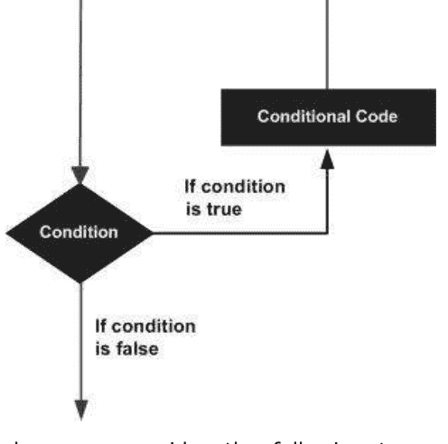

C++ 编程语言提供以下类型的循环来处理循环需求。

| 循环类型 | 描述 |
|---|---|
| while 循环 | 在给定条件为真时重复执行一条语句或一组语句。它在执行循环体之前测试条件。 |
| for 循环 | 多次执行一系列语句并简化管理循环变量的代码。 |

|  |  |
|---|---|
| do...while 循环 | 与 ‘while’ 语句类似，只是它在循环体末尾测试条件。 |
| 嵌套循环 | 你可以在任何另一个 ‘while’、‘for’ 或 ‘do...while’ 循环内部使用一个或多个循环。 |

### While 循环

**while** 循环语句只要给定条件为真，就会重复执行目标语句。

#### 语法

C++ 中 while 循环的语法是：

```
```cpp
while(condition)
{
    statement(s);
}
```
```

这里，**statement(s)** 可以是单个语句或一组语句。**condition** 可以是任何表达式，真为任何非零值。只要条件为真，循环就会迭代。

当条件变为假时，程序控制转移到循环之后紧跟的下一行。

##### 流程图

C++

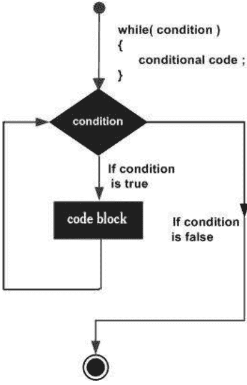

这里，*while* 循环的关键点是循环可能永远不运行。当条件被测试且结果为假时，循环体将被跳过，并执行 while 循环之后的第一个语句。

##### 示例

```
```cpp
#include <iostream>

using namespace std;

int main ()
{
    // Local variable declaration:
    int a = 10;

    // while loop execution
    while( a < 20 )
    {
        cout << "value of a: " << a << endl;
        a++;
    }
}
```
```

```
```cpp
return 0;
}
```
```

当上述代码被编译和执行时，它会产生以下结果：

```
```
value of a: 10

value of a: 11

value of a: 12

value of a: 13

value of a: 14

value of a: 15

value of a: 16

value of a: 17

value of a: 18

value of a: 19
```
```

### for 循环

**for** 循环是一种重复控制结构，允许你高效地编写需要执行特定次数的循环。

#### 语法

C++ 中 for 循环的语法是：

```
```cpp
for ( init; condition; increment )
{
    statement(s);
}
```
```

for 循环中的控制流程如下：

+   1. **init** 步骤首先执行，并且只执行一次。此步骤允许你声明和初始化任何循环控制变量。你不需要在此处放置语句，只要出现分号即可。
+   
+   2. 接下来，**condition** 被求值。如果为真，则执行循环体。如果为假，则不执行循环体，控制流跳转到 for 循环之后的下一条语句。
+   
+   3. 在 for 循环体执行后，控制流跳转回 **increment** 语句。此语句允许你更新任何循环控制变量。此语句可以留空，只要在 condition 之后出现分号即可。

+   4. 现在再次求值 condition。如果为真，则循环执行并重复此过程（循环体，然后是 increment 步骤，然后再次是 condition）。在 condition 变为假后，for 循环终止。

##### 流程图

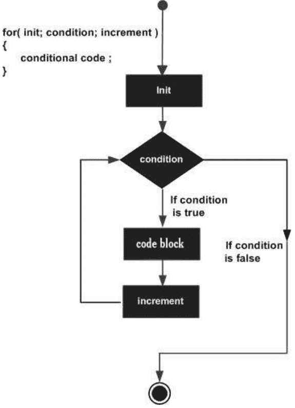

##### 示例

```
```cpp
#include <iostream>

using namespace std;

int main ()
{
    // for loop execution
    for( int a = 10; a < 20; a = a + 1 )
```
```

```
{
    cout << "value of a: " << a << endl;
}

    return 0;
}
```

当上述代码被编译和执行时，它会产生以下结果：

```
value of a: 10
value of a: 11
value of a: 12
value of a: 13
value of a: 14
value of a: 15
value of a: 16
value of a: 17
value of a: 18
value of a: 19
```

### do...while 循环

与在循环顶部测试循环条件的 for 和 while 循环不同，do...while 循环在循环底部检查其条件。

do...while 循环与 while 循环类似，只是 do...while 循环保证至少执行一次。

#### 语法

C++ 中 do...while 循环的语法是：

```
do
{
    statement(s);
}while( condition );
```

请注意，条件表达式出现在循环末尾，因此循环中的语句(s)会在条件被测试之前执行一次。

如果条件为真，控制流会跳回到 do，并再次执行循环中的语句(s)。此过程会重复，直到给定条件变为假。

##### 流程图

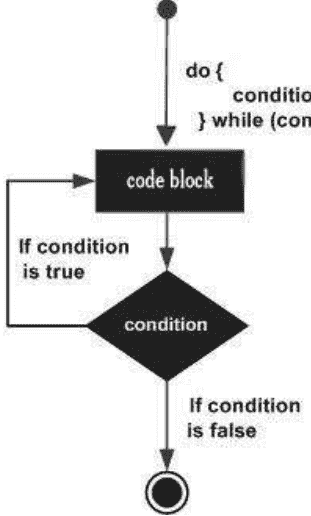

##### 示例

```
```cpp
#include <iostream>

using namespace std;

int main ()
{
    // Local variable declaration:
    int a = 10;

    // do loop execution
    do
    {
        cout << "value of a: " << a << endl;
        a = a + 1;
    }while( a < 20 );

    return 0;
}
```
```

```
```cpp
}
```
```

当上述代码被编译和执行时，它会产生以下结果：

```
```
value of a: 10

value of a: 11

value of a: 12

value of a: 13

value of a: 14

value of a: 15

value of a: 16

value of a: 17

value of a: 18

value of a: 19
```
```

### 嵌套循环

一个循环可以嵌套在另一个循环内部。C++ 允许至少 256 层嵌套。

#### 语法

C++ 中 **嵌套 for 循环** 语句的语法如下：

```
```cpp
for ( init; condition; increment )
{
    for ( init; condition; increment )
    {
        statement(s);
    }
    statement(s); // you can put more statements.
}
```
```

C++ 中 **嵌套 while 循环** 语句的语法如下：

```
```cpp
while(condition)
{
    while(condition)
    {
        statement(s);
```
```

```
2 is prime
3 is prime
5 is prime
7 is prime
11 is prime
13 is prime
17 is prime
19 is prime
23 is prime
29 is prime
31 is prime
37 is prime
41 is prime
43 is prime
47 is prime
53 is prime
59 is prime
61 is prime
67 is prime
71 is prime
73 is prime
79 is prime
83 is prime
89 is prime
97 is prime
```

### 循环控制语句

循环控制语句改变其正常顺序的执行。当执行离开作用域时，在该作用域中创建的所有自动对象都会被销毁。

C++ 支持以下控制语句。

| 控制语句 | 描述 |
|---|---|
| break 语句 | 终止 **loop** 或 **switch** 语句并将执行转移到紧跟其后的语句 |


#### break 语句

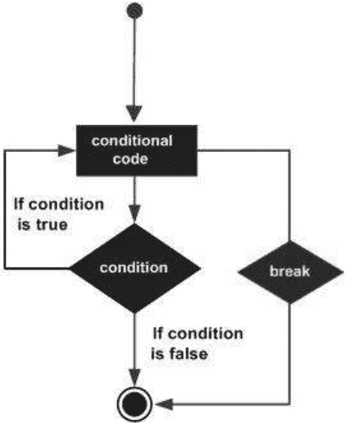

##### 示例

```cpp
#include <iostream>
using namespace std;

int main ()
{
    // Local variable declaration:
    int a = 10;

    // do loop execution
    do
    {
        cout << "value of a: " << a << endl;
        a = a + 1;
        if(a > 15)
        {
            // terminate the loop
            break;
        }
    }while( a < 20 );

    return 0;
}
```

当上述代码被编译并执行时，会产生以下结果：

```text
value of a: 10
value of a: 11
value of a: 12
value of a: 13
value of a: 14
value of a: 15
```

#### continue 语句

**continue** 语句的工作方式与 break 语句 somewhat 相似。然而，与强制终止不同，continue 强制执行循环的下一轮迭代，跳过中间的任何代码。

对于 **for** 循环，continue 会导致循环的条件测试和增量部分执行。对于 **while** 和 **do...while** 循环，程序控制会传递到条件测试。

#### 语法

continue 语句在 C++ 中的语法是：

```cpp
continue;
```

##### 流程图

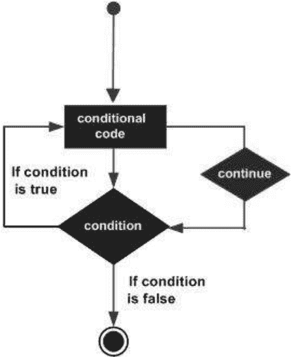

##### 示例

```cpp
#include <iostream>
using namespace std;

int main ()
{
    // Local variable declaration:
    int a = 10;

    // do loop execution
    do
    {
        if( a == 15)
        {
            // skip the iteration.
            a = a + 1;
            continue;
        }
        cout << "value of a: " << a << endl;
        a = a + 1;
    }while( a < 20 );

    return 0;
}
```

#### goto 语句

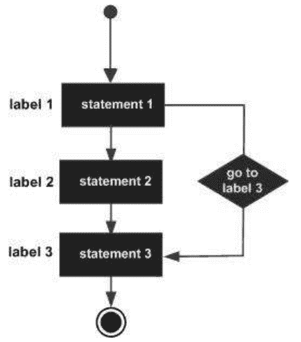

##### 示例

```cpp
#include <iostream>

using namespace std;

int main ()
{
    // Local variable declaration:
    int a = 10;

    // do loop execution
    LOOP: do
    {
        if( a == 15)
        {
            // skip the iteration.
            a = a + 1;
            goto LOOP;
        }
        cout << "value of a: " << a << endl;
        a = a + 1;
    }while( a < 20 );

    return 0;
}
```

### 无限循环

由于构成 ‘for’ 循环的三个表达式都不是必需的，你可以通过将条件表达式留空来创建一个无限循环。

```cpp
#include <iostream>

using namespace std;

int main ()
{

    for( ; ; )
    {
        printf("This loop will run forever.\n");
    }

    return 0;
}
```

当条件表达式缺失时，它被假定为 true。你可以有初始化和增量表达式，但 C++ 程序员更常用 ‘for (;;)’ 构造来表示无限循环。

**NOTE:** 你可以通过按下 Ctrl + C 键来终止无限循环。

## 13. 决策语句

决策结构要求程序员指定一个或多个要由程序评估或测试的条件，以及如果条件被确定为 true 时要执行的语句或语句，以及可选地，如果条件被确定为 false 时要执行的其他语句。

以下是大多数编程语言中常见的典型决策结构的一般形式：

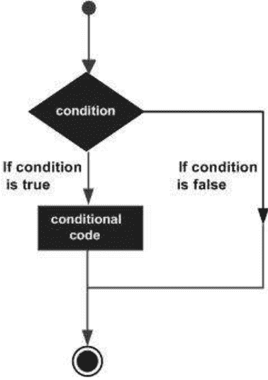

C++ 编程语言提供以下类型的决策语句。

| 语句 | 描述 |
|---|---|
| if 语句 | ‘if’ 语句由布尔表达式后跟一个或多个语句组成。 |
| if…else 语句 | ‘if’ 语句可以跟随一个可选的 ‘else’ 语句，当布尔表达式为 false 时执行。 |
| switch 语句 | ‘switch’ 语句允许一个变量与一系列值进行相等性测试。 |

### if 语句

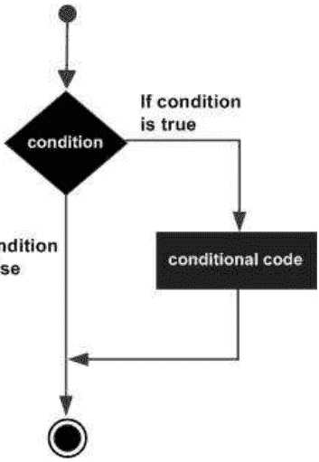

##### 示例

```cpp
#include <iostream>

using namespace std;

int main ()
{
    // local variable declaration:
    int a = 10;

    // check the boolean condition
    if( a < 20 )
    {
        // if condition is true then print the following
        cout << "a is less than 20;" << endl;
    }
    cout << "value of a is : " << a << endl;

    return 0;
}
```

当上述代码被编译并执行时，会产生以下结果：

```text
a is less than 20;
value of a is : 10
```

### if...else 语句

**if** 语句可以跟随一个可选的 **else** 语句，当布尔表达式为 false 时执行。

#### 语法

if...else 语句在 C++ 中的语法是：

```cpp
if(boolean_expression)
{
    // statement(s) will execute if the boolean expression is true
}
else
{
    // statement(s) will execute if the boolean expression is false
}
```

如果布尔表达式求值为 **true**，则 **if 块** 的代码将被执行，否则 **else 块** 的代码将被执行。

##### 流程图

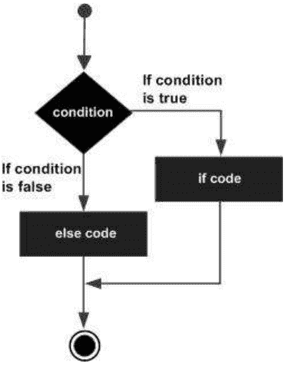

##### 示例

```cpp
#include <iostream>

using namespace std;

int main ()
{
    // local variable declaration:
    int a = 100;

    // check the boolean condition
    if( a < 20 )
    {
        // if condition is true then print the following
        cout << "a is less than 20;" << endl;
    }
    else
    {
        // if condition is false then print the following
        cout << "a is not less than 20;" << endl;
    }
    cout << "value of a is : " << a << endl;

    return 0;
}
```

当上述代码被编译并执行时，会产生以下结果：

```text
a is not less than 20;
value of a is : 100
```

### if...else if...else 语句

**if** 语句可以跟随一个可选的 **else if...else** 语句，这对于使用单个 if...else if 语句测试各种条件非常有用。

使用 if、else if、else 语句时需要注意以下几点。

- 一个 if 可以有零个或一个 else，并且它必须出现在任何 else if 之后。
- 一个 if 可以有零到多个 else if，并且它们必须出现在 else 之前。
- 一旦某个 else if 成功，后续的 else if 或 else 将不会被测试。

#### 语法

if...else if...else 语句在 C++ 中的语法是：

```cpp
if(boolean_expression 1)
{
    // Executes when the boolean expression 1 is true
}
else if( boolean_expression 2)
{
    // Executes when the boolean expression 2 is true
}
else if( boolean_expression 3)
{
    // Executes when the boolean expression 3 is true
}
else
{
    // executes when none of the above condition is true.
}
```

##### 示例

```cpp
#include <iostream>

using namespace std;


int main ()
{
    // local variable declaration:
    int a = 100;

    // check the boolean condition
    if( a == 10 )
    {
        // if condition is true then print the following
        cout << "Value of a is 10" << endl;
    }
    else if( a == 20 )
    {
        // if else if condition is true
        cout << "Value of a is 20" << endl;
    }
    else if( a == 30 )
    {
        // if else if condition is true
        cout << "Value of a is 30" << endl;
    }
    else
    {
        // if none of the conditions is true
        cout << "Value of a is not matching" << endl;
    }
    cout << "Exact value of a is : " << a << endl;

    return 0;
}
```

当上述代码被编译并执行时，会产生以下结果：

```text
Value of a is not matching
Exact value of a is : 100
```

### Switch 语句

**switch** 语句允许一个变量与一系列值进行相等性测试。每个值称为一个 case，被切换的变量会针对每个 case 进行检查。

#### 语法

**switch** 语句在 C++ 中的语法如下：

```cpp
switch(expression){
    case constant-expression  :
        statement(s);
        break; //optional
    case constant-expression :
        statement(s);
        break; //optional

    // you can have any number of case statements.
    default : //Optional
        statement(s);
}
```

以下规则适用于 switch 语句：

- 在 **switch** 语句中使用的 **expression** 必须具有整型或枚举类型，或是具有单个转换函数到整型或枚举类型的类类型。
- switch 中可以有任意数量的 case 语句。每个 case 后跟要比较的值和冒号。
- case 的 **constant-expression** 必须与 switch 中的变量具有相同的数据类型，并且必须是常量或字面量。
- 当被切换的变量等于某个 case 时，将执行该 case 之后直到遇到 **break** 语句为止的语句。
- 当遇到 break 语句时，switch 终止，控制流跳转到 switch 语句之后的下一行。
- 并非每个 case 都需要包含 break。如果没有 break，控制流将 *fall through* 到后续的 case 直到遇到 break。
- **switch** 语句可以有一个可选的 **default** case，必须出现在 switch 的末尾。default case 可用于在没有任何 case 为真时执行任务。default case 中不需要 break。

##### 流程图


```cpp
case 'D' :
    cout << "You passed" << endl;
    break;
case 'F' :
    cout << "Better try again" << endl;
    break;
default :
    cout << "Invalid grade" << endl;
}
cout << "Your grade is " << grade << endl;

return 0;
}
```

这将产生以下结果：

```text
You passed

Your grade is D
```

### 嵌套 if 语句

在 C++ 中，**嵌套** if-else 语句始终是合法的，这意味着您可以在另一个 if 或 else if 语句中使用一个 if 或 else if 语句。

#### 语法

**嵌套 if** 语句的语法如下：

```cpp
if( boolean_expression 1)
{
    // 当布尔表达式 1 为真时执行
    if(boolean_expression 2)
    {
        // 当布尔表达式 2 为真时执行
    }
}
```

您可以以类似于嵌套 *if* 语句的方式嵌套 **else if...else**。

```cpp
    }
}
cout << "Exact value of a is : " << a << endl;
cout << "Exact value of b is : " << b << endl;

return 0;
}
```

这将产生以下结果：

```text
This is part of outer switch
This is part of inner switch
Exact value of a is : 100
Exact value of b is : 200
```

### ? : 运算符

我们在前一章中介绍了条件运算符“? :”，它可以用来替代 **if...else** 语句。它的一般形式如下：

```cpp
Exp1 ? Exp2 : Exp3;
```

Exp1、Exp2 和 Exp3 是表达式。请注意冒号的使用和位置。

‘?’ 表达式的值是这样确定的：对 Exp1 求值。如果它为真，则对 Exp2 求值，并将其结果作为整个‘?’表达式的值。如果 Exp1 为假，则对 Exp3 求值，并将其结果作为表达式的值。

## 14. 函数

函数是一组一起执行任务的语句。每个 C++ 程序至少有一个函数，即 **main()**，除最简单的程序外，所有程序都可以定义额外的函数。

您可以将代码划分为多个函数。如何在不同函数之间划分代码取决于您，但逻辑上通常按每个函数执行特定任务来划分。

函数**声明**告诉编译器函数的名称、返回类型和参数。函数**定义**提供了函数的实际函数体。

C++ 标准库提供了许多程序可以调用的内置函数。例如，函数 **strcat()** 用于连接两个字符串，函数 **memcpy()** 用于将一个内存位置复制到另一个位置，以及更多函数。

函数有多种名称，如方法、子例程或过程等。

### 定义函数

C++ 函数定义的一般形式如下：

```cpp
return_type function_name( parameter list )
{
    body of the function
}
```

C++ 函数定义由函数头和函数体组成。以下是函数的所有部分：

- **返回类型**：函数可能返回一个值。**return_type** 是函数返回值的类型。某些函数执行所需操作而不返回值。在这种情况下，return_type 是关键字 **void**。
- **函数名称**：这是函数的实际名称。函数名称和参数列表共同构成函数签名。
- **参数**：参数类似于占位符。调用函数时，您会将一个值传递给参数。该值称为实际参数或实参。参数列表指的是函数参数的类型、顺序和数量。参数是可选的；也就是说，函数可以不包含参数。
- **函数体**：函数体包含一组定义函数做什么的语句。

### 示例：

以下是名为 **max()** 的函数的源代码。该函数接受两个参数 num1 和 num2，并返回两者之间的最大值：

```cpp
// 函数返回两个数字中的最大值

int max(int num1, int num2)
{
    // 局部变量声明
    int result;

    if (num1 > num2)
        result = num1;
    else
        result = num2;

    return result;
}
```

### 函数声明

函数**声明**告诉编译器函数名称以及如何调用该函数。函数的实际主体可以单独定义。

函数声明包含以下部分：

```cpp
return_type function_name( parameter list );
```

对于上面定义的函数 max()，以下是函数声明：

```cpp
int max(int num1, int num2);
```

在函数声明中，参数名称并不重要，只需要它们的类型，因此以下也是有效的声明：

```cpp
int max(int, int);
```

当您在一个源文件中定义函数而在另一个文件中调用该函数时，需要函数声明。在这种情况下，您应该在调用该函数的文件顶部声明该函数。

### 调用函数

在创建 C++ 函数时，您会定义函数需要做什么。要使用函数，您必须调用或调用该函数。

当程序调用函数时，程序控制权会转移到被调用的函数。被调用的函数执行定义的任务，当其 return 语句被执行或到达结束函数的花括号时，它将程序控制权返回给主程序。

要调用函数，您只需将所需参数与函数名称一起传递，如果函数返回一个值，则您可以存储返回的值。例如：

```cpp
#include <iostream>

using namespace std;

// 函数声明
int max(int num1, int num2);

int main ()
{
    // 局部变量声明：
    int a = 100;
    int b = 200;
    int ret;

    // 调用函数以获取最大值。
    ret = max(a, b);

    cout << "Max value is : " << ret << endl;

    return 0;
}

// 函数返回两个数字中的最大值
int max(int num1, int num2)
{
    // 局部变量声明
    int result;

    if (num1 > num2)
        result = num1;
    else
        result = num2;

    return result;
}
```

我将 max() 函数与 main() 函数放在一起并编译了源代码。运行最终可执行文件时，它将产生以下结果：

```text
Max value is : 200
```

### 函数参数

如果函数要使用参数，它必须声明接受参数值的变量。这些变量称为函数的**形式参数**。

形式参数的行为类似于函数内的其他局部变量，在进入函数时创建，在退出时销毁。

调用函数时，有两种方式可以将参数传递给函数：

| 调用类型 | 描述 |
|---|---|
| 传值调用 | 该方法将参数的实际值复制到函数的形式参数中。在这种情况下，函数内对参数所做的更改不会影响实参。 |
| 传指针调用 | 该方法将参数的地址复制到形式参数中。在函数内部，地址用于访问调用中使用的实际参数。这意味着对参数所做的更改会影响实参。 |
| 传引用调用 | 该方法将参数的引用复制到形式参数中。在函数内部，引用用于访问调用中使用的实际参数。这意味着对参数所做的更改会影响实参。 |

### 传值调用

**传值调用**方法将实参的实际值复制到函数的形式参数中。在这种情况下，函数内对参数所做的更改不会影响实参。

默认情况下，C++ 使用传值调用传递参数。通常，这意味着函数内的代码不能更改用于调用函数的实参。考虑下面 **swap()** 函数的定义。

```cpp
// 用于交换值的函数定义。

void swap(int x, int y)
{
    int temp;

    temp = x; /* 保存 x 的值 */
    x = y;    /* 将 y 放入 x */
    y = temp; /* 将 x 放入 y */

    return;
}
```

现在，让我们在以下示例中通过传递实际值来调用 **swap()** 函数：

```cpp
#include <iostream>

using namespace std;

// 函数声明
void swap(int x, int y);

int main ()
{
    // 局部变量声明：
    int a = 100;
```


```cpp
int b = 200;

cout << "Before swap, value of a :" << a << endl;
cout << "Before swap, value of b :" << b << endl;

// calling a function to swap the values.
swap(a, b);

cout << "After swap, value of a :" << a << endl;
cout << "After swap, value of b :" << b << endl;

return 0;
}
```

当上述代码被放入一个文件、编译并执行时，会产生以下结果：

```text
Before swap, value of a :100
Before swap, value of b :200
After swap, value of a :100
After swap, value of b :200
```

这表明值没有发生变化，尽管它们在函数内部已经被改变了。

### 按指针传递

**按指针传递**（call by pointer）是一种向函数传递参数的方法，它将参数的地址复制到形参中。在函数内部，该地址用于访问调用中使用的实参。这意味着对形参所做的更改会影响所传递的实参。

要通过指针传递值，参数指针像其他任何值一样被传递给函数。因此，您需要将函数参数声明为指针类型，如下面的 **swap()** 函数所示，该函数交换其参数所指向的两个整型变量的值。

```cpp
// function definition to swap the values.
void swap(int *x, int *y)
{
    int temp;

    temp = *x; /* save the value at address x */
    *x = *y;   /* put y into x */
    *y = temp; /* put x into y */

    return;
}
```

如需了解更多关于 C++ 指针的细节，请参阅 C++ 指针章节。

现在，让我们通过指针传递值来调用函数 **swap()**，如下例所示：

```cpp
#include <iostream>

using namespace std;

// function declaration
void swap(int *x, int *y);

int main ()
{
    // local variable declaration:
    int a = 100;
    int b = 200;

    cout << "Before swap, value of a :" << a << endl;
    cout << "Before swap, value of b :" << b << endl;

    /* calling a function to swap the values.
     * &a indicates pointer to a ie. address of variable a and
     * &b indicates pointer to b ie. address of variable b.
     */
    swap(&a, &b);

    cout << "After swap, value of a :" << a << endl;
    cout << "After swap, value of b :" << b << endl;

    return 0;
}
```

当上述代码被放入一个文件、编译并执行时，会产生以下结果：

```text
Before swap, value of a :100

Before swap, value of b :200

After swap, value of a :200

After swap, value of b :100
```

### 按引用传递

**按引用传递**（call by reference）是一种向函数传递参数的方法，它将参数的引用复制到形参中。在函数内部，该引用用于访问调用中使用的实参。这意味着对形参所做的更改会影响所传递的实参。

要通过引用传递值，参数引用像其他任何值一样被传递给函数。因此，您需要将函数参数声明为引用类型，如下面的 **swap()** 函数所示，该函数交换其参数所引用的两个整型变量的值。

```cpp
// function definition to swap the values.

void swap(int &x, int &y)
{
    int temp;

    temp = x; /* save the value at address x */

    x = y;    /* put y into x */

    y = temp; /* put x into y */

    return;
}
```

现在，让我们通过引用传递值来调用函数 **swap()**，如下例所示：

```cpp
#include <iostream>

using namespace std;

// function declaration

void swap(int &x, int &y);

int main ()
{
    // local variable declaration:
    int a = 100;
    int b = 200;

    cout << "Before swap, value of a :" << a << endl;
    cout << "Before swap, value of b :" << b << endl;

    /* calling a function to swap the values using variable reference.*/
    swap(a, b);

    cout << "After swap, value of a :" << a << endl;
    cout << "After swap, value of b :" << b << endl;

    return 0;
}
```

当上述代码被放入一个文件、编译并执行时，会产生以下结果：

```text
Before swap, value of a :100

Before swap, value of b :200

After swap, value of a :200

After swap, value of b :100
```

默认情况下，C++ 使用**按值传递**（call by value）来传递参数。通常，这意味着函数内的代码不能更改用于调用函数的参数；前面提到的调用 max() 函数的示例也是使用相同的方法。

### 参数的默认值

定义函数时，可以为最后的若干参数中的每一个指定默认值。如果在调用函数时对应的参数留空，则将使用该默认值。

这可以通过使用赋值运算符在函数定义中为参数赋值来实现。如果在调用函数时未传递该参数的值，则使用给定的默认值；但如果指定了值，则忽略默认值并使用传递的值。考虑以下示例：

```cpp
#include <iostream>

using namespace std;


int sum(int a, int b=20)
{
    int result;


    result = a + b;


    return (result);
}


int main ()
{
    // local variable declaration:
    int a = 100;
    int b = 200;
    int result;


    // calling a function to add the values.
    result = sum(a, b);
    cout << "Total value is :" << result << endl;


    // calling a function again as follows.
    result = sum(a);
    cout << "Total value is :" << result << endl;


    return 0;
}
```

当上述代码被编译并执行时，会产生以下结果：

```text
Total value is :300
Total value is :120
```

```cpp
cout << "double d :" << d << endl;

    return 0;
}
```

当上述代码被编译并执行时，会产生以下结果：

```text
short  s :10
int    i :-1000
long   l :1000000
float  f :230.47
double d :30949.4
```

### C++ 中的数学运算

除了您可以创建的各种函数之外，C++ 还包含一些您可以使用的有用函数。这些函数可在标准 C 和 C++ 库中找到，称为**内置**（built-in）函数。它们可以包含在您的程序中并使用。

C++ 拥有丰富的数学运算集，可以对各种数字执行运算。下表列出了 C++ 中一些有用的内置数学函数。

要利用这些函数，您需要包含数学头文件 **<cmath>**。

| S.N. | Function & Purpose |
|------|--------------------|
| 1 | **double cos(double);**<br>该函数接受一个角度（以 double 类型表示）并返回其余弦值。 |
| 2 | **double sin(double);**<br>该函数接受一个角度（以 double 类型表示）并返回其正弦值。 |
| 3 | **double tan(double);**<br>该函数接受一个角度（以 double 类型表示）并返回其正切值。 |
| 4 | **double log(double);**<br>该函数接受一个数字并返回该数字的自然对数。 |
| 5 | **double pow(double, double);**<br>第一个参数是您要乘方的数字，第二个参数是您要乘方的幂次。 |
| 6 | **double hypot(double, double);**<br>如果向此函数传递直角三角形两条边的长度，它将返回斜边的长度。 |
| 7 | **double sqrt(double);**<br>您向此函数传递一个数字，它会返回该数字的平方根。 |
| 8 | **int abs(int);**<br>此函数返回传递给它的整数的绝对值。 |
| 9 | **double fabs(double);**<br>此函数返回传递给它的任何小数的绝对值。 |
| 10 | **double floor(double);**<br>返回小于或等于传递给它的参数的最大整数。 |

以下是一个简单的示例，展示了其中一些数学运算：

```cpp
#include <iostream>
#include <cmath>

using namespace std;

int main ()
{
    // number definition:
    short s = 10;
    int   i = -1000;
    long  l = 100000;
    float f = 230.47;
```


```cpp
// set the seed
srand( (unsigned)time( NULL ) );

/* generate 10 random numbers. */
for( i = 0; i < 10; i++ )
{
    // generate actual random number
    j= rand();
    cout << " Random Number : " << j << endl;
}

return 0;
}
```

当上述代码被编译和执行时，它会产生以下结果：

```
Random Number : 1748144778

Random Number : 630873888

Random Number : 2134540646

Random Number : 219404170

Random Number : 902129458

Random Number : 920445370

Random Number : 1319072661

Random Number : 257938873

Random Number : 1256201101

Random Number : 580322989
```

## 16. 数组

C++ 提供了一种数据结构——**数组**，它存储相同类型元素的固定大小顺序集合。数组用于存储数据集合，但将数组视为相同类型变量的集合通常更有用。

无需声明单个变量（如 number0、number1、... 和 number99），而是声明一个数组变量（如 numbers），并使用 numbers[0]、numbers[1]、... 和 numbers[99] 来表示各个变量。数组中的特定元素通过索引访问。

所有数组都由连续的内存位置组成。最低地址对应第一个元素，最高地址对应最后一个元素。

### 声明数组

要在 C++ 中声明数组，程序员需要指定元素的类型以及数组所需的元素数量，如下所示：

```
type arrayName [ arraySize ];
```

这称为一维数组。**arraySize** 必须是大于零的整数常量，**type** 可以是任何有效的 C++ 数据类型。例如，要声明一个名为 balance、类型为 double 的 10 元素数组，请使用以下语句：

```
double balance[10];
```

### 初始化数组

您可以逐一初始化 C++ 数组元素，也可以使用单个语句进行初始化，如下所示：

```
double balance[5] = {1000.0, 2.0, 3.4, 17.0, 50.0};
```

大括号 { } 中的值的数量不能大于我们在方括号 [ ] 中为数组声明的元素数量。以下是为数组的单个元素赋值的示例：

如果省略数组的大小，则会创建一个刚好足以容纳初始化的数组。因此，如果您编写：

```
double balance[] = {1000.0, 2.0, 3.4, 17.0, 50.0};
```

您将创建与上一个示例完全相同的数组。


```
balance[4] = 50.0;
```

上述语句将数组中的第 5 个元素赋值为 50.0。索引为 4 的数组元素将是第 5 个元素，即最后一个元素，因为所有数组的第一个元素的索引都是 0，这也称为基索引。以下是我们上面讨论的同一数组的图示表示：

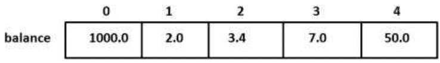

### 访问数组元素

通过索引数组名来访问元素。具体做法是将元素的索引放在数组名称后的方括号内。例如：

```
double salary = balance[9];
```

上述语句将从数组中取出第 10 个元素，并将该值赋给 salary 变量。以下示例将使用上述所有三个概念，即声明、赋值和访问数组：

```
#include <iostream>

using namespace std;

#include <iomanip>

using std::setw;

int main ()
{
    int n[ 10 ]; // n is an array of 10 integers

    // initialize elements of array n to 0
    for ( int i = 0; i < 10; i++ )
    {
        n[ i ] = i + 100; // set element at location i to i + 100
    }
    cout << "Element" << setw( 13 ) << "Value" << endl;

    // output each array element's value
```

```
for ( int j = 0; j < 10; j++ )
{
    cout << setw( 7 )<< j << setw( 13 ) << n[ j ] << endl;
}

return 0;
}
```

该程序使用 setw() 函数来格式化输出。当上述代码被编译和执行时，它会产生以下结果：

| 元素 | 值 |
| 0 | 100 |
| 1 | 101 |
| 2 | 102 |
| 3 | 103 |
| 4 | 104 |
| 5 | 105 |
| 6 | 106 |
| 7 | 107 |
| 8 | 108 |
| 9 | 109 |

### C++ 中的数组

数组对 C++ 非常重要，需要更多细节。以下是一些重要的概念，C++ 程序员应该清楚了解：

| 概念 | 描述 |
| 多维数组 | C++ 支持多维数组。多维数组最简单的形式是二维数组。 |
| 指向数组的指针 | 您只需指定数组名称（不带任何索引）即可生成指向数组第一个元素的指针。 |
| 将数组传递给函数 | 您可以将指向数组的指针传递给函数 |

```
return 0;

}
```

当上述代码被编译和执行时，它会产生以下结果：

```
a[0][0]: 0
a[0][1]: 0
a[1][0]: 1
a[1][1]: 2
a[2][0]: 2
a[2][1]: 4
a[3][0]: 3
a[3][1]: 6
a[4][0]: 4
a[4][1]: 8
```

如上所述，您可以创建任意维数的数组，尽管您创建的大多数数组可能是一维或二维的。

### 指向数组的指针

很可能您要等到阅读了与 C++ 指针相关的章节后，才能理解本章内容。

因此，假设您对 C++ 中的指针有一定了解，让我们开始吧：数组名称是指向数组第一个元素的常量指针。因此，在声明中：

```
double balance[50];
```

**balance** 是指向 &balance[0] 的指针，也就是数组 balance 第一个元素的地址。因此，以下程序片段将 **p** 赋值为 **balance** 第一个元素的地址：

```
double *p;

double balance[10];

p = balance;
```

将数组名称用作常量指针是合法的，反之亦然。因此，*(balance + 4) 是访问 balance[4] 处数据的合法方式。

一旦将第一个元素的地址存储在 p 中，您就可以使用 *p、*(p+1)、*(p+2) 等来访问数组元素。以下示例展示了上面讨论的所有概念：

```
#include <iostream>

using namespace std;

int main ()
{
    // an array with 5 elements.
    double balance[5] = {1000.0, 2.0, 3.4, 17.0, 50.0};
    double *p;

    p = balance;

    // output each array element's value
    cout << "Array values using pointer " << endl;
    for ( int i = 0; i < 5; i++ )
    {
        cout << "*(p + " << i << ") : ";
        cout << *(p + i) << endl;
    }

    cout << "Array values using balance as address " << endl;
    for ( int i = 0; i < 5; i++ )
    {
        cout << "*(balance + " << i << ") : ";
        cout << *(balance + i) << endl;
    }

    return 0;
}
```

当上述代码被编译和执行时，它会产生以下结果：

```
Array values using pointer

*(p + 0) : 1000
```

```
*(p + 1) : 2

*(p + 2) : 3.4

*(p + 3) : 17

*(p + 4) : 50

Array values using balance as address

*(balance + 0) : 1000

*(balance + 1) : 2

*(balance + 2) : 3.4

*(balance + 3) : 17

*(balance + 4) : 50
```

在上面的示例中，p 是一个指向 double 的指针，这意味着它可以存储 double 类型变量的地址。一旦我们在 p 中有了地址，那么 **\*p** 将给出存储在 p 中地址处的值，如上面的示例所示。

### 将数组传递给函数

C++ 不允许将整个数组作为参数传递给函数。但是，您可以通过指定不带索引的数组名称来传递指向数组的指针。

如果要将一维数组作为参数传递给函数，您必须以下列三种方式之一声明函数的形式参数，这三种声明方法都会产生类似的结果，因为它们都告诉编译器将接收一个整数指针。

### 方法 1

形式参数作为指针，如下所示：

```
void myFunction(int *param)
{
.
.
.
}
```

### 方法 2

形式参数作为指定大小的数组，如下所示：

```
void myFunction(int param[10])
```


```cpp
{
.
.
.
}
```

### 方式三

将形参声明为无大小数组，如下所示：

```cpp
void myFunction(int param[])
{
.
.
.
}
```

现在，考虑以下函数，该函数将一个数组作为参数，同时还有另一个参数，并根据传入的参数返回通过数组传入的数字的平均值，如下所示：

```cpp
double getAverage(int arr[], int size)
{
    int    i, sum = 0;
    double avg;

    for (i = 0; i < size; ++i)
    {
        sum += arr[i];
    }

    avg = double(sum) / size;

    return avg;
}
```

现在，让我们按如下方式调用上述函数：

```cpp
#include <iostream>

using namespace std;

// function declaration:
double getAverage(int arr[], int size);

int main ()
{
    // an int array with 5 elements.
    int balance[5] = {1000, 2, 3, 17, 50};
    double avg;

    // pass pointer to the array as an argument.
    avg = getAverage( balance, 5 );

    // output the returned value
    cout << "Average value is: " << avg << endl;

    return 0;
}
```

当上述代码被一起编译并执行时，会产生以下结果：

```text
Average value is: 214.4
```

如您所见，就函数而言，数组的长度并不重要，因为 C++ 不会对形参进行边界检查。

### 从函数返回数组

C++ 不允许将整个数组作为参数返回给函数。但是，您可以通过指定不带索引的数组名称来返回指向数组的指针。

如果您想从函数返回一维数组，则必须声明一个返回指针的函数，如下例所示：

```cpp
int * myFunction()

{
.
```

需要记住的第二点是，C++ 不提倡将局部变量的地址返回给函数外部，因此您必须将局部变量定义为**静态**变量。

现在，考虑以下函数，它将生成 10 个随机数并使用数组返回它们，并按如下方式调用此函数：

```cpp
#include <iostream>
#include <ctime>

using namespace std;

// function to generate and return random numbers.
int * getRandom( )
{
    static int  r[10];

    // set the seed
    srand( (unsigned)time( NULL ) );
    for (int i = 0; i < 10; ++i)
    {
        r[i] = rand();
        cout << r[i] << endl;
    }

    return r;
}

// main function to call above defined function.
int main ()
{
    // a pointer to an int.
    int *p;

    p = getRandom();
    for ( int i = 0; i < 10; i++ )
    {
        cout << "*(p + " << i << ") : ";
        cout << *(p + i) << endl;
    }

    return 0;
}
```

当上述代码被一起编译并执行时，会产生如下结果：

```text
624723190
1468735695
807113585
976495677
613357504
1377296355
1530315259
1778906708
1820354158
667126415
*(p + 0) : 624723190
*(p + 1) : 1468735695
*(p + 2) : 807113585
*(p + 3) : 976495677
*(p + 4) : 613357504
*(p + 5) : 1377296355
*(p + 6) : 1530315259
*(p + 7) : 1778906708
*(p + 8) : 1820354158
*(p + 9) : 667126415
```

返回指向字符串 s1 中首次出现的字符串 s2 的指针。

以下示例使用了上述一些函数：

```cpp
#include <iostream>
#include <cstring>

using namespace std;

int main ()
{
   char str1[10] = "Hello";
   char str2[10] = "World";
   char str3[10];
   int  len ;

   // copy str1 into str3
   strcpy( str3, str1);
   cout << "strcpy( str3, str1) : " << str3 << endl;

   // concatenates str1 and str2
   strcat( str1, str2);
   cout << "strcat( str1, str2): " << str1 << endl;

   // total length of str1 after concatenation
   len = strlen(str1);
   cout << "strlen(str1) : " << len << endl;

   return 0;
}
```

当上述代码被编译并执行时，会产生如下结果：

```text
strcpy( str3, str1) : Hello
strcat( str1, str2): HelloWorld
strlen(str1) : 10
```

### C++ 中的字符串类

标准 C++ 库提供了一个**字符串**类类型，它支持上述所有操作，此外还有更多功能。让我们看一下以下示例：

```cpp
#include <iostream>
#include <string>

using namespace std;

int main ()
{
    string str1 = "Hello";
    string str2 = "World";
    string str3;
    int  len ;

    // copy str1 into str3
    str3 = str1;
    cout << "str3 : " << str3 << endl;

    // concatenates str1 and str2
    str3 = str1 + str2;
    cout << "str1 + str2 : " << str3 << endl;

    // total length of str3 after concatenation
    len = str3.size();
    cout << "str3.size() : " << len << endl;

    return 0;
}
```

当上述代码被编译并执行时，会产生如下结果：

```text
str3 : Hello
str1 + str2 : HelloWorld
str3.size() : 10
```

## 18. 指针

C++ 指针既容易学习又有趣。有些 C++ 任务使用指针更容易完成，而其他 C++ 任务，例如动态内存分配，如果没有指针则无法完成。

如您所知，每个变量都是一个内存位置，每个内存位置都有其定义的地址，可以使用与号（&）运算符访问该地址，该运算符表示内存中的地址。请考虑以下打印所定义变量地址的示例：

```cpp
#include <iostream>

using namespace std;

int main ()
{
    int  var1;
    char var2[10];

    cout << "Address of var1 variable: ";
    cout << &var1 << endl;

    cout << "Address of var2 variable: ";
    cout << &var2 << endl;

    return 0;
}
```

当上述代码被编译并执行时，会产生以下结果：

```text
Address of var1 variable: 0xbfebd5c0
Address of var2 variable: 0xbfebd5b6
```

### 什么是指针？

**指针**是一个变量，其值是另一个变量的地址。与任何变量或常量一样，您必须在使用指针之前声明它。指针变量声明的一般形式是：

```cpp
// print the address stored in ip pointer variable
cout << "Address stored in ip variable: ";
cout << ip << endl;

// access the value at the address available in pointer
cout << "Value of *ip variable: ";
cout << *ip << endl;

return 0;
}
```

当上述代码被编译并执行时，会产生如下结果：

```text
Value of var variable: 20
Address stored in ip variable: 0xbfc601ac
Value of *ip variable: 20
```

### C++ 中的指针

指针有许多简单易懂的概念，它们对于 C++ 编程非常重要。以下是 C++ 程序员应该清楚的几个重要指针概念：

| 概念 | 描述 |
|---|---|
| C++ 空指针 | C++ 支持空指针，空指针是在多个标准库中定义的值为零的常量。 |
| C++ 指针运算 | 有四种算术运算符可用于指针：++、--、+、- |
| C++ 指针与数组 | 指针和数组之间有密切的关系。 |
| C++ 指针数组 | 您可以定义数组来保存大量指针。 |
| C++ 指向指针的指针 | C++ 允许您拥有指向指针的指针，等等。 |
| 向函数传递指针 | 按引用或按地址传递参数都允许被调函数更改调用函数中传入的参数。 |
| 从函数返回指针 | C++ 允许函数返回指向局部变量、静态变量以及动态分配的内存的指针。 |

### 空指针

在您没有确切地址可分配的情况下，将指针 NULL 分配给指针变量始终是一个好习惯。这在变量声明时完成。被分配 NULL 的指针称为**空**指针。

NULL 指针是一个值为零的常量，在多个标准库（包括 iostream）中定义。请考虑以下程序：

```cpp
#include <iostream>

using namespace std;

int main ()
{
    int *ptr = NULL;

    cout << "The value of ptr is " << ptr ;

    return 0;
}
```

当上述代码被编译并执行时，会产生以下结果：

```text
The value of ptr is 0
```

在大多数操作系统上，程序不允许访问地址 0 处的内存，因为该内存由操作系统保留。然而，内存地址 0 具有特殊意义；它表示该指针不打算指向可访问的内存位置。但通过


按照惯例，如果指针包含空（零）值，则它被认为不指向任何内容。

要检查空指针，可以使用如下所示的 `if` 语句：

```cpp
if(ptr)    // succeeds if p is not null

if(!ptr)   // succeeds if p is null
```

因此，如果所有未使用的指针都被赋予空值，并且你避免使用空指针，就可以避免意外误用未初始化的指针。很多时候，未初始化的变量会持有一些垃圾值，这会使程序调试变得困难。

### 指针算术

正如你所了解的，指针是一个地址，而地址是数值；因此，你可以像对数值进行算术运算一样，对指针执行算术运算。有四个算术运算符可用于指针：`++`、`--`、`+` 和 `-`。

为了理解指针算术，假设 **ptr** 是一个整型指针，指向地址 1000。假设整数为 32 位，让我们对指针执行以下算术运算：

```cpp
ptr++
```

**ptr** 将指向位置 1004，因为每次 `ptr` 递增时，它都会指向下一个整数。此操作会将指针移动到下一个内存位置，而不会影响该内存位置上的实际值。如果 `ptr` 指向一个字符，其地址为 1000，那么上述操作将指向位置 1001，因为下一个字符将在 1001 处可用。

### 递增指针

在程序中，我们更倾向于使用指针而不是数组，因为变量指针可以递增，而数组名不能递增，因为它是一个常量指针。下面的程序通过递增变量指针来访问数组的每一个连续元素：

```cpp
#include <iostream>

using namespace std;

const int MAX = 3;

int main ()
{
    int var[MAX] = {10, 100, 200};
    int *ptr;

    // let us have array address in pointer.
    ptr = var;
    for (int i = 0; i < MAX; i++)
    {
        cout << "Address of var[" << i << "] = ";
        cout << ptr << endl;

        cout << "Value of var[" << i << "] = ";
        cout << *ptr << endl;

        // point to the next location
        ptr++;
    }
    return 0;
}
```

编译并执行上述代码后，会产生类似以下的结果：

```text
Address of var[0] = 0xbfa088b0
Value of var[0] = 10
Address of var[1] = 0xbfa088b4
Value of var[1] = 100
Address of var[2] = 0xbfa088b8
Value of var[2] = 200
```

### 递减指针

递减指针也适用同样的考虑，指针按其所指数据类型的字节数减少其值，如下所示：

```cpp
#include <iostream>

using namespace std;

const int MAX = 3;

int main ()
{
    int var[MAX] = {10, 100, 200};
    int *ptr;

    // let us have address of the last element in pointer.
    ptr = &var[MAX-1];
    for (int i = MAX; i > 0; i--)
    {
        cout << "Address of var[" << i << "] = ";
        cout << ptr << endl;

        cout << "Value of var[" << i << "] = ";
        cout << *ptr << endl;

        // point to the previous location
        ptr--;
    }
    return 0;
}
```

编译并执行上述代码后，会产生类似以下的结果：

```text
Address of var[3] = 0xbfdb70f8
Value of var[3] = 200
Address of var[2] = 0xbfdb70f4
Value of var[2] = 100
Address of var[1] = 0xbfdb70f0
Value of var[1] = 10
```

### 指针比较

指针可以使用关系运算符（如 `==`、`<` 和 `>`）进行比较。如果 `p1` 和 `p2` 指向彼此相关的变量，例如同一数组中的元素，那么 `p1` 和 `p2` 的比较是有意义的。

下面的程序修改了前面的示例，只要变量指针指向的地址小于或等于数组最后一个元素的地址（即 `&var[MAX - 1]`），就继续递增该指针：

```cpp
#include <iostream>

using namespace std;

const int MAX = 3;

int main ()
{
    int  var[MAX] = {10, 100, 200};
    int *ptr;

    // let us have address of the first element in pointer.
    ptr = var;
    int i = 0;
    while ( ptr <= &var[MAX - 1] )
    {
        cout << "Address of var[" << i << "] = ";
        cout << ptr << endl;

        cout << "Value of var[" << i << "] = ";
        cout << *ptr << endl;

        // point to the next location
        ptr++;
        i++;
    }
    return 0;
}
```

编译并执行上述代码后，会产生类似以下的结果：

```text
Address of var[0] = 0xbfce42d0

Value of var[0] = 10

Address of var[1] = 0xbfce42d4

Value of var[1] = 100

Address of var[2] = 0xbfce42d8

Value of var[2] = 200
```

### 指针与数组

指针和数组关系密切。实际上，在许多情况下，指针和数组是可以互换的。例如，指向数组首元素的指针既可以使用指针算术，也可以使用数组风格的下标来访问该数组。请看下面的程序：

```cpp
#include <iostream>

using namespace std;

const int MAX = 3;

int main ()
{
    int var[MAX] = {10, 100, 200};
    int *ptr;

    // let us have array address in pointer.
    ptr = var;
    for (int i = 0; i < MAX; i++)
    {
        cout << "Address of var[" << i << "] = ";
        cout << ptr << endl;

        cout << "Value of var[" << i << "] = ";
        cout << *ptr << endl;

        // point to the next location
        ptr++;
    }
    return 0;
}
```

编译并执行上述代码后，会产生类似以下的结果：

```text
Address of var[0] = 0xbfa088b0

Value of var[0] = 10

Address of var[1] = 0xbfa088b4

Value of var[1] = 100

Address of var[2] = 0xbfa088b8

Value of var[2] = 200
```

然而，指针和数组并不能完全互换。例如，请看下面的程序：

```cpp
#include <iostream>

using namespace std;

const int MAX = 3;

int main ()
{
    int  var[MAX] = {10, 100, 200};

    for (int i = 0; i < MAX; i++)
    {
        *var = i;   // This is a correct syntax

        var++;      // This is incorrect.
    }
    return 0;
}
```

对 `var` 应用指针运算符 `*` 是完全合法的，但修改 `var` 的值则是非法的。原因是 `var` 是一个指向数组首元素的常量，不能用作左值。

由于数组名生成一个指针常量，只要不被修改，它就仍可用于指针风格的表达式。例如，下面这个为 `var[2]` 赋值为 500 的语句是有效的：

```cpp
*(var + 2) = 500;
```

上面的语句有效，并且会成功编译，因为 `var` 没有被修改。

### 指针数组

在理解指针数组的概念之前，先看下面的例子，它使用了一个包含 3 个整数的数组：

```cpp
#include <iostream>

using namespace std;

const int MAX = 3;

int main ()
{
    int  var[MAX] = {10, 100, 200};

    for (int i = 0; i < MAX; i++)
    {
        cout << "Value of var[" << i << "] = ";
        cout << var[i] << endl;
    }
    return 0;
}
```

编译并执行上述代码后，会产生以下结果：

```text
Value of var[0] = 10

Value of var[1] = 100

Value of var[2] = 200
```

有时候，我们可能需要维护一个数组，该数组可以存储指向 `int`、`char` 或任何其他可用数据类型的指针。下面是一个指向整数的指针数组的声明：

```cpp
int *ptr[MAX];
```

这条语句将 `ptr` 声明为包含 `MAX` 个整型指针的数组。因此，`ptr` 中的每个元素现在都持有一个指向 `int` 值的指针。下面的示例使用了三个整数，它们将按如下方式存储在一个指针数组中：

```cpp
#include <iostream>
```

```cpp
char *names[MAX] = {
                "Zara Ali",
                "Hina Ali",
                "Nuha Ali",
                "Sara Ali",
};

for (int i = 0; i < MAX; i++)
{
    cout << "Value of names[" << i << "] = ";
    cout << names[i] << endl;
}
return 0;
}
```

编译并执行上述代码后，会产生以下结果：

```text
Value of names[0] = Zara Ali

Value of names[1] = Hina Ali

Value of names[2] = Nuha Ali

Value of names[3] = Sara Ali
```

### 指向指针的指针

指向指针的指针是一种多重间接引用形式，也就是一条指针链。通常，指针包含一个变量的地址。当我们定义一个指向指针的指针时，第一个指针包含第二个指针的地址，而第二个指针指向包含实际值的位置，如下图所示。

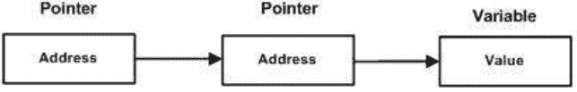

指向指针的指针变量必须这样声明：在其名称前多加一个星号。例如，下面是一个声明 `int` 型指针的指针的示例：

```cpp
int **var;
```


### 向函数传递指针

C++ 允许你向函数传递指针。为此，只需将函数参数声明为指针类型即可。

以下是一个简单的示例，我们将一个无符号长整型指针传递给函数，并在函数内部更改其值，该更改会在调用函数中体现出来：

```
```cpp
#include <iostream>
#include <ctime>

using namespace std;
void getSeconds(unsigned long *par);

int main ()
{
    unsigned long sec;

    getSeconds( &sec );

    // print the actual value
    cout << "Number of seconds :" << sec << endl;

    return 0;
}

void getSeconds(unsigned long *par)
{
    // get the current number of seconds
    *par = time( NULL );
    return;
}
```
```

编译并执行上述代码后，会产生以下结果：

```
```text
Number of seconds :1294450468
```
```

可以接受指针的函数，也可以接受数组，如以下示例所示：

```
```cpp
#include <iostream>

using namespace std;

// function declaration:
double getAverage(int *arr, int size);

int main ()
{
    // an int array with 5 elements.
    int balance[5] = {1000, 2, 3, 17, 50};
    double avg;

    // pass pointer to the array as an argument.
    avg = getAverage( balance, 5 );

    // output the returned value
    cout << "Average value is: " << avg << endl;

    return 0;
}

double getAverage(int *arr, int size)
{
    int    i, sum = 0;
    double avg;

    for (i = 0; i < size; ++i)
    {
        sum += arr[i];
    }

    avg = double(sum) / size;
```
```

```
```cpp
return avg;
}
```
```

编译并执行上述代码后，会产生以下结果：

```
Average value is: 214.4
```

### 从函数返回指针

正如我们在上一章中看到的 C++ 允许从函数返回数组，类似地 C++ 也允许你从函数返回指针。为此，你需要声明一个返回指针的函数，如以下示例所示：

```
```cpp
int * myFunction()
{
.
.
.
}
```
```

需要记住的第二点是，将局部变量的地址返回到函数外部并不是一个好主意，因此你必须将局部变量定义为 **静态变量**。

现在，考虑以下函数，它将生成 10 个随机数并使用数组名返回它们，该数组名代表一个指针，即第一个数组元素的地址。

```
```cpp
#include <iostream>

#include <ctime>

using namespace std;

// function to generate and return random numbers.
int * getRandom( )
{
    static int  r[10];
```

```
```cpp
// set the seed
srand( (unsigned)time( NULL ) );
for (int i = 0; i < 10; ++i)
{
    r[i] = rand();
    cout << r[i] << endl;
}

return r;
}

// main function to call above defined function.
int main ()
{
    // a pointer to an int.
    int *p;

    p = getRandom();
    for ( int i = 0; i < 10; i++ )
    {
        cout << "*(p + " << i << ") : ";
        cout << *(p + i) << endl;
    }

    return 0;
}
```
```

编译并执行上述代码后，会产生如下结果：

```
```text
624723190

1468735695

807113585

976495677
```
```


```
613357504
1377296355
1530315259
1778906708
1820354158
667126415
*(p + 0) : 624723190
*(p + 1) : 1468735695
*(p + 2) : 807113585
*(p + 3) : 976495677
*(p + 4) : 613357504
*(p + 5) : 1377296355
*(p + 6) : 1530315259
*(p + 7) : 1778906708
*(p + 8) : 1820354158
*(p + 9) : 667126415
```

## 19. 引用

引用变量是一个别名，即已存在变量的另一个名称。一旦引用被初始化为一个变量，就可以使用变量名或引用名来引用该变量。

### 引用与指针

引用经常与指针混淆，但引用和指针之间有三个主要区别：

- 你不能拥有 NULL 引用。你必须始终能够假设引用与合法的存储空间相连。
- 一旦引用被初始化为一个对象，就不能更改它以引用另一个对象。指针可以在任何时候指向另一个对象。
- 引用必须在创建时初始化。指针可以在任何时候初始化。

### 在 C++ 中创建引用

把变量名看作附加到变量内存位置的标签。然后你可以把引用看作附加到该内存位置的第二个标签。因此，你可以通过原始变量名或引用来访问变量的内容。例如，假设我们有以下示例：

```
int   i = 17;
```

我们可以为 i 声明引用变量如下。

```
int&   r = i;
```

读 & 在这些声明中为 **引用**。因此，读第一个声明为“r 是初始化为 i 的整数引用”，读第二个声明为“s 是初始化为 d 的双精度引用”。以下示例使用了 int 和 double 的引用：

```
#include <iostream>

using namespace std;

int main ()
{
```


```
```cpp
// declare simple variables
int    i;
double d;

// declare reference variables
int&    r = i;
double& s = d;

i = 5;
cout << "Value of i : " << i << endl;
cout << "Value of i reference : " << r  << endl;

d = 11.7;
cout << "Value of d : " << d << endl;
cout << "Value of d reference : " << s  << endl;

return 0;
}
```
```

编译并执行上述代码后，会产生以下结果：

```
```text
Value of i : 5

Value of i reference : 5

Value of d : 11.7

Value of d reference : 11.7
```
```

引用通常用于函数参数列表和函数返回值。因此，以下是与 C++ 引用相关的两个重要主题，C++ 程序员应清楚：

| 概念 | 描述 |
|---|---|
| 作为参数的引用 | C++ 支持以比参数更安全的方式将引用作为函数参数传递。 |
| 作为返回值的引用 | 你可以从 C++ 函数返回引用 |

```
```cpp
int temp;

temp = x; /* save the value at address x */
x = y;    /* put y into x */
y = temp; /* put x into y */

return;
}
```
```

编译并执行上述代码后，会产生以下结果：

```
```
Before swap, value of a :100
Before swap, value of b :200
After swap, value of a :200
After swap, value of b :100
```
```

### 作为返回值的引用

通过使用引用而不是指针，可以使 C++ 程序更易于阅读和维护。C++ 函数可以像返回指针一样返回引用。

当函数返回引用时，它会返回对其返回值的隐式指针。这样，函数就可以用在赋值语句的左侧。例如，考虑以下简单程序：

```
```cpp
#include <iostream>

#include <ctime>

using namespace std;

double vals[] = {10.1, 12.6, 33.1, 24.1, 50.0};

double& setValues( int i )
{
    return vals[i];   // return a reference to the ith element
}

// main function to call above defined function.
int main ()
```

```
```cpp
{
    cout << "Value before change" << endl;
    for ( int i = 0; i < 5; i++ )
    {
        cout << "vals[" << i << "] = ";
        cout << vals[i] << endl;
    }

    setValues(1) = 20.23;  // change 2nd element
    setValues(3) = 70.8;   // change 4th element

    cout << "Value after change" << endl;
    for ( int i = 0; i < 5; i++ )
    {
        cout << "vals[" << i << "] = ";
        cout << vals[i] << endl;
    }
    return 0;
}
```
```

编译并执行上述代码后，会产生以下结果：

```
```
Value before change

vals[0] = 10.1

vals[1] = 12.6

vals[2] = 33.1

vals[3] = 24.1

vals[4] = 50

Value after change

vals[0] = 10.1

vals[1] = 20.23

vals[2] = 33.1

vals[3] = 70.8
```
```


```cpp
vals[4] = 50
```

返回引用时，要注意被引用的对象不会超出作用域。因此，返回对局部变量的引用是非法的。但你总是可以返回对静态变量的引用。

```cpp
int& func() {
    int q;

    //! return q; // Compile time error

    static int x;

    return x;    // Safe, x lives outside this scope
}
```

## 20. 日期和时间

C++ 标准库并没有提供合适的日期类型。C++ 从 C 语言继承了用于日期和时间操作的结构体和函数。要在 C++ 程序中访问与日期和时间相关的函数和结构，你需要包含 `<ctime>` 头文件。

有四种与时间相关的类型：**clock_t、time_t、size_t 和 tm**。类型 clock_t、size_t 和 time_t 能够以某种整数形式表示系统时间和日期。

结构类型 **tm** 以 C 结构的形式保存日期和时间，具有以下元素：

```cpp
struct tm {
  int tm_sec;   // seconds of minutes from 0 to 61
  int tm_min;   // minutes of hour from 0 to 59
  int tm_hour;  // hours of day from 0 to 24
  int tm_mday;  // day of month from 1 to 31
  int tm_mon;   // month of year from 0 to 11
  int tm_year;  // year since 1900
  int tm_wday;  // days since Sunday
  int tm_yday;  // days since January 1st
  int tm_isdst; // hours of daylight savings time
}
```

以下是在 C 或 C++ 中处理日期和时间时使用的重要函数。所有这些函数都是标准 C 和 C++ 库的一部分，你可以参考下面给出的 C++ 标准库来查看它们的详细信息。

| 序号 | 函数与用途 |
| --- | --- |
| 1 | **time_t time(time_t *time);**<br>该函数返回系统当前日历时间，即自 1970 年 1 月 1 日以来经过的秒数。如果系统没有时间，则返回 -1。 |
| 2 | **char *ctime(const time_t *time);**<br>该函数返回一个指向形如 *日 月 年* 的字符串的指针。 |
| 3 | **struct tm *localtime(const time_t *time);**<br><br>该函数返回一个指向表示本地时间的 **tm** 结构的指针。 |
| 4 | **clock_t clock(void);**<br><br>该函数返回一个近似表示调用程序已运行时间的值。如果时间不可用，则返回 -1。 |
| 5 | **char * asctime ( const struct tm * time );**<br><br>该函数返回一个指向字符串的指针，该字符串包含 time 所指向的结构中存储的信息，并按以下形式转换：日 月 日期 时:分:秒 年\n\0 |
| 6 | **struct tm *gmtime(const time_t *time);**<br><br>该函数返回一个指向 tm 结构形式时间的指针。该时间以协调世界时（UTC）表示，UTC 本质上就是格林尼治标准时间（GMT）。 |
| 7 | **time_t mktime(struct tm *time);**<br><br>该函数返回 time 所指向的结构中的时间所对应的日历时间。 |
| 8 | **double difftime ( time_t time2, time_t time1 );**<br><br>该函数计算 time1 与 time2 之间的秒数差。 |
| 9 | **size_t strftime();**<br><br>该函数可用于按特定格式格式化日期和时间。 |

### 当前日期和时间

假设你想要获取当前的系统日期和时间，无论是本地时间还是协调世界时（UTC）。以下示例可以实现这一点：

```cpp
#include <iostream>
#include <ctime>

using namespace std;

int main( )
{
    // current date/time based on current system
    time_t now = time(0);

    cout << "Number of sec since January 1, 1970:" << now << endl;

    tm *ltm = localtime(&now);

    // print various components of tm structure.
    cout << "Year: "<< 1900 + ltm->tm_year << endl;
    cout << "Month: "<< 1 + ltm->tm_mon<< endl;
    cout << "Day: "<<  ltm->tm_mday << endl;
    cout << "Time: "<< 1 + ltm->tm_hour << ":";
    cout << 1 + ltm->tm_min << ":";
    cout << 1 + ltm->tm_sec << endl;
}
```

当上面的代码被编译并执行时，会产生以下结果：

```text
Number of sec since January 1, 1970:1294548238
Year: 2011
Month: 1
Day: 8
Time: 22:44:59
```

```cpp
using namespace std;

int main( )
{
    char str[] = "Hello C++";

    cout << "Value of str is : " << str << endl;
}
```

当上面的代码被编译并执行时，会产生以下结果：

```text
Value of str is : Hello C++
```

C++ 编译器还会确定要输出的变量的数据类型，并选择合适的流插入运算符来显示该值。<< 运算符被重载，可以输出整型、浮点型、双精度浮点型、字符串和指针值等内置类型的数据项。

插入运算符 << 可以像上面那样在一条语句中使用多次，**endl** 用于在行末添加一个换行符。

### 标准输入流（cin）

预定义对象 **cin** 是 **istream** 类的一个实例。cin 对象据说连接到标准输入设备，通常是键盘。**cin** 与流提取运算符一起使用，该运算符写作 >>，即两个大于号，如下例所示。

```cpp
#include <iostream>

using namespace std;

int main( )
{
    char name[50];

    cout << "Please enter your name: ";
    cin >> name;
    cout << "Your name is: " << name << endl;
}
```

当上面的代码被编译并执行时，它会提示你输入姓名。你输入一个值，然后按回车，即可看到以下结果：

```text
Please enter your name: cplusplus
Your name is: cplusplus
```

C++ 编译器还会确定输入值的数据类型，并选择合适的流提取运算符来提取该值并将其存储到给定的变量中。

流提取运算符 >> 可以在一条语句中使用多次。要请求多个数据，你可以使用以下方式：

```cpp
cin >> name >> age;
```

这等价于以下两条语句：

```cpp
cin >> name;
cin >> age;
```

### 标准错误流（cerr）

预定义对象 cerr 是 ostream 类的一个实例。cerr 对象据说连接到标准错误设备，该设备也是显示屏，但 cerr 对象是无缓冲的，每次向 cerr 插入流都会使其输出立即出现。

```cpp
#include <iostream>

using namespace std;

int main( )
{
    char str[] = "Unable to read....";

    cerr << "Error message : " << str << endl;
}
```

当上面的代码被编译并执行时，会产生以下结果：

```text
Error message : Unable to read....
```

### 标准日志流（clog）

预定义对象 **clog** 是 **ostream** 类的一个实例。clog 对象据说连接到标准错误设备，该设备也是显示屏，但 **clog** 对象是有缓冲的。这意味着每次向 clog 插入流都可能导致其输出保存在缓冲区中，直到缓冲区填满或被刷新。

```cpp
#include <iostream>

using namespace std;

int main( )
{
    char str[] = "Unable to read....";

    clog << "Error message : " << str << endl;
}
```

当上面的代码被编译并执行时，会产生以下结果：

```text
Error message : Unable to read....
```

在这些小例子中，你无法看到 cout、cerr 和 clog 之间的任何差异，但在编写和执行大型程序时，差异会变得明显。因此，好的做法是使用 cerr 流显示错误消息，而在显示其他日志消息时则应使用 clog。


```cpp
int  book_id;
}book;
```

### 访问结构体成员

要访问结构体的任何成员，我们使用 **成员访问运算符 (.)**。成员访问运算符被编码为结构体变量名和我们希望访问的结构体成员之间的句点。您将使用 **struct** 关键字来定义结构体类型变量。以下是解释结构体使用方法的示例：

```cpp
#include <iostream>

#include <cstring>

using namespace std;

struct Books
{
    char  title[50];
    char  author[50];
    char  subject[100];
    int   book_id;
};

int main( )
{
    struct Books Book1;        // Declare Book1 of type Book
    struct Books Book2;        // Declare Book2 of type Book

    // book 1 specification
    strcpy( Book1.title, "Learn C++ Programming");
    strcpy( Book1.author, "Chand Miyan");
    strcpy( Book1.subject, "C++ Programming");
    Book1.book_id = 6495407;

    // book 2 specification
    strcpy( Book2.title, "Telecom Billing");
    strcpy( Book2.author, "Yakit Singha");
    strcpy( Book2.subject, "Telecom");
    Book2.book_id = 6495700;

    // Print Book1 info
    cout << "Book 1 title : " << Book1.title <<endl;
    cout << "Book 1 author : " << Book1.author <<endl;
    cout << "Book 1 subject : " << Book1.subject <<endl;
    cout << "Book 1 id : " << Book1.book_id <<endl;

    // Print Book2 info
    cout << "Book 2 title : " << Book2.title <<endl;
    cout << "Book 2 author : " << Book2.author <<endl;
    cout << "Book 2 subject : " << Book2.subject <<endl;
    cout << "Book 2 id : " << Book2.book_id <<endl;

    return 0;
}
```

当上面的代码被编译和执行时，它会产生以下结果：

```text
Book 1 title : Learn C++ Programming

Book 1 author : Chand Miyan

Book 1 subject : C++ Programming

Book 1 id : 6495407

Book 2 title : Telecom Billing

Book 2 author : Yakit Singha

Book 2 subject : Telecom

Book 2 id : 6495700
```

### 结构体作为函数参数

您可以以与传递任何其他变量或指针非常相似的方式将结构体作为函数参数传递。您将以与上面示例中访问结构体变量相同的方式访问结构体变量：

```cpp
#include <iostream>

#include <cstring>
```

```cpp
return 0;
}
void printBook( struct Books book )
{
    cout << "Book title : " << book.title <<endl;
    cout << "Book author : " << book.author <<endl;
    cout << "Book subject : " << book.subject <<endl;
    cout << "Book id : " << book.book_id <<endl;
}
```

当上面的代码被编译和执行时，它会产生以下结果：

```
Book title : Learn C++ Programming
Book author : Chand Miyan
Book subject : C++ Programming
Book id : 6495407
Book title : Telecom Billing
Book author : Yakit Singha
Book subject : Telecom
Book id : 6495700
```

### 指向结构体的指针

您可以以与定义指向任何其他变量的指针非常相似的方式定义指向结构体的指针，如下所示：

```
struct Books *struct_pointer;
```

现在，您可以将结构体变量的地址存储在上面定义指针变量中。要查找结构体变量的地址，请在结构体的名称前放置 '&' 运算符，如下所示：

```
struct_pointer = &Book1;
```

要使用指向该结构体的指针访问结构体的成员，您必须使用 -> 运算符，如下所示：

```
struct_pointer->title;
```

让我们使用结构体指针重写上面的示例，希望这对您理解概念有所帮助：

## C++

```cpp
#include <iostream>

#include <cstring>

using namespace std;

void printBook( struct Books *book );

struct Books
{
    char  title[50];
    char  author[50];
    char  subject[100];
    int   book_id;
};

int main( )
{
    struct Books Book1;        // Declare Book1 of type Book
    struct Books Book2;        // Declare Book2 of type Book

    // Book 1 specification
    strcpy( Book1.title, "Learn C++ Programming");
    strcpy( Book1.author, "Chand Miyan");
    strcpy( Book1.subject, "C++ Programming");
    Book1.book_id = 6495407;

    // Book 2 specification
    strcpy( Book2.title, "Telecom Billing");
    strcpy( Book2.author, "Yakit Singha");
    strcpy( Book2.subject, "Telecom");
    Book2.book_id = 6495700;

    // Print Book1 info, passing address of structure
    printBook( &Book1 );
```

```cpp
// Print Book1 info, passing address of structure
printBook( &Book2 );

return 0;
}

// This function accept pointer to structure as parameter.
void printBook( struct Books *book )
{
    cout << "Book title : " << book->title <<endl;
    cout << "Book author : " << book->author <<endl;
    cout << "Book subject : " << book->subject <<endl;
    cout << "Book id : " << book->book_id <<endl;
}
```

当上面的代码被编译和执行时，它会产生以下结果：

```text
Book title : Learn C++ Programming
Book author : Chand Miyan
Book subject : C++ Programming
Book id : 6495407
Book title : Telecom Billing
Book author : Yakit Singha
Book subject : Telecom
Book id : 6495700
```

### typedef 关键字

有一种更简单的方法来定义结构体，或者您可以“别名”您创建的类型。
例如：

```cpp
typedef struct
{
    char  title[50];
    char  author[50];
    char  subject[100];
    int   book_id;
}Books;
```

现在，您可以直接使用 *Books* 来定义 *Books* 类型的变量，而无需使用 struct 关键字。以下是示例：

```
Books Book1, Book2;
```

您也可以对非结构体使用 **typedef** 关键字，如下所示：

```
typedef long int *pint32;

pint32 x, y, z;
```

x、y 和 z 都是指向 long int 的指针。

Box1 和 Box2 的两个对象都将拥有自己数据成员的副本。

### 访问数据成员

类的对象的公共数据成员可以使用直接成员访问运算符 (.) 访问。让我们尝试以下示例以使事情更清晰：

```cpp
#include <iostream>

using namespace std;

class Box
{
   public:
      double length;    // Length of a box
      double breadth;   // Breadth of a box
      double height;    // Height of a box
};

int main( )
{
   Box Box1;            // Declare Box1 of type Box
   Box Box2;            // Declare Box2 of type Box
   double volume = 0.0; // Store the volume of a box here

   // box 1 specification
   Box1.height = 5.0;
   Box1.length = 6.0;
   Box1.breadth = 7.0;

   // box 2 specification
   Box2.height = 10.0;
   Box2.length = 12.0;
   Box2.breadth = 13.0;
   // volume of box 1
   volume = Box1.height * Box1.length * Box1.breadth;
```

```cpp
cout << "Volume of Box1 : " << volume <<endl;

// volume of box 2
volume = Box2.height * Box2.length * Box2.breadth;
cout << "Volume of Box2 : " << volume <<endl;
return 0;
}
```

当上面的代码被编译和执行时，它会产生以下结果：

```text
Volume of Box1 : 210

Volume of Box2 : 1560
```

需要注意的是，私有和受保护的成员不能使用直接成员访问运算符 (.) 直接访问。我们将学习如何访问私有和受保护的成员。

### 类与对象详解

到目前为止，您已经对 C++ 类和对象有了非常基础的了解。与 C++ 类和对象相关的还有一些有趣的概念，我们将在下面列出的各个子部分中讨论：

| 概念 | 描述 |
|---|---|
| 类成员函数 | 类的成员函数是在类定义中像其他变量一样具有定义或原型的函数。 |
| 类访问修饰符 | 类成员可以定义为 public、private 或 protected。默认情况下成员将被视为 private。 |
| 构造函数与析构函数 | 类的构造函数是在创建类的新对象时调用的特殊函数。析构函数也是一个特殊函数，当创建的对象被删除时调用。 |
| C++ 拷贝构造函数 | 拷贝构造函数是通过用同一类的对象初始化它来创建对象的构造函数，该对象已经存在 |


|  |  |
|---|---|
|  | 先前创建的。 |
| C++ friend functions | **friend** 函数被允许完全访问类的私有和受保护成员。 |
| C++ inline functions | 对于 **inline** 函数，编译器会尝试将函数体中的代码在函数调用处展开。 |
| The this pointer in C++ | 每个对象都有一个特殊的指针 **this**，它指向对象本身。 |
| Pointer to C++ classes | 指向类的指针与指向结构体的指针完全相同。事实上，类本质上只是一个包含函数的结构体。 |
| Static members of a class | 类的数据成员和函数成员都可以声明为 static。 |

### Class member functions

类的成员函数是在类定义中像其他变量一样有其定义或原型的函数。它操作其所属类的任何对象，并可以访问该对象类的所有成员。

让我们使用之前定义的类，通过成员函数而不是直接访问来访问类的成员：

```cpp
class Box
{
   public:

      double length;        // Length of a box
      double breadth;       // Breadth of a box
      double height;        // Height of a box
      double getVolume(void);// Returns box volume
};
```

成员函数可以在类定义内定义，也可以使用 **作用域解析运算符，::** 单独定义。在类定义内定义成员函数会将函数声明为 **inline**，即使你没有使用 inline 说明符。因此，你可以像下面这样定义 **getVolume()** 函数：

```cpp
class Box
{
   public:

      double length;     // Length of a box
      double breadth;    // Breadth of a box
      double height;     // Height of a box

      double getVolume(void)
      {
         return length * breadth * height;
      }
};
```

如果你愿意，可以使用 **作用域解析运算符 (::)** 在类外定义同一个函数，如下所示：

```cpp
double Box::getVolume(void)
{
   return length * breadth * height;
}
```

这里，唯一重要的点是你必须在 :: 运算符前使用类名。成员函数将使用点运算符 (.) 在对象上调用，它只会操作与该对象相关的数据，如下所示：

```cpp
Box myBox;           // Create an object

myBox.getVolume();  // Call member function for the object
```

让我们将上述概念应用到设置和获取类中不同成员的值：

```cpp
#include <iostream>

using namespace std;

class Box
{
public:
    double length;        // Length of a box
    double breadth;       // Breadth of a box
    double height;        // Height of a box

    // Member functions declaration
    double getVolume(void);
    void setLength( double len );
    void setBreadth( double bre );
    void setHeight( double hei );
};

// Member functions definitions
double Box::getVolume(void)
{
    return length * breadth * height;
}

void Box::setLength( double len )
{
    length = len;
}

void Box::setBreadth( double bre )
{
    breadth = bre;
}

void Box::setHeight( double hei )
{
    height = hei;
}
```

类类型的内部表示。对类成员的访问限制由类体内的 **public**、**private** 和 **protected** 标签部分指定。关键字 public、private 和 protected 被称为访问说明符。

一个类可以有多个 public、protected 或 private 标签部分。每个部分一直有效，直到看到另一个部分标签或类体的右大括号为止。成员和类的默认访问权限是 private。

```cpp
class Base {

    public:

        // public members go here

    protected:

        // protected members go here

    private:

        // private members go here

};
```

### The public Members

**public** 成员可以从类外部的任何地方访问，但必须在程序内部。你可以在不使用任何成员函数的情况下设置和获取 public 变量的值，如以下示例所示：

```cpp
#include <iostream>

using namespace std;

class Line
{
    public:
        double length;
        void setLength( double len );
        double getLength( void );
};

// Member functions definitions
double Line::getLength(void)
{
    return length ;
}

void Line::setLength( double len )
{
    length = len;
}

// Main function for the program
int main( )
{
    Line line;

    // set line length
    line.setLength(6.0);
    cout << "Length of line : " << line.getLength() <<endl;

    // set line length without member function
    line.length = 10.0; // OK: because length is public
    cout << "Length of line : " << line.length <<endl;
    return 0;
}
```

当上述代码被编译和执行时，会产生以下结果：

```text
Length of line : 6

Length of line : 10
```

### The private Members

```cpp
{
    return width;
}

void Box::setWidth( double wid )
{
    width = wid;
}

// Main function for the program
int main( )
{
    Box box;

    // set box length without member function
    box.length = 10.0; // OK: because length is public
    cout << "Length of box : " << box.length << endl;

    // set box width without member function
    // box.width = 10.0; // Error: because width is private
    box.setWidth(10.0); // Use member function to set it.
    cout << "Width of box : " << box.getWidth() << endl;

    return 0;
}
```

当上述代码被编译和执行时，会产生以下结果：

```text
Length of box : 10
Width of box : 10
```

### The protected Members

**protected** 成员变量或函数与 private 成员非常相似，但它提供了一个额外的好处，即它们可以在派生类中访问，这些派生类称为子类。

你将在下一章学习派生类和继承。现在你可以查看以下示例，我从父类 **Box** 派生了一个子类 **SmallBox**。

以下示例与上面的示例类似，这里 **width** 成员将可被其派生类 SmallBox 的任何成员函数访问。

```cpp
#include <iostream>

using namespace std;

class Box
{
protected:
    double width;
};

class SmallBox:Box // SmallBox is the derived class.
{
public:
    void setSmallWidth( double wid );
    double getSmallWidth( void );
};

// Member functions of child class
double SmallBox::getSmallWidth(void)
{
    return width ;
}

void SmallBox::setSmallWidth( double wid )
{
    width = wid;
}

// Main function for the program
int main( )
{
```

```cpp
Line::Line(void)
{
    cout << "Object is being created" << endl;
}

void Line::setLength( double len )
{
    length = len;
}

double Line::getLength( void )
{
    return length;
}

// Main function for the program
int main( )
{
    Line line;

    // set line length
    line.setLength(6.0);
    cout << "Length of line : " << line.getLength() <<endl;

    return 0;
}
```

当上述代码被编译和执行时，会产生以下结果：

```text
Object is being created
Length of line : 6
```

### Parameterized Constructor

默认构造函数没有任何参数，但如果需要，构造函数可以有参数。这有助于你在对象创建时为其分配初始值，如以下示例所示：

```cpp
Line line(10.0);

// get initially set length.
cout << "Length of line : " << line.getLength() <<endl;
// set line length again
line.setLength(6.0);
cout << "Length of line : " << line.getLength() <<endl;

return 0;
}
```

当上述代码被编译和执行时，会产生以下结果：

```text
Object is being created, length = 10

Length of line : 10

Length of line : 6
```

### Using Initialization Lists to Initialize Fields

对于带参数的构造函数，你可以使用以下语法来初始化字段：

```cpp
Line::Line( double len): length(len)
{
    cout << "Object is being created, length = " << len << endl;
}
```

上述语法等同于以下语法：

```cpp
Line::Line( double len)
{
    cout << "Object is being created, length = " << len << endl;
    length = len;
}
```

如果对于类 C，你有多个字段 X、Y、Z 等需要初始化，那么你可以使用相同的语法并用逗号分隔字段，如下所示：

```cpp
C::C( double a, double b, double c): X(a), Y(b), Z(c)
{
```

### 类析构函数

**析构函数**是类的一种特殊成员函数，当该类的对象离开作用域，或者对指向该类对象的指针应用 delete 表达式时，它都会被执行。

析构函数与类名完全相同，只是在前面加上波浪号（~），它既不能返回值，也不能接受任何参数。析构函数对于在程序退出前释放资源非常有用，例如关闭文件、释放内存等。

下面的示例解释了析构函数的概念：

```
#include <iostream>

using namespace std;

class Line
{
   public:
      void setLength( double len );
      double getLength( void );
      Line();   // This is the constructor declaration
      ~Line();  // This is the destructor: declaration

   private:
      double length;
};

// Member functions definitions including constructor
Line::Line(void)
{
   cout << "Object is being created" << endl;
}
Line::~Line(void)
{
cout << "Object is being deleted" << endl;
}

void Line::setLength( double len )
{
    length = len;
}

double Line::getLength( void )
{
    return length;
}

// Main function for the program
int main( )
{
    Line line;

    // set line length
    line.setLength(6.0);
    cout << "Length of line : " << line.getLength() << endl;

    return 0;
}
```

当上述代码被编译并执行时，会产生以下结果：

```
Object is being created

Length of line : 6

Object is being deleted
```

### 拷贝构造函数

```
return 0;
}
```

当上述代码被编译并执行时，会产生以下结果：

```
Normal constructor allocating ptr
Copy constructor allocating ptr.
Length of line : 10
Freeing memory!
Freeing memory!
```

让我们看看同一个示例，但做了一点修改，使用现有同类型对象来创建另一个对象：

```
#include <iostream>

using namespace std;

class Line
{
   public:
      int getLength( void );
      Line( int len );            // simple constructor
      Line( const Line &obj);     // copy constructor
      ~Line();                    // destructor

   private:
      int *ptr;
};

// Member functions definitions including constructor
Line::Line(int len)
{
      cout << "Normal constructor allocating ptr" << endl;
      // allocate memory for the pointer;
      ptr = new int;
*ptr = len;
}

Line::Line(const Line &obj)
{
    cout << "Copy constructor allocating ptr." << endl;
    ptr = new int;
    *ptr = *obj.ptr; // copy the value
}

Line::~Line(void)
{
    cout << "Freeing memory!" << endl;
    delete ptr;
}

int Line::getLength( void )
{
    return *ptr;
}

void display(Line obj)
{
    cout << "Length of line : " << obj.getLength() <<endl;
}

// Main function for the program
int main( )
{
    Line line1(10);

    Line line2 = line1; // This also calls copy constructor

    display(line1);
    display(line2);
```

```
friend class ClassTwo;
```

请考虑以下程序：

```
#include <iostream>

using namespace std;

class Box
{
    double width;
public:
    friend void printWidth( Box box );
    void setWidth( double wid );
};

// Member function definition
void Box::setWidth( double wid )
{
    width = wid;
}

// Note: printWidth() is not a member function of any class.
void printWidth( Box box )
{
    /* Because printWidth() is a friend of Box, it can
       directly access any member of this class */
    cout << "Width of box : " << box.width << endl;
}

// Main function for the program
int main( )
{
    Box box;
```

```
int main( )
{

    cout << "Max (20,10): " << Max(20,10) << endl;

    cout << "Max (0,200): " << Max(0,200) << endl;

    cout << "Max (100,1010): " << Max(100,1010) << endl;

    return 0;
}
```

当上述代码被编译并执行时，会产生以下结果：

```
Max (20,10): 20

Max (0,200): 200

Max (100,1010): 1010
```

### this 指针

C++ 中的每个对象都可以通过一个名为 **this** 指针的重要指针来访问其自身地址。**this** 指针是所有成员函数的隐式参数。因此，在成员函数内部，this 可用于指代调用该函数的对象。

友元函数没有 **this** 指针，因为友元不是类的成员。只有成员函数拥有 **this** 指针。

让我们尝试以下示例来理解 this 指针的概念：

```
#include <iostream>

using namespace std;

class Box
{
    public:

        // Constructor definition
        Box(double l=2.0, double b=2.0, double h=2.0)
        {
            cout << "Constructor called." << endl;
            length = l;
            breadth = b;
height = h;
}
double Volume()
{
    return length * breadth * height;
}
int compare(Box box)
{
    return this->Volume() > box.Volume();
}
private:
    double length;     // Length of a box
    double breadth;    // Breadth of a box
    double height;     // Height of a box
};

int main(void)
{
    Box Box1(3.3, 1.2, 1.5);    // Declare box1
    Box Box2(8.5, 6.0, 2.0);    // Declare box2

    if(Box1.compare(Box2))
    {
        cout << "Box2 is smaller than Box1" <<endl;
    }
    else
    {
        cout << "Box2 is equal to or larger than Box1" <<endl;
    }
    return 0;
}
```

当上述代码被编译并执行时，会产生以下结果：

```
Constructor called.
```

```
Constructor called.
Box2 is equal to or larger than Box1
```

### 指向 C++ 类的指针

指向 C++ 类的指针与指向结构的指针完全一样，要访问指向类的指针的成员，可以使用成员访问运算符 -> 运算符，这与访问指向结构的指针完全一样。另外，与所有指针一样，必须先初始化指针，然后才能使用它。

让我们尝试以下示例来理解指向类的指针的概念：

```
#include <iostream>

using namespace std;

class Box
{
    public:
        // Constructor definition
        Box(double l=2.0, double b=2.0, double h=2.0)
        {
            cout <<"Constructor called." << endl;
            length = l;
            breadth = b;
            height = h;
        }
        double Volume()
        {
            return length * breadth * height;
        }
    private:
        double length;    // Length of a box
        double breadth;   // Breadth of a box
        double height;    // Height of a box
};
```

让我们尝试以下示例来理解静态数据成员的概念：

```
#include <iostream>

using namespace std;

class Box
{
    public:
        static int objectCount;
        // Constructor definition
        Box(double l=2.0, double b=2.0, double h=2.0)
        {
            cout << "Constructor called." << endl;
            length = l;
            breadth = b;
            height = h;
            // Increase every time object is created
            objectCount++;
        }
        double Volume()
        {
            return length * breadth * height;
        }
    private:
        double length;      // Length of a box
        double breadth;     // Breadth of a box
        double height;      // Height of a box
};

// Initialize static member of class Box
int Box::objectCount = 0;

int main(void)
{

    Box Box1(3.3, 1.2, 1.5);    // Declare box1

    Box Box2(8.5, 6.0, 2.0);    // Declare box2


    // Print total number of objects.
    cout << "Total objects: " << Box::objectCount << endl;


    return 0;
}
```

当上述代码被编译并执行时，会产生以下结果：

```
Constructor called.

Constructor called.

Total objects: 2
```

### 静态函数成员

通过将函数成员声明为 static，可以使其独立于类的任何特定对象。即使类的对象不存在，也可以调用静态成员函数，并且**static** 函数只能使用类名和作用域解析运算符 **::** 来访问。

静态成员函数只能访问静态数据成员、其他静态成员函数以及类外部的任何其他函数。

静态成员函数具有类作用域，它们无法访问类的 **this** 指针。您可以使用静态成员函数来确定是否已创建该类的某些对象。

让我们尝试以下示例来理解静态函数成员的概念：

```
#include <iostream>

using namespace std;

class Box
{

    public:

        static int objectCount;

        // Constructor definition
```


```cpp
Box(double l=2.0, double b=2.0, double h=2.0)
{
    cout <<"Constructor called." << endl;
    length = l;
    breadth = b;
    height = h;
    // Increase every time object is created
    objectCount++;
}
double Volume()
{
    return length * breadth * height;
}
static int getCount()
{
    return objectCount;
}
private:
    double length;    // Length of a box
    double breadth;   // Breadth of a box
    double height;    // Height of a box
};

// Initialize static member of class Box
int Box::objectCount = 0;

int main(void)
{
    // Print total number of objects before creating object.
    cout << "Initial Stage Count: " << Box::getCount() << endl;

    Box Box1(3.3, 1.2, 1.5);    // Declare box1
    Box Box2(8.5, 6.0, 2.0);    // Declare box2
```
```cpp
// Print total number of objects after creating object.
cout << "Final Stage Count: " << Box::getCount() << endl;

return 0;
}
```

当上述代码被编译并执行时，产生以下结果：

```text
Initial Stage Count: 0
Constructor called.
Constructor called.
Final Stage Count: 2
```

```cpp
void setHeight(int h)
{
    height = h;
}
protected:
    int width;
    int height;
};

// Derived class
class Rectangle: public Shape
{
public:
    int getArea()
    {
        return (width * height);
    }
};

int main(void)
{
    Rectangle Rect;

    Rect.setWidth(5);

    Rect.setHeight(7);

    // Print the area of the object.
    cout << "Total area: " << Rect.getArea() << endl;

    return 0;
}
```

当上述代码被编译并执行时，产生以下结果：

Total area: 35

### 访问控制与继承

派生类可以访问其基类中的所有非私有成员。因此，基类中那些不应被派生类的成员函数访问的成员应该在基类中声明为私有。

我们可以根据谁能访问它们来总结不同的访问类型，如下所示：

| 访问 | public | protected | private |
|---|---|---|---|
| 同一个类 | 是 | 是 | 是 |
| 派生类 | 是 | 是 | 否 |
| 外部类 | 是 | 否 | 否 |

派生类继承基类的所有方法，但以下情况除外：

- 基类的构造函数、析构函数和拷贝构造函数。
- 基类的重载运算符。
- 基类的友元函数。

### 继承类型

当从基类派生一个类时，基类可以通过**public**、**protected**或**private**继承来继承。继承类型由上述访问说明符指定。

我们很少使用**protected**或**private**继承，但**public**继承是常用的。在使用不同类型的继承时，适用以下规则：

- **公有继承：** 当从一个**public**基类派生类时，基类的**public**成员成为派生类的**public**成员，基类的**protected**成员成为派生类的**protected**成员。基类的**private**成员永远不能直接从派生类访问，但可以通过调用基类的**public**和**protected**成员来访问。
- **保护继承：** 当从一个**protected**基类派生时，基类的**public**和**protected**成员成为派生类的**protected**成员。
- **私有继承：** 当从一个**private**基类派生时，基类的**public**和**protected**成员成为派生类的**private**成员。

### 多重继承

C++ 类可以从多个类继承成员，以下是扩展语法:

```
class derived-class: access baseA, access baseB....
```

其中 access 是**public**、**protected**或**private**之一，并且每个基类都会指定一个访问说明符，它们之间用逗号分隔，如上所示。让我们试试下面的示例：

```cpp
#include <iostream>

using namespace std;

// Base class Shape
class Shape
{
   public:
      void setWidth(int w)
      {
         width = w;
      }

      void setHeight(int h)
      {
         height = h;
      }

   protected:
      int width;
      int height;
};

// Base class PaintCost
class PaintCost
{
```

```cpp
public:
    int getCost(int area)
    {
        return area * 70;
    }
};

// Derived class
class Rectangle: public Shape, public PaintCost
{
    public:
        int getArea()
        {
            return (width * height);
        }
};

int main(void)
{
    Rectangle Rect;
    int area;

    Rect.setWidth(5);
    Rect.setHeight(7);

    area = Rect.getArea();

    // Print the area of the object.
    cout << "Total area: " << Rect.getArea() << endl;

    // Print the total cost of painting
    cout << "Total paint cost: $" << Rect.getCost(area) << endl;

    return 0;
}
```

```cpp
}
```

当上述代码被编译并执行时，产生以下结果：

```text
Total area: 35

Total paint cost: $2450
```

## 25. 重载（运算符和函数）

C++ 允许你在同一作用域内为一个**函数**名或一个**运算符**指定多个定义，这分别称为**函数重载**和**运算符重载**。

重载声明是指在同一作用域中，与先前已声明的声明具有相同名称的声明，只不过这两个声明具有不同的参数和明显不同的定义（实现）。

当你调用一个重载的**函数**或**运算符**时，编译器通过将你用来调用函数或运算符的参数类型与定义中指定的参数类型进行比较，来确定要使用的最合适的定义。选择最合适的重载函数或运算符的过程称为**重载解析**。

### C++ 中的函数重载

你可以在同一作用域内为同一个函数名提供多个定义。函数的定义必须在参数列表中的参数类型和/或参数数量上彼此不同。你不能重载仅返回类型不同的函数声明。

以下是使用同一个函数**print()**打印不同数据类型的示例：

```cpp
#include <iostream>

using namespace std;

class printData
{
    public:
        void print(int i) {
            cout << "Printing int: " << i << endl;
        }

        void print(double f) {
            cout << "Printing float: " << f << endl;
        }
}
```

```cpp
void print(char* c) {
    cout << "Printing character: " << c << endl;
}
};

int main(void)
{
    printData pd;

    // Call print to print integer
    pd.print(5);
    // Call print to print float
    pd.print(500.263);
    // Call print to print character
    pd.print("Hello C++");

    return 0;
}
```

当上述代码被编译并执行时，产生以下结果：

```
Printing int: 5
Printing float: 500.263
Printing character: Hello C++
```

### C++ 中的运算符重载

你可以重新定义或重载 C++ 中大部分内置运算符。因此，程序员也可以将运算符用于用户自定义类型。

重载运算符是特殊名称的函数，关键字 operator 后跟要定义的运算符符号。与任何其他函数一样，重载运算符具有返回类型和参数列表。

```
Box operator+(const Box&);
```

声明了加法运算符，该运算符可用于将两个 Box 对象相加并返回最终的 Box 对象。大多数重载运算符可以定义为普通的非成员函数或类的成员函数。如果我们将上面的函数定义为类的非成员函数，那么我们必须为每个操作数传递两个参数，如下所示：


```cpp
box.length = this->length + b.length;
box.breadth = this->breadth + b.breadth;
box.height = this->height + b.height;
return box;
}
private:
double length;      // Length of a box
double breadth;     // Breadth of a box
double height;      // Height of a box
};

// Main function for the program
int main( )
{
    Box Box1;                 // Declare Box1 of type Box
    Box Box2;                 // Declare Box2 of type Box
    Box Box3;                 // Declare Box3 of type Box
    double volume = 0.0;      // Store the volume of a box here

    // box 1 specification
    Box1.setLength(6.0);
    Box1.setBreadth(7.0);
    Box1.setHeight(5.0);

    // box 2 specification
    Box2.setLength(12.0);
    Box2.setBreadth(13.0);
    Box2.setHeight(10.0);

    // volume of box 1
    volume = Box1.getVolume();
    cout << "Volume of Box1 : " << volume << endl;

    // volume of box 2
    volume = Box2.getVolume();
cout << "Volume of Box2 : " << volume <<endl;

// Add two object as follows:
Box3 = Box1 + Box2;

// volume of box 3
volume = Box3.getVolume();
cout << "Volume of Box3 : " << volume <<endl;

return 0;
}
```

当上面的代码被编译并执行时，会产生以下结果：

```
Volume of Box1 : 210

Volume of Box2 : 1560

Volume of Box3 : 5400
```

### 可重载/不可重载的运算符

以下是可重载运算符的列表：

| + | - | * | / | % | ^ |
|---|---|---|---|---|---|
| & | \| | ~ | ! | , | = |
| < | > | <= | >= | ++ | -- |
| << | >> | == | != | && | \|\| |
| += | -= | /= | %= | ^= | &= |
| \|= | *= | <<= | >>= | [] | () |
| -> | ->* | new | new [] | delete | delete [] |

以下是不可重载运算符的列表：

| :: | .* | . | ?: |
|---|---|---|---|

### 运算符重载示例

以下是一些运算符重载示例，帮助您理解这个概念。

| 序号 | 运算符与示例 |
|---|---|
| 1 | 一元运算符重载 |
| 2 | 二元运算符重载 |
| 3 | 关系运算符重载 |
| 4 | 输入/输出运算符重载 |
| 5 | ++ 和 -- 运算符重载 |
| 6 | 赋值运算符重载 |
| 7 | 函数调用 () 运算符重载 |
| 8 | 下标 [] 运算符重载 |
| 9 | 类成员访问运算符 -> 重载 |

### 一元运算符重载

一元运算符作用于单个操作数，以下是一元运算符的示例：

+   - 自增（++）和自减（--）运算符。
+   - 一元负号（-）运算符。
+   - 逻辑非（!）运算符。

一元运算符作用于调用它们的对象，通常，该运算符出现在对象的左侧，如 !obj、-obj、和 ++obj，但有时它们也可以用作后缀，如 obj++ 或 obj--。

下面的示例说明了如何为前缀和后缀用法重载负号（-）运算符。

## C++

```cpp
#include <iostream>
using namespace std;

class Distance
{
    private:
        int feet;          // 0 to infinite
        int inches;        // 0 to 12
    public:
        // required constructors
        Distance(){
            feet = 0;
            inches = 0;
        }
        Distance(int f, int i){
            feet = f;
            inches = i;
        }
        // method to display distance
        void displayDistance()
        {
            cout << "F: " << feet << " I:" << inches << endl;
        }
        // overloaded minus (-) operator
        Distance operator- ()
        {
            feet = -feet;
            inches = -inches;
            return Distance(feet, inches);
        }
};
int main()
{
    Distance D1(11, 10), D2(-5, 11);
-D1;                         // apply negation
D1.displayDistance();   // display D1

-D2;                         // apply negation
D2.displayDistance();   // display D2

return 0;
}
```

当上面的代码被编译并执行时，会产生以下结果：

```
F: -11 I:-10

F: 5 I:-11
```

希望上面的示例能让你清楚地理解这个概念，你可以应用类似的概念来重载逻辑非运算符（!）。

### 自增（++）和自减（--）运算符

自增（++）和自减（--）运算符是 C++ 中两个重要的一元运算符。

下面的示例说明了如何为前缀和后缀用法重载自增（++）运算符。类似地，你可以重载运算符（--）。

```cpp
#include <iostream>

using namespace std;


class Time
{
    private:

        int hours;             // 0 to 23

        int minutes;           // 0 to 59
    public:

        // required constructors
        Time(){

            hours = 0;

            minutes = 0;
        }
Time(int h, int m){
    hours = h;
    minutes = m;
}

// method to display time
void displayTime()
{
    cout << "H: " << hours << " M:" << minutes <<endl;
}

// overloaded prefix ++ operator
Time operator++ ()
{
    ++minutes;          // increment this object
    if(minutes >= 60)
    {
        ++hours;
        minutes -= 60;
    }
    return Time(hours, minutes);
}

// overloaded postfix ++ operator
Time operator++( int )
{
    // save the original value
    Time T(hours, minutes);
    // increment this object
    ++minutes;
    if(minutes >= 60)
    {
        ++hours;
        minutes -= 60;
    }
    // return old original value
    return T;
}
```

```cpp
class Box
{
    double length;      // Length of a box
    double breadth;     // Breadth of a box
    double height;      // Height of a box
public:

    double getVolume(void)
    {
        return length * breadth * height;
    }

    void setLength( double len )
    {
        length = len;
    }

    void setBreadth( double bre )
    {
        breadth = bre;
    }

    void setHeight( double hei )
    {
        height = hei;
    }

    // Overload + operator to add two Box objects.
    Box operator+(const Box& b)
    {
        Box box;
        box.length = this->length + b.length;
        box.breadth = this->breadth + b.breadth;
        box.height = this->height + b.height;
        return box;
}
};

// Main function for the program
int main( )
{
    Box Box1;              // Declare Box1 of type Box
    Box Box2;              // Declare Box2 of type Box
    Box Box3;              // Declare Box3 of type Box
    double volume = 0.0;   // Store the volume of a box here

    // box 1 specification
    Box1.setLength(6.0);
    Box1.setBreadth(7.0);
    Box1.setHeight(5.0);

    // box 2 specification
    Box2.setLength(12.0);
    Box2.setBreadth(13.0);
    Box2.setHeight(10.0);

    // volume of box 1
    volume = Box1.getVolume();
    cout << "Volume of Box1 : " << volume << endl;

    // volume of box 2
    volume = Box2.getVolume();
    cout << "Volume of Box2 : " << volume << endl;

    // Add two object as follows:
    Box3 = Box1 + Box2;

    // volume of box 3
    volume = Box3.getVolume();
    cout << "Volume of Box3 : " << volume << endl;
}
```

```cpp
void displayDistance()
{
    cout << "F: " << feet << " I: " << inches <<endl;
}

// overloaded minus (-) operator
Distance operator- ()
{
    feet = -feet;
    inches = -inches;
    return Distance(feet, inches);
}

// overloaded < operator
bool operator <(const Distance& d)
{
    if(feet < d.feet)
    {
        return true;
    }
    if(feet == d.feet && inches < d.inches)
    {
        return true;
    }
    return false;
}
};
int main()
{
    Distance D1(11, 10), D2(5, 11);

    if( D1 < D2 )
    {
        cout << "D1 is less than D2 " << endl;
    }
    else
{
    cout << "D2 is less than D1 " << endl;
}
return 0;
}
```

当上面的代码被编译并执行时，会产生以下结果：

```text
D2 is less than D1
```

### 输入/输出运算符重载

C++ 能够使用流提取运算符 >> 和流插入运算符 << 来输入和输出内置数据类型。流插入和流提取运算符也可以被重载，以对用户定义的类型（如对象）执行输入和输出操作。

这里，将运算符重载函数设为类的友元非常重要，因为它将在不创建对象的情况下被调用。

下面的示例说明了提取运算符 >> 和插入运算符 << 的用法。

```cpp
#include <iostream>

using namespace std;

class Distance
{
    private:
        int feet;             // 0 to infinite
        int inches;           // 0 to 12
    public:
        // required constructors
        Distance(){
            feet = 0;
            inches = 0;
        }
        Distance(int f, int i){
            feet = f;
            inches = i;
```


```cpp
}
friend ostream &operator<<( ostream &output,
                            const Distance &D )
{
    output << "F : " << D.feet << " I : " << D.inches;
    return output;
}

friend istream &operator>>( istream &input, Distance &D )
{
    input >> D.feet >> D.inches;
    return input;
}
};
int main()
{
    Distance D1(11, 10), D2(5, 11), D3;

    cout << "Enter the value of object : " << endl;
    cin >> D3;
    cout << "First Distance : " << D1 << endl;
    cout << "Second Distance :" << D2 << endl;
    cout << "Third Distance :" << D3 << endl;

    return 0;
}
```

当上面的代码被编译并执行时，会产生以下结果：

```text
$ ./a.out
Enter the value of object :

70

10

First Distance : F : 11 I : 10
Second Distance :F : 5 I : 11
Third Distance :F : 70 I : 10
```

### ++ 和 -- 运算符重载

自增（++）和自减（--）运算符是 C++ 中两个重要的单目运算符。

下面的示例解释了如何为前缀和后缀用法重载自增（++）运算符。类似地，你也可以重载运算符（--）。

```cpp
#include <iostream>

using namespace std;


class Time
{
    private:
        int hours;             // 0 to 23
        int minutes;           // 0 to 59
    public:
        // required constructors
        Time(){
            hours = 0;
            minutes = 0;
        }
        Time(int h, int m){
            hours = h;
            minutes = m;
        }
        // method to display time
        void displayTime()
        {
            cout << "H: " << hours << " M:" << minutes <<endl;
        }
        // overloaded prefix ++ operator
        Time operator++ ()
        {
            ++minutes;             // increment this object

            if(minutes >= 60)
            {
                ++hours;
                minutes -= 60;
            }
            return Time(hours, minutes);
        }

        // overloaded postfix ++ operator
        Time operator++( int )
        {
            // save the original value
            Time T(hours, minutes);
            // increment this object
            ++minutes;
            if(minutes >= 60)
            {
                ++hours;
                minutes -= 60;
            }
            // return old original value
            return T;
        }
};
int main()
{
    Time T1(11, 59), T2(10,40);

    ++T1;                  // increment T1
    T1.displayTime();      // display T1
    ++T1;                  // increment T1 again
    T1.displayTime();      // display T1

    T2++;                  // increment T2
    T2.displayTime();        // display T2
    T2++;                    // increment T2 again
    T2.displayTime();        // display T2
    return 0;
}
```

当上面的代码被编译并执行时，会产生以下结果：

```text
H: 12 M:0

H: 12 M:1

H: 10 M:41

H: 10 M:42
```

### 赋值运算符重载

你可以重载赋值运算符（=），就像重载其他运算符一样，它可以像拷贝构造函数一样用来创建对象。

下面的示例解释了如何重载赋值运算符。

```cpp
#include <iostream>
using namespace std;

class Distance
{
   private:
      int feet;              // 0 to infinite
      int inches;            // 0 to 12
   public:
      // required constructors
      Distance(){
         feet = 0;
         inches = 0;
      }
      Distance(int f, int i){
         feet = f;
         inches = i;
      }
      void operator=(const Distance &D )
      {
            feet = D.feet;
            inches = D.inches;
      }
      // method to display distance
      void displayDistance()
      {
            cout << "F: " << feet << " I:" << inches << endl;
      }
};
int main()
{
    Distance D1(11, 10), D2(5, 11);

    cout << "First Distance : ";
    D1.displayDistance();
    cout << "Second Distance :";
    D2.displayDistance();

    // use assignment operator
    D1 = D2;
    cout << "First Distance :";
    D1.displayDistance();

    return 0;
}
```

当上面的代码被编译并执行时，会产生以下结果：

```text
First Distance : F: 11 I:10
Second Distance :F: 5 I:11
First Distance :F: 5 I:11
```

### 函数调用（）运算符重载

```cpp
int arr[SIZE];
public:
    safearray()
    {
        register int i;
        for(i = 0; i < SIZE; i++)
        {
            arr[i] = i;
        }
    }
    int &operator[](int i)
    {
        if( i >= SIZE )
        {
            cout << "Index out of bounds" << endl;
            // return first element.
            return arr[0];
        }
        return arr[i];
    }
};
int main()
{
    safearray A;

    cout << "Value of A[2] : " << A[2] << endl;
    cout << "Value of A[5] : " << A[5]<<endl;
    cout << "Value of A[12] : " << A[12]<<endl;

    return 0;
}
```

当上面的代码被编译并执行时，会产生以下结果：

```text
Value of A[2] : 2
Value of A[5] : 5

Index out of bounds

Value of A[12] : 0
```

### 类成员访问运算符 -> 重载

类成员访问运算符（->）可以被重载，但它有点棘手。它被定义为给类类型一种“指针式”的行为。运算符 -> 必须是成员函数。如果使用，其返回类型必须是指针或可以应用的类的对象。

运算符 -> 通常与指针解引用运算符 * 结合使用来实现“智能指针”。这些指针是像普通指针一样行为的对象，只是当你通过它们访问对象时执行其他任务，例如在指针被销毁时或指针被用来指向另一个对象时自动删除对象。

解引用运算符 -> 可以被定义为一元后缀运算符。也就是说，给定一个类：

```cpp
class Ptr{

    //...

    X * operator->();

};
```

**Ptr** 类的对象可以用非常类似于指针使用的方式来访问 **X** 类的成员。例如：

```cpp
void f(Ptr p )
{

    p->m = 10 ; // (p.operator->())->m = 10

}
```

语句 p->m 被解释为 (p.operator->())->m。使用相同的概念，下面的示例解释了如何重载类访问运算符 ->。

```cpp
#include <iostream>

#include <vector>

using namespace std;


// Consider an actual class.
class Obj {
    static int i, j;
public:
    void f() const { cout << i++ << endl; }
    void g() const { cout << j++ << endl; }
};

// Static member definitions:
int Obj::i = 10;
int Obj::j = 12;

// Implement a container for the above class
class ObjContainer {
    vector<Obj*> a;
public:
    void add(Obj* obj)
    {
        a.push_back(obj);  // call vector's standard method.
    }
    friend class SmartPointer;
};

// implement smart pointer to access member of Obj class.
class SmartPointer {
    ObjContainer oc;
    int index;
public:
    SmartPointer(ObjContainer& objc)
    {
        oc = objc;
        index = 0;
    }

    // Return value indicates end of list:
    bool operator++() // Prefix version
    {
}
```

当上面的代码被编译并执行时，会产生以下结果：

```text
10
12
11
13
12
14
13
15
14
16
15
17
16
18
17
19
18
20
19
21
```

## 26. 多态

单词 **polymorphism** 的意思是具有多种形式。通常，多态发生在存在类层次结构并且它们通过继承相关联时。

C++ 多态意味着对成员函数的调用会根据调用该函数的对象的类型执行不同的函数。

考虑下面的示例，其中基类已被另外两个类派生：

```cpp
#include <iostream>

using namespace std;

class Shape {

    protected:

        int width, height;

    public:

        Shape( int a=0, int b=0)
        {
            width = a;
            height = b;
        }

        int area()
        {
            cout << "Parent class area :" <<endl;
            return 0;
        }
};
class Rectangle: public Shape{
    public:
        Rectangle( int a=0, int b=0):Shape(a, b) { }
        int area ()
        {
            cout << "Rectangle class area :" <<endl;
```


```
return (width * height);
}
};
class Triangle: public Shape{
    public:
        Triangle( int a=0, int b=0):Shape(a, b) { }
        int area ()
        {
            cout << "Triangle class area :" <<endl;
            return (width * height / 2);
        }
};
// Main function for the program
int main( )
{
    Shape *shape;
    Rectangle rec(10,7);
    Triangle  tri(10,5);

    // store the address of Rectangle
    shape = &rec;
    // call rectangle area.
    shape->area();

    // store the address of Triangle
    shape = &tri;
    // call triangle area.
    shape->area();

    return 0;
}
```

当上面的代码被编译并执行时，会产生以下结果：

```
Parent class area
Parent class area
```

出现错误输出的原因是，`area()` 函数的调用在编译时就被设置为基类中定义的版本。这称为函数调用的 **静态解析**，或 **静态链接** —— 函数调用在程序执行前就已固定。这有时也称为 **早期绑定**，因为 `area()` 函数是在程序编译期间设置的。

但现在，让我们在 `Shape` 类中 `area()` 的声明前加上关键字 **virtual**，对我们的程序做一个小小的修改，使其看起来像这样：

```
class Shape {

    protected:

        int width, height;

    public:

        Shape( int a=0, int b=0)
        {
            width = a;
            height = b;
        }

        virtual int area()
        {
            cout << "Parent class area :" <<endl;
            return 0;
        }
};
```

经过这个小修改后，当之前的示例代码被编译并执行时，会产生以下结果：

```
Rectangle class area
Triangle class area
```

这一次，编译器查看的是指针的内容而不是其类型。因此，由于 `tri` 和 `rec` 类对象的地址存储在 *shape 中，所以会调用相应的 `area()` 函数。

## 27. 数据抽象

数据抽象是指只向外部世界提供必要的信息并隐藏其背景细节，即在程序中表示所需信息而不呈现细节。

数据抽象是一种编程（和设计）技术，它依赖于接口与实现分离。

让我们以电视机的真实生活例子来说明，你可以打开和关闭它，换频道，调节音量，并添加外部组件如扬声器、录像机和 DVD 播放器，**但**你不知道其内部细节，也就是说，你不知道它如何通过空中或电缆接收信号，如何将其转换，最后如何在屏幕上显示。

因此，我们可以说电视机清楚地将其内部实现与其外部接口分离，你可以操作其接口，如电源按钮、频道切换器和音量控制，而无需了解其内部的任何知识。

在 C++ 中，类提供了很高的 **数据抽象** 级别。它们向外部世界提供足够的方法来操作对象的功能和操作对象数据，即状态，而无需真正知道类在内部是如何实现的。

例如，你的程序可以调用 **sort()** 函数，而无需知道该函数实际使用什么算法对给定值进行排序。事实上，排序功能的底层实现可能在库的版本之间发生变化，只要接口保持不变，你的函数调用仍然有效。

在 C++ 中，我们使用 **类** 来定义我们自己的抽象数据类型（ADT）。你可以使用类 **ostream** 的 **cout** 对象像这样将数据流式传输到标准输出：

```
```cpp
#include <iostream>

using namespace std;

int main( )
{
    cout << "Hello C++" <<endl;
    return 0;
}
```
```

在这里，你不需要理解 **cout 显示** 文本到用户屏幕的方式。你只需要知道公共接口，而 ‘cout’ 的底层实现可以自由更改。

### 访问标签强制抽象

在 C++ 中，我们使用访问标签来定义类的抽象接口。类可能包含零个或多个访问标签：

- 使用 public 标签定义<|message|>的成员可被程序的所有部分访问。类型的抽象视图由其公共成员定义。
- 使用 private 标签定义的成员不可被使用该类的代码访问。私有部分隐藏了实现细节，免受使用该类型的代码的影响。

访问标签出现的次数没有限制。每个访问标签指定后续成员定义的访问级别。指定的访问级别一直有效，直到遇到下一个访问标签或看到类体的右大括号为止。

### 数据抽象的好处

数据抽象提供了两个重要的优点：

- 类的内部免受可能破坏对象状态的用户级错误的影响。
- 随着需求变化或错误报告，类的实现可以在不要求用户级代码更改的情况下随时间演进。

通过仅在类的私有部分中定义数据成员，类作者可以自由地对数据进行更改。如果实现发生变化，只需检查类代码即可了解更改可能产生的影响。如果数据是公共的，那么任何直接访问旧表示形式的数据成员的函数都可能被破坏。

### 数据抽象示例

任何你在其中使用公共和私有成员实现类的 C++ 程序都是数据抽象的示例。考虑以下示例：

```
```cpp
#include <iostream>

using namespace std;

class Adder{
    public:
        // constructor
        Adder(int i = 0)
```
```

```
```cpp
{
    total = i;
}

// interface to outside world
void addNum(int number)
{
    total += number;
}

// interface to outside world
int getTotal()
{
    return total;
};

private:
    // hidden data from outside world
    int total;
};

int main( )
{
    Adder a;

    a.addNum(10);
    a.addNum(20);
    a.addNum(30);

    cout << "Total " << a.getTotal() << endl;
    return 0;
}
```
```

当上面的代码被编译并执行时，会产生以下结果：

```
```text
Total 60
```
```

上面的类将数字加在一起并返回总和。公共成员 **addNum** 和 **getTotal** 是外部世界的接口，用户需要知道它们才能使用该类。私有成员 **total** 是用户不需要知道的东西，但对类正常运行是必需的。

在 public 说明符之后定义的成员可被程序中的所有其他函数访问。

使一个类成为另一个类的友元，会暴露实现细节并降低封装性。理想情况是尽可能将每个类的细节隐藏起来，使其对所有其他类都不可见。

### 数据封装示例

任何你在其中使用公共和私有成员实现类的 C++ 程序都是数据封装和数据抽象的示例。考虑以下示例：

```
```cpp
#include <iostream>

using namespace std;

class Adder{
   public:

      // constructor
      Adder(int i = 0)
      {
         total = i;
      }

      // interface to outside world
      void addNum(int number)
      {
         total += number;
      }

      // interface to outside world
      int getTotal()
      {
         return total;
      };
   private:

      // hidden data from outside world
      int total;
};
int main( )
{
```
```

## 29. 接口

接口描述了 C++ 类的行为或功能，而不承诺该类的特定实现。

C++ 接口使用 **抽象类** 实现，这些抽象类不应与数据抽象混淆，数据抽象是将实现细节与相关数据分离的概念。

通过将类的至少一个函数声明为 **纯虚函数**，使类变为抽象类。纯虚函数通过在其声明中放置 "= 0" 来指定，如下所示：

```
```cpp
class Box
{
    public:

        // pure virtual function
        virtual double getVolume() = 0;
    private:

        double length;      // Length of a box
        double breadth;     // Breadth of a box
        double height;      // Height of a box
};
```
```

**抽象类** 的目的，通常称为 ABC，是提供一个适当的基类供其他类继承。抽象类不能用于实例化对象，仅充当 **接口**。尝试实例化抽象类的对象会导致编译错误。

因此，如果 ABC 的子类需要被实例化，它必须实现每个虚函数，这意味着它支持 ABC 声明的接口。如果在派生类中未重写纯虚函数，然后尝试实例化该类的对象，则会发生编译错误。

可以用于实例化对象的类称为 **具体类**。

### 抽象类示例

考虑以下示例，其中父类向基类提供接口以实现名为 **getArea()** 的函数：

```
```cpp
#include <iostream>
```


```cpp
int getArea()
{
    return (width * height)/2;
}
};

int main(void)
{
    Rectangle Rect;
    Triangle  Tri;

    Rect.setWidth(5);
    Rect.setHeight(7);
    // Print the area of the object.
    cout << "Total Rectangle area: " << Rect.getArea() << endl;

    Tri.setWidth(5);
    Tri.setHeight(7);
    // Print the area of the object.
    cout << "Total Triangle area: " << Tri.getArea() << endl;

    return 0;
}
```

当上面的代码被编译并执行时，会产生以下结果：

```
Total Rectangle area: 35

Total Triangle area: 17
```

你可以看到抽象类如何通过 getArea() 定义接口，而另外两个类实现了相同的函数，但使用不同的算法来计算特定形状的面积。

### 设计策略

面向对象的系统可能会使用抽象基类来为所有外部应用程序提供一个通用且标准化的接口。然后，通过继承该抽象基类，形成以类似方式操作的派生类。

外部应用程序提供的功能（即公共函数）在抽象基类中作为纯虚函数提供。这些纯虚函数的实现则在对应于应用程序特定类型的派生类中提供。

这种架构还允许在系统定义之后轻松地向系统添加新的应用程序。

| 选项 | 说明 |
|---|---|
| `ios::app` | 追加模式。所有对该文件的输出都将追加到文件末尾。 |
| `ios::ate` | 打开文件进行输出，并将读/写控制移到文件末尾。 |
| `ios::in` | 打开文件用于读取。 |
| `ios::out` | 打开文件用于写入。 |
| `ios::trunc` | 如果文件已存在，则在打开文件前将其内容截断。 |

你可以通过**OR**运算将两个或多个这些值组合在一起。例如，如果要以写入模式打开文件，并且希望在该文件已存在时将其截断，语法如下：

```
ofstream outfile;
outfile.open("file.dat", ios::out | ios::trunc );
```

类似地，你可以按如下方式打开一个文件用于读取和写入：

```
fstream  afile;
afile.open("file.dat", ios::out | ios::in );
```

### 关闭文件

当 C++ 程序终止时，它会自动刷新所有流、释放所有已分配的内存并关闭所有已打开的文件。但程序员最好在程序终止前关闭所有已打开的文件，这始终是一个良好实践。

以下是 close() 函数的标准语法，它是 fstream、ifstream 和 ofstream 对象的成员。

```
void close();
```

### 写入文件

在进行 C++ 编程时，你可以使用流插入运算符 (<<) 将信息从程序写入文件，就像使用该运算符将信息输出到屏幕一样。唯一的区别是你使用 **ofstream** 或 **fstream** 对象而不是 **cout** 对象。

### 从文件读取

```
// close the opened file.
outfile.close();

// open a file in read mode.
ifstream infile;

infile.open("afile.dat");

cout << "Reading from the file" << endl;
infile >> data;

// write the data at the screen.
cout << data << endl;

// again read the data from the file and display it.
infile >> data;
cout << data << endl;

// close the opened file.
infile.close();

    return 0;
}
```

当上述代码被编译并执行时，会产生以下示例输入和输出：

```
$./a.out

Writing to the file

Enter your name: Zara

Enter your age: 9

Reading from the file

Zara

9
```

以上示例使用了 cin 对象的一些附加函数，如 getline() 函数用于从外部读取一行，以及 ignore() 函数用于忽略先前读取语句留下的多余字符。

### 文件位置指针

**istream** 和 **ostream** 都提供了用于重新定位文件位置指针的成员函数。这些成员函数分别是 istream 的 **seekg**（“seek get”）和 ostream 的 **seekp**（“seek put”）。

seekg 和 seekp 的参数通常是一个长整数。可以指定第二个参数来表示查找方向。查找方向可以是 **ios::beg**（默认值），用于相对于流的开头定位；**ios::cur** 用于相对于流中的当前位置定位；或者 **ios::end** 用于相对于流的末尾定位。

文件位置指针是一个整数值，用于指定文件中的位置，以距文件起始位置的字节数表示。以下是一些定位“get”文件位置指针的示例：

```cpp
// position to the nth byte of fileObject (assumes ios::beg)
fileObject.seekg( n );

// position n bytes forward in fileObject
fileObject.seekg( n, ios::cur );

// position n bytes back from end of fileObject
fileObject.seekg( n, ios::end );

// position at end of fileObject
fileObject.seekg( 0, ios::end );
```

```cpp
{
    // code to handle any exception
}
```

下面是一个示例，它抛出一个除以零的异常，并在 catch 块中捕获它。

```cpp
#include <iostream>

using namespace std;

double division(int a, int b)
{
    if( b == 0 )
    {
        throw "Division by zero condition!";
    }
    return (a/b);
}

int main ()
{
    int x = 50;
    int y = 0;
    double z = 0;

    try {
        z = division(x, y);
        cout << z << endl;
    }catch (const char* msg) {
        cerr << msg << endl;
    }

    return 0;
}
```

因为我们抛出的异常类型是 **const char***，所以在捕获此异常时，必须在 catch 块中使用 const char*。如果我们编译并运行上述代码，将产生以下结果：

```
Division by zero condition!
```

### C++ 标准异常

C++ 提供了定义在 **<exception>** 中的一系列标准异常，我们可以在程序中使用它们。这些异常按父子类层次结构排列，如下所示：

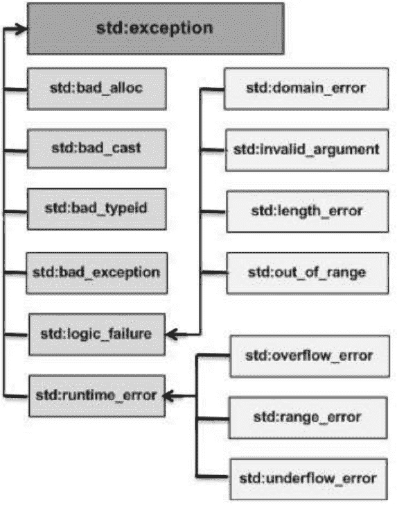

以下是上述层次结构中提到的每个异常的简要说明：

| 异常 | 描述 |
|---|---|
| std::exception | 异常，也是所有标准 C++ 异常的父类。 |

| 异常 | 描述 |
|---|---|
| `std::bad_alloc` | 这可以由 new 抛出。 |
| `std::bad_cast` | 这可以由 dynamic_cast 抛出。 |
| `std::bad_exception` | 这是一种在 C++ 程序中处理意外异常的有用机制。 |
| `std::bad_typeid` | 这可以由 typeid 抛出。 |
| `std::logic_error` | 一种理论上可以通过阅读代码检测到的异常。 |
| `std::domain_error` | 当使用数学上无效的定义域时，抛出此异常。 |
| `std::invalid_argument` | 由于无效参数而抛出。 |
| `std::length_error` | 当创建过大的 std::string 时抛出此异常。 |
| `std::out_of_range` | 这可以由“at”方法抛出，例如 std::vector 和 std::bitset<> ::operator[]()。 |
| `std::runtime_error` | 一种理论上无法通过阅读代码检测到的异常。 |
| `std::overflow_error` | 如果发生数学上溢，则抛出此异常。 |
| `std::range_error` | 当你尝试存储超出范围的值时，会发生此异常。 |
| `std::underflow_error` | 如果发生数学下溢，则抛出此异常。 |

### 定义新异常

你可以通过继承和重写 **exception** 类的功能来定义自己的异常。以下示例演示了如何以标准方式使用 std::exception 类来实现自己的异常：

```cpp
#include <iostream>

#include <exception>

using namespace std;
```

```cpp
struct MyException : public exception
{
    const char * what () const throw ()
    {
        return "C++ Exception";
    }
};

int main()
{
    try
    {
        throw MyException();
    }
    catch(MyException& e)
    {
        std::cout << "MyException caught" << std::endl;
        std::cout << e.what() << std::endl;
    }
    catch(std::exception& e)
    {
        //Other errors
    }
}
```

这将产生以下结果：

```
MyException caught

C++ Exception
```

这里，**what()** 是 exception 类提供的公共方法，并且已被所有子异常类重写。它返回异常的原因。


## 32. 动态内存

充分理解C++中动态内存的实际工作原理，是成为一名优秀C++程序员的关键。你的C++程序中的内存分为两部分：

- **栈：** 函数内声明的所有变量都将占用栈中的内存。
- **堆：** 这是程序中未使用的内存，可以在程序运行时动态地分配内存。

很多时候，你事先并不知道需要在定义的变量中存储特定信息所需的内存量，所需内存的大小可以在运行时确定。

你可以使用C++中的一个特殊运算符，在运行时为给定类型的变量在堆中分配内存，该运算符会返回所分配空间的地址。这个运算符称为 **new** 运算符。

如果你不再需要动态分配的内存，可以使用 **delete** 运算符，它会释放之前由new运算符分配的内存。

### new 和 delete 运算符

下面是为任意数据类型动态分配内存时，使用 **new** 运算符的通用语法。

```cpp
new data-type;
```

这里，**data-type** 可以是任何内置数据类型，包括数组，也可以是任何用户定义的数据类型，包括类或结构体。让我们从内置数据类型开始。例如，我们可以定义一个指向double类型的指针，然后请求在执行时分配内存。我们可以使用 **new** 运算符通过以下语句实现：

```cpp
double* pvalue  = NULL;  // 指针初始化为 null

pvalue  = new double;    // 为变量请求内存
```

如果空闲存储区已被用完，内存可能分配失败。因此，检查new运算符是否返回NULL指针并采取适当措施是一个好习惯，如下所示：

```cpp
double* pvalue = NULL;

if( !(pvalue = new double ))
{
    cout << "Error: out of memory." <<endl;
    exit(1);
}
```

C语言中的**malloc()** 函数在C++中仍然存在，但建议避免使用malloc()函数。new相对于malloc()的主要优势在于，new不仅仅分配内存，它还会构造对象，而这正是C++的首要目的。

在任何时候，当你觉得一个已动态分配的变量不再需要时，可以使用delete运算符释放它在空闲存储区中占用的内存，如下所示：

```cpp
delete pvalue;        // 释放 pvalue 指向的内存
```

让我们将上述概念整合起来，形成以下示例，以展示new和delete是如何工作的：

```cpp
#include <iostream>

using namespace std;

int main ()
{
    double* pvalue = NULL;  // 指针初始化为 null
    pvalue = new double;    // 为变量请求内存

    *pvalue = 29494.99;     // 在分配的地址处存储值
    cout << "Value of pvalue : " << *pvalue << endl;

    delete pvalue;          // 释放内存。

    return 0;
}
```

如果我们编译并运行上述代码，将产生以下结果：

```text
Value of pvalue : 29495
```

### 数组的动态内存分配

假设你想为一个字符数组分配内存，即一个包含20个字符的字符串。使用我们上面用过的相同语法，我们可以如下所示动态分配内存。

```cpp
char* pvalue  = NULL;   // 指针初始化为 null

pvalue = new char[20]; // 为变量请求内存
```

要删除我们刚刚创建的数组，语句应如下所示：

```cpp
delete [] pvalue;        // 删除 pvalue 指向的数组
```

以下是new运算符用于多维数组的语法：

```cpp
int ROW = 2;

int COL = 3;

double **pvalue  = new double* [ROW]; // 为行分配内存

// 现在为列分配内存
for(int i = 0; i < COL; i++) {
    pvalue[i] = new double[COL];
}
```

释放多维数组内存的语法如下：

```cpp
for(int i = 0; i < COL; i++) {
    delete[] pvalue[i];
}
delete [] pvalue;
```

### 对象的动态内存分配

对象与简单数据类型并无不同。例如，考虑以下代码，我们将使用一个对象数组来阐明这一概念：

```cpp
#include <iostream>

using namespace std;

class Box
{
    public:
        Box() {
            cout << "Constructor called!" <<endl;
        }
        ~Box() {
            cout << "Destructor called!" <<endl;
        }
};

int main( )
{
    Box* myBoxArray = new Box[4];

    delete [] myBoxArray; // 删除数组

    return 0;
}
```

如果你要分配一个包含四个Box对象的数组，简单的构造函数会被调用四次；同样地，在删除这些对象时，析构函数也会被调用相同的次数。

如果我们编译并运行上述代码，将产生以下结果：

```text
Constructor called!
Constructor called!
Constructor called!
Constructor called!
Destructor called!
Destructor called!
Destructor called!
Destructor called!
```

```cpp
}
// 第二个命名空间
namespace second_space{
    void func(){
        cout << "Inside second_space" << endl;
    }
}
using namespace first_space;
int main ()
{
    // 这里调用来自第一个命名空间的函数。
    func();
    return 0;
}
```

如果我们编译并运行上述代码，将产生以下结果：

```text
Inside first_space
```

`using` 指令也可以用于引用命名空间中的特定项。例如，如果你只打算使用std命名空间中的cout，你可以如下引用它：

```cpp
using std::cout;
```

后续代码可以在不添加命名空间前缀的情况下引用cout，但std命名空间中的其他项仍然需要显式指定，如下所示：

```cpp
#include <iostream>

using std::cout;

int main ()
{
    cout << "std::endl is used with std!" << std::endl;
    return 0;
}
```

如果我们编译并运行上述代码，将产生以下结果：

```text
std::endl is used with std!
```

通过**using**指令引入的名称遵循正常的作用域规则。该名称从**using**指令所在位置到该指令所在作用域的末尾都是可见的。在外层作用域中定义的相同名称的实体将被隐藏。

### 不连续的命名空间

一个命名空间可以被定义在多个部分，因此命名空间由其分别定义的各部分的总和组成。命名空间的各个部分可以分布在多个文件中。

因此，如果命名空间的一个部分需要另一个文件中定义的名称，该名称仍然必须被声明。编写如下的命名空间定义，要么定义一个新的命名空间，要么向现有命名空间添加新的元素：

```cpp
namespace namespace_name {

    // 代码声明

}
```

### 嵌套的命名空间

命名空间可以嵌套，你可以在一个命名空间内部定义另一个命名空间，如下所示：

```cpp
namespace namespace_name1 {

    // 代码声明

    namespace namespace_name2 {

        // 代码声明

    }
}
```

你可以通过使用解析运算符访问嵌套命名空间的成员，如下所示：

```cpp
// 访问 namespace_name2 的成员
using namespace namespace_name1::namespace_name2;
```

```cpp
// 访问 namespace_name1 的成员
using namespace namespace_name1;
```

在上述语句中，如果你使用了namespace_name1，那么它将使namespace_name2的元素在作用域中可用，如下所示：

```cpp
#include <iostream>

using namespace std;

// 第一个命名空间
namespace first_space{
    void func(){
        cout << "Inside first_space" << endl;
    }

    // 第二个命名空间
    namespace second_space{
        void func(){
            cout << "Inside second_space" << endl;
        }
    }
}

using namespace first_space::second_space;
int main ()
{
    // 这里调用来自第二个命名空间的函数。
    func();

    return 0;
}
```

如果我们编译并运行上述代码，将产生以下结果：

```text
Inside second_space
```


## 34. 模板

模板是泛型编程的基础，泛型编程是指以一种与任何特定类型无关的方式编写代码。

模板是创建泛型类或泛型函数的蓝图或公式。库容器（如迭代器和算法）就是泛型编程的示例，它们都是基于模板概念开发的。

每个容器（例如 `vector`）只有一个定义，但我们可以定义许多不同类型的向量，例如 `vector <int>` 或 `vector <string>`。

你可以使用模板来定义函数和类，下面我们看看它们是如何工作的：

### 函数模板

模板函数定义的一般形式如下所示：

```cpp
template <class type> ret-type func-name(parameter list)
{
    // body of function
}
```

这里，`type` 是函数所使用的数据类型的占位符名称。这个名称可以在函数定义中使用。

下面是一个函数模板的示例，它返回两个值中的最大值：

```cpp
#include <iostream>
#include <string>

using namespace std;

template <typename T>
inline T const& Max (T const& a, T const& b)
{
    return a < b ? b : a;
}

int main ()
{
    int i = 39;
    int j = 20;
    cout << "Max(i, j): " << Max(i, j) << endl;

    double f1 = 13.5;
    double f2 = 20.7;
    cout << "Max(f1, f2): " << Max(f1, f2) << endl;

    string s1 = "Hello";
    string s2 = "World";
    cout << "Max(s1, s2): " << Max(s1, s2) << endl;

    return 0;
}
```

如果我们编译并运行上述代码，将会产生以下结果：

```text
Max(i, j): 39
Max(f1, f2): 20.7
Max(s1, s2): World
```

### 类模板

正如我们可以定义函数模板一样，我们也可以定义类模板。泛型类声明的一般形式如下所示：

```cpp
template <class type> class class-name {
.
.
.
};
```

这里，`type` 是占位符类型名称，将在实例化类时指定。你可以使用逗号分隔的列表来定义多个泛型数据类型。

以下示例定义了类 `Stack<>`，并实现了从栈中推入和弹出元素的泛型方法：

```cpp
}
    // remove last element
    elems.pop_back();
}

template <class T>
T Stack<T>::top () const
{
    if (elems.empty()) {
        throw out_of_range("Stack<>::top(): empty stack");
    }
    // return copy of last element
    return elems.back();
}

int main()
{
    try {
        Stack<int>          intStack;  // stack of ints
        Stack<string> stringStack;    // stack of strings

        // manipulate int stack
        intStack.push(7);
        cout << intStack.top() <<endl;

        // manipulate string stack
        stringStack.push("hello");
        cout << stringStack.top() << std::endl;
        stringStack.pop();
        stringStack.pop();
    }
    catch (exception const& ex) {
        cerr << "Exception: " << ex.what() <<endl;
        return -1;
    }
}
```

如果我们编译并运行上述代码，将会产生以下结果：

```text
7

hello

Exception: Stack<>::pop(): empty stack
```

现在，如果你检查 `test.p`，它会包含大量信息，在底部你会看到替换后的值如下：

```text
$gcc -E test.cpp > test.p

...

int main ()
{

    cout << "Value of PI :" << 3.14159 << endl;

    return 0;
}
```

### 函数式宏

你可以使用 `#define` 定义一个带参数的宏，如下所示：

```cpp
#include <iostream>
using namespace std;

#define MIN(a,b) (((a)<(b)) ? a : b)

int main ()
{
    int i, j;
    i = 100;
    j = 30;
    cout << "The minimum is " << MIN(i, j) << endl;

    return 0;
}
```

如果我们编译并运行上述代码，将会产生以下结果：

```text
The minimum is 30
```

### 条件编译

有几个指令可以用来选择性地编译程序源代码的某些部分。这个过程称为条件编译。

条件预处理器结构很像 `if` 选择结构。考虑以下预处理器代码：

```cpp
#ifndef NULL

    #define NULL 0

#endif
```

你可以为了调试目的编译程序。你也可以使用一个宏来打开或关闭调试，如下所示：

```cpp
#ifdef DEBUG

    cerr << "Variable x = " << x << endl;

#endif
```

如果在指令 `#ifdef DEBUG` 之前已经定义了符号常量 `DEBUG`，这会导致 `cerr` 语句被编译到程序中。你可以使用 `#if 0` 语句来注释掉程序的一部分，如下所示：

```cpp
#if 0

    code prevented from compiling

#endif
```

让我们尝试以下示例：

```cpp
#include <iostream>

using namespace std;

#define DEBUG

#define MIN(a,b) (((a)<(b)) ? a : b)

int main ()
{

    int i, j;
    i = 100;
    j = 30;

#ifdef DEBUG

    cerr << "Trace: Inside main function" << endl;

#endif

#if 0
    /* This is commented part */
    cout << MKSTR(HELLO C++) << endl;
#endif

    cout << "The minimum is " << MIN(i, j) << endl;

#ifdef DEBUG
    cerr << "Trace: Coming out of main function" << endl;
#endif
    return 0;
}
```

如果我们编译并运行上述代码，将会产生以下结果：

```text
Trace: Inside main function

The minimum is 30

Trace: Coming out of main function
```

### # 和 ## 运算符

`#` 和 `##` 预处理器运算符在 C++ 和 ANSI/ISO C 中均可使用。`#` 运算符会将替换文本标记转换为带引号的字符串。

考虑以下宏定义：

```cpp
#include <iostream>

using namespace std;

#define MKSTR( x ) #x

int main ()
{
    cout << MKSTR(HELLO C++) << endl;

    return 0;
}
```

如果我们编译并运行上述代码，将会产生以下结果：

```text
HELLO C++
```

让我们看看它是如何工作的。不难理解，C++ 预处理器会将这一行：

```cpp
cout << MKSTR(HELLO C++) << endl;
```

转换为下面这一行：

```cpp
cout << "HELLO C++" << endl;
```

`##` 运算符用于连接两个标记。下面是一个示例：

```cpp
#define CONCAT( x, y )  x ## y
```

当 `CONCAT` 出现在程序中时，它的参数会被连接起来并用于替换宏。例如，`CONCAT(HELLO, C++)` 在程序中被替换为 `"HELLO C++"`，如下所示。

```cpp
#include <iostream>

using namespace std;

#define concat(a, b) a ## b
int main()
{
    int xy = 100;

    cout << concat(x, y);
    return 0;
}
```

如果我们编译并运行上述代码，将会产生以下结果：

```text
100
```

让我们看看它是如何工作的。不难理解，C++ 预处理器会将：

```cpp
cout << concat(x, y);
```

```text
Value of __LINE__ : 6
Value of __FILE__ : test.cpp
Value of __DATE__ : Feb 28 2011
Value of __TIME__ : 18:52:48
```

## 36. 信号处理

信号是操作系统传递给进程的中断，它可能会提前终止程序。你可以在 UNIX、LINUX、Mac OS X 或 Windows 系统上按 Ctrl+C 来产生中断。

有些信号无法被程序捕获，但以下列表中的信号你可以捕获，并根据信号采取适当的操作。这些信号在 C++ 头文件 `<csignal>` 中定义。

| 信号 | 描述 |
| --- | --- |
| SIGABRT | 程序的异常终止，例如调用 `abort`。 |
| SIGFPE | 错误的算术运算，例如除以零或导致溢出的运算。 |
| SIGILL | 检测到非法指令。 |
| SIGINT | 接收到交互式注意信号。 |
| SIGSEGV | 对存储器的无效访问。 |
| SIGTERM | 发送给程序的终止请求。 |

### signal() 函数

C++ 信号处理库提供了 `signal` 函数来捕获意外事件。以下是 `signal()` 函数的语法：

```cpp
void (*signal (int sig, void (*func)(int)))(int);
```

简单来说，这个函数接收两个参数：第一个参数是一个整数，表示信号编号；第二个参数是指向信号处理函数的指针。

让我们编写一个简单的 C++ 程序，使用 `signal()` 函数捕获 `SIGINT` 信号。无论你想在程序中捕获什么信号，都必须使用 `signal` 函数注册该信号，并将其与信号处理器关联起来。请看下面的示例：

```cpp
#include <iostream>
```


```cpp
#include <iostream>
#include <csignal>
#include <unistd.h>

using namespace std;

void signalHandler( int signum )
{
    cout << "Interrupt signal (" << signum << ") received.\n";

    // cleanup and close up stuff here
    // terminate program

    exit(signum);
}

int main ()
{
    // register signal SIGINT and signal handler
    signal(SIGINT, signalHandler);

    while(1){
        cout << "Going to sleep...." << endl;
        sleep(1);
    }

    return 0;
}
```

当上面的代码被编译并执行时，会产生以下结果：

```text
Going to sleep....
Going to sleep....
Going to sleep....
```

现在，按下 Ctrl+C 中断程序，你会看到程序会捕获信号并通过打印以下内容退出：

```text
Going to sleep....
Going to sleep....
Going to sleep....
Interrupt signal (2) received.
```

### The raise() Function

你可以通过函数 **raise()** 生成信号，它接受一个整数信号号作为参数，语法如下。

```cpp
int raise (int sig);
```

这里，**sig** 是要发送的信号号，可为以下信号之一：SIGINT、SIGABRT、SIGFPE、SIGILL、SIGSEGV、SIGTERM、SIGHUP。以下示例展示了我们如何使用 raise() 函数在内部引发信号：

```cpp
#include <iostream>

#include <csignal>

using namespace std;

void signalHandler( int signum )
{
    cout << "Interrupt signal (" << signum << ") received.\n";

    // cleanup and close up stuff here
    // terminate program

    exit(signum);
}

int main ()
{
    int i = 0;
    // register signal SIGINT and signal handler
    signal(SIGINT, signalHandler);
```

## 37. MULTITHREADING

多线程是多任务处理的一种特殊形式，而多任务处理是使计算机能够同时运行两个或多个程序的功能。一般来说，有两种类型的多任务处理：基于进程的和基于线程的。

基于进程的多任务处理处理程序的并发执行。基于线程的多任务处理处理同一程序的各个部分的并发执行。

多线程程序包含两个或多个可以并发运行的部分。这样的程序的每个部分称为线程，每个线程定义了单独的执行路径。

C++ 不包含任何对多线程应用程序的内置支持。相反，它完全依赖于操作系统提供此功能。

本教程假设你正在 Linux 操作系统上工作，我们将使用 POSIX 编写多线程 C++ 程序。POSIX 线程，或 Pthreads 提供 API，可在许多类 Unix 的 POSIX 系统上使用，例如 FreeBSD、NetBSD、GNU/Linux、Mac OS X 和 Solaris。

### Creating Threads

用于创建 POSIX 线程的例程如下：

```cpp
#include <pthread.h>

pthread_create (thread, attr, start_routine, arg)
```

这里，pthread_create 创建一个新的线程并使其可执行。此例程可以从代码中的任何位置被调用任意多次。以下是参数的说明：

| Parameter | Description |
| --- | --- |
| thread | 子例程返回的新线程的唯一不透明标识符。 |
| attr | 可用于设置线程属性的不透明属性对象。你可以指定线程属性对象，或指定 NULL 使用默认值。 |
| start_routine | 线程创建后将执行的 C++ 例程。 |
| arg | 可传递给 start_routine 的单个参数。它必须作为 void 类型的指针强制转换通过引用传递。如果不传递参数，可使用 NULL。 |

进程可创建的最大线程数取决于实现。创建后，线程是同级线程，可以创建其他线程。线程之间没有隐含的层次结构或依赖关系。

### Terminating Threads

我们用来终止 POSIX 线程的例程如下：

```cpp
#include <pthread.h>

pthread_exit (status)
```

这里 **pthread_exit** 用于显式退出线程。通常，在线程完成其工作且不再需要存在后，会调用 pthread_exit() 例程。

如果 main() 在其创建的线程完成之前结束，并以 pthread_exit() 退出，其他线程将继续执行。否则，当 main() 结束时，它们将被自动终止。

### Example:

此简单示例代码使用 pthread_create() 例程创建 5 个线程。每个线程打印一条 "Hello World!" 消息，然后通过调用 pthread_exit() 终止。

```cpp
#include <iostream>

#include <cstdlib>

#include <pthread.h>

using namespace std;

#define NUM_THREADS     5

void *PrintHello(void *threadid)
{
    long tid;

    tid = (long)threadid;

    cout << "Hello World! Thread ID, " << tid << endl;
    pthread_exit(NULL);
}

int main ()
{
    pthread_t threads[NUM_THREADS];
    int rc;
    int i;

    for( i=0; i < NUM_THREADS; i++ ){
        cout << "main() : creating thread, " << i << endl;
        rc = pthread_create(&threads[i], NULL,
                            PrintHello, (void *)i);
        if (rc){
            cout << "Error:unable to create thread," << rc << endl;
            exit(-1);
        }
    }
    pthread_exit(NULL);
}
```

使用 -lpthread 库编译以下程序，如下所示：

```bash
$gcc test.cpp -lpthread
```

现在，执行你的程序，输出如下：

```text
main() : creating thread, 0
main() : creating thread, 1
main() : creating thread, 2
main() : creating thread, 3
main() : creating thread, 4
Hello World! Thread ID, 0
Hello World! Thread ID, 1
Hello World! Thread ID, 2
Hello World! Thread ID, 3
Hello World! Thread ID, 4
```

pthread_join() 子例程会阻塞调用线程，直到指定的 'threadid' 线程终止。当线程被创建时，其属性之一定义了它是可连接的还是分离的。只有创建为可连接的线程才可以被连接。如果线程被创建为分离的，它永远无法被连接。

此示例演示了如何通过使用 Pthread join 例程等待线程完成。

```cpp
#include <iostream>
#include <cstdlib>
#include <pthread.h>
#include <unistd.h>

using namespace std;

#define NUM_THREADS     5

void *wait(void *t)
{
    int i;
    long tid;

    tid = (long)t;

    sleep(1);
    cout << "Sleeping in thread " << endl;
    cout << "Thread with id : " << tid << " ...exiting " << endl;
    pthread_exit(NULL);
}

int main ()
{
    int rc;
    int i;
    pthread_t threads[NUM_THREADS];
    pthread_attr_t attr;
    void *status;

    // Initialize and set thread joinable
    pthread_attr_init(&attr);
    pthread_attr_setdetachstate(&attr, PTHREAD_CREATE_JOINABLE);

    for( i=0; i < NUM_THREADS; i++ ){
        cout << "main() : creating thread, " << i << endl;
        rc = pthread_create(&threads[i], NULL, wait, (void *)i );
        if (rc){
            cout << "Error:unable to create thread," << rc << endl;
            exit(-1);
        }
    }

    // free attribute and wait for the other threads
    pthread_attr_destroy(&attr);
    for( i=0; i < NUM_THREADS; i++ ){
        rc = pthread_join(threads[i], &status);
        if (rc){
            cout << "Error:unable to join," << rc << endl;
            exit(-1);
        }
        cout << "Main: completed thread id :" << i ;
        cout << "  exiting with status :" << status << endl;
    }

    cout << "Main: program exiting." << endl;
    pthread_exit(NULL);
}
```

当上面的代码被编译并执行时，会产生以下结果：

```text
main() : creating thread, 0
main() : creating thread, 1
main() : creating thread, 2
```

## 38. WEB PROGRAMMING

### What is CGI?

通用网关接口，或 CGI，是一组定义 Web 服务器与自定义脚本之间信息交换方式的标准。

CGI 规范目前由 NCSA 维护，NCSA 将 CGI 定义如下：

通用网关接口，或 CGI，是外部网关程序与信息服务器（如 HTTP 服务器）交互的规范。

当前版本为 CGI/1.1，CGI/1.2 正在进行中。

### Web Browsing

为了理解 CGI 的概念，让我们看看当我们点击超链接浏览特定网页或 URL 时会发生什么。

- 你的浏览器联系 HTTP Web 服务器并请求 URL，即文件名。
- Web 服务器会解析 URL 并查找文件名。如果找到请求的文件，则 Web 服务器会将该文件发送回浏览器，否则发送错误消息，表明你请求了错误的文件。
- Web 浏览器从 Web 服务器接收响应，并根据接收到的响应显示接收到的文件或错误消息。

然而，可以设置 HTTP 服务器，使得每当请求某个目录中的文件时，该文件不会被发送回去；相反，它作为程序执行，并将程序的输出发送回浏览器显示。

通用网关接口（CGI）是使应用程序（称为 CGI 程序或 CGI 脚本）与 Web 服务器和客户端交互的标准协议。这些 CGI 程序可以用 Python、PERL、Shell、C 或 C++ 等编写。

### CGI Architecture Diagram

以下简单程序展示了 CGI 的简单架构：


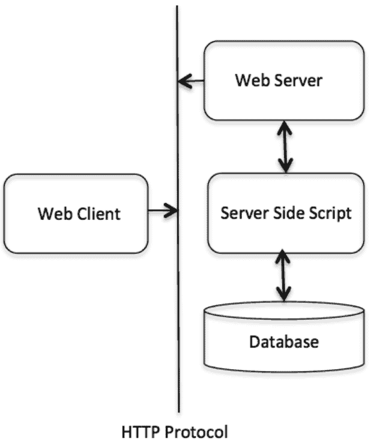

### HTTP 协议

### Web 服务器配置

在进行 CGI 编程之前，请确保你的 Web 服务器支持 CGI 并且已配置为处理 CGI 程序。所有由 HTTP 服务器执行的 CGI 程序都保存在一个预先配置好的目录中。该目录称为 CGI 目录，按惯例命名为 /var/www/cgi-bin。按惯例 CGI 文件的扩展名为 .cgi，尽管它们是 C++ 可执行文件。

默认情况下，Apache Web 服务器配置为在 /var/www/cgi-bin 中运行 CGI 程序。如果你想指定其他目录来运行你的 CGI 脚本，可以修改 httpd.conf 文件中的以下部分：

```apache
<Directory "/var/www/cgi-bin">
    AllowOverride None
    Options ExecCGI
    Order allow,deny
    Allow from all
</Directory>
```

```apache
<Directory "/var/www/cgi-bin">
Options All

</Directory>
```

这里，我假设你已经成功启动并运行了 Web 服务器，并且能够运行其他 CGI 程序，如 Perl 或 Shell 等。

### 第一个 CGI 程序

考虑以下 C++ 程序内容：

```cpp
#include <iostream>

using namespace std;

int main ()
{
    cout << "Content-type:text/html\r\n\r\n";
    cout << "<html>\n";
    cout << "<head>\n";
    cout << "<title>Hello World - First CGI Program</title>\n";
    cout << "</head>\n";
    cout << "<body>\n";
    cout << "<h2>Hello World! This is my first CGI program</h2>\n";
    cout << "</body>\n";
    cout << "</html>\n";

    return 0;
}
```

编译以上代码并将可执行文件命名为 cplusplus.cgi。该文件保存在 /var/www/cgi-bin 目录中，其内容如下。在运行你的 CGI 程序之前，请确保使用 **chmod 755 cplusplus.cgi** UNIX 命令更改文件模式以使其可执行。现在如果点击 cplusplus.cgi，则会产生以下输出：

My First CGI program

上面的 C++ 程序是一个简单的程序，它将输出写入 STDOUT 文件，即屏幕。有一个重要且额外的功能可用，即第一行打印 **Content-type:text/html\r\n\r\n**。该行发送回浏览器并指定在浏览器屏幕上显示的内容类型。

现在你应该已经理解了 CGI 的基本概念，并且可以使用 Python 编写许多复杂的 CGI 程序。C++ CGI 程序可以与任何其他外部系统，如 RDBMS，以交换信息。

### HTTP 头部

行 **Content-type:text/html\r\n\r\n** 是 HTTP 头部的一部分，发送到浏览器以理解内容。所有 HTTP 头部都将具有以下形式：

```
HTTP Field Name: Field Content

For Example
Content-type: text/html\r\n\r\n
```

以下是你在 CGI 编程中会经常使用的其他重要 HTTP 头部。

| 头部 | 描述 |
|---|---|
| Content-type: | 定义返回文件的格式的 MIME 字符串。示例为 Content-type:text/html。 |
| Expires: Date | 信息失效的日期。浏览器应使用此信息来决定何时需要刷新页面。有效日期字符串的格式应为 01 Jan 1998 12:00:00 GMT。 |
| Location: URL | 应返回的 URL 而非请求的 URL。你可以使用此字段将请求重定向到任何文件。 |
| Last-modified: Date | 资源最后修改的日期。 |
| Content-length: N | 返回数据的长度，以字节为单位。浏览器使用此值来报告文件的估计下载时间。 |
| Set-Cookie: String | 设置通过 *string* 传递的 cookie。 |

### CGI 环境变量

所有 CGI 程序都将访问以下环境变量。这些变量在编写任何 CGI 程序时发挥重要作用。

| 变量名 | 描述 |
|---|---|
| CONTENT_TYPE | 内容的数据类型，当客户端向服务器发送附加内容时使用。例如文件上传等。 |
| CONTENT_LENGTH | 查询信息的长度，仅对 POST 请求可用。 |
| HTTP_COOKIE | 以键值对形式返回设置的 cookie。 |
| HTTP_USER_AGENT | User-Agent 请求头字段包含发起请求的客户端信息。它是 Web 浏览器的名称。 |
| PATH_INFO | CGI 脚本的路径。 |
| QUERY_STRING | 使用 GET 方法请求发送的 URL 编码信息。 |
| REMOTE_ADDR | 发出请求的远程主机的 IP 地址。这对于日志记录或身份验证目的很有用。 |
| REMOTE_HOST | 发出请求的完全限定主机名。如果此信息不可用，则可以使用 REMOTE_ADDR 获取 IP 地址。 |
| REQUEST_METHOD | 用于发出请求的 method。最常见的 method 是 GET 和 POST。 |
| SCRIPT_FILENAME | CGI 脚本的完整路径。 |
| SCRIPT_NAME | CGI 脚本的名称。 |
| SERVER_NAME | 服务器的主机名或 IP 地址。 |
| SERVER_SOFTWARE | 服务器正在运行的软件的名称和版本。 |

```cpp
if ( value != 0 ){
   cout << value;
}else{
   cout << "Environment variable does not exist.";
}
cout << "</td></tr>\n";
}
cout << "</table>\n";
cout << "</body>\n";
cout << "</html>\n";

return 0;
}
```

输出如下：

| 环境变量 | 值 |
|---|---|
| COMSPEC | Environment variable does not exist. |
| DOCUMENT_ROOT | /var/www/tutorialspoint |
| GATEWAY_INTERFACE | CGI/1.1 |
| HTTP_ACCEPT | text/html, application/xhtml+xml, */* |
| HTTP_ACCEPT_ENCODING | gzip, deflate |
| HTTP_ACCEPT_LANGUAGE | en-US |
| HTTP_CONNECTION | Keep-Alive |
| HTTP_HOST | www.tutorialspoint.com |
| HTTP_USER_AGENT | Mozilla/5.0 (Windows NT 6.3; WOW64; Trident/7.0; rv:11.0) like Gecko |
| PATH | /sbin:/usr/sbin:/bin:/usr/bin |
| QUERY_STRING |  |
| REMOTE_ADDR | 183.82.104.71 |
| REMOTE_PORT | 50902 |
| REQUEST_METHOD | GET |
| REQUEST_URI | /cgi-bin/cpp_env.cgi |
| SCRIPT_FILENAME | /var/www/cgi-bin/cpp_env.cgi |
| SCRIPT_NAME | /cgi-bin/cpp_env.cgi |
| SERVER_ADDR | 66.135.33.172 |
| SERVER_ADMIN | webmaster@tutorialspoint.com |
| SERVER_NAME | www.tutorialspoint.com |
| SERVER_PORT | 80 |
| SERVER_PROTOCOL | HTTP/1.1 |
| SERVER_SIGNATURE |  |
| SERVER_SOFTWARE | Apache |
| < |  |

### C++ CGI 库

对于实际示例，你的 CGI 程序需要执行许多操作。有为 C++ 程序编写的 CGI 库，你可以从 ftp://ftp.gnu.org/gnu/cgicc/ 下载并按照步骤安装该库：

```bash
$tar xzf cgicc-X.X.X.tar.gz

$cd cgicc-X.X.X/

$./configure --prefix=/usr

$make

$make install
```

你可以在‘C++ CGI Lib Documentation’查看相关文档。

### GET 和 POST 方法

你一定遇到过许多需要将信息从浏览器传递到 Web 服务器并最终传递到你的 CGI 程序的情况。浏览器最频繁使用两种方法将此信息传递给 Web 服务器。这些方法为 GET 方法和 POST 方法。

#### 使用 GET 方法传递信息

GET 方法将编码的用户信息附加到页面请求中。页面和编码信息由 ‘?’ 字符分隔，如下所示：

```text
http://www.test.com/cgi-bin/cpp.cgi?key1=value1&key2=value2
```

GET 方法是将信息从浏览器传递到 Web 服务器的默认方法，并且会产生一个长字符串出现在你的浏览器位置框中。切勿使用 GET 方法传递密码或其他敏感信息到服务器。GET 方法有大小限制，你可以在请求字符串中传递最多 1024 个字符。

使用 GET 方法时，信息通过 QUERY_STRING http 头部传递，并且可在你的 CGI 程序中通过 QUERY_STRING 环境变量访问。

你可以通过简单地将键值对与任何 URL 拼接在一起传递信息，也可以使用 HTML <FORM> 标签使用 GET 方法传递信息。

#### 简单 URL 示例：Get 方法

这里有一个简单的 URL，它将使用 GET 方法向 hello_get.py 程序传递两个值。

`/cgi-bin/cpp_get.cgi?first_name=ZARA&last_name=ALI`

下面是一个生成 **cpp_get.cgi** CGI 程序以处理 Web 浏览器输入的程序。我们将使用 C++ CGI 库，这使得访问传递的信息变得非常容易：

```cpp
#include <iostream>

#include <vector>

#include <string>

#include <stdio.h>

#include <stdlib.h>

#include <cgicc/CgiDefs.h>

#include <cgicc/Cgicc.h>

#include <cgicc/HTTPHTMLHeader.h>

#include <cgicc/HTMLClasses.h>

using namespace std;
using namespace cgicc;

int main ()
{
    Cgicc formData;

    cout << "Content-type:text/html\r\n\r\n";
    cout << "<html>\n";
    cout << "<head>\n";
    cout << "<title>Using GET and POST Methods</title>\n";
    cout << "</head>\n";
    cout << "<body>\n";
```


```cpp
form_iterator fi = formData.getElement("first_name");
if( !fi->isEmpty() && fi != (*formData).end() ){
    cout << "First name: " << **fi << endl;
}else{
    cout << "No text entered for first name" << endl;
}
cout << "<br/>\n";
fi = formData.getElement("last_name");
if( !fi->isEmpty() && fi != (*formData).end() ) {
    cout << "Last name: " << **fi << endl;
}else{
    cout << "No text entered for last name" << endl;
}
cout << "<br/>\n";

cout << "</body>\n";
cout << "</html>\n";

return 0;
}
```

现在，请按如下方式编译上述程序：

```bash
$g++ -o cpp_get.cgi cpp_get.cpp -lcgicc
```

生成 cpp_get.cgi，放入你的 CGI 目录，然后尝试通过以下链接访问：

/cgi-bin/cpp_get.cgi?first_name=ZARA&last_name=ALI

这将产生以下结果：

```text
First name: ZARA

Last name: ALI
```

### 简单表单示例：GET 方法

以下是一个简单示例，它使用 HTML 表单和提交按钮传递两个值。我们将使用同一个 CGI 脚本 cpp_get.cgi 来处理此输入。

```html
<form action="/cgi-bin/cpp_get.cgi" method="get">
First Name: <input type="text" name="first_name">  <br />

Last Name: <input type="text" name="last_name" />
<input type="submit" value="Submit" />
</form>
```

以下是上述表单的实际输出。输入名字和姓氏，然后点击提交按钮即可查看结果。

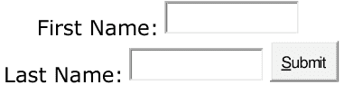

### 使用 POST 方法传递信息

将信息传递给 CGI 程序的一种通常更可靠的方法是 POST 方法。它打包信息的方式与 GET 方法完全相同，但不是将其作为 URL 中 '?' 之后的文本字符串发送，而是作为单独的消息发送。此消息以标准输入的形式进入 CGI 脚本。

同一个 cpp_get.cgi 程序也会处理 POST 方法。我们采用与上面相同的示例，该示例使用 HTML 表单和提交按钮传递两个值，但这次使用 POST 方法，如下所示：

```html
<form action="/cgi-bin/cpp_get.cgi" method="post">

First Name: <input type="text" name="first_name"><br />

Last Name: <input type="text" name="last_name" />

<input type="submit" value="Submit" />
</form>
```

以下是上述表单的实际输出。输入名字和姓氏，然后点击提交按钮即可查看结果。

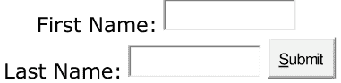

### 将复选框数据传递给 CGI 程序

当需要选择多个选项时，可使用复选框。

以下是包含两个复选框的表单的示例 HTML 代码：

```html
<form action="/cgi-bin/cpp_checkbox.cgi"
    method="POST"
    target="_blank">
<input type="checkbox" name="maths" value="on" /> Maths
<input type="checkbox" name="physics" value="on" /> Physics
<input type="submit" value="Select Subject" />
</form>
```

此代码的结果是以下表单：


下面是一个 C++ 程序，它将生成 cpp_checkbox.cgi 脚本，以处理 Web 浏览器通过复选框按钮提供的输入。

```cpp
#include <iostream>

#include <vector>

#include <string>

#include <stdio.h>

#include <stdlib.h>

#include <cgicc/CgiDefs.h>

#include <cgicc/Cgicc.h>

#include <cgicc/HTTPHTMLHeader.h>

#include <cgicc/HTMLClasses.h>

using namespace std;

using namespace cgicc;

int main ()
{
    Cgicc formData;
    bool maths_flag, physics_flag;
    cout << "Content-type:text/html\r\n\r\n";
    cout << "<html>\n";
    cout << "<head>\n";
    cout << "<title>Checkbox Data to CGI</title>\n";
    cout << "</head>\n";
    cout << "<body>\n";

    maths_flag = formData.queryCheckbox("maths");
    if( maths_flag ) {
        cout << "Maths Flag: ON " << endl;
    }else{
        cout << "Maths Flag: OFF " << endl;
    }
    cout << "<br/>\n";

    physics_flag = formData.queryCheckbox("physics");
    if( physics_flag ) {
        cout << "Physics Flag: ON " << endl;
    }else{
        cout << "Physics Flag: OFF " << endl;
    }
    cout << "<br/>\n";
    cout << "</body>\n";
    cout << "</html>\n";

    return 0;
}
```

### 将单选按钮数据传递给 CGI 程序

当只需要选择一个选项时，可使用单选按钮。

以下是包含两个单选按钮的表单的示例 HTML 代码：

```html
<form action="/cgi-bin/cpp_radiobutton.cgi"
    method="post"
    target="_blank">
<input type="radio" name="subject" value="maths"
        checked="checked"/> Maths
<input type="radio" name="subject" value="physics" /> Physics
<input type="submit" value="Select Subject" />
</form>
```

此代码的结果是以下表单：

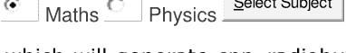

下面是一个 C++ 程序，它将生成 cpp_radiobutton.cgi 脚本，以处理 Web 浏览器通过单选按钮提供的输入。

```cpp
#include <iostream>

#include <vector>

#include <string>

#include <stdio.h>

#include <stdlib.h>

#include <cgicc/CgiDefs.h>

#include <cgicc/Cgicc.h>

#include <cgicc/HTTPHTMLHeader.h>

#include <cgicc/HTMLClasses.h>

using namespace std;

using namespace cgicc;

int main ()
{
    Cgicc formData;

    cout << "Content-type:text/html\r\n\r\n";
    cout << "<html>\n";
    cout << "<head>\n";
    cout << "<title>Radio Button Data to CGI</title>\n";
    cout << "</head>\n";
    cout << "<body>\n";

    form_iterator fi = formData.getElement("subject");
```

## C++

```cpp
#include <stdlib.h>

#include <cgicc/CgiDefs.h>
#include <cgicc/Cgicc.h>
#include <cgicc/HTTPHTMLHeader.h>
#include <cgicc/HTMLClasses.h>

using namespace std;
using namespace cgicc;

int main ()
{
    Cgicc formData;

    cout << "Content-type:text/html\r\n\r\n";
    cout << "<html>\n";
    cout << "<head>\n";
    cout << "<title>Text Area Data to CGI</title>\n";
    cout << "</head>\n";
    cout << "<body>\n";

    form_iterator fi = formData.getElement("textcontent");
    if( !fi->isEmpty() && fi != (*formData).end() ) {
        cout << "Text Content: " << **fi << endl;
    }else{
        cout << "No text entered" << endl;
    }

    cout << "<br/>\n";
    cout << "</body>\n";
    cout << "</html>\n";

    return 0;
}
```

### 将下拉框数据传递给 CGI 程序

当我们有许多可用选项但只会选择一到两个时，可使用下拉框。

以下是包含一个下拉框的表单的示例 HTML 代码：

```html
<form action="/cgi-bin/cpp_dropdown.cgi"
      method="post" target="_blank">

<select name="dropdown">

<option value="Maths" selected>Maths</option>

<option value="Physics">Physics</option>

</select>

<input type="submit" value="Submit"/>

</form>
```

此代码的结果是以下表单：

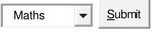

下面是一个 C++ 程序，它将生成 cpp_dropdown.cgi 脚本，以处理 Web 浏览器通过下拉框提供的输入。

```cpp
#include <iostream>

#include <vector>

#include <string>

#include <stdio.h>

#include <stdlib.h>


#include <cgicc/CgiDefs.h>

#include <cgicc/Cgicc.h>

#include <cgicc/HTTPHTMLHeader.h>

#include <cgicc/HTMLClasses.h>


using namespace std;

using namespace cgicc;


int main ()
{
    Cgicc formData;
```

### 大语言模型推理工作流程

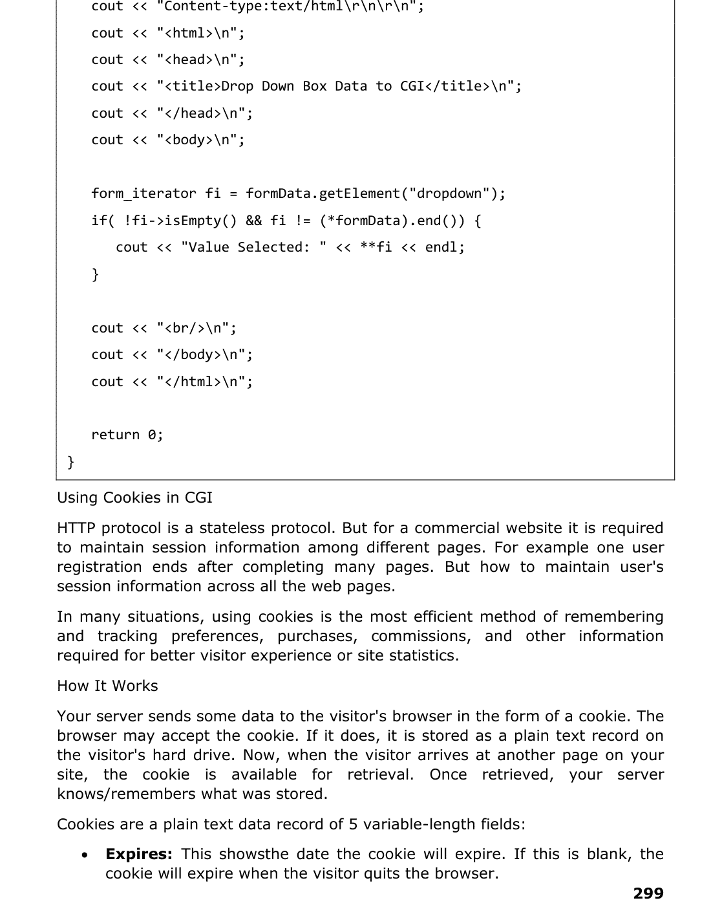

- **域（Domain）：** 这是你的网站的域名。
- **路径（Path）：** 这是设置 cookie 的目录或网页的路径。如果你想从任何目录或页面检索 cookie，此项可以为空。
- **安全（Secure）：** 如果此字段包含单词 "secure"，则 cookie 只能通过安全服务器检索。如果此字段为空，则不存在此类限制。
- **名称=值（Name=Value）：** Cookie 以键值对的形式进行设置和检索。

### 设置 Cookies

向浏览器发送 cookie 非常简单。这些 cookie 将在 Content-type 字段之前与 HTTP 头一起发送。假设你想将 UserID 和 Password 设置为 cookie。那么 cookie 的设置将如下所示：

```cpp
#include <iostream>

using namespace std;

int main ()
{
    cout << "Set-Cookie:UserID=XYZ;\r\n";
    cout << "Set-Cookie:Password=XYZ123;\r\n";
    cout << "Set-Cookie:Domain=www.tutorialspoint.com;\r\n";
    cout << "Set-Cookie:Path=/perl;\n";
    cout << "Content-type:text/html\r\n\r\n";

    cout << "<html>\n";
    cout << "<head>\n";
    cout << "<title>Cookies in CGI</title>\n";
    cout << "</head>\n";
    cout << "<body>\n";

    cout << "Setting cookies" << endl;

    cout << "<br/>\n";
    cout << "</body>\n";
}
```


```
cout << "</html>\n";

return 0;
}
```

通过这个示例，你一定已经明白了如何设置 Cookie。我们使用 **Set-Cookie** HTTP 头来设置 Cookie。

在这里，设置 Cookie 属性（如 Expires、Domain 和 Path）是可选的。需要注意的是，Cookie 是在发送魔术行 **"Content-type:text/html\r\n\r\n"** 之前设置的。

编译上述程序以生成 setcookies.cgi，并尝试使用以下链接设置 Cookie。它将在您的计算机上设置四个 Cookie：

`/cgi-bin/setcookies.cgi`

### 检索 Cookie

检索所有已设置的 Cookie 非常简单。Cookie 存储在 CGI 环境变量 HTTP_COOKIE 中，其形式如下：

```
key1=value1;key2=value2;key3=value3....
```

下面是一个如何检索 Cookie 的示例。

```cpp
#include <iostream>
#include <vector>
#include <string>
#include <stdio.h>
#include <stdlib.h>

#include <cgicc/CgiDefs.h>
#include <cgicc/Cgicc.h>
#include <cgicc/HTTPHTMLHeader.h>
#include <cgicc/HTMLClasses.h>

using namespace std;
using namespace cgicc;

int main ()
{
Cgicc cgi;
const_cookie_iterator cci;

cout << "Content-type:text/html\r\n\r\n";
cout << "<html>\n";
cout << "<head>\n";
cout << "<title>Cookies in CGI</title>\n";
cout << "</head>\n";
cout << "<body>\n";
cout << "<table border = \"0\" cellspacing = \"2\">";

// get environment variables
const CgiEnvironment& env = cgi.getEnvironment();

for( cci = env.getCookieList().begin();
     cci != env.getCookieList().end();
     ++cci )
{
    cout << "<tr><td>" << cci->getName() << "</td><td>";
    cout << cci->getValue();
    cout << "</td></tr>\n";
}

cout << "</table>\n";

cout << "<br/>\n";
cout << "</body>\n";
cout << "</html>\n";

return 0;
}
```

现在，编译上述程序以生成 getcookies.cgi，并尝试获取您计算机上所有可用 Cookie 的列表：

`/cgi-bin/getcookies.cgi`

这将生成一个列表，其中包含上一节中设置的所有四个 Cookie 以及您计算机上设置的所有其他 Cookie：

```
UserID XYZ

Password XYZ123

Domain www.tutorialspoint.com

Path /perl
```

### 文件上传示例

要上传文件，HTML 表单必须将 enctype 属性设置为 **multipart/form-data**。带有文件类型的 input 标签将创建一个“浏览”按钮。

```html
<html>

<body>

    <form enctype="multipart/form-data"
              action="/cgi-bin/cpp_uploadfile.cgi"
              method="post">

        <p>File: <input type="file" name="userfile" /></p>
        <p><input type="submit" value="Upload" /></p>

    </form>

</body>

</html>
```

此代码的结果是以下表单：

文件：


> **注意：** 上述示例已被有意禁用，以阻止人们向我们的服务器上传文件。但您可以在自己的服务器上尝试上述代码。

以下是处理文件上传的脚本 **cpp_uploadfile.cpp**：

```cpp
#include <iostream>
#include <vector>
#include <string>
#include <stdio.h>
#include <stdlib.h>
```

## C++

```cpp
// create a vector to store int
vector<int> vec;
int i;

// display the original size of vec
cout << "vector size = " << vec.size() << endl;

// push 5 values into the vector
for(i = 0; i < 5; i++){
    vec.push_back(i);
}

// display extended size of vec
cout << "extended vector size = " << vec.size() << endl;

// access 5 values from the vector
for(i = 0; i < 5; i++){
    cout << "value of vec [" << i << "] = " << vec[i] << endl;
}

// use iterator to access the values
vector<int>::iterator v = vec.begin();
while( v != vec.end()) {
    cout << "value of v = " << *v << endl;
    v++;
}

return 0;
}
```

当上述代码被编译并执行时，会产生以下结果：

```
vector size = 0

extended vector size = 5

value of vec [0] = 0
value of vec [1] = 1
value of vec [2] = 2
value of vec [3] = 3
value of vec [4] = 4
value of v = 0
value of v = 1
value of v = 2
value of v = 3
value of v = 4
```

以下是关于上述示例中所使用的各种函数需要注意的几点：

- push_back() 成员函数在向量末尾插入值，并根据需要扩展其大小。
- size() 函数显示向量的大小。
- begin() 函数返回指向向量开头的迭代器。
- end() 函数返回指向向量末尾的迭代器。

## 40. 标准库

C++ 标准库可分为两部分：

- **标准函数库：** 该库由通用的、独立于任何类的函数组成。函数库继承自 C。
- **面向对象类库：** 这是类和相关函数的集合。

标准 C++ 库也包含了所有标准 C 库，并做了一些小的补充和修改以支持类型安全。

### 标准函数库

标准函数库分为以下几类：

- I/O，
- 字符串和字符处理，
- 数学，
- 时间、日期和本地化，
- 动态分配，
- 杂项，
- 宽字符函数

### 面向对象类库

标准 C++ 面向对象库定义了大量类，为包括 I/O、字符串和数值处理在内的许多常见活动提供支持。该库包括以下内容：

- 标准 C++ I/O 类
- 字符串类
- 数值类
- STL 容器类
- STL 算法
- STL 函数对象
- STL 迭代器
- STL 分配器


