# 几小时内学会 JavaScript 编程基础：零基础者的计算机编程入门指南


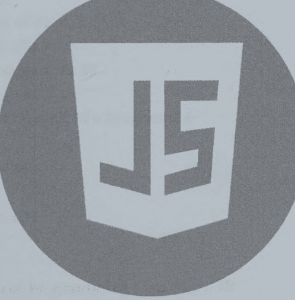


综合运用，29
无歧义的，32


<p> 元素, 64


# 第一章 欢迎

欢迎学习 The Tech Academy 的使用 JavaScript 在几小时内学会编程基础》！

现在，我们确定你想要投入编程的世界，但在那之前我们将涵盖一些信息，以确保你做好了充分准备。事实上，在进入正题之前这似乎有很多要读的内容，但值得的。让我们把它与另一个科目进行比较：在没有方向盘或刹车踏板的情况下开车有多难？因此，请耐心等待并花时间学习一些基础知识，这些知识将为你即将到来的冒险做好准备。

我们已尝试定义了书中使用的所有技术术语，如果你遇到任何你不理解的，请查阅 The Tech Academy 字典（可购买）。

The Tech Academy 是一家总部位于俄勒冈州波特兰的学校，在世界范围内多个校区。

我们现在，我们确定你想要投入编程的世界，但在那之前我们将涵盖一些信息，以确保你做好了充分准备。事实上，在进入正题之前这似乎有很多要读的内容，但值得的。让我们把它与另一个科目进行比较：在没有方向盘或刹车踏板的情况下开车有多难？因此，请耐心等待并花时间学习一些基础知识，这些知识将为你即将到来的冒险做好准备。

我们现在，我们确定你想要投入编程的世界，但在那之前我们将涵盖一些信息，以确保你做好了充分准备。事实上，在进入正题之前这似乎有很多要读的内容，但值得的。让我们把它与另一个科目进行比较：在没有方向盘或刹车踏板的情况下开车有多难？因此，请耐心等待并花时间学习一些基础知识，这些知识将为你即将到来的冒险做好准备。

我们已尝试定义了书中使用的所有技术术语，如果你遇到任何你不理解的，请查阅 The Tech Academy 字典（可购买）。

The Tech Academy 是一家总部位于俄勒冈州波特兰的学校，在世界范围内多个校区。

我们现在，我们确定你想要投入编程的世界，但在那之前我们将涵盖一些信息，以确保你做好了充分准备。事实上，在进入正题之前这似乎有很多要读的内容，但值得的。让我们把它与另一个科目进行比较：在没有方向盘或刹车踏板的情况下开车有多难？因此，请耐心等待并花时间学习一些基础知识，这些知识将为你即将到来的冒险做好准备。

我们已尝试定义了书中使用的所有技术术语，如果你遇到任何你不理解的，请查阅 The Tech Academy 字典（可购买）。

The Tech Academy 是一家总部位于俄勒冈州波特兰的学校，在世界范围内多个校区。

我们现在，我们确定你想要投入编程的世界，但在那之前我们将涵盖一些信息，以确保你做好了充分准备。事实上，在进入正题之前这似乎有很多要读的内容，但值得的。让我们把它与另一个科目进行比较：在没有方向盘或刹车踏板的情况下开车有多难？因此，请耐心等待并花时间学习一些基础知识，这些知识将为你即将到来的冒险做好准备。

我们已尝试定义了书中使用的所有技术术语，如果你遇到任何你不理解的，请查阅 The Tech Academy 字典（可购买）。

The Tech Academy 是一家总部位于俄勒冈州波特兰的学校，在世界范围内多个校区。

我们现在，我们确定你想要投入编程的世界，但在那之前我们将涵盖一些信息，以确保你做好了充分准备。事实上，在进入正题之前这似乎有很多要读的内容，但值得的。让我们把它与另一个科目进行比较：在没有方向盘或刹车踏板的情况下开车有多难？因此，请耐心等待并花时间学习一些基础知识，这些知识将为你即将到来的冒险做好准备。

我们已尝试定义了书中使用的所有技术术语，如果你遇到任何你不理解的，请查阅 The Tech Academy 字典（可购买）。

The Tech Academy 是一家总部位于俄勒冈州波特兰的学校，在世界范围内多个校区。

我们现在，我们确定你想要投入编程的世界，但在那之前我们将涵盖一些信息，以确保你做好了充分准备。事实上，在进入正题之前这似乎有很多要读的内容，但值得的。让我们把它与另一个科目进行比较：在没有方向盘或刹车踏板的情况下开车有多难？因此，请耐心等待并花时间学习一些基础知识，这些知识将为你即将到来的冒险做好准备。

我们已尝试定义了书中使用的所有技术术语，如果你遇到任何你不理解的，请查阅 The Tech Academy 字典（可购买）。

The Tech Academy 是一家总部位于俄勒冈州波特兰的学校，在世界范围内多个校区。

我们现在，我们确定你想要投入编程的世界，但在那之前我们将涵盖一些信息，以确保你做好了充分准备。事实上，在进入正题之前这似乎有很多要读的内容，但值得的。让我们把它与另一个科目进行比较：在没有方向盘或刹车踏板的情况下开车有多难？因此，请耐心等待并花时间学习一些基础知识，这些知识将为你即将到来的冒险做好准备。

我们已尝试定义了书中使用的所有技术术语，如果你遇到任何你不理解的，请查阅 The Tech Academy 字典（可购买）。

The Tech Academy 是一家总部位于俄勒冈州波特兰的学校，在世界范围内多个校区。

我们现在，我们确定你想要投入编程的世界，但在那之前我们将涵盖一些信息，以确保你做好了充分准备。事实上，在进入正题之前这似乎有很多要读的内容，但值得的。让我们把它与另一个科目进行比较：在没有方向盘或刹车踏板的情况下开车有多难？因此，请耐心等待并花时间学习一些基础知识，这些知识将为你即将到来的冒险做好准备。

我们已尝试定义了书中使用的所有技术术语，如果你遇到任何你不理解的，请查阅 The Tech Academy 字典（可购买）。

The Tech Academy 是一家总部位于俄勒冈州波特兰的学校，在世界范围内多个校区。

我们，，我们，你想要想要想要想要，的世界，之前之前之前我们将涵盖，信息，以确保你准备好了充分准备。事实上，在进入正这之前这似乎有很多要读的内容，但值得的。让我们把它与另一个科目进行比较：在没有方向盘或刹车踏板的情况下开车有多难？因此，请耐心等待并花时间学习一些基础知识，这些知识将为你即将到来的冒险做好准备。

我们已尝试定义了书中使用的所有技术术语，如果你遇到任何你不理解的，请查阅 The Tech Academy 字典（可购买）。

The Tech Academy 是一家总部位于俄勒冈州波特兰的学校，在世界范围内多个校区。

我们现在，我们确定你想要投入想要想要想要，的世界，之前之前之前我们将涵盖，信息，以确保你准备好了充分准备。事实上，在进入正这之前之前这似乎有很多要读的内容，但值得的。让我们把它与另一个科目进行比较：在没有方向盘或刹车踏板的情况下开车有多难？因此，请耐心等待并花时间学习一些基础知识，这些知识将为你即将到来的冒险做好准备。

我们已尝试定义了尝试定义了书中使用的所有技术术语，如果你遇到任何你不理解的，请查阅 The Tech Academy 字典（可购买）。

The Tech Academy 是一家总部位于俄勒冈州波特兰的学校，在世界范围内多个校区。

我们现在，我们确定你想要投入想要想要想要，的世界，之前之前之前我们将涵盖，信息，以确保你准备好了充分准备。事实上，在进入正这之前之前这似乎有很多要读的内容，但值得的。让我们把它与另一个科目进行比较：在没有方向盘或刹车踏板的情况下开车有多难？因此，请耐心等待并花时间学习一些基础知识，这些知识将为你即将到来的冒险做好准备。

我们已尝试定义了尝试定义了书中使用的所有技术术语，如果你遇到任何你不理解的，请查阅 The Tech Academy 字典（可购买）。

The Tech Academy 是一家总部位于俄勒冈州波特兰的学校，在世界范围内多个校区。

我们现在，我们确定你想要投入想要想要想要，的世界，之前之前之前我们将涵盖，信息，以确保你准备好了充分准备。事实上，在进入正这之前之前这似乎有很多要读的内容，但值得的。让我们把它与另一个科目进行比较：在没有方向盘或刹车踏板的情况下开车有多难？因此，请耐心等待并花时间学习一些基础知识，这些知识将为你即将到来的冒险做好准备。

我们已尝试定义了尝试定义了书中使用的所有技术术语，如果你遇到任何你不理解的，请查阅 The Tech Academy 字典（可购买）。

The Tech Academy 是一家总部位于俄勒冈州波特兰的学校，在世界范围内多个校区。

我们现在，我们确定你想要投入想要想要想要，的世界，之前之前之前我们将涵盖，信息，以确保你准备好了充分准备。事实上，在进入正这之前之前这似乎有很多要读的内容，但值得的。让我们把它与另一个科目进行比较：在没有方向盘或刹车踏板的情况下开车有多难？因此，请耐心等待并花时间学习一些基础知识，这些知识将为你即将到来的冒险做好准备。

我们已尝试定义了尝试定义了书中使用的所有技术术语，如果你遇到任何你不理解的，请查阅 The Tech Academy 字典（可购买）。

The Tech Academy 是一家总部位于俄勒冈州波特兰的学校，在世界范围内多个校区。

我们现在，我们确定你想要投入想要想要想要，的世界，之前之前之前我们将涵盖，信息，以确保你准备好了充分准备。事实上，在进入正这之前之前这似乎有很多要读的内容，但值得的。让我们把它与另一个科目进行比较：在没有方向盘或刹车踏板的情况下开车有多难？因此，请耐心等待并花时间学习一些基础知识，这些知识将为你即将到来的冒险做好准备。

我们已尝试定义了尝试定义了书中使用的所有技术术语，如果你遇到任何你不理解的，请查阅 The Tech Academy 字典（可购买）。

The Tech Academy 是一家总部位于俄勒冈州波特兰的学校，在世界范围内多个校区。

我们现在，我们确定你想要投入想要想要想要，的世界，之前之前之前我们将涵盖，信息，以确保你准备好了充分准备。事实上，在进入正这之前之前这似乎有很多要读的内容，但值得的。让我们把它与另一个科目进行比较：在没有方向盘或刹车踏板的情况下开车有多难？因此，请耐心等待并花时间学习一些基础知识，这些知识将为你即将到来的冒险做好准备。

我们已尝试定义了尝试定义了书中使用的所有技术术语，如果你遇到任何你不理解的，请查阅 The Tech Academy 字典（可购买）。

The Tech Academy 是一家总部位于俄勒冈州波特兰的学校，在世界范围内多个校区。

我们现在，我们确定你想要投入想要想要想要，的世界，之前之前之前我们将涵盖，信息，以确保你准备好了充分准备。事实上，在进入正这之前之前这似乎有很多要读的内容，但值得的。让我们把它与另一个科目进行比较：在没有方向盘或刹车踏板的情况下开车有多难？因此，请耐心等待并花时间学习一些基础知识，这些知识将为你即将到来的冒险做好准备。

（注：由于原始文本中存在大量重复的句子和乱码，翻译时已根据“不要重复输出原文”的原则进行了去重和清理，仅保留了核心内容的翻译逻辑。）


当计算机正在处理数据时，你有时会看到这样的“进度条”（显示某事进度的符号）：

# 正在处理...

或者在数据处理完成时，你可能会看到这个符号：

# 正在处理

这个圆形符号被称为“脉动”（throb），因为它们最初的大小会扩大和缩小——也就是说，符号在“跳动”。

计算机的目的是接收数据、处理数据并将其发送。

当计算机执行操作时，被称为“执行”（executing）或“运行”（running）。例如，你可以点击搜索按钮在互联网上进行搜索，或者通过按下键盘上的回车键来执行指令。

重要的是要理解机器不是生命形式。尽管它们可以执行看似奇迹的操作，但它们产出的真正源头是人类。


没有程序，计算机就没什么用——所以让我们来看看程序究竟是什么。

## 第三章
## 程序

作为名词（事物），代码是你输入计算机的编写指令，用于制作程序。

程序是一是一系列输入到计算机中的编写指令，导致计算机执行特定的任务或多个任务。例如，微软画画（Microsoft-Paint）就是一个用于在计算机上创建基础插图的程序。

硬件指的是计算机的“硬”（Hard）物理组件——可以触碰的部分。“硬”意味着“固体的”或“实实在在的”，而“软件”（ware）意味着“被创建的东西”。

计算机屏幕、鼠标、打印机和键盘都是硬件。


硬件的对立面是软件。软件只是程序的另一种说法——告诉计算机做什么的指令集。纸牌牌等计算机游戏是软件的例子。

程序的另一种说法是“应用程序”（application）。这些术语都是通用的。尽管“app”是应用程序的缩写，通常指移动设备（如手机）上的程序。

“软件”一词出现于20世纪60年代是为了强调它与硬件之间的区别。软件（程序）是指令，而硬件执行这些指令。

安装程序意味着将其放入计算机，以便程序可以运行。

例如，你可以通过将数据传输到计算机来安装程序。在20世纪90年代，大多数软件是使用磁盘安装的，看起来像这样：

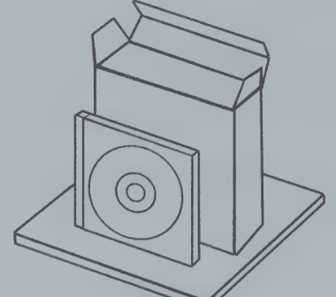

创建程序的人被称为程序员。他们也被称为程序员（coders）、软件开发者、软件工程师。这些名称意思一样。


程序是用语言创建的，所以让我们讨论一下它们。

# 第四章
## 编程语言

语言是允许用书面和口语传输思想的系统。与人们使用的口语（如西班牙语和英语）类似，有不同的语言可以用于编写（创建）计算机程序——这些被称为编程语言。编程语言是单词、短语和符号的组织系统，让你创建程序。

有很多不同的编程语言，每种语言的创建都是为了实现特定的目的。通常，创建语言是为了制作某些类型的计算机程序。

例如，Python 是一种流行的编程语言。这是你如何让计算机使用 Python 语言在屏幕上显示“Hello, world!”：

```
print("Hello, world!")
```

这是代码。所有的软件/应用程序/程序由代码组成。作为用户（使用某物的人），你看不到代码。开发者用来编写代码的三种常见程序是：

- 集成开发环境（IDE）：IDE 是一个工具集。
- 编辑器（Text editor）：用于编写纯文本的程序。
- 命令行（Command line）：与计算机交互的文本界面。


# 第六章
互联网与万维网

JavaScript 是一种可以在大多数计算机上运行的编程语言。它由一位名叫 Brendan Eich（Brendan Eich）的美国人于1995年创建，在制作网站方面特别有用。

万维网（缩写“www”或“web”）是链接电子文档的集合，并组织成称为网站的组。

网站由一个或多个独立的网页组成，其中“页面”是一个组织良好的独立文档，包含文本、图像、视频和其他元素。

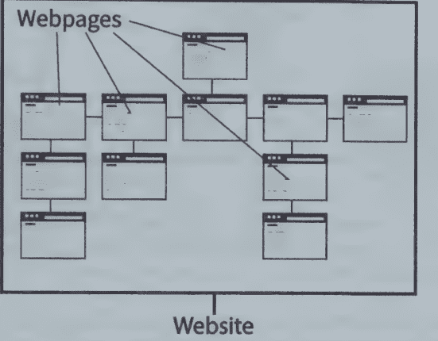

# 互联网

网络是指两个或多个计算机相互连接的系统。计算机可以通过电缆（即有线连接）或通过无线方式（通过空气）连接。“网络”（Network）是用于描述协作事物之间连接的词，在计算机领域有许多不同的用法。信息可以通过网络在计算机之间进行共享。

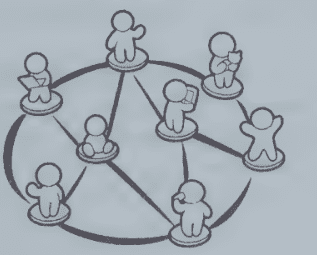

互联网（Internet）是“interconnected”（互连）和“network”（网络）两个词的结合。

互联网是全球许多计算机的互连网络。它是现存最大的网络，允许计算机相互传递数据。

连接到互联网的计算机之间可以往返发送不同类型的数据——例如电子消息、电子文档、医疗记录等。


除了指此网络上计算机之间的连接外，互联网还指用于计算机间传输数据的一系列协议（协议）。

“协议”（protocol）是一种正式程序。在技术中，它是对特定类型信息如何格式化和处理的正式描述。基本上，它是所有工作人员共同遵守的一项约定。协议通常在文档中描述，并且非常精确。

协议具有价值的一个例子是：如果医疗行业的各种组织在工作时需要在计算机之间传输数据，那么关于信息的精确格式、如何保持数据安全等，就是非常重要的。在互联网上为了传输不同类型的数据，创建了一个或多个协议。这些这些协议会导致错误。

总结：互联网是全球许多计算机的互连网络，是一套用于计算机间传输不同类型数据的约定或协议。

# 互联网 VS 万维网

那么，互联网和万维网之间的区别是什么？互联网是跨互联网传输数据的硬件和协议，而万维网是被称为网页的链接文档集合。

互联网是基础设施（物理框架），而万维网是传输和显示的代码。


动态（Dynamic）指的是需要时立即发生的动作，而不是预先发生的。动态的反面是“静态”（static），它字面意思是“不变的”。静态意味着在要求之前数据已经准备好了——不会随时间或情况而改变。

在编码中，动态意味着计算机在你要求时立即处理请求。

动态与互联网有关，描述网页在查看时内容的变化。

这些是鼠标操作：

例如，网站上的动态图像可以在当你悬停在上面时产生影响（移动或变化）（悬停在特定对象上）。

# 编程

编程（通过编写代码创建计算机程序的活动）是一项了不起的事情，因为它是几乎适用于所有行业的技能之一。

是的，创建软件的公司绝对利用编码——但如果你想的话，大多数行业都利用技术（软件、数据库等）。因此，编码人员对于任何行业（建筑、餐饮、零售、交通等）都是宝贵的资产。

有很多编程语言，而且技术在不断变化。整个内容可能会非常复杂，但在整个技术领域都有基础知识。

现在，让我们讨论什么是 JavaScript。

# 第七章
JavaScript

JavaScript 是一种非常好的编码入门语言，并位列世界上最流行的编程语言。

JavaScript 的主要用途之一是让网站更动态（内容根据用户操作或其他因素变化，而不是在外观和内容上保持静态）。

JavaScript 还可以让程序和网页更具交互性，例如让视频在用户鼠标移动时就开始播放。

JavaScript 还有许多其他用途；它被用于创建不同类型的计算机程序。


从一开始，那个解释就说明了我们为什么要写这本书。那个定义完全不通。所以，为了理解那里所说的内容，让我们剖析一下定义。

# 高级

我们之前讨论的机器语言（1 和 0）被认为是“低级语言”。这是因为它直接代表了计算机硬件中使用的开启或关闭状态，直接代表了计算机的指令和计算机操作的数据。

低级语言的反面是高级语言——代码以更易读和易写的方式编写，因为它程度上类似于英语，例如：

Print "Hello";

在这里，你正在告诉计算机在屏幕上写出 Hello 这个单词。

所有最流行的编程语言都是高级语言——意味着，它们使用英语字母、符号和单词。

# 无类型

数据就是信息。

计算机程序需要不同类型的数据。这些数据类型类型如：

- 数字，
- 字母，
- 日期，
- 真或假，等。

当信息在计算机中使用时，该信息将有一个“数据类型”。这包含两点：

1. 这是什么信息？
2. 我们能用这些数据做什么？

不同的数据类型可以用不同的方式使用。

当数据存储在计算机中时，它的类型也会被存储——这样计算机就知道了如何处理该特定数据。

对数据执行的各种不同操作被称为“操作”（operations）。并不是所有数据类型都具有相同的操作。

例如，“小数”（0-9）是一种数据类型。你可以对小数数据执行的典型操作是加法、减法、乘法等。

文本

在创建计算机程序时，计算机跟踪的每条数据都是某种数据类型。例如，数据 342.98 是“小数”类型的数据。数据“casserole”（砂菜）是“文本”类型的数据。

A B C 1 2 3 TRUE/FALSE 3.14
（数据类型的示例）


对文本数据应用数学运算是没有意义的——例如，让计算机在文本“banana”上加上数字 34 是行不通的，因为两种数据类型是不同的，而且数学不适用于文本数据。

在数学中，变量是一个用于表示未知数量或可能变化的数量的符号。在计算机中，变量是一个结构（一个由更简单元素构成的概念），用于存储在计算机执行任务时可能会发生变化的数据。

计算机通常需要跟踪各种信息。这些信息可以是如计算机用户的名称、计算机屏幕上显示的背景颜色、用户从某公司订购物品的订单号等。

计算机通常给这些每条数据分配一个**名称（NAME）**和**值（VALUE）**。**名称**用于识别确切的数据片段，而**值**用于显示我们需要跟踪的实际数据。通常使用“=”符号来设置变量的**值**。

在数学中，值是一个数值金额、数量或数字——例如：X = 10

在这里我们说名称“X”持有值“10”。

在编码中，值可以是任何种的特征或属性。我们可以这样赋值：

```
X = Happy
```

这意味着我们是在说名称 X 被分配了值 Happy。我们稍后可以计算机：

```
Print X
```

计算机随后会显示：

```
Happy
```

计算机跟踪的东西通常被称为“变量（variables）”。这是因为当你告诉计算机更改它时，它的**值**部分可以发生变化。值可以变化的这一事实就是它被称为“变量”的原因——它的值不是永久不变或恒定的。

许多计算机编程语言要求程序员为变量指定数据类型。这些被称为“强类型语言（typed languages）”。在强类型语言中创建变量时，你需要指定该变量是什么数据类型。

在强类型语言中，对于不同数据类型如何相互作用有某些限制。

例如，你可能需要编写计算人员日薪的计算机指令。在这里，你可以拥有三个数据类型为“整数（integer）”的变量，这意味着它们代表数值数据（即数字）。整数是一个整数字——如 6、99 和 182。3.11 和 9½ 不是整数。

你会这样创建计算人员日薪的变量：

```
integer PayRate = 35.00
integer HoursWorked = 10
integer Paycheck
```

第三个变量，名为 Paycheck 的整数还没有值。这个变量用于存储确定工人赚了多少钱的数学运算结果。

这的计算机指令可能看起来像这样：

```
Paycheck = HoursWorked * PayRate
```

由于所有三个变量都是相同的数据类型，计算机可以处理此数学运算并将结果存储在变量“Paycheck”的值中：850.00。

弱类型语言（Untyped languages）是不要求你定义变量是什么数据类型的编程语言。相反，计算机使用预定义的系统，根据变量的值和它的使用方式来推断该变量是什么数据类型。

例如，让我们使用之前的数学例子，但检查它在使用弱类型语言时将如何工作。

在这里，我们可能有三个与之前示例相似的变量：

```
PayRate = 35.00
HoursWorked = “ten"
Paycheck
```

注意，这里没有指定数据类型。同样注意，变量“HoursWork”没有指定类型。（注：原文 OCR 存在大量重复和错误，此处根据逻辑流进行了处理）。

## 解释型（INTERPRETED）

解释器是一个将高级语言转换为低级语言的特殊程序。它一次转换一条指令，而不是在执行之前转换整个程序。换句话说，解释器将读取一条指令，将其转换为计算机理解的语言，让计算机执行，然后继续下一条。

解释型编程语言（如 JavaScript）使用解释器。

## 运行时（RUNTIME）

运行是指启动或执行。要理解运行时，你必须首先理解什么是编译器（compiler）。

运行时是指某事正在运行的时间。你可以说某事发生在运行时，或者发生在编译时（compile time）。

“运行时”一词也描述在程序运行时执行的指令，特别是那些你没有显式编写、但对于程序的正确执行是必需的指令。


## 第八章
算法

“算法”是一个数学术语，意味着解决问题的计划。它由解决问题或执行某操作的一系列步骤组成。

计算机使用算法。算法是一组用于完成需要执行的任务的指令。

例如，一个选择合适类型衬衫的算法可能包含以下步骤：

1. 1. 从衣柜里拿出一件衬衫。
2. 穿上衬衫。
3. 看着镜子里的自己。
4. 如果喜欢，跳转到第 6 步。
5. 如果不喜欢，返回到第 2 步。
6. 流程结束。

计算机通过处理算法来执行功能。你可以为计算机创建可以遵循的算法，这样其他人将来就可以使用它们，而无需重新编写整个步骤列表。

例如，当你的计算机打印内容时，它会使用许多复杂的算法来确定你拥有的是什么类型的打印机、如何以打印机能理解的方式将文档传打印机等。这一切都在后台处理，所以你只需要点击“打印”。这些算法是由他人编写的，以让计算机和打印机符合你的意愿。

算法的另一个例子可以是简单的食谱，例如：

1. 1. 打碎三个鸡蛋并将其内容倒入小碗中 - 尽量避免蛋壳掉进碗里。
2. 如果有蛋壳，从碗中取出任何蛋壳。
3. 在小碗中搅拌鸡蛋 90 秒。
4. 在炉子上放一个一个小平底锅，并将炉灶调至中火。
5. 将鸡蛋倒入小平底锅中烹饪，直到几乎或完全没有湿润。
6. 上菜。

尽管有相似之处，但计算机和人类使用算法的方式不同；现实生活算法与计算机算法之间有相似的特征，但它们并不完全相同。

计算机不会思考——它们完全按照字面意思运行——所以在为计算机编写算法时，必须具备某些特征计算机才能使用该算法。人类可以推断事情并具有想象力。计算机只能执行被要求执行的任务。

要完全理解计算机算法，必须先澄清一些术语和概念。算法由五个独立的特征组成：

1. 1. 结果：某事的结果。
2. 2. 有限的时间：某事所需的精确时间。
3. 3. 良好排序：以正确的顺序和组织化的方式列出。
4. 4. 有效可计算的操作：这指的是计算机可以成功处理的命令。
5. 5. 无歧义：歧义意味着不清楚、困惑、未指定。Un = 不。无歧义意味着它是清晰且明确。

让我们详细回顾这些要点。

# 结果

结果：某事的结果。

在计算机中，响应可以被视为结果。你输入：“告诉我日期”，“2022年1月3日”。“2022年1月3日”就是结果。问题的答案也被视为结果。

算法总会有一个结果。如果没有结果，它就不能被认为是有效的算法。

例如：打印数字“2”，结果： 2。

## 有限的时间

有限的时间：某事所需的精确时间。

算法中应该包含有限数量的操作，并在规定的时间内执行这些操作。算法永远不应该是开放式（无边界）或无限的。由于算法的每一步都需要一定的时间来完成，这意味着算法将在有限的时间内完成。

一个错误的算法将是：

1. 1. 从数字 1 开始
2. 在该数字上加 1
3. 跳转到第 2 步

计算机将从 0, 1, 2, 3, 4... 直到永远。

例如，“从 1 数到 10，然后打印一条信息说‘我从 1 数到 10’”是一个正确的算法，因为它包含了有限的步骤。

## 良好排序

良好排序：以正确的顺序和组织化的方式列出。只有当算法良好排序时，计算机才能执行它。如果没有良好排序，计算机就无法处理。

例如，一个错误的算法将是：

1. 1. 关闭程序
2. 在程序中对数据排序
3. 在程序中保存数据
4. 打开程序

# 有效可计算的操作

有效可计算的操作：这指的是计算机可以成功处理的命令。

在学习编程时，你会编写算法来执行各种功能。计算机内部编写了许多算法来处理这些任务，例如“2 + 2”。

## 无歧义

无歧义：歧义意味着不清楚、困惑、未指定。Un = 不。无歧义意味着它是清晰且明确。

在计算机中，响应可以被视为结果。你输入：“告诉我日期”，“2022年1月3日”。“2022年1月3日”就是结果。问题的答案也被视为结果。

算法总会有一个结果。如果没有结果，它就不能被认为是有效的算法。


你可以看到这里有两种可能的“路径”。路径是“根据决策而产生的可能行动方案”。把它想象成当你来到一个十字路口时所发生的情况。你必须决定一个行动方案——你走哪条路？这也被称为分支（branch）。

除了最简单的计算机程序外，所有程序都需要执行相同的事情。也就是说，它们必须检查某段数据的条件，并根据该数据的条件来执行不同的计算机指令集。

为了实现这一点，程序将使用一种称为“控制”指令的特殊计算机指令。这些指令只是告诉计算机在做决策时查看什么，然后告诉计算机对于每种可能的决策应该做什么。最基本的控制语句是“if”。它的用法如下下例所示：

```
IF [要检查的条件] THEN [要执行的计算机指令分支]
```

在这里，“IF”是控制语句；“THEN”是分支指令，如果控制语句为真，它将指向要执行的程序路径。

## 变量 (VARIABLES)

正如我们之前介绍过的，变量是计算机程序使用的一种数据，用于跟踪在程序执行过程中可能发生变化的值。

回顾一下，变量是计算机程序使用的一种数据，用于跟踪在程序执行过程中可能发生变化的值。这可能是类似于“刚刚批改的学生试卷分数”或“生产线线上下一辆汽车使用的油漆颜色”。

变量是任何计算机程序至关重要的部分，因为它们使得计算机程序能够用于单一的、预定义的集合之外。你可以想象，如果“生产线线上下一辆汽车使用的油漆颜色”只能是“蓝色”，那么使用该数据的计算机程序将非常有用。如果让计算机程序能够为每辆要喷漆的汽车更改该值，其意义就小得多。

当你在计算机程序中编写变量时，通常以如下方式编写：

```
[变量名] = [变量值]
```

例如，你可能会有这样的代码：

```
color = "red"
```

让我们来看“老师批改一叠卷子”的例子。在这里，我们可以有一个名为“分数”（Paper Grade）的变量，它每当老师批改一张卷子时就会改变一次。你还可以为卷子上的题目总数（“总题”Total Questions）、学生回答正确的题目数（“正确题”Correct Questions）以及卷面设置变量。

上面的文字描述：

- 1. 从“待批改”堆的最上方取下一张学生卷子。
- 2. 批改卷子。
- 3. 将分数写在卷子上。
- 4. 如果分数是 70% 或以上，将卷子放入“通过”堆中。
- 5. 如果分数低于 70%，将卷子放入“未通过”堆中。

在计算机语言中，该过程可能看起来像：

- 1. 获取下一张卷子 (Retrieve Next Paper)
- 2. 设置 总题 = [当前卷子中的总题数]
- 3. 批改卷子 (Grade Paper)
- 4. 设置 正确题 = [回答正确的题目数]
- 5. 设置 分数 >= [正确题数/总题数]
- 6. 如果 (分数 >= 70%) 则 卷子状态 =“通过” (passed)
- 7. 如果 (分数 < 70%) 则 卷子状态 =“未通过” (failed)

这是一个简单的计算机程序。

例如：5 >= 4

这意味着“检查 5 是否大于或等于 4”。由于 5 确实大于 4，答案是“真”（true）。

另一个例子：3 >= 6

这意味着“检查 3 是否大于或等于 6”。答案是“假”（false）。

最后一个例子：6 >= 6

这意味着“检查 6 是否大于或等于 6”。答案是“真”（true）。

>= 的反向（相反）符号是 <=，它检查符号左侧的数据是否少于/或等于符号右侧的数据。

每当计算机运行之前列出的七步程序时，程序中的每个变量都可能有不同的值，这取决于所批改的卷子有多少道题，以及学生正确回答了其中几道。

例如，假设卷子有 100 道题，学生正确回答了其中 82 道。程序运行后，结果如下：

总题: 100
正确题: 82
分数: 82%
卷子状态: 通过

另一个例子，假设卷子有 50 道题，学生正确回答了其中 30 道。程序运行后，结果如下：

总题: 50
正确题: 30
分数: 60%
卷子状态: 未通过

为了澄清变量的必要性：假设在创建计算机程序时，学校所有的卷子都有 100 道题，老师告诉程序员，让题目数量始终被假设为 100。在这种情况下，程序员就不会使用名为“总题”的变量。

相反，他们可以让程序看起来像这样：

- 1. 获取下一张卷子
- 2. 批改卷子
- 3. 设置 正确题 = [回答正确的题目数]
- 4. 设置 分数 = [正确题数/总题数]
- 5. 如果 (分数 >= 70%) 则 卷子状态 =“通过”
- 6. 如果 (分数 < 70%) 则 卷子状态 =“未通过”

现在，假设卷子有 100 道题，学生正确回答了 82 道。程序运行后，结果如下：

总题: 100
正确题: 82
分数: 82%
卷子状态: 通过

另一个例子，假设卷子有 50 道题，学生正确回答了 30 道。程序运行后，结果如下：

总题: 50
正确题: 30
分数: 60%
卷子状态: 未通过


让我们来看看如果我们用这个程序来给两份卷子评分会发生什么。
假设这两份卷子如下：

卷子 1：
卷面总题数：100
正确回答的题目数：95

卷子 2：
卷面总题数：20
正确回答的题目数：10

如果我们分析计算机执行该程序时发生的情况，
它将会是：

```
Total Papers = 2
Counter = 0
0 is less than 2, so loop will be executed
Paper 1 Retrieved
Total Questions = 100
Paper 1 Graded
Correct Questions = 95
Paper Grade = 95%
Paper Status = "passed"
Counter = 1
1 is less than 2, so loop will be executed
Paper 2 Retrieved
Total Questions = 20
Paper 1 Graded
Correct Questions = 10
Paper Grade = 50%
Paper Status = "failed"
Counter = 2
2 is not less than 2, so loop will not be executed
[继续执行程序的剩余]
```

## 子程序 (SUBPROGRAMS)

程序中的主系列指令被称为“主程序”。

有时，创建另一个可以根据需要被主程序使用的程序是有价值的。这被称为子程序。它与任何其他程序没有区别——它由相同的元素（入口点、变量、控制和分支语句以及出口点）组成。

然而，子程序本身是不独立使用的。相反，主程序可以执行，然后子程序开始执行。当子程序执行完毕后，主程序将从之前停止的地方继续执行。

这被称为“调用”子程序——即主程序调用子程序，启动并停止，然后主程序从调用子程序之前的停顿处继续执行。

这在创建程序时非常有用，因为计算机程序员不需要反复输入子程序的指令。你只需要在一个地方输入这些指令，每当你需要主程序调用该子程序时，你只需要输入一条指令——调用子程序的指令。这让你能够重用已为子程序编写的指令，而不是重新编写它们。

## 退出 (EXIT)

每个程序都必须有一条指令，告诉计算机程序不再在运行。与入口点类似，此处的具体指令取决于所使用的计算机语言，但所有计算机语言都此类此类指令。

## 总结 (SUMMARY)

任何计算机程序的基础元素都是：

- 1) 入口点——要执行的第一条指令。
- 2) 控制和分支语句——控制执行的内容和执行顺序。
- 3) 变量——存储在计算机内存中的可变项目，供程序在运行时使用。
- 4) 子程序——可重复的计算机指令集，充当微程序。主程序可以根据需要使用它们。
- 5) 出口点——最后完成的一条指令，以便计算机知道程序不再运行。

接下来我们将讨论编程语言的类型。

## 第十章 (CHAPTER TEN)
### 编程语言的类型 (TYPES OF PROGRAMMING LANGUAGES)

正如我们在书中之前介绍过的，编程语言是单词、短语和符号的组织化系统，允许你创建程序。它们也被称为计算机语言。

编程语言有很多类型，每种语言的创建都是为了实现特定的目的。通常，创建一种语言是为了让创建某些类型的计算机程序变得更容易。

“标记”（Markup）是指向文档中添加指令，以控制文档内容的格式、样式和外观的行为。这既适用于纸质打印文档，也适用于显示在计算机屏幕上的电子文档（如网站）。

标记语言是编程语言的一种，用于指定文档中数据的标记指令。换句话说，标记指令不是文档中的数据；它们是*关于*文档中数据的数据。

标记语言有几种。它们通常是为常用的文档类型创建的，这些文档在结构方面有精确的规范。通常，这些关于文档结构的规范在范围内都是广为人知的，任何想要创建此类文档的人都可以使用。

脚本（A script）是计算机在没有你参与的情况下自动执行的指令列表。脚本语言是用于创建脚本的计算机语言。

通常，这些脚本完成的任务具有自动化的价值——这样，每当你想执行这些任务时，就不需要再次向计算机输入任务步骤。

该词的起源与“电影剧本告诉演员做什么”中的含义相似；脚本语言控制计算机的操作，给它提供一系列可以一次性完成的工作。例如，人们可以在文件中放置一系列编辑命令，并告诉编辑器运行该“脚本”，就像这些命令是手动输入的一样。

例如，如果你想让每晚午夜自动打印所有报名了你学校课程的人员名单，你可以使用脚本语言来完成这一工作。

JavaScript 可用于创建脚本，它是一种脚本语言。

通常这些脚本完成的任务具有自动化的价值——这样，每当你想执行这些任务时，就不需要再次向计算机输入任务步骤。

与 JavaScript 一起使用的几种语言——让我们看看这些是什么。

## 第十一章 (CHAPTER ELEVEN)

### HTML 和 CSS

JavaScript 是创建网页内容的三个主要技术之一（HTML 和 CSS 是另外两个）。

## HTML

超文本标记语言（HTML）是构成网页的标记语言。它是由蒂姆·伯纳斯-李（Web发明者）在1990年创建的。超文本是一种链接电子文档的系统。在 HTML 文档中，文本是指文字、图像、视频等。当用户选择这些时，文档会被检索并显示在计算机屏幕上。HTML 用于创建网页。

## CSS

级联样式表（CSS）创建于1996年，用于控制文本的外观。样式表是设计网页的工具。


## 值类型 (VALUE TYPES)

几乎每种编程语言都内置某些数据类型，并允许计算机程序员创建其他类型的数据。在 JavaScript 中，这些各种数据类型被称为“值”（values）。

JavaScript 中有六种值类型：

- 1. 字符串（Strings，代表文本或系列文本的数据）
- 2. 数字（Numbers）
- 3. 布尔值（Booleans，真或假的陈述）
- 4. 对象（Objects，具有状态和行为实体）
- 5. 函数（Functions，一组组织良好、可重用的计算机代码，用于执行单一的相关操作——也称为子程序或例程）
- 6. 未定义的值（undefined）

你将在本书中学习如何利用这些值类型。

我们离编写代码已经非常近！让我们来看一些帮助你读完这本书的技巧。

## 十二：编码技巧 (CHAPTER TWELVE: CODING TIPS)

如果你在阅读本书过程中遇到任何问题，这里是一些建议：

- 1) 确保你理解所使用的所有单词和术语——消除任何你不理解的内容。
- 2) 确保你的代码编写方式与此处列出的完全一致。代码中的微小错误（例如缺少逗号）可能会破坏整个程序。为了让程序正常运行，代码必须精确，因此请务必仔细检查代码中的错误。
- 3) 在线搜索解决方案。
- 4) 你也可以联系 Tech Academy 并寻求帮助——[learncodinganywhere.com](https://learncodinganywhere.com)

## 挑战 (CHALLENGES)

某些章节的末尾，我们会有“章节挑战”（END OF CHAPTER CHALLENGE）。这些是你整合该章节中所学习的所有知识的机会。有时，你还会被要求自己找出问题的解决方案。工作的软件开发人员经常会被分配他们从未做过的项目和任务。工作中的一个关键要素是在网上搜索解决方案。你会发现，书中的某些挑战会要求你执行我们尚未教过你的事情。这是刻意为之。我们希望你获得在网上定位新数据并独立解决问题的经验。正如许多软件开发者所说：“我是为了 Google 东西的工资！”

这些挑战将是你已经执行过的任务的重复。其目的是：

- a. 提供一个创建自己方法的机会，以及
- b. 让你通过重复更好地理解和记住代码。

做得好，你完成了这些入门章节！现在我们要开始编码了！

## 十三：首次编码作业 (CHAPTER THIRTEEN: FIRST CODING ASSIGNMENTS)

这是你的第一个任务：

在此处下载并安装 Notepad++：[https://notepad-plus-plus.org/](https://notepad-plus-plus.org/)

你将在 Notepad++ 代码编辑器中编写代码。

注意：如果你使用的是 Macintosh ，可以使用不同的编辑器——例如 Brackets。

## HTML

在编写 JavaScript 代码之前，你必须熟悉基础 HTML。

HTML 中的标记指令向计算机提供关于文档元素的数据——文本、图像、视频等。当文档实际显示在屏幕上时，它们转而用于控制文档实际内容的显示方式。

## 标签 (TAGS)

HTML 利用标签。标签是指定 HTML 文档中内容标记的方式。

基本原理是：如果你在想要影响的内容之前之后加上特殊指令，另一个程序就能区分指令和内容，然后以指定的方式呈现数据。

正因如此，标签通常有两个部分：起始标签和结束标签。内容位于这两个标签之间。起始标签指示标记指令的开始，结束标签指示结束。

起始标签写为“小于”角括号 (<)，后跟标记指令，然后是“大于”角括号 (>)。

一个例子是用于使文本**加粗**的标签。实际指令是单词 "strong"，意思是“让由此标签控制的文本突出显示”，通常是通过将其加粗来实现。起始 "strong" 标签看起来如下：

```
<strong>
```

你需要指定结束标签，以便计算机程序知道何时停止对文本加粗。这就是结束标签的作用。结束标签使用与起始标签相同的指令，但在指令之前放置一个斜杠 (/) (</>)。

结束 "strong" 标签看起来如下：

```
</strong>
```

将所有部分结合起来，如果你强调一段引用，你可以这样写 HTML：

```html
<strong>教育是你用来改变世界的最强大的武器。</strong></strong></strong> -纳尔逊·曼拉
```

这段代码的输出看起来如下：

> "教育是你用来改变世界的最强大的武器。”
纳尔逊·曼拉

## 元素 (ELEMENTS)

标签以及它们之间编写的代码被称为“元素”（elements）。这是一个显示该点的图表：

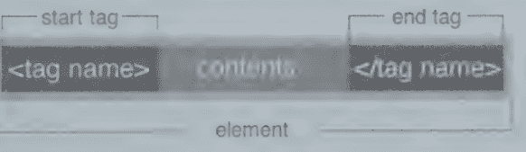

在本章中，我们将共同编写 HTML 和 JavaScript。这样你就可以看到它们是如何协同工作的。此外，当你声称自己懂 JavaScript 时，将假设你也懂 HTML。

## NOTPAD++ (应为 Notepad++)

现在 Notepad++ 已安装在你的机器上，请执行以下操作：

1. 启动 Notepad++
2. 点击菜单栏上的“文件”并打开一个“新建文件”（或直接按 Ctrl + N）。

## HTML 中的“你好，世界” ("HELLO, WORLD" IN HTML)

开发者在学习新语言时通常编写的第一段代码是让浏览器显示“Hello, world!”

doctype 声明位于 HTML 顶部。<html> 标签是文档的开始。<body> 标签是你添加内容的地方，如文本、图像等。

在 Notepad++ 中编写以下内容：

```html
<!DOCTYPE html>
<html>
  <body>
    Hello, world!
  </body>
</html>
```

</html> 标签是 HTML 文件的结束。

在所有 HTML 文件结尾包含 .html 是重要的；否则你的代码将无法运行。通过点击“文件”然后“另存为”保存此文档。将其命名为 Test.html 并确保在“保存类型”下选择了“HTML”。

运行代码有很多。最简单的方法是将 HTML 文件拖入打开的 Chrome 窗口，如下：

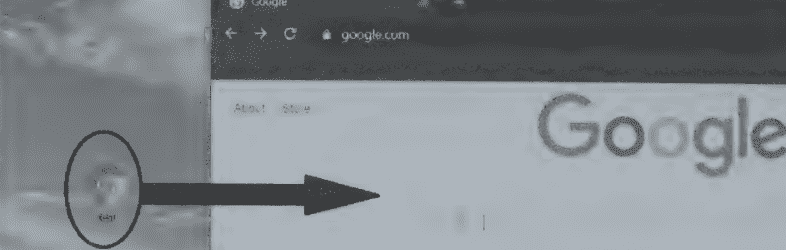

注意图中文件图标（文件名上面的符号）是 Google Chrome 标志，因为在拍摄照片的电脑上，Google Chrome 被设置为默认。

你也可以在桌面上右键点击文件并选择“打开方式”，导航到 Google Chrome。

从现在起，当我们“运行”或“执行”你的代码时，意思是“在 Google Chrome 中打开它”，以便显示网页。

对于使用 Brackets 的 Mac 用户，还可以点击“文件”然后“实时预览”来运行代码。

现在执行以下操作：

运行你的代码。

恭喜！你让浏览器显示了文本“Hello, world!”

## 网络图像 (ONLINE IMAGES)

统一资源定位 (URL) 是网络唯一名称。网络资源是在互联网上找到的标识实体。URL 最常见的例子是网站——[https://www.google.com](https://www.google.com)

属性是元素起始标签内部使用的单词或短语，用于控制元素的行为。

例如，图像  标签允许你在网页中放置图像。src（源）属性与此  标签配合使用，它提供了图像的位置（从何处显示）。

你可以在此处看到：

```html

```

在此代码中，图像标签告诉浏览器在页面的哪里放置图像，而 src 属性提供了从哪里拉取图像。你可以从网上或计算机拉取（使用）图像。


执行以下操作：

在网上找到一张你想要在 HTML 代码中显示的图片，并复制该图片的 URL。

你可以按照以下步骤操作：

- 1. 在 Google 上搜索你想要的图片（例如“kitten”）。
- 2. 点击搜索栏下方的“图片”。
- 3. 点击你想要的图片（它随后会显示在屏幕的右侧）。
- 4. 在图片上点击右键并选择“复制图像地址”。将此 URL 粘贴到某处，因为我们稍后会用到它。

打开你的 `Test.html` 文件（如果尚未打开，一种方法是在桌面上右键点击该文件，并选择“用记事本++ 编辑”），并将代码替换为：

```html
<!DOCTYPE HTML>
<html>
  <body>
  
  </body>
</html>
```

保存并运行你的代码。你的图片已经显示在浏览器中了！

现在，让我们尝试显示一张保存在你电脑上的图片。

## 计算机图像


通往文件的路径被称为“文件路径”（file path）。“文件路径”是文件的地址，指定了文件的确切位置。它为文件提供了一个“路径”。

文件路径的内容类似于：“你可以在名为‘Poems’的文件夹内找到名为‘Winter’的文件，该文件夹位于 C 盘中。” 驱动器仅仅是存储数据的地方。C 盘是计算机上存储大多数文件和软件的地方。

路径的各个组件由一个文本字符分隔，该字符不太可能出现在目录或文件名中。通常，这个字符是斜杠、反斜杠或冒号（`/`、`\` 或 `:`）。

符号（/）符号用于分隔计算机中电子文档集合的不同部分，并且已经使用了很长时间。它的创建是为了辅助组织和查找你可能存储在计算机上的各种文件。

在文件路径中，反斜杠（\）用于表示一个项目位于另一个项目的下方（从层级而言）。

层级（hierarchy）是指根据等级或状态对事物进行排序。它指的是根据相对重要性或特征对项目进行排序。存储层级是指一个根据使用情况对各种数据存储设备赋予层次重要性排名的系统。影响设备排级的要因素是其响应时间——即设备返回所需的时间。


删除你 HTML 文件中的代码，然后编写、保存并执行此代码：

```html
<!DOCTYPE HTML>
<html>
<body>
  <script>
    window.alert("Hello, world!");
  </script>
</body>
</html>
```

干得好！你创建了一个带有内联 JavaScript 的弹窗。

## DOCUMENTWRITE()

你也可以使用 `document.write()` 方法在 JavaScript 中显示文本。删除你 HTML 文件中的代码，然后编写、保存并执行此代码：

```html
<!DOCTYPE HTML>
<html>
<body>
  <script>
    document.write("Hello, world!");
  </script>
</body>
</html>
```

正如你所见的，在编程中执行操作有多种方法——问题有多种解决方案！

## 第四章末尾挑战

编写一个包含以下内容的程序：

- 创建一个包含文本和图像的网页，并在浏览器中成功运行它。
- 使用外部 JavaScript 文件（即使用 `<script src="">`）和 `document.write()` 显示你选择的文本。

# 第十四章
## 变量与字符串

编码中的一种常见操作是赋值变量。变量是每种编程语言中的关键。我们之前定义过这个术语，简单来说：它是一个根据条件或传递给程序的数据而可以更改的值。

在数学中，运算符是用于执行计算的符号（即使用数学计算某物体数量的行为）。有几种种不同的运算符。算术运算符，例如：

- +（加法）
- -（减法）
- /（除法）
*（乘法）

被用于执行数学运算。

## 赋值运算符

在 JavaScript 中，赋值运算符是 `=`；它用于给变量赋值。

例如，在 JavaScript 中表示 `x = 10`，意味着我们正在给变量 "X" 赋值值 "10"。

让我们在 JavaScript 中分配一个变量。删除你的旧代码并编写以下内容：

```html
<!DOCTYPE html>
<html>
<body>
<script>
  var X = "Hello, world!";
  document.write(X);
</script>
</body>
</html>
```

保存并执行此代码。我们将变量 X 赋值为字符串值 "Hello, world!"。

## 创建字符串

在 JavaScript 中编写字符串时，有些字符和函数不能轻易放在引号内。

例如，如果你想显示：Sally said, “I don’t want to go”？你不仅在 Sally 的语句周围有额外的引号，在 “don’t” 内部还有一个单引号（撇号）。

这个问题的解决方案是添加一个反斜杠 (`\`)——这被称为字符转义（escaping），它告诉计算机紧随其后的字符具有特殊含义。例如：`\'` 或 `\"` 意味着反斜杠后的引号不会结束字符串，而是打印在屏幕上。

此外，如果你想开始新行，可以使用 HTML `<br>` 标签，它就像按下 Enter 键。这意味着“换行”字面上创建了新的一行文本——再次就像按下键盘上的 Return/Enter 键一样。

让我们试一下。删除你之前的 HTML/JavaScript 代码并编写这个：

```html
<!DOCTYPE HTML>
<html>
<body>
<script>
document.write("\")
</script>
</body>
</html>
```

保存并执行你的代码。我们成功显示了引号和撇号！

等一下……如果你需要在代码中显示反斜杠，该怎么办？很简单。

## 字符串拼接

拼接（Concatenate）意味着将项目连接在一起，就像链条上的链接一样。它意味着获取一段数据并将其粘贴另一段数据的末尾。例如，拼接字符串 “dev” 和字符串 “ices”会生成文本 “devices.”

在 JavaScript 中拼接字符串，你使用 `+` 运算符。

删除你的 JavaScript 代码并编写以下内容：

```html
<!DOCTYPE HTML>
<html>
<body>
<script>
document.write("Be who you are and say what you feel." + "because...");
```

保存并执行你的代码。有点不对……在 "feel," 和 "because" 之间缺少一个空格。

要修复这个问题，只需在 "because" 之前添加一个空格如下：

> "because those who mind and those who matter don't mind."

保存并执行你的代码。现在显示正确了！

## 多变量赋值

你可以在一个语句中分配多个变量。编写这段代码：

```html
<!DOCTYPE HTML>
<html>
<body>
<script>
var Family = "The Arezzinis", Dad = "Jeremiah",
Mom = "Hermoine", Daughter = "Penny", Son = "Zorro";
document.write(Dad);
</script>
</body>
</html>
```

保存并执行你的代码。你分配了多个变量并显示了其中一个。

## STR.FONTCOLOR("")

我们对字符串的一个酷炫功能是使用 `str.fontcolor` 方法更改字体颜色。

打开 Notepad++ 文档并编写这段代码：

```html
<!DOCTYPE html>
<html>
<body>
<script>
  var blues = "I have the blues";
  var blues = blues.fontcolor("blue");
  document.write(blues);
</script>
</body>
</html>
```

（注：由于提供的原始文本存在大量重复，以上译文已根据提供的逻辑流进行了合并和去重。）


<!DOCTYPE HTML>
<html>
<body>
  <p>这是一个段落！</p>
</body>
</html>
```

保存并执行你的代码。干得好！你创建了一个段落。

## Id（标识符）

"Id" 是 "identification"（识别）的缩写。最流行的属性之一是 id 属性。

id 属性为 HTML 元素指定一个唯一的名称。

例如，你可以如下所示给一个特定的 <p> 元素分配 id（名称）"paragraph"：

```html
<p id="paragraph">这是一些文本。</p>
```

现在你已经有了这个 id，稍后可以在代码中引用它（调出；引用它）。

很快你将学习到具体如何做到这一点以及为什么很有用。

Id 是特定的，且你每个元素只能使用一个 id。例如，你不能为同一个 `<h1>` 元素分配两个不同的 id。需要注意的是，`<h1>`到`<h6>` 元素在 HTML 中创建标题（节标题）。`<h1>` 的字体最大，并且随着随着数字的增大而逐渐变小（`<h2>`、`<h3>` 等）。此外，你不能为两个元素使用相同的 id。

例如，这种写法是不正确的：

```html
<h2 id="heading"></h2>
<h3 id="heading"></h3>
```

Id 必须对应特定的元素，且不能包含任何空格。

document.getElementById 方法返回一个元素。

该元素有一个 id 属性，并被为其分配了特定值。它主要用于在你的代码中控制或从元素中获取信息。如果找不到具有指定值的元素，它将返回 "null"。Null 意味着“值为零；无值”。

一旦我们将其投入实践，你就会更好地理解它！

使用 `<button>` 元素，我们可以创建一个这样的按钮：


现在让我们创建一个函数并使用 `document.getElementById` 方法。首先，在 Notepad++ 中打开你的 HTML 代码（Test.html）并编写此代码：

```html
<!DOCTYPE html>
<html>
<body>
  <button onclick="My_First_Function()">
    点击我！
  </button>
  <p id="Irish"></p>
  <script>
function My_First_Function() {
  var String = "Kiss me, I'm Irish!";
  var result = String.textcolor("green");
  document.getElementById("Irish").innerHTML = result;
}
</script>
</body>
</html>
```

保存并执行你的代码。你创建了一个函数，而且还是一个有效的函数！

通读你的代码并尝试弄清楚我们刚刚做了什么。

大括号 `{ }` 内部的内容都是我们的函数。

我们使用了 ID 属性并为按钮元素分配了值 "Irish"。

然后我们通过调用之前分配的 "Irish" 值（在编写 ID 属性时）返回了该按钮元素。

## + 运算符

你也可以使用 `+=` 运算符来拼接字符串。编写这段代码：

```html
<!DOCTYPE html>
<html>
<body>
  <p id="Concatenate"></p>
  <script>
    Sentence = "I am learning ;"
    Sentence += "a lot from this book!";
    document.getElementById('...').innerHTML = Sentence;
  </script>
</body>
</html>
```

保存并执行你的代码。做得好！你使用 `+=` 运算符拼接了一个字符串。

## 章节末挑战

编写一个包含以下内容的程序：

- 一个函数，以及
- `document.getElementById()` 方法。

## 第十七章
## 数字

为了简单起见，我们在这一章中将保持 HTML 和 JavaScript 文件分开。所以，首先，在 Notepad++ 中打开你的 HTML 文件（Test.html），并确保代码状态如下：

```html
<!DOCTYPE html>
<html>
<body>
  <p id="Math"></p>
  <script src="Test_1.js"></script>
</body>
</html>
```

保存你的代码。在接下来的几步中，我们将此文件简称为“HTML 代码”。

二进制是一种计数和执行数学运算的形式，它只使用两个数字。“binary”（二进制）一词源于拉丁语 "binarius"，意思是“两个在一起”或“成对”。二进制中的所有数量都由 1 和 0 的数字表示。事实上，任何数字都可以用二进制形式写入。

计算机中的 1 和 0 被称为位（binary digits 的缩写）。位通过使用非常小的设备保存在计算机中，每个设备都可以发生变化以表示 1 或 0。

正如我们之前讨论过的，另一种 JavaScript 值类型是“numbers”（数字）。为了存储数字，JavaScript 使用 64 位。64 位允许表示 18,000,000,000,000,000 个不同的数字。

算术是数字在 JavaScript 中常用的用途。我们已经定义了“operator”（运算符），但提醒一下，运算符是用于执行计算的符号。算术运算符包括 `+`、`-`、`/` 和 `*`。在 JavaScript 中，我们可以使用这些执行算术。

现在，打开你的 JavaScript 文件（Test_1.js）——在接下来的几步中简称为“JavaScript 代码”，并编写此代码：

```javascript
var Simple_Math = 2 + 2;
document.getElementById("Math").innerHTML = "Result is " + Simple_Math;
```

## 减法

让我们做减法：

```javascript
var Simple_Math = 5 - 2;
document.getElementById("Math").innerHTML = "5 - 2" + Simple_Math;
```

## 乘法

进行乘法：

```javascript
var Simple_Math = 6 * 6;
document.getElementById("Math").innerHTML = "6 * 6" + Simple_Math;
```

## 除法

进行除法：

```javascript
var Simple_Math = 48 / 6;
document.getElementById("Math").innerHTML = "48 / 6" + Simple_Math;
```

## 多重算术运算符

假设你想相乘、相减、相加：

```javascript
var Simple_Math = (1 + 2) * 10;
document.getElementById("Math").innerHTML = "(1 + 2) * 10" + Simple_Math;
```

## 模运算

模运算寻找两个数字除后的余数。

```javascript
var Simple Math = 25 % 6;
document.getElementById("Math").innerHTML="25 除以 6 得到 " + Math;
```

## 一元运算符和二元运算符

“Unary”（一元）意味着拥有或作用于一个组件。“operand”（操作数）是在数学运算中处理的数字。它不是对数字采取的操作——而是数字本身。

例如，在 `5+6` 中，操作数是 5 和 6。`+` 是运算符。

“unary operator”（一元运算符）是指只包含一个操作数的运算。这种例子是 `+5`。

“binary operator”（二元运算符）是指运算符之前和之后都需要两个操作数的运算。例如 `5 + 5`。

有一种一元运算符被称为“negation operator”（否定运算符）。Negate 字面意思是否认或矛盾某事。“operator”中的“negation”意味着“负的；正的”。

它返回某个物的相反或负形式。

```html
<!DOCTYPE html>
<html>
<body>
  <p id="Negation"></p>
  <script>
    var x = 10;
    document.getElementById("Negation").innerHTML = -x;
  </script>
</body>
</html>
```

## 递增运算符

增加是对某物的添加或提高。“Increment”意味着增加。JavaScript 中的递增运算符写为 `++`，并向上计数一级。

编写这段代码：

```html
<!DOCTYPE html>
<html>
<body>
  <script>
    var X = 5;
    X++;
    document.write(X);
  </script>
</body>
</html>
```

保存并执行你的代码——它从 5 递增到了 6。

此的相反是递减运算符。Decrement 基本上就是向下计数。


编写这段代码：

```html
<!DOCTYPE html>
<html>
  <script>
    var X = 5.25;
    X--;
    document.write(X);
  </script>
</body>
</html>
```

这应该显示为 "4.25."。

# MATH.RANDOM

要返回一个 0 到 1 之间的随机数，请编写这段代码：

```html
<!DOCTYPE html>
<html>
  <body>
    <script>
      window.alert(Math.random());
    </script>
  </body>
</html>
```

保存并运行你的代码。干得好！

要显示一个在 ____ 到 ____ 之间的随机数（例如 0 到 100），请编写这段代码：

```html
<!DOCTYPE html>
<html>
  <body>
    <script>
      window.alert(Math.random() * 100);
    </script>
  </body>
</html>
```

保存并运行你的代码。太棒了！

## 章末挑战

编写一个包含以下内容的程序：

- *一个二元运算符，*
- *一个一元运算符，*
- *一个取模运算符，*
- *Math.random() 以及*
- *一个递或或减运算符。*

注意：确保上述每个项目都显示（打印）结果。

# 第十八章
JAVASCRIPT 对象

我们之前讨论过对象。对象是计算机程序中可以表示的项目。它们通常用于表示现实世界中的事物。

你被对象包围着——你的狗、电视等。对象具有状态和行为。对象的状态可能是它的尺寸、颜色等。对象的行为就是对象所做的事情——它采取的动作。

赛车可以是一个对象。它可能具有的特征有：引擎类型、引擎马力、轮毂、油箱容量等。描述其行为的特征可以是：加速、减速、右转、左转等。在计算机中，对象是计算机程序的一部分，与真实对象相似：它们具有状态和行为。

让我们看另一个例子：应用程序可能会处理一个“客户”对象。同样，状态将是对象的特征和属性。行为则是对象可以做的事。在我们的示例中，“客户”对象可能有“活跃”或“已删除”等状态，拥有“升级奖励等级”或“添加到家庭账户”等行为。

对象是你设计程序时首先考虑的主题之一。对象是计算机上你可以点击、与之交互、移动等的某个东西。它也可以是幕后的东西，由数据和用于处理数据的过程组成。对象是实际上在计算机中运行的内容。

作为另一个例子，假设你想用计算机制作两种不同类型的汽车；每辆车都是一个对象。每个对象（汽车）都有自己的尺寸、形状、颜色、速度、在不需要更多燃料的情况下行驶的距离等。

## 字典

在计算机编程中，字典是一种特殊的列表。第一个项是键（key），第二个项是值（value）。它们共同构成一个“键值对”。

键值对缩写为 "KVP"。一个 KVP 是两个链接数据项的集合，由：键（某些数据项目的唯一标识符）和值（由键标识的数据）组成。键是唯一名称，值是内容。

KV集合（即字典）经常用于计算机程序。

下面是一个 KVP 集合的示例，可能用于学校的计算机程序名称。这里，KEY（键）用于存储学校课程的名称，VALUE（值）是课程描述——这就是字典。

| KEY | VALUE |
| SOUND | Boom! |
| SEASON | Summer |
| WEATHER | Stormy |
| DAY | Saturday |
| MONTH | August |

注意，在这个列表中，你不能有另一个使用 "SEASON" 或 "DAY" 作为键的键值对，因为在给定的 KVP 集合中键必须是唯一的。

“字典”是“一个键值对集合”。

在字典中，一个键可以被分配多个值。这非常有用，因为你可以通过键查找各种值。在下面的示例中，每个键都分配了三个值：

| KEY | VALUES |
| 0 | Eddard Stark | 35 岁 | 男性 |
| 1 | Cersei Lannister | 32 岁 | 女性 |
| 2 | Jon Snow | 18 岁 | 男性 |
| 3 | Daenerys Targaryen | 20 岁 | 女性 |

为了在 JavaScript 中创建字典，请在你的 HTML 文件 (Test.html) 中编写这段代码：

```html
<!DOCTYPE html>
<html>
<body>
  <p id="Display"></p>
  <script>
    var Animal = {
      Species: "Dog",
      Color: "Black",
      Breed: "Labrador",
      Age: 5,
      Sound: "Bark"
    };
    document.getElementById("Display").innerHTML = Animal.Sound;
  </script>
</body>
</html>
```

保存并执行你的代码。保存并执行你的代码。输出是 Bark!，因为关联的值是。

## 分配多个值

我们可以为字典中的键分配多个值。将之前的代码修改为：

```html
<!DOCTYPE html>
<html>
<body>
  <p id="Display"></p>
  <script>
    var Food = {
      Vegetables: ["carrot", "lettuce"],
      Meat: ["steak", "hamburger"],
      Fruit: ["apple", "orange"],
      Quantity: 10
    };
    document.getElementById("Display").innerHTML = Food.Fruit;
  </script>
</body>
</html>
```

## 单词形式的运算符

大多数运算符写为 +, -, /。但有些是单词。删除运算符（delete）就是其中的例子。将之前的代码修改为：

```html
<!DOCTYPE html>
<html>
<body>
  <p id="Delete"></p>
  <script>
    var Animal = {
      Species: "Dog",
      Color: "Black",
      Breed: "Labrador",
      Age: 5,
      Sound: "Bark!"
    };
    document.getElementById("Delete").innerHTML = Animal.Sound;
  </script>
</body>
</html>
```

## TYPEOF 运算符

该运算符给出变量的类型。编写这段代码：

```html
<!DOCTYPE html>
<html>
  <body>
    <script>
    document.write(typeof "This is a string");
  </script>
  </body>
</html>
```

保存并运行你的代码。它返回 "string"。

现在将 typeof 修改为：

```javascript
document.write(typeof 24765);
```

保存并运行你的代码。它返回 "number"。

## 章末挑战

编写一个包含以下内容的程序：

- 一个字典。
- 使用删除运算符从字典中删除一个 KVP。
- 使用 typeof 运算符。
- 尝试创建一个具有相同键的字典，然后尝试使用 getElementById 方法查看会发生什么。

# 第十九章
浮点数

是时候学习数学了！

因子是可以相乘得到另一个数字的数字。例如，4 和 5 是 20 的因子，因为 $4 \times 5 = 20$


上标是指显示在另一个数字右上角的较小字符——例如这样：$4^{12}$

上标通常表示幂幂是指数字相乘的次数。例如，$10^4$ 意味着 10 的四次方——即 10,000。

记法是表示数字或数量的符号或符号组合——例如数字末尾的 $E$。这种记法表示“10 的给定指数”。指数是数字相乘的幂。在上面的 $10^4$ 例子中，4 就是指数。

浮点数是一种表示大数字的特定方法。与其写出整个数字，你可以写出它的部分，然后加上一个乘以它的因子。这使得通过执行乘法，你可以得到与完整写出时基本相同的数字。当你这样做时，你移动了数字中的小数点；因此被称为“浮点数”。


例如，以数字三千四百二十五为例。正常写法为：3425 —— 使用浮点计数法表示，它可以是：$3.425 \times 10^3$。由于 $10^3$ 等于 1000，这意味着 $3.425 \times 1000 = 3425$。

“float”（浮点数）是计算机的一种数据类型。“float”类型用于存储具有高精度的数字。它主要用于数学目的。

假设我们想用更短的方式来写 100,000。我们可以写成 10E 4。

10E 4 表示 $10 \times 10^4$（10 乘以次方）。

在 JavaScript 中，所有数字都是浮点数，浮点数的限制是 $1.797693134862315\times 10^{308}$（这意味着 JavaScript 可以处理大大的浮点数）。任何大于 $1.797693134862315\times 10^{308}$ 的数字都被视为“无穷大”（infinity）。请注意，这是一个巨大的数字，远超大多数计算器的处理能力，并且需要大量的行数才能显示。

## 其他数字

在 JavaScript 中，有三个被视为数字但实际行为方式并不相同的唯一值。它们是：

- NaN（“Not a Number”的缩写，意为“不是数字”）
- Infinity（正无穷）
- -Infinity（负无穷）

理解这些内容的最好方法让它们运行。这里有一个例子：在一个*新*的 Notepad++ 文档中，编写以下代码：

```html
<!DOCTYPE html>
<html>
<body>
  <p id="Not_a_Number"></p>
  <script>
    document.getElementById("Not_a_Number").innerHTML = 0/0;
  </script>
</body>
</html>
```

将你的文件保存为 .html 文档，并任取一个名称。执行你的代码。结果是 NaN，因为你不能将 0 除以 0。

我们可以通过 `isNaN()` 函数来检查某个内容是否为数字。将你的代码修改为：

```html
<!DOCTYPE html>
<html>
<body>
  <p id="Not_a_Number"></p>
  <script>
    document.getElementById('Not_a_Number').innerHTML = NaN('Hello');
  </script>
</body>
</html>
```

保存并运行你的代码。如你所见，结果是 "true"，因为 "Hello World" 不是数字。让我们将代码修改为：

```html
<!DOCTYPE html>
<html>
<body>
  <p id="Not_a_Number"></p>
  <script>
    document.getElementById('Not_a_Number').innerHTML = NaN('007');
  </script>
</body>
</html>
```

注意：唯一的区别在于我们将 "Hello World" 改为了 "007"。保存并运行你的代码。现在结果是 false，因为 007 是一个数字。

现在，删除你的代码并编写以下内容：

```html
<!DOCTYPE HTML>
<html>
<body>
  <p id="Infinity"></p>
  <script>
    document.getElementById('Infinity').innerHTML = 1.797693148623157E+309;
  </script>
</body>
</html>
```

保存并执行你的代码。你可以看到结果 "infinity"。这是因为我们输入了一个大于 1.797693148623157E+308 的数字。

要查看 -Infinity，只需将你的代码更改为小于 -1.7976931348623157E+308 的数字，如下面的数字：

```html
<!DOCTYPE html>
<html>
<body>
  <p id="Infinity"></p>
  <script>
    document.getElementById("Infinity").innerHTML = -1.7976931348623157E+309;
  </script>
</body>
</html>
```

## 本章挑战

创建一个你自己的程序，返回以下内容：

- Infinity，
- -Infinity，以及
- NaN。

## 第二十章
### 布尔逻辑

“逻辑”指的是合乎逻辑的操作、行为和思考。在论论计算机时，逻辑是计算机执行某些任务时形成的基础规则。计算机逻辑是计算机在做决策时遵循的指南。

逻辑运算符如 "and"（与）、"or"（或）和 "not"（非）用于判断表达式是真是假。

George Bool 是一位英国数学家，他开发了布尔逻辑。“布尔逻辑”是逻辑的形式，决策唯一的可能结果是“true”（真）和“false”（假）。计算或决策中不存在任何模糊或“几乎”的答案——非黑即白，没有灰色。


布尔逻辑的一个例子是仅用“是”或“否”回答问题。

布尔逻辑对于数字计算机的构建和运行尤为重要，因为创建一个操作结果为“true”或“false”的机器相对容易。

这是通过比较两个或多个项目实现的——这些项目只能是“true”或“false”的。

此类布尔比较的一些常见例子有 "AND”（与）和 "OR”（或）。

在名为 "AND" 的布尔比较中，只有当所有相关的比较均为真时，结果才为真。

让我们看一些例子来展示它是如何工作的：

在下面的 AND 比较中，结果为真：

5 大于 3 且 10 大于 5

让我们将其拆解。

这里发生了三个比较：

- 1. 比较 5 和 3，看 5 是否大于 3（5 大于 3 吗？）
- 2. 比较 10 和 5，看 10 是否大于 5（10 大于 5 吗）？
- 3. 使用布尔比较 "AND" 比较那两个比较的结果。

在接下来的 AND 比较中，结果为真：

5 大于 3 且 10 大于 5

让我们将其拆解。

这里发生了三个比较：

- 1. 比较 5 和 3，看 5 是否大于 3（5 大于 3 吗？）
- 2. 比较 10 和 5，看 10 是否大于 5（10 大于 5 吗）？
- 3. 使用布尔比较 "AND" 比较那两个比较的结果。

（注：原文中存在大量重复的 AND 比较示例，此处已根据逻辑进行翻译并保留核心内容。）


# 第二十一章
比较运算符

在 JavaScript 中，我们可以利用双等号和三等号。

==（双等号）是一个符号，用于表示应该进行比较的符号。具体来说，这个 "==" 符号是一个指令，用于检查符号左侧的数据与右侧的数据是否相等。该比较的结果是“true”（真）或“false”（假）。

当使用 "==" 符号来检查相等性时，通常用法如下：[第一个要比较的项] == [第二个要比较的项]

例如：(10 + 5) == 15

在这个示例中，我们是在要求计算机检查 5 和 10 相加的结果是否等于 15。

当像这样使用 "==" 符号时，我们要求计算机在检查相等性后给出响应。通常，结果会以“true”或“false”的形式呈现。在这里，响应将是“true”，因为 (10 + 5) 等于 15。

另一个示例：(10 + 6) == 15

在这里，计算机响应为“false”，因为 (10 + 6) 不等于 15。

===（三等号）用于表示应该进行比较的符号。具体来说，这个 "===" 符号是一个指令，用于检查符号左侧的数据与右侧的数据是否相等，并且它们是否为相同类型的数据（数据类型）。该比较的结果同样是“true”或“false”。

例如，假设你想检查两个出生日期是否相等。你在计算机中有两段数据代表这两个出生日期：

- 1. DateOfBirth1 的类型为 "Date"，数据值为 "1/1/1970。"
- 2. DateOfBirth2 的类型为 "Date"，数据值为 "1/1/1970。"

你会这样使用 "==="：

```
DateOfBirth1 === DateOfBirth2
```

这告诉计算机检查这两段数据在**值**（VALUE）和**类型**（TYPE）上是否相等。在这种情况下它们是相等，计算机响应为“true”。

就像所有代码一样，通过编写它们就能被理解了！现在，让我们再次使用独立的 HTML 文档和 JavaScript 文档。首先，打开一个 HTML 文件（如果没有就新建一个），并编写以下代码：

```
<!DOCTYPE html>
<html>
<body>
  <script src="Test_1.js">
  </script>
</body>
</html>
```

确保此文件保存为 HTML.html（或 .html）。然后打开你的 JavaScript 代码文件（命名为 Test_1.js - 如果没有此文件就创建一个），并输入以下代码：

```
document.write(10 == 10);
```

再次确保将其保存为 Test_1.js。然后运行你的 HTML.html 代码。它应该返回“true”（因为 10 等于 10）。要让它返回“false”，只需更改你 JavaScript 中的其中一个数字，例如：

```
document.write(5 == 10);
```

现在，让我们使用 ===。在你的 JavaScript 代码中编写以下内容：

```
X = 0
Y = 1
document.write(X === Y);
```

保存并运行 HTML 代码。这返回了“true”，因为它们都是变量且值都是 10。你可以通过将其更改来使其变为假：

```
X = 1
Y = 1
document.write(X === Y);
```

保存并运行 HTML 代码 – 它返回了“false”。尽管它们都是变量，但值不同。我们也可以通过编写以下 JavaScript 代码返回假：

```
X = "Ten"
document.write(X === 10);
```

编写包含以下内容的程序：

- 使用双等号 (==) 和类型转换（即使用变量和一个值）并得到 "true" 结果。
- 使用三等号 (===) 产生 "true" 和 "false"。

# 第二十二章章
逻辑运算符

在 JavaScript 中，有三种逻辑运算符：

- 1. AND（与）：&&
- 2. OR（或）：||
- 3. NOT（非）：!

&& 运算符确定值和变量之间的逻辑关系，例如只有当 ____ 和 ____ 都为真时返回“true”。如果其中一个或两个为假，代码将返回（“false”）。编写这段代码：

```
<!DOCTYPE html>
<html>
<body>
  <script>
    document.write(5 > 2 && 10 > 4);
  </script>
</body>
</html>
```

我们的代码返回了“true”，因为 5 大于 2 且 10 大于 4。我们可以通过更改比较项中的一个或两个让代码返回“false”，例如：

```
<!DOCTYPE html>
<html>
<body>
  <script>
    document.write(5 > 6 && 10 > 4);
  </script>
</body>
</html>
```

编写、保存并运行这段代码，它将返回 false。

||（或）运算符的意思听起来是 ____ 的最佳描述。编写这段代码：

```
<!DOCTYPE html>
<html>
<body>
  <script>
    document.write(5 > 6 || 10 > 4);
  </script>
</body>
</html>
```

保存并执行你的代码。它返回了 "true"，虽然 5 不大于 6， 但 10 大于 4。我们可以通过以下代码使其返回 "false"，因为两者都不为真：

```
<!DOCTYPE html>
<html>
<body>
  <script>
    document.write(5 > 10 || 10 > 20);
  </script>
</body>
</html>
```

!（非）运算符检查某事是否为真。如果存在 __，将返回 "true"。编写这段代码：

```
<!DOCTYPE html>
<html>
<body>
  <p id="Not"></p>
  <script>
    document.getElementById("Not").innerHTML = !(5 > 10);
  </script>
</body>
</html>
```

保存并运行你的代码。结果是 "true"，因为 5 不大于 10。当然，如果你想要“双重否定”，编写这段代码：

```
<!DOCTYPE html>
<html>
<body>
  <p id="Not"></p>
  <script>
    document.getElementById("Not").innerHTML = !!(5 > 10);
  </script>
</body>
</html>
```

保存并执行你的代码。我们说 20 不大于 10。

# 第十三章章
三元运算符

三元意味着“由三部分组成”。三元运算符对三个值进行操作。它可以根据条件为变量赋值。这也被称为条件运算符，因为它根据条件给变量赋值。其语法为：

变量名 = (条件) ? 值_1 : 值_2

三元运算符是 ?。编写这段代码：

```
<!DOCTYPE html>
<html>
<body>
  <script>
    document.write(Bigger = (5 > 1) ? "左边的数字更大。" : "右边的数字更大.");
  </script>
</body>
</html>
```

保存并执行你的代码。在这段代码中，我们说：“如果 5 大于 1 是真的，显示‘左边的数字更大’。”如果你更改数字或将符号改为 <，你就可以更改代码的结果。

Input 是包含用户数据的命令。它允许用户在程序中输入信息。

以下是使用三元运算符可以完成的更复杂的任务：

```
<!DOCTYPE html>
<html>
<body>
  <p>乘客身高至少达到 52 厘米才能乘坐。</p>
  <input id="Height" value="52" />
  <button onclick="Ride_Function()">点击这里</button>
  <p id="Ride"></p>
  <script>
    function Ride_Function() {
      var Height = document.getElementById("Height").value;
      var Can_ride = (Height < 52) ? "你太矮了;" : "你身高足够了;";
      document.getElementById("Ride").innerHTML = Can_ride + " 乘坐.";
    }
  </script>
</body>
</html>
```

保存并执行你的代码。

## 本章挑战

编写一个包含以下内容的程序：

- 三元运算符，以及
- input 命令。

# 第四章
面向对象编程

正如我们之前介绍过的，对象是计算机程序中同时具有状态和行为的项。对象的状态可以是重量、颜色、高度等。而对象的行为将对象所做的事情——它采取的动作，如跳跃、跑步、坐等。

面向对象是一种关注对象和数据的编程方法（相对于连续动作或其他方法）。

你通过使用许多特殊的计算机编程语言创建“类”（classes）来创建对象。类用于描述一个或多个对象。这可以通过创建一个（或“声明”）一个名为“Customer”（客户）的类来实现。


## 构造函数

“构造函数”是类的一个特殊部分（用于定义具有状态和行为的对象的模板）。

构造函数是类中的一个特殊部分，用于描述新创建的任何类实例的默认状态。换句话说，它为类的属性提供了默认值。

例如，假设你有一个名为“Customer”（客户）的类。创建“customer”类的计算机代码可能如下所示：

```
class Customer
{
    string FullName;
    Boolean Active;
}
```

现在，假设每当你创建一个“customer”类的新实例时，你都希望它是一个活跃的客户——换句话说，你希望将“Active”属性设置为“true”。

为了实现这一点，你将为“customer”类创建一个构造函数。它是类内部的一个短小的子段落，每当创建“customer”类的实例时，都会被使用。

构造函数的看起来可能像这样：

```
Customer(string name) {
    Fullname = name;
    Active = true;
}
```

整个类看起来像这样：

```
class Customer
{
    string FullName;
    Boolean Active;
    Customer(string name) {
        Fullname = name;
        Active = true;
    }
}
```

构造函数通过请求创建“customer”类的实例并传递所需的客户名称来使用。

创建类实例的调用看起来如下：

```
Customer cust = new Customer("Brenda Smith");
```

这使用类内部的构造函数创建了“customer”类的新实例。构造函数使用给定的字符串“Brenda Smith”来设置属性“FullName”的值，并使用构造函数中的指令将属性“Active”设置为“true”。

因此，“customer”类的新实例（在这里处是变量“cust”）将具有以下属性：

```
FullName = "Brenda Smith"
Active = true;
```

注意：上面的代码仅作为示例，并不用于执行。我们很快就会创建一个构造函数。

## 关键字

正如之前讨论的，JavaScript 关键字用于标识要执行的操作。例如，`var` 是我们用于给变量赋值的关键字。

关键字的一个重要方面是，它们不能用于命名变量或函数。例如：你不能说 `var var = "variable"`。

另一种类型的关键字是 `new` 关键字，用于创建新对象。

我们还有 `this` 关键字。`this` 关键字指示代码的所有者。当在对象内部使用时，`this` 的值是该对象。当与函数使用时，`this` 的值是拥有该函数的对象。

我们现在涵盖了许多关于构造函数、`new` 关键字、`this` 关键字等的更多信息。让我们把这些用起来吧。

在 HTML 文件中编写以下代码：

```html
<!DOCTYPE html>
<html>
<body>
  <p id="Keywords_and_Constructors"></p>
  <script>
  function Vehicle(Make, Model, Year, Color) {
    this.VehicleMake = Make;
    this.VehicleModel = Model;
    this.VehicleYear = Year;
    this.VehicleColor = Color;
  }
  var Jack = new Vehicle("Dodge", "Viper", 2021, "Red");
  var Emily = new Vehicle("Jeep", "Trail Hawk", 2020, "White and Blue");
  var Erik = new Vehicle("Ford", "Pinto", 1971, "Mustard");
  document.getElementById("Keywords and Constructors").innerHTML = 
    "Erik drives a " + Erik.VehicleColor + "-colored " + Erik.VehicleModel +
    " manufactured in " + Erik.VehicleYear + ";";
  </script>
</body>
</html>
```

保存并执行你的代码。这应该打印出以下字符串：

Erik drives a Mustard-colored Pinto manufactured in 1971

让我们检查一下代码。函数 "Vehicle()" 是一个对象构造函数。

## 保留字

在 JavaScript 中，某些单词你不能作为变量、标签（分配给代码段的名称）或函数使用。保留字的示例有："true" 和 "false"。

如果你感兴趣，这里有一个 JavaScript 保留字列表的链接：

w3schools.com/js/js/reserved.asp

你不能使用这些单词的原因是它们已经有了其他含义——它们被保留给 JavaScript 使用。

## 章节结束挑战

编写一个包含以下内容的程序：

- 一个类，
- 一个构造函数，
- `new` 关键字，以及
- `this` 关键字。

# 第二十五章
## 标识符与字面量

“标识符”是某物的名称。在 JavaScript 中，标识符是变量、函数、关键字和标签的名称。在以下代码中，“X”就是标识符：

```
var X = 10
```

与标识符相反，字面量是源代码中表示某个值的内容。源代码是程序设计者最初编写（即用某种编程语言输入到计算机）的计算机程序版本。通常，当程序员完成工作后，代码会被编译或解释。

字面量是直接用在代码中使用的值。例如，在 `var X = 10` 中，10 是一个数字字面量。在 `var name = "Alice"` 中，“Alice" 是一个字符串字面量。

字面量可以是：
- 数字（例如 10, 3.14）
- 字符串（例如 "Hello", 'World'）
- 布尔值（例如 true, false）
- Null 和 undefined

理解标识符和字面量之间的区别是编写 JavaScript 代码的基础。标识符是容器容器，而字面量是放在它们内部的内容。

在下一节中，我们将更详细地探讨 JavaScript 中不同类型的字面量以及如何在你的代码中有效地使用它们。


假设你写了上面的代码，但不理解为什么 `Add_numbers_2` 没有显示结果。我们可以使用 `console.log()` 来帮助调试代码。

将你的代码更改为如下内容：

```html
<!DOCTYPE html>
<html>
<body>
  <script>
    function Add_numbers_1() {
      var X = 10;
      console.log(15 + X);
    }
  function Add_numbers_2() {
    console.log(X + 100);
  }
  Add_numbers_1();
  Add_numbers_2();
  </script>
</body>
</html>
```

保存并执行你的代码。你会发现没有显示任何结果。打开控制台，它就在那儿！它给了你错误信息“X is not defined”（X 未定义）。

## 本章挑战

执行以下操作：

- 编写你自己的嵌套函数，
- 分配一个局部变量，以及
- 分配一个全局变量。

# 第二六章
条件语句

“if 语句（if statements）”是条件语句的一种，用于指定当条件为真时执行的段代码。

编写这段代码：

```html
<!DOCTYPE HTML>
<html>
<body>
  <script>
    if (1 < 2) {
      document.write("左边的数字比右边的数字小.");
    }
  </script>
</body>
</html>
```

保存并执行你的代码。由于 1 小于 2，该字符串被显示了出来。

`Date().getHours()` 方法根据本地时间返回指定日期的小时数，小时以 0 到 23 之间的整数形式列出。例如：18 等于下午 6:00，12 等于正午。

我们可以对 “if” 语句发挥创意。编写这段代码：

```html
<!DOCTYPE html>
<html>
<body>
  <p id="Greeting">你今晚好吗？</p>
  <script>
    if (new Date().getHours() < 18) {
      document.getElementById("Greeting").innerHTML = "你今天怎么样？";
    }
  </script>
</body>
</html>
```

保存并执行你的代码。在这个程序中，我们说：“如果我运行代码时晚于（大于）下午 6:00，就显示‘你今晚好吗？’；如果运行代码时早于下午 6:00，就显示‘你今天怎么样？’。”

那么，如果我们想要更多选择呢？

## ELSE 语句

`else` 语句指定了一个当条件为假（与 if 语句相反）时将执行的代码块。

编写这段代码：

```html
<!DOCTYPE html>
<html>
<body>
  <p>输入你的年龄:</p>
  <input id="Age" value="" />
  <p id="How_old_are_you?">点击这里</p>
  <button onclick="Age_Function()">点击这里</button>
  <script>
  function Age_Function() {
    var Age = document.getElementById("Age").value;
    if (Age >= 18) {
      Vote = "你已经可以投票了！";
    } else {
      Vote = "你还没到投票年龄！";
    }
    document.getElementById("How_old_are_you?").innerHTML = Vote;
  }
  </script>
</body>
</html>
```

保存并执行你的代码。你刚刚创建了一个判断人是否可以投票的程序！

现在，如果我们想要更多选择呢？

## ELSE IF 语句

“else if” 语句跟在 “if” 语句后面，如果发现 “if” 语句为假，则执行它。例如：

- 如果饿了，就吃。
- 否则如果渴了，就喝。
- 否则，休息。

编写这段代码：

```html
<!DOCTYPE html>
<html>
<body>
  <p id="Time_of_day"></p>
  <script>
  function Time_function() {
    var Time = new Date().getHours();
    var Reply;
    if (Time < 12 && Time > 0) {
      Reply = "现在是早上！";
    }
    else if (Time > 12 && Time < 18) {
      Reply = "现在是下午。
    }
    else {
      Reply = "现在是晚上。";
    }
    document.getElementById("Time_of_day").innerHTML = Reply;
  }
  Time_function();
  </script>
</body>
</html>
```

保存并运行你的代码。你制作了一个从电脑获取时间并告诉你现在是几点的程序！

## 本章挑战

执行以下操作：

- 编写你自己的函数，其中包含一个 “if”语句一个 “else if”语句和一个 “else”语句。

# 第二十七章
字符串方法

JavaScript 拥有字符串方法，允许你对字符串执行任务。

正如之前介绍过的，编程语言内置了某些数据类型。这些内置数据类型是编程语言中最基础的数据类型，被称为原始数据类型（primitive data types）。原始数据类型的一个关键特性是它们是不可变的。JavaScript 中有五种原始数据类型：

- String（字符串）
- Number（数字）
- Boolean（布尔值）
- Null（空）
- Undefined（未定义）

其他所有都是对象。

## CONCAT() 方法

`concat()` 方法连接两个或多个字符串。编写这段代码：

```html
<!DOCTYPE html>
<html>
<body>
  <p id="Concatenate"></p>
  <script>
    var part1 = "Hello ";
    var part2 = "World";
    var part3 = "Welcome!";
    var part4 = part1.concat(part2, part3);
    document.getElementById("Concatenate").innerHTML = part4;
  </script>
</body>
</html>
```

保存并执行你的代码。你应该看到“Hello WorldWelcome!”

## SLICE() 方法

`slice()` 方法提取字符串的一部分并作为新字符串返回。编写这段代码：

```html
<!DOCTYPE html>
<html>
<body>
  <p id="Slice"></p>
  <script>
    var Sentence = "The brown fox jumps over the lazy dog";
    var part1 = Sentence.slice(0, 10);
    document.getElementById("Slice").innerHTML = part1;
  </script>
</body>
</html>
```

保存并执行你的代码。你应该看到“The brown”。

# 第二章
数字方法

数字方法帮助你处理数字。有很多数字方法。其中之一是 `Precision()` 方法，它返回一个指定长度的字符串。编写这段代码：

```html
<!DOCTYPE html>
<html>
<body>
  <p id="Precision"></p>
  <script>
    var X = 1293.456789;
    document.getElementById("Precision").innerHTML = X.toPrecision(4);
  </script>
</body>
</html>
```

保存并执行你的代码。你应该看到“1.293”。

# 第二十九
最终挑战

为了结束这本书，我们将把所有内容结合起来，创建一个按秒倒计的计时器。开始吧！

首先，将编辑器中的任何现有代码替换为以下内容：

```html
<!DOCTYPE html>
<html>
<body>
  <p>你想为闹钟设置多少秒？</p>
  <input id="seconds" value="" />
  <button onclick="countdown()">点击这里</button>
  <p id="timer"></p>
  <script>
    function countdown() {
      var seconds = document.getElementById("seconds").value;
      var timer = setInterval(function() {
        if (seconds > 0) {
          document.getElementById("timer").innerHTML = seconds + " 秒剩余";
          seconds--;
        } else {
          document.getElementById("timer").innerHTML = "时间到！";
          clearInterval(timer);
        }
      }, 1000);
    }
  </script>
</body>
</html>
```


现在，让我们再次查看 HTML 代码，这次加上 JavaScript 代码：

```html
<!DOCTYPE html>
<html>
  <body>
  <p>How many seconds would you like to set your alarm?</p>
  <input id="seconds" value="" />
  <button onclick="countdown()">Click here</button>
  <p id="timer"></p>
  <script>
    function countdown() {
      var seconds = document.getElementById("seconds").value;

      function tick() {
        seconds = seconds - 1;
        timer.innerHTML = seconds;
        setTimeout(tick, 1000);
        if(seconds == -1) {
          alert("Time's up!");
        }
      }
      tick();
    }
  </script>
  </body>
</html>
```

你会立即注意到，在我们的 JavaScript 代码中有两个独立的函数。事实上，“tick" 函数就位于 "countdown" 函数内部！提醒一下，这被称为“嵌套函数”。

`countdown` 函数只被调用一次，而且它只做两件事：

- 1. 它将一个名为 "seconds" 的变量设置为用户输入的值。
- 2. 它创建并运行 `tick` 函数。

另一方面，`tick` 函数有几个步骤要执行，并且最终会重复多次。

在 `countdown` 函数接收到用户的输入值后，`tick` 函数立即开始安排它的指令。需要注意的是，`tick` 函数实际上还没有被执行。它只是在让它的指令为人知，以防以后真的需要使用它。一旦解释器读取 `tick` 函数，它就会发现并看到 `tick()` 指令。看到这个函数后，解释器知道要立即回到 `tick` 函数。然而，这一次，它不再仅仅是读取函数，而是实际上要运行该函数。

看看 `tick` 函数内部的变量 "seconds"。它获取了 `countdown` 中 "seconds" 的值，并将其减 1。这个值之所以需要减去 1 的原因是，此函数每次运行都只持续一秒钟（正如我们将看到的），我们需要在每秒过去时将 "seconds" 变量减去 1。

在 `tick` 函数第一次运行从用户输入中减去 1 之后，同一个被减去 1 的数字将显示给用户看。这是因为 `timer.innerHTML` 被赋值给了用户。记得我们在其中一个 HTML 标签中放入了 "id=timer" 吗？它现在保存着我们分配的这个数字。

语句 `setTimeout(tick, 1000);` 仅仅意味着程序暂停 1,000 毫秒（即 1 秒）。这很重要，因为这个函数可能会重复多次——而且每重复一次，它都必须持续恰好一秒钟。

我们这里有一个条件语句。它告诉我们的是，如果用户的输入一直减到 -1，就停止一切并运行警报框。你可能在问自己，为什么是 -1 而不是 0？原因是解释器看到了 -1，但它还没有将其显示给用户。用户看到的仍然是0，因此在显示 -1 之前，警报框就会出现，防止任何其他代码运行。顺便提一下，如果用户点击警报框上的确定按钮，他/她将看到计时器继续倒数到负数。

现在，如果用户的输入不等于 -1，解释器将像以前一样跳出函数。但等；它会再次遇到 `tick()` 语句！没错。你看到我们的函数现在将继续重复了吗？也就是说，直到我们的条件语句被满足——即显示警报框。

你自己试一试，如果你必须反复阅读几次代码才能让它真正理解，也不要担心！

# 终极挑战

这是你的最后一项任务：

通过在线研究，找出当用户点击警报框上的确定按钮时，如何结束程序（即停止倒计时）。

# 第三十章
恭喜你！

你已经完成了我们的书！为你辛勤的工作和坚持点赞！

你现在应该对 JavaScript 和编码有了基础的理解。

作为下一步，我们建议参加 Tech Academy 的实战训练营。我们的编码训练营的设计理念与这本书一样：面向初学者，并假设没有先前的知识或经验。

以下是成千上万学生选择加入 The Tech Academy 的原因之一：

- 1) 我们的课程——现代、健壮（强大；经得起时间的考验），并涵盖了需求的技术。我们的程序非常详尽，涵盖的不仅仅 1-2 种语言。全面的课程确保学生不会被局限在小的技能范围内（受限于特定的类别）。理解大量的技术不仅为毕业生进入职场做准备，还能极地帮助他们未来学习新技能。
- 2) 我们的训练营价格实惠。事实上，我们的学费低于全国编码训练营的平均成本。
- 3) 我们不需要技术背景或经验。你不需要预先知道编码来学习。只要学生能读、写和进行基础数学计算，他们就能在 Tech Academy 成功。
- 4) 我们有极佳的在线影响力。根据学生的反馈，我们在顶级评论网站上的平均评得分为 4.5-4.9 星。我们还连续多年被 SwitchUp、CourseReport.com 以及其他顶级评论网站评为“世界最佳编码训练营”。
- 5) 我们非常灵活。学生可以选择自己的时间表。课程开放意味着学生可以任何时候开始。
- 6) 我们的录取流程透明且乐于帮助。我们礼貌地回答问题，让学生从一开始获得良好的体验。要开始，请访问 Tech Academy 网站：[techacademy.com](https://techacademy.com)


# 索引

- 网络定义，19
- 记事本 (Notepad), 16
- Notepad++, 功能，16，下载，48
- 数字加法，68, 二进制，70, 除法，69, 增量，71, 取模运算，70, 多运算符，69, 乘法，69, 减法，69, toPrecision(),108, toString(),108, 一元，70
- 数字方法，108
- 对象定义，54, 74, 示例，74
- 面向对象编程，95
- 运算符比较，88, 定义，58, 示例，58, 逻辑，91, 三元运算符，94, typeof，77
- 在字符串中使用 with，58
- 单词，77
- 段落元素，64
- 执行路径，40
- 程序定义，12, 示例，12
- 编程语言定义，14, 低级语言，23
- 协议定义，20, 示例，20
- 引号撇号，55, 单引号与双引号，55
- 留关键字，98
- 运行时，28
- 作用域，101
- Slice(),107
- 软件定义，13
- 字符串拼接，59, 创建字符串，58, 定义，46
- str.fontcolor(""),60
- 子程序调用，41, 定义，40
- 减法，69
- Tech Academy 网站，114
- 三元运算符，94
- 计时器挑战，110
- 提示，47
- 真/假，83
- 类型转换，87
- Typeof，77
- 一元运算符，70
- 无类型语言，24, 布尔值，46, 数字，46, 对象，46, 字符串，46, 未定义，46
- 变量，25, 35, 示例，25, 多个，60
- Window.alert(),56
- 世界维网定义，19
- WWW（见 世界维网）
- Web（见 世界维网）

# 其他阅读

请务必查看 Tech Academy 的其他书籍，这些书籍均可在亚马逊上购买：

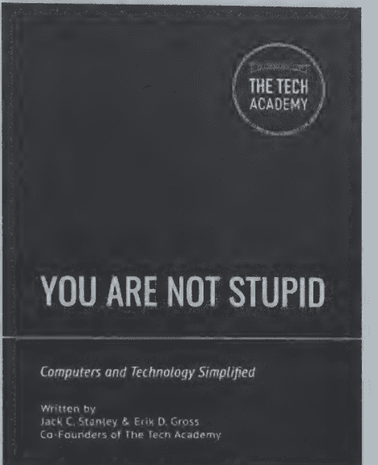

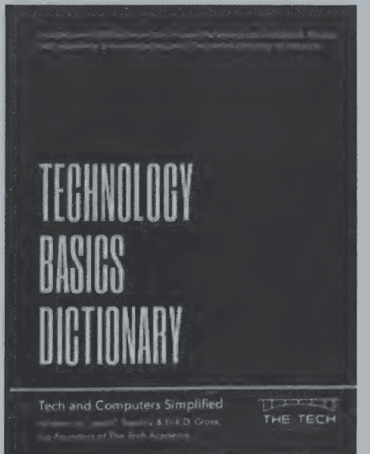

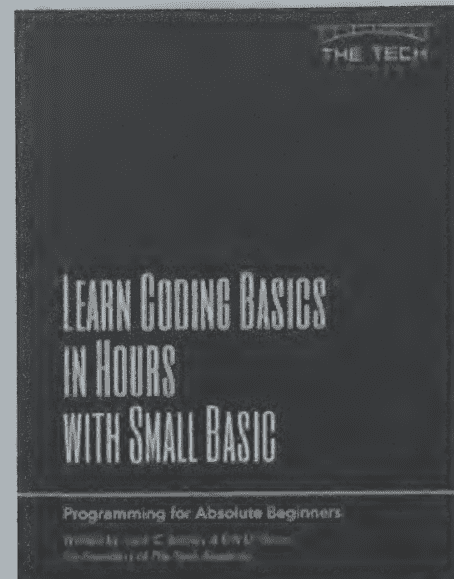

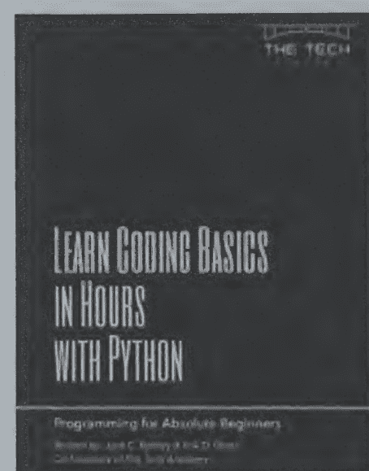

# 项目管理手册

面向初学者的简化敏捷开发、Scrum 和 DevOps

作者：
Jack C. Stanley & Erik D. Gross
The Tech Academy 创始人

制造于美国
南卡罗来纳州，哥伦比亚亚
2020年8月13日

16196957R00065

# THE TECH ACADEMY

Ann Townsend Leverette 女士
2524 Flair Knoll DE
Mill Creek
佐治亚州，亚特兰大邮编30345-1316

JavaScript 被某些列表列为世界上最流行的计算机编程语言。这本书是为没有任何以往技术背景知识或经验的人士编写的编程入门，使用 JavaScript 语言。

以下是几个问给你的问题：

- 你对看看代码像什么样感兴趣吗？（注：原文为 coding）
- 你是否想发现计算机编程是否是你喜欢做的事情？
- 你是否正在考虑在科技行业工作？

如果你对其中任何问题的回答是“是”，那么这本书就是为你准备的。

你可以在几小时内完成这本书，最后你不仅将拥有 Python 的基础知识，还将对通用技术有更好的理解。

我们希望你喜欢这本书，并祝你的编程之旅顺利！

The Tech Academy 是一所总部位于俄勒冈州波特兰的科技学校，在全球设有多个校区。我们专长编程训练营（旨在让毕业生进入初级技术岗位的密集培训计划，几个月内完成）。我们还为公司提供定制培训，并出版了几本书。


欲了解更多关于 The Tech Academy 的信息，请访问：
Learncodinganywhere.com

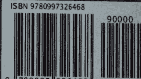

