# 几小时学会 Python 编程基础：零基础人士计算机编程入门指南


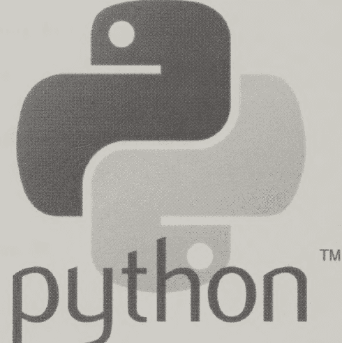

数学，51

# 第一章 欢迎

欢迎阅读我们的《几小时内学会 Python 编程基础》这本书！

现在，我们确定你想要直接开始编码，但在那之前我们将涵盖一些信息以确保你做好了充分准备。事实上，在本书的第 13 天之前，我们不会编写任何代码。

在进入正题之前，这看起来有很多要读的内容，但这是值得的。让我们与另一个主题进行比较：如果你无法定义重要的术语——例如方向盘、油门或刹车踏板，开车会有多难？因此，请耐心等待，并花时间学习一些基础数据，这将为你接下来的冒险做好良好准备。

我们尝试定义了书中使用的所有技术术语，如果你遇到任何不理解的术语，请查阅《Tech Academy 技术基础字典》（可在亚马逊购买）。

The Tech Academy 是总部位于波特兰的学校。我们专门从事零基础者的培训，在全球范围内设有多个校区。

当计算机正在处理数据时，你有时会看到这样的“进度条”（显示某项任务进度的符号）：

# 正在处理...

或者在数据处理时，你可能会看到这个符号：

# 处理中


这种圆形符号被称为“动画等待”（throbber），是因为它们最初会扩大和缩小——即符号在“跳动”。

计算机的目的是接收数据、处理数据并发送出去。

当计算机执行操作时，被称为“执行”或“运行”。例如，你可以点击搜索按钮在互联网上进行搜索，或者通过按下键盘上的回车键来执行指令。

理解机器不是生命体至关重要。尽管它们可以执行看似奇迹般的操作，但产品的真正源头是人类。


如果没有程序，计算机就毫无用处——所以让我们来过一下程序究竟是什么。

# 第三章 程序

作为一个名词（事物），代码是你输入到计算机中的编写指令，用于创建程序。

程序是一系列输入到计算机中的编写指令，这些指令使计算机执行特定的任务或多项任务。例如，微软® 画图是一个程序，可以用于在你的计算机上创建基础插图。

硬件指的是计算机的物理组件——那些可以触碰的部分。“Hard”（硬）意味着“坚固的”或“有体的”（可见可感），而“ware”（软件）意味着“被创造的东西”。

计算机屏幕、鼠标、打印机和键盘都是硬件。


硬件的反面是软件。软件只是“计算机程序”的另一种说法——告诉计算机做什么的指令集。计算机游戏（如纸牌游戏）就是软件的例子。

计算机程序或软件的另一个词是“应用程序”（application）。这些术语都是可以替换的。尽管“app”（application 的缩写）通常指移动设备（如手机）上的程序（应用程序；软件）。

软件一词出现于 20 世纪 60 年代，是为了强调它与计算机硬件的区别。软件（程序；应用程序）是指令，而硬件实现这些指令。

安装程序是指将其放入计算机中以便程序执行。

例如，你可以通过将数据从互联网传输到你的计算机来安装程序。在 20 世纪 90 年代，大多数软件是使用盒装磁盘安装的，看起来像这样：


创建程序的人被称为计算机程序员。他们也被称为代码（coders）、软件开发人员、软件工程师或简单的开发者（developers）。这些职位名称的意思完全相同。


程序是用编程语言创建的，所以让我们讨论一下它们。

# 第四章 编程语言

语言是通信系统，允许你通过书面和口头语传输思想。与人一样，有不同的语言（如西班牙语和英语）可以用于（创建）计算机程序——这些被称为编程语言或计算机语言。编程语言是词汇、短语和符号的组织系统。

有许多不同的编程语言，每种语言的创建都是为了特定的目的。通常，创建一种语言是为了让某些类型计算机程序的创建变得更容易。

这是你如何让计算机在屏幕上显示“Hello, world!”使用流行的编程语言 Python：

```
print("Hello, world!")
```

代码。所有的软件/应用程序都是由代码组成的。作为用户（使用东西的人），你看不到代码。开发者用于编写代码的三种常见类型是：

1. 集成开发环境（IDE）：IDE 是一套用于编写程序的编程工具。IDE 对程序的创建有很大帮助。IDE 经常将许多工具合并到一个地方。本质上，IDE 是帮助你制作软件的软件。例如，来自微软公司的 Visual Studio 是许多 IDE 之一。

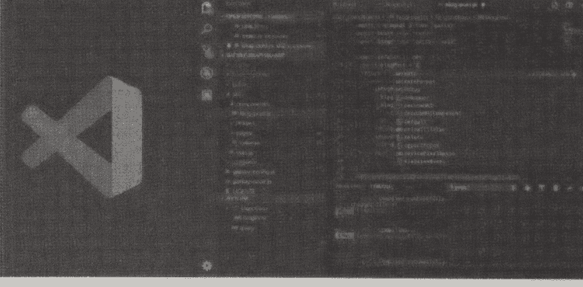

IDE 是开发者用于编写代码的。

2. 文本编辑器（Text editor）：用于编写和编辑文本的程序。文本编辑器非常基础——意味着文本通常是纯文本，没有效果。虽然文本编辑器可以编写代码，但处理器不能。相反，处理器具有更多功能（执行更广泛操作的能力）。例如，左侧的 Microsoft Word 是处理器，右侧的 Notepad 是文本编辑器。

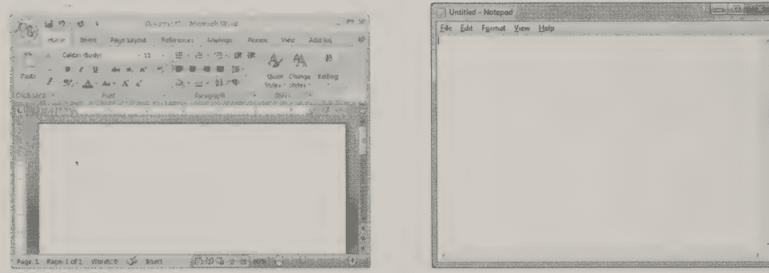

在列出的三个用于编写代码的程序中，文本编辑器是最简单的。

3. 代码编辑器（Code editor）：顾如名，这是一个可以编写/编辑你的代码的程序。在功能（内置到应用程序中）方面，代码编辑器介于 IDE 和文本编辑器之间。最流行的代码编辑器之一是 Notepad++。

作为示例，流行的 IDE Visual Studio 有一个名为“LiveShare”的功能，允许开发者在编写代码时与他人共享。其他开发者可以使用 Visual Studio 内部访问并编辑你的代码！此功能没有包含在代码编辑器 Notepad++ 中。

另一方面，Notepad++ 有一个很酷的功能叫做“自动补全”（auto-completion），可以为你输入的代码提供各种选项。例如，当你输入 pr 时，自动补全可能会建议 print。此功能在文本编辑器 Notepad 中不存在。

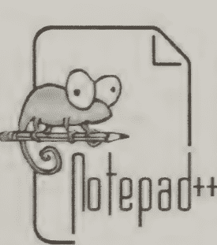

作为动词，编码意味着输入指令（使用特定的编程语言）来让计算机执行某些操作。它也指的是网站的创建。开发者通常在 IDE、代码编辑器或文本编辑器中编写代码。

计算机中的一切都归结为 1 和 0。让我们看看以及为什么。

# 第五章 机器语言

你可能听过计算机运行 1 和 0 的概念。具体原理超出了本书的范围，但一个简单的解释是，计算机由数十亿可以开启或关闭的小部件组成。1 代表开启，0 代表关闭。你可以通过向计算机输入 1 和 0 来控制这些部分的开启关闭。这些 1 和 0 被称为机器语言。用机器语言编写的命令被称为机器指令。

例如，“10010100 01101011 01010110”可以指示计算机“删除 Vacation.doc 文件”。10010100 01101011 01010110”是一条机器指令。

对于人们来说，阅读和编写机器语言很困难，因为指令只是 1 和零的唯一模式。这就是创建编程语言的原因。计算机将开发者编写的代码转换为机器指令。

它是这样工作的：

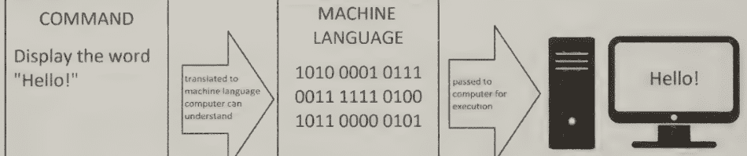

计算机的主要用途之一是互联网。那么，互联网是什么？

# 第六章 互联网与万维网

万维网（缩写为 www 或 web）是链接电子文档的集合，被组织成名为网站的组。

网站由一个或多个独立的网页组成，其中“页面”是一个包含文本、图像、视频和其他元素的组织良好的独立文档。

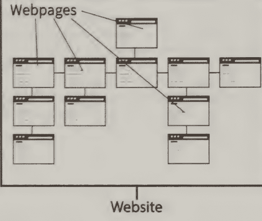

## 互联网

网络是两个或多个计算机相互连接的系统。计算机可以通过电缆连接（即有线连接）或无线连接（通过空气）。网络是描述共同工作的事物之间链接的词汇，并在计算机中以许多不同的方式使用。信息可以通过网络在计算机之间共享。

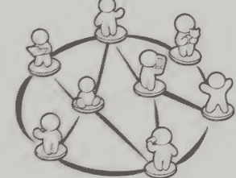

Internet 是“interconnected”（互连）和“network”（网络）这两个词的组合。

互联网是全球范围内许多计算机互互连接的网络。它是目前存在最大的网络，允许计算机相互传递数据。

在连接到互联网的计算机之间可以往返传输许多不同类型的数据——例如电子信息、电子健康记录等。


除了指的是该网络上计算机之间的连接外，互联网还指一组用于在这些计算机之间传输不同类型数据的协议（agreements, or protocols）。

“协议”（protocol）是一项正式的程序。在技术领域，它是对特定类型信息如何被格式化和处理的正式描述。基本上，它是一份所有处理该类型信息的各种人员都必须遵守的约定。协议通常以书面文档的形式描述，并且非常精确。它们通常由相关行业的专家创建。

一种具有协议价值的数据类型示例是医疗保健信息。如果医疗保健行业的各个组织在工作过程中需要在计算机之间往返传输健康数据，那么他们对信息的确切格式、如何保护隐私数据安全等事项达成共识将至关重要。所有这些内容都会记录在书面协议中。医疗保健行业存在多种此类协议。

对于可以在互联网上传输的每种类型的数据，都创建了一个或多个协议。违反这些协议会导致错误，数据将无法正常发送或无法发送。

总结一下：互联网是全球范围内许多计算机互连接的网络，也是一组在这些计算机之间传输不同类型数据的约定或协议。

# 互联网与全球网 (INTERNET VS. WORLD WIDE WEB)

那么，互联网和全球网之间有什么区别呢？互联网是数据传输的硬件和协议，而网页是通过互联网访问的一种信息类型。网页是一组被称为网页的链接电子文档的集合。

互联网是基础设施（物理框架），而网页是被传输和显示的代码。在某种意义上，互联网是硬件，网页是软件。


动态（Dynamic）指的是在需要的一刻发生的动作，而不是预先进行。例如，如果一家餐厅在你点餐时按照你的要求准备食物，那么它就是动态的。动态的反面是“静态”（static），其字面意思是“不变的”。静态餐厅会在点餐前就有预先做好并等待的食物——食物不会随时间或情况而改变。

在编码中，动态意味着当你提出请求时，计算机会处理你的请求——它不会预先有一个设定的结果。

动态与互联网的关系在于，它描述了那些在查看时内容会发生变化的网站。

这些是鼠标指针：

作为一个示例，网站上的动态图片可能是那种当你用鼠标悬停在它上方时会产生效果（移动或变化）的图片（鼠标悬停是指将指针保持在特定对象上方）。

# 编程 (PROGRAMMING)

编程（通过编写代码创建计算机程序的行为；编码）是一件很不起的事情，因为它是少数几乎适用于所有行业的技能之一。

是的，创建软件的公司确实最能利用编码——但如果你仔细考虑，绝大多数行业都会利用技术（软件、网站、数据库等）。因此，编码人员对于任何行业（建筑、餐饮服务、零售、运输等）的公司来说都是宝贵的资产。

许多许多编程语言，而且技术在不断变化。整个过程可能让人感到无从从，但在广阔的技术领域存在一些通用的基础知识。

现在，让我们讨论一下 Python 是什么。

# 第章：Python

Python 是由荷兰计算机程序员 Guido van Rossum 在 20 世纪 80 年代后期的一种编程语言。van Rossum 出于 1956 年，他在 2005 年至 2012 年间曾在 Google 工作，在那里他花了一半的时间开发 Python 语言。


在 Python 社区中，Van Rossum 被称为“终身仁慈的独裁者”（BDFL）。BDFL 指的是他继续监督 Python 的开发过程，并在需要时做出决策。

由于 Python 类似于常见的英语单词和句子，许多人认为它是容易学习的语言之一。Python 可用于创建应用程序、网站、游戏和许多其他东西。它是一种用途非常广、多多的语言。

Python 以著名的英国电视节目《蒙提派亚剧团》（Monty Python）命名，该节目于 1969 年至 1974 年间播出。

Python 用于构建许多流行的网络应用程序，例如 Dropbox 和 BitTorrent。Python 甚至被用于开发 YouTube、Yahoo 和 Google 等搜索引擎。(29b742b0a03470e98200c43a70e549de)

## 脚本 (SCRIPTS)

脚本是一种在不需要你参与的情况下，通过自动化任务的一组计算机指令。

该术语的起源类似于“电影剧本告诉演员做什么”，即脚本告诉计算机做什么。

Python 可用于创建脚本。例如，使用 Python 创建脚本可以每分钟检查并打印内容。

脚本语言是一种用于执行任务的语言，而 Python 是一种脚本语言。

## 高级 (HIGH-LEVEL)

我们之前讨论的机器语言（0 和 1）被认为是“低级语言”。这是因为它非常接近硬件，直接表示开启或关闭状态。

低级语言的反面是高级语言，它们以一种易于阅读和编写的方式编写，例如：

Print Hello

在这里，你告诉计算机在屏幕上写 Hello。

所有流行的编程语言都是高级语言——意味着它们使用英语字母、符号和单词。

Python 是一种高级编程语言。

## 解释型 (INTERPRETED)

编译器是一个特殊程序，将看起来类似于英语的代码转换为计算机可以理解和操作的形式。编译器的产物是让计算机执行“接近英语”代码的指令集。

例如，如果你在计算机程序中输入了以下指令：

```
if age > 18, print "You are an adult"
```

（符号 > 意味着大于）

编译器会将你写的内容转换为计算机可以理解的形式，并将该命令传递给计算机以便执行（即机器语言——一长串 0 和 1）。

编译器工作的一个重要方面是它在实际执行程序之前，将程序中的所有指令转换为计算机可以理解的语言。其他将高级语言转换为计算机可读格式的方法不需要在执行之前转换整个程序。相反，每次转换并执行一条。这不是编译器的工作方式。

编译型编程语言使用编译器。

解释器是一个特殊程序，将高级语言指令转换为低级语言指令。解释器以这种方式一次转换代码，而不是在执行之前转换整个指令集。

换句话说，解释器会读取指令，将其转换为计算机理解的语言，让计算机执行该指令，然后处理程序中的下一条指令并重复。

解释型编程语言（如 Python）使用解释器。

# 第八章 算法

“算法”（Algorithm）是一个数学术语，意味着解决问题的计划。它由一组解决问题或执行某项活动的步骤组成。

计算机使用算法。算法是一组用于完成某任务的指令。

例如，一个选择合适类型衬衫的算法可能包含以下步骤：

- 1. 从衣柜里拿一件衬衫。
- 2. 穿上这件衬衫。
- 3. 看着镜子里的自己。
- 4. 如果你喜欢，跳转到第 6 步。
- 5. 如果不喜欢，返回第 2 步。
- 6. 程序结束。

计算机通过处理算法来实现功能。你可以为计算机创建供其遵循的算法，这样其他人以后可以使用这些算法，而无需再次编写整个步骤列表。

例如，当你的计算机打印时，它会使用许多复杂的算法来确定你拥有什么种类型的打印机、如何以打印机理解的方式将文档传递给打印机等。这一切都在后台处理，你只需要点击“打印”即可。这些算法是由他人编写的，以让计算机和打印机符合你的意愿。

算法的另一个例子可能是简单的食谱，例如：

- 1. 打破三个鸡蛋并将它们的内容倒入小碗中 - 尽量避免蛋壳掉进碗里。
- 2. 如果有蛋壳，从碗中取出任何蛋壳。
- 3. 在小碗中将这 3 个鸡蛋打散 90 秒。
- 4. 将一个小煎锅放在炉子上，打开炉灶调至中火。
- 5. 将鸡蛋倒入小煎锅中，煎至几乎没有湿润残留。
- 6. 拿出鸡蛋。

尽管有相似之处，但计算机和人类使用算法的方式不同；现实生活算法与计算机算法之间有相似的特征，但它们并不完全相同。

计算机不会思考——它们以完全字面的方式运行——因此在为计算机编写算法时，必须具备某些特征计算机可以使用该算法。人可以推断事物并外推数据；人具有想象力。计算机只能执行被要求的操作。

为了完全理解计算机算法，必须先澄清一些术语和概念。算法由五个独立的特征组成：

- 1. 结果（Result）：某事的结果。
- 2. 有限的时间（Finite amount of time）：某事所需的精确时间。
- 3. 良好有序（Well-ordered）：以正确的顺序和有组织的方式列出。


## 4. 可有效计算的操作（Effectively computable operations）

这指计算机可以成功处理的命令。

## 5. 无歧义（Unambiguous）

歧义意味着不清楚、困惑、未指定。`Un` = 不。无歧义的事物意味着它是清晰且定义的。

让我们详细介绍这些每一个点。

## 结果

结果：某事的结果。

在计算机中，响应可以被视为结果。你输入：“Jan 3, 2022”，那么“Jan 3, 2022”就是结果。问题的答案也被视为结果。

算法总有一个结果。如果没有结果，它就不能被认为是有效的算法。

例如：打印数字“2”，结果： 2。

## 有限的时间

有限的时间：某事所需的精确时间。

算法中应该包含有限数量的操作，并应该在一段时间内执行这些操作。算法永远不应该是开放式的或无限的。由于算法的每一步都需要一定的时间来完成，这意味着算法将在有限的时间内完成。

一个错误的算法将是：

- 1. 从数字 1 开始
- 2. 将该数字加 1
- 3. 跳转到第 2 步

计算机将永远计算 0, 1, 2, 3, 4 等。

例如，“从 1 数到 10，然后打印一条信息说‘我从 1 数到 10’”，这是一个正确的算法，因为它包含有限数量的步骤。

## 良好有序

良好有序：以正确的顺序和有组织的方式列出。只有当算法良好有序时，计算机才能执行它。如果不良好有序，计算机就无法处理它。例如：

- 1. 关闭程序
- 2. 打印程序
- 3. 保存程序
- 4. 退出

## 可有效计算的操作

可有效计算的操作：指计算机可以成功处理的命令。在程序中，许多操作是有效计算的，计算机可以执行。例如，你的计算机执行的可有效计算的操作，如：“2 + 2”

## 无歧义

无歧义：歧义意味着不清楚、困惑、未指定。`Un` = 不。无歧义的事物意味着它是清晰且定义的。

在计算机中，算法必须是无歧义的。如果指令不清晰，计算机就无法处理它们。

# 第九章

## 程序的五个元素

任何程序都有五个关键元素：

- 1. 入口（Entrance）
- 2. 控制/分支（Control/Branching）（程序内的决策点）
- 3. 变量（Variables）（存储在程序中可以更改的数据）
- 4. 子程序（Subprograms）（程序中的程序）
- 5. 出口（Exit）

让我们详细介绍这些每一个。

## 入口

深入来说，计算机是一台简单的机器。它一次只能做一件事，并按照计算机程序员放置的精确顺序执行程序的指令。只有在被指示时，它才会执行（执行或运行）指令。

这意味着任何计算机程序都必须有一个标记的“第一个指令”。这是计算机程序启动时执行的第一个任务。从那时起，程序中的每条指令都会指导计算机在执行当前指令后执行哪条指令。

指定入口点的方法取决于所使用的计算机编程语言，但每个计算机程序都有定义的入口点。

## 控制/分支

计算机经常用于自动化原本由人类执行的操作。人们在执行工作时被要求做的常见任务之一是评估事物的状况，并根据该事物的状况在两个或多个可能的方案之间选择。换句话说，他们必须做出决策。一个例子是“老师批改作业”的活动：

- 1. 从堆顶部取出下一张学生卷。
- 2. 批改卷子。
- 3. 在卷子上写分数。
- 4. 如果分数达到 70% 或以上，将卷放在“合格”堆中。
- 5. 如果分数低于 70%，将卷放在“不合格”堆中。

你可以看到这里有两种可能的“路径”。一条路径是“根据决策而产生的可能行动方案”。把它想象成当你来到一个道路分叉口时所发生的情况。你必须决定一个行动方案——你走哪条路？这也被称为“分支”（branch）。

除了最简单的计算机程序外，所有的程序都需要执行相同的操作。也就是说，它们必须检查某项数据的值条件，并根据该数据的值条件执行不同的计算机指令集。

为了实现这一点，程序将使用称为“控制”（control）指令的特殊指令。这些指令只是告诉计算机在做决定时应该查看什么，然后告诉计算机对于每种可能的决策应该做什么。计算机最基础的控制语句是“if”（如果）。它的用法如下：

```
IF [要检查的条件已检查] THEN [要执行的计算机指令分支]
```

在这里，“IF”是控制语句；“THEN”是分支指令，如果控制语句为真（true），它指向要执行的程序路径。

## 变量 (VARIABLES)

变量是计算机程序使用的一部分数据，用于跟踪随程序执行而可能变化的值。这可能是像“刚刚批完的学生试卷分数”或“流水线上下一辆汽车使用的油漆颜色”之类的。

变量是任何计算机程序至关重要的部分，因为它们使得计算机程序能够用于单一的、预定义的值之外。你可以想象，如果“流水线上下一辆汽车使用的油漆”只能是“蓝色”，那么使用该数据的计算机程序将毫无用处。让计算机程序能够为每辆即将喷漆的汽车更改该值将要有意义得多。

在计算机程序中编写变量时，它们通常以如下方式编写：

```
[变量名] = [变量值]
```

例如，你可能会有这样的代码：

```
color = "red"
```

在这里，变量名为“color”（颜色），该变量的值被设置为“red”（红色）。换句话说，名为“color”的变量现在“等于”单词“red”。

让我们来看“老师批一叠试卷”的例子。在这里，我们可以有一个名为“Paper Grade”（试卷分数）的变量，它每当老师批一张试卷时就会改变一次。你还可以为试卷总题数（“Total Questions”，总题数）、正确回答的数量（“Correct Questions”，正确题数）以及试卷分数设置变量。

上面的书面描述如下：

- 从“待批改”堆的顶部取出下一张学生试卷。
- 批改试卷。
- 将分数写在试卷上。
- 如果分数是 70% 或以上，将试卷放入“已通过”堆中。
- 如果分数低于 70%，将试卷放入“未通过”堆中。

在计算机语言中，该过程可能像这样：

- 获取下一张卷 (Retrieve Next Paper)
- 设置总题数 = [当前试卷中的总题数]
- 批改卷 (Grade Paper)
- 设置正确题数 = [正确回答的数量]
- 设置试卷分数 = [正确题数/总题数]
- 如果 (Paper Grade >= 70%) 则试卷状态 = “passed”（通过）
- (Paper Grade < 70%) 则试卷状态 = “failed”（失败）

这是一个简单的计算机程序。

注意，`>=`（大于号后跟等号）是一个用于表示应该进行比较的符号。具体来说，这个“大于等于”符号是一个指令，用于检查符号左侧的数据在金额或数量上是否大于或等于右侧的数据。此项比较的答案是“true”（真）或“false”（假）。

例如：`5 >= 4`

这意味着“检查 5 是否大于或等于 4”。由于 5 大于 4，答案是“true”。

另一个例子：`3 >= 6`

这意味着“检查 3 是否大于或等于 6”。答案是“false”。

最后一个例子：`6 >= 6`

这意味着“检查 6 是否大于或等于 6”。答案是“true”。

`>=` 的反向（相反）符号是 `<=`，它检查符号左侧的数据是否少于或等于右侧的数据。

每当计算机运行之前列出的七步程序时，程序中的每个变量都可能有不同的值，这取决于正在改的试卷有多少道题，以及学生正确回答了其中多少道题。

例如，假设试卷有 100 道题，学生正确回答了其中 82 道。程序运行后，结果如下：

| 总题数: 100 |
| 正确题数: 82 |
| 试卷分数: 82% |
| 试卷状态: 通过 (Passed) |

另一个例子，假设试卷有 50 道题，学生正确回答了 30 道。程序运行后，结果如下：

| 总题数: 50 |
| 正确题数: 30 |
| 试卷分数: 60% |
| 试卷状态: 未通过 (Failed) |

为了澄清变量的必要性：假设在创建此计算机程序时，学校所有的试卷都是 100 道题，老师告诉程序员让题数固定，那么程序就无法灵活应对变化。

如果使用变量，程序可能像这样：

- 获取下一张卷
- 设置总题数 = [当前试卷中的总题数]
- 批改试卷
- 设置正确题数 = [正确回答的数量]
- 设置试卷分数 = [正确题数/总题数]
- 如果 (Paper Grade >= 70%) 则试卷状态 = “passed”
- (Paper Grade < 70%) 则试卷状态 = “failed”

这是一个简单的计算机程序。

注意，`>=`（大于号后跟等号）是一个用于表示应该进行比较的符号。具体来说，这个“大于等于”符号是一个指令，用于检查符号左侧的数据在金额或数量上是否大于或等于右侧的数据。此项比较的答案是“true”（真）或“false”（假）。

例如：`5 >= 4`

这意味着“检查 5 是否大于或等于 4”。由于 5 大于 4，答案是“true”。

另一个例子：`3 >= 6`

这意味着“检查 3 是否大于或等于 6”。答案是“false”。

最后一个例子：`6 >= 6`

这意味着“检查 6 是否大于或等于 6”。答案是“true”。

`>=` 的反向（相反）符号是 `<=`，它检查符号左侧的数据是否少于或等于右侧的数据。

每当计算机运行之前列出的七步程序时，程序中的每个变量都可能有不同的值，这取决于正在改的试卷有多少道题，以及学生正确回答了其中多少道题。

例如，假设试卷有 100 道题，学生正确回答了其中 82 道。程序运行后，结果如下：

| 总题数: 100 |
| 正确题数: 82 |
| 试卷分数: 82% |
| 试卷状态: 通过 (Passed) |

另一个例子，假设试卷有 50 道题，学生正确回答了 30 道。程序运行后，结果如下：

| 总题数: 50 |
| 正确题数: 30 |
| 试卷分数: 60% |
| 试卷状态: 未通过 (Failed) |

为了澄清变量的必要性：假设在创建此计算机程序时，学校所有的试卷都是 100 道题，老师告诉程序员让题数固定，那么程序就……

如果使用变量，程序可能像这样：

- 获取下一张卷
- 设置总题数 = [当前试卷中的总题数]
- 批改试卷
- 设置正确题数 = [正确回答的数量]
- 设置试卷分数 = [正确题数/总题数]
- 如果 (Paper Grade >= 70%) 则试卷状态 = “passed”
- (Paper Grade < 70%) 则试卷状态 = “failed”

## 试卷 2：

试卷总题目：20

正确回答的题目数：10

如果我们分析程序由计算机执行时的情况，它看起来像这样：

```
+ 总试卷数 = 2
计数 = 0
0 小于2，因此将执行循环
获取试卷 1
总题目数 = 100
评分试卷 1
正确题目数 = 95
试卷成绩 = 95%
试卷状态 = "通过"
计数 = 1
1 小于 2，因此将执行循环
获取试卷 2
总题目数 = 20
评分试卷 2
正确题目数 = 10
试卷成绩 = 50%
试卷状态 = "失败"
计数 = 2
2 不小于2，因此将执行循环
[继续执行程序的剩余部分]
```

## 子程序 (SUBPROGRAMS)

如前所述，计算机程序通常按照从起点到终点的顺序执行。这被称为“执行路径”。

程序中的主系列指令被称为“主程序”。

有时，创建一个可以供主程序根据需要使用的另一个程序是有价值的。这被称为子程序。它与任何其他程序都不同——它由相同的元素（入口点、变量、控制和分支语句以及出口）组成。然而，子程序不会独立运行。相反，主程序可以根据需要执行子程序。在这里，主程序停止执行，子程序开始执行。当子程序执行完毕后，主程序从它停止的地方继续执行。

这被称为“调用”（calling）子程序——即主程序调用子程序，子程序启动并停止，然后主程序从调用子程序之前的位置继续执行。

这在创建程序时非常有用，因为计算机程序员不需要反复输入子程序的指令。你只需要输入一次，然后当你需要主程序调用该子程序时，你只需要输入一条指令——调用子程序的指令。这让你能够重用已为子程序输入的指令，而不是重新编写它们。

## 退出 (EXIT)

每个程序都必须有一条指令，告诉计算机程序已不再运行。与“入口”类似，此种操作的精确指令取决于所使用的计算机语言，但所有计算机语言都会有这种类型的指令。

## 总结 (SUMMARY)

任何计算机程序的根本元素都是：

- 1) 入口点 – 要执行的第一条指令。
- 2) 控制和分支语句 – 用于控制执行的内容和顺序。
- 3) 变量 – 存储在计算机内存中的可项目，供程序在运行时使用。
- 4) 子程序 – 可重复的计算机指令集，作为微程序运行。主程序可以根据需要使用它们。
- 5) 出口点 – 最后完成的指令，以便计算机知道程序已停止运行。

接下来我们将介绍你在编码时会遇到的 Python 术语。

# 第十章

## PYTHON 特有定义

现在我们已经涵盖了编程的基础知识（无论什么语言），你现在将学习一些与 Python 相关的术语。在编写 Python 代码之前，完整阅读此处（以及所有其他章节）很重要，因为我们将在书中之后使用这些术语。

## 迭代 (ITERATION)

迭代意味着再次说或做某事；重复某事。迭代是重复的行为。迭代意味着执行一组定义的动作，重复若干次。通常，这组定义的动作会重复若干次，或者直到满足某个条件。

在这个基础循环的图中，一次迭代将包含循环一次（无论完成还是重复）：

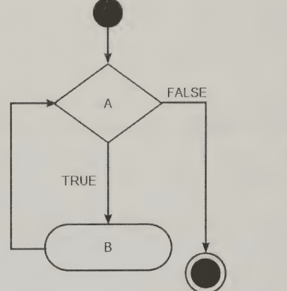

计算机程序通常是通过迭代创建的：提出一个基础的工作版本，检查程序以纠正错误并改进，执行这些工作并重复。这可以无限持续下去。

## 语法 (SYNTAX)

每种口语语言都有一组关于单词和句子应如何结构的通用规则。这些规则被称为该语言的语法。在编程语言中，语法具有相同的作用。语法是你与计算机交流并告诉它要做什么时必须遵循的规则。你可以使用许多语言来为计算机编程。每种语言都有其自己的语法。未能正确使用特定语言的语法可能意味着你设计的任何程序完全无法运行。

语法是词汇和短语的排列，用于创建语言中正确的句子。在计算机科学中，它是允许用户编写程序以及关于如何正确编写代码的规则。

## 解析 (PARSING)

“解析”意味着将某物拆分为部分并对其进行分析。”这里有一个解析电话号码的示例：

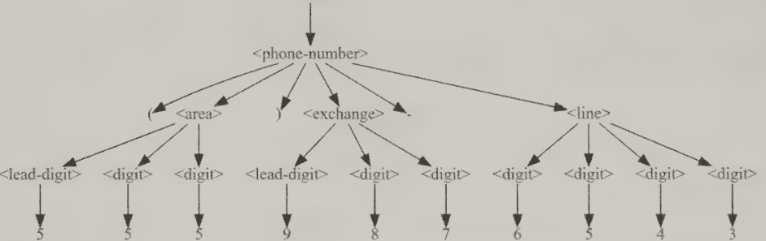

在计算中，这意味着对程序代码进行分析和读取。

如果你为网站编写代码，网络服务器会解析代码，然后将正确的代码输出给浏览器。

解析也可以指拆分普通文本。例如，搜索引擎通常会解析搜索短语，以便更准确地进行搜索。解析器将代码拆分成部分并进行分析。它是一个在高级语言状态下检查信息的工具。解析器接收指令并将其拆分为部分，将每个部分路由到正确的位置。解析器还会检查信息以确保没有遗漏组件。如果解析器发现语法错误，它将返回错误消息。

## IDLE

IDLE 是一个 Python 的集成开发环境（IDE）。虽然大多数 IDE 可用于编写多种语言的程序，但 IDLE 仅用于编写 Python 程序。

IDLE 代表“集成开发环境”（Integrated Development Environment）或“集成开发与学习环境”（Integrated Development and Learning Environment）。由于 Guido Rossum 为了纪念英国喜剧剧派蒙蒂蟒（Monty Python）而命名为 Python，IDLE 这个名字可能是为了纪念蒙蒂蟒成员之一的埃里克·艾德（Eric Idle）。IDLE 旨在作为一个简单的开发环境，特别是在教学环境中。

## 操作系统 (OPERATING SYSTEM)

操作系统是一种特殊用途的（为特定的应用和原因制造）计算机程序，支持计算机的基本功能，如任务调度、运行其他程序以及控制外围设备（键盘、鼠标和显示器等外部设备）。

大多数计算机程序在计算机上运行之前，要求该计算机已经安装了操作系统。

正如我们之前提到的，“安装”意味着将某物放入计算机可以使用的内部。这通常适用于计算机程序。你会获取程序并通过某种连接将其移动到计算机上。然后你的计算机上就有该程序，并可以在需要时使用它。

安装也适用于硬件。例如，你可以在计算机中安装一个新的存储设备，以存放更多的电子信息。今天市几乎所有的计算机在购买时都安装了操作系统。计算机制造商在销售计算机之前安装操作系统。有些操作系统是免费的，另一些需要付费。世界上最知名、流行的操作系统之一被称为 Windows。它由微软创建并销售。

## 外壳 (SHELL)

计算中的“外壳”（shell）——作为用户和操作系统之间的外层——与普通英语中的 shell 含义相同。它是一个为用户提供界面的程序，用于向操作系统发布命令。

代码通常在 shell 中编写。在 Python 中，Shell 和 IDLE 看起来像这样：

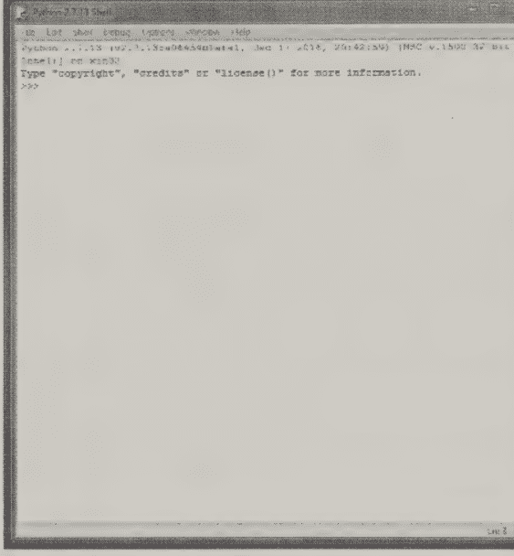

Python 还包含一个像这样的文本编辑器：

## 文件路径

文件的路径被称为“文件路径”。“文件路径”是文件的地址，并指定了文件的精确位置。它为文件提供了一个“路径”。

文件路径表达的内容类似于：“你可以在名为 'Poems' 的文件夹内找到名为 'Winter' 的文件，而该文件夹位于 C 盘中。” 驱动器仅仅是存储数据的地方。C 盘是计算机上存储大多数文件和软件的地方。

路径的各个组件由一个文本字符分隔开，该字符不太可能出现在目录或文件的名称中。通常，这个字符是斜杠 `/`。

在文件路径中，反斜杠 `\` 用于表示一个项目位于另一个项目的下方（从层级结构而言）。

层级是指根据等级或状态对事物进行排序。它指的是根据项目的相对重要性或特征进行安排。存储层级是指一种系统，根据使用方式对各种数据存储设备进行分级排名。影响给定设备排名的首要因素是它的响应时间——当计算机请求数据时，设备返回所需数据的时间。响应时间越快，排名越高。

在文件路径中，左侧的位于右侧的“上方”。如果我们回到之前的例子，文件路径将写为：

```
C:\Poems\Winter
```

为了准备下一次作业，请下载一张你选择的图片（确保将其保存到 Downloads 文件夹中）。

书面文档、图片和视频是不同类型文件格式的示例。这些文件中的数据以特定的方式组织，通常取决于各种进程如何使用这些数据。


例如，书面文档文件的数据组织方式与视频文件的数据组织方式完全不同。

常见的格式是“PDF”。它代表“便携式文档格式”（Portable Document Format）。这是由 Adobe 公司在 20 世纪 90 年代开发的文件。开发这种文件格式是为了确保文件在任何计算机上显示都能保持一致。

文件格式通过其扩展名指示。扩展名是说明文件格式类型（文本、图像、视频等）的代码。扩展名附加在文件名的末尾。

假设你有一个名为“Contract”的文件，并以 PDF 格式存储；该文件名将为`Contract.pdf`——`.pdf`就是扩展名。

另一个常见的文件格式和扩展名是`.txt`（“文本文件”的缩写）。这是一种纯的、未格式化的（无特殊设计；纯文本）文本文件。如果你使用过记事本，它就会保存并运行`.txt`文件。

## TAR

`Tar`是一种文件格式，也是用于处理此类文件的程序名称。该名称来源于两个单词“tape archive”（磁带存档）。

`Tar`现在通常用于将许多文件收集到一个较大的文件中进行分发或归档，同时保留文件系统信息，如用户和组权限、日期和目录结构。

为了减少存储需求，使用的`tar`文件可以被压缩。用于压缩`tar`文件最常用的程序是名为`gzip`的压缩程序。被`gzip`程序压缩后的`tar`文件具有文件扩展名`tar.gz`。要访问该`tar`文件，必须使用`gzip`程序解压该`tar`文件。还有其他解压程序也可以解压`.gz`文件。

## 运算符

在数学中，运算符是用于执行计算的符号（计算即使用数学方法计算某物数量的行为）。有几种不同类型的运算符。算术运算符，例如：

- `+`（加法），
- `-`（减法），
- `/`（除法），
- `*`（乘法）

用于执行数学运算。

## 数组

数组是数据的集合，其排列方式使得集合中的每条数据都可被单独识别。在计算机中，数组是按顺序一起存储的一组相关事物。它是计算机中以逻辑方式组织事物的一种。数组可以非常简单，也可以非常复杂。

简单的数组可能是像数字 7、3 和 15。它的写法如下：

```
[7, 3, 15]
```

这三条数据被称为“元素”（elements）——它们是数组的元素。

需要一个系统来标识数组的每个元素。这是通过给数组中的每个位置标记来实现的。最简单的方法是从零开始编号，从左侧位置开始并向后计数。

重要的一点是，索引（index）只告诉元素在数组中的位置，而不是该位置上元素的值。

在上面的示例中，值为`7`的元素位于位置 0，值为`3`的元素位于位置 1，值为`15`的元素位于位置 2。

元素位置的另一个词是元素的“索引”——对于上述数组示例，索引为 0 的元素是`7`，索引为 1 的元素是`3`，索引为 2 的元素是`15`。

对于上述数组示例，索引为 0 的元素值为`7`，索引为 1 的元素值为`3`，索引为 2 的元素值为`15`（注：此处原文逻辑略有重复，已按原意翻译）。数组元素的另一个词是索引。例如，索引为 0 的元素具有两个属性：索引和值。

## 内存

内存是用于存储计算机信息的物理设备。它可以被看作内存位置的集合。内存具有两个方面：唯一的标识符和存储在该位置中的数据。

## 标识符

变量的名字被称为标识符。

变量可以是`age`，值为`27`，存储在内存位置 1000。

当你创建程序时，通常会使用变量。这涉及两个动作：

1. 指定一个特定的内存位置和一个标识符。这被称为“声明”（declaring）变量。
2. 设置存储在变量中的值。这被称为“赋值”（assignment）。

数据类型是计算机使用的一种不同类型的数据。有几种数据类型。数据类型包含了数据所代表的信息类型以及对这些信息可以做什么。

整数是表示整数的数据类型（不带小数的数字）。这可以是 5、-8、1024 等。4.5 就不是整数，因为它包含了小数。这种数据类型的行为包括数学运算。

整数变量的声明和赋值如下：

```
integer [变量名] = [整数]
```

例如，你可以使用名为`classSize`的变量来跟踪班级人数。你可以这样设置它：

```
integer classSize = 25
```

## 字符串

字符串是一种表示文本的数据类型——即字母、数字和其他符号。这种数据类型的行为包括你对文本所的操作——增加更多符号、将文本转换为大写。

字符串变量的声明和赋值如下：

字母数字意味着“由字母和数字组成”。

作为字符串的示例，你可以使用名为`studentName`的字符串变量来跟踪学生的姓名。你可以这样设置它为`Jane Smith`：

```
string studentName = "Jane Smith"
```

## 拼接字符串

拼接意味着将项目连接在一起，就像链链一样。它意味着获取一段数据并将其贴在另一段数据的末尾。例如，拼接字符串`dev`和字符串`ices`会得到字符串`devices`。

## 表达式

表达式是组合在一起的数字、符号和运算符，显示某物的数量。表达式是一个书面数学题。

在编码中，表达式是由计算机计算的值组合。

例如：

`Name` = “用户在名称框内输入的任何内容都可能是一个表达式。“x + 5” 也是一个表达式。

## 调用 (CALLING)

“调用”（call）意味着要求或指引某事。在普通英语中，可以这样用：“这值得庆祝！（（This calls for celebration!）”。在计算机中，调用是主程序指向并执行子程序任务的指令。更具体地说，“调用”是指程序临时将计算机的控制权转移给一个子程序。一旦子程序执行完毕，计算机的控制权就会返回给主程序。程序在执行其系列任务时，可以对多个子程序进行多次“调用”。

例如，如果你正在使用一个视频游戏程序，在每个游戏结束后，视频游戏程序可以调用“高分”（high score）子程序，让屏幕上弹出“高分”这两个字样。

## 函数 (FUNCTIONS)

函数是一个可重复执行的代码块，它执行某些操作并完成任务。你通过调用它来执行函数。这也被称为“调用（invoking）”函数。

“调用”（Invoke）的字面意思是请求或索要某物。在编程中，它是导致某事被执行（完成）。

技术领域还有其他描述此概念的词汇：方法（method）、子程序（subroutine）、子程序（subprogram）、过程（procedure）、常规（routine）。

## 语句 (STATEMENTS)

语句是计算机指令。这些是人们在创建计算机程序时使用的指令。其中最简单的可能是“打印”（print）、“删除”（delete）、“添加”（add）、“乘法”（multiply）等。

例如，在 Python 中，`print`语句告诉你的计算机打印你作为命令一部分而输入的任何文本。

## 参数 (PARAMETERS)

提醒一下，有时子程序需要从主程序获取某些信息来完成它的任务。在创建子程序时，它的描述可能包含这些信息。这些信息被称为子程序的“参数”（parameters）。

通常，子程序会完成它的工作，然后向主程序提供源自其工作的一些信息。这被称为向主程序返回信息。

例如，你可能有一个相加两个数字的子程序。它看起来像这样：

```
subprogram AddTwo(x, y)
{ return x + y }
```

在这里，子程序的名称是`AddTwo`。子程序的参数是两个数字`x`和`y`。子程序将返回这两个数字之和。

如上所示，创建一个子程序的过程被称为“定义”（defining）该子程序。上面是子程序定义的一个示例。

让我们看看它如何在主程序中使用。假设你拥有一所学校，每天有两节体育课，你想让程序计算这些班级的学生总数。你可以编写一个使用了`AddTwo`子程序的主程序。它可能像这样：

```
classSizePE1 = 25
classSizePE2 = 43
totalSize = AddTwo(classSizePE1, classSizePE2)
print("The total number of students in the PE classes is: " + totalSupply)
```

让我们逐行查看这个程序：

第 1 行：主程序创建了一个名为`classSizePE1`的变量，并给它赋值 25。

第 2 行：主程序创建了一个名为`classSizePE2`的变量，并给它赋值 43。

第 3 行：这里五件事：

首先，主程序创建了一个名为`totalSize`的变量。

其次，主程序调用了子程序`AddTwo`。该子程序被赋予了值 25 和 43，因为这些是变量`classSizePE1`和`classSizePE2`的值。

第三，子程序`AddTwo`执行了工作，取值 25 和 43 并将其相加，创建了值 68。

第四，子程序将该值返回给主程序。

第五，主程序将该值赋给变量`totalSize`。

第 4 行：主程序随后继续运行。在这里，程序使用变量`totalSize`的值在屏幕上显示了这段文本：

```
The total number of students in the PE classes is: 68
```

这引出了“实参”（arguments）的概念。实参是在调用子程序时传递给该子程序的实际数据。在上面的示例中，参数是 25 和 43。

这源于数学。在数学中，有公式。这些是按照精确顺序进行的精确数学运算。通常，这些数学公式需要赋予一些初始值来开始处理数学步骤。这些初始值被称为参数。

子程序并不一定需要任何参数。某些子程序可能接受一个参数，有些可能接受多个。

为了澄清：当子程序被定义时，它将需要的任何数据项被称为参数（parameters）。当子程序实际被使用时，当时传递给它的实际数据被称为参数（arguments）。

我们离编写代码已经很近！在下一章中，我们将涵盖一些帮助你读完这本书的快速技巧。

# 第十一章：编码技巧 (CODING TIPS)

如果你在阅读这本书的过程中遇到任何困难，这里是一些技巧：

- 1) 确保你理解了所有使用的单词和术语——弄清楚任何你不理解的内容。
- 2) 确保你的代码编写与此处列出的完全一致。代码中的一个微小错误（例如缺少逗号）可能会破坏整个程序。代码必须精确，程序才能正常运行，因此请务必仔细检查你的代码是否有错误。
- 3) 在网上搜索解决方案。
- 4) 你也可以联系 The Tech Academy 寻求帮助 – learncodinganywhere.com

恭喜你完成了这些入门章节！现在我们要开始编写代码了！

## 安装 (INSTALLATION)

现在你已经有了必要的知识基础，我们将编写一些代码！作为第一步，安装 Python：

- 1. 前往此链接：python.org/downloads/
- 2. 找到最新版本的 Python 3。
- 3. 下载并安装最新版本的 Python 3。

需要注意的是，Python 有两个主要版本：2 和 3。它们非常相似，但 Python 3 是最新且开发最充分的版本。它是行业标准。

如果你在 PC 或 Mac 上下载和安装 Python 时遇到任何困难，请在网上搜索解决方案。

现在 Python 已经下载并安装，我们可以开始编写代码了！

# 第十二章：编写 Python 代码 (WRITING PYTHON CODE)

要开始，请打开 IDLE。有几种方法可以实现这一点，取决于你的设备。一种方法是在电脑上搜索 IDLE 然后运行它。

一旦 IDLE 打开，编写此代码：

```
>>> 
```

三个角括号（`>>>`）表示输入命令的地方。

（注：由于原文 OCR 文本存在大量重复和错误，译文已进行清理和整合）

要开始，请打开 IDLE。编写此代码：

```
>>> print('Hello')
```

并按回车。返回的值是 2。

现在在 IDLE 中编写这段代码：

```
>>> K = 5
>>> print (J+K)
```

并按回车。注意返回的值是 55。这是因为 J (50) + K 等于 55。

我们在 Python 中也可以进行数字减法。在 IDLE 中编写这段代码：

```
>>> 2 - 1
```

并按回车。返回的值是 1。

```
>>> print (J - K)
```

并按回车。注意返回的值是 45。

我们在 Python 中甚至进行数字乘法。在 IDLE 中编写这段代码：

```
>>> 4 * 5
```

并按回车。返回的值是 20。

现在在 IDLE 中编写这段代码：

```
>>> print (J * K)
```

并按回车。注意返回的值是 250。

我们在 Python 中还可以进行数字除法。在 IDLE 中编写这段代码：

```
>>> 100 / 5
```

并按回车。返回的值是 20。现在在 IDLE 中编写这段代码：

```
>>> print (J / K)
```

并按回车。返回的值是 10。

# 第十三章

数据类型

是时候进入数学世界了！

因子（Factors）是指相乘可以得到另一个数字的数字。例如，4 和 5 是 20 的因子，因为 $4 \times 5=20$

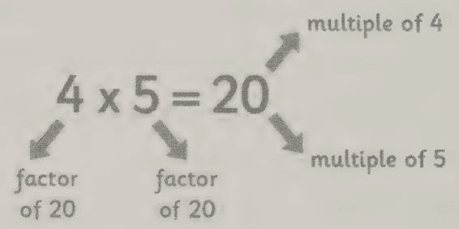

上标（Superscripts）是通常显示在另一个数字右上角的较字符——就像这样：$4^{12}$

上标通常表示“幂”。幂指的是数字自身相乘的次数。例如，$10^4$ 意味着 10 的四次方——即 10,000（10 乘以 10 乘以 10 乘以 10）。

符号（Notation）是用于表示数字或数量的一个或多个符号——例如放在数字末尾的 E。这个符号表示“10 的给定指数”。“指数”是一个数字被相乘的幂。在上面出的 $10^4$ 例子中，4 就是指数。

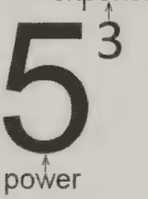

浮点（Floating point）是表示大数字的一种特定方式。与其写出整个数字，你可以写它的第一部分，然后写一个乘以它的因子。这使得通过执行乘法，你本质上得到了与完全写出该数字完全相同的数字。当你这样做时，你移动了数字中的小数点；因此被称为“浮点”。

例如，假设数字是三千四百二十五。正常书写是 3425 —— 如果用浮点计数法书写，可以是：3.425 x $10^3$。由于 $10^3$ 是 1000，这意味着“3425 乘以 1000”，即 3425。

“浮点数”（float）是计算机使用的一种数据类型。“float”类型用于存储具有极高精度的数字。它主要用于数学目的。

假设我们用一种更短的方式来写 100,000。我们可以写成 10E 4

10E 4 意味着 $10^4$（10 乘以四）。

字符（Character）是一个书符号，例如字母或数字。

## PYTHON 数据类型

Python 中最常见的数据类型有：

- 1) 字符串 String（由引号包围的字符序列）
- 2) 浮点数 Float（带有小数点的数字）
- 3) 布尔值 Boolean（可以是 True 或 False 的值）
- 4) 整数 Integer (Int – 一个整数数字）

通过在 IDLE 中编写这段代码创建一个字符串变量：

```
>>> A = "Odysseus is traveling"
>>> A
```

并按回车。"A”（变量）返回该字符串。

在大多数情况下，Python 3 中的双引号（`""`）和单引号（`''`）是可以互换的。

在 IDLE 中编写这段代码：

```
>>> B = 'Betty is excited'
>>> B
```

并按回车。注意我们没有在 the 和其余文本之间包含空格。这是因为存在空白敏感性（whitespace sensitivity）的概念。空白字面上就是空格。例如，在这里 Apple 和 Orange 之间有五个空格（空白）：Apple Orange

空白敏感性是指编程语言的一种特性，其中你代码中空格的数量非常重要。在大多数情况下，Python 不是空白敏感的。为了证明这一点，在 IDLE 中编写这段代码：

```
>>> C = 'Kitty is hungry'
>>> C
```

并按回车。它成功了！

现在在 IDLE 中编写这段代码：

```
>>> D = 'Doggy is thirsty'
>>> D
```

并按回车。不起！我们代码前的空格导致了错误。这是因为 Python 使用缩进。你可以通过按 Tab 键缩进。

## TAB 键


为了描述 TAB 键，你必须先理解什么是电子表格（spreadsheet）和表格（table）。电子表格是一种视觉网格结构，允许你组织、修改和分析数据。数据存储在称为单元格（cells）的单个容器中。这些单元格被组织成行和列（图中每个矩形都是一个单元格）：

| | | | | | | | |
|---|---|---|---|---|---|---|
| | Rows | | | | | | |
| | | | | | | | |
| Columns | | | | | | | |
| | | | | | | | |
| | | | | | | | |
| | | | | | | | |

这是一个电子表格：

| | A | B | C | D |
|---|---|---|---|---|
| 1 | Country | Sales | | | | |
| 2 | United States | 7583 | | | | |
| 3 | United Kingdom | 4359 | | | | |
| 4 | France | 45995 | | | | |
| 5 | Germany | 3933 | | | | |
| 6 | Spain | 8738 | | | | |
| 7 | Italy | 5239 | | | | |
| 8 | Greece | 38282 | | | | |
| 9 | | | | | | | |
| 10 | | | | | | | |

一组行和列被称为表格。在更广泛的意义上，表格是存储在网格中的信息（相互交叉形成一系列正方形和矩形的线条）。


Tab 键中的 "tab" 是 "tabular"（表格的）或 "tabulator"（制表器）的缩写。"Tabular" 意味着"与表格有关"，指的是以列或表格形式呈现的数据。"tabulator"是指将数据按列或表格排列的人或物，然后处理这些数据。

即使在计算机发明之前，电子表格就已经用于以表格的形式组织和处理数据；人们使用在纸上的打印网格。

电子表格用于计算机上一些最流行的程序；网格不再画在纸上，而是显示在屏幕上。

TAB 键移动光标（闪烁的条）。

在下面的例子中，返回的值是 250。注意返回的值是 10。

## 布尔

布尔逻辑（Boolean）是用于回答"是（真）"或"否（假）"问题的逻辑。

逻辑运算符如"and"（和）、"or"（或）和"not"（非）用于判断一个表达式的真假。

乔治·布尔（George Boole）是一位英国数学家，他发明了布尔逻辑。布尔逻辑是一种结果只有"真"或"假"的逻辑。


布尔逻辑的一个例子是回答"是"或"否"。

布尔逻辑对于数字计算机的构造和运行尤为重要，因为结果只有"真"或"假"。

常见的比较例子是"AND"和"OR"。

在 AND 比较中，只有当涉及的所有比较都真时，结果才为真。

让我们通过例子来看看它是如何工作的：

在下面的 AND 比较中，结果为真：

5 大于 3 AND 10 大于 5

让我们拆解它。

这里发生了三次比较：

- 比较 5 和 3，看 5 是否大于 3（5 是否大于 3）？
- 比较 10 和 5，看 10 是否大于 5（10 是否大于 5）？
- 比较那两次比较的结果，使用布尔比较"AND"（这两个比较都为真吗？）

这就是整体比较。

5 大于 3 是真的，所以第一个比较是真的。

10 大于 5 也是真的——所以第二个比较也是真的。

布尔 AND 比较在其他比较都为真时为真——所以在这个例子中，整体比较为真，因为第一个比较是真且第二个比较也是真。

在下一个例子中，结果为假（不是真）：

5 大于 7 AND 10 大于 5

即使 10 大于 5，5 也不大于 7 —— 所以整体比较不是真的。

"条件"（condition）是在其他事情发生之前必须为真的项目。在上面的 AND 比较中，检查的两个条件是：

- 5 大于 7
- 10 大于 5

它们之所以是条件，是因为结果取决于（依赖于）它们。

这两两种比较。

布尔 OR（或）比较会检查一个或两个条件是否为真。这里有一个例子：

4 小于 9 或 8 小于 7

结果将为 `true`，因为至少有一个比较结果为真（4 是 9 小的数字）。

在下面的示例中，结果将为 `false`，因为两个者都不为真：

8 小于 4 或 9 小于 3

在这个例子中，结果将为 `true`，因为其中一个或两个（在本例中是两个）都是真的：

7 小于 8 或 2 小于 5

提醒一下，在编写计算机指令时，我们会使用大于和小于符号（分别为 `>` 和 `<`）。例如：`7 > 3` 意味着"7 大于3"，而 `4 < 9` 意味着"4 小于9"。

所以，例如，我们不会写 10 大于 2，而是写成：

```
10 > 2
```

同样，如果我们想表达"大于或等于"，可以使用符号 `>=`。

例如：

```
10 >= 8
```

这将是 `true`。

与几乎所有其他编程语言一样，Python 中的布尔值为 `true` 和 `false`。

要利用布尔逻辑，在 IDLE 中编写此代码：

```
>>> E = 10
>>> E is 10
```

并按回车。如你所示，返回了 `True`。

现在在 IDLE 中编写此：

```
>>> E is 25
```

并按回车。如你所示，返回了 `False`。

在 IDLE 中编写此代码：

```
>>> E is not 50
```

并按回车。如你所示，返回了 `True`。

我们可以在 Python 中利用大于符号 (`>`)。在 IDLE 中编写此代码：

```
>>> 25 > 10
```

并按回车。我们正在表示 25 大于 10，这是 `True`。

现在在 IDLE 中编写此代码：

```
>>> 10 > 25
```

并按回车。我们正在表示 10 大于 25。这是 `False`。

符号 `<` 意味着"小于"。

在 IDLE 中编写此代码：

```
>>> 25 < 10
```

并按回车。我们正在表示 25 小于 10，这是 `False`。

现在在 IDLE 中编写此代码：

```
>>> 10 < 25
```

并按回车。我们正在表示 10 小于 25，这是 `True`。

## 双等号

`==`（双等号）是一个用于显示应该进行比较操作的符号。具体来说，这个 `==` 符号是一个指令，用于检查符号左侧的数据是否与右侧的数据相等。此比较的答案是 `true`（真）或 `false`（假）。

当使用 `==` 符号来检查相等性时，通常这样用：`[第一个要比较的项] == [第二个要比较的项]`

例如：`(10 + 5) == 15`

在这个例子中，我们正在要求计算机检查 5 和 10 相加的结果是否等于 15。

当以此方式使用 `==` 符号时，我们是在要求计算机在检查相等性后给出响应。通常，这个结果会以 `true` 或 `false` 的方式给出。在这里，响应将是 `true`，因为 `(10 + 5)` 等于 15。

另一个例子：`(10 + 6) == 15`

在这里，计算机将响应为 `false`，因为 `(10 + 6)` 不等于 15。

在 IDLE 中编写此代码：

```
>>> 10 == 10
```

并按回车。我们正在表示 10 等于 10，这是 `True`。

现在在 IDLE 中编写此代码：

```
>>> 25 == 10
```

并按回车。我们正在表示 25 等于 10，这显然是 `False`。我们编写的这最后几行代码都是布尔逻辑。

## 代码注释

对代码注释是在你的代码中留下笔记，为你自己和/或其他解释各种要点。注释不会在程序中运行，但人们在直接查看代码时会阅读它们，以便他们更好地理解代码。

在 Python 中编写注释，只需在语句开头添加 `#` 即可。

在 IDLE 中，编写此代码：

```
>>> 25 > 20 #这里我表示 25 大于 20，这是真的
```

并按回车。程序运行了，你的注释没有被显示——但如果将来有人阅读你的代码，他们将知道其背后的目的。注释代码是一个良好的习惯，因为它可以帮助他人理解你的逻辑。它对你以后审查自己的代码也很有用——注释是极佳的提醒！

## 模块

模块是一个预先制作的供你使用的 Python 代码集合。Python 有许多旨在协助开发者的模块。这些模块拥有你可以使用的函数，可以为你的程序添加功能。

某些函数是内置在 Python 语言中的（如 `.upper()` 和 `lower()` – 它们可以分别将字符串转换为大写或小写），但其他函数要求你在使用之前导入一个模块。导入模块意味着将该模块的代码添加到你的 Python 程序中，以便程序可以使用它。

## 脚本

现在我们来写一个脚本。在 IDLE 中，点击 File 并打开 New File。这允许你在文本编辑器中创建程序，而不是直接在 shell 中工作。

在文本编辑器中编写此代码：

```
J = 50
K = 5
print(J + K)
```

现在我们将运行程序。首先，你必须以 `.py` 扩展保存文件。Python 文件在执行前必须保存。不这样做会导致代码错误。

一旦保存了文件，点击 Run，然后点击 Module（Windows 上是 F5，Mac 上是 fn）。

程序应该运行并返回值 55。

## IF 语句

在文本编辑器中编写此代码：

```
if J > 25:
print('J is the winner!')
```

保存并运行程序。注意：根据指令，程序将输出 "J is the winner!"

## 缩进

缩进是代码行头的空格。在 Python 中，缩进用于定义代码结构。它不仅仅是为了可读性；它是代码正确运行所需的。

例如：

```python
if J > 25:
    print('J is the winner!')
```

缩进错误，Python 将抛出 `IndentationError`（缩进错误）。

## 字符串拼接

我们现在将拼接（连接）字符串，以便我们输入的日期能以日、月、年的形式显示。

在 IDLE 中输入以下代码：

```
>>>print("Month: " + split_the_date[0])
>>>print("Day: " + split_the_date[1])
>>>print("Year: " + split_the_date[2])
```

并按回车。
注意，我们在每个冒号后面都添加了一个空格。如果没有这样做，日期将紧挨着冒号显示——例如，`Year:2021`，而不是 `Year: 2021`。

现在，打开一个新文件。在文本编辑器中输入以下代码：

```
date = "12/25/2025"
full_date = date.split('/')
print('Month: ' + full_date[0] + ' Day: ' + full_date[1]
+ ' Year: ' + full_date[2])
```

运行代码。

## 函数

你可以通过 `.swapcase()` 函数更改字母的大小写。点击 Run（运行），然后点击 Python Shell，我们就回到了 IDLE 中。在 IDLE 中编写这段代码：

```
>>> Name = "Jack"
>>> Name.swapcase()
```

运行代码。

你也可以使用 `.strip()` 方法删除字符串两边的空格和制表符。

在文本编辑器中输入以下代码：

```
Color_1 = "red " 
Color_2 = '' + Color_1 + ' and ' +
print('My favorite colors are ' + Color_2) 
print('Let\'s fix the formatting...')
print('My favorite colors are ' + Color_1.strip() + \
  ' and ' + Color_2.strip())
```

现在保存并运行代码。你应该能看到字符串开头和结尾的空格被消除了。

你注意到字符串中的 `\` 吗？这允许我们打印单引号，而不会让计算机认为我们正在结束字符串。这个反斜杠 (`\`) 被称为"转义字符"。它告诉计算机："不要像往常那样处理 `\` 之后的字符。"它取一个特殊字符（例如 `\'`），并确保它不会以典型方式被执行。

## 运用我们目前为止所学的内容

打开文本编辑器并编写这段代码（注意：可以自由自定义变量，如名称、日期等）：

```
B = "Let's do some math!"
print(B)
X = 10
print("X plus 5 equals:")
print(X + 5)
A = 5
print("A = 5")
print("A minus X equals:")
print(A - X)
print("X times A equals:")
print(X * A)
print("X divided by A equals:")
print(X / A)
print("Is X larger than A?")
print(X > A)
print("Is X less than A?")
print(X < A)
print("Are X and A equal?")
print(X == A)
if X > A:
  print("X (being 10) is larger than A (which is 5)")
```

```
name = 'BILLY'
print("Now it is time to print BILLY in all lower case letters: " + name.lower())
list_names = ['Billy', 'Sally', 'Johnhny', 'Raphael']
print("Here's the list we created: ")
print(list_names)
print("Here's the third name from the list we wrote in all caps: " + list_names[2].upper())
date = 'July/14th/1997'
print("Here's the date we created: " + date)
split_date = date.split('/')
print("Here's the date we entered split apart: ")
print(split_date)
another_name = 'DIANE' + + another_name
print("We chose the name: " + another_name + " written with the cases swapped: " + another_name.swapcase())
```

运行代码。在这段代码中，我们分配了变量、使用了函数、实现了 if 语句以及你到目前为止学的其他技能。

## 你自己的程序

这里有一个挑战！编写一个执行以下功能的程序：

- 1. 打印某些内容
- 2. 分配一个变量
- 3. 执行数学函数
- 4. 使用 if 语句

## 章末测试

你能回答以下问题吗？

- 1. 什么是变量？
- 2. Python 中包含哪些数据类型？
- 3. 什么是脚本（script）？
- 4. 为什么注释代码很重要？

# 第十四章语句

## 不等于 (!)

在 Python 中，运算符 `!=` 意味着"检查左侧的值不等于右侧的值"。让我们用用它。打开 IDLE 并编写这段代码：

```
>>> 10 != 10
```

并按回车。10 不等于 10 的陈述为假（false）。

现在在 IDLE 中编写这段代码：

```
>>> 10 != 9
```

并按回车。"10 不等于 9"的陈述为真（true）！

## 大于等于 (>=)

运算符 `>=` 意味着"检查左侧的值大于大于右侧"。让我们试一下。在 IDLE 中编写这段代码：

```
>>> 10 >= 10
```

并按回车。"10 大于或等于 10"的陈述为真。

现在在 IDLE 中输入：

```
>>> 11 >= 10
```

并按回车。"11 大于或等于 10"的陈述为真。

现在编写这段代码：

```
>>> 5 >= 10
```

并按回车。"5 大于或等于 10"的陈述为假！

## 小于等于 (<=)

运算符 `<=` 意味着"检查左侧的值小于或等于右侧"。让我们试一下。在 IDLE 中编写这段代码：

```
>>> 10 <= 10
```

并按回车。"10 小于或等于 10"的陈述为真。现在在 IDLE 中输入：

```
>>> 5 <= 10
```

并按回车。"5 小于或等于 10"的陈述为真。

现在编写这段代码：

```
>>> 11 <= 10
```

并按回车。"11 小于或等于 10"的陈述为假。

## 测试变量

在 IDLE 中编写这段代码：

```
>>> A = 10
>>> A > 7
```

并按回车。这是真的：`A`（被赋值为 10）大于 7。

## 赋值

在 IDLE 中编写利用这些运算符的代码：

- `<` (小于)
- `>=` (大于等于)
- `<=` (小于等于)
- `==` (等于)
- `!=` (不等于)

## 另一个 if 语句

我们之前涵盖了 if 语句。让我们再多做一些。在 IDLE 中编写这段代码：

```
>>> A = 10
>>> A != 5:
    print("A is not equal to 5.")
```

## ELSE 语句

Else 语句用于涵盖除一个或多个"if"语句列出的其他结果。Else 语句包含一个代码块，如果"if"语句不满足，则执行该块。让我们使用 Else 语句。打开一个新文件（点击 File > New File）。在文本编辑器中编写这段代码，保存文件并运行程序：

```
name = "Stanley"
if name == "Stanley":
    print("Hello, Stanley")
else:
    print("You are not Stanley")
```

请注意，你不需要使用这些作业中的名称——可以自由使用自己的名称！如下所示更改名称（然后保存并运行程序）：

```
name = "Carl"
if name == "Stanley":
    print("Hello, Stanley")
else:
    print("You are not Stanley")
```

这就是 Else 语句的工作原理。再次注意代码的缩进。

## ELIF 语句

"Elif"语句字面意思是"否则如果"。它们是涵盖额外选项的附加"If"语句。让我们写一个。删除文本编辑器中的代码并输入以下内容：

```
answer = "Red"
if answer == "Red":
    print("You chose red.")
elif answer == "Blue":
    print("You chose blue.")
else:
    print("Please enter Red or Blue as your answer.")
```

运行代码。
将 `answer` 改为 "Blue" 并再次运行代码。
将 `answer` 改为 "Yellow" 并再次运行代码。很酷吧？

## 练习题

编写自己的包含以下内容的程序：

- If 语句
- Elif 语句，以及
- Else 语句

目前你可以保持简单。

## 计数器

计数器跟踪某事发生的次数。正如其名，它进行计数。打开文本编辑器并编写这段代码：


`counter = 0`

`print(counter)`

`counter = counter + 1`

`print(counter)`

`counter = counter + 2`

`print(counter)`

`counter = counter + 3`

`print(counter)`

`counter = counter - 6`

`print(counter)`

现在运行代码。程序计算并显示了 0, 1, 3, 6 和 0。现在，让它慢 way，这样数字就不会一次性显示……

## TIME.SLEEP()

`Time.Sleep()` 允许通过指定的秒或部分秒（例如浮点数——1.5）延迟某些代码块的运行。要使用 `Time.Sleep()` 函数，你必须先在你刚刚编写的代码顶部（所有其他内容之前）输入：

```python
import time
```

现在在你代码的每个 `print` 语句后输入以下内容：

```python
time.sleep(.5)
```

代码应该像这样，你在每次计数器显示之间都会看到暂停：

```python
counter = 0

print(counter)

time.sleep(.5)

counter = counter + 1

print(counter)

time.sleep(.5)
```

运行你的代码。你的代码现在在每次打印计数器之间会有微小的延迟。

## 循环

`range()` 函数生成一个数字列表。“For 循环”只要特定条件为真就会重复执行指令。

在文本编辑器中编写此代码：

```python
import time

for counter in range(1,11):

    print(counter)

    time.sleep(.5)
```

运行这段代码。或者，为了进行倒计时，输入并运行这段代码：

```python
import time

for counter in range(10, 0, -1):

    print(counter)

    time.sleep(.5)
```

你看出这段代码是如何工作的了吗？`range()` 函数的参数之一是步长（step）。在上面的代码中，我们通过 -1 来步进范围。如果你不提供步长参数，它将默认设置为 1。

循环让你的代码更高效并节省时间。

While 循环（While Loop）意味着“当（空白）发生时，执行（空白）”。

在 IDLE 中打开一个新文件并编写此代码：

```python
import time

counter = 1

while counter < 11:

    print(counter)

    time.sleep(.5)

    counter = counter + 1

    time.sleep(.5)
```

并运行这段代码。

现在删除“`counter = counter + 1`”并运行代码。如你所见，如果没有精确的指令，循环将永远持续，而我们不希望陷入无限循环！你可以通过退出程序来停止它。

## 列表 (LISTS)

提醒一下，列表的写法如下：列表名称 = [项目1, 项目2]，等等。

在文本编辑器中新建一个文件并编写此代码：

```python
Best_bands_list = ["The Beatles", "Rolling Stones", "Led Zeppelin", "Beach Boys"]

print(Best_bands_list)
```

保存并运行程序（注意，程序员通常在变量名的单词之间使用下划线而不是空格）。

现在，要用列表打印文本，请尝试这个：

```python
Best_bands_list = ["The Beatles", "Rolling Stones", "Led Zeppelin", "Beach Boys"]

print(Best_bands_list + ["These are the best bands from the 60s!"])
```

保存并运行你的代码。

如你所见，你得到了一个错误提示：“can only concatenate list (not 'str') to list.”（只能将列表（而非字符串）连接到列表）。

我们在合并不同的数据类型（一个字符串和一个列表）时遇到了困难。为了修复此错误，我们可以通过输入、保存并运行这段代码，从列表中指定要与字符串合并的字符串项：

```python
Best_bands_list = ["The Beatles", "Rolling Stones", "Led Zeppelin", "Beach Boys"]

print(Best_bands_list[0] + " " is an awesome band!")
```

通过调用每个项目的索引数字，也可以对列表的剩余项目执行相同的操作：[1] 代表 Rolling Stones，[2] 代表 Led Zeppelin，[3] 代表 Beach Boys。

## 修改列表 (CHANGING LISTS)

要更改列表，我们需要指定我们想要替换或更改的哪个项目。首先，让我们向列表添加一些内容。在你的代码末尾输入以下：

```python
Best_bands_list.append("The Temptations")

print(Best_bands_list)
```

保存并运行代码。我们在列表末尾追加（添加到列表最后）了一个新乐队（The Temptations），它的索引号为 [4]。

现在让我们替换列表中的一个项目。在你的代码末尾输入以下：

```python
Best_bands_list[2] = "The Supremes"

print(Best_bands_list)
```

保存并运行你的代码。我们移除了 Led Zeppelin 并在其位置添加了 The Supremes。

## 列表与循环 (LISTS AND LOOPS)

现在我们将列表与“For循环”（For Loop）结合。打开一个新窗口并在文本编辑器中编写此代码：

```python
import time

Best_80s_bands_list = ["A-ha", "Depeche Mode", "Tears For Fears", "The Cure"]

for band in Best_80s_bands_list:

    print(band + " is a radical band!")

    time.sleep(.5)
```

保存并运行这段代码。注意：“`band`” 是在遍历列表时上述索引的变量名。你可以将变量命名为任何名称：x, y, number 等。

## 数字与列表 (NUMBERS AND LISTS)

让我们创建一个包含数字的列表。我们将这些数字计算 10 次方。

`**` 是用于计算某个数值幂的运算符。

打开一个新文件并在文本编辑器中编写此代码：

```python
List_of_numbers = [5, 10, 15, 20, 25]

for numbers in List_of_numbers:

    print(numbers ** 10)
```

并运行这段代码。

现在，让我们研究将上一个代码中的值存储到新列表中。

通过在文本编辑器中编写此代码来创建一个空列表：

```python
import time

Values_list = []

Values_list.append(numbers ** 10)

print(Values_list)
```

并运行代码。

我们刚刚创建并显示了一个包含 25 的 10 次方的列表。

## 字典 (DICTIONARIES)

在计算机编程中，字典是列表的一种特殊类型。第一个项是键（key），第二个项是值（value）。它们共同构成一个“键-值对”（key-value pair）。

键值对缩写为“KVP”。一个 KVP 是由两个链接数据项组成的集合，由键（某些数据的唯一标识符）和值（由键标识的数据）。键是唯一的名称，值是内容。

KVP 集合（即字典）经常用于计算机程序中。

下面是一个可能用于学校计算机程序的 KVP 集合示例。在这里，KEY（键）用于存储学校课程的名称，VALUE（值）是课程的描述——这就是字典：

| KEY | VALUE |
|------|---|
| YEAR | 2030 |
| SEASON | "Summer" |
| WEATHER | "Stormy" |
| DAY | "Saturday" |
| MONTH | "August" |

注意，在这个列表中，你不能有一个使用“SEASON”或“DAY”作为键的第二个键值对，因为给定的 KVP 集合中键必须是唯一的。

“字典”是一个“键-值对集合”。

在字典中，一个键可以分配多个值。这可能非常有用，因为……

## 函数 (FUNCTIONS)

正如我们在书中前面提到的，你使用“`def`”关键字来定义（创建）函数。

要创建一个函数，打开一个新文件并在文本编辑器中编写此代码：

```python
def Subtraction(A, B):

    subtract = A - B

    return subtract

print(Subtraction(20, 10))
```

保存并运行程序。在你的代码中，A 和 B 是变量。

现在添加这段代码：

```python
print(Subtraction(10, 5))

print(Subtraction(500, 350))
```

保存并运行程序。

回顾一下我们刚刚对代码所做的。我们刚刚创建了一个带有两个参数的函数，它会自动减去我们在参数（arguments）中输入的两个值（即在调用子程序时传递给子程序的实际数据）。此函数会自动处理我们想要做的任何减法。

理解函数的最好方法就是去创建它们。让我们再创建另一个函数。在文本编辑器中编写此代码：

```python
def addition(C, D, E):

    add = C + D + E

    return add

print(addition(5, 10, 20))
```

保存并运行代码。

现在我们将创建一个乘法函数。在文本编辑器中输入、保存并执行这段代码：

```python
def multiplication(F, G, H):

    multiply = F * G * H

    return multiply

print(multiplication(2, 4, 6))
```

现在我们将创建一个除法函数。

在文本编辑器中输入、保存并执行此代码：

```python
def division(I, J, K):

    divide = I / J / K

    return division

print(division(20, 4, 2))
```

在较旧版本的 Python 中，在使用除法时，你需要将整数转换为浮点数（小数），以保留小数点后的任何内容。现在，Python 会为你完成所有这些工作！如果你想删除小数点后的所有数字，可以使用 `//` 运算符（Python 中的一个数学符号）来代替普通的 `/` 运算符。这被称为**地板除**（floor division），它将返回一个整数。

编写并运行此代码以查看 `//` 运算符是如何工作的：

```python
def division(I, J, K):

    divide = J // K

    return divide

print(division(20, 4, 2))
```

## 字符串函数

Python 已经内置了许多函数。其中一个函数就是字符串函数。该函数用于将任何数据类型转换为字符串。打开 IDLE 并编写此代码：

```python
>>> X = 500

>>> print(str(X))
```

在每行代码后按回车键。虽然这在你看来可能和简单打印变量一样，但我们在这里所做是将 500 从整数数据类型转换为了字符串！

## 浮点数函数

`float` 函数从整数或字符串返回浮点数。在 IDLE 中编写此代码：

```python
>>> K = float(699)

>>> print(K)
```

在每行代码后按回车键。通过将整数数据类型转换为浮点数数据类型，你为整数添加了小数。

## 长度函数

`len` 函数获取变量（如字符串或整数）的长度（字符数）。

在 IDLE 中编写此代码：

```python
>>> How_many_characters = len("I am learning a lot from this Python book!")

>>> print(How_many_characters)
```

在每行代码后按回车键。

## 整数函数

要将浮点数转换为整数，请使用整数函数。在 IDLE 中编写此代码：

```python
>>> Z = 219.67

>>> print(Z)

>>> Whole_number_Z = int(Z)

>>> print(Whole_number_Z)
```

在每行代码后按回车键。

## 四舍五入函数

将数字舍入到最近的整数，请使用 `round` 函数。在 IDLE 中编写此代码：

```python
>>> X = 29.76521

>>> print(round(X))
```

在每行代码后按回车键。

## 删除

要删除项目，在 IDLE 中编写此代码：

```python
>>> X = 15

>>> print(X)

>>> del X

>>> print(X)
```

在每行代码后按回车键。你可以看到，删除后你会得到一个错误消息，因为 X 不再被存储。

## 使用我们目前为止学的内容

打开文本编辑器并编写此代码：

```python
X = 10

print("X (10) is not equal to 15:")

time.sleep(.5)

print(X != 15)

print("X is greater than or equal to 15:")

time.sleep(.5)

print(X >= 15)

if X <= 15:

    print("X is not equal to or greater than 15.")

    time.sleep(.5)

number = 25

if number == 15:

    print("25 is not equal to 15.")

else:

    print("The number is 25.")

time.sleep(.25)
```

```python
counter = 25

print(counter)

counter = counter + 5

time.sleep(.25)

print(counter)

time.sleep(.25)

counter = counter - 28

print(counter)

time.sleep(.25)

counter = counter * 2

print(counter)

counter = counter / 3

time.sleep(.25)

print(counter)

time.sleep(.25)

for counter in range(2,6):

    print(counter)

    time.sleep(.25)

for counter in range(10,4,-1):

    print(counter)

    time.sleep(.25)

while counter < 22:

    print(counter + 2)

    counter = counter + 4

    time.sleep(.25)
```

`list = ["a", "b", "c", "d", "e", "f", "g", "etc."]`
`print(list)`
`time.sleep(.25)`
`dictionary = {'Apple': 'Fruit', 'Bush': 'Plant', 'Carrot': 'Vegetable'}`

`print(dictionary)`
`time.sleep(.25)`
`print('Now we will add "dog" to the dictionary.')`
`time.sleep(.25)`
`dictionary['Dog']`

还有一些名为“try”和“except”的函数。“try”尝试在字典中查找内容，如果找到了，则执行某项操作。如果字典中没有找到某个内容，“except”会执行另一个操作。

修改你的代码，使其如下所示（我们添加了 try 和 except）：

```python
people_dictionary = {'Brett': ['Male', 'Weight 175'],

                   'Nancy': ['Female', 'Weight 155'],

                   'Patrick': ['Male', 'Weight 190'],

                   'Bilar': ['Female', 'Weight 115'],

                   'Adam': ['Male', 'Weight 215']}
```

```python
print(people_dictionary)

Name = input('Please type in a name: ')

print('You typed in the name ' + Name)
```

```python
try:

    Persons_data = people_dictionary[Name]

    print(Persons_data)

except:

    print('That name, ' + Name + ', was not found in the dictionary.')
```


正如你所注意到的，如果你输入的名称与字典中写的完全完全一致，程序会认为该名称不存在。例如，运行你的程序并使用 `brEt` 或 `patRICK`（而不是 `Brett` 或 `Patrick`）。要修复这个问题，请按如下方式修改代码（将所有名称转换为小写，并按如下添加 `.lower()` 和 `.capitalize()`）：

```python
people_dictionary = {'brett': ['Male', 'Weight 175'],
                     'nancy': ['Female', 'Weight 155'],
                     'patrick': ['Male', 'Weight 190'],
                     'bilar': ['Female', 'Weight 115'],
                     'adam': ['Male', 'Weight 215']}
```

```python
print(people_dictionary)
Name = input('Please type in a name: ').lower()
print('You typed in the name ' + Name.capitalize())
```

```python
try:
    Persons_data = people_dictionary[Name]
    print(Persons_data)
except:
    print('That name (as written) was not found in the dictionary.')
```

现在运行代码，尝试以奇格式输入字典中的某个名称（例如 `eILY` 等）。它应该可以工作。这被称为对你的输入进行清洗（sanitizing）。这减少了用户错误的可能性。我们将更好地显示输出。

将 `try` 函数修改为：

```python
Persons_data = people_dictionary[Name]
print('Name: ' + Name.capitalize())
print('Sex: ' + Persons_data[0])
print('Weight: ' + Persons_data[1])
```

保存并运行程序。

现在我们是否允许人们搜索更多名称，或者在他们没有正确输入名称时再次搜索？首先，我们需要为程序定义一个起点（这将允许人们再次回到开头）。要做到这一点，我们在代码的开头添加以下内容：

```python
def start():
```

这将要求你将所有代码向右缩进一次（如果没有自动缩进的话）。现在在代码的末尾，在 `start()` 之前/上方编写这段代码：

```python
start()
```

这将调用 `start` 函数。现在让我们为程序添加另一个步骤，给用户提供搜索另一个名称的选项。在代码接近结尾的地方，在 `start()` 之前/上方编写这段代码：

```python
def more():
    More = input('Would you like to search for another name? ')
    if More == 'No':
        quit()
    if More == 'Yes':
        start()
    else:
        print('Please enter Yes or No.')
        more()
```

注意：`quit()` 会结束程序。

要将程序的 `start()` 部分引导至程序的 `more()` 部分，请在 `try` 函数的末尾如下输入 `more()`：

```python
try:
    Persons_data = people_dictionary[Name]
    print('Name: ' + Name.capitalize())
    print('Sex: ' + Persons_data[0])
    print('Weight: ' + Persons_data[1])
    more()
```

同样在 `except` 函数的末尾输入 `more()`：

```python
except:
    print('That name (as written) was not found in the dictionary.')
    more()
```

你的最终代码看起来应该是这样的：

```python
def start():
    people_dictionary = {'brett': ['Male', 'Weight 175'],
                         'nancy': ['Female', 'Weight 155'],
                         'patrick': ['Male', 'Weight 195'],
                         'bilar': ['Female', 'Weight 115'],
                         'adam': ['Male', 'Weight 168']}
    Name = input('Please type in a name: ').lower()
    print('You typed in the name ' + Name.capitalize())
    try:
        Persons_data = people_dictionary[Name]
        print('Name: ' + Name.capitalize())
        print('Sex: ' + Persons_data[0])
        print('Weight: ' + Persons_data[1])
        more()
    except:
        print('That name (as written) was not found in the dictionary.')
        more()

def more():
    More = input('Would you like to search for another name? ')
    if More == 'No':
        quit()
    if More == 'Yes':
        start()
    else:
        print('Please enter Yes or No.')
```

保存并运行程序。现在你已经了！

## 练习 I

在 IDLE 中编写一个程序演示以下内容。大部分已经涵盖过了，但有些是新的。对于你不理解的部分请搜索。完成这些任务：

1. 给变量赋值一个整数。
2. 给变量赋值一个字符串。
3. 给变量赋值一个浮点数。
4. 使用 `print()` 函数输出变量。
5. 使用逻辑运算符：
   - `and`
   - `or`
   - `not`
6. 使用条件语句：
   - `if`
   - `elif`
   - `else`
7. 使用 `while` 循环。
8. 使用 `for` 循环。
9. 创建列表并使用 `for` 循环遍历。
10. 创建元组并使用 `for` 循环遍历。
11. 定义一个返回字符串的函数。
12. 调用定义的函数并打印结果。

## 练习 II

为了让你有个概念，现在有一个需要你自己思考的任务：

创建一个包含 10 个元素的列表（如动物、水果、名称等）。确保这些元素是字符串值。现在写一个程序对列表进行字母排序然后显示列表。

## 本章测验

你能回答以下问题吗？

1. 什么是模块（module）？
2. 什么是输入（Input），如何创建一个？
3. 如果在编写代码时收到错误消息，你应该怎么办？

## 第十六章：挑战

在本章中，你将被分配一些挑战。分配给你的任务中有些已经在之前的课程中涵盖过，有些是新领域，需要你在网上寻找解决方案。

编程的关键是：解决问题。作为程序员，你会遇到很多障碍并必须解决许多问题。这些解决方案是在网上搜索。

因此，如果你在某个特定点卡住了，请尝试在网上寻找解决方案。两个优秀的在线资源是：

- 1) Google
- 2) W3Schools

### Python 挑战 1

创建一个程序，计算你活了多久。代码看起来可能如下：

```python
Name = input('Name: ')
print("Hello " + Name + "! 我们将计算你活了多久！")
Age = int(input('你多大了？'))
print('你今年 ' + str(Age) + ' 岁。')
Months = Age * 12
#12是一年的月份
Days = Age * 365
#365是一年的数
print(Name + ' 活了：' + str(Months) + ' 个和 ' + str(Days) + ' 天！')
```

修改你在 Python 练习 1 中创建的程序，额外显示用户输入的年份包含多少分钟和秒。

提示：一年有 525948 分钟，一年有 31556926 秒。

### Python 挑战 2

`range()` 函数生成一个数字列表，通常用于 `for` 循环。换句话说，使用它创建了索引列表。

你可以在 `for` 循环中使用这些数字。`range()` 函数有两组不同的参数，可以如下所示使用：

`range(stop)`: 从零开始生成的数字（整数）个数。

`range([start], stop, step])` // 注意可选参数是如何被包在 `[ ]` 中的的。`start`: 序列的起始数字。`stop`: 生成的数字（整数）个数，从 `start` 参数指定的整数开始计算。`step`: 序列中每个数字之间的差值。这基本上是“计数步”数字。

请注意：

- 所有参数必须是整数。
- 参数可以是正数也可以是负数。

`Nth` 是一个数学术语，指数字序列中的最后一个数字。例如，`1st`, `2nd`, `3rd`, `Nth`。

`stop` 参数并不是停止时的那个数字，而是产生的第 `Nth` 个数字，其中 `stop` 就是第 `Nth` 个数字。

例如，在新窗口中输入并运行这段代码：

```python
my_list = ['one', 'two', 'three', 'four', 'five']
my_list_len = len(my_list)
for i in range(0, my_list_len):
    print(my_list[i])
```

在这个示例中，列出了两个参数：`0` 和 `my_list_len`。

这里是你的作业：

1. 打开一个新窗口并使用带有一个参数的 Python `range()` 函数显示以下内容：

```
0
1
2
3
```

2. 使用带 3 个参数的 Python `range()` 函数显示以下内容：

```
3
2
1
0
```

3. 使用带 3 个参数的 Python `range()` 函数显示以下内容：

```
8
6
4
2
```

## 第十七章

### 石头剪刀游戏

现在，利用你到为止中学到的知识，我们将用 Python 创建一个石头剪刀游戏。在文本编辑器中创建一个新文件，并将其保存为桌面上的 `Rock_Paper_Scissors_Game.py`。在这个新文件中，编写以下代码：

```python
def start():
    print('Test: My Paper Scissors Game')
    Player_One = 'Rock'
    Player_Two = 'Paper'
    def choices(Player_One_Choice, Player_Two_Choice):
        if Player_One_Choice == 'rock' and Player_Two_Choice == 'paper':
            return('Paper covers rock ' + Player_Two + ' wins!')
        elif Player_One_Choice == 'paper' and Player_Two_Choice == 'scissors':
            return('Scissors cuts paper ' + Player_One + ' wins!')
        elif Player_One_Choice == 'scissors' and Player_Two_Choice == 'rock':
            return('Scissors cuts rock ' + Player_One + ' wins!')
        elif Player_One_Choice == 'rock' and Player_Two_Choice == 'scissors':
            return('Rock smashes scissors ' + Player_One + ' wins!')
        elif Player_One_Choice == 'paper' and Player_Two_Choice == 'rock':
            return('Paper covers rock ' + Player_One + ' wins!')
        elif Player_One_Choice == 'scissors' and Player_Two_Choice == 'paper':
            return('Scissors cuts paper ' + Player_Two + ' wins!')
        else:
            return('Please type Rock, Paper or Scissors!')
    Player_One_Choose = input('Rock, Paper or Scissors: ').lower()
    Player_Two_Choose = input('Does ' + Player_Two + ' choose Rock, Paper or Scissors? ').lower()
    print(choices(Player_One_Choose, Player_Two_Choose))

def play_Again():
    Again = input('Would you like to play the game again? ').lower()
    if Again == 'no':
        quit()
    if Again == 'yes':
        start()
    else:
        print('Please enter "yes" or "no". Thanks for trying out')
        play_Again()

start()
```

保存并运行你的代码。玩几次游戏。干得好！现在，再次阅读你的代码，找出每一行具体是了什么。这段代码中的所有内容在书中都涵盖了！

### 章节挑战

对你的程序执行以下操作：

1. 修改 `Player_1` 和 `Player_2` 的名称，以及
2. 将游戏改为大象、猫、鼠！意味着：将 `rock` 改为 `elephant`，将 `mouse` 改为 `paper`，将 `cat` 改为 `scissors`。

## 第十八章

### 猜单词游戏

首先在文本编辑器中创建一个新文件，并命名为 `hangman.py`。将 `hangman.py` 保存到桌面上。

然后在此文本编辑器中编写以下代码：

```python
Name = input('Please enter the name of the person who created this game: ')
print('This game was made by the amazing ' + Name + '!')
print('Welcome to my guessing game!')
print('In this program, you will try to guess a word that I chose.')
print('Good Luck!')

def start():
    Player_Name = input('What is the name of the player? ')
    print('Greetings, ' + Player_Name + '! It is time to guess!')
    Secret_Word = 'ostrich'
    Guesses = ''
    Turns Left = 11
    while Turns Left > 0:
        WrongAnswers = 0
        for Letter in Secret_Word:
            if Letter in Guesses:
                print(Letter)
            else:
                print('_')
                WrongAnswers += 1
        if WrongAnswers == 0:
            print('YOU WIN! You guessed my word: ' + Secret_Word + '!!!')
            break
        Guess = input('Guess a letter here: ').lower()
        Guesses += Guess
```


```
if Guess not in Secret_Word:

    Turns Left -= 1

    print('Oops! That letter is not in my word. Please try again.')

    print('You have ' + str(Turns Left) + ' guesses left. You can do it!!')

if Turns Left == 0:

    print('GAME OVER.')

print('Play Again?')

def Play_Again():

    Again = input('Would you like to play the game again? ').lower()

    if Again == 'No'.lower():

        quit()

    if Again == 'Yes'.lower():

        start()

    else:

        print('Please enter Yes or No. Thank you!')

    Play_Again()

Play_Again()

start()
```

保存并运行你的代码。你应该选择一个单词，然后让家人玩这个游戏测试一下！

## 章节挑战

对你的程序执行以下操作：

1. 修改单词，以及
2. 修改允许的猜测次数。

# 第十九章

## 恭喜

你完成了我们的书籍！干得好！

你现在应该对 Python 和编程有了基本的理解。

作为下一步，我们建议参加训练营。我们的训练营设计就像这本书一样：面向初学者且假设没有任何基础。

以下是数千学生选择学院的原因：

- 我们的课程——它是现代、稳健的（经得起考验），并涵盖了需求的技术。我们的程序非常全面，涵盖了超过两门语言。全面的课程确保了学生不会被局限于（限制在特定类别）狭小的技能范围。理解大量的技术不仅能让毕业生进入职，还能极大帮助他们未来选择技术。
- 我们的训练营价格亲民。事实上，我们的学费低于训练营的平均水平。
- 我们不需要技术背景或经验。你不需要已经学会就能学习编程。只要学生会读、写和进行基础数学，他们就能学院取得成功。
- 我们拥有极佳的口碑。我们在顶级网站上的平均评分在 4.5-4.9 星之间。我们连续多年获得 SwitchUp.Org 和 CourseReport.Com（前两个评论网站）授予的最佳编程训练营奖，并被列入其他几个顶级训练营名单。我们还被电视节目“World's Greatest”评为“全球最佳代码学校”。所有奖项和评价都是基于学生和毕业生的反馈。
- 我们非常灵活。学生可以选择自己的学习计划。他们可以在家里、在我们的校区或两者都学习。他们可以 24 小时在线访问程序。这确保了学生无论生活情况如何都能入学。程序是自学的，这是我们灵活性的方面——学生可以快速通过已经熟悉的内容，对新概念花费更多时间。另一个灵活因素是我们提供开放注册，这意味着学生可以随时开始。
- 我们的招生人员和入学流程透明且乐于帮助。我们回答问题并保持礼貌，让学生从一开始就获得良好的体验。

要开始学习，请访问 Tech Academy 网站：`learncodinganywhere.com`

© Prosper Consulting Inc., The Tech Academy

# 索引

`!=`, 69
`>=` 69
`<=`, 70
`==`, 61
`>>>`, 50

等于 (`=`), 61
退出, 36
表达式, 45
文件路径, 41
五元素, 77
长度函数 (`Length function`), 82
小于等于 (`<=`), 70
列表, 74, 75
更改, 75
循环与列表, 76
数字与列表, 76

加法, 51
算法
定义, 28
省引号
可替换, 54
数组
定义, 43

控制/分支, 29
入口, 29
退出, 36
子程序, 35
变量, 30
浮点数变量, 57

循环
示例, 33
`for` 循环, 73
`while` 循环, 74
机器
定义, 9
机器语言
定义, 17

布尔数据类型, 54
调用, 46
大小写敏感, 51
代码
定义, 12
编码, 8
代码注释, 61
计算机
定义, 10

函数
`"def"`, 79
定义, 46, 79
删除, 83
浮点数, 81
整数, 82
`length`, 82
输入, 87
`.split()`, 65
字符串, 81
`.swapcase()`, 66

主程序, 35
数学
定义, 51
除法, 52
表达式, 45
函数, 46
整数, 44

计算机
定义, 13
拼接
定义, 45
字符串, 66
控制/分支, 29
计数器, 72
数据类型
定义, 44
浮点数, 54

大于等于 (`>=`), 69
硬件防御, 12
高级语言, 23
运算符, 43
乘法, 52
减法, 52
内存, 44
模块
创建模块, 87
定义, 62
示例, 86
`import`, 73
乘法, 52
网络
`IDLE`, 39
`if` 语句, 63, 70
缩进, 63
输入, 87
安装, 49
指令
定义, 10
整数, 44, 54
函数, 82
字符串, 54
日期, 65
`"def"`, 79
删除, 83
开发者
定义, 13
字典, 77
除法, 52
`elif` 语句, 71
`else` 语句, 71
入口, 29

不等于 (`!=`), 69
操作系统
定义, 39
运算符, 43
OS（参见操作系统）
参数, 46
解析, 38
解析器, 38

互联网
定义, 18
解释型, 24
迭代, 37
键值对 (KVP),
路径, 41
外围
定义, 39
程序
定义, 12
程序员
定义, 13
编程语言
定义, 14
协议
定义, 19
示例, 19
Python
省引号, 54
BDFL, 22
大小写敏感, 51
G. van Rossum, 50
“hello, world”, 50
安装, 49
`math`, 51
Monty Python, 22
引号, 54
引号
可替换, 54
返回值, 82
`round` 函数, 82
脚本
定义, 23
Shell
定义, 40
示例, 40
软件定义, 12
`.split()`, 65
语句, 46
字符串变量拼接, 66
定义, 45
示例, 45, 66
子程序
定义, 35
示例, 47
减法, 52
`.swapcase()`, 66
语法, 37
磁带存档, 42
`Tar`, 42
测试成绩示例, 31
测试变量, 70
Tech Academy, 101
文本编辑器, 15
`time.sleep()`, 73
元组, 65
无歧义, 27
变量
定义, 30
示例, 30, 50
测试, 70
万维网
定义, 18
Web, 18
广域网

# 其他阅读

请务必查看 Tech Academy 的其他书籍，所有书籍均可在 Amazon 上购买：


