# STM32 学习嵌入式系统：嵌入式系统 RTOS 编程构建；基于 Cortex-M4 上使用 STM32 和 C 语言构建 NEC 解码器


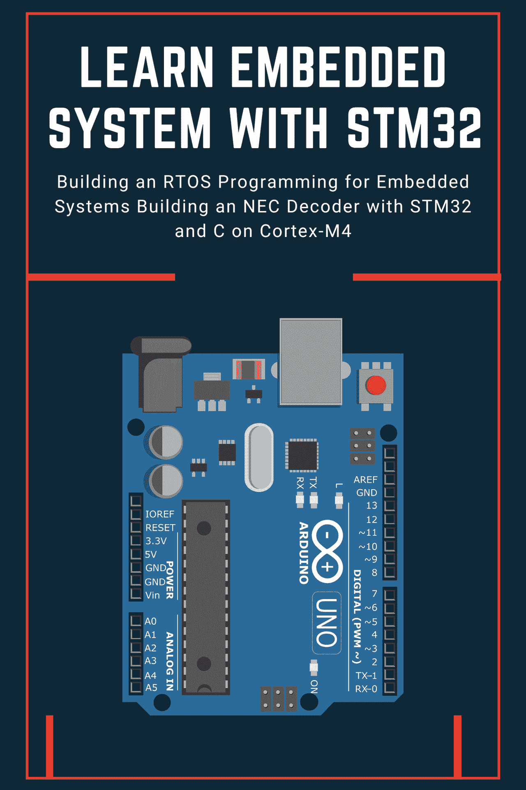


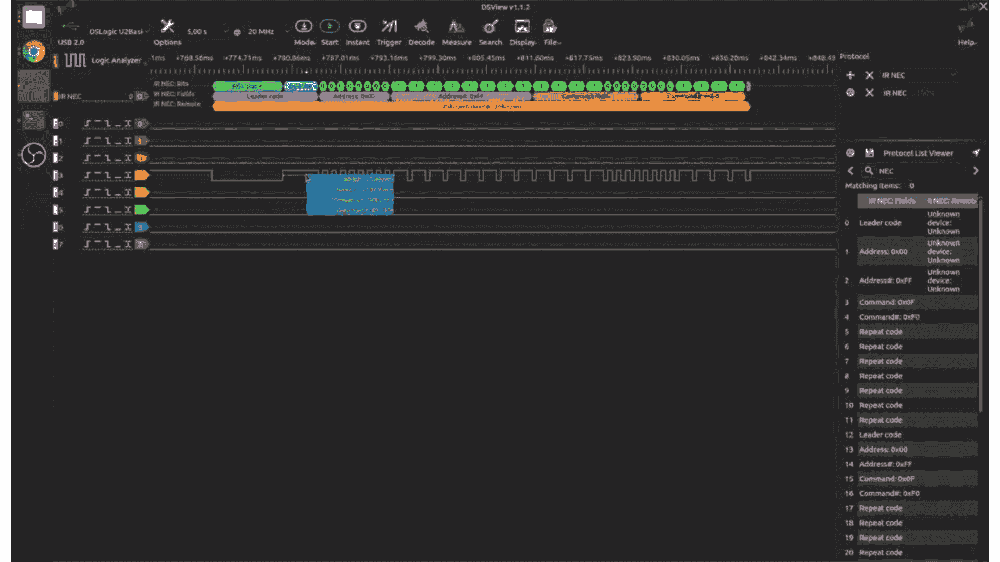

接下来的 8 位是系统地址，随后是 8 位反转系统地址。众所周知，系统地址对应于特定的设备类型。最后是命令，它是系统地址之后传输的位反转。起始位随后是反转的命令数据字段。事实证明，尽管 `NS` 协议定义每个数据脉冲的长度为 560 微秒，但脉冲的实际长度可能有 10-15% 的差异。在我们的情况下，这种真实世界的特征将被很好处理，因此我们不需要担心它。当按下遥控器上的按钮时，命令只传输一次。之后，只要按住按钮，就会发送快速增长。重复码可能由一个 9 毫秒的 HCG 脉冲、一个短 2.25 毫秒暂停和 560 微秒的停止组成。在每个 `NS` 命令中，代理策略的间隔方式使得前端两个它们之间的时间为 108 毫秒。108 毫秒的时间间隔适用于任何 SI 协议中的命令场和重复码场。现在，我们理解了协议中的命令是如何展开的，在开始开始实现并推断我们应该在哪里初始化系统外设之前。

STM32 外设初始化

我们已经对 `NS` 协议进行了简要概述。现在我们需要初始化系统外设。这只是几件事，但它们都是至关重要的。首先，我们需要定义想要使用的系统并在系统中对其进行配置。第二步是初始化输入和输出。连接到红外接收器和 LED 的 `GPIO`。这一步还定义了 `MCU` 如何处理信号边缘和红外接收器输出数据。下一步是选择定时器，它用于测量系统中的时间间隔，例如位长度和暂停。

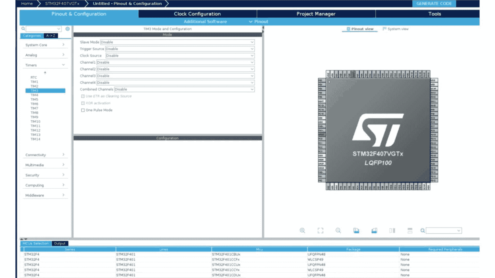

重要的是要这样配置 `MCU`，以便自动处理关键系统事件。因此，将使用系统中断。在本节中将使用两个 `STM32 Cube`。我将导出一个项目，将作为 `NS` 编码算法实现的模板。可以通过编写代码手动配置 STM32 外设，但使用 STMCubeMX 我们可以更快地完成此。然而，我们仍然需要手动进行一些修改。此外，查看 C 代码以更好地理解初始化过程要方便得多。

系统时钟配置

除此之外，我将介绍如何配置 `RCC` 复位和时钟单元。在我们选择频率之前，让我们告诉工具将使用外部石晶。现在，在六时钟窗口内，我们看到有几个系统源：内部 `HSI`、随后的外部石晶和 HSE。对于发现板 `MCU`，默认启用了内部 16MHz 振荡器；我们可以指定 4MHz 到 26MHz 的外部石晶频率。在发现板上使用了 8MHz。在我们的情况下，频率对于 `NS` 协议解码目的是足够的，但让我们让频率更高。为了这样做，外部晶体将与 `PLL` 块一起使用，8MHz 石晶频率将作为 `PLL` 的输入。假设我们需要 168MHz 的健康频率。那么，这个 8MHz 的频率在进入 `PLL` 输入之前会被除以 4。然后乘以 64 并除以 2。

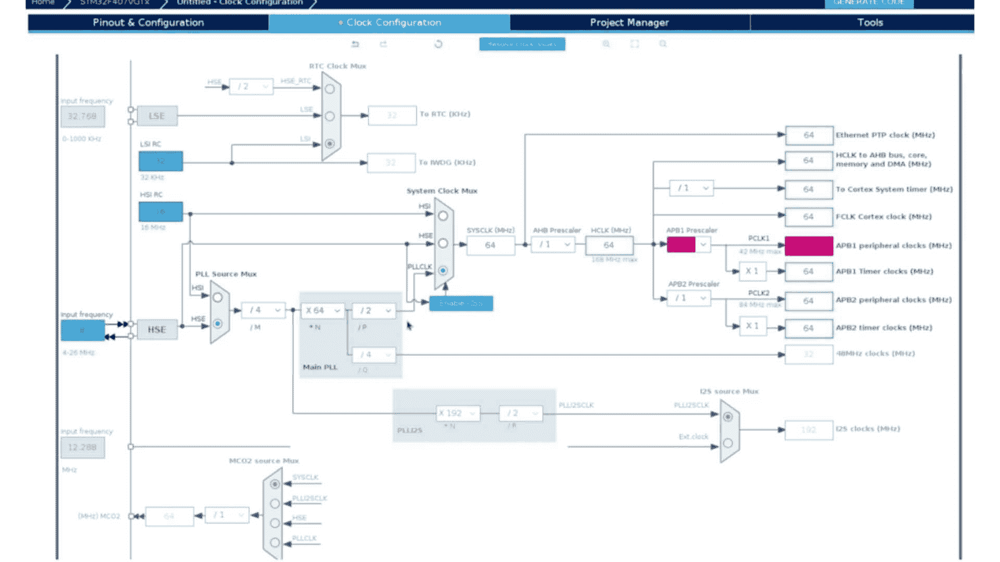

现在 64MHz 的频率是系统时钟频率。与内核不同，STM32 系统外设无法以最高频率运行。例如，虽然最高 `C.P.U` 频率可以配置为 168MHz，然后可以看到外设的工作频率最高为 84、40MHz，仅取决于使用了哪种总线和外设。这就是为什么我们应该将 64MHz 除以 2，以获得 `PCLK`1 总线的健康频率。现在，当前全局重配置中没有明显的冲突，它可以在我们的固件中使用。时钟频率对 G.P.A. 操作没有本质影响。尽管它会影响时间标量值，该值定义了外设输入频率必须除以哪个数字以获得所需的时间间隔、测量和精度。我们将在课程的时间初始化部分考虑这一点。到目前，我们配置了系统内核和外设设备的频率。您可以根据所需的频率配置您的开发板，并在下一节中对它们的单元各种配置进行练习，以发现将要考虑的内容。

GPIO 配置


本节涵盖了 `GPIO`，即你在 College Board 上对微控制器的配置。你的目的是让微控制器与现实世界接口以实现相互交互。在我们特定的案例中，红外接收器和 `LCD` 分别连接到控制器的输入和输出。`GPIO` 定义了它们所到达的位置，即逻辑信号电平或驱动外部负载。这意味着每个 `GPIO` 引脚基本上都可以作为输入或输出。事实上，在 `STM32` 微控制器家族中，有两种以上可能的配置模式。输出和复用配置模式较少，额外的配置选项如推挽（Push-Pull）或开漏（open drain）晶极级。此外，输出、输入模式可能启用或可能未启用上拉或下拉电阻，多种 `GPIO` 配置模式可以选择最佳的应用能力。

一个示例报告将连接到红外接收器输出引脚的端口配置为输入并启用了上拉电阻。虽然接收器在数据引脚上内置了上拉电阻，但这个廉价芯片内部的上拉寄存器被启用了。此外，你可能会想，红外接收器的 `MCU 引脚` 需要上升和下降沿触发检测。这能带给我们什么？答案很简单，通过 `GPIO` 外部配置，它们允许你忘记调用外部中断函数。每当红外接收器输出数据改变其逻辑电平时，这使得大时间和暂停间隔的测量更加准确，并节省你的时间。

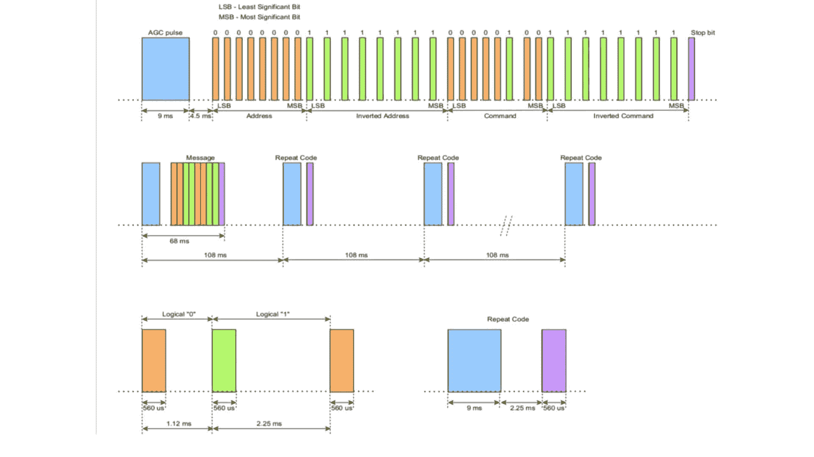

对于 LED，我们需要将 `GPIO` 初始化为输出、推挽模式。在我的情况下，我有额外的八个 LED 连接到 Discovery 板上。如果从零开始计数，从 `0` 到 `4` 以及 `6` 到 `7` 的引脚作为对应 `LED` 的输出。第五位激活具有相同编号的 LED，它源自 `Pols`；这种决策一直以来与板载的一个外部外设存在五个冲突。嗯，板载上的四个 Discovery LED（板载 `DPN` 从 `12` 到 `15`）也作为推挽 `GPIO` 输出在工作。我们可能想要使用这些 `LEDs`。现在系统有了所需的频率，且 `GPIO` 的工作模式与外部外设连接相对应。

### TIMER_3 基础配置

它们被用于时间间隔测量，`NSC` 解码器将需要单个定时器来测量脉冲及其之间暂停的长度。使用哪个定时器并不重要，我将选择 `Timer3`。在这种情况下，将使用内部定时器，而不是外部。哪个外设连接到 `Timer3` 以及它的频率是多少，我们需要找出这一点。让我们检查一下。查看你的数据表。正如之前的 `LC` 初始化部分提到的，外设的频率需要注意，以选择一个有效的时间标度值。如果我们打开参考手册页面，那里有 `A`、`B`、`B` 一个外设时钟，然后是寄存器的位描述。我们将看到 `timer3` 由此寄存器启用，它对应于 `APB1` 总线并进行倍频缩放。在 `STM32` 中，如 `Biomax` 在 `RCC` 窗口所示，我们可以看到所有 `APB1` 部分的定时器将获得 `60` 的健康频率，包括 `Timer3`。现在回到定时器初始化程序来定义标度，嗯，我们必须知道 `APB1` 总线频率和需要测量的最短持续时间。在 `NSC` 协议中，我们有 `560` 微秒的最小脉冲长度。假设我们希望定时器测量的时间测量精度为 `10` 微秒（最小时间间隔），那么 `10` 微秒周期的频率为 `100 千赫兹`。

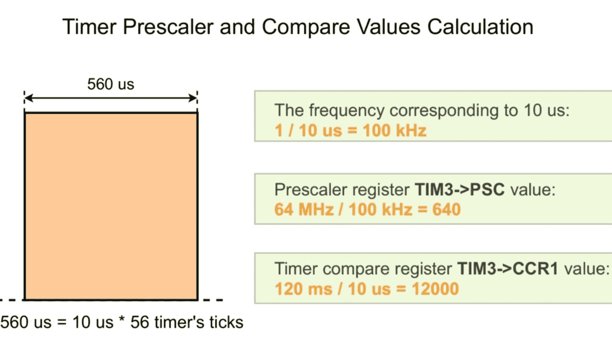

我们可能不需要这么高的精度，但让我们先保持这样。`640` 是 `64 兆赫` 健康定时器的时间标度值，低频率以获得 `10` 微秒的时间分辨率。让我们在 `timer3` 初始化期间使用此标度值。确保系统已返回初始状态以准备接收和解码新的政府数据至关重要。现在我们需要处理超过 `120` 毫秒未接收到策略的情况。简单来说，需要助手超时，实现此点的最佳方法是使用定时器比较中断，当时间到达寄存器中的值时触发，该值是存储在输出比较寄存器中的 `120` 毫秒值。定时器值和比较值都需要设置为 `12000`。由于计时的复杂性，某些参数需要调整编码，这将有助于我们更好地理解它的工作原理。

### 嵌套向量中断控制器介绍

本节将解释如何全局启用中断并分配它们的优先级，该向量中断控制器或简单称为 `NVIC` 是 Cortex 处理器的高级中断控制器，与 Arm 架构紧密耦合，visi 启用动态中断优先级排序和低延迟中断处理。`NVIC` 中断是抢占式的。这意味着高优先的中断将被 `visi` 尽可能地处理，即使一个低优先级的中断正在处理中。这意味着低优先级中断的上下文将自动推入栈中，直到高优先级中断完成。当高优先级中断帮助测试时，低优先级的正确上下文将恢复。对于我们的 `NSC` 协议，嵌套公平性中断优先级对于其集成到其他项目中并不重要。你可能需要稍微尝试一下中断优先级。

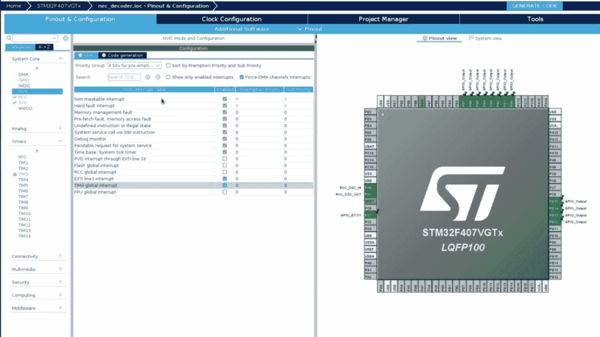

现在，我们必须在流中启用 `line1` 和 `time3` 全局中断。`Bemax` 将你在屏幕上看到的所有标记符放在一起。我将为这两个中断分配相同的优先级 `7`。在项目管理窗口的高级设置中，将硬件抽象层更改为低级（`low level`）。在工具链中，选择 `Makefile`。栈（Stack）和堆（heap）说不应更改，然而，即使你更改了，也不会影响工程代码操作。给项目命名，选择其位置并点击红色按钮。现在我们的模板已经准备好了。我们将在下一节继续编写代码。

### 为 ST-LINK 修改 Makefile

这节简短课程介绍了简化版 `SDM` 所需的 Makefile 修改，两个 `MCU` 烧录通过一个简单的命令使用 `stlink` 作为物理接口。`Esteve` 命令行工具将用户的远程二进制文件烧录到 `Maraba` 控制器中。该固件将二进制文件写入控制器闪存中的特定地址，文件将在系统重置后从那里开始执行。在 `STM32` 微控制器中，闪存起始地址为十六进制的 `08000000`，该政府将二进制文件写入此地址。

让我们将注释存储在 `makefile` 中。要在命令行中调用此注释，我们应该输入 `make flesh` 并按回车。另一个实用的注释是擦除整个闪存数组，如果你不确定闪存内容类型，在命令行窗口输入 `make arrays`。


本节介绍了一个用于我们内部城市代码结构和描述的项目。沙特驻古巴大使 Max 生成了一个项目模板，其中包含以下文件：Mansi 主页（以及你看到的 Iasi）、`NCAR` 页面和 `Makefile`，以及一个类似的 `start up` 脚本、一个包含中断处理程序的文件、一个包含特定系统函数和调用栈以及外设驱动程序的系统文件。`NSCLC` 文件包含编码器的函数。为了保持条洁并将逻辑集中在一个处，中断处理程序已移动到 `NCAR` 文件中，此 zip 代码库将不会在本课程中介绍。重要的外设驱动程序将在某种程度上进行解释。

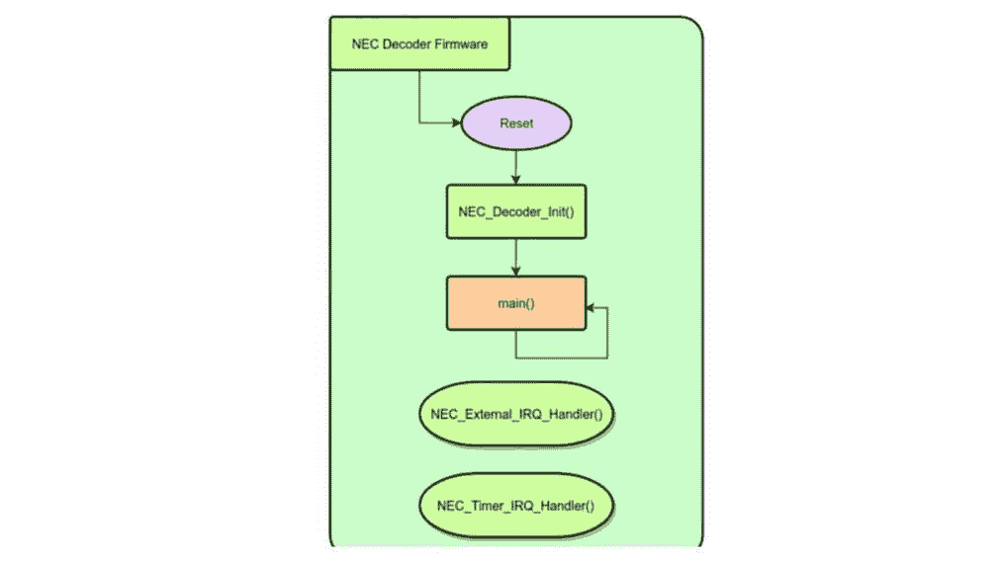

现在让我们来看一下固件算法。在顶层，固件由几个函数组成。上电周期或硬复位会导致固件从 MCU 闪存器中的此特定地址开始执行，而该地址就是中断向量表所在。如果我们打开并汇编 `start up`，可以看到中断向量被分在不同的部分，第一部分包含系统异常，第二部分包括系统中断。这两个部分之间的主要区别是，异常与 ARM Cortex CPU 内核有关，而中断则由微控制器外设驱动。系统可访问空间中有一个跟踪器，最终跳转到汇编文件中的某个位置，该位置标记为 `reset handler`。在这里，指针寄存器被初始化。该指令将该常量加载到此检查寄存器中。请注意，汇编语言是不区分大小写的。

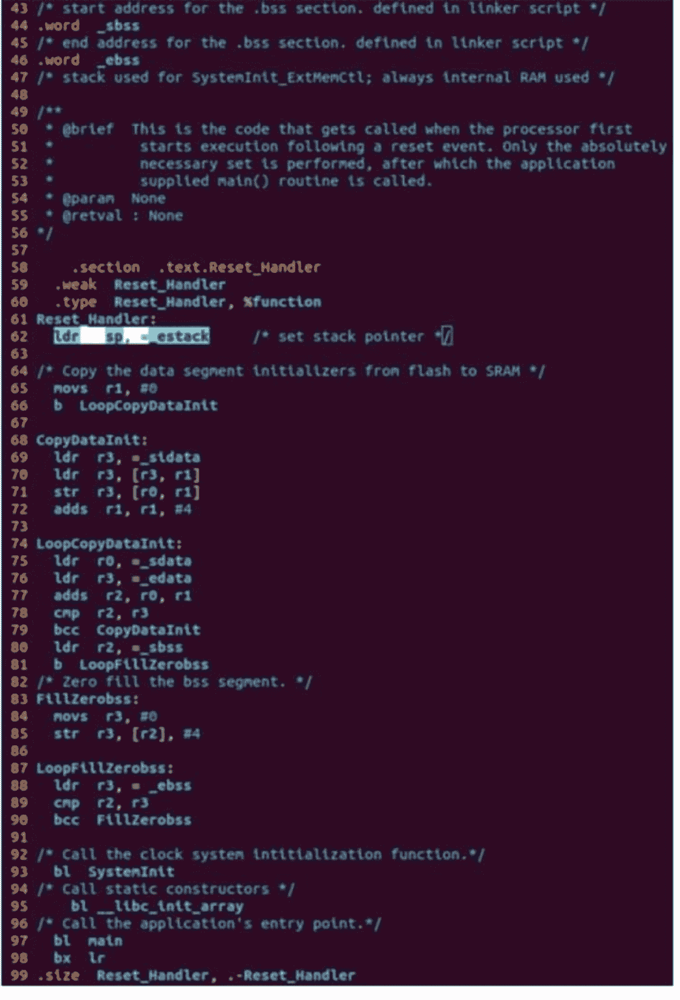

你可能之前已经注意到，这里的这一点是，该常量位于异常向量表中该向量之前。如果你打开 `Lincoln script`，你会发现该常量值以十六进制形式表示为 `200000`。该常量代表状态器所在的 RAM 地址。然后程序调用系统 `main` 函数。从 `main` 函数开始，程序调用 `NSC` 协调函数，该函数初始化了系统时钟、硬件定时器和中断。在图图中，能量 I 控制器的初始化是分开显示的，但在代码中，`GPO` 的函数包含了 `X. want` 中断的 ADC 逻辑。最后，调用 `time`。

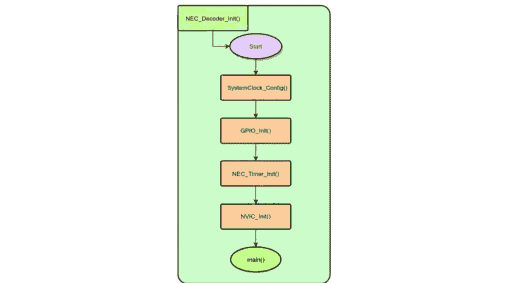

用于定时器的函数。这种代码编写有助于将所有必要的中断保持在一个处，每个外设都有相应的函数。然后主程序跳转到无限 `while` 循环。然后你会看到固件包含了中断处理程序，外部中断处理程序和定时中断处理程序，`NSC` 解码固件完全是中断驱动的，对于其未来集成到现有代码中非常有益。此外，中断可以在 `NSC irh` 中断时为它们分配优先级。

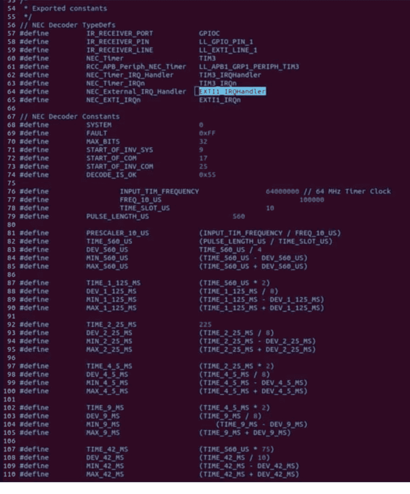

为了内部城市代码编码的需要，向量名称已被重新定义。在汇编后的 `start up` 中，你可以看到我想参数处理程序中断向量对应于外部中断，为红外接收器数据引脚配置它。同样，定时器 `three` 处理中断向量对应于选定的定时器 3。当红外接收器输出在持续遥控命令传输期间改变其逻辑电平时，便会触发 `NSC external ArcView Handler` 函数。然而，由于系统地址和命令解码或重复代码接收，其功能行为是不同的，固件重置 `time resculpting register` 寄存器以避免定时器中断触发。定时中断处理器的目的是将 `NSC decoder` 变量恢复到初始。当遥控器没有发送任何脉冲超过 120 毫秒时，会发生助手超时。系统超时触发定时器中断，在这种情况下调用 `timer, or if you cannot function` 函数，这种情况在释放遥控按钮后发生一次。

### 时钟配置函数

现在让我们来看 `RCC` 单元初始化序列。在 `STM32` 微控制器中，遵循正确的初始化序列以获得预期结果至关重要。例如，参与系统操作的每个外设单元都必须启用其时钟，否则外设配置寄存器无法通过初始化值保留。一个名为 `config` 的系统函数默认初始化系统块，系统其 `Gloc` 源自内部 16 MHz 的频率以便以后使用。我们的任务是配置 64 MHz 系统时钟频率。由于 ARM Cortex CPU 和内部闪存器以不同的频率工作，闪存器接口、延迟和电压缩放需要进行相应的调整。

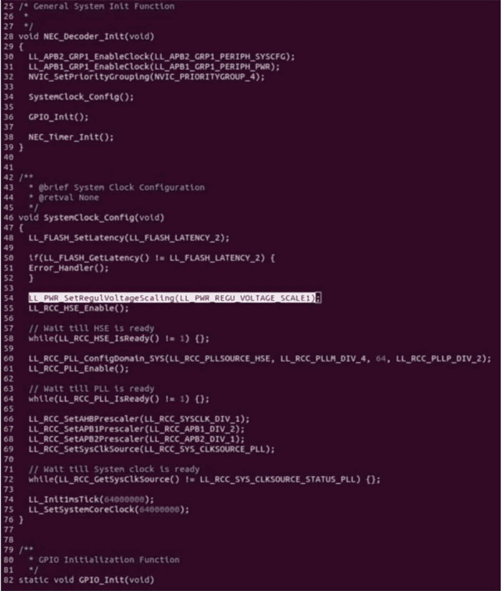

考虑到电源值和选定的 CPU 时钟频率，我将使用 `SDM to Cuba. Max` 提供的值。然而，对我们来说重要的是，第一步是通过此函数 `alert to enable function` 启用外部 MHz 频率晶体。`PLL` 输入将外部晶体频率作为输入时钟。当外部晶体稳定并准备好使用时，`PLL` 输入频率、分频和倍频系数根据 `SDM 30 to Cuba next to` 中的设备时钟三个参数进行选择。在 `PLL` 启用并稳定后，可以使用它，因为其输出频率不能超过外设单元支持的最大频率。`RCC` 初始化介绍提到 `STM32` 内部外设支持 84 MHz 或 42 MHz 最大时钟频率。因此，预分频二分 `APB1 Bus` 总线时钟频率。现在，64 MHz 的 `PLL 时钟` 可以被选为主系统主时钟，系统外设可以使用它。这结束了 `RCC` 单元初始化序列的描述，但如何确保我们选择了正确的 `PLL` 频率，即精确对应于 64 MHz 的频率呢？最简单的方法是使用定时器中断处理程序。

### GPIO 和外部中断测试


我知道板初始化需要更多的关注。第一步是启用所有 iReports 的时钟。从 0 到 4、6 到 7 以及 12 到 15 的输出位被写入零，以便在 G.P.A. 初始化后切换 LCD。糟糕蜂响的 5 也是如此。这是通过向端口和端口位、复位寄存器写入特定值来实现的。对于引脚，G.P.A. 是输出，推挽输出（Push-Pull）。`GPA` 端口模式寄存器启用选定的引脚作为输出工作，而 `GPA` 输出类型寄存器则选择推挽输出 `GPA` 运行模式。区别在于 Paudie 使用了初始化结构，但板使用的是直接写入板级寄存器。可以在不使用结构的情况下，通过直接写入寄存器来实现此配置。输出不使用上拉和下拉电阻。输出速度寄存器定义了 `GPA uSwitch` 的速度，该寄存器有其默认值。系统配置控制器用于管理连接到 `GPI` 的外部中断线。由于我们在 MCU 中使用了 `I want interrupt vector`，系统配置中的一个寄存器被写入了 `0010 0010` 的值，因为它启用了外部中断的精确位。边缘检测配置通过在上升沿和下降沿触发选择寄存器的 `T one` 位中写入逻辑 1 来完成。

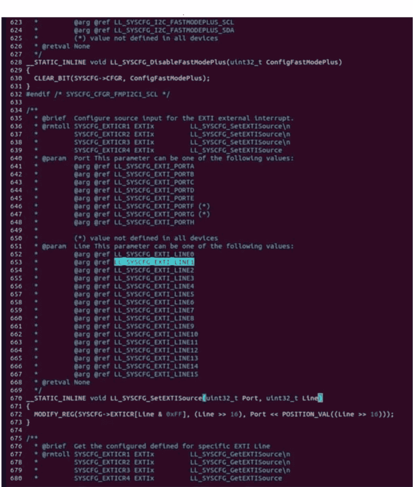

下一步是将 `PC one` 引脚配置为带上拉电阻的输入，尽管红外接收器本身包含一个连接到其开漏输出的电阻。启用它们的上拉电阻也是好的。为了做到这一点，将 `LG your setting pull right away 01` 写入端口中的 `Pupi the are one one two zero` 位域。上拉下拉电阻。直接将 `0` 写入 `moat are one one two zero` 域字段（或 `Pawsey` 对应的端口输出寄存器），将 `P.S. one` 引脚配置为输入。现在，`GPA` 的外部内部配置已完成，现在 `NYC` 单元需要配置以检测外部中断并将其传递给 Cortex。这里需要两行代码：一行在系统互操作性中初始化，另一行在 `visi` 中注册中断向量。外部中断处理函数名为 `NSC, external HQ handler`，记住中断处理程序从不接受或返回任何参数。现在是测试我们的配置了。`G.P.A.` 宏使代码更具读性，它只是重新定义了外设库函数。让我们在 `main` 函数中创建一个简单的循环，并向端口引脚写入一些值使它们闪烁。然后让我们刷新它们给你，如你所见，`Elida` 输出引脚按预期工作。现在需要测试外部中断触发，`Lentulov handler` 需要两行代码来清除 `NBFC` 和 `I controllers` 中的外部中断标志。这可以避免在中断发生后连续调用中断处理函数。

# 定器初始化与中断测试

`timer three` 的初始化更加详细。在 `initial timer init` 函数的开始，`timer three` 状态被恢复到复位状态。在 `RCC, EPB, one peripheral clock` 中启用 `time or three ended` 并已注册，这激活了定时器外设时钟。该语言预处理器在代码编译前计算出一个用于 10 微秒分辨率的时间标量值。

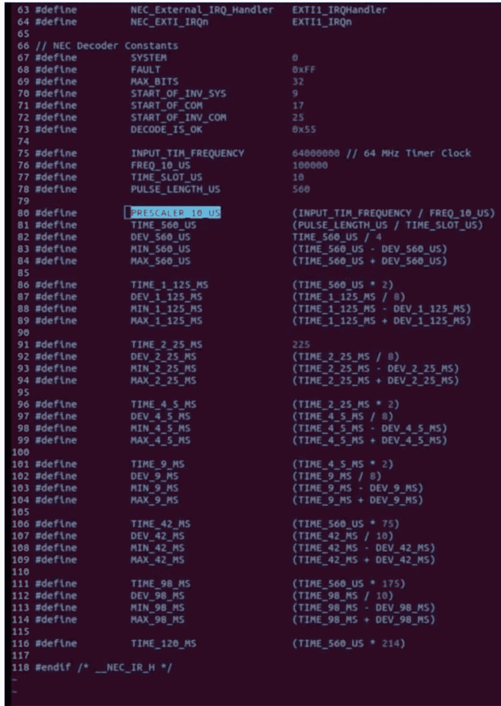

`60 former first timers put frequency` 除以 10 微秒对应的频率，等于 100 千赫兹。通过这种方式，计算出 640 的重标值，并将写入 `16 bit time three a little` 寄存器。这允许定时器每 10 微秒加 1。接下来的参数表示 `Timer three` 将作为一个向上计数器，为此，`timer control. Register one` 中的一个位返回 0。`time to reload the register` 包含最大可能的计数值，其十六进制形式将为 `FFFF`。紧分器分频结构字段定义了时钟时间与类似于时钟的数字域之间的比例。在我们的情况下，它们的频率相互匹配，并将零写入 `timer control register one` 中的 `second one to zero` 位域。

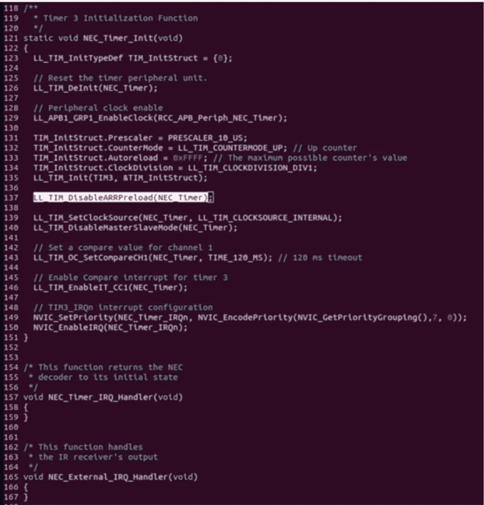

并且不重载，`timers function` 未被使用，该函数禁用了它。向 `time or slave mode, Control Register` 中的 `Easy and Smith two to zero beats` 写入零，选择内部时钟作为 `timer three` 的输入时钟。后续函数禁用了同一个 `timeously remote control register` 中的 `MSM` 位，这意味着 `timer three` 未同步。这些定时器。比较值是内部解码器的基本参数。`Timer three` 有四个比较通道。第一个第一个比较通道将用于一个名为 city 的调用中。当比较值匹配 `timeless countless value` 时，输出比较事件将触发 `timer three` 中断。

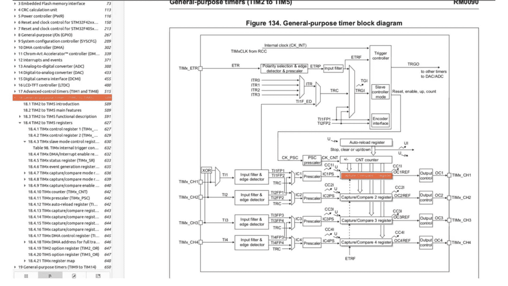

对于 120 毫秒，预处理器计算出的无时性比较值为 560 微秒时间槽乘以 214 等于 11984。11984 乘以 10 微秒时间槽，为初始记录给出一个大约 120 毫秒的超时周期。得到的值 `11984` 被写入 `time of three. Capture compare register one`。最后一行代码是 `timer three, Channel one` 的中断激活函数。它启用了 `time three, interrupt` 中的 `issue one I` 并注册了它，使比较中断对 `NDIC` 可见。现在，`NBA` 需要初始化以全局启用此中断系统，原理与外部中断相同。`timer complaint dropped` 被分配到系统优先级，并在 `NSC timer init function` 结束处通过两行代码注册。`any Eric Handler function` 是定时器处理函数。整个 `NSA` Cordy 的定时器初始化过程完成。为了触发中断，比较值将临时更改为 1。这种比较值的更改将证明秒测量精度的无时标准。正如我们处理外部中断标志和定时器中断一样，我们清除必要的中断标志。`orange alert macro` 将再次用于更改状态。将逻辑 1 写入 `timer three control register` 中的 `sea and bit` 位激活 `county remote in time or three`。在内部 city 代码算法中，外部中断器将触发此定时器。

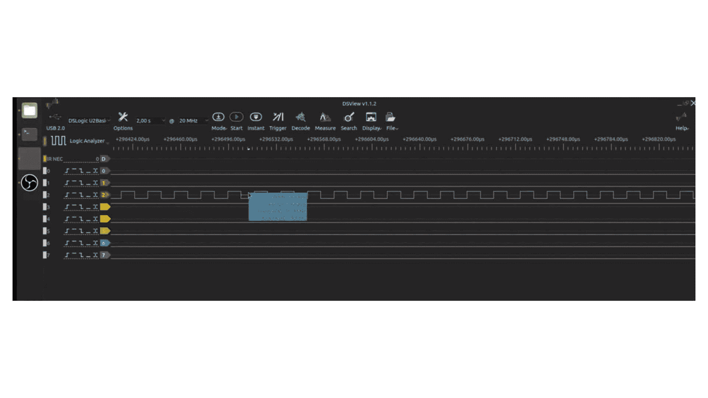

`low level timer had down to function` 重置定时器和三个计数寄存器值。如果我们编译并将二进制文件运行到 MCU，每当 `timer compare interrupt handler` 被调用时，橙色女士都会收到通知。如果我们记录任何时间并在生物分析图中查看，然后检查此图表，我们可以确认中断发生的时间确实每 10 秒触发一次。让我们将比较值改为其默认值。现在我们看到女士每秒闪烁几次。微小的时间偏差对于时间生成并不是关键的。现在我们已经为你初始化了它们，可以开始实施并观察这四部曲。感谢观看和积极参与。

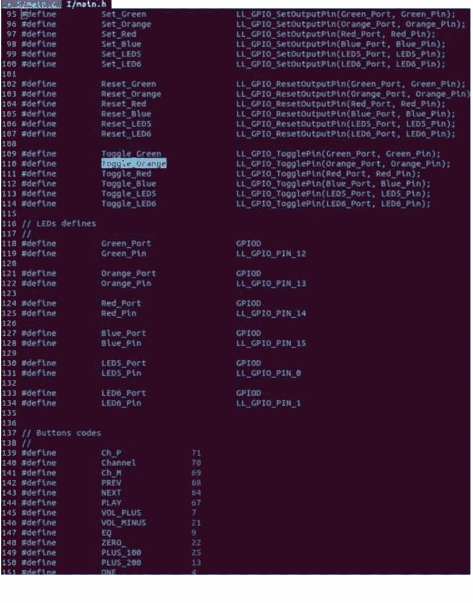


橙色切换宏的字，当外部 Interop 处理函数被调用时的最新状态。现在将二进制文件导入 MCU。逻辑分析仪可以帮助比较红外接收器的输出引脚和最新的计时图，通道三显示红外接收器的输出状态，而通道二连接到。如果我们按下遥控器上的任何按钮，我们可以看到橙色警报在闪烁。图表比较确认了橙色的每个状态变化都与其对应。我需要外部中断。从示波器记录的时序图显示遥控器的位值没有反转。我们看到两个菱形图都是反转的，但它们彼此完全对应。

# NEC 协议主解码逻辑

将解释称为核心逻辑来实现的初始化，假设 NSA 解码器是完全中断的，驱动器可以包含解码算法逻辑。让我们先考虑外部 Interop 处理程序的算法。正如之前的课程中提到的，当红外接收器输出数据引脚电平变化时，就会调用外部中断程序。上升沿和下降沿都会触发外部中断，每当此中断发生时，就会触发中断，已知测得的脉冲长度和当前解码器状态，系统就可以理解当前从遥控器接收到了什么种数据。首先接收引导脉冲并测量其长度，接着是一个 4.5 毫秒脉冲。然后解码系统地址和发送器系统地址，命令和反转命令的解码也是如此。当系统地址和命令都接收后，NSC 解码器持续检查重复代码的接收。每当接收到重复代码时，重复代码计数器就会加 1。现在，如果释放遥控器上的按钮会发生什么？它们仍然会中断，但在这种情况下将不再被调用，且时间不会为新的测量周期重启。

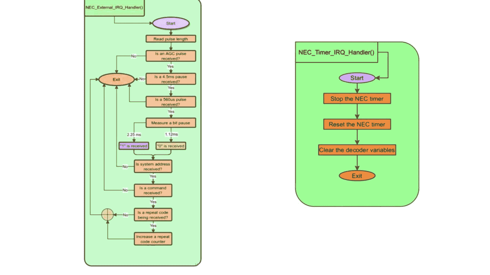

如果 120 毫秒内没有接收到脉冲，则定时器三比较中断会被调用，并将 NSC 解码器返回初始状态。但让我们更深入地分析外部中断处理程序。当调用外部中断时，定时器和可视中的中断标志位都会被清除。然后将定时器的计数器值读入变量中，该变量值定义了传输中两个邻接边缘之间的长度。当遥控器传输 38 千赫兹频率时，接收器的输出为零。Litchfield 检测到的边缘不会提供测量结果，因为定时器在此阶段已停止。定时器在看到上升和下降沿时通过定时器三控制寄存器 1 启动。第二天，系统地址结束端被分配给此系统，逻辑等待接收器的下一个上升沿，当边缘到达时，到了记录寄存器值的时候。测得的该值为 9 毫秒，定时器重启以测量 4.5 毫秒的暂停，并将解码阶段改为短暂停。

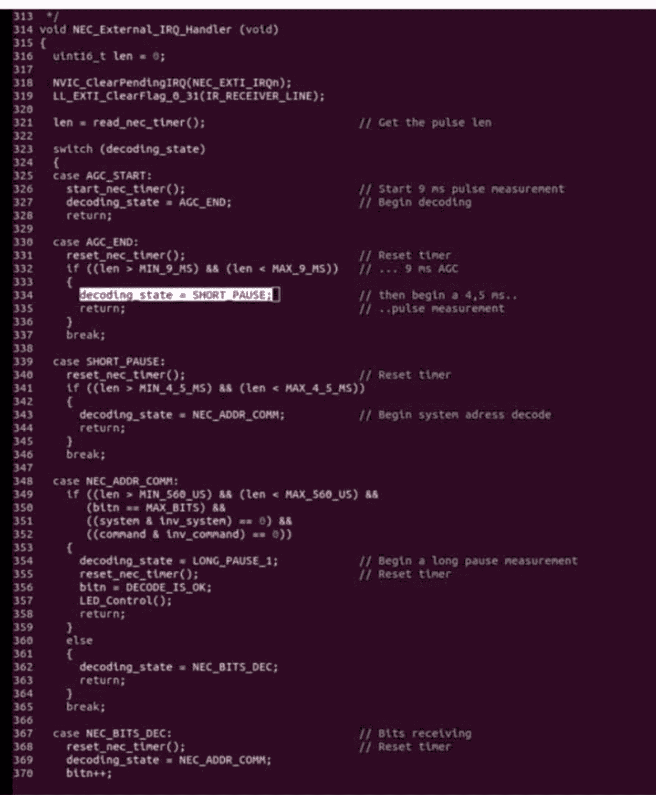

当检测到第一个接收的系统位的前沿时，在进行位长度测量之前会测量暂停长度，随后的状态和地址命令被分配给解码器状态机。因此，当后续边缘开始新测量时，已知每个高或低逻辑电平的长度。在 4.5 毫秒脉冲之后，接收到系统地址的第一位，固件将检查脉冲长度。之后在 NSC 解码器的编码部分，测量暂停。2.25 毫秒的暂停周期对应接收到的逻辑 1，而 1.12 毫秒的暂停间隔是逻辑 0。当接收到所有地址和命令位后，解码器进入长位结束状态，重启定时器并期望接收重复调用，并调用控制以更改精英状态。在第一次重复调用之前，接收到约 14 毫秒的脉冲。然后是逻辑脉冲，在 2.25 毫秒空间和 500 微秒突发之后，随后是 40 毫秒的暂停。然后解码状态变为长位结束，在约 98 毫秒处再次接收到重复代码。每当接收到重复代码时，重复代码计数器加 1，重复代码计数器在测量遥控器按钮按了多久时很有帮助。在此阶段，在释放遥控器上的按钮之前，系统中没有发生其他事情。当遥控器超过 120 毫秒没有脉冲时，定时器的比较值匹配时间计数器寄存器值，触发定时器比较中断。首先，定时中断处理程序关闭，中断停止，定时器三清除其内容寄存器并为 NSC 解码器准备接收下一次命令。然后将其指示变量返回初始状态，调用函数并调用控制以更改精英状态，此时，定时器中断处理程序不再做更多。后续的定时器启动将在再次按下遥控器按钮时发起，在下一节课程中将分析用于 AC 协议解码的几个辅助函数。

# 辅助 NEC 解码函数

这些函数用于提高计数能力和更改状态。需要注意并被 NSC 解码器使用的前两个函数是所知的，是接收和一个接收。这些函数接收值到系统中的系统地址、命令和反转命令变量。逻辑 0 或逻辑 1 被告知通过右移七位生物位是最低效的。使用位移运算符 `>>` 来产生逻辑 0。可能两次使用 `|` 运算符来存储逻辑 1。

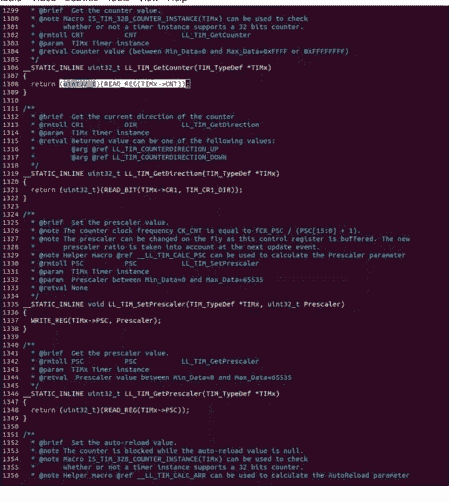

作为启动和停止 AC 定时器的函数表示指向低级外设驱动程序的简单抽象接口。这些函数启用或禁用定时器三控制寄存器 1，从而启动或停止计数。一个函数返回定时器计数寄存器值。一个函数我们设置定时器重置定时器计数寄存器。一个函数获取一个状态并检查命令是否已解码，函数获取任何系统状态和获取任何命令状态，提供了编码的系统地址和命令。功能控制权限命令到端口 A 和端口 B，如果此时按下遥控器上的相应按钮，我们已经恢复了辅助函数。

# NEC 解码器测试

现在我们准备好在两个 Discovery More 之后测试我们的新系统解码器。如果在权利权限部分打开文件，我们可以告诉编译器代码应该优化到何种程度。我们有几个编译器优化级别供我们选择：`-O0` 针对编译时间的优化，`-O1` 针对大小和执行时间的优化，`-O2` 和 `-O3` 更多代码大小和执行时间的优化，`-Os` 针对代码大小的优化，或每个编译器优化选项。

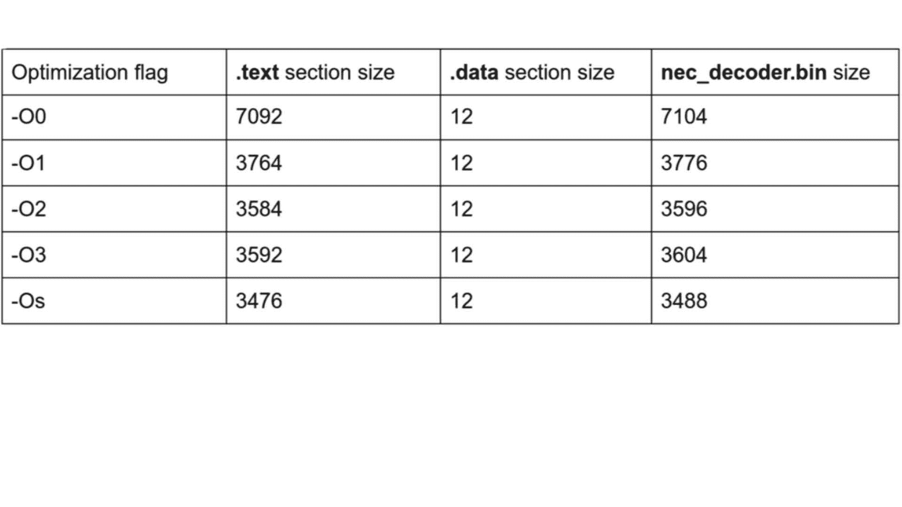


我们将得到不同的代码大小并看到你的可执行文件。二进制文件的大小由我编译的文本段（text section）和数据段（data section）组成。通过查看不同优化选项的代码，可以看到不同的编译器优化级别提供了不同的文件大小，而且优化级别并不越高越好。

让我们在不进行优化的情况下编译代码。通过输入上个月的文件名 `filename`，我们可以检查到二进制文件的大小恰好为 7104 字节，这证实了一切都是正确的。文本段为 7092 字节，而数据段为 12 字节。然而，（这种）优化提供了最小的输出二进制文件大小。

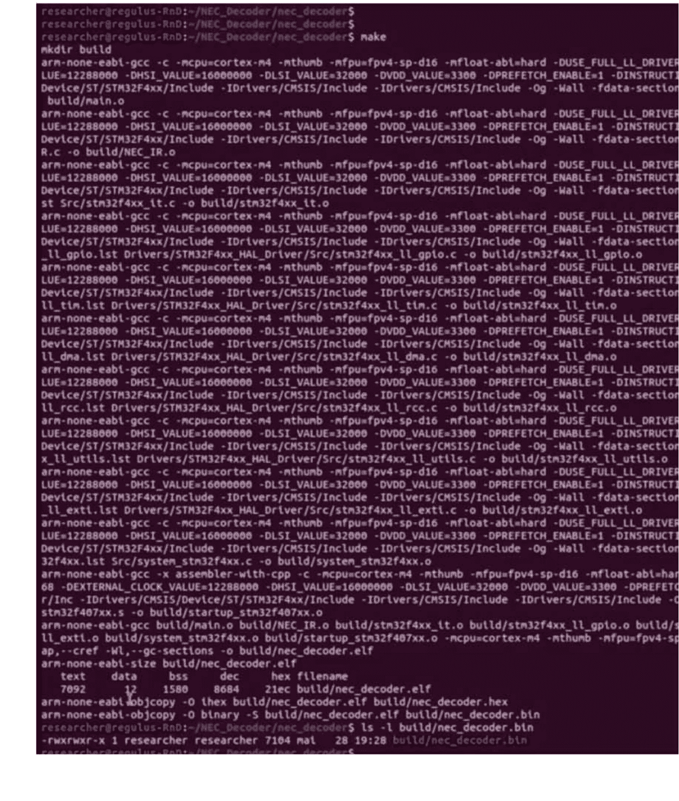

它连接到发现板（Discovery Board），表示它们收到了遥控器的指令，并且当遥控器上的按钮释放时，灯会关闭。发现板上的某些按钮控制着每日新闻（Daily News）。因此，如果我按下待机按钮，就可以激活其他按钮、静音输入和更改声音。它们是橙色、红色和蓝色的 LCD。通过更改每个 `main` 文件中定义的名为 `constants` 的按钮，可以将不同的按钮分配给控制 LCD。

## 什么是 RTOS


# 让我们开始分析什么是 Artist 以及它的作用

`Artist` 代表实时操作系统（real-time operating system）。如果你愿意的话，对实时操作系统一个非常简单粗暴的定义就是：它在正确的时间做正确的事；否则，事情就会变得极其糟糕。

在很多地方都能找到实时操作系统的例子。事实上，如果你现在正盯着屏幕看（我觉得你很有可能这样做），那么在你屏幕的背后，应该有一个微控制器，而这个微控制器极有可能正在使用一个实时操作系统来执行它的任务。当然，里面也可能有其他东西，如果你有一个无线鼠标，它会有一个操作系统。如果它有操作系统，那么它也会是一个实时操作系统。

## 实时系统的类型

实时系统有不同的类型。如果你在屏幕上看到一架战斗机，有趣的一点在于，如果这架战斗机出了什么极其糟糕的错误，它可能会从天空中坠落，或者做一些愚蠢的事情，比如在不该发射的地方发射导弹。它的装备非常齐全；通常战斗机都配备了大量的导弹。

如果这么说，实时操作系统实际上有不同程度的“实时性”。在你使用实时操作系统时，可能会发生不同类型的错误。如果你为一架战斗机配备了真正的硬实时系统，你必须以不同的方式来设计你的系统，而不是像为洗衣机、鼠标或灯泡之类的设备配备实时操作系统那样。

如果你有一架战斗机，有很多事情可能会变得极其糟糕。然而，如果你的灯泡比正常时间晚了 10 毫秒亮，那是没问题的。但是，如果一架战斗机执行某项操作比应该的时间晚了 10 毫秒，结果可能会非常糟糕，后果不像你想象的那么简单。

所以，是的，你可以使用实时操作系统，而且有很多实时操作系统。事实上，创建一个实时操作系统让它以非实时的方式运行是可能的。这意味着它通常可以正常工作，但对于相对于输入何时完成反应时间的时间容差可能非常松散。你会说：“我按了一个按钮，动作发生在 100 毫秒内还是 500 毫秒内其实并不重要”，而在不同的用例下，你可能会说：“当我 25 微秒内按下这个按钮时，我必须有反应。”在汽车工业或航空航天领域就有这种情况。

## 任务与资源管理

`RTOS` 提供许多抽象结构，帮助以及时且可预测的方式监控不同任务的执行。它创建并管理不同的任务，这些任务也被称为 `threads`（线程）。你可能会听到我谈论 `tasks`（任务）、`threads` 或 `processes`（进程），这三个词在整个 RTOS 课程中会交叉使用，用于定义某些抽象结构来管理对串行可复用资源（如内存区域、网络等）的访问。

这里的理论是，例如，你可能只有一个网络端口或只有一个 `UDP port`，然后你有三个不同的 `processes` 用于不同的 `threads` 想要与这个端口通信。因此，操作系统实际上会管理对该端口的访问，确保同一时间只有一个进程可以访问它。当然是，如果你有多个进程同时访问同一个 `UDP port`，你可能会遇到数据损坏或运行不正常的问题。你的操作系统提供了一些结构来管理这种访问。

## 优先级与调度

实时操作系统还会准确地对不同的 `threads`、`tasks` 或 `processes` 进行优先级排序；会有不同的优先级。你可以想象，例如在汽车内部，你的窗户开关的优先级和你的 `ABS` 命令不同。如果它们运行在同一个处理器上——通常不会这样，但如果确实是这样——因为当我们按下窗户开关时，晚 100 毫秒响应其实并不要紧。但是，由于某种原因，`ABS` 对某类型的输入多花了 100 毫秒才响应，结果可能会非常非常糟糕，人们很快就会感到非常糟糕。

操作系统还管理所有 `threads` 和串行可复用资源的和谐执行。也就是说，操作系统充当所有需要发生的事情的主调度器，并确保一切顺利进行，并确保一切都相互配合，前提是你程序得得当。

## 操作系统领域

操作系统可以被认为同时在两个不同的领域运行：
1. 其中一个领域是资源访问的变货币化。
2. 另一个领域是主处理器空闲时间访问变货币化。

现在，如果你有一个核心——有多个核心，在某些系统（我们称之为 `chip`）上存在多个核心的可能性——那么拥有一个能够并经过适当编程的操作系统，能够为它的每个 `threads` 或 `processes` 变货币化数据和处理器时间，将是至关重要的。

将 `RTOS` 用于非实时应用是可能的，甚至是常见的，例如洗衣机、自动售卖机或移动电源。即使是管理我部件的非常简陋的应用程序类型，里面也有某种类型的 `RTOS`。我面前的另一个东西是一个计算器，或者里面应该有某种 `RTOS` 在实际管理这个计算器的工作方式。这个 `RTOS` 可能会更或更不复杂，或者某些设备可能是简陋的，但它们极有可能带有一个实时操作系统。问题是，实时操作系统会增加一些进程或开销，因为它当然需要运行它所有的进程，而且带操作系统运行的效率不会比没有操作系统的情况下简陋运行更低。


然而，通常你会发现人们想要一个操作系统，是因为实际上我们现在拥有了非常快的处理器，而且成本非常、非常低。开发一个不使用操作系统的产品的成本，将高于支付额外费用来购买性能稍微强大一点硬件的成本。从长远来看，这在经济上是不可行的。因此，尽管你可以直接进行“裸机”开发，你也会倾向于使用操作系统，因为你的开发成本会更低。

我的第一个双项目是创建某种管理音频放大器的设备，我们实际上所做的是：好吧，让我们在这里投入一点更昂贵的压力（硬件），这样我们就能放下一个操作系统。至于这个处理过程比不使用操作系统要多花一点点钱这并不重要，因为实际上，快速开发和安全地管理进程带来的收益，远大于支付略高且更昂贵硬件的成本。

一个艺术家并不会直接创建一个实时且安全关键的应用程序。你必须知道如何运用艺术来让安全关键型应用程序在定义的时间内运行。例如，如果我穿了一件园艺师的衣服，我就去学了园艺，但这并不会自动让我成为一名园艺大师。园艺是一门艺术，需要付出很多努力才能精通。正如创建适当的实时操作系统以及创建在定义时间内运行的实时操作系统应用程序是一门艺术一样，这需要大量的时间来精通。

# CMSIS RTOS API

在本节中，我们将探索 CMSIS 是什么，这些 API 是起什么作用，以及我们将在整个课程中如何使用它们。本课程解释了实时操作系统，并以 `arty x5` 操作系统作为示例。`RTOS` 是该操作系统的版本名称，而 `CMSIS` 是 ARM 版本的 API，然后我们在 `STM32F4` 系列的 `cortex` 及其微控制器的语文中使用它们。这里值得说的是，正如你在之前的幻灯片中看到的，`CMSIS` 作为 `Cortex` API 同样适用于其他类型的设备，例如 `cortex A` 设备。而且，我们并不限于 `cortex`，它实际上可以在 `cortex M7`、`m3m0+` 以及整个系列上运行。

所以 `CMSIS` 的本质是什么？这些 API 就像一个遥控器，立于我们上层的应用程序代码与运行在实际微控制器上的 `RTOS` 操作系统之间。因此它基本上在操作系统和我们程序员编写的应用程序代码之间提供了一个抽象层。所以我们将编写的所有代码都将为了与 `CMSIS` 作为 `RTOS` API 接口，然后 `CMSIS` 的 API 将与 `RTOS` 操作系统接口，最后 `RTOS` 操作系统再与硬件接口。由于这种编程方式，这一切实际上都是以一种非常高效的方式发生的。所以它实际上非常快。是的，你将直接访问内存位置和微控制器的实际内存，以便在你需要时从应用程序代码中对其进行直接操作。

然而，`CMSIS` API 以及运行在设备上的实时操作系统为我们提供了一些更高层次的功能，我们将在课程的后半部分探索这些功能，你将看到当我们为微控制器和嵌入式实时系统编程时，这些功能是多么有用。所以这个 `CMSIS` API 代表应用程序编程接口（Application Programming Interface），你真的可以把它想象为一个遥控器，它允许你使用一组标准化的和标准化的控制 set 来访问实时操作系统内部的内容，即一组已经写好的标准函数，你只需要学习这些函数，而不需要学习操作系统的复杂细节以及它的具体运作原理并深入研究。

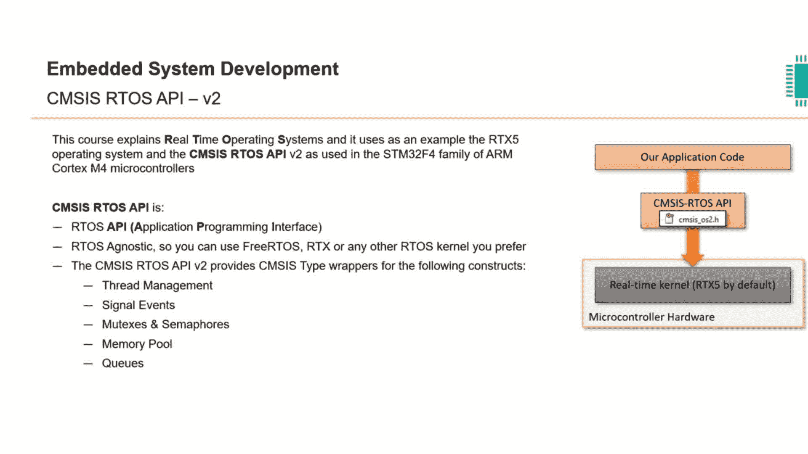

所以实际上这个 API 是与硬件无关（agnostic）的，因此 `CMSIS` API 是硬件无关的。这意味着在你的硬件中，运行 `FreeRTOS`、`ArtifactRTOS` 或任何其他你喜欢的实时操作系统并不重要，只要它与 `CMSIS` 作为 `RTOS` API 兼容，并且你编写的代码与该 API 兼容，就可以了。它将能够运行，完全没有问题。

现在 `CMSIS` API 提供了版本 2，它为以下类型的构造提供了 `CMSIS` 类型封装器：
- 线程管理（再次，我们将在整个课程中更详细地探索线程以及如何管理它们）
- 信号（signal）
- 事件（events）
- 互斥锁访问（mutex access）
- 信号量（semaphore）

再次，我们将通过操作你的内存池、队列等许多内容来详细讨论这些内容。这些就是我们在课程的这一部分将涵盖的内容。我们将解释其中某一项是什么，它是如何工作的，以及操作系统如何帮助你直接操作它们。

# 内存池 (MEMORY POOLS)

现在让我们谈谈内存池的概念以及我们为什么需要它们。内存池是线程安全的内存区域。在这里，我们像之前请求的那样有四个不同的线程，这些线程对内存中自然存在的数据执行操作。现在，这些线程并不一定在特定的数据位上执行操作，可能会在多个数据位上执行操作。一个线程的这些操作可能会在另一个线程同时操作的内存位置上运行，导致数据损坏或数据读取错误。我应该说，除非你以粗心的方式从线程操作数据，否则通常不会发生这种情况。操作系统通常会处理这些此类问题。然而，有方法可以进一步控制这一点，这就是显式内存分配，即内存自然存在于硬件中。


现在，为了防止这种线程使用不属于它们的母内存部分的情况，实时操作系统创建了虚拟内存池，通过隔离内存和保护对独立内存位置的访问来指令独立和潜在相互依赖的任务。因此你的操作系统实际上会创建一些安全区域，并确保一个线程不会访问另一个线程正在使用的内容等。所以你的操作系统为你做了很多工作，你不需要去担心它。相信我，如果你尝试让代码在没有操作系统的情况下运行，你就必须担心这类问题，而这并不是件令人担心的事情。线程内存往往是隐式实现的，所以你并不经常需要担心它。然而，在偶尔你可能需要担心它，这些场合可能是你直接操作内存或从内存映射 I/O 等设备读取内容。所以你有了 `CMSIS` API，它充当你的遥控器。喜欢我程序图标的程序员在这里，基本上通过 `CMSIS` 得到了一个艺术 API。你实际上可以操作内存。更有趣的是，我们将在课程后面会看到，我们实际上可以如何使用操作系统，以及操作系统与你的集成开发环境（IDE）的集成来设置这些东西。这非常有趣。

# 信号量 (SEMAPHORES)


嵌入式系统开发中最为棘手且最晦涩的主题之一就是称为信号量（semaphore）的话题。事实上，这些信号量非常容易理解，有时人们只是会对它们的工作原理感到困惑。因此，我希望能够很好地解释它们。

考虑到它们看起来可能很可怕，某些信号量实际上是抽象的结构，用于管理对共享可重资源的访问，以便操作系统的多个线程能够同时工作；它们可能在不同的时间需要访问串行可重资源或串行复用资源，例如模拟数字转换器。

想象一下我们这里有一个模拟数字转换器，它具有某些通道，让我们想象我们有一个非常优秀的操作系统，周围运行着许多不同的线程。我们有 `thread 1` 需要访问该模拟数字转换器的通道 1，`thread 2` 需要通过 `ABC Channel 3` 访问，然后我们还有 `thread 3` 也需要访问通道 1。实际发生的情况是，如果我们设置得当，操作系统将阻止 `thread 3` 访问 `ABC` 的通道 1，因为该通道目前正被 `thread 1` 利用。所以 `thread 3` 不会访问通道 1，它不应该访问。这非常重要，因为 `thread 2` 可能会将其设置为某些配置并进行测量，而 `thread 3` 可能会将其设置为某些配置并进行测量，且 `thread 3` 的设置可能与 `thread 1` 的设置不同。因此，如果我们让这两个线程同时操作同一个外设，就会导致很多麻烦，特别是当你使用像我们之前解释的那种抢占式操作系统时，一个线程能够抢占另一个线程的执行。所以这里实际上可能会发生很多有趣的事情。

信号量主要有两种类型：普通信号量（normal binary semaphore）和互斥信号量（mutual exclusion semaphore）。我们将详细详细介绍这两者。`RDX` 操作系统是实现信号量的操作系统之一，而 `CMC` API 为信号量或互斥锁与程序员之间提供了一个一致的接口。所以再次，你获得了一个完美的遥控器，这使得无论是 `RDX` 还是其他操作系统并不重要，你只需要学习如何编写代码在 `CMC artist` API 中利用信号量即可，然后 `CMC artist` API 将负责将你的指令翻译成操作系统语言的指令，然后操作系统将直接操作处理器及其外设，并通过一个全面的 API 将一切呈现给你，你可以使用这个完美的“遥控器”来使用它。我是把这个遥控器比作你的 API 或者 API。

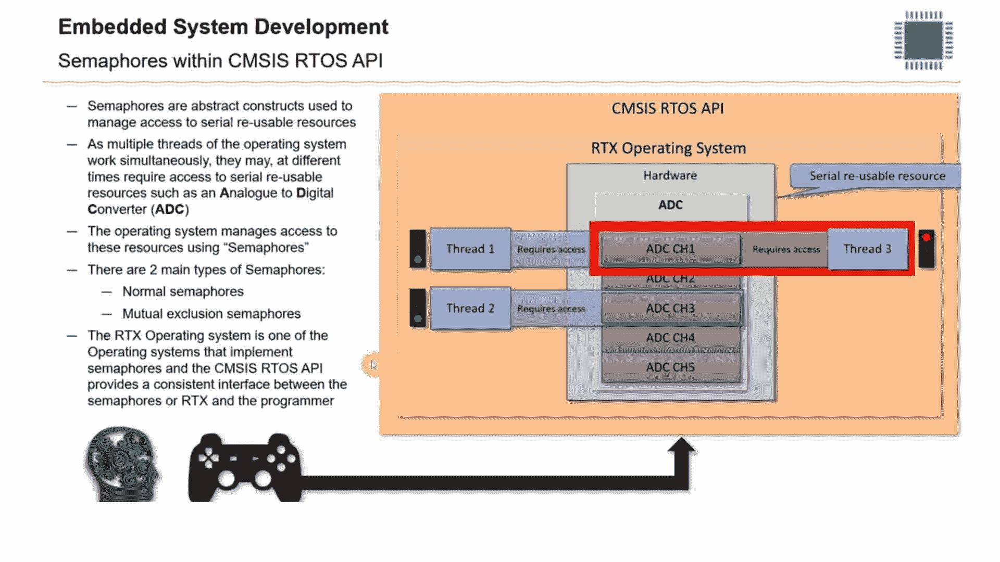

我说对于你这个程序员来说，它看起来像一个遥控器，这对于信号量来说可能没什么意义，所以让我们尝试更深入地解释一些信号量。首先，我们将普通信号量视为一个概念，它可以被理解为一个停车场。想象我们有一个只有四个车位的停车场。这个停车场代表一个串行复用资源。所以我们的停车场里只有四个位。假设在汽车中的对应例子是一个可复用资源，它一次只能被四个线程使用而不能更多。假设你所有的车都在这里，这里有四个位，三辆车进入一辆离开。操作系统管理资源、信号量和线程，当我们把一辆车放入信号量时，它的数值减 1，这有效地表示我们少了一个空位。所以我们放了一辆车，还有三个空位，现在我们向前移动，然后再放入另一辆车，就只剩下两个空位了。是的，你的信号量数值减了。同样，如果我们放入第三辆车，就只剩下一个空位了。现在你的信号量数值是 1。如果如果一个线程在访问串行复用资源之前需要等待，操作系统将进行匹配，让我们假设我们有一个满的停车场，然后另外一些车也想进去。

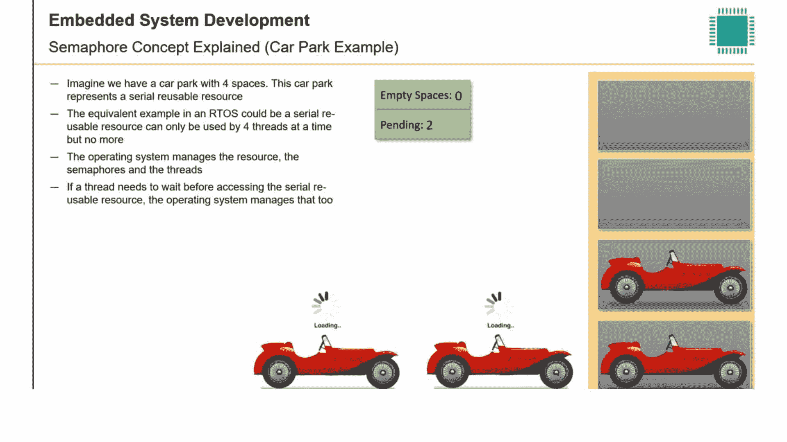

嗯，操作系统将让这辆车等待它需要的时间。其中之一，我们有零空位，并且有一个线程挂起等待以有效利用零可复用资源，或者说有一辆车等待进入停车场，因为停车场满了；然后可能有另一辆车想进入停车场，因为停车场还是满的。所以我们的挂起数量将增加到两个。是的，现在当两辆车离开停车场后，我们就有两个空位，我们现在可以把那些车放进去，实际上，这里的整个移动过程发生了，最后剩下零空位和零挂起。当然，随着时间的推移，这些线程完成了它们的工作，一旦完成，它们就可以释放串行复用资源，或者有效地释放它们在停车场中的车位，这样我们就可以拥有一个空停车场。

## 定器管理

微控制器许多重要功能之一就是硬件定时器或专用硬件外设，它们在自己的角色中测量时间，并且非常准确。这些定时器的工作原理是，当你使用定时器对特殊操作进行计时时，这实际上发生在主处理器之外，因此你的主处理器可以处理其他事情，而你的定时器在后台测量时间，定时器从零向上计数以测量已时间，执行类似于秒表的功能。它们也可以用于提供时间延迟。

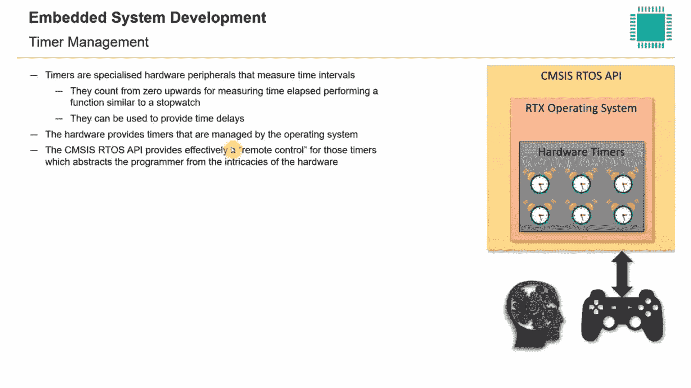

硬件提供这些时间，并由操作系统监控，所以定时器确实离开了硬件，但在我们的案例中它们是由操作系统 `RDX` 管理的，而 `CMC` 实际上为这些定时器提供了一个有效的遥控器，阻隔了程序员与实际管理真实硬件的细节，而这正是幕后发生的事情。

闪烁 LED [自动代码]


# LCD 闪烁简介

这一章节极其重要，因为我们将学习嵌入式软件工程师一生中可能最重要的一件事：如何让 LCD 闪烁。是的，亲爱的朋友们，这可能是我们在本课程中要做的最重要的事情。如果按照某种传统，就像你学习 C 语言时，你学会的第一件事是写 "Hello World" 程序；那么，当你学习嵌入式编程时，我们要学会的第一件事就是如何让眼睛闪烁。这既极其简单，也极其复杂。

因为它非常简单，所以我们将通过 STMCube 开发人员提供的一些现成代码来设置这个示例。所以实际上，这个过程会非常快。设置只需要不到一分钟，但可能需要很多时间来详细解释我们的软件内部到底运行了什么。我们将看到许多正在发生的不同现象、它们是如何运作的、是如何配置的，以及我们使用了操作系统的哪些功能。

## 闪烁的重要性

首先，让我给你们讲一个小故事。我在英国和一位同事共过，他在英国的嵌入式系统社区非常有名，实际上他写过很多本关于如何使用这类设备的书——这里就不点道姓了，因为根据我刚才的话，你们可能已经推断出他的名字了。

不管怎样，很久以前，他正在缝制一些东西。他对我说：“嗯，闪烁 LED 可能是嵌入式系统领域软件工程师做的最重要的事情。”他还开玩笑说，我们甚至可以举办一个比赛，看谁能找到最复杂、最迂回的方法让 LED 闪烁。事实上，尽管我在课程这一节中向你们演示的方法相当简单，但你会发现它实际上利用了许多嵌入式系统概念，终并非那么简单。

## 环境搭建

那么，让我们开始动手吧，让我们去设置它。首先要做的第一件事是像我这里一样打开你的 MicroCube。点击这里名为 `pack installer`（包安装器）的按钮，给它一两分钟时间加载。好的，这其实不需要等。你需要做的是在这里向下找到你尊敬的微电子设备，因为在这个示例中，我们将使用我桌上的板卡，它是一块 `STM32F429`。我发现了一个套件，我们去这里，实际上我不想留在“设备（devices）”标签，我想去“板卡（board）”标签。

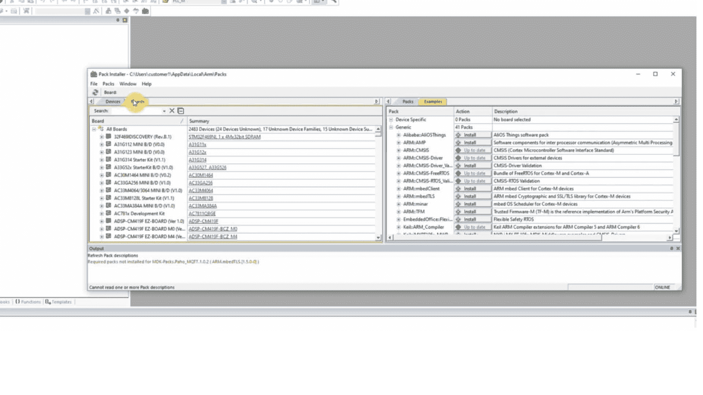

我要进入“板卡”部分，因为这里实际上有许多针对不同板卡的示例和包。让我们搜索诸如 `STM32F429` 这样的设备。这就是我拥有的实际设备。嗯，这可能会让你们先预览一下这里的一个正在闪烁的设备。就是这一个。没错。

我们真正想要做的是，在选择好设备后进入“示例（examples）”，然后选择第一个示例：针对此板卡的 `Sims_is_our_to_Binky`。我们在这里不需要编写任何代码，只需点击此这里的 `copy`（复制），这就会将示例从服务器复制到我的电脑中，我们就可以查看代码，并将代码烧录到连接到电脑的设备或板卡中。我会向你们演示如何完成这一切操作。

你要做的第一件事是复制，然后为这些文件找一个合适的位置。对我来说这似乎是个不错的文件夹。如果我点击它，它显示目标文件夹不存在。你需要创建它。是的，我想创建它。它实际上会创建文件，并且还会打开一个新的 CubeMicroIDE 实例，并将整个项目和所有代码加载进来。

## 代码概述

实际上，我们在这里看到的是一段抽象文本，好的。这只是一个简短摘要，告诉我我的系统运行的晶振时钟是什么，我的系统运行的时钟频率是 `168MHz`。`LCD` 是那个以 `500ms` 固定速度运行的闪烁灯。`button`（按钮）供用户停止或启动 LED 的闪烁。

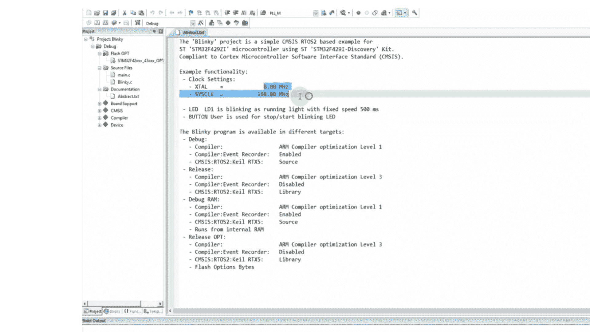

同样，尽管这看起来是一个非常简单的操作，但要实现它可能相当复杂。所以我首先要做的是向你们演示我为 `STLink` 进行的所有设置，它就是这里这个小硬件。这实际上是闪烁板卡。你可以看到左侧有几根线连接到我的电脑，它有效地连接到这里的程序；而在 `STLink` 的右侧，我们有屏幕。现在，在屏幕下方某个地方有主微控制器。好的。这个主微控制器连接着这三块 LCD，你可以看到它们已经在这里闪烁了。是的。所以我现在要向你们演示如何将其作为 `link`（链接）配置到后端。这是连接到调试器的链路。实际上，你可以看到这里的这个接口（tip）。有趣的地方在于，这些板卡涵盖了我购买的这套整体开发套件的关键部分。它有一个板载调试器，所以这个 `tip` 调试器是板载的。也可以使用独立的调试器，那是一个独立的设备。它通常是一个无聊的灰色盒子，上面写着 `Whatever`。

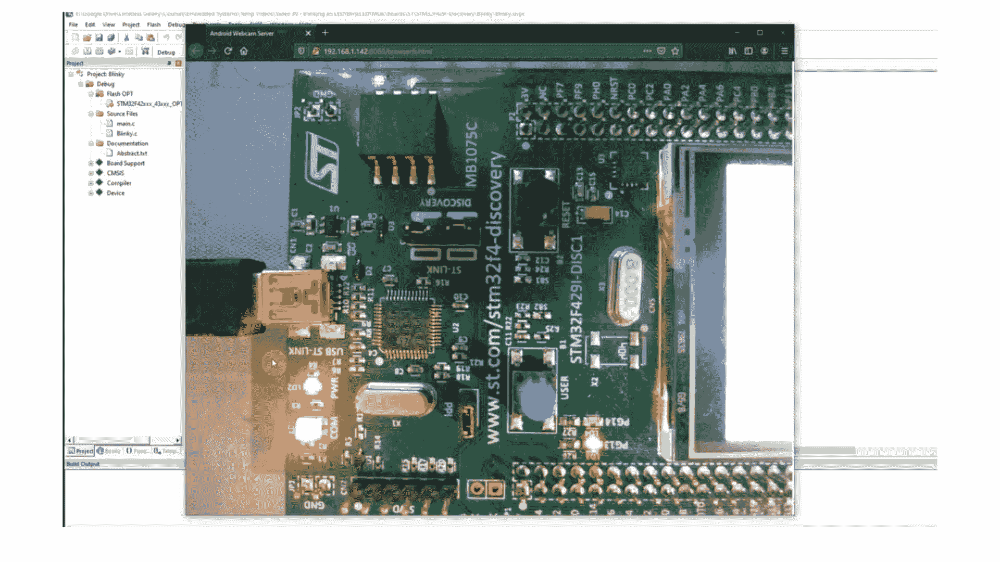


# 调试器配置与操作

好了，调试器准备好了。然后你将其连接到开发套件上。不过，这个开发套件有一个嵌入式调试器，如果你能来到这个按钮这里，物理上你可以进行任何操作。所以为 `Target` 选择选项。这会告诉我们好的，这是目标。你可以看到我在这里设置了这里。这实际上是自动完成的，因为计算机通过我告诉它我正在使用哪个示例，计算机知道我正在使用哪个示例，并自动使用了正确的设置进行测试。

它还知道我正在使用 `S3 link debugger`。它是怎么知道的？嗯，这个套件带有一个板载调试器，所以我自然会使用它而不是独立的调试器，但无论如何，这是这里正确的设置。

所以，当你进入 `debug` 标签页时，如果还没有选中，你需要选择 `as they linked debugger`，你可以进入 `settings`，你的 `settings Bates` 看起来应该和这里的一模一样。你在这里看到的是，嘿，我们选择了这个调试器，而且它实际上在使用这个设备，但在这里其实无法进行任何操作。有趣的部分是，你应该在这里，不是 `data`，而是在 `S.W.`，其余设置如下。这里。

所以如果你在这里执行了这些操作，那么你想做的是再次点击、点击、点击。这确实是为我预设好的，然后你想做的是 `rebuild`。这将编译并链接这里所有的文件，你可以看到我屏幕底部的 `build log`。所以它已经构建了所有内容。

然后你真正想做的是将它 `load` 到设备中。我在这里要做的是我实际上会把这个窗口调小一点，然后把我们的板子拿到这里。好的，所以当我点击 `load` 时，你将会看到什么，你将看到这个 `LCD` 开始闪烁，这是通信以及一个 acetate link relay 正在工作的 `LCD`，它将开始闪烁并疯狂运行，因为所有程序都在为主微控制器。

在主微控制器完成编程后，我们将只看到这些开始闪烁得稍微快一点。好的，如果我点击这里的 `load`，你可以看到底部它运行得非常快，你实际上可以看到这里的 `LCD`。`LCD` 本身开始闪烁得快得多。再次，并不非常华丽，但很有趣。正如我们未来将看到的，这相当复杂，我现在要做的是使用我买的这个非常专业的按键仪器按下这个按钮。所以如果我用左手开始这样做，我会来到这里并按下这个按钮。按下这个按钮，你会看到唯一停止闪烁的是这里，我再次来到这里并按下这个按钮，或者是这里，如果我再次按下问题，你会看到它又开始闪烁了。是的。所以从功能上来说，这个示例正如你所看到的，相当简单。然而，它利用了许多不同的操作系统限制，我们将对此进行深入探索。

# 线程可视化，标志分析

现在，我完全理解 `blinky` 实现的自动代码显然我在上一章中向你展示的示例相当复杂。如果你说这就是我想做的，我同意你，我想做的是遍历所有不同的文件，主要是查看 `blink_dont.see` 等，并解释每一个位。好的，所以我想做的第一件事是遍历 `main.c` 看看，所以我们将遍历 `main.c` 看看。你可以在这里看到。也许我把它放在幻灯片上显示会更好。

所以这是 `main.c` 的摘录，尽管 `C` 仍然是我们程序的默认入口点，因为它是任何 `C` 程序的默认入口点，但它并没有真正包含我们代码的任何重要部分。我会向你解释为什么。所以 `main.c` 文件为我们的应用程序执行大量的初始化和清理工作。

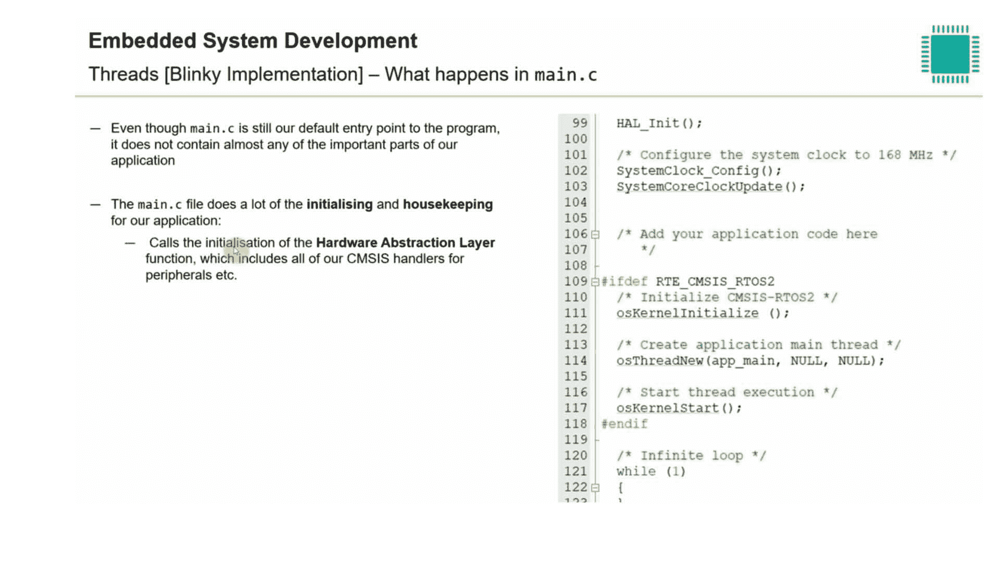

它执行诸如调用 `initialization` 并说硬件抽象层的 `initialization excuse` 之类的操作。所以是这里这个函数调用包含了所有外设的数百个 `CMC` 函数，它基本上是代码中将硬件与操作系统和软件隔离开的部分，它设置了系统时钟。这就是这部分在这里。现在在这个示例中，我们确实将我们的系统时钟设置为 `one hundred sixty eight megahertz`。这确实是我正在使用的特定设备实际上可以达到的最大系统速度。它初始化了操作系统的 `kernel`。所以这基本上是启动我们的操作系统，并在某些情况下启动我们应用程序的主线程。所以实际上，这是一个名为 `up Main` 的线程的实例化。这是我们应用程序的主线程。`main` 函数实例化了 `main thread`，而 `main thread` 实际上定义在其他地方。我很快就会向你展示。它也启动了 `kernel`，这基本上就是你的 `scheduler`。所以你的应用程序现在实际上正在运行。是的，这个内核现在会调度所有适当的线程，并为它们分配时间，根据它们的优先级等等决定它们应该在何时运行之类。

好的，现在我们将查看 `blink_dont.see`，它是另一个文件。现在它实际上是这里的这个文件。好的。这才是我们实际上找到大部分代码的地方。你看到的是，在 `blink_dont.see` 内部我们发现了主线程 `void up Main`，所以从 `main` 开始，我们实际上进入了某些调度线程，而在该线程内部我们执行了一些其他事情。

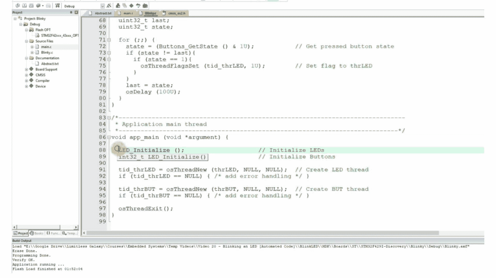


现在让我们在幻灯片上再次查看这些。我在这里展示出来的是 `blinky.donsee` 文件的不同部分，具体来说，我带出了该文件中存在的三个不同线程，并将一些初始化代码放在了顶部。

在 `blinky.donsee` 中，我们定义了三个不同的线程。其中一个线程是 `THREAD`，也就是 `blinky_MPD` 线程；另一个线程是这里检查按钮状态的线程；然后我们在下面还有一个主应用程序线程。所以，这三个线程中的两个在初始时都被初始化了。我们有三个实例化。两个初始化对应三个不同的初始化问题。

挂载开发板的 `LCD` 和 `buttons` 的头文件被 `#include` 进来，所以你可以看到这里我包含了 `board_lcd.h` 和 `board_buttons.h`。基本上，这些头文件允许我们的代码实际上连接到不同的硬件部分。在这种情况下，它们是我们的 `LCD` 和 `board buttons`。现在应该提到的是，这些头文件实际上是 `CMC arts API` 的一部分提供的，而且它实际上是硬件抽象层（Hardware abstraction layer）的一部分。看来这个 artist 让我们非常非常容易地实际看到 `amps`（不是 `CMC artists champs`），这让我们非常非常容易地访问这些 `these` 和 `buttons`，而不需要查看实际硬件——尽管我们还是会查看硬件，因为你知道这很有趣，而且我想卖给你——但我们不需要，因为我们可以直接使用这些头文件以及操作系统来控制 `LCD` 和 `buttons`，而后台的 `Sams` 实际上是在匹配我们使用更高抽象层来访问它们的方式。

好的，然后我们这里有一个微小的 `tar Bath`，它是 `thread button` 线程的核心，在这里，这是一个线程，我们将更地查看它，它正在被定义；我们还有另一个叫 `Tier LCD` 的线程在这里被定义。而且这两个线程在上方也被声明了。所以我们声明了线程，并定义了线程。

好的。还有什么在发生？`thread main up` 也被定义了。记得 `main up` 线程实际上在这里被定义。这是它的定义。不过，它已经在 `main door` 文件中实例化了。

好了，现在在 `up Main` 内部。在上面到下面这个地方，我们有什么？我们有了 `LCD` 的初始化。这是一个初始化我们实体的函数，基本上在我们的操作系统内部将它们连接起来，以便我们可以使用它们。我们有了 `buttons` 的初始化。你可以看到我住在 `UK`，而这段代码是为美国标准编写的，所以他们用了那个。我两个都正确地使用了。只是拼写方式不同，`t`，是我们的 `button t`，是我们的 `only these`，这些都是实例化的，所以我正在实例化这两个线程，这里是每个线程的实例化。所以这里是 `THREAD` 的声明。这就是线程的声明。这是线程的定义，而这是一个线程的实例化。

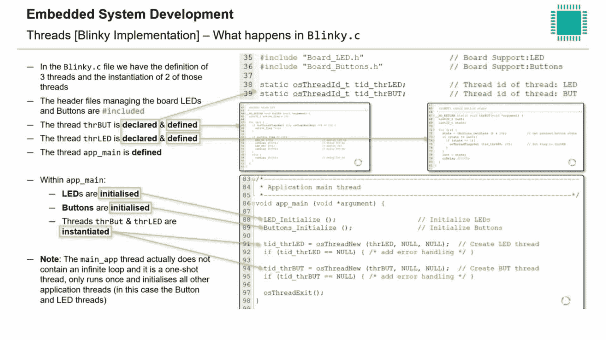

需要注意的是，`main up` 线程实际上并不包含无限循环，它是一个单次运行线程（one shot thread）。它只从上到下运行一次，在末端它初始化了所有其他应用程序线程，所以它运行一次然后退出。现在我在这里初始化的所有其他线程，实际上，这里只是集成器，但如果这两个线程实际上要在无限循环中运行，那么它们内部就会有一个无限循环。嗯，我可以向你们证明这一点，它们只是进入这里，我们可以查看 `thread` 内部——那是底部线程，你可以看到它有一个无限循环。我们怎么知道它在无限循环中？它以 `for` 开头，然后这里有两个分号。所以就像一个无限循环。是的，它会一直运行下去。

我们需要理解的第一件事是信号事件（signal events）是如何运行的。让我们看看它们的运行原理：信号事件是某些事件发生的通知；信号有源者和接收者（或接收者，在火箭科学中被称为发送者和接收者）。然而在这里，它们被用于不同线程之间的通信，所以你可以从一个线程告诉另一个线程某个事件已经发生。基本上，同步或异步线程可以选择它们监控的哪些信号，以及当其中一个信号被触发时采取什么行动。

所以你可以想象我们这里有多个线程，这个线程正在监控那三个信号。这个线程正在监控那四个信号，而这个线程通过这三个信号运行，你可以想象它们之间存在某种复杂的关系。基本上就是哪个线程监控什么信号等等。现在，所有这些信号、线程和事件都是 artifacts 操作系统内部的成员，所有这些内容都可以使用 `CMC archives API` 进行访问，这就是我们在整个课程中一直使用的工具。

所以让我们假设我们有 `thread1` 和 `thread2`，我们有两个独立的线程。假设 `thread2` 正在运行并做着它的事情，然后在某一点它到达了某个地方并说：“嗯，我得在这里等一下，因为我正在等东西。”我在等什么呢？嗯，它实际上是在等一个信号。好的，所以 `thread` 在等待一个信号。刚好在某一点 `third one` 做了某事，而 `thread1` 内部发生的事情导致了信号的产生，那个信号就是 `thread2` 接收到的同一个信号，因此实际上 `thread1` 正在向 `thread2` 发送信号。是的。所以在这个点，`thread2` 就可以停止等待了。是的，它不再需要等待了。它将做的是运行并完成它的事情，然后回到开头。循环再次开始整个周期，然后它将再次等待获取信号。当信号再次到来时，它就可以再次运行。所以这就是信号非常简单的的操作。尽管在这里看起来很简单。在实际代码中，它会稍微复杂一些。

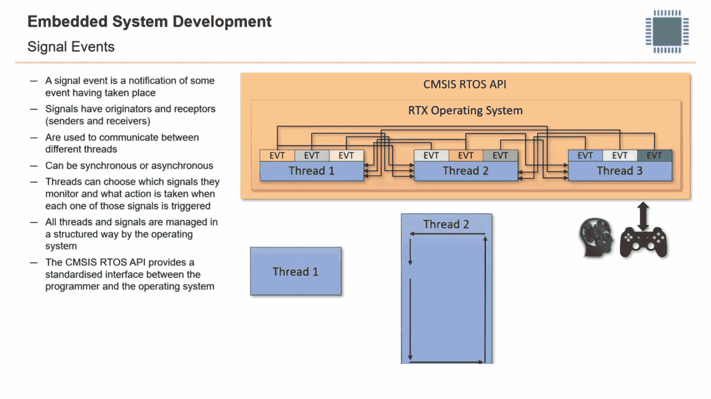


好的，这是我们唯一的 D 线程。好的，你们记得我们有一个按钮线程（button thread）和一个女士线程（lady thread）。这就是那个女士线程。基本上，在女士线程内部，我们有这样这段代码。让我们尝试解释一下这段代码，因为它很有意思。确实非常有意思。记住，这个是自动生成的。这是一个示例。是的，这是一段示例代码。

### 变量声明
首先，我们声明了一个局部变量 `active_flag`，其赋值为 `1U`。`U` 后缀表示它是无符号的，这是根据 MISRA 2004 规则 10.6 的强制要求，该规则规定所有无符号类型的常量都应该应用 `U` 后缀。由于他们想在创建操作系统和通用 CMCs 时遵循 MISRA 规则，他们必须在这里加上这个 `u`，因为他们正在遵循这套规则。它实际上意味着这是一个 `无符号整数`。不用太担心它，它只是那个数字而已。

### 主循环
现在我已经回答了你可能有的这个问题，让我们看看这里发生了什么。首先，我声明一个名为 `active_flag` 的无符号整数，并将其设置为 `1`。它是一个 `32` 位整数，然后我们有一个无限循环。这个无限循环从这里开始，到这里结束。

### 逻辑与信号处理
这里的第一个 `if` 语句唯一的作用是：如果有一个 `signal` 且它等于数字 `1`，那么它就会切换标志位（flag）。我在这里有个问题，因为实际上在这两行代码中，flag 这个词有两个完全不同的用途：
1. 我们有一个变量，可以通过切换它使其变为 `one` 或 `zero`，以便告诉我们按钮是否被按下。
2. 我们还有另一个名为 `flag` 的东西，它是实际线程中信号函数的名称。这简直是一团糟。

基本上，如果按钮按下，这段代码就会运行，然后我们将它与数字 `1` 进行比较。如果它是 `1`——如果按钮被按下且它为 `1`——那么我们将去与名为 `active_flag` 的变量交互。这里的这个 `flag` 和这里的 `flag` 实际上彼此没有任何关系；只是它们都不巧都被叫作 flags 罢了。

### 翻转功能
这是一个 `while` 语句。它唯一的作用就是翻转标志位。如果一个名为 `always_thread_flags_wake()` 的函数返回 `one`，我们就获取名为 `active_flag` 的变量并对其执行此操作。当我们执行这个操作时，它只是翻转标志位。它目标是该变量：如果它是 `one`，它就变成 `zero`；如果它是 `zero`，它就变成 `one`。

当我说标志被置位（raised）时，我的意思是如果标志等于 `one`，就意味着按钮被按下，或者实际上我们已经给该实体发送了闪烁命令。所以我们执行闪烁，等一会儿然后关闭，再等一会儿，然后回到循环顶部检查按钮。如果按钮没有被按下，则什么都不做；如果按钮被按下，则翻转标志位。

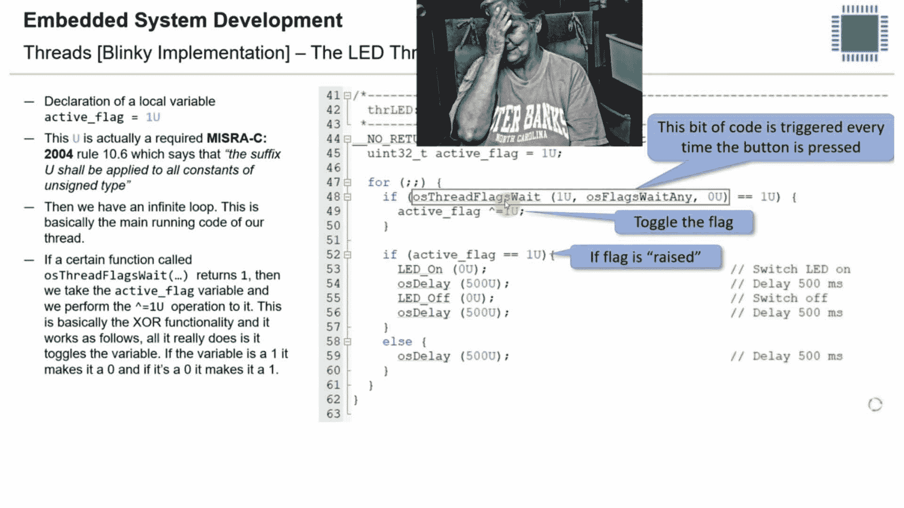


然后文本是标志（flag），告诉某人：如果标志被设置为 1，则让 LCD 闪烁并回到循环。这就是它的实际工作方式。在这里我们有一个延迟（delay）。所以，如果你的按钮没有被按下，或者标志没有被置位，或者实际上只是闪烁是关闭的，那么我们将不会进行推送。那么我们不会运行这个线程。我们不会运行它，也不会运行这段代码；相反，我们将做什么呢？是谁在运行 `else` 语句呢？那只是一个操作系统的延迟。只需等待半秒钟，然后回到循环顶部。所以无论在何种情况下，这个线程都会有一个延迟，要么使用这个，要么使用那个缓冲区。如果标志被激活了，谁将在这里使用延迟呢？那是半秒钟。半秒钟。再次，这是在处理你的 LED 闪烁；如果标志没有被激活，那么谁会等待半秒钟，然后回到顶部重新评估线程的状态。所以我们内置了一些延迟，这并不是为了一直占用进程。在这里我说 `else`（否则）等一下再试一次。是的，它就是这么做的。所以这整个线程的工作方式就是这样。

再次强调，这个线程的作用是声明一个变量，命名为 `active_flag`，然后开始无限循环。在无限循环中，它首先开始提问：询问按钮是否被按下。如果按钮已被按下，我们要做的就是翻转（toggle）标志，然后置位标志。是的，如果标志被置位，则让 LED 闪烁；如果标志未置位，则等一会儿，然后从头到尾重复整个过程。是的。所以整个无限循环就是这样。

我向你们承诺过，我会向你们解释这种翻转标志的操作是如何工作的。这个看起来很奇怪的运算符是怎么来到这里的呢？让我们来看看。没错。首先，这是 `XOR`（异或）功能，我将解释异或功能是如何工作的，以及复合运算符是如何工作的。好的，我们这里有：`x = 3`，`y = 2`。这里有两个十进制数。我把它们写成二进制。这是二进制的数字 3，这是二进制的数字 2。我要做的是对它们全部进行 `x OR y` 操作。`X OR` 产生的结果基本上是：如果我所比较的两个位中只要有一个是 1，我就给一个 1；然而，如果两个都是 1，我就给一个 0。所以 `1 OR 0` 显然是 1，但 `1 OR 1` 将是 0。当然，还有真正的 `0 0 0 6 0 0 0`。但实际上，我们的例子比那简单得多。

首先，让我给你们展示这个复合运算符的基本操作。这被称为复合赋值运算符。好的。也就是说，这里的语句 `X = X + 3` 和 `x += 3` 是完全一样的。那么它是做什么的呢？嗯，这个语句我们做了什么？这里的执行顺序是：首先发生的将是 `X` 加上数字 3。所以我们会取 `X`，无论 `X` 包含什么（比如 `x` 包含 10），然后我们加上数字 3，得到一个结果。然后我们要对这个结果做什么呢？将其赋值给 `X`。所以 `X` 将就不再是原来的值，而是变成 13。假设我们的 `X` 是 10。好，那么它就是 `10 + 3`，数字 13 存放在这里。然后我们做的是赋值操作，它就从这里到了这里。我有一门 C 语言课程在其中更详细地解释了这在计算机内部是如何工作的，如果你愿意的话，可以在我的个人资料里查找。

在这里进行此操作与编写 `x += 3` 完全相同。所以 `x += 3` 是以相同方式编写该内容的简写；`x *= 3` 是这种写法的简写；`x &= 3` 是这种写法的简写；当然还有 `x |= 3` 是这种写法的简写。所以在上一页幻灯片中，当你们看到这种符号时——是的，一种上箭头加上等号——那就是我们真正的意思，这就是它的原理。这是操作的基本原理。让我们再次看看这段代码。我们在问题中提到的部分。

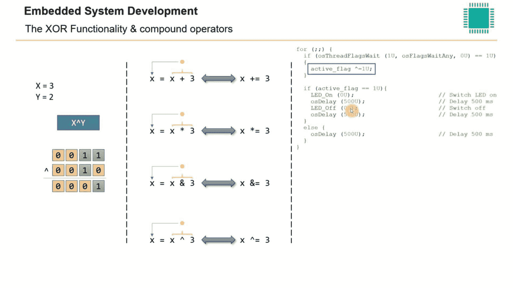

现在记住，这最初被说是 1，所以我回到上面的引用处，我移动到这里，你可以看到这里插入的 `active_flag` 实际上是或或没有被设置为 1。好，没错。让我们假设是这样。首先，它实际上是一个 32 位整数。我们怎么知道的呢？因为上面写着 `uint32_t`。所以这是一个 32 位整数类型。而且它是无符号的（unsigned）。我们怎么知道它是无符号的？因为这里写着 unsigned。然后我们放在它内部的任何内容也是无符号的，这也是无符号的。当然。好，让我们回到这里。它是一个 32 位整数，一个内部包含数字 1 的 32 位整数。这就是默认值。

现在如果我们执行那个语句，我们实际上会做什么？如果我们运行那个语句。如果那个语句的值为真（true），并且我们运行该语句，我们面临的情况如下：我们将得到 `1 |= 1`。如果你对 1 和 1 进行 `OR`，你会得到什么？你会得到 0。是的。我们在这里探讨这一点。如果你对 1 和 1 进行 `OR`，你得到的是 0。所以基本上这条语句的作用是：将变量当前值与数字 1 进行或运算，并将操作结果保存回该变量。现在，如果我们原本是 0 并在 1 中进行或运算（即在相反的情况下），那么 `0 |= 1` 将是 1。


这条语句实际上获取了该变量的值，并对其进行取反：如果它是 0，它就会变成 1；如果是 1，它就会变成 0。这就是为什么我说它像开关一样在进行切换。是的，如果是 1 它就变成 0，如果是 0 它就变成 1。这就是它在后台的工作方式。

现在我想向你们展示的下一步是底部线程（bottom thread）是如何工作的。我要提醒你们，这是一个非常无聊的线程。为什么说它非常无聊呢？因为它并没有在做复杂的数学运算。因此在 `blinky.c` 文件中，我们定义了三个线程，并实例化了其中两个。其中一个线程是 `bottom thread`，另一个是 `lady's thread`。这两个是被实例化的线程，它们是在 `main thread`（主线程）中实例化的。我稍会向你们展示这一点，但现在让我们先关注 `bottom thread`。

这就是 `bottom thread`。这里是它的全部代码。它所做的只是在第一次创建之后获取 `bottom` 的状态。这两个是局部变量，其中一个叫做 `last`，另一个叫做 `state`。它极少执行某些操作，正如你们在这里的无限循环中看到的，它在无限循环中运行。它获取 `bottoms` 的状态，这里只有一个变量，为什么只有一个呢？是因为它只需要按钮的值。它获取这整个值并将其放入 `state` 中。我记得 `state` 本身是一个被定义为 32 位的无符号变量。

现在，如果 `state` 发生了变化。也就是说如果 `bottom` 的 `state` 与之前不同。它所做的就是设置 `flag`（标志位）。实际上那个箭头应该在这里上方。是的，它设置了 `flag`。当这个 `flag` 被设置的瞬间，操作系统就会理解并认为：“哦，`flag` 被设置了”，所以每当 `lady's thread` 说那是它的标志位时，操作系统就会这里。这里，它在某个时刻是由这个线程设置的。所以，是的。这实际上由操作系统来处理。

否则，它会等待数百毫秒然后重复。这就是为什么我说它是一个非常无聊的线程。它真的没有发生过什么，它只是检查按钮状态是否与之前相同。如果它和之前一样，如果 `bottom state` 与之前不同，那么它所做的就是设置一个 `flag`，然后另一个线程就会接收到这个 `flag` 的信号。接收后，它会执行自己的任务，这我们在之前的幻灯片中已经探讨过了。

# LED 按钮驱动硬件

到目前为止，我们已经检查了这些被称为 `blinky LCD` 的代码示例的多个方面。我觉得向你们展示这一点可能是一个好主意。嗯，我想我向你们承诺过的唯一会闪烁的就是这个闪烁，所以它在这里。你可以看到 LED 实际上在闪烁。

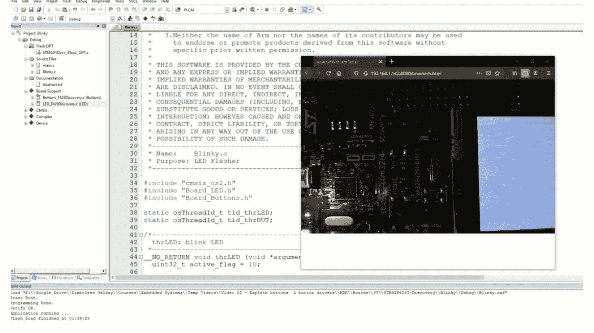

让我看看能不能关掉这里的手电筒，这样你可以看到它闪烁得更美了。再次集中注意力。这里在这里，你可以看到 `LED` 确实在进行非常真正的、刻意的闪烁。好，让我们具体看看我们在 `blinky.c` 文件中的这些代码到底是如何让底部的这个实体闪烁的，首先，我们先把它放在侧边。我们真的想要理解这一点。好的，这是把它找回来的。这确实存在于打印电路板上，并以某种方式与处理器连接。作为一名软件、硬件以及嵌入式软硬件工程师，你真的需要理解从你的部分代码到实际看到这个 LED 闪烁的整个过程，你真的需要对你的硬件看起来如何有一定的了解。所以有这样一个文件，你们可以看到它。在这里。基本上就是 `discovery kit user manual`（开发板用户手册），在 `discovery kit user manual` 中，也就是我正在查看的这个大文档，我在课程里提供了它的链接以便你可以找到它。我会把这个文件附在这个视频中，你实际上可以看到 `discovery kit` 的正确原理图。实际上，如果你想在这里放大，你会看到我们有一个绿色的 `LCD`，也就是 `LED`，上个月被称为 `LED3`，它连接到我们处理器上的 `PD 13` 端口。

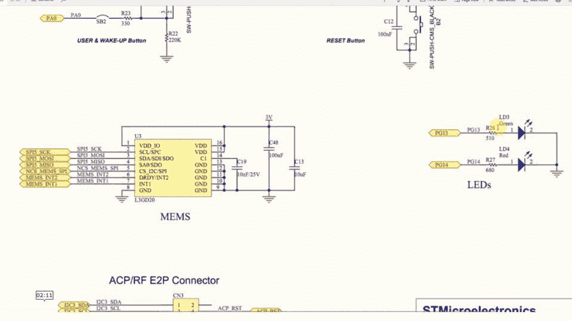

所以这直接连接到我们处理器的 `PG 13`。如果……如果我想去查看处理器的端口，你可以看到有 `port A`、`port B`、`port C` 和 `port D`。它们应该还有 `port E`。现在对于 14。好，从这里的 `Port G 14`，它直接连接到我们的 `D` 连接。它实际上连接到一个 26 欧姆的电阻，然后连接到我们的 `LCD`。是的。实际上，如果我把它调回这里，你会看到这里写着。好，`PG thirteen`，这三个是 26。所以它们在物理位置上彼此靠近。电阻在物理上很接近，它物理上具体在哪里并不重要，但它们恰好靠在一起，你可以想象从这里到电阻的走线实际上连接到了处理器，但你可能看不见它的走线，我猜它在 PCB 的另一个层上。好，现在我们已经讨论了这一点，让我们看看我们的软件实际上是如何解释这些的。首先，你可以看到这里还有另一个实体 `P Fortran`，它是一个红色实体。所以我们要尝试做的是让这个实体闪烁，而不是绿色实体。


现在由于某种原因，这些 `early_on` 和 `only_off` 函数穿过了我们的操作系统到达硬件，然后它们实现了闪烁功能，因此只有 `early_on` 是一个在这里定义的函数。嗯，你可以右键点击并说“转到定义”，但它并不会帮我们忙直接跳转到定义，而是实际上你可以在这里看到我们包含了 `board_lcd.h`。

现在，如果我进入 `board_lcd.h`，我可以右键点击它并说“打开文档”，它就会打开文档，好的。你可以看到这个 `early_on` 函数在这里定义，但它并没有在这里声明。是的。所以虽然它在这里声明了，但这很完美。但让我们看看能找到关于它的实际定义的什么。

事实证明，我们得到的这块板卡都有我们操作系统的完整支持，它包含了所有的硬件抽象层，这些都已经存在于我们的系统中。所以基本上我可以做的是进入这里的板级支持包（board support package）。在左侧，我看到了 `board support`。我可以双击这些 `LCD board support` 文件，好的。这个文件实际上为我这里这个特定板卡的 LCD 创建了硬件抽象层。好的。基本上这是由点点微电子应用（steam microelectronics app）提供的，正如你在这里看到的。这基本上是为了让我们编程该设备时变得更轻松，你可以在这里实际上看到 `LCD_on` 函数在这里定义了。好的。

现在我要做的是，我不会花太多时间去研究这个和 `on` 函数具体是如何工作的。然而，你们会记得实际上有一个也叫 Aldi 的 LCD，它是真实存在的，我们记得它是因为我们在原理图上见过它。好的。

所以我想做的是，我想看看能不能代替绿灯，修改我的代码让理论上开始更多闪烁。所以我我真正需要做的就是说，好吧我可以做的是，我应该能进入 `led_blink`。你在这里没看到包含函数参数的文件，但答案是，不是告诉它开启 LCD 0，而是告诉它开启 LCD 1，然后再听一遍。所以我把它调到这里来。

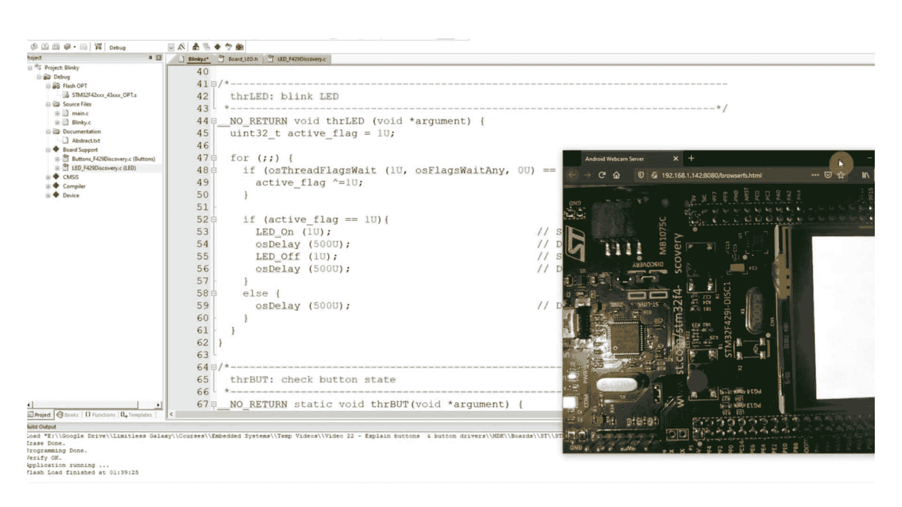

把我的屏幕分成两半。这一部分在这里，另一部分在那边，这样你就能清楚地看到我在做什么。如果我在这里重新编译所有的代码并将其下载到板卡上，我们将看到现在不是绿色闪烁，而是红色闪烁。如果你想玩得酷炫一点，你可以让这些红绿交替闪烁，就像我在这里要做的这样，所以我通知我的代码，让它同时链接 LCD 和 `one_off` 以及 `zero_off`，这样你现在看到当我把它加载到板卡并加载到板上时，你会看到这个 LED 在发疯，然后你可以看到那两个在闪烁。是的，而且我想如果我真的想，我也可以混合一下，即关掉一个同时开启另一个，是的。先让它用起来吧，刚才我粗鲁地搞砸了，我要在这里下载到这里。所以，我要把它们混合一下。是的。

你可以做的另一个有趣的事情是修改这个操作系统的 `delay_ms` 数字。这里写着从开启到关闭是半秒。所以我将做的是把它改成大约两百毫秒，即零点二秒。只是让事情变得快一点，希望我的相机能够捕捉到这种闪烁的代码输入，是的。所以基本上我们正在让它闪烁得更快。是的。如果你想玩得酷炫一点，我会把它设为一。所以考虑更复杂的闪烁方式，嗯，你可以看到闪烁，我能看到闪烁的相机，这一切实际上都被捕捉到了。所以是的，你可以看到我们的 LED 在闪烁，这很好。喔呼。这就是我擅长的。Blaine Kelly，这些基础只是非常复杂的、找到思考这些问题的非常复杂的方法。

所以我在这里把我们的调用恢复到原始状态。基本上，我们的示例已经有了板级支持，而 AID 也已经为板卡上的 LED 提供了所有支持。现在，这发生这种情况的原因也是因为正如我所说的，SD 制造了这块板卡，他们希望人们使用它，所以他们已经创建了这个示例，向你展示了如何在你的电脑和板卡上下载和运行，他们还教了我们如何做。嗯，他们还创建了这种板级支持文件。如果你购买不同的板卡，你很有可能找到那些可以插入到这段代码中的板级支持文件。现在，CMC 有什么特别之处。

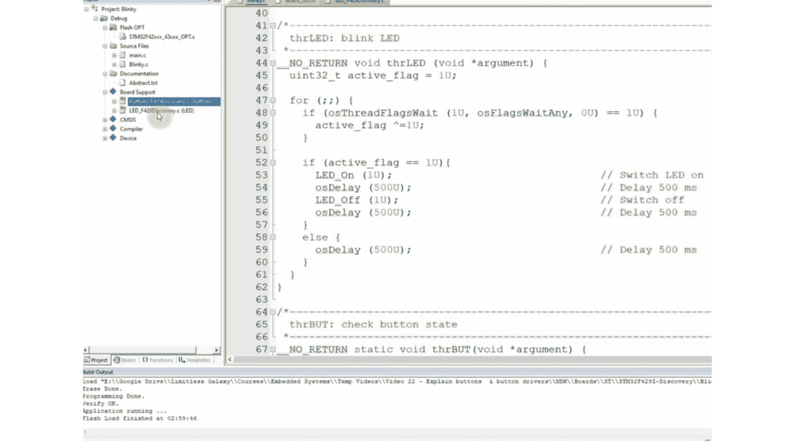


# CMC 与板级支持层

CMC 是一种标准的接口方式。你的板级支持文件有效地作用于你的代码，使得所有接口都标准化了，因此制造商在编写所有的板级支持文件和硬件抽象层时，使用的是与硬件以及 CMC 通信的方式，而你只需要编写自己的代码（即这个你看不见的空白文件）来与 CMC 通信。因此，我们使用了这个名为 `CMC` 的中间层，正如你在之前的幻灯片中看到的那样，以便将一切都连接到它。这就是为什么 `CMC` 非常有用，而且，它确实能够为你节省大量、大量的时间。

## 板级支持包 (Board Support Packet)

说到板级支持包，按钮上也有板级支持包。现在这块板上只有几个按钮，你可以在这里看到它们。我们有一个复位按钮，它连接到微控制器的复位引。所以我们不会按它，或者我可以按一下给你们看看它是如何工作的。

我们还有一个用户按钮和唤醒按钮，它们周围有一些电路。我会过一下这里的电路，但基本上，这是一个用户按钮，用于切换我们 LCD 的开启或关闭状态。好的，这里说这个按钮叫 `button_a`，但按钮 A 就是用户按钮。

现在我要给你们展示的是如果我按下这个按钮会发生什么。你可以看到这里，这其实就是用户按钮，你可以在这里看到。我将使用我另一个特殊的按键工具——也就是我的手指，因为这样更容易。你可以看到当我按下这个按钮时，实体会停止闪烁。所以实际上你可以看到停止闪烁，按下按钮，我再按一次它又开始闪烁，我再按一次它停止闪烁。

现在我可以按另一个按钮。复位按钮上方有一个黑色按钮。如果我按下复位按钮，它将重置整个系统并在最后它会再次开始闪烁。所以这对系统是一个威胁，而且唤醒非常快，它们很快开始闪烁了。发生了什么？

## 闪灯示例分析 (Blinky Example Analysis)

现在让我给你们展示这个闪灯示例。闪灯点示例实际上是在底部，使用了那个叫做复位按钮的工具。在这个线程中，我们可以看到那个按钮，并检查按钮是否被按下，所以这里我们有一个叫做 `button_get_state` 的东西。好的。这基本上是在获取按钮的状态，正如他们说的那样，这里的一个只是清除该端口的所有其他位，并确保我们只获取这里的按钮，这样它就可以获取按钮的状态。实际上，如果我让它跳转到定义，它会跳转。

然而，我可以做的是实际上可以去这里 `board_buttons` 并打开这个文件，这会打开头文件，而该头文件包含了诸如 `button_get_state` 等获取按钮状态的所有声明。实际上，这个按钮的 `get_state` 定义在这里，那个名为 `nstm32f429_discovery.c` 的板级支持文件中，这基本上是我们开发板的 `.c` 文件名。这就是所有关于获取按钮状态定义的代码所在，你可以看到这里做了很多事情。现在我不会深入探讨这段代码的每一个位具体是做什么的。

是的，但这就是 `button_get_state` 函数，它进入硬件抽象层并读取 `GPIO port`。它返回一些东西，实际上我不会再就此详细介绍更多细节了。实际上我想做的的是，如果你点击这里的这个加号按钮，它实际上会向你显示该 `.c` 文件正在查看的每一个头文件。是的。你可以看到它正在查看硬件抽象层文件，它正在查看这里的硬件抽象层文件，它正在查看这个 `hw` 文件，它正在查看这个 `hw` 文件，它正在查看这个 `hw` 文件。实际上，当我点击这里的加号时，它不仅带给我那两个头文件，还带来了这些头文件所指向的头文件。好的。所以它带你看了这里所有的依赖树。这非常有用。运行得非常非常好。所以我编译了我所有的代码。你可以看到它再次编译得很顺利，这里真的没有什么可以给你们展示的。没有更多了。但这只是为了让你理解这个板级支持层是做什么的。

# 单步调试 (Debugging Single Stepping)

首先，我会给你们讲一个小故事。在过去计算机的旧时代，计算机真的非常大——指的是物理尺寸上像房间那么大的计算机，也许是一个更大的房间。在那里，晶体不像现在 ICP 内部那样纳米级极小，它们实际上是物理的晶体或物理的大块物体。是的，如果你见过那种晶体收音机的话，它们真的是非常非常大的东西。所以在那个时代，你可能会在放置计算机的房间里发现蟑螂或其他虫子（bugs）。你可能会发现真正的“虫”实际上导致了你的程序运行不正常的问题，因为可能由于蟑螂卡在了你系统的某个机械或其他电气部分，所以你必须进行实际的调试（debugging）。当然，它已经演变了，变成了你的软件出现了某种故障，而调试就是确保你已经从软件中移除了所有被称为“bugs”的东西。

现代编译器和集成开发环境（如我们目前正在使用的）已经将这些 bugs 集成到整个系统中，它们可以独立地在工具上运行，也可以实际上与某种对目标的连接结合运行，而我们在这里实际上有一个实际连接。顺便说一下，这就是目标。而这就是你所谓的板载式调试器。是的，这非常有趣而且很有趣。我们现在来谈谈它。

实际上可以做的是，可以在硬件上实时单步执行我们的每一行代码，并查看硬件内部发生了什么。所以让我们尝试一下。好，首先，我会和你们分享我所有的调试设置。在之前的课程中已经做过了。然而，我们再做一遍。所以我只需点击这里的这个按钮并进入目标所在的位置，这样你可以看到它们拥有的设置。这些确实是默认设置。我没有在这里或那里触碰任何东西。


虽然我们实际使用的设备确实只有两个兆字节，但我打算先把这些留在这里。这可能不是最好的选择，但我现在先把它留在这儿，因为这是默认选项。不过，为了万一你的设备无法工作，这里已经设置了一些内容。这里向你展示我是如何设置所有选项的，这样你就可以确保自己拥有所有相同的设置。所以这里除了点击这个按钮之外，真的没什么特别的。

让我们再次构建我们的代码，这样你就能看到它都构建得非常完好了。我们将把它也下载到设备上，他会把设备带到这里好你就能看到——你可以看到设备正在很愉快地运行代码。现在我们可以做的是，我将进入调试模式，通过点击这个按钮进入调试模式。点击那个就进入了调试模式。现在你可以看到我的代码还没有开始运行。好的，我还没有开始运行。

不过，我们可以做些什么。首先，我想把这个窗口缩小，这样我们就可以在屏幕上显示更多的代码。实际上，我们感兴趣看到的仅仅是 LCD，所以把这个微控制器级别调小一点。很好。在这里，我们有一个重置选项选项，我们可以点击一下来重置该微控制器。现在它没有做任何有趣的事情，因为虽然 Atari 设置了它，但并没有并没有启动程序，我可以启动程序运行的。所以如果我点击这个按钮，我会看到实体开始闪烁。所以我已经开始运行程序了。你会看到 LCD 开始闪烁。

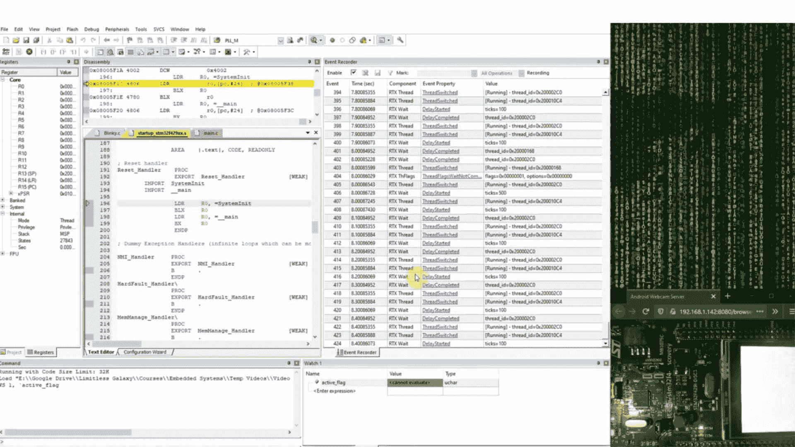

非常有趣的是，你会在事件记录器中看到，我实际上开始记录操作系统正在经历的所有事件了，所以我们可以从这个事件的开始看到发生了什么，这实际上是延迟或线程切换或之类的。所以你会在这里看到，在这里看到你的处理器是如何运行的，以及你的操作系统实际上在做的一切都在这里被报告。所以每当有线程切换时，它就会被记录在这里，以此此类推。

有趣的是，如果你进入调试（debug）和操作系统支持（operating system support），你可以选择一个名为系统（system）的东西。我要去那里看看。现在，抱歉。我之所以抱歉是因为这行不通。之前我对着墙撞了好几个小时，试图弄明白为什么不起作用。你会发现，系统和线程（system and thread）仅支持 Zephyr 4.8 或更早版本，而我们基本上运行的是 Zephyr 5。哪个版本支持它呢？然后你可以使用组件查看器（component viewer），最后得到像这样的东西。实际上，你可以做的是到这里点击查看系统视图（view system view），然后进入系统视图（system view），你可以看到很多东西，包括 RDX 寄存器。去监视窗口（watch windows）查看寄存器（registers），这将为你提供操作系统上正在发生情况的视图，你可以在这里看到。我们有多个线程在运行。这是一个 ID 线程。这是时间或线程，我们的系统上运行着 LCD 线程和按钮线程，它还给了你堆栈（stack traces），你实际上可以展开它，并查看这里是否有延迟、超时等其他。

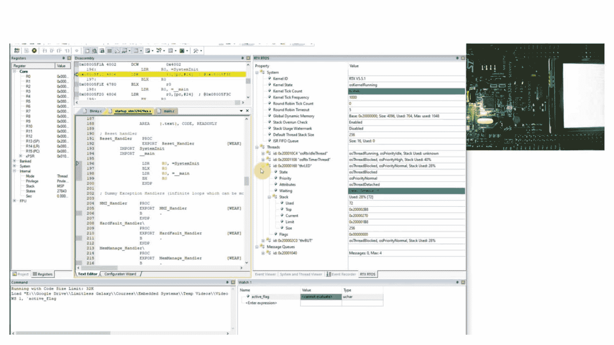


实际上，你可以查看你的操作系统以及它的许多属性。现在更有趣的是，你实际上可以对代码进行单步执行。这是一个 Windows 事件。你的系统和线程现在无法工作，因为我们正在运行我们的 takes 五，所以如果你习惯到这里点击支持并进入系统，我听起来……抱歉，现在不起工作了，但事件记录器（event recorder）仍然工作。

所以我们在这里实际上可以做的是停止我们的代码，并通过设置一个断点来指示它，在某行代码旁边你会看到一个一个小红圈，这被称为“断点”。好，如果我在开启 LCD 的地方设置一个断点，你会发现代码在下次 LCD 开启时或在 LCD 开启之前会停止。然后，如果我进入这里并点击“单步跳”（step over）到下一行，你将看到 LCD 应该开启了。所以如果我跳到下一行代码，LCD 还没有开启。那么如果我再次按下那个按钮，也就是“单步跳”，让我们进行大约半秒的延迟，然后我们将进入下一行。所以尝试一下这半秒的延迟，到下一行，然后它会关闭，然后它会运行半秒的延迟，如果我们回到这里，它会说“好的，它被更改了，因为没有人按下按钮”。然后我们离开这里，你实际上可以单步执行代码。好的。或者在任何一点，如果你无意单步执行代码，你可以按下这个运行按钮，它就会运行。好，你在这里实际上可以做的另一个有趣的事情是……呃，让我们在这里设置一个断点。如果我点击这里，你会发现这段代码实际上从没有被执行，因为我们实际上没有按下按钮，也没有点击这个地方。我想按下按钮。你将看到我们将命中这里。按下按钮。现在按下按钮，我们的代码就有时间到达这里了。好，因为我为它们设置了断点。所以这个信号实际上被触发了，我来到这里了。所以我在这里实际上所做的是修改了这个变量，我将切换它。如果它不是 1，我会把它设为 0，如果它是 0，我会把它设为 1。我可以做的是，实际上可以右键点击它，然后点击“将活动标志添加到监视”（add active flag to watch）。这就是这里的监视窗口，显示了在这里发生了什么，当我……实际上，我只是在运行了它之前，我是 David Fisher，所以我运行了两次。如果我点击删除，它将只保留一次；如果我再次点击，它将移除我那里的所有变量。我可以再次添加，我正在将其添加到监视。这实际上将执行的是，它实际上将实时监控微控制器内存中的这个变量，并显示它显示的内容。嗯，我在屏幕上创建了这个变量，所以它是 1，现在它无法求值，因为我们正在运行整个代码，实际上没有进入那里再次查看它。但我在这里实际上可以做的是，记得它是 1，如果我再次点击按钮，它将变成 0。让我们看看，我把它变成了 0。好，我把它变成了 0，如果我再次运行代码，你将看到 LCD 现在正在闪烁，如果我再次点击按钮，我将把它变成 1。是的，我把它变成了 1。即使我让代码继续运行，你也会发现 LCD 并没有开启，事实上，它既没有开启也没有关闭。由此理解这段代码在这里没有运行，因为标志位没有设置为 1，而标志位确实是 0。所以实际上我将做的是，如果我在这里设置一个断点，这里，这里，我们从根本不应该命中这些断点的。是的，但如果我在这里设置断点，我们应该命中那个断点，果真其然，我们命那个断点。好，好，因为那是那个 `if` 语句的 `else` 条件，实际上下次循环时我们将再次命中它，我们将再次命中它，直到有人认为我想从他们那里移除那个断点，如果我要命中 `if`，我将按下按钮或点击这里和那里，我们将看到变量将改变。它被设置为 1。现在这个，如果我们提升这个 `if` 语句，我们把它设为 1，那么我们将开启白色，关闭白色，以此此类。这对于这个断点功能来说非常有价值，因为你实际上可以实时监控不同内存位置正在发生什么。你如何做到这一点？选择你想要的变量。

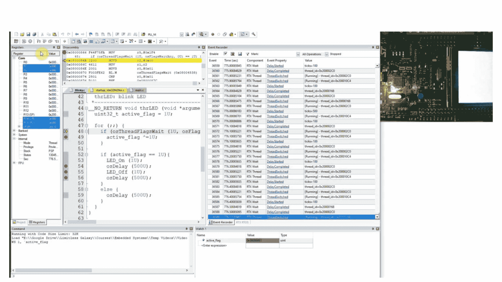

你右键点击它，然后进入“添加到监视 1”或“监视 2”，监视 1 和监视 2 实际上是你可以在这里拥有的两个不同的监视窗口，你实际上可以到这里监视你的变量。它告诉你变量的类型以及该变量的内容。在这种情况下，它以十六进制形式显示。所以它真的非常有用。你实际上可以切换它使其以十进制显示，但默认是十六进制。我实际上更倾向于十六进制，所以这是为你提供的一点调试。你在这里的软件中实际上拥有哪些功能？你可以做的事情实际上可以来到这里的“视图”（view），你可以做的是进入“系统视图”（system view）或这里，你实际上可以监控你不同的外设，如果你有 SBI。如果你有 SBI，你的 art。如果你在使用你的 USP，你可以监控那些。如果你有其他东西，我想看你的 GPO。现在记住，这是 PDC13。让我们去监控我们的 GPO。如果我监控来自我们 GPI 的 Port de。哦好，你应该能看到……好，在这里。你实际上可以看到 Port de 14，PDC 14 实际上是电平在高低之间切换。

### 你必须知道的知识

现在让我们谈谈在继续之前必须知道的一些事情。首先，你需要知道什么是嵌入式系统，以及系统是什么。基本上是位于较大电机械系统中具有特定功能的计算机系统。它们的范围从简单的便携式设备，如可穿戴设备和 PS3 播放器等，到大型复杂的系统，如汽车、电信和其他应用。现在，当涉及到微控制器。它基本上是一个小型计算机，单个集成电路。它包含了处理器、内存和输入输出外设，称为嵌入式系统的组件。现在，你可能会在汽车上、比如主板或卫星以及任何 PC 上找到这些计算机系统。

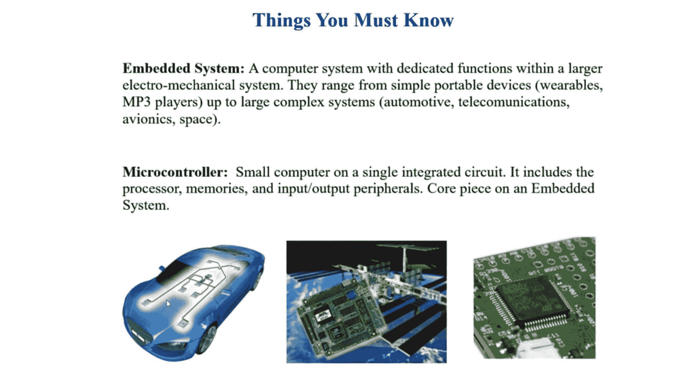

现在，让我们谈谈你需要在 A、R 或 R 架构中知道的一些术语。它基本上是关于指令集、执行模型、流水线结构、指令周期等的一系列规范，它描述了一台机器。在 Cortex 上实现该架构实际上是广泛的 30 到 64 种架构。列表上的第一个是 Cortex A，它代表为托管 Linux、Android 等丰富操作系统平台而设计的应用程序。我们还有 Cortex，它代表为嵌入式市场优化的嵌入式处理器，低成本、高能效低功耗。我们还有 Cortex R，它是实时的、高性能和非常关键的场景，可靠性、实时响应，例如汽车世界，我们需要零实时应用。


现在，你可能听过 `arm` 持有或 `arm holding`，这是一家开发 `arm` 架构产品的英国公司，其知识产权业务模式使其如今成为非常著名的公司。现在，让我们也谈谈关于 `stm32` 或作为微电子平台的常用术语。`STM32`，或微控制器，是一家总部位于瑞士日内瓦的法国意大利跨国电子和半导体制造商。`STM32` 是一个由 `Microelectronics` 基于 32 位 `arm` 处理器内核开发的 32 位微控制器系列，具体是基于 `arm-cortex` 架构。特别地，在本课程中，我们将使用 `STM32` 微控制器，它属于低功耗微控制器家族，这就是 `MCU` 被放置在 `Nucleo 开发板`（Nuclear Development Board）中的答案。然后，开发板为微控制器单元提供了调试和开发的媒介。这些是你在继续学习之前需要了解的主要术语，因为我希望现在一切都清楚了。你需要理解什么是`嵌入式系统`，什么是微控制器。

# STM 的世界

那是 `cortex-m3` 核心吗？`M` 代表`嵌入式系统`（Embedded System），这是一个名为 `armed` 标准的开放世界。接下来，外围设备基本上提供了高性能、低功耗、高集成度、开发创新，这有助于你开始将任何东西连接到你的`开发板`（bauk）。产品范围是更高层次。它有一个系列完整的外设和软件兼容性，将帮助你合理化你的开发。


最后是工具和软件，它拥有最好的软件和工具生态系统，我们将在课程中不断发现这一点。所以，每当你看到一个 `STM32` 系统时，你都需要考虑这四点。核心将是 `cortex-M3` 或 `Cortex-A` 或任何其他 `cortex` 核心。它将与外设连接，并且通常提供广泛的产品范围。它还具有工具和软件，可以帮助你轻松开发并快速调试。

# 核心特性

让我们谈谈 `arm` 32 位 `cortex-m3` 核心的核心特性 `Flash` 和 `S`（Isaura）。现在，这个 `cortex-m3` 核心具有高达 512 字节的闪存内存和高达 64 字节的 `RAM`（Esraa），它支持时钟复位和电源管理。它具有多个通信外设，如 `I2C`、`USART`、`SPI`。现在，它还支持 `sleep`、`stop`、`stand by` 低功耗模式。它有多个 `16 位`定时器，这意味着可以使用多个定时器，而且它们都是 `16` 位，这是一个非常好的特性。它有一个实时时钟、控制器和 `12 位`数字模拟转换器。它还具有易开发阶段和快速上市。

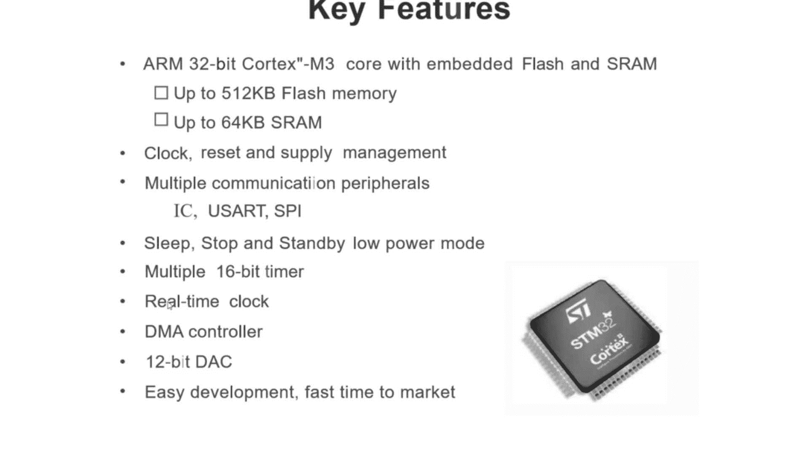

所以你可以从今天就开始开发过程。一周后，你就可以将产品推向市场，因为它有很多开发软件可以帮助你轻松调试和开发代码。这些是 `cortex-m3` 核心支持的一些特性。现在还有其他更多功能的核心，但取决于你的特定应用，你可以找到适合你的那一个。但我们刚刚开始。

# 应用

当涉及到 `stm-m32` 或 `cortex` 应用时，你随处可以找到它们。在工业应用方面，你可以找到许多基于 `steel` 和 `arm` 架构的策略，你可以找到逆变器、打印机、扫描仪和工业网络。在建筑和安全方面，你可以找到许多报警系统、视频对讲、构建在我们的架构和 `cortex` 核心上的 `H.V. AC` 系统。此外，还有低功耗应用，可以在许多应用中找到，例如血糖计、功率表、电池供电应用（所谓的低功耗模式）。

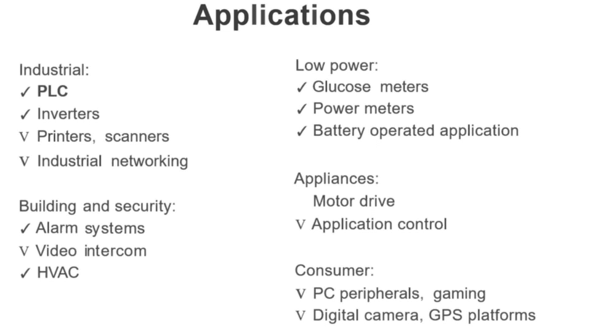

现在，还有其他应用，如家电器、电机驱动、应用控制、工业应用控制器，以及许多拥有架构并构建在 `cortex` 核心上的消费设备，如 `PC 外设`、游戏、数码相机等平台。所以基本上，你可以在周围随处找到基于 `arm` 的设备和基于 `cortex` 的设备。你只需要观察并尝试在设备内部的微控制器或控制器上寻找 `arm` 字样。这些都是可靠的应用，但你并不限于这些应用。你可以用这些惊人的核心做任何事情。

# NUCLEO 开发板

现在，让我们谈谈 `Nucleo 开发板`（Nuclear Development Board）。现在我们以 `Discovery` 为例。你可以获取任何其他板，但在任何将用于 `arm` 和 `arm` 架构开发和学习之旅的开发板中，你都应该寻找这些主要特性。所以，这基本上是这块板。它基于 `arm-cortex-m4` 架构，它具有 1MB 闪存内存、128KB `RAM`（Esraa）数据内存，其时钟频率可以达到 80MHz。它基本上构建在相同的 `STM32F476 MCU` 之上。现在让我们谈谈这个 `Discovery 板` 的主要特性。这些 `stm32 nucleo-64` 板为用户提供了一种廉价且灵活的方式，通过从各种兼容的微控制器组合中尝试新概念并构建原型。引脚显著减少，降低了功耗，并运行在连接的三个上，并带有 `ST-LINK`（ESTIE more）引脚，允许轻松扩展 `STM32 Nucleo 开发开发平台的功能的功能，多种专用扩展板。现在，`stm32 nucleo-64` 板不需要任何额外的调试器，因为它集成了 `ST-LINK`（stealing Bogar）程序，`stm32 nucleo 64` 带有 `STM32` 完整的免费软件库和示例，这些示例与 `STM32Cube MCU` 软件包一起提供。现在让我们谈谈这些板的共同特性。它们基于 `STM32` 微控制器。它们有一个用户 LED。与 `Arduino` 共享，它们有一个用户按钮和 32.768kHz 晶振，以及基本上是螺栓连接器，它们具有 `Arduino` 扩展、用于扩展的连接器以全访问所有 `ASTM`、32 个输入输出引脚。它们还具有灵活的电源选项。


他们配备了 STM32 开发板。他们拥有全面的免费软件、库和示例。他们支持广泛的集成开发环境选择。现在，说到特定的边界功能。它有一个 24MHz 的频率，是 E，并且有很多连接器。现在，让我们看看这个板子本身，正如这张图片所示。这里有 STM32 开发板。基本上就是这些。

现在我们有了提到的晶振，你可以发现这个 `32 kilohertz` 外部晶振在这里。这些是 Arduino 兼容引脚，正如你所见的，它们与 Arduino 有相同的引脚布局，大约是三倍，0 到 5 是地，以及其他引脚。这是一个非常棒的特性。你可以将任何 Arduino 扩展板（shield）直接放在这里。这里和这里有扩展引脚，这为你连接不同设备提供了很多选择。

右上角是调试器角。这里有一个 USB 接口，你可以用它连接 PC，然后你可以运行 STM3Cube 软件或任何开发环境。现在不需要下载器，因为它与 PC 有直接的 USB 连接，这是一个非常棒的功能。现在，这是主大脑，我们的板子是 `STM32F103RC6G.CO` 微控制器。这是按钮，这是一个你可以用于调试和开发的用户模式（功能），正如你所见的，它包含了你启动系统所需的一切，甚至还有一个用户 LED。

如你所见，这是一个 LED，你可以使用你的代码轻松控制它。比方我们写一段代码，每当有人按下这个用户按钮时，它就会打开这个用户 LED，这将是我们创建的第一批调用之一。这是我们推荐的板子之一。有些人可能会觉得它有点贵。所以当我们涉及到开发东西时，我们将向你展示另一个可以考虑的选项。但本课程到此结束。如果你对这个板子有任何问题，可以查询，也可以在 Q&A 板上提问，我会非常乐意提供帮助。现在，这里的主要特点是它是兼容 Arduino 的。它可以直接连接到 PC 进行开发和调试。它有两个按钮，一个你可以使用的 LED。它有扩展引脚。它基本上是一个全能开发板，你可以用它来进入架构世界。

# STM32 开发板

今天，我们将谈论我们价格更便宜、更容易购买的**蓝色和蓝色的** STM32 开发板，它包含了 `STM32F103C8T`。这是块板子，它非常小，但它有很多选项供你开始开发你的 ARM 应用。这个不同的板子包含了 `STM32` 系列中的 `Cortex-M3` CPU 芯片，它比著名的 Arduino（如 `atMega328` 芯片）便宜且更强大。你甚至可以通过著名的 Arduino IDE 直接对这些芯片进行编程。

该板子工作在 3.3 伏下，具有 `64KB` 的闪存内存、`20KB` 的 SRAM 和 `8 到 72MHz` 的时钟频率。现在让我们更详细地讨论它。它支持更多电源，具有双路 12 位微秒模拟数字转换器（ADC），最多 16 通道，全部支持 DMA，并有多达 80 个高速输出，某些模块现在都支持 DMA，并且有 7 个到最多 9 个通信接口。它有不同的版本。但对于我们这里的这个版本，正如你所见，它是一个非常小的版本，并且有一个重位按钮。

## 引脚分析

现在，关于引脚布局，让我们快速看看左侧的这些引脚。你可以看到有两个地引脚，这一个和那个。我们还有一个 3.3 伏电压引脚，这里这里有复位按钮引脚。

然后我们开始输入输出引脚：
- `PB1` 意味着端口 B1。`PB1`。这是 `11` 或 `10`，抱歉，是 11，所以这里对于 B 我们有 `1`、`10` 和 `11`，我们也有 `0`。
- 从这里开始，你可以看到有与 `A` 相关的引脚，通常这些引脚在该侧支持 `ADC`。从 `B11` 开始。这里的 `B1` 支持所有的 `ADC`，以及这个，正如你所见，`A1`、`A2`、`A3`、`A4`、`A5`、`A6` 和 `A7`。我们还有一个 `0`。
- 我们有 `PC15`、`PC14`、`PC13`。这些是 C 引脚，这里有 `PC0`、`1`、`2`、`3`、`4`、`5`、`6` 和 `7`。这些引脚可以作为输入输出引脚，其中一些支持模拟数字转换器。

现在，正如你在最后看到的，这里有另一个叫 `VB` 或 `V-battery` 的引脚，这个引脚可以帮助我们将微控制器连接到电池。所以这基本上是一个电池引脚。

## 端口与调试

从左边这里，你可以找到 `USB` 或 `micro USB` 端口，我们将展示给你。在这个实际课程中，这里有一个跳线来控制板子。这里是主微控制器，这里有一个复位按钮。在这里你可以看到 `PC13`，它基本上是一个用于调试的引脚。这是电源。现在，这是我们的微控制器使用的晶振，在这里你可以看到有一个调试接口，它有四个引脚，每个引脚都有自己的连接，当涉及到这些引脚连接时，你可以看到这里有 3.3 伏。最后，我们有一个地引脚，这个将连接到地，那个将连接到三伏。现在，这两个引脚用于调试。第一个被称为全输入输出，这是时钟引脚。所以用于输入输出数据，这是 4，它们被标记为时钟和 `SW`，输入输出，这些用于调试。


我们还有一个之前提到的引脚。它就在这里。你可以将其连接到一个按钮，以便在调试阶段复位微控制器。这些基本上是你需要关注的主要引脚。现在，让我们继续并涵盖剩余的引脚。要明白大部分这些引脚都是输入输出引脚。从这里开始，你可以看到有 `12`，所以这是。什么，引脚有 `12`、`13`、`14` 和 `15`。这里我们带了一个引脚到这个点。这里有 `8`、`9`、`10`、`11`、`12` 和 `15`。这里有更多引脚，以及 `3`、`4`、`5`、`6`、`7`、`8` 和 `9`。这里有 5 伏。我们在这里。。这里有另一个 3.3 伏。所以基本上这个板子有很多引脚。它是一个非常小的板子，所以你需要这些引脚连接到这里的引脚，并连接到我们的。抱歉，是面包板，这样你就可以使用调试软件轻松与之交互。


我们将讨论一下 `R`，现在的 `R` 是领先的处理器 IP 供应商，提供最广泛的解决方案来满足每个设备对性能、功耗和成本的需求。`Octopus` 和 `NPR` 应用包括他们在网站上提供的 `cortex-a`、`cortex-r` 以及其他 `cortex`，`ARM` 代表 `Advanced RISC Machine`（高级精简指令机器）。`RISC` 代表 `Reduced Instruction Set Computer`（精简指令计算机），这基本上是一种几乎在 1990 年被采用的技术。他们提供 `CPU` 芯片、物理编译器、系统级芯片和基础设施，并占据了约 75% 的市场。

现在，`arm` 也写成小写，它之前是高级 RISC 机器缩写，最初是 `ACORN RISC Machine`。它是一个精简指令计算机家族，基本上用于计算机处理器。它针对各种环境进行了配置。这就是为什么会有多个 `cortex` 的。我们将在几分钟后讨论这些细节。

现在，他们提供系统级芯片，即 `SoC` 以及 `arm` 系统模块。`arm` 设计已经过了几代。原始的 `arm-1` 使用 32 位内部结构，但具有 26 位地址空间。

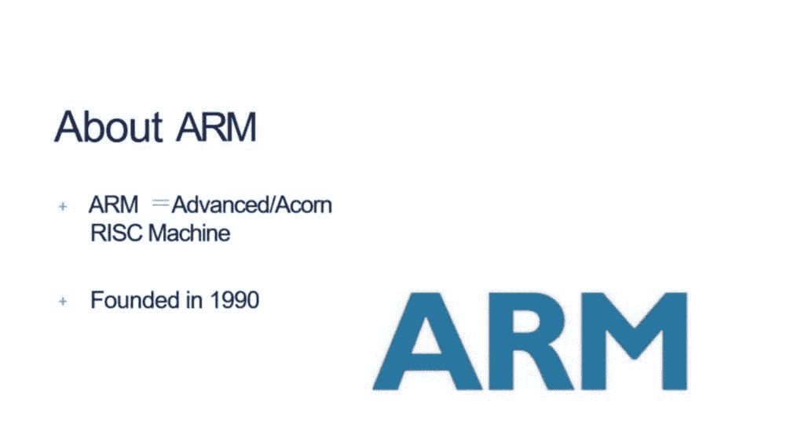

这里有很多细节，但你现在需要理解的是，`ARM` 代表 `Advanced RISC Machine`，它基本上是一家为不同用途提供 `C.P.U` 设计的公司。现在，我们在市场上的主要客户在这个列表中，如你所示，直到 `Samsung`，我们还有 `Broadcom`、`AMD`、`Apple`、`Qualcomm`、`Lenovo`。这些都是客户，并且他们使用 `arm` 设计。所以如果你有一部 `iPhone` 或有一台使用 `Intel CPU` 的电脑，你可能会在那颗 `CPU` 上看到我们的标志，我们将讨论使用我们架构的各种板卡。但知道 `arm` 无处不在是很好的。现在关于 `ARM` 处理器，`ARM` 提供了多种处理器技术。

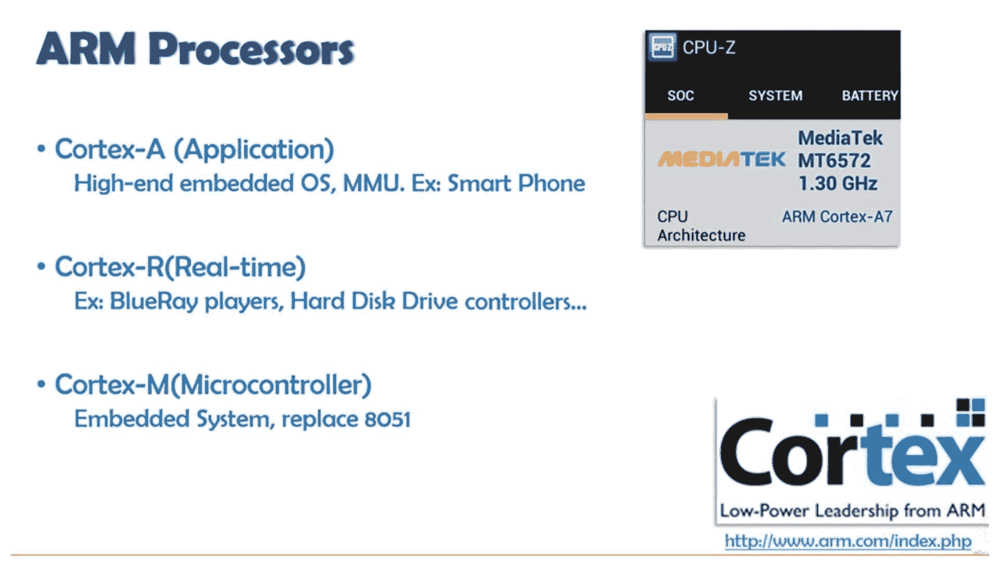

我们在这里要讨论的只有其中三个，最重要的三个。我们将只讨论 `Cortex`，因为它是基于微控制器的 `cortex`。第一个是 `Cortex-a`，代表应用（applications）。它用于高端嵌入式或我们手机的智能手机，如 `Apple` 设备和一些 `Samsung` 智能手机；而 `cortex-r` 代表实时（real time），专门用于 `Blu-ray` 播放机、硬盘驱动器控制和其他需要实时响应的设备。例如，在使用 `Blu-ray` 播放机显示电影时，这类设备无法承受任何延迟。所以 `cortex` 是为此目的设计的。

还有 `Cortex-m`，代表微控制器（microcontroller），主要用于嵌入式系统，并着 `8051` 的角色，`8051` 是一种在系统工作中非常著名的 `intel processor`。现在，你可能也听过用于大多数中国手机的 `MediaTek CPUs` 或处理器，它们都基于 `arm` 或 `arm cortex`。`A7` 再次代表 `application seven`，是 `CPU architecture generation`（CPU 架构代），频率高达 1.3 GHz。我们需要关于此的更多信息。你可以访问网站 `arm.com/index.php`。

现在让我们快速看看 `arm cortex`。再次提到 `ARM`。`M` 代表 `microcontroller`（微控制器）。这是一个嵌入式系统芯片。在这张图中，你可以看到一些你必须熟悉的东西。这里有 `bus`（总线）。

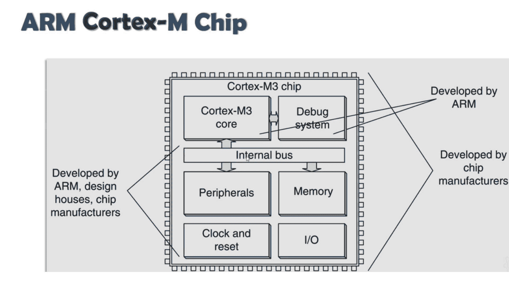

`bus` 基本上是那个用于将信息从一个位置传输到另一个位置并反之然的组件。这里有我们 `CPU` 的核心。这是整体。这里是 `cortex-m3` 芯片。它有内存、有 `peripherals`（外设）、有 `clock`（时钟）以及 `input`（输入）和 `out`（输出），所有这些都连接到内部 `bus` 和 `cortex-m3 core`。现在这里的 `m3` 是代数，每一代都有自己的规格。

所以你从上一页幻灯片中需要理解的是，应用 `R` 代表 `real time`（实时），`M` 代表 `microcontroller`（微控制器），每当你看到设备和智能手机时，你必须知道它是这样使用的。我们的手机有一个浏览器，它使用 `Cortex-a`，因为 `Cortex` 是最强大的，是智能手机的主要用途。每当你看到基于嵌入系统的设备时，你必须知道它正在使用 `cortex`。

回到这里，`Cortex` 和 `Core` 通过 `debug system`（调试系统）连接，这 `debug system` 和 `cortex-m3 core` 是由 `ARM` 技术开发的。而这两者是由 `arm design houses` 和芯片制造商开发的，因此由芯片制造商决定他们需要连接哪些外设、输出大小以及根据其应用决定 `clock` 和复位时钟的 `clock speed`（时钟速度）。所以整个包，当你从商店购买时，是由芯片制造商开发的，而不是由我们的 `arm`，我们通常授权芯片制造商使用我们的系统核心设计以及芯片内部的其他内容。他们只是出售了使用我们技术开发最终产品的权利。但使用 `ARM` 公司原始设计创建最终设计是芯片制造商的责任。但他们共同努力，为你提供使用基于 `arm` 处理器的非常快的设备。

例如，`Cortex-m0`。在七代版本架构上，没有缓存也没有 `MMU`，现在 `MMU` 代表 `memory management units`（内存管理单元），所以该芯片没有内存管理单元。它自动支持指令和中断的保存与恢复状态。它们具有固定的内存映射和 `thumb` 指令核心，具有高代码密度。这些是 `arm cortex` 处理器的一些主要特征。其他 `cortex` 和版本可能具有不同的规格。所以你需要选择适用于你应用程序的那一个。现在，如你在这里看到的，我们仍在讨论 `arm conflicts`，你在这里可以看到这个绿色的框。它有 `Cortex-m0`、`m1`，你可以看到这里有多少条指令。你也可以发现指令并不多。所以这种程序不能用于嵌入式应用（那里有很多指令）。

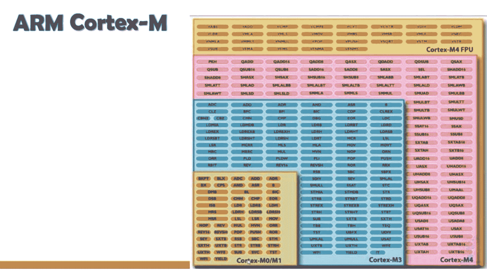

并且你需要在内部执行很多事情，连接许多传感器并进行许多数学运算。现在，之后是 `Cortex-m3`。它是这里的蓝色区域，指令数量是它的四倍。然后 `Cortex-m4` 拥有更多指令，`Cortex-m7` 如你所示，它有更多指令。所以随着数字的增加，这是一个重要的公式。随着字母后面数字的增加，你会发现处理器更强大，支持更多的指令，并且可以访问更多内存。现在，这就是对我们世界的介绍。我希望现在你明白 `ARM` 并不是制造芯片的公司。他们将制造权出售给 `Apple`、Intel 等其他公司。


所谓的 `Cortex` 是我们的下一代 ARM 处理器，它由经典的 CPU 和系统外设组成。这种类型有三个系列。有不同的区域，我们对这三个系列进行了划分，并会讨论它们的细节。因此，该系列适用于复杂的应用程序和操作系统。此外，这一系列用于实时系统，并针对我们敏感系统的成本进行了优化。大约有 15 个性能级别，`zero` 是最低的。现在，让我们来谈谈 `cortex`、`CPU` 和规格。首先，你需要知道 32 位的 `risc`，32 位 `risc` 基本上是 CPU 结构或你可以定义的内容。


带有 `risc` 的 `CPU` 是精简指令集体系。它有 16 个寄存器。它具有带有分支保护的三级流水线。它支持 Load/store 架构。现在，如你在此图像所示，这些是从 `R zero` 到 `12` 的寄存器，然后是 `13`、`14`、`15`。这一个是 `16`。现在，我们提到这是一个 32 位的架构 `C.P.U`。所以你可以很容易识别出我们应该有 16 位或 32 位。如果你看这里，你可以找到 `zero`。这是 `X PSR` 寄存器，我们现在不进入细节。它从 `zero` 开始。这里右边的最后一位是 `31`。所以从 `zero` 到 `31`，这些是 32 位。这基本上就是它被称为 32 位处理器集群或 `risc` 架构的原因。再次，这些是 `16` 个。每一个宽度都是 32 位，并且它具有带有分支预测的三级流水线。当我们谈论这三级时，你可以很容易在这里看到我们对每条指令都有取指（code）和执行（execute）。这基本上是我们的 `cortex CPU` 的内部结构。而我们在这里讨论的是一个 32 位的 `risc` 架构 `CPU`。

例如，`cortex M3` 有两种运行模式和两个级别。运行模式称为 `Thread Mode` 和 `Handler Mode`，在没有异常的情况下，运行正常程序或运行异常处理程序（如中断处理程序或系统异常处理程序）。这些特权级别为保护对关键区域的访问提供了一种机制，并提供了基础安全模型。当处理器运行主程序并处于 `thread mode` 时，它可以处于特权状态，也可以处于用户状态。但当处理器退出时，异常处理程序只能处于特权状态。当程序 处于 `thread mode` 且具有特权访问权限，在状态程序中，它可以访问所有正常范围并使用所有支持的指令。软件在特权访问级别可以使用该控制寄存器将程序切换到用户访问级别。现在，当发生异常时，处理器将始终切换回特权状态，并在退出异常处理程序时返回到之前的状态。程序无法通过通过写入 `control register` 变回特权状态，它必须通过异常处理程序，由该异常处理程序配置 `control register` 来切换进程或切回特权访问级别。这发生在返回 `thread mode` 时。


现在，如你在图中所示，这些是可用的运行模式和特权级别。现在，如果我们快速看一下原理图，你可以在这里看到我们有 `supervisor handler mode`，这里有 `user mode`。我们有 `privilege`，即 `US`。这里有 `unprivileged application mode`。现在，`system calls` 或者正如我们所说的，来自特权模式的 `undefined instruction`。在这里你可以看到它们，一个具有指令和数据的总线，它正与 `CPU` 连接并指向它。所以再次，`cortex M3` 有两种运行模式和两个特权级别，运行模式称为 `thread mode`（是这个）和 `handler mode`（是这个）。这决定了人员是在运行正常程序还是运行异常处理程序（如外部中断处理程序或等）。我们在这里讨论的是 `cortex M3`，但你可以对任何遵循 arm 设计的其它 CPU 使用相同的定义。

现在，让我们来谈谈一些指令集。某些技术在 `arm t32 ce` 中被引入，它大约在 2003 年发布，它通过扩展 `thumb` 有限的 16 位指令集并增加额外的 32 位指令，使指令集具有更广度，从而产生变长指令集。`thumb-2` 的一个目标是实现代码密度，类似于在 32 位内存上与其它指令集具有相似的性能。`thumb-2` 扩展了它们的 `thumb` 指令集，增加了位带操作，以及我们的特色分支和条件执行。同时，某些指令被扩展了，以在两个指令集中保持等效的功能，并且一种新的统一汇编语言（或者 `as`）支持从同一份源代码生成 `thumb` 或 `arm` 指令。所以你在这里需要知道，`thumb-2` 指令集基本上是具有 16 位代码密度的 32 位性能，适用于嵌入式微控制器（microcontrollers）。这张图像，如你在这里看到的，解释了一切。对于 `M3` 的上下文，你可以看到我们最初有一些指令是 16 位的。`thumb-2`，正如我们已经提到的，出现是为了扩展它们 `thumb` 有限的 16 位指令集，这就是这个带有额外的 32 位指令，以使该指令集具有更广度。这是你对整个 `thumb-2` 设置唯一需要理解的内容。我们将在接下来的课程中详细讨论它。


现在让我们来谈谈 `memory map`。如你所示，这是我们 `arm cortex`, `CPU's` 中的映射，如你在这里看到的，我们有 `code`，它是最低的区域，这个区域基本上专门为我们的 `code` 设计，它可以增长到半 GB。然后我们有 `static ram`，它也可以增长到半 GB。我们在内存中为 `peripherals` 留了特定位置，也可以增长到半 GB。我们有 `external ram` 可以增长到 1 GB，`external device memory` 可以增长到 1 GB。然后我们有 `private peripheral`，包括内部和私有部分，外部加上 `vendor specific`。现在 `vendor specific` 取决于厂商。他们可以在这个内存区域放置任何他们想要的内容。但这是他们主要的结构或内存布局。完全正确。现在在 `cortex CPUs` 中。


这基本上是一个 Cortex 微控制器的软件接口标准。这就是 `CMS` 的含义。`CMS` 是一个独立于厂商的软件层，它用于导出和复用软件。为了更深入地理解它，你可以在这里查看细节：从用户到微控制器必须经过的不同层级。

### 软件层

现在，让我们从第一层开始。如你在这里看到的，我们有应用程序代码，该应用程序代码基本上就是用户层。如果你看这里，这是该层的名称，因此应用程序代码将通过实时内核和中间件组件，其某些组件可能会一直穿过外设寄存器和中断向量定义，并到达设备执行功能。而有些应用代码可能会直接与外设功能通信。

之后，你可以看到我们有 `OS`，它基本上是第二层。这基本上是位于应用程序代码和 `CMS` 层之间的实时内核和中间件组件。

现在，我们在这里关心的层，也是主要主题，最后的一个是这一层，即第三层：`CMS` 基本上是一个包含核心特性函数、中间件访问函数、设备外设函数，以及优化的启动和中断向量定义的层。所有这些内容都在这一层内部。这就是为什么这是一个非常好的标准，使得软件和代码的通信与复用变得容易。

这一层与 MCU 直接通信。MCU 层包含 `CPU`，它是任何嵌入式系统或嵌入式软件系统的核心；我们有这个 `bus`（总线），它是系统的核心。我们有 `NVIC`，它基本上是嵌套向量中断控制器，以及接口和其他外设。


所以，这一层帮助来自用户的应用程序代码与 MCU 或 `cortex CPU` 层进行通信。我们利用它来方便我们为 MCU 开发和编写代码。再次强调，这基本上是一个独立于厂商的软件层。这将有助于软件的移植和复用，这两点非常重要，你必须将它们记在心中。

### 文件结构

现在，关于这一层的文件结构，它是从 `stm32f4xx.h` 开始的，这是主文件，它进入两个文件：`hal` 文件和 `system` 文件。`core` 文件包含 `startup` 文件，而 `system` 文件。现在这就是文件结构。在这里我们解释这些每一个分支：

- `stm32f4xx.h` 基本上是 `cortex M4` 全局声明文件。
- `stm32f4xx.c` 是 `cortex M4` 全局定义。
- 我们有 `stm32f4xx_hal.h`，这些是真正独立的文件，我们有 `device.h`，根据你使用的设备类型被包含在应用程序软件中。我们还有 `system_device.h`，这是设备特定的声明。我们有 `system_device.c`，它基本上是设备特定的定义。

所有这些文件都有助于初始化我们的 `CMS` 层。现在你可能会想：“我需要记住所有这些名字和所有这些东西吗？”很可能我们将要使用的开发环境会处理一切。你只需要创建一个新项目，大部分这些文件和定义都会为你创建好。

### ARM CORTEX M4 架构

首先，你需要知道这个微控制器支持哈佛架构（Harvard architecture）。它拥有一套基于哈佛架构的 32 位架构，具有一些 32 位指令集，指令长度可以从 16 位到 32 位不等。它具有从 `r0` 到 `r12` 的寄存器级，因为这些只是通用单元。它还有栈指针 `PC`（程序计数器）、`LR`（链接寄存器）和 `xPSR`（程序状态寄存器）。

它还支持支持高达 4 GB 的统一内存空间，通过基于 `arm aba` 的总线接口，该接口定义了通过片内总线微控制器模块之间的通信。那就是 `AHB`，高性能总线，用于连接总线主设备元素以减少延迟。还有 `APB` 外设总线，它与外设之间是低带宽连接。

此外 `NVIC` 控制器负责中断和异常管理，并带有优先级处理。它有一个系统滴答定时器（`SST`），这是一个 24 位的特殊定时器，并且针对低功耗进行了优化。有多种睡眠模式可供选择，我们已经提到过了。


现在，如果你快速看这张图片，你可以看到 ARM 架构设计的一个示例。这里的系统基本上就是这条总线。但在这里，蓝线连接了核心元素，如上方的处理器和 Flash 闪存，但来自 `SRAM`（基本上是用于不同目的的不同类型的内存）也连接到该总线接口，而外设总线（我们刚刚提到的 `APB`）处理所有 MCU 外设的连接。这两个总线通道通过一个遵循 ARM 规范、由主从机制管理的桥接器互连。你可以在这里看到 `bus bridge`（总线桥接）。所以它们使用这个总线桥接连接，但它们连接的是不同的元素。


正如你所见，这是系统控制器。这是处理器。这是总线接口、Flash 闪存以及来自 `RAM`，这些都是非常重要的部分，在与这些部分通信时无法承受任何延迟，但在与这些外设通信时也可以无法承受延迟。这就是为什么它们连接到一个称为“外设总线”（Peripheral Bus）的二级通道上。该总线连接到定时器、`RTC` 以及引脚和数字转换器，可用的话还有以太网控制器。所以你需要的是，在 ARM Cortex 架构内部有两个总线：一个是用于处理器的，另一个用于外设的。

### ARM CORTEX M4 内存映射

我们提到过其他空间可以高达 4 GB，有时对于某些项目是较小的空间，而对于其他项目则这是一个很大的空间。现在，这是从这里开始的内存。你可以看到我们有一个高达 500 MB 或 1 GB 的代码区域。这个区域主要用于程序，也可以用于异常向量表。正如你在这里看到的，这是起始地址。在它上方，你可以看到 `SRAM`，它具有相同且较小的内存，基本上是静态随机存储器。`SRAM` 代表静态。

现在，在那之上，我们有外设内存，主要用于如 `I2C`、`SPI` 和其他通信协议。


我们还有一个 1 GB 的外部 RAM，是可以寻址的。它可以高达 1 GB。它主要用于外部内存，用于存储那些不重要的数据。现在我们也有一个高达 1 GB 的外部设备内存，主要用于外部外设。之上，我们有系统内存，它基本上是私有外设，包括 `NVIC` 和调试组件。现在有一个被称为“私有外设总线”（Private Peripherals Bus）的区域，它有一个私有总线 `APB` 和系统控制空间，即 `SCB`。这就是在 ARM Cortex 内部这 4 GB 空间是如何分配在不同事物之间的。现在它有时是 4 GB，有时是 1 GB，取决于你使用的芯片类型以及该开发板的常规规格。再次，它可以累加到 4 GB，这是一个你可以使用的非常特性。

下载并安装 STM32CUBEMX IDE


# 我将教你如何下载并安装 STM32 Cube 开发环境

该开发环境免费在线提供。你所做的就是编写 `STM32`，32 岁。Idea 或开发环境，现在这是第一个结果，即 `STM32 cube idea`，它代表集成开发环境（IDE）。这是一个先进的 C++ 开发平台，具有强大的配置代码生成功能（编译），以及针对 `STM32` 的调试功能。

## 下载过程

直接进入下载页面，在这里你可以找到所有的功能和不同的版本。现在，如果你有 Linux，可以下载该软件。如你所见，我们有深度、巨大的 Kleenex 安装程序、一个 knockwurst 版本、适用于 Linux 的 `R.P.M.` 版本，以及 Windows 安装程序。由于我使用的是 Windows 操作系统，我将下载 Windows 安装程序。如你所见，最新版本是 `1.6.1`。如果你对其他版本感兴趣，可以点击这里从列表中选择不同的版本，我们通常推荐下载。


最新版本修复了 bug 并包含许多功能。点击“获取软件”。这是许可协议，你必须接受它才能免费下载软件。点击“接受”。现在他们将带你进入软件页面。该页面的主要目的是获取你的姓名、姓氏和电子邮件地址，以便向你发送公告、新软件发布及其他内容。你可以填写你的名、姓和电子邮件地址，然后点击。勾选“我已阅读并理解条款”。如果你想获取软件未来的更新信息，可以勾选此项。完成后，点击“下载”。它将引导你进入该下载页面，如你所见，你的请求已成功提交。现在，通常你会收到一封需要验证电子邮件地址的邮件。一旦收到邮件，你就会发现一封开始软件下载的邮件，其中包含下载链接。只需点击“立即下载”，你需要使用相同的浏览器。现在，你的下载将开始，你会得到一个文件。这就是你得到的文件，通常是一个 zip 文件，所以你必须使用拥有的任何软件对其解压，如果没有，可以下载一个。


## 安装过程

这是一个免费软件工具，文件只需解压即可。完成后，你将得到这个文件夹，里面有一个双击运行的文件。你的安装程序将启动。Zarkasih 现在只需点击“下一步”、“我同意”、“下一步”、“已选定”。如你所见，这将解决驱动程序处理问题。这被认为是一个驱动程序问题。现在正在解压并安装文件，点击“安装”。现在过程不会花费太长时间，如你所见，它将不断解压文件并将它们安装到你的 PC 上。

为了确保你知道我们正在安装什么，它基本上是 `STM32 cube idea`，这是一个全合的多功能开发工具，是 STM32 cube 软件生态系统的一部分。它基本上是一个先进的 C++ 开发平台，具有配置代码生成、编译功能，以及针对 `STM32` 微控制器和微处理器的功能。它基于 eclipse 框架和 C 工具链进行开发。


它允许集成成百个现有的插件，以完善 eclipse idea 的功能。作为 Cube 的大使，Ali 将 `STM30` 的配置和项目创建功能集成到 `cube mix` 中，以提供全合的工具体验，并节省安装和开发时间。现在，在选择了一个空的芯片、`32 MCO` 或 `MPU` 或已配置的微控制器或微处理器，或者从选择开发板或选择示例后，项目和这个 idea 将被创建并初始化，它将帮助你生成代码。在开发过程中的任何时候，都可以返回外设和中间件的初始化和配置，并重新生成初始化代码而不对用户代码产生影响。这个软件非常棒的地方在于它结合了 `STM32` 的代码生成、代码编译和调试功能，而这正是我们在本课程中学习的内容。我信你将开始使用这个平台开发你未来的许多项目。所以，你需要的是按照我们的步骤，让该软件在你的机器上运行起来。

## 运行软件

如你所见，解压和安装过程即将完成。现在我们完成了，只需点击底部的完成。现在，你可以从开始菜单或桌面图标启动软件。只需点击开始“`attempted to cube Ivy`”。这需要几秒钟来加载。现在你选择通过“作为工作空间”作为 Cube idea 的回答，即使用工作空间目录来存储其偏好和开发产物。现在，你需要将这些内容存储在一个万一发生问题时可以找回的地方。因此，我们不建议使用安装 Windows 操作系统的主盘来存放工作空间，只需浏览并进入另一个目录，如 `E` 盘并命名为 Justin 或 expect。只需点击“选择文件夹”。即可。现在你可以选择此选项：“将其作为默认值”或“默认并再次询问”，这样你就不会每次打开软件时都看到这个消息。


现在，启动 answer Cube Ivy。就是这样。现在你有了 idea，你可以启动一个允许访问的新项目。现在点击，“是”，你可以在这里启动 `STM32 project`，或者如果你已经有了之前的版本，可以从现有邮件启动新项目，或者你可以随时导入你的项目或示例。现在，这些是支持和社区链接。这些是 Sandrone 32 工具。这些是应用工具，这些是 `SDM 32 Wiki` 和 `MCO wiki` 的一些快速链接，外加文档和入门指南。


你需要确保不要从那些提供虚假 `ALGUIEN` 板子，或者不是由原厂制造、购买的板子处购买。你也可以查看学习部分以获取教程、参考资料以及关于学习新知识的内容。

正如你在这里看到的，板子方面入门级只有 `Leonardo` 和启动套件。不，没有 mini 微控制器。增强功能有 `Amiga`，物联网的还有其他的。比如，是的，我正在屏蔽制作……比如智能手表的方案，用于制作 3D 打印机的打印部分。让我们看看 `Ormeau`。还有 `mega`。这是 `Arduino` 基础 101，符号 3D 打印机。你可以看到，这些将花费你大约 700 美元。你也可以看到 `arguin` 板子，它将花费你 25、24 美元。25 美元。`Aldwin`, onum`。你可以看到，这是正品。现在，为了判断你的板子是正品，如果是 `USA` 或 `Germany` 的标志，那么它就是正品。


在中国组装的那些并不是由官方 `Arduino` 公司创建的。它们是由 `Arduino associates` 创建的。它的成本可能只有十到十二美元，或者类似的廉价品。它们在那里，而且质量与在美国制造的那些不同。

好的，现在让我们看看 `Arduino` 完成下载，让我们运行下载。`Arduino` 已经安装好了，所以你必须了解你拥有的那个。好的，让我看看。你必须关闭实例，我们都知道你已经打开了它们，然后卸载之前的版本。正如你看到的，它正在删除文件。如果你在电脑上已经安装了 `Arduino`，如果你需要用最新版本更新它；如果你已经有了最大的版本，那么请跳过本节，点击“下次安装”，正如你看到的，安装或开始了。这不会花费太长时间。你可以查看我们的资源部分，讨论下载代码和获取硬件材料材料的链接。好的，我必须关闭然后进入开始菜单。进入 `Eleazar`，然后选择 `Alino`。


这是我们的原始想法。现在，为了快速概述，这是你必须点击的按钮，以验证你的代码是否编写正确。这一个用于验证并上传 `dakota Arduino`。这些用于编译并保存它以创建一个新文件。正如你看到的，当你创建一个新文件时，你有两个主要方法：用于你的 `setup` 代码的 `setup` 和 `through the setup`。`loop` 是用于你将重复运行的代码。最后是通用常识，`Skitch` 用于上传、验证代码或添加新库。`tools` 用于选择板、获取板、选择 `programmer Bootloader`（编程器引导程序），这是一个高级主题，以及 `Arduino` 打开 `Syrian Blätter` 修复代码编码，或者 `IT` 是你可以在那里找到你正在寻找的内容及其答案的地方。现在你可以检查 `example` 基础数字模拟控制和各种显示。让我们看看，我们想要一个用于 `led` 的 `basic example`。正如你看到的，这非常直观，所以它有注释，你可以理解正在发生什么以及板上开启了什么。这就是为什么 `Arduino` 非常棒，因为它会提供惊人的支持。配置 ARDUINO 板子

在下载并获得 `Arduino IDE` 的价格后，你需要进入浏览器并 `stem cells` 到 `Arduino`，然后对吧？`GitHub`。进入第二个结果，点击它，你将得到这一个，正如你看到的，`GitHub/lda/stm32`，右键并下载 zip 文件。现在点击开始下载，这不会花费太长时间。


现在这个软件是实验性的且正在进行中，所以你可能会遇到一些错误，但它是非常棒的软件，允许你使用熟悉的 `Arduino IDE` 来为 `STM32 board` 编写程序。现在我们将等待下载完成，然后我们将开始将这些文件添加到 `Arduino` 文件夹。现在在我们等待时，你需要进入 `Arduino`，这是原始的想法。


我们已经解释了如何下载和安装 `IDE`。现在你需要进入 `tools`。在这里你会发现 `board` 中我们没有 `Arduino STM32`，为了提供这块板子，我们需要进入 `boards manager`，在这里我们需要安装 `Arduino some boards`。你会在这里找到第三个结果，抱歉 `Arduino some boards`，这个包包含了这些板子，比如 `Altuna do`，它支持 `stm32 bit arm cortex`。只需简单安装。现在安装过程将从一个大约 60MB 的文件开始，所以它将下载这个文件，一旦下载并安装，它将添加 `Arduino STM32 arm cortex M3` 支持。这是我们在从 `GitHub` 库拷贝文件到 `Arduino` 文件夹之前需要的。


现在正如你看到的，已完成并安装，如果你有这个词，那么一切都稍微关闭了，再次点击关闭按钮。现在对于点击关闭按钮，你需要确切知道 `Arduino` 软件在哪里。右键 `Arduino` 点击 `Open file location`（打开文件位置）。现在再次右键 `Arduino` 点击 `properties`（属性）。这就是简单的安装目录。现在我们完成了从 `GitHub` 下载库文件，现在我们需要解压它们，所以去这里，让我们看看这是 `Abdinur attempted to master`，只需解压。在这里是 `ArduinoSTM32`。现在将该文件或文件夹粘贴到 `hardware` 文件夹中，在 `Arduino` 内部。现在将花费半分钟拷贝所有文件。正如你看到的，这个文件夹还有一个用于 `microcontroller` 的 `avr` 文件夹。现在我们正在为 `STM32 microcontroller` 添加支持。太棒了，现在一旦完成，只需再次右键 `Arduino` 打开。最小化这些，并将等待 `IDE` 加载以向你展示如何从原始 `IDE` 选择 `Arduino` 或 `STM32 board`，对于大多数熟悉 `IDE` 的人来说这是简单的方法。现在从这里你可以创建一个 sketch。进入 `tools` 并进入 `board`。现在当你进入 `board`，你会发现现在我们有了 `Arduino STM32 search to master drivers`，我们有 `Arduino STM32 tools`，我们有 `stem cells to EF1 boards before boards`。现在在这个列表中你可以选择你拥有的板子，通常会是这些 `Jaric` 板子之一，但我们将在实践部分讨论那个。


现在假设你已经选择了这块板子。你可以返回，确保此策略对应 `F103 series` 已选中，然后你可以从这里选择变体。现在有些板子是 `64KB flash memory`，而另一些板子有 `128`。你可以选择使用 `STM32 Luig Bootloader` 的上传方法。如果你的板子上有引导程序或使用 `Serial connection`、偷窃或使用 `black magic prop`，你甚至可以选择 CPU 速度，正常是 `72 megahertz`，这就是了。你最后选择的是 `port`。


这是 Lars von Trier 的年度教程，我们将讨论 `STM32` 的命名，并将介绍引脚定义以及该微控制器 `MCU` 内部的寄存器。

### 命名结构

通常你会发现以 `STM32` 开头的 `STM32` 名称，就像这里一样。在这个区域，你可以看到有 `STM32`，这通常是你查看 CPU 时发现的第一个东西。现在，你要看的是字母 `F`，它基本上代表产品类型，后面通常跟着一个数字。这个数字具有指示意义，例如，让我们来尝试弄清楚这个 `MCU` 的命名机制。假设我们有一个名为 `STM32G431RB` 的微控制器。这是一个很长的名字。它以 `32` 开头，代表 `MCU` 和产品类型。


现在，它后面通常跟着三个数字：例如用于执行的 `L`，或者你可能会发现四个数字。在这种情况下，我们有四个数字，这个 `4` 后面跟着 `31`。现在这基本上是设备的子类别，后面跟着引脚（`PIN`）数量。所以这里我们有一个。这是一个引脚数量。为了知道你有多少引脚，你可以参考这个标签，这是一个 `64` 引脚的 `MCU`。这取决于这三个数字之后的字母。好的，那么那个字母 `B` 是什么？它基本上是内存或闪存的大小，这里的 `B` 代表 128 千字节。这就是你如何轻松地读取你的 `STM32` 名称的方法。

有时候名称后面还会跟着两个数字。这些是封装类型。第一个是封装类型，第二个是温度。但通常这又是整个名称，以 `STM32` 开始，然后是产品类型 `G`，接着是设备子系列 `451`，然后是引脚数量（第一个字母）、闪存大小（第二个字母）。所以，每当你看到一个 `STM32`，你都要尝试读取这些数字，尝试弄清楚这个 `MCU` 有多少引脚，以及该 `MCU` 的闪存大小有多大。

### STM32 引脚定义

现在，如你所示，这是 `LQFP64`。它有 `64` 个引脚。识别这些引脚很容易，我会教你如何做到。

现在，在开始之前，你需要理解几点。第一点是每当你看到 `PE` 时，它代表端口 E。每当你后面看到 `A`、`B`、`C`、`D` 时，这就是端口。所以这里有 `PC7`，意味着 `PORTC7`；这里有比如 `PA12`、`PA5`、`PB5` 等，你可以将其与任何其他引脚一起使用。

现在我们在电源上还有 `VDD`。我们有 `VSS` 作为地。如果你想连接电池，就有 `VBAT`。我们还有 `NRST`，你可以在那里连接按钮来重置微控制器。我们还有 `VDDA` 和 `VSSA`，它们具有相同的电源引脚。另一个 `VDDN`，这基本上就是全部了。我们既有零引脚，这个引脚用于控制我们 `MCU` 内部的启动机制。你可以检查其他配置，正如你在这里看到的，我们有一个 100 个引脚的 `LQFP100` 封装，如你所见，它以 `L` 开头接 `100`。它有更多的 `VBAT` 引脚以及所有不同的引脚。


这里有带有电源引脚的 `VBUS`，我们有 `VDD`、`VSS`、`PORTA`，这里有 `PORTB`、`PORTC`，这是板子。它有更多的支持、更多的引脚，如果你有很多需要接口和连接的输入输出，它是适合的。

现在是其他几个部分的列表。`STM32F4446` 的映射。如你所见，名称是 `AF101`。现在这是地址，这些是连接到该地址的外设。这里有通用输入输出（GPIO），它意味着通用输入输出引脚。这是端口，即 `GPIOA`、`GPIOB`、`GPIOC`，它包含所有这些端口。这两个地址留给设备制造商。这些是定时器。这一个用于 `SPI1` 通信。这些用于 `ADC`。这些是用于你的 `UART` 通信。随着课程进行，你会看到更多模块，如 `I2C`、`SPI2` 和 `RTC`-`TIM4`。这些是定时器，这里我们有一个数字转换器。在这里我们可以看到我们的通信协议，每一项都有它自己的边界地址。这些每一个外设都通过总线连接到我们的主 `MCU`。

现在，一些重要的且你需要了解如何配置的大型通用输出寄存器将在下节中解释。本节就此此。我们解释了引脚定义，以及如何知道这些中每一项可以做什么，以及如何识别引脚以便你轻松地连接它们。

### STM32 中的某些 GPIO 寄存器

我们将讨论的是 `STM32` 中的一些输出寄存器。我们有这些寄存器的地址，这里是基地址。所以这里有这些寄存器的地址，这是你在使用 C 语言时使用的名称。

每当你看到 `A`、`B`、`C`、`D`、`E`、`F`、`G`、`H`、`I` 代表端口。现在我们有 `MODER`，它是模式寄存器。它是通用输入输出模式或方向，控制它是输入还是输出。现在我们有 `PEEDDR`，它是通用输入输出类型寄存器。它配置我们想要发送的输出类型。如果你将引脚作为输出，可以使用此寄存器配置输出。

现在，某些引脚可以用于高速数据传输，因此有 `OSPEEDR`，意味着输出速度寄存器。这用于控制输出速度，我们的 `MCU` 内部有上拉和下拉电阻。某些引脚支持，另一些不支持。所以为了控制这个，如果你希望该电阻上拉或下拉，你需要使用这个。它是 `PUPDR`。这些是上拉/下拉寄存器。

现在有一个端口 `IDR`，它是输入数据寄存器，控制你使用 `MCU` 读取的输入数据。还有一个 `ODR` 输出数据寄存器，控制你通过 `MCU` 发送的数据。还有一个 `BSRR` 寄存器，可以使用它来设置或重置任何输入输出或任何寄存器，微控制器内部所有的位。

这些是主寄存器，当你调用这个 `STM32` 微控制器时可能会看到其中一些。让我们继续。这是数据和方向寄存器，以及输入输出的简化视图。现在，如你在这里看到的，我们有一个引脚等等，比如，一个引脚。五个端口。这基本上是一个位。现在，这是 `IDR` 的位，`IDR` 寄存器，你会发现 `IDR` 意味着数据输入寄存器。现在这是这些寄存器之一，在情况下将此引脚作为输出时，它会将输出信号发送到该引脚。


现在，如果你正在读取一个信号，它将通过任何方式产生信号并将其存储在这些位中，即该端口的输入寄存器，在这种情况下是 `Port`。因此，这些引脚中的每一个都有输出和一个输入位，你可以用它们向这个特定的引脚发送或接收数据。它们分别用于数据输入寄存器（零位）和输出位。这基本上是一个快速示意图，用于向你展示我们 MCU 中的每个引脚是如何结构的，以及它是如何用于接收或发送数据的。

# STM32 中的控制寄存器

现在我们将通过一个快速的示例来介绍如何使用和编写通用输入输出（GPIO）模式。现在 GPIOD 代表通用输入输出，它基本上就是数字输入和输出。现在，输入是指程序可以读取输入信号是 1 还是 0；输出是指程序可以设置输出为 1 或 0，你可以用它与外部设备或板载外设建立接口，例如开关和按钮作为输入，或者 LED 和扬声器作为输出。你已经了解了这些信息。


在这张图中，你可以看到我们有一个 LQFP100 封装引脚图，从图中你可以看到我们这里有 100 个引脚。我们将它们分成了，有 A、B、C、D、E 组。这些是 1、2、3、4、5 组。在这个 100 脚封装中，并不是所有的引脚都是可用的，所以有时你可能会发现引脚 5B 是不可用的，或者 B 有两个不可用的选项。因此，你必须根据哪些可用、哪些不可来进行工作。在这种情况下，可用的引脚在图中写出了，这样你就知道哪些可以用，哪些不能。这取决于封装的引脚数量。在这里我们有 100 个引脚。


还有其他 64 脚、32 脚的封装。因此，根据你的应用，必须选择正确的封装。

## MCU 内部的通用输入输出位电路

如你所见，我们有配置、数据和锁存。现在我们想解释这些，但我将解释这里的主要要点或部分。我们在这里有读，这里有，现在有一个读。如你所见，输出数据寄存器（ODR）区域基本上是读写寄存器，设置寄存器允许写入，而输入数据寄存器（IDR）已经是读取的。因此，这些位中的每一个都可以读、写或读写。现在，这里如你所见，有一个输出备用功能输入。这将位于位上。现在，这里有一个输出控制器、驱动器和输出驱动器。这一切都在 MCU 内部。

现在我需要你理解的是存在特定的寄存器，我们在上一节中已经解释过它们。其中某些可能是只读的，其他一些是读写的。这就是读写，如你在这里看到的。你必须准确记住每个这些寄存器的缩写，因为我们将在代码部分使用它们。现在关于配置，你可以去弄清楚它的方向、模式、速度。


关于数据，你可以输出数据或获取输入数据或处理模拟数据。通过这些不同的点，你甚至可以锁定数据或使用锁定机制来锁定 CPU 的特定状态。

## 控制寄存器概述

我想再次解释那个控制寄存器，但我们将做一个快速概述，介绍每个端口的作用以及我们对 32 位寄存器的支持。第一个是 `mode part`，它基本上是模式控制系统，将端口定义为输入、输出、模拟或其他任何模式。现在还有另一个名为 `output type register`（输出类型寄存器）的寄存器。这基本上是一个控制输出类型的寄存器，控制它是推挽还是开漏。还有控制该引脚速度的寄存器或 `output speed register`。还有 `PUPDR`，即上拉/下拉寄存器，它可以启用上拉或下拉，具体取决于你的特定应用以及连接到我们端口的硬件。

现在有 3 个数据寄存器。第一个叫 `IDR`，第二个是 `ODR`，我们已经提到过，这基本上是输入数据寄存器，这是输出数据寄存器。现在 32 位寄存器也是可用的，如你所见，这就是该寄存器代表的，`bit set register`（位设置寄存器）。现在这是位设置复置寄存器，它的 `BRR` 代表 `bit-reset register`（位复置寄存器）。


有两个 32 位备用功能寄存器。一个叫做 `AFRL`（备用功能寄存器），另一个是 `AFRH`。`L` 代表低位，`H` 代表高位。

一组控制寄存器总共基本上 10 个。如果你花点时间，可以数一下。这里有 4 个，这里有 2 个，这里有一个，那里有一个，两个，所以 2 到 4 再到 6。4 加 6 等于 10 个寄存器。因此每个端口都有 10 个控制寄存器。这就是为什么编程 STM32 不像编程简单的位微控制器那样容易，它需要更多的，可以说更高级的经验。我们将帮助你这一点。

控制寄存器中的每一位都对应板上的一个位。取决于该端口内部有多少引脚，我们有一个 32 位寄存器，并不是所有的位都被使用，正如我们再次提到的，但某些端口引脚是不可用的。所以我们有时使用这些 32 位。但当我们访问它们时，必须作为 32 位寄存器来处理。

## 寄存器详情

此时我需要理解的是，我们有 10 个与 MCU 内部每个可用引脚相关的通用寄存器。这是主要的输入输出配置寄存器，每个位可以有不同的配置。设置操作会将方向位清零。每当你启动设置操作，它会在你尝试设置的位内部放入 0。

`output mode` 包括推挽或开漏，加上上拉或下拉。来自 `output data register` 的输出数据全部是使用备用功能输出。然后输入状态基本上是浮空、上拉或模拟。然后将其输入到理想或完美，可以说，它是备用功能。因此，每当有输入数据时，它将存储在这个寄存器中；每当有输出时，数据将存储在这个寄存器中，也就是我们在上一页幻灯片中提到的 R 或备用功能输出寄存器。同样。现在，输出有这些模式，输入有这些机器，这就对特定位增加了零，每个位可以根据你的应用进行不同的配置。现在，如你在该图中看到的，右侧这里有 `mode register`。这里有 `type register`。这里有 `speed register`。这里有 `pull up all down register`。这里有 `input output configuration`（输入输出配置）。现在，如你所见，这是第一种模式。如你所见，这些位中的每一个都根据应用有不同的配置。这里我们有 `speed mode`。


这里有上拉电阻、下拉电阻，你可以选择如何配置其中的每一个。现在，如果你在数据表中看到 `peepee` 或者 `g.p`，`gibi` 代表用途（purpose）。`Yippy` 代表推挽输出（Push-Pull），`P` 你。这代表上拉（All Up），而 `PDA` 代表下拉（pulldown），或 `D` 代表开漏（open train）。`F` 代表备用功能（alternative function）。现在阅读数据表并根据应用分配值是如此简单。

## 备用功能
这基本上是 `F` 模式下的 `F` 寄存器，`F` 或 `L` 以及 `F` 边缘，代表备用功能，某些高频需求需要配置为由特定的外设驱动。因此，你必须自己进行配置。它可以被视为多复用器（Multiplex）的选择信号。

现在，`event out` 没有映射到以下输入输出引脚，即 `Pkwy 13`、`14`、`15 zero one` 和 `P eight`。这就是 `event out`，我们将在关于 `STM32` 的高级教程中讨论它。

现在，我需要理解的是我们有一个通用功能选择寄存器（ultimate function selection register）。这基本上就是我刚才提到的必须配置为由连接到我们系统的特定外设驱动。你可以从这张图中看到，这是 `F` 区域，这是 `F r edge`。在这里，它从 `F zero` 开始到 `A15` 结束；这里也从 `F zero` 开始到 `F 15` 结束，现在由于这是 `event out` 并没有映射到这个 `fence`。

现在这些是引脚，你必须相应地连接它们。假设你想使用 `S.P.I` 协议连接所有。你可以使用这些 `Tobins`。那么假设在一个运行你的 `CRT` 的设备上连接我们的 `t protocol`，你可以使用这些 `Tobins`。因此，取决于功率、通信协议以及你具体需要做什么，你可以使用这个备用功能选择寄存器。

## 展示著名的 STM32 开发板的实操演示
我将带你快速浏览这块开发板。现在这是一块 `A.T.M 32` 开发板，你可以在网上购买。让我们聊聊包装。这是第一个 `Jumba`。那是 `Sobolev`。这是你内部的所有东西。这是我们稍后会讨论的部分。这些是你需要在板子上这里这里焊接的引脚，你可以买到一个已经焊接好所有这些内容的版本，正如你在这里看到的。这些是引脚。

这些引脚提供了方便的访问，你可以将板子放置在面包板上，并将导线连接到前端，会发生什么呢？所以你有所有这些引脚，你可以自己焊接，也可以让别人帮你焊接这些费用。

现在这两个叫做跳线帽（jumpers）。如你所见，这两个部分用于为此板选择不同的模式。第一个模式是，说是，执行模式（execution moment）。当你将代码加载到板中时，你可以把这两个跳线帽放在这里。第二个我决定……好，抱歉。让我们确保连接的方向正确。在这个方向上，关于课程的实际结果并没有实际的讨论，但我们现在继续。


这些是跳线帽。这是接收器（recipient）。看，这是 `CPO`。现在，让我们聊聊墙上的组件。这是来自上面的东西。这是 `USB 接口`，这是板子选择跳线帽。如你所见，这是复位按钮。这是 `MCU` 或主微控制器。你可以看到，让我给你看一个，`32 F`。如你所见，上面写着 103C86。这是这个 `MCU` 的版本。

现在这里有一个振荡器（oscillator），在它下面是晶体（crystal）。这是主振荡器。这是我们的晶体，如你所见，`32.7 key`。现在这里有第一个引脚，是 `PC 13`，它是 `PIN number`，我们将使用它。而且它是内置的，就像 `Arduino` 一样，你可以轻松地使用它测试你的……这里有电源指示 LED。现在，如你所见，我们还有这个，基本上是调试接口（bug interface），在这些引脚下面，你可以读到写上面的字。我不知道我能否从这个角度给你们看这些字。这是 `3.3V`。最后一个是地。嗯，这是时钟（clock）。在它旁边是数据输入输出。这就是这四个引脚。


现在，如果你翻转板子，你可以看到这里有一个电压调节器（voltage regulator）。这是一个 `3.3V 调节器`。它会接收 `5V` 并将其转换为 `3.3V` 为板子供电。这里还需要提到的另外一点是，当你处于执行序列时，必须保持它们原样。如果你想向板子加载新代码，你必须把上面的数字 1 移动到这里。到这个位置，它会让墙上的第一个引脚跨越这两个焊盘连接，然后在上传过程中按下复位按钮。至于如何编程，将在另一节课中解释。但关于主组件，这就是你需要了解的所有内容了。

现在，关于左侧的引脚，我们有两个接地引脚（ground pins），我们有接地引脚 `13`、`14`、`15 zero one` 和 `P eight`。这就是 `event out`，我们将在关于 `STM32` 的高级教程中讨论它。

现在这些是引脚，你必须相应地连接它们。假设你想使用 `S.P.I` 协议连接所有。你可以使用这些 `Tobins`。那么假设在一个运行你的 `CRT` 的设备上连接我们的 `t protocol`，你可以使用这些 `Tobins`。因此，取决于功率、通信协议以及你具体需要做什么，你可以使用这个备用功能选择寄存器。


现在，如果你翻转板子，你可以看到这里有一个电压调节器（voltage regulator）。这是一个 `3.3V 调节器`。它会接收 `5V` 并将其转换为 `3.3V` 为板子供电。这里还需要提到的另外一点是，当你处于执行序列时，必须保持它们原样。如果你想向板子加载新代码，你必须把上面的数字 1 移动到这里。到这个位置，它会让墙上的第一个引脚跨越这两个焊盘连接，然后在上传过程中按下复位按钮。至于如何编程，将在另一节课中解释。但关于主组件，这就是你需要了解的所有内容了。

现在，关于左侧的引脚，我们有两个接地引脚（ground pins），我们有接地引脚 `13`、`14`、`15 zero one` 和 `P eight`。这就是 `event out`，我们将在关于 `STM32` 的高级教程中讨论它。


现在，如果你翻转板子，你可以看到这里有一个电压调节器（voltage regulator）。这是一个 `3.3V 调节器`。它会接收 `5V` 并将其转换为 `3.3V` 为板子供电。这里还需要提到的另外一点是，当你处于执行序列时，必须保持它们原样。如果你想向板子加载新代码，你必须把上面的数字 1 移动到这里。到这个位置，它会让墙上的第一个引脚跨越这两个焊盘连接，然后在上传过程中按下复位按钮。至于如何编程，将在另一节课中解释。但关于主组件，这就是你需要了解的所有内容了。

现在，关于左侧的引脚，我们有两个接地引脚（ground pins），我们有接地引脚 `13`、`14`、`15 zero one` 和 `P eight`。这就是 `event out`，我们将在关于 `STM32` 的高级教程中讨论它。

（注：由于原文中存在大量重复的段落，上述译文已根据逻辑进行了去重处理以确保阅读体验。）


我们将第一段代码加载到 STM32 开发板，代码将通过这个 `FTT` 或这个 `USPI` 传输到 `AL Programmer`。正如你所看到的，这基本上是你询问引脚并有这三个引脚。这些是背景和五个 5V 电源。所以将此连接到我们的开发板非常简单。现在，你需要理解的是，我们不会使用那个调试 接口来加载代码。


有些人误认为这里是上传代码的下载接口。但我们要执行的是：我们将此 `USPI` 或 `eye programer` 之后连接到我们的开发板，并使用该程序提供更多功能。我们还将将文本和我们的外设、第二个和第三个引脚连接到 `A9` 和 `8` 引脚，以及 `F.T.` 或这个 `Deum 32\` 上的引脚。让我们开始连接这些元素。现在我们需要连接什么。我们不想连接那个 3.3V。我们需要连接五个 5V 引脚以及地线，所以这就是五个 5V 引脚，在我们执行这一点时，我们有一个 5V 引脚，即电源输入。现在，你应该在这里释放引脚并将它们连接到红色引脚。这样会更方便，但我只是向你展示应该如何连接。然后我被这些电线或这些引脚连接到它们。现在，你需要连接的下一个引脚是地，那么黑色就是地引脚。


连接到你。现在我们已经有了 5V 和地的连接。现在我们需要连接 ah 外设，即白色引脚到空线。并将外设连接到 10 引脚。就是这样，这基本上是连接方式，下一步将是把此 `USB` 接口连接到你的电脑。

# STM32CUBEMX 介绍

我们将介绍该工具的主要功能，即配置和生成代码，以及编译和调试过程。它还帮助你估计 STM32 系列微控制器的功耗。所以，正如你所看到的，虽然这节课专门关于 `ASTM, 32 zero`，而且基本上适用于零系列的知识可以适用于任何其他 STM32 控制器，但我们在这里指定了一个特定的系列，以便我们可以学习关于它的一切，你可以将这些知识应用到任何其他微控制器上。


由于 STM32Cube 是一个通用平台，适用于 STM32 系列，所以你不必担心为你尝试使用的每个新 `STM 32` 版本都要学习新软件。STM32Cube 应用程序通过一个引导固件项目初始配置的用户界面，帮助开发者使用 STM32 微控制器，它提供了配置引脚分配、时钟、集成外设以及模拟最终项目功耗的方法。它使用了来自 STM32 微控制器产品组合的大量数据库，该应用程序旨在通过帮助开发者在功能和功耗方面选择最佳产品来简化开发初始阶段。因此，这里的主要应用优势是它可以帮助为特定目的选择正确的 MCU。仿真为设计阶段提供了优势。它加速了开发速度。有了这个领先优势，你可以选择理想的 MCU 并简单地配置引脚、时钟、振荡器、低功率模式和中间件。


现在，关于一些关键功能。用户界面围绕自然的工作流构建：选择合适的 MCU、选择所需的外设并分配引脚配置、功耗计算器辅助以及设计高效系统。最后，可以生成项目初始化代码，并在保持用户代码完整的情况下可能重新生成。所以此用户界面的一些关键功能是，你可以控制外设和中间件参数。有一个功耗计算器，你可以用它确切知道你的 MCU 需要多少功率。有一个代码生成功能，使其可以在保持用户代码完整的情况下生成代码。还有命令行和批量操作选项，它是扩展的，例如库和插件。有一个 `MCO` 选择器，你可以按系列、封装、外设或引脚进行过滤。


你可以搜索相似的产品。还有一个引脚配置面板，你可以在其中选择要使用的外设并将通用输入输出和复用功能分配给引脚。你也可以从用户界面配置 ADC 和 DMA。你还可以使用时钟初始化，它允许你选择振荡器设置、PLL 和时钟分频器。现在我们来谈谈，有很多 IDE 可以来处理你的 `Steam 32`。有 `stem cells Tsukuba mix` 可以帮助你生成代码。有很多 IDE 让你编译和调试代码。那就是那些为你服务的 IDE，它们将帮助你监控 MCU。还有很多你可以使用的免费 IDE。这是它们的列表。`Estienne 32` 有很多支持。

# STM32CUBEMX MCU 选择器

现在让我们创建一个新项目并查看 MCU 选择器，当你打开 STM32Cube 后，点击 Start New MCU Tool Project。正如你所看到的，这就是我们所说的 `MCO Selecter` 窗口，它只在选择新项目选项后出现。现在用户知道应该使用哪个 MCU，并且可以快速找到。如果没有，可以根据特定需求过滤可用产品。现在，如果你想，呃，比如过滤结果，你可以开始按封装（其中包含了 RAM 和最小需求）、嵌入式参考编号和接口类型、颜色和频率进行过滤。加上价格。现在，一旦你在这里并在这个窗口中，你可以告诉你的伙伴，我确定我有 `SDM 32 F, 103 C`。


我现在手里用的是 `C6`。当你选择路径 4 时，有些人会拥有 `C8`，这允许你显示在这里，你可以看到关于它的很多信息。如你所见，它就像一个微型数据表，显示了特性、闪存引脚数量、低功耗需求以及配置，加上它支持的外围设备。这是价格，如你所见，以美元计价。大约两美元，这是封装。它有 48 个引脚，`calcu` 预封装。在这里你还可以看到信息，类似于封装的摘要、闪存、出出频率和参考类型。你也可以进入框图，点击你可以查看数据表，如果你想在你的页面上打开此特定 `MCU` 的数据表。它提供的支持非常棒。这是数据表，如你所见。你可以在那里看到一切。大约有一百十七页。让我们把它关闭。

现在，还有其他文档和来源可以使用。如果点击 `by` 按钮，有一个购买的地方，它会将你重定向到 STM32 产品商店。现在，如果你不知道你的 `MCU` 名称或数字，你可以使用代码进行搜索。我们检查的那个具有三个内核 `cortex`，你可以移除它并开始按内核进行过滤。假设我们需要 `M0`，那么这里有不同的区域，`F` 系列，你可以选择产品线。你可以选择。封装。如你所见，从 2.4 到 8.4，100 引脚封装，现在我们有两个符合我们规格的。如果你有其他规格，你可以在这里指定偏好。如你所见，一切都经过了过滤。现在我们有两个符合我们在这里指定的项。

现在，除了 `MCU` 和 `CPU` 选择器外，另一个选项是开发板选择器。开发板选择器基本上是一种选择板而不是选择 `MCU` 或 `UNPEEL` 的。有很多基于 `M32` 的开发板，如你所见，这是一个很大的列表。现在，你可以去这里检查开发板或 `P.L` 购买的 `SD` 评估板，同样有很多选项，在这里你可以选择供应商，选择 `Discovery Kit Evaluation Board` 时间，开发板将基本上根据你这里的设置进行过滤。你可以选择你想要使用的系统。


有些人会来这里购买开发板。所以当他们找到这个板时，他们通常会点击这里并选择 `buy` 按钮从 `Estienne Electronics Shop` 购买。再次，这是另一个示例选择器示例。如你所见，你可以看到开发板功能、产品化或项目类型——抱歉，是中间件的外围设备和其他东西。假设你想要一个数字转换器示例。如你所见，这些是支持此示例的板。还有一个交叉选择器，基本上你可以使用左侧的列表选择你的 `MCU`，并按供应商进行过滤，比如你想要一个 `microchip` 板，从这里你可以选择。但它需要连接互联网，基本上我使用的是 `MCU`。我总是喜欢使用他们的零件号和 `CPU` 或 `MCU` 编号。再次，我的 `MCU` 是 `STM32103C`。这是关于选择器你需要知道的一切，让我们写下 `STM32.one hundred f one hundred three.A`。让我们检查这里的所有，`ASTM Thursday too`。这。基本上，你有很多东西。被选中的细小项，`STM32F103C`。点击一下，现在这就是我们这里的板，下节课我们将讨论 `STM32 Cube` 内部的引脚定义和引脚分配。

## 引脚配置

现在，从列表中选择我们的 `MCU` 后，下一步是配置或选择要使用的外围设备，并在可用的情况下将引脚分配给它们的输入和输出。选择 `MPU` 后点击 `next`。在这里，你需要写一个项目名称，我们叫它 `first Project`，我们将看到，我们需要它是可执行的，并且我们将使用 `stem cells`。现在你可以点击 `next` 继续配置内容，但我将点击 `finish` 并保持一切原样。看，是的，你现在要打开此视图吗？现在它将开始初始化设备配置。它将下载此特定 `MCU` 需要的一些文件，在这里你可以看到我们 `MCU` 的输出。


现在，也可以配置独立的通用输入/输出，信号被分配到默认引脚，但它们可以转移到这些引脚显示的备用位置。现在，我们在这里使用的工具或软件会自动考虑外围设备和软件组件之间的大多数连接，所以你不需要担心任何事情。一旦完成，我们可以根据我们的连接或取决于我们希望每个引脚执行或执行的操作重新配置引脚。但你需要理解软件具有自动信号重映射，这是外围设备与中间件（如 `USPI`）和其他连接之间的依赖关系管理。现在在继续之前，我需要告诉我们正在使用基于我在这里选择的 `STM32` 的 `BlueBell` 导入导出。我会放大以便你看到 `Astrium 32 F 103 discs`。这就是型号。现在，这是一个基于 103 C6 的状态控制器，就像我们拥有的一样。


这些是 GPIO 引脚，它们与这个 MCO 是相同的。你可以看到这里有。Le Pen 的 Bauby 是 7。这里有 40，这里有买了一头 hair，这里有买了一个 P，这里有 4 P 买了 Abram's。这些都是我们尚未分配的通用输入输出引脚。现在我们确定蓝色开发板允许了它。它连接到 `PC 13`，所以你需要进入 `PC 13` 引脚，并从此列表中选择你需要这个引脚执行的功能。在我们的案例中，我们需要它控制 LED。因此它将是我们的通用输入输出引脚输出。现在还有其他选项，如 `input`。有 `RTC out`、`RC tamper` 或 `set status`、`analog pen event out` `input output`、`external interop 13` 或任何其他功能。一旦你配置了引脚，你会发现引脚现在变成了绿色。让我们谈谈你可以点击引脚来查看复用功能的内容，任何这些引脚都有复用功能，你可以点击它来查看这些功能的列表。

现在，如果你看到橙色的引脚，这意味着外设设备未启用，只有引脚被分配了。现在，当外设未启用时，会出现这种情况。我们现在会谈论。如果你在上面看到，这意味着 `MCU` 必须使用引脚图标冻结信号位置。因此信号现在是通用输入输出输出。这就是为什么这里有一个引脚。有时你需要连接良好但它是不可用的。如何检查这一点呢？你可以进入 `Pins`，如果官方名称或配置名称旁边有一个红色圆圈，你就知道它已被占用，无法使用。

这些都是你使用此 `MCU` 时可能遇到的所有陷阱，正如你所看到的，你有菱形，你有 `RTC`，你有 `ADC`（这是我们的数字转换器）。你有不同的连接协议。`CCSI` 你的 UART 以及 `can bus` 加上 `USB pass`。还有 `CRC` 计算功能，那是中间件，比如用于优化的三个小时库。这些是你可以分配的主要功能。随着更多引脚被最终功能保留，其他外设的剩余配置选择就会减少。局限性通过图标变化和其他外设节点指示。

左键点击引脚以显示它的复用功能，正如我们已经提到的。现在，如果你想右键点击引脚，你可以为它命名或选择引脚分配，这样你可以引入我们的标签。在这里你可以看到 Glemp。正如你所看到的，通过右键点击该引脚，你可以进行信号重映射、引脚叠加或简单通过右键点击该引脚重命名。如果选择了引脚输出但没有启用特定的外设，或者引脚输出有任何其他问题，引脚将变成橙色而不是绿色。在这种情况下，你必须检查文字或错误消息。

现在，在继续之前我们需要谈论的另一件事是外设模式有三种或四种可能的状态。有 `disabled` 状态，该模式不可用，因为需要设置另一种模式。将鼠标指针悬停在模式上以查看原因。它可能需要一个禁用的时钟源或其他外设依赖项。也就是说，`limited` 模式在受限的情况下可用，所以它向你显示该引脚在受限的情况下可用，因为某些选项被冲突阻塞了。例如，`USART` 可能无法配置为同步模式，因为所有可选择的引脚都已占用。


还有一种模式，该模式需要一个信号但无法创建。对于这一点，例如这个 Milkha，如果一个关键信号的所有复用引脚都被其他外设使用。现在信号可以直接从引脚输出视图中设置或移动，基本上就是这个视图，你可以点击 `PIN` 显示可能信号的列表并选择一个。这适用于没有分配外设的通用输入和输出引脚。没有必要手动设置所有未使用的引脚，直到有一个半自动步骤来完成（它会执行此操作）。所以你可以忽略未使用的引脚，因为代码生成器可以将它们设置为低功耗并分配。引脚输出配置到此结束，我们将在下一节中谈论外设和中间件配置。

## 外设和中间件配置

来谈谈外设和中间件配置。现在，你的全局视图，外设和中间件基本上是可以配置它们的地方，如果你切换到我们的 RCC 视图和系统视图，你可以看到我们有一个下半部分和一个外设部分。在这里你可以看到系统，我们有 `UART`，我们有通用输出，我们有 `NVIC`（嵌套向量中断控制器），我们有 `RCC`（这是时钟和控制），我们有 `ADC`。此外设已正确配置，你可以使用当前值生成代码。现在，这个绿色符号有三或四种类型。如果你看到这个绿色符号，意味着它是……如果你看到一个感叹号，意味着它没有配置。


如果你看到黄色矩形，意味着存在未定义的问题，但你可以生成代码。如果你还有一个 `X`，即添加的 `X`，意味着存在错误。现在，这里是你快速切换 `Pinout` 视图和系统视图的地方。这意味着配置是有效的，因为我们有一个绿色勾选。现在你可以点击来配置 `GPIO`，你可以添加，但我们现在还不做这个，这里还有通用输入、输出和配置。如果你配置了某些内容，正如你所看到的，该外设已配置。如果你没有配置任何内容，没有添加任何引脚，你可能会看到黄色矩形。但这不是错误。现在可以生成代码。我们我们拥的一切，一旦你点击其中任何一个，你都可以轻松地配置。现在我们谈谈分离配置，主窗口的配置选项页提供了所有可以配置的硬件和软件组件的概述，CubeMX 可以帮助设置。每个可以访问配置选项的按钮都带有一个小图标，指示配置状态，默认状态是未配置，例如你可以点击外设或中间件的按钮显示它的配置，就像我们在这里做的那样。现在，即使配置正确，也可以进行进一步修改。正如你所看到的，这个是正确的，但我们仍然可以进行更多配置。警告符号提供了错误配置的通知，如果在此状态下生成代码，外设将无法工作。


现在，严重错误由添加的 `X` 表示，必须修改配置继续添加更多外设和组件。你可以返回 `Pinout` 标签页，在这里你可以点击并添加，或者简单地点击任何可用的外设。在这里有中间件。现在，在阅读它们后，你可以从它们的系统视图或此菜单中配置它们。现在我们这里没有任何中间件，但每个中间件软件组件的选项都是不同的。但它们都以类似的方式呈现，让你易于访问初始化选项并提供信息性描述。所以每当你添加新的中间件时。你都会发现它拥有像任何其他配置页一样的选项，并且你可以配置一切。


我们将从配置 `STM32` 闪烁报警的第一步开始。现在，这是一个通用示例，一个非常基础的示例，仅用于学习如何处理输入和输出。现在，你需要做的第一步是：选择振荡器，你需要进入低配置（low configuration），在这里的右侧我们有一条线。在右侧你可以看到 MCU 的内部结构、内部时钟、那个预设器以及左侧的其他配置。在这里我们有输入频率（input frequency），我们必须在这两者中选择一个作为外部振荡器。为了验证这条线的含义，左侧是外部配置，右侧是内部振荡器配置。

现在，我们要做的是回到引脚配置（pinout configuration），在这里选择我们的 `RCC`。`RCC` 代表 `Reset and Clock Counter`（复位与时钟计数器）。点击后，你会看到一个窗口。这基本上是你需要选择的高速和低速时钟配置，你需要选择一个晶体振器。我们为什么选择晶体振器呢？因为我们有 `STM32 blue pill` 板。在这块板上，我们有一个运行频率为 8MHz 的晶体振器。


现在，你需要回到时钟配置，并在这里选择 `HSE`。在这里这个区域，我们有高速时钟，它可以运行高达 72MHz，将此数字改为 72MHz 是最大速度。然后，你会发现有一个错误。不，你需要回到引脚配置，在这里你需要确保 `PC13`（即 `participant13`）被标记为 `General-Purpose Input Output`（通用输入输出）。完成后，你可以继续向左或右移动，选择这个，在这里你需要选择你想要使用的调试器。现在，根据你的规格，如果你有特定的调试器，可以从这个标签中选择。但我们将使用 `serial wire`（串行线），正如我们在 `USB` 或 `ST-Link` 卡上那样，我们将用于 PC 连接到 `STM32 Global Board`。一旦你选择调试器为 `serial`，你为什么看到另外两个引脚变成了绿色？现在，这些是将用于串口调试器的两个引脚。完成这一步后，你需要点击设备配置工具（device configuration tool）。这将帮助你生成它们。这个工具就是齿轮图标，如你所见，`device configuration tool`，点击 `Generation`。点击一次并点击 `Yes`。

现在，如你所见，设备配置工具正在更新代码，这里是你的第二个。现在，如果你不在这里，你会发现有很多文件。你有二进制文件、有 `include` 文件夹以及核心文件。你将要操作的主要部分是核心源 `main.c` 文件。现在，在这个文件中，我们想解释整个代码结构。你需要直接进入并确保你处于 `main` 方法内部，在里面你会找到一个循环 `while(1)`，这是一个无限循环，你将在其中编写我们的代码。

现在，为了确保你理解这里发生了什么，我们将使用库。要开始使用这个库，你需要执行以下操作。现在点击这里并开始编写 `HAL_GPIO_Write`。然后如果你想查看可用项目的列表，可以按下 `Ctrl+Alt+Space`，你将看到此库中可用函数列表。


我们需要的函数是 `HAL_GPIO_TogglePin`。它接受两个参数。第一个是通用输入输出端口。在这种情况下，它将是 `GPIO_C`。另一个配置输入是通用输出引脚，在我们的案例中，它将是……`13`，所以我们有引脚输出 13，这意味着 `PC13`。第二步是添加延迟。按下 `Ctrl+Alt+Space` 并输入 `delay`。`500` 意味着五百毫秒，就是如此简单。那个 `toggle` 函数将切换此引脚（即 `PC13`，`participant13`）的状态。因此内置 LED 将点亮。现在，当循环第二次运行时，它将状态从开启切换到关闭，依此类推。这是一个 500 毫秒的延迟，以便你可以在事件发生前看到发生了。

完成后，你需要执行以下操作。首先，你需要使用这个锤子图标编译你的代码，以确保一切正常。现在，在这里，如你所见，我们有一些错误。如果我们向这里滚动，你可以看到这里的箭头，我们忘记了符号 `;`。现在再次点击锤子。如你所见，我们完成了，零错误，顶部有一个警告。现在你已经写好了你的代码，并准备好调试你的代码或在板卡上运行它。取决于构建情况，你可能没有所有这些，你可能会进行不同的配置。在我的情况下，我会点击这里，运行作为 `Cortex-M C++ application`。现在你也可以调试这段代码。一旦你选择了这个，让我们回到这里。但正如我所说的，`STM32`，你也会看到这个。现在，如你所见在这个窗口中，你可以选择 `C++ application`，这是我们的应用程序，空白模板，项目名称，你可以选择启用禁用工作区设置。


引言

我们是一群工程师，只有一个目标，即帮助你在微控制器和编程方面充分发挥潜力。这是我们的可读文件，我们，嗯，熟练的工程师，将以教育工程团队的名义为全球的你们提供高质量课程，我们作为自由职业者从事工程，帮助学生完成毕业设计，并提供工程主题的付费课程。


我们将回顾实验实验（sea labs）的基础和完成情况，即我们将使用微控制器的思想，然后进行观察。查看扩展部分，此外，我们还将学习内联汇编以及与 `C` 的接口。之后，我们将查看示例、以及的输入输出安全？以及函数和文件，这是本课程将涵盖内容的简要概述。

让我们谈谈我的纽约之旅，以及在许多微控制器或许多高级语言中，`C` 语言是最接近相似语言的语言。它具有许多控制指令和用于直接寻址的指令。大多数微控制器都有可用的 `C` 编译器。我们将使用的是 `C` 或 `micro C`。我会向你们展示如何下载它以及如何使用它。用 `C` 编写代码简化了大型项目的开发。它让事情变得容易得多。它可以帮助你用几行代码完成任务，而编写汇编则是 101。你可以用 `C` 语言用十行代码实现相同的功能。现在这是一个可用的 `C` 编译器列表，如你所见，MicrochipAB 是一个集成且非常复杂的软件界面，与我们在实验室中使用的 IDE 集成。但我将切换到 microchip。


CodeVision 51 在这里可以免费获取，例如 `C` 小微设备编译器。你可以从 `SourceForge`、Botnet 以及许多其他免费版本中获取。现在我将向你们展示如何安装 `CodeVision`，如何从互联网下载它以及如何了解你的电脑，以便为下一次实验做好准备。让我们去搜索吧，对吧，Microchip？搜索。第一个结果在这里，Microchip，回退，第二个用于微控制器的回退，你也可以与其他微控制器一起使用。但我在这里将使用这个编译器用于 `C`，通用用于任何微控制器。现在，有一个下载链接，如你所见，就是它。当你点击下载时，下载将开始，大约需要一分钟。看看它的功能。如你所见，它支持多种控制。这是 2016 年 3 月 24 日的版本，6.6.3。它已经有了改进。这是它的界面。我已经用它两年了，没有遇到任何问题。它是用于操作系统的，并且为初学者提供了示例，以及为什么你可能会选择这个编译器。


它在不断改进并添加了新功能。呃，我赞同这一点，因为我每几个月就会下载一个新版本。如你所见，这是一个一键生成的，你只需要点击一个按钮就可以得到 hex 文件，我们将讨论并听它，它还关联了一个开发板，这样你就可以开发你的程序 并在现实中测试它们。Microchip 是一个非常复杂的软件，这就是为什么我把它推荐给你们。好的，但我还没有结束。双击那个 35。然后一直点击 Next。Next，我接受。Next，Next，Next，Next。如你所见，它正在提取文件。好的，这里是正在提取的文件列表，这些都是微控制器文件。这些是微控制器的支持文件。

## 编译过程和你的第一个 C 项目

我们将看到由 Microchip 创建的不同类型的文件，汇编文件程序，当我们编译它时，我们会保存一个名为 `project` 的项目文件，编译过程将生成一个我们可以与微控制器使用的 `hex` 文件。此外，我简化了这一点，一旦我们点击 `BUILD` 按钮或按钮，它就会创建。所以这就是基本结构：项目文件、hex 文件和汇编文件，让我们看看这些文件和操作。操作。好的，现在让我们开始，Microchip，点击桌面上的图标，或者你可以在开始菜单中找到它。好的，这是我们的用户界面。现在让我们创建第一个项目文件。你可以点击这里并项目或找到新项目。让我们把它命名为 `first_lab`。在我们的路径中，这是主课程，让我们创建一个名为 `Labs` 的文件夹。创建。现在这显示项目的名称，它叫，看看，UnctuousPig16F。


你不需要这样做，但你说，是的，我们正在使用这个它是基于微控制器的。我们不确定是否需要选择控制器的类型。现在点击 Next。你想清除此目录吗？是的。Next，Next 并完成。这是我们在这里讨论的主文件 `first_lab`，看看。现在，如果我们查看文件夹，我们会看到有一个 lab_lab。我们只有一个文件夹 `first_lab`，DCT。如果点击点击这个按钮，`BUILD` 或。它会要求我们保存第一个 `project` 文件，当我们点击 Save 时，它会生成一个 `hex` 和我们在这里收集的构建调试的简化版本。如你所见，这是我们的汇编文件，我们的 `C` 文件，这是我们的 `hex` 文件，这是我们的项目文件，所有我们在这里讨论的四个文件。在这一节中，如你所见，这是 CodeVision 花费的时间。是的。呃，以及，我们的结果是 `C`，我们可以使用 Notepad++ 打开它。对。我们的第二个。如你所见这里，这是这个。

## 如何在编程环境中增大字体大小

它是最稳定的。然后去 Tools -> Options。然后去 Editor，如你所见，这里是 Format。如果你点击这里，你会发现你可以更改字体类型、样式和大小。我选择了 16。你可以选择更大更小。


## 为什么用 C 以及基本程序结构

嗯，模块化编程是答案。像大多数高级语言一样，`C` 是一种模块化编程语言，但不是面向对象的语言。每个任务都可以封装成一个函数。整个程序封装在 `main` 函数中。为了让这更清晰，让我们看看基本结构。首先是编译器指令和包含文件。然后是全局变量和常量的声明。之后，我们有函数声明。然后我们有 `main` 函数，我们在上一节中看到，我们还有一些函数以及中断服务程序。这是任何 `C` 程序的基本结构。现在，一个示例。让我们看看这个闪烁示例。这是我们之前讨论过的 `main` 函数。这是其中一个引脚的定义。我们正在设置一个引脚或输出作为输出，而这就是 `while (1)` 无限循环。这是我们的代码。


```
这段代码将关闭这个，延迟这个，点亮这个，延迟这个。
```


所有变量必须在程序顶部的第一个陈句声明之前进行声明。包含类型和变量列表，例如 `FOID main void`。在内部我们将编写并定义。`Kumah`、`tmb`，然后是 `SeaMicro`，这些是两个变量，直到它们被声明为 `integrase`，所以我们在开始写这些变量的每个名称时就在开头。变量的声明必须在 `main` 函数内部，不能在外面。`main` 函数必须在其中。

所以，让我们来看看不同类型的变量。即 `int`，它是 `integral`（整数）。在我们的编译器中大约有 16 位。还有 `char` 或 `character`（字符），它是 8 位。当然，也有大约 16 位。


还有 `long`，它可以到 `50` 位。这里有两个位，最后一位只占一个位，一个位，还有其他我们稍后讨论的变量。现在，让我们看看，外来变量类型可以是 `signed`（有符号）或 `unsigned`（无符号），所以 `character` 可以是 `signed` 或 `unsigned`。`signed char` 是若干位，`unsigned char` 也是若干位。这个是从负 128 到正 127，而四个 `unsigned char` 将从 0 到正 255，`short` 和 `long` 也是如此。你应该知道默认是 `signed`。如果你需要理解这些每一个是如何工作的，或者如果你知道，呃，如果你怀疑任何值会变成负数，你就需要指定 `signed` 或 `unsigned char`。你需要以正确的方式指定这些，以便你获得最准确的结果。这些主要用于使用 `C` 语言的计算器应用程序，因为科学性很重要。所以在在你编写代码之前，你需要注意这些。所以在在我考虑 `signed` 或 `unsigned` 之前，你需要理解这些每一个所占据的空间、内存以及这些值的范围（即从哪里到哪里）。

# 语句与运算符

我们将讨论语句，赋值语句，我们必须写变量等于常量或外推或变量。例如 `equal 16` 或 `16 R equals O plus five J equals I`。所以，左侧有一个变量，正如你在这里看到的 `I` 和 `j`，右侧有一个常量 `60` 或者表达式如 `I plus five` 或者一个变量或变量如 `J equals I`。这些是变量的三种状态。

现在让我们看看运算符，即算术运算符。运算符 `+`、`-`、`*` 和 `/`，关系运算符 `<`、`>=`、`<=`、=`相等 `==`、`!=`。


相等 `==` 或不等于 `!=`，逻辑运算符如 `&&` 和 `||` 或 `!`。还有增量和减 `++` 或 `--` 示例。这是一个使用运算符的快速示例。如果我们写下这样的：

```c
if (X != Y && C == B) {
    // 执行以下操作 
}
```

所以如果这两个语句都为真，它将执行后续内容。如果它们都不为真，它将不执行任何操作。所以如果我们需要执行这个，如果其中任何一个为真，我们可以使用 `or` `||`，这是一个逻辑情况，我想要这样。我想解释一下，因为它真的很简单，并且，呃，必须满足条件，或者如果满足了任何一个条件，它将执行代码。

现在，让我们看看位逻辑指令。这是 `&`，并且这是一个示例，`X != 0`，`X ^ 0` 或者这个符号 `X |`，正如你看到的，左移和右移，左移 `<<` 将值向左移动，呃，右移 `>>` 将值向右移动，取反 `~`。嗯，可以说它基本上，呃，改变或反转值。所以如果它是 `1`它将变成 `0`，它将变成 `1`。所以它是反转值。


所以如果我们之前写过，不，说是 `1010`，结果将是 `0101`。这是一个使用这个取反的非常简单示例。反码意味着每个 `zero` 都会变成 `one`，每个 `one` 都会变成 `zero`。一个逻辑 `&` 的示例和一个简单的答案。让我们先把它放在一边。这是我们的变量。我们定义了一个名为 `x` 的变量，`char x`，`x = X`。正如你看到的我们刚刚讨论的这个符号，它是 `X |` 或者然后是 `X = X | 00 C`，`X = X & 0 X FC`，然后 `B0 = X X0`。在这里我们将 `X` 的值发送到大约 `zero`。我们使用汇编语言做类似的事情，但我想解释一下，因为我们在这里只讨论 `C`。但这是一个比较这两者的很好的方法，因为它们产生相同的结果。但正如你看到的，这个 `&` 并不对用户友好。`X are all or ` `|`，你只需要有另一个 `XI` 就能编写简单的代码，或者你需要一个非常好的记忆，现在那将是。在我们写代码使用这些循环之前，我们需要理解这些每一个所占据的空间、内存以及这些值的范围（从哪里到哪里）。

# 循环语句

现在让我们看看循环语句。我们将讨论循环语句，从 `while` 开始，正如你看到的，我们必须尝试条件，然后执行语句。这一个是真语句，如果是真则执行语句。示例，带一个分号，这将无限循环。

```c
while (condition); {
    // 执行语句
}
```

所以如果我们在两个括号之后写一个语句，它将无限循环。现在让我们看看第二个，即 `for` 语句，首先，我们必须尝试初始化，然后是条件，然后是增量，我们可以在这些之间编写代码：初始化在语句执行之前完成，测试条件。如果为真，执行语句，执行增量并返回再次测试条件。重复直到条件不再成立。


这是，呃，带有条件和初始化的 `for`。这是一个使用 `for` 循环的简单示例。这里变量等于 `0`。这是条件，小于 `1000`。然后增量是 `++`，加加加意味着不等于并加一或者全部意味着对结束值加一。在处理符号时要小心。

```c
for (int i = 0; i < 1000; i++) {
    // 代码
}
```

这里是上一节中讨论过的取反 `~`。它将反转这个定义的变量集合。所以如果它是 `one`它将变成 `zero`。它将变成 `one`。为什么这是一个无限循环？嗯，你需要回答这个问题并写下你的答案，以防你无法回答，你可能有机会获得我其他所有课程的免费课程。现在，最后一个。循环是 `do-while` 循环，先执行语句，然后循环条件在循环顶部的底部。所以这个语句在这个东西（即条件）之前执行一次。这就是 `while` 和 `do-while` 的区别，`while` 是先条件后执行语句，而在 `do-while` 中我们至少执行一次语句。


现在，我们来讨论 `if` 语句和决策。如果语句非常简单，如果条件满足，则执行一个语句；或者 `else if` 另一个条件，则执行另一个语句，以此继续下去，最后 `else` 语句。所以我们需要编写这个条件，并根据这个条件编写我们的语句。在三种语言中的另一种决策类型：`switch` 语句、`switch` 表达式，然后是我们的 `case`。这里有一个常量，然后是语句，另一个 `case`，对应的语句，最后是 `default` 语句。现在，为了理解这一点，我们需要看一个例子。让我们来看 `switch case` 的例子。如果这个值等于 `0`，则返回这个值。如果这个值或变量 `X` 等于 `0x1`，则返回这个值。


如果这个单位变量等于 `0x02`，它需要的只是 `return` 或 `break` 等语句或执行下一个 `case`，与其他的不同。所以如果我们在这里不尝试 `return` 或 `break`，它将从 `case one` 运行到 `case two`。如果满足这个条件，它在这里不会执行任何操作，也不会在这里停止。所以你需要仔细注意这一点，先不用。在继续之前，我需要向你们展示如何在 `Micro C` 中使用 `if` 和 `switch` 语句，这是条件判断，以便你们更好地理解。让我们定义两个变量 `X = 0` 和 `Y = 0`，现在让我们合并代码以确保没有错误。好吗？如你所见，没有错误。现在，`Micro C` 环境有一个非常美的地方。如果有错误，我们在这里不尝试 `compile` 并直接运行。代码会告诉我们正如预期的那样有语法错误。所以一旦你把它放回来，你就可以编译代码了。现在让我们看看 `X == Y`，我需要你加一。这是一个使用 `if` 的简单代码示例，我们需要另一个条件，我们有许多 `else if`。如你所见，我们不能写另一个不等于 `y` 的条件，为什么？我们需要减少暴露而不是增加，声明减一 `X = X - 1`，如你在这里看到的，依此类推。这是针对 `if` 语句的。那么 `switch` 语句呢？让我们看看 `switch`。`switch X`，现在如果 `X == 1`，`X = X + 1`。然后 `break` 掉二。`X = X + 2`。然后 `break`。`default`。好，现在我们来到这个 `break` 的东西。现在让我们调用我们的代码。


这是我们的 `switch` 语句，意味着我们要扫描变量 `X`。如果它的值等于一，则将 `X` 加一。如果 `X` 的值等于二，则让它的值增加二，然后 `break`。`break` 意味着由于条件满足而退出 `switch`。所以你必须写它，否则代码将继续运行，并继续扫描我们刚刚执行的第一个分支下面的下一个 `case`。这些是 `switch` 之上的 `if` 语句以及用于条件的 `switch` 语句。

# 进制系统

我们将讨论非常重要的一点，即进制系统。正如你们大多数人所知，有很多进制，包括 `hexadecimal`（十六进制）、`binary`（二进制）、`octal`（八进制）、`decimal`（十进制）。今天我将开始和你们讨论为了启动新项目的 `decimal`、`hexadecimal` 和 `binary`。选择一个。假设从到结束现在，在 `Micro` 环境中，默认进制系统是 `decimal`。所以如果我写一个新变量，比如 `int a = 0`。这意味着变量 `a` 的十进制值为零。如果我想用十六进制写它，我必须通过以 `0x` 开头来定义我想使用 `hexadecimal`。这意味着我正在使用十六进制。如你在这里看到的。如果我想用二进制写这个数字，我必须写这个。固定 `0b`，那里会有八个数字。现在，为什么我们这里有两个数字而那里是一个数字？这是一个 `binary` 数字。所以每个十六进制数字对应四位数。现在，如果你想在 `Micro` 环境中查看效果，它提供了一个快速转换器。所以如果你在这里不是零，它将等于 `0x00` 十六进制，并等于 `00000000` 二进制。所以如果我们写过一次，这是一种非常简单的方法。如你在这里看到的，`= 255` 等于十进制，等于 `0xFF` 十六进制。所以你可以根据需要使用其中任何一种，正如我们之前所说的，默认是 `decimal`。所以我们不需要为 `decimal` 系统前缀。但在十六进制或二进制的情况下，我们需要十六进制的 `0x` 和二进制的 `0b`。这非常重要。这是你现在必须考虑的一件非常重要的事情。如果我在这里写四个一，如你所见，对于一等于 `F` 且十进制等于 `15`。现在，我们如何从那两个十进制转换？我可以向你们展示一个关于如何做的快速解释。现在，假设我们有 `1111`。这些是这里写的四个一。为了把这个转换成那个，我们必须写出从一到四的值。现在，`1`、`2`、`4`、`8`、`16`、`32`、`64`，依此类推，对于一意味着我们需要 `1 + 2 + 4 + 8`，在这里等于 `15`。现在，如果这些数字中有一个零，我们将取消关联的值。所以我们将得到 `1 + 2 = 3 + 8 = 11`。


如你在这里看到的，只有有一的部分必须计算。让我们在这里尝试 `1101` 看看它是否等于 `11`。如你在这里看到的，它等于 `11`，正如我们在这里开始的一。这是一个非常简单的方法，你只需要 `1, 2, 4, 8, 16, 32, 64` 并分配一和零。好，进制系统就到这里。我建议使用转换器，因为你不需要执行这个过程，但你需要理解这是如何做的。

运算符


我们将讨论运算符以及我们如何在代码中使用它们。让我们从写几个 `if` 语句开始。假设这些数字是 `A`、`B`、`C`，为了这个例子的考虑，我们给它们赋予不同的值：零、一和二。

现在。让我们。如果你正在使用 `if` 语句，有些事情可以帮你做得更好，从正确这样做开始：`if`，然后是两个括号，然后是两个大括号。你需要这样做，这样你就不会漏掉任何括号，而且如果出错，你也不需要去追溯错误。

接下来是在这里写下你的第一个运算符示例。假设如果 `A` 等于 `B`，现在在内部，我们会说增加一个错误 `plus plus` 这句话全部等于 `8 equals 8 plus one`。所以我们在写这个句子，假设。这表示等于，我们在这里看到的 `a plus one`。这和这个是一样的。所以如果这两个变量 `A` 和 `B` 相等，它将，呃，执行这段代码。

另一个用法是 `greater`（大于）。所以如果 `A` 大于等于 `B`，它将，呃，执行这段代码。小于，嗯，也没有等于，就是这个 `sine`。嗯。其他运算符是，假设如果我们不等于 `A`，这意味着反转，反转或尝试寻找 `A` 的补。所以如果它等于 1，它就是 0。如果它等于 0，它就是 1。我们之前讨论过这些，但我们再次提到，是为了让你知道这非常重要。你需要知道如何处理这些事情。

如果你只用一个等号，这句话在逻辑上是错误的，因为我们是在比较两个值，而不是在询问它们是否相等。所以你需要用双等号。所以，呃，这样这句话就会询问 `A` 是否等于 `B`。这意味着是否等于 `B`，如果我们这样写，这意味着 `A` 内部 `B` 的值非常重要。你不应该漏掉它。


呃，另一个重要的笔记是，如果你想跟踪你的练习和练习，呃，你需要，点击这里。Biomorphs。这是开始。这是结束。这是大括号的开始，这是结束。呃，这对运算符是正确的。你可以在任何条件中使用这个词，并且可以编写多个条件。现在，如果我们想在这里应用多个条件，我们可以理解 `A` 等于 `C`，它是否等于 `C`？这意味着这两个条件必须同时满足，代码才能执行。如果我们希望代码满足其中一个条件就执行，通过 `through`，我们必须尝试使用 `or`（或者）。这意味着或者，所以如果这是真的，或者如果那是真的，它将执行这段代码，嗯，这相当简单。

# 使用函数

我们将讨论函数，函数是让代码更简单的高效方法。这是一个函数，被称为 `void main()`。一旦你创建一个新项目，你就会在那里发现它。`main` 意味着这是我们程序的主函数，里面编写的代码将被执行。

首先 `void` 意味着这个函数不返回任何内容。如果你看到这两个括号是空的，这意味着这个函数不接受参数。而这就是第一次它不接受参数。

等等，第一次不接受参数是什么。让我们看看代码。

```cpp
void main() {
    // code here
}
```


如果我们需要分配它是作为输入还是输出，我们必须使用 Thrissur，为了在赋值时具有更大的灵活性，我们可以避免冲突。它将是 1，1。如你所见，1 表示两者。如果这里不是 0，这意味着板子将是输出的。但让我们给它 1。这是我想谈的第一点，这个句子的作用是分配数字输入，而这是用于扫描特定的板引脚，检查它是否具有特定值以执行此代码。那些被称为延迟循环（delay loops）。如果我们想添加一个延迟或时间来检查某些事情，例如点亮红灯、旋转砂轮，我们可以避免延迟。我被要求并且我必须停在毫秒（milliseconds）。这里是下划线。我们减去一百个，或者说一千毫秒，这意味着一秒，我们可以使用 `us`，它代表微秒（micro）。所以你可以使用 `us` 并用例复用，用 `us` 表示毫秒。所以你有一个 `us` 和 `us`，它们中的每一个都是四微秒。而另一个或者另一个是四毫秒。

# 你需要的物品

我将在整个系列视频中向你展示，程序单片机进入微控制器需要哪些组件。这就是我们需要这个微控制器。你将习惯于整个过程的系列。整个视频都是关于 `EF103C86` 微控制器的入门介绍，它也被为人知的 `蓝胶药`（blue pill）。你可以从中国、eBay 或任何地方购买。然后是编程器和调试器。这是用于编程和调试微控制器的设备。好的。那一个是 `FTDI` 编程器。好的。那么在编程器之后将用于调试。


微控制器内部正在发生什么，你可以向串口定时器发送消息，但因为这正在占用调试器。它没有提供向 CEO 发送消息的方法。我的意思是不，我将使用这些 `FTDI` 编程器，这些是你现在需要的三个基本东西，目前对于在前几个视频中进行一些简单的编程，你需要这些训练板，随着我进一步进入这个项目，你可能需要更复杂的组件。现在假设你已经拥有了所有基础组件，如面包板、`LCD` 电位器、推按钮。我假设你已经拥有了所有这些。所以现在这些是处理微控制器、调试器和 `FTDI` 编程器。这些是你在这个项目中需要的三个基本东西。

# 微处理器 VS 微控制器

微处理器和微控制器的区别在于，我从 ST（意法半）开发的那里获得它，呃，这是微控制器的架构。所以这里的上下文需要上下文。微电子公司有一个微处理器。他们从某公司购买了微处理器 `cortex` 增量处理器。这是一个公司，好的。然后他们将其与其他事物集成在一起，如闪存、`GPIO` 或 `ADC` 以及等等所有这些东西。

[](OEBPS/image_rsrc1S1.jpg)

然后可能进入微控制器。所以这些 `cortex` 创建了一个业务。这整个就是一个微控制器。好的。所以我们有两家公司参与其中。然后另一家公司购买了微控制器。所以我们看这个我们在媒体项目中使用的 `蓝胶药`，来自另一个公司。也许这家公司从中国购买了 `蓝胶药`。那是一家中国公司。从 `ST microelectronics` 获取微控制器，然后可能通过外部 `ST` 接口、调试接口进入开发板，并将其制成机器人卖给我们。

# KEIL UVISION IDE 设置

现在你必须点击 project（项目）并打开 microVision IDE。点击 project，点击 new `microVision` project，现在你可以给它起任何名字，我会说文件名 `setup`。然后我只需添加一个微控制器。来自 `ST microelectronics` 的 `F1 series` `F103`，那就是 F103。好的。所以这可能只需要点一下。我需要两个包。一个是从 `Standard Peripheral`（标准外设库）中调用，另一个是 `device startup`（设备启动）。你只需要这两个包就可以在微控制器上进行一些基础编程。我将在以后讨论其他包。好的，现在转到 `source Group 1` 中的 `target`。这是我们创建主文件的地方。右键点击，点击 new item（新建项）进行分组以创建一个主文件。你将使用 `C` 程序来编写入口。给它起个名。我不会命名你，我的意思是 `main.c`。现在我查看项目，我执行项目并释放你需要的所有文件，比如 `.h` 文件。好的。我知道看到有一个头文件。这是因为我讨厌在我们的 `main.c` 文件中需要它的事实。为了包含头文件 `#include "stmf10xxx.h"`，然后它们有一个 `main` 函数。那是我们的主函数，所以调用 `my probation`。呃，要求我们在这里添加新行，否则它会给我们发出警告信息。Mean 项目。


现在你可以点击 Project 选项卡。在我们编程之前，我们需要配置调试器，去 `debug` 配置 / RTOS，进入调试器。在我的情况下，选择对应的调试器。然后去 `settings` 确保端口正确。哦，这里是选择 `STLink`。好的。然后去 `flash download`。我们需要勾选 `reset and run`，这样当你上传时？对。那就是当我下载程序时。我们点击了 reset，程序会自动运行，如果你不勾选，你必须手动按复位按钮以便在微控制器上运行程序。现在我点击 OK。然后实际上这个微控制器的闪存应该是 103，它应该是 64 64KB。好的，所以大小我把它改为 1 而不是 2。现在点击 OK。然后这是外部晶振频率，应该是 8 MHz，然后是现在的基础配置。编译程序。

# 使用 KEIL UVISION 进行调试

现在让我们看看你读了一些代码，然后你写了一段代码。它没有按照你预期的运行，所以你可以使用 `Keil uVision` 查看正在发生什么，并记录情况。你可以复制所编写的代码。我们配置了 `GPIO 0` 来使 `CS 13` 使能，在你的 LCD 标记上。这是一个可执行变量和字符串变量。现在我会执行，是的，没问题，没有错误。我会进入调试会话，我们可以这样做。所以假设我们想看看你的可执行变量发生了什么。所以现在我可以在这里设置一个断点，好的。然后我可以点击变量，然后右键点击进入 `Watch 1`。`Watch 1` 是你查看可执行变量正在发生什么的地方。右键点击它。


现在你可以看到它处于暂停状态。所以这个值是处于噪声值还是不是，我运行它，所以它变为了 0，因为你已经将 `cow` 初始化为零的全局变量，然后我运行它，因为我在这里设置了一个断点，所以你停在了这一点，你可以看到现在箭头正指向这一行，对吧。当箭头指向这一行时，意味着它刚刚运行了这一行代码。

要运行这一行代码 `++` `cow`，你可以点击这个这个单步执行（step over）。当你按下它时，程序执行这行代码并跳过这一行。现在你可以按单步执行，你可以看到 `cow` 变成了 1。然后你可以再次按单步执行。你可以看到，因为执行了 `--` `cow`，`cow` 现在变回了 0。我们打算演示一下 `++` `--` `++` `--`。对吧。这就是你如何使用监视（watch）来查看 `cow` 发生了什么变化。你也可以使用监视窗口查看字符串值，我们可以看到我初始化了字符串 `drawing_string`，这里有一个字符串。噢，你好。好的。打开字符串变量，看看每个内存基。逐一个地恢复。嘿，你也可以看到字符串。你可以看到单个变量，也可以看到你存其中的任何变量，对吧。

接下来是，如果你想查看寄存器发生了什么变化。让我们现在再次重置它。好的，你可以通过视图设置一个断点。噢是的。进入外设系统视图 `RCC`。在 `RCC` 中。对吧。它显示了所有的 `RCC` 寄存器。我已经配置了这个寄存器 `APB2EN` 为 1。这个寄存器用于启用 `proxy` 的时钟，我们可以看到我运行它时的那一刻。对吧。是值的问题吗？最近的值是 0。所以去这里，你可以看到这就是 `APB2EN` 寄存器。所以我们看到的最近的值是 0。当我重置值为 0 并运行它时，它运行到了这一行，在这一刻，天堂。当你得到这个值，当我单步执行时，你可以看到现在 GPIO 的 `APB2EN` 已启用。对吧。所以现在你可以看到寄存器值发生了什么，任何事情。你可以通过查看寄存器来看到你的代码中实际发生了什么，以及如何查看寄存器。我不光看对象。也许你可以说，如果你想看 `ABC`，你可以把 `ABC` 寄存器作为 `ABC1` 寄存器的列表。也许去 SBI5 月 17 日调整他们的菜单，下次你想要的时候。对吧。你可以设置一个断点或断点，然后逐行运行代码，然后你就可以看到寄存器值发生了什么，并打印出你代码中的问题。最后一点你可以做的是进入系统 `GPIO`。

!(OEBPS/image_rsrc1S5.jpg)

噢，我明白了。如果我想翻转（toggle）它们。对吧。这里有一个复选框，我们所有的寄存器当你设置它时，你实际上可以设置或重置。你实际上可以翻转引脚的高、低或从低到高。好的，这个或者那个我们输了。我们看看。在 30 Juba OCP 在这里，它属于东部的 LTTE，他们两个都做了。当我按下它，我应该能够翻转 LTTE，所以现在当我说我们先写一段代码。我知道你得到了所有的初始化。我们运行它们，然后我按下获取或跟踪，我实际上可以在我的板上调用 `togglePin`。你可以将微控制器连接到电脑。你可以通过调试来查看发生了什么，这就是你如何使用所有这些方法来了解你的代码发生了什么。

### 使用 STM3 Studio 进行调试

你可以复制并编辑 `main` 函数。我配置了 `TIM6` 每毫秒生成一个中断，所以这个中断的名字是 `Assistant handler`，每一毫秒执行一次。你进入这个中断并增加这个值，当它变得可穿。这是一个延迟。也许是 `while` 循环中的一个秒函数。我放了 30 以生成一个极微的毫秒延迟，然后每个毫秒延迟它都会增加 `cow` 和 `cow1` 变量。现在我将。非常漂亮，然后进入我的板子。现在我将进入 STM3 Studio，你可以下载它。那是我们要做的吗？你可以去 Google 搜索 stmstudio 并滚动到最后。你可以在这里获取软件。在这个网站上，你可以从这里获取一个包，我不会详细介绍如何下载。我相信下载很容易的。现在，一旦你下载了文件，你就可以打开它。现在去 `File` -> `Import` -> `Existing Projects into Workspace`。去你创建项目的地方。我会去查看并进入 `scratch`，这就是我处理项目的地方，然后去到一个有项目的地方，点击它，点击对象，然后点击 `.c` 文件并选择，然后我想要的是这个可穿的，我想看到这两个寄存器发生了什么，然后你可以点击 `import`。现在你只需要点击可穿设置，设置我们想要监视的变量，然后你可以把它拖到这里。现在我在板子上设置了重置按钮，然后代码正在运行。程序在显示器上运行。你实际上可以使用曲线、柱状图或表格查看变量以及正在发生什么。

!(OEBPS/image_rsrc1S7.jpg)

所以我们在表格形式中看到它。所以你可以看到计数在增加，计数 1 也在增加。我明白了。然后，假设现在想停止它，好的。你可以看到，如果你点击这个框，`cow` 值停止增加，而计数 1 仍在增加。所以程序在后台运行。然而，当我单步执行停止时，你实际上可以修改内部的值，比如我想把它修改为 fi，然后按回车，你可以看到现在 `cow` 和 `cow1` 的值不同了。好了，让我们现在停止它。去 `File` -> `Options` -> `Acquisition settings`。在这里的采集参数，这些日志文件。当你从开发板获取数据时，它记录在这个日志文件中。这就是我的日志文件的位置。我复制。打开它。这些日志文件，我离开。现在你可以看到列表中有变量 `cow` 和 `cow1`，这里是毫秒时间，所以你可以看到这些计数 `cow` 在日志文件中的值，假设下次你有陀螺仪时，你实际上可以使用曲线 OK 来查看陀螺仪角度发生了什么。所以它实际上是你查看脉冲中变量变化的极佳工具。


所以当你来到这里时，这是 Ashleigh 输入配置中的入口。第 9 章，第 163 页。你看不到这张图。它有一个输入驱动器。这里是输入引脚，以及进入这个输入引脚的数据。在被 `CBU` 读取之前，数据会先经过施密触发器（speed trigger）。当微控制器被配置为输入时，这个 `schmitt trigger` 默认是激活的。你不需要手动激活它。

这里是输出驱动器。这里有一个开关。它表示当输入引脚的输入部分配置为输入时，该开关被禁用。所以当你向输出发送任何内容时，那里只是数据，对引脚不会产生任何影响，因为这个开关现在已经被禁用了。

我解释一下当微控制器没有施密触发器的情况，比比微控制器没有施密触发器，那么它可能只有一个单阈值，这意味着随机微控制器检测到没有电压，且微控制器引脚的电压高于 1.7 伏特，那么微控制器读取的状态为 1；如果电压低于 1.7 伏特，微控制器读取的状态为 0。

让我们考虑这张图，在 `t1` 时刻，微控制器引脚的电压从 0 变为大于 1.7 伏特。现在在 `t1` 时刻，微控制器的状态是 1，当电压高于 1.7 伏特时它变为 1。只要电压高于 1.7 伏特，微控制器读取的状态将是 1。然后在 `t2` 时刻，这里微控制器引脚 `P` 的电压略低于 1.7 伏特，微控制器读取的状态现在回到 0，直到微控制器引脚的电压再次高于 1.7 伏特。所以将只有一个单阈值，而这正是我们不希望发生的情况，因为在 `T2` 和 `T3` 点，这种噪声导致微控制器引脚的电压低了 1.7 伏特。


这导致微控制器读取的状态从 1 变为 0，然后又回到 1。这就是我们要做的以及要解决的问题，为了解决这个问题，我们需要安装施密触发器。所以这里有一个增强型触发器，这是我在 Google 上找到的网站。这个施密触发器设计智能触发器设计得非常棒。我们不需要真正理解触发器的后半部分，我们只需要知道它带有双阈值。这意味着只有当微控制器引脚电压低于 2.5 伏特时，微控制器的状态才会变为 1；如果微控制器引脚电压低于 0.8 伏特，那么微控制器的状态将变为 0。这个阈值值取决于设计者如何设计施密触发器的电路，数据表里并没有实际说明，所以我假设它是 2.5 和 0.8。

现在假设 `T1` 是微控制器的电压，它高于 0.8 伏特时，微控制器的状态保持为 0。只有在 `T2` 时刻，当微控制器引脚电压上升到 2.5 伏特，它才会变为 1。所以现在即使在这个点处有噪声导致微控制器引脚电压低于 2.5 伏特，微控制器的状态现在也不会改变，它仅保持在 1。在 `P4` 点，当微控制器引脚电压低于 0.8 伏特时，它才会变为 0。这就是使用施密触发器的优势，当电压低于 2.5 伏特时移除此类噪声，你仍然会保持 `S1`，这就是你说的滞后效应（hysteresis effect）。微控制器的状态只有在高于或低于特定阈值时才会改变。让我们考虑这条曲线，x 轴是微控制器的电压，y 轴是微控制器的状态位。当微控制器引脚电压高于 2.5 伏特时，它只会变为 1；然后考虑黄线，当电压从 2.5 伏特缓慢变化并低于 2.5 伏特一直变为 0.8 伏特时，它只有在低于 0.8 伏特时才会改变，这被称为滞后效应，因为它会保持。

### 输入模式：上拉、下拉、浮空模式

我解释了当微控制器引脚配置为输入时，上拉电阻、下拉电阻和浮空的作用。在 Ashleigh 的输入配置中，你可以看到汇编的输入驱动器以使用这些功能。这里是上拉电阻和下拉电阻。注意，有一个上拉开关和一个下拉的二进制位开关。当你将微控制器配置为上拉时，这个开关被打开，而下拉则被关闭。当你连续将微控制器配置为下拉时，上拉关闭，下拉打开。这里有上拉电阻、下拉电阻和浮空输入。在浮空电阻中，当你将微控制器配置为带电阻的输入模式时，可以使用它，开关连接到地。一旦电阻连接到地，另一端连接到引脚。那么这个 `P` 最初被上拉到 VCC，微控制器读取引脚为高电平。


当用户按下按键时，电流从 VCC 流向地，微控制器读取的 P 为 0。然后你可以将微控制器配置为下拉，上拉阶段关闭，下拉阶段打开开启。你可以在这里看到，现在你可以使用它。一旦电阻一端连接到 VCC，另一端连接到引脚。现在因为因为它正在下拉引脚，微控制器最初读取的值为 0。当开关被按下时，电流将从 VCC 流向地，微控制器现在读取到。


高。如果你将微控制器配置为浮空模式，上拉和下拉电阻都是关闭的，微控制器在输入引脚读取的状态无法确定，我们不知道引脚是 1 还是 0。在最后几个视频中，我解释了施密触发器，当引脚电压大于 1.7 伏特时，微控制器读取为 1；如果输入引脚 `P` 的电压小于 1.7 伏特，则会被视为 0。这就是端口接收地址的方式。这种分流逻辑更多用于微控制器。

### 输出模式：开漏极配置

你可以直接将其配置为输出，或者说“是的，我会配置为输出”。当你将其配置为输出时，你实际上可以设置为开漏极（open drain）或推挽（push pull）模式。我们要讨论的是开漏极模式。这是微控制器内部的一个寄存器，当你将其设置为 0 时，可以设置为 1000。`V` 等于 0，你将其设置为 1，结果等于 1。所以当我们提到这个寄存器时，这个输出寄存器就是你设置引脚的寄存器，它在这里表示为 `V`。好的，让我们假设你设置引脚 13 等于 0。如果你设置一个等于 0 的引脚，我们可以在这里设为 0。


# 开漏输出（Open Drain）配置与分析

当 `V` 等于 `1` 时，假设你将 `V` 设置为 `0`。这个东西最关键的是，它更具体、更具体，并且将其设置为 `0`。这个 MOSFET 将处于关闭状态，因为相对于 `S` 的栅极电压为 `0`。所以它不会导通，相反，它会关闭。现在你可以假设这里的这条线，可以假设这里的这条线实际上是断开的。所以，当这条线被断开时，引脚（pin）实际上是浮空状态，什么都没有连接。所以当它处于悬连接状态时，如果有电磁噪声之类的，这种噪声会影响输出。

所以 PE 意味着地电或高电平。我们称之为开漏。假设它不是高电平，且 MOSFET 在开启时是开启的。当它导通时，整条线实际上——你可以假设这个实际上是连接的，`pin` 实际上被拉到地，连接到地，因为它把它拉向地。所以只有两种状态：一个是低位状态，另一个是被拉低。这取决于你在寄存器中设置的位。因此我们可以结论，我们只能通过设置 `V` 等于 `1` 来拉低引脚，而无法将引脚拉高。这意味着我们无法设置输出高电平。我们不能说它需要是高电平，对于输出我们没有太多可以做的了，开漏输出更多……

所以现在，假设如果你想让它输出高电平。对。你想让它变成高电平。你想使用我们的应用。我们必须使用一个寄存器。这里有一个图示准备好了，如果你想要稳定的高电平，然后又想设置为低电平，你实际上可以添加内部电阻或外部电阻。假设在我们的应用中，这里这里有四个或更多位。这是一个 `B`，是我们在这里的输出寄存器中设置的位。现在假设这是一个内部活动，内部上拉电阻。这是一个电阻。好的。在这里。这是一个电阻。这是内部上拉电阻，连接到——我们称之为拉出，因为在这里。不。不，没有东西实际上连接到 `VCC`，它是上拉到 VCC 的。现在让我们看看如何在应用中使用它。

对。我们的进展思路是正确的吗？当你说假设在这里，在这个寄存器中，当你把位设置为 `0` 时，它们就像 `0` 一样。这些 MOSFET 保持和 MOSFET 实际上都关闭了。所以这个连接就断开了。那么电路就断开了。对。现在 `visa` 是当前的电压，以这种方式。然后 `LGB` 将开启。好的。最后，当你发送 `V` 等于 `1` 时，我们变为 `1`。这个 MOSFET 将开启。当这些 MOSFET 开启时，连接到这里的电流实际上是间接连接到地的。所以电流不是流向这里，而是流向这里。对。所以现在 `LTTE` 实际上被拉到了地。所以现在我们可以说 `LTTE` 要么被拉高到……当我们去到 `0` 时，它被拉高到 `VCC`，那里有一个高电平被置在地上，通过这种方式使用。与带有外部电源的开漏输出是一样的。


所以这个微控制器内部的内部上拉电阻，而外部电源电阻是在微控制器外部的。假设如果你不激活它，你不想激活内部上拉电阻。那么某些微控制器没有内部上拉电阻，但大多数现代微控制器都有。好的，假设你把它连接到一个外部电阻。这是微控制器外部的电阻连接器，它连接到高电平。假设一个微控制器工作在 3.3V，你会连接到 3.3V。好的，这是电压恢复。然后你有一个寄存器，假设如果你在这里读取你的输出寄存器，如果你的读取设置为 `0`，这个 MOSFET 将关闭，所以这些 MOSFET 也会断开。这时连接就会断开。当电流流向这里时，我们可以看到我们的能量实际上通过这个电阻被上拉电阻拉到了 `VCC`。然后如果输出寄存器中的 `V` 等于 `1` 且 `1`，现在这个东西开启了，当它开启时，这个连接到至少引脚连接良好。所以电流不是往这边走，电流现在流向这边，对。所以现在它是关闭的。通过使用上拉电阻，我们实际上可以操纵它的电平。

## 输出模式推挽（PUSH PULL）配置

假设你将微控制器这里设置为输出，这里我们将其设置为 `1 1`。现在配合一个最大为 `50 megahertz` 的频率，在这里你将其设置为通用推推挽输出。通过把这个位设置为……它就变成了你的……是的。实际上将这个小示例设置成推挽。所以通用输出推挽，你可以假设 5 copy 和发射与……噢是的。所以这是微控制器的输出 `P`。这是我们在微控制器寄存器中设置的逻辑信号。你可以将其设置为 `0`，在微控制器的寄存器中设置为 `0`，你变成 `0`。你说你想变成 `1`，现在让我们假设。所以我将解释关于更多，更多，你可以参考这个箭头，如果这个电压或者如果这里的电压，如果这里的电压高于这里的电压，那么这个以及大部分这些大部分 MOSFET 是导通的。所以你可以假设这些 MOSFET 将变成一条直线，这个东西实际上与这些连接在一起。所以让我们假设如果这里的这个内部信号被设置为 `0 0`。好的，所以这里的电压和这里的电压是相同的，如果这里的电压不高于，这种情况就不会发生，而且这里这个以及大部分 MOSFET 不是导通的。所以你可以假设它实际上是一个开路，你可以假设它是一个开路，这里什么也没有。尽管如此，这里并没有连接到这一个。但现在大多数晶体管是它们在脉冲信号。所以这里的电压和这里的电压实际上是高电平。你是在建议为了让这个 P MOSFET 旋转导通吗？是的，它必须高于这一个。所以当每一个机会它不导通时，它不是，开路开路，在这些东西这里是 `0`。而这里的这个高于这个引脚。所以现在 P MOSFET 实际上是连接的。所以这个 BDD 正在锁定旋转，它几乎类似于这个，我的意思是这些晶体管的接触。现在让我们回到这些这些对于不平衡所说的。


现在这个输出变高实际上是因为来自 BDD 的电流。你所说的电流输出是反的。这就是为什么我们称之为“推拉脸”（horse face），因为通常当你认为它是 0 时，在 APM 中它变成了 1。对吧。也许在内部，微控制器并不理想。好的。那就是当你说 0 时，它就变成 1；当你说 1 时，它就变成 0。所以现在你把它设为 0，这就是我们说的“推”（push），设为 0；然后在这里你可以说是的，1，它变成了我们处于的高电平状态。当你将微控制器寄存器设置为 1 时，输出处于高电平状态，因为你说它是 1，而大多数晶体管此时都会开启，因为当你说那是 1 时，这里的电压实际上更高，而这里的这些晶极管会传输并开启，这里的电压和那里的电压非常相似，几乎完全一样。所以它们保持开启，而另一部分实际上被拉到了地。所以如果有任何电流流入这里，电流就会流向地。所以低电平（pull）拉到地。好的。然后“推”（push）是电流输出，而“拉”（pull）是电流输入。这就是推拉在微控制器中的工作方式。

# LED 闪烁

我建议大家下载一个 PDF 版的书，这样我们以后可以将其作为参考。它大约有一千一百三十四页，所以现在让我们开始吧。首先要让 LED 闪烁，我们需要进行一些 GPIO 初始化。现在我们创建一个执行 GPIO 初始化（或 GPI 初始化）的函数。哦，我的意思是 GPIO。所以这是函数，在 `main` 函数中放入一个 `while` 循环，然后这个 GPIO 初始化，我们需要创建一个端口类型的函数，然后假设你想以特定的间隔进行闪烁。

所以我们创建一个延迟函数（delay）。我们必须创建一个延迟函数。这意味着所有的整数都等于 0。如果 `i` 小于某个值，比如五百万。这是四百五万到五百万。然后 `i++`。好的。这意味着这些延迟遵循延迟的定义。所以我们在这里放一个延迟，然后把所有这些都放在代码中，这样就能让它闪烁。现在让我们尝试编译它。现在它正给了我们一个警告，说 `i` 没有定义，因为在之前的版本中我没有设置 C99 模式。为了在像这样的文件中使用定义的 `i`，我们需要设置 C99 模式。所以去 `Flash`，去 `Configure Flash`，点击 `Ctrl + +`。在这里是 `C99 Mode`，我们需要启用它。然后尝试编译它。没有报错了，好的。现在我们需要做的是执行 GPIO 初始化，好的。为了初始化设置 GPIO，我们只需要为 GPIO 开启时钟。


所以在这里，进入外设时钟控制 `RCC`，我们需要查看位于其中的寄存器，即名为 `APB2` 的寄存器。在这个寄存器中你可以看到。现在我们要让 LED 闪烁，它位于 GPIO 模块上，连接到微控制器的 GPIO 引脚 13。所以我们将让这个 LED 闪烁。现在我们要启用微控制器的输入输出端口（GPIO），所以我们要设置这个位。好的，为了启用这个位，它位于 `IOPCEN`。


所以我们可以看到，这是一个允许你启用策略时钟的策略。现在它位于这些寄存器中，我们现在要把它提取出来。

首先我们取出 `RCC`。这是第一个树。修正 `RCC`。然后当你在该调用上看到它时，将其作为引用。这就是这个引用，我们可以看到列表的其余部分你想引用的哪个寄存器。我会选择 `APB` 为 `R`，好吧。然后它们将全部相等。我们之前赢过了，对吧。

所以我们实际上可以去这个数据文件，因为那里已经有一个位位定义的定义了，与其写两个重复的，不如直接写成一个表，这远比现在好得多。我们其实可以这样做，但我更倾向于为这个十六进制值指定目标。现在我可以去这个数据文件，搜索 `RCC`，你可以处理它，你可以按 `control` 搜索 `RCC`，它会为你搜索 `RCC`，我的下一个发现。好的，找到 `RCC`，找到 `RCC`。好的，在某处 `RCC APB` 到所有的。好的，呃，在这里。

这就是这个十六进制值的定义，所以我复制这一个，进入 `main` 函数，同时进入 `mean` 文件，现在用一个替换它，并替换这个这个。这就是启用 crop Pol Pot seed 方法。好吧。

之后，在启用 crop 策略后，你需要将其设置为输出引脚。你需要设置 `GPA`。噢，让我们回到那里。关闭这个部分。进入 `GBI`。噢，现在我想把 pot 设置为输出。好的，将其设置为输出。好的，让我们去这个寄存器。

到目前为止，这个寄存器我们需要这个寄存器注册到寄存器 `GPA OCR hitch` 和 `GPA OCR app`。所以我们的寄存器是为引脚 0 到引脚 7 进行配置。你可以看到这个数字 0 看 `f 0` 配合这个 `4B` 代表引脚 0 的配置。这个 `4B` 代表引脚 1 到引脚 2 以及引脚 7。

现在我们想对引脚 13 进行配置。我们应该查看我们的页面，看我们的哈希是为引脚 a 引脚 Kristie 进行配置。现在我们只想对引脚 13 进行配置。所以我们只关心 23 到 20 的部分。好的。首先我们想将其设置为输出模式。最大速度 50 兆兹，所以这应该是 `1 1`。好的。它是 2 到 1 和 1，然后 23 和 22 我们想设置为通用输出推挽零和零。所以它将是 `0 0 1 1`。这就是我们想要的。

好的，但你可以看到初始重置值是 `0 4 4 4 4`。所以 `4` 是 `0 1`。到目前为止它是 `0 1 0 0`，所以回到去。你可以看到这个十六进制值是 `4`。所以将是 `0 1 0 0`。现在它是 `0 0`，你想将其设置为 `1 1`。

让我们回到代码，回到 `GP I` 看，刚才看到。我说过，为了设置寄存器的值，我们首先看这个调用后面的第一个修正。通过那个 `GPI 0 GBI 0`，然后 `X` 代表 `X` 等于，它可以被分类为 `G`。它可以是 `a b c`。现在我们想把 LCD 策略引入 13，所以 `GPA` 是 `ICC`，然后在这里加上下划线。那是那个引用的调用。看我们的哈希。这是运行橙色寄存器的寄存器。所以它们将全部相等。

与其使用十六进制值，我可以指定目标。让我们回到 `GBI or see` 在这里某处。`GPI I 总是看到我们的哈希模式 13`。这就是为什么我想去模式 13。这一个。这一个是 `0 0 23`，意味着这里是 23，所以一个位等于这一个。现在让我们回到它。我们有 23、22、21 和 20 的初始值。当你重置它时，它等于 `0 1 0 0`。紧接着你想设置模型，这个是最后的 `B`，你想说 `1 1`，然后现在我们都使用一个位运算符，我们 `0 0 1 1`。好的。

所以现在寄存器中的值是。看我们的哈希寄存器是 `0 1 1 1`，所以已经设置为最优了，所以你执行了这行代码。现在我们想要 `GPI OC`，我们想要设置它，所以我们想要清除这个，我们想要它成为我们的通用推挽。好的，这两个引脚等于零和零。但现在值是 `0 1`，我们想把它设回 `0 0`。

为了设回 `0 0`，`GPA OCR age this all and equal to not GPA`。噢，看我们的哈希。`CNN 13` OK 所以 `GPA OCR H student F 13`，我们可以看到它被表示为 `0 0 C`。好的所以 `e c c` 等于 `c` 等于二进制的 `1 0 0`，所以如果你现在投资，你可以看到我们的引号。我们对值取反。所以现在将等于，当你取反 `c` 时，它将等于 `0 0 1 1`，然后我们这样做。或者我们使用并操作寄存器相乘，使用并操作这一个。让我们回到回到这一个。我们这样做并操作那个乘法。我们这样做并操作运算符，我们 `0 0 1 1`。所以现在值将是 `0 0 1 1`。好的。所以这个 `4B` 现在将等于 `0 0 1 1` 通用推挽输出，注意最大为 50 兆兹。所以注意当你把模式设置为输出模式时，你遵循你在 `CnF` 寄存器中设置的每一个位。它将进入这个区域。如果我们设置为输入，你就会进入这个区域，对。


# GPIO 配置与 LED 闪烁

我为 GPIO 设置创建了一个头文件。在文件中，我定义了每个引脚的定义。例如，`pin0` 被定义为 `0x0`。

当你操作 `GPIO` 寄存器时，当你设置一个引脚（例如 `pin0`），在完成配置后，如果将其设置为 `1`，则 `pin0` 将为高电平。如果将其设置为 `0`，则它将为低电平。要将 `pin13` 设置为高电平，我们使用 `GPIO_OPEN0`。与其将其关闭，如果我们想让它置高，就放入十六进制值 `0x1`。我们使用 `GPI0` 或 `pin0` 来替换原始十六进制值以提高清晰度。

## 引脚定义与头文件包含

我将使用 `pin13` 的定义。这个定义复制到了这里。为了使用它，我必须包含刚刚创建的头文件：`#include "gpio.h"`。包含文件后，你可以看到不再有红色错误了。我们可以看到 `GPIO_OUT` 的初始值为 `0`。

## 逻辑运算

这是或逻辑运算符。例如，如果我有一个值 `a` 和 `b`，例如 `0b00011011`，我们执行 `a | b`，只要其中一个位为 `1`，结果就为 `1`。如果我们使用 `a & b`，只有当两个位都为 `1` 时结果才为 `1`。如果我们使用 `a ^ b`，如果位相同则结果变为 `0`，如果不同则变为 `1`。

在 `GPIO_OUT` 中，初始值为 `0x0`。如果我们将 `pin13` 设置为 `0x2000`，初始状态为 `0x0`。当执行代码时，`pin13` 的值从低电平开始。设置为 `0x2000` 后，值变为 `0x2000`。

## LED 闪烁逻辑

这行代码将 `pin13` 从 `0` 设置为 `1`。LED 将变亮。然后，在 `delay` 之后，我们回到基础并执行下一行代码。值变为 `0x0000`。


因为值为 `0x0000`，所以输出为低电平。在 `delay` 之后，代码再次执行，使 `pin13` 再次变为高电平，重复此过程以按间隔闪烁。然后我们编译文件并将其上传到微控制器。

# 板载 LED 高低电平反转说明

思路是切换连接到 LED 引脚的引脚的高、低电平状态。要切换板载 LED，我们查看初始化部分。在 `GPIO` 初始化中，我启用了 `GPIOC` 的时钟，因为我们要使用它。这两行代码将 `pin13` 配置为“推挽输出模式”（push-pull mode output）。

运行代码后，你可以去调试器中的外设系统（peripherals）查看 GPIO 属性。


这些是属于 `GPIO` 的寄存器。要打开引脚，我们使用 `BSRR`（位设置/重置寄存器）。要关闭它，我们使用 `BRR`（位重置寄存器）。

## 内部驱动结构

图中显示了微控制器的内部结构。这是输出驱动器。当配置为推挽模式时，在 `BRR` 寄存器中设置 0 会激活 NMOS 晶管，驱动电流流向地（灌）。相反，在输出寄存器中设置 1 会激活 PMOS 晶管，使输出为高电平。


然后，这些 P.S. 13 和 BBC 之间没有特别的区别。所以现在取决于情况。这就是为什么我刚才说，当你把高位寄存器设置为零时，是的，LCD 开启了，你在位位中设置为一，就像 LCD 的十位一样。

我们之所以这样设计，是因为微控制器的内部结构并不是为了提供更多电流（source current）或消耗电流（sinking current）设计的，因为它们能够提供的电流较小，对吧。也许你可能会想，为什么不那样设计呢？因为如果那样设计，他们说你会在结尾设置一个零，MOSFET 开启，然后你接地。这样做是行得通的。但假设你把 `S1` 结尾的 MOSFET 引脚打开了，而现在相关的极极实际上是电流源。对吧。

而且由于微控制器的内部结构，它提供的电流与廉价电源能提供的电流相比可能小得多。也许可能只有 10 毫安。对吧。那么现在即使它到了最大亮度，可能也只有一半的亮度，这并不是我们想要的。我们需要它要么达到全亮，要么完全关闭。对吧。如果你使用 PWM 方法，是的，可以提供很多电流。因为电流实际上是由树形电阻提供的。在这种情况下，电流实际上是来自 `USB` 的电源。所以也许它可以达到 100 毫安。对吧。

现在电阻被用来满足电流。所以剩下的电阻被标记为 `RFI`。你可以在这里看到，在微控制器背面的高位电阻上，你可以测量这个电阻，然后是在你的微控制器板上的电阻，可能来自不同的供应商，那么它会有不同。我的意思是，你实际上可以计算出 `EDI` 到底消耗了多少电流，以及它何时发生。我可以去 Google 上找一张原理图，读出来是 510 欧姆，但我测量到的是……请想象一下。

### 帧结构解释

我们必须使用停止位（stop bit），而且在术语中，帧（frame）解释了为什么他们只有一个停止位。他们为什么不放 16 位数据、32 位数据甚至更多一点数据呢？对吧。我将通过我这里的这张图来解释。

假设现在当我发送数据包后，将速度配置为每秒一个位。因此，每秒我会在发送端发送一个位，接收端也配置为读取发送端发送的数据，速度同样每秒一个位。但现在的问题是，当我将两端都配置为每秒读取或发送一个位并进行操作时，问题在于我的发送和接收速度并不完全相同。所以通信速度可能会出现一些微小误差。他们说发送端每秒发送一个位，但实际上如果接收端读取数据的时间是一个位，每个位持续一秒，那么永远不会出现这种微小的误差偏差。读取偏差，对吧。而当你没有停止位时，这是一个大问题，因为它无法提供同步。


假设现在我们实际上每秒发送一个停止位。所以我们每秒都会听到一个停止位，给我留了一秒的安全时间。在第一秒，发送端实际上以这个速率发送了一个停止位，接收端到达了停止位并在这里接收到一个数据，然后之后在第一秒到第二秒之间，发送端发送了那个停止位。好，但现在接收端读取数据时比发送端延迟了 0.1 秒。所以接收端读取数据的时间是 2.1 秒。现在你可以看到，从接收端读取数据的角度来看，存在意想不到的偏差，但它现在读的是 2.1 秒。好了。

现在加上发送端再次发送一个停止位，假设现在接收端读取数据的时间点在第二秒。我们可以看到偏差会变得越来越大，在此之前的偏差是你的 1 秒读取中的读取延迟，对吧。然后第二个秒，你的点在读取延迟中的读取延迟中。假设在很一段时间之后，我运行了 100 秒，假设接收数据刚好是 100 秒。对吧。现在它在这一点读取数据，在 100.1 秒时，它应该读取这比特数据，但现在它到达了错误的位。所以它给了我们错误的计数。这意味着由偏差引起的误差随着时间的推移会变得越来越大，最终到达错误的数据并给了我们错误的信息。

如何解决这个问题。现在看，我们设置了停止位。好。这就是我们在这里提供的停止位。假设现在在 A 点，发送端发送了一个停止位，接收端读取了数据。好。在 B 点，发送端再次发送停止位。读取数据时会有一些微小延迟，比如 0.1 秒，但它立即到达了那个位，读取时是 7 个位，读取偏差会比第一个位稍微大一点，但现在的好处是偏差会在这里停止。它会停止，而且在这里并不大。然后在一个新帧的开始处，接收端知道它将重新开始，它将开始读取数据，对于第一个位来说这本是一个大问题，它将再次从小开始，然后偏差会缓慢增加，由于位，它将再次开始。这意味着偏差只会一直增长。但增长到这个位后它就会停止，然后一个新的数据帧将重新开始，然后它又会停止。这也是为什么一个数据帧只有一个停止位的原因，因为他们不想让读取数据的延迟变得越来越大。想象一下，当你有一个数据帧时，对吧，你有 32 位数据，当读取数据的微小偏差变得越来越大时，对吧。也许在最后一位比特，它可能会出错。


我将通过你的通信来解释速率或你的发送端与接收端之间的通信。所以在这里，我以这种方式详细说明波特率生成。这里是你用于计算 USART 分频（baud rate）的公式。它是基于外设的速率和输入频率。所以这里是关于你通信所选的速率。最常用的波特率是 `9600`。所以如果你将你的通信速率设置为 9600，你只需要在这里输入 `9600`，而 `CK` 是外设的输入频率。这取决于你正在使用的 UART 号。如果你使用的是一个，那么你的输入频率是不同的。但是，如果你使用的是二、三、四或五，那么你的输入频率也是不同的。那么你如何知道你所使用的外设的输入频率是多少呢？你可以来到这里。在内存映射和架构中，你可以看到对于 USART1，它们使用 `APB2` 总线回位或分频，而 USART2、3、4 或 5 使用的是 `APB1`。这两个总线有一个区别，我们来看这个站点，你可以看到 `APB1` 总线的频率限制在 36MHz 以下，而 `APB2` 总线的运行全速可达 72MHz，我听说是 72 到 80 兆。

!(OEBPS/image_rsrc1SP.jpg)

所以我的 USART1 将以 72MHz 运行并拥有 `APB2` 总线。对。你可以在这里看到 USART1 在 `APB2` 总线上。好的，`APB2` 总线。让我们，回到当前的计算。由于你的外设输入频率是 72MHz，速率约为 9600，你可以计算出 USART 分频。一旦你计算出分频，你就可以使用这个分频来计算你的波特率值。一旦你得到了波特率值，你就可以去用户寄存器 USARTBR 寄存器，你只需要将你的波特率值放入这个寄存器中。好的。在你把值放入这个 USARTBR 寄存器后，它将根据你刚才在公式中设置的波特进行配置。是的，你现在设置的是 9600，现在速率是 9600。然后。好的，让我们回到这里。这是例子 1，他们使用的是反向计算，你正在进行反向计算。你已经有了波特率值，然后我们计算 USART 分频值，这并不是我们要做的。我们来看例子 2，假设这取决于你外设的输入频率和你所选的速率。假设现在我计算出我的 USART 分频是 25.625。我需要将其拆分为整数部分和小数部分，其中 Mantissa 是你 USART 分频的整数值。整数值没有小数。现在你的 USART 分频是 25.625，那么你的整数值应该是小数 25，然后你需要将其转换为十六进制整数，即 `0x19`。至于小数部分，你得到小数值，USART 分频的小数值为 0.625。然后你需要将其乘以 16。


这是你必须遵循的公式。对。一旦你乘以 16，你就得到了 9.92。然后你需要找到与 9.92 最接近的整数，那么这个整数是 10。然后你还需要将其转换为十六进制，即 0A。然后你必须使用所有位运算符将 Mantissa 和 Fraction 相加。一旦相加，你就得到了 `0x198`。好的。这就是你的 `BR` 值，你可以将其放入 USARTBR 寄存器中，然后你就就绪配置好了。所以这是例子 2。对。现在让我们来看例子 3，再次假设取决于你想要的外设输入频率和速率。你可以清楚地使用 USART 分频。现在你的 USART 分频是 50.99。首先，我们必须再次将分频拆分。好的，首先拆分小数。好，所以你的小数值是 0.99。你必须乘以 16，得到 15.84。对于你的小数值，它不能超过 16，最大值只能是 15。既然现在你的小数是 15.84，将其转换为整数。对。16 是 16，这已经溢出了。好的，因为你的小数值只占据了前 4 位。好的，前 4 位意味着值的范围只能从 0 到 15。但现在你的值是 16。好的。当你将其转换为整数 16 时，它是 0。一旦发生溢出，你要确保将进位加到 Mantissa 中。所以我的 Mantissa 之外需要加 1。现在假设你决定因为 Mantissa 的整数值是 50，所以 50 必须加 1，变成 51。好的，51 转换为十六进制是 0x33，这就是你的例子 3，因为你的小数溢出已经加到了 Mantissa 中。现在小数将变为 0，然后你使用所有位运算符将 Mantissa 和 Fraction 相加，即 33 加 0。所以你得到的是 `0x330`。这就是你的 `BR` 值，你将其放入 USARTBR 寄存器。好的。这就是你如何通过这个公式通过计算 USART 分频并将其转换为波特率值。好的。非常感谢观看。

奇偶校验说明

我将谈论奇偶校验（Parity Control）。奇偶校验实际上是你用来检查在该卡器中该区域是否具有发送器的机制。在接收端，你使用奇偶校验机制来检查数据是否损坏。对。奇偶校验可以分为偶奇偶校验机制或奇偶校验机制。我们稍后详细讨论。当你来到控制整个 USART 的这里时，你可以看到似乎可以通过设置用户控制 1 寄存器中的 `PCAOB` 来启用奇偶校验。当你来到这个用户寄存器时，作为用户，我想点击它。然后 `PSB` 中有一个 `PCAOB`。所以 `PCAOB` 用于启用奇偶校验，而 `PSP` 用于选择你想要的偶奇偶校验或奇偶校验。好的。默认情况下，这个寄存器中是 0 0 0 0，这意味着奇偶校验是禁用的，且每个选择器都默认配置为偶奇偶校验。现在。


并且这是一个负位和 `B`。所以这个 `B` 是用来确定你将传输的数据。它可以被设置为 0，或者是停止位它被设置为 1 并且是停止位。所以这个数据可以启用校验位控制，如果你说现在停止它，它甚至可以不包含校验位。所以如果你在末尾的 `B` 处放一个，哦，这里的第一个将是你的数据，而最后一个 `B` 将是偶校验位 DP。好的。让我们回到校验位控制。

所以这个帧格式取决于你的 `NBA X` 或你的 `PCAOB`。这两个 `B` 中说的是什么，对吧。让我们过一遍。所以如果你把 `NBA X` 设置为 0 值，意味着你想要的数量是，所以它是校验位控制 `B` 中的一个位 `0`。没有校验位 `B`，好的。对于第二种，如果 `NBA` 为 1，想要传输的总数是八位 `B`，但我给你的传输到寄存器的只是 7 位 `B`，最后一位是校验位。对吧，校验位占据了最后一位。让我们来看 9 位。对于 `NBA`，当你把它设置为 1 时，意味着传输的数据总数是 9 位，在没有校验位 `b` 的情况下 `PCAOB` 设置为 0；最后一个如果你把 `b` 设置为 1 且 `PCAOB` 也是，传输的总数将是 9 位，最后一位被偶 DP 占据，你的数据将只是 8 位 `B`。因为通常我们传输的是十六进制值或字节。所以我们的数据通常是 8 位。对吧。如果你想启用校验位控制，通常你也必须启用 `b`。对吧。这样你传输的数据数是 8 位，而 `b` 位是校验位。好的。

所以对于校验位控制。对吧。所以对于这个 `B` 是停止位，我们可以看到 `SB` 是那个 `B`。所以对于每个帧的使用，在两个停止位之间有一个停止位。对吧。下一个是校验位控制，它可以配置为偶校验或奇校验。我已经写在这里了。假设如果你的初始数据是 0 0 0 0 0 0，然后你将你的机制配置为偶校验。对吧，现在你的微控制器计算你初始数据中 1 的数量。然后如果你把 0 0 1 作为你的校验位 `B`，使得你数据中 1 的数量变为偶数。对吧，假设你的数据内部没有 1，这意味着你的数据中 1 的数量是偶数，因为偶数包括 0, 2, 4 或 6。这就是为什么你现在是偶校验，你的校验。当你将其配置为偶校验机制时，它将是 0，然后这就是将传输的数据，你想传输你的初始数据而你的校验位 `B` 将是 0。


如果你将你的校验控制机制配置为奇校验，并计算你初始数据中 1 的数量，并使你数据中 1 的数量变成……对吧，所以你现在确保它是 0 0 0 0 0 0，由于没有 1，所以你添加一个 1 作为校验位 `B`，好的。让我们来看第二个。假设现在是你的数据。你的数据中 1 的数量是 5。对吧。你现在数据中 1 的数量是 5。OK，然后对于偶校验机制，你计算 1 并使其变为偶数，所以 1 的数量是 5。你又增加了一个，所以现在 1 的总数是 6。它是偶数。然后对于校验位，现在 1 的数量已经……你将不会给你的数据添加 1，而是添加一个 0。然后对于第三个，我看到你的初始数据是这个。你数据中 1 的总数是 5。为了变成偶数，你又添加了一个 1。在你的初始数据上加上，使得现在的 1 的数量变为 6，到目前为止是偶数，所以校验机制是数据中 1 的数量是 5。所以它已经是偶数了，然后额外添加一个 0 作为校验。OK。

所以由于你想要传输的数据总数包含了你的初始数据和校验位。因此你需要将 `B` 设置为 1 并在你的控制 1 寄存器中将 `PC` 也设置为 1。刚才我向你展示了，在你的控制 1 寄存器中或者只是……这是你的 `PCAOB` 和你的 `b`，你可以将其写入 1。我将更详细地介绍偶校验控制以及当你将其发送到接收器时它如何检测错误。假设你的微控制器端是发送端，你的初始数据想要传输这个，这是你的校验位。对吧。因为你使用了偶校验机制，它计算你数据中 1 的总数。所以现在你数据中有 5 个 1，对吧。你又添加了一个 1 以使整个数据中 1 的数量变为偶数。对吧。现在假设是传输到接收器的时刻。所以这里有一个很大的变化，最初是 1。然后发生了巨大的变化变成 0。所以……在接收端有一点需要注意，接收端看到你将微控制器配置为偶校验机制，所以你的接收端……你的接收端…………………………………………………………………………………………………………再次，这取决于你通信的机制。好的。


在这里我也可以将其设置为 9600。因此，波特率需要在发射端和接收端站点查看，而零值部分是通过控制台设置的。现在是这样的。你可以点击这里来调试串口通信。每隔两秒，我都会从 entity2 接收一个 "Hello"。在此期间，你可以看到在这个循环中，我将发送一个数据流，即字符串 `Hello from the entity to`，延迟两秒。现在你可以看到这十个变量，我把它们放在了窗口里。现在的值是 0 0，用于接收来自计算机的数据。现在可以说，如果我发送 1，这是我能发送的最优数据，在这里放了一个 1，我已经进行了寻址。所以这就是当我从计算机发送到 entity2 以接收来自标准 2 的重命名调用时收到的字符串。然后你可以看到现在你收到了正确的 1。当我更改并再次发送时，我收到了来自标准 2 的调用。现在我收到了两个。好了，目前就是这样工作的。

### 代码细节

详细解释代码的细节，这些是为了我们需要的，这是关于波特率的，它显示为 9600，这些是全局变量。我们有一个 `string` 和一个 `string two`。这是一个用于从流 1 获取数据的 land，另一个用于从流 2 获取数据的 land，并且它被用于 `delay` 函数。这些是定义的函数原型。

在主函数中，首先我获取想要从我的 entity2 发送到计算机的字符串长度，然后我配置了系统。


所以在每个 周期和每个毫秒中，这被用于 `delay` 函数，然后我配置了 `GPA 0 GPA 0` 初始化。在现在的 `GPO` 初始化中，我正在使用一个作为 FTB 输入的 plot，所以这是我设置的 entity2 的 `PA night` 用于传输，而 `pe en` 用于接收传输，即 entity2 的 `pa night`。entity2 连接到 `FDA P A 9 code` 的接收引脚 RX 的 `I`，而 `PE` 接收引脚可以连接到 `st` 控制器的 X，它在你的那边应该是断开的。所以现在我只使用 `pot8910`，我需要启用时钟。这是一个输入输出时钟，一个 `GPA`，好的，然后这是复用输出，因为你正在使用复用功能。我知道引脚 9 和引脚 `AT & TI` 用于复用功能而不是作为普通的 `GPI` 输出。因此我还需要启用复用的时钟，然后需要在 `9 4` 中启用该传输引脚。让我们进入 `GPI 0 0` 寄存器，现在我们只是在设置 9。就是这个 `4B 7 6 5 4`，我把它画在这里了。这些我们要讨论的 `4B`，首先你可以看到当值被重置时，它是 `ex fa fa fa`，所以这四个的初始十六进制值是 `Fa`。现在我需要配置 `D4 be` 为复用输出推挽输出输出，所以没问题 `1 0 1 1 1 0 1 1`，初始值为 `0 1 0 0`。我运行了这行代码，你会看到这一个通过 play 到目的地，实际上获取了 `0` 然后创建了 `0`，这意味着三个树实际上等于 `0 0 11`。


所以现在这是一棵树，或者在你去的地方，你可以看到它实际上是右。所以它实际上等于 `1 0 0 0`。这就是。现在结果显示我相加后变成了 `1 1 1 1`，然后我运行了这个调用。运行这个 `9` 如果你转向这一个就 OK 了。现在，我是否将其配置为输出模式复用功能推挽。到为止，接收到的引脚不需要配置，因为我们需要它是输入模式。通过输入，值是默认的。你不需要配置它。然后这就是关于初始化以配置引脚 9 和 `P 18` 作为传输和接收引脚的内容。然后对于用户初始化，你需要去。这就是你设置初始化以使用用户。你还需要为用户启用时钟。现在你可以通过 `APB` 来做到。所以这个用户可以使用这个拷贝让你拥有这个寄存器来启用这个位，可能还有这个。

### 波特率计算

现在我将解释计算波特率的公式。首先你需要计算 `use at the Ivy`，然后使用 `use at the Ivy` 来找到放入你的 `use be our` 寄存器的值。所以你进入 `USP` 寄存器，只需获取输出。那就是你放入 `SATs` 的值，然后对吧？因为你进入了你说的值。这是用于计算波特率的公式，`SDK` 是我使用的字符输入频率。我可以在可以在这里添加波特率，或者取决于你的需求。在我的情况下，它是 `9600`。现在你可以使用这个值来计算 `use at the Ivy`。所以我已经计算好了。现在这是我的系统时钟以及我用于计算 `use at the Ivy` 的波特率。我知道你使用了 468.75 的 Ivy 值。一旦你得到了 `use at the Ivy`，你就可以将其分离为整数部分。现在的整数 SA 值是 `use at the Ivy` 的向下取整。所以整数部分是 468，十六进制为 0，小数部分是小数乘以 16，现在是 12，等于 `0 x zero C`。一旦你得到了整数和小数，你只需使用 `all` 运算符将它们相加，你就得到了 `0 x 1 before C`。


所以将此作为 `C` 的一天使用，你现在可以将其放入 `B` 寄存器中，现在你的定理设置已经很准确了。波特率被配置为 `9600`，所以我再次逐一通过。你可以看到最初我获取了一个系统时钟和波特率，我将其设置为 `9600` 来计算 `Ivy` 处的 `use`，然后是 `Mount Isa`，这是一个无符号整数，对 `Ivy` 处的 `use` 进行舍入。

假设 `Ivy` 处的 `use` 是 `50.99`。现在我的 `monthly salary`（月薪）是 `50`。因此，作为无符号小数的部分等于 `Ivy` 处的 `use`。我知道 `Ivy` 处的 `use` 假设是 `50.99`，然后你减去 `might decide`，程序决定舍入我们的数字，即 `50.99` 减 `50` 等于 `0.9`。我乘以 `16`，再次 `0.99` 乘以 `16` 得到 `15.8`。

好了，对于 `15.8` 使用这个函数 `ffix`。这个函数用于向上舍入或向下舍入数字。当值大于 `0.5` 时，向上舍入到 `1`；当数字小于 `0.5` 时，向下舍入。假设现在的值等于 `15.8`，对于我在这里计算的数值 `60.4`，如果你向上舍入，结果将是 `16`。所以现在正式的结果是 `16`。

因此如果小数部分 `16` 大于 `15`，意味着它溢出了，然后 `carry`（进位）表示必须向 `monthly s` 进位。现在我的 `desire` 加了 `one`。好的，现在是 `16` 加 `one`，因为当小数为 `16` 且大于 `15` 时（即 `16`），我们直接忽略它，因为我们只想要小数值为 `15` 或以下（在 `0x10000` 之内对吧）。所以这是 `16`，然后我使用运算符 `与` `15`（即 `001111`），得到的值将等于 `00000`。

所以我只需要知道小数的值是否大于 `50`。所以这个小数现在是，你知道的，`month` 是我刚刚说的 `one`，然后你将其放入我们的 `use` 寄存器中。这就是你计算波率的方法，使用这个公式，你可以随心所欲调整波率。你可以将其定义为 `115200` 或任何数字，而不需要手动计算、手动覆盖并输入值，使用公式更好，因为你以后可以轻松更改任何你需要的波率。

现在我需要启用这个中断来使用它。这个 `interrupt`（中断）是为了去访问那个 `use` 寄存器，使用这里的 `C are one` 寄存器，即 `RX` 和 `IE`，它是控制寄存器的第五位，设置为 `1`。所以当我们启用这个接收位时，意味着每当有接收 `BRX` 和 `B`，每当状态寄存器中的 `IS` 和 `AB` 为高电平时，就会产生中断。所以这个 `interrupt` 产生的产生是一个接收中断，它不等待数据，数据会进入这里。

现在我还需要启用用户 1 接收器以及发送器并使用它，你可以查看并进入 `CI want` 寄存器。这是我们 `Eby` 的 `NSA`，这是我们的 `AB`，然后这是 `TB`，这是一个 `TB`，然后你可以看到是否有人在使用它。好了。我们还需要启用全局中断，刚才我们已经在右侧启用了接收器。对，你还需要通过这行代码启用中断以使该功能运行。

好了，让我现在在 `while loop` 中完成用户初始化。每隔两秒，如果你发送一个字符串 "history hello"，从一个 entity 到一个 evil 逐字节地发送，所以现在我获取字符串的 `Lang`（长度），即从实体到句的长度，然后通过 `by bye bye` 发送，这意味着第一个字节是 `Hesh`，即 `Hello`，我会发送一个 `Hey`。所以哈希。现在我将查看 `user register` 并等待传输完成。进入 `status register`（状态寄存器），你可以那里有一个 `TCB`。它表示每当传输完成时，该位就会被设置。你只需要一直检查 `while`，只要传输未完成，你就留在这个 `while loop` 中，之后计数器加 1，你将下一个字节放入 `data register`，然后再次发送。

对于接收数据，你可以看到每当 `X` 和 `B` 发生时，意味着数据已准备好读取，然后你获取字符串长度，并将其发送回电脑的零时间，再次使用 `followed by byte`），然后读取数据。你可以看到，即使我发送了它并读取它，也不会对寄存器产生任何影响，因为 `transmit data register`（发送数据寄存器）和读取的寄存器实际上是不同的。


所以尽管现在的语法如果我看到那个 `one out` 并在你的窗口中使用它，语法是一样的。我们可以从 `user dot diagram` 中看到，接收寄存器和传输输出的寄存器是不同的。是的，有不同类型的寄存器，所以即使我先读取它也不会有问题。好了，首先，它不会影响你在用户中读取的数据。我想就是这样了。总结一下，这个函数（read function）的作用是在接收到接收引脚时读取数据，然后在 `while loop` 中每两秒向我传输一次数据。

### 单通道连续转换

我解释了那个 `MTV` 的 `ABC`，我用它来读取电位表的值。所以我决定采用我在网站上设置的那种连接。你可以看到，电位表上的引脚连接到 trip by travel，而右上角连接到地。至于媒体，你知道电位表连接到这里的 7 号口，这是该实体的 `GPI opium`。所以我将 7 号口设置为 `ABC read` 并读取电位表的大量值。好了。现在我有一段编写的代码用于与电位表接口。你只需要不断读取电位表的值，然后将其转换为数字值。现在慢慢向下滚动到代码，你可以尝试复制它。这个是 `interrupt handler`（中断处理程序），它会中断风险例程。当 `ICE` 完成转换时，你可以在 wrap handler（封装处理程序）中执行此操作。好了。这个是 `main function`（主函数）。我在这里配置。慢慢向下滚动，这就是 `delay millisecond`（毫秒延迟），我在很多视频中都用它。


# ADC 配置与中断处理

为了生成毫秒级延迟并方便辅助，让我们中断一下这个视图。我刚才在谈论 `main` 函数中的一段代码。现在我有 `potential` 变量，并且它已经连接到了 `identity`。当我运行它时，这个变量将获取 `potentialmeter_pina` 的数据。

当我将 `potentialmeter` 拨动到下一个值时，由于 `ADC` 的存在，最大值约为 `4096`。最大十进制值可达 `0xFFF`。它现在连接在一个树形结构上，值为 `4096`。当我将其拨回 `0` 时，它会给我们一个 `10` 左右的值。你可以看到结果一直在变化，因为输出非常稳定。即使有细微的变化，你也能检测到，且值会随之改变。

## 中断服务程序 (ISR)

回到代码来理解它是如何运行的：第一行代码是 `config`。它用于每毫秒生成一次中断。中断的名称是中断系统处理程序的名称，即 `Felix`。你不能将其更改为其他内容，因为这是中断服务程序。这是我从网站上获取的 `config` 函数；它配置系统每毫秒生成一次中断。


这是中断处理程序的名称。我还使用了软件组件服务。

## ADC 时钟与频率配置

接下来的代码级是配置 `ADC` 预分频器。频率不能超过 `14MHz`。我的开发板频率为 `72MHz`，但我不能使用 `72MHz`，因为 `ADC` 的时钟频率不能超过 `14MHz`。因此，我必须为提供给 `ADC` 的时钟使用分频器。

根据 ADC 介绍中的数据集，`ADC` 输入时钟不得超过 `14MHz`。在内存和总线架构中，你可以看到 `ADC1` 连接到 `APB2` 总线。我使用的是 `AHB1` 和 `APB` 总线。`APB` 以全速运行，这意味着 `ADC1` 也在全速运行，因此我们需要使用分频器。

我需要进入 `第 8 章：RCC_CFGR` 中的 `RCC_CFGR` 寄存器。你可以根据微控制器的速度来配置分频器。由于时钟是 `72MHz` 而我们需要 `14MHz`，所以我将其除以 `6`。你可以通过右键点击并转到定义找到此定义；它定义在这个头文件中。


## 启用外设时钟

此行代码启用 `ADC1` 的时钟。每个外设都需要时钟才能运行（例如 `USART2`、`I2C`、`SPI1`）。要启用时钟，进入 `第 8 章：RCC_APB2ENR` 中的 `RCC_APB2ENR` 寄存器，这是外设时钟启用寄存器。每个位分配给不同类型的外设。

我们需要启用 `ADC1` 位。通过写入 `0x2000`（二进制为 `0010 0000 0000 0000`），我们启用了 `ADC1`。

## GPIO 配置

接下来两行用于启用并配置 `GPIOB`。`GPIOB` 被配置为输入引脚。我们使用寄存器来配置 `GPIOB` 引脚 `7`。你可以在 `第 9 章：GPIO 问题` 中找到细节，特别是 `GPIOB` 块中的 `GPIO_MODER` 寄存器。该寄存器控制从 `0` 到 `P7` 的引脚。

我们需要配置这些位。初始，`P7` 的值为 `0100`（二进制），意味着第二位被设置。我们将值更改为 `0x21000` 以配置所需的模式。


所以我们要的是 `1 0 0 0`。所以我们来处理这一个。好了。好的。这就是这两行代码的作用。好的。

### 中断配置与 ABC 转换

这一行是用于启用 Interop 接口生成中断。是的。以及 `ABC` 的转换。好的。所以这一行是用来告诉微控制器，我希望在 `ABC` 完成后生成一个中断。这是在控制寄存中，所以你可以查看 `ABC` 寄存器。那是 `control register 1`。

在这里你可以看到在 `5` 处，即 `OCI`。好的。这到了这个位 `5`。这一项用于在 `ECB` 被设置时生成中断。好的。这个 `ECB` 将表示 `ABC` 转换结束。之后，如果我们启用了这些，在 `ECB` 确认 OK 之后将生成一个中断。

对于这个 `9`，它表示将生成一个间接中断。好的。它只是说你会生成中断。为了通过这一行启用全局 Interop，你需要将此项设置为，以便使用它来中断这个。你刚刚说你正在直接生成，但它还没有启用，所以为了启用它，你现在需要使用这个。这个中断是全局中断。这是全局中断的中断服务程序（ISR）。当该中断产生时，你就会进入这个中断服务程序。

### 中央时间与采样

至于这行代码，这一行是用于设置 `ABC` 的 `Central Time`。好的。`central time` 是从传感器读取数据所需的时间。所以查看 `Central Time` 寄存器中的表。这是一个 `sample time register`，我会将使用 `Channel 7`，对吧。这些是我将要使用的通道。

取决于你正在使用的通道，你必须相应进行设置。所以如果你使用通道，你将类似于从 `0 1` 设置到 `ABC New Channel 1`。有一个数字后面跟着 `S` 和 `P 0` 到 `9`。在 `sample time register 1` 中，所以如果你正在使用 `Channel 10` 且它们都在另一个 `sample time register 1` 中，它们将使用大约一个周期。

如果你将其设置为较低周期，获取数据的速度就越快；如果你将其设置为较高周期，获取数据的速度就会越慢，因为你设置了较高周期意味着采样需要更长的时间，你会花费大量时间在数据采样上，然后获取数字数据的速度就变了。我在另一个视频中解释过周期采样时间，如果你不理解为什么是这个采样时间，我建议你去查看我另一个视频中的相关内容。

### 数据处理与监控

假设现在我正在使用这个定义一。这个定义让我很兴奋，这意味着这个树是 `111`，即 `239.5 psycho`。好的。但我想给你们展示一些东西。假设现在我把它设为 `239.5 psycho`，这意味着与其他周期相比，采样所需的时间是最长的。

现在当我构建代码并将其加载到我的板上时，我重新连接了我的 `ADC` 和电位计到我的电脑。然后我运行了它。当我看到这个 `SDM studio` 时（我将用它来查看任意数量的 `Central Data` 变量），等一下，变量 `number of central data` 在这里。

我创建了一些简单的数据，每当 `ABC1` 的中断服务程序被调用且我的 `ADC data` 准备好被读取时，`number of simple data variable` 就会加 `1`。然后这个 `number of simple data variable` 每秒会被重置一次。这个系统处理程序每毫秒调用一次，中断。所以如果 `ECB` 增加到 `1000`，`number of data variable` 将重置为零。所以这个 `variable` 每秒会被重置一次，你可以在最后这里看到。

现在当我运行代码时，你可以看到每秒钟得到的 `simple data` 大约是 `45000` 到 `44000` 之间。


我创建了一个 Excel 表格用于计算。当我租一辆自行车时，周期为 `239.5`。我计算出的简单秒数为 `27,000`，但刚刚测出的结果大约是 `44,000` 到 `45,000`，因此近似值为 `44,000`。

让我们看看如果我将 `psy` 设置为 `1/5` psycho（我们每秒获取的样本数）会发生什么。如果将 `psy` 设置为 `0`，贡献值就变为 `0`。将 `psy` 设置为 `1/5` 并在盒中运行时，我每秒大约获得 `425,000` 个数据点。与之前周期为 `210.5` 且每秒数据仅为 `40,000` 的情况相比，当 `psy` 设置为 `1/5` 时，数据量增加了十倍。

### 计算逻辑与寄存器设置

我根据 `sample time register`（采样时间寄存器）中设置的周期，为每个周期以及每秒获取的样本数创建了计算模型。

- **ABC 输入时钟**：为 `12MHz`，为 `ABC 1` 提供时钟。
- **周期 (Cycle)**：该周期用于发送模拟电压。周期越低，采样时间越短；周期越高，采样时间越长。
- **总完成周期 (Total Completion Cycle)**：根据公式计算，固定为 `12.5 cycles`。
- **模数转换 (Analog-to-Digital Conversion)**：占用 `4.5 cycles`。
- **采样时间寄存器 (Sample Time Register)**：这是你设置的用于确定采样时间的周期。
- **总转换时间 (Total Conversion Time)**：这是单个数据点的总时间。

当 `ABC` 以 `14MHz` 运行时，总转换时间根据 `psychchos` 的数量除以 `12MHz` 计算得出。该数据代表了从采样到准备读取所需的时间。

- 如果 `psy` 设置为 `1/5`，采样和准备数据的时间约为 `1.17 microseconds`。
- 如果 `psy` 高于转换所需时间，会显著增加。例如，`5 microseconds` 就长得多。

### 采样率分析

对于第四列，每秒获取的样本数计算公式为 `1 / total_conversion_time`。

- 在 `1/5` 周期下，大约需要 `1.17 microseconds`。根据计算，你可以获得 `857,000` 个样本（最大值）。
- 理论上，由于延迟，你无法达到这个数字。我们的测量，当 `psy` 设置为 `1/5` 时，我们每秒获得 `435,000` 个样本，而计算预期为 `857,000`。这种差异表明样本之间存在延迟。

每秒样本数随着 `psy` 的增加而减少。当我们周期设置为 `239.5` 时，计算预测为 `47,000`，但我们测得每秒约为 `44,000` 到 `45,000`。

### ADC 设计结论

图表显示了每秒样本数与 `sample time register` 中设置的周期之间的关系。最重要的结论是：设置较长的周期会导致每秒样本数增加。

然而，计算值与实际值之间存在差异。当周期设置为 `1/5` 时，误差非常大。但周期较高时，误差区域更大。如果你正在为商业目的设计 ADC，必须考虑这些延迟，以更准确地计算每秒样本数。


# ADC 配置与序列管理

这行代码设置了我们要使用的 `ABC` 通道数量。由于我们只使用 `Channel 7` 将空值转换为存储值，因此 `ABC` 通道的数量将为 `1`。

你可以查看 `ABC` 序列寄存器一，可以看到对于 `B23` 到 `B20`，这些是用于设置要使用的通道数的位。它被写入 `L`，表示通道的长度。默认情况下，该寄存器的重置值为零，因此该值将为零，这就是为什么我们不需要设置任何内容。将此设置为零意味着你将进行一次转换；我们只有一个通道。

## 序列寄存器

序列寄存器用于安排通道转换的顺序。由于我们只使用一个通道，将在序列寄存器一中设置 `Channel 7`。这些是我们将用于 `20` 的五个位。如果你使用 `Channel 7`，我们就在这些位中填入 `7`。

例如，如果你使用两个通道（PIN 6` 和 `PIN 7`）进行 ADC 转换，并且有一个电位器需要读取。你需要两个通道，并将这里的 `L` 设置为 `2`。在序列寄存器中，你根据转换优先级来安排通道。如果你使用 `Channel 6` 和 `Channel 7` 并想先转换 `Channel 7`，你在这个序列中放入 `7`。之后，对于 `Channel 6`，你将在下一个序列位中放入 `6`。

序列允许你安排先转换哪个通道，而 `L` 则设置转换的总通道数。这些是不同的功能。目前，由于我只使用 `Channel 7`，我将 `B0`、`B1` 和 `B2` 设置为 `111`，这等于 `7`。在代码中，第一个位代表 `bit 0`，第二个代表 `bit one`，第三个代表 `bit two`。通过将 `bit zero`、`bit one` 和 `bit two` 设置为 `one`，我们在序列寄存器一中表示了 `Channel 7`。

## ADC 激活与电源管理

此行没有使用扫描模式位，因此将不再进行解释。该位首次启用 ADC 并将其设置为 `continuous mode`（连续模式）。对于 ADC，我们需要在转换开始之前开启两次。

我们进入 `control register`。`bit zero` 和 `bit one` 分别用于 `ON` 和 `continuous`。如果 `bit zero` 的值为 `1`，它会将 ADC 从掉电状态唤醒。在这行代码执行之前，ADC 处于掉电模式。当你将此位设置为 `1` 的一刻，它就会唤醒。然而，转换尚未开始。

当该位也变为 `1` 时，转换开始。我们开启 ADC，然后延迟 `1 millisecond` 再次开启 ADC。这种延迟是必要的，因为应用程序应该在上电和转换开始之间留出“时钟步进”延迟。第一次激活是上电，第二次是开始转换。第二次开启会触发该过程。我使用了 `1 millisecond` 的延迟，但你可以尝试微秒级延迟，以寻找 `ABC` 所需的最小延迟。

## 校准

我们将 ADC 设置为 `continuous mode`，以便转换连续进行，而不是在一次转换后停止。开启 ADC 后，我们必须启用校准。在开始校准之前需要延迟，因为文档说明在开始之前，ADC 必须处于开启模式至少两个 ADC 时钟周期。

一旦 ADC 开启，`ADONB` 将变为 `1`。延迟后，我们执行校准。虽然我不确定毫秒延迟是否绝对必要，但它确保了数据更好的准确性。校准位设置在控制寄存器中。一旦启用校准，我们必须等待硬件完成该过程。只要校准位为 `1`，我们就一直保持循环状态。一旦它变为 `0`，校准即完成。

## 中断处理

当转换结束时，如果已启用，则触发中断处理程序。转换完成后，程序将跳转到此处理程序。我们检查 `status register`，特别是状态位。如果 `EOC`（转换结束）位为 `1`，我们从 `data register` 读取数字值并将其存储在变量中。读取 `data register` 会自动清除状态寄存器中的 `EOC` 位，防止中断服务程序针对同一数据被重复触发。

