# Learn Java：1周学会 Java 快速入门指南


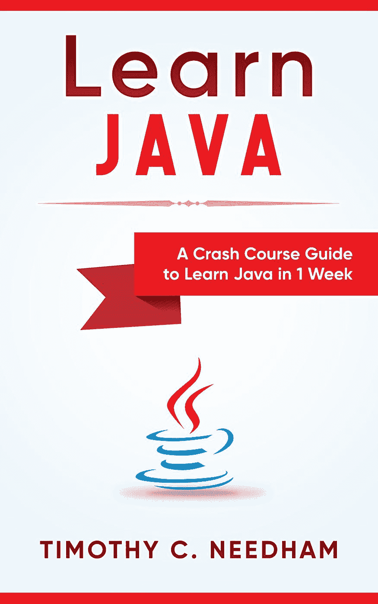


|  |  |  |


# 引言


我想感谢并祝贺你下载了这本书《初学者 Java：一周内学会 Java 的速成指南》。

这本书是 Java 编程的终极初学者速成课程，它将帮助你在最短的一周内学到该语言的足够知识！

我们都有梦想。我的梦想可能是成为一名伟大的老师，而你的梦想可能是在 IT 领域拥有伟大的职业生涯，或者通过提升 IT 技能和知识来实现自我价值（或类似的目标）。毫无疑问，`Java Programming Language` 提供的实战经验和专业知识是任何渴望成为专业程序员的人的必备要求。

但虽然你可能有足够的动力来学习这门语言，但我确定你多次问过自己一些问题：为什么要编程？或者为什么选择 Java？学习编程——特别是学习 Java——有很多原因，其中大多数我确定你已经知道了。但如果你问我的话，我会很诚实地说，我们中有些人学习编程是为了赚钱。学习编程这门艺术和技艺确实带有许多与自我实现和满足相关的收益，但经济利益实在太显眼而无法忽视。

首先，Java 无疑是最受推崇的技能，几乎在任何地方都有需求。IBM、Infosys、Twitter、Netflix、Google、Spotify、Uber、Amazon、Target、Yelp、Square 以及[其他大厂](https://siftery.com/java) 都需要优秀的 Java 程序员。根据 `PayScale.com`（提供工资信息的网站），平均 Java 开发人员的年收入约为 70,000 美元。作为该领域的专业人士，你可以在全球范围内工作，需求并不局限于特定的地理区域。

这本书是专门设计的终极指南，旨在帮助你从一个对编程大不陌生的人转变为一个能够教授该学科并完成良好编程项目的人。酷的地方在于：你可以在**一周内**学会全部内容！它已更新到最新版本（8 和 10），书中涵盖的主要主题包括：

* 变量
* 条件
* 循环
* 数组
* 运算符
* 用户输入
* 类
* 对象
* 方法
* 面向对象编程包括：
    * ✓ 继承
    * ✓ 封装
    * ✓ 多态
    * ✓ 组合

以及更多、更多内容！让我们开始学习吧。

再次感谢下载这本书。我希望你喜欢它！


在我们进入具体细节之前，让我们先学习一些在学习 Java 过程中会遇到的常用术语，无论是在本书中还是在其他学习材料中。

|  |  |  |


# 理解术语：词汇表


虽然下面的列表不能完全涵盖你在使用和学习 Java 时会遇到的所有术语，但它将为你提供一个良好的起点，以确保你理解正在讨论的内容。

* `IDE`（集成开发环境） - 指的是一种软件应用程序，为你提供全面的软件开发或基础编程的综合性设施。它通常包含内置的自动化工具、源代码编辑器和调试器。
* `PATH`（路径） - 在通用形式下（目录或文件），路径指的是文件系统中的特定位置。
* `Source code repository`（源代码仓库） - 指一种文件存档和网络托管设施，其中以私有或公开的方式存储了大量的网页或软件源代码。它们通常被开源软件项目以及某些多开发者项目使用，用于处理各种版本。
* `Refactoring`（重构） - 指一种改变软件系统的方法，使其不改变代码外部行为，但改进其内部结构。
* `Unicode`（Unicode 编码） - 指一种 16 位字符编码标准，能够表示世界上已知语言的几乎所有的字符。
* `Compiler`（编译器） - 编译器是一种特殊的程序，负责处理用编程语言编写的语句，并将其转换为计算机处理器使用的代码（或机器语言）。
* `Heap`（堆） - 指预留的计算机主存储或内存的一部分，程序进程可以访问它，以存储在程序运行之前不可知的可变数量的数据。
* `Syntax`（语法） - 指编程语言中的通用规则，描述了在该特定语言中被认为是结构正确的程序的符号组合。
* `Constructors`（构造函数） - 它们是特殊的方法，在实例化对象或当你使用 `new` 关键字时被调用。
* `Modifiers`（修饰符） - 这些是 Java 中的关键字，你可以将其添加到类、变量和方法中以改变它们的含义。
* `Naming convention`（命名规范） - 指你遵循的用于确定包、类、常量、方法或变量等标识符命名的规则。
* `Object oriented programming (OOP)`（面向对象编程） - 是软件设计中的一种计算机编程，允许程序员定义数据结构的数据类型以及适用于该数据结构的功能或操作类型。
* `Access modifiers`（访问修饰符） - 也称为访问限定符，访问修饰符是设置方法、类及其他成员访问性的关键字。它们是编程语言语法的特定部分，有助于组件封装。

正如我之前所说的，上面的列表绝不是完备的。然而，在目前阶段它将被证明是很有用的，因为一个更大的列表会让人无从下手。如果某些地方不清楚，你可以随时参考此列表。

考虑到这些，让我们开始学习。如果你对这个领域完全是新手，我们将从基础知识开始：

|  |  |  |


# Java 编程：背景


在我们进入 Java 编程之前，让我们先确保你理解计算机编程（或编码）到底是什么。

## 什么是编程？

根据定义，编程是构建软件的过程，软件由指令组成。这些指令基本上被称为 `source code`（源代码）。`source code`是一组计算机理解的编写指令。在整书中，我们将使用这个概念，因此在开始之前你需要理解它。

## 源代码实际上看起来是什么样的？

代码通常不遵循自然语言（如英语）的规则。看看这个小程序来理解我的意思：

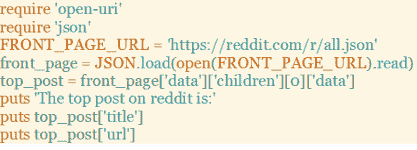

计算机实际上是字面意思理解一切的——例如，当你问计算机一个数字是偶数还是奇数时，它总是回答“是”。不相信我的话？看下下面的代码：

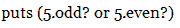

代码将显示‘true’，从技术上来说是对的。数字 5 要么是偶数也是奇数——尽管这并不是我的真实本意。

## 编程还涉及测试和调试

代码编写完成后，必须进行测试，因为仅仅编写代码并不能保证它是正确的。代码可能会偶尔崩溃、显示错误的结果、冻结或任何其他问题。专业程序员通常采用不同的方法来测试他们的代码，以试图避免此类问题。

最后，我们有一个称为 `debugging`（调试）的术语——这是在 `source code` 中调查问题、诊断并修复问题的过程——正如你很快会在书中发现的那样，这本身就是一种技能。

## 那么，什么是 Java 编程语言？

Java 编程语言是一种计算机编程语言，它独特地让你使用英语命令来编写计算机指令，而不是使用通常的代码。由于人类可以阅读和编写它，它被称为高级语言。尽管像英语一样，Java 也有一些规则规定如何编写这些指令；这些规则被称为 `syntax`（语法）。基本上，当程序编写时，高级指令会被转换为计算机理解并执行的代码。

### 那么，是谁创建了 Java？

Java 是 90 年代初由名为 James Gosling 的人为名为 Sun Microsystems 公司（现由 Oracle 所有）创建的。该程序最初被称为 Oak，后来改为 Green。

Java 最初设计用于为由不同计算机处理器控制的家用电器编程，随后用于手机等移动设备。很快，人们意识到这种语言需要被各种计算机处理器访问。1994 年，这种语言被认为是网络浏览器的理想选择，很快就与互联网产生了联系。1995 年，Netscape 公司发布了能够运行 Java 程序的最新版 Netscape 浏览器，1996 年当 Java 1.0 向公众发布时，其主要焦点已经转向互联网，通过为开发者提供创建动画网页的良好方法实现了与用户的交互。

从 1.0 版本以来，我们看到了许多更新和发展，例如：

* J2SE 1.3 于 2000 年发布
* J2SE 于 2004 年
* Java SE 8 于 2014 年
* Java SE 10 于 2018 年

Java 多年来来无疑已经演变成了一种可以在互联网内外使用的非常优秀且成功的语言。让我们接触一下使用 Java 编程语言的优点：


每种编程语言的引入都有其目的，并具有各自的优势。尽管每种语言都提供了开启蓬勃职业生涯的机会，但 Java 通常更受青睐。Java 的优势确实数不胜数，但我将简要提到其中几点。

### ✓ 你可以获得丰富的信息

虽然现有的编程语言之间没有明显的竞争关系，但由于其丰富的信息量，Java 被认为认为是最好的（尽管有时并非如此）。Java 已经存在了多年，因此对于脑海中出现的关于编程几乎所有的查询，你都能快速找到答案。因此，在磨练技能的过程中，你可以轻松地解决每一个问题。

### ✓ 易于学习

初学者有时倾向于认为，语言越好，学习起来可能越困难。然而，事实并非如此——至少对于 `Java` 来说。虽然确实有一些不可避免的初始障碍，但该语言使用普通的简单英语而不是泛型或多重括号，这使得它变得易于学习。当你学会了如何正确地安装 `JDK` 以及配置 `PATH` 之后，剩下的学习和实现过程将非常有趣。

### ✓ 你将获得强大的工具集

你经常会听到，在编程领域，一种语言的工具集对决定其整体成功起着重要作用。`Java` 在这方面无疑占据优势，因为它对开源系统提供了完备的支持。这意味着作为用户，你可以获得几乎涵盖你所需一切的工具。我们有许多开源库，提供有关 `Java` 编程的各种主题的信息。此外，还有许多社区（尤其是在线社区）来指导新程序员。

### ✓ 你可以从自己的错误中学习

我们有几种语言的设计初衷是为了教学或允许你从自己的错误中学习，并让你建立基础。`Java` 包含一些优秀的 IDE（`IDE` 指集成开发环境——参见术语表），这些工具的任务在你犯错误时立即通知你。此外，该语言还会建议你重新格式化代码，并给出这样做的理由。这样，你从基础阶段开始对编码有清晰的理解，并且在你开启职业生涯时几乎不会再犯错。

### ✓ 这种语言是免费的

获取 `Java` 从一开始就无需产生任何费用。因此，无论你处于学习阶段还是职业阶段，你都可以使用 `Java` 创建或开发应用程序，而无需向任何人支付现金。你只需要学习如何获取程序、进行设置并开始即可。

### ✓ 为专业人士提供更好的前景

既然你打算学习一种编程语言来开启职业生涯，`Java` 仍然是你的最佳选择。它被应用于大多数现有应用程序中，且其范围仍在进一步扩大。因此，通过学习这种语言，与专注于其他语言的程序员相比，你可以预期在行业内获得更好的职业发展。

考虑到这一切，让我们开始学习 `Java` 吧。

|  | |  |


# 基础/先决条件


本节描述了你在开始之前需要准备的东西。要开始，你需要 `JDK`（集成开发环境）和 `JDK`（Java 开发包）。

## 如何下载和安装 Java

本节描述了你在开始之前需要准备的东西。要开始，你需要 `JDK`（集成开发环境）和 `JDK`（Java 开发包）。

### JRE (Java 运行环境)

本节描述了你在开始之前需要准备的东西。要开始，你需要 `JDK`（集成开发环境）和 `JDK`（Java 开发包）。

### JDK (Java 开发包)

本节描述了你在开始之前需要准备的东西。要开始，你需要 `JDK`（集成开发环境）和 `JDK`（Java 开发包）。


输入以下代码并按回车。

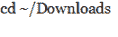

如果你下载了 JRE (32 位)，只需输入以下代码并按回车：

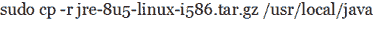

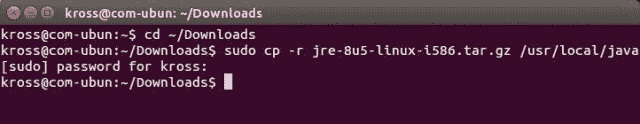

### 如何在 64 位 Linux 中复制 Oracle JDK (64 位)

像往常一样，输入以下代码并按回车：

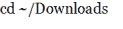

如果你下载了 Oracle JDK (64 位)，只需输入以下代码并按回车。

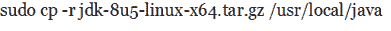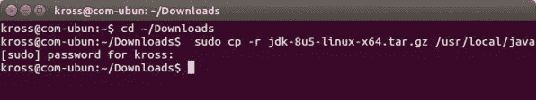

### 如何在 64 位 Linux 中复制 Oracle Java JRE

输入以下代码并按回车：

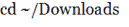

如果你下载了 oracle JRE (64 位)，你可以输入以下代码并按回车：

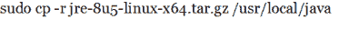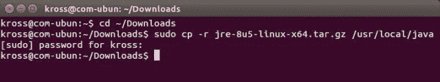

将 `tar.gz` JDK/JRE 文件解压到目录：`/usr/local/java`

### 在 32 位 Linux 中复制 oracle Java

输入以下代码并按回车：

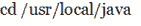

如果你下载了 oracle JDK (32 位)，只需输入以下代码并按回车。

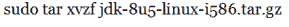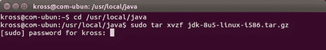

在 32 位 Linux 中通过输入以下代码解压 Java JRE (32 位)，然后按回车：

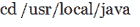

如果你下载了 oracle JRE (32 位)，输入以下代码并按回车：

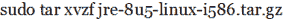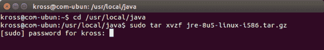

在 64 位 Linux 中的 Java JDK (64 位) 又是怎样的？只需输入以下代码并按回车：

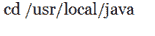

对于 Oracle JDK (64 位)，输入以下代码并按回车。

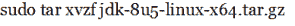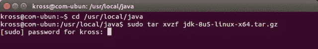

在 64 位 Linux 中通过输入以下代码解压 oracle Java JRE (64 位)：

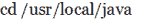

如果你有 oracle JRE (64 位)，只需输入以下代码并按回车：

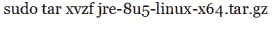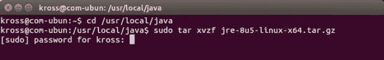

### 编辑系统路径

首先打开终端并输入以下内容：

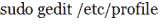

通过这种操作，你将打开一个文本编辑器，其中包含了所有的 Linux 系统级和启动程序。

一直滚动到文件末尾，并将以下行追加到 `/etc/profile` 文件的末尾：

如果你处理的是 JDK，只需添加以下代码：

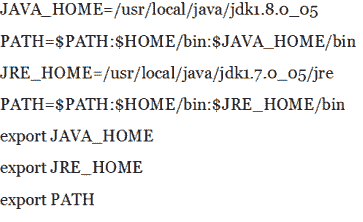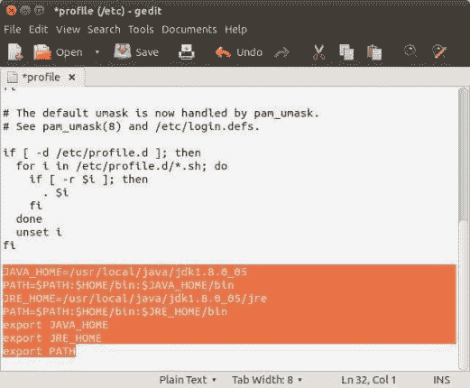

如果你正在安装 JRE，你应该写入以下代码：

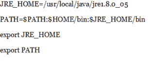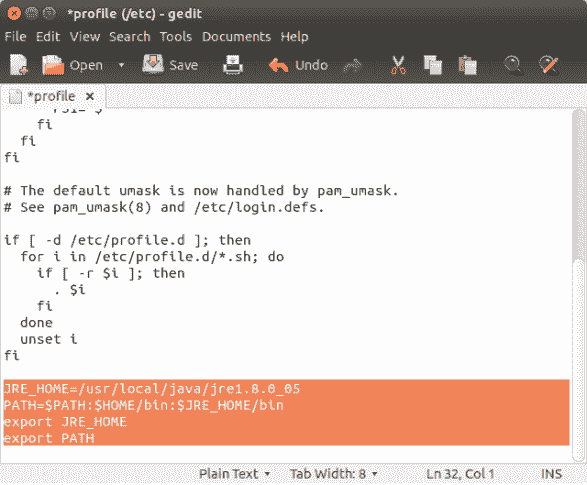

保存文件并退出。

### 通知 Linux 你的 Java 位置

以下命令将让系统知道你的 java JRE/JDK 是可访问或可用的

#### 对于 32 位或 64 位 JDK

在这种情况下，只需输入以下代码并按回车。

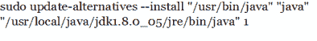

输入以下代码并按回车：

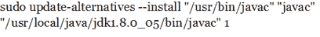

输入以下代码并按回车：

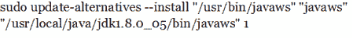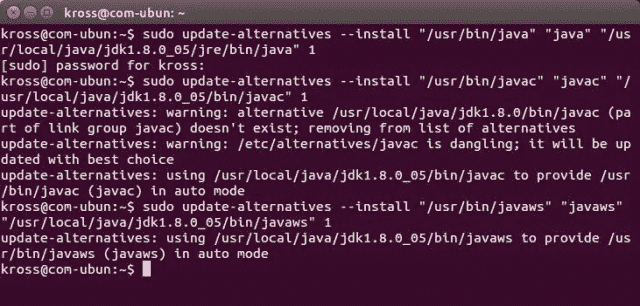

#### 对于 32 位或 64 位 JRE

如果你处理的是 JDK，只需输入以下代码并按回车：

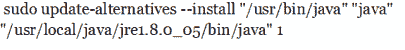

输入以下代码并按回车。

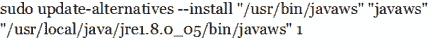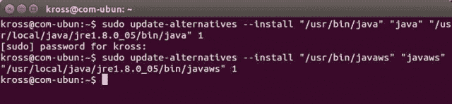

#### 将 oracle Java JRE/JDK 设置为默认 Java

如果你处理的是 JDK，只需输入以下代码并按回车：

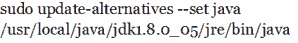

对 JDK 执行相同的操作（输入以下代码）并按回车：

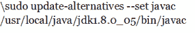

同样输入以下代码并按回车：

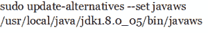

#### 对于 oracle JRE (32 位)

如果你下载了 oracle JRE (32 位)，输入以下代码并按回车：


#### 对于 oracle JRE (64 位)

如果你有 oracle JRE (64 位)，只需输入以下代码并按回车：


#### 对于 oracle Java JRE (64 位)

在 64 位 Linux 中通过输入以下代码解压 oracle Java JRE (64 位)：


#### 对于 Java JRE (32 位)

在 32 位 Linux 中通过输入以下代码解压 Java JRE (32 位)，然后按回车：


#### 对于 Oracle JDK (32 位)

如果你下载了 Oracle JDK (32 位)，只需输入以下代码并按回车。


尽管如此，对我来说，它提供的最重要的因素是速度（坐在那里等待编译或加载的日子已经一去不复了）。一个像 `Eclipse` 这样优秀的 IDE 运行极快，不占用内存，加载时间短，而且同步更改不需要花费大量时间。一个优秀的编程专家还会提到你能够享到的其他功能，例如“与代码库的集成”（参见词汇表）以及错误检查——例如静态代码分析和未使用引用的高亮。

|  |  |  |


# 在 Windows 上安装 Java 版 的步骤

### 下载 Eclipse

访问[此链接](https://www.eclipse.org/downloads/) 并下载最新版本：


点击“get eclipse photon”下方的“download packages”（下载包）。作为初学者，你应该选择第四项“eclipse IDE for Java Developers”（32 位或 64 位）。

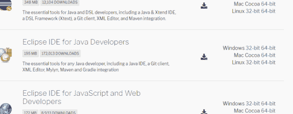

点击下载。

下一步是解压下载的文件以进行安装。将文件解压到指定的目录（例如，`c:\javaproject`）。

你不需要运行任何安装程序。更重要的是，当你不再需要它时，可以直接删除整个 eclipse 目录（无需运行“卸载程序”）。可以随意重命名或移动该目录。此外请注意，你可以在同一台机器上解压（安装）多个副本。

|  |  |  |


## 在 Mac OS X 上安装 Eclipse

使用[此链接](http://www.eclipse.org/downloads/) 重复上述的下载和安装 Windows 版 Eclipse 的过程。只需确保选择了 Mac OS X (cocoa)。当你选择“eclipse IDE for Java Developers”时，将得到一个 DMG 文件。双击此下载的文件 (DMG) 并按照随后提供的说明安装程序。程序将安装在位置：`/applications/eclipse`。

注意，你也可以下载下载 TAR 包 (.tar.gz)；双击即可将其扩展为名为“eclipse”的文件夹，然后将此扩展文件夹拖入“applications”文件夹。

|  |  |  |


## 在 Ubuntu Linux 上安装 Eclipse

通过[此页面](http://www.eclipse.org/downloads/) 下载 Java 版 Eclipse。像往常一样，下载“packages”，对于平台选择“Linux”，然后为 Java SE 程序开发选择“eclipse IDE for Java developers”。你将在下载文件夹中获得一个 .tar 包，安装将位于 `/usr/local`。

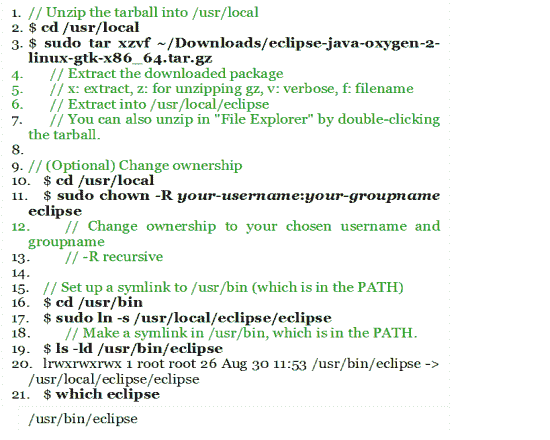

要运行 Eclipse，只需打开文件夹 `/usr/local/eclipse` 然后点击图标 `Eclipse`；或者直接启动终端并输入 `Eclipse`。

### 在启动器上锁定 Eclipse

启动程序并右键点击 Eclipse 图标，然后点击“锁定到启动器”（lock to launcher）。如果你使用的是较旧版本（因此上述方法无效），只需创建一个名为 `/usr/share/applications/eclipse.desktop` 的文件，内容如下：

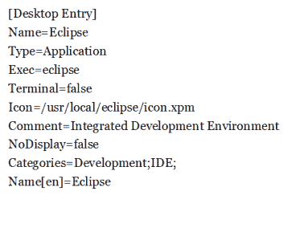

### 现在你可以在 Eclipse 中编写你的第一个 Java 程序或项目

从安装了 Eclipse 的目录启动 Eclipse（运行 `eclipse.exe`），然后为工作空间选择一个合适的目录——即你想保存文件的地方（例如 Windows 下的 `c:\javaproject\eclipse`）。

如果弹出名为“welcome”（欢迎）的窗口，点击“welcome”标题旁标有“cross”（交叉）按钮。

对于所有的 Java ，你必须创建一个项目来包含所有的类（稍后会讨论）、源文件和重要资源。

执行以下操作创建项目：

*   选择“file”（文件）菜单，然后是“new”（新建），然后是“java project”（Java 项目）（或者“file”→“new”→“project”→“java project”）
*   弹出名为“new java project”的对话框。
*   在“project name”（项目名称）中输入 `firstproject`。
*   勾选“user default location”（用户默认位置）。
*   在 JRE 中选择“use default JRE”（使用默认 JRE）。
*   在“project layout”（项目布局）中勾选“use project folder as the root for sources and class files”（使用项目文件夹作为源文件和类文件的根），然后点击“finish”（完成）按钮。

在我们继续（编写我们的第一个项目）之前，让我们回顾 Java 的一些基本概念。

|  |  |  |


# Java 基础概念

|  |  |  |


# Java 标记 (Tokens)

标记基本上是编译器在编译过程中可以识别的程序中的任何内容。标记是 Java 的最小逻辑单元。你可以将其视为构建块。让我们看看标记类型：

*   关键字 (Keywords)
*   操作符 (Operators)
*   字面量 (Literals)
*   分隔符 (Separators)
*   注释 (Comments)

让我们对每一个进行简要描述，以便你有更好的理解。

|  |  |  |


## 关键字 (Keywords)

(注，修正翻译：) 关键字是特殊的词，或者在 Java 中被称为“保留”字，因为它们具有特殊含义。我们有 50 个关键字，如下文所示：

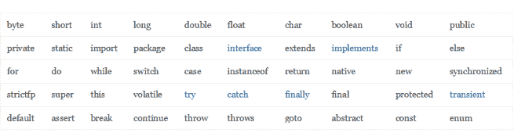

| 

## 标识符 (Identifiers)

(注，修正翻译：) 标识符是程序员在程序中对方法、类、变量、包、对象、标签或接口使用的名称（稍后我们将学习这些术语的含义）。

我们有标识命名规则，包括：

*   Java 标识符除美元符号 `$` 和下划线 `_` 之外不能包含任何特殊符号。
*   标识符不能以数字开头。
*   关键字已被保留并具有特殊含义——因此不能作为标识符。
*   保留字面量也可以作为标识符；例如——`null`、`false` 和 `true`。
*   不能将一个名称用于多个标识符。标识符区分大小写，因此 `Mf` 和 `mf` 变量是完全不同的。

在这种情况下，有效标识符的示例包括以下：

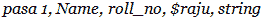

无效标识符将类似于：

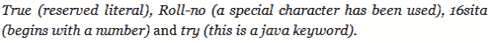

注意：Java 中的保留字面量和关键字是你不能用作变量或函数名的词。

## 操作符 (Operators)


运算符是你在应用某些操作数时产生结果所使用的符号。在 Java 中，我们有不同类型的运算符。如你所见，某些字符串也可以作为运算符。本质上，在构建表达式和语句时，运算符在 Java 中非常重要——其中包含：`-`、`+`、`*`、`=`、`>=` 等。

|  |  |  |


# 分隔符


分隔符也被称为标点符号。这些特殊字符和符号将代码的不同部分分开。它们有时连接并分离一个或多个标记或组织代码块——这就是为什么我们称它们为分隔符。

在 Java 中，使用的标点符号包括分号（`;`）、点（`.`）、逗号（`,`）、方括号对（`[` `]`）、括号组（`(` `)`）、大括号对（`{` `}`）。

|  |  |  |


## 字面量

字面量是指 Java 编程中执行过程中不会改变的值。你可以将它们视为常量。这些是某些字符串类型或原始类型的常量值。Java 中使用的任何字面量必须是下面类型之一：

*   字符

    这是在内存中存储 `Character` 常量的类型。它基本上占用 2 字节的大小，但只能存储一个字符，因为 `char` 存储的是 Unicode 字符集。它的最大值为 65,535，最小值为 0。

*   整数

    整数类型基本上可以存储像 `-96` 和 `123` 这样的整数。可以存储的值的大小主要取决于我们选择的整数类型。

    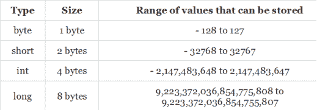

    计算公式 `− (2^(n−1))` 到 `(2^(n−1)) −1` 用于数值范围。这里，`n` 代表所需的位数——例如，`byte` 数据类型需要 1 字节= 8 位。因此，`byte` 数据类型中可以保存的值范围如下：

    `−(2^(8−1)) to (2^(8−1))−1= −⁷ to (2⁷) -1`

*   浮点数/数据类型

    这些是 ers 用来表示带有小数部分的数字的数据类型。单精度浮点数通常占用 4 字节，而双精度浮点数占用 8 字节。这里有两个子类型：

    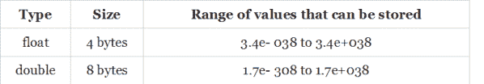

*   布尔型

    布尔数据类型基本上存储具有两种状态的值：`false` 或 `true`

    通过下例示例来更好地理解：

    *   `34.43`
    *   `5322`
    *   `false`
    *   `true`

## 注释

在 Java 中，注释用于文档说明。某些编译器在执行期间会忽略它们。多行注释以以下开头：

```
/* ... */
```

单行注释以以下开头：

```
// ...
```

## 变量

变量是存储数据的容器。当声明一个变量时，可以给它赋值，并且该值以后可以更改。在 Java 中，变量有不同的类型，这决定了它们可以包含的数据类型。


*   实例变量对于类中的所有构造函数、块和方法都是可见的。通常，建议将这些变量设为私有（private）或设置访问级别。尽管如此，可以使用访问修饰符为子类提供这些变量可见性。
*   可以通过在类内部调用变量名直接访问实例变量。尽管如此，在静态变量内部——当实例变量提供可访问性时——它们需要使用完全限定名来调用。让我们来看一个例子：

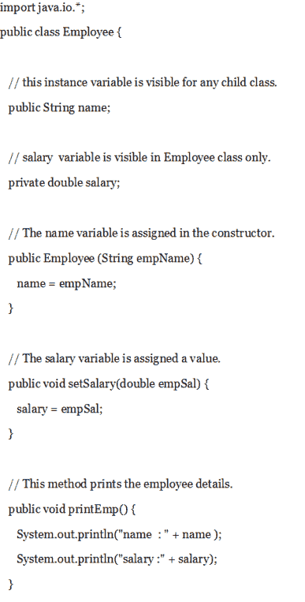

通过此，你将获得以下结果：

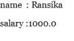

## 类或静态变量

类变量也称为静态变量，它们在类中使用 `static` 关键字声明，但在方法、块或构造函数之外。无论从该类创建了多少个对象，每个类都只会有一个类变量的副本。

静态变量很少被使用——除了被声明为常量之外。常量本质上是声明为 `private`/`public`、`static` 和 `final` 的变量。常量变量永远不会从它们的初始值改变。

静态变量存储在静态内存中，通常不会将静态变量作为 `private` 或 `public` 常量。静态变量实际上在程序启动时创建，在程序停止时销。

可见性与实例变量相似。尽管如此，大多数静态变量声明为 `public`，因为它们需要供类用户使用。默认值与实例变量相似，对于数字，零代表默认值。对于 `Booleans` 为 `false`，对于对象引用为 `null`。值可以在构造函数内部或在声明期间赋值。此外，值可以在特定的静态初始化块中赋值。

使用类名调用是访问静态变量所需的——`className.VariableName`。

最后，如果我们把类变量声明为 `public static final`，这本质上意味着常量或变量名都是大写的。此外，如果静态变量既不是 `public` 也不是 `final`，这意味着其命名语法与实例变量和局部变量相似。

让我们来看一个例子：

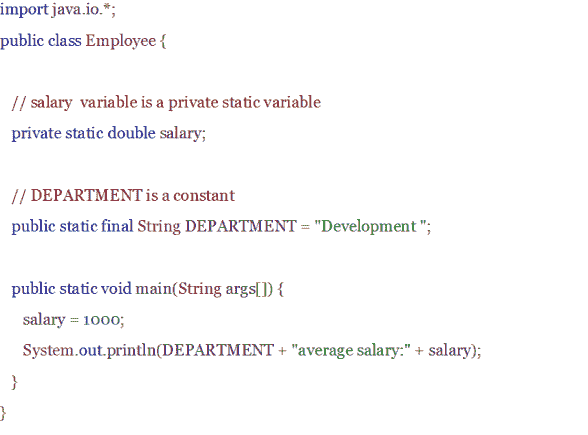

将给出以下结果：

-开发平均工资：1000

你需要注意的是，如果从外部类访问变量，则常量需要通过 `Employee Department` 来访问。

## 局部变量

局部变量用于存储方法中的临时状态。声明局部变量的语法与声明字段相同——例如，`int count=0;`。你不会发现某个特定的关键字将变量指定为局部变量，因为这种判断完全取决于变量声明的位置——即在方法的结束括号和起始大括号之间。因此，局部变量只能被其所在的方法看到，所以它们无法从类的其他部分访问。

简而言之，局部变量被称为“局部”，是因为它们只能在声明它们的方法中被引用和局部使用。下面是一个方法，其中“miles”是一个局部变量。


|  |  |  |


## 参数

参数也是传递给方法的方法。例如，在 `main` 方法中，`string args []` 变量就是一个参数。


## Java 中的条件语句

在生活的每一天，当你尝试完成某些事情时，我们会接触到各种对象；同时，我们使用这些对象来执行不同的任务。我们倾向于接触的一类对象是数字或模拟设备，如手机、计算机、汽车、商场和办公室的自动开门以及电视机。

与上述示例相比，你会发现 Java 中条件语句的概念描绘了我们处理日常生活的方式。在 Java 编程中，条件语句是关于做出指向预期结果的决策。我们每天做决定，对于这些决定，我们得到了特定的结果。

在 Java 编程中，当我们编写可以在任何设备（如上面提到的设备）上运行的软件或设备时，有两种决策语句可以使用。这些语句基本上帮助设备及其用户根据特定的状态或条件执行某些操作。

`IF-STATEMENT` 是第一个条件语句。你需要注意的是 `if-statement` 包含三个版本，包括：

*   `IF — STATEMENTS`
*   `ELSE — IF STATEMENTS`
*   `IF / ELSE STATEMENTS`

让我们使用我们提到的第一个设备来看看 `IF-statement` 是如何工作的。


在 Java 中，我们使用 `IF-statements` 来检查手机的条件或状态，当该条件为真时，动作就会执行。如果条件不成立，则什么都不会发生。现在让我们考虑手机；如果手机的条件或状态是电量低，手机将通知你充电。如果手机存储已满，你可以收到一个通知，以这种方式通知你修复它。

### IF-STATEMENTS

在 Java 中，我们使用 `IF-statements` 来检查手机的条件或状态，当该条件恰好为真时，动作就会执行。如果条件不成立，则什么都不会发生。现在让我们考虑手机；如果手机的条件或状态是电量低，那么手机将通知你充电。如果手机存储已满，你可以收到一个通知，以这种方式通知你修复它。

### IF/ELSE Statements

让我们现在使用第二个设备来看看 if/else 语句另一方面是如何工作的。


当你看上面的图片时，你会看到 ‘if’ 条件语句在第一个为假时扩展到另一个动作。你也可以定义在第一个条件为假时可以执行的另一个动作。上面的条件是显而易见的，因为它们在我们日常使用计算机时非常明显。

### ELSE IF Statements

这些语句的另一种版本被称为：

### If-Statements

让我们使用提到的第三个设备来看看 else-if 语句是如何工作的。


除了 if/else，Java 还允许通过使用 `else if` 关键字测试其他条件。让我们以第一个情况为例；你可以看到一旦测试了第一个条件，就决定测试另外两个条件，这些是在我们日常使用空调时可能的后果。基本上我们能够根据任何可能的条件给出要执行的动作——使用 java `else if` 语句。

### Switch Case

最后，

正如其名所示，它是某种控制灯泡的 `switch case`。因此，这本质上意味着你可以有多个开关作为条件来点亮不同的“灯泡”（或执行动作）。看下面的图片。

使用最后提到的设备，我们将查看 `switch case` 语句的功能。

当你看上面的图片时，很明显自动开门所需的距离存储在 `distance` 变量中。在变量声明和初始化之后，接下来由 `switch case` 来测试所有可能的距离，以便执行相应的动作。具体发生的是你存储了执行所需的主要变量


你需要注意的是，并不总是需要为了调用单个特定方法而使用 `switch case`，因为你可以用它来创建一个场景，根据用户的意愿执行多个操作。

`switch case` 还可以包含任意数量的 `case`，此外，`default` 语句用于在其他 `case` 都不与所需的动作匹配时执行某项操作。请看下图。

通过我上一个提到的那个设备，我们将能够看到 `switch case` 语句是如何与 `default` 语句一起工作的。


到此时，我确定你已经知道如何在 Java 中创建条件语句。现在取决于你在你最终开始编码时，将其包含在你的程序中。

|  |  |  |


# Java 中的循环


在 Java 或任何其他编程语言中，循环都是一种特性，它允许在某些条件求为真时，循环地执行一组指令或函数。Java 提供了三种执行循环的方法。

尽管所有方式都提供相同的基础功能，但它们在语法和条件检查时间上有所不同。

### While 循环

首先，`while` 循环是一种流程控制语句，允许代码根据特定的布尔条件重复执行。你可以将 `while` 循环理解为重复的 `IF` 语句。


看看下方的流程图：


`while` 循环从检查条件开始。如果条件求为真，则循环体语句将自动执行；如果不是，则执行循环后的第一条语句。因此，这就是被称为入口控制循环的原因。

当条件求为真时，循环语句被执行。通常，这些语句会对后续迭代正在处理的特定变量有一个所谓的“更新值”。

如果条件变为假，循环将终止，从而结束其生命周期。


当你在 IDE 上运行它时，将得到以下输出：


### For 循环

这种类型的循环提供了一种编写循环结构的简洁方式。与 `while` 循环不同，`for` 语句在一行内使用了初始化、递增/递减和条件，从而提供了一个更短、易于调试的循环结构。


流程图如下：


#### 初始化条件

在这种情况下，你初始化了正在使用的变量。它标记了 `for` 循环的开始。可以使用已经声明的变量，也可以声明一个仅局部于循环的变量。

#### 测试条件

这一个用于测试循环的退出条件。它必须返回一个布尔值。它也充当了入口控制循环的作用，因为在执行循环语句之前，该 就会被检查。

#### 语句执行

当条件求为真时，循环体语句被执行。

#### 递增/递减

这一个用于更新后续迭代的变量。

#### 循环终止

如果条件为假，发生的情况循环终止并标记其生命周期的结束：


当你在 IDE 上运行它时，将得到以下输出：


### 增强型 for 循环 (Enhanced For Loop)

Java 还包含了另一个在 Java 5 中引入的 `for` 循环版本。增强型 `for` 循环提供了一种更简单的方法来遍历集合或数组的元素。它是固定的（严格的），只有当你确实需要在不知道当前处理元素索引的情况下遍历序列中的元素时，才应该使用它。


作为一个示例（演示了你如何使用增强型 for 循环来简化工作），假设你有一个名称数组，并想要打印数组中包含的所有名称。让我们来看看这两个示例之间的区别。增强型 for 循环以以下方式让事情变得简单：

在 IDE 上运行它将给你带来以下输出：


### Do while

`do while` 循环在很大程度上与 `while` 循环相同。唯一的区别是它在执行语句后检查条件，因此，它是退出控制循环的一个良好示例。


流程图如下：


`do while` 循环从语句的执行开始。第一次，通常不会对任何条件进行检查。

一旦语句执行并更新了变量值，就会检查条件是真还是假。如果求为真，则进入下一次迭代。

如果条件为假，循环终止。


数组的初始元素是 `age[0]`，第二个是 `age[1]`，依此类推。如果数组的长度为 `n`，那么最后一个元素就是 `arrayName[n-1]`。由于 `age` 数组的长度为 `5`，在上面的示例中，最后一个数组元素是 `age[4]`。

对于数值类型，数组元素的默认第一个值为 0；对于 `Boolean` 类型，它是 `false`。可以通过以下方式演示：


运行程序得到以下输出。


我们有更好的方法通过循环结构来访问任何数组的元素（通常使用 `for` 循环）。


## 如何初始化 Java 数组？

你可以在声明期间初始化 Java 数组，也可以根据需要在此程序的稍后阶段进行初始化（更改值也是一种选择）。

### 在声明期间初始化数组

以下是在声明期间初始化数组的方法：


该语句构建了一个数组并在声明期间对其进行初始化。数组的长度由给定的数值（用逗号分隔）决定。在示例中，`age` 数组的长度为 `5`。


我们将编写一个小程序打印此数组的元素。


运行程序将得到以下输出：


## 如何访问数组元素？

通过数字索引可以很容易访问和更改数组元素。看下面的示例：


运行程序将给你给出以下输出：


### Java 数组示例

下面的程序计算存储在 `int` 类型数组中的数值的平均值和总和：


运行程序将给你给出以下输出：


这里有几点：

`int` 值、`sum` 以及 `arraylength` 都被转换为 `double` 以计算平均值，因为平均值是 `double` 类型。这被称为类型转换（参见词汇表）。获取数组长度使用 `length` 属性。在这种情况下，`numbers.length` 返回数组 `numbers` 的长度。

|  |  |  |


## 多维数组

到目前为止，我们讨论的是一维数组。但在 Java 中，你可以声明被称为多维数组的数组。以下是声明/初始化多维数组的示例：


在这种情况下，`matrix` 是一个二维数组。让我们聊聊 Java 中的多维数组。

以下是一个二维（2d）数组。该数组可以容纳 12 个 `int` 类型元素。


不要忘记 Java 使用从零开始的索引——这意味着在 Java 中，数组索引从 0 和 1 开始，就像你可以声明三维（3d）数组一样。例如：


在这种情况下，`personalinfo` 是一个三维数组，能够容纳最多 24 (3*4*2) 个 `string` 类型元素。

Java 中多维数组的组件也是数组。

如果你具备 `C` 或 `C++` 语言的知识，你可能开始认为 Java 的多维数组工作方式与 `C/C++` 中的相同。但事实并非如此，因为 Java 的行长度是可以变的。

在初始化期间，你会看到这种区别。

### 在 Java 中初始化二维数组

采用下面的示例来初始化二维数组：


数组组件 `a` 的每一个实际上本身都是一个数组，而且所有行的长度也不同。为了证明这一点，我们将编写一个程序。


运行程序时将得到以下输出：


既然所有多维数组组件也都是数组，这意味着 `a[2]`、`a[1]` 和 `a[0]` 也是数组。你可以通过 `length` 属性找到行的长度。让我们来看一个很好的例子：

### 使用循环打印所有二维数组元素


注意，当有机会遍历数组时，利用 `for...each` 循环更好。你可以使用 `for...each` 循环完成相同的任务。


既然所有多维数组组件也是数组，这意味着 `a[2]`、`a[1]` 和 `a[0]` 也是数组。你可以通过 `length` 属性找到行的长度。让我们来看一个很好的例子：

### 使用循环打印所有二维数组元素


注意，当有机会遍历数组时，利用 `for...each` 循环更好。你可以使用 `for...each` 循环完成相同的任务。


既然所有多维数组组件也是数组，这意味着 `a[2]`、`a[1]` 和 `a[0]` 也是数组。你可以通过 `length` 属性找到行的长度。让我们来看一个很好的例子：

### 使用循环打印所有二维数组元素


注意，当有机会遍历数组时，利用 `for...each` 循环更好。你可以使用 `for...each` 循环完成相同的任务。


* `srcPos` 是 `src` 数组的起始位置或索引
* `dest` 是 `src` 元素将复制到的数组
* `destPos` 是 `dest` 数组的起始位置或索引
* ‘length’ 是要复制的元素数量

我们来看一个例子：


当你运行该程序时，你将得到以下输出：


你需要注意，`int` 类型数组元素的默认打开值值为 0。

### 使用 `copyOfrange()` 方法复制数组

此外，你还可以使用在  类中定义的此方法来复制数组。你不一定非要在调用此特定方法之前构建目标数组。如需了解更多关于该方法的信息，请访问此[页面](https://docs.oracle.com/javase/8/docs/api/java/util/Arrays.html#copyOfRange-boolean_853ae90f0351324bd73ea615e6487517_A-int-int-)。

让我们看看如何操作：


当你运行该程序时，你将得到以下输出：


### 使用循环复制二维数组

使用下面的示例通过循环复制不规则的二维数组（锯形数组）：


当你运行该程序时，你将得到以下输出：


如你所见，我们在这里对数组使用了‘deepToString()’方法。该方法能更好地表示多维数组，就像在二维数组中一样。你可以在此[页面](https://docs.oracle.com/javase/7/docs/api/java/util/Arrays.html#deepToString_84c40473414caf2ed4a7b1283e48bbf4_java.lang.Object_0bcef9c45bd8a48eda1b26eb0c61c869_5B_0bcef9c45bd8a48eda1b26eb0c61c869_5D_9371d7a2e3ae86a00aab4771e39d255d_) 上获取更多关于 `deepToString` 的信息。

你可以使用 `System.arraycopy()` 或者在一维数组的情况下使用 `Arrays.copyOf()` 数组来替换上述代码的内部循环。查看下面的示例，它展示了如何使用 `arraycopy()` 方法实现相同的功能。


数组毕竟并不复杂！下一个主题将更加直观。让我们来看运算符，以确保我们到目前为止学的某些内容更有意义，同时也有助于接下来的学习。

 |  | 


# Java 运算符


简单来说，运算符是表示特定操作的字符。例如，如你所知，`+` 是表示加法的算术运算符。在 Java 中，我们有以下类型的运算符：


 |  | 


## 基础算术运算符

这些包括 `+`、`%`、`-`、`*`、`/`


你必须注意模运算符返回余数——例如 `10 % 5` 返回零

让我们来看一些算术运算符的示例：


输出将如下所示：


 |  | 


## 赋值运算符

赋值运算符包括：


让我们来看赋值运算符的示例：


你运行程序后得到的输出如下：


 |  | 


## 自增自减运算符

在这里我们处理 `++` 和 `--`

让我们来看自增自减的示例：


输出如下：


 |  | 


## 逻辑运算符

逻辑运算符用于逻辑变量。它们主要用于条件语句。

考虑我们有两个变量 `b1` 和 `b2`：

* `&&`：`b1` 且 `b2` 为真
* `||`：或者
* `!`：`b1` 取反

让我们来看逻辑运算符的示例：


输出如下：


 |  | 


## 关系比较运算符

在 Java 中，关系运算符包括：

* `==`：左侧等于右侧
* `!=`：左侧不等于右侧
* `>`：左侧大于右侧
* `<`：左侧小于右侧
* `>=`：左侧大于或等于右侧
* `<=`：左侧小于或等于右侧

让我们来看这些关系运算符的示例：首先，你需要注意的是，下面的示例使用了 `if-else` 语句，在继续之前你需要熟悉它。


输出如下：


## 位运算运算符

我们基本上有六种位运算符，包括：


我确定你听说过位运算符按位进行处理。

* `&`：`num1 & num2` 基本上是在比较它们对应的位（`num1` 和 `num2`）之前生成 1——如果两个位相等，否则返回 0。
* `|`：`num1 | num2` 比较 `num1` 和 `num2` 的位，然后生成 1，即如果任意一个位为 1，否则返回零。
* `^`：`num1 ^ num2` 另一方面比较 `num2` 和 `num1` 的对应位，然后生成 1；即如果它们不等等，否则返回 0。


`-num1` 刚好是一个取反运算符，它只会将位从 0 改为 1，从 1 改为 0。在我们的示例中，它返回 `-12`。这个有符号 8 位等同于 `11110100`。

`Num 1 <<2` 是左移运算符，负责将位向左侧移动并丢弃最左侧的位，然后在最右侧位赋零。在这种情况下，输出是 `44`。这个数字等同于 `00101100`。

你需要注意的是，在下面的示例中，我们在位移运算符的右侧提供了 `2`，这就是位向左侧移动 2 个位置的原因。你可以更改这个数字，位将根据操作符右侧指定的位数移动。同样也适用于右侧的运算符。

`Num1 >> 2` 是右移运算符，它通常倾向于向右侧移动位并丢弃最右侧的位，然后给最左侧位赋值 `0`。在这种情况下，输出是 `2`，等同于 `00000010`。

让我们来看一下这些运算符的示例：


输出如下：


关于 Java 中的运算符，这基本上是你需要知道的。不过在继续之前，你可能想要涵盖 Java 中的[三元运算符](https://alvinalexander.com/java/edu/pj/pj010018) 和[运算符优先级](https://introcs.cs.princeton.edu/java/11precedence/)，这些内容不在本书的范围内，但同样重要。

|  |  |  |


# Java 中的类与对象


|  |  |  |


## 类的一些基础

类（Class）或分类是对实体或由行为和状态组成事物的表示。类的状态与其关联的数据，而类的行为是该类可以执行的动作。

例如，在对简单的车辆进行分类时，我们可以说它具有模型名称、制造商名称和生产年份。你也可以说你的普通汽车能够加速和减速。在这种情况下，你可以按照下面的规则定义行为和状态：

类的状态简单就是类包含的内容，而类的行为是类能够做的事。你可以使用我刚刚给出的示例为你的类创建一个简单的规范，如下：


你需要注意的是，几乎所有的编程语言对状态条目名称和行为名称都有不能空格的限制。例如，manufacturer name 不是有效的状态条目名称，而 `manufactuerName` 是。后者的名称使用了所谓的驼峰命名法（camel case），其中首字母小写，其余字母大写。

我们已经对车辆进行了基本的描述，尽管它还没有足够的细节来被认为是重要的。例如，当你想加速车辆时执行了什么操作？在这里，我们类的行为已经声明，但尚待定义。行为声明是关于可以执行何种行为的陈述。行为定义是关于行为如何执行的陈述。例如，添加一个名为 `currentSpeed` 的新状态条目可以让你定义你的行为 `accelerate`（加速）和 `decelerate`（减速）。


有了上面的行为定义，我们能够对类进行一些有用的工作。正如你所注意到的，行为的目的是改变类的状态。这引出了关于类行为的通用规则：与类关联的行为的目的是访问或改变类的状态。这条规则非常重要——以至于人们设计了一个专门的指标来衡量它：内聚性（cohesion）。内聚性指的是类的状态和行为之间相互关联并朝一个共同目标努力的程度。

尽管你知道车辆加速和减速的方法，但你只给了一个简化的定义，没有考虑到意外的操作。例如，如果你从小于零的当前速度开始减速会怎么样？通常情况下，你不应该处于当前速度降至零以下。。关于类状态的规则被称为不变式（invariant）。不变式需要在行为完成之前和之后都保持为真。这种逻辑可以通过如下增强当前的减速定义来实现：


|  |  |  |

## 类型

我们现在有了类的规范，但缺少一个主要元素。当你检查状态条目时，这种缺陷变得显而易见：当前速度的单位是什么？每小时公里？每小时英里？在这种情况下，我们还没有限制为距离除时间。鉴于规范，我们需要为每个状态条目链接类型，以便更好地指定我们的类。

到底什么是数字？

嗯，数字持有一个值，并能够执行诸如乘以另一个数字甚至给自身加上另一个数字的动作。如果你愿意，你基本上可以为数字构建类规范。


现在对类型有了理解，我们现在可以更新车辆类，使其具有正确类型的状态条目（我们将使用 `type StateName` 符号），其中类型名称位于状态条目之前。


你需要注意的是，字符串是字符序列，我们必须忽略当前速度的单位。目前，将当前速度限制为数字就足够了。当你继续描述类型时，你遇到了两个在继续修饰和完善车辆类之前需要解决的问题：原生类型和行为参数。

## 原生类型

当你用其他类声明类的状态条目时，我们最终会遇到一个点，无法在不形成循环层次结构的情况下引用另一个类。例如，如果你尝试将 `number` 类型分配给 `currentSpeed` 状态，那么你如何定义 `number` 类？如果你尝试用其他类来定义它，那么你又如何定义那些类呢？由于你不能让接受这种无限递归的类型系统，你需要声明一个或多个值的存在。这种公理类型被称为原生类型（primitive types）。


大多数编程语言都有一组基本的原始类型，包括十进制值（如单精度浮点数）、整数、字符串、字符和布尔值（这些值可以是 true 或 false）。这些类型以位集的形式存在，无需定义类的回溯结构。这些原始类型可以作为构建块，用于创建更复杂的类类型。为了讨论的起见，我们必须假设 `string`、`number`、`Boolean` 和 `character` 这些类型是存在的。

|  |  |  |


## 行为参数

另一个你需要关注的问题是关于在执行行为（behaviors）时向类传递信息。例如，当你想要加速到每小时 80 公里时，你必须成功执行 80 次 `vehicle` 类的 `accelerate` 行为。这对于真实系统来说显然是混乱的。相反，你应该尝试指示 `vehicle` 加速多少。例如，当你执行 `accelerate by 30` 然后执行 `accelerate by 15` 时，将得到每小时 45 公里的速度。为了做到这一点，你需要声明你的 `accelerate` 行为实际上可以接受一个值，该值作为参数之一，紧密表示增加的速度。为此，你将在参数周围加上括号，并关联一个与你的 `class` 状态相同表示法的类型。正如你所注意到的，参数需要命名，否则你将无法在行为定义内部使用或访问该参数。你还需要注意，当一个行为没有任何参数时，你将使用空参数集。例如，如果 `drive` 行为不接受任何参数，它的声明将是 `drive ()`。结果，你将为 `vehicle` 得到以下类：


如果你现在指示 `vehicle` 加速 30，你就能将 `vehicle` 的当前速度增加 30。现在这个值 (30) 在执行时被传递给你的行为，它被称为实参（argument）。尽管实参和参数（parameter）这两个术语密切相关，但你会得到一个至关的区别：参数是行为定义中引用的值；而实参是在执行时传递给行为的实际值。

我特意选择了执行表示法，因为它将提供的实参映射到已声明的参数上。例如，`accelerate(30)` 在执行期间将值 (30) 映射到 `amount`（类型为 `number`）。这种参数的表示法可以扩展到多个参数，，方法是在一个用逗号分隔的列表中列出多个参数来实现，其形式如 `doSomething(number valueOne, Number valueTwo)`。在实参按位置映射的情况下，这种实参表示法会非常有用——例如 `doSomething (15, 37)` 将 37 映射到 `valueTwo`。

|  |  |  |

## 类的声明

让我们从一个示例开始：


以下是一个典型的类声明示例，它使用了以下内容：


这意味着 `MyClass` 继承了 `SuperClass` 并实现了 `Interface`。你可以实现多一个接口。

```
class MyClass extends SuperClass implements Interface {
    // ...
}
```

## 成员变量

我们有不同类型的变量：

*   类中的成员变量被称为字段（fields）
*   代码块中的被称为局部变量（local variables）
*   方法中的被称为参数（parameters）

`bicycle` 使用以下内容来定义它的字段：


字段声明由三个部分组成：

*   零或修饰符，例如 `private` 或 `public`
*   类型
*   字段名称

`bicycle` 的字段名称为 `gear` 以及 `speed`，它们的所有类型都为 `int`。

## 访问修饰符

使用的第一个且最左侧的修饰符用于控制其他类可以访问成员字段。目前，你可以考虑 `private` 和 `public` 修饰符。

`public` 修饰符的字段可以从所有类中访问。

`private` 修饰符的字段只能在其所属类内部被访问。

考虑到封装，你会发现将字段设置为私有是常见的，这意味着它们只能从类直接访问。尽管如此，你仍然需要访问这些值——可以通过添加公共方法来间接实现，这些方法为你获取字段值：


方法声明所需的元素包括返回类型、圆括号 `()`、名称以及位于大括号 `{}` 之间的方法体。通常情况下，方法声明按以下顺序包含六个组件：

*   修饰符，如 `private`、`public` 等。
*   返回类型，即方法返回的值的数据类型，或者如果方法没有返回值，则为 `void`。
*   方法名——字段命名规则也适用于方法名，但惯例略有不同。
*   括号内的参数列表 – 输入参数的列表，参数用逗号分隔，每个参数前面跟随着其各自的数据类型，这些数据类型通常被包含在括号中。在没有参数的情况下，可以使用空括号。
*   异常列表
*   封装在不同大括号之间的方法体——方法的代码，其中局部变量的声明也在这里。

方法声明组件中的两个部分包含了方法签名（method signature），即方法名和参数的类型。上述定义的方法具有以下签名：


### 方法命名

尽管方法名可以是任何合法的标识符，但代码规范倾向于限制方法名。按照惯例，方法名需要是小写的动词，或者是以小写动词开头、后接名词、形容词等的多个单词的名称。对于多单词名称，第二个及后续每个单词的首字母需要大写。请看下面的示例：


方法在所属的类中通常有一个特殊的名称。尽管如此，由于下文讨论的方法重载，方法可能与其它方法具有相同的名称：

### 方法重载

Java 支持方法重载；程序还可以区分具有不同方法签名的方法。这简单来说意味着如果类中的方法包含不同的参数列表，它们可以具有相同的名称。

假设你有一个类，可以使用书法来绘制各种数据类型——这包括整数、字符串等——并且该类有一个方法用于绘制每种数据类型。为所有方法使用一个新名称会非常费力。例如，`drawInteger`、`drawString`、`drawFloat` 等。在 Java 中，你允许对所有绘制方法使用相同的名称，但为这些方法的每一个一个传递不同的参数列表。因此，该数据绘制类可以声明四个名为 `draw` 的方法，每个方法都包含一个不同的参数列表。


传递到方法的参数类型和数量有助于区分重载的方法。当你查看代码示例时，`draw(int i)` 和 `draw(string s)` 是唯一且不同的方法，因为它们需要不同类型的参数。

你不能声明多个具有相同名称、相同类型和数量参数的方法，因为编译器无法区分它们。编译器在区分方法时通常不考虑类型。这本质上意味着，即使每个方法使用不同的返回类型，你也无法使用相同的签名声明 2 个方法。

在移动到下方关于创建对象的下一节之前，如果你能研究一下这两个部分将是非常好的，因为它们超出了本书的范范围：

*   为你的类提供构造函数
*   向方法或构造函数传递信息

|  |  |  |


## 创建对象

在 Java 中，对象是数据以及对可用数据进行操作的组合。对象包含行为和状态。这些都存储在变量或字段中，而函数或方法则显示对象的行为。类作为创建对象的模板。在 Java 中，使用 `new` 关键字来创建对象。

类为不同的对象提供了蓝图。在这种情况下，你从类创建一个对象，程序中的以下每条语句都会构建一个对象并为其分配一个变量。


在第一行创建了 `point` 类对象；第二行和第三行分别创建了 `rectangle` 类对象。这些语句中的每一个都由下面描述的三部分组成：

*   **声明 (Declaration)**：加粗的代码是变量声明，将变量名与对象类型相关联。
*   **实例化 (Instantiation)**：如我提到的，`new` 关键字是 Java 中的一个运算符，用于构建对象。
*   **初始化 (Initialization)**：运算符之后是跟构造函数的调用，用于初始化新对象。

### 如何声明变量来引用对象

你已经知道声明变量需要写类型名称：

编译器被通知你将使用 `name` 来引用类型为 `type` 的数据。在处理基本类型变量时，此声明也倾向于预留变量所需的内存空间。你可以在单独的一行中声明引用变量——例如：`point originOne;`

通过这样声明 `originOne`，在创建对象并赋值给它之前，它的值保持未确定状态。声明给定引用变量的操作并不止于创建对象。要实现这一点，你需要使用 `new` 运算符，我稍后会描述。

这种状态下、不引用任何内容的变量可以如下所示：


|  |  |  |

## 类实例化

`new` 运算符为新对象分配内存并返回该内存的引用以实例化类。你需要注意的是，“类的实例化”这个短语与“创建对象”没有区别。通过创建对象，你正在构建类的实例，因此是在实例化类。

`new` 运算符需要一个后缀参数——即对构造函数的调用，构造函数名给出了要实例化的类。`new` 运算符返回它创建的对象引用。该引用通常被赋值给相应的变量，例如：


`new` 运算符返回的引用不需要赋值给变量。你也可以在任何表达式中直接使用它——参考此示例：


该语句将在后续章节讨论。

### 初始化

查看下面的 `point` 类代码：


该类有一个构造函数。你可以识别出构造函数是因为它的声明使用了类相同的名称，并且没有返回类型。`point` 类中的构造函数接受两个整数参数，代码声明为 `(int a, int b)`。下面的语句为这些参数提供了值 23 和 94：


当你执行此语句时，结果所示：


`rectangle` 类包含四个构造函数的代码如下：


所有构造函数都允许你为矩形的原点、高度和宽度提供初始值，且支持引用类型和基本类型。在一个类有多个构造函数的情况下，它们需要具有唯一（不同）的签名。Java 编译器能够根据参数的数量和类型来区分这些构造函数。当编译器遇到下面的代码时，它知道要调用 `rectangle` 类中需要一个 `point` 参数的构造函数，其后是两个双型整数参数。


这调用了 `rectangle` 的构造函数，该函数随后将 `origin` 初始化为 `originOne`。此外，构造函数将宽度设置为 100，高度设置为 200。现在你有了对同一个点对象的引用——请注意，对象能够包含许多指向它的引用，正如随后的图所示：


下面的代码行调用了 `rectangle` 构造函数——构造函数需要两个整数参数，它们提供了高度和宽度的初始值。检查构造函数内部的代码可以发现它创建了一个新的点对象，其 x 和 y 值初始化为 0：


下方语句使用的 `rectangle` 构造函数不接受任何参数，因此它被称为无参数构造函数：


并不是所有类都至少拥有一个构造函数。如果一个类没有显式地声明任何构造函数，Java 编译器会自动提供一个无参数构造函数，即默认构造函数。默认构造函数通常调用父类的无参数构造函数，或者在类类没有其他父类的情况下调用对象的构造函数。如果父类没有构造函数（`object` 有一个），程序将会被编译器拒绝。

随着我们接近书的结尾，让我们来看一下面向对象编程中一些更酷的话题，我确定它们会让你感兴趣！

|  |  |  |


# Java 中的继承


在 Java 中，面向对象编程的原则之一是继承；继承允许我们重用现有代码或扩展一个已经存在的类型。简单来说，Java 允许一个类继承另一个类以及许多接口，而接口也可以继承其他接口。

在今天的讨论中，我们将首先介绍为什么你需要继承，以及它是如何与接口和类工作的。然后涵盖方法或变量名称以及继承成员如何受访问修饰符的影响等重要内容。

## 为什么需要继承？

花点时间想象你是一个汽车制造商，为客户提供多种汽车型号。虽然不同的汽车型号可以提供防弹窗或天窗等功能，但它们都有轮子和引擎等共同特征和组件。构建一个基础设计并扩展它来构建特殊版本，比尝试从零开始单独设计每个汽车型号要合理得多。同样，继承是为了帮助你创建一个具有简单特征和行为的类，并通过构建继承基类的类来创建其专用版本。同样，接口的设计是为了扩展现有的接口。你会注意到多个术语被用来描述被另一个类型继承的类型：具体来说：

- 基类型（base type）也称为父类型或超类型（super type）
- 派生类型（derived type）被称为子类型（sub type）或扩展类型（extended type）

|  |  |  |

image

## 类的继承

### 扩展类

类可以继承另一个类并定义额外的成员。让我们从定义一个名为 `Car` 的基类开始：


`ArmoredCar` 类能够在其声明中使用 `extends` 关键字继承 `Car` 类的成员：


在 Java 中，类支持单继承；`ArmoredCar` 类不能扩展多个类。当没有使用 `extends` 关键字时，类会隐式继承 `java.lang.Object` 类。

|  |  |  |

image

## 继承了什么？

派生类基本上继承（自基类）公共（public）和保护（protected）成员——这些成员是非静态的。此外，如果两个类位于同一个包中，包（package）和默认（default）访问权限的成员也会被继承。

### 继承父类成员——通过派生类

派生类基本上继承（自基类）公共（public）和保护（protected）成员——这些成员是非静态的。此外，如果两个类位于同一个包中，包（package）和默认（default）访问权限的成员也会被继承。

派生类基本上继承（自基类）公共（public）和保护（protected）成员——这些成员是非静态的。此外，如果两个类位于同一个包中，包（package）和默认（default）访问权限的成员也会被继承。

### 基类中的成员

派生类基本上继承（自基类）公共（public）和保护（protected）成员——这些成员是非静态的。此外，如果两个类位于同一个包中，包（package）和默认（default）访问权限的成员也会被继承。

派生类基本上继承（自基类）公共（public）和保护（protected）成员——这些成员是非静态的。此外，如果两个类位于同一个包中，包（package）和默认（default）访问权限的成员也会被继承。

### 隐藏的基类静态成员

派生类基本上继承（自基类）公共（public）和保护（protected）成员——这些成员是非静态的。此外，如果两个类位于同一个包中，包（package）和默认（default）访问权限的成员也会被继承。


尝试想象一下我们在早些章节中定义的 `ArmoredCar` 被一个超级特工所需要。因此，制造 `Car` 的公司认为添加漂浮和飞行功能是最好的选择：


在上面的示例中，你注意到 `implements` 关键字被用于继承一个接口。

## 多重继承的问题

Java 允许通过接口进行多重继承。在 Java 7 之前，这并不是一个问题，因为接口只能定义抽象方法（那些缺乏实现的方法）。因此，如果一个类使用相同的方法签名实现了多个接口，这并不会产生问题；实现类最终只有一个方法需要去实现。

现在，让我们来看，当 Java 8 引入了接口的 `default` 方法时，简单方程的方式发生了什么变化。

从 Java 8 开始，接口有了一个定义其方法默认实现的选项——也就是说接口仍然能够定义抽象方法。这意味着当一个类实现多个定义了具有相同签名方法的接口时，子类实际上继承了不同的实现。这正如听起来很复杂一样，是不被允许的。

Java 不允许对定义在不同接口中的相同方法进行多重实现继承。让我通过一个例子来解释：


如果你想要实现这两个接口，你将不得不重写 `repair()` 方法。如果前面示例中的接口定义了同名的变量——例如，`duration`，那么在没有使用接口名作为变量名前缀，你是无法访问它们的：


## 扩展其他接口的接口

接口基本上可以扩展多个接口，如下例所示：


接口通过 `extends` 关键字继承其他接口。而类使用 `implements` 关键字继承接口。

## 继承类型

当一个类继承另一个类或接口时，除了继承它们的成员之外，它往往倾向于继承它们的类型。这同样适用于接口继承其他接口。这是一个非常强大的概念，它允许开发者面向接口（即接口或基类）编程，而不是面向它们的实现（无论是派生类还是具体类）编程。

例如，尝试想象这种情况：一个组织维护着其员工拥有的汽车列表。所有员工显然有不同的型号。在这种情况下，你如何引用不同的汽车实例？解决方案在下面的示例：


由于所有 `Car` 派生类都继承类型 `Car`，因此派生的类实例可以使用 `Car` 类的变量来引用。


|  |  |  |


# Java 中的封装


封装是指将相关行为封装在一个对象包中，并控制或限制其他对象对这些功能和数据的访问。它本质上是关于将相关内容打包在一起，并将它们与外部元素隔离开。你会发现封装（encapsulation）一词与数据隐藏（data hiding）在各处通可以互换使用的。你不应该误解为封装仅仅关于数据隐藏。当你说封装时，你应该强调将相关数据以及行为分组、打包甚至捆在一起。


在面向对象编程中，当你分配一个类时，认为你应该考虑的首要原则是封装。将关联的数据及其行为分在一个桶里。封装的主要优点是可维护性。

无论信不信，关于封装，基本上就是这样！你可以让它保持如此简单，没有更多，也不少。

|  |  |  |


## Java 封装

任何在其领域上下文中定义良好的 Java 类，都是 Java 封装的良好示例。因此，这里的本质基本上是在突出数据隐藏之后，将方法和数据捆在一起。在这种情况下，数据隐藏术语涉及 Java 中的访问修饰符。使用访问修饰符 `private` 可以更容易地从外部世界隐藏属性或方法。

因此，隐藏是非常直接和简单的。但捆方法和数据呢？这尤为重要。你必须很好地理解业务领域，并据此设计类并将属性及其方法分组在一起。这个过程在封装中至关重要。

参考下方的 Java 封装大纲示例。当你谈论一种动物时，你应该列出它所有的属性以及它的行为，例如它是如何奔、交配、狩猎等的。当你将所有这些行为和数据封装在一个类中时，你本质上是在遵循封装的原则。


注意：封装和抽象之间存在细微的区别。你通过一个简单的例子就能理解这一点，接下来的关于抽象的教程将为你提供进一步的见解。在设计类时，只需确保练习封装。

|  |  |  |


## Java 中的抽象

抽象是指隐藏实现细节并只显示功能的情况；在 Java 中，抽象通过使用接口和抽象类来实现。接口将提供 100% 的抽象，而抽象类将提供 0-100% 的抽象。

当你在街上看到一辆漂亮的车时，你只能看到整体；汽车只是一个单一单元。你看不到它的核心：它背后的复杂机械工程。

现在想象你自己去展厅买车。你现在看到了什么？你看到的是强大的引擎、四个轮子和方向盘等等。你现在可以看到汽车的真面——即它的高级组件。但尽管如此，它内部还有许多东西赋予了汽车完整性。现在想象你是负责维护这辆车辆的技师，你将通过更深的一层信息来看到它。

### 面向对象编程中的抽象

通常来说，软件语言本身就是抽象概念的良好示例。当你以以下方式编写语句时：

```
a=b+c
```

你正在加上存储在两个不同位置的两个，然后将结果存储在一个全新的位置。你只是用一种人类易于理解的形式来描述它。在底层发生了什么？我们涉及到指令集、寄存器、程序计数器、存储单元等。涉及到 `POP`、`PUSH` 等操作。我们使用的高级语言倾向于抽象这些复杂的细节。


# Java 中的抽象

当我们谈论 Java 中的抽象时，指的是面向对象编程（OOP）中的抽象以及它在 Java 中的实现方式。抽象从类被构思的那一刻就开始了。我不能简单地说使用访问修饰符限制给定对象的属性就可以称为抽象，因为其中包含许多多多的内容。你会发现抽象在面向对象编程中被频繁。

## 抽象与封装

当一个类被概念化时，根据上下文你可以在其中拥有哪些属性？如果你想设计一个名为 `animal`（动物）的类，且上下文是动物园，你需要一个名为 `animalType` 的属性来定义是否为家养。当你在另一个上下设计该类时，这个属性可能就没有太大意义。

同样，问问自己你将在类中拥有哪些行为。抽象在这里同样被应用。重要的内容与过载（overload）的内容是不同的。从类中剔除某些信息，这个过程就是在使用抽象。

当问及封装和抽象的区别时，你可以说封装仅仅作为一种概念应用。因此，它只是封装。但抽象是一个概念，它甚至被用作多态（后文讨论）和继承的一部分。你需要从面向对象编程的其他概念（包括多态和封装）中从更高的层次来看抽象。

## 抽象与继承

让我们尝试也将继承引入此讨论中。当你设计类的层级结构时，你应用抽象然后创建许多层。以第一级类 `cell`（细胞）作为一个例子；下一级是 `LivingBeing`（生物），之后将是 `animal`（动物）。你根据上下文创建的这种层级结构本身就是使用了抽象。

现在对于每一层，你具体将拥有哪些属性和行为？抽象在确定这些方面也起着非常重要的作用。哪些公共属性可以暴露给更高层，以便低层类能够继承它？某些属性不需要保留在较高层。这种决策过程无非是使用抽象来获得不同的（注：此处原文应为使用抽象产生不同层级/实现不同层级）。*修正翻译逻辑：* 哪些公共属性可以暴露给更高层，以便低层类能够继承它？某些属性不需要保留在较高层。这种决策过程无非是使用抽象来实现不同的层次。

现在你读完这个短小节，你现在应该对 Java 中抽象的实现方式有了：

*   当你概念化类时
*   当你编写接口时
*   当你编写抽象类方法时
*   当你编写 `extends` 时
*   当你应用如 `private` 等修饰符时

你在上述识别区域将抽象作为一个概念使用。

|  |  |  |


# Java 中的多态

多态在字面意思是指具有许多形状的状态或承担各种形式的能力。当它被用在像 Java 这样的面向对象的语言中，它描述的是该语言通过统一且单一的接口处理各种类和类型对象的能力。

多态有两种类型：运行时多态和静态绑定（也称为编译时多态）。前者以方法重载作为例子，而后者包含在动态多态中。

你可能需要注意，多态涉及一个非常重要的例子，即父类如何引用子类对象。事实上，任何满足多一个 IS-A（是一个）关系的对象在本质上都是多态的。

例如，我们可以考虑 `animal` 类并让它的一个子类成为 `cat`（猫）。因此，任何猫都是动物。在这种情况下，猫满足了它自身类型以及其父类 `animal` 的 IS-A 关系。你还需要注意，说 Java 中的每个对象在本质上都是多态的是完全合法的，因为每一个对象都通过了自身的 IS-A 测试以及对 `object` 类的 IS-A 测试。

|  |  |  |


## 静态多态

在 Java 语言中，我们通过方法重载来实现静态多态。方法重载简单意味着有多个相同但参数类型或顺序不同的方法。这被称为静态多态，因为它在编译时就已经确定了要调用哪个方法。让下面的示例让你对这个概念更清晰：

```

```

在上面的示例中，我们有四种形式的 `add`。第一个接收两个参数，第二个接收三个。第三种和第四种方法提供了顺序的改变。这被称为静态绑定，因为它发生在编译时。

## 动态多态

假设你有一个子类，它重写（override）了父类的某个方法。假设在程序中，你创建了一个子类对象，并将其赋值给父类引用。在这种情况下，如果你在父类引用上调用被重写的方法，意味着结果将调用子类版本的方法。请看下面的示例：

```

```

你需要注意，在你第一次调用 `move()` 时，引用类型是 `vehicle`，而 `Motorbike` 是被引用的对象。在这种情况下，当你调用 `move()` 时，程序将等待到运行时来确定引用指向的对象。在我们的案例中，该对象是 `MotorBike` 类。因此，`MotorBike` 类的 `move()` 方法将被调用。第二次调用 `move()` 的对象是 `vehicle` 类。

请注意，在运行时确定要调用的方法时，这被称为后期绑定或动态绑定。


我们讨论了继承的概念，在代码复用方面，继承无疑是一项强大的机制，它可以改进面向对象系统的整体结构并尽可能地减少数据冗余。当类之间存在关联关系，且子类本质上是父类时，继承是理想的。例如，“汽车”（Car）是一个“车辆”（vehicle），因此，`car` 类包含了其自身特征之外的 `vehicle` 类的所有属性或特征。尽管如此，不同类的对象之间并不总是存在“是一个”（is-a/has-a）的关系。让我们举个例子说明，“汽车不是某种形式的引擎”。你可以使用一种被称为“组合”（composition）的替代方案来表示这种关系。它适用于类之间存在关联关系，但父类包含在子类内部的情况。

组合基本上是通过对它想要使用的类对象进行引用，使类能够复用功能——这与子类扩展父类功能的继承完全不同。例如，门有一个按钮，动物园有一只狮子，汽车有一个引擎。

组合是聚合（aggregation）的一种特殊情况——这意味着受限制的聚合被称为组合。当一个对象拥有其他对象（对象），且被包含的对象没有了另一个对象就无法存在时，我们可以将其称为组合。

## 使用程序的一个示例

我们将考虑下面一个展示组合概念的程序。请按照指示步骤操作：

### 步骤#1
我们从创建一个 `Bike` 类开始，你可以按照如下声明并定义数据成员和方法：


### 步骤#2
现在创建一个名为 `Honda` 的类，它扩展了上面的 `Bike` 类。在这种情况下，`Honda` 类通过组合使用了 `HondaEngine` 类对象和 `start()` 方法。现在你可以说 `Honda` 类有一个 `hondaEngine`：


### 步骤#3
接下来，你必须创建一个 `HondaEngine` 类，通过该类我们在上面的 `Honda` 类中使用类对象：


### 步骤#4
现在我们必须构建一个 `CompositionDemo` 类，在其中我们创建一个 `Honda` 类对象并进行如下初始化：


输出如下：


## 组合的重要性在哪里？

在组合中，你可以控制其他对象对客户端类的可见性，并且只复用你需要的部分。

组合允许你在需要时创建后端类。

|  |  |  |


## 组合和继承如何比较？

我的假设是你已经知道继承和组合的区别，并想知道选择哪一个更好。

更改后端类（或组合）的接口比更改父类（或继承）要容易。正如上一个示例所示，只要前端接口保持不变，更改后端类的接口会导致前端类接口发生必须的更改。相反，更改父类的接口不会简单地在继承层次中向下到子类，而且可能传播到仅使用该子类接口的代码中。

你还会发现，与继承或子类相比，更改前端组合/类的接口更为简单。同样的父类不仅是脆弱的，它们也可能是僵化的。你不能在不确保子类的新接口与其父类型兼容的情况下，直接更改子类的接口。例如，你不能向子类中添加一个具有相同签名的方法，但其（该方法）的返回类型却与从父类继承的方法不同。另一方面，组合允许你在不影响后端类的情况下更改前端类的接口。

组合允许你在需要之前或直到需要延迟后端对象的创建，并且在前端对象的整个生命周期内动态地更改后端对象。继承允许一旦构建了子类，就可以在子类对象中获取父类的形象，并在子类的整个生命周期内作为子类对象的一部分。

添加一个新的子类或继承比添加新的前端类或组合要简单，因为继承具有多态性。如果你有一些依赖于父类接口的代码，代码可以在不更改的情况下与新的子类一起运行。对于组合，除非你将组合与接口使用，否则并非如此。当组合和接口结合使用时，是非常优秀的设计工具。

显式委托或方法调用转发的组合方法通常会有性能开销，这通常与继承中对已继承的父类方法实现的单次调用相比。通常在这里意味着性能完全取决于许多因素，其中之一就包括 Java 虚拟机在执行过程中对程序的优化。

无论对于继承还是组合，更改任何类的实现（而不是接口）都是简单的。实现更改的连锁效应留在同一个类中。

|  |  |  |

## 如何选择继承和组合

继承和组合之间的比较如何协助你的设计？以下是反映我如何选择继承或组合的一些准则。

### 确保继承建模了“是一个”关系
主要的指导思想是，只有当子类是一个父类时才应该使用继承。例如，橙子可能是一个水果，因此我最可能会选择继承。

当你认为你拥有“是一个”关系时，需要问自己的一个很好的问题是，这种“是一个”关系是否在整个应用程序生命周期内（并且如果运气的话在代码生命周期内）都是恒。例如，你可能认为 `employee` 是一个 `person`，但本质上 `employee` 表示的是人在特定时期内扮演的角色。如果这个人被解雇了呢？如果他既是 `supervisor`又是 `employee` 呢？在处理这些临时性的“是一个”关系时，你应该考虑必须使用组合来建模。

### 不要仅仅为了代码复用而使用继承
如果你只想复用代码且仅此而已，而且看不到任何“是一个”关系，你可以使用组合。

### 不要仅仅为了获得多态性而使用继承
如果你想要的只是获得多态性，而且没有天然的“是一个”关系，你只需要配合接口使用组合。


在开始之前，你需要安装一个名为 [Java processing](https://atom.io/packages/processing) 的程序，它对于构建像我们今天今天要构建的这样的应用程序非常有帮助。简单解释一下它的功能：processing 是一个开源项目，可以使用基本语法创建动画、交互式程序和绘图。它还包含一个基础 IDE，作为你编程的界面。通过 Processing，你可以创建一种额外的抽象层，从而遮盖掉某些普通初学者认为困难的特定 Java 编程元素。

注意：抽象让你能够更轻松地执行任务，尤其是当你对该主题没有太多背景知识时。如果你要用原生 Java 来构建或处理图像，那将会让你非常头疼。


我们在这这一节中要构建的游戏是弹球游戏（Pong）、飞行小小鸟（Flappy bird）和打砖块的某种结合。我特别选择这个游戏是因为因为它包含了简单的概念，并且有助于他人理解，而这些概念往往让初学者在游戏开发方面感到困扰。你需要注意的是，首先制作出像具有多个关卡、实体、玩家等的平台类复杂游戏是非常困难的。随着我们的继续，你会发现代码变得复杂非常快，但好处是它通常组织良好且结构简单。只需缓慢阅读每一个部分，在需要明确概念时参考书中的区域，获取全部代码并在自己动手尝试玩玩，尽早开始思考你的游戏并开始实现它。让我们从基础知识开始。

|  |  |  |


## 如何构建 Flappy Pong

### 初始化不同的屏幕

我们将从初始化项目开始。首先，我们将像大家通常做的那样编写 `setup` 和 `draw` 块——这里没什么新奇或花哨的！之后，我们将处理各种屏幕——这些包括游戏屏幕、初始屏幕、游戏结束屏幕等。但可能会出现问题：你如何确保在正确的时间显示正确的页面呢？

完成这个任务非常简单。我们将使用一个全局变量来存储当前活动屏幕的信息。然后，我们将绘制正确屏幕的内容——但这取决于该变量。在 `draw` 块中，我们将包含一个 `if statement`，它基本上会检查变量并相应地呈现屏幕内容。每当你想要更改屏幕时，我们会将变量更改为你要更改的屏幕，你需要将变量更改为你想要显示的标识符。如此，让我们概述一下你的骨架代码：


事实上，初看起来看起来可能很吓，但我所做的只是创建了基础结构并用注释块分隔了不同的部分。如你所见，为了显示每个屏幕，我们都定义了一个独特的方法。在你的 `draw` 块中，在调用相应方法之前，只需检查变量 `gameScreen` 的值。当涉及到 `void mousepressed() {...}` 这部分时，你基本上是在监听鼠标点击，并且如果活动屏幕是 0（即初始屏幕），你就调用 `startGame()` 方法，它将如你预期的那样开始游戏。该方法的起始行将变量 `gameScreen` 改为 1——即游戏屏幕。当你理解了这一点，下一步要做的事情就是实现你的初始屏幕。你将通过编辑 `initScreen()` 方法来实现此。它的写法如下：


初始屏幕现在有一个黑色背景，以及一个写着“点击开始”的简单文本，位于中间并居中对齐。然而，当你点击时，什么都没有发生。你还没有为你的游戏屏幕指定任何内容，`gameScreen()` 方法内部是空的——这意味着你还没有通过将 `draw` 的第一行设置为 `background()` 来覆盖从上一个屏幕绘制的早期内容（即文本）。这就是为什么文本仍然在那里，尽管 `text()` 行已不再被调用了。由于相同的原因，背景仍然是黑色的。我们将继续开始实现游戏屏幕。


一旦你完成了此更改，你会发现背景变成了白色且文本消失了。

### 创建球并实现重力

我们现在开始在游戏屏幕上进行操作。我们将从创建球开始。现在，你必须为它的颜色、坐标和大小定义变量，因为你可能在以后某个时候更改这些值。例如，如果你想在玩家得分更多时增加球的大小以增加游戏难度，你就需要修改它的大小，因此它必须是一个变量。一旦实现了重力，你还将定义球的速度。从添加下面的代码开始：


我们将坐标定义为全局变量，构建了一个绘制球的方法（该方法从 `gameScreen` 方法调用），但我们之前在 `setup()` 中定义了它们。这样做的主要原因是为了让球从左侧四分之一处开始，从顶部五分之一处开始。我无法给出为什么想要那样的特定原因，但通常来说，那是球的一个很好的起点。因此，我们需要在画布上动态获取 `height` 和 `width`。`setup()` 定义了画布的大小，就在第一行之后。在运行 `setup()` 之前 `height` 和 `width` 尚未设置，这就是为什么如果你在顶部定义变量就无法这样做。

#### 重力

进入简单部分：让我们使用一些技巧来实现重力——以下首先是实现代码。


[点击此处](https://uploads.toptal.io/blog/image/125581/1520329291432-3a4c567c0a904389c4c4f1b860675d94.gif) 查看预期结果。


我确定你可能在怀疑你对物理学的理解是否受到了威胁。我知道在现实生活中，重力的作用方式并非如此。请仅将此视为一个动画过程。变量 `Gravity` 只是一个数值——一个 `float`（浮点数），这使得我们可以使用小数而不仅仅是整数——在每个循环中，我们将其加到 `ballSpeedVert` 上。实际上，`ballSpeedVert` 代表球的垂直速度，它在所有循环中都会赋给球的 Y 坐标（`bally`）。你通过观察球的坐标来确保它留在屏幕内，如果你不这样做（你可能已经知道了），球将无止境地掉落下去。

不过目前，球只在垂直方向上移动。这意味着我们要观察屏幕上地板和天花板的边界。通过 `keepInScreen ()` 方法，我们检查 `bally` 或 `+` 半径是否小于 `height`，同样地，`bally` 或 `–` 半径是否大于 0。如果条件不满足，你可以使用 `makeBounceTop ()` 和 `makeBounceBottom ()` 方法让球反弹（直接从底部或顶部）。我们可以让球移动到它必须反弹的位置，然后获取垂直速度或 `ballSpeedVert` 与 `-1` 的乘积（注意乘以 -1 时符号会发生变化）。当速度值变为 `–` 号时，意味着当你加上 Y 坐标时，速度将变为 `bally–ballSpeedVert`，即通过 `bally+(-ballSpeedVert)` 。在这种情况下，球会以相同的速度立即改变方向。现在，当你将 `gravity` 加入到 `ballSpeedVert` 且它是负值时，它将开始接近 0，最终变为 0 然后再次开始增加。这会让球上升，然后变慢，停止，然后开始下落。


如果你足够仔细，你会注意到我们的动画过程有一个问题——球没有停止反弹。如果我们用现实世界的场景来看，我们会说球每次接触表面时都会面临摩擦力和空气阻力。这正是我们希望动画过程具备的行为。实现这一点非常简单。只需添加以下代码：


动画过程将产生[类似这样的效果](https://uploads.toptal.io/blog/image/125583/toptal-blog-image-1520329370572-9eebf4ce6165cb48c6a534ff74f8fe63.gif)。

`Friction` 顾名思义指的是表面摩擦；而 `airfriction` 指的是空气阻力。因此，`friction` 需要在球每次接触任何表面时应用。因此，这正是我们所做的。`applygravity ()` 方法在每个循环中运行，因此你在所有循环中都会从 `ballSpeedVert` 中减去其当前值的 0.0001 %。`makeBounceTop ()` 和 `makeBounceBottom ()` 方法在球接触任何表面时运行。因此，我们在这些方法中做了相同的事情，只是这次我们使用了 `friction`。

## 创建球拍

现在你需要一个球会在上面反弹的球拍。你还应该能够控制这个球拍。我们将用鼠标使其变得可控。相关代码如下：


我们将球拍的宽度、高度和颜色定义为全局变量。你可能想在游戏期间看到它们的变化。我们实现了 `drawRacket ()` 方法，它的功能正如其名。你必须将 `rectMode` 设置为 center（居中），这样球拍就能对齐你的光标中心。创建球拍后，下一步是让球在它上面反弹。


点击[这里](https://uploads.toptal.io/blog/image/125584/toptal-blog-image-1520329478351-575615f763bbbe38ee94503fb81f700d.gif) 查看结果：

所以，`watchRacketBounce ()` 确保了球拍和球碰撞。你需要检查球和球拍在水平和垂直方向是否对齐。初始的 `if` 语句检查球右侧的 X 坐标是否大于左侧，反亦然。如果是这样，第二个语句将检查球与球拍之间的距离是否等于或小于球的半径。如果这些条件满足，就会调用 `makeBounceBottom ()` 方法让球在球拍上反弹。

变量 `pmouseY` 和 `pmouseX` 存储上一帧的鼠标坐标。由于鼠标移动得非常快，如果鼠标向球移动的速度足够，你可能无法在帧之间检测到球拍和球之间的距离。因此，我们获取帧与帧之间鼠标坐标的差并在检测距离时考虑这一点。鼠标移动得越快，考虑的距离就越大。现在，当你将 `gravity` 加入 `ballSpeedVert` 且它是负值时，它将开始接近 0，最终变为 0 然后再次开始增加。这会让球上升，然后变慢，停止，然后开始下落。

`pmouseY` 和 `pmouseX` 存储上一帧的鼠标坐标。由于鼠标能够移动得非常快，如果鼠标向球移动的速度足够，你可能无法在帧之间检测到球拍和球之间的距离。因此，我们获取帧与帧之间鼠标坐标的差并在检测距离时考虑这一点。鼠标移动得越快，考虑的距离就越大。

## 水平移动与控制球

我们将为球添加水平移动并并使其可控。


查看[这里](https://uploads.toptal.io/blog/image/125584/toptal-blog-image-1520329478351-575615f763bbbe38ee94503fb81f700d.gif)

这种思路与垂直移动相同。我们创建了水平速度变量 `ballSpeedHorizon`。然后我们创建了 `ballSpeedHorizon`，并编写了一个在空气阻力作用将水平速度应用到球上的方法。此外，我们在 `keepInScreen ()` 方法中增加了两个 `if` 语句，用于观察球撞击左右边缘。最后，我们确保从左到右的反弹由 `makeBounceRight ()` 和 `makeBounceLeft ()` 处理。

## 创建墙

现在我们将添加向左移动的墙。


[这是结果](https://uploads.toptal.io/blog/image/125587/toptal-blog-image-1520330276517-1ff10f2d45712eb1d582e1fd6b308115.gif)。

你首先需要注意的是 `ArrayList`，它是列表的一种简单实现，行为类似于数组。但它是可调整大小的，并且包含了许多强大的方法，如 `list.remove (index)`、`list.add (index)` 和 `list.get (index)`。我们将墙数据以整数数组的形式存储在 ArrayList 中。存储在数组中的数据用于两面墙之间的间隙。


实际墙体是根据间隙墙（gap wall）的值绘制的。你需要注意的是，使用类来处理这些会更加整洁、更好。不过，我们将这样处理：我们有两个用于管理墙体的基础方法：`wallHandler` 和 `wallHandler()`。后者每隔 `wallInterval` 毫秒向 `arraylist` 添加一个新墙体。我们有一个全局变量 `lastAddTime`，用于存储最后添加的墙体。如果当前毫秒数 `millis()` 减去上次添加的毫秒数——`lastAddTime`——大于间隔值——`wallInterval`——这本质上意味着你必须添加一个新墙。然后，根据顶部定义的全局变量生成随机间隙变量。接着，一个新墙被添加到 `arraylist` 中，并将 `lastAddTime` 设置为当前的 `millis()`。`wallHandler()` 遍历 `arraylist` 中的当前墙，并根据 `arraylist` 的索引值对每个项目调用 `wallRemover(i)`、`wallDrawer(i)` 和 `wallMover(i)`。

`wallDrawer` 根据间隙墙数据绘制墙体。`wallDrawer` 通常会在调用 `rect()` 方法在墙体所需位置进行绘制之前，从 `arraylist` 获取墙体数据数组。`wallMover` 直接从 `arraylist` 获取元素，并根据全局变量 `wallSpeed` 改变其 X 位置。`wallRemover` 将超出屏幕的墙从 `arraylist` 中移除。当墙从 `arraylist` 中移除时，它就不会在后续的所有循环中被绘制。

我们现在必须检测墙体和球之间的任何碰撞：

wat

在所有循环中，每个墙都会调用 `hWallCollision()` 方法。你获取间隙墙的坐标，计算实际墙的坐标（从上到下），然后检查球的坐标是否与墙体碰撞。

## 健康与得分

我不知道你们怎么想，我觉得我们应该在顶部有一个血条。当球碰到墙壁时，它应该损失生命值。然而，让球从墙壁反弹回来的逻辑并不合理。当生命值为 0 时，游戏应该结束。


简单的运行效果可以在[这里](https://uploads.toptal.io/blog/image/125588/toptal-blog-image-1520330296635-cc0246c60c78d04e1de1bf597ca0124f.gif)查看。

我们创建了全局变量 `health`，然后使用 `drawHealthBar()` 方法画画两个矩形。第一个是基础血条，另一个是显示当前生命值的激活条。第二个宽度是动态的，通过公式 `healthBarWidth*(health/maxHealth)` 计算，即当前生命值相对于血条宽度的比例。填充颜色现在根据生命值的值设置。至于得分：


当球穿过墙壁时，我们需要得分。我们还需要确保每面墙最多加 1 分。这意味着如果球穿过一堵墙然后又回来再次穿过，不应该再次增加分数。为了实现这一点，我们在 `arraylist` 的间隙墙数组中添加了另一个变量。如果球还没有通过那面墙，新变量将存储 0，如果已经通过则存储 1。然后，我们对 `watchWallCollision()` 方法进行了修改。我们包含了一个条件，当球穿过一面之前没有穿过的墙时，触发 `score()` 方法并将该墙标记为已通过。

我们现在需要做的最后一件事是在屏幕上实现“点击重启”。我们必须将所有使用的变量恢复到初始值，然后重启游戏：


我们[现在添加一些颜色](https://uploads.toptal.io/blog/image/125589/toptal-blog-image-1520330324780-fc506d34607110fd1c14f57150cac7b8.gif)。

成功！我们现在有了属于自己的 flappy pong。

|  |  |  |


# 结


我们已经到达本书的结尾。感谢你的阅读，祝贺你读到了最后。

我真心希望你现在掌握了足够的 Java 知识，可以作为进一步学习的跳板。

谢谢你并祝你好运！

