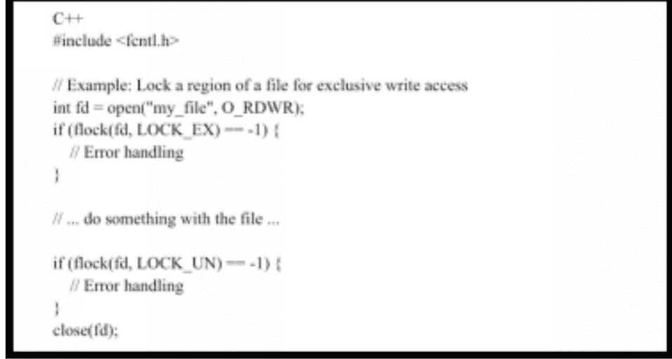

# 使用C++学习Linux系统编程

理解Linux内核的工作原理及其交互方式。

Katie Millie

# 使用C++学习Linux系统编程

理解Linux内核的工作原理及其交互方式。

Katie Millie

# 使用C++学习Linux系统编程

理解Linux内核的工作原理及其交互方式。

作者

## Katie Millie

## 版权声明

**版权所有 © 2024 Katie Millie。保留所有权利。**

本作品包含的内容、设计和图像均为Katie Millie的知识产权。严禁未经授权使用、复制或分发本材料，违者可能面临法律诉讼。本作品体现了作者的创造力和奉献精神，并受国际版权法保护。如需咨询许可或合作事宜，请直接联系Katie Millie。请尊重赋予本作品生命的艺术性和创新性，遵守版权规定并支持创意社区。

[OceanofPDF.com](http://OceanofPDF.com)

# 请求书评

感谢您购买《使用C++学习Linux系统编程》！您的见解对我们和其他读者都很有价值。我们诚挚地邀请您在亚马逊上留下评论，分享您的体验。您的反馈有助于我们改进未来的版本，并帮助其他开发者做出明智的决策。我们感谢您的支持！

[OceanofPDF.com](http://OceanofPDF.com)

### 目录

- [引言](INTRODUCTION)
- [第1章](Chapter 1)
  - [Linux系统架构概述](Overview of Linux System Architecture)
    - [C与C++在系统编程中的比较](Comparison of C and C++ for system programming)
      - [在Linux上设置C++开发环境](Setting Up a C++ Development Environment on Linux)
- [第2章](Chapter 2)
  - [Linux系统编程中C++的核心语言特性](Core Language Features for Linux System Programming in C++)
    - [深入探讨：内存管理、底层I/O与并发](Diving Deeper: Memory Management, Low-Level I/O, and Concurrency)
      - [Linux系统编程中C++的内存管理与指针](Memory Management and Pointers in C++ for Linux System Programming)
        - [用于系统编程的标准模板库（STL）](Standard Template Library (STL) for system programming)
- [第3章](Chapter 3)
  - [Linux系统编程中C++的进程管理：Fork、Exec、Wait](Process Management: Fork, Exec, Wait in Linux System Programming with C++)
    - [Linux系统编程中C++的文件I/O](File I/O in Linux System Programming with C++)
    - [Linux系统编程中C++的进程间通信（IPC）：管道与套接字](Interprocess Communication (IPC): Pipes and Sockets in Linux System Programming with C++)
    - [Linux系统编程中C++的信号处理](Signal Handling in Linux System Programming with C++)
- [第4章](Chapter 4)
  - [Linux系统编程中C++的虚拟内存、分页与交换](Virtual Memory, Paging, and Swapping in Linux System Programming with C++)
    - [Linux系统编程中C++的内存分配与释放](Memory Allocation and Deallocation in Linux System Programming with C++)
      - [内存池：优化内存分配](Memory Pools: Optimising Memory Allocation)
      - [Linux系统编程中C++的内存泄漏与调试](Memory Leaks and Debugging in Linux System Programming with C++)
- [第5章](Chapter 5)
  - [Linux系统编程中C++的线程与进程](Threads and Processes in Linux System Programming with C++)
    - [同步原语：互斥锁、信号量与条件变量](Synchronisation Primitives: Mutexes, Semaphores, and Condition Variables)
    - [Linux系统编程中的线程安全与竞态条件](Thread Safety and Race Conditions in Linux System Programming)
- [第6章](Chapter 6)
  - [Linux系统编程中C++的套接字与网络API](Sockets and Network APIs in Linux System Programming with C++)
    - [客户端-服务器架构](Client-server architecture)
      - [网络协议（TCP、UDP）](Network protocols (TCP, UDP))
- [第7章](Chapter 7)
  - [文件系统结构与操作](File system structure and operations)
    - [文件权限与所有权](File permissions and ownership)
      - [Linux系统编程中C++的文件系统API](File System APIs in Linux System Programming with C++)
- [第8章](Chapter 8)
  - [Linux系统编程中C++的性能分析与性能剖析](Profiling and Performance Analysis in Linux System Programming with C++)
    - [Linux中C++代码的优化技术](Optimization Techniques for C++ Code in Linux)
      - [Linux系统编程中C++的系统调用优化](System Call Optimization in Linux System Programming with C++)
- [第9章](Chapter 9)
  - [Linux中使用C++进行内核编程简介](Introduction to Kernel Programming in Linux with C++)
    - [在Linux中创建和加载内核模块](Creating and Loading Kernel Modules in Linux)
      - [Linux系统编程中的设备驱动程序](Device Drivers in Linux System Programming)
        - [设备驱动程序中的中断处理](Interrupt Handling in Device Drivers)
- [第10章](Chapter 10)
  - [系统实用程序（例如，ls、cp、mv）](System Utilities (e.g., ls, cp, mv))
- [第11章](Chapter 11)
  - [嵌入式系统编程（可选）](Embedded Systems Programming (optional))
    - [用于嵌入式系统的C++](C++ for embedded systems)
    - [使用C++进行嵌入式系统的实时编程](Real-time Programming in Embedded Systems with C++)
    - [在Linux中使用C++与硬件交互](Interfacing with Hardware in Linux using C++)
    - [设备驱动程序：硬件交互的核心](Device Drivers: The Heart of Hardware Interaction)
- [结论](Conclusion)
- [附录](Appendices)
  - [Linux系统调用参考](Linux system calls reference)
  - [C++标准库参考](C++ standard library reference)
  - [C++标准库与Linux系统编程：协同关系](C++ Standard Library and Linux System Programming: A Synergistic Relationship)
  - [Linux系统编程中C++的调试与故障排除](Debugging and Troubleshooting in Linux System Programming with C++)

OceanofPDF.com

# 引言

使用C++学习Linux系统编程：释放内在力量

**你准备好成为数字架构师了吗？**

想象你的计算机是一个庞大的都市，一个由相互连接的组件和谐运作的复杂生态系统。要真正掌握这台精密的机器，你需要理解它的基础语言：C++。而要充分发挥其潜力，你必须深入其操作系统的核心：Linux。

《使用C++学习Linux系统编程》是你通往这个激动人心世界的通行证。这不仅仅是编写代码；而是构建驱动从云计算巨头到嵌入式设备一切的数字基础设施。你将学会批判性思考、创造性地解决问题，并构建高效、可靠且可扩展的系统。

**为什么选择C++和Linux？**

C++提供了与硬件直接交互的强大能力和灵活性，使其成为对性能要求严苛的应用程序的首选语言。Linux凭借其开源理念和丰富的生态系统，为探索和创新提供了完美的平台。两者结合，形成了一个势不可挡的组合。

**你将学到什么？**

- **掌握系统调用的艺术：** 解锁操作系统隐藏的力量。
- **驾驭并发猛兽：** 使用线程和进程构建响应迅速且高效的应用程序。
- **穿越内存迷宫：** 通过专业的内存管理优化性能并防止崩溃。
- **打造高性能网络：** 创建健壮且可扩展的网络应用程序。
- **成为内核低语者：** 理解Linux内核的工作原理及其交互方式。

本书不仅仅涉及技术细节；它旨在赋能你成为一名真正的系统程序员。你将学会像工程师一样思考，从基础分析问题，并构建既优雅又有效的解决方案。

# 但为什么你应该关心？

因为世界运行在系统之上。从你手机上的应用程序到驱动互联网的服务器，一切都归结于底层的代码。通过掌握使用C++进行Linux系统编程，你将深入理解计算机的工作原理，并获得创造真正重要软件的独特能力。

你准备好将你的编程技能提升到新的水平了吗？准备好构建不仅功能齐全，而且卓越非凡的系统了吗？那么，请加入我们这段激动人心的旅程。技术的未来正在等待。

*你准备好开始构建了吗？*

[OceanofPDF.com](http://OceanofPDF.com)

# 第1章

## Linux系统架构概述

Linux是一个多功能的开源操作系统，其分层架构旨在实现效率和灵活性。本概述深入探讨其核心组件、它们之间的交互，以及使用C++进行编程的含义。

内核：Linux的心脏

内核是系统的核心，管理硬件资源、进程、内存和文件系统。它直接与硬件交互，并为用户空间应用程序提供基本服务。

**关键内核组件：**

**进程管理：**

- 处理进程的创建、终止、调度和同步。
- C++代码通常通过系统调用（如`fork`、`exec`、`wait`和`pthread`函数）与内核交互。

### 内存管理

- 分配和释放物理内存与虚拟内存。
- C++ 程序员使用 `malloc`、`free` 和 `new` 操作符进行内存分配，但内核最终管理物理内存。

### 文件系统管理

- 组织和管理数据存储。
- C++ 程序通过 `open`、`read`、`write` 和 `close` 等函数访问文件。

```cpp
#include <fstream>

std::ofstream file("output.txt");
file << "Hello, world!" << std::endl;
file.close();
```

## 设备驱动程序

- 与硬件设备交互。
- C++ 可用于编写设备驱动程序，但出于性能考虑，通常使用 C 语言完成。

### 进程间通信（IPC）

- 促进进程之间的通信。
- C++ 提供了管道、共享内存和消息队列等机制用于 IPC。

### 系统调用

系统调用是用户空间程序与内核之间的接口。它们提供了一种受控的方式来访问内核服务。

```cpp
#include <unistd.h>

int main() {
    pid_t pid = getpid(); // 获取进程 ID
    std::cout << "Process ID: " << pid << std::endl;
    return 0;
}
```

### 系统库

系统库，如 C 标准库（libc），为常见操作提供函数，抽象了系统调用。

### Shell

Shell 是一个命令行解释器，与用户交互并执行命令。Bash 是一个流行的 Shell。

### 用户空间

用户空间包含在内核之上运行的应用程序和实用工具。C++ 被广泛用于开发这些应用程序。

### 关键系统组件

- **文件系统：** 用于组织文件和目录的层次结构。
- **进程：** 正在执行的程序实例。
- **虚拟内存：** 物理内存的抽象。
- **网络协议栈：** 处理网络通信。

## 使用 C++ 和 Linux 进行编程

C++ 非常适合 Linux 系统编程，因为它具有高效性、底层访问能力和丰富的标准库。

- **系统调用：** 直接使用系统调用来对系统资源进行细粒度控制。
- **标准模板库（STL）：** 利用 STL 容器和算法来处理数据结构和操作。
- **Boost 库：** 探索 Boost 以获取额外的实用工具和库。
- **网络编程：** 使用 C++ 套接字进行网络通信。
- **GUI 开发：** 利用 Qt 或 GTK+ 等框架构建图形用户界面。

Linux 的架构是构建健壮高效系统的基础。理解其组件并通过 C++ 与之交互，使开发者能够创建强大的应用程序。通过掌握系统调用、库和内核的能力，程序员可以充分发挥 Linux 操作系统的潜力。

**注意：** 本概述提供了基础性理解。Linux 是一个复杂的系统，具有许多细节。要进行高级系统编程，需要更深入的探索。

### C 和 C++ 在系统编程方面的比较

C 和 C++ 都是用于系统编程的强大语言，但它们提供了不同的方法和权衡。让我们深入探讨它们的主要区别以及何时使用每种语言。

#### 性能和底层控制

C 和 C++ 都提供卓越的性能和直接的硬件访问能力，使其成为系统编程任务的理想选择。然而，由于其更简单的语言结构和编译器优化，C 通常在原始速度方面略占优势。

```c
// 用于计算阶乘的 C 代码
int factorial(int n) {
    if (n == 0)
        return 1;
    else
        return n * factorial(n - 1);
}
```

```cpp
// 用于计算阶乘的 C++ 代码
int factorial(int n) {
    if (n == 0)
        return 1;
    else
        return n * factorial(n - 1);
}
```

虽然上面的代码片段是相同的，但 C 编译器可能会生成稍微优化一些的机器代码。然而，在实际应用中，性能差异通常可以忽略不计。

#### 抽象和代码组织

C 是一种过程式语言，专注于函数和数据结构。它擅长底层任务，但对于大型项目可能会变得复杂。

另一方面，C++ 支持面向对象编程（OOP），提供类、继承、多态和封装。这使得代码组织、可重用性和可维护性更好。

```cpp
// 用于表示文件的 C++ 类
class File {
public:
    File(const char* filename);
    ~File();
    void open();
    void close();
    void read(char* buffer, int size);
    void write(const char* buffer, int size);
private:
    int fd; // 文件描述符
};
```

File 类封装了文件操作，使代码更具可读性且不易出错。

#### 标准库

C 的标准库相对较小，专注于基本的输入/输出、字符串操作和内存管理。C++ 继承了 C 的库，并通过标准模板库（STL）对其进行了显著扩展，提供了容器、算法和迭代器。

```cpp
#include <vector>
#include <algorithm>

std::vector<int> numbers = {3, 1, 4, 1, 5, 9};
std::sort(numbers.begin(), numbers.end());
```

STL 为常见的数据结构和操作提供了强大的抽象，提高了开发效率。

### 内存管理

C 和 C++ 都需要使用指针进行手动内存管理。如果不小心处理，这可能会导致错误。C++ 引入了 RAII（资源获取即初始化）和智能指针来缓解这些风险。

```cpp
#include <memory>
std::unique_ptr<int> ptr(new int(42)); // 自动内存释放
```

智能指针自动管理内存，减少了内存泄漏的可能性。

#### 何时使用 C 与 C++

**选择 C 当：**

- 性能是绝对优先考虑的因素，每一个时钟周期都很重要。
- 你正在处理资源有限的嵌入式系统。
- 你需要在底层直接与硬件交互。

**选择 C++ 当：**

- 你需要开发具有良好的代码组织的大型、复杂系统。
- 你想利用 OOP 特性来获得更好的设计和可维护性。
- 你优先考虑开发人员的生产力和代码安全性。

C 和 C++ 都是系统编程的宝贵工具。最佳选择取决于具体的项目需求。在许多情况下，结合使用两种语言是有效的，使用 C 处理性能关键组件，使用 C++ 处理整体架构。

请记住，虽然 C++ 提供了更多的功能和抽象，但它也带来了更高的复杂性。在做决定时，仔细权衡利弊至关重要。

### 在 Linux 上设置 C++ 开发环境

本指南将引导你在 Linux 系统上设置一个基本的 C++ 开发环境。我们将介绍编译器、调试器和文本编辑器等基本工具。虽然这是一个基础设置，但它足以满足许多系统编程任务的需求。

#### 基本工具

1. **编译器：**

    - **GNU 编译器集合（GCC）：** 这是 Linux 上最广泛使用的 C 和 C++ 编译器。它通常包含在大多数 Linux 发行版中。要确保它已安装，请打开终端并运行：

    ```bash
    sudo apt install gcc g++
    ```

    如果你使用的是不同的发行版（例如，Fedora 使用 `yum`，CentOS 使用 `dnf`），请将 `apt` 替换为你的包管理器。

2. **调试器：**

    - **GNU 调试器（GDB）：** 这是一个强大的命令行调试器，对于理解程序行为非常宝贵。使用以下命令安装：

    ```bash
    sudo apt install gdb
    ```

3. **文本编辑器/IDE：**

    虽然你可以使用像 `vim` 或 `nano` 这样的基本文本编辑器，但 IDE（集成开发环境）提供了语法高亮、代码补全和调试集成等功能。流行的选择包括：

## 基础 C++ 程序与编译

让我们创建一个简单的 C++ 程序来测试我们的环境：

```cpp
#include <iostream>

int main() {
    std::cout << "Hello, world!" << std::endl;
    return 0;
}
```

将此代码保存为 `hello.cpp`。要编译并运行它：

```bash
g++ hello.cpp -o hello
./hello
```

这将创建一个名为 `hello` 的可执行文件并运行它。

## 构建项目结构

对于较大的项目，有效地组织代码至关重要。请考虑以下结构：

```
project_name
├── include
│   └── my_header.h
├── src
│   └── main.cpp
└── CMakeLists.txt
```

- **include/**：包含带有声明的头文件。
- **src/**：包含带有实现的源文件。
- **CMakeLists.txt**：可选，用于使用 CMake 构建项目。

## 附加工具和库

根据你的项目，你可能需要：

- **Make**：用于自动化构建过程。
- **CMake**：一个跨平台的构建系统。
- **Boost**：一个 C++ 库的集合。
- **标准模板库 (STL)**：C++ 标准库的一部分，提供容器、算法等。
- **调试工具**：Valgrind 用于内存泄漏检测，gprof 用于性能分析。

### 示例：使用 CMake

在你的项目目录中创建一个 `CMakeLists.txt` 文件：

```cmake
cmake_minimum_required(VERSION 3.0)
project(my_project)

add_executable(my_executable src/main.cpp)
```

使用以下命令构建项目：

```bash
mkdir build
cd build
cmake ..
make
```

这将创建一个构建目录，生成构建文件，并编译项目。

### 使用 GDB 调试

要开始使用 GDB 调试你的程序：

```bash
gdb ./my_executable
```

这将打开 GDB 调试器。使用 `run`、`break`、`step` 和 `print` 等命令来检查你程序的行为。

本指南为在 Linux 上进行 C++ 开发提供了基础。随着你的项目发展，你可能会探索更高级的工具和技术。尝试不同的编辑器、构建系统和调试方法，以找到最适合你的方案。

**注意：** 这是一个基本概述。要获得深入的知识和特定的项目要求，请查阅其他资源和文档。

## 深入探讨：CMake、调试和 Boost

### CMake：一个跨平台的构建系统

CMake 是一个用于管理复杂 C++ 项目的强大工具。它根据声明式配置文件（`CMakeLists.txt`）生成特定于平台的构建文件（如 Makefiles）。

**主要特性：**

- **跨平台兼容性：** 在不同操作系统上构建项目，只需极少的更改。
- **组织性：** 鼓励良好的项目结构。
- **集成性：** 轻松集成外部库和工具。
- **高效性：** 可以显著加快构建过程。

**示例 `CMakeLists.txt`：**

```cmake
cmake_minimum_required(VERSION 3.10)
project(my_project)

#### Set compiler and language standards
set(CMAKE_CXX_STANDARD 17)

#### Find required libraries
find_package(Boost COMPONENTS system REQUIRED)

#### Add executable and sources
add_executable(my_executable src/main.cpp)
target_link_libraries(my_executable Boost::system)
```

**解释：**

- `cmake_minimum_required`：指定所需的最低 CMake 版本。
- `project`：定义项目名称。
- `set(CMAKE_CXX_STANDARD 17)`：将 C++ 标准设置为 C++17。
- `find_package`：定位 Boost 库。
- `add_executable`：指定可执行文件名和源文件。
- `target_link_libraries`：将可执行文件与 Boost::system 库链接。

**构建项目：**

```bash
mkdir build
cd build
cmake ..
make
```

### 使用 GDB 调试

GDB 是一个功能多样的 C++ 程序调试器。它提供以下功能：

- **断点**：在特定点暂停执行。
- **单步执行**：逐行执行代码。
- **检查变量**：检查变量值。
- **回溯**：分析调用栈。

**基本用法：**

```bash
gdb ./my_executable
```

进入 GDB 后，你可以使用以下命令：

- **run**：启动程序。
- **break main**：在 main 函数的开头设置断点。
- **step**：执行下一行代码。
- **next**：执行下一行，跳过函数调用。
- **print variable**：打印变量的值。
- **backtrace**：显示调用栈。
- **quit**：退出 GDB。

**示例：**

```
(gdb) break main
Breakpoint 1 at 0x400520: file main.cpp, line 5.
(gdb) run
Starting program: /path/to/my_executable
Breakpoint 1 at 0x400520: file main.cpp, line 5.
```

### Boost：一个强大的 C++ 库

Boost 是一个经过同行评审的免费 C++ 库集合，为各种任务提供支持，包括：

- **字符串和文本处理**：正则表达式、区域设置、格式化等。
- **容器和算法**：高级数据结构和算法。
- **异步 I/O**：高效的网络和文件操作。
- **文件系统**：跨平台的文件系统操作。
- **数学**：线性代数、特殊函数等。

**使用 Boost：**

- **包含头文件**：在你的代码中包含必要的 Boost 头文件。
- **链接库**：在构建项目时链接所需的 Boost 库。

**示例：**

```cpp
#include <boost/filesystem.hpp>

int main() {
    boost::filesystem::path p("/path/to/file");
    if (boost::filesystem::exists(p)) {
        std::cout << "File exists" << std::endl;
    }
    return 0;
}
```

**使用 Boost 构建：**

确保你的系统上安装了 Boost。然后，在你的 `CMakeLists.txt` 中：

```cmake
find_package(Boost COMPONENTS filesystem REQUIRED)
target_link_libraries(my_executable Boost::filesystem)
```

# 第 2 章

## 用于 Linux 系统编程的 C++ 核心语言特性

C++ 是一种在高级抽象和低级系统交互之间架起桥梁的语言，使其成为 Linux 系统编程的合适选择。本节将重点介绍对该领域至关重要的核心语言特性。

### 指针和内存管理

指针是 C++ 系统编程的基石。它们允许直接操作内存位置，这对于与硬件交互、高效的数据结构和低级内存管理等任务至关重要。

```cpp
#include <iostream>

int main() {
    int x = 10;
    int *ptr = &x; // Pointer to x
    std::cout << *ptr << std::endl; // Dereference to access value
    *ptr = 20; // Modify value through pointer
    std::cout << x << std::endl; // Value of x is changed
    return 0;
}
```

### 引用

引用为现有对象提供别名，提供了一种高效地按引用传递参数的方式。

```cpp
#include <iostream>

void swap(int &a, int &b) {
    int temp = a;
    a = b;
    b = temp;
}

int main() {
    int x = 10, y = 20;
    swap(x, y);
    std::cout << x << " " << y << std::endl;
    return 0;
}
```

### Const 正确性

Const 正确性确保数据不会被意外修改，从而提高代码的可靠性。

```cpp
#include <iostream>

void print_value(const int &value) {
    std::cout << value << std::endl;
}

int main() {
    int x = 10;
    print_value(x); // Correct
    // print_value(x++); // Error: cannot modify const reference
    return 0;
}
```

### 运算符重载

运算符重载允许为内置运算符定义自定义行为，从而编写出富有表现力且直观的代码。

```cpp
#include <iostream>

class Complex {
public:
    double real, imag;

    Complex(double r, double i) : real(r), imag(i) {}

    Complex operator+(const Complex &other) const {
        return Complex(real + other.real, imag + other.imag);
    }

    friend std::ostream &operator<<(std::ostream &os, const Complex &c) {
        os << c.real << " + " << c.imag << "i";
        return os;
    }
};

int main() {
    Complex c1(2, 3), c2(4, 5);
    Complex c3 = c1 + c2;
    std::cout << c3 << std::endl;
    return 0;
}
```

## 模板

模板通过允许函数和类处理不同的数据类型来提供代码复用性。

```cpp
#include <iostream>

template <typename T>
T max(T a, T b) {
    return (a > b) ? a : b;
}

int main() {
    int x = 10, y = 20;
    double d1 = 3.14, d2 = 2.71;
    std::cout << max(x, y) << std::endl;
    std::cout << max(d1, d2) << std::endl;
    return 0;
}
```

## 底层 I/O

C++ 通过流和文件描述符提供与文件系统的直接交互。

```cpp
#include <iostream>
#include <fstream>

int main() {
    std::ofstream output_file("data.txt");
    output_file << "Hello, world!" << std::endl;
    output_file.close();

    std::ifstream input_file("data.txt");
    std::string line;
    while (std::getline(input_file, line)) {
        std::cout << line << std::endl;
    }
    input_file.close();
    return 0;
}
```

## 异常处理

异常处理对于系统编程中健壮的错误管理至关重要。

```cpp
#include <iostream>
#include <stdexcept>

int divide(int a, int b) {
    if (b == 0) {
        throw std::runtime_error("Division by zero");
    }
    return a / b;
}

int main() {
    try {
        int result = divide(10, 0);
        std::cout << result << std::endl;
    } catch (const std::runtime_error &e) {
        std::cerr << "Error: " << e.what() << std::endl;
    }
    return 0;
}
```

## 附加特性

- **预处理器指令：** 用于条件编译、宏定义和文件包含。
- **位运算符：** 用于底层的位操作。
- **内存分配：** 使用 `new` 和 `delete` 或 `malloc` 和 `free`。
- **标准模板库 (STL)：** 提供容器、算法和迭代器，用于高效的数据处理。

这些核心语言特性，结合 C++ 标准库和系统特定库，为在 Linux 中编写高效可靠的系统级代码奠定了坚实基础。

## 深入探讨：内存管理、底层 I/O 与并发

### C++ 中的内存管理

高效的内存管理对于系统编程至关重要，可以避免性能瓶颈和内存泄漏。C++ 提供了手动和自动两种内存管理机制。

**手动内存管理：**

- **new 和 delete：** 这些运算符用于在堆上动态分配和释放对象。

```cpp
int* ptr = new int(42);
// ...
delete ptr;
```

- **malloc 和 free**：这些是用于分配和释放原始内存的 C 风格函数。

```cpp
int* ptr = (int*)malloc(sizeof(int));
// ...
free(ptr);
```

#### 自动内存管理：

- **智能指针**：这些是自动管理其他对象生命周期的对象，可以防止内存泄漏。

```cpp
#include <memory>

std::unique_ptr<int> ptr(new int(42)); // 独占所有权
std::shared_ptr<int> shared_ptr(new int(42)); // 共享所有权
```

#### 内存分配与释放的注意事项：

- 为性能优化适当对齐内存。
- 对于具有构造函数和析构函数的对象，使用 new 和 delete。
- 对于原始内存分配，使用 malloc 和 free。
- 注意内存碎片化问题，并考虑为大型分配使用内存池。

### C++ 中的底层 I/O

C++ 提供了多种与文件系统和其他 I/O 设备交互的机制。

#### 文件 I/O：

- **C 风格文件 I/O：** 使用 fopen、fread、fwrite 和 fclose 等函数。

```cpp
FILE* fp = fopen("data.txt", "r");
// ...
fclose(fp);
```

- **C++ 流：** 使用 ifstream、ofstream 和 fstream 进行面向对象的文件处理。

```cpp
std::ifstream input_file("data.txt");
// ...
input_file.close();
```

- **底层文件操作：** 使用 open、read、write 和 close 等系统调用直接操作文件。

#### 网络 I/O：

- **套接字：** 使用套接字 API 进行网络通信。
- **异步 I/O：** 采用异步编程模型以实现高效的网络操作。

#### 标准输入/输出：

- **cin 和 cout：** 用于控制台输入和输出。
- **格式化 I/O：** 使用 printf 和 scanf 进行格式化输出和输入。

### C++ 中的并发

C++ 提供了多种并发编程机制，包括线程、进程和异步编程。

#### 线程：

- 使用 `<thread>` 头文件创建线程。
- 使用互斥锁、条件变量和信号量管理线程同步。
- 利用线程池进行高效的线程管理。

```cpp
#include <thread>

void my_thread_function() {
    // ...
}

int main() {
    std::thread t(my_thread_function);
    // ...
    t.join();
    return 0;
}
```

#### 进程：

- 使用 `fork` 系统调用创建进程。
- 使用管道、共享内存或消息队列在进程间通信。

#### 异步编程：

- 使用异步 I/O 模型进行非阻塞操作。
- 利用 Boost.Asio 等库进行异步网络编程。

#### 并发注意事项：

- 注意竞态条件和死锁。
- 根据问题领域选择合适的并发模型。
- 优化线程同步以提高性能。

## Linux 系统编程中的 C++ 内存管理与指针

### 理解指针

指针是 C++ 的基础，在系统编程中尤为关键。它们是存储内存地址的变量。这允许直接操作内存，对于与硬件交互、高效数据结构和底层内存管理等任务至关重要。

```cpp
#include <iostream>

int main() {
    int x = 42;
    int *ptr = &x; // 指向 x 的指针

    std::cout << *ptr << std::endl; // 解引用以访问值
    *ptr = 100; // 通过指针修改值
    std::cout << x << std::endl; // x 的值已改变

    return 0;
}
```

### 内存分配与释放

C++ 提供了两种主要的内存管理方式：手动和自动。

#### 手动内存管理

- **new 和 delete**：这些运算符用于在堆上分配和释放对象。

```cpp
int* ptr = new int(42);
// ...
delete ptr;
```

- **malloc 和 free**：这些是用于分配和释放原始内存的 C 风格函数。

```cpp
int* ptr = (int*)malloc(sizeof(int));
// ...
free(ptr);
```

#### 自动内存管理

- **智能指针：** 这些是自动管理其他对象生命周期的对象，可以防止内存泄漏。

```cpp
#include <memory>

std::unique_ptr<int> ptr(new int(42)); // 独占所有权
std::shared_ptr<int> shared_ptr(new int(42)); // 共享所有权
```

### C++ 程序中的内存布局

理解 C++ 程序中内存的组织方式对于高效的内存管理至关重要。主要的内存区域包括：

- **栈：** 用于函数调用、局部变量和返回地址。
- **堆：** 用于通过 `new` 或 `malloc` 动态分配的内存。
- **数据段：** 存储全局和静态变量。
- **代码段：** 存储可执行代码。

### 常见的内存管理陷阱

- **内存泄漏：** 未能释放不再需要的内存。

```cpp
int* ptr = new int[10];
// ...
// 忘记 delete ptr
```

- **悬垂指针：** 指向已释放内存的指针。

```cpp
int* ptr = new int(42);
delete ptr;
// ...
std::cout << *ptr << std::endl; // 危险！
```

- **双重释放：** 尝试释放已经释放过的内存。

```cpp
int* ptr = new int(42);
delete ptr;
delete ptr; // 错误
```

- **缓冲区溢出：** 写入超出数组已分配内存边界的数据。

### 内存管理的最佳实践

- 尽可能使用智能指针以避免手动内存管理错误。
- 小心处理数组索引以防止缓冲区溢出。
- 使用 valgrind 或其他内存泄漏检测工具来查找内存问题。
- 考虑为大型分配使用内存池以提高性能。
- 理解程序的内存布局以优化内存访问模式。

### 高级内存管理技术

- **内存映射：** 将文件映射到内存中以实现高效访问。
- **虚拟内存：** 使用操作系统的虚拟内存系统进行内存管理。

#### 内存映射 I/O

- **内存映射 I/O：** 通过内存直接访问硬件寄存器。

```cpp
// 示例：内存映射文件
#include <iostream>
#include <fcntl.h>
#include <sys/mman.h>
#include <unistd.h>

int main() {
    int fd = open("data.bin", O_RDONLY);
    if (fd == -1) {
        perror("open");
        return 1;
    }

    struct stat statbuf;
    if (fstat(fd, &statbuf) == -1) {
        perror("fstat");
        close(fd);
        return 1;
    }

    char* data = (char*)mmap(nullptr, statbuf.st_size, PROT_READ,
                             MAP_SHARED, fd, 0);
    if (data == MAP_FAILED) {
        perror("mmap");
        close(fd);
        return 1;
    }

    // 像访问内存一样访问数据
    // ...

    munmap(data, statbuf.st_size);
    close(fd);
    return 0;
}
```

通过理解这些概念并遵循最佳实践，你可以在 C++ 系统编程项目中有效地管理内存，从而编写出更可靠、更高效的代码。

## 用于系统编程的标准模板库（STL）

标准模板库（STL）是 C++ 编程的基石，提供了一套丰富的泛型算法、容器和迭代器。虽然通常与通用编程相关联，但 STL 在系统编程中同样具有重要价值，为管理数据结构和执行常见操作提供了高效且可复用的工具。

### STL 组件

STL 主要由三个组件构成：

1. **容器：** 这些是存储元素的数据结构。示例包括 `vector`、`list`、`deque`、`map`、`set` 等。
2. **算法：** 这些是操作容器的函数，提供排序、搜索和操作元素等操作。
3. **迭代器：** 这些用于访问容器内的元素。

### 系统编程中的容器

虽然数组似乎是底层编程的自然选择，但 STL 容器通常在灵活性、效率和安全性方面具有优势。

- **vector：** 动态可调整大小的数组，具有高效的随机访问能力。适用于表示固定大小的数据结构或事先未知大小的情况。

```cpp
#include <vector>
std::vector<int> data;
data.push_back(42);
data.push_back(10);
```

- **deque：** 双端队列，在两端进行插入和删除操作效率很高。适用于实现队列或栈。

```cpp
#include <deque>
std::deque<int> queue;
queue.push_back(1);
queue.push_front(2);
```

- **list：** 双向链表，在容器中间进行插入和删除操作效率很高。适用于实现需要频繁插入/删除的队列或栈。

```cpp
#include <list>
std::list<int> mylist;
mylist.push_back(3);
mylist.insert(mylist.begin(), 2);
```

- **map 和 set：** 基于键存储元素的关联容器。适用于实现字典或查找表。

```cpp
#include <map>
std::map<std::string, int> ages;
ages["Alice"] = 30;
ages["Bob"] = 25;
```

## 系统编程中的算法

STL 算法提供了一种强大而高效的方式来操作容器内的数据。

- **搜索：** find、binary_search、lower_bound、upper_bound。
- **排序：** sort、stable_sort、partial_sort。
- **修改：** copy、fill、transform、remove、remove_if。
- **数值：** accumulate、inner_product、partial_sum。

示例：

```cpp
#include <algorithm>
#include <vector>

std::vector<int> numbers = {3, 1, 4, 1, 5, 9};

std::sort(numbers.begin(), numbers.end());
std::cout << "Sorted: ";
for (int num : numbers) {
    std::cout << num << " ";
}
std::cout << std::endl;
```

## 系统编程中的迭代器

迭代器提供了一种访问容器内元素的方式。它们对于算法和编写泛型代码至关重要。

- **输入迭代器：** 只读访问，只能使用一次。
- **输出迭代器：** 只写访问。
- **前向迭代器：** 只读访问，可多次使用，但只能单向移动。
- **双向迭代器：** 读写访问，可双向移动。
- **随机访问迭代器：** 读写访问，可按任意顺序访问元素。

## STL 与系统性能

虽然 STL 提供了高度的抽象，但在系统编程中考虑性能影响至关重要。

- **容器选择：** 容器的选择取决于访问模式和插入/删除频率。
- **算法复杂度：** 注意算法的时间和空间复杂度。
- **迭代器失效：** 理解容器操作如何影响迭代器。
- **自定义分配器：** 对于细粒度的内存管理，考虑使用自定义分配器。

## STL 与系统特定库

STL 可以与系统特定库集成，用于文件 I/O、网络编程和并发等任务。例如，你可以使用 `std::vector` 存储从文件读取的数据，或使用 STL 算法处理网络数据包。

STL 是系统程序员的宝贵工具，提供了高效灵活的数据结构和算法。通过理解其组件和权衡，你可以利用 STL 编写健壮且高性能的系统级代码。

## 系统编程中的 STL：具体用例与性能优化

虽然 STL 通常与通用编程相关联，但它在系统编程中也有着广泛的应用。

### 数据结构与算法

- **网络数据包处理：** 使用 `vector` 或 `deque` 存储数据包数据，并使用 `find` 或 `sort` 等算法进行数据包过滤和处理。
- **文件 I/O：** 使用 `vector` 或 `string` 缓冲从文件读取或写入文件的数据。
- **系统调用包装器：** 使用模板和算法为系统调用创建通用包装器，以提高代码的可重用性。
- **内核数据结构：** 虽然不直接适用于用户空间，但 STL 的概念可以启发内核开发中高效的数据结构。

### 使用 STL 进行性能优化

- **容器选择：** 根据访问模式选择合适的容器。例如，`vector` 非常适合随机访问，而 `list` 更适合插入和删除操作。
- **算法选择：** 根据数据大小和排序标准仔细选择算法。对于大型数据集，考虑使用复杂度更好的算法，例如具有优化实现的 `std::sort`。
- **迭代器使用：** 在修改容器时注意迭代器失效问题。高效使用迭代器以避免不必要的开销。
- **自定义分配器：** 对于性能关键的应用程序，创建自定义分配器以控制内存分配和释放。

### 示例：使用 STL 进行数据包处理

```cpp
#include <vector>
#include <algorithm>

struct Packet {
    uint16_t source_port;
    uint16_t destination_port;
    // ... 其他数据包数据
};

// 根据目标端口过滤数据包的函数
std::vector<Packet> filter_packets(const std::vector<Packet>& packets, uint16_t dest_port) {
    std::vector<Packet> filtered_packets;
    std::copy_if(packets.begin(), packets.end(), std::back_inserter(filtered_packets),
                 [dest_port](const Packet& p) { return p.destination_port == dest_port; });
    return filtered_packets;
}
```

## STL 与系统性能考量

虽然 STL 提供了许多优势，但必须注意潜在的性能影响：

- **STL 开销：** 在对性能要求极高的代码中，STL 的抽象开销可能会变得明显。考虑使用原始指针或数组以获得最佳性能。
- **内存分配：** STL 容器涉及动态内存分配，这可能会引入延迟。对于实时系统，仔细的内存管理至关重要。
- **迭代器失效：** 注意容器操作如何影响迭代器，以避免未定义行为。

## STL 与 C++ 标准库扩展

许多 C++ 标准库扩展提供了专为系统编程量身定制的额外数据结构和算法。例如，`<unordered_map>` 和 `<unordered_set>` 提供了基于哈希的容器，在某些场景下可能比 `map` 和 `set` 更高效。

# 第三章

## 进程管理：Linux系统编程中的Fork、Exec、Wait（C++）

在Linux中，进程管理是系统编程的一个基本方面。`fork`、`exec`和`wait`系统调用是创建和管理进程的关键工具。

### Fork

`fork`系统调用创建一个新进程，称为子进程，它是父进程的精确副本。子进程继承父进程的内存、打开的文件和其他资源。然而，它们彼此独立执行。

下面是一个简单的例子：

```cpp
#include <iostream>
#include <unistd.h>

int main() {
    pid_t pid = fork();

    if (pid < 0) {
        // Fork failed
        std::cerr << "Fork failed" << std::endl;
        return 1;
    } else if (pid == 0) {
        // Child process
        std::cout << "I am the child process" << std::endl;
    } else {
        // Parent process
        std::cout << "I am the parent process" << std::endl;
    }

    return 0;
}
```

`fork`函数返回一个值：

- **-1**：如果发生错误。
- **0**：在子进程中。
- **子进程的PID**：在父进程中。

### Exec

`exec`系列函数用新的进程映像替换当前进程映像。这意味着当前进程被终止，并被一个具有不同可执行文件的新进程替换。

下面是一个使用`execl`的例子：

```cpp
#include <iostream>
#include <unistd.h>

int main() {
    pid_t pid = fork();

    if (pid < 0) {
        // Fork failed
        std::cerr << "Fork failed" << std::endl;
        return 1;
    } else if (pid == 0) {
        // Child process
        execl("/bin/ls", "ls", "-l", (char *)nullptr);
        // If execl returns, there was an error
        std::cerr << "Execl failed" << std::endl;
        return 1;
    } else {
        // Parent process
        wait(nullptr);
        std::cout << "Child process finished" << std::endl;
    }

    return 0;
}
```

有几个具有不同参数列表的`exec`函数：

- `execl`：接受固定数量的参数。
- `execv`：接受一个参数数组。
- `execlp`：类似于`execl`，但在PATH环境变量中搜索可执行文件。
- `execvp`：类似于`execv`，但在PATH环境变量中搜索可执行文件。

### Wait

`wait`系统调用会挂起调用进程，直到其某个子进程终止。它返回已终止子进程的PID。

下面是一个例子：

```cpp
#include <iostream>
#include <unistd.h>
#include <sys/wait.h>

int main() {
    pid_t pid = fork();

    if (pid < 0) {
        // Fork failed
        std::cerr << "Fork failed" << std::endl;
        return 1;
    } else if (pid == 0) {
        // Child process
        std::cout << "I am the child process" << std::endl;
        exit(0);
    } else {
        // Parent process
        int status;
        wait(&status);
        std::cout << "Child process terminated with status: " << WEXITSTATUS(status) << std::endl;
    }

    return 0;
}
```

`waitpid`函数是`wait`的一个更灵活的版本，它允许你指定要等待哪个子进程。

### 常见用例

- 创建多个进程以并发执行任务。
- 执行外部程序。
- 等待子进程完成后再继续。
- 管理进程的生命周期和资源。

## 其他注意事项

- 使用`fork`、`exec`和`wait`时，错误处理至关重要。
- 创建子进程时，要小心文件描述符和内存管理。
- 使用带有适当标志的`waitpid`来控制wait调用的行为。
- 考虑使用信号进行进程间通信和同步。

### 进阶内容

- 探索`clone`系统调用以进行更细粒度的进程创建。
- 了解进程组和会话以管理进程关系。
- 理解僵尸进程的概念以及如何避免它们。
- 研究高级进程管理技术，如IPC（进程间通信）。

通过掌握这些基本概念，你可以在Linux系统编程项目中有效地创建和管理进程。

## Linux系统编程中的文件I/O（C++）

文件I/O是任何系统中的基本操作。它涉及与文件系统交互，从文件读取数据或向文件写入数据。在Linux系统编程中，文件I/O的主要函数是`open`、`read`、`write`和`close`。

### 打开文件

`open`系统调用用于打开一个文件。它返回一个文件描述符，这是一个非负整数，用于引用打开的文件。

```cpp
#include <fcntl.h>
#include <unistd.h>

int open(const char *pathname, int flags, ... /* mode_t mode */);
```

**pathname**：文件的路径。

**flags**：指定文件应如何打开。常见标志包括：

- **O_RDONLY**：以只读方式打开。
- **O_WRONLY**：以只写方式打开。
- **O_RDWR**：以读写方式打开。
- **O_CREAT**：如果文件不存在则创建它。
- **O_TRUNC**：如果文件存在，则将其截断为零长度。
- **O_APPEND**：将数据追加到文件末尾。

**mode**：仅在指定**O_CREAT**时使用。它指定新创建文件的权限。

### 从文件读取

**read**系统调用用于从打开的文件中读取数据。

```cpp
#include <unistd.h>

ssize_t read(int fd, void *buf, size_t count);
```

- **fd**：打开文件的文件描述符。
- **buf**：指向数据将被存储的缓冲区的指针。
- **count**：要读取的最大字节数。

**read**函数返回实际读取的字节数，如果发生错误则返回-1。

### 写入文件

**write**系统调用用于向打开的文件写入数据。

```cpp
#include <unistd.h>
ssize_t write(int fd, const void *buf, size_t count);
```

- **fd**：打开文件的文件描述符。
- **buf**：指向包含要写入数据的缓冲区的指针。
- **count**：要写入的字节数。

write函数返回实际写入的字节数，如果发生错误则返回-1。

### 关闭文件

close系统调用用于关闭一个打开的文件。

```cpp
#include <unistd.h>
int close(int fd);
```

- **fd**：要关闭的文件的文件描述符。

close函数成功时返回0，如果发生错误则返回-1。

### 示例

```cpp
#include <iostream>
#include <fstream>
#include <fcntl.h>
#include <unistd.h>

int main() {
    // Create a file
    int fd = open("test.txt", O_CREAT | O_WRONLY, 0644);
    if (fd == -1) {
        std::cerr << "Error creating file" << std::endl;
        return 1;
    }
    // Write some data
    const char *data = "Hello, world!\n";
    ssize_t bytes_written = write(fd, data, strlen(data));
    if (bytes_written == -1) {
        std::cerr << "Error writing to file" << std::endl;
        close(fd);
        return 1;
    }
    // Close the file
    close(fd);

    // Open the file for reading
    fd = open("test.txt", O_RDONLY);
    if (fd == -1) {
        std::cerr << "Error opening file for reading" << std::endl;
        return 1;
    }
    // Read and print the contents
    char buffer[100];
    ssize_t bytes_read = read(fd, buffer, sizeof(buffer));
    if (bytes_read == -1) {
        std::cerr << "Error reading from file" << std::endl;
        close(fd);
        return 1;
    }

    std::cout << buffer << std::endl;

    // Close the file
    close(fd);

    return 0;
}
```

## 其他注意事项

- **错误处理：** 始终检查系统调用的返回值以发现错误。
- **文件权限：** 确保你的进程具有打开、读取和写入文件所需的必要权限。
- **缓冲：** 考虑使用更大的缓冲区以获得更好的性能，尤其是在读取或写入大量数据时。
- **文件模式：** 创建文件时使用适当的文件模式来控制权限。
- **标准文件描述符：** 文件描述符0、1和2通常分别与标准输入、标准输出和标准错误相关联。
- **C++流：** 虽然本例使用了C风格的文件I/O函数，但C++提供了更高级的流（例如`std::ifstream`、`std::ofstream`）用于文件I/O操作。

通过理解这些核心函数和概念，你可以在Linux系统编程项目中有效地执行文件I/O操作。

## Linux系统编程中的高级文件I/O

### 文件权限

文件权限决定了谁可以访问文件以及他们可以对文件做什么。它们在使用`open`系统调用中的`mode`参数创建文件时设置。

```cpp
#include <sys/stat.h>

// Example: Create a file with read, write, and execute permissions for
// owner, read and write for group, and read for others
int fd = open("my_file", O_CREAT | O_WRONLY, S_IRUSR | S_IWUSR |
S_IXUSR | S_IRGRP | S_IWGRP | S_IROTH);
```

`stat`系统调用可用于检索文件权限和其他信息：

### 文件锁定

文件锁定可防止多个进程同时访问文件。这对于保证数据完整性至关重要。



##### 缓冲 I/O

标准 C 库提供了如 `fopen`、`fread`、`fwrite` 和 `fclose` 等用于更高级文件操作的缓冲 I/O 函数。这些函数使用内部缓冲区来提高性能。

```cpp
#include <stdio.h>

FILE *fp = fopen("my_file", "r");
if (fp == NULL) {
    // Error handling
}

char buffer[1024];
size_t bytes_read = fread(buffer, 1, sizeof(buffer), fp);
fclose(fp);
```

## 底层 I/O

为了对 I/O 操作进行更精细的控制，你可以使用像 `read` 和 `write` 这样的底层系统调用。然而，你需要自己管理缓冲。

```cpp
#include <unistd.h>

int fd = open("my_file", O_RDONLY);
char buffer[1024];
ssize_t bytes_read = read(fd, buffer, sizeof(buffer));
close(fd);
```

## 文件描述符与文件表

当一个文件被打开时，内核会创建一个文件描述符，它是一个指向进程特定文件表的索引。文件表条目包含有关已打开文件的信息，包括指向 inode 的指针、文件偏移量和文件状态标志。

## I/O 重定向

标准输入、输出和错误可以使用 `dup` 和 `dup2` 系统调用进行重定向。

```cpp
#include <unistd.h>

// Redirect standard output to a file
int fd = open("output.txt", O_CREAT | O_WRONLY, 0644);
dup2(fd, STDOUT_FILENO);
close(fd);
```

### 文件系统操作

除了基本的 I/O，你还可以执行各种文件系统操作，例如：

- 创建和删除目录
- 更改文件所有权和权限
- 链接和取消链接文件
- 管理硬链接和符号链接

这些操作通常使用 `mkdir`、`rmdir`、`chown`、`chmod`、`link`、`unlink` 等函数来执行。

## 进程间通信（IPC）：Linux 系统编程中的管道与套接字（C++）

进程间通信（IPC）是操作系统中的一种基本机制，允许多个进程进行交互和交换数据。本文深入探讨两种主要的 IPC 方法：管道和套接字，重点介绍它们在使用 C++ 的 Linux 系统编程中的实现。

#### 管道

管道是一种单向通信通道，连接两个进程。写入管道一端的数据可以从另一端读取。管道通常用于相关进程，例如一个进程的输出成为另一个进程的输入。

### 创建管道

`pipe()` 系统调用创建一个管道。它返回一个包含两个文件描述符的数组：`fd[0]` 用于读取，`fd[1]` 用于写入。

```cpp
#include <iostream>
#include <unistd.h>

int main() {
    int pipefd[2];
    if (pipe(pipefd) == -1) {
        std::cerr << "Pipe creation failed" << std::endl;
        return 1;
    }

    // ... use pipefd[0] for reading and pipefd[1] for writing ...

    return 0;
}
```

### 使用管道

`write()` 和 `read()` 系统调用分别用于向管道写入数据和从管道读取数据。

```cpp
#include <iostream>
#include <unistd.h>

int main() {
    int pipefd[2];
    if (pipe(pipefd) == -1) {
        std::cerr << "Pipe creation failed" << std::endl;
        return 1;
    }

    // Child process
    pid_t pid = fork();
    if (pid == -1) {
        std::cerr << "Fork failed" << std::endl;
        return 1;
    } else if (pid == 0) {
        // Child process: Close write end
        close(pipefd[1]);

        char buffer[100];
        ssize_t bytes_read = read(pipefd[0], buffer, sizeof(buffer));
        if (bytes_read == -1) {
            std::cerr << "Read error" << std::endl;
        } else {
            std::cout << "Child process received: " << buffer << std::endl;
        }

        close(pipefd[0]);
    } else {
        // Parent process: Close read end
        close(pipefd[0]);

        const char* message = "Hello from parent";
        write(pipefd[1], message, strlen(message) + 1);

        close(pipefd[1]);
    }

    return 0;
}
```

#### 套接字

套接字提供了一种更灵活、更通用的 IPC 机制。它们可用于同一台机器上的进程间通信，也可用于跨网络通信。

### 创建套接字

`socket()` 系统调用创建一个套接字。参数指定了地址族（例如，用于 IPv4 的 `AF_INET`）、套接字类型（例如，用于 TCP 的 `SOCK_STREAM`）和协议（通常为 0）。

```cpp
#include <iostream>
#include <sys/socket.h>

int main() {
    int sockfd = socket(AF_INET, SOCK_STREAM, 0);
    if (sockfd == -1) {
        std::cerr << "Socket creation failed" << std::endl;
        return 1;
    }

    // ... use the socket ...

    return 0;
}
```

### 绑定与监听

对于服务器端套接字，你需要将套接字绑定到一个地址并监听传入的连接。

```cpp
#include <iostream>
#include <sys/socket.h>
#include <netinet/in.h>

int main() {
    int sockfd = socket(AF_INET, SOCK_STREAM, 0);
    if (sockfd == -1) {
        std::cerr << "Socket creation failed" << std::endl;
        return 1;
    }

    struct sockaddr_in server_addr;
    memset(&server_addr, 0, sizeof(server_addr));
    server_addr.sin_family = AF_INET;
    server_addr.sin_addr.s_addr = INADDR_ANY;
    server_addr.sin_port = htons(12345); // Replace with desired port

    if (bind(sockfd, (struct sockaddr*)&server_addr, sizeof(server_addr)) == -1) {
        std::cerr << "Bind failed" << std::endl;
        return 1;
    }

    listen(sockfd, 5); // Backlog of 5 pending connections

    // ... accept connections and handle communication ...

    return 0;
}
```

### 连接与通信

对于客户端套接字，你需要连接到服务器，然后发送和接收数据。

```cpp
#include <iostream>
#include <sys/socket.h>
#include <netinet/in.h>

int main() {
    int sockfd = socket(AF_INET, SOCK_STREAM, 0);
    if (sockfd == -1) {
        std::cerr << "Socket creation failed" << std::endl;
        return 1;
    }

    struct sockaddr_in server_addr;
    // ... fill in server address information ...

    if (connect(sockfd, (struct sockaddr*)&server_addr, sizeof(server_addr)) == -1) {
        std::cerr << "Connect failed" << std::endl;
        return 1;
    }

    // ... send and receive data using send() and recv() ...

    return 0;
}
```

## 其他注意事项

- **错误处理：** 始终检查系统调用的返回值以发现错误。
- **同步：** 对于并发访问共享资源，请考虑使用信号量或互斥锁等同步机制。
- **效率：** 根据应用程序的具体要求选择合适的 IPC 机制。
- **安全性：** 注意安全影响，尤其是在使用套接字进行网络通信时。

本文提供了 Linux 系统编程中管道和套接字的基本概述。有关更高级的用法，请参阅 Linux 系统编程文档。

## 让我们深入探讨 IPC：管道与套接字

### 具体用例

**很好的选择！** 让我们探讨一些管道和套接字的具体用例。

#### 管道

- **父子进程通信：** 正如我们所看到的，管道非常适合在相关进程之间进行简单的数据传输。考虑这样一种场景：父进程生成数据并将其发送给子进程进行进一步处理。
- **管道链：** 多个进程可以使用管道链接在一起形成一个管道链。每个进程从其标准输入（连接到前一个进程的输出）读取，并写入其标准输出（连接到下一个进程的输入）。这在类 Unix 系统中用于分阶段处理数据很常见。
- **文件重定向：** 管道可用于重定向进程的标准输入或输出。例如，`ls -l | grep "txt"` 将 `ls -l` 的输出通过管道传递给 `grep`，以过滤出以 ".txt" 结尾的文件。

#### 套接字

- **网络应用程序：** 套接字是大多数网络应用程序的基础，包括 Web 服务器、客户端、文件传输协议（FTP）、电子邮件（SMTP）和即时消息。
- **跨机器的进程间通信（IPC）：** 虽然管道仅限于同一台机器上的进程，但套接字可以通过网络促进不同机器上的进程之间的通信。
- **客户端-服务器架构：** 套接字非常适合构建客户端-服务器应用程序，其中服务器进程监听传入的连接并与多个客户端并发通信。

### 高级主题与考虑

#### **管道的局限性：**

## 套接字类型：

- **TCP（传输控制协议）**：可靠、面向连接、保证交付、有序交付、错误检查。
- **UDP（用户数据报协议）**：不可靠、无连接、不保证交付、无序、无错误检查，比TCP更快。
- 其他套接字类型包括原始套接字、UNIX域套接字等。

## 套接字API：

- `bind()`：将套接字与本地地址关联。
- `listen()`：表示套接字已准备好接受连接。
- `accept()`：接受传入的连接。
- `connect()`：建立与远程套接字的连接。
- `send()` 和 `recv()`：通过套接字发送和接收数据。
- `close()`：关闭套接字。

## 套接字选项：

- `SO_REUSEADDR`：允许多个进程绑定到相同的地址和端口。
- `SO_KEEPALIVE`：启用保活探测以检查连接活性。
- `SO_LINGER`：控制关闭套接字时的行为。
- 还有许多其他选项可用于微调套接字行为。

## 套接字安全：

- **加密**：使用TLS/SSL等加密协议保护传输中的数据。
- **认证**：使用身份验证机制验证对方身份。
- **授权**：基于用户权限控制对资源的访问。

## C++ Linux系统编程中的信号处理

### 信号简介

信号是发送给进程的异步通知，用于指示某个事件。它们可以由内核、其他进程甚至进程本身生成。一些常见的信号包括：

- `SIGINT`：中断（通常由Ctrl+C生成）
- `SIGTERM`：终止请求
- `SIGKILL`：立即终止进程
- `SIGSEGV`：段错误
- `SIGALRM`：闹钟

### 使用 `signal()` 处理信号

`signal()` 函数是处理信号最简单的方式。它接受两个参数：信号编号和指向信号处理函数的指针。

```cpp
#include <iostream>
#include <signal.h>

void my_handler(int sig) {
    std::cout << "Caught signal " << sig << std::endl;
}

int main() {
    signal(SIGINT, my_handler);

    // ... your code here ...

    return 0;
}
```

然而，`signal()` 有其局限性：

- 它不是线程安全的。
- 每个信号只能安装一个处理程序。
- 处理程序返回后信号的行为并不总是确定的。

### 使用 `sigaction()` 处理信号

`sigaction()` 函数提供了对信号处理的更多控制：

```cpp
#include <iostream>
#include <signal.h>

void my_handler(int sig) {
    std::cout << "Caught signal " << sig << std::endl;
}

int main() {
    struct sigaction sa;
    sa.sa_handler = my_handler;
    sigemptyset(&sa.sa_mask); // 在处理程序执行期间不阻塞任何信号
    sa.sa_flags = 0;

    if (sigaction(SIGINT, &sa, nullptr) == -1) {
        perror("sigaction");
        exit(1);
    }

    // ... your code here ...

    return 0;
}
```

`sigaction` 结构体提供了更多选项：

- `sa_handler`：指向信号处理函数的指针。
- `sa_mask`：一个信号集，指定在处理程序执行期间应阻塞哪些信号。
- `sa_flags`：附加标志，例如 `SA_RESTART` 用于重启被中断的系统调用。

### 信号掩码

`sigprocmask()` 函数可用于阻塞或解除阻塞信号：

```cpp
#include <iostream>
#include <signal.h>

int main() {
    sigset_t mask;
    sigemptyset(&mask);
    sigaddset(&mask, SIGINT);

    if (sigprocmask(SIG_BLOCK, &mask, nullptr) == -1) {
        perror("sigprocmask");
        exit(1);
    }

    // ... SIGINT 被阻塞的临界区 ...

    if (sigprocmask(SIG_UNBLOCK, &mask, nullptr) == -1) {
        perror("sigprocmask");
        exit(1);
    }

    return 0;
}
```

### 待处理信号

`sigpending()` 函数可用于检查待处理的信号：

```cpp
#include <iostream>
#include <signal.h>

int main() {
    sigset_t pending;
    sigemptyset(&pending);

    if (sigpending(&pending) == -1) {
        perror("sigpending");
        exit(1);
    }

    if (sigismember(&pending, SIGINT)) {
        std::cout << "SIGINT is pending" << std::endl;
    }

    return 0;
}
```

### 常见信号处理场景

- **优雅终止：** 处理 `SIGINT` 和 `SIGTERM` 以在退出前执行清理操作。
- **错误处理：** 处理 `SIGSEGV` 和 `SIGABRT` 等信号以记录错误并提供信息性消息。
- **超时：** 使用 `SIGALRM` 为操作实现超时。
- **进程间通信：** 信号可用于进程间的简单通信。

## 重要注意事项

- 信号处理程序应尽可能简短和简单。避免在处理程序中执行复杂操作。
- 注意重入问题。信号处理程序可能在任何时候被调用，甚至在你的程序处于临界区时。
- 使用 `sigaction()` 而不是 `signal()` 以获得更多的控制和灵活性。
- 考虑在信号处理程序中使用异步信号安全函数。
- 彻底测试你的信号处理代码。

### 示例：优雅终止

```cpp
#include <iostream>
#include <signal.h>

volatile bool running = true;

void signal_handler(int sig) {
    std::cout << "Caught signal " << sig << std::endl;
    running = false;
}

int main() {
    signal(SIGINT, signal_handler);
    signal(SIGTERM, signal_handler);

    while (running) {
        // ... your code here ...
    }

    std::cout << "Exiting gracefully..." << std::endl;
    return 0;
}
```

通过理解和有效使用信号，你可以在Linux系统编程中编写更健壮和更有弹性的应用程序。

## C++ Linux系统编程中的时间与调度

时间和调度是系统编程的基本方面。Linux提供了一套丰富的函数和系统调用来操作时间和控制进程执行。本文探讨使用C++的关键概念和实际示例。

### 时间测量

#### 时间相关数据结构

- `time_t`：表示日历时间，即自Unix纪元（1970年1月1日，00:00:00 UTC）以来经过的秒数。
- `struct tm`：保存分解后的时间信息（年、月、日、时、分、秒等）。

#### 获取当前时间

```cpp
#include <iostream>
#include <ctime>

int main() {
    time_t now = time(nullptr);
    std::cout << "Current time: " << ctime(&now);

    struct tm *local_time = localtime(&now);
    std::cout << "Local time: " << local_time->tm_year + 1900 << "-"
              << local_time->tm_mon + 1 << "-"
              << local_time->tm_mday << " "
              << local_time->tm_hour << ":"
              << local_time->tm_min << ":"
              << local_time->tm_sec << std::endl;

    return 0;
}
```

### 高分辨率计时器

对于更精确的时间测量，使用 `clock_gettime`：

```cpp
#include <iostream>
#include <time.h>

int main() {
    struct timespec start, end;
    clock_gettime(CLOCK_MONOTONIC, &start);

    // 要计时的代码

    clock_gettime(CLOCK_MONOTONIC, &end);

    double elapsed = (end.tv_sec - start.tv_sec) +
                     (end.tv_nsec - start.tv_nsec) / 1e9;
    std::cout << "Elapsed time: " << elapsed << " seconds" << std::endl;

    return 0;
}
```

### 调度

Linux提供了多种机制来控制进程调度：

#### 调度策略

- SCHED_OTHER：标准分时策略。
- SCHED_FIFO：先进先出实时策略。
- SCHED_RR：轮转实时策略。

#### 设置调度策略和优先级

```cpp
#include <iostream>
#include <sched.h>

int main() {
    struct sched_param param;
    param.sched_priority = 90; // 根据需要调整优先级

    if (sched_setscheduler(0, SCHED_FIFO, &param) == -1) {
        perror("sched_setscheduler");
        return 1;
    }

    std::cout << "Scheduling policy set to SCHED_FIFO" << std::endl;

    return 0;
}
```

**注意：** 设置实时优先级需要适当的权限。

### 休眠和闹钟

- `sleep`：将当前进程挂起指定的秒数。
- `usleep`：将当前进程挂起指定的微秒数。
- `alarm`：安排在指定的秒数后向进程发送信号。

## 定时器

- timer_create、timer_settime、timer_delete：创建、设置和删除定时器。
- timerfd_create、timerfd_settime：创建和设置基于定时器的文件描述符。

```cpp
#include <iostream>
#include <unistd.h>

int main() {
    sleep(2);
    std::cout << "Slept for 2 seconds" << std::endl;

    usleep(500000); // Sleep for 500 milliseconds
    std::cout << "Slept for 500 milliseconds" << std::endl;

    alarm(5); // Send SIGALRM after 5 seconds
    // ...
    return 0;
}
```

```cpp
#include <iostream>
#include <sys/timerfd.h>

int main() {
    int fd = timerfd_create(CLOCK_MONOTONIC, TFD_NONBLOCK);
    if (fd == -1) {
        perror("timerfd_create");
        return 1;
    }

    struct itimerspec itvs;
    // ... set timer values ...
    timerfd_settime(fd, 0, &itvs, nullptr);

    // ... handle timer events ...

    return 0;
}
```

### 高级主题

- **实时调度：** 对于需要精确计时的关键应用程序，可以探索时钟同步、低延迟内核和实时操作系统（RTOS）等高级技术。
- **高性能定时器：** 对于极其精确的测量，可以使用特定于硬件的定时器或性能计数器。
- **调度算法：** 理解不同的调度算法（例如，FIFO、RR、基于优先级的）及其对系统性能的影响。
- **线程调度：** 探索线程调度的概念，以及它与进程调度的区别。

时间和调度对于构建高效且响应迅速的应用程序至关重要。Linux 提供了丰富的工具和 API 来管理时间和控制进程执行。通过理解这些概念并利用相应的函数，你可以创建结构良好且性能卓越的软件。

# 第 4 章

## Linux 系统编程中的虚拟内存、分页与交换（C++）

虚拟内存是现代操作系统（包括 Linux）中的一个基本概念。它在物理内存和系统上运行的进程之间提供了一个抽象层。这种抽象允许进程感知到一个连续的地址空间，即使物理内存通常是碎片化的。分页和交换是实现虚拟内存的关键机制。

### 虚拟内存

虚拟内存是一种允许进程访问超出物理可用内存的技术。这是通过将进程的地址空间划分为页面，并在这些页面不被主动使用时将其存储在磁盘上来实现的。当进程需要访问当前不在物理内存中的页面时，会发生缺页中断，操作系统会将所需的页面从磁盘加载到内存中。

**虚拟内存的主要优势：**

- **增强进程隔离性：** 进程无法直接访问彼此的内存。
- **高效的内存利用：** 物理内存可以在多个进程之间共享。
- **更大的地址空间：** 进程可以拥有比可用物理内存更大的地址空间。

### 分页

分页是一种内存管理方案，它将虚拟地址空间划分为称为页面的固定大小块。物理内存也被划分为称为帧的固定大小块。当进程被加载到内存中时，其页面被映射到物理帧。操作系统使用页表来维护这种映射关系。

**页表：** 页表是一种数据结构，用于存储虚拟页面和物理帧之间的映射。页表中的每个条目都包含对应页面所在的帧号，以及其他信息，如访问权限和页面状态。

```cpp
// Simplified page table entry structure
struct PageTableEntry {
    unsigned int frame_number;
    bool present; // Indicates if the page is in physical memory
    // Other fields (e.g., protection bits, dirty bits, etc.)
};
```

### 交换

交换是一种内存管理技术，涉及在主存和辅助存储（通常是磁盘）之间移动整个进程。当物理内存已满时，操作系统会选择一个进程将其换出到磁盘。之后，当该进程需要再次执行时，它会被换回内存。

交换的效率低于分页，因为它涉及移动整个进程，这可能很耗时。然而，对于物理内存有限的系统，它可能很有用。

### 实现注意事项

虽然 C++ 为内存管理提供了强大的抽象，但虚拟内存和分页的直接操作通常由操作系统处理。然而，理解这些概念对于高效使用内存和调试至关重要。

- **内存分配：** 使用 `malloc` 和 `free` 进行动态内存分配。C++ 标准库在内部处理内存管理，但必须注意内存泄漏和碎片化问题。
- **虚拟内存限制：** 注意操作系统施加的虚拟内存限制。超出这些限制可能导致内存不足错误。
- **缺页中断：** 虽然你不能在 C++ 中直接处理缺页中断，但理解它们对性能的影响很重要。
- **内存映射：** 考虑使用内存映射文件进行高效的文件 I/O。

```cpp
#include <iostream>

int main() {
    // Simulating a large array (would cause page faults in real-world scenario)
    int* large_array = new int[100000000];

    // Accessing elements to potentially trigger page faults
    for (int i = 0; i < 100000000; ++i) {
        large_array[i] = i;
    }

    delete[] large_array;

    return 0;
}
```

**注意：** 此代码是一个简化的示例，用于说明虚拟内存的概念。在实践中，操作系统会自动处理内存管理。

虚拟内存、分页和交换是复杂的话题，对系统性能和资源利用有重大影响。虽然 C++ 程序员通常不直接与这些机制交互，但理解其基本原理对于编写高效可靠的代码至关重要。

**其他主题：**

- 内存映射文件
- 共享内存
- 虚拟内存性能优化
- 现代操作系统中的内存管理

通过掌握虚拟内存的基础知识，你可以在 C++ 应用程序中做出明智的内存使用决策，从而有助于提升系统性能。

## Linux 系统编程中的内存分配与释放（C++）

内存管理是系统编程的一个关键方面。在 C++ 中，程序员可以控制内存的分配和释放，这对于构建高效和健壮的应用程序至关重要。本文将深入探讨使用 C++ 在 Linux 系统编程中进行内存分配和释放的机制。

### 内存分配

内存分配是指为程序使用预留特定内存量的过程。在 C++ 中，有两种主要的内存分配方法：

#### 1. 静态内存分配

- **编译时分配：** 内存在编译时分配，并在程序执行期间保持固定。
- **存储持续时间：** 全局变量和静态变量具有静态存储持续时间，这意味着它们存在于整个程序的生命周期内。

**示例：**

```cpp
int global_variable = 10; // Global variable

void function() {
    static int static_variable = 20; // Static local variable
}
```

#### 2. 动态内存分配

- **运行时分配：** 内存在运行时根据程序的需要进行分配。
- **灵活性：** 允许更高效的内存使用，因为程序可以根据需要请求内存。
- **运算符：** C++ 提供了 `new` 和 `delete` 运算符用于动态内存分配和释放。

```cpp
#include <iostream>

int main() {
    int *ptr = new int; // Allocate memory for an integer
    *ptr = 42;
    std::cout << *ptr << std::endl;

    delete ptr; // Deallocate memory
    return 0;
}
```

#### 使用 `malloc` 和 `free` 进行内存分配

虽然主要用于 C 语言，但 `malloc` 和 `free` 也可以在 C++ 中用于动态内存分配。

### 使用 malloc 进行内存分配

```cpp
#include <iostream>
#include <cstdlib>

int main() {
    int *ptr = (int*) malloc(sizeof(int));
    *ptr = 42;
    std::cout << *ptr << std::endl;

    free(ptr);
    return 0;
}
```

### 使用 calloc 进行内存分配

calloc 与 malloc 类似，但会将分配的内存初始化为零。

```cpp
#include <iostream>
#include <cstdlib>

int main() {
    int *ptr = (int*) calloc(5, sizeof(int));
    for (int i = 0; i < 5; ++i) {
        std::cout << ptr[i] << " ";
    }
    std::cout << std::endl;

    free(ptr);
    return 0;
}
```

### 内存释放

内存释放是释放不再需要的内存的过程。未能释放内存可能导致内存泄漏，从而降低应用程序的性能和稳定性。

#### 使用 delete

对于使用 `new` 分配的对象，使用 `delete` 来释放内存。

```cpp
int *ptr = new int;
// ...
delete ptr;
```

#### 使用 free

对于使用 `malloc`、`calloc` 或 `realloc` 分配的内存，使用 `free` 来释放内存。

```cpp
int *ptr = (int*) malloc(sizeof(int));
// ...
free(ptr);
```

### 内存管理挑战

- **内存泄漏：** 当内存被分配但未被释放时发生，导致内存耗尽。
- **悬垂指针：** 在内存被释放后，指向无效内存位置的指针。
- **双重释放：** 尝试释放已经被释放的内存，导致未定义行为。

### 最佳实践

- 使用智能指针（例如 `std::unique_ptr`、`std::shared_ptr`）来自动管理内存。
- 尽可能避免使用原始指针。
- 在解引用前检查空指针。
- 使用 valgrind 或其他内存泄漏检测工具来查找内存问题。
- 考虑在特定场景下使用内存池进行性能优化。

### 其他考虑因素

- **内存对齐：** 某些数据类型需要特定的内存对齐以获得最佳性能。
- **内存碎片：** 过度的分配和释放可能导致内存碎片，减少可用的内存块。
- **虚拟内存：** 操作系统管理虚拟内存，提供对物理内存的抽象层。

有效的内存管理对于编写高效可靠的 C++ 程序至关重要。理解不同的内存分配技术及其影响对于预防内存相关问题至关重要。通过遵循最佳实践并使用适当的工具，你可以显著提高应用程序的性能和稳定性。

## 内存池：优化内存分配

### 理解内存池

内存池是一种通过预分配一大块内存并将其划分为较小块来提高内存分配和释放性能的技术。这种方法可以显著减少与系统调用和内存碎片相关的开销。

**内存池的主要优势：**

- **提高性能：** 通过避免频繁的内存分配系统调用，内存池可以显著提升性能，特别是对于频繁分配和释放内存的应用程序。
- **减少碎片：** 内存池可以通过从预分配的块中分配和释放内存块来帮助最小化内存碎片。
- **可定制的分配大小：** 内存池可以针对特定的分配大小进行定制，优化特定数据结构的内存使用。

### 基本实现

一个简单的内存池可以如下实现：

```cpp
#include <iostream>
#include <cstdlib>

struct MemoryPool {
    char* pool;
    size_t size;
    size_t used;

    MemoryPool(size_t poolSize) : pool(new char[poolSize]), size(poolSize), used(0) {}

    void* allocate(size_t blockSize) {
        if (used + blockSize > size) {
            std::cerr << "Memory pool exhausted" << std::endl;
            return nullptr;
        }
        void* ptr = pool + used;
        used += blockSize;
        return ptr;
    }

    void deallocate(void* ptr) {
        // Simple implementation assumes deallocation at the end of the pool
        used -= blockSize;
    }

    ~MemoryPool() {
        delete[] pool;
    }
};

int main() {
    MemoryPool pool(1024);
    int* ptr1 = (int*)pool.allocate(sizeof(int));
    int* ptr2 = (int*)pool.allocate(sizeof(int));
    // ... use allocated memory
    pool.deallocate(ptr2);
    pool.deallocate(ptr1);
    return 0;
}
```

这个实现为内存池提供了一个基础框架。然而，它存在局限性：

- 它不处理池内任意块的释放。
- 它没有考虑内存对齐要求。
- 它缺乏错误处理和健壮性。

### 高级考虑因素

一个更健壮的内存池实现应该解决以下问题：

- **空闲列表管理：** 实现一个数据结构来跟踪池中的空闲块。
- **内存对齐：** 确保分配的块针对不同的数据类型正确对齐。
- **线程安全：** 如果内存池在多线程环境中使用，必须采用适当的同步机制。
- **内存压缩：** 为了解决碎片问题，考虑实现内存压缩机制，将分配的块移动到一起。
- **定制化：** 允许用户指定块大小和池大小。

### 有效使用内存池

- **识别合适的用例：** 内存池对于频繁进行小规模分配和释放的应用程序最为有益。
- **选择合适的池大小：** 应根据应用程序的内存使用模式仔细选择池大小。
- **考虑内存对齐：** 根据数据类型要求对齐内存块，以避免性能损失。
- **实现适当的错误处理：** 优雅地处理内存耗尽和其他错误。
- **分析和优化：** 测量使用内存池的性能影响，以确保它们确实带来好处。

### 示例：使用内存池进行对象分配

```cpp
#include <iostream>
#include <vector>

struct MyObject {
    int data;
};

class ObjectPool {
    // ... implementation details
public:
    MyObject* allocate() {
        // Allocate memory from the pool
    }

    void deallocate(MyObject* obj) {
        // Deallocate memory to the pool
    }
};

int main() {
    ObjectPool pool;
    std::vector<MyObject*> objects;

    for (int i = 0; i < 1000000; ++i) {
        objects.push_back(pool.allocate());
    }

    // ... use objects

    for (MyObject* obj : objects) {
        pool.deallocate(obj);
    }

    return 0;
}
```

通过使用内存池进行对象分配，与直接使用 `new` 和 `delete` 相比，你有可能提高性能并减少内存碎片。

## Linux 系统编程中使用 C++ 的内存泄漏与调试

### 理解内存泄漏

当程序分配了内存，但在不再需要时未能释放它，就会发生内存泄漏。随着时间的推移，这会导致可用内存逐渐耗尽，可能引起性能下降、应用程序崩溃，甚至系统不稳定。

### 内存泄漏的常见原因

- **忘记 delete 或 free：** 未能释放动态分配的内存。
- **资源泄漏：** 未关闭文件句柄、网络连接或其他资源。
- **循环引用：** 对象相互持有引用，阻止垃圾回收（适用于具有垃圾回收机制的语言）。
- **智能指针使用不当：** 误用 `std::shared_ptr` 或 `std::unique_ptr` 可能导致泄漏。

### 检测内存泄漏

早期检测内存泄漏至关重要。可以采用多种技术和工具：

#### 1. 手动检查

- **代码审查：** 仔细检查代码中潜在的内存泄漏，特别是在复杂的分配和释放模式中。
- **内存使用监控：** 使用 `top` 或 `free` 等工具监控系统内存使用情况。内存占用量持续增长而没有相应的释放，可能表明存在泄漏。

#### 2. 基于调试器的检测

- **GDB：** GNU 调试器（GDB）可用于在程序执行期间检查内存使用情况。`info malloc` 等命令可以提供有关已分配内存块的信息。
- **Valgrind：** 该工具专门设计用于检测内存错误，包括泄漏、无效内存访问和未初始化内存。它提供有关内存使用的详细报告。

#### 3. 内存泄漏检测工具

- **AddressSanitizer (ASan)：** 作为 Clang/LLVM 工具链的一部分，ASan 可检测各种内存错误，包括泄漏。
- **Leak Detector：** 一个独立工具，可集成到 C++ 项目中以检测内存泄漏。
- **自定义内存分配器：** 实现具有泄漏检测功能的自定义内存分配器可以提供更细粒度的控制。

### 调试内存泄漏

一旦检测到内存泄漏，下一步就是找出根本原因。以下是一些常见的调试技术：

- **打印语句：** 插入 `printf` 或 `cout` 语句以跟踪内存分配和释放点。
- **内存分析：** 使用 Valgrind 等工具分析内存使用情况并识别内存热点。
- **代码简化：** 临时移除不必要的代码以隔离泄漏。
- **测试用例缩减：** 创建重现泄漏的最小测试用例。

```
代码示例：内存泄漏与检测
C++
#include <iostream>

void memory_leak() {
    int* ptr = new int; // 内存泄漏：未释放
}

int main() {
    memory_leak();
    return 0;
}
```

使用 Valgrind 检测此泄漏：

```
Bash
valgrind ./my_program
```

Valgrind 将输出一份详细报告，指出内存泄漏。

### 预防内存泄漏

- **使用智能指针：** `std::unique_ptr` 和 `std::shared_ptr` 可以帮助自动管理内存。
- **RAII（资源获取即初始化）：** 在构造函数中获取资源，在析构函数中释放资源。
- **谨慎使用原始指针：** 如有必要，请谨慎使用原始指针并确保正确释放。
- **代码审查和测试：** 定期审查代码以发现潜在泄漏，并编写单元测试以覆盖内存相关方面。

## 其他注意事项

- **内存碎片化：** 虽然严格来说不是泄漏，但过度的内存分配和释放可能导致碎片化，从而减少可用内存。
- **性能影响：** 内存泄漏会随着时间的推移降低应用程序性能。
- **工具限制：** 内存泄漏检测工具可能存在限制，例如误报或漏报。

内存泄漏在 C++ 程序中可能是一个重大问题，会导致性能问题和稳定性问题。通过了解内存泄漏的常见原因、采用有效的检测技术并遵循最佳实践，您可以显著降低应用程序中出现内存相关问题的风险。

## 高级内存管理：智能指针

### 理解智能指针

智能指针是 C++ 内存管理的一项重大进步。它们封装了原始指针并提供自动内存管理，有助于防止内存泄漏和悬空指针。

### 智能指针的类型

C++ 标准库提供了三种主要的智能指针类型：

1. **std::unique_ptr**
    - 表示对资源的独占所有权。
    - 保证当 unique_ptr 离开作用域时，资源被恰好删除一次。
    - 防止复制但允许移动。

```
C++
#include <memory>

int main() {
    std::unique_ptr<int> ptr(new int(42)); // 所有权转移
    // ... 使用 ptr
    // 无需显式删除 ptr
}
```

2. **std::shared_ptr**
    - 表示对资源的共享所有权。
    - 多个 `shared_ptr` 对象可以共享同一资源的所有权。
    - 当最后一个 `shared_ptr` 离开作用域时，资源被删除。
    - 涉及引用计数开销。

```
cpp
#include <memory>

int main() {
    std::shared_ptr<int> ptr1(new int(42));
    std::shared_ptr<int> ptr2(ptr1); // 共享所有权
    // ... 使用 ptr1 和 ptr2
    // 当 ptr1 和 ptr2 都离开作用域时，资源被删除
}
```

3. **std::weak_ptr**
    - 不拥有资源，但可用于观察 `shared_ptr`。
    - 防止循环引用。
    - 可用于检查共享对象是否仍然存在。

```
cpp
#include <memory>

int main() {
    std::shared_ptr<int> ptr(new int(42));
    std::weak_ptr<int> weak_ptr = ptr;

    if (auto locked = weak_ptr.lock()) {
        // 如果共享对象仍然存在，则访问它
    }
}
```

### 自定义删除器

您可以定义自定义删除器，以特定方式处理资源清理。

```
C++
#include <memory>

struct CustomDeleter {
    void operator()(int* ptr) const {
        // 自定义释放逻辑
        delete ptr;
    }
};

int main() {
    std::unique_ptr<int, CustomDeleter> ptr(new int(42));
}
```

### 智能指针的最佳实践

- 当需要独占所有权时，优先使用 `std::unique_ptr`。
- 谨慎使用 `std::shared_ptr` 进行共享所有权，因为其性能影响。
- 考虑使用 `std::weak_ptr` 来打破潜在的循环引用。
- 尽可能避免使用原始指针。
- 理解不同智能指针类型的所有权语义。

### 高级主题

- 智能指针的自定义分配器。
- 智能指针与 STL 容器的兼容性。
- 使用智能指针进行内存泄漏检测。

智能指针是现代 C++ 编程中不可或缺的工具。通过有效使用智能指针，您可以显著提高代码可靠性，降低内存泄漏风险，并提升整体代码质量。理解不同类型的智能指针及其适用场景对于掌握 C++ 中的内存管理至关重要。

[OceanofPDF.com](http://OceanofPDF.com)

# 第 5 章

## Linux 系统编程中的线程与进程（C++）

在操作系统领域，进程和线程是管理并发执行的基本概念。虽然两者都代表工作单元，但在资源共享和开销方面存在显著差异。本文深入探讨了进程和线程之间的区别，并探索了在 Linux 中使用 C++ 实现它们的方式。

### 进程

进程是正在执行的程序实例。它封装了自己的地址空间、内存、打开的文件和其他资源。创建新进程涉及大量开销，因为操作系统需要分配和管理这些资源。

**进程创建** 在 C++ 中，进程创建通常通过 `fork()` 系统调用实现。此函数创建一个子进程，该进程是父进程的精确副本，包括其内存空间。但是，`fork()` 的返回值对于父进程和子进程是不同的：

```
cpp
#include <unistd.h>
#include <iostream>

int main() {
    pid_t pid = fork();
    if (pid < 0) {
        // Fork 失败
        std::cerr << "Fork failed" << std::endl;
        return 1;
    } else if (pid == 0) {
        // 子进程
        std::cout << "I am the child process" << std::endl;
    } else {
        // 父进程
        std::cout << "I am the parent process" << std::endl;
    }
    return 0;
}
```

**进程通信** 进程可以通过多种机制进行通信，包括：

- **管道：** 单向通信通道。
- **命名管道：** 命名管道允许不相关的进程之间进行通信。
- **消息队列：** 存储消息以供后续检索。
- **共享内存：** 进程之间共享的内存区域。
- **套接字：** 进程之间的网络通信。

### 线程

线程是进程内的轻量级执行单元。线程共享进程的地址空间、打开的文件和其他资源，但拥有自己的栈和程序计数器。创建线程的开销远小于创建进程。

**线程创建** 在 C++ 中，线程创建通常使用 POSIX 线程（pthreads）库处理。`pthread_create()` 函数用于创建一个新线程：

```cpp
#include <pthread.h>
#include <iostream>

void* thread_function(void* arg) {
    std::cout << "Hello from thread" << std::endl;
    return nullptr;
}

int main() {
    pthread_t thread;
    int rc = pthread_create(&thread, nullptr, thread_function, nullptr);
    if (rc) {
        std::cerr << "Error creating thread" << std::endl;
        return 1;
    }
    pthread_join(thread, nullptr);
    return 0;
}
```

**线程同步** 由于线程共享进程的地址空间，同步对于防止竞态条件和数据损坏至关重要。常见的同步机制包括：

- **互斥锁：** 保护共享数据的互斥锁。
- **条件变量：** 允许线程等待特定条件被满足。
- **信号量：** 通用的同步原语。

## 线程与进程

| 特性 | 进程 | 线程 |
| :--- | :--- | :--- |
| 资源共享 | 独立 | 共享 |
| 创建开销 | 高 | 低 |
| 上下文切换 | 昂贵 | 廉价 |
| 通信 | IPC 机制 | 共享内存、同步原语 |
| 可扩展性 | 受进程数量限制 | 在多核系统上可更好地扩展 |

## 何时使用线程或进程

- **独立任务：** 如果任务是独立的且需要隔离，则使用进程。
- **CPU 密集型任务：** 对于 CPU 密集型任务，使用线程以利用多核优势。
- **I/O 密集型任务：** 使用线程将 I/O 操作与计算重叠。
- **共享数据：** 如果任务需要高效共享数据，则使用线程。
- **可扩展性：** 在多核系统上，考虑使用线程以获得更好的可扩展性。

理解进程和线程之间的区别对于在 Linux 中进行有效的并发编程至关重要。通过仔细考虑应用程序的特性，你可以选择合适的方法来优化性能和资源利用率。

**注意：** 虽然本文提供了基本概述，但线程和进程管理还涉及许多其他细微差别和考虑因素。适当的同步和错误处理对于可靠的多线程应用程序至关重要。

## 深入探讨：线程安全与死锁

### 线程安全

线程安全是多线程编程中的一个关键概念。它确保一段代码可以被多个线程安全地同时执行，而不会导致数据损坏或意外行为。

#### 线程安全的关键考虑因素：

- **共享可变状态：** 如果多个线程访问和修改相同的数据，则同步至关重要。
- **可重入性：** 函数应该是可重入的，这意味着它们可以被多个线程安全地调用而不会相互干扰。
- **原子操作：** 对于简单的读写操作，使用原子操作以避免同步开销。

#### 非线程安全代码示例：

```cpp
#include <pthread.h>
#include <iostream>

int counter = 0;

void* increment_counter(void* arg) {
    for (int i = 0; i < 10000; ++i) {
        counter++;
    }
    return nullptr;
}

int main() {
    pthread_t threads[2];
    for (int i = 0; i < 2; ++i) {
        pthread_create(&threads[i], nullptr, increment_counter, nullptr);
    }
    for (int i = 0; i < 2; ++i) {
        pthread_join(threads[i], nullptr);
    }
    std::cout << "Counter: " << counter << std::endl;
    return 0;
}
```

此代码不是线程安全的，因为多个线程可以并发地访问和修改 `counter`，导致结果不可预测。

#### 使用互斥锁使代码线程安全：

```cpp
#include <pthread.h>
#include <iostream>

int counter = 0;
pthread_mutex_t mutex;

void* increment_counter(void* arg) {
    for (int i = 0; i < 10000; ++i) {
        pthread_mutex_lock(&mutex);
        counter++;
        pthread_mutex_unlock(&mutex);
    }
    return nullptr;
}

int main() {
    pthread_mutex_init(&mutex, nullptr);
    // ... 其余代码保持不变
    pthread_mutex_destroy(&mutex);
    return 0;
}
```

通过使用互斥锁，我们确保一次只有一个线程可以访问 `counter`，从而防止竞态条件。

### 死锁

当两个或多个线程被阻塞，每个线程都在等待另一个线程持有的资源时，就会发生死锁。这会导致系统停滞。

**死锁的条件：**

- 互斥：资源一次只能被一个线程独占持有。
- 持有并等待：一个线程至少持有一个资源，并正在等待获取额外的资源。
- 不可抢占：资源不能从线程中被强制夺取。
- 循环等待：线程之间存在依赖链，其中每个线程都在等待链中下一个线程持有的资源。

#### 防止死锁：

- 避免嵌套锁：按特定顺序获取锁。
- 使用超时：为资源获取设置超时，以避免无限期等待。
- 死锁检测与恢复：实现检测死锁并采取纠正措施的机制。

#### 死锁示例：

```cpp
// 包含两个线程和两个互斥锁的代码
```

如果两个线程都获取了一个互斥锁，然后尝试获取另一个，则可能发生死锁。

### 其他主题

- **线程池：** 高效管理线程的创建和重用。
- **进程组：** 管理相关进程组。
- **信号：** 处理异步事件。
- **进程间通信（IPC）机制：** 深入探讨管道、命名管道、消息队列、共享内存和套接字。

## 同步原语：互斥锁、信号量和条件变量

在并发编程中，同步原语是管理共享资源和协调多个线程执行的基本工具。它们有助于防止竞态条件、死锁以及其他与并发相关的问题。本节将深入探讨三种基本的同步原语：互斥锁、信号量和条件变量。

### 互斥锁

互斥锁是一种二进制信号量，用于保护共享数据免受并发访问。它确保一次只有一个线程可以持有互斥锁，从而防止数据损坏。

```cpp
#include <pthread.h>

pthread_mutex_t mutex;

void *thread_function(void *arg) {
    pthread_mutex_lock(&mutex);
    // 临界区
    pthread_mutex_unlock(&mutex);
    return NULL;
}
```

- **pthread_mutex_init**：初始化一个互斥锁。
- **pthread_mutex_lock**：获取互斥锁。如果互斥锁已被持有，线程将阻塞直到其可用。
- **pthread_mutex_unlock**：释放互斥锁。
- **pthread_mutex_destroy**：销毁一个互斥锁。

### 信号量

信号量是一种通用的同步原语，用于计算可用资源的数量。它既可以用于互斥（如互斥锁），也可以用于控制对有限数量资源的访问。

```cpp
#include <semaphore.h>

sem_t semaphore;

void *thread_function(void *arg) {
    sem_wait(&semaphore);
    // 访问共享资源
    sem_post(&semaphore);
    return NULL;
}
```

- **sem_init**：使用指定的初始值初始化一个信号量。
- **sem_wait**：递减信号量值。如果值变为负数，线程将阻塞。
- **sem_post**：递增信号量值。如果有被阻塞的线程，其中一个将被解除阻塞。
- **sem_destroy**：销毁一个信号量。

### 条件变量

条件变量用于通知共享条件的变化。线程可以在条件变量上等待，直到被另一个线程发出信号。它通常与互斥锁结合使用，以保护共享条件。


- **pthread_cond_init：** 初始化一个条件变量。
- **pthread_cond_wait：** 阻塞一个线程，直到条件变量被发出信号。在调用 `pthread_cond_wait` 之前必须持有互斥锁。
- **pthread_cond_signal：** 向等待条件变量的线程发出信号。
- **pthread_cond_broadcast：** 向所有等待条件变量的线程发出信号。
- **pthread_cond_destroy：** 销毁一个条件变量。

### 选择正确的原语

同步原语的选择取决于问题的具体要求。

- **互斥锁：** 最适合保护共享数据免受并发访问。
- **信号量：** 适用于控制对有限数量资源的访问或实现更复杂的同步场景。
- **条件变量：** 非常适合等待特定条件发生，常用于生产者-消费者模式。

示例：生产者-消费者问题

生产者-消费者问题是一个经典的同步问题，可以使用条件变量和互斥锁来解决。

```cpp
// ... 来自前一个示例的代码

// 用于存储数据的缓冲区
int buffer[BUFFER_SIZE];
int in = 0, out = 0;
int count = 0;

// ... 生产者和消费者函数
```

其他注意事项

- **死锁：** 使用多个同步原语时，要注意潜在的死锁。
- **性能：** 同步原语的选择会影响性能。考虑每种原语的开销。
- **正确性：** 确保正确使用同步原语，以防止竞态条件和其他错误。
- **错误处理：** 妥善处理错误，例如当无法获取互斥锁或信号量时。

通过理解并有效使用这些同步原语，你可以编写出健壮且高效的多线程应用程序。

## 深入探讨：信号量

### 深入理解信号量

我们已经介绍了信号量作为一种通用的同步原语，但让我们更彻底地探索其能力。

### 信号量基础

- **计数信号量：** 这种类型的信号量可以具有非负整数值。它对于控制对有限数量资源的访问很有用。该值表示可用资源的数量。
- **二进制信号量：** 计数信号量的一种特殊情况，最大值为1。本质上，它的行为类似于互斥锁。

### 信号量操作

- **sem_init：** 使用指定的初始值初始化信号量。
- **sem_wait：** 递减信号量值。如果值变为负数，线程将阻塞。
- **sem_post：** 递增信号量值。如果有被阻塞的线程，其中一个将被解除阻塞。
- **sem_destroy：** 销毁信号量。

### 示例：资源池

考虑一个场景，你有有限数量的数据库连接。你可以使用信号量来控制对这些连接的访问：

```cpp
#include <semaphore.h>

sem_t db_connections;

void init_db_pool(int num_connections) {
    sem_init(&db_connections, 0, num_connections);
}

void get_db_connection() {
    sem_wait(&db_connections);
    // 使用数据库连接
}

void release_db_connection() {
    sem_post(&db_connections);
}
```

### 高级信号量用例

- **读写锁：** 虽然不是直接的信号量实现，但信号量可用于构建读写锁，允许多个读取者或单个写入者访问共享资源。
- **屏障同步：** 信号量可用于实现屏障，多个线程等待直到所有线程都到达特定点后才继续执行。
- **生产者-消费者问题：** 尽管通常首选条件变量，但信号量也可用于解决生产者-消费者问题。

### 信号量与互斥锁

虽然信号量和互斥锁都用于同步，但它们有不同的用途：

- **互斥锁：** 主要用于互斥，确保一次只有一个线程可以访问临界区。
- **信号量：** 更通用，既可用于互斥，也可用于控制对有限数量资源的访问。

### 何时使用信号量：

- 控制对资源池的访问
- 实现生产者-消费者模式（尽管通常首选条件变量）
- 在特定点同步多个线程（屏障）

### 关键考虑因素

- **正确性：** 确保正确使用信号量，以避免死锁和其他问题。
- **性能：** 考虑信号量操作的开销，尤其是在性能关键的部分。
- **错误处理：** 优雅地处理错误，例如当无法获取信号量时。

## Linux系统编程中的线程安全与竞态条件

### 理解线程安全

线程安全是并发编程中的一个关键概念，它确保一段代码可以被多个线程执行而不会导致数据损坏或意外行为。当多个线程访问共享数据时，存在竞态条件的风险，其结果取决于线程执行的不可预测顺序。

## 竞态条件

当两个或多个线程并发访问共享数据，并且至少有一个线程修改数据时，就会发生竞态条件。程序的结果变得不确定，通常会导致错误的结果。

#### 竞态条件示例：

```cpp
#include <iostream>
#include <thread>

int counter = 0;

void increment() {
    for (int i = 0; i < 10000; ++i) {
        counter++;
    }
}

int main() {
    std::thread t1(increment);
    std::thread t2(increment);
    t1.join();
    t2.join();
    std::cout << "Counter: " << counter << std::endl;
    return 0;
}
```

在这个例子中，多个线程并发地递增counter变量。由于竞态条件，counter的最终值是不可预测的，并且很可能小于20000。

### 使用同步防止竞态条件

为了确保线程安全并防止竞态条件，我们使用同步原语。这些机制控制对共享数据的访问，确保一次只有一个线程可以访问和修改它。

**互斥锁：** 互斥锁是一种二进制信号量，用于保护共享数据免受并发访问。一次只能有一个线程持有互斥锁。

```cpp
#include <iostream>
#include <thread>
#include <mutex>

int counter = 0;
std::mutex mtx;

void increment() {
    for (int i = 0; i < 10000; ++i) {
        std::lock_guard<std::mutex> lock(mtx);
        counter++;
    }
}
```

在这段代码中，`std::lock_guard`确保在访问共享的`counter`变量之前获取互斥锁，并在锁离开作用域时自动释放。

### 其他同步原语：

- **信号量：** 互斥锁的泛化，允许多个线程访问资源直到某个计数。
- **条件变量：** 用于基于条件的线程同步。
- **原子操作：** 对于简单的读写操作，可以使用原子操作而无需显式加锁。

### 常见陷阱和最佳实践

- **死锁：** 避免在锁之间创建循环依赖。
- **饥饿：** 确保公平的资源分配，防止线程被无限期阻塞。
- **活锁：** 避免线程不断尝试获取资源但总是被另一个线程阻塞的情况。
- **使用适当的同步原语：** 为工作选择合适的工具。
- **保持临界区简短：** 最小化线程持有锁的时间以提高并发性。
- **彻底测试：** 在各种条件下严格测试多线程代码。

其他注意事项

- **线程安全库：** 在可用时使用线程安全版本的库。
- **性能影响：** 注意同步原语的性能开销。
- **调试工具：** 利用调试工具来识别和修复竞态条件。

示例：生产者-消费者问题

生产者-消费者问题是线程同步的一个经典例子。生产者线程生成数据并将其放入共享缓冲区，而消费者线程从缓冲区中取出数据。

```cpp
#include <iostream>
#include <thread>
#include <queue>
#include <mutex>
#include <condition_variable>

std::queue<int> shared_queue;
std::mutex mtx;
std::condition_variable cv;

void producer() {
    for (int i = 0; i < 10; ++i) {
        std::unique_lock<std::mutex> lock(mtx);
        shared_queue.push(i);
        cv.notify_one();
        lock.unlock();
    }
}

void consumer() {
    while (true) {
        std::unique_lock<std::mutex> lock(mtx);
        while (shared_queue.empty()) {
            cv.wait(lock);
        }
        int value = shared_queue.front();
        shared_queue.pop();
        lock.unlock();
        std::cout << "Consumed: " << value << std::endl;
    }
}
```

在这个例子中，生产者和消费者线程使用互斥锁和条件变量来同步对共享队列的访问。生产者使用`cv.notify_one()`通知消费者有新数据可用，消费者使用`cv.wait()`等待数据。

通过理解线程安全并有效使用同步原语，你可以编写出可靠且高效的多线程应用程序。

## 深入探讨：条件变量

### 理解条件变量

条件变量是一种同步原语，允许线程等待特定条件被满足。它们通常与互斥锁结合使用，以保护共享条件。

```cpp
#include <thread>
#include <mutex>
#include <condition_variable>

std::mutex mtx;
std::condition_variable cv;
bool data_ready = false;

void producer() {
    // ... produce data
    {
        std::lock_guard<std::mutex> lock(mtx);
        data_ready = true;
        cv.notify_one(); // Notify one waiting thread
    }
}

void consumer() {
    std::unique_lock<std::mutex> lock(mtx);
    while (!data_ready) {
        cv.wait(lock); // Wait for the condition to be true
    }
    // Consume data
    // ...
}
```

- **std::condition_variable::wait**：阻塞当前线程，直到条件被发出信号。
- **std::condition_variable::notify_one**：唤醒一个在条件变量上等待的线程。
- **std::condition_variable::notify_all**：唤醒所有在条件变量上等待的线程。

### 高级用法

- **虚假唤醒**：即使条件仍为假，线程也可能被唤醒。这被称为虚假唤醒。为处理此问题，通常在 `while` 循环内使用条件检查。
- **伪共享**：如果条件变量与其他共享数据在内存中位置接近，可能会发生伪共享，从而降低性能。为避免此问题，请考虑仔细填充或对齐条件变量。
- **条件变量组合**：条件变量可以与其他同步原语结合使用，以创建复杂的同步模式。

```cpp
#include <iostream>
#include <thread>
#include <queue>
#include <mutex>
#include <condition_variable>

std::queue<int> buffer;
int buffer_size = 10;
std::mutex mtx;
std::condition_variable not_full, not_empty;

void producer() {
    // ...
}

void consumer() {
    // ...
}
```

在此示例中，当缓冲区有空闲空间时，`not_full` 会收到信号；当有数据可消费时，`not_empty` 会收到信号。

### 条件变量与信号量

条件变量和信号量都可用于同步，但它们的用途不同：

- **信号量：** 主要用于资源计数或作为通用同步原语。
- **条件变量：** 专为等待条件而设计，通常与互斥锁结合使用。

### 何时使用条件变量：

- 等待特定条件发生
- 生产者-消费者模式
- 实现更复杂的同步场景

## 其他注意事项

- **正确性：** 确保正确使用条件变量，以避免死锁和其他问题。
- **性能：** 考虑条件变量操作的开销。
- **错误处理：** 优雅地处理错误，例如当条件变量意外收到信号时。

通过理解条件变量，你可以有效地实现复杂的同步模式，并提高多线程应用程序的响应能力。

# 第 6 章

## Linux 系统编程中的套接字与网络 API（C++）

套接字是网络通信的基本构建块。它们为应用程序提供了通过网络发送和接收数据的接口。在 Linux 中，套接字通过一组系统调用和数据结构来实现。本文将深入探讨 Linux 上 C++ 套接字编程的基础知识，涵盖关键概念、代码示例和常见的网络 API。

### 理解套接字

套接字本质上是两个进程之间通信的端点。它由三个组件表征：

- **域：** 指定地址族（例如，AF_INET 用于 IPv4，AF_INET6 用于 IPv6）。
- **类型：** 定义通信风格（例如，SOCK_STREAM 用于 TCP，SOCK_DGRAM 用于 UDP）。
- **协议：** 指定要使用的协议（通常为 0 表示 TCP 或 UDP）。

### 创建套接字

`socket()` 系统调用用于创建套接字。以下是一个示例：

```cpp
#include <sys/socket.h>
#include <netinet/in.h>

int main() {
    int sockfd = socket(AF_INET, SOCK_STREAM, 0);
    if (sockfd < 0) {
        perror("socket");
        exit(1);
    }

    // ...
}
```

### 绑定套接字

服务器在开始监听连接之前，必须将其套接字绑定到特定的地址和端口。`bind()` 系统调用用于此目的：

```cpp
#include <arpa/inet.h>

struct sockaddr_in server_addr;
memset(&server_addr, 0, sizeof(server_addr));
server_addr.sin_family = AF_INET;
server_addr.sin_addr.s_addr = INADDR_ANY; // Bind to any address
server_addr.sin_port = htons(8080); // Port number

if (bind(sockfd, (struct sockaddr *)&server_addr, sizeof(server_addr)) < 0) {
    perror("bind");
    exit(1);
}
```

### 监听连接（服务器）

服务器使用 `listen()` 系统调用将其套接字置于监听状态：

```cpp
listen(sockfd, 5); // Backlog of 5 pending connections
```

### 接受连接（服务器）

当客户端连接到服务器时，服务器使用 `accept()` 系统调用接受连接：

```cpp
struct sockaddr_in client_addr;
socklen_t client_len = sizeof(client_addr);
int newsockfd = accept(sockfd, (struct sockaddr *)&client_addr, &client_len);
if (newsockfd < 0) {
    perror("accept");
    exit(1);
}
```

### 连接到服务器（客户端）

客户端使用 `connect()` 系统调用连接到服务器：

```cpp
struct sockaddr_in server_addr;
// ... populate server_addr with server's address and port

if (connect(sockfd, (struct sockaddr *)&server_addr, sizeof(server_addr)) < 0) {
    perror("connect");
    exit(1);
}
```

### 发送和接收数据

一旦建立连接，就可以使用 `send()` 和 `recv()` 系统调用，或其更高级的对应函数如 `write()` 和 `read()` 来发送和接收数据。

```cpp
char buffer[1024];
int n = recv(newsockfd, buffer, 1024, 0);
if (n < 0) {
    perror("recv");
    exit(1);
}
```

### 关闭套接字

通信完成后，应使用 `close()` 系统调用关闭套接字：

```cpp
close(sockfd);
```

### 网络 API

Linux 提供了丰富的网络 API，超越了基本的套接字函数。一些常见的包括：

- **gethostname()**：获取本地机器的主机名。
- **gethostbyname()**：将主机名解析为 IP 地址。
- **inet_addr()**：将点分十进制 IP 地址转换为二进制地址。
- **inet_ntoa()**：将二进制 IP 地址转换为点分十进制字符串。
- **getsockopt()**：获取套接字选项。
- **setsockopt()**：设置套接字选项。

## 其他注意事项

- **错误处理**：适当的错误处理对于健壮的网络应用程序至关重要。
- **非阻塞套接字**：对于异步操作，考虑使用带有 `select()` 或 `poll()` 的非阻塞套接字。
- **套接字选项**：探索套接字选项，如 `SO_REUSEADDR`、`SO_KEEPALIVE` 等，以微调套接字行为。
- **安全：** 实施适当的安全措施以防范网络攻击。
- **高级库：** 考虑使用更高级的库，如 Boost.Asio，用于更复杂的网络应用程序。

套接字编程为构建网络应用程序提供了强大的基础。通过理解核心概念并使用提供的代码示例，你可以有效地在 Linux 上用 C++ 创建客户端和服务器。

**注意：** 本文提供了基本概述。网络编程可能很复杂，深入研究特定主题并考虑生产级应用程序的高级技术至关重要。

## UDP 套接字：深入探讨

**UDP（用户数据报协议）** 是一种无连接协议，意味着它在发送数据之前不会在端点之间建立可靠的连接。它通常用于优先考虑速度和效率而非保证交付的应用程序，例如实时音频/视频流、在线游戏和 DNS。

```cpp
#include <sys/socket.h>
#include <netinet/in.h>

int sockfd = socket(AF_INET, SOCK_DGRAM, 0);
if (sockfd < 0) {
    perror("socket");
    exit(1);
}
```

### 绑定 UDP 套接字

与 TCP 类似，UDP 套接字也可以绑定到特定的地址和端口：

### 发送 UDP 数据报

要发送 UDP 数据报，你需要使用 `sendto()` 函数：

```cpp
char buffer[1024];
// ... 用数据填充 buffer

struct sockaddr_in client_addr;
// ... 用目标地址填充 client_addr

int n = sendto(sockfd, buffer, strlen(buffer), 0, (struct sockaddr *)&client_addr,
               sizeof(client_addr));
if (n < 0) {
    perror("sendto");
    exit(1);
}
```

### 接收 UDP 数据报

要接收 UDP 数据报，你需要使用 `recvfrom()` 函数：

```cpp
char buffer[1024];
struct sockaddr_in client_addr;
socklen_t client_len = sizeof(client_addr);

int n = recvfrom(sockfd, buffer, 1024, 0, (struct sockaddr *)&client_addr,
                 &client_len);
if (n < 0) {
    perror("recvfrom");
    exit(1);
}
```

### UDP 与 TCP 的主要区别

- **面向连接 vs. 无连接：** TCP 是面向连接的，而 UDP 是无连接的。
- **可靠性：** TCP 保证数据交付、顺序和错误检查，而 UDP 不保证。
- **速度：** 由于协议更简单，UDP 通常比 TCP 更快。
- **错误处理：** TCP 自动处理错误，而 UDP 需要应用层进行错误处理。
- **头部开销：** UDP 头部比 TCP 头部更小。

### UDP 的使用场景

- **实时应用：** 在线游戏、视频会议、VoIP
- **DNS：** 域名系统
- **网络发现：** DHCP、ARP
- **流媒体：** 直播

## 其他注意事项

- **错误处理：** 由于 UDP 不保证数据交付，你需要实现自己的错误处理机制。
- **数据报丢失：** 准备好在应用逻辑中处理丢失的数据报。
- **数据报顺序：** UDP 不保证数据报的顺序，因此如果需要，你可能需要重新排序。
- **校验和：** UDP 包含用于错误检测的校验和，但不能保证捕获所有错误。

# 客户端-服务器架构

客户端-服务器架构是一种分布式应用结构，它将任务或工作负载在服务提供者（服务器）和服务请求者（客户端）之间进行划分。由于其可扩展性和效率，该模型在网络和互联网应用中被广泛使用。在这种架构中，客户端和服务器通过网络进行通信，服务器提供资源或服务，客户端则请求这些资源或服务。

## 客户端-服务器架构概述

客户端-服务器模型包括：

1. **客户端：** 客户端是向服务器请求服务或资源的软件应用程序或计算机。客户端发起与服务器的通信会话，服务器则等待传入的请求。
2. **服务器：** 服务器是向客户端提供服务或资源的软件程序或计算机。它监听来自客户端的请求并作出响应。
3. **网络：** 网络连接客户端和服务器，允许它们进行通信和数据交换。

## 客户端-服务器架构的优势

- **集中化资源：** 服务器集中管理资源，使其更易于更新和维护。
- **可扩展性：** 可以轻松添加新客户端，而不会影响现有客户端。
- **安全性：** 服务器可以执行安全策略来控制对资源的访问。

## 客户端-服务器架构的挑战

- **单点故障：** 如果服务器发生故障，所有客户端都将失去对服务的访问。
- **网络依赖性：** 该架构依赖于网络连接，这可能成为瓶颈。
- **资源密集型：** 服务器可能会因过多的客户端请求而不堪重负。

# 在 Linux 上使用 C++ 实现客户端-服务器架构

下面，我们将在 Linux 系统上使用 C++ 实现一个简单的客户端-服务器应用程序。服务器将监听传入的连接，并将从客户端收到的任何消息回显回去。

## 服务器代码

```cpp
#include <iostream>
#include <string.h>
#include <unistd.h>
#include <arpa/inet.h>

#define PORT 8080
#define BUFFER_SIZE 1024

int main()
    int server_fd, new_socket;
    struct sockaddr_in address;
    int opt = 1;
    int addrlen = sizeof(address);
    char buffer[BUFFER_SIZE] = {0};

    // 创建套接字文件描述符
    if ((server_fd = socket(AF_INET, SOCK_STREAM, 0)) == 0)
        perror("socket failed");
        exit(EXIT_FAILURE);
    }
    // 强制将套接字绑定到端口 8080
    if (setsockopt(server_fd, SOL_SOCKET, SO_REUSEADDR | SO_REUSEPORT, &opt, sizeof(opt))
        perror("setsockopt");
        exit(EXIT_FAILURE);
    }
    address.sin_family = AF_INET;
    address.sin_addr.s_addr = INADDR_ANY;
    address.sin_port = htons(PORT);

    // 将套接字绑定到网络地址和端口
    if (bind(server_fd, (struct sockaddr *)&address, sizeof(address)) < 0)
        perror("bind failed");
        exit(EXIT_FAILURE);
    }
    // 监听传入的连接
    if (listen(server_fd, 3) < 0)
        perror("listen");
        exit(EXIT_FAILURE);
    }
    std::cout << "Server listening on port " << PORT << std::endl;

    // 接受一个传入的连接
    if ((new_socket = accept(server_fd, (struct sockaddr *)&address,
    (socklen_t)&addrlen)) < 0)
        perror("accept");
        exit(EXIT_FAILURE);
    }
    // 从客户端读取数据并将其回显
    int valread = read(new_socket, buffer, BUFFER_SIZE);
    std::cout << "Received: " << buffer << std::endl;
    send(new_socket, buffer, valread, 0);
    std::cout << "Message echoed back to client" << std::endl;

    close(new_socket);
    close(server_fd);
    return 0;
```

## 客户端代码

```cpp
#include <iostream>
#include <string.h>
#include <unistd.h>
#include <arpa/inet.h>

#define PORT 8080
#define BUFFER_SIZE 1024

int main()
    int sock = 0;
    struct sockaddr_in serv_addr;
    char buffer[BUFFER_SIZE] = {0};
    std::string message = "Hello, Server!";

    // 创建套接字文件描述符
    if ((sock = socket(AF_INET, SOCK_STREAM, 0)) < 0)
        std::cout << "Socket creation error" << std::endl;
        return -1;
    }
    serv_addr.sin_family = AF_INET;
    serv_addr.sin_port = htons(PORT);

    // 将 IPv4 和 IPv6 地址从文本形式转换为二进制形式
    if (inet_pton(AF_INET, "127.0.0.1", &serv_addr.sin_addr) <= 0)
        std::cout << "Invalid address / Address not supported" << std::endl;
        return -1;
    }
    // 连接到服务器
    if (connect(sock, (struct sockaddr)&serv_addr, sizeof(serv_addr)) < 0)
        std::cout << "Connection Failed" << std::endl;
        return -1;
    }
    // 向服务器发送消息
    send(sock, message.c_str(), message.length(), 0);
    std::cout << "Message sent to server: " << message << std::endl;

    // 从服务器接收回显的消息
    int valread = read(sock, buffer, BUFFER_SIZE);
    std::cout << "Echoed message from server: " << buffer << std::endl;

    close(sock);
    return 0;
```

## 代码解释

1. **套接字创建：** 服务器和客户端都使用 `socket()` 系统调用创建一个套接字。这个套接字是通信的一个端点。
2. **绑定（服务器）：** 服务器使用 `bind()` 函数将其套接字绑定到一个 IP 地址和端口。这允许它在指定端口上监听传入的连接。
3. **监听（服务器）：** 服务器使用 `listen()` 函数监听传入的连接。
4. **接受连接（服务器）：** 服务器使用 `accept()` 函数接受传入的连接，该函数为每个连接创建一个新的套接字。
5. **连接（客户端）：** 客户端使用 `connect()` 函数连接到服务器，指定服务器的 IP 地址和端口。
6. **数据传输：** 客户端使用 `send()` 函数向服务器发送数据。服务器使用 `read()` 函数读取数据，并将其回显给客户端。
7. **关闭套接字：** 一旦通信完成，客户端和服务器都使用 `close()` 函数关闭它们的套接字。

## 编译和运行代码

要在 Linux 终端中编译服务器和客户端代码，请使用以下命令：

```bash
g++ -o server server.cpp
```

## 增强与考量

- **并发性**：服务器可以使用线程或异步 I/O 进行增强，以处理多个客户端并发连接。
- **错误处理**：应添加健壮的错误处理机制，以更优雅地管理异常和错误。
- **安全性**：实施加密（例如 SSL/TLS）以保障客户端与服务器之间通信的安全。
- **协议设计**：对于更复杂的应用程序，应设计一个定义良好的通信协议来处理不同类型的请求和响应。
- **资源管理**：实施资源管理策略，以高效处理客户端请求并防止服务器过载。

客户端-服务器架构是网络编程中的一个基本模型，它使得分布式应用程序之间能够高效地共享资源和进行通信。通过在 Linux 系统上用 C++ 实现一个简单的客户端-服务器应用程序，我们已经展示了该架构涉及的基本概念和操作。通过进一步的增强，此架构可用于构建健壮且可扩展的网络应用程序。

## 网络协议（TCP、UDP）

在 Linux 系统编程中使用 C++ 理解 TCP 和 UDP

TCP（传输控制协议）和 UDP（用户数据报协议）是构成互联网通信骨干的基础网络协议。虽然两者都用于数据传输，但它们在方法和保证方面存在显著差异。本文将深入探讨这两种协议的特性，提供使用 Linux 系统编程的 C++ 代码示例，并重点介绍它们的使用场景。

### TCP（传输控制协议）

TCP 是一种面向连接的协议，这意味着它在数据传输之前会在两个端点之间建立一个可靠的、有序的、经过错误检查的连接。这确保了数据的完整性和交付。

主要特性：

- **面向连接：** 在数据传输前需要进行握手。
- **可靠：** 保证数据交付，重传丢失的数据包。
- **有序：** 按发送顺序交付数据。
- **错误检查：** 在传输过程中检测并纠正错误。
- **流量控制：** 防止接收方数据过载。
- **拥塞控制：** 管理网络流量以避免拥塞。

C++ 代码示例（TCP 服务器）：

```cpp
#include <iostream>
#include <sys/socket.h>
#include <netinet/in.h>
#include <arpa/inet.h>
#include <string.h>
#include <unistd.h>

int main() {
    int sockfd = socket(AF_INET, SOCK_STREAM, 0);
    if (sockfd < 0) perror("socket"); exit(1);

    struct sockaddr_in server_addr;
    memset(&server_addr, 0, sizeof(server_addr));
    server_addr.sin_family = AF_INET;
    server_addr.sin_addr.s_addr = INADDR_ANY;
    server_addr.sin_port = htons(8080); // 替换为所需端口

    if (bind(sockfd, (struct sockaddr *)&server_addr, sizeof(server_addr)) < 0)
        perror("bind");
        exit(1);
    }
    listen(sockfd, 5); // 待处理连接的 backlog 为 5

    struct sockaddr_in client_addr;
    socklen_t client_len = sizeof(client_addr);
    int new_sockfd = accept(sockfd, (struct sockaddr *)&client_addr,
    &client_len);
    if (new_sockfd < 0)
        perror("accept");
        exit(1);
    }

    char buffer[1024];
    int bytes_received = recv(new_sockfd, buffer, sizeof(buffer), 0);
    if (bytes_received < 0)
        perror("recv");
        exit(1);
    }
    std::cout << "Received: " << buffer << std::endl;

    // 发送响应
    const char *response = "Hello from server!";
    send(new_sockfd, response, strlen(response), 0);

    close(new_sockfd);
    close(sockfd);

    return 0;
}
```

#### C++ 代码示例（TCP 客户端）：

```cpp
#include <iostream>
#include <sys/socket.h>
#include <netinet/in.h>
#include <arpa/inet.h>
#include <string.h>
#include <unistd.h>

int main()
    int sockfd = socket(AF_INET, SOCK_STREAM, 0);
    if (sockfd < 0)
        perror("socket");
        exit(1);
    }
    struct sockaddr_in server_addr;
    memset(&server_addr, 0, sizeof(server_addr));
    server_addr.sin_family = AF_INET;
    server_addr.sin_addr.s_addr = inet_addr("127.0.0.1"); // 替换为服务器 IP
    server_addr.sin_port = htons(8080); // 替换为服务器端口

    if (connect(sockfd, (struct sockaddr )&server_addr, sizeof(server_addr)) < 0)
        perror("connect");
        exit(1);
    }
    const char message = "Hello from client!";
    send(sockfd, message, strlen(message), 0);

    char buffer[1024];
    int bytes_received = recv(sockfd, buffer, sizeof(buffer), 0);
    if (bytes_received < 0)
        perror("recv");
        exit(1);
    }
    std::cout << "Received: " << buffer << std::endl;

    close(sockfd);

    return 0
```

### UDP（用户数据报协议）

UDP 是一种无连接协议，这意味着它在发送数据之前不建立连接。它比 TCP 更快，但可靠性较低。

主要特性：

- **无连接：** 不需要握手，数据报独立发送。
- **不可靠：** 不保证交付，数据包可能丢失或乱序。
- **无序：** 数据包可能以非顺序到达。
- **无错误检查：** 不检测或纠正错误。
- **无流量控制：** 如果发送方发送过快，可能导致数据包丢失。
- **无拥塞控制：** 不管理网络流量。

#### C++ 代码示例（UDP 服务器）：

```cpp
#include <iostream>
#include <sys/socket.h>
#include <netinet/in.h>
#include <arpa/inet.h>
#include <string.h>
#include <unistd.h>

int main()
{
    int sockfd = socket(AF_INET, SOCK_DGRAM, 0);
    if (sockfd < 0)
        perror("socket");
        exit(1);
    }
    struct sockaddr_in server_addr;
    memset(&server_addr, 0, sizeof(server_addr));
    server_addr.sin_family = AF_INET;
    server_addr.sin_addr.s_addr = INADDR_ANY;
    server_addr.sin_port = htons(8080); // 替换为所需端口

    if (bind(sockfd, (struct sockaddr *)&server_addr, sizeof(server_addr)) < 0)
        perror("bind");
        exit(1);
    }
    struct sockaddr_in client_addr;
    socklen_t client_len = sizeof(client_addr);
    char buffer[1024];
    int bytes_received = recvfrom(sockfd, buffer, sizeof(buffer), 0, (struct sockaddr *)&client_addr, &client_len);
    if (bytes_received < 0)
        perror("recvfrom");
        exit(1);
    }
    std::cout << "Received: " << buffer << std::endl;

    // 发送响应
    const char response = "Hello from server!"
    sendto(sockfd, response, strlen(response), 0, (struct sockaddr *)&client_addr, client_len);

    close(sockfd);

    return 0;
}
```

#### C++ 代码示例（UDP 客户端）：

```cpp
#include <iostream>
#include <sys/socket.h>
#include <netinet/in.h>
#include <arpa/inet.h>
#include <string.h>
#include <unistd.h>

int main()
    int sockfd = socket(AF_INET, SOCK_DGRAM, 0);
    if (sockfd < 0)
        perror("socket");
        exit(1);
    }
    struct sockaddr_in server_addr;
    memset(&server_addr, 0, sizeof(server_addr));
    server_addr.sin_family = AF_INET;
    server_addr.sin_addr.s_addr = inet_addr("127.0.0.1"); // 替换为服务器 IP
    server_addr.sin_port = htons(8080); // 替换为服务器端口

    const char message = "Hello from client!";
    sendto(sockfd, message, strlen(message), 0, (struct sockaddr *)&server_addr, sizeof(server_addr));

    char buffer[1024];
    socklen_t client_len = sizeof(server_addr);
    int bytes_received = recvfrom(sockfd, buffer, sizeof(buffer), 0, (struct sockaddr *)&server_addr, &client_len);
    if (bytes_received < 0)
        perror("recvfrom");
        exit(1);
    }
    std::cout << "Received: " << buffer << std::endl;

    close(sockfd);

    return 0;
}
```

### 选择合适的协议

在 TCP 和 UDP 之间做选择取决于您应用程序的具体要求：

**在以下情况下使用 TCP：**

- 可靠性至关重要（例如，文件传输、电子邮件）
- 数据完整性必不可少（例如，金融交易）
- 需要有序交付（例如，音频或视频流）

**在以下情况下使用 UDP：**

- 速度是优先考虑因素（例如，实时游戏、视频会议）
- 偶尔的数据包丢失可以接受（例如，直播）
- 需要低开销（例如，DNS、DHCP）

通过理解 TCP 和 UDP 的特性并使用相应的代码示例，您可以在 Linux 系统上的 C++ 应用程序中有效地实现网络通信。

[OceanofPDF.com](http://OceanofPDF.com)

# 第7章

## 文件系统结构与操作

理解Linux文件系统

文件系统是在存储设备上组织和存储数据的方法。在Linux中，它是一个层次结构，数据被组织成目录和文件。根目录，用'/'表示，是起点。

**Linux文件系统的关键组成部分：**

- **索引节点：** 包含文件的元数据，如权限、所有权、大小、创建时间以及数据块的位置。
- **数据块：** 存储实际的文件内容。
- **目录条目：** 将文件名链接到其对应的索引节点。

C++中的文件系统操作

我们将使用C++和`unistd.h`头文件提供的系统调用来与文件系统交互。

### 创建和打开文件

```cpp
#include <iostream>
#include <fstream>
#include <unistd.h>

int main() {
    // 创建一个新文件
    int fd = open("new_file.txt", O_CREAT | O_WRONLY, 0644);
    if (fd == -1) {
        perror("open");
        return 1;
    }

    // 打开一个现有文件
    fd = open("existing_file.txt", O_RDONLY);
    if (fd == -1) {
        perror("open");
        return 1;
    }

    // 关闭文件
    close(fd);
    return 0;
}
```

- `open()` 创建或打开一个文件，返回一个文件描述符。
- `O_CREAT`、`O_WRONLY` 和 `O_RDONLY` 分别是用于创建、写入和读取的标志。
- `0644` 指定文件权限。
- `close()` 关闭文件。

### 读写文件

```cpp
#include <iostream>
#include <fstream>
#include <unistd.h>

int main() {
    int fd = open("my_file.txt", O_RDWR);
    if (fd == -1) {
        perror("open");
        return 1;
    }

    // 写入文件
    const char *data = "Hello, world!";
    write(fd, data, strlen(data));

    // 从文件读取
    char buffer[100];
    read(fd, buffer, sizeof(buffer));
    std::cout << buffer << std::endl;

    close(fd);
    return 0;
}
```

- `write()` 将数据写入文件。
- `read()` 从文件读取数据。

**集中资源：**

```cpp
std::cout << "File size: " << st.st_size << std::endl;
std::cout << "File permissions: " << st.st_mode << std::endl;
// ... 其他属性
return 0;
```

- `stat()` 获取文件属性。
- `st_size` 是以字节为单位的文件大小。
- `st_mode` 包含文件权限。

### 目录

```cpp
#include <iostream>
#include <dirent.h>

int main() {
    DIR *dir = opendir(".");
    if (dir == nullptr) {
        perror("opendir");
        return 1;
    }

    struct dirent *entry;
    while ((entry = readdir(dir)) != nullptr) {
        std::cout << entry->d_name << std::endl;
    }

    closedir(dir);
    return 0;
}
```

- `opendir()` 打开一个目录。
- `readdir()` 读取目录条目。
- `closedir()` 关闭目录。

### 高级文件系统操作

- **文件锁定：** 使用 `flock()` 或 `fcntl()` 进行并发访问控制。
- **文件权限：** 使用 `chmod()` 和 `chown()` 修改文件权限和所有权。
- **符号链接：** 使用 `symlink()` 和 `readlink()`。
- **文件系统类型：** 探索不同的文件系统，如 ext4、XFS 及其特定功能。
- **缓冲：** 使用 `stdio` 库函数进行缓冲 I/O。
- **错误处理：** 为健壮的应用程序进行适当的错误检查和处理。

**注意：** 这是一个基本概述。Linux文件系统提供了更多功能和复杂性。要深入理解，请参考Linux系统编程文档并探索特定的文件系统类型。

**要探索的附加主题：**

- 文件系统性能优化
- 文件系统恢复机制
- 文件系统安全
- 虚拟文件系统

通过理解这些基础知识，你可以用C++构建高效可靠的文件系统应用程序。

## 深入探讨：文件系统操作与高级主题

### 文件锁定

为确保数据完整性并防止多个进程同时访问文件时发生竞态条件，文件锁定至关重要。

```cpp
#include <fcntl.h>
#include <unistd.h>

int main() {
    int fd = open("shared_data.txt", O_RDWR);
    if (fd == -1) {
        perror("open");
        return 1;
    }

    // 排他锁
    if (flock(fd, LOCK_EX) == -1) {
        perror("flock");
        return 1;
    }

    // 临界区：访问共享数据

    // 释放锁
    flock(fd, LOCK_UN);
    close(fd);
    return 0;
}
```

- `flock()` 用于建议性锁定。
- `LOCK_EX` 获取一个排他锁。
- `LOCK_UN` 释放锁。

**注意：** 建议性锁不由内核强制执行，而是依赖于进程遵守它们。

### 文件权限

你可以使用 `chmod` 和 `chown` 修改文件权限和所有权。

```cpp
#include <sys/stat.h>

int main() {
    // 将权限更改为所有者可读写，组和其他用户可读
    if (chmod("my_file.txt", S_IRUSR | S_IWUSR | S_IRGRP | S_IROTH) == -1) {
        perror("chmod");
        return 1;
    }

    // 将所有者更改为用户 "new_owner"
    if (chown("my_file.txt", getpwnam("new_owner")->pw_uid, -1) == -1) {
        perror("chown");
        return 1;
    }

    return 0;
}
```

- `chmod` 更改文件权限。
- `chown` 更改文件所有权。

### 符号链接

符号链接（软链接）创建对另一个文件的引用。

```cpp
#include <unistd.h>

int main() {
    if (symlink("original_file.txt", "link_to_file") == -1) {
        perror("symlink");
        return 1;
    }

    // 从链接读取与从原始文件读取相同

    return 0;
}
```

- `symlink()` 创建一个符号链接。
- `readlink()` 可用于获取符号链接的目标路径。

### 文件系统类型

Linux支持多种文件系统，如 ext2、ext3、ext4、XFS 等。每种都有其优缺点。

- **ext2：** 较旧的文件系统，无日志记录。
- **ext3：** 带日志记录的文件系统，提高了可靠性。
- **ext4：** 较新版本，具有增强功能，如更大的文件大小、更好的性能。
- **XFS：** 高性能日志文件系统。

文件系统的选择取决于性能、可靠性和特定需求等因素。

### 缓冲

stdio库提供缓冲I/O以提高性能。

```cpp
#include <stdio.h>

int main() {
    FILE *fp = fopen("my_file.txt", "w");
    if (fp == NULL) {
        perror("fopen");
        return 1;
    }

    fprintf(fp, "This is buffered writing.\n");
    fclose(fp);
    return 0;
}
```

- `fopen()` 以缓冲模式打开文件。
- `fprintf()` 使用缓冲写入文件。
- `fclose()` 关闭文件并刷新缓冲区。

### 错误处理

检查系统调用的返回值并适当处理错误至关重要。

```cpp
#include <errno.h>

int main() {
    // ...
    if (some_system_call() == -1) {
        perror("Error message");
        return 1;
    }
    // ...
}
```

- `perror()` 将错误消息打印到标准错误输出。
- `errno` 全局变量保存错误代码。

**附加主题**

- **文件系统性能优化：** 异步I/O、直接I/O和文件缓存等技术。
- **文件系统恢复机制：** 文件系统如何从崩溃和错误中恢复。
- **文件系统安全：** 权限、访问控制列表、加密。
- **虚拟文件系统：** 文件系统的抽象层（例如，fuse）。

**你是否想专注于某个特定主题，或更详细地探索文件系统操作的某个方面？**

## 文件权限和所有权

理解文件权限

在Linux中，文件权限决定了谁可以访问文件以及他们可以对文件执行什么操作。有三类用户：

- **所有者：** 创建文件的用户。
- **组：** 文件所属的用户组。
- **其他：** 系统上的所有其他用户。

对于每个类别，有三种类型的权限：

- **读取 (r)：** 允许读取文件内容。
- **写入 (w)：** 允许修改文件内容。
- **执行 (x)：** 允许执行文件（如果是可执行文件）或进入目录。

权限通常表示为九个字符的字符串，每个类别三个字符。例如，`-rwxr-xr-x` 表示：

- 所有者：读取、写入和执行权限。
- 组：读取和执行权限。
- 其他：读取和执行权限。

检查文件权限

`stat` 系统调用提供有关文件的信息，包括其权限。

### 更改文件权限

`chmod` 系统调用用于更改文件权限。

```cpp
#include <sys/stat.h>
#include <unistd.h>

void changePermissions(const char *filename, mode_t mode) {
    if (chmod(filename, mode) == -1) {
        perror("chmod");
    }
}
```

为方便起见，你可以使用八进制表示法：

```cpp
chmod("my_file", 0755); // 等同于 -rwxr-xr-x
```

### 文件所有权

文件的所有者是创建它的用户。可以使用 `chown` 系统调用来更改组所有权。

```cpp
#include <unistd.h>

void changeOwner(const char *filename, uid_t owner, gid_t group) {
    if (chown(filename, owner, group) == -1) {
        perror("chown");
    }
}
```

要获取用户的用户 ID (UID) 和组 ID (GID)，你可以使用 `getpwnam` 和 `getgrnam` 函数。

### 理解权限和访问控制

权限对于安全至关重要。不正确的权限可能导致未授权访问。

- **最小权限原则：** 仅授予必要的权限。
- **定期审查权限：** 检查过时或不必要的权限。
- **使用文件掩码：** 使用 `umask` 为新文件设置默认权限。
- **考虑访问控制列表 (ACL)：** 用于更细粒度的权限控制。

#### 示例：创建和保护文件

```cpp
#include <sys/stat.h>
#include <unistd.h>
#include <fcntl.h>

int main() {
    // 创建一个文件，所有者具有读写权限
    int fd = open("my_file.txt", O_CREAT | O_RDWR, 0600);
    if (fd == -1) {
        perror("open");
        return 1;
    }

    // 向文件写入一些数据
    write(fd, "Hello, world!", 12);
    close(fd);

    // 将权限更改为其他人只读
    chmod("my_file.txt", 0644);

    return 0;
}
```

## 其他注意事项

- **粘滞位：** 防止文件被除所有者或 root 以外的用户删除。
- **Setuid 和 setgid 位：** 允许程序以所有者或组的权限运行。
- **文件系统权限：** 某些文件系统具有额外的权限标志。

通过理解文件权限和所有权，你可以有效地管理 Linux 应用程序中的文件访问和安全性。

## C++ Linux 系统编程中的文件系统 API

Linux 提供了一套丰富的 API 用于与文件系统交互。这些 API 主要定义在 C 标准库和 POSIX 标准中，允许你创建、打开、读取、写入和操作文件与目录。本文将深入探讨一些最常用的文件系统 API，并提供代码示例来说明其用法。

### 基本文件操作

1.  打开文件：

`open()` 系统调用用于打开文件。它返回一个文件描述符，这是一个非负整数，用于后续对文件的操作。

```cpp
#include <fcntl.h>
#include <sys/stat.h>
#include <unistd.h>

int main() {
    int fd = open("myfile.txt", O_RDONLY); // 以只读方式打开
    if (fd == -1) {
        perror("open");
        return 1;
    }

    // ... 文件操作

    close(fd); // 关闭文件
    return 0;
}
```

`O_RDONLY` 标志表示文件以只读方式打开。其他标志包括 `O_WRONLY`（只写）、`O_RDWR`（读写）、`O_CREAT`（如果文件不存在则创建）和 `O_TRUNC`（将文件截断为零长度）。

2.  从文件读取：

`read()` 系统调用用于从文件读取数据。

```cpp
#include <unistd.h>

int main() {
    int fd = open("myfile.txt", O_RDONLY);
    if (fd == -1) {
        perror("open");
        return 1;
    }

    char buffer[1024];
    ssize_t bytes_read = read(fd, buffer, sizeof(buffer));
    if (bytes_read == -1) {
        perror("read");
        return 1;
    }

    // 处理读取的数据

    close(fd);
    return 0;
}
```

`read()` 函数返回读取的字节数，出错时返回 -1。

3.  写入文件：

`write()` 系统调用用于向文件写入数据。

```cpp
#include <unistd.h>

int main() {
    int fd = open("myfile.txt", O_WRONLY | O_CREAT);
    if (fd == -1) {
        perror("open");
        return 1;
    }

    const char *data = "Hello, world!";
    ssize_t bytes_written = write(fd, data, strlen(data));
    if (bytes_written == -1) {
        perror("write");
        return 1;
    }

    close(fd);
    return 0;
}
```

4.  关闭文件：

`close()` 系统调用关闭一个文件描述符。

```cpp
#include <unistd.h>

int main() {
    int fd = open("myfile.txt", O_RDONLY);
    if (fd == -1) {
        perror("open");
        return 1;
    }

    // ... 文件操作

    close(fd);
    return 0;
}
```

### 文件属性和元数据

`stat()` 系统调用提供关于文件的信息，包括其大小、修改时间、权限和所有权。

```cpp
#include <sys/stat.h>
#include <unistd.h>

int main() {
    struct stat st;
    if (stat("myfile.txt", &st) == -1) {
        perror("stat");
        return 1;
    }

    printf("File size: %ld bytes\n", st.st_size);
    // 其他文件属性可以通过 st 结构体成员访问
    return 0;
}
```

### 文件权限

`chmod()` 系统调用更改文件的权限。

```cpp
#include <sys/stat.h>
#include <unistd.h>

int main() {
    if (chmod("myfile.txt", S_IRUSR | S_IWUSR) == -1) {
        perror("chmod");
        return 1;
    }
    return 0;
}
```

### 目录

`mkdir()` 系统调用创建一个目录。

```cpp
#include <sys/stat.h>
#include <unistd.h>

int main() {
    if (mkdir("new_directory", 0755) == -1) {
        perror("mkdir");
        return 1;
    }
    return 0;
}
```

`rmdir()` 系统调用删除一个空目录。

```cpp
#include <unistd.h>

int main() {
    if (rmdir("new_directory") == -1) {
        perror("rmdir");
        return 1;
    }
    return 0;
}
```

### 其他主题

- **文件锁定：** 用于在多个进程之间同步文件访问。
- **文件映射：** 实现高效的内存映射文件访问。
- **目录条目：** 用于遍历目录内容。
- **符号链接：** 创建指向文件和目录的快捷方式。

**注意：** 本文提供了文件系统 API 的基本概述。Linux 提供了大量用于高级文件系统操作的额外函数。有关更深入的信息，请参阅 Linux 手册页和系统编程教科书。

# 第 8 章

## C++ Linux 系统编程中的性能分析和性能分析

性能分析是衡量程序性能特征的过程。它有助于识别瓶颈和需要优化的领域。性能分析是解释性能分析数据以理解程序行为并找到改进方法的过程。

### 性能分析工具

Linux 上有多种工具可用于分析 C++ 应用程序：

#### gprof

gprof 是一个传统的分析器，提供有关函数调用频率和执行时间的信息。它需要使用 -pg 标志重新编译代码。

```cpp
#include <iostream>

int factorial(int n) {
    if (n <= 1) {
        return 1;
    }
    return n * factorial(n - 1);
}

int main() {
    std::cout << factorial(10) << std::endl;
    return 0;
}
```

##### 编译方法：

```bash
g++ -pg main.cpp -o main
```

##### 运行程序：

```bash
./main
```

##### 生成性能分析文件：

```bash
gprof main gmon.out
```

#### Valgrind

Valgrind 是一个强大的工具，可用于内存泄漏检测、缓存分析和性能分析。其 callgrind 工具提供详细的调用图信息。

```bash
valgrind --tool=callgrind ./main
```

输出将保存在名为 callgrind.out 的文件中。你可以使用 kcachegrind 进行可视化。

#### perf

perf 是 Linux 内核性能计数器，提供低开销的性能分析。它可以测量 CPU 周期、缓存未命中、分支未命中等性能指标。

```bash
perf record -g ./main
perf report
```

### 性能指标

有多种指标用于衡量性能：

- **执行时间：** 程序运行所需的总时间。
- **CPU 时间：** CPU 执行程序所花费的时间。
- **内存使用量：** 程序分配的内存量。
- **缓存未命中：** CPU 未能在缓存中找到数据的次数。
- **分支未命中：** CPU 预测代码分支错误的次数。

### 识别瓶颈

收集性能分析数据后，你可以通过查找消耗大量时间或资源的函数或代码段来识别瓶颈。

### 优化技术

识别瓶颈后，你可以应用优化技术来提升性能：

- **算法优化：** 选择更高效的算法。
- **数据结构优化：** 使用合适的数据结构。
- **循环优化：** 减少循环迭代次数或提高循环效率。
- **内存优化：** 减少内存使用并改善内存访问模式。
- **编译器优化：** 使用编译器标志来优化代码。


你可以使用 gprof、Valgrind 或 perf 对此代码进行性能分析，以识别瓶颈（最内层循环）。然后，你可以使用循环展开、缓存分块或使用优化库（如 BLAS）等技术进行优化。

## 其他注意事项

- **性能分析开销：** 性能分析可能会影响性能，因此需谨慎使用。
- **工作负载代表性：** 分析结果应反映实际使用情况。
- **优化权衡：** 提升某一方面的性能可能会降低其他方面。
- **代码可读性：** 在优化的同时保持代码可读性。

遵循这些指南并使用合适的工具，你可以有效地对 C++ 应用程序进行性能分析和优化，以获得更好的性能。

## Linux 系统中 C++ 代码的优化技术

为性能优化 C++ 代码是 Linux 系统编程的关键方面。这涉及算法改进、数据结构选择和编译器优化的结合。下面，我们将深入探讨一些关键技术：

### 算法和数据结构优化

算法和数据结构的选择会显著影响性能。

#### 算法选择

- **优先选择高效算法：** 对于大型数据集，时间复杂度较低的算法至关重要。例如，快速排序或归并排序等排序算法通常优于冒泡排序。
- **考虑特定问题的算法：** 如果问题有特定约束，请探索为这些约束设计的算法。

#### 数据结构选择

- **选择合适的数据结构：** 合适的数据结构可以大幅提升性能。例如，如果顺序不重要，使用 `std::unordered_map` 进行快速查找，而不是 `std::map`。
- **最小化内存分配：** 过多的动态内存分配可能代价高昂。考虑使用栈分配的数组或内存池。

### 编译器优化

现代编译器已高度优化，但手动干预仍能带来显著改进。

#### 编译器标志

- **启用优化：** 使用 `-O2` 或 `-O3` 等标志启用编译器优化。
- **指定目标架构：** 如果针对特定架构，使用 `-march=native` 等标志为该平台优化。

#### 内联函数

- **内联小型函数：** 这可以减少函数调用开销。但过度使用可能导致代码膨胀。

#### 循环优化

- **循环展开：** 对于小型循环迭代，展开可以通过减少循环开销来提高性能。
- **循环融合：** 如果可能，将多个循环合并为一个，以减少循环开销。
- **循环分块：** 对于大型矩阵，将计算分解为较小的块可以提高缓存局部性。

#### 内存访问模式

- **缓存局部性：** 安排数据访问模式以最大化缓存命中率。
- **数据对齐：** 将数据结构对齐到缓存行大小以获得更好的性能。

### 代码级优化

除了算法和编译器级优化外，还可以应用多种代码级技术：

#### 函数内联

- **内联关键函数：** 对于性能关键的函数，考虑内联以减少调用开销。

#### 分支预测

- **优先使用可预测分支：** CPU 的分支预测器对可预测分支效果更好。
- **使用条件移动指令：** 在某些情况下，条件移动指令可能比分支更高效。

### 内存管理

- **避免不必要的内存分配：** 尽可能批量分配内存并重用。
- **使用智能指针：** 考虑使用 `std::unique_ptr` 和 `std::shared_ptr` 等智能指针进行自动内存管理。

#### 模板元编程

- **编译时计算：** 对于性能关键的计算，可以使用模板元编程进行编译时优化。

```cpp
// 示例：矩阵乘法优化
#include <iostream>
#include <chrono>

void matrix_multiply_naive(int n, const int* A, const int* B, int* C) {
    for (int i = 0; i < n; ++i) {
        for (int j = 0; j < n; ++j) {
            int sum = 0;
            for (int k = 0; k < n; ++k) {
                sum += A[i * n + k] * B[k * n + j];
            }
            C[i * n + j] = sum;
        }
    }
}

// 使用循环展开和缓存分块的优化版本
void matrix_multiply_optimized(int n, const int* A, const int* B, int* C) {
    // ... 优化实现
}

int main() {
    // ...
}
```

通过应用循环展开、缓存分块和编译器优化等技术，`matrix_multiply_optimized` 函数可以比朴素实现获得显著更好的性能。

### 性能分析与迭代

- **分析你的代码：** 使用性能分析工具识别性能瓶颈。
- **迭代优化：** 逐步应用优化并衡量其影响。
- **优先处理关键部分：** 专注于优化对性能影响最大的代码段。

**请记住：** 优化是性能与代码可读性之间的权衡。必须取得平衡，避免过早优化。

通过结合这些技术并仔细考虑应用程序的具体要求，你可以在 C++ 代码中实现显著的性能提升。

## Linux 系统编程中 C++ 的系统调用优化

系统调用是用户空间进程与内核之间的主要接口。虽然它们提供必要的服务，但相关的开销会显著影响应用程序性能。优化系统调用使用对于高性能应用至关重要。

### 理解系统调用开销

在深入探讨优化技术之前，有必要了解系统调用涉及的开销：

- **上下文切换：** 内核需要从用户模式切换到内核模式，保存和恢复进程上下文。
- **参数传递：** 参数从用户空间复制到内核空间。
- **内核处理：** 内核执行请求的操作。
- **数据复制：** 结果从内核空间复制回用户空间。

### 优化技术

#### 减少系统调用频率

- **批处理系统调用：** 尽可能将多个相关的系统调用合并为一个调用。例如，使用 `writev` 在一个系统调用中写入多个缓冲区，而不是多次调用 `write`。

##### 缓冲 I/O
- 使用更大的缓冲区以减少 I/O 操作的系统调用次数。

##### 异步 I/O
- 采用异步 I/O 机制，如 `aio_read` 和 `aio_write`，以使 I/O 操作与计算重叠。

##### 最小化系统调用参数
- **减少数据传输：** 仅向内核传递必要的数据。例如，传递一个指向大型结构体的指针，而不是传递整个结构体。
- **使用文件描述符：** 重用文件描述符，而不是频繁地重新打开文件。

##### 利用内核特性
- **内存映射 I/O：** 对于大型数据传输，考虑使用内存映射 I/O 以避免数据复制。
- **系统调用优化标志：** 某些系统调用接受标志来优化行为。例如，`open` 的 `O_DIRECT` 标志可以绕过文件系统缓存。

### 代码示例

#### 使用 writev 进行批量系统调用
```cpp
#include <sys/uio.h>
#include <unistd.h>

int main() {
    int fd = open("file.txt", O_WRONLY);
    if (fd == -1) {
        perror("open");
        return 1;
    }

    struct iovec iov[2];
    iov[0].iov_base = "Hello";
    iov[0].iov_len = 5;
    iov[1].iov_base = " world!";
    iov[1].iov_len = 6;

    ssize_t bytes_written = writev(fd, iov, 2);
    if (bytes_written == -1) {
        perror("writev");
        return 1;
    }

    close(fd);
    return 0;
}
```

#### 使用 aio_read 进行异步 I/O
```cpp
#include <aio.h>
#include <fcntl.h>
#include <unistd.h>

int main() {
    int fd = open("file.txt", O_RDONLY);
    if (fd == -1) {
        perror("open");
        return 1;
    }

    struct aiocb aiocb;
    aiocb.aio_fildes = fd;
    aiocb.aio_offset = 0;
    aiocb.aio_buf = buffer;
    aiocb.aio_nbytes = sizeof(buffer);
    aiocb.aio_reqprio = 0;
    aiocb.aio_sigevent.sigev_notify = SIGEV_NONE; // 完成时不发送信号

    if (aio_read(&aiocb) == -1) {
        perror("aio_read");
        return 1;
    }

    // ... 在 I/O 进行时执行其他工作

    // 等待完成（可选）
    if (aio_error(&aiocb) == EINPROGRESS) {
        aio_suspend(&aiocb, 1, NULL);
    }

    close(fd);
    return 0;
}
```

#### 内存映射 I/O
```cpp
#include <sys/mman.h>
#include <fcntl.h>
#include <unistd.h>

int main() {
    int fd = open("file.txt", O_RDONLY);
    if (fd == -1) {
        perror("open");
        return 1;
    }

    struct stat sb;
    if (fstat(fd, &sb) == -1) {
        perror("fstat");
        return 1;
    }

    void* addr = mmap(NULL, sb.st_size, PROT_READ, MAP_SHARED, fd, 0);
    if (addr == MAP_FAILED) {
        perror("mmap");
        return 1;
    }

    // 通过 addr 直接访问数据

    munmap(addr, sb.st_size);
    close(fd);
    return 0;
}
```

### 其他考虑因素
- **性能分析：** 使用性能分析工具来识别系统调用热点。
- **权衡取舍：** 考虑优化技术与代码复杂性之间的权衡。
- **内核级优化：** 为追求极致性能，可探索内核级优化，但需注意其复杂性和潜在风险。

通过仔细应用这些技术并考虑应用程序的具体特性，您可以显著减少系统调用开销并提升整体性能。

[OceanofPDF.com](http://OceanofPDF.com)

# 第 9 章

## 使用 C++ 进行 Linux 内核编程简介

**免责声明：** 内核编程是一项复杂且可能危险的任务。修改内核可能导致系统不稳定或安全漏洞。请务必谨慎操作并进行彻底测试。

### 理解内核

Linux 内核是操作系统的核心组件。它管理硬件资源、进程、内存，并提供基本的系统服务。内核编程涉及编写直接与内核内部结构和函数交互的代码。

### 关键概念
- **内核模式：** 内核运行的特权模式。它对系统资源拥有无限制的访问权限。
- **用户模式：** 用户应用程序运行的模式。对系统资源的访问受到限制。
- **系统调用：** 用户空间与内核之间的接口。它们允许用户程序请求内核服务。
- **模块：** 可加载内核模块无需重新编译内核即可扩展其功能。
- **内核数据结构：** 链表、树和哈希表等复杂数据结构在内核中被广泛使用。

### 编程环境
- **C 语言：** 虽然某些内核组件在技术上支持 C++，但由于其效率和直接硬件访问能力，C 是内核开发的主要语言。
- **内核头文件：** 这些文件提供了内核数据结构、函数和常量的定义。
- **构建系统：** 内核使用自定义构建系统（make）来编译和链接内核代码。
- **调试：** 内核调试需要专门的工具，如 kgdb 和 kdump。

## 构建一个简单的内核模块

让我们创建一个基本的内核模块，向内核日志打印一条消息。

```c
#include <linux/init.h>
#include <linux/module.h>

static int hello_init(void)
{
    printk(KERN_INFO "Hello, world!\n");
    return 0;
}

static void hello_exit(void)
{
    printk(KERN_INFO "Goodbye, world!\n");
}

module_init(hello_init);
module_exit(hello_exit);

MODULE_LICENSE("GPL");
MODULE_AUTHOR("Your Name");
MODULE_DESCRIPTION("A simple Hello World module");
```

编译并加载此模块：
```bash
make
sudo insmod hello.ko
```

卸载模块：
```bash
sudo rmmod hello
```

## 内核数据结构

内核使用各种数据结构来管理系统资源。一些常见的数据结构包括：
- **链表：** 用于表示项目列表，例如进程、文件系统和网络设备。
- **红黑树：** 用于高效地搜索和插入元素，例如进程调度和虚拟内存管理。
- **哈希表：** 用于快速查找，例如通过 PID 查找进程。

## 内核内存管理

内核拥有自己的内存管理系统，与用户空间不同。关键概念包括：
- **物理内存：** 实际的硬件内存。
- **虚拟内存：** 内核提供的一种抽象，用于高效管理物理内存。
- **页框：** 固定大小的物理内存块。
- **页表：** 将虚拟地址映射到物理地址。

## 中断和系统调用

中断是由硬件生成的信号，导致 CPU 暂停当前任务并执行中断处理程序。系统调用是由软件生成的中断，允许用户空间程序请求内核服务。

### 挑战与考虑因素
- **复杂性：** 内核是一个庞大而复杂的代码库。理解其内部工作原理需要付出巨大努力。
- **稳定性：** 内核代码必须极其稳定，因为它控制着整个系统。
- **性能：** 内核代码需要针对性能进行高度优化。
- **安全性：** 保护内核免受漏洞攻击至关重要。

内核编程是一个充满挑战但回报丰厚的领域。它需要深入理解计算机体系结构、操作系统概念和 C 编程。通过掌握这些基础知识，您可以为开发高效可靠的操作系统做出贡献。

**请记住：** 内核编程高度专业化，需要广泛的知识和经验。从较小的项目开始并逐步增加复杂性至关重要。

# 在 Linux 中创建和加载内核模块

## 理解内核模块

内核模块，也称为可加载内核模块（LKMs），是可以动态加载到运行中的 Linux 内核并从中卸载的代码片段。它们提供了一种灵活的方式来扩展内核功能，而无需完全重新编译内核。

## 内核模块的基本结构

一个内核模块通常由以下组件组成：
- **头文件：** 包含必要的内核头文件以访问内核函数和数据结构。
- **模块初始化函数：** 在模块加载时调用此函数。
- **模块清理函数：** 在模块卸载时调用此函数。

## 创建一个简单的内核模块

让我们创建一个基础的“Hello, world!”内核模块：

```c
#include <linux/init.h>
#include <linux/module.h>

static int hello_init(void)
{
    printk(KERN_INFO "Hello, world!\n");
    return 0;
}

static void hello_exit(void)
{
    printk(KERN_INFO "Goodbye, world!\n");
}

module_init(hello_init);
module_exit(hello_exit);

MODULE_LICENSE("GPL");
MODULE_AUTHOR("Your Name");
MODULE_DESCRIPTION("A simple Hello World module");
```

## 构建和加载模块

- **创建一个 Makefile：**

```makefile
obj-m := hello.o

all:
	make -C /lib/modules/$(uname -r)/build M=$(PWD) modules

clean:
	make -C /lib/modules/$(uname -r)/build M=$(PWD) clean
```

- **编译模块：**

```bash
make
```

这将在当前目录创建一个 .ko 文件（内核对象）。

- **加载模块：**

```bash
sudo insmod hello.ko
```

你应该会在内核日志（通常可通过 `dmesg` 访问）中看到“Hello, world!”消息。

- **卸载模块：**

```bash
sudo rmmod hello
```

你应该会在内核日志中看到“Goodbye, world!”消息。

## 关于内核模块的关键点

- **内核头文件：** 确保你已安装正确的内核头文件。
- **模块许可：** `MODULE_LICENSE` 宏对于指定模块的许可证至关重要。
- **模块参数：** 你可以使用模块参数向模块传递参数。
- **错误处理：** 始终检查内核函数的返回值并妥善处理错误。
- **调试：** 使用内核调试工具，如 `printk`、`kgdb` 和 `kdump` 进行调试。

### 高级主题

- **内核内存分配：** 使用 `kmalloc` 和 `kfree` 等函数在内核中分配和释放内存。
- **内核数据结构：** 利用内核数据结构，如链表、红黑树和哈希表。
- **中断和系统调用：** 与硬件中断交互并处理系统调用。
- **设备驱动程序：** 创建与硬件设备交互的模块。
- **文件系统：** 实现文件系统操作。

### 示例：一个更复杂的模块

让我们创建一个创建字符设备的内核模块：

```c
#include <linux/init.h>
#include <linux/module.h>
#include <linux/fs.h>

static int my_open(struct inode *inode, struct file *filp)
{
    printk(KERN_INFO "My device opened\n");
    return 0;
}

static int my_release(struct inode *inode, struct file *filp)
{
    printk(KERN_INFO "My device closed\n");
    return 0;
}

static const struct file_operations my_fops = {
    .open = my_open,
    .release = my_release,
};

static int __init my_module_init(void)
{
    register_chrdev(MAJOR_NUMBER, "my_device", &my_fops);
    printk(KERN_INFO "My module loaded\n");
    return 0;
}

static void __exit my_module_exit(void)
{
    unregister_chrdev(MAJOR_NUMBER, "my_device");
    printk(KERN_INFO "My module unloaded\n");
}

module_init(my_module_init);
module_exit(my_module_exit);

MODULE_LICENSE("GPL");
MODULE_AUTHOR("Your Name");
MODULE_DESCRIPTION("A simple character device module");
```

此模块创建了一个主设备号为 `MAJOR_NUMBER` 的字符设备。然后你可以使用 `mknod` 命令以及读/写操作来访问该设备。

**请记住：** 内核编程很复杂，需要对内核内部有深入的理解。请始终谨慎行事并进行彻底的测试。

## 深入探讨：内核模块中的设备驱动程序、文件系统和内存管理

## 设备驱动程序

设备驱动程序是提供内核与硬件设备之间接口的内核模块。它们处理特定于硬件的操作，例如读写数据、管理中断和配置设备。

**设备驱动程序的基本结构：**

- **探测函数：** 当驱动程序加载时调用此函数以检测和初始化设备。
- **打开/关闭函数：** 当进程打开或关闭设备时调用这些函数。
- **读/写函数：** 这些函数处理设备与用户空间之间的数据传输。
- **ioctl 函数：** 此函数为设备提供控制接口。

#### 示例：一个简单的字符设备驱动程序

```c
#include <linux/init.h>
#include <linux/module.h>
#include <linux/fs.h>

static int my_open(struct inode *inode, struct file *filp) {
    printk(KERN_INFO "My device opened\n");
    return 0;
}

// ... 其他文件操作

static const struct file_operations my_fops = {
    .open = my_open,
    // ... 其他文件操作
};

static int __init my_module_init(void) {
    register_chrdev(MAJOR_NUMBER, "my_device", &my_fops);
    printk(KERN_INFO "My module loaded\n");
    return 0;
}

static void __exit my_module_exit(void) {
    unregister_chrdev(MAJOR_NUMBER, "my_device");
    printk(KERN_INFO "My module unloaded\n");
}

module_init(my_module_init);
module_exit(my_module_exit);

MODULE_LICENSE("GPL");
MODULE_AUTHOR("Your Name");
MODULE_DESCRIPTION("A simple character device module");
```

**关键点：**

- **设备注册：** 使用 `register_chrdev` 或 `register_char_dev` 注册字符设备。
- **文件操作：** 实现必要的文件操作（open、close、read、write、ioctl 等）。
- **中断处理：** 使用中断处理程序响应硬件中断。
- **内存访问：** 使用内存映射 I/O 或 DMA 进行高效的数据传输。

### 文件系统

文件系统管理存储设备上的数据存储和检索。内核模块可以实现新的文件系统。

**文件系统的基本结构：**

- **超级块：** 包含关于文件系统的元数据。
- **inode：** 包含关于文件或目录的信息。
- **数据块：** 存储实际的文件数据。

#### 示例：一个简单的文件系统（简化版）

```c
#include <linux/init.h>
#include <linux/module.h>
#include <linux/fs.h>

// ... 文件系统操作

static int myfs_fill_super(struct super_block *sb, void *data, int flags) {
    // ... 初始化超级块
    return 0;
}

static struct file_system_type myfs_fs_type = {
    .owner = THIS_MODULE,
    .name = "myfs",
    .fill_super = myfs_fill_super,
    // ... 其他文件系统操作
};

static int __init myfs_init(void) {
    register_filesystem(&myfs_fs_type);
    return 0;
}

static void __exit myfs_exit(void) {
    unregister_filesystem(&myfs_fs_type);
}

module_init(myfs_init);
module_exit(myfs_exit);

MODULE_LICENSE("GPL");
MODULE_AUTHOR("Your Name");
MODULE_DESCRIPTION("A simple file system");
```

**关键点：**

- **VFS 层：** 与虚拟文件系统层交互，以集成到内核的文件系统层次结构中。
- **数据结构：** 为 inode、超级块和目录条目定义适当的数据结构。
- **磁盘 I/O：** 执行磁盘 I/O 操作以读写数据。
- **性能：** 通过缓存和异步 I/O 优化文件系统性能。

### 内存管理

内核模块可以与内核的内存管理系统交互。

- **kmalloc/kfree：** 为内核数据结构分配和释放内存。
- **vmalloc/vfree：** 分配连续的虚拟内存区域。
- **页面分配：** 使用 `alloc_page` 和 `free_page` 等函数进行物理内存管理。

#### 示例：为缓冲区分配内存

```c
#include <linux/slab.h>

void *buffer;

buffer = kmalloc(PAGE_SIZE, GFP_KERNEL);
if (!buffer) {
    printk(KERN_ERR "Failed to allocate memory\n");
    return;
}

// 使用缓冲区

kfree(buffer);
```

**关键点：**

- **内存排序：** 注意内存屏障和缓存一致性问题。
- **内存泄漏：** 通过仔细管理内存分配和释放来避免内存泄漏。
- **性能：** 优化内存访问模式以获得更好的性能。

### 其他考虑因素

- **错误处理：** 实现健壮的错误处理机制。
- **并发性：** 处理对共享数据结构的并发访问。
- **调试：** 有效使用内核调试工具。
- **测试：** 在部署前彻底测试内核模块。

内核开发是一项复杂且具有挑战性的任务。它需要对内核内部、硬件架构和操作系统概念有深入的理解。

## 让我们深入探讨：设备驱动程序内部

### 设备驱动程序内部

理解设备驱动程序的复杂性对于有效的内核编程至关重要。让我们深入探讨一些关键方面：

### 中断处理

- **中断请求 (IRQ)：** 表示设备需要关注的硬件信号。
- **中断处理程序：** 响应中断而执行的内核函数。
- **中断描述符表 (IDT)：** 将中断号映射到中断处理程序。
- **上半部和下半部：** 中断处理程序通常分为上半部（快速）和下半部（延迟）部分，以避免阻塞内核。

```c
static irqreturn_t my_interrupt_handler(int irq, void *dev_id) {
    // 处理中断
    return IRQ_HANDLED;
}
```

### I/O 操作

- **内存数据结构：** 驱动程序通常使用缓冲区来保存正在传输的数据。
- **DMA（直接内存访问）：** 无需 CPU 干预，即可在设备和系统内存之间高效传输数据。
- **轮询与中断：** 与设备交互的不同方法。轮询涉及持续检查设备状态，而中断则由设备事件触发。

### 驱动模型

- **字符设备：** 将数据表示为字节流。
- **块设备：** 将数据表示为固定大小的块。
- **网络设备：** 处理网络通信。

### 驱动注册与移除

- **注册驱动：** 涉及创建设备节点并将其与驱动关联。
- **移除驱动：** 注销设备并释放资源。

### 驱动调试

- **printk：** 用于基本调试信息。
- **内核调试工具：** 如 `kgdb`、`kdump`，用于更高级的调试。

```
示例：一个更复杂的字符设备驱动
C
#include <linux/init.h>
#include <linux/module.h>
#include <linux/fs.h>
#include <linux/interrupt.h>

// ... 其他头文件

static irqreturn_t my_interrupt_handler(int irq, void *dev_id) {
    // 处理中断
    return IRQ_HANDLED;
}

static int my_open(struct inode *inode, struct file *filp) {
    // 请求 IRQ
    request_irq(IRQ_NUMBER, my_interrupt_handler, IRQF_SHARED,
    "my_device", NULL);
    // ...
    return 0;
}

static int my_release(struct inode *inode, struct file *filp) {
    // 释放 IRQ
    free_irq(IRQ_NUMBER, NULL);
    // ...
    return 0;
}

// ... 其他文件操作

// ... 驱动初始化和清理
```

### 设备驱动的高级主题

- **热插拔：** 动态添加和移除设备。
- **电源管理：** 处理设备电源状态。
- **错误处理：** 优雅地处理设备错误。
- **性能优化：** 使用 DMA、缓存和异步 I/O 等技术。
- **安全性：** 保护设备免受未授权访问。

通过理解这些概念并在基础设备驱动的基础上构建，你可以为各种硬件设备创建复杂且高效的驱动程序。

## Linux 系统编程中的设备驱动

### 理解设备驱动

设备驱动是连接硬件设备和操作系统的软件组件。它为应用程序提供了一个与设备交互的接口，而无需了解硬件的复杂细节。在 Linux 中，设备驱动通常以内核模块的形式实现。

### 设备驱动的类型

1. **字符设备：** 将数据表示为字节流。示例包括键盘、鼠标、串口和网络接口。
2. **块设备：** 将数据表示为固定大小的块。示例包括硬盘驱动器、SSD 和软盘。
3. **网络设备：** 处理网络通信。示例包括以太网、Wi-Fi 和蓝牙适配器。

### 设备驱动的结构

一个基本的字符设备驱动通常包含以下组件：

- **头文件：** 包含必要的内核头文件，如 `linux/init.h`、`linux/module.h`、`linux/fs.h` 等。
- **模块初始化和清理函数：** 这些函数负责注册和注销设备驱动。
- **文件操作结构：** 定义设备支持的操作，如 open、close、read、write、ioctl 等。
- **中断处理程序（可选）：** 处理设备生成的中断。

## 示例：一个简单的字符设备驱动

```
C
#include <linux/init.h>
#include <linux/module.h>
#include <linux/fs.h>

static int my_open(struct inode *inode, struct file *filp) {
    printk(KERN_INFO "My device opened\n");
    return 0;
}

static int my_release(struct inode *inode, struct file *filp) {
    printk(KERN_INFO "My device closed\n");
    return 0;
}

static const struct file_operations my_fops = {
    .open = my_open,
    .release = my_release,
};

static int __init my_module_init(void) {
    register_chrdev(MAJOR_NUMBER, "my_device", &my_fops);
    printk(KERN_INFO "My module loaded\n");
    return 0;
}

static void __exit my_module_exit(void) {
    unregister_chrdev(MAJOR_NUMBER, "my_device");
    printk(KERN_INFO "My module unloaded\n");
}

module_init(my_module_init);
module_exit(my_module_exit);

MODULE_LICENSE("GPL");
MODULE_AUTHOR("Your Name");
MODULE_DESCRIPTION("A simple character device module");
```

## 设备驱动的关键组件

- **设备注册：** 驱动必须使用 `register_chrdev` 或 `register_blkdev` 等函数向内核注册自身。
- **文件操作：** 驱动实现文件操作以处理用户空间与设备的交互。
- **中断处理：** 如果设备生成中断，驱动必须适当地处理它们。
- **数据传输：** 驱动处理设备和系统之间的数据传输。
- **错误处理：** 驱动应优雅地处理错误并提供信息丰富的错误消息。
- **并发性：** 如果多个进程同时访问设备，驱动必须正确处理并发。
- **性能优化：** 驱动应通过最小化系统调用、使用 DMA 和其他技术来优化性能。

## 设备驱动开发的挑战

- **硬件特定知识：** 理解硬件的复杂性对于有效的驱动开发至关重要。
- **内核复杂性：** 内核环境复杂，需要深入理解内核内部机制。
- **调试：** 由于其性质，调试内核代码可能具有挑战性。
- **性能优化：** 实现最佳性能通常需要仔细调整和优化。
- **兼容性：** 驱动应与不同的硬件版本和操作系统版本兼容。

## 设备驱动开发的高级主题

- **热插拔：** 动态添加和移除设备。
- **电源管理：** 处理设备电源状态。
- **DMA（直接内存访问）：** 在设备和系统内存之间高效传输数据。
- **中断处理：** 处理中断的高级技术，包括上半部和下半部处理。
- **字符设备与块设备的区别：** 理解每种类型的特性和用例。
- **内核模块与内置驱动：** 为不同的驱动选择合适的方法。
- **驱动验证和测试：** 确保驱动的正确性和可靠性。

设备驱动开发是系统编程的一个关键方面。它需要对硬件、内核内部机制和编程技能有扎实的理解。通过掌握这些概念，你可以创建高效可靠的设备驱动，增强系统的功能。

## 设备驱动中的中断处理

### 理解中断

中断是由硬件生成的信号，用于通知 CPU 有需要立即处理的事件。在设备驱动的上下文中，中断通常表示设备已完成操作、需要数据或遇到错误。

### 中断处理过程

1. **中断生成：** 设备向 CPU 发出中断信号。
2. **中断控制器：** 中断控制器（PIC 或 APIC）管理多个中断线并将中断定向到 CPU。
3. **中断处理：** CPU 暂停其当前任务，保存其状态，并将控制权转移给中断处理程序。
4. **中断服务例程（ISR）：** 中断处理程序执行必要的操作来服务设备，例如读取数据、确认中断和更新设备寄存器。
5. **中断返回：** 中断处理程序将控制权返回给被中断的进程，恢复其状态。

### Linux 中的中断处理程序

## 上半部与下半部

为避免长时间阻塞内核，中断处理程序通常分为两部分：

- **上半部**：在中断上下文中执行，受到严格限制。应尽可能简短，以最小化中断延迟。
- **下半部**：在进程上下文中执行，允许更复杂的操作和阻塞。

## 重要注意事项

- **中断延迟**：保持中断处理程序尽可能简短，以最小化对系统响应性的影响。
- **共享中断**：多个设备可以共享同一条中断线，需要谨慎处理。
- **中断优先级**：内核为中断分配优先级，以管理中断处理顺序。
- **错误处理**：为中断相关问题实现适当的错误处理。
- **同步**：使用适当的同步机制（自旋锁、互斥锁）来保护中断处理程序和驱动程序其他部分访问的共享数据。

### 高级主题

- **中断合并**：将多个中断合并为一个中断以提高效率。
- **中断亲和性**：将中断绑定到特定CPU以优化性能。
- **中断虚拟化**：在虚拟化环境中处理中断。

通过有效处理中断，设备驱动程序可以确保及时高效地响应设备事件，从而提升整体系统性能。

# 第10章

## 系统工具（例如，ls、cp、mv）

用C++实现常见系统工具

理解挑战

在C++中实现像`ls`、`cp`和`mv`这样的系统工具，需要深入理解Linux系统调用、文件系统操作和错误处理。虽然这些工具乍看之下可能很简单，但要复制其完整功能，需要仔细考虑各种边界情况和系统交互。

实现`ls`

`ls`命令列出目录内容。一个基本的实现可能如下所示：

```cpp
#include <iostream>
#include <dirent.h>

int main(int argc, char *argv[]) {
    DIR *dir;
    struct dirent *entry;

    if (argc == 1) {
        dir = opendir(".");
    } else {
        dir = opendir(argv[1]);
    }

    if (dir == nullptr) {
        perror("opendir");
        return 1;
    }

    while ((entry = readdir(dir)) != nullptr) {
        std::cout << entry->d_name << std::endl;
    }

    closedir(dir);
    return 0;
}
```

这段代码提供了基本的ls功能。然而，一个功能齐全的ls实现会包含长列表、文件类型、权限、大小、修改时间和其他详细信息的选项。它还需要错误处理和处理文件名中的特殊字符。

### 实现cp

cp命令复制文件或目录。一个简化版本：

```cpp
#include <iostream>
#include <fcntl.h>
#include <unistd.h>

int main(int argc, char *argv[]) {
    if (argc != 3) {
        std::cerr << "Usage: cp source destination\n";
        return 1;
    }
    int src_fd = open(argv[1], O_RDONLY);
    if (src_fd == -1) {
        perror("open source");
        return 1;
    }
    int dst_fd = open(argv[2], O_WRONLY | O_CREAT | O_TRUNC, 0644);
    if (dst_fd == -1) {
        perror("open destination");
        return 1;
    }
    char buffer[4096];
    ssize_t bytes_read;
    while ((bytes_read = read(src_fd, buffer, sizeof(buffer))) > 0) {
        if (write(dst_fd, buffer, bytes_read) != bytes_read) {
            perror("write");
            return 1;
        }
    }
    close(src_fd);
    close(dst_fd);
    return 0;
}
```

这是一个基本的复制实现。一个真正的`cp`会处理各种文件类型（常规文件、目录、特殊文件）、权限、所有权、时间戳和错误条件。它还可能支持目录的递归复制。

### 实现`mv`

`mv`命令移动或重命名文件。它本质上是`cp`和`unlink`的组合：

```cpp
#include <iostream>
#include <unistd.h>

int main(int argc, char *argv[]) {
    if (argc != 3) {
        std::cerr << "Usage: mv source destination\n";
        return 1;
    }
    if (rename(argv[1], argv[2]) == -1) {
        perror("rename");
        return 1;
    }
    return 0;
}
```

这是一个非常基础的实现。一个真正的`mv`会处理覆盖现有文件、移动目录和各种错误条件。

### 挑战与考虑

- **错误处理：** 适当的错误处理对于健壮的工具至关重要。
- **效率：** 优化性能，尤其是在处理大文件时。
- **安全性：** 实施适当的安全措施以防止未经授权的访问和数据损坏。
- **兼容性：** 确保与不同文件系统和操作系统版本的兼容性。
- **功能完整性：** 实现原始工具的所有功能。
- **边界情况：** 处理各种边界情况，例如文件名中的特殊字符、硬链接、符号链接和文件权限。

### 附加工具

其他常见的系统工具包括：

- `cat`：连接并显示文件。
- `rm`：删除文件或目录。
- `mkdir`：创建目录。
- `rmdir`：删除空目录。
- `chmod`：更改文件权限。
- `chown`：更改文件所有权。

实现这些工具涉及与所提供示例类似的原则。

从头开始实现系统工具是一次宝贵的学习经历。它帮助你理解底层的系统调用和库，以及创建可靠高效工具所涉及的复杂性。然而，重要的是要注意，这些工具的实际实现通常要复杂得多，并包含额外的功能和优化。

## 深入探讨：`cp`命令

### 超越基本复制

虽然前面的例子提供了`cp`的基本实现，但一个健壮的`cp`命令需要处理各种场景和边界情况。

### 递归复制

要递归复制目录，我们需要遍历目录结构：

```cpp
#include <sys/stat.h>

bool copy_dir_recursive(const char *src, const char *dst) {
    // 创建目标目录
    if (mkdir(dst, 0755) == -1) {
        perror("mkdir");
        return false;
    }

    DIR *dir = opendir(src);
    if (dir == nullptr) {
        perror("opendir");
        return false;
    }

    struct dirent *entry;
    while ((entry = readdir(dir)) != nullptr) {
        if (strcmp(entry->d_name, ".") == 0 || strcmp(entry->d_name, "..") == 0) {
            continue;
        }

        char src_path[PATH_MAX], dst_path[PATH_MAX];
        snprintf(src_path, sizeof(src_path), "%s/%s", src, entry->d_name);
        snprintf(dst_path, sizeof(dst_path), "%s/%s", dst, entry->d_name);

        struct stat st;

        if (stat(src_path, &st) == -1) {
            perror("stat");
            continue;
        }

        if (S_ISDIR(st.st_mode)) {
            if (!copy_dir_recursive(src_path, dst_path)) {
                return false;
            }
        } else {
            if (!copy_file(src_path, dst_path)) {
                return false;
            }
        }
    }
    closedir(dir);

    return true;
}
```

`copy_file`函数将处理复制常规文件，如前面的示例所示。

### 处理特殊文件和权限

对于特殊文件（如设备、管道和套接字），复制可能不被支持或需要特定处理。在复制过程中还应保留权限和所有权。

```cpp
// ... 在 copy_file 函数中

if (S_ISREG(st.st_mode)) {
    // 复制常规文件
} else if (S_ISLNK(st.st_mode)) {
    // 处理符号链接
} else if (S_ISCHR(st.st_mode) || S_ISBLK(st.st_mode)) {
    // 处理字符设备或块设备
} else {
    // 处理其他文件类型
}

// 保留权限和所有权
```

### 错误处理和健壮性

一个健壮的cp实现应该处理各种错误条件，例如磁盘已满、权限不足和管道断裂。它还应该向用户提供信息丰富的错误消息。

### 附加考虑

- **性能优化：** 对于大文件，考虑使用异步I/O或内存映射I/O来提高性能。
- **进度报告：** 向用户显示进度信息，尤其是在进行大文件复制时。

# 第11章

## 嵌入式系统编程（可选）

嵌入式系统简介

**嵌入式系统简介：Linux与C++视角**

嵌入式系统是为在更大系统中执行特定功能而设计的计算机系统。与通用计算机不同，嵌入式系统资源有限，并针对性能和能效进行了优化。它们无处不在，驱动着从智能手机、汽车到工业控制系统和医疗设备的一切。

嵌入式系统的关键特性

- **专用功能：** 为特定任务设计。
- **实时约束：** 通常需要严格的时序保证。
- **资源有限：** 与通用计算机相比，处理器更小、内存更少、功耗更低。
- **可靠性与鲁棒性：** 需要在恶劣环境中运行。

嵌入式系统与Linux

虽然Linux传统上与桌面和服务器环境相关联，但它也已显著进入嵌入式领域。嵌入式Linux发行版为开发复杂的嵌入式系统提供了灵活且开源的平台。

**Linux用于嵌入式系统的优势：**

- **功能丰富：** 包括网络、文件系统、设备驱动程序和安全特性。
- **开源：** 允许定制和修改。
- **社区支持：** 庞大且活跃的社区提供资源和帮助。
- **可扩展性：** 可部署在各种硬件平台上。

### 用于嵌入式系统的C++

C++因其性能、效率和底层控制能力，成为嵌入式系统开发的热门选择。它在高级抽象和直接硬件操作之间取得了平衡。

**用于嵌入式系统的关键C++特性：**

- **底层内存管理：** 控制内存分配和释放。
- **直接硬件访问：** 与外设和寄存器交互。
- **实时性能：** 针对关键代码段的优化技术。
- **面向对象编程：** 模块化设计和代码可重用性。

### 一个简单的嵌入式系统示例：LED闪烁

虽然这个示例对于真实的嵌入式系统来说过于简化，但它展示了使用C++和Linux与硬件交互的基本原理。

```cpp
#include <iostream>
#include <unistd.h>
#include <fcntl.h>

int main() {
    // 将"/dev/gpiochip0"和"17"替换为适合您系统的值
    int gpiochip_fd = open("/dev/gpiochip0", O_RDONLY);
    if (gpiochip_fd < 0) {
        std::cerr << "Error opening gpiochip device" << std::endl;
        return 1;
    }

    // 导出GPIO引脚17
    int export_fd = open("/sys/class/gpio/export", O_WRONLY);
    if (export_fd < 0) {
        std::cerr << "Error opening export file" << std::endl;
        close(gpiochip_fd);
        return 1;
    }
    write(export_fd, "17", 2);
    close(export_fd);

    // 将GPIO引脚17设置为输出
    char direction_path[32];
    snprintf(direction_path, sizeof(direction_path), "/sys/class/gpio/gpio17/direction");
    int direction_fd = open(direction_path, O_WRONLY);
    if (direction_fd < 0) {
        std::cerr << "Error opening direction file" << std::endl;
        close(gpiochip_fd);
        return 1;
    }
    write(direction_fd, "out", 3);
    close(direction_fd);

    // 写入GPIO引脚17以控制LED
    char value_path[32];
    snprintf(value_path, sizeof(value_path), "/sys/class/gpio/gpio17/value");
    int value_fd = open(value_path, O_WRONLY);
    if (value_fd < 0) {
        std::cerr << "Error opening value file" << std::endl;
        close(gpiochip_fd);
        return 1;
    }

    while (true) {
        write(value_fd, "1", 1); // 点亮LED
        sleep(1);
        write(value_fd, "0", 1); // 熄灭LED
        sleep(1);
    }

    close(value_fd);
    close(gpiochip_fd);
    return 0;
}
```

**注意：** 此代码是一个简化示例，需要适当的硬件设置。您需要一个连接到LED的GPIO引脚以及访问GPIO系统的必要权限。

### 超越基础

虽然本简介提供了基础，但开发复杂的嵌入式系统需要更深入地理解：

- **实时操作系统（RTOS）：** 用于高效管理任务和资源。
- **中断处理：** 及时响应外部事件。
- **设备驱动程序：** 与硬件组件交互。
- **电源管理：** 优化功耗。
- **调试与测试：** 确保系统可靠性。

通过掌握这些概念并利用Linux和C++的强大功能，您可以创建满足现代应用需求的复杂嵌入式系统。

### 用于嵌入式系统的C++

C++是嵌入式系统开发的强大语言，提供了性能、灵活性和面向对象范式的结合。在Linux环境下，它变得更加强大，利用操作系统丰富的生态系统进行设备交互、网络和系统级编程。

### 理解嵌入式C++领域

虽然C++用途广泛，但其在嵌入式系统中的使用需要谨慎考虑：

- **内存限制：** 嵌入式系统通常具有有限的RAM和ROM。必须谨慎使用C++的内存管理功能。
- **实时性能：** C++代码应针对速度和确定性进行优化，尤其是在时间关键的应用中。
- **硬件交互：** 可能需要直接硬件操作，这需要底层编程技术。
- **代码大小：** 高效的代码生成对于适应目标系统的内存限制至关重要。

### 用于嵌入式系统的核心C++特性

- **底层操作：** C++通过指针和引用提供直接内存访问，这对于硬件交互至关重要。
- **面向对象编程（OOP）：** 将硬件组件封装为对象可以提高代码组织性和可重用性。
- **模板元编程：** 用于泛型编程和编译时优化，但由于可能导致代码膨胀，需谨慎使用。
- **标准模板库（STL）：** 精心选择的STL组件可以提高代码效率，但要避免不必要的开销。

### 代码示例：与GPIO交互

```cpp
#include <iostream>
#include <fcntl.h>
#include <unistd.h>

int main() {
    // GPIO引脚配置（替换为您的GPIO设置）
    const char *gpio_export = "/sys/class/gpio/export";
    const char *gpio_direction = "/sys/class/gpio/gpio%d/direction";
    const char *gpio_value = "/sys/class/gpio/gpio%d/value";
    int gpio_pin = 18;

    // 导出GPIO引脚
    int export_fd = open(gpio_export, O_WRONLY);
    if (export_fd < 0) {
        std::cerr << "Error exporting GPIO pin" << std::endl;
        return 1;
    }
    char buf[4];
    snprintf(buf, sizeof(buf), "%d", gpio_pin);
    write(export_fd, buf, strlen(buf));
    close(export_fd);

    // 将GPIO方向设置为输出
    char direction_path[32];
    snprintf(direction_path, sizeof(direction_path), gpio_direction, gpio_pin);
    int direction_fd = open(direction_path, O_WRONLY);
    if (direction_fd < 0) {
        std::cerr << "Error setting GPIO direction" << std::endl;
        return 1;
    }
    write(direction_fd, "out", 3);
    close(direction_fd);

    // 切换GPIO引脚
    char value_path[32];
    snprintf(value_path, sizeof(value_path), gpio_value, gpio_pin);
    int value_fd = open(value_path, O_WRONLY);
    if (value_fd < 0) {
        std::cerr << "Error opening GPIO value file" << std::endl;
        return 1;
    }
    while (true) {
        write(value_fd, "1", 1); // 设置为高电平
        sleep(1);
        write(value_fd, "0", 1); // 设置为低电平
        sleep(1);
    }
    close(value_fd);

    return 0;
}
```

### 内存管理与优化

## 实时性考量

- **避免动态内存分配：** `new`和`delete`可能引入不可预测的延迟。
- **中断处理：** 编写高效的中断服务程序以最小化延迟。
- **优先级反转：** 注意潜在的优先级反转问题，并使用适当的同步机制。
- **性能分析：** 识别性能瓶颈并进行相应优化。

## 额外提示

- **使用类C惯用法：** 在必要时利用C风格的构造以获得性能。
- **考虑嵌入式专用库：** 探索为嵌入式系统优化的库。
- **彻底测试：** 由于嵌入式系统的关键性质，严格的测试至关重要。

当审慎使用时，C++是嵌入式系统开发的强大工具。通过理解其优缺点并应用最佳实践，开发者可以创建高效、可靠且可维护的嵌入式系统。

## 使用C++进行嵌入式系统实时编程

### 理解实时系统

实时系统是指其正确性不仅取决于计算的逻辑结果，还取决于结果产生时间的系统。嵌入式系统通常在此类环境中运行，需要精确的计时和响应能力。

**实时系统的关键特性：**

- **确定性：** 可预测的行为和响应时间。
- **响应性：** 快速对外部刺激做出反应的能力。
- **可靠性：** 在不同条件下一致且正确的操作。

### 实时编程挑战

- **中断处理：** 高效管理中断以确保及时响应。
- **任务调度：** 根据截止时间对任务进行优先级排序和执行。
- **同步：** 协调对共享资源的访问以防止竞态条件。
- **时间约束：** 满足关键操作的严格截止时间。

### 用于实时编程的C++

虽然C++提供了强大的抽象，但其直接内存操作和性能特性使其适用于实时开发。然而，需要谨慎以避免引入非确定性的特性。

**关键考量：**

- **避免动态内存分配：** `new`和`delete`可能导致不可预测的延迟。
- **使用RAII（资源获取即初始化）：** 有效管理资源以防止泄漏和错误。
- **优先使用静态和栈分配：** 以实现确定性的内存管理。
- **为速度优化：** 考虑编译器优化和底层代码技术。
- **中断处理：** 编写开销最小的高效中断服务程序（ISR）。

```
代码示例：中断处理程序
C++
#include <iostream>

// 假设包含中断处理所需的头文件

void interruptHandler() {
    // 禁用中断以防止重入

    // 执行时间关键操作
    // ...

    // 启用中断
}

int main() {
    // 注册中断处理程序
    registerInterruptHandler(interruptHandler);

    // 主循环
    while (true) {
        // 非关键任务
    }

    return 0;
}
```

### 实时操作系统（RTOS）

为了管理复杂的实时系统，通常会采用RTOS。它提供任务调度、中断处理和进程间通信等服务。

**流行的RTOS选项：**

- FreeRTOS
- uC/OS
- Linux（用于某些实时需求）

### 同步机制

为了协调对共享资源的访问，同步机制至关重要：

- **互斥锁：** 保护共享数据免受并发访问。
- **信号量：** 控制对有限可用资源的访问。
- **消息队列：** 实现进程间通信。

```
示例：使用互斥锁
C++
#include <mutex>

std::mutex sharedDataMutex;
int sharedData = 0;

void task1() {
    std::lock_guard<std::mutex> lock(sharedDataMutex);
    sharedData++;
}

void task2() {
    std::lock_guard<std::mutex> lock(sharedDataMutex);
    sharedData--;
}
```

### 计时与性能分析

精确的计时测量对于实时系统至关重要。使用硬件或操作系统提供的高分辨率计时器。性能分析工具可以帮助识别性能瓶颈。

### 额外考量

- **确定性I/O：** 使用同步I/O操作以获得可预测的行为。
- **错误处理：** 实现健壮的错误处理以防止系统故障。
- **测试与验证：** 严格的测试对于确保系统正确性至关重要。

通过仔细应用这些原则和技术，您可以使用C++在嵌入式平台上开发可靠且高效的实时系统。

## 在Linux中使用C++与硬件交互

在Linux系统上与硬件交互通常涉及系统调用、设备驱动程序和用户空间库的组合。C++由于其底层能力和面向对象特性，为这项任务提供了合适的语言。

### 理解硬件抽象层（HAL）

在深入代码之前，理解HAL至关重要。这一层位于操作系统和硬件之间，为软件与设备交互提供标准化接口。Linux提供了多种与硬件交互的机制，包括：

- **字符设备：** 将硬件设备表示为`/dev`目录中的文件。
- **块设备：** 表示存储设备，如硬盘驱动器和SSD。
- **网络设备：** 表示网络接口。

### 与字符设备交互：GPIO

让我们探索与GPIO引脚的交互，这是嵌入式系统中常见的硬件组件。

```
C++
#include <iostream>
#include <fcntl.h>
#include <unistd.h>

int main() {
    const char gpio_export[] = "/sys/class/gpio/export";
    const char gpio_direction[] = "/sys/class/gpio/gpio%d/direction";
    const char gpio_value[] = "/sys/class/gpio/gpio%d/value";
    int gpio_pin = 18;

    // 导出GPIO引脚
    int export_fd = open(gpio_export, O_WRONLY);
    if (export_fd < 0) {
        std::cerr << "导出GPIO引脚时出错" << std::endl;
        return 1;
    }
    char buf[4];
    snprintf(buf, sizeof(buf), "%d", gpio_pin);
    write(export_fd, buf, strlen(buf));
    close(export_fd);

    // 设置GPIO方向为输出
    char direction_path[32];
    snprintf(direction_path, sizeof(direction_path), gpio_direction, gpio_pin);
    int direction_fd = open(direction_path, O_WRONLY);
    if (direction_fd < 0) {
        std::cerr << "设置GPIO方向时出错" << std::endl;
        return 1;
    }
    write(direction_fd, "out", 3);
    close(direction_fd);

    // 切换GPIO引脚
    char value_path[32];
    snprintf(value_path, sizeof(value_path), gpio_value, gpio_pin);
    int value_fd = open(value_path, O_WRONLY);
    if (value_fd < 0) {
        std::cerr << "打开GPIO值文件时出错" << std::endl;
        return 1;
    }
    while (true) {
        write(value_fd, "1", 1); // 设置为高电平
        sleep(1);
        write(value_fd, "0", 1); // 设置为低电平
        sleep(1);
    }
    close(value_fd);

    return 0;
}
```

### 与块设备交互：文件系统

与块设备的交互通常通过文件系统操作完成。

```
C++
#include <iostream>
#include <fstream>

int main() {
    std::ofstream file("my_file.txt");
    if (!file) {
        std::cerr << "打开文件时出错" << std::endl;
        return 1;
    }

    file << "Hello, world!" << std::endl;
    file.close();

    return 0;
}
```

### 与网络设备交互

C++中的网络编程涉及使用套接字。

## 设备驱动程序

对于更复杂的硬件交互，设备驱动程序至关重要。这些是内核级模块，提供硬件与操作系统之间的接口。虽然传统上使用C语言进行设备驱动开发，但C++也可用于驱动程序的某些部分，特别是面向对象的组件。

## 其他注意事项

- **错误处理：** 健壮的错误处理对于可靠的硬件交互至关重要。
- **性能优化：** 与硬件交互时需考虑性能影响。
- **同步：** 对于共享硬件资源，使用适当的同步机制（互斥锁、信号量）。
- **中断处理：** 对于产生中断的设备，实现高效的中断处理程序。

在Linux中使用C++与硬件交互，需要深入理解系统调用、设备驱动程序和底层硬件。通过有效结合这些要素，你可以构建健壮且高效的嵌入式系统。

## 设备驱动程序：硬件交互的核心

### 理解设备驱动程序

设备驱动程序是协调硬件与操作系统之间的关键软件组件。它们为应用程序与设备交互提供标准化接口。虽然传统上用C语言编写，但C++可用于驱动程序的某些部分，特别是面向对象的组件。

### 设备驱动程序的结构

典型的设备驱动程序由几个组件构成：

- **探测函数：** 检测设备的存在。
- **初始化函数：** 配置设备以进行操作。
- **读/写函数：** 处理设备与系统之间的数据传输。
- **中断处理程序：** 响应硬件中断。

### 示例：一个简单的字符设备驱动程序（概念性）

```cpp
#include <linux/module.h>
#include <linux/kernel.h>
#include <linux/fs.h>
#include <linux/init.h>

static int my_device_open(struct inode *inode, struct file *file)
{
    // 设备打开逻辑
    printk(KERN_INFO "My device opened\n");
    return 0;
}

static int my_device_release(struct inode *inode, struct file *file)
{
    // 设备关闭逻辑
    printk(KERN_INFO "My device closed\n");
    return 0;
}

static ssize_t my_device_read(struct file *file, char *buf, size_t count, loff_t *offset)
{
    // 设备读取逻辑
    printk(KERN_INFO "My device read\n");
    // ... 从硬件读取数据 ...
    return 0;
}

static ssize_t my_device_write(struct file *file, const char *buf, size_t count, loff_t *offset)
{
    // 设备写入逻辑
    printk(KERN_INFO "My device write\n");
    // ... 向硬件写入数据 ...
    return count;
}

static struct file_operations my_device_fops = {
    .owner = THIS_MODULE,
    .open = my_device_open,
    .release = my_device_release,
    .read = my_device_read,
    .write = my_device_write,
};

static int __init my_device_init(void)
{
    // 注册设备
    register_chrdev(MAJOR_NUMBER, "my_device", &my_device_fops);
    printk(KERN_INFO "My device initialised\n");
    return 0;
}

static void __exit my_device_exit(void)
{
    // 注销设备
    unregister_chrdev(MAJOR_NUMBER, "my_device");
    printk(KERN_INFO "My device removed\n");
}

module_init(my_device_init);
module_exit(my_device_exit);
MODULE_LICENSE("GPL");
```

### 关键点

- **内核级编程：** 设备驱动程序在内核模式下运行，需要深入理解内核。
- **硬件特定知识：** 详细的硬件知识对于驱动程序开发至关重要。
- **并发与同步：** 驱动程序通常处理对硬件的并发访问，需要同步机制。
- **中断处理：** 高效的中断处理对于及时响应至关重要。
- **错误处理：** 健壮的错误处理对于防止系统崩溃至关重要。

### 挑战与考虑因素

- **复杂性：** 由于硬件与软件之间复杂的相互作用，设备驱动程序很复杂。
- **调试：** 调试内核级代码可能具有挑战性。
- **性能：** 驱动程序必须针对性能进行优化，以避免系统瓶颈。
- **安全性：** 驱动程序必须安全，以防止漏洞。

### 附加主题

- **字符设备与块设备驱动程序**
- **网络设备驱动程序**
- **驱动程序模型架构（例如，Linux内核字符设备驱动程序模型）**
- **驱动程序验证与测试**

## 深入字符设备驱动程序

让我们深入探讨字符设备驱动程序，这是Linux系统中硬件交互的基本组件。

### 重新审视字符设备驱动程序结构

虽然我们之前的示例提供了基本概述，但让我们扩展关键组件及其功能：

- **open():** 初始化设备以供进程使用。这可能涉及分配资源、设置数据结构和准备硬件。
- **release():** 清理在打开操作期间分配的资源。
- **read():** 将数据从设备传输到用户空间。
- **write():** 将数据从用户空间传输到设备。
- **ioctl():** 提供执行设备特定操作的机制。
- **poll():** 确定设备是否准备好进行读取或写入。
- **mmap():** 将设备内存映射到进程的地址空间以进行直接访问。

### 包含附加操作的示例

```cpp
// ... (之前的代码)

static long my_device_ioctl(struct file *file, unsigned int cmd, unsigned long arg) {
    // 处理设备特定命令
    switch (cmd) {
        case IOCTL_CMD_1:
            // ... 执行操作 ...
            break;
        case IOCTL_CMD_2:
            // ... 执行操作 ...
            break;
        default:
            return -EINVAL;
    }
    return 0;
}

static struct file_operations my_device_fops = {
    .owner = THIS_MODULE,
    .open = my_device_open,
    .release = my_device_release,
    .read = my_device_read,
    .write = my_device_write,
    .ioctl = my_device_ioctl,
    // ... 其他操作 ...
};
```

### 驱动程序注册与设备节点

要使设备可供用户空间访问，必须向内核注册。这涉及为设备分配主设备号和次设备号。主设备号标识驱动程序，而次设备号区分设备的不同实例。

```cpp
register_chrdev(MAJOR_NUMBER, "my_device", &my_device_fops);
```

在 `/dev` 目录中创建一个设备节点来表示该设备。可以手动创建，也可以使用 `mknod` 命令创建。

### 驱动程序与用户空间通信

- **文件操作：** 标准文件操作（open、read、write等）提供基本通信。
- **ioctl():** 可以为特定设备操作定义自定义命令。
- **内存映射：** 可以使用直接内存访问进行高性能数据传输。
- **字符设备：** 通常用于面向字符的数据，如串行端口、传感器和执行器。

### 挑战与最佳实践

- **错误处理：** 实现健壮的错误处理以防止系统崩溃。
- **并发：** 小心处理对设备的并发访问，使用互斥锁或信号量等同步机制。
- **性能优化：** 优化数据传输和中断处理以实现最大效率。
- **安全性：** 防止未经授权的访问和恶意攻击。
- **驱动程序模块化：** 将复杂的驱动程序分解为更小的、可重用的组件。
- **测试：** 彻底测试驱动程序以确保正确的功能和可靠性。

通过掌握这些概念并遵循最佳实践，你可以为你的嵌入式系统开发高效可靠的字符设备驱动程序。

## 结论

硬件与软件的交响曲：Linux与C++的终章

我们已深入探索了使用C++进行Linux系统编程的复杂领域，从系统调用和文件操作的基础模块，到设备驱动和实时系统的复杂性。这是一次深入计算机与物理世界交互核心的旅程，一个硬件与软件交织共舞的迷人领域。

Linux作为开源操作系统，为这一探索提供了无与伦比的平台。其模块化架构、丰富的系统调用集以及充满活力的社区，共同促进了创新与学习。C++凭借其高级抽象与底层控制的结合，成为驾驭这一潜力的强大工具。

Linux与C++的结合，形成了一种强大的组合，赋能开发者创建不仅功能完备，而且优雅高效的系统。从控制复杂机械的嵌入式设备，到处理海量工作负载的高性能服务器，其可能性是无限的。

然而，这段旅程远未结束。技术世界在不断演进，Linux系统编程的格局也随之变化。新的硬件架构、新兴的编程范式以及不断演变的安全威胁，都要求持续的学习与适应。

未来充满令人兴奋的前景。我们可以期待在以下领域取得进展：

- **实时Linux：** 扩展Linux在时间关键型领域的能力。
- **容器化与虚拟化：** 利用这些技术实现高效的资源利用与隔离。
- **人工智能与机器学习：** 将这些领域与系统编程集成，以构建智能系统。
- **安全与隐私：** 开发健壮的系统以保护敏感数据。

站在这个节点上，我们必须记住，编程的真正精髓不仅在于掌握语法和算法，更在于理解底层系统，并构建既有效又优雅的解决方案。它关乎构建不仅功能完备，更能彰显人类智慧的系统。

使用C++进行Linux系统编程不仅仅是一项技能；它是一种思维方式。它意味着以全局视角看待问题，考虑硬件、软件与环境之间的相互作用。它关乎构建可靠、高效且安全的系统。

前方的旅程充满挑战与机遇。让我们以好奇心、创造力以及对技术根深蒂固的热情去拥抱它们。硬件与软件的交响曲正等待着它的下一乐章，而我们正是这场宏大交响乐的指挥家。

**让我们继续探索、学习与创新。**

[OceanofPDF.com](http://OceanofPDF.com)

## 附录

### Linux系统调用参考

Linux系统调用全景一瞥

Linux系统调用是用户空间应用程序与内核交互的基石。它们提供了对内核功能的受控接口，确保了系统的完整性和效率。虽然完整的系统调用列表非常庞大，但我们将探讨一些基础的系统调用及其应用。

进程管理

- **fork():** 创建一个几乎与父进程相同的子进程。

```cpp
#include <unistd.h>
#include <iostream>

int main() {
    pid_t pid = fork();
    if (pid < 0) {
        // Fork failed
    } else if (pid == 0) {
        // Child process
        std::cout << "Child process\n";
    } else {
        // Parent process
        std::cout << "Parent process\n";
    }
    return 0;
}
```

- **execve()**: 用新的程序映像替换当前进程映像。
- **exit()**: 终止当前进程。
- **waitpid()**: 等待子进程终止。

文件操作

- **open()**: 打开一个文件并返回文件描述符。
- **close()**: 关闭一个文件描述符。
- **read()**: 从文件中读取数据。
- **write()**: 向文件中写入数据。
- **lseek()**: 设置文件偏移量。

```cpp
#include <fcntl.h>
#include <unistd.h>

int main() {
    int fd = open("my_file.txt", O_RDONLY);
    if (fd == -1) {
        // Error opening file
    }
    char buffer[100];
    ssize_t bytes_read = read(fd, buffer, sizeof(buffer));
    if (bytes_read == -1) {
        // Error reading file
    }
    close(fd);
    return 0;
}
```

### 进程与系统信息

- **getpid()**: 返回调用进程的进程ID。
- **getppid()**: 返回父进程ID。
- **getuid()**: 返回调用进程的真实用户ID。
- **geteuid()**: 返回调用进程的有效用户ID。
- **time()**: 返回当前时间。

### 进程间通信 (IPC)

- **pipe()**: 创建一个用于相关进程间通信的管道。
- **msgget()**: 创建一个消息队列。
- **shmget()**: 创建一个共享内存段。
- **semget()**: 创建一个信号量集。

### 系统调用与C库

虽然可以直接使用系统调用，但C库为其中许多调用提供了包装函数，提供了便利性和可移植性。像 `printf`、`fopen` 和 `malloc` 这样的函数就是建立在系统调用之上的。

### 超越基础

Linux系统调用的世界是广阔的。除了讨论过的基础调用外，还有用于以下方面的调用：

- **网络编程**: socket, bind, listen, accept, connect, send, recv
- **进程管理**: kill, wait, exec
- **文件系统操作**: mkdir, rmdir, chmod, chown
- **内存管理**: mmap, munmap, brk
- **信号处理**: signal, kill
- **时间管理**: time, gettimeofday, nanosleep
- **系统信息**: uname, sysinfo

### 常见陷阱与最佳实践

- **错误处理**: 始终检查返回值以发现错误。
- **效率:** 谨慎使用系统调用，因为它们涉及内核切换。
- **安全:** 使用系统调用时要注意潜在的安全漏洞。
- **可移植性:** 使用系统调用时要考虑可移植性，因为有些调用在不同Linux发行版之间可能存在差异。

Linux系统调用是构建强大应用程序的基石。通过理解它们的用途和用法，你可以创建高效、健壮且安全的软件。虽然本概述提供了一个基础，但深入研究特定的系统调用及其应用，将释放Linux系统编程的全部潜力。

### 深入探讨：使用系统调用进行进程管理

让我们深入探讨使用Linux系统调用进行进程管理的复杂性。这是系统编程的一个基本方面，扎实理解它对于构建复杂应用至关重要。

#### 进程创建与终止

我们已经简要介绍过 `fork()` 和 `execve()`。让我们进一步探讨：

- **fork():** 创建一个与父进程完全相同的子进程。两个进程最初共享相同的内存空间。这通常用于创建新进程以并发处理任务。
- **execve():** 用新的程序映像替换当前进程映像，将新的可执行文件加载到内存中。这就是从命令行执行程序的方式。

```cpp
#include <unistd.h>
#include <sys/wait.h>
#include <iostream>

int main() {
    pid_t pid = fork();
    if (pid < 0) {
        // Fork failed
        perror("fork");
        exit(1);
    } else if (pid == 0) {
        // Child process
        execl("/bin/ls", "ls", "-l", (char *)NULL);
        // If execl returns, it failed
        perror("execl");
        exit(1);
    } else {
        // Parent process
        int status;
        waitpid(pid, &status, 0);
    }
    return 0;
}
```

#### 进程通信

虽然管道是一种简单的IPC形式，但还有更高级的机制：

- **共享内存：** 提供一个可以被多个进程访问的内存区域。
- **消息队列：** 允许进程交换消息。
- **信号量：** 用于进程间的同步。

这是一个使用共享内存的基本示例：

### C++

```cpp
#include <sys/shm.h>
#include <sys/ipc.h>

int main() {
    int shmid = shmget(IPC_PRIVATE, 1024, IPC_CREAT | 0666);
    if (shmid == -1) {
        // Error creating shared memory
    }
    void *data = shmat(shmid, NULL, 0);
    if (data == (void *) -1) {
        // Error attaching shared memory
    }
    // Use shared memory
    // ...
    shmdt(data); // Detach shared memory
    shmctl(shmid, IPC_RMID, NULL); // Remove shared memory
    return 0;
}
```

### 进程组与会话

- **进程组：** 一组共享同一进程组ID的进程。
- **会话：** 一组共享同一终端的进程。

这些概念对于理解终端行为和作业控制至关重要。

### 高级进程管理

- **进程优先级：** 设置和调整进程优先级。
- **进程调度：** 理解调度策略及其对进程执行的影响。
- **进程跟踪：** 调试和分析进程行为。

进程管理是系统编程的基石。通过掌握这些概念和相关的系统调用，你可以构建复杂而高效的应用程序。

# C++ 标准库参考

## C++ 标准库概览

C++ 标准库是一个庞大的类、函数和模板集合，为构建健壮高效的应用程序提供了基础。虽然不可能详细涵盖每一个方面，但我们将探索其关键组件及其在 Linux 系统编程背景下的应用。

### 容器

C++ 标准模板库（STL）提供了一套丰富的容器，用于存储和管理数据：

- **向量：** 动态可调整大小的数组。

```cpp
#include <vector>
#include <iostream>

int main() {
    std::vector<int> numbers = {1, 2, 3, 4, 5};
    for (int num : numbers) {
        std::cout << num << " ";
    }
    std::cout << std::endl;
    return 0;
}
```

- **列表：** 双向链表，用于高效的插入和删除操作。
- **双端队列：** 双端队列，用于在两端进行高效的推入和弹出操作。
- **映射和集合：** 关联容器，用于存储键值对或唯一元素。

### 算法

STL 提供了大量用于操作容器的算法：

- **排序：** sort, stable_sort
- **搜索：** find, binary_search, lower_bound, upper_bound
- **转换：** transform, for_each
- **累积：** accumulate, inner_product

```cpp
#include <algorithm>
#include <vector>
#include <iostream>

int main() {
    std::vector<int> numbers = {3, 1, 4, 1, 5, 9};
    std::sort(numbers.begin(), numbers.end());
    for (int num : numbers) {
        std::cout << num << " ";
    }
    std::cout << std::endl;
    return 0;
}
```

### 输入/输出

iostream 库提供了格式化输入和输出的功能：

- **流：** cin, cout, cerr, clog
- **文件流：** ifstream, ofstream, fstream
- **字符串流：** stringstream, istringstream, ostringstream

```cpp
#include <iostream>
#include <fstream>

int main() {
    std::ofstream output_file("data.txt");
    output_file << "Hello, world!" << std::endl;
    output_file.close();

    std::ifstream input_file("data.txt");
    std::string line;
    std::getline(input_file, line);
    std::cout << line << std::endl;
    input_file.close();

    return 0;
}
```

### 字符串

`string` 类提供了一种灵活处理字符序列的方式：

- **连接：** + 运算符
- **子串：** `substr`
- **查找：** `find`, `rfind`

```cpp
#include <string>
#include <iostream>

int main() {
    std::string greeting = "Hello, world!";
    std::cout << greeting.substr(7, 5) << std::endl;
    return 0;
}
```

### 其他实用工具

C++ 标准库提供了多种其他实用工具：

- **数值极限：** `std::numeric_limits` 用于获取数值类型的信息。
- **数学函数：** `sqrt`, `sin`, `cos` 等。
- **随机数生成：** `std::random_device`, `std::mt19937`, `std::uniform_int_distribution`
- **时间和日期：** `std::chrono` 用于精确的时间测量和操作。

## 与 Linux 系统编程的集成

虽然 C++ 标准库主要关注高级抽象，但它可以与 Linux 系统调用有效结合使用：

- **字符串操作：** 解析命令行参数、文件路径和其他基于文本的数据。
- **容器：** 存储系统信息、进程数据和网络数据。
- **算法：** 高效处理数据，例如对网络数据包排序或分析系统日志。
- **输入/输出：** 处理文件操作、网络通信和用户交互。

通过将 C++ 标准库的强大功能与 Linux 系统调用的灵活性相结合，你可以创建复杂而高效的应用程序。

# C++ 标准库与 Linux 系统编程：协同关系

## STL 与系统调用：强大的组合

C++ 标准库（STL）为数据结构、算法和 I/O 操作提供了一套丰富的工具。而 Linux 系统调用提供了与内核交互的底层接口，STL 可以显著提升系统级编程的效率和可读性。

## 实际示例

### 网络编程

- **套接字处理：** 使用 `vector` 或 `deque` 存储套接字描述符，以便高效管理。
- **数据缓冲区：** 使用 `string` 或 `vector` 进行灵活的数据处理。
- **异步操作：** 利用 `future` 和 `promise` 进行异步套接字操作。

```cpp
#include <iostream>
#include <vector>
#include <sys/socket.h>
#include <netinet/in.h>
#include <arpa/inet.h>

int main() {
    std::vector<int> sockets;
    // ... create and populate sockets ...
    // Iterate over sockets using iterators
    for (auto it = sockets.begin(); it != sockets.end(); ++it) {
        // Perform operations on each socket
    }
}
```

### 文件系统操作

- **文件列表：** 使用向量或列表存储文件路径或元数据。
- **文件缓冲区：** 使用字符串或向量进行高效的文件 I/O。
- **目录遍历：** 使用栈或队列进行深度优先或广度优先搜索。

```cpp
#include <iostream>
#include <vector>
#include <dirent.h>

int main() {
    std::vector<std::string> files;
    DIR *dir = opendir(".");
    if (dir) {
        struct dirent *entry;
        while ((entry = readdir(dir)) != nullptr) {
            files.push_back(entry->d_name);
        }
        closedir(dir);
    }
    // Process file list
}
```

### 进程管理

- **进程信息：** 使用 `struct` 或 `class` 存储与进程相关的数据。
- **进程列表：** 使用 `vector` 或 `list` 管理多个进程。
- **数据共享：** 使用 `shared_ptr` 在进程间安全地共享内存。

```cpp
#include <iostream>
#include <vector>
#include <sys/wait.h>

int main() {
    std::vector<pid_t> child_pids;
    // ... create child processes ...
    for (pid_t pid : child_pids) {
        int status;
        waitpid(pid, &status, 0);
    }
}
```

### 性能优化

- **算法：** 使用 STL 中的高效算法来优化性能。
- **容器：** 根据访问模式选择合适的容器。
- **内存管理：** 使用智能指针高效管理内存。

### 高级主题

- **正则表达式：** 使用 `std::regex` 进行模式匹配和文本处理。
- **数值运算：** 利用 `std::numeric_limits` 和数学函数进行精确计算。
- **并发：** 探索 `std::thread`、`std::mutex` 和其他并发工具。

C++ 标准库和 Linux 系统调用相辅相成，配合得天衣无缝。通过理解它们的优缺点，你可以创建健壮、高效且易于维护的系统级应用程序。

# 使用 C++ 进行 Linux 系统编程的调试与故障排除

由于系统的复杂性和潜在的细微错误，调试用 C++ 编写的 Linux 系统程序可能是一项具有挑战性的任务。然而，借助正确的工具和技术，你可以有效地识别和解决问题。

## 基本调试工具

- **GDB（GNU 调试器）：** 一个强大的命令行调试器，允许你检查变量、设置断点并单步执行代码。
- **Valgrind：** 一个内存管理和性能分析工具，有助于识别内存泄漏和其他内存相关问题。
- **AddressSanitizer (ASan)：** 一个基于编译器的工具，用于检测内存错误，如释放后使用和堆缓冲区溢出。
- **UndefinedBehaviorSanitizer (UBSanitizer)：** 检测 C++ 代码中的未定义行为。
- **核心转储：** 在程序意外崩溃时生成，提供程序状态的快照。

## 常见问题与故障排除

## 段错误

## 段错误

**原因：** 访问无效的内存地址。

**调试方法：**

- 使用 GDB 检查堆栈跟踪并定位出错的代码行。
- 检查是否存在数组越界、空指针解引用以及不正确的内存分配。
- 利用 ASan 自动检测内存错误。

```cpp
#include <iostream>

int main() {
    int *ptr = nullptr;
    *ptr = 10; // Segmentation fault
    return 0;
}
```

## 内存泄漏

**原因：** 分配的内存未被释放。

**调试方法：**

- 使用 Valgrind 识别内存泄漏。
- 使用智能指针或显式 `delete` 仔细管理内存的分配与释放。
- 分析内存使用情况，定位内存消耗高的区域。

```cpp
#include <iostream>

int main() {
    int *ptr = new int;
    // ... use ptr ...
    // Forget to delete ptr
    return 0;
}
```

## 竞态条件

**原因：** 多个线程在没有适当同步的情况下访问共享数据。

**调试方法：**

- 使用互斥锁或其他同步原语保护共享数据。
- 仔细分析线程交互和潜在的竞态条件。
- 使用调试工具检查线程状态和数据竞争。

```cpp
#include <iostream>
#include <thread>

int counter = 0;

void increment() {
    for (int i = 0; i < 10000; ++i) {
        counter++;
    }
}

int main() {
    std::thread t1(increment);
    std::thread t2(increment);
    t1.join();
    t2.join();
    std::cout << counter << std::endl; // Race condition
    return 0;
}
```

## 逻辑错误

**原因：** 算法或实现不正确。

**调试方法：**

- 仔细审查代码逻辑和预期行为。
- 使用打印语句或调试输出检查中间结果。
- 使用不同的输入值测试代码，以识别边界情况。

## 系统调用与错误处理

**原因：** 系统调用使用不当或错误处理不正确。

**调试方法：**

- 检查系统调用的返回值以发现错误。
- 使用 `perror` 或 `strerror` 打印错误信息。
- 查阅系统调用文档了解使用细节。


## 其他建议

- **编写清晰可读的代码：** 这使得调试更加容易。
- **使用断言：** 验证代码中的假设。
- **彻底测试：** 覆盖不同的输入场景和边界情况。
- **利用调试符号：** 使用 `-g` 标志编译以启用调试信息。
- **有效使用调试器：** 熟练掌握 GDB 命令以进行高效调试。
- **向他人学习：** 与其他开发者分享经验和知识。

遵循这些准则并使用适当的工具，你可以显著提高调试技能，并高效地解决 Linux 系统程序中的问题。

## 深入探讨：性能优化与分析

性能优化是 Linux 系统编程的一个关键方面。识别并解决性能瓶颈可以显著提高应用程序的响应速度和资源利用率。

### 性能分析工具

- **Gprof：** 传统的性能分析工具，提供函数调用次数和执行时间的信息。
- **Valgrind 的 Callgrind：** 提供详细的性能分析数据，包括缓存未命中和指令计数。
- **Perf：** 一个基于性能计数器的 Linux 内核分析工具。

### 识别性能瓶颈

- **性能分析：** 使用性能分析工具识别消耗最多 CPU 时间的函数或代码段。
- **基准测试：** 在优化前后测量性能以评估影响。
- **代码审查：** 分析代码以寻找潜在的性能改进点。

### 优化技术

- **算法选择：** 为数据结构和计算选择高效的算法。
- **数据结构：** 根据访问模式选择合适的数据结构。
- **内存管理：** 最小化内存分配和释放。
- **编译器优化：** 利用编译器标志优化代码生成。
- **缓存优化：** 提高数据局部性以最大化缓存命中率。
- **I/O 优化：** 最小化磁盘和网络 I/O 操作。

### 其他考虑因素

- **过早优化：** 避免在未进行性能分析的情况下优化代码。
- **权衡取舍：** 考虑优化对代码可读性和可维护性的影响。
- **平台特定优化：** 利用特定架构的特性以获得最佳性能。

性能优化是一个持续的过程。通过结合性能分析工具、代码分析和优化技术，你可以显著提高 Linux 系统程序的性能。

[OceanofPDF.com](http://OceanofPDF.com)