# .Net 编程学习 (3合1)：涵盖使用 C#、Visual Basic ASP.NET 的 .NET


# 前言

本书名为“Learn .NET with Programming, ( 3-in-1 )”，旨在涵盖印度所有大学的文凭/O-Level/ btech/BCA/MCA 分章教学大纲。本书致力于描述 .NET 的最新趋势和发展。本书涵盖了基本的编程基础、专业的编程逻辑以及 .NET 中的深入编程概念，例如 C# 和 Visual Basic 中的流程控制语句、基本的编程技术、程序和过程式编程概念。本书以简洁易读的格式提供了关于 .NET Core 的新鲜且相关的内容。它还传递了概念，以及相关的含义、设计决策和潜在的陷阱。

本书分为四章。

第一章：提供语言和 .NET 平台的概述。第一章涉及 .NET 基础。

第二章：向您介绍 C# 语言和 .NET 平台。

第三章：也描述了库和 .Net 高级功能。

第四章：涵盖 Windows 和网站开发。ASP.NET 是“经典”ASP 技术的继任者，是全球领先的 Web 开发工具。ASP.NET 解决了与 ASP 相关的许多问题，并提供了一种集成且一致的软件开发方法，该方法建立在 .NET 平台的库和语言之上。

本书以大量示例用简单语言解释了概念、命令和语法。这将使学生能够获得关于该主题的基础知识以及深入知识。各章由该领域的各专家撰写。我们相信本书非常适合自学。本书简洁且循序渐进的特性使其更容易学习。尽管我们已尽一切努力使文本无误，但文本中仍可能存在错误。我们将同样感谢学生和教师如果能指出这些错误给我们。任何进一步的评论和改进建议都欢迎，并将最感激地予以承认。

到本书结束时，您将使用 .NET Core 2.0 框架提供的所有工具和支持构建五个坚实的项目。

## 第 1 章

### .NET Framework 简介

.NET 是由 Microsoft 设计和开发的软件框架。.NET Framework 的第一个版本是 1.0，于 2002 年发布。简单来说，它是一个虚拟机，用于编译和执行用不同语言（如 C#、VB.NET 等）编写的程序。它用于开发基于窗体的应用程序、基于 Web 的应用程序和 Web 服务。.NET 平台上有多种编程语言，其中 VB.NET 和 C# 是最常见的。它用于构建 Windows、手机、Web 等应用程序。它提供了许多功能，并支持行业标准。.NET Framework 支持 60 多种编程语言，其中 11 种由 Microsoft 设计和开发。其余的由 .NET Framework 支持，但并非由 Microsoft 设计和开发的非 Microsoft 语言。

### 1.1 公共语言运行时（CLR）：

CLR 是 .NET Framework 的基本虚拟机组件。它是 .NET Framework 中的运行时环境，负责运行代码，并通过提供远程处理、线程管理、类型安全、内存管理、健壮性等各种服务来简化开发过程。基本上，它负责管理 .NET 程序的执行，无论使用哪种 .NET 编程语言。它还帮助管理代码，因为面向运行时的代码称为托管代码，不面向运行时的代码称为非托管代码。

Framework 类库（FCL）：它是可重用的、面向对象的类库和方法等的集合，可以与 CLR 集成。也称为程序集。它就像 C/C++ 中的头文件和 Java 中的包。安装 .NET Framework 基本上就是将 CLR 和 FCL 安装到系统中。下面是 .NET Framework 的概述。

.NET 应用程序是平台相关的还是平台无关的？

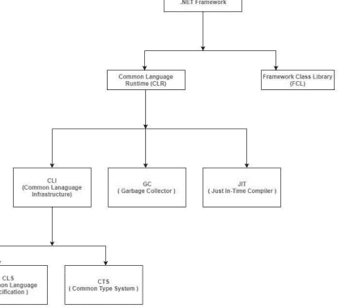
图 1.1 框架

操作系统架构和 CPU 架构的组合称为平台。平台相关意味着编程语言代码只能在特定的操作系统上运行。.NET 应用程序是平台相关的，因为 .NET Framework 只能在基于 Windows 的操作系统上运行。同时，.NET 应用程序也是平台无关的，因为 Mono 框架。

使用 Mono 框架，.NET 应用程序可以在包括 Windows 在内的任何操作系统上运行。Mono 框架是由 Novell 公司开发的第三方软件，现在已成为 Micro Focus 公司的一部分。它是一个付费框架。

事件驱动编程以事件为核心。最终，程序的流程取决于事件。到目前为止，我们处理的是顺序执行模型或并行执行模型，而具有事件驱动编程概念的模型称为异步模型。事件驱动编程依赖于一个始终监听新传入事件的事件循环。事件驱动编程的工作方式取决于事件。一旦事件循环运行，事件便会决定要执行的内容以及执行顺序。下面的流程图将帮助您理解其工作原理：

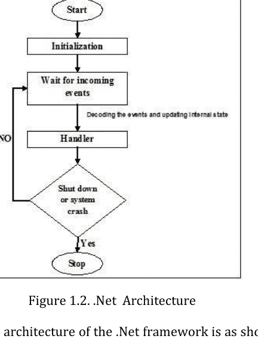
图 1.2 .NET 架构

.NET Framework 的基本架构如下所示：

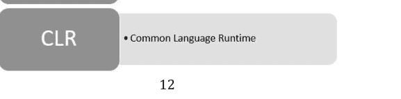

- 不再需要数据库连接。如果应用程序已完成对数据库的所有操作，则可能不再需要数据库连接。

#### 使用各种编程语言 –

如前文所述，开发人员可以使用各种 .NET 编程语言开发应用程序。

- **语言 –** 第一层是编程语言本身，最常见的是 VB.NET 和 C#。
- **编译器 –** 每种编程语言都有一个单独的编译器。因此，在 VB.NET 语言之下，会有一个单独的 VB.NET 编译器。同样，对于 C#，您会有另一个编译器。
- **公共语言解释器 –** 这是 .NET 中的最后一层，用于运行以任何编程语言开发的 .NET 程序。因此，随后的编译器会将程序发送到 CLI 层以运行 .NET 应用程序。

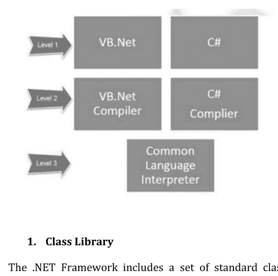

#### 1. 类库

.NET Framework 包含一组标准类库。类库是可用于核心目的的方法和函数的集合。例如，有一个类库包含处理所有文件级操作的方法。其中有一个方法可用于从文件读取文本。同样，也有一个方法用于向文件写入文本。

大多数方法都划分在 System.\* 或 Microsoft.\* 命名空间中。（星号 \* 仅表示引用 System 或 Microsoft 命名空间下的所有方法。）命名空间是方法的逻辑分隔。我们将在后续章节中更详细地学习这些命名空间。


### 2. 语言

可在 .Net 框架中构建的应用程序类型大致分为以下几类。

Winforms – 这用于开发基于窗体的应用程序，该应用程序将在终端用户机器上运行。记事本是客户端应用程序的一个示例。

ASP.Net – 这用于开发基于 Web 的应用程序，可在 Internet Explorer、Chrome 或 Firefox 等任何浏览器上运行。

Web 应用程序将在服务器上处理，该服务器已安装 Internet Information Services。

Internet Information Services 或 IIS 是 Microsoft 的一个组件，用于执行 Asp.Net 应用程序。执行结果随后发送到客户端机器，并在浏览器中显示输出。

ADO.Net – 该技术用于开发与 Oracle 或 Microsoft SQL Server 等数据库交互的应用程序。

Microsoft 始终确保 .Net 框架与所有受支持的 Windows 操作系统兼容。

随后会相应地释放这些资源。这是通过名为“Garbage Collector”的程序完成的，该程序作为 .Net 框架的一部分运行。

垃圾收集器会定期运行，并不断检查哪些系统资源未被使用，并相应地释放它们。

**简化部署** - .Net 框架还具有工具，可用于打包基于 .Net 框架构建的应用程序。这些包随后可以分发到客户端机器。包随后会自动安装应用程序。

在本章中，我们将了解 .NET Core 的执行过程并将其与 .NET Framework 进行比较。托管执行过程包括以下步骤。

- 选择编译器
- 将代码编译为 MSIL
- 将 MSIL 编译为本地代码
- 运行代码

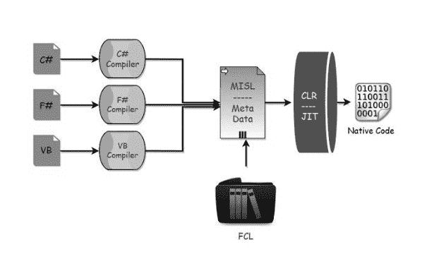

图 1.3 FCL

### 选择编译器

- 这是一个多语言执行环境，运行时支持各种数据类型和语言特性。
- 为了获得通用语言运行时提供的优势，您必须使用一个或多个针对该运行时的语言编译器。

### 将代码编译为 MSIL

- 编译会将源代码翻译成 Microsoft 中间语言（MSIL）并生成所需的元数据。
- 元数据描述了代码中的类型，包括每个类型的定义、每个类型成员的签名、您的

- 高性能
- 内存管理
- 安全
- IDE（集成开发环境）

它是一种软件应用程序，为计算机程序员提供全面的软件开发设施。一般来说，IDE 是一个基于图形用户界面的工作台，它通过提供源代码编辑器、构建自动化工具、调试器等工具帮助开发人员构建软件应用程序。在 .NET 基于应用程序的上下文中，Visual Studio 是最常用的 IDE。

VS.Net 只是 Microsoft 提供的一个编辑器，帮助开发人员轻松编写 .NET 程序。VS.Net 提供：

- 1. 编辑器，可自动生成大量代码。
- 2. 允许开发人员将控件拖放到窗体上。
- 3. 提供快捷方式来编译和构建应用程序等。

### 事件驱动编程

- 更改对象的状态称为事件。例如：单击按钮、拖动鼠标等。事件处理是控制事件并决定事件发生时应发生什么的机制。

- 事件驱动编程是一种范式，其中程序的流程由事件决定（鼠标单击、按键）、传感器输出或来自其他程序/线程的消息。

- 在图中，一个简单的事件驱动编程范式，其中每个事件都经过调度程序。调度程序将事件内部编写的代码传递给特定的事件处理程序。

VB.net 通过以下方式支持事件驱动编程：

- Visual Studio IDE 提供工具箱，这是一个窗口，可让我们访问所有控件、组件等。用户可以轻松地将控件或工具拖放到窗体上。

- Visual Studio IDE 还提供编辑器，可自动为不同事件生成代码，例如单击或按下事件。因此，程序员可以专注于诸如界面设计等问题，其中涉及向标准窗体添加控件，例如命令按钮、文本框和标签

- 一旦用户界面基本完成，程序员就可以根据需要为每个控件添加事件处理代码。

- 每个事件处理程序通常绑定到窗体上的特定对象或控件。任何其他所需的子例程、方法或函数过程通常放置在单独的代码模块中，可以在需要时从程序的其他部分调用。

程序集是一组类型和资源，它们被构建在一起并形成功能逻辑单元。

### 清单：

清单是程序集最重要的部分。清单包含有关程序集的有用信息，使程序集具有自描述性，

程序集中规范的集合统称为程序集的清单，清单包含：

- 1. 程序集的名称。
- 2. 程序集的版本信息。
- 3. 程序集的安全信息。
- 4. 程序集所有文件列表。
- 5. 程序集中指定类型的类型引用信息。
- 6. 程序集引用的其他程序集列表。

### 系统命名空间：

- 命名空间在 .Net 框架中发挥着基础作用。您无法在不使用 .net 系统命名空间中的类构建 vb.net 应用程序。

- .net 框架类库由数千个类和其他类型组成，（例如接口、结构和枚举），它们分为几个命名空间

最常用的命名空间如下：

#### System.Data：

- System.Data 及其嵌套命名空间，尤其是 system.Data.oledb 和 system.data.sqlclient 提供使用 ADO.NET 的数据访问
- oledb 和 sqlclient 命名空间负责定义数据提供程序，可连接到数据源、从数据源检索数据、将数据写回数据源并对数据源执行命令。
- ADO.net 是一种全新的数据访问模型，基于断开连接的数据集。

#### System.IO：

system.IO 命名空间包含提供各种输入/输出功能的类，例如

- 操作目录和文件
- 监视目录和文件中的更改
- 从流中读取和写入单个字节、多字节块或字符
- 从字符串中读取和写入字符

#### System.Text.RegularExpressions：

- system.Text.regularexpressions 命名空间包含提供对 .NET 框架正则表达式引擎访问的类。
- 最简单地说，正则表达式是一个文本字符串，表示其他字符串可能匹配也可能不匹配的模式。

#### System.windows.forms：

- 该命名空间是所有命名空间之母，用于创建 Windows 应用程序。
- system.Window.Forms 命名空间包含用于创建充分利用 Microsoft Windows 操作系统提供的丰富用户界面功能的基于 Windows 的应用程序的类。
- 在此命名空间中，您将找到 form 类以及许多其他控件，可将其添加到窗体以创建用户界面。
- 事实上，添加到 vb.net 项目的每个新窗体都包含以下行：Imports System.Window.Forms
- 幸运的是，Visual Studio 为我们 vb 程序员提供了 system.window.forms 命名空间的功能，因此我们无需直接针对该命名空间进行编程。

### 1.5 .NET Framework 架构


Microsoft .NET（发音为“dot net”）是一种运行在 Windows 操作系统上的软件组件...NET 应用程序。

#### .Net Framework

.NET 是一个用于开发软件应用程序的框架。它由 Microsoft 设计和开发，首个 beta 版本于 2000 年发布。

它用于开发 Web、Windows、手机应用程序。此外，它提供广泛的功能和支持。该框架包含大量类库，称为框架类库（FCL）。用 .NET 编写的软件程序在执行环境中执行，该执行环境在语言运行时（CLR）中执行。这些是 .NET 框架的核心和必不可少的部分。

该框架提供各种服务，如内存管理、网络、安全、内存管理和类型安全。.Net Framework 支持超过 60 种编程语言，如 C#、F#、VB.NET、J#、VC++、jscript.NET、APL、COBOL、Perl、Oberon、ML、Pascal、Eiffel、Smalltalk、Python、Cobra、ADA 等。

#### 以下是显示框架模块和组件的 .NET 框架堆栈。

.NET Framework 由四个主要组件组成：

通用语言运行时（CLR）框架类库（FCL）、核心语言（winforms、ASP.NET 和 ADO.NET）以及其他模块（WCF、WPF、WF、Card Space、LINQ、Entity Framework、Parallel LINQ、Task Parallel Library 等）

| .NET Framework 版本 | 组件 |
|------------------------|-----------|
| 2.0 | Common Language Runtime, Framework Class Library, WinForms, ASP.NET, ADO.NET |
| 3.0 | WPF, WCF, WF, Card Space |
| 3.5 | LINQ, Entity Framework |
| 4.0 | Task Parallel Library, Parallel LINQ |
| 4.5 | Task-Based Async Model, .NET APIs for Store/UWP apps |

图 1.3：.NET Framework 架构

#### CLR（通用语言运行时）

它是一个程序执行引擎，用于加载和执行程序。它将程序转换为本地代码。它充当框架和操作系统之间的接口。它进行异常处理、内存管理和垃圾回收。此外，它提供安全性、类型安全、互操作性和可移植性。CLR 组件列表如下：

#### 通用语言运行时

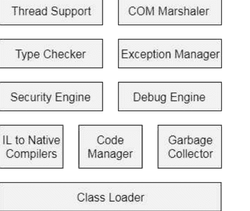

#### 图 1.4 FCL（框架类库）

它是一个标准库，是由数千个类组成的集合，用于构建应用程序。BCL（基本类库）是 FCL 的核心，并提供基本功能。

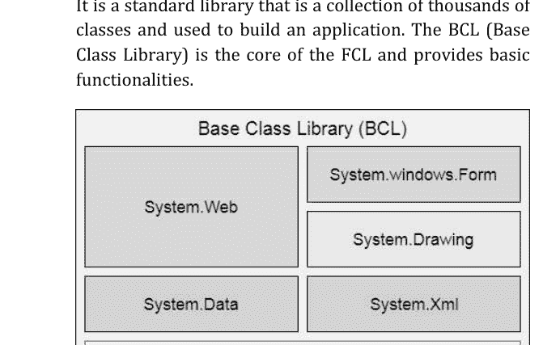

#### Winforms

Windows Forms 是 .NET Framework 的智能客户端技术，一组托管库，可简化

常见应用程序任务，例如读写文件系统。

#### ASP.NET

ASP.NET 是由 Microsoft 设计和开发的 Web 框架。它用于开发网站、Web 应用程序和 Web 服务。它提供 HTML、CSS 和 javascript 的出色集成。它于 2002 年 1 月首次发布。

#### ADO.NET

ADO.NET 是 .Net Framework 的一个模块，用于在应用程序和数据源之间建立连接。数据源可以是 SQL Server 和 XML 等。ADO .NET 由可用于连接、检索、插入和删除数据的类组成。

#### WPF（Windows Presentation Foundation）

Windows Presentation Foundation（WPF）是 Microsoft 用于在基于 Windows 的应用程序中渲染用户界面的图形子系统。WPF，之前称为“Avalon”，最初作为 .NET Framework 3.0 的一部分于 2006 年发布。WPF 使用 directx。

#### WCF（Windows Communication Foundation）

它是一个用于构建面向服务应用程序的框架。使用 WCF，您可以将数据作为异步消息从一个服务端点发送到另一个服务端点。

#### WF（Workflow Foundation）

Windows Workflow Foundation（WF）是 Microsoft 的一项技术，提供 API、进程内工作流引擎和可重新托管的设计器，以便在 .NET 应用程序中将长期运行的进程实现为工作流。

#### LINQ（语言集成查询）

它是一种查询语言，于 .NET 3.5 框架中引入。它用于使用 C# 或 Visual Basics 编程语言为数据源制作查询。

#### Entity Framework

它是一个基于 ORM 的开源框架，用于使用 .NET 对象与数据库进行工作。它消除了开发人员处理数据库的大量工作。它是 Microsoft 推荐的处理数据库的技术。

### 1.6 垃圾回收

- 垃圾收集器（GC）管理内存的分配和释放。垃圾收集器充当自动内存管理器。
- 您无需知道如何分配和释放内存或管理使用该内存的对象的生命周期。
- 每次使用“new”关键字声明对象或值类型被装箱时都会进行分配。分配通常非常快。
- 当没有足够的内存来分配对象时，GC 必须收集和处理垃圾内存以使内存可用于新分配。

此过程称为垃圾回收。

C# 中的垃圾回收具有以下优点：

- 在开发应用程序时，您无需手动释放内存。
- 它还有效地在托管堆上分配对象。
- 当对象不再使用时，它将通过清除其内存来收回这些对象，并使内存可用于将来分配。
- 托管对象会自动获得干净的内容来开始，因此它们的构造函数不必初始化每个数据字段。

## CHAPTER 2

## C# 基础

### 2.1 什么是 C#？

C# 发音为“C-Sharp”。

它是一种由 Microsoft 创建的面向对象编程语言，运行在 .NET Framework 上。C# 源自 C 家族，该语言接近其他流行语言，如 C++ 和 Java。

第一个版本于 2002 年发布。最新版本 C# 8 于 2019 年 9 月发布。

C# 用于：

- 移动应用程序
- 桌面应用程序
- Web 应用程序
- Web 服务
- 网站
- 游戏
- VR
- 数据库应用程序

#### 2.1.1 为什么使用 C#？

- 它是世界上最流行的编程语言之一
- 它易于学习且简单易用
- 它拥有庞大的社区支持
- C# 是一种面向对象的语言，为程序提供清晰的结构并允许代码重用，降低开发成本。
- 由于 C# 与 C、C++ 和 Java 接近，因此程序员在 C# 和其之间切换变得容易

#### 2.1.2 C# 安装

下载并安装 Visual Studio Installer 后，选择 .NET 工作负载并单击 Modify/Install 按钮：

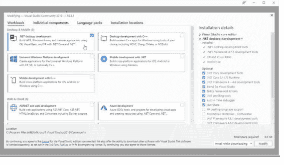

安装完成后，单击 Launch 按钮开始使用 Visual Studio。在开始窗口中，选择 Create a new project：

然后单击“Install more tools and features”按钮：

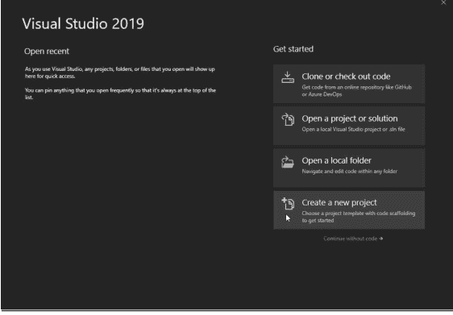

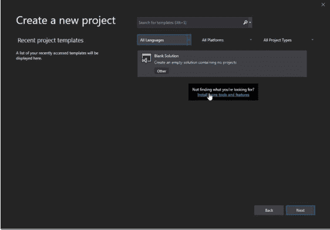

从列表中选择“Console App (.NET Core)”并单击 Next 按钮：

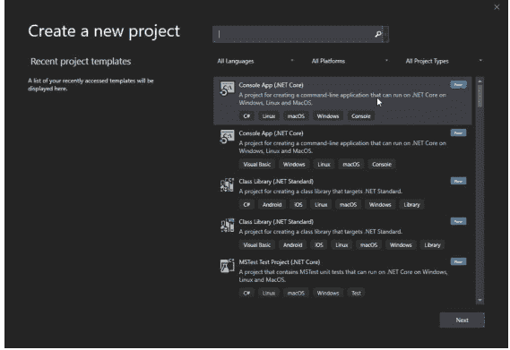

为您的项目输入名称，然后单击 Create 按钮：

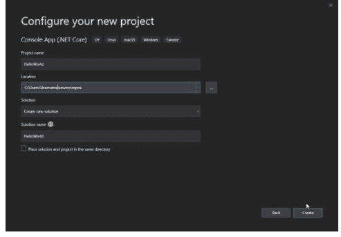

Visual Studio 将自动为您的项目生成一些代码：

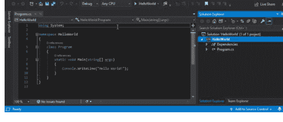

代码应如下所示：

```
Program.cs
Using System;
Namespace helloworld
{
Class Program
{
Static void Main(string[] args)
{
Console.writeline("Hello World!");
}
}
}
```

通过按键盘上的 F5 按钮运行程序（或单击“Debug”->“Start Debugging”）。这将编译并执行您的代码。结果应如下所示：


### 2.2 示例：解释

第 1 行：using System 表示我们可以从 System 命名空间使用类。

第 2 行：一个空行。C# 忽略空白。然而，多行使代码更具可读性。

第 3 行：namespace 用于组织您的代码，并且是类和其他命名空间的容器。

第 4 行：大括号 {} 标记代码块的开始和结束。

第 5 行：class 是数据和方法容器的容器，为您的程序带来功能。在 C# 中运行的每一行代码都必须在类内部。在我们的示例中，我们将类命名为 Program。


另一个在 C# 程序中总是出现的东西是 Main 方法。花括号 {} 内的任何代码都将被执行。你不必理解 Main 前后出现的关键字。在阅读本教程时，你会一点一点地了解它们。

Console 是 System 命名空间的一个类，它有一个 WriteLine() 方法用于输出/打印文本。在我们的示例中它将输出 "Hello World!"。

如果你省略 using System 行，你就必须写 System.Console.WriteLine() 来打印/输出文本。

注意：每个 C# 语句都以分号 ; 结尾

注意：C# 区分大小写："MyClass" 和 "myclass" 有不同的含义。

注意：与 Java 不同，C# 文件名不必与类名匹配，但它们通常是匹配的（为了更好的组织）。保存文件时，使用适当的名称保存，并在文件名末尾添加 ".cs"。要在你的电脑上运行上面的示例，请确保 C# 已正确安装。

### 2.3 WriteLine 或 Write

在 C# 中输出内容最常用的方法是 WriteLine()，但你也可以使用 Write()。

区别在于 WriteLine() 每次都在新行打印输出，而 Write() 在同一行打印（请注意，你应该在需要时记得添加空格，以提高可读性）：

**示例：**

```
Console.WriteLine("Hello World!");
Console.WriteLine("I will print on a new line.");
Console.Write("Hello World! ");
Console.Write("I will print on the same line.");
```

**结果：**

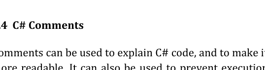

### 2.4 C# 注释

注释可用于解释 C# 代码，使其更易读。它也可以用于在测试替代代码时防止执行。

#### 2.4.1 单行注释

单行注释以两个正斜杠 (//) 开始。

// 与行尾之间的任何文本都将被 C# 忽略（不会被执行）。

此示例在代码行前使用单行注释：

**示例：**

```
// This is a comment
Console.WriteLine("Hello World!");
```

#### 2.4.2 C# 多行注释

多行注释以 /* 开始并以 */ 结束。

/* 与 */ 之间的任何文本都将被 C# 忽略。

此示例使用多行注释（注释块）来解释代码：

**示例：**

```
/* The code below will print the words Hello World
To the screen, and it is amazing */
Console.WriteLine("Hello World!");
```

### 2.5 C# 变量

变量是用于存储数据值的容器。

在 C# 中，有不同类型的变量（使用不同的关键字定义），例如：

- **int** - 存储整数（整数），无小数，如 123 或 -123
- **double** - 存储浮点数，带小数，如 19.99 或 -19.99
- **char** - 存储单个字符，如 'a' 或 'B'。Char 值用单引号包围
- **string** - 存储文本，如 "Hello World"。String 值用双引号包围
- **bool** - 存储两种状态的值：true 或 false

#### 声明（创建）变量

要创建变量，你必须指定类型并为其分配值：

#### 语法

```
Type variableName = value;
```

其中 type 是 C# 类型（如 int 或 string），variableName 是变量的名称（如 x 或 name）。等号用于为变量分配值。

要创建应存储文本的变量，请看以下示例：

**示例：**

创建一个名为 name 的 string 类型变量并为其分配值 "John"：

```
string name = "John";
Console.WriteLine(name);
```

要创建应存储数字的变量，请看以下示例：

**示例：**

创建一个名为 mynum 的 int 类型变量并为其分配值 15：

```
int mynum = 15;
Console.WriteLine(mynum);
```

### 2.6 常量

然而，如果你不想让其他人（或你自己）覆盖现有值，可以添加 const 关键字（这将声明变量为“常量”，意味着不可更改且只读）：

**示例：**

```
const int mynum = 15;
mynum = 20; // error
```

const 关键字在你希望变量始终存储相同的值时很有用，这样其他人（或你自己）就不会搞乱你的代码。常量的一个常见例子是 PI（3.14159...）。

注意：你不能在不分配值的情况下声明常量变量。如果这样做，会发生错误：A const field requires a value to be provided.

**示例：**

```
string firstname = "John ";
string lastname = "Doe";
string fullname = firstname + lastname;
Console.WriteLine(fullname);
```

对于数值，+ 字符作为数学运算符（请注意，我们在这里使用 int（整数）变量）：

**示例：**

```
int x = 5;
int y = 6;
Console.WriteLine(x + y); // Print the value of x + y
```

### 2.7 声明多个变量

要声明多个相同类型的变量，请使用逗号分隔的列表：

**示例：**

```
int x = 5, y = 6, z = 50;
Console.WriteLine(x + y + z);
```

**示例：**

```
int x, y, z;
x = y = z = 50;
Console.WriteLine(x + y + z);
```

### 2.8 C# 标识符

所有 C# 变量都必须用唯一名称标识。

这些唯一名称称为标识符。

标识符可以是简短的名称（如 x 和 y）或更具描述性的名称（age、sum、totalVolume）。

注意：建议使用描述性名称以创建可理解且可维护的代码：

**示例：**

```
// Good
int minutesPerHour = 60;

// OK, but not so easy to understand what m actually is
int m = 60;
```

### 2.9 C# 数据类型

如变量章节所述，C# 中的变量必须指定数据类型：

```
int mynum = 5; // Integer (whole number)
double myDoubleNum = 5.99D; // Floating point number
char myLetter = 'D'; // Character
bool myBool = true; // Boolean
string myText = "Hello"; // String
```

数据类型指定变量值的大小和类型。使用正确的数据类型对应变量非常重要；以避免错误，节省时间和内存，但它也会使你的代码更易于维护和阅读。最常见的数据类型是：

| Data Type | Size | Description |
|-----------|------|-------------|
| int | 4 bytes | Stores whole numbers from -2,147,483,648 to 2,147,483,647 |
| long | 8 bytes | Stores whole numbers from -9,223,372,036,854,775,808 to 9,223,372,036,854,775,807 |
| float | 4 bytes | Stores fractional numbers. Sufficient for storing 6 to 7 decimal digits |
| double | 8 bytes | Stores fractional numbers. Sufficient for storing 15 decimal digits |
| bool | 1 byte | Stores true or false values |
| char | 2 bytes | Stores a single character/letter, surrounded by single quotes |
| string | 2 bytes per character | Stores a sequence of characters, surrounded by double quotes |

#### 数字

数字类型分为两组：

整数类型存储没有小数的整数，正数或负数（如 123 或 -456）。有效类型为 int 和 long。你应该使用哪种类型取决于数值。

浮点类型表示带小数部分、包含一个或多个小数的数字。有效类型为 float 和 double。

#### 整数类型

##### Int

int 数据类型可以存储从 -2147483648 到 2147483647 的整数。一般来说，在本教程中，当我们创建具有数值的变量时，int 数据类型是首选数据类型。

**示例：**

```
int mynum = 100000;
Console.WriteLine(mynum);
```

##### Long

long 数据类型可以存储从 -9223372036854775808 到 9223372036854775807 的整数。这在 int 不足以存储值时使用。请注意，你应该在值后加上 "L"：

**示例：**

```
long mynum = 15000000000L;
Console.WriteLine(mynum);
```

#### 浮点类型

每当你需要带小数的数字，如 9.99 或 3.14515 时，你应该使用浮点类型。

##### Float

float 数据类型可以存储从 3.4e-038 到 3.4e+038 的分数数。请注意，你应该在值后加上 "F"：

**示例：**

```
float mynum = 5.75F;
Console.WriteLine(mynum);
```

##### Double

double 数据类型可以存储从 1.7e-308 到 1.7e+308 的分数数。请注意，你可以以 "D" 结尾值（尽管不是必需的）：

**示例：**

```
double mynum = 19.99D;
Console.WriteLine(mynum);
```


`char` 数据类型用于存储单个字符。字符必须用单引号括起来，例如 `'A'` 或 `'c'`：

**示例：**

```csharp
char mygrade = 'B';

Console.WriteLine(mygrade);
```

#### 字符串

`string` 数据类型用于存储字符序列（文本）。字符串值必须用双引号括起来：

**示例：**

```csharp
string greeting = "Hello World";

Console.WriteLine(greeting);
```

### 2.10 C# 类型转换

类型转换是指将一个数据类型的值赋给另一个类型。

在 C# 中，有两种转换类型：

#### 隐式转换（自动） - 将较小类型转换为较大类型大小

`char -> int -> long -> float -> double`

#### 显式转换（手动） - 将较大类型转换为较小类型大小

`double -> float -> long -> int -> char`

#### 隐式转换

当将较小类型传递给较大类型时，会自动进行隐式转换：

**示例：**

```csharp
int myint = 9;
double mydouble = myint;    // Automatic casting: int to double
Console.WriteLine(myint);    // Outputs 9
Console.WriteLine(mydouble); // Outputs 9
```

#### 显式转换

显式转换必须手动完成，方法是将类型放在值前面的括号中：

**示例：**

```csharp
double mydouble = 9.78;
int myint = (int) mydouble;    // Manual casting: double to int
Console.WriteLine(mydouble); // Outputs 9.78
Console.WriteLine(myint); // Outputs 9
```

### 2.11 类型转换方法

也可以使用内置方法显式转换数据类型，例如 `Convert.ToBoolean`、`Convert.ToDouble`、`Convert.ToString`、`Convert.ToInt32`（int）和 `Convert.ToInt64`（long）：

**示例：**

```csharp
int myint = 10;
double mydouble = 5.25;
bool mybool = true;

Console.WriteLine(Convert.ToString(myint)); // convert int to string
Console.WriteLine(Convert.ToDouble(myint)); // convert int to double
Console.WriteLine(Convert.ToInt32(mydouble)); // convert double to int
Console.WriteLine(Convert.ToString(mybool)); // convert bool to string
```

### 获取用户输入

你已经了解到 `Console.WriteLine()` 用于输出（打印）值。现在我们将使用 `Console.ReadLine()` 获取用户输入。

在下面的示例中，用户可以输入自己的用户名，该用户名存储在变量 `username` 中。然后我们打印 `username` 的值：

**示例：**

```csharp
// Type your username and press enter
Console.WriteLine("Enter username:");

// Create a string variable and get user input from the keyboard and store it in the variable
string username = Console.ReadLine();

// Print the value of the variable (username), which will display the input value
Console.WriteLine("Username is: " + username);
```

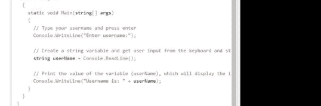

#### 用户输入和数字

`Console.ReadLine()` 方法返回一个字符串。因此，无法从其他数据类型（如 `int`）获取信息。以下程序将导致错误：

**示例：**

```csharp
Console.WriteLine("Enter your age:");
int age = Console.ReadLine();
Console.WriteLine("Your age is: " + age);
```

错误消息将类似于这样：

`Cannot implicitly convert type 'string' to 'int'`

正如错误消息所说，不能隐式地将 `'string'` 类型转换为 `'int'` 类型。

幸运的是，你刚刚在上一章（类型转换）中学习了可以使用 `Convert.To` 方法之一显式转换任何类型：


### 2.12 C# 运算符

运算符用于对变量和值执行操作。在下面的示例中，我们使用 `+` 运算符将两个值相加：

**示例：**

```csharp
int x = 100 + 50;
```

#### 算术运算符

算术运算符用于执行常见的数学运算：

| 运算符 | 名称 | 描述 | 示例 | 试试 |
| --- | --- | --- | --- | --- |
| `+` | 加法 | 将两个值相加 | `x + y` | 试试 * |
| `-` | 减法 | 从一个值中减去另一个值 | `x - y` | 试试 * |
| `*` | 乘法 | 将两个值相乘 | `x * y` | 试试 * |
| `/` | 除法 | 将一个值除以另一个值 | `x / y` | 试试 * |
| `%` | 取模 | 返回除法余数 | `x % y` | 试试 * |
| `++` | 自增 | 将变量的值增加 1 | `x++` | 试试 * |
| `--` | 自减 | 将变量的值减少 1 | `x--` | 试试 * |

#### C# 赋值运算符

赋值运算符用于为变量赋值。

在下面的示例中，我们使用赋值运算符（`=`）将值 10 赋给名为 x 的变量：

**示例：**

```csharp
int x = 10;
```

加法赋值运算符（`+=`）向变量添加一个值：

**示例：**

```csharp
int x = 10;
x += 5;
```

| 运算符 | 示例 | 等同于 |
| --- | --- | --- |
| `=` | `x = 5` | `x = 5` |
| `+=` | `x += 3` | `x = x + 3` |
| `-=` | `x -= 3` | `x = x - 3` |
| `*=` | `x *= 3` | `x = x * 3` |
| `/=` | `x /= 3` | `x = x / 3` |
| `%=` | `x %= 3` | `x = x % 3` |
| `&=` | `x &= 3` | `x = x & 3` |
| `\|=` | `x \|= 3` | `x = x \| 3` |
| `^=` | `x ^= 3` | `x = x ^ 3` |
| `>>=` | `x >>= 3` | `x = x >> 3` |
| `<<=` | `x <<= 3` | `x = x << 3` |

#### C# 比较运算符

比较运算符用于比较两个值：

| 运算符 | 名称 | 示例 |
| --- | --- | --- |
| `==` | 等于 | `x == y` |
| `!=` | 不等于 | `x != y` |
| `>` | 大于 | `x > y` |
| `<` | 小于 | `x < y` |
| `>=` | 大于或等于 | `x >= y` |
| `<=` | 小于或等于 | `x <= y` |

#### C# 逻辑运算符

逻辑运算符用于确定变量或值之间的逻辑关系：

| 运算符 | 名称 | 描述 | 示例 |
| --- | --- | --- | --- |
| `&&` | 逻辑与 | 如果两个语句都为 true，则返回 true | `x < 5 && x < 10` |
| `\|\|` | 逻辑或 | 如果其中一个语句为 true，则返回 true | `x < 5 \|\| x < 4` |
| `!` | 逻辑非 | 反转结果，如果结果为 true，则返回 false | `!(x < 5 && x < 10)` |

#### Math.Max(x,y)

`Math.Max(x,y)` 方法可用于查找 x 和 y 的最大值：

**示例：**

```csharp
Math.Max(5, 10);
```

#### Math.Min(x,y)

`Math.Min(x,y)` 方法可用于查找 x 和 y 的最小值：

**示例：**

```csharp
Math.Min(5, 10);
```

#### Math.Sqrt(x)

`Math.Sqrt(x)` 方法返回 x 的平方根：

**示例：**

```csharp
Math.Sqrt(64);
```

#### Math.Abs(x)

`Math.Abs(x)` 方法返回 x 的绝对值（正数）：

**示例：**

```csharp
Math.Abs(-4.7);
```

#### Math.Round()

`Math.Round()` 将数字四舍五入到最接近的整数：

**示例：**

```csharp
Math.Round(9.99);
```

### C# 字符串

字符串用于存储文本。

字符串变量包含一组用双引号括起来的字符：

**示例：**

创建一个 string 类型的变量并为其赋值：

```csharp
string greeting = "Hello";
```

#### 字符串长度

C# 中的字符串实际上是一个对象，它包含可以对字符串执行某些操作的属性和方法。例如，可以使用 `Length` 属性获取字符串的长度：

**示例：**

```csharp
string txt = "ABCDEFGHIJKLMNOPQRSTUVWXYZ";
Console.WriteLine("The length of the txt string is: " + txt.Length);
```

#### 其他方法

有许多可用的字符串方法，例如 `ToUpper()` 和 `ToLower()`，它们返回转换为大写或小写的字符串副本：

**示例：**

```csharp
string txt = "Hello World";
Console.WriteLine(txt.ToUpper());    // Outputs "HELLO WORLD"
Console.WriteLine(txt.ToLower());    // Outputs "hello world"
```

#### 字符串连接

`+` 运算符可用于字符串之间将它们组合起来。这称为连接：

**示例：**

```csharp
string firstname = "John ";
string lastname = "Doe";
string name = firstname + lastname;
Console.WriteLine(name);
```

#### 字符串内插

字符串连接的另一种选择是字符串内插，它将变量的值替换到字符串中的占位符中。请注意，您不必像使用连接时那样担心空格：

**示例：**

```csharp
string firstname = "John";
```


```csharp
String lastname = "Doe";
```

```csharp
String name = $"My full name is: {firstname} {lastname}";
```

```csharp
Console.WriteLine(name);
```

你可以通过引用其索引号来访问字符串中的字符 **Access Strings**

在方括号 [] 内。

此示例：打印 mystring 中的第一个字符：

#### Example:

```csharp
String mystring = "Hello";
```

```csharp
Console.WriteLine(mystring[0]); // Outputs "H"
```

#### Adding Numbers and Strings

WARNING!

C# 使用 + 运算符进行加法和连接。

记住：数字相加。字符串连接。

如果你添加两个数字，结果将是一个数字：

#### Example:

```csharp
int x = 10;
```

int y = 20;

int z = x + y; // z will be 30 (an integer/number)

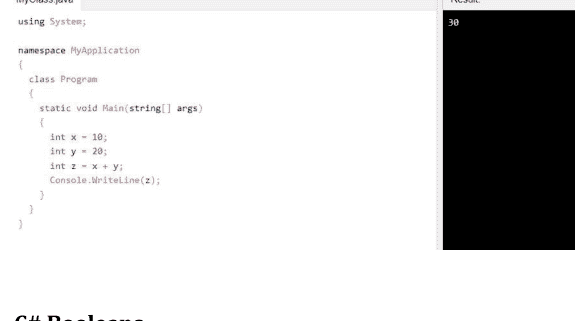

### C# Booleans

在编程中，你经常需要一种数据类型只能有两个值，例如：

- YES / NO
- ON / OFF
- TRUE / FALSE

对于此，C# 有一个 bool 数据类型，可以取 true 或 false 的值。

#### Boolean Values

布尔类型使用 bool 关键字声明，只能取 true 或 false 的值：

#### Example:

```
bool iscsharpfun = true;
```

```
bool isfishatasty = false;
```

```
Console.WriteLine(iscsharpfun); // Outputs True
```

```
Console.WriteLine(isfishatasty); // Outputs False
```

#### Boolean Expression

布尔表达式是返回布尔值：True 或 False 的 C# 表达式。

你可以使用比较运算符，例如大于（>）运算符来判断一个表达式（或变量）是否为真：

#### Example:

```
int x = 10;
```

```
int y = 9;
```

```
Console.WriteLine(x > y); // returns True, because 10 is higher than 9
```

```
using System;

namespace MyApplication
{
    class Program
    {
        static void Main(string[] args)
        {
            Console.WriteLine(10 != 15); // returns False, because 10 is not equal to
        }
    }
}
```


### 2.13 C# Conditions and If Statements

C# 支持数学中的常见逻辑条件：

- 小于：a < b
- 小于或等于：a <= b
- 大于：a > b
- 大于或等于：a >= b
- 等于 a == b
- 不等于：a != b

你可以使用这些条件为不同的决策执行不同的操作。

C# 有以下条件语句：

- 使用 if 指定在指定条件为真时执行的代码块
- 使用 else 指定在同一条件为假时执行的代码块

```csharp
using System;

namespace MyApplication
{
    class Program
    {
        static void Main(string[] args)
        {
            if (20 > 18)
            {
                Console.WriteLine("20 is greater than 18");
            }
        }
    }
}
```

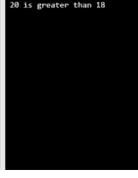

```csharp
using System;

namespace MyApplication
{
    class Program
    {
        static void Main(string[] args)
        {
            int x = 20;
            int y = 18;
            if (x > y)
            {
                Console.WriteLine("x is greater than y");
            }
        }
    }
}
```


#### 2.13.2 The else Statement

使用 else 语句指定在条件为 False 时执行的代码块。

Syntax

```text
if (condition)
{
    // block of code to be executed if the condition is True
}
```

Else

{

// block of code to be executed if the condition is False }

```
using System;
namespace MyApplication
{
    class Program
    {
        static void Main(string[] args)
        {
            int time = 20;
            if (time < 18)
            {
                Console.WriteLine("Good day.");
            }
            else
            {
                Console.WriteLine("Good evening.");
            }
        }
    }
}
```

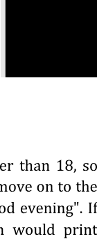

#### Example: explained

在上面的 Example: 中，time（20）大于 18，因此条件为 False。因为这样，我们进入 else 条件并打印到屏幕上 "Good evening"。如果时间小于 18，程序将打印 "Good day"。

#### 2.13.3 The else if Statement

使用 else if 语句在第一个条件为 False 时指定新的条件。

Syntax

If (condition1)

```
{
    // block of code to be executed if condition1 is True
}
Else if (condition2)
{
    // block of code to be executed if the condition1 is false and condition2 is True
}
Else
{
    // block of code to be executed if the condition1 is false and condition2 is False
}
```

```
using System;
namespace MyApplication
{
    class Program
    {
        static void Main(string[] args)
        {
            int time = 22;
            if (time < 10)
            {
                Console.WriteLine("Good morning.");
            }
            else if (time < 20)
            {
                Console.WriteLine("Good day.");
            }
            else
            {
                Console.WriteLine("Good evening.");
            }
        }
    }
}
```


#### Example: explained

在上面的 Example: 中，time（22）大于 10，因此第一个条件为 False。else if 语句中的下一个条件也为 False，因此我们进入 else 条件，因为 condition1 和 condition2 均为 False - 并打印到屏幕上 "Good evening"。

然而，如果时间是 14，我们的程序将打印 "Good day。"

#### C# Switch Statements

使用 switch 语句选择要执行的多个代码块之一。

##### Syntax

```
switch(expression)
{
    case x:
        // code block
        break;
    case y:
        // code block
        break;
```

Default:

```
// code block

break;
}
```

下面的 Example: 使用星期几数字计算星期几名称：

```
using System;

namespace MyApplication
{

class Program
{

static void Main(string[] args)
{

int day = 4;

switch (day)
{

case 1:

Console.WriteLine("Monday");

break;
```

```
case 2:
    Console.WriteLine("Tuesday");
    break;
case 3:
    Console.WriteLine("Wednesday");
    break;
case 4:
    Console.WriteLine("Thursday");
    break;
case 5:
    Console.WriteLine("Friday");
    break;
case 6:
    Console.WriteLine("Saturday");
    break;
case 7:
    Console.WriteLine("Sunday");
    break;
```

```
}
}
}
}
```

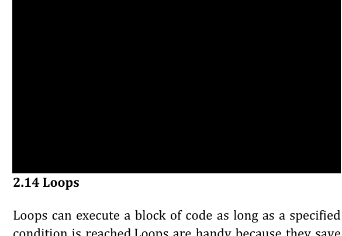

### 2.14 Loops

循环可以在指定条件达到时执行代码块。循环很有用，因为它们节省时间，减少错误，并使代码更具可读性。

#### 2.14.1 C# While Loop

while 循环只要指定条件为 True 就会循环执行代码块：

Syntax

```text
while (condition)
{
    // code block to be executed
}
```

在下面的 Example: 中，只要变量（i）小于 5，循环中的代码就会一遍又一遍地运行：

```csharp
using System;
namespace MyApplication
{
    class Program
    {
        static void Main(string[] args)
        {
            int i = 0;
            while (i < 5)
            {
                Console.WriteLine(i);
                i++;
            }
        }
    }
}
```


#### 2.14.2 The Do/While Loop

do/while 循环是 while 循环的一个变体。此循环将在检查条件是否为真之前执行一次代码块，然后只要条件为真就重复循环。

Syntax

Do

```text
{
```

语句 1 在执行代码块之前执行一次。

语句 2 定义执行代码块的条件。

语句 3 在执行代码块之后每次执行。

下面的 Example: 将打印数字 0 到 4：

```
using System;
namespace MyApplication
{
class Program
{
static void Main(string[] args)
{
for (int i = 0; i < 5; i++)
{
Console.WriteLine(i);
}
}
}
}
```


#### 2.14.4 The foreach Loop

还有一个 foreach 循环，专门用于遍历数组中的元素：

Syntax

```
foreach (type variablename in arrayname) {

// code block to be executed}
```


以下示例使用 foreach 循环输出 cars 数组中的所有元素：

```
using System;
namespace MyApplication
{
    class Program
    {
        static void Main(string[] args)
        {
            string[] cars = {"Volvo", "BMW", "Ford", "Mazda"};
            foreach (string i in cars)
            {
                Console.WriteLine(i);
            }
        }
    }
}
```


### 2.15 C# 中断

您已经在本教程前面的章节中见过 break 语句的使用。它用于“跳出”switch 语句。

break 语句也可以用于跳出循环。

此示例在 i 等于 4 时跳出循环：

```
using System;
namespace MyApplication
{
    class Program
    {
        static void Main(string[] args)
        {
            for (int i = 0; i < 10; i++)
            {
                if (i == 4)
                {
                    break;
                }
                Console.WriteLine(i);
            }
        }
    }
}
```


```
using System;
namespace MyApplication
{
    class Program
    {
        static void Main(string[] args)
        {
            int i = 0;
            while (i < 10)
            {
                if (i == 4)
                {
                    i++;
                    continue;
                }
                Console.WriteLine(i);
                i++;
            }
        }
    }
}
```


### 2.18 C# 数组

创建数组

数组用于在单个变量中存储多个值，而不是为每个值声明单独的变量。

要声明数组，请使用方括号定义变量类型：

```
string[] cars;
```

我们现在已经声明了一个保存字符串数组的变量。

要向其中插入值，可以使用数组字面量——将值以逗号分隔的列表形式放在花括号内：

```
string[] cars = {"Volvo", "BMW", "Ford", "Mazda"};
```

要创建整数数组，您可以编写：

```
int[] mynum = {10, 20, 30, 40};
```

#### 访问数组的元素

您可以通过引用索引号来访问数组元素。

以下语句访问 cars 中第一个元素的值：

##### 示例：

```
string[] cars = {"Volvo", "BMW", "Ford", "Mazda"};
```

```
Console.WriteLine(cars[0]); // Outputs Volvo
```

#### 更改数组元素

要更改特定元素的值，请引用索引号：

##### 示例：

```
cars[0] = "Opel";
```

##### 示例：

```
string[] cars = {"Volvo", "BMW", "Ford", "Mazda"};
```

```
cars[0] = "Opel";
```

```
Console.WriteLine(cars[0]);
```

```
// Now outputs Opel instead of Volvo
```

#### 数组长度

要查明数组有多少个元素，请使用 Length 属性：

##### 示例：

```
string[] cars = {"Volvo", "BMW", "Ford", "Mazda"};
```

```
Console.WriteLine(cars.Length);
```

```
// Outputs 4
```

#### 2.18.1 循环遍历数组

您可以使用 for 循环遍历数组元素，并使用 Length 属性指定循环应运行的次数。

以下示例输出 cars 数组中的所有元素：

##### 示例：

```
string[] cars = {"Volvo", "BMW", "Ford", "Mazda"};
```

```
for (int i = 0; i < cars.Length; i++)
```

```
{
```

```
Console.WriteLine(cars[i]);
```

```
}
```

#### 对数组排序

有许多可用的数组方法，例如 Sort()，它按字母顺序或升序对数组进行排序：

##### 示例：

```
// Sort a string
string[] cars = {"Volvo","BMW","Ford","Mazda"};
Array.Sort(cars);
foreach (string i in cars)
{
Console.WriteLine(i);
}
```

```
// Sort an int
int[] mynumbers = {5, 1, 8, 9};
Array.Sort(mynumbers);
foreach (int i in mynumbers)
{
Console.WriteLine(i);
}
```

System.Linq 命名空间

其他有用的数组方法（如 Min、Max 和 Sum）可以在 System.Linq 命名空间中找到：

##### 示例：

```
using System;

using System.Linq;

namespace MyApplication
{

class Program
{

static void Main(string[] args)
{

int[] mynumbers = {5, 1, 8, 9};

Console.WriteLine(mynumbers.Max()); // returns the largest value

Console.WriteLine(mynumbers.Min()); // returns the smallest value

Console.WriteLine(mynumbers.Sum()); // returns the sum of elements

}
}
}
```

### 2.19 C# 方法

方法是一段仅在被调用时才会运行的代码块。您可以将数据（称为参数）传递给方法。方法用于执行某些操作，它们也被称为函数。为什么要使用方法？为了重用代码：只需定义一次代码，然后多次使用。

#### 创建方法

方法通过方法名后跟括号 () 来定义。C# 提供了一些您已经很熟悉的预定义方法，例如 Main()，但您也可以创建自己的方法来执行某些操作：

##### 示例：

在 Program 类内部创建一个方法：

```
class Program
{
    static void mymethod()
    {
        // code to be executed
    }
```

#### 调用方法

要调用（执行）方法，请写入方法名、一对括号 () 和分号；

在以下示例中，当调用 mymethod() 时，它会打印一段文本（该操作）：

##### 示例：

在 Main() 内部，调用 mymethod() 方法：

```
static void mymethod()
{
    Console.WriteLine("I just got executed!");
}

static void Main(string[] args)
{
    mymethod();
}

// Outputs "I just got executed!"
```

### 2.20 参数和实参

信息可以作为参数传递给方法。参数在方法内部充当变量。它们位于方法名后面的括号内。您可以添加任意数量的参数，只需用逗号分隔即可。

以下示例有一个以字符串 fname 作为参数的方法。当调用该方法时，我们会传递一个名字，方法内部使用它来打印完整姓名：

##### 示例：

```
static void mymethod(string fname)
{
    Console.WriteLine(fname + " Refsnes");
}
```

```
static void Main(string[] args)
{
    mymethod("Liam");
    mymethod("Jenny");
    mymethod("Anja");
}
```

// Liam Refsnes

// Jenny Refsnes

// Anja Refsnes

当参数被传递给方法时，它被称为实参。因此，从上面的示例来看：fname 是参数，而 Liam、Jenny 和 Anja 是实参。

#### 默认参数值

您还可以使用等号 (=) 设置默认参数值。如果我们调用方法时不带实参，它将使用默认值（“Norway”）：

##### 示例：

```
static void mymethod(string country = "Norway")
{
    Console.WriteLine(country);
}
```

```
static void Main(string[] args)
{
    mymethod("Sweden");
    mymethod("India");
    mymethod();
```

```
mymethod("USA");
```

```
}
```

```
// Sweden
```

```
// India
```

```
// Norway
```

```
// USA
```

#### 多个参数

您可以拥有任意数量的参数：

##### 示例：

```
static void mymethod(string fname, int age)
```

```
{
```

```
Console.WriteLine(fname + " is " + age);
```

```
}
```

```
static void Main(string[] args)
```

```
{
```

```
mymethod("Liam", 5);
```

```
mymethod("Jenny", 8);
```

```
mymethod("Anja", 31);
```

```
}
```

// Liam 是 5

// Jenny 是 8

// Anja 是 31

#### 返回值

上面示例中使用的 void 关键字表示方法不应返回值。如果希望方法返回值，可以使用原始数据类型（如 int 或 double）代替 void，并在方法内部使用 return 关键字：

##### 示例：

```
static int mymethod(int x)
{
    return 5 + x;
}
```

```
static void Main(string[] args)
{
    Console.WriteLine(mymethod(3));
}
```

```
// Outputs 8 (5 + 3)
```

#### 命名实参

还可以使用键：值语法发送实参。这样，实参的顺序就不重要了：

##### 示例：

```
static void mymethod(string child1, string child2, string child3)
{
    Console.WriteLine("The youngest child is: " + child3);
}

static void Main(string[] args)
{
    mymethod(child3: "John", child1: "Liam", child2: "Liam");
}

// The youngest child is: John
```

### 2.21 方法重载

通过方法重载，多个方法可以具有相同的名称但不同的参数：

##### 示例：


```csharp
int MyMethod(int x)
float MyMethod(float x)
double MyMethod(double x, double y)
```

考虑下面的示例，其中有两个方法用于添加不同类型的数字：

##### 示例

```csharp
static int PlusMethodInt(int x, int y)
{
    return x + y;
}
```

```csharp
static double PlusMethodDouble(double x, double y)
{
    return x + y;
}
```

```csharp
static void Main(string[] args)
{
    int myNum1 = PlusMethodInt(8, 5);
    double myNum2 = PlusMethodDouble(4.3, 6.26);
    Console.WriteLine("Int: " + myNum1);
    Console.WriteLine("Double: " + myNum2);
}
```

### 2.22 C# - 什么是 OOP？

OOP 代表面向对象编程。过程式编程是编写对数据执行操作的过程或方法，而面向对象编程则是创建包含数据和方法的对象。

- OOP 执行更快且更容易。
- OOP 为程序提供了清晰的结构。
- OOP 有助于保持 C# 代码 DRY（“不要重复自己”），并使代码更易于维护、修改和调试。
- OOP 使得用更少的代码和更短的开发时间创建可复用的完整应用程序成为可能。

### C# - 什么是类与对象？

类与对象是面向对象编程的两个主要方面。

查看下图以了解类与对象的区别：

#### 类与对象

你在上一章中了解到，C# 是一种面向对象的编程语言。C# 中的一切都与类、对象及其属性和方法相关联。例如：在现实生活中，汽车是一个对象。汽车具有重量和颜色等属性，以及驾驶和刹车等方法。

类就像对象构造函数，或创建对象的“蓝图”。

#### 创建类

要创建类，请使用 class 关键字：

创建一个名为“Car”的类，其中包含一个变量 color：

```csharp
class Car
{
    string color = "red";
}
```

#### 创建对象

对象由类创建。我们已经创建了名为 Car 的类，现在可以用它来创建对象。要创建 Car 的对象，请指定类名，后跟对象名，并使用 new 关键字：

##### 示例

创建一个名为“myObj”的对象，并使用它打印 color 的值：

```csharp
class Car
{
    string color = "red";

    static void Main(string[] args)
    {
        Car myObj = new Car();
        Console.WriteLine(myObj.color);
    }
}
```

#### 多个对象

你可以创建同一个类的多个对象：

##### 示例

创建两个 Car 对象：

```csharp
class Car
{
    public string color = "red";
}
```

#### 类成员

类中的字段和方法通常被称为“类成员”：

##### 示例

创建一个包含三个类成员的 Car 类：两个字段和一个方法。

```csharp
// The class

class Car
{
    // Class members
    string color = "red";    // field
    int maxSpeed = 200;      // field
    public void fullThrottle() // method
    {
        Console.WriteLine("The car is going as fast as it can!");
    }
}
```

```csharp
class Car
{
    string color;
    int maxSpeed;

    static void Main(string[] args)
    {
        Car myObj = new Car();
        myObj.color = "red";
        myObj.maxSpeed = 200;
        Console.WriteLine(myObj.color);
        Console.WriteLine(myObj.maxSpeed);
    }
}
```

#### 对象方法

你在 C# 方法章节中了解到，方法用于执行某些操作。方法通常属于类，并定义类的对象如何表现。就像字段一样，你可以使用点语法访问方法。但是请注意，方法必须是 public。请记住，我们使用方法名称，后跟两个括号 `()` 和一个分号 `;` 来调用（执行）方法：

##### 示例

```csharp
class Car
{
    string color;      // field
    int maxSpeed;      // field
    public void fullThrottle()  // method
    {
        Console.WriteLine("The car is going as fast as it can!");
    }

    static void Main(string[] args)
    {
        Car myObj = new Car();
        myObj.fullThrottle(); // Call the method
    }
}
```

#### 构造函数

构造函数是一种用于初始化对象的特殊方法。构造函数的优点是，在创建类的对象时自动调用。它可以用于为字段设置初始值：

##### 示例

创建一个构造函数：

```csharp
// Create a Car class
class Car
{
    public string model; // Create a field

    // Create a class constructor for the Car class
    public Car()
    {
        model = "Mustang"; // Set the initial value for model
    }

    static void Main(string[] args)
    {
        Car Ford = new Car(); // Create an object of the Car Class (this will call the constructor)
        Console.WriteLine(Ford.model);  // Print the value of model
    }
}
```

// 输出 "Mustang"

#### 构造函数参数

构造函数也可以接受参数，用于初始化字段。

下面的示例向构造函数添加了一个 `string modelName` 参数。在构造函数中，我们将 `model` 设置为 `modelName`（`model = modelName`）。当我们调用构造函数时，我们会向构造函数传递一个参数（`"Mustang"`），这将把 `model` 的值设置为 `"Mustang"`：

##### 示例

```csharp
class Car
{
    public string model;

    // Create a class constructor with a parameter
    public Car(string modelName)
    {
        model = modelName;
    }

    static void Main(string[] args)
    {
        Car Ford = new Car("Mustang");
        Console.WriteLine(Ford.model);
    }
}
```

// 输出 "Mustang"

### 2.22 访问修饰符

到目前为止，你已经非常熟悉我们许多示例中出现的 `public` 关键字：

#### `public string color`

`public` 关键字是一种访问修饰符，用于设置类、字段、方法和属性的访问级别/可见性。

#### 私有修饰符

如果你使用私有访问修饰符声明字段，则该字段只能在同一个类内访问：

示例：

```csharp
class Car
{
    private string model = "Mustang";

    static void Main(string[] args)
    {
        Car myObj = new Car();
        Console.WriteLine(myObj.model);
    }
}
```

输出将是：

Mustang

#### 公共修饰符

如果你使用公共访问修饰符声明字段，则所有类都可以访问它：

示例：

```csharp
class Car
{
    public string model = "Mustang";
}

class Program
{
    static void Main(string[] args)
    {
        Car myObj = new Car();
        Console.WriteLine(myObj.model);
    }
}
```

输出将是：

Mustang

### 2.23 属性和封装

在我们开始解释属性之前，你应该对“封装”有一个基本的了解。

封装的含义是确保“敏感”数据对用户隐藏。要实现这一点，你必须：

- 将字段/变量声明为 `private`
- 通过属性提供公共的 `get` 和 `set` 方法，以访问和更新私有字段的值

#### 属性

你在上一章中了解到，私有变量只能在同一个类内访问（外部类无法访问）。然而，有时我们需要访问它们——这可以通过属性来实现。

属性类似于变量和方法的组合，它有两个方法：`get` 和 `set` 方法：

示例：

```csharp
class Person
{
    private string name; // field

    public string Name // property
    {
        get { return name; } // get method
        set { name = value; } // set method
    }
}
```

### 2.24 继承（派生类和基类）

在 C# 中，可以将一个类的字段和方法继承到另一个类。我们将“继承概念”分为两类：

- **派生类（子类）** - 继承另一个类的类
- **基类（父类）** - 被继承的类

要继承一个类，请使用 `:` 符号。

在下面的示例中，Car 类（子类）继承 Vehicle 类（父类）的字段和方法：

#### 多态和方法重写

多态意味着“多种形式”，当我们有许多通过继承相互关联的类时，就会出现多态。

正如我们在上一章中指定的，继承让我们从另一个类继承字段和方法。多态使用这些方法来执行不同的任务。这允许我们以不同的方式执行同一个操作。

例如，考虑一个名为 Animal 的基类，它有一个名为 `animalSound()` 的方法。Animal 的派生类可能是猪、猫、狗、鸟——而且它们还


都有自己对动物声音的实现（猪哼哼，猫喵喵等）：

##### 示例：

```
Class Animal // Base class (parent)
{
	Public void animalsound()
	{
		Console.writeline("The animal makes a sound");
	}
}

Class Pig : Animal // Derived class (child)
{
	Public void animalsound()
	{
		Console.writeline("The pig says: wee wee");
	}
}

Class Dog : Animal // Derived class (child)
```

```
Public void animalsound()
{
    Console.writeline("The dog says: bow wow");
}
}
```

### 2.25 抽象类和抽象方法

数据抽象是隐藏某些细节并仅向用户显示必要信息的过程。

抽象可以通过抽象类或接口来实现（您将在下一章中了解更多关于接口的内容）。

abstract 关键字用于类和方法：

- 抽象类：是受限制的类，不能用于创建对象（要访问它，必须从另一个类继承）。
- 抽象方法：只能在抽象类中使用，并且没有主体。主体由派生类提供（继承自）。

抽象类可以同时具有抽象方法和普通方法：

```
// Abstract class
```

```
Abstract class Animal
```

```
{
// Abstract method (does not have a body)
Public abstract void animal Sound();
 // Regular method
Public void sleep()
{
	Console.writeline("Zzz");
}
}
// Derived class (inherit from Animal)
Class Pig : Animal
{
	Public override void animalSound()
	{
		// The body of animalSound() is provided here
		Console.writeline("The pig says: wee wee");
	}
}
}
```

```
```csharp
Class Program
{
	Static void Main(string[] args)
	{
		Pig mypig = new Pig(); // Create a Pig object
		MyPig.animalsound(); // Call the abstract method
		MyPig.sleep(); // Call the regular method
	}
}
```
```

### 2.26 接口

在 C# 中实现抽象的另一种方式是使用接口。接口是一个完全“抽象类”，只能包含抽象方法和属性（主体为空）：

示例：

```
```csharp
// interface
Interface Animal
{
	Void animalsound(); // interface method (does not have a body)
}
```
```

```
Void run(); // interface method (does not have a body)
}
```

#### 多个接口

要实现多个接口，请用逗号分隔它们：

示例：

```
Interface ifirstinterface
{
Void mymethod(); // interface method
}
```

```
Interface isecondinterface
{
Void myotherm method(); // interface method
}
```

```
// Implement multiple interfaces
Class democlass : ifirstinterface, isecondinterface
{
Public void mymethod()
{
```

```
Console.writeline("Some text..");
}
Public void myothermethod()
{
    Console.writeline("Some other text...");
}
}
Class Program
{
    Static void Main(string[] args)
    {
        Democlass myobj = new democlass();
        Myobj.mymethod();
        Myobj.myothermethod();
    }
}
```

### C# 枚举

枚举是一种特殊的“类”，表示一组常量（不可更改/只读变量）。要创建

枚举，使用 enum 关键字（而不是 class 或 interface），并用逗号分隔枚举项：

示例：

```
Enum Level
{
  Low,
  Medium,
  High
}
```

类中的枚举

你也可以在类中拥有枚举：

示例：

```
Class Program
{
  Enum Level
  {
    Low,
    Medium,
    High
```

```
}
Static void Main(string[] args)
{
    Level myvar = Level.Medium;
    Console.writeline(myvar);
}
}
```

输出结果为：

Medium

## 第 3 章

## C# 库和 .NET 高级特性

### 3.1 输入输出（流类）

#### C# - 流

C# 包含以下标准 IO（输入/输出）类，用于从文件、内存、网络、隔离存储等不同来源读取/写入。

**Stream：** System.IO.Stream 是一个抽象类，提供标准方法将字节（读取、写入等）传输到源。它就像一个用于传输字节的包装类。需要从特定源读取/写入字节的类必须实现 Stream 类。以下类继承 Stream 类以提供从特定源读取/写入字节的功能：

**Filestream：** 从/向物理文件读取或写入字节，无论是 .txt、.exe、.jpg 还是其他文件。Filestream 派生自 Stream 类。

**Memorystream：** memorystream 读取或写入存储在内存中的字节。

**Bufferedstream：** bufferedstream 从其他流读取或写入字节以提高某些 I/O 操作的性能。

**Networkstream：** networkstream 从网络套接字读取或写入字节。

**Pipestream：** pipestream 从不同进程读取或写入字节。

**Cryptostream：** cryptostream 用于将数据流链接到加密转换。以下图表显示了流类的层次结构：

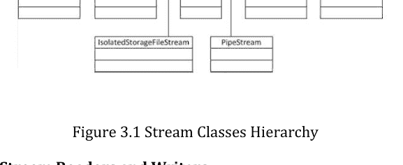

图 3.1 流类层次结构

#### 流读取器和写入器

**Streamreader：** streamreader 是用于通过使用编码值将字节转换为字符从流读取字符的辅助类。它可用于

从不同流如 filestream、memorystream 等读取字符串（字符）。

**Streamwriter：** streamwriter 是用于通过将字符转换为字节向流写入字符串的辅助类。它可用于向不同流写入字符串，例如 filestream、memorystream 等。

**Binaryreader：** binaryreader 是用于从字节读取原始数据类型 的辅助类。

**Binarywriter：** binarywriter 以二进制形式写入原始类型。

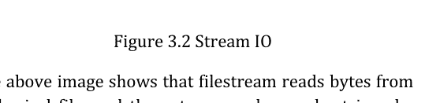

图 3.2 流 IO

上图显示 filestream 从物理文件读取字节，然后 streamreader 通过将这些字节转换为字符串来读取字符串。以同样的方式，streamwriter 接收一个字符串并将其转换为字节并写入 filestream，然后 filestream 将字节写入物理文件。因此，filestream 处理字节，而 streamreader 和 streamwriter 处理字符串。

### 3.2 C# - 多线程

线程被定义为程序的执行路径。每个线程定义唯一的控制流。如果你的应用程序涉及复杂且耗时的操作，那么通常有助于设置不同的执行路径或线程，每个线程执行特定任务。

线程是轻量级进程。一个常见的示例：现代操作系统通过使用线程实现并发编程。使用线程可以节省 CPU 周期浪费并提高应用程序效率。

到目前为止，我们编写的程序中只有一个线程作为单个进程运行，这是应用程序的运行实例。然而，这种方式应用程序一次只能执行一项工作。为了使其同时执行多个任务，可以将其划分为更小的线程。

### 3.3 线程生命周期

线程的生命周期从创建 System.Threading.Thread 类的对象开始，到线程终止或完成执行结束。

线程生命周期的各个状态如下：

**未启动状态** – 线程实例已创建但未调用 Start 方法的情况。

**就绪状态** – 线程已准备好运行并等待 CPU 周期。

**不可运行状态** – 线程不可执行的情况，当：

- 已调用 Sleep 方法
- 已调用 Wait 方法
- 被 I/O 操作阻塞

**死亡状态** – 线程完成执行或被中止的情况。

#### **主线程**

在 C# 中，System.Threading.Thread 类用于处理线程。它允许在多线程应用程序中创建和访问单个线程。进程中首先执行的线程称为主线程。

当 C# 程序开始执行时，主线程会自动创建。使用 Thread 类创建的线程称为主线程的子线程。你可以使用 Thread 类的 currentThread 属性访问线程。

以下程序演示主线程执行 –


##### 示例：

```
using System;
using System.Threading;

namespace multithreadingapplication {

class mainthreadprogram {

static void Main(string[] args) {

Thread th = Thread.currentthread;

th.Name = "mainthread";

Console.writeline("This is {0}", th.Name);

Console.readkey();

}

}

}
```

当上面的代码被编译并执行时，会产生以下结果 –

This is mainthread

```
}
}
}
```

当上面的代码被编译并执行时，会产生以下结果 –

In Main: Creating the Child thread

##### Child thread starts

控制台是通过用户使用交互式命令集与系统进行通信的一组设备。在这方面，GUI 不被视为控制台。大多数计算机系统中的主要输入设备是键盘，主要输出是显示器。这对在大多数情况下构成了用户的控制台

内容

The Console Class

Managing Console I/O Operations

Console.openstandardinput Method()

Console.openstandardoutput Method()

Console.Read Method()

Console.readline Method()

Console.Write Method(Boolean)

Console.Write Method(String)

### The Console Class

为了允许控制台输入/输出操作，C# 提供了，C# 提供了一个控制台类。Console 类为从控制台读取和写入字符的应用程序提供基本的输入和输出支持。标准输入、输出和错误流由属性表示，并在应用程序启动时自动与控制台关联。应用程序可以将这些属性重定向到其他流；例如，与文件而不是控制台关联的流。默认情况下，控制台类中的读取方法使用标准输入流（键盘），而写入方法使用标准输出（显示器）流。

写入方法支持在不自动附加回车和换行字符的情况下写入数据。这使得无需先将它们转换为字符串即可写入字符串、格式化字符串、字符数组、原始类型实例和任意对象。

以下示例：演示了基本 Console 输入和输出函数的使用。

```
/* Console Input/Ouput */
```

Using System;

```
Class consoletest
{
    Public static void Main()
    {
        Console.Write("Hello");
        Console.writeline("World");
        Console.Write("What is Your Name");
        String name = Console.readline();
        Console.Write("Hello, ");
        Console.Write(name);
        Console.writeline(" !");
    }
}
```

### 3.5 Managing Console I/O Operations

控制台输入/输出操作由 Console 类执行，该类位于 system 命名空间内并存储在 Mscorlib（在 Mscorlib.dll）程序集中。

数据从控制台读取自标准输入流；正常数据写入控制台写入标准输出流；错误数据写入控制台写入标准错误输出流。这些流在应用程序启动时自动与控制台关联，并以 In、Out 和 Error 属性的形式呈现给您。

默认情况下，In 属性的值为 System.IO.textreader，而 Out 和 Error 属性的值为 System.IO.textwriter 对象。但是，您可以将这些属性与不代表控制台的流关联。此类同步 textreader 和 textwriter 实例。多个线程可以并发地从此类型的实例读取或写入。

#### Console.openstandardinput Method()

此方法获取标准输入流。下面给出的代码显示了这一点。此方法可用于在 setin 方法更改后重新获取标准输入流。考虑以下代码片段以作说明。

以下代码示例说明了 openstandardinput 的用户：

```
Public class Decoder
```

```
{
```

```
Public static void Main()
{
    Stream inputstream = Console.openstandardinput();
    Byte [] bytes = new byte[100];
    Console.writeline("To decode, type or paste the UTF7 encoded string and press enter:");
    Console.writeline("(Example::  \"M+apw-nchen  ist wundervoll\")");
    Int outputlength = inputstream.Read(bytes, 0 ,100);
    Char [] chars = Encoding.UTF7.getchars(bytes, 0 , outputlenght);
    Console.writeline("Decoded String:");
    Console.writeline(new string(chars));
}
}
```

#### Console.openstandardoutput Method()

该方法获取标准输出流。此方法可用于在 setout 方法更改后重新获取标准输出流。考虑以下代码片段以作说明。

```
Public class inserttabs
```

```
```csharp
Standardoutput.autoflush = true;
Console.setout(standardoutput);
Console.writeline("INSERTTABS has completed the processing of (0).", args[0]);
Return 0;
}
}
```
```

#### Console.Read Method()

此方法从标准输入流读取下一个字符。它返回来自输入流的下一个字符，如果没有更多字符可用，则返回负一 (-1)。此方法不会在读取操作终止之前返回；例如：用户按下回车键。如果有数据可用，输入流包含用户输入的内容，后缀为环境相关的换行符。考虑以下说明。

```
```csharp
Int i;
Char c;
While(true)
{
I = Console.Read();
```

```
If (i == 1)

Break;

C = (char) l;

Console.writeline("Echo: )0").c);

}

Console.writeline("Done");

Return 0;
```

#### Console.readline Method()

此方法从标准输入流读取下一行字符。它返回来自输入流的下一行，如果没有更多字符可用，则返回空引用。行定义为由回车（十六进制 0x000d）、换行（十六进制 0x000a）跟随的字符序列。返回的字符串不包含终止字符。考虑以下代码以作说明。

```
Public class inserttabs

{

    Private const int tabsize = 4;

    Private const string usagetext = "Usage: INSERTTABS inputfile.txt outputfile.txt";
```

```
Public static int Main(String[] args)
{
	Streamwriter writer = null;
	If (args.Length < 2)
	{
		Console.writeline(usagetext);
		Return 1;
	}
	Try
	{
		Write = new strmwriter(args[1]);
		Console.setout(writer);
		Console.setin(new streamreader(args[0]));
	}
	Catch(ioexception e)
	{
		Textwriter errorwriter = Console.Error;
		Errorwriter.writeline(e.Message);
	}
}
```

```
Errorwriter.writeline(usagetext);

Return 1;
}

String line;

While((line = Console.readline())!= null)
{

String newline = line.Replace(("").padright(tabsize,' '),"\t");

Console.writeline(newline);
}

Writer.Close();

//Recover the standard output stream so that a
// Completion message can be displayed.

Streamwriter standardoutput = new streamwriter(Console.openstandardoutput());

Standardoutput.autoflush = true;

Console.setout(standardoutput);

Console.writeline("INSERTTABS has completed the processing of (0).", args[0]);
```

```
Return 0;
}
}
```

#### Console.Write Method(Boolean)

此方法将指定布尔值的文本表示形式写入标准输出流。值的文本表示形式是通过调用 Boolean.ToString 产生的。Consdier 以下代码以作说明。

```
Public class formatconverter
{
Public static void Main(string[] args)
{
String lineinput;
While((lineinput = Console.readline()) != null)
{
Bool isfirstfield = true;
Foreach(string item in fields)
{
If (isfirstfield)
```

```
Isfirstfield = false;

Else

Console.Write('');

Try

{
    Console.Write(Convert.tobyte(Convert.toboolean(item)))
    ;
}

Catch(formatexception)

{
    Console.Write(item);
}

}

Console.writeline();
}

}

}
```

#### Console.Write Method(String)


该方法将指定的字符串值写入标准输出流。如果 value 为 null 引用，则不向标准输出流写入任何内容。请考虑以下代码以作说明。

```
Public class formatconverter
{
    Public static void Main(string[] args)
    {
        String lineinput;
        While((lineinput = Console.readline() )!= null)
        {
            Bool isfirstfield = true;
            Foreach(string item in fields)
            {
                If (isfirstfield)
                Isfirstfield = false;
                Else
                Console.Write(',');
```
```
Try
{
Console.Write(Convert.tobyte(Convert.toboolean(item)))
;
}
Catch(formatexception)
{
Console.Write(item);
}
}
Console.writeline();
}
}
}
```

### 3.6 .NET 程序集

程序集是 .Net Framework 应用程序的基本构建块。它本质上是可以由 CLR 执行的已编译代码。程序集是类型和资源的集合，这些类型和资源被构建为协同工作并形成一个逻辑功能单元。程序集可以是 DLL 或 exe，具体取决于我们选择的项目。

程序集基本上有以下两种类型：

- 1. 私有程序集
- 2. 共享程序集

#### 1. 私有程序集

它是仅供单个应用程序使用的程序集。假设我们有一个引用了 DLL 的项目，那么当我们构建该项目时，该 DLL 会被复制到我们项目的 bin 文件夹中。该 DLL 就成为我们项目中的私有程序集。通常，为特定项目准备的 DLL 就是私有程序集。

#### 2. 共享程序集

可以在多个项目中使用的程序集称为共享程序集。共享程序集通常安装在 GAC 中。安装在 GAC 中的程序集可供该机器上的所有 .Net 应用程序使用。

然而，.Net 中还有另外两种程序集：卫星程序集和共享程序集。

### 3.7 GAC（全局程序集缓存）

#### 使用全局程序集缓存（GAC）部署

如果要安装的组件将被同一台机器上的多个应用程序使用，或者需要在单台计算机上运行同一程序集的多个版本，则将应用程序组件安装到全局程序集缓存（GAC）中会很有用。默认情况下，当您安装 Ultimate UI for ASP.NET 工具集时，控件程序集将安装到 GAC 中。如果您希望将应用程序中的 Infragistics 组件部署到客户端计算机的 GAC 中，有三种主要方法。

#### 使用 Gacutil.exe 向 GAC 添加组件

Gacutil.exe 工具是一个命令行实用工具，作为基础 .NET 框架的一部分安装，可用于向 GAC 添加应用程序组件或从 GAC 移除应用程序组件。Gacutil.exe 工具位于 .NET Framework 安装目录中。其默认位置为：

```
C:\Windows\Microsoft.NET\Framework\v4.0.30319.
```

要使用 Gacutil.exe 工具：

打开 Visual Studio 命令提示符

（开始 > 程序 > Microsoft Visual Studio .NET 2005 > Visual Studio .NET 工具 > Visual Studio .NET 2005 命令提示符）

输入 Gacutil.exe 命令。下面一行演示如何从名为 myapplication 的应用程序文件夹将 Infragistics webchart 组件添加到 GAC。

```
Gacutil -i
```

C:\Projects\myapplication\Infragistics4.webui.ultrawebchart.v21.2.dll

Gacutil.exe 命令行包含多条命令，允许您指定希望该工具执行的操作。以下列表说明了可用的命令：

- - /i - 将程序集安装到 GAC
- - /il - 将一个或多个程序集安装到 GAC
- - /u - 从 GAC 卸载程序集
- - /ul - 从 GAC 卸载一个或多个程序集
- - /ungen - 卸载通过 NGEN 实用程序安装的本机映像
- - /l - 列出按 <assembly_name> 筛选的 GAC
- - /lr - 列出带有所有跟踪引用的 GAC
- - /cdl - 删除下载缓存的内容
- - /ldl - 列出下载缓存的内容

Gacutil.exe 还允许在命令行上指定多个选项：

- - /r - 指定要安装或卸载的跟踪引用
- - /f - 强制重新安装程序集
- - /nologo - 禁止显示徽标横幅

```
<%@ Application Language="C#" %>
<script runat="server">

Void Application_Start(object sender, eventargs e)
{
    // Code that runs on application startup
}

Void Application_End(object sender, eventargs e)
{
    // Code that runs on application shutdown
}

Void Application_Error(object sender, eventargs e)
{
    // Code that runs when an unhandled error occurs
}

Void Session_Start(object sender, eventargs e)
{
    // Code that runs when a new session is started
}
```

页面被发布到服务器。如果用户在 Web 应用程序中输入信息，这些信息可能会在浏览器的往返过程中丢失（MSDN）。

用一句话来说，状态管理维护并存储任何用户的信息，直到用户会话结束。与“ASP.NET 中的状态管理概念”一样，ASP.NET 中提供了两种类型的状态管理技术。

#### 服务器端会话

会话是维护状态的一种非常重要的技术。通常，会话用于存储信息和标识。服务器使用 Sessionid 存储信息。

##### 设置用户会话

```
Protected void btnsubmit_Click(object sender, eventargs e)
{
    Session["username"] = txtname.Text;
    Response.Redirect("Home.aspx");
}
```

##### 会话事件

会话事件可以在项目的 Global.asax 文件中看到。

有两种类型的会话事件：

###### Session_Start

每次新用户在没有会话 ID 的情况下发出请求时，都会引发 Session_Start 事件。

```
Void Session_Start(object sender, eventargs e)
{
    Session["master"] = "~/Master.master";
}
```

###### Session_End

当用户或超时通过使用 Session end 方法结束会话时，将引发 Session_End 事件。

```
Void Session_End(object sender, eventargs e)
{
    Response.Write("Session_End");
}
```

在 ASP.NET 中，会话通过以下四种方式进行存储。

##### Inproc 模式

这是默认的会话模式，值存储在 Web 服务器内存（IIS）中。在这种模式下，会话值随服务器启动而存储，并在服务器重启时结束。

##### State Server 模式

在此模式下，会话数据存储在独立的服务器中。

##### SQL Server 模式

在此模式下，会话存储在数据库中。这是一种安全模式。

##### 自定义模式

通常情况下，会话数据存储在 inproc、SQL Server、State Server 等中。如果您使用其他新技术来存储会话数据，那么请使用 ASP.NET 提供的方式。

#### 应用程序

应用程序状态是一种服务器端管理状态。它也称为应用程序级状态管理。在这种状态下，主要将用户活动存储在服务器内存中，并将应用程序事件存储在 Global.asax 文件中。

ASP.NET 中有三种类型的应用程序。

##### Application_Start

此事件随域启动而开始。

```
Void Application_Start(object sender, eventargs e)
{
	Application["appstartmessage"] = "Welcome to csharp Corner Developer Community";
}
```

##### Application_Error

在此节中管理未处理的异常错误。

```
Void Application_Error(object sender, eventargs e)
{
// Write an unhandled error code exception
}
```

##### Application_End

此事件结束于域结束或 IIS 重启时。

```
Void Application_End(object sender, eventargs e)
{
Application["appendmessage"] = "Application Closed";
}
```

#### 缓存

缓存存储在服务器端。它实现了页面缓存和数据缓存。缓存用于设置过期策略。

```
Response.Cache.setexpiretime(datetime.Now.adddays(1 ));
```

```
Response.Cookies["cookiename"].Value = "Test Cookies";
```

#### 控件状态

控件状态技术是为了维护数据正常工作而开发的。我们可以使用视图状态，但假设用户禁用了视图状态，控件将无法按预期工作。为了获得控件的预期结果，我们必须使用控件状态。在应用程序中，Viewstate 默认为 true。有时我们需要使用自定义控件来正确管理应用程序。

```
If (!IsPostback)
{
    Lblmsg1.Text = "Welcome to C# corner";
    Lblmsg2.Text = "Welcome to C# corner community";
}
```

当在 Postback 事件上显示两条消息时，则通过使用自定义控件状态来控制显示哪一条。

### 3.10 隐藏字段

隐藏字段用于在客户端存储值。隐藏字段不会显示在浏览器中，但在请求时会起作用。

```
If (hiddenfield1.Value != null)
```


{
    int val = Convert.ToInt32(hiddenfield1.Value) + 1;
    Hiddenfield1.Value = val.ToString();
    Label1.Text = val.ToString();
}

#### 视图状态

视图状态是一个非常有用的客户端属性。它用于页面级状态管理。视图状态存储任何类型的数据，并用于发送和接收信息。

##### 示例：1 - 计数。

视图状态演示计数：<asp:Label runat="server" id="lblcount" />

```
<asp:Button runat="server" id="Submit" onclick="Submit_Click" text="show" />
```

```
Protected void Page_Load(object sender, eventargs e)
{
    If (ispostback)
    {
        If (viewstate["count"] != null)
```

```
{
    Int viewstateval = Convert.toint32(viewstate["count"]) + 1;
    Lblcount.Text = viewstateval.tostring();
    Viewstate["count"] = viewstateval.tostring();
}
Else
{
    Viewstate["count"] = "1";
}
}
}
Protected void Submit_Click(object sender, eventargs e)
{
    Lblcount.Text = viewstate["count"].tostring();
```

##### 示例：2 - 设置/获取用户。

```
If (viewstate["username"] != null)
Lblname.Text = viewstate["username"].tostring();
OR,
```

```
Viewstate["username"] = txtusername.Text;
```

视图状态易于应用，且不需要访问任何服务器资源。在视图状态中，不要存储大数据，只存储小的值。视图状态可以在页面级控件上启用和禁用。它还支持加密和解密，数据/值以哈希格式存储。因此，我们不存储重要数据，如密码、账户信息等。当存储更多数据时，页面会变得沉重。

#### 隐藏字段

隐藏字段控件

隐藏字段是 HTML 网页开发者常用的一种技巧，用于在页面中携带信息，而你不想让这些信息对用户可见——也就是说，隐藏字段提供了一种在页面中存储状态信息的方式。例如，你可能需要跟踪页面上的表单是否已经填写完成、是否已保存为草稿，或者是否正在首次编辑。

通常，完成此任务的一种更简单、更优雅的方法是使用 .NET Framework 提供的某种状态机制（关于状态的完整讨论见第6章）。然而，有时由于性能、带宽或安全原因，这可能无法实现。（性能和带宽基本上是一枚硬币的两面。）

第3章，事件的缓存通知将一直持续到表单由其他控件回发，此时该事件将在服务器代码中触发。

这些功能在示例 4-8 中演示，文件名为 hiddenfielddemo.aspx。该文件包含一个文本框（txtsecretvalue），用于为隐藏字段控件（hdnsecretvalue）输入新值；一个 HTML 按钮（用于执行客户端函数而不引起服务器回发）；以及一个名为 btnpost 的 ASP.NET 按钮（用于强制回发到服务器）。一个标签（lblsecretvalue）显示隐藏字段的内容。

##### 示例：4-8. Hiddenfielddemo.aspx

```
<%@ Page Language="C#" autoeventwireup="true"
Codefile="hiddenfielddemo.aspx.cs"
Inherits="hiddenfielddemo" %>

<!DOCTYPE html PUBLIC "-//W3C//DTD XHTML 1.0 Transitional//EN"
"http://www.w3.org/TR/xhtml1/DTD/xhtml1-transitional.dtd">

<html xmlns="http://www.w3.org/1999/xhtml">

<head runat="server">

<title>hiddenfield Control Demo</title>

</head>
```

```
<body>

<script type="text/javascript" language="javascript">

Function changehiddenvalue()
{

Alert("Entering changehiddenvalue");

Var hdnid = "<%=hdnsecretvalue.clientid%>";

Var hdn = document.getelementbyid(hdnid);

Var               txt               =
document.getelementbyid("txtsecretvalue");

Hdn.value = txt.value;

Alert("Value changed");

}

</script>

<form id="form1" runat="server">

<div>

<asp:hiddenfield ID="hdnsecretvalue" runat="server"

Onvaluechanged="hdnsecretvalue_valuechanged"
/>

Enter secret value:
```

```
```html
<asp:textbox ID="txtsecretvalue" runat="server" />
<br />
<br />
<input id="Button1" type="button" value="button" Onclick="changehiddenvalue()" />
<asp:Button ID="btnpost" runat="server" Text="Post" />
<br />
<br />
<asp:Label ID="lblsecretvalue" runat="server" />
</div>
</form>
</body>
</html>
```
```

HTML 按钮调用代码清单中突出显示的 changehiddenvalue 函数。此函数有两个有助于调试的 alert 方法；它们可以省略或注释掉。

changehiddenvalue 演示了获取页面上控件引用的两种等效方法，两种方法都使用 javascript 的 getelementbyid 方法。该方法返回它在页面上找到的第一个具有指定 ID 属性的对象的引用。

在第一种技术中，通过 clientid 属性获取对隐藏字段控件的引用，该属性返回 ASP.NET 在页面上呈现的 <input type="hidden"> 元素的实际 ID：

```
Var hdnid = "<%=hdnsecretvalue.clientid%>";
```

将服务器端代码括在 <% %> 标记中，告诉 ASP.NET 计算该代码并将结果放在标记及其内容的位置。

在第二种技术中，文本框控件的 ID 属性直接在脚本中传递给 getelementbyid 方法，而不是通过注入的方式：

```
Var txt = document.getelementbyid("txtsecretvalue");
```

隐藏字段的 valuechanged 事件由服务器端方法 hdnsecretvalue_valuechanged 处理，如示例 4-8 中隐藏字段的 onvaluechanged 属性所示。

### 3.11 什么是视图状态 C#？

视图状态是在往返过程中保留页面和控件值的方法。它是一种页面级状态管理技术。视图状态默认开启，通常会序列化页面中每个控件的数据，而不管该数据在回发期间是否实际使用。

### 3.12 ASP.NET Cookie

ASP.NET Cookie 是一小段文本，用于存储用户特定信息。当用户访问网站时，Web 应用程序可以读取这些信息。

当用户请求网页时，Web 服务器不仅发送页面，还会发送包含日期和时间的 cookie。该 cookie 存储在用户硬盘上的一个文件夹中。

当用户再次请求该网页时，浏览器会在硬盘上查找与该网页关联的 cookie。浏览器会为用户访问过的每个不同网站存储单独的 cookie。

在 ASP.NET 应用程序中，有两种存储 cookie 的方法。

- Cookies 集合
- httpcookie

我们可以将 Cookie 添加到 Cookies 集合中，也可以通过创建 httpcookie 类的实例来添加。两者工作方式相同，只是 httpcookie 需要将 Cookie 名称作为构造函数的一部分。

#### Httpcookie 示例：

在以下示例中，我们借助 httpcookie 类创建并添加 cookie。

```
// cookieExample.aspx
1. <%@ Page Language="C#"
autoeventwireup="true"
Codebehind="cookieExample.aspx.cs"
Inherits="cookieExample::cookieExample:%>
2. <!DOCTYPE html>
3. <html xmlns="http://www.w3.org/1999/xhtml">
4. <head runat="server">
5. <title></title>
6. </head>
7. <body>
8. <form id="form1" runat="server">
9. <div>
10. <asp:Label ID="Label1" runat="server" Text="Label"></asp:Label>
11. </div>
12. </form>
13. </body>
14. </html>
```

代码

```
// cookieExample.aspx.cs
1. Using System;
2. Using System.Web;
3. Namespace webformscontrols
4. {
5. Public partial class cookieExample: : System.Web.UI.Page
6. {
7. Protected void Page_Load(object sender, eventargs e)
8. {
9. //------------ Creating Cookie --------------------
//
10. // Creating httpcookie instance by specifying name "student"
11. Httpcookie cokie = new httpcookie("student");
12. // Assigning value to the created cookie
13. Cokie.Value = "Rahul Kumar";
14. // Adding Cookie to the response instance
15. Response.Cookies.Add(cokie);
16. //------------ Fetching Cookie --------------------
//
17. Var co_val = Response.Cookies["student"].Value;
18. Label1.Text = co_val;
19. }
20. }
21. }
```

#### Cookie 集合示例：

在以下示例中，我们直接将 cookie 添加到 Cookies 集合中。

```
// Default.aspx
```


+   1. <%@ Page Title="Home Page" Language="C#" autoeventwireup="true" codebehind="Default.aspx.cs"
+   2. Inherits="cookieExample:_Default" %>
+   3. <form id="form1" runat="server">
+   4. <asp:Label ID="Label1" runat="server" Text="Select Brand Preferences"></asp:Label>
+   5. <br />
+   6. <br />
+   7. <asp:checkbox ID="apple" runat="server" Text="Apple" />
+   8. <br />
+   9. <asp:checkbox ID="dell" runat="server" Text="Dell" />
+   10. <br />
+   11. <asp:checkbox ID="lenovo" runat="server" Text="Lenovo" />
+   12. <br />
+   13. <asp:checkbox ID="acer" runat="server" Text="Acer" />
+   14. <br />
+   15. <asp:checkbox ID="sony" runat="server" Text="Sony" />
+   16. <br />
+   17. <asp:checkbox ID="wipro" runat="server" Text="Wipro" />
+   18. <br />
+   19. <br />
+   20. <asp:Button ID="Button1" runat="server" onclick="Button1_Click" Text="Submit" />
```
21. <p>
22. <asp:Label ID="Label2" runat="server"></asp:Label>
23. </p>
24. </form>
```

### Codebehind

// Default.aspx.cs

```
1. Using System;
2. Using System.Web.UI;
3. Namespace cookieExample:
4. {
5. Public partial class _Default : Page
6. {
7. Protected void Page_Load(object sender, EventArgs e)
8. {
9. // Setting expiring date and time of the cookies
10. Response.Cookies["computer"].Expires = DateTime.Now.AddDays(-1);
11. }
12. Protected void Button1_Click(object sender, EventArgs e)
13. {
14. Label2.Text = "";
15. // ------------ Adding Cookies ------------//
16. If (apple.Checked)
17. Response.Cookies["computer"]["apple"] = "apple";
18. If (dell.Checked)
```
```
1. 19.
    Response.Cookies["computer"]["dell"] = "dell";
19. If (lenovo.Checked)
20. Response.Cookies["computer"]["lenovo"]     =
    "lenovo";
21. If (acer.Checked)
22. Response.Cookies["computer"]["acer"] = "acer";
23. If (sony.Checked)
24. Response.Cookies["computer"]["sony"] = "sony";
25. If (wipro.Checked)
26. Response.Cookies["computer"]["wipro"]     =
    "wipro";
27. // ------------ Fetching Cookies -------------------
    //
28. If  (Request.Cookies["computer"].Values.ToString()
    != null)
29. {
30. If (Request.Cookies["computer"]["apple"] != null)
31. Label2.Text                         +=
    Request.Cookies["computer"]["apple"] + " ";
32. If (Request.Cookies["computer"]["dell"] != null)
33. Label2.Text                         +=
    Request.Cookies["computer"]["dell"] + " ";
34. If (Request.Cookies["computer"]["lenovo"] != null)
35. Label2.Text                         +=
    Request.Cookies["computer"]["lenovo"] + " ";
36. If (Request.Cookies["computer"]["acer"] != null)
37. Label2.Text                         +=
    Request.Cookies["computer"]["acer"] + " ";
38. If (Request.Cookies["computer"]["sony"] != null)
```
```
39. Label2.Text                          +=
    Request.Cookies["computer"]["sony"] + " ";
40. If (Request.Cookies["computer"]["wipro"] != null)
41. Label2.Text                          +=
    Request.Cookies["computer"]["wipro"] + " ";
42. }else Label2.Text = "Please select your choice";
43. Response.Cookies["computer"].Expires       =
    DateTime.Now.AddDays(-1);
44. }
45. }
46. }
```

#### Output:

本示例：将选中的值存储为 cookie。

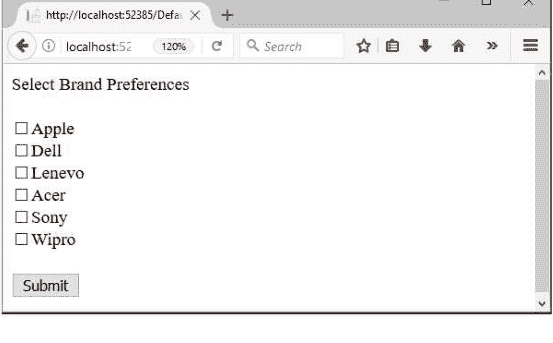

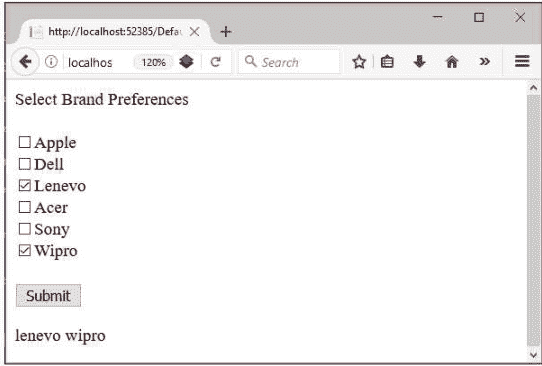

### 3.13 ASP.NET 中的跨页回发

ASP.NET 默认情况下将表单提交到同一页面。跨页回发是将表单提交到不同页面。这通常在创建多页表单以在每个页面上从用户收集信息时需要。从源页面移动到目标页面时，可以在目标页面中访问源页面中控件的值。

要使用跨页回发，您必须使用 postbackurl 属性指定要回发到的页面。

请按照以下步骤操作：

步骤 1：创建一个名为 crosspageposting 的新 ASP.NET 网站。默认情况下，网站会创建

一个单一网页 Default.aspx。在解决方案资源管理器中右键单击项目 > 添加新项 > Web 表单。保持原始名称 Default2.aspx 并单击“添加”。网站现在将包含两个页面，Default.aspx 和 Default2.aspx。

#### 步骤 2：在源页面 Default.aspx 上，在表单上放置一个按钮。将按钮的文本设置为“targetbutton”。将按钮的“postbackurl”属性设置为目标页面 Default2.aspx 的 URL。

```
<asp:Button ID="Button1" runat="server" postbackurl="~/Default2.aspx" Text="targetbutton" /> </div>
```

#### 步骤 3：在目标页面 Default2.aspx 上，从工具箱中放置一个标签。

#### 步骤 4：在 Default2.aspx 的 Page_Load() 中，您可以访问“previouspage”属性来检查页面是否作为跨页回发被访问。

```
Protected void Page_Load(object sender, EventArgs e)
{
    If (Page.previouspage != null)
    {
    }
}
```

步骤 5：要从源页面检索值，您必须使用“previouspage”的 'findcontrol()' 方法访问控件。我们将访问 Default.aspx 中放置的 Button 控件的 Text 属性。

```
```
Protected void Page_Load(object sender, EventArgs e)
{
If (Page.previouspage != null)
{
Button btn = (Button)(Page.previouspage.findcontrol("button1"));
Label1.Text = btn.Text;
}
}
```
```

步骤 6：在解决方案资源管理器中，右键单击 Default.aspx >“设为启动页”。运行应用程序并单击按钮。正如您所观察到的，页面已发布到 Default2.aspx，并且包含按钮控件名称的值会显示在标签中。

### 3.14 Web 配置和机器配置文件

ASP.Net 支持两种类型的配置文件。配置文件用于控制和管理 Web 应用程序的行为。

-   1. Machine.config
-   2. Web.config

Machine.Config 与 Web.Config 的区别

#### Machine.Config

-   1. 安装 Visual Studio 时会自动安装。
-   2. 也称为机器级配置文件。
-   3. 服务器上只有一个 machine.config 文件。
-   4. 该文件在配置层次结构中处于最高级别。

#### Web.Config

-   1. 创建 ASP.Net Web 应用程序项目时会自动创建。
-   2. 也称为应用程序级配置文件。
-   3. 该文件继承自 machine.config 的设置

## 第 4 章

## WINDOWS 和网站开发

Windows 窗体应用程序是在桌面计算机上运行的应用程序。Windows 窗体应用程序通常会有一组控件，例如标签、文本框、列表框等。

下面是一个示例：一个简单的 Windows 窗体应用程序 C#。它显示了一个简单的登录屏幕，用户可以访问。用户将输入所需的凭据，然后单击登录按钮继续。

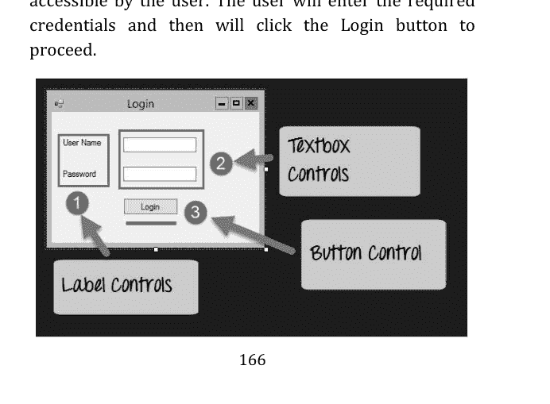

因此，上述应用程序中可用的控件示例

-   1. 这是一组标签控件，通常用于描述相邻控件。因此，在我们的例子中，我们有 2 个文本框，标签用于告诉用户一个文本框用于输入用户名，另一个用于输入密码。
-   2. 这 2 个文本框用于保存用户输入的用户名和密码。
-   3. 最后，我们有按钮控件。按钮控件通常会附加一些代码来执行特定的一组操作。例如，在上述情况下，我们可以让按钮执行验证用户输入的用户名和密码的操作。

#### 4.1.1 C# Hello World

现在让我们看一个示例，了解如何在 Visual Studio 中实现简单的“hello world”应用程序。为此，我们需要实现以下步骤

步骤 1) 第一步涉及在 Visual Studio 中创建新项目。启动 Visual Studio 后，您需要选择菜单选项 New->Project。


+   1. 在项目对话框中，我们可以看到 Visual Studio 中用于创建不同类型项目的各种选项。单击左侧的 Windows 选项。
+   2. 当我们单击上一步中的 Windows 选项时，我们将能够看到“Windows 窗体应用程序”选项。单击此选项。
+   3. 我们将为应用程序命名。在本例中，命名为 demoapplication。我们还将提供一个存储应用程序的位置。
+   4. 最后，单击“确定”按钮，让 Visual Studio 创建我们的项目。

如果按照上述步骤操作，你将在 Visual Studio 中看到以下输出。

输出：-

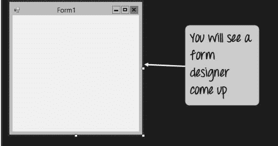

你将在 Visual Studio 中看到一个窗体设计器。正是在这个窗体设计器中，你将开始构建 Windows 窗体应用程序。

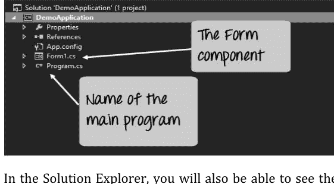

在解决方案资源管理器中，你还可以看到 demoapplication 解决方案。此解决方案将包含以下 2 个项目文件：

+   1. 一个名为 Forms1.cs 的窗体应用程序。此文件将包含 Windows 窗体应用程序的所有代码。
+   2. 名为 Program.cs 的主程序是默认代码文件，它是在 Visual Studio 中创建新应用程序时生成的。此代码将包含整个应用程序的启动代码。

在 Visual Studio 的左侧，你还会看到一个工具箱。工具箱包含可以添加到 Windows 窗体的所有控件。文本框或标签等控件只是可以添加到 Windows 窗体的部分控件。

下面是工具箱外观的截图。

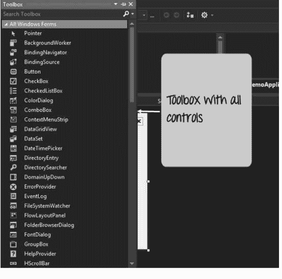

步骤 3）在此步骤中，我们现在将向窗体添加一个标签，该标签将显示“Hello World”。从工具箱中，你需要选择标签控件并将其直接拖到窗体上。

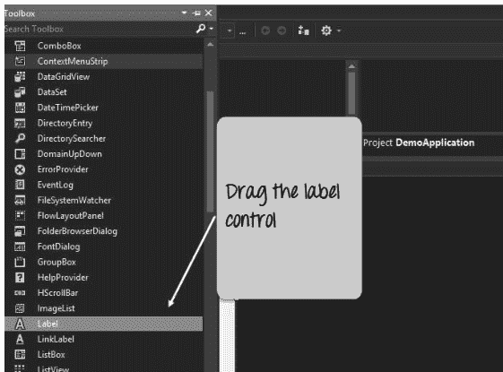

将标签拖到窗体上后，你会看到标签嵌入在窗体中，如下所示。

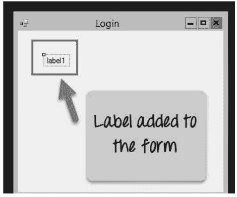

步骤 4）下一步是转到控件的属性，并将文本更改为“Hello World”。

要转到控件的属性，你需要右键单击控件并选择“属性”菜单选项。

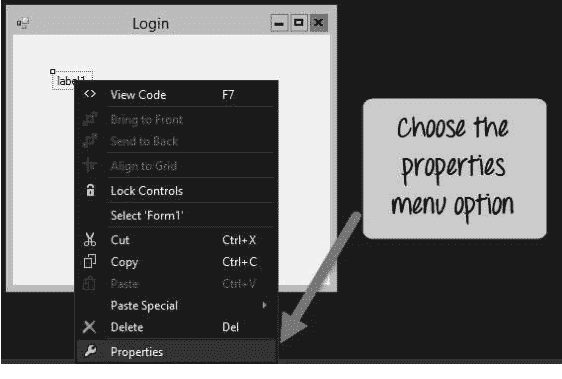

+   - 属性面板也会出现在 Visual Studio 中。因此，对于标签控件，在属性面板中，转到 Text 部分并输入“Hello World”。
+   - 每个控件都有一组描述该控件的属性。

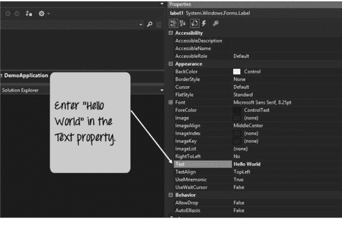

如果你遵循上述所有步骤并在 Visual Studio 中运行程序，你将获得以下输出

输出：-

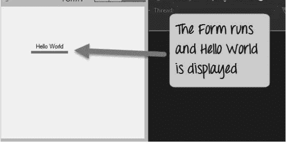

#### 4.1.2 向窗体添加控件

我们已经在前面部分中，通过添加标签控件来显示“Hello World”时，了解了如何向窗体添加控件。

让我们看看 Windows 窗体可用的其他控件，并了解它们的一些常见属性。在我们的 C# 示例的 Windows 窗体应用程序中，我们将创建一个具有以下功能的窗体。

+   1. 用户能够输入姓名和地址。
+   2. 一个用于选择用户所在城市的选项。
+   3. 用户能够输入性别选项。
+   4. 一个用于选择用户想学习的课程的选项。这里将提供 C# 和 ASP.Net 两个选择。

因此，让我们详细查看每个控件，并添加它们以构建具有上述功能的窗体。

#### 4.1.3 分组框

分组框用于将控件逻辑分组到一个区域中。我们举个例子：如果你有一组控件用于输入某个人的姓名和地址等详细信息。理想情况下，这些是某个人的详细信息，因此你会希望将这些详细信息放在窗体上的单独区域中。为此，你可以使用分组框。

让我们看看如何通过下面的示例来实现这一点：

步骤 1）第一步是从工具箱中将 Groupbox 控件拖到 Windows 窗体上，如下所示。

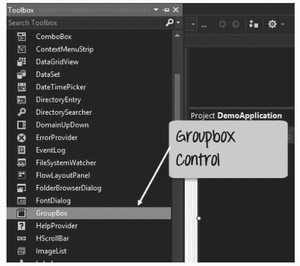

步骤 2）添加 groupbox 后，通过单击 groupbox 控件转到属性窗口。在属性窗口中，转到 Text 属性并将其更改为“User Details”。

完成上述更改后，你将看到以下输出

输出：-

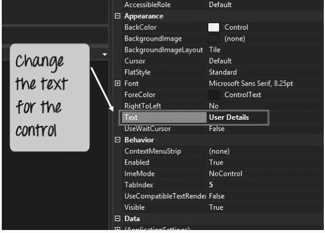

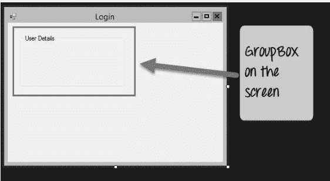

在输出中，你可以清楚地看到 Groupbox 已添加到窗体中。你还可以看到 groupbox 的文本已更改为“User Details”。

#### 4.1.4 标签控件

接下来是标签控件。标签控件用于在窗体上向用户显示文本或消息。标签控件通常与其他控件一起使用。常见的示例是在文本框中添加标签。标签向用户指示文本框中应填写什么内容。让我们看看如何通过下面的示例来实现这一点。我们将添加 2 个标签，一个名为“name”，另一个名为“address”。它们将与后面部分将添加的文本框控件结合使用。

**步骤 1）** 第一步是从工具箱中将标签控件拖到 Windows 窗体上，如下所示。确保将标签控件拖动 2 次，以便一个用于“name”，另一个用于“address”。

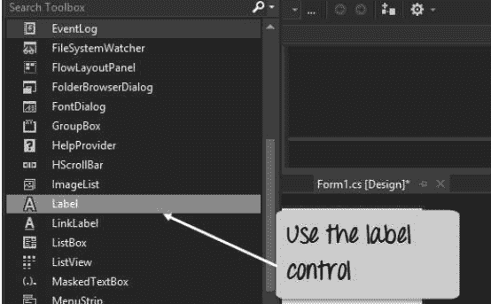

步骤 2）添加标签后，通过单击标签控件转到属性窗口。在属性窗口中，转到每个标签控件的 Text 属性。

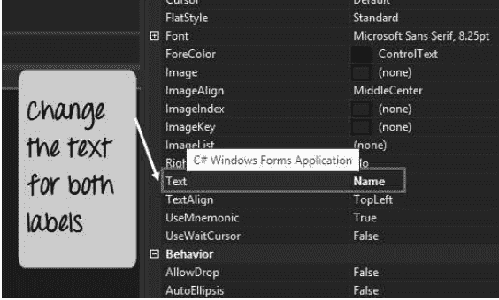

完成上述更改后，你将看到以下输出

输出：-

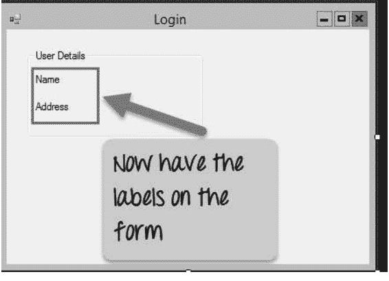

你可以看到添加到窗体上的标签控件。

#### 4.1.5 文本框

文本框用于允许用户在 C# Windows 应用程序中输入一些文本。让我们看看如何通过下面的示例来实现这一点。我们将向窗体添加 2 个文本框，一个用于姓名，另一个用于用户输入的地址。

**步骤 1）** 第一步是从工具箱中将文本框控件拖到 Windows 窗体上，如下所示。

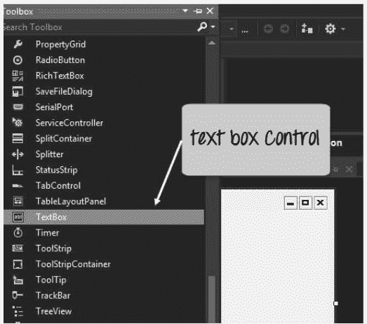

步骤 2）添加文本框后，通过单击文本框控件转到属性窗口。在属性窗口中，转到 Name 属性并为每个文本框添加一个有意义的名称。例如，将用于用户的文本框命名为 txtname，将用于地址的文本框命名为 txtaddress。应为控件制定命名约定和标准，因为这样更容易为这些控件添加额外功能，我们将在后面看到这一点。

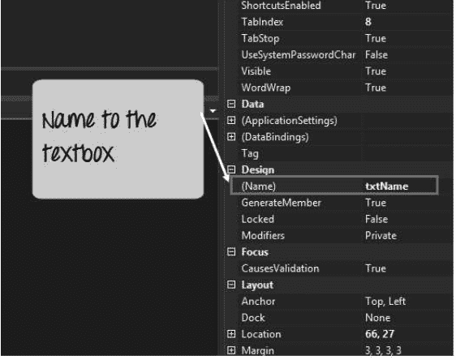

在输出中，你可以清楚地看到文本框已添加到窗体中。

#### 4.1.6 列表框

列表框用于在 Windows 窗体上显示项目列表。让我们看看如何通过下面的示例来实现这一点。我们将向窗体添加一个列表框，以存储一些城市位置。

步骤 1）第一步是从工具箱中将列表框控件拖到 Windows 窗体上，如下所示

步骤 2）添加列表框后，通过单击列表框控件转到属性窗口。

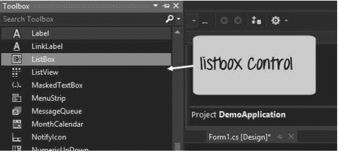

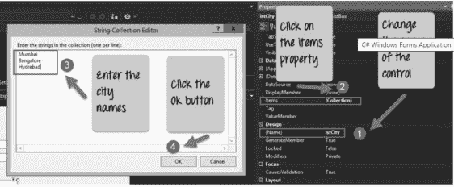

+   1. 首先，更改 Listbox 控件的属性，在本例中，我们已将其更改为 lstcity
+   2. 单击 Items 属性。这将允许你添加不同的项目，这些项目可以显示在列表中。


框。在我们的示例中，我们选择了“collection”项。

- 3. 在弹出的字符串集合编辑器中，输入城市名称。在我们的示例中，我们输入了“孟买”、“班加罗尔”和“海得拉巴”。
- 4. 最后，点击“确定”按钮。

完成上述更改后，您将看到以下输出。

输出：

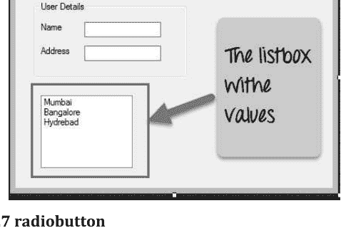

#### 4.1.7 单选按钮（RadioButton）

单选按钮（RadioButton）用于展示一组列表项，用户只能从中选择一项。下面我们通过一个示例来看看如何实现。我们将为男/女选项添加一个单选按钮。

- **步骤 1)** 第一步是从工具箱中将“RadioButton”控件拖到Windows窗体上，如下所示。

  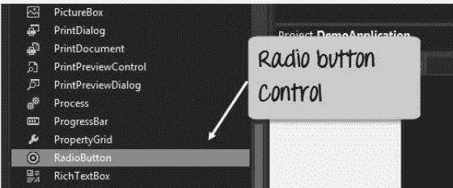

- **步骤 2)** 添加RadioButton控件后，点击该控件转到“属性”窗口。

  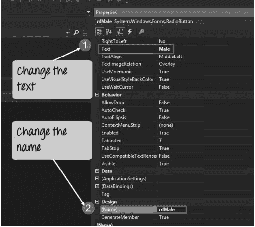

- 1. 首先，您需要更改两个单选控件的Text属性。转到“属性”窗口，将其中一个单选按钮的文本改为“Male”，另一个改为“Female”。
- 2. 同样，更改两个单选控件的Name属性。转到“属性”窗口，将其中一个单选按钮的名称改为“rdmale”，另一个改为“rdfemale”。

完成上述更改后，您将看到以下输出。

输出：

- **步骤 2)** 添加Checkbox控件后，点击该控件转到“属性”窗口。

  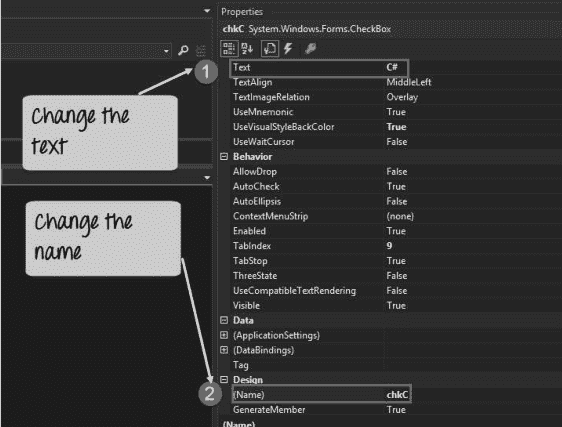

在“属性”窗口中，

- 1. 首先，您需要更改两个复选框控件的Text属性。转到“属性”窗口，将文本改为“C#”和“ASP.Net”。
- 2. 同样，更改两个复选框控件的Name属性。转到“属性”窗口，将其中一个复选框的名称改为“chkc”，另一个改为“chkasp”。

完成上述更改后，您将看到以下输出。

输出：

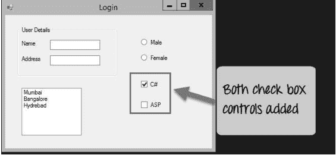

#### 4.1.9 按钮（Button）

按钮用于让用户进行点击，点击后即开始处理表单。下面我们通过一个示例来看看如何实现。我们将添加一个名为“Submit”的简单按钮，用于提交表单上的所有信息。

- **步骤 1)** 第一步是从工具箱中将按钮控件拖到Windows窗体上，如下所示。

  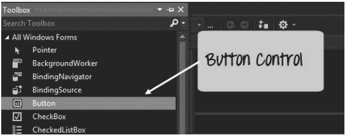

- **步骤 2)** 添加按钮控件后，点击该控件转到“属性”窗口。

  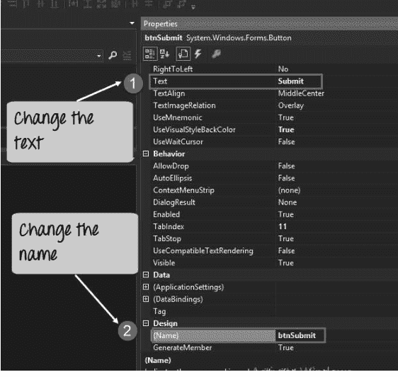

- 1. 首先，您需要更改按钮控件的Text属性。转到“属性”窗口，将文本改为“submit”。
- 2. 同样，更改该控件的Name属性。转到“属性”窗口，将名称改为“btnsubmit”。

完成上述更改后，您将看到以下输出。

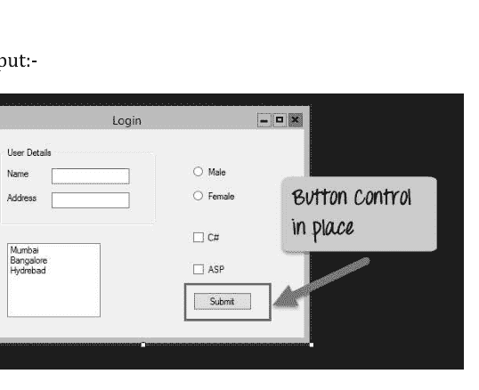

恭喜！现在您已经创建了第一个基本的Windows窗体。接下来，让我们进入下一个主题，看看如何为控件实现事件处理。

### 4.2 C#控件的事件处理

在使用Windows窗体时，您可以向控件添加事件。事件是在执行某个操作时发生的事情。最常见的操作大概就是在窗体上点击按钮。在C# Windows窗体中，您可以添加代码，以便在按下窗体上的按钮时执行某些操作。

通常，按下窗体上的按钮就意味着应该进行某些处理。

在进入按钮事件场景之前，我们先来看看其中一个事件及其处理方法。

下面的示例将演示ListBox控件的事件。因此，每当在ListBox控件中选择一个项目时，就会弹出一个消息框，显示所选项。让我们执行以下步骤来实现这一点。

- **步骤 1)** 在窗体设计器中双击ListBox。这样，Visual Studio会自动打开窗体的代码文件，并自动在代码中添加一个事件方法。每当选择ListBox中的任意项目时，都会触发该事件方法。

```
private void lstCity_SelectedIndexChanged(object sender, EventArgs e)
{
}
```

以上是您双击窗体上的ListBox控件时，Visual Studio自动添加的代码片段。现在，让我们将下面的代码段添加到该代码片段中，为ListBox事件添加所需的功能。


- 1. 这是双击ListBox控件时，Visual Studio自动创建的事件处理方法。您无需担心方法名称或传递给方法的参数有多复杂。
- 2. 这里我们通过`lstCity.SelectedItem`属性获取所选项。请记住，`lstCity`是我们ListBox控件的名称。然后，我们使用`GetItemText`方法获取所选项的实际值，并将该值赋给text变量。
- 3. 最后，我们使用MessageBox方法向用户显示text变量的值。

完成上述更改并在Visual Studio中运行程序后，您将看到以下输出。

输出：


从输出中可以看到，当选中列表框中的任意项目时，就会弹出一个消息框，显示从ListBox中选中的项目。

现在，让我们来看最后一个控件，即按钮单击方法。这也遵循同样的理念。只需在窗体设计器中双击按钮，它就会自动为按钮事件处理程序添加方法。然后，您只需添加下面的代码即可。


- 1. 这是双击按钮控件时，Visual Studio自动创建的事件处理方法。您无需担心方法名称或传递给方法的参数有多复杂。
- 2. 这里我们获取在名称和地址文本框中输入的值。这些值可以从文本框的Text属性中获取。然后，我们将这些值分别赋给name和address这两个变量。
- 3. 最后，我们使用MessageBox方法向用户显示name和address的值。

完成上述更改并在Visual Studio中运行程序后，您将看到以下输出。

输出：


- 1. 首先，在名称和地址字段中输入值。
- 2. 然后点击“Submit”按钮。

点击“Submit”按钮后，将弹出一个消息框，正确显示您在用户详细信息部分输入的内容。

### 4.3 树（Tree）控件与PictureBox控件

还有两个控件值得了解，一个是“树控件（Tree Control）”，另一个是“PictureBox控件”。让我们通过示例来看看如何实现这些控件。

树控件用于以树状方式列出项目。最好的例子就是Windows资源管理器本身。Windows资源管理器中的文件夹结构就是一种树状结构。

下面我们通过一个示例来看看如何实现。

- **步骤 1)** 第一步是从工具箱中将Tree控件拖到Windows窗体上，如下所示。

- **步骤 2)** 下一步是开始向树集合添加节点，以便节点能够相应地显示在树中。首先，让我们按照下面的子步骤向树集合添加一个根节点。

#### 树节点编辑器（TreeNode Editor）

- 1. 首先，点击**添加子节点（Add child）**按钮。这样您就可以向树集合中添加子节点。
- 2. 对于每个子节点，更改其Text属性。继续重复上一步和这一步，再添加2个节点。最终，您将得到如上所示的3个节点，文本分别设置为Label、Button和Checkbox。
- 3. 点击**确定**按钮。

完成上述更改后，您将看到以下输出。

输出：


您将看到树视图已添加到窗体中。当您运行 Windows 窗体应用程序时，可以展开根节点并查看列表中的子节点。

#### 4.3.1 PictureBox 控件

该控件用于向 Winforms C# 中添加图像。让我们通过下面的示例来看看如何实现这一点。

**步骤 1)** 第一步是将 PictureBox 控件从工具箱拖到 C# Windows 窗体上，如下所示


**步骤 2)** 下一步实际上是向 PictureBox 控件附加一张图片。可以通过以下步骤来完成。


- 1. 首先，单击 PictureBox 控件的 Image 属性。将弹出一个新窗口。
- 2. 在该窗口中，单击 Import 按钮。这将用于向 PictureBox 控件附加图像。
- 3. 将弹出一个对话框，您可以在其中选择要附加到 PictureBox 的图像。
- 4. 单击 OK 按钮。

完成上述更改后，您将看到以下输出

输出：


从输出中可以看到，窗体上显示了一张图像。

### 4.4 Web 服务

UDDI：UDDI 是 Universal Description, Discovery and Integration（通用描述、发现和集成）的缩写，内置于 Microsoft .NET 平台中。它充当目录，用于发布和发现公共 Web 服务。它通过 SOAP 进行通信（SOAP 是一种基于 XML 的简单协议，允许应用程序通过 HTTP 交换信息）。

WSDL：WSDL 是 Web Service Description Language（Web 服务描述语言）的缩写，是 W3C 规范，定义了用于描述 Web 服务的 XML 语法。也就是说，它使用 XML 编写，并指定了服务的位置以及服务公开的操作（或方法）。XML 语法描述了如下细节：-

- 1. 我们可以在哪里找到 Web 服务（其 URI）？
- 2. 该服务支持哪些方法和属性？
- 3. 数据类型支持。
- 4. 支持的协议。

**DISCO：** DISCO 是 Discovery（发现）的缩写；它是一个帮助 .NET 发现本地服务的文件。它基本上用于将公共服务在服务器上聚合或分组，并提供可能需要的指向所描述服务的架构文档的链接。当有人搜索 Web 服务时，它会转到 DISCO，DISCO 会提供有关特定 Web 服务的实际信息。

### 4.5 ADO.NET 架构

在本文中，我将讨论 ADO.NET 架构。请阅读我们之前讨论 ADO.NET 连接池及示例的文章。

#### 什么是 ADO.NET？

ADO 是 Active Data Objects 的缩写。ADO 不过是 .NET Framework 中的一个组件，它帮助我们从不同数据源获取数据到 C# 和 VB.NET 代码中，并且可能还可以将数据从 C# 或 VB.NET 代码发送到不同的数据源。


#### ADO.NET 的架构：

- 1. Connection
- 2. Command
- 3. Datareader
- 4. Dataadapter
- 5. Dataset
- 6. Dataview

在上述组件中，有两个组件是必需的。一个是命令对象，另一个是连接对象。无论是 Insert、Update、Delete 还是 Select 等操作，您始终需要命令对象和连接对象。为了更好地理解，请看下图。


让我们详细了解每个组件。

#### 连接（Connection）：

第一个重要组件是连接对象。连接对象用于连接后端数据库，可以是 SQL Server、Oracle、MySQL 等。要创建连接对象，至少需要两项信息。第一项是您的数据库位于何处，即机器名、IP 地址或数据库所在的某个位置。第二项是安全凭据，即使用 Windows 身份验证还是基于用户名和密码的身份验证。因此，首先要创建连接对象，而连接是连接到后端数据源所必需的。

#### 命令（Command）：

第二个重要组件是命令对象。当我们谈论 SQL Server、Oracle、MySQL 等数据库时，需要理解 SQL。命令对象就是您编写 SQL 查询的组件。然后，您可以获取命令对象并在连接上执行它。之后，您可以使用命令对象和 SQL 查询从数据库获取数据或向数据库发送数据。

#### Datareader：

Datareader 是一个只读的已连接记录集，它仅允许我们以向前模式读取记录。这里您需要理解三个概念，即只读、已连接和向前模式。

#### Dataset：

它是一个断开式的记录集，可以向前和向后浏览。还可以通过数据集进行更新。数据集由称为 dataadapter 的对象填充。

#### Dataadapter：

Dataadapter 充当命令对象和数据集之间的桥梁。Dataadapter 的作用是获取命令对象中的数据并填充数据集。

#### Dataview 类

Dataview 使您能够创建存储在数据表（DataTable）中的数据的不同视图，这一功能通常用于数据绑定应用程序。使用 Dataview，您可以使用不同的排序顺序公开表中的数据，并且可以按行状态或基于筛选表达式对数据进行筛选。

#### 4.5.1 C# 数据库连接：如何连接 SQL Server（示例：）

从数据库访问数据是任何编程语言的重要方面之一。任何编程语言都必须具备处理数据库的能力。C# 也不例外。

它可以处理不同类型的数据库。它可以处理最常见的数据库，如 Oracle 和 Microsoft SQL Server。

它还可以处理新形式的数据库，例如 MongoDB 和 MySQL。

##### 数据库连接基础

C# 和 .NET 可以与大多数数据库一起工作，最常见的是 Oracle 和 Microsoft SQL Server。但对于每个数据库，处理它们的逻辑大体相同。

在我们的示例中，我们将以 Microsoft SQL Server 作为数据库。出于学习目的，可以下载并使用 Microsoft SQL Server Express Edition，这是 Microsoft 提供的免费数据库软件。

在处理数据库时，以下概念对所有数据库都是通用的。

- 1. **连接** – 要处理数据库中的数据，第一个明显的步骤是连接。到数据库的连接通常包括以下提到的参数。
- 2. **数据库名称或数据源** – 第一个重要参数是需要建立连接的数据库名称。每个连接一次只能处理一个数据库。
- 3. **凭据** – 下一个重要方面是用于建立与数据库的连接所需的用户名和密码。它确保用户名和密码具有连接数据库的必要权限。
- 4. **可选参数** – 对于每种数据库类型，您可以指定可选参数，以提供更多有关 .NET 应如何处理与数据库的连接的信息。例如，可以指定连接应保持活动状态的时间参数。如果在特定时间段内未执行任何操作，则该参数将决定是否必须关闭连接。

ExecuteReader 方法用于查询结果，ExecuteNonQuery 用于插入、更新和删除命令。它是适用于不同命令的最佳方法。

##### 如何将 C# 连接到数据库

现在让我们看一下创建数据库连接所需的代码。在我们的示例中，我们将连接到一个名为 Demodb 的数据库。用于连接数据库的凭据如下所示：

- - 用户名 – sa
- - 密码 – demo123

我们将看到一个简单的 Windows 窗体应用程序来处理数据库。我们将有一个名为“Connect”的简单按钮，用于连接数据库。

因此，让我们按照以下步骤来实现。

**步骤 1)** 第一步涉及在 Visual Studio 中创建新项目。启动 Visual Studio 后，您需要选择菜单选项“新建”->“项目”。


Step 2) 下一步是选择项目类型为 Windows Forms 应用程序。在这里，我们还需要提及我们项目的名称和位置。


- 在项目对话框中，我们可以看到在 Visual Studio 中创建不同类型项目的各种选项。点击左侧的 Windows 选项。
- 当我们在上一步点击 Windows 选项时，我们将能够看到 Windows Forms Application 的选项。点击此选项。
- 然后我们为应用程序命名，在我们的例子中是 "demoapplication"。我们还需要提供一个存储应用程序的位置。
- 最后，我们点击 'OK' 按钮，让 Visual Studio 创建我们的项目。

Step 3) 现在从工具箱向 Windows 窗体添加一个按钮。将按钮的文本属性设置为 Connect。它将如下所示


## Step 4)
现在双击窗体，以便为按钮点击事件添加事件处理程序。在事件处理程序中，添加下面的代码。


```
Using System;
Using System.Collections.Generic;
Using System.ComponentModel;
Using System.Data;
Using System.Data.SqlClient;
Using System.Drawing;
Using System.Linq;
Using System.Text;
Using System.Threading.Tasks;
Using System.Windows.Forms;

Namespace demoapplication1
{
    Public partial class Form1 : Form
    {
        Public Form1()
        {
```

- 2. Initial Catalog 用于指定数据库的名称
- 3. userid 和 Password 是连接到数据库所需的凭据。

- 接下来，我们将连接字符串分配给变量 cnn。变量 cnn，其类型为 sqlconnection 用于建立与数据库的连接。
- 接下来，我们使用 cnn 变量的 Open 方法打开与数据库的连接。然后我们只是向用户显示一条消息，表明连接已建立。
- 一旦操作成功完成，我们就关闭与数据库的连接。如果不需要对数据库执行其他操作，关闭数据库连接始终是一个良好的实践。

当设置了上述代码，并且使用 Visual Studio 执行项目时，您将获得下面的输出。一旦窗体显示出来，点击 Connect 按钮。

Output:-


当您点击“connect”按钮时，从输出中可以看到数据库连接已建立。因此，消息框被显示。

## Access data with the sqlDatareader

为了展示如何使用 C# 访问数据，让我们假设我们的数据库中有以下构件。

- 一个名为 demotb 的表。此表将用于存储各种教程的 ID 和名称。
- 该表将有 2 列，一列称为 “tutorialid”，另一列称为 “tutorialname。”
- 目前，该表将有如下所示的 2 行。

```
SqlConnectionString
(connectionString);
Type
Message box displayed
```

| TutorialID | TutorialName |
|------------|--------------|
| 1 | C# |
| 2 | ASP.Net |

让我们更改窗体中的代码，以便我们可以查询此数据并通过 Messagebox 显示信息。请注意，下面输入的所有代码都是对上一节中为数据连接编写的代码的延续。

## Step 1)
让我们将代码分为 2 部分，以便用户更容易理解。

- 第一个是构造我们的“select”语句，它将用于从数据库读取数据。
- 然后我们将对数据库执行“select”语句并相应地获取所有表行。


## Code Explanation:-

- 第一步是创建以下变量

1. **Sqlcommand** – ‘sqlcommand’ 是 C# 中定义的一个类。此类用于执行对数据库的读写操作。因此，第一步是确保我们创建此类的变量类型。此变量随后将在从数据库读取数据的后续步骤中使用。

2. datareader 对象用于获取 SQL 查询指定的所有数据。然后我们可以使用数据读取器逐行读取所有表行。

3. 然后我们定义 2 个字符串变量，一个是“SQL”用于保存我们的 SQL 命令字符串。下一个是“Output”，它将包含所有表值。

## Code Explanation:-

- 我们将通过使用 messagebox 显示 Output 变量的值来继续我们的代码。Output 变量将包含来自 demotb 表的所有值。
- 我们最后关闭与数据库操作相关的所有对象。请记住这始终是一个良好的实践。

当设置了上述代码，并且使用 Visual Studio 运行项目时，您将获得下面的输出。一旦窗体显示出来，点击 Connect 按钮。

## Output:-


从输出中可以清楚地看到，程序能够从数据库获取值。然后数据在消息框中显示。

##### C# Insert Into Database

就像访问数据一样，C# 也有插入记录到数据库的能力。为了展示如何向我们的数据库插入记录，让我们采用上面使用的相同表结构。

| TutorialID | TutorialName |
|------------|--------------|
| 1 | C# |
| 2 | ASP.Net |

让我们更改窗体中的代码，以便我们可以将以下行插入表中

| TutorialID | TutorialName |
|------------|--------------|
| 3 | VB.Net |

所以让我们向我们的程序添加以下代码。下面的代码片段将用于在我们的数据库中插入现有记录。


## Code Explanation:-

- 第一步是创建以下变量

1. Sqlcommand – 此数据类型用于定义用于对数据库执行 SQL 操作的对象。此对象将保存将对我们的 SQL Server 数据库运行的 SQL 命令。
2. dataadapter 对象用于执行特定的 SQL 操作，例如 insert、delete 和 update 命令。
3. 然后我们定义一个字符串变量，即“SQL”用于保存我们的 SQL 命令字符串。

- 下一步是实际定义将用于我们数据库的 SQL 语句。在我们的例子中，我们发出一个 insert 语句，它将插入 tutorialid=1 和 tutorialname=VB.Net 的记录

- 接下来，我们创建用于执行 SQL 语句的命令对象。在 SQL 命令中，您必须传递连接对象和 SQL 字符串
- 在我们的 data adapter 命令中，我们现在将 insert SQL 命令关联到我们的适配器。我们还发出 executenonquery 方法，该方法用于对数据库执行 Insert 语句。‘executenonquery’ 方法用于在 C# 中对数据库发出任何 DML 语句。通过 DML 语句，我们指的是 insert、delete 和 update 操作。在 C# 中，如果您想对表发出这些语句中的任何一个，您需要使用 executenonquery 方法。
- 我们最后关闭与数据库操作相关的所有对象。请记住这始终是一个良好的实践。

当设置了上述代码，并且使用 Visual Studio 执行项目时，您将获得下面的输出。一旦窗体显示出来，点击 Connect 按钮。

Output:-


如果您进入 SQL Server Express 并查看 demotb 表中的行，您将看到插入的行如下所示


##### C# Update Database

就像访问数据一样，C# 也有更新数据库中现有记录的能力。为了展示如何更新我们的数据库中的记录，让我们采用上面使用的相同表结构。


| TutorialID | TutorialName |
| 1 | C# |
| 2 | ASP.Net |
| 3 | VB.Net |

让我们更改表单中的代码，以便我们可以更新以下行。旧行的值为 tutorialid 为“3”，Tutorial Name 为“VB.Net”。我们将把它更新为“VB.Net complete”，而 Tutorial ID 的行值保持不变。

## Old Row

| TutorialID | TutorialName |
| 3 | VB.Net |

## New row

| TutorialID | TutorialName |
| 3 | VB.Net Complete |

因此让我们将以下代码添加到我们的程序中。下面的代码片段将用于更新数据库中现有记录。


##### C# sqlcommand Example: With Code Explanation:-

- 第一步是创建以下变量
- 1. Sqlcommand – 此数据类型用于定义用于对数据库执行 SQL 操作的对象。此对象将保存将针对我们的 SQL Server 数据库运行的 SQL 命令。
- 2. dataadapter 对象用于执行特定的 SQL 操作，例如插入、删除和更新命令。
- 3. 我们然后定义一个字符串变量，即 SQL，用于保存我们的 SQL 命令字符串。

- 下一步是定义将用于针对数据库的 SQL 语句。在我们的例子中，我们发出的是更新语句，这将把 Tutorial name 更新为“VB.Net Complete”，而 tutorialid 保持不变为 3。
- 接下来，我们将创建命令对象，用于针对数据库执行 SQL 语句。在 SQL 命令中，您已传递连接对象和 SQL 字符串。
- 在我们的 data adapter 命令中，我们现在将插入 SQL 命令与适配器关联。我们还发出 executenonquery 方法，该方法用于针对数据库执行 Update 语句。
- 我们最后关闭与数据库操作相关的所有对象。请记住，这始终是一个良好的做法。

当设置上述代码并使用 Visual Studio 执行项目时，您将获得以下输出。表单显示后，单击 Connect 按钮。

Output:-


如果您实际进入 SQL Server Express 并查看 demotb 表中的行，您将看到该行已成功更新，如下所示。


##### Deleting Records

就像访问数据一样，C# 也有能力从数据库中删除现有记录。为了展示如何将记录删除到我们的数据库中，让我们采用上面使用过的相同表结构。

| TutorialID | TutorialName |
|------------|---------------|
| 1 | C# |
| 2 | ASP.Net |
| 3 | VB.Net Complete |

让我们更改表单中的代码，以便我们可以删除以下行

| TutorialID | TutorialName |
|------------|---------------|
| 3 | VB.Net Complete |

因此让我们将以下代码添加到我们的程序中。下面的代码片段将用于从数据库中删除现有记录。


## Code Explanation:-

- 此代码的关键区别在于我们现在发出的是 delete SQL 语句。delete 语句用于删除 demotb 表中 tutorialid 值为 3 的行。
- 在我们的 data adapter 命令中，我们现在将插入 SQL 命令与适配器关联。我们还发出 executenonquery 方法，该方法用于针对数据库执行 Delete 语句。

当设置上述代码并使用 Visual Studio 执行项目时，您将获得以下输出。表单显示后，单击 Connect 按钮。

## Output:-

如果您实际进入 SQL Server Express 并查看 demotb 表中的行，您将看到该行已成功删除，如下所示。

##### Connecting Controls to Data


在前面的部分中，我们已经看到如何使用 C# 命令例如 sqlcommand 和 sqlreader 从数据库中获取数据。我们还看到了如何读取表的每一行并使用 messagebox 将表的内容显示给用户。

但显然，用户不想通过消息框查看数据，而是希望有更好的控件来显示数据。让我们采用下面表格中的数据结构

| TutorialID | TutorialName |
|---|---|
| 1 | C# |
| 2 | ASP.Net |
| 3 | VB.Net Complete |

从上述数据结构来看，用户理想情况下希望在文本框中看到 tutorialid 和 Tutorial Name。其次，他们可能希望拥有某种按钮控件，可以让他们转到表中的下一条记录或上一条记录。这需要开发人员进行一些额外的编码。

好消息是 C# 可以通过允许控件与数据绑定来减少额外的编码工作。

这意味着 C# 可以根据表的特定字段自动填充文本框的值。

因此，您可以在 windows 窗体中拥有 2 个文本框。然后您可以将一个文本框链接到 tutorialid 字段，另一个文本框链接到 tutorialname 字段。这种链接是在 Visual Studio 设计器中完成的，您不需要为此编写额外代码。

Visual Studio 将确保为您编写代码以确保链接正常工作。然后当您运行应用程序时，文本框控件将自动连接到数据库，获取数据并在文本框控件中显示。开发人员无需进行任何编码即可实现这一点。

让我们看一个代码示例：如何实现控件绑定。

在我们的示例中，我们将在 windows 窗体上创建 2 个文本框。它们将分别代表 Tutorial ID 和 Tutorial Name。它们将分别绑定到数据库的 Tutorial ID 和 tutorialname 字段。

让我们按照下面提到的步骤来实现这一点。

Step 1) 构建基本窗体。在窗体上拖放 2 个组件-标签和文本框。然后执行以下子步骤

- 将第一个标签的文本值设为 tutorialid
- 将第二个标签的文本值设为 tutorialname
- 将第一个文本框的名称属性设为 txtid
- 将第二个文本框的名称属性设为 txtname

下面是执行上述步骤后窗体的外观。


Step 2) 下一步是向窗体添加 binding Navigator。binding Navigator 控件可以自动浏览表的每一行。要添加 binding navigator，只需转到工具箱并将其拖到窗体上。


###### Step 3

下一步是向我们的数据库添加绑定。这可以通过转到任何文本框控件并单击 datagridbindings->Text 属性来完成。Binding Navigator 用于在应用程序和数据库之间建立链接。

当您执行此步骤时，Visual Studio 将自动向应用程序添加所需代码，以确保应用程序与数据库链接。通常 Visual Studio 中的数据库被称为项目数据源。因此，为了确保应用程序和数据库之间建立连接，第一步是创建项目数据源。

以下屏幕将显示。单击链接-“Add Project Data Source”。当您单击项目数据源时，您将看到一个向导；这将允许您定义数据库连接。


> Click on Add Project Data

Step 4) 一旦您单击 Add Project Data Source 链接，您将被提供一个向导，该向导将用于创建到 demoth 数据库的连接。以下步骤详细说明了在向导的每个步骤中需要配置的内容。

- • 在弹出的屏幕中，选择数据源类型为 Database，然后单击下一步按钮。


- • 在下一个屏幕中，您需要开始创建到数据库的连接字符串。连接字符串对于应用程序建立到数据库的连接是必需的。它包含


服务器名称、数据库名称和驱动程序名称等参数。

1. 单击“新建连接”按钮。
2. 选择数据源为 Microsoft SQL Server。
3. 单击“继续”按钮。


接下来，您需要添加连接数据库所需的凭据。

1. 选择 SQL Server 所在的服务器名称。
2. 输入用户 ID 和密码以连接到数据库。
3. 选择 Demodb 作为数据库。
4. 单击“确定”按钮。


在此屏幕中，我们将确认之前屏幕中的所有设置。

1. 选择“是”选项，以在连接字符串中包含敏感数据。
2. 单击“下一步”按钮。

### 数据源配置向导

### 选择您的数据连接

您的应用程序应使用哪个数据连接来连接到数据库？

`win-50pg30fgo75.Demodb.dbo`

新建连接...

此连接字符串似乎包含连接到数据库所需的敏感数据（例如密码）。但是，在连接字符串中存储敏感数据可能会带来安全风险。是否要将这些敏感数据包含在连接字符串中？

- 否，从连接字符串中排除敏感数据。我将在应用程序代码中设置此信息。
- 是，在连接字符串中包含敏感数据。

将在应用程序中保存的连接字符串（展开以查看详细信息）

选择“是”

单击“下一步”

`< Previous   Next >   Finish   Cancel`

- 在下一个屏幕中，单击“下一步”按钮以确认连接字符串的创建。


当您单击“完成”按钮时，Visual Studio 现在将确保应用程序可以查询 Demotb 表中的所有行。

### 步骤 5)

既然数据源已定义，我们现在需要将 Tutorial ID 和 Tutorial Name 文本框连接到 Demotb 表。当您单击 Tutorial ID 或 Tutorial Name 文本框的 Text 属性时，您将看到指向 Demotb 的绑定源可用。

对于第一个文本框，选择 Tutorial ID。对第二个文本框重复此步骤，并选择字段为 Tutorial Name。以下步骤展示了如何导航到每个控件并相应地更改绑定。

- 单击 Tutorial ID 控件。
- 在“属性”窗口中，您将看到 Tutorial ID 文本框的属性。转到 Text 属性并单击下拉箭头按钮。


绑定导航器用于选择表中的下一条或上一条记录。因此，即使数据源作为一个整体添加到项目和文本框控件中，我们仍然需要确保绑定导航器也连接到我们的数据源。为此，我们需要单击绑定导航器对象，转到“绑定源”属性并选择可用的那个。


接下来，我们需要转到“属性”窗口，以便更改“绑定源”属性。


当上述所有步骤成功执行后，您将获得下面提到的输出。

###### 输出


现在，当项目启动时，您可以看到文本框会自动从表中获取值。


当您单击导航器上的“下一步”按钮时，它会自动转到表中的下一条记录。下一条记录的值会自动显示在文本框中。

##### C# DataGridView

数据网格用于以网格状格式显示表中的数据。当用户查看表数据时，通常希望一眼看到所有表行。如果我们能在窗体上以网格形式显示数据，就可以实现这一点。

C# 和 Visual Studio 内置了数据网格，可用于显示数据。让我们看一个示例。在我们的示例中，将有一个数据网格，用于显示 Demotb 表中的 Tutorial ID 和 Tutorial Name 值。

### 步骤 1)

将 DataGridView 控件从工具箱拖到 Visual Studio 的窗体中。DataGridView 控件在 Visual Studio 中用于以网格状格式显示表的行。


### 步骤 2)

下一步，我们需要将数据网格连接到数据库。在上一节中，我们创建了项目数据源。让我们在示例中使用相同的数据源。

- 首先，您需要选择网格并单击网格中的箭头。这将调出网格配置选项。
- 在配置选项中，只需选择 `demotbBindingSource` 作为数据源，该数据源是在前面部分中创建的。


如果上述所有步骤都按所示执行，您将获得下面提到的输出。

###### 输出


从输出中可以看到，网格已填充来自数据库的值。

### 总结

- C# SQL 可以与 Oracle 和 Microsoft SQL Server 等数据库一起使用。
- 本 C# 数据库教程包含了使用数据库所需的全部命令。这包括建立到数据库的连接。您可以使用 C# 中的命令执行 select、update、insert 和 delete 等操作。
- C# 中的 DataReader 对象用于保存数据库返回的所有数据。可以使用 C# 中的 while 循环一次读取一行数据。
- 数据适配器对象用于对数据库执行 insert、delete 和 update 等 SQL 操作。
- C# 可以将控件绑定到表中的各个字段。通过在 C# 中定义数据源来完成绑定。数据源用于从数据库中提取数据并填充到控件中。
- 绑定导航器用于自动浏览表中的行。
- C# 中的数据网格可以连接到数据库，并以网格状格式显示表中的所有值。

### 4.7 分布式应用程序

如前面几节所述，进程和应用程序域提供了一个封闭、受保护的环境。因此，进程或应用程序域中的对象不能直接与另一个进程或另一个应用程序域中的对象通信。

然而，在日益互联的世界中，企业和用户需要分布式应用程序。分布式应用程序允许对象跨进程边界进行通信。通常，分布式应用程序还满足以下目标：

- 在不同应用程序域和进程中运行的对象之间建立通信，无论是在同一台计算机上还是通过 Internet。
- 通过在异构架构上运行的对象之间建立通信，实现企业应用程序集成。
- 通过确保应用程序的某些部分即使在部分组件繁忙或失败时也能运行，来实现应用程序的可用性。
- 通过将应用程序划分为多个层（或层级），提供更高的安全性和可扩展性。

#### 4.7.1 分布式应用程序的演变

设计良好的分布式应用程序比所有组件都运行在单台计算机上的应用程序更具连接性、可用性、可扩展性和健壮性。这是企业应用程序的理想模型。

传统上，人们一直在尝试设计用于开发分布式应用程序的框架。一些著名的框架包括分布式计算环境/远程过程调用（DCE/RPC）、Microsoft 分布式组件对象模型（DCOM）、通用对象请求代理架构（CORBA）和 Java 远程方法调用（RMI）。其中一些实现已广泛部署在企业中。

然而，现代业务需求与早期不同。如今，企业寻求能够快速开发、能够集成


与遗留应用程序配合良好，并且与业务合作伙伴互操作良好。前面提到的每种技术都未能满足这些要求中的一项或多项。

2000年，微软推出了用于设计下一代分布式应用程序的.NET Framework。正如你将在本书中更深入探讨的那样，.NET Framework专门针对满足现代业务的需求而设计，无论是快速开发、集成还是互操作性方面的需求。

.NET Framework提供了多种机制来支持分布式应用程序开发。这些功能中的大部分存在于框架类库（FCL）中的以下三个命名空间中：

-   System.Net命名空间——该命名空间包含用于创建独立监听器和自定义协议处理程序的类，以便从零开始创建自己的分布式应用程序开发框架。直接使用System.Net命名空间需要对网络编程有很好的理解。
-   System.Runtime.Remoting命名空间——该命名空间包含构成.NET远程处理框架的类。.NET远程处理框架允许位于不同应用程序域中的对象之间进行通信，无论它们是否在同一台计算机上。远程处理在复杂的网络编程之上提供了一层抽象，并公开了一种简单的应用程序域间通信机制。.NET远程处理的关键目标是灵活性和可扩展性。
-   System.Web.Services命名空间——该命名空间包含构成ASP.NET Web服务框架的类。ASP.NET Web服务允许位于不同应用程序域中的对象通过诸如HTTP和SOAP之类的标准协议交换消息。与远程处理相比，ASP.NET Web服务提供了更高级别的抽象和简单性。ASP.NET Web服务的关键目标是易用性和与其他系统的互操作性。
-   .NET远程处理和ASP.NET Web服务都为设计分布式应用程序提供了一个完整的框架。大多数程序员会使用.NET远程处理或ASP.NET Web服务，而不会使用System.Net命名空间中的类从头构建分布式编程框架。
-   .NET远程处理和ASP.NET Web服务提供的功能看起来非常相似。实际上，ASP.NET Web服务实际上是构建在.NET远程处理基础设施之上的。也可以使用.NET远程处理来设计Web服务。鉴于相似程度，如何在项目中二选一？简单来说，决定取决于你想要创建的应用程序类型。当分布式应用程序的两个端点（客户端和服务器）都在你的控制之下时，你将使用.NET Remoting。这可能是在公司网络内设计的应用程序的情况。
-   当分布式应用程序的一个端点不在你的控制之下时，应使用ASP.NET Web服务。这可能是你的应用程序与业务合作伙伴的应用程序进行互操作的情况。

### 4.8 什么是全球化？

全球化是指使不同国家的人民、文化和经济更加紧密地联系在一起的任何活动。在商业中，“全球化”是指组织与全球客户建立更好联系的做法。这包括在不同国家市场运营的任何方面，从产品设计到营销。

#### 全球化示例

如果这对你来说仍然有点模糊，下面是一些商业世界中的全球化示例：

像eBay和Amazon这样的在线市场使得从企业或个人那里购买产品变得容易，在...

全球化的兴起也意味着，可以说从未有过比现在更好的时机将企业打造成全球性公司。对于寻求扩张的公司来说，有大量的机会可用，从获取全球人才库到利用更多信息来定位业务。随着进入新市场变得越来越容易，也有更多的产品利基可以利用，以及新的客户可以吸引。

然而，要真正走向全球需要大量的准备工作。这一过程中最重要的两个步骤是本地化和国际化你的产品。虽然本地化和国际化都属于全球化的范畴，但两者之间存在一些差异。我们将在以下章节中进一步探讨这些差异。

#### 什么是国际化？

国际化是一种企业战略，涉及使产品和服务尽可能具有适应性，以便它们能够轻松进入不同的国家市场。这通常需要领域专家的协助。国际化有时简称为“i18n”，其中18表示该单词中的字符数。

面向多种语言使用者的产品通常要经历国际化过程。例如，宜家将其家具的组装说明国际化，只使用图表和插图，而不包含任何需要翻译的文本。那些确实需要翻译说明的产品，在编写时也常常以尽可能保持文化中立为目标。当然，这说起来容易做起来难。

对于软件产品和电子产品，国际化涉及许多不同的关注点：

-   数据编码：ASCII字符编码对于大多数西欧语言的文本来说已经足够。然而，使用非拉丁字母的语言，如俄语、中文、印地语和韩语，需要更大的字符编码，如Unicode。
-   硬件支持：软件设计者必须考虑某些硬件设备可能并非在所有国家都可用。
-   用户界面：如果软件应用程序将被翻译成多种语言，用户界面需要为所有这些语言的文本留出足够的空间。

根据大多数定义，公司必须首先进行国际化，然后才能本地化产品。在下一节中，我们将讨论国际化与本地化之间的区别。

#### 什么是本地化？

本地化是使产品适应特定目标市场的过程。这通常发生在国际化之后。国际化开发的产品易于适应不同国家的众多受众，而本地化则使该产品与一个特定市场高度相关。

如前所述，麦当劳在100个国家经营着超过30,000家餐厅。其全球扩张是全球化的一个例子。通过设计，公司创建了一个适应各种当地口味和习俗的菜单。这项政策是国际化的一个例子。

以色列的许多麦当劳餐厅提供犹太洁食和饮料，并在安息日和犹太节日期间关闭。麦当劳还在印度开设了一家无肉餐厅，印度是一个大部分人口不吃牛肉或猪肉的国家。在这两种情况下，麦当劳都保持了其全球品牌形象，但针对当地市场调整了其产品和服务。这些案例体现了本地化。

### 4.9 ASP.NET中的身份验证

分布式应用程序安全的核心有两个紧密相连的概念——身份验证和授权。身份验证是从用户那里获取某种凭据并使用这些凭据来验证用户身份的过程。授权是允许经过身份验证的用户访问资源的过程。身份验证始终先于授权；即使你的应用程序允许匿名用户连接并使用应用程序，它仍然会将他们视为匿名用户进行身份验证。

ASP.NET为身份验证提供了一套灵活的替代方案。你可以自己在代码中执行身份验证，或将身份验证委托给其他权威机构（如Microsoft Passport）。事实上，有时ASP.NET的身份验证似乎过于灵活；新开发人员可能很难知道从哪里开始。在本文中，我们将回顾ASP.NET和Internet信息服务（IIS）中控制ASP.NET应用程序身份验证和授权的设置。

ASP.NET应用程序有两个独立的身份验证层。这是因为ASP.NET不是独立的产品，而是IIS之上的一层。所有请求在传递给ASP.NET之前都要经过IIS。因此，IIS可以决定拒绝访问，而ASP.NET进程甚至不知道有人请求了特定页面。以下是IIS和ASP.NET联合身份验证过程中步骤的概述。

IIS首先检查以确保传入请求来自允许访问该域的IP地址。如果不是，则拒绝该请求。

接下来，如果IIS配置为执行用户身份验证，它会执行自己的用户身份验证。默认情况下，IIS允许匿名


access, so requests are automatically authenticated, but you can change this default on a per-application basis with in IIS.

If the request is passed to ASP.net with an authenticated user, ASP.net checks to see whether impersonation is enabled. If impersonation is enabled, ASP.net acts as though it were the authenticated user. If not ASP.net acts with its own configured account.

Finally the identity from step 3 is used to request resources from the operating system. If ASP.net authentication can obtain all the necessary resources it grants the users request otherwise it is denied. Resources can include much more than just the ASP.net page itself you can also use .Net's code access security features to extend this authorization step to disk files, Registry keys and other resources.

As you can see several security authorities interact when the user requests and ASP.net page. If things are not behaving the way you think they should, it can be helpful to review this list and make sure you have considered all the factors involved

#### Authentication Providers

Assuming IIS passes a request to ASP.net, what happens next? The answer depends on the configuration of ASP.net itself. The ASP.net architecture includes the concept of and authentication provider a piece of code whose job is to verify credentials and decide whether a

particular request should be considered authenticated. Out of the box ASP.net gives you a choice of three different authentication providers.

The windows Authentication provider lets you authenticates users based on their windows accounts. This provider uses IIS to perform the authentication and then passes the authenticated identity to your code. This is the default provided for ASP.net.

The passport authentication provider uses Microsoft's passport service to authenticate users.

The forms authentication provider uses custom HTML forms to collect authentication information and lets you use your own logic to authenticate users. The user's credentials are stored in a cookie for use during the session.

##### Introduction

Extensible Markup Language (XML) stores and transports data. If we use a XML file to store the data then we can do operations with the XML file directly without using the database. The XML format is supported for all applications. It is independent of all software applications and it is accessible by all applications. Here is an Example: that shows how to insert the data into the XML file and how to retrieve the data from the XML file; also how to bind the data into tha datalist using ASP.NET. For this the following procedure can be used.

###### Step 1
First start Visual Studio 2010 by clicking "File" -> "New" -> "Web Site..." then click on "ASP.NET Web Site". Now write the following inline code that will design your web page.

```
<html xmlns="http://www.w3.org/1999/xhtml">

<head runat="server">

<title></title>

<style type="text/css">

.style1

{

Width: 40%;

Border-style: solid;

Border-width: 1px;

Background-color:Silver;

Height: 152px;

}

.style2
```

```
{
 Width: 295px;
}
.style3
{
 Width: 754px;
}
</style>
</head>
<body>
<form id="form1" runat="server">
<div>
<table class="style1">
<tr>
<td class="style2">
263
```

```
&nbsp;</td>

<td class="style3">

&nbsp;&nbsp;&nbsp;&nbsp;&nbsp;&nbsp;&nbsp;&nbsp;&nbsp;&nbsp;Employee_Information</td>

</tr>

<tr>

<td class="style2">

Name:</td>

<td class="style3">

<asp:textbox ID="textbox1" runat="server"></asp:textbox>

</td>

</tr>

<tr>

<td class="style2">

Emp_Id:</td>
```

```
<td class="style3">

<asp:textbox
ID="textbox2"runat="server"></asp:textbox>

</td>

</tr>

<tr>

<td class="style2">

Qualification:</td>

<td class="style3">

<asp:dropdownlist    ID="dropdownlist1"
runat="server" Height="22px" Width="132px">

<asp:listitem>--SELECT--</asp:listitem>

<asp:listitem>MCA</asp:listitem>

<asp:listitem>BCA</asp:listitem>

<asp:listitem>MBA</asp:listitem>

<asp:listitem>BBA</asp:listitem>
```

```
<asp:listitem>btech</asp:listitem>

<asp:listitem>mtech</asp:listitem>

</asp:dropdownlist>

</td>

</tr>

<tr>

<td class="style2">

&nbsp;</td>

<td class="style3">

<asp:Button ID="Button1" runat="server" Text="Submit" onclick="Button1_Click"/>

<asp:Button ID="Button2" runat="server" onclick="Button2_Click" Text="Show"/>

</td>

</tr>

</table>
```

Emp_id:<% # databinder.Eval(Container.dataitem,"Emp_i d")% ></a><br/>
Qualification:<% # databinder.Eval(Container.dataitem,"Qualification")% ><br/>

```
</itemtemplate>
```

```
</asp:datalist>
```

```
<br />
```

```
</div>
```

```
</form>
```

```
</body>
```

```
</html>
```

The design will look as in the following image:

Designing.jpg

Step 2: Add a XML file by clicking "File" -> "Add new item" then click on "XML file". Name this XML file Sample.xml. Put the following code in the XML file:

```
<?Xml version="1.0"encoding="utf-8"?>
```

```
<employeeinformation>
</employeeinformation>
```

###### Step 3
After that add the following namespaces in the code behind:

```
Using System.Data;

Using System.Xml;
```

###### Step 4
Now write the following code in the code behind file:

```
Public partial class default2 : System.Web.UI.Page
{
    Protected void Page_Load(object sender, eventargs e)
    {
        If (!Is postback)
        {
            //Bind xml data to datalist
            Bind datalist();
        }
    }
```

```
}

Private void binddatalist()
{
    Xmltextreader    xmlreader    =new xmltextreader(Server.mappath("Employee.xml"));

    Dataset ds = newdataset();

    Ds.readxml(xmlreader);

    Xmlreader.Close();

    If (ds.Tables.Count != 0)
    {
        Datalist1.datasource = ds;
        Datalist1.databind();
    }

    Else
    {
        Datalist1.datasource = null;
        Datalist1.databind();
    }
}
```

```
}
```

###### Step 5
Write the following code in the click event of the submit button, so that the data that is entered is stored in the XML File:

```
Protected void Button1_Click(object sender, eventargs e)
{
	Xmldocument xmldoc =new xmldocument();
	Xmldoc.Load(Server.mappath("Employee.xml"));
	Binddatalist();
}
```

###### Step 6
Write the following code in the click event of the show button. Now the data stored in the XML file can be shown.

```
Protected void Button2_Click(object sender, eventargs e)
{
	Xmldocument xmldoc =new xmldocument();
	Xmldoc.Load(Server.mappath("Employee.xml"));
	XmlElement parentElement = xmldoc.createelement("Details");
}
```

```
Xmlelement name = xmldoc.createelement("Name");

Name.innertext = textbox1.Text;

Xmlelement Emp_id = xmldoc.createelement("Emp_id");

Emp_id.innertext = textbox2.Text;

Xmlelement Qualification = xmldoc.createelement("Qualification");

Qualification.innertext = dropdownlist1.selecteditem.Text;

Parentelement.appendchild(name);

Parentelement.appendchild(Emp_id);

Parentelement.appendchild(Qualification);

Xmldoc.documentelement.appendchild(parentelement);

Xmldoc.Save(Server.mappath("Employee.xml"));

Binddatalist();
}
```

###### Step 7
Run your application by pressing F5. The output is:

Save.jpg

###### Step 8
See your sample.xml file, it will include the data that I entered at the run time like this:

```
<?Xmlversion="1.0"encoding="utf-8"?>

<employeeinformation>

<Details>

<Name>Richa</Name>

<Emp_id>1</Emp_id>

<Qualification>MCA</Qualification>

</Details>

</employeeinformation>
```

```
Console.writeline("Even Numbers :");
For (i = 1; i <= 50; i++)
{
    If( i%2 == 0 )
    {
        Console.Write(i + " ");
    }
}
Console.writeline("\nodd Numbers :");
For (i = 1; i <= 50; i++)
{
    If (i % 2 != 0)
    {
        Console.Write(i + " ");
    }
}
Console.writeline();
}
```

}

}

##### Output

## Even Numbers :

2 4 6 8 10 12 14 16 18 20 22 24 26 28 30 32 34 36 38 40
42 44 46 48 50

## Odd Numbers :

1 3 5 7 9 11 13 15 17 19 21 23 25 27 29 31 33 35 37 39
41 43 45 47 49


### 程序 2

编写一个 C# 程序，使用递归和不使用递归打印斐波那契数列。

```
using System;

public class FibonacciExample
{
    public static void Main(string[] args)
    {
        int n1=0,n2=1,n3,i,number;
        Console.Write("Enter the number of elements: ");
        number = int.Parse(Console.ReadLine());
        Console.Write(n1+" "+n2+" "); //printing 0 and 1
        for(i=2;i<number;++i) //loop starts from 2 because 0 and 1 are already printed
        {
            n3=n1+n2;
            Console.Write(n3+" ");
            n1=n2;
            n2=n3;
        }
    }
}
```

###### 输出

Enter the number of elements: 15

0 1 1 2 3 5 8 13 21 34 55 89 144 233 377

### 程序 3

编写一个 C# 程序打印一个数字的阶乘。

```
using System;

public class FactorialExample
{
    public static void Main(string[] args)
    {
        int i,fact=1,number;
        Console.Write("Enter any Number: ");
        number = int.Parse(Console.ReadLine());
        for(i=1;i<=number;i++){
            fact=fact*i;
        }
        Console.Write("Factorial of "+number+" is: "+fact);
    }
}
```

###### 输出

Enter any Number: 6

Factorial of 6 is: 720

### 程序 4

编写一个 C# 程序打印字母三角形。

```
using System;

public class PrintExample
{
    public static void Main(string[] args)
    {
        char ch='A';
        int i, j, k, m;

        for(i=1; i<=5; i++)
        {
            for(j=5; j>=i; j--)
                Console.Write(" ");

            for(k=1; k<=i; k++)
                Console.Write(ch++);

            ch--;

            for(m=1; m<i; m++)
                Console.Write(--ch);

            Console.Write("\n");
            ch='A';
        }
    }
}
```

###### 输出

A

ABA

ABCBA

ABCDCBA

ABCDEDCBA

### 程序 5

编写一个 VB.NET 程序设计以下屏幕，从用户接受详细信息。点击提交按钮净工资应计算并显示到文本框中。显示消息框告知员工姓名和净工资。


#### 程序

```
Public Class Slip7

    Private Sub Button1_Click(sender As Object, e As EventArgs) Handles Button1.Click

        Dim cal, tax, bs, da, hra, ma, pf, pt, it As Integer

        bs = CInt(TextBox2.Text)
        da = CInt(TextBox3.Text)
        hra = CInt(TextBox4.Text)
        ma = CInt(TextBox5.Text)
        pf = CInt(TextBox6.Text)
        pt = CInt(TextBox7.Text)
        it = CInt(TextBox8.Text)

        cal = bs + ((da * bs) / 100) + ((hra * bs) / 100) + ((ma * bs) / 100)
        tax = ((pt * bs) / 100) + ((it * bs) / 100) + ((pf * bs) / 100)
        cal = cal - tax

        TextBox9.Text = cal

        MsgBox("Name: " + TextBox1.Text + " Net salary: " + TextBox9.Text)

    End Sub

End Class
```

###### 输出


### 程序 6

编写一个 VB.NET 程序设计以下表单，从组合框中选择题号，该题目将显示到文本框中，并且该题目的选项将显示在四个单选按钮上，选择选项并点击提交按钮结果应显示在另一个文本框中。


#### 程序

```
Public Class Slip14

    Private Sub Slip14_Load(sender As Object, e As EventArgs) Handles MyBase.Load
        ComboBox1.Items.Add("Question1")
        ComboBox1.Items.Add("Question2")
        ComboBox1.Items.Add("Question3")
    End Sub

    Private Sub Button1_Click(sender As Object, e As EventArgs) Handles Button1.Click
        If ComboBox1.SelectedItem() = "Question1" Then
            If RadioButton1.Checked = True Then
                TextBox2.Text = "Answer is Correct."
            Else
                TextBox2.Text = "Answer is Wrong."
            End If
        End If

        If ComboBox1.SelectedItem() = "Question2" Then
            If RadioButton2.Checked = True Then
                TextBox2.Text = "Answer is Correct."
            Else
                TextBox2.Text = "Answer is Wrong."
            End If
        End If

        If ComboBox1.SelectedItem() = "Question3" Then
            If RadioButton4.Checked = True Then
                TextBox2.Text = "Answer is Correct."
            Else
                TextBox2.Text = "Answer is Wrong."
            End If
        End If
    End Sub

    Private Sub ComboBox1_SelectedIndexChanged(sender As Object, e As EventArgs) Handles ComboBox1.SelectedIndexChanged
        RadioButton1.Visible = True
        RadioButton2.Visible = True
        RadioButton3.Visible = True
        RadioButton4.Visible = True

        If ComboBox1.SelectedItem() = "Question1" Then
            TextBox1.Text = "What is capital of India?"
            TextBox2.Text = ""
            RadioButton1.Checked = False
            RadioButton2.Checked = False
            RadioButton3.Checked = False
            RadioButton4.Checked = False
            RadioButton1.Text = "New Delhi"
            RadioButton2.Text = "Mumbai"
            RadioButton3.Text = "Pune"
            RadioButton4.Text = "Chennai"
        ElseIf ComboBox1.SelectedItem() = "Question2" Then
            TextBox1.Text = "What is Capital of USA?"
            TextBox2.Text = ""
            RadioButton1.Checked = False
            RadioButton2.Checked = False
            RadioButton3.Checked = False
            RadioButton4.Checked = False
            RadioButton1.Text = "New York"
            RadioButton2.Text = "Washington DC"
            RadioButton3.Text = "California"
            RadioButton4.Text = "Georgia"
        ElseIf ComboBox1.SelectedItem() = "Question3" Then
            TextBox1.Text = "What is capital of Germany?"
            TextBox2.Text = ""
            RadioButton1.Checked = False
            RadioButton2.Checked = False
            RadioButton3.Checked = False
            RadioButton4.Checked = False
            RadioButton1.Text = "Frankfurt"
            RadioButton2.Text = "Washington DC"
            RadioButton3.Text = "Hamburg"
            RadioButton4.Text = "Berlin"
        End If
    End Sub

End Class
```

###### 输出


### 程序 7

编写一个 VB.NET 程序设计以下表单，该程序以表单形式显示学生的详细信息（使用 SplitContainer 或 GroupBox 控件分隔输入和输出会话）。


#### 程序

```
Public Class Slip17

    Private Sub Slip17_Load(sender As Object, e As EventArgs) Handles MyBase.Load
        ComboBox1.Items.Add("BCA")
        ComboBox1.Items.Add("BSC")
        ComboBox1.Items.Add("MCA")
        SplitContainer1.Panel2.Hide()
    End Sub

    Private Sub Button1_Click(sender As Object, e As EventArgs) Handles Button1.Click
        SplitContainer1.Panel2.Show()
        Label26.Text = TextBox1.Text
        Label25.Text = TextBox2.Text
        Label24.Text = TextBox3.Text
        Label23.Text = ComboBox1.SelectedItem()

        If RadioButton1.Checked = True Then
            Label22.Text = RadioButton1.Text
        ElseIf RadioButton2.Checked = True Then
            Label22.Text = RadioButton2.Text
        End If

        Label21.Text = DateTimePicker1.Value
        Label20.Text = TextBox4.Text
        Label19.Text = TextBox5.Text
    End Sub

End Class
```

###### 输出

#### 学生信息

Student's Name ABC  
Father's Name DEF  
Mother's Name GHI  
Course BCA  
Gender Female  
Date of Birth Tuesday July  
Hobbies JKL  
Contact Number 1234567890

#### 显示学生信息

Student's Name: ABC  
Father's Name: DEF  
Mother's Name: GHI  
Course: BCA  
Gender: Female  
Date of Birth: 7/1/2003 9:22:14 PM  
Hobbies: JKL  
Contact Number: 1234567890

### 程序 8

编写一个 VB.NET 程序设计以下表单，从用户接受所有详细信息并通过消息框显示详细信息。


#### 程序

```
Public Class Slip18

    Private Sub Button1_Click(sender As Object, e As EventArgs) Handles Button1.Click

        Dim a, b As String

        If CheckBox1.Checked = True Then
            a = CheckBox1.Text
        ElseIf CheckBox2.Checked = True Then
            a = CheckBox2.Text
        ElseIf CheckBox3.Checked = True Then
            a = CheckBox3.Text
        End If

        If RadioButton1.Checked = True Then
            b = RadioButton1.Text
        ElseIf RadioButton2.Checked = True Then
            b = RadioButton2.Text
        ElseIf RadioButton3.Checked = True Then
            b = RadioButton3.Text
        End If

        MsgBox("Name : " + TextBox1.Text + " Qualification : " + a + " post: " + b)

    End Sub

End Class
```

### 程序 9

#### VB.NET 中的学生成绩单结果程序

创建一个类 student 存储学生的学号、姓名、总分，这些信息不能在类外使用。Student 类必须提供适当的读取和写入此信息的方法。子类必须提供计算总分的函数，该总分应存储在基类的总分中。子类必须具有根据科目数量正确计算百分比的方法。演示这些类的使用。

FYBCA.VB

```
Public Class FYBCA

    Inherits student

    Dim i As Integer = 0

    Dim submark(4) As Integer

    Public Property calculatemark As Integer

        Set(ByVal value As Integer)

            submark(i) = value

            i += 1

        End Set
```


Get
Return submark.Sum
End Get
End Property
End Class

SYBCA.VB

Public Class SYBCA
Inherits student
Dim i As Integer = 0
Dim submark(4) As Integer
Public Property calculatemark As Integer
Set(Byval value As Integer)
Submark(i) = value
I += 1
End Set
Get
Return submark.Sum
End Get
End Property
End Class

Public Class student
    Dim rollno, totalmarks As Single
    Dim studentname As String
    Public Property roll As Integer
        Set(byval value As Integer)
            Rollno = value
        End Set
        Get
            Return rollno
        End Get
    End Property
    Public Property mark As Integer
        Set(byval value As Integer)
            Totalmarks = value
        End Set
        Get
            Return totalmarks
        End Get
End Property
Public Property name As String
Set(byval value As String)
Studentname = value
End Set
Get
Return studentname
End Get
End Property
Public Function percentage(byval i As Integer) As Single
Totalmarks = i
Return totalmarks / 4
End Function
End Class

#### Form.vb

Public Class Form1
Private i As Short

Private Sub Form1_Load(sender As Object, e As eventargs) Handles mybase.Load
    Sub1.Visible = False
    Sub2.Visible = False
    Sub3.Visible = False
    Sub4.Visible = False
End Sub

Private Sub fybca_Click(sender As Object, e As eventargs) Handles fybca.Click
    Changeyear()
    Fybca.forecolor = Color.Black
    Sub1name.Text = "C Language"
    Sub2name.Text = "HTML"
    Sub3name.Text = "DHTML & XML"
    Sub4name.Text = "DBMS-1"
    I = 1
End Sub

Private Sub sybca_Click(sender As Object, e As eventargs) Handles sybca.Click

Changeyear()

Sybca.forecolor = Color.Black

Sub1name.Text = "C++ Language"

Sub2name.Text = "VB.NET"

Sub3name.Text = "DBMS-2"

Sub4name.Text = "Fundamental OS"

I = 2

End Sub

Private Sub tybca_Click(sender As Object, e As eventargs) Handles tybca.Click

    Changeyear()

    Tybca.forecolor = Color.Black

    Sub1name.Text = "JAVA"

    Sub2name.Text = "ASP.NET"

    Sub3name.Text = "Advance JAVA"

    Sub4name.Text = "Advance VB.NET"

    I = 3
End Sub

Sub changeyear()
Sub1.Clear()
Sub2.Clear()
Sub3.Clear()
Sub4.Clear()
Sub1.Visible = True
Sub2.Visible = True
Sub3.Visible = True
Sub4.Visible = True
Totaldisplay.Text = ""
Persdisplay.Text = ""
Fybca.forecolor = Color.White
Sybca.forecolor = Color.White
Tybca.forecolor = Color.White
End Sub
Private Sub Button1_Click(sender As Object, e As eventargs) Handles
Dispresult.Click
If i = 1 Then
Dim fystudent As New FYBCA
Fystudent.calculatemark = Val(sub1.Text)
Fystudent.calculatemark = Val(sub2.Text)
Fystudent.calculatemark = Val(sub3.Text)
Fystudent.calculatemark = Val(sub4.Text)
Totaldisplay.Text = "Total Marks : " & fystudent.calculatemark
Persdisplay.Text = "Percentage : " & fystudent.percentage(fystudent.calculatemark)
Elseif i = 2 Then
Dim systudent As New SYBCA
Systudent.calculatemark = Val(sub1.Text)
Systudent.calculatemark = Val(sub2.Text)
Systudent.calculatemark = Val(sub3.Text)
Systudent.calculatemark = Val(sub4.Text)
Totaldisplay.Text = "Total Marks : " & systudent.calculatemark
Persdisplay.Text = "Percentage : " & systudent.percentage(systudent.calculatemark)
Elseif i = 3 Then
Dim tystudent As New TYBCA
Tystudent.calculatemark = Val(sub1.Text)
Tystudent.calculatemark = Val(sub2.Text)
Tystudent.calculatemark = Val(sub3.Text)
Tystudent.calculatemark = Val(sub4.Text)

Totaldisplay.Text = "Total Marks : " & tystudent.calculatemark

Persdisplay.Text = "Percentage : " & tystudent.percentage(tystudent.calculatemark)

Else

Msgbox("Select Year of BCA")

End If

End Sub

End Class


姓名 Kartik Nagar 学号 6069
FYBCA SYBCA TYBCA
C++ Language 90
VB.NET 85
DBMS-2 76
Fundamental OS 70
总分：320 百分比：80
显示结果

姓名 Kartik Nagar 学号 6069
FYBCA SYBCA TYBCA
JAVA 95
ASP.NET 81
Advance JAVA 85
Advance VB.NET 90
总分：351 百分比：87.75
显示结果

### PROGRAM 10

#### 在 asp.net 中实现服务器端控件

在这里，我们在表单中实现一个 HTML 服务器控件。

// htmlcontrolsExample:.aspx

<%@ Page Language="C#" autoeventwireup="true" codebehind="htmlcontrolsExample:.aspx.cs" Inherits="asp.netExample:.htmlcontrolsExample:" %>

<!DOCTYPE html>

<html xmlns="http://www.w3.org/1999/xhtml">

<head runat="server">

<title></title>

</head>

<body>

<form id="form1" runat="server">

<div>

<input id="Text1" type="text" runat="server" />

<asp:Button ID="Button1" runat="server" Text="Button" onclick="Button1_Click"/>

</div>

</form>

</body>

</html>

此应用程序包含一个代码后置文件。

// htmlcontrolsExample:.aspx.cs

Using System;

Namespace asp.netExample:

{

Public partial class htmlcontrolsExample: :
System.Web.UI.Page

{

Protected void Page_Load(object sender, eventargs e)

{

}

Protected void Button1_Click(object sender, eventargs e)

{

String a = Request.Form["Text1"];

Response.Write(a);

}
}
}

输出：


当我们在输入文本后点击按钮时，它会将响应返回给客户端。


### PROGRAM 11

#### 使用 C# 和 SQL 数据库的注册表单

本文将向您展示如何使用 SQL 数据库在 c#.net 中创建注册表单。因此，在本文中我使用了 Ms SQL Server 数据库。在这里，我将使用 c#.net 将用户登录详细信息保存到 sql 表中

# 首先我们将创建一个 windows 应用程序注册表单。


上面的表单是一个自定义设计的注册表单，您可以查看如何在 windows 应用程序中创建一个自定义注册表单。

在提交按钮上添加下面的代码。

```
Private void btnsubmit_Click(object sender, eventargs e)
{
    String connection = @"Server=LAPTOP-EVJEKV38\SQLEXPRESS; Database=testdb; Integrated Security=True";

    Sqlconnection con = new sqlconnection(connection);

    Try
    {
        String query = "Insert into userlogin(Name,emailid,loginid,Password) Values('" + txtname.Text + "'," + txtemailid.Text + "'," + txtloginid.Text + "'," + txtpassword.Text + "')";

        Sqldatadaapter da = new sqldatadaapter(query, con);

        Con.Open();

        Da.selectcommand.executenonquery();

        Messagebox.Show("Account created successfully..");

        Cleardata();
    }

    Catch
    {
        Messagebox.Show("Error occured...");
    }
    Finally
    {
        Con.Close();
    }
}
//Clear data after submit
Private void cleardata()
{
    Txtname.Text = "";
    Txtemailid.Text = "";
    Txtloginid.Text = "";
    Txtpassword.Text = "";
    Txtconpassword.Text = "";
}
```

在上面的代码中，我已将数据保存到数据库中。保存记录后会显示一条消息，然后所有记录将被清除。现在让我们运行应用程序并检查输出。为此，我创建了一个名为 userlogin 的表。

在上面的代码中，您需要根据您的服务器数据库更改连接字符串，并根据需要更改查询。

现在将详细信息添加到表单并点击提交。


现在检查数据库中的详细信息

| Id | Name | Emailid | Loginid | Password |
|---|---|---|---|---|
| 1 | 1 | DR. SYED drabbasrizvi110@gmail.com | syed | 123456 |


### PROGRAM 12

#### 在 ASP.NET 中创建用户注册表单

在学习了 Web 服务器控件之后，现在让我们创建一个用户注册表单。此 Web 表单接收用户输入并提交到服务器。提交后，它会返回成功注册的消息。整个过程包含以下步骤。

- 1. 向项目添加 Web 表单


#### 1. 向表单添加控件

要向表单添加控件，我们可以从工具箱拖放组件，也可以手动编写代码来创建组件。

以下文件包含用户注册表单的代码。

```
// webcontrols.aspx
<%@ Page Language="C#"
autoeventwireup="true"
codebehind="webcontrols.aspx.cs"
Inherits="webformscontrols.webcontrols" %>
<!DOCTYPE html>
<html xmlns="http://www.w3.org/1999/xhtml">
<head runat="server">
<title></title>
<style type="text/css">
.auto-style1 {
    Width: 100%;
}
.auto-style2 {
    Width: 278px;
}
}
```
```
14. .auto-style3 {
15. Width: 278px;
16. Height: 23px;
17. }
18. .auto-style4 {
19. Height: 23px;
20. }
21. </style>
22. </head>
23. <body>
24. <form id="form1" runat="server">
25. <div>
26. <table class="auto-style1">
27. <tr>
28. <td>
29. <asp:Label ID="Label1" runat="server" Text="User Name"></asp:Label>
30. </td>
31. <td>
32. <asp:textbox ID="username" runat="server" required="true"></asp:textbox></td>
33. </tr>
34. <tr>
35. <td>
36. <asp:Label ID="Label6" runat="server" Text="Email ID"></asp:Label>
37. </td>
38. <td>
39. <asp:textbox ID="emailid" runat="server" textmode="Email"></asp:textbox></td>
```
```
40. </tr>
41. <tr>
42. <td>
43. <asp:Label    ID="Label2"    runat="server"
    Text="Password"></asp:Label></td>
44. <td>
45. <asp:textbox    ID="textbox2"    runat="server"
    textmode="Password"></asp:textbox></td>
46. </tr>
47. <tr>
48. <td>
49. <asp:Label    ID="Label3"    runat="server"
    Text="Confirm Password"></asp:Label></td>
50. <td>
51. <asp:textbox    ID="textbox3"    runat="server"
    textmode="Password"></asp:textbox></td>
52. </tr>
53. <tr>
54. <td>
55. <asp:Label    ID="Label4"    runat="server"
    Text="Gender"></asp:Label></td>
56. <td>
57. <asp:radiobutton            ID="radiobutton1"
    runat="server" groupname="gender" Text="Male"
    />
58. <asp:radiobutton            ID="radiobutton2"
    runat="server"            groupname="gender"
    Text="Female" /></td>
59. </tr>
60. <tr>
```
```
61. <td>
62. <asp:Label    ID="Label5"    runat="server"
    Text="Select Course"></asp:Label>s</td>
63. <td>
64. <asp:checkbox   ID="checkbox1"  runat="server"
    Text="J2SEE" />
65. <asp:checkbox   ID="checkbox2"  runat="server"
    Text="J2EE" />
66. <asp:checkbox   ID="checkbox3"  runat="server"
    Text="Spring Framework" />
67. </td>
68. </tr>
69. <tr>
70. <td>
71. </td>
72. <td>
73. <br />
74. <asp:Button    ID="Button1"    runat="server"
    Text="Register"    cssclass="btn    btn-primary"
    onclick="Button1_Click"/>
75. </td>
76. </tr>
77. </table>
78. <asp:Label ID="message" runat="server" Font-
    Size="Medium" forecolor="Red"></asp:Label>
79. </div>
80. </form>
81. <table class="auto-style1">
82. <tr>
```
```
83. <td class="auto-style2"><asp:Label ID="showusernamelabel" runat="server"></asp:Label></td>
84. <td>
85. <asp:Label ID="showusername" runat="server"></asp:Label></td>
86. </tr>
87. <tr>
88. <td class="auto-style2"><asp:Label ID="showemailidlabel" runat="server"></asp:Label></td>
89. <td>
90. <asp:Label ID="showemail" runat="server"></asp:Label></td>
91. </tr>
92. <tr>
93. <td class="auto-style3"><asp:Label ID="showgenderlabel" runat="server"></asp:Label></td>
94. <td class="auto-style4">
95. <asp:Label ID="showgender" runat="server"></asp:Label></td>
96. </tr>
97. <tr>
98. <td class="auto-style2"><asp:Label ID="showcourselabel" runat="server"></asp:Label></td>
99. <td>
100. <asp:Label ID="showcourses" runat="server"></asp:Label></td>
```
```
101. </tr>
102. </table>
103. </body>
104. </html>
```

#### 处理提交请求

在代码后置文件中，我们添加了一条消息，该消息仅在用户提交注册表单时触发。此文件包含以下代码。

```
// webcontrols.aspx.cs
```

+   1. Using System;
+   2. Using System.Collections.Generic;
+   3. Using System.Linq;
+   4. Using System.Web;
+   5. Using System.Web.UI;
+   6. Using System.Web.UI.webcontrols;
+   7. Namespace webformscontrolls
+   8. {
+   9. Public partial class webcontrols : System.Web.UI.Page
+   10. {
+   11. Protected System.Web.UI.htmlcontrols.htmlinputfile File1;
+   12. Protected System.Web.UI.htmlcontrols.htmlinputbutton Submit1;
+   13. Protected void Page_Load(object sender, eventargs e)
```
14. {
15. }
16. Protected void Button1_Click(object sender, eventargs e)
17. {
1. 18. Message.Text = "Hello " + username.Text + "!";
2. 19. Message.Text = message.Text + "<br/> You have successuly Registered with the following details.";
3. 20. Showusername.Text = username.Text;
4. 21. Showemail.Text = emailid.Text;
22. If (radiobutton1.Checked)
23. {
24. Showgender.Text = radiobutton1.Text;
25. }
26. Else showgender.Text = radiobutton2.Text;
27. Var courses = "";
28. If (checkbox1.Checked)
29. {
30. Courses = checkbox1.Text + " ";
31. }
32. If (checkbox2.Checked)
33. {
34. Courses += checkbox2.Text + " ";
35. }
36. If (checkbox3.Checked)
37. {
38. Courses += checkbox3.Text;
```
```
39. }
40. Showcourses.Text = courses;
41. Showusernamelabel.Text = "User Name";
42. Showemailidlabel.Text = "Email ID";
43. Showgenderlabel.Text = "Gender";
44. Showcourselabel.Text = "Courses";
45. Username.Text = "";
46. Emailid.Text = "";
47. Radiobutton1.Checked = false;
48. Radiobutton2.Checked = false;
49. Checkbox1.Checked = false;
50. Checkbox2.Checked = false;
51. Checkbox3.Checked = false;
52. }
53. }
54. }
```

#### 运行用户注册表单

要运行此表单，只需右键单击并选择在浏览器中查看选项。我们在示例中已这样做。:

##### 输出：

它会产生以下输出。


填写表单并注册后，它会向用户显示问候消息。

提交注册详情后。

User Name
Email ID
Password
Confirm Password
Gender
○ Male ○ Female
Select Courses
☐ J2SEE ☐ J2EE ☐ Spring Framework
Register
Hello Zainub !
You have successfully Registered with the following details.
User Name Zainub
Email ID zainub@example.com
Gender Female
Courses J2SEE Spring Framework

### 程序 13

#### 创建带有适当验证的注册表单 - ASP.NET 程序。

此应用程序是一个简单的学生注册页面，包含各种 Web 控件，如单选按钮、复选框、组合框、日历、图像、文件上传等。我们还对不同控件使用验证。

Studentregistratation.aspx

```
<!DOCTYPE html>
<script runat="server">
    Protected Sub dob_selectionchanged(sender As Object, e As eventargs)
    End Sub
</script>
<head>
    <title>Registration Page</title>
</head>
<body>
    <form id="f1" method="post" runat="server">
```
```
<fieldset style="width:280px">

<legend>Registration Form</legend>

<table>

<tr>

<td>First Name:</td><td> <asp:textbox id="txt1" runat="server"></asp:textbox></td>

<td> <asp:requiredfieldvalidator ID="validfname" runat="server" controltovalidate="txt1" errormessage="Required!" forecolor="Red"></asp:requiredfieldvalidator></td>

</tr>

<tr>

<td>Last Name:</td><td> <asp:textbox id="txt2" runat="server"></asp:textbox></td>

<td><asp:requiredfieldvalidator ID="validlname" runat="server" Controltovalidate="txt2" errormessage="Required!" forecolor="Red"></asp:requiredfieldvalidator></td>

</tr>

<tr>
```
```
<td>User Name:</td><td> <asp:textbox id="user" runat="server"></asp:textbox></td>

<td><asp:requiredfieldvalidator ID="validuser" runat="server" controltovalidate="user" errormessage="Required!" forecolor="Red"></asp:requiredfieldvalidator></td>

</tr>

<tr>

<td>Password:</td><td><asp:textbox ID="pwd" runat="server" textmode="Password"></asp:textbox></td>

<td><asp:requiredfieldvalidator ID="validpwd" runat="server" controltovalidate="pwd" errormessage="Required!" forecolor="Red"></asp:requiredfieldvalidator></td>

</tr>

<tr>

<td>Confirm Password:</td><td><asp:textbox ID="Textbox1" runat="server" textmode="Password"></asp:textbox></td>

</tr>

<tr>
```


```aspx
<td>Email:</td><td><asp:TextBox ID="email" runat="server" TextMode="Email"></asp:TextBox></td>

<td><asp:RequiredFieldValidator ID="validemail" runat="server" ControlToValidate="email" ErrorMessage="required!" ForeColor="Red"></asp:RequiredFieldValidator></td>

</tr>

<tr>

<td>Mobile:</td><td><asp:TextBox ID="mobile" runat="server" TextMode="Phone"></asp:TextBox></td>

</tr>

<tr>

<td>Gender:</td><td><asp:RadioButtonList ID="radiobuttonlist1" runat="server">

<asp:ListItem Text="Male" Value="0"></asp:ListItem>

<asp:ListItem Text="Female" Value="1"></asp:ListItem>

</asp:RadioButtonList></td>

</tr>

<tr>

<td>DOB: </td><td><asp:TextBox ID="dob" runat="server" TextMode="Date" Width="168px"></asp:TextBox></td>

<td><asp:RequiredFieldValidator ID="validdob" runat="server" ControlToValidate="dob" ErrorMessage="Required" ForeColor="Red"></asp:RequiredFieldValidator></td>

</tr>

<tr>

<td>Course: </td><td><asp:DropDownList ID="ddlcourse" runat="server" DataValueField="Course" Width="173px">

<asp:ListItem Text="Select Course" Value="-1"></asp:ListItem>

<asp:ListItem Text="btech" Value="0"></asp:ListItem>

<asp:ListItem Text="MCA" Value="1"></asp:ListItem>

<asp:ListItem Text="MBA" Value="2"></asp:ListItem>

</asp:DropDownList></td>

<td><asp:RequiredFieldValidator InitialValue="-1" ID="validcourse" runat="server"
<td><asp:Button ID="btn2" runat="server"
Text="Reset"></asp:Button></td>

</tr>

</table>

</fieldset>

</form>

</body>
```

**输出：**

1. 包含各种 Web 控件的注册页面

##### 注册表单

名字：
姓氏：
用户名：
密码：
确认密码：
电子邮箱：
手机：
性别：
男
女
出生日期：
日----年
课程：
选择课程
国籍：
印度
其他
个人资料：

选择文件 未选择文件
提交
重置

2. 验证：当我们未填写任何记录就提交页面时。

##### 注册表单

名字：必填！
姓氏：必填！
用户名：必填！
密码：必填！
确认密码：
电子邮箱：必填！
手机：
性别：○ 男
       ○ 女
出生日期：日 ---- 年 必填
课程：选择课程 必填！
国籍：☐ 印度 ☐ 其他
个人资料：
选择文件 未选择文件
提交   重置

3. 填写记录


### 在 ASP.NET 应用程序中实现 Web 服务。

#### 创建 Web 服务

一个简单的 .asmx 页面即所谓的 Web 服务。为了创建 Web 服务，我们将使用 Visual Studio 2017，它基于 .NET Framework 4.8。创建 Web 服务时，我们将按照以下步骤操作：

**步骤 1：** 首先，我们需要创建一个 Web 应用程序来创建 Web 服务。

为此，我们将点击 文件 -> 新建 -> 项目，如下方截图所示：


之后，将出现一个新窗口，如下方截图所示：

在此处，**我们将选择 Web -> ASP.NET Web 应用程序 -> 输入 Web 应用程序的名称 -> 点击“确定”。**


随后，系统会向我们显示一个新窗口，如下所示：


为了创建 Web 服务，我们将右键点击项目**名称 -> 点击“添加”->“添加新项”**。如下方截图所示：


之后，会出现一个新窗口。在那里，我们必须点击 Web -> 选择 Web 服务（.asmx 页面）-> 为 Web 服务命名，如下方截图所示：


将 Web 服务添加到应用程序后，会出现一个新窗口，如下所示：


Web 服务不支持直接的方法重载。为了允许在 Web 服务中进行方法重载，我们必须添加 `MessageName` 属性，以区分 Web 服务中使用的某个方法与其他同名且使用参数的方法。

`[WebServiceBinding(ConformsTo = WsiProfiles.BasicProfile1_1)]` 改为 `[WebServiceBinding(ConformsTo = WsiProfiles.None)]`

```csharp
[WebMethod]
public int sumofnums(int firstnumber, int secondnumber)
{
    return firstnumber + secondnumber;
}

// 这里我们将使用 MessageName 属性来区分这两个方法。
[WebMethod(MessageName = "sumoffloats")]
public float sumofnums(float firstnumber, float secondnumber)
{
    return firstnumber + secondnumber;
}
```

如果我们希望从脚本调用 Web 服务，我们将使用 ASP.NET AJAX 并取消注释下面的代码行。

```csharp
[System.Web.Script.Services.ScriptService]
[WebMethod]
```

此属性始终放在方法的顶部。我们在 Web 服务中编写该属性。`[WebMethod]` 属性用于定义使用该属性的方法对用户/客户端访问是公开的。

如果我们移除该属性，那么客户端将无法看到方法的详细信息，因此他们无法实现它。

#### 标记

现在我们将查看标记。

对于标记，我们需要在“解决方案资源管理器”窗口中右键点击 Service1.asmx，然后选择“查看标记”，如下方截图所示：


在 Service1.asmx 中，我们将看到该服务使用带有属性的 WebService 指令。从这里可以看出，应用程序调用的是服务，而不是最终用户。因此 asmx 页面没有任何标记。

#### Service1.asmx

```aspx
<%@ WebService Language="C#" CodeBehind="Service1.asmx.cs" Class="webapplication7.Service1" %>
```

以下是关于 Service1.asmx 的一些要点。

- **“Web Service”指令：** 该指令表明 asmx 页面是一个 Web 服务。
- **“Language”=“C#”：** 这表示该服务使用 C# 语言。
- **“codebehind”：** 该属性对 ASP.NET 或 Web 服务没有任何作用。CodeBehind 是 Visual Studio 的一个属性。该属性用于将 asmx 页面与代码隐藏页面进行映射。
- **“Class”属性：** 它包含类的完全限定名称。这是服务的入口点，类似于 C 语言中的 `main()`。

现在，我们按 F5 键运行此应用程序。这里我们会找到一个“服务说明”的链接，如下方截图所示：

点击“服务说明”的链接后，它将把我们重定向到该服务的 WSDL 文档，如下方截图所示：

还有一个指向 HelloWorld 的链接。点击此链接后，它将把我们重定向到测试页面。

点击此链接后，它将把我们重定向到 Service1 Web 服务页面进行测试。

```csharp
public int sumofnums(int First, int Second)
{
    return First + Second;
}
}
}
```

之后，该服务就可以使用了。现在我们将编译并运行此应用程序。

编译完成后，将出现一个新窗口，如下方截图所示：


#### Web 服务的测试

现在，我们点击 F5 键运行应用程序。将打开 http://localhost:62639/myservice.asmx 页面。该页面将包含“服务说明”（WSDL 文档，即 Web 服务的文档）的链接，并包含另一个指向 `sumofnums` 的链接。此页面是 `sumofnums` 方法的测试页面，如下方截图所示：


现在，我们将使用面向对象编程（OOP）中的方法重载概念。现在我们在 MyService 类中添加 WebMethod。

##### Myservice.asmx.cs

```csharp
using System;
using System.Collections.Generic;
using System.Linq;
using System.Web;
using System.Web.Services;
using System.Web.Script.Serialization;

namespace webapplication7
{
    /// <summary>
    /// Service1 的摘要说明
    /// </summary>
    [WebService(Namespace = "http://tempuri.org/")]
    [WebServiceBinding(ConformsTo = WsiProfiles.BasicProfile1_1)]
```


```
16. [System.ComponentModel.ToolboxItem(false)]
17. // To allow this Web Service to be called from script, using ASP.NET AJAX, uncomment the following line.
18. [System.Web.Script.Services.ScriptService]
19. Public class myservice : System.Web.Services.WebService
20. {
21.
22. [WebMethod(MessageName = "sumoffloats")]
23.
24. Public float sumofnums(float First, float Second)
25. {
26. Return First + Second;
27. }
28.
29. }
30. }
```

现在，我们将按 F5 键运行此应用程序。将打开 `http://localhost:62639/myservice.asmx` 页面，其中包含“服务说明”（即 WSDL 文档，Web 服务的文档）的链接。这里还有另一个链接 `sumofnums`，它是 `sumofnums` 方法的测试页面，如下方截图所示：

##### MyService

点击此处查看完整操作列表。

##### SumOfFloats

测试

要使用 HTTP POST 协议测试操作，请点击 'Invoke' 按钮。

| 参数 | 值 |
|-----------|-------|
| First: | 2 |
| Second: |  |

在两个文本框中输入值后，将调用该方法，如下方截图所示：

```
<?xml version="1.0" encoding="ISO-8859-1"?>
<float xmlns="http://tempuri.org/">6</float>
```

##### 方法重载

现在我们将使用服务中的重载方法。Web 服务不支持方法重载。在方法重载的情况下，这将抛出错误。这里我们举一个例子：展示 Web 服务中完成的方法重载，并因为不支持重载而抛出错误。

##### Myservice.asmx.cs

```
1. Using System;
2. Using System.Collections.Generic;
3. Using System. Linq;
4. Using System. Web;
5. Using System.Web.Services;
6. Using System.Web.Script.Serialization;
7.
8.
9. Namespace webapplication7
10. {
11. /// <summary>
12. /// Summary description for Service1
13. /// </summary>
14. [webservice(Namespace = "http://tempuri.org/")]
15. [webservicebinding(conformsto = wsiprofiles.basicprofile1_1)]
16. [System.componentmodel.toolboxitem(false)]
17. // To allow this Web Service to be called from script, using ASP.NET AJAX, uncomment the following line.
18. [System.Web.Script.Services.scriptservice]
19. Public class myservice : System.Web.Services.webservice
```

```
20. {
	[webmethod]
	Public int sumofnums(int First, int Second)
	{
		Return First + Second;
	}
	}
	[webmethod(messageName = "sumofloats")]
	Public float sumofnums(float First, float Second)
	{
		Return First + Second;
	}
	}
	}
	}
	}
```

> 服务“WebApplication7.myservice”不符合 WS-I Basic Profile v1.1。请检查下面的每个规范性声明违规。要关闭一致性检查，请将相应 WebServiceBinding 属性上的 conformance-checks 属性设置为“none”。
> 
> - WSDL 的 portType 中不允许使用 WebMethod 名称重载。DESCRIPTION 中的 wsdl:portType 必须具有具有不同 name 属性值的操作。请注意，此要求仅适用于给定 wsdl:portType 内的 wsdl:operations。一个 wsdl:portType 可以具有与其他 wsdl:portType 中的操作名称相同的 wsdl:operations。
> 
> - 来自命名空间“http://tempuri.org”的 portType“MyServiceSoap”上的操作“sumOfNums”在 DESCRIPTION 的 wsdl:portType 中被重载。要使服务符合要求，请确保属于同一绑定的所有 Web 方法具有唯一的名称。

在上面的示例中，Web 服务不支持方法重载，并显示错误消息：服务“webapplication7.myservice”不符合 WS-I Basic Profile v1.1。现在，为了支持重载方法，我们必须执行以下 356 个步骤：要么删除“[webservicebinding(conformsto = wsiprofiles.basicprofile1_1)]”，要么做一些更改“[webservicebinding(conformsto = wsiprofiles.None)]”。

为了支持重载方法，我们必须对代码做一些更改，如下方高亮显示的框所示：

```
+   1. Using System;
+   2. Using System.Collections.Generic;
+   3. Using System. Linq;
+   4. Using System. Web;
+   5. Using System.Web.Services;
+   6. Using System.Web.Script.Serialization;
+   7.
+   8.
+   9. Namespace webapplication7
+   10. {
+   11. /// <summary>
+   12. /// Summary description for Service1
+   13. /// </summary>
+   14. [webservice(Namespace = "http://tempuri.org/")]
+   15. //make the wsiprofiles to None
+   16. [webservicebinding(conformsto = wsiprofiles.None)]
+   17. [System.componentmodel.toolboxitem(false)]
```

```
18.   // To allow this Web Service to be called from script, using ASP.NET AJAX, uncomment the following line.
19.   [System.Web.Script.Services.scriptservice]
20.   Public     class     myservice     : System.Web.Services.webservice
21.   {
22.
23.   [webmethod]
24.   Public int sumofnums(int First, int Second)
25.   {
26.   Return First + Second;
27.   }
28.
29.   //here we have to add the messagename property to make the difference between both of the methods.
30.   [webmethod(messagename = "sumoffloats")]
31.   31.
32.   Public float sumofnums(float First, float Second)
33.   {
34.   Return First + Second;
35.   }
36.
37.   }
38.   }
```

完成所有这些更改后，Web 服务将如下方截图所示：

##### MyService

支持以下操作。有关正式定义，请查看服务说明。

SumOfNums MessageName = "SumOfFloats" 第一个方法

SumOfNums 第二个方法，名称相同

在这里，Web 服务支持具有相同名称的方法。通过添加消息名称属性，我们可以区分这两个方法。

通过使用上述属性，我们可以在 Web 服务中使用方法重载。

##### 页面测试

在点击 sumoffloats 后，页面将重定向到 `http://localhost:62639/myservice.asmx?Op=sumoffloats`，在这里我们将看到“?Op=sumofnums”被附加到服务 URL 上。此页面包含两个输入值（First, Second）的文本框，其中 sumofnums 值将作为输入参数，以及一个“invoke”按钮。点击此调用按钮后，我们将重定向到

`http://localhost:62639/myservice.asmx/sumoffloats`，该页面包含 sumofnums 方法返回的 XML 格式的值。


点击调用按钮后，我们将重定向到 `http://localhost:62639/myservice.asmx/sumoffloats` 页面。此页面包含 XML 格式的值。

```
<?xml version="1.0" encoding="ISO-8859-1"?>
<float xmlns="http://tempuri.org/">9</float>
```

类似地，在点击“sumofnums messagename="sumoffloats"”后，我们将重定向到“`http://localhost:62639/myservice.asmx?Op=sumofnums`”。因此，“sumofnums” messagename="sumoffloat" 方法，对于客户端应用程序来说就是“sumofloats”。

这里出现了一个问题：测试页面从哪里来？因为我们没有添加标记，但页面仍然被渲染了。

测试页面不是 Web 服务的一部分。测试页面由 ASP.NET 使用网页 `c:\[windir]\Microsoft .NET\Framework\ [Version] \Config\defaultwsdlhelpergenerator.aspx` 渲染。“反射”概念渲染了测试页面。

##### WSDL 文档

Web 服务是自描述的，这意味着 ASP.Net 本身以 WSDL 文档的形式向客户端提供使用 Web 服务所需的全部信息。WSDL 文档告诉客户端 Web 服务中存在哪些方法，以及方法使用的参数和返回值，以及客户端应用程序如何与它们通信。WSDL 是一种 XML 标准。

##### Web 服务的托管

为了托管 Web 服务，我们将添加对服务的引用，并从不同的应用程序消费它。这里我们假设端口号可能会变化，所以现在我们将服务托管在 IIS（Internet Information Server）上，以获得

服务器的特定地址。为此，我们将打开 Internet 信息服务 -> 转到默认网站 -> 右键单击应用程序 -> 添加应用程序 -> 在物理路径字段中浏览到我们的服务的物理位置 -> 单击“确定”。现在，我们将使用别名 http://localhost/webservicedemo/ 浏览该应用程序，以测试该应用程序是否正确托管。这里我们会收到一个错误“HTTP Error 403.14-Forbidden”。这个错误是因为没有为此应用程序设置默认文档。现在我们将添加一个页面作为默认文档“myservice.asmx”。现在我们可以通过在浏览器中添加此 URL localhost/webservicedemo/myservice.asmx 来浏览我们的应用程序。

#### 从客户端脚本使用 Web 服务

我们可以在任何类型的应用程序中使用 Web 服务。这里我们将创建一个 .Net Web 应用程序。为此，我们将按照以下步骤操作：

步骤1：在解决方案资源管理器中右键单击 -> 添加 -> 新建项目，如下面的屏幕截图所示：


步骤2：单击“新建项目”后，将打开一个新窗口，如下面的屏幕截图所示：


步骤3。之后，为了与 Web 服务通信，我们必须创建一个代理类。要创建代理类，我们必须按照以下步骤操作：

##### 代理类

要创建代理类，我们必须右键单击“引用”-> 选择“添加服务引用”，如下面的屏幕截图所示：


单击“添加服务引用”后，将出现一个新窗口，如下面的屏幕截图所示：


在解决方案资源管理器中右键单击项目 -> 选择“添加”-> 选择“Web 窗体”，如下面的屏幕截图所示：


单击“Web 窗体”后，将打开一个新窗口，我们必须在其中提供 Web 窗体的名称，如下面的屏幕截图所示：


在上面的屏幕截图中，我们给出了 Web 窗体的名称，然后单击“确定”。

在 Web 窗体中，我们将创建一个表格，以借助 Web 服务使用预定义的方法。

在 webform1.aspx 中，我们完成了以下编码，如下面的代码所示：

+   1. %@ Page Language="C#" autoeventwireup="true" codebehind="webform1.aspx.cs" Inherits="calculatorwebapplication.webform1" %>
+   2. 
+   3. <!DOCTYPE html>
+   4. 
+   5. <html xmlns="http://www.w3.org/1999/xhtml">
+   6. <head runat="server">
+   7. <title></title>
+   8. </head>
+   9. <body>
+   10. <form id="form1" runat="server">
+   11. <table style="font-family:Arial">
+   12. <tr>
+   13. <td>
+   14. <b>First Number</b>
+   15. </td>
+   16. <td>

17. <asp:textbox ID="txtfirstnumber" runat="server"></asp:textbox>
18. </td>
19. </tr>
20. <tr>
21. <td>
22. <b>Second Number</b>
23. </td>
24. <td>
25. <asp:textbox ID="txtsecondnumber" runat="server"></asp:textbox>
26. </td>
27. </tr>
28. <tr>
29. <td>
30. <b>Result</b>
31. </td>
32. <td>
33. <asp:Label ID="lblresult" runat="server" Text="Label"></asp:Label>
34. </td>
35. </tr>
36. <tr>
37. <td>
38. <asp:Button ID="btnadd" runat="server" Text="Add" onclick="btnadd_Click" />
39. </td>
40.
41.
42. </tr>

+   43. `</table>`
+   44. `</form>`
+   45. `</body>`
+   46. `</html>`

在上面的代码中，我们创建了一个表格，其中包含两个文本框：textbox1 用于输入第一个数字，textbox2 用于输入第二个数字。我们创建了一个按钮，借助该按钮我们将两个数字相加。

上述代码的设计视图如下面的屏幕截图所示：


这里我们使用了两个文本框来输入第一个数字和第二个数字。“添加”按钮用于添加两个文本框的值。

双击“添加”按钮后，这将切换到编码页面。该页面是 webform.aspx.cs。

要使用 Web 服务的方法，我们将在按钮单击时编写以下代码。

##### Webform.aspx.cs

```
1. using System;
2. using System.Collections.Generic;
3. using System. Linq;
4. using System. Web;
5. using System.Web.UI;
6. using System.Web.UI.webcontrols;
7. 
8. namespace calculatorwebapplication
9. {
10. public partial class webform1 : System.Web.UI.Page
11. {
12. protected void Page_Load(object sender, eventargs e)
13. {
14. 
15. }
16. 
17. protected void btnadd_Click(object sender, eventargs e)
18. {
19. calculatorservice.calculatorwebservicesoapclient client = new calculatorservice.calculatorwebservicesoapclient();
20. int result= client.Add(Convert.toint32(txtfirstnumber.Text),
21. Convert.toint32(txtsecondnumber.Text));
22. lblResult.Text = result.tostring();
23. }
24. }
25. }
```

现在我们将按 F5 启动 Web 服务。输出将如下面的屏幕截图所示：

###### 输出


