# 视觉化学习 Python：一种利用科学与创意教授右脑型非编程者的加速学习方法

# 感谢你！

一本书的诞生需要许多人的共同努力才能实现。因此，对于所有帮助我完成这个项目的 Kickstarter 资助者，我向他们表示最诚挚的“感谢”，并希望我们未来能共同更多伟大的事业。


- Anthony Storms Akins
- Alan Prak
- Alessandro
- Andy Lee
- Bill Stull
- Brandon Thompson
- Charles Rogers
- Clément Labadie
- Demian Vonder Kuhlen
- Edgar Rodriguez
- Gordon
- Greg_Vee
- Gregory Pfrommer
- Gregory R. Kinnicutt
- J.T. O'Gara
- Janakan
- Jeff
- Joe
- Joshua Bauder
- Marco Randall
- Marshall Walker
- Neer Patel
- Nigel J Allen
- Padrao
- Perry Yap
- R.C. Lewis
- Randy Morris
- Rowan Knight
- Sebastian Lange
- Shahid Ali Shah
- Shrawan
- Stan Spears

# 致谢

我感谢在线 Python 社区的帮助，他们多年来一直默默工作，帮助 Python 变成了今天这种令人兴奋的编程语言。

# Hello World

## 文件与目录

## 图像处理

## 目录清理

# 关于本书

## 问题

在第一次尝试编程时，人们不能埋怪编程很难。学习编程就像学习一门新语言。

Python 的语法规则是可见的。

## 为什么选择 Python？

当你开启 Python 之旅时，通常会从这里开始。

### 为什么选择 Python？

- Python 使用英语，易于理解。
- Python 解释器可以让你运行代码。
- 为什么是它？
- 当你学习 Python 时，可能会遇到错误。
- Python 是非常强大的工具，但它也非常容易上手。

# 安装

许多操作系统都预装了 Python。

前往 `https://www.python.org/downloads/` 可以根据你的操作系统进行下载。

本书使用的是 `Python 3`。

在 Windows 上，安装完成后，你可以从开始菜单选择 `IDLE` 或控制台。

在 Linux、OS X 上，你可以通过命令行启动 Python。

要选择特定版本，输入 `PythonX` 其中 X 是版本号（例如 `Python3`）。

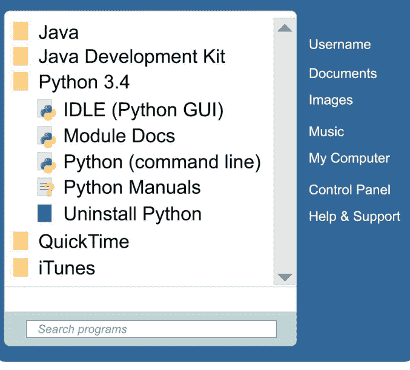

# Hello World!

大多数情况下，你编写 Python 代码时会在 `IDE` 中进行。然而，你也可以解释器交互式地编写代码。虽然它可以创建程序，但强烈建议不要这样做，因为很难保存为脚本。相反，请将解释器视为“即时”测试工具。现在让我们让解释器在屏幕上输出 `Hello World!`。通过解释器来实现。

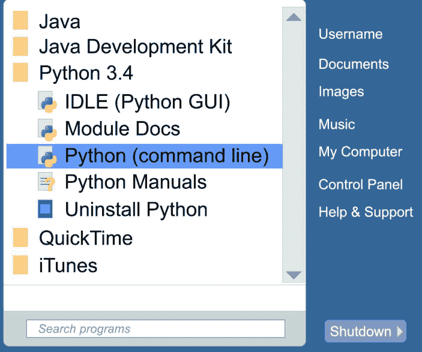

## 终端方式

如上一节所述，通过 `Python` 命令从命令行启动解释器。

输入 `print("Hello world!")` 并按回车。

终端看起来如下：

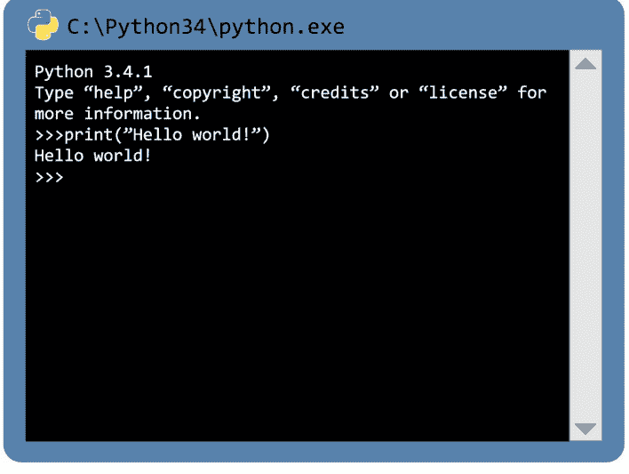

在上面的代码段中，你可以看到第一行是以 `>>>` 开头的。这个符号指示了你提供动态输入的行。注意看，当你的第一个命令结果打印在屏幕上时，解释器再次打印了 `>>>`。

## 脚本方式

软件工程的核心原则之一是可重用性。

让我们让解释器中测试过的代码变得可重用。

为了做到这一点，创建一个名为 `hello_world.py` 的文件，并在其中输入以下文本：

```
print("Hello World!")
```

你放入文件中的内容正是之前通过解释器执行的那行代码。

现在，让我们运行你编写的脚本。

打开命令行，导航到脚本所在的目录，并输入 `python hello_world.py`。按下回车后，你将看到屏幕上显示出“Hello World!”文本。

恭喜你！

你已经成功编写了第一个 Python 程序并成功启动了它。

# 第一部分：内置语言特性

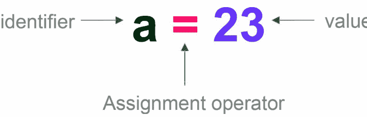

## 内存

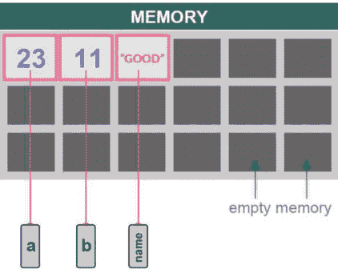

将 `b` 的值从 `11` 改为 `8`

## 内存

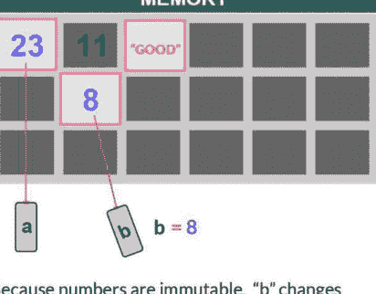

```
a = 23
b = 11
name = "GOOD"

b = 8
```

由于数字是不可变的，`b` 会改变位置指向新值。当一个内存位置没有被引用时，该值就会消失，该位置就可以被再次使用。这个过程被称为垃圾回收。

## 内存

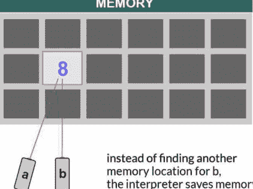

## 内存

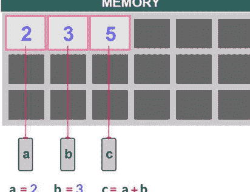

解释器并没有为 `b` 寻找另一个内存位置，而是通过指向同一个位置来节省内存。

```
a = b
a = 2
b = 3
c = a + b
```

这就是测试 `a` 和 `b` 是否共享同一个内存位置的方法：

```
>>> a is b
True
>>> print(Id(a))
123123123
>>> print(Id(b))
123123123
```

你可以使用以下语法为多个变量分配相同的值：

```
>>> a = b = c = d = f = "Hello World!"
>>> a
Hello World!
>>> c
Hello World!
>>> f
Hello World!
```

Python 变量名必须遵循以下规则：

1. 必须以字母或下划线开头
2. 只能包含字母、数字或下划线

几个非法变量名的示例：

```
1. 2var
2. var-bar
3. foo.loo
4. @var
5. $var
```

Python 还有一些不能作为变量名的特殊单词：


```
and assert break continue del def elif
else except exec finally for from global if
import in is lambda not or pass raise
return try while yield
```

### 练习

**题目**：哪些语句是有效的？

```
1. $foo = "bar"
2. lambda = "bar"
3. finally = "yes"
4. pass = "you shall not"
5. ___buga_wuga = "@@@huz"
6. foo_bar = "bar",
```

**答案**：最后两个。注意，最后一个之前的语句看起来是不正确的，实际上是一个合法的变量。

### 练习

**题目**：在一行内为 `zen`、`foo` 和 `bar` 分配值 `blah`。

**答案**：

```
foo = bar = zen = "blah"
```

## 数据类型

- 可变变

### 数值

| 变量类型 | 示例 | 用法 |
| :--- | :--- | :--- |
| 整数 | `integer = 3` | |
| 浮点数 | `my_float = 10.2` | |

### 序列

| 变量类型 | 示例 | 用法 |
| :--- | :--- | :--- |
| 字符串 | `text = "String"` | |
| 字节 | `x = b'normal string'` | |
| 数组 | `y = bytearray('Hello World!')` | |
| 列表 | `myList = [1, 2, 3, 4, 5]` | |
| 元组 | `myTuple = (a, b, c, d, e)` | |

### 集合

| 变量类型 | 示例 | 用法 |
| :--- | :--- | :--- |
| 集合 | `a = set('Set')` | `{'S', 'e'}` |
| 冻结集合 | `b = frozenset(["Paris", "NY", "Milano"])` | |

### 映射

| 变量类型 | 示例 | 用法 |
| :--- | :--- | :--- |
| 字典 | `employee = {"name": "Joe", "age":21}` | |

下表提供了 Python 中常用类型的概述。

| 变量类型 | 示例 | 注释 |
| :--- | :--- | :--- |
| 布尔值 | `life_is_good = True` | 真/假值 |
| 整数 | `size_of_shoes = 42` | 各种数字 |
| 浮点数 | `pi = 3.141592659` | 点后面跟一个或多个数字 |
| 字符串 | `chinese_hi = "你好"` | 任何文本 |
| None | `my_new_book = None` | 无值的变量 |

你可以使用赋值运算符在变量中存储所有类型的数据。多行字符串可以存储大型文本块。

```
long_text = """Line one
Line two
Line three
```

你可以看到，三引号包裹的多行字符串是普通字符串。在 Python 中可以将字符串转换为整数：

```
>>> str(100)
'100'
>>> int("234")
234
```

### 测验

**题目**：

1. 这个运算符的名字是什么？
2. 如何将数字 `3.14` 转换为字符串 `'3.14'`？

**答案**：

1. 赋值运算符
2. `str(3.14)`

## 基础数学

Python 有一组算术运算符。下表提供了简写形式及其等效形式的简单比较。假设初始状态为：`a = 3`。

| 操作名称 | 简写 | 全写 | a 的值 | 注释 |
| :--- | :--- | :--- | :--- | :--- |
| 加法 | `a += 1` | `a = a + 1` | 4 | |
| 减法 | `a -= 1` | `a = a - 1` | 2 | |
| 乘法 | `a *= 2` | `a = a * 2` | 6 | |
| 除法 | `a /= 2` | `a = a / 2` | 1.5 | 返回小数或浮点数 |
| 取模 | `a %= 2` | `a = a % 2` | 1 | 返回除余整数 |
| 幂 | `a **= 2` | `a = a ** 2` | 9 | 类似于数学中的 a^2 |
| 整除 | `a //= 2` | `a = a // 2` | 1 | 返回整数值 |
| 取反 | `a = -a` | `a = -a` | -3 | 返回符号相反的数值 |

在 Python 中求数字的平方根也很方便，但它不是内置语言特性。你将在书中发现它！你可以使用 `abs()` 计算数字的绝对值（例如 `|-3|`）。例如，`abs(-3)` 返回 `3`。

## 运算符优先级

Python 中数学运算的执行顺序与传统数学使用的顺序相似。

数学中有三个通用的优先级：

1. 幂和根
2. 乘、除和取模
3. 加和减

幂和根由 Python 标准库中的函数表示，并在书中后续进行进一步讨论。


所有其他优先级都有它们自己的内置 Python 运算符。高优先级的操作在低优先级的操作之前执行。相同顺序的操作从左到右执行。

例如，语句：`2 + 3 * 4 - 1` 返回 `13`。乘法在加、减法之前执行。

为了影响运算符的执行顺序，你应该使用括号 `()`。例如，`(3 + 6) * 2` 等于 `18`，`8 / (1 + 1)` 等于 `4`。

## 代码示例

下面的代码段显示了简单的数学运算如何在 Python 解释器中处理。

```
>>> 13 * 2
26
>>> 10 - 32
-22
>>> 11 % 10
1
>>> 6 ** 2
36
>>> 12 / 8
1.5
>>> 12 % 8
4
>>> -16
-16
>>> a = 16
>>> a += 3
>>> a
19
>>> a = 4
>>> b = 6
>>> a *= b
>>> a
24
```

### 练习

尝试在不用 Python 的情况下回答问题，然后使用解释器验证你的答案：

1. 计算 `2 + 2 + 2 + 2 * 0` 的结果是什么？
2. 这一个呢？`(2 + 2 + 3 + 4) * (4 * 4 - (2 * 6 + 4))`？

**答案**：
1. `10` - 如果你回答 `0`，说明你忘记乘法的优先级高于加法。
2. `0` - 如果你的答案是其他，说明你忘记括号内的运算先执行 - 第二个表达式的乘积 `(4 * 4 - (2 * 6 + 4))` 是 `0`，任何数乘以 `0` 都为 `0`。

### 练习题

**问题**：给定 `f(x) = |x^3 - 20|`，找到 `f(-3)`。你的答案应包含两行代码：一行将 `x` 初始化为 `-3`，另一行计算结果。

**答案**：以下 Python 代码可以完成任务：

```
>>> x = -3
>>> abs(x ** 3 - 20)
47
```

### 练习题

**问题**：尝试使用内联的 `-3` 来解决上一个问题，而不是使用变量。

**答案**：

你的解决方案应该像这样：

```
>>> abs((-3) ** 3 - 20)
47
```

如果看起来像这样：

```
>>> abs(-3 ** 3 - 20)
47
```

它是错误的，因为取负数（即从 0 中减去）的优先级低于指数，因此必须包含在括号内。尽管你的解决方案与正确答案的结果相同，但这纯粹是巧合。尝试为 `f(x) = |x^2 - 20|` 找到在取负数周围加括号和不加括号的 `x` 值，以查看差异。

### 练习题

**问题**：如何使用 Python 检查一个整数是否为奇数？

**答案**：使用取模运算符找到除以 `2` 的余数。如果余数为 `1`，则该数字是奇数。

```
>>> 3 % 2
1
>>> 4 % 2
0
```

## 字符串操作

单词和句子是字符的集合，Python 字符串也是如此。你可以通过索引访问 Python 字符串中的任何字符，索引可以从字符串的开始或结束计数。当你从开始计数时，从 `0` 开始。

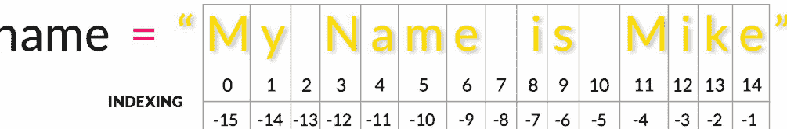

在 Python 中，整数索引是基于 `0` 的。

```
>>> name = "My Name is Mike"
>>> name[0]
'M'
>>> name[1]
'y'
>>> name[9]
's'
>>> name[-1]
'e'
>>> name[-15]
'M'
>>> name[7]
' '
```

### 切片

你可以从较长的字符串内部提取较短的子字符串。

这种操作被称为“切片”。

```
>>> name[11:14] # 从第11位到第14位，不包含14位
'Mik'
>>> name[11:15] # 从第11位到第15位，不包含15位
'Mike'
```

如果你想检查字符串是否包含特定的子字符串，可以使用 `in` 运算符。

```
>>> "B" in "Foo"
False
>>> "B" not in "Foo"
True
>>> "G" in "Gohl"
True
>>> "James" in "James is tall"
True
```

`len()` 函数计算字符串的长度。

```
>>> len(name)
15
```

## 拼接

在 Python 中，可以将两个字符串合并为一个字符串：

这种操作被称为拼接。

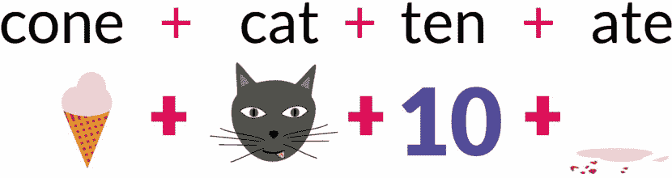

```
>>> boo = "cone" + "cat" + "ten" + "ate"
>>> print(boo)
concatenate
>>> foo = "one"
>>> bar = "two"
>>> full = foo + " " + bar
>>> print(full)
one two
```

如果你想要一个包含 N 个子字符串的字符串，你使用 `*` 运算符。

```
>>> foo = "foo " * 3
>>> print(foo)
foo foo foo
```

### 测验

**问题**：

1. 在 Python 中，可以将多个字符串合并为一个。这种操作的名称是什么？
2. 有一个字符串 `value = "foobar"`。通过以下方式访问 `value[1:3]`。这种操作的名称是什么？`value` 有多长？
3. 字符串中第一个字符的索引是多少？

**答案**：

1. 拼接
2. 切片。长度是 `2`。
3. `0`

### 练习题

**问题**：有两个字符串：`one = “John is strong”` `two = “Tea is warm”`。编写 Python 代码生成 `result = “John is not warm”`，通过切片：

**答案**：

```
one[0:8] + " not " + two[7:11]
```
*(注：原文答案 `one[0:8] + two[7:11]` 结果为 "John iswarm"，此处修正逻辑以匹配目标字符串 "John is not warm")*

### 练习题

这些字符串中哪一个不包含字母 `B`：`"Foo"`, `"Bar"`, `"Zoo"`, `"Loo"`，

**答案**：

```
>>> "B" in "Foo"
False
>>> "B" in "Bar"
True
>>> "B" in "Zoo"
False
>>> "B" in "Loo"
False
```

### 练习题

**问题**：使用 Python 解释器找到字符串 `"John is strong"` 的长度

**答案**：

```
>>> len("John is strong")
14
```

## 注释


# 编写注释

编写注释非常简单。注释有两种方式：单行和多行。


注释旨在帮助用户，会被解释器忽略。单行注释通过添加 `#` 创建。多行注释跨越多行。


```
"""
这是一个可以跨越几行的多行注释。
"""
```

# 函数

我们讨论过可重用性是一个原理。一旦你写了一个函数，就可以重复使用它而无需重复。

```python
def hi():
    print("Hello world!")

hi()
```

## 带参数的函数

有时，你希望函数在不同的条件下改变行为。为了这一点，你可以使用函数参数。假设你想不仅对 Jones 先生打招呼，还对任何名字的人打招呼。你需要修改原始的 `hi()` 函数使其像这样：

```python
def hi(name):
    print("Hello " + name + "! 你今天怎么样?")
```

现在你可以对 John、James 和 Maggie 打招呼，如下：

- `hi("John")`
- `hi("James")`
- `hi("Maggie")`

这将顺序打印出：

```
Hello John!
Hello James!
Hello Maggie!
```

## 默认值

为了避免这些错误，你可以为参数提供默认值，并在需要时覆盖这些默认值。

```python
def hi(name="sir"):
    print("Hello " + name + " How are you today?")
```

在这种情况下，你可以带参数或不带参数调用该函数。调用如下：

```python
hi()
hi("James")
```

```
Hello sir! How are you today?
Hello James! How are you today?
```

```python
def foo(bar, zoo="blah"):
    ...
```

是有效的。同时：

```python
def foo(bar="blah", zoo):
    ...
```

是无效的。

## 返回值

让我们看看之前在练习中涵盖过的代码片段之一：

```python
N = 10
distance_in_kilometers = 100 * N
distance_in_meters = distance_in_kilometers * 1000
```

如果你想将这种逻辑封装在一个函数中，使得你可以传入小时（hours）和每小时公里（km/h），并以某种方式返回以米为单位的距离呢？

这种逻辑可以使用函数实现：

```python
def get_distance(speed, duration):
    distance_in_kilometers = speed * duration
    distance_in_meters = distance_in_kilometers * 1000
    return distance_in_meters
```

函数的最后一行包含一个 `return` 语句。理解它的作用方法是查看函数的几次调用：

```python
speed = 100
initial_distance = get_distance(speed, 0)
distance_after_a_day = get_distance(speed, 24)  # 天是24小时
distance_after_a_week = get_distance(speed, 24 * 7)  # 周是7天
```

正如你可能猜到的，`return` 语句允许你将函数的输出存储在变量中。在执行上述行后，变量将具有以下值：

| 变量 | 值 |
|---|---|
| initial_distance | 0 |
| distance_after_a_day | 2400000 |
| distance_after_a_week | 16800000 |

## 练习

**问题**：有一个数学函数 `f(x,y) = x^y + 100`。

在 Python 中实现该函数。

**答案**：

```python
def function(x, y):
    return x ** y + 100
```

## 练习

**问题**：哪些函数定义是有效的？

```python
@foo(bar):
_foo bar = 1);
foo(bar = 2, bla = 1);
foo(bar = 2, bla):
foo($bar, bla = 1);
```

**答案**：

- 1. 无效：函数名中使用了符号 `@`
- 2. 有效
- 3. 有效：有多个带有默认值的参数
- 4. 无效：参数没有默认值
- 5. 无效：参数名使用了符号 `$`

## 练习

**问题**：修改下面的函数，使其返回问候而不是打印它：

```python
def h():
    greeting = "Hello world!!!"
    print(greeting)
```

**答案**：

```python
def h():
    greeting = "Hello world!!!"
    return greeting
```

# If/Else 和条件语句

我们在书中目前为止涵盖的简单语句和操作有很多种用途。然而，任何编程的主要目的是实现某种逻辑。

`if/else` 块是 Python 中的核心语法元素。它们允许你条件地控制程序的流。

在以下场景中，你想知道你的车行驶得是否太快。如果你超过了 100 km/h，函数将打印“Too fast!”；如果你在限速以下行驶，函数将打印“You are driving below the speed limit. Well done.”

```python
def drive(car_speed):
    if car_speed > 100:
        print("Too fast!")
    else:
        print("You are driving below the speed limit. Well done")
```

```python
>>> drive(70)
You are driving below the speed limit. Well done
>>> drive(120)
Too fast!
```

上面的代码中有几点需要注意。

首先是 `>` 运算符。它是一个布尔比较运算符，与数学中使用的相同。如果第一个项目大于第二个项目，它返回 `True`，否则返回 `False`。

其次是 `if/else` 语法。如果 `is_too_fast` 为 `True`，则执行第一块代码。如果不是，则执行第二块代码。

第三是缩进。函数内部的语句被缩进，而 `if/else` 块内部的语句进一步缩进。

## 布尔表达式

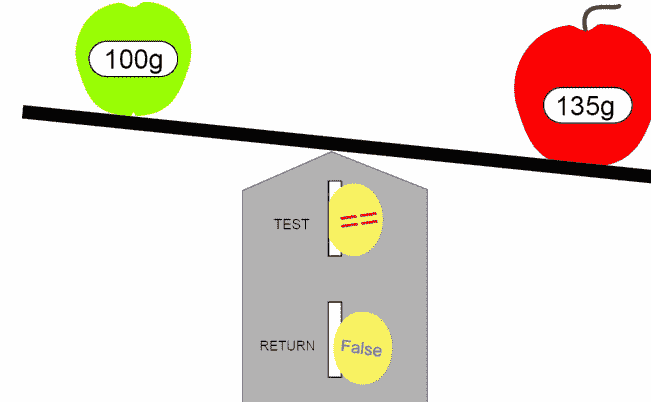

```python
greenApple = 100
redApple = 135
print(greenApple == redApple)   # 测试 100 和 135 是否相等
# False
print(greenApple < redApple)   # 测试 100 是否小于 135
# True
print(greenApple != redApple)  # 测试不相等
# True

>>> bool(1)
True
>>> bool("")
False
>>> bool(None)
False
>>> bool("blah")
True
>>> bool(0)
False
>>> bool(True)
True
```

在 Python 中，任何值都可以被解释为 `True` 或 `False`。在数据类型中，`0`、空字符串和 `None` 是 `False`。其他值都是 `True`。你可以通过将值转换为布尔类型来检查该值是否为 `True`。还有许多内置的比较运算符如 `>`。下表提供了这些运算符的概述：

| 运算符 | 语句 | 语句的值 |
|---|---|---|
| Less | `1 < 2` | `True` |
| Less | `4 < 3` | `False` |
| Less or equal | `2 <= 2` | `True` |
| Greater | `4 <= 1` | `False` |
| Greater | `3 > 3` | `False` |
| Greater or equal | `2 >= 2` | `True` |
| Greater or equal | `3 >= 4` | `False` |
| Equal | `"foo" == "foo"` | `True` |
| Equal | `0 == 1` | `False` |
| Not equal | `"foo" != "bar"` | `True` |
| Not equal | `10 != 1` | `False` |
| And (both parts must be True) | `3 and "foo"` | `True` |
| And (both parts must be True) | `None and True` | `False` |
| Or (one of parts must be True) | `1 or None` | `True` |
| Or (one of parts must be True) | `None or False` | `False` |
| Not (opposite to the target expression) | `not None` | `True` |
| Not (opposite to the target expression) | `not True` | `False` |

注意，比较运算符的优先级高于逻辑运算符 `and`、`or` 和 `not`。算术运算符的优先级高于比较运算符。这里是使用逻辑运算符的几个示例：

```python
>>> 2 * 6 + 1 < 2 * (6 + 1)
True
>>> 2 * 6 + 1 == 2 * (6 + 1)
False
>>> 2 ** 3 == 8 and 2 ** 2 == 16
False
>>> (2 ** 2 == 4 and False) or (16 < 15 or 1 == 3)
True
```

## 分支语句

在很多情况下，逻辑比两个条件要复杂。让我们修改之前的函数，使其在速度超过 200 km/h 时打印“You are insane, man!!!”，并在速度在 70 到 80 km/h 之间时打印“The optimal speed for your car.”

```python
def drive(car_speed):
    if car_speed > 200:
        print("You are insane, man!!!")
    elif car_speed > 100:
        print("Too fast!")
    elif car_speed > 70 and car_speed < 80:
        print("The optimal speed for your car.")
    else:
        print("You are driving below the speed limit. Well done")
```

你可能会注意到在这个代码中我们没有使用布尔变量。相反，我们将比较运算符与 `if` 语句写在一起。`and` 语句将两个运算符连接在一起。我们还使用了 `elif`。这定义了一个可选分支。注意分支的顺序！如果多个分支为 `True`，将使用第一个。例如：

```python
a = 10
if a > 1:
    print("Big")
elif a > 5:
    print("Really big")
elif a == 10:
    print("Approaching enormity")
elif a > 10:
    print("Enormous!")
```

这段代码只会打印“Big”，其他语句将被忽略。

## 测试

尝试在不使用解释器的情况下回答这些问题。

1. 以下变量的布尔值 `bool(a)` 是什么：

```python
a = False
a = "0"
a = 0 * 18
a = "None"
```

2. 以下语句的输出是什么：
   `(2 ** 2 == 4 and False) or (not (16 > 15 or 1 == 3))`

3. 写出 Python 的逻辑运算符。

4. 以下代码的结果将打印什么？

```python
x = 5
if x == 25:
    print("Quarter")
elif x == 10:
    print("Dime")
elif x == 5:
    print("Nickel")
elif x == 1:
    print("Penny")
else:
    print("Not a coin")
```

5. 假设 `x=5, y=0, z=1`。以下表达式是 `True` 还是 `False`？

```python
x == 0
x >= y
2 + 3 == x and y < 1
not (z == 0 or y == 0)
x = 3
```

6. 以下代码打印什么？

```python
x = 0
if x != 0:
    print("x is nonzero")
```

**答案**：

1. a) `False`
   b) `True` - 这是一个包含字符 `0` 的字符串，而不是整数
   c) `False` - `0 * 18` 等于 `0`
   d) `True` - 再次 `"None"` 是一个字符串而不是真实的 `None`

2. `False` - `not` 语句内部表达式为 `True`，导致该语句为 `False`，且第一个语句也是 `False`。

3. `and`, `or`, `not`

4. `Nickel`。`x == 25` 和 `x == 10` 均为 `False`，所以第一个为 `True` 的语句是 `x == 5`。

5. a) `False`。运算符 `==` 用于测试相等性，`5` 不等于 `0`。
   b) `True`。`5` 大于或等于 `0`。
   c) `True`。`2 + 3 == x` 和 `y < 1` 均为 `True`。
   d) `False`。`y == 0` 为 `True`，所以 `z == 0 or y == 0` 为 `True`，其取反为 `False`。
   e) `True`。`=` 运算符将值 `3` 赋值给 `x`，值 `3` 的求值为 `True`。

6. 无输出。表达式为 `False`，所以代码不会执行。

## 练习

**问题**：编写一个表达式测试变量 `x` 是否小于或等于 100。

**答案**：

```python
x <= 100
```

## 练习

**问题**：编写一个表达式测试变量 `x` 是否在 3 到 10 之间（包含边界）。

**答案**：

```python
x >= 3 and x <= 10
```

## 练习

**问题**：编写一个表达式测试变量 `x` 是否为偶数或 5 的倍数。

**答案**：

```python
(x % 2 == 0) or (x % 5 == 0)
```

## 练习

**问题**：
有一个具有如下声明的函数：`person_is_old(age)`，它根据传入的整数年龄返回 `True` 或 `False`。
编写一个使用上述函数的函数，如果该人未老，则打印“去上班！”，否则打印“你值得休一个长假”。你的函数还必须接受年龄作为参数。

**答案**：

```python
def tell_what_to_do(age):
    if person_is_old(age):
        print("You deserved to have a long vacation")
    else:
        print("Go to work!")
```

# 类与对象

面向对象编程的核心原则之一是封装 - 隐藏系统内部运行的细节，使用户不需要知道其工作原理即可使用。用户与程序交互的部分被称为“接口”。

正如汽车司机需要方向盘和油门来使用汽车的功能一样，你代码的用户需要使用被称为“方法”的语法结构。

在这里，我们用 Python 实现了一个汽车：

```python
class Car:
    def turn_left(self):
        pass
    def turn_right(self):
        pass
    def accelerate(self):
        pass
    def slow_down(self):
        pass
    def open_a_window(self):
        pass
```

在上面的代码中，我们创建了一个类。类是一个具有特定行为的实体。这些行为表现为方法，与我们之前使用的函数相同，并且缩进方式相同。类的方法将类（`self`）作为第一个参数传递。`pass` 关键字告诉 Python 该代码块什么都不做。

该类可以代表不同的汽车 - 宝马、奔驰、奥迪、菲亚特、特斯拉等。让我们创建一个带有参数的汽车。

```python
bmw_x6 = Car(model="BMW X6", max_speed=230)
```

在上面的代码中，你可以看到汽车对象是用两个参数创建的：`model` 和 `max_speed`。原始汽车代码并没有支持这些参数。为了实现这种支持，你必须引入一个 `__init__` 方法：

```python
class Car:
    def __init__(self, model, max_speed):
        self.model = model
```


### 类构造函数与方法

```python
self.max_speed = max_speed
self.speed = 0
```

上面的代码获取你的新汽车对象 (`self`) 并使用点符号赋值汽车的 `model` 和 `max_speed`。汽车初始速度为零。

`__init__` 方法不应该包含返回语句 - 它仅用于构建你的对象。这个方法被称为“类构造函数”。

加速和减速应该相应地减少和增加汽车的速度。

```python
class Car:
    ...
    def accelerate(self, speed_difference):
        self.speed += abs(speed_difference)
        self.speed = min(self.speed, self.max_speed)

    def slow_down(self, speed_difference):
        self.speed -= abs(speed_difference)
        self.speed = max(self.speed, -5)
    ...
```

对象的内部状态通过 `min` 和 `max` 改变。

---

### 练习题

**问题**：编写一个表达式测试变量 `x` 是否在 3 到 10 之间（包含边界）。

**答案**：

```python
x >= 3 and x <= 10
```

**问题**：引入一个也是 `Vehicle` 的 `Bike` 类。自行车的主要特征是它的速度永远不会超过 30。

**答案**：你只需要确保最大速度被限制在 30 以内，在 `__init__` 中调用 `super()` 之前进行限制。

```python
class Bike(Vehicle):
    def __init__(self, name, max_speed):
        max_speed = min(max_speed, 30)
        super().__init__(name, max_speed)
```

---

### 元组

元组是不可变的变量数组。

你可以通过以下方式访问元组的元素：

```python
>>> my_tuple = ("apple", "pear", "banana")
>>> my_tuple[1:] # 从第二个到结束
('pear', 'banana')
>>> my_tuple[2][2] # 第3个元素的第3个字符
'n'
```

“**不可变**”意味着一旦定义了元组，就无法更改它。

```python
>>> my_tuple[2] = "mango" # 将 'banana' 替换为 'mango'
TypeError: 'tuple' object does not support item assignment
>>> my_tuple[2][0] = "B"
TypeError: 'str' object does not support item assignment

>>> new_tuple = ('foo', 'bar', 'zoo', 'loo')
>>> type(new_tuple)
<class 'tuple'>
>>> new_tuple[0]
'foo'
>>> new_tuple[3]
'loo'
>>> new_tuple[1:3]
('bar', 'zoo')
>>> len(new_tuple)
4
>>> new_tuple += ('2',)
('foo', 'bar', 'zoo', 'loo', '2')
>>> new_tuple += ('blah', 'blah')
('foo', 'bar', 'zoo', 'loo', '2', 'blah', 'blah')
```

从上面的代码中可以看出，元组的行为与字符串相似——然而字符串仅仅是字符数组，而元组可以包含任何类型的变量。在语法上，元组项必须用括号括起来，并用逗号分隔。即使是包含单个元素的元组也必须有一个逗号：`(1,)` 是元组，但 `(1)` 不是。

---

### 列表

列表类似于元组，但你可以在创建后对其进行修改。让我们定义一个包含三个元素的简单列表：

```python
>>> my_list = ['apple', 'pear', 'banana']
>>> my_list[1:] # 从第二个到结束
['pear', 'banana']
>>> my_list[2][2] # 第3个元素的第3个字符
'n'
```

```python
>>> my_list[2] = "mango" # 将 'banana' 替换为 'mango'
['apple', 'pear', 'mango']
>>> my_list[2] = "B" # 尝试将 'b' 更改为 "B"，你将得到错误
TypeError: 'str' object does not support item assignment

>>> new_list = ['foo', 'bar', 'zoo', 'loo']
```

正如你所注意到的，列表项应该包含在方括号内。要删除第3个元素并将第一个元素更改为 "blah"：

```python
>>> new_list.pop(2)
['foo', 'bar', 'loo']
>>> new_list[0] = "blah"
['blah', 'bar', 'zoo', 'loo']
```

你可以向列表末尾添加元素：

```python
>>> new_list.append("new_item")
['foo', 'bar', 'zoo', 'loo', 'new_item']
```

并从列表末尾弹出元素：

```python
>>> new_list.pop()
'new_item'
```

你也可以将元素添加到列表的特定位置：

```python
>>> new_list.insert(1, 'John')
['foo', 'John', 'bar', 'zoo', 'loo']
```

当你向列表添加元素时，它会将所有后续元素向右移动。

---

### 字典

字典是键值对的集合，工作原理与列表或元组非常相似。字典值可以使用任何类型来访问，而不是使用整数索引。让我们创建一个以人名为键、年龄为值的字典：

```python
>>> ages = {
... "John": 34,
... "Matt": 23,
... "Natasha": 27,
... "Gabriella": 33
... }
```

键值对必须包含在花括号中并用逗号分隔。字典中的键必须是唯一的，但值可以是相同的。键可以是任何类型。以下也是一个有效的字典：

```python
class SomeClass:
    pass

>>> obj1 = SomeClass()
>>> obj2 = SomeClass()
>>> a_dict = {
... obj1: 11,
... obj2: 23
... }
```

你可以通过以下方式获取 John 的年龄：

```python
>>> ages["John"]
34
```

上述语句要么更改现有键的值，要么如果不存在则创建一个新的键值对。你也可以从字典中删除键值对。

```python
>>> ages.pop("John")
```

---

## 测试

**问题**：

1. 哪种集合像一个带有名字标签的房间？哪种像一个匿名储物柜？
2. 列表和元组之间的主要区别是什么？
3. 浮点数可以作为字典的键吗？
4. 在字典中有多少个名为 "John" 的键？
5. `(123)` 是一个元组吗？

**答案**：

1. 字典 / 列表
2. 列表可以修改，元组不能修改
3. 可以，为什么不呢？
4. 正好一个 - 所有的键必须是唯一的
5. 不是 - 忘记了逗号

---

## 练习

**问题**：获取 Natasha 的年龄。

**答案**：

```python
ages['Natasha']
```

**问题**：移除 Matt。

**答案**：

```python
ages.pop('Matt')
```

---

## 循环

集合可以用于存储数据，你还可以遍历它们并对每个元素单独进行某些操作。在 Python 中有两种类型的循环可以使用：`while` 和 `for`。`while` 循环只要特定条件真就会持续重复。`while` 循环内部的语句必须像其他代码块一样缩进。循环必须使用 `while` 关键字、布尔语句和冒号来定义。布尔语句可以是函数调用、变量或比较语句。

这段代码将打印 1 到 10：

```python
laps = 0
while laps < 10: # 测试
    laps += 1 # 计数器
    print(laps) # 语句1
    print("and") # 语句2
print("Done") # 循环退出
```

### While

Python 提供了 `break` 和 `continue` 语句，以便更灵活地控制循环。

```python
while <test1>:
    <statement1>
    if <test2>: break
    if <test3>: continue
    else:
        <statement2>
### 循环退出，跳过 else
### 回到 <test1>
### 如果没有发生 break 则执行
```

### For

你可以使用 `for` 循环来遍历集合。假设你有如下列表：

```python
a = ["foo", "bar", "zoo", "loo"]
for item in a:
    print(item)
```

---

## 文件操作

大多数文件操作都可以归结为：打开文件、读取文件、向文件写入数据以及关闭文件。通常，你写入文件中的数据是文本格式。

假设你想将一个整数列表写入文件，使得每个整数单独占一行。首先，打开文件：

```python
the_file = open("integers.txt", "w")
```

```python
integers = [1, 2, 3, 4, 5]
for integer in integers:
    the_file.write(str(integer) + "\n")
```

`write` 方法接受字符串作为参数并将其写入文件。注意 `\n` 符号 - 它在文件中开始一个新行。当你完成对文件的操作后，必须关闭它：

```python
the_file.close()
```

你也可以从文件中读取数据。首先，在不使用 "w" 标记的情况下打开文件：

```python
the_file = open("integers.txt")
```

从文件中获取所有行：

```python
lines = the_file.readlines()
```

`readlines()` 函数将文件中的所有行作为字符串列表返回。让我们打印出这些行：

```python
for line in lines:
    print(line)
```

执行上述代码后，你将在屏幕上看到以下内容：

```
1
2
3
4
5
```

和写入文件一样，完成后也别忘了关闭它：

```python
the_file.close()
```

### 测验

**问题**：

1. 换行符看起来是什么样的？
2. 在完成文件操作后，你应该对文件做什么？
3. 使用什么方法将数据放入文件中？
4. 你应该使用哪种方法获取文件中的所有行？

**答案**：

1. `\n`
2. 关闭它
3. `write`
4. `readlines`

---

## 异常

有时会发生意料之外的情况，导致程序无法按预期执行。这些事件被称为“异常”。

```python
>>> 1 / 0
```

按下回车键后，你将看到以下输出：

```
Traceback (most recent call last):
File "<html>", line 1, in <module>
ZeroDivisionError: division by zero
```

这被称为异常回溯。它显示了在异常发生之前调用了哪些函数或方法。最后一行告诉你抛出了哪种异常，并提供了一些额外的、人类可读的信息。

在 Python 中，你可以通过 `try/except` 块来处理异常。如果在重要任务执行过程中发生了异常怎么办？让我们打印 “division by zero. But it is totally fine.”，而不是直接抛出回溯。

```python
try:
    1 / 0
except ZeroDivisionError as e:
    print(str(e) + " But it is totally fine.")
```


在上面的代码中，你可以看到想要尝试执行的语句放在 `try` 块中。所有的错误处理代码都放在 `except` 下。`except` 关键字必须伴随一个异常类。它还可以跟一个 `as` 关键字和一个变量，该变量用于存储对错误的人类可读描述。

### 自定义异常

你可以定义自己的异常类，以进一步通知代码内部发生了异常情况：

```python
class YourException(Exception):
    pass
```

所有自定义异常必须有一个内置的 Python 异常作为父类。异常不需要实现任何其他逻辑。为了抛出异常，你应该使用 `raise` 关键字：

```python
raise YourException("Human-readable message")
```

执行上述代码后，你将看到一个带有“Human-readable message”字符串的回溯。处理自定义异常与处理内置异常是类似的：

```python
try:
    raise YourException("Human-readable message")
except YourException as e:
    print("Your exception occured with message: " + str(e))
```

### 测验

问题：

1. 什么块用于处理异常？
2. 异常发生时，打印的长文本名称是什么？

答案：

1. `try/except` block
2. traceback

# 第二部分：标准库

## import 语句、模块和包

正如你所看到的，Python 中的所有源代码存储在称为模块（modules）的文件中。每个模块都有 `.py` 扩展。不同的模块在逻辑上组合成包（packages）。包是一个带有 `__init__.py` 的文件夹。例如，以下是一个包：

```
foobar/
    __init__.py
    one.py
    two.py
    three.py
```

而不是：

```
foobar/
    one.py
    three.py
```

默认安装带有大量的包。这些包被称为标准库（standard library）。

### import 语句

如果你想使用存储另一个包中的功能，必须使用 `import` 语句。让我们在屏幕上打印你的名称：

```python
>>> import os
>>> os.path
```

上面的片段显示了如何导入顶层包。通过点运算符访问包的成员。你可以通过直接导入来避免使用点运算符：

```python
>>> from os import path
>>> path()
```

要指定来源，必须使用 `from`。有时你可能从同一个包导入多个实体。在这种情况下，直接导入所有实体更简单：

```python
>>> from os import sys
```

注意，包内部的实体可以是任何构造：类、函数甚至是包（嵌套包是可能的）。

### 测验

问题：

1. Python 源文件的别名是什么？
2. 带有包的术语是什么？
3. 默认安装的包集合名称是什么？
4. 如何从 os 导入 path？

答案：

1. module
2. package
3. standard library
4. `from os import path`

### 使用 os 模块的文件操作

虽然可以使用内置函数和方法处理文件，但它们并没有涵盖你在计算文件系统时可能遇到的所有场景。本章概述了你在处理数据和管理任务时可能遇到的常见任务。快速说明：下面的示例使用了 Linux 路径。要在 Windows 上运行它们，将斜杠（/）替换为反斜杠（\）。首先假设你有了如下文件夹结构：

```
/parent/
    foo/
        one.txt
        two.txt
        three.txt
```

首先使用终端命令进入 foo 的父目录：

```bash
cd /parent
```

让我们验证路径是否符合预期。获取当前目录的绝对路径，你应该使用 `os.path` 模块的 `abspath` 函数和 `curdir` 属性：

```python
>>> from os.path import abspath, curdir
>>> curdir
>>> abspath(curdir)
/parent
```

`curdir` 变量持有指向当前目录的字符串——`abspath` 接受任何路径作为参数并返回绝对路径。现在将 `one.txt` 重命名为 `bar.txt`。要实现这一点，你需要标准库 `os` 模块中的两个函数：分别是 `remove` 和 `rename`。

```python
>>> from os import remove, rename
>>> remove('foo/one.txt')
>>> rename('foo/two.txt', 'foo/bar.txt')
```

正如你看到的，为了删除文件，必须将其名称传递给函数；为了重命名文件，除了提供原始名称外，还必须传递将赋值为文件新名的字符串。注意，提供文件名时，必须提供文件的相对路径或绝对路径。对于绝对路径，一切都很简单——它应该从文件系统的根目录开始。绝对路径在 UNIX 和 Windows 上分别如下：

```
/Blah/Blah/foo/one.txt
C:\Blah\Blah\foo\one.txt
```

相对路径是通过你的当前目录计算的。假设你在 `/foo/bar/one` 目录下并想移动到 `/foo/bar/two`。在这种情况下，相对路径应该是 `../two`。两个点代表父目录。由于你需要向上导航两层，需要一组 `../`。

由于上述 nix 和 Windows 上的分隔符不同，`remove/rename` 代码片段有一个严重缺陷。它不是跨平台的。为了将其转换为通用，你应该使用 `os.path` 模块中的 `join` 函数：

```python
>>> from os import remove, rename
>>> from os.path import join
>>> remove(join('foo', 'one.txt'))
>>> rename(join('foo', 'two.txt'), join('foo', 'bar.txt'))
```

你将路径的所有部分作为字符串传递给 `join` 函数，然后使用操作系统特定的路径分隔符生成字符串。

你可以列出特定目录下所有的文件和文件夹：

```python
>>> from os import listdir
>>> listdir('foo')
['bar.txt', 'three.txt']
```

现在尝试删除 foo 目录。

```python
>>> from os import rmdir
>>> rmdir('foo')
Traceback (most recent call last):
  File "<stdin>", line 1, in <module>
Error: [Errno 39] Directory not empty: 'foo'
```

### 练习

问题：

1. Windows 和 Linux 文件系统之间的什么主要差异使得编写跨平台 Python 程序变得更加困难？
2. `os.path.curdir` 的值是什么？
3. 哪个字符串代表当前目录的父目录？

答案：

1. 不同的路径分隔符：Unix 上使用 `/`，Windows 上使用 `\`
2. `.`
3. `..`

### 练习

问题：修复上一个示例中的 "rmdir" 代码使其能够工作。

答案：要做到这一点，只需要先删除所有的文件：

```python
>>> remove("foo/bar.txt")  # 你重命名了它
>>> remove("foo/three.txt")
>>> rmdir("foo")
```

### 练习

问题：使以下函数具有跨平台能力

```python
def show_foobar_here(path):
    print(path + "/foobar")
```

答案：

```python
from os.path import join

def show_foobar_here(path):
    print(join(path, "foobar"))
```

### 练习

问题：使用 `os.path` 模块中的 `isdir` 函数，找到当前目录下的文件夹。遍历文件和文件夹，然后抛出一个自定义的 `DirFound` 异常，并将目录的绝对路径作为人类可读描述。

答案：以下方案是充分的：

```python
from os.path import isdir, curdir, abspath
from os import listdir

class DirFound(Exception):
    pass

def detect_dirs():
    for item in listdir(curdir):
        if isdir(item):
            raise DirFound(abspath(item))
```

## 正则表达式

虽然可以使用 `in` 操作来检查子字符串是否存在于字符串中，但它不会告诉你子字符串的位置，也不会允许你非精确地匹配子字符串。

选取这个字符串：

```python
>>> lorem_text = "Lorem Ipsum dolor sit amet, consectetur adispiscing elit, sed do eiusmod tempor incididunt ut labore et dolore magna aliqua."
```

如果你想找出这段文本是否包含类似 "dolor BLA BLA amet" 的内容——即按顺序出现 "dolor" 和 "amet" 单词，中间带有任意长度的文本。要实现这一点，你可以使用 `re.search` 方法：

```python
>>> import re
>>> found = re.search("dolor.* amet", lorem_text)
>>> found
<_sre.RE_Match object; span=(12, 26), match='dolor sit amet'>
```

`search` 函数接受正则表达式模式作为第一个参数，并将要搜索的文本作为第二个参数。正则表达式模式是对你在文本中要查找内容的灵活描述。该格式将在本章稍后介绍。

查看 `search` 函数的返回值：它是一个 `MatchObject`（匹配对象），它告诉你子字符串在原始字符串中找到的位置。如果找不到模式，该函数返回 `None`：

```python
>>> match = re.search("found", lorem_text)
>>> type(match)
<class 'NoneType'>
```

如果你想从匹配对象获取子字符串的起始和结束索引：

```python
>>> found.start()
12
>>> found.end()
26
```

并访问被模式匹配的子字符串：

```python
>>> found.group()
'dolor sit amet'
>>> lorem_text[12:26]
'dolor sit amet'
```

注意：如果发现多个模式出现处，只返回第一个。如果你需要遍历所有出现的情况，请使用 `re.finditer` 函数：

```python
>>> list(re.finditer("dolor.* amet", lorem_text))
[<_sre.RE_Match object; span=(12, 26), match='dolor sit amet'>]
```

如果你想找到某个模式的所有匹配项，应该使用 `re.match`，它尝试将模式应用到以下字符串：

```python
>>> bool(re.match("[0-9][a-z]*", "dgfgfg"))
True
>>> bool(re.match("[0-9][a-z]*", "dgfgfg"))
False
```

正则表达式模式中的符号 `\.*` 匹配零或多个任意字符。点 `.` 代表任意字符，星号 `*` 代表数量词。这是任何正则表达式模式的基本结构：符号类型，后紧跟其数量词。

下表提供了最常用数量词的概述。

| 数量词 | 说明 |
|---|---|
| `*` | 零或多个 |
| `+` | 一个或多个 |
| `?` | 零或一个 |
| `{m}` | 符号的精确数量 |
| `{m, n}` | 至少 m 个最多 n 个 |

这是如何容易记忆其中一些：


匹配行首，也可以表示“非”（NOT）

```python
>>> # not line
```


匹配行尾

```python
>>> re = "The quick brown fox jumps over the lazy dog"
```


```python
x = re.findall("dog", txt)
['dog']
```


```python
x = re.findall("quick+", txt)
['quick']
```


```python
x = re.findall("quick*", txt)
['quick', '']
```


```python
x = re.findall("quick?", txt)
['quick']
```


```python
x = re.findall("quick([a-z]+)", txt)
['brown']
```


```python
x = re.findall("quick([a-z]+)", txt)
['lazy']
```


```python
x = re.findall("quick([a-z]{4,5})*", txt)
['quick', 'lazy']
```


```python
x = re.findall("jumps.*dog", txt)
['jumps over the dog']
```

## 正则表达式符号表

此表显示了最常用的符号。

| 符号 | 描述 |
|---|---|
| `.` | 任意字符 |
| `\"` | 双引号字符 |
| `'` | 单引号字符 |
| `\\` | 反斜杠 |
| `\t` | 制表符 |
| `\n` | 换行字符 |
| `[0-9]` | 0 到 9 的任意数字 |
| `[^0-9]` | 不是数字的字符 |
| `[a-z]` | 任意小写字母 |
| `[^a-z]` | 不是小写字母的字符 |
| `[a-zA-Z0-9_]` | 任意数字、字母或下划线 |

你可以看到，某些符号以反斜杠开头。这些符号是转义序列，表示保留字符。

现在让我们组合结合符号和数量词的模式。

- 一个或多个数字：`[0-9]+`
- 不以零开头的数字：`([1-9]{1}[0-9]+)`。括号允许你将多个符号组合成组并将数量词应用于整个组。你可以这样重新表述上述正则表达式：以一个一个非零数字开头，后面跟多个任意数字。
- 可能包含任何小写字母但前面不能有下划线的字符串：`[_][a-z]*`

为了替换子字符串的第一次出现处，你应该使用 `re.sub` 函数。按以下方式将 `dolor BLA BLA amet` 替换为 `foobar`：

```python
re.sub("dolor.*amet", "foobar", lorem_text)
```

### 练习

问题：

1. 换行字符的转义序列是什么？
2. 制表符的转义序列是什么？
3. 如果找不到模式，`.search` 函数返回什么？
4. 以下调用将匹配什么：`re.search(r'..d', 'food bar')`？尝试不使用解释器回答。

答案：

1. `\n`
2. `\t`
3. `None`
4. `ood`

### 练习

问题：编写函数 `is_valid_Python_variable_name(string)`，判断字符串是否可以作为 Python 中的变量名。你不需要担心保留关键字。

答案：

```python
def is_valid_Python_variable_name(string):
    # 下划线或字母后跟着整数
    found = re.match("[_A-Za-z][_a-zA-Z0-9]*", string)
    return bool(found)
```


### 练习

**问题**：编写函数 `get_number_of_occurrences(string, substring)`，返回一个整数，计算字符串中发现了多少个子字符串实例。

**答案**：

```python
def get_number_of_occurrences(string, substring):
    findings = list(re.finditer(substring, string))
    return len(findings)
```

## math 模块

本章提供了 Python 标准库中 `math` 模块的概述。模块包含了常用数学操作的实现，例如平方根，这些操作未包含在标准函数集中。

使用 `math` 模块可以执行常规三角运算：

```python
>>> math.sin(math.radians(30))
0.4999999999999999

>>> math.cos(math.radians(60))
0.5000000000000001

>>> math.tan(math.radians(45))
0.9999999999999999
```

注意，参数是弧的角度值而不是度。这就是为什么额外调用了 `math.radians`。

此外，你看到 `0.4999999999999999` 而不是 `0.5`，或者 `0.9999999999999999` 而不是 `1`。这是由于语言处理浮点数计算的方式。

你可以获取特定精度的特殊数字，如 pi 和 e：

```python
>>> math.pi
3.141592653589793

>>> math.e
2.718281828459045
```

你还可以计算平方根：

```python
>>> math.sqrt(16)
4.0

>>> math.sqrt(25)
5.0
```

### 测验

**问题**：为了回答以下问题，你需要深入研究标准库

1. 你会使用哪个函数来计算反正切？
2. 应该使用哪个函数进行幂运算？
3. 如何计算一个数的阶乘？

**答案**：

1. `math.atan`
2. `math.exp`
3. `math.factorial`

在软件工程中，有一个被称为“序列化”（serialization）的过程。它的主要目的是将任意对象的状态转换为可以在网络上传输和/或以某种方式存储的内容，以便稍后重建原始对象。重构的过程被称为“反序列化”（deserialization）。

序列化的现实生活类比是：研究一个现有的制品（例如，汽车）并对其制作一份详细的蓝图（引擎、轮子、变速箱等）。通过网络上传输序列化数据类似于通过普通邮寄发送蓝图。而反序列化则是某人根据获取的蓝图构建原始对象副本的过程。

在 Web 编程领域，有两种数据序列化标准最受欢迎：XML 和 JSON。它们都是文本格式的，这意味着使用这些标准表示的数据可以通过像 Vim 简单的文本编辑器轻松被人类查看。本章的主题是 JSON 以及 Python 使用它来序列化数据的方法。JSON 是 JavaScript 语言中操作数据的原生方式。

作为一种格式，JSON 有三种主要构建结构：

1. 基本类型：整数、浮点数、字符串、布尔值和 null 类型
2. 对象：Python 字典的等物
3. 数组：Python 列表的等物

如你所示，所有 JSON 构建结构完美匹配 Python 的内置类型。因此，将 Python 数据结构序列化为 JSON 的主要目的是将 Python 内置类型转换为 JSON 字符串，例如作为 HTTP 请求/响应体中的负载发送。

默认情况下，Python 可以序列化以下数据类型：`int`、`bool`、`None`、`str`、`float`、`long`、`dict` 和 `list`。有扩展此功能的方法，但它们超出了本章的范围。

Python 负责序列化的模块称为 `json`。它包含两个主要函数：`dumps` 和 `loads`。`dumps` 期望 Python 数据结构作为输入并返回 JSON 字符串作为输出。`loads` 反之——它期望 JSON 字符串作为输入并返回 Python 数据结构作为输出。

## 代码示例

### 导入 JSON 模块

```python
import json

list_of_strings = ["one", "two", "three", "four"]
json_array = json.dumps(list_of_strings)
```

### 将 JSON 对象反序列化为 Python 数据结构

```python
json_data = """
{
    "integer": {
        "inner_object": {
            "nothing": null,
            "boolean": false,
            "string": "foo"
        },
        "list_of_strings": [
            "one",
            "two"
        ]
    }
}
"""

python_dict = json.loads(json_data)
```

### 序列化一个整数

```python
print(json.dumps(1))
# 1
print(type(json.dumps(1)))
# <class 'str'>
```

### 代码样本

#### 序列化一个字符串

```python
# 示例代码省略，原文未提供具体序列化字符串的代码片段
```

#### 尝试反序列化不是 JSON 的内容——当输入无法处理时会抛出 ValueError

```python
>>> json.loads("FOO")
Traceback ...
ValueError: No JSON object could be decoded
```

#### 尝试序列化在 JSON 中没有表示的内容——默认情况下仅支持有限的 Python 内置类型

```python
>>> class Teacher(object):
...     pass
>>> t = Teacher()
>>> json.dumps(t)
Traceback ...
TypeError: <...Teacher instance at ...> is not JSON serializable
```

### 测验

**问题**：

1. Python 中哪个函数负责 JSON 序列化？
2. “序列化”的反义词是什么？哪个 Python 函数负责它？
3. 这条命令的输出是什么：`print(json.dumps("FOO")[0])` ?
4. 这条命令的输出是什么：`print(len(json.dumps(None)))` ?
5. 这条命令的输出是什么：`print(json.dumps(12))` ?

**答案**：

1. `dumps`
2. deserialization; `loads`
3. `[`
4. `4`
5. `12` (输出为字符串 `"12"`)

## Python sqlite3

Python 内置了一个名为 `sqlite3` 的数据库模块。它是关系型数据库和 SQL 的全栈 Python 实现。在这里我们将简要介绍主要的 SQL 语句和数据库结构。

首先，打开你的 Python 解释器并导入 `sqlite3`：

```python
import sqlite3

# 初始化数据库连接
conn = sqlite3.connect('example.db')

# 获取游标
cursor = conn.cursor()
cursor.execute("PRAGMA foreign_keys = ON")
```

游标（`Cursor`）只是用于执行 SQL 语句的 Python 对象。在 `sqlite3` 中，由于性能考虑，默认禁用了外键约束。`PRAGMA` 语句可以启用它们。

现在，让我们创建一个简单的 `users` 表。

```python
cursor.execute("""
CREATE TABLE users(
    id INTEGER NOT NULL PRIMARY KEY AUTOINCREMENT,
    email TEXT NOT NULL,
    name TEXT NOT NULL
)
""")
```

在上面的代码中你可能会看到以下内容：

- 每个用户都必须有一个文本值的 email 和 name。
- 每个用户都有一个整数标识符作为主键。
- `AUTOINCREMENT` 意味着每当创建新用户时，`id` 将根据之前存储的用户的标识符自动生成。

此外，让我们创建一个名为 `cars` 的表，表中提到的每辆车都必须在 `users` 表列出的人类列表中正好有一个所有者。

```python
cursor.execute("""
CREATE TABLE cars(
    id INTEGER NOT NULL PRIMARY KEY AUTOINCREMENT,
    brand TEXT NOT NULL,
    model TEXT NOT NULL,
    owner INTEGER NOT NULL,
    FOREIGN KEY(owner) REFERENCES users(id) ON DELETE CASCADE
)
""")
```

在上面的代码中有一个外键定义，表示汽车与用户之间的所有权关系。`ON DELETE CASCADE` 语句告诉数据库，每当删除一个用户时，属于该用户的所有汽车也必须被删除。

让我们创建一个用户和两个属于该用户的汽车：

```python
cursor.execute('INSERT INTO users VALUES(NULL, "john.smith@pythonvisual.com", "John Smith")')
cursor.execute('INSERT INTO cars VALUES(NULL, "Fiat", "Polo", 1)')
cursor.execute('INSERT INTO cars VALUES(NULL, "BMW", "X6", 1)')
```

### sqlite3 操作示例

注意，在创建 `cars` 时，我们为 `owner` 传递了值 `1`。我们知道用户 John Smith 是数据库中第一个创建的。因此，逻辑上他的 ID 就是 `1`。

让我们尝试创建一个引用不存在的用户的汽车，例如用户 #2。

```python
cursor.execute('INSERT INTO cars VALUES(NULL, "Mazda", "6", 2)')
```

你应该会看到一个带有以下错误信息的回溯（traceback）：
`sqlite3.IntegrityError: FOREIGN KEY constraint failed`

该数据库引擎通知你，尝试存储的外键有问题。

现在，让我们操作我们创建的测试数据。首先，让我们更改 John 的 email：

```python
cursor.execute('UPDATE users SET email="new.email@example.com" WHERE name="John Smith"')
```

上面的代码使用了 `UPDATE` 命令和 `WHERE` 语句。结合使用，它们允许你更新所有符合你搜索标准的值。

现在，让我们检查 email 是否已成功更新：

```python
rows = list(cursor.execute("SELECT email FROM users WHERE name='John Smith'"))
# [("new.email@example.com",)]
```

在选择要检查哪个用户时，我们使用了 `SELECT` 命令。在选择过程中，我们声明只对用户的 email 感兴趣。在这种情况下，行游标的 `execute` 方法返回一个关于数据库行的迭代器，我们将其转换为列表并打印。

删除其中一辆汽车，例如 BMW：

```python
cursor.execute('DELETE FROM cars WHERE brand="BMW"')
rows = list(cursor.execute('SELECT * FROM cars'))
len(rows) == 1
```

我们使用了 `DELETE` 命令来删除该行。之后，我们验证了汽车的总数为一。

最后但同样重要的一点，让我们检查 `ON DELETE CASCADE` 语句是如何工作的。让我们删除 John 先生。

```python
cursor.execute('DELETE FROM users WHERE name="John Smith"')
```

现在检查数据库中还剩多少辆汽车：

```python
rows = list(cursor.execute('SELECT * FROM cars'))
len(rows) == 0
```

就是这样。Fiat 已从数据库中删除了。

### 测验

**问题**：

1. ‘SQL’ 代表什么？
2. 外键有助于实现什么种完整性？
3. 可以存在多少种不同的字段？（注：原文问题可能指主键或唯一约束，答案为“恰好唯一”）
4. SQL 是用来做什么？
5. 如果你想更改现有的行，应该使用哪个命令？
6. 约束是以什么形式应用于数据库的？
7. 实体代表数据库的哪部分？
8. 缩写 ‘DRY’ 代表什么？

**答案**：

1. 结构化查询语言（Structured Query Language）
2. 引用完整性（Referential integrity）
3. 恰好唯一
4. 数据操作
5. `UPDATE`
6. 表的形式
7. 行
8. 不要重复自己（Don't Repeat Yourself）

### 练习

**问题**：假设数据库是干净的，编写创建一个 email 为 `"john.smith@pythonvisual.com"` 的 `"John Smith"` 的代码。

**答案**：

```python
cursor.execute('INSERT INTO users VALUES(NULL, "john.smith@pythonvisual.com", "John Smith")')
cursor.execute('INSERT INTO cars VALUES(NULL, "Toyota", "ModelName", 1)')  # 原文缺少 model 参数，此处补全
```

**问题**：编写 SQL 命令删除名为 `"Ford"` 的汽车。

**答案**：

```python
cursor.execute('DELETE FROM cars WHERE brand="Ford"')
```

**问题**：编写 SQL 命令删除用户 `"John Smith"`。

**答案**：

```python
cursor.execute('DELETE FROM users WHERE name="John Smith"')
```

**问题**：查找名称中包含 `"nose"` 的包。

**答案**：

```bash
pip search nose
```

**问题**：安装名为 `"nose"` 的包。

**答案**：

```bash
pip install nose
```

**问题**：显示关于 `"nose"` 包的信息。

**答案**：

```bash
pip show nose
```

**问题**：删除 `"nose"` 包。

**答案**：

```bash
pip uninstall nose
```

## 使用 Flask 开发 Web

Python 在创建网站时是一个很棒的选择，有很多框架可以帮助完成此任务。本章将概述其中一个 Flask，它非常容易。Flask 是一个微框架，它保持简单且可扩展。可以通过扩展添加新功能。核心功能包括：

- 内置开发服务器和调试器
- 集成测试支持
- 使用 HTTP 方法
- 使用 Jinja2 模板
- 支持 cookie
- 100% 符合 WSGI
- 基于 unicode
- 经过广泛测试和文档记录

首先，安装框架：

```bash
pip install flask
```

### Hello World

创建一个名为 `hello.py` 的文件，包含以下代码：

```python
from flask import Flask

app = Flask(__name__)

@app.route('/')
def hello():
    return "Hello World!"

if __name__ == "__main__":
    app.run(debug=True)
```

并运行它：
```bash
python hello.py
```

如果你打开浏览器并输入：
`http://localhost:5000`

你应该会看到 "Hello World!"。
恭喜，你刚刚创建了自己的第一个网站。

让我们逐行检查 `hello.py`。

1. 首先，从 `flask` 模块导入了 `Flask` 类。
2. 然后，创建了一个名为 `app` 的 `Flask` 类实例。
3. `@app.route('/')` 告诉 Flask 触发下方方法的 URL。
4. 定义了 `hello()` 方法，它返回字符串 `"Hello World!"`。
5. `app.run()` 启动 HTTP 服务器。

创建一个新文件 `test.py`：

```python
from flask import Flask, request

app = Flask(__name__)

@app.route('/')
def root():  # 原文拼写为 rooc，此处修正为 root
    return "Request Path is: " + request.path

@app.route('/test/')
def test():
    return "Request Path is: " + request.path

if __name__ == "__main__":
    app.run(debug=True)
```


# Flask 与任务自动化

## Flask 请求对象

你可以看到从 flask 导入了 `request` 模块。该对象代表客户端发送并服务器接收的 HTTP 请求，包含了请求页面的路径、请求类型以及关于客户端的其他信息。

传输的数据。在这种情况下，你使用了请求对象来返回页面的路径。

Flask 提供了一种简单的方法来响应不同的 HTTP 方法：

```python
@app.route('/data', methods=['GET'])
def show_data():
    ...

@app.route('/data', methods=['POST'])
def handle_data():
    ...

@app.route('/user/<username>')
def greet_user(username):
    return "Hello " + username
```

你可以将网页 URL 的部分作为函数中的变量。

```python
import json
from flask import make_response, Flask

app = Flask(__name__)

@app.route('/json')
def get_image():
    # 创建响应
    response = make_response(json.dumps({"foo": "bar"}))
    # 设置正确的 mimetype
    response.mimetype = "application/json"
    return response

if __name__ == "__main__":
    app.run(debug=True)
```

到目前为止，所有页面都会返回简单的文本。Flask 会自动将此字符串转换为 HTTP 响应，并赋予其 mimetype "text/html" 以及状态码 200。现在让我们来修改这种行为。

这段代码返回一个 JSON 对象。我们还可以更改错误代码：

```python
...
@app.route("/error")
def error_page():
    response = make_response("Error Page")
    response.status_code = 404
    return response
...
```

### 测验

**问题：**

1. 什么是 Flask？你应该用它来什么？
2. 为什么 Flask 被称为微框架（microframework）？
3. Flask 集成 HTTP 扩展的默认端口是什么？
4. 你能列出最常用的 HTTP 方法吗？
5. 考虑以下代码片段：

```python
@app.route("/error")
def error_page():
    return "Error Page"
```

**答案：**

1. Flask 是一个用于创建 Web 的 Python 微框架。
2. 它保持了核心的简单性。新功能必须通过扩展添加。
3. 5000
4. GET, POST, HEAD, PUT 和 DELETE
5. 200。不要被错误名称误导。你没有做任何操作来更改状态码。

### 练习题

**问题：**
假设你想为你的网站创建一个小型讨论页面，让用户能够发布和阅读消息。消息按降序排列，最新的消息显示在最前面。

你的网站非常受欢迎，导致消息多到无法全部显示！你决定将每页的消息数限制为 50 条，并添加“下一页”和“上一页”按钮来在页面之间跳转。

你能创建一个脚本来显示给定页面的第一条和最后一条帖的编号吗？

**示例答案**

```python
...
@app.route("/posts")
@app.route("/posts/page/<int:page_nb>")
def show_posts(page_nb=1):
    first_msg = 1 + 50 * (page_nb)
    last_msg = first_msg + 49
    return "Messages {} to {}".format(first_msg, last_msg)
...
```

**笔记：**

- 为变量 `page_nb` 设置一个默认值，使得路由 "/posts" 和 "/posts/page/1" 是效的。
- 在装饰器中强制 `page_nb` 的类型为 `int`。这样路由 "/posts/page/something" 将返回 404 错误。

## 任务自动化配方

## 文件与目录

处理文件和目录可能会变得繁琐。Python 提供了方便的方法来遍历目录并对文件进行操作。

以下代码将以向下的方式扫描目录：

```python
import os
for (root, dirs, files) in os.walk('.'):
    for name in files:
        print(os.path.join(root, name))
```

`Slate` 是一个可以让你轻松访问 PDF 的模块：

```python
import slate

f = open("doc.pdf")
doc = slate.PDF(f)
```

你可以使用它来提取 PDF 的第一行文本：

```python
first_line = doc[0]
```

关闭文件：

```python
f.close()
```

### 目录清理

假设你需要清理目录并删除 2002 年之前的文件。目录中的每个文件都是文本文件 (.txt)，其第一行为日期 (yyyy-mm-dd)。

```python
import os
import time

count = 0
kept = 0
deleted = 0

for (root, dirs, files) in os.walk('.'):
    for filename in files:
        if filename.endswith('.txt'):
            f = open(filename, 'r')
            sdate = f.readline()
            f.close()
            pdate = time.strptime(sdate, '%Y-%m-%d')
            if pdate.tm_year > 2002:
                kept += 1
            else:
                os.remove(filename)
                deleted += 1
            count += 1

print('Total files: ' + str(count))
print('Kept: ' + str(kept))
print('Deleted: ' + str(deleted))
```

上述代码完成了以下 4 件事：

1. 导入了必要的模块。
2. 使用 `os.walk` 方法遍历当前目录。对于目录中的每个文本文件：
   a. 打开文件
   b. 使用 `f.readline()` 读取日期
   c. 将字符串日期转换为 Python 对象
   d. 如果日期在 2002 年之前，则删除该文件
3. 记录删除文件的数量并在最后显示该数字。

### 测验

**问题：** 你为什么以及何时想要自动化任务？

如果 `doc1.pdf` 是一个第一页为空的 PDF 文件，以下代码会打印什么？

```python
import slate
f = open('doc1.pdf')
doc = slate.PDF(f)
f.close()
print(doc[0])
```

**答案：**

1. 每当你需要重复执行某项任务时，你可能都会想要一种自动化任务的方法，以节省时间并让生活更轻松。
2. 空字符串（或换行符 `\n\n`），因为第一页为空。
