# 在树莓派上使用 C++ 学习编程：基于 Linux 和 GNU C++ 的初学者编程入门指南


Phil Gardner

Phil Gardner

作者：Phil Gardner

什么是 C++？ ................................................................................... 16

你需要准备什么？................................................................................ 18

GNU g++ 编译器 .............................................................................. 19

简单的 C++ 代码示例及其含义 ................................................................ 20

高层与低层代码 ............................................................................ 20

在 Nano 编辑器中输入高层 C++ 代码 ................................................ 21

编译并运行你的第一个程序 ............................................................ 23

使用 Gears 编辑器代替 Nano ............................................................ 28

判断程序是否执行成功 ................................................................ 35

返回非 0 值的错误报告 ................................................................ 36

练习题 ................................................................................................ 38

程序与语句 ................................................................................... 40

使用分号 `;` 标记语句结束 ............................................................ 41

复合语句 - 大括号 `{ }` 内的语句组 ................................................ 42

在代码中添加注释 ................................................................................... 43

表达式 ................................................................................................... 45

运算符符号 ................................................................................... 47

如何安排你的 C++ 程序代码 ................................................................ 49

添加空格使单个语句更易读 ....................................................... 51

不同的数据类型 ................................................................................... 58

整数：`int` ................................................................................... 60

范围较小的整数值：`short` ....................................................... 61

范围较大的整数值：`long` ........................................................ 61

溢出 - 超过特定数据类型范围的值 ................................................ 62

实数：`float` 和 `double` .............................................................. 65

字符符号：`char` ................................................................................... 67

文本：在代码中嵌入文本值 ................................................................ 69

命名字符序列：`string` ................................................................... 71

命名值与变量 ................................................................................... 71

在程序中声明变量 ............................................................... 71

在程序中声明常量 .......................................................................... 73

- 输出：使用 "channel-out": `cout` 在屏幕上显示数据。
- 使用 `endl` 计算机在屏幕上开启新行。
- 在代码中使用命名空间中的标识符。
- 使用 `<<` 输出重定向运算符一次性显示它们。
- 由反斜杠 `\` 表示的特殊字符。
- 显示值时控制屏幕上的光标位置。
- 对值进行格式化以其显示方式。
- 输入：通过 `cin` 从键盘获取值到计算机。
- 从键盘获取一行文本，包括空格。
- 从 `cin` 中清除未使用的字符。
- 验证通过键盘输入的数字。
- 供你尝试的问题和练习题。
- 使用 `++` 递增和 `--` 递减改变变量的值
- 使用 `++` 递增和 `--` 的不同方法
- `+=` 加和 `-=` 减量运算符
- 使用 `*` 运算符进行乘法
- 使用 `/` 运算符进行除法
- 尝试除以零的问题
- 除法过程中混合数据类型
- 浮点数除法的结果
- 使用 `%` 运算符寻找余数
- 使用随机数在程序中产生不可预测的行为
- 使用“种子”（seed）让随机数更随机
- 使用 `%` 在特定范围内选取随机数
- 使用 `pow()` 函数将数字计算幂
- 运算符优先级 - 执行操作的顺序
- 使用括号 `( )` 说明表达式的求值方式
- 使用 `min()` 和 `max()` 寻找两个值的最小值和最大值
- 强制转换（Casts）—— 在数据类型之间转换
- 使用位运算符执行逻辑操作
- 位非 运算符
- 位或 运算符
- 位与 运算符
- 位异或 运算符
- 向左或向右“滑动”位的逻辑位移
- 供你尝试的问题和练习题...
- 使用 `<`, `>=`, `=` 进行简单决策
- 使用等价运算符判断两个值是否相同
- 比较字符串
- 使用逻辑与运算符检查表达式的各个是否为真
- 使用 `!=` 非等价运算符判断两个值是否不同
- 更复杂的决策
- 使用逻辑或运算符检查表达式是否至少有一部分为真
- 使用逻辑表达式的结果设置布尔变量
- 组合多个 `if` 决策以处理两个以上的结果
- 使用 `!` 非（NOT）运算符找到值或表达式的结果取反
- 在表达式部分周围添加额外的 `( )` 括号以确保正确结果
- 当决策有多种可能结果时使用 `?` 运算符
- 使用条件运算符在两个可能值之间做出决定
- 供你尝试的问题和练习题...
- 重复指令序列。
- 使用 `do-while` 循环重复执行同一代码一次或多次...
- 使用 `do-while` 循环从选项菜单中做出选择。
- 当表达式/条件为真时重复执行某些操作。
- 执行多次语句的 `for` 循环。
- 增加或减少控制变量的值。
- 将 `for` 变量的值作为计算的一部分。
- 在循环中直接处理字符集
- 嵌套：使用 `for` 大括号使你的代码更具读性...
- 创建并使用不局部于 `for` 语句的变量。
- 全局变量
- 死循环 - 永远持续永不停止。
- 使用 `break` 强制循环终止...
- 统计发生次数...
- 单个字符处理...
- 在 ASCII 字符和字符方法之间转换
- 随机选择字符
- 检查并识别字符串值部分的字符...
- 查找某个字符是否是数字、字母或其他符号...
- 使用 `length()` 函数检测字符串中不同的字符...
- 替换字符串值中的字符
- 判断两个字符串值是否相同...
- 使用 `append()` 函数连接字符串值...
- 检测字符模式，查找字符串是否包含子字符串
- 使用 `indexOf()` 找到字符串值的出现位置。
- 使用 `insert()` 函数向字符串添加字符。
- 手动将字符从一个字符串复制到另一个字符串...
- 使用 `substr()` 函数复制字符串的部...
- 删除和替换字符串值的部分
- 使用 `replace()` 函数替换字符串的一部分。
- 查找字符串中属于特定集合的字符
- 查找字符串中不属于特定集合的字符...
- 将字符串值拆分为单独的标记（tokens）
- 交换两个字符串变量的值...
- 处理具有相同类型的多个数据。
- 什么是数组？
- 创建一个简单的值数组
- 使用索引号引用数组中的值。
- 从数组中访问单个值...
- 使用循环访问数组中的多个值。
- 尝试访问越界索引的问题。
- 使用数组处理用户输入。
- 使用数组记录用户输入。
- 遍历数组查找匹配项：线性搜索。
- 从数组中查找你想要的内容...
- 从数组中随机选取数据...
- 使用数组匹配数据...
- 二维数组...
- 创建并访问二维数组...
- 函数是什么？...
- 在 C++ 中创建函数...
- 函数名...
- 输入参数...
- 不接受任何参数的函数...
- 函数的体和返回值...
- 调用函数...
- 函数调用对执行流的影响...
- 接受多个参数的结果...
- 不返回任何结果的函数...
- 使用引用直接操作其输入的函数...
- 将数组传递给函数...
- 决定将函数放在代码的什么位置...
- 声明函数：告诉编译器稍后会存在...
- 创建可重用的函数库...
- 内联函数...
- 递归函数：调用自身的函数...
- 我们为什么需要使用文件？...
- 使用文件流读写数据...
- 使用输出流创建文本文件...
- 在现有文件末尾追加数据...
- 检测文件是否存在...
- 使用输入流读取文件中的文本...
- 从输入流读取数据时进行处理...
- 使用数组存储和处理来自文件的数据...
- 读取包含制表符分隔列的文件...
- 读取包含逗号分隔数据值的文件...
- 选择类型：使用你想要的文件文件名...
- 同时处理多个文件...


- 使用字符串转换文本和数值值
- 封装相关数据项 482
- 在类中将数据和函数封装在一起 484
- 声明类所包含的数据和成员函数 485
- 类中私有成员和公共成员之间的区别 486
- 为类的成员函数定义函数体 488
- 构造函数：在创建类实例时被调用的函数 488
- 空构造函数的必要性 492
- 在堆上动态创建对象 496
- 运算符重载 501
- 继承：基于其他现有类创建新类 503
- 使用 `.h` 头文件声明你的类 510

# 有用信息 517
- ASCII字符集和字符编码 518
- C++ 留 word 519
- C++ 中使用的特殊符号及其含义 520
- 运算符及其优先级 521
- 数据类型和取值范围 522
- C++ 头文件以及你可以包含程序中的库函数 523
- 转义序列和控制屏幕文本颜色 524
- 在C++源码中查找并纠正错误 525
- `g++` 将C++源码翻译为可执行文件时的阶段 530
- `g++` 的有用编译器选项 531
- 让在命令行运行可执行文件变得更简单 532
- 查看编译器生成的机器语言 534
- 使用可执行文件的机器码 536
- 有用的命令行命令 538
- 有用术语表 539
- 如何下载你需要的软件 542
- 有用的网页链接 543
- 第8章：字符和字符串 552
- 第9章：数据数组 554

## 关于本书

这本书是为那些想在树莓派上编写简单 C++ 程序的人编写的，也包含了那些对计算机编程完全陌生的学者。它涵盖了 C++ 语言的许多重要部分，让你有足够的信心来编写自己的程序。它向你介绍了适用于通用编程的理念和技术，无论你选择使用哪种语言。

许多人知道 Pi 可以用来创建 Scratch 和 Python 程序，或者它可以与电子组件建立接口。但相对少有人考虑到 Pi 可以用来使用 GNU C++ 编写程序，尽管 C++ 是一种被广泛使用且强大的编程语言。虽然有很多其他 C++ 书籍可供，但只有少数书籍是专门针对 Linux 使用 C++ 的。同样，许多面向初者的 Pi 程序使用 Python 也是事实。

编程类书籍由于篇幅巨大且细节丰富，读起来可能有些困难。C++ 以技术性很强闻名，但不要让这吓倒你。许多书籍还试图涵盖语言的每一个部分以及特征的多种用法，其中包含许多学者尚未准备好应对的材料。区分哪些适合初学者、哪些是为高级程序员准备的其实很容易。本书专注于最重要的 C++ 特性，这些特性将让初学者尝试并创建自己的代码。它并没有试图细无不至地涵盖 C++ 语言。

解释简短且要到位，使用通俗易懂的英语让所有人都能理解；你不需要成为大学学生就能理解发生了什么。标准术语将帮助你养成良好的习惯。随着你的不断进步和信心的增强，你应该准备好进入本书范围之外更高级的话题。

我为你提供了 200 多个程序供你尝试，并附带说明和一些重要的计算理论。其中一些程序的源码可以从附带网站下载：`https://using-gnu-cxx.blogspot.com`

你还会在本书附录中找到有用的技术信息，可以在编写代码时参考。

祝你好运，阅读愉快。

Phil Gardner - 2017

## 关于示例程序

书中的每个示例程序都经过构建，以确保能够无问题地编译和执行。你会发现它们没有 Bug 且易于遵循，并配有突出重点理念和技术的说明。请务必在你自己的 Pi 上尝试尽可能多的示例。当你自己在编译和测试程序方面变得更有信心时，可以尝试使用自己的自定义修改和主题。通过他人的代码是学习工作原理的好方法。

你会注意到，程序语句（C++ 程序中执行工作并由计算机运行的部分）采用**粗体**字体书写，并使用等宽的 Courier New 字体：

```
score = time * 100;
```

大多数编程语言都允许程序员在程序代码中包含解释性注释。书中介绍的所有程序都包含注释，这些注释对于解释代码各个部分的作用非常有帮助。

书中的所有注释和说明均使用正常粗细，而不是粗体：

```cpp
// 使用剩余时间计算最终得分
```

当你在输入每个示例中的程序代码时，欢迎根据自己的需要包含或省略这些注释。

在几处，语句使用正常粗细显示，但部分内容使用了**粗体**或<u>下划线</u>：

```
int finalScore = flagsCollected + timeLeftOver;
```

这样做是为了突出显示特定语句中最重要的部分，否则读者可能会忽略这些内容。

请注意，许多项目（包括出现在圆括号 `( )` 内部的项目）还带有额外的空格：

```cpp
int result = score + ( timeLeft * 10 ) - ( collisions * 50 ) + levelBonus;
```

与之相反：

```cpp
int result=score+(timeLeft*10)-(collisions*50)+levelBonus;
```

这种做法有助于读者区分语句的各个部分，而不是让程序代码变得更加密集，从而可能让初学者更难理解。经验丰富的程序员可能会在编写程序代码时选择省略这些额外的空格。

# 关于作者

Phil Gardiner 从 1981 年开始使用 Sinclair ZX81 微控制器上的 BASIC 语言编程。这最终促使他在埃克特大学学习计算机科学，在那里他的大部分编程工作都是使用 UNIX 系统完成的。毕业后，他继续为石油和天然气勘探创建分析软件，编写了数千行 C++ 源代码。该软件现在被全球大量的勘探公司使用，并通过一个程序员团队的努力得以延续。转行教学后，Phil 开始在教室里使用树莓派和 GNU C++。他住在并工作于德文。

# 什么是 C++？

现代电子计算机是非常复杂的设备，可以执行许多任务，但每台计算机都有一个共同点：它们都需要遵循程序——这是一系列非常清晰的指令，告诉它们要做什么。不幸的是，即使第一批电子计算机是在 20 世纪 40 年代和 50 年代发明的，它们仍然无法理解我们在说、听、读、写时使用的日常语言。人类使用的日常*自然语言*对于大多数计算机解决问题来说太笨拙或太模糊。

当我们想要告诉计算机做某事时……

这里是开始 C++ 编程的几种方法：

- 它速度快。使用 C++ 编写的代码通常比其他编程语言快得多。
- 它高效。你可以编写非常小且高效的程序来解决问题。你通常可以写出比其他编程语言编写的程序更短，尤其是当你开始使用他人以前编写的代码库时。使用 C++ 编写的可执行程序可以非常紧凑，占用计算机内存或存储设备的空间很小。
- 它功能丰富。C++ 语言包含了许多特性，使其易于解决所有问题。你可以轻松将大型程序拆分成更小的……
- 它出奇地熟悉。C++ 代码看起来有点像用其他编程语言编写的位代码。
- 它是免费的。曾经，你需要购买 C++ 编译器，价格可能在 50 英镑到 2400 英镑之间。GNU C++ 编译器完全免费获取和使用。许多其他帮助你创建 C++ 程序的工具也是免费的。
- 它已经存在于你的树莓派电脑中了。大多数树莓派用户并没有意识到 C++ 工具已经安装在他们的机器上。如果你使用桌面 GUI，你可能看到过 Scratch 和 Python 的图标，但没有 C++ 的图标。然而，你只需要一个文本编辑器来输入代码，以及一个命令行提示符，它应该告诉计算机编译你的程序或激活其他工具。运行 Linux 或 Windows 的 PC 用户也应该能够免费从互联网下载 GNU C++ 工具。

大多数类型的计算机都有它们自己的 C++ 编译器。有些计算机有多个可供选择。C++ 编译器倾向于有自己的自定义特性和差异——C++ 并不是只有一种。

年前，随着不同版本的 C++ 开始出现，该语言的国际标准被制定了。C++ 标准不时会更新，但只有在非常有知识丰富的人士对每项改进进行大量讨论后才会更新。这意味着编译器可以遵循的 C++ 标准不止一个版本。

C++ 标准由美国国家标准协会（ANSI）产生，大多数被称为“ANSI C++”。此外，C++ 标准由国际标准组织（ISO）设定并达成共识。绝大多数 C++ 语言的实现尝试都尽可能地符合这些标准，尽管它们之间存在细微差异。无论你使用什么种类型的计算机和什么种版本的 C++，核心特性往往是相似的——学习一个版本的 C++ 即可。大多数编译器倾向于遵守这些标准，你可以选择你想要遵循的哪一个。在编写时，ISO 最新的共识版本是 ISO C++14（已于 2014 年定稿）。另一个新出现的标准是 C++17，尽管它的某些细节尚未最终定稿。

像树莓派这样使用 Linux 作为操作系统的计算机，依赖于许多作为 GNU 开源项目一部分产生的免费软件。这鼓励了人们使用无需购买的软件，并且可以在没有许多商业软件限制的情况下使用它们。

Linux 计算机可以自由使用 GNU C++ 编译器。这让你能够为你的计算机创建 ISO 程序。最新的 GNU 编译器（GCC 6.3 的一部分，2016 年 12 月发布的的 GNU 编译器集）已支持 ISO C14，尽管树莓派机器可能使用较旧版本的 GNU C++ 编译器（除非你通过 ISO C98 它这样做）。

> 我说的“自由”，是指你可以免费下载 GNU C++ 编译器并以你认为合适的方式使用它（在合理范围内，只要它们编写的程序没有违反任何法律）。使用 GNU 软件的限制比你可能需要付费的软件要少。

书中所有的示例程序都是在树莓派上编写并使用 GNU C++ 编译器测试的。默认情况下，当 Linux 安装在你的 Pi 上时，这个 GNU 编译器集也被包含在内——无论你的 Pi 型号以及什么版本的 GNU C++ 编译器，程序都应该无错误运行。新旧版本 GNU C++ 编译器之间的任何差异都不会影响此处的源代码，因为它只使用了 C++98 标准的核心功能，而不是后续标准的功能。

有关不同版本 C++ 如何工作的更多细节以及你使用的完整条款列表，请访问网络上的 `https://www.gnu.org/onlinedocs/libc++/index.html`。

你可能听过与 C++ 名字相似的语言，例如 PC 的 Microsoft C# 和 Visual C++，或者 Apple Macintosh 的 Objective-C。在这里使用的标准 C++ 与其他版本的 C++ 之间存在差异，但在这里学到的知识也会为你学习和使用这些其他语言和平台提供非常好的基础。大多数人发现学习了 C++ 后，学习编程语言会变得容易一些。

书中的示例是使用树莓派（Raspberry Pi）制作的，但如果你愿意，也可以其他类型的电脑，例如运行 Linux 操作系统的 PC，或者运行 MacOS 的 Apple Macintosh 电脑。

有多个树莓派型号可以选择，但使用哪一个并不重要。书中的程序以及你需要的工具可以在任何树莓派或其他可以运行 Linux 和 GNU C++ 的电脑上运行。

对于树莓派用户，假设大多数人的机器上都安装了 Debian 或 Raspberry 版本的 Linux 操作系统。这些系统预装了创建和使用 C++ 需要的所有基础工具。有些人成功地在树莓派上的其他操作系统（如 RISC OS）使用了这些工具，但某些差异可能会让初学者感到有些困难。树莓派用户应该能够在 Ubuntu Linux 下运行所有程序。

你可以在 Windows PC 上使用 MinGW 等编译器来编译 C++ 程序。遗憾的是，MinGW 处理随机数生成的方式不同，并且不允许你的程序以树莓派相同的方式显示文本。这意味着你会发现书中的某些程序如果不对代码进行少量修改，无法在 Windows PC 上运行。

你需要一个文本编辑器。这是一个让你输入 C++ 源码程序并将其保存为文件的程序。最流行且易于使用的文本编辑器之一 Nano 应该已经安装在你的树莓派上了。虽然它在命令行中进行非常简单的编辑快速又方便，但 Nano 缺少许多你可能习惯的功能，如剪切、复制、粘贴和撤销。如果你愿意，可以使用不同的编辑器。

特别是，如果你还没有在树莓派上安装，我建议你下载并使用 Geany 文本编辑器。Geany 具有图形用户界面和若干实用的功能，可以让你的编码变得更容易。

你还需要一个 C++ 编译器。该程序将你的 C++ 源码分解成简单的机器码指令，这些指令可以由树莓派的处理器执行。

树莓派上的 Debian Linux 包含了一系列编译器 GCC —— “GNU 编译器集”。GCC 包含了 GNU C++ 编译器，称为 `g++`。

得益于 GNU 软件基金会，所有软件都可以在电脑上免费下载和使用。你不需要去购买这些开发工具来开始 C++ 编程。

我们将使用的编译器被称为 GNU `g++` 编译器，它只是你 Linux 系统上的编译器之一。

如何知道你的系统中是否有 `g++` 编译器？你可以在 Linux 命令行提示符中输入以下命令进行双检：

```
ls /usr/bin/g++
```

如果你安装了编译器集，那么你应该会在屏幕上看到以下结果：

```
/usr/bin/g++
```

但如果你没有它，将看到以下错误：

```
ls: cannot access /usr/bin/g++: No such file or directory
```

如果你没有 `g++` 编译器，你将无法编译 C++ 代码。如果你发现自己没有安装 GNU 编译器集，请查看书末附录中的“*如何安装你需要的软件*”章节。

你将在后续章节中了解到更多关于 `g++` 究竟如何编译程序的知识：

如果你真的想知道，可以通过输入以下命令来检查你拥有哪个**版本**的 `g++` 编译器：

```
g++ -v
```

这将显示许多关于你的编译器及其所用设置的信息，但最后一行将告诉你你拥有的 GCC 版本。不要担心，你机器上的数字会略有不同。

例如，作为一个旧的树莓派 B+ 型号，你可能会看到：

```
gcc version 4.6.3 (Debian 4.6.3-14+rpil)
```

带有较新 Raspian 操作系统的新款树莓派 2 型可能会显示类似的内容：

```
gcc version 4.9.2 (Raspbian 4.9.2-10)
```

书中的全部或大部分程序仍然应该对你有效，除非你电脑上的编译器真的、我是说**真的**、非常非常老旧了。

让我们来看一个非常简单的 C++ 程序。事实上，它是你可以使用 C++ 编写的最小的程序：

```cpp
main()
{ // 极其简单的 C++ 程序
}
```

几乎每个编写写过的 C++ 程序都比上面的示例更大、更有用。这是你可以成功编译并运行的最小 C++ 程序。你以后编写的几乎所有 C++ 程序都需要一个名为 `main` 的部分，以指示执行从哪里开始。

`( )` 括号用于为程序提供启动运行所需的任何特殊信息，以控制它应该做什么。由于这个程序不需要任何特殊内容即可工作，所以 `( )` 括号目前是空的。你将在以后如何以其他方式使用它们。


特殊的 `{ }` 大括号标记了 C++ 代码的主块。内部是你放置供计算机执行指令的地方。

这是我输入代码后，在屏幕上显示的界面：

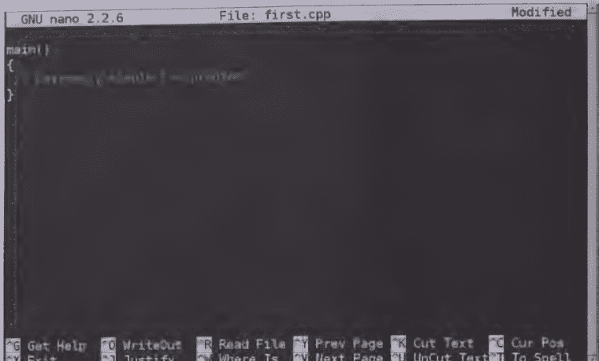

Nano 窗口的标题栏显示你正在操作的文件名（"first.cpp"），并警告你已对文件进行了尚未保存的更改（右上角显示“Modified”，已修改）。

与上一节中的第一个程序不同，这个程序实际上执行了某些功能，尽管它仍然非常简单。

现在你需要在运行完成的 C++ 代码之前先保存它。如果你使用 Nano 作为你的文本编辑器，可以按 `Ctrl+O` 保存文件。按 `Ctrl+X` 退出 Nano。Nano 编辑器将关闭，你应该返回到命令提示符。我们现在准备好执行你的程序指令了。

你如何知道按哪些键来让 Nano 执行操作？它们写在屏幕底部。

> 大多数时候，你只需要记住：

- `Ctrl+O` 保存你的文本，将其写入文件。
- `Ctrl+X` 退出 Nano

> 如果要修复错误或移动文本行：

- `Ctrl+K` 剪切当前文本行并将其记录留备后用。
- `Ctrl+U` 取消剪切，将行放置在当前光标位置。这有点像其他程序中的“粘贴”。

值得注意的是，Nano 不允许你使用鼠标移动文本，即使你是在运行在“终端”窗口中的 Linux 桌面 Nano 上进行操作。你需要使用方向键和 `PageUp`/`PageDown` 键在程序中移动。如果你发现 Nano 用起来很困难，Geany 允许你使用鼠标进行剪切、复制、粘贴和撤销文本。请查看书末附录中的“如何安装所需的软件”章节了解如何安装 Geany 的详情。

希望你在输入程序代码时没有出现任何错误。现在我们可以尝试让计算机将其转换为低级代码并执行。

记住在本节早些时候提到的，你的树莓派将使用编译器将你的 C++ 源代码转换为机器可执行文件。下面的图是发生过程的非常简单的说明：

```cpp
#include <iostream>
int main() {
    std::cout << "HI!";
    return 0;
}
```

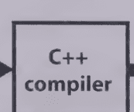

- 将源代码翻译为机器码。
- 生成一个可执行的机器码程序。
- 你使用文本编辑器编写了一个高级 C++ 源代码程序。
- 对于处理器运行来说太复杂，但对于人类来说相对容易理解。
- 默认情况下调用为 `.out`。它足够简单，可以被处理器执行。

首先，我们需要编译你的高级 C++ 程序以创建一个低级可执行文件。我们将使用 **GNU g++ 编译器**来完成工作。你需要做的就是启动 `g++` 编译器，告诉它你想要编译的 C++ 源代码文件名。

从命令行提示符开始，如下所示编译你的源代码程序：

```bash
g++ first.cpp
```

由于你给程序提供了一个以 ".cpp" 结尾的文件名，编译器知道它应该处理一个 C++ 程序。它将使用 C++ 语言的**规则**（称为“**语法**”）来确保你的程序逻辑通顺且编写正确。

虽然在程序编译期间你没有看到任何变化，但在后台发生了大量事情。你 C++ 源代码的每个部分都被拆解成许多更简单的低级代码。通常情况下，编译器在忙碌时不会具体告诉你它正在做什么或进行到哪一步，但正如你以后看到的，如果你愿意，可以要求它为你提供更多信息。

一旦编译成功，你的计算机上应该会存在一个名为 ".out" 的新可执行程序。该程序由非常简单的低级指令组成，称为**机器码**。注意，".out" 是新可执行程序的标准名称，除非你选择给它一个不同的名称。

你可以通过在 Linux 提示符输入以下命令来检查新的可执行程序是否已创建：

```bash
ls -l a.out
```

你应该能看到 "a.out" 文件现在存在于当前工作目录下，准备好执行。

下面你可以看到我的树莓派上发生的情况截图：


注意，在截图中，我以用户 "pi" 的身份登录，我的机器名称为 "eno"，因此 "pi@eno" 实际上意味着“用户 pi 正在名为 eno 的计算机上工作”。

从上述结果我们可以看到关于 "a.out" 文件的以下信息：

- 它是一个可执行程序。"rwxr-xr-x" 部分中的 "x" 表示了这一点。
- 它是由用户 "pi" 创建的。
- 它是一个可执行程序。

要运行该程序，输入：

```bash
./a.out
```

这将执行程序并显示输出：

```text
HI!
```

当编译器发现错误时，它会显示错误信息。这些信息用于发现问题所在。

这里代码中一个简单的错误示例：

```cpp
int main() {
  Extremely simple program
}
```

在示例中，我不“小心”漏掉了开头的 //。当我尝试编译这段代码时，编译器会抱怨不认识 "Extremely" 这个单词。

下面你可以看到 `g++` 编译器显示的错误信息：

```
g++ first.cpp
first.cpp: In function 'int main()'
first.cpp:3:13: error: 'Extremely' was not declared in this scope
first.cpp:3:13: error: expected ';' before 'simple'
```

你需要用文本编辑器打开问题所在的 C++ 源代码进行编辑。然后你需要保存修改后的代码并再次尝试编译，留意任何新的错误信息。

一个让屏幕上显示某些效果的程序

现在，让我们尝试做一个稍微有点实用的东西。我们将编写一个在屏幕上显示消息的程序。

```bash
nano better.cpp
```

输入下方看到的代码，然后保存：

```cpp
#include <iostream> // 程序将在屏幕上显示一些文本

main()
{
    // 在屏幕上显示一条简单的消息
    std::cout << "Hello from C++" << std::endl;
}
```

一旦你保存了代码（按下 `Ctrl+O`），你就可以退出 Nano（`Ctrl+X`）然后编译程序：

```bash
g++ better.cpp
```

随后会创建一个名为 "a.out" 的新文件，你可以运行它：

```bash
./a.out
```

你应该会在屏幕上看到类似这样的内容：

```
$ g++ better.cpp
$ ./a.out
Hello, from C++
```

请注意，你之前的 "a.out" 文件已被新的可执行文件覆盖。你将在下一节中了解到如何解决这个问题。

## 我制作了不名为 "a.out" 的 g++ 编译器程序

除非你使用 `g++` 编译器指定你编译后的底层程序名称，否则它始终会将新的可执行文件命名为 "a.out"。如果你在当前工作目录下已有一个同名文件，它将被新的可执行文件覆盖——你将丢失旧文件！

你可能可以使用 `g++` 为你的可执行文件使用一个不同的名称。事实上，这通常对你更有帮助，因为记住某个特定可执行文件的实际作用可能很困难——"a.out" 这个名字并没有提供太多线索。

当你输入 `g++` 命令来运行编译器时，你只需要添加几个额外的细节。特殊的 `-o` 选项告诉编译器使用你选择的文件名输出新的可执行文件。你还必须告诉它你希望可执行文件叫什么名字，例如 "hello"。

要重新编译之前的程序并给它一个比 "a.out" 更好的名字，你可以输入：

```bash
g++ -o hello better.cpp
```

- `g++` | 你正在使用的 GNU C++ 编译器的名称。
- `-o` | 意味着给新文件起个名字而不是 a.out。
- `hello` | 将是要创建的新可执行文件的名称。
- `better.cpp` | 是包含要编译的高级 C++ 源代码的文件。

假设你的代码没有任何错误，你现在应该拥有一个名为 "hello" 的新可执行文件。

要运行新的可执行文件，输入：

```bash
./hello
```

只有当程序成功编译且没有任何错误时，才会创建可执行文件。想象一下如果你在用 Nano 输入 C++ 源代码时写错误。`g++` 编译器会在开始编译时非常仔细地检查你的源代码。如果你的程序不符合 C++ 语言的严格规则，它将显示警告或错误消息告诉你有问题。如果编译器遇到错误，它将不会生成可执行文件。只有当 C++ 源代码编译成功且没有发现任何错误时，才能生成可执行文件。

从现在起，我们编译程序时将告诉 `g++` 编译器将每个新可执行文件命名为 "a.out"以外的名称。目前执行这些步骤似乎需要记住很多内容，但只要练习一下，你很快就能掌握的。

注意：如果你在 PC 上使用 Windows 操作系统，你可能习惯了以 ".exe" 结尾的文件名。Linux 不需要为可执行文件使用此类文件扩展名。它使用不同的方法来指示一个文件是否为可执行程序：“文件权限”。Linux 系统上的每个文件都是如此。

当你准备好编译 C++ 代码时，应首先确保你已经保存了它。

从 **Build**（构建）菜单中，选择 **Build**（构建）选项：

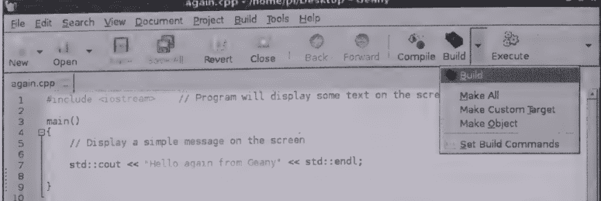

为了提高速度，你也可以使用快捷键 **Alt+B** 激活 **Build** 菜单，然后按 **B** 进行 **Build**。或者，你可以点击 **Build** 按钮（看起来像菜单中看到的砖块放大版本）或按 **F9** 键


这两种方法都会编译你的源代码，如果成功，将创建一个你可以运行的可执行文件。一旦执行了它，你可以反复运行它。没有在每次运行时都重新编译。通常情况下，当你对源代码进行更改时，才需要重新编译程序。

如果你从 **Build** 菜单中选择 **'Compile'**（编译），Geany 将使用 `g++` 编译器将你的 C++ 源代码翻译成底层对象代码（**object** 文件）。该对象文件可以由你的树莓派处理器执行。它会将这种低级代码存储在所谓的“对象”文件中。这种对象代码在 Linux 下无法作为程序运行，除非你先向你的对象代码中添加（即**链接**）其他可以从命令行运行的关键低级代码，这样它就会变成一个完全可执行的程序——一个 **'executable'**（可执行）文件。请参书籍附录中的 *g++ 将 C++ 源代码翻译为可执行程序的阶段*，以获取更多关于 C++ 源代码如何翻译成可执行程序的信息。

当你从 **Build** 菜单中选择 **'Build'** 时

Geany 使用 `g++` 编译器进行编译，并使用了一个我们之前没过的特殊设置：**-Wall**


当你选择 **Build** 时

如果你的程序编译没有错误，你应该会在 Geany 窗口的 Compiler（编译器）部分看到一条成功消息：

| Status | g++ -Wall -o "again" again.cpp (in directory /home/pi/Desktop) |

| Compiler | again.cpp:3:6: warning: ISO C forbids declaration of 'main' with no type (return type) |

| Messages | Completion finished successfully |

| Terminal | |

| line: 10/10 col: 0 sel: 0 INV TAB Y mode: Unix (LF) encoding: UTF-8 filetype: C++ scope: unknown |

这比你自己自己在命令行中输入 `g++` 要更用户友好一点。

你的程序已编译成功，现在已准备好运行。遗憾的是，你可能注意到有一个红色的警告消息：

> warning: ISO C++ forbids declaration of 'main' with no type

这有点烦人，但在目前阶段它并不是一个大问题——它将在本章稍后部分进行解释。

一旦你构建了代码并且可执行文件出现在你的树莓派上，你就可以运行新程序了。从 Build 菜单中选择 "Execute"（执行）或按 Execute 按钮。


将会出现一个新的 "LXTerminal" 窗口显示你的程序在屏幕上产生的任何输出：

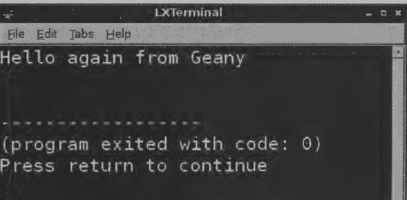

当程序运行结束，你会收到已退出的通知以及它返回的状态或错误代码。如上面的截图所示，我们的程序代码为 0，表示在执行过程中没有遇到错误。

终端窗口会暂停，让你有机会阅读内容。按回车（或回 键）将关闭终端窗口并重新激活 Geany 窗口。

如果在尝试构建程序时你的 C++ 源代码存在问题，Geany 窗口的 "Compiler" 部分将使用一或多条 **messages**（消息）显示问题的详细信息：

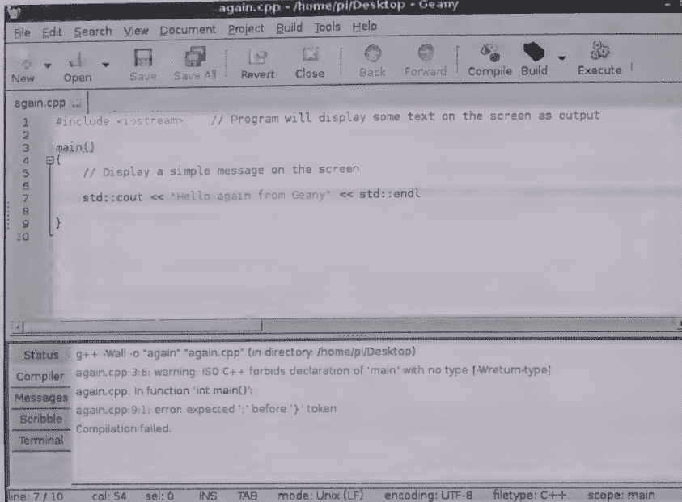

在上面的示例中，你可以看到 `g++` 开始使用以下命令编译程序：

```
g++ -Wall -o "again" "again.cpp"
```

"Compiler" 部分的第一行告诉我们它正在 **/home/pi/Desktop** 目录中工作。

最后一行告诉程序员程序未能成功编译：

> Compilation failed.

幸运的是，编译器告诉我们问题所在，以及是在源代码的**where**（哪里）发现的，以便你可以修复它。

## 编译时，错误和警告的区别是什么？

在编译此程序时，会生成一个警告，告诉我们程序第 7 行包含了未使用的数据。产生这个警告是因为程序员可能想要检查是否在程序中漏掉了某些关键代码。它还能帮助程序员识别程序中的低效之处——未使用的变量在程序执行时会浪费时间和空间。

这是另一个警告的示例，这次是一个执行了不必要操作的程序：

这是另一个警告的示例，这次是一个执行了程序的：

```
unused.cpp - ~/home/pi/Desktop
File Edit Search View Document Project Build Tools Help
New Open Save Save:All Revert Close Back Forward Compile build Execute
unused.cpp
#include <iostream> // 程序将在屏幕上显示一些文本作为输出
int main() {
    // 创建一些永远不会被的数据
    int wastedData = 123456789;

    // 在屏幕上显示一条简单的消息
    std::cout << "this program contains some data that never gets used" << std::endl;

    // 设置错误码为 0，这表示没有错误
    return 0;
}
```

# 确定程序是否执行成功

如前所述，当我们编写 C++ 程序时，我们会包含一个错误代码（error-code）。这是一个特殊的数字，程序用它来指示在运行过程中是否遇到了任何错误或其他问题。

C++ 程序使用 `return` 语句在程序执行完成后向 Linux 返回一个错误代码。


通常情况下，如果执行过程中没有遇到任何错误，完成的程序会返回错误代码 `0`。除 `0` 以外的任何值都表示发生了某种问题。作为程序员，你可以选择你的程序将使用的精确数字来指示不同类型的错误。

一旦你的程序运行结束，你有一个简单的方法可以从 Linux 命令行提示检查任何错误。我们让它告诉我们已执行完毕的程序的错误代码。

为了让程序返回错误代码，我们通常会在 C++ 源代码中添加一些细节。

让我们尝试在 Geany 中创建一个改进版本的程序：

### 示例 1.3 - success.cpp

```cpp
#include <iostream> // 程序将会在屏幕上显示一些文本作为输出

int main()
{
    // 在屏幕上显示一条简单的消息
    std::cout << "Hello from Geany" << std::endl;

    //  Linux 程序已正常完成，没有任何问题
    return 0;
}
```

将代码保存为 `"success.cpp"`，然后编译它。只要你的输入没有错误，它就应该能够成功编译：

| 状态 | `g++ -Wall -o "success" "success.cpp"` (在目录 `/home/pi/Desktop`) |
| :--- | :--- |
| 编译器 | 编译成功完成 |

注意没有显示任何警告信息。你现在应该可以执行新程序了。

执行完成后，计算机会告诉你返回的退出代码（exit code）的值：

```
(program exited with code: 0)
Press return to continue
```

在这种情况下，退出代码为 `0`，这是程序代码中 `return` 语句使用的值。

# 报告错误 - 返回除0 以外的代码

程序并不总是需要在执行完成前返回值：`0`。你可以选择你喜欢的任何整数值，它的范围在 `0` 到 `255` 之间。在运行期间，程序甚至可以根据你的情况对应该使用哪个值作为错误代码做出决定。

这是一个简单的示例，它返回错误代码 `13` 而不是 `0`：

### 示例 1.4 – error_code.cpp

```cpp
#include <iostream> // 程序将会在屏幕上显示一些文本作为输出

int main() {
    // 在屏幕上显示简单的消息

    std::cout << "Hello again from Geany" << std::endl;

    std::cout << "This tells Linux something bad has happened." << std::endl;

    // 将错误代码设置为 13，这可以用来指示问题

    return 13;
}
```

当是程序执行时，你会在屏幕上看到的内容：

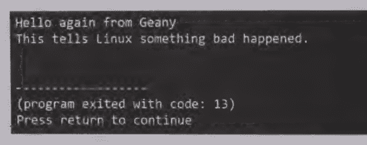

注意在底部显示的错误代码为 `13`。

# 第 1 章总结：让一切运行起来

以下是本章中涵盖的内容：

- C++ 是一种**高级编程语言**。
- 使用 C++ 语言编写的程序被称为**源代码**（source-code）。
- 大多数人使用**文本编辑器**来输入 C++ 源代码，例如 **Nano** 或 **Geany**。
- 源代码通常应以 `.cpp` 结尾的文件保存，以指示它包含 C++ 代码。
- 你的 C++ 源代码可以使用 **#include** 使用他人已经编写并共享的代码**库**（libraries）。这使得编写程序变成了一项更容易的任务，因为你可以复用现有代码。
- 在运行用 C++ 编写的程序之前，必须对其进行**编译**（compiled），将其分解为更简单的**机器码指令**，你的树莓派中央处理器可以直接执行这些指令。
- 用于将 C++ 源代码翻译成可执行机器码的编译器称为 `g++`，它是 **GNU 编译器集合 (GCC)** 的一部分。
- 如果你的程序包含错误或其他可能出错的地方，编译器将显示**错误信息**（error messages）或**警告**（warnings），帮助你找到并修复代码，并告诉你大致在哪里查看它们。
- 成功编译 C++ 程序后，会创建一个你的树莓派可以运行的新**可执行文件**。
- 从 Linux 命令行编译时，新创建的可执行文件的默认文件名为 `a.out`。
- 你可以使用 `-o` 编译器选项为将生成的可执行文件指定不同的文件名。
- 你既可以直接从 Linux 命令行编译和运行程序，也可以在某些文本编辑器（如 Geany）内部进行。
- 程序在运行结束后可以报告**错误代码**（error-code）。该代码可以告诉你程序在执行过程中是否遇到了任何问题。

# 供尝试的问题和练习

| # | 问题 |
| :--- | :--- |
| 1 | “高级”代码和“低级”代码之间的区别是什么？ |
| 2 | 为什么源代码需要**编译**？ |
| 3 | 编写简单的 C++ 程序时，**文件名**应该始终**以什么结尾**？ |
| 4 | 从 Linux 命令行编译时，新创建的可执行文件的默认文件名为 `a.out`。你可以使用 `-o` 编译器选项为将生成的可执行文件指定不同的文件名。 |
| 5 | 程序在运行结束后可以报告**错误代码**。该代码可以告诉你程序在执行过程中是否遇到了任何问题。 |
| 6 | 单行语句和多行语句之间的区别是什么？ |

# 第 2 章：编写一些简单的代码

## 程序与语句

让我们来看 C++ 的基础知识

即使一个语句跨越多行，计算机也不知道该做什么。分号的作用就是用此指示语句的结束。

## 单行语句

C++ 中的许多语句都是很短的，只占一行。

以下是一些简单语句的示例：

```cpp
int x = 5;
int y = 10;
std::cout << x + y;
```

## 使用多于行的语句

通常，即使是简单的语句也可以被拆分为多行。将它们拆分通常会让人们更容易阅读。代码行的结束并不意味着它就是语句的结束 - 分号的作用就是用此指示这一点。

这里有一个多行语句的示例：

```cpp
if (x > 0)
    std::cout << "X is positive";
else
    std::cout << "X is negative";
```

## 使用分号标记语句的结束

计算机如何知道一个语句何时结束？

C++ 中的每个简单语句都必须用分号标记。这有点像英语中的句子通常以句号、问号或感叹号结尾。但在 C++ 中，语句的结束标记始终是分号。

以下是几个简单语句的示例：

```cpp
int a = 10;
int b = 20;
int sum = a + b;
std::cout << sum;
```

## 复合语句 – 被大括号 { } 括起来的语句组

将多个简单语句组合在一起通常是有用的。我们将这种组合称为语句的“块”（block）。程序随后可以把这块语句看作一个单一的整体来使用。

看这段代码，当用户选择某个选项时，它会执行三个不同的操作：

```cpp
if ( cancelOptionChosen )
    displayMessage();
if ( cancelOptionChosen )
    playWarningSound();

if ( cancelOptionChosen )
    deleteTemporaryFile();
```

与其使用三个独立的程序语句来进行相同的判断并在为真时执行单个语句，我们可以只进行一次判断，并决定是否执行包含多个语句的整个块。我们将这称为“复合语句”：

```cpp
if ( cancelOptionChosen )
{
    displayMessage();
    playWarningSound();
    deleteTemporaryFile();
}
```

上面的代码使用 `{ }` 和大括号将语句组合组成一个单一块。

注意，复合语句的结束由 `}` 大括号符号标记。大括号后不需要加分号 `;`。

## 在代码中添加注释

**注释**（Comments）是 C++ 源代码中的文本，用作对人类的**解释**。它们能帮助我们理解程序是如何运行的。

由于注释不是给计算机的指令，因此不会被编译。编译器不会尝试将注释翻译成低级代码。相反，在编译你的程序源码时，它会完全忽略它们。

## 使用 // 的单行注释

C++ 中简单、简短的注释通常以两个**正斜杠**开头：

`//`

文本行中 `//` 之后的所有内容都将被忽略，如下例所示：

```cpp
// 向用户显示消息
// 关于他们的密码
cout << "Your password has been changed."; // 显示确认消息
```

注意，单行注释不需要以分号 `;` 结尾，因为它们实际上并不是程序语句。一旦编译器遇到标记单行注释开始的 `//` 符号，它就会忽略该行的剩余部分内容，并在源代码文本的下一行寻找下一个程序语句。

## 使用 /* 和 */ 的多行注释

较长的注释在代码中可能占据多行文本。虽然你可以每次在每行开头使用 `//`，但你也可以使用 `/*` 和 `*/` 符号封装一行或多行文本，创建一个完整的注释块。

在 `/*` 符号之后，你输入的任何内容都将被视为**多行注释**并被编译器忽略。要标记注释的结束，使用 `*/` 符号告诉编译器你已完成输入。

这是一个多行注释的示例：

```cpp
/*
此程序在文本页中搜索关键词。
它将高亮所有找到关键词的地方。
你可以选择忽略或忽略大小写。
*/
```

如上面的示例所示，你会发现使用 `/*` 和 `*/` 比在每一行注释前都写上 `//` 更方便。

## 使用不同类型注释的程序

这是一个功能非常有限的程序！`main()` 块只包含注释和一个简单的返回语句：

### 示例 2.1 - comments.cpp

```cpp
int main()
{
    // 这个程序几乎什么都没做。

    // 欢迎自行编译并运行它。

    /* 它所做的
       就是返回一个错误代码
       告诉操作系统
       一切正常。 */

    // 返回语句让这一切发生...
    return 0; // 0 表示没有任何问题
}
```

## 注释掉程序代码部分

注释不仅在解释代码功能方面非常出色，还可以用于临时禁用或“注释掉”（comment-out）代码部分。你可以将代码部分转换为注释，这样计算机就不会编译和执行它们。当你正尝试查找并修正程序中的错误时，这非常有用。

要禁用单行程序语句，请在该代码行的开头添加 `//`。这将其变为注释。

在下面的示例中，你可以看到对 `playWarningSound` 函数的调用被注释掉了：

```cpp
if ( cancelOptionChosen )
{
    displayMessage();
    // playWarningSound();
    deleteTemporaryFile();
}
```

要禁用程序的整个块，只需将其放在 `/*` 和 `*/` 标记之间，将其变为多行注释块：

```cpp
if ( cancelOptionChosen )
{
    /* displayMessage();
       playWarningSound();
       deleteTemporaryFile(); */
}
```

## 表达式

现在事情变得有些技术性了。许多程序语句包含“表达式”，例如执行计算或决定是否执行某操作的语句。

表达式是“字面值”（literal values）、命名值”（named values）、返回值”（returned values）和“运算符”（operators）的混合体。

表达式可以被求值或“计算”以产生结果或值。

让我们考虑这些这些内容的几个示例……

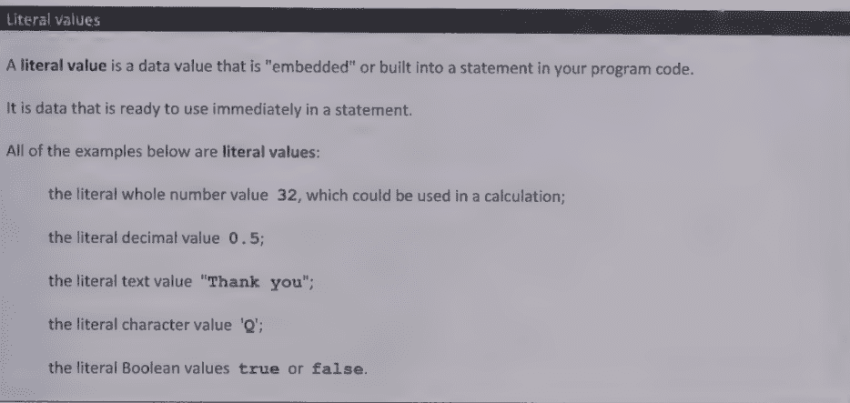

下面是一些使用字面值的语句。注意，你可以清楚地看到这些值，因为它们嵌入在代码中且很容易识别：

```cpp
cout << 1000;           // 显示数字
```

## 命名值

表达式是字面值、命名值、返回值和运算符的混合体。

表达式可以被求值或“计算”以产生结果或值。

## 表达式的不同类型

以下是我们如何将不同的字面量、命名值和运算符组合成表达式的一些示例：

## 算术表达式

算术表达式由计算机求值并给出一个数值结果（数字）。

它们可以使用字面量、命名值和算术运算符的组合：

```
3 + 5 // 将数字 3 和 5 相加
currentScore + 100 // 给变量 currentScore 的值加上 100
pi * radius // pi 的值乘以半径平方
15000 / numWeeksInOneYear // 将 15000 除以 numWeeksInOneYear 的值
NumberOfBiscuits % peopleInRoom // 求除法余数
NumberOfBiscuits by peopleInRoom
```

```
(widthOfRectangle + heightOfRectangle) * 2 // 将宽度和高度相加,
// 然后将结果乘以2
```

## 关系表达式

关系表达式由计算机求值并给出一个布尔结果（真 true 或 假 false）。

它们可以使用字面量、命名值和关系运算符的组合：

```
< <= >= == != not_eq
```

```
playerScore > 10000 // playerScore 的值是否大于 10000？
typeIn == password // typedIn 的值是否与 password 的值相同？
today != "Tuesday" // today 的值是否与 "Tuesday" 不同？
today not eq = "Tuesday" // 编写相同比较的另一种方式
```

## 逻辑表达式

结合关系表达式，逻辑表达式的求值将给出一个布尔真 true 或假 false false。

它们可以使用字面量 true 或 false、命名值以及布尔运算符的组合：

```
! && not and or
```

```
!tooHot // 变量 tooHot 值的反反值
isRaining && sunShining // 如果 isRaining 为真，则产生真值
// 且 sunShining 目前也为真
isPayDay || justWonLottery // 如果 isDay 为真
// 或者 justWonLottery 为真，则产生真值，两者都为真
```

## 如何编写 C++ 程序代码

在尝试编写任何程序之前，可以做一些事情使 C++ 源代码更易读，并帮助人们理解它的工作原理。你可能认为这没有必要，但对于较大的程序，无论你的编程水平有多高，有时也会忘记代码的各个部分是做什么的。如果你想让其他人理解你的代码，这一点会变得更加重要，例如当你团队团队中创建一个软件时。

你可以做的第一件事是让代码**对齐**（lines up）或“缩进”（Indent）。大多数程序员按下 `tab` 键将一行代码向右移动，或者按下几次 **space**（空格）键。

你也可以按下 **enter** 或回车键来插入额外的**空行**。空行可以将你代码的不同部分隔离开来。如果你的程序执行三件事，你可以使用空行将其拆分为三个清晰的代码块。

下面是一个相当难以阅读的 C++ 程序。在接下来的几个章节中，我们将快速学习此程序每个部分的含义。

别担心！目前我们只需考虑它的**外观**如何：

```cpp
Example 2.2 – messy_pizzo.cpp
```cpp

#include <iostream>

using namespace std;

int main()

{

    const float VALUE_OF_PI=3.14159;

    int radius;

    cin >> radius;

    if (radius>0)

    {

        float area=VALUE_OF_PI*radius*radius;

        cout << "Pizza area: " << area << " sq in." << endl;

        return 0;

    }

    else

    {

        cout << "Radius too small for your pizza to exist!" << endl;

        return 1;

    }

}
```

上面的程序组织在一个单一的块中，没有任何空行或缩进。

如果你把它展示给一个经验丰富的程序员，无论他们喜欢使用哪种编程语言，他们可能都会看一眼并告诉你它看起来有多糟糕。

这段代码很难快速阅读。读者需要比平时更集中精力，因为程序的各个部分都挤在一个文本块中。因此，不容易理解程序实际上在做什么，或者它是否包含任何错误。

看看下面程序的布局方式，通过缩进某些语句、使用 tab 键移动它们，并使用回车键添加一些空行来分隔代码的主要部分：

### 示例 2.3 - indented_pizza.cpp

```cpp

#include <iostream>

using namespace std;

int main()

{

    const float VALUE_OF_PI=3.14159;

    int radius;

    cin >> radius;

    if (radius>0)

    {

        float area=VALUE_OF_PI*radius*radius;

        cout << "Pizza area: " << area << " sq in." << endl;

        return 0;

    }

    else

    {

        cout << "Radius too small for your pizza to exist!" << endl;

        return 1;

    }

}
```


许多人会发现这个版本更容易读。一旦缩进了代码并将其组织成较小的块或“区块”，就更容易识别程序所执行的不同部分。两个版本的实际单词和符号是相同的。

# 再次是一个程序示例，但这次更容易读

这里是之前的那个披萨程序，这次它包含了缩进、额外的行间距和注释，以帮助我们理解代码的每个部分是做什么的。

我添加了一条消息，程序开始执行后将出现在屏幕上，告诉用户他们需要输入内容：

## 2.4 - _comments_pizza.cpp

```cpp
#include <iostream>

// 程序将在屏幕上显示一些文本

using namespace std; // 将使用标准标识符 cin, cout, endl

int main() {
    // 定义用于计算面积的“pi”的近似值
    const float VALUE_OF_PI = 3.14159;
    // 要求用户输入披萨的半径
    cout << "Please type in the radius of your pizza..." << endl;
    // 用户输入一个数字（圆的半径）
    int radius;
    cin >> radius;
    // 判断半径是否有效并计算面积
    if (radius > 0) {
        // 半径大于0，因此计算面积
        float area = VALUE_OF_PI * radius * radius;
        cout << "Pizza area: " << area << " sq in." << endl;
        return 0;
    } else {
        // 半径为零或负数，显示错误消息
        cout << "Radius too small for your pizza to exist!" << endl;
        return 1;
    } // else 语句块的结束
}
```

当你编译并运行程序时会发生以下情况，首先使用合理的半径，然后使用负数半径：


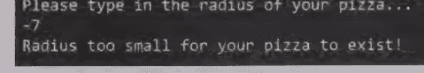

第2章：编写简单的代码 | 53

# 第2章总结：编写简单的代码

以下是我们在本章中已经涵盖的内容：

| 描述 |
| :--- |
| 一个 C++ 程序由语句组成。语句是告诉计算机执行某事的指令。 |
| `;` 分号用于标记语句的结束。 |
| 一个或多个语句可以通过放在一对 `{ }` 大括号内来组合在一起。这被称为语句块。 |
| 在代码段之间添加空行以及在语句部分之间添加空格，可以更快速地阅读 C++ 代码。 |
| 在 C++ 代码中添加注释可以使人更容易理解代码的功能和工作原理。 |
| 单行注释以 `//` 开头 |
| 多行注释以 `/*` 开头并以 `*/` 结束 |
| 编译器在将你的源代码翻译成可执行文件时，会忽略任何空行、多余空格或注释。 |
| 字面量值（literal-value）是嵌入在程序代码中的数据值，例如数字、字符或某些文本。 |
| 命名值（named-value）是已经赋予了名称的数据值。该名称可以在程序代码的其他地方用于引用该值。 |
| 运算符（operator）是一个符号（或一组符号），告诉计算机对某些数据执行何种操作。 |
| 操作数（operand）是操作所用一个数据项。 |
| 表达式（expression）是字面量值、命名值和运算符的混合体，可以通过求值（或“计算出”）产生一个结果或值。 |
| 在表达式中添加额外的 `()` 括号可以使其更容易理解。`()` 括号会影响表达式内部操作执行的顺序。 |

# 供你尝试的问题和练习题

- 1. 求值以下表达式的结果是什么？
  `99 % 33`
- 2. 为什么如果你尝试在程序中编译以下语句，会产生错误？
  `int numberOfPeople = 12`
  `int numberOfKayaks = 7`
- 3. 下面哪个赋值语句是正确的？
  `string myName = 'CAPTAIN SENSIBLE';`
  `string myName = "CAPTAIN SENSIBLE";`
- 4. 在下面的表达式中，哪些部分是“操作数”，哪些部分是“运算符”？
  `( heightA + heightB + heightC ) / 3`
- 5. 这个简单的程序有什么问题？
  `main`
  `{`
  `Return 0;`
  `}`

# 第3章：数据类型和值

## 不同的数据类型

正如我们目前所看到的，大多数程序使用 `data values`。这些是计算机在程序运行时可以处理的内容。值可以是数字、文本或其他类型的数据。

为了方便处理这些值并在我们的程序代码中引用它们，我们可以为每个数据值取一个名称（这些有时称为 `identifiers` 标识符，因为它们被用于识别在计算机内存中哪里找到值）。

你为数据值选择的名称通常描述了它的用途或它将是什么种子的。例如，我们可能想使用数据值 `4`，给它一个名称来描述它的含义：`numberOfWheels`。

我们可能有另一个数据值 `'green'`，给它命名为 `colourOfCar`。

C++ 可以处理。

## 整数值：int, short long

许多程序使用。我们经常使用整数。C++ 可以处理。

## 小数值：float 和 double

这些是 `real`（实数）——即包含小数点的数字。它们以特殊方式存储。

## 布尔值：bool

这些是用于表示二选一的值。布尔值在程序做决策时特别有用。

## 单字符：char

这是一个 `character` 或符号，即可以在键盘上输入或显示在屏幕上的字符。它也可以用于存储特殊的 `invisible` 字符。

字符序列通常被称为“文本字符串”。C++ 支持一种可选的数据类型 `string`，你可以在程序中使用它。`string` 数据类型可以存储如下值：尽管非常有用，但 `string` 数据类型实际上并没有内置在 C++ 语言的核心中。在使用它之前，你的程序必须包含来自 `<string>` 库的额外代码：

```cpp
#include <string>
```

该库还包含了许多用的函数，用于从字符串中提取部分或单个字符。

由于 `string` 不是构成 C++ 语言的特殊“保留”字，它定义在标准命名空间 `std` 中。为了创建使用 `string` 数据类型的变量和常量，你可以在代码中声明将使用此命名空间：

```cpp
using namespace std;
```

# 其他数据类型

随着你学习更多 C++，你会发现还有其他更专门的数据类型。你还可以对目前为止描述的某些数值数据类型进行修改，以改变它们能够表示的值的范围。在处理数字时，你可以选择处理较小值或较大的值。你还可以选择处理带符号值或无符号（仅正数）值。在“第10章：函数”中的质数程序 `Example 10.9 - primes_in_range.cpp` 展示了如何处理非常大的正数，高达 540 亿。

## 整数值操作：int

在 C++ 中使用整数最常用的方法是使用 `int` 数据类型。

例如：

```cpp
int numberOfPeopleEatingLunch = 12;
```

上述语句创建了一个整数变量，并将其值设置为 12。

```cpp
const int DAYS_IN_THE_WEEK = 7;
```

第二个示例创建了一个“常量”（一个在程序运行期间不能更改的固定值），将其值设置为 7。

## 正整数和负整数值：int

通常，在处理整数时，Pi 上的 GNU C++ 能够使用的最大 `int` 值是 `2147483647`，最小的 `int` 值是 `-2147483648`。许多问题可以通过在这个数字范围内进行操作来解决。

除非你另告诉编译器，否则编译器假设你在创建 `int` 变量或常量时，想要同时使用正数和负数。

如果你确定某个特定变量只想处理正数，可以使用“`unsigned`”前缀告诉编译器：

```cpp
unsigned int numberOfPeopleEatingLunch = 12;
```

这意味着……

> “创建一个名为 `numberOfPeopleEatingLunch` 的无符号（正）整数变量，并给它赋值 `12`”

## 仅正整数值：unsigned int

将变量设为 `unsigned`（无符号）是常识。在现实生活中，吃午饭的人不可能是负数。它必须始终为 `0` 或大于。使用 `unsigned` 值也有实际优势。当你选择一个只允许正值的数据类型（如 `unsigned int`）时，计算机可以存储和处理比普通有符号替代类型更大的数字，因为它不再需要存储和表示任何负值。

显然，`unsigned` 整数值不能为负数，因此在 Pi 上可以表示的最小 `unsigned int` 值是 0。可以表示的最大 `unsigned int` 值是 `4294967295`。

## 较小范围的整数值：short

如果你确定要存储较小的值，可以使用 `short` 数据类型。它每个值占用的存储空间比 `int` 少，允许在 -32768 到 32767 之间产生一个更小的范围：

```cpp
short daysWorkedThisWeek = 0;
```

尽管你的计算机有充足的数据存储空间，但使用 `short` 值节省的空间可能会累积，特别是当你的程序存储和处理成千上万甚至百万数字时。

再次，如果你不打算使用负值，可以在变量或常量定义前加上“`unsigned`”：

```cpp
unsigned short daysWorkedThisWeek = 0;
```

## 较大范围的整数值：long

如果你想处理比 `int` 允许的范围更大的整数（即超出 -2147483648 到 2147483647 的范围），可以使用 `long`。这种数据类型为你创建的每个数字使用更多的存储空间，允许计算机存储和处理范围大得的值。

```cpp
long reallyBigPrimeNumber;
```

通过不使用任何负值，`unsigned long` 值允许更大的数字——一直高达 4294967295：

```cpp
unsigned long reallyBigPrimeNumber;
```

使用 `long long` 数据类型的值可以处于 -92233720368547757808 到 92233720368547757807 范围内的任意位置：

```cpp
long long reallyBigPrimeNumber;
```

最后，GNU C++ 允许通过修改后的类型 `unsigned long long` 使用更大范围的值。它可以表示高达 18446744073709551615 的巨大数字——超过了 1800 万万亿！

如果你在程序中使用此类巨大的数字，可以这样声明变量：

```cpp
unsigned long long reallyBigPrimeNumber;
```

## 溢出 - 对于特定数据类型过大的值

如果你尝试使用一个对于特定数据类型来说过大的值会发生什么？例如，如果你尝试存储一个大于 2147483647 的 `int`（在使用该数据类型时 Pi 允许的最大值）会怎样？

如果你尝试使用超出数据类型能够处理的接受范围的值，该值将“回绕”回到数值轴的起点。

对于 `short` 值，尝试超过数字 32767 将把你送回可以表示的最小 `short` 值，即 -32768。

在 `int` 值的情况下，尝试超过数字 2147483647 将把你送回最小的 `int` 值，即 -2147483648。

这个示例展示了尝试在最大可能的 `short` 值上加 1 会发生什么：

```cpp
// 示例 3.1 - short_max.cpp
#include <iostream> // 程序将在屏幕上显示一些文本
using namespace std; // 使用标准标识符 cout 和 endl
 main() {
    short myVal = 32767; // 将 myVal 的起始值设置为 short 的最大值
    cout << "The value of myVal is " << myVal << endl;
    myVal++; // 将 myVal 加 1
    cout << "After adding 1, the new value is " << myVal << endl;
    return 0;
}
```

当你编译并执行上述程序时你会看到：

> The value of myVal is 32767
> adding 1, the new value is -32768

这表明当你对 32767 加 1 时，它“回绕”了数值轴。超过 short 的最大值后，实际存储的是 short 的最小值。这被称为“溢出”。 {
    cout << "char ranges from " << CHAR_MIN; // char 可以是 8 位
    cout << "up to " << CHAR_MAX;
    cout << endl;
    cout << "short ranges from " << SHRT_MIN;
    cout << "up to " << SHRT_MAX;
    cout << endl;
    cout << "unsigned short ranges up to " << USHR_MAX;
    cout << endl;
    cout << "int ranges from " << INT_MIN;
    cout << "up to " << INT_MAX;
    cout << endl;
    // 注意没有 UINT_MIN 标识，因为最小值为 0
    cout << "unsigned int ranges up to " << UINT_MAX;
    cout << endl;
    cout << "long int ranges from " << LONG_MIN;
    cout << "up to " << LONG_MAX;
    cout << endl;
    // 注意没有 ULONG_MIN 标识，因为最小值为 0
    cout << "unsigned long ranges up to " << ULONG_MAX;
    cout << endl;
    cout << "long long int ranges from " << LLONG_MIN;
    cout << "up to " << LLONG_MAX;
    cout << endl;
    // 注意没有 ULLONG_MIN 标识，因为最小值为 0
    cout << "unsigned long int ranges up to " << ULLONG_MAX << endl;
    return 0;
}
```

## 使用实数操作：float 和 double

如前所述，如果你想使用包含小数点的实数而不是整数，最简单的数据类型是 "float"。它是 "floating-point number（浮点数）"的缩写。

以下是一些存储实数值的变量示例：

```cpp
float weightOfSuitcase = 7.3;
float weightOfBackPack = 1.25;
float weightOfBook = 1;
float totalWeight = weightOfSuitcase + weightOfBackPack + weightOfBook;
```

在上面的示例中，注意 `weightOfBook` 是一个浮点型变量，但对于这个值，它被类型为整数 1。小数点和小数位被省略了几个按键输入。计算机实际上会将该值存储为 `1.0000000`。因为变量 `weightOfBook` 的数据类型为 `float`，所以即使在没有输入位数的情况下，它也具有使用小数的潜力。

`double` 数据类型允许更大范围的浮点值。当你需要处理比普通 `float` 类型大得多的正值或负值时，可以使用它。

与整数一样，你可以告诉编译器你只想处理正值，而不处理负值：

```cpp
unsigned float weightOfSuitcase = 7.3;
```

我在这里使用了 `unsigned`，因为重量不能为负数。与整数一样，你可以通过创建一个 `unsigned float` 值来选择处理可以使用更大范围数值的正数。

你的 Pi 在运行 C++ 时处理的最小和最大浮点值可以使用特殊常量 `FLT_MIN`、`FLT_MAX`、`DBL_MIN` 和 `DBL_MAX` 显示在屏幕上。这些定义在 `<cfloat>` 库中。程序在屏幕上显示 `float` 和 `double` 的最小值和最大值。

## 示例 3.3 - float_range.cpp

```cpp
#include <iostream> // 程序将在屏幕上显示文本
```


```cpp
#include <cfloat> // 程序使用浮点值的最小和最大常量

using namespace std; // 将使用标准标识符 cout 和 endl

int main() {

    cout << "float ranges from " << FLT_MIN;

    cout << " up to " << FLT_MAX << endl;

    cout << endl << endl;

    cout << "double ranges from " << DBL_MIN;

    cout << " up to " << DBL_MAX << endl;

    return 0;

}
```

这里是执行示例 3.3 - `float_range.cpp` 时你将看到的内容：

```
float ranges from 1.17540e-38 to 3.40282e+38

double ranges from 2.22507e-308 to 1.79769e+308
```

最小值非常小，最大值非常大，它们的写法与我们迄为止看到的数字不同。这种数字表示法通常被称为 `e-notation`（科学计数法）。它通常允许计算机使用更少的数字，以更紧凑的方式显示大数或非常小的数。

在上面的截图中，`1.17549e-38` 意味着 `1.17549` 乘以 `10⁻³⁸`。

这等同于：

```
1.17549 0.000000000000000000000000000000000000000001
```

...这是该值的另一种写法方式：

```
0.00000000000000000000000000000000000117549
```

同样地，`3.40282e+38` 意味着 `3.40282` 乘以 `10³⁸`（注：原文此处可能误写为¹³⁸，根据语境应为³⁸）。

这等同于：

```
3.40282 times 10000000000000000000000000000000000000000
```

...这是该值的另一种写法方式：

```
34028200000000000000000000000000000000000000
```

## 浮点数的精度和范围

尽管浮点值可以处理很多位小数，但计算机中的浮点值有时可能会略有不精确。计算机可能无法使用浮点值存储你想要的精确数字。在实践中，这些不精确通常不会对你的程序结果产生重大影响，但在理论上它们可能会导致问题。

假设你输入了 `4.0`，计算机使用 `float` 数据类型存储它。在计算机内存内部，存储的实际值可能是 `4.000000000000000000000000000001`。虽然这与你想要存储的实际数字非常接近，但它并不完全相同——它是一个近似值。

## 使用字符符号：`char`

令人惊讶的是，当数字计算机为所有人解决问题时，它们遵循的是一套指令程序，这些指令告诉它们如何操作符号。“字符”是计算机可以存储和处理的单个符号。我们一直在处理字符，有几种不同的类型：

| 类别 | 示例 |
| :--- | :--- |
| 字母 | A B C X Y Z b c |
| 数字 | 0 1 2 3 4 5 6 7 8 9 |
| 符号 | ! @ # $ % | * [ ] < ? |

上述所有示例都是键盘上可以输入、屏幕上显示或在页面上打印的字符类型。我们可以看到它们并熟悉它们的形状。它们统称为“可打印字符”。

还有其他你通常看不见的字符，用于控制计算机做什么；这些被称为“控制字符”或“不可打印字符”。最明显的字符之一是告诉计算机开始新一行的符号，称为换行符（return character）。还有一种插入文本行并将光标向右移动的字符，称为制表符（tab character）。

几乎所有计算机都为每个字符使用标准代码，这意味着数据可以很容易地从一台计算机交换到另一台计算机而不会产生问题。最常用的集合之一是 ASCII。使用 `unsigned` 在这里是因为重量不能为负数。与整数一样，你可以通过创建一个 `unsigned float` 值来选择处理可以使用更大范围数值的正数。

Pi 运行 C++ 时可以处理更大范围的浮点值。当你需要处理比普通 `float` 类型大得多的正值时，可以使用它。

与整数一样，你可以告诉编译器你只想处理正值，而不处理负值：

```cpp
unsigned float weightOfSuitcase = 7.3;
```

我在这里使用了 `unsigned`，是因为重量不能为负数。与整数一样，你可以通过创建一个 `unsigned float` 值来选择处理可以使用更大范围数值的正数。

Pi 在运行 C++ 时处理的最小和最大浮点值可以使用特殊常量 `FLT_MIN`、`FLT_MAX`、`DBL_MIN` 和 `DBL_MAX` 显示在屏幕上。这些定义在 `<cfloat>` 库中。

程序在屏幕上显示 `float` 和 `double` 的最小值和最大值。

## 示例 3.3 - `float_range.cpp`

```cpp
#include <iostream> // 程序将在屏幕上显示一些文本

#include <cfloat> // 程序使用浮点值的最小和最大常量

using namespace std; // 将使用标准标识符 cout 和 endl

int main() {

    cout << "float ranges from " << FLT_MIN;

    cout << " up to " << FLT_MAX << endl;

    cout << endl << endl;

    cout << "double ranges from " << DBL_MIN;

    cout << " up to " << DBL_MAX << endl;

    return 0;

}
```

这里是执行示例 3.3 - `float_range.cpp` 时你将看到的内容：

```
float ranges from 1.17540e-38 to 3.40282e+38

double ranges from 2.22507e-308 to 1.79769e+308
```

最小值非常小，最大值非常大，它们的写法与我们迄为止看到的数字不同。这种数字表示法通常被称为 `e-notation`（科学计数法）。它通常允许计算机使用更少的数字，以更紧凑的方式显示大数或非常小的数。

在上面的截图中，`1.17549e-38` 意味着 `1.17549` 乘以 `10⁻³⁸`。

这等同于：

```
1.17549 0.000000000000000000000000000000000000000001
```

...这是该值的另一种写法方式：

```
0.00000000000000000000000000000000000117549
```

同样地，`3.40282e+38` 意味着 `3.40282` 乘以 `10³⁸`。

这等同于：

```
3.40282 times 100000000000000000000000000000000000000000
```

...这是该值的另一种写法方式：

```
34028200000000000000000000000000000000000000
```

## 浮点数的精度和范围

尽管浮点值可以处理很多位小数，但计算机中的浮点值有时可能会略有不精确。计算机可能无法使用浮点值存储你想要的精确数字。在实践中，这些不精确通常不会对你的程序结果产生重大影响，但在理论上它们可能会导致问题。

假设你输入了 `4.0`，计算机使用 `float` 数据类型存储它。在计算机内存内部，存储的实际值可能是 `4.000000000000000000000000000001`。虽然这与你想要存储的实际数字非常接近，但它并不完全相同——它是一个近似值。

## 使用字符符号：`char`

令人惊讶的是，当数字计算机为所有人解决问题时，它们遵循的是一套指令程序，这些指令告诉它们如何操作符号。“字符”是计算机可以存储和处理的单个符号。我们一直在处理字符，有几种不同的类型：

| 类别 | 示例 |
| :--- | :--- |
| 字母 | A B C X Y Z b c |
| 数字 | 0 1 2 3 4 5 6 7 8 9 |
| 符号 | ! @ # $ % & * [ ] < ? |

上述所有示例都是键盘上可以输入、屏幕上显示或在页面上打印的字符类型。我们可以看到它们并熟悉它们的形状。它们统称为“可打印字符”。

还有其他你通常看不见的字符，用于控制计算机做什么；这些被称为“控制字符”或“不可打印字符”。最明显的字符之一是告诉计算机开始新一行的符号，称为换行符（return character）。还有一种插入文本行并将光标向右移动的字符，称为制表符（tab character）。

几乎所有计算机都为每个字符使用标准代码，这意味着数据可以很容易地从一台计算机交换到另一台计算机而不会产生问题。最常用的集合之一是 ASCII。使用 `unsigned` 在这里是因为重量不能为负数。与整数一样，你可以通过创建一个 `unsigned float` 值来选择处理可以使用更大范围数值的正数。

Pi 在运行 C++ 时处理的最小和最大浮点值可以使用特殊常量 `FLT_MIN`、`FLT_MAX`、`DBL_MIN` 和 `DBL_MAX` 显示在屏幕上。这些定义在 `<cfloat>` 库中。

程序在屏幕上显示 `float` 和 `double` 的最小值和最大值。

## 特殊 ASCII 字符

有些字符无法直接通过键盘输入字面量值，最著名的是制表符和换行符。要在程序代码中使用制表符或换行符，你必须输入特殊的键序列。在下面的示例中，`\t` 意味着 `\t`，`\n` 意味着“新行”。

```cpp
char tabSymbol = '\t';
char newLineSymbol = '\n';
```

因此，许多特殊字符通过反斜杠字符表示。它在单引号对内工作时告诉计算机“这里有特殊内容”。

另一个特殊字符是单号符号。你不能直接将单号放在一对单引号之间并期望它像你从键盘上输入的其他字符一样工作：

```cpp
char apostropheSymbol = '\'; // 这在 C++ 中是不允许的
```

因此，某些字符需要在前面加上一个反斜杠字符：

```cpp
char apostropheSymbol = '\''; // 这在 C++ 中是允许的
```

## 使用字面量文本：在代码中嵌入文本值

许多计算机程序都会使用文本 - 无论是大量的还是少量的。但文本到底是什么呢？我们所说的文本是字符符号的集合，无论它是字母表字母、数字或其他符号。在编程中，我们将字符符号序列称为“字符串（string）”。

当你想在 C++ 程序中使用字面量值时，它必须用双引号 `"` 包起来。必须有一个双引号 `"` 来表示文本值的开始，另一个双引号来表示结束。注意在处理字面量文本时要使用双引号 `"`，而不是用于单个字符的单引号 `'`。

字面量文本值可以是一个单词，也可以是一个短语：

```cpp
"dinosaur"
"The Ace of Spades"
```

一个非常长的字面量文本值可以是一个整个段落：

> "从前有一个 Ug，他住在一座非常大的山顶上。每天早上，为了去上班，Ug 会开车走到火车站。然后他坐公车去机场，并骑着楼梯上他的办公室，最后立即回到他在火星上的家。"

一个非常短的字面量文本值可能只包含一个字符符号：

```cpp
" "
```

可能存在不包含任何字符的空文本值，由两个相邻的双引号 `"` 符号表示，中间没有任何内容（被称为“空字符串（empty string）”）：

许多程序使用如上面所示的字面量值，但从不给它们命名，直接将它们嵌入到代码中。这些被称为“字面量字符串（literal strings）”。

下面的语句使用了两个字面量字符串，它们都包含在双引号 `"` 中，以显示它们的开始和结束：

```cpp
if (password == "hello") 
cout << "You have chosen the world's most obvious password.";
```

在上面的语句中，“hello" 是字面量字符串值。

同样，显示在屏幕上的消息也是一个字面量值：

```cpp
"You have chosen the world's most obvious password."
```

## 使用命名字符序列：`string`

`string` 数据类型允许为文本值命名，并在整个 C++ 程序中重用。

以下是你可以创建一个字符串变量的方法：

```cpp
string greeting = "Good morning! How are you today?";
```

上面的语句创建了一个名为 `greeting` 的变量，其数据类型为 `string`。

`greeting` 持有的值是 "Good morning! How are you today?"

注意你在给字符串赋值的文本值前后都加上了双引号 `"`。

如果程序需要在多个地方重复使用 "Good morning! How are you today?"，它可以通过引用 `greeting` 来重用该字面量值，`greeting` 就是字符串被赋予的名字。

与字面量值一样，字符串值可以是短的、长的，甚至是“空的”（如果它完全不包含任何字符）：

```cpp
// 一个短短的字符串值
string emoji = ":-";
// 一个较长的字符串值
string story = "从前有一个 Ug，他住在一座非常大的山顶上。 每天早上，为了去上班，Ug 会开车走到火车站。然后他坐公车去机场，并骑着楼梯上他的办公室，最后立即回到他在火星上的家。\n";
// 一个空字符串
string emptyValue = "";
```

一旦创建了字符串变量，在程序运行时，可以更改或修改它的值：

```cpp
string story = story + " " + emoji;
```

上面的语句将 emoji 字符添加到 story 文本的末尾，它们之间留有一个空格以提高可读性：

```
从前有一个 Ug，他住在一座非常大的山顶上。 每天早上，为了去上班，the the Ug 会开车走到火车站。然后他坐公车去机场，并骑着楼梯上他的办公室，最后立即回到他在火星上的家.:-)
```

## 命名值：变量和常量

正如我们在本章开头看到的，数据值对我们的程序代码通常非常重要，以至于给它们命名。我们代码中的 C++ 语句可以引用这些名称。它们告诉计算机在内存的何处找到值。当我们给一个值命名时，我们称之为命名值（named value）。

在程序运行期间可以改变的命名值是变量（variables）。

相反，保持不变的值被称为常量（constants）。记住：

> “变量（variable)”是在程序运行期间可以改变的数据值。名称通常使用小写字母。

> “常量（constant)”是在程序运行期间不能改变的数据值。名称通常使用大写字母。

常量或变量名称的另一个词是“标识符（identifier）”——一个标识数据项的别名。创建标识符时必须遵循严格的规则：它们始终以字母开头且不包含任何空格。许多程序员在由多个单词组成的标识符中使用下划线来代替空格。

## 在程序中声明变量

当我们想要创建一个变量或常量时，我们需要告诉编译器它应该使用什么类型的数据。这被称为“声明（declaration）”。我们向程序声明（或“告知”）我们正在创建一个新的变量或常量。

当你创建一个变量时，必须始终告诉编译器它将使用什么类型的数据：它的数据类型。你不能让数据类型处于未决定状态。声明：

```cpp
int myAge;
```

...就像是在说：我要一个名为 "myAge" 的整数变量。我还没有给它赋值。

注意，你的年龄随着你的增长而在变化，所以 myAge 将是一个变量而不是常量。

正如上一个示例所示，尽管必须说明每个变量将使用什么类型的数据，但你不需要立即给它赋值。以这种方式声明（创建）但没有初始值的变量被称为“未初始化变量（uninitialized variable）”。

你可以在单行代码中同时声明多个变量，但前提是涉及的所有变量必须具有完全相同的类型。

假设你的程序将使用许多不同的 `int` 变量。你可以一次性声明它们：

```cpp
int daysWorked, daysHolidayEarned, sickDaysTaken;
```

这比为你想要定义的每个变量单独写一行代码要短：

```cpp
int daysWorked;
int daysHolidayEarned;
int sickDaysTaken;
```

但注意所有这些变量都是未初始化的——它们都还没有被赋予初始值。

记住，如果你不显式地设置数值（如 `short`, `int`, `long`, `float`, `double`）的值，那么它通常会持有一个不可预测的值。你不应该假设一个 `int` 变量的初始值为 0。

为什么值是不可预测的？因为变量使用计算机内存的一小部分来存储其值。如果你不给新变量一个初始值，那么该部分内存可能仍然包含之前由 Linux 或在你的树派上运行的其他程序使用的其他数据值。

## 在程序中声明常量

某些数据值在程序运行时是无法更改的。这类数据被称为常量数据。你可以通过在数据类型之前添加“const”单词来告诉计算机某个命名值是常量，而不是变量：

```cpp
const int EGGS_IN_A_BOX = 6;
```

上面的语句将创建一个名为 "EGGS_IN_A_BOX" 的整数常量。该常量的值将为6。程序可以使用 "EGGS_IN_A_BOX" 这个名称，它也指向常量值 6。

请注意，当你声明常量时，必须为常量赋一个值。设置常量的值不能推迟到程序的后续部分。在你的程序代码中，声明要使用某个常量的地方就是获取该值赋值的唯一机会。常量在程序中创建后，将不会被你代码中之后的任何其他程序语句所更改。

并不是所有常量值都是数字。以下语句定义了几个字符串常量：


```cpp
const string EYE_COLOUR = "Blue";
const string FIRST_DAY = "Monday";
const string HELP_LINE = "0117-4960111";
const string WEB_ADDRESS = "http://www.raspberrypi.org";
const string SMILEY = ":)";";
```

第一个语句创建了一个名为 `"EYE_COLOUR"` 的常量。该常量的数据类型是 `string`（即文本）。该常量的值是 `"Blue"`，在程序运行时计算机无法更改它。

`EYE_COLOUR`、`FIRST_DAY`、`HELP_LINE`、`WEB_ADDRESS` 和 `SMILEY` 的值在整个程序执行过程中将保持不变——它们永远不会改变。

注意，如果你想对常量使用 `string` 类型，你需要包含 `<string>` 库并使用 `std` 命名空间：

```cpp
#include <string>

using namespace std;
```

以下语句创建了两个带命名的常量 `HASH_SYMBOL` 和 `TAB`：

```cpp
const char HASH_SYMBOL = '#';
const char TAB = '\t';
```

在上面的代码中，两个字符值都被'单引号'括起来。请记住 `\t` 是单个制表符的特殊序列，这是一个我们想要在程序使用的方便常量。

在程序执行期间，`HASH_SYMBOL` 或 `TAB` 的常量值是不可能改变的。它们的值将始终保持不变。

## 使用常量值使你的代码更易理解

常量非常值得使用，因为它们可以让你的程序变得更容易理解。如果你将来需要对代码进行更改，它们还节省了精力和精力。如果你在多个地方使用同一个命名常量，你就不需要编辑每一行使用它的代码。你只需要修改程序中为该命名常量赋值的单行代码。

在下面的示例中，`DAYS_IN_WEEK`、`DAILY_RATE` 和 `ADMIN_FEE` 是三个不同常量值的名称，而 `discount` 是变量的名称：

```cpp
const int DAYS_IN_WEEK = 7;
const float DAILY_RATE = 124.99;
const float ADMIN_FEE = 24.50;
float discount = 35.00;
```

记住，C++ 声明开头的 `"const"` 单词表示值不能被更改。它告诉编译器该值不会是一个变量，并且该值在程序执行的整个生命周期内都是固定的。

你可以在代码中使用常量 `DAYS_IN_WEEK`。每当编译器找到 `DAYS_IN_WEEK` 时，它就知道你想使用值 `7`。通过为常量选择一个描述性的名称，可以更容易地看出代码在做什么：

```cpp
float weeklyCharge = DAYS_IN_WEEK * DAILY_RATE + ADMIN_FEE - discount;
```

如果没有命名常量，计算中每个数字的用途可能并不明显：

```cpp
float weeklyCharge = 7 * 124.99 + 24.50 - 35.00;
```

请记住，一旦你在代码中创建了常量，程序代码中的其他语句将不允许在程序运行时更改它们的值。你可以认为这些常量值是经过“锁定”或“只读”的。

# 使用常量避免反复输入特定值

这里是另一个常量：

```cpp
const double PI = 3.141592653589793;
```

如果你在程序代码中使用多次 pi，那么输入名称 `PI` 比反复输入字面值 `3.141592653589793` 要容易得多。

通过输入常量而不是构成该值的数字序列，你不太可能在程序中出错或引入不一致性。你只需要在程序语句中使用该值的名称即可：

```cpp
area = PI * radius * radius;
```

创建常量可以使你的代码更易读。当此类文本值很长时，尤为如此。使用简单的标识符可以让 C++ 代码中的语句更短，例如下一页所示。

```cpp
const int DANGER_LEVEL = 600;
const string ALERT_MSG = "Warning!";
const string NORMAL_MSG = "Hyper-drive";

if (temperature < DANGER_LEVEL)
    cout << ALERT_MSG << endl;
else
    cout << NORMAL_MSG << endl;
```

## 为常量和变量使用描述性名称

许多程序员对常量使用大写，对变量使用小写。这有助于快速区分名称代表的是常量还是变量。

### 3.4 - declare_variables.cpp

```cpp
#include <string>

using namespace std;

int main() {
    int myAge;
    float myWeight;
    string nearestAirport;
    bool gotAcol;
    char bulletPoint;

    return 0;
}
```

### 3.5 - declare_constants.cpp

```cpp
#include <string>

using namespace std;

int main() {
    const int MONTHS_IN_YEAR = 12;
    const float GRAVITY = 9.8;
    const char AT_SYMBOL = '@';
    const string EYE_COLOUR = "Blue";
    const char BULLET_POINT = '*';

    return 0;
}
```

# 常量和变量命名规则

让我们更详细地考虑如何为常量和变量创建合适的名称。

当你为一个新变量或常量命名（使用标识符）时，你必须遵循严格的规则，以确保编译器能够理解它，并且你可以在程序代码中成功使用它。

## 标识符中不允许空格

常量或变量名称中不允许包含空格。你不能在标识符的任何地方放置空格：

```cpp
string first person to visit; // 错误！C++ 不允许这样做
```

在上面的示例中，编译器会认为你正尝试使用四个不同的变量名，分别为 `first`、`person`、`to visit`。

编译器将显示以下信息：

```
error: expected initializer before 'person'
```

要使其成为接受的名称，你需要删除所有的空格：

```cpp
string firstpersonontovisit; // 这作为变量名是允许的
```

如果没有空格，由多个单词组成的长变量名可能难以阅读，因此每个后续单词的开头字母大写，有助于其突出显示：

```cpp
string firstPersonToVisit; // 在单词开头使用了额外的大写字母
```

另一个广泛使用的约定是在通常期望空格的地方使用下划线字符，例如在：`first_person_to_visit` 之间。

因此，程序员也广泛使用下划线来提高标识符名称的可读性。

## 大写字母重要吗？

重要的一点是，常量和变量的名称是`区分大小写的`。你使用的是`大写字母`（大写字母）还是`小写字母`非常重要。这意味着你在输入时的错误可能会在你尝试编译 C++ 代码时导致问题。

编译器会将 `highscore`、`HighScore` 和 `Highscore` 视为三个完全不同的变量——它们不是同一个！一个具有常识的人类可能会猜到它们实际上指的是同一个东西。遗憾的是，你的计算机没有任何常识，而且你会发现它是非常挑剔的。

## 在标识符中使用数字

另一个规则是标识符不能以`数字`开头。你的变量或常量的名称应该以字母表字母开头；不能以数字开头。

| 标识符 | 描述 |

| :--- | :--- |

| `2ndPersonToVisit` | `不是`有效名称，因为它以数字开头 |

| `secondPersonToVisit` | 编译器接受此名称，因为它以字母开头。 |

## 避免使用 C++ 特殊单词

在选择名称时，你不允许使用 C++ 语言本身的特殊`“保留字”（reserved words）`。例如，你不能创建一个名为 `"return"` 的变量，因为这个词已被 C++ 用于表示其他含义。

如果你尝试编译一个试图将保留字作为标识符名的程序，你将看到一条错误消息。

假设我尝试在以下语句中使用保留字 `return` 作为标识符名：

```cpp
int return = 13;
```

尝试编译该程序将给我返回以下错误信息：

```
error: expected unqualified-id before = 'return'
```

此消息告诉我，编译器期望以不同的方式使用 `return` 一词。它不能作为变量的标识符，并且前面不应该有数据类型，例如 `int`。

请参阅书末附录中的`“C++保留字”`章节，获取在考虑标识符名称时需要避免的特殊单词列表。

## 命名空间：避免与同名标识符的冲突

几乎所有的 C++ 程序都包含了其他程序员编写的代码库。当你使用 `#include` 使用他人的代码时，C++ 编译器的部分功能——预处理器会找到你想要使用的代码，并将其副本添加到你的代码中。然后，完整的源代码将由编译器进行编译。

停下来思考一下他人的源代码。他们的代码可能包含各种变量和常量。如果他们的标识符名称与你的相同，会发生什么？当两个人在代码的不同位置使用相同的标识符时，编译器如何知道哪一个指的是哪一个？

为了解决这个问题，我们可以将编写的代码中使用的所有常量和变量名称组合在一起。这种标识符名称的集合被称为`“命名空间”（namespace）`。

到为止，书中的几个程序已经使用了`“标准”`命名空间，简写为 `std`。你已经见过这行代码了：

```cpp
using namespace std;
```

## 使用 = 给常量或变量赋值

此程序声明了几个变量，正如之前的示例 `3.4 - declare_variables.cpp` 所示，为创建的每个变量分配了一个值：

示例 `3.6 - assign_values.cpp`

```cpp
#include <string>    // 程序将使用 string 数据类型的变量
using namespace std;      // 将使用标准标识符 string
int main()
{
    // 创建一些变量并为每个变量设置初始值
    int myAge = 44;
    float myWeight = 10.5;
    string nearestAirport = "Exeter";
    char bulletPoint = '*';
    bool gotACold = false;

    // 将变量的值更改为其他
    myAge = 45;
    myWeight = 11.2;
    nearestAirport = "Bristol";
    bulletPoint = '>';
    gotACold = false;

    return 0;
}
```

在上一页的程序中，语句：

```cpp
int myAge = 44;
```

意味着创建了一个名为 `myAge` 的整数变量，并将其初始值设置为 `44`。

接下来的语句：

```cpp
myAge = 45;
```

将变量 `myAge` 的值更新为 `45`。这就是如何在程序中更改变量的值。

## 示例 3.7 - display_string.cpp

```cpp
#include <iostream> // 输入输出需要
#include <string>
using namespace std;      // 将使用标准标识符 string

int main()
{
    // 创建原始字符串
    string airport = "Exeter";
    // 显示原始字符串
    cout << "Originally you were flying from... ";
    cout << airport << endl;

    // 更新字符串
    airport = "Bristol";

    // 显示更新后的字符串
    cout << "You are now flying from... ";
    cout << airport << endl;

    return 0;
}
```

当程序运行时发生的情况如下：

> Originally you were flying from... Exeter

> You are now flying from... Bristol

你可以看到 `airport` 的值从 `Exeter` 变为 `Bristol`。

## 使用赋值交换两个变量的内容 - 一个常见问题

这是一个涉及更改两个变量值的程序。如果你尝试使用以下代码交换两个字符串值，会发生什么？

# 示例 3.8 - swap_values_problem.cpp

```cpp
#include <iostream> // 输入输出需要
#include <string>
using namespace std; // 将使用标准标识符 string

int main() {
    // 此程序尝试交换两个字符串值。
    // 它尝试交换两个不同字符串变量中存储的值。
    // 你能看出为什么它工作不正常吗？

    string firstName = "Albatross";
    string secondValue = "Zebra";

    // 在尝试交换值之前显示字符串
    cout << "The first value is... " << firstName << endl;
    cout << "The second value is... " << secondValue << endl;

    // 尝试交换字符串值
    firstName = secondValue;
    secondValue = firstName;

    // 在尝试交换值之后显示字符串
    cout << "The first value is... " << firstName << endl;
    cout << "The second value is... " << secondValue << endl;

    return 0;
}
```

当 `firstName` 的内容更新为持有变量 `secondValue` 的值 (`"Zebra"`) 时，程序覆盖了原始值 (`"Albatross"`)。这个原始值就此永远丢失了。

`firstName` 的原始内容不再存在于计算机内存的任何地方。它们被抹除了，无法找回。

解决方案是使用额外的变量作为临时位置来存储原始值：

```cpp
// 尝试交换字符串值
string temporaryCopyOffFirstValue = firstValue;

firstValue = secondValue;

secondValue = temporaryCopyOffFirstValue;
```

这种技术在下面的程序中使用：

```cpp
Example 3.9 - swap_values_correctly.cpp
#include <iostream> // 程序将在屏幕上显示一些文本

using namespace std;

// 将使用标准标识符 string, cout 和 endl

int main() {
    string bobsPrize = "a toaster";
    string janesPrize = "a gold speedboat full of money";

    cout << "Bob has currently now " << bobsPrize << endl;
    cout << "Jane has won " << janesPrize << endl;

    cout << endl << "SWAP THEIR PRIZES!!!" << endl;

    string bobsOriginalPrize = bobsPrize; // 记得 Bob 最初赢的是什么
    bobsPrize = janesPrize; // 把 Jane 赢得的给 Bob
    janesPrize = bobsOriginalPrize; // 把 Bob 最初赢的给 Jane

    return 0;
}
```

如如下所示，这次值被正确地交换了：

| Bob 目前赢得了一个烤面包机 |

| Jane 赢得了一艘装满钱的金色快艇 |

| 交换他们的奖品！！！ |

| 现在 Bob 赢得了一艘装满钱的金色快艇 |

| Jane 赢得了一个烤面包机 |

我们稍将在**第 10 章：函数**中使用交换技术，创建一个使用著名的**泡排序**技术对多个数据值进行排序的程序。

## 在不赋值的情况下声明变量的危险

许多计算机使用未初始化的数值变量的初始值为零，而未初始化的字符串被设为空值。“但是”你不应该认为这是理所当然的。要非常小心，不要依赖在运行你的程序时会发生这种情况。并不是所有的 C++ 编译器都遵循未初始化变量的完全规则，同一个 C++ 源代码程序的实际行为可能会取决于编译和运行它的编译器类型而有所不同！

利用我们目前为止学到的知识，我们可以写一个程序，看看当你在 Pi 上声明一个变量而不赋予初始值时会发生什么：


```cpp
Example 3.10 - unassigned_variables.cpp

#include <iostream>      // 程序将在屏幕上显示一些文本

using namespace std;      // 将使用标准标识符 string, cout 和 endl

int main()
{
    // 创建变量但不给它们设置任何值
    int myAge;
    string myName;

    // 显示未赋值变量的值 - 将显示什么呢？
    cout << "The value of myAge starts as... " << myAge << endl;
    cout << "The value of myName starts as... " << myName << endl;

    // 给变量赋值（或设置）值
    myAge = 68;
    myName = "Florence";

    // 显示更新后的变量值
    cout << "Now myAge is... " << myAge << endl;
    cout << "Now myName is... " << myName << endl;

    return 0;
}
```

上面的程序在屏幕上显示消息，并包含了几行实现此目的的不熟悉代码。别担心——这些将在**第 4 章：键盘输入和屏幕输出**中进行解释。

通常，在声明变量时立即为其设置一个值会更方便。记住，如果你忘记给变量赋值，那么你的程序可能会以意想不到且不可预测的方式运行。

如果你在使用 `g++` 编译器时使用 **`Wall`** 选项，当从 Geany 内部编译程序时，如果你的代码尝试使用尚未赋值的变量，你通常会在编译期间看到警告：

> warning: '`myAge`' is used uninitialized in this function

尽管编译器生成了此警告，只要没有阻止运行的错误，它仍然会创建一个可执行文件。记住，编译器的“警告”消息并不等同于“错误”**第 1 章：启动运行**中引入了 `-Wall` 选项。

注意，3476 是我在 Pi 上看到的 `myAge` 的值。当你运行相同的程序时，可能会看到不同的值，这取决于计算机用于存储 `myAge` 值的特定内存位置以及之前存储在那的值。

```
The value of myAge starts as... 3476
The value of myName starts as... Florence
Now myAge is... 68
Now myName is... Florence
```

## 第三章总结：类型和值

- 你在代码尝试使用任何常量或变量值之前，必须**声明**它们。
- 在声明**常量**或**变量**时，你可以说明它将使用什么**类型**。
- 常量的**名称**通常使用**大写字母**，以区分于变量。
- 常量或变量的**名称**不允许包含**空格**。你可以使用**下划线**代替空格，或者让每个单词以大写字母开头以便阅读。
- 常量的**值**在程序运行时是不可更改的。
- 变量的**值**在程序运行时是可以更改的。
- **整数**可以使用 **`int`**、**`short`**、**`long long`** 类型存储和处理。这些类型可以的值范围可以使用**符号或无符号**前缀来修改。
- **实数**可以使用 **`float`** 或 **`double`** 类型存储和处理。这些类型可以的值范围可以使用符号前缀来修改。
- 如果数值超过了特定数据类型可以表示的允许值，我们就说发生了**溢出**。
- 布尔型 **`true`** 或 **`false`** 值可以使用 **`bool`** 类型表示。
- 单个 ASCII 字符可以使用 **`char`** 类型表示。
- 通过包含 `<string>` 库，你的程序代码可以使用 **`string`** 类型来表示和处理字符序列。
- **命名空间**是标识符名称的集合，你可以在代码中使用它来避免名称冲突。
- 标准命名空间 **`std`** 定义了常用的名称 **`cout`**、**`cin`** 和 **`endl`**。
- 在声明新常量或变量时，你可以使用赋值运算符为其赋值。

## 你的问题和练习

1. 执行以下表达式后，变量 `myVal` 中将存储什么值？
`int myVal = 32768 - 3;`

2. 为什么以下变量名编译器不受接受？
- `1stPersonToCorrectly`
- `D.O.B.`
- `weight OfWork`
- `phoneNumber`

3. 以下哪条语句正确为布尔变量 `onHoliday` 赋值？
- `bool onHoliday = 'True';`
- `bool onHoliday = True;`
- `bool onHoliday = true;`
- `bool onHoliday = TRUE;`

4. 写一个定义整数常量 `NEVER_CHANGING_INT` 的程序。尝试使用 `++` 增量运算符将 `NEVER_CHANGING_INT` 的值加1。当你尝试编译程序时实际上发生了什么？

5. 决定对于以下事实你会使用哪种数据类型：
- 人的性别。
- 房间里的人数。
- 电话号码。
- 人的体重（公斤）。

# 第 4 章：键盘输入和屏幕输出

## 输出：在屏幕上显示数据

通常，我们需要在程序运行时查看计算机在做什么，但并不总是容易准确判断你的 Pi 在做什么。我们可以告诉计算机在屏幕上显示消息或数据，向我们展示发生了什么。

你可能在我们的某些程序注意到 `cout` 这个词。它用于在屏幕上显示内容。让我们仔细观察 `cout` 如何通过不同的编程语句显示文本和数据。

在你的程序可以在屏幕上显示任何内容之前，你必须告诉它包含标准代码库之一：

```cpp
#include <iostream>
```

严格来说，这不是一个 C++ 语句。任何以 `#` 符号开头的行都是告诉编译器执行某事的指令，称为“指令”。这个特定的 `#include` 指令告诉编译器去寻找由他人编写的代码库，该库将允许你的程序与屏幕和键盘交互。编译器将在你在 Pi 上安装 Linux 时自动创建的特殊目录中搜索。

"iostream" 实际上代表“输入/输出流”。流是数据值流过的路径。

如果你不使用 `<iostream>` 库，你就需要编写自己的低级代码将每个单独的字母或符号放在屏幕上的正确位置。你可能需要学习使用汇编语言编程。这将是一个非常棘手耗时的任务，因此使用现有代码是有意义的。许多在屏幕上显示写入或允许你使用键盘键入程序也使用相同的 `<iostream>` 代码。

这是一个非常简单的程序，它会在屏幕上显示一些文本，然后向 Linux 操作系统发送一条消息并结束，告诉它一切正常：

## 示例 4.1 - cout.cpp

```cpp
#include <iostream> // 程序将在屏幕上显示一些文本

int main() {
{
    std::cout << "Hello GNU!";

    std::cout << "How are you?";

    return 0;
}
```

**示例 4.1 - cout.cpp** 中的代码意味着什么——逐逐步解释……

第一行是 **`#include`** 指令，它告诉编译器我们的程序将使用屏幕和键盘代码的 **`<iostream>`** 库。

在 **`main()`** 部分，在 { } 大括号之间有三条程序语句。

第一条语句在屏幕上显示 **"Hello GNU!"** 文本。它将文本重定向到 **`std::cout`**，这是通往屏幕的通道。

正如我们之前在**第 3 章：数据类型和值**中看到的，**`std.`** 是**标准命名空间**standard namespace）的名称，它是一个我们在程序中使用的有用类型名称集合。

`::` 符号被称为**作用域解析运算符**scope-resolution operator。它在程序中用于表示某个名称**属于**或**是**其他类型的一部分。

**`cout`** 意味着**"输出通道"**channel-out（在树莓派上屏幕）。它是标准命名空间中的名称之一。

**`std::cout`** 字面上的意思是**"输出通道"**，它属于标准命名空间。

**`<<`** 是**输出重定向器**output redirector。它将文本和数据从计算机发送到输出流。在这种情况下，我们使用的输出流是屏幕。

每行末尾的分号标记了每个独立程序**语句**statement（即每个单条指令）的结束。

因此，**`main()`** 部分中的前两个语句显示了文本 **"Hello GNU!"** 和 **"How are you?"**。

最后一条语句 **`return 0`** 告诉 Linux 程序没有遇到任何错误，一切正常。

当你运行程序时，你的屏幕应该显示以下内容：

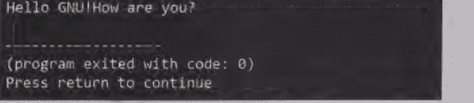

你可能注意到计算机在两个不同的消息 **"Hello GNU!"** 和 **"How are you?"** 之间没有留空格——它们显示为一条很长的消息。除非你明确告诉计算机不要这样做，否则它会在屏幕上紧接上一条消息之后显示每条消息，而不考虑演示或可读性。告诉计算机如何整齐地呈现内容取决于你！

## 使用 endl 让计算机在屏幕上开启新行

每当你的程序在屏幕上显示内容时，你就有责任告诉计算机每行文本何时结束。要移动到下一行或断开文本，你需要使用一个名为“换行”end-of-line（或简称为 **`endl`**）的特殊字符告诉程序这是文本行的结束。

这里是上一页的程序，但在每条消息推送到屏幕之后添加了换行符：

示例 4.2 - end_of_line.cpp

```cpp
#include <iostream> // 程序将在屏幕上显示一些文本

int main()
{
    std::cout << "Hello GNU!";
    std::cout << std::endl; // 告诉计算机这是这一行的结束
    std::cout << "How are you?";
    std::cout << std::endl; // 告诉计算机这是这一行的结束

    return 0;
}
```

上面的程序告诉计算机执行以下操作：
- 在屏幕上显示 "Hello GNU!"。
- 移动到屏幕的下一行。
- 在屏幕上显示消息 "How are you?"。
- 移动到屏幕的下一行（这样 Linux 提示符将另起）。
- 返回状态代码 0 通知 Linux 一良好。

如果你编译并运行可执行程序，你应该看到：

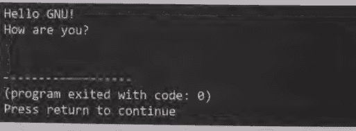

这一次，每条消息都有自己的一行，使更容易阅读。

## 使用来自命名空间的标识符

**`cout`** 和 **`endl`** 都是**标识符**identifiers——由另一个程序员创建并定义在名为**标准命名空间**特殊位置中的内容。对于多人编写代码的项目，命名空间非常有用。为了避免不同的人使用相同的标识符，可以说明标识符是谁定义的。标准命名空间会让你的代码更易读，并节省一些打字时间。为了避免每次使用时都输入 `std::`，你需要在程序顶部添加一行代码告诉编译器程序使用了他人的名称。从现在起当我们在程序中使用 **`cout`** 和 **`endl`** 时，如果我们不告诉编译器它们来自哪个命名空间，会导致错误。

示例 4.3 - namespace.cpp

```cpp
#include <iostream> // 程序将在屏幕上显示一些文本
using namespace std; // 使用标准标识符 cout 和 endl
int main() {
    cout << "Hello GNU!";
    cout << endl; // 告诉计算机这是这一行的结束
    cout << "How are you?";
    cout << endl; // 告诉计算机这是这一行的结束
    return 0;
}
```

注意在上面的程序中，**`main()`** 内部的大部分语句变短了，代码比之前的 **4.2 - end_of_line.cpp** 简单一些。你不需要告诉编译器 **`cout`** 和 **`endl`** 在哪里，因为它们在标准命名空间内部。值得注意的是，专业程序员避免通过 `using` 在代码中添加命名空间；刻意为每个标识符加上命名空间和作用域解析运算符可以完全消除消除它们属于哪个命名空间。对于初学者来说，**`using`** 无疑让编写程序变得更容易。

## 使用 << 输出运算符同时显示多个内容

之前的程序对于在屏幕上写入如此少的文本来说仍然很长。为了让程序更短，你可以使用单个语句同时向屏幕推送多行。

你可以想象有一行内容被推向屏幕。如果你推送了它们，它们就会移动在一起。将语句的结束看作是将所有数据推向 **`cout`**（屏幕）。

示例 4.4-display_several.cpp

```cpp
#include <iostream> // 程序将在屏幕上显示一些文本

using namespace std; // 使用标准标识符 cout 和 endl

int main() {
    cout << "Hello GNU!" << endl << "How are you?" << endl;

    cout << "I'm off now," << endl << "to feed the cow..." << endl << endl;

    return 0;
}
```

编译并运行此程序应该显示以下内容：

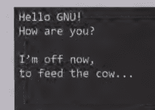

注意两个 **`endl` 换行**字符的效果（下方加粗显示）会在显示的文本行之间创建一个空行：

```cpp
cout << "Hello GNU!" << endl << "How are you?" << endl << endl;
```

# 在屏幕上显示存储变量的值

下面的程序使用名为 `score` 的变量。它是一个整数integer——一个整数。这些思想在之前的第 3 章：数据类型和值中介绍过。

当 `score` 最初创建时，它的值为 0（零）。一旦程序运行，`score` 变量的值将改变几次。

如果用 `cout` 显示变量会发生什么？它在屏幕上实际显示什么

语句……

```cpp
cout << score << endl;
```

...在屏幕上显示名为 `score` 的变量的值。这个值是 100。

它不显示变量的名称，程序运行时你不会在屏幕上看到 `score` 这个词。

换行符告诉计算机这是这一行的结束，它需要移动到屏幕下一行的开始。

## 示例 4.5 - display_variable.cpp

```cpp
#include <iostream> // 程序将在屏幕上显示一些文本

using namespace std; // 使用标准标识符 cout 和 endl

int main()
{
  // 变量 score 开始为零。
  // 然后在程序运行期间发生了变化。
  int score = 0; // score 开始为零

  cout << "My score is ";
  cout << score << endl;

  score = 100; // 将 score 的值改为不同的值

  cout << "Now my score is ";
  cout << score << endl;

  return 0;
}
```

编译并运行此程序应该显示：


...显示存储在 `score` 变量中的原始和最终值。

## 显示大数值——“溢出”问题

这是一个程序，它使用字面量整数值和*乘法运算符* 执行一些简单的计算。它会告诉你 1 千字节（KB）、1 兆字节（MB）、1 吉字节（GB）等等有多少字节：

### 示例 4.6 - display_overflow.cpp

```cpp
#include <iostream>

// 程序将在屏幕上显示一些文本

using namespace std; // 将使用标准标识符和 cout endl

int main() {
	cout << "In 1 kilobyte there are 1000 bytes" << endl;

	cout << "In 1 megabyte there are ";
	cout << 1000 * 1000 << " bytes" << endl;

	cout << "In 1 gigabyte there are ";
	cout << 1000 * 1000 << " bytes" << endl;

	cout << "In 1 terabyte there are ";
	cout << 1000 * 1000 * 1000 << " bytes" << endl;

	cout << "In 1 exabyte there are ";
	cout << 1000 * 1000 * 1000 * 1000 << " bytes" << endl;

	return 0;
}
```

该程序应该可以成功编译。当你运行生成的生成时，你可能会注意到编译器显示了两个**警告信息**，分别针对太字节（TB）和艾字节（EB）的计算：

| | | |

|---|---|---|

| 16 | cout << "4-6" * 1000 * 1000 << " bytes" << endl; | | |

| 17 | cout << "4-6" * 1000 * 1000 << " bytes" << endl; | | | |

| 18 | cout << "4-6" * 1000 * 1000 * 1000 << " bytes" << endl; | | | | |

| 19 | cout << "4-6" * 1000 * 1000 * 1000 * 1000 << " bytes" << endl; | | | | |


| Status | `g++ -o"4-6-display-overflow" "4-6-display-overflow.cpp"` (in directory `/home/user`) |

|---|---|

| Compiler | `4-6-display_overflow.cpp` in function `'main'` |

| Message | `4-6-display_overflow.cpp:16:24: warning: overflow in constant expression '1000000000000'` |

| Scrobble | Compilation finished successfully |

| Terminal | |

| 16/23 | col:0 | | | | | | tab: Win (CRLF) | encoding: UTF-8 | filetxt |

这是因为 `cout` 正常期望处理此类如此大的数值。为了显示 1 太字节和 1 艾字节的计算结果，程序应该显示以下内容：

```text
In 1 kilobyte there are 1000 bytes
In 1 megabyte there are 1000000 bytes
In 1 gigabyte there are 1000000000 bytes
In 1 terabyte there are -72737968 bytes
In 1 exabyte there are -1530849600000 bytes
```

在屏幕上显示的第二行中，表达式 `1000 * 1000` 已经求值并显示了结果 `1000000`。同样，显示的第三行也已经求值并正确显示。遗憾的是，屏幕上显示的最后两行似乎错误地显示了太字节和艾字节中有多少字节。这是因为计算结果太大，无法作为 `int` 类型显示，导致了溢出。为了解决显示意料之外的大数字的问题，我们可以使用能够存储比 `int` 更大数值的变量类型。当我们尝试使用 `cout` 显示 `numBytes` 变量的值时，程序将成功地在屏幕上显示它，因为我们已经指示了预期的大小。当 `cout` 遇到 `unsigned long numBytes` 时，它的行为与通常不同：

### 示例 4.7 - `display_large_values.cpp`

```cpp
#include <iostream>      // 程序将在屏幕上显示一些文本

using namespace std; // 将使用标准标识符 cout 和 endl

int main() {
    // 将每次计算的结果都存储在一个非常大的变量中
    // cout 将知道它需要处理极大的数字
    unsigned long long numBytes = 1000;

	cout << "In 1 kilobyte there are ";
	cout << numBytes << " bytes" << endl;

	cout << "In 1 megabyte there are ";
	numBytes *= 1000;
	cout << " bytes" << endl;

	cout << "In 1 gigabyte there are ";
	numBytes *= 1000;
	cout << " bytes" << endl;

	cout << "In 1 terabyte there are ";
	numBytes *= 1000;
	cout << " bytes" << endl;

	cout << "In 1 exabyte there are ";
	numBytes *= 1000;
	cout << " bytes" << endl;

	return 0;
}
```

这一次，程序编译时没有警告。在执行时，结果现在是正确的：

```text
In 1 kilobyte there are 1000 bytes
In 1 megabyte there are 1000000 bytes
In 1 gigabyte there are 1000000000 bytes
In 1 terabyte there are 1000000000000 bytes
In 1 exabyte there are 1000000000000000 bytes
```

# 第 4 章：键盘输入与屏幕输出

## 显示字符串变量内容的示例

此程序使用 `cout` 在屏幕上显示几项文本，所有内容都在同一行。由于它使用了 `string` 类型的变量，程序开头包含以下行代码：

```cpp
#include <iostream>
```

严格来说，因为 `<string>` 库也被 `<iostream>` 库使用——因此在下面的程序中包含它并不是必需的。`#include` 行实际上是不必要的。通过包含 `<iostream>` 库，我们的程序也会引入 `<string>` 库的代码。这行多余的代码可以更清楚地表明程序使用了哪些库，帮助其他程序员理解它是如何运行的。在随后的程序中，将省略额外的 `#include` 指令，以帮助代码尽可能简短。

### 示例 4.8 - `display_strings.cpp`

```cpp
#include <iostream> // 程序将在屏幕上显示一些文本
#include <string> // 程序将使用字符串变量

using namespace std; // 将使用标准标识符 string, cout 和 endl

int main()
{
    // 将数据存储两个不同的字符串变量中

    string greeting = "Hello there";

    string name = "Stupid-Trousers";

    // 显示存储在变量中的值
    // 在它们之间留一个空格

    cout << greeting;

    cout << " ";

    cout << name;

    cout << endl;

    return 0;
}
```

完成后的程序应该显示：

```
Hello there Stupid-Trousers
```

注意它并没有显示：

```
greeting name
```

它显示的是变量的值，而不是变量的名字。

### 示例 4.9 - `display_picture.cpp`

接下来的程序显示在屏幕上显示字符串变量的内容。由于它使用了 `string` 类型的变量，程序开头包含以下行代码：

```cpp
#include <iostream>
```

严格来说，因为 `<string>` 库也被 `<iostream>` 库使用——因此在下面的程序中包含它并不是必需的。`#include` 行实际上是不必要的。通过包含 `<iostream>` 库，我们的程序也会引入 `<string>` 库的代码。这行多余的代码可以更清楚地表明程序使用了哪些库，帮助其他程序员理解它是如何运行的。在随后的程序中，将省略额外的 `#include` 指令，以帮助代码尽可能简短。

`\t` 字符会创建一个水平间隙，在屏幕上显示任何后续字符之前，向右移动。记住："tab"一词是"tabulated"的缩写，意思是“制成表格”。

## 示例 4.10 - `tab_char.cpp`

```cpp
#include <iostream>      // 程序将在屏幕上显示一些文本
#include <unistd.h>       // 使用 sleep() 函数暂停 1 秒

using namespace std;      // 将使用标准标识符 cout 和 endl

int main()
{
    cout << "3..." << flush;
    sleep(1);

    cout << "\t2..." << flush;
    sleep(1);

    cout << "\t1..." << flush;
    sleep(1);

    cout << "\tGO!" << endl;

    return 0;
}
```

## 垂直制表符字符

`\v` 垂直制表符会将光标垂直向下移动一行，但在屏幕上显示任何后续字符之前，会保持在当前的水平位置：

## 示例 4.11 - `vertical_tab.cpp`

```cpp
#include <iostream>      // 程序将在屏幕上显示一些文本
using namespace std;      // 将使用标准标识符 cout 和 endl

int main()
{
    cout << "\H\vE\vL\vP\vV!" << endl;

    return 0;
}
```

你可以在显示每个字母后看到使用垂直制表符的效果：


第 4 章：键盘输入与屏幕输出 | 99

## 使用 `\` 反斜杠字符显示字面量字符

这里是一个在显示多个字面量文本值时使用 `\\` 双反斜杠字符的示例：

## 示例 4.12 – `slash_char.cpp`

```cpp
#include <iostream> // 程序将在屏幕上显示一些文本
using namespace std; // 将使用标准标识符 cout 和 endl
int main() {
	cout << " " << endl; // 显示 3 行空行

	cout << "/\\" << endl;
	cout << "\|\"" << endl;
	cout << "\\._/" << endl;
	cout << "\\" << endl;

	cout << endl << endl << endl; // 再显示 3 行空行

	return 0;
}
```

当你运行程序时，你应该能看到这张图片：

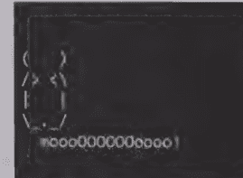

为了生成小牛的图片，两行代码使用了 `\\` 双反斜杠来在屏幕上显示单个的 `\` 反斜杠字符：

```cpp
cout << "/\\"" << endl;
cout << "\\.\\/" << endl;
```

这就像是在说：

> “这里有一个要显示的特殊字符，它是一个反斜杠。”

注意，单独的一个反斜杠本身不会这样显示，相反，它将指示预期将有一个后续的特殊字符。你不会在屏幕上看到显示的反斜杠符号。

## 显示不同颜色文本的转义序列

下面的程序使用 `\escape-sequences` 改变不同行文本的颜色。`\e` 字符告诉屏幕它正要使用一组特殊的代码序列来改变任何后续文本的外观。

例如：

```cpp
cout << "\e[31m TOMATO" << endl;
```

上述行将使用红色文本在屏幕上显示 TOMATO 单词，而不是终端的默认颜色。这是因为该字面量值开头包含一个转义序列。

`\e` 标记新转义序列的开始。`[` 符号告诉显示器改变颜色。代码 `31m` 代表前景颜色红色，它将用于在屏幕上显示的后续每一行。

- 示例 4.13 - `display_colours.cpp`


```cpp
#include <iostream> // 程序将在屏幕上显示一些文本
using namespace std; // 将使用标准标识符 cout 和 endl

int main() {
    // 不同的前景颜色
    cout << "\e[31m RED" << endl;
    cout << "\e[32m GREEN" << endl;
    cout << "\e[33m YELLOW" << endl;
    cout << "\e[34m BLUE" << endl;
    cout << "\e[35m MAGENTA" << endl;
    cout << "\e[0m DEFAULT (USUAL) TEXT" << endl;

    // 不同的背景颜色
    cout << "\e[41m White on red" << endl;
    cout << "\e[42m White on green" << endl;

    // 正常与加粗
    cout << "\e[0m Normal text." << endl;
    cout << "\e[1m BOLD TEXT - super chunky!" << endl;

    // 重置所有为正常
    cout << "\e[0m Back to things again." << endl;

    return 0;
}
```

遗憾的是，黄色的转义代码在 Pi 上通常看起来像棕色。可以使用更长的转义序列获得更亮的黄色，允许更宽的颜色范围：

```cpp
cout << "\e[38;52m BRIGHT YELLOW!" << endl;
```

参见附录中的“控制屏幕颜色的转义序列”章节以获取更多代码。

第 4 章：键盘输入与屏幕输出 | 99

## 使用 `sleep()` 逐个显示屏幕输出

下面的程序使用 `sleep()` 逐个显示不同行文本的颜色。`\e` 字符告诉屏幕它正要使用一组特殊的代码序列来改变任何后续文本的外观。

例如：

```cpp
cout << "\e[31m TOMATO" << endl;
```

上述行将使用红色文本在屏幕上显示 TOMATO 单词，而不是终端的默认颜色。这是因为该字面量值开头包含一个转义序列。

`\e` 标记新转义序列的开始。`[` 符号告诉显示器改变颜色。代码 `31m` 代表前景颜色红色，它将用于在屏幕上显示的后续每一行。

- 示例 4.13 - `display_colours.cpp`

```cpp
#include <iostream> // 程序将在屏幕上显示一些文本
using namespace std; // 将使用标准标识符 cout 和 endl

int main() {
    // 不同的前景颜色
    cout << "\e[31m RED" << endl;
    cout << "\e[32m GREEN" << endl;
    cout << "\e[33m YELLOW" << endl;
    cout << "\e[34m BLUE" << endl;
    cout << "\e[35m MAGENTA" << endl;
    cout << "\e[0m DEFAULT (USUAL) TEXT" << endl;

    // 不同的背景颜色
    cout << "\e[41m White on red" << endl;
    cout << "\e[42m White on green" << endl;

    // 正常与加粗
    cout << "\e[0m Normal text." << endl;
    cout << "\e[1m BOLD TEXT - super chunky!" << endl;

    // 重置所有为正常
    cout << "\e[0m Back to things again." << endl;

    return 0;
}
```

`\t` 字符会创建一个水平间隙，在屏幕上显示任何后续字符之前，向右移动。（记住："tab"一词是"tabulated"的缩写，意思是“制成表格”。）

## 示例 4.10 - `tab_char.cpp`

```cpp
#include <iostream>      // 程序将在屏幕上显示一些文本
#include <unistd.h>       // 使用 sleep() 函数暂停 1 秒

using namespace std;      // 将使用标准标识符 cout 和 endl

int main()
{
    cout << "3..." << flush;
    sleep(1);

    cout << "\t2..." << flush;
    sleep(1);

    cout << "\t1..." << flush;
    sleep(1);

    cout << "\tGO!" << endl;

    return 0;
}
```

## 垂直制表符字符

`\v` 垂直制表符会将光标垂直向下移动一行，但在屏幕上显示任何后续字符之前，会保持在当前的水平位置：

## 示例 4.11 - `vertical_tab.cpp`

```cpp
#include <iostream>      // 程序将在屏幕上显示一些文本
using namespace std;      // 将使用标准标识符 cout 和 endl

int main()
{
    cout << "\H\vE\vL\vP\vV!" << endl;

    return 0;
}
```

你可以在显示每个字母后看到使用垂直制表符的效果：


第 4 章：键盘输入与屏幕输出 | 99

## 使用 `\` 反斜杠字符显示字面量字符

这里是一个在显示多个字面量文本值时使用 `\\` 双反斜杠字符的示例：

## 示例 4.12 – `slash_char.cpp`

```cpp
#include <iostream> // 程序将在屏幕上显示一些文本
using namespace std; // 将使用标准标识符 cout 和 endl
int main() {
	cout << " " << endl; // 显示 3 行空行

	cout << "/\\" << endl;
	cout << "\|\"" << endl;
	cout << "\\._/" << endl;
	cout << "\\" << endl;

	cout << endl << endl << endl; // 再显示 3 行空行

	return 0;
}
```

当你运行程序时，你应该能看到这张图片：


为了生成小牛的图片，两行代码使用了 `\\` 双反斜杠来在屏幕上显示单个的 `\` 反斜杠字符：

```cpp
cout << "/\\"" << endl;
cout << "\\.\\/" << endl;
```

这就像是在说：

> “这里有一个要显示的特殊字符，它是一个反斜杠。”

注意，单独的一个反斜杠本身不会这样显示，相反，它将指示预期将有一个后续的特殊字符。你不会在屏幕上看到显示的反斜杠符号。

## 显示不同颜色文本的转义序列

下面的程序使用 `\escape-sequences` 改变不同行文本的颜色。`\e` 字符告诉屏幕它正要使用一组特殊的代码序列来改变任何后续文本的外观。

例如：

```cpp
cout << "\e[31m TOMATO" << endl;
```

上述行将使用红色文本在屏幕上显示 TOMATO 单词，而不是终端的默认颜色。这是因为该字面量值开头包含一个转义序列。

`\e` 标记新转义序列的开始。`[` 符号告诉显示器改变颜色。代码 `31m` 代表前景颜色红色，它将用于在屏幕上显示的后续每一行。

- 示例 4.13 - `display_colours.cpp`

```cpp
#include <iostream> // 程序将在屏幕上显示一些文本
using namespace std; // 将使用标准标识符 cout 和 endl

int main() {
    // 不同的前景颜色
    cout << "\e[31m RED" << endl;
    cout << "\e[32m GREEN" << endl;
    cout << "\e[33m YELLOW" << endl;
    cout << "\e[34m BLUE" << endl;
    cout << "\e[35m MAGENTA" << endl;
    cout << "\e[0m DEFAULT (USUAL) TEXT" << endl;

    // 不同的背景颜色
    cout << "\e[41m White on red" << endl;
    cout << "\e[42m White on green" << endl;

    // 正常与加粗
    cout << "\e[0m Normal text." << endl;
    cout << "\e[1m BOLD TEXT - super chunky!" << endl;

    // 重置所有为正常
    cout << "\e[0m Back to things again." << endl;

    return 0;
}
```

遗憾的是，黄色的转义代码在 Pi 上通常看起来像棕色。可以使用更长的转义序列获得更亮的黄色，允许更宽的颜色范围：

```cpp
cout << "\e[38;52m BRIGHT YELLOW!" << endl;
```

参见附录中的“控制屏幕颜色的转义序列”章节以获取更多代码。


为了生成小牛的图片，两行代码使用了 `\\` 双反斜杠来在屏幕上显示单个的 `\` 反斜杠字符：

```cpp
cout << "/\\"" << endl;
cout << "\\.\\/" << endl;
```

这就像是在说：

> “这里有一个要显示的特殊字符，它是一个反斜杠。”

注意，单独的一个反斜杠本身不会这样显示，相反，它将指示预期将有一个后续的特殊字符。你不会在屏幕上看到显示的反斜杠符号。

## 显示不同颜色文本的转义序列

下面的程序使用 `\escape-sequences` 改变不同行文本的颜色。`\e` 字符告诉屏幕它正要使用一组特殊的代码序列来改变任何后续文本的外观。

例如：

```cpp
cout << "\e[31m TOMATO" << endl;
```

上述行将使用红色文本在屏幕上显示 TOMATO 单词，而不是终端的默认颜色。这是因为该字面量值开头包含一个转义序列。

`\e` 标记新转义序列的开始。`[` 符号告诉显示器改变颜色。代码 `31m` 代表前景颜色红色，它将用于在屏幕上显示的后续每一行。

### 示例 4.13 - display_colours.cpp

```cpp
#include <iostream> // 程序将在屏幕上显示一些文本
using namespace std; // 将使用标准标识符 cout 和 endl

int main() {
    // 不同的前景颜色
    cout << "\e[31m RED" << endl;
    cout << "\e[32m GREEN" << endl;
    cout << "\e[33m YELLOW" << endl;
    cout << "\e[34m BLUE" << endl;
    cout << "\e[35m MAGENTA" << endl;
    cout << "\e[0m DEFAULT (USUAL) TEXT" << endl;

    // 不同的背景颜色
    cout << "\e[41m White on red" << endl;
    cout << "\e[42m White on green" << endl;

    // 正常与加粗
    cout << "\e[0m Normal text." << endl;
    cout << "\e[1m BOLD TEXT - super chunky!" << endl;

    // 重置所有为正常
    cout << "\e[0m Back to things again." << endl;

    return 0;
}
```

遗憾的是，黄色的转义代码在 Pi 上通常看起来像棕色。可以使用更长的转义序列获得更亮的黄色，允许更宽的颜色范围：

```cpp
cout << "\e[38;52m BRIGHT YELLOW!" << endl;
```

参见附录中的“控制屏幕颜色的转义序列”章节以获取更多代码。

第 4 章：键盘输入与屏幕输出 | 99

## 使用 sleep() 逐个显示屏幕输出

这个关于特殊字符的最后一个示例使用了 `\b` 退格键来调整文本行中的位置：

### 示例 4.15 - backspace_char.cpp

```cpp
#include <iostream>          // 程序将在屏幕上显示某些文本
#include <unistd.h>         // 使用 sleep() 函数在执行期间暂停

using namespace std;                     // 将使用标准标识符 cout 和 flush

int main() {
    // 显示原始消息
    cout << "Ready in... 3" << flush;
    sleep(1);

    // 使用退格字符向左移动一位并显示 "2"
    cout << "\b2" << flush;
    sleep(1);

    // 使用退格字符向左移动一位并显示 "1"
    cout << "\b1" << flush;
    sleep(1);

    // 使用回车字符回到行首
    cout << "\rAll systems GO!" << endl;
    sleep(1);

    return 0;
}
```

在显示第一条消息 "Ready in..." 后，程序调用 `sleep()` 暂停 1 秒。

几个 `cout` 语句使用了 `\b` 退格和 `flush` 字符，告诉屏幕立即重写并重绘其内容。例如，下面的 `cout` 语句使用 `\b` 退格在屏幕同一行上向左移动一个字符，然后用 "2" 代替原始的 "3"：

```cpp
cout << "\b2" << flush;
```

同样，该语句使用 `flush` 字符在倒计时期间立即更新显示：

```
Ready in... 1
```

最后一条语句使用 `\r` 回车字符回到行首，然后显示文本：

```cpp
cout << "\rAll systems GO!" << endl;
```

这返回到屏幕上当前行的开头，准备显示最终消息：

```
All systems GO!
```

104 | 在树莓派上学习 C++ 编程 *

### 示例 4.16 - flush.cpp

```cpp
#include <iostream>            // 程序将在屏幕上显示某些文本
#include <unistd.h>               // 使用 sleep() 函数在执行期间暂停

using namespace std;                       // 将使用标准标识符 string, cout 和 endl

int main()
{
    const string COLOUR_RED = "\e[31m";

    const string COLOUR_GREEN = "\e[32m";

    const string COLOUR_NORMAL = "\e[0m";

    string message = "GNU/Linux";               // 要显示的消息

    // 无限循环，将在屏幕上反复显示消息
    while (true)
{
        cout << COLOUR_RED << message << flush;
        sleep(1);

        cout << COLOUR_GREEN << message << flush;
        sleep(1);

        cout << COLOUR_NORMAL << message << flush;
        sleep(1);

    } // 无限 while 循环结束
    return 0;
}
```

从上面的代码可以看出，该程序使用了常量标识符 `COLOUR_RED`、`COLOUR_GREEN` 和 `COLOUR_NORMAL` 来让每个语句的作用更加清晰。这非常方便，因为这些标识符可以作为简写，帮助你无需记忆每种颜色的实际代码。

理解使用特定颜色常量标识符的以下行代码会更容易：

```cpp
cout << COLOUR_GREEN << message << flush;
```

……这比直接包含该颜色转义序列的等效语句更容易：

```cpp
cout << "\e[32m" message << flush;
```

注意，`while` 循环在“第 7 章：重复循环”中会有详细解释。

## 一个可复用的命名颜色文件

与其在你编写的每一个 C++ 程序中重复相同的代码，不如通过将它们存储在单独的文件中来复用这些代码。首先，创建一个其他程序可以使用某些代码的文件。你编写的程序可以使用这些文件及其包含的内容。它包含了一些实用的字符串常量，允许我们在屏幕上显示文本时使用颜色，而无需记忆每种颜色的 ANSI 转义序列。下面的 `colours.h` 文件被称为头文件。它仅包含字符串常量的声明，并为每个常量赋值。头文件应始终保存为 "h"。你编写的程序可以包含头文件的内容以及自己的代码。你可以在以后创建的任何程序中包含你的头文件。你的程序代码可以使用头文件中的常量，就像它们是主程序的一部分一样。

### 示例 4.17a - colours.h

```cpp
// 此文件可以包含在你的程序中。它们将能够使用
// RED, AMBER, GREEN 和 NORMAL，而不是使用转义序列来改变
// 屏幕上显示的颜色。

using namespace std; // 将使用 string 标准标识符
const string RED = "\e[41m"; // 红色背景
const string AMBER = "\e[43m"; // 琥色背景
const string GREEN = "\e[42m"; // 绿色背景
const string NORMAL = "\e[0m"; // 普通终端设置
```

通过添加 `#include` 指令在程序中使用头文件。注意，你不需要编译或构建实际的 `colours.h` 头文件——它会被“吸收”到主程序。

### 示例 4.17b - traffic_lights.cpp

```cpp
#include <iostream>            // 程序将在屏幕上显示某些文本
#include <unistd.h>               // 使用 sleep() 函数在执行期间暂停
#include "colours.h"             // 包含我们的头文件

using namespace std;                     // 将使用标准标识符 cout 和 endl

int main() {
    cout << RED << "Stop!" << endl;
    sleep(1);

    cout << AMBER << "Ready..." << endl;
    sleep(1);

    cout << GREEN << "Go!" << endl;
    sleep(1);

    cout << NORMAL << endl;
    sleep(1);

    return 0;
}
```

# 在显示值时控制屏幕上的光标位置

在屏幕上显示值时，可以使用转义序列来改变光标的位置。

在显示任何值之前，你可以更改光标要移动到的行号和列号。这将确保它们被恰好地放置在你想要的位置。

在使用 LXTerminal 窗口的树莓派上，窗口的默认大小为 24 行 80 列。

```cpp
// 移动到第 13 行，第 37 列，然后显示消息
cout << "\e[12;36H" << "Hola!";

// 将光标移动到屏幕底部，准备让提示符出现
cout << "\e[20;0H";
```

在上述每个转义序列中，第一部分是行号，后面是一个分号（；），列号，最后用 H 标记转义序列的结束。

注意，行号从零开始计数，因此第 40 列的数字是 39。如之前提到的，这被称为“零索引”。我将光标移动到中间列稍左一点，因为消息长度为五个字符，从第 37 列开始，以考虑到文本宽度的大部分。

当你确切知道想将文本放在什么位置时，这种技术非常简单。但如果你想在程序运行时确定某些文本的位置（例如使用计算、随机数或迭代），该怎么办呢？

在转义序列内部是不可能的替换变量名或表达式——这在运行时是不起作用的！

需要的是将任何表达式或变量转换为简单的字符序列。下面的程序通过重复随机数来选择光标的行号和列号。然后，它将选出的每个随机数转换为字符序列，并构建成转义序列来控制光标位置。

### 示例 4.18 - digital_snowstorm.cpp

```cpp
#include <iostream>    // 程序将使用屏幕
#include <cstdlib>      // 程序使用 random() 函数
#include <unistd.h>       // 使用 usleep() 函数减慢速度
#include <iostream>     // 用于在数字和字符串之间转换

using namespace std; // 将使用标准标识符 cout

int main()
{
    // 统计雪花的数量
    // 这用于确定显示什么种颜色
    int snowflake = 0;

    // 无限重复执行这段代码...
    while ( true ) {
    }
}
```

```cpp
// 为屏幕选取一个随机列号
int column = random() % 80;

// 选取一个随机行号
int row = random() % 25;

// 将列号转换为字符字符串
stringstream columnConverter;
columnConverter << column;
string columnString;
columnConverter >> columnString;

// 将行号转换为字符字符串
stringstream rowConverter;
rowConverter << row;
string rowString;
rowConverter >> rowString;

// 在屏幕的特定行和列上定位光标
cout << "\e" + rowString + ";" + columnString + "H";

// 决定使用哪个计数器来显示雪花
switch (snowflake % 3)
{
    case 0: cout << "[33m;5:226m"; break; // 黄色
    case 1: cout << "[31m"; break; // 红色
    case 2: cout << "[37m"; break; // 白色
}

// 增加雪花计数器
snowflake++;

// 显示 1 或 0 符号
// （通过雪花数量对 2 取模得到）
cout << snowflake % 2;

// 立即更新屏幕显示新雪花
cout << flush;

// 暂停一秒
sleep(10000);

} // while 循环结束
return 0;
}
```

执行后，你应该看到屏幕上满了随机的 0 和 1。

# 格式化值以改变它们的显示方式

C++ 允许你修改或“格式化”值在屏幕上的显示方式。你可能希望在值旁边显示额外的空格以确保它具有正确的宽度。或者，你可能想改变浮点数或布尔值的显示方式。

向流发送称为“流操作符”的特殊指令，告诉流如何行为。要使用屏幕和键盘流操作符，代码必须包含 `<iomanip>` 库：

```cpp
#include <iomanip>
```

## 控制值的显示宽度

要指令输出以特定的宽度显示值，可以在输出值之前使用 `setw()` “设置”操作符：

```cpp
cout << setw(10 ) << "2.5";
```

通常情况下，2.5 会占据三个字符，但上面的 `setw()` 告诉 Pi 使用七个空格。

下面的程序显示了 `setw()` 在不同情况下的：

### 示例 4.19 - set_width.cpp

```cpp
#include <iostream>
#include <iomanip>

using namespace std;

int main() {
    const int NUM = 13;

    // 在不进行任何格式化的显示值
    cout << "Without any formatting:" << endl;
    cout << NUM << endl;

    // 显示格式化后的值
    cout << "With formatting:" << endl;
    for (int width = 12; width >= 1; width--) {
        cout << setw(width) << NUM << endl;
    }

    return 0;
}
```

执行后，你应该看到：

```
Without any formatting:
13
With formatting:
[           13]
[          13]
[         13]
[        13]
[       13]
[      13]
[     13]
[      13]
```

如果你的代码尝试将宽度设置为小于组成值所需的数字，那么完整的值将被显示——它不会被截断。例如，如果一个值正常使用 5 个字符显示，但宽度设置为 2，Pi 将会继续显示组成该值的全部 5 个字符。

## 控制显示的小位数

在显示数值值时（例如使用 `float` 或 `double` 数据类型的数值），你的程序可以指定在小数点后显示多少位小数。

第一步是指令流使用固定点计数法（fixed point notation）而非浮点计数法来格式化任何实数：

```cpp
cout << fixed;      // 使用固定点计数法显示数值值
```

接下来的步骤是告诉计算机你希望在每个小数点后看到多少位小数：

```cpp
cout << setprecision( 5 );   // 设置要显示的小位数
```

随后你选择显示在屏幕上的任何数值值都将显示为五位小数。

这些步骤可以结合使用，如下例所示：

```cpp
cout << fixed << setprecision( 3 ) << 0.06252;   // 显示 3 位小数
```

下面的程序使用一个简单的 `for` 循环，以逐渐减少的小位数显示相同的数值值：

### 示例 4.20 - set_precision.cpp


```cpp
#include <iostream>      // 程序将使用屏幕和键盘
#include <iomanip>       // 程序将对显示的值进行格式化

using namespace std;               // 将使用标准标识符 cout, endl 和 setw
int main() {
    float NUM = 0.66666;            // 值，使用 5 位小数

    // 显示在进行任何格式化之前的正常显示方式
    cout << "Without formatting:" << endl;
    cout << NUM << endl;
    cout << endl << endl;               // 显示空行

    // 显示经过某些格式化后值在屏幕上的样子
    cout << "With formatting:" << endl;

    // 强制计算机使用固定点计数法显示数字
    cout << fixed;

    // 重复使用逐渐减少的小位数在屏幕上显示值
    for ( int places = 5; places >= 0; places--) {
        cout << setprecision( places ) << NUM << " to " << places << " dp" << endl;
    }
    return 0;
}
```

下面的截图显示了在 `for` 循环每次中 `NUM` 的值的显示情况：

```
Without any formatting:
0.66666

With formatting:
0.66666 to 5 dp
0.6667 to 4 dp
0.667 to 3 dp
0.67 to 2 dp
0.67 to 1 dp
1 to 0 dp
```

注意，尝试将实值显示为零位小数会导致其看起来四舍五入最近的整数。

## 控制 bool 值的显示方式

默认情况下，如果你尝试通过将 `bool` 值重定向到 `cout`，程序将其显示为数字 1 或 0。

但通过使用 `boolalpha` 流操符，可以告诉 `cout`（或任何流）显示 `true` 或 `false` 单词。

```cpp
cout << boolalpha; // 将 bool 值显示为 true 或 false
```

`noboolalpha` 流操符告诉屏幕恢复到将 bool 值显示为 1 或 0：

```cpp
cout << noboolalpha; // 将 bool 值显示为 1 或 0
```

下面的程序同时利用 `boolalpha` 和 `noboolalpha` 操符来改变两个 `bool` 变量的显示方式：

```cpp
Example 4.21 - display_true_false.cpp

#include <iostream> // 程序将使用屏幕和键盘
#include <iomanip> // 程序将对显示的值进行格式化

using namespace std; // 将使用标准标识符 cout, endl 等

int main()
{
    bool happy = true;
    bool sad = false;

    // 起初，屏幕将 bool 值显示为 1 或 0

    cout << "I am happy..." << happy << endl;
    cout << "I am sad..." << sad << endl;
}
```

```cpp
cout << endl;
// 告诉屏幕开始将 bool 值显示为 true 或 false
cout << boolalpha; // 将 bool 值显示为 true 或 false
cout << "I am happy..." << happy << endl;
cout << "I am sad..." << sad << endl;

cout << endl;

// 告诉屏幕恢复到将 bool 值显示为 1 或 0
cout << noboolalpha; // 将 bool 值显示为 1 或 0
cout << "I am happy..." << happy << endl;
cout << "I am sad..." << sad << endl;

return 0;
}
```

这里是程序在屏幕上显示的内容：

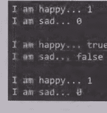

# 输入：使用 cin 从键盘获取值到计算机

为止为止，我们提供给计算机的数据仅是作为程序代码本身的一部分。我们在屏幕上显示的消息是内置的或嵌入在单个 C++ 语句中的。

大多数程序允许你在程序运行时与计算机通信。你可以使用键盘提供自己的数据值，或使用其他类型的设备向计算机提供数据。这被称为输入。数据流入计算机进行存储和处理。

从键盘传输数据到计算机的简单代码已经为你写好了。你可以将其作为 `<iostream>` 库的一部分包含在你的程序中：

```cpp
#include <iostream>
```

## 计算机如何处理输入的不需要的字符？

你现在可能已经发现，在提示输入数字或文本时，可能会输入不必要的字符。你的 Pi 派派通常会忽略这些不需要的字符。但有时，你需要清理这些字符，以确保它们不会干扰程序后续的的键盘输入，否则你的代码在执行时可能会显示出奇怪的行为。当你向 Pi 期望输入整数值时却输入了字母时，这种情况尤为常见。

尝试这个程序，它使用几种不同的数据类型请求不同范围的值：

示例 4.23 - inputs_no_clear.cpp

```cpp
#include <iostream> // 程序将使用屏幕和键盘
using namespace std; // 将使用标准标识符 string, cin, cout, endl
int main() {
    // 让用户输入浮点数
    float myFloat;
    cout << "Enter a float..." << endl;
    cin >> myFloat;
    cout << "Stored as " << myFloat << endl;

    // 让用户输入另一个浮点数
    float anotherFloat;
    cout << "Enter another float..." << endl;
    cin >> anotherFloat;
    cout << "Stored as " << anotherFloat << endl;

    // 让用户输入单个单词 - 不允许空格
    string myString;
    cout << "Enter a string using cin..." << endl;
    cin >> myString;
    cout << "Stored as " << myString << endl;

    // 让用户输入单个字符
    char myChar;
    cout << "Enter a char..." << endl;
    cin >> myChar;
    cout << "Stored as " << myChar << endl;

    // 让用户输入一个整数
    int anotherInt;
    cout << "Enter another integer..." << endl;
    cin >> anotherInt;
    cout << "Stored as " << anotherInt << endl;

    // 让用户输入文本字符串 - 允许空格
    string anotherString;
    cout << "Enter another string using getline..." << endl;
    getline(cin, anotherString);
    cout << "Stored as " << anotherString << endl;

    // 让用户输入另一个文本字符串 - 允许空格
    string oneMoreString;
    cout << "Enter one more string using getline..." << endl;
    getline(cin, oneMoreString);
    cout << "Stored as " << oneMoreString << endl;

    return 0;
}
```

当运行上述程序时，你可以轻松地输入多个单词作为会导致问题的值。

例如，尝试为 `myString` 的值输入多个单词。如果你输入 "Many words together!"，计算机只会使用第一个："Many"。正如我们在 `cin` 中看到的，计算机在遇到句子中的第一个空格时就会停止接收字符，只将第一个单词存储在 `myString` 变量中。

输入的字符串中剩余 "words together!" 部分被计算机保留，并立即用于下一次输入 `My`。计算机的行为就像在自动驾驶下运行。它没有等待你输入下一个值，而是自动使用了遗留的字符。这意味着它将 "w" 作为下一个字符，让你自己再输入一个字符。

为什么计算机要保留这些额外的字符？它们被临时存储在一个名为“键盘缓冲区”（keyboard buffer）的小内存内存中，并被保留，以防你的程序将来需要使用它们（某些程序正是如此）。

每当你在键盘上输入任何内容时，字符都会通过键盘缓冲区进入计算机。这是一个存放处，以防键盘提供的速度快于计算机实际处理的速度。这有助于确保输入的字符不会因为计算机处理器未准备好及时接收和处理而被“遗漏”。

如何阻止计算机使用键盘缓冲区中不需要的字符？答案是从输入通道（channel-in）中清除它们，告诉计算机忽略任何剩余数据。

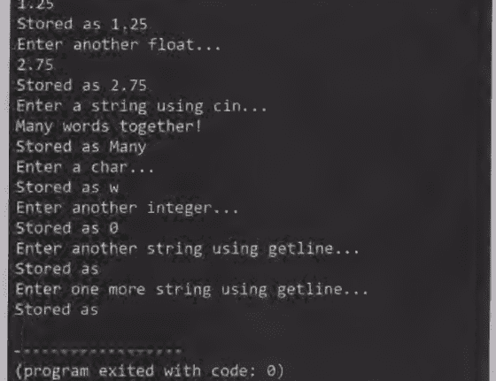

## 从 cin 中清除不需要的字符

该程序的更新版本在每次 `cin` 输入后都会清除键盘缓冲区中的任何字符：

示例 4.24 - clear_cin.cpp

```cpp
#include <iostream>          // 程序将使用屏幕和键盘
#include <climits>             // 程序需要使用允许的最大整数 INT_MAX

using namespace std;            // 将使用标准标识符 string, cin, cout, endl

int main()
{
    // 让用户输入浮点数
    float myFloat;
    cout << "Enter a float..." << endl;
    cin >> myFloat;
    cout << "Stored as " << myFloat << endl;

    // 在使用 cin >> 后，以万一起见丢弃不需要的文本
    cin.clear();
    cin.ignore(INT_MAX, '\n');

    // 让用户输入另一个浮点数
    float anotherFloat;
    cout << "Enter another float..." << endl;
    cin >> anotherFloat;
    cout << "Stored as " << anotherFloat << endl;

    // 再次丢弃任何不需要的文本
    cin.clear();
    cin.ignore(INT_MAX, '\n');

    // 让用户输入单个单词 - 不允许空格
    string myString;
    cout << "Enter a string using cin..." << endl;
    cin >> myString;
    cout << "Stored as " << myString << endl;

    // 再次丢弃任何不需要的文本
    cin.clear();
    cin.ignore(INT_MAX, '\n');

    // 让用户输入单个字符
    char myChar;
    cout << "Enter a char..." << endl;
    cin >> myChar;
    cout << "Stored as " << myChar << endl;

    // 再次丢弃任何不需要的文本
    cin.clear();
    cin.ignore(INT_MAX, '\n');

    // 让用户输入一个整数
    int anotherInt;
    cout << "Enter another integer..." << endl;
    cin >> anotherInt;
    cout << "Stored as " << anotherInt << endl;

    // 再次丢弃任何不需要的文本
    cin.clear();
    cin.ignore(INT_MAX, '\n');

    // 让用户输入文本字符串 - 允许空格
    string anotherString;
    cout << "Enter another string using getline..." << endl;
    getline(cin, anotherString);
    cout << "Stored as " << anotherString << endl;

    // 再次丢弃任何不需要的文本
    cin.clear();
    cin.ignore(INT_MAX, '\n');

    // 让用户输入另一个文本字符串 - 允许空格
    string oneMoreString;
    cout << "Enter one more string using getline..." << endl;
    getline(cin, oneMoreString);
    cout << "Stored as " << oneMoreString << endl;

    return 0;
}
```

你通过键盘输入的值被存储在两个不同的变量中：`firstInt` 和 `secondInt`。计算机会将这些值相加，并将结果存储在一个新的整数变量 `sum` 中。`sum` 的值将显示在屏幕上。（我们假设你不会不小心输入某些文本而不是整数。）

尝试运行程序并输入两个整数 —— 这样你就能看到显示出正确的和。相反，如果你向程序提供某些文本（例如 "tomato" 的值），你将看到一个关于计算机如何处理无效数据的提示。

以下是我的树莓派电脑上发生的情况：

```
Enter 1st integer... 27
Enter 2nd integer... tomato
The sum of the integers is 27
```

如果用户输入的一个或两个输入值无效的，那么尝试相加这些数据是没有意义的。输入的不是数字的文本值 "tomato" 被树莓派解释为值 0。

## 使用键盘验证数字

当你的程序期望用户输入数字时，你如何确保没有输入字母或其他符号？我们如何才能检查输入的值实际上是一个有效数字？

一旦在 `cin` 中输入了值，我们就可以使用 `good()` 成员函数检查该值的状态：

```cpp
int myInt;
cin >> myInt;

if ( cin.good())
    cout << "This was a valid integer" << endl;
else
    cout << "This was NOT a valid integer" << endl;
```

在使用 `good()` 检查 `cin` 内容是否有无效字符后，你的程序可以决定是合理地处理该值，还是放弃输入的字符，如下方的流程所示：

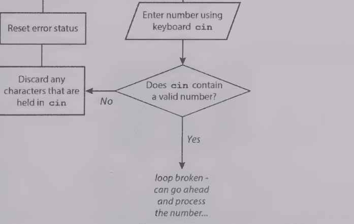

程序将这一思想付诸实践，请求一个整数值，然后检查无效字符：

## 示例 4.26 - validate_int.cpp

```cpp
#include <iostream>    // 程序将使用屏幕和键盘
#include <limits>       // 程序需要使用允许的最大整数 INT_MAX

using namespace std;      // 将使用标准标识符 cin, cout endl

int main() {
    int myInt;

    // 重复要求用户输入数字并检查其有效性
    bool needValue = true;
    do {
        // 获取值并将其存储为整数
        cout << "Enter a number..." << endl;
        cin >> myInt;

        // 检查值是否为接受的数字
        if (cin.good()) {
            needValue = false;
        } else {
            cout << "Aaargh! Not a number!" << endl;
            // 在下次输入前，清除输入通道中任何未使用的字符
            cin.clear();
            cin.ignore(INT_MAX, '\n');
        }
    } //  if
    } while (needValue);

    // 现在有了一个接受的数字
    cout << "Thank-you." << endl;
    cout << "This was stored as " << myInt << endl;

    return 0;
}
```

这次，如果你输入 "tomato" 而不是整数，你现在将看到一条错误消息：


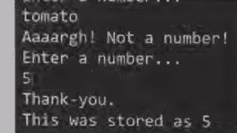

这里是之前的示例 4.25 - `value_of_inputs.cpp` 的改进版本，它使用 `good()` 成员函数来在计算机期望接收整数时阻止任何文本值通过：

## 示例 4.27 - `validate_two_numbers.cpp`

```cpp
#include <iostream>    // 程序将使用屏幕和键盘

using namespace std;      // 将使用标准标识符 cin, cout, endl

int main()
{
    int errorCode = 0;      // 表示完全没有遇到任何错误

    int firstInt, secondInt, sum;

    // 请求用户输入第一个整数
    cout << "Enter 1st integer...";
    cin >> firstInt;

    // 检查第一个整数是否接受
    if (cin.good())
    {
        // 请求用户输入第二个整数
        cout << "Enter 2nd integer...";
        cin >> secondInt;

        // 检查第二个整数是否接受
        if (cin.good())
        {
            // 两个输入均已 - 继续处理数据。

            // 将两个整数相加并存储结果
            sum = firstInt + secondInt;

            // 在屏幕上显示结果
            cout << "The sum of the integers is " << sum << endl;
        }
        else
        {
            cout << "Sorry. The second input was not a number." << endl;
            errorCode = 2;      // 表示第二个数字出了问题
            // 完成第二个输入的检查
        }
    }
    else
    {
        cout << "Sorry. The first input was not a number." << endl;
        errorCode = 1;      // 表示第一个数字出了问题
        // 完成第一个输入的检查
    }

    return errorCode;      // 让 Linux 知道数据是否有效
}
```

程序是如何运行的？在输入第一个值后，通过调用 `cin.good()` 函数对该值进行检查。这决定了第一个值是否是一个接受的数字。

如果第一个值是有效的，程序将提示用户输入第二个值。它调用 `cin.good()` 来检查这个第二个值是否为有效数字。

如果发现第二个值也是一个有效数字，那么两个输入都已输入 —— 继续处理数据。

将两个整数相加并存储结果

`sum = firstInt + secondInt;`

在屏幕上显示结果

`cout << "The sum of the integers is " << sum << endl;`

然而，如果发现任何一个值无效，则会设置 `errorCode` 的值。

# 供你尝试的问题和练习

| 1. | 编写一个程序，让你输入一个整数。使用 `setw()` 将数字的宽度更改为 1、5 和 10 个字符，并显示三次数字。 |
| 2. | 编写一个程序，要求你输入一个句子。显示三次句子，每次使用不同的颜色。 |
| 3. | 编写一个程序，要求你输入一个整数。让程序在执行结束前等待该数字对应的秒数。 |
| 4. | 编写一个程序，要求你每次输入一个数字。让它显示这三个数字的总和。 |

## 第 5 章：

### 使用运算符处理数据

## 使用 ++ 增运算符和 -- 减运算符改变变量的值

我们之前已经见过如何使用 `=` 赋值运算符将变量的值设置为存储一个字面量。

还有其他设置数值型变量值的方法，包括针对整数和浮点数的方法。与其给变量设置一个特定值，你还可以根据变量当前的值来更改它的值。你可以将表达式的结果赋值给变量，如下所示：

```
livesLeft = livesLeft + 1;
```

上述语句的意思是：

> "将 `livesLeft` 变量的值设置为 `livesLeft` 当前的值，并在此基础上加 1。"

注意 `livesLeft + 1` 是一个简单的表达式，它结合了命名值 `livesLeft`、`+` 运算符和字面量 `1`。

## 使用 ++ 增运算符向值上加 1

C++ 还有另一种给变量值加 1 的简单方法，称为增运算符：`++`

而不是编写：

```
livesLeft = livesLeft + 1;
```

...你可以使用增运算符让 `livesLeft` 变量的值加 1：

```
livesLeft++;
```

## 使用 -- 减运算符从值上减去 1

C++ 还有一个运算符可以从变量的值中减去 1，称为减运算符：`--`

而不是编写：

```
livesLeft = livesLeft - 1;
```

...你可以使用减运算符让 `livesLeft` 变量的值减少 1：

```
livesLeft--;
```

## 使用 ++ 增运算符和 -- 减运算符的不同方法

`++` 增运算符和 `--` 减运算符都可以以不同的方式工作，这取决于你将它们放置在相对于操作的变量名的什么位置。你可以选择将运算符放在变量名的之前或之后。

## 作为独立语句的自增

记住 `++` 运算符会将变量的值加 1。在这里，它被用作一个简单的语句来增加名为 `people` 的变量的值：

```
int people = 5;
people++;
cout << people << endl;
```

第一行代码创建了一个名为 `people` 值为 5 的整数变量。然后它增加了了 `people` 的值，将其从 5 变为 6。最后，最后一行代码显示变量的值，显示为 6。

## 前置增，作为另一个语句的一部分

在下面的示例中，增运算符被嵌入到用于显示变量值的语句中，从而减少了一行代码：

```
int people = 5;
cout << ++people << endl;
```

第一行代码创建了名为 `people` 的变量，与第一个示例一样。下一行代码将在屏幕上显示变量的值，但在使用该变量之前，`++` 运算符会将其值加 1。然后它继续使用更改后的值，在屏幕上显示 6。

当你将 `++` 运算符放在变量名之前时，它被称为**前置增运算符**。变量的值在使用之前会先加 1。

## 后置增，作为另一个语句的一部分

```
int people = 5;
cout << people++ << endl;
```

这段代码的作用是创建一个值为 5 的整数变量。它会显示变量，在屏幕上显示值 5。一旦变量被使用，它就会增加该值，将其从 5 变为 6。

当你将 `++` 运算符放在变量名之后时，它被称为**后置增运算符**。变量的值只有在使用后才会加 1。

## 前置减和后置减作为另一个语句的一部分

与 `++` 增运算符一样，你可以将 `--` 减运算符放在所操作的变量名的之前或之后。这些被称为前置减和后置减操作。

## += "加量" 和 -= "减量" 运算符

`++` 增运算符给变量的值加 1，而 `--` 运算符减去 1。

你如何加或减去 1 以外的不同数字呢？

你可以编写这样的语句：

```
playerScore = playerScore + 100;
```

这告诉计算机为变量 `playerScore` 设置一个新值，使其等于 `playerScore` 的旧值并额外加 100。

或者，你可以使用 `+=` 加量运算符在变量当前值上加上特定的数，或使用 `-=` 减量运算符减去特定的数：

```
playerScore += 100;
time -= 30;
```

## 使用 * 运算符相乘

值可以使用 `*` 运算符相乘。

例如，这些语句中的每一个定义了一个变量等于相乘的结果：

```
bonus = timeLeft * 10;
areaOfRectangle = width * height;
areaOfCircle = pi * radius * radius;
```

使用 `*`（星号）而不是人们通常在纸上使用的 x 交叉是为了避免与字母 "x" 混淆。

你可以相乘相同类型的值，例如将整数相乘：

```
int hoursInOneWeek = 7 * 24;
```

你也可以相乘不同类型的值，例如将一个 `float` 值乘以一个 `int` 值：

```
float dailyPay = 8.25 * 6;
```

在示例中，浮点值 8.25 乘以整数值 6。由于被相乘的值之一是一个使用小数点的值，编译器将假设结果也需要小数点，因此结果也将是一个浮点值而不是整数。出于此原因，变量 `dailyPay` 使用 `float` 数据类型声明。

```cpp
// 使用它们进行计算并显示结果

cout << "There are ";

cout << DAYS * HOURS;

cout << " hours in a week." << endl;

cout << "There are ";

cout << HOURS * MINUTES;

cout << " minutes in a day." << endl;

return 0;
```

在上述代码中，常量 `DAYS` 的值为 7，常量 `HOURS` 的值为 24。

语句：

```cpp
cout << DAYS * HOURS;
```

...显示了 7 乘以 24 的结果，即 168 小时。

同样，常量 `MINUTES` 的值为 60，因此语句：

```cpp
cout << HOURS * MINUTES;
```

...显示了 24 乘以 60 的结果，即 1440 分钟。


## 使用 / 运算符进行数字除法

你可以使用 `/` 除法运算符将一个数值除以另一个数值。

## 示例 5.3 - `divide.cpp`

```cpp
#include <iostream> // 程序将使用屏幕和键盘

using namespace std; // 将使用标准标识 cin, cout, endl

int main()
{
    cout << "What is the top part of the fraction?" << endl;
    int top;
    cin >> top;
    // -----

    cout << "What is the bottom part of the fraction?" << endl;
    int bottom;
    cin >> bottom;
    // -----

    cout << "As a decimal value, your fraction is: " << endl;
    float asDecimalValue = top / bottom;

    cout << asDecimalValue;
    cout << endl << endl;

    return 0;
}
```

运行此程序可能会产生一些意料之外的结果。10 / 5 得到答案 2，这是正确的，但你可能会发现 1 / 2 得到的答案是 0 而不是 0.5。这是因为计算机忽略了小数点后的数字，因为它认为自己正在处理纯整数。

# 强制转换 - 将值转换为不同的数据类型

解决问题的方法是告诉计算机在执行除法之前，将分子和分母值都视为 `float`。这种不同数据类型之间的转换被称为“强制转换”（cast）。

```cpp
float asDecimalValue = (float) top / (float) bottom;
```

在上述语句中，`(float)` 强制计算机将分子和分母变量视为 `float` 而不是 `int` 值，因此计算机不会丢弃小数值。

强制转换将在本章稍后详细介绍，你会发现从一种数据类型转换为另一种数据类型时，使用 `static_cast` 关键字是最佳实践。

# 示例计算 - UNIX生日快乐

这是一个利用了本章涵盖的许多要点的示例。它检查树莓派上的时间，以确定自“UNIX 时间”（定义为 1970 年 1 月 1 日）以来已经过去了多少秒。

## 示例 5.4 - `calc_age.cpp`

```cpp
#include <iostream> // 程序将在屏幕上显示一些文本
#include <ctime> // 程序使用 time() 函数作为随机种子

using namespace std; // 将使用标准标识符 cout 和 endl

int main() {
    const float DAYS_IN_YR = 365.25;
    const int HRS_IN_DAY = 24;
    const int MIN_IN_HR = 60;
    const int SECS_IN_MIN = 60;

    // 计算 1 年有多少秒...
    const float SECS_IN_YEAR = SECS_IN_MIN * MIN_IN_HR * HRS_IN_DAY * DAYS_IN_YR;

    // 找出 UNIX 的年龄（以秒为单位给出）
    int ageOfInSeconds = time(0 );

    // 将此除以一年的秒数，
    //这将是以年为单位的 UNIX 年，而不是秒...
    cout << "Unix is " << ageOfInSeconds / SECS_IN_YEAR <<
    cout << " years old." << endl;

    return 0;
}
```

程序将显示此结果：

> Unix is 57 years old。（注：OCR 文字在此处输出乱码，但逻辑是一致的）

# 浮点除法的结果

当你尝试用一个整数除以一个实数（例如浮点值 0.5）时会发生什么？

示例 5.7 - `int_by_float.cpp`

```cpp
#include <iostream>    // 程序将在屏幕上显示一些文本
using namespace std; // 将使用标准标识符 cout 和 endl
int main()
{
    int distance = 10;
    float half = 0.5;

    cout << "How many times does " << half;
    cout << " go into " << distance;
    cout << " ? ";

    cout << distance / half;
    cout << endl << endl;

    float third = 0.333333;

    cout << "How many times does " << third;
    cout << " go into " << distance;
    cout << " ? ";

    cout << distance / third;
    cout << endl << endl;

    return 0;
}
```

这一次，结果显示为：

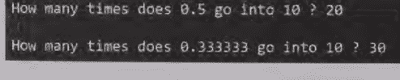

计算机在屏幕上的两个结果中都没有显示任何小数位。如果你用手持计算器尝试第二个示例，你实际上可能会看到结果 30.00003（或非常相似的结果，取决于你计算器的精度）。

最后，这个程序说明了一个实数除以另一个实数时发生的情况：

## 示例 5.8 - `float_by_float.cpp`

```cpp
#include <iostream> // 程序将在屏幕上显示一些文本
using namespace std; // 将使用标准标识符 cout 和 endl

int main()
{
    float myNumber = 2.5;
    float half = 0.5;

    cout << "How many times does " << half;
    cout << "go into " << myNumber;
    cout << " ?";

    cout << myNumber / half;
    cout << endl << endl;

    float threeQuarters = 0.75;

    cout << "How many times does " << threeQuarters;
    cout << "go into " << myNumber;
    cout << " ?";

    cout << endl << endl;

    return 0;
}
```

屏幕上显示的结果如下：

| 0.5 可以除入 2.5 几次？ | 5 |
| 0.75 可以除入 2.5 几次？ | 3.33333 |

因为 2.5 / 0.5 得到的答案是一个精确的数字，所以小数点后不会显示任何不必要的 0。只有在确实需要时才会显示小数位，例如上面截图中的第二次除法，其结果是循环的 3.33333。

## 使用模运算符寻找余数

例如，我们知道 16 / 3 的结果是 5，因为 3 除入 16 中恰好有 5 次，留下了 1 的余数。

为了找到余数，我们可以使用 `%` 取模运算符。

```
16 % 3 意味着“找到16 除以 3 的余数”。

结果是 1，因为 16 除以 3 等于 5，余数为 1。
```

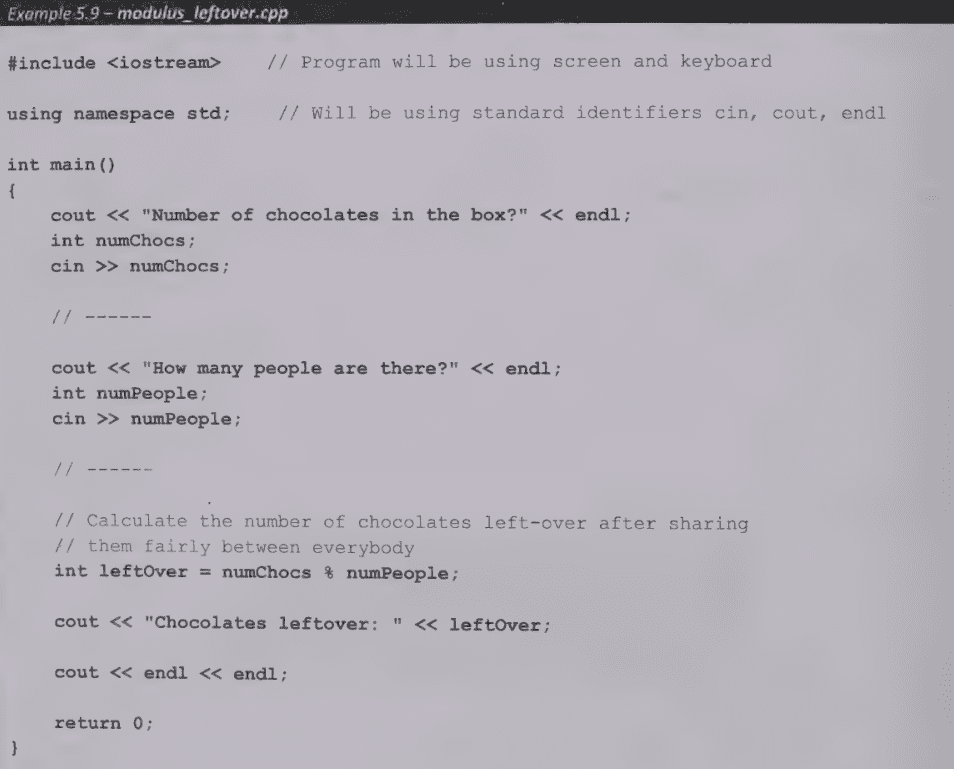

以下是运行时的情况：

| 盒子里有多少块巧克力？ | 16 |


| 有几个人？ | 3 |

| 剩余的巧克力： | 1 |

# 使用随机数在程序中产生不可预测的行为

和所有计算机一样，树莓派遵循一个精确说明该做什么的程序。但你如何让计算机做意料之外的事呢？当你是那个一步步告诉它具体该做什么时，它又如何让你感到惊喜呢？

许多程序使用随机数。计算机使用一种特殊的方法（“算法”）从它生成的数值序列中选择一个数字。尽管该序列本身是可以预测的，因为算法总是会生成相同的值，因此这本身并不是随机的。我们可以使用 `random()` 函数从序列中选择一个值。`random()` 函数是旧版 C 标准库代码的一部分，称为 `<cstdlib>`。

下面的程序使用这种随机方法选择了三个数字：

```cpp
#include <iostream>      // 程序将在屏幕上显示一些文本
#include <cstdlib>                 // 程序使用 random() 函数

using namespace std;               // 将使用标准标识符 cout 和 endl

int main() {
    // 选择并显示三个看似随机的数字序列

    cout << "I picked the number ";
    cout << random();
    cout << endl;

    cout << "Then I picked ";
    cout << random();
    cout << endl;

    cout << "Finally, I picked ";
    cout << random();
    cout << endl;

    return 0;
}
```

当你第一次运行该程序时，你可能会认为这些数字是随机选择的，并且它们之间没有联系。遗憾的是，如果你反复运行该程序，你会注意到它总是从算法生成的序列中选取相同的数字。它的行为实际上是可预测的，而不是随机的！

这里是我第一次运行程序的结果：

```
I picked the number 123456789
Then I picked 987654321
Finally, I picked 555555555
```

这里是我第二次运行程序的结果：

```
I picked the number 123456789
Then I picked 987654321
Finally, I picked 555555555
```

你会发现，无论运行多少次，结果都是相同的。为了让结果变得随机，我们需要设置一个“种子”。我们可以使用 `time()` 函数将当前时间作为种子，因为每次运行程序的时间都不同，生成的随机序列也会不同。

```cpp
#include <iostream>
#include <cstdlib>
#include <ctime> // 需要包含此文件

using namespace std;

int main() {
    // 使用当前时间设置种子
    srand(time(0));

    cout << "I picked the number ";
    cout << random();
    cout << endl;

    cout << "Then I picked ";
    cout << random();
    cout << endl;

    cout << "Finally, I picked ";
    cout << random();
    cout << endl;

    return 0;
}
```

现在，如果你再次运行程序，你会发现数字是随机的，并且每次运行的结果都会不同。

另一种不带括号的语句写法是：

```
int side = 1 + random() % 6;
```

注意，`%` 操作在 `+` 操作之前执行，因为 `%` 具有更高的“运算符优先级”；在表达式中，`%` 被认为比 `+` 更“重要”。

以下是一个模拟掷两个独立骰子的示例。它们的得分相加得到 1 到 12 之间的总和，包括：

## 示例 5.13 - random_dice.cpp

这些是我第一次运行程序时得到的结果：

| 我第一次掷了 6 |

| 之后我掷了 1 |

| 我的总分是 7 |

注意，当程序第二次运行时，结果可能会不同：

| 我第一次掷了 2 |

| 之后我掷了 4 |

| 我的总分是 6 |

## 幂：使用 pow() 函数计算数字的幂方

C++ 可以通过多种方式计算数字的幂。在“示例 4.6 - display_overflow.cpp”中，我们看到 C++ 可以执行重复乘法，这对于低幂（例如一个数字乘以它自己）是没问题的。

或者，你可以使用 `pow()` 函数，它可以将一个数字提高指定的幂。这对于高幂来说通常更方便。

在下面的程序中，语句：

```
cout << pow(width, 3 );
```

...告诉计算机显示计算出的宽度的 3 次幂幂值。在数学中，我们通常将其写为 w³，其中 w 是立方体的宽度。

但是，要使用此函数，你必须在程序开头包含标准 C++ 数学库的代码：

```
#include <cmath>
```

以下是一个使用 `pow()` 函数计算立方体体积的示例：

```cpp
#include <iostream>      // 程序将使用键盘和屏幕
#include <cmath>           // 程序使用 pow() 函数

using namespace std;      // 使用标准标识符 cin, cout, endl

int main() {
    // 输入以厘米为单位的立方体宽度
    cout << "Type in the width of the cube in whole cm" << endl;
    int width;
    cin >> width;

    // 计算并显示立方体的体积
    cout << "The volume of the cube is ";

    // pow 是一个函数 - 将 width 的值进行 3 次方，即立方
    cout << pow(width, 3);

    cout << " cubic cm" << endl;

    return 0;
}
```

下面是程序执行时的示例：

```
Type in the width of the cube in whole cm
3
The volume of the cube is 27 cubic cm
```

## 运算符优先级 - 执行操作的顺序

C++ 表达式中的不同运算符符号根据其重要性进行处理。这被称为“运算符优先级”；如果你在数学中使用过 BIDMAS（括号、指数、除法、乘法、加法、减法）规则，你应该能够理解 C++ 是如何执行操作的。例如，乘法的优先级高于加法。

C++ 中的优先级顺序是：

- `()` - 括号

- `/` - 调用函数，例如 `pow ()` “幂”

- `*` - 除法

- `/` - 乘法

- `+` - 加法

- `-` - 减法

例如，考虑三角形的面积：

```
base * height / 2
```

在表达式的两个运算符中，`/` 的优先级高于 `*`，因此计算机先将 `height` 的值除以 2，然后再将结果乘以 `base` 的值。

当表达式包含多个具有相同优先级的运算符时（例如包含许多加法操作的表达式），这些操作相对于表达式开头从左到右求值。

## 示例 5.15 - calc_area_circle.cpp

```cpp
#include <iostream> // 程序屏幕上显示一些文本
using namespace std; // 将使用标准标识符 cout, endl
int main() {
    const float PI = 3.14159;

    // 输入以厘米为单位的圆半径
    cout << "Type in the radius of cm" << endl;
    float radius;
    cin >> radius;

    // 计算并显示圆的面积
    cout << "The area of the circle is ";

    // radius 乘以 radius 等于“半径平方”
    cout << PI * radius << radius;

    cout << "square cm" << endl;

    return 0;
}
```

同样注意，在上一个程序中，以下表达式：

| PI * radius * radius |

...可以写为：

| PI * pow( radius, 2 ) |

调用 `pow()` 函数意味着：

“radius 的值的 2 次幂”。

以下是供你尝试的代码：

### 示例 5.15 修改版 - calc_area_circle_pow.cpp

```cpp
#include <iostream> // 程序屏幕上显示一些文本
#include <cmath> // 程序将使用 pow() 函数

using namespace std; // 使用标准标识符 cin, cout, endl

int main() {
    const float PI = 3.14159;

    // 输入以厘米为单位的圆半径
    cout << "Type in the radius of cm" << endl;
    float radius;
    cin >> radius;

    // 计算并显示圆的面积
    cout << "The area of the circle is ";

    // radius 乘以 radius 等于“半径平方”
    cout << PI * radius << radius;

    cout << "square cm" << endl;

    return 0;
}
```

以下程序使用了 `min()` 和 `max()` 函数来计算直线的中点：

## Example 5.16-calc_mid_point.cpp

```cpp
#include <iostream>      // 程序将使用键盘和屏幕

using namespace std;               // 将使用标准标识 cin, cout

int main()
{
    float xBegin, yBegin, xEnd, yEnd;

    // 用户输入直线起点的坐标
    cout << "Type in x co-ordinate of where the line begins: " << endl;
    cin >> xBegin;
    cout << "Type in y co-ordinate of where the line begins: " << endl;
    cin >> yBegin;

    // 用户输入直线终点的坐标
    cout << "Type in x co-ordinate of where the line ends: " << endl;
    cin >> xEnd;
    cout << "Type in y co-ordinate of where the line ends: " << endl;
    cin >> yEnd;

    // 确定 x 坐标中的最小值和值
    float xSmallest = min(xBegin, xEnd);
    float xLargest = max(xBegin, xEnd);

    // 确定 y 坐标中的最小值和值
    float ySmallest = min(yBegin, yEnd);
    float yLargest = max(yBegin, yEnd);

    // 计算中点的 x 坐标
    float xMid = xSmallest + (xLargest - xSmallest) / 2;

    // 计算中点的 y 坐标
    float yMid = ySmallest + (yLargest - ySmallest) / 2;

    // 显示直线的中点
    cout << "The mid-point of the line is ";

    cout << "(" << xMid << ", " << yMid << ")" << endl;

    return 0;
}
```

程序运行时的结果如下：

```
Type in x co-ordinate of where the line begins:
5
Type in y co-ordinate of where the line begins:
2
Type in x co-ordinate of where the line ends:
9
Type in y co-ordinate of where the line ends:
3
The mid-point of the line is (7, 2.5)
```

对于端点为 (5, 2) 和 (9, 3) 的直线，程序计算出的中点为 (7, 2.5)。

7 是 5 和 9 的中间。

2.5 是 2 和 3 的中间。

为了计算中点的 x 坐标，程序首先使用 `min()` 和 `max()` 函数从不同的 x 坐标中确定出最小值和最大值：5 和 9。

```cpp
// 确定 x 坐标中的最小值和值
float xSmallest = min(xBegin, xEnd);
float xLargest = max(xBegin, xEnd);
```

然后，程序使用减法计算它们之间的差值，从最大值中减去最小值，将此差值除以 2并将结果加到 x 坐标上：

```cpp
// 计算中点的 x 坐标
float xMid = xSmallest + (xLargest - xSmallest) / 2;
```

获取中点的 y 坐标，则对端点的 y 坐标执行相同的步骤。

再次确定最小和最大的 y 值：

```cpp
// 确定 y 坐标中的最小值和值
float ySmallest = min(yBegin, yEnd);
float yLargest = max(yBegin, yEnd);
```

然后根据这些值计算出 y 坐标：

```cpp
// 计算中点的 y 坐标
float yMid = ySmallest + (yLargest - ySmallest) / 2;
```

这为我们得到了用户输入的坐标之间直线的中点 x 和 y 坐标。

## 类型转换（Casts）——数据类型之间的转换

有时，我们可能想要特定类型的数据值，而这些类型与我们在程序中赋予变量和常量的数据类型不同。

例如，我们可能想要比较两个变量看它们的值是否相同，或者对它们进行某种计算。但如果两个变量的数据类型不同呢？其中一个可能是 `float` 值而另一个可能是 `char` 值。这些不同的数据类型可能会导致操作的行为有所不同。

正如我们在在本章之前看到的，在 C++ 中，你可以强制一个数据值表现得像你想要的特定数据类型

考虑这个示例：

```
取整数值 65，其数据类型为 int。

你可以强制 65 表现得像一个实数，例如 float 值 65.00000。

或者，你可以强制 65 表现得像 ASCII 码为 65 的 char 值，即字符 A。
```

这种转换被称为“转换（cast）”。你可以想象一个数据值是由金属制成的，具有特定的形状。金属数据可以熔化并倒入模具中（或“铸造”），以制成新的、不同的形状。

当为变量设置需要使用特定类型的数据时非常有用，但实际上

## 使用位运算符执行逻辑操作

到目前为止讨论的所有操作符都作用于数据。这些数据以数字形式存储在你的 Pi 中，这意味着它们是由数字组成的。更具体地说，所有数据值都以二进制数存储和处理——即 0 和 1 的模式。如果你之前还不知道，“bit”（位）是“binary-digit”（二制数位）的缩写，意味着 0 或 1。

在 C++ 中，也可以处理数据值的部分而非整个数值。你的代码可以操作数据值中的单个二进制数字或“位”（bits）。为了实现这一点，我们使用位运算符对位模式执行布尔逻辑操作或“逻辑”操作。

C++ 提供了以下你可以使用的位运算符：

| | | | | |

|---|---|---|---|

| ~ | compl | 位非（取反） | |

| | | | | 位或（OR） |

| & | bitand | 位与（AND） | |

| ^ | xor | 位异或（exclusive-OR） | |

它们是如何运作的？每个位运算符都接受一个或两个数字作为操作数（要处理的值）。在 Pi 内部，每个操作数都被表示为二进制数字序列。这些二进制数字序列根据每个特定运算符的规则进行转换，产生一个新的二进制数字模式。规则如下表所示。

位运算符可以用于任何简单的数据类型，如 `int`，因为所有数据始终表示为位的模式。在这些示例中，我选择使用 `unsigned short` 值来保持模式和计算相对简单，但你可能会发现处理负值或来自其他数据类型的更大范围的值会有些棘手。

### 位运算符 ~ NOT（非）

它接收一个单独的操作数（或值），并翻转用于表示它的二进制数字模式。原始位模式中的每个 1 都会变成 0。原始位模式中的每个 0 都会变成 1。

| 操作数中的每个二进制数字 | | | |

|---|---|---|

| 0 | 变为 | 1 |

| 1 | 变为 | 0 |

通过位非操作，结果的模式将始终与表示该值的原始模式相反。

例如，`unsigned short` 值 13。它在你的 Pi 内部被表示为以下 16 位二进制模式：

```
0000000000001101
```

对此模式中的位执行逻辑非操作将产生以下结果：

```
1111111111110010
```

注意，原始位模式中的任何 0 现在都变成了 1。原始位模式中的任何 1 现在都变成了 0。

## 位模式代表什么？

原始值：13

| 权重（基 2 列标题） | | | | | | | | | | | | | | | | | |


|---|---|---|---|---|---|---|---|---|---|---|---|---|---|---|---|---|

| 32768 | 8192 | 4096 | 2048 | 1024 | 512 | 256 | 128 | 64 | 32 | 16 | 8 | 4 | 2 | 1 |

| 用于表示值 13 的二进制数字模式 | | | | | | | | | | | | | | | | |

|---|---|---|---|---|---|---|---|---|---|---|---|---|---|---|---|---||| 0 | 0 | 0 | 0 | 0 | 0 | 0 | 0 | 0 | 1 | 1 | 0 | 1 | | | | |

| 每个二进制数字在基 10 中的等值 | | | | | | | | | | | | | | | | | | |

|---|---|---|---|---|---|---|---|---|---|---|---|---|---|---|---|---||

| 0 | 0 | 0 | 0 | 0 | 0 | 0 | 0 | 8 | 4 | 0 | 1 | | | | | |

## 对值 13 执行位 NOT

| 权重（基 2 列标题） | | | | | | | | | | | | | | | | | | |

|---|---|---|---|---|---|---|---|---|---|---|---|---|---|---|---|---||

| 32768 | 8192 | 4096 | 2048 | 1024 | 512 | 256 | 128 | 64 | 32 | 16 | 8 | 4 | 2 | 1 |

| NOT 操作前的原始二进制数字模式 | | | | | | | | | | | | | | | | | | | |

|---|---|---|---|---|---|---|---|---|---|---|---|---|---|---|---|---|---|---||

| 0 | 0 | 0 | 0 | 0 | 0 | 0 | 0 | 0 | 1 | 1 | 0 | 1 | | | | | | |

| 执行 NOT 操作后的新二进制数字模式 | | | | | | | | | | | | | | | | | | | |

|---|---|---|---|---|---|---|---|---|---|---|---|---|---|---|---|---|---|---||

| 1 | 1 | 1 | 1 | 1 | 1 | 1 | 1 | 1 | 0 | 0 | 1 | 0 | 0 | | | | | |

| 每个二进制数字在基 10 中的等值 | | | | | | | | | | | | | | | | | | | |

|---|---|---|---|---|---|---|---|---|---|---|---|---|---|---|---|---|---|---||

| 32768 | 8192 | 4096 | 2048 | 1024 | 512 | 256 | 128 | 64 | 32 | 16 | 0 | 0 |

将二进制模式转换为基 10 将得到数字 6522。因此，位 NOT 13 的结果是 6522。

同样，考虑值 0，它是最小的 `unsigned short` 值，由模式 0000000000000000 表示。在模式 1111111111111111 中对 0 执行 NOT，结果是 6535，这是允许的最大无符号值。

与之前的示例一样，下面的程序显示了如何输入一个整数，该整数被存储为 `unsigned short`，它使用模式表示 0 到 65535 之间的正整数。

```cpp
#include <iostream>
using namespace std;

int main() {
    unsigned short originalNumber, result;

    cout << "输入一个整数: " << endl;
    cin >> originalNumber;

    // 对位执行位 NOT 操作
    result = ~originalNumber;

    // 显示结果
    cout << "NOT 操作后的结果是: " << result << endl;

    return 0;
}
```

以下是该程序的几个运行示例：

输入：13

NOT 操作后的结果是：65522

输入：22

NOT 操作后的结果是：65513

输入：0

NOT 操作后的结果是：65535

输入：34

NOT 操作后的结果是 65501

输入：1

NOT 操作后的结果是 65534

使用 `~` 符号，你的代码可以使用 `compl`（补码）。在计算机科学中，值的取反被称为“反码”（complement）。

```cpp
// 执行位 NOT 操作
```

...类似的语句：

## 位 OR 运算符

位运算符作用于两个操作数，每个操作数都表示为位序列。如下表所示：

| | | | | | | | | | | | | | | |

|---|---|---|---|---|---|---|---|---|---|---|---|---|---|---|

| 0 | 0 | | | | | | | | | | | | | |

| 0 | 1 | | | | | | | | | | | | | |

| 1 | 0 | | | | | | | | | | | | | | |

| 1 | 1 | | | | | | | | | | | | | | |

| | | | | | | | | | | | | | | |

| | | | | | | | | | | | | | | | |

| | | | | | | | | | | | | | | | |

| | | | | | | | | | | | | | | |

位 OR 运算符对两个操作数进行操作。如果两个操作数中的对应位均为 1，则结果对应的位为 1。

第一个值：99

| 权重（基 2 列标题） | | | | | | | | | | | | | | | |

|---|---|---|---|---|---|---|---|---|---|---|---|---|---|---|---|---|

| 32768 | 8192 | 4096 | 2048 | 1024 | 512 | 256 | 128 | 64 | 32 | 16 | 8 | 4 | 2 | 1 |

| 用于表示值 99 的二进制数字模式 | | | | | | | | | | | | | | | | | |

|---|---|---|---|---|---|---|---|---|---|---|---|---|---|---|---|---||

| 0 | 0 | 0 | 0 | 0 | 0 | 0 | 0 | 1 | 1 | 0 | 0 | 1 | | | | | |

| 每个二进制数字在基 10 中的等值 | | | | | | | | | | | | | | | | | |

|---|---|---|---|---|---|---|---|---|---|---|---|---|---|---|---|---||

| 0 | 0 | 0 | 0 | 0 | 0 | 0 | 0 | 64 | 32 | 0 | 1 | | | | | |

第二个值：586

| 权重（基 2 列标题） | | | | | | | | | | | | | | | | | | | |

|---|---|---|---|---|---|---|---|---|---|---|---|---|---|---|---|---|---||

| 32768 | 8192 | 4096 | 2048 | 1024 | 512 | 256 | 128 | 64 | 32 | 16 | 8 | 4 | 2 | 1 |

| 用于表示值 586 的二进制数字模式 | | | | | | | | | | | | | | | | | | |

|---|---|---|---|---|---|---|---|---|---|---|---|---|---|---|---|---|---||

| 0 | 0 | 0 | 0 | 0 | 0 | 0 | 0 | 1 | 0 | 0 | 1 | 1 | 0 | | |

| 每个二进制数字在基 10 中的等值 | | | | | | | | | | | | | | | | | | |

|---|---|---|---|---|---|---|---|---|---|---|---|---|---|---|---|---|---||

| 0 | 0 | 0 | 0 | 0 | 512 | 64 | 32 | 2 | | | | | | |

99 OR 586 的结果是 655。

```cpp
#include <iostream>
using namespace std;

int main() {
    unsigned short val1, val2, result;

    cout << "输入第一个整数: " << endl;
    cin >> val1;
    cout << "输入第二个整数: " << endl;
    cin >> val2;

    // 执行位 OR 操作
    result = val1 | val2;

    cout << "OR 操作后的结果是: " << result << endl;

    return 0;
}
```

## 位与运算符 & 运算符

| 操作数的一对二位数字 | 结果 |

| :--- | :--- |

| 0 | 0 |

| 1 | 0 | 0 |

| 1 | 1 | 1 |

在布尔与运算中，只有当这对位中的**都**为 1 时，结果**才会**为 1。

另注意，`&` 位与运算符的同义词是 **bitand**。

## 位与的使用示例

**99 & 46** 的结果是什么？

第一个值：99

| 位值（二进制列标题） | 32768 | 16384 | 8192 | 4096 | 2048 | 1024 | 512 | 256 | 128 | 64 | 32 | 16 | 8 | 4 | 2 | 1 |

用于表示该数值的二进制位模式：99

| 0 | 0 | 0 | 0 | 0 | 0 | 0 | 0 | 0 | 1 | 0 | 0 | 0 | 1 | 1 |

每个二进制位在十进制中的等值值

| 0 | 0 | 0 | 0 | 0 | 0 | 0 | 0 | 64 | 32 | 0 | 0 | 2 | 1 | 十进制总和 |

| :--- | :--- | :--- | :--- | :--- | :--- | :--- | :--- | :--- | :--- | :--- | :--- | :--- | :--- | :--- | 99 |

第二个值：46

| 位值（二进制列标题） | 32768 | 16384 | 8192 | 4096 | 2048 | 1024 | 512 | 256 | 128 | 64 | 32 | 16 | 8 | 4 | 2 | 1 |

用于表示该数值的二进制位模式：46

| 0 | 0 | 0 | 0 | 0 | 0 | 0 | 0 | 0 | 0 | 1 | 0 | 1 | 1 | 0 |

每个二进制位在十进制中的等值值

| 0 | 0 | 0 | 0 | 0 | 0 | 0 | 0 | 0 | 32 | 0 | 0 | 2 | 0 | 十进制总和 |

| :--- | :--- | :--- | :--- | :--- | :--- | :--- | :--- | :--- | :--- | :--- | :--- | :--- | :--- | 46 |

## 99 bitand 46

| 位值（二进制列标题） | 32768 | 16384 | 8192 | 4096 | 2048 | 1024 | 512 | 256 | 128 | 64 | 32 | 16 | 8 | 4 | 2 | 1 |

第一个值的二进制位模式：99

| 0 | 0 | 0 | 0 | 0 | 0 | 0 | 0 | 0 | 1 | 1 | 0 | 0 | 1 | 1 |

第二个值的二进制位模式：46

| 0 | 0 | 0 | 0 | 0 | 0 | 0 | 0 | 0 | 0 | 1 | 0 | 1 | 1 | 0 |

执行 AND 运算后的合并二进制位

| 0 | 0 | 0 | 0 | 0 | 0 | 0 | 0 | 0 | 0 | 0 | 0 | 0 | 1 | 0 |

每个二进制位在十进制中的等值值

| 0 | 0 | 0 | 0 | 0 | 0 | 0 | 0 | 0 | 32 | 0 | 0 | 2 | 0 | 十进制总和 |

| :--- | :--- | :--- | :--- | :--- | :--- | :--- | :--- | :--- | :--- | :--- | :--- | :--- | :--- | 34 |

再次将结果位模式转换为十进制将得到 **34**。

因此 **99 bitand 46** 等于 34。

## 位异或运算符 ^ 运算符

布尔异或（或或）的结果与 OR 运算相似，但区别在于：当两个输入均为 1 时，XOR 产生 0的结果，而不是 OR 运算产生的 1。

| 操作数的一对二位数字 | 结果 |

| :--- | :--- |

| 0 | 0 |

| 0 | 1 |

| 1 | 1 |

| 1 | 0 |

在布尔异或运算中，只有当这对位中的位**不同**时，结果才会为 1。

在 C++ 中，你的程序可以使用 `^` 运算符对两个值进行位异或运算。或者，你可以使用 `x` 同义词。


**99 ^ 46** 的结果是什么？

第一个值：99

| 位值（二进制列标题） | 32768 | 16384 | 8192 | 4096 | 2048 | 1024 | 512 | 256 | 128 | 64 | 32 | 16 | 8 | 4 | 2 | 1 |

用于表示该数值的二进制位模式：99

| 0 | 0 | 0 | 0 | 0 | 0 | 0 | 0 | 0 | 1 | 0 | 0 | 0 | 1 | 1 |

每个二进制位在十进制中的等值值

| 0 | 0 | 0 | 0 | 0 | 0 | 0 | 0 | 0 | 1 | 0 | 0 | 0 | 1 | 1 |

第二个值：46

| 位值（二进制列标题） | 32768 | 16384 | 8192 | 4096 | 2048 | 1024 | 512 | 256 | 128 | 64 | 32 | 16 | 8 | 4 | 2 | 1 |

用于表示该数值的二进制位模式：46

| 0 | 0 | 0 | 0 | 0 | 0 | 0 | 0 | 0 | 0 | 1 | 0 | 1 | 1 | 0 |

每个二进制位在十进制中的等值值

| 0 | 0 | 0 | 0 | 0 | 0 | 0 | 0 | 0 | 32 | 0 | 0 | 2 | 0 | 99 ^ 46

下面的程序允许你尝试位与、位或和位异或运算：

## 示例 5.19 - bitwise_and_or_xor.cpp

```cpp
#include <iostream>    // 程序将使用键盘和屏幕

using namespace std;      // 将使用标准标识符 cin, cout, endl

int main() {
    unsigned short firstName,secondNumber, result;
    char operation;

    // 允许用户输入值并选择要执行的运算

    cout << "Type in first whole number: " << endl;
    cin >> firstName;

    cout << "Type in second whole number: " << endl;
    cin >> secondNumber;

    cout << "Choose which operation to perform:" << endl;
    cout << "s for AND, o for OR, x for XOR" << endl;
    cin >> operation;

    // Determine对值进行何操作
    switch ( operation ) {
        // 执行 AND 运算
        case 'a':
            result = firstName & secondNumber;
            cout << "The result is: " << result << endl;
            break;

        // 执行 OR 运算
        case 'o':
            result = firstName | secondNumber;
            cout << "The result is: " << result << endl;
            break;

        // 执行 XOR 运算
        case 'x':
            result = firstName ^ secondNumber;
            cout << "The result is: " << result << endl;
            break;

        default:
            cout << "Invalid operation" << endl;
            break;
    }

    return 0;
}
```

再次将结果位模式转换为十进制将得到数字 **77**。

因此 99 ^ 46 等于 77。


以下程序允许你亲自尝试左移和右移位。

## 示例 5.20 - `bitwise_shifts.cpp`

```cpp
#include <iostream>    // 程序将使用键盘和屏幕

using namespace std;               // 将使用标准标识 cin, cout, endl

int main()
{
    unsigned short originalNumber, placesToShiftBy, shiftedResult;
    char direction;

    // 允许用户输入数值、选择移位类型以及移动位数
    cout << "Type in a whole number: " << endl;
    cin >> originalNumber;

    cout << "Shift by how many places? " << endl;
    cin >> placesToShiftBy;

    cout << "Shift to the left or to the right? l or r: " << endl;
    cin >> direction;

    // 确定对值进行的操作
    switch ( direction )
    {
        // 向左移位
        case 'l': case 'L':
        {
            shiftedResult = originalNumber << placesToShiftBy;
            cout << "After shifting, the result is " << shiftedResult << endl;
        }
        break;

        // 向右移位
        case 'r': case 'R':
        {
            shiftedResult = originalNumber >> placesToShiftBy;
            cout << "After shifting, the result is " << shiftedResult << endl;
        }
        break;

        // 选择了错误——既不是左移也不是右移
        default:
            cout << "Error - must either shift left or right" << endl;
            break;
    } // switch 语句结束

    return 0;
}
```

### 运行程序 - 向右移动

将值 64 的位模式向右移动 2 位将得到新值 16。

以下是程序执行时的示例：

```
Type in a whole number:
64
Shift by how many places?
2
Shift to the left or to the right? l or r:
r
After shifting, the result is 16
```

请记住，第一次右移实际上将该值减半变为 32，然后第二次右移再次将数值减半变为 16。

因此，将值 64 向右移动 3 位将得到新值 8，因为原始值将经过减半、再次减半，最后再次减半：

```
Type in a whole number:
64
Shift by how many places?
3
Shift to the left or to the right? l or r:
r
After shifting, the result is 8
```

### 运行程序 - 向左移动

这是另一个示例，这次是将位模式向左移动：

```
Type in a whole number:
5
Shift by how many places?
3
Shift to the left or to the right? l or r:

After shifting, the result is 40
```

将值 5 的位模式每向左移动一位，数值就会随每次移动翻倍。

这意味着向左移动 3 位首先会使数值翻倍变为 10，然后再次翻倍变为 20，第三次翻倍最后才使数值变为 40。

将值 5 向左移动 4 位将使数值翻倍变为 10，再次变为 20，第三次变为 40，最后一次变为 80：

```
Type in a whole number:
5
Shift by how many places?
4
Shift to the left or to the right? l or r:

After shifting, the result is 80
```

第 5 章：使用运算符处理数据 | 167

## 使用按位运算符处理字符

**第 4 章：键盘输入和屏幕输出** 我们已经看到，可以将键盘输入重定向到字符变量。你可以让某人从菜单中选择一个选项，允许他们输入单个字母作为他们想要做的选择：

### 示例 – 输入单个字符

```cpp
cout << "Please type in a letter for your choice:" << endl;
char letter;
cin >> letter;
```

问题是，一旦他们输入了字母，它可能是大写的，也可能是小写的——你不知道用户使用了哪种。这是因为计算机在做决策或处理数据时，不会将大写和小写字母视为相同。在程序中编写大量代码来处理这两种情况通常是不方便的。你可能会发现，在对字符进行任何有用操作之前，将它们转换为特定的大小更为简单。

我们可以通过“开启”ASCII 字符码中的一个二进制位来强制字母变为小写字符。如果你将小写字母的 ASCII 码作为二进制数使用，它们与相同的大写版本的代码相同，但此外，它们的第 32 位被设置为 1。该语句将获取字符码中的任何值并将其与值 32 结合，这意味着第 32 位保证变为 1。正如我们在本章之前所的，这种操作被称为“逻辑或”`OR`。

`if` 语句执行 `|=` 按位或操作：

```cpp
if ( letter >= 'A' and letter <= 'Z' )
    letter |= 32; // OR 确保大小
```

同样，我们可以通过“关闭”ASCII 字符码中的一个二进制位来强制字母变为大写字符。如果你将大写字母的 ASCII 码作为二进制数使用，它们与相同的小写版本的代码相同，但此外，它们的第 32 位被设置为 0。该语句将获取字符码中的任何值并将其与值 32 结合，这意味着第 32 位保证变为 0。正如我们在本章之前看到的，这种操作被称为“逻辑与”`AND`。

```cpp
if ( letter >= 'a' and letter <= 'z' )
    letter &= 32; // AND 确保大小
```

## 供你尝试的问题和练习

| |

|---|

| 1 | 编写一个程序，为彩票选择六个不同的随机数。每个数字都应该在 1 到 60 之间。如果你多次运行该程序，它不应该每次都选择相同的数值。 |

| 2 | 编写一个程序，允许你输入两个不同的整数。它应该显示第一个数字的第二个数字的幂。 |

| 3 | 编写一个程序，创建一个名为 `power` 的整数变量。`power` 的初始值应为 0。使用 `--` 递减运算符将 `power` 变量的值减小四次。在每次减小 `power` 的值后，显示 10 的幂（值为 `power` 的值）。 |

| 4 | 编写一个程序，选择两个不同的随机数。使用 `max()` 函数仅显示两个数中的最大一个。 |

# 第 6 章：决策

### 使用 if 进行简单决策

C++ 允许你通过检查条件（或“表达式”）的结果是真值还是假值，来做出非常简单的决策。该结果被用于决定是否执行特定的代码。你的程序可以决定执行单个语句还是整个语句块，这取决于计算机求值条件时发生了什么。

所有的 `if` 语句都使用 `()` 括号内的表达式来做出决策。该表达式将进行求值，如果发现它为真，则将执行语句体。如果发现该表达式为假，则将忽略语句体。

这里这里是一个 `if` 语句的示例，当变量 `timeLeft` 的值低于 10 秒时显示一条消息：

```cpp
if ( timeLeft < 10 )
    cout << "Time's running out!" << endl;
```

在上面的示例中，当程序到达 `if` 语句时，它会评估 `()` 括号内的内容。如果评估结果为真，则计算机将执行下一个语句。因此，如果 `timeLeft` 的值小于 10 是真的，就会执行下一条语句，显示消息“Time's running out”。

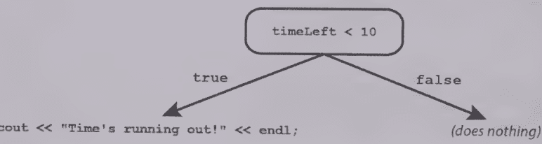

如果你想在条件结果为真时发生不止一个操作，你必须使用 `{ }` 大括号将多个语句绑定到单一块（“复合语句”）中，并执行你想要执行的内容：

示例 - 当简单 `if` 决策评估为真时执行的语句块

```cpp
if ( timeLeft < 10 )
{
    cout << "Time's running out!" << endl;
    cout << "You only have ";
    cout << timeLeft << " seconds left..." << endl;
}
```

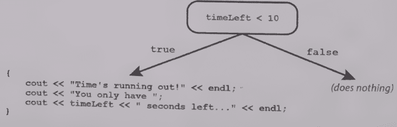

### 使用关系运算符 `< <= >= ==` 的简单决策

此程序使用两个简单的 `if` 语句做出决策。

在第一个 `if` 语句中，会对表达式 `waterTemp <= 0` 进行求值，给出一个真值或假值。

如果结果为真（即变量 `waterTemp` 的值小于或等于零值），则执行后续语句：

```cpp
cout << "Frozen." << endl;
```

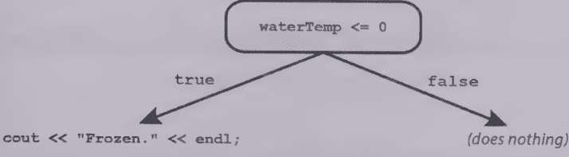

同样，在第二个 `if` 语句中，会对 `waterTemp >= 100` 进行求值，给出一个真值或假值。

如果结果为真（变量 `waterTemp` 的值大于或等于 100），则执行后续语句：

```cpp
cout << "Boiling." << endl;
```

### 示例 6.1 - `if_decision.cpp`

```cpp
#include <iostream> // 程序将使用键盘和屏幕
using namespace std;      // 将使用标准标识 cin, cout, endl
int main() {
    // 输入温度值
    cout << "Enter the temperature: ";
    float waterTemp;
    cin >> waterTemp;
    // 判断是否小于零 - 结冰
    if ( waterTemp <= 0 )
        cout << "Frozen." << endl;
    // 判断是否大于 100 - 沸腾
    if ( waterTemp >= 100 )
        cout << "Boiling." << endl;
    return 0;
}
```

### 使用 `==` 等于运算符判断两个值是否相同

要比较两个值或表达式以查看它们是否相同，请使用 `==` 等于运算符。

这将产生一个真值或假值：当两者相同时为真，不同时为假。

例如，变量 `timeLeft` 的值可以与 0（零）进行比较：

```cpp
timeLeft == 0
```

下面的程序使用等于运算符作为 `if` 决策的一部分，判断用户输入的值是否恰好为零：

### 示例 6.2 - `if_compare.cpp`

```cpp
#include <iostream> // 程序将使用键盘和屏幕
using namespace std;      // 将使用标准标识 cin, cout, endl
int main() {
    cout << "Type a number..." << endl;
    int num;
    cin >> num;

    // 判断数字是否恰好为零
    if (num == 0)
        cout << "It was exactly zero" << endl;

    return 0;
}
```

这是另一个使用 `==` 来检查多个值是否相同的示例。该程序要求用户输入三个整数。然后，它会测试其中两个数字或全部三个数字是否相同。

## 示例 6.3 - `if_compare_variables.cpp`

```cpp
#include <iostream> // 程序将使用屏幕和键盘

using namespace std; // 将使用标准标识 cin, cout, endl

int main() {
    cout << "Please type in 3 whole numbers:" << endl;

    int num1, num2, num3;

    cin >> num1;
    cin >> num2;
    cin >> num3;

    // 检查第一对数字是否相同
    if (num1 == num2)
        cout << "First and second numbers are the same" << endl;
    else
        cout << "First and second numbers are different" << endl;

    // 检查第一个和最后一个数字是否相同
    if (num1 == num3)
        cout << "First and third numbers are the same" << endl;
    else
        cout << "First and third numbers are different" << endl;

    // 检查第二个第三个数字是否相同
    if (num2 == num3)
        cout << "Second and third numbers are the same" << endl;
    else
        cout << "Second and third numbers are different" << endl;

    // 检查三个数字是否相同
    if (num1 == num2 && (num1 == num3))
        cout << "All three numbers are the same" << endl;
    else
        cout << "The numbers are not all the same" << endl;

    return 0;
}
```

当输入不同的数字时会发生以下情况：


当三个数字都相同时，你应该看到以下内容：


### 使用 `%` 和 `==` 产生模式

模运算符通常用于在固定数量的选项之间切换，以产生简单的、规律的模式。下一个示例一次显示一个字母，颜色交替变化：

### 示例 6.4 - `alternating_sequence.cpp`

```cpp
#include <iostream>      // 程序将在屏幕上显示某些文本
#include <unistd.h>       // 使用 sleep() 函数在执行期间暂停

using namespace std;               // 将使用标准标识 string, cout 和 endl

int main()
{
    const string MESSAGE = "GREETINGS!";

    const string GREEN = "\e[32m";
    const string RED = "\e[31m";
    const string NORMAL = "\e[0m";

    string colourToUse;

    // 带有1秒延迟一次显示消息
    for (unsigned int pos = 0; pos < MESSAGE.length(); pos++)
    {
        if (pos % 2 == 1) // 奇数 - 设置为绿色
            colourToUse = GREEN;
        else
            colourToUse = RED; // 偶数 - 设置为红色

        // 显示消息中的单个字母
        cout << colourToUse << MESSAGE.at(pos) << flush;
        sleep(1);
    }

    // 转义序列恢复正常格式
    cout << NORMAL << endl << endl;

    return 0;
}
```

代码使用 `pos` 变量来跟踪文本中的当前位置。在显示每个字母之前，程序使用 `%` 来判断 `pos` 除以 2 的余数是奇数还是偶数。奇数除以 2 的余数为 1，而偶数能被 2 整除，余数为 0。这个判断的结果用于设置显示的单个字母的颜色。如果 `pos` 是奇数，程序将文本设置为绿色，否则设置为红色。

这种效果通过下方的 `if` 语句实现：

```cpp
if (pos % 2 == 1)
    colourToUse = GREEN; // 奇数
else
    colourToUse = RED; // 偶数
```

或者，我们可以使用 `?` 条件运算符作为更紧凑的方式来做出绿色或红色的决策，而不是使用 `if` 语句：

```cpp
colourToUse = (pos % 2) ? GREEN : RED;
```

当程序运行时，你会看到字母颜色在绿色和红色之间交替。


## 使用 != 不等运算符判断值是否不同

有时程序需要检查两个值或表达式是否不同。此此简单的方法是使用 `!=` 不等运算符。在对两个值或表达式进行比较时，如果它们不同，`!=` 将返回 `true` 值。相反，如果它们相同，它将返回 `false` 值。

你也可以使用 `not_eq` 同名代替 `!=` 运算符。它们的意思相同，但某些人在阅读程序代码时认为 `not_eq` 更容易理解。

## 示例 6-5 - diff.cpp

```cpp
#include <iostream> // 程序将使用键盘和屏幕

using namespace std; // 将使用标准标识 string, cin, out, endl

int main() {
    cout << "Please type in new password TWICE!" << endl;

    // 让用户输入密码
    string password1;
    cin >> password1;

    // 让用户再次输入
    string password2;
    cin >> password2;

    // 检查密码是否不同
    if (password1 != password2)
        cout << "First and second numbers are the same" << endl;
    else
        cout << "First and second numbers are different" << endl;
}
```

## 示例 6.7 - if_temp_range.cpp

```cpp
#include <iostream> // 程序将使用键盘和屏幕

using namespace std; // 将使用标准标识 cin, cout, endl

int main() {
    // 用户从键盘输入一个值
    cout << "Enter the water temperature: ";
    float waterTemp;
    cin >> waterTemp;

    // 判断该值是否为 0 或以下
    if (waterTemp <= 0)
        cout << "Frozen." << endl;

    // 判断该值是否为 100 或以上
    if (waterTemp >= 100)
        cout << "Boiling." << endl;

    // 判断值是否大于 0
    // 且小于 100（液态水）
    if (waterTemp > 0 and waterTemp < 100)
        cout << "Liquid state." << endl;

    return 0;
}
```

语句：

`alternative": "cout << "Liquid state." << endl;`

意味着：

“如果变量 `waterTemp` 的值大于 0

并且同时

`waterTemp` 的值小于 100

那么

计算机将在屏幕上显示 'Liquid State' ”

一个测试数字是否在特定范围内的示例。

此程序允许你输入考试分数，利用 `if` 决策来确定它们对应的等级：

## 示例 6.8 - exam_grades.cpp

```cpp
#include <iostream>    // 程序将使用键盘输入和屏幕输出

using namespace std;        // 将使用标准标识 cin, cout, endl

int main()
{
    int mark;
    while ( true )
    {
        cout << "Type in a mark " << endl;
        cin >> mark;

        if ( mark >= 0 and mark < 31 )
            cout << "UNGRADED!" << endl;

        if ( mark >= 31 and mark < 38 )
            cout << "Grade E" << endl;

        if ( mark >= 38 and mark < 45 )
            cout << "Grade D" << endl;

        if ( mark >= 45 and mark < 53 )
            cout << "Grade C" << endl;

        if ( mark >= 53 and mark < 61 )
            cout << "Grade B" << endl;

        if ( mark >= 61 and mark <= 100 )
            cout << "Grade A" << endl;

        cout << endl;    // 显示空行
    }
    // while 循环结束

    return 0;
}
```

下面，你可以看到输入多个考试分数时发生的情况：

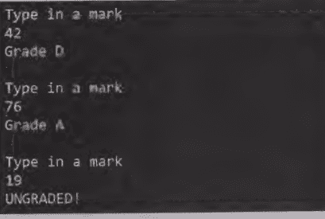

## 使用逻辑或运算符检查表达式是否至少有一部分为真

`||` 逻辑或运算符测试表达式中是否至少有一个部分求值为为真。

我们可以使用它来添加最后的最终检查，以判断用户输入的考试分数是否无效。如果某人输入的小于 0（零）或大于 100（考试最高分）的分数，他们一定犯了错误，因为不可能得到这样的分数。

```cpp
// 检查值是否超出分数的可能范围
if ( mark < 0 || mark > 100 )
    cout << "ERROR!!!" << endl;
```

注意在表达式中使用 `||` 逻辑或运算符，以便在输入无效分数时触发错误消息。如果上述语句中表达式的某个部分为真，则将显示错误消息。

你的代码可以使用 `or` 同义词来代替 `||` 符号。这具有相同的效果，但可能会让你的代码更容易被阅读和理解：

```cpp
// 检查值是否超出分数的可能范围
if ( mark < 0 or mark > 100 )
    cout << "ERROR!!!" << endl;
```

添加这些决策中的任何一个，允许低于零或高于一百的分数被标记为无效：

| 输入分数 |
| :--- |
| -5 |
| ERROR!!! |
| 输入分数 |
| 0 |
| UNGRADED! |
| 输入分数 |
| 100 |
| Grade A |
| 输入分数 |
| 120 |
| ERROR!!! |

使用逻辑或运算符的优点是它通常用于减少程序中简单 `if` 语句的数量，因为它允许将多个 `if` 语句组合。

考虑以下语句：

```cpp
// 设置当前的天气状况
bool isWindy = false;
bool isRaining = true;
bool isSnowing = false;

// 判断天气是否糟糕：刮风 或 下雨 或 下雪
bool badWeather = false; // 初始值 - 假设天气不糟糕

if ( isWindy) {
    badWeather = true; // 如果刮刮风，那么就是糟糕天气
}

if (isRaining) {
    badWeather = true; // 如果下雨，那么就是糟糕天气
}

if (isSnowing) {
    badWeather = true; // 如果下雪，那么就是糟糕天气
}
```

在这段代码中，我们首先假设天气不好，将 `badWeather` 变量设置为 `false`。程序随后使用三个独立的决策来检查天气。另一种方法是将这三个语句合并为一个：

```cpp
// 判断天气是否糟糕：刮风 或 下雨 或 下雪
bool badWeather = false; // 初始值 - 假设天气不糟糕

if ( isWindy) {
    badWeather = true; // 如果刮风，那么就是糟糕天气
}

if (isRaining) {
    badWeather = true; // 如果下雨，那么就是糟糕天气
}

if (isSnowing) {
    badWeather = true; // 如果下雪，那么就是糟糕天气
}
```

甚至可以通过 `||` 运算符来简化，以判断是否糟糕。在上面的示例中，结果将为真或假，取决于表达式。

执行后，程序产生如下简单的输出：


下一个示例检查字符串中的单个字符，我们使用 `at()` 函数，它属于字符串类型。注意字符和字符串将在“第八章”中详细介绍。

下面的程序对每个字符进行判断，判断其是小写还是大写。使用逻辑运算符来实现这一点：

## 示例 6.10 - vowels.cpp

```cpp
#include <iostream>    // 程序将使用键盘输入和屏幕输出

using namespace std;            // 将使用标准标识 string, cout, endl

int main() {
    // 用户输入一个单词
    cout << "Type in a word:" << endl;
    string myWord;
    cin >> myWord;

    unsigned int numChars = myWord.length(); // 单词中的字符数

    // 用于统计单词中发现了哪些元音的变量
    bool haveA = false;
    bool haveE = false;
    bool haveI = false;
    bool haveO = false;
    bool haveU = false;

    // 从单词开始，检查每个符号
    char symbol;
    for ( unsigned int position = 0; position < numChars; position++ )
    {
        // 从单词中提取单个字符
        symbol = myWord.at( position);

        // 判断是否为 A（或 a）
        if ( symbol == 'A' ) or ( symbol == 'a' )
            haveA = true;

        // 判断是否为 E（或 e）
        if ( symbol == 'E' ) or ( symbol == 'e' )
            haveE = true;

        // 判断是否为 I（或 i）
        if ( symbol == 'I' ) or ( symbol == 'i' )
            haveI = true;

        // 判断是否为 O（或 o）
        if ( symbol == 'O' ) or ( symbol == 'o' )
            haveO = true;
    }
}
```

继续...

```
// 决定是否包含字母 U (或 u)
if ( ( symbol == 'U' ) or ( symbol == 'u' ))
    haveU = true;

// 循环结束
```

```cpp
// 决定是否至少包含一个元音
if ( haveA or haveE or haveI or haveO or haveU )
    cout << "Contains at least one vowel." << endl;
else
    cout << "No vowels in this word." << endl;

// 显示单词中找到了哪些元音
if ( haveA )
    cout << "Contains letter a/A" << endl;

if ( haveE )
    cout << "Contains letter e/E" << endl;

if ( haveI )
    cout << "Contains letter i/I" << endl;

if ( haveO )
    cout << "Contains letter o/O" << endl;

if ( haveU )
    cout << "Contains letter u/U" << endl;

return 0;
```

当程序执行时，它会显示用户输入的单词中包含的元音总结：

| 输入一个单词： |
| toucan |
| 至少包含一个元音。 |
| 包含字母 a/A |
| 包含字母 o/O |
| 包含字母 u/U |

元音是大写还是小写并不重要，两种情况都会检测：

| 输入一个单词： |
| Avocet |
| 至少包含一个元音。 |
| 包含字母 a/A |
| 包含字母 o/O |
| 包含字母 u/U |

190 | 树莓派上学习 C++

# 使用逻辑判断检查字符模式的示例

假设你的程序需要检查字符组合，以确定它们是否符合一组简单的规则。

该程序要求用户输入符号来制作一个“笑脸”，例如示例中的任何一个：

| :-) | :) | (-) | :[:] |

构成笑脸的规则被作为逻辑判断的形式编码在程序中。

规则使用了 `or` 运算符和 `and` 运算符。

- 笑脸的眼睛可以是 : 或 ;
- 笑脸的鼻子可以是 - 或 o
- 笑脸的嘴巴可以是 ) 或 ]
- 如果眼睛是可以接受的且嘴巴是可以接受的，则这些符号构成了一个笑脸。

## 示例 6.11 - validate_smiley.cpp

```cpp
#include <iostream>      // 程序将使用键盘和屏幕

using namespace std;      // 将使用标准标识符 cin, cout, endl

int main() {
    // 让用户输入眼睛。
    cout << "Type in eyes..." << endl;
    char eyes;
    cin >> eyes;

    // 检查他们输入的什么符号。
    bool validEyes = eyes == ':' or eyes == '=';

    ---------------------------

    // 让用户输入鼻子。
    cout << "Type in nose..." << endl;
    char nose;
    cin >> nose;

    // 检查他们输入什么符号。
    bool validNose = nose == '-' or nose == 'o';

    ---------------------------

    // 让用户输入嘴巴。
    cout << "Type in mouth..." << endl;
    char mouth;
    cin >> mouth;
```

见下页...

第 6 章：做决策 | 191

继续...

```cpp
// 检查他们输入什么符号。
bool validMouth = mouth == ')' or mouth == ']';

---------------------------------
// 显示他们输入的内容。
cout << eyes;
cout << nose;
cout << mouth;

// 显示是否为有效的笑脸。
if ( validEyes and validNose and validMouth ) {
    cout << " is a smiley.";
} else {
    cout << " does not make a smiley.";
}
cout << endl;

return 0;
```

这是我在树莓派上尝试的一个示例：

| 输入眼睛... |
| 输入鼻子... |
| o |
| 输入嘴巴... |
| :o 是一个笑脸 |

程序认为 :o 是一个有效的笑脸，因为眼睛字符、鼻子字符和嘴巴字符符合简单的判断。

然而，下面的示例被认为：

| 输入眼睛... |
| 输入鼻子... |
| 输入嘴巴... |
| P |
| 不是笑脸 |

194 | 使用关系表达式设置布尔变量

相同的方法也适用于比较操作数的关系表达式。

看下面的代码：

```cpp
bool frozen;

if (num <= 0 )
    frozen = true;
else
    frozen = false;
```

取决于结果的数量，代码可能会变得非常难以阅读。嵌套的 if 语句执行效率会更高。

195 | 合并 if 语句

考虑这些语句：

```cpp
if (num < 0 )
    cout << "It was negative" << endl;
else
    if (num > 0 )
        cout << "It was positive" << endl;
    else
        cout << "It was exactly zero" << endl;
```

这里是同一个程序，将三个 if 语句合并为一个嵌套的 if 语句：


```cpp
#include <iostream>    // 程序将使用键盘和屏幕

using namespace std;      // 将使用标准标识符 cin, cout, endl

int main()
{
    cout << "Type in a whole number..." << endl;

    int num;

    cin >> num;

    // 决定数字是负数、正数还是零

    if (num < 0)
        cout << "It was negative" << endl;
    else
        if (num > 0)
            cout << "It was positive" << endl;
        else
            cout << "It was exactly zero" << endl;

    return 0;
}
```

## 使用 `! NOT` 运算符寻找值或表达式的反面

你可以使用 `! NOT` 运算符来找到关系表达式或布尔表达式的反面。该运算符也被称为取反运算符。当你想要找到求值为 `true` 或 `false` 的表达式的反面时，就可以使用它。

使用 `!` 取反运算符最简单的方法是找到布尔变量值的反面。

```
isNight      = ! isDay
awake       = ! asleep
inCredit     = ! inDebt
```

它也可以用于找到某个表达式的反面。

例如，看下方的表达式：

```
temperature < 100
( today == "Sunday" ) or ( today == "Sunday" )
raining = true

( phoneCharged = true ) and ( credit > 0 )
myName.length() > 0
```

上述每个表达式都可以由计算机计算，并根据每个变量中存储的值给出一个 `true` 或 `false` 的答案。

你可以通过在每个表达式的前面加上 `!` 取反运算符来找到每个表达式的反面，如下述语句所示：

```
waterBoiling = ! ( temperature < 100 );
workingDay = ! ( today == "Sunday" ) or ( today == "Sunday" );
dryWeather = ! ( raining == true );
problem = ! ( phoneCharged = true ) and ( credit > 0 );
validSurname = ! ( myName.length() > 0 );
```

## 在表达式部分周围添加额外的 `()` 括号以确保正确结果

我们已经看到，可以将算术表达式的部分包含在 `()` 括号中，以改变某些特定操作执行的顺序。同样，你也可以将逻辑表达式的部分包含在 `()` 括号中，以强制逻辑操作在表达式的其他部分之前执行。

之前的示例都包含一个或多个运算符，在应用 `!` 运算符之前，为每个表达式加上 `()` 括号是重要的。如果你不这样做，`!` 运算符可能只影响表达式的一部分，并可能导致错误的结果。

在下面的示例中，我们需要在应用 `!` 运算符之前，在整个表达式周围使用一对额外的 `()` 括号：

```
bool goToWork = ! ( today == "Saturday" ) or ( today == "Sunday" );
```

这意味着，如果今天不是周六也不是周日，那么就是工作日；我是否需要上班取决于是否为周末（即周六或周日）的反面。

如果没有这对括号，该语句将给出错误的答案，因为它的含义将完全不同：

```
bool goToWork = ! ( today == "Saturday" ) or ( today == "Sunday" );
```

在上面的示例中，`!` 运算符只影响了表达式中加粗显示的部分。这意味着，如果不是周六，或者如果是周日，那么就是工作日。

### 使用 `and` 运算符结合 `not` 来检查密码是否有效

下一个程序使用逻辑运算符来检查字符串是否符合接受密码的规则：

```cpp
Example 6.12 - validate_password.cpp

#include <iostream> // 程序将使用键盘和屏幕

using namespace std; // 将使用标准标识符 string, cin, out, endl

int main()
{
    // 指示用户输入密码
    cout << "Please type new password between 8 and 12 characters long." << endl;
    cout << "It must contain at least one letter and at least one digit." << endl;
    cout << "It must not contain any spaces." << endl;

    // 让用户输入
    string password;
    cin >> password;

    // 找出他们输入了多少个字符
    unsigned int numChars = password.length();
```

```cpp
// 检查长度是否接受，应在 8 到 12 个字符之间
bool lengthOK = ( numChars >= 8 ) and ( numChars <= 12 );
```

```cpp
// 检查至少有一个数字和一个字母
char symbol;
bool foundDigit = false;
bool foundLetter = false;
```

```cpp
// 逐个检查输入的每个字符
for (unsigned int position = 0; position < numChars; position++)

    // 从字符串获取字符
    symbol = password.at(position);

    // 检查是否为数字
    if (symbol >= '0' && symbol <= '9')
        foundDigit = true;

    // 检查是否为小写字母
    if (symbol >= 'a' && symbol <= 'z')
        foundLetter = true;

    // 检查是否为大写字母
    if (symbol >= 'A' && symbol <= 'Z')
        foundLetter = true;
}

// 决定密码是否符合所有标准
if (lengthOK && foundDigit && foundLetter)
    cout << "Password is valid." << endl;
else
    cout << "Password is not valid." << endl;

return 0;
}
```

```cpp
// 在显示内容前等待 3 秒
sleep( 3 );
out << msg << endl;

} // 无限 while 循环结束

return 0;
}
```

当程序运行时，它会显示随机指令告诉你要做什么：

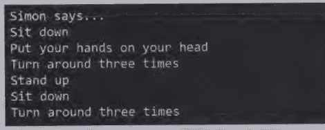

`switch` 语句在源代码文件中占据许多行文本。通过移除一些换行符，可以让代码变得更容易读，使语句占用的空间更小：

# 使用更少行数的重写的 `switch` 语句示例

```cpp
// 根据选出的随机数设置要显示的消息
switch ( choice )
{
case 0:    msg = "把你的手放在头上"; break;
case 1:    msg = "旋转三圈"; break;
case 2:    msg = "坐下"; break;
case 3:    msg = "站起来";
}
// switch 语句结束
```

到目前为止，我们的程序比真正的游戏要简单得多。传统上，只有当指令前面有“Simon 说（Simon says...）”时，你才执行该指令。

代码可以修改为随机欺骗玩家。它可以选择一个随机数，然后在告诉他们要做什么之前，决定是否显示“Simon 说...”。

程序需要一个新的整数变量：

```cpp
int bluff;
```

接下来，程序会有 1 分 4 的概率尝试欺骗玩家。

为了实现这一点，程序将在 0 到 3 之间选择另一个额外的随机数。这个值将用于一个简单的 `if` 决策，以决定是否显示“Simon 说...”。

额外的代码看起来像这样：

```cpp
// 选择一个 0 到 3 之间的随机数
bluff = random() % 4;

// 如果选中 1, 2 或 3，则显示消息“Simon says ” 
// 如果选中 0，则什么都不做——这是一个欺骗！
if (bluff > 0)
    cout << "Simon says...";
```

在原始程序中添加欺骗代码后，发生的情况如下：

```text
Simon says... 旋转三圈
Simon says... 站起来
Simon says... 把你的手放在头上
Simon says... 坐下
把你的手放在头上
Simon says... 坐下
旋转三圈
Simon says... 旋转三圈
Simon says... 旋转三圈
把你的手放在头上
Simon says... 旋转三圈
```

使用修改后代码程序的程序的版本所示：

示例 6.14 修改版 - `switch_simon_says.cpp`

```cpp
#include <iostream>
#include <cstdlib>
#include <ctime>
#include <unistd.h>

// 程序将在屏幕上显示一些文本
// 使用 random() 和 rand() 函数
// 使用 time() 函数作为随机种子
// 使用 sleep() 函数在执行期间进行暂停

using namespace std;

// 将使用标准标识符 string, cout 和 endl

int main() {
    // 为随机数生成器种子，使其不会总是选择相同的数字
    srand(time( 0));

    int choice;
    string msg;
    int bluff;

// 持续对要做什么进行随机选择的无限循环
while ( true ) {
  // 选择一个 0 到 3 之间的随机数
  bluff = random() % 4;

  // 如果选中 1, 2 或 3，则显示消息 "Simon says "
  // 如果选中 0，则什么都不做——这是一个欺骗！
  if (bluff > 0) {
    cout << "Simon says...";
```

一个 `switch` 语句可以包含一个 `default` 情况，当没有其他匹配项时触发。`switch` 语句匹配的变量必须是整数。

```cpp
switch ( choice ) {
    case 1: cout << "A"; break;
    default: cout << "Unknown";
} // switch 语句结束
```

使用 `?` 运算符来决策值

正如我们在本章早期阶段看到的，`?` 运算符是用于进行简单值决策的简写形式。它可以替代 `if-else` 语句。

考虑这个 `if-else` 语句：

```cpp
if ( waterTemp <= 0 )
    message = "冻结";
else
    message = "未冻结";
```

这意味着：

- 如果变量 `waterTemp` 的值小于等于零，

那么

将变量 `message` 的值设置为“冻结”，

否则

将变量 `message` 的值设置为“未冻结”。

相同的语句可以使用 C++ 中的 `?` 运算符重写为稍微更短的形式：

```cpp
message = ( waterTemp <= 0 ) ? "冻结" : "未冻结";
```

> `waterTemp <= 0` 是要执行的测试。

> "冻结" 是测试结果为真时返回的值。

> "未冻结" 是测试结果为假时返回的值。

同样，`?` 运算符可以返回一个 `int` 值作为其结果：

示例 6.17-条件运算符.cpp

```cpp
#include <iostream> // 程序将使用键盘和屏幕

using namespace std; // 将使用标准标识符 cin, cout, endl

int main() {
    cout << "天气糟糕吗？y 或 n:" << endl;
    char letter;
    cin >> letter;

    // 根据用户是否输入字母 y 决定使用种速度
    int speedLimit = (letter == 'y') ? 40 : 60;

    cout << "当前限速为 " << speedLimit << " mph" << endl;

    return 0;
}
```

下一个程序将检查一个整数并告诉你是奇数还是偶数。它通过获取该数字除以 2 的余数来实现这一点：

## 示例 6.18 - `conditional_odd_even.cpp`

```cpp
#include <iostream>    // 程序将使用键盘和屏幕

using namespace std;    // 将使用标准标识符 string, cin, cout, endl

int main()
{
    // 让用户输入数字
    cout << "Enter a whole number:" << endl;
    int numValue;
    cin >> numValue;

    // 找到数字除以 2 的余数
    int remainder = numValue % 2;

    // 使用余数来判断数字是奇数还是偶数
    string message = (remainder == 0) ? "even" : "odd";

    // 在屏幕上显示结果
    cout << "That number is ";
    cout << message << endl;

    cout << endl; // 显示空行

    return 0;
}
```

上面的示例为了易于理解，使用了比需要更多的语句。通常在使用 `?` 运算符时，我们可以将多个语句结合起来使代码更短，尽管如果你不小心，初看时可能会让人们更难理解。这里是合并语句且不使用不必要变量后的相同程序：

## 示例 6.19 - `simpler_odd_even.cpp`

```cpp
#include <iostream> // 程序将使用键盘和屏幕

using namespace std; // 将使用标准标识符 cin, cout, endl

int main() {
    cout << "Enter a whole number:" << endl;
    int numValue;
    cin >> numValue;

    cout << "That number is " << (numValue % 2 == 0 ? "even" : "odd");

    cout << endl; // 显示 2 行空行

    return 0;
}
```

最后是另一个使用 `?` 运算符的示例，根据几个持有真或假的布尔变量来决定显示哪些字面量值：

## 示例 6.20 - `conditional_rainbow.cpp`

```cpp
#include <iostream> // 程序将在屏幕上显示一些文本

using namespace std; // 将使用标准标识符 cout, endl

int main() {
    // 设置当前的天气
    bool isRaining = true;
    bool isSunny = true;

    // 根据下雨和阳光同时存在判断是否有彩虹
    bool makeRainbow = isRaining && isSunny;

    // 决定天气情况以及显示什么消息
    cout << (makeRainbow ? "Rainbow!" : "No rainbows.");

    cout << endl;

    return 0;
}
```

## 第 6 章总结：做出决策

以下是本章中涵盖的内容：

- 简单的 `if` 和 `if-else` 决策通过评估表达式为真或假来确定它们应该采取的操作。

- 表达式可以包含 `==`、`!=` 关系运算符。

- 多个 `if-else` 决策可以组合在一起形成涉及两个以上可能结果的嵌套决策。

- 决策可以使用 `&&` AND 运算符测试表达式的所有部分是否为真。

- 决策可以使用 `||` OR 运算符测试表达式的一个或多个部分是否为真。

- `!` 取反运算符可以用于找到表达式或值的相反值。

- 留字 `&&`、`!=` 或 `not` 可以代替 `||`、`!` 符号，使代码更易读。

- 留字 `!=` 可以代替运算符符号。

- `switch-case` 语句可以从许多不同的可能操作中做出决策。它是在代码中使用许多 `if` 语句的替代方案。

- `switch-case` 语句可以包含一个 `default` 情况，当对某个值没有其他匹配时将执行该情况。

- `?` 条件运算符评估表达式以选择返回两个可能值之一。它可以作为 `if-else` 语句的更短替代方案。

# 供你尝试的问题和练习

| | 任务 |
| :--- | :--- |
| 1 | 写一个程序要求你输入形状有多少边。让程序判断这种边数的形状是什么，然后显示形状的名称。例如：“你输入了 3 - 形状是三角形”。 |


| 2. | 在 `if` 语句要评估的表达式后错误地添加 `;` 有什么影响？例如：`int daysHoliday = 0; if (daysHoliday > 0) { cout << "You still have some holiday left"; }` |
| 3. | 执行此条件语句后，什么值会被赋值给 `score` 变量？`score = (time > 10) ? score + time * 100 : score + 500;` 假设在执行语句之前 `score` 的当前值为 5300，`time` 的值为 20。 |
| 4. | 写一个程序允许你输入只包含字符 '1'、'0' 或空格的字符串。任何其他符号都应触发错误消息：“包含无效字符（Valid characters）”。 |

# 第 7 章：使用循环进行重复

## 重复的指令序列

你可以让计算机再次运行（或“执行”）同一段 C++ 代码，并告诉它重复执行单条程序语句或整个语句块。这被称为“迭代”或“循环”。

想象你想数数到十。你可以显式地给计算机一组简单的、独立的指令，让它每次只显示一个数字：

### 示例 7.1-sequence.cpp

```cpp
#include <iostream>    // 程序将在屏幕上显示一些文本

using namespace std;            // 将使用标准标识符 cout, endl

int main()
{
    // 手动显示数字
    cout << "1" << endl;
    cout << "2" << endl;
    cout << "3" << endl;
    cout << "4" << endl;
    cout << "5" << endl;
    cout << "6" << endl;
    cout << "7" << endl;
    cout << "8" << endl;
    cout << "9" << endl;
    cout << "10" << endl;

    return 0;
}
```

以下是一个使用 `do-while` 循环从一数到十的计数的程序：

### 示例 7.2 - do_while.cpp

```cpp
#include <iostream>    // 程序将在屏幕上显示一些文本
using namespace std;      // 将使用标准标识符 cout 和 endl

int main()
{
    // 在 do-while 循环执行之前，将设置值为 1
    int num = 1;

do
    {
        // 此语句体将被反复执行
        // 重 10 次

        cout << "The value of num is " << num << endl;    // 显示 num 的值

        num++;      // 将 num 加 1
    } while (num <= 10);   // 一旦 num 的值大于 10 就停止

// 程序的这部分只会在 num 变量
// 达到大于 10 的值（即 11）且
// do-while 循环完成后才会执行

    cout << "The do-while loop has now finished." << endl;

    return 0;
}
```

你可以看到下面的结果：

| The value of num is 1 |
| value of num is 2 |
| value of num is 3 |
| value of num is 4 |
| value of num is 5 |
| value of num is 6 |
| value of num is 7 |
| value of num is 8 |
| value of num is 9 |
| value of num is 10 |
| do-while loop has now finished. |

## 使用 do-while 循环从选项菜单中选择

这里有一个程序显示选项菜单，然后允许你通过键盘输入字母来选择选项。它会反复显示，直到你选择输入 'x' 退出。

该程序使用 `do-while` 循环反复显示菜单并提示选择。只要你输入的字符不是 'x'，循环体就会反复执行。一旦输入了 'x'，`do-while` 循环就会终止，继续执行程序的其余部分。在这种情况下，一旦 `do-while` 循环完成，程序会说“Goodbye.”并结束。

### 示例 7.3 - menu_loop.cpp

```cpp
#include <iostream> // 程序将使用键盘和屏幕

using namespace std; // 将使用标准标识符 cin, cout, endl

int main()
{
    char choice;

    // 反复让用户从键盘输入一个字符
    do
{
        // 循环体

        cout << "Type g for greeting," << endl;
        cout << "or type x to exit..." << endl;
        cout << "----------------------" << endl;

        cin >> choice; // 让用户输入单个字符

        cout << "You chose the option: " << choice;

        cout << endl << endl;

        // 测试字符是否为 g - 如果是则显示问候语
        if ( choice == 'g')
            cout << "Hello! Hola! Bonjour!" << endl;
    } while ( choice != 'x' );

    // 程序的这部分只会在用户输入 'x' 后才会被执行
    cout << "Goodbye." << endl;

    return 0;
}
```

## 当表达式/条件为真时反复执行某些代码

与 `do-while` 循环不同，`while` 循环体可能被执行一次、多次或完全不执行。`while` 循环在每次迭代之前评估控制表达式；如果评估结果为真，则执行循环体。但如果表达式评估结果为假，则循环体将不会执行。这意味着当计算机到达程序中的 `while` 循环时，如果第一次评估答案为假，循环体将完全不执行 - 它将直接被计算机跳过。

下面的程序使用 `while` 循环从 10 秒的固定起始值向下计数。`while` 循环内部的语句将反复执行，直到 `secondsLeft` 达到 0：

### 示例 7.8 - while_count.cpp

```cpp
#include <iostream>    // 程序循环将在屏幕上显示一些文本
#include <unistd.h> // 使用 sleep() 函数暂停执行

using namespace std;      // 将使用标准标识符 cout 和 endl

int main() {
    int secondsLeft = 10;           // 从 10 开始倒计时

    while (secondsLeft > 0) {
        cout << secondsLeft << endl;   // 显示剩余时间
        sleep(1);                      // 等待 1 秒
        secondsLeft--;
    } // while 循环结束

    // 倒计时完成后显示消息
    cout << "\e[41m";               // 红色背景白字的转义序列
    cout << "BLAST OFF!" << endl;   // 转义序列
    cout << "\e[0m";               // 普通文本的转义序列

    return 0;
}
```

可以对其进行更改，让你输入 `secondsLeft` 的起始值。如果你输入 0 或更小（例如 -60），循环将完全不执行体，因为表达式 `-60 > 0` 的评估结果为假：

```cpp
int secondsLeft;
cout << "Please type in the starting point for the countdown:" << endl;
cin >> secondsLeft;               // 用户输入倒计数的起始值

while (secondsLeft > 0) {
    cout << secondsLeft << endl;   // 显示剩余时间
    sleep(1);                      // 等待 1 秒
    secondsLeft--;
} // while 循环结束
```

## 第 7 章：重复

这是另一个 `while` 循环，计算物体在重力作用下落了多远：

### 示例 7.6 - while_gravity.cpp

```cpp
#include <iostream>      // 程序将在屏幕上显示一些文本

#include <unistd.h>       // 使用 sleep() 函数暂停执行

using namespace std;      // 将使用标准标识符 cout 和 endl

int main()

{

    const string GREEN = "\e[32m"; // 绿色

    const string NORMAL = "\e[0m";  // 重置

    const double gravity = 9.8;    // 加速度 (m/s^2)

    int elapsedTime = 0;         // 时间（秒）

    double distance = 0;          // 距离（米）

    cout << "Starting gravity simulation..." << endl;

    while (elapsedTime <= 10)

    {

        // 使用公式 d = 0.5 * g * t^2 计算距离
        distance = 0.5 * gravity * elapsedTime;

        cout << "Time: " << GREEN << elapsedTime << NORMAL << " seconds, "

             << "Distance: " << GREEN << distance << NORMAL << " meters" << endl;

elapsedTime++;

    }

    cout << "Simulation finished." << endl;

    return 0;

}
```


你可以看到运行时的输出：

| Been falling for 0(s) Speed is 0 m/s, Dist. fallen 0 m |
| Been falling for 1(s) Speed is 9.8 m/s, Dist. fallen 9.8 m |
| Been falling for 2(s) Speed is 19.6 m/s, Dist. fallen 29.4 m |
| Been falling for 3(s) Speed is 29.4 m/s, Dist. fallen 58.8 m |
| Been falling for 4(s) Speed is 39.2 m/s, Dist. fallen 98.0 m |
| Been falling for 5(s) Speed is 49.0 m/s, Dist. fallen 147.0 m |
| Been falling for 6(s) Speed is 58.8 m/s, Dist. fallen 205.8 m |
| Been falling for 7(s) Speed is 68.6 m/s, Dist. fallen 274.4 m |
| Been falling for 8(s) Speed is 78.4 m/s, Dist. fallen 352.8 m |
| Been falling for 9(s) Speed is 88.2 m/s, Dist. fallen 441.0 m |
| Been falling for 10(s) Speed is 98.0 m/s, Dist. fallen 539.0 m |

## 执行多次语句的 for 循环

当你确切知道想要重复执行某个语句或语句块次数时，可以在代码中使用 `for` 循环而不是 `while` 或 `do-while` 循环。`for` 循环是程序中重复执行代码的一种非常紧凑的方式，尽管初看之下可能没有 `while` 循环那么容易理解。

这里是一个使用 `for` 循环恰好显示三次问候语的示例：

```cpp

Example 7.7—for_loop.cpp

#include <iostream> // 程序将在屏幕上显示一些文本

using namespace std; // 将使用标准标识符 cout 和 endl

int main() {

    // 显示3次单词 "hello"（后面跟着空格）

    for (int num = 0; num < 3; num++) {

        cout << "hello " << endl;

    }

    // 仅显示一次最终消息

    cout << "what's all this then?";

    return 0;

}

```

它是如何工作的？让我们详细查看 `for` 语句：

> for (int num = 0; num < 3; num++)

在 `for` 关键字的 `()` 括号内，有三个重要的部分：

- 一个控制变量，它被设置为一个初始起始值。你可以在这里创建一个新变量，也可以使用程序代码其他地方的现有变量。此示例中的控制变量是一个名为 `num` 的新整数变量。`num` 的初始值被设置为 0。
- 一个在每次 `for` 语句执行时都会求值或检查的表达式：`num < 3`
- 一个修改或对控制变量进行操作的语句。在这种情况下，它将 `num` 的值加 1。

在程序中，`for` 循环将新控制变量 `num` 的值设置为 0。
然后循环重复执行 `cout` 语句，在屏幕上显示消息 "hello"。
在每次执行 `cout` 语句的迭代后，循环都会将 `num` 的值加 1。

`for` 语句会重新评估控制条件，检查表达式 `num < 3` 是否仍为真。如果为真，循环开始另迭代。然而，如果为假，循环将终止，执行将到程序中的下一个语句。

当 `num` 达到 3 时，循环执行停止，因为控制条件 `num < 3` 结果为假，导致循环终止。

当你在代码中使用 `for` 循环时，你可以完全像在程序中使用任何其他变量一样使用控制变量的值。控制变量不仅仅是为了控制循环的执行而存在，它还可以被循环体内的任何语句使用，以执行计算或做出逻辑判断。

此程序使用控制变量 `num` 的值来计算一系列平方数：

### 7.8 -for_square_nums.cpp

```cpp

#include <iostream>    // 程序将在屏幕上显示一些文本

using namespace std;      // 使用标准标识符 cout 和 endl

int main() {

    // 显示变量 num 的值

    // 从 for num = 1; num <= 10; 开始，显示小于 10 的 i

    for (int num = 1; num <= 10; num++)

        cout << (num * num) << endl;    // 显示 num 值的平方

    // 在此点，变量 num 已经不存在了，

    // 一旦 for 语句执行完毕。

    // (它是 for 语句的一部分。)

    return 0;

}

```

当程序运行时，它会在屏幕上产生这些结果：

| 1 |
| :--- |
| 4 |
| 9 |
| 16 |
| 25 |
| 36 |
| 49 |
| 64 |
| 81 |
| 100 |

每个显示的值都是控制变量 `num` 乘以自身的结果。

## 增加或减少控制变量的值

`for` 循环中的控制变量并不总是递增或以 1 为步长。如接两个示例所示，你可以以任何方式增加或减少它的值。

第一个示例只要值大于 0，就让控制变量减少 1：

### Example 7.9 - for_count_down.cpp

```cpp

#include <iostream>    // 程序将在屏幕上显示一些文本

using namespace std;      // 使用 cout 和 endl

int main() {

    // 以 1 为步长递减

    // 控制变量每次循环减 1

    for ( int value = 100; value > 0; --value)

        cout << value << endl;      // 显示控制变量的值

}

```

第二个示例在每次 `for` 循环迭代中将控制变量翻倍：

### Example 7.10 - for_doubling.cpp

```cpp

#include <iostream>    // 程序将在屏幕上显示一些文本

using namespace std;      // 使用标准标识符 cout 和 endl

int main() {

    // 控制变量每次循环翻倍

    // 1, 2, 4...

    for ( int value = 1; value <= 128; value *= 2 )

        cout << value << endl;      // 显示 value

    return 0;

}

```

第二个程序的运行所示：


## 将循环变量作为计算

这是一个经典的谜题。拿有一个 64 格的棋盘。从棋盘的一个角开始，在第一个格上放一粒米。移动到棋盘的下一个格，并将放入的米数翻倍。一直这样做直到你访问了棋盘的所有格，在每个格上覆盖相应数量的米。你可以尝试一下，但你需要一个巨大的棋盘。

下面的程序计算棋盘的解。它使用 `for` 循环来跟踪我们在棋盘上的位置，变量 `square` 从 1 开始递增直到达到 64。程序还使用了另一个名为 `grains` 的变量来存储需要放在当前格上的米数。因此，在第一个格上，`grains` 的值为 1。随着程序移动到每个新格，`grains` 的值翻倍。

### Example 7.11 - for_chessboard.cpp

```cpp

#include <iostream> // 程序将在屏幕上显示一些文本

using namespace std; // 使用标准标识符 cout 和 endl

int main()

{

    // 第一格 1 粒米开始

    unsigned long long grains = 1;

    for (int square = 1; square <= 64; square++)

    {

        // 显示该格上的米数

        cout << "On square no. " << square << ";

        cout << " there are " << grains << endl;

        // 每移动到下一个格，将米数翻倍

        grains *= 2;

    } // for 循环结束

    return 0;

}

```

在上面的程序中，没有将变量 `grains` 声明为整数：

```cpp

int grains = 1;

```

代码使用了不同的数据类型 `unsigned long long`：

```cpp

unsigned long long grains = 1;

```

如果你尝试使用 `int`，前几个结果似乎计算正确：

| On square no. 1 | are 1 粒米。 |
| :--- |
| On square no. 2 | are 2 粒米。 |
| On square no. 3 | are 4 粒米。 |
| On square no. 4 | are 8 粒米。 |
| On square no. 5 | are 16 粒米。 |
| On square no. 6 | are 32 粒米。 |
| On square no. 7 | are 64 粒米。 |
| On square no. 8 | are 128 粒米。 |

然而，在第 31 格之后，某些结果看起来有点奇怪：

| On square no. 30 | are 53680912 粒米。 |
| :--- |
| On square no. 31 | are 1073741824 粒米。 |
| On square no. 32 | are -2147483648 粒米。 |
| On square no. 33 | are 0 粒米。 |
| On square no. 34 | are 0 粒米。 |
| On square no. 35 | are 0 粒米。 |

这是因为程序计算出的值太大了，无法用 `int` 类型的变量容纳。`grains` 的值突然溢出，“回绕”到了一个负值。记住，“溢出”的概念在“第 3 章：数据类型和值”中已经介绍过。

你可以尝试使用 `long` 数据类型代替 `int` 作为 `grains` 变量，但仍然不够：

| On square no. 30 | are 53680912 粒米。 |
| :--- |
| On square no. 31 | are 1073741824 粒米。 |
| On square no. 32 | are -2147483648 粒米。 |
| On square no. 33 | are 0 粒米。 |
| On square no. 34 | are 0 粒米。 |
| On square no. 35 | are 0 粒米。 |
| On square no. 36 | are 0 粒米。 |

你可以进一步走得更远，使用更大的 `long` 数据类型，即使这样在第 64 格也会失败，无法容纳结果：

| On square no. 60 | are 57640752304234888 粒米。 |
| :--- |
| On square no. 61 | are 115292150460684976 粒米。 |
| On square no. 62 | are 2305843009213693952 粒米。 |
| On square no. 63 | are 461168618427387904 粒米。 |
| On square no. 64 | are 9223372036854775808 粒米。 |

通过将 `long` 数据类型设为无符号（`unsigned`），我们告诉计算机我们不感兴趣负值。它可以使用二进制位的一些排列来表示更大的正数。这足以容纳棋盘第 64 格的内容。

# 使用 for 循环显示 ASCII 字符集

此程序在屏幕上显示一个范围循环。它使用 `for` 循环来生成一组整数值，从 32 开始（32 是空格的 ASCII 码，它是屏幕上可见的第一个打印字符）。`asciiCode` 的值不断加 1，直到 127 为止。每个整数值通过 `static_cast<char>` 转换为字符，然后根据其 ASCII 字符码显示在屏幕上。

## 示例 7.12-for_ascii.cpp

```cpp

#include <iostream>    // 程序将在屏幕上显示一些文本

                   // 将使用标准标识符 cout 和 endl

int main() {

    // 创建所有可打印字符及其 ASCII 码列表

    cout << "Characters and their ASCII codes." << endl;

    for ( int asciiCode = 32; asciiCode < 127; asciiCode++) {

        cout << "Symbol ";

        // 将 asciiCode 的整数值转换为字符，然后显示它

        cout << static_cast<char>( asciiCode);

        cout << " has ASCII code ";

        cout << asciiCode;

        cout << endl;

    } // for 循环结束

    return 0;

}

```

注意，上面的程序实际上并没有尝试显示 ASCII 127。这是因为字符 127 是一个不可打印字符。

尝试修改 `for` 循环，使其在 `asciiCode` 达到 128 时终止，而不是 127：

```cpp

int asciiCode = 32; asciiCode < 128; asciiCode++

```

这将尝试显示字符 127。以下是修改后的程序在我的 Pi 上运行的结果：

| Symbol | has ASCII code |
| :--- | :--- |
| Symbol | 123 |
| Symbol | 124 |
| Symbol | 125 |
| Symbol | 126 |
| Symbol | 127 |

注意截图中最后一个符号。每当你的 Pi 尝试显示不可打印字符时，就会使用这种符号。你的 Pi 在方框符号内显示数字 007F，这是数字 127 的十六进制（16进制）等值。

# 在循环中直接处理字符范围

上一个示例使用循环来显示字符范围。该循环由一个整数变量控制。每个字符都是通过将控制变量的值转换为字符来显示的。

在 C++ 中，你也可以直接遍历字符范围，而不需要任何此类转换，按照 ASCII 字符码的顺序顺序处理字符集。你的程序可以告诉 Pi 移动到特定的字符，一个符号一次地在 ASCII 字符集中推进。

下例示例显示了不同的字符序列，使用 `for` 循环生成每个序列。这次，控制变量 `symbol` 不使用 `int` 数据类型，而是使用 `char` 数据类型。程序直接处理字符，而不是整数字符。方便的是，C++ 允许以与使用 `++` 和 `--` 运算符相同的方式对变量进行递增和递减。

## 示例 7.13 - for_chars.cpp

```cpp

#include <iostream>           // 程序将在屏幕上显示一些文本

using namespace std;

                    // 将使用标准标识符和 endl

int main() {

    char symbol;                // 此变量将用于控制所有3个循环

    // 显示所有大写字母

    cout << "Upper-case letters" << endl;

    for ( symbol = 'A'; symbol <= 'Z'; symbol++)

        cout << symbol;

    cout << endl;

    // 显示小写字母

    cout << "Lower-case letters" << endl;

    for ( symbol = 'a'; symbol <= 'z'; symbol++)

        cout << symbol;

    cout << endl;

    // 反反顺序显示所有数字！

    cout << "Numeric digits" << endl;

    for ( symbol = '9'; symbol >= '0'; symbol--)

        cout << symbol;

    cout << endl;

}
```


如果你不随手知道特定字母或符号的数字 ASCII 码，那么这种方法非常方便。你可以使用字符符号本身作为控制变量的值，并将其括在一对‘单引号’内。你不需要查找原本可能需要的等数值 ASCII 字符码。

# 嵌套：在循环内部嵌套循环

该程序计算 1 到 10 之间每个数字的阶乘。为了实现这一点，代码包含了不同的 `while` 循环，一个嵌套在另一个体内部。

`factorialToCalculate` 循环位于 "`num`" 循环内部。我们将 "`num`" 称为“内层”循环，将 `factorialToCalculate` 称为“外层”循环。内部 `while` 循环被称为“嵌套”在另一个循环中。

## 示例 7.34 - while_nested.cpp

如果你熟悉数学中的阶乘，这里有一个例子：

5 的阶乘是：5 x 4 x 3 x 2 x 1 = 120
4 的阶乘是：4 x 3 x 2 x 1 = 24
3 的阶乘是：3 x 2 x 1 = 6

此流程图显示了程序计算每个结果时使用的步骤：

程序产生以下结果：

```
FACTORIAL PROGRAM

-----------------

Factorial of 1 is: 1 = 1

Factorial of 2 is: 2 x 1 = 2

Factorial of 3 is: 3 x 2 x 1 = 6

Factorial of 4 is: 4 x 3 x 2 x 1 = 24

Factorial of 5 is: 5 x 4 x 3 x 2 x 1 = 120

Factorial of 6 is: 6 x 5 x 4 x 3 x 2 x 1 = 720

Factorial of 7 is: 7 x 6 x 5 x 4 x 3 x 2 x 1 = 5040

Factorial of 8 is: 8 x 7 x 6 x 5 x 4 x 3 x 2 x 1 = 40320

Factorial of 9 is: 9 x 8 x 7 x 6 x 5 x 4 x 3 x 2 x 1 = 362880

Factorial of 10 is: 10 x 9 x 8 x 7 x 6 x 5 x 4 x 3 x 2 x 1 = 3628800
```

（注：原文末尾部分存在大量重复的乱码文本，已根据上述逻辑完成核心内容的翻译。）

如果你尝试添加一个你想让 `for` 循环重复的语句，但忘记在语句体周围添加一对 `{ }` 大括号，会发生什么？这是在编写程序时可能犯的一种常见错误。

为了演示，请考虑下面这个只重复单个语句的循环示例：

## for 循环重复执行单个语句的示例

```cpp
// 显示乘法表

for (int table = 1; table <= 10; table++)

    for (int row = 1; row <= 12; row++)

        cout << table << " times " << row << " is " << table << row << endl;
```

假设我们想添加一些代码，例如在每个结果后显示一个额外的空行。

在下面的代码中，添加了一个额外的语句来显示空行：

## for 循环重复单个语句而非多个语句体的示例

```cpp
// 显示乘法表

for (int table = 1; table <= 10; table++)

    for (int row = 1; row <= 12; row++)

        cout << table << " times " << row << " is " << table << row << endl;

        cout << endl; // 这只会被执行一次！
```

遗憾的是，新添加的语句只会执行一次。在不使用 `{ }` 大括号将语句分组为块的情况下，内部 `for` 循环只会重复 C++ 代码中紧随其后的单个语句。

要重复这两条语句，需要将它们括在 `{ }` 大括号中：

## 添加 {} 大括号以重复代码块的示例

```cpp
// 显示乘法表

for (int table = 1; table <= 10; table++)

    for (int row = 1; row <= 12; row++)

    {

        cout << table << " times " << row << " is " << table << row << endl;

        cout << endl; // 现在在循环内执行了！

    } // row 循环结束
```

## 创建的变量不是 for 语句的局部变量

在之前的示例中，控制变量 `num` 是在 `()` 括号内作为 `for` 语句的一部分声明的。我们称该变量为属于该特定 `for` 语句的局部变量。变量 `num` 只能由 `for` 循环体中的代码使用，而不能由循环外的任何代码（循环之前或循环之后的代码）使用。

事实上，一旦 `for` 语句执行完毕，计算机移动到程序中的下一个语句，变量 `num` 将不再存在，因为计算机会清理不再需要的旧变量以节省内存。

这个过程被称为“垃圾回收”。它发明于计算机内存远比现在要小的时代，但对于那些长时间运行且不会因空间浪费而变慢或失败的程序来说，它是尤为重要的。

如果你尝试访问一个已经不存在的局部变量（例如在较早的循环体中声明的变量），编译器将生成错误，你的程序将无法运行。虽然你可以通过选择 `-permissive` 编译选项强制编译器不要那么小心，但当你尝试访问不存在的变量时，程序将会崩溃。

如果你想在循环结束后保留 `for` 语句控制变量的值，你需要在循环之前单独声明它，而不是将其作为 `for` 循环的一部分。这保证了在循环执行完毕后，变量的值仍然存在。计算机不会将其视为垃圾或尝试清除它。

下面的程序使用了一个由已存在的变量 `num` 控制的 `for` 循环，而不是在循环本身中声明新变量：

```cpp
// 示例 7.16-for_scope.cpp

#include <iostream>    // 程序将在屏幕上显示一些文本

                    // 将使用标准标识符 cout 和 endl

using namespace std;

int main() {

    int num; // num 在用于 for 语句之前已声明

             // 一旦循环结束它仍然可以使用

    for (num = 0; num < 10; num++)

        cout << num << endl;

    // 循环已执行完毕，num 变量仍然存在

    // 并且可以在这里访问

    cout << "The value of num still exists." << endl;

    cout << "It is: " << num << endl;

    return 0;

}
```

在上面的示例中，变量 `num` 的作用域是整个 `main()` 函数。我们称变量 `num` 是 `main()` 的局部变量。`main()` 函数中代码的任何部分都可以成功访问 `num` 的值。

与之前循环中作为 `for` 循环一部分声明的变量不同，计算机在循环结束后立即清除 `num` 变量。它只会在整个 `main()` 函数执行完成后才这样做。这意味着一旦 `for` 循环终止，我们仍然可以在代码中使用 `num`。

## 全局变量

全局变量声明在函数之外，它们不属于代码的任何单一部分——它们属于整个程序并被整个程序使用。

通常，全局变量的使用受到程序员的青睐，因为它们可能导致值的变化，而这些变化难以追踪。这些变化使得代码变得更加难以理解和调试。对全局变量值的看似无害的修改会导致程序其他地方出现意想不到的问题。

这是一个可能发生的典型问题示例。以下程序可以成功编译，但包含运行时错误——它不会按照原计划显示乘法表：

```cpp
// Example 7.17-global.cpp

#include <iostream>

using namespace std;

void displayTimes(int table) {

    for (int row = 1; row <= 12; row++) {

        cout << table << " times " << row << " is " << table << row << endl;

        cout << endl;

    }

}

int main() {

    int num;

    for (num = 1; num <= 10; num++) {

        displayTimes(num);

    }

    return 0;

}
```

这里 `main()` 和 `displayTimes()` 都尝试使用 `num`。在这种小型程序中，问题很容易发现。

## 死循环——永远运行的程序

你可以通过创建一个永远停止的循环让程序无限重复语句或代码块。在 C++ 中有多种方法，这里展示了两种常用的：

### 使用 while 的无限循环

第一方法是 `while` 循环，正如我们之前使用的那样，但使用的是字面量而不是表达式。它是查看 C++ 代码时最容易阅读理解的方法：

```cpp
// Example 7.18–infinite_while.cpp

#include <iostream> // 程序将在屏幕上显示一些文本

using namespace std; // 将使用标准标识符 cout 和 endl

int main() {

    while ( true ) {

        cout << "Still running." << endl;

    }

    return 0; // 语句永远无法到达
```

### 它是如何工作的？

记住 `while` 语句评估 `()` 中的任何表达式。`{ }` 块是否执行取决于 `{ }` 大括号内表达式评估的结果。

通常，如果表达式求值为 `true`，则执行下一个语句或语句块。如果表达式求值为 `false`，则不执行下一个语句。一旦循环终止，程序的执行移动到代码中的下一个语句。

由于 `while` 语句 `()` 括号内始终包含字面量 `true`，因此不需要对其进行进一步拆解或进行任何评估——就像结果已经得到一样。`while` 循环会自动返回执行组成循环体的下一个语句或语句块。

在执行完循环体后，`while` 语句再次评估表达式，发现 `()` 中的内容仍然是 `true`。表达式没有可能改变或变为 `true` 以外的任何值，因此循环继续——它一直运行下去。

在这种情况下，`while` 循环继续执行 `cout` 语句，显示“Still running.”最后的 `return 0` 语句在程序执行期间永远不会到达。

> 警告！如果你编译并运行上面的程序，死循环意味着它永远不会停止。要终止程序，你可以同时按下键盘上的 Ctrl 和 C。

## 使用 for 的无限循环

一种稍微不那么明显的方法是使用一个永远不会的 `for` 循环：

```cpp
Example 7.19 - infinite_for.cpp
```
```cpp
#include <iostream>    // 程序将在屏幕上显示一些文本

using namespace std;    // 将使用标准标识 cout 和 endl

int main() {
    for (;;) {
        cout << "Still running." << endl;

        return 0; // 这条语句永远不会执行
    }
}
```

`for` 循环 `( )` 括号中的控制表达式看起来可疑地为空，只包含一对分号，但它的意思其实非常清晰。

第一个 `;` 分号标记了循环初始化结束。它实际上标记了一个空语句的结束，因此没有变量被设置或初始化！

第二个 `;` 分号标记了另一个空语句的结束，通常情况下，它是决定循环是否应该继续运行的控制条件。因为没有表达式来决定是否终止循环，循环会一直执行。

在第二个分号之后的 `( )` 括号内什么都没有。计算机不会费力去增加或减少任何控制变量，这对于循环是否应该继续执行没有影响。

两个程序产生相同的结果，屏幕很快被相同的消息填满：

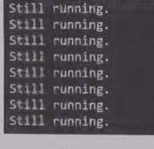

(看到足够的内容，同时按下 Ctrl 和 C 停止程序。)

## 使用 break 强制终止循环

有一种方法可以告诉循环停止重复并跳转到 C++ 程序中的下一个语句。你可以使用 `break` 语句来终止循环。当程序遇到 `break` 语句时，它将不会对正在执行的循环进行任何后续迭代。程序将仅仅完成当前的循环迭代。

如果你在 `{ }` 语句块内部使用 `break`，`{ }` 块中的剩余语句仍然会被执行，但一旦该迭代完成，循环将不再考虑是否再次运行它们。

此程序使用 `if` 来决定是使用 `break` 终止循环还是让它继续：

### Example 7.20 - break_loop.cpp

```cpp
#include <iostream> // 程序将在屏幕上显示一些文本

using namespace std; // 将使用标准标识 cin, cout 和 endl

int main()
{
    char choice;

    // 无限 for循环
    for ( ; ; )
    {
        cout << "EXECUTING INSIDE FOR LOOP!" << endl;

        cout << "Type s to stop the loop, anything else to keep running..." << endl;

        cin >> choice;

        // 检查用户输入的内容 - 是 s 吗？
        if ( choice == 's')
            break; // 如果选择了 s，将立即终止循环
    } // 无限循环结束

    // 不再在循环中 - 这段代码只有在'用户'选择'q'
    // 且 break 语句被执行时才会被执行
    cout << "You have broken out of the loop." << endl;

    return 0;
}
```

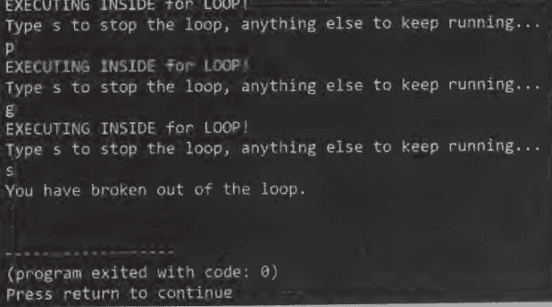

## 统计发生的事件

下面的示例使用了三个不同的变量：`pizzaVotes`、`curryVotes` 和 `noodleVotes`。这些变量用于统计投票，以决定今晚最受欢迎的食物选择。在一天开始时，所有三个变量都被赋予初始值 0，因为还没有记录任何选择。每当你输入一个选择，对应食物变量的值就会增加 1。

```cpp
Example 7.21 - count_votes.cpp
#include <iostream>      // 程序将使用键盘和屏幕
using namespace std;      // 将使用标准标识 cin, endl

int main()
{
    int pizzaVotes = 0;
    int curryVotes = 0;
    int noodleVotes = 0;

    // 为每个投票输入一个字母并统计每种投票的总数
    char choice;
    do {
        cout << "Type in a choice: p c n ( or * to quit)" << endl;

        cin >> choice;

        if ( choice == 'p' ) || ( choice == 'P' )
            pizzaVotes++;

        if ( choice == 'c' ) || ( choice == 'C' )
            curryVotes++;

        if ( choice == 'n' ) || ( choice == 'N' )
            noodleVotes++;
    } while ( choice != '*'); // 输入 * 终止循环

    // 在输入所有选择后显示结果
    cout << "RESULTS..." << endl;

    cout << "Pizza..." << pizzaVotes << endl;

    cout << "Balti-Curry..." << curryVotes << endl;

    cout << "Thai-Noodles..." << noodleVotes << endl;

    return 0;
}
```

一旦程序执行，每当用户输入 `p` 或 `P`，`pizzaVotes` 的值就会增加 1。同样，每当用户输入 `c` 或 `C`，`curryVotes` 的值就会增加，每当用户输入 `n` 或 `N`，`noodleVotes` 的值就会增加。

*(注：由于原始文本存在大量 OCR 错误和重复，此处翻译已根据逻辑进行了合并和去重)*

# 第 8 章：字符与文本字符串

## 处理单个字符

单个字符符号可以通过键盘输入、赋值给 `char` 变量并显示在屏幕上。

在处理字符时，字符字面量值必须包含在一对单引号 `' '` 之间。

接下来的程序通过几种不同的方式显示不同的字符。它分别以字面量字符、字符常量和字符变量的形式显示这些字符。

示例 8.1 - characters.cpp


```cpp
#include <iostream> // 程序将在屏幕上显示一些文本
using namespace std; // 将使用标准标识符 cout 和 endl

int main() {
    // 字母表中的字母 R，作为字面量字符存储
    cout << "The 1st letter is...";
    cout << 'R';
    cout << endl;

    // 此常量被设置为 ASCII 代码为 65 的字符，
    // 它是字母中的大写字母 A
    const char NEVER_CHANGING_LETTER = 65;

    cout << "The 2nd letter is...";

    cout << NEVER_CHANGING_LETTER;
    cout << endl;

    // 字母表中的字母 M，作为变量存储
    char letterThatGetsChanged = 'M';

    letterThatGetsChanged += 3; // M 变为 P (从 M 向后 3 个字母)

    cout << "The 3rd letter is...";
    cout << letterThatGetsChanged;
    cout << endl;

    return 0;
}
```

在设置字符常量 `NEVER_CHANGING_LETTER` 的值时，程序使用了 ASCII 值 65，它是大写字母 `'A'` 的代码。记住，在处理 `char` 数据类型时，ASCII 代码和字符是可以互换运行的。

由于 `letterThatGetsChanged` 是一个变量，因此可以为其分配新值，或使用算术运算更改它的值。在此过程中，原始值 `'M'` 被加上了整数值 3，这就像在字母表中从字母 `'M'` 向字母 `'P'` 移动了三个位置。

## 在 ASCII 字符代码与字符符号之间转换

有时程序可能需要将整数值转换为字符。这可以通过强制类型转换来实现。强制转换已在“第 5 章：使用运算符处理数据”中解释过。以下代码在将 `int` 值显示在屏幕上之前，将其转换为 `char` 值：

```cpp
int asciiCode = 65;

cout << asciiCode; // 在屏幕上以整数形式显示数字 65
cout << static_cast<char> (asciiCode); // 将显示为字母 'A'
```

这是一个允许你输入整数 ASCII 字符代码的程序。该程序将你输入的 `int` 值转换为 `char` 并显示在屏幕上：

### 示例 8.2 - static_char.cpp

```cpp
#include <iostream> // 程序将在屏幕上显示一些文本
using namespace std; // 将使用标准标识符 cin, cout, endl

int main() {
    // 用户输入一个整数作为 ASCII 代码
    int asciiCode;
    cout << "Please type in a whole number between 33 and 126...";
    cin >> asciiCode;

    // 显示用户输入的数字
    cout << "The code " << asciiCode;

    // 显示等效的 ASCII 字符符号，
    // 将整数 ASCII 代码转换为 char
    cout << " " << static_cast<char> (asciiCode);

    cout << endl;

    return 0;
}
```

程序将获取你输入的整数并将其作为 ASCII 代码来显示相应的字符，前提是该字符在可显示的可打印字符范围内：


## `char` 值的算术运算

如前所述，C++ 允许对 `char` 数据类型执行算术运算，其方式与数值数据类型完全相同，这非常方便。这意味着我们不仅可以对整数和浮点数进行算术运算，还可以对字符进行。

由于每个字符符号都有对应的字符代码，你可以对字符变量的值加或减一个整数。

许多其他编程语言要求你在以这种方式操作字符之前，显式地在字符和字符代码之间进行转换或强制转换。

下面的程序创建三个变量，每个变量都是 `char` 数据类型。然后对每个变量的值加上或减去一个整数。修改后的字符值将显示在屏幕上。

### 示例 8.3 - char_arithmetic.cpp

```cpp
#include <iostream> // 程序将在屏幕上显示一些文本
using namespace std; // 将使用标准标识符 cout 和 endl

int main() {
    char letter1 = 'G';
    char letter2 = 'N';
    char letter3 = 'U';

    cout << "Starting values:" << endl;

    cout << letter1 << letter2 << letter3 << endl;

    letter1 += 5;
    letter2 += 1;
    letter3 -= 9;

    cout << endl << "Final values:" << endl;

    cout << letter1 << letter2 << letter3 << endl;

    return 0;
}
```

如果你执行上面的程序，字符将通过加或减发生变换，如下所示：


## 选择字符符号

接下来的程序使用随机字符填充屏幕。它使用 ASCII 代码，范围零索引。

### 示例 8.4 - random.cpp

```cpp
#include <iostream>
#include <cstdlib>
#include <ctime>

using namespace std;

int main() {
    // 设置随机数生成器
    srand(time(0));

    int code;
    for (int i = 0; i < 10; i++) {
        code = rand() % 94 + 33; // 生成 33 到 126 之间的代码
        cout << static_cast<char>(code) << " ";
    }
    cout << endl;

    return 0;
}
```

## 查看字符串部分的单个字符

### 示例 8.5 - char_at.cpp

```cpp
#include <iostream>    // 程序将在屏幕上显示一些文本
using namespace std;      // 将使用标准标识符 string, cout, endl

int main() {
    // 在字符串中存储文本值
    string password = "Custard";

    // Find第一、四、七位置的字母
    // 记住它们是零索引的
    char firstLetter = password.at( 0 );
    char middleLetter = password.at( 4 );
    char lastLetter = password.at( 3 );

    // 在屏幕上显示字母
    cout << firstLetter << endl;
    cout << middleLetter << endl;
    cout << lastLetter << endl;

    return 0;
}
```

该程序使用 `at()` 函数从文本值中提取单个字符，该函数是 `string` 数据类型的一部分。这种函数被称为成员函数。我们说 `at()` 是 `string` 类的成员函数。你将在第 10 章：函数和第 13 章：对象与类中学习函数和成员函数。调用 `at()` 总是给出字符串的第一个字符。记住字符串中的字符是“零索引”的，这意味着第一个字符位于位置 0，第二个字符位于位置 1，以此此类推。

在此例中，位置 0、4 和 3 分别持有单词 Custard 中的字符 C、a 和 t。

你还可以使用 `at()` 函数更改字符串值中的单个字符：

```cpp
string animal = "Cat"; // 设置字符串的原始值
animal.at( 0 ) = 'B'; // 将第一个字母从 C 改为 B
```

上面的代码将把 Cat 的第一个字母更改，生成 Bat。

# 查找字符是否为数字、字母表字母或其他符号

C++ 提供了许多不同的方法来检查单个字符，以确定该字符是哪种符号。

最常见的问题之一是判断一个字符是否为字母表中的字母。或者，你的代码可能需要判断特定字符是否为数字。

以下是 `<cctype>` 库中的部分函数：

| | 说明 |
|---|---|
| `isprint()` | 确定一个字符是否为 `printable` 打印字符。 |
| `isntrl()` | 确定一个字符是否为 `control` 不可打印字符。 |
| `isdigit()` | 确定一个字符是否为 `numeric-digit` 0-9之间。 |
| `isalpha()` | 确定一个字符是否为 `alpha-character` 字母表中的字母。 |
| `islower()` | 确定一个字符是否为 `lower-case alpha-character` a-z之间。 |
| `isupper()` | 确定一个字符是否为 `upper-case alpha-character` A-Z之间。 |
| `ispunct()` | 确定一个字符是否为 `punctuation` 标点符号。 |
| `isspace()` | 确定一个字符是否为 `space` 空格字符。 |

这些函数每个接受一个参数，该参数可以是 `int` ASCII 码，可以是单个 `char` 值。函数然后判断该字符是否属于特定类型并返回 `true` 或 `false` 值作为结果。

请注意，如果你已经在代码中包含了 `<iostream>` 库，你的程序就不需要显式包含 `<cctype>` 库。

下面的程序展示了这些函数的用法，使用它们对用户输入的 ASCII 码对应的字符进行分类：

```cpp
Example 8.6 - classify_char.cpp
#include <iostream> // 程序将使用键盘和屏幕
using namespace std; // 将使用标准标识 cin, cout, endl
int main() {
    // 允许用户输入字符的 ASCII 码
    int typedIn;
    cout << "Type in an ASCII code: " << endl;
    cin >> typedIn;

    // 确定字符是否为打印字符
    if ( isprint( typedIn ) )
    {
        cout << "It is a printable character" << endl;
        cout << "It is the code for the symbol "
        cout << static_cast<char>( typedIn);
        cout << endl;
    }
    else
        cout << "It is not a printable character" << endl;

    // 确定字符是否为数字
    if ( isdigit( typedIn ) )
        cout << "It is a numeric digit between 0 and 9" << endl;

    // 确定字符是否为字母表字母不分大小写
    if ( isalpha( typedIn ) )
        cout << "It is a letter of the alphabet" << endl;

    // 确定字符是否为字母表小写字母
    if ( islower( typedIn ) )
        cout << "It is a lower-case letter of the alphabet between a and z" << endl;

    // 确定字符是否为字母表大写字母
    if ( isupper( typedIn ) )
        cout << "It is an upper-case letter of the alphabet between A and Z" << endl;

    // 确定字符是否为标点符号
    if ( ispunct( typedIn ) )
        cout << "It is a punctuation mark" << endl;

    return 0;
}
```

尝试输入几个 ASCII 码。程序将告诉你一些关于它们所代表的字符的信息：

Type in an ASCII code:

71

It is a printable character

It is the code for the symbol G

It is a letter of the alphabet

It is an upper-case letter of the alphabet between A and Z

Type in an ASCII code:

33

It is a printable character

It is the code for the symbol !

It is a punctuation mark

# 使用 `length()` 函数查找字符串值中的字符数量

如果你的程序需要检查或处理字符串值中的所有字符，那么它通常需要从第一个到最后一个顺序访问每个字符。这意味着你的代码需要知道该字符串包含多少个字符，以便知道何时停止。

计算机可以通过调用 `length()` 成员函数来找到字符串值中有多少个字符。

与 `at()` 函数一样，`length()` 函数属于 `string` 类，因此它使用成员运算符调用，该运算符意味着“是的一部分……”或“属于……”。

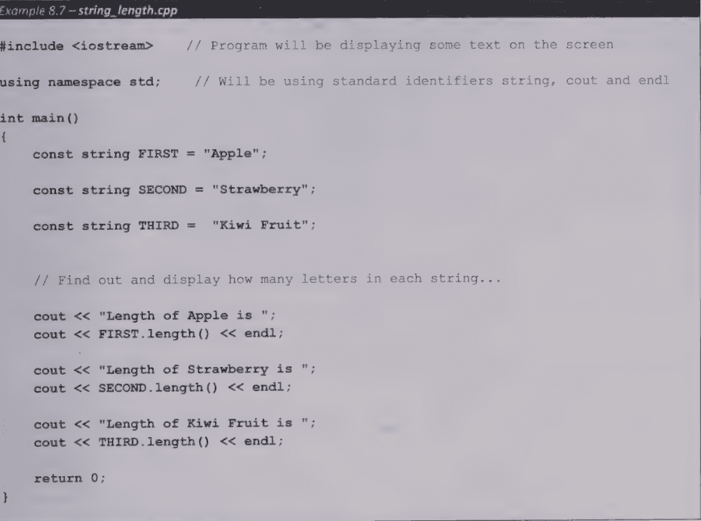

```cpp
#include <iostream>    // 程序将在屏幕上显示一些文本

using namespace std;      // 使用标准标识符 string, cout 和 endl

int main()
{
    const string FIRST = "Apple";
    const string SECOND = "Strawberry";
    const string THIRD = "Kiwi Fruit";

    // 找出并显示每个字符串中有多少字母
    cout << "Length of Apple is ";
    cout << FIRST.length() << endl;

    cout << "Length of Strawberry is ";
    cout << SECOND.length() << endl;

    cout << "Length of Kiwi Fruit is ";
    cout << THIRD.length() << endl;

    return 0;
}
```

# 当使用仅 8 位 `char` 来存储值时可能出现的问题，这是一种非常紧凑且高效的存储方式

因为 `char` 类型只识别落在非常有限范围内的数字。然而，对于其他数值类型，如果你尝试使用意外过大或太小的值，可能会遇到问题。

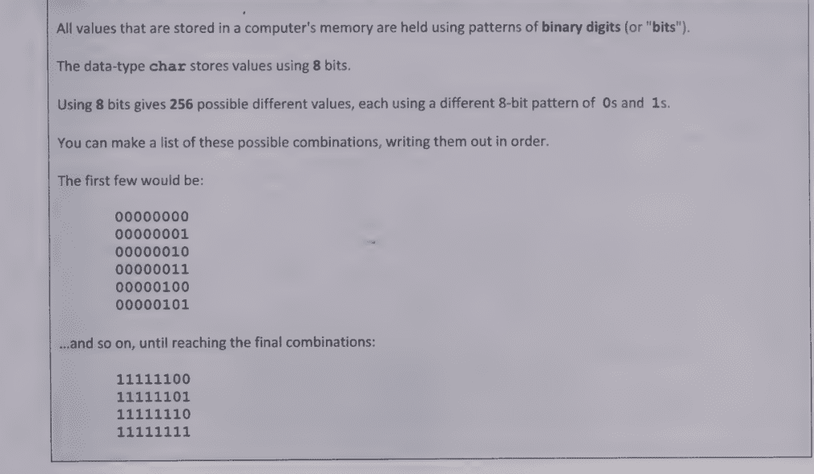

你可能期望 `char` 类型的值范围是 0 到正 255，但 `char` 类型的值并不总是正的，它们实际上可以是负的。事实上，`char` 类型的值范围在 -128 到 127 之间。

将 0 和 1 的某些组合用于表示负数，留给表示正值的组合就少了。因此，这影响了 `char` 变量可以使用的最大数字。

你可能会发现这有点困惑，特别是 ASCII 字符集从字符 0 开始，不包含任何具有负码的字符。

如果你不想使用负值并想使用大于 127 的值，可以在 `char` 前加上单词 `unsigned` 来修改 `char` 数据类型，使其仅表示正值。

例如：

```cpp
unsigned char myValue = 255;
```

这是另一个程序，用于检查字符串值中的每个字符，但这次它以不同的顺序检查并显示字符。

该代码使用了一个 `while` 循环，从用户输入的原始文本末尾开始，向开头反向移动，在此过程中逆序显示每个字符。

## 示例 8.9 - reverse_string.cpp


```cpp
#include <iostream> // 程序将使用键盘和屏幕

using namespace std; // 将使用标准标识符 string, cin, cout, endl;

int main() {
    // 无限循环允许反复输入字符串
    while (true) {
        // 用户输入文本（可以包含空格）
        string lineOfText;
        cout << "Please type in some text:" << endl;
        getline(cin, lineOfText);

        // 计算名称中有多少个字母
        int lengthOfText = lineOfText.length();

        // 从字符串末尾向开头倒遍历
        int position = lengthOfText - 1;

        while (position >= 0) {
            cout << lineOfText.at(position); // 显示当前字母
            position--;
        }
        // 处理字符串的 while 循环结束
        cout << endl << endl; // 显示空行
    } // 无限 while 循环结束

    return 0;
}
```

与之前的示例一样，在开始之前，`while`循环需要知道字符串值中有多少字符。

它使用`length()`成员函数找到这个数字，并将结果存储在变量`lengthOfText`中：

```cpp
// 计算文本中有多少个字母
int lengthOfText = lineOfText.length();
```

252 | 在树莓派上使用 C++ 编程

`while`循环现在从字符串值的最后一个字符开始。

由于字符串中的字符是从零索引的（任何字符串的第一个字符位于位置 0），最后一个字符位于位置`lengthOfText - 1`：

```cpp
int position = lengthOfText - 1;
while ( position >= 0) {
    cout << lineOfText.at( position );
    position--;
}
```

与示例 8.8 - `ascii_codes.cpp`一样，在循环的每次迭代中，都使用`at()`成员函数获取单个字符，该函数作用于字符串值，从文本的某个位置获取单个字符。然后将该字符显示在屏幕上。

一旦位置 0 字符（字符串值中的第一个字符）显示完毕且位置的值降至 0，`while`循环将停止执行。

以下是运行时发生的示例：

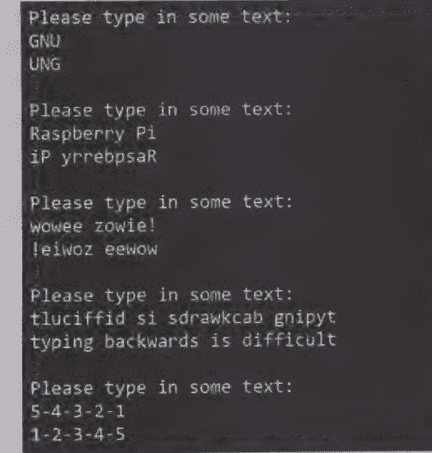

如你所见，你在树莓派上输入的任何内容都会反转，并变成原始文本的镜像。

# 检测字符串值中的不同类型字符

该程序使用`if`决策来识别字符串值中的大写字母、小写字母、数字和空格。

程序使用变量`alphaTotal`、`numericTotal`和`spaceTotal`记录找到的字母、数字和空格的总数。这些总计的最终值将在程序结束时显示。

## 示例 8.10 - char_totals.cpp

```cpp
#include <iostream>    // 程序将使用键盘和屏幕

using namespace std;               // 将使用标准标识符 string, cin, cout, endl

int main()
{
    cout << "Please type in some text:" << endl;
    string sentence;
    getline(cin, sentence);
    cout << endl << "Thanks" << endl << endl;

    // 找到句子中有多少字符符号
    unsigned int stringLength = sentence.length();

    // 检查每个字符并确定其类型，然后更新总计
    char currentChar;

    unsigned int alphaTotal = 0;
    unsigned int numericTotal = 0;
    unsigned int spaceTotal = 0;

    for (unsigned int position = 0; position < stringLength; position++)
    {
        char currentChar = sentence.at(position);

        if (isupper(currentChar))
        {
            cout << "capital letter" << endl;
            alphaTotal++;
        }

        if (islower(currentChar))
        {
            cout << "lower-case letter" << endl;
            alphaTotal++;
        }
    }
}
```

```cpp
if ( isdigit( currentChar ) )
{
    cout << "numeric digit" << endl;
    numericTotal++;
}
if ( isspace( currentChar ) )
{
    cout << "space" << endl;
    spaceTotal++;
}
} // for 循环结束

// 显示句子中包含的字符摘要
cout << endl << "Your sentence contains:" << endl;

cout << alphaTotal << " letters" << endl;
cout << numericTotal << " digits" << endl;
cout << spaceTotal << " spaces" << endl;

return 0;
```

当程序运行运行时，你将看到对每个字符做出的决策结果。一旦到达文本末尾，你的树莓派将显示各种类型字符的总数。

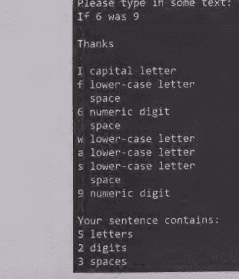

下一个示例要求用户输入一些文本，然后以摩斯密码的形式显示在屏幕上。

用户输入的文本存储在字符串`myText`中。程序进入一个`for`循环，从开始逐个检查`myText`中的每个字符。

每个单独字符临时存储在变量`letterAtPos`中，并由`switch`语句来决定在屏幕上显示哪种摩斯密码点划线模式。无法识别的字符将显示`?`问号。（注意，为了缩短程序，我省略了数字的摩斯对应代码。）

## 示例 8.1 - morse_code.cpp

```cpp
#include <iostream> // 程序将使用键盘和屏幕
using namespace std; // 将使用标准标识符 string, cin, cout, endl

int main() {
    // 用户从键盘输入一些文本
    cout << "Please type in some text:" << endl;
    string myText;
    getline(cin, myText);

    // 找到文本有多长
    unsigned int lengthOfText = myText.length();

    // 检查文本中的每个字符
    char letterAtPos;

    for (unsigned int position = 0; position < lengthOfText; position++) {
        // 从字符串中提取单个字符
        letterAtPos = myText.at(position);

        cout << letterAtPos << " ";

        // 转换为小写 - 它之前可能是大写
        letterAtPos = tolower(letterAtPos);

        // 如果是字母表中的字母，则转换为摩斯密码
        switch (letterAtPos) {
            case 'a': cout << ".-"; break;
            case 'b': cout << "-..."; break;
            case 'c': cout << "-.-."; break;
            case 'd': cout << "-.."; break;
            case 'e': cout << "."; break;
            case 'f': cout << "..""; break;
            case 'g': cout << ".--."; break;
            case 'h': cout << "..."; break;
            case 'i': cout << "...."; break;
            case 'j': cout << ".---"; break;
            case 'k': cout << "-.-"; break;
            case 'l': cout << ".-.."; break;
            case 'm': cout << "--"; break;
            case 'n': cout << "-"; break;
            case 'o': cout << "---"; break;
            case 'p': cout << "..--"; break;
            case 'q': cout << "--.-"; break;
            case 'r': cout << ".-."; break;
            case 's': cout << "..."; break;
            case 't': cout << "-"; break;
            case 'u': cout << "..-"; break;
            case 'v': cout << "......"; break;
            case 'w': cout << ".--"; break;
            case 'x': cout << "-.."; break;
            case 'y': cout << "-.--"; break;
            case 'z': cout << "--.."; break;
            case ' ': cout << "(gap)"; break;

            // 如果上述任何情况未选中，则选择此项
            default: cout << "?"; break;
        } // 结束
        // 在显示字母的摩斯密码后换到下一行
        cout << endl;
    } // 循环结束
    cout << endl; // 显示最后的空行

    return 0;
}
```

程序运行中：

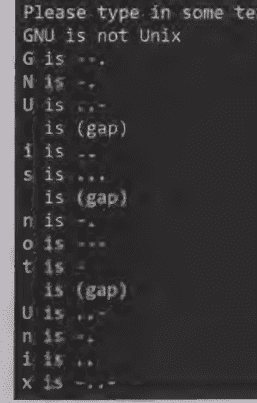

继续见下一页...

在树莓派上使用 C++ 编程

第 8 章：字符与文本字符串 | 257

# 替换字符串值中的单个字符

以下程序接收某些文本，并将某些字母替换为数字，以生成类似于车牌格式的效果。文本中的所有其他符号不受影响。

## 示例 8.12 - replace_chars.cpp

```cpp
#include <iostream> // 程序将在屏幕上显示一些文本
using namespace std; // 使用标准标识符 string, cin, cout, endl
int main() {
    // 允许用户输入一行文本
    cout << "Type a line of text..." << endl;
    string lineOfText;
    getline(cin, lineOfText);

    // 将字符串转换为大写。
    unsigned int stringLen = lineOfText.length();

    // 检查每个字符，转换为大写，如果可以则替换为数字
    char thisChar;
    for (unsigned int position = 0; position < stringLen; position++) {
        thisChar = lineOfText.at(position);
        thisChar = toupper(thisChar);
        // 将特殊字母替换为符号
        switch (thisChar) {
            case 'B': thisChar = '8'; break;
            case 'I': thisChar = '1'; break;
            case 'O': thisChar = '0'; break;
            case 'E': thisChar = '3'; break;
            case 'S': thisChar = '5'; break;
        } // switch 语句结束
        lineOfText.at(position) = thisChar;
    }

    // 显示最终结果
    cout << "It is now..." << endl;
    cout << lineOfText << endl << endl;

    return 0;
}
```

与之前的摩斯密码程序一样，上面的代码使用`switch`语句检查你输入的文本中的每个字符，决定是否用数字替换特定的字符。

```
Type a line of text...
egghead
It is now...
3GGH3AD
```

```
Type a line of text...
Bonkers
It is now...
8ONX3R5
```

# 确定两个字符串值是否相同

程序经常需要测试字符串值是否相同。两个值包含字符数量完全相同吗？它们在每个位置上的字符也完全相同吗？

对于其他数据类型，你可以使用`===`等效运算符来测试字符串值是否相同。

## 示例 8.13 - string_equiv.cpp

```cpp
#include <iostream>    // 程序将使用键盘和屏幕
using namespace std;      // 使用标准标识符 string, cin, cout, endl

int main()
{
    const STRING OWNER = "Matilda Spaghetti";

    // 人输入名字（可以包含空格）
    cout << "Please type in your name..." << endl;
    string name;
    getline(cin, name );

    // 测试字符串值是否完全相同
    if ( name == OWNER )
        cout << "Hello Matilda!" << endl;
    else
        cout << "Greetings, oh mysterious one!" << endl;

    return 0;
}
```

如果你正确输入所有者的名字，你会看到：

```
Please type in your name...
Matilda Spaghetti
Hello Matilda!
```

或者，如果你输入了其他人的名字，你会看到：

```
Please type in your name...
Browyn Flabbergast
Greetings, oh mysterious one!
```

请注意，如果每个字符的大小写不完全相同，则两个字符串值被视为不同的。大写字母不等于小写字母。

所以：

```
Matilda Spaghetti
```

...不被认为等于：

```
matilda spaghetti
```

```
Please type in your name...
matilda spaghetti
Greetings, oh mysterious one!
```

在上面的截图中，`matilda spaghetti`根据`string`常量`OWNER`的值判断，因此它不会在屏幕上显示“Hello Matilda!”消息。

测试两个`string`值是否相同的另一种方法是使用成员函数`compare()`：

```cpp
if ( name.compare( OWNER ) == 0 )
    cout << "Hello Matilda!" << endl;
else
    cout << "Greetings, oh mysterious one!" << endl;
```

`compare()`函数返回一个整数结果。如果结果为零，则发现两个`string`值是完全相同的，包括它们的长度和包含的精确字符序列。


函数的正负结果可以用于诊断**为什么**两个特定的 `string` 值不同。它们可以指示两个值长度的差异，或者按字母顺序排序时哪一个在另一个前面。但注意：对于初学者来说，解释这些不同的结果可能有点复杂。

# 拼接——连接字符串值

文本字符串可以使用加法运算符连接在一起。这类似于将一个字符串值的字符添加到另一个字符串的末尾。这被称为文本的“追加”（appending）。你还可以使用 `char` 数据类型或 ASCII 码（后者使用 `int` 数据类型）将单个字符追加到字符串值的末尾。

```cpp
string species = "eagle"; // 为字符串变量设置值
species = "golden" + species; // 在开头添加值
species = "ant"; // 替换字符串变量的值
species += "elope"; // 在值末尾添加字符串（追加）
species += 's'; // 在字符串值末尾添加单个字符
species += 33; // 在字符串末尾添加 ! (33 是 ! 的 ASCII 码)
```

此程序将几个字面字符串和字符值连接在一起：

```cpp
Example 8.14–append_strings.cpp
#include <iostream> // 程序将在屏幕上显示一些文本
using namespace std;   // 使用标准标识符 string, cout 和 endl

int main()
{
    // 此程序拼接字符串变量
    // 它将值连接起来形成一个新的字符串

    string day = "Tuesday";
    string when = "morning";

    string appointment = day + ' ' + when;

    // 在字符串末尾添加单个标点符号
    appointment += '.';

    cout << "You are seeing the dentist on..." << endl;
    cout << appointment;

    cout << endl;

    return 0;
}
```

这是程序运行时你会看到的：

> You are seeing the dentist on... Tuesday morning.

## 密码生成器

接上一个生成简单 PIN 的示例，此程序生成由字母表字母组成的随机密码。

该程序允许你选择想要生成的密码数量，以及每个密码的长度。

每个密码都是通过向名为 `password` 的字符串值逐次添加单个随机字符来构建的。

```
Example 8.17 - random_password.cpp
```cpp

#include <iostream>      // 程序将使用键盘和屏幕

#include <cstdlib>     // 程序使用 random() 和 srand() 函数

#include <ctime>        // 程序使用 time() 函数作为随机种子

using namespace std;      // 将使用标准标识符 string, cin, cout, endl

int main() {

    // 初始化随机数生成器种子

    // 这只需要在程序运行时执行一次，以确保

    // 数字不会遵循可预测的模式

    srand(time(0));

    // --------------------

    cout << "How many passwords do you want to be generated?" << endl;

    unsigned int numRequired;

    cin >> numRequired;

    // --------------------

    cout << "How many characters should each password contain?" << endl;

    unsigned int numLong;

    cin >> numLong;

    // --------------------

    string password;

    char randomChar;

    unsigned int numCharsAdded, chosenNumber, asciiCode;

// 重复生成密码

for ( unsigned int numMade = 0; numMade < numRequired; numMade++ )

{

    password = ""; // 为新密码从空字符串开始

    // 选择随机字符并将它们附加到密码中

    for ( numCharsAdded = 0; numCharsAdded < numLong; numCharsAdded++ )

    {

        chosenNumber = random() % 26;

        asciiCode = 65 + chosenNumber;

        randomChar = static_cast<char>( asciiCode );

        password += randomChar;

    }

    // 向单个密码添加字符的循环结束

    cout << password << endl; // 显示完成的密码

} // 控制生成密码数量的循环结束

return 0;

}
```

你可以从下面看到当我告诉我的 Pi 生成十个每个包含八个字符的随机密码时，发生的情况：

| 你想生成多少个密码？ |
| 10 |
| 每个密码应该包含多少字符？ |
| 8 |
| OTKLKPUX |
| DLXQKYZ |
| QHBGRDRH |
| ABTFULJK |
| EVYONSOA |
| VZZNAJMS |
| SOSYJKGD |
| YYRKSLEDO |
| CAERSSTP |
| USDUDMRV |

之前的程序每次向字符串值添加一个字符。这里有一个程序使用 `for` 循环来创建一个越来越长的字符串。它重复地将整块字面量附加到字符串值，直到达到所需的长度。

# Example 8.18 - make_longer.cpp

```cpp

#include <iostream>    // 程序将显示一些文本

using namespace std;               // 将使用标准标识符 string, cout and endl

int main() {

    string myText = "Yo";      // 从字符串值中的简单单词开始

    // 显示文本并在结尾添加一个单词

    for (int loop = 0; loop < 10; loop++) {

        // 显示字符串的内容，后跟一个字符

        cout << myText << " !" << endl;

        // 在字符串末尾添加额外的单词

        myText += "-Ho";

    }

    return 0;

}
```

在上面的代码中，使用 `myText += "-Ho";` 语句用于向现有字符串变量 `myText` 的末尾添加额外的单词，并将新值存回同一个变量。该短语变得越来越长，直到循环重复十次。`+` 运算符可以将字符串值或单个字符值附加到另一个字符串值的末尾。这两者均可接受，但在附加单个字符值时请务必使用引号：

```
myText += "!";
```

当程序运行时，你应该在屏幕上看到此输出：


## 使用 append() 拼接字符串值

将一个字符串值附加到另一个末尾的另一种方法是使用 `append()` 成员函数。它接受一个字符串字面量、常量或变量，并将其添加到原始字符串值的末尾：

```
string finalString = originalString.append(extraValue);
```

下面是一个使用 `append()` 将多个文本组合以创建一个新字符串值的示例：

```cpp

Example 8.19 - append_function.cpp

#include <iostream>    // 程序将使用键盘和屏幕

using namespace std;      // 将使用标准标识符 string, cout, endl

int main()

{

    // 此程序将字符串变量组合在一起形成新字符串。

    string operatingSystem = "Debian Linux";

    string version = "8"; // 注意数字必须包含在内

    string nickName = "Jessie";

    // 用空格将它们组合在一起

    operatingSystem.append(" ");

    operatingSystem.append(version);

    operatingSystem.append(" ");

    operatingSystem.append(nickName);

    // 注意 version 必须是字符串，而不是浮点数

    // 无法附加浮点数

    // 显示组合后的名称

    cout << operatingSystem << endl;

    return 0;

}
```下方可以看到结果：

| Debian Linux |
| Debian Linux 8 |
| Debian Linux 8 Jessie |

另一个对字符值进行运算的程序。它使用密文字符对消息相加产生加密结果。每个字符逐次附加到新字符串中，构建出混淆的消息。然后显示最终混淆的消息。

# Example 8.20 - scramble_string.cpp

```cpp

#include <iostream> // 程序使用键盘和屏幕

using namespace std; // 将使用标准标识符 string

int main() {

    string originalMessage, codeword;

    // 获取用户输入的要混淆的消息

    cout << "Please type in the message to be scrambled:" << endl;

    getline(cin, originalMessage);

    cout << endl; // 显示空行

    // 获取用户输入的密文（单词）

    cout << "Please type in the code word(s):" << endl;

    getline(cin, codeword);

    cout << endl; // 显示空行

    // 消息和密文有多长

    unsigned int messageLength = originalMessage.length();

    unsigned int codewordLength = codeword.length();

    // 使用密文字符混淆消息

    string scrambledResult = "";

    char charFromMessage, charFromCode;

    int scrambledCode;

    for (unsigned int charPos = 0; charPos < messageLength; charPos++) {

        // 获取原始消息的字符

        charFromMessage = originalMessage.at(charPos);

        // 使用模运算获取密文字符，以确保密文比消息短时缺少字母

        charFromCode = codeword.at(charPos % codewordLength);

        // 对字符进行额外的偏移以进行混淆

        scrambledCode = charFromMessage + charFromCode - 31;

        // 如果更改的代码超过了最后一个打印字符，将其带回范围

        if (scrambledCode > 126) {

            scrambledCode -= 95;

        }

        // 将混淆后的字符附加到更改的消息中

        scrambledResult += static_cast<char>(scrambledCode);

    }

    return 0; // 循环结束

    // 循环结束后最终的混淆消息

    cout << "The scrambled message is:" << endl;

    cout << scrambledResult << endl;

    return 0;

}
```

这是加密运行的示例：


```cpp

cout << endl; // 显示空行

// 找出消息和代码单词的长度

unsigned int messageLength = scrambledMessage.length();

unsigned int codeLength = codeWord.length();

// 使用代码单词中的字符对消息进行加密

string readableResult = "";

char charFromMessage, charFromCharCode;

unsigned char unscrambledCode;

for (unsigned char charPos = 0; charPos < messageLength; charPos++) {

    // 从原始消息中获取字母

    charFromMessage = scrambledMessage.at(charPos);

    // 使用取模从代码单词中获取字母，以确保程序

    // 在单词比消息短时用完字母

    charFromCharCode = codeWord.at(charPos % codeLength);

    // 减去代码单词中的部分以进行解密

    unscrambledCode = charFromMessage - ( charFromCharCode - 31 );

    // 如果修改后的代码超了可打印字符范围，将其带回范围

    if ( unscrambledCode < 32 ) {

        unscrambledCode += 95;

    }

    // 将解密后的字符附加到修改后的消息

    readableResult += static_cast<char> ( unscrambledCode);

}

// 循环结束

// 循环完成后显示最终解密消息

cout << "The unscrambled message is:" << endl;

cout << readableResult << endl;

return 0;

```

当上一个例中的消息再次解密时，发生以下情况：

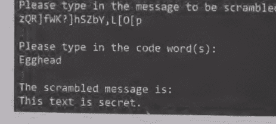

使用相同的单词将显示原始文本。

270 | 在树莓派上使用 C++ 编程

## 检测字符模式 - 查找字符串是否包含子字符串

`find()` 函数常用于搜索字符串值，以确定该值是否包含一个或多个字符的特定子字符串。它总是从字符串值的开头开始搜索子字符串的第一次出现。

同样，你可以使用 `rfind()` “反向查找”函数从字符串的末尾开始搜索，而不是从开头开始。

此程序使用 `find()` 和 `rfind()` 函数对电子邮件地址进行一些简单的验证。它测试地址是否只输入了一个 `@` 符号，并且该 `@` 符号不是地址的首个字符。它还测试电子邮件地址在 `@` 之后至少包含一个 `.` 字符。

## 示例 8.22 - find_substring.cpp

```cpp

#include <iostream> // 程序将使用键盘和屏幕

using namespace std; // 将使用标准标识符 string, cin, cout, endl

int main()

{

    string address;

    int firstAsquithAt, lastAsquithAt;

    int dotAt;

    cout << "Type in your email address:" << endl;

    cin >> address;

    // 检查 @ 符号

    firstAsquithAt = address.find("@");

    if (firstAsquithAt < 0)

        cout << "No @ at all!" << endl;

    else

        if (firstAsquithAt == 0)

            cout << "Can't put @ as start of address!" << endl;

        else

        {

            cout << "Has an @ at position ";

            cout << firstAsquithAt << endl;

        }

    // 检查其他 @ 符号

    lastAsquithAt = address.rfind("@");
```


`cout` << "More than one @!" << `endl`;

}

```

继续见下一页...

```cpp

// 检查 . 点符号

`dotAt` = `address.find`(".");

if (`dotAt` < 0)

    `cout` << "No dots found in the address!" << `endl`;

else

    if (`dotAt` == 0)

        `cout` << "Email addresses can't start with ." << `endl`;

    else

        `cout` << "Has at least one . in it" << `endl`;

// 检查空格

int `spaceAt` = `address.find`(" ");

```

在下方的截图中，你可以看到程序检查地址是否包含恰好一个 `@` 符号，且该符号不在地址的最开头。它还正确地识别出地址包含至少一个 `.` 点符号。

| 输入你的电子邮件地址： |
| :--- |
| phil@egghead.fameail.co.uk |
| 在位置 4 处有一个 @ |
| 至少包含一个 . |

如果电子邮件地址的第一个字符处有 `@`，会发生以下情况：

| 输入你的电子邮件地址： |
| :--- |
| @egghead.fameail.co.uk |
| 不能将 @ 作为地址的开头！ |
| 至少包含一个 . |

同样，如果地址不包含任何 `.` 符号，会产生错误，如下：

| 输入你的电子邮件地址： |
| :--- |
| phil@egghead.fameail.co.uk |
| 在位置 4 处有一个 @ |
| 地址中没有找到点 |

## 在字符串中找到多次出现的子字符串

有时，字符串值中的子字符串可能出现多次。使用 `find()` 函数可以找到它第一次出现的位置的位置。但如果你想找到后续出现的位置呢？

显然，你可以给 `find()` 函数传递一个参数，从字符串的某个特定位置开始搜索该子字符串。

```cpp

Example 8.23 - find_more.cpp

#include <iostream> // 程序将使用键盘和屏幕

using namespace std; // 将使用标准标识符 string, cin, cout, endl

int main() {

    string message = "The quick brown fox jumps over the lazy dog";

    int foundAt;

    int messageLen = message.length();

    int startPos = 0;

    do {

        foundAt = message.find("the", startPos);

        if (foundAt < 0) {

        } else {

            cout << "Found 'the' at " << foundAt << endl;

            startPos = foundAt + 1;

        }

    } while (foundAt >= 0 && startPos < messageLen);

    return 0;

}

```

## 使用 insert() 在字符串值中添加文本

`insert()` 函数可以在你选择的位置向字符串值中插入字符序列。

```cpp

Example 8.24 - insert_function.cpp

#include <iostream> // 程序将使用键盘和屏幕

using namespace std; // 将使用标准标识符 string, cin, cout, endl

int main()

{

    string sentence = "I'm hungry";

    for (int extraWords = 0; extraWords < 5; extraWords++)

    {

        cout << sentence << endl;

        sentence.insert(4, "very ");

    }

    // 循环结束

    return 0;

}

```

当程序运行时会发生以下情况：

```
I'm hungry
I'm very hungry
I'm very hungry
I'm very very hungry
I'm very very hungry
```

在 `for` 循环的每次迭代中，程序显示句子。它在位置 4 插入了 "very "。

## 手动从一个字符串拷贝到另一个

此示例将一个字符串值复制到另一个。它使用循环获取并复制字符，直到向新字符串值添加了所需的字符数量。当你的程序需要对每个字符做出某些有用决策时，手动复制单个字符是有用的。

```cpp

Example 8.25 - copy_chars.cpp

#include <iostream> ...
int main() {
    // 用户输入一个单词
    cout << "Type in a word... ";
    string word;
    cin >> word;
    // 用户输入他们想要的最终消息长度
    cout << "How long should the final text be? ";
    unsigned int howManyWanted;
    cin >> howManyWanted;
    // 重复将字符添加到字符串的开头并检查是否完成
    string resultString = "";
    unsigned int numberOfLetters = 0;
    unsigned int position = 0;
    while ( numberOfLetters < howManyWanted ) {
        // 将单词添加到结果字符串的开头
        resultString += word.at( position);
        /* 检查更新后的字符串的长度
        numberOfLetters = resultString.length(); */
        // 移动到单词中的下一个字符
        position++;
        // 如果超过了单词末尾，回到单词开头
        if ( position == word.length() )
            position = 0;
    } // end of while loop
    // 显示最终字符串
    cout << "Final string: " << resultString << endl;
    return 0;
}

```

如果你请求的字符数超过原始字符串中的字符数，进程将返回开头以获取下一个要复制的字符。这意味着如果原始文本太短，程序将永远用完字符。

例如，如果你输入的原始字符串是 `beep`，而你请求 3 个字符，显示的结果是 `bee`。

然而，如果你输入的原始字符串是 `beep`，而你请求 10 个字符，结果是 `beepbeepbe`。

输入一个单词... Beep
最终文本应该多长？ 3
最终字符串：Bee

输入一个单词... Beep
最终文本应该多长？ 10
最终字符串：BeepBeep

注意变量 `numberOfLetters` 是一个无符号整数（unsigned int）。如果我们选择 `int` 作为 `numberOfLetters` 的数据类型（它允许负值），编译器将生成一个警告。这是因为程序尝试用 `result` 的长度来匹配 `numberOfletters`。由于 `length()` 函数始终返回一个无符号整数，编译器会认为我们试图比较两个不同的数据类型，因此会显示警告。

这里使用的逐字符方法可以帮助你观察程序如何获取并利用文本值的部分（子字符串）。这并不是获取大型字符串值部分的唯一方法。你的程序可以一次性复制字符串值的整个部分。

C++ 包含包含一个现成的函数来获取子字符串，对于大多数人来说，这比手动从一个字符串值复制单个字符到另一个更简单、更方便。

## 使用 substr () 函数复制字符串值的一部分

为了在单次操作中复制字符串值的一部分，你可以使用 `substr()` 函数。

使用它的第一种方法是提供子字符串起始第一个字符的索引，以及你想获取的字符数量：

```cpp
// 从位置 1 开始，创建一个长度为 3 个字符的子字符串
string portion = original.substr( 1, 3 );
```

或者，你可以只提供子字符串起始第一个字符的索引。这将获取直到原始字符串末尾的所有后续字符：

```cpp
// 从位置 10 开始，获取后续的所有字符直到结束
string portion = original.substr( 10 );
```

此程序使用 `substr()` 函数从名为 `message` 的较大字符串中提取几个不同的部分：

## Example 8.26-substring_function.cpp

```cpp
#include <iostream>    // 程序将使用键盘和屏幕
using namespace std;               // 将使用标准标识符 string, cin, cout, endl;
int main()
{
    // 创建一个字符串值。子字符串将从这里获取。
    string message = "Raspberry Pi";
    // 创建一个子字符串，从位置 1 开始复制，长度为 3 个字符
    string snake = message.substr(1, 3);
    cout << snake << endl;
    // 创建一个子字符串，从位置 4 开始复制，长度为 5 个字符
    string food = message.substr(4, 5);
    cout << food << endl;
    // 创建一个子字符串，从位置 10 复制到原始字符串的末尾
    string computer = message.substr(10);
    cout << computer << endl;
    return 0;
}
```

考虑这段文本：

| 0 | 1 | 2 | 3 | 4 | 5 | 6 | 7 | 8 | 9 | 10 | 11 |
|---|---|---|---|---|---|---|---|---|---|---|---|---|
| R | a | s | p | b | e | r | r | y | | P | i |

语句：

```cpp
string snake = message.substr(1, 3 );
```

创建了一个子字符串，从位置 1（包含字母 a）开始，长度为 3 个字符，因此该子字符串是 "asp"。

```cpp
string computer = message.substr( 10 );
```

上面的语句创建了一个从位置 10（包含字母 P）开始一直延伸到 `message` 末尾的子字符串，结果为 "Pi"。

你应该能看到以下结果：

```
asp
berry
Pi
```

## 删除和替换字符串值的一部分

`erase()` 函数可以用于从 **string** 值中**删除**一个或多个字符。

它可以通过通过指定开始删除字符的索引号来删除 **string** 值的一部分。

该函数通常会删除从该点开始到 **string** 末尾的所有字符，除非你给它提供第二个参数来告诉它你想删除**多少**字符。

下面的示例展示了该函数的用法，首先删除到 **string** 值末尾的所有字符，然后删除恰好三个字符的序列。

```cpp
#include <iostream> // 程序将使用键盘和屏幕
using namespace std; // 将使用标准标识符 string, cin, cout, endl
int main()
{
    string message;
    message = "Ziggy played sitar";
    cout << message << endl;
    // 删除字符串值中从位置 13 之后的所有字符 ("sitar")
    message.erase( 13 );
    cout << message << endl;
    // 在字符串末尾添加一个新单词
    message = message + "ball";
    cout << message << endl;
    // 从字符串值中从位置 13 之后删除 3 个字符 ("net")
    message.erase( 13, 3 );
    cout << message << endl;
    return 0;
}
```

当上述程序运行时，屏幕上发生以下情况：

```cpp
#include <iostream> // 程序将使用键盘和屏幕
using namespace std; // 将使用标准标识符 string, cin, cout, endl
int main()
{
    string message = "Ziggy played sitar";
    while (!message.empty()) {
        // 显示字符串
        cout << message << endl;
        // 从字符串开头删除一个字符
        message.erase(0, 1);
    }
    cout << "*** The sentence is now empty! ***" << endl;
    return 0;
}
```

程序使用 `erase()` 函数反复从字符串值的开头删除字符。它每次从名为 `message` 的字符串的开头删除一个字符。这是通过从位置 0 开始，每次删除 1 个字符来实现的。

## 使用 replace() 函数替换字符串的一部分

`replace()` 函数可以用于更改字符串值的一部分。它可以替换原始字符串中的字符序列。

## Example 8.29-replace_function.cpp

```cpp
#include <iostream> // 程序将使用键盘和屏幕
using namespace std; // 将使用标准标识符 string, cin, cout, endl
int main()
{
    string message = "I'm hungry";
    // 显示句子
    cout << message << endl;
    cout << "munch..." << endl;
    // 将 "hungry" 替换为 "full"
    // "hungry" 从位置 4 开始，长度为 6 个字符
    message.replace(4, 6, "full");
    // 显示新句子
    cout << message << endl;
    return 0;
}
```

当程序运行后，你在屏幕上会看到的内容：

```
I'm hungry
munch...
I'm full
```

使用 `replace()` 函数来修改字符串值的一部分。它可以替换原始字符串中的字符序列。

这是另一个使用 `replace()` 函数在运行时修改字符串值的程序。它逐个替换单词。

## Example 8.30-replace_destruct.cpp

```cpp
#include <iostream> // 程序将使用键盘和屏幕
using namespace std; // 将使用标准标识符 string, cin, cout, endl
int main()
{
    string message = "Ziggy played sitar";
    while (!message.empty()) {
        // 显示字符串
        cout << message << endl;
        // 从字符串开头删除一个字符
        message.erase(0, 1);
    }
    cout << "*** The sentence is now empty! ***" << endl;
    return 0;
}
```

程序使用 `erase()` 函数反复从字符串值的开头删除字符。它每次从名为 `message` 的字符串的开头删除一个字符。这是通过从位置 0 开始，每次删除 1 个字符来实现的。

## 查找字符串中属于特定集合的字符

`find_first_of()` 函数可以从开始扫描字符串，寻找你特别感兴趣的集合中的字符。当它找到字符串中第一个属于集合的字符时，程序会返回该字符的索引。如果字符串值中没有属于集合的字符，函数将返回一个负值。

注意，`find_last_of()` 函数的操作方式与 `find_first_of()` 函数类似。它将找到字符串值中感兴趣的字符集合的最后一个字符的位置。

## Example 8.31-find_first.cpp

```cpp
#include <iostream>
// 程序将使用键盘和屏幕
using namespace std;
// 将使用标准标识符 string, cout, endl
int main() {
    string message = "It's as easy as 1-2-3!";
    // 重复查找消息中的单个单词
    // 显示每个完整的单词，然后从消息中删除它


```cpp
int firstDigitPos, nextDigitPos, firstPuncPos;

// 消息中第一个数字出现

firstDigitPos = message.find_first_of("0123456789");

// 消息中下一个数字出现

// 从上一个找到的数字之后的字符开始搜索

nextDigitPos = message.find_first_of("0123456789") + 1;

// 标点符号

firstPuncPos = message.find_first_of(".,;:!?");

// 显示结果

cout << "First digit found at position: " << firstDigitPos << endl;

cout << "Second digit found at position: " << nextDigitPos << endl;

cout << "First punctuation mark found at position: " << firstPuncPos << endl;

return 0;

}
```

# 在字符串中查找不在特定集合中的字符

`find_not_of()` 函数可以从头开始扫描字符串，寻找任何不属于你感兴趣的特定集合的字符。该函数确定字符串中第一个不在感兴趣集合中的字符的索引，以显示它找到的位置。不过，如果字符串值中的每一个字符实际上都在该集合中，该函数将返回一个负值。

此示例使用 `find_not_of()` 来确定字符串是否包含有效的摩尔斯密码消息，或者它是否包含不属于内容的字符：

示例 8.32 – `find_first_not_of.cpp`

```cpp
#include <iostream> // 程序将使用键盘和屏幕

using namespace std; // 将使用标准标识符 string, cout 和 endl

int main()

{

    // 提示用户输入一条摩尔斯密码消息
    cout << "Please type in a message in Morse code: " << endl;
    string morseMessage;
    getline(cin, morseMessage);

    // 从消息开始，寻找任何不是不可接受的字符
    // （即只能包含点、破划线或分隔符）
    int badCharPos = morseMessage.find_first_not_of(".- /");

    // 如果找到了不在有效字符集合中的字符
    // 则在屏幕上显示它
    if (badCharPos > -1)
    {
        cout << "Contains unacceptable character: " << endl;
        cout << morseMessage.at(badCharPos) << endl;
    }
    else
    {
        cout << "All characters in the message were acceptable." << endl;
    }
    return 0;
}
```


`find_last_not_of()` 函数的工作方式与 `find_first_not_of()` 函数类似。

它确定字符串值中最后一个不是你感兴趣的字符集合的字符的位置。

## 将字符串值拆分为单个单词

通常情况下，将行或段段文本拆分为单个单词以便进行某些处理是非常有用的。每个单词或符号组被称为“标记”（token）。

此程序检查字符串值中的字符序列，寻找单个单词的开始和结束。每个完成的单词在被找到时显示在屏幕上。

代码使用 `find_first_not_of()` 来分析字符串值，寻找完整的单词：

示例 8.33 - `string_tokens.cpp`

```cpp
#include <iostream>           // 程序将使用键盘和屏幕
using namespace std;                       // 将使用标准标识符 string, cout 和 endl

int main() {
    string sentence = "Whoa! This has... like, er... words";

    // 重复在句子中寻找单个单词
    // 显示每个完整的单词，然后将其从句子中删除
    int startPos, endPos;
    string wholeWord;
    do {
        // 显示剩余的句子
        cout << "Sentence: " << sentence << endl;
        // 寻找单词的起点
        // （寻找既不是标点符号也不是空格的字符）
        startPos = sentence.find_first_not_of(",?! ");
        // 如果找到了单词起点，则寻找单词终点
        // （寻找下一个标点符号或空格的字符）
        if (startPos >= 0) {
            endPos = sentence.find_first_not_of(",?! ", startPos);
            // 创建完整单词的子字符串
            wholeWord = sentence.substr(startPos, endPos-startPos);
            cout << "Word: " << wholeWord << endl;
            // 从句子中删除完整单词
            sentence.erase(0, endPos);
        }
        // if 决策结束
    } while (startPos >= 0);
    return 0;
}
```

下面你可以看到程序显示的结果：

```
Sentence: Whoa! This has... like, er... words?
Word: Whoa
Sentence: This has... like, er... words?
Word: This
Sentence: has... like, er... words?
Word: has
Sentence: ... like, er... words?
Word: like
Sentence: , er... words?
Word: er
Sentence: ... words?
Word: words
Sentence:?
```

你应该看到程序从句子开始并隔离每个单个单词。在每个单词显示后，它会被从句子中删除，并显示剩余字符。此过程一直持续，直到字符串值中无法找到更多单词或字母字符。

# 交换两个字符串变量的值

我们已经在书的前面部分介绍过如何通过第三个临时变量来交换两个变量的值。

如果你在代码中有两个不同的字符串变量，可以使用 `swap()` 成员函数交换它们的值：

```cpp
string firstCity = "Tacoma";
string secondCity = "Chicago";
firstCity.swap(secondCity);
```

我们将取 `secondCity` 的值并与之交换。


## `swap()` 函数的实际用法

我们之前已经看到过如何交换两个变量的值。

以下代码展示了 `swap()` 函数的实际用法：

34 - `swap_strings.cpp`

```cpp
#include <iostream>    // 程序将使用键盘和屏幕
using namespace std;                       // 将使用标准标识符 string, cout 和 endl

int main() {
    string firstValue = "Tomato";
    string secondValue = "Ketchup";

    // 在交换前显示值
    cout << "First value: " << firstValue << endl;
    cout << "Second value: " << secondValue << endl;

    // 交换值
    firstValue.swap(secondValue);

    // 在交换后显示值
    cout << "First value: " << firstValue << endl;
    cout << "Second value: " << secondValue << endl;
    return 0;
}
```

上面的代码不需要临时变量即可完成交换。你应该看到以下结果：


# 第 8 章总结

在本章中我们涵盖了：

| 描述 |
| :--- |
| 字符符号和 ASCII 码可以使用 `char` 类型存储。 |
| 单个字符值始终包含在单引号之间。 |
| 使用这种数据类型通常需要包含 `<string>` 库。 |
| 字符串字面量包含在双引号之间。 |
| 零或多个字符的序列可以存储为字符串值。 |
| `length()` 函数返回字符串包含的字符数量。 |
| `at()` 函数从字符串获取单个字符。它检查你提供的索引是否在字符串范围内，如果越界则返回错误。 |
| 几个函数允许你判断字符是否为控制字符、打印字符、数字、字母或其他符号。这些函数包括 `isprint()`、`iscntrl()`、`isdigit()`、`isalpha()`、`islower()`、`isupper()` 和 `isspace()`。 |
| 对于字母，`toupper()` 函数将其转换为大写。`tolower()` 函数将其转换为小写。非字母字符不受这些函数的影响。`toupper()` 和 `tolower()` 属于 `<ctype>` 库。 |
| 字符和字符串可以使用 `+` 或 `+=` 运算符附加到字符串值的末尾。你也可以使用 `append()` 函数连接字符串值。 |
| `substr()` 函数获取字符串值的一部分（子字符串）。你可以控制该部分的大小以及它的位置。如果找到，它首先返回子字符串的索引。 |
| 从字符串值的开始，`find()` 函数搜索特定的子字符串以检查是否可以被找到。如果找到，它首先返回子字符串的索引。 |
| `Rfind()` 函数类似，但它从末尾开始向开头搜索。 |
| `replace()` 函数用你指定的第二个字符串中的字符替换字符串值的一部分。你可以控制原始字符串的哪部分被替换。 |
| `insert()` 函数将一个字符串值的字符插入到另一个字符串的特定位置。 |
| `erase()` 函数用于删除字符串值的一部分。即要删除的值。 |
| `find_first_of()` 函数从头到尾扫描字符串值，在特定字符集合中寻找第一个字符。如果成功，该函数返回找到的第一个字符的索引。 |
| `find_first_not_of()` 会给你字符串值中不属于你感兴趣的特定字符集合的字符索引。 |

# 供你尝试的问题与练习

| 1. | 创建一个程序，反复要求你逐个输入字符。将每个字符追加到一个字符串值中，并在允许你输入下一个字符之前将其显示在屏幕上。 |
| 2. | 编写一个程序，从一个字符串值中随机选择两个不同的字母并交换它们。重复此过程几次，为原始字符串值创建几个字母异位词（anagrams）。 |
| 3. | 编写一个程序，将数字替换为它们的名称。例如，“Easy as 1, 2, 3!”将变成“Easy as one, two, three!”。 |
| 4. | 创建一个程序，允许你输入一个简单的单词。程序随后将每个字母大写化并插入连字符，只要它不是单词中的最后一个字母即可。例如，“cheese”将变成“C-H-E-E-S-E”。 |

# 第 9 章：

## 数据数组

# 处理具有相同数据类型的多个值

如果你想在计算机内存中存储许多不同的内容，可以使用许多不同的变量。

例如，这里有游戏中的四个变量，允许不同的玩家进行对战：

```
int player1Score = 0;
int player2Score = 0;
int player3Score = 0;
int player4Score = 0;
```

注意，四个变量中的每个都存储一个整数：一个 `int` 值。它们的名字也非常相似。

这是另一个关于如何存储独立字符串数据项目的示例：

```
string firstDay = "Monday";
string secondNumber = "Tuesday";
string thirdDay = "Wednesday";
string fourthDay = "Thursday";
string fifthDay = "Friday";
```

再次，上述所有项目具有相同类型的数据：它们都是字符串值。它们的变量名遵循一个可预测的模式（你可能猜到下一个变量可能会被称为 "sixthDay"）。

## 什么是数组？

> “数组”（array）是一种组织数据的方法。它是一种“数据结构”，以一致的方式将许多数据值组织在一起，你可以方便地使用它们。

如果你有许多相似的东西，与其创建许多不同的变量，可以将不同的值分组在一起。该值组可以被赋予一个单一名称，例如 `playerScores`。

数组中的每个值都被赋予一个数字，称为“索引”（index）。这有助于在你想要使用数据值时再次找到它。索引告诉你数据位于数组的哪个位置。索引号始终写在 `[ ]` 括号内。

以下是存储上述示例中描述的星期几的方法，但使用一个包含所有不同值的单个数组：

| 项目编号（索引） | 数据值（Data-value） |
|---|---|
| 0 | Monday |
| 1 | Tuesday |
| 2 | Wednesday |
| 3 | Thursday |
| 4 | Friday |

警告！当你想要创建和使用数组时，应该始终确保数组中的所有项目都具有相同的数据类型，例如 `string` 或 `int`。你不能在同一个数组中混合不同的数据类型。

# 创建一个简单的值数组

以下是你如何创建一个数组来存储游戏中四名玩家的分数的：

```
int playerScore[4];
```

这意味着将创建一个恰好包含 4 个 `int` 值的数组。该数组被称为 "`playerScore`"。

可以使用 `playerScore[0]` 访问数组中的第一个项目。

数组中的最后一个项目（第四个项目）可以使用 `playerScore[3]` 访问。

示例 9.1 - `array_scores.cpp`

```
int main() {
    // 为 4 个玩家创建分数数组
    int playerScore[4];
    // 在游戏开始时设置初始分数
    playerScore[0] = 0;
    playerScore[1] = 0;
    playerScore[2] = 0;
    playerScore[3] = 0;
    return 0;
}
```

## 使用索引号引用数组中的值

在 C++ 中，数组的索引不从 1 开始，而是从 0 开始。

我们说 C++ 数组是“零索引的”（zero-indexed）。

这就是为什么第一个项目的索引始终是 0。

在一个包含 $n$ 个项目的数组中，最后一个项目的索引始终是 $n - 1$。

根据上述规则，第三个玩家的分将存储在数组 `playerScore[2]` 的位置 2 。

下面的示例将显示来自 `playerScore` 数组的第四个项目。

```
cout << playerScore[3];
```

记住，第一个项目（第一个玩家的分数）在数组中的索引为 0。因为索引从零开始，数组中的第四个项目索引为 3。

## 从数组中访问单个值

可以编写单独的语句来访问数组中的每个项目：

```
cout << dayName[0] << endl;
cout << dayName[1] << endl;
cout << dayName[2] << endl;
cout << dayName[3] << endl;
cout << dayName[4] << endl;
```

这段代码非常简单但也非常重复。如果你有一个包含大量数据的大数组，效率将会很低。一个包含成千上万项目的数组将需要数千行代码来访问所有数据。

或者，可以使用循环仅用几行代码访问或更改数组中的多个值。使用循环可以使你的程序短得多。你不需要在程序中反复编写类似的代码。通过使用循环，可以使用语句访问数组项并进行某些处理。

下面的代码展示了显示星期几的有效方法。它使用 `for` 循环来控制数组的索引。循环重复执行单个语句，在屏幕上显示数据：

```
for ( int index = 0; index < 5; index++ )
cout << dayName[index] << endl;
```


代码从整数变量 `index` 的值 0 开始。它使用此值访问数组中的第一个项目，即 `dayName[0]`。

`for` 循环的每次迭代增加 `index` 的值使其小于 5，因此它访问 `dayName[0]`，然后是 `dayName[1]`，然后是 `dayName[2]`，依此类推。

只要 `index` 的值小于 5，循环就会执行。一旦达到 5，循环终止。这意味着最后一个被访问和显示的数组项是 `dayName[4]`。

下一个示例可以为数组中的每个项目设置初始值，使它们都为：

```cpp
for ( int index = 0; index < 4; index++ )
playerScore[index] = 0;
```

# 示例 9.2 - array_days.cpp

```cpp
#include <iostream>
#include <string>
using namespace std;
int main() {
    // 创建星期数组
    string dayName[5];
    // 设置日期
    dayName[0] = "Monday";
    dayName[1] = "Tuesday";
    dayName[2] = "Wednesday";
    dayName[3] = "Thursday";
    dayName[4] = "Friday";
    // 使用 for 循环显示
    // 星期
    for (int index = 0; index < 5; index++) {
        cout << dayName[index] << endl;
    }
    return 0;
}
```

以下是一个使用上一页描述的循环方法来分配并显示玩家得分数组的程序：

## Example 9.3 - array_loop.cpp

```cpp
#include <iostream>    // 程序将在屏幕上显示一些文本
using namespace std;               // 将使用标准标识符 cout 和 endl
int main()
{
    // 为 4 个玩家各创建一个得分数组
    int playerScore[4];
    int index;                        // 此索引将同时用于两个循环以访问数组
    // 在游戏开始时设置分数
    for ( index = 0; index < 4; index++ )
        playerScore[index] = 0;
    // 显示分数
    for ( index = 0; index < 4; index++ )
    {
        cout << "Player " << index;
        cout << " has score " << playerScore[index] << endl;
    }
    return 0;
}
```

当程序运行时，屏幕上显示的内容如下：

| Player 0 has score 0 |
| Player 1 has score 0 |
| Player 2 has score 0 |
| Player 3 has score 0 |

接下来的程序使用字符串值数组反复显示某些 ASCII 图形。图片的每一行都存储为数组中的一个项，并使用不同的颜色显示三次。

## Example 9.4 - array_face.cpp

```cpp
#include <iostream> // 程序将在屏幕上显示一些文本
using namespace std; // 将使用标准标识符 string, cout and endl
int main() {
    // 创建一个字符串数组来存储图形
    string faceLine[5];
    faceLine[0] = "+------";
    faceLine[1] = "| OO |";
    faceLine[2] = "|  E |";
    faceLine[3] = "| == |";
    faceLine[4] = "+------";
    // 并排显示 3 个脸的副本
    // 每个脸脸将是不同的颜色
    int num = 0;
    while (num < 5) {
        cout << "\e[31m"; // 转义序列 - 红色
        cout << faceLine[num]; // 显示脸的一部分
        cout << "\e[32m"; // 转义序列 - 绿色
        cout << faceLine[num]; // 显示脸的一部分
        cout << "\e[34m"; // 转义序列 - 蓝色
        cout << faceLine[num]; // 显示脸的一部分
        cout << endl; // 到屏幕的下一行
        num++; // 移动字符串数组的下一行
    }
    // 绘制完成，将屏幕颜色重置为正常
    cout << "\e[0m"; // 0m 重置
    return 0;
}
```

执行时，循环将脸的每个单独部分并排显示 3 次：


同样地，此程序将使用一个单条 `cout` 语句通过 `for` 循环反复执行，显示一周的所有日期。程序随后允许你输入一个索引号，显示数组中相应的日期：

## Example 9.5 - array_access.cpp

```cpp
#include <iostream>    // 程序将在屏幕上显示一些文本
using namespace std;      // 将使用标准标识符 cin, cout, endl
int main() {
    // 创建星期几的数组
    string dayName[7];
    // 设置每一日的名称
    dayName[0] = "Monday";
    dayName[1] = "Tuesday";
    dayName[2] = "Wednesday";
    dayName[3] = "Thursday";
    dayName[4] = "Friday";
    dayName[5] = "Saturday";
    dayName[6] = "Sunday";
    // 显示星期几的名称
    cout << "These are the days of the week:" << endl;
    for (int index = 0; index < 7; index++) {
        cout << "\t" << dayName[index] << endl;
    }
    // 输入数字
    int dayNumber;
    cout << "Now please type in a number between 0 and 6" << endl;
    cin >> dayNumber;
    // 使用数字显示相应的星期几
    cout << "This is " << dayName[dayNumber] << endl;
    return 0;
}
```

首先，`for` 循环显示数组中的每一天，从 `dayName[0]` 到 `dayName[6]`。

当输入值 3 时，程序显示存储在 `dayName[3]` 中的文本：

```
These are the days of the week:
0 Monday
1 Tuesday
2 Wednesday
3 Thursday
4 Friday
5 Saturday
6 Sunday
Now please type in a number between 0 and 6
3
This is Thursday
```

## 越界尝试：尝试使用越界索引

记住，在之前的 Example 9.5 - array_access.cpp 程序中，`dayName` 数组可以使用的最大索引值为 6（这对应于数据的第七项 - 数组中的最后一项）。

尝试再次运行程序并输入一个越界的索引值，例如 7 或 99。甚至尝试一个负数。发生了什么？程序显示：

```
Segmentation fault
```

这说明你访问了数组中不存在的项

```cpp
// 输入数字
int dayNumber;
// 检查数字是否太小或太大
if (dayNumber < 0 || dayNumber > 6)
    // 这样做是不允许的
    cout << "This is not allowed!" << endl;
else
    // 这是一个允许的
    cout << "This is " << dayName[dayNumber] << endl;
```

如果我们修改 Example 9.5 - array_access.cpp 以包含此检查，程序就能处理有效的或无效的索引。这种方法确保了访问的项是真实存在的。绘制完成，将屏幕颜色重置为正常。

```cpp
// 绘制完成，将屏幕颜色重置为正常
cout << "\e[0m"; // 0m 重置
```

这让程序能够处理有效的或无效的索引。我没有忘记王星——它是一个“矮行星”，而不是一个真正的“行星”。抱歉，王星。

## 使用数组记录原始数据

此程序允许用户记录 200 米跑步比赛的分数。当每个人到达终点时，他们的秒数会被输入计算机。这些时间存储在浮点数数组 `raceTime` 中。程序尝试访问了内存。

## Example 9.7 - array_times.cpp

```cpp
#include <iostream> // 程序将在屏幕上显示一些文本
using namespace std; // 将使用标准标识符 cout 和 endl
int main()
{
    const int MAX_RUNNERS = 9; // 标准跑道上的最大 9 条
    float raceTime[MAX_RUNNERS]; // 记录每个跑步者的秒数
    // 让数组中的每个时间都从 0 开始
    int index = 0;
    while (index < MAX_RUNNERS)
    {
        raceTime[index] = 0;
        index++;
    } // 结束 while 循环
    // 在运动员结束时存储时间
    // 当达到最大人数或输入 0 时停止
    int runnersFinished = 0;
    float seconds;
    {
        cout << "Type in a finish time: (or 0 if all runners finished) "; // 输入
        cin >> seconds;
        if (seconds > 0)
        {
            raceTime[runnersFinished] = seconds;
            runnersFinished++;
        } // if seconds 决定
    } while ((seconds > 0) && (runnersFinished < MAX_RUNNERS));
    // 显示最快和最慢的时间
    cout << endl << endl;
    cout << "SUMMARY OF RESULTS" << endl;
    cout << "Fastest time: ";
    cout << raceTime[0];
    cout << " seconds" << endl;
}
```

继续...

```cpp
cout << "Slowest time: ";
cout << raceTime[runnersFinished-1];
cout << " seconds" << endl;
// Display list of all finish times, starting with the fastest
cout << "HERE ARE THE TIMES" << endl;
```

```cpp
index = 0;
while ( index < runnersFinished ) {
    cout << "Runner in position " << index + 1;
    cout << " - time " << raceTime[index] << " seconds" << endl;
    index++;
}
return 0;
```

该程序允许你输入最多 9 名跑步者的时间（这是跑道上的道数）。
这些时间中的每一个都以浮点数的形式输入，直到输入了每个跑步者的时间为止。输入 0 作为时间表示没有其他跑步者有更多时间需要输入了。

以下是我为跑步者输入一些数据时，我的 Pi 显示的内容：

| 输入完赛时间：（或如果所有运动员已完成则输入 0） | 8.25 |
| 输入完赛时间：（或如果所有运动员已完成则输入 0） | 10.3 |
| 输入完赛时间：（或如果所有运动员已完成则输入 0） | 12.7 |
| 输入完赛时间：（或如果所有运动员已完成则输入 0） | 17.5 |
| 输入完赛时间：（或如果所有运动员已完成则输入 0） | 0 |

| 结果总结 |
| 最快时间：8.25 秒 |
| 最慢时间：17.5 秒 |
| 以下是所有时间： |
| 第 1 名跑步者 - 时间 8.25 秒 |
| 第 2 名跑步者 - 时间 10.3 秒 |
| 第 3 名跑步者 - 时间 12.7 秒 |
| 第 4 名跑步者 - 时间 17.5 秒 |

每个完赛时间都存储在一个名为 `raceTime` 的浮点值数组中。程序使用 `runnersFinished` 来跟踪输入了多少个非零时间，并检查该值是否超过了跑步者的最大数量。

在输入完所有时间后，程序会显示最快的时间，它假设这是第一个输入的。这个第一个完赛时间将存储在 `raceTime` 数组的索引 0 位置，因此显示了 `raceTime[0]` 的值。

现在它使用 `runnersFinished` 来确定最后输入的时间，它存储在 `raceTime` 数组的索引 `runnersFinished-1` 位置，因此显示了 `raceTime[runnersFinished-1]` 的值。

最后，程序使用 `while` 循环遍历并显示存储在 `raceTime` 数组中的所有完赛时间列表。

300 | 在树莓派上使用 C++ 学习编程

## 使用数组对用户输入进行分类或计数

这里是“示例 7.21 - count_votes.cpp”示例的重写版本，该示例源自“第 7 章：使用循环进行重复”，该示例用于确定最受欢迎的外卖食物选择。该程序没有使用三个不同的变量来存储每种食物的选择数，而是使用了一个整数值数组。

示例 9.8 - array_votes.cpp

```cpp
#include <iostream>    // 程序将在屏幕上显示一些文本
using namespace std;    // 将使用标准标识符 string, cin, cout, endl;
int main() {
    const int NUM_OPTIONS = 3;
    string name[NUM_OPTIONS];
    name[0] = "Pizza";
    name[1] = "Balti-Curry";
    name[2] = "Thai-Noodles";
    int totalChosen[NUM_OPTIONS];
    int index;
    // 让每种食物的选择数从零开始
    for ( index = 0; index < NUM_OPTIONS; index++ )
        totalChosen[index] = 0;
    // 循环为每种食物输入字母并计算总数
    char choice;
    do {
        cout << "Type in a choice: p c n (or * to quit)" << endl;
        cin >> choice;
        switch ( choice ) {
            case 'p': case 'P': totalChosen[0]++ break;
            case 'c': case 'C': totalChosen[1]++ break;
            case 'n': case 'N': totalChosen[2]++ break;
        } // switch 语句结束
    } while ( choice != '*'); // 输入 * 终止循环
    // 在所有选票输入完毕后显示结果
    cout << "RESULTS TIME" << endl;
    for ( index = 0; index < NUM_OPTIONS; index++ )
        cout << name[index] << " = " << totalChosen[index] << endl;
    return 0;
}
```

以下是向程序输入一些测试数据的示例：


Type in a choice: p c n (or * to quit)

c

Type in a choice: p c n (or * to quit)

C

Type in a choice: p c n (or * to quit)

p

Type in a choice: p c n (or * to quit)

n

Type in a choice: p c n (or * to quit)

p

Type in a choice: p c n (or * to quit)

C

Type in a choice: p c n (or * to quit)

RESULTS TIME

Pizza = 2

Balti-Cury = 3

Thai-Noodles = 1

数组 `totalChosen` 存储选择的数量。`totalChosen` 数组持有选择的数量。在开始，每个项目都设置为 0。程序使用 `while` 循环来确定该行星是否存在于数组中。这种搜索被称为线性搜索，因为它从第一个项目一直到最后一个。如果找到了匹配项，则显示该名称。一旦找到，搜索就会终止，这意味着它不会继续搜索到数组的末尾。

# 示例 9.9 - array_search.cpp

```cpp

#include <iostream> // 程序将在屏幕上显示一些文本

using namespace std; // 使用标准标识符 string, cin, cout, endl;

int main() {

    // 创建行星数组

    const int NUM_PLANETS = 8;

    string planetName[NUM_PLANETS];

}

// 继续见下一页...

```
302 | 在树莓派上使用 C++ 学习编程

继续...

```cpp

// 存储每个行星名称

planetName[0] = "Mercury";

planetName[1] = "Venus";

planetName[2] = "Earth";

planetName[3] = "Mars";

planetName[4] = "Jupiter";

planetName[5] = "Saturn";

planetName[6] = "Uranus";

planetName[7] = "Neptune";

```
```cpp

// 决定要搜索的行星

cout << "Which planet are you searching for?" << endl;

string searchTarget;

cin >> searchTarget;

```
```cpp

// 搜索行星是否存在于数组中

bool found = false;

int index = 0;

while ( not found) && ( index < NUM_PLANETS ) {

  if(searchTarget == planetName[index]) {

    cout << "数组中的第 " << index << " 号行星是 " << planetName[index] << endl;

    found = true; // 找到后终止搜索

  }

  index++;

}

```
```cpp

//报告是否成功找到行星

if ( not found ) {

  cout << "No matching planet found" << endl;

}

return 0;

}

```

如果你尝试搜索不存在的行星，程序会告诉它找不到：

| 你要搜索哪个行星？ |
| Rasperrian-VI |
| No matching planet found |

然而，当我搜索土星时，发生了以下情况：

| 你要搜索哪个行星？ |
| Saturn |
| 数组中的第 5 号行星是 Saturn |

请注意，程序只会查找精确匹配，包括每个字母的大小。为了成功找到土星，搜索值必须拼写为大写的 S，而不是小写的 s。可以通过在与每个数组值进行比较时让它变得不那么“挑剔”来改进程序。第 10 章：函数*包含一个如何将整个字符串值转换为大写或小写的示例，以帮助你这样做。

# 遍历数据值数组以查找部分匹配

上一个示例是遍历行星数组以查找精确匹配。它将每个行星的名称与搜索目标进行比较，以确定这两个值是否完全相同。

接下来的程序搜索的是部分匹配，而不是完全匹配。它将找到任何以特定字母开头的行星。为了实现这一点，程序将逐个检查行星名称数组中每个字符串值的第一个字母。如果第一个字母与你正在搜索的字母匹配，则该行星的名称将显示在屏幕上。

搜索代码使用了以下 `if` 语句：

```cpp

if ( planetName[index].at( 0 ) == searchLetter )

```

上述 `if` 判定检查了当前行星名称的第一个字母是否与用户输入作为搜索值的字母相同。

```
planetName[index] 是循环中正在检查的当前行星名称。
.at(0) 获取第一个字母，它位于当前行星名称的第 0 个位置。
```

示例 9.10-array_search_first_letter.cpp

```cpp

#include <iostream> // 程序将在屏幕上显示一些文本

using namespace std; // 将使用标准标识符 string, cin, endl

int main()

{

    // 创建行星数组

    const NUM_PLANETS = 8;

    string planetName[NUM_PLANETS];

    // 设置每个行星名称的值

    planetName[0] = "Mercury";

    planetName[1] = "Venus";

    planetName[2] = "Earth";

    planetName[3] = "Mars";

    planetName[4] = "Jupiter";

    planetName[5] = "Saturn";

    planetName[6] = "Uranus";

    planetName[7] = "Neptune";

    // 确定要搜索的字母

    cout << "What letter does the planet begin with?" << endl;

    char searchLetter;

    cin >> searchLetter;

// 继续执行...

    // 搜索以搜索字母开头的行星

    cout << "SEARCHING..." << endl;

    int resultsFound = 0;

    for ( int index = 0; index < NUM_PLANETS; index++)

    {

        if (planetName[index].at(0) == searchLetter)

        {

            cout << planetName[index] << endl;

            resultsFound++;

        } // if 判定的结束

    } // 循环结束

    // 显示找到的匹配行星数量

    cout << resultsFound << " planets found " << endl;

    return 0;

}

```

你可以在下方看到在 Pi 上执行搜索的示例。当被要求查找以 "M" 开头的行星时，程序首先在 **planetName** 数组的第 0 处找到了 **Mercury**。即使已经找到了匹配项，**for** 循环也会继续搜索，随后在数组的第 3 处找到了 **Mars**：

| 行星以哪个字母开头？ |
| :--- |
| M |
| SEARCHING... |
| Mercury |
| Mars |
| 找到了 2 个行星 |

当被要求查找以字母 "Z" 开头的行星时，**for** 循环未能找到任何行星。一旦完成对 **planetName** 数组中所有项的搜索，程序将报告没有找到任何以该字母开头的行星：

| 行星以哪个字母开头？ |
| :--- |
| T |
| SEARCHING... |
| 找到了 0 个行星 |

# 如何从值数组中随机选择内容

与之前的示例一样，下面的程序在选择随机数时使用了 `%` 取模运算符。该随机数被用作可能问候数组的索引。问候数组中相应的字符串值将显示在屏幕上，并带有用户输入的名称。

示例 9.11 - array_random.cpp

```cpp

#include <iostream>            // 程序将使用键盘和屏幕

#include <cstdlib>             // 程序使用 random() 和 srand() 函数

#include <ctime>               // 程序使用 time() 函数作为随机种子

using namespace std;                // 将使用标准标识符 string, cin, cout, endl

int main() {

    cout << "Please type in your name..." << endl;

    string name;

    cin >> name;

    // 创建一个包含 5 个字符串的数组

    const int NUM_GREETINGS = 5;

    string greeting[NUM_GREETINGS];

    greeting[0] = "Hello";

    greeting[1] = "Bonjour";

    greeting[2] = "Hola";

    greeting[3] = "Top o' the morning to you";

    greeting[4] = "Howdy";

    srand(time(0));                 // 使用当前时间为随机数生成器

    int choice = random() % NUM_GREETINGS; // 在 0 到 4 之间选取随机数

    cout << greeting[choice] << " " << name << endl; // 使用它显示问候

    return 0;

}

```

你可以看到，每当我在 Pi 上运行该程序时，它都会给我不同的结果：

> Please type in your name...
> Alonso
> Bonjour Alonso

> Please type in your name...
> Alonso
> Howdy Alonso

> Please type in your name...
> Hurdy-Hurdy-Man
> Top o' the morning to you Hurdy-Hurdy-Man

# 同时使用多个数组：一个随机笑脸生成器

示例 9.12 - array_smilies.cpp

```cpp

#include <iostream>    // 程序将在屏幕上显示一些文本

#include <cstdlib>     // 程序使用 random() 和 srand() 函数

#include <ctime>        // 程序使用 time() 函数作为随机种子

using namespace std;

    // 将使用标准标识符 string

```

# 从多个数组中匹配相关项

这里有一个使用两个数组来存储多个城市名称和人口的程序。

城市的名称存储在一个字符串值数组中，名为 `cityName`。

每个城市的人口存储在一个整整型值数组中，名为 `population`。

当使用多个数组存储有关某事的不同类型数据时，如果你以一致的方式组织数组值，则可以使用相同的索引来访问不同数组中的多个相关数据项。

例如，与巴黎相关的一切都有索引值 1。名称 "Paris" 位于 `cityName[1]`，而巴黎对应的人口存储在 `population[1]` 中。

示例 9.13-related_arrays.cpp

```cpp

#include <iostream>      // 程序将在屏幕上显示一些文本

using namespace std;                // 将使用标准标识符 string, cin, endl

int main()

{

    // 创建名称数组

    const int NUM_CITIES = 3;

    string cityName[NUM_CITIES];

    // 设置城市名称

    cityName[0] = "London";

    cityName[1] = "Paris";

    cityName[2] = "New York";

    // 创建人口数组

    float population[NUM_CITIES];

    // 设置人口值

    population[0] = 8.6;

    population[1] = 2.2;

    population[2] = 8.4;

    // 显示城市和人口

    cout << cityName[1] << " has ";

    cout << population[1] << endl;

    cout << " million residents." << endl;

    return 0;

}

```

# 参数数组——在运行程序时传递输入值

在命令行工作时，许多 Linux 命令会接收一个或多个值作为输入。构建下面的程序，将其命名为 `newcommand`。

# 示例 9.14-program_arguments.cpp

```cpp

#include <iostream>    // 程序将在屏幕上显示一些文本

using namespace std;                // 将使用标准标识符 string, cin, endl

int main(int argc, char *argv[])

{

    cout << "Here are the arguments that I gave the program:" << endl;

    for ( int index = 0; index < argc; index++)

    {

        cout << "Argument number " << index << " is...";

        cout << argv[index] << endl;

    }

    return 0;

}

```

注意：在上面的程序中，`argv[]` 表示 C 风格字符串数组——这是处理命令行参数程序的约定。

一旦构建，你可以从命令行运行执行文件，并提供多个参数。例如，尝试以下操作：

```
./newcommand yellow red blue
```

这应该产生输出：

| Here are the arguments that I gave the program: |
| :--- |
| Argument number 0 is... yellow red blue |
| Argument number 1 is... yellow |
| Argument number 2 is... red |
| Argument number 3 is... blue |

注意 `argv` 字符串数组中的参数 0 自动持有你提供给程序的所有参数完整列表。你输入的每个参数都由 `argv` 数组中从 1 开始的剩余项持有。

这种技术可以被程序用来控制其在运行时的行为。例如，程序可以搜索音乐列表，查找特定艺术家在某个日期之前或之后的所有歌曲：

- findsongs Motorhead before 1981
findsongs Trio
- findsongs "The Ramones" after 1977

# 从参数列表中随机选取一个值

这里有一个程序，它允许你在从命令行执行时，以参数的形式输入一组值列表。该程序将随机选择其中一个参数值。

例如，假设你选择了文件名为 "pick" 的程序，你可以输入：

```
/pick strawberry chocolate vanilla
```

程序将从你提供的参数中随机选择一个：strawberry、chocolate 或 vanilla。

代码通过检查标准变量 `argc`（意思是 argument count，即参数计数）来确定你提供的值的数量。一旦程序知道向程序提供了多少个参数，计算机就会在 1 到该数量之间选取一个随机数。这个数被用作 C 风格字符串数组 `argv` 的索引，该数组存储了参数文本值。

## 示例 9.15 - pick.cpp

```cpp

#include <iostream>

#include <cstdlib>

#include <ctime>

// 程序将在屏幕上显示一些文本

// 程序将使用 random() 和 srand() 函数

// 程序使用 time() 函数作为随机种子

using namespace std;

// 将使用标准标识符 cout 和 endl

int main(int argc, char *argv[]) {

    const int NUM_ARGUMENTS = argc - 1; // 找到提供了多少个参数

    cout << "No. of arguments supplied to program by user: \ ";

    cout << NUM_ARGUMENTS << endl;

    // 如果运行程序时提供了任何参数，则显示它们

    // 并随机选择一个（忽略 arg[0]，因为它存储了所有参数的列表）

    if (argc > 1) {


```cpp
// 有一些参数（程序名之外），所以显示它们

for (int index = 1; index < argc; index++) {

    cout << argv[" << index << "] = " << argv[index] << endl;

}

// 生成一个随机数作为 argv 数组的索引

srand(time(0)); // 随机数生成器种子

int choice = 1 + random() % (NUM_ARGUMENTS); // 选择随机索引

// 使用随机选择的索引显示相应的参数

cout << "I have chosen ";

cout << argv[choice] << " from the " << NUM_ARGUMENTS << " arguments supplied" << endl;

}

else {

    cout << "No arguments supplied - nothing to choose from!" "; << endl;

}

return 0;

}
```

下面你可以看到程序的运行情况：

```
$ pi@demo - ls -l pick

$ -fwmxr-x 1 pi 7924 Aug 22 09:32 pick

$ pi@demo - /pick strawberry chocolate vanilla

No. of arguments supplied to program by user: 3

argv[1] = strawberry

argv[2] = chocolate

argv[3] = vanilla

I have chosen strawberry from the 3 arguments supplied

pi@demo - /pick Paris Berlin Madrid

No. of arguments supplied to program by user: 4

argv[1] = Paris

argv[2] = Berlin

argv[3] = Rome

argv[4] = Madrid

I have chosen Rome from the 4 arguments supplied
```

## 在数组的特定位置插入数据项

遗憾的是，当你要在数组末尾以外任何地方添加数据项时，必须为新项留出空间。这个过程涉及找到数组中要插入新项的位置，并将所有后续元素在数组中向下移动一个位置。这在数组中“打开”了一个空间来存储新项。

用例 9.1 - `array.cpp`

```cpp
#include <iostream>      // 程序将在屏幕上显示一些文本
#include <cstdlib>     // 程序使用 (random()) srand() exit() 函数
using namespace std; // 将使用标准标识符 string, count 和 endl
int main()// 定义数组能够容纳的最大数量
const int MAX_ITEMS = 10;
// 创建城市数组
string cityName[MAX_ITEMS];
// 设置城市值
cityName[0] = "London";
cityName[1] = "Paris";
cityName[2] = "New York";
cityName[3] = "Berlin";
cityName[4] = "Cardiff";
cityName[5] = "Glasgow";
cityName[6] = "Delhi";
// 这些变量将用于访问数组中的项
unsigned int index;
unsigned int itemsArray = 7;
```

继续...

```cpp
// 显示数组的内容
for (int index = 0; index < itemsArray; index++) {
  cout << "The item at position " << index;
  cout << " is " << cityName[index] << endl;
} // for 结束
cout << endl;
// 允许用户选择新城市的位置
cout << "Which index number would you like to use for the new city?" << endl;
unsigned int placeToInsert;
cin >> placeToInsert;
cout << endl;
// 检查索引是否合理
if (placeToInsert < 0 || placeToInsert > itemsArray) {
  cout << "This index is not valid." << endl;
  exit(1);
} // if 结束
// 将底部的项向下移动一个位置
cout << "Making room for new item be inserted." << endl;
for (int index = itemsArray; index > placeToInsert; index--)
cityName[index] = cityName[index-1];
itemsArray++;
// 再次显示数组的内容
for (int index = 0; index < itemsArray; index++) {
  cout << "The item at position " << index;
  cout << " is now " << cityName[index] << endl;
} // for 结束
cout << endl;
// 在旧项的位置存储新城市
cout << "Storing the new item in the array." << endl;
cityName[placeToInsert] = "Rome";
// 显示最终的数组
for (int index = 0; index < itemsArray; index++) {
  cout << "The item at position " << index;
  cout << " is now " << cityName[index] << endl;
} // for 结束
cout << endl;
return 0;
}
```

插入技术可以对数据值集合进行排序，将它们逐个添加到数组中适当的位置。参见“第十章：函数”中的示例 10.15 - `function_sort.cpp` 以了解“插入排序”。

当你选择在值的数组中间位置添加新数据时，情况如下：

```
The item at position 0 is London
The item at position 1 is Paris
The item at position 2 is New York
The item at position 3 is Berlin
The item at position 4 is Cardiff
The item at position 5 is Glasgow
The item at position 6 is Delhi
Which index number would you like to use for the new city?
Making room for new item to be inserted.
The item at position 0 is now London
The item at position 1 is now Paris
The item at position 2 is now New York
The item at position 3 is now Berlin
The item at position 4 is now Berlin
The item at position 5 is now Cardiff
The item at position 6 is now Glasgow
The item at position 7 is now Delhi
Storing the new item in the array.
The item at position 0 is now London
The item at position 1 is now Paris
The item at position 2 is now New York
The item at position 3 is now Rome
The item at position 4 is now Berlin
The item at position 5 is now Cardiff
The item at position 6 is now Glasgow
The item at position 7 is now Delhi
```

程序还允许你将新项插入数组的开头或末尾，而不是中间：

```
Which index number would you like to use for the new city?
0
Making room for new item to be inserted.
The item at position 0 is now London
The item at position 1 is now London
The item at position 2 is now Paris
The item at position 3 is now New York
The item at position 4 is now Berlin
The item at position 5 is now Cardiff
The item at position 6 is now Glasgow
The item at position 7 is now Delhi
Storing the new item in the array.
The item at position 0 is now Rome
The item at position 1 is now London
The item at position 2 is now Paris
The item at position 3 is now New York
The item at position 4 is now Berlin
The item at position 5 is now Cardiff
The item at position 6 is now Glasgow
The item at position 7 is now Delhi
```

# 多维数组

到目前为止的数组示例都是相似项目的简单编号集合。每个项都使用了如 `int` 或 `string` 类的简单数据类型。每个数组中的所有项都是相同类型。

这里回顾一下我们在早期的程序示例 9.10 - `array_search_first_letter.cpp` 中使用的数组：

`"planetName"` 一个字符串值数组

| 项目编号 (索引) | 数据-值 |
| :--- | :--- |
| 0 | Mercury |
| 1 | Venus |
| 2 | Earth |
| 3 | Mars |
| 4 | Jupiter |
| 5 | Saturn |
| 6 | Uranus |
| 7 | Neptune |

你可以看到数组中的第一个项是水星，它的索引为 0。

数组中的下一个项是金星，它的索引为 1。

项一直向下直到海王星，索引为 7。

你可以将它们想象为从起点向一个方向延伸的直线排列的项（在这种情况下

## 二维数组

数组可以在两个或多个方向上扩展。

在多个方向上扩展的数组被称为多维数组。

这里有一个表示在 3x3 网格上进行的井字游戏的数组示例：

`"grid"` 一个字符值数组

| 项目编号 (索引) | 0 | 1 | 2 |
| :--- | :--- | :--- | :--- |
| 0 | X |  | O |
| 1 |  | X |  |
| 2 | O | O | X |

## 创建和访问二维数组

下面的示例使用二维数组存储并显示一些井字（nought-and-cross）数据。

数组中的每个项目都使用两个不同的索引数字，每个索引数字包含在 [ ] 括号内。

第一个索引表示网格的行号。第二个索引表示列号。

```cpp
#include <iostream> // 程序将在屏幕上显示一些文本
using namespace std; // 将使用标准标识符 cout 和 endl
int main()
{
    // 2D 数组用于存储 O 和 X 符号的位置
    char grid[3][3];
    // 存储符号的数据，如所示
    // 第一行 - 行 0
grid[0][0] = 'X'; // 行 0，列 0
grid[0][1] = ' '; // 行 0，列 1
grid[0][2] = 'O'; // 行 0，列 2
    // 中间 - 行 1
grid[1][0] = 'O'; // 行 1，列 0
grid[1][1] = 'X'; // 行 1，列 1
grid[1][2] = ' '; // 行 1，列 2
    // 底行 - 行 2
grid[2][0] = 'O'; // 行 2，列 0
grid[2][1] = 'O'; // 行 2，列 1
grid[2][2] = 'X'; // 行 2，列 2
    // 使用循环访问项目并在屏幕上显示网格
    int row, col;
    for (row = 0; row < 3; row++)
    {
        for (col = 0; col < 3; col++)
        {
            cout << grid[row][col];
        }
        cout << endl; // 在行结束时移动到新行
    }
} // 行循环结束
return 0;
}
```

## 使用二维数组：寻宝藏游戏

这个最后的程序是一个简单的“寻宝”命中或错过游戏。在 4 x 6 的网格上随机选择五个位置来隐藏宝藏。用户必须为他们认为可能藏有宝藏的位置输入行号和列号。

你可以更改常量 `NUM_ROWS`、`NUM_COLS`、`NUM_LIVES` 和 `ITEMS_TO_BURY` 的值，让游戏更容易或更赢得。

## 示例 9.18 - `array_treasure_hunt.cpp`

```cpp
#include <iostream>
#include <stdlib>
#include <time>
// 程序将在屏幕上显示一些文本
// 程序使用 random() 和 srand() 函数
// 程序使用 time() 函数作为随机种子
using namespace std;
// 将使用标准标识符 cin, cout 和 endl
const int NUM_ROWS = 4;
const int NUM_COLS = 6;
const int NUM_LIVES = 5;
const int ITEMS_TO_BURY = 5;
int main()
{
    // 2D 数组用于存储宝藏的可能位置
    char island[NUM_ROWS][NUM_COLS];
    int row, col;
    // 清空岛上的每个位置，使整个数组是“空白”的
    for (row = 0; row < NUM_ROWS; row++)
        for (col = 0; col < NUM_COLS; col++)
            island[row][col] = ' ';
    // 种子随机数生成器，使其每次不会总是选择相同的位置
    srand(time(0));
    // 在三个随机地方隐藏一些宝藏
    int randomRow, randomCol;
    for (int timesHidden = 0; timesHidden < ITEMS_TO_BURY; timesHidden++)
    {
        do
        {
            // 在岛上随机选择一个位置隐藏宝藏
            randomRow = rand() % NUM_ROWS;
            randomCol = rand() % NUM_COLS;
        } while (island[randomRow][randomCol] == 'X');
        island[randomRow][randomCol] = 'X';
    }
    cout << "TREASURE HUNT" << endl << endl;
    // 允许用户猜测宝藏隐藏的地方
    int rowGuessed, colGuessed;
    int guessesLeft = NUM_LIVES;
    while (guessesLeft > 0)
    {
        cout << "哪一列？0-" << NUM_COLS - 1 << " : ";
        cin >> colGuessed;
        cout << "第哪一行？0-" << NUM_ROWS - 1 << " : ";
        cin >> rowGuessed;
        // 检查用户猜测的地方是否埋了宝藏
        if (island[rowGuessed][colGuessed] == 'X')
        {
```


```cpp
// 标记宝藏已找到
cout << "在 (" << colGuessed << ", " << rowGuessed << ") 找到了宝藏" << endl;
island[rowGuessed][colGuessed] = 'F';
}
else
{
    // 此处没有宝藏 - 失去一次生命
    cout << "这里什么也没有。" << endl;
    guessesLeft--;
} // if-else 结束
cout << endl; // 每次猜测后显示空行
} // while 循环结束
// 游戏结束
cout << "机会用完了!" << endl;
// 使用循环访问项目并在屏幕上显示网格
for (row = 0; row < NUM_ROWS; row++)
{
    for (col = 0; col < NUM_COLS; col++)
    {
        cout << island[row][col];
    }
    cout << endl; // 行结束时移动到新行
} // 行循环结束
return 0;
}
```

# 第10章：函数

## 什么是函数？

在计算机发展的早期，许多计算机程序比现在要短得多、简单得多。程序通常只由单个代码文件组成，正如书中的许多示例所示。现代程序变得越来越复杂，包含的功能和代码行比以前任何时候都要多。大多数程序员发现，将程序分成不同的部分以便代码更容易理解是非常关重要的。

组织程序代码常用的方法之一是使用函数。函数与数学中的函数非常相似——它们就像是为你完成某些有用工作的机器。函数是一个命名的代码块，可以由程序的任何其他部分激活以执行任务。

我们可以创建一个函数来执行程序需要完成的每个特定任务，例如对数据进行排序或将数据保存到文件中。函数在创建易于理解的程序时极其重要。它们还可以帮助你发现并修正代码中的错误，因为当程序运行不正常时，可以帮助你知道从哪里开始解决问题。

一旦创建，程序的其他部分就可以使用给定的名称来激活（或“调用”）该函数。单个函数在程序执行过程中可以激活多次，从而减少所需的代码行数。通过重复调用函数可以显著减少程序中的语句数量。

以下是一个程序可能使用的函数示例：

| 原始字符串值 | 函数 | 改变后的字符串值 |
| :--- | :--- | :--- |
| "Hello" | input makeStringUpperCase output (result) | "HELLO" |

函数总是需要一个名称，以便与程序的其它部分区分开，并允许函数代码在别处激活。在上面的示例中，函数的名称是 `makeStringUppercase`。

函数可以接受一些数据作为输入。然后它通常会对数据进行某种处理，最后返回一个结果作为输出。在上面的示例中，函数 `makeStringUppercase()` 接收一个字符串输入，值 "Hello"。

许多函数在执行完成后会产生一个结果作为输出。函数 `makeStringUppercase()` 处理输入值 "Hello" 并返回一个不同的字符串值作为结果："HELLO"。

我们可以从程序代码的其他处一次或多次激活 `makeStringUppercase()` 函数，每次给它输入不同的字符串值，以产生不同的输出结果：

| 原始字符串值 | 函数 | 改变后的字符串值 |
| :--- | :--- | :--- |
| "gnu" | input makeStringUpperCase output (result) | "GNU" |

通过这样重复使用相同的函数代码，意味着我们不必在程序中编写多份相同的代码副本。我们编写一次函数代码，然后根据需要多次调用它。这通常会导致 C++ 程序更短且错误更少。

## 在 C++ 中创建函数

我们如何在 C++ 中实际创建这样的函数呢？

首先，在创建函数时，我们需要考虑以下每一点：

- 函数名称，它将用于从代码的其他部分调用它。
- 函数所需的任何输入，包括每个输入的数据类型和每个输入的名称。
- 输出 - 将返回给调用代码的何种类型的数据（如果有的话）。最多情况下，一个函数一次只能返回一个值。

我们还需要为函数创建一个函数体。这是一块 C++ 语句，在每次调用该函数时都会执行。

下面是函数的一些示例，以及它们接受的参数和每个函数返回的数据类型。每个函数都包含一组 `{` 大括号 `}` 来包含实际执行工作的函数体。在这些示例中，我目前留了每个函数的函数体为空。

```cpp
// 这个名为 main 的函数不接受任何参数。
// 它返回一个整数值作为结果。
int main()
{
```

```cpp
// 这个名为 scrambleMessage 的函数需要一个字符串，名为 originalText，
// 以及一个整数，名为 lettersToShiftBy
string scrambleMessage(string originalText, int lettersToShiftBy)
{
```

```cpp
// 这个名为 findSmallestValue 的函数需要两个整数，
// 一个名为 firstNumber，另一个名为 secondNumber
int findSmallestValue(int firstNumber, int secondNumber)
{
```

C++ 代码以返回类型开始，后面是函数名，然后是括号中的参数。函数体在大括号内。

### 函数名称

每个函数在程序中必须有一个唯一的名称，以避免混淆。名称标识了函数的功能。在选择名称时，请遵循这些指南：

- 使用指示函数用途的描述性名称。
- 使用驼峰法或下划线（例如 `calculateTotal` 或 `calculate_total`）。
- 避免使用 C++ 保留作为函数名。
- 保持名称较短，但长到足以意义。

### 函数的输入值

在创建新函数时，你必须告诉编译器函数是否期望某些输入。

正如前面描述，许多函数在激活时会接收一个或多个数据值。这些输入值通常被称为“参数”。函数通常会使用这些输入值并对其进行某些处理。

因为输入到函数的通常有多个输入值，所以每个输入值也必须有一个参数名称，以便函数可以使用它而不会与其他输入值混淆。函数内部的代码可以使用参数名称在处理数据时引用每个单独的值。

我们还必须告诉编译器函数期望处理每个参数的何种类型的数据（例如 `string`、`int` 或 `float` 值）。

让编译器用正确类型的输入值检查每个函数调用是非常关重要的，否则函数可能无法正确处理数据。想象一下，如果函数 `makeStringUppercase()` 在被告知期望 `string` 值时，却被给出了一个 `float` 值。将一个 `float` 值转换为大写是没有意义的，因此编译器会给出一个错误。

| 字符串值名 originalText | input | 函数 scrambleMessage output | 字符串值 result (混乱后的文本) |
| :--- | :--- | :--- | :--- |
| int 值名 lettersToShiftBy | input | | |

上面的图表显示了函数如何使用凯撒密码来混乱消息。它将接受两个参数作为输入：一个消息 `originalText` 和一个告诉消息中每个字母需要位移多少位的数字 `lettersToShiftBy`。它将产生一个结果作为输出——一个包含混乱消息的 `string` 值。

### 不接受任何输入参数的函数

某些函数在执行时完全不需要任何数据。它们不接受任何参数作为输入，我们只需要使用它们的名称来调用它们，而无需向它们提供任何值。

例如，一个函数可能会在屏幕上显示文本列表，但实际上并不处理数据值。请注意，调用此类函数时始终需要一对空的圆括号 `()`，即使它不需要任何参数。

```cpp
displayMenu();
```

另一个不接受任何输入值的函数示例是 C++ 函数 `random()`，我们在之前的程序中已经用过它：

| 无传递给函数的输入值 | 函数 random | 输出（结果） | 生成一个 int 值（例如 2374） |
| :--- | --- | --- | --- |

我们可以像这样调用 `random()` 函数：

```cpp
int chosenNumber = random();
```

你可以看到，它被用作赋值语句的一部分。整数变量 `chosenNumber` 被设置为 `random()` 函数调用的结果。

### 函数的函数体和返回值

一旦函数完成执行，它可能会向调用它的代码返回某些内容。这个被“返回”的结果可以被程序用于进一步处理。函数在完成后给出的数据值被称为“返回值”。但这是如何实现的呢？

首先，在创建函数时，我们必须定义函数在执行完成后返回什么种类型的数据（如果有）。我们还必须给函数起一个名称，并定义它作为输入所需的任何数据——即函数的参数。

现在我们可以告诉函数实际上应该做什么了。这被称为函数的“函数体”。它是一组一个或多个语句，当函数被你程序的其他部分调用时，它将执行这些语句。语句被放置在花括号 `{ }` 内部，并带有一个或多个 `return` 语句，将结果传回调用代码。

下面是一个程序的标准 `main()` 函数，在这种情况下，它不接受任何参数作为输入，但在函数完成后会返回一个单一的 `int`：

```cpp
int main() {
  // 此函数命名为 main。它不接受任何参数作为输入。
  // 函数体包含执行某些操作的语句。
  // 它在执行完成后返回整数值零。
  return 0;
}
```

下面的函数接受不同的值作为参数：一个字符串和一个 `int` 值。它会打乱字符串的原始内容。完成后，它返回打乱后的结果：

```cpp
string scrambleMessage( string originalText, int lettersToShiftBy )
{
  // 此函数命名为 scrambleMessage。
  // 它接受两个输入值：一个名为 originalText 的字符串
  // 和一个名为 lettersToShiftBy 的整数。
  // 它在执行完成后返回一个字符串。
  string scrambledResult = "";
  for ( unsigned int pos = 0; pos < originalText.length(); pos++)
    scrambledResult += originalText( pos ) + lettersToShiftBy;
  // 返回一个字符串值
  return scrambledResult;
}
```

最后一个函数接受两个 `int` 值作为输入。它决定两个输入中哪一个最小，并将这个最小值作为 `int` 结果返回：

```cpp
int findSmallestValue( int firstNumber, int secondNumber )
{
  // 此函数命名为 findSmallestValue。
  // 它接受两个输入值 firstNumber 和 secondNumber，
  // 这两个都是整数。
  // 它在执行完成后返回一个整数值。
  // 返回一个 int 值，取决于哪一个是最小的输入值
  return ( firstNumber < secondNumber ) ? firstNumber : secondNumber;
}
```

注意，每个函数体内部的 `return` 语句实际上是将结果返回给它调用的代码。

我们在许多程序中已经遇到过 C++ 关键字 `return`。事实上，到目前为止我们几乎所有的 C++ 程序都由一个名为 `main()` 的函数组成，该函数不接受数据值作为输入，并向 Linux 操作系统返回一个 `int` 值“错误”代码。通过这种方式，你实际上可以将 C++ 程序本身视为一种函数。

`return` 语句通常但并不总是函数体中的最后一个语句。某些函数甚至可能包含多个 `return` 语句，也许作为决策过程的结果。

记住，一旦执行了 `return` 语句，程序的执行流就会从函数传回调用它的代码，并带有返回的结果。

### 调用函数

一旦创建了函数，就可以从程序的其他部分激活它。我们可以使用它的名称调用函数。

例如：

```cpp
displayRandomWords( 10 );
```

这可能会调用名为 `displayRandomWords()` 的函数，告诉它从字典中随机选取10个单词。在这种情况下，这是一个 `void` 函数，不产生任何结果——没有返回任何值，值只是显示在屏幕上。

同一个函数可以根据你提供的提供的输入值执行不同的事情。可以再次调用该函数，但这次告诉它只显示3个随机单词，因此提供给函数的输入值会影响它的行为：

```cpp
displayRandomWords( 3 );
```

下面的程序调用了一个名为 `factorial()` 的函数。该函数接受一个正整数作为参数，然后返回该数的阶乘作为结果。

如果你不熟悉数学中的阶乘，这里有一个示例：

```cpp
int factorial(int n) {
    int result = 1;
    for(int i = 1; i <= n; i++) {
        result *= i;
    }
    return result;
}
```

当程序运行时，你可以看到执行流是如何受到调用 `rollSingle()` 函数的影响的：

```
Started in main function
In rollSingle function
Finishing rollSingle function
I rolled 9
In rollSingle function
Finishing rollSingle function
Then I rolled 50
In rollSingle function
Finishing rollSingle function
Finally I rolled 2
Finishing main function
```

## 使用函数调用返回的结果

正如我们所见，调用函数时，你的程序通常期望返回某种对代码其他部分有用的结果。

返回的值有多种使用方式。

为了激活之前示例中调用的 `makeUpperCase()` 函数并获取结果，我们可以写道：

```
makeUpperCase("Hello"); // 调用函数，以 "Hello" 为输入
```

这本身并没有对返回的字符串值（对于输入 "Hello"，结果为 "HELLO"）进行任何操作。它实际上并没有真正使用函数返回给调用代码的结果。如果你尝试编译一个包含此类调用的程序，编译器会发出警告。它会警告你，函数返回的值从未被获取，并且实际上它被丢弃了。

返回值的一种可能用途将其显示在屏幕上。我们可以将函数的返回值重定向到 `channel-out`（屏幕）：

```
cout << makeUpperCase("Hello"); // 调用函数，显示结果
```

这会将值 "Hello" 作为输入，将其更改为大写，并在屏幕上显示结果 "HELLO"。

我们可以再次调用同一个函数，赋予它不同的输入数据并获得不同的结果：

```
cout << makeUpperCase("gnu");
```

对于原始字符串值 `gnu`，这将在屏幕上显示结果 `GNU`。

节省努力！在循环中重复调用函数

很多时候，在费力创建了一个函数之后，我们可能想在程序中使用它多次。
下面的示例显示了该函数的精简版本。注意，我删除了之前用于帮助我们追踪运行程序中执行流的 `cout` 语句。

该程序包含一个简单的循环，该循环使用控制变量 `number` 从 1 计数到 10。
循环的每次迭代都会调用 `factorial()` 函数，并将 `number` 的值传递给它。函数返回的结果将作为 `cout` 语句的一部分显示出来。

### 示例 10.3–function_factorial.cpp

```
#include <iostream>      // 程序将使用屏幕
using namespace std;              // 将使用标准标识符 cout 和 endl
//-------------------------------------------------
unsigned int factorial(unsigned int num)
{
    unsigned int result = 1;
    for (unsigned int index = 1; index <= num; index++)
        result = result * index;
    return result;
}
//-------------------------------------------------
int main() {
    // 重复调用 factorial() 函数来显示 1 到 10 之间
    // 数字的阶乘
    for (unsigned int number = 1; number <= 10; number++)
        cout << number << "! " << factorial(number) << endl;
    return 0;
}
```

执行时，你应该看到以下结果：

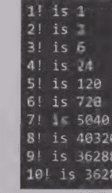

第 10 章：函数 331

下面的另一个函数将接收一个整数并将其自身相乘

```cpp
int squareMyNumber( int startingNumber ) {
```


`return startingNumber * startingNumber;`

}

我们可以调用 `squareMyNumber()` 然后显示它返回的结果：

```cpp
cout << "The square of 5 is " << squareMyNumber( 5 ) << endl;
```

这将显示：

```
The square of 5 is 25
```

或者，我们可以获取返回的结果并将其存储在变量中，后续语句可以使用该变量：

```cpp
int answer = squareMyNumber( 5 );
```

最后，我们可以获取返回的值并将其作为输入传递另一个函数调用：

```cpp
cout << "5 to the power of 4 is ";
cout << squareMyNumber( squareMyNumber( 5 ) );
```

这将显示：

```
5 to the power of 4 is 625
```

# 创建一个将字符串值转换为大写的函数

下一页的程序使用了之前的示例之一来更改字符串值，使字母表中的任何字母都转换为大写。

这是通过 `makeUpperCase()` 函数实现的。该函数接收原始字符串值作为参数，该参数在函数内部被命名为 `originalText`。然后函数使用 `for` 循环遍历 `originalText` 中的字符。

每个字符都通过调用 `toupper()` 转换为大写。转换后的大写字母随后追加到一个名为 `finalText` 的新字符串中。

一旦完成，`finalText` 的值由 `makeUpperCase()` 返回给程序的 `main()` 函数，并在那里被显示在屏幕上：

```
Type line of text...
Mumble, JUMBLE, IT WILL CRUMBLE
it is now...
MUMBLE, JUMBLE, IT WILL CRUMBLE
```

332 | 在树莓派上使用 C++ 编程

# 示例 10.4 -function_upper_case.cpp

```cpp
#include <iostream>    // 程序将使用屏幕
using namespace std;        // 将使用标准标识符 cout, endl
// ------------------------------------------------------
string makeUpperCase(string originalText)
{
    // 此函数检查每个字符
    // 并将其转换为大写
    // 它接收一个字符串作为输入
    // 它返回一个字符串
    unsigned int stringLen = originalText.length(); // 找到要处理的字符数
    string finalText = "";
    for (unsigned int position = 0; position < stringLen; position++)
    {
        // 获取单个字符
        currentChar = originalText.at(position);
        // 将其转换为大写并追加到结果字符串
        finalText += toupper(currentChar);
    } // 循环结束
    return finalText;        // 将结果返回给调用它的代码
}
// ------------------------------------------------------
int main()
{
    string iTyped, changed;
    // 允许用户输入文本
    cout << "Type line of text..." << endl;
    getline(cin, iTyped);
    // 调用函数将他们输入的内容转换为大写
    changed = makeUpperCase(iTyped);
    // 在屏幕上显示更改后的文本
    cout << "It is now..." << endl;
    cout << changed << endl;
    return 0;
}
```

# 创建一个判断整数值的值的函数

此程序包含一个名为 `numberEven` 的函数，它使用模运算判断整数是否为偶数，返回 true 或 false 布尔值：

# 示例 10.5–function_even.cpp

```cpp
#include <iostream>      // 程序将文本作为屏幕输出
using namespace std;      // 将使用标准标识符 cout, endl
--------------------
bool numberEven( int numToCheck )
{
    // 此函数判断一个数是否为偶数。
    // 它接收一个整数作为输入，称为 numToCheck。
    // 它检查除以 2 的余数，
    // 余数为零表示它是一个偶数。
    // 它返回一个 bool 值，如果 numToCheck 为偶数则返回 true，
    // 如果 numToCheck 为奇数则返回 false。
    return ( numToCheck % 2 ) == 0;
}
---------------------
int main()
{
    // 获取用户输入一个数字
    cout << "Type in a whole num: ";
    int myNum;
    cin >> myNum;
    // 调用函数判断数字是否为偶数
    // 并在屏幕上显示结果。
    if ( numberEven( myNum ) )
        cout << "That was an even number.";
    else
        cout << "That was an odd number.";
    cout << endl;
    return 0;
}
```

以下是输入数字 53 时运行时的示例：

| Type in a whole num: 53 |
| That was an odd number. |

这个示例使用了名为 `makeRandomPassword()` 的函数来生成密码。该函数接受一个整数来确定密码的长度；它通过反复选取随机字符并将其添加到字符串值的末尾来构建密码。最后将该字符串值作为输出返回。

## 10.6 -random_password.cpp

```cpp
#include <iostream> // 程序将使用键盘和屏幕
#include <cstdlib> // 程序使用 random() 和 srand() 函数
#include <ctime> // 程序使用 time() 函数作为随机种子
using namespace std; // 将使用标准标识符 string, cout 和 endl
//
string makeRandomPassword(int passLen)
{
    string password = ""; // 从一个新的空白密码开始
    char *ranChar;
    int count = 0; // count 将用于记录选择了多少个数字
    // 重复选择随机字符并添加到密码中
    while (count < passLen) {
        ranChar = (random() % 10 + 48); // 选择 48 到 57 之间的 ASCII 码
        password += ranChar; // 将选定的字符添加到密码末尾
        count++;
    } // while 循环结束
    return password;
}
//
// int main() {
//     srand(time( 0 ) ); // 使用当前时间为随机过程种子
//     cout << "Here is your first password: ";
//     cout << makeRandomPassword( 4 ) << endl; // 调用函数创建 4 位密码
//     cout << endl;
//     cout << "Here is your second: ";
//     cout << makeRandomPassword( 20 ) << endl; // 调用函数创建 20 位密码
//     cout << endl;
//     return 0;
// }
```

你可以看到同一个函数被调用了两次以产生两个结果，每个结果的长度不同：

Here is your first password: 5331
Here is your second: 1036558070987850645

祝你好记住第二个密码……

下面的程序调用函数 `checkPasswordIsOK` 来获取一个 `bool` 值（该值始终为 true 或 false）。这将指示特定密码的长度是否可以接受：

## Example 10.7-function_check_length.cpp

```cpp
#include <iostream> // 程序将使用键盘和屏幕
using namespace std; // 将使用标准标识符 string, cin, endl
//
bool checkPasswordIsOK(string password )
{
    // 检查密码长度是否在 8 到 12 个字符之间
    // 如果，返回 true；否则返回 false
    return password.length() >= 8 and password.length() <= 12;
}
//
// int main()
// {
//     // 允许用户输入文本
//     cout << "Please type a password (8-12 characters): ";
//     string newPassword;
//     cin >>newPassword;
//     // 调用函数检查密码长度是否可以接受
//     if ( checkPasswordIsOK(newPassword) )
//         cout << "Thanks." << endl;
//     else
//         cout << "Not accepted!" << endl;
//     return 0;
// }
```

上述函数体只包含一个 `return` 语句，它根据传递给函数的输入的密码长度，将表达式求值为 true 或 false。

`main()` 中的代码随后使用来自 `checkPasswordIsOK` 的返回值来决定显示哪条消息。

密码长度为 8 个字符或更多，且在 12 个字符以内是可以接受的：

```
Please type a password (8-12 characters): m@t0rhead
Thanks.
nPlease type a password (8-12 characters): abba
Not accepted!
```

密码长度小于 8 个字符或大于 12 个字符是不可接受的：

# 测试某个整数是否为素数

该程序允许用户输入一个整数。然后它会测试该数字是否为素数——素数是只能被自身或数字 1 整除的数。

大部分工作由 `testForPrime()` 函数完成，该函数使用 `while` 循环检查范围内的不同数字是否能被该数整除且余数为零。

找到一个产生零余数的数意味着该数是一个因子。

## Example 10.8-function_prime.cpp

```cpp
#include <iostream>            // 程序将使用键盘和屏幕
#include <cstdlib>               // 程序使用 exit() 函数
#include <math>                 // 程序使用 sqrt() 函数
using namespace std;             // 将使用标准标识符 cin, cout, endl
bool testForPrime(int numToTest)
{
    int divisor = 2;
    bool foundExactDivision = false;
    while (divisor < numToTest)
    {
        if (numToTest % divisor == 0)
        {
            foundExactDivision = true;
            break; // 一旦找到因子即停止
        }
        divisor++;
    }
    return not foundExactDivision;
}
int main() {
    int userInput;
    cout << "PRIME TESTER" << endl;
    cout << "----------" << endl;
    cout << "Type in an integer to test:" << endl;
    cin >> userInput;
    if (userInput < 2) {
        cout << "Must type a whole number 2 or above." << endl;
        exit(1);
    }
    if (testForPrime(userInput)) {
        cout << userInput << " is prime." << endl;
    } else {
        cout << userInput << " is NOT prime." << endl;
    }
    return 0;
}
```

# 测试数字范围内的素数

下一个示例在之前程序的基础上构建。它按顺序测试一个正整数范围以确定哪些是素数。与之前的示例一样，大部分工作由 `testForPrime` 函数完成。

用户并不是输入他们想要测试的数字，而是被要求输入他们想要测试的最大数字，这被存储为 `userInput`。计算机使用 `for` 循环将 2 到 `userInput` 之间的所有值提供给 `testForPrime` 函数。

与之前的示例不同，该程序能够处理范围更大的值。这是因为使用了 `unsigned long` 数据类型，而不是 `int`。这种更大的数据类型可以处理高达 540 亿的值。

`testForPrime()` 函数还通过只尝试到每个数字平方根的潜在因子来节省工作。测试大于平方根的因子是没有意义的，因为只有在函数已经找到较小因子的情况下它们才可能存在。

## Example 10.9-primes_in.cpp

```cpp
#include <iostream>            // 程序将使用键盘和屏幕
#include <cctype>               // 程序使用 exit() 函数
#include <math>                 // 程序使用 sqrt() 函数
using namespace std;             // 将使用标准标识符 cin, cout, endl
bool testForPrime( unsigned long numToTest )
{
    unsigned long divisor = 2;
    unsigned long long stopValue = (unsigned long) sqrt(numToTest);
    bool foundExactDivision = false;
    while ( divisor <= stopValue )
    {
        if(numToTest % divisor == 0 )
        {
            foundExactDivision = true;
            break; // 一旦找到因子即停止
        }
        divisor++; // 移动到下一个测试数字
    }
    return not foundExactDivision;
}
int main() {
    unsigned long long userInput;
    cout << "PRIME TESTER" << endl;
    cout << "----------" << endl;
    cout << "Enter the highest number to test:" << endl;
    cin >> userInput;
    for (unsigned long long i = 2; i <= userInput; i++) {
        if (testForPrime(i)) {
            cout << i << " is prime" << endl;
        }
    }
    return 0;
}
```

```cpp
int main()
{
    long primesFound = 0; // Records number of primes found so far.
    unsigned long long userInput;
    cout << "ULTRA-MEGA PRIME TESTER" << endl;


```cpp
cout << "Type in maximum integer to test:" << endl;

cout << "(program will test all whole numbers up to and including this)" << endl;

cin >> userInput;

//---------------------------------------

if ( userInput < 2 ) {

cout << "Max integer must be whole number, 2 or above.";

cout << "Program aborted." << endl;

exit( 1);

} // end of if

//---------------------------------------

for ( unsigned long long loop = 2; loop <= userInput; loop++) {

// Display whether this number is prime or not.

cout << endl << "Testing: " << loop << endl;

cout << loop << " is ";

if ( testForPrime( loop )) {

primesFound++;

} else

cout << "not";

}

} // end of loop that drives the function

//---------------------------------------

// Finished testing the range of numbers,
// display the total number of primes found in this range.

cout << endl << endl;

cout << "FOUND " << primesFound << " PRIMES IN THIS RANGE.";

cout << endl << endl;

return 0;

}
```

以下是要求程序搜索包含 5 在内的所有质数时的运行情况：

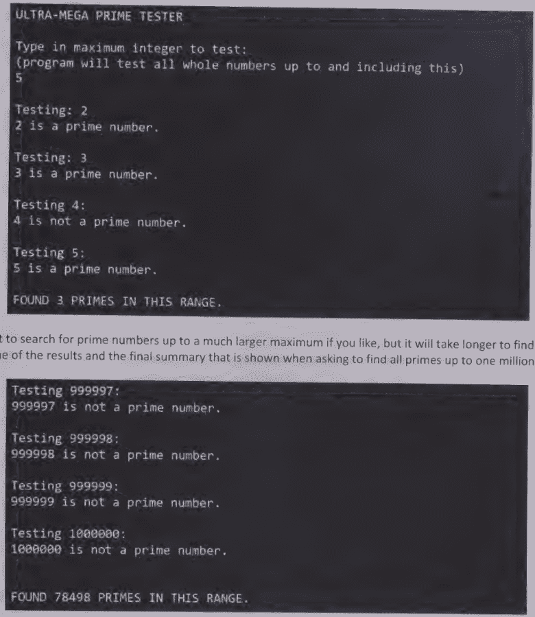

如果你愿意，可以要求它搜索更大的极大质数，但查找结果将花费更长时间。以下是要求查找一百万以内所有质数时显示的部分结果和最终总结：

## 验证二进制位序列

这里是另一个使用的函数。它检查字符串值是否为有效的 8 位数——即完全由字符 0 或 1 组成且长度正好为八个字符的模式。如果发现字符串值是有效的 8 位二进制模式，则调用 `convertStringToDecimal()` 函数将其转换为十进制（base-10）数字。

示例 10.10 — `function_binary.cpp`

```cpp
#include <iostream> // 程序将使用键盘和屏幕

#include <cmath> // 程序使用 pow() 函数

using namespace std; // 将使用标准标识符 string, cin, cout, endl;

// ------------------------------------------------
```

```cpp
int convertBinStringToDenary( string bitPattern ) 
{
    int result = 0;
    for ( int place = 0; place < 8; place++) {
        if (bitPattern.at(place) == '1')
            result += pow(2, 7 - place); // Pos 0 处的数字表示 2 的 8 次方
    }
    return result;
}
//
```

```cpp
int main() {
    // 输入数字字符串
    cout << "Type in 8-bit binary number..." << endl;
    string binString;
    cin >> binString;
    // 起初假设字符串是正确的
    bool valid = true;
    // 检查字符串是否为 8 个字符
    int stringLen = binString.length();
    if ( stringLen != 8 ) {
        cout << "Not 8 characters long." << endl;
        valid = false;
    } else {
        // 使用循环检查任何不是 0 或 1 的字符
        char thisChar;
        for ( int pos = 0; pos < 8; pos++) {
            thisChar = binString.at(pos);
            if (thisChar != '0' && thisChar != '1') {
                cout << "Invalid: " << thisChar << endl;
                valid = false;
            } // end of if decision
        } // end of for loop
    } // end of if-else decision
    // 告诉用户字符串是否有效
    if ( valid ) {
        cout << "This is a valid 8-bit binary number." << endl;
        cout << "In-base10 it is: ";
        cout << convertStringToDenary ( binString );
    }
    else
        cout << "Not a valid 8-bit binary number.";
    cout << endl;
    // 将成功/错误状态传给 Linux
    return ( valid ? 0 : 1 ); // 如果有效返回 0，如果无效返回 1
}
```

程序首先要求用户输入一个 8 位二进制模式，该模式存储在字符串值 `binString` 中。

然后确定字符串的长度，判断是否恰好为 8 个字符。如果不是，则显示错误消息，并通过将 `valid` 布尔变量设置为 `false` 来将字符串标记为无效。

或者，如果 `binString` 恰好包含 8 个字符，则 `for` 循环从头到尾遍历它们，检查每个单独字符是否为 1 或 0。

如果发现任何字符不是 1 或 0，则该模式标记为无效，并在屏幕上显示违规字符。

下面，你可以看到通过将每个字符移动一个位置来打乱消息的效果：

| 请输入一行文本： |
| :--- |
| My Raspberry Pi fell down from the sky. |

| 乱码/解密位移的个数： |
| 1 |

这变成了...
Nz!SbtqfcsszQ|jgflmmepxo|gspnuifltz/ | |

当给程序一个负数作为乱码/解密的位移个数时，会发生以下情况，这会导致它再次解密消息：

| 请输入一行文本： |
| :--- |
| Nz!SbtqfcsszQ|jgflmmepxo|gspnuifltz/| |

| 乱码/解密位移的个数： |
| -1 |

这变成了...
My Raspberry Pi fell down from the sky. | |

你可以看到，使用大数字乱码的字符会被调整，以确保它们保持在可打印字符的范围内——即 32（空格）到 126（~ 波浪号）之间：

| 请输入一行文本： |
| :--- |
| The Pi in the sky (is a bit dented) |

| 乱码/解密位移的个数： |
| 30 |

这变成了...
r$>n)(->3)$'2>B$F(2)!(3#-$3#G | |

同样的情况也适用于需要解密的消息：

| 请输入一行文本： |
| :--- |
| r$>n)(->3)$'2>B$F(2)!(3#-$3#G | |

| 乱码/解密位移的个数： |
| -30 |

这变成了...
The Pi in the sky (is a bit dented) | |

## 不返回任何结果的函数

尽管许多函数在完成执行后返回某些数据，但某些函数完全不返回任何内容！不返回值的函数被称为“void”（空）函数。这种函数不需要在体内部包含 `return` 语句，因为它不会向其调用的代码提供任何结果。

C++ `void` 函数的操作方式与你在许多其他编程语言中创建创建“过程”（procedures）相同。你可以将它们视为命名的指令序列，可以从程序的其他地方进行调用。

这是一个 `void` 函数的示例：

```cpp
void startNewGame() {
  score = 0;
  lives = 3;
  // 不需要 return 语句 -这是一个 "void" 函数
}
```

示例 10.12 展示了如何在 `main()` 内部调用并激活名为 `sayHi()` 的 `void` 函数：

```cpp
#include <iostream> // 程序将使用键盘和屏幕
using namespace std; // 将使用标准标识符 cout 和 endl
//------------------------------------------------------------------
void sayHi(int times) {
  int completed = 0;
  while (completed < times) {
    cout << "*** *** *********" << endl;
    cout << "********* *** *********" << endl;
    cout << "***" << endl;
    cout << "********* *** ***" << endl;
    cout << "*** *** **********" << endl;
    cout << "*** *** **********" << endl << endl << endl;
    completed++;
  } // while 循环结束
//----------------------------------------------------------------
```

```cpp
int main() {
  sayHi(3); // 单次调用函数以显示消息 3 次
  return 0;
}
```

当程序运行时，对函数 `sayHi()` 的调用将值 `3` 作为参数传递。这告诉函数要反复显示三次消息。然而，它并没有尝试返回任何结果，因为 `sayHi()` 函数执行的所有有用工作都已显示在屏幕上。

***

***

***

***

***

***

***

***

***

***

***

***

***

***

***

***

***

***

***

***

sayHi()

sayHi()

sayHi()

***

***

***

***

***

***

***

***

***

***

***

***

***

***

***

***

***

***

***

***

***

***

***

***

***

***

***

***

***

***

***

***

***

***

***

***

***

***

***

***

***

***

***

***

***

(程序以代码：0 退出)

按回车键继续

## 导航源代码以查找特定函数

注意，如果你正在使用 Geany，你会在窗口左侧看到 **Symbols**（符号）面板，无需在文本编辑器窗格中上下滚动，即可跳转到你编写的特定函数的源代码。

如果你在 **Functions**（函数）标题下查看，你应该能看到你在程序中创建的每个函数的**名称**，包括 **main()** 函数。与之显示的是该函数在源代码中开始的**行号**（显示在方括号中）。你只需要点击你想要跳转的函数名称即可。随着程序变大，这可以让你找到想要处理的内容容易得多。

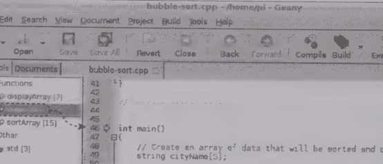

如果由于某些原因你看不到侧边栏或 **Symbols** 面板，请前往 Geany 窗口的 **View** 菜单并选择 **Symbols** 侧边栏。

在后面的“第十三章：对象和类”中，你将学习**类**。**classes** 侧边栏将显示类的方法。

## 更多函数参数 - 拷贝

当你激活函数并传递数据值作为参数时，除非你另有说明，否则这些值被称为函数的“局部”变量。这些局部值只在函数激活时存在。一旦函数结束，数据值将不再存在。

如果你将变量的值作为输入（参数）传递给函数会发生什么？让我们详细考虑参数的情况。

假设有这样一个程序：

```cpp
#include <iostream>    // 程序将在屏幕上显示一些文本
using namespace std; // 将使用标准标识符和 endl
int main() {
    int myNumber = 25;
    cout << "原始变量的值为 " << myNumber << endl;
    displayTimesBigger(myNumber);
    // 按值传递 25 对原始变量没有影响
    cout << "原始变量的值为 \n" << myNumber << endl;
    return 0;
}
```

现在，这是从 `main()` 用的 `displayTimesBigger()` 函数的代码：

```cpp
void displayTimesBigger(int numberToMakeBigger) {
    numberToMakeBigger *= 10;
    cout << "乘以10 得到 " << numberToMakeBigger << endl;
}
```

注意，在 `displayTimesBigger()` 函数内部，变量 `numberToMakeBigger` 的值被改变并显示在屏幕上。

但是作为参数传递给 `displayTimesBigger()` 函数的 `main()` 函数中原始变量 `myNumber` 的值发生了什么？答案是：什么都没有。

`main` 中的 `myNumber` 值不受 `displayTimesBigger()` 函数内部操作的影响。这是因为函数处理的是 `myNumber` 值的拷贝。

## 使用值的 & 引用直接操作其输入数据的函数

通过对之前的函数 `displayTimesBigger()` 进行细微修改，我们可以告诉计算机对作为输入值的实际变量进行操作，而不是对变量的副本进行操作。

在定义函数参数时，可以将 `&`（“引用”）符号放在任何变量名的开头。

这意味着函数将不再对参数的副本进行操作，而是对实物进行操作，引用我们作为输入所提供的实际值。为了实现这一点，你的树莓派将使用该变量在内存中的地址：

```cpp
void displayTimesBigger(int &numberToMakeBigger)
{
    numberToMakeBigger *= 10;
    cout << numberToMakeBigger << endl;
}
```

这一次，实际变量 `myNumber` 的内存地址作为输入传递给 `displayTimesBigger()` 函数进行处理，而不是传递其值的副本。

如果 `myNumber` 的原始值为 25，该函数会将变量的值乘以 10，得到 250 的结果。即使在函数执行完毕，该变量也将保留此值。当使用变量引用作为函数参数时，函数内部发生的操作在函数执行结束后可能会产生持久的影响。

```cpp
int myNumber = 25;
// 在调用函数 displayTenTimesBigger 之前显示 25
cout << myNumber << endl;
// 调用函数将数字放大 10 倍并显示它
displayTenTimesBigger(myNumber);
// 将显示 250，因为函数更改的是实际变量而非其副本
cout << myNumber << endl;
```

这非常有用，特别是在编写处理组织好的数据值集合（如数组）的函数时。例如，正如我们在章早些时候看到的，可以通过将数组的引用传递给排序函数来对值按顺序排序，从而永久地排序值。

## 将数组作为函数的输入

此程序将一些数据存储在一个名为 `cityName` 的数组中。除了 `main()` 之外，它还包含两个函数：

- `displayArray()` 显示字符串值数组的内容。
- `sortArray()` 对字符串值数组执行简单的“冒泡排序”。

示例 10.14 - `function_bubble_sort.cpp`

```cpp
#include <iostream>    // 程序将在屏幕上显示一些文本作为输出
```


`using namespace std;`      // 将使用标准标识符 `string`, `count` 和 `endl`

```
// 
void displayArray(string value[], int numItems)
{
    for ( int index = 0; index < numItems; index++)
    {
        cout << "Item no. " << index << " is " << value[index] << endl;
    }
}
void sortArray(string value[], int numItems)
{
    string tempValue;      // 用于交换两个数据值
    bool performedASwap;
    do
    {
        performedASwap = false;
        for ( int index = 0; index < numItems-1; index++)
        {
            if ( value[index] > value[index+1])
            {
                // 交换这一对项（通过临时变量）
                tempValue = value[index];
                value[index] = value[index+1];
                value[index+1] = tempValue;
            }
            performedASwap = true;
        } // 结束执行交换的 if 语句
    } // 结束遍历一次数组的循环
    while ( performedASwap ); // 重复传递直到没有更多交换
}
int main() {
{
    // 创建一个将要排序并显示的数据数组
    const int NUM_CITIES = 5;
    string cityName[NUM_CITIES];
    cityName[0] = "Chicago";
    cityName[1] = "New York";
    cityName[2] = "San Francisco";
    cityName[3] = "Detroit";
    cityName[4] = "Miami";
    // 调用 displayArray 函数显示名为 cityName 的数组
    cout << "BEFORE sorting, the array looks like this..." << endl;
    displayArray(cityName, NUM_CITIES);
    // 调用 sortArray 函数对名为 cityName 的数组中的项进行排序
    sortArray(cityName, NUM_CITIES);
    // 再次调用 displayArray 函数显示更新后的 cityName 数组
    cout << "AFTER sorting, the array looks like this..." << endl;
    displayArray(cityName, NUM_CITIES);
    return 0;
}
```

当将参数传递给函数时，C++ 将其视为数组的`引用`，就像你使用了 `&` 引用运算符一样。因此，`sortArray` 函数永久更改了属于 `main()` 函数的 `cityName` 数组的`实际值`，而不是处理数组的`副本`。

这是非常方便的，因为数组是通过引用传递的，那么当程序结束时再次调用 `displayArray()` 函数时，原始的 `cityName` 数组将保持未排序状态。

为什么要传递数组的引用而不是数组所包含值的完整副本？正如我们所看到的，向函数传递参数使用的是固定的内存区域。

```cpp
{
  cout << "Adding in middle - need to search for insertion point" << endl;
  itemIndex = 0;
  bool foundPlaceToInsert = false;
  while (itemIndex < numItems and not foundPlaceToInsert) {
    cout << "Comparing " << newItem;
    cout << " with " << sortedArray[itemIndex];
    cout << " at position " << itemIndex << endl;
    if (itemIndex < sortedArray[itemIndex]) {
      cout << "Found place to add item" << endl;
      insertAt = itemIndex;
      foundPlaceToInsert = true;
    } else {
      itemIndex++;
    }
  }
  // Copy the bottom items to one place below in the array
  cout << "Making room in sorted array so that ";
  cout << newItem << " can be inserted" << endl;
  for ( unsigned int copyIndex = numItems;
       copyIndex > insertAt;
       copyIndex -- ) {
    sortedArray[copyIndex] = sortedArray[copyIndex-1];
  }
  } // end of if else decision about where to add
// Store the new item into the array
sortedArray[insertAt] = newItem;
} // end of function
```

```cpp
int main() {
    // Create two different arrays to hold the unsorted and sorted data
    const unsigned int NUMBER_OF_ELEMENTS = 10;
    string unsortedData[NUMBER_OF_ELEMENTS];
    string sortedData[NUMBER_OF_ELEMENTS];
    unsortedData[0] = "Hydrogen";
    unsortedData[1] = "Helium";
    unsortedData[2] = "Lithium";
    unsortedData[3] = "Beryllium";
    unsortedData[4] = "Boron";
    unsortedData[5] = "Carbon";
    unsortedData[6] = "Nitrogen";
    unsortedData[7] = "Oxygen";
    unsortedData[8] = "Fluorine";
    unsortedData[9] = "Neon";
    // Call the displayArray function to display the array called cityName
    cout << "The unsorted array looks like this..." << endl;
    displayArray(unsortedData, NUMBER_OF_ELEMENTS);
    unsigned int unsortedIndex = 0;
    while ( unsortedIndex < NUMBER_OF_ELEMENTS ) {
        // Insert single item from unsorted array into correct place in sorted array
        insertitem(unsortedData[unsortedIndex], sortedData, unsortedIndex);
        unsortedIndex++;
        // Call the displayArray function to display sorted items so far
        cout << "The sorted array now looks like this..." << endl;
        displayArray(sortedData, unsortedIndex);
    }
    cout << endl << "*** All items now added to the sorted array ***" << endl;
    return 0;
}
```

你可以看到程序的运行情况，显示了氢、氦、锂和铍等几个数据项被插入到 `sortedData` 数组中：

- 未排序的数组如下所示...
第 0 号项目是 Hydrogen
第 1 号项目是 Helium
第 2 号项目是 Lithium
第 3 号项目是 Beryllium
第 4 号项目是 Boron
第 5 号项目是 Carbon
第 6 号项目是 Nitrogen
第 7 号项目是 Oxygen
第 8 号项目是 Fluorine
第 9 号项目是 Neon

现在向排序后的项目数组中添加 Hydrogen...
之前的排序后项目数组为空 - 它是唯一的项目
- 排序后的数组现在如下所示...
第 0 号项目是 Hydrogen

现在向排序后的项目数组中添加 Helium...
正在中间插入 - 需要查找插入点
在位置 0 处比较 Helium 和 Hydrogen
找到添加项目的位置
正在排序数组中留出空间以便插入 Helium
- 排序后的数组现在如下所示...
第 0 号项目是 Helium
第 1 号项目是 Hydrogen

现在向排序后的项目数组中添加 Lithium...
正在添加到排序后的项目的末尾
- 排序后的数组现在如下所示...
第 0 号项目是 Helium
第 1 号项目是 Hydrogen
第 2 号项目是 Lithium

现在向排序后的项目数组中添加 Beryllium...
正在中间插入 - 需要查找插入点
在位置 0 处比较 Beryllium 和 Helium
找到添加项目的位置
正在排序数组中留出空间以便插入 Beryllium
- 排序后的数组现在如下所示...
第 0 号项目是 Beryllium
第 1 号项目是 Helium
第 2 号项目是 Hydrogen
第 3 号项目是 Lithium

最终，最后一个数据项 Neon 被插入，完成后的排序数组如下：

```
现在向排序后的项目数组中添加 Neon...
正在中间插入 - 需要查找插入点
在位置 0 处比较 Neon 和 Beryllium
在位置 1 处比较 Neon 和 Boron
在位置 2 处比较 Neon 和 Carbon
在位置 3 处比较 Neon 和 Flourine
在位置 4 处比较 Neon 和 Helium
在位置 5 处比较 Neon 和 Hydrogen
在位置 6 处比较 Neon 和 Lithium
在位置 7 处比较 Neon 和 Nitrogen
找到添加项目的位置
正在排序数组中留出空间以便插入 Neon
排序后的数组现在如下所示...
第 0 号项目是 Beryllium
第 1 号项目是 Boron
第 2 号项目是 Carbon
第 3 号项目是 Flourine
第 4 号项目是 Helium
第 5 号项目是 Hydrogen
第 6 号项目是 Lithium
第 7 号项目是 Neon
第 8 号项目是 Nitrogen
第 9 号项目是 Oxygen
------------------------------------------------------
*** 所有项目现在已添加到排序数组中 ***
```

这种排序技术将在稍后的示例 `10.24-function_recursive_binary_search.cpp` 中再次引入，以说明使用“二分查找”搜索项目数组的另一种更有效的方法。

这里是一个使用了两个函数（`sayHi()` 和 `sayGoodbye()`）的程序。这两个函数都是从 `main()` 函数调用的。

# 创建你自己的可复用函数库

程序通常需要执行此类操作，例如将文本转换为大写或小写。我们不需要在每次创建新程序时都重复编写这些代码，而是可以在一个所有程序都可以使用的文件中复用这些代码。

我们可以创建自己的可复用库文件，如下所示，它包含了两个对字符串值进行操作的函数。你只需要创建一个包含这些函数的 `.cpp` 文件，然后使用 `#include` 指令将该文件包含到你以后创建的任何程序中。事实上，到本书为止，几乎所有的程序都已使用了标准 C++ 库文件来供你使用。

让我们尝试自己创建一个简单的库文件：

示例 10.19-string_functions.cpp

```cpp
#include <string>      // 这些函数使用了 string 类型的变量
using namespace std;      // 将使用 string 标准标识符
--------------------------------------------------------------------------------
string convertToUpperCase( string textString ) {
    unsigned int len = textString.length();
    for ( unsigned int pos = 0; pos < len; pos++)
        textString.at(pos ) = toupper(textString.at( pos ));
    return textString;
}
------------------------------------------------------------------------------------------------
string convertToLowerCase( string textString ) {
    unsigned int len = textString.length();
    for ( unsigned int pos = 0; pos < len; pos++)
        textString.at( pos ) = tolower(textString.at( pos ));
    return textString;
}
```

一旦你创建了上述文件，你的程序就可以添加以下 `#include` 指令来使用它：

```cpp
#include "string_functions.cpp"
```

现在你的程序已经能够调用 `convertToUpperCase()` 和 `convertToLowerCase()` 函数了，正如你将在下一页的示例看到的那样。

请注意，没有必要编译你的新库文件。代码将简单地添加到任何选择包含它的程序中。合并后的源代码将一次性进行编译。

# 示例 10.19b - uses_string_functions.cpp

```cpp
#include <iostream>    // 程序将在屏幕上显示一些文本作为输出
#include "string_functions.cpp"  // 将使用自己的函数库
using namespace std;                // 将使用标准标识符 string, cout 和 endl
int main()
{
    string textToDisplay = "Hello GNU!";
    cout << "Original text is " << textToDisplay << endl;
    // 调用可复用字符串库中的函数
    cout << "Upper-case text is " << convertToUpperCase( textToDisplay ) << endl;
    cout << "Lower-case text is " << convertToLowerCase( textToDisplay ) << endl;
    return 0;
}
```

下面，你可以看到库代码的运行：

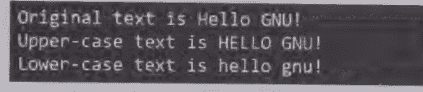

创建你自己的函数库有几个优点。首先，它们节省了你的工作，因为理论上，你不需要为同一个函数创建多次代码。通过编写一次函数代码并将其存储在外部文件中，它可以被许多不同的程序包含和调用。

另一个优点是，一旦你测试了一个库函数并确定它运行得没有错误，你就可以依赖该函数在你以后编写的程序调用它时能够正常工作。然而，如果不使用库反复编写多次相同的代码，可能意味着你在某处犯了错误，导致出现问题。

# 内联函数

将代码拆分为函数可以使你的程序更容易理解，而且如果这些函数被调用多次，还可以减少程序中所包含的语句总数。遗憾的是，缺点是函数会让编译和执行过程变得稍微复杂。在调用函数时，参数值从内存中的一个地方拷贝到另一个地方。执行也会程序的不同部分之间跳转，这需要编译器进行一些幕后工作。

有些函数非常小。它们的体可能只包含一两个语句。当进入或退出这样一个很小的函数时，计算机可能花费大量的精力来执行极少数的指令。


例如，考虑这个显示函数：

```cpp
void displayLine( string textDisplay )
{
    cout << textDisplay << endl;
}
```

另一种方法是创建“内联函数”。在编译时，编译器会将调用替换为函数体，这会更快，因为避免了函数调用的开销。

# 递归函数：调用自身的函数

这个程序创建了一个调用自身的函数——这个过程被称为递归。调用它自身的函数被称为“递归函数”。

尝试运行该程序，你会发现它每次都会反复进入“Gone into function!”消息。但你不会看到“Exiting function!”消息。

你甚至可以通过创建一个变量来计数调用链延伸了多远。

在接下来的递归程序中，一个名为 `callLimit` 的变量用于追踪激活了多少个 `simpleFunction()` 的递归实例。它对递归调用的次数进行了限制。得益于 `CALL_LIMIT`，当激活函数的数量达到 10 时，它将不再调用自己。

这意味着当第十次调用 `simpleFunction()` 时，它才终于有机会完成执行。计算机现在将控制权交回调用它的代码——即 `simpleFunction()` 的第九个实例。第九个实例有机会完成执行，然后将控制权交回第八个实例……以此此类推，直到所有的递归实例都完成执行。

## 示例 10.22 - function_recursion_limit.cpp

```cpp
#include <iostream>
// 程序将在屏幕上显示一些文本

using namespace std;
// 将使用标准标识符和 endl
// 修改此值以控制递归的深度
const int LIMIT = 10;

void simpleFunction(int functionsActive) {
    cout << "Go into recursion! Functions now active: ";
    cout << functionsActive < LIMIT << endl;

    // 递归警告！此函数再次调用自己
    if (functionsActive < LIMIT) {
        simpleFunction(functionsActive + 1);
    }

    // 告诉用户哪个版本的函数正在结束
    cout << "Exiting simpleFunction number: ";
    cout << functionsActive << endl;
}

//----

int main() {
    // 从 C++ 程序的主部分调用一次该函数
    simpleFunction(1);

    // 下一语句只有在整个递归调用的
    // 函数链全部完成后后才会执行！
    return 0;
}
```

下方的截图显示了程序运行时的执行流。`main()` 函数调用一次 `simpleFunction()`，它显示第一条消息，表示它现在正在执行以及激活了多少个函数副本：

### Functions now active: 1

这第一个激活的 `simpleFunction()` 实例调用它自己，激活了第二个实例。现在有两个激活的 `simpleFunction()` 实例正在运行。第二个实例现在激活第三个实例，第三个激活第四个，以此此类推。

这个过程会重复进行，创建一个激活函数链，直到达到 `CALL_LIMIT`，从而防止任何进一步实例被激活。

最终，所有激活的 `simpleFunction()` 实例都完成了它们的执行，控制权最终返回到程序中的 `main()` 函数。

这是你在 Pi 上应该看到的内容：

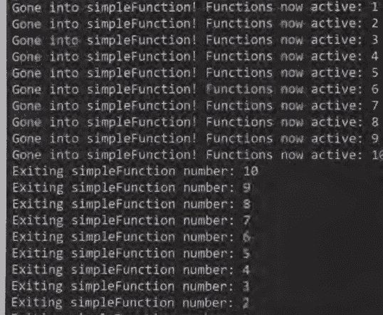

递归可以使用非常少的代码解决许多问题。本章的最后一个程序使用递归来判断一个字符串值是否为回文。如果句子是回文，那么它应该包含对称的字母序列，无论你从左到右还是从右到左读取，它们看起来都是相同的。

例如，“OXO”和“Madam, I'm Adam”都是回文。注意，空格和标点符号不影响处理，处理关注的是字母本身。它不区分大小写，这意味着每个字母是大写还是小写没有关系。

程序要求你输入一个句子。它检查字符以确保句子的左半和右部分是彼此的镜像。

## 示例 10.23 – function_palindromes.cpp

```cpp
#include <iostream>    // 程序将在屏幕上显示一些文本

using namespace std;      // 将使用标准标识符 string, cin, cout

string removeSpacesEtc( string original )
{
    // 创建原始字符串的新副本，但只包含字母
    // 任何空格或标点符号都不会被包含在新的字符串中
    string cleaned = ""

    unsigned int textSize = original.length();

    char currentChar;

    for ( unsigned int pos = 0; pos < textSize; pos++ )
    {
        currentChar = original.at( pos ); // 获取单个字符

        // 如果字符是字母，则将其转换为大写并添加到副本中
        if ( isalpha( currentChar ) )
            cleaned += toupper( currentChar );
    }

    // for 循环结束

    return cleaned;
}

continued

bool isPalindrome( string textToCheck )
{
    // 此函数判断一个字符串值是否为回文。
    // 如果发现字符串是回文，则返回 true 值，
    // 否则返回 false 值。

    bool bothSidesSame;

    int textLen = textToCheck.length();

    if ( textLen >= 2 ) {
        // 检查字符串的第一个和最后一个字符
        char first = textToCheck.at(0);
        char last = textToCheck.at(textLen-1);

        // 如果它们相同，通过递归调用判断字符串剩余部分
        // 是否回文
        if ( first == last ) {
            bothSidesSame = true;
            if ( textLen > 2 )
                bothSidesSame &= isPalindrome( textToCheck.substr( 1, textLen-2 ) );
        } else {
            bothSidesSame = false;
        }
    } else {
        if ( textLen == 1 )
            bothSidesSame = true;
    }

    return bothSidesSame;
}
// ----

int main() {
    string sentence;

    // 无限循环
    while ( true ) {
        cout << "Type in a sentence: ";
        getline(cin, sentence);

        // 移除所有非字母
        sentence = removeSpacesEtc(sentence);

        // 激活函数检查回文并显示结果
        if ( isPalindrome( sentence ) {
            cout << "The sentence IS a palindrome." << endl;
        } else {
            cout << "The sentence is NOT a palindrome." << endl;
        }

        cout << "--------------------";
        cout << endl << endl;
    } // end of while

    return 0;
}
```

当每次递归 `isPalindrome()` 函数执行完成时，会返回一个真或假的布尔值，用以指示特定字符串值的第一个和最后一个字母是否被返回。这些结果值将通过逻辑与操作（使用 `&` 运算符）进行组合。如果所有返回的结果都为真，则该结果被认为是回文。

如你所见，程序还可以处理单个字母或两个字母的特殊情况：

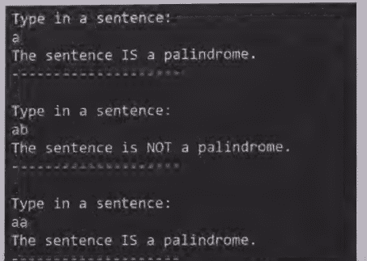

这两种情况导致递归函数 `isPalindrome()` 只被调用来检查字母序列——函数不会再次递归地调用自己来判断只有一个或两个字符的短字符串值是否为回文，因为它没有可以进一步拆分的内容。

## 在排序数据中进行高效搜索

我们已经看到如何使用循环遍历值数组以找到我们正在查找的数据项。之前的程序都是从数组中的第一个数据项开始，检查每一个项，直到找到所需的项目。这种搜索被称为“线性搜索”。它从数组的开始到结束沿直线进行。

| 搜索目标：Neon |

| 项目 | 元素 |

|---|---|

| 0 | Aluminium |

| 1 | Beryllium |

| 2 | Boron |

| 3 | Carbon |

| 4 | Fluorine |

| 5 | Helium |

| 6 | Hydrogen |

| 7 | Lithium |

| 8 | Magnesium |

| 9 | Neon |

| 10 | Nitrogen |

| 11 | Oxygen |

| 12 | Phosphorus |

| 13 | Silicon |

| 14 | Sodium |

搜索从数组中的第一个项开始。

每个项都与你正在搜索的项（目标项）进行比较。

如果当前项是所查找的项，搜索结束；否则移动到数组中的下一个项并继续搜索。

线性搜索并不总是查找存储在数组中数据的最高效方法。一旦数据数组经过了排序，我们不需要从头到尾检查每一个数据项，而是可以使用一种名为“二分查找”的技术来搜索数据。

当你有大量数据项需要搜索时，二分查找特别有用。通常情况下，要搜索的项越多，二分查找相比线性搜索节省的时间就越多，因为它不断缩小搜索范围（项的数量），而不是费力地检查每一个数据项。

### 二分查找是如何工作的？

二分查找始终需要在一组排序好的项集合上运行，例如整数或文本值的数组。

在查找特定数据项时，我们确定哪一个项位于值集合的中间。我们使用简单的计算来找到第一项和最后一项之间的中点。

检查中间项。如果这就是你正在查找的数据，搜索结束——已找到该项。

如果该项不是你正在查找的，正在搜索的剩余项集合将被分为或“拆”成两部分：排序集合中位于中间之前的之前的和位于中间项之后的项。

搜索仅使用一半的数据继续。另一部分将完全被忽略。搜索过程会递归地调用自己，以搜索新划分的较小数据集合。

它选择使用哪一半？如果尝试查找的目标项出现在中间项之前，它决定使用第一半部分；如果目标项出现在中间项之后，它决定使用后半部分。

| 搜索目标：Neon |

| | 将搜索目标与中间项比较： |

| 0 | Aluminium | |

| 1 | Beryllium | Neon > Lithium |

| 2 | Boron | |

| 3 | Carbon | 将原始数据集合分为 |

| 4 | Flourine | 两半并开始对下半部分进行搜索 |

| 5 | Helium | ... |

| 6 | Hydrogen | |

| 7 | Lithium | |

| 8 | Magnesium | Magnesium |

| 9 | Neon | Neon |

| 10 | Nitrogen | Nitrogen |

| 11 | Oxygen | Oxygen |

| 12 | Phosphorus | Phosphorus |

| 13 | Silicon | Silicon |

| 14 | Sodium |

这是一个二分查找的递归示例，它通过遍历排序数组来定位特定元素。375 - Example_binary_search.cpp

```cpp
#include <iostream>
#include <string>

using namespace std;

// 将在屏幕上显示一些文本
void displayArray(string value[], unsigned int numItems)
{
    for (unsigned int index = 0; index < numItems; index++)
        cout << "Item. " << index << " is " << value[index] << endl;

    cout << endl;
}

void insertItem(string newItem, string sortedArray[], unsigned int insertedSoFar)
{
    // 确定新项在数组中的位置
    unsigned int insertAt, itemIndex;

    // 判断数组是否为空
    if (insertedSoFar == 0)
        insertAt = 0;
    else
    {
        unsigned int indexOfLastItem = insertedSoFar - 1;
        if (newItem >= sortedArray[indexOfLastItem])
            insertAt = insertedSoFar;
        else
        {
            itemIndex = 0;
            bool foundToInsert = false;

            while (itemIndex < insertedSoFar && !foundToInsert)
            {
                if (newItem < sortedArray[itemIndex])
                {
                    insertAt = itemIndex;
                    foundToInsert = true;
                }
                else
                    itemIndex++;
            }
        }
    }

    // 将底部项拷贝到数组下方
    for (unsigned int copyIndex = insertedSoFar; copyIndex > insertAt; copyIndex--)
        sortedArray[copyIndex] = sortedArray[copyIndex-1];

    // 将新项存入数组
    sortedArray[insertAt] = newItem;
}
```

继续下页...

376 - 使用 C++ 编程

```cpp
bool searchBinary(string itemToFind, string sortedArray[], int startIndex, int endRange)
{
  bool foundElement = false;

  unsigned int itemsInRange = (endRange + 1) - startIndex;

  cout << "正在搜索数组" << endl;
  cout << "该部分的项数：" << itemsInRange << endl;

  if (itemsInRange == 1) {
    cout << "仅与搜索项进行比较" << endl;
    foundElement = (itemToFind == sortedArray[startIndex]);
    return foundElement;
  } else {
    unsigned int middleIndex = startIndex + itemsInRange / 2;
    string middleItem = sortedArray[middleIndex];

    cout << "第一项是 " << sortedArray[startIndex];
    cout << "索引为 " << startIndex << endl;
    cout << "最后一项是 " << sortedArray[endRange];
    cout << "索引为 " << endRange << endl;

    cout << endl;
    cout << "中间项是 " << middleItem;
    cout << "索引为 " << middleIndex << endl;
  }
}
```


```cpp
if ( itemToFind == middleItem )
{
    cout << TAB << "The middle item is the same as the search item" << endl;
    return true;
}
else {
    unsigned int newStartOfRange;
    unsigned int newEndOfRange;
    if ( itemToFind < middleItem )
    {
        cout << TAB << "Search item " << itemToFind;
        cout << " is before middle item " << middleItem << endl;
        newStartOfRange = startOfRange;
        newEndOfRange = middleIndex - 1;
    }
    else {
        cout << TAB << "Search item " << itemToFind;
        cout << " is after middle item " << middleItem << endl;
        newStartOfRange = middleIndex + 1;
        newEndOfRange = endRange;
    }
} // end of if-else
cout << TAB << "Search continues in smaller part of the array..." << endl;
cout << endl << "------------------------" << endl;

foundElement = searchUsingBinarySplit(itemToFind, sortedArray,
    newStartOfRange, newEndOfRange);
} // end of if-else
return foundElement;
} // end of searchUsingBinarySplit function
continued..

int main() {
    // Create two different arrays to hold the unsorted and sorted data
    const unsigned int NUMBER_OF_ITEMS = 15;
    string unsortedData[NUMBER_OF_ITEMS];
    string sortedData[NUMBER_OF_ITEMS];

    unsortedData[0] = "Hydrogen";
    unsortedData[1] = "Helium";
    unsortedData[2] = "Lithium";
    unsortedData[3] = "Beryllium";
    unsortedData[4] = "Boron";
    unsortedData[5] = "Carbon";
    unsortedData[6] = "Nitrogen";
    unsortedData[7] = "Oxygen";
    unsortedData[8] = "Fluorine";
    unsortedData[9] = "Neon";
    unsortedData[10] = "Sodium";
    unsortedData[11] = "Magnesium";
    unsortedData[12] = "Aluminium";
    unsortedData[13] = "Silicon";
    unsortedData[14] = "Phosphorus";

    unsigned int unsortedIndex = 0;
    while (unsortedIndex < NUMBER_OF_ITEMS) {
        // Insert single item from unsorted array into correct place in sorted array
        insertItem(unsortedData[unsortedIndex], sortedData, unsortedIndex);
        unsortedIndex++;
    }
    // end of loop

    // Call the displayArray function to display the sorted array items
    cout << endl << "The sorted array contains these items..." << endl;
    displayArray(sortedData, unsortedIndex);

    cout << endl;

    // Prompt user to type in name of a chemical element to search for
    string elementToFind;
    cout << "Search for which chemical element?" << endl;
    cin >> elementToFind;

    cout << endl;

    // Start the recursive search
    bool exists = searchUsingBinarySplit(elementToFind, sortedData, 0, NUMBER_OF_ITEMS - 1);

    cout << endl;
}

// Report whether search was successful
if ( exists )
    cout << "*** Found this element ***" << endl;
else
    cout << "*** Element not found in the array ***" << endl;

return 0;
```

你可以看到二分查找如何在排序后的数组中定位到数据项 `Neon`：

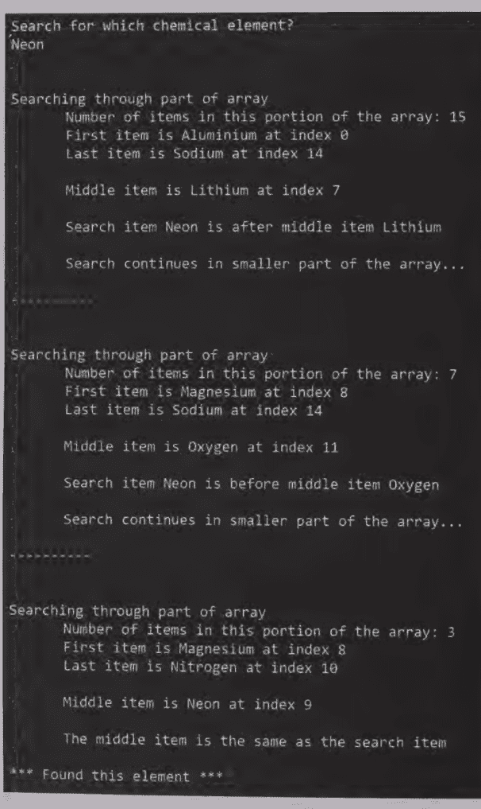

程序执行的第一件事是对字符串值数组进行排序。然后，该数组就可以进行搜索了。

搜索从考虑整个 `sortedData` 数组开始，从第 0 号项目（"Aluminium"）开始，到第 14 号项目（"Sodium"）结束。

程序确定了在 0 到 14 之间的范围内有多少个项目：

```cpp
unsigned int itemsRange = (endOfRange + 1) - startOfRange;
```

结果是该范围内有 15 个项目，从第 0 号到第 14 号。

如果范围内范围内只有一个项目，程序可以立即检查该数据值是否是它正在搜索的。它将产生 true 或 false 的答案。

但如果范围内多于一个项目，程序现在确定哪个项目是数组项目范围中的中间项目。为了做到这一点，它使用了计算：

```cpp
unsigned int middleIndex = startOfRange + itemsRange / 2;
```

例如，当 `startOfRange` 的值为 0 且 `itemsRange` 的值为 15 时，该范围内的中间项目将是第 7 号项目。

程序随后从范围内获取中间项目：

```cpp
string middleItem = sortedArray[middleIndex];
```

它现在检查中间项目是否是正在搜索的数据项：

```cpp
if ( itemToFind == middleItem )
  cout << TAB << "The middle item is the same as the search item" << endl;
  return true;
```

如果中间项目不是正在搜索的项目，程序将决定搜索项位于当前中间项目之前还是之后。

它将项目范围一分为二。如果搜索项位于当前中间项目之前，逻辑如下：

```cpp
if ( itemToFind < middleItem )
{
    cout << TAB << "Search item " << itemToFind;
    cout << " is before middle item " << middleItem << endl;
    newStartOfRange = startOfRange;
    newEndOfRange = middleIndex - 1;
}
```

否则，如果位于中间项目之后，逻辑如下：

```cpp
else {
    cout << TAB << "Search item " << itemToFind;
    cout << " is after middle item " << middleItem << endl;
    newStartOfRange = middleIndex + 1;
    newEndOfRange = endRange;
} // end of if-else
cout << TAB << "Search continues in smaller part of the array..." << endl;
cout << endl << "------------------------" << endl;

foundElement = searchUsingBinarySplit(itemToFind, sortedArray,
    newStartOfRange, newEndOfRange);
} // end of if-else
return foundElement;
} // end of searchUsingBinarySplit function
continued..
```

即使有大量数据项，待搜索的数据量也会迅速减少到排序数组中越来越小的部分，直到找到目标项：

```
Searching through part of array

Number of items in this portion of the array: 6

First item is Vanadium at index 109

Last item is Zirconium at index 114

Middle item is Yttrium at index 112

Search item Zinc is after middle item Yttrium

Search continues in smaller part of the array...

--------------------

Searching through part of array

Number of items in this portion of the array: 2

First item is Zinc at index 113

Last item is Zirconium at index 114

Middle item is Zirconium at index 114

Search item Zinc is before middle item Zirconium

Search continues in smaller part of the array...

--------------------

Searching through part of array

Number of items in this portion of the array: 1

Only single element to compare with search item

```

*** 找到了该元素 ***

# 第 10 章总结：函数

以下是本章涵盖的内容：

许多函数在执行时会产生某种结果。该结果会**返回**到调用该函数的程序代码。`return`语句将值从函数传回给调用它的代码。

返回类型为 `void` 的函数不会向其调用的代码传递任何值。该函数不需要包含 `return` 语句。

当从程序代码的其他地方调用函数时，程序在该点的执行实际上会发生转移。新调用的函数开始执行。在函数执行完毕后，控制流将从函数传回调用它的代码。函数返回的任何结果都会被传回供调用代码使用。

如果函数向某些参数数据传递**引用**（reference），则该函数可能会处理该**实际数据**。否则，函数通常会处理该数据的**本地副本**。

为了表示函数接受引用作为参数，会在参数的**名称**前加上 `&` 符号：

```
int declareTimesBigger(int &originalNumber)
```

程序可以“声明（declare）以将其传递给编译器。这允许你在函数体实际在该点定义之前调用该函数。”

C++ 函数的**声明**通常放在称为**头文件**（header files）的独立文件中。这些文件的命名约定是以 `.h` 结尾的文件。

**头文件**可以使用 `#include` 指令包含在源代码文件中。这使得在许多不同的程序中定义和使用函数变得简单。

*调用自己*的函数是**递归函数**（recursive function）。递归可以使用非常少的程序代码解决许多类型的问题，尽管相同的问题也可以使用迭代来解决。

# 供你尝试的问题和练习题

| # | 描述 |
| :--- | :--- |
| 1. | 创建另一个名为 `displayColourLine` 的函数，用指定的颜色显示字符串值。它应该接受两个参数：一个要显示的字符串值和一个决定颜色的字符（char）。例如，可以使用：`disColourLine("Fire engine", 'r');`、`disColourLine("Rain forest", 'g');` |
| 2. | 编写一个名为 `trimString` 的简单函数。该函数应该接受单个字符串值作为输入并返回一个新的字符串值作为输出。该函数应该移除原始字符串值开头和结尾的所有空格。 |
| 3. | 创建一个名为 `promptForInteger` 的函数，要求用户输入整数。该函数应该显示一个作为字符串值传递给它的提示消息。它应该返回用户输入的整数值。你甚至可以在函数中使用 `.good()` 进行验证，以拒绝任何不是有效整数的值。 |
| 4. | 创建一个接受两个字符串值作为输入的函数。该函数应该判断这两个值是否是彼此的镜像。它应该返回真（true）或假（false）。 |

# 第 11 章：数据文件

## 为什么我们需要使用文件？

当程序执行时，它所使用的所有数据（包括你在运行时输入供其处理的任何内容）都是通过电力存储在计算机的随机访问内存（RAM）中的。这种内存是“易失的”——它不会永久存储数据。它只能在计算机开启时存储数据。一旦计算机关闭，存储在内存中的任何值将丢失。我们需要一种在树莓派（Pi）关闭时存储数据的方法。

在计算中，“文件”是一个持久性存储库——存储数据集合的地方，可以位于硬盘等设备、可移动存储介质（如 USB 闪存）或树莓派的 SD 卡上。

运行后，程序可以从文件中读取数据并将其存储在树莓派的 RAM 中。程序随后可以处理这些数据，以采取某种行动或产生有用的结果作为输出。

为了允许程序与存储文件之间的数据进出，你的代码需要使用“流”（streams）。你可以将流视为数据通过的“通道”或“管道”，就像我们为键盘使用“channel-in”为屏幕使用“channel-out”一样。但这次，流是被连接的。

# 使用输出流创建文本文件

此程序将在你的当前工作目录下创建一个新文件。它将用一组偶数填充该文件。写入文件的每个数字之间都用逗号（，）隔开。

示例 11.1-save_numbers.cpp

```cpp
#include <iostream> // 程序将在屏幕上显示一些文本
#include <fstream> // 程序将使用文件
using namespace std; // 将使用标准标识符 cout 和 endl
int main() {
    cout << "Making file called \"even-numbers\" in your current directory." << endl;
    // 创建名为 "even-numbers" 的新文件
    ofstream myNewFile;
    myNewFile.open("even-numbers");
    // 在文件中第一行写入说明性注释
    myNewFile << "Even numbers:" << endl;
    // 用偶数序列填充文件
    for ( int num = 1; num <= 20; num++) {
        // 将数字写入文件
        myNewFile << ( 2 * num ) << 
        // 如果不是序列中的最后一个数字，添加一个分隔逗号
        if ( num < 20 )
            myNewFile << ",";
    } // 循环结束
    myNewFile << endl; // 数字序列后移动到新行
    // 告诉电脑你已完成对文件的使用
    myNewFile.close();
    cout << "The file has been created." << endl;
    return 0;
}
```

以下语句使用了特殊的 \"\" 字符，允许在屏幕上显示的字面量字符串中包含引号：

```cpp
cout << "Making file called \"even-numbers\" in your current directory." << endl;
```


如果没有这个特殊字符，你将无法在文件名 `even-numbers` 周围显示引号，因为引号被用于标记正在显示的字面文本的开始和结束。

当你运行此程序时，假设你的 SD 卡未满，并且你有权限向运行程序所在的当前目录写入内容，新文件应该会被创建：

```
Making file called "even-numbers" in your current directory.

The file has been created.
```

在命令行中，你应该能够检查新文件是否已成功创建。使用 `ls` 命令，你可以确认新文件是否存在。假设它存在，你可以使用 `cat` 命令检查其内容：

```bash
$pi@eno:~/Desktop $ ls

even-numbers

pi@eno:~/Desktop $ cat even-numbers

Even numbers:

2,4,6,8,10,12,14,16,18,20,22,24,26,28,30,32,34,36,38,40

pi@eno:~/Desktop $
```

# 将用户输入保存到文件

程序经常需要保存用户运行时输入的数据。在某些情况下，输入的数据量是可以预测的，但在其他情况下，程序不知道预期会有多少数据，也不知道需要保存多少数据。

我们将从一个简单的程序开始，要求输入少量固定的数据。

下一页的示例要求用户输入三个单词，并将每个单词存储在单独变量中。程序会在你的计算机上创建一个名为 `"verysafedata"` 的新文件。然后将这三个变量的每个值作为单独行写入文件。最后，程序关闭新创建的数据文件。

## 示例 11.2-save_text.cpp

```cpp
#include <iostream>    // 程序将在屏幕上显示一些文本

#include <fstream>       // 程序将使用文件

using namespace std;               // 将使用标准标识符 string, cin

int main() {
    // 在 SD 卡上创建一个新文件
    ofstream myNewFile;
    myNewFile.open("verysafedata");
    // 使用变量输入三个单词
    string firstWord, secondWord, thirdWord;
    cin >> firstWord;
    cin >> secondWord;
    cin >> thirdWord;
    // 将单词写入文件
    myNewFile << "First I typed this... ";
    myNewFile << firstWord << endl;
    myNewFile << "Then I typed this... ";
    myNewFile << secondWord << endl;
    myNewFile << "Finally I typed this... ";
    myNewFile << thirdWord << endl;
    // 告诉电脑你已完成对文件的使用
    myNewFile.close();
    return 0;
}
```

运行程序并输入文本后，你可以从 命令行检查程序是否成功创建了文件。

下面的截图显示了使用 `cat` 命令检查文本是否已成功存储在 `"verysafedata"` 文件中：


这个程序是非常可预测的。它总是保存三个值，尽管你可以更改这三个值。不幸的是，我们并不总是知道计算机可能想要写入多少数据。要保存的数据量可能更加不可预测。

## 示例 11.3 - save_inputs.cpp

```cpp
#include <iostream>    // 程序将在屏幕上显示一些文本
#include <fstream>       // 程序将使用文件
using namespace std;               // 将使用标准标识符 string, cout 和 endl

int main() {
    // 告诉用户做什么
    cout << "Please type in lines of text." << endl;
    cout << "Enter a blank line when you have finished." << endl;
    // 以追加模式打开文件流写入 "my-data"
    ofstream myFile;
    myFile.open("my-data");
    // 让用户输入文本。输入空行时停止
    string lineText;
    do {
        // 从键盘获取整行文本
        getline(cin, lineText);
        // 如果行包含某些文本，则将其写入文件
        if (lineText.length() > 0 )
            myFile << lineText << endl;
    } while (lineText.length() > 0); // 为空时结束
    myFile << "**** End of file ****" << endl;
    // 告诉电脑你已完成对文件的使用
    myFile.close();
    // 告诉用户发生了什么
    cout << "Thank you - text saved to \"my-data\"." << endl;
    return 0;
}
```

下面的程序在打开输出文件时使用了追加模式：

## 示例 11.4 - append_inputs.cpp

以下是程序执行时显示的内容：

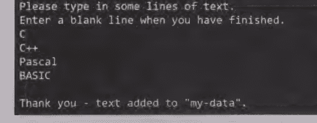

第 11 章：数据文件 397

第二次运行程序可以输入更多数据：

```
请输入几行文本。
完成后请按回车输入空行。
Prolog
Lisp
Python
Rust
感谢 - 文本已添加到 "my-data"。
```

这些内容被保存到同一个文件中，并添加到程序执行时已存在的数据之后。检查 `"my-data"` 的内容，你会发现所有输入都已保存到同一个文件中：

```
$ - cat my-data
C
C++
Pascal
BASIC
*** End of data-entry session. ***
Prolog
Lisp
Python
Rust
*** End of data-entry session. ***
```

运行几次程序后，你应该应该看到任何添加的新文本都追加到了现有数据的末尾，随后是消息 *** End of data-entry session. ***，以帮助你区分不同的输入期间。

## 检测文件是否存在

在程序尝试从文件中读取数据到内存之前，它应该检查该文件是否真的存在。

想象一下让 Pi 打开一个不在当前目录或存储设备上其他位置的特定文件。尝试打开此类文件将失败，导致屏幕上显示一条报告发生错误发生的消息。或者，文件可能存在，但你可能没有权限打开它并访问其内容。值得知道，在某些情况下，这类文件问题会导致程序崩溃。

一旦你的程序尝试创建一个输入流来从文件中读取数据，它可以使用 `good()` 成员函数来测试该流现在是否存在以及它是否包含任何数据：

```cpp
ifstream myfileOnTheCard;
// 寻找文件并尝试打开它以便将数据读入程序
myfileOnTheCard.open("my-data");
if (myfileOnTheCard.good())
    cout << "FOUND THE FILE AND IT CONTAINS DATA TO READ IN" << endl;
else
    cout << "CO NOT FIND THE FILE OR IT IS EMPTY" << endl;
```

注意，我们之前在验证来自 `cin` 流的键盘输入时用过 `good()` 成员函数。

这个简单的程序检查了由之前的示例 11.3 - save_inputs.cpp 程序创建的名为 `"my-data"`的文件。程序报告了文件是否存在以及是否可以打开：

## 示例 11.5 - check_file_exists.cpp

```cpp
#include <iostream> // 程序将在屏幕上显示一些文本
#include <fstream> // 程序将使用文件
using namespace std; // 将使用标准标识符 cout 和 endl

int main() {
    int errorCode = 0;
    ifstream myFileOnCard;
    // 寻找文件并尝试打开它以便将数据读入程序
    myFileOnCard.open("my-data");
    if ( myFileOnCard.good()) {
        cout << "FOUND THE FILE - OK TO TAKE A LOOK INSIDE!" << endl;
        myFileOnCard.close();
    } else {
        cout << "No data file found - program terminating." << endl;
        errorCode = 1; // 这将向 Linux 表示发生了问题
    }
    return errorCode;
}
```

上面的代码调用了文件流成员函数 `good()` 来检查 `myFileOnCard` 流的状态。这决定了文件是否存在并可以被访问。如果成功找到并打开了文件，该函数将返回真值，否则将返回假值。

这是通过下面的 `if` 语句实现的：

```cpp
if ( myFileOnCard.good()) {
    cout << "FOUND THE FILE - OK TO TAKE A LOOK INSIDE!" << endl;
    myFileOnCard.close();
} else {
    cout << "No data file found - program terminating." << endl;
    errorCode = 1; // 这将向 Linux 表示发生了问题
}
```

上面的代码只有在最初成功打开文件流后，才会尝试关闭该文件流。如果找不到文件，则程序将不会尝试关闭文件流。

## 使用输入流读取文件中的文本

我们的程序现在可以检测文件是否存在以及是否可以被访问，但你如何将数据从文件中读回计算机，以便进行显示或处理呢？

接下来的程序从你系统上的标准 Linux 文件之一中读取文本，即 Bash “历史文件”（一个记录了你向 Bash Shell 中输入过的最新命令的文件）：

```
Example 11.6-read_whole_lines.cpp
```

```cpp
#include <iostream>      // 程序将在屏幕上显示一些文本
#include <fstream>       // 程序将使用文件
using namespace std;                // 将使用标准标识符 string, cout 和 endl

int main()
{
    // 告诉用户将发生什么
    cout << "This program will display your Bash history commands:" << endl << endl;
    // 如果已登录，尝试打开该文件
    ifstream historyFile;
    historyFile.open("/home/pi/.bash_history");
    // 检查文件是否存在并已打开
    if ( historyFile.good() )
    {
        // 读取整行
        string lineOfText;
        // 直到文件中没有数据为止读取
        while ( historyFile.good() )
        {
            // 读取整行
            getline(historyFile, lineOfText);
            cout << lineOfText << endl; // 显示在屏幕上
        } // 循环结束
        cout << endl << "**** End of file ****" << endl;
        // 告诉计算机已使用文件
        historyFile.close();
        cout << endl << "File closed." << endl;
    }
    else
    {
        cout << "ERROR! Could not read from file!" << endl;
    }
    return 0;
}
```

程序创建一个名为 `historyFile` 的文件流允许数据流入内存。此文件通常被称为 `.bash_history`，存储在你的主目录下。如果你不是以 `pi` 用户登录，你需要使用不同的路径。注意文件名以 `.` 开头，这意味着它是隐藏文件。除非在使用 `ls` 命令时指定 `-a` 选项，否则它是隐藏的。

代码首先使用 `good()` 函数检查文件是否成功打开。如果没有，则显示错误消息并结束程序。如果成功，程序进入 `while` 循环，该循环也使用 `good()` 函数反复检查文件中是否还有数据可以读取。如果有，它读取整行并显示在屏幕上。`good()` 函数指示已到达文件末尾，循环终止。随后关闭文件流，程序结束。

```
This program will display your Bash history commands:
ls
ls -c
clear
cat mycommands | sort | more
pwd
*** End of file ***
```

上面的示例 11.6 - read_whole_lines.cpp 在从文件中读取数据时的操作很少。它只是在移动到文件的下一行之前将每行文本显示在屏幕上。当数据从文件中读取时，程序很容易对其进行处理或进行更有意义的操作。

## 每次从文件中读取单个字符

注意 `getline()` 会读入整行文本，读取所有字符直到遇到 `\n` 换行符，该字符表示文件中当前行的结束。

或者，你可以使用 `ifstream` 的 `get()` 成员函数来读取单个字符，而不是读取整行。这对于没有组织为独立文本行、而是包含单个连续字符数据块的简单文件特别有用。

下面的代码使用了这种方法：

```cpp
char singleChar;
// 确定文件中是否还有可以读取的数据
while ( myFile.good()) {
  myFile.get(singleChar); // 读取单个字符
  cout << singleChar << endl; // 显示在屏幕上
}
```

下面的程序使用了单字符方法来读取同一个文件，在显示每个单独字符后会短暂暂停。

## 示例 11.7 - read_single_char.cpp

```cpp
#include <iostream>    // 程序将在屏幕上显示一些文本
#include <fstream>       // 程序将使用文件
#include <unistd.h>      // 使用 sleep() 函数暂停 1 秒
using namespace std;               // 将使用标准标识符 string, cout 和 endl

int main()
{
    // 告诉用户将发生什么
    cout << "This program will display your Bash history commands:" << endl << endl;
    // 尝试打开当前登录用户的 Bash 历史文件
    ifstream historyFile;
    historyFile.open("/home/pi/.bash_history");
    // 检查文件是否存在并可以被打开
    if (historyFile.good())
    {
        // 如果文件成功打开，则读取文本
        char singleChar;
        while (historyFile.good())
        {
            historyFile.get(singleChar); // 读取单个字符
            cout << singleChar << endl; // 在屏幕上显示
            usleep(50000); // 暂停 1/20 秒
        }
        // while 结束 - 在读取最后最后行后结束
        cout << endl << "**** End of file reached ****" << endl;
        // 告诉计算机你已经完成了文件的使用
        historyFile.close();
    }
    else
    {
        cout << "ERROR! Could not read from the Bash history file!" << endl;
    }
    cout << endl << endl << "File closed." << endl;
    return 0;
}
```


运行程序时，你将看到你的 Bash 历史文件内容被逐字符地逐渐显示出来，就像在旧式的电打字终端上一样，而不是以树莓派的全速显示。

## 在从输入流读取数据时处理数据

下一个示例从一个名为 `wordlist` 的文件中读取单词列表，挑选出长度为特定字符数的单词。例如，它可以自动找到文件中所有 12 个字母的单词。

在查看如何实现之前，我们首先需要创建一个新的单词文件，或者找到一个可以使用的现有文件。

### 为程序创建一个单词字典文件

相当多的 Linux 程序都使用了“字典文件”。这是一个用于查找正确拼写的单词列表。诸像 LibreOffice Writer 这样流行的文字处理器就使用了此类文件。Linux 中还有几个独立的拼写检查工具，包括 `aspell` 和 `ispell`。

在英国，许多 Linux 系统使用名为 `british-english` 的文件，它可以在 `/usr/share/dict/` 目录下找到。

要检查该文件是否已于你的树莓派上，请尝试在命令行中输入以下内容：

```bash
ls -als /usr/share/dict/british-english
```

希望你发现系统上已经有了这个文件。如果没有，你可以从命令行在你的系统上安装该单词列表：

```bash
sudo apt-get install british
```

假设安装一切顺利，如果你按照之前的方法再次尝试 `ls` 命令，你现在应该会发现 `/usr/share/dict/british-english` 文件存在于你的树莓派上了。

如果你想检查此文件的内容，请尝试：

```bash
cat /usr/share/dict/british-english
```

这将以滚动列表的形式显示文件内容，每行一个单词。

或者，你也可以选择为你任何想要处理的其它语言使用不同的字典文件。互联网上有许多其他文件可以下载，包括经常更新新单词的开源文件。

如果你仍然无法在树莓派上找到字典文件，或者无法从互联网下载，你可以自己创建一个包含几个不同单词的简单文件。只需在 Nano 中创建一个新的文本文件，并在保存文件之前将每个单词写在不同的一行即可。

下面是我为了测试示例 11.8 - `word_lengths.cpp` 而创建的一个非常短的单词文件。该文件已保存为与程序相同目录下的 `wordlist`。你可能会注意到这些单词是按字母顺序排列的——这在以后将很有用。

如你所见，我选择了英语语言中一些最重要的单词：

```
alien
awesome
camera
cat
dog
frisbee
pizza
octopus
outter
toast
```

在下一个程序中，为你你想要使用的单词列表提供正确的文件名非常重要。

如果你想使用 `/usr/share/dict/british-english` 字典，你的代码需要以下 `open()` 语句：

```cpp
dictionaryFile.open("/usr/share/dict/british-english");
```

如果你的单词字典是你自己创建的 `wordlist` 文件，你的代码应该使用：

```cpp
dictionaryFile.open("wordlist");
```

我在程序流中包含了这两个 `open()` 语句，尽管后者被注释掉了。你选择使用哪一个？注释掉你不需要的那行，或者完全删掉它。

### 示例 11.8 - word_lengths.cpp

```cpp
#include <iostream>    // 程序将在屏幕上显示一些文本
#include <fstream>       // 程序将使用文件
using namespace std;               // 将使用标准标识符 string, cout 和 endl
int main()
{
    int numEntriesFound = 0;
    // 告诉用户将发生什么
    cout << "Enter number of characters to search for" << endl;
    unsigned int chars;
    cin >> chars;
    // 尝试打开当前登录用户的历史文件 
    ifstream dictionaryFile;
    dictionaryFile.open("wordlist");
    // 检查文件是否存在并可以被打开
    if (historyFile.good())
    {
        // 如果文件成功打开，则读取文本
        string lineText;
        while (getline(dictionaryFile, lineText))
        {
            // 读取单个字符
            if (lineText.length() == chars)
            {
                cout << lineText << endl;
                numEntriesFound++;
            }
        }
        // while 结束 - 在读取最后一行后结束
        cout << endl << "**** End of file reached ****" << endl;
        // 告诉计算机你已经完成了文件的使用
        dictionaryFile.close();
    }
    else
    {
        cout << "ERROR! Could not read from the Bash history file!" << endl;
    }
    cout << endl << endl << "File closed." << endl;
    return 0;
}
```

```cpp
cout << endl; // 显示空行
// 提示用户输入一个字母 - 将搜索以该字母开头的单词
cout << "Starting with letter (or * for all)" << endl;
char firstLetter;
cin >> firstLetter;
firstLetter = toupper(firstLetter); // 将将不区分大小写
cout << endl; // 显示空行
// 尝试打开字典文件 - 请根据你的系统使用正确的文件名
f-stream dictionaryFile;
dictionaryFile.open("/usr/share/dict/british-english");
// dictionaryFile.open(wordlist.txt);
// 如果文件成功打开，则读取文件内容
if (dictionaryFile.good()) {
    // 逐行读取文件内容
    string lineOf;
    while (getline(dictionaryFile, lineOf)) {
        // 检查文件中的单词是否是用户寻找的
        if (lineOf.length() == chars) {
            if (firstLetter == '*' || (toupper(lineOf.at(0)) == firstLetter)) {
                cout << lineOf << endl;
                numEntriesFound++;
            }
        }
    }
}
cout << endl << "*** End of search ***" << endl;
// 电脑你已完成文件的使用。
dictionaryFile.close();
cout << endl << endl; // 显示空行
// 显示找到的单词摘要
cout << "Found " << numEntriesFound;
cout << " entries with this number of characters." << endl;
} else {
    cout << "ERROR! COULD NOT READ FROM FILE!!!" << endl;
}
return 0;
```

你可以看到当我搜索以字母 `z` 开头的三个字母单词时发生了：

```
Enter number of chars to search for
3
Starting with letter (or * for all)
z
Z's
Zen
Zoe
zap
zed
zip
it
zoo
*** End of search ***
Found 8 entries with this number of characters.
```

你还可以看到 `*` 通配符对所有首字母都有效：

```
Enter number of chars to search for
23
Starting with letter (or * for all)
*
electroencephalograph's
*** End of search ***
Found 1 entries with this number of characters.
```

### 如何更高效地搜索排序后的数据

对于按字母顺序排列的单词文件，程序实际上可以变得更高效。如果用户想找到所有以特定字母开头的单词，一旦找到了以该字母开头的单词，就没有必要继续搜索文件的其余部分了，因为找不到其他匹配的单词。

逐行读取文件的 `while` 循环可以在找到一个单词的字母超过了用户感兴趣的特定字母时终止。例如，如果你想找到所有以字母 `s` 开头的单词，那么在此之后继续搜索是没有意义的，因为程序保证不会找到任何有用信息：

```cpp
// 如果超过了用户想要的字母，则停止搜索
if (lineOf.at(0) > firstLetter) {
    break;
}
```

请注意，`usr/share/dict/british-english` 的内容实际上并不是按字母顺序排列的。如果你在文本编辑器中查看该文件，你会发现以大写字母开头的单词列在前面，接着是小写字母开头的单词，最后是以重音符号等特殊字符开头的单词。

### 数据的不同排序方式

为什么 `/usr/share/dict/british-english` 文件的顺序是这种，而不是你在书架上的印刷字典中看到的严格字母顺序呢？因为该文件最初是由某人使用扩展 ASCII 字符集中的字符顺序进行排序的。

注意在 ASCII 中，字符 `À` 在字符集中总是出现在字符 `a` 之前。同样地，在扩展 ASCII 中，特殊的“罗马罗马”字符出现在小写字母之后。这意味着 `É`、`é`、`é` 和 `é` 出现在常规的小写字母之后。

由于字符集中字符代码的顺序通常用于在内存或文件中对数据进行排序，这导致创建了并非严格按`字母顺序`（alphabetic order）排序的数据。这种数据被称为`字典序排序的`（lexicographically sorted）——即按照不同符号在字符集中的顺序进行排序。在这里，字典文件条目 `ESPs` 可以出现在 `earthworm` 之前，而 `earthworm` 又在 `Emigre` 之前。

### 使用数组存储并处理来自文件的数据

有时，程序需要重复使用来自文件的数据。为了节省时间，一次性读取所有数据并存储在计算机内存中反复使用会很有帮助。（这假设内存中有足够的空间来容纳整个文件的内容）。

接下来，创建一个包含一些简单数据的文本文件并将其保存为文件名 `places`。

这是一个我使用 Nano 创建的 `places` 文件的示例：

| Exeter |
| Portree |
| London |
| Dundee |
| Swansea |
| Bristol |
| Glasgow |
| Belfast |
| Leeds |
| Cardiff |
| Manchester |
| Sheffield |
| Plymouth |

下一页的 **示例 11.10 - read_into_array.cpp** 从 `places` 文件中读取名称到计算机内存中。它将其存储在一个名为 `placeName` 的 `string` 类型单值数组中。

程序随后会选取一个随机数，称为 `choice`。它使用这个随机数作为 `placeName` 数组的索引。程序随后会选取一个随机数，称为 `choice`。它使用这个随机数作为 `placeName` 数组的索引来选择一个神秘地点，称之为 `secretName`。为了让它更容易，电脑会显示神秘地点有多少个字母以及以什么字母开头。

### 示例11.10 - read_into_array.cpp

```cpp
#include <iostream>    // 将在屏幕上显示
#include <fstream>     // 将使用文件
#include <cstdlib>     // 将使用 rand() 和 srand() 函数
#include <ctime>        // 使用 time() 函数作为随机种子
using namespace std;           // 使用标准标识 string, cout 和 endl
int main() {
    int errorCode = 0;
    const int MAX_PLACES = 30;
    // 用于存储从文件中读取的不同地点的数组
    string playerName[MAX_PLACES];
    int howManyPlaces = 0;
    // 尝试打开文件
    ifstream myFile;
    myFile.open("places");
    // 如果无法打开文件，退出程序
    if (!myFile.good()) {
        cout << "CAN'T FIND FILE." << endl;
        exit(1);
    }
    // 打开了文件，读取地点名称并存数组
    string onePlace;
    while (myFile.good() && howManyPlaces < MAX_PLACES) {
        getline(myFile, onePlace);
        playerName[howManyPlaces] = onePlace;
        howManyPlaces = howManyPlaces + 1;
    }
    // 设置随机数种子使选择变得随机
    srand(time(0));
    // 通过为数组选择随机索引选取地点
    int choice = rand() % howManyPlaces;
    string secretName = playerName[choice];
    // 显示地名的长度作为线索
    cout << "I have " << secretName.length() << " letters..." << endl;
    // 显示地名的首字母作为另一个线索
    cout << "My first letter is " << secretName.at(0) << endl;
    // 要求用户猜测地点名称
    string guess = "";
    while (guess != secretName) {
        cout << "Guess the place..." << endl;
        cin >> guess;
        if (guess == secretName) {
            cout << "YOU GOT IT!" << endl;
        } else {
            cout << "Nope! Keep trying." << endl;
        }
    } // 控制猜测的循环循环结束
    return errorCode;
}
```

继续...

这是程序运行的一个示例：

| I have 8 letters... |
| My first letter is P |
| Guess the place... |
| Penzance |
| Nope! Keep trying. |
| Guess the place... |
| Plymouth |
| YOU GOT IT! |

# 创建一个简单的拼写检查器

此程序利用了我们目前学到的技术来打开文件并将值读取到数组中，以便对其进行搜索。

该程序模拟了一个你在文字处理器中可能会使用的简单拼写检查器。它从词汇字典文件 `wordlist`（在示例 11.8 - `word_lengths.cpp` 中已使用）读取一个可接受的拼写列表，并将其存储在一个名为 `wordArray` 的数组中。当用户输入一个字符串值时，计算机会在数组中搜索对应的单词，如果找到，则判断为拼写正确；否则，则判断为未识别的单词或包含拼写错误的单词。

# 示例 11.11 - spell_check.cpp

```cpp
#include <iostream>      // 程序将在屏幕上显示一些文本作为输出
#include <fstream>       // 程序将使用文件操作
using namespace std;               // 将使用标准标识符 string, cin, cout, endl
//
// 此常量值将被程序的所有部分使用（全局常量）
const int MAX_WORDS = 100000;      // 这足够一个典型的字典文件使用
//
```


`string convertToCapitals(string wordString)` {

    unsigned int len = wordString.length();

    for ( unsigned int pos = 0; pos < len; pos++ )

        wordString.at( pos ) = toupper(wordString.at( pos ));

    return wordString;

} // convertToCapitals 函数结束

//

```cpp
int readInOnFileWords(string wordArray[]) {

    int wordsAdded = 0;

    ifstream wordFile; // 连接到单词文件

    wordFile.open("wordlist"); // 尝试从当前目录打开文件

    // wordFile.open("/usr/share/dict/british-english"); // 备备文件

    // 检查文件是否已打开

    if ( !wordFile.good())

        cout << "CAN'T READ THE FILE." << endl;
```

```cpp
else

{

    string newWord;

    // 读取每个单词并转换为大写，然后存储在数组中

    while ( wordFile.good() and wordsAdded < MAX_WORDS )

    {

        getline(wordFile, newWord);

        if (newWord.length() > 0)

        {

            wordArray[wordsAdded] = convertToCapitals(newWord);

            wordsAdded++;

        } // if 决策结束

    } // 读取单词的 while 循环结束

    wordFile.close();

}

 // if-else 决策结束

return wordsAdded;

}
```

```cpp
bool canFindWordInArray(string wordArray[], int totalWords, string wordToCheck)

{

    bool found = false;

    // 从单词数组的顶部开始

    int index = 0;

    // 查看已知单词数组中的每个单词

    while ( not found ) and index < totalWords ) // 修复了括号

    {

        // 显示正在检查的数组中的当前单词

        cout << "Comparing with item " << index << ": " << wordArray[index] << endl;

        // 将 wordToCheck 与已知单词数组中的当前单词进行比较

        if ( wordToCheck == wordArray[index] )

        {

            cout << "Item matches the word you are searching for." << endl;

            found = true;

        } // if 结束

        index++; // 移动数组中的下一个单词

    }

    return found;

}
```

 // canFindWordInList 函数结束

```cpp
// ----------------------

int main() {

	string wordArray[MAX_WORDS]; // 从文件中读取的已知单词数组

	int differentWords = 0; // 表示数组中存储了多少单词

	// 从文件中读取单词并将它们存储在内存中的数组中

	// (告知读取了多少个)

	differentWords = readInOnFileWords(wordArray);

	// 显示数组中存储了多少单词

	cout << "There are ";

	cout << differentWords;

	cout << " words in the dictionary." << endl << endl;

	// 输入一个单词进行搜索

	string typedIn;

	while ( true ) {

		cout << "Type a word to search for:" << endl;

		cin >> typedIn;

		typedIn = convertToCapitals(typedIn);

		// 在列表中查找单词

		if ( canFindWordInArray(wordArray, differentWords, typedIn) )

			cout << "This exists in the dictionary." << endl;

		else

			cout << typedIn << " is not spelling." << endl;

		// ----------------------

	} // 无限循环结束

	return 0;

}
```程序调用 `readInOnFileWords` 来读取 `wordlist` 文件的内容。`wordlist` 文件中的每一行都是单词，存储在 `wordArray` 中。程序显示文件中读取了多少个单词。用户输入一个单词进行搜索，`typedIn` 变量通过 `convertToCapitals()` 转换为大写。`findWordInArray()` 函数在 `wordArray` 中进行线性搜索，返回目标单词是否存在的布尔结果。通常，在 `wordArray` 中进行搜索是区分大小敏感的。此时，文件中的每个单词都转换为大写。

通过 C++ 学习列式数据

在尝试下一个程序之前，你需要使用文本编辑器输入以下数据：

| |
|---|---|
| LIM | Lima |
| AMS | Schipol |
| YQB | Quebec |
| CDG | Paris De Gaulle |
| SOF | Sofia |
| BLR | Bangalore |
| IGT | Iquitos |
| SFO | San Francisco |

**示例 11.12 - tabbed_cols.cpp** 在下一页读取你创建的 "airportdata" 文件。每行数据被拆分为两部分：每行的第一部分是特定机场的3 字母代码。第二部分是机场名称。注意这些部分是通过每行中的不可见制表符分隔的。

一旦数据读入你的树莓派，程序会将所有机场代码存储在名为 `code` 的字符串值数组中。它会将机场名称存储在另一个名为 `name` 的数组中。每个数组的前几个项目如下所示：

| Array of airport: code | Array of airport names: name |
|---|---|
| 0 LAX | Los Angeles International, USA |
| 1 KTM | Kathmandu |
| 2 LHR | London Heathrow, UK |
| 3 DEL | New Delhi Gandhi, India |
| 4 HND | Tokyo International, Japan |
| 5 LGW | London Gatwick, UK |
| 6 CCS | Caracas, Venezuela |

示例 11.11 - spell_check.cpp 的另一个用途可能是查找电子邮件中的禁用词，或者帮助你跳过某些文本找到关键词。

*(注：在翻译过程中，我注意到原文提供的代码块中存在几处语法错误（如 `while ( not found ) and index < totalWords )` 多了右括号，以及 `main` 函数中变量名 `typedWord` 与 `typedIn` 的不一致），根据“代码块不需要翻译”的原则，我严格保留了原始代码样貌，未对代码逻辑进行修复，以确保翻译的忠实性。)*


当执行该程序时，它会创建一个名为 `configFile` 的输入流。使用该流，程序会尝试打开一个名为 `activities` 的 CSV 数据文件。它使用 `good()` 成员函数来测试文件是否已打开，以及流是否包含准备好读取的数据。

程序创建了三个字符串值数组，分别称为 `firstName`、`surname` 和 `activity`。这些数组存储了关于人员及其选择的活动的详情。程序开始执行一个 `while` 循环，从文件的每行中反复读取三个值，并将这些值存储在三个不同的数组中。一旦到达文件末尾或数组满，`while` 循环将终止。

现在数组中包含了文件中的数据，可以对其进行搜索。程序创建了一个无限 `while` 循环，允许用户输入想要搜索的特定活动名称。它会在 `activity` 数组中搜索用户输入的文本。如果找到，将显示每个选择该特定活动的人的名字和姓氏。如果没有发现任何人参加了目标活动，程序会在屏幕上显示“NOT FOUND.”。

| 输入活动名称： |
| :--- | :--- |
| water-park | Maya Taylor-Wright |
| paintball | Hazel Forder, Sam Hodgson |
| yodelling | NOT FOUND. |

## 选择示例：输入你想要使用的文件名

在之前的示例中，我们已经看到可以创建一个文件流，将数据从文件引入计算机内存：你的程序告诉计算机打开一个具有特定名称的文件。到目前为止，此文件名一直作为字面量构建在程序代码中，并在调用文件流的 `open()` 成员函数时使用：

```cpp
// 检查存储卡上是否存在该文件并打开它以准备读取数据

istream originalFile;

originalFile.open("airportdata");
```

通常，运行程序的人可能想要选择打开哪一个文件。我们可以要求用户输入他们存储的文件名，并将其存储在字符串变量中，然后使用它来打开文件：

显示如何选择文件名然后打开该特定文件的示例

遗憾的是，`open()` 函数在 C++ 语言存在之前就已经创建了——它是来自“C”语言的代码，即 C++ 的前身。事实上，C++ 中使用的一些常用函数实际上来自 C。

C 处理文本字符串的方式与 C++ 不同。在 C语言中，没有所谓的“string”数据类型。当你想要创建并使用变量来存储文本数据时，你必须创建一个字符数组，并在一个特殊的空字符来标记文本的结束。这些被称为“以空终止的字符串”或“C 风格字符串”。

许多较旧的 C 函数在被调用时，期望将 C 风格的字符串作为参数（输入值）。如果你尝试给 C 函数提供一个 C++ 字符串值进行处理，它期望的是一个以空终止的字符串，函数将不会将其识别为有效参数。需要的是将 C++ 字符串转换为 C 风格的空终止字符串，以便该值可以作为参数使用。

幸运的是，使用 C 风格的空终止字符串转换特定文件是非常简单的。`c_str()` 函数可以为我们完成工作：

```cpp
// 示例显示如何使用 C 风格的空终止字符串作为文件名选择特定文件

// 获取以 C++ 字符串值表示的文件名

cout << "Please type in the filename:" << endl;

string fileName;

cin >> fileName; // 注意这是一个 C++ 字符串

// 创建用于从文件中读取数据的“缓冲区”

istream originalFile;

// 将文件名转换为 C 风格的空终止字符串，然后打开文件

originalFile.open( fileName.c_str() );
```

第 11 章：数据文件 | 423

## 同时处理多个文件

下一个示例涉及多个文件的操作。它从你选择的文件中读取文本，创建该文件的一个副本，通过在新文件的每行文本之后插入一个额外的空行，使之具有双倍行间距。为了选择要处理的文件，程序使用了上一页描述的技术，允许用户输入他们选择的文件名。

程序使用了两个文件流——一个输入文件流和一个输出文件流。这两个文件流都同时保持打开状态。与任何处理文件的程序一样，你要确保程序打开的每一个文件流在程序处理完成后最终都被关闭。

### 示例 11.14 - two_files.cpp

```cpp
#include <iostream> // 程序将在屏幕上显示一些文本

#include <fstream> // 程序将使用文件

#include <cstring> // 程序使用 exit() 和 c_str() 函数

using namespace std; // 将使用标准标识符 string, cout 和 endl

int main()
{
    // 输入原始文件的名称
    cout << "Name of the original file that contains the text:" << endl;
    string inputFileName, outputFileName;
    cin >> inputFileName; // 注意这是一个 C++ 字符串
    outputFileName = inputFileName + ".new";

    // 创建“缓冲区”并尝试打开原始文件
    ifstream originalFile;
    originalFile.open(inputFileName.c_str());

    // 原始文件的文本已成功打开
    if (originalFile.is_open())
    {
        // 创建一个同名但以 ".new" 结尾的新文件
        ofstream newFile;
        newFile.open(outputFileName.c_str());

        // 只有在新文件创建成功时才继续
        if (newFile.is_open())
        {
            string lineOfText;
            while (originalFile.good())
            {
                getline(originalFile, lineOfText); // 从文件中读取整行
                // 写入新文件，后跟一个额外的空行
                newFile << lineOfText << endl << endl;
            } // 读取最后一行后结束
        }
        newFile.close(); // 完成对新文件的使用
    }
    else
    {
        cout << "ERROR! COULD NOT CREATE FILE!" << endl;
    }
    originalFile.close(); // 完成对原始文件的使用
    cout << "Done - look in " << outputFileName << endl;
} else {
    cout << "ERROR! COULD NOT READ FROM ORIGINAL FILE!" << endl;
    return 0;
}
```

## 使用 stringstream 在文本和数值之间进行转换

C++ 可以在使用 `string` 数据类型存储的文本值与数值值（例如使用 `int` 或 `float` 数据类型存储的值）之间进行转换。

在开始之前，你需要创建一个包含以下简单数据的文本文件 "numbers"：

| 32 |
| 27 |
| 199 |

该文件的内容看起来是数值，但它们实际上是文本值。遗憾的是，字符串值无法作为数字进行处理——你的程序无法对文本执行常见的数值计算。

要在文本和数值数据之间进行转换，你的程序可以使用一种名为 `stringstream` 的特殊功能，它是 `<sstream>` 库的一部分。

数据值可以被送入 `stringstream` 对象中，准备转换为其他数据类型。然后，你可以以希望使用的数据类型形式从 `stringstream` 中提取或“拉取”出来。

例如，字符串值 "1.75" 可以送入 `stringstream`。然后它可以作为数值 1.75 被拉取出来，并使用 `float` 数据类型表示。一旦它变成了 `float` 形式，就可以对其进行数学运算，而这在字符串值上是无法可能的。

`int` 值 2001 可以被送入 `stringstream`。该值可以再次被拉取为字符串值 "2001"。一旦它变成了字符串值形式，就可以对文本的部分进行操作，甚至可以对其中的单个字符进行操作。你可以想象字符串可能会被拆分成单个字符——这对于文本值来说很容易做到，但对于存储为数值数据类型的值来说并非如此。

要在程序中使用 `stringstream`，你必须包含 `<sstream>` 库：

```cpp
#include <sstream>
```

然后你可以在代码中创建一个类型为 `stringstream` 的对象 `conversionStream`：

```cpp
stringstream conversionStream;
```

现在你现在可以将一个值送入 `stringstream`，使其准备好转换：

```cpp
int numValue = 123;
conversionStream << numValue;
```

然后可以将该值从 `stringstream` 中拉回，存储在具有不同数据类型的变量中：

```cpp
string textValue;
conversionStream >> textValue;
```

在上面的示例中，一旦 `int` 值 123 被转换为字符串值，就可以对其执行诸如 `length()` 或 `at()` 之类的字符操作。这对于具有数值数据类型的值是不可能的。

这里有一个程序，它将读取你的 "numbers" 文件，使用 `stringstream` 将字符串值转换为 `int`。

一旦值被转换为整数，它们就会被加在一起创建一个运行总和，并在到达文本文件末时显示该总和。

### 示例 11.15-convert_to_integers.cpp

```cpp
#include <iostream>          // 程序将在屏幕上显示一些文本
#include <fstream>            // 程序将使用文件
#include <sstream>           // 程序将使用 stringstream 转换值
using namespace std;               // 将使用标准标识符 cout 和 endl

int main() {
    // 尝试打开包含数据的文本文件
    ifstream dataFile;
    dataFile.open("numbers");

    // 检查文件是否存在并可以打开
    if (dataFile.is_open()) {
        stringstream conversionStream;       // 这将文本值转换为整数
        string lineOfText;             // 从文件中读取的文本值
        int dataValue;                  // 转换为整数后的值
        int sumTotal = 0;               //累加所有整数值的总和
        // 如果文件成功打开，则读取文本数据行
        while (dataFile.good()) {
            // 从文件中读取下一整行
            getline(dataFile, lineOfText);
            // 检查行是否为空
            if (lineOfText.length() > 0) {
                // 将文本送入 stringstream
                conversionStream << lineOfText;
                // 从 stringstream 中拉取转换后的值
                conversionStream >> dataValue;
                // 显示转换后的整数值
                cout << "converted to integer value " << dataValue << endl;
                // 将值累加到总和
                sumTotal += dataValue;
                // 清空 stringstream 的内容准备准备下一次转换
                conversionStream.str("");
                // 重置流的状态，以防遇到错误
                conversionStream.clear();
            } else {
                // 忽略空行
                cout << "Blank line - ignored" << endl;
            }
        } // 当读取最后一行时结束循环
        cout << endl << "*** End of file reached ***" << endl;
        // 关闭文件
        dataFile.close();
        // 显示所有值的总和
        cout << endl << "The total of all values is " << sumTotal << endl;
    } else {
        cout << "ERROR! Could not read from the file!" << endl;
    }
    return 0;
}
```

注意，程序还包含了这些额外的语句：
（注意：原始代码块中的逻辑已整合到上面的代码块中以确保正确性。）

## 无效数据问题

程序如何处理无法转换的值？尝试更改你的 "numbers" 文件，使其包含一些空行和一个单词。

| 32 |
| 27 |
| 12 |
| Aloha! |
| 199 |

当程序读取上述内容时，你应该看到：

```
Text value 32 converted to integer value 32
Text value 27 converted to integer value 27
Blank line - ignored
Text value 12 converted to integer value 12
Text value Aloha! converted to integer value 0
Blank line - ignored
Text value 199 converted to integer value 199
Blank line - ignored
*** End of file reached ***
```

注意，空行被简单忽略——它们不包含任何转换为数字的数据。文本 "Aloha!" 被送入转换器，它返回整数值 0。

如果你想自定义代码以拒绝文件中任何包含字母或标点的值，可以在传递给 stringstream 之前添加语句检查文本值中不可接受的字符。这很容易通过 for 循环实现，使用 `isdigit()` 函数检查原始值中的每个字符是否为数字。

```cpp
unsigned int pos;
bool foundProblem;
// 下面代码检查文本值是否仅由数字组成
foundProblem = false;
for ( pos = 0; pos < lineText.length(); pos++) {
    if ( not isdigit(lineText.at( pos ) ) {
        foundProblem = true;
    }
}
```

注意，在上面的代码中，由于我们已经在程序中包含了 `<iostream>`，我们可以在不显式包含 `<ctype>` 库的情况下使用 `isdigit()` 函数。

这里是最终的程序，它在尝试将从文件中读取的每个值转换为整数之前对其进行验证：

# 示例 11.16-validate_integers.cpp

```cpp
#include <iostream>      // 程序将在屏幕上显示一些文本
#include <fstream>       // 程序将使用文件
#include <sstream>       // 程序将使用 stringstream 来转换值
using namespace std;                   // 将使用标准字符串、cout 和 endl

int main() {
    // 尝试打开包含数据的文本文件
    ifstream dataFile;
    dataFile.open("numbers");

    // 检查文件是否存在并可以被打开
    if (dataFile.is_open()) {
        stringstream conversionStream; // 这将文本值转换为整数
        string lineOfText;             // 从文件中读取的文本值
        int dataValue;                 // 转换为整数的值
        unsigned int pos;              // 检查是否有效时在文本中的位置
```


```cpp
        bool foundProblem;             // 表示在文本值中发现非数字字符

        int sumTotal = 0;              // 累加文件中所有整数值的总和

        // 如果文件成功打开，则读取文本数据行

        while (dataFile.good()) {

            // 从文件中读取下一行

            getline(dataFile, lineOfText);

            if (lineOfText.length() > 0) {

                // 在屏幕上显示文本值

                cout << "Text value " << lineOfText;

                // 检查文本值是否只包含数字

                foundProblem = false;

                for (pos pos = 0; pos < lineOfText.length(); pos++) {

                    if (!isdigit(lineOfText.at(pos)))
                        foundProblem = true;

                }
            }
        }
    }
```
```cpp
if ( not foundProblem)
{
    // 将文本值放入 stringstream 进行转换
    conversionStream << lineOfText;
    // 从 stringstream 获取转换后的整数值
    conversionStream >> dataValue;
    // 在屏幕上显示转换后的整数值
    cout << " converted to integer value " << dataValue << endl;
    // 现在数据是一个整数值，将其加到总和中
    sumTotal += dataValue;
    // 清空转换流的内容
    conversionStream.str(" ");
    // 重置 stringstream 状态以准备处理新值
    conversionStream.clear();
}
else {
    cout << " - can't convert to integer" << endl;
}
else {
    cout << "Blank line - ignored" << endl; // if-else 决策结束
    cout << endl; // 显示空行
}
// while 结束 - 当最后一行被读取后完成
cout << endl << "*** End of file reached ****" << endl;
// 电脑你已完成对该文件的使用
dataFile.close();
// 显示数值数据的处理结果
cout << endl << endl;
cout << "The total of all of the values is " << sumTotal << endl;
}
else {
    cout << "ERROR! Could not read from the data file!" << endl;
}
return 0;
```

# 第 11 章总结：数据文件

我们在本章中涵盖了以下内容：

- 文件是一个持久存储库——一个在设备或可移动存储介质上存储数据集合的地方。
- 数据通过文件流（file-streams）在你的 Pi 和文件之间传输。
- 用于文件和文件流的代码位于 `<fstream>` 库中。
- 要从文件读取数据到计算机，你的程序需要创建一个类型为 `ifstream` 的输入文件流。
- 要将数据从你的 Pi 写入文件，你的程序需要创建一个类型为 `ofstream` 的输出文件流。
- 一旦创建文件流，你就必须使用打开的文件来读取或写入数据。
- 要打开文件流，调用 `open()` 成员函数并提供文件名作为参数。你也可以提供相对路径或绝对路径来帮助你的 Pi 找到文件。
- 文件名可以是由双引号括的字面量字符串，也可以是 C 风格的空 终止字符字符串。使用具有 C++ 字符串数据类型的变量的值，可以使用 `c_str()` 函数将 C++ 字符串转换为 C 风格的字符字符串。
- 可以通过调用 `is_open()` 成员函数来检查文件流是否已成功打开。如果文件流成功打开，该函数返回 `true`。
- 你的程序可以使用 `good()` 成员函数检查文件流是否包含任何可读的数据。这可以防止程序读取超过文件末尾。
- 你可以同时处理多个文件流，例如用于读取和写入。
- 你的代码可以使用 `getline()` 函数一次从文件读取一整行。这会读取字符直到遇到 `\n` 换行符。在调用 `getline()` 时可以提供一个额外的参数，以便在达到所选字符时停止读取数据。这对于被分隔的值和制表符分隔的值都很有用。
- 程序可以使用 `get()` 函数读取单行。
- 为了处理文件内容，许多程序会读取文件中的数据并将其存储在计算机内存中的数组中。处理完成后，将数组的内容写回同名的文件。
- 在创建输出流时，任何具有相同文件名的现有文件都将被覆盖（除非使用特定选项）。
- 使用 `ios::app` 选项可以向现有文件追加数据，而不是覆盖它。
- 在完成工作后应调用 `close()` 函数。
- 你的程序可以使用 `exit()` 函数来终止。该函数位于 `<cstdlib>` 库。
- 在调用 `exit()` 时可以强制程序终止。

# 供你的练习

| 编号 | 任务 |
| :--- | :--- |

# 第 12 章：结构体、指针和内存

## 创建结构体对数据分组

在某些方面相关的命名值可以组合在一起形成一个更大的“结构体”，只需使用 `struct` 关键字。这个新结构体可以使用整体名称来描述它的内容或含义。

例如，各种数据值可以放在一起描述一个音乐节。这个组合结构体可以命名为 `musicFestival`：

```cpp
struct {
  string nameOfFestival;
  string location;
  string startDate;
  int numberOfDays;
} musicFestival;
```

你应该从上面的示例可以看出 `musicFestival` 结构体包含了多个值。它包含了音乐节的名称、举办地、开始日期以及持续的天数。这些值中的每一个都是结构体的成员。

一旦创建，你有两种方法可以为组成结构体的每个成员赋值。

第一种方法是使用成员运算符通过成员名访问结构体的每个单独值：

```cpp
musicFestival.nameOfFestival = "Roskilde";
musicFestival.location = "Roskilde, Denmark";
musicFestival.startDate = "25th June 2016";
musicFestival.numberOfDays = 9;
```

或者，只要你按照正确的顺序排列单个值，你就可以在大花括号内提供它们：

```cpp
musicFestival = { "Roskilde", "Roskilde, Denmark", "25th June 2016", 9 };
```

两种方法都是可以的，尽管你可能发现第二种方法输入更少。

## 使用结构体创建你的数据类型

有时，你可能想多次使用同一种结构。你可能想要创建几个具有相同结构或数据值分组的变量。根据上一个例子，如果你想存储五个不同音乐节的详情，会发生什么？你难道要定义五次相同的结构吗？

与其为每个变量重复定义相同的结构，不如创建一个通用的单一结构，将其作为一种新的自定义数据类型。你的程序就可以声明使用这种新结构化数据类型的变量。

为了为音乐节创建一个可重用的结构体，你的程序可以定义以下通用结构：

```cpp
// 定义一个名为 musicFestival 的新数据类型
// 你的代码将能够声明此数据类型的变量
struct musicFestival
{
    string nameOfFestival;
    string location;
    string startDate;
    int numberOfDays;
};
```

注意结构体命名和部分声明顺序的细微变化。新数据类型 `musicFestival` 的名称现在紧跟在 `struct` 单词之后，而不是在右大括号 `}` 之后。

现在你的代码在声明和使用变量时可以使用新定义的结构化数据类型。这是一个完整的程序，它定义了新数据类型，然后创建了四个你使用的变量。程序还将将其中一个变量的值赋值给另一个变量，就像你处理简单数据类型的变量所做的一。

示例 12.1-struct_festival.cpp

```cpp
#include <iostream>    // 程序将在屏幕上显示一些文本
using namespace std;            // 将使用标准标识符 string, cout 和 endl

// 定义一个名为 musicFestival 的新数据类型
// 你的代码将能够声明此数据类型的变量
struct musicFestival
{
    string nameOfFestival;
    string location;
    string startDate;
    int numberOfDays;
};

void displayFestivalDetails( musicFestival festivalToDisplay )
{
    // 此函数显示音乐节的成员变量。
    cout << festivalToDisplay.nameOfFestival << " " << endl;
    cout << festivalToDisplay.location << " " << endl;
    cout << festivalToDisplay.startDate << " " << endl;
    cout << festivalToDisplay.numberOfDays << " days" << endl;
    cout << endl << endl;
}

int main()
{
    // 使用新的 musicFestival 数据类型创建三个新变量
    musicFestival lastSummer = { "Roskilde", "Roskilde, Denmark",
        "25th June 2016", 9 };
    musicFestival thisSummer = { "Tomorrowland", "Boom, Belgium",
        "21st July 2017", 10 };
    musicFestival nextSummer = { "Download Festival", "Derby, UK",
        "9th July 2018", 3 };
    // 创建另一个音乐节，从另一个中拷贝成员值
    musicFestival bestYet = lastSummer;
    // 显示几个音乐节的成员值
    cout << "Last summer was " << endl;
    displayFestivalDetails( lastSummer);
    cout << "Looking forward to " << endl;
    displayFestivalDetails( nextSummer);
    cout << "Best one so far? " << endl;
    displayFestivalDetails( bestYet);
    return 0;
}
```

新的 `musicFestival` 数据类型在用法以及你能对它进行的操作上非常灵活。

在声明将使用新数据类型的常量或变量时，可以直接作为声明的一部分将值赋值给数据成员。你的代码还可以使用新类型创建数组。你甚至可以将此类型的变量作为参数传递给函数。注意上面的程序中，函数 `displayFestivalDetails()` 接收一个类型为 `musicFestival` 的参数，参数名为 `festivalToDisplay`。

这是另一个使用名为 `point2D` 的新结构化数据类型表示地图位置的程序。该程序创建了三个该类型的变量，显式设置了两个地的坐标。然后调用 `findMidPoint()` 函数计算第三个位置的坐标，即前两个点中点。最后，程序显示所有三个点的详情。

示例 12.2 -struct_point2D.cpp

```cpp
#include <iostream> // 程序将在屏幕上显示一些文本
using namespace std; // 将使用标准标识符 string, cout 和 endl;
// 创建新结构。多个变量将在程序的稍后部分中使用它。
struct point2D {
    float xCoord;
    float yCoord;
    string textDescription;
};
// void displayPointDetails(point2D pointToDisplay) {
// 此函数显示点的成员变量。
cout << pointToDisplay.textDescription;
cout << " - co-coordinates ( ";
cout << pointToDisplay.xCoord << ", " << pointToDisplay.yCoord;
cout << " )";
}
// point2D findMidPoint(point2D firstPoint, point2D secondPoint) {
// 此函数接收两个点，计算它们之间的中点，
// 然后将中点返回给调用它的代码。
point2D midPoint;
float xSmallest = min(firstPoint.xCoord, secondPoint.xCoord);
float ySmallest = min(firstPoint.yCoord, secondPoint.yCoord);
midPoint.xCoord = (firstPoint.xCoord + secondPoint.xCoord) / 2;
midPoint.yCoord = (firstPoint.yCoord + secondPoint.yCoord) / 2;
midPoint.textDescription = "Midpoint";
return midPoint;
}
int main() {
point2D p1 = { 10.0, 20.0, "Point A" };
point2D p2 = { 30.0, 40.0, "Point B" };
point2D p3 = findMidPoint(p1, p2);
displayPointDetails(p1);
displayPointDetails(p2);
displayPointDetails(p3);
return 0;
}
```

第 12 章：结构体、指针与内存 !

继续...

```cpp
// Menu of choices
string choice;
do {
    cout << endl << "Choose add, display, search-reg or exit: ";
    getline(cin, choice);
// Menu choice - 如果结构体数组中有空间，则添加新车
if ( choice == "add" and numCars == MAX_CARS ) {
    // 输入注册号并检查长度是否可以接受
    string textVal;
    int len;
    do {
        cout << "Registration? ";
        getline(cin, textVal);
        len = textVal.length(); // 确定输入的注册号长度
    } while ( len > MAX_REG_LEN ); // 如果长度太长则继续询问
    // 注册号通过 - 存储在结构体数组中
    carArray[numCars].regPlate = textVal;
    cout << "Make? ";
    getline(cin, carArray[numCars].make);
    cout << "Model? ";
    getline(cin, carArray[numCars].model);
    cout << "Color? ";
    getline(cin, carArray[numCars].color);
    cout << "Owner? ";
    getline(cin, carArray[numCars].owner);
    // 更新数组中当前存储的车辆详情计数
    numCars++;
} // 选项选择判断结束
```

继续在下一页...

使用 C++ 学习编程

```cpp
// 菜单选择 - 显示所有车辆
if ( choice == "display" )
{
    int index = 0;
    while ( index < numCars )
    {
```


```cpp
// 显示关于车辆的所有信息

cout << carArray[index].regPlate << " ";

cout << carArray[index].make << " ";

cout << carArray[index].model << " ";

cout << carArray[index].color << " ";

cout << carArray[index].owner << endl;

// 移动到数组中的下一辆车

index++;

} // while 循环结束

} // 菜单判断结束
```

```cpp
// 菜单选择 - 搜索特定注册号

if ( choice == "search-reg" )
{
    cout << "Search for which registration? ";
    string target;
    getline(cin, target);
    bool found = false;
    int index = 0;
    // 线性搜索数组直到找到目标或到结束
    while ( index < numCars and not found )
    {
        if ( target == carArray[index].regPlate )
        {
            cout << carArray[index].make << " ";
            cout << carArray[index].model << " ";
            cout << carArray[index].color << " ";
            cout << carArray[index].owner << endl;
            found = true; // 防止显示“未找到”的消息
        } // 如果找到找到目标
        index++;
    } // while 循环结束
    if ( not found )
    {
        cout << "Not found." << endl;
    }
} // 菜单判断结束
```

继续...

```cpp
// 验证菜单选项，如果输入无效内容则进行报告

if ( choice != "add" and choice != "display" 
and choice != "search-reg" and choice != "exit" ) 
{
    cout << "Not valid choice." << endl;
}
while ( choice != "exit" ) // do-while 循环结束
return 0;
}
```

如下所示，`car` 结构体用于存储单辆车辆的所有详情：

```cpp
struct car
{ // 存储单辆车辆的所有详情
    string regPlate;
    string make;
    string model;
    string color;
    string owner;
}
```

该代码允许三十个这样的结构体，准备好存储输入的每辆车辆的详情：

```cpp
const int MAX_CARS = 30; // 数组能够容纳多少个车辆结构体
car carArray[MAX_CARS]; // 车辆结构体数组
int numCars = 0; // 表示用户了多少辆车
```

程序进入 do-while 循环，允许用户在添加新车详情、显示目前的所有车辆、在数组中搜索特定注册号或退出系统之前进行选择。任何其他选项将导致显示简单的错误信息：

> Not valid choice.

注意，当选择输入新车的详情时，程序只在数组未满时才允许输入数据。它还会检查新注册号是否超过允许的最大长度，该长度由常量 `MAX_REG_LEN` 定义。

在树莓派上使用 C++ 学习编程

## 静态数据

到目前，我们使用了简单的 C++ 数据类型，如 `int`、`float`、`bool`、`char` 和 `string`。我们创建了数值数组，甚至创建了自己的将相关项目组合的结构化数据类型。即使在创建数值数组时我们也倾向于处理少量的数据。例如，我们的几个数组包含的项目少于十项。

到目前为止，管理工作大部分对我们是隐藏的。我们编写了程序，让 Pi 使用特定的名称存储某种值。我们并不关心 Pi 将在内存的哪个位置存储我们的值，或者内存是否有足够的空间存储我们所有的数据。

让我们考虑程序开始执行时发生了什么。当我们启动一个程序时，Pi 会为程序“分配”并保留固定数量的内存。一旦程序开始执行，它可以使用的内存量将不再改变。除非程序另有说明，需要存储和处理的任何数据都将使用这段固定内存。这种数据被称为“静态数据”。

遗憾的是，在执行期间将程序限制在固定内存中会导致限制。虽然静态数据对于小型程序已经足够，但对于需要使用大量数据的程序来说，它可能是非常有局限性的。

## 静态数据的问题

我们已经看到你可以创建一个整数值数组，并给数组命名名以描述其用途：

```cpp
int creditScore[10];
```

上面的声明将创建一个包含最多十个不同人的信用分数组，每个信用分都是一个整数。如果程序需要处理大量数据会发生什么？想象一个需要创建一个包含数百万个整数值的数组的程序，例如存储英国每位成年人的信用分：

```cpp
int main() {
    // 此数组存储了 5000 万名成年人每个人的信用分
    int creditArray[50000000];
    return 0;
}
```

上面的代码可能会导致栈溢出（stack overflow），因为栈是一个受限的内存区域。为了处理如此大量的数据，我们需要使用堆（heap），它是程序可用的一个得多的内存区域。我们将在下一章中学习动态内存分配。

## 内存位置和地址

内存的每个字节都有一个唯一的地址，这是一个数字。你可以把内存想象成一排盒子，每个盒子上都有自己的编号。当我们存储一个变量时，计算机将该值放在这些盒子中的一个并给我们地址。

在下面的示例中，我们有一个整数数组。数组的每个元素存储在连续的内存位置上，地址按一个整数所占的空间增加（通常为 4 字节）。

| Address | Value |
|---|---|
| 0x70FF0000 | 10 |
| 0x70FF0004 | 20 |
| 0x70FF0008 | 30 |
| 0x70FF000C | 40 |
| 0x70FF0010 | 50 |

地址（例如 `0x70FF0000`）以十六进制显示，这是表示内存地址的常用方法。

## 动态数据

与编译时分配的静态数据不同，动态数据是在运行时分配的。这使得程序更加灵活，在任何时刻只使用所需的内存。

在 C++ 中，我们使用 `new` 运算符从堆上分配内存，并使用 `delete` 运算符在不再需要时释放它。

这里是使用动态内存分配的简单示例：

```cpp
int main() {
    // 在堆上分配一个整数
    int* ptr = new int;
    // 在分配的内存中存储一个值
    *ptr = 42;
    cout << "Value: " << *ptr << std::endl;
    cout << "Address: " << ptr << std::endl;
    // 释放分配的内存- 回堆
    delete ptr;
    ptr = nullptr; // 将指针置空的良好习惯
    return 0;
}
```

变量 `ptr` 是一个指针，存储内存位置的地址。`*` 运算符用于解引用指针，允许访问存储在该地址处的值。

动态内存对于创建在运行时才知道大小的数据结构（如链表、树和图）至关重要。重要的是必须始终 `delete` 任何通过 `new` 分配的内存，以避免内存泄漏（即程序使用了内存但未释放内存）。

## 树莓派上的内存位置和地址

上一个示例中的内存小得离谱。在像树莓派这样的真实计算机中，内存位置远不止于十个……会有数以十计的！

正如上一个示例所述，存储在计算机内存中的任何值实际上都代表一种数字模式。这些模式具有固定的大小——它们始终包含相同数量的数字。对于树莓派来说，每个可以访问的独立内存位置恰好包含 8 位数字，通常称为一个“字节”（byte）。

数据类型为 `int` 的值使用 32 个二进制数字，或 4 个字节。`unsigned int` 需要四个相邻的内存位置来存储该整数值的 32 位模式。

数据类型为 `long` 的值使用 64 个二进制数字，或 8 个字节。一个 `long` 值需要八个相邻的内存位置。

如所述，Model A 型树莓派拥有 256 MB 的内存。如果每个独立内存位置存储一个 8 位二进制数字模式（或单个字节），那么 256 MB 中的字节数是：

```
1000 * 1000 * 256 = 256,000,000 个内存位置，每个位置存储一个字节。
```

后续版本的树莓派拥有 1 GB 的内存。这意味着内存位置的数量是：

```
1000 * 1000 * 1000 = 1,000,000,000 个内存位置，每个位置存储一个字节。
```

无论你使用的是哪种型号的树莓派，由于每个内存地址长度都是 32 位，这意味着如果你有足够的内存，树莓派能够访问 4,294,967,296 个不同的内存位置。

## 高级代码与使用内存地址的区别

在编写高级代码工作时，如果人们编写的是使用少量数据的简短、简单程序，大多数人似乎不需要直接处理内存地址。在代码语句中，使用一个标识符（identifier）来表示数据值——这使得你的程序比直接使用地址更易理解。

在 C++ 中编写使用变量或常量标识符的程序时，树莓派会跟踪每个对应的数据值存储在内存的什么位置。当使用变量或常量标识符时，计算机会确定使用哪些内存位置来存储该数据，并从相应的位置检索数据。记住，较大的数据类型可能需要多个内存位置。

想象你的程序使用了一个名为 `textString` 的变量。这个标识符可能指向从内存位置 2 开始的数据。当程序语句尝试使用 `textString` 的值时（例如为了在屏幕上显示文本），计算机会查看位存位置 2 以获取要使用的第一个字符代码。然后它会继续查看每个后续内存位置的内容，直到遇到字符串的末尾，即 '\0' 空字符。地址是计算机的。你只需要知道想要使用的变量名称即可。

将这种方法与计算机早期阶段进行对比，在当时，程序员必须告诉计算机每个值存储在内存的哪个位置，这使得编程变得非常有挑战性。

## 引用：获取数据值的内存地址

想象你在程序中创建了几个变量，并为每个变量分配了值。可以找到树莓派在内存中存储每个值的位置。你可以使用 `&` 引用运算符获取变量值的内存地址。你还可以使用 `sizeof()` 函数查找树莓派存储特定值使用了多少字节。

这里是一个创建了几个变量的简单程序。它会找到这些值存储的位置，并在屏幕上显示相应的内存地址。它还会显示存储每个值使用了多少字节。

示例 12.4 - addresses.cpp

```cpp
#include <iostream>      // 程序将在屏幕上显示一些文本
using namespace std;
// 将使用标准标识符 cout 和 endl
int main()
{
    // 创建几个变量并为它们分配分值
    short smallNumber = 13;
    int largeNumber = 123456;
    unsigned long long muchLargerNumber = 987654321000;
    // 找到每个值的存储位置并显示在屏幕上
    cout << "The value of smallNumber " << smallNumber << endl;
    cout << "The address of smallNumber " << &smallNumber << endl;
    cout << "The size of smallNumber " << sizeof(smallNumber) << " bytes" << endl;
    cout << "The value of largeNumber " << largeNumber << endl;
    cout << "The address of largeNumber " << &largeNumber << endl;
    cout << "The size of largeNumber " << sizeof(largeNumber) << " bytes" << endl;
    cout << "The value of muchLargerNumber " << muchLargerNumber << endl;
    cout << "The address of muchLargerNumber " << &muchLargerNumber << endl;
    cout << "The size of muchLargerNumber " << sizeof(muchLargerNumber) << " bytes" << endl;
    return 0;
}
```

当你运行程序时，你应该看到这些：

（注：实际地址在每次执行时都会不同。）*

## 指针

到目前为止程序已经广泛使用了变量。记住，变量是一个命名的值，这些值是可以改变的。但一旦我们学会了如何获取内存地址，你如何实际对它们进行操作呢？

指针（pointer）是一种特殊的变量。它用于存储内存地址。为了使用内存地址，C++ 使用了“指针”。

想象你的程序创建了一个字面量字符串：

```cpp
string holidayDestination = "Monster Island";
```

创建一个指向该值的指针。在声明时，数据类型后面跟着一个星号：

```cpp
// 创建指向字符串的指针
string* pDestination;
```

上面的变量被称为 `pDestination`。你可以将“p”理解为“pointer to”（指向），因此你可以将变量名读作“指针 Destination”。许多程序员以这种方式命名指针标识符。

如上述，字面量字符串存储在静态内存中。使用 & 引用运算符，可以找到它在内存中的起始。我们的指针可以存储这个内存地址，以便程序之后使用：

```cpp
// 将指针设置为 holidayDestination 的地址
pDestination = &holidayDestination;
```

还可以创建指针来存储比简单数据值更复杂的内容，例如类型为 `musicFestival` 的数据（这是我们定义的）。可以创建一个指针变量，命名为 `pMusicFestival`。该指针可以持有新创建结构的内存地址，以便关于特定音乐节的所有细节都存储在堆（heap）数据中，而不是静态内存中。

因此，指针就像一个路标，“指明方向”或“指向”内存中的某些数据。当使用指针访问数据项时，我们说计算机在“跟随指针”，就像人遵循某些指示寻找特定的地点或事物一样。计算机检查指针的值以获取内存地址。该内存地址告诉计算机所需数据存储在内存的何处。计算机就可以检索或更改存储在该位置的数据。

## 使用解引用运算符从指针访问数据

以下是两个看起来非常相似的语句。它们之间的区别是什么？

```
cout << pTemperatureToDisplay;
```

第一条语句告诉计算机名为 `pTemperatureToDisplay` 的指针变量的值。这个值是一个内存地址，通常会使用十六进制法显示在屏幕上。

```
cout << *pTemperatureToDisplay;
```

第二条语句告诉计算机跟随该指针。计算机使用指针值（这是一个内存地址）来定位实际的数据值，并将其显示在屏幕上。这将会显示实际的浮点数温度值。

- 在此语境下，符号 `*` 被称为解引用运算符。每当你在指针变量名之前看到它时，意味着将跟随该指针以定位并访问存储在内存中的一个值。

这里是一个简单的示例，它创建一个数据值来记录城市的当前温度。创建了一个指向该温度值的指针，然后该指针既用于显示，也用于更新该值。

该值不是通过直接在变量上加上 0.5 来更新的。而是通过跟随指针找到值，并在那里找到的值上加上 0.5 来间接更新更新值。

Example 12.5-indirect.cpp

```cpp
#include <iostream> // 程序将在屏幕上显示一些文本
using namespace std; // 将使用标准标识符 cout 和 endl
int main() {
    // 创建一个具有 float 数据类型的变量并为其赋值一个值
    float parisTemp = 23.5;
    // 创建一个指向存储 float 数据地址的指针
    float* pTemperatureToDisplay;
    // 将指针值设置为存储巴黎数据的地址
    pTemperatureToDisplay = &parisTemp;
    // 显示指针中存储的内存地址
    cout << "The temperature is stored starting at location ";
    cout << pTemperatureToDisplay;
    cout << endl;
}
```

// 跟随指针找到值，然后确定其以字节为单位的大小
cout << "The value takes up ";
cout << sizeof(*pTemperatureToDisplay);
cout << " bytes" << endl;

// 跟随指针找到值，然后在屏幕上显示该值
cout << *pTemperatureToDisplay;


`cout << endl << endl;`

// 跟随指针找到值，然后将值增加 1

`*pTemperatureToDisplay += 1;`

`cout << "The pointer has been followed and the value increased" << endl;`

// 在间接更新后，直接显示巴黎变量的值

`cout << "The new temperature value is ";`

`cout << parisTemp;`

`cout << endl;`

`return 0;`

```
```

程序应该产生与下面的截图类似的结果：

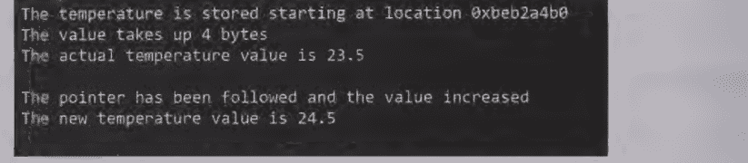

当然，你的计算机在存储该变量的温度数据时，几乎肯定会选择与树莓派上显示的不同的内存位置。

| 内存地址 | | |
|---|---|---|
| 0xbeb2a4ae | 4 字节数据 | |
| 0xbeb2a4af | 用于存储 | |
| 0xbeb2a4b0 | float 值 | `pTemperatureToDisplay` |
| 0xbeb2a4b1 | | 指向 float 值的指针 |
| 0xbeb2a4b2 | | | (持有地址 |
| 0xbeb2a4b3 | | | 数据的 |
| 0xbeb2a4b4 | | | 存储位置) |
| 0xbeb2a4b5 | | | |
| 0xbeb2a4b6 | | | |

## 解引用指针定位值的问题，确保指针持有的是合法的内存地址而不是其他值是非常重要的。

想象一个程序创建了指针但实际上没有为它设置任何值。该指针可能包含一个不可预测的值，这取决于计算机之前在该位置存储了什么内容（可能甚至运行了另一个程序）；如果一条语句尝试解引用该指针，它将尝试使用该任意值来访问内存中的数据，就像它是一个内存地址一样。获得的值可能是没有意义的，而且极有可能，它甚至不在你的树莓派授予程序在执行期间期间使用的内存块中。该程序将尝试访问一个它不应该访问的内存位置。尝试访问此类内存位置或使用该处的数据通常会导致你的程序崩溃。

这是一个尝试使用未赋值指针指针值的示例：

### Example 12.6-unassigned_pointer.cpp

```cpp
#include <iostream>    // 程序将在屏幕上显示一些文本

using namespace std;               // 将使用标准标识符 cout << endl

int main() {
    // 创建一个指针但不为其设置任何值
    int* pWholeNumber;
    // 显示指针中存储的任意内存地址
    cout << "The pointer contains this address: ";
    cout << pWholeNumber << endl;
    // 尝试跟随指针找到一个值，然后显示该值
    cout << "After following the pointer value, this is what was found ";
    cout << *pWholeNumber << endl;
    return 0;
}
```

注意，程序尝试跟随一个没有分配任何值的指针。这会导致生成一个警告。运行程序将会产生类似下面的错误：


该程序尝试跟随一个没有被赋值任何值的指针。这在编译时会产生一个警告。

## 指针

### 空指针

很多情况下，指针可能会被标记为空。在解引用指针之前，检查它不是空是非常是非常重要的。

以下程序显示了如何初始化空指针：

```cpp
#include <iostream> // 程序将在屏幕上显示一些文本
using namespace std; // 将使用标准标识符 cout 和 endl

int main() {
    // 创建一个空指针
    int* pPtr = nullptr;
    // 检查指针是否为空
    if (pPtr == nullptr) {
        cout << "The pointer is null" << endl;
    } else {
        cout << "The pointer is not null" << endl;
    }
    return 0;
}
```

### 解引用空指针

解引用空指针会导致程序崩溃：

```cpp
int* pPtr = nullptr;
// 这一行会导致程序崩溃
cout << *pPtr << endl;
```

### 初始化空指针

很多情况下，指针可能会被标记为空。以下程序显示了如何初始化空指针并检查它：

Example 12.7-null_pointer.cpp

```cpp
#include <iostream> // 程序将在屏幕上显示一些文本
using namespace std; // 将使用标准标识符 cout 和 endl

int main() {
    // 初始化一个空指针
    float* pTemperatureToDisplay = nullptr;
    // 检查指针是否为空
    if (pTemperatureToDisplay == nullptr) {
        cout << "The pointer is null" << endl;
    } else {
        cout << "The pointer is not null" << endl;
    }
    return 0;
}
```

## 使用指针在堆上创建并访问数据

到为止的示例使用的是指向静态数据的地址。程序也可以在动态内存中创建数据。之前的示例存储在静态内存，而不是堆内存。

要在堆上创建一个新值，程序使用 `new` 运算符。作为 `new` 操作的一部分，必须告诉计算机创建什么类型的数据。还需要告诉它分配什么值：

```cpp
new string ("Monster Island");
```

上面的操作告诉计算机创建一个值为 "Monster Island" 的字符串。计算机返回存储该数据的内存地址。

为了以后使用该字符串，你的代码需要知道数据在内存中的位置。可以使用指针变量保存 `new` 操作返回的内存地址：

```cpp
string* pHidayDestination = new string ("Monster Island");
```

上面的语句意味着：

- 创建一个新的字符串指针并命名为 `pHolidayDestination`。
- 将该指针的值设置为堆上具有值 "Monster Island" 的新字符串的地址。

除了简单数据，可以在堆上创建结构化数据。

这里是一个在程序中定义的结构：

```cpp
struct point2D
{
    float xCoord;
    float yCoord;
    string textDescription;
};
```

可以在堆上创建一个指向该结构新实例的指针。下面的语句执行了此操作，创建一个指向新创建的 `point2D` 结构的指针 `pFirstFit`：

```cpp
point2D* pFirstFit = new point2D;
```

通过这种方法，只有在使用 `new` 运算符创建结构后，你才能开始为单个数据赋值。要设置每个值，需要使用 `->` 成员运算符跟随指针：

```cpp
pFirstFit->xCoord = -10;
pFirstFit->yCoord = 5;
pFirstFit->textDescription = "Crashed alien spaceship";
```

处理大量数据的一种可能方法是将实际数据动态地存储在堆（heap）上，而在程序中使用普通的静态内存来存储指向这些动态数据的指针。与存储动态数据所需的内存相比，存储指针所需的内存量相对较小得多。

这里是一个示例，它使用了我们之前示例中的二维点结构体，但这次程序动态地存储了每个二维点。

# 示例 12.8-heap.cpp

```cpp
#include <iostream>    // 程序将在屏幕上显示一些文本
using namespace std;            // 将使用标准标识符 string, cout 和 endl

//--------------------
 // 创建新结构体。程序后续若干变量将使用该结构体。
struct point2D
{
    float xCoord;
    float yCoord;
    string textDescription;
};
//------------------------------------------------
void displayPoint( point2D* pPoint ) {
    // 检查指针是否为 NULL
    // 只有当指针不为空时，才能追踪并显示点的数据
if ( pPoint != NULL ) {
    // 顺着指针显示点的数据值
    cout << pPoint->textDescription;
    cout << " " << " is located at co-ordinates (";
    cout << pPoint->xCoord;
    cout << " " , " ";
    cout << pPoint->yCoord;
    cout << ")" << endl;
} // if结束
}
 // 函数结束
//------------------------------------------------
```

继续...

```cpp
int main() {
    // 创建一个新的二维点，将其数据存储在堆上
    point2D* pFirstPoint = new point2D;
    // 顺着指针设置结构体成员的每个数据值
    pFirstPoint->xCoord = -10;
    pFirstPoint->yCoord = 5;
    pFirstPoint->textDescription = "Crashed alien spaceship";
    // 将指针传递给显示点的函数
    displayPoint(pFirstPoint);
    // ------------------------------------------------------
    // 创建另一个二维点，将其数据存储在堆上
    point2D* pSecondPoint = new point2D;
    // 顺着指针设置结构体成员的每个数据值
    pSecondPoint->xCoord = 35;
    pSecondPoint->yCoord = 10;
    pSecondPoint->textDescription = "Drive-Thru";
    // 将指针传递给显示点的函数
    displayPoint(pSecondPoint);
    return 0;
}
```

如前所述，程序将数据动态地存储在堆上。使用指针变量 `pFirstPoint` 和 `pSecondPoint` 存储的每个 `point2D` 结构的地址如下：

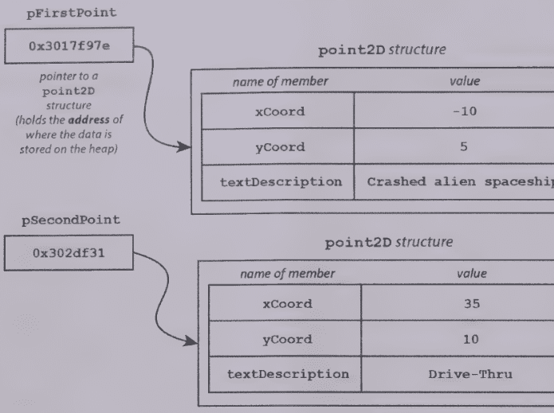

除了创建点并设置坐标和文本描述的 `main()` 函数外，程序还包含一个名为 `displayPoint()` 的函数。

`displayPoint()` 函数接收一个 `point2D` 结构的指针，并检查其是否可以安全地追踪。

如果指针不为 NULL，函数将在屏幕上显示 `point2D` 结构中的每个成员。

注意使用 `->` 指针成员运算符来访问每个数据成员：

```cpp
cout << pPoint->textDescription;
```

`main()` 函数调用了两次 `displayPoint()`，一次针对存储在堆上的每个点。

结果所示：

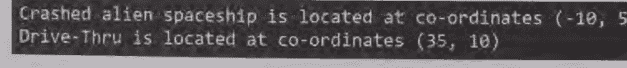

## 指针数组

此示例允许用户动态地添加运行时输入的某一个或多个人的联系详情。

它在内存中创建了一个指针数组。当用户为每个人输入新细节时，会在堆上动态创建一个创建一个新的人员结构体来存储其数据。新创建数据的地址将作为指针存储在名为 `pContact` 的数组中。

### 示例 12.9 - array_of_pointers.cpp

```cpp
#include <iostream>    // 程序将在屏幕上显示一些文本
using namespace std;               // 将使用标准标识符 string, cout 和 endl

const char TAB = '\t';

// 创建新结构体。程序后续若干变量将使用该结构体。
struct person
{
    string firstName;
    string emailAddress;
    bool sendNewsletter;
};

int main()
{
    const int MAX_PEOPLE = 100;
    person* pContact[MAX_PEOPLE];
    int numberOfPeopleEntered = 0;
    person* pNewPerson;
    string newName, newEmail, wantNewsletter;

    // 输入人员详情，直到指针数组达到最大尺寸 或者你选择退出
do
{
        cout << "Type in name of new person, or quit when finished:" << endl;
        getline(cin, newName);
```

```cpp
if ( newName != "quit")
{
  cout << "Type in their email address: " << endl;
  getline(cin, newEmail);

  cout << "Do they want a newsletter?" << endl;
  getline(cin, wantNewsletter);

  // 在堆上创建新人员
  pNewPerson = new person;

  // 设置细节
  pNewPerson->firstName = newName;
  pNewPerson->emailAddress = newEmail;
  pNewPerson->sendNewsletter = (wantNewsletter == "y");

  // 将指针存储在数组中
  pContact[numberOfPeopleEntered] = pNewPerson;

  numberOfPeopleEntered++;
} while (newName != "quit" && numberOfPeopleEntered < MAX_PEOPLE);

  // 显示所有选择订阅的人
  if (numberOfPeopleEntered > 0)
  {
    cout << "Mailing list:" << endl;
    cout << "-----------------" << endl;

    for (int index = 0; index < numberOfPeopleEntered; index++)
    {
      person* currentPerson = pContact[index];
      // 如果不为空，决定是否
      if (currentPerson != NULL && currentPerson->sendNewsletter)
      {
        cout << currentPerson->firstName << TAB;
        cout << currentPerson->emailAddress << endl;
      }
    }
  }

  // 释放内存
  for (int index = 0; index < numberOfPeopleEntered; index++)
  {
      delete pContact[index];
  }

  return 0;
}
```

## 构建你自己的数据结构

指针对于构建更复杂的数据结构非常有用，这些结构可以连接计算机动态内存中存储的数据项。许多常见的数据结构，包括“列表”、“栈”、“队列”和“树”，都可以通过指针连接数据值来构建。

例如，与其在数组中存储值，不如使用指针将值链联起来，使得链中的每项数据都指向下一个项。这被称为“链表列表”。访问特定的数据项不需要索引号。你的代码需要知道列表第一个项存储在内存中的位置。计算机可以在访问第一个项的数据之前，通过跟随指针跳转到列表中的下一个项。它可以重复地检查数据值并一个接一个地跟随指针，直到到达列表的最后一个项。

示例 1.20-linked_list.cpp


```cpp
#include <iostream> // 程序将在屏幕上显示一些文本

using namespace std; // 将使用标准标识符 string, cout 和 endl

const char TAB = '\t';

//

// 创建新结构体。几个变量将在程序的稍后部分中使用此结构。
struct person
{
string firstName;
string emailAddress;
person* pNextPerson;
};

//

void displayPeopleInLinkedList( person* pPersonToStartFrom)
{
	cout << "Here are the people in the list:" << endl;

	person* pCurrentPerson = pPersonToStartFrom;

	while ( pCurrentPerson != NULL) 
	{
		cout << TAB;
		cout << "Name: " << pCurrentPerson->firstName;
		cout << TAB;
		cout << "Email: " << pCurrentPerson->emailAddress << endl;

		// 跟随指针到达列表中的下一个节点
		pCurrentPerson = pCurrentPerson->pNextPerson;
	} // end of while

	cout << "*** End of the list ***" << endl << endl << endl;
}
```

### `int main()`

{

    string newName, newEmail;

    person* pFirstName;

    person* pLastName;

    person* pCurrentPerson;

    person* nCurrent;

    // 将列表标记为“空” - 没有任何节点

    // (知道列表从哪里开始以及哪里结束将是有用的);

    pFirstName = NULL;

    pLastName = NULL;

    // 为列表中的第一个人创建一个节点

    nCurrent = new person;

    // 设置此人的属性值

    nCurrent->firstName = "Helga";

    nCurrent->emailAddress = "helga@outer-space.fake.com";

    nCurrent->pNextPerson = NULL;

    // 将这个新人同时存储为链表的开头和结尾

    pFirstName = nCurrent;

    pLastName = nCurrent;

    // 显示目前链表中的内容

    displayPeopleInLinkedList(pFirstName);

    // 在列表中创建第二 人

    nCurrent = new person;

    // 设置此人的属性值

    nCurrent->firstName = "Olga";

    nCurrent->emailAddress = "olga@very-loud.fake.com";

    nCurrent->pNextPerson = NULL;

    // 将上一个人连接到这个新人

    pLastName->pNextPerson = nCurrent;

    // 将新人设置为列表中的最后一个人

    pLastName = nCurrent;

    // 显示目前链表中的内容

    displayPeopleInLinkedList(pFirstName);

    // 在列表中创建第三个人人

    pCurrentPerson = new person;

    // 设置此人的属性值

    pCurrentPerson->firstName = "Florence";

    pCurrentPerson->emailAddress = "flozza@roundabout.fake.com";

    pCurrentPerson->pNextPerson = NULL;

    // 将上一个人连接到这个新人

    pLastName->pNextPerson = pCurrentPerson;

    // 将新人设置为列表中的最后一个人

    pLastName = pCurrentPerson;

    // 显示目前链表中的内容

    displayPeopleInLinkedList(pFirstName);

return 0;

}
```

开始时，链表是空的。程序继续创建三个不同的单元或“节点”，并将它们连接起来形成列表。在创建每个节点并将其添加到列表后，程序会显示到为止的链表内容。

代码使用了三个关键点，这些将在创建新节点和控制列表时使用。`pFirstPerson` 指针将指示列表中第一个节点在内存中的存储位置。`pCurrentPerson` 指针将在创建新节点并将其连接到列表其他部分时使用：

| person* pFirstPerson |
| person* pPerson |
| person* pCurrentPerson |

由于为空且尚未包含任何节点，因此指向第一个和最后一个节点的指针被赋予了 NULL 值：

```cpp

pFirstPerson = NULL;

pLastPerson = NULL;

```

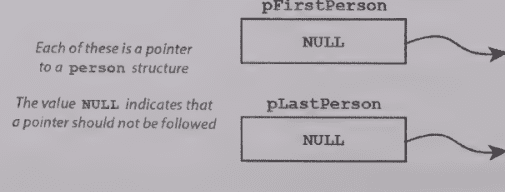

NULL 值向程序指示该指针尚未指向任何数据，且不应跟随它。

程序使用 `new` 运算符在内存中创建第一个节点。新创建的节点在创建时返回内存地址，并通过 `pCurrentPerson` 指针存储：

```cpp

pCurrentPerson = new person;

```

然后跟随 `pCurrentPerson` 指针为 `person` 结构体中的每个数据成员设置值：

```cpp

pCurrentPerson->firstName = "Helga";

pCurrentPerson->emailAddress = "helga@outer-space.fake.com";

pCurrentPerson->pNextPerson = NULL;

```


现在节点已经存在并包含了有用数据，`pFirstPerson` 和 `pLastPerson` 指针被更新，以指示该节点既是链表的开头也是结尾：

```cpp

pFirstName = nCurrent;

pLastName = nCurrent;

```

链表目前包含一个节点，显示如下：


以下是列表中的人员：
当前节点地址：0xd14008
姓名：Helga 邮箱：helga@outer-space.fake.com
下一个节点地址：0

以下是列表中的人员：
当前节点地址：0xd14008
姓名：Helga 邮箱：helga@outer-space.fake.com
下一个节点地址：0xd14058

--------------------
当前节点地址：0xd14058
姓名：Olga 邮箱：olga@very-loud.fake.com
下一个节点地址：0

以下是列表中的人员：
当前节点地址：0xd14008
姓名：Helga 邮箱：helga@outer-space.fake.com
下一个节点地址：0xd14058

--------------------
当前节点地址：0xd14058
姓名：Olga 邮箱：olga@very-loud.fake.com
下一个节点地址：0xd140a8

--------------------
当前节点地址：0xd140a8
姓名：Florence 邮箱：flozza@roundabout.fake.com
下一个节点地址：0

请记住，在你自己的电脑上会看到不同的内存地址。数据值不会存储在与我的 Pi 派相同的内存位置。

# 在完成对动态数据的使用后回收内存

我们在本章的早些部分看到，可以在堆上创建一个数据值，并将其地址存储在指针中：

```
string* pHolidayDestination = new string("Monster Island");
```

当我们我们需要这些数据时会发生什么？记住，虽然堆内存非常大，但这种数量是有限的。即使是堆也被完全充满，如果程序无法获取存储数据所需的内存，就会导致运行中的程序出现问题。

程序通过销毁任何不再使用的动态数据值来清理自己是一个良好的习惯。一旦你确定某个数据值不再需要，你的程序就可以删除该值。该数据值在堆上占据的内存将再次释放供其他程序使用。

要销毁当前存储在堆上的数据值，你的程序可以使用 `delete` 运算符：

```
delete pHolidayDestination;
```

这告诉指向堆上数据的指针，然后从内存中删除它。但要小心！一旦数据被销毁，指针仍然持有已删除数据的地址。你的程序不能尝试跟随此指针。当数据被删除后，应该通过将其设置为包含 `NULL` 值将指针标记为未使用：

```
pHolidayDestination = NULL;
```

示例 12.11 - delete.cpp

```cpp

#include <iostream> // 程序将在屏幕上显示一些文本

using namespace std; // 将使用标准标识符 string 和 endl

int main() {

    // 在堆上创建一个新的数据项，并将数据地址存储在指针中
    string* pPerson = new string("Miss Wendy Cheeseboard");

    // 尝试跟随指针，然后显示该数据项
    cout << "The winner is ... ";
    cout << *pPerson << endl;

    // 从堆上删除该数据项，使其不再存在
    delete pPerson;

    // 再次尝试跟随指针，现在数据已经被删除
    cout << "Is there anybody there? " << endl;
    cout << *pPerson << endl;

    return 0;

}

```

如果你尝试执行该程序，你发现它以以一种非常惊人的结果崩溃了。试一试！

```
{

// The winner is... Miss Wendy Cheeseboard

// Is there anybody there?

// Segmentation fault

(program exited with code: 139)

Press return to continue

}
```

崩溃的结果是尝试跟随一个不再存在的数据值的指针。

这里是该程序的修改版本，它用于检查在节点删除后指针是否可以安全使用：

# 12.12 - delete_safety.cpp

```cpp

#include <iostream>    // 程序将在屏幕上显示一些文本

using namespace std;                // 将使用标准标识符 string, cout 和 endl

int main() {

    // 在堆上创建一个新的数据项，并将数据地址存储在指针中
    string* pPerson = new string("Miss Wendy Cheeseboard");

    // 尝试跟随指针，然后显示该数据项
    cout << "The winner is ... ";
    cout << *pPerson << endl;

    // 从堆上删除该数据项，使其不再存在
    delete pPerson;                // 销毁堆上的数据
    pPerson = NULL;                 // 将指针标记为未使用

    // 再次尝试跟随指针，现在数据已经被删除
    // 检查指针是否不为 NULL
    // 指针的 NULL 值表示它不应再使用
    cout << "Is there anybody there? " << endl;
    if (pPerson != NULL) {
        cout << *pPerson << endl;
    } else {
        cout << "NULL pointer - the data does not exist anymore" << endl;
    }

    return 0;

}

```

尝试运行此程序不会导致崩溃，因为程序不会通过 `pPerson` 指向堆上已删除的数据。它将以通常的代码 0 退出，表示一切正常。


正如前面提到的，自我清理工作是一个良好的习惯，即删除堆上不再需要的数据项。许多程序在执行前的最后一步都包含删除这些数据项的代码。这有助于确保你的 Pi 上有足够的堆内存供其他程序使用，并确保它们能够顺利运行。

第 12 章：结构、指针和内存 | 471

你可以想象，堆内存短缺会导致 Pi 的性能变慢，因为程序需要等待更长时间才能获得可用内存。一个执行完毕但在堆内存中留下了动态数据的程序，会导致当前正在运行的其他程序的可用内存减少。这被称为“内存泄漏”，即数据逐渐丢失。

内存泄漏通常是由编程效率低下或代码粗糙引起的，程序员忘记了删除某些数据。随着时间推移，这可能会导致性能下降，特别是当计算机长时间运行一段时间时。此程序模拟了堆泄漏问题。它使用循环创建越来越多的项，使用堆内存。

## 示例 12.13 - heap_file.cpp

```cpp

#include <iostream> // 程序将在屏幕上显示一些文本

using namespace std; // 将使用标准标识符 string, cout 和 endl

int main() {

    // 警告！此程序*会*影响你 Pi 的性能。
    // 运行此程序后可能需要重启 Pi。
    // 为了避免数据丢失，请确保你已保存所有打开的文档。
    // 风险自担！

    // 存储堆上某些字符串数据的单一指针
    // 在创建数据时它会被反复使用，但实际上从未被
    // 有用地跟随！
    string* pData;

    // 永远不会终止的无限循环
    while ( true ) {

        // 在堆上创建一个新的数据项，将数据地址存储在指针中
        pData = new string("This string value uses heap memory!");

        // 显示数据
        cout << pData << endl;

        // 每个新项目的地址都会替换指针变量中存储的旧地址，
        // 但数据仍留在堆上，无法再次通过原始指针
        // 找到它。

    }

} // 无限 while 循环结束

return 0;

}
```

这是一个更有用的程序，它允许你构建一个包含人员及其电子邮件地址的链表。你可以根据需要输入任意数量的人员。一旦你选择退出程序，它将在完成执行之前逐个销毁链表中的节点，以释放它们之前占据的堆内存。

## Example 12.14 - linked_list_menu.cpp

```cpp

#include <iostream> // 程序将在屏幕上显示一些文本

using namespace std; // 将使用标准标识符 string, cout 和 endl

const char TAB = '\t';

// ------------------------------------

// 创建新结构体。程序稍后几个变量将使用该结构体。
struct person {
    string firstName;
    string emailAddress;
    person* pNextPerson;
};

// ------------------------------------------------

person* addPersonToLinkedList( person* plastPersonInList ) {

    // 为列表中的第一个人员创建一个节点
    person* pNewPerson = new person;

    // 输入新人的详细信息
    string new, newEmail;
    cout << "Type in the name of the new person:" << endl;
    getline(cin, new);
    cout << "Type in their email address:" << endl;
    getline(cin, newEmail);

    // 将细节拷贝到新节点
    pNewPerson->firstName = new;
    pNewPerson->emailAddress = newEmail;
    pNewPerson->pNextPerson = NULL;

    // 如果列表之前为空，则将之前列表中
    // 最后一个节点连接到新节点
    if ( plastPersonInList != NULL )
        plastPersonInList->pNextPerson = pNewPerson;
```


```cpp
// 返回新节点的指针，以便将其记录为最后一个节点

return pNewPerson;

}
```

// ----------------------------------------------------------------

```cpp
void displayPeopleInLinkedList( person* pPersonToStartFrom )
{
    cout << "Here are the people in the list:" << endl;
    person* pCurrentPerson = pPersonToStartFrom;
    while ( pCurrentPerson != NULL )
    {
        cout << TAB << "Name: " << pCurrentPerson->firstName;
        cout << TAB << "Email: " << pCurrentPerson->emailAddress << endl;
        pCurrentPerson = pCurrentPerson->pNextPerson;
    }
    cout << "*** End of the list ****" << endl << endl;
}

void searchForPersonInLinkedList( person* pPersonToStartFrom )
{
    string targetName;
    cout << "What name are you searching for?" << endl;
    getline(cin, targetName );
    person* pCurrentPerson = pPersonToStartFrom;
    while ( pCurrentPerson != NULL )
    {
        if ( targetName == targetName )
        {
            cout << "Found! Their email is " << pCurrentPerson->emailAddress << endl;
            break; //结束 if 决策
        }
        // 移动到列表中的下一个节点
        pCurrentPerson = pCurrentPerson->pNextPerson;
    }
    if ( pCurrentPerson == NULL )
    {
        cout << "Person could not be found" << endl;
    }
}
```

```cpp
void destroyLinkedList(person* pPersonToStartFrom)
{
    // 销毁当前存储在堆上的数据列表
    person* pCurrentPerson = pPersonToStartFrom;
    person* pNextPersonToDelete;
    while ( pCurrentPerson != NULL ) {
        pNextPersonToDelete = pCurrentPerson->pNextPerson;
        delete pCurrentPerson;
        pCurrentPerson = pNextPersonToDelete;
        //结束 while 循环
    }
    cout << "*** List destroyed - heap memory freed ***" << endl << endl;
}

// ----------------------------------------------------

int main()
{
    // 将列表标记为“空”——完全没有节点
    // (知道列表的开始和结束将非常有用)
    person* pFirstPerson = NULL;
    person* pLastPerson = NULL;
    // ----------------------------------------------------
    person* pNewPerson;
    string choice;
    while ( true ) {
        cout << endl << "Choose what to do: add, display, search or quit" << endl;
        getline(cin, choice);
        cout << endl;
        // 向列表添加一个新人员
        if ( choice == "add") {
            // 输入人员详细信息并将其存储在列表末尾
            pNewPerson = addPersonToLinkedList(pLastPerson);
            // 新节点将无疑是列表中的最后一个节点
            pLastPerson = pNewPerson;
            // 如果列表之前为空，则将新节点标记为列表的开始
            if ( pFirstPerson == NULL ) {
                pFirstPerson = pNewPerson;
            }
        } //结束 决策
    }
    // 显示列表中每个节点的详细信息
    if ( choice == "display") 
        displayPeopleInLinkedList( pFirstPerson);
    // 在列表中搜索特定名称
    if ( choice == "search") 
        searchForPersonInLinkedList( pFirstPerson);
    // 当你选择退出时，销毁列表中的所有数据
    if ( choice == "quit") {
        // 销毁列表中的所有节点
        destroyLinkedList(pFirstPerson);
    }
}
```

# 供你尝试的题目和练习

| 1. | 创建一个名为 `symbols` 的数组，存储 10 个不同的字符值。\n创建一个名为 `pSymbol` 的字符指针。存储 `symbols` 数组中第一个元素的地址。\n使用 `++` 将 `pSymbol` 指针自增三次。\n显示更新后的指针值所指向的数据。 |
| 2. | 创建两个变量：一个使用 `float` 类型，另一个使用 `int` 类型。\n现在创建两个不同的指针，并使用它们来存储每个新变量的地址。\n是否可以将其中一个指针的值赋值给另一个指针？ |
| 3. | 创建一个名为 `FIXED_PRICE` 的整数常量，值为 1500。\n创建一个指向该常量的指针。\n使用指针解引用，尝试将 `FIXED_PRICE` 的值改为 1000。\n发生了什么什么？ |
| 4. | 在 `Example 12.14 linked_list_menu.cpp` 中添加一个名为 `displayInReverse` 的新函数。\n它将递归地调用自己以跟踪节点之间的链接，直到到达链表末尾。\n一旦到达末尾，每个递归函数实例将终止，并显示该人的详细信息。这将导致列表内容以反序顺序显示。\n你需要让新函数接受一个单一参数作为输入，命名为 `personToStartFrom`。\n这将是一个指向人的指针（类似于现有的 `displayPeopleInLinkedList()` 函数）。\n当调用 `displayInReverse()` 时，它将使用 `personToStartFrom` 并检查指向链表中下一个人的 `nextPerson` 指针。\n如果这还不是链表的末尾且存在另一个人，则 `displayInReverse()` 应该再次调用自己，并传入下一个人的指针。在递归调用之后，函数将需要显示当前人的详细信息。\n你还需要在菜单中添加一个新选项来调用 `displayInReverse()` 函数。 |

## 第 13 章：对象与类

### 封装相关数据项

到目前为止，我们的程序已经使用了数据。有些程序甚至使用了 `struct` 来创建结构体，将多个相关项封装在一起。我们的程序代码可以使用这些数据来执行有用的处理。

下面是一个 `struct` 示例，它通俗地描述了关于山脉的已知数据：

结构：`mountain`

| string | name |
|--- |--- |
| string | range |
| int | elevation |

程序利用新的 `mountain` 结构体创建了两个名为 `highestInWorld` 和 `highestInUK` 的不同变量。代码包含一个 `displayMountainDetails()` 函数，它将在屏幕上显示你创建的特定山脉的各个数据成员。

Example 13.1--`struct_mountain.cpp`

```cpp
#include <iostream>      // 程序将在屏幕上显示一些文本
using namespace std;           // 将使用标准标识符 string, cout 和 endl
//-----------------------------
struct mountain
{
    string name;
    string range;
    int elevation;
};
//-----------------------------
void displayMountainDetails( mountain thisMountainObject) {
    cout << thisMountainObject.name;
    cout << ", " << thisMountainObject.range;
    cout << thisMountainObject.elevation << "m";
}
//-----------------------------
int main() {
    // 创建 2 个不同的对象，每个对象都是 mountain 结构体的一个实例
    mountain highestInWorld;
    mountain highestInUK;
}
```

为每座山脉获取值：

```cpp
highestInWorld.name = "Mt. Everest"
highestInWorld.range = "Himalayas"
highestInWorld.elevation = 8848;
```

```cpp
highestInUK.name = "Ben Nevis"
highestInUK.range = "Grampian Mountains"
highestInUK.elevation = 1344;
```

通过调用 `DisplayMountainDetails` 函数并传递特定的山脉结构体来显示每座山的详细信息：

```cpp
cout << "You'll need oxygen to climb"
displayMountainDetails(highestInWorld);
```

```cpp
cout << endl << endl;
cout << "The highest in the UK is "
displayMountainDetails(highestInUK);
```

```cpp
cout << endl << endl;
return 0;
```

## 类私有成员与公共成员的区别

尽管我们还没有完成新成员类的定义，但我们可以控制类的哪些部分可以被程序的其他部分访问，而哪些部分不被访问或篡改。

在定义新类时，我们可以使用`访问修饰符`（access-specifiers）来明确程序的哪些部分被允许访问和使用与类相关的数据成员和函数。注意，我们在上页中已经看到过其中一个了：公共（`public`）修饰符，它允许访问 `mountain` 类的构造函数。


公共数据成员或函数可以被类外的程序其他部分直接访问。对公共成员的访问方式和时间没有限制。程序的其他部分将能够检查或更改这些成员，或者调用成员函数。

私有数据成员或函数不能被类外的程序部分访问。数据只能通过该类的成员函数访问。程序的其他部分将无法检查私有成员、更改其值或调用私有函数。

受保护（`protected`）数据成员或函数可以被其所属的类或基于该类的其他类（即`继承类`，将在本章中介绍）访问。程序的其他部分将无法检查受保护的数据成员、更改其值或调用受保护成员函数。

如果你不指定成员项或函数是公共、私有还是受保护的，那么默认情况下，C++ 编译器会将它们视为私有的。这意味着它们将受到限制，以防止被意外访问或篡改。

类声明使其所有的数据成员和函数都对程序的其余部分开放。不属于 `mountain` 类的程序代码能够使用 `name`、`range` 和 `elevation` 成员项。程序中任何部分的代码都可以调用 `mountain()` 和 `displayDetails()` 函数。

这种相对开放的权限可能会导致你的程序出现问题。代码可能会错误地更改成员数据或调用函数，从而导致错误。

```cpp
class mountain {
public:
    // 数据成员 - 所有这些都是公共的。程序的其他部分
    // 将能够直接访问它们。
    string name;
    string range;
    int elevation;
    // 用于创建山脉对象并显示其数据的成员函数
    mountain(string newName, string newRange, int newElevation);
    void displayDetails();
};
```

下一页的示例经过了完善。这次，数据成员被声明为私有，而 `mountain()` 和 `displayDetails()` 函数被声明为公共。这意味着 `mountain` 类外外的程序其他部分将无法直接使用 `name`、`range` 或 `elevation` 成员。读取或处理这些值的唯一方法是通过公共可用的 `mountain()` 和 `displayDetails()` 函数，这些函数现在经过了严格控制，以防止被误用。

| 486 | 在树莓派上使用 C++ 编程 |
| :--- | :--- |
| 486 | 在树莓派上使用 C++ 编程 |

```cpp
class mountain {
  // 此私有数据不能被程序的其他部分直接访问。
  // 只能通过此类提供的函数进行访问。
  private:
    string name;
    string range;
    int elevation;
  public:
    // 成员函数 - 这些是公共的，可以由不属于
    // 此类的代码在其他地方调用。
    mountain(string newName, string newRange, int newElevation);
    void displayDetails();
    string getName(); // 允许检查 name 值
    string getRange();
    int getElevation();
    void setName(string newName); // 允许修改 name 值
    void setRange(string newRange);
    void setElevation(int newElevation);
};
```

为了访问私有成员项以读取或更新其值，类通常会提供“get”和“set”函数。例如，`get(name)` 函数向任何调用它的代码返回 `name` 数据成员的值。`setName(name)` 函数接收一个字符串输入并将其赋值给 `name` 数据成员。通过这种方式，你的类定义了数据成员的访问方式。

通过将数据私有化，更多的控制权。构造函数允许将值分配给数据项，并对新对象执行初始处理。

注意，你可以为一个类定义多个不同的构造函数。这允许你以不同的方式创建类的实例。最简单的构造函数完全不接受任何参数——它通常用于创建一个“空白”对象，其成员值被设置为默认值。你可以根据想要创建对象的方式，提供接收不同输入值组合的不同构造函数。

在 `mountain` 类的情况下，两个不同的构造函数可能声明如下：

```cpp
public:
mountain();
mountain(string stringName, string stringRange, int elevation );
```

注意，上述两个构造函数都是公共的，以便程序的其余代码调用它们。

## 定义类的成员函数体

一旦你声明了类将包含的成员函数，你就可以定义它们的体：即每个函数执行的语句集。你可以以类似于之前程序的方式编写函数。但正如我们所看到的，定义属于类的函数，必须用类名和 `::` 作用域运算符加上函数名。这告诉编译器函数属于哪个类。

下面显示了一个非常简单的示例。`displayDetails()` 函数逐个显示山脉的数据：

```cpp
void mountain::displayDetails()
{
    // 显示山脉对象的每个私有数据成员
    cout << name;
    cout << " , " << range;
```


`cout << " (" << elevation << " m)";`

}

函数名已经加上了类名前缀。这明确了新函数（函数的作用域），并避免了与任何同名函数产生可能的混淆。

你可以将：

```
void mountain::displayDetails()
```

...理解为：

> “属于 `mountain` 类且不接受或返回任何值的 `displayDetails()`。”

## 构造函数：在类实例创建时调用的函数

正如之前提到的，每个类都至少有一个构造函数，该函数会在类实例创建时被调用。构造函数允许将值分配给数据项，并对新对象执行初始处理。

一旦声明了 `mountain` 类，也需要定义每个构造函数的函数体：

```cpp
mountain::mountain() {
    // 不接受参数的构造函数
    // 为每个数据成员分配空白的默认值。
    name = "";
    range = "";
    elevation = 0;
}

mountain::mountain(string newName, string newRange, int newElevation) {
    // 为新山峰设置 name、range 和 elevation 的构造函数。
    name = newName;
    range = newRange;
    elevation = newElevation;
}
```

一旦声明了一个类并为它定义了构造函数，你的程序代码就可以创建该类的实例。你的代码可以声明以新类作为数据类型的变量，通过调用构造函数为该实例的每个数据成员分配值：

```cpp
mountain blankMountain();
mountain highestInWorld("Mt. Everest", "Himalayas", 8848);
```

| blankMountain (`mountain` 类的实例) |  |
| :--- | :--- |
| 成员名称 | 数值 |
| name | (空白) |
| range | (空白) |
| elevation | 0 |

| highestInWorld (`mountain` 类的实例) |  |
| :--- | :--- |
| 成员名称 | 数值 |
| name | Mt. Everest |
| range | Himalayas |
| elevation | 8848 |

第一个 `mountain` 实例（名为 `blankMountain` 的变量）将使用不接受参数的简单构造函数。该构造函数仅将 `blankMountain` 的每个成员设置为空值或零值。

第二个实例（名为 `highestInWorld` 的变量）将使用接受三个参数作为输入的构造函数来创建。该构造函数可能会传递三个参数值 `Mt. Everest`、`Himalayas` 和 `8848` 来设置类中的每个数据成员：`name`、`range` 和 `elevation`。

第 13 章：对象与类： 489

## 示例 13.2 - `class_mountain.cpp`

```cpp
#include <iostream>    // 程序将在屏幕上显示一些文本
using namespace std;      // 将使用标准标识符 string, cout 和 endl
//----------------------------------------------------------------------
class mountain
{
    // 这些私有数据无法被程序的其他部分访问
private:
    string name;
    string range;
    int elevation;
    // 这些公共函数可以被程序的其他部分调用
public:
    mountain(string name, string newRange, int newElevation);
    void displayDetails();
};
//----------------------------------------------------------------------
mountain::mountain(string newName, string newRange, int newElevation)
{
    // 在创建此类的新实例时调用的构造函数
    name = newName;
    range = newRange;
    elevation = newElevation;
}
//----------------------------------------------------------------------
void mountain::displayDetails()
{
    // 显示山峰对象的每个私有数据成员
    cout << name;
    cout << " " << range;
    cout << " ((" << elevation << "m")";
//----------------------------------------------------------------------
```

未完...

```cpp
int main() {
    // 创建 4 个不同的对象，每个都是 mountain 类的实例
    mountain highestInWorld("Mt. Everest", "Himalayas", 8848);
    mountain highestInUK("Ben Nevis", "Grampian Mountains", 1344);
    mountain steepestInWorld("The Great Trango Tower", "Karakoram", 6286);
    mountain highestVolcano("Mauna Kea", "Hawaiian Islands", 4207);
    // 为 4 个对象调用 displayDetails() 成员函数
    cout << "You'll need oxygen to climb ";
    highestInWorld.displayDetails();
    cout << endl;
    cout << "The highest in the UK is ";
    highestInUK.displayDetails();
    cout << endl;
    cout << "The trickiest has got to be ";
    steepestInWorld.displayDetails();
    cout << endl;
    cout << "The highest volcano in the world is ";
    highestVolcano.displayDetails();
    cout << endl;
    return 0;
}
```

以下是程序显示的内容：

| | You'll need oxygen to climb Mt. Everest, Himalayas (8848m) |
| The highest in the UK is Ben Nevis, Grampian Mountains (1344m) |
| The trickiest has got to be The Great Trango Tower, Karakoram (6286m) |
| The highest volcano in the world is Mauna Kea, Hawaiian Islands (4287m) |

注意，此程序只使用了一个构造函数，该函数接受三个参数来设置 `mountain` 类每个新实例的数据成员值。

现在由于你已经在程序代码中创建了一个类，符号面板（Symbols pane）会显示 `mountain` 类的名称，以及该类定义在 "class_main.cpp" 文件中的起始行号。点击类名将带你进入文本编辑器窗口中的声明处。你可能会发现这种在源代码中进行导航的方式非常方便，而无需使用鼠标上下滚动来工作。

# 空构造构造函数的必要性

在创建类的实例时，你的程序通常希望为它的某些数据成员提供值。

下面的语句声明了 `mountain` 类的一个实例 `steepestInWorld`：

```cpp
mountain steepestInWorld("The Great Trango Tower", "Karakoram", 6286);
```

所使用的构造函数接受三个参数来为数据成员提供值：

```cpp
"The Great Trango Tower", "Karakoram", 6286
```

然而，在某些情况下，你可能希望在不显式赋值值的情况下声明对象。例如：

```cpp
mountain firstClimbed, secondClimbed, thirdClimbed;
mountain climbed[10];
```

在所有这些示例中，程序都可以创建 `mountain` 类的实例。虽然它们没有使用接受参数的特殊构造函数，但此构造函数需要在 `mountain` 类中作为公共成员声明：

```cpp
public:
mountain();
```

如果没有这样的函数，将无法创建实例，你的程序将无法编译。

该构造函数还需要在代码中定义函数体，并以类名开头：

```cpp
mountain::mountain()
{
  // 不接受参数的构造函数。
  // 为每个数据成员分配空白的默认值。
  name = "";
  range = "";
  elevation = 0;
}
```

```cpp
// -----------------------
int main()
{
    const unsigned int NUM_TO_CLIMB = 10;
    const unsigned char TAB = '\t';
    // Create 10 different mountain objects, each one with blank data member values
    mountain challenge[NUM_TO_CLIMB];
    // Display the details of the newly created mountain objects
    cout << "The details to begin with look like this:" << endl << endl;
    for (unsigned int num = 0; num < NUM_TO_CLIMB; num++) {
        cout << TAB << "Mountain number " << num << " holds this data:" << TAB;
        challenge[num].displayDetails();
        cout << endl;
    }
    cout << endl << "After setting values, they contain this data:" << endl << endl;
    // Set some data values for each mountain and redisplay them
    string generatedName;
    for (unsigned int num = 0; num < NUM_TO_CLIMB; num++) {
        generatedName = static_cast<char>('A' + num);
        challenge[num].setName("Mountain " + generatedName);
        challenge[num].setRange("unknown range");
        cout << TAB << "Mountain number " << num << " holds this data: " << TAB;
        challenge[num].displayDetails();
        cout << endl;
    }
    return 0;
}
```

当程序运行时，你应该会在屏幕上看到以下输出：

# 初始详情如下：

| 山峰 0 包含以下数据: | (0m) |
| 山峰 1 包含以下数据: | (0m) |
| 山峰 2 包含以下数据: | (0m) |
| 山峰 3 包含以下数据: | (0m) |
| 山峰 4 包含以下数据: | (0m) |
| 山峰 5 包含以下数据: | (0m) |
| 山峰 6 包含以下数据: | (0m) |
| 山峰 7 包含以下数据: | (0m) |
| 山峰 8 包含以下数据: | (0m) |
| 山峰 9 包含以下数据: | (0m) |

设置值后，它们包含以下数据：

| 山峰 0 包含以下数据: | Mountain A, unknown range (0m) |
| 山峰 1 包含以下数据: | Mountain B, unknown range (0m) |
| 山峰 2 包含以下数据: | Mountain C, unknown range (0m) |
| 山峰 3 包含以下数据: | Mountain D, unknown range (0m) |
| 山峰 4 包含以下数据: | Mountain E, unknown range (0m) |
| 山峰 5 包含以下数据: | Mountain F, unknown range (0m) |
| 山峰 6 包含以下数据: | Mountain G, unknown range (0m) |
| 山峰 7 包含以下数据: | Mountain H, unknown range (0m) |
| 山峰 8 包含以下数据: | Mountain I, unknown range (0m) |
| 山峰 9 包含以下数据: | Mountain J, unknown range (0m) |

# 在堆上动态创建对象

到目前为止，我们类所有的实例都是在**静态内存**中创建的。对于简单的数据类型和结构，对象可以被**动态**创建。我们将它们存储在堆内存中，并使用指针来定位和使用它们。接下来的程序在堆上创建一个 `mountain` 类的实例，而不是在静态内存中创建：

示例 13.4 `class_heap.cpp`

```cpp
#include <iostream> // 程序将在屏幕上显示一些文本
using namespace std; // 将使用标准标识符 string, count 和 endl
//n
class mountain {
private:
    string name;
    string range;
    int elevation;
public:
    mountain(string newName, string newRange, int newElevation);
    void displayDetails();
    void setName (string newName);
    string getName();
};
```

下页继续...cpp

```cpp
接上...
//
//--------------------------
mountain::mountain( string newName, string newRange, int newElevation )
{
    // 在创建该类的新实例时调用的构造函数
    name = newName;
    range = newRange;
    elevation = newElevation;
}
//--------------------------
void mountain::displayDetails()
{
    cout << name << " , " << range;
    cout << " (" << elevation << " m)";
}
void mountain::setName( string newName )
{
    name = newName;
}
//--------------------------
string mountain::getName()
{
    return name;
}
//--------------------------
```

```cpp
int main()
{
  // 在堆上创建一个山峰对象并存储其指针
  mountain* pMatterhorn = new mountain("Matterhorn", "Pennine Alps", 4478);
  cout << "此对象存储在堆上:" << endl;
  pMatterhorn->displayDetails();
  // 通过附加其备用名称更新山峰的名字
  pMatterhorn->setName(pMatterhorn->getName() + "/Monte Cervino");
  // 再次显示成员数据
  cout << "对象已更新:" << endl;
  pMatterhorn->displayDetails();
  cout << endl;
  return 0;
}
```


当程序运行时，你应该会在屏幕上看到以下输出：

# 初始详情如下：

| 山峰 0 包含以下数据: | (0m) |
| 山峰 1 包含以下数据: | (0m) |
| 山峰 2 包含以下数据: | (0m) |
| 山峰 3 包含以下数据: | (0m) |
| 山峰 4 包含以下数据: | (0m) |
| 山峰 5 包含以下数据: | (0m) |
| 山峰 6 包含以下数据: | (0m) |
| 山峰 7 包含以下数据: | (0m) |
| 山峰 8 包含以下数据: | (0m) |
| 山峰 9 包含以下数据: | (0m) |

设置值后，它们包含以下数据：

| 山峰 0 包含以下数据: | Mountain A, unknown range (0m) |
| 山峰 1 包含以下数据: | Mountain B, unknown range (0m) |
| 山峰 2 包含以下数据: | Mountain C, unknown range (0m) |
| 山峰 3 包含以下数据: | Mountain D, unknown range (0m) |
| 山峰 4 包含以下数据: | Mountain E, unknown range (0m) |
| 山峰 5 包含以下数据: | Mountain F, unknown range (0m) |
| 山峰 6 包含以下数据: | Mountain G, unknown range (0m) |
| 山峰 7 包含以下数据: | Mountain H, unknown range (0m) |
| 山峰 8 包含以下数据: | Mountain I, unknown range (0m) |
| 山峰 9 包含以下数据: | Mountain J, unknown range (0m) |

# 在堆上动态创建对象

到目前为止，我们类所有的实例都是在`静态内存`中创建的。对于简单的数据类型和结构，对象可以被`动态`创建。我们将它们存储在堆内存中，并使用指针来定位和使用它们。接下来的程序在堆上创建一个 `mountain` 类的实例，而不是在静态内存中创建：

示例 13.4 `class_heap.cpp`

```cpp
#include <iostream> // 程序将在屏幕上显示一些文本

using namespace std; // 将使用标准标识符 string, count 和 endl

//n

class mountain {
private:
    string name;
    string range;
    int elevation;
public:
    mountain(string newName, string newRange, int newElevation);
    void displayDetails();
    void setName (string newName);
    string getName();
};
```

（注：提示中提供的 OCR 文本后半部分有很多重复。根据修复错误和合并页面的说明，我已经处理了代码和描述的逻辑。然而，496-500 页的 OCR 文本似乎损坏/乱码。我已经清理了主代码和结构文本。）

*修正：仔细查看提供的提示，496-500 页的内容是重复输出和乱码片段。我将提供连贯的代码和文本版本。*

```cpp
// -----------------------
int main()
{
    const unsigned int NUM_TO_CLIMB = 10;
    const unsigned char TAB = '\t';
    // 创建 10 个不同的山峰对象，每个对象的数据成员值为空
    mountain challenge[NUM_TO_CLIMB];
    // 显示新创建的山峰对象的详情
    cout << "初始详情如下：" << endl << endl;
    for (unsigned int num = 0; num < NUM_TO_CLIMB; num++) {
        cout << TAB << "山峰 " << num << " 以下数据:" << TAB;
        challenge[num].displayDetails();
        cout << endl;
    }
    cout << endl << "设置值后，它们包含以下数据：" << endl << endl;
    // 为每个山峰设置一些数据值并重新显示
    string generatedName;
    for (unsigned int num = 0; num < NUM_TO_CLIMB; num++) {
        generatedName = static_cast<char>('A' + num);
        challenge[num].setName("Mountain " + generatedName);
        challenge[num].setRange("unknown range");
        cout << TAB << "山峰 " << num << " 以下数据: " << TAB;
        challenge[num].displayDetails();
        cout << endl;
    }
    return 0;
}
```

当程序运行时，你应该会在屏幕上看到以下输出：

# 初始详情如下：

| 山峰 0 包含以下数据: | (0m) |
| 山峰 1 包含以下数据: | (0m) |
| 山峰 2 包含以下数据: | (0m) |
| 山峰 3 包含以下数据: | (0m) |
| 山峰 4 包含以下数据: | (0m) |
| 山峰 5 包含以下数据: | (0m) |
| 山峰 6 包含以下数据: | (0m) |
| 山峰 7 包含以下数据: | (0m) |
| 山峰 8 包含以下数据: | (0m) |
| 山峰 9 包含以下数据: | (0m) |

设置值后，它们包含以下数据：

| 山峰 0 包含以下数据: | Mountain A, unknown range (0m) |
| 山峰 1 包含以下数据: | Mountain B, unknown range (0m) |
| 山峰 2 包含以下数据: | Mountain C, unknown range (0m) |
| 山峰 3 包含以下数据: | Mountain D, unknown range (0m) |
| 山峰 4 包含以下数据: | Mountain E, unknown range (0m) |
| 山峰 5 包含以下数据: | Mountain F, unknown range (0m) |
| 山峰 6 包含以下数据: | Mountain G, unknown range (0m) |
| 山峰 7 包含以下数据: | Mountain H, unknown range (0m) |
| 山峰 8 包含以下数据: | Mountain I, unknown range (0m) |
| 山峰 9 包含以下数据: | Mountain J, unknown range (0m) |

# 在堆上动态创建对象

到目前为止，我们类所有的实例都是在`静态内存`中创建的。对于简单的数据类型和结构，对象可以被`动态`创建。我们将它们存储在堆内存中，并使用指针来定位和使用它们。接下来的程序在堆上创建一个 `mountain` 类的实例，而不是在静态内存中创建：

示例 13.4 `class_heap.cpp`

```cpp
#include <iostream> // 程序将在屏幕上显示一些文本

using namespace std; // 将使用标准标识符 string, count 和 endl

//n

class mountain {
private:
    string name;
    string range;
    int elevation;
public:
    mountain(string newName, string newRange, int newElevation);
    void displayDetails();
    void setName (string newName);
    string getName();
};
```

继续...

```cpp
// 销毁山对象
cout << "About to delete the object..." << endl endl;
delete pMatterhorn;
pMatterhorn = NULL;
cout << "The object has been destroyed." << endl << endl;
cout << endl endl;
return 0;
```

这里是程序运行时你会看到的内容：

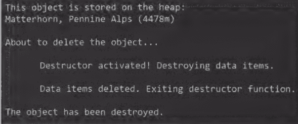

在程序中，用于表示马特洪峰（Matterhorn）的山实例通过 `delete` 运算符被销毁。它遵循指针从堆中移除该实例，该实例是动态存储在那里的：

```
delete pMatterhorn;
```

作为该过程的一部分，山的析构函数会被自动调用。该函数使用山实例中的数据成员来删除每个单独动态存储的每一个值。

```
delete pName;
delete pRange;
delete pElevation;
```

现在你的程序可以销毁马特洪峰的山类实例，而不会留下任何孤立的数据。

作为额外的预防措施，之前用于访问实例的指针被设置为 `NULL`，以便程序无法再次使用它：

```
pMatterhorn = NULL;
```

在这个示例中，这种情况不太可能，因为简单程序的 `main()` 部分即将结束，但情况并非总是如此。

## 运算符重载

虽然之前的类使用了 `displayDetails()` 函数，但除非你的类展示了如何使用 `<<` 重定向运算符，否则无法在 `cout` 语句中使用对象。

在正常情况下，除非你的代码定义了如何处理对象的数据成员（例如它们应该如何显示或保存到文件中），否则无法将对象的内容发送到流中：

```
cout << steepestInWorld;               // 这目前将无法工作
outputStream << steepestInWorld;      // 这目前将无法工作
```

你可以为你你创建的任何新类定义特定运算符是如何作用的。这被称为“运算符重载”。你可以精确地定义每个运算符如何被用于处理你类的数据成员。这通常可以使类变得更容易用，因为你可以使用熟悉的运算符符号（如 `+` 或 `-`），而不是调用函数。

该程序展示了如何重载 `<<` 运算符，以便 `mountain` 类的实例可以发送到流，例如 `cout`（屏幕）或 `ofstream`（输出流）。`<<` 运算符与山对象的使用方式与简单数据类型相同，而无需调用 `displayDetails()` 函数。


```
#include <iostream>      // 程序将在屏幕上显示一些文本
using namespace std;               // 将使用标准标识符 string, cout 和 endl
// ------------------------------------------------
class mountain
private:
    // 数据成员
    string name;
    string range;
    int elevation;
public:
    // 成员函数和运算符
    mountain(string newName, string newRange, int newElevation);
    void displayDetails();
    friend ostream& operator<<(ostream &outStream, mountain &objectToDisplay);
// ------------------------------------------------
mountain::mountain(string newName, string newRange, int newElevation)
{
    // 在创建此类的新实例时调用的构造函数
    name = newName;
    range = newRange;
    elevation = newElevation;
}
```

继续...

```cpp
// ---
void mountain::displayDetails()
{
    // 手动在屏幕上显示每个数据成员的值
    cout << ", " << range;
    cout << " (" << elevation << "m")";
}
// --
```

```cpp
ostream& operator<<(ostream &outStream, mountain const &objectToDisplay) {
    // 重载运算符以允许将山实例发送到流
    // 例如 cout（屏幕）或输出流 ofstream
    outStream << objectToDisplay << " " << objectToDisplay.range
               << " (" << objectToDisplay.elevation << "m")";
    return outStream;
}
// --
```

```cpp
int main() {
    // 创建山类的实例
    mountain steepestInWorld("The Trango Tower", "Karakoram", 6286);
    // 显示对象的数据成员
    cout << "这些方法将产生相同的结果：" << endl;
    cout << steepestInWorld << endl;
    steepestInWorld.displayDetails();
    cout << endl;
    return 0;
}
```

这两种方法在程序执行时产生相同的输出：

> 这些方法将产生相同的结果：
> The Trango Tower, Karakoram (6286m)
> The Trango Tower, Karakoram (6286m)

程序利用 `friend` 关键字来允许输出流访问山的 `name`、`range` 和 `elevation` 数据成员。这是必要的，因为这些数据成员被声明为私有，意味着它们只能被山的成员函数访问。通过声明该运算符是山的友，当运算符尝试访问数据成员时，它将拥有权限。

## 在类继承时对成员的访问控制

在本章开头，我们已经简要描述了类的公共（`public`）、私有（`private`）和保护（`protected`）成员之间的区别。

我们已经看到特定类的私有成员不能被任何属于该类的代码直接访问。私有数据成员只能通过该类的成员函数访问，而私有成员函数只能由同一类的函数调用。

当一个类从另一个类继承数据成员或函数时会发生什么？

任何被指定为私有的成员都无法被新类的继承类直接访问。为了允许继承类的成员进行访问，有必要使用 `protected` 访问修饰符对其进行声明。类中受保护的成员可以被该类或任何继承自该类的其他类访问。

在接下来的程序中，你将看到 `mountain` 类被设置为保护，这样继承它的 `volcano` 类就可以使用其中的许多成员：

```
class mountain
{
protected:
    // 受保护的数据成员可以被此类直接访问
    // 或者被继承自它的类访问，例如 volcano 类
    string name;
    string range;
    int elevation;
    mountain(); // 不会被使用，但 volcano 会尝试继承它
public:
    mountain(string newName, string newCountry, int newElevation);
    void displayDetails();
    void setName(string name);
}
```

## 创建继承自另一个现有类的新类

要指定我们正在从现有的 `mountain` 类继承 `volcano` 类，我们按照如下方式开始新类的声明：

```
class volcano : public mountain
```

接下来是声明的其余部分，指定新 `volcano` 类将包含的额外数据成员和成员函数，以及它们如何被访问。

新 `volcano` 类的完整声明如下所示：

```
class volcano : public mountain {
  private:
    bool extinct;
    string lastErupted;
  public:
    volcano();
    volcano(string newName, string newRange, int newElevation,
        bool newExtinct, string newLastErupted);
    void displayDetails();
    bool isExtinct();
    string getWhenLastErupted();
}
```


你可以看到它包含了两个新的数据成员：`extinct` 和 `lastErupted`，它们是私有的。

它还声明了几个公共的成员函数，以便 `volcano` 类之外的代码可以调用它们。

其中两个函数是新 `volcano` 类的构造函数。它们将用于创建该类的新实例：

```
volcano();

volcano(string newName, string newRange, int newElevation,
    bool newExtinct, string newLastErupted);
```

还有一个新版本的 `displayDetails()` 函数：

```
void displayDetails();
```

尽管原始的 `mountain` 类已经包含一个 `displayDetails()` 函数，但这个新版本显示了 `volcano` 类的所有数据成员——包括继承自 `mountain` 的成员，以及新的 `extinct` 和 `lastErupted` 数据成员。`volcano` 类需要制作该函数的更新版本，而不是依赖于所继承的 `mountain` 类中提供的旧版本。

最后，声明了两个原始 `mountain` 类中没有的新成员函数：

```
bool isExtinct();

string getWhenLastErupted();
```

下面的程序定义并使用了继承自 `mountain` 类的 `volcano` 类：

### 示例 13.7 - class_inherited.cpp

```
#include <iostream> // 程序将在屏幕上显示一些文本

using namespace std; // 将使用标准标识符 string, cout 和 endl

// --------------------------------------------------------------------------------

class mountain {

protected:

    // 受保护的数据成员可以被此类直接访问
    // 或者被继承自它的类访问，例如 volcano 类
    string name;
    string range;
    int elevation;
    mountain(); // volcano() 构造函数将始终尝试调用此
public:
    mountain(string newName, string newCountry, int newElevation );
    void displayDetails();
    void setName(string newName);
};

// --------------------------------------------------------------------------------

mountain::mountain() {
    // 类必须有这个默认构造函数
    // 任何继承自 mountain 的类都会尝试继承它的
    name = "Not assigned yet";
    range = "Not assigned yet";
    elevation = 0;
}

// --------------------------------------------------------------------------------

mountain::mountain(string newName, string newRange, int newElevation) {
    // 在创建该类的新实例时调用的构造函数
    name = newName;
    range = newRange;
    elevation = newElevation;
}

// --------------------------------------------------------------------------------
```

```
void mountain::displayDetails()
{
    // 此类将被 volcano 类继承
    cout << " , " << range;
    cout << " (" << elevation << "m)";
}
```

```
void mountain::setName(string newName)
{
    name = newName;
}
```

```
class volcano : public mountain
{
private:
    bool extinct;
    string lastErupted;
public:
    volcano();
    volcano(string newName, string newRange, int newElevation,
           bool newExtinct, string newLastErupted);
    void displayDetails();
    bool isExtinct();
    string getWhenLastErupted();
};

volcano::volcano() {
    // 类必须有这个默认构造函数
    extinct = false;
    lastErupted = "Unknown";
}

volcano::volcano(string newName, string newRange, int newElevation,
           bool newExtinct, string newLastErupted) {
    // 在创建该类的新实例时调用的构造函数
    name = newName;
    range = newRange;
    elevation = newElevation;
    extinct = newExtinct;
    lastErupted = newLastErupted;
}

void volcano::displayDetails()
{
    // 此类将被 volcano 类继承
    cout << " name:" << name;
    cout << " range:" << range;
    cout << " (" << elevation << "m),"
    cout << (extinct ? " Extinct" : " Active") << ")";
    cout << " last erupted:" << lastErupted;
}

bool volcano::isExtinct() {
    return extinct;
}

string volcano::getWhenLastErupted() {
    return lastErupted;
}

int main()
{
    // 创建 mountain 和 volcano 类的各一个实例
    mountain lastClimbed("Mt. Raima", "Guiana Highlands", 2810);
    volcano nearestVolcano("Katla", "Mid-Atlantic Ridge", 1512, false, "Oct 1918");
    // 显示新创建对象的细节
    cout << "Here are the details of the mountain and volcano:" << endl << endl;
    lastClimbed.displayDetails();
    cout << endl;
    nearestVolcano.displayDetails();
    cout << endl << endl;
    // 更新数据成员并重新显示山对象的细节
    lastClimbed.setName("Mt. Raima", "The Lost World");
    // 更新继承的数据成员并重新显示火山对象的细节
    nearestVolcano.setName("Katla", "Ketill");
    cout << endl << endl;
    cout << "The objects have now been updated with extra information:";
    cout << endl << endl;
    lastClimbed.displayDetails();
    cout << endl;
    nearestVolcano.displayDetails();
    cout << endl;
    cout << endl << endl;
    cout << "Protected member values for the blank volcano object are inherited:";
    cout << endl << endl;
    volcano blank;
    blank.displayDetails();
    cout << endl << endl;
    return 0;
}
```

### 使用 .h 头文件声明类

到为止，当我们在程序中使用类时，它们的成员函数是在与主程序相同的源文件内进行声明和定义的。正如我们在第 4 节“键盘输入与屏幕输出”中所看到的，程序可以包含来自单独独立头文件的代码，这些头文件包含了常量或函数的声明。按照惯例，这些头文件被赋予以 ".h" 扩展结尾的文件名。

在声明一个类时，该类的细节可以存储在它们自己的头文件中。然后，该头文件可以被任何需要使用新类的程序包含。头文件的文件名将根据类名确定，并以 ".h" 结尾。

下面是一个头文件，其中包含了我们在示例中使用的 `mountain` 类的声明：

```cpp
// 此处声明了一个名为 mountain 的新类 // 你可以在许多不同的程序中反复使用它。 // mountain 的每个成员函数的源代码都保存在 mountain.cpp 中 // 只有当标识符 _mountain 尚未定义时，编译器才会尝试声明新类，即此 mountain.h 文件尚未被你程序中的任何其他源文件包含。
#ifndef mountain
#define mountain

#include <string> // 程序使用了 string 类型的变量
using namespace std; // 使用标准标识符 cout 和 endl
//-------------------------------------------------
class mountain
{ // 这些私有数据无法被程序的其他部分直接访问
private:
 string name;
 string range;
 int elevation;
 // 这些公共函数可以被程序的其他部分调用
public:
mountain(string newName, string newRange, int newElevation);
 void displayDetails();
};
#endif
```

注意，没有必要编译或构建上述头文件。另一个文件要使用 `mountain` 类，所需要的是在新文件中通过添加以下指令包含该头文件的文件名：

```cpp
#include "mountain.h"
```

新类的每个成员函数的代码通常保存在单独的文件中。该文件将同样以类名命名，但扩展名以 `.cpp` 结尾。

这意味着我们需要另一个文件，用来定义 `mountain` 类中每个成员函数的代码。

### 示例 13.8 - mountain.cpp

```cpp
#include "mountain.h"    // mountain 类在此文件中声明

#include <iostream>         // 程序将在屏幕上显示一些文本

using namespace std;      // 将使用标准标识符 cout 和 endl


mountain::mountain( string newName, string newRange, int newElevation) {
    // 在创建该类的新实例时调用的构造函数
    name = newName;
    range = newRange;
    elevation = newElevation;
}

void mountain::displayDetails() {
    // 显示每个私有数据成员
    cout << " " << name << ", " << range << endl;
    cout << " " << elevation << " m" << endl;
}
```

在任何其他程序使用 `mountain` 类或其包含的成员之前，必须编译 "mountain.cpp" 类文件。

从命令行，你可以使用以下命令执行操作：

```bash
g++ -Wall -c mountain.cpp
```

上述命令将编译代码，但不会尝试将其链接到任何其他程序以生成可执行文件。

或者，如果你正在使用 Geany，应该使用“Compile”（编译）按钮，而不是“Build”（构建）按钮：

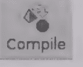

一旦编译完成，你的其他程序现在就可以使用 `mountain` 类来创建对象了。

这是一个在包含可重用的 `mountain.cpp` 文件后创建多个 `mountain` 类实例的示例：

### 示例 13.8c - highest_mountains.cpp

```cpp
#include <iostream> // 程序将在屏幕上显示一些文本

#include "mountain.cpp" // mountain 类中包含函数的代码

using namespace std; // 将使用标准标识符 cout 和 endl

int main() {
    // 创建 3 个不同的对象，每个都是 mountain 类的实例

    mountain highestInWales("Mt. Snowdon/Yr Yddfa", "Snowdonia", 1085);

    mountain highestInAfrica("Kilimanjaro", "Eastern Rift", 5895);

    mountain highestInSouthAmerica("Aconcagua", "Andes", 6961);

    // 为这 3 个对象调用 displayDetails() 成员函数

    cout << "The highest mountain in Wales is ";
    highestInWales.displayDetails();

    cout << endl << endl;

    cout << "The highest mountain in Africa is ";
    highestInAfrica.displayDetails();

    cout << endl << endl;

    cout << "The highest mountain in South America is ";
    highestInSouthAmerica.displayDetails();

    cout << endl << endl;

    return 0;
}
```

注意，该程序包含一个直接包含 "mountain.cpp" 代码的指令：

```cpp
#include "mountain.cpp"
```

此源代码定义了 `mountain` 类中每个成员函数的体代码。

反之，“mountain.cpp" 也包含了 "mountain.h" 头文件，该文件声明了它的实际存在。

从命令行，你可以使用以下命令执行操作：

```bash
g++ -Wall -c mountain.cpp
```

上述命令将编译代码，但不会尝试链接到任何其他程序以生成可执行文件。

或者，如果你正在使用 Geany，应该使用“Compile”（编译）按钮，而不是“Build”（构建）按钮：


一旦编译完成，你的其他程序现在就可以使用 `mountain` 类来创建对象。

## 第13 章总结：对象与类

在本章中我们涵盖了内容：

- C++ 允许你定义自定义类型——类。这些是对事物行为的通用描述。
- 类可以用于创建对象。对象是类的具体实例。
- 类通常包含一个多个数据项，称为数据成员。
- 类还定义了可以对数据成员执行的函数，称为成员函数。
- 使用关键字 `class` 来声明一个新类。
- 在创建类时，你可以基于某些现有的类。这种技术被称为继承。
- 类必须包含一个多个构造函数，在创建新实例时执行任务或为数据成员赋值。
- 访问修饰符用于明确程序的哪些部分允许访问和使用数据成员。这防止了代码不受控制地访问数据成员。


- 公共（`public`）数据成员或函数可以被程序的其他部分直接访问。
- 私有（`private`）数据成员或函数无法被类外部访问。数据只能通过类的成员函数访问。
- 保护（`protected`）数据成员或函数只能由它所属的类以及基于它的类访问。
- 默认情况下，成员被视为私有的，除非另有说明。
- 此外，类可以提供“`get`”和“`set`”函数来进一步控制对数据的访问。
- 在定义成员函数时，函数名由其相关的类名以及 `::` 作用域运算符引导。
- 对象可以作为静态数据创建，也可以在堆上动态创建。
- 类可以包含一个析构函数。这种成员函数负责在对象即将销毁时执行处理。析构函数的名字与类名相同，且必须以 `~` 开头。
- 析构函数可以用于清理或删除对象在堆上使用的动态数据，以避免内存泄漏。
- 新类可以重载运算符符号，以定义这些符号如何处理类数据成员。
- 类可以通过指定另一个类为该类的友，对特定的函数或运算符提供额外访问。
- 将类的定义存储在单独的 `".h"` 头文件中允许被其他程序使用。
- 类的成员函数的代码也可以存储在单独的 `".cpp"` 文件中，使你的源代码更有组织。

# 供你尝试的问题和练习

- 1. 创建一个名为 `computer` 的类，包含存储各种机器属性的数据成员：
  `name`
  `speed_GHz`
  `gigabytes_RAM`
  `operating_system`
- 2. 为 `computer` 类添加以下成员函数，并确保它们在类外是可用的：
  一个不接受任何参数并创建默认类实例的构造函数。
  另一个构造函数，允许为每个数据成员赋值。
  一个名为 `display()` 的函数，用于屏幕上显示特定实例的数据。
  确保定义每个函数的体。
- 3. 重载 `<<` 运算符，使 `computer` 实例的数据可以定向到流。
  编写一个程序创建三个 `computer` 实例。
  使用重载的运算符在屏幕上显示这三个实例的详情。
  使用相同的重载运算符将详情保存到文件中。
- 4. 将类的声明保存在独立的头文件中，命名为 `"computer.h"`。
  创建一个新的 `computer.cpp` 文件，包含每个成员函数的代码。
  编写一个简单的程序来包含并使用 `"computer.cpp"` 文件。
- 5. 创建一个继承自 `computer` 的 `laptop` 类，添加以下额外成员：
  `screen_size`
  `weight_kg`

# 附录

有用信息

## ASCII 字符和代码

| ASCII 代码 | 符号 | ASCII 代码 | 符号 | ASCII 代码 | 符号 | ASCII 代码 | 符号 | ASCII 代码 | 符号 |
| :--- | :--- | :--- | :--- | :--- | :--- | :--- | :--- | :--- | :--- |
| 0 | Null | 27 |  | 54 |  | 81 | Q | 108 | l |
| 1 |  | 28 |  | 55 | 7 | 82 | R | 109 | m |
| 2 |  | 29 |  | 56 | 8 | 83 | S | 110 | n |
| 3 |  | 30 |  | 57 | 9 | 84 | T | 111 | o |
| 4 |  | 31 |  | 58 |  | 85 | U | 112 | p |
| 5 |  | 32 | Space | 59 |  | 86 | V | 113 | q |
| 6 |  | 33 |  | 60 |  | 87 | W | 114 | r |
| 7 |  | 34 |  | 61 | = | 88 | X | 115 | s |
| 8 |  | 35 | # | 62 | > | 89 | Y | 116 | t |
| 9 |  | 36 | S | 63 |  | 90 | Z | 117 | u |
| 10 |  | 37 | % | 64 | @ | 91 |  | 118 | w |
| 11 |  | 38 | & | 65 | A | 92 |  | 119 | x |
| 12 |  | 39 |  | 66 | B | 93 |  | 120 | y |
| 13 |  | 40 |  | 67 | C | 94 | ^ | 121 | z |
| 14 |  | 41 | ) | 68 | D | 95 |  | 122 | { |
| 15 |  | 42 | * | 69 | E | 96 |  | 123 | } |
| 16 |  | 43 | + | 70 | F | 97 | a | 124 |  |
| 17 |  | 44 |  | 71 | G | 98 | b | 125 | } |
| 18 |  | 45 |  | 72 | H | 99 | c | 126 | ~ |
| 19 |  | 46 |  | 73 | J | 101 | d | 127 | Delete |
| 20 |  | 47 |  | 74 | J | 102 | e |  |  |
| 21 |  | 48 |  | 75 | K | 103 | f |  |  |
| 22 |  | 49 |  | 76 | L | 104 | g | h |
| 23 |  | 50 | 2 | 77 | M |  |  |  |  |
| 24 |  | 51 | 3 | 78 | N | 105 |  |  |  |
| 25 |  | 52 | 4 | 79 | O | 106 | j |  |  |
| 26 |  | 53 | 5 | 80 | P | 107 | k |  |  |

上表的阴影字符是“不可打印”或“控制”字符。

# C++ 保留字

这些是 C++ 语言的一部分的特殊单词。每个词都有特殊的用途，因此你不能在编写的程序代码将它们用作自己的变量、常量、类或函数的名称——尝试这样做会导致错误。

尝试使用保留字的错误示例：

```cpp
// 指明水中的物质...
bool float = true; // 哎！float 是保留字
```

获取一个数字...

`int myNum;`

`cin >> myNum;`

`int double = 2; // 哎！double 是保留字`

以下是不能作为标识符保留字列表：

| and | continue | if | register | typedef |
| :--- | :--- | :--- | :--- | :--- |
| and_eq | default | inline | reinterpret_cast | typeid |
| asm | delete | int | return | typename |
| auto | do | long | short | sizeof |
| bit | double | mutable | namespace | unsigned |
| bool | else | new | static | using |
| break | enum | not | static_cast | virtual |
| case | explicit | not_eq | struct | volatile |
| catch | extern | operator | switch | template |
| char | false | or | this | while |
| class | float | private | throw | xor |
| compl | for | protected | true | xor_eq |
| const | friend | public | goto |

此外，还有编译器使用的其他包含下划线字符的标记：

| 指令 | 含义 |
| :--- | :--- |
| `#` | 告诉编译器在编译源代码之前执行某些操作。 `#include <iostream>` |
| `;` | 分号。标记程序语句的结束。`cout << "Hello" << endl;` |
| `//` | 单行注释。编译器将忽略这一行的注释。`// This will be ignored by the compiler cout << time << endl;` |
| `/*` | 多行注释块。标记可能超过一行的文本。`/* secure.cpp ... */` |
| `(` | 左括号。包含表达式，例如算术表达式或逻辑表达式。`( timeLeft * 10 ) + 500` |
| `)` | 右括号。包含表达式的一部分。标记语句块的开始和结束。`if ( isTrue )` |
| `{` | 左大括号 |
| `}` | 右大括号 |
| `[` | 数组索引。`firstItemInArray = myArray[0];` |
| `]` | 数组索引结束 |
| `<<` | 将值定向到你选择的输出流（如屏幕或文件）。`cout << "Hello";` |
| `>>` | 从选择的输入流（如键盘或文件）获取值。`cin >> menuChoice;` |
| `*` | 指针或解引用运算符。用于创建或解引用指针。`string* pName; cout << *pName;` |
| `.` | 成员运算符。用于调用成员函数或访问属于对象的数据。`passwordString.length();` |
| `->` | 指针成员运算符。允许通过指针访问成员的值。`pFlight->destination = "Detroit";` |
| `::` | 作用域解析运算符。用于标识符的所有者，例如属于特定命名空间的变量名。`std::cout;` |

## 运算符及其优先级

这是一个可以在 C++ 表达式中使用的运算符列表，按优先级排序。优先级最高（最执行）的运算符位于列表顶部。优先级最低（最后执行）的运算符位于列表底部。

| 左括号（将表达式的部分组合在一起。） |
| ) 右括号（将表达式的部分组合在一起。） |
| 除法（用一个数值除以另一个。） |
| * 乘法（将两个数值相乘。） |
| + 加法（将两个数值相加，或将字符或字符串附加到另一个字符串值上。） |
| - 减法（从另一个数值中减去一个数值。） |
| % 取模（用一个数值除以另一个以获得余数。） |
| ++ 递增（将一个数值增加1。） |
| -- 递减（将一个数值减少1。） |
| == 等同于（判断两个值/表达式是否相同。） |
| != 不等于（判断两个值/表达式是否不同。） |
| ! 逻辑非（获取布尔/布尔表达式的反反。） |
| && 逻辑与（如果发现一对布尔/布尔表达式都为真，则为真。如果不是真，则为假。） |
| || 逻辑或（如果发现一对布尔/布尔表达式中至少有一个为真，则为真。如果不是假，则为假。） |
| ^ 逻辑异异（如果发现一对布尔/布尔表达式不同，则为真。如果它们相同，则为假。） |
| += 累加 / 附加（将一个数值加到现有数值上。对于字符串值，将字符或字符串附加到另一个字符串值上。） |
| -= 减去（从当前数值中减去一个数值。） |
| &= 逻辑与（如果发现当前布尔/布尔表达式和另一个都为真，则为真。如果不是真，则为假。） |
| |= 逻辑或（如果发现当前布尔/布尔表达式中至少有一个为真，则为真。如果不是假，则为假。） |
| ^= 逻辑异异（如果发现当前布尔/布尔表达式和另一个布尔/布尔表达式不同，则为真。如果它们相同，则为假。） |

## 数据类型与数值范围

| 数据类型 | 用途 |
|---|---|
| short | 短整型。可以是正数或负数。范围在 -32768 到 32767 之间。 |
| unsigned short | 无符号短整型。0 到 65535 之间的小型正数。 |
| int | 整数型。正或负整数。范围在 -2147483648 到 2147483647 之间。 |
| unsigned int | 无符号整数型。0 到 4294967295 之间的正数。 |
| long | 长整型。较大的正数或负数。范围在 -2,147,483,648 到 2,147,483,647 之间。 |
| unsigned long | 无符号长整型。较大的正数或负数。但不能用于表示负值）。范围在 0 到 4,294,967,295 之间。 |
| long long | 超长整型。更大的正数或负数。范围在 -9,223,372,036,854,775,808 到 9,223,372,036,854,775,807 之间。 |
| unsigned long long | 无符号超长整型。更大的正数或负数（不能用于表示负值）。范围在 0 到 18,446,744,073,709,551,615 之间。 |
| float | 单精度浮点数。范围在 -3.1758e-38 到 3.4028e+38 之间。 |
| double | 双精度浮点数。正或负的小数。范围在 -2.22507e-308 到 1.79769e+308 之间。 |
| long double | 扩展精度浮点数。正或负的小数。范围在 -3.3621e-4932 到 1.18973e+4932 之间。 |
| bool | 布尔值。只有 true（真）或 false（假）。数据类型为 bool 的变量不允许其他值。 |
| char | 单字节值，通常用于表示 ASCII 字符集中的单个字符。值范围在 -128 到 127 之间。注意 ASCII 字符集从代码 0（NULL 不可打印字符）开始，因此负值并不直接对应 ASCII 字符。 |
| char_t | 8 位“宽字符”值，可能用于表示 UNICODE 字符。范围在 0 到 65535 之间。 |
| unsigned char | 无符号字符型。允许访问 ASCII 码的完整范围。所有 8 位模式均用于表示正数，没有被“浪费”在负数上。 |
| string | 零个或多个字符符号的序列。在程序中使用 string 数据类型需要你在代码开头添加 `#include <string>`，除非你包含的另一个库已经执行了该操作。 |

# 你可以包含在程序中的 C++ 和 C 语言库函数头文件

| 头文件 | 描述 |
|---|---|
| `<string>` | 允许使用 string 类型并对字符串值执行操作。 |
| `<iostream>` | 输入输出流库。用于键盘输入和屏幕输出。 |
| `<iomanip>` | 输入输出操纵符库，用于格式化发送到流的值。 |
| `<fstream>` | 文件流库。用于读取或写入文件的输入输出操作。 |
| `<istream>` | 输入流库。用于读取文件的输入操作。 |
| `<ostream>` | 输出流库。用于写入文件的输出操作。 |
| `<sstream>` | 字符串流库。在字符串值与其他数据类型之间进行转换。 |
| `<cstdlib>` | 允许使用 `exit()` 函数终止程序执行。还允许使用 `random()` 和 `srand()` 函数来选择和设定随机数。 |
| `<ctime>` | 允许使用 `time()` 函数，该函数作为随机数的种子非常有用。 |
| `<unistd.h>` | 允许使用 `sleep()` 函数延迟程序的某些运行。注意这是一个 C 库，与 C++。（它实际上不是标准的 C++ 库，因此文件名以 "h" 结尾）。 |
| `<cmath>` | 允许使用 `pow(power)` 和 `sqrt(square-root)` 函数。 |
| `<cctype>` | 允许使用 `toupper()` 和 `tolower()` 函数转换 char 类型值的大小写。使用字符串库的程序不需要包含此项，但使用单个字符并转换其大小写的程序则需要包含。 |
| `<climits>` | 在从键盘输入时从 `cin` 刷新不需要的字符时有用。定义了常量 `INT_MAX`。 |

# 控制屏幕文本颜色的转义序列

以下是程序在屏幕上显示文本时可能使用的典型颜色列表。
每个序列都可以发送到标准输出，以其自身的字面字符串形式发送：

```cpp
cout << "\e[32m"; // 将后续的所有文本改为绿色
```

...或者嵌入到另一个字面字符串中：

```cpp
// 在同一行显示几种不同的颜色，然后重置
cout << "\e[41m" "red alert" "\e[0m";
```

- `\e[31m` 红色
- `\e[32m` 绿色
- `\e[33m` 黄色
- `\e[34m` 蓝色
- `\e[35m` 品红色
- `\e[36m` 青色
- `\e[37m` 白色
- `\e[40m` 黑色背景
- `\e[41m` 红色背景
- `\e[42m` 绿色背景
- `\e[43m` 黄色背景
- `\e[44m` 蓝色背景
- `\e[45m` 品红色背景
- `\e[46m` 青色背景
- `\e[47m` 白色背景
- `\e[0m` 重置

# 误用 = 赋值运算符代替了 == 比较运算符

不混淆 `=` 赋值运算符（用于给变量设置值）与 `==` 比较运算符（用于比较两个值是否相等）是非常重要的。

对于以前编写过使用 BASIC 等语言编写程序的程序员来说，这是一个常见问题，因为 BASIC 使用同一个单等符号 符号来同时表示这两种操作——即赋值和比较。

考虑下面这个 `if` 语句，它执行了一个简单的比较：

```cpp
if ( num = 60 )
cout << "num is the same as 60";
```

上述语句的意图是，当发现变量 `num` 为 60 时，计算机才应该在屏幕上显示一条消息。

在尝试测试两个值是否相等时，不小心使用 `=` 而不是 `==` 将运行时产生错误的结果。

例如：

```cpp
if ( num = 60 )
cout << "num is the same as 60";
```


这段代码执行的第一件事是执行表达式 `( num = 60 )` 的内容，它是 `if` 语句的一部分。

尽管程序员的原始意图是比较这两个值，但该表达式将变量 `num` 的值设置为 60。它执行的是赋值而不是比较。

所以，考虑一下括号中的内容以及它们如何影响 `if` 语句……

赋值的发生没有引起错误——它成功执行了。但危险之处在于：计算机在尝试评估赋值语句时，会将赋值执行成功视为产生了一个正的非零值。这个非零值在执行 `if` 语句时的效果与 `true` 相同。

`num` 的值是多少并不重要，赋值的成功总是会被评估，实际上给出一个 `true` 值。因此，`if` 语句体每次都会被触发，而不是只在 `num` 的值为 60 时触发。

# 由于运算符优先级不同导致表达式求值错误

乍看，一个表达式可能看起来正确计算了某个特定结果。表达式中每个运算符的不同优先级可能意味着操作的执行顺序并不是程序员意图的顺序。

下面是一个表达式，意图是从变量 `keyChar` 的值减去 64，然后将结果从另一个变量 `originalChar` 中减去：

```cpp
decryptedChar = originalChar - keyChar - 64;
```

在上述语句中，两个减法符号具有相同的运算符优先级——它们同等重要。

计算机从表达式的左侧开始向右移动，执行每次减法。这意味着语句具有相同的效果：

```cpp
decryptedChar = ( originalChar - keyChar ) - 64;
```

但实际的意图是：

```cpp
decryptedChar = originalChar - ( keyChar - 64 );
```

假设 `originalChar` 的值为 'P'，其 ASCII 值为 80，而 `keyChar` 的值为 'C'，其 ASCII 值为 67。

原始表达式将产生此结果：

```
80 - 67 = 13 // originalChar - keyChar
13 - 64 = -51 // 在上述结果上减去 64，而不是从 ASCII 码
```

通过添加一对括号，表达式 `originalChar - ( keyChar - 64 )` 产生：

```
67 - 64 = 3 // ( keyChar - 64 ), 得到结果 3
80 - 3 = 77 // 从 decryptedChar 中减去上述结果，77 是 M 的代码
```

这里的教训是，你应该非常小心，确保表达式的执行完全按照你的意图。

为了绝对确保计算机按照意图的顺序执行表达式的不同部分，你应该添加额外的括号来控制哪些部分先执行。

# 通过添加过多的 { } 大括号意外改变了变量的作用域

语句周围不必要的 `{ }` 大括号可能会意外改变变量的作用域或生命周期。这可能导致编译期间出现错误。

考虑这些使用变量 `timeLeft` 的语句：

```cpp
int timeLeft = 100;
cout << timeLeft << endl;
timeLeft--;
```

在前两行周围包含不必要的 `{ }` 括号，将改变变量的声明。这意味着变量 `timeLeft` 仅局部于 `{ }` 括号内的代码块：

```cpp
{
  int timeLeft = 100;
  cout << timeLeft << endl;
} // timeLeft 不再存在 - 它是上面 { } 块的局部变量
timeLeft--; // 编译器尝试使用 timeLeft 时会报错
```

大括号之后的任何后续代码都无法访问 `timeLeft` 变量，因为在 `{ }` 块之外它已不再存在。

# g++ 将 C++ 源代码翻译为可执行文件经过的阶段

你的高层 C++ 源代码程序对于处理器运行来说太复杂，但对于人类人类来说相对容易。

**C++ 预处理器**
处理代码中的指令。引入你选择的库和文件。

**外部库和文件**
你或他人编写的源代码节省时间和精力。

**你的 C++ 源代码结合外部代码**
准备好编译。

**C++ 编译器**
将整个程序翻译成汇编语言。

**汇编器**
将汇编语言转换为机器码。

**链接器**
将对象代码添加到可执行文件中。

| 阶段 | 描述 |
| :--- | :--- |
| C++ 预处理器 | 处理代码中的指令。引入你选择的库和文件。 |
| C++ 编译器 | 将整个程序翻译成汇编语言。 |
| 汇编器 | 将汇编语言转换为机器码。 |
| 链接器 | 将对象代码添加到可执行文件中。 |

## g++ 的实用选项

乍看，一个表达式可能看起来正确计算了某个特定结果。

| -v | 显示 `g++` 的版本。 |
| -Wall | 开启所有警告。 |
| -o | 指定输出文件的名称。 |
| -c | 将源代码编译为对象文件。 |
| -S | 编译后停止并输出汇编代码。 |
| -E | 仅运行预处理器。 |
| -g | 在对象文件中生成调试信息。 |
|  |  |

# 无需在可执行文件名前使用 ./

在你的主目录下有一个名为 `.bashrc` 的隐藏文件，它包含了每次打开新 Bash 窗口时都会读取的各种设置。“rc”字在许多文件名中代表“resource”。

可以在设置文件中添加额外的一行来更改终端查找可执行文件的位置。一旦你执行了操作，就不再需要在可执行文件的名称前添加 `./` 了。

从主目录开始，使用文本编辑器（如 `Nano`）加载你的 `.bashrc` 文件：

```bash
cd ~
nano .bashrc
```

你可以在文件末尾添加以下新行：

```bash
export PATH="/home/$USER:$PATH"
```

`PATH` 和 `USER` 是在你的 Bash shell 中运行时供程序和脚本使用的环境变量变量。

`PATH` 列出了 Linux 在尝试定位可执行文件时使用的路径列表。

`USER` 存储你的用户名，该用户名通常作为标准 Linux `/home` 目录下用户目录的名称。

文件中的新行有效地将主目录路径（例如 `/home/pi`）对于名为 "pi" 的用户放在 Linux 现有路径列表的最前面。

以下是 Pi 的一个示例，展示了 `.bashrc` 文件末尾新添加的一行：

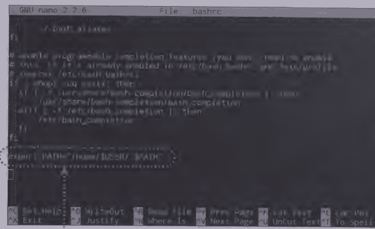

在文件的末尾添加此行。

为了让你的更改生效，你需要关闭终端窗口（如果你在图形化桌面上进行操作）并重新打开它。新的终端窗口将读取更新后的 `.bashrc` 文件内容，包括新修改的路径。

或者，你可以使用 `source` 命令来重新加载 `.bashrc` 文件：

```
pi@raspberry:~ $ source ~/.bashrc
```

这两种方法中的任何一种都能允许你运行一个可执行程序，而无需在程序名称前输入 `./`：

```
pi@raspberry:~ $ search_planets
```

这一次，我的程序将在不出现错误消息的情况下执行。

## 查看编译器生成的汇编语言

在命令行中，输入：

```
g++ -S source.cpp
```

假设一个名为 "source.cpp" 的 C++ 程序将生成一个名为 "source.s" 的文件。新文件将包含编译器在编译你的 C++ 源代码后生成的所有低级汇编源码。

下面的示例展示了从命令行使用 `-S` 选项编译程序。编译完成后，你可以使用 `ls` 命令确认是否已创建了新的汇编源码文件：


在 `Nano` 等文本编辑器中打开此文件，将允许你检查汇编源码：


你将能够读取程序执行的各种操作的汇编助符：

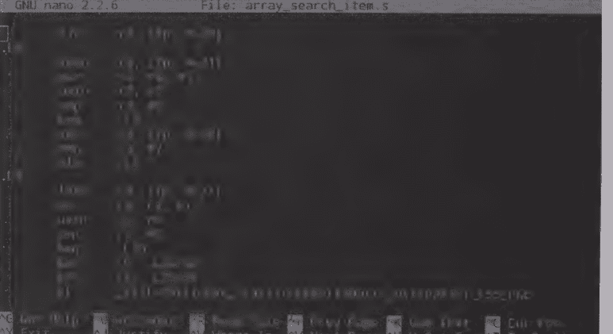

不要期望理解大部分这类低级代码——它们具有极强的技术性，并且需要对 Pi 中处理单元的工作原理有详细了解。只需知道汇编源码是在翻译过程的一部分产生的，该过程将高级 C++ 源代码拆解为机器码可执行文件。

每个助符对应一个二进制“操作码”，其后跟着一个或多个数据项，即“操作数”。例如，`cmp` 代表“比较”，`beq` 代表“相等跳转”，`ldr` 代表“加载寄存器”。

以 `r` 开头的数（如 `r1` 和 `r3`）是你 Pi CPU 内部的内存位置。

此汇编源码可能会被 GNU 编译器集合（GCC）作为正常编译过程的一部分进一步翻译为机器码，从而生成你可以运行的最终链接机器码可执行文件。通常，当你使用 `g++` 构建 C++ 程序时，你并不会意识到这个过程正在发生，Geany 会为你处理这一切。

534 | 在树莓派上使用 C++ 编程 *

你应该能够轻松地从原始 C++ 源代码中识别出一些静态字面量文本值。

例如，下面的汇编代码包含了将存储在我程序中行星名称数组中的字面量值。它还包含了当行星无法被……时在屏幕上显示的错误消息：

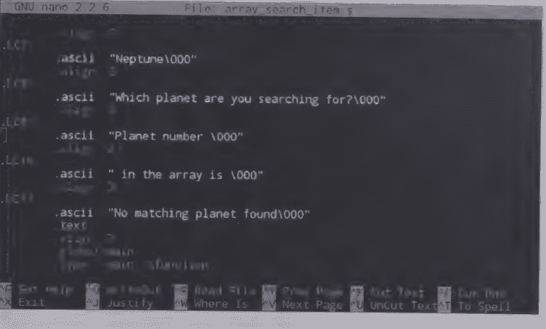

此外，汇编源码还包含了关于 C++ 源代码文件以及用于生成它的编译器的信息：

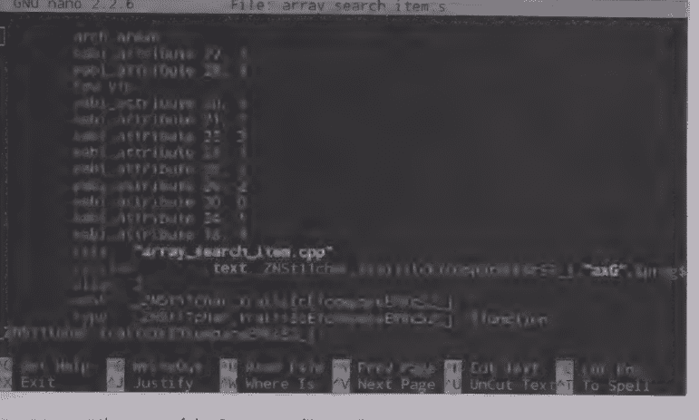

从上述内容中可以看到 C++ 源文件的名称是 `array_search_item.cpp`。你还可以看到汇编源码是为树莓派使用的 ARM 处理器生成的——armv6 架构。

无法将此代码汇编成可以在 Windows PC 或使用其他类型 CPU 的 Macintosh 上运行的机器码可执行文件。因为对于每种 CPU，助符及其对应的操作码都是不同的。每个操作系统都有自己的一套链接器在创建最终可执行文件时所需的低级例程库。API 的运行时库与 Windows 或 MacOS 使用的库大不相同。

为了在不同类型的计算机上运行相同的程序，有必要使用该特定计算机的编译器和运行时库重新编译你的 C++ 源代码文件。这被称为“源代码的可移植性”。只要你有一个可以生成该内容的特定编译器，源代码就可以被传输并用于多种类型的计算机。

534 | 树莓派 C++ 编程

你应该轻松地从你的原始 C++ 源代码中识别出一些静态字面量值。

例如，下面的汇编代码包含了存储在我程序中行星名称数组中的字面量值。它还包含了当行星无法……时在屏幕上显示的错误消息：


此外，汇编源码还包含 C++ 源代码文件以及用于生成它的编译器的信息：


从上述内容中可以看到 C++ 源文件的名称是 `array_search_item.cpp`。你还可以看到汇编源码是为树莓派使用的 ARM 处理器生成的——armv6 架构。

无法将此代码汇编成可以在 Windows PC 或使用其他类型 CPU 的 Macintosh 上运行的机器码可执行文件。因为对于每种 CPU，助符及其对应的操作码都是不同的。每个操作系统都有自己的一套链接器在创建最终可执行文件时所需的低级例程库。API 的运行时库与 Windows 或 MacOS 使用的库大不相同。

为了在不同类型的计算机上运行相同的程序，有必要使用该特定计算机的编译器和运行时库重新编译你的 C++ 源代码文件。这被称为“源代码的可移植性”。只要你有一个可以生成该内容的特定编译器，源代码就可以被传输并用于多种类型的计算机。

## 查看编译器生成的汇编语言

在命令行中输入：

```
g++ -S source.cpp
```


假设一个名为 `"source.cpp"` 的 C++ 程序将生成一个名为 `"source.s"` 的文件。新文件将包含编译器在编译你的 C++ 源代码后生成的所有低级汇编源码。

下面的示例展示了从命令行使用 `-S` 选项编译程序。编译完成后，你可以使用 `ls` 命令确认是否已创建了新的汇编源码文件：


在 Nano 等文本编辑器中打开此文件，将允许你检查汇编源码：


你将能够读取程序执行的各种操作的汇编助符（“有意义的缩写”）：


不要期望理解大部分这类低级代码——它们具有极强的技术性，并且需要对 Pi 中处理单元的工作原理有详细了解。只需知道汇编源码是在翻译过程的一部分产生的，该过程将高级 C++ 源代码拆解为机器码可执行文件。

每个助符对应一个二进制“操作码”（operation-code），其后跟着一个或多个数据项，即“操作数”。例如，`cmp` 代表“比较”（compare），`beq` 代表“相等跳转”（branch equal），`ldr` 代表“加载寄存器”（load register）。

以 `r` 开头的数（如 `r1` 和 `r3`）是你 Pi CPU 内部的内存位置。

此汇编源码可能会被 GNU 编译器集合（GCC）作为正常编译过程的一部分进一步翻译为机器码，从而生成你可以运行的最终链接机器码可执行文件。通常，当你使用 `g++` 构建 C++ 程序时，你并不会意识到这个过程正在发生，Geany 会为你处理这一切。

534 | 在树莓派上使用 C++ 编程 *

你应该能够轻松地从原始 C++ 源代码中识别出一些静态字面量文本值。

例如，下面的汇编代码包含了存储在我程序中行星名称数组中的字面量值。它还包含了当行星无法……时在屏幕上显示的错误消息：


此外，汇编源码还包含关于 C++ 源代码文件以及用于生成它的编译器的信息：


从上述内容中可以看到 C++ 源文件的名称是 `array_search_item.cpp`。你还可以看到汇编源码是为树莓派使用的 ARM 处理器生成的——armv6 架构。

无法将此代码汇编成可以在 Windows PC 或使用其他类型 CPU 的 Macintosh 上运行的机器码可执行文件。因为对于每种 CPU，助符及其对应的操作码都是不同的。每个操作系统都有自己的一套链接器在创建最终可执行文件时所需的低级例程库。API 的运行时库与 Windows 或 MacOS 使用的库大不相同。

为了在不同类型的计算机上运行相同的程序，有必要使用该特定计算机的编译器和运行时库重新编译你的 C++ 源代码文件。这被称为“源代码的可移植性”。只要你有一个可以生成该内容的特定编译器，源代码就可以被传输并用于多种类型的计算机。

## 查看可执行文件的信息 535

实用信息 | 描述
| :--- | :--- |
| `clear` | 清空屏幕或终端窗口。如果你的屏幕被信息填满，你会发现很有用。 |
| `pwd` | 打印工作目录。显示你当前所在的目录。 |
| `cd` | 切换目录。将当前目录切换到你的默认目录（登录时通常所在的目录）。 |
| `cd ..` | 切换目录，相对于你当前的工作目录，向上移动一级。 |
| `cd /home/pi/source` | 从根目录开始，按照精确路径切换目录，无论当前工作目录在哪里。 |
| `ls` | 显示当前目录下的文件列表。 |
| `ls -l` | 显示当前目录下的文件列表，并包含每个文件可以进行的操作、所有者、占用空间以及创建时间。 |
| `mkdir mycode` | 创建名为 `"mycode"` 的新目录。 |
| `cat myfile.cpp` | 显示 `"myfile.cpp"` 的内容。 |
| `cat myfile.cpp | more` | 显示 `"myfile.cpp"` 的内容，屏幕满时暂停。 |
| `nano edit.cpp` | 打开 Nano 编辑器。如果文件 `"edit.cpp"` 存在则将显示它以便进行修改。如果不存在该文件，Nano 将创建一个此命名的空白文档。 |
| `sudo apt-get install package` | 下载并安装机器上的新程序。需要超级用户权限，因此通常前面带有 `"sudo"` 命令。 |
| `g++ source.cpp` | 编译 C++ 源代码程序，生成一个名为 `"a.out"` 的可执行文件。 |
| `mv oldfilename newfilename` | 将文件 `"oldfilename"` 重命名为新文件 `"newfilename"`。 |
| `rm filedelete` | 删除你不再需要的文件。警告！删除后没有“回收站”，如果你不小心删除了，通常无法找回。 |

| 语 | 说明 |
| --- | --- |
| AND | 逻辑运算符，只有当表达式的所有部分都为真时，才会产生真结果。 |
| argument | 作为输入提供给函数或程序的值。 |
| compiler | 编译器，算术中使用的符号，如 + - / * |
| array | 数组，命名的值集合，所有值都具有相同的数据类型。数组中的每个项可以使用一个或多个索引号来访问。 |
| ASCII | 美国信息交换标准。 |
| assembler | 汇编器，将汇编语言转换为机器指令的程序。 |
| bit | 位，单个二进制数字。它可以存储值 0 或 1。 |
| byte | 字节，一组八位数字（位）。 |
| bool | 简单的 C++ 数据类型，表示真或假的布尔值。 |
| Boolean operator | 布尔运算符，如 AND、OR、NOT、XOR 等逻辑运算符。通常用于程序做出决策或作为表达式的一部分。 |
| case statement | 分支语句，数据流过的路径，可以是进入或离开计算机内存。 |
| channel | 通道，表示单个字符的简单 C++ 数据类型。 |
| character | 字符，可以表示的单个符号。 |
| command-line | 命令行，允许你输入由计算机执行的命令的计算机接口。 |
| comment | 注释，源代码文件中会被编译器忽略的一行文本，对人类阅读很有用。它不会被翻译成机器码，也不会由计算机执行。 |
| compiler | 编译器，在编译过程中将高级源代码转换为低级目标代码的程序。完成的目标代码通常可以被链接并执行。 |
| condition | 条件，逻辑或关系表达式，如果满足条件则产生真值，如果不满足则产生假值。 |
| constant | 常数，在程序运行期间永远不会改变的命名值。 |
| data-type | 数据类型，描述值的类型或“种类”。值可以是整数、字符串或布尔值。或者，你可以创建自己的数据类型。 |
| debug | 调试，发现并修正程序中的错误或错误。 |
| declaration | 声明，告诉编译器存在常量、函数、结构体或类，以便稍后在代码中使用语句。 |
| directive | 指令，告诉 C++ 处理器执行某些操作的指令。实际上不是 C++ 语句。 |
| error message | 错误信息，编译期间显示的消息，用于提醒你源代码中的严重问题。 |
| escape-sequence | 转义序列，一种特殊的字符序列，引导屏幕或其他设备以不同的方式运行。 |
| equivalence operator | 等价运算符，测试两个值或表达式是否计算为相同的值。 |
| exception | 异常，检测到的某种特殊事件或条件，需要计算机对发生的情况做出某种方式的回。 |
| execute | 执行，执行一个或多个指令。 |
| executable | 可执行文件，包含可以执行的内容的文件。 |
| expression | 表达式，可以计算得出结果的符号序列，例如 `score + 100` |
| float | 浮点型，表示浮点实数的简单 C++ 数据类型。 |
| floating-point number | 浮点数，包含小数点的数字，由两部分组成：指数和尾数。 |
| function | 函数，命名的子程序或代码“块”，接收一个或多个值作为输入并返回一个输出值。 |
| function call | 函数调用，使用函数的名称激活函数。 |
| GNU | 由自由软件基金提供的开源软件。 |
| header file | 头文件，包含函数和类的签名或声明的文件。头文件可以被另一个不同的头文件使用。 |
| high-level | 高级，人类更容易理解的代码，但在计算机执行之前必须翻译成一组更简单的指令。 |
| identifier | 标识符，赋给变量或函数的名称。 |
| include | 包含，一种指示编译器引入并使用某些现有代码的指令。 |
| index | 索引，标识数据结构中特定项的数字，例如字符串中的字符或数组中的特定项。 |
| input | 输入，向函数或程序输入待处理的数据。 |
| int | 整数型，表示整数（整数字）的简单 C++ 数据类型。 |

- 整数。

- 重复执行一个或多个语句并再次执行。

- 缓冲区（buffer），一个用于存储在键盘上打出的字符的微小、临时存储区域。字符保持在缓冲区中，直到计算机准备好接收并处理它们。

- 存储在文件中的预制子程序集合，供其他程序使用。

- 将低级代码例与编译后的代码结合以生成可执行程序的软件。

- 一个可以编译和执行的程序，但包含导致错误结果或结果的带有缺陷的决策或指令。

- 表示逻辑操作的符号，例如 `&&` `||` 或 `not`。重复执行一个或多个程序语句并再次执行。

- 计算机可以直接执行的简单程序指令，翻译极少。有助于学者理解。

- 计算机可以直接执行的低级数值指令，不需要在执行前对其进行翻译或简化。每条指令都会激活硬件执行简单任务。

- 属于（“属于”）特定对象、类或结构的一部分的数据项或函数。

- 在一个数字除以另一个数字后给出余数的运算符。

- 可用于一个或多个程序中的标识符集合。

- 逻辑/布尔运算符，产生与输入值值相反的任何输出值。一个未设置为 NULL 的指针值表示程序不应跟随。

- 编程语言已占用的特殊单词。不允许作为标识符使用。

- 可以计算得出结果的符号序列，例如 `score + 100`。

- 逻辑运算符，只有当表达式的所有部分都为真时，才会产生真结果。

- 逻辑或关系表达式，如果满足条件则产生真值，如果不满足则产生假值。

- 常数，在程序运行期间永远不会改变的命名值。

- 告诉编译器存在常量、函数、结构体或类，以便稍后在代码使用的语句。

- 告诉 C++ 处理器执行某些操作的指令。实际上不是 C++ 语句。

- 编译期间显示的消息，用于提醒你源代码中的严重问题。

- 转义序列，一种特殊的字符序列，引导屏幕或其他设备以不同的方式运行。

- 测试两个值或表达式是否计算为相同的值。

- 检测到的某种特殊事件或条件，需要计算机对发生的情况做出某种方式的回应。

- 执行一个或多个指令。

- 包含可以执行的内容的文件。

- 表示浮点实数的简单 C++ 数据类型。

- 包含小数点的数字，由两部分组成：指数和尾数。

- 命名的子程序或代码“块”，执行某些操作，接收一个或多个值作为输入并返回一个输出值。

- 使用函数的名称激活函数。

- 由自由软件基金提供的开源软件。

- 包含函数和类的签名或声明的文件。头文件可以被另一个不同的头文件使用。

- 人类更容易理解的代码，但在计算机执行之前必须翻译成一组更简单的指令。

- 赋给变量或函数的名称。

- 包含，一种指示编译器引入并使用某些现有代码的指令。

- 标识数据结构中特定项的数字，例如字符串中的字符或数组中的特定项。

- 向函数或程序输入待处理的数据。

- 表示整数（整数字）的简单 C++ 数据类型。

| `source-code` | 源代码，可以用翻译的语言编写的代码。 |
| `sub-routine` | 子程序，执行特定任务的命名的程序语句序列或代码“块”。 |
| `stack` | 栈，内存中的一个特殊区域，存储计算机在程序执行期间使用的变量和地址。 |
| `statement` | 语句，一种用编程语言编写的指令，告诉计算机要执行某些操作。 |
| `stream` | 流，数据流过的路径，例如从键盘进入计算机，从计算机输出到显示器，或到文件。 |
| `string` | 字符串，表示字符符号序列的 C++ 数据类型。 |
| `structure` | 结构体，你可以定义并在程序使用的特殊数据类型。结构体通常由一个或多个简单的数据项组成。 |
| `syntax-error` | 语法错误，程序中的语句没有正确遵守特定语言规则而引起的错误。 |
| `text` | 文本，字符数据，通常包含字母、数字或其他符号。 |
| `text editor` | 文本编辑器，允许你读取和编辑文本文件的程序。 |
| `token` | 令牌，具有某种含义的字符字符串 - 通常是包含较大正文内的单词或符号，例如语句内部或句子中的单词。 |
| `valid` | 有效的。符合一组规则。 |
| `value` | 值，可以是数值数量、符号或符号序列。 |
| `variable` | 变量，在程序运行期间可以更改其值的命名数据项。 |
| `void function` | 空函数，在执行完成后不返回任何值的函数。 |
| `warning` | 警告，编译期间显示的消息，引起你注意可能在程序执行时影响程序的潜在问题。 |

# 如何下载你需要的软件

如果你没有树莓派（Raspberry Pi），可以使用安装了 Linux 操作系统的 PC 程序，或者使用带有 MacOS 系统的 Apple Macintosh 电脑。

## Debian 和 Ubuntu 用户

在安装任何额外软件之前，你可能想要更新可用的软件包列表，并升级系统中已安装的任何软件：

```
sudo apt-get update
```
```
sudo apt-get upgrade
```

无论是在 Pi 上还是 PC 上，Linux 用户通常都安装了 Nano 文本编辑器。如果由于某种原因你的系统中没有安装它，你可以自行下载：

```
sudo apt-get install nano
```

大多数 PC Ubuntu Linux 用户仍然需要安装 GNU C++ 编译器，它是 GCC（GNU 编译器集合）的一部分。请注意，在 Pi 上 GCC 已经作为 Debian 和 Raspbian 的一部分安装了。

如果你想安装包含 `g++` 的 GNU 编译器集合：

```
sudo apt-get install build-essential
```

你可以安装的最有帮助的额外工具之一是 `"Geany"`。Geany 是一个带有图形化用户界面的文本编辑器。它允许你剪切、复制和粘贴代码，帮助你在程序中导航，并配合其他工具使用，让你更容易创建和测试 C++ 程序。

虽然安装 Raspbian（树莓派的最新操作系统）时包含了 Geany，但它最初并没有包含在 Pi 上运行的早期 Debian 版本中。

下载并安装 Geany 文本编辑器：

```
sudo apt-get install geany
```


# Apple MacOS X 用户

Apple MacOS X 基于一个名为 "Darwin" 的底层 UNIX 操作系统。尽管 Darwin 实际上并不是 Linux 版本，但你会发现可以在 Macintosh 电脑上安装 GCC，并且程序可以成功运行。

最初，MacOS X 将 GCC 工具作为其 Xcode 开发者软件的一部分。如果你的 Macintosh 电脑附带了 Xcode DVD 或者你从 Apple 下载了它，它将包含 `g++` 编译器。

最近，由于许可变更，MacOS 现在使用 LLVM 编译器代替 GCC，尽管你仍然可以单独下载 GCC 并在你的 Macintosh 电脑上使用。

你会发现 Nano 文本编辑器已经安装，并且可以从终端 `Terminal` 窗口激活。

## 有用的网页链接

学习在树莓派上使用 C++ 编程博客
`https://program-using-gnu-cpp.blogspot.co.uk`

GNU 项目
`https://www.gnu.org`

GNU 编译器集合
`http://gcc.gnu.org`

Stack Overflow
`http://www.stackoverflow.com`

ISO C++
`https://www.isocpp.org`

树莓派基金会
`https://www.raspberrypi.org`

Raspbian Linux 首页
`https://www.raspbian.org`

Debian Linux 首页
`https://www.debian.org/distrib/`

获取或下载 Debian 的方法可以在 `https://www.debian.org/distrib/`找到

Ubuntu Linux 首页
`http://www.ubuntu.com`

关于在桌面电脑上运行 Ubuntu 的特定信息可以在 `http://www.ubuntu.com/desktop` 查看
Ubuntu 本身可以从 `http://www.ubuntu.com/download` 下载

自由基金会首页

自由基金会为 GNU Linux 项目提供资金和关键基础设施。他们还拥有许多 GNU 产品的版权，包括 GNU 编译器集合。
`http://www.fsf.org`

这些网址在编写时（2017 年 8 月）是正确的，可能会发生变化。

# 练习题答案

# 第 1 章：启动与运行

- 1. “高级级”代码更容易让人类理解和编写。计算机无法直接执行它。
- 2. “低级”代码较不便于人类理解。计算机只能执行低级机器码。
- 3. 编译将源代码拆分为低级代码。
- 4. 高级代码并不简单到可以由计算机处理器直接执行。
- 5. C++ 程序的文件名应该始终创建一个可执行文件 "out"。
- 6. 默认情况下，会发出警告，因此你的代码可能不会按照你预期的方式执行，尽管它会成功编译并生成可执行文件。
- 7. C++ 程序的约定是返回 0 到 255 之间的数字。
- 8. 这表示程序执行过程中是否发生了任何错误。

# 第 2 章：编写一些简单的代码

- 1. 99 取余数。
- 2. 两个语句都需要以分号结尾。
- 3. `string myName = "";`
- 4. 操作数是 `heightA`, `heightB`, `heightC` 和 `+` 。
- 5. `main` 后面应该跟着 `()` 以表示它不接受任何输入。
- 6. `return` 应该以小写的 "x" 开头。

# 第 3 章：数据类型和值

- 1. 从负数到正数的“回绕”，`myVal` 将持有正值。
- 2. `numeric-digit` 以全句号开始。
- 3. `bool oldValue = true;`
- 4. 编译器将失败。你将看到以下消息：
- 5. 人的性别：`char`。
- 6. 房间里的人数：`int`。

# 第 4 章：键盘输入和输出流

- 1. 输入一个整数并显示不同的宽度。

```cpp
#include <iostream>
#include <iomanip>
using namespace std;
int main() {
    int num;
    cin >> num;
    cout << setw(1) << num << endl;
    cout << setw(5) << num << endl;
    cout << setw(10) << num << endl;
    return 0;
}
```

- 2. 输入一个句子并使用不同的颜色显示三次。

```cpp
#include <iostream>
using namespace std;
int main() {
    cout << "Please type in a sentence: " << endl;
    string sentence;
    getline(cin, sentence);
    cout << "\31m" << sentence << endl;
    cout << "\32m" << sentence << endl;
    cout << "\34m" << sentence << endl;
    cout << "\30m" << endl;
    return 0;
}
```

- 3. 输入一个整数并用它暂停执行几秒。

```cpp
#include <iostream>
#include <unistd.h>
using namespace std;
int main() {
    cout << "Please type in a whole number:" << endl;
    int num;
    cin >> num;
    sleep(num);
    return 0;
}
```

- 4. 输入三个整数并显示它们的总和。

```cpp
#include <iostream>
using namespace std;
int main() {
    cout << "Please type three numbers:" << endl;
    int num1,num2,num3;
    cin >> num1 >> num2 >> num3;
    cout << "Total is " << num1 + num2 + num3 << endl;
    return 0;
}
```

# 第 5 章：使用运算符处理数据

## 1. 选择 1 到 60 之间的六个数：

```cpp
#include <iostream>
#include <cstdlib>
#include <ctime>
using namespace std;
int main() {
    srand(time(0));
    cout << 1 + rand() % 60 << "\t";
    cout << 1 + rand() % 60 << "\t";
    cout << 1 + rand() % 60 << "\t";
    cout << 1 + rand() % 60 << "\t";
    cout << 1 + rand() % 60 << "\t";
    return 0;
}
```

- 2. 输入两个数字，然后将第一个数字进行第二个数字幂。

```cpp
#include <iostream>
#include <cmath>
using namespace std;
int main() {
    int num, power;
    cout << "Type in a whole number: " << endl;
    cin >> num;
    cout << "Type in power: " << endl;
    cin >> power;
    cout << num << " to the power " << power << " is " << pow(num, power);
    return 0;
}
```

- 3. 10 的一个递减变量的幂。

```cpp
#include <iostream>
#include <cmath>
using namespace std;
int main() {
    int power = 0;
    cout << pow(10, --power) << endl;
    cout << pow(10, --power) << endl;
    cout << pow(10, --power) << endl;
    cout << pow(10, --power) << endl;
    return 0;
}
```

```cpp
#include <iostream>
#include <cstdlib>
#include <ctime>
using namespace std;
int main() {
    srand(time(0));
    int num1 = random();
    int num2 = random();
    cout << num1 << " and " << num2 << endl;
    cout << "Largest is " << max(num1, num2) << endl;
    return 0;
}
```

# 第 6 章：做决策

- 1. 输入边数并显示形状的名称。

```cpp
#include <iostream>
using namespace std;
int main() {
    cout << "How many sides?" << endl;
    int num;
    cin >> num;
    cout << "You typed " << num << endl;
    cout << " the shape is a ";
    switch (num) {
        case 3: cout << "triangle"; break;
        case 4: cout << "quadrilateral"; break;
        case 5: cout << "pentagon"; break;
        case 6: cout << "hexagon"; break;
        case 7: cout << "heptagon"; break;
        case 8: cout << "octagon"; break;
        default: cout << "unidentified"; break;
    }
    cout << endl;
    return 0;
}
```

## 2. 在 if 语句中间使用分号的影响。

```cpp
int daysHoliday = 0;
if (daysHoliday > 0); {
    cout << "You still have some holiday left";
}
```

分号标记了 `if` 决策的结束，而它位于语句的中间部分。这意味着如果 `daysHoliday > 0` 为真，则什么都不执行。无论表达式 `(daysHoliday > 0)` 的结果如何，下一条语句 "You still have some holiday left;" 都会被执行，即使 `daysHoliday` 的值为 0 或更小。

### 练习题答案！

## 执行条件语句后变量的值。

在执行该语句之前，`score` 的当前值为 5300，`time` 的值为 20。

`score = (time > 10) ? score + time * 100 : score + 500;`

`time` 的值为： 20

它是真的 (20 > 10)

这意味着条件语句将求值 `score + time * 100`
（它不会求值另一种 `score + 500`）

结果将是 5300 + 20 * 100 = 7300

- 4. 输入仅包含字符符号 '1'、'0' 或空格的文本字符串。

```cpp
#include <iostream>
using namespace std;
int main() {
    cout << "Type in some text containing only 0s, 1s or spaces:" << endl;
    string text;
    getline(cin, text);
    int badCharPos = text.find_first_not_of(" 01 ");
    if (badCharPos > -1) {
        cout << "Contains characters that are not valid";
    }
    return 0;
}
```

# 第 7 章：使用循环进行重复

## I. 使用 for 循环倒序显示字母表。

```cpp
#include <iostream>
using namespace std;
int main() {
    for (char letter = 'Z'; letter >= 'A'; letter--) {
        cout << letter << endl;
    }
    return 0;
}
```

## 重复提示一个恰好 8 个字符的单词。

```cpp
#include <iostream>
using namespace std;
int main() {
    string word;
    do {
        cout << "Type in a word that contains exactly 8 characters:" << endl;
        cin >> word;
    } while (word.length() != 8);
    return 0;
}
```

## 显示从 50 开始，每次增加 25，到 150 结束的序列。

```cpp
#include <iostream>
using namespace std;
int main() {
    int term = 50;
    while (term <= 150) {
        cout << term << "\t";
        term += 25;
    }
    cout << endl;
    return 0;
}
```

## 4. 统计输入的大写字母数量。

```cpp
#include <iostream>
using namespace std;
int main() {
    char typed;
    int upperLetters = 0;
    while (true) {
        cout << "Type a character:" << endl;
        cin >> typed;
        if (typed >= 'A' && typed <= 'Z') {
            upperLetters++;
        }
        cout << "Upper-case letters so far: " << upperLetters << endl;
    }
    return 0;
}
```

**练习答案 | 551**

## 5. 修改 while 循环以考虑终端速度

```cpp
while (elapsedTime <= 10)
{
    distance = distance + speed;
    cout << "Been falling for: ";
    cout << GREEN << elapsedTime << NORMAL << " sec(s) ";
    cout << "Speed is " << GREEN << speed << " m/s ";
    cout << " Dist. fallen " << GREEN << distance << NORMAL << " m";
    cout << endl;
    speed = speed + ACCEL;
    if (speed > terminalVelocity)
        speed = terminalVelocity;
    elapsedTime++;
}
```

# 第 8 章：字符与字符串

- 1. 重复输入一个字符，将其追加到目前为止的所有字符的字符串中。

```cpp
#include <iostream>
using namespace std;
int main() {
    char typed;
    string charsFar = "";
    while (true) {
        cout << "Type a character:" << endl;
        cin >> typed;
        charsFar += typed;
        cout << "Characters so far: " << charsFar << endl;
    }
    return 0;
}
```

## 从字符串中随机交换两个字符。

```cpp
#include <iostream>
#include <cstdlib>
#include <ctime>
using namespace std;
int main() {
    string word;
    cin >> word;
    int pos1, pos2, wordLen;
    char temp;
    wordLen = word.length();
```


```cpp
for (int swaps = 0; swaps < wordLen; swaps++) {
    pos1 = rand() % wordLen;
    pos2 = rand() % wordLen;
    temp = word.at(pos1);
    word.at(pos1) = word.at(pos2);
    word.at(pos2) = temp;
}
cout << word << endl;
return 0;
}
```

## 用名称替换数字字符。

```cpp
#include <iostream>
using namespace std;
int main() {
    string text;
    getline(cin, text);
    unsigned int textLen = text.length();
    string newText = "";
    for (unsigned int pos = 0; pos < textLen; pos++) {
        switch (text.at(pos)) {
            case '1': newText += "one"; break;
            case '2': newText += "two"; break;
            case '3': newText += "three"; break;
            case '4': newText += "four"; break;
            case '5': newText += "five"; break;
            // 等. 直到 9
            default: newText += text.at(pos); break;
        }
    }
    cout << newText << endl;
}
```

## 4. 将单词转换为大写并插入符号。

```cpp
#include <iostream>
#include <cctype>
using namespace std;
int main() {
    string text;
    cin >> text;
    unsigned int textLen = text.length();
    string newText = "";
    for (unsigned int pos = 0; pos < textLen; pos++) {
        newText += toupper(text.at(pos));
    }
    cout << newText << endl;
    return 0;
}
```

# 第 9 章：数组数据

### 1. 验证数组索引。

```cpp
#include <iostream>
using namespace std;
int main() {
    string cityName[3];
    cityName[0] = "London";
    cityName[1] = "Paris";
    cityName[2] = "New York";
    int choice;
    while (true) {
        cout << "Type a number 0, 1 or 2:" << endl;
        cin >> choice;
        if (choice < 0 || choice > 2)
            cout << "That number is not array index" << endl;
        else
            cout << cityName[choice] << endl;
    }
    return 0;
}
```

### 创建 10x10 的随机数字并在屏幕上显示。

```cpp
#include <iostream>
#include <cstdlib>
#include <ctime>
using namespace std;
int main() {
    srand(time(0));
    int grid[10][10];
    int row, col;
    for (row = 0; row < 10; row++) {
        for (col = 0; col < 10; col++)
            grid[row][col] = random() % 10;
    }
    for (row = 0; row < 10; row++) {
        for (col = 0; col < 10; col++)
            cout << grid[row][col] << '\t';
    }
    cout << endl;
    return 0;
}
```

### 3. 计算并存储斐波那契数列的前 20 项到数组中。

```cpp
#include <iostream>
using namespace std;
int main() {
    int fibonacci[20];
    fibonacci[0] = 1;
    fibonacci[1] = 1;
    int term;
    for (term = 2; term < 20; term++)
        fibonacci[term] = fibonacci[term-1] + fibonacci[term-2];
    for (term = 0; term < 20; term++)
        cout << fibonacci[term] << endl;
    return 0;
}
```

# 第 10 章：函数

### 1. 创建一个名为 displayColourLine 的函数，用指定的颜色显示字符串值。

```cpp
#include <iostream>
using namespace std;
void displayColourLine(string textToDisplay, char colour) {
    switch (colour) {
        case 'r': cout << "\e[31m"; break;
        case 'g': cout << "\e[32m"; break;
        case 'b': cout << "\e[34m"; break;
    }
    cout << textToDisplay << endl;
}
int main() {
    displayColourLine("Fire engine", 'r');
    displayColourLine("Rain forest", 'g');
    return 0;
}
```

### 写一个名为 trim 的函数，用于删除字符串值开头结尾的空格。

```cpp
string trimString( string originalString )
{
    int lengthOriginal = originalString.length();
    string trimmedString;
    int leftPos = 0;
    while ( leftPos < lengthOriginal && originalString.at(leftPos) == ' ') {
        leftPos++;
    }
    if ( leftPos < lengthOriginal) {
        int rightPos = lengthOriginal - 1;
        while ( rightPos > leftPos && originalString.at(rightPos) == ' ') {
            rightPos--;
        }
        trimmedString = originalString.substr(leftPos, 1 + rightPos-leftPos);
    } else {
        trimmedString = "";
    }
    return trimmedString;
}
```

### 3. 创建一个用于整数的函数，并检查用户是否输入了整数整数。

```cpp
#include <iostream>
#include <climits>
using namespace std;
int promptForInteger( string promptMessage )
{
    int typedIn;
    bool validIntSupplied = false;
    while (! validIntSupplied) {
        cout << promptMessage << endl;
        cin >> typedIn;
        if (cin.good()) {
            cout << "Thank you." << endl;
            validIntSupplied = true;
        } else {
            cout << "You did not type in a valid integer." << endl;
            cin.clear();
            cin.ignore(INT_MAX, '\n');
        }
    }
    return typedIn;
}
int main()
{
    promptForInteger("Please type in a whole number.");
    promptForInteger("Now type in another.");
    return 0;
}
```

### 创建一个函数，判断两个字符串值是否为彼此的镜像。

```cpp
bool mirrorStrings( string firstString, string secondString ) {
    int lengthFirstString = firstString.length();
    int lengthSecondString = secondString.length();
    if (lengthFirstString != lengthSecondString)
        return false;
    else {
        bool mirrorImage = true;
        int leftPos = 0;
        int lastPos = lengthSecondString - 1;
        while (leftPos < lengthFirstString) {
            if (firstString.at(leftPos) == secondString.at(lastPos - leftPos) ) {
                mirrorImage = false;
                break;
            }
            leftPos++;
        }
        return mirrorImage;
    }
}
```

# 第 11 章：数据文件

### 1. 读取文件并显示其中包含的空行和非空行的数量摘要。

```cpp
#include <iostream>
#include <fstream>
using namespace std;
int main() {
    cout << "Please type in the filename:" << endl;
    string filename;
    cin >> filename;
    ifstream myFile;
    myFile.open(filename.c_str());
    if (myFile.is_open()) {
        string lineOfText;
        int numBlankLines = 0;
        int numNonBlank = 0;
        while (myFile.good()) {
            getline(myFile, lineOfText);
            if (lineOfText.length() == 0)
                numBlankLines++;
            else
                numNonBlank++;
        }
        myFile.close();
    }
    cout << "Lines in file: " << numBlankLines + numNonBlank << endl;
    cout << "Blank lines: " << numBlankLines << endl;
    cout << "Lines that contain text: " << endl << numNonBlank << endl;
    } else {
        cout << "File not found!" << endl;
    }
    return 0;
}
```

### 2. 读取一个文本文件并确定字母表中每个字母出现的多少次。

```cpp
#include <iostream>
#include <fstream>
using namespace std;
int main() {
    cout << "Please type in the filename:" << endl;
    string fileName;
    cin >> fileName;
    fstream myFile;
    myFile.open(fileName.c_str());
    if (myFile.is_open()) {
        char charFromFile;
        int alphabetCount[26];
        int alphabetIndex = 0;
        for (int i = 0; i < 26; i++) {
            alphabetCount[i] = 0;
        }
        while (myFile.good()) {
            myFile.get(charFromFile);
            if (isalpha(charFromFile)) {
                alphabetCount[toupper(charFromFile) - 65]++;
            }
        }
        myFile.close();
        alphabetIndex = 0;
        for (alphabetIndex = 0; alphabetIndex < 26; alphabetIndex++) {
            cout << "Letter " << static_cast<char>('A' + alphabetIndex) << " appears " << alphabetCount[alphabetIndex] << endl;
        }
    } else {
        cout << "File not found!" << endl;
    }
    return 0;
}
```

### 3. 使用一系列文件名将数据副本保存到五个不同的文件中。

```cpp
#include <iostream>
#include <fstream>
using namespace std;
int main() {
    string startFileName = "data";
    ofstream myNewFile;
    for (int digit = 0; digit < 5; digit++) {
        string fileName = startFileName + to_string(digit);
        myNewFile.open(fileName.c_str());
        if (myNewFile.is_open()) {
            myNewFile << "some data" << endl;
            myNewFile.close();
        }
    }
    return 0;
}
```

### 4. 读取一个文件并确定字母表中每个字母出现的多少次。

```cpp
#include <iostream>
#include <fstream>
using namespace std;
int main() {
    cout << "Please type in the filename:" << endl;
    string fileName;
    cin >> fileName;
    fstream myFile;
```


```cpp
    myFile.open(fileName.c_str());

    if (myFile.is_open()) {

        char charFromFile;

        int alphabetCount[26];

        int alphabetIndex = 0;

        for (int i = 0; i < 26; i++) {

            alphabetCount[i] = 0;

        }

        while (myFile.good()) {

            myFile.get(charFromFile);

            if (isalpha(charFromFile)) {

                alphabetCount[toupper(charFromFile) - 65]++;
            }
        }

        myFile.close();

        alphabetIndex = 0;

        for (alphabetIndex = 0; alphabetIndex < 26; alphabetIndex++) {

            cout << "Letter " << static_cast<char>('A' + alphabetIndex) << " appears " << alphabetCount[alphabetIndex] << endl;
        }

    } else {

        cout << "File not found!" << endl;
    }

    return 0;
}
```

# 第 12 章：结构体、指针

## 1. 增加指针并访问其指向的值。

```cpp
#include <iostream>
using namespace std;
int main() {
    int value = 10;
    int* ptr = &value;
    ptr++;
    cout << *ptr << endl;
    return 0;
}
```

## 2. 尝试将一个不同类型的指针赋值给另一个。

```cpp
#include <iostream>
using namespace std;
int main() {
    float quarter = 0.25;
    int ten = 10;
    float* pFloat = &quarter;
    int* pInt = &ten;
    // pFloat = pInt; // 编译错误
    return 0;
}
```

## 3. 尝试使用指针修改常量。

```cpp
#include <iostream>
using namespace std;
int main() {
    const int FIXED_PRICE = 1500;
    int* pPrice = (int*)&FIXED_PRICE;
    // *pPrice = 1000; // 运行时错误或未定义行为
    cout << "Price is: " << FIXED_PRICE << endl;
    return 0;
}
```

虽然解引用指针 `pPrice` 显示为 1000，但原始值 `FIXED_PRICE` 保持不变（注意：这在某些情况下是未定义行为）。

# 递归函数显示显示链表。

```cpp
#include <iostream>
#include <string>
using namespace std;
struct person {
    string firstName;
    string emailAddress;
    person* nextPerson;
};
void displayInReverse(person* pPersonToStartFrom) {
    if (pPersonToStartFrom != NULL) {
        if (pPersonToStartFrom->nextPerson != NULL) {
            displayInReverse(pPersonToStartFrom->nextPerson);
        }
        cout << "\nName: " << pPersonToStartFrom->firstName;
        cout << "\Email: " << pPersonToStartFrom->emailAddress << endl;
    }
}
```

菜单的额外代码：

```cpp
if (choice == "reverse") {
    displayInReverse(pFirstPerson);
}
```

# 第 13 章：对象和类

## 1. computer 类的成员声明。

```cpp
class computer {
    private:
        string name;
        float speed_MHz;
        int megabytes_RAM;
        string storage_device;
        string operating_system;
}
```

## 2. computer 类的成员函数。

```cpp
class computer {
    private:
        string name;
        float speed_MHz;
        int megabytes_RAM;
        string storage_device;
        string operating_system;
    public:
        computer();
        computer(string new_name, float new_speed, int new_RAM, string new_storage, string new_OS);
        void displaySpec();
};
```

```cpp
computer::computer() {
    name = "";
    speed_MHz = 0;
    megabytes_RAM = 0;
    storage_device = "";
    operating_system = "";
}
```

```cpp
computer::computer( string new_name, float new_speed, int new_RAM, 
    string new_storage, string new_OS )
{
    name = new_name;
    speed_MHz = new_speed;
    megabytes_RAM = new_RAM;
    storage_device = new_storage;
    operating_system = new_OS;
}
```

```cpp
void computer::displaySpec()
{
    cout << name << "";
    if (speed_MHz >= 1000) {
        cout << speed_MHz / 1000;
        cout << " GHz CPU,";
    } else {
        cout << speed_MHz;
        cout << " MHz CPU,";
    }
    if (megabytes_RAM >= 1000) {
        cout << megabytes_RAM / 1000;
        cout << " GB RAM,";
    } else {
        cout << megabytes_RAM;
        cout << " MB RAM,";
    }
    cout << storage_device << " " << storage << ",";
    cout << "running " << operating_system << endl;
}
```

### 重载的 << 运算符

```cpp
#include <iostream>
#include <fstream>
using namespace std;
class computer
{
private:
    string name;
    float speed_MHz;
    int megabytes_RAM;
    string storage_device;
    string operating_system;
public:
    computer();
    computer( string new_name, float new_speed, int new_RAM, 
        string new_storage, string new_OS);
    ostream& operator<<( ostream &outStream, computer &objectToDisplay);
};
```

练习答案

```cpp
// ---
computer::computer()
{
    name = "";
    speed_MHz = 0;
    megabytes_RAM = "";
    storage_device = "";
    operating_system = "";
}
```

```cpp
// ---
computer::computer(string new_name, float new_speed, int new_RAM,
string new_storage, string new_OS)
{
    name = new_name;
    speed_MHz = new_speed;
    megabytes_RAM = new_RAM;
    storage_device = new_storage;
    operating_system = new_OS;
}
```

```cpp
ostream& operator<< (ostream &outStream, computer &objectToDisplay)
{
    outStream << objectToDisplay.name << ", ";
    if (objectToDisplay.speed_MHz >= 1000)
    {
        outStream << objectToDisplay.speed_MHz / 1000;
        outStream << " GH CPU, ";
    }
    else {
        outStream << objectToDisplay.speed_MHz;
        outStream << " MH CPU, ";
    }
    if (objectToDisplay.megabytes_RAM >= 1000)
    {
        outStream << objectToDisplay.megabytes_RAM / 1000;
        outStream << " GB RAM, ";
    }
    else {
        outStream << objectToDisplay.megabytes_RAM;
        outStream << " MB RAM, ";
    }
    outStream << endl;
    outStream << objectToDisplay.storage_device << " storage, ";
    outStream << "running " << objectToDisplay.operating_system << endl << endl;
    return outStream;
}
```

```cpp
int main() {
    computer original_Pi("R-PI Model A", 750, 256,
                         "8 GB SD-card", "Debian Linux");
    computer video_stream_Pi("R-PI Model 2 B", 900, 1000,
                         "16 GB Micro SD-card", "LibreELEC");
    computer latest_Pi("R-PI Model 3", 1200, 1000,
                         "32 GB Micro SD-card", "Raspian");
    cout << original_Pi << endl;
    cout << video_stream_Pi << endl;
    cout << latest_Pi << endl;
    ofstream dataFile;
    dataFile.open("pi-data");
    dataFile << original_Pi;
    dataFile << video_stream_Pi;
    dataFile << latest_Pi;
    dataFile.close();
    return 0;
}
```

```cpp
#ifndef _computer
#define _computer
#include <string>
using namespace std;
class computer {
private:
    string name;
    float speed_MHz;
    int megabytes_RAM;
    string storage_device;
    string operating_system;
public:
    computer();
    computer(string new_name, float new_speed, int new_RAM,
             string new_storage, string new_OS);
    friend ostream&operator<< ( ostream &outStream, computer &objectToDisplay);
};
#endif
```

## 4.b computer 类函数定义文件 - computer.cpp

```cpp
#include "computer.h"
#include <iostream>
using namespace std;
computer::computer() {
    name = "";
    speed_MHz = 0;
    megabytes_RAM = 0;
    storage_device = "";
    operating_system = "";
}
computer::computer(string new_name, float new_speed, int new_RAM,
    string new_storage, string new_OS) {
    name = new_name;
    speed_MHz = new_speed;
    megabytes_RAM = new_RAM;
    storage_device = new_storage;
    operating_system = new_OS;
}
ostream& operator<< (ostream& outStream, computer& objectToDisplay) {
    outStream << objectToDisplay.name << " ";
    if (objectToDisplay.speed_MHz >= 1000) {
        outStream << objectToDisplay.speed_MHz / 1000;
        outStream << " CPU, ";
    }
```

## 在树莓派上学习 C++ 使用 computer 类的简单程序

```cpp
#include "computer.cpp"
#include <iostream>
using namespace std;
int main() {
    computer latest_Pi("R-Pi Model 3", 1200, 1000,
    "32 GB SD-card", "Raspian");
    cout << latest_Pi << endl;
    return 0;
}
```

## laptop 类


```cpp
#include <iostream>

using namespace std;

class computer {
protected:
    string name;
    float speed_MHz;
    int megabytes_RAM;
    string storage_device;
    string operating_system;

public:
    computer();
};

class laptop : public computer {
private:
    float screen_size;
    float weight_kg;

public:
    laptop();
    laptop(string new_name, float new_speed, int new_RAM,
           string new_storage, string new_OS, float new_screen, float new_weight);
    void displaySpec();
};

computer::computer() {
    name = "";
    speed_MHz = 0;
    megabytes_RAM = 0;
    storage_device = "";
    operating_system = "";
}

laptop::laptop() {
    screen_size = 0;
    weight_kg = 0;
}

laptop::laptop(string new_name, float new_speed, int new_RAM,
           string new_storage, string new_OS, float new_screen, float new_weight) {
    name = new_name;
    speed_MHz = new_speed;
    megabytes_RAM = new_RAM;
    storage_device = new_storage;
    operating_system = new_OS;
    screen_size = new_screen;
    weight_kg = new_weight;
}

laptop::displaySpec() {
    cout << name << ", ";

    if (speed_MHz >= 1000) {
        cout << speed_MHz / 1000;
        cout << " GH CPU, ";
    } else {
        cout << speed_MHz;
        cout << " MHz CPU, ";
    }

    if (megabytes_RAM >= 1000) {
        cout << megabytes_RAM / 1000;
        cout << " GB RAM, ";
    } else {
        cout << megabytes_RAM;
        cout << " MB RAM, ";
    }

    cout << endl;

    cout << storage_device << " storage, ";
    cout << "running " << operating_system << endl;
    cout << screen_size << " screen size, ";
    cout << weight_kg << " kg" << endl;
}
```

```cpp
int main() {
    laptop homeLaptop("Dell Inspiron", 1600, 4096, "500 GB HDD", "Ubuntu 16.04", 15.6, 2.2);
    laptop workLaptop("Toshiba", 2700, 8192, "100 GB SSD", "Windows 7", 12.5, 1.1);

    homeLaptop.displaySpec();
    workLaptop.displaySpec();

    return 0;
}
```

## 索引

`#define` directive ... 107

`#endif` directive ... 107

`#ifndef` directive ... 107

`#include` directive ... 52, 78, 96, 106, 363

`#bashrc` Resources文件 ... 532, 533

`<ctype>` library ... 199, 247

`<float>` library ... 65

`<climits>` library ... 63, 121

`<math>` library ... 147, 149

`<stdlib>` library ... 224, 209

`<time>` library ... 137, 136

`<iostream>` library ... 390

`<fstream>` library ... 52, 88, 96, 115, 199, 420

`<asm>` ... 426

`<string>` ... 73, 96

`<unistd.h>` ... 103

binary search ... 374, 375, 376, 380, 383, 384

bitand operator ... 157, 161

bitor operator ... 157, 160

位运算 & AND 运算符 ... 161

位运算 ^ XOR 运算符 ... 157, 162

位运算 | OR 运算符 ... 157, 160

位运算 - NOT 运算符 ... 47, 157, 160

### G

- 控制字符................................67.8
- 垃圾回收................................................231
- `cout` 输出流......309, 410, 501
- `GCC`...............................13, 17, 18, 54, 543
- C 风格空终止字符串......42, 229
- Geany 编辑...............18, 22, 29, 30, 31, 32, 33, 35, 54, 548
- 花括号 ()....................................................
- `get()` 函数..................................401

### D

- `getline()` 函数.........................117, 410, 420
- 全局变量..................................232
- 成员变量...............................438, 455, 483-487
- `good()` 函数...............103, 125, 126, 328, 399, 401, 425
- 数据值......................................................58

### H

- 数据类型.......................................58, 62, 71, 74
- 头文件...............................106, 107, 363, 510, 512
- Debian 操作系统...............13, 18, 21, 52, 543
- 堆...............................446, 450, 455, 470, 497, 500
- 声明..................................................83
- 十进制.........................224, 499, 536
- 变量声明...................................................
- 十六进制复制..................................................449, 536
- 递减...............................................130, 131
- 隐藏文件..................................................501
- 默认.........................................................203
- 高级代码..................................................500
- `delete` 运算符...............................470, 497, 500
- 历史文件..................................................400-402
- 解引用运算符.........................................451
- 析构函数...............................................497, 498, 500
- 标识符...............................52, 58, 63, 71, 74, 77, 99, 101, 447, 477, 519, 525
- 分离排序...................................................................
- `if` 语句...............................40, 126, 168, 172, 194, 526
- 字典................................................................413
- `if-else` 语句...............................151, 183, 188, 193, 286
- 指令...............................................................52, 88, 364
- `ifstream` 输入流...............................................401
- 除法运算符 /.........................................................136
- `ignore()` 函数.........................................................121
- 除以零.....................................................................
- 递增运算符 +...............................130-132
- `double` 数据类型......................................................................58
- 索引...............................................................................49
- 双反斜线类.........................................................100
- 间接地址......................................................................
- `do-while`...............................................................213, 215
- 死循环...............................................233, 235, 526
- 动态数据...............................................446, 472, 498
- 继承.......................................................503-513
- 动态内存..................................................................452
- 内联函数......................................................366, 387
- 科学计数法.........................................................................66
- 解释型语言.........................................................424
- 空语句......................................................................69
- `ifstream` 输入流 >>...............................................115
- 字符串的 `insert` 成员函数...............................274
- 换行符结束.....................................................90, 97
- 等等运算符...............................................47, 176, 259
- 插入.........................................................................356
- `erase()` 函数.......................................................278
- 对象...............................................................488, 491, 499, 509
- 错误代码...............................................31, 35, 36, 453
- `int` 数据类型......................................................58, 62
- 错误信息...............................................25, 32, 98
- `INT`...........................................63, 128
- 指令..................................................98
- `ios` 追加文件...............................................396
- 可执行文件...............................................23, 24, 30
- `is_open()` 流.........................................199, 247
- `alpha()` 函数......................................................247
- 表达式...............................................45, 48, 52, 130
- `iscntrl()` 函数...............................................247
- `isdigit()` 函数...............................................247
- `islower()` 函数...............................................247
- 迭代......................................................................
- 文件权限.........................................................390
- 文件处理.........................................................270
- 字符串的 `find` 成员函数...............................271
- `find_of()` 函数..................................283, 285
- `find_of()` 函数..................................284
- `fixed` 操纵符....................................................
- `float` 类型...............................................58, 65, 484
- 浮点数.......................................................58, 66


## 执行流
- 执行流...............................................328, 330, 354

## flush 字符
- `flush` 字符..................................102, 103, 104

## for 循环
- `for` 循环...............................................219, 221, 228

## 前向声明
- 前向声明...................................................

## 友元
- 友元.........................................501, 502

## 函数
- 函数...............................................46, 328, 331, 352, 361, 358
- 函数..................................................................322

## F

- Java 编程...............................................16, 29
- JavaScript 脚本语言..............................................16, 29

## L

- 键盘缓冲区................................................119, 121
- 空终止字符串.......................................................423
- 字符串的 `length()` 成员函数...............................249, 250
- 库...............................................59, 79, 88, 103, 127, 324, 365, 313
- Objective-C 编程..................................17
- `ofstream` 输出流...............................................391, 501
- 线性搜索...............................................302, 374, 384
- 一维数组...............................................314
- 链表...............................................462, 459, 473
- `open()`..............................................................391, 396, 423
- 字面量...............................................361, 531, 535
- 字面量值...............................................45, 68, 190, 138, 212, 235
- 操作系统...............................................13, 16, 17, 54, 62
- LLVM 编译器...............................................1354
- `operator_`...............................................45, 46, 47, 52
- 运算符重载...............................................501
- 局部变量...............................................351
- 运算符优先级...............................................146, 148
- 逻辑或运算符 `||`.......................................47, 177
- 逻辑表达式...............................................165
- 逻辑右移 `>>`................................................58
- 输出文件...............................................391, 424
- 输出反射 `<<`...............................................89
- 输出流...............................................391
- 底层代码...............................................20, 23, 27, 30, 53
- 命令...............................................393

## P

- 路径_...............................................532
- 文件名_...............................................391
- 机器码...............................................16, 18, 20, 23, 534
- macOS 操作系统...............................13, 18
- 宽松编译...............................................231
- `main()`..............................................21
- 指针...............................................446, 450, 453, 461, 462, 470, 500
- 成员函数...............................................436
- 成员指针运算符 `->`.........................458
- 成员函数...............................................246, 484, 485, 486
- 成员运算符...............................................72, 251, 297, 328, 352, 447
- 成员...............................................352, 442, 447, 450, 451, 453
- 后置递增`++`...............................................131
- 前置递增`++`...............................................134
- 内存泄漏...............................................472, 497
- 预处理器...............................................79
- 内存位置...............................................444, 447, 453
- 原始字符...............................................68
- 私有访问修符...............................................486, 487, 502, 504
- `min()`..............................................18
- 过程................................................347
- 程序...............................................504, 534
- 保护性访问修符...............................................486, 504
- 取模运算符 `%=`...............................................142, 145, 179, 334
- 公有访问修符...............................................485, 486, 492, 504
- 多维数组...............................................312
- 多重继承...............................................509
- 复合赋值运算符 `*=`...............................................47
- Microsoft C++...............................................17

## N

- 命名值...............................................45, 46, 71
- 随机数...............................................143
- 命名空间...............................................79
- `random()`..............................................143
- Nano 编辑器...............................................18, 21, 22, 26, 538
- Raspian 操作系统...............................................18
- 否定运算符 `!`...............................................47
- 实数值...............................................58, 65, 112
- 嵌套 if 语句...............................................194
- 递归...............................................368
- `new` 运算符...............................................455, 486
- 引用运算符 `&`...............................157, 352, 354, 448
- 换行符 `\n`...............................................118
- 语言表达式...............................................48, 13
- 十六字母数字操纵符...............................................113
- 剩余数...............................................42
- 不等于运算符 `!==`...............................................58, 67
- 字符串类的 `replace()` 成员函数................................280
- 非等于运算符 `!=`...............................................181
- 留关键字...............................................51, 78
- `NULL` 值...............................................454, 470, 500
- 返回...............................................................35, 36
- 空字符 `\0`...............................................98, 446, 447
- 返回值...............................................45, 46, 330, 332

## R

- 字符串类的 `rfind()` 成员函数................................271
- 运行时错误...............................................138
- 作用域_...............................................488
- `setprecision()` 操纵符函数.......................112
- `setw()` 操纵符函数............................... 110
- `short` 数据 ................................................ 58, 61
- 单引号 ................................................ 242
- `sizeof()` ................................................ 102, 103
- `sleep()` ................................................ 448
- 源代码 ............................................ 20
- 源代码可移植性 ............................ 16, 535
- 栈溢出 ...................................... 328, 354, 368
- 标准名称 `std` ................................ 59, 78, 91
- 标准模板库 (Standard Template Library) ........ 513
- `stated` ................................................ 14, 40, 46, 51
- 静态数据 ....................................... 445, 449, 455, 537
- 静态内存 ................................... 446, 450, 455, 456
- `static_cast` ..................................... 156, 224, 243
- `string` 类的 `str()` 操纵符 ............ 428
- `string` 数据 ................................... 426, 427, 428, 429
- 流 (stream) ........................................ 88, 89, 110, 111, 112, 113, 115, 121, 390
- 流操纵符 .......................... 110
- `string` ........................................ 59, 60, 72, 423
- 子字符串 (substring) ...................................... 436
- `string` 类的 `substr()` 操纵符 ... 275
- 减赋值运算符 `=` .............. 132
- 子字符串 .................................... 271, 273, 276, 277
- `string` 类的 `swap()` 操纵符 ... 285, 286, 355
- 交换值 ................................... 82
- `switch` ........................................ 200, 201, 256
- 面板中的符号 ............................ 348
- 语法 ........................................ 16, 23
- 语法高亮 ....................... 29

## T

- 制表符 `\t` ........................ 67, 73, 99, 416, 419
- 文本编辑器 ................................... 16, 18, 21, 22, 28, 29, 248, 491, 542
- 文本字符串 ................................... 59, 423
- 波浪号字符 `~` ................................... 68, 345, 498
- `time()` 函数 .......................................... 137, 144
- 标记 (token) ........................................ 284, 519
- `tolower()` 字符函数 ................... 72, 853


`toupper()` 字符函数 ................ 168, 237, 332, 373

翻译 ................................... 16, 534, 316

U .............................................

`Ubuntu` 操作系统 .............. 13, 538, 543

下划线字符 ................... 71, 77

`UNICODE` 字符 ...................... 67

未初始化变量 ............... 60, 61, 250

`unsigned long long` 数据类型 ...... 61, 339

`using` ...................................... 79

`usleep()` ................................... 109

V .............................................

验证 .................................... 138, 271

垂直制表符 `\t` 47, 60, 61, 65, 68, 70, 75, 93, 332

`volatile` ................................... 98

`void()` ................................... 327, 347, 390

W .............................................

`-Wall` 编译器选项 ................ 30, 32, 33, 83

警告消息 ................... 30, 33, 34, 35, 83, 94

`wchar_t` 数据类型 ................ 67

`while()` .................................. 216, 111

空白字符 ................................ 52, 111

`wild-card()` .............................. 406, 408

X .............................................

`xxd` 命令 ................................ 449, 536, 537

Z .............................................

零索引 ............................ 246, 253, 275, 291

574 | 在树莓派上学习 C++ 编程

# 编程初级入门

适合使用 Linux 和 GNU C++ 的初学者

提供超过 200 个 `get` C++ 程序供你尝试，

阐述重要的概念和技术

- 常量、变量和数据类型
- 键盘输入和屏幕输出
- 使用运算符处理数据
- 决策判断
- 使用循环进行重复
- 处理字符和文本字符串
- 1 维和 2 维数据数组
- 函数和递归
- 读写数据文件
- 结构、指针和内存
- 对象和类

在过程中将学习更多重要的计算主题，

包括编译器、底层代码、二进制、十六进制、内存、

数组、溢出、移位、排序和递归。

包含章节总结、练习题和答案，以及

有用信息的附录，帮助你编写和调试自己的 C++ 程序。

利用 GNU 编译器集合 (`GCC`) 发挥 C++ 的力量和速度，

该集合已作为树莓派上的 Debian Linux/Raspbian 

操作系统免费包含在！

# 全速前进！


