# 10 分钟学会 Twitter：学习推文的最快方法

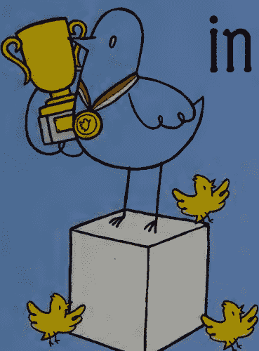

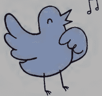

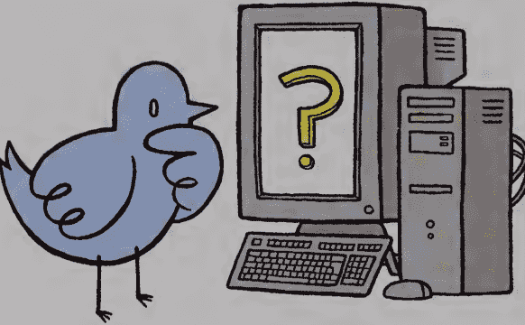

欢迎来到 Twitter！它看起来有点让人困惑，不是吗？其实它非常简单——花十分钟读这本书，你就会亲眼看到。

Twitter 于 2006 年成立，一年内每季度就发布了 40 万条推文。三年后，每天发布量达到 5000 万条推文，到 2012 年，每天发布的推文数量达到了惊人的 4 亿条。

Twitter 最初被个人用于分享状态更新，但很快人们发现了这个网络的真正力量：公司用它来联系客户，政府用它联系公民，活动人士用它来组织活动和传播意识。

@noviceteeter 对这个 Twitter 的事儿有点没底气……

# 入门

你对 Twitter 的第一印象可能是正在读几段断断的对话，其中夹杂着奇怪的缩写和符号，但别担心，这一切即将发生改变！

当你第一次访问 Twitter —— 在 www.twitter.com —— 系统会要求你注册，提供姓名、电子邮件地址和密码。

当你点击“注册 Twitter”（Sign up for Twitter）时，你将被引导至注册页面，页面上会显示你提供的详情、一个建议的用户名（你的 ‘’ 名称，它是你提供的名称的变体）以及你可能喜欢的其他用户名建议。如果你不喜欢 Twitter 提供的任何用户名建议，可以选择任何你喜欢的名称，但由于 Twitter 用户非常多，你可能需要一段时间时间才能找到一个未被占用的好名字。

记住，其他人可以通过姓名、用户名或电子邮件地址找到你，尽管后者不会公开显示，而且你之后可以禁用此选项。

你可以将你的 Twitter 名称中的一个、两个或一个都不设置为你的真实姓名。尽量让你的用户名越短，以便为推文留出更多空间，同时也使其变得易记且引人注目。如果你选择一个听起来很普通的名字，例如‘@tracey1974’，这可能会让人们搜索你变得困难。

在该页面上，你还会找到服务条款和隐私政策的链接。虽然这些内容冗长、枯燥且充满了法律术语，但值得一看，这样你就能知道自己在签署什么了！

❦

一旦注册完成，会有一个教程引导你入门。首先，它会针对你可能想要关注的人和组织提供建议，然后它会要求你填写个人资料。

除了这些细节，要勇敢地添加一张照片。如果你害羞，一张风景照或博客 Logo 也可以，但通常人们对面对脸的反应更好——不要留下 Twitter 蛋头像，因为那标志着你是一个新手。

添加照片很容易。在 Twitter 网站上，找到输入推文的文本框左下角的小灰色相机图标：点击打开你的文件，选择一张照片，然后搞定！

你的“时间线”（timeline）是你关注的人发布的推文流。现在，你准备好找一些人关注并填满你的时间线了。

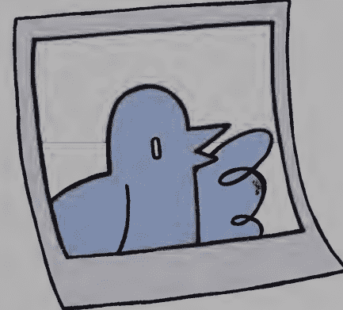

> Twitter 的核心在于信息和交流：你可以告诉人们你在做什么或想什么，并发现其他个人/公司/组织在做什么。

# 朋友与关注者

## 关注

当你开始关注某人时，他们会收到一封邮件通知有新的关注者。一旦你开始和他们聊天，有些人会回关；如果他们没有回，这并不是针对个人，不要感到被冒犯。不要问他们为什么，或者求他们关注——这只会让你看起来很卑微。

@noviceteeter 对这个 Twitter 的事儿有点没底气……

## 关注

记住，其他人可以通过姓名、用户名或电子邮件地址找到你，尽管后者不会公开显示，而且你之后可以禁用此选项。你可以将你的 Twitter 名称中的一个、两个或一个都不设置为你的真实姓名。尽量让你的用户名越短，以便为推文留出更多空间，同时也使其变得易记且引人注目。如果你选择一个听起来很普通的名字，例如‘@tracey1974’，这可能会让人们搜索你变得困难。在该页面，你还会找到服务条款和隐私政策的链接。虽然这些内容冗长、枯燥且充满了法律术语，但值得一看，这样你就能知道自己在签署什么了！

❦

一旦注册完成，会有一个教程引导你入门。首先，它会针对你可能想要关注的人和组织提供建议，然后它会要求你填写个人资料。

除了这些细节，要勇敢地添加一张照片。如果你害羞，一张风景照或博客 Logo 也可以，但通常人们对面对脸的反应更好——不要留下 Twitter 蛋头像，因为那标志着你是一个新手。添加照片很容易。在 Twitter 网站上，找到输入推文的文本框左下角的小灰色相机图标：点击打开你的文件，选择一张照片，然后搞定！你的“时间线”是你关注的人发布的推文流。现在，你准备好找一些人关注并填满你的时间线了。

> Twitter 的核心在于信息和交流：你可以告诉人们你在做什么或想什么，并发现其他个人/公司/组织在做什么。

# 朋友与关注者

## 关注

当你开始关注某人时，他们会收到一封邮件通知有新的关注者。一旦你开始和他们聊天，有些人会回关；如果他们没有回，这并不是针对个人，不要感到被冒犯。不要问他们为什么，或者求他们关注——这只会让你看起来很卑微。

@noviceteeter 对这个 Twitter 的事儿有点没底气……

## 关注

当你开始关注某人时，他们会收到一封邮件通知有新的关注者。一旦你开始和他们聊天，有些人会回关；如果他们没有回，这并不是针对个人，不要感到被冒犯。不要问他们为什么，或者求他们关注——这只会让你看起来很卑微。

# 朋友与关注者

## 关注

当你开始关注某人时，他们会收到一封邮件通知有新的关注者。一旦你开始和他们聊天，有些人会回关；如果他们没有回，这并不是针对个人，不要感到被冒犯。不要问他们为什么，或者求他们关注——这只会让你看起来很卑微。

# 朋友与关注者

## 关注

当你开始关注某人时，他们会收到一封邮件通知有新的关注者。一旦你开始和他们聊天，有些人会回关；如果他们没有回，这并不是针对个人，不要感到被冒犯。不要问他们为什么，或者求他们关注——这只会让你看起来很卑微。

# 朋友与关注者

## 关注

当你开始关注某人时，他们会收到一封邮件通知有新的关注者。一旦你开始和他们聊天，有些人会回关；如果他们没有回，这并不是针对个人，不要感到被冒犯。不要问他们为什么，或者求他们关注——这只会让你看起来很卑微。

# 朋友与关注者

## 关注

当你开始关注某人时，他们会收到一封邮件通知有新的关注者。一旦你开始和他们聊天，有些人会回关；如果他们没有回，这并不是针对个人，不要感到被冒犯。不要问他们为什么，或者求他们关注——这只会让你看起来很卑微。

# 朋友与关注者

## 关注

当你开始关注某人时，他们会收到一封邮件通知有新的关注者。一旦你开始和他们聊天，有些人会回关；如果他们没有回，这并不是针对个人，不要感到被冒犯。不要问他们为什么，或者求他们关注——这只会让你看起来很卑微。

# 朋友与关注者

## 关注

当你开始关注某人时，他们会收到一封邮件通知有新的关注者。一旦你开始和他们聊天，有些人会回关；如果他们没有回，这并不是针对个人，不要感到被冒犯。不要问他们为什么，或者求他们关注——这只会让你看起来很卑微。

# 朋友与关注者

## 关注

当你开始关注某人时，他们会收到一封邮件通知有新的关注者。一旦你开始和他们聊天，有些人会回关；如果他们没有回，这并不是针对个人，不要感到被冒犯。不要问他们为什么，或者求他们关注——这只会让你看起来很卑微。

# 朋友与关注者

## 关注

当你开始关注某人时，他们会收到一封邮件通知有新的关注者。一旦你开始和他们聊天，有些人会回关；如果他们没有回，这并不是针对个人，不要感到被冒犯。不要问他们为什么，或者求他们关注——这只会让你看起来很卑微。

# 朋友与关注者

## 关注

当你开始关注某人时，他们会收到一封邮件通知有新的关注者。一旦你开始和他们聊天，有些人会回关；如果他们没有回，这并不是针对个人，不要感到被冒犯。不要问他们为什么，或者求他们关注——这只会让你看起来很卑微。

# 朋友与关注者

## 关注

当你开始关注某人时，他们会收到一封邮件通知有新的关注者。

## 寻找关注者

如果你有喜欢的商店、餐厅或其他企业，你可以关注它以获取特别优惠和新闻。

## 寻找关注者

我们都从零关注者开始。有些人最终会有数千个关注者，而另一些人只有几个。这不应该影响你对 Twitter 的享受：与其拥有 5000 个默默潜伏从与你交流的关注者，不如拥有 50 个和你志趣相投的关注者。

当你开始关注某人时，他们会收到一封邮件通知有新的关注者。一旦你开始和他们聊天，有些人会回关；如果他们没有回，这并不是针对个人，不要感到被冒犯。不要问他们为什么，或者求他们关注——这只会让你看起来很卑微。

# 第一条推文

现在是时候上手开始推文了！

# 第一条推文

首先，不要害羞。Twitter 是为了对话而生的，而不是独白，而且没有所谓的打断私人对话，尽管如果你还不认识其他用户，在推文开头加上“抱歉打扰了”之的话是礼貌的。

Twitter 限制你使用 140 个字符，所以如果你通常很啰嗦，可能需要发挥创意。尽量不要使用短信缩写，因为并不是所有人都能很好地理解。

## 告诉我们你的生活近况

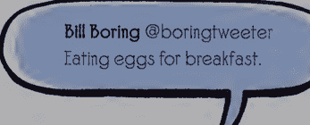

（这是大多数非 Twitter 用户认为 Twitter 用户在做的事情，但实际上可能稍微有趣一点。）每一个关注你的人都能看到这些。

## 回复推文

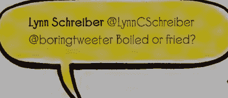

可以点击回复按钮，或者在开头输入 @ 来称呼那个人，但请注意，同时关注你和你被称呼那个人的人也会看到这条推文。

## 提及他人

在推文中间放入一个 @，所有关注你的人都会看到这条推文，而不仅仅是那些也关注被称呼者的人。

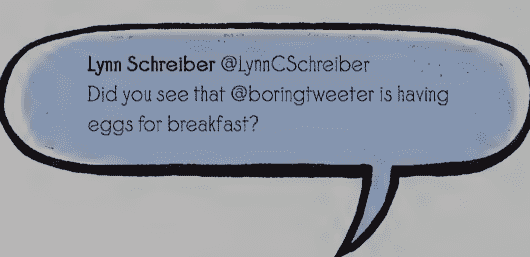

（注意第 10 页解释的 Bill Boring 和 Lynn Schreiber 的不同名称和用户名。）

在回复推文时，另一种确保同时关注你和你被称呼者的人能看到你推文的方法是在开头加一个句号，这在实际上将推文转换成了“提及”而非“回复”：

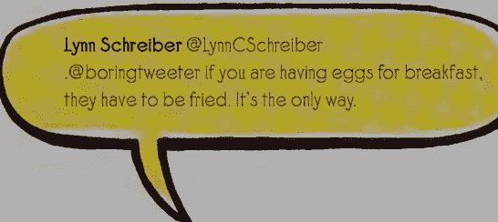

这让任何关注你的人都能参与对话：

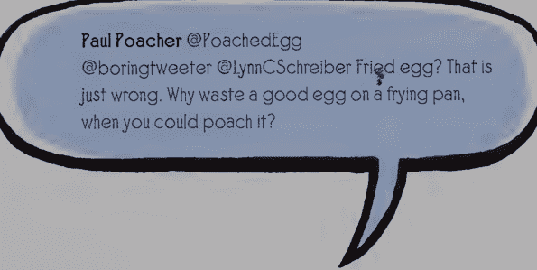

RT、MT 和 #FF 是什么意思？DM 是什么？# 是什么，我该如何使用它？一旦你掌握了 Twitter 语言，这一切都会变得容易解释得多。

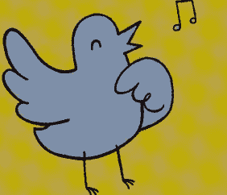

## 高级推文

### 如何转发推文

转发（简称为 RT）用于将推文传递给你的关注者。可能是因为你喜欢链接中的文章，或者该推文太幽默/恐怖/冒犯，让你你的关注者也读读它。

你可以在不添加评论的情况下转发，但这通常意味着你同意你正在转发的某条评论。

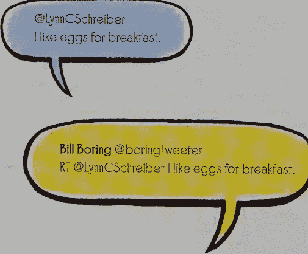

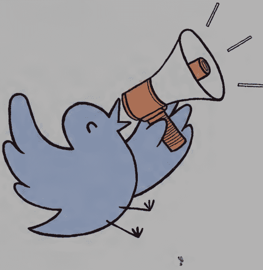

### 转发并添加评论

如果你使用 Twitter “客户端”（见第 44 页）或 Twitter 手机应用，你可以在 RT 上添加评论。

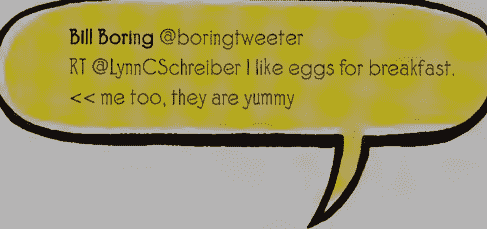

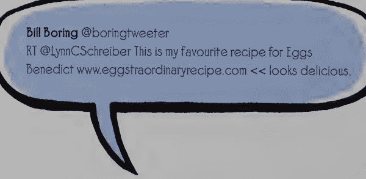

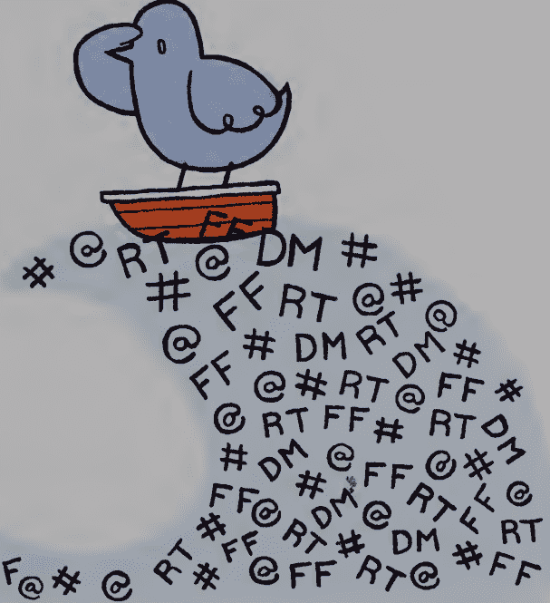

### 修改过的推文

有时你可能想稍微更改推文，将其缩短以便添加你的评论，或者纠正拼写错误。使用 MT 表示“修改过的推文”，显示了原始推文略有不同。

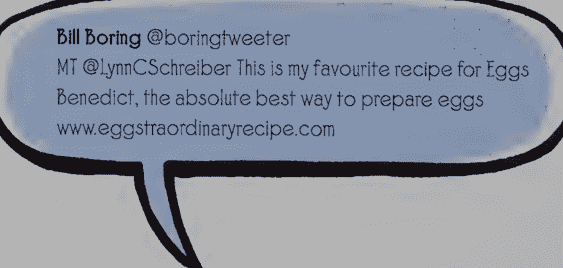

### 引用推文

你有时也可能会看到使用引号引用的推文。

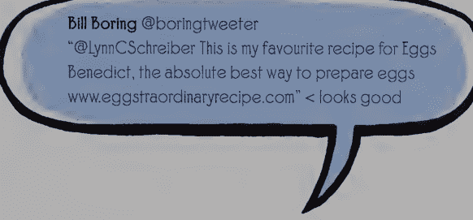

在转转发或引用推文时，要勇敢地加入你的观点，因为这会鼓励他人回应你，并可能为你带来一些新粉丝。

但不要过度转发。一个充斥着转发评论和链接的时间线不太可能说服潜在的粉丝点击那个神奇的“关注（Follow）”按钮。

### 推荐链接

你也可以传递链接或故事，并注明第一个发布该内容的推文者：

### “收藏”推文

“收藏（Favourite）”按钮允许你收藏以后在更有时间时想再次阅读的推文。如果你没有时间回复但想提醒自己以后对某条推文进行评论，这也非常方便。

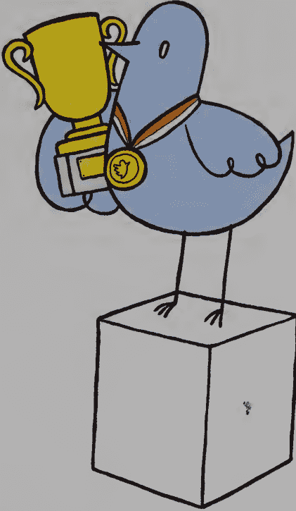

## 标签 (#)

标签（hashtag）或“#”是整理关于特定主题信息的一种。在关键词或短语之前使用标签，使其更容易被找到。这可以从电视节目，例如 #xfactor，到体育赛事，如 #olympics 或 #worldcup。不要过度使用标签——在任何一条推文中，一或两个就足够了。

标签已用于重要的世界事件，如选举和革命——阿拉伯之春的标签，如 #egypt、#jan25 和 #egyelection，是标签如何帮助整理信息的极佳例子。

标签也用于产生幽默或讽刺的效果，例如在像这样的推文中：“我今天去去看牙医了 #好疼”或“充分利用我的休息日 #坐着无所事事”。

## 趋势

当某件事成为热门趋势时，它是 Twitter 上被讨论最多的话题之一，通常通过使用 #标签来汇总。热门话题可能是荒谬的，例如 #ilovemydog，或者是改变世界的，如阿拉伯之春的标签，或者是重要的国家事件如 #GeneralElection。你可以查看国内和国际的趋势。

Twitter 允许公司支付赞助推文，这会导致人为的热门话题，尽管这些会有明显的标记。

Twitter 为你定制趋势，因此你会看到基于你的位置和关注者的趋势。要查看全球或基于地区的推文，请点击网页版 Twitter 上的 #Discover 标签。

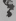

## 周五关注 (Follow Friday)

#FF 是 #FollowFriday 的缩写，这是一个在 2009 年创建的 Twitter 趋势，已成为惯性活动。每个周五推荐你：

- 每个周五推荐你喜欢的人
- 在无聊的会议桌下时使用 #FF
- 在公共交通工具上或等待朋友时
- 在手机上查看这些推文

### 私信 (DM)

DM 或“私信”是发送的私人推文。如果你想聊天可以发送 DM，但请注意只有你和你消息的对象能看到。不要用它发送垃圾信息，否则可能会被取消关注。

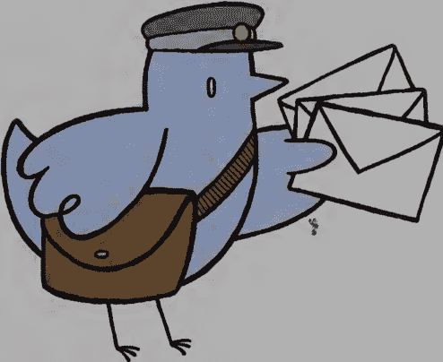

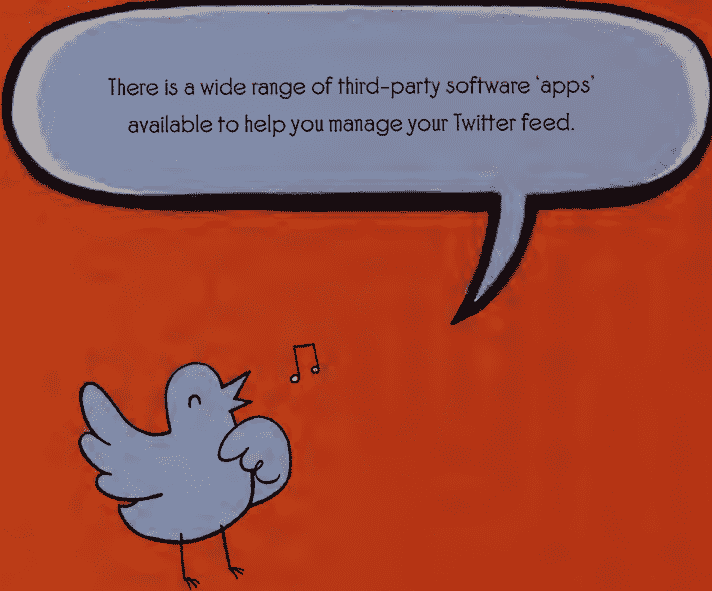

## 列表

久而久之，你可能会关注很多人，时间线快到跟不上。这时列表就很有用了。将他们分组，例如“工作”、“新闻”、“娱乐”。你可以分享这些列表，也可以保持私密。在 Twitter 网站上切换列表可能很麻烦，所以使用 App 一目了然地查看。

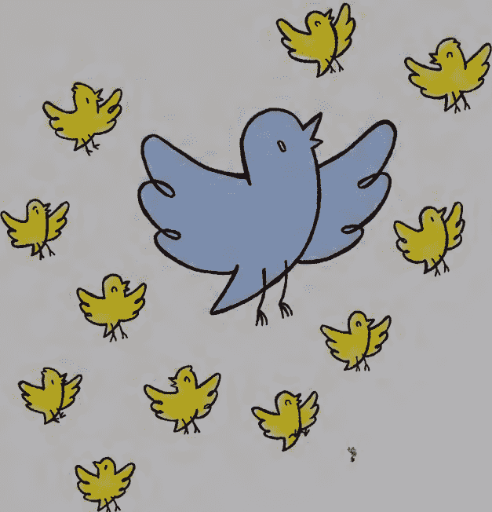

### Twitter 客户端

用于托管 Twitter 账号的软件被称为客户端允许你切换多个账号，例如业务和私人。Tweetdeck 和 Hootsuite 非常流行，但它们不断更新，所以请向你的粉丝咨询。

### 移动 Twitter 应用

Twitter 的魅力在移动时最为明显。在手机或平板电脑上下载一个应用，在无聊的会议桌下、在公共交通工具上或等待朋友时随时发布。只要手机上有 Twitter，你就永远不孤单。

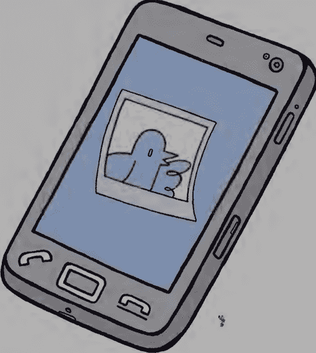

## 各种功能的 App

有很多应用可以帮助增强你的 Twitter 体验。这些应用几乎每天更新，但这里是你可以找到的一些主要功能。

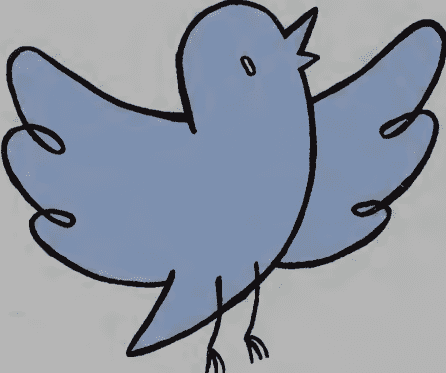

### Twitter 照片

有各种分享照片的应用。查看它们并找到最适合你的一个。

### 删除推文

如果你分享了超过你感到舒适的内容，可以通过 www.tweetdelete.net 删除指定日期之前的推文。

# 粉丝追踪

为了跟进粉丝列表并查看谁取消了关注，请查看 who.unfollowed.me —— 但记住不要介意！

社交网站上的隐私问题是一个严肃的问题：请确保你理解自己使用 Twitter 的目的，以及你需要保护自己到什么程度。

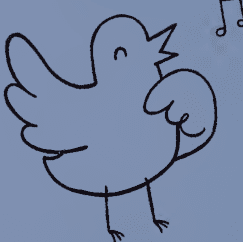

# 隐私

如果你使用自己的真实，请记住你发布的每条推文都可能反噬并困扰你。删除推文并不会删除转推，而这些转推本身可能会继续被转发。发布一份声明说明你表达的观点仅代表你个人而非你的雇主，是一个好主意，但这可能无法完全保护你。请注意，任何人都可以注册 Twitter 并关注你。

不要发布任何你未准备好去辩护的内容。如果你犯了错或无意中冒犯了某人，请道歉并继续。

讨论和争论是 Twitter 的一部分，但如果有人越了界限，你可以阻止他们阅读或评论你的推文。如果某个 Twitter 用户的行为从冒犯演变为违法，你可以举报他们。

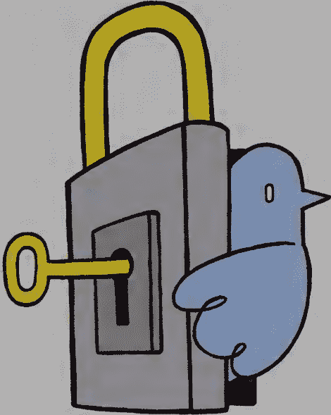

# 账户设置

你可以锁定账户以增加隐私性，这意味着任何想要关注你的人必须先向你申请。有些人对向锁定账户发送关注请求感到很顾虑，因此如果你选择此选项，请注意你可能无法那么容易地积累粉丝。

# 喷子 (Trolls)

喷子是指故意发布煽动性评论以引起反应的互联网用户。如果你怀疑有人在喷你，请忽略或屏蔽他们。最好的办法是不与喷子交涉。

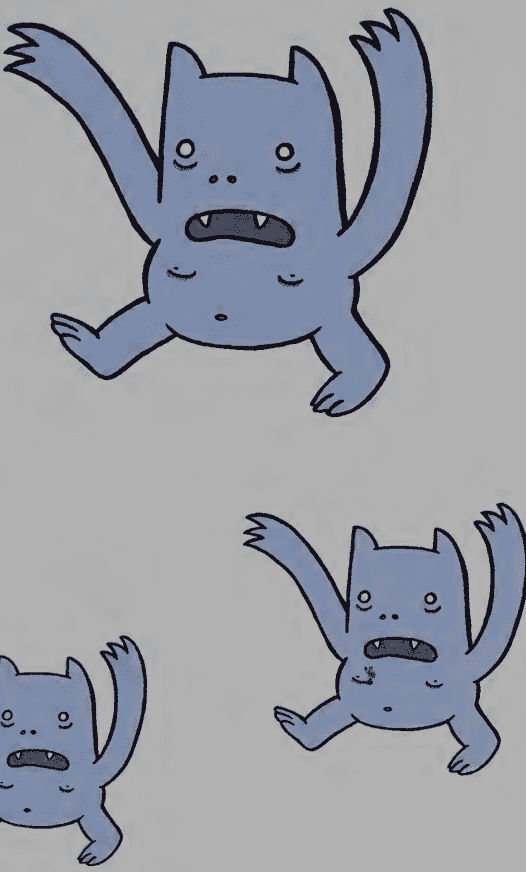

这是一个非常大的话题，但由于我们只有十分钟，这里有一个快速的总结。

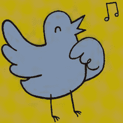

# 使用 Twitter 开展业务

- 不要心不专事：这并不是办公室初级员工的工作，仅仅因为她年轻且会理解这个新奇的 Twitter 东西。相反，这应该是了解你的品牌、熟悉你的产品以及如何销售它们的员工或机构的项目，并且他们能够在全天候检查 Twitter 账户。

- 带着幽默感去做：让负责的人与客户进行开放温暖的沟通，而不是表现得像个企业机器人。

- 定期发布：没有什么比几周未更新的 Twitter 账户更让客户反感了。

- 设置标准的 Twitter 搜索，查找提及你产品的关键词，这样你就可以回应任何讨论这些产品的人。

- 记住你无法控制 Twitter，正如一些知名公司所发现的那样，这对他们是有害。当不满的客户创建一个贬义的 Twitter #hashtag（标签）时，它被称为“黑粉标签”(bashtag)。

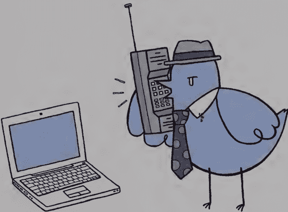

以下是 Twitter 用户的一些要做和不要做的，以便你最大限度地获得乐趣和粉丝数量。

## 如何充分利用 Twitter

### 应该做的

- 保持礼貌并乐于助人。
- 当有人 @ 提到你时给予回复。
- 在转推时注明出处——把别人的笑话当成自己的是大忌。
- 感谢他人转推你的推文以及 #FF（关注周五）（但不要对 #FF 进行批量感谢）。
- 记住基本的互联网安全规则。
- 如果你对某事不确定，尽管问。总会有人在帮助你。

### 不要做的

- 不要被“获取更多粉丝”的计划或群组欺骗。因为对他们说的话感兴趣而关注他人，而不是为了积累成千上万的粉丝。
- 只关注名人，大多数人是不回复的。
- 使用 App 查找谁取消了你的粉丝，然后问他们为什么。
- 只用 Twitter 链接到你的博客或网站，而不与你的粉丝互动。
- 只用了一天就放弃，并说“无聊！”。像很多事情一样，投入多少就有多少收获，所以请坚持！

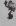

# 关于 Twitter 的五个棒点

1. 当你的时间线充满了讨论你正在看的节目的人时，看电视变成了一场社交活动。
2. 找到一个冷僻问题的答案只需与真人进行几分钟互动，而不是花费数小时在网上搜索。
3. 跟进新闻和八卦就像发一两条推文一样简单。
4. 当你过生日时，你的时间线充满了美好的祝福和虚拟的啤酒/葡萄酒杯。
5. Twitter 没有国界。你可以与日本的 Twitter 用户交流寿司食谱，与美国人谈论赛车，然后向澳大利亚人请教烧烤技巧。这一切无需离开你的沙发椅！

好了，你的十分钟结束了——你准备好去用 140 个字符分享你的想法并看看现在的趋势是什么了吗？

去去吧，祝推特愉快！

# 词汇表/索引

**Direct Message (私信)** 一条私下发送的推文 39

**Hashtag (标签)** 用于汇总有关某一主题信息的工具 36

**Favourite (收藏)** 将推文加签以便日后查阅 35

**Follow Friday (关注周五)** 通过在用户名字前加上 #ff 向粉丝推荐用户 38

**Mention (提到)** 在推文中使用用户名指代另一个 Twitter 用户 24

**Modified Tweet (MT) (修改过的推文)** 一条被更改过的转推 32

**Profile (个人资料)** 你的短传 12

**Reply (回复)** 以用户名开头推文以回复评论 23

**Retweet (RT) (转推)** 将一条推文转发给你的粉丝 28

**Timeline (时间线)** 你关注的人所发布的推文流 13

**Trends (趋势)** 当前最受讨论的话题 37

**Username (用户名)** 用于指代 Twitter 用户的名字，例如 @LynnCSiber 10

