# Unity 游戏开发学习 C#：Unity 游戏开发的 C# 编程，第 2 版 - 2020

> “发现的快乐”是游戏本身的基本乐趣之一。这不仅是发现游戏内秘密的快乐，还有揭示创作者愿景的快乐。那是那种一切都豁然开朗的“啊哈！”时刻，世界的背后，玩家可以感受到另一个创造心灵的触碰。然而，为了让这种快乐变得纯粹，它必须隐藏在视线之外——不是像律法一样刻在石板上，而是通过玩家对游戏规则的探索，一点一点地被揭示。
>
> —— Derek Yu，《地牢迷》（Spelunky）

# 第 4 章

- 创建简单的 2D 游戏
- 投射物的特殊攻击
- 喷射行业

## 引言

Unity 是一个跨平台开发平台，最初用于开发游戏，但现在已用于许多领域，例如：建筑、艺术、儿童应用、信息管理、教育、娱乐、营销、医疗、军事、物理装置、模拟、训练等。

Unity 承担了开发游戏和类似互动体验的许多复杂性，并在后台处理了这些问题，让人们可以专注于游戏的设计和开发。这些复杂性包括图形渲染、世界物理和编译。高级用户可以根据需要与之交互并调整它们，而初学者则无需担心。Unity 游戏的开发分为两部分：第一部分——在 Unity 编辑器内；第二部分——使用代码，特别是 C#。Unity 捆绑了 `MonoDev Visual Studio 2015 Community` 版用于编写 C#。

### 2D 或 3D 项目

Unity 同样适用于创建 2D 和 3D 游戏。但它们有什么区别呢？当你在 Unity 中创建一个新项目时，可以选择从 2D 或 3D 模式开始。你可能已经知道自己想要构建什么，但有一些细微的点可能会影响你选择的模式。选择从 2D 还是 3D 模式开始决定了 Unity 编辑器的某些设置——例如图像是被导入为纹理（`textures`）还是精灵（`sprites`）。不过不用担心选错，无论你在创建项目时设置了何种模式，你都可以随时在 2D 或 3D 模式之间切换。以下是一些帮助你选择的指南。

### 全 3D

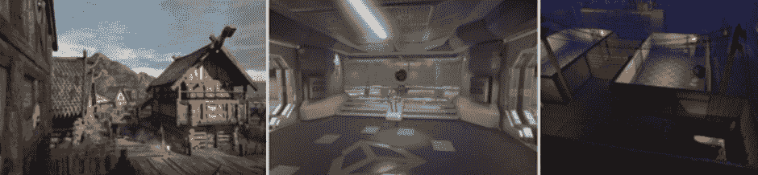

3D 游戏通常利用三维几何结构，材质和纹理渲染在这些对象的表面，使其看起来像实体的环境、角色以及在场景中自由移动的物体，并以写实的方式在世界中投射光影。3D 游戏通常使用透视（`perspective`）渲染场景，因此物体在靠近相机时，在屏幕上显示得也更大。对于所有符合此描述的游戏，请从 3D 模式开始。

### 正交 3D

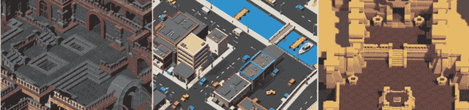

有时游戏使用 3D 几何结构，但使用正交相机（`orthographic`）而不是透视相机。这是一种常用于提供俯视角的游戏的技术，有时被称为“2.5D”。如果你正在制作这类游戏，你也应该在 3D 模式下使用编辑器，因为即使没有透视效果，你仍然在处理 3D 模型和资产。不过，你需要将相机和场景视图切换为正交（`Orthographic`）。（上方场景来自 Synty Studios 和 BITGEM）

### 全 2D

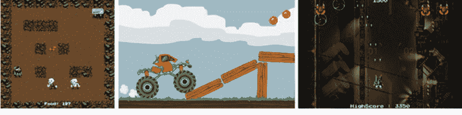

许多 2D 游戏使用平面图形，有时被称为精灵（`sprites`），它们完全没有三维几何结构。它们作为平面图像绘制到屏幕上，游戏相机也没有透视效果。对于这类游戏，你应该在 2D 模式下启动编辑器。

### 3D 图形的 2D 游戏

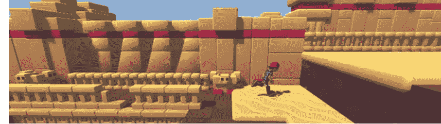

一些 2D 游戏使用 3D 几何结构构建环境和角色，但将玩法限制在二维空间。例如，相机可能显示“侧向滚动视图”，玩家只能在两个维度上移动，但游戏仍对障碍物使用 3D 模型，并对相机使用 3D 透视。对于这些游戏来说，3D 效果更多是出于风格而非功能性的目的。这类游戏有时也被称为“2.5D”。虽然玩法是 2D 的，但你大部分时候是在操作 3D 模型来构建游戏，因此你应该在 3D 模式下启动编辑器。

也许游戏行业是这个时代最困难的行业之一，在许多方面，这种困难始于技术挑战，穿过难以满足的观众（如果产品没有达到要求的水平，即使对于大公司来说也是冷酷的），而且还没有无休止的激烈竞争、高失败率，以及实现覆盖高昂制作成本利润的困境。

另一方面，该行业也存在一些特征使其生存成为可能。从技术方面来说，绝大多数游戏并不具备独特的功能和重复的数据处理模式，这使得复用之前游戏的软件模块来创建新游戏成为可能。这反过来有助于克服技术障碍，并缩短时间和精力。

当你谈论制作游戏时，你在这里指的是一个大过程，涉及到在许多领域完成的几十甚至上百项任务。制作游戏意味着生产、营销和发布游戏，以及这些操作中涉及的所有行政、技术、财务和法律程序和步骤。然而，对我们这一系列课程来说，重要的是技术方面，即游戏开发，它是构建包含所有组件的最终软件产品的过程。这个过程并不一定包含游戏设计，因为设计过程具有更广泛的视角，专注于诸如故事、游戏的整体特征、关卡的形状、敌人的本质，以及游戏规则、目标和胜负条件。

回到游戏开发过程，我们发现许多专业领域和技能对这个过程做出了贡献。除了程序员之外，还有画家、模型设计师、动画技术人员、音效工程师和导演。这种全面的视角让我们认识到，程序员在制作游戏中的角色仅仅是其他团队成员角色中不可或缺的一部分，尽管随着独立开发者（`Indie Developers`）的出现，这种局面正在发生改变，他们在执行编程之外还承担了许多任务。

## 为什么我们要使用游戏引擎？

如果我们想更详细地讨论程序员在游戏行业中的角色，我们会发现即使在编程本身层面，也有几个必须承担的角色：有图形编程、输入系统、资源导入系统、人工智能、物理模拟以及其他如音效库和辅助工具。正如我之前提到的，所有这些任务都可以以复用软件模块的形式完成，因此这些单元共同构成了所谓的“游戏引擎”。通过使用由它构成的引擎和软件库，你减少了自己构建 I/O 系统、模拟物理、甚至模拟部分人工智能所需的精力。剩下的就是编写你自己的游戏逻辑，并创建出让它与其他游戏区分开来的独特之处。最后一点是接下来的系列课程的核心，尽管与开发整个游戏相比，这项任务看起来很小，但正如我们所看到的，正是因为它的微小，才在设计和实现上需要付出巨大的努力。

## 开始使用 Unity 引擎的快速步骤

如果你以前没有使用该引擎的经验，可以阅读这篇快速介绍；如果你以前处理过该引擎，可以跳过它。我不会详细阐述这些步骤，因为有很多课程（无论是阿拉伯语还是英语）供你学习，但我们在这里是为了确保每个系列的读者在开始之前具有相同程度的初始知识。

### 第一步：下载并安装引擎

要下载最新版本的引擎，请访问 `https://unity3d.com` 并下载适用于你操作系统的最新版本。

### 第二步：创建项目

一旦安装好引擎，会出现一个界面让你创建一个项目。

在引擎运行后，会显示一个界面让你创建一个项目，具体操作如下：

1. 在名称框中输入你想要创建的项目名称。
2. 项目位置默认是你的电脑文件夹，但你可以更改它。输入你想存储项目的地方 (a) 使用 `Finder`（Mac OS）或 (b) 使用资源管理器（Windows）。
3. 然后在 `Finder` 或资源管理器中选择项目路径。
4. 选择项目类型。默认是 3D（如果你不确定选择哪个，请保持默认；正如我们所看到的，你可以通过 2D 选项来更改设置）。
5. 资源包（`Asset packages`）是提供可用的内容。或者：如果你现在不想导入这些资源包，可以忽略此选项；你稍后可以通过编辑器添加这些资源。或者：如果你现在就想导入这些资源包，选择资源包显示列表，勾选你需要的，然后点击“完成”。
6. 现在点击“创建”（`Create`），你就准备好了！

### 第三步：熟悉主窗口

首先，我们在 Unity 中有 4 个主要窗口。以下是它们的功能的总结：

- **场景窗口（`Scene Window`）**：你用它来构建游戏场景，添加不同的对象并在空间中进行布局。初始窗口只包含一个对象：相机。
- **层级面板（`Hierarchy`）**：包含所有添加到场景中的对象的树形结构，帮助你组织它们之间的关系，因为可以将对象作为其他对象的子对象，使得子对象受父对象的影响（正如我们所看到的）。初始窗口只包含一个对象：相机。
- **项目浏览器（`Project Browser`）**：显示项目文件夹中的所有文件，无论它们是否已添加到场景。项目初始包含一个名为 `Assets` 的文件夹，我们将在其中添加其他文件和文件夹。
- **检查器窗口（`Inspector Properties Window`）**：从场景、层级或项目浏览器选择任何对象时，其属性将显示在此窗口中，你可以从中进行更改。
- **控制台（`Console`）**：控制台标签页用于显示错误和警告信息。如果你编写了编程错误，例如，Unity 会在这里显示它们。但你作为开发者也可以发布此类报告。

```
Console Clear Collapse On Play Error Pause
Assets/Scripts/MainMenu.cs(11.17): error CS0103: The name "exampleObject" does not exist in the current context
```

关于必须修正错误的消息（`errors`）在窗口中以红色显示。相比之下，警告（`warnings`，即非致命错误）呈黄色。普通信息以白色显示。你可以通过右侧的三个符号根据这些分类对消息进行过滤。

- `Clear`（清除）删除所有条目。
- `Collapse`（折叠）抑制重复消息。
- `Clear on Play`（播放清除）会在点击播放按钮时删除所有条目。
- `Error Pause`（错误暂停）在执行 `Debug.LogError("error text")` 的条目时立即中断游戏。

在本次介绍中，我们回顾了 Unity3D 界面初看起来的内容，通过对游戏行业的简单介绍，我们将在接下来的课程中进入一个实践项目，通过该项目学习如何创建一个真实的完整的游戏！

# 第 1 章

## C# 与 Unity

即使 Unity 已经为许多标准任务提供了现成的组件（用于音频、物理、粒子效果甚至渲染领域），实际的、具体的游戏逻辑仍必须由你自己编写。在 Unity 中，这是通过脚本实现的，脚本是独立的文本文件，由一个程序（称为编译器）翻译成游戏创建时计算机可以理解的命令。脚本的行为通常类似于 Unity 中的组件，并相应地挂载到游戏对象（`GameObject`）上。由于我们在本书中使用 C# 编程语言，我首先想向你介绍这种语言以及它在 Unity 中如何使用。如果你已经接触过 C#，我仍然建议你阅读这一章，因为它还解释了一些专门适用于 Unity 的特殊功能。

### C# 语言

C# 由微软开发，属于所谓的面向对象的编程语言。它的开发目标是为了使用 `.NET Framework` 开发应用程序，该平台提供了广泛的类库、编程接口和实用程序。然而，Unity 将该语言与 `Mono Framework` 结合使用，它是 `.NET Framework` 的开源版本，这意味着 C# 也可以在非微软系统上运行（也称为 `mono` 项目）。这种语言非常详尽，我将在后续内容中不会向你介绍 C# 的所有可能性，而是特别关注对你作为 Unity 程序员感兴趣的话题。如果你想获得更多关于 C# 语言的信息，应该通过著名的搜索引擎找到你正在寻找的内容。也有很多很好的书籍，例如：Walter Doberenz 和 Thomas Profitus 编写的《Visual C#》书籍，涵盖了语言的各个方面。

如果你没有立即理解某些主题，不要绝望。如果你读完书中的其他章节并在稍后再次阅读这些段落，你会有某种大开眼界的效果。游戏即是编程。脚本用于管理生命强度，并被玩家和对手共同使用。

`HealthController`（生命控制器）

```csharp
using UnityEngine;
using System.Collections;

public class HealthController : MonoBehaviour {
    public float health = 5;
    private bool isDead = false;
    void ApplyDamage(float damage) {
        health -= damage;
        if(health <= 0 && !isDead) {
            isDead = true;
            Dying();
        }
        else {
            Damaging();
        }
    }

    public virtual void Damaging() {
    }
    public virtual void Dying () {
    }
}
```

### 语法

首先，关于基础编程的几句话：程序代码（也称为源代码）由顺序处理的代码行组成。为了让计算机也能理解这些行，它们通过一个称为编译器的程序翻译成机器语言，所谓的编译。为了让编译器知道单行代码的结束，在编写 C# 时，会在末尾添加一个分号。C# 中其他重要的字符是花括号 `{}`。它们用于识别连贯的代码块。

### 注释

除了实际代码外，你可能还给代码添加一些不需要计算机运行的注释。这些不执行的行被称为注释。用双斜杠 `//` 标记注释。双斜杠之后直到下一个换行符的所有内容都被视为非可执行代码。该行中双斜杠之前的内容被视为可执行！

单行注释
```csharp
number1; // 这是一个也会被编译的命令行
Number1 = 2;
```
如果你想标记多行作为注释，可以在开头写 `/*` 而在末尾写 `*/`：

多行注释

```csharp
/* 这是一段旧代码
int lifePoints;
lifePoints = 2;
 */
```

```csharp
lifePoints = 2; // 这是一个注释，它不会被编译
```

### 变量

首先，变量仅仅是值的占位符。除了文本外，我使用引号来告诉编译器从哪里开始到哪里结束。当我赋值时，我在 C# 中使用等号：

### 赋值

```csharp
lifePoints = 2;
name = "Carsten";
height = 1.5F;
```

你可以看到，除了文本外，我在 `float`（浮点数）的值后写了一个 `F`，这样编译器就知道该值实际上是一个浮点数。或者，C# 中也有 `double` 类型，但它涵盖的范围比 `float` 大，因此无法“放入” `float` 变量中：

### float 和 double 的区别

```csharp
float gravity;
gravity = 9.81F;

double gravity;
gravity = 9.81;
```

但在 Unity 中，`float` 比 `double` 更常见，这就是为什么我只会提到 `float` 值。为了缩短上面的代码，你可以在声明变量时给它赋值（即初始化）：

### 带有初始化的变量声明

```csharp
float gravity = 9.81F;
```

### 数据类型

为了让编译器知道是什么类型的数据，你必须告诉变量。游戏开发中常用的数据类型：`string` 用于文本，`int` 用于整数，`float` 用于浮点数，`bool` 用于布尔，`enum` 用于枚举。C# 中的变量声明跟随分号：

变量声明

```csharp
int lifePoints;
```

```csharp
float height;
```

```csharp
string name;
```

### 命名规范

为了让程序代码更容易读，有一些你应该遵守的规范。首先，变量名应该小写。此外，对于多个单词组成的名称应使用驼峰命名（`camel case`），例如 `enemySpeed`。

### 布尔

游戏编程中另一种经常使用的类型是布尔型（`bool`）。这种类型只能假设两种状态：`TRUE` 和 `FALSE`，即真或假。这种类型的典型例子是复选框，即 GUI 中的一个勾选，例如用于激活或禁用某个函数。根据这个复选框的状态，程序代码中存储值的布尔变量具有 `TRUE` 或 `FALSE`。

### 布尔变量

```csharp
bool isAttacking = false;
```

### 关键字 var

除了使用 `int`、`string` 等指定数据类型外，C# 还提供了使用 `var` 定义变量的选择。在这种情况下，变量的数据类型仅在第一次赋值时被确定。然后编译器决定哪种数据类型是正确的。未来任何不同类型的赋值都会导致错误。

```csharp
var lifePoint; 
lifePoint = 5;
```

### 数据字段 / 数组

如果你需要多个相同类型的变量，可以使用数组定义创建它们。数组本身不是一种数据类型，而是数据类型的一种变体。

### 创建数组

在实际数据类型后面加上方括号来定义数组：

```csharp
int[] speedLimits;
```

与普通变量不同，数组仅通过变量定义本身并不存在。你必须使用 `new` 关键字再次执行此操作。这个过程也称为实例化。此外，当你实例化数组时，必须指定它的大小，即该数组应该包含多少个整数变量。它看起来像这样：

```csharp
speedLimits = new int[5];
```

或者简短一点：

```csharp
int[] speedLimits = new int[5];
```

在实例化时，你还可以为数组的每个元素赋予一个初始值。它可以看起来像这样：

```csharp
int[] speedLimits = new int[5] {30, 50, 80, 100, 120};
```

重要的一点是，花括号中传递的值个数必须与数组中的元素个数相等。

## 访问数组元素


如果你现在想访问此数组的某个元素，你需要使用索引号来选择正确的项目。对于没有经验的用户来说，这是一个变化，因为数组的第一个元素的索引是 `0` 而不是 `1`！一个拥有五个元素的数组最高索引是 `4`！

```c
int [] speedLimits = new int[5] {30,50,80,100,120};
```

```c
speedLimits[0] = 20; // 之前是 30
```

```c
speedLimits[4] = 140; // 之前是 120
```

## 确定数组长度

数组也可以自动创建。如果你想知道数组包含多少个项目，可以使用 `Length` 属性来确定：

```c
int len = speedLimits.Length;
```

## 多维数组

你也可以创建一个具有多个维度的数组，假设你想用数组来表示一个正方形网格（例如棋盘）。那么创建一个带有元素的数组会非常困惑。创建一个两个维的数组更容易，其中第一个索引代表 X 轴，第二个索引代表 Y 轴。在 C# 中，这样的定义如下：

```c
int[,] tile = new int [8,8];
```

再次记住，数组中的每个索引都从 `0` 开始。如果你用数字对图形进行加密（`0` 表示没有图形，`1` 代表兵，`2` 是车），你可以轻松地将棋子的位置保存在这个数组中：

```c
tile[0,0] = 2; // A1 车
```

```c
tile[0,1] = 1; // A2 兵
```

```c
tile[1,1] = 1; // B2 兵
```

```c
tile[0,2] = 0; // A3 没有图形
```

## 常量

总有一些不应该改变的值。你可以将它们定义为常量，这意味着它们不再可以更改。要实现这一点，必须在声明时在数据类型之前编写 `const` 关键字：

```c
const float gravity = 9.8f;
```

## 枚举

你可以使用枚举来创建易读的常量列表。听起来有点神秘的其实是非常实用的东西。假设你想保存一个棋子的状态。它有三种状态：站立、行走、跳跃。为了查询棋子的当前状态，你首先需要定义一个包含这三个值的枚举 (`enum`)：

```c
enum State {idle, walk, jump}
```

然后你可以创建这种枚举类型类型的变量，并将三个值之一赋值给它：

```csharp
State state = State.Idle;
```

## 类型转换

将一种类型的变量转换为另一种类型也是可能的。当然，前提是它在内容上也是合适的。整数变量始终可以转换为浮点数变量。反过来则只有当数字没有逗号时才有效。转换类型时，只需在要转换的值之前的小括号中输入目标类型即可：

```c
int lifePoints; string lifePointsText = "2";
```

```c
lifePoints = (int)lifePointsText;
```

将数字转换为字符串更加简单。它们本身带有一个方法/函数（我稍后会解释它）来承担这项任务。要执行此，在数字变量后输入一个点，然后输入 `ToString()`。一旦你点击点，MonoDevelop 中就会出现选择，从而可以使用此命令：

```c
lifePointsText = lifePoints.ToString();
```

这个函数非常有用，因为通过这种整数变量可以像字符串一样处理：

```c
lifePointsText = "You own" + lifePoints.ToString() + "Life Points.";
```

如你所见，你可以在 C# 中使用 `+` 拼接字符串。此过程被称为字符串拼接，经常用于文本输出。

## 结果影响

现在你已经学习了编程所需的所有重要备知识，我们终于可以开始实际编程了。因为这不仅仅是定义变量并填充值，而是根据这些值做出决策，而这正是所谓的“结果影响”（ramifications）发挥作用的地方。你根据定义的条件决定接下来执行哪些代码块。

## if 语句

最简单的分支是所谓的 if 语句。它的工作类似于一个开关 (`switch`)，可以根据条件执行代码。此外，还可以指定在条件不满足时执行的备选代码，因此整个代码的行为如下：“如果条件成立，则执行此操作，否则执行另一操作”：

```c
if (condition > 0) {
    // 执行这里的代码
} else {
    // 执行这里的代码
}
```

如果 else 分支只有一行代码，大括号也可以省略：

```c
if (lifePoints > 0) message = "You are alive";
```

## switch 语句

通过 if 语句嵌套来表示多种状态会变得非常困惑。switch 语句可以提供帮助。通过 switch 语句检查任何可能的的状态，然后执行相应的代码：

```c
int damage = 1;
string title;

switch (damage) {
    case 0:
        message = "Beside!";
        break;
    case 1:
        message = "Oh, just a scratch!";
        break;
    case 2:
        message = "Damn it hurts!";
        break;
    default:
        message = "Arrrgh!";
        break;
}
```

switch 语句的每个 case 部分以 `break` 命令结束是非常重要的。这确保了在执行代码后退出 switch 语句。如果没有任何 case 条件适用，你最后可以使用 `default` 信号来定义一个默认情况。在列表 3.34 中，如果伤害值大于二，将始终如此（我们简单地忽略了负伤害值）。

### break (中断)

循环并不总是必须执行到底。可以使用 `break` 关键字来中断循环：

```csharp
int [] speedLimits = new int[5] {30,50,80,100,120};

int currentSpeed = 100;

int currentGear;

for (int counter = 0; counter < 5; counter++) {
    //Code...
    if (speedLimits[counter] >= currentSpeed) {
        currentGear = counter + 1; 
        break;
    }
}
```

### foreach 循环

`foreach` 循环用于遍历数组。在这里使用了一个额外的运行变量，它获取数组当前元素的值。由于它是原始数组的副本，因此无法通过这种方式更改数组的内容。重要的是，你只需要在循环中定义该运行变量。

```csharp
foreach (int currentLimit in speedLimits) {
    if (currentLimit == 80) {
        // code ...
    }
}
```

### while 循环

`while` 循环持续执行，直到满足终止条件。终止条件在循环开始时查询，因此循环可能甚至无法执行，也就是说如果从一开始就满足了终止条件。

```csharp
int enemyIndex = 0;

while (enemyIndex < 5) {
    if (enemyIndex == 3) {
        break; //Code...
    }
    enemyIndex++;
}
```

此循环也可以简单地通过 `break` 命令结束，而无需满足实际的终止条件。此外，还有 `continue` 命令。它确保当遇到 `continue` 命令时，循环的行为就像已经到达循环代码的末尾一样，因此开始循环的下一次迭代。

### do 循环

与在开始检查终止条件的 `while` 循环不同，`do` 循环中的条件只在最后检查。结果是循环至少会通过一次，无论循环结束时的条件从一开始是否已满足。

```csharp
int enemyIndex = 0;

do {
    //Code...
    enemyIndex ++;
} while (enemyIndex > 5);
```

使用 `do` 循环时也可以通过 `break` 命令离开循环。

## 类 (Classes)

正如开头提到的，C# 是一种所谓的面向对象编程。其目标是将连贯的功能和值封装并封装在所谓的对象中（这些本质上只是变量）。B 与玩家有关的所有内容都在对象类 `player` 中。所有影响敌人的内容都存在名为 `enemy` 的对象中。如果我们想有两个或多个对手而不仅仅是一个该怎么办？我们需要为每个对手编写完全全新的对象吗？不，当然不需要，因为这正是类的用场。类是对象的模板。它描述了该类中的对象“看起来”什么样以及它们应该如何工作。类以 `class` 单词开头，后面跟着类名。为了更好地与普通变量区分，C# 中以大写字母开头。然后是类的代码，它包含在大括号中：

```csharp
class Enemy {
  int health;
}
```

在 Unity 中，一个脚本代表一个类。脚本的名字必须与脚本中的类名相同。如果你现在想从脚本或类创建一个对象，在 Unity 中非常简单。由于脚本通常被认为是组件（更多信息请见“脚本编程”章节），你可以轻松地将它们拖到相应的 GameObject 上，这会自动创建该类的一个对象。这个过程也称为实例化（instantiation）。因此，结果（即对象）通常被称为该类的实例（instance）。

### 通过代码分配组件

与其将此类组件脚本拖到 GameObject 上，你也可以使用程序代码将你的类脚本或对象分配给 GameObject。对于这一点，可以使用 `AddComponent` 命令。

```csharp
gameObject.AddComponent<MyScriptName>();
```

### 非组件的实例化

非组件的实例，例如 GameObjects 或不继承自 `MonoBehaviour` 类的脚本类（更多信息请见“脚本”章节），是使用 `new` 关键字创建的。这会在内存中创建该类的实例并返回它的引用。

```csharp
Enemy myEnemy = new Enemy();
```

因此，结果（即对象）通常被称为该类的实例。

### 方法和函数 (Methods and functions)

方法是执行特定任务的代码块。你可以在任何需要的时候调用方法。方法可以以参数的形式接收数据，并以返回值返回数据。

```csharp
class Enemy {
    int health;

    public void TakeDamage(int damage) {
        health -= damage;
    }

    public int GetHealth() {
        return health;
    }
}
```

在上面的示例中，`TakeDamage` 是一个接收整数参数 `damage` 的方法且不返回内容（`void`）。`GetHealth` 是返回整数的方法。

### 访问修饰符 (Access modifiers)

访问修饰符定义了类、方法和其他成员的可见性。常见的访问修饰符有：

- `public`: 成员可以从任何地方访问。
- `private`: 成员只能在类内部被访问。
- `protected`: 成员可以在类内部以及派生类中被访问。
- `internal`: 成员在同一个程序集内可以访问。

正确使用访问修饰符对于封装和保护对象的状态至关重要。

### 属性 (Properties)

属性提供了读取或写入字段的方法。它们类似于变量，但允许在 getter 和 setter 方法中自定义逻辑。

```csharp
class Enemy {
    private int health;

    public int Health {
        get { return health; }
        set {
            if (value > 0) {
                health = value;
            }
        }
    }
}
```

属性允许控制。

### 继承 (Inheritance)

继承允许一个类（派生类）获取另一个（基类）的属性和方法。这有助于代码复用和层级关系。

```csharp
class GameObject {
    public string name;

    public void Move() {
        Console.WriteLine("Moving...");
    }
}

class Player : GameObject {
    public void Attack() {
        Console.WriteLine("Attacking!");
    }
}
```

在这个示例中，`Player` 继承自 `GameObject`，这意味着它拥有 `name` 属性和 `Move()` 方法。

### 接口 (Interfaces)

接口定义了类必须实现的合约。它们规定了类必须拥有的方法，而不是它们如何工作。

```csharp
interface IDamageable {
    void Die();
}

class Enemy : IDamageable {
    public void Die() {
        Console.WriteLine("Enemy died!");
    }
}
```

### 多态 (Polymorphism)

多态允许将不同类的对象视为视为基类对象，具体的行为在运行时决定。

```csharp
class Animal {
    public virtual void MakeSound() {
        Console.WriteLine("Animal sound");
    }
}

class Dog : Animal {
    public override void MakeSound() {
        Console.WriteLine("Bark!");
    }
}

class Cat : Animal {
    public override void MakeSound() {
        Console.WriteLine("Meow!");
    }
}

List<Animal> animals = new List<Animal> { new Dog(), new Cat() };

foreach (var animal in animals) {
    animal.MakeSound();
}
```

### 委托和事件 (Delegates and Events)

委托是类型函数指针。它们用于实现回调。事件构建在委托之上，允许类在发生某些事时通知其他。

```csharp
public delegate void MyDelegate(string message);

class Player {
    public event MyDelegate LevelUp;

    public void Start() {
        // ... logic ...
        LevelUp?.Invoke("Level up!");
    }
}
```

### LINQ (语言集成查询)

LINQ 提供了一种统一的方法从列表、数组或数据库等来源查询数据。

```csharp
List<int> numbers = new List<int> { 1, 2, 3, 4, 5, 6 };

var evenNumbers = numbers.Where(n => n % 2 == 0).OrderBy(n => n);
```

```csharp
static bool IsEqual (string stringA, string stringB)
{// code ...}
```

```csharp
static bool IsEqual (string stringA, string stringB, bool ignoreCase)
{// code ...}
```

### 局部变量与全局变量

取决于你在类中声明变量的位置，它们只存在于一个函数内或整个类中。- 局部变量声明在方法内部，仅存在于该方法内部。全局变量声明在方法外部，适用于整个类。

### 通过此方法避免混淆

由于作用范围不同，可能会出现局部变量和全局变量具有相同名称的情况。为了避免误解，C# 提供了 `this` 关键字，它指向你所属的类实例。在这种情况下，如果你想访问局部变量，只需编写变量名即可。如果你想访问全局变量，编写 `this.`，然后加一个点，最后写上变量名。

```csharp
int quantity = 0;

void Add (int quantity) {
  this.quantity += quantity;
}
```


### 访问与可见性

全局变量以及所有方法都可以额外的访问修饰符进行扩展。这些修饰符决定了它们仅在类内部可见（因此也可以被使用），还是也可以被另一个类或实例访问。

- `public` 允许从任何地方访问。公共变量也会在 Unity 的 Inspector（检查器）面板中显示。
- `private` 将访问限制在你自己的类中。
- `protected` 将访问限制在你自己的类以及所有继承自它的类中。
- `internal` 将访问限制在你程序集（assembly）中的所有类中（对于 DLL 非常重要）。

如果你不指定这些关键字之一，C# 中的变量和方法将被自动视为 `private`。顺便说一下，类只能被授予 `public` 和 `internal`。如果缺少关键字，则被视为 `internal`。

```csharp
public class test {
    private int health;
    public bool isEqual(string stringA, string stringB) {
        //Code...
    }
}
```

### 静态类与类成员

在某些情况下，你需要独立于已创建实例运行的编程方法或变量，例如该类之前创建的所有实例的计数器。在这种情况下，当然，并不是每个实例都拥有自己的计数机制，其结果甚至可能不同。此类应用使用了所谓的静态方法/变量……或者称为通用类成员。（相比之下，传统的方法/变量被称为实例成员。）它们使用 `static` 关键字声明，并且不能通过实例访问，而是通过类名直接访问。Unity 在此处使用了它，例如在 `Mathf` 数类中。

```csharp
int myInteger = Mathf.RoundToInt(1.5f);
```

静态方法的声明如下所示：

```csharp
public static void SetLevelSettings(int levelIndex) {
    //Code...
}
```

`Math` 类更进了一步。这里整个类被声明为 `static`，因此编译器只允许类成员。“成员”是类中可以包含的所有“东西”的总术语，例如：方法、变量等。静态类则定义如下：

```csharp
public static class GameSettings {
    public static string playerName = "";
    public static void SetLevelSettings(int levelIndex) {
        //Code...
    }
}
```

### 参数修饰符 out / ref

通常，如上所述，传递给函数的变量是经过复制的。这意味着函数内部对值类型变量（或具有值类型语义的变量）的值更改不会影响从外部传递的变量。然而，在某些情况下，使用参数修饰符 `ref` 和 `out` 可能是理想的，它们通过引用将变量（无论是值类型还是引用类型）传递给方法，而不是通过复制内容。方法中的每个传参都必须与修饰符以及传递给方法的变量相标识。

```csharp
public bool isEqual(ref string myName, string colliderName) {
    bool result = false;
    if (stringA.ToLower() == stringB.ToLower()) {
        result = true; stringA = stringB;
    }
    return result;
}
```

使用 `ref` 修饰符调用方法：

```csharp
string myName = "Player";
string colliderName = "player";
equal = isEqual(ref myName, colliderName);
```

在上述情况下，`myName` 初始值为 "Player"，`colliderName` 值为 "player"。在调用方法后，两个变量的值都变成了 "player"。`out` 的用法与 `ref` 相同。这两个参数之间的区别如下：

- `ref` 请求一个已经初始化的变量。因此，被传递的变量在传递到方法之前必须已经有一个值。
- `out` 不需要初始化的变量。然而，必须在方法内部确保分配一个有效值。

一个巨大的优势是，你现在有了从一个方法返回多个值的选项。例如，Unity 的 `Physics` 类使用了 `out`。

```csharp
RaycastHit hit;
if (Physics.Raycast(transform, direction, out hit))
    float distance = hit.distance;
```

### 使用 params 数组

除了上述修饰符外，还有 `params` 修饰符。它简化了数组的传递，使得你不一定需要定义数组。你可以传递逗号分隔的变量列表。

```csharp
public int DamageAddition(params int[] damageValues) {
    int val = 0;
    foreach (int current in damageValues) {
        val += current;
    }
    return val;
}
```

```csharp
int sum;
int damage1 = 5;
int damage2 = 3;
sum = DamageAddition(damage1, damage2);
```

```csharp
int[] damageArray = new int[2];
damageArray[0] = 5;
damageArray[1] = 3;
sum = DamageAddition(damageArray);
```

### 属性与属性方法

假设你有一个 NPC 类，它有一个公共变量 `health`。你可以给该类的对象分配任何值，即使不允许对象具有负健康值。与其在处理该值的地方考虑这一点，不如从一开始就确保这种情况不会发生。为了实现这一点，在 C# 中有所谓的属性方法，它们可以在值传输时检查并更改该值。属性方法（简称为属性）由两个子方法组成：`get` 和 `set` 访问器。

- `get` 用于查询值。
- `set` 用于赋值。

实际变量（在我们案例中是 `health`）声明为 `private`，因此仅可以通过属性方法访问。这种过程也称为数据封装。使用这些访问器，NPC 类看起来如下：

```csharp
public class NPC {
    private int health;
    public int Health {
        get {
            return health;
        }
        set {
            health = value;
            if (health < 0)
                health = 0;
        }
    }
}
```

注意大小写：属性方法首字母大写且是 `public`。变量是小写且是 `private`。

```csharp
NPC npc = new NPC();
int h = 3;
npc.Health = 3; // 将私有变量 health 设置为 3
npc.Health -= 5; // 从当前值减去 5，所以 health 实际上为 -2
h = npc.Health; // Health 返回 0
```

## 继承

面向对象编程的一个重要特性是继承的可能性。这意味着程序员可以开发一个新类，它可以使用另一个类的所有方法、变量等作为基础，而无需重写代码。这个新类被称为派生类。它所继承的类被称为基类。如果一个类现在要继承另一个类，在类名后写一个冒号，然后是基类的名称。

```csharp
public class MyScriptName : MonoBehaviour {
    //Code
}
```

即使你可能自己并不经常使用继承，但这对作为 Unity 程序员的你来说非常重要的问题。Unity 中创建的类如果要作为组件使用，必须继承自 Unity 类 `MonoBehaviour`。这包含了类作为组件所需的所有内容。你可以在第 4 章“脚本编程”中找到更多信息。

### 基类与派生类

在 C# 中，如果一个类要继承另一个类，必须在类名后写一个冒号，然后是基类的名称。假设我们有一个类 `person`，它有一个公共变量 `name` 和私有变量 `points`。

```csharp
public class person {
    public string name = "";
    private int points = 0;
}
```

派生类 `NPC` 应该有一个额外的变量 `health`，那么它看起来如下：

```csharp
public class NPC : person {
    public int health;
}
```

现在你可以创建一个 `NPC` 类的对象，并使用这两个公共变量：

```csharp
NPC npc = new NPC();
npc.name = "Legolas";
```

```csharp
npc.health = 10;
```

### 继承与可见性

即使在上面的示例中 `NPC` 类继承了基类 `Person`，我之前解释的可见性规则仍然适用。你不能在派生类中访问基类的私有变量或私有方法。如果你仍然想允许访问，可以使用 `protected` 关键字代替 `private` 来定义这些成员。

```csharp
public class person {
    public string name = "";
    protected int points = 0;
}
```

这意味着变量 `points` 从外部来看仍然不可见，但在派生类 `NPC` 中可以访问。

```csharp
public class NPC : person {
    public int health;
    public void DoSomething() {
        points = 100;
    }
}
```

### 重写继承的方法

假设你有一个基础类 `person`，它除了各种变量和方法外，还有一个名为 `Shoot` 的方法。为了显示此功能，首先应该在控制台中输出一段短文本。你可以使用 `Debug.Log` 命令来实现。虽然 `Person` 类提供了标准文本 "Peng!"，但 `NPC` 类现在应该说一些不同的内容。为了实现这一点，C# 提供了覆盖方法的可能。要做到这一点，被重写的方法必须先在基类中被声明为可重写的。这是通过 `virtual` 关键字实现的。

```csharp
public class person {
    public virtual void Shoot() {
        Debug.Log("Peng!");
    }
}
```

派生类可以（但不必）重写此方法。这里的关键字是 `override`。

```csharp
public class NPC : person {
    public override void Shoot() {
        Debug.Log("Tie!");
    }
}
```

### 访问基类

如果你现在在派生类中重写了基类的方法，但现在想访问基类的方法，自然就产生了一个现在如何做的问题。这是通过 `base` 关键字实现的。你通过 `base` 访问基类的方法、变量等。

```csharp
public class NPC : person {
    public override void Shoot() {
        base.Shoot();
        Debug.Log("Tie!");
    }
}
```

### 密封类

另一种继承的方法是通过密封。这意味着防止类的继承能力。换句话说，如果你在类定义前面加上 `sealed` 关键字，没有其他类可以继承自它。

```csharp
public sealed class NPC : person { // code ... }
```

## 多态

面向对象的编程语言提供了另一种实用的技能，称为多态。你可以以相同的方式处理所有具有共同基类的对象/实例。以下方法触发了传递对象的 `Shoot` 函数。脚本并不关心该对象实际上是 `Person` 类型还是派生自 `Person` 的类（例如上一个示例中的 NPC）。

```csharp
void LetsShoot(Person person) {
    person.Shoot();
}
```

向 `LetsShoot` 传递各种对象：

```csharp
Person person = new Person();
NPC npc = new NPC();
LetsShoot(person);
LetsShoot(npc);
```

### 接口

C# 面向对象的另一个特性是接口。通过接口你可以定义不同类的共同特征，并借此再次对它们进行。这样你可以平等地对待不同的类，这在某些情况下非常有用。微软已经预定义了一些通用接口，这些对于某些功能也很重要，你也可以定义自己的接口。

#### 定义接口

要定义接口，使用 `interface` 关键字。按照惯例，接口名称始终以 `I` 开头，因此在上面的示例中它将是 `IShootable`。接口的其余部分类似于类，区别在于方法没有编写实现。

```csharp
public interface IShootable {
    void Shoot();
}
```

类和接口之间的重要区别涉及访问修饰符。在类中，所有没有访问修饰符的内容都是私有的，而接口被认为是内部的。毕竟，接口也用于描述类的外部影响。除了 `public` 之外，其他访问修饰符在接口中都是禁止的。

#### 实现接口

如果一个类要实现接口，其方法与继承类相同，即使用冒号。如果既继承一个类又实现一个（或多个）接口，这些将用逗号列在基类名称之后。`IShootable` 接口的实现如下：

```csharp
using UnityEngine;
using System;

public class Gun : MonoBehaviour, IShootable {
    private WeaponController weaponController;
    void Awake() {
        weaponController = gameObject.GetComponent<WeaponController>();
    }
    public void UseMe() {
        weaponController.Switch(this);
    }
    public void Shoot() {
        Debug.Log("Peng!");
    }
}
```

脚本的各个区域目前并不重要，将在其他章节中详细讨论。尽管如此，我想预测这里实际上发生了什么。当 `Awake` 方法被调用时，将搜索并为 `WeaponController` 脚本组件（其代码稍后处理）赋值。如果现在调用 `UseMe` 方法，`Gun` 自身的脚本实例将传递给 `WeaponController` 的 `Switch` 方法。最后，`Shoot` 方法仅向 Unity 控制台写入 "Peng" 用于演示。

#### MonoDevelop 支持

编程环境 MonoDevelop 帮助你实现接口。如果你在上面的示例中 `MonoBehaviour` 后面写了实现 `IShootable`，将指针移动到 `IShootable` 并点击右键。在出现的右菜单中，转到 Refactor / Implement implicit。然后所有的属性、方法等都会被自动添加到你的类中。你现在只需为它注入生命。当然，你现在可以删除默认插入的异常（错误消息）。

### 通过接口访问

要访问接口，你可以像使用变量类型一样使用接口。在接下来的脚本中，接口被用于 `Switch` 方法的参数定义，也用于公共变量的定义。这意味着只要一个类实现了 `IShootable` 接口并因此具有 `Shoot` 函数，任何类都可以传递给 `Switch`。

```csharp
using UnityEngine;
using System.Collections;

public class WeaponController : MonoBehaviour {
    public IShootable weapon;
    public void Switch(IShootable newWeapon) {
        weapon = newWeapon;
    }
    public void ShootCurrentWeapon() {
        weapon.Shoot();
    }
}
```

## 命名空间

如果我们在本书末尾开发这个演示游戏，你会发现在一个 Unity 项目中创建了许多类。此外，Unity 在后台编程时使用的框架也提供了许多类。为了不让你丢失视图并避免产生混乱，引入了所谓的命名空间。命名空间是一种组织结构，它将相关的类型（类等）结构化，并将它们分组为逻辑单元。你可以将其比为文件系统上的文件夹，其中包含各种文件。如果你现在想在 Unity 中使用某种类型，必须引用项目中的命名空间并集成到类中。通常情况下，Unity 会处理这一切。只有当你想要使用特殊类型时，才需要手动完成。

你可以在脚本文件的开头使用关键字 `using` 包含一个命名空间。接接的示例类包含了 `System.Collections.Generic` 命名空间，以便使用 `List` 类型。

```csharp
using System.Collections.Generic;
```


public class TestClass
{
    private List<string> myList;
}

如果你再次查看接口示例，你会发现命名空间已经通过这种方式被集成了，即 `UnityEngine` 和 `System.Collections` 命名空间。你可以在“脚本编程”章节中找到更多关于这两个命名空间的信息。

## 泛型类和方法

在面向对象的编程中，“泛型（generic）”一词实际上意味着，例如方法或类，泛泛之，即在设计时不考虑具体类型。最后使用的类型（或方法）将通过尖括号 `< >` 传递给类（或方法）。在 C# 中，要分配的这种类型通常用泛型类（或方法）中的字母 `T` 表示。

```csharp
using UnityEngine;
using System.Collections;

public class MyGeneric<T>
{
    public T current;
}
```

在泛型类中任何使用参数 `T` 的地方，稍后都会使用传递的类型。因此，变量 `current` 将具有你在实例化时所指定的数据类型。

```csharp
MyGeneric<string> test = new MyGeneric<string>();
test.current = "ddd";

MyGeneric<int> test2 = new MyGeneric<int>();
test2.current = 2;
```

## 常用技巧

Unity 项目中经常使用的泛型类型是 `List<T>` 类型。它的工作方式与数组类似，但这种类型的对象提供的功能比普通数组多得多。你可以使用 `Add` 方法向这些对象添加许多新元素，使用各种命令对它们进行搜索，或者使用 `Remove` 删除特定元素。创建列表对象时，只需输入对象应该包含的类型即可。在接下来的示例中，因此你应该特别注意 `myNumbers` 的变量声明，以及 `System.Collections.Generic` 命名空间的包含，`List` 类属于该命名空间。

```csharp
using UnityEngine;
using System.Collections.Generic;

public class GenericTest : MonoBehaviour
{
    private List<int> myNumbers = new List<int>();

    void Start()
    {
        myNumbers.Add(2);
        myNumbers.Add(33);
        myNumbers.Add(17);

        if (myNumbers.IndexOf(33) >= 0)
        {
            myNumbers.Remove(33);
            Debug.Log(myNumbers.Count.ToString());
        }
    }
}
```

### 排序

`List` 类的另一个优势是使用 `Sort` 方法对元素进行排序。然而，只有当类型实现了 `IComparable` 接口时，这种方法才能工作。你可以在“接口”章节中找到更多关于此主题的信息。

### 字典

另一个你应该了解的命名空间类是 `Dictionary<TKey, TValue>`，简称 `Dictionary`。它包含两个泛型参数。字典存储键值对。第一个值是唯一标识符（键），第二个值是值。每个键在字典中只能出现一次。下面的示例展示了如何使用 `ContainsKey` 检查键是否存在，如何使用 `Add` 方法创建新的键值对，以及如何使用键来访问并修改它。

```csharp
using UnityEngine;
using System.Collections.Generic;

public static class SimpleInventory
{
    private static Dictionary<string, int> items = new Dictionary<string, int>();

    public static void AddItems(string key, int val)
    {
        if (items.ContainsKey(key))
        {
            items[key] += val;
        }
        else
        {
            items.Add(key, val);
        }
    }

    public static bool Removeitems(string key, int val)
    {
        if (items.ContainsKey(key))
        {
            if (items[key] >= val)
            {
                items[key] -= val;
                return true;
            }
            else
            {
                return false;
            }
        }
        else
        {
            return false;
        }
    }
}
```

# 第2章

## 脚本编程

在上一节中学习了 Unity 最重要的 C# 基础后，我们现在进入实际的脚本编程。

### MonoDevelop

Unity 提供了 MonoDevelop 环境用于脚本编程。MonoDevelop 是一个开源开发环境，它是 Mono 项目的一部分，Mono 是微软 .NET 框架的开源替代方案。Unity 交付了一个特别定制的版本，使其便于与 Unity 配合调试。在 Unity 中双击脚本会自动用 MonoDevelop 打开相应的脚本。如果 MonoDevelop 已经打开了另一个脚本，则会创建一个额外的标签。

#### MonoDevelop 中的帮助

Unity 提供的 MonoDevelop 版本包含一些特殊修改，一个额外的帮助功能，它可以引导开发者直接访问 Unity 的脚本参考文档。为了实现这一点，选择你想要获取更多信息的命令，并在德语 PC 键盘上按下 `Ctrl` + `Shift` + `/`。或者，你也可以通过 MonoDevelop 菜单 / Unity API 参考进行此操作。如果你在 MonoDevelop 中只有一个类名，例如进入应用程序并调用帮助，它将为你提供有关该类提供的方法和变量的所有信息。

#### 语法错误

如果你在脚本中存在语法错误，例如，你忘记了分号（“解析错误”）或使用了未实例化的变量，Unity 将在你保存此错误脚本后显示一条错误消息。此消息会显示在 Unity 窗口底部和控制台（console 标签页）中。如果你点击此消息，MonoDevelop 将打开并带你到错误发生的地方。

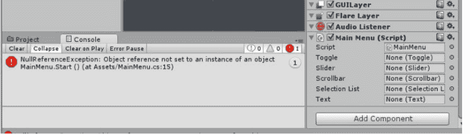

#### 错误信息的转发

在控制台中点击错误消息并不总是能找到开发者编写编程错误的位置。

例如，如果你在行末尾忘记了分号，编译器可能只认为下一行是有错误的，因为（之前的）代码行尚未完成，而这个新命令不应该在此处出现。对于初学者来说，这会导致长时间的错误搜索，因为错误可能出现在显示位置的其他地方。

#### 可用的编程语言

在编写脚本时，你可以在 JavaScript、Boo 和 C# 编程语言之间选择。虽然你可以在 Unity 项目中任意混合这些语言（但在脚本内部不能！），但建议尽可能避免这样做。在项目内部混合语言本身不是问题。但一旦你尝试从一个脚本访问另一个语言，可能会变得复杂。我将在第 4.14 节“编译顺序”中介绍细节。因此，我建议尽可能将项目限制在一种语言内。

### 为什么选择 C#？

正如你所注意到的，我在书中使用了 C# 语言。最初，Unity 专注于 JavaScript 语言。但随着时间的推移发生了巨大变化，现在 C# 是重点。C# 更多功能，而且比专为 Unity 设计的 JavaScript 分支（通常称为 UnityScript）更广泛。

## Unity 的实例结构

正如我在上一章“C# 与 Unity”中提到的，所有要作为组件使用的脚本必须继承自 `MonoBehaviour` 类。然而，该类继承自另一个类。最终，组件和 GameObject 甚至具有相同的起源，即 `UnityEngine` 命名空间中的 `Object` 类。图 4.3 显示了类图中 Unity 引擎命名空间中最重要类之间的关系。箭头始终从派生类指向相应的基类。

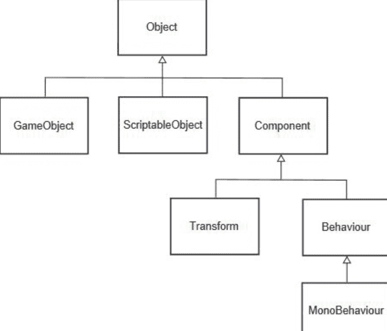

### Object

`Object` 是 Unity 中所有对象的父基类。它提供了一些基本属性和方法，例如用于删除对象的静态方法 `Destroy`，以及我将在本章中解释的 `DontDestroyOnLoad` 方法。`GameObject`、`Component` 和 `ScriptableObject` 类都派自此类。对于更有经验的 C# 开发者，应该再次指出，这是一个 Unity 对象类，而不是 .NET 框架提供的类。

### GameObject

`GameObject` 直接继承自 `Object`，`Object` 是 Unity 场景中所有对象的基类。大多数 `GameObject` 是通过编辑器中主菜单的 `GameObject` 创建的。如果你想通过代码创建 `GameObject` 实例

### ScriptableObject

`ScriptableObject` 也直接继承自 `Object`。首先，`ScriptableObjects` 是继承自 `ScriptableObject` 的通用脚本，通常用于存储大量数据。这些类的实例是通过 `ScriptableObject` 类的静态方法 `CreateInstance` 创建的，并且可以在运行时和开发期间创建。`ScriptableObjects` 更多用于特殊情况，例如创建可以存储在场景之外的数据容器，并在需要时进行配置和读取。

### Component

`Component` 类也继承自 `Object`，它是所有可以附加到 `GameObject` 上的类的基础。这就是为什么它们通过使用 `GameObject` 方法 `AddComponent` 将它们添加到相应的实例中来创建的。其他重要类继承自 `Component`，我想以 `Transform` 和 `Behavior` 类作为示例。因为在 Unity 中，所有它们都派生自 `Component` 类，因为组件在德语中通常被称为 "components"。

### Transform

`Transform` 类继承自 `Component`，并默认添加到场景中的每个 `GameObject` 中。只有当你用代码创建 `GameObject` 时，它才不会自动拥有 transform 组件。相反，`RectTransform` 类继承自 `Transform`，它被 uGUI 系统在 GUI 设计中使用。

### Behavior

`Behavior` 类继承自 `Component` 类。继承自 `Behavior` 的类也称为 Behaviors，或泛称为 Components/Components，并且可以通过 `enabled` 属性开启或关闭。派自 Behaviors 的类例如 `Light` 或 `NavMeshAgent`，我将在其他章节中讨论它们。最后，`MonoBehaviour` 类也继承自 `Behavior`。

### MonoBehaviour

`MonoBehaviour` 类是 Unity 中所有作为组件使用并可以附加到 `GameObject` 的脚本类的基类。即使 `MonoBehaviour` 继承自 `Behavior`，你只需要记住，禁用 `enabled` 属性只会阻止 `Start`、`Awake` 和 `OnGUI` 方法的执行。其他方法仍然可以调用和执行，例如 `OnTriggerEnter` 或 `OnCollisionEnter`。

### 创建脚本

在 Unity 中，每个脚本恰包含一个类。脚本名称始终与类名相同。否则，当你想使用它时将会出错。因此，在选择脚本名称时，适用以下规则：不要使用空格或特殊字符。要创建脚本，执行以下操作之一：

- 使用主菜单 `Assets` / `Create` 并选择脚本类型（在本例中为 C# Script）。
- 使用 Project Browser（上方）的 `Create` 菜单，你也可以在那里找到脚本类型。
- 使用 Project Browser 的上下文菜单，可以通过右键访问。你也可以在那里找到脚本类型。
- 使用 Inspector 中 `Add Component` 按钮的 `New Script` 选项。当你选择层级中的 `GameObject` 时，你会在已添加组件中找到它。脚本默认创建在项目浏览器的根目录下，并附加到选中的 `GameObject` 上。

双击创建的脚本将在开发环境 MonoDevelop 中打开它。

### 重命名脚本

如果你随后在项目浏览器或脚本本身中更改脚本名称，对应的名称必须同时更改。如果它们不一致（即使只是大小写敏感），以后你想使用它时将会出错。因此，在重命名时，最好使用 MonoDevelop 中的重命名功能。这不仅会重命名类，还会重命名脚本以及脚本在项目中的所有引用。一旦将光标置于类名中，可以通过右键 `Refactor` / `Rename` 访问此功能。当你想要重命名相关变量时，重命名功能也很有意义。

## 脚本框架

如果你按照上述描述创建了一个新的 C# 脚本并现在双击打开它，你将看到以下基础结构：

```csharp
using UnityEngine;
using System.Collections;

public class MyScriptName : MonoBehaviour
{
    // 使用此方法进行初始化
    void Start()
    {
    }

    // 每帧调用一次 Update
    void Update()
    {
    }
}
```

在前两行中，集成了带有两个命名空间的 `using` 命令。特别是 `UnityEngine` 命名空间对于 `MonoBehaviour` 脚本是强制性的，不能删除。如果有必要，当然可以在上方添加额外的命名空间。命名空间之后是继承自 `MonoBehaviour` 的类定义。默认情况下，每个脚本都继承此类，该类还提供了 `start` 和 `update` 方法。如有，你也可以删除这些方法。你也可以更改或完全移除继承。只有这样做，这些类在逻辑上才无法作为组件使用。

## Unity 的事件方法

你现在知道如何在 Unity 中编写脚本了。现在的问题是这些脚本中的代码何时会被实际执行。Unity 的流程如下：`MonoBehaviour` 提供了若干方法，这些方法由特定事件触发，或由 Unity 定期调用。在这里，Unity 遍历所有的 GameObjects 及其脚本实例，并在那里执行相应的对应方法。我想在下面简要介绍其中一些重要方法。请记住，每个脚本都可能拥有这些方法，但不必实现它们。相反，如果方法没有填充代码，删除它们会更好。因为以下每个方法都是根据定义被调用的，并且即使它们是空的，也会消耗性能。

### Update

Unity 中最重要的方法是 `Update` 方法。大部分代码在这里编写。`Update` 在整个游戏过程中运行，在每一帧渲染之前，即在显示器上绘制新帧之前。请注意，单个帧的渲染时间可能会有所不同。如果你想在 update 代码中编写与帧无关的代码，应将再次乘以类的的时间值 `deltaTime`。该值代表上一帧和当前帧之间的时间。例如，如果你使用 `Transform` 组件直接为 GameObject 添加移动。每次调用 `Update` 时，物体都会移动一点。你可以在第 5 章“三维空间中的对象”中找到更多关于 `Transform` 的信息。

```csharp
void Update()
{
    float speed = 20.0F;
    float distance = speed * Time.deltaTime;
    transform.Translate(Vector3.forward * distance);
}
```

### FixedUpdate

`FixedUpdate` 方法按定义的时间间隔被调用，如果你需要访问 `Rigidbodys`（刚体，负责模拟物理行为），则应该使用它。背景是 Unity 物理引擎不是基于帧运行的，而是以离散的时间间隔运行，即固定的时间周期。因此，在 Unity 每次物理计算之前，`MonoBehaviour` 脚本中所有的 `FixedUpdate` 方法都会被执行。你可以在“Unity 中的物理”章节找到更多关于物理的知识。以下示例在每次 `FixedUpdate` 调用时为对象的刚体添加扭矩，使其绕 Y 轴旋转。

```csharp
void FixedUpdate()
{
    rigidbody.AddTorque(0, 2, 0);
}
```


### 修改时间间隔

默认情况下，调用 `FixedUpdate` 的时间间隔为 0.2 秒。你可以通过 `Edit / Project Settings / Time / Fixed Timestep` 更改此设置。

### Awake

此方法在脚本实例加载时执行一次。在加载场景时，场景中的所有对象最初会被初始化。然后，各个 GameObject 的 `Awake` 方法按随机顺序被调用。由于所有 GameObject 已经最初初始化，因此已经可以找到其他 GameObject 并分配变量。

```csharp
private GameObject cam;

void Awake () {
    cam = GameObject.FindWithTag("MainCamera");
}
```

### Start

`Start` 方法的行为与 `Awake` 类似。但与 `Awake` 不同，此方法只在激活的实例上执行。如果脚本实例在开始时被禁用，随后被设置为启用，则 `Start` 只在那个时刻被调用。此外，`Start` 方法在所有 `Awake` 方法执行后才被调用，这有利于控制初始化顺序并延迟某些执行。以下示例使用 `FindWithTag` 方法找到玩家角色，并为其分配一个 `HealthController` 类的脚本实例。

```csharp
private int playerHealth;

void Start () {
    HealthController hc = GameObject.FindWithTag("Player").GetComponent<HealthController>();
    playerHealth = hc.health;
}
```

### OnGUI

`OnGUI` 方法是 Unity GUI 系统的一部分。在此方法中，会触发用户输入。由于 Unity 不是基于帧运行的，而是基于事件的，`OnGUI` 也会被调用多次。你可以在相同的地方找到更多关于 GUI 的信息。

```csharp
void OnGUI () {
    GUI.Label(new Rect (0,0,100,30), "Hello World!");
}
```

### LateUpdate

另一个不经常使用但仍然重要的方法是 `LateUpdate` 方法。它在所有 `Update` 方法执行后、渲染之前执行。因此，该方法经常被使用，特别是对于相机脚本。如果相机跟踪一个在 `Update` 方法中移动的目标，可以将此方法添加到相机上，使其一直跟随玩家。

```csharp
public Transform target;

void LateUpdate () {
    transform.LookAt(target.position);
}
```

## 组件编程

Unity 的一个重要原则是每个 GameObject 都有自己的组件。因此你不是编写一个管理所有对手健康的生命管理系统，而是编写一个只管理单个对手健康的脚本。该脚本被添加到每个对手上，以便每个对手都有自己的管理，并且在某些情况下不遵循这一原则。但首先，你应该确保每个 GameObject 都有自己的组件。顺便提一下，这在访问组件时也有巨大的差异。

### 访问 GameObject

访问组件自身的 GameObject 非常简单。只需使用小写变量 `gameObject` 即可。这使得访问自己的组件变得非常容易，稍后我会讨论。

```csharp
OtherScript otherScript = gameObject.GetComponent<OtherScript>();
```

访问其他 GameObject 有几种方法，你可以在开发期间和运行时使用。第一种对性能最友好的方法是通过 Inspector 赋值，在其中你创建一个公共变量，并在开发期间将其拖入另一个 GameObject。

```csharp
public GameObject player;

void Update () {
    if (player != null) {
        // 代码...
    }
}
```

但你也可以在运行时访问其他 GameObject。如果你想频繁访问它们，请确保将它们保存在变量中。这带来了巨大的性能优势，因为在坏情况下 Unity 必须遍历场景中所有的 GameObject 才能找到正确的一个。

#### FindWithTag

你可以通过标签来查找 GameObject。为此，`GameObject` 类提供了 `FindWithTag` 方法。如果场景中有多个带有此标签的 GameObject，它将随机选择其中一个。

```csharp
GameObject cam;

void Awake () {
    cam = GameObject.FindWithTag("MainCamera");
}
```

#### FindGameObjectsWithTag

如果有多个具有相同标签的对象，但你又想将它们都收集到一个数组中，你应该使用 `FindGameObjectsWithTag` 方法。作为返回值，你将收到一个包含带有此标签的对象的 GameObject 数组。

```csharp
GameObject[] enemies;

void Awake () {
    enemies = GameObject.FindGameObjectsWithTag("Enemy");
}
```

#### Find

你可以通过名称查找 GameObject。`GameObject` 类的静态方法 `Find` 适用于此操作。

```csharp
GameObject leftArm;
leftArm = GameObject.Find("Left Arm");
```

你还可以通过输入你正在查找的 GameObject 的父对象来进一步指定搜索查询。使用斜杠字符 `/` 分隔不同的 GameObject。要表示一个对象是最后一个且本身没有父对象（根对象），可以在前面加一个斜杠。

```csharp
leftArm = GameObject.Find("Bob/Left Arm"); // Left Arm 有父对象 Bob
leftArm = GameObject.Find("/Bob/Left Arm"); // Bob 是根对象
```

### 激活和禁用 GameObject

每个 GameObject 都提供了 `SetActive` 方法。你可以用它来激活或禁用整个一个 GameObject。为该方法传递你想要实现的状态。

```csharp
void Start () {
    gameObject.SetActive(false);
}
```

请注意，只有在你已经可以访问该对象（例如通过 Inspector 赋值）时，才能激活一个被禁用的对象。使用上述查找方法，你无法找到被禁用的对象。

### 销毁 GameObject

要完全销毁一个 GameObject，必须将对象传递给 `Destroy` 方法。

```csharp
void DestroyPlayer () {
    GameObject player = GameObject.FindWithTag("Player");
    Destroy(player);
}
```

你还可以给 `Destroy` 方法传递一个浮点数参数，按相应的秒数延迟销毁。

```csharp
Destroy(player, 2.5F);
```

### 创建 GameObject

大多数情况下，你会通过主菜单使用预制体创建 GameObject（见“Prefabs”章节）。但当然，你也可以在运行时创建全新的 GameObject。你可以通过标准的 C# 方式创建一个 `GameObject` 类的新实例来实现。无论实例是局部变量还是全局变量，或者具有什么访问修饰符，并不重要。由于每个 GameObject 默认名称为 "New GameObject"，你也可以在实例化时给你的 GameObject 命名。

```csharp
GameObject go = new GameObject();
GameObject go2 = new GameObject("My Name");
```

### 访问组件

有多种方法访问组件。访问其他 GameObject 组件的最简单方法是声明一个组件类型的公共变量，并在开发期间将该组件的 GameObject 拖入该变量。该变量指引的不是 GameObject，而是该 GameObject 的组件。如果 GameObject 没有此组件，则变量的内容为 `null`，即为空。

```csharp
public Transform player;

void Start () {
    if (player != null)
        player.position = Vector3.zero;
}
```

### GetComponent

每个 GameObject 都有 `GetComponent` 方法，通过该方法你可以访问相应 GameObject 的所有组件。如果你在调用此方法时不带 GameObject，该方法将在你自己的 GameObject 中查找此组件。以下示例搜索了玩家的 `HealthController` 以及它自己的，并将其赋值给两个不同的变量以便以后使用。

```csharp
HealthController playerHc;
HealthController myHc;

void Awake () {
    GameObject player = GameObject.FindWithTag("Player");
    playerHc = player.GetComponent<HealthController>();
    myHc = GetComponent<HealthController>();
}

void Update () {
    if (playerHc.health > 0) {
        // Code...
    }
}
```

### 减少开销

尽可能减少 `GetComponent` 的访问。对于更频繁的访问，请将组件保存在变量中。

### SendMessage

调用方法的一种非常有趣的方式是 `SendMessage` 方法。`SendMessage` 由 `GameObject` 类提供，并遍历 GameObject 的所有 `MonoBehaviour` 脚本，调用所有同名的方法。因此，你甚至不需要知道位于哪个脚本中。可选地，你还可以给 `SendMessage` 传递一个传递参数以及 `SendMessageOptions` 类型的选项参数。后者决定了接收方法是否是绝对必要的。如果是必要的但没有找到，则会触发错误。

以下示例脚本可以附加到带有碰撞器的任何武器或陷阱上，以便接触时造成伤害。脚本尝试调用另一个 GameObject 中名为 `ApplyDamage` 的方法并向其传递伤害值 1。为此，访问了传递的碰撞参数的 GameObject 并调用了 `SendMessage`。

```csharp
using UnityEngine;
using System.Collections;

public class Damage : MonoBehaviour {
    public float amount = 1;

    void OnCollisionEnter(Collision collision) {
        collision.gameObject.SendMessage("ApplyDamage", amount, SendMessageOptions.DontRequireReceiver);
    }
}
```

`DontRequireReceiver` 参数表示不需要接收者。这意味着如果目标对象使用此方法的脚本，则不会触发错误。你可以在“Physics in Unity”章节中了解碰撞。

### 变量访问

如果你想访问自己的 GameObject 组件，Unity 提供了通过变量访问的方法，这极大地简化了编程工作。这包括 `AudioSource` 组件、`rigidbody` 组件或 `transform` 组件。

```csharp
audio.Play();
rigidbody.AddForce(0, 1, 0);
transform.Translate(0, 10, 0);
```

### 添加组件

想要在运行时为 GameObject 添加新组件，你可以运行每个 GameObject 的 `AddComponent` 方法。以下示例为 GameObject 添加了 `HealthController` 脚本组件和 `Rigidbody`。

```csharp
gameObject.AddComponent<HealthController>();
gameObject.AddComponent<Rigidbody>();
```

### 移除组件

从 GameObject 移除组件，像销毁 GameObject 一样使用 `Destroy` 方法。如果你想销毁自己的脚本，使用关键字 `this`。在这里，你也可以使用第二个参数引入时间延迟。

```csharp
Destroy(rigidbody); // 销毁刚体
Destroy(this, 2); // 2秒后销毁脚本实例
```

### 激活和禁用组件

与其直接移除组件，仅禁用它可能也有意义。优点是你以后可以重新激活它。一个经典的例子是灯。以下示例访问了自己 GameObject 的 `Light` 组件并使用逻辑否定运算符（感叹号）反转 `enabled` 状态。效果是让开启的灯关闭，让关闭的灯开启。

```csharp
void Switch () {
    light.enabled = !light.enabled;
}
```

### 随机值

随机值是让游戏变得有趣的元素。应用范围从分配随机参数值（如强度）到生成并放置 GameObject 以及创建整个关卡。为此，Unity 提供了 `Random` 类，它提供了许多生成随机值的有趣方法。最常见的是 `Range` 方法。注意：

- `float` 类型的 `Range` 生成位于起始值和结束值之间的随机值。起始和结束值也可以作为结果返回。
- `int` 类型的 `Range` 生成从起始值开始的随机值，但必须小于结束值。

```csharp
using UnityEngine;
using System.Collections;

public class RandomXPosition : MonoBehaviour {
    void Start () {
        float xPos = Random.Range(0.0F, 5.0F);
        Vector3 pos = new Vector3(xPos, 10.0F);
        transform.position = pos;
    }
}
```

该类提供了几种随机计算的变体。如何通过静态变量 `rotation` 实现 `Quaternion` 类型的随机旋转，或者通过 `insideUnitSphere` 获取一个 `Vector3` 格式的随机值，其中 x、y 和 z 每个都拥有一个 -1 到 1 之间的随机值。

```csharp
using UnityEngine;
using System.Collections;

public class Randomize : MonoBehaviour {
    public float radius = 3;

    void Start () {
        transform.position = Random.insideUnitSphere * radius;
        transform.rotation = Random.rotation;
    }
}
```

### 并行执行代码

通过协程，你可以选择执行与实际的 `Update` 和 `LateUpdate` 调用并行的方法。虽然位于 `Update` 方法中的普通代码每帧都会运行，但你可以使用协程编写跨越任意帧数的代码块。

```csharp
string message = "";

IEnumerator Countdown () {
    yield return new WaitForSeconds(1);
    message = "3";
    yield return new WaitForSeconds(1);
    message = "2";
    yield return new WaitForSeconds(1);
    message = "1";
    yield return new WaitForSeconds(1);
    message = "Go!";
}
```

列表中的示例显示了一个倒计时，每秒等待一次，然后为 `message` 变量赋值新内容（然后可以在 GUI 中可视化，例如）。要启动这样的协程，请使用 `StartCoroutine` 命令。

```csharp
void Start () {
    StartCoroutine(Countdown());
}
```

协程的关键关键字是 `IEnumerator` 接口定义（它允许方法跨越几帧运行）以及 `yield return` 命令（参见列表）。后者保存了例程的当前状态，以便它可以在下一帧的相同点继续执行。要实现这一点，请指定 `yield return null`。下面的协程将运行十帧，并在每帧中将当前运行时间写入控制台。

```csharp
IEnumerator FrameTest () {
    for (int i = 0; i < 10; i++) {
        Debug.Log(Time.time);
        yield return null;
    }
}
```


上面使用的 `WaitForSeconds` 方法扩展了代码挂起，使其不会在下一帧继续，而是在一秒后继续。

## WaitForSeconds

通过 `yield return WaitForSeconds(2.5F)`，你可以中断协程的执行一段时间。传递的 `float` 参数指定了等待时间。请注意，使用 `WaitForSeconds` 的中断只能达到帧持续时间的精度。因此，如果每帧持续 0.02 秒，那么 `WaitForSeconds` 的精度就不会优于此。

## 使用 Invoke 延迟和重复函数调用

Unity 提供了选项，以便你可以在 `MonoBehaviour` 类中延迟其他方法并重复调用它们。为此，Unity 提供了所谓的 `Invoke` 命令。

### Invoke

`Invoke` 方法期望一个启动的方法名称以及一个指示延迟的第二个值。命令执行后，代码将继续正常运行。指定的方法仅在时间到达后才会被触发。指定的方法必须在同一个脚本中。你可以使用 `IsInvoking` 来检查某个方法是否已经通过 `Invoke` 延迟调用过（稍后会详细介绍）。接下来的示例在执行完 `Start` 方法后，延迟 2.5 秒执行 `DelayedMessage` 方法。这为变量赋值了一个欢迎文本，该变量的内容反过来可以显示在 GUI 中。

```cs
public string welcomeMessage = "";

void Start () {
    Invoke("DelayedMessage", 2.5F);
}

void DelayedMessage () {
    welcomeMessage = "Welcome, Master!";
}
```

### InvokeRepeating, IsInvoking 和 CancelInvoke

`InvokeRepeating` 的工作方式与 `Invoke` 类似，不同在于该方法不仅调用一次指定的方法，而且根据你需要的频率进行调用。你将重复的间隔作为第三个参数传递。第二个参数也决定了第一次执行的延迟。你还可以使用 `IsInvoking` 方法来检查某个方法是否已经通过 `Invoke` 命令启动。然后你可以使用 `CancelInvoke` 取消这些语句。你传递想要取消的方法名称。如果你不传递任何参数，则所有通过 `Invoke` 命令启动的方法都将被终止。接下来的示例可能来自一个生成器（Spawner）脚本，该脚本在游戏开始三秒后，每秒在随机位置创建一个新对象。

```cs
public GameObject go;
public bool isGameOver = false;

void Start () {
    // 开始延迟重试 RandomInstantiation
    InvokeRepeating("RandomInstantiation", 3.1);
}

void Update () {
    // 检查 RandomInstantiation 是否仍在运行
    if (IsInvoking("RandomInstantiation")) {
        // 当游戏结束时
        // 需要取消 RandomInstantiation
        if (isGameOver) CancelInvoke("RandomInstantiation");
    }
}

void RandomInstantiation () {
    // 应该实例化制体的位置
    Vector3 pos = new Vector3();
    pos = Random.insideUnitSphere * 10;
    // 所有轴的随机值 pos.y = 0;
    // Y 设置为 0。X 和 Z 在于 -10 到 10 之间 //
    instantiate prefab (pos, Quaternion.identity);
}
```

## 保存和加载数据

通过 `PlayerPrefs` 类，Unity 为你提供了一种极值的极方法。无论 Windows、OSX、Web 播放还是 Android，它们都使用注册表。在 Windows 系统上，独立应用程序使用 `HKCU\Software\` 路径，对于 Web 播放，它将是本地存储。

### PlayerPrefs 偏好

`PlayerPrefs` 提供三个静态方法来保存 `int`、`float` 或 `string` 数据。所有三个方法都接收两个参数。第一个参数是一个表示唯一标识符的字符串，即键（key）。第二个参数是相应类型的实际值。

```cs
PlayerPrefs.SetInt("Lifoints", 4);
PlayerPrefs.SetFloat("Speed", 2.5F);
string playerName = "Carsten";
PlayerPrefs.SetString("Name", playerName);
```

还有三个静态方法用于加载数据。在这里也需要传递键。

```cs
int myLifepoints = PlayerPrefs.GetInt("Lifoints");
float speed = PlayerPrefs.GetFloat("Speed");
string playerName = PlayerPrefs.GetString("Name");
```

### 检查键

在加载数据（即访问键）之前，先检查它是否存在通常是有。即使 Unity 在这里不会产生错误，为变量分配默认值是有意义的。可以通过 `HasKey` 命令来实现。

```cs
if (!PlayerPrefs.HasKey("Lifoints")) {
    PlayerPrefs.SetInt("Lifoints", 5);
}
```

### 清除

当然，你不仅可以创建新项，还可以删除它们。这里可以使用静态方法 `DeleteKey`。要一次性删除所有保存的值，可以使用 `DeleteAll`。

```cs
PlayerPrefs.DeleteKey("Lifoints");
PlayerPrefs.DeleteAll();
```

### 保存

在某些平台上，例如 Web 播放器，Unity 不会在调用 `SetInt`、`SetFloat` 和 `SetString` 方法时将值写入硬盘。相反，Unity 会将它们临时保存。只有当你退出应用程序时（Web 播放器就是正确关闭标签页或浏览器），这些值才会被写入磁盘。由于 Unity 在后台处理一切，这种行为对初来说没有区别。对于这种情况，Unity 现在提供了 `Save` 命令，你可以用它强制执行保存。

```cs
PlayerPrefs.Save();
```

### 跨场景数据

GameObject 实际上存在于场景中。如果启动新场景，之前场景中的所有 GameObject 都会被销毁，加载新场景是通过 `Application` 类的 `LoadLevel` 方法完成的。

```cs
Application.LoadLevel(1);
```

然而，如果所有的 GameObjects 现在都被销毁了，这自然有一个缺点，即在场景切换时，如经验值、生命值等数据将会丢失。毕竟，它们是保存在挂载在 GameObject 上的脚本中的。当然，对于这种困境有解决方案，而且有好几种。我想向你介绍其中两种方法。

## 使用 PlayerPrefs 传递值

你已经了解了第一种方法：PlayerPrefs。你可以轻松地保存所有想要传递的值，它们会在离开场景时和新场景开始时通过 PlayerPrefs 自动加载，并重新为变量赋值。对于这种选项，可以将值存储在每个 MonoBehaviour 脚本提供的 `OnDestroy` 方法中。当切换到新场景时，对象和组件会被销毁，脚本的数据在这里被写出。在 `Start` 或 `Awake` 方法中，则可以将它们读回来。这里有一个小例子：以下脚本有一个变量 `health`，其当前值在退出时被存储在 PlayerPrefs 中。如果随后启动了新场景，脚本会在 `Start` 方法中从 PlayerPrefs 将此值读回变量。因为当脚本第一次被调用时键尚不存在，所以在读取之前会进行检查，以防止错误，判断该键是否真的存在。

```csharp
using UnityEngine;
using System.Collections;

public class HealthValue : MonoBehaviour {
    public int health = 2;

    void Start () {
        if (PlayerPrefs.HasKey("Health")) {
            health = PlayerPrefs.GetInt("Health");
        }
    }

    void OnDestroy () {
        PlayerPrefs.SetInt("Health", health);
    }
}
```

## 使用启动菜单进行初始化

使用上述脚本时有几点需要考虑。例如，当游戏结束并重启时，变量始终被赋值上一次游戏的值。这在继续旧游戏时可能是理想的，但在重启游戏时显然不是这样。为了防止这种情况的发生，有一个简单的解决方案：你可以在上游场景中（例如启动菜单场景）使用初始值设置键。这允许你即使没有 `HasKey` 查询也能使用上述脚本。你也可以使用启动菜单询问玩家是想继续旧游戏还是开始新游戏。这样的脚本可能像这样：

```csharp
using UnityEngine;
using System.Collections;

public class InitValues : MonoBehaviour {
    public int health = 2;

    void OnGUI() {
        if (GUILayout.Button("New")) {
            PlayerPrefs.SetInt("Health", health);
            Application.LoadLevel(1);
        }

        if (PlayerPrefs.HasKey("Health")) {
            if (GUILayout.Button("Continue")) {
                Application.LoadLevel(1);
            }
        }
    }
}
```

例如，上面的脚本可以用于索引为 0 的场景，而之前的 `HealthValue` 脚本则相应地用于索引为 1 的场景。

## 防止销毁

上述过程有一些缺点。如果你想保存可自定义 GUI、玩家或背包的所有参数，这可能会非常昂贵。但至少当你想要从一个场景传输纹理和材质到另一个场景时，你就会遇到问题。对于纹理，你无法通过 PlayerPrefs 进行保存。为此，父类 `Object` 有一个静态方法 `DontDestroyOnLoad`，它可以防止任何对象在加载期间被销毁。由于传输参数也是 `Object` 类型，你可以将其传输到任何对象上（参见“Unity 的继承结构”），即使通常传递的是一个 GameObject。下面的示例脚本防止了附加在该脚本之上的 GameObject 及其所有组件被销毁。如果场景结束并启动了新场景，整个 GameObject 将被传输到下一个场景。在本课程中，变量将保持接收到的生命值。

```csharp
using UnityEngine;
using System.Collections;

public class LifePointController : MonoBehaviour {
    public int lifePoints = 0;

    void Awake() {
        DontDestroyOnLoad(gameObject);
    }

    // Code...
}
```

请注意，在下一个场景的开始时，`Awake` 以及 `Start` 方法将不会再次运行。如果你使用这种方法，还可以使用 `OnLevelWasLoaded` 方法，该方法也会接收当前的级别索引。

```csharp
void OnLevelWasLoaded(int level) {
    // Code...
}
```

### 作为单例的 DontDestroyOnLoad

`DontDestroyOnLoad` 防止传递的对象在场景切换时被销毁。然而，如果你根本没有切换到新场景，而是可能重新启动了同一个场景（例如因为玩家死亡），对象就会存在两次。为了解决这个问题，可以使用所谓的单例模式。这确保了一个类只能有一个实例。使用一个静态变量来实现，它存储由类生成的第一个实例。如果该变量已经赋值给另一个实例，则会被直接销毁（在我们的案例中，我们想确保整个 GameObject 都被销毁）。此外，在 Unity 中通常会将变量本身或属性设为公开，以便从外部更容易地访问此实例。上面的 MonoBehaviour 脚本可以如下单例的形式所示：

```csharp
using UnityEngine;
using System.Collections;

public class LifePointController : MonoBehaviour {
    public int lifePoints = 0;

    // 类的自身的静态变量
    private static LifePointController instance;

    // 用于简单访问实例的静态属性。
    public static LifePointController Instance {
        get {
            return instance;
        }
    }

    void Awake() {
        // 如果静态变量尚未填充？
        if (instance == null) {
            // 将实例赋值给变量 instance。
            instance = this;
            DontDestroyOnLoad(gameObject);
        } else {
            // 销毁此 GameObject
            Destroy(gameObject);
        }
    }
}
```

## Debug 类

Unity 有一个 Console（控制台）窗口显示 Unity 错误消息和警告。Unity 提供了在那里输出信息文本及类似内容的功能。`Debug` 类为此提供了一些实用的函数，其主要函数是 `Log` 方法。它会在控制台中输出任何文本。

```csharp
void Start () {
    Debug.Log("test output");
}
```

除了普通的日志方法外，还有 `LogWarning` 和 `LogError` 变体，它们会将消息作为警告和错误输出，但 `Debug` 类还提供了其他调试函数。你还可以使用该类在场景视图（Scene View）中绘制线条（`DrawLine` 和 `DrawRay`），或使用 `Break` 方法停止编辑器。你可以在 Unity 提供的脚本参考中找到该类的更多信息。

```csharp
void Update () {
    Debug.DrawLine(Vector3.zero, new Vector3(2, 0, 0), Color.red);
}
```


## 编译顺序

Unity 的一个特殊特性是脚本编译顺序，它分为四个阶段。这很重要，因为从一个脚本只能访问相同阶段或更早阶段的其他脚本，问题在于如何确定哪个脚本在哪个阶段编译。这在 Unity 中通过你在项目浏览器中存储脚本的文件夹名称来控制。名称并不重要，但某些名称被留作特殊用途，例如，命名的文件夹应该只存储继承自 `Editor` 类的脚本，而不是 `MonoBehaviour`。你可以借此扩展 Unity 的功能。Unity 按四个不同的步骤进行编译：

1. 编译所有位于 `Standard Assets`、`Pro Standard Assets` 和 `Plugins` 文件夹中的脚本。
2. 编译位于 `Editor` 文件夹以及上述 `Standard Assets`、`Pro Standard Assets` 和 `Plugins` 文件夹中的所有编辑器脚本。
3. 编译 `Editor` 文件夹之外的所有其他脚本。
4. 最后，编译剩余的脚本（在 `Editor` 文件夹中）。

如果你想用 C# 脚本访问 Boo 或 JavaScript 类，你想要访问的脚本必须在比自己更早的阶段被编译。在这种情况下，你可以使用 `Plugins` 文件夹中的 JS 脚本，它已经可以从你的 C# 脚本中访问了。

然而，这产生了一个问题：你只能从一个方向访问，无法进行双向访问。在处理多种编程语言工作时，你应该记住这一点。

### 执行顺序

有时候，确保一个脚本在另一个脚本之前执行是非常重要的。对于两个脚本，你通常仍然可以使用 `Update` 和 `LateUpdate`，但对于三个脚本，这就不再可能了。为此，有“脚本执行顺序设置”，你可以在 `Edit` / `Project Settings` / `Script Execution Order` 下找到。

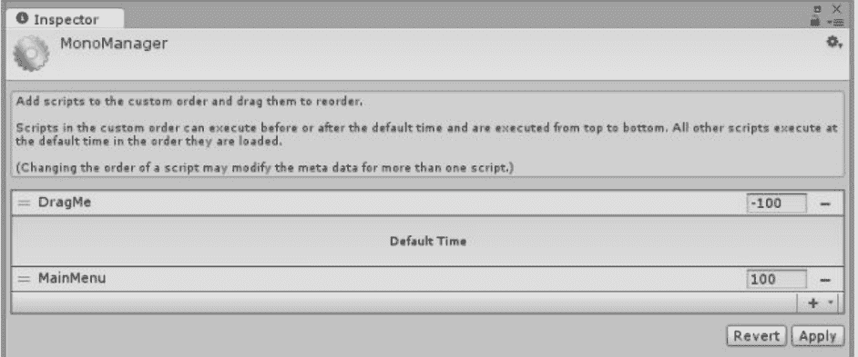

你可以通过点击加号添加脚本。你可以将脚本留在那里，也可以将其拖向上并更改时间值。脚本将从上到下进行处理。所有未在此定义的脚本都将在“默认时间”区域内按随机顺序被调用。

## 第 3 章：创建简单的 3D 游戏

现在你已经学习了 Unity 的基础知识，让我们把这些知识应用到游戏中。为此，你将在附带的 DVD 上找到一个示例游戏，它应该有三个版本：

- **空示例游戏**：该项目仅包含各种资产，如 3D 模型、纹理、音频文件等。
- **模板示例游戏**：除了资产外，还包含一个具有预定义关卡设计的场景，本章后面的描述正是针对此定制的。
- **示例游戏**：作为演示对象，展示示例游戏最终应该是什么。

在这个示例游戏的背景下，我们想要开发一个小型地下城迷宫类角色扮演 3D 游戏。这种类型主要关于解决墙壁（地下城）中的谜题以及战斗敌 NPC。由于这里可以使用许多不同的技术，因此这是一个非常好的说明示例。开发一个完整的地下城迷宫将稍微超出范围，因此我们在这里只处理单个任务，即玩家必须解决的一个任务。在这种情况下，目标是找到一个容器来收集掉落的饮料。在寻找这个容器时，玩家会遇到需要战斗的敌人蝙蝠和需要打开的锁门。我们将首先使用 `GUIElements`（`GUITexture`、`UIText`）和 `OnGUI` 编程来实现 GUI。最后有一个额外章节，我将回顾为了使用从 4.6 版本开始提供的新 uGUI 控制需要更改的内容，因为我在写这本书时只写了新控件的测试版本，而我想和你一起开发一个可运行的示例，示例最初将基于传统的 GUI 技术。一旦新的 uGUI 系统正式发布，我将在我的博客上为你提供第二个版本供下载，该版本将使用新的 uGUI 控制。你可以在本书的“引言”部分找到更多信息。

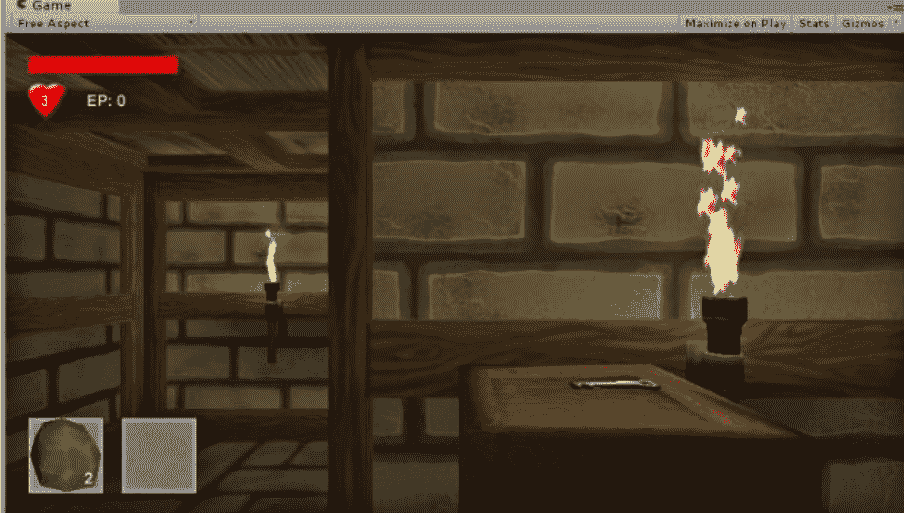

## 备份副本和版本管理

在开发游戏时，你当然应该定期保存项目。建议再次复制项目的中间状态，并将其备份保存到另一个目录（甚至是外部存储）中。不一定非要等到硬盘崩溃，例如某次更改不符合你的预期就足够了。在这种情况下，如果你可以轻松地切换回之前的状态将是非常有利的。为此还有专门的软件，即所谓的版本管理软件（版本控制系统），来承担这项任务。通过复制项目，你也可以简单地手动这样做。

## 关卡设计

即使其他章节引用模板项目，我仍然想在下面简要说明你如何使用各种 3D 模型来自己设计关卡。

如果你想使用自己设计的 3D 模型，你必须首先将 FBX 文件、纹理等导入到项目。通过将它们拖放到项目的项目浏览器中可以很容易实现。最好使用自己的文件夹在项目浏览器中对不同的资产类型进行分类和跟踪，例如“Materials”（材质）、“Models”（模型）、“Scenes”（场景）等。你也会在示例游戏中找到这些。

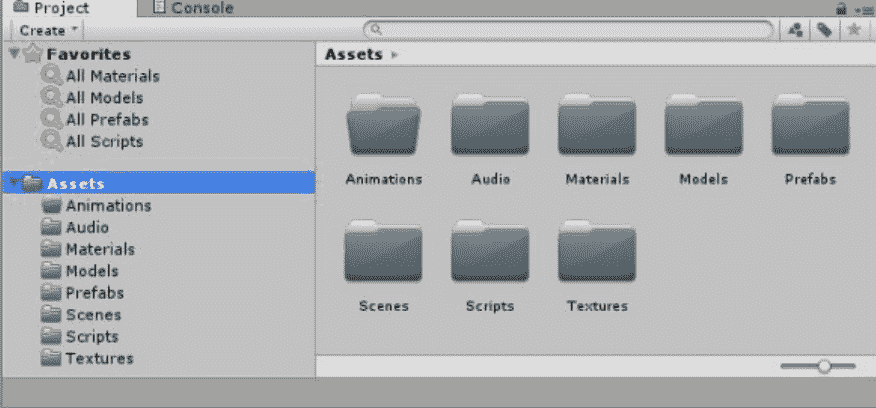

### 通用导入设置

对于提供的模型和纹理，你应该在任何地方都使用以下导入设置：

- Model / Scale Factor: 1
- Model / Generate Colliders: 取消
- Animations / Import animation: 取消

然而，由于某些模型需要特殊设置，我们稍后将进行调整。

### bat_03 导入设置

蝙蝠模型 `bat_03` 有自己的动画。因此，在模型的导入设置中也必须进行以下设置：

- Animations / Import Animations: 激活

### crate_01 导入设置

木箱模型 `crate_01` 的比例尺较大。为了让我们也能通过此模型从动态批处理中受益，我们不允许之后在场景中缩放模型。这意味着我们在导入时就已经更改了缩放。否则，其余设置与“通用导入设置”相同：

- Model / Scale Factor: 0.25

### stone_01 导入设置

我们还想在导入时调整石头 3D 模型的大小。此外，我们想让模型的边缘更平滑，因此我们在 Unity 中重新计算法线并调整它们。正如“通用导入设置”部分所示：

- Model / Scale Factor: 0.1
- Model / Normals: 激活
- Model / Smoothing Angle: 100

### floor_01 设置

为了让玩家能够在地板上行走，我们要为地板 `floor_01` 自动添加碰撞体。当然，还有其他选项，但这种情况下我们要使用自动生成的碰撞体。

- Model / Generate Colliders: 激活

### 分配材质

在导入 FBX 文件时，通常会创建材质。你也可以为它们分配材质。

- 具有法线贴图使用“Bumped Diffuse”（凹凸着色）
- 对于纹理，选择“Diffuse”（漫反射着色）

### 创建预制体

与其将模型拖入场景，我们想从模型创建预制体。如果我们不这样做，就必须为每个模型实例配备碰撞体。

## Wall 预制体

对于我们的墙，我们创建一个名为“Wall”的预制体：

1. 将 `wall01` 模型拖入场景。
2. 为模型添加盒碰撞体。
3. 将模型拖入 Prefabs 文件夹并重命名为“Wall”。

## Torch 预制体

接下来我们要为墙创建一个预制体：

4. 将 `torch_01` 和 `torch_holder_01` 对象拖入场景。
5. 将 `torch_01` 作为 `torch_holder_01` 的子对象，并放置在 (0,0,0.13)。
6. 现在将 `torch_holder_01` 对象拖入 Prefabs 文件夹并重命名为“Torch”。

## Wall_Torch 预制体

现在我们想要创建一个第二个墙预制体，它也有墙火炬。

1. 复制预制体“Wall”并重命名为“Wall_Torch”。
2. 现在将“Wall_Torch”和“Torch”拖入场景，并将“Torch”作为“Wall_Torch”的子对象。
3. 将 Torch 旋转到 (-90,90,0)。接下来我们想使用顶点吸附将持有架放置在木质表面：
4. 为此，标记“Wall_Torch”并按下 `V` 键。你可以通过移动鼠标选择对象的顶点。
5. 如果你现在持有架的外边缘有一个顶点，按下左鼠标按钮并将火炬向墙滑动。火炬将跳到墙上并放置在墙的一个顶点上。这里重要的是它必须在外部，这样火炬就不会在墙内，但我们不想在此实现更多，你可以松开鼠标按钮并再次按下 `V` 键。
6. 当你将持有架放置在外部表面时，你只需要手动将“Torch”放置在中间的木梁上。因此，从“Torch”手动设置 X 位置为 `1` 且 Y 位置为 `-1`。
7. 然后通过 Apply 确认更改，使“Wall_Torch”预制体接受所有更改。

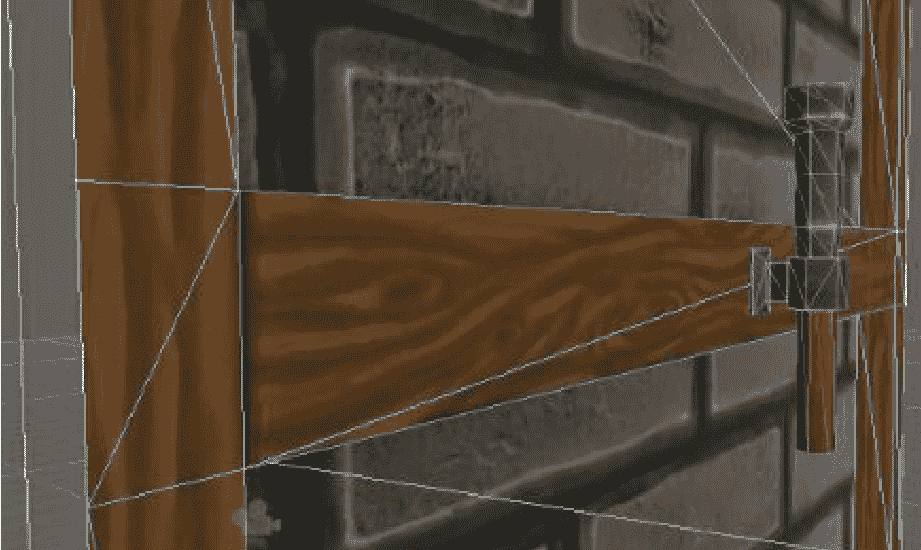

## 地板预制体

我们也想为地板创建一个预制体。尽管在第一步中它与普通的模型预制体没有区别，但这样做是为了将来更具灵活性。如果你以后想向添加的模型增加内容，只有在使用预制体时才能将这些调整同步到其他实例，如果直接将模型预制体拖入场景，则无法做到。

7. 将 `floor_01` 拖入场景。
8. 将其直接拖入 `Prefabs` 文件夹而不进行任何调整，并将其重命名为 `Floor`。

## 天花板预制体

最后，我们为天花板模型创建一个预制体。原因与地板相同，为了灵活性。

9. 将 `ceiling_01` 拖入场景。
10. 将其直接拖入 `Prefabs` 文件夹而不进行任何更改，并将其重命名为 `Ceiling`。

### 创建地下城

### 创建地板

要创建地板区域，首先将地板预制体拖入 `Floors` 容器，并使用 Reset 将其重置为默认值。现在将 Floor 实例旋转到 (-90,0,0)，使其像楼板一样放置。现在我们准备好了第一个底板，可以根据意愿多次复制此板并将它们并排放置。最简单的方法是始终使用 `Ctrl` + `D` 复制单个圆盘，然后立即将其移动到新位置，例如 (0,0,2)，然后再处理下一块地板板。我一直会通过 Inspector 中的位置参数来重新定位，因为这是最快且最准确的方法。通过这种方式，你现在可以逐渐决定以后地下城的走廊和大厅的位置。

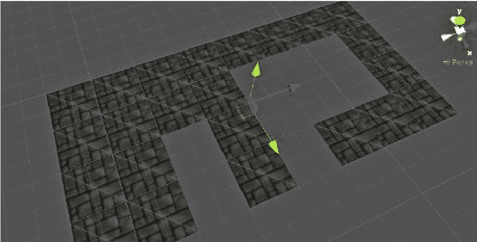

### 创建墙

要创建墙壁，向 `Walls` 容器中同时添加一个 `Wall` 实例和一个 `Wall_Torch` 实例，并使用 Reset 将它们都重置为标准值。现在将它们垂直放置在外层的 Floor 面板上，使可见表面指向地板表面，例如放置在位置 (0,2,-2) 和 (2,2,-2)。现在像处理 `Floor` 实例一样再次复制这些实例，并根据你的意愿在楼板的外边缘排列，以便最终整个地板区域被围起来。由于 `Wall_Torch` 实例的火炬以后负责照明，你应该确保在关卡中分布了足够的实例，以便所有角落都能被照亮。

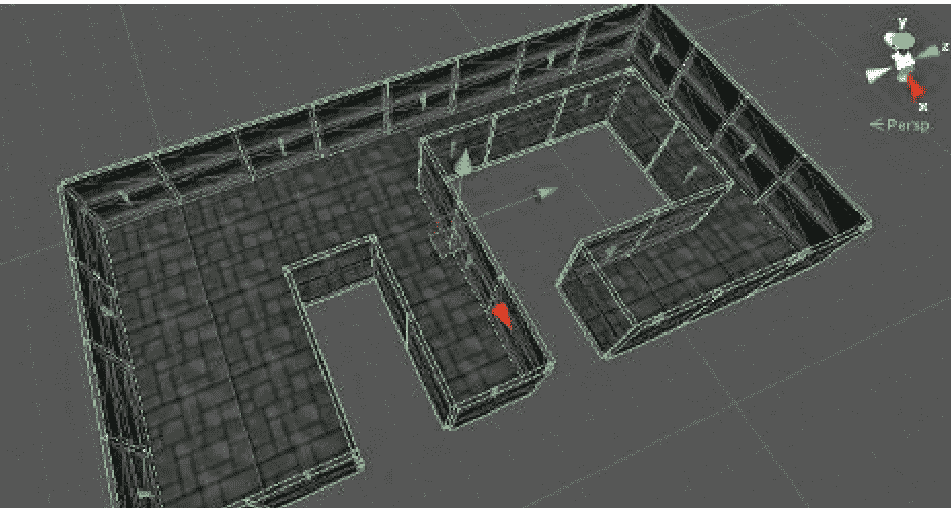

### 创建天花板

最后必须建造地下城的天花板。操作步骤与地板表面几乎相同，区别在于可见的一面自然朝下。向 `Ceilings` 容器中添加一个 `Ceiling` 实例并使用 Reset 重置。现在将它移动到位置 (0,2,0)，并使用旋转参数旋转到 (90,0,0)，使其恰好位于一个 `Floor` 实例上方，距离等于 `Wall` 实例的高度。现在复制此实例并到处移动，直到整个地下城最终被地板、墙和天花板元素完全包围。

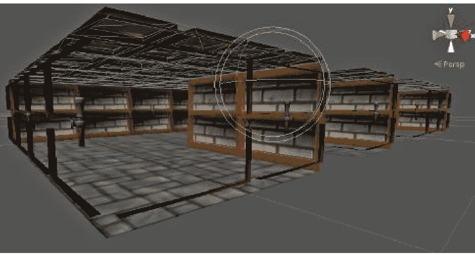

### 添加火焰和光照

现在按照“使用 Shuriken 粒子效果”章节中的描述创建一个火炬火焰的粒子效果，并创建一个名为 `TorchFlames` 的预制体。在这里，创建一个新场景来开发这种粒子效果是有益的。如果你已经创建了粒子效果，将另一个 `Wall_Torch` 预制体拖入场景。现在将 `TorchFlames` 对象拖到 `Torch` 对象上，使其成为火炬的子物体。将火焰放置在火炬正上方 (-0.1,0,3)。现在标记场景中的 `Wall_Torch` 并点击 Apply，以便将调整同步到预制体。你现在可以保存场景并打开 `Dungeon` 场景。你会发现地下城场景中所有的 `Wall_Torch` 实例都收到了火焰。返回你创建粒子效果的测试场景并完成火炬设置。为此，通过 `GameObject` / `Create` / `Light` 向场景添加一个新的 `PointLight`。你也将其拖到 `Wall_Torch` 并放置在 (0,0,4)，让 `PointLight` 直接位于火焰中。现在你定义 Light 的以下参数：

- Color: R 254, G 254, B 139, A 255
- Range: 3
- Intensity: 1

最后再次选择 `Wall_Torch` 预制体的 Inspector 并点击 Apply。现在你可以切回 `Dungeon` 场景，那里墙壁会被 `PointLight` 照亮。

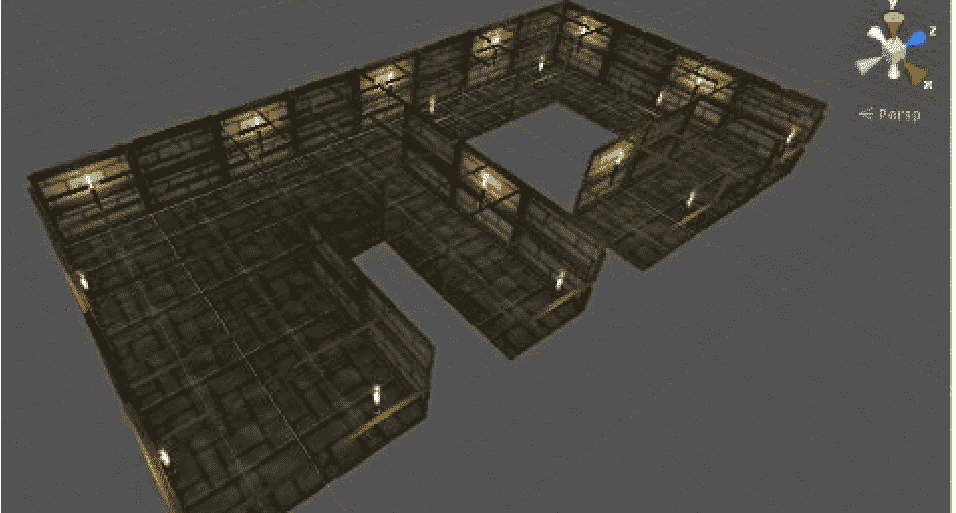

### 创建装饰

实际上，装饰并不一定包含与游戏相关的物体。大多数时候，我们想切换所有物体。

### 木箱预制体

首先，我们想为导入的箱子创建一个预制体。

1. 将 `crate_01` 拖入场景并将其重命名为 `Crate`。
2. 检查缩放为 (1,1,1)。
3. 检查分配的材质。这应该是 `placeables_01_diff`，它使用了同名的纹理并设置了 `Diffuse` 着色器。
4. 给 GameObject 添加一个 `BoxCollider`。
5. 现在通过将 GameObject 拖入 `Prefabs` 文件夹创建一个预制体。

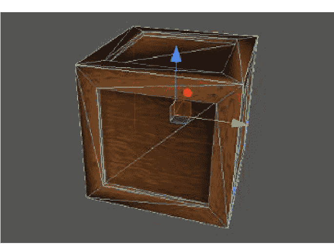

### 桶预制体

现在我们想从导入的桶中创建自己的预制体。这里有两个不同的：一个封闭的桶和一个装水的桶。

1. 将 `barrel_01` 拖入场景并将其重命名为 `Barrel`。
2. 同样检查这里分配的材质。这应该是 `placeables_01_diff`，它使用了同名的纹理并设置了 `Diffuse` 着色器。
3. 为了简化问题，给 GameObject 添加一个 `BoxCollider`。为了更精确，你可以在导入设置中激活 `Generate Collider`。
4. 现在通过将 GameObject 拖入 `Prefabs` 文件夹来创建一个预制体。现在对模型 `barrel_01_water` 执行同样的操作，并简单地命名为 `Barrel_Water`。

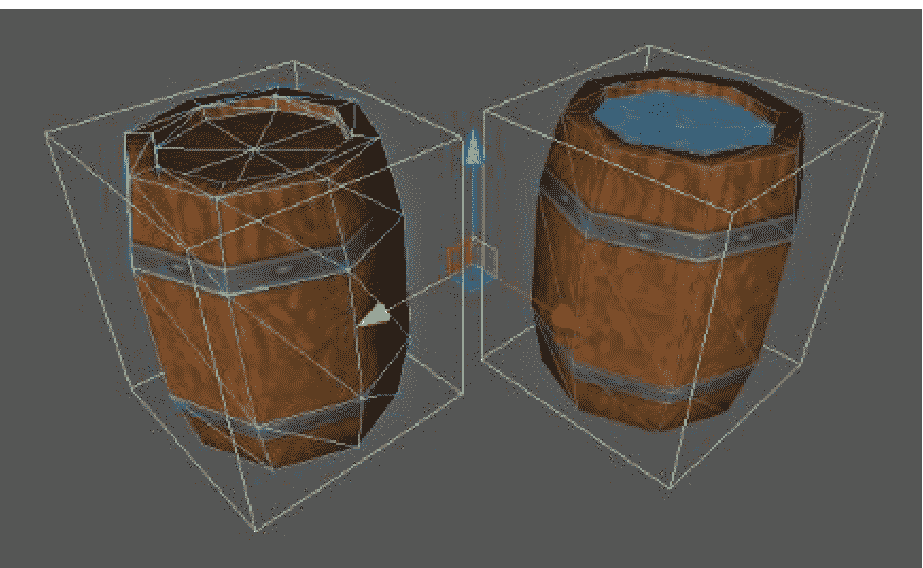

物品的图形显示。为此，我们创建了一个名为 `ItemProperties` 的小类。它只包含一个 `Texture2D` 变量和一个 `int` 变量，用于存储库存物品中提到的两个参数。由于我们不会将该类作为组件使用，因此它没有继承 `MonoBehaviour`。该类的内容可以在列表中找到，完整的脚本可以在“ItemProperties.cs”部分找到。

```csharp
public class ItemProperties {
    public Texture2D texture;
    public int quantity;
}
```

## 库存系统

借助 `ItemProperties` 类，我们现在可以为库存管理创建一个字典对象，在我们的案例中将其命名为 `items`。此外，我们需要两个数组对象，用于在 GUI 中显示库存内容。第一个数组用于显示图形，第二个数组显示数量。得益于这些数组，稍后在决定库存的大小或 GUI 可以显示的内容量时将更加灵活。

```csharp
public GUIText[] guiItemTextures;
public GUIText[] guiItemQuantities;
private Dictionary<string, ItemProperties> items = new Dictionary<string, ItemProperties>();
```

请注意，为了使用 `Dictionary` 类，必须先通过 `using System.Collections.Generic;` 包含相关的命名空间。为了显示当前视图，我们将开发一个小方法，该方法以后每当库存发生变化时都会调用，并应该在 GUI 中进行更新。它会遍历数组中的所有物品，并在所有物品首先用空值初始化后，填充相应的内容。

```csharp
void UpdateView() {
    int index = 0;
    int guiItemCount = guiItemTextures.Length;
    for (int i = 0; i < guiItemCount; i++) {
        guiItemTextures[i].texture = null;
        guiItemQuantities[i].text = "";
    }
    foreach (KeyValuePair<string, ItemProperties> current in items) {
```


# 库存系统

```csharp
guilemTextures[index].texture = current.Value.texture;

guilemQuantities[index].text = current.Value.quantity.ToString();

index++;
```

这也是脚本启动后要执行的第一件事。

```csharp
void Start() {
    UpdateView();
}
```

现在是用于填充和移除库存的实际方法。我们想要为此创建两个方法。`AddItem` 方法用于添加一个新物品。物品的名称（即数据记录的键）以及用于在 GUI 中显示物品的纹理会被传递给该方法。

该方法会检查物品是否已存在于字典中，然后增加数量。为了确保我们添加到库存中的物品不会超过 GUI 能显示的数量，在创建新的字典数据记录之前，会进行检查以确定是否所有 GUI 对象都已被物品图形占据。你可以在“库存系统接口”部分找到更多关于此点的信息。

```csharp
public bool AddItem(string itemName, Texture2D texture) {
    if (!items.ContainsKey(itemName)) {
        if (items.Count < guilemTextures.Length) {
            ItemProperties ip = new ItemProperties();
            ip.texture = texture;
            ip.quantity = 1;
            items.Add(itemName, ip);
            UpdateView();
        }
        return true;
    } else {
        items[itemName].quantity += 1;
        UpdateView();
        return true;
    }
}
```

最后，是 `RemoveItem` 方法，它确保物品从库存中移除。我们使用布尔值返回值来指示操作是否成功，或者请求的物品是否仍在库存中。

```csharp
bool RemoveItem(string itemName) {
    if (items.ContainsKey(itemName)) {
        if (items[itemName].quantity == 1)
            items.Remove(itemName);
        else
            items[itemName].quantity -= 1;
        UpdateView();
        return true;
    } else
        return false;
}
```

完整的脚本可以在“Inventory.cs”部分找到。

## 库存物品 (InventoryItem)

最后，我们想要开发一个附加到每个要添加到库存的物品上的脚本。在这里我们定义了三个公共变量，用于指定物品名称、在 GUI 中显示的纹理以及在捡起时播放的音频片段。我们还需要两个私有变量来缓存库存脚本和玩家角色（或其 transform）。

```csharp
public string itemName = "";
public Texture2D texture;
public AudioClip picSound;
private Inventory inventory;
private Transform player;
```

这两个私有变量在 `Start` 方法中赋值：

```csharp
void Start() {
    player = GameObject.FindGameObjectWithTag("Player").transform;
    inventory = GameObject.FindGameObjectWithTag("Inventory").GetComponent<Inventory>();
}
```

# 库存系统接口

在我们开始处理实际的 GUI 对象之前，创建一个空的 GameObject，你可以将其重置为默认值并重命名为 "Inventory"。现在添加我们创建的同名的 `Inventory` 脚本。现在，在标签列表中创建一个新标签 "Inventory"，并将其分配给 GameObject "Inventory"。首先，创建两个 `GUIText` 对象和四个 `GUITexture` 对象，并将它们作为子对象添加到 GameObject "Inventory" 中。将这四个 `GUITexture` 对象重命名为 "Tile1-Bg"、"Tile2-Bg"、"Tile1-Value" 和 "Tile2-Value"。将两个 `GUIText` 对象重命名为 "Tile1-Quantity" 和 "Tile2-Quantity"。确保 `GUITexture` 对象的缩放比例为 (0,0,1)。

将纹理 "inventory-tile" 分配给 "Tile1-Bg" 和 "Tile2-Bg" 的纹理属性。将 Texture Type（纹理类型）设置为 GUI，并将 Max Size（最大尺寸）设置为 64。然后，将两个对象的位置设置为 (0,0, -1)，以便它们排列在较后的位置。将 "Tile1-Value" 和 "Tile2-Value" 的位置设置为 (0,0,0)，以便它们显示在两个背景纹理之前。现在设置这四个对象的像素内边（pixel inset）值。对于 "Tile1-Bg" 和 "Tile1-Value"，设置 X 20, Y 20, W 64, H 64。对于 "Tile2-Bg" 和 "Tile2-Value"，设置 X 100, Y 20, W 64, H 64。最后，两个文本对象 "Tile1-Quantity" 和 "Tile2-Quantity" 必须配备正确的参数。相应物品的数量应始终显示在各自图形的右下角。因此，为两个对象设置以下值：

- Position（位置）：(0,0,1)
- Anchor（锚点）：upper right（右上角）
- Alignment（对齐）：right（右对齐）

最后，设置像素偏移（pixel offset）值来确定文本的位置。对于 "Tile1-Quantity" 设置 X 75, Y 40，对于 "Tile2-Quantity" 设置 X 155, Y 40。现在将背包脚本中的 `guilemTextures` 和 `guilemQuantities` 的大小设置为 2。然后按照与 `guilemTextures` 数组对应的顺序添加 "Tile1-Value" 和 "Tile2-Value"，并将 "Tile1-Quantity" 和 "Tile2-Quantity" 添加到 `guilemQuantities` 数组中。现在你可以测试两个 "Quantity" 对象的文本属性，分配不同的数值，并将物品图形（例如 "key" 纹理）分配给 "Value" 对象的纹理属性。如果你在不启动游戏的情况下查看 Game View，现在应该能在左下角看到背包。

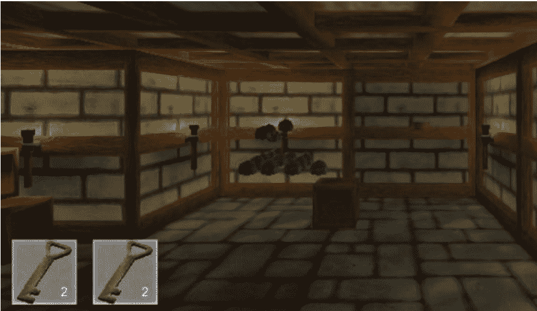

# 背包物品

在我们的游戏中，我们要处理三种不同的物品类型。我们想在此部分创建这些物品。

## 悬停效果 (HoverEffects)

在此之前，我们想编写一个小型脚本，当玩家鼠标指向一个对象时，立即显示信息文本。此外，应该告知玩家是否可以捡起该对象并添加到背包。我们希望通过更改光标来实现这一点。由于信息文本应该始终直接出现在相应的物品旁边，现在有两种不同的实现版本。我们可以将文本对象直接放在三维世界中与相应的对象一起（例如使用 3D 组件），或者使用一个普通的 GUI 对象，然后将其放置在 GUI 的二维像素坐标系中。后者的优点是，无论对象距离多远，字体大小始终保持相同。这就是我们想要采用这种方法的原因。所以，我们首先创建一个通用的 `GUIText` 对象，稍后我们将将其放置在显示信息文本的相应位置。

1. 通过 GameObject 创建 `GUIText` 对象，并将其命名为 "TooltipText"。
2. 将 GameObject 放置在 (0,0,0)。
3. 现在创建一个新的 "Tooltip" 并将其分配给 GameObject "Tooltip"。
4. 将 Anchor 设置为 "middle center"（正中间），并将 Alignment（对齐）设置为 "center"（居中对齐）。
5. 移除分配的默认文本。
6. 如果需要，你也可以分配不同的字体，或使用 Size（大小）和 Color（颜色）属性按意愿进行调整。

现在我们创建一个名为 "HoverEffects" 的新脚本。首先，我们需要 `GUIText` 对象的引用以及一个用于信息文本的变量。我们还想更改光标。由于我们已经在游戏中使用不同于标准指针的光标，因此我们现在使用两个变量：`standardCursor` 和 `clickableCursor`。通过额外的变量 `hotSpot`，我们还指定了光标的位置，但它简单保持为零。

```csharp
public Texture2D standardCursor;
public Texture2D clickableCursor;
public string tooltipText;
private Vector2 hotSpot = Vector2.zero;
private GUIText msgBox;

void Start() {
    msgBox = GameObject.Find("Tooltip").GetComponent<GUIText>();
    msgBox.transform.position = Vector3.zero;
}

void OnMouseEnter() {
    if (clickableCursor != null) {
        Cursor.SetCursor(clickableCursor, hotSpot, CursorMode.Auto);
    }
    msgBox.text = tooltipText;
    Vector2 pos;
    pos.x = Input.mousePosition.x;
    pos.y = Input.mousePosition.y + 20;
    msgBox.pixelOffset = pos;
}

void OnMouseExit() {
    ExitEffect();
}

void ExitEffect() {
    if (standardCursor != null) {
        Cursor.SetCursor(standardCursor, hotSpot, CursorMode.Auto);
    }
    msgBox.text = "";
}
```

### 默认光标 (Default cursor)

在我们的游戏中，我们已经决定使用不同于标准指针的光标，因此我们现在使用两个变量：`standardCursor` 和 `clickableCursor`。通过额外的变量 `hotSpot`，我们还指定了光标的位置，但它简单保持为零。通过 `Edit / Project Settings / Player` 将图像 "icon_01" 分配给默认光标。

### 钥匙 (Key)

现在我们可以处理物品了。首先，我们要创建一个稍后用于打开大门的钥匙。

1. 将 "iron_01" 模型拖入场景，并将 GameObject 重命名为 "IronKey"。
2. 为其分配 "placeables_01_diff" 材质，使用同名的 "Diffuse"。
3. 现在给它添加一个 `BoxCollider` 并在所有方向上稍微放大它，例如变为 (0.2, 0.08, 0.02)。由于钥匙很小，我们增加了它的碰撞区域，以便玩家更容易选择它。
4. 现在在钥匙上添加 `HoverEffects` 脚本。为 `standardCursor` 分配 "icon_01_32"，为 `clickableCursor` 分配 "icon_02_32"，为 `tooltipText` 分配 "Iron Key"。检查这两个纹理的导入设置。Texture Type 应为 "Cursor"，Wrap Mode 为 "Clamp"，Max Size 为 32。
5. 最后，在钥匙上添加 `InventoryItem` 脚本。`itemName` 为 "Key"，`texture` 分配 "key"，`picSound` 分配 "picUp"。你应该分配 "key" 纹理的导入设置。这里的 Texture Type 应为 "GUI"，Max Size 应为 64。
6. 最后，将完成 GameObject 拖入 "Prefab" 文件夹创建预制体。

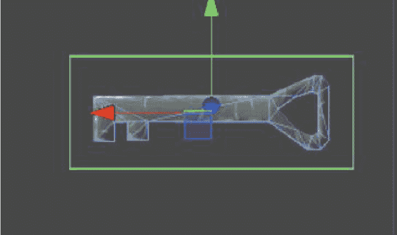

### 水箱 (Water tank)

现在对 "bucket_01_empty" 模型进行带有更改的同样操作。我想要说明这些更改：

- GameObject 的名称更改为 "BucketEmpty"。

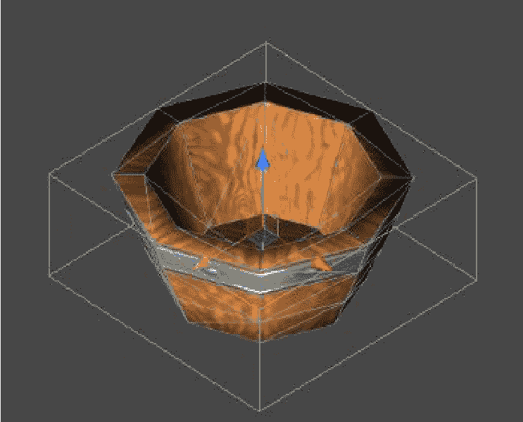

### 石头 (Stone)

最后，对 "stone_01" 模型进行此操作。然而，有一些我想简要说明的区别：

- 名称更改为 "Stone"。
- 这一次不是使用 `BoxCollider`，而是添加 `SphereCollider` 并将其半径改为 0.08。
- 在 `HoverEffects` 中，为 `tooltipText` 分配文本 "Throwing stone"。
- 在 `InventoryItem` 中，为 `itemName` 分配 "Stone"，纹理为 "stone"。
- 这里不需要更改碰撞体的大小。

```csharp
using UnityEngine;
using System.Collections;

public class HoverEffects : MonoBehaviour {
    public Texture2D standardCursor;
    public Texture2D clickableCursor;
    public string tooltipText;
    private Vector2 hotSpot = Vector2.zero;
    private GUIText msgBox;

    void Start() {
        msgBox = GameObject.FindGameObjectWithTag("Tooltip").GetComponent<GUIText>();
        msgBox.transform.position = Vector3.zero;
    }

    void OnMouseEnter() {
        if (clickableCursor != null)
            Cursor.SetCursor(clickableCursor, hotSpot, CursorMode.Auto);
        msgBox.text = tooltipText;
        Vector2 pos;
        pos.x = Input.mousePosition.x;
        pos.y = Input.mousePosition.y + 20; // to display text a little higher.
        msgBox.pixelOffset = pos;
    }

    void OnMouseExit() {
        ExitEffect();
    }

    void OnDestroy() {
    }

    void ExitEffect() {
        if (standardCursor != null)
            Cursor.SetCursor(standardCursor, hotSpot, CursorMode.Auto);
        if (msgBox != null)
            msgBox.text = "";
    }
}
```


### 游戏控制器

在游戏中，总有一些功能无法具体分配给某个游戏对象，但它们与整个游戏或至少与当前场景有关。一个很好的例子是暂停菜单或背景音乐。此类组件通常被分配到一个名为“Game Controller”的 GameObject 上。“游戏控制器”是游戏中典型的组件，这就是为什么 Unity 默认已经提供了一个“Game Controller”标签，以便更快速地识别它们。由于我们的游戏也需要一个“Game Controller”，现在就创建一个名为“Game Controller”的新游戏对象。首先，你向它传输一个 `AudioSource`，并激活 `Play On Awake` 和 `Loop`。现在将“backgroundMusic”文件分配给 `AudioClip` 属性，并将音量暂时设置为 0.3，稍后你可以根据喜好进行调整。为了让背景音乐在任何地方的音量都相同且始终均匀分布在两个声器上，我们在“backgroundMusic”的导入设置中取消勾选 `3D Sound` 参数。

### 创建玩家

接下来，让我们来处理玩家。由于内容较大，我想将其分为三个部分。首先，我们将为玩家配备它的主要组件。然后，我们将开发生命管理系统，这对我们未来的对手来说也很重要。最后，我们才会处理实际的玩家控制和攻击。

1. 首先，我们在场景中添加一个新的空游戏对象并将其命名为“Player”。为了以后通过代码更容易找到它，我们也给它赋予“Player”标签。Unity 默认提供了这个标签，所以我们不需要担心进一步创建此标签。
2. 现在，我们通过 `Component > Physics > Character Controller` 为“Player”添加一个字符控制器，稍后我们将使用单独的脚本控制它。将半径设置为 0.5，高度设为 1.5。
3. 然后，我们向该 GameObject 添加一个 `AudioSource`，通过它播放玩家所有的语音样本。你可以根据需要调整音量。确保 `Play On Awake` 和 `Loop` 处于未勾选状态。
4. 现在，将“Main Camera”作为子对象添加到“Player”中，并使用 `Reset` 将其重置为默认值。为此，选择“Main Camera”，并在 Transform 上下文菜单中点击 `Reset`。然后将位置调整为 `position (0, 0.4, 0)`。
5. 现在创建另一个空游戏对象并将其命名为“SpawnPoint”。此对象稍后将用作投掷武器的位置。为了更好的视觉呈现，可以在 GameObject 的 Inspector 中为“SpawnPoint”设置自己的图标，例如黄色菱形。

### LifePointController

我们需要的变量是一个用于管理生命值的私有变量，以及一个用于访问 `UIText` 对象的公共变量，随后我们将 "LpText" 对象赋值给该变量。

```csharp
public UIText LpText;

private int lifePoints = 0;
```

由于我们将使用属性方法来访问 `lifePoints` 变量，因此该 `int` 变量被声明为私有。这样做是为了在赋值时，我们可以确保 `lifePoints` 的值永远不会小于 0。我们还希望确保在每次分配新值时 GUI 都会更新。为此，我们将再次实现一个执行此操作的 `UpdateView` 方法。

```csharp
public int LifePoints {
    get {
        return lifePoints;
    }
    set {
        lifePoints = value;
        if (lifePoints < 0) lifePoints = 0;
        UpdateView();
    }
}
```

在 `UpdateView` 方法中，将新的 `lifePoints` 值赋值给 GUI 对象。

```csharp
void UpdateView() {
    LpText.text = lifePoints.ToString();
}
```

现在我们要做的最后一件事是在场景开始时将当前的生命值数量赋值给控制器。我们将使用 `PlayerPrefs` 类和 "LPs" 参数来实现这一点。在游戏开始时，我们将在启动场景中保存带有初始值的 "LPs" 参数。如果带有 `LifePointController` 启动 "Dungeon" 场景，后者会将值加载到 `lifePoints` 变量中。

```csharp
void Awake() {
    LifePoints = PlayerPrefs.GetInt("LPs");
}
```

在场景结束时，脚本会再次将其当前值写回。这是通过 `OnDestroy` 方法实现的，该方法会在脚本被销毁时执行（即场景终止时）。

```csharp
void OnDestroy() {
    PlayerPrefs.SetInt("LPs", lifePoints);
}
```

如果场景因为玩家死亡而结束，那么写入 "LPs" 的值将比他开始时的值小。一旦玩家死亡，`PlayerHealth` 脚本中的 `lifePoints` 就会扣除一个生命值，我们稍后会编写该脚本。因此，当场景重启时，加载的值会减少。完整的 `LifePointController` 脚本可以在本节末尾找到。

### HealthController

现在我们进入玩家健康管理的实际部分。但由于我们的对手也有血量状态，我们现在想要使用继承性。我们将创建一个基类 `HealthController`，玩家和对手的脚本将基于该类创建。`HealthController` 类仅包含存储血量状态的公共变量 `health` 以及私有变量 `isDead`。

```csharp
public float health = 3;
private bool isDead = false;
```

该类还拥有 `ApplyDamage` 方法，它会对所有者造成伤害。在这里，`health` 根据伤害量进行减少，并调用一个名为 `Damaging` 的方法。然而，如果伤害导致 `health` 降至 0 甚至为负，则会调用 `Dying` 方法，并将变量 `isDead` 设置为 `true`。

```csharp
void ApplyDamage(float damage) {
    health -= damage;
    if (health <= 0 && !isDead) {
        isDead = true;
        Dying();
    } else {
        Damaging();
    }
}
```

由于玩家和对手的 `Damaging` 和 `Dying` 两个方法差异很大，它们仅被声明为可以重写的空方法。

```csharp
public virtual void Damaging() {
}

public virtual void Dying() {
}
```

### PlayerHealth

现在我们可以基于 `HealthController` 类创建 `PlayerHealth` 脚本了。该脚本也将有一个 `UpdateView` 方法，在该方法中，玩家的健康值将以图形方式显示。然而，在这种情况下，我们不想简单地显示一个数字，而是想以进度条的形式显示此值。对于这个条，我们使用已经创建的 "HealthBar" `UIText` 对象。最后，我们将该对象赋值给公共变量 `healthGui`。在 `UpdateView` 方法中，该图形对象的长度将根据健康值和指定的最大长度计算。

```csharp
void UpdateView() {
    if (healthGui != null) {
        guiRect.width = guiMaxWidth * health / maxHealth;
        healthGui.pixelInset = guiRect;
    }
}
```

注意列表中未声明的各种变量。这些是在类头部声明的公共和私有变量，并在 `Start` 方法中赋值。`guiRect` 在此处接收原始值，随后将其宽度传递给 `guiMaxWidth`。`maxHealth` 也从 `health` 的初始值获取值。除了这些，还有两个变量在 `Start` 中赋值。`lifePointController` 变量被赋值给游戏控制器的特定实例，`messageText` 变量被赋值标记为 "Message" 的对象的 `UIText` 组件，我们在上面进一步创建了它。最后，在 `Start` 方法中再次调用 `UpdateView`，以便在 GUI 中显示正确的条长度。

```csharp
public AudioClip hurtClip;
public AudioClip deathClip;
public UIText healthGui;
private LifePointController lifePointController;
private float maxHealth;
private UIText messageText;
private Rect guiRect;
private float guiMaxWidth;

void Start() {
    messageText = GameObject.FindGameObjectWithTag("Message").GetComponent<UIText>();
    lifePointController = GameObject.FindGameObjectWithTag("GameController").GetComponent<LifePointController>();
    guiRect = new Rect(healthGui.pixelInset);
    guiMaxWidth = guiRect.width;
    maxHealth = health;
    UpdateView();
}
```

#### PlayerHealth.cs 完整代码

玩家血值的实际管理由 `PlayerHealth` 脚本完成，它继承自 `HealthController` 类。将其直接添加到玩家上。然后，将 "hit" 和 "death" 音频片段赋值给两个 `AudioClip` 变量 `hurtClip` 和 `deathClip`。

```csharp
using UnityEngine;
using System.Collections;

public class PlayerHealth : HealthController {
    public AudioClip hurtClip;
    public AudioClip deathClip;
    public UIText healthGui;
    private LifePointController lifePointController;
    private float maxHealth;
    private UIText messageText;
    private Rect guiRect;
    private float guiMaxWidth;

    void Start() {
        messageText = GameObject.FindGameObjectWithTag("Message").GetComponent<UIText>();
        lifePointController = GameObject.FindGameObjectWithTag("GameController").GetComponent<LifePointController>();
        guiRect = new Rect(healthGui.pixelInset);
        guiMaxWidth = guiRect.width;
        maxHealth = health;
        UpdateView();
    }

    public override void Damaging() {
        audio.clip = hurtClip;
        audio.Play();
        UpdateView();
    }

    public override void Dying() {
        audio.clip = deathClip;
        audio.Play();
        UpdateView();
        lifePointController.LifePoints -= 1;
        if (lifePointController.LifePoints > 0)
            Invoke("Restart", 1);
        else
            messageText.text = "Game Over";
    }

    void Restart() {
        Application.LoadLevel(Application.loadedLevel);
    }

    void UpdateView() {
        if (healthGui != null) {
            guiRect.width = guiMaxWidth * health / maxHealth;
            healthGui.pixelInset = guiRect;
        }
    }
}
```


### Player controls

控制游戏英雄的方法有很多。然而，为了让玩家操作更方便，通常使用在类似游戏中已经使用的已知机制是有意义的。出于这个原因，我想在我们的示例游戏中使用传统的 WASD 键位控制。由于我们的玩家控制不需要遵循任何物理定律，我们可以使用 `character controller` 来实现控制。我们已经给“玩家”添加了正确的组件。

### PlayerController

在“Unity 中的物理学”章节中，我已经在“简单第一人称控制器”部分向你展示了带有 `character controller` 的控制器可能像什么样。在那里你也可以找到关于该脚本开发的详细描述。请根据描述进行编程，并将 `PlayerController` 脚本添加到“玩家”上。请注意创建了两个额外的虚拟轴“Left”和“Right”（按 [Q] 键对应“Left”，[E] 键对应“Right”）。在“简单第一人称控制器”章节的最后，你最终会找到完整的脚本。接下来，我们想要扩展名为“PlayerController”的脚本以添加游戏特定的功能。这包括在玩家赢得游戏或游戏死亡时阻止控制。首先，我们要创建两个变量：布尔变量 `gameEnded` 和类型为 `PlayerHealth` 的变量 `playerHealth`。由于 `gameEnded` 将由另一个确定任务完成的脚本设置，因此变量必须声明为 `public`。但由于我们不想在 Inspector 中设置该变量，我们可以为它提供一个属性，这确保了变量尽管声明为公共，但在 Inspector 中不可见。该属性是 `HideInInspector`，并在变量上方用方括号指定。

```csharp
public float moveSpeed = 5.0F;

public float rotationSpeed = 300.0F;

[HideInInspector]

public bool gameEnded = false;

private Vector3 moveDirection = Vector3.zero;

private CharacterController controller;

private playerHealth playerHealth;

private quaternion destRotation;
```

在 `Start` 方法中，除了已经进行的赋值外，现在将 `PlayerHealth` 脚本赋值给关联的变量。

```csharp
void Start () {

    playerHealth = GetComponent <PlayerHealth>();

    controller = GetComponent <CharacterController>();

    destRotation = transform.rotation;

}
```

与“Unity 中的物理学”章节中的原始脚本相比，唯一的实际变化是在执行控制之前查询布尔变量 `gameEnded`。然而，如果 `playerHealth` 的当前血量状态为“0”或 `gameEnded` 为 TRUE，则控制不会执行，并向 `SimpleMove` 方法传递值 `Vector3.zero`，这意味着除了让角色控制器停止外没有没有其他操作。你可以在完整脚本的代码中看到它是怎样的，该脚本可以在后续章节“PlayerController.cs”中找到。

### Footsteps

大多数时候，仅仅控制是不够的，即使在我们的情况下也是如此。由于我们的英雄在移动时也应该产生脚步声，我们现在创建一个名为 `Footsteps` 的新脚本。这需要五个变量：一个用于 `AudioClip`，我们在其中分配单个步子的声音。然后我们需要一个 `float` 变量来定义可以听到脚步的间隔，以及一个用于音量的 `float` 变量。我们还需要一个私有变量在 `Start` 方法中存储 `character controller` 的引用，以及一个存储自上一次脚步以来经过时间的最后一个 `float` 变量。

### Variables of footsteps

```csharp
public AudioClip audioClip;

public float stepLength = 0.4F;

public float volume = 0.7F;

private CharacterController controller;

private float delay = 0;
```

现在每当玩家在地板上移动时，应该播放脚步声。为了做到这一点，我们首先使用 `sqrMagnitude` 根据一定的容差检查玩家是否正在移动，并使用 `isrounded` 测试他是否接触地面。

### if condition to control movement of the player

```csharp
if (controller.velocity.sqrMagnitude > 0.2F && controller.isrounded) {

    // ...

}
```

如果是这样的话，我们现在以 `stepLength` 为时间间隔使用 `PlayClipPoint` 播放音频片段。我们通过 `float` 变量 `delay` 确定经过的时间，该值在每帧中通过 `deltaTime` 增加。如果 `delay` 达到 `stepLength`，则播放 `AudioClip` 并将 `delay` 设置为 0。当然，代码必须在每帧中调用，这就是为什么我们将该过程恰当地存放在 `update` 方法中。

### Play footsteps in update

```csharp
void Update () {

    if (controller.velocity.sqrMagnitude > 0.2F && controller.isrounded) {

        if (delay >= stepLength) {

            AudioSource.PlayClipAtPoint(audioClip, transform.position, volume);

            delay = 0;

        }

    }

    delay += Time.deltaTime;

}
```

### Shooting

最后，我们想要确保我们的英雄可以战斗。他应该能够使用石头作为武器，他可以在游戏期间收集并投掷它们。当然，与库存系统的交互对于这种机制至关重要，这就是为什么我们首先在变量声明中创建一个 `Inventory` 类型的变量。我们还需要一个用于预制体的 `GameObject` 变量。如果你觉得扔石头对你来说太无聊，可以使用其他 3D 模型来实现这一点，例如 B。替换为刀子、弓箭或弩的箭。由于原理是相同的，这已经不再重要了。这就是为什么我统统将脚本称为“Shooting”，并将预制体变量称为 `projectile`。

```csharp
public GameObject projectile;

private playerHealth playerHealth;

private inventory inventory;

private GUIText messageText;

private string info = "To attack you need something to throw";

private bool messageSpawn = false;
```

如列表所示，除了已经提到的变量外，我们还需要三个变量，我稍后会介绍它们。首先，重要的是 `Start` 方法中的 `messageText` 变量必须引用标签为 "Message" 的 GameObject 的 `GUitext` 组件，我们已经在 `Player Health` 脚本中使用过它。如果我们的英雄现在要扔石头，问题随之产生：预制体究竟应该何时生成？可以使用所谓的“生成点”（spawn points）来定义这些位置。生成点通常只是一个空对象，通过它的 `transform` 组件来确定位置。在我们案例中，生成点将是玩家的子对象，因为在逻辑上它总是跟随玩家移动。这个脚本的特殊之处在于，它没有被添加到“player”上，而是直接挂载到 GameObject "SpawnPoint" 上。这样做的好处是，不需要告诉脚本预制体应该在哪里创建。我们还可以利用该 GameObject 的旋转来获取从生成点的投掷方向。

然而，在访问其他组件时，我们也必须考虑这一点。由于我们在 `Start` 方法中引用了 `Inventory` 和 `PlayerHealth`，现在我们必须访问后者的父对象。我们通过 `transform` 实现这一点。

```csharp
void start () {

    playerHealth = transform.parent.GetComponent<PlayerHealth>();

    inventory = GameObject.FindGameObjectWithTag("Inventory").GetComponent<Inventory>();

    messageText = GameObject.FindGameObjectWithTag("Message").GetComponent<GUitext>();

}
```

我们现在想用 `shoot` 方法来触发投掷或射击。这只是在自己的位置实例化预制体，并保持与 "SpawnPoint" 相同的旋转。此外，我们想要同时播放一段投掷噪音。为了这个目的，我们在开始为 "SpawnPoint" 添加了一个单独的音频源（audio source），并为其分配了合适的声音。

```csharp
void Shoot () {

  Instantiate(projectile, transform.position, transform.rotation);

  audio.Play();

}
```

我们要做的最后一件事是触发 `Shoot`。我们在 `update` 方法中执行此操作，并将使用虚拟按钮 "Fire2"。你可能需要在输入设置中将按键从 "left" 改为 "space"。但你可以自己决定使用哪个按键进行投掷。每次投掷，都会从物品栏中移除一个标签为 "Stone" 的物品。如果没有该物品，就无法投掷。一个需要注意的重点点是：如果玩家想投掷但按了攻击键，并惊讶于什么都没有发生，我们希望显示一个小小的信息文本，该文本会在玩家第一次在没有石头的情况下尝试攻击时出现。我们想在一个协程（coroutine）中显示此文本，持续两秒。在此过程中，我们在 `messageShown` 变量中记录在 `update` 方法中检查这些变量的状态，然后相应地启动协程。

```csharp
void Update () {

    if (playerHealth.health > 0) {

        if (Input.GetButtonDown("Fire2")) {

            if (inventory.RemoveItem("Stone")) {

                Shoot();

            } else {

                StartCoroutine(ShowInfoText());

            }

        }

    }

}

IEnumerator ShowInfoText () {

    messageText.text = info;

    messageShown = true;

    yield return new WaitForSeconds(2);

    messageText.text = "";

}
```

如前提到的，此脚本现在挂载到 "SpawnPoint" 上，以创建预制体参数 `projectile`。

## PlayerController.cs

下面是完整的 `PlayerController` 脚本。请注意，你需要创建虚拟按钮 "Left" 和 "Right" 才能使用此脚本。你在输入设置中定义这些按钮，最好将它们分配给按键 [Q]（对应 "Left"）和 [E]（对应 "Right"）。

```csharp
using UnityEngine;

using System.Collections;

public class PlayerController : MonoBehaviour {

    public float moveSpeed = 5.0F;

    public float rotationSpeed = 300.0F;

    [HideInInspector]

    private bool gameEnded = false;

    private Vector3 moveDirection = Vector3.zero;

    private CharacterController controller;

    private playerHealth playerHealth;

    private Quaternion destRotation;

    void Start () {

        playerHealth = GetComponent<PlayerHealth>();

        controller = GetComponent<CharacterController>();

        destRotation = transform.rotation;

    }

    void Update () {

        if (playerHealth.health > 0 && !gameEnded) {

            moveDirection = new Vector3 (Input.GetAxis("Horizontal"), 0, Input.GetAxis("Vertical"));

            moveDirection = transform.TransformDirection(moveDirection);

            moveDirection = moveDirection * moveSpeed;

            controller.SimpleMove(moveDirection);

            if (Input.GetButtonDown("Left")) 

                destRotation.eulerAngles -= new Vector3 (0, 90, 0);

            if (Input.GetButtonDown("Right")) 

                destRotation.eulerAngles += new Vector3 (0, 90, 0);

            float step = rotationSpeed * Time.deltaTime;

            transform.rotation = Quaternion.RotateTowards(transform.rotation, destRotation, step);

        } else {

            controller.SimpleMove(Vector3.zero);

        }

    }

}
```

### Footsteps.cs

负责脚步声的脚本在列表 21.43 中所示。请将此脚本添加到 "Player" 上，并将声音文件 "footstep" 分配给 `audioClip` 变量。由于脚本临时生成的音频源不会随玩家移动，你应该在导入设置中禁用该文件的 3D Sound 属性。使用 `stepLength` 来定义可以听到脚步声的间隔。你设置的值越低，脚步声出现得越频繁。

```csharp
using UnityEngine;

using System.Collections;

public class footsteps : MonoBehaviour {

    public AudioClip audioClip;

    public float stepLength = 0.4F;

    public float volume = 0.7F;

    private CharacterController controller;

    private float delay = 0;

    void start () {

        controller = GetComponent<CharacterController>();

    }

    void Update () {

        if (controller.velocity.sqrMagnitude > 0.2F && controller.isGrounded) {

            if (delay >= stepLength) {

                AudioSource.PlayClipAtPoint (audioClip, transform.position, volume);

                delay = 0;

            }

        }

        delay += Time.deltaTime;

    }

}
```

### Shooting.cs

将以下脚本添加到 "SpawnPoint" 对象上。稍后你会有投掷石头的预制体，我们仍在创建“扔石头”的部分。根据你的喜好，你可以在输入设置中为投掷定义不同的按键。默认情况下，“left alt” 键被定义为正按键。你可以更改 "space"，从而使用空格键 [Space] 来进行投掷。

```csharp
using UnityEngine;

using System.Collections;
```


public class shooting: MonoBehaviour {

    public GameObject projectile;

    private playerHealth playerHealth;

    private inventory inventory;

    private GUIText messageText;

    private string info = "To attack you need something to throw";

    private bool messageSpawn = false;

    // ... (其余代码保持逻辑一致)

}

```cs
Shoot();
else if (! messageShown)
    StartCoroutine(ShowInfoText ());
}
}
```

```cs
void Shoot () {
    GameObject go = (GameObject) Instantiate (projectile,
    transform.position, transform.rotation);
    audio.Play (
}
```

```cs
IEnumerator ShowInfoText () {
    messageText.text = info;
    messageShown = true;
    yield return new WaitForSeconds(2);
    messageText.text = "";
}
```

### 开发投掷石

在创建背包物品时，我们已经为投掷的石头创建了一个预制体。然而，这仅作为武器使用，因为该对象还需要一些其他组件和设置。因此，接下来我们将创建另一个石头预制体，并将其命名为“投掷石”。

1. 再次将 `stone_01` 模型拖入场景。
2. 将场景中的 GameObject 重命名为 `Throwing Stone`。
3. 给它添加一个球体碰撞体并激活 `Is Trigger`。
4. 由于投掷出的石头很小但速度很快，我们现在稍微增加碰撞体的 z 轴半径，例如增加到 `0.12`，以便更容易进行碰撞检测。
5. 现在给 GameObject 添加一个 `Rigidbody` 并激活 `Is Kinematic`。相反，禁用 `Use Gravity`。此外，将碰撞检测参数设置为 `Continue Dynamic` 以获得更好的检测效果。
6. 将 GameObject `Throwing Stone` 拖入 `Prefab` 文件夹以创建预制体。
7. 现在将此预制体分配给 `SpawnPoint` 射击脚本中的 `projectile` 参数。

正如你可能已经注意到的那样，射击脚本现在会创建投掷石，但它并不会移动。

我们现在想在一个独立的脚本中编写让石头朝正确方向飞行的能力。这个脚本不仅负责处理移动，还会在与另一个物体碰撞时造成伤害并销毁石头本身。简而言之：这个脚本将处理石头的整个行为，因此我们简单地将其命名为 `StoneBehaviour`。因此，创建一个新的 `StoneBehaviour` 脚本并将其添加到 `Throwing Stone` 预制体中。要此操作，在 Project 浏览器中选择该预制体，并使用 Inspector 中的 `Add Component` 按钮将脚本添加到预制体中。为了对石头的投掷或飞行路径获得最佳控制，我们将使用 `translate` 方法移动 `transform` 组件来移动石头。因此在创建投掷石预制体时，我们已经激活了刚体的 `Is Kinematic` 参数。我们使用一个名为 `speed` 的变量来控制石头的速度。

```cs
void Update () {
    transform.Translate(transform.forward * speed * Time.deltaTime, Space.World);
}
```

为了让战斗变得有趣，用石头瞄准应该是相对容易。当然，最简单的方法是让生成点位于玩家中间较远的位置。为了让投掷石不会立即与角色控制器的碰撞体碰撞，我们在石头的碰撞体上使用 `Is Trigger` 参数。这意味着可以在 `OnTrigger` 方法中评估并施加伤害，最好在 `OnTrigger` 方法中运行。然而，当物体与另一个触发器碰撞体碰撞时，该方法也会执行，例如，与我们未来的任务发布者碰撞（这将在“创建任务发布者”章节中进行介绍）。因此，在这种情况下，我们想使用层掩码，通过它来定义后续代码在哪些层上执行，哪些层不执行。为此，我们首先通过 `Edit / Project Settings / Tags and Layers` 创建一个名为 `IgnoreStoneDetection` 的新层。现在，我们声明一个名为 `acceptableLayers` 的公共层掩码变量，以及之前提到的 `speed` 变量和一个确定伤害量的 `damage` 变量。此外，如果石头在与另一个 GameObject 碰撞时破碎，将创建一个微小的粒子效果。为此，我们需要一个名为 `destroyGo` 的 GameObject 变量。随后我们将立即创建粒子效果本身。

```cs
public LayerMask acceptableLayers;
public GameObject destroyedGo;
public float damage = 1;
public float speed = 10;
```

现在注意，你已经在 `Throwing Stone` 的 Inspector 中的 `acceptableLayers` 处禁用了新层 `IgnoreStoneDetection`，而其他都是勾选的。在 `OnTriggerEnter` 方法中，我们现在评估石头当前与哪个层进行碰撞（参见“Unity 中的物理”章节中的“使用层掩码”小节）。如果另一个对象的层在 `acceptableLayers` 中，则检查该对象是否带有 `Enemy` 标签。如果是如此，则调用 `SendMessage` 方法 `ApplyDamage` 并传递 `damage` 变量。无论它是否为 `Enemy` 都会执行。

```cs
void OnTriggerEnter (Collider other) {
    if ((acceptableLayers.value & (1 << other.gameObject.layer)) != 0) {
        if (other.gameObject.CompareTag("Enemy")) {
            other.SendMessage("ApplyDamage", damage);
        }
    }
}
```

为了让投掷石不会立即与角色控制器的碰撞体碰撞，我们在石头的碰撞体上使用 `Is Trigger` 参数。这意味着可以在 `OnTrigger` 方法中评估并施加伤害，最好在 `OnTrigger` 方法中运行。然而，当物体与另一个触发器碰撞体碰撞时，该方法也会执行，例如，与。

添加到 `Throwing Stone` 的完整 `StoneBehaviour` 脚本见下文列表。

### StoneBehaviour.cs

```cs
using UnityEngine;
using System.Collections;

public class StoneBehaviour : MonoBehaviour {
    public LayerMask acceptableLayers;
    public GameObject destroyedGo;
    public float damage = 1;
    public float speed = 10;

    void Update () {
        transform.Translate(transform.forward * speed * Time.deltaTime, Space.World);
    }

    void OnTriggerEnter(Collider other) {
        if ((acceptableLayers.value & (1 << other.gameObject.layer)) != 0) {
            if (other.gameObject.CompareTag("Enemy")) {
                other.SendMessage("ApplyDamage", damage);
            }
        }
        Destroy(gameObject);
        Instantiate(destroyedGo, transform.position, Quaternion.identity);
    }
}
```

### 配置石头击中

如果投掷石击中墙或其他物体，它应该爆炸。为此，我们想创建一个微小的粒子效果，它不产生传统的粒子，而是以石头网格形式呈现的三维粒子。为此创建一个新的粒子系统并命名为 `DestroyedStone`。将其拖入 `Prefab` 文件夹以创建预制体。然后我们配置粒子系统的各个模块。首先，我们对默认模块进行以下设置参数化。`Start Size` 和 `Start Rotation` 都设置为随机常量之间的值。

接下来是发射模块和形状模块。由于效果应该只出现一次，我们已经在上面禁用了循环。在发射模块中，我们现在定义单次爆发。由于默认模块中 `Max Particles` 值为 `10`，无论我们将爆发设为 `10`、`30` 还是 `100`，都没有关系，它最多只会有 `10` 个。

最后，我们将形状设置为半径为 `0.1` 的球体，因为粒子应该从一点向所有方向飞出。然后我们使用随时间变化的尺寸模块来定义每个粒子的尺寸。在这里，粒子应该持续很一段时间，然后平滑地消失。为此，我们使用 Unity 提供的标准曲线之一。

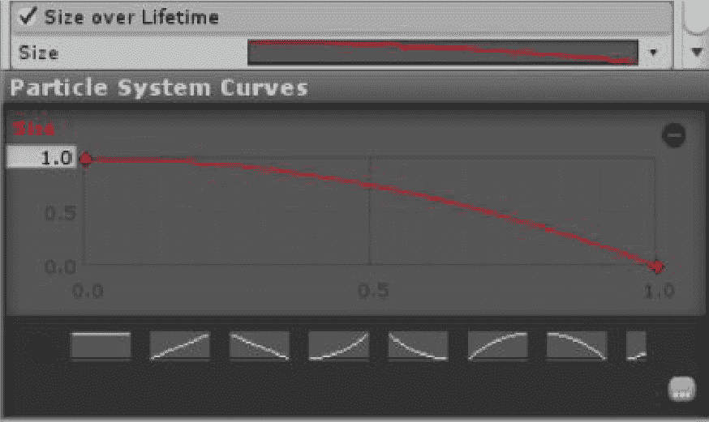

最后，是渲染器模块，我们将渲染模式设置为网格。现在我们在 `Mesh` 下选择石头的模型的网格。现在重要的是，你还要选择关联材质。

| Renderer | | |
|---|---|---|
| Render Mode | stone | |
| Material | placeables_01_diff | |
| Sort Mode | None | |
| Sorting Fudge | 0 | |
| Cast Shadows | ✓ | |
| Receive Shadows | ✓ | |
| Max Particle Size | 0.5 | |

粒子效果已经就绪了。现在，你只需要在粒子系统的检查器中点击 `Apply`，将所做的设置应用到预制体中。最后，石头不仅应该在视觉上爆炸，还要在听上重现这种效果。为了做到，请在 GameObject 上添加你自己的 `AudioSource`，激活 `Play On Awake` 并取消激活 `Loop`。现在将音频片段 `stoneCrash` 赋值给它。为了使用粒子系统 GameObject，将此预制体分配给 `ThrowingStone` 预制体中 `StoneBehaviour` 脚本的 `destroyedGo` 变量。

### 创建任务

这一部分关于玩家必须解决的实际任务。在我们的游戏中，玩家应该找到一个水容器，用来接滴落的水。为了解决这个任务，他仍然必须完成子任务并与对手战斗。

### 管理经验值

为了击败对手并完成任务，玩家最后还应该获得经验值。因此，我们想首先创建一个名为 `EPController` 的小脚本，它用来管理这些经验值并在 GUI 中显示它们。你将此脚本分配给 `Game Controller`，它已经拥有了 `LifePoint` 控制器。对于这些功能，我们总共需要两个变量：一个存储 EP 值的变量，另一个包含 GUI 对象的引用，以便在其中显示该值。

```cs
public GUIText epText;
private int eps = 0;
```

由于我们仍然缺少一个 GUI 对象，我们接下来想要创建它。

1. 创建一个新的 `GUIText` 对象并命名为 `EpText`。
2. 将 `EpText` 作为子对象添加到已经创建的 `GUI` 容器对象上。
3. 将其位置在 `(0,1,0)`，像素偏移为 `(70, -49)`。
4. 将此对象分配给 `EPController` 脚本中的变量 `epText`。对于实际逻辑，我们再次需要一个 `UpdateView` 方法来负责显示，以及一个 `AddPoints` 方法，通过它我们可以从外部将新的 EP 传输到脚本。`UpdateView` 方法在 `Start` 方法中也会再次调用一次，以便为 GUI 分配一个初始值。

```cs
void Start () {
    UpdateView();
}

public void AddPoints(int points) {
    eps += points;
    UpdateView();
}

void UpdateView () {
    epText.text = "EP:" + eps.ToString();
}
```

这就是 `EPController` 的完整内容。现在你只需要将脚本添加到 `Game Controller`，并将 `GUIText` 对象 `EpText` 分配给 `epText` 变量即可。

### EPController.cs

在接下来的列表中，你可以看到管理玩家经验值的完成后的 `EPController` 脚本。将完成后的脚本添加到 `Game Controller`。

```cs
using UnityEngine;
using System.Collections;

public class EPController : MonoBehaviour {
    public GUIText epText;
    private int eps = 0;

    void Start () {
        UpdateView();
    }

    public void AddPoints(int points) {
        eps += points;
        UpdateView();
    }

    void UpdateView () {
        epText.text = "EP:" + eps.ToString();
    }
}
```


### 创建任务

这一部分关于玩家必须解决的实际任务。在我们的游戏中，玩家应该找到一个水容器，用来接滴落的水。为了解决这个任务（也称为任务），他仍然必须完成子任务并与对手战斗。

### 管理经验值

为了击败对手并完成任务，玩家最后还应该获得经验值。因此，我们想首先创建一个名为 `EPController` 的小脚本，它用来管理这些经验值并在 GUI 中显示它们。你将此脚本分配给 "Game Controller"，它已经拥有了 LifePoint 控制器。对于这些功能，我们总共需要两个变量：一个存储 EP 值的变量，另一个包含 GUI 对象的引用，以便在其中显示该值。

```cs
public GUIText epText;

private int eps = 0;
```

由于我们仍然缺少一个 GUI 对象，我们接下来想要创建它。

1. 创建一个新的 `GUIText` 对象并命名为 "EpText"。
2. 将 "EpText" 作为子对象添加到已经创建的 "GUI" 容器对象上。
3. 将其位置在 (0,1,0)，像素偏移为 (70, -49)。
4. 将此对象分配给 `EPController` 脚本中的变量 `epText`。对于实际逻辑，我们再次需要一个 `UpdateView` 方法来负责显示，以及一个 `AddPoints` 方法，通过它我们可以从外部将新的 EP 传输到脚本。`UpdateView` 方法在 `Start` 方法中也会再次调用一次，以便为 GUI 分配一个初始值。

```cs
void Start() {
    UpdateView();
}

public void AddPoints(int points) {
    eps += points;
    UpdateView();
}

void UpdateView() {
    epText.text = "EP:" + eps.ToString();
}
```

这就是 `EPController` 的完整内容。现在你只需要将脚本添加到 "Game Controller"，并将 `GUIText` 对象 "EpText" 分配给 `epText` 变量即可。

### EPController.cs

在接下来的列表中，你可以看到管理玩家经验值的完成后的 `EPController` 脚本。将完成后的脚本添加到 "Game Controller"。

```cs
using UnityEngine;
using System.Collections;

public class EPController : MonoBehaviour {
    public GUIText epText;
    private int eps = 0;

    void Start() {
        UpdateView();
    }

    public void AddPoints(int points) {
        eps += points;
        UpdateView();
    }

    void UpdateView() {
        epText.text = "EP:" + eps.ToString();
    }
}
```

### 任务发布者逻辑

注意变量 `messageText`，它再次引用了标签为 "Message" 的 `UIText` GameObject。因此，在这里我们使用了之前在 `PlayerHealth` 脚本中使用过的同一个对象来显示“Game Over”文本。接下来，我们想要编写这个任务发布者的核心部分：`OnTriggerEnter` 方法。当另一个带有刚体和碰撞器的 GameObject 触发触发器碰撞器时，该方法就会被执行。为了实现此操作，我们首先检查该对象是否为玩家。如果是，我们尝试从物品栏系统中获取 ID 为 "Bucket" 的物品。激活 `finalBucket`（这会使 GameObject 可见），在 GUI 中显示 `questEndedMessage`，最后将 EP 赋值给 `EPController`。由于我们的游戏只包含一个任务，我们最终将 `PlayerController` 中的变量 `gameEnded` 设置为 `true`。

然而，如果玩家没有 ID 为 "Bucket" 的物品，则会显示任务文本。如果玩家已经读过并反复触发该触发器，则会显示替代文本 `questMessage2`。

```cs
void OnTriggerEnter(Collider other) {
    if (other.gameObject == player) {
        if (inventory.RemoveItem("Bucket")) {
            finalBucket.SetActive(true);
            playerController.gameEnded = true;
            messageText.text = questEndedMessage;
            epController.AddPoints(eps);
        } else {
            if (gotQuest) messageText.text = questMessage2;
            else messageText.text = questMessage;
            gotQuest = true;
        }
    }
}
```

我们现在想要做的最后一件事是确保当英雄再次离开触发器时，`questMessage` 或 `questMessage2` 会再次消失。为此，我们使用 `OnTriggerExit` 方法。

```cs
void OnTriggerExit(Collider other) {
    if (other.gameObject == player) {
        messageText.text = "";
    }
}
```

### InGameMenu

到此，实际的任务已经完成。但当玩家玩完游戏后应该发生什么呢？目前英雄不再可以控制，且 `questEndedMessage` 的文本显示在 GUI 中。为了让游戏继续进行下去，玩家现在应该有机会重新开始游戏或进入主菜单。为此，我们想要创建一个名为 "InGameMenu" 的小脚本，并将其添加到 "Game Controller" 对象上。这现在需要对 `PlayerController` 和 `LifePointController` 组件进行引用。

```cs
private PlayerController playerController;
private LifePointController lifePointController;

void Start() {
    playerController = GameObject.FindGameObjectWithTag("Player").GetComponent<PlayerController>();
    lifePointController = GameObject.FindGameObjectWithTag("GameController").GetComponent<LifePointController>();
}
```


现在，我们在每帧中检查英雄是否死亡或游戏是否结束。如果是其中一种情况，一旦按下 `[Escape]`、`[Space]` 或 `[Return]` 键，游戏就会启动起始场景（索引为 0）。或者，你当然也可以通过 `Input.anyKeyDown` 一次检查所有按键。

```cs
void Update () {
    if (lifePointController.LifePoints == 0 || playerController.gameEnded) {
        if (Input.GetKeyDown(KeyCode.Escape) || Input.GetKeyDown(KeyCode.Space) || Input.GetKeyDown(KeyCode.Return)) {
            Application.LoadLevel(0);
        }
    }
}
```

### WaterQuest.cs

`WaterQuest` 脚本包含了任务的逻辑，并直接添加到带有触发器碰撞器的 GameObject 上。

```cs
using UnityEngine;
using System.Collections;

public class WaterQuest : MonoBehaviour {
    public int eps = 20;
    public GameObject finalBucket;
    private GUIText messageText;
    private string questMessage = "Find a container" + "to drink water.";
    private string questMessage2 = "You need an empty container.";
    private string questEndedMessage = "<size = 20>Congratulations! </size> \n" + "You have solved the task.";
    private bool gotQuest = false;
    private GameObject player;
    private Inventory inventory;
    private PlayerController playerController;
    private EPController epController;

    void Start () {
        finalBucket.SetActive(false);
        player = GameObject.FindGameObjectWithTag("Player");
        playerController = player.GetComponent<PlayerController>();
        inventory = GameObject.FindGameObjectWithTag("Inventory").GetComponent<Inventory>();
        messageText = GameObject.FindGameObjectWithTag("Message").GetComponent<UIText>();
        epController = GameObject.FindGameObjectWithTag("GameController").GetComponent<EPController>();
    }

    void OnTriggerEnter(Collider other) {
        if (other.gameObject == player) {
            if (inventory.Removeitem("Bucket")) {
                finalBucket.SetActive(true);
                playerController.gameEnded = true;
                messageText.text = questEndedMessage;
                epController.AddPoints(eps);
            } else {
                if (gotQuest) messageText.text = questMessage2;
                else messageText.text = questMessage;
                gotQuest = true;
            }
        }
    }

    void OnTriggerExit(Collider other) {
        if (other.gameObject == player) {
            messageText.text = "";
        }
    }
}
```

### Waterdrop.cs

此脚本在粒子碰撞时产生声音。将此脚本添加到 "Waterdrops" 粒子系统上。将 AudioClip 赋值给脚本：

```cs
using UnityEngine;
using System.Collections;

public class Waterdrop : MonoBehaviour {
    public AudioClip clip;

    void OnParticleCollision(GameObject other) {
        ParticleSystem.CollisionEvent[] collisionEvents = new ParticleSystem.CollisionEvent[particleSystem.GetSafeCollisionEventSize()];
        int numEvents = particleSystem.GetCollisionEvents(other, collisionEvents);
        int i = 0;
        while (i < numEvents) {
            Vector3 pos = collisionEvents[i].intersection;
            AudioSource.PlayClipAtPoint(clip, pos);
            i++;
        }
    }
}
```

### InGameMenu.cs

`InGameMenu` 脚本用于结束游戏或重新开始。

```cs
using UnityEngine;
using System.Collections;

public class InGameMenu : MonoBehaviour {
    private PlayerController playerController;
    private LifePointController lifePointController;

    void Start () {
        playerController = GameObject.FindGameObjectWithTag("Player").GetComponent<PlayerController>();
        lifePointController = GameObject.FindGameObjectWithTag("GameController").GetComponent<LifePointController>();
    }

    void Update () {
        if (lifePointController.LifePoints == 0 || playerController.gameEnded) {
            if (Input.GetKeyDown(KeyCode.Escape) || Input.GetKeyDown(KeyCode.Space) || Input.GetKeyDown(KeyCode.Return)) {
                Application.LoadLevel(0);
            }
        }
    }
}
```

## 创建子任务

为了让玩家完成任务，必须在场景中放置具有相应 ID 的容器实体实例。

```csharp
public AudioClip doorClip;
public AudioClip lockedDoorMonologueClip;
public bool isLocked = true;
private Animator anim;
private int switchTrigger;
private DoorMovingState doorMovingState;
private GameObject player;
private Inventory inventory;

void Start () {
    switchTrigger = Animator.StringToHash("Switch");
    anim = transform.parent.GetComponent<Animator>();
    doorMovingState = transform.parent.GetComponent<DoorMovingState>();
    player = GameObject.FindGameObjectWithTag("Player");
    inventory = GameObject.FindGameObjectWithTag("Inventory").GetComponent<Inventory>();
}
```

由于我们将变量 `isLocked` 声明为 `public`，因此可以将此脚本用于未锁定的门。你只需要将值设置为 `true` 即可。现在我们需要在 `OnMouseDown` 方法中实现锁定机制。为了做到这一点，我们首先检查门是否已锁定。如果是的话，我们尝试从库存系统中获取 ID 为 "Key" 的物品。如果成功，我们就把 `isLocked` 设置为 `false`。

```csharp
if (isLocked) {
    if (inventory.Removeitem("Key")) {
        isLocked = false;
    }
}
```

接下来我们检查 `isLocked` 是否为 `false`。如果是的话，我们就执行已经在“Animations”章节中开发的代码来让门动画。但如果该值仍然为 `true`，我们就通过玩家的音频源输出音频剪 `lockedDoorMonologueClip`。

```csharp
if (!isLocked) {
    if (!doorMovingState.isMoving) {
        anim.SetTrigger(switchTrigger);
        AudioSource.PlayClipAtPoint(doorClip, transform.position);
    }
} else {
    player.audio.clip = lockedDoorMonologueClip;
    player.audio.Play();
}
```


现在，在 `doorClip` 变量的检查器中将文件 "chains" 和 `lockedDoorMonologueClip` 赋值给音频剪 "locked-door-monologue"，并点击 Apply，以便这些调整传递到预制体。

### 放置并配置对象

现在你可以定义英雄在地下城中的起点，并按照这种方式放置任务和子任务的所有对象，使其产生一个可玩的剧情（见图 21.21）。除了“BucketEmpty”水容器预制体外，这还包括“IronKey”钥匙预制体。两者都应该已经带有相应 ID 的必要 `InventoryItem` 脚本。你还需要一个“Gate”预制体的实例来显示已锁定的门（`isLocked` 为 `TRUE`）。你也可以在地下城中放置多个门，例如未锁定的门。将这些门的 `IsLocked` 设置为 `FALSE`。

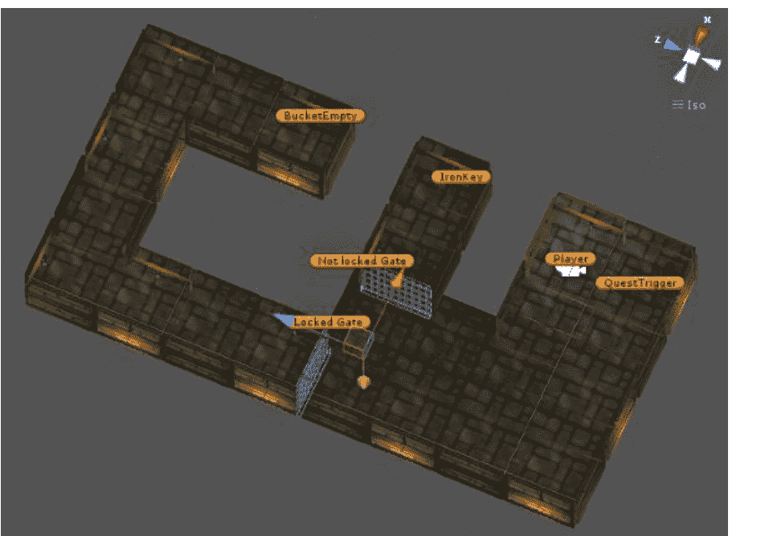

完成后，你现在就可以开始游戏并测试所有对象是否真的按照你想要的方式做出反应了。确保游戏相关的对象在游戏中都是清晰可见且可点击的。对于像我们在这里使用的这种固定相机，最好将此类对象放置在眼睛高度或相机高度。使用木箱或木桶等装饰性对象，将游戏相关的对象放置在它们上面，或者你可以让这些对象更加显眼，以便更容易被看到。例如，你可以通过使用特殊着色器或巧妙放置的光源，使物体呈现存在且更吸引眼。

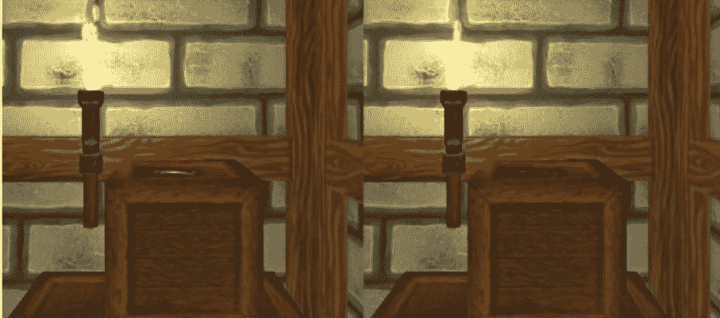

由于如此，在图 21.23 中，左侧图案的钥匙上添加了一个点光（Point Light）子对象，它位于钥匙的正上方。为了不让它照亮太多周围，半径缩小到 0.1，强度增加到 8。在右侧图案中，你可以看到没有点光的相同钥匙。根据游戏需求，你可以给玩家一只手来帮助解决任务。最后，你应该始终根据目标组这样做，并帮助玩家进行检查。这是最终判断相应任务是否太难或可能太简单的方法。

### 创建敌人

除了谜题之外，真正的冒险游戏还包括攻击英雄的敌人。在我们的案例中，我们要在地下城中集成攻击玩家的蝙蝠，但为此不仅需要一个蝙蝠模型，还需要让模型移动的动画。我们还需要一个通过寻路功能控制蝙蝠的人工智能。

### 模型、骨骼和动画导入

由于蝙蝠模型 "bat_03" 自带动画，我们就不需要担心创建动画了。然而，这些动画从建模程序导出时通常被打包在一个动画中。在我们的案例中也是如此，因此我们现在必须在导入设置中将它们拆分并分配到不同的剪辑。要做到这一点，转到 "bat_03" 模型导入设置中的动画。你可以使用剪辑下面的加号添加新剪辑。然后使用输入字段指定动画部分。总的来说，我们现在创建三个动画：“flying”、“hit” 和 “dying”（见图 24）。

| Clips | Start | End |
| :--- | :--- | :--- |
| flying | 0.0 | 13.0 |
| hit | 0.0 | 27.0 |
| dying | 15.0 | 36.0 |


注意 `Loop Time` 参数，它负责重复剪辑。仅对 "flying" 激活此参数；其他剪辑保持禁用。你还应该在导入设置的 Model 标签页将缩放因子设置为 0.1，并检查选择了 Rig 类型 "Generic"。所有调整都必须通过 Apply 确认到模型。

### 配置预制体

首先，我们需要为我们的敌人配备它所需的所有组件。

- 将 "bat_03" 对象拖入场景并将其重命名为 "Bat"。
- 创建一个新的 "Enemy" 标签并将其分配给该 GameObject。
- 现在给 GameObject 添加一个 `Rigidbody`。因为我们将通过 `NavMeshAgent` 控制 GameObject，所以禁用 `Use Gravity` 并激活 `Is Kinematic`。
- 为 "Bat" 添加一个半径为 0.5 的球形碰撞体并激活 `Trigger` 参数。
- 给 GameObject 提供一个 `AudioSource`，禁用 `Loop` 并开启 `Play On Awake`。将文件 "batCry" 作为 `AudioClip` 分配给 `AudioSource`。
- 为了寻路，我们最后通过 Component / Navigation / Mesh Agent 为 "Bat" 添加 `NavMeshAgent` 组件。请参考图 24 该组件的设置。
- 最后，将整个 GameObject 拖入 "Prefabs" 文件夹以创建预制体。


配置 `NavMeshAgent` 时，要记住我们的 NPC 是在飞行而不是在地面上移动的。但我们不想让它变得太复杂，只需通过基础偏移在 `NavMeshAgent` 中移动蝙蝠对象，并将高度降低到蝙蝠或其翅膀顶部。由于我们的蝙蝠最初看起来只是缓慢地沿着预定义的路线飞行，我们将 `Speed` 和 `Acceleration` 参数设置为较低。稍后攻击时，我们将通过脚本增加速度。


### 创建 Animator Controller

为了现在制作蝙蝠，我们需要一个动画控制器。要做到这一点，在项目浏览器中选择 "Animations" 文件夹，并通过 Assets / Create / Animator Controller 创建一个名为 "BatController" 的控制器。现在我们可以处理 NPC 应该拥有的各种动画状态。要做到这一点，通过 Window / Animator 打开 Animator 窗口并选择你创建的 "BatController"。我们的蝙蝠将总共有四种不同的动画状态，你可以使用 Animator 窗口的上下文菜单（通过右键访问）使用 Create State / Empty 创建。现在按照以下方式命名并配置它们：

- **Flying**：设置为 "Set as Default" 动画状态，并在正常飞行期间播放。分配剪辑 "flying"。如果你在选择中找不到该剪辑，请确保查看的是 "Assets" 区域的选择窗口，而不是 "Scene" 标签页。
- **Attacking**：在蝙蝠对英雄造成伤害时激活。这里也分配普通的 "flying" 动画剪辑。然而，它应该以五倍的速度播放。这就是为什么你将剪辑 "hit" 设置为 5。
- **Hit**：分配剪辑 "hit"。当蝙蝠受到伤害时播放它。
- **Dying**：将剪辑 "dying" 分配给 Dying。此动画状态在蝙蝠死亡时激活。

为了控制这些动画状态，我们总共需要三种不同的参数，你需要在参数列表中创建它们：

- `Hit`：设置为 trigger 参数。
- `Attack`：设置为 bool 参数。

你现在可以定义负责切换不同动画状态的转换（见图 21.26）。要做到这一点，右键点击起始动画状态并选择 Make Transition。然后用左键点击目标动画状态。

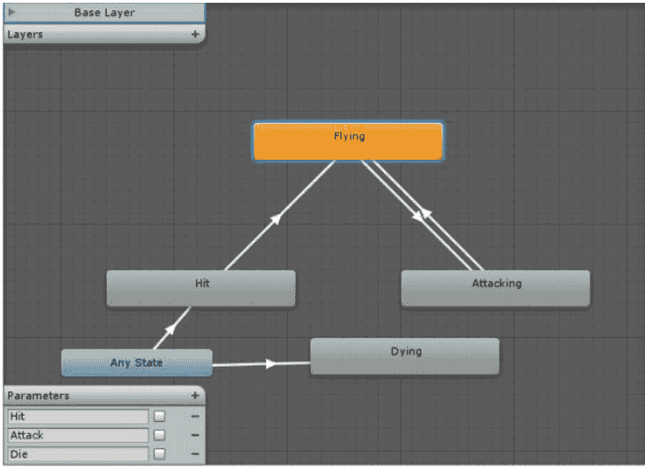

在相应转换的检查器中，现在存储了条件，当条件满足时，状态将从一个状态切换到另一个：

- 任意状态 -> Hit: `Hit`; `The` = `FALSE`。
- 任意状态 -> Dying: `Hit`; `The` = `TRUE`。
- Hit -> Flying: `Exit Time` = 0.80。
- Flying -> Attacking: `Attack` = `TRUE`。
- Attacking -> Flying: `Attack` = `FALSE`。

现在你可以将动画机控制器分配给我们的“Bat”预制体控制器的 `Animator` 组件。你可以使用场景中的“Bat”实例进行此操作，并在点击 Apply 之后将这些调整应用回预制体。由于动画没有向模型传递任何移动，你也可以在那里禁用 `Apply Root Motion`。

### 创建 NavMesh

接下来，我们要为路径查找功能创建 NavMesh。要做到这一点，通过 Window / Navigation 打开导航窗口。现在，在导航窗口中使用导航静态专家标记场景中的所有静态对象。或者在相应 GameObject 的检查器中完全勾选静态标记。在我们情况下，这应该是所有的“Wall”、“Floor”和“Ceiling”对象，以及装饰对象“Create”和“Barrel”。

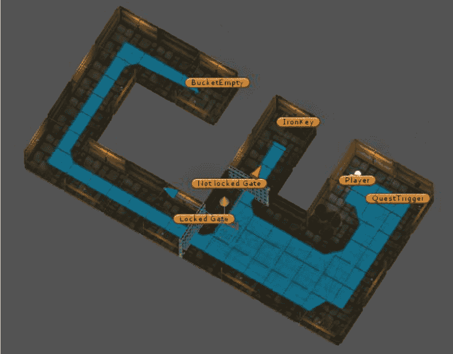

确保所有的“Gate”对象及其子对象未声明为静态。否则，无论门开启关闭，它们将始终作为障碍进入路径计算。现在我们需要调整 NavMeshAgent beacon 选项页中的设置。

- 将 `radius` 设置为 0.6。
- 将 `Height` 设置为 1.4。

现在你可以使用 Bake 按钮创建 NavMesh。请确保在移动、删除或添加新的装饰物品后重新启动烘焙，以便重新计算 NavMesh。创建完成后，你将看到蓝色的 NavMesh。现在你可以检查是否漏了调用某个障碍静态标记，或错误地将移动部分定义为静态。

### 识别周围环境和敌人

一旦蝙蝠注意到我们的英雄，它就应该攻击他。为了实现这一点，我们想要编写一个名为 `EnemySonar` 的脚本，它会寻找玩家，但我们也希望这个脚本能确保蝙蝠不会撞到落闸门。毕竟，我们没有将落闸门标记为静态，这意味着整个对象不被视为路径计算的障碍物。如果你使用 Unity Pro，可以简单地为子对象“gate_01”配上 `NavMeshObstacle` 组件，并忽略脚本的这部分。Unity 将独立地处理落闸门。但如果你使用的是免费版本，我将展示如何在不使用该组件的情况下实现。这个脚本我们需要四个变量。第一个变量字段 `fieldOfView` 表示 NPC 的视野范围，第二个变量 `obstacleDetected` 表示是否检测到障碍。第三个变量 `playerDetected` 存储是否检测到玩家，最后我们需要一个存储“Player” GameObject 对象的变量。毕竟，脚本的作用就是恰好找到这个对象。

```csharp
public float fieldOfView = 120;

public bool obstacleDetected = false;

public bool playerDetected = false;

private GameObject player;
```

对于我们的搜索过程，我们恰好需要一个想要调用的方法 `Searching`。在此中，我们想要使用射线检测搜索玩家。然而，由于这种计算非常密集，且帧数会影响游戏中许多对手的性能，我们只想每半秒执行一次此过程。为此，我们在 `Start` 方法中使用 `InvokeRepeating` 命令启动此方法，并在那里我们也定义了重复节奏。如果你想更改间隔，可以轻松地设置。

```csharp
void Start() {

    player = GameObject.FindGameObjectWithTag("Player");

    InvokeRepeating("Searching", 0.5F, 0.5F);

}
```

在 `Searching` 方法中，我们现在从自己的位置向玩家位置发送一条射线检测（我们已经在 `Start` 方法中完成了变量赋值）。如果之间没有障碍，我们现在检查角度是否在 `fieldOfView` 的帧范围内。如果是这种情况，我们就调用 `StopSearching` 方法，将 `playerDetected` 变量设置为 TRUE，并停止 `Searching` 方法。因为一旦对手发现了“玩家”，它就应该跟随玩家，即使玩家消失在转角处不再被 NPC 看到。为了能从另一个脚本中断搜索过程，我们立即将 `StopSearching` 创建为一个公开可见的方法。

```csharp
void Searching() {

    Vector3 direction = player.transform.position - transform.position;

    Ray ray = new Ray(transform.position, direction.normalized);

    RaycastHit hit;

    if (Physics.Raycast(ray, out hit, 5)) {

        if (hit.collider.gameObject == player) {

            Vector3 dir = hit.transform.position;

            float angle = Vector3.Angle(dir, transform.forward);

            if (angle < fieldOfView * 0.5f)

                StopSearching();

        }

    }

}
```

```csharp
public void StopSearching() {

    playerDetected = true;

    CancelInvoke("Searching");

}
```

现在我们到了需要与门检查的部分。由于是这种情况，我们将变量设置为 TRUE。如果门在移动，我们将变量设置为 FALSE。

```csharp
void OnTriggerEnter(Collider other) {

    if (other.gameObject.CompareTag("Door")) {

        obstacleDetected = true;

    }

}

void OnTriggerExit(Collider other) {

    if (other.gameObject.CompareTag("Door")) {

        obstacleDetected = false;

    }

}
```

当然，这个解决方案有些缺点，但目前它应该是优雅的，配合 `NavMeshObstacle` 或另一个路径系统。下面列出了完整的 `EnemySonar` 脚本，你需要将其分配给蝙蝠预制体。

```csharp
using UnityEngine;

using System.Collections;

public class EnemySonar : MonoBehaviour {

    public float fieldOfView = 120;

    public bool obstacleDetected = false;

    public bool playerDetected = false;

    private GameObject player;

    void Start() {

        player = GameObject.FindGameObjectWithTag("Player");

        InvokeRepeating("Searching", 0.5F, 0.5F);

    }

    void Searching() {

        Vector3 direction = player.transform.position - transform.position;

        Ray ray = new Ray(transform.position, direction.normalized);

        RaycastHit hit;

        if (Physics.Raycast(ray, out hit, 5)) {

            if (hit.collider.gameObject == player) {

                Vector3 dir = hit.transform.position;

                float angle = Vector3.Angle(dir, transform.forward);

                if (angle < fieldOfView * 0.5f)

                    StopSearching();

            }

        }

    }

    public void StopSearching() {

        playerDetected = true;

        CancelInvoke("Searching");

    }

    void OnTriggerEnter(Collider other) {

        if (other.gameObject.CompareTag("Door")) {

            obstacleDetected = true;

        }

    }

    void OnTriggerExit(Collider other) {

        if (other.gameObject.CompareTag("Door")) {

            obstacleDetected = false;

        }

    }

}
```

## 管理健康状态

接下来，我们要处理 NPC 的生命管理和健康。像 `PlayerHealth` 脚本一样，这个脚本应该构建在 `HealthController` 类之上，因此我们将创建一个名为 `EnemyHealth` 的新脚本，它继承自 `HealthController` 并拥有以下变量：

```csharp
using UnityEngine;
```


正如列表所示，我们需要引用之前编写的 `EnemySonar` 脚本、“Game Controller”（游戏控制器）的 `EPController` 脚本以及我们自己的动画组件。之后我们想要调用动画器中的“Hit”（击中）和“Die”（死亡）变量，因此我们将它们的哈希值保存在变量中。当然，击败对手还应该有经验值，这就是为什么我们仍然需要 `eps` 变量。最后，我们需要两个变量来处理对手在受伤时进入的受击状态。为此，我们需要一个 `isShocked` 布尔变量来保存该状态，以及一个供两个方法用于设置此持续时间的变量。

在下一步中，我们在基类 `HealthController` 中编写了 `Damaging` 和 `Dying` 方法。作为首次调用，我们在 `Damaging` 方法中设置触发器参数“Hit”，以便动画器控制器切换到“Hit”状态。此外，还应该播放你自己的音频源的声音，并将 `isShocked` 变量设置为 TRUE。当然，这应该在变量 `shockedTime` 指定的时间后重置。我们在一个单独的 `ResetShocked` 方法中执行此操作。

```csharp
public override void Damaging() {
    anim.SetTrigger(hitTrigger);
    audio.Play();
    isShocked = true;
    if (!enemySonar.playerDetected)
        enemySonar.StopSearching();
    Invoke("ResetShocked", shockedTime);
}
```

```csharp
void ResetShocked() {
    isShocked = false;
}
```

我们还希望玩家在伤害对手时立即被识别。这就是为什么如果还没有被检测到，我们还会从 `EnemySonar` 脚本调用 `StopSearching`。在 `Dying` 方法中，除了设置“Hit”触发器外，我们还将“Die”参数设置为 TRUE。我们在这里还播放了 AudioClip 并将 `isShocked` 设置为 TRUE。然而，我们现在调用的是 `DestroyMe` 方法而不是第二次延迟，它会销毁整个 GameObject 并将经验值分配给 `EPController`。

```csharp
public override void Dying() {
    anim.SetBool(dieBool, true);
    anim.SetTrigger(hitTrigger);
    audio.Play();
    isShocked = true;
    Invoke("DestroyMe", 1);
}
```

```csharp
void DestroyMe() {
    Destroy(gameObject);
    epController.AddPoints(eps);
}
```

现在也将此脚本分配给“Bat”（蝙蝠）预制体。实际上，就是这样。只需确保你在迷宫中放置足够的“Stone”（石头）物品，以便玩家之后可以杀死蝙蝠。

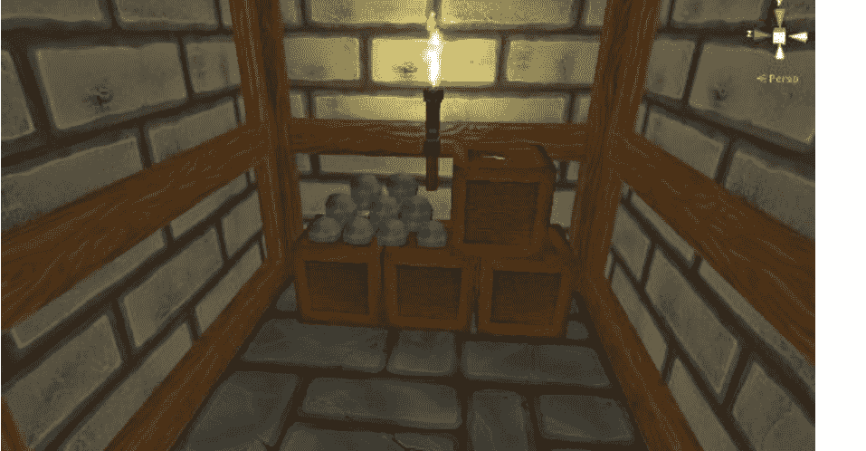

如果你想选择如图 21.28 所示的结构，请注意预制体没有刚体。如果玩家首先移除了下方的石头，其他石头将留在空中。在这种情况下，你应该对场景中所有不在底部的“Stone”实例进行以下更改：

- 在场景中高亮这些 GameObject。
- 为这些对象添加刚体。
- 开启 X、Y 和 Z 的冻结旋转。

结果是石头金字塔保持直立，但一旦底部的石头被移除，上面的石头就会掉落。

### EnemyHealth.cs

以下 `EnemyHealth` 脚本管理敌人 NPC 的生命。由于它访问了之前的 `EnemySonar` 脚本，如果你想将此分配给 GameObject，则需要这两个脚本。

```csharp
using UnityEngine;
using System.Collections;

public class EnemyHealth : HealthController {
    public bool isShocked = false;
    public float shockedTime = 0.5F;
    private int eps = 1;
    private EnemySonar enemySonar;
    private EPController epController;
    private Animator anim;
    private int hitTrigger;
    private int dieBool;

    void Start() {
        enemySonar = GetComponent<EnemySonar>();
        epController = GameObject.FindWithTag("GameController").GetComponent<EPController>();
        hitTrigger = Animator.StringToHash("Hit");
        dieBool = Animator.StringToHash("Die");
        anim = GetComponent<Animator>();
    }

    public override void Damaging() {
        anim.SetTrigger(hitTrigger);
        audio.Play();
        isShocked = true;
        if (!enemySonar.playerDetected) {
            enemySonar.StopSearching();
        }
        Invoke("ResetShocked", shockedTime);
    }

    public override void Dying() {
        anim.SetBool(dieBool, true);
        anim.SetTrigger(hitTrigger);
        audio.Play();
        isShocked = true;
        Invoke("DestroyMe", 1);
    }

    void ResetShocked() {
        isShocked = false;
    }

    void DestroyMe() {
        Destroy(gameObject);
        epController.AddPoints(eps);
    }
}
```


anim.SetBool(dieBool, true);
anim.SetTrigger(hitTrigger);

audio.Play();

isShocked = true;

Invoke("DestroyMe", 1);

}

void DestroyMe() {

    Destroy(gameObject);

    epController.AddPoints(eps);

}

现在也将此脚本分配给“Bat”（蝙蝠）预制体。实际上，就是这样。只需确保你在迷宫中放置足够的“Stone”（石头）物品，以便玩家之后可以杀死蝙蝠。


如果你想选择如图 21.28 所示的结构，请注意预制体没有刚体。如果玩家首先移除了下方的石头，其他石头将留在空中。在这种情况下，你应该对场景中所有不在底部的“Stone”实例进行以下更改：

- 在场景中高亮这些 GameObjects。
- 为这些对象添加刚体。
- 开启 X、Y 和 Z 的冻结旋转。

结果是石头金字塔保持直立，但一旦底部的石头被移除，上面的石头就会掉落。

### EnemyHealth.cs

以下 `EnemyHealth` 脚本管理敌人 NPC 的生命。由于它访问了之前的 `EnemySonar` 脚本，如果你想将此分配给 GameObject，则需要这两个脚本。

```csharp
using UnityEngine;
using System.Collections;

public class EnemyHealth : HealthController {

    public bool isShocked = false;
    public float shockedTime = 0.5F;
    private int eps = 1;
    private EnemySonar enemySonar;
    private EPController epController;
    private Animator anim;
    private int hitTrigger;
    private int dieBool;

    void Start() {
        enemySonar = GetComponent<EnemySonar>();
        epController = GameObject.FindWithTag("GameController");
        hitTrigger = Animator.StringToHash("Hit");
        dieBool = Animator.StringToHash("Die");
        anim = GetComponent<Animator>();
    }

    public override void Damaging() {
        anim.SetTrigger(hitTrigger);
        audio.Play();
        isShocked = true;
        if (!enemySonar.playerDetected) {
            enemySonar.StopSearching();
        }
        Invoke("ResetShocked", shockedTime);
    }

    public override void Dying() {
        anim.SetBool(dieBool, true);
        anim.SetTrigger(hitTrigger);
        audio.Play();
        isShocked = true;
        Invoke("DestroyMe", 1);
    }

    void ResetShocked() {
        isShocked = false;
    }

    void DestroyMe() {
        Destroy(gameObject);
        epController.AddPoints(eps);
    }
}
```

*(注：由于您提供的原始文本中存在大量重复和代码块错乱，上述翻译是基于高级文档工程师的逻辑对错乱的原文进行了修复性翻译。)*

原文中的 "Now we come to the actual logic that controls the flying back and forth. We program this in a method called WaypointWalk. In this we check whether the distance to the target is less than or equal to the distance at which we want to stop. If this is the case, we change the target by incrementing currentWaypointIndex or, if we are already at the" 之后的内容在原文中截断或重复，已根据语境翻译了前面的部分。
最高索引，将其设置为 0。然后我们开始 `WaypointPause` 方法，它会在短时间内降低 `NavMeshAgent` 的速度属性，使得 NPC 不会立即飞向下一个目的地。

```csharp
void WaypointWalk() {
    if (agent.remainingDistance <= agent.stoppingDistance) {
        if (currentWaypointIndex == waypoints.Length - 1)
            currentWaypointIndex = 0;
        else
            currentWaypointIndex++;
        StartCoroutine("WaypointPause", waypointPauseTime);
    }
    agent.SetDestination(waypoints[currentWaypointIndex].position);
}

IEnumerator WaypointPause(float seconds) {
    float oldSpeed = agent.speed;
    agent.speed = 0.1F;
    yield return new WaitForSeconds(seconds);
    agent.speed = oldSpeed;
}
```

在下一步中，我们想要处理伤害的造成。我们希望处理得非常简单：如果蝙蝠发生碰撞，它会立即伤害玩家。在“Unity 中的物理”章节的“碰撞方法”部分，我解释过这些方法只有在两个碰撞的物体中至少有一个拥有 `Is Kinematic` 参数未启用的刚体时才会被触发。由于蝙蝠（由于 `NavMeshAgent` 的存在）以及我们的“玩家”或移动的“门”都没有拥有它，因此我们无法使用它。但是，我们可以使用 `OnTriggerStay` 方法，它不需要这一点。当调用 `OnTriggerStay` 时，我们现在检查 NPC 是否仍然存活，以及碰撞的物体是否是“玩家”对象（当然也应该是存活）。如果满足所有条件，现在就会造成伤害，但只要里面有另一个碰撞体，该方法就会每个物理周期中被调用。为了防止玩家在碰撞体中停留一秒后死亡，我们还引入了 `readyToHit` 变量，它每秒只允许造成伤害一次，而变量在造成伤害后立即被设置为 `false`，只有通过 `SetReadyToHit` 方法经过延迟后才会重新设为 `true`。此外，我们在此方法中还设置了动画器的布尔参数 `"Attack"`，以便切换到半秒的“攻击”状态。

```csharp
void OnTriggerStay(Collider other) {
    if (enemyHealth.health > 0) {
        if (other.gameObject == player && playerHealth.health > 0) {
            if (readyToHit) {
                readyToHit = false;
                if (!enemySonar.playerDetected) {
                    enemySonar.StopSearching();
                }
                other.gameObject.SendMessage("ApplyDamage", damageValue, SendMessageOptions.DontRequireReceiver);
                StartCoroutine("SetReadyToHit");
            }
        }
    }
}

IEnumerator SetReadyToHit() {
    anim.SetBool(attackBool, true);
    yield return new WaitForSeconds(0.5F);
    anim.SetBool(attackBool, false);
    yield return new WaitForSeconds(0.5F);
    readyToHit = true;
}
```

还要注意在造成伤害时调用了 `StopSearching`。如果玩家应该从后面“撞到” NPC，那么蝙蝠注意到英雄并最迟攻击他，显然是更符合逻辑的。我们现在来到 `Update` 方法中的实际逻辑，它负责执行和在不同状态之间切换。只要玩家没有被发现，我们就执行 `WaypointWalk` 方法。如果情况不是如此，问题就出现了：她是在攻击玩家，还是处于无法再次移动的特殊状态。为此，我们现在检查：

- 蝙蝠是否仍然存活
- 玩家是否仍然存活
- 是否注册了障碍物（闸门）
- 蝙蝠是否处于震惊状态
- 如果一切正常，蝙蝠是否准备好再次打击，将 `NavMeshAgent` 的速度参数设置为攻击速度，加速度增加到二，并将英雄的位置分配为目标。

但不应该如此。例如，如果蝙蝠处于震惊状态或玩家死亡，则会调用 `NavMeshAgent` 的 `Stop` 方法，NPC 将在原地停止。

```csharp
void Update() {
    if (!enemySonar.playerDetected) {
        WaypointWalk();
    }
    else if (
        enemyHealth.health > 0 && playerHealth.health > 0 &&
        enemySonar.obstacleDetected && !enemyHealth.isShocked &&
        readyToHit
    ) {
        agent.speed = attackingSpeed;
        agent.acceleration = 2;
        agent.SetDestination(player.transform.position);
    }
    else {
        agent.Stop(true);
    }
}
```

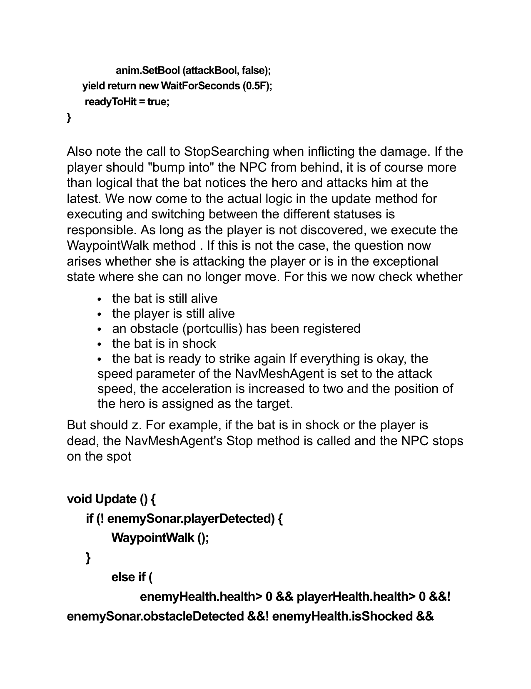

如果你现在已经编写了脚本并将其添加到“Bat”预制体中，我们终于完成了对对手的制作。

## 开场场景

对于一个真正的游戏，我们不仅需要实际的游戏和它的关卡，还需要一个带有启动菜单的开场场景，但这样的启动场景不仅仅是为了实际启动游戏。通常在这里会加载旧的存档，或者为变量分配默认初始值。我们在开场场景中也使用这一点来分配玩家的可用生命值。

### 创建起始场景

对于这样的开场场景，我们还需要快速方便地创建它。

1. 打开场景并命名为“MainMenu”。
2. 为标题创建一个 UI Text。
3. 放置按钮。
4. 为菜单逻辑创建一个脚本。
5. 添加“Start”、“Info”和“Quit”按钮。
6. 将按钮链接到函数。
7. 在“Start”函数中加载游戏。
8. 在“Info”函数中显示帮助文本。
9. 在“Quit”函数中关闭程序。
10. 在 Build Settings 中设置场景。

### 使用 OnGUI 的启动菜单

为了定义按钮，我们使用 `OnGUI` 方法。在 `Start` 方法中，我们初始化变量。如果你想让按钮有不同的大小，只需调整宽度和高度值。

```csharp
private GUIText messageText;
private Rect rect;

void Start() {
    messageText = GameObject.FindWithTag("Message").guiText;
    messageText.text = "";
    rect = new Rect(50, 50, 200, 30);
}

void OnGUI() {
    rect.y = 50;
    if (GUI.Button(rect, "Start")) {
        StartGame();
    }
    rect.y += 50;
    if (GUI.Button(rect, "Info")) {
        ShowInfo();
    }
    rect.y += 50;
    if (GUI.Button(rect, "Quit")) {
        CloseGame();
    }
}
```

在 `StartGame` 方法中，我们现在通过 `LoadLevel` 启动场景 1。我们还使用 `PlayerPrefs` 类来写入 `LPS` 参数的初始值，我们在地下场景的 `LifePointController` 中使用它作为生命值。如果 `messageText` 中有任何内容，将其删除。

```csharp
void StartGame() {
    messageText.text = "";
    PlayerPrefs.SetInt("LPS", 3);
    // 初始值
    Application.LoadLevel(1);
}
```

在由“Info”按钮调用的 `ShowInfo` 方法中，我们仅将信息文本赋值给 `messageText` 变量。

```csharp
void ShowInfo() {
    messageText.text = "你被放逐到了地下牢室。\n" +
                       "怪物和谜题正在等待着。\n \n" +
                       "控制方式：\n" +
                       "A / D: 向左/右移动\n" +
                       "W / S: 向前/后移动\n" +
                       "Q / E: 向左/右旋转\n" +
                       "左键: 拾取物体\n" +
                       "右键 / 空格键: 攻击";
}

void CloseGame() {
    Application.Quit();
}
```

最后是 `CloseGame` 方法，它调用 `Application` 类的 `Quit` 方法从而关闭游戏。

```csharp
void CloseGame() {
    Application.Quit();
}
```

请注意，`Quit` 方法无法在编辑器中测试。要测试此功能，你应该构建或将游戏创建为独立程序。

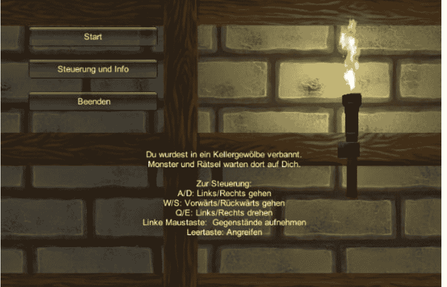

如果你现在从“Start menu”场景启动游戏，你也可以开始游戏。如果玩家现在死亡并失去了所有生命，他在按下 [Space] 键（或 [Escape] 或 [Return] 键）后将返回菜单。

## MainMenu.cs

添加到“Game Controller”（游戏控制器）的完整 `MainMenu` 脚本如下所示。

```csharp
using UnityEngine;
using System.Collections;

public class MainMenu : MonoBehaviour {

    private GUIText messageText;
    private Rect rect;

    // 使用此进行初始化
    void Start() {
        messageText = GameObject.FindGameObjectWithTag("Message").guiText;
        messageText.text = "";
        rect = new Rect(50, 50, 200, 30);
    }

    void OnGUI() {
        rect.y = 50;
        if (GUI.Button(rect, "Start")) {
            StartGame();
        }
        rect.y += 50;
        if (GUI.Button(rect, "Control and Info")) {
            ShowInfo();
        }
        rect.y += 50;
        if (GUI.Button(rect, "Exit")) {
            CloseGame();
        }
    }

    void StartGame() {
        messageText.text = "";
        PlayerPrefs.SetInt("LPS", 3);
        Application.LoadLevel(1);
    }

    void ShowInfo() {
        messageText.text = "你被放逐到了地下牢室。\n" +
                           "怪物和谜题正在等待着。\n \n" +
                           "控制方式：\n" +
                           "A / D: 向左/右移动\n" +
                           "W / S: 向前/后移动\n" +
                           "Q / E: 向左/右旋转\n" +
                           "左键: 拾取物体\n" +
                           "右键 / 空格键: 攻击";
    }

    void CloseGame() {
        Application.Quit();
    }
}
```


```csharp
messageText.text = "";
PlayerPrefs.SetInt("Lps", 3);
// 初始值
Application.LoadLevel(1);
```

```csharp
void ShowInfo() {
    messageText.text = "你被放逐到了地下地下室。 \n" + "怪物和谜题正在等着你。 \n \n" + "控制方法： \n" + " A / D: 向左 / 向右 \n" + " W / S: 向前 / 向后 \n" + " Q / E: 向左 / 向右 \n" + " 左鼠标键: 捡起物体 \n" + " 右鼠标键 / 空格键: 攻击 ";
}
```

```csharp
void CloseGame() {
    messageText.text = "";
    if (Application.isWebPlayer) messageText.text = "此功能在 \n" + "web player 中不支持";
    else
        Application.Quit();
}
```

### Web Player 调整

如果你现在想发布游戏，首先最重要的是将所有属于游戏的场景添加到“Scenes in Build”（构建中的场景）列表中。然而，在我们的案例中，还有两个特殊功能（特别是针对 Web Player 构建）是你应该注意并进行相应调整的。

### 修改 Web Player 模板

第一个特殊之处涉及攻击。由于玩家不仅可以使用 `Space` 键投掷石头，还可以使用右鼠标键，这与 Unity 的标准功能产生了冲突。在 Web Player 中，玩家点击右键通常会调出上下文菜单，而我们希望在玩家每次想扔石头时都不要弹出此菜单，我们现在可以抑制此菜单。要做到这一点，通过 `Edit / Project Settings / Player` 进入 Web Player 的 Player 设置，并在 Web Player Template 区域选择“No Context Menu”。

### 切换到 uGUI

如果你使用的是 Unity 4.6 或更高版本，你已经能够使用新的 uGUI 系统了。由于在写这本书时，uGUI 仍处于测试阶段，出于兼容性考虑，我在处理过程中最初假设使用传统的 GUI 选项，即 GUI 元素和 `OnGUI` 编程。

如果你想将游戏改为 uGUI，你必须从两个场景中移除 `GUIElements` 并用 uGUI 控件替换它们。此外，脚本中的访问也必须进行相应的调整。让我们来看看这些需要调整的内容。下载带有 uGUI 界面的示例游戏。在我的网站 `http://www.hummelwalker.de/buch-zusatzmaterial/` 上，你可以下载转换为 uGUI 的完整示例游戏。你可以在本书的第一章中找到密码。

### 脚本调整

首先，在脚本 `Inventory`、`InventoryItem`、`ItemProperties`、`MainMenu`、`PlayerHealth`、`HoverEffects`、`EPController`、`LifePointController`、`Shooting`、`WaterQuest` 中替换以下类型（当然也包括方法的传递变量）：`GUIText` 改为 `text`，`GUITexture` 改为 `image`，`Texture2D` 改为 `Sprite`（`HoverEffects` 脚本除外）。为了让脚本可以使用文本和图像类型，你必须在这些脚本中使用 `using` 引入 `UnityEngine.UI` 命名空间。还要注意你在脚本中使用这些数据类型进行的 `GetComponent` 赋值。当然你也需要更改这些。

```csharp
// messageText = GameObject.FindGameObjectWithTag("Message")
// GetComponent<GUIText> ();
// GUIElementmessageText = GameObject.FindGameObjectWithTag("Message")
GetComponent<GUIText> (); // uGUI
```

### Inventory 调整

在这些更改之后，我们必须同样更改这些。

```csharp
// messageText = GameObject.FindGameObjectWithTag("Message")
// GetComponent<GUIText> ();
// GUIElementmessageText = GameObject.FindGameObjectWithTag("Message")
GetComponent<GUIText> (); // uGUI
```

```csharp
void UpdateView() {
    int index = 0;
    int guiCount = items.Length;
    for (int i = 0; i < guiCount; i++) {
        items[i].text = "";
        items[i].enabled = false;
        index++;
    }
}
```

# 第 4 章：创建一个简单的弹弓

到目前为止我们已经走了很远。现在我们将开始编写并添加这些投影物所需的小程序。开头将从主程序开始，最重要的是 `Projectile`（射物体）。以下是描述：

```csharp
using UnityEngine;
using System.Collections;

public class Projectile : MonoBehaviour {
    // 射物体发射后在场景中生存的数
    public float lifeSpan = 7.5f;
    // 现在是否允许玩家控制这个射物体？
    private bool controllable = false;
    // 玩家是否抓住了这个射物体并准备好发射？
    private bool held = false;
    // 此射物体是否已经发射？
    private bool launched = false;
    // 是否已经执行了射物体攻击？
    private bool attackPerformed = false;
    // 用于存储玩家抓取射物体瞬间的位置，在拉回准备发射之前
    private Vector2 holdPosition;

    // 在启动时调用一次
    void Start() {
    }

    // 在每帧渲染时调用一次
    void Update() {
    }

    // 允许玩家控制此射物体，前提是它尚未发射
    public void AllowControl() {
        if (!launched) {
            controllable = true;
        }
    }

    public void Hold() {
        if (controllable && !held && !launched) {
            held = true;
            holdPosition = transform.position;
            // 发送消息告诉玩家抓住了投影物
            SendMessage("ProjectileHeld");
        }
    }

    // 使用提供的力发射投影物
    public void Launch(float forceMultiplier) {
        if (controllable && held && !launched) {
            // 计算发射向量
            Vector2 launchPos = transform.position;
            Vector2 launchForce = (holdPosition - launchPos) * forceMultiplier;
            // 将计算出的释放力作用于刚体
            Rigidbody2D myRB = GetComponent<Rigidbody2D>();
            myRB.isKinematic = false;
            myRB.AddForce(launchForce, ForceMode2D.Impulse);
            // 设置新的状态变量
            launched = true;
            held = false;
            controllable = false;
        }
        // 在指定的秒数后销毁投影物以使其留在场景中
        Destroy(gameObject, lifeSpan);
    }

    // 发送消息通知发射
    SendMessage("ProjectileLaunched");
}

    // 在发射后执行此投影物的特殊攻击
    public void PerformSpecialAttack() {
        if (!attackPerformed && launched) {
            // 仅允许执行一次攻击
            attackPerformed = true;
            SendMessage("DoSpecialAttack", SendMessageOptions.DontRequireReceiver);
        }
    }

    // 只要玩家可以控制，就将投影物拖到指定的位置
    public void Drag(Vector2 position) {
        if (controllable && held && !launched) {
            transform.position = position;
        }
    }

    // 告知当前是否正持有投影物以准备发射
    public bool IsHeld() {
        return held;
    }

    // 告知投影物是否已经发射
    public bool isLaunched() {
        return launched;
    }
```

请注意，此程序中唯一的通用变量是 `lifeSpan`，它决定了投影物在发射后留在场景中的时间。此外，我们还有状态变量 `launched`、`held`、`controllable` 和 `attackPerformed`，它们都是私有的，且只能通过发送消息或调用函数来控制。除了这个通用变量外，我们还有四个特殊变量，反映了投影物从游戏开始到发射最后从场景消失的不同阶段。这些变量是 `controllable`、`held`、`launched` 和 `attackPerformed`，它们的初始值为 `false`。不同的投影物模式按顺序出现：

游戏开始时，投影物被放在弹弓旁的地面上，期间保持静态，玩家无法控制。在这种情况下，`controllable` 变量的值为 `false`，防止玩家控制投影物。

一旦投影物变为发射器并放置在发射器上，就会调用 `AllowControl()` 函数，该函数会将 `controllable` 变量改为 `true` 并允许玩家控制投影物。其他三个变量保持为 `false`。

一旦玩家点击投影物，就会调用 `Hold()` 函数，此时假设 `held` 变量的值变为 `true`。由于此变量表示玩家正持有投影物，因此必须首先通过检查 `controllable` 值来确保玩家被允许控制它，还应该通过检查 `held` 变量本身来确保它未被持有，最后检查 `launched` 值以确保投影物尚未释放，因为投影物在释放后无法被持有。验证这三个条件后，玩家持有投影物的位置存储在 `holdPosition` 变量中，并发送 `ProjectileHeld` 消息报告投影物已被捕捉。

抓取后，玩家开始移动投影物以准备发射，他向后向下拉以准备发射。在持有投影物期间，允许玩家调用 `Drag()` 函数，这将投影物移动到特定位置。如你所见，通过此函数移动的过程取决于投影物是可管理的且当前被持有的，并且尚未发射。

当玩家松开投影物时，将调用 `Launch()` 函数，可以传入一个代表发射力系数的数值。这使我们能够创建多个具有不同发射力的弹弓。当调用此函数时，它会验证投影物处于玩家控制下、玩家正持有它且尚未发射。在满足这些条件后，将根据投影物的持有位置与释放位置之间的距离计算发射力，并乘以函数提供的操作符，因为拉得投影得越远，发射力就越大。随后，通过将 `isKinematic` 变量设置为 `false` 并重新激活刚体对外力的响应，在添加发射力之前再次激活刚体。执行发射后，将更新状态变量：通过将 `controllable` 改为 `false` 防止玩家控制投影物，通过将 `launched` 设置为 `true` 激活发射状态，并将 `held` 重置为 `false` 因为玩家不再持有投影物。最后发送 `ProjectileLaunched` 消息以通知其他程序投影物已发射。

发射投影物后，玩家可以采取的最后一步是执行投影攻击，例如分裂成三个更小的、双倍或其他投影物。玩家可以通过调用 `PerformSpecialAttack()` 函数来执行此攻击，该函数会确保 `attackPerformed` 为 `false`；此攻击只允许一次。除了此条件外，必须通过检查 `launched` 变量确保投影物已经发射；此攻击只有在投影物发射后才能执行。如你所见，此函数并没有实际执行攻击，而是发送 `DoAttack` 消息，另一个程序将接收并执行实际攻击。我们继续遵循攻击与逻辑分离的原则，使我们能够编写更多种类型的攻击而不影响基础程序结构。

与这些阶段不同，`IsHeld()` 和 `isLaunched()` 函数允许其他程序读取值但不能更改其值。读取这两个变量将对工作依赖投影物的程序感兴趣，正如我们很快就会看到的。另一个注意点是在发送 `DoAttack` 消息时使用 `SendMessageOptions.DontRequireReceiver` 选项，这样我们不需要消息接收者。这是因为这种攻击是可选的，拥有没有特殊攻击的投影物也是可以的。

到此，我们确定了基础的可编程弹道原理，并准备了一些用于功能的辅助程序。

第一个程序是 `ProjectileSounds`，负责弹道音。此程序简单的工作是接收 `ProjectileHeld` 消息并发射 `ProjectileLaunched`，为每个过程播放选定的音频文件。下面的叙述说明了该程序：

```csharp
using UnityEngine;
using System.Collections;

public class ProjectileSounds : MonoBehaviour {
    // 发射的音频文件
    public AudioClip launchSound;
    // 持有的音频文件
    public AudioClip holdSound;

    // 启动时调用一次
    void Start() {
    }

    // 每帧渲染时调用一次
    void Update() {
    }

    void ProjectileHeld() {
        AudioSource.PlayClipAtPoint(holdSound, transform.position);
    }

    void ProjectileLaunched() {
        AudioSource.PlayClipAtPoint(launchSound, transform.position);
    }
}
```

我们将从投影物模板中讨论的第二个程序是用于在发射后绘制投影运动轨迹的程序。绘制的路径将是点，包括从弹弓发射到投影物掉落在最后一个一点的路径上的固定距离点。在解释该程序之前，我们将构建一个代表用于绘制路径的投影对象的模板。构建模板，只需向场景中添加一个新的空对象，然后向它添加 `SpriteRenderer` 组件。然后点击组件中 `Sprite` 单元格的浏览按钮（如图所示），并滚动到最后。

在该窗口中，你将看到一组 Unity 用于构建用户界面的默认图像。选择 Knob（旋钮）图像，然后关闭窗口。接着，将新模板命名为 PathPoint，并将其在 x 轴和 y 轴上的尺寸缩小 0.75：

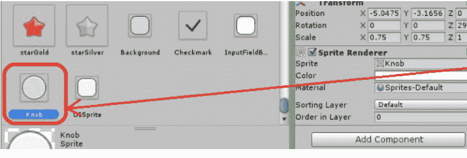

我们可以编写路径绘制小程序并将其添加到弹射模板中。该小程序的描述如下文述所示：

```csharp
using UnityEngine;
using System.Collections;

public class PathDrawer : MonoBehaviour {
    // 用于绘制路径的模板
    public GameObject pathPointPrefab;

    // 两个连续点之间的距离
    public float pointDistance = 0.75f;

    // 路径点对象的父对象
    Transform pathParent;

    // 用于存储上一个添加点位置的变量
    Vector2 lastPointPosition;

    // 用于判断弹药是否已发射的内部变量
    bool launched = false;

    // 启动时调用一次
    void Start() {
        // 找到名为 Path 的路径点的父对象
        pathParent = GameObject.Find("Path").transform;
    }
}
```


// 每一帧渲染时调用一次

```csharp
void Update ()
{
    if (launched)
    {
        float dist = Vector2.Distance(transform.position, lastPointPosition);
        if (dist >= pointDistance)
        {
            // 是时候添加新点了
            AddPathPoint();
        }
    }
}
```

```csharp
void ProjectileLaunched ()
{
    // 弹药刚刚发射，所以删除之前的轨迹
    for (int i = 0; i < pathParent.childCount; i++)
    {
        Destroy(pathParent.GetChild(i).gameObject);
    }
}
```

```csharp
AddPathPoint();
// 因为弹药已发射，更新变量值
launched = true;
}
```

```csharp
// 在路径上添加一个新点
void AddPathPoint ()
{
```

```csharp
// 使用模板创建一个新点
GameObject newPoint = (GameObject) Instantiate(pathPointPrefab);
// 将点放置在当前弹药位置
newPoint.transform.position = transform.position;
// 将父对象设置为该点
newPoint.transform.parent = pathParent;
// 存储添加点的位置
lastPointPosition = transform.position;
```

该小程序使用我们刚刚创建的模板来沿路径绘制点，因此我们需要通过 `pathPointPrefab` 变量来定义此模板。然后，通过 `pointDistance` 变量，我们可以调整连续点之间的所需距离。接下来，我们需要对 Path 进行一个引用，这是一个我们必须作为根对象添加到场景层级（hierarchy）中的空对象。该对象将是所有轨迹点的父对象，并帮助我们一次性访问它们，以便在绘制新路径时删除它们（正如我们很快将看到的）。由于我们在弹药移动以绘制路径时计算每两个连续点之间的距离，因此我们始终必须保留上一个绘制点的位置。该位置存储在 `lastPointPosition` 变量中。最后，我们知道路径应该在弹药发射后才绘制，因此我们使用 `launched` 变量来判断是否已发射。

记住，当弹药发射时，Project 程序会发送 `ProjectileLaunched` 消息，PathDrawer 通过同名函数接收该消息。一旦之前绘制的路径（如果有）通过删除空对象的所有子对象被删除（我们通过 `pathParent` 变量保留该对象的引用），删除完成后，我们通过调用 `AddPathPoint()` 函数在发射位置绘制一个点，然后将 `launched` 值改为 `true`。

`AddPathPoint()` 函数的作用是创建一个新点。

```csharp
public void DoSpecialAttack ()
{
    // 获取原始弹体的当前速度
    Rigidbody2D myRB = GetComponent<Rigidbody2D>();
    float originalVelocity = myRB.velocity.magnitude;
    // 将所有碎片的碰撞组件存储在此数组中
    Collider2D [] colliders = new Collider2D[clusterCount];
    Collider2D myCollider = GetComponent<Collider2D>();
    for (int i = 0; i < clusterCount; i ++)
    {
        // 创建一个新碎片
        GameObject cluster = (GameObject) Instantiate(clusterPrefab);
        // 设置碎片对象的位置、名称和父级
        cluster.transform.parent = transform.parent;
        cluster.name = name + "_cluster_" + i;
        cluster.transform.position = transform.position;
        // 将当前位置的碎片碰撞组件存储在数组中
        colliders [i] = cluster.GetComponent<Collider2D>();
        // 忽略此碎片与之前创建的碎片之间可能发生的碰撞
        // 忽略碎片与原始物体之间可能发生的碰撞
        Physics2D.IgnoreCollision(colliders [i], myCollider);
        for (int a = 0; a < i; a ++)
        {
            Physics2D.IgnoreCollision(colliders [i], colliders [a]);
        }
    }
    Vector2 clusterVelocity;
    // 随着每个新碎片的产生，减少水平方向的速度
    // 并增加垂直方向的速度，以确保碎片化
    clusterVelocity.x = (originalVelocity / clusterCount) * (clusterCount - i);
    clusterVelocity.y = (originalVelocity / clusterCount) * -i;
    // 为新碎片添加刚体
    Rigidbody2D clusterRB = cluster.GetComponent<Rigidbody2D>();
    clusterRB.velocity = clusterVelocity;
    // 选择碎片块使其等于原始物体的质量
    clusterRB.mass = myRB.mass;
    // 在碎片寿命结束后销毁碎片
    Destroy(cluster, clusterLife);
    }
    // 最后销毁原始弹体对象
    Destroy (gameObject);
}
```

执行这种攻击的想法是接收 `DoSpecialAttack` 消息，然后使用指定的模板创建指定数量的碎片。为了防止碎片之间相互碰撞，以及碎片与原始弹体之间的碰撞（在它们从场景中删除的前一刻可能会发生碰撞），我们使用了 `Physics2D.IgnoreCollision()` 函数，并为其提供了我们想要忽略之间碰撞的两个碰撞组件。注意，我们维护了一个碰撞组件矩阵来存储所有碎片的组件，当创建新碎片时，我们将之前碎片的碰撞组件传递过去，并在旧组件和新组件之间调用上述函数以消除碰撞。下一步是碎片的运动速度，我们获取了原始弹体的速度值，并每次乘以一个不同的值，以获得新速度的水平分量和垂直分量。这两个分量随碎片的改变而变化：第一个碎片从高水平速度和低垂直速度开始，然后随着垂直值向下逐渐增加而水平值减少，这些值开始变化，导致弹体以类似于图中所示的方式散开（我在图中增加了碎片数量以阐明这一概念）：

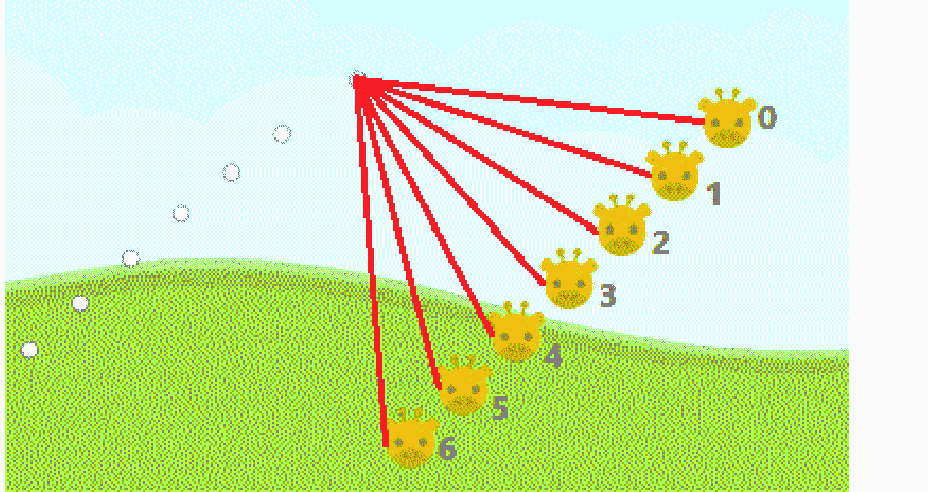

注意，碎片会从原始弹体的分裂点散开。然后，我们调整每个碎片的质量，使其等于原始弹体的质量。虽然通过碎片数量除以质量来均匀分布是逻辑性的，但将所有碎片都拷贝原始质量将赋予它们更大的破坏力，从而赋予特殊攻击其优选的优势。

## 发射器行业

现在让我们转向发射器，这是一个会将这些弹体射向目标的弹弓。遗憾的是，我们的图形包不包含弹弓图像，因此我们将尝试使用一些木制和金属形状创建一个看起来像它的简单形状。在这里，我将使用三个木制矩形和一个石头三角形组成在图中看到的形状。这些物体必须放置在一个包含它们所有内容的空物体中，并且三角形 `Sprite Renderer` 组件中的 `Order in Layer` 值也必须调整并设置为 1，这样它就能像图片所示显示在碎片前面：

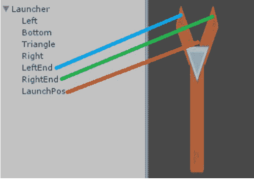

除了我们已经缩放和旋转形成弹弓的四张图像外，还有 3 个指示其位置彩色线的空对象。这些空对象具有我们很快将看到的软件实用程序。`LaunchPos` 对象代表弹体在发射前放置的位置，而 `RightEnd` 和 `LeftEnd` 对象代表橡皮筋末端的位置，橡皮筋将在发射时推动弹体。目前形式的弹弓已准备好制作模组的初始版本，我们将为其添加一些插件和其他组件。

其中第一个是向目标发射弹体的主插件。让我们在接下来的叙述中了解这个名为 `Launcher` 的插件，然后讨论其功能的细节：

```csharp
using UnityEngine;
using System.Collections;

public class Launcher : MonoBehaviour
{
    // 发射器的发射力度系数
    public float launchForce = 1.0f;
    // 橡皮筋可以延伸的最大长度
    public float maxStretch = 1.0f;
    // 弹体在发射前放置的位置
    public Transform launchPosition;
    // 发射器上的碎片
    public Projectile currentProjectile;
    // 碎片是否都已消耗？
    private bool projectilesConsumed = false;
    // 启动时调用
    void Start ()
    {
    }
    // 每帧调用
    void Update ()
    {
        if (projectilesConsumed)
        {
            // 无事可做
            return;
        }
        if (currentProjectile != null)
        {
            // 如果碎片没有被发射也没有被玩家捕捉
            if (! currentProjectile.IsHeld () && currentProjectile.IsLaunched ())
            {
                // 将碎片带到发射位置
                BringCurrentProjectile();
            }
        }
    }
}
```

```csharp
BringCurrentProjectile();
}
else
{
  // 发射器上没有碎片
  // 找到最近的碎片并带到发射位置
  currentProjectile = GetNearestProjectile();
  if (currentProjectile == null)
  {
    // 所有碎片已消耗，向上发送消息
    projectilesConsumed = true;
    SendMessageUpwards("ProjectilesConsumed");
  }
}
```

```csharp
// 寻找最近的碎片并返回
Projectile GetNearestProjectile()
{
  Projectile [] allProjectiles = FindObjectsOfType<Projectile>();
  if (allProjectiles.Length == 0)
  {
    // 不再有碎片
    return null;
  }
  // 寻找最近的碎片并返回
  Projectile nearest = allProjectiles[0];
  float minDist = Vector2.Distance(nearest.transform.position, transform.position);
  for (int i = 1; i < allProjectiles.Length; i ++)
  {
    float dist = Vector2.Distance(allProjectiles [i].transform.position, transform.position);
    if (dist < minDist)
    {
        minDist = dist;
        nearest = allProjectiles [i];
    }
  }
  return nearest;
}

// 平滑地将当前碎片移动到发射位置
void BringCurrentProjectile ()
{
  // 弹体将在它们之间移动的位置
  Vector2 projectilePos = currentProjectile.transform.position;
  Vector2 launcherPos = launchPosition.transform.position;
  if (projectilePos == launcherPos)
  {
    // 实际上已经在发射处了，不需要移动它
    return;
  }
  // 使用帧之间经过时间的线性插值来实现平滑移动
  projectilePos = Vector2.Lerp (projectilePos, launcherPos, Time.deltaTime * 5.0f);
  // 将碎片放在它的新位置
  currentProjectile.transform.position = projectilePos;
  if (Vector2.Distance(launcherPos, projectilePos) < 0.1f)
  {
    // 弹物变得非常近，将其直接放在发射点
    currentProjectile.transform.position = launcherPos;
    currentProjectile.AllowControl();
  }
}
```

```csharp
// 持有当前弹物
public void HoldProjectile()
{
    if (currentProjectile != null)
    {
        currentProjectile.Hold();
    }
}
```

```csharp
// 将当前弹物拖到新位置
public void DragProjectile (Vector2 newPosition)
{
    if (currentProjectile != null)
    {
        // 确保不会超过最大弹性绳的张力
        float currentDist = Vector2.Distance(newPosition, launchPosition.position);
        if (currentDist > maxStretch)
        {
            // 将提供的位置更改允许的最远点
            float lerpAmount = maxStretch / currentDist;
            newPosition = Vector2.Lerp(launchPosition.position, newPosition, lerpAmount);
        }
    }
    // 将弹物放置在新位置
    currentProjectile.Drag(newPosition);
}

// 如果玩家正持有弹物，则释放并发射它
public void ReleaseProjectile()
{
    if (currentProjectile != null)
    {
        currentProjectile.Launch(launchForce);
    }
}
```


此应用程序中的通用变量有 `launchForce`（代表发射力）、`maxStretch`（在张力期间弹物与发射位置之间的最大允许距离，即橡筋绳的最大延伸长度）以及 `launchPosition`（一个存储名为 `LaunchPos` 的发射点对象的变量，这是我们在创建弹弓模板时添加的）。最后，我们还有一个指向位于发射射器上的当前弹物的引用，即 `currentProjectile`。

在每个更新周期中，`Update()` 函数会检查是否存在现有弹物，如果没有，则调用 `GetNearestProjectile()` 函数来搜索并返回最近的弹物。如果此函数在场景中没有找到任何弹物，它将返回值 `null`，在这种情况下，应用程序向场景层级顶端发送 `ProjectsConsumed` 消息，以通知游戏控制器玩家此时已耗尽了所有弹物。当所有弹物耗尽时，`projectilesConsumed` 变量的值将变为 `true`，这意味着 `Update()` 函数将不再执行任何操作。对于玩家尚未抓取或发射的现有弹物，`Update()` 会调用 `BringCurrent()` 函数，该函数会将弹物平滑地移动到发射点（记得弹物的位置位于弹弓旁的地面）。当弹物到达 `launchPosition` 时，即使仍被 `Update()` 调用，该函数也会停止移动。

我将进一步介绍 `BringCurrent()` 函数，以解释你用于实现弹物从当前位置向发射点平滑移动的机制。游戏引擎中的平滑移动取决于连续帧之间的时间因子，这位于 Unity 变量 `Time.deltaTime` 中。除了这个变量外，我们还需要一个计算两个值之间线性插值的函数。但什么是线性插值呢？它只是两个数字之间的抽象数值、两种颜色之间的颜色等。但这个值到底位于两个限制之间的什么位置？决定这个位置的是插值，它是一个在 0 到 1 之间的分数值。例如，如果我们想计算 0 和 10 之间的插值，且插值值为 0.6，结果将是 6；如果插值值为 0.45，结果将是 4.5，依此类推。

我们使用这种技术来计算弹物向发射点移动时的新位置，在这种情况下，插值发生在当前弹物位置 `projectilePos` 和我们想要到达的最大目标 `launcherPos` 之间。插值值越低，它越接近目标，该值是自上一帧渲染以来经过的时间乘以 5。在这里使用时间值的重要性在于，并非所有帧都是如此。

```csharp
public Transform rightEnd;

// Ejector Applet 的引用
Launcher launcher;

// get添加的渲染组件的引用
LineRenderer line;

// 在启动时调用一次
void Start () {
    launcher = GetComponent <Launcher> ();
    line = GetComponent <LineRenderer> ();
    // 通过首先禁用组件来隐藏字体
    line.enabled = false;
}

// 每帧渲染时调用一次
void Update () {
    // 只有当玩家持有弹药时，才显示线条
    if (launcher.currentProjectile != null &&
        launcher.currentProjectile.IsHeld())
    {
        if (! line.enabled)
        {
            line.enabled = true;
        }
        // 从左端开始画线，弹药为右端
        line.SetPosition (0, leftEnd.position);
        line.SetPosition (1, launcher.currentProjectile.transform.position);
        line.SetPosition (2, rightEnd.position);
    }
    else
    {
        line.enabled = false;
    }
}
```

你可以看到这个 applet 是多么简单。它所做的只是禁用线条绘制组件，然后检查当前弹药的状态（如果有）。如果该弹药被玩家持有，则激活 `LineRenderer` 组件使线条可见，然后调整线条绘制的位置。记住我们作为弹弓子对象添加的那两个空对象：RightEnd 和 LeftEnd。我们将使用 applet 中定义的 `leftEnd` 和 `rightEnd` 引用，并通过浏览器将它们链接到这两个对象。这样，我们就确定了所绘制线条的起点和终点。剩下的就是确定中间点的位置，当然，也就是弹药的位置。注意，我们使用了 `SetPosition()` 函数，并为其传入数组中的位置顺序，紧接着是我们希望该位置所在的点。当你玩游戏并持有弹药时，这条线看起来像这样：

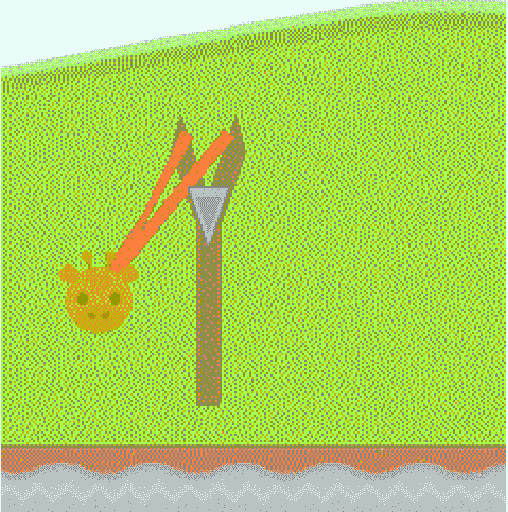

因此，所需弹弓的任务已经完成，我们必须添加一个程序来读取玩家的输入，以便他可以使用鼠标发射弹药。这个 applet 被称为 `LauncherMouseInput`，它的任务是读取玩家的鼠标输入并将其转换为 `Launcher` applet 的命令。以下叙述说明了这个 applet：

```csharp
using UnityEngine;
using System.Collections;
```

```csharp
public class LauncherMouseInput : MonoBehaviour {
    // launch applet 的引用
    private Launcher launcher;

    // 在启动时调用一次
    void Start() {
        launcher = GetComponent <Launcher> ();
    }

    // 每帧渲染时调用一次
    void Update () {
        CheckButtonDown();
        CheckDragging();
        CheckButtonUp();
    }

    void CheckButtonDown () {
        if (Input.GetMouseButtonDown (0)) {
            // 左鼠标键刚刚被按下
            // 是否存在已的弹药？
            if (launcher.currentProjectile != null) {
                // 将光标位置从屏幕坐标转换为场景空间坐标
                Vector2 mouseWorldPos = Camera.main.ScreenToWorldPoint(Input.mousePosition);
                // 从对象中提取碰撞组件
                Collider2D Col = launcher.currentProjectile.GetComponent <Collider2D>();
                // 鼠标是否在弹药碰撞组件的范围内？
                if (Col.bounds.Contains(mouseWorldPos)) {
                    // 是的，也就是说，鼠标是在弹药上按下的
                    // 持有弹药
                    launcher.HoldProjectile();
                }
            }
        }
    }

    // 检查玩家是否使用左键拖动鼠标
    void CheckDragging() {
        if (Input.GetMouseButton(0)) {
            Vector2 mouseWorldPos = Camera.main.ScreenToWorldPoint(Input.mousePosition);
            launcher.DragProjectile(mouseWorldPos);
        }
    }

    // 检查左鼠标键是否松开
    void CheckButtonUp() {
        if (Input.GetMouseButtonUp(0)) {
            // 左键松开
            // 发射弹药
            launcher.ReleaseProjectile();
        }
    }
}
```
