# C 语言学习示例

## 学习C语言

实例教程


《学习C语言：实例教程》

阿古斯·库尔尼亚万（Agus Kurniawan）

第1版，2015年

版权所有 © 2015 Agus Kurniawan

- 版权
- 前言
- 1. 开发环境
  - 1.1 开始
  - 1.2 编译器
    - 1.2.1 Linux
    - 1.2.2 Windows
    - 1.2.3 Mac
  - 1.3 开发工具
  - 1.4 Hello World
- 2. C语言基础
  - 2.1 通用规则
  - 2.2 声明变量
  - 2.3 给变量赋值
  - 2.4 注释
  - 2.5 控制台输入与输出
  - 2.6 算术运算
  - 2.7 数学函数
  - 2.8 比较运算符
  - 2.9 逻辑运算符
  - 2.10 自增与自减
  - 2.11 决策
    - 2.11.1 if..then
    - 2.11.2 switch..case
  - 2.12 循环
    - 2.12.1 For
    - 2.12.2 While
  - 2.13 结构体
- 3. 数组与指针
  - 3.1 数组
    - 3.1.1 定义数组
    - 3.1.2 数组基本操作
  - 3.2 多维数组
  - 3.3 指针
    - 3.3.1 基本指针
    - 3.3.2 动态数组
- 4. 函数
  - 4.1 创建函数
  - 4.2 带参数和返回值的函数
  - 4.3 带数组参数的函数
  - 4.4 函数与指针
- 5. I/O操作
  - 5.1 开始
  - 5.2 从键盘读取输入
    - 5.2.1 `getchar()` 和 `putchar()` 函数
    - 5.2.2 `gets()` 和 `puts()` 函数
    - 5.2.3 `scanf()` 函数
  - 5.3 读取程序参数
  - 5.4 将数据写入文件
  - 5.5 从文件读取数据
- 6. 字符串操作
  - 6.1 连接字符串
  - 6.2 字符串转数字
  - 6.3 数字转字符串
  - 6.4 字符串解析
  - 6.5 检查字符串数据长度
  - 6.6 复制数据
  - 6.7 字符探索
- 7. 构建C库
  - 7.1 开始
  - 7.2 编写C库
  - 7.3 编译与测试
    - 7.3.1 静态库
    - 7.3.2 共享库
- 8. 多线程
  - 8.1 创建线程
  - 8.2 线程ID
  - 8.3 终止线程
    - 8.3.1 终止自身
    - 8.3.2 终止其他线程
  - 8.4 线程连接
  - 8.5 线程互斥锁
  - 8.6 条件变量
    - 8.6.1 信号
    - 8.6.2 广播
- 9. 数据库编程
  - 9.1 C语言的数据库库
  - 9.2 MySQL
  - 9.3 连接测试
  - 9.4 CRUD（创建、读取、更新、删除）操作
    - 9.4.1 创建数据
    - 9.4.2 读取数据
    - 9.4.3 更新数据
    - 9.4.4 删除数据
- 10. Socket编程
  - 10.1 获取本地主机名
  - 10.2 创建与连接
    - 10.2.1 服务器
    - 10.2.2 客户端
    - 10.2.3 测试
  - 10.3 数据传输
    - 10.3.1 服务器
    - 10.3.2 客户端
    - 10.3.3 测试
- 联系方式与源代码
  - 联系方式

## 前言

本书是一本关于C语言入门的实用书籍。它描述了该语言的所有要素，并通过代码示例说明其用法。

阿古斯·库尔尼亚万

德波，2015年3月

# 1. 开发环境

本章讲解如何使用C语言开始搭建开发环境。

## 1.2 编译器

有许多用于开发C程序的C编译器。在本书中，我们使用`GCC`作为Linux、Mac和Windows下的C编译器。对于Windows用户，你也可以使用Visual C++编译器。

### 1.2.1 Linux

安装`GCC` C编译器很简单。对于Ubuntu Linux，你可以通过控制台执行以下脚本：

```bash
$ sudo apt-get install build-essential
```

如果安装已完成，你可以在控制台上检查`GCC`版本，并输入如下命令：

```bash
gcc --version
```

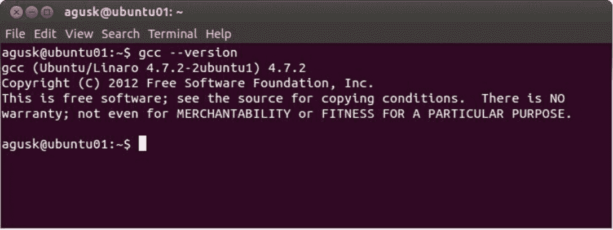

你会看到`gcc`版本，如上图所示。

### 1.2.2 Windows

如果你的电脑是Windows平台，你可以使用`Cygwin`。从 `http://cygwin.com/setup.exe` 下载它，然后运行。

在安装对话框中，选择`Devel`软件包，如下所示。

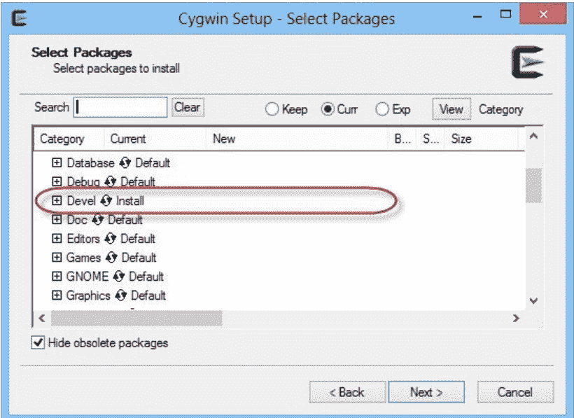

安装完成后，你会得到Cygwin终端。运行它。

你可以检查`GCC`版本。以下是`GCC`版本的输出示例：

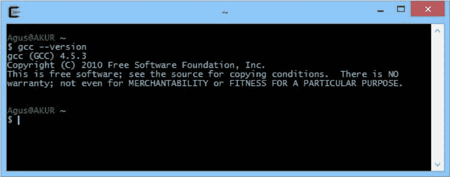

### 1.2.3 Mac

要安装`GCC`，你可以安装Xcode，从而获得`GCC`。安装完成后，你可以通过检查`GCC`版本来验证。

```text
agusks$ gcc --version
Configured with: --prefix=/Applications/Xcode.app/Contents/Developer/usr --with-gxx-include-dir=/Applications/Xcode.app/Contents/Developer/Platforms/MacOSX.platform/Developer/SDKs/MacOSX10.10.sdk/usr/include/c++/4.2.1
Apple LLVM version 6.0 (clang-600.0.57) (based on LLVM 3.5svn)
Target: x86_64-apple-darwin14.0.0
Thread model: posix
agusks$
```

## 1.3 开发工具

基本上你可以使用任何编辑工具，例如 `vi`、`vim`、`gedit`、`Eclipse`。下面是Ubuntu中的`vi`编辑器。

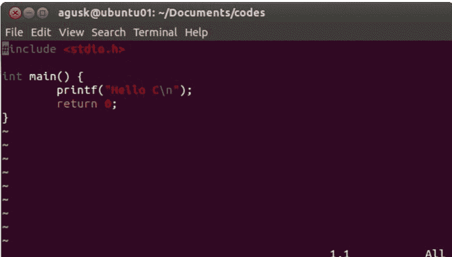

这是`gedit`编辑器：

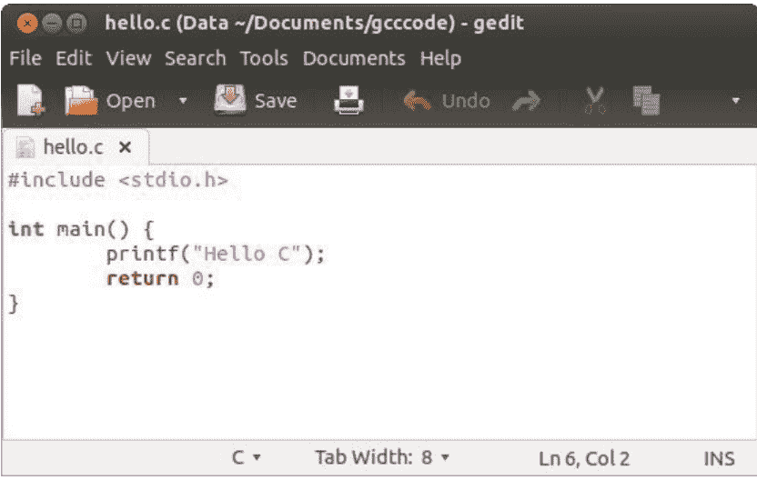

## 1.4 Hello World

现在我们开始用C语言编写第一个程序。

首先，打开你的文本编辑器，创建一个新文件，命名为`hello.c`。

让我们编写以下代码：

```c
#include <stdio.h>

int main() {
        printf("Hello C\n");
        return 0;
}
```

保存这个文件。

现在打开你的终端，编译这个文件。

```bash
sudo gcc hello.c
```

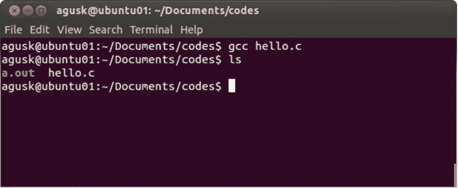

如果你检查一下，会得到一个`a.out`文件。如果你没有指定输出文件名，`GCC`会生成一个`a.out`文件。你可以如下定义编译后的输出文件：

```bash
sudo gcc hello.c -o hello
```

## 如何与你的缪斯女神分手

创意恢复实用指南

通过与缪斯女神分手，以完全专注的状态更快地写作。依赖灵感的艺术家终将失败。学习如何识别你的缪斯女神，评估依赖程度，制定仪式，并为可持续的创造性工作养成新习惯。

- 识别你的缪斯女神
- 评估依赖程度
- 制定仪式
- 养成新习惯

以下实用指南汇集了作者们用来永远切断与缪斯女神联系的创作恢复技巧。

> 艺术家是自由的，但缪斯女神是锁链。——J. T.

| 类型 | 特征 | 处方 |
| --- | --- | --- |
| 第一类：浪漫型缪斯 | 情绪波动，需要灵感，精力时涨时消 | 依靠日程而非感觉；按固定时间段工作 |
| 第二类：宏伟型缪斯 | 压倒一切，充满宏大想法，却没有一个完成 | 将项目切分为更小的部分；每天完成一点 |
| 第三类：分心型缪斯 | 以新奇为食，渴望社交媒体，扰乱工作流程 | 建立单一日常工作区，只保留一个任务清单 |
| 第四类：竞争型缪斯 | 将你与他人比较，助长嫉妒和拖延 | 隔离工作；只与昨天的产出比较 |
| 第五类：批判型缪斯 | 评判你的初稿，不做任何简化，追求完美 | 先写出粗糙的初稿；只在单独的时段进行编辑 |

### 第一类缪斯：浪漫型缪斯

这是艺术的热情情人。它希望你等待完美的时刻、温暖的光辉、美丽的日出。它给你感觉，却夺走你的纪律。解决方法：忽略感觉。设定闹钟。当闹钟响起时工作开始，而不是当灵感歌唱时。

具体来说，每天在同一时间安排写作。这能让潜意识做好准备。拥抱那种“出现”的乏味仪式。久而久之，例行公事会变得富有魅力，缪斯的力量也会消失。

# 2. C语言基础

## 2.1 通用规则

在C语言中，如果你写一行代码，必须在代码末尾写分号（`;`）。

语法规则如下：

```
syntax_code;
```

## 2.2 声明变量

要声明一个名为`*myvar1*`的变量，请编写以下代码：

```c
int myvar1;
```

`int` 是数据类型。

以下是在C语言中可以使用的一些常见数据类型列表。

- `int`
- `long`
- `float`
- `char`
- `double`

我们也可以一次性声明多个变量，如下所示：

```c
int myvar1, myvar2;
```

一旦声明，这些变量就可以用来存储与其数据类型相符的数据。

## 2.3 给变量赋值

已声明的变量可以被赋予一个值。这可以使用等号（`=`）来完成。例如，变量`myvar1`将被赋值为数字100，你可以这样写：

```c
int myvar1 = 100;
```

你也可以像下面这样声明：

```c
int myvar1;
myvar1 = 100;
```

你必须根据数据类型正确地为变量赋值。如果没有，编译过程中会出现错误。例如，编写以下代码：

```c
#include <stdio.h>

int main() {
    int n;
    int i, j;

    n="hello";

    return 0;
}
```

将这个代码保存为名为`var1.c`的文件。

尝试编译这个文件。你会得到一条警告消息，如下图所示：

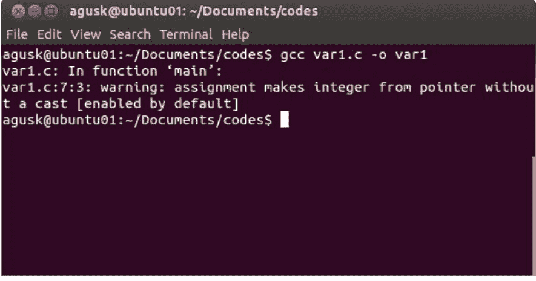

## 2.4 注释

你可以通过编写 C 语言来解释你的代码是如何工作的。为此，你可以使用 `//` 和 `/* */` 语法。以下是示例代码：

```
// bank account
char accountCode;

/* parameters*/
int p1, p2, p3, p4;
```

## 2.5 控制台输入与输出

你可能想要使用 C 语言在控制台上显示消息。可以使用 `printf()` 在控制台上写入消息。`printf()` 内部也可以传入参数，使用 `%d` 表示整数数值，使用 `%f` 表示浮点数值。对于字符数据类型，我们可以使用 `%c` 来传入参数。

以下是示例代码

```
#include <stdio.h>

int main() {
    int n = 10;
    float m = 1.245;
    char c = 'A';

    printf("%d \n",n);
    printf("%f \n",m);
    printf("%.2f \n",m);
    printf("%.3f \n",m);
    printf("%c \n",c);

    return 0;
}
```

将这段代码保存到一个名为 `inout.c` 的文件中。

编译并运行这段代码

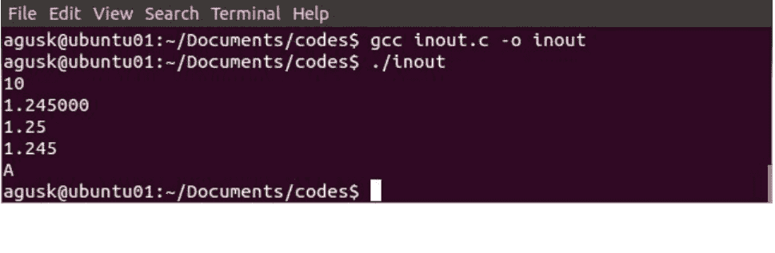

你可以看到 `%f` 输出了带 6 位小数的浮点数据。你可以通过在点号（`.`）后传入数值来指定小数位数，例如 `%.2f` 和 `%.3f`。

## 2.6 算术运算

C 语言支持四种基本算术运算，如加法、减法、乘法、除法。以下是基本算术的代码示例：

```c
#include <stdio.h>

int main() {

        int a,b,c;

        a = 10;

        b = 6;

        c = a + b;

        printf("%d + %d = %d\n",a,b,c);

        c = a - b;

        printf("%d - %d = %d\n",a,b,c);

        c = a * b;

        printf("%d * %d = %d\n",a,b,c);

        float d = a / b;

        printf("%d / %d = %.2f\n",a,b,d);

        float e =(float)a / b;

        printf("%d / %d = %.2f\n",a,b,e);

        return 0;

}
```

将此程序保存到一个名为 `arith.c` 的文件中。编译并运行它。

程序运行：

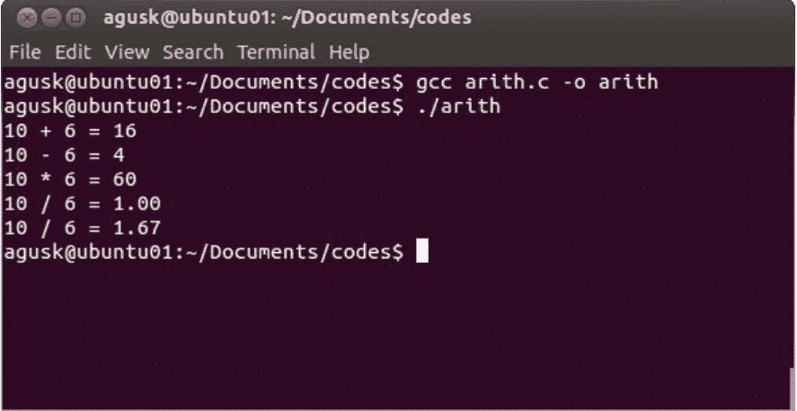

## 2.7 数学函数

C 语言提供了数学库来处理数学运算。你必须包含 `math.h` 才能实现数学运算。

以下是数学函数使用的示例代码：

```c
#include <stdio.h>

#include <stdlib.h>

#include <math.h>

int main() {

        float a;

        float b;

        float pi = 3.14;

        a = 0.25;

        printf("value a = %.2f \n", a);

        b = abs(-a);

        printf("abs(a)=%.2f \n", b);

        b = acos(a);

        printf("acos(a)=%.2f \n", b);

        b = asin(a);

        printf("asin(a)=%.2f \n", b);

        b = atan(a);

        printf("abs(a)=%.2f \n", b);

        b = atan2(a,5);

        printf("atan(a,5)=%.2f \n", b);

        b = cos(a);

        printf("cos(a)=%.2f \n", b);

        b = sin(a);

        printf("sin(a)=%.2f \n", b);

        b = tan(a);

        printf("tan(a)=%.2f \n", b);

        b = sqrt(a);

        printf("sqrt(a)=%.2f \n", b);

        return 0;

}
```

将这段代码保存到一个名为 `mathdemo.c` 的文件中。然后编译并运行它。由于我们使用了 `math.h`，编译时需要添加 `-lm` 参数。

```bash
$ gcc mathdemo.c -lm -o mathdemo

$ ./mathdemo
```

程序输出如下图所示。

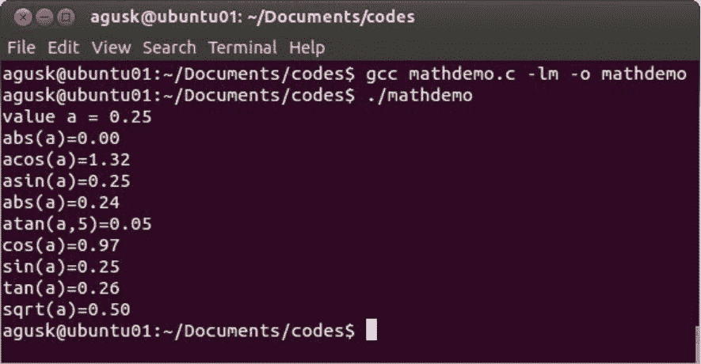

## 2.9 逻辑运算符

这些运算符可用于判断变量或值之间的逻辑关系。

| `&&` | 与 |
| `||` | 或 |
| `!` | 非 |

为了演示如何在 C 代码中使用逻辑运算符，你可以编写以下代码。

```c
#include <stdio.h>

int main() {
    int a,b;
    a = 5;
    b = 8;

    printf("%d \n",a>b && a!=b);
    printf("%d \n",!(a>=b));
    printf("%d \n",a==b || a>b);

    return 0;
}
```

将这段代码保存到一个名为 `logical.c` 的文件中。编译并运行它。

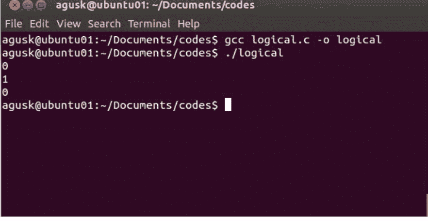

## 2.10 自增与自减

想象你有如下操作

```
num = num + 1;
```

你可以使用 `++` 简化这个语法。

```
num++;
```

对于以下情况，使用相同的方法

```
num = num - 1;
```

你可以使用 `--` 语法。

```
num--;
```

现在看看如何在代码中实现它们。让我们编写以下代码。


```c
#include <stdio.h>

int main() {
    int a = 10;

    a++;
    printf("%d \n",a);

    a++;
    printf("%d \n",a);

    ++a;
    printf("%d \n",a);

    a--;
    printf("%d \n",a);

    a--;
    printf("%d \n",a);

    --a;
    printf("%d \n",a);

    return 0;
}
```

将这段代码保存到一个名为 `incdec.c` 的文件中。

编译并运行它。以下是程序输出示例。

```
agusk@ubuntu01:~/Documents/codes$ gcc incdec.c -o incdec

agusk@ubuntu01:~/Documents/codes$ ./incdec

11

12

13

12

11

10

agusk@ubuntu01:~/Documents/codes$
```

## 2.11 判断

在 C 语言中，有两种实现判断的方法。我们可以使用 `if..then` 和 `switch..case`。

### 2.11.1 if..then

`if..then` 的语法模型可以表示为以下形式：

```c
if (conditional) {
    // do something
}else{
    // do another job
}
```

条件可以通过逻辑运算和/或比较运算得到。

以下是示例代码：

```c
#include <stdio.h>

int main() {
    int a, b;
    a = 5;
    b = 8;

    if(a>b || a-b<a){
        printf("conditional-->a>b || a-b<a \n");
    }else{
        printf("..another \n");
    }
    return 0;
}
```

将此程序保存到一个名为 `ifdemo.c` 的文件中。然后运行该文件。

程序运行：

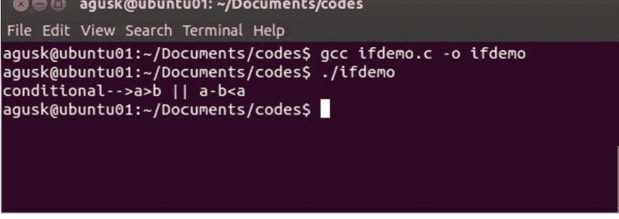

### 2.11.2 switch..case

`switch..case` 可以声明如下：

```c
switch(option){
    case option1:
        // do option1 job
        break;
    case option2:
        // do option2 job
        break;
}
```

以下是 `switch..case` 用法的示例代码：

```c
#include <stdio.h>

int main() {
    // you can obtain input value from keyboard
    // or any input device
    int input = 3;

    switch(input){
    case 1:
        printf("choosen 1\n");
        break;
    case 2:
        printf("choosen 2\n");
        break;
    case 3:
    case 4:
        printf("choosen 3\n");
        break;
    }
    return 0;
}
```

将这段代码保存到一个名为 `switch.c` 的文件中。尝试编译并运行它。

程序运行：

```bash
agusk@ubuntu01:~/Documents/codes$ ls

a.out      comp.c     ifdemo.c    linout.c    mathdemo.c    var1

arith      comp.c~    ifdemo.c~   logical     mathdemo.c~   var1.c

arith.c    hello      incdec      logical.c   switch.c      var1.c~

arith.c~   hello.c    incdec.c    logical.c~  switch.c~     var.c

comp       hello.c~   incdec.c~   mathdemo    var          var.c~

agusk@ubuntu01:~/Documents/codes$ gcc switch.c -o switch

agusk@ubuntu01:~/Documents/codes$ ./switch

choosen 3

agusk@ubuntu01:~/Documents/codes$
```

## 2.12 迭代

迭代操作在需要重复执行某些活动时非常有用。我们使用 `for` 和 `*while*` 语法。

### 2.12.1 For 循环

展示迭代场景的简单示例是显示数字列表。我们进行迭代，直到数字值小于 10。

```c
#include <stdio.h>

int main() {
    int i;
    for(i=0;i<10;i++){
        printf("data %d\n",i);
    }
    return 0;
}
```

将这段代码保存到一个名为 `for.c` 的文件中。编译并运行它。

以下是程序输出：

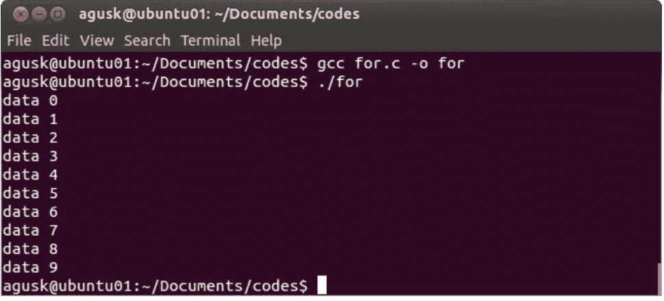

### 2.12.2 While 循环

以下是与 2.12.1 场景相同的代码，但它使用了 `*while*` 语法。

```c
#include <stdio.h>

int main() {
    int num = 0;
```

```
while(num<10){
    printf("data %d\n",num);
    num++;
}
return 0;
}
```

将这段代码保存到一个名为 `while.c` 的文件中。尝试编译并运行它。

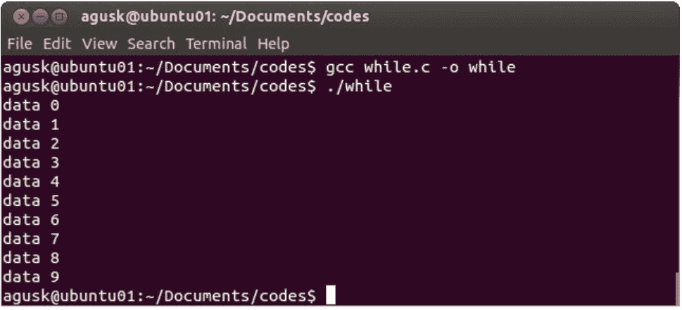

## 2.13 结构体

我们可以定义一个结构体来声明一个新的数据类型。我们使用 `struct` 关键字。例如，我们定义一个名为 `employee` 的新数据类型。

创建一个名为 `structdemo.c` 的文件，并编写以下代码。

```c
#include <stdio.h>

// define a struct
struct employee{
    int id;
    char name[10];
    char country[5];
};

int main() {
    // declare struct variable
    struct employee emp;
    // set values
    emp.id = 10;
    sprintf(emp.name,"jane");
    sprintf(emp.country,"DE");
    // display
    printf("id: %d, name: %s, country: %s\n",emp.id,emp.name,emp.country
    return 0;
}
```

保存这段代码。

现在编译并运行这个程序。

```
$ gcc -o structdemo structdemo.c
$ ./structdemo
```

程序输出示例见下图，Mac 平台。

```
agusks$ ls
address.c      dtwopointer.c  ifdemo.c       multiarray.c   while.c
arith.c        for.c          incdec.c       pointer.c
arraydemo.c    funcdemo.c     inout.c        refpointer.c
comp.c         hello          logical.c      structdemo.c
dpointer.c     hello.c        mathdemo.c     switch.c
agusks$ gcc -o structdemo structdemo.c
agusks$ ./structdemo
id: 10, name: jane, country: DE
agusks$
```

# 3. 数组与指针

本章介绍如何使用数组和指针。

## 3.1 数组

在本节中，我们使用 C 语言构建一个数组。为了说明，我们将开发一维和多维数组。

### 3.1.1 定义数组

我们可以使用 `[]` 语法定义数组。例如，我们定义 `int` 和 `char` 类型的数组。

```c
int numbers[5];
char chars[10];
```

我们还可以从结构体构造数组。

```c
struct employee{
    int id;
    char name[10];
    char country[5];
};

struct employee list[5];
```

### 3.1.2 基本数组操作

声明数组后，我们可以在数组上设置和获取数据。为了说明，创建一个名为 `arraydemo.c` 的文件，并写入以下代码。

```c
#include <stdio.h>

struct employee{
    int id;
    char name[10];
    char country[5];
};

int main() {
    // define array
    int numbers[5];
    char chars[10];
    struct employee list[5];

    // insert data
    int i;

    for(i=0;i<5;i++){
        numbers[i] = i;
        list[i].id = i;
        sprintf(list[i].name,"usr %d",i);
        sprintf(list[i].country,"DE");
    }
    sprintf(chars,"hello c");

    // display data
    for(i=0;i<5;i++){
        printf("%d %c\n",numbers[i],chars[i]);
        printf("struct. id: %d, name: %s, country: %s \n", list[i].id,list[i].name,list[i].country);
    }
    printf("%s\n",chars);

    return 0;
}
```

保存此代码，然后尝试编译并运行。

```
$ gcc -o arraydemo arraydemo.c
$ ./arraydemo
```

示例输出如下图所示。

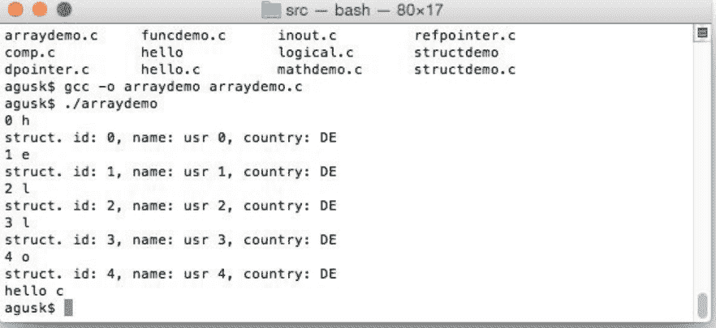

## 3.2 多维数组

我们可以创建多维数组，例如二维数组，可以使用 `[]`。

为了测试，你可以创建一个名为 `multiarray.c` 的文件，并写入以下代码。

```c
#include <stdio.h>

int main() {
    // define Multidimensional array
    int matrix[3][5];

    // insert data
    int i,j;
    for(i=0;i<3;i++){
        for(j=0;j<5;j++){
            matrix[i][j] = i+j;
        }
    }

    // display data
    for(i=0;i<3;i++){
        for(j=0;j<5;j++){
            printf("%d ",matrix[i][j]);
        }
        printf("\n");
    }

    return 0;
}
```

保存此文件。然后尝试编译并运行。

```
$ gcc -o multiarray multiarray.c
$ ./multiarray
```

示例输出如下图所示。

## 3.3 指针

指针是一种编程语言对象，其值通过地址引用（或“指向”）存储在计算机内存中其他位置的值。指针引用内存中的一个位置，获取存储在该位置的值称为解引用指针（来源：http://en.wikipedia.org/wiki/Pointer_(computer_programming)）。

要获取变量的内存地址，我们可以使用 `&` 语法。例如，创建一个名为 `address.c` 的文件，并写入以下代码。

```c
#include <stdio.h>

int main(int argc, const char* argv[]) {

    int n;
    n = 10;

    printf("value n: %d \n", n);
    printf("address n: %x \n", &n);

    return 0;
}
```

保存此文件。然后尝试编译并运行。

```
$ gcc -o address address.c
$ ./address
```

如果成功，我们将获得变量 `n` 的内存地址。程序的示例输出如下图所示。

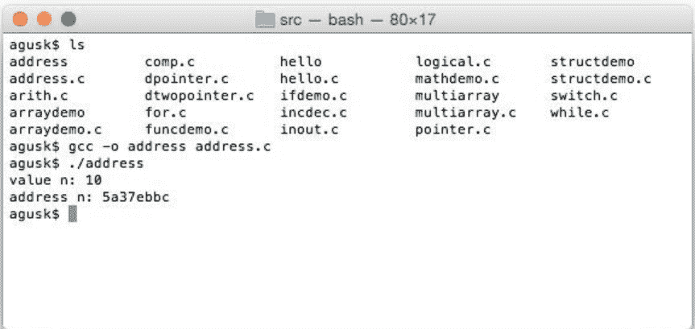

### 3.3.1 基本指针

要声明特定数据类型的指针，我们可以使用 `*` 语法。该变量存储我们指针变量的内存地址。

为了说明，创建一个名为 `pointer.c` 的文件，并写入以下代码。

```c
#include <stdio.h>

int main(int argc, const char* argv[]) {

    int n;
    int* nPtr;

    n = 10;
    nPtr = &n;

    printf("value n: %d \n",n);
    printf("address n: %x \n",(unsigned int)&n);

    printf("value nPtr: %x \n",(unsigned int)nPtr);
    printf("address nPtr: %x \n",(unsigned int)&nPtr);
    printf("value pointer nPtr: %d \n",*nPtr);

    return 0;
}
```

保存此文件。然后编译并运行该文件。

```
$ gcc -o pointer pointer.c
$ ./pointer
```

你可以看到 `nPtr` 的值是变量 `n` 的内存地址。如果 `n` 被设为 10，那么指针 `nPtr`（我们声明为 `*nPtr`）的值与变量 `n` 的值相同。

程序输出示例如下图所示。

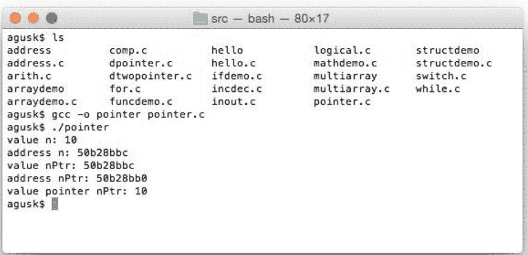

### 3.3.2 动态数组

在本节中，我们将使用指针创建一个动态数组。通常，我们可以使用带有大小的 `[]` 来声明数组。现在我们可以声明动态大小的数组。

基本上，当我们添加一个新值时，我们分配内存，然后将其附加到数组上。为了说明，我们定义一个大小为 10 的数组。然后，我们向该数组添加一些值。

创建一个名为 `dpointer.c` 的文件，并写入以下代码。

```c
#include <stdio.h>
#include <stdlib.h>

int main(int argc, const char* argv[]) {

    // define dynamic array of pointer
    int *numbers; // single array pointer

    // a number of array
    int N = 10;

    // allocate memory
    numbers = malloc( N * sizeof(int));

    // set values
    int i;
    for(i=0;i<N;i++){
        numbers[i] = i+3;
    }

    // display values
    for(i=0;i<N;i++){
        printf("%d ",numbers[i]);
    }
    printf("\n");

    // free memory
    free(numbers);

    return 0;
}
```

保存此代码。尝试编译并运行它。

```
$ gcc -o dpointer dpointer.c
$ ./dpointer
```

程序输出如下图所示。

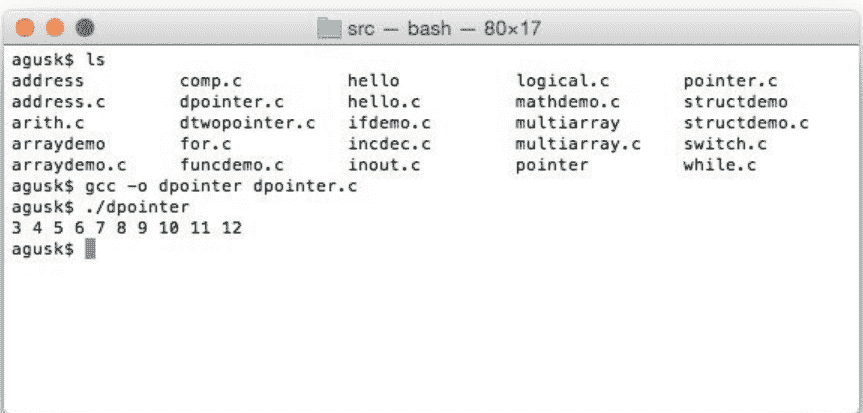

另一个示例，我们还定义多维动态数组。例如，我们创建一个二维动态数组。创建一个名为 `dtwopointer.c` 的文件，并写入以下代码。


```c
#include <stdio.h>
#include <stdlib.h>

int main(int argc, const char* argv[]) {

    // define dynamic array of pointer
    int **matrix; // two dimensional array pointer

    // a number of array
    int M = 3;
    int N = 5;

    // allocate memory
    matrix = malloc( M * sizeof(int*));

    // set values
    int i,j;
    for(i=0;i<M;i++){
        matrix[i] = malloc( N * sizeof(int));
        for(j=0;j<N;j++){
            matrix[i][j] = i + j;
        }
    }

    // display values
    for(i=0;i<M;i++){
        for(j=0;j<N;j++){
            printf("%d ",matrix[i][j]);
        }
        printf("\n");
    }

    // free memory
    free(matrix);

    return 0;
}
```

保存此代码。编译并运行该文件。

```
$ gcc -o dtwopointer dtwopointer.c
$ ./dtwopointer
```

示例如下图所示。

```
agusks$ ls
address      dpointer      hello.c       multiarray    switch.c
address.c    dpointer.c    ifdemo.c      multiarray.c  while.c
arith.c      dtwopointer.c incdec.c      pointer
arraydemo    for.c         inout.c       pointer.c
arraydemo.c  funcdemo.c    logical.c     structdemo
comp.c       hello         mathdemo.c    structdemo.c
agusks$ gcc -o dtwopointer dtwopointer.c
agusks$ ./dtwopointer
0 1 2 3 4
1 2 3 4 5
2 3 4 5 6
agusks$
```

# 4. 函数

本章介绍如何使用 C 语言创建函数。

## 4.1 创建函数

在 C 语言中声明函数可以写成如下形式：

```c
void foo(){
    printf("foo() was called\n");
}
```

我们将这个函数放在 `main()` 函数之上。然后，我们可以调用这个函数，例如 `foo()`。

为了说明，我们可以创建一个名为 `funcdemo.c` 的文件，并写入以下代码。

```c
#include <stdio.h>

void foo(){
    printf("foo() was called\n");
}

int main(int argc, const char* argv[]) {

    foo();
    return 0;
}
```

保存此文件。编译并运行该程序。

```
$ gcc -o funcdemo funcdemo.c
$ ./funcdemo
```

程序输出的示例可以在下图中看到。

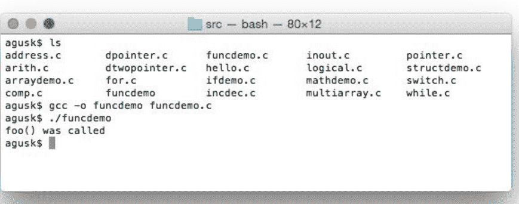

我们也可以在 `main()` 函数下方声明一个函数，但必须先声明函数名。

将此代码添加到 `funcdemo.c` 文件中。

```c
#include <stdio.h>

// implicit declaration for functions
void boo();

int main(int argc, const char* argv[]) {

    boo();
    return 0;
}

void boo(){
    printf("boo() was called\n");
}
```

如果编译并运行这段代码，我们会得到如下图的响应。

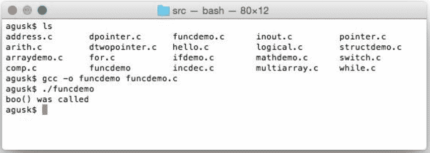

## 4.2 带参数和返回值的函数

你可能想创建一个带参数和返回值的函数。这很简单，只需在函数中调用 `return` 即可。

在 `funcdemo.c` 文件中添加下面这段代码。

```c
#include <stdio.h>

// implicit declaration for functions
int add(int a, int b);

int main(int argc, const char* argv[]) {

    int result = add(10,5);
    printf("result: %d\n",result);

    return 0;
}

int add(int a, int b){
    return a + b;
}
```

尝试编译并运行该文件。

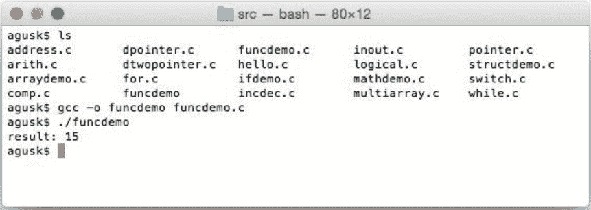

## 4.3 带数组参数的函数

我们也可以声明一个以数组作为参数的函数。为了知道数组大小，我们的函数应该声明数组大小。

为了演示，请在程序中编写以下代码。

```c
#include <stdio.h>

// implicit declaration for functions
double mean(int numbers[],int size);

int main(int argc, const char* argv[]) {

    int numbers[8] = {8,4,5,1,4,6,9,6};
    double ret_mean = mean(numbers,8);
    printf("mean: %.2f\n",ret_mean);

    return 0;
}

double mean(int numbers[],int size){
    int i, total;
    double temp;

    for (i = 0; i < size; ++i){
        total += numbers[i];
    }

    temp = (double)total / (double)size;
    return temp;
}
```

现在你可以编译并运行这个程序了。

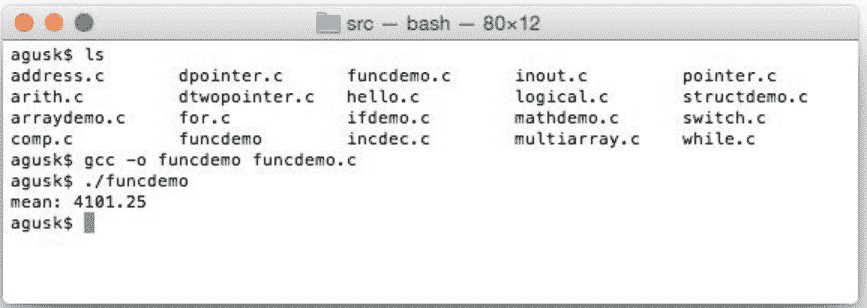

## 4.4 函数与指针

我们可以在函数中将指针作为参数传递。为了演示，我们可以创建 `swap()` 来交换我们的值。

尝试运行这个程序。

```c
#include <stdio.h>

// implicit declaration for functions
void swap(int *px, int *py);

int main(int argc, const char* argv[]) {
    int *x, *y;
    int a, b;

    a = 10;
    b = 5;

    // set value
    x = &a;
    y = &b;

    printf("value pointer x: %d \n",*x);
    printf("value pointer y: %d \n",*y);

    swap(x,y);
    printf("swap()\n");
    printf("value pointer x: %d \n",*x);
    printf("value pointer y: %d \n",*y);
    return 0;
}

void swap(int *px, int *py){
    int temp;

    // store pointer px value to temp
    temp = *px;
    // set pointer px by py value
    *px = *py;
    // set pointer py by temp value
    *py = temp;
}
```

程序输出的一个示例如下图所示。

```text
address.c        dpointer.c       funcdemo.c       inout.c          pointer.c
arith.c          dtwopointer.c    hello.c          logical.c        structdemo.c
arraydemo.c      for.c             ifdemo.c         mathdemo.c       switch.c
comp.c           funcdemo          inced.c          multiarray.c     while.c
agusk$ gcc -o funcdemo funcdemo.c
agusk$ ./funcdemo
value pointer x: 10
value pointer y: 5
swap()
value pointer x: 5
value pointer y: 10
agusk$
```

# 5. I/O 操作

本章介绍如何处理 I/O 操作。

## 5.1 入门

在本节中，我们将学习如何处理 I/O 操作。以下是我们使用 C 语言处理 I/O 的场景示例：

- 从键盘读取输入
- 读取程序参数
- 将数据写入文件
- 从文件读取数据

## 5.2 从键盘读取输入

我们可以通过多种方式从键盘读取输入。以下是从键盘读取输入的函数列表：

- `getchar()`
- `gets()`
- `scanf()`

我们将在下一节中实现这些函数。

### 5.2.1 getchar() 和 putchar() 函数

`getchar()` 函数用于从键盘获取一个字符，`putchar()` 函数用于将字符打印到终端。

为了演示，创建一个名为 `keyboard.c` 的文件，并编写以下代码。

```c
#include <stdio.h>

void getchar_putchar();

int main() {
    getchar_putchar();
    return 0;
}

void getchar_putchar(){
    int c;
    printf ("Type a character: ");
    c = getchar();
    printf ("char: %c\n",c);
    putchar(c);
    printf("\n");
}
```

编译并运行这个程序。

```text
$ gcc -o keyboard keyboard.c
$ ./keyboard
```

你可以在下图中看到程序输出。

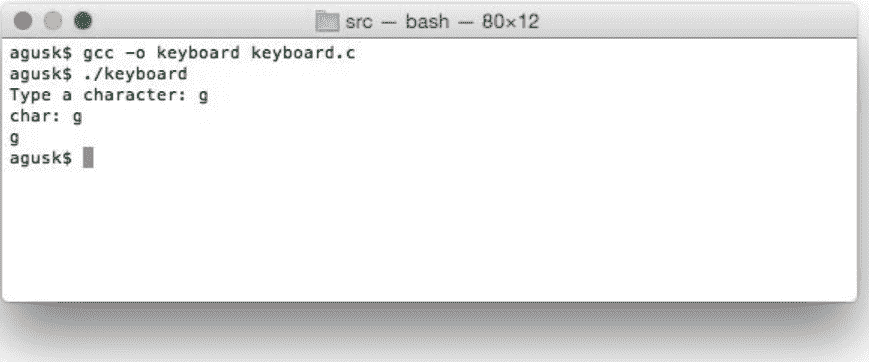

### 5.2.2 gets() 和 puts() 函数

`gets()` 用于读取文本。当你输入换行符（回车键）时，它会停止读取。遗憾的是，`gets()` 是一个不安全的函数。我们可以使用 `fgets()` 来按长度限制读取文本。

为了测试，我们在 `keyboard.c` 文件中添加 `get_puts()` 函数，并编写以下代码。

```c
#include <stdio.h>

void gets_puts();

int main() {

    gets_puts();

    return 0;
}

void gets_puts(){
    printf("-----unsafe input-----\n");
    char name[256];

    printf ("Your name: ");
    gets (name);
    printf ("name: %s\n", name);
    puts(name);

    printf ("-----fgets() input-----\n");
    name[0] = '\0'; // clear
    printf ("Your name: ");
    fgets(name,256,stdin);
    printf ("name: %s\n",name);
    puts(name);
}
```

保存此代码。尝试编译并运行这个程序。

下图中可以看到一个示例输出。

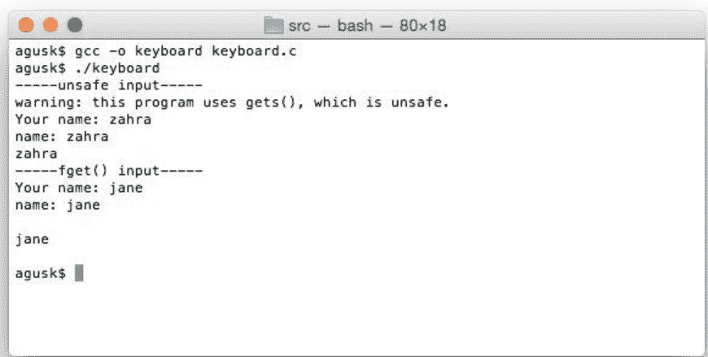

### 5.2.3 scanf() 函数

另一种方法是使用 `scanf()` 函数读取文本。

为了演示，我们在 `keyboard.c` 文件中添加 `scanf()` 函数，并编写以下代码。

```c
#include <stdio.h>

void scanf_demo();

int main() {

    scanf_demo();

    return 0;
}

void scanf_demo(){
    int num;
    char c;
    char city[15];
    float dec;

    printf("Please enter an integer value: ");
    scanf("%d", &num );

    // %c ignores space characters
    printf("Please enter a character: ");
    scanf(" %c", &c );

    printf("Please enter a city name (no space): ");
    scanf("%s", city );

    printf("Please enter a decimal value:  ");
    scanf("%f", &dec );

    printf("\n-----result------\n");
    printf("number = %d\n", num );
    printf("character = %c\n", c );
    printf("city name = %s\n", city );
    printf("decimal number = %f\n", dec );
}
```

保存此代码。编译并运行这个程序。

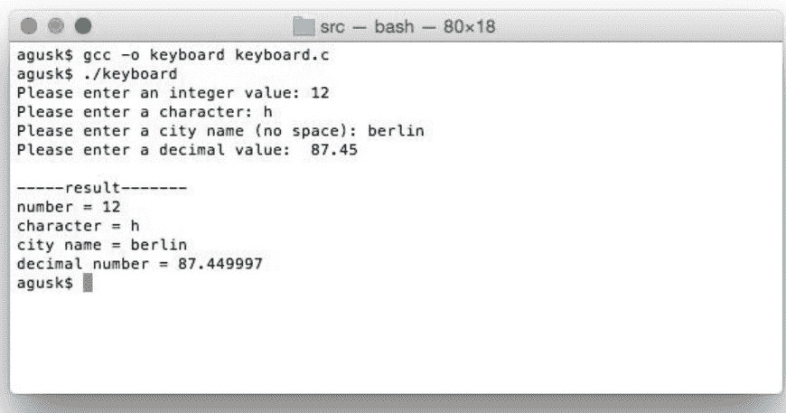

## 5.3 读取程序参数

我们可以从程序中读取参数及其长度。这些信息已经传递给了 `main()` 函数。

为了演示，创建一个名为 `argument.c` 的文件，并编写以下代码。

```c
#include <stdio.h>

int main(int argc, const char* argv[]) {
    int i;

    printf("total argument: %d\n",argc-1);
    if(argc>1){
        for(i=1;i<argc;i++){
            printf("%s\n",argv[i]);
        }
    }

    return 0;
}
```

编译并运行这个程序。

```text
$ gcc -o argument argument.c
$ ./argument
```

下图中可以看到一个示例输出。

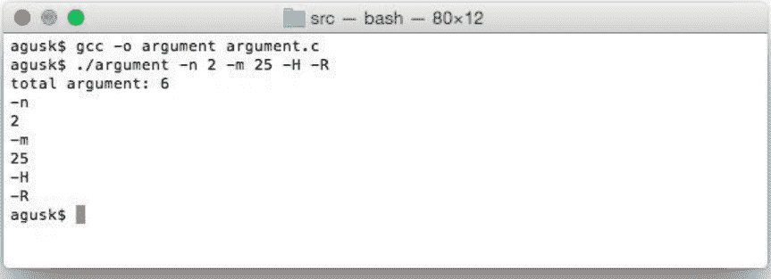

## 5.4 将数据写入文件

我们可以将数据写入文件。以下是写入数据的算法：

- 使用 `fopen()` 函数创建文件
- 使用 `fprintf()` 和 `fputs()` 函数将数据写入文件
- 使用 `fclose()` 函数关闭文件

为了测试，我们在文件 `demo.txt` 中创建数据。为了实现，创建一个名为 `filewrite.c` 的文件，并编写以下代码。

```c
#include <stdio.h>

int main(int argc, const char* argv[]) {
    int i;
    FILE *f;

    f = fopen("demo.txt", "w+");

    for(i=0;i<5;i++){
        fprintf(f, "fprintf message %d\n",i);
        fputs("fputs message\n", f); // no format
    }

    fclose(f);
    printf("Data was written into a file\n");

    return 0;
}
```

保存此代码。编译并运行这个程序。

```text
$ gcc -o filewrite filewrite.c
$ ./filewrite
```

下图中可以看到一个示例输出。

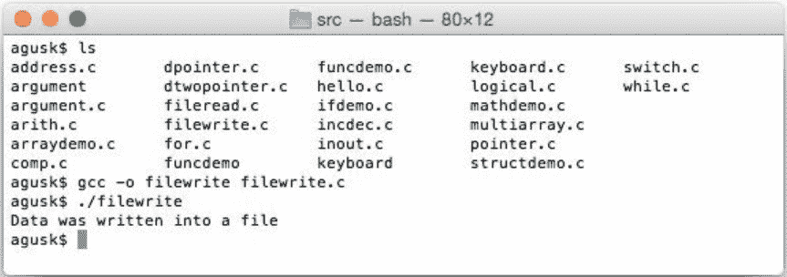

如果成功，它将生成 `demo.txt`。你可以使用文本编辑器打开此文件。

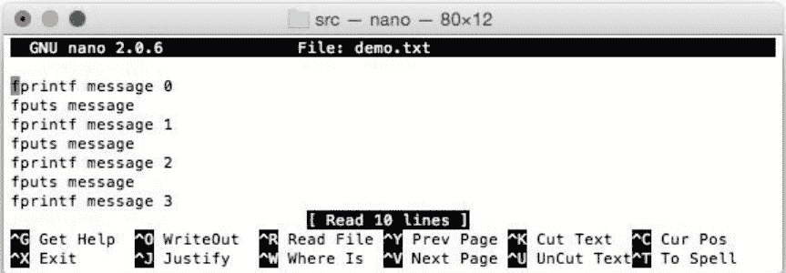

## 5.5 从文件读取数据

我们也可以使用 `fgetc()` 函数从文件中读取数据。为了测试，创建一个名为 `fileread.c` 的文件，并编写以下代码。


```
#include <stdio.h>

int main(int argc, const char* argv[]) {

    char ch;
    FILE *f;

    printf("Reading a file...\n");
    f = fopen("demo.txt", "r");
    if(f==NULL){
        printf("Failed to read file\n");
        return 0;
    }

    while((ch = fgetc(f)) != EOF )
        printf("%c",ch);

    fclose(f);

    return 0;
}
```

编译并运行此程序。

```
$ gcc -o fileread fileread.c
$ ./fileread
```

示例输出如下图所示。

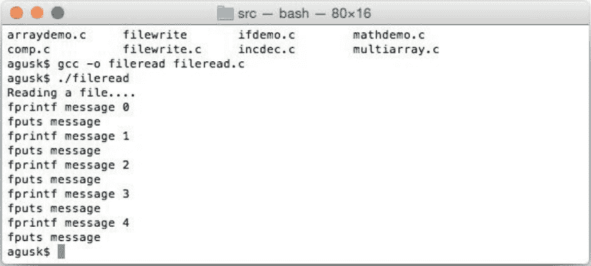

```
arraydemo.c      filewrite       ifdemo.c       mathdemo.c
comp.c           filewrite.c     incdec.c       multiarray.c
agusk$ gcc -o fileread fileread.c
agusk$ ./fileread
Reading a file...
printf message 0
fputs message
printf message 1
fputs message
printf message 2
fputs message
printf message 3
fputs message
printf message 4
fputs message
agusk$
```

# 6. 字符串操作

本章介绍如何在 C 语言中进行字符串操作。

## 6.1 拼接字符串

如果有一个字符串列表，你可以将它们拼接成一个字符串。可以使用 `string.h` 头文件中的 `strcat()` 函数。为了说明，创建一个名为 `stringdemo.c` 的文件，并编写以下代码。

```
#include <stdio.h>
#include <string.h>

void concatenating();

int main(int argc, const char* argv[]) {
    concatenating();
    return 0;
}

void concatenating(){
    printf("====concatenating===\n");
    char str1[30] = "hello";
    char str2[10] = "world";
    strcat(str1,str2);
    printf("result: %s\n",str1);
}
```

编译并运行此程序。

```
$ gcc -o stringdemo stringdemo.c
$ ./stringdemo
```

程序输出如下图所示。

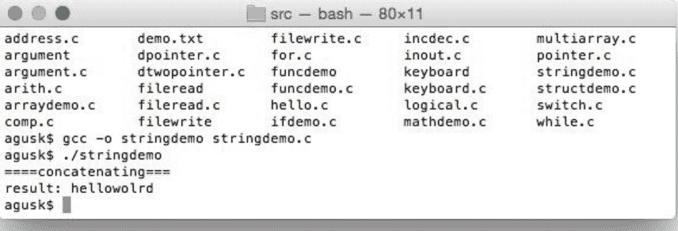

## 6.3 数字转字符串

将数字转换为字符串类型很简单，你可以使用 `sprintf()` 函数，它会自动得到字符串类型。为了说明，添加 `numeric_to_string()` 函数并编写以下代码。

```
#include <stdio.h>
#include <string.h>

void numeric_to_string();

int main(int argc, const char* argv[]) {
    numeric_to_string();
    return 0;
}

void numeric_to_string(){
    printf("====numeric_to_string==\n");
    int n = 10;
    float m = 23.78;

    char num1[10];
    char num2[10];

    sprintf(num1, "%d", n);
    sprintf(num2, "%.2f", m);

    printf("num1: %s\n", num1);
    printf("num2: %s\n", num2);
}
```

编译并运行此程序。

```
agusk$ gcc -o stringdemo stringdemo.c
agusk$ ./stringdemo
===numeric_to_string===
num1: 10
num2: 23.78
agusk$
```

## 6.4 字符串解析

解析字符串的简单解决方案是使用带分隔符参数的 `strtok()` 函数。例如，你有以 ; 分隔的字符串数据并想要解析它。这里是通过添加 `string_parser()` 函数的示例代码。

```
#include <stdio.h>
#include <string.h>

void string_parser();

int main(int argc, const char* argv[]) {
    string_parser();
    return 0;
}

void string_parser(){
    char cities[40] = "Tokyo;Berlin;London;New York";
    char token[2]=",";
    char* city;

    printf("cities: %s\n",cities);

    city = strtok(cities, token);
    while(city != NULL){
        printf("%s\n", city );
        city = strtok(NULL, token);
    }
}
```

编译并运行此程序。

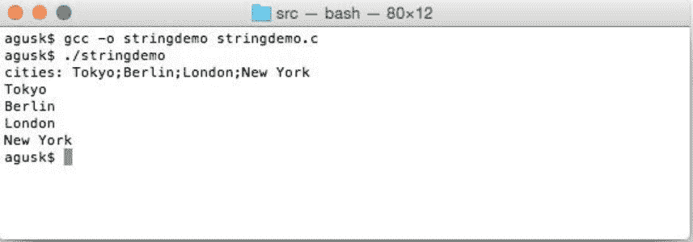

## 6.5 检查字符串数据长度

你可以使用 `string.h` 头文件中的 `strlen()` 函数获取字符串数据的长度。为了测试，添加 `string_length()` 函数并编写以下代码。

```
#include <stdio.h>
#include <string.h>

void string_length();

int main(int argc, const char* argv[]) {
    string_length();
    return 0;
}

void string_length(){
    char str[20] = "Hello world";
    printf("str: %s\n",str);
    printf("length: %d\n",(int)strlen(str));
}
```

编译并运行此程序。

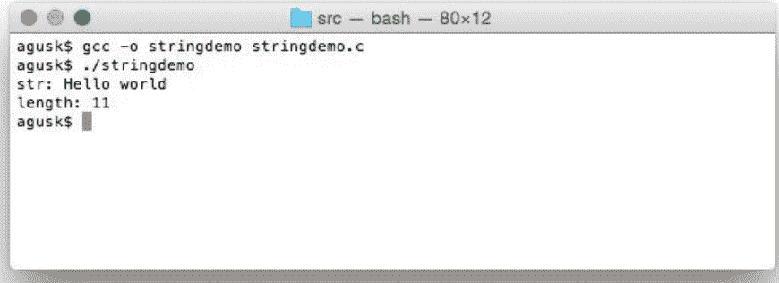

## 6.6 复制数据

你可以复制字符串数据中的一些字符。要做到这一点，可以使用 `strcpy()` 和 `strncpy()` 函数。为了说明，添加 `string_copy()` 函数并编写以下代码。

```
#include <stdio.h>
#include <string.h>

void string_copy();

int main(int argc, const char* argv[]) {
    string_copy();
    return 0;
}

void string_copy(){
    char str[15] = "Hello world";
    char new_str[20];

    strcpy(new_str,str);
    printf("str: %s\n",str);
    printf("new_str: %s\n",new_str);

    memset(new_str, '\0', sizeof(new_str));
    strncpy(new_str,str,5);
    printf("strncpy-new_str: %s\n",new_str);
}
```

编译并运行此程序。

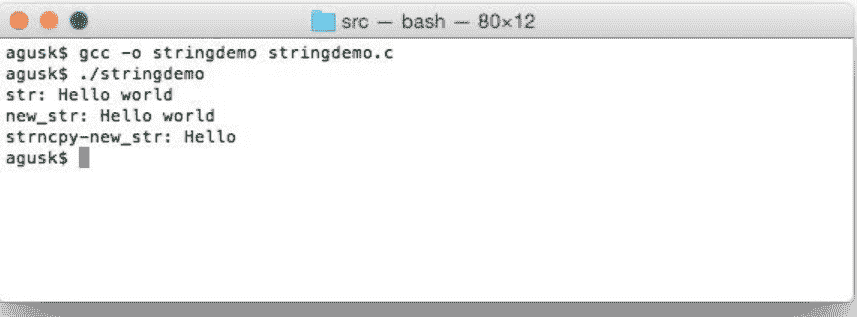

## 6.7 访问字符

你可以通过位置索引获取一个字符。`string_var[index]` 语法提供了这一功能。注意，0 是第一个索引。

为了测试，添加 `string_explore()` 函数并编写以下代码。

```c
#include <stdio.h>
#include <string.h>

void string_explore();

int main(int argc, const char* argv[]) {

    string_explore();

    return 0;
}

void string_explore(){
    char str[15] = "Hello world";
    int index;

    for(index=0;index<strlen(str);index++){
        printf("%c\n", str[index]);
    }
}
```

编译并运行此程序。

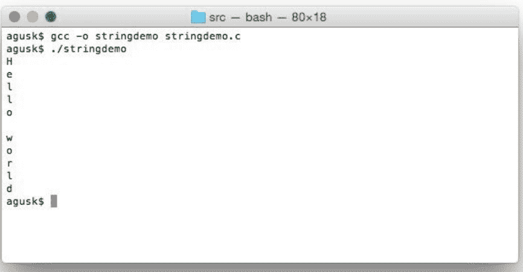

# 7. 构建 C 库

本章介绍如何在 C 语言中构建库。

## 7.3 编译和测试

在本节中，我们尝试将我们的库 `mysimplelib.c` 编译为静态库和共享库。

### 7.3.1 静态库

首先，我们将库 `mysimplelib.c` 编译为静态库，称为 `libmysimple.a`。

```
$ gcc -c mysimplelib.c
$ ar rs libmysimple.a mysimplelib.o
```

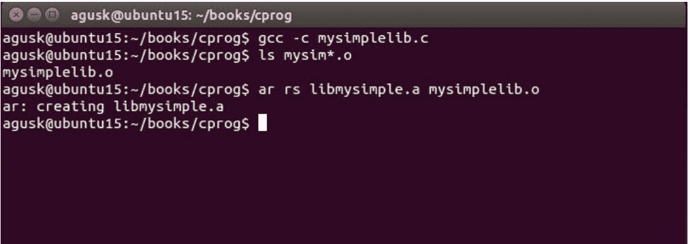

为了使用我们的静态库，我们创建一个简单的应用程序。创建一个名为 `mysimpletest.c` 的文件，并编写以下代码。

```
#include <stdio.h>
#include "mysimple.h"

int main(int argc, const char* argv[]) {
    int a,b,c;
    a = 5;
    b = 3;
    c = add(a,b);
    printf("%d + %d = %d\n",a,b,c);
    c = subtract(a,b);
    printf("%d - %d = %d\n",a,b,c);
```
```
c = multiply(a,b);
printf("%d * %d = %d\n", a, b, c);

return 0;
}
```

假设我们的静态库 `libmysimple.a` 和库的头文件 `mysimple.h` 位于同一文件夹中。现在你可以编译并运行此程序。

```
$ gcc -I./ -L./ -o mysimpletest mysimpletest.c ./libmysimple.a
$ ./mysimpletest
```

程序输出如下图所示。

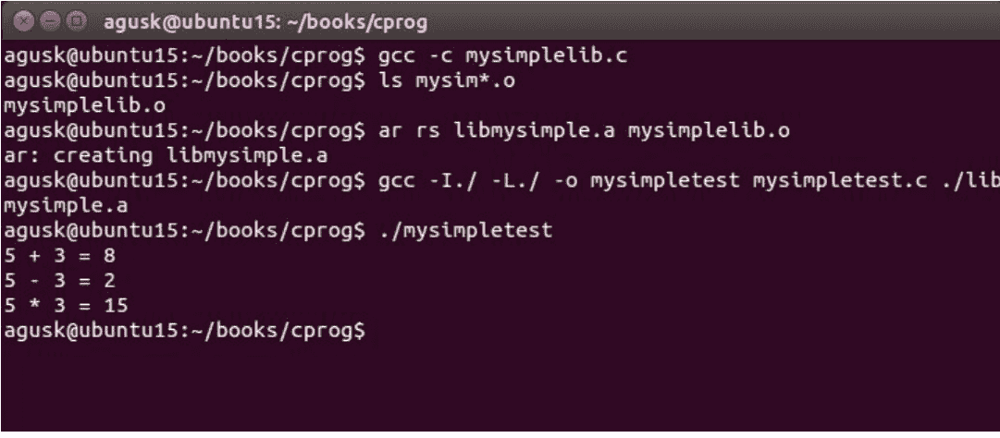

### 7.3.2 共享库

我们将库 `mysimplelib.c` 编译为共享库，称为 `libmysimple.so`。你可以输入以下命令。

```
$ gcc -c -fpic mysimplelib.c
$ gcc -shared -o libmysimple.so mysimplelib.o
```

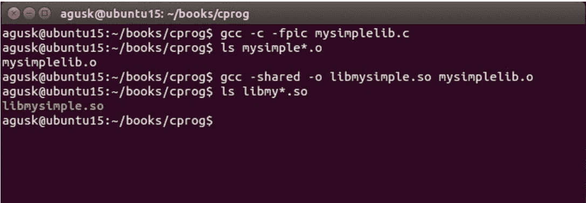

为了测试我们的共享库，我们可以使用与 `mysimpletest.c` 中相同的程序。

假设共享库 `libmysimple.so` 和共享库的头文件 `mysimple.h` 位于同一文件夹中。

你可以编译并运行我们的程序。

```
$ gcc -I./ -L./ -o mysimpletest mysimpletest.c -lmysimple
$ ./mysimpletest
```

程序输出：

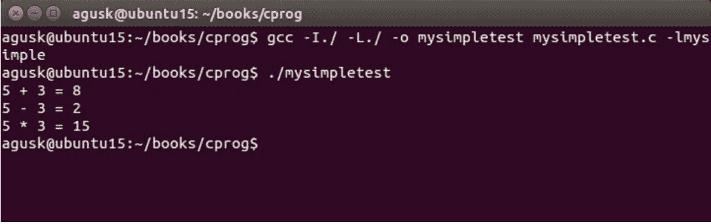

你可以修改共享库文件的位置。例如，我们将共享库文件放到 `/home/agusk/lib` 中。我们必须将库文件夹添加到 `LD_LIBRARY_PATH`。输入以下命令。

```
export LD_LIBRARY_PATH=/home/agusk/lib:$LD_LIBRARY_PATH
```

然后，你可以编译并运行我们的程序 `mysimpletest`。

# 8. 线程

本章解释如何使用 C 进行线程工作。

```
ret = pthread_create (&thread, NULL, perform, &n);
if (ret)
{
    printf("\n pthread_create() failed with error [%s]\n", strerror(err
    return -1;
}
int c = getchar(); // hold app to exit
return 0;
}
```

你可以看到我们将参数 `n=10` 传递给函数 `perform()`。在函数 `perform()` 中，我们只是进行循环。

现在保存此代码。要编译和链接，你可以输入以下命令。

```
$ gcc -pthread -o createthread createthread.c
```

如果成功，你可以运行此应用程序。

```
$ ./createthread
```

以下是示例输出。

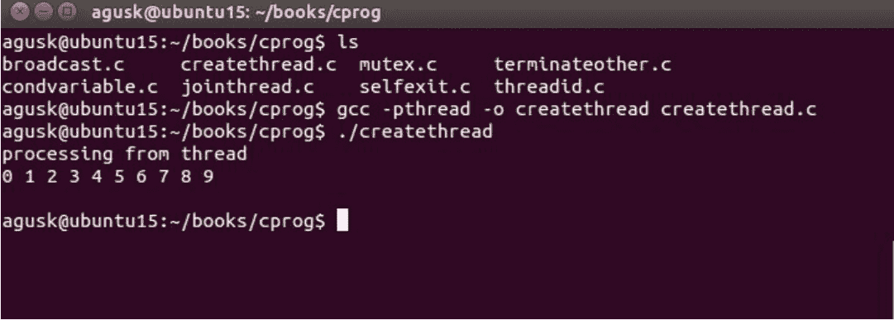

## 8.2 线程 ID

我们可以使用 `pthread_self()` 获取正在运行的线程，以下是其语法。

```
#include <pthread.h>

pthread_t pthread_self (void);
```

要使用此函数，你可以在线程函数内部调用 `pthread_self()`。

为了说明，创建文件，名为 `threadid.c`，并写入此代码。

```
#include <stdio.h>
#include <pthread.h>
#include <string.h>
#include <errno.h>

void* perform(void *arg)
{
    int i;
    int *n = (int *)arg;
    pthread_t tid;

    printf("processing from thread\r\n");
    /* get the calling thread's ID */
    tid = pthread_self();
    printf("Thread id: %d \r\n",(int)tid);
    for(i=0;i<(*n);i++)
    {
        printf("%d ",i);
    }
    printf("\r\n");
}

int main(int argc, char* argv[])
{
    pthread_t thread;
    int ret;
    errno = 0;
    int n = 10;

    ret = pthread_create (&thread, NULL, perform, &n);
    if (ret)
    {
        printf("\n pthread_create() failed with error [%s]\n",strerror(err
        return -1;
    }
    int c = getchar(); // hold app to exit
    return 0;
}
```

## 8.3 终止线程

我们可以使用两种方法终止线程，自身终止和终止其他线程。我们将在下一节中探索这些方法。

### 8.3.1 自身终止

线程可以使用 `pthread_exit()` 停止其处理。以下是 `pthread_exit()` 的语法。

```
#include <pthread.h>

void pthread_exit (void *retval);
```

为了说明，我们基于线程构建应用程序并调用函数 `perform()`。在函数 `perform()` 中，我们进行循环，并在循环索引为 3 后通过调用 `pthread_exit()` 从内部线程退出。

要实现，我们创建一个文件，名为 `selfexit.c`，并写入此代码。

```
#include <stdio.h>
#include <pthread.h>
#include <string.h>
#include <errno.h>

void* perform(void *arg)
{
    int i;
    int *n = (int *)arg;

    printf("processing from thread\r\n");
    for(i=0;i<(*n);i++)
    {
        if(i==3)
        {
            printf("Terminating thread\r\n");
            /* exit this thread */
            pthread_exit((void *)0);
        }
        printf("%d ",i);
    }
    printf("\r\n");
}

int main(int argc, char* argv[])
{
```


```c
int pthread_setcancelstate(int state, int *oldstate);
void pthread_testcancel(void);
```

为了说明，我们构建应用程序以创建线程并尝试使用 `pthread_cancel()` 终止它。

创建一个文件，名为 `terminateother.c`，并写入此代码。

```c
#include <stdio.h>
#include <pthread.h>
#include <string.h>
#include <errno.h>
#include <unistd.h>

void* perform(void *arg)
{
    int n = 0;

    // I'm not ready to be canceled
    pthread_setcancelstate(PTHREAD_CANCEL_DISABLE, NULL);
    printf("processing from thread\r\n");
    while(1)
    {
        printf("%d ",n);
        n++;

        pthread_testcancel();
        if(n>5)
        {
            // I'm ready to be canceled
            pthread_setcancelstate(PTHREAD_CANCEL_ENABLE, NULL);
        }

        sleep(1);
    }
    printf("\r\n");
}

int main(int argc, char* argv[])
{
    pthread_t thread;
    int ret, status;
    errno = 0;

    ret = pthread_create (&thread, NULL, perform, NULL);
    if (ret)
    {
        printf("\n pthread_create() failed with error [%s]\n",strerror(err
        return -1;
    }
    sleep(10);
```

```c
errno = 0;
status = pthread_cancel(thread);
if (status)
{
    printf("\n pthread_cancel() failed with error [%s]\n",strerror(e
    return -1;
}

int c = getchar(); // hold app to exit
return 0;
}
```

说明：

- 在主入口 `main()` 中，我们创建了一个线程并传递 `perform()` 函数
- 我们使用 `sleep()` 保持当前进程 10 秒
- 之后，我们尝试通过调用 `pthread_cancel()` 终止线程
- `pthread_cancel()` 函数返回状态值。你可以验证此返回值
- 在 `perform()` 函数中，首先我们调用 `pthread_setcancelstate()` 来禁用线程取消
- 在循环 `n>5` 后，我们启用线程取消
- `pthread_testcancel()` 函数被调用以创建一个取消点

保存此代码。编译并运行它。

以下是示例输出。

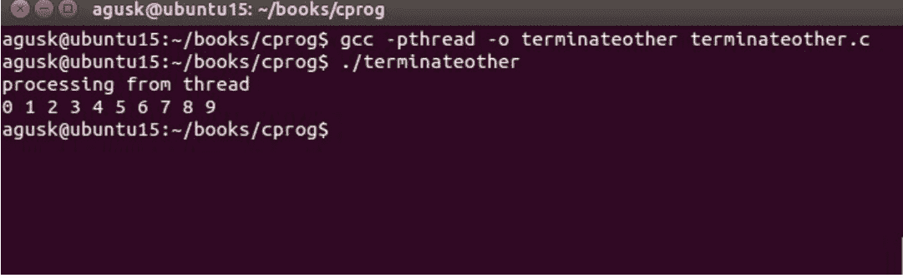

保存此代码。因为我们使用 `math.h`，我们在编译和链接时添加库 `-lm`。以下是编译此代码的语法。

```bash
$ gcc -pthread -o jointhread jointhread.c -lm

$ ./jointhread
```

现在你可以运行它。示例输出如图所示。

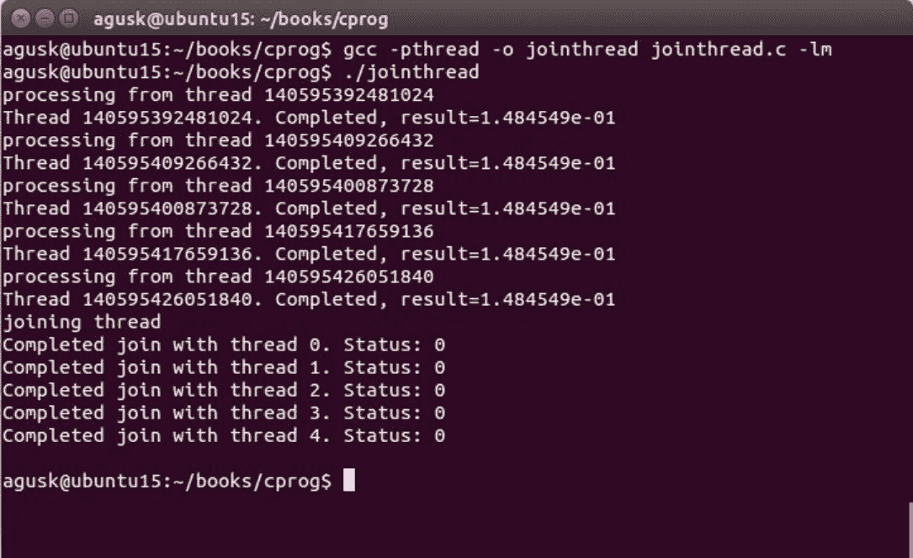

## 8.5 线程互斥锁

你拥有诸如数据变量、文件、数据库等资源，只能由一个线程访问。它被称为互斥锁。为了说明，你有一个存储在变量 `n` 上的数据。你还有 5 个线程访问此数据。第一条规则是数据变量只能由一个线程访问。这意味着数据变量将被锁定，因此另一个线程无法访问它。

互斥锁是控制访问资源的线程同步机制之一。

你可以使用以下函数实现线程互斥锁。

```c
#include <pthread.h>

int pthread_mutex_init(pthread_mutex_t *restrict mutex,
    const pthread_mutexattr_t *restrict attr);
int pthread_mutex_destroy(pthread_mutex_t *mutex);
int pthread_mutex_lock(pthread_mutex_t *mutex);
int pthread_mutex_unlock(pthread_mutex_t *mutex);
```

注意：

- `pthread_mutex_init()` 初始化互斥锁对象
- `pthread_mutex_destroy()` 销毁互斥锁对象
- `pthread_mutex_lock()` 锁定互斥锁对象
- `pthread_mutex_unlock()` 解锁/释放互斥锁对象

为了实现，我们创建一个文件，名为 `mutex.c`。首先我们定义头文件和全局变量。写入此代码。

```c
#include <stdio.h>
#include <pthread.h>
#include <string.h>
#include <errno.h>
#include <unistd.h>

pthread_t thread[5];
int total_finished_jobs;
pthread_mutex_t lock;
```

变量 `total_finished_jobs` 只能由一个线程访问。

在 `main()` 入口点，我们实例化互斥锁对象并创建 5 个线程。

```c
int main(int argc, char* argv[])
{
    int i, ret;
    errno = 0;

    total_finished_jobs = 0;

    if (pthread_mutex_init(&lock, NULL) != 0)
    {
        printf("\n pthread_mutex_init() failed with error [%s]\n", strerror(errno));
        return 1;
    }

    for (i=0;i<5;i++)
    {
        ret = pthread_create (&thread[i], NULL, perform_job, NULL);
        if (ret)
        {
            printf("\n pthread_create() failed with error [%s]\n", strerror(errno));
            return -1;
        }
    }

    int c = getchar(); // hold app to exit

    pthread_mutex_destroy(&lock);
    return 0;
}
```

每个线程调用 `perform_job()` 函数。当访问变量 `total_finished_jobs` 时，我们尝试锁定对象 `lock`。之后，我们更新 `total_finished_jobs` 的值。

以下是 `perform_job()` 函数的实现。

```c
void* perform_job(void *arg)
{
    int i;
    pthread_t tid;
    tid = pthread_self();

    printf("processing from thread %ld \r\n", tid);
    printf("Thread %ld. Started Job. \r\n", tid);

    // do something for doing job
    for(i=0;i<20;i++)
    {
        sleep(1);
    }

    // update job counter
    pthread_mutex_lock(&lock);
    total_finished_jobs++;
    printf("Thread %ld. Finished Job. \r\n", tid);
    printf("Total current finished job: %d \r\n", total_finished_jobs);
    pthread_mutex_unlock(&lock);
}
```

现在保存所有代码。你可以编译并运行它。

你可以在下面的图中看到一个示例输出。

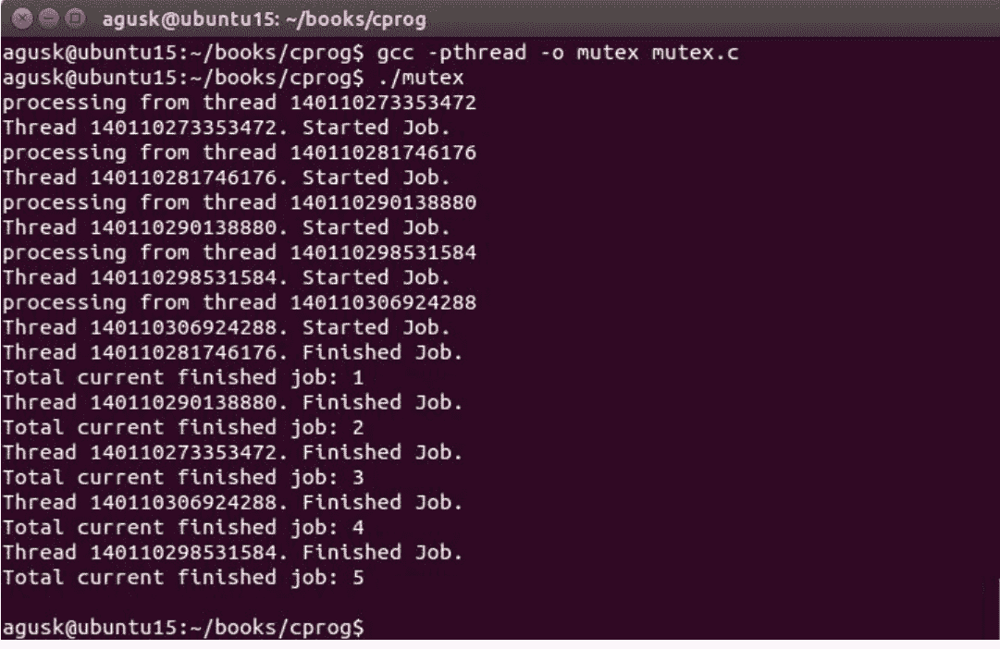

## 8.6 条件变量

我们已经学习了使用线程互斥量进行线程同步。现在我们探索另一种使用条件变量控制资源访问的线程同步方法。

实现线程同步的条件变量有两种方法：

- 信号通知
- 广播

每种方法将在下一节中进行解释。

### 8.6.1 信号通知

信号通知的思想是你在访问资源后必须通知另一个线程开始访问资源。为了实现它，我们可以使用以下函数。

```c
#include <pthread.h>

int pthread_cond_init(pthread_cond_t *restrict cond,
    const pthread_condattr_t *restrict attr);
int pthread_cond_wait(pthread_cond_t *restrict cond,
    pthread_mutex_t *restrict mutex);
int pthread_cond_destroy(pthread_cond_t *cond);
```

要通知另一个线程，你可以使用 `pthread_cond_signal()`，定义如下。

```c
#include <pthread.h>

int pthread_cond_signal(pthread_cond_t *cond);
```

为了说明，我们创建两个线程作为生产者和消费者。生产者可以写入数据，消费者只能读取数据。数据只能由一个线程访问，要么是生产者，要么是消费者。

让我们开始创建一个文件，名为 `condvariable.c`。首先我们定义头文件和全局变量。

```c
#include <stdio.h>
#include <pthread.h>
#include <string.h>
#include <errno.h>
#include <unistd.h>

#define BUFF_LEN 30
int buffer[BUFF_LEN];
int index_put=0, index_get=0;
int count = 0;
pthread_cond_t empty, get;
pthread_mutex_t lock;
```

在 `main()` 入口点，我们初始化对象互斥锁和条件变量（`empty` 和 `fill`）。我们还创建了 2 个线程，生产者和消费者。

```c
int main(int argc, char* argv[])
{
    pthread_t thread_consumer, thread_producer;
    int ret;
    errno = 0;
    int loops = 15;

    // initialization
    if (pthread_mutex_init(&lock, NULL) != 0)
    {
        printf("\n pthread_mutex_init() failed with error [%s]\n", strerror(errno));
        return 1;
    }

    if (pthread_cond_init(&empty, NULL) != 0)
    {
        printf("\n pthread_cond_init() failed with error [%s]\n", strerror(errno));
        return 1;
    }

    if (pthread_cond_init(&get, NULL) != 0)
    {
        printf("\n pthread_cond_init() failed with error [%s]\n", strerror(errno));
        return 1;
    }

    // create thread
    ret = pthread_create(&thread_consumer, NULL, consumer, &loops);
    if (ret)
    {
        printf("\n pthread_create() failed with error [%s]\n", strerror(errno));
        return -1;
    }

    ret = pthread_create(&thread_producer, NULL, producer, &loops);
    if (ret)
    {
        printf("\n pthread_create() failed with error [%s]\n", strerror(errno));
        return -1;
    }

    int c = getchar(); // hold app to exit

    pthread_mutex_destroy(&lock);
    pthread_cond_destroy(&empty);
    pthread_cond_destroy(&get);
    return 0;
}
```

在 `producer()` 函数中，我们循环直到获得信号 `empty`。获得信号后，我们在数组 `buffer` 上添加一个值。如果完成，它将通知信号 `get`。

```c
void *producer(void *arg)
{
    int i;
    int *loops = (int *)arg;

    for (i = 0; i < (*loops); i++)
    {
        pthread_mutex_lock(&lock);
        while (count == BUFF_LEN)
            pthread_cond_wait(&empty, &lock);

        buffer[index_put] = i;
        index_put = (index_put + 1) % BUFF_LEN;
        count++;
        pthread_cond_signal(&get);
        pthread_mutex_unlock(&lock);
    }

    printf("exit from producer\r\n");
}
```

在 `consumer()` 函数中，首先我们等待信号 `fill`。获得信号后，我们从数组 `buffer` 读取数据。如果完成，我们通知信号 `empty`。

```c
void *consumer(void *arg)
{
    int i;
    int *loops = (int *)arg;

    for (i = 0; i < (*loops); i++)
    {
        pthread_mutex_lock(&lock);
        while (count == BUFF_LEN)
            pthread_cond_wait(&get, &lock);

        int tmp = buffer[index_get];
        index_get = (index_get + 1) % BUFF_LEN;
        count--;
        printf("Value: %d\r\n", tmp);

        pthread_cond_signal(&empty);
        pthread_mutex_unlock(&lock);
    }

    printf("exit from consumer\r\n");
}
```

保存此代码。编译并运行它。

以下是示例输出。

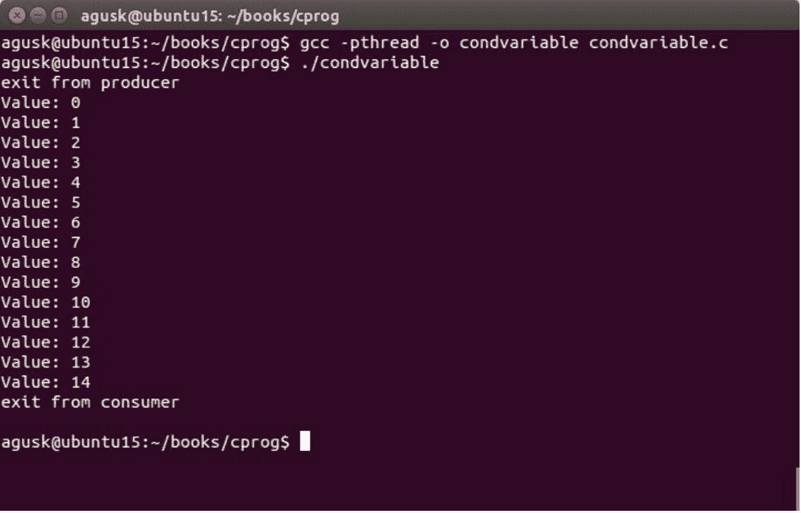

### 8.6.2 广播

我们可以使用广播信号通知一些线程。它可以使用 `pthread_cond_broadcast()` 并定义如下。

```c
#include <pthread.h>

int pthread_cond_broadcast(pthread_cond_t *cond);
```

`pthread_cond_broadcast()` 和 `pthread_cond_signal()` 有什么区别？`pthread_cond_broadcast()` 通知多个线程，但 `pthread_cond_signal()` 通知一个线程。

为了说明，我们使用上一节（第 8.6.1 节）中的相同代码。在此场景中，我们有 2 个消费者线程和 1 个生产者线程。

```c
if (ret)
{
    printf("\n pthread_create() failed with error [%s]\n", strerror(errno));
    return -1;
}
```


`ret = pthread_create (&thread_producer, NULL, producer, &loops);`

`if (ret)`

```
{
    printf("\n pthread_create() failed with error [%s]\n", strerror(errno));
    return -1;
}
int c = getchar(); // hold app to exit
pthread_mutex_destroy(&lock);
pthread_cond_destroy(&empty);
pthread_cond_destroy(&get);
return 0;
}
```

在 `producer()` 函数中，我们在获得信号 `empty` 后插入数据。然后我们调用 `pthread_cond_broadcast()` 来通知所有消费者线程。

```c
void *producer(void *arg)
{
    int i;
    int *loops = (int *)arg;
    for (i = 0; i < (*loops); i++)
    {
        pthread_mutex_lock(&lock);
        while (count == BUFF_LEN)
            pthread_cond_wait(&empty, &lock);
        buffer[index_put] = i;
        index_put = (index_put + 1) % BUFF_LEN;
        count++;
        pthread_cond_broadcast(&get); //broadcast to consumer
        pthread_mutex_unlock(&lock);
    }
    printf("exit from producer\r\n");
}
```

在 `consumer()` 函数中，我们在获得信号 `get` 后从数组获取数据。之后，我们使用 `pthread_cond_signal()` 通知生产者线程。

```c
void *consumer(void *arg)
{
    int i;
```

# 9. 数据库编程

本章解释如何使用 C 创建数据库应用程序。

## 9.1 用于 C 的数据库库

C 可以通过数据库驱动程序与数据库服务器通信。在开始开发数据库应用程序之前，我们必须安装用于 C 的数据库驱动程序。

在本章中，我只关注 MySQL 场景。基本上，我已经将这些代码发布到 Github，`https://github.com/agusk/crud-mysql-c`，去年。你可以下载并改进这些代码。

## 9.2 MySQL

要在 Ubuntu 及其数据库驱动程序中安装 MySQL 服务器和客户端，你可以尝试在终端中编写此命令

```bash
$ sudo apt-get install mysql-server mysql-client
$ sudo apt-get install libmysqlclient-dev
```

完成后，我们可以进行测试。

首先，我们可以开始创建一个简单的 C 应用程序来检查 MySQL 版本。编写此代码

```c
#include <my_global.h>
#include <mysql.h>
int main(int argc, char **argv)
{
    printf("MySQL client version: %s\n", mysql_get_client_info());
    exit(0);
}
```

将此程序保存到一个文件中，名为 `demo-mysql-version.c`。

现在你可以编译并运行此文件。

```bash
$ gcc -c -I/usr/include/mysql demo-mysql-version.c
$ gcc -o demo-mysql-version demo-mysql-version.o -L/usr/lib/mysql -lmysql
$ ./demo-mysql-version
```

如果成功，你将获得 MySQL 客户端版本。

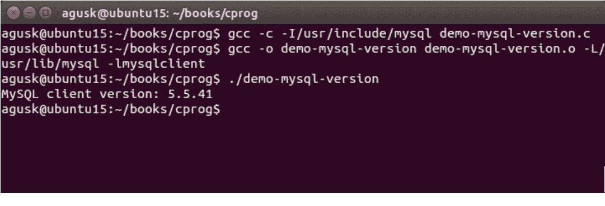

## 9.3 连接测试

在本节中，我们尝试测试到 MySQL 服务器的连接。创建一个文件，名为 `demo-connection.c` 并编写此代码。

```c
#include <my_global.h>
#include <mysql.h>
int main(int argc, char **argv)
{
    MYSQL *con = mysql_init(NULL);
    if (con == NULL)
    {
        fprintf(stderr, "%s\n", mysql_error(con));
        exit(1);
    }
    printf("connecting to mysql server...\r\n");
    // change host, username, and password
    if (mysql_real_connect(con, "localhost", "root", "password", NULL, 0, NULL, 0) == NULL)
    {
        printf("error: %s\r\n", mysql_error(con));
        mysql_close(con);
        exit(1);
    }
    printf("connected.\r\n");
    printf("closing connection...\r\n");
    mysql_close(con);
    printf("closed.\r\n");
    exit(0);
}
```

保存此程序。

现在你可以编译并运行此文件。

```bash
$ gcc -c -I/usr/include/mysql demo-connection.c
$ gcc -o demo-connection demo-connection.o -L/usr/lib/mysql -lmysqlclient
$ ./demo-connection
```

程序输出：

```
agusk@ubuntu15:~/books/cprog$ gcc -c -I/usr/include/mysql demo-connection.c
agusk@ubuntu15:~/books/cprog$ gcc -o demo-connection demo-connection.o -L/usr/lib/mysql -lmysqlclient
agusk@ubuntu15:~/books/cprog$ ./demo-connection
connecting to mysql server...
connected.
closing connection...
closed.
agusk@ubuntu15:~/books/cprog$ 
```

```c
MYSQL_STMT  *stmt;
stmt = mysql_stmt_init(con);
if (!stmt)
{
    printf(" mysql_stmt_init(), out of memory\r\n");
    exit(0);
}
if (mysql_stmt_prepare(stmt, CREATE_DATA, strlen(CREATE_DATA)))
{
    printf("mysql_stmt_prepare(), INSERT failed\r\n");
    printf("error: %s\r\n", mysql_stmt_error(stmt));
    exit(0);
}
int i;
time_t now = time(NULL);
char name[10];
unsigned long str_length;
float price;
MYSQL_BIND  bind[3];
MYSQL_TIME  ts;
memset(bind, 0, sizeof(bind));
bind[0].buffer_type= MYSQL_TYPE_VAR_STRING;
bind[0].buffer= (char *)&name;
bind[0].is_null= 0;
bind[0].length= &str_length;
bind[1].buffer_type= MYSQL_TYPE_FLOAT;
bind[1].buffer= (char *)&price;
bind[1].is_null= 0;
bind[1].length= 0;
bind[2].buffer_type= MYSQL_TYPE_DATETIME;
bind[2].buffer= (char *)&ts;
bind[2].is_null= 0;
bind[2].length= 0;
// bind parameters
if (mysql_stmt_bind_param(stmt, bind))
{
    printf("mysql_stmt_bind_param() failed\r\n");
    printf("%s\r\n", mysql_stmt_error(stmt));
    exit(0);
}
for(i=1;i<=10;i++)
{
    // set values
```

```c
sprintf(name,"product-%d",i);
str_length = strlen(name);
price = 0.23*i;
// time_t to MYSQL_TIME
struct tm *now_struct = gmtime(&now);
ts.year = now_struct->tm_year + 1900;
ts.month = now_struct->tm_mon + 1;
ts.day = now_struct->tm_mday;
ts.hour = now_struct->tm_hour;
ts.minute = now_struct->tm_min;
ts.second = now_struct->tm_sec;

printf("executing data %d...\\r\\n",i);
if (mysql_stmt_execute(stmt))
{
        printf("mysql_stmt_execute(), 1 failed\\r\\n");
        printf("%s\\r\\n", mysql_stmt_error(stmt));
        exit(0);
}
}
printf("done.\\r\\n");
printf("closing connection...\\r\\n");
/* Close the statement */
if (mysql_stmt_close(stmt))
{
        printf("failed while closing the statement\\r\\n");
        printf("%s\\r\\n", mysql_stmt_error(stmt));
        exit(0);
}
mysql_close(con);
printf("closed.\\r\\n");
exit(0);
}
```

保存该代码。

现在你可以编译并运行该文件。

```bash
$ gcc -c -I/usr/include/mysql demo-create-data.c
$ gcc -o demo-create-data demo-create-data.o -L/usr/lib/mysql -lmysqlclient
$ ./demo-create-data
```

程序输出：

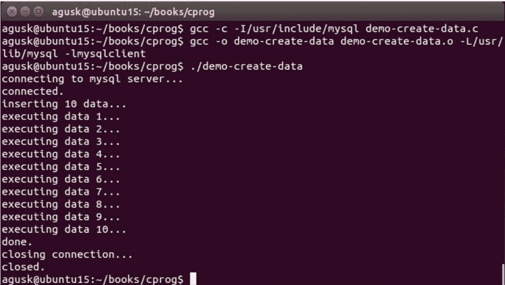

## 9.4.2 读取数据

在本节中，我们将尝试从 MySQL 读取数据。为便于演示，创建一个名为 `demo-read-data.c` 的文件，并编写如下代码。

```c
#include <my_global.h>
#include <mysql.h>
int main(int argc, char **argv)
{
    MYSQL *con = mysql_init(NULL);
    if (con == NULL)
    {
        fprintf(stderr, "%s\n", mysql_error(con));
        exit(1);
    }
    printf("connecting to mysql server...\r\n");
    // change host, username, and password
    if (mysql_real_connect(con, "localhost", "root", "password", "mydatabase", 0, NULL, 0) == NULL)
    {
        printf("error: %s\r\n", mysql_error(con));
        mysql_close(con);
        exit(1);
    }
    printf("connected.\r\n");
```

```c
printf("show data product\r\n");
if (mysql_query(con, "SELECT * FROM product"))
{
    printf("error: %s\r\n", mysql_error(con));
    mysql_close(con);
    exit(1);
}
MYSQL_RES *result = mysql_store_result(con);
if (result == NULL)
{
    printf("error: %s\r\n", mysql_error(con));
    mysql_close(con);
    exit(1);
}
int num_fields = mysql_num_fields(result);
MYSQL_ROW row;
int i;
while ((row = mysql_fetch_row(result)))
{
    for(i = 0; i < num_fields; i++)
    {
        printf("%s\t", row[i] ? row[i] : "NULL");
    }
    printf("\r\n");
}
mysql_free_result(result);
printf("closing connection...\r\n");
mysql_close(con);
printf("closed.\r\n");
exit(0);
}
```

保存该代码。

现在你可以编译并运行该文件。

```bash
$ gcc -c -I/usr/include/mysql demo-read-data.c
$ gcc -o demo-read-data demo-read-data.o -L/usr/lib/mysql -lmysqlclient
$ ./demo-read-data
```

程序输出：

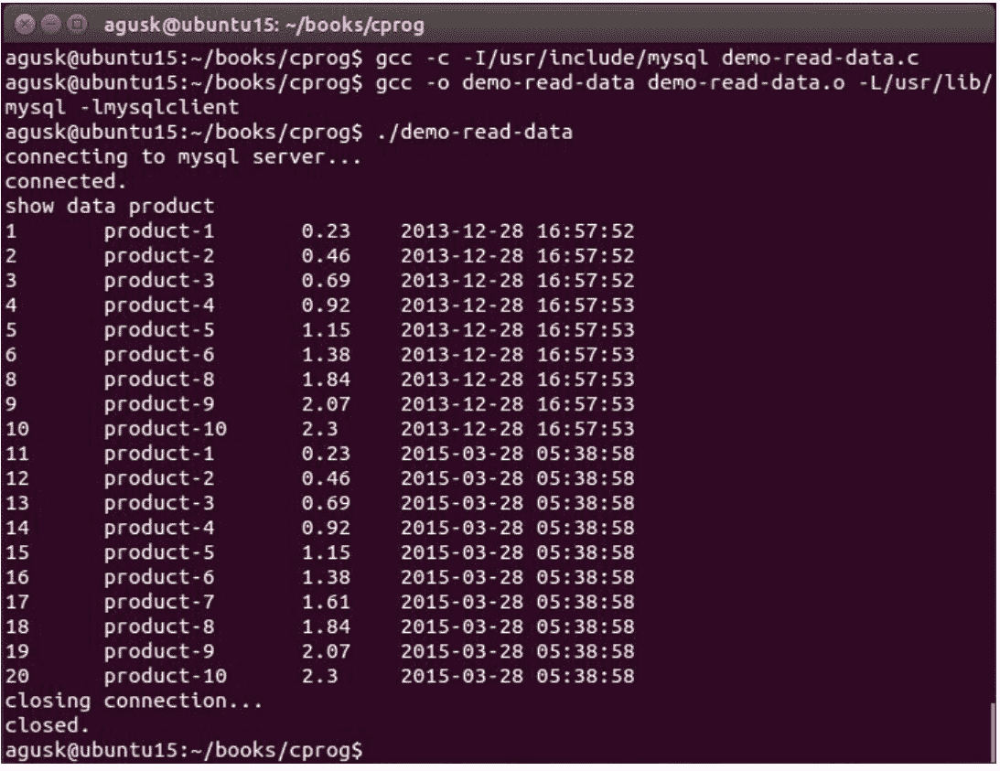

## 9.4.3 更新数据

在本节中，我们将尝试更新数据，例如更新 id=5 的数据。创建一个名为 `demo-update-data.c` 的文件，并编写如下代码。

```c
#include <my_global.h>
#include <mysql.h>
#include <string.h>
#define UPDATE_DATA "update product set name = ?, price=? where idproduct=?"
int main(int argc, char **argv)
{
    MYSQL *con = mysql_init(NULL);
    if (con == NULL)
    {
        fprintf(stderr, "%s\n", mysql_error(con));
        exit(1);
    }
```

```c
printf("connecting to mysql server...\\r\\n");
// change host, username, and password
if (mysql_real_connect(con, "localhost", "root", "password",
                       "mydatabase", 0, NULL, 0) == NULL)
{
    printf("error: %s\\r\\n", mysql_error(con));
    mysql_close(con);
    exit(1);
}
printf("connected.\\r\\n");
MYSQL_STMT *stmt;
stmt = mysql_stmt_init(con);
if (!stmt)
{
    printf(" mysql_stmt_init(), out of memory\\r\\n");
    exit(0);
}
if (mysql_stmt_prepare(stmt, UPDATE_DATA, strlen(UPDATE_DATA)))
{
    printf("mysql_stmt_prepare(), UPDATE failed\\r\\n");
```


保存该代码。

现在你可以编译并运行该文件。

```bash
$ gcc -c -I/usr/include/mysql demo-update-data.c

$ gcc -o demo-update-data demo-update-data.o -L/usr/lib/mysql -lmysqlclient

$ ./demo-update-data
```

程序输出：

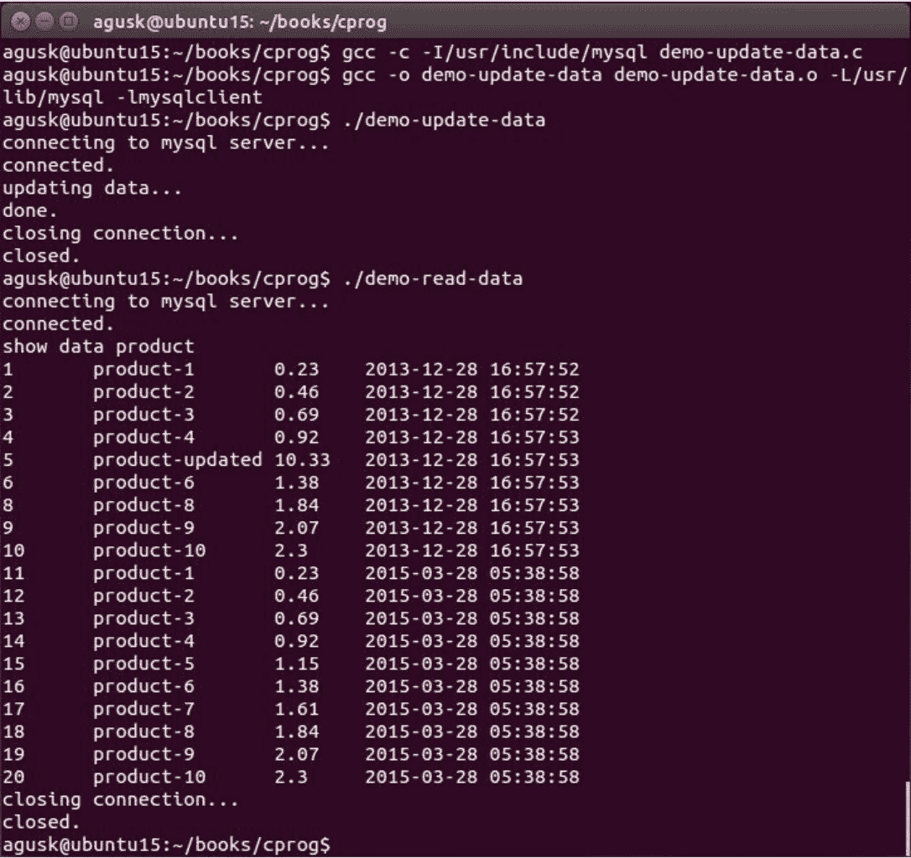

## 9.4.4 删除数据

最后一个操作是删除数据，例如删除 id=3 的数据。创建一个名为 `demo-delete-data.c` 的文件，并编写如下代码。

```c
#include <my_global.h>
#include <mysql.h>
#include <string.h>
#define DELETE_DATA "delete from product where idproduct=?"
int main(int argc, char **argv)
{
        MYSQL *con = mysql_init(NULL);
```

if (con == NULL)
{
    fprintf(stderr, "%s\n", mysql_error(con));
    exit(1);
}
printf("connecting to mysql server...\r\n");

// change host, username, and password
if (mysql_real_connect(con, "localhost", "root", "password", "mydatabase", 0, NULL, 0) == NULL)
{
    printf("error: %s\r\n", mysql_error(con));
    mysql_close(con);
    exit(1);
}
printf("connected.\r\n");
MYSQL_STMT *stmt;
stmt = mysql_stmt_init(con);
if (!stmt)
{
    printf(" mysql_stmt_init(), out of memory\r\n");
    exit(0);
}
if (mysql_stmt_prepare(stmt, DELETE_DATA, strlen(DELETE_DATA)))
{
    printf("mysql_stmt_prepare(), UPDATE failed\r\n");
    printf("error: %s\r\n", mysql_stmt_error(stmt));
    exit(0);
}
int i;
MYSQL_BIND bind[1];
int product_id;
memset(bind, 0, sizeof(bind));
bind[0].buffer_type= MYSQL_TYPE_LONG;
bind[0].buffer= (char *)&product_id;
bind[0].is_null= 0;
bind[0].length= 0;
// bind parameters
if (mysql_stmt_bind_param(stmt, bind))
{
    printf("mysql_stmt_bind_param() failed\r\n");
    printf("%s\r\n", mysql_stmt_error(stmt));
    exit(0);
}
// select product id to be deleted

// change these values!!
product_id = 3;
printf("deleting data...\r\n");
if (mysql_stmt_execute(stmt))
{
    printf("mysql_stmt_execute(), 1 failed\r\n");
    printf("%s\r\n", mysql_stmt_error(stmt));
    exit(0);
}
printf("done.\r\n");
printf("closing connection...\r\n");
/* Close the statement */
if (mysql_stmt_close(stmt))
{
    printf("failed while closing the statement\r\n");
    printf("%s\r\n", mysql_stmt_error(stmt));
    exit(0);
}
mysql_close(con);
printf("closed.\r\n");
exit(0);
}
```

Save this code.

Now you can compile and run this file.

```
$ gcc -c -I/usr/include/mysql demo-delete-data.c
$ gcc -o demo-delete-data demo-delete-data.o -L/usr/lib/mysql -lmysqlcli
$ ./demo-delete-data
```

Program output:

# 10. Socket Programming

本章介绍如何使用 C 开始 Socket 编程。

## 10.1 Getting Local Hostname

我们通常使用 `hostname` 命令知道主机名。例如，你可以输入以下命令。

```
$ hostname
```

我们也可以通过程序获取主机名。我们可以使用 `gethostname()` 函数。它定义如下。

```c
#include <unistd.h>
int gethostname(char *name, size_t len);
```

为了说明，我们创建一个简单的应用来读取本地主机名。创建一个文件，名为 `gethostname.c`，并写入此代码。

```c
#include <stdio.h>
#include <sys/unistd.h>
int main(void)
{
    char hostname[128];
    gethostname(hostname, sizeof(hostname));
    printf("My local hostname: %s\n", hostname);
    return 0;
}
```

保存此代码并尝试编译和运行。

以下是示例输出。

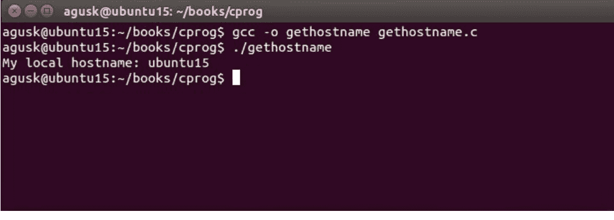

## 10.2 Creating and Connecting

在本节我们探索 socket 编程。为了说明我们构建客户端-服务器应用。在此场景中，我们只是连接然后关闭。

要创建通信，我们可以使用 `socket()` 函数。它可以定义如下。

```c
#include <sys/types.h>
#include <sys/socket.h>
int socket(int domain, int type, int protocol);
```

`domain` 定义如下。

| Name | Purpose |
|---|---|
| AF_UNIX, AF_LOCAL | 本地通信 |
| AF_INET | IPv4 Internet 协议 |
| AF_INET6 | IPv6 Internet 协议 |
| AF_IPX | IPX - Novell 协议 |
| AF_NETLINK | 内核用户界面设备 |
| AF_X25 | ITU-T X.25 / ISO-8208 协议 |
| AF_AX25 | 业余无线电 AX.25 协议 |
| AF_ATM PVC | 访问原始 ATM PVC |
| AF_APPLETALK | Appletalk |
| AF_PACKET | 低级数据包接口 |

`type` 定义如下。

|  |  |
| SOCK_STREAM | 提供有序、可靠、双向、基于连接的字节流。可能支持带外数据传输机制。 |
| SOCK_DGRAM | 支持数据报（无连接、不可靠的固定最大长度消息）。 |
| SOCK_SEQPACKET | 提供有序、可靠、双向基于连接的数据报传输路径，数据报长度固定最大；消费者需要用每次输入系统调用读取整个数据包。 |
| SOCK_RAW | 提供原始网络协议访问。 |
| SOCK_RDM | 提供可靠的数据报层，但不保证排序。 |
| SOCK_PACKET | 已废弃，不应在新程序中使用； |

我们将重点关注 socket 类型：`SOCK_STREAM` 和 `SOCK_DGRAM`。

### 10.2.1 Server

要构建服务器，你可以按照下图所示的步骤进行。

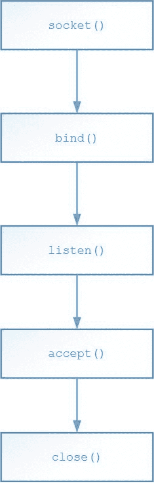

`bind()`, `listen()`, `accept()` 和 `close()` 函数可以定义如下。

```c
#include <sys/types.h>
#include <sys/socket.h>
#include <unistd.h>
int bind(int sockfd, const struct sockaddr *addr, socklen_t addrlen);
int listen(int sockfd, int backlog);
int accept(int sockfd, struct sockaddr *addr, socklen_t *addrlen);
int close(int fd);
```

我们通常使用 `struct sockaddr_in` 来传递参数 `addr`。它定义如下。

```c
struct sockaddr_in {
    sa_family_t    sin_family;  /* address family: AF_INET */
    in_port_t      sin_port;    /* port in network byte order */
    struct in_addr sin_addr;    /* internet address */
};
struct in_addr {
    uint32_t       s_addr;      /* address in network byte order */
};
```

对于实现，我们通过创建一个文件，名为 `simple_server.c`，并写入此代码来构建服务器应用。

```c
1 #include <stdio.h>
2 #include <sys/types.h>
3 #include <sys/socket.h>
4 #include <netinet/in.h>
5 #include <string.h>
6 #include <errno.h>
8 int main(void)
9 {
10
11
12     int sockfd, newsockfd, portno, clilen;
13     struct sockaddr_in serv_addr, cli_addr;
15     portno = 8056; // server port
16     errno = 0;
18     sockfd = socket(AF_INET, SOCK_STREAM, 0);
19     if (sockfd < 0)
20     {
21         printf("\n socket() failed with error [%s]\n",strerror(errno));
22         return -1;
23     }
25     bzero((char *) &serv_addr, sizeof(serv_addr));
27     serv_addr.sin_family = AF_INET;
28     serv_addr.sin_addr.s_addr = INADDR_ANY;
29     serv_addr.sin_port = htons(portno);
31 if (bind(sockfd, (struct sockaddr *) &serv_addr,
32     sizeof(serv_addr)) < 0)
33 {
34     printf("\n bind() failed with error [%s]\n",strerror(errno));
35     return -1;
36 }
38 printf("socket has created and binded\n");
39 printf("listening incoming socket client...\n");
41 listen(sockfd,5);
42 clilen = sizeof(cli_addr);
43 newsockfd = accept(sockfd, (struct sockaddr *) &cli_addr, &clilen);
44 if (newsockfd < 0)
45 {
46     printf("\n accept() failed with error [%s]\n",strerror(errno));
47     return -1;
48 }
50 printf("a client was connected\n");
52 // close socket
53 close(newsockfd);
54 close(sockfd);
56 return 0;
57 }
```

你可以编译此程序。

```
$ gcc -o simple_server simple_server.c
```

### 10.2.2 Client

要连接服务器，我们可以使用 `connect()` 函数。此函数可以定义如下。

```c
#include <sys/types.h>
#include <sys/socket.h>
int connect(int sockfd, const struct sockaddr *addr,
    socklen_t addrlen);
```

服务器信息传递给 `addr` 参数。

对于客户端实现，我们创建一个文件，名为 `simple_client.c`，并写入此代码。

```c
#include <stdio.h>
#include <sys/types.h>
#include <sys/socket.h>
```


```c
#include <netinet/in.h>

#include <netdb.h>

#include <string.h>

#include <errno.h>

int main(void)

{

    int sockfd, portno;

    struct sockaddr_in serv_addr;

    struct hostent *server;

    // server hostname. You can change it

    char server_hostname[] = "ubuntu15";

    portno = 8056; // server port

    errno = 0;

    sockfd = socket(AF_INET, SOCK_STREAM, 0);

    if (sockfd < 0)

    {

        printf("\n socket() failed with error [%s]\n", strerror(errno));

        return -1;

    }

    printf("socket has created\n");

    server = gethostbyname(server_hostname);

    if (server == NULL)

    {

        printf("\n gethostbyname() failed with error [%s]\n", strerror(errno));

        return -1;

    }

    bzero((char *) &serv_addr, sizeof(serv_addr));

    serv_addr.sin_family = AF_INET;

    bcopy((char *)server->h_addr,

          (char *)&serv_addr.sin_addr.s_addr,

          server->h_length);

    serv_addr.sin_port = htons(portno);

    printf("connecting to server...\n");

    if (connect(sockfd,(struct sockaddr *)&serv_addr,sizeof(serv_addr)) < 0)

    {

        printf("\n connect() failed with error [%s]\n", strerror(errno));

        return -1;

    }

    printf("connected to server\n");

    // close socket

    close(sockfd);

    return 0;

}
```

保存所有代码。尝试编译。

```bash
$ gcc -o simple_client simple_client.c
```

### 10.2.3 Testing

现在我们可以测试我们的服务器和客户端应用。首先我们运行服务器应用。以下是示例输出。

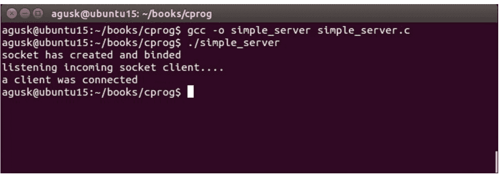

然后你运行客户端应用。


客户端连接到服务器后，服务器和客户端关闭连接。

## 10.3 数据传输

我们可以使用 `read()` 和 `write()` 函数通过套接字发送和接收数据。这些函数的定义如下：

```c

#include <unistd.h>

ssize_t read(int fd, void *buf, size_t count);

ssize_t write(int fd, const void *buf, size_t count);

```

这些函数是通用的 I/O 函数。我们可以使用 `send()` 和 `recv()` 函数执行针对套接字的特定 I/O。它们的实现方式如下：

```c

#include <sys/types.h>

#include <sys/socket.h>

ssize_t send(int sockfd, const void *buf, size_t len, int flags);

ssize_t recv(int sockfd, void *buf, size_t len, int flags);

```

在本节中，我们将构建类似于第 10.2 节的客户端-服务器程序，但我们尝试使用 `write()` 和 `read()` 函数传输数据。

### 10.3.1 服务器端

客户端连接后，我们使用 `read()` 函数从客户端读取数据，然后使用 `write()` 函数向客户端发送消息，最后关闭连接。

实现时，我们创建一个名为 `data_server.c` 的文件，并编写以下代码：

```c
#include <stdio.h>
#include <sys/types.h>
#include <sys/socket.h>
#include <netinet/in.h>
#include <string.h>
#include <errno.h>

int main(void)
{
    int sockfd, newsockfd, portno, clilen, sz;
    char buffer[256];
    struct sockaddr_in serv_addr, cli_addr;

    portno = 8059; // server port
    errno = 0;

    sockfd = socket(AF_INET, SOCK_STREAM, 0);
    if (sockfd < 0)
    {
        printf("\n socket() failed with error [%s]\n",strerror(errno));
        return -1;
    }

    bzero((char *) &serv_addr, sizeof(serv_addr));
    serv_addr.sin_family = AF_INET;
    serv_addr.sin_addr.s_addr = INADDR_ANY;
    serv_addr.sin_port = htons(portno);

    if (bind(sockfd, (struct sockaddr *) &serv_addr,
             sizeof(serv_addr)) < 0)
    {
        printf("\n bind() failed with error [%s]\n",strerror(errno));
        return -1;
    }

    printf("socket has created and binded\n");
    printf("listening incoming socket client...\n");
    listen(sockfd,5);

    clilen = sizeof(cli_addr);
    newsockfd = accept(sockfd, (struct sockaddr *) &cli_addr, &clilen);
    if (newsockfd < 0)
    {
        printf("\n accept() failed with error [%s]\n",strerror(errno));
        return -1;
    }

    printf("a client was connected\n");

    // read data
    sz = read(newsockfd,buffer,255);
    if (sz < 0)
    {
        printf("\n read() failed with error [%s]\n",strerror(errno));
        return -1;
    }

    printf("Received message: %s\n",buffer);

    // write data
    sz = write(newsockfd,"this is message from server",30);
    if (sz < 0)
    {
        printf("\n write() failed with error [%s]\n",strerror(errno));
        return -1;
    }

    // close socket
    close(newsockfd);
    close(sockfd);

    return 0;
}
```

这段代码与第 10.2.1 节的代码类似，但我们增加了读取和发送数据的功能。

保存这段代码并编译：

```bash
$ gcc -o data_server data_server.c
```

### 10.3.2 客户端

客户端连接成功后，我们先发送消息，然后从服务器读取消息。

现在开始创建一个名为 `data_client.c` 的文件，并编写以下代码：

```c
#include <stdio.h>
#include <sys/types.h>
#include <sys/socket.h>
#include <netinet/in.h>
#include <netdb.h>
#include <string.h>
#include <errno.h>

int main(void)
{
    int sockfd, portno, sz;
    struct sockaddr_in serv_addr;
    struct hostent *server;
    char buffer[256];

    // server hostname. You can change it
    char server_hostname[] = "ubuntu15";
    portno = 8059; // server port
    errno = 0;

    sockfd = socket(AF_INET, SOCK_STREAM, 0);
    if (sockfd < 0)
    {
        printf("\n socket() failed with error [%s]\n", strerror(errno));
        return -1;
    }

    printf("socket has created\n");

    server = gethostbyname(server_hostname);
    if (server == NULL)
    {
        printf("\n gethostbyname() failed with error [%s]\n",strerror(errno));
        return -1;
    }

    bzero((char *) &serv_addr, sizeof(serv_addr));
    serv_addr.sin_family = AF_INET;
    bcopy((char *)server->h_addr,
          (char *)&serv_addr.sin_addr.s_addr,
          server->h_length);
    serv_addr.sin_port = htons(portno);

    printf("connecting to server...\n");

    if (connect(sockfd,(struct sockaddr *)&serv_addr,sizeof(serv_addr)) < 0)
    {
        printf("\n connect() failed with error [%s]\n",strerror(errno));
        return -1;
    }

    printf("connected to server\n");

    // write data
    strcpy(buffer,"this is message from client");
    sz = write(sockfd,buffer,strlen(buffer));
    if (sz < 0)
    {
        printf("\n write() failed with error [%s]\n",strerror(errno));
        return -1;
    }

    // read data
    bzero(buffer,256);
    sz = read(sockfd,buffer,255);
    if (sz < 0)
    {
        printf("\n read() failed with error [%s]\n",strerror(errno));
        return -1;
    }

    printf("Received message: %s\n",buffer);

    // close socket
    close(sockfd);

    return 0;
}
```

保存这段代码并编译：

```bash
$ gcc -o data_client data_client.c
```

### 10.3.3 测试

我们已经准备好测试客户端-服务器应用程序了。首先运行服务器端程序。

以下是服务器端程序的示例输出：

```text
agusk@ubuntu15:~/books/cprog$ gcc -o data_server data_server.c
agusk@ubuntu15:~/books/cprog$ ./data_server
socket has created and binded
listening incoming socket client....
a client was connected
Received message: this is message from client
agusk@ubuntu15:~/books/cprog$ 
```

然后运行客户端程序。您可以看到输出，如下图所示：

```text
agusk@ubuntu15:~/books/cprog$ gcc -o data_client data_client.c
agusk@ubuntu15:~/books/cprog$ ./data_client
socket was created
connecting to server....
connected to server
Received message: this is message from server
agusk@ubuntu15:~/books/cprog$ 
```

## 联系方式与源代码

如果您对本书有任何疑问，请通过 aguskur@hotmail.com 与我联系。我的博客：[http://blog.aguskuriawan.net](http://blog.aguskuriawan.net)

您可以在 [http://www.aguskuriawan.net/book/cprog03282015.zip](http://www.aguskuriawan.net/book/cprog03282015.zip) 下载本书的源代码。
