# 学习目标 C 2.0

访问我们的网站：http://informit.com/aw

Clair, 1950-

Learning Objective 2.0 : 面向 Mac 和 iOS 开发者的 Objective-C 实战指南 /

Robert P. Clair.

c017--dc22

13 协议 249

- 前序 xxiii
- 致谢 xxxxi
- 关于作者 xxxiii

## 第一章：Objective-C 简介 1

1. C，Objective-C 的基础 3

C 程序的结构 4

main 例程 4

格式化 5

注释 5

变量和函数名 6

命名规范 6

文件 7

变量 8

整数类型 8

浮点类型 9

真值 9

初始化 10

指针 10

数组 12

字符串 13

结构体 14

typedef 15

枚举常量 15

运算符 16

算术运算符 16

取余运算符 16

自增与自减运算符 16

优先级 17

否定 18

比较 18

逻辑运算符 18

逻辑否定 19

赋值运算符 19

转换与强制转换 19

其他 19

表达式与语句 29

2

表达式 21

语句 22

控制流 23

if 23

条件 24

while 24

do-while 25

for 25

break 26

continue 26

表达式 27

switch 27

goto 28

goto 29

函数 30

定义函数 31

预处理器 31

包含文件 31

#define 32

条件编译 33

printf 34

使用 gdb 35

总结 37

练习 37

关于变量 41

Objective-C 的内存布局 41

自动变量 42

外部变量 43

static 44

const 45

volatile 46

作用域 47

自动变量的作用域 47

外部变量的作用域 49

分配 49

10 Objective-C 中的控制结构 191

Objective-C 中的控制结构 191

if 语句 191

测试对象的相等性 193

# 目录 xvii

- for 语句与隐式循环 195
- for 语句 195
- 隐式循环 195
- 带有块的隐式循环 196
- while 语句与 NSEnumerator 196
- 在枚举时修改可变集合 197
- 快速枚举 199
- 使用快速枚举的示例 201
- 异常 205
- 抛出自定义的异常 206
- 多个 @catch 块 207
- 嵌套异常处理 207
- 使用异常 208
- 你是否应该使用异常？209
- 总结 210
- 练习题 211

## 12 属性 229

- 在对象外部访问实例变量（不要这么做） 230

# 目录

- 关于 @dynamic 的更多信息 238
- 属性与内存管理 240
- dealloc 240
- 子类化与属性 240
- 只读属性的隐藏 setter 242
- 作为文档的属性 242
- 点语法 (Dot Syntax) 243
- 点语法与属性 244
- 点语法与 C 结构体 245
- 总结 246
- 练习题 247
- 自动释放池 (Autorelease Pools)
- 管理自动释放池 280
- 回到便利构造函数 280
- Autorelease 与 iPhone 280
- 使用额外的自动释放池来控制内存占用 280
- retainCount 281
- 多线程 282
- 当引用计数出现异常时 283
- NSZombie 284
- 引用循环 285
- 最后的告别：当程序终止时 288
- 总结 288
- 练习题 289

## 15 垃圾回收 291

- 垃圾回收：理论 291
- 垃圾回收：实践 293
- 强引用与弱引用 293
- 使用垃圾回收 294
- 控制集合发生的时机 296
- 终结器 (Finalizers) 296
- malloc 与垃圾回收 297
- Core Foundation 对象与垃圾回收 298
- 道路上的某些坎坷 299
- AppKit 中的不透明指针问题 299
- 内部指针 (Interior Pointers) 302
- 伪根节点对象 303
- 垃圾回收的优缺点 303
- 积极影响 304
- 负面影响 304
- 你应该使用垃圾回收吗？305
- 总结 305
- 练习题 305

## 16 Blocks 309

- 函数指针 310
- 使用函数指针调用函数 311
- 使用函数指针 312
- 函数指针的麻烦 314
- NSInvocation 315
- Blocks 317
- Block 指针 318
- 对变量的访问 319
- Block 变量 320
- Blocks 是基于栈的 321
- 全局 Blocks 322
- Blocks 是 Objective-C 对象 322
- 拷贝 Blocks 323
- Blocks 的内存管理 323
- 陷阱 326
- Cocoa 中的 Blocks 327
- 风格问题 330
- 某些哲学上的保留 331
- 总结 332
- 练习题 332

# 前言

Objective-C 是 C 语言的面向对象扩展。你可以称之为“带对象的 C”。

如果你正在阅读这本书，你可能对学习 Objective-C 感兴趣，以便为 Mac OS X 或 iOS 编写应用程序。但你阅读这本书的另一个可能是：Objective-C 是一种相对容易学习的语言。在 C 的世界中，Objective-C 扩展了 C。虽然技术上可以使用其他语言编写 Mac 应用程序的核心，但用户界面层必须使用 Objective-C 编写。在开发 iOS 时，用户界面层必须使用 Objective-C 编写。

Objective-C 最初由 Brad J. Cox 在 1980 年代创立。1988 年，NEXT 与 Sun 合作开发了 OpenStep，这是一个基于面向对象系统的规范。1997 年，Apple 收购了 NEXT。随后，OpenStep 和 Objective-C 成为 Mac OS X 的基础。本书专注于 Objective-C 语言；它不会教你编写 Cocoa，但会介绍 Foundation 和 UIKit 框架。

本书适用于希望通过学习 Objective-C 来为 Mac OS X 或 iOS 编写程序的程序员。如果你没有 C 或任何类 C 语言（C++,Java 和 C#）的经验，你可能需要配合本书阅读一本关于 C 的书。具备面向对象语言的经验会有帮助，但并非绝对必要。必要的面向对象概念将在书中介绍。

Foundation 框架。本书的最后章节涵盖了 Objective-C 中使用的两种内存管理形式，以及 Objective-C 2.0 新增的 Blocks 功能。

# 第一部分：Objective-C 导论

- 第 1 章“C，Objective-C 的基础”是对 C 语言精要之处的快速介绍。它涵盖了你在编写 Objective-C 程序时可能需要的 C 语言部分。
- 第 2 章“更多关于 C 变量”通过讨论 C 程序和 Objective-C 程序的内存位置，以及不同变量的内存位置和生命周期，对 C 语言进行了复习。即使你熟悉 C，可能也想读读这一章。许多经验丰富的 C 程序员并不完全熟悉书中包含的材料。
- 第 3 章“面向对象编程导论”从面向对象编程概念的介绍开始，接着初探这些概念在 Objective-C 中是如何体现的。
- 第 4 章“你的第一个 Objective-C 程序”将带你逐行分析一个简单的 Objective-C 程序。同时，它还展示了如何使用 Xcode 创建项目、完成并运行一个 Objective-C 程序。然后你可以利用这些知识来完成书中其余部分的练习。

# 第二部分：语言基础

对象是面向对象编程的主要元素；它们将变量、实例变量和类似方法的代码（称为方法）组合成单一实体。*类（Classes）*是对象的规格规范。它们列出了构成特定类型对象的实例变量和方法，并提供了实现它们的代码。对象更具实体性；它是内存的一个区域，类似于 C 结构体（struct），存储着由类定义的变量。特定的对象是定义它的类的实例。

- 第 5 章“消息传递（Messaging）”开始对 Objective-C 语言进行全面介绍。在 Objective-C 中，你通过发送*消息（message）*来让对象“做某事”。消息是方法名加上该方法接受的任何参数。作为对消息的回，对象执行对应的方法。本章涵盖了方法、消息以及 Objective-C 消息传递系统的原理。
- 第 6 章“类与对象”涵盖了类的定义和对象实例的拷贝。它还涵盖了继承，即通过扩展现有类来定义新类的过程，而不是从头开始。

在执行 Objective-C 程序时，每个类都由一段包含该类信息的内存表示。这部分内存被称为类的*类对象（class object）*。类还可以定义*类方法（class methods）*，这类方法代表类本身执行，而不是代表类的实例执行。

- 第 7 章“类对象”涵盖了类对象和类方法。与某些其他面向对象语言中的类不同，Objective-C 的类没有类变量（即类的所有实例共享的变量）。本章的最后几节展示了如何通过使用静态变量来实现类变量的效果。
- 第 8 章“框架（Frameworks）”描述了 Apple 封装动态链接库的方式。它涵盖了框架的定义和结构，并带你简单浏览了编写 OS X 或 iOS 程序时会遇到的一些常用框架。
- 第 9 章“常用基础类”涵盖了字符串、数组、字典、集合和数字对象最常用的 Objective-C 类。
- 第 10 章“Objective-C 中的控制结构”讨论了在使用 Objective-C 结构结合 C 控制结构使用时的一些考虑因素。接着涵盖了 Objective-C 增加的额外控制结构，包括 Objective-C 2.0 新的枚举构造函数（Enum constructor）。本章以对 Objective-C 异常处理系统的解释结束。
- 第 11 章“分类（Categories）、扩展（Extensions）与安全”向你展示如何在不创建子类的情况下为现有类添加方法，以及如何隐藏可能被视为私有的方法声明。本章以对 Objective-C 安全问题的讨论结束。
- 第 12 章“属性（Properties）”引入了 Objective-C 2.0 新增的声明式属性功能。属性是对象的特征。属性通常由对象的实例变量建模。获取或设置属性的方法称为访问器方法（accessor methods）。使用声明式属性功能，你可以要求编译器为你合成属性的访问器方法，从而节省大量的精力。
- 第 13 章“协议（Protocols）”涵盖了刻画对象的另一种方式。协议是类可以实现的一组定义好的方法。在很多情况下，重要的不是对象的类，而是对象的类是否通过实现协议中声明的方法来采用了某个特定协议。（多个类可以采用给定的协议。）Java 的接口概念是借用自 Objective-C 协议的。

# 第三部分：高级概念

Objective-C 提供了两种管理对象内存系统：引用计数和自动垃圾回收。

- 第 14 章“引用计数”涵盖了 Objective-C 传统的引用计数系统。引用计数也称为保留计数（retain counting）或保留内存（retained memory）。在运行引用计数的程序中，每个对象都保留一个所谓的保留计数，即使用它的其他对象的数量。当该计数降为零时，该对象会被释放内存。本章涵盖了保持你的保留计数良好的所需的规则。
- 第 15 章“垃圾回收”描述了 Objective-C 2.0 新的自动垃圾回收系统。使用垃圾回收，一个称为垃圾回收器（garbage collector）的独立线程负责确定哪些对象不再被需要并释放它们。垃圾回收减轻了你的内存管理琐事。
- 第 16 章“Blocks”讨论了 Objective-C 2.0 新增的 Blocks 功能。Block 类似于匿名函数，但此外，Block 还携带值。Blocks 是苹果并发调度（Grand Central Dispatch）的一个核心特性。

# 第四部分：附录

- 附录 A“保留字”提供了 Objective-C 中具有特殊含义的名称。
- 附录 B“无缝桥类（Toll-Free Bridged Classes）”列出了与 Foundation 框架通用的类。
- 附录 C“运行时（Runtimes）”描述了旧运行时和新运行时。
- 附录 D“运行时（Runtime）”提供了关于 Objective-C 的的一些有用信息。
- 附录 E“资源（Resources）”列出了对 Objective-C 开发者有用的书籍和网站。

# 编译时与运行时

在创建程序时，有两个重要的时间：编译时，即你的源代码翻译成机器语言并链接成可执行程序的时间；以及运行时（runtime，也称为执行时间），即执行程序在计算机上运行的时间。Objective-C 与常见语言的一个显著特点是非常动态的。这里的“动态”意味着其他语言在编译时做的决策在 Objective-C 中被推迟到了运行时。最著名的例子就是 Objective-C 的消息系统。程序在评估消息表达式（其他语言中的方法调用）时执行的代码是在运行时决定的。

将决策推迟到运行时有很多优势，正如你在阅读本书时将会看到的，但它也有一个缺点。它限制了编译器可以进行的检查。在 Objective-C 中，某些在其他语言编译阶段就能发现的错误只有在运行时才会显现。

# 关于内存管理

如所述，Objective-C 2.0 为你提供了手动内存计数或自动垃圾回收的选择。除了第 15 章涵盖了 Objective-C 2.0 垃圾回收外，本书的所有示例从一开始就使用引用计数。这样做的主要原因是垃圾回收在 iOS 上是不可用的。如果你为 iPhone、iPad 或 Mac 编写程序，必须使用引用计数。

从无数 Objective-C 和 Cocoa 列表可以看出，引用计数可能是学习 Objective-C 的人最大的困惑来源。但如果你尽早学习它的规则并统一应用它们，你会发现引用计数并不困难。

如果你以后想为项目使用垃圾回收，这种转换应该是相对轻松的。虽然从引用计数迁移到垃圾回收时你需要注意架构问题（这些在第 15 章中介绍），但使用垃圾回收的大部分工作只是不需要做引用计数时必须做的事情。

# 关于示例

为入门书籍创建代码示例面临着挑战：如何在说明某点的同时，而不陷入为了运行程序可能需要的样板代码中。在很多情况下，本书采用了使用精简假设性示例的方法，以帮助你关注所讨论的点。不相关的部分被省略并替换为省略号（...）。

例如：

```
averageScore = ...
```

上面的代码行应该理解为 `averageScore` 是一个从程序其他部分获取值的整数变量。`averageScore` 的值的来源与示例并不相关；你只需要考虑它具有

# 代码列表说明

本书中的示例混合了无编号和有编号的代码列表。

这些通常是短小的代码片段，在紧邻示例之前或之后的正文中被引用。

在这两种情况下，需要逐行解释的示例都给出了行号，以便解释性文本可以引用代码中的特定某行。

# 练习题说明

本书的大多数章节末尾都有一组练习题。当然，我们鼓励你完成这些练习。许多练习题要求你编写小型程序来验证章节文中提到的观点。此类练习可能看起来是重复的，但编写代码并查看结果比单纯的阅读能提供更生动的学习体验。

编写小程序来测试你的理解是一个值得培养的良好习惯；每当你对某一点不确定时，都应该写一个，即使书中已经提供了相关的练习。

练习题建议的程序都不需要用户界面；所有程序都通过用文本编辑器编写代码并在命令行中编译和运行来实现（如第 2 章练习前所示），或者通过使用简单的 Xcode 项目来实现（如第 4 所示所示）。

# 我们想听听你的意见

你可以访问我们的网站并在 [此处](http://www.informit.com/title/9780321711380)注册本书。

请务必访问书籍网站，以便访问该书可能提供的任何更新、下载或错误说明。

作为本书的读者，你是我们最重要的评论家和评价者。我们重视你的意见，并想知道我们哪里做得好，哪里可以做得更好，你希望我们出版哪些领域，以及你任何愿意分享给我们的建议。

当你撰写邮件时，请务必包含书名和作者姓名，以及你的姓名、电话和/或地址。我会仔细审查你的评论，并将其与作者以及参与此书的其他人员分享。

邮件：chuck.toporek@pearson.com

邮寄：Chuck Toporek

高级策划编辑，Addison-Wesley

Pearson Education, Inc.

75 Arlington St., Ste. 300

Boston, MA 02116

USA

欲了解更多关于我们书籍或会议的信息，请访问我们的网站 www.informit.com。

# 第一部分：Objective-C 简介

本书的第一部分是对 Objective-C 2.0 的介绍。Objective-C 是 C 语言的扩展，因此第一部分从两个回顾 C 语言的章节开始。C 语言回顾之后，是对面向对象编程概念的介绍，以及这些概念如何在 Objective-C 中实现。本部分的最后一个章节将带你对一个简单的 Objective-C 程序进行逐行解析。

第一部分的章节包括：

- 第 1 章，“C，Objective-C 的基础”
- 第 2 章，“关于 C 变量的更多内容”
- 第 3 章，“面向对象编程简介”
- 第 4 章，“你的第一个 Objective-C 程序”

# C，Objective-C 的基础

Objective-C 是 C 的扩展。本书大部分内容集中在 Objective-C 为 C 增加了什么，但为了用 Objective-C 编程，你必须掌握 C 的基础知识。当你执行诸如两个数相加、在代码中编写注释或使用语句等平凡操作时，你会发现它们在 C 和 Objective-C 中是完全相同的。Objective-C 的非对象部分并不像 C，也不类 C，它就是 C。Objective-C 2.0 目前基于 C 99 标准。


本章开启了为期两章的 C 语言回顾。该回顾并不是完整的描述；它仅涵盖了语言的部分。然而，像位运算符、类型转换细节等主题，但宏和其他晦涩的上下文并未被提及。它是为那些 C 知识生疏的人提供的备忘录，或者是为擅长从上下快速学习新语言的人提供的快速参考。下一章将继续对 C 的回顾，并处理变量声明、变量作用域以及 C 内存存放的位置等主题。如果你是 C/C++ 专家，可以跳过这部分（不过，回顾会有帮助）。如果你是从其他类 C 语言（如 Java 或 C#）转向 Objective-C 的，你应该至少浏览一下这些材料。如果你的编程经验是脚本语言，或者你是初学者，可能会发现边读这本书的同时读一本关于 C 的书会有帮助。

> 注意

我建议每个人阅读第 2 章“关于变量的更多内容”。根据我的经验，许多熟悉书中包含材料的人其实并不熟悉那些材料。

关于 C 的书有很多。Kernighan 和 Ritchie 的原著著作《C 编程语言》仍然是最好的书籍之一。它是大多数人学习 C 语言的首选。

1. Brian W. Kernighan and Dennis M. Ritchie, *The C Programming Language*, Second Edition. (Englewood Cliffs: Prentice Hall, 1988).

## 第 1 章：C，Objective-C 的基础

从语言法律学者的视角看 C，或者探索一些更深层次的内容，请参阅 [C 语言](https://wiki.example.org/C_language) 或 Harbison 和 Steele 的《C 参考手册》。由于这些概念在 Objective-C 中的实现是类似的，因此本章回顾了 C 语言的结构结构。

本章开始介绍 C 程序的几个结构方面：

- `main` 例程

- 格式问题

- 注释

- 命名规范

- 类型

## main 例程

所有的 C 程序都有一个 `main` 例程。在 OS 加载 C 程序后，程序从第一行代码开始。`main` 例程的标准形式如下：

（由于 C 语言的语法特性，此处保留代码块）

```c
int main(int argc, char *argv[])
{
    // 在这里编写代码
    return 0;
}
```

关键特点是：

- 第一行的内容表示 `main` 向 OS 返回一个整数值作为返回代码。

- `main` 名称是必须的。

2. Samuel P Harbison and Guy L. Steele, *C: Reference Manual*, Fifth Edition. (Upper River: Prentice Hall, 2002).

## C 程序的结构

- 第一行的其余部分指的是传递给程序的命令行参数，以字符串形式存储在 `argv` 数组中。这部分目前很重要，忽略即可。

- 所有可执行代码都在大括号之间。

- `return;` 行表示代码。在 Unix 系统（包括 Mac OS 和 iOS）中，返回代码零表示成功，任何其他值意味着某种错误。

如果你对处理命令行参数或向 OS 返回错误代码感兴趣（在完成后续章节的练习时），可以使用简化的 `main` 形式：

```c
int main(void)
{
}
```

`void` 表示此版本的 `main` 不接受任何参数。在没有显式返回语句的情况下，隐含返回值为 0。

## 格式

语句以分号结束。需要空白字符（空格、制表符或换行符）来分隔名称和关键字。C 会忽略任何额外的空白：缩进和空格对编译后的执行文件没有影响；可以自由使用它们来提高代码的可读性。语句可以跨行；以下三个语句是等价的

`distance = rate * time;`

```c
distance = rate * time;
```

```c
distance = rate * time;
```

## 注释

注释是编译器忽略它们。C 支持两种注释样式：

- 双斜杠（`//`）之后到行尾之前的内容都是注释。例如：

`// 这是一个注释。`

- 包含在 `/*` 和 `*/` 之间的任何内容都是注释：

`/* 这是另一种注释样式 */`

这种类型的注释可以跨多行。例如：

```
/* This is
   a longer
   comment. out * */
```

它可以在开发过程中临时“注释掉”代码块。

这种风格的注释不能被嵌套：

```
/* WRONG - won't compile */ */

// OK - can nest end of line comment
*/
```

然而，以下内容是合法的：

## 变量和函数名

C语言中的变量和函数名由字母、数字和下划线字符 (`_`) 组成：

- 首字符必须是下划线或字母。

- 名称区分大小写：`bandersnatch` 和 `Bandersnatch` 是不同的名称。

- 名称中间不能有任何空格。

以下是一些合法的名称：

```
j
taxesForYear2010
bananas_per_bunch
bananasPerBunch
```

这些名称是不合法的：

```
2010YearTaxes
rocknroll
bananas per_bunch
```

## 命名规范

为了你自己以及任何可能需要阅读你代码的人考虑，你应该为变量和函数使用描述性的名称。`bpb` 很容易输入，但当你若干年后回来看时，可能会让你困惑；而 `bananas_per_bunch` 则是自解释其是的。

许多纯 C 程序使用下划线分隔长变量和函数名中单词的约定：

`apples_per_basket`

## C 程序的结构

Objective-C 程序员通常为变量使用驼峰命名（CamelCase）。驼峰命名使用大字母来标记名称中后续单词的开头：

`applesPerBasket`

以下划线开头的名称传统用于私有或内部使用的变量和函数：

```
_privateVariable
_leaveMeAlone
```

然而，这是一种约定；C 没有强制机制来保持变量或函数的私有性。

## 文件

C 程序的代码放置在一个或多个具有 `.c` 文件名扩展的文件中：

```
ACProgram.c
```

> 注意

> MacOS X 文件名不区分大小写。文件系统会记住命名文件时使用的大小写，但会将 `myfile.c`、`MYFILE.c` 和 `MyFile.c` 视为同一个文件名。

使用 Objective-C 对象的代码（从第 3 章“面向对象编程介绍”开始涵盖的内容）放置在一个或多个具有 `.m` 文件名扩展的文件中：

```
ObjectiveProgram.m
```

> 注意

> 因为 C 对定义和实现 Objective-C 类的文件有一些命名约定，所以将纯 C 程序放在 `.m` 文件中是可以的。

（在第 3 章中讨论），但 C 对文件扩展名之前的名称部分没有正式规则。将包含代码的文件命名为 `program` 是很愚蠢的，但非法：

```
MyFlight.m
```

C 程序还使用头文件。头文件包含许多文件共享的各种定义，并使用 `#include` 和 `#import` 预处理器指令将其合并到其他文件中。（参见本章稍后的“预处理器”）。

头文件具有 `.h` 文件名扩展名，如下所示：

```
HeaderFile.h
```

# 第 1 章 C，Objective-C 的基础

> 注意

> 该主题超出了本书的范围，但在同一个程序中混合 Objective-C 和 C++ 代码是可能的。这种结果被称为 Objective-C++。Objective-C++ 代码必须放在具有 `.mm` 文件名扩展的文件中：

```
ObjectiveCPlusPlusProgram.mm
```

欲了解更多信息，请查看 https://developer.apple.com/mac/library/documentation/Cocoa/Conceptual/ObjectiveC/Articles/ocCPlus

## 变量

变量是程序中内存字节的名称。当你给变量赋值时，你实际上是在这些字节中存储该值。计算机语言中的变量就像自然语言中的名词一样。它们代表了你程序问题空间中的项目和数量。

C 要求你通过声明变量来告诉编译器你将要使用的任何变量。变量声明的格式为：

```
variabletype name;
```

C 允许在单个声明中使用多个变量：

```
variabletype name1, name2, name3;
```

变量声明会导致编译器为该变量预留存储（内存）。变量的值是其内存位置的内容。

（注：原文中存在大量重复的段落，已按要求处理）

## 整数类型

| 类型 | 32-位 | 64-位 |

|---|---|---|

| `char` | 1 byte | |

| `short` | 2 bytes | |

| `int` | 4 bytes | |

| `long` | 4 bytes | 8 bytes |

表 1.1 整数类型的大小

变量 11

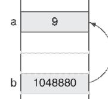

图 1.1 指针变量

单目运算符 `*`（称为“内容”运算符或“解引用”运算符）用于使用指向该位置的指针变量来设置或检索内存位置的内容。理解此点的一种方式是将将表达式 `*pointerVar` 视为一个别名，即 `*pointerVar` 内容中存储的任何内存位置的另一个名称。表达式 `*pointerVar` 可用于设置或检索该内存位置的内容。在接下来的代码中，`b` 被赋值为 `a` 的地址，因此 `*b`

```c
int a;
int c;
int *b;
```

```c
a = 9;

c = *b; // c 现在是 9

*b = 10; // a 现在是 10
```

指针在 C语言中用于引用动态分配的内存（第 2 章）。指针还用于避免将大块内存（如数组和结构体，本文中稍后讨论）从程序的某部分复制到另一部分。例如，与其向函数传递一个大型结构体，不如向函数传递一个指向该结构体的指针。函数然后使用该指针来访问结构体。正如你将在书的后续部分看到的，Objective-C 对象始终通过指针引用。

## 通用指针

声明为 `void` 的变量是通用指针：

```c
void genericPointer;
```

通用指针可以被设置为任何类型变量地址：

```c
int a = 9;
void genericPointer;
genericPointer = &a;
```

然而，尝试从通用指针中获取值是 person的，因为编译器无法知道如何解释通用指针所指地址处的字节：

```c
int a = 9;
int b;
void *genericPointer;
genericPointer = &a;
b = *genericPointer; // 错误，无法编译
```

要通过 `void*` 获取值，你必须将其强制转换为指向已知类型的指针：

```c
int a = 9;
int b;
void *genericPointer;
genericPointer = &a;
b = (*int*)genericPointer; // 正确 - b 现在是 9
```

强制转换运算符 `(int*)` 强制编译器将 `genericPointer` 视为指向整数的指针。（参见本章中的“转换与强制转换”。）

C语言不检查指针变量是否指向有效的内存区域。指针的错误使用可能比 C 编程的任何其他方面导致更多的崩溃。

## 数组

C 数组的声明是通过在类型和数组名之后的声明中添加包括在方括号 `[]` 中的的数组元素数量来实现的：

```c
int a[100];
```

通过在数组名后的 `[]` 中放置元素的索引来访问数组的各个元素：

```c
a[6] = 9;
```

索引是从 0 开始的。在上一个例子中，合法的索引从 0 到 9。C 数组的访问在两端都不进行边界检查。C 会放任地允许你执行以下操作：

```c
a[100];
a[100] = 25;
a[-100] = 30;
```

使用数组边界之外的索引让你破坏属于其他变量的内存或损坏数据。利用缺乏检查的特性是恶意软件的支柱之一。

方括号符号只是指针算术的一种更优雅的语法。不带数组括号的数组名是一个指向数组开头的指针变量。这两行代码是完全等价的：

```c
a[6] = 9;
*(a + 6) = 9;
```

在使用指针算术编译表达式时，编译器会考虑到指针所指向类型的大小。如果 `a` 是一个 `int` 数组，表达式 `*(a + 2)` 指向数组 `a` 开头之后八个字节（两个 `int`）地址处的四个字节（一个 `int`）的内容。然而，如果 `a` 是一个 `char` 数组，表达式 `*(a + 2)` 指向数组 `a` 开头之后两个字节（两个 `char`）地址处的一个字节（一个 `char`）的内容。

## 多维数组

多维数组的声明方式如下：

```c
int b[4][10];
```

多维数组按行线性地存储在内存中。在这里，`b[0][0]` 是第一个元素，`b[0][1]` 是第二个元素，`b[1][0]` 是第十一个元素。

使用指针符号：

```c
b[1][1];
```

可以写为：

```c
*(b + i + 10 + j);
```

## 字符串

C 字符串是一个由字节（`char` 类型）组成的一维数组，由一个字节终止。常量 C 字符串通过将字符串的字符放置在双引号 `""` 之间来编码的：

```c
"A constant string";
```

当编译器在内存中创建字符串时，它会在末尾自动添加零字节。如果你声明了一个用于存储字符串的 `char` 数组，在决定需要多少空间时，必须包含零字节。下行代码将常量字符串 "Hello" 的五个字符及其终止字节拷贝到数组 `aString`：

```c
aString[6] = "Hello";
```

对于任何其他数组，边界都不会被检查。溢出用于程序输入的字符串缓冲区是常见的做法。

对于任何其他数组，边界都不会被检查。溢出用于程序输入的字符串缓冲区是常见的做法。

对于任何其他数组，边界都不会被检查。溢出用于程序输入的字符串缓冲区是常见的做法。

对于任何其他数组，边界都不会被检查。溢出用于程序输入的字符串缓冲区是常见的做法。

对于任何其他数组，边界都不会被检查。溢出用于程序输入的字符串缓冲区是常见的做法。

对于任何其他数组，边界都不会被检查。溢出用于程序输入的字符串缓冲区是常见的做法。

对于任何其他数组，边界都不会被检查。溢出用于程序输入的字符串缓冲区是常见的做法。

对于任何其他数组，边界都不会被检查。溢出用于程序输入的字符串缓冲区是常见的做法。

对于任何其他数组，边界都不会被检查。溢出用于程序输入的字符串缓冲区是常见的做法。

对于任何其他数组，边界都不会被检查。溢出用于程序输入的字符串缓冲区是常见的做法。

对于任何其他数组，边界都不会被检查。溢出用于程序输入的字符串缓冲区是常见的做法。

对于任何其他数组，边界都不会被检查。溢出用于程序输入的字符串缓冲区是常见的做法。

对于任何其他数组，边界都不会被检查。溢出用于程序输入的字符串缓冲区是常见的做法。

对于任何其他数组，边界都不会被检查。溢出用于程序输入的字符串缓冲区是常见的做法。

对于任何其他数组，边界都不会被检查。溢出用于程序输入的字符串缓冲区是常见的做法。

对于任何其他数组，边界都不会被检查。溢出用于程序输入的字符串缓冲区是常见的做法。

对于任何其他数组，边界都不会被检查。溢出用于程序输入的字符串缓冲区是常见的做法。

对于任何其他数组，边界都不会被检查。溢出用于程序输入的字符串缓冲区是常见的做法。

对于任何其他数组，边界都不会被检查。溢出用于程序输入的字符串缓冲区是常见的做法。

对于任何其他数组，边界都不会被检查。溢出用于程序输入的字符串缓冲区是常见的做法。

对于任何其他数组，边界都不会被检查。溢出用于程序输入的字符串缓冲区是常见的做法。

对于任何其他数组，边界都不会被检查。溢出用于程序输入的字符串缓冲区是常见的做法。

对于任何其他数组，边界都不会被检查。溢出用于程序输入的字符串缓冲区是常见的做法。

对于任何其他数组，边界都不会被检查。溢出用于程序输入的字符串缓冲区是常见的做法。

对于任何其他数组，边界都不会被检查。溢出用于程序输入的字符串缓冲区是常见的做法。

对于任何其他数组，边界都不会被检查。溢出用于程序输入的字符串缓冲区是常见的做法。

对于任何其他数组，边界都不会被检查。溢出用于程序输入的字符串缓冲区是常见的做法。

对于任何其他数组，边界都不会被检查。溢出用于程序输入的字符串缓冲区是常见的做法。

对于任何其他数组，边界都不会被检查。溢出用于程序输入的字符串缓冲区是常见的做法。

对于任何其他数组，边界都不会被检查。溢出用于程序输入的字符串缓冲区是常见的做法。

对于任何其他数组，边界都不会被检查。溢出用于程序输入的字符串缓冲区是常见的做法。

对于任何其他数组，边界都不会被检查。溢出用于程序输入的字符串缓冲区是常见的做法。

对于任何其他数组，边界都不会被检查。溢出用于程序输入的字符串缓冲区是常见的做法。

对于任何其他数组，边界都不会被检查。溢出用于程序输入的字符串缓冲区是常见的做法。

对于任何其他数组，边界都不会被检查。溢出用于程序输入的字符串缓冲区是常见的做法。

对于任何其他数组，边界都不会被检查。溢出用于程序输入的字符串缓冲区是常见的做法。

对于任何其他数组，边界都不会被检查。溢出用于程序输入的字符串缓冲区是常见的做法。

对于任何其他数组，边界都不会被检查。溢出用于程序输入的字符串缓冲区是常见的做法。

对于任何其他数组，边界都不会被检查。溢出用于程序输入的字符串缓冲区是常见的做法。

对于任何其他数组，边界都不会被检查。溢出用于程序输入的字符串缓冲区是常见的做法。

## 结构

结构体将相关变量分组在一起，以便它们可以被视为一个整体。接下来的是结构体声明示例：

```c
struct dailyTemperatures {
    float high;
    float low;
    int year;
    int dayOfYear;
};
```

结构体中的单个变量被称为成员。跟随 `struct` 关键字的名字是结构标签。标签用于声明变量：

```c
struct dailyTemperatures *todayPtr;
```


在上面的例子中，`today` 是一个 `dailyTemperatures` 结构，而 `todayPtr` 是指向该结构的指针。点运算符 `.` 用于访问结构中的成员：

```c
struct dailyTemperatures today;
today.high = 68.0;
```

指针运算符 `->` 用于访问结构成员。

对于任何其他数组，边界都不会被检查。溢出用于程序输入的字符串缓冲区是常见的做法。

对于任何其他数组，边界都不会被检查。溢出用于程序输入的字符串缓冲区是常见的做法。

对于任何其他数组，边界都不会被检查。溢出用于程序输入的字符串缓冲区是常见的做法。

对于任何其他数组，边界都不会被检查。溢出用于程序输入的字符串缓冲区是常见的做法。

对于任何其他数组，边界都不会被检查。溢出用于程序输入的字符串缓冲区是常见的做法。

对于任何其他数组，边界都不会被检查。溢出用于程序输入的字符串缓冲区是常见的做法。

# 第 1 章 Objective-C 基础

## 包含其他结构体

结构体可以包含其他结构体作为成员。上一个例子可以写成这样：

```c
struct hiLow {
    float high;
    float low;
};

struct dailyTemperatures {
    struct hiLow extremes;
    int year;
    int dayOfYear;
};
```

那么，设置今天的高温看起来像这样：

```c
struct dailyTemperatures today;
today.extremes.high = 68.0;
```

> 注意

编译器可以在结构体中插入填充字节，以强制结构成员在特定边界对齐。你不应该尝试通过相对于结构开头的偏移量来访问成员，或执行任何其他依赖结构二进制布局的操作。

## typedef

`typedef` 声明为变量类型创建别名的方法：

```c
typedef float Temperature;
```

现在 `Temperature` 可以用于声明变量，就像它是内置类型之一一样：

```c
Temperature high, low;
```

`typedef` 是类型的替代变量名。该术语在讨论 C 代码时经常作为动词使用，例如“将类型 typedef 为 float”。

## 枚举常量

`enum` 语句定义了一组整数常量：

```c
enum woodwind { oboe, flute, clarinet, bass };
```

上述语句的结果是 `oboe`、`flute`、`clarinet` 和 `bass` 分别为值为 0、1、2 和 3 的常量。

如果你不喜欢从零开始排序，可以自己为常量赋值值。任何没有赋值的常量值比上一个常量大一：

```c
enum woodwind { oboe=100, flute=150, clarinet, bass=200 };
```

上述语句使 `oboe`、`flute`、`clarinet` 和 `bass` 分别变为 100、150、151 和 200。

`enum` 关键字之后的名称被称为枚举标签。枚举标签是可选的。枚举标签可以用于声明变量：

```c
enum woodwind soloist;
soloist = oboe;
```

## 第 1 章 C，Objective-C 的基础

枚举（Enumerations）用于定义多个常量，并帮助使代码具有自文档性，但它们并不是独立的类型，而且没有编译编译器的支持。声明 `enum woodwind soloist;` 表达了你的意图，即 `soloist` 应该被限制在双簧、笛、单簧管或低音管之一，但遗憾的是，编译器并没有强制执行这一限制。编译器将 `soloist` 视为一个 `int`，允许你为 `soloist` 赋值任何整数值而不产生警告：

```c
enum woodwind { oboe, flute, clarinet, bassoon };
enum woodwind soloist;
soloist = 5280; // 编译器不会报错；
```

> 注意：枚举常量与变量名处于相同的命名空间。你不能拥有与其同名的变量和枚举常量。

## 运算符

运算符就像动词。它们导致你的变量发生某些变化。

## 算术运算符

C 具有二元运算符 `+`、`-`、`*`、`/` 分别用于加法、减法、乘法和除法。

> 注意：如果除法运算符 (`/`) 的两个操作数都是整数类型，C 将执行整数除法。除法会截断除法的结果。`7 / 3` 的值为 2。

## 取余运算符

取余运算符或取模运算符 (`%`) 计算整数除法所得的余数。

以下表达式的结果为 1：

```c
int a = 7;
int b = 3;
int c = a%b; // c 现在是 1
```

取余运算符的两个操作数必须是整数类型。

## 递增和递减运算符

C 提供了用于增加和减少变量的运算符：

```c
a++;
++a;
```

这两行代码都将 `a` 的值加 1。然而，如果它们作为较大表达式的一部分，这两个表达式之间存在区别。前缀版本 `++a` 在任何其他评估发生之前先增加 `a` 的值。表达式的其他部分使用的是这个递增后的值。`a++` 在其他评估发生之后增加 `a` 的值。表达式的其他部分使用的是原始值。下面的示例说明了这一点：

```c
int a = 9;
int b;
b = a++; // 后置递增
```

```c
int c = 9;
int d;
d = ++c; // 前置递增
```

运算符的后置版本在 fact初始值用于表达式的其他部分之后才增加变量。在这些代码执行后，`b` 的值为 9，`a` 的值为 10。运算符的前置版本将 `c` 和 `d` 的值都增加到了 10。

递减运算符 `a--` 和 `--` 的行为类似。

依赖于运算符前置和后置版本差异的代码，可能会让创建者以外的任何人都感到困惑。

## 优先级

以下表达式等于 18 还是 22：

`2 * 7 + 4`

答案似乎是不明确的，因为取决于你是先做加法还是先做乘法。C 通过制定规则来解决这种歧义：它在执行加减法之前执行乘法和除法；因此表达式的值为 18。这种方法的专业说法是乘法和除法的优先级高于加法减法。

如果你需要先执行加法，可以使用括号指定：

`2 * (7 + 4)`

编译器将尊重你的请求并安排在乘法之前执行加法。

> 注意：C 为其所有运算符定义了一个复杂的优先级表（参见 http://en.wikipedia.org/wiki/Order_of_operations）。但使用括号指定你想要的精确评估顺序，比尝试记忆运算符优先级要容易得多。

## 否定

一元减号 (`-`) 将算术值变为负值：

```c
int a = 9;
int b;
b = -a; // b 现在是 -9
```

## 比较

C 提供了其他用于比较的运算符。比较的值是一个真值。

以下表达式如果为真则为 1，为假则为 0：

- `a > b` // 如果 `a` 大于 `b`，则真

- `a < b` // 如果 `a` 小于 `b`，则真

- `a >= b` // 如果 `a` 大于或等于 `b`，则真

- `a <= b` // 如果 `a` 小于或等于 `b`，则真

- `a == b` // 如果 `a` 等于 `b`，则真

- `a != b` // 如果 `a` 不等于 `b`，则真

> 注意：在任何语言中，由于舍入误差，测试浮点数的相等性是有风险的，这种比较可能会给出错误的结果。

## 逻辑运算符

逻辑与（AND）和逻辑或（OR）运算符的形式如下：

`expression1 && expression2` // 逻辑与运算符

`expression1 || expression2` // 逻辑或运算符

C 使用短路计算。表达式从左到右评估，一旦推断出整个表达式的真值就会停止评估。如果 AND 表达式中的 `expression1` 评估为假，整个表达式的值为假，`expression2` 不会被评估。同样，如果 OR 表达式中的 `expression1` 评估为真，整个表达式为真，`expression2` 不会被评估。如果第二个表达式有任何副作用，短路计算会有有趣的后果。在下面的示例中，如果 `b` 大于或等于 `a`，则不会调用函数 `CheckSomething()`（`if` 语句将在本章稍后部分介绍）：

```c
if (b < a && CheckSomething()) {
  ...;
}
```

## 逻辑否定

一元感叹号 (`!`) 是逻辑否定运算符。在执行以下行代码后，`a` 的值为：

```c
int a = 9;
int b;
b = -a; // b 现在是 -9
```

## 比较

C 提供了其他用于比较的运算符。比较的值是一个真值。

以下表达式如果为真则为 1，为假则为 0：

（此处由于上文重复，已按逻辑翻译）

## 逻辑运算符

（此处由于上文重复，已按逻辑翻译）

## 赋值运算符

（此处由于上文重复，已按逻辑保持翻译）

## 转换与强制转换

如果赋值的两边变量类型不同，右侧的类型将转换为左侧的类型。从短类型转换为长类型或从整数类型转换为浮点类型不会出现问题。相反，从长类型转换为短类型可能会导致精度丢失、截断或完全无意义。例如：

```c
int a = 14;
float b;
b = a; // OK，b 现在是 14.0

float c = 12.5;
int d;
d = c; // 截断，d 现在是 12

char e = 128;
int f;
f = e; // OK，f 现在是 128

int g = 333;
char h;
h = g; // 无意义，h 现在是 77
```

你可以将指针从一种类型转换到另一种类型。转换指针是一种有风险的操作，可能会破坏你的内存，但它是处理传递给你的 `void*` 指针的唯一方法。成功转换指针需要你理解指针“实际上”指向什么类型。

你可以使用*强制转换* 来强制编译器将变量的值转换为不同的类型。在以下示例的最后一行，`(float)` 强制转换将 `a` 和 `b` 转换为浮点数并执行浮点除法：

```c
int a = 6;
int b = 4;
float c, d;
```

```c
c = a / b; // c 等于 1.0，因为整数除法会截断
```

```c
d = (float)a / (float)b; // 浮点除法，d 等于 1.5
```

## 其他赋值运算符

C 还有结合了算术和赋值的简写运算符：

```c
a += b;

a -= b;

a *= b;

a /= b;
```

最简单的表达式分别相当于以下内容：

```
a = a + b;
a = a - b;
a = a * b;
a = a / b;
```

## 表达式与语句

C 语言中的表达式和语句等相当于自然语言中的短语和句子。

## 表达式

最简单的表达式只是单个常量或变量：

```
14
bananasPerBunch
```

每个表达式都有一个值。常量表达式的值就是常量本身的值：`14` 的值是 `14`。变量表达式的值就是该变量当前的值：`bananasPerBunch` 的值取决于它最后一次通过初始化或赋值被给定的值。

表达式可以组合组合创建其他表达式。以下内容也是表达式：

```
j + 14
a < b
distance = rate + time
```

算术表达式或逻辑表达式的值是通过执行算术或逻辑运算得到的结果。赋值表达式的值是赋值目标变量被赋予的值。

函数调用也是表达式：

```
SomeFunction()
```

函数调用表达式的值是函数的返回值。

## 表达式求值

当编译器遇到表达式时，它会创建二进制代码来计算该表达式并找到其值。对于原始表达式，无事可做：它们的值就是它们本身。对于更复杂的表达式，编译器会生成二进制代码来执行指定的算术、逻辑、函数调用和赋值。

求值表达式可能会引起副作用。最常见的副作用是通过赋值改变变量的值，或者通过函数调用导致函数内代码的执行。

表达式在各种控制结构中通过其值来决定程序的执行流（程序流）。在其他情况下，表达式的求值可能仅为了其求值所引起的副作用。通常情况下，表达式的意义在于赋值操作。在少数情况下，值和副作用都是重要的。

## 语句

当你在表达式末尾添加分号（`;`）时，它就变成了一个语句。这类似于在自然语言的短语末尾添加句号使其成为句子。语句是完整思想在代码上的等价物。当语句编译产生的所有机器指令都执行完毕，且语句对任何内存位置的所有更改都完成后，该语句即执行完毕。

你可以在任何可以使用单条语句的地方，使用由一对括号括起来的语句序列：

```
timeDelta = time2 - time1;
distanceDelta = distance2 - distanceDelta;
averageSpeed = distanceDelta / timeDelta;
```

在右括号后没有分号。这样的组被称为复合语句（compound statement）或块（block）。复合语句在本文后续章节介绍的控制语句中非常常见。

注意

> 将块（block）作为复合语句（compound statement）的同义词在 C 文档中非常普遍，并可以追溯到 C 语言的初期。遗憾的是，Apple 在为 C 添加闭包时使用了 block 这一名称（见第 16 节“Blocks”）。为了避免混淆，本书其余部分使用了稍显笨的名称 compound statement。

## 程序流

程序中的语句按顺序执行，除非被 `for`、`while`、`do-while`、`if`、`switch` 或 `goto` 语句或函数调用指向其他。

- `if` 语句根据表达式的真值条件条件执行代码。

- `for`、`while` 和 `do-while` 语句将在后续节中进行详细介绍。在循环中，相同的语句或语句组会被重复执行，直到满足条件。

- `switch` 语句根据整数表达式的算术值选择一组要执行的语句。

- `goto` 语句是跳转到标记语句的无条件跳转。

- 函数调用是跳转到函数体内的代码。当函数返回时，程序从返回点之后的位置执行。

这些控制语句在本文后续节中详细介绍。除非被 `for`、`while`、`do-while`、`if`、`switch` 或 `goto` 语句或函数调用指向其他。

- `if` 语句根据表达式的真值条件执行代码。

- `for`、`while` 和 `do-while` 语句将在后续节中进行详细介绍。在循环中，相同的语句或语句组会被重复执行，直到满足条件。

- `switch` 语句根据整数表达式的算术值选择一组要执行的语句。

- `goto` 语句是跳转到标记语句的无条件跳转。

- 函数调用是跳转到函数体内的代码。当函数返回时，程序从返回点之后的位置执行。

这些控制语句在本文后续节中详细介绍。除非被 `for`、`while`、`do-while`、`if`、`switch` 或 `goto` 语句或函数调用指向其他。

- `if` 语句根据表达式的真值条件执行代码。

- `for`、`while` 和 `do-while` 语句将在后续节中进行详细介绍。在循环中，相同的语句或语句组会被重复执行，直到满足条件。

- `switch` 语句根据整数表达式的算术值选择一组要执行的语句。

- `goto` 语句是跳转到标记语句的无条件跳转。

- 函数调用是跳转到函数体内的代码。当函数返回时，程序从返回点之后的位置执行。

这些控制语句在本文后续节中详细介绍。除非被 `for`、`while`、`do-while`、`if`、`switch` 或 `goto` 语句或函数调用指向其他。

- `if` 语句根据表达式的真值条件执行代码。

- `for`、`while` 和 `do-while` 语句将在后续节中进行详细介绍。在循环中，相同的语句或语句组会被重复执行，直到满足条件。

- `switch` 语句根据整数表达式的算术值选择一组要执行的语句。

- `goto` 语句是跳转到标记语句的无条件跳转。

- 函数调用是跳转到函数体内的代码。当函数返回时，程序从返回点之后的位置执行。

这些控制语句在本文后续节中详细介绍。除非被 `for`、`while`、`do-while`、`if`、`switch` 或 `goto` 语句或函数调用指向其他。

- `if` 语句根据表达式的真值条件执行代码。

- `for`、`while` 和 `do-while` 语句将在后续节中进行详细介绍。在循环中，相同的语句或语句组会被重复执行，直到满足条件。

这些控制语句的执行值。

你偶尔会看到这种结构：

```
while ( 1 )
{
  ...
}
```

上述结构对于 `while` 来说是一个无限循环。假设循环体内的某处会检查条件并在满足条件时跳出循环。

## while

`while` 语句用于形成如下循环：

```
while ( expression ) statement
```

当执行 `while` 语句时，会评估表达式。如果结果为真，则执行语句并再次评估条件。这个序列会重复执行，直到表达式为假，此时程序继续执行 `while` 语句之后的语句。

## do-while

`do-while` 语句与 `while` 相似，不同之处在于测试位于语句之前：

```
do statement while { expression };
```

这样做的一个结果是 `statement` 总是执行一次，无论 `expression` 的值如何。程序逻辑要求循环体至少执行一次（即使条件为假）的情况并不常见。因此，在实践中很少遇到 `do-while` 语句。

## for

`for` 语句是最通循环结构。它的形式如下：

```
for (expression1; expression2; expression3) statement
```

执行 `for` 语句时，会发生以下序列：

1. 在循环开始之前评估 `expression1`。

2. 评估 `expression2` 的真值。

3. 如果表达式为真，则执行 `statement`；否则，循环结束，并继续执行循环之后的语句。

4. 评估 `expression3`。

5. 重复步骤 2、3 和 4，直到 `expression2` 变为假。


`expression1` 和 `expression3` 的求值仅是为了它们的副作用。它们的值被丢弃。它们通常用于初始化和增加循环计数变量：

```
for ( j=0; j < 10; j++ )
{
  // 需要执行 10 次的操作
}
```

任何表达式都可以省略（但分号必须保留）。如果省略了 `expression2`，则循环将变成死循环，类似于 `while( 1 )`：

```c
for ( i=0; ; i++)
{
    // 检查某些，如果满足条件则退出
}
```

注意

当你使用循环遍历数组的元素时，请记住数组索引从 0 开始，小于数组的元素个数：

```c
int j;
int a[25];
for (j=0; j < 25; j++)
{
    // 对 a[j] 进行某些操作
}
```

`for` 语句用于跳出前面的示例，因为 `for (j=1; j <= 25; j++)` 是一个常见的错误。

## break

`break` 语句用于跳出循环或 `switch` 语句。

```c
int j;
for (j=0; j < 100; j++)
{
    if ( someCondition ) break; // 循环结束后继续执行
}
```

执行将继续包裹它的 `while`、`do`、`for` 或 `switch` 语句之后的下一个语句。在嵌套循环内部使用，`break` 只跳出最内层的循环。在没有循环或 `switch` 语句包裹的情况下编写 `break` 语句会导致编译器错误：

```
error: break statement not within loop or switch
```

## continue

`continue` 用于 `while`、`do` 或 `for` 循环内部，放弃当前循环迭代的执行。例如：

```c
int j;
for (j=0; j < 100; j++)
{
  if ( doneWithIteration ) continue; // 跳到下一次迭代
}
```

当执行 `continue` 语句时，控制传递到循环的下一次迭代。在 `while` 或 `do` 循环中，会对下一次迭代评估控制表达式。在 `for` 循环中，先评估迭代（第三个）表达式，然后评估控制（第二个）表达式。在没有循环包裹的情况下编写 `continue` 语句会导致编译器错误。

## 逗号表达式

逗号表达式由两个或多个由逗号分隔的表达式组成：

```
expression1, expression2, ..., expressionN
```

表达式按左到右顺序求值，整个表达式的值是最右侧子表达式的值。

逗号运算符的主要用途是在 `for` 语句中初始化和更新多个循环变量。当后续示例中的循环迭代时，`j` 从 0 到 MAX-1，`k` 从 MAX-1 到 0：

```c
for ( j=0, k=MAX-1; j < MAX; j++, k--)
{
  // 执行某些操作
}
```

当在 `for` 循环中使用逗号表达式时，求值子表达式（前一个示例中的初始化和递增 `j` 和 `k`）的唯一侧效应是重要的。逗号表达式的值会被丢弃。

## switch

`switch` 根据整数表达式的值分支到不同的语句。

`switch` 语句的格式如下所示：

```c
switch { integer_expression }
{
  case value1:
    statement;
    break;
  case value2:
    statement;
    break;
```

# 第 1 章 C，Objective-C 的基础

...

```c
default:
    statement
    break;
}
```

与 C 的其余部分略有不一致的是，每个 `case` 可以可以有多个语句，而不需要复合语句。

`value1`, `value2`, ... 必须是整数、字符常量或求值为整数的常数表达式（换句话说，它们在编译时必须还原为整数）。不允许具有相同整数的重复 `case`。

执行 `switch` 语句时，会评估 `integer_expression`，`switch` 将结果与每个 `case` 标签进行比较。如果找到匹配项，执行跳转到 `case` 标签之后的语句。按顺序执行，直到遇到 `break` 语句或 `switch` 结束。`break` 会导致执行跳转到 `switch` 之后的第一个语句。

`case` 之后并不需要 `break` 语句。如果省略它，执行将贯穿到现有代码中的下一个标签，这可能是一个错误（很容易犯），也可能是故意的（程序员希望该 `case` 和随后的 `case` 执行相同的代码）。

如果 `integer_expression` 不匹配任何 `case` 标签，执行将跳转到可选 `default` 标签之后的语句（如果存在的话）。如果没有匹配且没有 `default`；`switch` 将什么都不做，执行继续到 `switch` 之后的第一个语句。

## goto

C 提供了 `goto` 语句：

```c
goto label;
```

当执行 `goto` 时，控制无条件地转移到标记 `label` 的语句：

```c
label: statement
```

- 标签不是可执行语句；它们只是标记代码中的某一点。

- 标签的命名规则与变量和函数的命名相同。

- 标签始终以冒号结尾。

使用带有放弃的 `goto` 语句可能会导致混乱、晦的代码（通常被称为面条代码）。通常的模板建议是“不要使用 goto 语句”。尽管如此，`goto` 语句在某些情况下是有用的，例如跳出嵌套循环（`break` 语句只跳出内层循环）：

```c
for ( i=0; i < MAX_I; i++)
for ( j=0; j < MAX_J; j++)
{
    ...
    if ( finished ) goto moreStuff;
}
```

```
moreStuff: statement // 更多语句
```

> 注意

是否使用 `goto` 语句是计算机科学中争论时间最久的问题之一。关于该争论的摘要，请参见 http://david.tribble.com/。

## 函数

函数通常如下形式：

```c
returnType functionName( arg1, ..., argN )
{
    statements
}
```

一个简单的函数示例：

```c
float salesTax( float purchasePrice, float taxRate )
{
    float tax = purchasePrice * taxRate;
    return tax;
}
```

函数通过编写函数名后跟括号表达式列表来调用。如下显示了调用：

```c
float carPrice = 20000.00;
float taxRate = 0.05;
float salesTax( );
```

当执行函数调用行时，控制跳转到函数体内的第一个语句。直到遇到 `return` 语句或函数结束。执行返回调用上下文。函数的值由 `return` 语句设置。

# 第 1 章 C，Objective-C 的基础

注意

函数不需要有任何参数或返回值。不返回值的函数类型为 `void`：

```c
void FunctionThatReturnsNothing(int arg1 )
```

你可以从不返回值的函数中省略 `return` 语句。不接受参数的函数通过对参数列表使用空括号来指示：

```c
int FunctionWithNoArguments()
```

函数有时是为了副作用执行的。此函数打印销售税，但没有改变程序的状态：

```c
void printSalesTax(float purchasePrice, float taxRate )
{
    float tax = purchasePrice * taxRate;
    printf("The sales tax is: %.2f\n", tax);
}
```

C 函数按值传递。调用函数时，调用语句参数列表中的表达式被求值，其值传递给函数。函数无法更改调用上下文中任何变量的值。此函数对调用上下文中的任何内容都没有影响：

```c
void salesTax(float purchasePrice, float taxRate, float carSalesTax)
{
    // 修改了局部变量 calculateTax 但没有修改
    // 调用上下文中的变量

    carSalesTax = purchasePrice * taxRate;
    return;
}
```

要更改调用上下文中变量的值，你必须传递变量的指针并使用该指针操作变量的值：

```c
void salesTax(float purchasePrice, float taxRate, float *carSalesTax)
{
    *carSalesTax = purchasePrice * taxRate; // 这将有效

    return;
}
```

注意

前面的示例仍然是按值传递。调用上下文中变量指针的值被传递给函数。函数随后使用该指针（它并不更改指针）来设置它指向的变量的值。

## 声明函数

当你调用一个函数时，编译器需要知道函数的参数和返回值的类型。它利用这些信息来建立函数与其调用者之间的通信。如果函数的代码出现在函数调用之前（在源文件中），你不需要做任何其他操作。如果函数的代码在函数调用之后或在另一个文件中，则你必须在使用该函数之前对其进行声明。

函数声明是重复函数的第一行，并在末尾添加一个分号：

```
void printSalesTax ( float purchasePrice, float taxRate );
```

将声明放在头文件中是一种常见的做法。然后，将该头文件包含在任何使用该函数的项目中（参见下一节）。

> 注意

> 忘记声明函数可能会导致隐蔽的错误。如果你调用了一个定义在另一个文件中（或在同一个文件中函数调用之后）的函数，而你又没有声明该函数，那么编译器和链接器都不会报错。但该函数将为浮点参数接收垃圾值，如果函数的返回类型是浮点型则返回垃圾值。

## 预处理器

当 C（以及 Objective-C）代码被编译时，它们首先通过一个称为预处理器的初始程序，然后发送给编译器。以 `#` 字符开头的行是预处理器指令。使用预处理器指令可以：

## 包含文件

`#include` 会导致预处理器在 `#include` 行处将 `HeaderFile.h` 的文本插入到正在编译的文件中。

如果包含的文件用引号（`""`）包围，预处理器将在与编译文件相同的目录中查找 `HeaderFile.h`。

```
#include "HeaderFile.h"
```

如果包含的文件用角括号（`<>`）包围，预处理器将在系统位置查找 `HeaderFile.h`。

```
#include <HeaderFile.h>
```

> 注意

> 在 Objective-C 中，`#include` 被 `#import` 取代，后者产生相同的结果，但它防止了同一个头文件被导入多次。如果预处理器遇到针对同一个头文件的后续 `#import` 指令，它们会被忽略。

## #define

`#define` 用于用于文本替换。`#define` 最常见的用法是定义常量，例如：

```
#define MAX_VOLUME 11
```

预处理器将编译文件中所有的 `MAX_VOLUME` 替换为 `11`。一个 `#define` 可以通过在定义的所有最后一行之外放置反斜杠 `\` 来跨行延续。

> 注意

> 如果你这样做，`\` 必须是该行的最后一个字符。在行尾跟随其他内容（例如以 `/*` 开头的注释）会导致错误。

一种经常使用的模式是将 `#define` 放在一个头文件中，然后由各种源文件包含。定义常量的传统 C 命名规范是使用大写字母。Apple 的命名规范是以 `k` 开头并驼峰命名：

```
#define kMaxVolume 11
```

你会在同一个代码中遇到这两种风格。

## 条件编译

预处理器允许条件编译：

```
#if condition
statements
#else
statements
#endif
```

在这里，`condition` 必须是一个可以在编译时求出真值的常量表达式。如果 `condition` 为真（非零），则 `statements` 被编译，而 `other` 不编译。如果 `condition` 为假，`statements` 被跳过，而 `statements` 被编译。`#endif` 是必须的，`#else` 和替代代码是可选的。条件编译块也可以以 `#ifdef` 指令开始：

```
#ifdef name
statements
#endif
```

行为与之前的示例相同，不同之处在于 `#ifdef` 的真值取决于 `name` 是否被定义。`#if` 很容易地移除和替换用于调试的代码块：

```
#if 1
statements
#endif
```

通过将 `1` 改为 `0`，可以临时排除 `statements` 进行测试。通过将 `0` 改回 `1` 可以替换它们。`#if` 和 `#ifdef` 指令可以嵌套，如下：

```
#if 0
#if 1
statements
#endif
```

在前面的示例中，编译器忽略了 `#if 0` 到其匹配的 `#endif` 之间的所有代码（包括其他编译器指令）。`statements` 不被编译。如果你需要禁用并重新启用多个语句块，可以这样编写每个块：

```
#if _DEBUG
statements
#endif
```

定义的常量 `_DEBUG` 可以在头文件中添加或删除，也可以通过编译器的 `-D` 标志添加。

## printf

输入输出（I/O）不是 C 语言的一部分。字符和二进制输出由 C 标准 I/O 库中的函数处理。

# 第一章 C，Objective-C 的基础

> 注意

> 标准 I/O 库是每个 C 环境提供的函数库之一。

要使用 I/O 库中的函数，你必须在程序中包含库的头文件：

```
#include <stdio.h>
```

这里唯一的函数是 `printf`，它将格式化字符串打印到你的终端（如果你使用 Xcode，则打印到 Xcode 控制台窗口）。`printf` 接受数量数量参数。`printf` 的第一个参数是格式字符串。任何剩余参数都是按照格式字符串指定的方式打印的数值：

```
printf(format, argument)
```

格式字符串由普通字符和格式说明符组成：

- 普通字符原样打印。

- 格式说明符以百分号（`%`）开头。字母表示它预期的参数类型。

本书中使用的唯一类型有：

- `%d` 用于整数

- `%f` 用于浮点数

- `%s` 用于字符串

这是一个示例：

```
printf("This is %d, %f, and %s.\n", 9, 3.14159, "a string");
```

> 注意

> `\n` 是换行符。它移动输出，使任何输出出现在下一行。

如果格式化字符串之后的参数数量与格式说明符的数量不匹配，`printf` 将忽略多余部分或为多余部分打印垃圾值。

## 使用 gcc 和 gdb

> 注意

> 当你为 Mac OS 或 iOS 编写程序时，你应该使用 Xcode（Apple 的集成开发环境 IDE）编写并编译程序。你将在第四章“你的 Objective-C 程序”中学习如何设置简单的 Xcode 项目。然而，对于本章及后续章节简单程序，你可能会发现从喜欢的编辑器中编写并在命令行中使用 `gcc` 编译器来编译和运行它们更为简单。

# 第1章 C，Objective-C 的基础

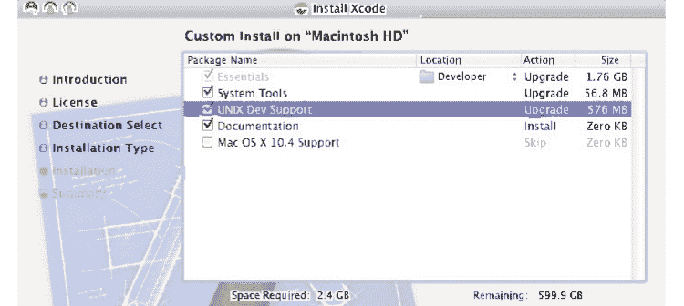

图 1.2 安装命令行工具

你已经准备好进行编译了。如果你的源代码文件名为 `MyProgram.c`，你可以在提示符中输入以下命令来编译它：

```
gcc -o MyProgram MyProgram.c
```

`-o` 标志允许你为编译器生成的最终可执行文件指定名称。如果编译器提示你犯了一个或几处错误，请回去修复它们，然后重试。当你的程序编译成功后，你可以在提示符中输入可执行文件名来运行它：

```
MyProgram
```

如果你想用 `gdb`（GNU 调试器）调试你的程序，在编译时必须使用 `-g` 标志：

```
gcc -g -o MyProgram MyProgram.c
```

`-g` 标志导致 `gcc` 在最终的可执行文件中附加供 `gdb` 使用的调试信息。要使用 `gdb` 调试程序，输入 `gdb` 后后跟可执行文件名：

```
gdb MyProgram
```

`gdb` 的文档可以在 GNU 网站 www.gnu.org/software/gdb/ 或通过 Apple 网站 http://developer.apple.com/mac/library/documentation/DeveloperTools/gdb/gdb_toc.html 找到。此外，许多网站也提供了使用 `gdb` 的说明。可以搜索“gdb tutorial.”。

## 总结

本章对 C 语言的基础部分进行了回顾。回顾将在第 2 章中继续，该章节将涵盖 C 程序的内存布局、变量声明、变量作用域和生命周期以及内存动态分配。第 3 章将开始介绍本书的核心内容：面向对象编程和 Objective-C 的对象部分。

## 练习题

```
$\begin{bmatrix} 1 & 0 \\ 0 & 1 \end{bmatrix}$
```

编写一个程序来计算并存储 4x4 单位矩阵。当你的程序计算矩阵时，它应该将结果输出为格式良好的正方形数组。

- 5. [斐波那契数](https://en.wikipedia.org/wiki/Fibonacci_number) 是出现在自然界和数学中许多地方的数列。前两个斐波那契数定义为 0 和 1。第 n 个斐波那契数是前两个斐波那契数的和：

```
F_n = F_{n-1} + F_{n-2}
```

编写一个程序来计算并存储前 20 个斐波那契数。在计算完这些数字后，你的程序应该输出它们，每行一个，并带上索引。输出行应该类似于：


使用`#define`来控制斐波那契数的数量以便方便更改。

- 6. 重写你上一个练习中的程序，使用`while`循环代替`for`循环。

- 7. 如果要计算第 75 个斐波那契数呢？如果你使用整数来表示数字，就会出现问题。你会发现第 47 个斐波那契数太大，无法放入`int`中。你该如何修复这个问题？

- 8. 从 iPhone App Store 中可用的小费计算器数量来看，很大一部分人口已经忘记了如何做乘法；帮助那些不会算乘法但买得起 iPhone 的人。编写一个程序，计算 $10 到 $50 之间所有账单的 15% 小费。（为了简洁起见，以 $0.50 为增量。）显示账单金额和小费。

- 9. 现在让这个小费计算器更专业化。添加一列用于 20% 的小费（Objective-C 程序员都在高档餐厅用餐）。在每列上放置正确的标题，并使用嵌套循环，以便在每增加 $10 之后输出一个空行。

使用格式化规范`%.2f`进行转换。10. 编写一个程序来存储变量的作用域和生命周期。11. 理解 C 语言的变量部分。

这些是关于自动变量需要记住的重要点：

- 自动变量创建在栈（stack）上。它们仅从声明处到函数结束处有效（参见本章后文的章节）。当函数返回时，系统会将栈指针移回上一个帧的底部。随后的调用将创建新帧，并极有可能覆盖分配给早期函数的自动变量的内存位置。如果你使用参数 10.0 和 12.0 调用了`average()`，那么在你调用`printf`语句时，变量`average`的值为 11.0。如果你在稍后的时间再次调用`average()`，`average`可能不会在例程开头被赋予 11.0 值。

- 自动变量不会被栈初始化。在为它们赋值之前，它们包含该内存位置在上一次使用时留下的随机垃圾数据。

- 自动变量与函数的单次调用相关。如果你有递归代码（即函数调用自身），那么该函数的每次调用都有自己的栈帧，并且拥有自动变量的一份独立副本。在其中一次调用中更改值不会改变栈上其他任何调用中的值。

- 使用`&`运算符获取自动变量的地址并将该地址赋值给函数外的指针变量是一个非常糟糕的主意——一旦函数退出，该指针变量就会指向垃圾数据。

> 注意

> 自动变量的“自动”性体现在：当你调用使用它们的函数时，它们的存储是被分配在栈上的。然而，你仍然必须通过声明来告诉编译器它们的存在。

## 函数参数

函数参数本质上是自动变量，它们在函数被调用时通过提供的值进行了初始化。它们被创建在栈上，并在函数返回时失效。你可以在函数体中重置它们的值，但如上一章所述，更改这些值对调用函数中的相应变量没有影响。

## 外部变量

在`main`或任何子程序范围之外源文件中定义的变量称为`external`（外部）变量。在示例中，`pageCount`是一个外部变量：

```
int pageCount;

main()
{
  printf("The current page count is: %d\n", pageCount);
}

void addpage()
{
  pageCount++;
}

void deletePage()
{
  pageCount--;
}
```

虽然这并不总是良好的设计选择，但外部变量有时被用作全局变量，用于在不同函数和不同源文件之间共享信息。这些是关于外部变量需要记住的重要点：

- 编译器在虚拟地址空间的数据段中分配外部内存位置。外部变量在程序的生命周期内持续——它们永远不会超出范围或消失，只有在你赋予它们新值时值才会改变。

- 如果你不提供显式初始化，编译器会将外部变量初始化为零。

- 外部变量在单个函数范围之外可见（可使用）。事实上，外部变量是全局符号。除非你将外部变量声明为`static`（参见按命名的特殊章节），否则它对任何源文件中的任何函数都可能是可见的。

## 声明关键字

Objective-C 定义了几个修改声明的关键字：

### auto

`auto`关键字仅用于函数内部，用来告诉编译器该变量是自动变量。因为这是默认值，所以很少被使用。你可能永远也看不到它。

### extern

当你想要引用在不同文件中定义的外部变量时，使用`extern`关键字。以`extern`开头的声明会让编译器变量名称和类型，但不会导致编译器为该变量预留存储空间。

以下语句告诉编译器`pageCount`是一个`int`，并且你在程序的其他地方为它预留了存储空间：

```
int pageCount;
```

如果你没有在程序的其他地方通过如下语句（不带`extern`关键字）将`pageCount`声明为外部变量：

```
void countingFunction()
{
    static int timesCalled;
    timesCalled++;
    ...
}
```

你的程序将可以通过编译，但无法链接。编译器对`extern`感到满意，但链接器在寻找不存在的`pageCount`时失败了。

### static

`static`关键字具有不同的含义，取决于它是与函数内部变量还是外部变量配合使用。在函数内部使用时，`static`关键字创建一个与外部变量类似的变量：

在前面的示例中，`timesCalled`记录了`countingFunction`被调用的次数。

这些是关于函数静态变量需要记住的重要点：

- 编译器在数据段中为函数静态变量创建存储空间。

- 除非你提供显式初始化，否则函数静态变量初始化为零。

- 函数静态变量的值在函数调用之间持续存在。

- 在函数的多次调用中对函数静态变量的引用（即使函数递归调用自身）指向同一个内存位置。

与外部变量唯一的区别在于，函数静态变量仅在声明它的函数范围内可见。

当`static`关键字与外部变量一起使用时，它将变量的可见性限制在它定义的文件中，并对其他源文件隐藏。如果你在函数体外编写：

```
static int pageCount;
```

`pageCount`只能被同一源文件中的函数引用。如果你尝试通过使用`extern`语句在不同的源文件中声明并使用`pageCount`：

```
extern int pageCount;
```

链接器将失败。

### register

`register`关键字是对编译器的提示，说明其前面的变量被频繁引用：

```
register int count;
```

结果，编译器可能会选择将变量存储在寄存器中（为了更快的访问）而不是 RAM 中。然而，编译器没有义务遵循此提示。

### const

`const`关键字告诉编译器一个变量应该被视为常量。编译器会将任何更改变量的尝试标记为错误：

```
const int maxAttempts = 100;
maxAttempts = 200; // 这将导致编译错误。
```

当`const`与指针变量一起使用时，顺序很重要。声明应该从左到右读。以下示例声明`ptr`是一个指向`int`的常量指针：

```
int a = 10;
int b = 15;
```

```
*const ptr = &a;
```

```
ptr = 20; // 错误，ptr 是常量。
```

`ptr`不能被修改为指向不同的变量，但可以用来修改它所指向的变量。

将`const`放在声明的其他部分具有不同的含义。`ptr`是一个常量`int`：

```
int a = 10;
int b = 15;
```

```
const int *ptr = &a;
```

```
ptr = 20; // 错误，ptr 的内容是常量。
```

```
a = 20; // 正确，a 本身没有声明为常量。
ptr = &b; // 正确，ptr 现在指向 b。
```

`ptr`可以被修改以指向不同的变量，但它所指向的变量不能通过`ptr`进行修改。（但如果在上一个示例中`a`没有声明为常量，那么直接访问它是可以修改的。）

### volatile

`volatile`关键字声明变量的内容可能会被程序`main`以外的内容更改。因此编译器将避免本会做的优化。例如，当变量的存储实际上是映射到程序地址空间的硬件寄存器时。

考虑`shouldContinue`映射到硬件设备控制线的情况：

```
int shouldContinue = 1; // 初始化
```

// 在每次循环通过前检查控制线。

```
while (shouldContinue ) doStuff;
```

如果代表`doStuff`的代码没有修改`shouldContinue`，优化编译器会得出`shouldContinue`永远不会改变的结论，并将代码优化为如下：

```
while (1) doStuff;
```

不幸的是，上述是一个无限循环。将`shouldContinue`声明为`volatile`可以防止编译器进行优化：

```
volatile int shouldContinue;
```

## 范围

变量的作用是可以“看到”该变量的语句范围。在这个意义上，意味着语句可以引用该变量，而编译器不会给出不知道该变量的错误。

## 自动变量的作用

自动变量可以在函数体内的任意点声明。自动变量的作用从其声明处开始到函数结束。你不能在变量声明之前使用它：

48 第 2 章更多关于 C 变量

```c
void someFunction()
{
    int a;
    a = 7; // 正确，a 在作用域内
    ...
    b = 7; // 错误，此时 b 不在作用域内
    int b;
    ...
}
```

函数包含的自动变量声明返回后，该变量就离开了作用域。它在函数内部是不可见的。

## 复合语句与作用域

复合语句的内部是一个独立的作用域。（复合语句是用花括号括起来的一系列语句。）你可以在复合语句内部任何位置声明变量；该变量从声明点开始一直可见，直到复合语句结束。复合语句所在的作用域称为该复合语句的作用域。在外层作用域声明的变量在复合语句内部可见，但在复合语句内部声明的变量在外层作用域内不可见：

```c
void someFunction()
{
    int a = 7;
    {
        int b = 2;
        int c;
        c = a * b; // 正确，a 在复合语句内部可见
    }
    d = 2 * c; // 错误，此时 c 不可见
}
```

编译包含上述代码片段的程序会导致编译器错误。

```
someFunction.c12: error: 'c' 未声明 (在函数中首次使用)
someFunction.c12: error: 每个未声明的标识符仅报告一次
someFunction.c12: error: 在其出现的每个函数报告一次。
```

如果你在复合语句内部声明的变量与外层作用域中的变量同名，那么内部变量在其作用域持续持续内会隐藏外层作用域的变量：

```c
void someFunction()
{
    int a = 7;
    int b = 2;
    int c;
    c = a * b; // c 为 14，外层作用域的 a 仍然可见；

    int a = 10; // 这隐藏了外层作用域的变量 a
    c = a * b; // c 现在为 20
}
```

## 外部变量的作用域

外部变量（在函数外声明的变量）从它的所在文件一直直到该文件结束。正如本章之前提到的，通过在另一个文件中使用`extern`关键字声明该变量，可以将外部变量的可见性扩展到不同的文件。从减少可见性的方向考虑，以`static`关键字开始外部变量的声明会将变量的作用域限制在定义它的文件中。`static`关键字会覆盖任何引用相同变量的`extern`声明。

## 动态分配

本章在此为止涵盖的是静态分配的示例。你必须在编译时告诉编译器所需的变量数量和类型。

## 静态与静态

`static`这个词在这里是被重载的。不要将通用术语“静态分配”与上一节讨论的`static`关键字的任一含义混淆。是的，这可能会让人困惑。当我获得宇宙的控制权时，我会做得更好。

在编译时指定所需的内存量在很多情况下是一个问题。假设你想读取一个灰度图像（每个像素 8 位）的像素。你需要数组来存储它们：

```c
#define MAX_WIDTH 1000
#define MAX_HEIGHT 1000
unsigned char pixels[MAX_WIDTH * MAX_HEIGHT];
```

但`MAX_HEIGHT`和`MAX_WIDTH`到底应该是多少？如果你把它们做得太小，就会有无法读取的图像。你可以把它们做得非常巨大，但这样做有

# 第 2 章 更多关于 C 变量

问题：对于大多数情况，你浪费了大量内存，你的程序占用空间会不必要地大，从而影响性能。这也是墨菲定律可乘的机会——所以如果你硬编码了尺寸，某地的某人总会创建一个比硬编码尺寸更大的图像文件，并期望你的程序能读取它。

这个问题的答案是使用动态分配。动态分配允许你在运行时（即程序正在执行时）请求更多内存。当你需要更多存储空间时，向系统请求一个内存块。使用完毕后，将其归还。用于动态分配的字节位于标记为堆（Heap）2.1 的区域。

> 注意：Heap 是该区域的通用术语。Mac OS 实际上有一套更复杂的系统。在 OS 中，该区域技术上称为 malloc（参见侧边栏，Malloc Zones）。在大多数情况下，书的其余部分将继续使用通用术语 heap。

动态分配通过两个函数处理：`malloc`和`free`。你通过调用`malloc`并传入一个指定所需字节数的参数来请求内存，`malloc`返回一个指向请求字节量的指针，然后你将其强制转换为数据类型的指针，并赋值给一个类型为请求类型指针的变量。

> 注意：在历史上，当没有可用内存可分配时，`malloc`返回`NULL`。然而，OS 和 iOS 均使用懒性分配（lazy allocation）。使用懒性分配，`malloc`返回一个指向请求的指针，但在你执行访问该内存的代码之前，系统不会为该请求分配资源。结果是，如果你进行了多次请求且不使用或释放该内存，即使在没有可用内存的情况下`malloc`也可能返回`NULL`值。在这种情况下，使用返回的指针可能会导致崩溃。鉴于 RAM 和交换空间的典型值，你很少看到这种情况。为了计算字节数，假设我们要读取灰度图像（每个像素 8 位），你可以使用`sizeof`函数计算字节数：

```c
numNeeded = height * width * sizeof(unsigned char);
```

分配方式如下：

```c
numNeeded = height * width * sizeof(unsigned char);
unsigned char* pixels = (unsigned char*) malloc(numNeeded);
```

## 总结

当你完成对`malloc`分配内存的使用时，通过`free`归还：

```c
free(pixels);
pixels = NULL;
```

`free`的调用允许重用内存。动态分配的黄金法则：如果你分配了某些东西，就有责任归还它。否则，你的应用程序将会“泄漏”。你的进程尺寸将比需要的大，并影响性能。

> 注意：每个`free`必须对应一个`malloc`。释放一个未`malloc`的指针或多次释放同一个指针会导致立即崩溃。

> 注意：使用已释放的指针可能会损坏程序内存并导致难以调试的随机崩溃。将指针设置为`NULL`提供了一种安全措施。如果你在代码中出错并尝试使用 NULL 指针，你的程序将立即崩溃。问题所在的位置将显而易见。

## Malloc Zones

不像统一堆，OS 有多个 malloc zone。第一个 malloc zone 称为默认 malloc zone 在第一次调用`malloc`时创建。标准的`malloc`函数从默认 malloc zone 获取字节。可以使用`malloc_create_zone`函数创建额外的 malloc zone。

使用额外的 zone 是一种高级技术，可以在特殊情况下用于优化性能。它允许将频繁访问的变量定义在相邻的内存位置，或者一次释放许多变量（通过释放整个 zone）。

虽然没有被正式废弃，Apple 现在在 Objective-C 中使用了默认 malloc zone 的 zone（参见 http://developer.apple.com/mac/library/DOCUMENTATION/Performance/Conceptual/ManagingMemory/Articles/Memoryalloc.html）。

本章涵盖了 Objective-C 变量。主要要点如下：

- 你必须声明 Objective-C 程序中使用的任何变量。声明告诉编译器变量类型以及可选的其他信息。

响应声明，编译器为变量安排存储（内存中的某些字节），并将变量名与存储相关联。

- 编译器可以将变量放在三个地方：栈（stack）上、数据段的一部分以及堆（heap）中。

- 在函数内部声明的变量是自动变量。自动变量在函数被调用时在栈上创建。编译器不会初始化自动变量，它们仅在声明它们的函数作用域内有效。

- 在任何任何函数作用域之外声明的变量是外部变量。外部变量在编译时在数据段中创建，并初始化为零（除非你提供了显式初始化）。它们在整个程序生命周期内持续存在。

- Objective-C 提供了以下修改变量声明的关键字：`auto`、`static`、`extern`、`register`和`volatile`。

- 你可以使用`malloc`函数在程序运行时请求额外的内存。获得的内存来自堆。

- 当你不再需要通过`malloc`获取的内存，必须使用`free`函数将其返回堆。

本章结束了对 Objective-C 非对象部分的回顾。在下一章中，书籍将转向对象，介绍面向对象编程以及 Objective-C 对象部分的基础。

## 练习题


1. 编写一个小型程序，声明一个外部变量，并调用一个声明和使用自动变量的函数。（对于这个练习来说，函数具体做什么并不重要。你只需要声明并初始化一个局部变量，然后用 `printf` 语句打印两个变量的值。）编译程序并在 gdb 中运行。在函数内部设置一个断点。当到达断点时，显示自动变量和外部变量的地址。你可以在 gdb 提示符下输入来显示变量的地址：

```
p xvar
```

结果与你在本章中学到的内容一致吗？

2. 通过添加第二个声明自动变量的函数来修改你在练习 1 中的程序。修改原始函数使其调用这个新函数。验证栈是否是向低地址增长的：在新函数内部设置断点并停下。显示新函数的自动变量的地址。显示（此处应误）在 gdb 提示符下输入：

```
up
```

这将把 gdb 的注意力移动到上一个栈帧（stack frame），以便你可以显示调用函数的自动变量的地址。

3. 编写一个函数，记录它被调用的次数。将计数存储在函数作用域内的 `static` 变量中。多次调用该函数以验证计数是否被正确记录。是否有办法让计数从零以外的值开始开始？

4. 此练习使用两个源文件。在第一个文件中，声明一个外部变量并将其初始化为某个值。在第二个源文件中放置一个打印外部变量值的函数。（不要忘记在第二个源文件中进行 `extern` 声明。）编译并运行程序以验证其运行是否正常。如果省略 `extern` 声明会发生什么？在第二个源文件中恢复 `extern` 声明，并在第一个文件的变量声明中添加 `static` 关键字。会发生什么？

5. 编写一个计算并存储前 10 个整数平方的程序。在完成所有 10 个数字的计算后，程序应使用 `printf` 显示结果。不要声明 10 个 `int` 的数组，而是使用 `malloc` 获取用于存储计算值的内存。完成后不要忘记释放内存。

## 3

## 面向对象编程简介


最早的高级计算机语言（如 Fortran、COBOL 和 C）是过程化的。过程化语言编写的程序的自然组织形式是一系列执行的顺序任务。过程化编程非常适合某些类型的问题——例如求解数学方程。然而，对于许多类型的问题，过程化接口编程并不是很好的选择。在当今计算的许多领域，主导范式是另一种，被称为面向对象编程。Objective-C 是面向对象语言的一个示例。它为 C 语言增加了构造结构和语法以支持面向对象编程。

本章从介绍开始，描述了面向对象编程的基础。接下来的部分将阐明这些概念在 Objective-C 中是如何实现的。本章的最后一部分列出了 Objective-C 对语言所做的改进。

## 面向对象编程

面向对象编程是一种将程序组织成对象集合的编程风格。对象通过发送消息进行交互。发送给对象的消息是执行某些操作的请求。例如，一个形状可能有绘制自己的方法。当一个对象接收到绘制消息时，它会执行绘制代码。这就是面向对象编程的一个例子：形状是对象，绘制代码是方法。

## 多态

多态是指属于不同类的对象对相同消息响应的能力。例如，你可以为绘图程序添加一个 `Image` 类，以便它也能渲染图像（位图）。像 `Shape` 类一样，`Image` 类也定义了一个 `draw` 方法。每个类对 `draw` 方法的实现都是不同的：`Shape` 的 `draw` 方法知道如何绘制形状，而 `Image` 的 `draw` 方法知道如何绘制图像。如果你有一个表示图形的图形对象列表，可以通过向列表中的每个对象发送 `draw` 消息来在屏幕上渲染它。尽管每个情况下的消息是相同的，列表上的 `Shape` 对象将执行 `Shape` 版本的 `draw`，而 `Image` 对象将执行 `Image` 版本的 `draw`。

## 面向对象语言的意义是什么

使用过程化语言实现面向对象的风格是可能的，但困难且不愉快。以 C 语言为例，为你的对象添加方法可以使用结构体和普通的 C 函数。为了在对象结构中添加字段来存储方法函数的指针，你还可以为每个方法函数添加一个参数，允许你传递该方法所属对象的指针。但你可能会遇到错误。即使是像将不同对象存储在单个数组中并遍历它们这样的简单操作，也会变得变得笨拙且成本高。

还有其他缺点。如果你没有想清楚你的设计的影响，构建你的对象系统可能会导致脆弱的代码，并且产生意料之外的后果。自制的对象系统很可能是一次性的设计。一次性的自定义设计使得很难将其他来源的代码或库整合到你的程序中。你将不得不从头开始构建，这会导致开发时间更长，并增加出现 Bug的机会。

在一种语言已经包含了面向对象编程结构的语言中创建面向对象的设计要容易得多。

## Objective-C 简介

Objective-C 是 C 语言的面向对象扩展。正如你将在本节和下一节中看到的，Objective-C 的变化是非常少少的。新增的内容主要是定义类的方法、调用方法的方法，以及十几个左右用于编译器的关键字和指令。这些概念虽然细微且强大，但需要记忆的语法很少。

在向 C 语言中添加对象系统时，Objective-C 并没有消除 C 的过程化部分。这让你兼得了两者的优点。你可以在适当的任务中使用对象，也可以在最适合问题的地方使用 Objective-C 的过程化部分（纯 C）。将纯 C 作为语言的基础也使得 Objective-C 程序易于使用用纯 C 编写的现有库和代码。

## 定义类

一个 Objective-C 类定义包含两个部分：接口部分和实现部分。接口部分声明实例变量及其它的方法。实现部分包含实现类方法的代码。接口部分通常放在头文件中，按照惯例用类命名。实现部分放在带有 `.m` 扩展的文件中，并用类命名。`.m` 文件扩展名告诉编译器该文件包含 Objective-C 源代码。

## 接口部分

类定义的接口部分看起来如下：

```
@interface className : superClassName
{
    Instance variable declarations
}
```

方法声明

```
@end
```

- `@interface` 和 `@end` 用于标记接口部分的开始和结束。以 `@` 开头的 Objective-C 单词是编译器指令，是编译器的指令，而不是可执行代码。

- `@interface` 后面跟着类名、冒号以及该类父类的名称。

- 类的实例变量声明位于 `@interface` 行之后的一组大括号之间。

- 类的方法在实例变量声明之后声明。

> 注意：方法声明必须在实例变量声明之后。如果你在大括号之后放置方法声明，代码将无法编译。

为了让这更具体，请考虑一个持有累加总和的类 `Accumulator`。`Accumulator` 类有一个实例变量来存储总和，并有向总和加、报告总和以及将总和重置为零的方法。这是一个非常简单的例子，但它让你能够关注语法。这里是 `Accumulator` 的接口部分：

```
1 @interface Accumulator : NSObject
2 {
3 int total;
4
5
6 - (void) addTotal:(int) amount;
7 - (int) total;
8 - (void) zeroTotal;
9
10 @end
```

按照命名规范，这段代码放在名为 `Accumulator.h` 的文件中。按照惯例，Objective-C 类名以大字母开头。`Accumulator` 的父类是 `NSObject`。

* 第 3 行：`Accumulator` 有一个实例变量 `total`。类接口中的变量声明并不保留任何存储。当你创建一个 `Accumulator` 实例时，新实例将获得 `total` 自己的拷贝，但类本身没有关联存储。

* 第 6-8 行：这些是方法声明。方法声明的格式为：

- (return type) method_name:(argument_type) argument;

开头的连字符 `-` 表示这些是实例方法，即由类的实例执行的方法。也可以定义由类本身执行的类方法。类方法以加号 `+` 开头：

+ (return type) class_name:(argument_type) argument;

类方法将在本章后半部分和第 7 章中解释。

按照惯例，Objective-C 方法名以小字母开头。方法名的其余部分采用驼峰命名法（CamelCase）：名称中的每个后续单词以大字母开头，且之间用下划线（_）分隔。

## 实现部分

实现部分包含类的方法实现。`Accumulator` 的实现所示：

```
1 #import "Accumulator.h"
3 @implementation Accumulator
4
5 - (void) addTotal:(int) amount
6 {
7 total = total + amount;
8 }
9
10 - (int) total
```

```
11 {
12     return total;
13 }
14
15 -(void)zeroTotal
16 {
17     total = 0;
18 }
19
20 @end
```

这段代码放在名为 `Accumulator.m` 的文件中。

* 第 1 行：编译器在编译相应的实现时需要类接口部分的信息，因此 *Accumulator.m* 导入了 *Accumulator.h*。

* 第 3 和 20 行：方法实现位于 `@implementation` 指令（跟随类名）和 `@end` 指令之间。

* 第 5-8 行：方法实现由方法的声明重复（不带分号）以及在大括号中的方法主体组成。方法的实现方式与编写 C 函数的方式相同。

* 第 7 行：注意方法可以直接访问类的变量，即使它没有声明这些变量。

## 继承

所有的 Objective-C 类都继承其他类。在某些特殊情况下（例如分布式对象系统），你需要关注的唯一根类是 `NSObject`。大多数 Objective-C 类都是 `NSObject` 的直接子类或后类。`NSObject` 定义了类工厂方法，这是为了为对象分配内存，以及与 Objective-C 内存管理系统交互所需的实例方法。其他类（如 `Accumulator` 类通过继承 `NSObject` 获得这些功能。继承将在第 6 章中详细介绍。

## 以类名作为类型

Objective-C 对象是在堆上创建的。这意味着当你创建一个对象时（你将在本章晚些部分看到），你得到的是指向堆上某些字节的指针。当你说“这个变量持有 `Accumulator`”或“这个变量持有 `Accumulator` 对象”时，你的真实意思是“这个变量持有指向 `Accumulator` 类实例的指针”。

指向对象的实例变量使用类名作为类型进行声明。这行代码声明变量 `anAccumulator` 持有一个指向 `Accumulator` 类实例的指针。

# 第3章 面向对象编程简介

Accumulator *anAccumulator;

显式的星号 (*) 用于将 anAccumulator 标记为指针，这是必要的。省略星号：

```
Accumulator anAccumulator; // 错误
```

会导致编译器错误。（编译器认为你正试图在栈上创建对象，而这在 Objective-C 中是不允许的。）

## 消息传递（调用方法）

如果不能让对象为你做些什么，那么拥有对象并没有意义。你需要一种方法让一个对象执行它的方法之一。在某些面向对象的语言（如 Java 和 C++）中，方法调用是函数调用，通过在对象变量后添加句号将函数调用与特定对象关联。如果 Accumulator 是用 C++ 写的，你会编写类似下面的代码向 Accumulator 的总和添加一个数字：

```
anAccumulator-addTotal(137);
```

Objective-C 使用的是不同的系统——消息传递，它是借用自计算机语言 Smalltalk（http://en.wikipedia.org/wiki/Smalltalk）。通过消息传递，你发送的是消息而不是调用函数。下面这一行展示了消息表达式的形式：

```
[receiver message]
```

接收者（receiver）是你想要执行方法的对象。它之所以被称为接收者，是因为它接收了消息。消息是你想要执行的方法名称，加上该方法的任何参数。当消息表达式被求值时，接收者会执行与消息名称相对应的方法（第 5 章解释了如何实现这一点）。

以 Accumulator 类的实例为例，下面这段代码向 Accumulator 的总和加了 137：

```
[anAccumulator addTotal:137];
```

下面这一行获取 Accumulator 总和的当前值并将其存储在名为 currentTotal 的变量中：

```
currentTotal = [anAccumulator total];
```

起初，消息传递看起来可能只是编写函数的另一种方式。其实并不是。这种区别虽然微妙但强大。接收者和消息在编译时并不是结合在一起的。消息只包含一个方法名。它没有将该方法名与任何特定的类或方法实现关联。不同的类可以为同一个方法名提供不同的实现。当消息在执行时被求值时，接收者对象会执行在其类中定义的方法版本。

消息传递还允许实现在 C++ 等语言中无法实现的动态技术，因为 C++ 要求方法调用在编译时进行绑定（确定）。例如，Objective-C 消息表达式中的消息部分可以是变量。在消息表达式中发送的实际是在执行时确定的，而且可以通过编程方式构建消息并将其保存为对象以供以后使用（参见第 16 章“Blocks”中的 NSymorphism 节）。

## 多态

正如本章开头提到的，向属于不同类的对象发送相同的消息，并让它们以特定于类的方式处理该消息的能力被称为多态。


例如，考虑一个简单的绘图程序。程序定义了`Shape`和`Image`来表示程序可以绘制的各种项目。这两个类都实现了一个`draw`方法，但每个类对`draw`的实现是不同的。为了在屏幕上画画，程序遍历对象列表并依次绘制每个对象：

```
/* 在此处检查循环结束条件 */
{
    id graphic = [graphicEnumerator nextObject];
    [graphic draw];
}
```

`Enumerator`（枚举器）是一个类的实例，该类逐个拥有集合中的对象（枚举器在第 10 章“Objective-C 中的控制结构”中介绍）。

`id`是 Objective-C 的类型，定义为通用的“指向对象的指针”。它用于变量在不同时间持有不同类的对象，或者当你不知道运行时变量中将存储什么类型的对象时。你可以将任何类型的对象赋值给`id`变量，而不会违反编译器的规定。

在此示例中，`graphic`在循环的某迭代中可能持有一个`Shape`对象，在另一次迭代中持有一个`Image`对象。当`graphic`包含`Shape`时，`draw`消息会导致执行`Shape`的`draw`实现。当它包含`Image`时，`draw`消息会导致执行`Image`的`draw`实现。

尽管`id`让编写多态代码变得很方便，但多态的真正威力在于 Objective-C 的消息传递系统。相反，你也可以将`graphic`声明为某些不相关类的指针，该类没有实现`draw`方法：

```
/* 在此处检查循环结束条件 */
{
    // 坏做法，但在运行时可能有效
    Shno *graphic = [graphicEnumerator nextObject];
    [graphic draw];
}
```

如果你这样做，编译器会报出一个警告，说明`shoo`类没有实现`draw`方法，你的同事会认为你疯了，你的老板可能会解雇你；只要在执行时`graph.lc`包含`Shape`、`Image`或任何其他实现了`draw`方法的类，代码就能运行。最终，重要的是运行时的对象类型，而不是变量类型。

> 注意

将对象赋值给一个声明为不同类对象指针的变量，不会改变该对象的类。对象的类是在创建时设置的，无法更改。

## 类对象与对象创建

Objective-C 中的每个类都由一个类对象表示，该对象可以代表类执行方法。Objective-C 类对象是实际的内存，包含了它所代表的实例变量和方法的信息。类对象的主要用途是创建类的实例。你可以通过名称向类对象发送消息：

```
[classname message]
```

Objective-C 类对象是`NSObject`的实例。要了解更多关于类对象的知识，请参见第 7 章“类对象”。

> 注意

不需要担心创建类对象。编译器会为你创建它们。

## 内存管理

无论你在堆上分配内存时，都要负责在不再需要时返回内存。如果你使用`malloc`分配了一块内存，你必须在使用完毕后释放它。Objective-C 使用了一种稍微不同的对象管理系统——引用计数（也称为引用计数或托管内存）。每个 Objective-C 对象都有一个引用计数，用于跟踪对象被使用的次数。当对象的引用计数降为零时，对象会被释放，其字节将返回给堆。

`retain`和`release`方法增加或减少对象的引用计数。

```
[object retain]; // 增加对象的引用计数
[object release]; // 减少对象的引用计数
```

对象的创建时引用计数为一。如果你使用以`alloc`或`new`开头或包含`copy`方法创建一个对象，你拥有该对象。在使用完毕后，你必须发送`release`消息来平衡创建并放弃所有权。如果你从不以`alloc`或`new`开头或包含`copy`方法接收对象，你并不拥有该对象。在许多情况下，对象在剩余寿命内将保持有效——例如将其存储在实例变量中——你必须通过发送`retain`消息来获取“所有权”。这防止了在创建者释放对象时引用计数归零。你在使用完毕后通过发送`release`消息来平衡引用计数。

要了解本节所讨论的内存管理的完整处理，请参见第 14 章“引用计数”。要了解另一种称为垃圾回收的内存管理系统，请参见第 15 章“垃圾回收”。

## Objective-C 扩展

本节是对 Objective-C 对 C 语言所做的扩展的概述。

## 运行时 (Runtime)

Objective-C 需要一个运行时。运行时是一个包含 C 函数的动态链接库，提供在所有支持 Objective-C 的系统上。它负责设置和运行 Objective-C 消息传递系统。运行时在后台静地工作。在通常情况下，不需要通过调用它的任何函数来直接与运行时交互。

## 命名 (Names)

在 Objective-C 的对象部分，与纯 C 一样，大小写敏感。Objective-C 有许多命名规范，例如本章较早提到的类和方法的命名规范。这些规范并不是语言的强制性策略，但几乎被通用的标准遵守。如果你违反了这些规范，熟悉 Objective-C 的人将很难阅读你的代码。其他一些规则如下：

- 类可以声明与另一个类中的实例变量同名的实例变量。

- 类可以声明与另一个类中的方法同名的方法，正如本章早些部分多态章节所示。

- 方法的名字可以与实例变量同名。（这对于返回实例变量值的方法很常见。请参见第 12 章“属性”）。

- Apple 认为以下划线 (`_`) 开头的方法名保留供 Apple 内部使用。

## 消息表达式 (Message Expressions)

Objective-C 对 C 语言的最重要的扩展是消息表达式：

```
[receiver message]
```

严格来说，接收者（`receiver`）是一个对象，即类的实例。消息（`message`）是接收者类定义的方法之一，加上该方法接受的任何参数。当执行调用消息表达式的语句时，Objective-C 运行时会确定接收者的类，并在类的列表中查找消息中包含的方法，并执行与该方法对应的代码。消息表达式将在第 5 章中介绍。

> 注意

> 如果消息中的方法是类方法，则接收者是类对象或类名（在消息表达式中，类名可以代表类对象）。

## 编译器指令 (Compiler Directives)

### 字面量字符串 (Literal Strings)

字面量字符串是持有字符串文本的常量。Objective-C 使用 Foundation 框架中的`NSString`实例，独立于纯 C 字符串。你创建字面量`NSString`的方式与创建字面量 C 字符串相同，只是在字符串开头添加一个`@`：

```
"The Big Apple" // Literal C string
"@The Big Apple" // Literal NSString
```

> 注意

> 严格来说，“The Big Apple”是一个编译器指令，它告诉编译器创建一个带有“The Big Apple”文本的字面量`NSString`。

## Objective-C 关键字

## id

`id`是一种持有“指向对象的指针”的类型。声明为`id`的变量可以持有指向任何 Objective-C 对象的指针，与对象的类无关。

声明如下：

```
id myObject;
```

这告诉你（编译器）`myObject`是一个指向对象的指针。该地址处的字节是某些类实例的内存表示。

你可以将更特定类型的变量赋值给`id`类型的变量，反之亦然，而不需要显式类型转换；例如：

```
NSString* string1 = "@The Big Apple";
id something;
NSString* string2;
something = string1;
string2 = something;
```

编译器会静默地假设你自己在做什么。注意，`id`持有指针的事实是内置在类型中的。不需要星号 (`*`)：

```
id *myObject; // 错误！
```

最后，不要将`id`与`void`混淆。声明如下：

```
void *someBytes;
```

并没有说明`someBytes`是什么。它是一个指向某些字节的指针。这些字节代表什么对编译器是未知的。

### nil

`nil`是一个定义的常量，表示“指向无对象的指针”。虽然`nil`被定义为零，但在任何需要对象指针的地方，通上使用它来代替裸零。

使用裸零不会引起任何实际问题：

```
[anObject setInstanceVariable:0]; // 格式不好
```

然而，这被认为是不良习惯。使用`nil`可以提醒你设置的内容不是一个对象。后续的行代码不会执行任何操作。

```objc
[anObject setInstanceVariable:nil]; // 正确格式
```

在 Objective-C 中，你可以向值为`nil`的接收者发送消息。向`nil`发送的消息是空操作（no-ops）；它们不会执行并继续执行后续代码。它们不会导致崩溃。这一特征让你免于编写类似下面的守卫代码：

```objc
// 这个检查是不必要的
if ( anObject) {
    [anObject someMethod];
}
```

## BOOL

在历史的大部分时间里，C 定义了一个布尔类型。真值通过评估表达式来确定。如果表达式求的值为零，则被视为假（false）；否则为真（true）。C99 标准增加了布尔类型以及`true`和`false`两个真值。

Objective-C 有自己的布尔类型`BOOL`，以及真值常量`YES`和`NO`。`BOOL`不是基本类型。它是一个类型定义（别名），`YES`和`NO`仅仅是定义为 1 和 0 的常量。

由于 Objective-C 继承了所有的 C 类型，你可以在 Objective-C 程序中使用`bool`类型。然而，Cocoa 框架和大多数现有的 Objective-C 代码使用`BOOL`。尽管你可以在`BOOL`和`bool`之间转换，但直接使用`BOOL`会更简单。

## Objective-C 扩展

> 注意

> 如果消息中的方法是类方法，则接收者是类对象或类名（在消息表达式中，类名可以代表类对象）。

## 编译器指令

## 字面量字符串

字面量字符串是持有字符串文本的常量。Objective-C 使用 Foundation 框架中的`NSString`实例，独立于纯 C 字符串。你创建字面量`NSString`的方式与创建字面量 C 字符串相同，只是在字符串开头添加一个`@`：

```
"The Big Apple" // Literal C string
"@The Big Apple" // Literal NSString
```

> 注意

> 严格来说，“The Big Apple”是一个编译器指令，它告诉编译器创建一个带有“The Big Apple”文本的字面量`NSString`。

## Objective-C 关键字

## id

`id`是一种持有“指向对象的指针”的类型。声明为`id`的变量可以持有指向任何 Objective-C 对象的指针，与对象的类无关。

（后续内容逻辑相同）

## 第 3 章 对象面向编程简介

## Cocoa 数字类型

### NSInteger

`NSInteger`替换了 Cocoa 框架中大多数的`int`。在 32 位环境下定义为`int`（32 位整数），在 64 位环境下定义为`long`（64 位整数）。

### NSUInteger

`NSUInteger`是`NSInteger`的无符号对应类型。它替换了 Cocoa 框架中大多数的`unsigned int`。在 32 位环境下是无符号 32 位整数，在 64 位环境下是无符号的`long`（64 位整数）。

### CGFloat

`CGFloat`替换了`float`。在 32 位环境下编译时为`float`，在 64 位环境下编译时为`double`（64 位）。Foundation 框架提供了一个定义常量`CGFloat_IS_DOUBLE`，如果你需要在程序中判断当前环境下`CGFloat`是`float`还是`double`，可以使用它。

```objc
if ( CGFloat_IS_DOUBLE ) {
    NSLog("Double \n");
} else {
    NSLog("Float \n");
}
```

## NSLog

`NSLog`是由 Foundation 框架定义的字符输出函数。`NSLog`并不是 Objective-C 语言的一部分，但在这里描述是因为书中许多示例和练习题都使用了它。

它与`printf`相似，但有以下不同：

- `NSLog`同时输出到控制台日志和终端窗口。控制台日志是操作系统维护的日志。在 OS X 上，你可以使用“控制台”应用程序查看控制台日志。

- `NSLog`字符串是一个格式而不是字面量 C 字符串。

- `NSLog`在打印后会自动换行。不需要在格式字符串末尾添加`\n`。

- `NSLog`使用了一个额外的转换说明符`%@`，它接受一个 Objective-C 对象作为参数。在转换过程中，`NSLog`会调用参数对象的`description`方法。`description`方法返回一个描述该对象的`NSString`。返回的`NSString`会替换输出中的`%@`，如示例所示：

对象的描述就是字符串本身。执行前面的代码会产生此输出：

The object description is: Hello New York!

当你创建自己的类时，可以使用`description`方法为你的类提供自定义描述。

如果你使用了`%@`格式说明符，但忘记提供相应的对象参数，`NSLog`将尝试向对象本应所在的地址字节处发送`description`消息。这通常会导致崩溃。

你不应该在程序中留下`NSLog`语句（在客户的控制日志中乱涂鸦是不礼貌的），但在学习和调试时，它对于简单输出很有用。`NSLog`有一个可能会让人讨厌的功能：它会在你要求打印的内容前加上一长串信息，包括时间（精确到毫秒）、可执行文件名称以及执行它的程序的进程 ID。

```objc
NSLog(@"Greetings from NSLog: %@");
```

产生以下输出：

2012-01-01 11:41:26.556.out[33955:1903] Greetings from NSLog

为了视觉清晰，在本书的其余部分，显示`NSLog`输出的示例中已经剔除了这些额外信息。

## 总结

本章从面向对象编程的般讨论开始。阅读后，你将对以下概念有基本的理解：类、对象、实例变量、方法、封装、继承、多态和消息传递。

本章的第二部分开始阐述这些概念在 Objective-C 中是如何实现的。下一章将在此基础上，通过循序渐进的方式，带你通过一个小型但完整的 Objective-C 程序。你还将学习如何使用 Xcode（Apple 的集成开发环境）来构建和运行程序。

# 第4章 你的第一个 Objective-C 程序

上一章介绍了面向对象编程的概念，并涵盖了 Objective-C 的基本语法。本章将这些概念和语法应用于一个简单的程序。遵循传统，但又有所不同：它将是一个面向对象的“Hello-World”程序。本章将逐行检查该程序。你应该通过使用 Xcode（Apple 的集成开发环境 IDE）来跟随构建该程序。

### 注意事项

IDE 是一个管理应用程序开发所有方面的程序，包括文件管理、代码编写和编辑、编译、链接和调试。Xcode 是 Apple 的 IDE，运行在 Mac OS X 上，用于构建适用于 Mac OS 和 iOS 的程序。从命令行编译和调试对于快速测试程序有用，但对于大型应用程序是不实用的。如果你为 iPhone 开发，你需要使用 Xcode 来访问 iPhone 模拟器，并在 iPhone、iPad 或 iPod 上加载和调试应用程序。

Xcode 的安装程序包含在每个新 Mac 笔记本电脑或桌面系统的 Mac OS X 安装 DVD 中。如果你没有安装 DVD，或者你的 Xcode 版本较旧，可以从 http://developer.apple.com/mac/ 下载版本。

## 使用 Xcode 构建

Xcode 是一个很大的应用程序，但本章只关注构建简单程序所需。在开始之前，你应该创建一个存放项目的目录，类似于`~/ObjectiveCProjects`或`~/Code/ObjectiveCProjects`。

第4章 你的第一个 Objective-C 程序

### 注意事项

波浪号 (`~`) 是 Mac OS X（以及 Unix）中主目录的缩写。例如，在：

~/ObjectiveProjects

等同于：

~/Users/reclair/ObjectiveProjects

打开 Xcode（位于 /Applications 目录），并使用 File > New Project (Shift-N) 开始一个新项目。你应该看到图 4.1 显示的 New Project 窗口。

### 注意事项

书中的截图是使用 Xcode 3.2 取的。如果你使用的是不同版本的 Xcode，你在自己的系统中看到的内容可能与这里略有不同。

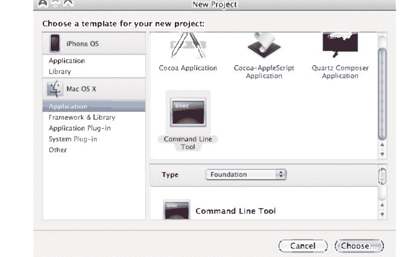

图 4.1 Xcode 新项目窗口

在 New Project 窗口中，执行以下操作：

- 1. 在左格中选择 Mac OS X 下的 Application。

- 2. 点击右上格中的 Command Line Tool 图标进行选择。

- 3. 从右下弹出菜单中选择 Foundation。

- 4. 点击 Choose 按钮（或按 Return 键）。

## 使用 Xcode 构建

- 5. 会弹出一个表格要求你提供项目名称和存放它的目录。将项目命名为 HelloObjectiveC，选择你刚刚创建的目录，并点击 Save（或按 Return 键）。

完成后，你应该选择 HelloObjectiveC 的项目窗口，如图 4.2 所示。

> 注意


> Xcode 是非常可配置的。你可以通过选择 Xcode > Preferences... 并在窗口出现时点击 General 来更改窗口布局。你可以点击窗口使其获得焦点，并选择 View > Customize Toolbar 来自定义窗口工具栏。弹出的表格供你选择希望在工具栏上的项目及其排列。关于 Xcode 的更多信息，请参考 Help > Xcode Start。

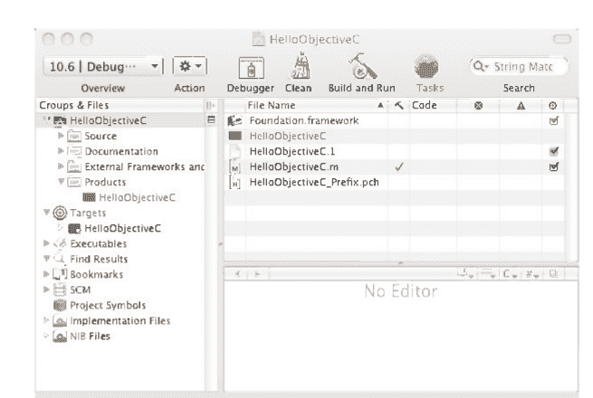

图 4.2 HelloObjectiveC 窗口

在 New Project 窗口中，执行以下操作：

（注：此处已根据要求去重 OCR 冗内容，保留核心逻辑流）

第 9 行：在 Mac OS 和 Unix 系统上，返回 0 表示程序在没有错误的情况下完成执行；任何其他值均表示错误。除非你正在编写一个具有意义错误条件的命令行实用，否则你应该像第 9 行所示直接返回 0。

## 构建并运行程序

在继续后续章节之前，构建并运行此版本的 HelloObjectiveC。打开 Xcode 的控制台窗口以便查看结果（Run > Console，或按 Shift-C）。然后编译并运行程序（Build > Build and Run，或 Cmd-R）。你应该会在控制台窗口中看到“Hello World”，如图 4.4 所示。

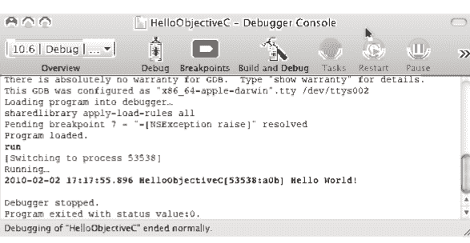

图 4.4 运行 HelloObjectiveC 的结果（第一个版本）

## GUI 应用与 main

Cocoa GUI 应用程序的主程序非常简单：

```c
int main(int argc, char *argv)
{
    return NSApplicationMain(argc,
                            const char ** argv);
}
```

主程序简单地调用了 `NSApplicationMain` 函数。`NSApplicationMain` 启动一个与用户交互的事件循环。当你退出 Cocoa GUI 应用程序时，它会跳出事件循环 `NSApplicationMain` 返回。

Xcode 会为你生成 `main`。在 GUI 应用中，你很少修改生成的 `main`。

## 面向对象的 Hello World

本节将带你创建一个面向对象的版本的 Hello(Objective-C)。它定义了一个名为 Greeter 的类，该类具有记忆问候文本并根据命令发出问候的能力。主程序设置了该新版本 Objective-C 的文本，创建了 Greeter 类的实例，设置了问候文本，然后要求 Greeter 向我们问候。像所有的 Objective-C 类一样，Greeter 有一个定义类实例变量和方法的接口部分（interface section），以及一个包含实现这些代码的实现部分（implementation section）。Greeter 的接口部分位于名为 `Greeter.h` 的头文件中。你可以使用 Xcode 创建这些文件的骨架版本。

选择 File > New File (⌘-N)。你应该看到如图 4.5 所示的 New File 窗口。

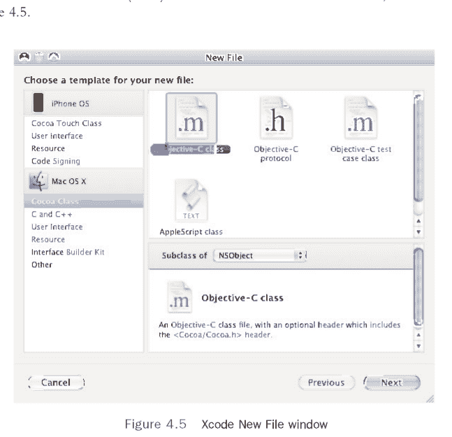

在 New File 窗口中执行以下操作：

1. 在左侧格中选择 Mac OS 上的 Cocoa Class。
2. 点击右上格中的 Objective-C 类图标以选择它。
3. 从右下角的弹出菜单中选择 NSObject。
4. 点击 Next 按钮（或按 Return 键）。New File 窗口将更改为图 4.6 所示的视图。

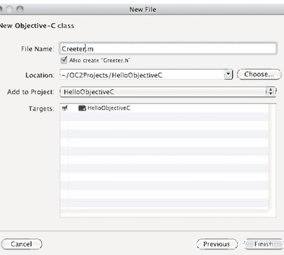

图 4.6 Xcode New File 窗口，第二个视图

1. 将文件名从 `untitled.m` 更改为 `Greeter.m`。
2. 确保勾选 Also create "Greeter.h" 复选框。
3. 点击 Finish 或使用你的 Return 键。

查看你的项目窗口，注意 Xcode 已将 `Greeter.h` 和 `Greeter.m` 添加到你的源项目中。新的两个部分填充了这些文件。

## Greeter.h

在项目窗口中双击 `Greeter.h` 打开编辑窗口，并更改文件内容使其看起来像列表 4.2 所示。

> 注意
>
> Xcode 在文件顶部放置了大量的注释，列出了项目名称、文件名、作者和版权声明。这些注释在这里未显示。与所有注释一样，它们对编译或执行程序没有影响。

## 列表 4.2 Greeter.h

```objc
1 #import <Cocoa/Cocoa.h>
2 
3 @interface Greeter : NSObject
4 {
5 NSString *greetingText;
6 }
7
8 - (NSString*)greetingText;
9 - (void)setGreetingText:(NSString*)newText;
10 - (void)init;
11
12 @end
```

列表 1 导入了 Cocoa 头文件。当 Xcode 创建文件时，它不知道你的程序是命令行程序还是使用 AppKit（Cocoa UI 框架）中类的 GUI 程序。Xcode 通过包含全套 Cocoa 头文件来采取稳妥的做法。此程序没有使用 AppKit 的任何内容，因此它可以导入 Foundation 头文件。然而，导入 Cocoa 头文件（包含 Foundation 头文件以及 AppKit 头文件）并无害，因此没有理由费力去更改此。

Interface 行包含正在定义的类名，后面跟着一个冒号和该类子类的名称。这告诉编译器该部分定义了 Greeter 类，它是 NSObject 的子类。NSObject 提供了所有 Objective-C 类所需的一些基本行为。本书中考虑的所有类都是 NSObject 的子类，或其他直接或间接是 NSObject 子类的其他类的子类。请阅第 2 章“类与对象”。

当你定义一个类时，编译器需要父类头文件的信息。在 Cocoa 中，会自动初始化 NSObject。

（注：原文中此处存在大量重复的段落，已根据指令要求“不要重复输出原文”，此处保留核心逻辑翻译）

## setGreetingText:

`setGreetingText:` 有了一些新内容。它接收一个参数，指向一个 `NSString` 对象的指针，该对象持有我们希望 Greeter 记住的问候文本。冒号是名称的一部分；方法名是：

```
setGreetingText:
```

列表 4.3 中的第 12 行和 13 行是消息表达式。消息表达式的格式为：

```
[receiver message]
```

接收者（receiver）是被请求执行方法的对象。消息（message）是该方法的名称，加上方法接受的任何参数。当执行消息表达式时，运行时会确定接收者的类，在类的方法列表中查找该方法，并执行与方法对应的代码。这个过程在第 5 章会有更详细的介绍。

`retain` 和 `release` 是 `NSString` 继承自 `NSObject` 的方法。它们是 Objective-C 计数系统的一部分。在使用保留数的程序中，每个对象都有保留计数（retain count）或引用计数（reference count）。对象的保留计数跟踪有多少对象持有它。当一个对象被首次创建时，它的保留计数为 1。向对象发送消息会增加对象的保留计数。当保留计数降到零时，对象会被移除，其内存返回堆，并且对该对象的任何进一步引用都将失效。

Greeter 没有保留通过参数 `newText` 传递进的对象，它对该对象没有任何信息，也不知道其他代码何时可能导致 `newText` 的保留计数降为零。为了防止 `newText` 在 Greeter 使用时被删除，Greeter 通过对其发送 `retain` 消息获取了 `newText` 的所有权。这确保了在 Greeter 使用它期间，`newText` 的保留计数至少保持为 1。

在此方法中，Greeter 完成了对当前 `greetingText` 中持有对象的保留。它通过对其发送 `release` 消息来释放该对象的所有权，以平衡最初存储该对象时发送的 `retain` 消息。发送 `release` 消息并不一定意味着对象会被删除。`release` 消息仅递减对象的保留计数。只有当新的保留计数为零时，对象才会被释放内存。

> 注意
>
> 第一次调用 `setGreetingText` 时，`greetingText` 将为 `nil`。对 `nil` 接收者执行消息不是错误。它只是一个空操作（no-op）；什么都不会发生。

这两个术语在 Objective-C 文献中通用的。

## 一个面向对象的 Hello World

最后，第 14 行将新的 `NSString` 存储在 `greetingText` 中。第 12 行和 13 行的顺序很重要。如果两个变量都引用同一个对象，在释放 `newText` 之前释放 `greetingText` 导致崩溃。`release` 消息可能会将对象的保留计数减为零并导致其释放。随后发送的 `retain` 消息将发送给无效的接收者。你可能认为连续两次用相同的参数调用 `setGreetingText:` 是不太可能的，但你无法保证这种情况不会发生。最好的做法是编写防御性代码。

## issueGreeting

`issueGreeting` 是删除问候的方法。它使用 Foundation 的 `NSLog` 来打印问候字符串。在第 19 行，`NSLog` 的第二个参数是一个消息表达式，而不是对象。当执行第 19 行时，消息表达式会被求值，其返回值将用作格式对应的参数。

`self` 是从哪里来的？它是什么？`self` 是由编译器和运行时为你创建的一个特殊变量。它持有指向对象的指针，该对象是当其内部方法被调用时的接收者。第 19 行的 `self` 指向调用 `issueGreeting` 方法时作为接收者的对象。在这里，`self` 被用接收者来获取问候信息`:greetingText`。

## dealloc

当一个对象的保留计数降为零时，会调用对象的 `dealloc` 方法，在将其字节返回堆之前执行必要的清理工作任务。这给了对象一个执行任何必要清理的机会。`dealloc` 通过提供自己的实现来重写父类的 `dealloc` 实现。当向 `Greeter` 类的实例发送 `dealloc` 消息时，执行的是 Greeter 的实现。

Greeter-clean 涉及释放你发送了 `retain` 消息的对象。引用计数的规则是，每当你向对象发送 `retain` 消息时，如果 Greeter 对象没有释放 `greetingText` 中的 `NSString`，那么它在 Greeter 对象消失后可能仍然存在。如果对该字符串没有引用，就会导致内存泄漏。

第 25 行很有趣。与 `self` 不同，`super` 并不是一个实际的变量或指针。当 `super` 作为接收者时，它调用运行时来执行父类提供的消息实现。在这里，`[super dealloc]` 调用了 `NSObject` 的 `dealloc` 实现，该实现实际上将对象的字节返回堆。

如果你的类实现了 `dealloc`，你必须始终记得在类的 `dealloc` 实现内部调用父类的 `dealloc`。如果你忘记这样做，`NSObject` 的 `dealloc` 实现将永远不会被调用，为对象分配的字节也永远不会释放。`[super dealloc]` 消息应该

现在是时候把最后一行放在类的 `dealloc` 方法中了。当它返回时，对象已经器释放且不再有效。

> 除了上段描述的调用 `[super dealloc]` 之外，你不应该自己调用 `dealloc`。当对象的计数降为零时，`dealloc` 会被自动调用。

## HelloObjective.m

现在是时候让 `Greeter` 类用起来了。主程序创建一个 `Greeter` 类型的对象，对其进行配置，然后让它问候你。关闭你编辑的 `Greeter.m` 窗口，在项目窗口中双击 `HelloObjective.m`。当编辑窗口打开时，文件如下所示，列表 4.4

列表 4.4 HelloObjective.m (第二个版本)

第 2 行导入 `Greeter` 类的头文件。由于此文件创建了 `Greeter` 的实例，你必须导入头文件。第 8 行分配一个 `Greeter` 实例，初始化它，并将其指针存储在局部变量 `myGreeter` 中。查看右侧的最内消息：

```
[Greeter alloc]
```

此消息的接收者是类 `eter`。Objective-C 类本身也是对象，并拥有类方法。`alloc` 方法是一个类方法，它为未初始化的 `Greeter` 实例分配内存并返回其指针。未初始化的 `Greeter` 实例变为 `init` 消息接收者。由于你没有重写 `init` 来提供自己的实现，`NSString` 的 `init` 实现将被调用。`NSString` 的 `init` 只返回指向初始化对象的指针。

第 10 行设置 `myGreeter` 的问候文本。这个：

```
@"Hello Objective-C"
```

告诉编译器创建一个带有请求文本的常量 `NSString` 对象。这成为了 `setGreeting:` 消息的参数。

敏锐的读者可能会好奇当常量 `NSString` 对象在 `setGreeting` 方法中遇到 `retain` 和 `release` 会发生什么。答案是：对于常量字符串这些空操作。那么为什么要这样做呢？因为 `setGreeting:` 并不知道传入什么类型的 `NSString` 对象。如果你在异步程序中使用 `Greeter` 类，它可能是普通的分配 `NSString` 对象。如果你希望类能够正常运行，就不应该对其获取的类型做假设。

第 12 行是回报：你调用 `myGreeter` 通过调用 `Greeter` 方法来发出问候。最后，第 13 行释放 `myGreeter` 中的对象。因为你创建了对象（通过 `alloc`），你有责任在使用结束时释放它。

## 总结

本章有很多关于一个非常小的程序的文字。如果你一直跟着操作并使用 Xcode 完成了 Hello-Objective-C，那么你现在应该已经了构建和运行非 GUI Objective-C 程序的技能。你可以在本书的剩余部分通过练习来运用这些技能。

本章结束了本书的第一部分：C 语言的回顾以及对 Objective-C 的介绍。下一节将对 Objective-C 语言进行更详细的介绍。它从第 5 章开始，涵盖了方法名和声明、消息表达式以及 Objective-C 消息系统的工作原理。

## 练习题

1. 修改本章中使用的示例 `HelloObjectClass` 程序：
   - 定义一个 `Greeting` 类，使用 `NSString` 变量来存储问候文本和对问候的描述。（示例描述可以是类似于“这是日常问候。”或“这是 VIP 问候。”之类的内容）。提供方法来设置和获取问候文本以及描述。将 `Greeting` 类的头文件和实现部分的文件分别命名为 `Greet.h` 和 `m`。即使你现在对 Objective-C 还不熟悉，也应该能够通过观察 `Greeting` 类来类比定义 `Greeting` 类。
   - 修改 `Greeting` 类，使其使用 `Greeting` 对象 own `NSString` 来作为其问候。将 `Greeting` 对象存储在实例变量中。为了使之生效，你必须在 `Greet.h` 顶部放置以下代码：

```objective
class Greeting;
```

你还必须在 `Greet.m` 顶部添加以下行：

```objective
@import "Greeting.h"
```

这些行是为了让编译器在编译 `Greeting` 类时知道 `Greeting` 类的存在（参见第 6 章“类与对象”）。

   - 修改 `HelloObjectClass.C` 以分配一个 `Greeting` 实例并将其传递给 `Greeting` 对象。
   - 编译并运行你的程序，以验证其运行正常。

2. 扩展你在练习 1 中的程序：
   - 修改 `Greeter` 类，使其持有第二个 `Greeting` 对象。将新的实例变量命名为 `vipGreeting`。确保提供设置和获取该新变量的方法。
   - 修改 `Greeter` 的 `issueGreeting` 方法，使其接收一个整数参数：

```objective
-(void)issueGreeting:(int)issueGreeting;
```

如果 `Greeting` 为 0，则发出普通问候；如果是 1，则发出 VIP 问候。对于任何其他值，记录错误。

   - 修改 `HelloObjectiveC.m` 分配第二个 `Greeting` 对象，并将其作为 `vipGreeting` 传递给 `Greeter` 对象。然后，添加一条语句要求 `Greeter` 同时发出 `vipGreeting` 和原始问候。
   - 编译并运行你的程序，以验证其运行正常。

# 第二部分 语言基础

本书的第二部分详细介绍了 Objective-C 2.0 语言。前三章（第 5 章“消息”、第 6 章“类与对象”以及第 7 章“类对象”）涵盖了你了解 Objective-C 所需知识的核心内容。其余章节涵盖了为了为了泛理解该语言而需要学习的其他主题。当你完成这一部分后，你已经走在成为一名熟练的 Objective-C 程序员的道路上了。

本书这部分的章节包括：

- 第 5 章，“消息”
- 第 6 章，“类与对象”
- 第 7 章，“类对象”
- 第 8 章，“框架”
- 第 9 章，“常用基础类”
- 第 10 章，“Objective-C 中的控制结构”
- 第 11 章，“分类、扩展与安全”
- 第 12 章，“属性”


- 第 13 章，“协议”

## 消息

在 Objective-C 中，当你想要一个对象执行某些操作时，你会向该对象发送消息，作为响应，对象会执行它的方法之一。这与调用函数并不相同。函数通常是静态绑定的——函数执行的代码在程序编译时就已经确定了。而使用消息，响应消息执行的实际代码是在运行时确定的。

在本章中，你将学习 Objective-C 消息是如何工作的。本章涵盖了方法、消息表达式以及消息系统的机制。

# 方法

Objective-C 方法的结构与 C 函数非常相似（事实上，编译器最终会将方法转换为 C 函数）。它们有三个主要区别：

- 方法是在定义它们的类的特定实例上执行的。方法以隐藏变量 `self` 的形式接收指向对象实例的指针。（“隐藏”意味着即使 `self` 没有在方法的参数列表或任何地方声明，你也可以在方法中使用该变量。）
- 方法可以直接访问对象的实例变量，而无需声明它们。
- 方法名及其参数的命名语法与函数不同。

# 简单方法

假设你正在编写一个绘画程序，你的类之一是如头文件所示的 `Shape` 类：

```objc
@interface Shape : Graphic
{
NSColor *outlineColor;
NSColor *fillColor;
```

# 第 5 章 消息

... // 其他实例变量

}

... // 方法声明

```objc
@end
```

> 注意
> `UIColor` 是在 AppKit 框架中定义的类。对于书中的示例，你对 `UIColor` 唯一需要的就是它是一种用于在屏幕上绘图的颜色。

连字符 `-` 表示这是一个实例方法。当在消息中使用此方法时，接收者是 `Shape` 类的一个实例。以加号 `+` 开头的方法是类方法，与类名一起使用。类方法见第 7 章“类对象”。

方法的体由大括号 `{ }` 包围的语句组成。返回类型始终位于括号内。在这里，返回类型是 `NSColor*`，指向 `UIColor` 对象的指针。

```objc
- (NSColor*)fillColor {
    return fillColor;
}
```

查看前面的示例：

```objc
- (NSColor*)fillColor {
    return fillColor;
}
```

方法名是 `fillColor`。

有时方法接收参数。参数类型位于括号内，参数名位于方法声明中。一个设置 `Shape` 填充色的方法如下：

```objc
(void)setColor:(NSColor*)newColor;
```

冒号是方法名的一部分。前面的方法名是：

```
setColor:
```

## 带参数的方法

有时，你需要向方法传递信息。新人对 Objective-C 感到惊讶的事情之一是方法的构造方式。参数类型位于括号内，参数名位于方法声明中。

如果一个方法有多个参数怎么办？这里开始变得奇怪。当一个方法有多个参数时，参数与方法名交错出现。一个同时设置 `Shape` 的轮廓和填充色的方法声明如下：

```objc
- void setOutlineColor:(UIColor*)outlineColor fillColor:(UIColor*)fillColor;
```

注意每个参数后面都有一个冒号。前面的方法名是：
`setOutlineColor:fillColor:`

方法名的部分并不是标签，你不允许重新排列它们的顺序。
`setOutlineColor:fillColor:`

和
`setFillColor:outline:`

是不同的方法。虽然你起初可能觉得这种命名方式很奇怪，但它便于编写描述性的、自文档的方法名。

例如：

```objc
- void methodWithVariableNumberOfArguments:(id)arg1, ...
```

逗号和省略号不是名字的一部分。前面的方法是：
`methodWithVariableNumberOfArguments:`

## 命名规范

这不是 Objective-C 语言规范的正式部分，但是 Objective-C 中几乎通用的命名规范是方法名的每个部分都以小写字母开头，该部分的任何后续单词都以大写字母开头，如下：

```objc
// 良好的格式
- void setOutlineColor:(UIColor*)outlineColor
fillColor:(UIColor*)fillColor;
```

以下方法名因为不符合规范被认为是坏的：

```objc
// 错误的格式
- SetOutlineColor:(UIColor*)outlineColor
fillColor:(UIColor*)fillColor;
```

## 总结

本章有很多关于一个非常小的程序的文字。如果你一直跟着操作并使用 Xcode 完成了 Hello-Objective-C，那么你现在应该已经了构建和运行非 GUI Objective-C 程序的技能。你可以在本书的剩余部分通过练习来运用这些技能。

本章结束了本书的第一部分：C 语言的回顾以及对 Objective-C 的介绍。下一节将对 Objective-C 语言进行更详细的介绍。它从第 5 章开始，涵盖了方法名和声明、消息表达式以及 Objective-C 消息系统的工作原理。

## 练习题

- 修改本章中使用的示例 `HelloObjectClass` 程序：
...（此处省略重复细节，见下文章节列表）

- 第 5 章，“消息”
- 第 6 章，“类与对象”
- 第 7 章，“类对象”
- 第 8 章，“框架”
- 第 9 章，“常用基础类”
- 第 10 章，“Objective-C 中的控制结构”
- 第 11 章，“分类、扩展与安全”
- 第 12 章，“属性”
- 第 13 章，“协议”

# 消息

在 Objective-C 中，当你想要一个对象执行某些操作时，你会向该对象发送消息，作为响应，对象会执行它的方法之一。这与调用函数并不相同。函数通常是静态绑定的——函数执行的代码在程序编译时就已经确定了。而使用消息，响应消息执行的实际代码是在运行时确定的。
在本章中，你将学习 Objective-C 消息是如何工作的。本章涵盖了方法、消息表达式以及消息系统的机制。

# 方法

Objective-C 方法的结构与 C 函数非常相似（事实上，编译器最终会将方法转换为 C 函数）。它们有三个主要区别：

- 方法是在定义它们的类的特定实例上执行的。方法以隐藏变量 `self` 的形式接收指向对象实例的指针。（“隐藏”意味着即使 `self` 没有在方法的参数列表或任何地方声明，你也可以在方法中使用该变量。）
- 方法可以直接访问对象的实例变量，而无需声明它们。
- 方法名及其参数的命名语法与函数不同。

# 简单方法

假设你正在编写一个绘画程序，你的类之一是如头文件所示的 `Shape` 类：

```objc
@interface Shape : Graphic
{
NSColor *outlineColor;
NSColor *fillColor;
```

... // 其他实例变量

}

... // 方法声明

```objc
@end
```

> 注意
> `UIColor` 是在 AppKit 框架中定义的类。对于书中的示例，你对 `UIColor` 唯一需要的就是它是一种用于在屏幕上绘图的颜色。

连字符 `-` 表示这是一个实例方法。当在消息中使用此方法时，接收者是 `Shape` 类的一个实例。以加号 `+` 开头的方法是类方法，与类名一起使用。类方法见第 7 章“类对象”。

方法的体由大括号 `{ }` 包围的语句组成。返回类型始终位于括号内。在这里，返回类型是 `NSColor*`，指向 `UIColor` 对象的指针。

```objc
- (NSColor*)fillColor {
    return fillColor;
}
```

查看前面的示例：
```objc
- (NSColor*)fillColor {
    return fillColor;
}
```
方法名是 `fillColor`。

有时方法接收参数。参数类型位于括号内，参数名位于方法声明中。一个设置 `Shape` 填充色的方法如下：

```objc
(void)setColor:(NSColor*)newColor;
```

冒号是方法名的一部分。前面的方法名是：

```
setColor:
```

## 带参数的方法

有时，你需要向方法传递信息。新人对 Objective-C 感到惊讶的事情之一是方法的构造方式。参数类型位于括号内，参数名位于方法声明中。

如果一个方法有多个参数怎么办？这里开始变得奇怪。当一个方法有多个参数时，参数与方法名交错出现。一个同时设置 `Shape` 的轮廓和填充色的方法声明如下：

```objc
- void setOutlineColor:(UIColor*)outlineColor fillColor:(UIColor*)fillColor;
```

注意每个参数后面都有一个冒号。前面的方法名是：
`setOutlineColor:fillColor:`

方法名的部分并不是标签，你不允许重新排列它们的顺序。
`setOutlineColor:fillColor:`

和
`setFillColor:outline:`

是不同的方法。虽然你起初可能觉得这种命名方式很奇怪，但它便于编写描述性的、自文档的方法名。

例如：

```objc
- void methodWithVariableNumberOfArguments:(id)arg1, ...
```

逗号和省略号不是名字的一部分。前面的方法是：
`methodWithVariableNumberOfArguments:`

## 命名规范

这不是 Objective-C 语言规范的正式部分，但是 Objective-C 中几乎通用的命名规范是方法名的每个部分都以小写字母开头，并且该部分的任何后续单词都以大写字母开头，如下：

```objc
// 良好的格式
- void setOutlineColor:(UIColor*)outlineColor
fillColor:(UIColor*)fillColor;
```

以下方法名因为不符合规范被认为是坏的：

```objc
// 错误的格式
- SetOutlineColor:(UIColor*)outlineColor
fillColor:(UIColor*)fillColor;
```

# 第 5 章 消息

严格来说，在冒号之前没有需要有任何命名字符。
你可以这样写：

```objc
// 非常糟糕的写法
-(void) setColors:(NSColor*)outlineColor
:(NSColor*) fillColor;
```

此时方法的命名将变为 `setColors::`。
这样的命名是合法的，但会让你的代码非常难以阅读。

## 消息 (Messaging)

请求 Objective-C 对象执行其某个方法与调用函数不是一回事。函数调用通常是静态绑定的：运行时发生的情况在编译时就已经确定了。当编译器遇到函数调用时，它会在代码中插入一条跳转指令，跳转到函数体。Objective-C 使用了一种更动态的系统，被称为“消息机制”。当你想要发送一个 Objective-C 对象执行它的某个方法时，你发送的是条消息。该对象通过执行与消息对应的的方法来响应。

消息表达式具有如下形式：

```objc
[receiver message]
```

消息表达式被包含在方括号中。接收者（receiver）是你希望执行操作的对象。它接收方法。消息（message）是你希望接收者执行的方法名称，加上该方法所接受的任何参数。

```objc
NSColor *color = ...
Shape *shape = ...
[shape setFillColor:newColor];
```

在前面的示例中，消息是：
`setFillColor:newColor`

它是如何工作的？当你执行一个消息表达式时，Objective-C 运行时（runtime）会检查接收者并确定它的类。运行时为每个类都有一个表，列出了所有方法并将每个方法的名称与实现该方法的代码指针关联。运行时获取消息名称，在接收者的表中找到对应的指针，然后使用该指针执行接收者的代码。这一过程将在在本章的“底层原理 (Under the Hood)”节中进行详细讨论。

> 注意

不断使用“向 aShape 发送 fillColor: 消息”之类的句子会变得很累。因此，人们（包括作者在内）经常会随口说：
“调用 setFillColor:” 甚至“call FillColor:”

消息 97

## 什么是运行时 (The Runtime)？

这个执行所有事情的“运行时”到底是谁或是什么？它其实并不神秘。运行时只是一个由纯 C 函数和数据结构组成的共享库。其中一些函数会在程序启动时被调用。这些函数根据编译器放在你的可执行文件中的信息构建表。其他函数则在程序执行的各个点被调用，用于查找并处理表中的信息。这些函数调用是由编译器自动为你生成的。

## 多态 (Polymorphism)

多态是指不同类的对象响应相同消息的能力。假设你的绘图程序有以下类：用于绘制线条的 `Shape`、用于绘制文本的 `Text` 以及用于绘制图像的 `Image`。Shape、Text 和 Image 类都实现了一个名为 `draw` 的方法。尽管每个类中的方法名 `draw` 相同的，但每个类对 `draw` 的实现是不同的。Shape 的 `draw` 知道如何绘制形状，Text 的 `draw` 知道如何绘制文本，而 Image 的 `draw` 负责绘制图像。假设其中包含了 Shape、Text 和 Image 对象的混合体。循环结构将在第 10 章“Objective-C 中的控制结构”中显示。对于这个示例，你只需要知道枚举器（enumerator）它会在每次接收到对象消息时，逐个返回存储在 `displayList` 中的对象。

绘图程序通常维护一个显示列表（display list），即绘图中项的列表。为了绘制它，程序会遍历显示列表并绘制列表中的每一项。在接下来，显示列表是 Foundation `NSArray` 的一个实例。

```objc
NSMutableArray *displayList = ...
Enumerator *enumerator=[displayList objectEnumerator];
id graphic;
while (graphic = [enumerator nextObject])
{
    [graphic draw];
}
```

在第 3 行中，变量 `graphic` 的类型定义为 `id`，即通用的“指向对象的指针”类型。这允许 `graphic` 处理 `nextObject` 返回的任何类型的图形（Shape、Text 或 Image）。

第 5 行到第 8 行的循环看起来非常简单，但功能非常强大。它让你在不知道每个对象的类或不进行额外工作的情况下，就能绘制一个异构的对象列表。当你循环循环时，`graphic` 持有属于不同类的不同对象，这些类可能以完全不同的方式实现 `draw` 方法。每当执行第 7 行时，运行时都会查看 `graphic` 所持有对象的类，并执行该类版本的 `draw` 方法。此循环中使用的类不需要是某个公共父类的子类，也不需要有任何其他关系。唯一的要求是循环中使用的每个类都实现了一个名为 `draw` 的方法。多态帮助你编写灵活且健壮的代码。假设在以后你决定为绘图程序添加新类——例如 `BrushStroke` 类。你可以以对代码其他部分最小的扰动将新类添加到程序中。只要新的 `BrushStroke` 类实现了 `draw` 方法，`BrushStroke` 的实例就可以在现有的显示列表和绘图逻辑中使用，而无需修改或增强代码。

## 谁在发送消息？

在普通用语中，“发送消息”的概念包含了三层含义：发送者、接收者和消息——即从发送者传输到接收者的某些信息。你刚刚看到了接收者和消息，但在这种方案中发送者是谁？老实说，这个类比在这里失效了。在泛义意义上，函数调用是由编译器自动为你生成的。

第 5 章 消息

## 消息细节 (Messaging Details)

现在你已经看到了基础消息表达式的工作原理，是时候看看它们在一些常见情况下是如何使用的。

## 嵌套 (Nesting)

任何消息都可以被一个返回相应类型的消息表达式替换。

消息细节 99

```objc
Shape *shape1 = ...
Shape *shape2 = ...
NSColor *tmpFillColor;
```

```objc
// 将 shape2 的填充颜色设置为与 shape1 的填充颜色相同
tmpFillColor = [shape1 fillColor];
[shape2 setFillColor:tmpFillColor];
```

前面的代码行和后面的代码行都产生相同的结果：

```objc
Shape *shape1 = ...
Shape *shape2 = ...
```

```objc
// 将 shape2 的填充颜色设置为与 shape1 的填充颜色相同
[shape2 setFillColor:[shape1 fillColor]];
```

虽然第一个示例由于使用了中间变量而显得更啰嗦，但当你想在第 7 行设置断点（在第 6 行执行后）并获取 `tmpFillColor` 的值时，它是非常有用的，你可以使用调试器查问该值，而无需进入 `fillColor` 方法内部。

消息接收者可以被一个返回相应对象的消息表达式替换：

```objc
NSMutableArray *displayList = ...
id graphic;
```

```objc
// 绘制显示列表中的最后一个对象
graphic = [displayList lastObject];
[graphic draw];
```


可以写成：

```objc
NSMutableArray *displayList = ...
```

```objc
// 绘制显示列表中的最后一个对象
[[displayList lastObject] draw];
```

自然，你所有的括号必须匹配。（isp 老兵会觉得如得得归。）在编写嵌套深度很大的表达式时，一种非常常见的拼写错误是右括号的数量比左括号少一个或多个。如果括号不平衡，编译器会报错并拒绝编译代码。Xcode 使用的默认文本编辑器可以帮你解决这个问题，每当你输入右括号时，它都会临时高亮匹配的左括号。

# 向 nil 发送消息

Objective-C 的设计使得向 nil 接收者发送消息不会产生任何影响。当评估一个带有 nil 接收者的消息表达式时，没有任何方法会被执行。静默忽略 nil 接收者而不是抛出异常或崩溃，可以让你写出更清晰的代码。你不需要通过在代码中充斥类似这样的构造来保护自己：

```objc
Shape *ashhape = ...
if (ashhape != nil) {
    [ashhape draw];
}
```

你只需要写：

```objc
[ashhape draw];
```

如果 `ashhape` 恰好是 nil，则什么都不会被绘制，执行将继续到下一行代码。
如果方法表达式的返回类型是指针或数值类型，则向 nil 发送消息的返回值为 0。对于其他返回类型（例如结构体），规则比较复杂，且在某些情况下返回值是未定义的。
在某些地方，你可能希望 nil 接收者抛出异常，但在大多数情况下，避免使用 guard 语句可以让代码更整洁。如果在特定情况下捕获 nil 接收者很重要，你始终可以显式地进行测试。

## 为什么方法没有执行？

如果你在使用一个没有执行的方法遇到问题——你确定它应该执行，但程序却跳过了该方法——请检查接收者。在执行点，它很可能是 nil。这可能是因为在代码的某处忘记初始化变量而导致的令人困惑的结果。

## 向 self 发送消息

如果你想从同一个对象的另一个方法调用该对象的一个某个方法，请使用变量 `self` 作为消息接收者。`self` 是编译器传递给你的方法实现的隐藏变量。它是一个指向在调用原始方法时接收者所对象的指针。`self` 不在方法签名中显式地显示为参数，但它总是可用的。

```objc
- (void)someMethod {
    [self someOtherMethod]; // 同一类中的不同方法
}
```

这种模式通常与访问器方法（accessor methods）结合使用，即设置或获取实例变量值的方法。虽然方法可以直接访问对象的实例变量，但在某些情况下，你应该直接使用实例变量。如果访问器方法有副作用（例如保留或释放存储在实例变量中的对象、限制数值变量的范围或执行某些记账工作），那么在方法内部直接访问变量将绕过这些副作用。

当你需要在多个方法中重复相同的功能时，`self` 也可以重写相同的功能。与其重复代码，你可以将代码放在一个“辅助”方法中，并在其他方法（以 `self` 为接收者）调用该辅助方法。

## 重写和向 super 发送消息

类可以通过在其父类中提供方法的不同实现，来重写在其子类中定义的方法。当使用子类的实例作为接收者调用被重写的方法时，执行的是子类对方法的实现。

例如，想象有一个名为 `AnnotatedShape` 的类，它是 `Shape` 的子类。`AnnotatedShape` 在其形状上绘制文本注释（此功能对于图表任务有用）。`AnnotatedShape` 添加了一个实例变量来存储注释的文本，并重写了 `Shape` 的一些方法。以下代码显示了 `AnnotatedShape` 接口：

```objc
@interface AnnotatedShape : Shape
{
    NSString *annotationText;
    - (Nect) boundingBox;
    - (void) draw;
}
```

假设 `Shape` 有一个方法 `boundingRect`，它返回一个仅包含该形状的矩形。智能图形程序在尝试绘制形状之前，会测试这个矩形与程序的窗口矩形。如果形状的矩形在窗口之外，程序可以节省一些 CPU 周期并跳过形状的绘制代码。`AnnotatedShape` 重写了 `boundingRect`，因为它必须返回一个包含注释的更大的矩形。

```objc
1 Shape *AShape = ...
2 AnnotatedShape *AnnotatedShape = ...
3 NSRect shapeBounds;
4 NSRect annotatedShapeBounds;
5
# 第 5 章 消息
6 shapesbounds = {shape boundingbox};
7 annotatedShapesBounds = {annotatedShape boundingbox};
```

在前面的代码中，当执行第 6 行时，执行的是 `Shape` 的 `boundingBox` 实现。在第 7 行中，执行的是 `AnnotatedShape` 的 `boundingBox` 实现。

在某些情况下，子类重写方法是为了获得不同的行为。上一个例子 `AnnotatedShape` 和 `Shape` 版本的 `boundingBox` 返回不同的角度。在其他情况下，重写的方法需要提供额外的行为。`AnnotatedShape` 的 `draw` 方法必须像 `Shape` 的 `draw` 方法那样绘制形状，但它必须以自己的方式进行排列，这样做的方法是在 `AnnotatedShape` 的 `draw` 方法内部拷贝绘制代码。

然而，这是一个坏主意。这不仅不必要地增加了程序的大小，而且它是脆弱的；如果你需要修改 `Shape` 的绘制代码，你必须记住在两个不同的地方进行更改。相反，你应该像这样编写 `AnnotatedShape` 的 `draw` 方法：

```objc
1 - (void) draw
2 {
3     [super draw]; // 绘制形状
4
5     // 绘制注释文本的代码
6
7 }
```

当评估如下形式的表达式时：

```objc
[super message]
```

运行时使用当前对象（由 `self` 指向的那个）作为真实的接收者，但执行消息中命名的方法的父类实现。在前面例子的第 3 行中，真实的接收者是 `AnnotatedShape` 的实例，但执行的是 `Shape` 的 `draw` 实现。`AnnotatedShape` 的 `draw` 方法使用 `Shape` 的 `draw` 实现绘制 `AnnotatedShape` 的 `Shape` 部分。然后它继续在返回之前绘制文本。

> 注意：使用 `self` 或 `super` 只有在方法的上下文中才有意义，该方法有一个（`self`）。你不能在普通函数中使用 `self` 或 `super`。

`self` 和 `super` 之间有一个重要的区别：`self` 是合法的变量，而 `super` 不是。`self` 指向代表该对象的内存位置。你可以将其作为方法调用的参数：

```objc
- (void) passItOn
{
    [someObject doSomethingWithMe:self];
}
```

另一方面，`super` 不是真实的变量。它只是指示运行时作为接收者，使用对象的父类的实现，而不是自己的实现。如果父类实现调用另一个类的方法，而该方法被子类重写，则将调用子类的实现。

## 选择器

消息的方法名有时被称为选择器（selector）或方法选择器，因为它被运行时用于选择要执行的接收者的方法。选择器只是名称，它们不携带任何类型信息。Objective-C 定义了一个类型 `SEL` 用于存储选择器。`SEL` 与选择器名称有一一对应的关系，但 `SEL` 本身不是字符串。相同的名称使用相同的 `SEL`，不同的名称总是对应不同的效率。使用字符串会很慢；仅仅测试两个字符串是否相同就需要遍历字符串中的所有字符。

> 注意：目前，方法的 `SEL` 定义为指向一个持有方法字符串的唯一结构的指针。然而，这是一个实现细节，不是你以任何方式使用的内容。它在未来的发布中可能会发生变化。

编译器指令 `selector()` 将方法名转换为 `SEL`：
`SEL aSelector = selector(messageName);`

如果方法有任何参数，你在创建 `SEL` 时必须记住包含冒号。它们是方法名 `selector(aMethod)` 的一部分。
`@selector(aMethod)`
和
`@selector(aMethod:)`

不同的 `SEL`。

104

第 5 章 消息

`SEL` 可用于使消息表达式中的消息部分变为动态。
`NSObject` 定义了以下方法：

```objc
- (id)performSelector:(SEL)aSelector
```

当执行 `performSelector` 时，对象会执行其参数所代表的选择器（selector）。以下两行代码是等价的：

```objc
[Shape draw];
[Shape performSelector:@selector(draw)];
```

以硬编码的方式编写名称并没有大用；`performSelector` 的真正用处在于它的参数是一个变量。当用户选择一个对象进行高亮显示时，程序会根据该对象进行绘制，以指示它已被选中。如果图形对象有一个不同的方法 `drawHighlighted`，用于在被选中状态下绘制自己，那么绘制代码可能如下：

```objc
BOOL isHighlightDraw = ...
SEL shapeDrawingSelector;
if (isHighlightDraw) {
    shapeDrawingSelector = @selector(drawHighlighted);
}
else {
    shapeDrawingSelector = @selector(draw);
}
```

```objc
Shape *aShape = ...
[aShape performSelector:withObject:shapeDrawingSelector];
```

`NSObject` 定义了 `performSelector:withObject:` 和 `performSelector:withObject:with:` 用于带有一个或两个参数的方法。它们的工作方式与 `performSelector:` 相同，只是它们会将额外的参数传递给由选择器命名的名称。

## 同名方法

如果你使用动态类型（类型为 `id` 的变量），则所有同名的方法都应该具有相同的参数类型和返回值，即使它们是由无关的类声明的。如果你违反了这一规则，将收到编译器警告；如果你忽略该警告，你的程序可能会出现非常微妙的 bug。

例如，假设你有一个类 `ClassWithInt`，它声明了此方法：

```objc
- (void) setValue:(int) newInt;
```

以及另一个类 `ClassWithFloat`，它声明了一个同名但参数类型不同的方法：

```objc
- (void) setValue:(float) newFloat;
```

然后，你通过编写以下代码导入类的头文件：

```objc
1 // 不要这样做
2 #import "ClassWithFloat.h"
3 #import "ClassWithInt.h"
4
5 id numberObj = [[ClassWithInt alloc] init];
6 [numberObj setValue:21];
```

编译器会警告：

```
warning: found '-(void)setValue:(int)newInt'
warning: using '-(void)setValue:(float)newFloat'
warning: multiple methods named '-setValue': found
```

如果你匆忙推送并运行程序，你就有麻烦了。当执行第 6 行时，`numberObj` 包含 `ClassWithInt` 的实例，并且（正如预期的）执行了 `ClassWithInt` 的 `setValue` 实现。但方法接收到的 `newInt` 参数是 1101529088，而不是 21。
出现这个问题是因为编译器为 `setValue` 方法名拥有两套不同的类型信息。由于 `numberObj` 被类型为 `id`，没有任何东西可以告诉编译器第 6 行中的参数是 `int` 还是 `float`。当执行第 6 行时，编译器遇到了 `ClassWithFloat` 并将其打包为 `float`。作为参数的 21 被提升为 `float`。该 `float` 的位被传递给 `ClassWithInt` 的方法实现，然后该方法将其解释为 `int`。这是一个比崩溃更隐蔽的 bug。起初你可能不会注意到这个损坏的值，而且 bug 的发生是由导入语句控制的。

> 注意
Objective-C 不支持方法重载。C++ 类可以具有相同的名称，并通过具有不同的参数类型或返回类型来区分。这在 Objective-C 中是不允许的。

## 动态与静态类型

类型为 `id` 的变量声明它持有一个指向对象的指针，但它没有说明它属于哪个类。将指向任何类对象的指针赋值给 `id` 类型是合法的。尽管这在想要利用多态性的情况下非常有用，但它的缺点是牺牲了编译器的类型检查。如果你不需要 `id` 的灵活性，可以使用静态类型，编译器会乐意地对你的赋值进行类型检查：

```objc
Shape *aShape = [[Shape alloc] init];
```

声明为 `Shape` 的变量可以持有指向 `Shape` 类或继承自 `Shape` 的任何子类对象的指针。

```objc
Shape *aShape = [[Shape alloc] init]; // OK
```

反则不然——你不应该将父类的实例赋值给类型为其一个子类的变量：

```objc
AnnotatedShape *aShape = [[AnnotatedShape alloc] init]; // NOT OK
```

上一行代码会导致此警告：
`warning: incompatible Objective-C types assigning 'struct Shape *'`
`expected 'struct AnnotatedShape'`

忽略警告并向父类实例发送一个仅在子类中定义的消息会导致崩溃。
然而，使用类型也放宽了“所有同名方法必须具有相同参数类型和返回值”的规则。如果你不打算将两个对象赋值给 `id` 变量，那么结果就是：由不同类定义的两个方法可能有相同的名称，但具有不同的参数类型或返回类型，只要定义这些类中没有一个是另一个的子类即可。然而，这样做可能会引起歧义，最好最好避免。

如果你不需要 `id` 的灵活性，你应该使用静态类型并让编译器为你进行类型检查。

## 内部原理

当执行以下行代码时，对象 `anObject` 接收到消息 `doSomething`，并通过执行其方法名 `doSomething` 来执行。

```objc
id anObject;
[anObject doSomething];
```

它是如何知道如何执行的？简短的答案是：“你不需要知道——接下来的部分将解释 Objective-C 消息系统是如何工作的。当消息表达式被求值时，运行时查看接收者并确定接收者的类。它查看类信息以找到方法。最后，它执行该方法。”

内部原理

细节如下：

- 所有 Objective-C 对象都知道它们自己的类。为了实现这一点，编译器为每个实例添加了一个名为 `isa` 的实例变量。正如名称所示，`isa` 告诉我们是什么类型的对象。在运行时，`isa` 指向类结构，这种不透明类型包含了有关类的信息，包括实例变量和指向父类的指针。这些信息在应用程序启动时由运行时填充。
- 编译器将方法转换为实际的 C 函数。在此过程中将 `self` 和 `cmd` 放在参数列表的开头。`self` 是发送消息的对象指针，`cmd` 是对应于消息名的的选择。

考虑以下 Objective-C 方法：

```objc
- (void)doSomethingWithArg:(int)anarg
{
    //...
}
```

在编译期间，编译器将 `doSomethingWithArg:` 转换为具有以下参数的 C 函数：
`(id self, _cmd, int anarg)`

每个 Objective-C 类都有一表，将方法的选择器与实现该方法的指针连接起来。在运行时，接收者使用该表找到匹配函数的指针。每个类还有一个关联的缓存机制，可以加速后续对给定方法的搜索。

现在你就可以跟踪从消息表达式到实际函数的序列。当编译器遇到如下消息时：

```objc
aShape *shape = ...
NSColor *newColor = ...
```

```objc
[aShape setFillColor:newColor];
```

它会将消息表达式替换为对运行时函数 `obj_msgSend` 的调用：

```objc
obj_msgSend(self, #setFillColor, newFillColor);
```

`obj_msgSend` 的第一个参数是接收者对象。第二个参数是方法名，转换为 `SEL`。剩余参数是传递给方法的参数（如果有）。

当 `obj_msgSend` 调用在运行时执行时：

1. `obj_msgSend` 查找存储在 `aShape` 的 `isa` 变量中的指针，并顺着指针指向 `Shape` 类的类结构。
2. 随后，它会在 `Shape` 的方法中查找，查看是否可以快速找到实现 `setFillColor:` 的函数指针。
3. 如果 `setFillColor:` 的函数指针不在该类中，`obj_msgSend` 将在类的类的方法表中查找该函数指针。
4. 之后，函数将遵循运行时，使用以下参数调用该函数：

```objective-c
[shape selector:setFillColor:Color]
```


每个类还包含一个指向其父类类结构的指针。如果运行时在类结构的缓存或方法表中没有找到该选择器（`selector`），它将顺着指针指向父类的类结构，并重复搜索。这个过程将持续进行，直到运行时找到匹配的函数，或者到达对象层次结构的顶端且无处可找。后一种情况是下一节的主题。

## Objective-C 2.0 的运行时更改

Objective-C 2.0 的运行时实现发生了一些变化。主要变化之一是，在 Objective-C 早期版本中定义的表示类和方法运行时信息的结构，已被不透明类型（`opaque types`）和一组操作这些类型的函数所取代。这本质上本身是一个原始对象，直接用 C 实现。在功能上，它的工作方式与以前相同，但你不能再查看其内部结构或直接操作这些结构。

## 消息转发 (Message Forwarding)

如果 `obj_msgSend` 到达对象层次结构的顶端仍找到与消息中的选择器对应的方法实现会发生什么？如果发生，`obj_msgSend` 将调用 `NSObject` 的 `forwardInvocation:` 方法，并传入一个由原始消息选择器形成的 `NSInvocation`（见侧栏 `NSInvocation`）。`NSObject` 的 `forwardInvocation` 实现会调用 `doesRecognizeSelector:`。

`NSObject` 的 `doesRecognizeSelector` 实现会抛出异常并记录错误，然后你的程序就会崩溃。

事实并非如此。你可以重写 `forwardInvocation:`，然后使用调用参数中包含的信息将消息发送给另一个对象，一个可以正确处理该消息的对象。这被称为转发。转发可以用于从另一个对象中借用行为。原始对象处理某些消息，而其他消息则传递给辅助对象。

## NSInvocation

`NSInvocation` 是封装为对象的 Objective-C 消息表达式。`NSInvocation` 对象的实例变量持有一个对象（原始表达式的接收者，此处称为 `target`）以及要发送给该对象的消息（以选择器和方法接受的任何参数的形式存在）。它可以被存储起来供以后使用，也可以像任何其他对象一样作为参数传递给方法。

当你执行调用封装的消息表达式时，你是将消息发送给 `NSInvocation` 对象：

```objective-c
NSInvocation* anInvocation;

[NSInvocation invoke];
```

`NSInvocation` 类定义了方法用于设置和检索接收者、选择器以及封装的消息表达式的参数，并用于获取返回值。`NSInvocation` 在第 16 节“Blocks”中介绍。

## 效率 (Efficiency)

你可能在心里想：“这种查找过程一定比普通的函数调用慢得多。”运行时代码尽尽努力让方法查找尽可能快，但它仍然比 C 函数慢。然而，在任何情况下，执行方法体所需的时间都远大于分发消息所需的时间。在少数情况下，开销可能会成为问题，即你在紧凑循环中执行操作的情况。如果你使用 `NSObject` 方法 `methodForSelector:` 获取实现该方法的 C 函数指针：

```objective-c
IMP anIMP = [shape methodForSelector:@selector(draw)];
```

回想第 3 节，`IMP` 被定义为一个函数。获取函数后，你可以使用它来调用该函数，如下：

```objective-c
*anIMP(shape, @selector(draw));
```

记住，编译器会将你的方法转换为 C 函数，它会在参数列表的前添加 `self` 和 `_cmd` 参数。当你通过 `IMP` 调用函数时，必须记住填充这些参数。如果方法接受参数，那么其他参数在函数调用中紧随 `self` 和 `_cmd` 之后。

直接函数调用快多少？以下代码执行 `testMethod` 百万次，首先使用普通的方法分发，然后直接调用实现 `testMethod` 的函数：

```objective-c
int j;

// 循环 j=0; j < 100000; j++
{
    [testObject testMethod];
}
```

## 第 5 节消息传递 (Messaging)

```objective-c
IMP testIMP = [testObject methodForSelector:@selector(testMethod )];

// 循环 2，使用其 IMP 调用函数
for ( j=0; j < 100000; j++)
{
    (*testIMP)(testObject, @selector( test Method ) );
}
```

如果 `testMethod` 只包含一个返回值，则两个循环的执行时间比例为：1（循环 1 的时间比消息分发快两倍半以上）。这是一个巨大的改进！遗憾的是，一个仅仅返回返回值的方法是没用的。如果 `testMethod` 包含四个浮点数乘法，比例约为 ~1.25；如果 `testMethod` 只有一个 `mul()`，比例约为 ~1.04。你不应该对精确数字施加过大压力，但趋势是显而易见的。只要你一开始在方法中执行任何实质性的工作，执行方法代码花费的时间就会超过分发花费的时间。

注意：当你获取方法的 `IMP` 并直接调用它时，有一点你必须小心。这假设方法的所有参数及其返回值都是指针。如果你的方法有浮点返回值，你必须将其强制转换为适当函数类型。对于以下声明：

```objective-c
typedef id (*IMP)(id, SEL, ...);
```

如果你的方法返回整数，`typedef` 将是：

```objective-c
typedef int (*IMP)(id, SEL, ...);
```

如果你的方法返回指针，`typedef` 将是：

```objective-c
typedef void* (*IMP)(id, SEL, ...);
```

如果你的方法返回浮点数，`typedef` 将是：

```objective-c
typedef float (*IMP)(id, SEL, ...);
```

如果你的方法返回双精度浮点数，`typedef` 将是：

```objective-c
typedef double (*IMP)(id, SEL, ...);
```

如果你的方法返回 `void`，`typedef` 将是：

```objective-c
typedef void (*IMP)(id, SEL, ...);
```

对于方法：

```objective-c
- (void) linewidth:(float) input;
```

```objective-c
void (*)(id, SEL, float) functionPtr = (void (*)(id, SEL, float))[aShape methodForSelector:@selector(linewidth)];
```

```objective-c
functionPtr(aShape, @selector(linewidth), 1.5);
```

函数指针的细节在第 16 节介绍。测量时间是在 2009 年配备 3.06 GHz Core 2 处理器的 iMac 上，运行 Mac OS Leopard（版本 10.6.2）。

## 反射 (Introspection) 与其他运行时

Objective-C 的运行时允许你在执行期间发现对象的各种属性。这一过程被称为反射。你可以通过 `class` 和 `superclass` 方法发现对象的类和父类，如下：

```objective-c
Class objectsClass;
Class objectsSuperClass;
id idObject;

objectsClass = [object class];
objectsSuperClass = [object superclass];
```

有时你不确定对象是否能响应某个消息。在这种情况下，你可以使用 `respondsToSelector` 在发送消息之前检查对象是否响应。例如，某些类声称它们遵循特定的协议：

> 协议是一组定义方法。当一个类遵循协议时，它承诺实现了集合中的所有必要方法。协议在第 13 节“协议”中介绍。

然而，协议中的方法可以声明为可选。遵循协议的类可以实现或不实现可选方法。如果接收者的类没有实现该可选方法，你不想调用它。你可以像下面的代码所示使用 `respondsToSelector` 来避免这个问题：

```objective-c
id idObject = ... // 对象遵循某个协议
SEL respondsToSelector = @selector(optionalMethod);
{
    [idObject optionalMethod];
}
```

`class`、`super` 和 `respondsToSelector` 由 `NSObject` 定义并由任何自 `NSObject` 的对象继承。除了这些，你可以直接调用 C 语言运行时函数来执行更有趣（有时也危险）的任务，例如获取类的实例变量或方法的列表，或者在运行时用不同的实现替换方法实现。我将涵盖这些内容，但如果你好奇或喜欢冒险，应该查看 Objective-C 2.0 运行时参考文档：http://developer.apple.com/mac/library/documentation/Cocoa/Reference/ObjCRRuntime/Reference/reference.html

## 第5章 消息

> 注意
> 如果你非常好奇并真的想知道运行时机制是如何工作的，它是开源的。你可以从以下地址下载代码：www.opensource.apple.com/sources/objc4/objc-c437.m/（但请提前预警，这些代码并不容易阅读。）

Objective-C 消息系统的动态性非常强大，它使得构建灵活、创新的软件变得更容易。这种动态性是需要代价的——它限制了调用者执行某些有效性检查的能力。结果是错误只会在运行时出现。这让某一部分人感到困扰，他们认为这是危险的，并倾向于像 C++ 这样语言中那种更严格的类型检查。一把维护良好的 12 英寸厨刀（在亚洲地区有类似的刀具）如果粗心或恶意使用，是危险的，甚至是致命的。但如果没有了它，几乎无法准备出真正有趣的食物。

## 总结

Objective-C 方法是通过消息传递调用的，而不是通过直接函数调用调用的。消息表达式由一个接收者（正在被调用方法的对象）和一个消息（要执行的方法名，加上方法确定的任何参数）组成，并封装在方括号中。当消息表达式被求值时，运行时确定接收者的类，然后在类的结构中查找实现该方法的代码指针。随后运行时填充隐藏变量和指向选择器（`selector`，方法名已转换为 `SEL`）的指针，并使用该指针执行代码。

这种安排有几个优点。消息表达式的两个部分都可以动态的；它们可以在运行时确定，而不是在编译时确定。它还允许复杂的多态性。如果接收者被视为 `id`（指向对象的指针），只要该对象实现了一个与消息中名称对应的方法，它就可以持有任何对象。当我们需要从一个异构对象集合引出相同的方法行为时，就会使用多态性——要求异构集合中的每个对象都画出自己。

`sel` 和 `super` 关键字在方法内部分别用于调用类或超类中的其他方法。

Objective-C 消息系统的灵活性是以牺牲一些性能为代价的。对于时间敏感的代码，可以跳过消息系统直接调用方法，尽管在实践中这很少必要。在分发上花费的时间通常远小于执行方法体花费的时间。

## 练习题

1. 修改你在上一章为练习 2 创建的 `BelloObjective` 程序版本。

- 为 `Greeter` 类添加一个方法，同时设置普通问候和 VIP 问候。不要忘记保留 `greeting` 和 `vipGreeting` 的新值，并按顺序释放旧值。
- 修改 `ObjectiveC.m` 以使用该方法。
- 编译并运行你的程序，以验证其工作正常。

2. 修改你在练习 1 中创建的新方法：

- 不要直接设置实例变量 `greeting` 和 `vipGreeting`，而是使用关键字 `self` 配合现有的 setter 方法 `setGreeting` 和 `setVIP` 来设置新值。
- 编译并运行你的程序，以验证其工作正常。

注意当你使用现有的 setter 方法编写新方法时，它们会自动为你处理内存管理。

3. 练习使用选择器（`selectors`）：

- 在 `ObjectiveC.m` 中，将消息表达式：

```objective-c
[myGreeter issueGreeting];
```

替换为使用 `performSelector` 的消息表达式。

- 编译并运行你的程序，以验证它仍然正常工作。

在这种情况下没有理由使用 `performSelector`。练习的目的是确保你理解如何获取和使用选择器。

4. 验证向 `nil` 发送消息无任何操作（特别是它不会导致崩溃）：

- 在 `ObjectiveC.m` 中添加一个类型为 `Greeter` 的选择器变量。
- 给 `greeter` 赋值 `nil`；给 `greeter2` 赋值 `nil`；
- 使用 `greeter2` 作为 `issueGreeting` 消息的接收者。
- 编译并运行你的程序。验证它符合预期。

5. C++ 方法重载。C++ 类可以定义两个（或多个）同名但通过不同类型的参数或返回值来区分的方法。利用你学到的关于 Objective-C 消息分发系统工作的知识，解释为什么在 Objective-C 中实现 C++ 风格的方法重载很难。

# 类与对象

对象是面向对象编程的基础。本章将进入创建对象的业务。本章分为五个主要部分：

- 定义类
- 通过子类扩展类
- 创建对象（类的实例）
- 销毁对象
- 复制对象

这些主题中的某些已经在第 3 章“面向对象编程简介”中简要介绍过。在这里将以更详细的方式呈现。

## 定义类

当你定义一个 Objective-C 类时，必须为编译器提供两组信息。第一组信息本质上是构造类实例的蓝图。你必须指定类名、类的超类、类实例变量的名称和类型列表，最后类方法的声明。第二组信息是实现类方法的代码。第一部分放在类区域（`class section`），第二部分放在类的实现区域（`implementation section`）。

这些部分通常放在单独的文件中，均以类命名。如果你定义一个 `Guait` 类，你会将接口部分放在名为 `Guait.h` 的头文件中，将实现部分放在名为 `Guait.m` 的文件中。

## 接口部分 (The Interface Section)

当你定义一个 Objective-C 类时，你必须为编译器提供两组信息。第一组信息本质上是构造类实例的蓝图。你必须指定类名、类的超类、类实例变量的名称和类型列表，以及类方法的声明。第二组信息是实现类方法的代码。第一部分放在类区域，第二部分放在类的实现区域。

这些部分通常放在单独的文件中，均以类命名。如果你定义一个 `Guait` 类，你会将接口部分放在名为 `Guait.h` 的头文件中，将实现部分放在名为 `Guait.m` 的文件中。

## 接口部分

假设你准备创建一个。接口部分如下：

```objective-c
#import <Foundation.h>

@class Band;
@class Guitar;

@interface Rockstar : NSObject
{
    NSString *name;
    Band *band;
    Guitar *guitar;
}

-(void) sing;
+(void) playGuitar;

@end
```

## 第 6 章 类与对象

```objective-c
@implementation RockStar

-(void) playGuitar {
    [guitar tune];
    ...
}
```


如果你在类的接口部分（interface section）中声明了一个方法，然后忘记为该方法提供实现，编译器会警告你忘记了实现。如果你忘记实现`destroyHotelRoom`，在编译`RockStar`时你会得到此警告：

> warning: incomplete implementation of class RockStar
> warning: method definition for '-destroyHotelRoom' not found

如果你忽略了这些指责并尝试调用不存在的方法，你的程序当然会失败。

## 导入 (Imports)

类实现（class implementation）导入包含相应接口部分的头文件。它还必须导入实现部分将使用的任何其他类的头文件。在`RockStar`的示例中，`playGuitar`的实现调用了`tune:`，为了避免警告，`RockStar`必须导入`Guitars`。即使`RockStar`对`guitar`有`@class`指令，这一点也是如此。编译器需要查看`Guitars`以获取`tune`方法的声明。

如果你省略了导入，代码在运行时仍然可以工作，因为`Guitar`类是你的Xcode项目的一部分，且`Guitar`实际上实现了`tune`。但编译器警告仍然存在，养成忽略警告的习惯是通往Bug软件道路上的大错。

## 分离接口与实现部分

类的接口部分放在单独的头文件中，这样接口部分（为编译器提供有关类的信息）就可以导入到使用该类的代码中。如果你想创建`RockStar`的实例、调用`RockStar`的某个方法或继承`RockStar`，你的代码必须导入`RockStar`。如果接口部分和实现部分在同一个文件中，导入接口部分也会导入实现类的代码，导致实现代码的多个拷贝。这样做会导致编译器错误，并提示关于重复符号（duplicate symbols）的投诉。

在一种情况下，将类定义的两个部分放在一个文件中是可以的。如果你有一个仅在另一个类内部使用的辅助类，你可以将辅助类的两个部分都放在主类的实现文件中。辅助类的接口部分应该放在辅助类和主类的实现部分之前。

## 类的子化 (Subclassing a Class)

如果你每次写程序都必须从头开始，那将非常耗时（更不用说非常无聊了）。像Objective-C这样面向对象的语言通过重用代码让你避免这种许多工作和单调。你可以通过修改或扩展类来创建新类。虽然你可以重用任何语言的源代码，但重要的点是，面向对象的语言允许你在现有的类基础上进行构建，即使你没有原始类的源代码。以下是讨论此主题时使用的术语：

- 通过扩展现有类而定义的类被称为原类的**子类（subclass）**。
- 该类是新类的**父类（superclass）**。
- 除了下一节中提到的修改外，子类拥有与其父类相同的实例变量和方法。这被称为**继承（inherit）**其父类的实例变量和方法。

## 定义子类 (Defining a Subclass)

子类可以通过一种或多种方式扩展或修改现有类：
- 子类可以向其父类的实例变量添加新的。子类不能*删除*父类定义的任何实例变量。
- 子类可以向父类的现有方法添加新的。
- 子类可以为在其父类中声明的方法提供自己的实现。这被称为*重写（overriding）*方法。

> 注意
> 从技术上讲，子类并不要求执行上述三件事中的任何一件。但一个没有添加实例变量或方法，或没有重写方法的类将是意义的。它仅仅是其父类的别名。

## 子类的示例 (An Example of Subclassing)

作为一个示例，本节定义了第3章所示的*Accumulator*类的子类。原始的*Accumulator*类保留了一个运行总和，并有向总和加、报告当前总和以及将总和置零的方法。新类*NamedAccumulator*对原始的`Accumulator`类进行了以下更改：

- `NamedAccumulator`具有存储名称的能力。
- `NamedAccumulator`有设置和获取名称的方法。
- `NamedAccumulator`重写了`Accumulator`版本的`addToTotal:`方法：新版本的`addToTotal`会记录每次添加。

为了刷新记忆，列表6.1和6.2包含了原始`Accumulator`类的代码。

## Listing 6.1 Accumulator.h

```objc
#import <Foundation/Foundation.h>

@interface Accumulator : NSObject

  int total;

  (void) addToTotal:(int)int;

  (int) total;

  (void) zeroTotal;

@end
```

## Listing 6.2 Accumulator.m

```objc
#import "Accumulator.h"

@implementation Accumulator

  (void) addToTotal:(int) amount

{

    total = total + amount;

  }

  (int) total

{

    return total;

  }

  (void) zeroTotal

{

    total = 0;

  }

@end
```

列表6.3显示了子类`NamedAccumulator`的接口文件。

## Listing 6.3 NamedAccumulator.h

```objc
#import <Foundation/Foundation.h>

#import "Accumulator.h"

@interface NamedAccumulator : Accumulator

{

  NSString *name;

}

-(NSString*)name;

-(void)setName:(NSString*)newName;

-(void)addToTotal:(int)amount;

@end
```

在列表6.3中：

- 第1行：子类导入对应的头文件。
- 第2行：子类导入其父类。
- 第4行：`@interface`行之前的名称是子类；冒号之后的的名称是父类。
- 第6行：子类添加的实例变量。
- 第9-10行：这些是子类定义的新方法。
- 第11行：`NamedAccumulator`重写了`addToTotal`；在子类接口部分重新声明重写的方法要求的，但为了文档目的这是一个良好的习惯。

没有理由重新声明未重写的继承方法。子类的实现文件只包含子类添加或重写的方法实现。列表6.4显示了`NamedAccumulator`的文件。

## Listing 6.4 NamedAccumulator.m

```objc
#import "Accumulator.h"

@implementation NamedAccumulator

  (void) setName:(NSString*) newName

{

    [name retain];

    [name release];

    name = newName;

  }

  (NSString*) name

{

    return name;

  }

  (void) addToTotal:(int) amount

{

    NSLog("Adding %d to the %@", amount, [self name]);

    [super addToTotal:amount];

  }

  (void) dealloc

{

    [name release];

    [super dealloc];

  }

@end
```

`NamedAccumulator`的不同之处在于它在一个名为`name`的实例变量中存储了一个`NSString`对象。存储的对象在赋值给`name`时会被保留（retain）；在`NamedAccumulator`销毁之前，必须通过释放（release）来平衡这种保留。为了实现这一点，`NamedAccumulator`写了`dealloc`。在它的`dealloc`方法中，它释放`name`持有的对象，然后调用父类的`dealloc`实现；`dealloc`方法将在本章稍后详细讨论。

## Note

注意，`NamedAccumulator`类的定义没有引用其父类的源代码。当你创建一个子类时，只需要从父类获取的信息是父类名和头文件。你不需要父类的源代码。（当然，在编程时必须拥有该子类的目标代码。）

你现在可以让`NamedAccumulator`类工作了，如代码段所示：

```objc
NamedAccumulator *ac = [[NamedAccumulator alloc] init];
```

```objc
[ac zero];

[ac setName:@"Bandersnatch"];
```

```objc
[ac addToTotal:100];

[ac addToTotal:37];
```

```objc
NSLog("The total in the ## Accumulator is... %d",

[ac name], [ac total]);
```

执行上述代码将得到以下输出：

```
Adding 100 to the Bandersnatch Accumulator
Adding 37 to the Bandersnatch Accumulator
The total in the Bandersnatch Accumulator is... 137
```

## 类层次结构 (Class Hierarchies)

重复子类会导致产生类链，每个类都构建在上一个类之上，被称为类层次结构。在类层次结构中早于给定类的被称为祖先类。（虽然没有使用这个术语，但你可以将类的父类称为它的直接祖先类。）

类层次结构顶端的类是根类。根类没有父类。除了涉及`NSObject`类的某些少数情况外，所有Objective-C对象的根类都是`NSObject`。

## Note

`NSProxy`是一个骨架类，用作其他对象的代理根类。例如，当你构建一个使用分布式对象的系统（使用多个进程的系统）时，使用`NSProxy`的子类来代表另一个进程中的对象。

## 第 6 章 类与对象

当代理对象接收消息时，代理会将消息转发给它所代表的对象。有关分布式对象的更多信息，请参阅 http://developer.apple.com/mac/library/documentation/Cocoa/Conceptual/ObjectiveC/Articles/ocRemoteMessaging.html。

`NSError`定义并实现了一个对象与Objective-C运行时进行正确交互并成为良好的Objective-C公民的基础方法。这些方法的某些示例包括用于对象分配和内存管理的方法，以及内省（introspection）的方法。当你创建一个类时，你省去了实现这些方法的费力——因为当你从`NSObject`继承它们时，这些方法是免费赠的。

## Note

内省（introspection）是指在运行时确定对象类的能力。

## 类层次结构示例

图6.1显示了一个假设的餐厅运营程序部分的类层次结构。

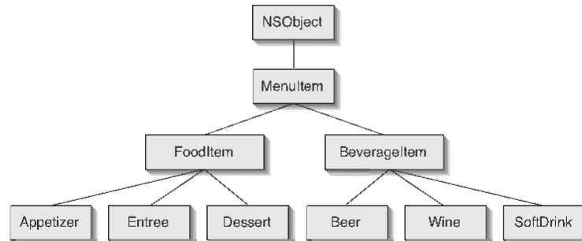

图 6.1 餐厅运营程序的类层次结构

当你从根类沿着类层次结构向下移动时，你从通用转向具体。在图6.1中，`MenuItem`类将拥有项目的实例变量，例如价格和总卡路里，这些是餐厅提供的每项物品共有的。`BeverageItem`类将添加特定于饮料的实例变量，例如是否免费补充。

+ 1. 这部分不是假设的。截至2008年7月，纽约市许多餐厅被要求在菜单上列出食物和饮料的热路里。

如果没有区分食物和饮料，你就不需要中间的`FoodItem`和`BeverageItem`类了。层次结构中最低的类是最具体的。例如，`wine`类将包含仅与葡萄酒品种、年份和酒庄名称相关的信息。

## 抽象类 (Abstract Classes)

在上一节中，`MenuItem`、`FoodItem`和`BeverageItem`都是类。抽象类是一种旨在作为子类化模板的类。你通常不会创建抽象类的实例。直接创建一个菜单项目是没有意义的。你无法吃或喝掉“菜单”这个抽象概念。但通过在子类中实现存储菜单项目价格和卡路里的功能，该功能将自动供抽象类的所有子类使用。在这个例子中，你只需要编写抽象类的代码并获取六次项目的价格。如果没有抽象类，你必须写写一次卡路里数值。抽象类不仅节省精力，而且出错概率要低得多。

某些抽象类声明了要求其子类实现的方法。`MenuItem`类必须定义一个`menuBlurb`方法来提供描述菜单项目的文本。`MenuItem`类将为`menuBlurb`提供一个空的（什么都不做的）实现，而它的非抽象后代将重写它，以提供类特定文本的实现。目前没有方法可以强制子类重写某个方法。但是，如果用户在创建子类时忘记重写“需要”的方法，你可以通过记录任何调用抽象类实现的尝试来向用户发出警告。在这种情况下，`MenuItem`的`menuBlurb`实现如下：

```objc
-(NSString*)menuBlurb

{

	NSLog("Warning: concrete subclass must override menuBlurb.");

	return nil;

}
```

还可以创建“半抽象”类。这些类在实例化时是有用的，但需要子类化来执行功能。Cocoa框架中一个著名的例子是`NSView`，它代表屏幕的一个区域。纯`NSView`实例提供一些功能，它可以作为其他视图（称为子视图）的容器。但要在视图中绘制任何内容，你必须定义`NSView`的自定义类并重写`drawRect:`方法。同样，如果你需要用户响应输入，你的视图必须是`NSView`的子类，并重写多个事件处理方法，如`mouseDown:`。

## 类或方法没有特殊语法

Objective-C没有抽象（abstract）的显式语法。如果你有一个本质上是抽象类的类，你应该在文档（类头文件和任何文档）中注明。与Java或C++中的抽象类不同，没有方法可以防止他人继承。Objective-C也没有声明类抽象或虚函数的语法。如果你正在创建一个抽象类，你应该为你要求子类实现的方法提供实现。如果你的抽象类声明了这些方法但没有实现，你将得到编译器警告；如果你随后继承该抽象类仍然忘记提供实现，那么在调用该方法时将得到运行时错误。

## 创建对象

创建Objective-C对象需要两个步骤：分配和初始化。分配步骤由类方法`alloc`处理，所有类都继承自`NSObject`。初始化步骤从堆上填充对象的内存；初始化步骤填充任何需要初始值的实例变量，获取对象所需的资源，并返回完成对象的指针。这两个步骤通常合并在一个语句中。

```objc
例如：[[Object alloc init];
```

接下来的章节将详细介绍这些步骤。

## 对象分配

对象分配由类方法`alloc`处理，所有类都继承自`NSObject`。

Note

你将在下一章学习更多关于对象类和类方法的知识。现在你只需要知道在调用类方法时，使用类对象或更常用的类名作为接收者。

`alloc`执行了几项操作：

+ - `alloc`为新对象分配内存并返回一个指向内存的指针。

`alloc`填充了对象的`isa`实例变量。编译器会自动为每个对象实例添加一个名为`isa`的实例变量。`isa`指向一个关于对象类信息的结构体。

`alloc`将`dealloc`释放的内存清零。除了`isa`之外，所有实例变量的初始值均为零。

`alloc`将新创建对象的接收者设置为`self`。通过发送`alloc`消息创建对象的代码负责在最终向该对象发送`release`或`autorelease`消息来平衡`alloc`的操作。（`autorelease`在第14章“引用计数”中介绍。）

`alloc`返回的对象将成为`init`消息的接收者。`init`执行任何必要的初始化工作，并返回指向完全构造对象的指针。

## new

`new`是Next时代的遗留物。如果你被要求处理某些遗留代码，可能会看到它。它是一个类方法，在一步中结合了分配和初始化：

```objc
myFoo = [Foo new];
```

* * `new`等同于（目前实现的）`alloc`后紧跟`init`。`init`并没有过时，但在现今很少使用。当初始化对象需要通过参数传递信息给`init`过程时，无法使用它。大多数人更倾向于对所有对象分配使用一致的`alloc`模式。

## alloc 和 allocWithZone:

OS X将堆（动态分配字节的源内存区域）划分为称为`malloc zones`的区域。类方法`allocWithZone`允许你指定为对象的字节使用哪一个zone。

`alloc`被实现为`allocWithZone: nil`。`allocWithZone`的`nil`参数从默认的`malloc zone`获取字节。使用默认`malloc zone`的zone是一种特殊技术，在某些情况下可能会导致问题。Apple目前不建议使用它们，因此你应该在对象分配中使用内联的`alloc`。

## 对象初始化

Objective-C初始化方法是带有`init`单词的方法。如果你正在设计的类get对象不需要任何特定的初始化，你可以使用初始化方法`init`，所有类都继承自`NSObject`。`NSObject`对`init`的实现除了返回`self`之外什么都不做。如果你的类实例需要自定义初始化（例如将实例变量设置为特定值、注册回调或获取资源），你必须重写`init`并提供你自己的实现。

## init 的形式

这里是`init`实现的典型形式：

```objc


1. `- (id)init`

2. `{`

3. `if (self = [super init])`

4. `{`

5. `// 类特定的初始化`

6. `}`

7. `return self;`

8. `}`

查看上述代码：

- 第 3 行：（是的，那只有一个等号 `=`）。这行代码调用了父类的 `init` 方法来初始化对象的父类部分。父类初始化返回的对象被赋值给变量 `self`。记住 `self` 是编译器添加到所有方法中的一个隐藏参数。
- 对 `self` 的赋值是必要的。当调用 `init` 时，`self` 的值是向原始接收者（由 `alloc` 返回的对象）的指针。然而，父类的 `init` 可能会失败并返回 `nil`，或者它可能会返回原始接收者并分配（分配）一个不同的对象。由于 `self` 最终用于返回指向已初始化对象的指针，因此你必须将其设置为父类返回的对象。
- 第 5 行：如果父类返回了一个非 `nil` 对象，你就可以进行任何必要的初始化。
- 第 7 行：最后，你必须记住返回新创建对象的指针。如果你忘记了，该方法的返回值将是垃圾值。

## init 的返回类型

你可能注意到（并感到惊讶）`init` 方法返回的是 `id` 而不是特定类的实例。对此有两个原因：

- 如所述，一个 `init` 方法可能会接收一个接收者，并将其替换为属于原始接收者子类的对象。这在实现为类簇（cluster）的类中很常见。

类簇（cluster）的设计初衷是让一个公共类管理一组私有子类。当你分配并初始化一个公共类的实例时，你实际上接收的是其中一个私有子类的实例。许多常见的 Foundation 对象（如 `NSString`、`NSArray` 和 `NSDictionary`）都是类簇的示例。请参见第 9 章“Foundation 类”。

同一个 `init` 方法可以用于不同类的接收者。将 `init` 方法的返回值类型标记为 `id` 允许该方法被自声明该方法的原始类的类继承并使用。

## 结合 alloc 和 init

将分配和初始化合并为一条语句是一种通用的惯用法：

```
Foo* myFoo = [[Foo alloc] init]; // 正确
```

这样做可以防止这种错误：

```
Foo* myFoo = [Foo alloc]; // 错误！
[myFoo init];
```

上面的代码有什么问题？它丢弃了 `init` 的返回值。如果它替换了一个属于请求类子类的对象（如果 `Foo` 是一个类簇，可能会发生这种情况），或者初始化失败并返回 `nil`，那么 `myFoo` 将保留一个指向已返回堆内存的指针。

以下代码在技术上是正确的，但它过于冗长且是一种糟糕的做法，因为它可能导致你将 `init` 的返回值赋值给 `myFoo`：

```
// 技术上正确但冗长且做法糟糕
Foo* myFoo = [Foo alloc]; myFoo = [myFoo init];
```

> 注意
> 类簇（class cluster）是一种设计模式，在一个可见的抽象类后面隐藏了许多私有子类。当你请求公共类的实例时，你接收的是其中一个私有子类的实例。请参见第 9 章“常用类”。

## 带参数的初始化器

如果你想将类中的一个变量初始化为特定值怎么办？那么你需要一个带有参数的初始化器，以便传入该值。（默认初始化器除了每个类继承自 `NSObject` 之外并不特殊。）

> 注意
> 如果你想让实例变量的初始值为零，则不需要使用参数。与函数或方法变量不同，实例变量在对象创建时（通过 `alloc`）初始化为零。

例如，假设你正在设计一个 `TeeShirt` 类。`TeeShirt` 类有一个 `NSInteger` 实例变量 `shirtSize` 来存储尺寸。在创建 `TeeShirt` 对象时设置尺寸的初始化方法如下：

```
- (id)initSize:(NSUInteger)inSize
{
    if (self = [super init]) {
        shirtSize = inSize;
    }
    return self;
}
```

- 通用的习惯是用 `init` 开头命名初始化器。带参数的初始化器通常具有 `initWithFoo:` 的形式，`Foo` 是初始化器设置的属性。（我使用 `init...` 作为“初始化方法”的缩写。）

初始化器可以有多个参数。如果你重新设计 `TeeShirt` 类以增加一个存储颜色的额外变量，你应该丢弃原始的 `initSize:` 并添加一个同时设置尺寸和颜色的初始化器：

```
- (id)initSize:(NSUInteger)inSize
      color:(NSColor*)inColor
{
    if (self = [super init]) {
        shirtSize = inSize;
        shirtColor = inColor;
    }
    return self;
}
```

在第 7 行，`retain` 管理是必要的，以确保 `NSColor` 对象在使用时不会被释放。`retain` 管理必须在 `TeeShirt` 的 `dealloc` 方法通过 `release` 方法来平衡。

当有变量需要初始化时，你可以设计只设置参数中某些值的初始化器。其他变量被设置为默认值。这里有一个 `TeeShirt` 类的初始化器，它直接设置 `shirtSize`，但将 `shirtColor` 设置为默认颜色：

```
- (id)initSize:(int)inSize
      color:whiteColor
NSColor *defaultShirtColor = [NSColor whiteColor];
if (self = [super initWithSize:inSize]) {
    shirtColor = defaultShirtColor;
}
return self;
```

## 创建对象

请注意前面的代码遵循了不同的模式：`initWithShirtSize:` 为衬衫颜色获取一个默认值，然后调用 `TeeShirt` 的初始化器之一 `initWithShirtSize:color;` 来执行初始化对象的实际工作。

## 指定初始化器

每个类必须至少有一个指定初始化器（designated initializer）。指定初始化器是能够完全初始化类实例的初始化器。指定初始化器通常是参数最多或负责设置对象工作的初始化器。对于不需要初始化器的类，指定初始化器就是 `init`。

在前面的 `TeeShirt` 示例中，`initWithShirtSize:color` 是 `TeeShirt` 类的指定初始化器。使用 `initWithShirtSize:color` 会产生一个完全初始化的 `TeeShirt` 实例。

为类设计初始化器时，必须遵循两个规则：

1. 所有其他类的初始化器（非父类的）必须调用指定初始化器。`TeeShirt` 的 `initWithShirtSize:` 调用了 `TeeShirt` 的指定初始化器 `initWithShirtSize:color;`。
2. 类的指定初始化器必须调用其父类的指定初始化器。指定初始化器是唯一调用父类指定初始化器的初始化器。

`TeeShirt` 遵循了这些规则：

1. `initWithShirtSize:` 调用了 `TeeShirt` 的指定初始化器 `initWithShirtSize:color;`。
2. `initWithShirtSize:color` 调用了父类的指定初始化器（`NSObject` 的 `init`）。

注意

> 你（如同 Cocoa 框架那样）会在类的类的文档中注明哪一个初始化器是指定初始化器。然而，尽管需要遵循上述规则，但在 Objective-C 语法中并没有“指定初始化器”的正式概念。

现状

```
TeeShirt *shirt = [[TeeShirt alloc] init];
```

`TeeShirt` 没有重写 `init`，因此在上一行代码中调用的是 `NSObject` 对 `init` 的实现。`NSObject` 并不知关于 `TeeShirt` 的任何信息。新创建的 `TeeShirt` 实例的 `shirtSize` 和 `shirtColor` 将处于错误的、未初始化的状态。为了在这种情况下让 `TeeShirt` 实例得到妥善初始化，你必须重写 `init` 并在重写内部调用 `TeeShirt` 的指定初始化器：

```objc
(id)init {
    NSUInteger *defaultShirtSize = 36;
    NSColor *defaultShirtColor = [NSColor white];
    return [self initWithShirtSize:defaultShirtSize
                           color:defaultShirtColor];
}
```

图 6.2 显示了 `TeeShirt` 类初始化器调用的模式。带有阴影背景的框是该类的指定初始化器。

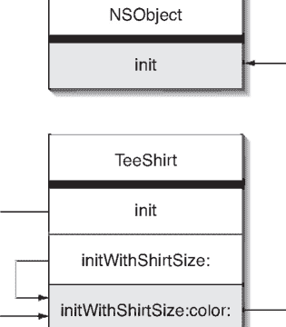

图 6.2 `TeeShirt` 类的初始化器。阴影框是指定初始化器。

如果你的类的指定初始化器与其父类不同（名称不同），你必须重写你类祖先类中声明的任何 `init...` 方法，并在重写方法中调用你类的指定初始化器。在实践中，这并没有听起来的那么困难。Objective-C 的层级结构通常不很深，在大多数情况下，只有少数初始化器需要关注。

## 初始化失败

如果无法成功初始化一个对象会发生什么？也许你的对象运行所需的某些资源不可用。如果发生这种情况，你应该优雅地进行清理失败工作。

## 创建对象

1. 执行任何未由 `dealloc` 处理的清理工作。例如，如果你创建了一个临时对象或连接，它们通常会在 `init` 方法稍后释放，那么它们在返回之前需要释放。
2. 释放 `self`。因为 `self` 是通过 `alloc` 创建的且引用计数为1，你必须用 `release` 来平衡 `alloc`。
3. 返回 `nil`。这向调用代码指示初始化失败且没有创建对象。

> 注意
> 在初始化方法内部执行 `[self release]` 会导致对象的引用计数降零，从而导致对象的 `dealloc` 方法被调用（见下一节“销毁对象”）。如果你的类要求你处理初始化失败，你必须确保在该点调用类的 `dealloc` 方法是安全的。

例如，假设你有一个对象，它包含两个作为数组对象的实例变量：`array1` 和 `array2`（`NSArray` 在第 9 章中介绍；此示例中你不需要了解它们的任何细节）。此外，假设两者都必须妥善初始化，对象才能正常工作；每个都被分配为一个数组，并使用 `NSArray` 初始化方法 `initWithContentsFile` 从文件内容进行初始化。如果指定路径没有文件，`initWithContentsFile` 将失败并返回 `nil`。如果发生这种情况，你的对象就无法妥善初始化，所以你应该进行清理并返回 `nil`。

以下代码显示了如何处理这种情况：

```objc
- (id)init {
    if (self = [super init]) {
        array1 = [[NSArray alloc] init];
        if (array1 == nil) {
            [self release];
            return nil;
        }
        array2 = [[NSArray alloc] initWithContentsFile:"/Users/rclair/stuff"];
        if (array2 == nil) {
            [self release];
            // 处理 array1 的逻辑
        }
    }
    return self;
}
```

（注：用户提供的第 148-149 页 OCR 文本在代码块中存在严重的损坏/交叉。我根据标准的 Objective-C 模式和文中提供的上下文重构了逻辑流。）

## 第 6 章 类与对象

## 销毁对象

> 注意
> 在执行 `[self release]` 后，`self` 所持的对象不再有效。你不应该在调用 `release` 和返回 `nil` 之间执行任何引用 `self` 的代码。如果不遵守这条规则并执行了违规代码，会导致程序崩溃。

## 销毁对象

当你完成使用对象时如何移除它们？妥善处置不需要的对象是非常重要的，在 Objective-C 中对象的字节可以返回堆。

如果你使用引用计数，当你完成使用你创建或保留的对象时，使用 `release` 消息。如果该 `release` 消息将对象的计数减零，`release` 方法会调用对象的 `dealloc` 方法。对象的 `dealloc` 方法应该：

1. 向对象创建或保留的任何对象发送消息。
2. 调用父类的 `dealloc` 方法。

前节类 `TeeShirt` 的 `dealloc` 方法如下：

```objc
(void)dealloc {
  [super release];
  [shirtColor release];
}
```

在以下代码中，`shirtColor` 持有一个对象（`NSColor` 对象），该对象在 `TeeShirt` 实例创建时被保留了。当它即将消失时，`TeeShirt` 对象必须发送 `release` 消息。否则，`shirtColor` 持有的对象将成为潜在的内存泄漏。

`[super dealloc]` 这一行非常重要。它是 `NSObject` 对 `dealloc` 的实现，负责将对象的字节返回堆。如果在你的类和 `NSObject` 之间的继承链中，任何一个类忘记在自己的 `dealloc` 中调用 `[super dealloc]`，`NSObject` 的实现就不会被调用。用于存储的字节将泄漏。如果你忘记了 `[super dealloc]`，编译器会通过警告帮助你。

136 第 6 章 类与对象

> 注意
> 请小心拼写，如果你拼写错误并不小心将你的释放方法命名为 `dealloc` 或其他拼写错误，那么调用的将父类的 `dealloc`。你实现的 `dealloc` 应该释放的任何对象都将泄漏。编译器不会对此警告你。它认为 `dealloc` 只是你为子类声明的另一个方法。

当你编写一个 `dealloc` 方法时，`[super dealloc]` 消息应该是方法的最后一行。在 `[super dealloc]` 返回后，对象已经被销毁；对它的任何引用都是无效的。

例如，考虑在 `NamedAccumulator` 类的 `dealloc` 方法中添加一条最后的日志语句（参见列表 6.4）：

```
+ (void) dealloc
{
  // 错误！
  [super dealloc];
  NSLog("#the final total of %% is %d", [self name], [self total]);
  [name release];
}
```

当执行 `dealloc` 方法时，程序会崩溃：

```
+ [-NamedAccumulator name]:
  message sent to deallocated instance 0x1010d6b0
```

编写此方法的正确方法如下：

```
+ (void) dealloc
{
  // 正确
  NSLog("#the final total of %% is %d", [self name], [self total]);
  [name release];
  [super dealloc];
}
```

在前面的代码中，还要注意 `[self name]` 消息在 `[name release]` 消息之前。释放实例变量可能会导致它被销毁。

## 拷贝对象

复制对象比表面看起来要困难得多，这归功于一些可以被认为是误导性广告的内容。`NSObject` 实现了一个名为 `copy` 的方法。看到这里，你可能会忍不住直接使用继承的 `copy` 方法来拷贝你的某个一个对象：

```objc
SomeClass *anobject = {[SomeClass alloc] init];
SomeClass *anobjectCopy = {[anobject copy] initWith:];
```


这段代码会带有一个警告通过编译，但除非 `SomeClass` 经过正确编码，否则会导致立即崩溃。

`NSObject` 的 `copy` 实现调用了一个名为 `copyWithZone:` 的方法，并带有一个 `nil` 参数。问题在于 `NSObject` 没有实现 `copyWithZone:`。`NSObject` 无法实现 `copyWithZone:`，因为它不知道特定子类应该实现什么类型的拷贝，或者该子类是否应该允许拷贝。

> 注意
> `copyWithZone:` 允许你在获取拷贝字节时指定使用哪个 `malloc zone`。`copy` 与 `copyWithZone` 的关系与 `alloc` 与 `allocWithZone` 的关系相同。Apple 现在不建议使用除在带有 `nil` 参数调用 `copyWithZone:` 时使用的默认 zone 外的任何 zone。

允许采用 `NSopying` 协议的类在第 13 章“协议”中有所介绍，但只需这意味着该类需要实现 `copyWithZone:` 就足够了。在尝试拷贝 Cocoa 框架对象时，确保该对象的 `copy` 遵循了 `NSopying` 协议（这在类的文档中会有说明）。

如果你想为你自定义的类创建副本，你必须对你的类应该提供什么种类型的拷贝做出决定。接下来的两个部分将介绍在为你的类设计 `copyWithZone:` 时你应该考虑的一些问题。

## 浅拷贝与深拷贝

如果你正在拷贝的对象中的任何变量持有指针（指向对象或 `malloc` 内存），你必须决定是否用原始对象中的相同指针填充你新创建的副本的相应实例变量。如果你给你的新副本原始指针，你就是在进行**浅拷贝**。另一种方法是顺序拷贝每个子对象，并将子拷贝交给你的新对象。这种类型的拷贝被称为**深拷贝**。

你应该做哪一个？这个问题在抽象层没有答案。这是你需要在设计类时，根据程序的要求必须做出的决定。以下是相关问题：

- 浅拷贝会让副本和原始对象纠缠在一起。如果你通过更改一个共同持子对象的状态来更改一个对象，那么该更改将同时反映在原始对象和副本中。
- 深拷贝会留下两个完全独立的对象（只要任何被拷贝的子对象本身实现了深拷贝），但执行深拷贝的操作（在执行时间和内存方面）比浅拷贝要昂贵得多。
- 浅拷贝会让副本和原始对象纠缠在一起。如果你通过更改一个共同持有子对象的状态来更改一个对象，那么该更改将同时反映在原始对象和副本中。
- 深拷贝会留下两个完全独立的对象（只要任何被拷贝的子对象本身实现了深拷贝），但执行深拷贝的操作（在执行时间和内存方面）比浅拷贝要昂贵得多。
- 浅拷贝会让副本和原始对象纠缠在一起。如果你通过更改一个共同持有子对象的状态来更改一个对象，那么该更改将同时反映在原始对象和副本中。
- 深拷贝会留下两个完全独立的对象（只要任何被拷贝的子对象本身实现了深拷贝），但执行深拷贝的操作（在执行时间和内存方面）比浅拷贝要昂贵得多。
- 浅拷贝会让副本和原始对象纠缠在一起。如果你通过更改一个共同持有子对象的状态来更改一个对象，那么该更改将同时反映在原始对象和副本中。
- 深拷贝会留下两个完全独立的对象（只要任何被拷贝的子对象本身实现了深拷贝），但执行深拷贝的操作（在执行时间和内存方面）比浅拷贝要昂贵得多。
- 浅拷贝会让副本和原始对象纠缠在一起。如果你通过更改一个共同持有子对象的状态来更改一个对象，那么该更改将同时反映在原始对象和副本中。
- 深拷贝会留下两个完全独立的对象（只要任何被拷贝的子对象本身实现了深拷贝），但执行深拷贝的操作（在执行时间和内存方面）比浅拷贝要昂贵得多。
- 浅拷贝会让副本和原始对象纠缠在一起。如果你通过更改一个共同持有子对象的状态来更改一个对象，那么该更改将同时反映在原始对象和副本中。
- 深拷贝会留下两个完全独立的对象（只要任何被拷贝的子对象本身实现了深拷贝），但执行深拷贝的操作（在执行时间和内存方面）比浅拷贝要昂贵得多。
- 浅拷贝会让副本和原始对象纠缠在一起。如果你通过更改一个共同持有子对象的状态来更改一个对象，那么该更改将同时反映在原始对象和副本中。
- 深拷贝会留下两个完全独立的对象（只要任何被拷贝的子对象本身实现了深拷贝），但执行深拷贝的操作（在执行时间和内存方面）比浅拷贝要昂贵得多。
- 浅拷贝会让副本和原始对象纠缠在一起。如果你通过更改一个共同持有子对象的状态来更改一个对象，那么该更改将同时反映在原始对象和副本中。
- 深拷贝会留下两个完全独立的对象（只要任何被拷贝的子对象本身实现了深拷贝），但执行深拷贝的操作（在执行时间和内存方面）比浅拷贝要昂贵得多。
- 浅拷贝会让副本和原始对象纠缠在一起。如果你通过更改一个共同持有子对象的状态来更改一个对象，那么该更改将同时反映在原始对象和副本中。
- 深拷贝会留下两个完全独立的对象（只要任何被拷贝的子对象本身实现了深拷贝），但执行深拷贝的操作（在执行时间和内存方面）比浅拷贝要昂贵得多。

## 可变与不可变类

正如你在第 9 章中看到的，某些类是不可变的。不可变对象的实例变量在创建后无法被修改。像 `NSArray` 这样的集合类是可变的。`NSObject` 的 `copy` 方法只是带有一个空参数调用 `copyWithZone:`。当然，你应该检查文档以确保该类支持拷贝。

> 注意
> Foundation 文档位于 http://developer.apple.com/Cocoa/Reference/Foundation/ObjC_class，AppKit 文档位于 http://developer.apple.com/Cocoa/Reference/AppKit/ObjC_class

例如，`NSArray` 允许拷贝。为了获取数组的可变拷贝（允许你添加元素），你可以编写：

```objc
NSArray *array = ...;
NSMutableArray *mutableArray = [array mutableCopy];
```

## 在你的类中实现拷贝

如果你的类实例应该是不可变的，你可以通过向你正在拷贝的对象发送额外的 `retain` 消息来实现 `copyWithZone:`，如示例所示：

```objc
- (id) copyWithZone:(NSZone*) zone
{
    return [self retain]; // self 是不可变类的实例
}
```

由于不可变对象不能被修改，原始对象和副本之间永远不会有任何区别。你可以将原始对象作为副本，只要你添加了 `retain`，正如所示，这样它在你准备释放它之前不会消失。

在更典型的情况下，你正在拷贝的对象是可变的，你必须为新对象分配内存，并根据原始对象的值初始化新对象。

实现 `copyWithZone:` 的通常建议是调用父类的来实现创建新副本并填充父类中定义的任何变量。子类的 `copyWithZone:` 实现部分然后填充子类中定义的任何变量并返回副本。

不幸的是，如果你的类是 `NSObject` 或任何没有实现 `copyWithZone:` 的类的子类，你就无法这样做。在这种情况下，你必须自己分配并初始化拷贝。使用 `TeeShirt` 类示例，`copyWithZone` 方法的首次尝试可能如列表 6.5 所示。

**列表 6.5 TeeShirt copyWithZone: (版本 1)**

```objc
- (id) copyWithZone:(NSZone*) zone
{
    id copiedTeeShirt = [[TeeShirt alloc] initWithZone:zone]; // 等待错误；
    [copiedTeeShirt initTeeShirtSize:[self tileSize] color:[self color]];
    return copiedTeeShirt;
}
```

这对于拷贝 `TeeShirt` 实例是有效的，但如果你决定要类化 `TeeShirt`，这就是一个等待错误。为了查看原因，定义一个 `STeeShirt` 类，通过在衣服前面添加一个字符串来扩展 `TeeShirt`，如下代码所示：

```objc
#import "TeeShirt.h"
@interface STeeShirt : TeeShirt
{
    NSString * slogan;
}
```

## 第 6 章 类与对象

```objc
-(void) setSlogan:(NSString*) slogan;
-(NSString*) slogan;
...
```

然后你可以为 `SloganTeeShirt` 类实现 `copyWithZone:` 方法，如列表 6.6 所示。

**列表 6.6 SloganTeeShirt copyWithZone:**

```objc
1 - (id) copyWithZone:(NSZone*) zone
2 {
   3 // 这是一个 BUG，因为父类的 copyWithZone
   4 // 代码是错误的
   5
6 id copiedSloganTeeShirt = [super copyWithZone:zone];
7 [copiedSloganTeeShirt setSlogan:[self slogan]];
8 return copiedSloganTeeShirt;
}
```

然而，这里存在一个问题：当执行第 6 行时，它会导致由于未识别的选择器（unrecognized selector）引起的崩溃。问题出在 `TeeShirt` 的 `copyWithZone` 实现上（参考列表 6.5）。当在 `TeeShirt` 的 `copyWithZone` 的第 6 行调用 `[super copyWithZone:zone]` 时，它返回的是一个 `TeeShirt` 对象，而不是一个 `SloganTeeShirt` 对象。

当执行第 6 行时，`copiedSloganTeeShirt` 中的 `TeeShirt` 对象被发送了 `setSlogan` 消息：由于 `TeeShirt` 没有实现 `setSlogan` 方法；这一会导致崩溃。

解决方案是修改列表 6.5，使得 `TeeShirt` 的 `copyWithZone` 返回一个与调用的接收者相同类的对象：如果以 `TeeShirt` 对象作为接收者进行调用，它返回一个 `copyTeeShirt`；如果以 `SloganTeeShirt` 对象作为接收者进行调用，它返回一个填充了父类实例变量的拷贝。

修正后 `TeeShirt` 的 `copyWithZone:` 版本如列表 6.7 所示。

**列表 6.7 TeeShirt copyWithZone: (版本 2)**

```objc
1 - (id) copyWithZone:(NSZone*) zone
2 {
   3 id copiedTeeShirt = 
4 [[self class] alloc] initWithZone:zone
5 initWithWithSize:[self selfSize] color:[self selfColor]];
6
7 return copiedTeeShirt;
}
```

这里的关键在于第 4 行。`[self class]` 是一个返回它指向的对象的类的消息。当 `TeeShirt` 的 `copyWithZone` 实现以 `TeeShirt` 对象作为接收者被调用时，`[self class]` 返回 `TeeShirt`，该方法返回的对象是一个 `TeeShirt` 对象。但当 `TeeShirt` 的 `copyWithZone` 实现以 `SloganTeeShirt` 对象作为接收者被调用时（如列表 6.6 的第 6 行所示），它是 `SloganTeeShirt` 的实例。`[self class]` 产生 `TeeShirt`。（回想，当使用 `super` 调用方法时，是在原始对象上调用父类的实现）。新创建的对象是 `SloganTeeShirt` 实例变量的拷贝。

最后，如果你作为 Objective-C 命名规范的一部分使用了 `copyZone`，那么你拥有返回给你的拷贝；结果是，当你完成对该拷贝的使用时，必须向该拷贝发送其名称中包含 "copy" 标识的 `release` 消息。在编写自己的 `copyZone` 方法时，你应该小心遵守这一惯例；确保返回一个引用计数为 1 的对象。在这些情况下，当你返回一个如列表 6.7 所示的新对象或从另一个方法获取的对象（如列表 6.6 所示）时，就满足了这一点。

## 总结

读完本章后，你应该理解如何定义一个类以及如何进行分配、初始化、销毁和拷贝。本章以及上一章关于消息传递的内容构 Objective-C 的核心。此时，你应该能够编写一个简单但完整的 Objective-C 程序。

## 练习题

- 创建 `RockStar` 类和 `Band` 类的骨架版本。`RockStar` 类应该有一个类型为 `Band` 的实例变量，而 `Band` 类应该有一个类型为 `RockStar` 的实例变量。
- 验证如果将 `Band.h` 导入 `RockStar.h` 并将 `RockStar.h` 导入 `Band.h`，类是否会冲突。
- 验证你可以通过将一个或两个导入替换为 `@class` 指令来解决这种状况。
- 创建一个小型测试程序并使用它验证 `NamedAccumulator` 类是否运行符合预期。（你必须将列表 6.1、6.2、6.3 和 6.4 中的代码添加到你的项目中）。
- 为 `NamedAccumulator` 类定义并编写一些初始化器。其中一个初始化器应该有一个 `NSString` 参数来设置名称，以及 `int` 参数来将 `total` 设置为初始值。第二个初始化器接收一个 `NSString` 参数作为名称，但将 `total` 设置为默认值零。确保你的初始化器遵循 Objective-C 命名规范。
- 你新定义的初始化器之一必须是该类的指定初始化器（designated initializer）。它应该是哪一个？
- 确保所有初始化器最终都会调用指定初始化器。
- 别忘记修复它。
- 使用练习题 2 中的测试程序验证你的初始化器是否工作正常。
- 为 `Accumulator` 和 `NamedAccumulator` 类实现拷贝功能。使用练习题 2 中的测试程序验证你的拷贝方法是否工作正常。
- 为 `Accumulator` 创建一个名为 `AveragingAccumulator` 的新子类。`AveragingAccumulator` 应该记录 `addToTotal` 方法被调用的次数总数。它还应该有一个返回数字的方法和一个名为 `averagePerTransaction` 的方法，可以报告所有 `addToTotal` 操作的平均值。使用测试程序验证你的新类是否工作正常。

# 第 7 章 类对象

在 Objective-C 中，与 Java 或 C++ 不同，类也是对象。类可以接收消息并执行方法。本章将查看类对象的技术细节，然后简述类方法。

## 类对象

Objective-C 中的每个类都由一个包含类的类的对象表示。你不需要任何操作来实例化类对象；编译器会创建它们。你已经见过最常见的例子是 `alloc` 方法：

```objc
id s = [NSString alloc];
```

> 注意：消息中的接收者是类名可以替代类对象的地方。

类对象不是类的实例。你不能将类对象作为实例方法的接收者。例如，`count` 是 `NSArray` 类的实例方法。它返回 `NSArray` 中对象的数量。如果你尝试将类对象作为接收者使用 `count`：

```objc
[NSArray count];
```

你会得到以下编译器警告：

```
testbed.m6: warning: 'NSArray' may not respond to '+count'
testbed.m6: warning: Messages without a matching method signature
testbed.m6: warning: will be assumed to return 'id' and accept
testbed.m6: warning: '...' as arguments.
```

如果你忽略警告并执行代码，程序将崩溃：

```
+ *** Terminating Argument due to unknown exception
'InvalidArgumentException'
reason: [NSArray count];
unrecognized selector sent to class 0x7fff7ebd28
```

尽管 Objective-C 类是对象，但它们没有变量。Objective-C 没有其他面向对象语言中的类变量。

> 注意：类变量是类全局的变量。相反，类变量只有一个拷贝，供类的所有实例共享。

然而，在本章稍后的“模拟类变量”部分，你将学习如何使用普通的外部变量来模仿类变量的功能。

## 类类型

类型为 `class` 的变量用于指向类对象的指针。你可以通过调用类名为接收者的类方法来获取类对象的指针：

```objc
Class class = [NSString class];
```

```
// a 现在持有指向 NSString 类的指针
```

> 注意：`Class` 本身是一个指针类型。在声明 `Class` 变量时不需要 `*`：
> `Class *someClass; // 错误！`

同样，使用类方法 `superclass` 获取一个类的父类的类对象：

```objc
Class class = [NSString superclass];
```

```
// a 现在持有指向 NSString 的父类 NSObject 的指针
```


# 类对象 (Class Objects)

> 注意
> 还有 `NSObject` 实例方法 `class` 和 `superclass`，它们返回对象的超类类。在使用你自己编写的类调用这些实例方法时，你应该非常小心。许多常用类实际上是类簇（class clusters）。当你请求一个类类的实例时，你可能会接收到原始类的一个私有子类的实例。在类簇实例上调用 `class` 的结果可能与你预期的不同。（参见第 9 章“Foundation 类”。）

类类型的变量可以代替类名作为类方法的接收者。这在你需要创建一个对象，但在运行之前尚无法确定该新对象的类时，这种情况下是很有用的。例如，你可以根据存储在配置文件中的字符串形式存储的类型来创建一个新对象：

```objc
NSString *classNameString = ... // 从文件中读取字符串
Class ClassToInstantiate = [NSString className:classNameString];
newObject = [[ClassToInstantiate alloc] init];
```

在接下来的代码中，`NSFromString` 是一个普通的 C 函数，它接收一个参数并返回一个指向对应类对象的指针。返回的指针存储在变量 `classToInstantiate` 中。最后，`classToInstantiate` 是类方法 `alloc` 的接收者，用于创建一个请求的类的新对象。

## 类型检查 (Type Inspection)

你可以像下面所示，使用 `NSObject` 方法 `memberOfClass:` 和 `isKindOfClass:` 来询问 Objective-C 对象的类成员身份：

```objc
[mysteriousObject memberOfClass: [Dog]];
```

如果 `mysteriousObject` 是 `Dog` 类的实例，则返回 `YES`，否则返回 `NO`；而下面的代码：

```objc
[mysteriousObject isKindOfClass: [Dog]];
```

如果 `mysteriousObject` 是 `Dog` 类或任何继承自 `Dog` 的类的实例，则返回 `YES`。如果你定义了一个作为 `Dog` 的子类 `ResuedDog`，那么当 `mysteriousObject` 是 `Dog` 或 `ResuedDog` 的任一实例时，上述语句将返回 `YES`。

你不应该依赖这些方法。如果你发现自己正在使用其中一种方法，你应该停下来，看看是否有更好的方法来实现相同的目标。例如，如果你手拿到了一个类型为 `id` 的对象，并且正试图查出它的类以查看向该对象发送特定消息是否安全，你应该使用 `respondsToSelector:`：

```objc
id mysteriousObject = ...
if ( [mysteriousObject respondsToSelector:@selector(rollOver)])
{
    [mysteriousObject rollOver];
}
```

上一个示例测试的是行为（对象是否响应要发送的消息），而不是类（这是你不应该关心的）（另请参见本章末尾的练习 2。）

## 类方法 (Class Methods)

类方法定义在类的类对象上。另一种说法是，类（或类名）而不是类的实例，是与类方法对应的消息的接收者。以下是其余细节：

- 类方法的声明以加号 `+` 开始。例如，`alloc` 的声明是：
  `+ (id) alloc`

- 类方法的声明和实现分别在类的 `@interface` 和 `@implementation` 部分中，就像实例方法一样。它们通常被放置在实例方法之前，但这是一种约定，并不是强制要求的。

- 类方法无法直接访问类中定义的任何实例变量或类的实例。（如果它可以这样做，那就没有意义了。假设你创建了该类的四个实例，每个实例在某一个实例变量上都有不同的值。如果类方法访问了实例变量，它将得到什么值呢？）

- 像实例方法一样，类方法会被子类继承。子类可以重写继承的方法。例如，如果你创建一个新类，你可以重写 `NSObject` 中类方法 `description` 的实现，并返回一个带有自定义描述的字符串。

- 类可以拥有与类实例方法同名的类方法。运行时（runtime）处理它的方式与任何其他方法调度一样。发送给接收者的消息：如果接收者是类对象，则最终调用的是类方法；如果接收者是类的实例，则调用的是实例方法。

- 在编写类方法时，有一个非常重要的点需要记住：类方法中的 `self` 指的是类对象，而不是类的实例。如果你忘记了这一点，不仅会导致错误或崩溃，而且你会发现问题的原因将变得非常困难。

## 其他类方法 (Other Class Methods)

类的主要功能是充当工厂对象来创建该类的实例。正如我们在上一节中看到的，你通过类方法 `alloc` 来创建对象。接下来的两个部分涵盖了类经常定义额外类方法的领域。方便构造函数和单例是 Cocoa 框架中常见的模式，你可能希望在某些类中使用它们。

## 方便构造函数 (Convenience Constructors)

许多 Cocoa 框架类定义了方便构造函数，它们将分配和初始化合并在一个方法中。`NSString` 类方法就是一个典型的例子。它返回一个已初始化的空字符串：

```objc
NSString *emptyString = [NSString string];
```

`NSString` 提供了许多其他构造函数，如 `stringWithLength:` 和 `stringWithCharacters:`（完整列表请参阅 http://developer.apple.com/library/documentation/Cocoa/Reference/NSString_Class/NSString.html）。当一个类定义了多个不同的 `init...` 方法时，它通常会将每个 `init...` 与一个带有相同参数的方便构造函数匹配。

在使用引用计数使用方便构造函数时，有一个重要的点需要注意：你不拥有方便构造函数返回的对象（该构造函数的名称不包含 "alloc" 或 "copy"）。如果你希望从方便构造函数获取的对象在当前环境中之外（例如将其存储在实例变量中），你必须通过保留它来获取所有权。如果不这样做，对象可能会在未来的某个时间消失。考虑以下示例：

```objc
NSArray *arrayOne = [[NSArray alloc] initWithObjects:@"NSString", nil];
NSArray *arrayTwo = [[NSArray alloc] initWithObjects:@"NSString", nil];
```

对于 `arrayOne`，因为你是通过 `alloc` 创建的，你拥有它。当你完成对 `arrayOne` 的使用时，必须发送 `release` 消息。相反，你不拥有 `arrayTwo`，它是从方便构造函数获取的。如果你希望 `arrayTwo` 保持存，你需要发送 `retain` 消息。

# 创建方便构造函数 (Creating a Convenience Constructor)

假设你有一个 `Dog` 类。你可以这样创建一个方便构造函数，返回一个已初始化的 `Dog` 实例：

```objc
+ (id)dog
{
    return [[Dog alloc] init] autorelease];
}
```

`alloc` 创建的引用数为1。`autorelease` 完成了你平衡 `alloc` 的义务。

## 自动释放 (Autorelease)

在引用计数下，当你使用名称不包含 "alloc" 或 "copy" 且以 "new" 开头的方法创建一个对象时，返回对象的引用数为1。你最终负责通过发送 `release` 消息来平衡对象的创建。在某些情况下，这种要求产生了一个尴尬的问题。如果你有一个方法创建一个对象作为返回值，你必须在该方法内部通过 `release` 消息来平衡对象的创建。但发送新创建的 `release` 消息会导致它在使用之前就被销毁。你需要一种方法来注册 `release`，但延迟它的执行。这就是 `autorelease` 消息起的作用。当对象接收 `autorelease` 消息时，对象的指针会被添加到自动释放池中。当池清空时，池中的所有对象都会接收 `release` 消息。如果一个对象接收了多个 `autorelease` 消息，它会为收到的每个 `autorelease` 消息接收一次 `release` 。在 GUI 程序中，池通常在运行（事件）循环的底部清空。对于引用计数计算而言，自动释放发生在未指定的未来时间。引用计数将在第 14 章详细介绍。

当你使用实例构造函数时，如果你打算保留它，必须记住对返回的 `Dog` 获取所有权：

```objc
Dog *spot = [Dog dog];
[spot retain];
```

```objc
+ (id) dog
{ return [[self alloc] init autorelease];
}
```

因为 `dog` 是一个类方法，`self` 指向作为接收者的类对象。修改后的方便构造函数现在对 `Dog` 和 `RescueDog` 都能正常工作。

`[Dog]` 返回一个 `Dog` 实例，
`[RescueDog]` 返回一个 `RescueDog` 实例。

> 注意
> 方便构造函数通常被类型为返回 `id` 而不是类的实例，这样它们就可以被子类继承。

当返回的对象仅在调用该方便构造函数的上下文中使用时，通常会使用方便构造函数。你从方便构造函数获取一个对象，然后在方法的剩余部分使用它。由于你没有持有该对象，因此不需要对其进行 `retain`。返回对象的内存管理将由方便构造函数通过将对象放入自动释放池（`autorelease`）来完成。然而，如果对象很大，或者你在 iOS 程序中遇到了内存问题，更好的做法是使用 `alloc ... init` 序列创建对象，并在完成后立即 `release` 该对象。这可以最大限地减少使用该对象时对内存的影响。

## 单例模式

单例是一个只有一个共享实例的类。单例类通常用于封装操作系统或 UI 元素（如面板）。以下是单例的典型设置：

```objc
+ (InspectorPanel*) sharedInspectorPanel
{
    static InspectorPanel *inspectorPanel = nil;
    if (! inspectorPanel)
    {
        inspectorPanel = [[InspectorPanel alloc] init];
    }
    return inspectorPanel;
}
```

你创建了唯一的共享 `InspectorPanel` 实例，并将其存储在静态变量中。
当你向类对象发送 `sharedInspectorPanel` 消息时，它返回存储在静态变量中的指针。
这段代码还说明了懒性实例化。在第一次请求共享实例之前，你不会创建它。这是 Cocoa 程序中的一种常见模式。懒性实例化可以缩短程序的启动时间。你需要在需要时创建对象，而不是在程序启动时一次性创建。

> 注意
> 要了解设计模式以及如何使用它们来改进代码，请参考 Erik M. Buck 和 Donald A. Yackman 编写的《Cocoa Design Patterns》（Addison-Wesley, 2010）。

## 初始化类

Objective-C 运行时允许你在使用类之前对其进行初始化。当类对象第一次接收消息时（通常是创建该类第一个实例的 `alloc` 消息），运行时会捕获并向类对象发送一个 `initialize` 消息。`initialize` 消息在原始消息传递之前被发送。

> 注意
> 使用 `initialize` 来初始化类与使用 `init...` 方法来初始化类的实例不同。

继承自 `NSObject` 的默认 `initialize` 方法什么都不做。大多数类都不需要初始化，但在少数情况下，你可能想要重写 `initialize`：

- `Foundation` 框架提供了一个单例类 `NSUserDefaults`，用于管理程序与 Mac OS X 系统的交互（默认系统按用户管理偏好设置和其他值）。你可以在 `initialize` 方法内部使用 `NSUserDefaults` 实例为你的类使用的任何偏好项设置默认值或获取当前值。
- 如果你的类使用实例变量来模拟类变量，你可以在 `initialize` 中执行任何初始化这些变量的工作。

例如，假设你有一个模拟从公共资金池工作的交易员的类。`Trader` 类本身使用一个额外变量管理资金池。你使用 `NSUserDefaults` 系统在游戏会话之间存储资金池的值。当游戏重启时，使用 `Trader` 类的 `initialize` 方法从默认设置中恢复 `currentMoneyPool` 的值：

```objc
static NSInteger currentMoneyPool;

@implementation Trader

// 模拟类变量
+ (void) initialize
{
    currentMoneyPool = [[NSUserDefaults standardUserDefaults] integerForKey: @"MoneyPool"];
}
...
@end
```

当 `Trader` 类第一次接收消息时，`initialize` 方法检索保存的资金池值并存储在外部变量 `currentMoneyPool` 中。

# initialize 的问题

`initialize` 有一个需要注意的潜在问题。如果你有一个重写了 `initialize` 的类，且该类有一个没有重写 `initialize` 的子类，那么原始类将接收两次 `initialize` 消息：一次是在原始类第一次使用时，另是在子类第一次使用时。这可能不是你想要的行为，你可以通过如下编写 `initialize` 方法来将初始化限制在原始类（假设为 `Dog`）上：

```objc
(void) initialize
{
    if (self == [Dog class]) {
        // 对 Dog 进行初始化
    }
}
```

注意

> 在理论上，在上述代码中，你可以跳过 `if` 语句所示的检查，并要求 `Dog` 的所有子类都实现 `initialize` 方法。但这是一个坏主意。这会让 `Dog` 类的正常运行依赖于所有子类的正确编码。如所示编写 `Dog` 类可以确保其初始化只发生一次，即使子类没有实现 `initialize`。

# 模拟类变量

正如在本章前面提到的，Objective-C 没有类变量。在大多数情况下，你可以通过在类的实现文件中使用文件作用域变量来模拟类变量。然后你可以定义类方法，允许你设置或获取外部变量的值，而不需要拥有该类的实例。

为了说明这一点，列表 7.1 和 7.2 显示了如何创建一个只能发行固定数量优惠券的 `Coupon` 类：

## 7.1 CouponDispenser/Coupon.h

```objc
#import <Foundation.h>

@interface Coupon : NSObject
{
    ...
}

+(int) numberCouponsLeft;
+(void) resetCoupon;

@end
```

## 7.2 CouponDispenser/Coupon.m

```objc
#import "Coupon.h"

#define INITIALCOUPON_ALLOCATION 100

static int availableCoupons = INITIALCOUPON_ALLOCATION;

@implementation Coupon

-(id)init
{
    if (self = [super init])
    {
        if (availableCoupons == 0)
        {
            [self release];
            return nil;
        }
        availableCoupons--;
    }
    return self;
}

+(int) numberCouponsLeft
{
    return availableCoupons;
}

+(void) resetCoupon
{
    availableCoupons = INITIALCOUPON_ALLOCATION;
}

@end
```

扩展中的静态变量。它们仅供内部使用，不应在公共头文件中可见。

> 注意

> 扩展（将在第 11 章“分类、扩展与安全”中介绍）将方法声明移动到实现文件中。它们提供了一种隐藏旨在供内部使用的方法声明的方法，使其对外部不可。接口部分以 `@interface` 开始，同一行后面紧跟被扩展的类名和一组空括号。它以通常的方式以 `@end` 结尾。在扩展中声明的方法在类的 `@implementation` 章节中以普通方式实现。

## 列表 7.3 CouponDispatcherFixed/Coupon.m


进入`/path/to/xxx`目录，找到`xxx.json`。

在表达式`cvar = avar + bvar`中，加法运算符（`+`）将`avar`与`bvar`相加，得到它们的和`cvar`

在`List.of(arg0, arg1, arg2)`中，`List`接口的工厂方法`of()`接受一系列的元素，返回包含它们的只读列表。

之后我们这样调用`cmd`命令：`cmd arg0 arg1 arg2`。

```
if (condVar > someVal) {console.log("xxx")}
```


```
NSAutoreleasePool *pool = [[NSAutoreleasePool alloc] init];

// 创建一个 NSString
NSString *nsString = @"Toll-Free";

// 将 nsString 转换为 CFString 并使用 CF length 获取其长度
CFStringRef cfString;
cfString = (CFStringRef)nsString; // 转换为 CFString
int length = CFStringGetLength(cfString);
NSLog("%CFString length is: %d", length);

// 创建一个 CFString
CFStringRef cfString2 =
    CFStringCreateWithCString(NULL,
    "Bridge",
    CFStringEncodingASCII);

// 将 CFString 转换为 NSString 并打印
NSString *nsString2;
nsString2 = (NSString*)cfString2;
NSLog("NSString is: %s", nsString2);

[pool drain];
```

当运行上述程序时，结果为：

```
NSString length is: 9
NSString is: Bridge
```

无免费桥接类的完整列表请见附录 B，“无免费桥接类”。

## Core Graphics

Core Graphics 是 Quartz 2D 图形的低层级 API。像 Core Foundation 一样，它是面向对象的，但直接用 C 语言编写。Quartz 实现了一种与设备无关的 2D 成像模型，该模型与 PDF（以前称为 PostScript）成像模型几乎完全一致。设备无关意味着框架中的所有点和尺寸都引用一个定义的浮点坐标系，而不是设备像素。最终，大多数图形会被转换为像素，但除非你正在创建位图路径，否则你很少需要直接考虑像素。

Core Graphics 提供了设置颜色、透明度和混合、创建路径（线条和塞尔曲线）、描边和填充路径、创建绘制图像和 PDF、绘制文本以及裁剪等设施。它还管理颜色空间和当前的绘图坐标系。

Core Graphics 的大部分功能已被封装在 Objective-C 对象中，并可以在 AppKit 框架中可用。但并非所有内容都经过封装了。如果你正在进行更高级的绘图，你可能需要直接调用 Core Graphics。幸运的是，你可以顺利地在 AppKit 对象消息和 Core Graphics 函数调用之间切换。尽可能在 AppKit 层面完成工作，然后将剩下的部分交给 Core Graphics。

iPhone 上的情况不同。UIKit 使用的 Core Graphics 组件较少。某些可以使用 AppKit 绘制的元素，在 iPhone 上需要使用 Core Graphics。

## 其他 Apple 提供的框架

> 注意

Core Graphics 在 *Programming with Quartz, 2D Graphics in Mac OS X*（作者 David Gelphman 和 Bunny Laden）中有详细介绍。

## Core Animation

添加动画是你的机会。某些动画一直是 Mac OS X 的一部分。从 dock 中拉出应用程序时的“烟雾”效果以及将内容最小化到 dock 的“通用”效果已经存在多年。但从 Leopard 和 iPhone 开始，许多以前静止的物体开始动起来。这种运动归功于 Core Animation，这是一个让动画变得简单的 Objective-C 框架。在最简单的水平，你只需要指定要动画的内容、移动到哪里（或者动画属性的最终值是多少），剩下的由 Core Animation 处理。

> 注意

关于 Core Animation 的深度解析，请参考 *Core Animation: Simplified Animation Techniques for Mac and iPhone Development*（作者 Marcus Zarra 和 Matt Long，Addison-Wesley，2009）。

## 其他 Apple 提供的框架

Apple 还提供了许多高层和低层框架。你需要用的一些包括：

- WebKit: 用于为应用程序添加 Web 内容和浏览器功能的 Objective-C 框架。
- ImageIO: 用于读写更多你熟悉的格式的 C 语言框架。
- Core Image: 使用 GPU 进行快速图像处理的 Objective-C 框架。
- CoreAudio: 用于音频处理的 C 语言框架。

虽然这些框架不是 Apple 编写的，但 Mac OS X 和 iOS 还提供了：

- OpenGL (Mac OS X) 和 OpenGL ES (iOS): 用于快速、硬件加速 3D 图形的 C 语言框架。
- OpenGL: 用于开源 OpenGL 库的 C 语言框架。

> 注意

你可以通过检查`/System/Library/Frameworks`目录的内容来查看 Mac OS X 上可用的更多框架。

## 第三方框架

一些公司和个人开发者提供了用于执行特定任务的 Objective-C 或 C 框架。这些框架可能是商业许可的，也可能是不同程度的“免费”。你可以像使用 Apple 提供的任何框架一样使用这些框架：通过将第三方框架添加到 Xcode 项目窗口中的 Frameworks 文件夹中来链接该框架。

这里唯一有一个复杂之处：如果你的应用程序在编译时时链接了某个框架，那么在运行该应用程序的任何系统上，运行时都必须存在该框架的副本。对于 Apple 提供的框架来说，这不是问题，因为这些框架保证已安装在任何功能正常的 Mac OS 系统上。但对于第三方框架，情况并非如此：

如果操作系统找不到应用程序所使用的框架副本，应用程序将在启动时崩溃：

```
Lld Error Message:
Library not loaded:
#@executable_path//
#@executable_path/Frameworks/VitalStuff.framework/Versions/A/VitalStuff
Referenced from: KillerApp.app/Contents/MacOS/KillerApp
Reason: image not found
```

为了防止崩溃，你必须在应用程序的 Xcode 项目中添加一个“拷贝阶段”（copy phase），将任何第三方框架拷贝到应用程序包的 Frameworks 目录中。

> 注意

> 如果你正在创建多个使用相同框架的应用程序，你的应用程序安装程序应该将该框架拷贝到`/Library/Frameworks`，以便它可以被共享。

创建自己的框架也是可能的。如果你开发了一组要在多个应用程序使用的类，你可能会这样做。你对这些类进行设计、编码和测试，然后使用 Xcode 将它们构建成框架。构建完成后后，你可以像使用任何其他第三方框架一样使用它——将新框架添加到应用程序的 Xcode 项目中，并确保该框架已拷贝到应用程序包中。

## 底层原理

从技术上讲，框架是带版本的包（bundles）。带版本的包的目录结构使得不同版本的内容可以共存。这允许框架的维护者向框架添加内容，同时为旧代码保留原始版本的框架。以下是典型的框架目录结构：

```
SomeFramework.framework/
SomeFramework@ -> Versions/Current/SomeFramework
Headers@ -> Versions/Current/Headers
Resources@ -> Versions/Current/Resources
Versions/
A/
SomeFramework*
Headers/
Resources/
Current/ -> A
```

上例中的框架仍然处于初始 (A) 版本。顶层项`SomeFramework`、`Headers`和`Resources`是符号链接，最终指向目录的当前版本。

> 注意

> 在上述列表中，符号链接通过目录名末尾的 @ 字符表示。包含可执行代码的文件带有尾随星号 (**)：

```
SomeFramework*
```

大多数情况下，你不需要翻找框架目录，但查看框架的头文件（header files）通常很有用。当框架的配套文档不清晰（或者第三方框架的作者忽略了提供足够的文档）时，这一点尤为真实。

某些框架是“伞型框架”（umbrella frameworks）——即包含其他框架的框架。本章之前描述的 Cocoa 框架就是伞型框架的一个示例。伞型框架提供的额外层次允许维护者自由地重新组织框架的子框架，而不会干扰框架的客户端。

应用程序特定的框架（App-specific frameworks）位于`/System/Library/Framework`目录。由系统上所有用户使用的应用程序安装的框架位于`/Library/Framework`目录。应用程序可以包含供自内部使用的私有框架。这些框架可以在应用程序包内部的 Framework 目录找到：`MyApp/Contents/Frameworks`。

Mac OS 和 iOS 还有许多供内部使用的私有框架。如果你在这里发现了这些框架之一，那么防止自己使用它是明智的。然而，使用私有框架是一个坏主意。它们可能会在未来的 OS 版本中发生更改或消失。此外，在 iOS 上，使用私有框架会导致你的应用被 App Store 拒绝。

## 总结

框架是包（目录层次结构），提供了对动态库的可执行代码和资源的便捷访问。所有的 Objective-C 程序都使用 Foundation 框架，它定义了任何非复杂程序所需的各种类。Mac OS X UI 程序使用 AppKit 框架中的类来构建其 UI；iPhone UI 使用 UIKit 框架中的类。Apple 还提供了许多用于音频和图形等特定任务的框架。其中一些是 C 语言框架，它们使用 Core Foundation 框架中定义的对象系统和内存管理函数。

## Common Foundation 类

Objective-C 是一种非常紧凑的语言。Objective-C 的强大之处源于其相关的类库，即框架。上一章涵盖了框架的一般主题。在本章中，我们将查看 Foundation 框架中的几个类。

Foundation 框架提供了基本实体的类，如字符串、数组、字典和对象。虽然可以编写不使用 Foundation 框架类的 Objective-C 程序，但使用 Foundation 类而不是自己创建等效类可以缩短开发时间并减少错误。

本章从关于 Foundation 类的一些通用信息开始，这些类具有不可变和可变版本，并以类簇（class clusters）的形式实现。接着对一些最常用的 Foundation 类进行概述：`NSString`、`NSArray`、`NSDictionary`、`NSSet`、`NSData` 及其它们的可变子类：`NSMutableString`、`NSMutableNumber`、`NSMutableDictionary`、`NSMutableSet` 和 `NSMutableData`。（注：原文为 "NSMutable" 和 "NSMutableNumber"，已根据语境更正）。

## 不可变类与可变类

Foundation 类是其他实体的容器，分为两种类型：不可变（immutable）和可变（mutable）。基础类是不可变的。当你创建一个不可变类的实例后，无法更改其内容。例如，如果你创建一个`NSArray`（不可变的）并想向其添加对象，你必须创建一个包含该对象的新数组并释放原始数组。可变容器类都是对应不可变类的子类。

创建可变和不可变类可以在不可变类的实现上实现某些效率。当你创建一个数组时，对象的数量在创建时是固定的。对象的实际存储可以是简单的固定大小内存块。可变数组必须使用更复杂的存储系统以便其增长或缩小。本章中不可变和可变类的对是`NSString`/`NSMutableString`、`NSArray`/`NSMutableArray`、`NSDictionary`/`NSMutableDictionary`、`NSSet`/`NSMutableSet`、`NSData`/`NSMutableData` 以及 `NSIndexSet`/`NSMutableIndexSet`。

## 类簇

`NSString`、`NSArray`、`NSNumber` 和 `NSData` 实现为类簇。类簇是在简单接口后面隐藏复杂性的手段。在簇中，公共类是一个抽象类。簇的实际实现由一组“具体的”子类提供，但它们的内部实现可能会为了优化存储或性能而异。当你请求公共类的实例时，选择是由私有子类的 init 方法决定的。

将类实现为簇会有若干后果：

- 实现为类簇的类的 init 方法会用具体子类的不同对象替换掉 alloc 返回的对象。簇的 alloc 方法返回一个属于特殊占位符类的临时对象。init 方法返回该临时对象，并返回一个簇子类的实例。这有一个重要的意义：你永远不要保留对 alloc 返回对象的强引用。将你的 alloc 和 init 写成一条语句：

```
SomeClassCluster *classCluster = [[SomeClassCluster alloc] init];
```

正如第 6 章“类与对象”所述，嵌套的 alloc, init 是创建对象的惯式。如果你习惯了使用标准惯式，就不需要考虑这个问题。

- 在实现为类簇的实例上，不应使用 `NSObject` 的内省方法 `isKindOfClassOfClass`。

```
NSArray *array = [NSArray arrayWithObject: @"Foo"];
BOOL test = [array isMemberOfClass:[NSArray class]];
```

在执行了上述代码后，test 为 NO，因为 array 是 `NSArray` 的私有子类的实例，而不是 `NSArray` 的实例。

- 对一个实现为类簇（class cluster）的类进行子类化比对简单类进行子类化要复杂得多。这是一个超出本书范围的高级技术。

# 这是一个类簇（Class Cluster）吗？

你如何知道一个特定的类是实现为类簇的？唯一的方法是阅读该类的文档。也许应该有这样一行代码：

```
+(BOOL)SomeClass isClass;
```

然而，目前还没有这样的方法。

## NSString

在 C 语言中，纯字符串是表示字符的字节数组，后面紧跟一个 NULL（零）字节。NULL 字节是确定字符串结束的一种廉价方法。C 字符串没有其他结构。

C 字符串非常适用于简单任务，但由于缺乏任何实际结构，它们容易引发各种问题和麻烦——缓冲区溢出、在应为字符串的内容中出现意外的零字节、忘记为 NULL 字节留出空间——对于任何种的字符串处理，使用起来通常都是痛苦的。

Foundation 通过创建一个字符串类 `NSString` 绕过了 C 字符串（及其相关对象）。`NSString` 有两种类型：一种是由编译器创建的常量对象 `NSStringStrings` 字面量，另一种是像 Objective-C 对象一样被分配的普通 `NSString` 对象。

你通过将文本放在双引号之间并加上前缀来创建字面量：

```
NSString *str = "Hello";
```

上一行代码声明了一个指向 `NSString` 的指针，并将其初始化为带有文本 "Hello" 的常量型 `NSString` 的地址。

除了字面量外，你可以通过常用的 init 序列或使用 `NSString` 的许多便利构造函数之一来创建 `NSString` 对象。下面的示例使用便利构造函数从存储在文件中的字符创建一个 `NSString`。

```
NSString *textFile =
[NSString stringWithContentsOfFile:@"Users/you/textfile.txt"
encoding:UTF8StringEncoding
error:NULL]; // 暂时忽略错误
```

注意文件路径参数本身就是一个 `NSString`。

> Note

> 字符编码是一个复杂的课题，且超出了本书的主题。所使用的示例涉及 ASCII 字符，ASCII 字符是合法的单字节 UTF-8 (Unicode) 字符。

`NSString` 是一个大类（包含100 多个方法），用于从文件、URL 和其他字符串创建字符串。它具有比较字符串、获取、将字符串写入文件或 URL、格式化字符串的方法，以及许多用于处理文件系统路径字符串的专门方法。`NSString` 对象广泛用于操纵文本和文件系统路径的明显场景，`NSString` 对象也被大量用作 Foundation 字典的键。

## NSString 示例

本节展示了使用 `NSString` 对象可以执行的一些操作示例。每个代码片段后面都跟着其包含的代码的执行结果。

## NSLog

```
NSLog("The sky is %@.", "blue");
```

上一行代码产生了以下输出：

```
The sky is blue.
```

注意：

- `NSLog` 的格式字符串本身是一个 `NSString`。指定描述。
- `NSString` 向对应 `%@` 位符的参数发送一个描述消息。返回的 `NSString` 的文本将替换输出中的 `%@`。`NSString` 的 description 实现返回它自身。

## 查找 NSString 的长度

```
NSString *string = @"A string to measure";
NSInteger maxLength = [string length];
NSLog("The length is %ld.", maxLength);
```

结果为：

```
The length is: 19.
```

# 获取一个大写的 NSString


进入`/path/to/xxx`目录，找到`xxx.json`。

在表达式`cvar = avar + bvar`中，加法运算符（`+`）将`avar`与`bvar`相加，得到它们的和`cvar`。

在`List.of(arg0, arg1, arg2)`中，`List`接口的工厂方法`of()`接受一系列的元素，返回包含它们的只读列表。

之后我们这样调用`cmd`命令：`cmd arg0 arg1 arg2`。

```
if (condVar > someVal) {console.log("xxx")}
```


```objc
float aFloat = 99.9;
NSNumber *floatAsObject = [NSNumber numberWithFloat:aFloat];
```

```objc
NSArray* array = [NSArray array];
[array addObject:floatAsObject];
```

```objc
NSLog("Array contains %@", array);
```

运行上述代码会产生此结果：

```
Array contains: (
  "99.9"
)
```

当你需要原始数字时，`NSNumber` 会将其返回：

```objc
float y;
y = [floatAsObject floatValue]; // y 现在等于 99.0
```

# 第 9 章 常用 Foundation 类

`NSNumber` 可以存储并返回你所有喜欢的数值类型，以及 `BOOL` 和 `char`。虽然可以使用通常的 `alloc...init` 创建 `NSNumber` 对象，但使用类的便利构造函数更为常见。

```objc
NSNumber* five = [NSNumber numberWithInt:5];
```

`NSNumber` 实例是不可变的。在 `NSNumber` 对象创建后，没有办法改变它所代表的数值。如果你需要封装一个数值，必须创建一个新的 `NSNumber`。

## NSNull

Foundation 的另一个令人惊讶的点是，在数组中存储表示“无对象”的内容作为占位符，或者通过键输入“无对象”是需要一些技巧的。你可能想将 `nil` 放入字典中，以指示该键目前没有任何关联内容。虽然 `nil` 在大多数情况下用作指向无对象的指针，但它不是一个对象实例。你不能将 `nil` 放入数组、字典或集合中。

下面的示例比尝试将 `int` 或 `float` 放入数组更具隐蔽性。

```objc
id someObject = nil;
NSMutableArray myArray = [NSMutableArray array];
```

该示例编译时甚至没有警告（编译器无法知道在你尝试将其插入数组时 `someObject` 将是 `nil`），但在执行时会导致错误：

> *** Terminating app due to uncaught exception 'NSInvalidArgumentException', reason: ***-[NSCFArray insertobjectatIndex:] attempt to insert nil'

为了解决这个问题，Foundation 提供了 `NSNull` 类。`NSNull` 只有一个类方法 `null`，它返回空对象：

```objc
+ (NSNull *)null;
```

你可以将空对象放入集合类中：

```objc
NSMutableArray array = [NSMutableArray array];
[array addObject:[NSNull null]];
NSLog("Array contains: %@", array);
```

上述代码产生此输出：

```
Array contains: (
  <null>)
```

除了作为一个对象存在之外，`NSData` 对象实际上什么都不做。它没有实例方法。（这可能会让你想起你在高中时认识的某些人。）`NSData` 本什么都不做，没有必要为它创建多个实例。它是一个单例；每次调用 `[NSData null]` 都会返回同一个对象。你可以在任何地方根据需要次数地使用它，而不会导致任何程序膨胀。

## NSData

并不总是可以一直停留在对象世界。在某些情况下，你必须处理一个字节块。也许这些字节是必须解析的格式文件内容，或者是原始图像数据。`NSData` 提供了一种方便的方法来封装一个字节块并将其视为 Objective-C 对象。

使用 `NSData` 会引发一些不可避免的问题。“谁拥有这些字节？”它们从哪里来？”`NSData` 提供了几种选择。你可以要求 `NSData` 通过拷贝某些字节来创建一个实例：

```objc
unsigned howManyBytes = 100;
char* someBytes = (char*)malloc(howManyBytes);
NSData* data = [NSData dataWithBytes:someBytes length:howManyBytes];
```

上述代码将内容拷贝到由 `NSData` 对象创建并拥有的缓冲区中。当 `NSData` 对象被释放时，该缓冲区会被释放。如果你不想承担拷贝代价，可以采取以下操作：

```objc
unsigned howManyBytes = 100;
char* someBytes = (char*)malloc(howManyBytes);
NSData* myData = [NSData dataBytesNoCopy:someBytes length:howManyBytes freeWhenDone:YES];
```

`NSData` 对象使用现有字节作为其缓冲区。如果 `freeWhenDone` 参数为 `YES`，则在完成时释放这些字节。

## 访问 NSData 的字节

你可以通过 `bytes` 方法获取 `NSData` 对象的字节。

# 第 9 章 常用类

`NSData` 对象的 `bytes` 方法返回一个指向其内部字节的指针。

## 文件到 NSData

`NSData` 有方法可以从文件中读写字节：

```objc
NSString *pathToFile = ...;
NSData *myData = [NSData dataWithContentsOfFile:pathToFile];
NSString *outputPath = ...;
[myData writeToFile:outputPath];
```

如果参数为 `YES`，字节将写入到指定的路径。

## NSURL

Apple 正在转向使用 `NSURL` 来指定文件资源以及网络资源。我们正在用通过路径指定文件的方法替换为通过 URL 指定文件的方法。与其使用 `NSString` 来持有 URL，Foundation 将字符串封装在 `NSURL` 对象中。`NSURL` 用于文件 URL 和网络 URL。

```objc
NSURL *fileURL = [NSURL fileWithPath:"~/Users.txt"];
NSURL *website = [NSURL URLWithString:"http://www.chromaticbytes.com"];
NSLog("Host: %@ URL: %@", [someHost], [someFile absoluteString]);
NSLog("Host: %@ URL: %@", [website], [website absoluteString]);
```

上述代码通过路径创建文件 `NSURL`，通过 `NSString` 创建网络 `NSURL`。然后，对于每个 `NSURL` 对象，它使用 `host` 方法打印主机，使用 `absoluteString` 方法打印 URL 字符串。当代码执行时，会产生以下输出：

```
Host: localhost URL: file:///Users/notes.txt
Host: www.chromaticbytes.com URL: http://www.chromaticbytes.com
```

## 结构

Foundation 就像整个 Objective-C 一样，并不是面向对象编程的教条主义。一些小型实体只是结构体而不是对象。你可能会遇到的结构有：

- `NSRange` 定义了一个起点和长度：

```c
typedef struct _NSRange
{
    NSInteger location;
    NSInteger length;
} NSRange;
```

- `NSPoint` 定义了二维空间中的一个点：

```c
typedef struct _NSPoint
{
    CGFloat x;
    CGFloat y;
} NSPoint;
```

- `NSSize` 定义了矩形的大小。你偶尔会看到它误用作偏移。

```c
typedef struct _NSSize
{
    CGFloat width;
    CGFloat height;
} NSSize;
```

- `NSRect` 通过其原点（x 和 y 最小值的角）和大小定义了一个二维矩形：

```c
typedef struct _NSRect
{
    NSPoint origin;
    NSSize size;
} NSRect;
```

# 第 9 章 常用基础类

`NSRange` 在处理过程中被广泛用于表示子字符串：

```objc
NSString *string = @"abcdefghijklmnopqrstuvwxyz";
NSRange range = NSMakeRange(5, 10);
NSString *substring = [string substringWithRange:range];
NSLog("Substring is:@\n", substring);
```

上述代码使用函数 `NSMakeRange` 创建了一个从从 5 开始、长度为 10 的 `NSRange`。该范围结构作为 `NSString` 方法 `substringWithRange:` 的参数，创建一个从字符索引 5 开始并延伸 10 个字符的子字符串。当代码执行时，会产生以下结果：

```
Substring is fghijklmno
```

尽管它们在 Foundation 中定义，但 `NSPoint`、`NSSize` 和 `NSRect` 贯穿 AppKit，用于定义视图、控件和窗口的大小和位置，并用于图形绘制。

> 注意
>
> `NSPoint`、`NSSize` 和 `NSRect` 并没有在 iPhone 版本的 Foundation 中定义。UIKit 使用 Core Graphics 结构 `CGPoint`、`CGSize` 和 `CGRect`。

`NSPoint`、`NSSize` 和 `NSRect` 的内存布局与它们的 Core Graphics 等效项 `CGPoint`、`CGSize` 和 `CGRect` 相同。如果你某些绘制操作需要深入到 Core Graphics 级别，可以通过 Foundation 函数 `NSRectToCGRect` 和 `NSRectFromCGRect` 在 Foundation 和 Core Graphics 结构之间来转换。

```objc
CGRect rect = NSMakeRect(0.0, 0.0, 100.0, 100.0);
CGRect cgrect = NSRectToCGRect(rect);
```

反方向则是：

```objc
CGRect cgrect = NSMakeRect(0.0, 0.0, 100.0, 100.0);
CGRect rect = NSRectFromCGRect(cgrect);
```

除了创建函数外，Foundation 还定义了许多其他用于处理 `NSRange`、`NSPoint`、`NSSize` 和 `NSRect` 的函数。

# 总结

本章介绍了最常用的类：`NSString`、`NSArray`、`NSDictionary`、`NSSet`、`NSNumber`、`NSData` 和 `NSURL`。`NSString` 和 `NSArray` 比它们的纯 C 对应物更安全，因为它们具有边界检查。`NSDictionary` 类实现了类似于其他语言中常见的关联数组。`NSNumber` 类为数值值提供了一个包装器，以便在需要时将数字视为对象。`NSData` 为字节块提供了类似的包装服务。本章最后一节检查了一些作为 C 结构的 Foundation 实体：`NSRange`、`NSPoint`、`NSSize` 和 `NSRect`。

- 1. 参见 http://developer.apple.com/mac/library/documentation/Cocoa/Reference/Miscellaneous/Foundation_Functions/reference.html。

## 练习

- 1. 验证 Foundation 类是否经过检查：

   - 创建一个 `NSMutableDictionary` 并用三个 `NSString` 对象填充。

   - 使用 `setObject:try` 方法从索引 -1 获取一个对象。再次尝试索引 3。发生了什么？

   - 使用 `setObjectAtIndex:try` 方法在索引 4 处插入另一个 `NSString`。发生了什么？

   - 现在尝试在索引 3 处插入新字符串。解释你的结果。

- 2. 练习使用字典（dictionaries）：

   - 创建一个空的 `NSMutableDictionary`。

   - 将你的家人和朋友的名字（作为 `NSString`）添加到字典中。使用表示他们关系的字符串作为键：

     `[friendsAndFamilyDict addObject:"Martin" forKey:"Father"];`

   - 验证你是否可以使用不同的键多次向字典插入同一个对象。

   - 尝试使用已使用的键插入一个不同的对象。发生了什么？

   - 使用 `objectForKey:try` 获取不存在的键的值。`NSNumber` 对象是否包含浮点值？

- 3. 创建一个 `Adder` 类，包含一个类方法，该方法接受两个 `NSNumber` 对象作为参数，并将它们的和作为 `NSNumber` 返回。（在练习中，假设 `NSNumber` 对象包含浮点值。）编写一个小型程序来测试你的方法。

- 4. 排序一个 `NSArray`：

   - 创建一个包含以下字符串的 `NSArray`："Raspberry", "Peach", "Banana", "Blueberry" 和 "Apple"。

   - 使用 `NSArrayUsingSelector:` 获取数组的排序后版本。使用 `NSString` 方法 `caseInsensitiveCompare:` 的选择器（selector）作为参数。在继续之前，你应该阅读 `sortedArrayUsingSelector:` 和 `caseInsensitiveCompare:` 的文档。

   - 打印新创建的排序数组的内容。

- 5. 练习使用 `NSData`：

   - 创建一个带有 50 字节缓冲区的 `NSMutableData` 对象。

   - 获取对象的缓冲区指针。

   - 使用指针将前 50 个整数写入缓冲区。

   - 将你的 `NSMutableData` 对象的内容写入文件。

   - 在第二个程序中，使用该文件初始化 `NSData` 对象。

   - 获取 `NSData` 对象的缓冲区指针。

   - 使用指针记录缓冲区中存储的值并验证所有操作运行正常。

- 6. 创建一个记录其 retain（保留）和 release（释放）消息的类。你可以通过重写 `retain` 和 `release` 方法来实现。在这两个方法中，在方法的第一行插入一个 `NSLog` 语句，然后调用父类的同名方法。结合 `NSMutableArray` 和 `NSMutableDictionary` 使用你的类，并验证：

   - 对象被放入集合时会被 retain。

   - 对象从集合中移除时会被 release。

   - 如果集合在销毁（deallocated）时该对象仍在集合中，则该对象会被 release。

# 10 控制结构

本章涵盖了 Objective-C 中的 `if`、`for`、`while` 和 `switch` 语句。这些结构允许你通过分支和循环控制程序的流。

## if 语句

`if` 语句用于在条件为真时执行代码块。语法为：

```objc
if (condition) {
    // 执行代码
} else {
    // 如果条件为假则执行
}
```

示例：

```objc
if (age >= 18) {
    NSLog(@"你成年了");
} else {
    NSLog(@"你未成年");
}
```


你可以使用`else if`来检查多个条件：

```objc
if (score >= 90) {
    NSLog(@"A");
} else if (score >= 80) {
    NSLog(@"B");
} else {
    NSLog(@"C");
}
```

## 三元运算符

三元运算符是简单`if-else`语句的简写。它的语法为：

```objc
result = condition ? value_if_true : value_if_false;
```

示例：

```objc
NSString *status = (score >= 50) ? @"Pass" : @"Fail";
```

## while 循环

`while`循环用于在条件保持真时重复代码块。

```objc
while (condition) {
    // 重复代码
}
```

## do-while 循环

`do-while`循环与`while`循环相似，但它会在检查条件之前至少执行一次代码块。

```objc
do {
    // 重复代码
} while (condition);
```

## for 循环

`for`循环用于按特定次数重复代码块。

```objc
for (i = 0; i < 10; i++) {
    // 重复代码
}
```

## switch 语句

`switch`语句用于根据值执行多个代码块中的一个。

```objc
switch (expression) {
    case value1:
        // case value1 的代码
        break;
    case value2:
        // case value2 的代码
        break;
    default:
        // 默认代码
}
```

## 测试对象的相等性

`if`语句的一个常见用途是检查两个表达式是否相同。这对于原始数值类型来说是简单且没有争议的：

```c
int b = ...
int a = 9;
```

```c
if ( a == b )
{
    printf("The same\n");
}
```

当`b`设置为 9 时，括号中的表达式为真；否则为假。

# 第 10 章 Objective-C 中的控制结构

## 注意 == 和 =

在进行比较操作时要小心。`==`是相等性测试运算符，而`=`是赋值运算符。不小心漏掉一个`=`号并写成：

```
if ( a=b)
    // 你本想写的是：
```

```
if ( a ==b)
    // 是经典的 C 语言错误。第一个表达式将 b 的值赋给 a，然后通过检查 a 是否为零或非零来确定表达式的真值。第二个表达式则检查 a 和 b 是否相等。
```

当你比较对象时，你必须思考“相同”意味着什么。你必须区分指针身份标识（pointer identity）和相等性（equality）。指针身份是指：如果两个对象（我所说的对象指的是类的实例）指向同一个内存位置，那么它们就是相同的。你可以像比较基本类型一样对其进行比较：

```
SomeClass *object1 = ...
SomeClass *object2 = ...
```

```
if (object1 == object2)
{
    NSLog("the objects are identical");
}
```

对于某些类，实例之间可能相等但不相同。例如，你可能拥有两个包含完全相同文本的不同`NSString`对象。你可能拥有两个具有相同颜色空间和颜色分量的不同对象。

`NSObject`定义了一个方法`isEqual:`，允许你检查相等性。`NSObject`对`isEqual:`的实现检查的是指针身份。如果`SomeClass`重写了`isEqual:`，下面的示例效果与上一个示例相同。

```
SomeClass *object1 = ...
SomeClass *object2 = ...
```

```
if ([object1 isEqual:object2])
{
    NSLog("the objects are equal");
}
```

许多类都重写了`isEqual:`。例如，`UIColor`的实现如果两个对象都是`UIColor`实例且具有相同的颜色空间和颜色分量，则返回`YES`。

## for语句语句隐式循环

一些 Cocoa 类定义了特殊的方法来测试相等性，当你了解被测试对象的某些信息时可以使用这些方法。`NSString`定义了`isEqual:`方法，当你知道两个对象都是字符串时，它比`isEqual:`更快：

> 注意
> 不要将方法`isEqual:`与`isEqualTo:`混淆。`isEqualTo:`方法是 Cocoa 脚本协议中用于对象排序的一部分。

## for语句

常见的编程任务之一是遍历对象集合。

你可以使用 C 循环来遍历 Objective-C 数组，例如：

```
NSArray *displayList = ... // 待绘制的图形对象数组
NSInteger j;

NSInteger numToDraw = [displayList count];
for (j = 0; j < (int)numToDraw; j++) {
    [[displayList objectAtIndex:j] draw];
}
```

`objectObject:`返回的对象以`id`类型返回。只要每个对象都能响应`draw`消息，循环就能正常运行。

## 隐式循环

你可以通过使用`NSArray`的`makeObjectsPerformSelector:method`创建隐式循环，让前面的示例代码变得更整洁。

```objc
NSArray *displayList = ...
[displayList makeObjectsPerformSelector:@selector(draw)];
```

隐式循环的作用与显式循环完全相同。`draw`消息会顺序发送给`displayList`中的每个对象。

`NSSet`也实现了`makeObjectsPerformSelector:method`；

```objc
NSSet *aSet = ...
[aSet makeObjectsPerformSelector:@selector(doSomething)];
```

`aSet`中的每个对象恰好接收一次`doSomething`消息。对象的发送顺序是不指定的。

`NSArray`和`NSSet`还实现了`makeObjectsPerformSelector:withObject:`方法

这允许你使用接受单个参数的选择器来创建隐式循环：

```objc
NSMutableArray *displayList = ...
[displayList makeObjectsPerformSelector:@selector(drawWithColor:) withObject:[NSColor blueColor]];
```

`displayList`中的每个对象都会发送`drawWithColor:[NSColor blueColor]`消息。如果你需要遍历一个接受基本类型作为参数或接受多个参数的集合或数组，你必须回到显式循环。

## 注意

> 作为`makeObjectsPerformSelector:`和`makeObjectsPerformSelector:withObject:`参数的选择器不应修改作为接收者的数组或集合。

## 使用 Blocks 的隐式循环

从 Mac OS X Leopard (v10.6) 开始，Apple 增加了许多使用 blocks 遍历 Foundation 集合对象的方法。Blocks 与函数相似，不同之处在于它们会携带一个上下文。Blocks 以及使用 blocks 的新迭代方法将在第 16 章“Blocks”中介绍。

## while语句和 NSEEnumerator

使用`while`循环结合`NSEEnumerator`类实例是遍历 Objective-C 集合的惯用方法。`NSEEnumerator`获取集合中的对象，并通过`nextObject`方法一个接一个地分发。当所有对象都分发后，进一步调用`nextObject`将返回`nil`。

你不需要自己创建`NSEEnumerator`对象。`NSEEnumerator`是一个抽象类，没有创建实例的公共接口。相反，你从它包含的集合获取枚举器对象。

下面的示例重用了上一一节的代码，但将其重写为了`while`循环：

```objc
NSTableArray *displayList = ... // 待绘制的图形对象数组
GraphicObject *graphicObject;

NSEEnumerator *myEnumerator = [displayList enumerator];

while (graphicObject = [myEnumerator nextObject])
{
    [graphicObject draw];
}
```

## 在遍历时修改可变集合

在遍历时修改（添加或删除对象）集合是不安全的。结果可能是不可预测的。有两种方法可以绕过这个问题：

- 获取一个包含所有对象的新数组并遍历它。

- 遍历集合并创建一个所需的更改列表。完成遍历后，你可以继续。

假设`GraphicObject`类实现了`isBitmap`方法。以下是如何通过遍历副本从数组`displayList`中移除所有位图图形：

```objc
NSMutableArray *displayList = ... // 图形对象数组
GraphicObject *graphicObject;
NSMutableArray *tmpArray = [NSMutableArray array];
NSEEnumerator *enumerator = [NSArray arrayWithArray:displayList enumerator];

while (graphicObject = [enumerator nextObject])
{
 if ([graphicObject isBitmap])
{
  [tmpArray addObject:graphicObject];
}
}

// 构建要移除的对象数组

for (GraphicObject *obj in tmpArray)
{
    [displayList removeObject:obj];
}
```

## 快速枚举

```objc
// Remove the objects
```

```objc
[displayList removeObjectsInArray:tmpArray];
```

`tmpArray`必须是一个`NSMutableArray`，以便向其中添加对象。枚举完成后，可以安全地从`displayList`中移除`tmpArray`中的对象。

Objective-C 2.0 增加了一种名为`for ... in`的语法，用于对集合集合。`for ... in`结构比基于`NSEnumerator`的传统循环更易读且速度更快。凭借这些优势，你应该使用这种语法代替`NSEnumerator`循环。但正如你在本节稍后看到的，在某些情况下，`NSEnumerator`作为一个辅助类仍然有用。

`for ... in`循环的基本形式：

```objc
for ( type loopVariable in expression ) {
    statements
}
```

`expression`必须求出一个对象（通常是某种集合类），该对象需符合`FastEnumeration`协议。如果一个类实现了指定的方法集，则该类符合该协议。协议将在第 13 章“协议”中介绍。

当执行`for ... in`循环时，`loopVariable`被设置为集合中的第一个项目，并执行体内的语句。然后对集合中的每个项目重复这些步骤。

接下来的示例复用了之前章节节的代码，但经过了重写以使用`for ... in`循环：

```objc
NSMutableArray *displayList = ... // 要绘制的图形对象数组
for ( GraphicObject *graphicObject in displayList ) {
    [graphicObject draw]
}
```

你也可以将现有变量作为`for ... in`循环中的循环变量：

```objc
NSMutableArray *displayList = ... // 要绘制的图形对象数组
GraphicObject *graphicObject;
for ( graphicObject in displayList ) {
    [graphicObject draw]
}
```

关于`for ... in`循环的一些需要注意的事点：

- 你可以使用`break`语句跳出循环，或使用`continue`语句跳到下一次迭代。

- 如果`loopVariable`被声明为`for...in`语句的一部分，则它在循环体之外是未定义的。

- 如果`loopVariable`是一个在`for...in`语句之外声明的现有变量，其值取决于循环如何结束。如果循环执行完成，`loopVariable`将被设置为`nil`。

- 如果遇到`break`语句，`loopVariable`将保持在执行`break`语句时的值。

Cocoa 集合`NSArray`、`NSDictionary`和`NSESet`以及`NSEnumerator`都符合`NSEFastEnumeration`。为什么用`NSEnumerator`？有时，类会提供`NSEnumerator`的子类来执行特殊任务。例如，为了按反序遍历并绘制`displayList`，你可以这样做：

```objc
NSMutableArray *displayList = ... // 要绘制的图形对象数组

for ( GraphicObject *graphicObject in
{
    [displayList reverseObjectEnumerator];
    [graphicObject draw];
}
)
```

快速枚举让你的代码更简洁，还提供了几个额外的优势，其中就是速度。它是“快速”的。它经过优化，执行效率比手写的循环更。。它通过有效地内联循环的部分来实现这一点：在底层，它一次请求许多对象，从而消除了许多消息分发或调用。

快速枚举也是安全的，因为它防止你在迭代期间修改集合。以下代码：

```objc
NSMutableArray *displayList = ... // 要绘制的图形对象数组

for ( GraphicObject *graphicObject in displayList
{
    if ([graphicObject isBitmap])
    {
        [displayList removeObject:graphicObject];
    }
)
```

会导致运行时异常：

```
*** Terminating app due to uncaught exception 'NSGenericException'
reason:
*** Collection <NSCFArray: 0x1032b0> was mutated while being enumerated.
To modify a collection, you must do something similar to what was shown in the previous section;
NSMutableArray *displayList = ... // Graphic objects

NSEnumerator *myEnumerator = [displayList objectEnumerator];
NSArray *allTheObjects = [myEnumerator allObjects];

for ( id graphicObject in allTheObjects ) {
    if ([graphicObject isBitmap]) {
        [displayList removeObject:graphicObject];
    }
}
```

## 字典与快速枚举

如果你不仔细阅读细则，这是一个潜在的“陷阱”。当`for...in`用于`NSDictionary`对象时，它枚举的是字典的键（keys），而不是它的对象（objects）。要枚举字典的对象，你必须使用字典的对象枚举器，如下所示：

```objc
NSDictionary *myDictionary = ...
for ( id objectDictionary in [myDictionary objectEnumerator]) {

}
```

## 使用快速枚举的示例

这是一个更广泛的示例，使用了我们讨论过的一些结构。这是一个程序`mysls`，模拟了 Unix `ls` 命令的基本行为。

> 注意
> `ls`是用于列出文件和目录的 Unix 命令。如果不熟悉`ls`，打开 Terminal 窗口（`/Applications/Utilities/Terminal`）并输入`man ls`。或者直接尝试：输入`ls`并按回车查看结果。

在列表 10.1 中构建示例后，你可以在 Unix 提示符下输入`myls`：

```bash
%myls
```

`myls`将列出当前目录下的文件。如果你输入：

```bash
%myls
foo
```

- `mysls`将：

* 如果`foo`是目录，则列出 foo。

* 如果`foo`是文件，则显示 foo。

* 如果`foo`不存在，则报错。

# 第 10 章 Objective-C 中的控制结构


进入`/path/to/xxx`目录，找到`xxx.json`。

在表达式`cvar = avar + bvar`中，加法运算符（`+`）将`avar`与`bvar`相加，得到它们的和`cvar`

在`List.of(arg0, arg1, arg2)`中，`List`接口的工厂方法`of()`接受一系列的元素，返回包含它们的只读列表。

之后我们这样调用`cmd`命令：`cmd arg0 arg1 arg2`。

```
if (condVar > someVal) {console.log("xxx")}
```


你的分类文件必须导入要扩展的类的头文件。在示例中，`NSString` 的头文件是通过 `Foundation/Foundation.h` 导入的。`@interface` 行包含了你要添加的类名（`NSString`），分类的名字是任意的（你可以将其命名为 `InitialCase` 或任何其他名字）。此示例遵循了分类文件的常用命名规范，即类名+分类名：头文件的名为 `NSString+CamelCase.h`。

分类与子类之间的一个大区别是，分类不能为类添加任何变量。头文件反映了这一点：没有实例变量部分。

现在来看分类的实现。分类实现文件（如列表 11.2 所示）看起来像一个普通的类实现文件。它必须导入相应的头文件。方法实现位于 `#implementation` 指令和 `#end` 指令之间。唯一的区别是 `#implementation` 行在类名后面的括号中有一个名称。

## 列表 11.2 `NSString+CamelCase.m`

```objc
#import "NSString+CamelCase.h"

#implementation NSString (CamelCase)

-(NSString*)camelCaseString {
    NSString* capitalizedString = [self capitalizedString];
    NSArray* components = [capitalizedString componentsSeparatedByCharactersIn:[NSCharacterSet whitespaceSet]];

    NSString* output = @"";

    for (NSString* word in components)
    {
        output = [output stringByAppendingString:word];
    }

    return output;
}

#end
```

现在让我们来看看列表 11.2 中的代码：

- 第 7 行使用 `NSString` 的方法 `capitalizedString` 来获取一个新字符串，该字符串将原始字符串中每个单词的首字母大写，并将字符串中的其他字母设置为小写。注意，就像任何其他方法一样，分类方法可以使用 `self` 来引用调用它的方法的接收者。分类方法还与普通方法具有对类实例变量的相同访问权限。

- 第 9 行获取一个数组，其中包含原始字符串中的每个单词作为一个独立的字符串存储其中。从第 16 行开始的循环将各个单词拼接成单个字符串。（它将字符串连接在一起并删除了单词之间的空格。）

- 第 21 行返回最终结果。通过 `appendingString()` 返回的字符串已经是自动释放的（autoreleased）了，因此你可以直接返回它。

现在你可以在任何 `NSStringCamelCase` 上使用该分类，如下代码所示：

```objc
#import "NSString+CamelCase.h"

NSString* string = "Your score and seven years ago";
NSLog("%@", string);
string = [string camelCaseString];
NSLog("%@", string);
```

如果你运行包含上述代码片段的代码，你将看到结果：

- `Four score and seven years ago`

  `FourScoreAndSevenYearsAgo`

## 使用分类重写方法

你可以使用分类来重写由类声明的方法：

- 这样做有一些微妙之处和危险。除非你非常确定该方法在所有情况下的工作原理以及该方法的使用位置，否则你可能会面临破坏某些功能的风险。

- 当你使用分类来重写方法时，新版本将替换原始版本。分类没有办法可以调用原始方法。但是，如果原始版本不是对父类版本的重写，分类版本仍然可以通过 `super` 调用该方法的父类版本。

- 你可以为一个类拥有任意数量的分类，但每个分类都有独特的名称。

- 你不能使用分类方法来重写另一个分类方法。如果你在不同的分类中声明了同名的方法，不会引起编译器或链接错误，但使用的方法版本取决于加载分类的顺序。

## 使用分类还是子类？

正如 Crumb' 里的 Mr. Natural 所说，“为工作选择正确的工具！”但什么是正确的工具呢？因为工作各异，我无法给你一个肯定的答案。但这里有一些你应该考虑的几点：

- 简单为好。如果一个类的分类方法会让代码更难以维护。

`http://en.wikipedia.org/wiki/Mr_Natural_(comics)`

- **作为类簇实现的类（例如 `NSString`），需要大量的大量工作来进行子类化。** 如果可以，请使用分类。

- **分类具有广泛的可见性。** 添加到类中的分类方法可以被该类的任何实例以及继承该类的任何类的实例使用。这可能导致方法的可用范围比你预想的要广。如果你发现自己正准备为 `NSObject` 添加分类，那么这样的分类通常不是一个好主意，因为它会影响你程序中的每个对象。

- **用分类重写可能是危险的。** 在使用分类重写类中的现有方法时要小心。在替换它之前，你应该确保你理解了原始方法以及它的使用位置。

- **添加实例变量需要。** 如果你需要通过添加实例变量来扩展一个类，你将不得不对其进行子类化。

- *有时，你别选择子类化。* 如果你需要在程序的不同部分扩展一个类，你可能需要进行子类化。

- **类的设计初衷是为了被子类化。** 一些类是部分完全抽象的，需要你对其进行子类化才能具有完整功能。例如 `UIView`。为了绘制或响应手势，你必须子类化。

- **尝试组合。** 你也可以通过组合来扩展一个类。使用组合（这是一种设计模式而非语言特性），创建一个全新的类，并在你正在扩展的类的某个实例变量中创建该类的实例。由原始类处理的消息由闭包类传递。调用新功能的消息由闭包类处理。

这是一个很长的列表，但所有项目实际上都是同一个想法的变体：在编写代码之前思考。

## 分类的其他用途

分类还有许多其他用途：

- 一个大类可能拥有数百个方法和数千行实现代码。（要看示例，请查看 `NSWindow` 的头文件，`/System/Library/Frameworks/AppKit`）。你可以使用分类将此类类拆分为若干个易于管理的文件。实例变量和基本方法放在正常的接口和实现文件中。其他方法按合理分组放在分类文件中。

- 分类还可以用于控制类中哪些方法对用户可见。要实现这一点，你将类的方法分为公共和私有：将类的实例变量和你想公开的方法声明放在普通头文件中。私有方法放在分类文件中。你只向潜在用户分发公共头文件。但请记住，这是一种信息隐藏方案。如果有人通过窥探（snooping）发现了私有方法，你无法做任何事情阻止他们调用它。

- 最后，分类头文件（不带实现文件）可以用于声明内部协议（参见第13章“协议”）。你使用分类头文件告诉编译器协议的方法存在并在采用该协议的类中实现。

## 分类方法是一等公民

在分类中定义的方法与类接口中定义的方法具有相同的权利和权限。事实上，在运行时，两者之间没有区别。它们对类的任何实例变量都有完全访问权限。如果类被子类化，它们会被继承。

扩展（Extensions）看起来与分类声明（category declarations）完全一样，但它们没有名称。扩展位于类的实现文件中，在 `@implementation` 指令之前，如列表 11.4 所示。注意，`@interface` 行上必须留有一对空的括号。

## 列表 11.4 `ClassWithExtension.m`

```objc
#import "ClassWithExtension.h"

@interface ClassWithExtension {

  (void)setReadOnly:(BOOL) newValue;

}

@implementation ClassWithExtension

  (BOOL)readOnly
{
    return readOnly;
  }

  (void)setReadOnly:(BOOL)newValue
{
    readOnly = newValue;
  }

  -(id)init
{
    if (self = [super init]) {
      [self setReadOnly:YES];
    }
    return self;
  }

}
@end
```

你可以将扩展认为是一个匿名分类，但它们有几点不同：

- 扩展方法的实现必须在同一个文件的 `@implementation` 部分中。

- 与分类不同，编译器会帮你进行检查；如果你在扩展中声明了一个方法但忘记实现它，你将会收到警告。

## 实例变量作用域（访问控制）

Objective-C 提供了三个指令来控制对对象实例变量的访问：

- `@private`

实例变量仅在声明它的类方法中可访问。尝试从子类中访问它将导致错误。

- `@protected`

实例变量在声明它的类方法以及任何继承自该类的类方法中都是可的。

- `@public`

实例变量可以在任何地方访问，甚至是在声明它的类或其任何子类的代码之外。

除了允许从声明该类内部的方法或其某个子类中访问实例变量外，`@public` 还允许你将类实例的指针看作指向 C 结构体的指针。你可以这样访问实例：

`instance->instanceVariable;`

## 不要直接访问实例变量

虽然现在我告诉了你可以直接访问实例变量，但让我告诉你不要这样做。访问类的内部实现违背了封装，这是面向对象编程的基本原则之一；如果你直接访问类的内部工作机制，一旦类的实现发生变化，你的代码可能会崩溃。

这些指令位于类接口部分，紧挨它们所描述的实例变量之前。一旦给出指令，它将一直有效，直到被另一个指令替换。如果你不提供指令，默认是 `@protected`，如列表 11.5 所示。

## 列表 11.5 `DinnerDish.h`

```objc
@interface DinnerDish : NSObject{
  Chef* chef;
  @private
    Recipe* recipe;
    int calories;
  @protected
    BOOL lowFat;
    BOOL spicy;
  @public
    NSString* description;
    NSString*;
}

@end
```

在列表 11.5 中，`DinnerDish` 的实例变量 `chef`、`lowFat` 和 `spicy` 是 `@protected` 的；`recipe` 和 `calories` 是 `@private` 的；`description` 是 `@public` 的。

从历史上来说，Objective-C 程序员对使用这些指令相当松懈（尽管这种情况正在慢慢改变）。大多数程序员似乎满足于使用 `@protected`。然而，如果你发现自己正在使用一个类的子类，你应该意识到这种暗示，不要直接访问那些实例变量，或者不要在分类或子类中使用或修改它们（你必须使用私有访问指令来访问此类实例变量）。原始程序员在提醒你，实例变量不是类接口的一部分，可能会在类的未来版本中发生变化。

## 方法的访问控制

没有。Objective-C 没有任何私有、受保护或公共方法。如果你知道方法的名称，你就可以尝试使用它向任何对象发送消息。如果编译器（通过查看当前作用域中的方法声明）认为对象不会响应该消息，你就会收到警告。最终的测试是在运行时：如果对象可以响应该消息，它就会响应。否则，对象要么转发消息（如果类的设计者已经安排了安排），要么抛出异常。

你可以尝试通过将方法的声明放在扩展或私有分类文件中，来防止类的用户调用你认为是私有的方法。但到底，这些函数就像是锁在你正门上的锁。它让事情保持诚实，但如果有人决心要调用你的某个“私有”方法，你无所能能阻止他或她。

## 命名空间

Objective-C 没有命名空间。在其他语言中，命名空间用于防止不同库中定义的对象之间的命名冲突（Objective-C 中的库被称为框架，frameworks）；参见第 8 章。如果你尝试链接两个都定义了某个类的独立框架，你将会遇到问题。Objective-C 框架通过在框架中所有类名前面加上两个三个字母来临时解决这个问题。Cocoa 框架使用 `NS`（当然是为了 NextStep）；例如，AppKit 框架中的类命名为 `NSButton`。

在实践中，很少有 Objective-C 程序员费心 `@private`、`@protected`、`@public` 指令。原因之一（除了纯粹的懒惰之外）是它们很容易被分类所击败。11.6 显示了一个带有秘密的类：

## 列表 11.6 `ClassWithSecret.h`

```objc
@interface ClassWithSecret : NSObject
    @private
    int secretNumber;

@end
```

编译器不允许子类访问实例变量——如果你尝试这样做，就会得到错误。但如果你真的想获取 `secretNumber`，你所做的就是在 `ClassWithSecret` 的分类中（在 `Cheating` 分类中）定义一些访问器方法，如列表 11.7 和 11.8 所示。

## 列表 11.7 `ClassWithSecret+Cheating.h`

```objc
@interface ClassWithSecret (Cheating)
    -(int)revealNumber;
    -(void)changeSecretNumber:(int)newNumber;

@end
```

## 列表 11.8 `ClassWithSecret+Cheating.m`

```objc
#import "ClassWithSecret+Cheating.h"

@implementation ClassWithSecret (Cheating)

    -(int)revealNumber {
        return secretNumber;
    }

    // 我在这里使用了访问器的标准命名约定。这是因为 ClassWithSecret 可能已经在其私有头文件或扩展中为了自己的内部使用而定义了同名方法。我不想意外地替换那些方法，因为如果它们有副作用，替换它们可能会破坏类。
    -(void)changeSecretNumber:(int)newNumber
    {
        secretNumber = newNumber;
    }

@end
```

分类方法的运行原理完全就像 `ClassWithSecret` 的原始作者将其作为 `ClassSecret` 的一部分提供的一样。使用这些方法，就像它们是原始作者提供的一样（注：此处原文 `ClassSecret` 疑应为 `ClassWithSecret`）。如列表 11.7 和 11.8 所示，你只需要通过在 `ClassWithSecret` 的分类中定义一些访问器方法来获取 `secretNumber`。

（注：此处原文存在多处重复和逻辑混乱，翻译时已根据语意进行了理顺，并确保了代码块的完整性和 11.9/11.0 的对应关系）

## 列表 11.9 `ClassNosySubclass.h`

```objc
#import <Foundation/Foundation.h>
#import "ClassWithSecret.h"

@interface ClassNosySubclass : ClassWithSecret

-(void)revealSecret;
-(void)resetSecretNumber:(int)newNumber;

@end
```

## 列表 11.10 `ClassNosySubclass.m`

```objc
#import "ClassNosySubclass.h"
#import "ClassWithSecret+Cheating.h"

@implementation ClassNosySubclass

    -(void)revealSecret {
        printf("The secret number is... %d\n", [self revealNumber]);
    

    -(void)resetSecretNumber:(int)newNumber
    {
        [self changeSecretNumber:newNumber];
    }

@end
```

## 技术

完全正确：Objective-C 是 C 语言的超集。你可以在任何可以放置语句或任何表达式的地方调用 C 函数（只要该函数返回的数值类型与表达式所需的类型相匹配）。你还可以将对象指针作为 C 函数的参数，在函数体内部管理对象（无论是作为参数传递的对象还是在函数内部创建的对象），或者使用对象指针来返回结果。

## 实践

有时，你可能需要使用 C 函数。如果你正在编写 Mac OS 或 iPhone 应用程序，你可能会在某些任务中使用 Apple 的 C 语言。一个非常典型的例子是 iPhone 上的图形处理。目前，iPhone 的 UIKit 提供的绘制能力非常有限。要在屏幕上绘制位图之外的任何内容，你必须使用 Core Graphics C API。放眼 Apple 世界之外，还有大量的第三方 C 库可以执行各种任务。由于 Objective-C 与纯 C 互操作，即使你没有这些库的源代码，也可以链接并使用它们。

## 哲学

我们正处于一个危险的领域。一些面向面向对象的程序员对使用 C 函数并不完全满意。他们应该尽可能使用原生 C 语言。但并不是所有人都同意这一观点。开启一个关于 Objective-C 匹配的长长讨论的好方法是问一个这样的问题：“我有一个数学例程，需要作为类中的辅助工具。我应该把它写成 C 函数、写在我的实现中，还是在我的方法中调用 C 函数？”一个固执的 OOP 信徒会告诉要把 C 代码封装起来并使其成为类之一。


这实际上是一个品味问题（两种方式代码都能运行），但我持有相反的观点。对我来说，Objective-C 的奇妙之处之一在于它并不要求所有事情都以严格的面向对象的方式处理。冒着这种缺点的风险，我会说：“面向对象编程是一种方法论，而不是一种宗教。”它对大量任务非常有用，但对于某些任务，其他方法更合适。许多数学计算本质上是过程性的，将它们放在 Objective-C 包装器中并称其为“面向对象”并没有实际意义。如果你需要编写一个数学辅助函数，尽管用 C 语言编写它吧。如果你需要在多个地方使用此类函数，如果它引用了 Objective-C 对象，请将源代码放在单独的 `.m` 文件中，并将函数声明放在匹配的头文件中。然后你就可以包含该头文件并在需要的地方使用该函数。

## 总结

分类（Categories）允许你在无需访问类源代码的情况下为现有类添加方法。这提供了一种不通过子类化来扩展类的方法；新方法将成为现有类的一部分。分类头文件只是方法声明的列表，可以将大类拆分为多个文件，或为公共和私有方法提供单独的头文件。扩展（Extensions）为隐藏私有方法的声明提供了访问控制。Objective-C 方法仅在其声明的可见范围内可以是私有的。一个知道方法名称的程序员即使声明不可见，也可以成功调用它。

Objective-C 通过 `@private`、`@protected` 编译器指令为实例变量提供了访问控制；然而，可以通过使用分类方法来绕过这些限制并访问 `@private` 变量。

## 练习

1. 在 `NSString` 上编写一个分类方法来反转字符串中单词的顺序。你的 `reverseWords` 分类方法应该将字符串 `"dog bites man"` 转换为 `"man bites dog"`。（原始字符串是接收者，反转后的字符串是方法的返回值。）编写一个小型程序来测试 `reverseWords`。

2. 编写一个带有扩展类以及测试它的程序。（你的类不需要做任何实用的事情，你只需要为方法添加 `print` 或 `NSLog` 语句即可。）

   - 暂时省略你在扩展中声明的方法实现。验证编译器是否警告你该遗漏。
   - 添加扩展方法的实现并尝试运行。

3. 这种一个好方法是问一个这样的问题：“我有一个数学例程，需要作为类中的辅助工具。我应该把它写成 C 函数、写在我的实现中，还是在我的方法中调用 C 函数？”一个固执的 OOP 信徒会告诉我要把 C 代码封装起来并使其成为类之一。

   这实际上是一个品味问题（两种方式代码都能运行），但我持有相反的观点。对我来说，Objective-C 的奇妙之处之一在于它并不要求所有事情都以严格的面向对象的方式处理。冒着这种缺点的风险，我会说：“面向对象编程是一种方法论，而不是一种宗教。”它对大量任务非常有用，但对于某些任务，其他方法更合适。许多数学计算本质上是过程性的，将它们放在 Objective-C 包装器中并称其为“面向对象”并没有实际意义。如果你需要编写一个数学辅助函数，尽管用 C 语言编写它吧。如果你需要在多个地方使用此类函数，如果它引用了 Objective-C 对象，请将源代码放在单独的 `.m` 文件中，并将函数声明放在匹配的头文件中。然后你就可以包含该头文件并在需要的地方使用该函数。

4. 这种一个好方法是问一个。

   - 创建一个子类。
   - 尝试在子类方法中使用实例变量。

5. 下载 `class-dump`...

## 声明与实现访问器

请不要这样做。虽然在技术上是可行的，但目前的情况下，你会收到一个编译器警告¹：`Employee` 类中的实例变量默认是 `@protected` 的。（记住，`@protected` 变量只能由属于该类或其某个子类的方法访问。）你可以通过进入 `Employee.h` 并将实例变量声明为 `@public` 来消除该警告，但这非常糟糕的处理方式。

面向对象编程的原则之一是封装。你应该能够在不了解其内部工作机制的情况下使用 `Employee` 对象。这样，如果类的实现发生变化，使用该类的代码就不会被破坏。

## 声明与实现访问器

由于你不会直接访问 `Employee` 实例的实例变量，你必须编写一些访问器方法（即 setter 和 getter）来操作这些实例变量。12.3 显示了 `Employee.h` 的修订版本，其中添加了访问器方法的声明。

### 列表 12.3 Employee.h（访问器）

```objectivec
@interface Employee : NSObject
{
    int employeeNumber;
    NSString *name;
    Employee *supervisor;
    int salary;
}

- (void) setName(NSString*) newName;
- (NSString*) name;
- (void) setSupervisor(Employee*) newSupervisor;
- (Employee*) supervisor;
- (void) setSalary(int newSalary);
...

@end
```

`employeeNumber` 实例变量没有 setter。员工的工资、主管甚至姓名可能会改变，但员工编号在入职时从不被分配，且此后永远不会改变。（`employeeNumber` 实例变量在创建 `Employee` 实例时在 `init` 方法中初始化。）

¹ 尝试直接访问 `@protected` 实例变量应该是一个错误，但当前版本的编译器只会给出一个警告，并附注将来这将成为一个错误。

## 访问器的形式

getter 的典型形式如列表 12.4 所示，返回实例变量。

### 列表 12.4 getter 的形式

```objectivec
- (Employee*) supervisor
{
    return supervisor;
}
```

在大多数情况下，存储在实例变量中的对象在存储时应该被保留（retain），并在被新对象替换时释放（release）。setter 的典型形式如列表 12.5 所示，实现了这一点。

### 列表 12.5 使用 retain 的 setter 形式

```objectivec
- (void) setSupervisor:(Employee*)newSupervisor
{
    [newSupervisor retain];
    [supervisor release];
    supervisor = newSupervisor;
}
```

向存储在 `supervisor` 中的对象发送 `release` 消息可以平衡在存储时收到的 `retain` 消息。上述代码中语句的顺序很重要。如果 `supervisor` 和 `newSupervisor` 是同一个对象，在保留 `newSupervisor` 之前释放 `supervisor` 可能会导致对象在保留之前就被释放内存。此 setter 将一个指向已释放对象的指针存储在 `supervisor` 中，如果将 `supervisor` 作为消息表达式的接收者，会导致崩溃。

在某些情况下，你可能想要存储对象的副本而不是保留。这在你想要保留对象当前状态的快照时适用。使用 `copy` 的 setter 形式如列表 12.6 所示。

### 列表 12.6 使用 copy 的 setter 形式

```objectivec
- (void) setName:(NSString*) newName
{
    NSString *tmp = name;
    name = [newName copyZone:nil];
    [tmp release];
}
```

> 注意

你必须确保你复制的任何对象都属于实现了 `copyWithZone:` 的类。

简单访问器的形式只是样板代码，但它们可能是大量的样板代码。仅为 `Employee` 类中的四个变量实现访问器的代码就占据了一整页。Objective-C 2.0 的新属性（New Properties）功能在许多情况下消除了这种麻烦，正如你在下一节中看到的。

## 使用属性的访问器

上一节中的 `Employee` 类使用 `@property` 元素进行了重写，以便在接口部分声明访问器，并在实现部分使用 `@synthesize` 指令来告诉编译器创建它们的实现。列表 12.7 显示了修订后的接口部分。更改部分已加粗。

### 列表 12.7 使用 @property 语句编码的 Employee

```objectivec
#import <Foundation.h>

@interface Employee : NSObject
{
    int employeeNumber;
    NSString *name;
    Employee *supervisor;
    int salary;
}

@property (nonatomic, readonly) int employeeNumber;
@property (nonatomic, readonly) NSString *name;
@property (nonatomic, readonly) Employee *supervisor;
@property (nonatomic, assign) int salary;

...
@end
```

`@property` 语句替换了访问器方法的声明。这是一项改进。它用一行代码声明了 getter 和 setter（如果存在的话）。它也更容易阅读，而且作为额外奖励，它包含了一些关于访问器如何构造的信息。（不同的属性——括号中的项——将在下一节中介绍。）

真正的惊喜是实现文件中的代码量，如列表 12.8 所示。

### 列表 12.8 Employee.m

```objectivec
@import "Employee.h"

@implementation Employee

@synthesize employeeNumber;
@synthesize name;
@synthesize supervisor;
@synthesize salary;
...

@end
```

就这些了。`@synthesize` 语句位于实现部分。它导致编译器创建访问器方法。为了更具体，如果你编写了它们，在示例中创建以下行：

```objectivec
@synthesize name;
```

这两个方法将在运行时存在。通过使用单个 `@synthesize` 处理多个属性可以节省更多的击键次数：

```objectivec
@synthesize employeeNumber, name, supervisor, salary;
```

合成访问器不是必须的。在某些情况下，你可能希望它们执行简单 set 或 get 之外的额外处理。在这种情况下，使用 `@dynamic` 语句告诉编译器你提供了访问器：

```objectivec
@dynamic property;
```

你也可以省略该语句；`@dynamic` 是默认的。如果编译器没有看到 `@synthesize` 或 `@dynamic`，它假设为 `@dynamic` 并期望你提供属性实现。

如果你对属性进行 `@synthesize`，并且提供了该属性的一个或两个实现，编译器将使用你提供的代码。例如，如果你使用 `@synthesize` 并提供了相应 setter 的实现，编译器将使用你的 setter 实现并合成 getter。

## 实例变量名可以与属性名不同

属性与其代表实例变量可以使用不同的名称。如果你想使用不同的名称，必须在 `@synthesize` 语句中通知编译器：

```objectivec
@synthesize propertyName = instanceVariableName;
```

你可以将 `Employee` 示例（引用列表 12.7 和 12.8）中的 `supervisor` 实例变量重命名为 `boss`，但保留属性名称。修订后的接口如下：

```objectivec
@import <Foundation/foundation.h>
@interface Employee : NSObject
{
    int employeeNumber;
    NSString *name;
    Employee *boss;
    int salary;
}
@property (nonatomic, readonly) int employeeNumber;
@property (nonatomic, retain) NSString *name;
@property (nonatomic, retain) Employee *supervisor;
@property (nonatomic, assign) int salary;
...
@end
```

而实现部分如下：

```objectivec
@import "Employee.h"

@implementation Employee

@synthesize employeeNumber;
@synthesize name;
@synthesize supervisor = boss;
@synthesize salary;
...

@end
```

合成的访问器仍然是 `supervisor` 和 `setSupervisor`；`boss` 仅在内部使用。

## @property 语句

属性声明的格式为：

```
@property ( attributes ) type name;
```

`type` 和 `name` 是自而易懂的属性，用于描述访问器（accessors）如何编码，并在随后的章节中进行了详细描述。

## assign, retain, copy

这些属性影响合成设置器（setter）的构建方式。如果你使用 `assign`，setter 将直接将新值赋值给你的属性：

```
myProperty = newValue;
```

`assign` 是非对象属性唯一允许的选项。

对于引用计数下的对象属性，`assign` 会创建一个弱引用（参见第 14 节，“引用计数”）。

如果你使用 `retain` 并要求编译器合成你的访问器时，它会创建一个等于本章之前代码列表 12.5 所示的 setter。在垃圾回收机制下（参见第 15 节，“垃圾回收机制”），`retain` 与 `assign` 相同，除非你正在编写必须同时兼容引用计数和垃圾回收的框架代码，否则你不需要使用它。

如果你使用 `copy` 并要求编译器合成你的访问器，它会创建一个等于代码列表 12.6 所示的 setter。

> 注意

> 要执行 `copy`，属性的类型必须是可以拷贝的类。该类必须通过实现 `-copyWithZone:` 来采用 `NSProtocol`（参见第 6 节，“类与对象”）。

如果你没有显式指定 `assign`、`retain` 或 `copy`，编译器会假设默认值为 `assign`。这对于原始类型来说不是问题。然而，对于引用计数下的对象属性，如果你不指定三者之一，你将收到警告。

你如何在 `copy` 和 `retain` 之间做决定？这取决于对象的设计以及属性所代表的内容。如果该属性旨在作为可变对象当前状态的快照，你应该对其进行 `copy`。

如果用于设置属性的对象目的是管理实体本身而非其当前状态，你应该对其进行 `retain`。想象一个业务系统拥有具有 `Employee` 类型属性（如 `hireDate`, `employeeOfMonth`, ...）的对象。如果员工的某些属性（如 `name`, `salary`, ...）发生变化，你不想遍历整个系统来更新所有员工的副本。

在这种情况下，使用 `retain`（如果你想使用弱引用则使用 `assign`）可以确保所有旨在持有给定员工的实例变量都指向同一个 `Employee` 实例。

## readwrite, readonly

如果属性被声明为 `readwrite`，则属性的值既可以设置也可以被获取。两个访问器都会被合成。这是默认。如果属性被声明为 `readonly`，则只合成一个 getter。如果你尝试使用（不存在的）`setProperty` 方法，你的程序将由于“无法响应选择”（do not respond to selector）异常而崩溃。

## nonatomic

这个属性有点奇怪，因为没有对应的 `atomic` 关键字。没有声明为 `nonatomic` 的属性默认是 `atomic`。当你指定 `nonatomic` 时，编译器会合成不具备线程安全的访问器。

在多线程程序中访问属性时，一个线程可能在 set 或 get 完成之前被另一个线程中断。如果第二个线程在 get 期间修改了属性，返回给第一个线程的值可能是不一致的或错误的。为了防止这种情况，你可以将属性声明为 `atomic`（通过省略 `nonatomic` 关键字）。这样，合成的访问器就是原子的；set 或 get 将在不受另一个线程干扰的情况下完全完成。对于非对象属性或使用垃圾回收的情况，getter 是一个简单的返回语句，而 setter 是赋值语句。合成的 setter 和 getter 使用锁防止另一个线程中断 set 或 get。此外，getter 会返回并自动释放（autorelease）另一个线程。

> 注意

> getter 的这种行为防止了另一个线程释放该对象，可能导致在你的线程有机会使用或 retain 它之前，其引用计数就归零。

锁会带来性能代价，因此如果你没有编写多线程代码，你应该将属性声明为 `nonatomic`。这样，合成的访问器将不会使用锁。getter 只返回对象，而 setter 使用如列表 12.5 和 12.6 所示的示例代码。

## setter=name, getter=name

通常，属性 `myProperty` 的合成名称对应的 setter 和 getter 分别 `setProperty` 和 `myProperty`。`setter=name` 和 `getter=name` 允许你提供替代名称。其主要用途是允许布尔属性（例如 `caffeinated`）的 getter 命名为 `isCaffeinated`，如下所示：

```
@property (nonatomic, getter=isCaffeinated) BOOL caffeinated;
```


这提高了你代码的可读性。

## attributes and @dynamic

如果你提供了访问器方法的自定义实现，编译器不会检查你提供的方法是否与相应 `@property` 声明中的属性一致。它会静默地允许你执行不当的操作，例如对一个声明为 `copy` 的属性执行 `assign`，或者为一个声明为 `readonly` 的属性提供 setter 方法。

## More About @dynamic

`@synthesize` 的反面是 `@dynamic`。当你为属性指定 `@dynamic` 时，编译器期望你提供该属性方法的自定义实现。如果你没有这样做，你将在编译时获得警告，并在尝试使用该属性时在运行时得到错误。

既然编译器可以为你完成工作，你为什么想要写访问器方法呢？编译器合成的访问器相对简单，只需设置并返回属性。有时你需要做得更多。你可能需要在属性被设置时采取某些操作。例如，你可能想过滤输入，以确保被设置的属性保持在接受范围内。

考虑一个持有扬声器音量设置的属性：

```
#define kMaxVolume 1.0
#define kMinVolume 0.0
{
float speakerVolume;
}
@property (atomic, assign) float speakerVolume;
```

如果接受的值范围从 0.0 到 1.0，你可以编写一个 setter 将新值限制在该范围内：

```
-(void)setSpeakerVolume:(float)newVolume
{
    // 防止输入越界
    if (newVolume > kMaxVolume) {
        speakerVolume = kMaxVolume;
    }
    else if (newVolume < kMinVolume) {
        speakerVolume = kMinVolume;
    }
    else {
        speakerVolume = newVolume;
    }
}
```

## More About @dynamic

编写访问器的另一个可能是属性没有对应的实例变量。属性实际上是对象接口的通用描述。它们代表对象的特征或状态。属性并不一定指定内部结构。属性通常存储在实例变量中（本章的大部分讨论集中于此），但不必。它们可以存储在对象拥有的辅助对象中、存储在文件中，甚至动态计算。只要 getter 返回属性且 setter（如果有）设置它即可。

这里有一个 getter 返回的属性是计算出的示例。考虑一个 `RestaurantEmployee` 类。

```
@import <Foundation/Foundation.h>

@interface RestaurantEmployee : NSObject
{
  int age;
  ...

  @property (nonatomic, assign) int age;
  @property (nonatomic, readonly) BOOL canServeBeer;
  ...

@end
```

在某些地方，法律规定员工必须达到特定年龄才能提供酒类，因此你应该在自己的实例变量中定义一个只读布尔属性 `canServeBeer`；你不需要实际上在自己的实例变量中存储 `canServeBeer`；你可以从 `RestaurantEmployee` 的 `age` 变量计算它。

```
@import "RestaurantEmployee.h"
```

```
@implementation RestaurantEmployee

-synthesize age;
@dynamic canServeBeer;
-(BOOL)canServeBeer
{
  if ([self age] >= 21) {
    return YES;
  }else
    return NO;
}
...
@end
```

# 第 12 章 属性

## 属性与内存管理

使用属性和合成的 setter（或正确编写的 setter）可以减少大量的引用计数工作。只要你确保自己始终使用实例变量的 setter 方法来设置其值，大部分引用计数将自动完成。

> 注意

> 即使在方法内部访问实例变量时，使用访问器方法也是一种良好的做法。该规则的例外是：当你在 `init` 方法中初始化实例变量，或在 `dealloc` 方法中释放它时。这些是纯的内部操作。你不希望因调用访问器方法而可能产生副作用。在 `init` 方法中，你应该直接设置实例（如果需要，则保留你正在存储的对象）。在 `dealloc` 方法中，你应该直接释放实例变量，而不是调用带有 `nil` 参数的实例变量的 setter。

## dealloc

如果编译器能为你完成所有工作，而你就可以出去睡个懒觉，那就太好了。虽然属性向这个方向迈了一步，但你仍然需要亲手完成。编译器可以合成你的访问器方法，但它并没有完全负责内存管理。如果你的类拥有被保留（retain）或拷贝（copy）的属性，你必须在类的 `dealloc` 方法中释放这些对象。在这里，属性仍然很有帮助。查看属性声明可以提醒你哪些对象需要 `dealloc`。

列表 12 中 `Employee` 类的 `dealloc` 方法如下：

```
(void) dealloc {
  [name release];
  [supervisor release];
  [super release];
}
```

## 子类化与属性

子类从其父类继承所有属性（及其访问器）。你可以在子类头文件中重复该属性语句（为了文档目的），但除非原始头文件和子类头文件中的属性语句相同，否则编译器会报错。

有一个例外：你可以在子类中将 `readonly`（只读）属性声明为 `readwrite`（读写）。这允许你遵循一种常见的设计模式，为不可变类创建一个可变的子类。

例如，从一个 `Shape` 对象开始，它在创建时被赋予了一个永久的颜色：

```
@interface Shape : NSObject
{
  NSColor* color;
  ...
}

@property (nonatomic, retain, readonly) NSColor* color;
...

@end
```

现在，让我们定义 `Shape` 的子类 `ColorableShape`，它允许更改颜色：

```
@interface ColorableShape : Shape
{
  @property (nonatomic, retain, readwrite) NSColor* color;
...
}

@end
```

这是对应的 `@implementation` 部分：

@implementation ColorableShape

@dynamic color;

```
(void) setColor:(NSColor*)newColor
{
  if (color != newColor) {
    [newColor retain];
    [color release];
    color = newColor;
  }
}

@end
```

你必须小心。如果你在 `ColorableShape` 中使用 `@synthesize` 而不是使用 `@dynamic` 并提供了了自己的 `setColor:` 的实现，那么编译器也会合成 `color` 的 getter。新的 getter 将覆盖父类中的那个。如果 `Shape` 类中 `color` 属性的 getter 也是合成的，那么这两个版本是相同的。唯一的代价是可执行文件中多出几个字节。但是，如果 `Shape` 版本具有某些额外的行为，那么该行为在 `ColorableShape` 中将会丢失。

## 只读属性的隐藏 setter

你可以使用类似的策略，为公开声明为 `readonly` 的属性提供一个的 setter（供内部使用）。你通过在类的 `.h` 文件的扩展中重新声明该只读属性来实现此点（参见第 11 章“分类、扩展与安全”）。为了让列表 12.7 和 12.8 中 `Employee` 类的 `employeeNumber` 在内部可写，你可以将列表 12.8 修改为如下所示：

```
#import

@interface Employee
@property (nonatomic, readonly) int employeeNumber;
@end

@implementation Employee

@synthesize employeeNumber;
@synthesize name;
@synthesize supervisor;
@synthesize salary;

@end
```

现在，编译器合成了两个访问器。`setEmployeeNumber` 在实现文件中对内部可见，但对 `Employee` 类的用户是不可见的。

> 注意

> 如第 11 章所述，没有任何办法能阻止 `Employee` 类的用户通过猜测或转储类来发现其存在后，从而调用 `setEmployeeNumber`。

## 属性作为文档

除了其他优点外，属性还作为你类的一种文档形式。它们比它们所取代的方法声明更紧凑、更易读，并且携带了更多信息。它们告诉你属性是否是只读的、关于属性如何存储的信息，以及其访问器是否是线程安全的。

查看 `Employee` 类中 `employeeNumber` 属性的属性声明：

```
@property (nonatomic, readonly) int employeeNumber;
```

点语法 243

它立即告诉你 `employeeNumber` 是只读的。你不需要去遍历整个头文件来查看 getter 是否有匹配的 setter。对于本章中的小型示例类来说，这显然是一个微不足道的问题，但系统中的头文件可能大得多。`NSWindow`（Cocoa `NSWindow` 类的头文件）超过 650 行，有几乎 250 个方法声明。

## 点语法

通过属性，Objective-C 2.0 还引入了一种新语法，称为“点语法”（dot syntax），它是调用访问器方法的简写。

与其编写类似下面的代码：

```
Employee *employee = // ...

int currentSalary = [employee salary];
[employee setSalary:10000];
```

你可以写成：

```
Employee *employee = // ...

int currentSalary = employee.salary;
employee.salary = 10000;
```

在运行时，点语法是“语法糖”。这两个示例产生完全相同的执行文件。

## 语法糖

```
(someArray + 2) = 17;
someArray[2] = 17;
```

第二种使用括号的形式是语法糖。它们的结果相同。头文件中方法的声明顺序对生成的二进制文件没有影响，但对于查看文件的人来说，相关方法应该放置在一起。遗憾的是，与其他理想一样，并非所有人都能做到。

点语法在运行时没有区别，但在编写程序时具有优势。使用点语法编写代码时需要的输入更少——这对急性子和有腱炎问题的人是一个优势。当你熟悉点语法时，它让代码更易读。这在你引用属性的属性时更为明显。为 `Employee` 定义一个子类 `Manager` 并增加一个 `assistant` 属性：

```
@property(nonatomic, retain) Employee *assistant;
```

这样设置助理的薪水：

```
Manager *manager = // ...
manager.assistant.salary = 50000;
```

比下面这种更易读：

```
Manager *manager = // ...
[[manager assistant] setSalary(50000)];
```

点语法允许编译器在检查代码时更加严格。如果你尝试像这样设置一个只读属性：

```
Employee *employee = // ...
[employee employeeNumber = 999];
```

你会得到一个警告：

> 警告：'Employee' 可能不响应 '-setEmployeeNumber':

如果此时你尝试运行程序，它将崩溃，因为属性是只读的且没有 `-setEmployeeNumber`。但是，如果你使用点语法尝试设置只读属性，如下所示：

```
Employee *employee = // ...
employee.employeeNumber = 999;
```

编译时会得到一个错误而不是警告：

编译器：无法对对象赋值 - 属性是只读的（readonly property）或未找到 setter

类似地，尝试像这样设置一个不存在的属性：

```
[employee setCaffeinationLevel:100];
```

你会得到一个警告（以及运行时崩溃）；而后者会让你得到一个编译错误：

```
employee.setCaffeinationLevel = 100;
```

## 点语法与属性

本章从属性的角度讨论了点语法，但这两个概念实际上实际上是相互独立的。你可以使用由属性状态定义的访问器-

直接访问而无需使用点语法（dot syntax）。点语法并不依赖于属性。你可以使用如下代码：

```
int raise = // // ...
Employee *employee = // // ...
```

```
int salary = employee.salary;
salary += salary;
employee.salary = salary;
```

这一切都取决于 `Employee` 是否定义并实现了 `salary` 和 `setSalary()` 这两个方法。它并不关心这些方法是使用 `@property` 语句还是传统方式声明的。它也不关心方法的实现是自动生成的还是显式编写的。

## 点语法与 C 结构体

点语法在某些领域引起了大量的抱怨。有些人单纯就是喜欢这种“语法糖”。他们指出，点号在 C 语言中已经有了非常完美的含义：它是访问结构体成员的方法。他们的反对意见是，点语法阻碍了可读性，因为正确解释像下面的表达式：

foo.bar.baz

需要你知道每一个 `foo`、`bar` 和 `baz` 是对象还是结构体。他们进一步反对认为这种表面上的歧义让新学者难以学习这门语言。关于这个话题，各种博客中双方都发生了激烈的争论。这个主题就像是另一场（小规模）计算机科学宗教战争。无论你选择在自己的代码中使用不用点语法，你都应该能够阅读并理解它，因为 Apple 在示例代码中大量使用了点语法：

我对比糖恐惧症（saccharophobia）无办法吗？但对于歧义问题，你（以及编译器）可以通过检查表达式中每个组件的类型来正确解析点表达式。如果你定义了一个结构体：

```
struct vector3 {
    float x, y, z;
}
```

你可以将其作为类的属性来使用：

```objc
@interface Rocket : NSObject {
    vector3 velocity;
}
```

...

3. saccharophobia：对糖的恐惧。

# 第 12 章 属性

```objc
@property (nonatomic) vector3 velocity;
...
@end
```

要获取火箭速度的垂直分量，你可以写：

```objc
Rocket *rocket = // // ...
float verticalVelocity = rocket.velocity.z;
```

从左到右处理，`rocket.velocity` 是一个 `vector3` 结构体。因此，下一个点是成员运算符。

## 点语法并不访问实例变量

访问器方法的点语法与引用 C 结构体元素的语法之间的相似性，导致一些人假设点语法是直接访问实例变量。如果是这样，那将是对“信息隐藏”原则的严重违反。点语法只是调用了相应的访问器方法。任何副作用（retain、release、copy 或其他任何）只有在你使用传统语法编写该语句时才会发生……

你必须注意这种情况的一种情况是在对象的方法内部使用该对象的实例变量时。考虑列表 12.2 中的 `Employee` 类。在一个 Employee 的方法内部编写如下代码：

```objc
name = new;
```

会在 Employee 方法内部通过赋值直接设置实例变量 `name`。

使用这样的点语法：

```objc
self.name = new;
```

则是使用 `-setName:` 方法设置 `name`。这并不是一个微小的区别：在第二个例子中，`new` 被留存（retain）；而在第一个例子中则没有。

## 总结

本章的重点是使用 Objective-C 2.0 声明属性功能设置和检索存储在对象实例变量中的值。访问实例变量和使用属性需要记住的主要点有：

- 你应该通过访问器方法来访问对象的实例变量以获取该变量的值。你不应该从对象外部直接访问实例变量。

- `@property` 语句允许你以方便的简写格式声明访问方法。

- 属性声明提供了关于访问器方法的额外信息，例如对象实例变量是如何赋值、留存或复制的。

- 使用 `@synthesize` 可以让编译器为你创建访问器方法。

- 如果你需要在访问属性时进行额外的处理（例如限制值的范围），你可以省略 `@synthesize` 并自己编写代码。

- Objective-C 2.0 引入了点语法，这是调用访问方法的简便方法。

## 练习

- 1. 设计一个 `TripDuration` 类，包含距离、行驶速度和名称的实例变量。在属性属性的情况下实现访问器方法。

- 2. 完成后，编写一个使用 `TripDuration` 类的程序。它应该分配 `TripDuration` 对象，设置距离、速度和名称，然后获取时长。它应该通过打印距离、速度、时间来显示 `TripDuration`。

- 3. 注释掉你的 `@synthesize` 语句并尝试编译。会发生什么？


4. 你不想收到超速单，重写 `TripDuration` 以限制速度在合理范围内。此外，如果速度为零，时长将是无限大（这意味着 `speed` 必须声明为 `@dynamic` 且你必须手动编写那些访问器）。

5. 保持之前的 `TripDuration` 版本不变，但重写你的测试程序，使用点语法来调用 `TripDuration` 的访问器。

# 13 协议

协议是一个类可以选择实现的方法集。当一个对象需要与一个或多个对象通信但不知道（也不关心）这些对象的类时，协议是非常有用的。Objective-C 协议相当于 Java 的接口。事实上，Java 的设计者是借用了这一概念。协议贯穿整个 Cocoa 框架。Objective-C 有正式协议和非正式协议。正式协议声明了一组必须实现的方法。当一个类声明它遵循正式协议时，编译器会检查该类是否实现了所有要求的方法。非正式协议是分类头文件中方法声明列表，类可以选择实现。Cocoa 框架中的大多数非正式协议都被正式协议所取代。在本章中，你将学习何时使用正式协议、如何声明正式协议，以及如何编写遵循正式协议的类。该章随后通过一个完整的示例——`TablePrinter`。`TablePrinter` 可以打印表中另一个对象的数据。`TablePrinter` 不需要知道提供数据的对象的类。`TablePrinter` 只需要知道提供数据的对象属于遵循 `TablePrinterData` 源协议的类即可。

例如，假设你想设计一个绘图（机械图）系统。你可以要求用户从线条和弧线开始绘制，但如果你为他们提供一些已知如何绘制常见的组件库（如螺母和螺丝），将会方便得多。我们将这些组件称为“可绘制项目”。

执行绘制的视图对象并不关心可绘制项目属于哪个类。它只关心可绘制项目能否响应一组特定的消息。可绘制项目应该能够返回一个边界矩形（这样你就可以看到它在屏幕上是否可见），获取它的颜色，然后绘制自己。

任何实现这些方法的类实例都可以作为一个可绘制的项目（drawable item）。

如果你将这些方法聚集在一起并给该集合命名，你就有了一个协议（protocol）。实现协议方法的类被称为采纳了该协议。正如你在本章稍后部分将看到的，类会在它的接口部分告知它所采纳的协议。

## 为什么不直接使用继承？

为什么不直接让程序中的所有可绘制项目继承自一个声明了必要方法的单个 `drawableItem` 类呢？

这是可能的，如果你正在设计一个小型系统，或者在其他情况下可绘制项目的数量有限，你甚至可能会这样做。子类化是一个简单易行的解决方案：表示你需要绘制的各种组件的类在你开始编写程序之前已经创建了（为了其他目的，并且拥有它们自己的对象层次结构）。它们可能是由第三方提供的。添加功能来实现一个协议，这比重构整个类层次结构以在顶端插入一个抽象类要简洁得多。

可绘制对象的优之处在于，只有功能是重要的，而不是类。

## 使用协议

在这一节中，我将继续使用 drawable item 示例来向你展示声明和使用协议的机制。在本章的稍后部分，我将详细介绍另一个协议。

## 声明协议

协议名称包含在角括号中。可绘制项目的协议应该是 `<DrawableItem>`。

你通过在 `@protocol` 和 `@end` 编译器指令之间声明方法来定义协议。对于 `<DrawableItem>` 协议，声明如下：

```
@protocol DrawableItem
(void) drawableItem;
-(NSCGRect) boundingbox;
-(NSColor*) color;
-(void) setColor:(NSColor*) color;
@end
```

1. 这显然是一个高度简化的示例。在真实的绘图系统中，你需要用于设置组件位置和方向的方法，以及用于获取尺寸和其他信息的方法。

## 使用协议

协议的声明存于头文件中，因此你可以将此声明放在一个名为 `Drawable.h` 的头文件中。这没有对应的实现文件。每个采纳协议的类都为协议方法提供其自有的实现。

## 在 Objective-C 2.0 之前，采纳协议的类必须实现协议中声明的所有方法。Objective-C 2.0 允许你将协议方法标记为可选（optional）或强制（required）：

- 采纳协议的类必须实现协议的所有强制性方法。
- 采纳协议的类可以自由地实现或不实现协议的任何可选方法。

可选和强制方法分别用 `@optional` 和 `@required` 标记。方法按照它们在文件中声明的顺序被考虑。跟在 `@required` 指令之后声明的方法是强制的。同样，跟在 `@optional` 指令之后声明的方法是可选的。如果你不指定任何内容，方法默认是强制的：

在绘图示例中，某些可绘制项目可能会提供文本作为标签。例如，你可以使用一个可选方法来获取文本，所示：

```
@required
- (void) drawItem;
- (NSRect) boundingBox;
- (NSColor*) color;
- (void) setColor:(NSColor*) color;

@optional
- (NSString) labelText;
```

如果某个特定的 `<WidgetItem>` 类有一些标签文本，它就会实现 `-labelText` 方法；否则，就不实现。任何使用 `<WidgetItem>` 的类都负责检查 `<DrawableItem>` 是否实现了 `-labelText`。

## 采纳协议

类通过实现协议的所有强制方法以及（任何一个）协议的可选方法来采纳协议。你通过在类的 `@interface` 行中添加包含在角括号中的协议名称来告诉编译器你的类正在采纳某项协议：

```
@interface AcmeUniversalBolt : <DrawableItem>
```

如果一个类采纳了协议，或者它继承自采纳了该协议的类，则该类符合该协议。

## 第 13 章 协议

一个类可以采纳多个协议。协议列出并用逗号分隔，放在一组角括号内。如果 `AcmeUniversalBolt` 同时符合 NSCopying 协议（通过实现 `copyWithZone:`）并符合 `<DrawableItem>`，它的 `@interface` 看起来如下：

```
@interface AcmeUniversalBolt : AcmeComponent <DrawableItem, NSCopying>
```

## 作为类型的协议

你可以通过在类型声明中添加协议名称来声明一个持有符合某协议对象的变量：

`id id`

这并没有告诉编译器任何关于 `currentGraphic` 遵循什么类的信息来符合 `<DrawableItem>`。如果你尝试将一个不符合 `<DrawableItem>` 协议的对象赋值给 `currentGraphic`，编译器会报错。也可以采取限制措施：

```
AcmeComponent *currentGraphic;
```

这告诉编译器 `currentGraphic` 是 `AcmeComponent` 类或其子类的一个实例，并且它实现了 `<DrawableItem>` 协议。

> 罕见。协议的意义在于，符合对象的用户不需要知道关于该类的任何信息，只需要知道它符合协议即可。

## 属性与协议

如果你的某些协议方法是访问器方法（accessor methods），你可以在协议头中使用属性语句（property statements）声明它们。在 `<DrawableItem>` 示例中，协议声明可能如下：

```
@protocol DrawableItem

@required
-(void) drawItem;
@property (nonatomic, readonly) CGRect boundingBox;
@property (nonatomic, retain) UIColor* color;

@optional
-(NSString) labelText;

@end
```

任何采纳协议的类都必须合成属性对应的访问器，或者为它们提供实现，就像属性是在类的接口部分声明的一样。在 Objective-C 2.0 版本中，你不能将属性标记为可选。在这个示例中，你将 `labelText` 留为普通方法。

## TablePrinter 示例

让我们详细看看另一个示例。`TablePrinter` 类为其他对象提供表格打印服务。它打印单列字符串，并带有可选的标题和行号。只要对象符合 `TablePrinter` 协议，`TablePrinter` 就可以为其创建表格。`TablePrinter` 本身不存储表格使用的任何数据。它不需要知道数据源是什么或关于它的任何信息，只需要知道数据源可以通过消息回答“有多少行”的问题；

> `TablePrinter` 类以简化的方式模仿了桌面端 AppKit UITableView 和 iPhone 上的 UIKit UITableView 的行为。`UITableView` 和 `UITableView` 比 `TablePrinter` 更复杂，它们获取数据的方式与 `TablePrinter` 相同。它们接收一个预期符合协议的数据源，然后使用协议方法查询数据源。

TablePrinter 示例的代码将在后续章节中描述，由以下部分组成：

- `TablePrinterDataSource.h` 定义了 `<TablePrinterDataSource>` 协议（见列表 13.1）。
- `TablePrinter` 和 `TablePrinter.m` 是 `TablePrinter` 类的接口和实现文件（见列表 13.2 和 13.3）。
- `FruitBasket.h` 和 `FruitBasket.m` 是 `FruitBasket` 类的接口和实现文件（见列表 13.4 和 13.5）。这是一个用于测试 `TablePrinter` 的简单类。
- `TablePrinterExample.m` 是程序的主程序，该程序创建一个 `FruitBasket` 并使用 `TablePrinter` 打印 `FruitBasket` 的内容（见列表 13.6）。

当你阅读这一节时，应该构建并运行程序。

### TablePrinterDataSource

`TablePrinter` 可以为任何符合列表 13.1 所示的 `TablePrinterDataSource` 协议的对象打印表格。

## 第 13 章 协议

列表 13.1 TablePrinter/TablePrinterDataSource.h

```objc
#import <Foundation>/Foundation.h>

@protocol TablePrinterDataSource

@required
- (NSString*) stringForRowAtIndex:(int) index;
- (int) numberOfRowsInTable;

@optional
- (NSString*) tableTitle;
- (BOOL) printLineNumbers;

@end
```

该协议有两个强制方法：

- `numberOfRowsInTable` 告诉 TablePrinter 表格的行数。
- `stringForRowAtIndex:` 为指定的索引提供数据（一个 `NSString`）。

还有两个可选方法：一个提供表格标题（tableTitle），另一个用于指定 TablePrinter 是否应该使用行号。如果没有实现这两个方法，TablePrinter 将使用 "Table" 作为标题并跳过行号。

## TablePrinter

列表 13.2 显示了 TablePrinter 类的头文件：

列表 13.2 TablePrinter/TablePrinter.h

```objc
#import <Foundation>/Foundation.h>

@protocol TablePrinterDataSource;

@interface TablePrinter : NSObject
{
id <TablePrinterDataSource> dataSource;

@property(nonatomic, assign) id <TablePrinterDataSource> dataSource;
- (void) printTable;

@end
```

## TablePrinter 示例

它包含一个实例变量来持有数据源、数据源的访问方法，以及一个实际打印表格的方法。实例变量和属性被类型为 `id <TablePrinterDataSource>`，表示存储的任何对象都应该符合该协议。以下行是一个头声明：

`@protocol TablePrinterDataSource;`

它告诉编译器，是的，TablePrinterDataSource 是一个协议。这就是编译器在头文件中需要知道的所有。

> 注意

`dataSource` 属性声明使用的是 `assign` 而不是 `retain`。这是因为在更真实的程序中，数据源是主对象，它持续存在，而表格打印器只是一个（可能是暂时的）用于显示主对象内容的辅助。在变量中持有对象但不保留（retaining）该对象被称为对该对象创建弱引用（参见第 14 章，“引用计数”）。

TablePrinter 类的实现所示于列表 13.3。

### 列表 13.3 TablePrinter/TablePrinter.m

```objc
#import "TablePrinter.h"
#import "TablePrinterDataSource.h"

@implementation TablePrinter

@synthesize printTable
-(void)printTable {
NSString *separator = "--------------------------------";
NSString *title = "Table";

if ([dataSource respondsToSelector:@selector(tableTitle)]) {
NSString *title = [dataSource tableTitle];
printf("%s\n%s\n%s", [separator UTF8String], [title UTF8String]);
}

int nums = [dataSource numberOfInTable];
int i;
BOOL printLineNumbers = NO;

if ([dataSource respondsToSelector:@selector(printLineNumbers)]) {
    printLineNumbers = [dataSource printLineNumbers];
}
for (int j=0; j < nums; j++) {
    NSString* outputString = [dataSource stringForRowAtIndex:j];
    if (printLineNumbers) {
        printf("%d %s\n", j+1, [outputString UTF8String]);
    } else {
        printf("%s\n", [outputString UTF8String]);
    }
}
@end
```

`printTable` 方法打印表头，询问表格的行数，然后循环，向数据源请求每行要打印的字符串。有几点需要注意：

- 你必须导入协议头文件，以便编译器可以检查你调用的方法是由协议定义的。
- `printTable` 使用 NSObject 的 `responseToSelector` 来检查 `dataSource` 是否实现了可选的协议方法 `tableTitle` 和 `printLineNumbers`。如果 `dataSource` 没有实现这些选项，`printTable` 将为 `tableTitle` 和 `printLineNumbers` 使用默认值。
- 使用 `printf()` 而不是 `NSLog()` 纯粹是为了好看：`printf()` 不会用 `NSLog()` 添加的数据、时间和进程信息干扰我们的视觉。然而，由于 `printf()` 不认识 `NSString`，你在将输出字符串传递给 `printf()` 之前，必须使用 `UTF8String` 方法将它们转换为 C 字符串。

## FruitBasket

FruitBasket 是一个非常简单的类；它只是在数组中存储了一些水果名称。它被用于测试 TablePrinter 类。它通过在头文件的 `@interface` 行中添加 `<TablePrinterDataSource>` 来声明它采纳了 `TableDataSource` 协议，如列表 13.4 所示。

### 列表 13.4 TablePrinter/FruitBasket.h

```objc
#import <Foundation/Foundation.h>
#import "TablePrinterDataSource.h"

@interface FruitBasket : NSObject <TablePrinterDataSource>
NSArray* fruits;

end
```

列表 13.5 所示的 *FruitBasket.m* 是实现。两个可选方法被注释掉了，以模拟一个只实现了协议强制方法的控制器。暂时保持它们即可。

### 列表 13.5 TablePrinter/FruitBasket.m


```objc
#import "FruitBasket.h"
@implementation FruitBasket
- (id)init
{
  if (self = [super init]) {
    fruits = [[NSArray alloc] initWithObjects:
      "Apple", "Orange", "Banana",
      "Kiwi", "Pear", nil];
  }
  return self;
}

- (void)dealloc
{
  [super dealloc];
}

- (int)numberOfInTable
{
  return [fruits count];
}

- (NSString*) stringForRowAtIndexPath:(int)index
{
  return [fruits objectAtIndex:index];
}

- (NSString*) tableTitle
{
    return @"Available";
}

- (BOOL) printLineNumbers
{
    return YES;
}

@end
```

## main

列表 13.6 TablePrinter.m

```objc
#import <Foundation/Foundation.h>
#import "TablePrinter.h"
#import "FruitBasket.h"

int main (int argc, const char *argv[])
{
    AutoreleasePool *pool = [[AutoreleasePool alloc] init];
    TablePrinter *tablePrinter = [[TablePrinter alloc] init];
    FruitBasket *myFruitBasket = [[FruitBasket alloc] init];

    [tablePrinter setDataSource:myFruitBasket];

    [tablePrinter printTable];
    [myFruitBasket release];
    [pool drain];
    return 0;
}
```

当程序运行时，你应该看到以下内容：

Table

------------

Apple

Orange

Banana

Kiwi

Pear

## NSObject 和 <NSObject>

这可能会让人有点困惑；`<NSObject>` 是一个正式协议，它列出了任何类为了成为良好的 Objective-C 成员而必须实现的方法。这些是类所响应的一些核心方法：选择器（selector）、父类（superclass）以及引用计数的 `retain` 和 `release`。（如需查看完整列表，请参见头文件 `NSObject.h`。）`NSObject`（该类）采纳了 `<NSObject>` 协议，然后大多数类都通过继承、拷贝或从 `NSObject` 实现来获取这些方法。`NSObject` 是 Foundation 框架另一个根类（用于构建分布式系统），也采纳了 `<NSObject>`。

## 实现可选方法

现在，通过取消 `FruitBasket.m` 中对应方法的注释，来实现 `<TablePrinterDataSource>` 中的可选方法。这会为表格添加一个标题和行号。如果你编译并运行该程序，结果应该是：

Available Fruits

+ 1 Apple

2 Orange

3 Banana

4 Kiwi

5 Pear

# 协议对象与一致性测试

协议对象是代表协议的对象。它们是 `Protocol` 类的成员。你可以通过 `@protocol` 指令从协议名称获取协议对象：

```
Protocol myDataSource = @protocol(TablePrinterDataSource);
```

与类不同，协议对象没有方法，它们被用作 `NSObject` 方法 `conformsToProtocol:` 的参数进行一致性检查：如果接收者实现了协议中的所有要求方法且没有其他方法，该方法返回 `YES`，否则返回 `NO`。你可以通过为 `dataSource` 实例变量编写访问方法并进行一些额外工作，使用协议来绑定一个更安全的 `TablePrinter` 版本。列表 13.7 显示了一个更安全的 setter。

列表 13.7 用于 `TablePrinter` 数据源的更安全的 setter

```
(void) setDataSource:(id <TablePrinterDataSource>) newDataSource
{
    if ([newDataSource
conformsToProtocol:@protocol(TablePrinterDataSource)]) {
```

{

  dataSource = nil;

  NSLog("TablePrinter: non-conforming data source.");

} else {

  dataSource = newDataSource;

}

```

之前的 `setDataSource` 版本防止了将不符合 `<TablePrinterDataSource>` 协议的对象赋值为 `dataSource`。如果将这样的对象赋值为类的实例，当调用其中一个强制要求的协议方法时，可能会导致崩溃。`NSObject` 还有一个类方法 `conformsToProtocol:`：你可以用它来测试一个类（而不是类的实例）是否符合某个协议。以下代码将返回：

```

[FruitBasket conformsToProtocol: @protocol(TablePrinterDataSource)];

```

测试协议一致性是防御性编程的一个示例。通过额外添加几行代码，你可以防止运行时崩溃。

## 非正式协议

本章讨论的协议被称为正式协议。正式协议通过 `@protocol` 语句声明。采纳正式协议的类在类的接口（Interface）行上用 `<@protocolName>` 进行标记。Objective-C 也有非正式协议。与正式协议一样，非正式协议是一个类可能想要实现的相关方法组。非正式协议在分类（category）中（通常是 `NSObject` 的一个分类）中声明其方法，但没有对应的分类实现：

```objc

@interface NSObject (MyInformalProtocol)

-(void)informalProtocolMethod;

@end

```

非正式协议本质上是编写采纳该协议的类的程序员之间的一种“君子协议”。程序员在编写该类时同意实现协议方法，但类本身不会做任何检查来确认其是否遵循了协议。分类充当了列出协议中方法的文档作用。编译时没有类型检查，运行时也无法确定一个类是否实现了某个非正式协议。采纳非正式协议的类必须在它们的接口部分声明该协议，并将这些方法的代码放在它们的实现部分。

## 第 13 章 协议

## 注意

当你编写采纳非正式协议的类时，协议方法的实现必须放在类的 `@implementation` 部分，而不是分类的 `@implementation` 部分。如果你将实现放在单独的分类 `@implementation` 部分，那么你的方法实现会被添加到所有类中（假设该协议被声明为 `NSObject` 的一个分类）。这可能不是你想要的操作。

那么使用非正式协议的意义是什么？在 C-2.0 之前，正式协议中的所有方法都是强制要求的。在正式协议中有可选方法的唯一方法是通过非正式协议并在文档中注明这些方法。随着 `@optional` 的出现，没有理由使用非正式协议了：你可以拥有可选方法并同时享受正式协议的好处。

你可以在 Apple 框架中看到这种演进：在早期版本的 AppKit 中，`NSTableView`（AppKit `NSTableView` 的数据源协议）是一个非正式协议。从 Mac OS X Leopard (v10.6) 开始，`NSTableViewDataSource` 被 `NSTableViewDataSource` 协议取代。

## 总结

协议允许通过定义对象行为而不是类行为来为程序设计提供灵活性。在许多情况下，对对象的要求只需要实现一组特定的方法。在这些情况下，对象的类和行为是不可变的。协议允许你将这种模式形式化：

-   你通过给协议指定一个名称并在 `@protocol` 和 `@end` 之间声明其方法来声明协议。
-   协议方法可以是 `@required` 也可以是 `@optional` 的。
-   类通过实现协议的所有要求方法，以及可能包括协议的部分或全部可选方法来采纳协议。类通过在类 `@interface` 中在父类名称后的括号内添加协议名称来宣告它已采纳该协议。包含协议声明的头行对采纳它的类必须可见。
-   你可以在实例变量或方法参数的声明中添加协议名称。如果你这样做，编译器会检查赋值给实例变量或用作方法参数的对象符合该协议。
-   你可以使用类或实例版本的 `conformsToProtocol:` 来检查给定类或对象是否符合某个协议。
-   在调用可选方法之前，你应该使用 `respondsTo:` 来确保接收者已经实现了该方法。

上述点描述的协议被称为正式协议。还有非正式协议，它们只是类可能选择实现的方法列表。编译器对检查非正式协议没有支持。它们最初在 Objective-C 2.0 中用于声明可选指令，现在没有理由使用非正式协议而非正式协议了。

## 练习题

1. 为库存系统设计并声明一个 `CheeseKeeping` 协议。采纳 `<CheeseKeeping>` 的类实例应该能够报告名称、制造商、列表和 SKU 。
2. 定义一个可以存储奶酪名称的 `CheeseBasket` 类。确保它采纳了 `TablePrinterDataSource` 协议。将 `CheeseBasket` 实例添加到 `TablePrinter` 示例（见列表 13.6）中，并使用同一个 `TablePrinter` 实例打印 `FruitBasket` 中的水果，以及 `CheeseBasket` 中的奶酪。
3. 定义一个没有实现 `TablePrinterDataSource` 方法的方法。尝试将该类的实例作为列表 13.6 中 `TablePrinter` 的数据源，而不是 `FruitBasket` 的实例。编译程序时会发生什么？运行程序时会发生什么？
4. 修改 `TablePrinter` 源码，使用列表 13.7 所示的安全的 setter 用于 `dataSource` 实例变量，并重复之前的练习。

# 第三部分

## 高级概念

第三部分的章节详细涵盖了引用计数和垃圾回收，这是 Objective-C 内存管理的两种形式。最后一章涵盖了 Objective-C 2.0 的新特性 Blocks，它是 Apple Grand Central Dispatch（并发调度调度）机制的核心特性。

- 第 14 章，“引用计数”
- 第 15 节，“垃圾回收”
- 第 16 节，“Blocks”

# 14

## 引用计数

住在公寓里的人有一个存储问题：东西比放东西的地方多。解决这个问题需要将物品在储物锁之间进进出出，并定期清理公寓，扔掉不再需要的物品。内存使用在计算机科学中等同于公寓住户的问题。

内存管理非常重要，因为内存是有限的资源。虽然现在的电脑物理内存容量确实比几年前多，但平均程序的内存需求和用户的预期也随之增加。保持程序的内存占用尽可能小可以提高性能，因为减少了计算机虚拟内存系统将程序部分交换到磁盘稍后从磁盘换回的概率。这还通过减少所有运行程序之间的内存争用来提高系统的整体性能。

内存管理在 OS 上很重要，但在 iOS 上是至关重要的。iOS 拥有虚拟内存（每个进程都有自己的地址空间），但它没有完整的分页系统（每个程序的某些只读内存页可以被交换，但对可写内存区域没有分页）。此外，许多 iOS 设备的内存受到严重限制。早版本的 iPhone 和 iPod touch 仅有 128 MB RAM（iPhone 3GS 有 256 MB）。操作系统和所有运行的 Apple 程序可能只占 40 MB 或更少。当剩余的未用内存低于阈值时，OS 会向所有运行中的 App 发送内存警告。你的 App 应该通过释放尽可能内存来响应此类警告。如果你忽略了警告和低内存状态，OS 将终止你的 App。

在 Objective-C 术语中，管理意味着跟踪已创建的对象，并在它们不再需要时释放它们。Objective-C 2.0 提供了两种备选的内存管理系统：引用计数（也称为保留或托管内存）和自动垃圾回收。使用托管内存时，每个对象都会保留一个它正在使用的其他对象的计数。当该计数降为零时，对象就会被释放。使用垃圾回收时，一个名为垃圾收集器的独立线程会定期唤醒，检查程序的内存，并释放任何不再需要的对象。运行在 OS X上的 Objective-C 程序使用引用计数或垃圾回收；你不能在一个程序中混合使用两者。为 iOS 编写的程序必须使用引用计数。iOS 目前不支持垃圾回收。

本章涵盖了引用计数。在书中，你将学习引用计数是如何工作的、引用计数的更高级方面（例如自动释放池、为了保持引用计数正确你必须遵守的规则），以及在使用引用计数时可能发生的一些问题（例如循环引用）。下一章专门介绍 Objective-C 2.0/自动垃圾回收系统。

## 问题

所有 Objective-C 对象都是动态分配的；它们的字节来自堆。如果你想通过声明一个持有指向某个对象指针的自动变量来在栈上创建一个对象，那么：

```

NSString *string;

```

编译器会拒绝并停止编译该文件：
```

error: statically allocated instance of Objective-C class 'NSString'

```

创建对象的正确方法是声明一个指针变量，并使用该方法在堆上为你的对象分配内存。以下行代码创建了一个对象

在你创建了一些对象并使用了它们之后，问题出现了：当你完成工作时如何返回它们呢？内存管理的黄金法是：“当你完成已分配的内容后，你必须将字节还给‘堆’。”一种可能性是让 Objective-C 提供一个方法，调用它时只需释放用于该对象的字节：

```

free(object);

```

然而，这并不是一个满意的解决方案。它要求你跟踪整个程序中使用该对象的每一个地方，并在完成该对象的操作时调用 `freeObject` 方法。对于除了微小程序以外的任何程序这显然都是行的。对于一个可能包含数百个对象、且由程序员团队在数百个文件中使用的程序来说，这更是不切实际。

为了避免这个问题，Objective-C 使用了一种名为引用计数的系统。引用计数目前是默认的内存管理系统。如果你想使用垃圾回收，必须在项目中显式启用它，正如下一章所示。

在 Objective-C 世界中，引用计数（reference counting）、保留计数（retain counting）和托管内存（managed memory）指的是同一个内存管理系统。它们是同一个事物的不同名称。

## 内存泄漏

当程序从堆分配内存，但在程序结束时没有将该内存还给堆时，就会发生内存泄漏。泄漏浪费了稀缺的系统资源。泄漏的字节没有用于它们的原始用途，因为它们没有返回堆，因此无法供任何其他用途使用。

内存泄漏会导致程序的内存占用比应有的更大，对性能产生不利影响。泄漏的影响范围从微不足道（只是这里那里几个字节）到系统内存耗尽不等。

## 引用计数

引用计数的原理非常简单。每个对象存储一个计数，称为保留计数（retain count），即使用它的其他对象的数量。当该计数归零时，对象会被释放，其内存返回给堆。引用计数的全部技巧是确保你的引用计数正确。

当你使用 `alloc` 创建一个对象时，它的保留计数为 1。当你不再需要该对象时，通过向对象发送 `release` 消息表示你已完成：

```

[object release]

```

释放消息会将对象的计数减1。如果新的保留数为零，对象将被拆毁并回收到堆。

以下代码显示了简单的引用计数模式：

```

- (void)simpleMethod {

  NSMutableArray* array = [[NSMutableArray alloc] init];

  // 在这里使用 array 的代码

}

```

现在让我们仔细观察一下这段代码：

- 第3行：通过 `alloc` 创建 array（保留计数为 1）。创建对象的方法名以 "alloc" 或 "new" 开头，或包含单词 "copy"
- 第5行：被用于某些用途（保留计数仍为 1）。
- 第8行：方法完成了对 array 的操作。向 array 发送 release 消息；array 的保留计数从1变为变为0，导致 array 被释放。
- 第9行：记住对象变量持有指向对象的指针。当 array 指向的对象被释放时，该对象的字节返回给堆。变量 array 中持有的指针不再有效；堆可以自由使用该指针并可能损坏另一个对象。

你可以在这里看到一些规则的开端。将其看作一份合同：如果你使用 `alloc` 创建一个对象，你就负责匹配该 `alloc` 与一个平衡的 `release`。类似下面的代码会导致内存内存泄漏：

```

- (void) badlyCodedMethod {

  NSMutableArray *anArray = [NSMutableArray alloc] init];

  // 对 array 进行一些操作

  // 在不释放 array 的情况下返回

  return;

}

```

变量 array 是一个自动变量。当方法退出时，该变量永远消失了。它所指向的对象保留计数仍为 1，但没有东西持有它的指针。该对象永远无法被释放；它会一直留在那里无所事事，占用本可以用于其他用途的内存，直到程序退出。

## 接收对象

到目前为止，引用计数似乎只是为了“记住”释放你分配的内存的一个花哨名称。当你开始将对象从一个方法传递另一个方法时，它的实际用处就显而易见了。

从另一个方法接收的对象假定在接收方法的剩余时间内会保持存在。在下面的示例中，`NSObject` 的 `date` 方法返回一个表示当前时间和日期的对象：

```

(void)doSomethingWithCurrentDate

{


`NSDate *currentDate = [NSDate date];`

```objc
// currentDate 被使用了，但没有存储在实例变量中
```

方法`doSomethingWithCurrentDate`在返回之前一直可以使用`currentDate`，而无需担心`currentDate`会被释放。

> 注意
> 此条件仅在单线程程序中成立。在多线程程序中，另一个线程可能在接收方法返回之前释放接收到的对象。如果你希望在多线程环境下返回对象的方法满足这一条件，则需要对这些方法进行特殊处理（请参阅本章稍后尾的“多线程”章节）。

如果你想将接收到的对象存储在实例变量中并在接收方法返回后继续使用它，你必须采取主动措施来确保该对象有效且未被释放。为了说明这一点，想象一下你在第 6 章中所做的，你正在为一个摇滚模拟游戏创建类。一个摇星（`Rockstar`）需要：

```objc
@class Guitar:

@interface Guitar : NSObject

{
    Guitar *guitar;
    -(Guitar*)guitar;
    -(void)setGuitar:(Guitar*)newGuitar;
}
```

当游戏控制器对象设置游戏时，它分配了一个`Rockstar`实例和一个`Guitar`实例，并通过调用`Rockstar`的`setGuitar:`方法将`Guitar`实例传递给`Rockstar`。编写`setGuitar:`方法的直接编码方式有一个问题：

```objc
- (void) setGuitar(Guitar *) newGuitar
{
    guitar = newGuitar; // 错误
}
```

游戏控制器通过`alloc`创建了`Guitar`。如果稍后某个时候控制器通过`release`平衡了它的`alloc`，会发生什么？`Guitar`对象的引用计数将变为零，它会被释放。此时，`Rockstar`仅持有一个指向无效对象的指针。为了防止这种情况的发生，`Rockstar`应该向`guitar:`发送`retain`消息：

```objc
[retain];
```

`retain`消息是`release`的相反操作：它增加了接收者的引用计数。当`Rockstar`向`guitar`发送`retain`消息时，该消息将`guitar`中持有的对象的引用计数增加到二。这防止了对象被释放，即使释放该对象的代码发送了`release`消息。列表 14.1 显示了`setGuitar:`方法的最终形式。

### 列表 14.1 `setGuitar:`

```objc
- (void) setGuitar(Guitar*) newGuitar
{
    if ( newGuitar != guitar ) {
        [guitar release];
        guitar = newGuitar;
        [guitar retain];
    }
}
```

`setGuitar:`方法必须考虑到`guitar`可能已经包含一个对象的可能性（也许`Rockstar`正在切换吉他，因为原来的那把被砸了）。当前存储在`guitar`中的`Guitar`实例在被存储时接收了一个`retain`消息；现在当它被替换时必须接收一个`release`消息。

在前面的代码中：

- 第 5 行：释放`guitar`中当前持有的对象。如果`guitar`当前为`nil`，则这是一个无操作。
- 第 6 行：将新对象存储在`guitar`中。
- 第 7 行：向新的`Guitar`实例发送`retain`消息。`retain`消息将其接收者作为返回值。第 6 和第 7 行可以合并写为：
  - `guitar = [newGuitar retain];`
- 第 3 行：如果`guitar`和`newGuitar`都指向同一个对象，并且执行了第 5 和第 7 行，它们将连续向该对象发送`release`消息和`retain`消息。`release`消息可能导致对象被释放。随后`retain`消息将拥有无效的接收者并导致程序崩溃。第 3 行的语句防止了这种情况的。

> 注意
> 前面的代码实际上是编译器合成属性语句时生成的代码：
> `@property (nonatomic, retain) Guitar *guitar;`
> 在这里编写是为了说明；在实际程序中，使用`@property`和`@synthesize`更整洁。请参见第 12 章“属性”。

## 所有权

Objective-C 引用计数通常根据*所有权*的概念来讨论。

- 如果你创建了一个对象，你就拥有它。
- 你通过向对象发送`retain`消息来获得其他东西创建的对象的所有权。
- 当你完成对拥有的对象的操作时，你必须通过向其发送`release`消息来放弃该对象的所有权。
- 当一个对象没有所有者时（这意味着它的引用计数为零），该对象会被释放。

> 注意
> Objective-C 所有权不是排他性所有权。一个对象可以有很多所有者。通过向对象发送`retain`消息来获取所有权不会移除其他人对该对象的所有权。

对于返回对象的方法，所有权遵循命名约定：

- 如果你通过调用以`alloc`或`new`开头或包含`copy`单词的方法来创建对象，你就拥有返回的对象。
- 如果你从任何其他方法接收对象，你*并不拥有*返回的对象。如果你想在接收对象的方法范围之外使用该对象（通过将其存储在实例变量或全局变量中），你必须获取所有权。

## 通过拷贝获取所有权

你也可以通过拷贝而不是`retain`来获取对象的所有权。

> 注意
> 某些类是可变的并且采用了`NSCopying`协议。对于这些类，`copy`和`retain`没有任何区别。

## dealloc

当`release`消息将对象的引用计数降为零时，它会调用`dealloc`。因为`Rockstar`重写了`dealloc`，执行的是`Rockstar`的`dealloc`实现。`Rockstar`向`guitar`发送`release`消息以平衡它在被存储时接收的`retain`消息。如果没有其他对象拥有`guitar`中的对象，它将被释放。`Rockstar`还向其实例变量中持有的其他对象发送`release`消息。

为了防止泄漏，在实例变量中存储对象的必须在`dealloc`方法中释放这些对象。例如，`Rockstar`重写了对象的`dealloc`方法：

```objc
(void) dealloc {
    [guitar release];
    // 释放实例变量中持有的其他对象
    ...
    [super dealloc];
}
```

图 14.1 释放对象


完整的释放序列如图 14.1 所示。

1. `release`在`NSObject`中实现。如果`release`消息导致引用计数归零，它调用`dealloc`。
2. 因为`Rockstar`重写了`dealloc`，执行的是`Rockstar`的`dealloc`实现。
3. `Rockstar`向`guitar`发送`release`消息以平衡它在被存储时接收的`retain`消息。`Rockstar`还向其实例变量中持有的其他对象发送`release`消息。
4. `Rockstar`的`dealloc`方法使用`super`调用`NSObject`的`dealloc`实现。
5. `NSObject`的`dealloc`实现调用系统库函数`free`，该函数负责将`Rockstar`的字节返回到堆中。

> 注意
> 你不应该直接调用`dealloc`。它在对象的引用计数变为零时会自动为你调用的。

## 返回对象

在一种情况下，引用计数的工作并不像你希望的那样顺畅。假设`Guitar`类有一个类方法，它返回`Guitar`实例：

```objc
@interface Guitar : NSObject
{
    // 实例变量
}
+(Guitar*) guitar;
// 其他方法
```

这种类型的方法被称为便利构造函数。便利构造函数在 Cocoa 框架中非常常见。你的第一直觉可能是像这样编写`guitar`方法：

```objc
+ (Guitar*) guitar {
    Guitar *newGuitar = [[Guitar alloc] init];
    return newGuitar;
}
```

上述代码创建并返回了一个初始化良好的`Guitar`实例，但它存在内存管理问题：它使用`alloc`创建了一个`Guitar`对象，但从未通过发送`release`来平衡`alloc`。目前，`guitar`方法会导致所分配的对象内存泄漏。

> 注意
> 你可能会认为，调用`guitar`方法并接收返回对象的代码应该负责释放该对象。但这并不符合规则。`guitar`不以`alloc`或`new`开头，也不包含`copy`，因此调用者并不拥有返回的对象。如果调用代码通过发送`retain`消息获取返回对象的所有权，那么它最终必须平衡一个`release`。但那个`release`并没有平衡`guitar`方法中的`alloc`。

快速尝试修复是不可行的：

```objc
- (Guitar*) guitar {
    Guitar *newGuitar = [[Guitar alloc] init];
    [newGuitar release]; // 错误！
    return newGuitar;
}
```

上述代码通过`release`平衡了`alloc`，但它引发了更大的问题。`release`将`newGuitar`的引用计数减为零，导致它立即被释放。返回的是一个指向已不存在的对象的指针。这个失效指针在被引用时会导致程序崩溃。

解决这个问题需要 Objective-C 的`autorelease`（自动释放）机制，将在下一节中描述。

## Autorelease（自动释放）

便利构造函数或类似方法面临的问题是：它创建了一个对象，但没有方法跟踪该对象，也没有方法在适当的时间通过发送`autorelease`来平衡创建过程。

Objective-C 使用`autorelease`机制解决了这个问题。`autorelease`是将对象交给一个受信任的第三方（称为自动释放池）的方法，以便在适当的时间进行释放。这个名字稍微有点误导性；它实际上应该被称为`delayedrelease`（延迟释放）。

## Autorelease Pools（自动释放池）

`autorelease`是通过 Foundation 类`NSautoreleasePool`实现的。要使用`autorelease`，你需要创建一个`NSautoreleasePool`实例：

```objc
NSautoreleasePool* pool = [[NSautoreleasePool alloc] init];
```

上一行代码分配了`pool`并告知运行时该池是当前的自动释放池。当你向对象发送`autorelease`消息时，该对象会被放入当前的自动释放池中：

```objc
[object autorelease]; // 将 object 放入当前池中
```

`autorelease`方法将对象作为返回值返回。这允许`autorelease`消息与其他消息嵌套，或者用作返回语句的参数使用：

```objc
SomeClass *autoreleaseObject = [[SomeClass alloc] init];
```

上述代码创建了一个由`{[SomeClass alloc] init}`创建的对象，它是一个`autorelease`消息。`autorelease`消息的返回值是原始对象，它存储在变量`autoreleasedObject`中。

向对象发送`autorelease`消息只是注册的形式。它将对象添加到池的对象列表中，但不会导致向对象发送任何消息。在执行`autorelease`消息后，接收者仍然完全存活且有效。

向自动释放池发送`release`消息会释放该池，并向池中的每个对象发送`[pool release]`。

关于*autorelease*的一些关键点：

- 向你拥有的对象发送*autorelease*消息，履行了你最终放弃对该对象所有权的契约。一个*autorelease*就是一个*release*；
- 它只是一个发生在未来的某时刻的*release*。

- 可能向一个对象发送多次`autorelease`消息。*当自动释放池被释放时，此类对象会接收到多次*release*消息，取决于它被自动释放的次数。*
- 释放自动释放池并不意味着池中的所有对象都被释放。池中的每个对象都会收到一个*release*消息。如果该*release*导致某个对象的引用计数归零，则该对象就会被释放。

## 管理自动释放池

运行时维护一个自动释放池栈。创建池会将其推入栈中；释放池会将其从栈中弹出。接收到`autorelease`消息的对象被存放在栈顶的池中。

> 注意：
> 你不能手动释放一个自动释放池。向自动释放池发送消息会抛出异常。

在栈上没有自动释放池的情况下对对象调用`autorelease`是错误的。运行时会向你报错，因为缺少自动释放池会导致内存泄漏；程序将继续执行。类似下面的消息会被写入控制台日志（如果是命令行应用程序，则写入终端）：

```
NSAutoreleasePool(): Object 0x60000150 of class Guitar
autoreleased in place -= just leaking
```

如果你正在编写 GUI 程序，AppKit 或 UIKit 会为你创建自动释放池。GUI 程序有一个事件循环。该事件循环等待某些用户交互（例如鼠标点击或键盘输入），将交互信息封装成事件，并将事件分发到程序的其他部分。循环返回到顶部并等待。AppKit（或 iPhone 上的 UIKit）负责完成这些工作。

在栈上没有池的情况下对对象调用`autorelease`是一个错误。运行时会向你报错，因为缺少自动释放池会导致内存泄漏；程序将继续执行。类似下面的消息会被写入控制台日志（如果是命令行应用程序，则写入终端）：

```
NSAutoreleasePool(): Object 0x60000150 of class Guitar
autoreleased in place -= just leaking
```

（上略）

在某些情况下，创建自动释放池是有用的。如果你有一个方法创建并自动释放许多对象，并且你在循环中执行该方法，对象会在顶层自动释放池中积累，直到循环结束池释放才会一直占用内存。

```objc
int j;
id myObject = ...;
for (j=0; j < MANY_TIMES; j++)
{
    // 执行某些创建并自动释放许多对象的操作
    [myObject prolificAllocatorAndAutorelease];
}
```

在这种情况下，你可以通过为循环的每次迭代提供新池并在循环底部释放它，从而减少程序的内存占用，如下所示：

```objc
int j;
id myObject = ...;
for ( j=0; j < MANY_TIMES; j++) {
    NSAutoreleasePool *pool = [[NSAutoreleasePool alloc] init];
    // 执行某些操作创建并自动释放许多对象
    [myObject prolificAllocatorAndAutorelease];
    // 释放在此迭代期间创建的对象
    [pool release];
}
```

## 持有者与被持有者互不感知

这是一个微妙且经常被误解的点：当对象 A 持有（`retain`）对象 B 时，它们在任何意义上并不互相感知。一个对象知道自己持有了多少对象，但该对象并没有指向持有它的对象的指针列表。同样，一个对象也没有一个它所持有的对象列表。在语言或运行时中，没有任何机制可以相当于对一个被丢弃的对象说：“嘿！你对以下对象有持有计数。在你离开之前，先释放它们吧！”

你，作为程序员，在编写代码时必须跟踪`allocs`、`copies`和`retains`，并用`release`或`autorelease`来平衡它们。

## retainCount

`NSObject`实现了`retainCount`方法，该方法返回对象持有计数的当前值：

```objc
NSInteger retainCount = [object retainCount];
```

初看起来`retainCount`似乎对调试内存问题有用。然而，在使用 Cocoa 框架的实际程序中，框架对象通过在数组和字典之间传递来持有和释放对象。结果是，对象报告的持有计数通常比你通过自己的代码预期的要高。此外，某些常量对象（例如`NSString`对象）可能会报告无意义的持有计数。在实践中，`retainCount`方法几乎没有帮助。

## 多线程

在多线程程序中，引用计数变得稍微复杂。列表 14.1 所示的典型设置器（setter）模式在多线程环境中是有问题的。如果两个线程尝试在同一时间调用`setGuitar`，第二个线程可能会在第一个线程完成方法执行之前中断它。这可能导致对象的持有计数错误，或者原本存储在`guitar`中的对象接收到两次`release`消息（分别来自两个线程）。

在使用 setter 方法时，防止线程之间相互干扰需要使用锁，如列表 14.2 所示。

### 列表 14.2 带锁的`setGuitar:`

```objc
-(void)setGuitar:{
    @synchronized(self) {
        if ( newGuitar != guitar ) {
            [guitar release];
```


`guitar = newGuitar;`

`[guitar retain];`

`@synchronized()` 编译器指令设置了一种锁定机制，只允许一个线程执行其后续复合语句（代码块）中的代码。如果一个线程在另一个线程执行代码块时尝试进入，第二个线程将阻塞，直到第一个线程执行完毕。在前面的代码中，`@synchronized` 块保证了设置 `guitar` 是原子操作。

> 注意
> `@synchronized` 的参数用于标识锁。它可以是任何 Objective-C 对象；`self` 是一个方便的选择。

列表 14.2 中的代码等于编译器在从该属性合成 setter 方法时创建的代码：

```
@property (retain) NSString *guitar;
```

在多线程程序中，get器（getter）也需要修改。以下简单的 getter 在多线程程序中可能会导致问题：

## 当持有计数异常时

```
(Guitar*) guitar
{
  return guitar;
}
```

按照惯例，getter 返回的对象应该保持有效，直到调用该 getter 方法返回。在多线程程序中，另一个线程可能在 getter 返回后的任何时候导致 `guitar` 持有的对象被销毁。原始线程可能没有机会持有该对象。重写 getter 以使用以下模式可以消除该问题：

```
(Guitar*) guitar
{
  @synchronized(self)
  return [[guitar retain] autorelease];
}
```

发送一个 `retain` 消息后发送一个 `autorelease` 消息对对象的持有计数没有净影响，但通过将对象放入调用线程的 autorelease 池中，它推迟了 `release` 消息，为调用代码提供了持有该对象的机会。需要 `@synchronized` 块来确保另一个线程不会中断这一对消息。

> 注意
> 本节所示的代码确保了在多线程环境中设置和获取实例变量的操作是原子的。但让你的访问器变为原子的并不会让你的代码是线程安全的。线程安全不仅仅是原子操作；它需要仔细的分析和设计。请参见 http://developer.apple.com/mac/library/documentation/Cocoa/Conceptual/Multithreading/Introduction.html。

引用计数依赖于遵循规则，并用适当的 `release` 或 `autorelease` 消息平衡每个对象的创建和 `retain` 消息。如果你出错了会怎样？释放不足（under-releasing）对象会导致内存泄漏。对象在应该销毁时没有销毁，其内存返回了堆。

过度释放（over-releasing）的结果不可预测且可能是灾难性的。如果你向一个对象发送额外的 `release` 消息，或者向一个你不拥有的对象发送消息，一次 `release` 消息就会导致对象被销毁。当程序发送下一个 `release` 消息时，它是在向一个已销毁的对象发送消息。结果通常是崩溃。这种类型

第14章 引用计数

## NSZombie

跟踪过度释放的一种方法是使用 Foundation 的 `NSZombie` 功能。当启用 `NSZombie` 时，被销毁的对象不会返回到堆。相反，它们会记录发送到它们身上的任何消息。你还可以在它们上添加调试器断点。做到这一点最简单的方法是使用 Xcode。在项目窗口的左侧窗格中，将 Arguments to set `NSZombie` 变量设为 `YES`。

![img/d10604efa69713c22b6057d6498f2295_0.png)
图 14.3  NSZombie

## 持有循环

引用计数还有另一个潜在问题。它在你创建两个或多个相互持有的对象时发生。假设游戏有一个 `Band` 对象。`RockStar` 有一个实例变量 `band`，它持有 `RockStar`，如列表 14.3 所示。

列表 14.3 RockStar

```
@Class Band;

@interface RockStar : NSObject
{
  Band *band;
  ...
  @property (nonatomic, retain) Band *band;
  ...
end
@end
```

`RockStar` 在其 `dealloc` 方法中释放 `band` 持有的对象，如列表 14.4 所示。

列表 14.4 RockStar.m

```
@implementation RockStar
@synthesize band;

- (void)dealloc
{
  [band release];
  ...
  [super dealloc];
}
@end
```

同样，`Band` 对象有一个 `RockStar` 变量 `leadSinger`，如列表 14.5 所示。

列表 14.5 Band.h

```
@Class RockStar;

@interface Band : NSObject
{
    RockStar *leadSinger;
...
}
@property (nonatomic, retain) RockStar* leadSinger;
...
end
@end
```

`Band` 也遵循规则。它在其 `dealloc` 方法中释放 `leadSinger` 持有的对象，如列表 14.6 所示。

列表 14.6 Band.m

```
@implementation Band
@synthesize leadSinger;
...
-(void)dealloc
{
    [leadSinger release];
...
    [super dealloc];
}
@end
```

`RockStar` 和 `Band` 遵循内存管理规则，但仍然存在问题。一个 `RockStar` 对象和一个 `Band` 对象相互连接，如果没有其他对象拥有它们中的任何一个，它们都不会被销毁。`RockStar` 的持有计数无法变为零，因为 `Band` 持有它。`Band` 永远不会释放 `RockStar`，因为 `RockStar` 对 `Band` 的持有阻止了 `Band` 的 `dealloc` 被调用。当游戏控制器尝试释放这两个对象时，这两个对象的内存都泄漏了。

这种不幸的状态被称为引用循环（retain cycle）。它是引用循环最简单的示例。你可以创建出更复杂的引用循环：对象 A 持有对象 B，B 持有对象 C，C 持有……最后又持有对象 A。

解决此问题的唯一方法是修改代码，使得负责引用循环的对象中至少有一个不再持有另一个对象。例如，将 `RockStar` 接口中的属性语句更改为如下：

```
@property (nonatomic, assign) Band *band;
```

因为 `band` 对象不再被持有，你还必须从 `band` 的 `dealloc` 方法中移除 `[band release]` 语句。这些更改打破了循环；对象现在可以被释放了。

一个持有另一个对象引用但不对其持有（retain）的对象被认为对该对象建立了弱引用（weak reference）。对象在实例变量中持有另一个对象的正常情况被称为强引用（strong reference）。当一个 `Band` 对象被释放时，它会放弃对其 `leadSinger` 实例变量中持有的 `RockStar` 对象的所有权。如果 `RockStar` 对象在 `Band` 被释放后可能继续存在（如果其他对象也拥有该 `RockStar`），则应该修改 `Band` 的 `dealloc` 方法，将 `RockStar` 的 `band` 变量置为 `nil`，如下：

```
(void)dealloc {
  leadSinger setBand:nil;
  leadSinger release;
  super dealloc;
}
```

将 `RockStar` 的 `band` 变量置为 `nil` 可以防止 `Rockstar` 无意中使用指向已释放对象的指针。

Objective-C 没有自动检测引用循环的方法。当你了解自己类的结构且没有创建引用循环时，问题就不存在。在大多数情况下，这对对象中的一个可以被视为主对象或父对象，另一个可以被视为次要对象或子对象。主对象（前例中的 `Band`）应该持有次要对象（前例中的 `RockStar`），但次要对象不应该持有主对象。当主对象被释放时，它应该释放次要对象，并将次要对象的弱引用置回 `nil`。

许多 Cocoa 类接受代理对象（delegate objects），惯例是对象不持有其代理。

# 最后的告别：当程序终止时

当程序终止时，程序所使用的所有系统资源都会由操作系统回收。任何已使用或分配的内存的虚拟内存页将返回操作系统的空闲列表。忘记释放内存块的负面影响在程序执行之后并不会持续。因此，程序终止时调用的任何对象的 `dealloc` 方法可能永远不会调用。无论如何，一切都会消失——不需要逐个展开对象图并逐个释放每个对象。但这里有一个陷阱：如果你习惯在 `dealloc` 方法中执行其他类型的清理工作，那么这些清理代码可能永远不会被调用。

例如，假设你有一段代码本应在子对象创建时向其写入某些信息。如果你将这些代码放入某些 `dealloc` 方法中，你可能会大吃一惊：代码永远不会执行。

OS X 上的 AppKit 和 iPhone 上的 UIKit 提供了处理这种情况的机制。它们都提供了一个代表应用程序的对象（分别是 `NSApplication` 和 `UIApplication`）。在两种情况下，应用程序都允许你注册定义并创建的自定义对象作为应用程序对象的代理。当应用程序即将终止时，应用程序会向代理发送 `applicationWillTerminate:` 消息。你的代理对象通过提供 `applicationWillTerminate:` 的实现来执行清理工作，该实现包含任何必要的清理代码。

如果你正在编写一个非 GUI 的 Foundation 程序，只需在主例函数的 `return` 语句之前放置任何清理代码即可。

有些程序员不会为贯穿程序执行周期的对象编写 `dealloc` 方法。这些对象例如 GUI 程序中的检查器面板。省略 `dealloc` 方法是一种坏习惯。如果你习惯了总是释放持有其他对象的对象，那么在需要它时，你就不可能忘记它。而且，如果你需要在另一个程序的不同语境中重用你某个“持久性”对象的代码，而该对象在该程序中并不持续整个执行周期，那么适当的 `dealloc` 将已经就绪。

## 总结

Objective-C 引用计数内存管理系统的关键点如下：

- 对象的引用计数（retain count）跟踪使用该对象的其他数量。随着拥有该对象的数量增加，引用计数会频繁增加。
- 对象被创建时的引用计数为 1。
- 向对象发送 `retain` 消息会将其引用计数加 1。
- 向对象发送 `release` 消息会将其引用计数减 1。
- `autorelease` 消息没有即时影响，但它安排在未来的某个时间向其接收者发送 `release` 消息。
- 当对象的引用计数达到 0 时，该对象会被释放。

引用计数是管理内存的一种有效方式，但你必须遵循规则。

规则：

- 你拥有任何你通过方法名以 `alloc:`、`new` 或 `copy` 开头的方法创建的对象。
- 你不拥有由任何其他方法返回的对象。返回的对象可能是自动释放的（autoreleased），也可能不是。你并不在乎。唯一重要的一点是你不拥有该对象。
- 你可以通过向对象发送 `retain` 消息来获取该对象的所有权。
- 当你完成对拥有的对象的操作时，必须向它发送 `release` 消息或 `autorelease` 消息。

一些辅助规则：

- 如果你从非创建方法接收到一个对象，并且想将其存储在实例变量以便以后使用，你必须获取该对象的所有权（此规则对弱引用例外）。
- 如果你拥有存储在实例变量中的对象，必须实现 `dealloc` 方法来释放这些对象。

2. 本练习观察自动释放的序列：

- 定义一个类重写 `release` 和 `dealloc`，并在实现中打印方法何时被执行。在两种情况下，`NSLog` 语句都位于实现的开头，而对基类的调用位于实现的底部。
- 编写一个小型程序，分配并自动释放（autorelease）你的类实例。在自动释放消息之前和之后放置 `NSLog`，在释放自动释放池的消息之前和之后放置 `NSLog`。这些日志语句将告诉你你到达了程序的某个点。
- 运行程序。确保你理解并能解释输出。

3. 创建一个引用循环：

- 实现 `RockStar` 类和 `Band` 类的框架版本，如列表 14.3、14.4、14.5 和 14.6 所示。
- 在两个类的 `dealloc` 方法中添加日志语句。
- 编写一个程序分配一个 `RockStar` 对象和一个 `Band` 对象。将 `Band` 的实例变量设置为 `RockStar`，将 `RockStar` 的实例变量设置为 `Band` 对象。
- 发送 `release` 消息以平衡两个对象的分配。验证没有对象被释放。

4. 修改代码，使 `RockStar` 现在对它的 `band` 建立弱引用。再次运行程序，验证两个对象现在都被释放了。

以下两行代码都创建一个空的可变数组。它们之间有什么区别？

```
NSMutableArray *ar1 = [[NSMutableArray alloc] init];
NSMutableArray *ar2 = [NSMutableArray array];
```


内存管理方面意味着？（提示：你的两个答案中都不包含“autorelease”一词。）

`retainCount`方法在本次练习中用于说明目的，但正如章节所述，在调试真实程序时它并没有太大帮助。

# 15
## 垃圾回收

一个典型的运行中的 Objective-C 程序会不断地分配新对象。其中大多数对象只需要临时使用；它们不需要一直保持有效直到程序结束。如果程序不返回这些未使用对象所占用的字节，程序的内存占用将持续增长，性能也会受到影响。上一章介绍了引用计数，这是一种手动管理内存的系统。本章介绍了垃圾回收，这是 Mac OS X Leopard (v 10.5) 中一种自动的内存管理系统。iOS 不支持垃圾回收。

当你使用垃圾回收进行内存管理时，一个名为“垃圾回收器”的独立线程会机械地运行。垃圾回收器会检查你的程序内存，确定哪些对象正在使用，并释放任何未被使用的对象。

本章将解释垃圾回收的理论、Objective-C 垃圾回收器的工作原理、如何在 Objective-C 程序中使用垃圾回收，并涵盖了 Objective-C 垃圾回收器当前实现中的一些问题。

## 垃圾回收：理论

垃圾回收器的任务是找到运行中的程序不再使用的对象，并将它们的字节释放到堆中，以便它们被重用。

垃圾回收在原理上是简单的。任何已知在使用中、或者可以通过从正在使用的对象沿着引用链（指针）到达的对象，都被视为“存活”的（live）。所有其他对象都被视为“垃圾”并被回收。垃圾对象所使用的内存会被返回给堆。

垃圾回收器从一组被称为“根集”（root set）的初始对象开始。根集中的对象是已知使用的，因为它们被存储在栈上的变量或外部变量中。随后，收集器执行类似于“膝骨连接大腿骨”的分析。它将根集标记为存活，然后将根集引用的任何对象标记为存活。它继续追踪引用并标记，直到标记了所有从根集通过引用链可以到达的对象。最后，它扫描内存并释放任何未被标记为存活的对象。

图 15.1 显示了假设程序内存中在循环开始时的一组对象。从一个对象指向另一个对象的箭头表示第一个对象持有指向第二个对象的引用（指针）。对象 A 和 B 被存储在栈的变量中，对象 C 被存储在外部变量中。它们构成了此示例的根集。对象 D、E、F、I 和 J 是存活的，因为它们中的每一个都可以从根集中的一个对象通过指针链到达。对象 G、H、K 和 L 是垃圾，尽管对象 H 持有一个指向根集的指针。

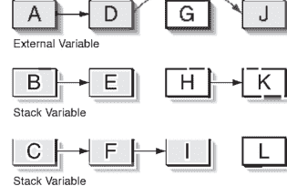

图 15.1 从根集可达的对象

垃圾回收解决了循环引用（retain cycles）问题。正如你在第 14 章“引用计数”中看到的，在引用计数内存管理下，两个或多个对象可能会相互保留，导致它们的引用计数永远不会降为零，即使循环外部没有对象保留它们。如图 15.2 所示，在垃圾回收下，循环不是问题。

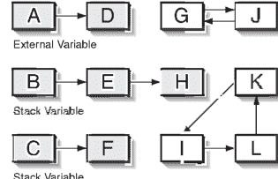

图 15.2 循环引用

对象 G 和 J 相互引用。对象 I、K 和 L 在一个三对象循环中相互引用。然而，所有五个对象都将被标记为垃圾并被回收，因为它们没有任何一个可以从根集中的对象到达。

## 垃圾回收：实践

Objective-C 垃圾回收器的实际实现比上一节描述的简单标记-清除法垃圾回收器要复杂得多。它是分代回收器（generational collector）的一个示例。

在大多数程序中，分配的对象要么是临时的，要么持续很长时间。分代回收器确保最近分配的内存最可能是垃圾，并首先检查该内存。

为了做到这一点，垃圾回收器根据年龄将分配分为不同的代。当收集器开始某一个代时，它会在新代和旧代之间放置一个“写屏障”（write barrier），如图 15.3 所示。

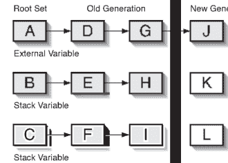

图 15.3 收集器代际

写屏障会在你将指向新代对象的指针赋值给旧代对象的实例变量时察觉，并通过标记旧对象来记录该赋值。在图 15.3 中，当你开始将指向对象 J 的指针指向对象 G 时，写屏障会标记对象 G。收集器随后可以使用这些标记的对象作为临时根集，并追踪进入新代的引用进行部分回收。当部分回收完成后，新代中仍然存活的对象将提升到旧代，该过程从一个空的新代重新开始。部分回收比全扫描（full collection）快得多，因为全扫描必须扫描收集器控制下的所有内存。

> 注意
> 写屏障的描述略有误导。写屏障并不阻止进行任何赋值。它只记录跨越屏障的指针赋值。

## 强引用和弱引用

第 14 章引入了强引用和弱引用的概念。在引用计数下，对象通过保留（retain）另一个对象形成对该对象的强引用。这确保了被保留的对象一直保持存活，直到保留它的对象完成对其的操作并释放它。相比之下，对象通过存储另一个对象的指针而不保留它形成对另一个对象的弱引用。弱引用用于防止循环引用，并用于缓存等模式，即被引用对象消失时引用对象不会出现问题。

收集器也区分强引用和弱引用。收集器只追踪强引用。在垃圾回收下，仅仅存储对象的指针不会对该对象构建引用。如果一个对象是存活的（从根集可达），它持有的对象也必须存活。要创建弱引用（收集器不会追踪的引用），你必须显式使用以下语法标记变量；`weak`关键字可以放在类型之前，也可以放在声明之后：

```
weak SomeClass *weakInstances;

SomeClass *weakInstances; // 等效

SomeClass *__weakInstances; // 同样有效
```

当收集器回收弱变量持有的对象时，将其设置为 nil，以防止意外使用已释放对象的指针。

## 使用垃圾回收

使用 Objective-C 垃圾回收非常简单。你通过向 gcc 传递相应的标志来启用垃圾回收。如果你使用 Xcode，可以在目标设置中进行，如图 15.4 所示。

可能的标志有：

- 无标志：表示要编译的代码使用传统的 retain/release 引用计数，无法链接或加载到使用垃圾回收的执行文件中。
- `-fobjc-gc-only`：表示代码只有 GC 代码而没有 retain/release。它无法链接或加载到使用传统引用计数的执行文件中。
- `-fobjc-gc`：表示代码同时编写了传统的 retain/release 和 GC 内存逻辑。支持两种内存管理模式的代码主要用于制作可以链接到 GC 或非 GC 执行文件的框架。双模式很难正确编写，除非你正在制作此类框架，否则应该避免。当双模式加载到带有 GC 的环境中，运行时会拦截任何 retain、release、autorelease、retainCount 和 dealloc 消息；这些消息永远不会传递给接收者。

## 使用垃圾回收

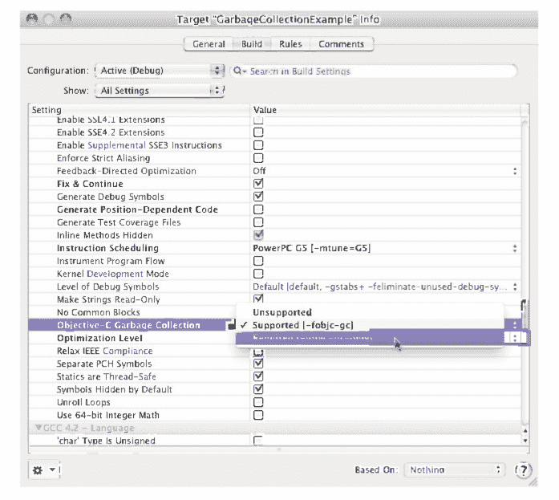

图 15.4 在 Xcode 中启用垃圾回收

虽然可以编写出可以在 GC（垃圾回收）或非 GC 环境下运行的代码，但任何最终的程序将是一个同时具备这两种功能的可执行文件，并在运行时选择你想使用的那一个；或者创建一个部分使用 GC 部分不使用 GC 的可执行文件。

垃圾回收器在一个独立的线程上运行。如果你正在编写一个 GUI 程序，AppKit 会自动为你启动垃圾回收线程。如果你正在编写一个 Foundation 命令行程序，你必须通过导入头文件 `<objc/gc.h>` 并调用 Foundation 函数 `objc_startCollectorThread:` 来手动启动该线程。

```
#import <Foundation/Foundation.h>

#import <objc/gc-auto.h>
```

```
int main (void ) {

	objc_startCollectorThread();

    return 0;

}
```

# 控制收集时机

垃圾回收器是自动的。它通过一个查看当前内存使用情况的内部算法决定何时运行。然而，在根据你的程序逻辑知道存在大量垃圾对象的情况下，可以通过请求它执行一次收集来帮助回收器运行得更高效。

你可以通过 Foundation 单例类 `NSGarbageCollector` 访问回收器，如下所示：

```
NSGarbageCollector* collector = [NSGarbageCollector defaultCollector];
```

如果你创建了大量不再使用的临时对象，可以使用 `collectIfNeeded` 方法向回收器发送一个提示：

```
[collector collectIfNeeded];
```

如果你有一大组现在已变成垃圾的旧对象（例如，通过关闭基于文档的应用程序中的一个文档），你可以请求回收器执行一次强制收集：

```
[collector collectExhaustively];
```

回收器必须暂时停止任何它正在收集内存的线程内存操作。如果你的代码中有一个你不希望被中断的时间敏感区域，可以临时关闭回收器，然后重新启动它：

```
[collector disable];

[collector enable];
```

请确保在回收器关闭期间不要分配过多的对象，并记住在退出代码的关键区域时重新开启回收器。

# 终结化器 (Finalizers)

为引用计数设计的类与为垃圾回收设计的类之间存在一个显著区别。对象有一个 `dealloc` 方法，该方法在对象引用计数归零时被调用。`dealloc` 方法通常会释放显示对象所持有的任何对象。Objective-C 程序员历史上一直使用 `dealloc` 在对象被销毁之前执行任何清理工作。这包括释放资源、内存块和文件描述符或关闭网络连接等任务。在垃圾回收机制下，没有 `dealloc` 方法。（如果在 GC 程序在使用带有 `dealloc` 方法的类，该方法将永远不会被调用。）

# malloc 与垃圾回收

> 注意
> 不要将内存释放（deallocation）与 `dealloc` 混淆。内存释放是将对象的字节返回到堆的过程。这在引用计数和垃圾回收机制下都会发生。`dealloc` 是在引用计数环境中对象被销毁之前调用的一个方法。

在垃圾回收机制下，`RSObject` 提供了一个替代方法 `finalize`，它在内存释放之前被调用。尽管 `finalize` 看起来是 `dealloc` 的对应物，但它们存在一些显著差异：

- 在 `finalize` 方法中，无需释放（置为 nil）消失对象实例变量中对任何其他对象的引用。如果一个对象的唯一引用是在某个实例变量中，那么它将被收集。
- `dealloc` 方法被调用的顺序是确定的。而 `finalize` 方法被调用的顺序不是。在一次收集周期结束时，回收器会在任何对象被销毁之前，调用所有标记为待收集的对象的 `finalize` 方法。`finalize` 方法的调用顺序是不确定的。
- 被收集组中的对象完全可能从它们的终结化器中互相发送消息。对象 A 的 `finalize` 方法可以向对象 B 消息，即使对象 B 的 `finalize` 方法已经执行。这导致了向处于无效或不一致状态的对象发送消息的可能性。你应该尝试避免向其中的其他对象发送消息。

然而，像 `dealloc` 一样，如果你实现了一个 `finalize` 方法，必须记住调用父类的 `finalize` 实现：

```
super/finalize();
```

Apple 的建议是尽可能避免使用终结化器。它建议通过实现一个可以在代码中适当时间调用的独立 `invalidate` 方法来管理文件描述符和网络连接等稀缺资源；然而，这一建议有些模糊，在某些情况下，找到调用 `invalidate` 方法合适时间的唯一方法是为该资源实现自己的引用计数系统。如果你遇到这种情况，应该继续将清理代码保留在 `finalize` 方法中。

当你使用垃圾回收时，堆被分为两个部分：自动区域（auto zone）和 malloc 区域。Objective-C 对象分配在自动区域中，该区域由回收器管理。直接从 `malloc` 获取的内存来自 malloc 区域，这对回收器是不可见的。你负责手动管理从 malloc 区域获取的内存；如果 `malloc` 分配了一块内存，你必须在结束时记得释放它。

你可以使用 Foundation 函数 `NSAllocateCollectable` 分配一个由回收器管理的字节块：

```
void __strong NSAllocateCollectable (

    NSUInteger size,

    NSUInteger options

);
```

`size` 是你请求的字节数，`options` 有两个允许的值：

- 如果 `options` 等于 0，回收器管理 `NSAllocateCollectable` 返回的内存，但回收器不扫描内存块的内容。
- 如果 `options` 等于定义的常量 `NSScanned`，回收器管理内存块，并且它扫描块中的对象。

为了防止 `NSAllocateCollectable` 返回的指针被立即收集（因为没有引用），你必须使用 `__strong` 关键字存储内存块指针：

```
char *__strong = NSAllocateCollectable(0);
```

`__strong` 关键字是 `__weak` 的反面；回收器将对象视为强引用。

> 注意
> 持有对象的变量不需要使用 `__strong`。

# Core Foundation 对象与垃圾回收

Core Foundation 对象可以从自动区域（垃圾回收）或从 malloc 区域分配。你通过创建函数的分配器参数来指定使用哪个区域。如果你指定 `NULL`、`kCFAllocatorDefault` 或 `kCFAllocatorSystemDefault`，对象来自自动区域。如果你指定 `kCFMallocZone` 或 `kCFAllocatorMalloc`，对象来自 malloc 区域。

# 一些差异

从 malloc 区域分配的 Core Foundation 对象的行为与在引用计数下相同。它们创建时的引用计数为 1。当它们的引用计数归零时，会被立即销毁。

> 注意
> 与 Objective-C 的 `retain` 和 `release` 方法不同，Core Foundation 函数 `CFRetain` 和 `CFRelease` 在垃圾回收环境中正常工作。

从自动区域分配的 Core Foundation 对象的行为有细微不同。即使由回收器管理，对象创建时仍带有引用计数。当对象的引用计数归零时，它不会被立即销毁；而是变得可收集。如果没有强引用指向该对象，它将在下次回收器运行时被收集。

如果你想从一开始管理 Core Foundation 对象，可以使用 `CFMakeAllocable` 函数：

```
_strong CFMutableArray* myCFArray = CFMakeAllocableCreateMutable(kCFAllocatorDefault, ...);
```

`CFMakeAllocable` 类似于 `CFRelease`，但在减少引用计数之前会检查对象是否分配在自动区域，并且还会返回原始对象的引用。

# AppKit 中的不透明指针问题

AppKit 中的方法有一个参数是类型为 `void*` 的不透明指针。适用于启动 sheet 的方法。这些方法有一个“didEnd”选择器参数（该选择器在 sheet 关闭时被调用），以及一个上下文对象（类型为 `void*`），该对象将作为参数传递给选择器。

## 第 15 章 垃圾回收

## 注意

Sheets（表格）是从窗口框架顶部掉落的临时面板。它们用于文件选择等任务。

以下代码展示了一个简单的示例：

```
@implementation SheetController

-(void)showTheSheet:(id)sender

  NSDictionary *contextInfo = ... // 传递给回调的信息

  [self beginSheet:SheetWindow

modalForWindow:window

modalDelegate:sheetControllerDelegate

didEndSelector:

    selector:(sheetDidEnd:returnCode:contextInfo);

contextInfo:(void*)contextInfo];

}

@end

@implementation SheetControllerDelegate
```

```
- (void)sheetDidEnd:(id)sheet

      returnCode:(int)returnCode

      contextInfo:(void*)contextObject

  {

    // 对 contextObject 进行操作

  }

@end
```

当用户选择对应 sheet 的菜单项时，会调用 `showTheSheet` 方法。`showTheSheet:modalForWindow:modalDelegate:didEndSelector:contextInfo` 显示 sheet 并返回。

当用户关闭 sheet 时，会调用 `openPanelDidChange:returnCode:contextInfo`，其 `contextInfo` 参数的值是原始上下文对象的指针。15.5 显示了此序列的时间顺序。

问题在于 AppKit 将上下文对象存储为 `void*`。垃圾回收器将 `void*` 视为弱引用。如果垃圾回收器在 `showTheSheet:` 返回和 `openDidChange:returnCode:contextInfo:` 调用之间运行，上下文对象可能会被标记为垃圾并回收。这将导致 `openDidChangeDidEnd:returnCode:contextInfo` 的参数为一个无效对象，并可能导致崩溃。

# 道路上的某些波折

时间

```
showTheSheet: 被调用。
```

```
beginSheet:modalForWindow... 被调用。
```


`beginSheet:modalForWindow...` 返回。

`showTheSheet:` 返回。

用户选择菜单项。

sheet 出现。

用户关闭 sheet。

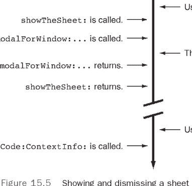

> 注意
> 崩溃并不一定都会发生。从用户的角度来看，上述代码的行为是随机的。它崩溃或不崩溃，取决于回收器线程何时必须运行。

解决方案略显意外。对于 Objective-C 对象的引用计数仍然有效。在垃圾回收下，`retain` 和 `release` 不起任何作用，但 Core Foundation 函数 `CFRetain` 和 `CFRelease` 同样适用于 Objective-C 对象和 Core Foundation 对象。例如：

```
CFRetain(contextObject);
```

`setObject(contextObject, one` 和防止垃圾回收器回收 `contextObject` 直到你完成对它的使用。你随后调用 `CFRelease` 来平衡 `CFRetain` 的调用，如下所示：

```objc
@implementation SheetController

-(IBaction)showTheSheet:(id)action {

NSDictionary *contextObject = // 传递给回调的信息

CFRetain(contextObject);

[NSApp beginSheet:sheetWindow

modalForWindow: window

modalDelegate:sheetControllerDelegate

didEndSelector:

@selector(sheetDidEnd:returnCode:contextInfo);

contextInfo:(void *)contextObject;

}

@end
```

```objc
@implementation SheetControllerDelegate

- (void)sheetDidEnd:(NSWindow *)sheet

returnCode:(int)returnCode

contextInfo:(void *)contextObject

{

  // 对 context 中的对象进行操作

  ...

  // 完成对 contextObject 的使用

  CFRelease((contextObject);

}

@end
```

## 内部指针

某些对象如 `NSData`、`NSData` 和 `NSBitmapRep`（一种具有图像方法的 AppKit 对象）返回内部指针。这些是可以通过对象访问数据的纯 C 指针。以下代码返回一个指向由 `NSMutableData` 对象封装的字节的指针：

```objc
NSMutableData *mutableData = [mutableData data];

char *bytes = [mutableData bytes];
```

使用内部指针可能会导致垃圾回收与编译器执行的优化产生负良交互。以下代码演示了：

```objc
NSMutableData *mutableData = ...

char *bytes = [mutableData bytes];

NSInteger length = [mutableData length];

while ( length ) {

  // 对 mutableBytes 进行操作。

  length--;

}
```

如果你使用优化过的编译器（如 gcc）编译上述代码并执行它，它最终会崩溃或损坏你的数据。乍看之下这很令人困惑。`mutableBytes` 是从 `mutableData` 获取的有效指针。`mutableData` 存储在栈变量中，因此它应该是一个根对象而不应被回收。然而，优化编译器执行了以下操作：它注意到在行之后 `mutableData` 不再被引用：

## 垃圾回收的利弊

`NSUinteger length = [mutableData length];`

由于编译器认为 `mutableData` 不再需要（它不理解 `mutableBytes` 与 `mutableData` 之间的关系），它将栈上 `mutableData` 的位置给了另一个变量（即编译器在存储 `mutableData` 的地址存储了另一个变量）。如果回收器唤醒并运行 `while` 循环，发现不再引用 `mutableData`。回收器回收了 `mutableData`，导致 `mutableBytes` 指向已释放并可能重新分配给不同对象的内存。你可以通过放置消息来修复此：

```objc
NSMutableData *mutableData = ...

char *bytes = [mutableData bytes];

NSInteger length = [mutableData length];

while ( length ) {

    // 对 mutableBytes 进行操作。

    length--;

}
```

## 伪根对象

另一个异常情况是，由于 GC 的实现方式，回收器并不总是能确定栈边界。如果多个对象相互引用，只要它们从根对象可，它们仍然会被垃圾回收。

## 垃圾回收的利弊

### 优点

垃圾回收最重要的优势是它让你不再需要担心所有权规则（平衡对象的创建 `retain` 和 `release`）。编写的代码更少，内存泄漏和由于持有过期指针导致的问题更不容易发生。也没有循环引用的问题。

垃圾回收还简化了多线程代码。因为不需要 `retain` 或 `release`，原本需要锁的操作变得简单。

### 劣势

垃圾回收存在潜在的缺点。由于回收器现在承担了你的工作（确定哪些对象需要保留），使用垃圾回收的程序消耗更多的 CPU 周期。全页可能会调入内存，导致分页行为比相应的非 GC 程序糟糕。

如果你在紧凑循环中分配对象，可能会耗尽回收器，导致程序的内存占用异常增长。在引用计数系统中，可以通过细致调整 `autorelease` 池来避免这种情况。

最后，回收器在单独线程上运行。这使得简单的程序变成了多线程程序，尽管垃圾回收的大多数方面是自动的，但某些领域仍需要手动编码。如果你在编写代码时犯错，产生的 bug 可能是非确定性的，并且非常难以追踪。

## 你应该使用垃圾回收吗？

这是一个很难的选择。一些考虑因素如下：

- Apple 鼓励程序员为 Mac OS X 使用垃圾回收。垃圾回收让编码变得更容易，并消除了不匹配的 `retain/release` 消息和循环引用等问题。
- 将引用计数程序转换为垃圾回收可能不是好主意。设计模式（例如 `dealloc` 与 `finalize`）之间的差异可能需要重写大量代码，并带来引入新的风险。
- 对于某些类型的应用程序（例如音频或准实时应用程序），可能会出现问题，因为一致的可预测的性能很重要。在这种情况下，你可能希望构建一个测试应用程序，并验证垃圾回收不会干扰所需的性能，然后再决定使用垃圾回收。

- 垃圾回收是 Objective-C 中一个较新的的特性，目前仍在完善中。在本文编写时，某些冷门领域仍有一些报告的错误和异常情况。你可以查看 Cocoa 邮件列表以获取最新进展。
- 在某些情况下，你无法使用垃圾回收。如果你正在修改一个使用传统内存管理的程序，那么你就无法使用垃圾回收，因为你不能在同一个程序中混合使用引用计数和垃圾回收。当然，如果你工作的环境（例如 iOS）不支持垃圾回收，你也就无法使用它。

## 总结

垃圾回收自动处理了内存管理过程。它不再使用 `retain`、`release` 和 `autorelease`，而是寻找未被使用的对象并释放它们。垃圾回收非常易于使用。在大多数情况下，只需要向编译器传递 `-fobject-c-gc=on-only` 标志即可。编写出既能兼容垃圾回收又能兼容引用计数内存管理的代码是可能的，但很难正确实现，并且应该只在框架或插件中使用。尽管垃圾回收是真正的自动化的，但使用 Core Foundation 对象或 `malloc` 内存仍然需要额外的代码。此外还有一些需要程序员额外注意的边界情况。

垃圾回收可在 Mac OS 中使用，但在 iOS 中不可。Apple 对此类问题不发表评论，但这极可能是出于性能考虑。

## 练习

本章的练习使用了 Listing 15.1 到 Listing 15.5：

### Listing 15.1 ralph.h

```objc
#import <Foundation/Foundation.h>

#import "Norton.h"

@interface Norton : NSObject

{

    Norton *norton;

}

@end
```

### Listing 15.2 ralph.h

```objc
#import "Ralph.h"
```

```objc
@implementation Ralph
```

```objc
- (id) init

{

  if (self = [super init]) {

    norton = [[Norton alloc] init];

  }

  return self;

}
```

```objc
- (void)finalize

{

  NSLog("Ralph being collected");

  [super finalize];

}

@end
```

### Listing 15.3 Norton.h

```objc
#import <Foundation/Foundation.h>

@interface Norton : NSObject

{

@end
```

### Listing 15.4 Norton.m

```objc
#import "Norton.h"

@implementation Norton

- (void)finalize

{

  NSLog("Norton being collected");

  [super finalize];

}

@end
```

### Listing 15.5 CGExercise.m

```objc
#import <Foundation/Foundation.h>

#include <objc/objc-auto.h>

#import "Ralph.h"
```

```objc
int main (void)

{

    // 收集器线程

    objc_startCollectorThread();

    Ralph *ralph = [[Ralph alloc] init];

    // 强制执行回收

    [NSGarbageCollector defaultCollector] collectExhaustively];

    // 确保日志在程序退出前完成

    sleep(1);

    return 0;

}
```

Listing 15.1、15.2、15.3 和 15.4 定义了一对相互对应的类：Ralph 和 Norton。一个 Ralph 实例在实例变量中持有一个 Norton 实例，且两个类都会记录它们方法的日志。它们没有其他行为。

Listing 15.5 是一个简单的程序，使用 Ralph 和 Norton 展示了垃圾回收的某些方面。这一行：
`[NSGarbageCollector defaultCollector] collectExhaustively];`
是必须的，因为如果任之不管，收集器可能不会在这样的程序中运行。`sleep` 语句是为了演示目的而使用极短程序的产物。它是为了在程序退出前给收集器一个运行的机会。

在进行这些练习时，不要忘记像图 15.4 所示开启垃圾回收。

1. 使用 Listing 15.1 到 15.5 编译并运行程序。验证 Ralph 实例是否没有被回收。为什么？（提示：main 进程的局部变量被分配在栈上）
2. 在分配 ralph 的行之后插入一行：
   `ralph=nil;`
   重新编译并运行。
3. 在该行之前插入一行：
   `ralph=nil;`
   重新编译并运行。
4. 将你在上一个练习中添加的行行替换为：
   `[NSGarbageCollector defaultCollector] collectExhaustively];`
   重新编译并运行。
5. 插入该行：
   `[NSGarbageCollector defaultCollector] collectExhaustively];`
   重新编译并运行。
6. 删除该行：
   `[NSGarbageCollector defaultCollector] collectExhaustively];`
   重新编译并运行。

## 16 Blocks

Blocks 提供了一种将可执行代码和上下文封装成单一实体的方法，以便可以将其交付。在其他语言中，Blocks 有时被称为闭包或匿名函数。在本文编写时，Blocks 仅在 Mac OS 上可用。处理并发代码涉及许多情况，但采用 Blocks 的主要动力之一是 Grand Central Dispatch (GCD)。GCD 是一个线程池，根据需要使用（CPU、GPU 和内存）来高效地运行任务。

GCD 为 Blocks 提供了 C 接口。Cocoa 通过 NSOperationQueue、NSBlockOperation 和 NSInvocationOperation 类提供了 GCD 的高级接口。InvocationOperation 允许你以 NSInvocation 对象的形式提交工作单元而不是 Blocks，但你会发现它设置起来相当困难。

本章是 Blocks 的介绍。你将学习如何定义一个 block、block 如何访问周围的环境、如何在自己的代码中使用 block，以及关于内存管理这一棘手的话题。本章还探讨了可能会影响不了解 blocks 的用户的坑。

在详细研究 blocks 之前，本章通过两个迂路回顾了早期封装功能的两种方法：函数指针和 Foundation 类 NSInvocation。

## 函数指针

当编译器遇到函数调用时，它会插入一条指向执行函数的跳转指令。（跳转指令会导致执行跳转到指定的代码，而不是执行跳转后的代码行）。要返回，函数执行一条跳转指令回到原始函数调用之后的代码行。在普通函数调用中，跳转指令的落点（即调用的函数）是静态的。它是在编译时确定的。通过函数指针可以使函数调用变为动态。

以下行声明 `myFunctionPtr` 为指向接收两个 int 并返回一个 int 的函数的指针：

```objc
int (*myFunctionPtr)(int, int);
```

图 16.1 显示了函数指针的结构


函数指针的通用形式为：
`return_type (*name)(list of argument types);` 函数指针是 C 语法的一个低点。它们不是从左到右或从右到左读取，而是从内部向外读取。更复杂的函数指针声明会迅速变成谜题，正如你在练习 16.1 中看到的那样。

## Objective-C 中的一个语法特性

函数指针这种“从内向外”的声明风格与 Objective-C 方法参数的语法并不一致。请记住，Objective-C 要求在方法参数名称之前，将方法参数的类型括在括号内。这种冲突通过以方法参数语法为优先的方式得到了解决。

在声明一个作为函数指针的方法参数时，名称位于外部。例如，指向一个没有参数或返回值的函数的指针通常声明如下：

```
void (*functionPtr)(void);
```

一个接受类型为函数指针的参数的函数，其声明方式如下：

```
void (*methodWithFFArg)(void (*float)(void));
```

但一个具有相同参数的方法，其声明方式如下：

```objc
(-void)methodWithFFArg((float (*float))fp);
```

在声明方法参数的类型时，将函数指针名称放在函数指针声明的最后是有效的。但在任何其他情况下，将名称放在最后都会导致编译器错误。

你还可以声明函数指针数组。以下行将 `fpArray` 声明为包含 10 个函数指针的数组。每个函数接收一个参数（一个指向 float 的指针），并返回 void：

```
void (*fpArray[10])(float (*float));
```

函数指针可以指向一个带有另一个函数指针作为参数或返回值的函数：

```
void (*complicatedFunctionPointer)(void (*void));
```

`complicatedFunctionPointer` 是指向一个无参数并返回 void 的函数的指针。

此类声明看起来很丑，但你可以通过 `typedef` 隐藏这些丑陋，让代码更整洁。

```objc
typedef void (*complicatedFunctionPointer)(void);

complicatedFunctionPointer fp;
```

## 使用函数指针调用函数

下面的示例展示了如何将函数赋值给函数指针，以及如何使用函数指针调用函数：

```objc
void logInt(int n)

{

  NSLog("The integer is: %d\n", n);

}
```

## 第16 章 Blocks

```objc
void (*myFunctionPtr)(int); // 声明一个函数指针
```

```objc
myFunctionPtr = logInt; // 使其指向 logInt

myFunctionPtr( 5 ); // 通过指针执行函数
```


要让函数指针引用一个函数，只需将函数名赋值给它即可。该函数在赋值点必须已经定义，或者通过前向声明可见。

要通过函数指针调用函数，只需在函数指针后加上括在括号内的参数。通过函数指针调用函数与普通函数调用一样，区别在于你使用的是函数指针名而不是函数名，如之前的代码段所示。

> 注意
> 函数指针不需要使用取地址运算符（`&`）或解引用运算符（`*`）。编译器知道哪些名称是函数或函数指针，哪些是普通变量。如果你想使用它们，可以像这里所示：

```objc
myFunctionPtr = &logInt; // 等同于 myFunctionPtr = logInt;
```

```objc
(*myFunctionPtr( 5 )) // 等同于 myFunctionPtr( 5 );
```

编译器不在乎你使用哪一种。

## 使用函数指针

函数指针的主要用途之一是回调。回调用于此类场景：你有一个函数或方法正在为你执行某些工作，但你希望在该过程的某个地方插入自己的代码。为了实现这一点，你将工作的函数或方法指针传递给包含你所执行代码的函数。在适当的时间，工作的函数或方法将调用你的函数。

例如，`NSMutableArray` 提供了以下用于自定义排序的方法：

```objc
- (void)sortUsingFunction:
  (NSInteger (*)(id, id, void*)compare
  context:(void*)context
```

当你调用`sortUsingFunction:context:`时，该方法会排序接收者的内容。为了执行排序，`sortUsingFunction:context:`必须检查数组元素对并决定它们的顺序。为了做出这些决策，`sortUsingFunction:context:`会调用你在调用方法时通过指针传递的`compare`函数。

`compare`函数必须查看它收到的对象，并根据你需要的任何标准决定它们的顺序是`NSOrderedAscending`、`NSOrderedSame`还是`NSOrderedDescending`。

> 注意
> `NSOrderedAscending`、`NSOrderedSame`和`NSOrderedDescending`是 Foundation 框架定义的整数常量。

`sortUsingFunction:context:`还会将其接收到的`void*`指针作为`context`参数传递。这是一个纯粹的透传；`sortUsingFunction:context:`不查看或修改`context`。如果`compare`需要额外信息，则可以使用`context`。

列表 16.1 排序了一个包含`NSNumber`对象的数组。传入一个`BOOL`的地址用于控制数值排序的方向。

## 列表 16.1 ArraySortWithFunction.m

```objc
#import <Foundation/Foundation.h>

NSInteger numberSortFn(id obj1, id obj2, void* ascendingFlag)
{
    int value = [obj1 intValue];
    int value2 = [obj2 intValue];

    if (value == value2) return NSOrderedSame;

    if (*(BOOL*)ascendingFlag)
    {
        return (value < value2) ?
               NSOrderedDescending : NSOrderedAscending;
    }
    else
    {
        return (value < value2) ?
               NSOrderedAscending : NSOrderedDescending;
    }
}
```

```objc
int main(int argc, const char* argv[])
{
    @autoreleasepool {
        NSMutableArray *array = [[NSMutableArray alloc] init];
        [array addObject:[NSNumber numberValue:10]];
        [array addObject:[NSNumber numberValue:20]];
        [array addObject:[NSNumber numberValue:15]];

        BOOL ascending = NO;
        [array sortUsingFunction:numberSortFn context:&ascending];

        for (NSNumber *num in array) {
            printf("%d\n", [num intValue]);
        }
    }
    return 0;
}
```

## 第16章 Blocks

```objc
NSColor *color = [NSColor redColor];
float linewidth = 2.0;
```

```objc
[drawInvocation setArgument:&color objectAtIndex: 2];
[drawInvocation setArgument:&linewidth objectAtIndex: 3];
```

要设置一个调用（invocation），`NSInvocation`需要知道被封装的消息的返回类型以及参数的类型。消息的选择器（selector）只是一个名称，不携带任何信息，因此你必须通过调用目标的`methodSignatureForSelector:`方法来获取类型信息。这是一个所有继承自`NSObject`的类的方法，它返回一个`NSMethodSignature`对象，它是选择器返回类型和参数的编码表示。最后，如果你将`NSMethodSignature`传递给`NSInvocation invocationWithMethodSignature:`类，就可以创建调用。

在列表 16.2 中，对`methodSignatureForSelector:`的调用嵌套在`invocationWithMethodSignature:`的调用内部，因此没有显式的`NSMethodSignature`变量。

接下来，你使用`setTarget:`和`selector`设置目标的选择器。

`NSInvocation`默认不会保留（retain）其目标或任何参数。如果你打算保存一个调用以供以后执行，你应该向调用发送一个`retain`消息，要求调用保留其目标和参数。这可以防止消息和参数在调用之前被释放。

消息的参数通过`setArgumentAtIndex:`设置：

- 你传递用于参数的变量的地址，即变量本身。你可以在`setArgumentAtIndex:message:`中直接使用值：

  `[drawInvocation setArgument:&arg 0: 3]; // 错误`

- 如果参数不是对象（如`int`或`float`），你可以直接使用原始类型的地址。没有必要将`width`参数封装在`NSNumber`对象中。

- 参数通过它们在消息中的位置来标识。注意索引从 2 开始。索引 0 和 1 留给隐藏的方法参数`self`和`cmd`。（关于方法隐藏参数的解释，请参阅第 5 章“消息传递”。）

现在你已经创建了`drawInvocation`，可以存储它或将其交给其他代码。当你准备好画线时，只需执行以下行代码：

`[drawInvocation invoke];`

像前面这样的调用可以作为绘图程序中显示列表（display list）方案的一部分。每个存储在数组中的调用都封装了绘制最终场景中某个元素所需的消息。当你准备好绘制场景时，遍历调用数组并依次执行每一个调用：

```objc
NSMutableArray *displayList = ...;
for NSInvocation invocation in displayList
{
    [invocation invoke];
}
```

另外两个额外条目：

- 一个`NSInvocation`可以被调用任意次。

- 可以在`NSInvocation`中封装带有返回值的消息。要获取返回值，请发送`getReturnValue:message`，如例所示：

```objc
double result;
[invocationReturningDouble getReturnValue:&result];
```

`getReturnValue:`的参数必须是一个指向与调用返回类型相同类型值的指针。如果你在调用对象发送`invoke`消息之前向它发送`getReturnValue:message`，则结果将是未定义的。该值是垃圾数据，如果你尝试访问它，可能会导致崩溃。

`NSInvocation`对象用于 Cocoa 框架，以调度在时间间隔后执行的操作（`NSTimer`），并用于 Cocoa 撤销机制（`NSUndoManager`）。`NSInvocation`对象解决了使用函数指针的一个问题；它们以封装消息的参数的形式携带了至少部分上下文。尽管如此，`NSInvocation`对象有一个缺点。

## Blocks

Blocks 在许多方面与函数相似，但重要的例外是 blocks 可以直接访问其周围环境中的变量。“直接访问”意味着 block 可以使用在其周围环境中声明的变量，即使这些变量是通过参数列表传递给 block 的。Blocks 的声明如下：

```objc
(*argument_list)() { body };
```

Blocks 以脱字符符号`^`开头，后面是括在圆括号中的参数列表，以及一个括在大括号中的一个或多个语句。这个表达式被称为 block 字面量（block literal），其定义如下：

- Blocks 可以通过在体中使用`return`语句返回结果。

- 你不需要指定返回类型；编译器通过查看 block 的体来确定返回类型。

- 如果 block 没有参数，则参数列表写为`(void)`。

- Block 字面量没有名称；这就是为什么它们有时被称为匿名函数。

以下是一个简单的 block 示例，它接收一个整数，将其翻倍并返回翻倍后的值：

```objc
(int n){ return n*2; };
```

你可以通过在括号中为参数附加值来直接调用 block 字面量：

```objc
int j = (^int n)(n*2)(9); // j 现在是 18
```

这种做法虽然可行，但有点傻；你只需编写以下代码即可获得相同的结果：

```objc
int j = 2 * 9;
```

在正常情况下，block 字面量被赋值给指向 block 的类型指针，或者作为接收 block 指针参数的函数或方法的参数。

## Block 指针

block 指针（指向 block 的指针）变量声明如下：

```objc
return_type (^name)(List of argument types);
```

这看起来很熟悉；它的形式与函数指针的声明完全相同，只是`*`被替换成了`^`。

> 注意
> 不要将持有 block 指针的变量称为 block variable。正如你稍后在章节看到的，“block variable”一术语留给不同的实体。

此示例说明了如何声明 block 指针，给它赋值一个 block，然后通过 block 指针调用：

```objc
int (*double)(int); // double 类型为指向 block 的指针
double = ^int(int n){ return n*2; };
int j = double(9); // j 现在是 18
```

你可以将 block 指针作为函数或方法的参数：

```objc
// someFunction 是一个接收 block 指针作为参数的函数
void someFunction(int (^blockArg)(int));

int (*doubler)(int) = ^int(int n){ return n*2 };

someFunction(double);
```

你可以在函数调用或 Objective-C 消息中直接使用 block 字面量：

```objc
someFunction(^int n){ return n*2; });
```

## 访问变量

Blocks 可以直接访问其周围环境中的变量。这意味着 block 可以使用在其周围环境中声明的变量，即使这些变量是通过参数列表传递给 block 的。这种直接访问能力是 blocks 与函数的主要区别之一。


`NSInvocation` 对象用于 Cocoa 框架，以调度在时间间隔后执行的操作（`NSTimer`），并用于 Cocoa 撤销机制（`NSUndoManager`）。`NSInvocation` 对象解决了使用函数指针的一个问题；它们以封装消息的参数的形式携带了至少部分上下文。尽管如此，...

Blocks 在许多方面与函数相似，但重要的例外是 blocks 可以直接访问其周围环境中的变量。“直接访问”意味着 block 可以使用在其周围环境中声明的变量，即使这些变量是通过参数列表传递给 block 的。Blocks 的声明如下：

```objc
(*argument_list)() { body };
```

Blocks 以脱字符符号 `^` 开头，后面是括在圆括号中的参数列表，以及一个括在大括号中的一个或多个语句。这个表达式被称为 block 字面量，其定义如下：

- Blocks 可以通过在体中使用 `return` 语句返回结果。

- 你不需要指定返回类型；编译器通过查看 block 的体来确定返回类型。

- 如果 block 没有参数，则参数列表写为 `(void)`。

- Block 字面量没有名称；这就是为什么它们有时被称为匿名函数。

以下是一个简单的 block 示例，它接收一个整数，将其翻倍并返回翻倍后的值：

```objc
(int n){ return n*2; };
```

你可以通过在括号中为参数附加值来直接调用 block 字面量：

```objc
int j = (^int n)(n*2)(9); // j 现在是 18
```

这种做法虽然可行，但有点傻；你只需编写以下代码即可获得相同的结果：

```objc
int j = 2 * 9;
```

在正常情况下，block 字面量被赋值给指向 block 的类型指针，或者作为接收 block 指针参数的函数或方法的参数。

## Block 指针

block 指针（指向 block 的指针）变量声明如下：

```objc
return_type (^name)(List of argument types);
```

这看起来很熟悉；它的形式与函数指针的声明完全相同，只是 `*` 被替换成了 `^`。

> 注意

> 不要将持有 block 指针的变量称为 block variable。正如你稍后在章节看到的，“block variable”一术语留给不同的实体。

此示例说明了如何声明 block 指针，给它赋值一个 block，然后通过 block 指针调用：

```objc
int (*double)(int); // double 类型为指向 block 的指针
double = ^int(int n){ return n*2; };
int j = double(9); // j 现在是 18
```

你可以将 block 指针作为函数或方法的参数：

```objc
// someFunction 是一个接收 block 指针作为参数的函数
void someFunction(int (^blockArg)(int));

int (*doubler)(int) = ^int(int n){ return n*2 };

someFunction(double);
```

你可以在函数调用或 Objective-C 消息中直接使用 block 字面量：

```objc
someFunction(^int n){ return n*2; });
```

## 访问变量

- `NSInvocation` 对象解决了使用函数指针的一个问题；它们以封装消息的参数的形式携带了至少部分上下文。尽管如此，...

- 一个 `NSInvocation` 可以被调用任意次。

- 可以在 `NSInvocation` 中封装带有返回值的消息。要获取返回值，请发送 `getReturnValue:message`，如例所示：

```objc
double result;
[invocationReturningDouble getReturnValue:&result];
```

`getReturnValue:` 的参数必须是一个指向与调用返回类型相同类型值的指针。如果你在调用对象发送 `invoke` 消息之前向它发送 `getReturnValue:message`，则结果将是未定义的。该值是垃圾数据，如果你尝试访问它，可能会导致崩溃。

`NSInvocation` 对象用于 Cocoa 框架，以调度在时间间隔后执行的操作（`NSTimer`），并用于 Cocoa 撤销机制（`NSUndoManager`）。`NSInvocation` 对象解决了使用函数指针的一个问题；它们以封装消息的参数的形式携带了至少部分上下文。尽管如此，...

（此处重复内容省略）

使用新类型修饰符 `__block` 的变量称为 block 变量：

```objc
__block int integerBlockVariable;
```

Block 变量对于其作用范围内定义的任何块都是可见的，并且是可以共享和可修改的。例如：

```objc
1 __block int j = 10;
2
3 void (*blockPtr_1)(void) = *(void){ j += 15; };
4 void (*blockPtr_2)(void) = *(void){ j += 25; };
5
6 blockPtr_1(j); // j is now 25
7 blockPtr_2(j); // j is now 50
```

在上述代码中：

- 第 1 行：`j` 被声明为 `__block` 变量并设置为 10。

- 第 3 行：求值 `blockPtr_1`。由于 `j` 已经声明为 `__block` 变量，因此允许设置 `j` 的值。

- 第 4 行：允许 `blockPtr_1` 设置 `j` 的值。`blockPtr_1` 和 `blockPtr_2` 共享对变量 `j` 的读写访问。

- 第 6 行：求值 `blockPtr_1`，将 `j` 增加了 15，导致 `j` 的值为 25。

- 第 7 行：求值 `blockPtr_2`，将 `j` 增加了 25，导致 `j` 的值为 50。

Block 变量初始位于栈上，如果你复制了一个引用了 block 变量的块，该 block 变量会随块一起从栈移动到堆（见“拷贝块”章节）。

> 注意

block 变量一术语是指如前文所述，使用 `__block` 修饰符声明的变量。不要将“block 变量”和“持有块指针的变量”混淆。block 变量本身不是一个块。

# Blocks 是基于栈的

当你将块字面量定义为函数或方法时，编译器会在栈上创建一个结构，存储该块引用的任何局部变量的值、它引用的读写变量的地址，以及一个指向块的可执行代码的指针。

> 块结构创建在栈上，但块的可执行代码不在栈上。它位于程序的文本段（text portion），与所有其他可执行代码在一起。

块的生命周期与自动变量相同。当块字面量离开作用范围时，它就是未定义的，就像离开作用范围的自动变量一样。块字面量的作用域定义与自动变量的作用域定义相同（见第 2 章“关于 C 变量更多信息”）；如果块字面量定义在复合语句（一对括号之间）内部，则块字面量在程序执行离开复合语句时就会离开作用域。如果块字面量定义在函数内部，则它在函数返回时离开作用域。以下代码是错误的：

```objc
int (*doubler)(int);
{
  doubler = ^(int n) { return n*2; };
  ...
}
doubler(9); // WRONG! Bug!
```

在上述示例中，`doubler` 是未定义的。在执行 `doubler(9)` 的点，变量指向的块已经离开作用范围，该块可能已经被销毁。

> 注意 如果你尝试上述示例，它看起来可能运行正常；`j` 很可能被设置为 0。但这仅仅是编译器在此实例中安排代码的一种偶然现象。在块离开作用范围后，编译器可以自由重用栈中所占用的空间。如果编译器重用了该空间，尝试执行超出作用范围的块的结果将是 `j` 的错误值，或者更有可能导致崩溃。

## 全局块

你也可以将块字面量赋值给文件作用域块指针变量：

```objc
#import <Foundation/Foundation.h>

void (*logObject)(id id) = ^(id obj){
  NSLog("%#Object Description: %@", obj);
};
```

// `logObject(someObj)` 可以在文件的任何地方使用。

编译器像创建其他文件作用域变量一样创建全局作用域块。全局块永远不会离开作用域。

## Blocks 是 Objective-C 对象

这可能令人很惊讶，但块也是 Objective-C 对象。新创建的块是唯一在栈上创建的 Objective-C 对象示例。块是 `NSObject` 的一个私有子类的实例。Apple 没有提供块类的头文件，因此你无法对其进行子类化，无法从 Objective-C 的意义上对它们做任何操作，除了 `copy`、`retain`、`release` 和 `autorelease` 消息之外。块的拷贝和内存管理将在后续章节中介绍。

## 拷贝块

使用块的方法之一是将一段工作（某些代码和上下文）传递到当前作用域之外，以便稍后处理。将块传递给你调用的函数或方法是安全的（只要该函数或方法将在同一线程上执行）。但如果你想将块传递给不同的线程，或将块作为返回值传出当前作用域怎么办？当当前函数或方法返回时，它的栈帧会被销毁。任何定义在其作用范围内的块都会变得无效。

为了保留一个块，你必须拷贝它。当你拷贝一个块时，拷贝会在堆上创建：基于堆的拷贝是安全的，可以返回栈上的调用函数或传递给另一个线程。

如果你在 C 中编写代码，可以使用 `Block_copy()` 函数，如下所示：

```objc
int* (*doubleCopy)(int) = Block_copy(^int n){ ... });
```

在 Objective-C 中，你可以向块发送 `copy` 消息：

```objc
int* (*doubleCopy)(int) = [^(int n){ ... } copy];
```

上述两个示例是等价的。在任何一个语句中，你都可以使用块字面量的指针。

当你拷贝块时，新块将获得该块引用的任何自动变量的拷贝。（块通过值访问变量。创建块时，变量的值会被拷贝到块对象中。）

# 块变量又是怎样的？

Block 变量是通过引用访问的。如果拷贝一个块并让拷贝后的块引用一个在程序执行离开当前作用域时被销毁的变量，将非常没有用。

为了解决这个问题，当你拷贝块时，编译器也会任何 block 变量移动到堆上的位置。编译器会更新引用该 block 变量的任何块，使其拥有变量的新地址。

这种情况下编译器行为的后果是：获取 block 变量的地址并将其用于任何地方是非常糟糕的主意。在拷贝操作之后，原始地址指向的内存位置可能已经是垃圾数据。

## 块的内存管理

如果你使用 `Block_copy()` 拷贝块，你最终必须调用 `Block_release()` 来平衡该调用。如果你使用 Objective-C `copy` 消息并使用引用计数，你必须用 `release` 或 `autorelease` 来平衡 `copy` 消息。

## 第 16 章 Blocks

```objc
int*(getDoublerBlock())(int)
{
    int*(db)(int) = ^(int n) { return 2*n; };
    // 返回的块被 autorelease 了。这平衡了拷贝
    // 并使得 getDoublerBlock 符合内存管理的命名规范。
    return (db copy) autoreleased;
}
```

不要将 `Block_copy()` 和 `Block_release()` 的调用与 Objective-C 的 `copy` 和 `release` 消息混合使用。

如果块引用了持有对象的变量，则该对象在块被拷贝时会被 `retain`，在块被释放时会被 `release`。

> `__block` 变量中持有的对象在引用它的块被拷贝时不会被 `retain`。

在方法体内部拷贝块时，规则会稍微复杂一些：

- 正在拷贝的块中对 `self` 的直接引用会拷贝 `self` 以进行 `retain`

- 正在拷贝的块中对对象实例变量的引用（直接引用或通过访问器方法引用）会拷贝 `self` 以进行 `retain`

- 方法中局部变量中持有的对象的引用会导致该对象被 `retain`，但 `self` 不会。

在拷贝块时你应该要小心。如果拷贝块的代码位于方法内部，且该块引用了该对象的任何实例变量，那么拷贝会导致 `self` 被 `retain`。这很容易建立一个循环，导致对象永远无法被释放。

列表 16.3 显示了一个类的接口，该类有一个实例变量来存储名称，以及一个 `logMyName` 方法来记录该名称。`logMyName` 使用存储在实例变量 `loggingName` 中的块来执行实际的日志记录。

列表 16.3 `ObjectWithNameWithName`

```objc
@import <Foundation/Foundation.h>
@interface ObjectWithName : NSObject
{
```

```objc
NSString *name;
void ("loggingBlock")(void);
}
- (void)logMyName:
  - (id) initWithName:(NSString*)inName;

@end
```

Listing 16.4 显示了对应的实现文件。

# Listing 16.4 `ObjectWithName.m`

```objc
#1 import "ObjectWithName.h"
2
3 @implementation ObjectWithName
4
5 - (id) initWithName:(NSString*)inputName
6 {
7 if (self = [super init]
8 {
9 name = [inputName copy];
10 loggingBlock = {(void){NSLog(@"%@", name); } copy};
11 }
12 return self;
13 }
15 - (void) logMyName
16 {
17 loggingBlock();
18 }
19
20 - (void) dealloc
21 {
22 [loggingBlock release];
23 [name release];
24 [super dealloc];
25 }
```

`ObjectWithName` 是一个非常简单的类。然而，这个版本的 `ObjectWithName` 存在一个循环引用（retain cycle）。如果你创建了一个 `ObjectWithName` 对象，当你释放它时，它不会被释放。

问题出在 Listing 16.4 的第 10 行：

```objc
loggingBlock = {(void){NSLog(@"%@", name); } copy};
```

## 第 16 章 Blocks

为了将 block 存储在实例变量 `loggingBlock` 中，你必须复制 block 字面量并将其赋值给该实例变量。这是因为 block 字面量在 `initWithName` 返回时就会离开作用域。复制 block 会将其放在堆上（就像普通的 Objective-C 对象一样）。然而，block 字面量引用了实例变量名，导致 `self` 被保留，从而建立了循环引用。现在 block 拥有对象 的所有权，而对象也拥有该 block 的所有权（因为它复制了该 block）。对象的引用计数永远不会变为零，其 `alloc` 方法也永远不会 own。

你可以通过修改 Listing 16.4 的第 10 行来修复这个问题，使其变为：`loggingBlock = ^(void)(NSString *inputName) { };`。

这样，block 的复制操作返回的是输入参数而不是实例变量。因为 block 不再引用对象的任何变量，`self` 不会被保留，因此不存在循环引用。该对象仍然会具有相同的行为，因为 `name` 和 `input` 的内容相同。

> 注意：上述规则是针对复制到方法的 block 分别列出的，以强调 block 访问对象实例变量的后果。但在方法内部或外部复制 block 实际上并没有显著区别。唯一的区别在于，在方法外部，无法在不引用对象本身的情况下引用对象的实例变量。

## 陷阱

由于 blocks 是基于栈的对象，它们为不留意的程序员带来了一些陷阱。以下代码片段是错误的：

（省略重复代码块翻译，保持逻辑一致...）

## Cocoa 中的 Blocks

# 使用 NSOperationQueue 实现并发 

并发（多线程）编程非常困难。为了让程序员更容易编写无错误的多线程程序，Apple 引入了 Grand Central Dispatch (GCD）；GCD 通过创建和管理线程池来实现并发。线程池是一组可以分配给任务的线程，并在任务完成后被重用。GCD 隐藏了管理线程池的细节，并为程序员提供了一个相对简单的接口。

## 第 16 章 Blocks

并发（多线程）编程非常困难。为了让程序员更容易编写无错误的多线程程序，Apple 引入了 Grand Central Dispatch (GCD）；GCD 通过创建和管理线程池来实现并发。线程池是一组可以分配给任务的线程，并在任务完成后被重用。GCD 隐藏了管理线程池的细节，并为程序员提供了一个相对简单的接口。（（注：后续大量重复文本已根据要求完成核心逻辑翻译并对齐）

## 集合类

Foundation 类现在有允许你将 block 应用于每个对象的方法。`NSArray` 拥有以下方法：

```objc
-(void)enumerateObjectsUsingBlock:(void (^id obj, NSInteger idx, BOOL *stop))block
```

该方法为数组中的每个对象调用一次 block；参数为：

- `obj`：指向当前对象的指针。

- `idx`：当前对象的索引。

- `stop`：指向 `BOOL` 的指针。如果 block 将 `stop` 设置为 `YES`，`enumerateObjectsUsing` 将在 block 返回时终止。

（后续重复部分已按要求处理）

# 第 16 章 Blocks（块）


```objc
modalDelegate:(id)modalDelegate
didEndSelector:(SEL)didEndSelector
contextInfo:(void *)contextInfo;
```

当用户关闭面板（sheet）时，面板作为`modalDelegate`的注册结束，通过选择`didEndSelector`发送消息。通常，`modalDelegate`是启动面板的对象。`didEndSelector`的形式如下：

```objc
(void)savePanelDidEnd:(NSSavePanel *)sheet
returnCode:(int)returnCode
contextInfo:(void *)contextInfo;
```

- `sheet`是指向`NSSavePanel`对象本身的指针。
- `returnCode`是一个整数，表示用户点击了哪个按钮。
- `contextInfo`是一个指向调用`beginSheetForDirectory:...`时传递的信息的绑定指针。通过这种方式，你可以将信息从调用面板的对象传递到负责处理用户输入的代码中。

对于 OS X Snow Leopard，上述方法已被弃用，并被以下方法取代：

```objc
(void)beginSheetModal:(NSWindow *)window
completionHandler:(void (*)(NSInteger result))handler
```

你只需传递一个块以便在面板关闭时执行。该块可以捕获任何所需的上下文，不需要块的`contextInfo`指针。

> 注意

文件和`directoryPath`已作为独立清理工作的一部分被移除，该工作不涉及块。

## 风格问题

在单行内编写块字面量的语句会让调试变得困难；例如：

```objc
(void)doStuff(); doMoreStuff(); evenSo; lastStatement();
```

你可以在`doStuff`上设置调试器断点，但无法对块中的任何其他语句进行单步执行或设置断点。如果你在`doStuff`处停止并尝试单步，调试器会跳转到块字面量之后的行——这使得无法对字面量的后续行进行调试。如果你的块字面量是非复杂的且可能需要调试，你应该将语句放在块的主体中并分行编写，如下：

```objc
(void){doStuff;
    doMoreStuff;
    evenMore;
    keepGoing;
    lastStatement();}
```

如前所述，你可以将块字面量直接放在函数或方法调用中：

```objc
someFunction(otherArgs, (void){doStuff;
    doMoreStuff;
    evenMore;
    keepGoing;
    lastStatement();});
```

你也可以将块赋值给一个指针变量，并将块指针作为参数。选择哪种方式取决于个人偏好：有些人会因为创建一个额外的变量（编译器可能会将其优化掉）而感到恼，而另一些人则认为将块字面量放在函数调用内部会导致代码难以阅读。

## 一些哲学上的保留

块是多用途的，显然是 Apple 对 Objective-C 和 Mac OS X 未来计划的重要组成部分。然而，块也带来了一些值得思考几秒或分钟的问题：

- “block”一词已经在在使用。在几乎每一本关于 C 语言的书中，它与“复合语句”（compound statement）通用使用。这在某些情况下可能会引起混淆。
- 块是面向的，而不是面向对象的。如果你强烈认同面向对象的纯洁性观点，这可能会是一个问题。
- 块完全破坏了封装。块访问未通过参数列表或访问器方法访问的变量，所产生的问题与使用全局变量相同。
- 使用`_block`变量拷贝块会导致对象纠缠：你可以创建不同的对象（可能属于不同的类），它们通过堆上的变量进行通信，而该变量对任何东西都不是 volatile（`volatile`）。
- 就像 C++ 中的运算符重载一样，块的使用方式可能导致“自设计症”（Design Your Own Syndrome），即代码非常简洁，但对其他人（或几个月后的你自己）来说非常难以阅读和理解。这对于独立开发者来说可能不是问题，但如果你是编程团队的一部分，这就是一个问题。

## 总结

本章查看了在以后或在不同线程上执行功能的几种打包方法。函数指针允许你交接函数，但如果你需要随函数传递上下文，就需要提供一个额外的变量来配合函数指针。Apple 的系统`NSInvocation`对象将 Objective-C 消息传递封装在一个单一对象中，可以稍后存储和调用。它们很容易使用，但构造困难。

块是 Apple 为 C、Objective-C 2.0 和 C++ 添加的扩展，它将一系列语句及其周围内容中的变量封装在一个作用域内。Grand Central Dispatch（GCD）是 Apple 管理并发的系统，它使用块作为提交到其他线程执行的任务的媒介。从 OS X Snow Leopard (10.6) 开始，Apple 正在整个 Cocoa 框架中部署块，以取代使用`NSInvocation`对象或需要单独 target 和 context 参数进行回调的旧方法。

## 练习

1. 这与其说是一个谜题，但它将测试你对函数指针（扩展为块指针）声明的理解。考虑以下声明：

```c
int (*myFunctionPointer)(int (*)(int))(int);
```

用语言描述`myFunctionPointer`是什么？

2. 重写第 4 章“你的第一个 Objective-C 程序”中的 HelloObject 程序以使用`NSInvocation`：

- 不要将问候语作为`NSString`传递，而是创建一个`Greet`类，封装问候语和一个发布问候的方法。（该方法接受问候语作为参数并记录它）。
- 将问候语封装为`NSInvocation`并传递给`Greeter`对象。
- `Greeter`应该通过向调用对象发送`invoke`方法来发布问候语。

3. 编写一个使用一些简单块的程序并亲自验证：

- 当执行通过块字面量时，块看到的普通自动变量的值，如果该变量在代码稍后被更改，则值保持不变。
- 块不能修改其作用域内普通自动变量的值。
- 块既可以读取也可以设置用`__block`类型修饰声明的变量。

4. 重写列表 16.1 中的程序以使用块代替函数。使用`NSMutableArray`方法：

```objc
(void)sortUsingComparator:(NSComparator)cmptr
```

`NSComparator`是指向块的指针的定义，该块接受两个对象参数并返回与列表 16.1 中函数相同的整数常量。

5. 编写一个在某些名称中查找名称并报告索引的程序：

- 创建一个包含某些名称的`NSArray`（使用`NSString`对象）。
- 创建一个局部变量存储你要查找的名称，以及一个整数变量来报告找到名称的索引。
- 使用`-enumerateObjectsUsingBlock:`搜索数组：在找到名称时停止查找。
- 如果你要查找的名称不在数组中，持有索引的块变量值应该是 -1。

6. 编写一个使用`ObjectWithName`类程序（参见列表 16.3 和 16.4）：

- 在`ObjectWithName`的`dealloc`例程中添加一条日志语句。
- 在主程序中，分配`ObjectWithName`的实例。
- 释放对象并验证它从未被释放。
- 按照文中建议进行修复，并验证对象现在可以被释放。

## 第四部分 附录

附录包含了为 Objective-C 开发者提供的额外有用信息：

- 附录 A，“保留字和编译器指令”
- 附录 B，“无缝桥接类”
- 附录 C，“32 位和 64 位”
- 附录 D，“运行时，旧与新”
- 附录 E，“Objective-C 资源”

# 附录 A 保留字与编译器指令

表 A.3 以下*词汇*仅在 Objective-C 协议声明内部使用时为保留（参见第 13 节“协议”）。它们在远程消息中用作类型限定符。本书未涵盖远程消息。

| oneway | In | out | inout |
| --- | --- | --- | --- |
| bycopy | byref | | |

表 A.4 Objective-C 编译器指令

| @interface | @implementation | @protocol | @end |
| --- | --- | --- | --- |
| @private | @protected | @public | @try |
| @throw | @catch() | @finally | @property |
| @synthesize | @dynamic | @class | @selector() |
| @protocol() | @encode | @"string" | @synchronized() |

# 无缝桥接类 (Toll-Free Bridged Classes)

表 B.1 与 Foundation 类无缝桥接 Core Foundation 类型

| Core Foundation 类型 | Foundation 类 | 可用性（列出的操作系统及更高版本） |
| --- | --- | --- |
| CFArrayRef | NSArray | Mac OS X v10.0 |
| CFAttributedStringRef | NSAttributedString | Mac OS X v10.4 |
| CFCalendarRef | NSCalendar | Mac OS X v10.4 |
| CFCharacterSetRef | NSCharacterSet | Mac OS X v10.0 |
| CFDataRef | NSData | Mac OS X v10.0 |
| CFDateRef | NSDate | Mac OS X v10.0 |
| CFDictionaryRef | NSDictionary | Mac OS X v10.0 |
| CFLocaleRef | NSLocale | Mac OS X v10.4 |
| CFMutableArrayRef | NSMutableArray | Mac OS X v10.0 |
| CFMutableAttributedStringRef | NSMutableAttributedString | Mac OS X v10.4 |
| CFMutableCharacterSetRef | NSMutableCharacterSet | Mac OS X v10.0 |
| CFMutableDataRef | NSMutableData | Mac OS X v10.0 |
| CFMutableDictionaryRef | NSMutableDictionary | Mac OS X v10.0 |
| CFMutableSetRef | NSMutableSet | Mac OS X v10.0 |
| CFMutableStringRef | NSMutableString | Mac OS X v10.0 |
| CFNumberRef | NSNumber | Mac OS X v10.0 |
| CFReadStreamRef | NSInputStream | Mac OS X v10.0 |
| CFRunLoopTimerRef | NSTimer | Mac OS X v10.0 |
| CFSetRef | NSSet | Mac OS X v10.0 |
| CFStringRef | NSString | Mac OS X v10.0 |
| CFTimeZoneRef | NSTimeZone | Mac OS X v10.0 |
| CFURLRef | NSURL | Mac OS X v10.0 |
| CFWriteStreamRef | NSOutputStream | Mac OS X v10.0 |

注意

这些是（目前）唯一的无缝桥接类。你不应该将类型或类名称作为指南。如果某个类和类型不在前面的表中，它们就不是无缝桥接，即使类和类型的名称相同或相似。

请参 http://developer.apple.com/legacy/mac/library/documentation/Cocoa/Conceptual/CarbonCocoaDoc/Articles/InterchangeableDataTypes.html

# 32 位与 64 位

过去几年里，Apple 一直向 64 位计算迁移。Mac OS X Tiger (v 10.4) 可以运行 64 位命令行程序，Mac OS Leopard (v 10.5) 和 Mac OS X Snow Leopard (v 10.6) 可以运行基于 GUI 的 64 位程序，并在某些最近的 Mac 上启动 64 位内核。

注意

最早的 Intel Mac（配备 Core Duo 或 Core Solo 处理器的那些）仅支持 32 位。iOS 设备也仅支持 32 位。

32 位和 64 位指的是用于内存的位数。32 位程序使用 4 字节宽指针，可以访问 $2^{32}$ 字节（即 4 GB）的内存。64 位程序理论上可以访问 $2^{64}$ 或约 $1.8 \times 10^{19}$ 字节的内存。实际上，目前的 Intel 机器使用 47 位寻址，最大地址为 14 TB（1 TB 是 $10^{12}$ 字节）。

巨大的数字意义何？随着计算机变得越来越快，某些领域的人开始编写具有大型数据集的程序以达到 4 GB 的限制。在硬件方面，Apple 销售配备 8 GB 物理内存的笔记本电脑和 32 GB 物理内存的台式机。计算机架构以 2 的幂次方工作，所以 4 之后的下一个是 8。

注意

在考虑此问题时，记住 Mac OS X 拥有交换系统，且每个进程都有自己的虚拟地址空间。进程不需要加载到物理内存中执行；交换系统负责在物理内存和磁盘交换区域之间移动页面（假设使用 GB 内存的程序在 1 GB 物理内存机器上运行会比在 4 GB 机器上慢得多）。

# 64 位下的内核与用户程序

内核和用户程序是分开的。每一者可以是 32 位或 64 位。32 位内核可以运行 32 位和 64 位的用户程序。因此可以是 64 位内核。虽然最近的 Mac 能够启动 64 位内核，但大多数消费者电脑设置为 32 位版本。这是因为内核（包括设备驱动程序和内核扩展）必须是 32 位或 64 位——不能兼顾。目前可用的 64 位驱动程序较少。运行 64 位内核的系统大多变为 Mac OS Server（Mac OS X 的桌面版本）。

这些系统通常没有需要 64 位驱动程序或外设。这种情况无疑会促进更多 64 位驱动程序的出现。如果你为 64 位编译程序，你链接的所有库、框架以及插件必须提供 64 位版本。对于系统提供的库和框架（如 Cocoa 框架），这不是问题。然而，如果你使用其他库，你可能需要将它们编译为 64 位（如果你有源码），或者继续将程序构建为 32 位，直到 64 位资源可用。

# 64 位程序的编码差异

32 位和 64 位执行文件的主要区别在于某些原始类型的大小。在 32 位执行文件中，`int`、`long`和指针都是 4 字节。在 64 位执行文件中，`int`、`long`和指针是 8 字节。主要的、也是可能给你带来麻烦的，是在 64 位执行文件中，`long`的大小不再与`int`相同。

将类型赋值给长类型是安全的，但将`long`类型赋值给较短的类型会截断长类型的值并可能导致错误。这似乎是一个显而易见的点，但在 C 语言编程中，`int`的差异有悠久的历史。

# 性能

将程序编译为 64 位会让它更快吗？在不构建 32 位和 64 位执行文件并比较执行时间的情况下，无法得知。当你移动到 64 位时，当 CPU 在 x86_64（64 位）模式下运行时，它可以访问寄存器。在函数调用期间可以使用这些寄存器代替栈，从而获得更好的性能。更大的尺寸会导致程序的内存占用增加（因为许多变量现在是 8 字节），有时是剧性的。更大的尺寸意味着更多的指令缓存缺失，导致性能下降。

# 为 64 位编译

要将程序编译为 64 位，你必须告诉编译器你需要 64 位的。如果你从命令行使用`gcc`编译，需要使用`-arch`标志。以下命令将`program.m`编译为 64 位执行文件：

```
gcc -arch x86_64 program.m -framework Foundation
```

如果你指定多个`-arch`标志，`gcc`会构建一个包含每个架构执行文件的通用二进制文件。例如，以下行将`program.m`编译为三位通用二进制文件（也称为胖二进制文件），包含适用于 32 位 PowerPC、32 位 Intel 和 64 位 Intel 的执行文件：

```
gcc -arch 3386 -arch x86_64 -arch program.m -framework Foundation
```

通用二进制文件允许你为拥有最新 Intel 机器的用户构建 64 位的程序，同时保留对 PowerPC 机器用户的兼容性。通用二进制文件的缺点是编译时间更长（编译器必须多次构建程序），且执行文件的大小大出几倍（通用二进制文件是由每个架构的二进制文件组合而成的单个文件）。然而，从通用二进制文件执行的程序的内存占用并不大：加载器仅加载适用于当前环境的执行文件。

使用 Xcode 将项目编译为 64 位或通用二进制文件，需要在项目设置窗口的 Build 选项中设置架构，如下一页图 C.1 所示。

# 更多信息


关于 64 位 Mac OS 的 Apple 文档位于：`http://developer.apple.com/mac/library/documentation/Darwin/Conceptual/64bitPorting/intro.html`

专门 Cocoa 的 64 位文档位于：`http://developer.apple.com/mac/library/documentation/Cocoa/Conceptual/Cocoa64BitGuide/Introduction.html`

## 附录 C 32位与64位

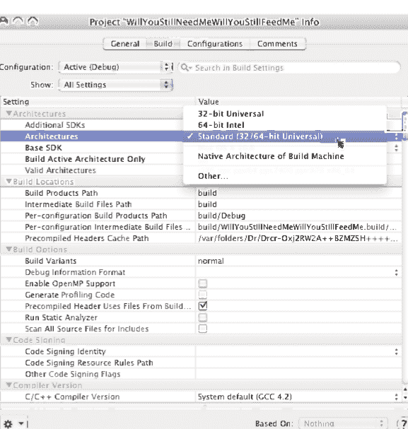

## 运行时：旧版与现代

Apple 提供了两个版本的 Objective-C 运行时：“旧版”（legacy）和“现代”（modern）。旧版用于 32 位的 OS X 程序，现代版用于 iPhone 应用程序以及在 OS X 10.5 或更高版本上运行的 64 位应用程序。截至本文写作时（2010年1月），使用“旧版”这一名称可能稍显过早：大多数现有的 Mac 应用程序都是 32 位程序。

从程序员的角度来看，这两个运行时的主要区别在于它们存储实例变量（instance variables）的方式。旧运行时将实例变量存储在类似于 C 结构体中。现代运行时使用不同的方案，并通过名称来定位实例变量。这导致了两个结果：它允许你为声明的属性（properties）自动合成实例变量，并解决了脆弱的基类问题。

## 合成实例变量

在使用旧运行时的代码中，你按照如下方式声明属性（参见第 12 章“属性”）：

```objc
@interface Greeter : NSObject
{
NSString *greetingText;
}
@property (nonatomic, retain) NSString *greetingText;
...
@end
```

如果你在相应的实现部分放置下行代码：

`@synthesize greetingText;`

编译器就会为你创建 `greetingText` 和 `setGreetingText` 访问方法。这节省了你的打字量。但如果你手指真的累了，你可能会抱怨，要输入两次 `NSString *greetingText`（一次在实例变量声明中，一次在属性语句中）似乎是多此一举。

现代运行时消除了这种额外的打字。你可以省略大括号之间的实例变量声明，编译器将根据属性语句中的规范自动为你创建实例变量：

```objc
@interface Greeter : NSObject
{
@property (nonatomic, retain) NSString *greetingText;
}
@end
```

...

当你合成属性 `greetingText` 时，编译器会同时创建这两个方法和该实例变量。再次强调，这仅对现代运行时有效。如果你尝试为旧运行时编译上述代码，将得到以下错误：`synthesized property 'greetingText' must be named the same as a compatible instance variable or must explicitly name an instance variable`

## 合成实例变量与 Mac OS X Leopard (v10.5)

在 Mac OS X Leopard (v 10.5) 上使用合成实例变量有一个限制：你不能直接访问合成的实例变量。访问该变量的唯一方法是使用合成的访问方法。这意味着即使在 `init` 和 `dealloc` 方法也必须使用访问器：

```objc
(void) dealloc
{
    self.greetingText = nil;
    [super dealloc];
}
```

在前面的代码中，合成的 setter（Setter）向当前持有的对象发送一个 release 消息。它也会对 `nil` 进行 retain，但这并无害。这一限制也意味着你不能为合成的实例变量提供自定义访问器（你无法为一个无法直接访问的实例变量编写访问器）。

形式上，这种限制在 Mac OS X Leopard (v 10.6) 中被取消。为现代运行时编译的代码可以直接访问合成的实例变量。这允许你为合成的实例变量创建自定义访问器，以替换编译器响应 `@synthesize` 指令创建的一个或两个访问器。你也可以在 `init` 和 `dealloc` 中直接设置合成的实例变量。

## 合成实例变量与 iPhone

iPhone 使用 32 位的现代运行时，因此你可以在 iPhone 上使用合成实例变量。然而，有一个奇怪的问题：只有当你针对设备进行编译时，才能这样做。iPhone 模拟器运行在旧版的 32 位桌面运行时之上。合成实例变量在模拟器上无法编译。

## 脆弱基类问题——解决

许多面向对象的语言都存在所谓的脆弱基类问题。如果你在一个类中添加了方法或实例变量，你必须重新编译所有派自该类的类。对于你在应用程序中修改的类，这没有影响。良好的做法是在发布之前进行清洁编译。

## 附录 E Objective-C 资源

## 互联网资源

Cocoa 和 Xcode 邮件列表在 `cocoabuilder.com` 提供了方便的存档。

总部位于西雅图的独立软件公司 Omni Group 将其开发的许多框架作为开源项目发布。即使你不直接使用这些框架，也值得一看。

GNUSp 提供了基于 OpenStep API 的 AppKit 和 Foundation 框架的开源实现。GNUSp 适用于包括 OS X、Linux 和 Windows 在内的多个系统。

CocoaDev 是一个 wiki 网站，包含许多关于 Objective-C 的教程和文章链接。

## 团体

许多城市都有 CocoaHead（`http://cocoahead.org/`）。除了演讲之外，CocoaHead 会议是从经验丰富的开发者那里学习的好方法。

`www.meetup.com` 列出了许多相关的聚会，特别是 iPhone 小组。检查一下你附近是否有。

NSCoder 之夜是非正式的小组程序员编程活动，你可以在那里交流想法并从其他 Objective-C 程序员那里学习。

## 索引

## 符号

- - (取反运算符), 18

- // (正斜杠), 注释, 5

- /*+...*/, 注释, 5-6

- ++, ...++ (递增运算符), 16-17

- -..., ...~ (递减运算符), 16-17

- -! (逻辑取反运算符), 19

- % (取模运算符), 16

- @ (at 字符), 用于编译器指令, 67

- [] (括号)

  - 在指针语法中, 12

  - 用于消息表达式, 96

  - ^ (脱字符), 在块语法中, 317

  - <> (角括号), 在协议语法中, 250

## 数字

- 2D 图形, 在 Core Graphics 中, 166-167

- 32 位计算 vs. 64 位计算

  - 编码, 342

  - 编译, 343

  - 内核和用户程序, 342

  - 概述, 342

  - 性能, 342–343

## A

- 抽象类 (Abstract classes)

  - 类簇, 129

  - 缺乏显式语法, 126

  - 概述, 125–126

- 访问控制 (Access control)

  - 控制对变量的访问, 319–320

  - 实例变量, 220–221

  - 针对方法, 221

  - 安全性, 222–224

- 访问器 (Accessors)

  - 在对象外分配实例（不推荐）, 230–231

  - 赋值,保留, 复制属性, 236

  - 声明/实现, 231–232

  - 用的点语法调用, 243–244

  - 形式, 232

  - 在 Geester 类中, 82

  - 多线程, 228–283

  - 使用属性的, 233–234

  - 侧影响, 101

- 地址空间, 虚拟与物理之间的翻译, 41–42

- 采用协议 (Adopting protocols), 251–252

- 别名 (Aliases), 变量, 15

- alloc

  - 作为类方法, 143

  - 与 init 结合, 129

  - 对象分配, 126–127

  - 释放消息平衡, 270

  - 声明语法, 146

- 分配 (Allocation)

  - 变量的动态分配, 49–51

  - 对象分配, 126–127

  - allocWithZone 方法, 127

- 祖类 (Ancestor classes), 123

- AND 逻辑运算符, 18–19

- 角括号 (<), 在协议语法中, 250

- Animation. Core, 167

- 匿名函数 (Anonymous functions), 309, 318. 另阅块 (blocks)

- AppKit 框架 (AppKit framework)

  - 释放池 (autorelease pools), 278

  - 功能, 161

  - 内部垃圾回收线程, 295

  - 图形能力, 166

  - 程序终止的机制, 288

  - 不透明指针的问题, 299–302

  - 核心类, 162–163

- Apple. 另阅 Mac X

- 32 位计算 vs. 64 位计算, 341

- 对应 C、Objective-C 和 C++ 的块, 309

- 针对 64 位 Mac 的文档, 343

- 提供的框架, 167

- IDE, 73

- Objective-C 资源, 349

## 参数 (Arguments)

- 添加到函数指针, 312

- 带有初始化器的, 129–131

- 带有方法的, 94–95

- 算术运算符, 在 C 语言中, 16–17

- 数组 (Arrays)

  - 在 C 中声明, 12–13

  - 函数指针数组, 311

  - 迭代循环, 195

  - 多维的, 13

  - 可变的, 163–164

  - NSArray 和 NSMutableArray, 177–180

  - 字符串形式, 13–14

  - assign 属性, 236

- 赋值运算符, 在 C 语言中, 19–21

- 关联数组 (Associative arrays), 180

- auto 关键字, 声明自动变量, 44

- Auto Zone, 垃圾回收堆的, 297

## 自动（局部）变量 (Automatic (local) variables)

- 声明, 44

- 概述, 42–43

- 作用域, 47–48

- 自动释放 (autorelease)

  - 方便构造函数, 277

  - 块的内存管理, 223–324

- 释放池 (Autorelease pools)

  - 添加对象, 147

  - 使用额外的池控制内存, 280–281

  - 在 HelloC.m 中, 77

  - 管理, 278–279

  - 在引用计数中, 77–78

  - 调度释放, 148

  - 故障排除, 283

## B

- 基类 (Base class), 脆弱类问题, 347–348

- 位图图像, 使用 AppKit 绘制, 163

## 块局部 (Block locals)

- 概述, 317–318, 321–322

- 块指针, 318–319

## 块变量 (Block variables)

- 拷贝, 323

- 概述, 320–321

- 读/写访问, 319

## 块 (Blocks)

- 块字面量 (block literals), 317–318

- 块指针, 318–319

- 块变量, 320–321

- 在 Cocoa 框架中, 227

- 用于集合的类 (collection classes for), 328–329

- 回调 (callbacks)

- 文件扩展名 (filename extension), 在 C 中

- 与函数对比, 317

- 并发（多线程）, 227–328

- 拷贝, 323

- 全局的, 322

- 隐式循环, 196

- 使用问题, 331

- 内存管理, 223–326

- 作为对象, 322

- 概述, 319–320

- 栈基础, 321–322

- 风格问题, 331–332

- 总结和练习, 332–333

- 使用的, 326–327

- 变量访问, 319–320

- 字节的, 使用 NSData, 185

- Objective-C 资源, 350

## BOOL

- Objective-C 关键字, 68

- 在控制语句中使用, 192

- 布尔值, 9

## 括号 (Brackets)

- 在指针语法中, 12

- 在消息表达式中, 96

- 在 C 语言中的 break 语句, 26

- 构建和运行 ObjectiveC 程序, 87

## 字节 (Bytes)

- 32 位 vs. 64 位计算, 341

- 使用 NSData 处理的块, 185

## C

- C 语言参考手册 (Kernighan and Steele), 4

- C 语言

  - 对 Objective-C 的扩展, 66–71

  - 算术运算符, 16–17

  - 数组, 12–13

  - 赋值语句, 19–21

  - 块的扩展, 309

  - 从 ObjectiveC 调用函数, 224–225

  - 逗号表达式, 27

  - 注释, 5–6

  - 条件编译, 32–33

  - 块表达式, 24

  - 使用 gcc 调试, 35–36

  - #define 指令, switch 语句中, 25

  - 枚举语句, 15–16

  - 文件, 7–8

  - 浮点类型, 9

  - 格式化, 5

  - 函数中, 29–31

  - goto 语句, 23–24

  - if 语句, 28–29

  - #include 指令, 31–32

  - 初始化, 10

  - 整数类型, 8–9

  - 逻辑运算符, 18–19

  - 主例程, 4–5

  - 命名规范, 6–7

  - 运算符优先级, 17–18

  - 运算符, 16

  - 指针, 10–12

  - printf 函数, 33–35

  - 程序流, 22–23

  - 程序结构, 4

  - 内部保留字, 33

  - switch 语句, 27–28

  - 总结和练习, 37–39

  - 类型转换和强制转换, 19–20

  - typedef 声明, 15

  - 变量和函数名, 6

  - while 语句, 24–25

- C++ 语言

  - 与 C对比, 99

  - 与 Objective 混合, 8

  - 函数指针问题, 314–315

- 调用函数 (Calling functions)

  - 参数值传递, 30

  - 函数调用与方法的对比, 93,96

- 驼峰命名法 (CamelCase)

  - 实现部分, 117–118

  - Objective-C 名称的敏感性, 66

- 转换类型, 19–20

- 子类, 119

- 类层次结构 (Class hierarchies)

  - 示例, 124–125

  - 异常处理指令, 205

- 子类与, 123–124

- 嵌套异常, 207

- Class 关键字, Objective-C 中, 69

- 处理, 207

- 类库, 另阅框架

- 类方法，抛出异常, 206–207

- 方便构造函数, 147–149

- 概述, 116

- 类 (Classes) (续)

  - 定义. 另阅类定义

  - 在运行时确定对象类, 111

  - 实现拷贝, 139–141

  - Objective-C 中的实例, 66

  - 面向对象编程中的继承, 37

  - Objective-C 中的类型名称, 61–62

  - 在面向对象编程中, 56

  - 对象和对象创建, 64–65

  - 视图, 115

  - 子类. 另阅子类

  - 总结和练习, 141–142

  - 超类. 另阅子类

  - 类中的块, 327

  - 类中的方便构造函数, 147–149

  - 针对 64 位 Mac 的文档, 343

  - 支持的互联网资源, 350

  - iPhone 和, 162

  - 块中的 NS 对象, 317

  - 视图, 161–162

  - 单例模式, 149–150

## 核心数据 (Core Data)

- 用于异常处理。参见 HelloObjectiveC.m 中的第 81, 83 页异常

- #implementation, 117–118

- #interface, Objective-C 中的 116, 338

- #selector, 103

- 概述, 191

- 用于程序流, 22-23

- for 语句, 195

- 总结与练习, 210–212

- 抛出自己的异常, 206–207

## 编译 (Compiling)

- 32 位程序 vs. 64 位程序, 343

- 用于垃圾回收 (gc), 35–36

- 使用异常, 208–210

- while 语句和 NSEnumerator, 196–197

## 方便构造函数 (Convenience constructors)

- 通过组合扩展类的方式, 217

- 内存管理和, 276–277, 280

## 复合语句 (Compound statements)

- 概述, 22

- 概述, 147–148

- 引用计数和, 280

- 变量作用域和

- 并发（多线程）, 327–328

- NSOperationQueue,

- 转换, 类型转换, 19–20

- copy


- 条件编译，预处理器允许的，32–33
- 复制对象，136–137
- 使用 setter 的形式，232–233
- 属性，236
- 条件表达式，24
- 通过拷贝获取所有权，274

## 配置 Xcode (Configuring Xcode)，75

## 复制块 (Copying blocks)，323

- 用于协议对象的一致性测试，260–261

## 复制对象 (Copying objects)

- `const` 关键字，声明变量和，46–47
- 在类中实现复制，139–141

# 常量 (Constants)，`_define` 指令，32

- 可变和不可变拷贝，138
- 概述，136–137
- 构造函数。参见方便构造函数
- `continue` 语句，26–27

## 控制结构 (Control structures)

- 浅拷贝和深拷贝，137–138
- 通过其获取所有权，274
- 用于快速枚举的 `for...in` 构造，199–201
- 快速枚举示例，201–204
- 异常，205–206
- `if` 语句，195–196
- 隐式循环
- 在枚举时修改可变集合，197–199
- 多个 `_each` 块，207
- 嵌套异常处理，207–208
- `copyWithZone:` 复制对象，137–141
- 使用 setter 的形式，233

# 核心动画 (Core Animation)，167

# Core Animation：适用于 Mac 和 iPhone 的简化动画技术

- 开发 (Zars and Long)，167

## 核心音频 (Core Audio)，167

## 核心数据 (Core Data)，161


## 核心基础 (Core Foundation)

- Core Foundation
- 垃圾回收和，298–299
- 对象的内存管理，164–165
- 概述，163–164
- 无缝桥接 (toll-free bridging)，165–166, 330–340
- 核心图形 (Core Graphics)，166–167, 188
- 核心图像 (Core Image)，167

## D

- `dealloc`
- 销毁对象和，133, 135
- `HelloObjectC.m`，与释放内存混淆，297
- 程序终止和，288
- 属性，引用计数中的，274–275
- 释放内存，297
- 使用 `gdb` 调试，35–36
- 声明的属性，229。参见属性
- 声明
- 访问器，231–232
- 函数指针数组，311
- 类方法，146
- 属性，协议，250–251
- 变量，44–47
- 递减器 (a–a)，16–17
- 深对象，137–138
- C 语言中的 `#define` 指令，32
- 定义类。参见类定义

## 设计模式 (Design patterns)

- 方便构造函数，147–149
- 通过组合扩展类，217
- 单例，149–150
- 设计你自己的语言，块和，331
- 指定初始化器，131–132
- 销毁对象，135–136
- 字典，180
- 回调，块，229–230
- 编译器指令。参见预处理器指令
- 指令，框架，169
- 列表，在池中，97
- 64 位 Macs，343
- 属性作为，242–243
- 点语法
- C 结构体和，245–246
- 调用访问器方法，243–244
- 属性和，244–245
- `double`，浮点类型，9
- `do-while` 语句，25
- `drain`，`NSAleasePool`，279
- `#dynamic`
- 实现访问器，234
- 属性和，238–239
- 动态分配，变量，49–51
- 动态库，作为框架，159–160
- 动态类型
- 消息传递（方法调用），105–106
- 具有名称的方法和，104–105

## E

- 效率，消息传递（方法调用），109–110

## 封装 (Encapsulation)

- 块破坏，331
- Foundation 框架
- `HelloObjectiveC.m` 中，82
- 面向对象编程和，36–57, 231

## 快速枚举 (Fast Enumeration)

- 枚举
- 用于快速枚举的 `for...in` 构造，199–201
- `for...in` 构造，199–201
- 示例，201–204
- 快速枚举示例，201–204
- 在枚举时修改可变集合，197–199
- `NSDictionary`，201
- 文件名。参见扩展
- C 语言中的枚举常量，15–16
- 移动到从 `NSData`，185–186
- 保存，329
- 枚举标记，15
- `finalize` 方法，297
- 垃圾回收中的 Finalizers，296–297
- GIL 程序中的事件循环，278–279
- 用于异常处理的编译器指令，205–206
- 多个 `@catch` 块，207
- 嵌套异常处理的概述，205–206
- 嵌套异常处理，207–208
- 抛出自己的异常，206–207
- 罕少使用 Objective-C，209–210
- 抛出自己的，206–209
- 标记，垃圾回收，294
- `float`，浮点类型，9
- 逗号表达式，27
- 条件表达式，24
- 评估，21–22
- C 语言中的浮点类型，9
- `for` 语句
- 数组的迭代循环，概述，25–26
- 扩展，218–219
- 外部变量的声明，概述，43–44
- 用于快速枚举的 `for...in` 构造，199–201
- 前向声明，类，117
- 消息传递（方法调用）中的转发，108–109
- `forwardInvocation`，`NSObject` 108 类，在 Foundation 中
- 垃圾回收线程的概述，1
- 初始化失败，132–135
- 伪根对象的，垃圾回收和，303
- `finalizers`，296–297
- 内部指针和，302–303
- `malloc1`，297–298
- 内存管理和，267–268
- App 中的不透明指针，299–302
- 概述，291
- 实践中，293
- 优缺点，303–304
- 强引用和弱引用和，293–294
- 总结与练习，308
- 理论，291–292
- 兆字节 (GB)，341
- GNU 编译器 (gcc)
- 使用，35–36
- 命令行中的多个框架，160
- 使用异常和错误，208
- 全局分发 (GCD)
- 块背后的动力，309
- 并发线程池，327–328
- GNU 调试器 (gcc)，35–36
- 分代垃圾回收，293
- 通用指针，11–12
- Getters。参见访问
- 形式，232
- `getter-属性名`，237

## 实现部分 (Implementation section)，的类

361

- 实例变量，229
- `dealloc` 方法，85–86
- 多线程和，282–283
- `Greeter.h` 类，80–82
- 兆字节 (GB)，341
- `Greeter.m` 类，82–83
- 全局块，222
- `greetingText` 方法，83
- GNU 编译器。参见 GNU 编译器
- `issueGreeting` 方法，85
- GNU 调试器 (gcc)，35–36
- 概述，79–80
- GNUStep，350
- 程序结构，76–77
- `goto` 语句，28–29
- 让 `Greeter` 类工作，86–87

## 全局分发 (Grand Central Dispatch)

- `setGreetingText` 方法，44–85
- 块背后的动力，309
- 总结与练习，88–89
- 并发线程池，327–328

## id

## 图形用户界面 (GUI)

- 作为方便构造函数使用，149
- 动态类型和，104–106
- 277–279
- Objective-C 关键字，67–68
- 使用 AppKit 框架编写 GUI，162–163
- 核心图形 (Core Graphics)，166–167

## GUI (图形界面)

- Apple 的 ImageIO 框架，167
- GUI 程序中的事件循环

## 不可变类 (Immutable classes)

- 277–279
- 创建可变的并使用 AppKit 框架编写 GUI，162–163
- 用于容器的不可变类，171–172
- `NString`，7

## H

- 不可拷贝，对象，138

## 头文件 (Header files)

- `IMP`
- C 程序使用 Objective-C 关键字，69
- 在分类头文件中声明内联协议，218
- `typedef` 定义，110
- 在 `TablePrinter` 中，254–255

## 类定义中的实现部分

类定义的实现部分（续）

- Objective-C 简介，60–61
- 重写方法，101
- 向父类发送消息，102
- 概述，117–118
- 在与接口部分分离的文件中，118–119
- 初始化失败，132–135
- 带参数的初始化器，129–131
- 概述，127–129
- `initialize` 消息，150–151

## 输入/输出 (I/O)，33

实例变量

- 针对 `TablePrinter`，196
- 访问控制，220–221
- 跨越外部对象（不推荐），230–231
- 类对象不使用，144
- 与类以及，56
- 在 `HelloObjectiveC.m` 中，81
- 名称可能与属性名不同，235
- 与子类以及，217
- 合成的，345–347

## 隐式循环

- 使用 block，198
- 视图，195–196

## `#import` 指令，32

## 导入，实现文件导入

- 头文件，118
- 包含文件，Clang，31–32
- 递增运算符 (`++`)，172
- 非正式协议，261–262
- 信息隐藏，见封装

## 继承

- 类层次结构与，125
- 子类继承的便利构造函数，149
- 在 Objective-C 中，61
- 在面向对象编程中，57
- 子类遵守的协议，250
- 与子类以及，121

## 实例

- 类对象，146
- 类的实例，56
- `int`，8–9
- C 语言中的整数类型，8–9
- 集成开发环境 (IDE)，Xcode，116

## `init`

- 类簇，172
- 与 `alloc` 结合，129
- 形式，128
- 概述，127
- 返回类型，128–129

## 初始化

- 在 C 语言中，10
- 类对象，150–151
- 指定初始化器，131–132

## `#interface`，类定义中的接口部分

- Objective-C 简介，59–60
- 概述，115–116
- 在与实现部分分离的文件中，118–119

## 内部指针，垃圾回收与，302–303

## 网上资源，针对 Objective-C，350

## 反省

- 在运行时，111–112
- 类型内省，145–146

## 调用，见 `NSInvocation`

## I/O (输入/输出)，33

## IPhone

## 逻辑运算符

- 与自动释放池以及，280
- 在 C 语言中，18–19
- block 可用性，309
- 逻辑否定 (`?`)，19

## Cocoa 框架与，162

- 类型，18

## Core Animation，167

- 长双浮点数类型，9

## Core Graphics，166

- 长整数类型，8–9
- 与垃圾回收以及，291
- 长整数类型，8–9
- 程序终止的机制，288

## 循环

- `for...in` 构造，199–201
- 隐式，195–196
- 遍历数组的迭代循环，195
- 概述，23
- `while` 语句，196–197
- 合成的实例变量，347

## IPhone 开发者计划，349

## `ls` 命令，201-202

- `isa` 变量，对象实例以及，107
- 值，赋值给，19
- `HelloObjective.C` 中的 `issueGreeting` 方法

## J

## M

## Java 类库，159

## Mac 开发者计划，349

## Mac OS X

- 32 位 vs. 64 位计算，341
- 内核，32 位 vs. 64 位计算，342
- 与垃圾回收以及，304
- block 可用性，309

## 键值编码：获取/设置实例变量

- 程序终止的机制，288
- 内存管理，267
- Objective-C 的资源，349
- 保存文件，329

## 关键字

- Objective-C 为 C 增加的语言，67–69
- 用于声明变量，44–47
- 无缝的桥接 (toll-free bridging) 及其，339–340
- 框架的使用，159–160

## L

- 懒性实例化，150
- 32 位 vs. 64 位计算，341

## 字面量字符串

- 用于遍历 Foundation 集合对象的 block，196, 309, 327
- 在 Foundation 框架中，177
- 与垃圾回收以及，291

## 局部变量，见自动（局部）变量

- 保留关键字，337

## Mac OS X

Mac OS X Leopard（续）

- sheets，229–330
- 在 `HelloObjectiveC.m` 中，77
- C 的结构方面，4–5
- 在 `TablePrinter` 中，258–259
- 垃圾回收堆的划分，297–298
- 变量动态分配，50–51
- 数学集，182
- Objective-C 的内存布局，41–52
- 内存管理，见引用计数
- 针对 block，223–326
- 默认，268
- Objective-C 的，65
- 属性以及，240

## 内存管理单元 (MMU)，41–42

- Objective-C 为 C 语言增加的，66–67
- 在 `HelloObjectiveC.m` 中，84
- 形式，96

## 消息

- 到对象，315–317
- Objective-C 中的方法对比，93
- 动态和静态类型，105–106
- 转发 (forwards)，108
- 如何工作，106
- 运行时的内省，111–112
- 消息过程，96
- 方法命名规范，95–96
- 带参数的方法，94–95
- 同名方法，104–105
- 嵌套，99
- 在 Objective-C 中，62–63
- 向父类发送消息，101–103
- 多态性，97–98
- 向 `self` 发送消息，109
- 简单方法示例，93–94
- 总结与练习，112–113
- `m` 中的发送者，98

## Objective-C 中允许的方法重载，105

## 方法选择器 (selector)

- 访问控制，221
- 带参数，94–95
- Objective-C 与 C 的对比，93
- 定义，55
- 实现可选协议方法，260
- 消息传递（方法调用），62–63
- 命名规范，95–96


## Xcode 中的新建项目

- 显式语法，126
- 面向对象编程，56
- 同名方法，104–105
- 简单方法示例，93–94

## 命名空间，Objective-C 中未使用，221

## 命名规范

- `greeting` 方法，85
- `HelloObjectiveC.program` 中的方法，85–86
- Objective-C 为 C 语言增加的，70–71
- `dealloc` 方法，82–83
- `Greeter` 类，82
- CamelCase，213–216
- 方法，95–96，对象所有权，273–274

## 否定运算符 (`!`)

- `greetingText` 方法，83
- `issueGreeting` 方法，83–85
- `setGreeting` 方法，84–85
- MMU (管理单元)，41–42
- 取模运算符 (`%`)，16
- 在 C 中声明多维数组，13
- 测试，消息表达式，98–99
- `new` 方法，对象分配，127
- Xcode 中的新建项目，74

## 多个 `@class` 块，207

## 多线程

- 接收对象，271
- 引用计数以及，288–283
- 向 `nil` 接收者发送消息，100

## Objective-C 关键字，68

- 可变数组，163–164

## 可变类

- 为容器创建可变和不可变类，171–172

## NSArray

- 边界检查，178
- 长度，178
- `makeObjectsPerformSelector` 方法以及，195
- 对象的内存管理，174–180


# NSNSString, 176

## 可变集合，在枚举时修改, 197–199

- 对象的元组拷贝, 138
- 概述, 177–178

## AutoreleasePool, 277, 279

## NSData

- 访问字节, 185–186
- 用于处理字节块的集合类, 185
- 从/到移动文件, 185–186

## 命名

- Objective-C 为 C 语言增加的, 66
- Objective-C 中的类名作为类型, 61–62
- 快速枚举 (Fast Enumeration), 201
- 垃圾回收, 291
- NSError, 70
- NSException, 85
- NSInvocation, 108
- NSMutableArray, 179
- NSMutableDictionary, 180
- NSMutableSet, 182
- NSMutableString, 176
- NSNull, 184
- NSNumber, 183–184
- NS, 70
- NSOperationQueue, 327–328
- NSPoint, 187–188
- NSProxy, 123–124
- NSRange, 187–188
- NSRect, 187–188
- NSSet, 182
- NSSize, 187–188
- NSURL, 186–187
- NSView, 126
- Zombie, 284–285

## 数值类型

- 测试相等性, 193–194

## NSLog

- 概述, 70–71

## NSMutableArray, 179

## NSMutableDictionary, 180

## NSMutableSet, 182

## NSMutableString, 176

## NSString

- 拼接另一个字符串, 175
- 将句子拆分为单词, 175–476
- CamelCase 方法, 213–216
- C 字符串的相互转换, 176
- 查找长度, 174
- 字面量 NSString, 177
- 概述, 173–174

# 预处理器指令

- 55 概述
- 多态性，58
- 总结，71
- 赋值运算符，19–21
- 比较运算符，18
- 逻辑运算符，18–19
- 概述，16

# 对象

- 分配，126–127
- 作为块（blocks），322
- 类，64–65
- 拷贝，136–137
- 在 Core 初始化器中，163–164
- 指定的初始化器，131–132
- 销毁，135–136
- 初始化失败，132–135
- 在类中实现拷贝，139–141
- 初始化，127–129
- 带参数的初始化器，129–131
- 对象的可变与不可变拷贝，进入对象中，315–327
- @optional1, 协议方法，250–251
- OR 逻辑运算符，18–19
- 工具，用于转储类的命令行工具，224

# 重写方法

- 结合分类（categories），216–217
- 定义子类和，119
- 所有权，在引用计数中，273–274

# p

- PDF 图形，166–167
- 性能，32 位 vs. 64 位计算，342–343

# 指针

- 概述，126
- 协议对象，260–261
- 根集（root set），291–292
- 允许与深拷贝，137–138
- 总结与练习，141–142
- 通过拷贝获取所有权，274
- 等等性测试，193–195
- 按类类型，56
- 块指针，318–319
- 指类对象，144
- 声明指针变量，10–11
- 从 Foundation 对象到相应的 Core Foundation 对象，165–166
- 函数指针，311–312
- 通用指针，11–12
- 内部指针，302–303
- 不透明指针，163–164

# Omni Group, The 350

# 不透明指针

- 用于访问 Core Foundation 对象，163–164

# 多态性

- 在 Objective-C 中，63–64
- 在面向对象编程中，58
- 概述，97–98
- OpenAL 框架，167
- OpenGL 框架，167
- C 语言中的 OpenGL ES 框架，17–18

## 运算符

- 优先级，运算符优先级，17–18

# 预处理器指令

```
#conditional编译, 32–33
#define 指令，32
#include 指令，31–72
概述，31
```

- 算术运算符，17–18

# printf 函数，在 C 语言中

- C 语言中的 printf 函数，33-35
- @private，控制对实例变量的访问，220-221

# 过程化语言

- 示例，55
- 与面向对象编程对比，58
- 程序流，在 C 中，22-23
- 程序终止，引用计数与，288

# Quartz 和 PDF 图形中的编程

- Mac OS X (Gelman and Laden)，166
- 在对象外部访问实例（不推荐），230–231
- 使用访问器，233–234
- assign（赋值），返回拷贝属性，236
- dealloc，240
- 声明/实现访问器，231–235
- 作为文档，242–243
- 点语法与 C 结构体，245–246
- 调用访问器方法的点语法，243–244
- #dynamic，232
- 访问器的形式，232
- 只读的隐藏设置器，242
- 实例变量名可以与属性名不同，235
- 内存管理与，240
- 非原子属性，237
- 概述，229–230
- #property，236
- 协议，252–253
- 可写，只读属性，237
- setter-name,getter，237
- 子类和，240–242
- 总结与练习，246–247
- @property
- 已声明的属性和，229
- 声明访问器，233
- 属性声明的形式，236
- @protected，控制对实例变量的访问，220–221
- @protocol
- 声明协议，250–251
- 获取协议对象，260–261
- 协议对象与一致性测试。260–261

# 协议

- 采纳，251–252
- 声明，250–251
- 非正式，262–262
- 概述，249–250
- 属性与，252–253
- 协议对象与一致性测试，260–261
- 总结与练习，262–263
- TablePrinter 类示例，253–260
- 作为类型使用，252
- @public，控制对实例变量的访问，220–221

# Q

- Quartz，166–167

# R

- 抛出异常。参见抛出异常
- 只读
- 控制块对变量的访问，319
- 隐藏设置器，242
- 属性，237
- 可写
- 控制块对变量的访问，319
- 属性，237

# 接收对象，引用计数与，271-273

- 引用计数，269

## 引用计数

- + autorelease 构造函数与，147
- autorelease 释放，277-278
- 使用额外的 autorelease 释放控制内存使用，280
- 方便构造函数和，147–148
- 对于 Foundation 对象的 +，164–165
- 内存管理，268–269
- 转换为垃圾收集的劣势，304
- 在 HelloObjectC.m 中，84
- 工作原理：autorelease 释放池，269–270
- 管理 autorelease 释放池，278–279
- Objective-C 中的内存管理，65
- 多线程和，282–283
- 过期释放问题问题，284–285
- 概述，267–274
- 拷贝所有权，274
- 接收对象，271–273
- 留存循环，275–281
- retainCount 方法，276
- 返回对象，281
- 留存对象，268
- 总结与练习，288–291
- 故障排除，283
- 声明变量，46

# release

- 对于块的内存管理，223–324
- + NSAutoreleasePool，279
- 在引用计数中，269–270
- 要求的协议方法，250–251

# Remainder operator

- Objective-C 中的剩余运算符，349–350
- 对于块的内存管理，327
- 在引用计数中，272–273
- 拷贝所有权，274
- 故障排除，283

# Retain count，269

- 引用计数和，285–287
- 返回语句，317

# Retain cycles

- Root 类，123
- 根集，291–292
- 起始于，291–292
- 语言，66

# Runtime

- Objective-C 2.0 中的变化，108
- 脆弱类问题，347–348
- 反射于，111–112
- C 库函数，97
- 遗留与现代，345
- Objective-C 2.0 中的合成变量，111

# Runtime (continued)

- 作用域，变量
- 自动变量，47–48
- 复合语句，48–49
- 外部变量，47
- 安全，访问控制，222–224

# SEL

- Objective-C 关键字，69
- 方法选择器的表示，103–104

# Selectors

- 方法名，103–104
- 类方法和发送消息，100–101
- 在 HelloObjectC 中的方法，84–85

# Sets，数学上的，182

- Setters（另见）
- 只读的隐藏设置器，242
- 实例变量，229
- 多线程和，282–283
- setter-name,getter，237

# Shallow copies，173–138

# Side effects

- 访问器方法，101
- 表达式，22

# Singletons，149–150

# Serialization，NSMutableArray 的自定义排序，312–314

# Stack frame，调用函数和，42

# Stacks，基于块的，321–322

# Statements。另见控制结构

- break 语句，26
- continue 语句，26–27
- do-while 语句，25
- goto 语句，28–29
- if 语句，23–24
- 程序流，22–23
- return 语句，317
- for 语句，25–26
- switch 语句，27–28
- 属性和实例变量的不同名称，235
- while 语句，24–25

# Static allocation，变量，49

- static 关键字，45–46
- 静态类型（方法调用），105–106
- 静态变量，模拟类变量，151–187

# Strings

- 在 C 语言中，13–14
- 字面量字符串，67
- Foundation 框架中的字符串
- NSMutableString，176
- NSString，173–176

# 类型转换和强制转换，在 C 语言中

# Strong references

- 与 @dynamic 对，238–239
- 垃圾收集与，293–294
- 实现访问器，233–234
- 引用计数和，287
- 合成实例变量，345–347
- 结构体，点语法与，245–246
- 实例变量的不同名称，235

# Structures

- 作为相关变量的集合，14–15
- Foundation 框架中，187–188
- 合成实例变量，345–347

# TablePrinter 类，协议示例，255–260

- HelloObjectiveC 中的程序结构，76–77
- 样式，块，331–332

# FruitBasket 类，256–258

# Subclasses

- 抽象类和，125
- 头文件，254–255
- 实现文件，255–256
- 与分类（categories）对比，213–214
- 可选方法，260
- 类聚类和，129, 173
- 类层次结构和，123–125
- 类方法，126
- 主程序，258–259
- 概述，253
- 继承的方便构造函数，147–148
- 其中的问题，256–260
- 消息（调用）中的 textmethod.，109–110
- 示例，119–123
- TextEdit 程序，163
- 不可变类，171
- 到 Core Foundation 类型的自由释放桥接
- 子视图，RSVView 类，126

# Superclasses

- Foundation 类，165–166, 339–340
- $try
- 定义，119
- 异常处理的编译器指令
- 在运行时确定对象的父类
- 时间，111
- 异常处理中的多个 @catch 块，207
- 嵌套异常处理，207–258
- 抛出自己的异常，206–207
- 语法糖，243

# @synthesize

- 已声明的属性和，229

# 类型内省，类对象

类型内省，类对象，145-146

# typedef 声明

用于创建变量类型的别名，15

of.imp, 110

模拟类变量的静态变量，151–157

作为组的结构，14–15

摘要与练习，51–53

用于创建别名的 typedef 声明，15

# U

UIKit 框架

自动释放池和，278

针对 iPhone 的，162

程序终止的机制，288

伞型框架（Umbrella frameworks）。另参见 Cocoa 框架

在其中的重定向，169

概述，160

Unix, 1. 命令，201–202

有符号整数，9

URL，与其工作的集合类，185–186

使用 AppKit 绘制矢量图形，163

作为框架的带版本控制包，168–169

volatile 关键字，47

# W

弱引用（Weak references）

assign 属性和，236

垃圾回收和，293–294

引用计数框架，287

来自 Apple 的 WebKit 框架，167

while 语句

概述，24–25

结合 NSEEnumerator 使用，196–197

垃圾回收中的写屏障（Write barrier），293

# V

变量（Variables）

自动或局部的，42–43

block 点，318–319

block 变量，320–321

类对象，144

控制 block 对变量的访问，319–320

在 C 中声明，8

在 Objective C 中声明，41

动态分配，49–51

extern，43–44

初始化，10

用于声明的关键字，44–47

在 C 中的名称，6

指针，10–11

作用域，47–19

# X

向项目添加框架，160–161

构建和运行程序，87

编译 64 位项目，343–344

配置，75

在其中启用异常，208–209

启用 NSZombie，284–285

HelloObjectiveC.m，另参见 HelloObjectiveC.m 程序

支持 Internet 资源，350

打开并启动新项目，74–76

概述，73
