# SAS 示例学习：程序员指南 [第2版]

5.9 ................................................................................................68

7.9 一些有用的运算符................................................................96

8.7 使用 DOIL 的注意事项................................................................115

9.11 ..................................................................................134

## 第 14 章：显示你的数据 ...................................... 219

- 14.1 引言 ................................................................................... 219
- 14.2 基础知识 ....................................................................................... 219
- 14.3 更改列表的外观 ....... 220
- 14.4 更改值的显示方式 .......... 222
- 14.5 控制显示在列表中的观测值.. 223
- 14.6 为列表添加标题和脚注............... 224
- 14.7 更改列表的顺序 ...... 226
- 14.8 按多个变量排序 ............................ 228
- 14.9 为列标题标记标签............................... 229
- 14.10 在列表中添加小计和总计 ..... 230
- 14.11 使你的列表更于易读 .............. 233
- 14.12 在列表中添加观测值数量.. 234
- 14.13 列出数据集的前几个观测值 ................................................................. 234
- 14.14 练习 ................................................................................................................. 235

## 第 15 章：创建自定义报告 ................................................. 237

- 15.1 引言 ................................................................................................ 237
- 15.2 使用 PROC REPORT .......................................................................... 238
- 15.3 选择包含在报告中的变量 ........................................ 239
- 15.4 比较详细报告和摘要报告 ................................................... 240
- 15.5 生成摘要报告 ................................................................... 241
- 15.6 演示 PROC REPORT 的 FLOW  ............................... 242
- 15.7 使用两个分组变量 ................................................................ 243
- 15.8 更改 COLUMN 语句中变量的顺序.................. 244
- 15.9 更改报告中行的顺序 ................................................ 245
- 15.10 对两个变量应用 ORDER 用 ............................... 246
- 15.11 创建多列报告 ....................................................... 247
- 15.12 生成报告分符 ................................................................... 248
- 15.13 使用不可打印报告对报告进行排序 ................................ 251
- 15.14 使用 PROC REPORT 计算新变量 ............................... 252
- 15.15 在 COMPUTER 块中计算字符变量 ................... 253
- 15.16 使用 PROC REPORT 创建 ACROSS 变量 ........................ 254
- 15.17 使用 ACROSS 用于显示统计数据 ............................... 255
- 15.18 练习 ................................................................... 256

## 第 16 章：总结你的数据 .......................................... 261

- 16.1 引言 ................................................................................................ 261
- 16.2 PROC MEANS – 从开始 ................................. 263
- 16.3 为 PROC MEANS 添加语句 ................................ 263
- 16.4 在 PROC MEANS 中使用 CLASS 语句 ............................... 264
- 16.5 为 CLASS 变量应用格式 ....................... 265
- 16.6 在 BY 语句和 CLASS 语句之间做出选择 ................ 266
- 16.7 使用 PROC MEANS 创建摘要数据集 ....................... 266
- 16.8 使用 PROC MEANS 输出其他描述性统计 ............... 267
- 16.9 要求 SAS 为输出数据集中的变量命名 ............ 268
- 16.10 输出摘要数据集：包含 BY 语句 ............ 269
- 16.11 输出摘要数据集：使用 CLASS 语句 ............ 270
- 16.12 在 PROC MEANS 中使用两个 CLASS 变量 ......... 271
- 16.13 为每个变量选择不同的统计数据 ........................ 276
- 16.14 打印你的类变量的所有可能组合 ............ 276
- 16.15 练习 ................................................................... 278

## 第 17 章：频数计数.................................................. 281

- 17.1 引言 ................................................................................................ 281
- 17.2 频数计数 ...................................................... 281
- 17.3 为 PROC FREQ 选择变量 .......................................... 284
- 17.4 使用格式标记输出 ........................................ 286
- 17.5 使用格式对值进行分组 ................................... 288
- 17.6 使用 PROC FREQ 对值分组练习 ........................ 289
- 17.7 在频数表中显示缺失值 ................ 290
- 17.8 更改 PROC FREQ 中变量的顺序 ................... 292
- 17.9 产生交叉表 ................................................... 294
- 17.10 请求多个双向表...............................................................................295
- 17.11 生成三向表......................................................................................296
- 17.12 练习..........................................................................................................297

## 第 18 章：创建表格报告 ....................................................... 299

- 18.1 引言.........................................................................................................299
- 18.2 简单的 PROC TABULATE 表...............................................................................300
- 18.3 描述三个 PROC TABULATE 运算符................................................301
- 18.4 使用关键字 ALL...............................................................................................303
- 18.5 生成描述性统计数据......................................................................304
- 18.6 在表格中合并分类变量和分析变量.........................................306
- 18.7 自定义表格.......................................................................................307
- 18.8 演示更复杂的表格...............................................................309
- 18.9 计算行百分比和列百分比.....................................................310
- 18.10 在二维表格中显示百分比.......................................312
- 18.11 计算列百分比..................................................................313
- 18.12 数值变量上的百分比...............................................................314
- 18.13 理解缺失值对 PROC TABULATE 输出的影响.........................315
- 18.14 练习.........................................................................................318

## 第 19 章：介绍输出交付系统 (ODS) ............................... 325

- 19.1 引言.........................................................................................................325
- 19.2 将 SAS 输出到 HTML 文件.....................................................325
- 19.3 创建目录........................................................................327
- 19.4 选择不同的 HTML 样式.......................................................328
- 19.5 选择其他 ODS 目标......................................................329
- 19.6 选择或排除 SAS 输出的部分.....................................329
- 19.7 将输出到 SAS 数据集............................................................333
- 19.8 练习.........................................................................335

## 第 20 章：创建图表和图形 ....................................... 337

- 20.1 引言.........................................................................................337
- 20.2 创建条形图.......................................................................337
- 20.3 显示响应变量的统计数据...............................340
- 20.4 创建散点图.........................................................................341
- 20.5 在图中添加回归线和置信限.....342
- 20.6 生成时间序列图.........................................................343
- 20.7 描述生成平滑曲线的两种方法...............345
- 20.8 生成直方图........................................................346
- 20.9 生成简单的箱线图.................................................347
- 20.10 生成带有分组变量的箱线图................................348
- 20.11 演示叠加和透明度...............................349
- 20.12 练习.........................................................................351

## 第 4 部分：高级主题 ................................................ 357

## 第 21 章：使用高级输入技术...................... 359

- 21.1 引言.........................................................................................360
- 21.2 处理行尾的缺失值...............360
- 21.3 读取短数据行..................................................362
- 21.4 读取行长度超过 32,767 字符的外部文件............................................... 363
- 21.5 检测文件结束........................................................................................... 364


21.6 读取原始数据文件的部分 365

21.7 从多个文件读取数据 366

21.8 使用 FILENAME 语句从多个文件读取数据 366

21.9 从数据文件中读取外部文件名 366

21.10 读取多行数据创建一个观测值 367

21.11 条件读取数据（单个尾随符号） 369

21.12 单尾随符号的更多示例 372

21.13 从单行输入创建多个观测值 372

21.14 使用变量列表和格式列表 373

21.15 使用相对列高效读取复杂数据结构 374

21.16 练习 375

# 第 22 章：使用用户自定义格式 (Formats) 和格式符 (Informats) 的高级特性 377

## 22.1 引言 377

## 22.2 使用格式重新编码变量 377

## 22.3 使用 PUT 函数结合格式创建新变量 379

## 22.4 创建自定义格式符 380

## 22.5 读取数据集中的字符和数值 382

## 22.6 使用格式（和格式符）执行表查找 384

## 22.7 使用 SAS 数据集创建格式 386

## 22.8 更新和维护你的格式 390

## 22.9 在格式内使用变量 392

## 22.11 使用 INPUTN 函数执行更复杂的表查找 398

## 22.12 练习 401

# 第 23 章：重构 SAS 数据集 403

## 23.1 引言 403

## 23.2 将每个主题一个观测值的数据集转换为每个主题多个观测值数据集：使用 DATA Step 403

## 23.3 将每个主题一个观测值的数据集转换为每个主题一个观测值数据集：使用 DATA Step 406

## 23.4 将每个主题一个观测值的数据集转换为每个主题多个观测值数据集：使用 PROC TRANSPOSE 407

## 23.5 将每个主题多个观测值的数据集转换为每个主题一个观测值数据集：使用 PROC TRANSPOSE 408

## 23.6 练习 409

# 第 24 章：处理每个主题多个观测值 413

## 24.1 引言 413

## 24.2 识别组中的第一个或最后一个观测值 413

## 24.3 使用 PROC FREQ 统计访问次数 416

## 24.4 计算观测值之间的差异 418

## 24.5 使用 LAG 函数计算组内第一个和最后一个观测值之间的差异 420

## 24.6 使用 RETAIN 语句计算组内第一个和最后一个观测值之间的差异 421

## 24.7 使用保留变量来“记住”之前的值 422

## 24.8 习题 423

# 第25 章：SAS 宏语言简介 425

## 25.1 引言 425

## 25.2 宏变量：它们是什么？ 425

## 25.3 一些内置宏变量 426

## 25.4 使用 %LET 语句为宏变量赋值 427

## 25.5 演示一个简单的宏 427

## 25.6 描述位置参数和关键字宏参数 429

## 25.7 关于标记（Tokens）的说明 431

## 25.8 使用宏变量作为前缀的另一个示例 432

## 25.9 使用宏变量在 DATA Step 之间传递值 433

## 25.10 习题 435

# 第26 章：结构化查询语言简介 437

## 26.1 引言 437

## 26.2 基础知识 437

## 26.3 合并两个表 (Merge) 439

## 26.4 左连接、右连接和全连接 444

## 26.5 合并数据集 446

## 26.6 使用汇总函数 449

## 26.7 演示 ORDER 子句 450

## 26.8 模糊匹配示例 451

## 26.9 习题 452

# 第27 章：Perl 正则表达式简介 455

## 27.1 引言 455

## 27.2 描述正则表达式的语法 455

## 27.3 测试社会安全码是否为标准格式 456

## 27.4 检查有效的邮政编码 457

## 27.5 验证电话号码是否为标准格式 458

## 27.6 描述 PRXPARSE 函数 460

## 27.7 习题 461

## 27.8 奇数练习题的解答 463

# 索引 497

# 程序 第1 章程序

- 程序 1.1: 示例 SAS 程序 5

- 程序 1.2: 程序 1.1 的替代版本 6

# 程序 第2 章程序

- 程序 2.1: 你的第一个 SAS 程序 9

- 程序 2.2: 增强程序 16

# 程序 第3 章程序

- 程序 3.1: 演示空格作为分隔符的列表输入 26

- 程序 3.2: 从逗号分隔值 (CSV) 文件读取数据 28

- 程序 3.3: 使用 FILENAME 识别外部文件 30

- 程序 3.4: 演示 DATALINES 语句 30

- 程序 3.5: 在 DATALINES 中使用 INFORMAT 选项 30

- 程序 3.6: 演示列输入 31

- 程序 3.7: 演示格式输入 33

- 程序 3.8: 演示 FORMAT 语句 34

- 程序 3.9: 使用不同的格式运行程序 3.8 35

- 程序 3.10: 在列表输入中使用 INFORMAT 36

- 程序 3.11: 列表输入支持 INFORMAT 语句 37

- 程序 3.12: 演示用于列表输入的 INFORMAT 38

# 程序 第4 章程序

- 程序 4.1: 创建 SAS 数据集 44

- 程序 4.2: 使用 PROC CONTENTS 检查 SAS 数据集的描述部分 45

- 程序 4.3: 演示 PROC CONTENTS 的 VARNUM 选项 47

- 程序 4.4: 在新的 SAS 会话中使用 LIBENAME 47

- 程序 4.5: 使用 PROC CONTENTS 列出 SAS 库中所有数据集的名称 48

- 程序 4.6: 使用 PROC PRINT 列出 SAS 数据集的数据部分 51

- 程序 4.7: 将 SAS 数据集的观测值作为新 SAS 数据集的输入 52

- 程序 4.8: 演示 DATA-NULL Step 53

# 程序 第5 章程序

- 程序 5.1: 向 SAS 数据集添加变量 57

- 程序 5.2: 使用 PROC FORMAT 创建用户自定义格式 59

- 程序 5.3: 在 PROC PRINT 中添加 FORMAT 语句 60

- 程序 5.4: 使用格式重新分组值

- 程序 5.5: 在 PROC FREQ 中应用格式 62

- 程序 5.6: 演示格式库 64

- 程序 5.7: 在 DATA STEP 中添加标签 65

- 程序 5.8: 带有标签和格式的数据集

- 程序 5.9: 用户定义的格式 66

- 程序 5.10: 在用户创建的库中演示格式 67

- 程序 5.11: 使用 PROC 演示格式 68

# 程序 第6 章程序

- 程序 6.1: 使用 PROC PRINT 列出数据集观测值 75

- 程序 6.2: 使用 OBS= 选项 75

- 程序 6.3: 读取 CSV 文件 78

- 程序 6.4: 语句 79

# 程序 第7 章程序

- 程序 7.1: 替代方案 88

- 程序 7.2: 演示分组 89


# 第7章 程序

* 程序 7.3: 尝试分组 .................................................89
* 程序 7.4: 演示 `IF` 语句 ........................................90
* 程序 7.5: 演示 `SELECT` 语句 ...................................93
* 程序 7.6: 布尔运算符 .................................93
* 程序 7.7: 使用运算符的注意事项 ................................94
* 程序 7.8: 使用 `WHERE` 语句子集数据集 .................................95

# 第8章 程序

* 程序 8.1: 替代方案 .................................100
* 程序 8.2: 演示分组 .................................................100
* 程序 8.3: 尝试创建累计和 ................................102
* 程序 8.4: 使用 `RETAIN` 创建累计和（第一次尝试） .................103
* 程序 8.5: 使用 `RETAIN` 和 `IF` 创建累计和（第二次尝试） .................104
* 程序 8.6: 使用 `SUM` 语句创建累计和 .................................105
* 程序 8.7: 使用 `SUM` 语句创建累计和 .................................105
* 程序 8.8: 演示迭代循环 ................................106
* 程序 8.9: 演示迭代 ........................................107
* 程序 8.10: 使用迭代循环制作平方和根的表 ...................108
* 程序 8.11: 用于方程的迭代循环 .................................109
* 程序 8.12: 用于迭代循环的 `FILENAME` ............................................110
* 程序 8.13: 演示 `DOIL` 循环 .................................112
* 程序 8.14: 证明 `DOIL` 循环至少执行一次 .........................114
* 程序 8.15: 演示 `DO WHILE` 语句 .................................114
* 程序 8.16: 证明 `DO WHILE` 循环在顶部评估 ...................115
* 程序 8.17: 结合 `DOIL` 和迭代 `DO` 循环 .................................115
* 程序 8.18: 演示 `LEAVE` 语句 .................................116
* 程序 8.19: 演示 `CONTINUE` 语句 ............................................116

# 第9章 程序

* 程序 9.1: 从文本数据读取日期的程序 ............................................122
* 程序 9.2: 为每个日期值添加 `FORMAT` 语句 ..........................123
* 程序 9.3: 计算人的年龄 ...................................................124
* 程序 9.4: 演示日期常量 ......................................................126
* 程序 9.5: 使用 `TODAY` 函数返回当前日期 ............................................126
* 程序 9.6: 从 SAS 日期中提取星期、日期和年份 ................................126
* 程序 9.7: 使用 `MDY` 函数从月份和年份创建 SAS 日期 ............................................128
* 程序 9.8: 当日期值缺失时替换为每月 15 号 .................................128
* 程序 9.9: 演示 `INTCK` 函数 ......................................130
* 程序 9.10: 使用 `INTCX` 函数计算出院 6 个月后 ..........................132
* 程序 9.11: 演示与 `INTCX` 函数对齐的 `SAMEDAY` ..........................133

# 第10章 程序

- 程序 10.1: 使用 `WHERE` 语句对 SAS 数据集进行子集划分............... 138
- 程序 10.2: 展示 `KEEP=` 数据选项............................................... 138
- 程序 10.3: 在一个 Data Step 中创建两个数据集........................................... 139
- 程序 10.4: 使用 `SET` 语句合并两个数据集的观测值...... 140
- 程序 10.5: 在包含不同变量的两个数据集上使用 `SET` 语句.. 141
- 程序 10.6: 数据交织.................................................................. 142
- 程序 10.7: 合并明细数据和汇总数据：使用条件 `SET` 语句..... 143
- 程序 10.8: 合并两个 SAS 数据集....................................................... 145
- 程序 10.9: 展示 `IN=` 数据选项....................................................... 148
- 程序 10.10: 使用 `IN=` 选择同时存在于两个数据集中的 ID.............................. 148
- 程序 10.11: 使用 `IN=` 的更多示例........................................................... 149
- 程序 10.12: 展示 Data Step 何时结束............................................... 150
- 程序 10.13: 通过重命名一个数据集中的变量来合并两个集合............... 151
- 程序 10.14: 当 `BY` 变量数据类型不同时合并两个数据集.. 153
- 程序 10.15: 程序 10.14 的替代方案................................................ 153
- 程序 10.16: 从事务文件更新主文件................................................ 157

# 第11章 程序

- 程序 11.1: 展示 `RUND` 和 `INT` 截断................................................ 162
- 程序 11.2: 测试数值值和字符值（不使用 `MISSING` 函数)...... 163
- 程序 11.3: 展示 `MISSING` 函数............................................... 163
- 程序 11.4: 展示 `N`, `MEAN`, `MIN` 和 `MAX` 函数............................... 164
- 程序 11.5: 寻找变量列表中第一个和最后一个值.................. 165
- 程序 11.6: 使用 `SUM` 函数计算总和........................................... 166
- 程序 11.7: 展示 `ABS`, `EXP` 和 `LOG` 函数.............................. 167
- 程序 11.8: 使用 `CONSTANT` 函数计算一些实用的常量.............. 168
- 程序 11.9: 生成五个数字的程序....................................... 169
- 程序 11.10: 包含对 `Stream` 的调用....................................................... 170
- 程序 11.11: 使用 `RAND` 函数选择对象........................... 171
- 程序 11.12: 使用 `INPUT` 函数获取随机样本......................... 172
- 程序 11.13: 展示 `PUT` 函数................................................ 173
- 程序 11.14: 展示 `LAG` 函数（注：原文为 LAG and LAG，应为 LAG 和类似）........................................... 174
- 程序 11.15: 展示当条件执行 `LAG` 函数时会发生什么.. 175
- 程序 11.16: 使用 `LAG` 函数计算观测值之间的差异............... 176
- 程序 11.17: 展示 `DIF` 函数...................................................... 177
- 程序 11.19: 用硬方法解决测验....................................... 178
- 程序 11.20: 使用 `SORT` 程重复程序 11.19......................... 178

# 第12章 程序

- 程序 12.1: 确定字符值的长度.................................. 182
- 程序 12.2: 将值转换为大写....................................................... 183
- 程序 12.3: 将多个空格转换为单个空格并展示 `PROPCASE` 函数................................................................................ 184
- 程序 12.4: 展示连接函数..................................... 185
- 程序 12.5: 展示 `TRIM`, `LEFT` 和 `STRIP` 函数........................... 186
- 程序 12.6: 使用 `COMPRESS` 函数从字符串中删除字符............... 187
- 程序 12.7: 展示 `COMPRESS` 修饰符........................... 188
- 程序 12.8: 展示 `COMPRESS` 和 `FIND` 函数.................. 189
- 程序 12.9: 展示 `FINDW` 函数....................................................... 192
- 程序 12.10: 展示 `ANYDIGIT` 函数.............................. 193
- 程序 12.11: 用于数据清洗的 `NOT` 函数....................................... 194
- 程序 12.12: 使用 `SUBSTR` 函数提取子字符串................................ 195
- 程序 12.13: 展示 `SCAN` 函数................................................ 196
- 程序 12.14: 使用 `SCAN` 函数提取姓氏..................................... 197
- 程序 12.15: 使用 `SPEDIS` 函数进行模糊匹配....................................... 198
- 程序 12.16: 展示 `TRANSLATE` 函数.................. 199
- 程序 12.17: 使用 `TRANWRD` 函数标准化地址.................................. 200

# 第13章 程序

- 程序 13.1: 将 999 的值转换为 SAS 缺失值——不使用数组...... 206
- 程序 13.2: 将 999 的值转换为 SAS 缺失值——使用数组................ 206
- 程序 13.3: 将 `NA` 的值转换为缺失字符值......................................... 208
- 程序 13.4: 将 SAS 数据集中的所有字符变量转换为属性格式（Propercase）......................... 209
- 程序 13.5: 使用数组创建新变量...................................... 209
- 程序 13.6: 修改数组边界....................................................................... 210
- 程序 13.7: 使用临时数组对测试评分....................................... 211
- 程序 13.8: 从原始数据文件加载临时数组的初始值.............. 212
- 程序 13.9: 带有值的二维数组......................................... 214

# 第14章 程序

- 程序 14.1: `PROC PRINT` 默认设置................................................ 220
- 程序 14.2: 控制变量显示.................................................... 220
- 程序 14.3: 使用 `ID` 语句控制观测值......................................... 221
- 程序 14.4: 为 `PROC PRINT` 添加 `FORMAT` 语句....................................... 222
- 程序 14.5: 控制观测值显示（`WHERE` 语句）。.. 223
- 程序 14.6: 在 `WHERE` 语句中使用 `IN` ..................................... 223
- 程序 14.7: 为列表添加标题和脚注....................................... 224
- 程序 14.8: 使用 `PROC SORT` 观测值的顺序............................... 226
- 程序 14.9: 展示 `PROC SORT` 的 `DESCENDING` 选项...................... 227
- 程序 14.10: 排序永久数据并创建临时数据集......................... 228
- 程序 14.11: 按多个变量排序............................................... 228
- 程序 14.12: 在 `PROC PRINT` 中使用列标题............................... 230
- 程序 14.13: 在 `PROC PRINT` 中使用 `BY` 语句............................... 230
- 程序 14.14: 为列表添加总计和小计............................................... 232
- 程序 14.15: 在 `PROC PRINT` 中使用 `ID` 语句和 `BY` 语句......................... 233
- 程序 14.16: 在 `PROC PRINT` 的 `N` 选项........................... 234
- 程序 14.17: 列出数据集的前几个观测值.................................. 235

# 第15章 程序

- 程序 15.1: 使用 `PROC PRINT` 列出医疗数据......................................... 238
- 程序 15.2: 使用 `PROC REPORT`（所有默认）.......................................... 238


## 第 15 章程序

- 程序 15.3: 为 `PROC REPORT` 添加 `COLUMN` 语句........................... 239
- 程序 15.4: 仅使用数值变量的 `PROC REPORT`...................... 240
- 程序 15.5: 使用 `DEFINES` 语句创建显示用法............................................... 240
- 程序 15.6: 指定 `GROUP` 用法创建汇总报告.............................. 241
- 程序 15.7: 展示 `PROC REPORT` 的 `FLOW` 选项...................... 242
- 程序 15.8: 为每个变量显式指定用法............................................... 243
- 程序 15.9: 两个变量使用 `GROUP` 用法的效果......................... 244
- 程序 15.10: 反转 COLUM 语句中变量的顺序............................................... 245
- 程序 15.11: 演示 PROC REPORT 的 ORDER 用法...................................................... 245
- 程序 15.12: 两个变量的 ORDER 应用.............................................................. 247
- 程序 15.13: 创建多列报告.................................................................................. 248
- 程序 15.14: 请求报告断点 (BREAK 语句).......................................................... 249
- 程序 15.15: 演示 PROC REPORT 的 BREAK 语句................................................... 250
- 程序 15.16: 使用非数值变量对报告行进行排序......................................... 251
- 程序 15.17: 使用 PROC REPORT 计算新变量....................................................... 252
- 程序 15.18: 在 Compute 块中计算字符变量.................................................. 253
- 程序 15.19: 演示 PROC REPORT 中的 ACROSS 用法...................................................... 254
- 程序 15.20: 将 ACROSS 用法用于统计.................................................. 255

## 第 16 章程序

- 程序 16.1: 使用所有默认值的 PROC MEANS................................................................... 262
- 程序 16.2: 为 PROC MEANS 添加 VAR 语句并请求特定统计.................. 263
- 程序 16.3: 为 PROC MEANS 添加 BY 语句...................................................... 263
- 程序 16.4: 在 PROC MEANS 中使用 CLASS 语句.................................................. 264
- 程序 16.5: 演示格式化 CLASS 变量的影响............................................... 266
- 程序 16.6: 使用 PROC MEANS 创建摘要....................................................... 266
- 程序 16.7: 使用 PROC MEANS 输出多个统计量......................................................... 268
- 程序 16.8: 演示 OUTPUT 选项 AUTENAME............................................... 269
- 程序 16.9: 为 PROC MEANS 添加 BY 语句...................................................... 270
- 程序 16.10: 为 PROC MEANS 添加 CLASS 语句.............................................................. 271
- 程序 16.11: 在 PROC MEANS 使用 NWAY 选项.................................................. 271
- 程序 16.12: 在 PROC MEANS 中使用 CLASS 变量....................................... 272
- 程序 16.13: 为 PROC MEANS 添加 CHARTYPE 过程选项............................................... 272
- 程序 16.14: 使用 FREQ 语句选择单元类................................................ 274
- 程序 16.15: 使用 DATA Step 创建摘要数据集............................................... 274
- 程序 16.16: 使用 PROC MEANS 为每个用法选择不同的统计......................... 276

## 第 17 章程序

- 程序 17.1: 使用 PROC FREQ 统计单向表频数......................................... 281
- 程序 17.2: 为 PROC FREQ 添加 TABLES 语句....................................................... 284
- 程序 17.3: 为程序 17.2 添加格式.................................................. 286
- 程序 17.4: 使用分组对值进行格式化................................................ 288
- 程序 17.5: 演示 PROC FREQ 分组值时的问题............................... 289
- 程序 17.6: 修复分组...................................................... 290
- 程序 17.7: 演示 PROC FREQ 缺失选项的影响......................... 291
- 程序 17.8: 演示 PROC FREQ 的 ORDER 选项............................................... 292
- 程序 17.9: 演示 ORDER-Formatted, Data 和 Freq 选项................ 293
- 程序 17.10: 请求双向表............................................................... 294
- 程序 17.11: 使用 PROC FREQ 请求三向表............................................... 296

## 第 18 章程序

- 程序 18.1: 使用所有默认值和单个 CLASS 变量的 PROC TABULATE.............. 300
- 程序 18.2: 使用 PROC TABULATE 演示连接............................... 301
- 程序 18.3: 使用 PROC TABULATE 演示表格维度............................... 302
- 程序 18.4: 使用 PROC TABULATE 演示嵌套运算符......................... 302
- 程序 18.5: 在你的表格请求中添加关键字 ALL.................................. 303
- 程序 18.6: 使用 PROC TABULATE 生成描述性统计......................................... 304
- 程序 18.7: 使用 PROC TABULATE 在分析变量上指定统计................................ 305
- 程序 18.8: 使用 PROC TABULATE 指定多个描述性统计................................................ 306
- 程序 18.9: 合并类变量............................................................... 306
- 程序 18.10: 为表格中的变量关联格式....................................... 307
- 程序 18.11: 使用 PROC TABULATE 重命名................................................ 308
- 程序 18.12: 从 PROC TABULATE 中删除列...................................... 309
- 程序 18.13: 创建一维表格............................................................... 310
- 程序 18.14: 二维表格中的百分比............................... 310
- 程序 18.15: 改进程序 18.4 的外观.................................. 311
- 程序 18.16: 使用 PROC MEANS 为每个用法选择不同的统计......................... 312
- 程序 18.17: 对分析计算百分比....................................................... 313
- 程序 18.18: 对数值值计算百分比............................................... 314
- 程序 18.19: 分组变量上的缺失值....................................... 315
- 程序 18.20: 未使用变量上的缺失值............................................... 316
- 程序 18.21: 演示 MISSING 过程.................................................. 317
- 程序 18.22: 演示 TABLE 输出....................................... 317

## 第 19 章程序

- 程序 19.1: 输出到 HTML.................................................. 326
- 程序 19.2: 创建 HTML 目录............................................... 327
- 程序 19.3: 为 HTML 输出选择样式................................................ 328
- 程序 19.4: 使用 SELECT 语句限制 UNIVARIATE 输出................................................ 330
- 程序 19.5: 使用 TRACE 语句识别对象................................................ 330
- 程序 19.6: 使用 ODS 输出到 SAS 数据集............................... 333
- 程序 19.7: 使用输出数据集创建简化报告......................................... 334

## 第 20 章程序

- 程序 20.1: 创建垂直条形图.................................................. 338
- 程序 20.2: 创建水平条形图.............................................. 338
- 程序 20.3: 垂直条形图（两个变量）.................................. 339
- 程序 20.4: 显示响应变量的垂直条形图......................... 340
- 程序 20.5: 简单散点图....................................... 341
- 程序 20.6: 带有回归线和置信间的散点图......................... 342
- 程序 20.7: 时间序列图............................................... 344
- 程序 20.8: 平滑曲线 - 样条...................................... 345
- 程序 20.9: 平滑曲线 - LOESS 方法............................... 346
- 程序 20.10: 叠加正态曲线的直方图.................................. 347
- 程序 20.11: 简单箱图....................................... 348
- 程序 20.12: 带有分组变量的箱图......................................... 348
- 程序 20.13: 演示叠加和透明度............................... 349

## 第 21 章程序

- 程序 21.1: 列表末尾的缺失值......................... 360
- 程序 21.2: 使用 MISSOVER 选项............................................... 361
- 程序 21.3: 读取短记录的原始数据文件............................... 362
- 程序 21.4: 在输入语句中使用 PAD 选项............................... 363
- 程序 21.5: 在输入语句中使用 END= INFILE 选项............................... 364
- 程序 21.6: 使用 ODS= 和 FIRSTOBS= INFILE 选项读取前三行数据.... 365
- 程序 21.7: 同时使用 OBS= 和 FIRSTOBS= INFILE 选项......................... 365
- 程序 21.8: 使用 END= 从多个文件读取数据............................... 366
- 程序 21.9: 程序 21.8 的替代方案............................................................................... 366
- 程序 21.10: 从外部文件读取外部文件名............................................................... 367
- 程序 21.11: 使用 DATALINES 语句读取外部文件名....................................... 367
- 程序 21.12: 读取多行数据以创建一个观测值.................................................. 368
- 程序 21.13: 使用另一种方法读取多行数据以创建一个 SAS 观测值......................................................................................................................... 369
- 程序 21.14: 读取混合记录类型文件的错误尝试............................................... 371


- 程序 21.15: 使用尾随 `@` 读取混合记录类型的文件的文件......................................... 371

- 程序 21.16: 尾随 `|` 符号的另一个示例............................................................... 372

- 程序 21.17: 从一行数据创建一个观测值...................................................... 373

- 程序 21.18: 从一行数据创建多个观测值.................................................. 373

## 第 22 章程序

- 程序 22.1: 使用格式对变量编码....................................................................... 378

- 程序 22.2: 使用格式和 `PUT` 函数创建新变量......................................... 379

- 程序 22.3: 演示用户自定义格式............................................... 380

- 程序 22.4: 演示 `Informat` 选项 `UPCASE AND JUST`............................... 381

- 程序 22.5: 读取字符和数值组合的传统方法.... 382

- 程序 22.6: 使用增强型数值格式读取字符和字符数值组合.................................................................................................................... 384

- 程序 22.7: 增强型数值格式的另一个示例.................................. 385

- 程序 22.8: 使用格式和信息执行查找表....................................... 386

- 程序 22.9: 创建供 `CNTLIN` 数据集使用的数据集............................... 386

- 程序 22.10: 从 SAS 数据集使用 `CNTLIN` 数据集......................................... 388

- 程序 22.11: 使用 `CNTLIN`-Category..................................................... 388

- 程序 22.12: 为你的格式添加另一个类别....................................................... 388

- 程序 22.13: 使用 `CNTLOUT` 数据集选项更新现有格式............................... 390

- 程序 22.14: 演示嵌套格式.................................................... 392

- 程序 22.15: 在 `Data Step` 中嵌套格式....................................................... 393

- 程序 22.16: 创建苯水平的数据集............................................... 394

- 程序 22.17: 创建 `MULTILABEL` 格式.................................. 395

- 程序 22.18: 在 `PROC MEANS` 中使用 `MULTILABEL` 格式............................................... 395

- 程序 22.19: 演示多标签格式....................................... 398

- 程序 22.20: 在 `PROC TABULATE` 中使用 `PRELOADAD`, `PRINTMISS` 和 `MISSTEXT` 选项.... 398

- 程序 22.21: 显示如何创建多个观测值的部分程序.................. 399

- 程序 22.22: 使用单个 `CNTLIN` 数据集创建多个观测值............................... 400

- 程序 22.23: 使用 `SELECT` 语句显示两个 `Inform` 的内容......................... 400

- 程序 22.24: 使用自定义 `Informat` 通过 `INPUTN` 函数执行查找表.... 400

## 第 23 章程序

- 程序 23.1: 从每个受试者一个值的数据集创建每个受试者多个观测值的数据集......................................................................... 405

- 程序 23.2: 从每个受试者多个观测值的数据集创建每个受试者一个值的数据集...................................................................... 406

- 程序 23.3: 使用 `TRANSPOSE` 将每个受试者一个值的数据集转换为每个受试者多个观测值的数据集（首次尝试)............................................... 408

- 程序 23.4: 使用 `TRANSPOSE` 将每个受试者一个值的 SAS 数据集转换为每个受试者多个观测值的数据集.................................................... 408

- 程序 23.5: 使用 `TRANSPOSE` 将每个受试者多个观测值的 SAS 数据集转换为每个受试者一个值的数据集......................................... 408

## 第 24 章程序

- 程序 24.1: 创建 `FIRST` 和 `LAST` 变量...............................................414

- 程序 24.2: 使用 `DATA Step` 计算访问次数................................ 416

- 程序 24.3: 使用 `PROC FREQ` 计算组内数量......................416

- 程序 24.4: 使用 `RENAME=` 和 `DROP=` 选项控制输出...............................417

- 程序 24.5: 计算观测值之间的差异................................ 418

- 程序 24.6: 计算组内第一个和最后一个观测值................................418

- 程序 24.7: 演示 `Retained`...............................................................421

- 程序 24.8: 使用 `Retained` “记住”之前的值...............................422

## 第 25 章程序

- 程序 25.1: 在标题中用宏包含日期和时间...............426

- 程序 25.2: 使用 `%LET` 语句赋值变量..............427

- 程序 25.3: `%LET` 语句的另一个示例.........................427

- 程序 25.4: 编写一个简单的宏..................................428

- 程序 25.5: 重写以使用关键字参数...............429

- 程序 25.6: 关键字参数和默认值的演示.........430

- 程序 25.7: 解决宏变量的问题.........................431

- 程序 25.8: 使用 `%call`..................................432

- 程序 25.9: 作为前缀使用宏（错误版本）...............433

- 程序 25.10: 作为前缀使用宏（修正版本）..............433

- 程序 25.11: 使用宏变量从一个数据集传输到另一个..434

## 第 26 章程序

- 程序 26.1: 单个数据集的简单查询演示438

- 程序 26.2: 使用星号选择数据集中的所有变量.....439

- 程序 26.3: 使用 `PROC SQL` 创建 SAS 数据集.........439

- 程序 26.4: 连接两个表（笛卡尔积）.....440

- 程序 26.5: 重命名 `Subj` 变量..................441

- 程序 26.6: 使用别名简化变量.........442

- 程序 26.7: 使用 `DATA Step` 执行内连接 .........443

- 程序 26.8: 执行内连接..................................444

- 程序 26.9: 演示左连接、右连接和全连接...............445

- 程序 26.10: 合并两个表...............................448

- 程序 26.11: 在 `PROC SQL` 中使用汇总函数...............450

- 程序 26.12: 演示 `ORDER` 子句.........................450

- 程序 26.13: 使用 `PROC SQL` 执行模糊匹配.........................451

## 第 27 章程序

- 程序 27.1: 使用正则测试安全值...............456

- 程序 27.2: 测试美国邮政编码的正则表达式.........457

- 程序 27.3: 使用正则检查标准格式的电话号码..458

- 程序 27.4: 将电话号码转换为标准格式.........459

- 程序 27.5: 演示 `PRXARSE` 和 `PRMATCH` 函数的组合..460

- 程序 27.6: 重写程序 27.5 以演示由强迫症程序员编写的程序.........................................................................461

## 第二版序言

本书第一版出版已经过去了近 11 年，我觉得是时候对其进行更新了。一个主要变化是，所有的 SAS 输出现在都以 HTML 图像的形式显示，使用默认的 `HTMLBlue` 样式。这不仅比旧的等宽列表输出更好看，而且书中的图形现在是可以在电子设备上查看并调整大小的图像。

既然谈到了重大变化，我应该提到，书中增加了一个关于 Perl 正则表达式的新章节，并将之前的 SAS/GRAPH 章节替换为关于 `PROC SGPLOT` 的章节。这个过程比 SAS/GRAPH 更容易使用，而且（请大家鼓掌—— 咚咚咚——）它被包含在 Base SAS 中。

人们在 SAS 大会上找我聊天，告诉我他们是从这本书的第一版中学到 SAS 编程的。这听起来真的太棒。我希望这一版也能为整整一代程序员做到这一点。

Ron Cody

2018年夏季

## 关于本书

### 本书涵盖哪些内容？

本书教授了从非常基础的概念到高级主题的 SAS 编程。由于许多程序员更倾向于示例而非参考类型的语法，因此本书使用简短示例来解释每个主题。第二版将这本经典的 SAS 编程书籍更新到了最新的 SAS 版本。新章节涵盖了诸如 `PROC SGPLOT`（替换了旧的关于 SAS/GRAPH 的章节）以及一个关于 Perl 正则表达式的全新章节。这是一本应该出现在每一位使用 SAS 编程的人的书架（或电子书阅读器）上的书。

### 这本书适合你吗？

本书适用于没有编程经验但想学习 SAS 的人，也适用于想要学习新技术或查看完成任务新方法的中级甚至高级 SAS 程序员。

### 本书的先决条件是什么？

本书没有先决条件。它适合**所有人**。

### 本版有什么更新？

增加了一个关于 Perl 正则表达式的新章节，并将旧的关于 SAS/GRAPH 的章节替换为描述 `PROC SGPLOT` 的章节。该过程可以重新创建以前由 SAS/GRAPH 创建的所有输出，但方法简单得多。第二版中的所有程序都经过了检查，以确定是否有更新、更好的方法来完成任务。最后，所有输出都以默认的 HTML 样式显示。

### 你应该如何了解示例？

你可以下载书中使用的每个程序和数据，以便你自己运行这些程序——这是一次宝贵的学习体验。

### 开发本书内容使用的软件

你需要的唯一 SAS 软件是 Base SAS 或 SAS University Edition。由于后者供任何人免费下载，因此即使某人目前没有访问 SAS 的权限，他们也可以学习如何使用 SAS 编程。

## 示例代码和数据

你可以通过链接到作者页面 `support.sas.com/cody` 来访问本书的示例代码和数据。如果你使用的是 SAS University Edition，你必须将程序和数据文件复制到你的共享文件夹之一。例如 `C:\SASUniversityEdition\Myfolders`。

## SAS University Edition


本书兼容 SAS University Edition。

## 练习题答案在哪里

奇数题的解答打印在书末，并包含在作者页免费下载链接中。教授可以获得偶数题的解答，自学人员也可以请求这些解答。

## 我们想听听你的声音

SAS Press 的书籍由 SAS 用户为 SAS 用户编写。我们欢迎你参与他们的开发，并对你正在使用的 SAS Press 书籍提供反馈。请访问 `sas.com/books` 执行以下操作：

- 注册评测书籍。
- 推荐主题。
- 请求有关如何成为 SAS 作者的信息。
- 对书籍提供反馈。

你对正在阅读的 SAS Press书籍有疑问吗？请通过 `saspress@sas.com` 或 `https://support.sas.com/author_feedback` 联系作者。

SAS 有许多资源帮助你找到答案并扩展知识。如果你需要额外的帮助，请查看我们的资源列表：`sas.com/books`。

## 第 1 章：什么是 SAS？

- 1.1 引言 ............................................................................................................ 3

- 1.2 将数据导入 SAS ................................................................................................ 4

- 1.3 示例 SAS 程序................................................................................... 4

- 1.4 SAS 名称................................................................................................................................ 6

- 1.5 SAS 数据集和 SAS 数据类型 ................................................................ 7

- 1.6 SAS 窗口环境、SAS Enterprise Guide 和 SAS University Edition ................................................................................................ 7

- 1.7 练习题........................................................................................................................... 8

### 1.1 引言

SAS 是一组用于处理和分析数据的模块。它始于 60 年代后期和 70 年代初，最初是一个统计软件包（SAS 的名称最初代表统计分析系统）。然而，与许多竞争性的统计软件包不同，SAS 还是性极其强大的通用编程语言。SAS 是制药行业和许多财富 500 强公司的主要软件。近年来，它得到了增强，可为 Web 开发和分析提供尖端的数据挖掘工具和程序。

本书涵盖了 Base SAS 提供的大多数基础数据管理和编程工具。此处未涵盖统计过程。关于 SAS 统计过程的讨论，请参：Cody and Smith, Applied Statistics and the Programming Language, 5th ed. (Engwood Cliffs, NJ: Prentice Hall, 2005); Cody, SAS Statistics by Example, SAS Press (2011); Cody, Biostatistics by Example, SAS Press (2016)


学习一种编程语言的唯一方法是编写大量程序，犯一些错误，纠正错误，然后再犯更多。你可以从本书的配套网站 `support.sas.com/Cody` 下载书中使用的所有程序和数据文件。如果你在工作或学校已经可以访问 SAS，那么你已经准备就绪。如果你在自学 SAS 且没有 SAS 可供练习，你可以获得免费版本的 SAS（是的，我确实说是免费的），它名为 SAS University Edition。你可以通过在浏览器输入 `www.sas.com/en_us/software/university-edition.html` 下载 SAS University Edition。你将可以使用 SAS University Edition 运行书中的任何程序。

### 1.2 将数据导入 SAS

SAS 可以从几乎任何源读取数据。常见的数据源是原始文本文件、Microsoft Office 表格、Access 数据库以及大多数常见的数据库系统（如 DB2 和 Oracle）。本书的大部分使用文本文件或 Excel 表格作为数据源。SAS 还带有一些数据集，你可以用它们练习编程技能。你可以在 `SASHELP` 库中找到这些数据集（更多请见后文）。

### 1.3 示例 SAS 程序

让我们从一个简单的 SAS 程序开始，该程序从文本文件中读取数据并生成一些基础报告，让你对 SAS 程序的结构有一个整体了解。

对于这个示例，你有一个包含蔬菜种子的文本文件。文件的每行包含以下信息（用空格分隔）：

- 蔬菜名称
- 产品代码
- 发芽天数
- 种子数量
- 价格

在 SAS 术语中，每条信息被称为*变量*（其他数据库系统，有时 SAS 也会使用*列*）。这里显示了 `Veggies.txt` 文件的几行示例：

| 蔬菜名称 | 产品代码 | 发芽天数 | 种子数量 | 价格 |
|---|---|---|---|---|
| 黄瓜 | 50104-A | 55 | 30 | 195 |
| 黄瓜 | 51789-A | 56 | 30 | 225 |
| 胡萝卜 | 50179-A | 68 | 50 | 395 |
| 胡萝卜 | 50872-A | 65 | 100 | 225 |
| 玉米 | 57224-A | 75 | 20 | 295 |
| 玉米 | 62471-A | 80 | 20 | 395 |
| 玉米 | 57828-A | 66 | 20 | 295 |
| 茄子 | 52233-A | 70 | 30 | 225 |

在这个示例中，每行数据产生一个 SAS 称为*观测值*（在其他系统中也称为*行*）。

## 程序 1.1: 示例 SAS 程序

用于读取 `Veggie.txt` 数据文件并生成若干报告的 SAS 程序：

```
options nonumber nodate;
data Veg;
infile "C:\books\learning\Veggies.txt";ninput Name $ Code $ Days Number Price;
CostPerSeed = Price / Number;
run;
```

```
title "List of the Raw Data";
proc print data=Veg;
run;
```

```
title "Frequency Distribution of Vegetable Names";
proc freq data=Veg;
tables Name;
run;
```

```
title "Average Cost of Seeds";
proc means data=Veg;
var Price Days;
run;
```

在书的目前阶段，我们不会解释程序的每一行代码——我们将给出一个概述。

SAS 程序通常包含 `DATA` 步和 `PROC` 步。`DATA` 步是程序中的部分，你可以在其中读取或写入数据、处理数据并执行计算。`PROC`（procedure 的缩写）步是程序中的部分，你要求 SAS 执行其一个或多个过程来生成报告、汇总数据、生成图表等。`DATA` 步以单词 `DATA` 开头，`PROC` 步以单词 `PROC` 开头并以 `RUN` 语句结束（关于后者会有更多介绍）。SAS 会完全处理每个 `DATA` 或 `PROC` 步，然后进入下一步。

SAS 还有全局语句（global statements），它们影响整个 SAS 环境，并在 `DATA` 步或 `PROC` 步之间持续有效。在程序中，`OPTIONS` 和 `TITLE` 语句就是全局语句的示例。请记住，全局语句的作用将一直有效，直到它们被另一个全局语句修改或者你结束了 SAS 会话。

所有 SAS 程序（无论是 `DATA` 步还是 `PROC` 步的一部分）都由语句组成。规则如下：所有 SAS 语句都以分号结尾。

> 注意：这是一条重要规则。如果你在需要分号的地方漏掉了它，程序可能无法正常运行，导致难以解释的错误信息。

让我们讨论一下 SAS 语句的一些基本规则。首先，它们可以从任何列开始，并在必要时跨越几行。因为分号决定了 SAS 语句的结束，你可以在单行内放置多个语句（尽管从代码风格的角度来看，不建议这样做）。

为了清楚说明这一点，让我们看看程序 1.1 中的一些语句。

你可以像程序 1.2 所示那样编写 `DATA` 步。虽然这个程序与原始程序相同，但请注意它看起来并不整齐，难以阅读。同样请注意，间距并不是关键的，尽管它对可读性很有帮助。通常的做法是让每个 SAS 语句另起一行，并将每个 `DATA` 或 `PROC` 步下的每个语句缩进几个空格（作者偏好三个空格）。

## 程序 1.2: 程序 1.1 的替代版本

```
data Veg; infile "C:\books\learning\Veggies.txt"; input
Name $ Code Days Number
Price; CostPerSeed =
/Number;
run;
```

关于此程序的另一个需要注意点是，SAS 对大小写不敏感。嗯，这几乎是事实。当然，对外部文件的引用必须符合你特定操作系统的规则。因此，如果你在 UNIX 或 Linux 下运行 SAS，文件名将区分大小写的。正如你之后将看到的，你在程序 1.1 中定义的变量名为 `Name`、`Code`、`Days`、`Number`、`Price` 和 `CostSeed`。尽管 SAS 不在乎你用大写、小写还是混合大小写写这些名称，但它会在第一次遇到每个变量时“记住”它的大小写，并在生成报告时使用该变量名称的形式。

## 1.4 SAS 名称

SAS 名称遵循简单的命名规则：所有 SAS 变量名和数据集名称长度不能超过 32 个字符，且必须以字母或下划线 `_` 开头。名称中的其余字符可以是字母、数字或下划线。不允许使用连字符和空格等字符。以下是一些有效和无效的 SAS 名称。

| 有效的 SAS 名称 |
| :--- |
| Parts |
| LastName |
| First_Name |
| Ques5 |
| Cost per Pound |
| DATE |
| time |
| X12Y34Z56 |

| 无效的 SAS 名称 | 原因 |
| :--- | :--- |
| 8_enough | 以数字开头 |
| Price per Pound | 包含空格 |
| Month-total | 包含无效字符 ( - ) |
| Num% | 包含无效字符 (%) |

## 1.5 SAS 数据集 SAS 数据类型

在本书中我们将会不断提到 SAS 数据集。现在，你需要知道，当 SAS 从任何地方读取数据（例如，原始数据或电子表格）时，它会将数据存储在一种名为 SAS 数据集的特殊格式中。只有 SAS 能够读写 SAS 数据集。如果你用另一个程序（例如 Microsoft Word）打开 SAS 数据集，那景象将不会很美观——它将由可识别的字符和许多看起来奇怪的图形组成。换句话说，它看起来像是乱码。即使 SAS 正在从 Oracle 表或 DB2 读取数据，它实际上在后台将数据转换为 SAS 数据集。

好消息是，你永远不需要担心 SAS 如何存储数据或数据集的结构。然而，重要的是理解 SAS 数据集包含两个部分：描述符（descriptor）和数据部分（data portion）。SAS 不仅为你存储了实际值，还存储了关于这些值的信息（如存储长度、标签和格式）。我们将在稍后详细讨论这些。

SAS 数据集只有两种变量：字符（character）和数值（numeric）。这使得比具有更多数据类型（例如整数和逻辑型）的程序更容易使用和理解。SAS 为每个变量确定一个固定的存储长度。SAS 用户永远不需要考虑数值的存储长度——除非另有指定，否则它们被存储在 8 字节中（取决于你的操作系统，为 14 或 15 位数字）。大多数 SAS 用户永远不需要更改此默认值（更改可能会导致复杂性，只有经验丰富的 SAS 程序员才会考虑这一点）。每个字符值（存储为字母、特殊字符和数字的数据）都通过程序语句或 SAS 关于字符变量长度的各种规则显式分配固定长度。

## 1.6 SAS Windows 环境、SAS Enterprise Guide 和 SAS University Edition

由于 SAS 运行在许多不同的平台（大型主机、运行各种操作系统的微型计算机、UNIX 和 Linux），你编写和运行程序的方式各不相同。你可能在大型主机上使用通用文本编辑器编写 SAS 程序，提交它，并将输出传回文件。在 PC 上，你使用 SAS 环境，在 `Editor`（编辑器）窗口中编写程序，在 `Log`（日志）窗口查看任何错误信息和关于程序的注释，并在 `Output`（输出）窗口查看你的输出。提交 SAS 程序的其他方法是通过 `Enterprise Guide`，这是一个菜单驱动系统，允许你编写 SAS 程序并生成报告。`SAS University Edition`（免费版）使用 SAS 作为进入系统。SAS 出版的许多优秀书籍提供了关于如何在平台上运行 SAS 程序的详细说明。本书侧重于如何编写 SAS 程序。你会发现，无论使用什么电脑或操作系统，SAS 程序看起来基本上是相同的。通常，你只需要更改描述外部源以及存储 SAS 程序和输出的方式。

## 1.7 练习

奇数题的解答位于书末。教授可以获得所有问题的解答。如果你是教授，请访问书籍配套网站 `support.sas.com/cody` 获取所有问题解答的信息。

- 1. 识别哪些变量名是有效的 SAS 名称：
  - `Height`
  - `HeightInCentimeters`
  - `Height_in_centimeters`
  - `Wt-kg`
  - `hyphens-in-name-x123y456`
  - `76Trombones`
  - `MiXeDeCase`
- 2. 将下列数据集分类分类有效或无效：
  - `Clinic`
  - `clinic`
  - `work`
  - `hyphens-in-the-name`
  - `123GO`
  - `Demographics_2006`
- 3. 你有一个包含 `Student_ID`、`English`、`History`、`Math` 和 `Science_Scores` 的数据集，共有 10 个学生。
  - a) 变量数为 _________
  - b) 观测值数为 _________
- 4. 判断对错：
  - a) 你可以在单行内放置多个 SAS 语句。
  - b) 你可以使用几行编写一个 SAS 语句。
  - c) SAS 有三种数据类型：字符、数值和整数型。
  - d) `OPTIONS` 和 `TITLE` 语句是全局语句。
- 5. SAS 数值变量的默认存储长度是多少（字节）？

## 第 2 章：编写你的第一个 SAS 程序

- 2.1 读取原始数据并生成报告的简单程序 ............................................ 9
- 2.2 增强程序 ................................................................ 16
- 2.3 关于注释语句的更多说明 ............................................................ 18
- 2.4 SAS 的工作原理（探究“黑盒”内部）......................................... 18
- 2.5 问题 ................................................................................ 21

## 2.1 读取原始数据并生成报告的简单程序

让我们从一个简单的程序开始，从文本文件中读取数据并生成一些基本的摘要。然后，我们将对该程序进行增强。

任务是：你在文本文件中中有了一些值。这些值代表性别（M 或 F）、年龄、身高和体重。每个数据值之间用一个或多个空格隔开。你想生成两个报告：一个显示性别的频数（有多少个 M 和 F）；另一个显示所有受试者的平均年龄、身高和体重。

以下是你想要分析的原始数据文件 `Mydata.txt` 的内容：

```
M 50 68 155
F 23 60 101
M 65 72 220
F 35 65 133
M 15 71 166
```

这里是程序 2.1：你的第一个 SAS 程序：

```sas
data Demographic;
infile "C:\books\Mydata.txt";
input Gender $ Age Weight;
run;
```

```sas
title "Gender Frequencies";
proc freq data=Demographic;
tables Gender;
run;
```

```sas
title "Summary Statistics";
proc means data=Demographic;
var Age Height Weight;
run;
```

注意，这个程序由一个 `DATA` 步骤和后面跟的几个 `PROC` 步骤组成。正如我们在第 1 章中提到的，`DATA` 步骤以单词 `DATA` 开始。在这个程序中，正在创建的 SAS 数据集是 `Demographic`。下一行（`INFILE` 语句）告诉 SAS 数据值来自哪里。在这个示例中，`Mydata.txt` 文件位于 Windows 系统的 `C:\books\learning` 文件夹中。

如果你决定运行书中的某些程序，可以从网站 (`support.sas.com/copy`) 下载所有程序和数据文件，并将它们放在你的文件夹中。例如，如果你将 `Mydata.txt` 文件放在 `C:\SASdata` 文件夹中，你的 `INFILE` 语句将：

```sas
infile "C:\SASdata\Mydata.txt";
```

如果你正在使用 SAS University Edition，你可能想将所有数据文件放在 `C:\UniversityEdition\Folders` 文件夹中，这是你在配置虚拟机时设置的默认位置。

这里显示的 `INPUT` 语句是 SAS 读取数据的四种方法之一。此程序使用了列表法（list method），适用于由分隔符隔开的数据值。SAS 的默认分隔符是空格。SAS 还可以读取由任何其他分隔符（例如逗号或制表符）隔开的数据，以制作 `INFILE` 语句。如果你使用列表法读取数据，你只需要列出你想要给每个数据值命名的。SAS 将这些名称称为变量名。正如第 1 章中提到的，这些名称必须符合 SAS 命名规范。

注意变量名 `Gender` 后的美元符号（`$`）。任何变量名后的美元符号都告诉 SAS 这些变量被存储为字符值。如果没有美元符号，SAS 假设值是数字并应被存储为 SAS 数值值。

最后，`DATA` 步骤以 `RUN` 语句结束。你会发现，取决于你运行程序的平台，`RUN` 语句并不总是必要的。

在程序 2 中，我们在每个步骤之间之间留了一个空行，以便程序更易于读。当你想要提高程序的可读性时，请随时包含空行。

这个程序中有几个 `TITLE` 语句。你将在本书的许多 SAS 程序中看到此语句。正如你所猜想的那样，关键字 `TITLE`（置于单引号或双引号中，甚至可以不加引号——只要该行不包含任何引号）会打印在每个输出页的顶部。诸如 `TITLE` 这样的语句是全局语句（global statements）。“全局”一词是指所执行的操作不绑定到单个 `DATA` 或 `PROC` 步骤。它们会影响 SAS 环境。此外，这些全局语句执行的操作在被更改之前一直保持有效。例如，如果你在程序开头使用一个 `TITLE` 语句，那么从该点起，该标题将作为每个输出页的页，直到你编写另一个 `TITLE` 语句为止。在任何产生输出的过程之前放置 `TITLE` 语句是一个良好的习惯，以便他人阅读和理解页面上的信息。如果你退出 SAS 会话，你的标题将被重置，如果你想让它们出现，则需要提交新的 `TITLE` 语句。

本书显示的所有输出中，全局选项 `NOPROTITLE` 都是有效的。如果没有此选项，每个过程的所有输出在打印你自己的标题语句之前，都会包含类似“The MEANS Procedure”的文本。设置此选项的方法是使用以下行：

```sas
ODS NoProcTitle;
```

`PROC FREQ` 是内置的 SAS 过程之一。正如其名所示，该过程统计数据值的频数。

要告诉此过程你想要包含在频数计数中的变量，你可以添加一条额外的语句——`TABLES`（或 `TABLE`）语句。在单词 `TABLES` 之后，列出你想要计算频数的变量。你实际上可以省略 `TABLES` 语句，但如果你这样做了，`PROC FREQ` 将计算数据集中每个变量的频数（包括数值变量）。


`PROC MEANS` 是另一个内置 SAS 过程，它计算平均值以及每个变量的最小值和最大值。`VAR` 语句为 `PROC MEANS` 提供你想要计算这些统计数据的变量列表（必须是数值）。如果没有 `VAR` 语句，`PROC MEANS` 将对数据中的每个变量进行统计。取决于你使用的是 Windows 操作系统的 SAS Display Manager、SAS Enterprise 还是 SAS Studio（无论是标准版还是 SAS University Edition，甚至是大型机），提交程序的实际机制可能会略有不同。图 2.1 显示了在 Windows 环境下运行 SAS：对于书中的许多示例，这就是你看到的系统。无论你使用哪种环境，程序都非常相似。

现在是时候看看点击窗口环境示例中的 SUBMIT 图标后会发生什么了。你将在屏幕上看到（图 2.5）：

## 14 实例学习 SAS：程序员指南，第二版

图 2.5: 程序 2.1 的输出

| 性别 | 频率 | 百比 | 累计频率 | 累计百分比 |
|---|---|---|---|---|
| 女 | 2 | 40.00 | 2 | 40.00 |
| 男 | 3 | 60.00 | 5 | 100.00 |

### 汇总统计量

| 变量 | N | 标准差 | 最小值 | 最大值 |
|---|---|---|---|---|
| 年龄 | 5 | 37.6000000 | 20.2188031 | 15.0000000 | 65.0000000 |
| 身高 | 5 | 67.2000000 | 4.8622646 | 60.0000000 | 72.0000000 |
| 体重 | 5 | 155.0000000 | 44.0056815 | 101.0000000 | 220.0000000 |

你看到的是输出窗口。（这些窗口的具体外观取决于你如何设置 SAS。）输出的顶部（由 `PROC FREQ` 生成）显示数据集中有两个女性和三名男性（Frequency 列下列出的数字）。标记为 "shown" 的列显示频率占数据集中所有非缺失列出值的百分比。最后两列显示累计频率（Cumulative Frequency）和累计百分比（Cumulative Percent）。有两个女性（代表受试者的 40%）以及两个加三个三个男性，这被称为累计频率（代表受试者的 100%）。累计百分比显示了百分比形式表示的累计计数。你稍后将看到如何消除最后两列，因为它们很少被使用。

在频率显示下方是三个数值型变量的汇总统计量（由 `PROC MEANS` 生成）。`N` 是缺失值的数量，`Mean` 是算术平均值，`Std Dev` 是标准差，`Minimum` 和 `Maximum` 分别是最小缺失值和最大值。

注意，这两个标题与你放在 `TITLE` 语句中的文本对应。

> 注意：默认情况下，SAS 会居中所有输出。对于书中的大部分输出，使用了一个名为 `NOCENTER` 的系统，以便输出向左对齐。在每个程序的开头都包含了该语句（此处未显示）`Options NOCENTER`。

你可以通过点击屏幕底部的相应标签在三个窗口之间切换。如果你使用 Enterprise Guide 或 SAS Studio，这些标签将位于其他地方，但你不会难以找到它们。窗口化环境的标签见图 2.6。

图 2.6: 窗口化环境中选择编辑器、日志或输出窗口的标签


图 2.7 显示了日志（Log）窗口的完整列表：

## 图 2.7: 查看日志窗口

```
1 data Demographic;
2 infile "c:\books\learning\Mydata.txt";
3 input Gender $ Age Weight;
4 run;
```

NOTE: infile "c:\books\learning\Mydata.txt" 是：

Filename=c:\books\learning\Mydata.txt.

RECFM=V LARECL=3267,File Size (bytes)=67,

Last Modified=04octc2017:14:29:45,

Create Time=04octc2017:14:29:45

NOTE: 从 infile "c:\books\learning\Mydata.txt" 中读取了 5 条记录。

最小记录长度为 11。

最大记录长度为 12。

NOTE: 数据集 WORK.DEMOGRAPHIC 包含 5 个观测值和 4 个变量。

NOTE: 使用 DATA 语句（总处理时间）：

real time 0.01 seconds

cpu time 0.01 seconds

```
5 title "Gender Frequencies";
6 proc freq data=demographic;
7 tables Gender;
8 run;
```

NOTE: 从数据集 WORK.DEMOGRAPHIC 中读取了 5 个观测值。

NOTE: 使用 PROCEDURE FREQ（总处理时间）：

real time 0.43 seconds

cpu time 0.37 seconds

```
10 title "Summary Statistics";
11 proc means data=demographic;
12 var Age Height Weight;
13 run;
```

NOTE: 从数据集 WORK.DEMOGRAPHIC 中读取了 5 个观测值。

NOTE: 使用 PROCEDURE MEANS（总处理时间）：

real time 0.01 seconds

cpu time 0.01 seconds

## 16 实例学习 SAS：程序员指南，第二版

> 注意：日志窗口非常重要。如果你在编写程序时犯了任何错误，你在这里看到任何错误信息。在这个例子中，没有错误（这对于作者来说很稀奇），所以你只看到原始程序以及关于所读取的数据文件的一些信息和计时信息。

让我们花点时间查看日志。首先，你看到数据来自位于 `C:\books\learning` 文件夹下的 `Mydata.txt` 文件。接下来，你看到一条注释，显示读取了 5 条数据（行），最短的行是 11 个字符，最长的是 13 个字符。下一条注释指示 SAS 创建了一个名为 `Work.Demographic` 的数据集。`Demographic` 部分是合理的，因为你在 `DATA` 语句中使用了该名称。`Work` 部分是 SAS 告诉你这是一个临时集合——当你结束 SAS 会话时，这些数据将自动删除（并且秘书将阻止你所有的操作）。

此外，作为一部分，你看到 `Work.Demographic` 数据包含 5 个观测值和 4 个变量。SAS 中的术 variables 类似于表格中的行。在这个例子中，每个观测值对应于每个受试者收集的数据，每个变量对应于每个受试者收集的每项信息。

## 2.2 增强程序

到此时，最好在某个地方访问 SAS，输入此程序（你可能想要更改存储数据文件的文件夹名称），并提交它。

现在，让我们增强程序，以便你更多地了解 SAS 如何工作。对于此版本的程序，你将添加一个注释语句并根据身高和体重数据计算新变量。此版本的程序如下：

```
程序 2.2：增强程序
*程序名：Demog.sas 存储在 c:\learning 文件夹。

目的：程序读取身高和体重（磅）。
*计算体质指数（BMI）。

作者：Ron Cody
日期：2017年10月5日

data Demographic;
infile "c:\books\learning\Mydata.txt";
input Gender $ Age Weight;
*计算体质指数（BMI）；
BMI = (Weight /.254)**2;
run;
```

## 第2章 编写你的第一个 SAS 程序

以星号 (`*`) 开头的语句被称为注释语句。它们允许你为以后阅读你程序的人包含注释。正如所有语句一样，用分号 (`;`) 结束。

以 `BMI=` 开头的语句是赋值语句。它指示执行等号右侧的计算，并将结果赋予左侧的变量。例如，你正在创建一个新变量，其定义为体重（公斤）除以身高（英寸）的平方。`BMI`（体质指数）是一个很有用的指数。

此赋值使用了 SAS 的三种基本算术运算符：斜杠 (`/`) 用于除法，星号 (`*`) 用于乘法，双星号 (`**`) 用于幂。这是一个介绍算术运算符的好时机。它们如下：

| 运算符 | 描述 | 优先级 |
|---|---|---|
| `+` | 加法 | 最低 |
| `-` | 减法 | 最低 |
| `*` | 乘法 | 次高 |
| `/` | 除法 | 次高 |
| `**` | 幂 | 最高 |
| `|` | 否定 | 最高 |

你在学校中学的关于代数运算顺序的规则适用于 SAS 算术运算符。这意味着乘法和除法发生在加法和减法之前。在前面的例子中，赋值语句中 `x` 的值为 14：

```
x = 2 + 3 * 4;
```

如果你想将 2 + 3 的和乘以 4，你需要像这样使用括号：

```
x = (2 + 3) * 4;
```

当你在表达式中包含括号时，括号内所有的操作都会先执行。在这个例子中，因为括号包住了加法操作，所以 2 和 3 相加，然后乘以 4，得到结果 20。

作为算术运算符优先级工作的进一步示例，请看这个使用了每种运算符的表达式：

```
x = 2**3 + 4 * -5;
```

## 18 实例学习 SAS：程序员指南，第二版

由于幂运算和取反运算优先执行，你将得到以下方程：

```
x = 8 + 4 * -5;
```

得出的结果是：

```
8 + (-20) = -12
```

## 2.3 关于注释语句的更多内容

在 SAS 程序中添加注释的另一种方法是以斜杠（`/`）开始并以斜杠（`*/`）结束。你甚至可以在 SAS 语句中嵌入这种类型的注释。例如，你可以这样写：

```sas
input Gender $ Age /* * age is in years */ Height Weight;
```

如果你正在使用大型机计算机，你可能希望避免将 `/*` 放在第一列，因为操作系统会将其解释为控制语言（JCL）并终止你的 SAS 作业。

请确保你没有嵌套 `/*` 风格的注释。例如，如果你提交了程序 2.3，将会得到错误。第一个 `/*`（同样加粗显示）将匹配第一个 `*/`（同样加粗显示），从而留下无效的 SAS 代码进行处理。

## 程序 2.3：/* /* 风格注释的错误嵌套

> * 此注释包含一个嵌入在另一个注释中的 /* 风格 * 注。注意，第一个星号结束了注释，注释的剩余部分将导致语法错误 /*

## 2.4 SAS 如何工作（透视“黑盒”内部）

现在是解释 SAS 处理 DATA 步的一些内部工作机制的好时机。再次查看程序 2.2，让我们来“扮演计算机”。SAS 分两个阶段处理 DATA 步：编译步（compile step）和执行步（execution step）。

以下是 SAS 识别并理解 DATA 步的方式。在编译步，它会执行一些管理任务。首先，它准备一个区域来存储 SAS 数据集（`Demographic`）。它检查输入文件（由 `INFILE` 名称描述）以及该文件的各种属性（如每条记录的长度）。接下来，它在内存中留出一个名为输入缓冲区（input buffer）的地方，当它从输入文件中读取数据时，会将每条记录（行）数据存放在那里。它会读取程序的每一行以检查是否存在无效语法，并确定数据集中所有变量的名称。根据你的 `INPUT` 语句（或其他语句），SAS 决定每个变量是字符型还是数值型，以及每个变量的存储长度。这些信息被称为数据的描述部分（descriptor portion）。在编译步中，数据从输入文件中读取，不会评估任何逻辑语句。每一行都从上到下、从左到右进行处理。

在这个示例中，SAS 看到 `INPUT` 语句中的前四个变量，决定 `Gender` 是字符型（因为名称后面跟着美元符号 `$`），并设置这些每个变量的存储长度。由于程序没有指定长度，每个变量都获得一个默认长度（字符和数值型变量均为 8 字节）。字符变量的 8 字节意味着你可以存储最多 8 个字符的值。数值变量的 8 字节意味着 SAS 可以存储具有大约 14 或 15 位有效数字的（取决于操作系统）。重要的是，存储数值的 8 字节并不限制你只能使用数字。每个变量的信息存储在内存的一个预留区域中，称为程序数据向量（Program Data Vector，简称 PDV）。将 PDV 想象成一组邮箱，每个变量一个盒子，每个箱子上都贴着信息，显示变量名称、类型（字符型或数值型）和存储长度。每个变量还存储了其他信息。我们将在以后讨论更高级的编程技术时讨论这些。

将 PDV 想象成这样会有帮助：

| Gender | Age | Height | Weight |
| --- | --- | --- | --- |
| Character | Numeric | Numeric | Numeric |
| 8 bytes | 8 bytes | 8 bytes | 8 bytes |

这显示每个变量都有名称、类型和存储长度。第二行盒子用于存储这些每个变量的值。接下来，SAS 看到赋值语句定义了一个名为 `BMI` 的新变量。由于 `BMI` 是通过算运算定义的，SAS 决定该变量是数值型，使用默认存储长度（8 字节），并将其添加到 PDV。

| Gender | Age | Height | Weight | BMI |
| --- | --- | --- | --- | --- |
| Character | Numeric | Numeric | Numeric | Numeric |
| 8 bytes | 8 bytes | 8 bytes | 8 bytes | 8 bytes |

SAS 到达了 DATA 步的末尾，编译阶段完成。现在开始执行策略。当你从文件读取由赋值语句定义的数据时，SAS 会将 PDV 中的所有值设置为缺失值。这样做是为了确保有一个干净的空白，并且没有之前操作留下的任何值。SAS 使用空格表示缺失字符值，使用点表示缺失数值值。因此，现在想象 PDV 如下：

| Gender | Age | Height | Weight | BMI |
| --- | --- | --- | --- | --- |
| Character | Numeric | Numeric | Numeric | Numeric |
| 8 bytes | 8 bytes | 8 bytes | 8 bytes | 8 bytes |

从输入文件的第一行数据被拷贝到输入缓冲区。

| | | | | |
| --- | --- | --- | --- | --- |
| | | | | |

跟踪输入文件中当前记录的内部指针现在移动到下一行。在这个示例中，文本中的值用一个或多个空格分隔。这种数据排列被称为分隔数据（delimited data），SAS 读取此类数据的方法称为列表输入（list input）。SAS 期望空格作为默认分隔符，但正如你将看到的，如果你的文件值之间包含其他分隔符（如逗号），你可以告诉 SAS。SAS 读取每个值直到遇到分隔符，然后移动到下一个值。输入缓冲区中的值被拷贝到 PDV 如下：

| Gender | Age | Height | Weight | BMI |
| --- | --- | --- | --- | --- |
| Character | Numeric | Numeric | Numeric | Numeric |
| 8 bytes | 8 bytes | 8 bytes | 8 bytes | 8 bytes |
| M | 50 | | 155 | |

接下来，通过替换 PDV 中的 `Height` 值并计算方程来评估 `BMI`。然后将该值添加到 PDV：

| Gender | Age | Height | Weight | BMI |
| --- | --- | --- | --- | --- |
| Character | Numeric | Numeric | Numeric | Numeric |
| 8 bytes | 8 bytes | 8 bytes | 8 bytes | 8 bytes |
| M | 50 | 68 | 155 | 23.6169472 |

SAS 到达了 DATA 步的底部（因为它看到了 `RUN` 语句——一个显式边界）。

> 注意，如果下一行是 `DATA` 或 `PROC` 语句（一个隐式边界），SAS 将感知到 `DATA` 步的结束。从编码习惯来看，每个 `DATA` 或 `PROC` 步最好以 `RUN` 语句结束。

在此处，值被写入 SAS 数据集（`Demographic`），形成第一个观测值。每个 `DATA` 步底部默认有一个隐式的 `OUTPUT` 语句。SAS 返回到 DATA 步的顶部（`DATA` 语句之后的行），并看到更多数据需要读取（当它执行 `INPUT` 语句时）。它重复设置 PDV 值、读取新值、计算 BMI 并输出观测值到 SAS 数据集的过程。这一直持续到 `INPUT` 语句读取文件结束标记。你可以将 DATA 步思考为一个直到所有值都被读取的循环。

此时你可能会觉得这个讨论很枯燥。随着你学习更高级的技术，你应该真正理解 SAS 编程更高级、更微妙的特征。

## 第二章：编写你的第一个 SAS 程序

## 2.5 练习

1. 你有一个名为 `Stocks.txt` 的文件，包含股票代码、价格和股数。以下是一些数据行：

```
AGMN 67.66 100
DELL 24.60 200
GE 34.50 100
HPQ 32.32 120
IBM 82.25 50
MOT 30.24 100
```

a. 使用这些原始数据创建一个临时 SAS 数据集（`Portfolio`）。为股票代码、价格和股数选择你自己的变量名。此外，创建一个新变量（命名为 `Value`），等于股票价格乘以股数。在你的程序中包含注释，描述程序的目的、你的名字以及所编写的数据程序。

b. 编写适当的语句计算你的平均价格和平均股数。

2. 根据此问题，添加必要的语句创建四个变量：

a. 公斤体重（1 kg = 2.2 磅）。将此变量命名为 `WtKg`。


b. 厘米身高（1 英寸 = 2.54 cm）。将此变量命名为 `HtCm`。

c. 平均血压（命名为 `AveBP`），等于收缩压的三分之一减去舒缩压。

d. 一个变量（命名为 `Polynomial`），等于高度的平方乘以2加上高度立方乘以1.5。

以下是供你修改的程序：

```sas
data Prob2;
input ID $;
Height * in inches /* /
Weight * in pounds /* /
SBP /* * systolic BP /*
DBP /* * diastolic BP */;
```

< 在此处放置你的语句 >

```
datalines;
001 68 150 110 70
002 73 240 150 90
003 63 101 120 80
;
```

```sas
title "Listing of Prob2";
proc print data=Prob2;
run;
```

# 22 实例实例学习 SAS：程序员指南，第二版

> 注意：此程序使用了 `DATALINES` 语句，它允许你直接将输入数据包含在程序中。你可以在下一章中了解关于该语句的更多信息。

- 3. 给你出了一个预测电磁场（EMF）强度的方程，如下所示：

`EMF = 1.45 x V + (R/E) x V^2 - 125`。

如果你的 SAS 数据集包含变量 `V`、`R` 和 `E`，请编写一个 SAS 赋值语句来计算 `EMF` 强度。

- 4. 这个程序哪里出错了？

```
001 data New-Data;
002 infile C:\books\learning\Prob4data.txt;
003 input x1 x2
004 y1 = 3*(x1) + 2*(x2);
005 y2 = x1 / x2;
006 New_Variable_from_X1_X2 = X1 + X2 - 37;
007 run;
```

注意：行号仅供参考；它们不是程序的一部分。

- 5. 这个程序哪里出错了？

```
001 data XYZ;
002 infile "C:\books\learning\DataXYZ.txt";
003 input Gender X Y Z;
004 Sum = X + y + Z;
005 run;
```

文件 `C:\books\learning\DataXYZ.txt` 的内容如下：

Male 1 2 3

Female 4 5 6

Male 7 8 9

## 第二部分：DATA 步处理

- 第 3 章：从外部文件读取原始数据

- 第 4 章：创建永久 SAS 数据集

- 第 5 章：创建格式和标签

- 第 6 章：从 Excel 表格读取和写入数据

- 第 7 章：执行条件处理

- 第 8 章：执行迭代处理：循环

- 第 9 章：处理日期

- 第 10 章：子集和合并 SAS 数据集

- 第 11 章：使用数值函数

- 第 12 章：使用字符函数

- 第 13 章：使用数组

## 第 3 章：从外部文件读取原始数据

- 3.1 引言 ............................................................................................................ 25

- 3.2 读取由空格分隔的数据值 ................................................................... 26

- 3.3 使用列表输入指定缺失值 ........................................................................ 27

- 3.4 读取由逗号分隔的数据值 (CSV 文件)................................................... 27

- 3.5 使用替代方法指定外部文件 ................................................................ 28

- 3.6 读取由空格或逗号以外的分符分隔的数据值 . 29

- 3.7 将数据行直接放置在程序中（DATALINES 语句）..................... 30

- 3.8 使用 DATALINES 语句指定 INFILE 选项 ................................................ 30

- 3.9 从固定列读取原始数据——方法 1：列输入..................................... 31

- 3.10 从固定列读取原始数据——方法 2：格式化输入.......... 32

- 3.11 在 DATA 步与过程中使用 FORMAT 语句的对比..................................... 36

- 3.12 在列表输入中使用 INFORMAT ................................................................................ 36

- 3.13 使用列表输入提供 INFORMAT 语句 ........................................................ 37

- 3.14 使用嵌入分隔符的列表输入...................................................................... 37

- 3.15 问题 ................................................................................ 38

### 3.1 引言

为 SAS 提供数据的方法是让 SAS 从文本文件中读取数据并创建 SAS 数据集。某些 SAS 用户已经在 SAS 数据集中拥有数据。如果是你的情况，可以跳过本章！

SAS 有多种方法从文本文件中读取数据，根据数据值的排列方式，你可以选择最方便的输入方法。你已经见过其中一种方法，称为列表输入，它在第 2 章的介绍程序中使用过。本章将讨论列表输入，以及另外两种适用于固定列排列数据的方法。

关于读取原始数据的一些更高级的内容将在第 21 章中介绍。

### 3.2 读取由空格分隔的数据值

读取数据的最简单方法之一列表输入。默认情况下，SAS 假设数据值是由一个或多个空格分隔的。

任务：你有一个名为 `Mydata.txt` 的数据文件存储在 `C:\books\learning` 文件夹中。显示如下：

```
M 50 68 155
F 23 60 101
M 65 72 220
F 35 65 113
M 15 71 166
```

这些值代表性别、年龄、身高（英寸）和体重（磅）。注意，该文件符合列表输入标准——每个数据值都与一个或多个空格隔开。程序 3.1 从该文件中读取数据并创建一个 SAS 数据集。

### 程序 3.1：使用空格分隔符演示列表输入

```
data Demographics;
file "C:\books\learning\Mydata.txt";
input Gender $ Age Height Weight;
run;
title "Listing of data set Demographics";
proc print data=Demographics;
run;
```

`INPUT` 语句告诉 SAS 寻找数据。`INPUT` 语句包含了你想要与每个数据值关联的变量名。名称的顺序与文件中值的顺序匹配。美元符号 (`$`) 告诉 SAS `Gender` 是一个字符变量。

为了看到此程序正常运行，我们添加了一个 `PROC PRINT` 步来列出 SAS 数据中的观测值（关于 `PROC PRINT` 的详情可以在第 14 章）。

以下是输出：

图 3.1：程序 3.1 的输出

| 数据集 Demographics 列表 | Gender | Age | Height | Weight |

| :--- | :--- | :--- | :--- | :--- |

| 1 M | 50 | 68 | 155 |

| 2 F | 23 | 60 | 101 |

| 3 M | 65 | 72 | 220 |

| 4 F | 35 | 65 | 133 |

| 5 M | 15 | 71 | 166 |

## 第 3 章：从外部文件读取原始数据

每一列代表数据集中的一个变量，每一行代表一个人的数据（一个观测值）。第一列标记为 Obs（observation 的缩写），由 `PROC PRINT` 生成。该列中的值从 1 到数据集中观测值的数量。

# 列表中行的顺序反映了观测值从输入数据读取并在 DATA 步中创建的顺序。如果你更改观测值的顺序或向数据集添加新的观测值，Obs 列中的数字将会改变。

### 3.3 使用列表输入指定缺失值

如果你的数据行没有分隔符会发生什么？假设你的数据行如下：

```
M 50 68 155
F 23 60 101
M 65 72 220
F 35 65 113
M 15 71 166
```

这些值代表性别、年龄、身高（英寸）和体重（磅）。注意，该文件符合列表输入标准——每个数据值都与一个或多个空格隔开。程序 3.1 从该文件中读取数据并创建一个 SAS 数据集。

```M 50 68 155
F 23 60 101
M 65 72 220
F 35 65 133
M 15 71 166```

### 3.4 读取由逗号分隔的数据值 (CSV 文件)

在 Windows 平台上存储数据的常用方法是逗号分隔值 (CSV) 文件。这些文件使用逗号而不是空格。它们可能不会给字符值加引号。`idata.csv` 的内容与 `idata.txt` 相同：

```
M,50,68,155
F,23,60,101
M,65,72,220
F,35,65,133
M,15,71,166
```

程序 3.2（下方）读取此文件并创建一个新的数据集 `Demographics`。

### 3.5 使用替代方法指定外部文件

程序 3.2 中的 `INFILE` 语句使用了实际文件名（带引号）来指定你的原始数据文件。另一种方法是使用一个独立的 `FILENAME` 语句来识别文件，并在 `INFILE` 语句中使用该引用（称为 fileref），而不是实际文件名。程序 3.3 与程序 3.2 相同，仅在引用外部文件的方式上不同。

```sas
filename Preston 'C:\books\learning\Mydata.csv';

data Demographics;
    infile Preston dsd;
    input Gender $ Age Height Weight;
run;
```

注意 `INFILE` 语句中的引用 (`Preston`) 没有没有加引号。这就是为什么 SAS 知道 `Preston` 不是文件名，而是对它的引用。

## 3.6 读取由非空白字符分隔的数据值

请记住，列表输入的默认分隔符是空格。使用 `INFILE` 选项 `DSD`会将默认分隔符改为逗号。如果你有一个使用其他分隔符（如制表符或冒号）的文件怎么办？没问题！你只需要在 `INFILE` 语句中添加 `DLM` 选项。例如，以下数据行使用冒号作为分隔符。

使用冒号分隔符的文件示例：

```
M:50:68:155
F:23:60:101
M:65:72:220
F:35:65:133
M:15:71:166
```

要读取此文件，你可以使用此 `INFILE` 语句：

```
infile 'file-description' dlm=';';
```

如果你喜欢，可以写 `DELIMITER=` 选项的全称而不是使用缩写 `DLM`，例如：

```
infile 'file-description' delimiter=';';
```

你可以同时使用 `DSD` 和 `DLM` 选项。这种选项组合会执行 `DSD` 选项（见 3.4 节）要求的所有操作，并用你选择的分符覆盖默认的 DSD 分隔符（逗号）。

```
infile 'file-description' dsd dlm=';';
```

制表符（Tabs）是一个特别有趣的问题。你在 `DLM` 选项的引号之间放置什么字符？你无法点击 TAB 键。相反，你需要用它的十六进制等来表示制表符。对于 ASCII 文件（Windows 平台和 UNIX 操作系统使用的编码方法——代表美国标准信息交换代码），你应该使用以下代码：

```
infile 'file-description' dlm='09x';
```

对于 EBCDIC 文件（用于大多数大型机计算机——代表扩展二进制编码进制交换代码），你应该使用以下语句：

```
infile 'file-description' dlm='05x';
```

> 注意：这两个值是十六进制常量。如果你知道（或查到）任何字符的十六进制值，你可以在 SAS 语句中表示它，只需将十六进制值放在单引号或双引号中，并紧接着该值写一个大写或小写的 x（无空格）。

## 3.7 将数据行直接放置在程序中（DATALINES 语句）

假设你想在 SAS 中编写一个简短的测试程序。与其将数据放在外部文件中，不如使用 `DATALINES` 语句将数据行直接放置在你的 SAS 程序中。例如，如果你想从文本文件 `Mydata.txt` 读取数据（带有性别、年龄、高度等值的空白分隔符数据），且不想费力去处理外部文件，你可以可以使用程序 3.4。

### 程序 3.4：演示 DATALINES 语句

```
data demographic;
  input Gender $ Age Height Weight;
datalines;
  M 50 68 155
  F 23 60 101
  M 65 72 220
  F 35 65 133
  M 15 71 166
```

从这个示例中可以看出，`INFILE` 语句被删除了，并添加了 `DATALINES` 语句。`DATALINES` 之后是你的数据行。最后，使用分号结束 `DATA` 步。数据行必须是 `DATA` 步中的最后一个元素——任何其他语句都必须在数据行之前。

虽然你在实际应用中可能不会使用 `DATALINES`，但当你编写简短的测试程序时，它是非常有用的。

作为一个历史说明，`DATALINES` 语句曾被称为 `CARDS` 语句。如果你不知道什么是计算机卡片（card），问问老辈。顺便说一下，如果你愿意，仍然可以使用 `CARDS` 代替 `DATALINES`。

## 3.8 在 DATALINES 语句中指定 INFILE 选项

如果你使用 `DATALINES` 并想使用一个或多个 `INFILE` 选项（例如 `DLM=DSD`）怎么办？你可以通过使用一个名为 `datas` 的保留文件引用，在 `DATALINES` 中使用许多 `INFILE` 选项。例如，如果你想在没有外部文件的情况下运行程序 3.2，可以使用程序 3.5。

### 程序 3.5：在 DATALINES 中使用 INFILE 选项

```
data Demographics;
  infile datas dsd;
  input Gender $ Age Height Weight;
datalines;
  "M",50,68,155
  "F",23,60,101
  "M",65,72,220
  "F",35,65,133
  "M",15,71,166
```

## 3.9 从固定列读取原始数据——方法 1：列输入

许多原始数据文件将信息存储在固定列中。与由空白符分隔的数据相比，这有几个优势。读取固定列数据的最简单的方法称为列输入（Column Input）。这种方法可以读取字符数据和标准数值。当你编写 `INPUT` 语句时，可以选择读取的列以及读取顺序。这种输入形式无法处理带有逗号或美元符号的值。它只能读取字符值。例如，你在 Windows 计算机上有一个名为 `bank.txt` 的文件。该文件的数据描述如下：

| 变量 | 描述 | 起列 | 结束列 | 数据类型 |

| --- | --- | --- | --- | --- |

| Subj | 主题编号 | 1 | 3 | 字符 |

| DOB | 出生日期 | 4 | 13 | 字符 |

| Gender | 性别 | 14 | 14 | 字符 |

| Balance | 账户余额 | 15 | 21 | 数值 |

文件 `C:\books\learning\Bank.txt`

```
1                2
00110/21/1955M 1145
00211/18/2001F 18722
00305/07/1944M 12345
00407/25/1945F -12345
<- 列不是文件的一部分
```

程序 3.6 是一个读取此文件的 SAS 程序。

```
data Financial;
  infile 'C:\books\learning\Bank.txt';
  input Subj      $1-3
        DOB       $4-13
        Gender    $14-14
        Balance   15-21;

run;

title "Financial 列表";
proc print data=Financial;
run;
```

在此图中，你为每个字符变量指定的列数决定了 SAS 存储这些值的字节数；对于数值变量，SAS 始终使用 8 字节来存储这些值，无论你如何指定。

32 示例学习 SAS：程序员指南，第二版

## 3.10 从固定列读取原始数据——方法 2：格式化输入

格式化输入也从固定列中读取数据。它可以读取字符和标准数值数据，还可以读取非标准数值，例如带有美元符号的数字以及各种格式的逗号。格式化输入是所有输入方法中最常用且强大的。每当固定列中有非标准数据时，都应该考虑使用格式化输入读取文件。

让我们从程序 3.6 使用相同的原始数据文件（`Bank.txt`）开始。首先查看程序，然后阅读解释。

# 第3章：从外部文件读取原始数据

## 程序 3.7：演示格式化输入


```sas
data Financial;
infile 'C:\books\learning\Bank.txt';
input @1 Subj $3;
@4 DOB mmdddyy10
@14 Gender $1;
@15 Balance $7;
run;

title "财务数据列表";
proc print data=Financial;
run;
```

`INPUT`语句中的`@` (at)符号被称为列指针（column pointers）——它们的作用确实如此。例如，`@4`告诉SAS跳到第4列。在变量名之后的是SAS格式符（informats）。格式符是内置指令，告诉SAS如何读取一个数据值。使用哪种格式符取决于数据本身。

两种最基本的格式符是`w.d`和`$w`。`w.d`格式符用于读取数值。`w`告诉SAS读取多少列。可选的`d`告诉SAS该值中存在一个隐含的小数点。例如，如果你有数字123并使用`3.0`格式符读取它，SAS会存储值为123.0。如果你用`3.1`格式符读取，SAS会存储值为12.3。SAS会忽略格式符中的`d`部分。因此，如果你读取的值中已经包含小数点（这被计为读取的列之一），使用`4.1`格式符读取1.23时，SAS会忽略`d`，存储值为1.23。

`$w`告诉SAS读取`w`列字符数据。在这个程序中，`Subj`被读取为字符数据并占据三列；`Gender`占据一列。

现在是读取数据了。`mmdddyy10`格式符告诉SAS你正在读取的日期是`mm/dd/yyyy`格式。SAS读取日期并将该值转换为SAS日期。SAS存储的值等于自1960年1月1日以来的天数。

如果你用`mmdddyy10`格式符读取02/01/1960……

回到我们的示例，由于日期值采用`mm/dd/yyyy`格式且从第4列开始，你使用`@4`将列指针移动到第4列，并使用`mmdddyy10`格式符告诉SAS将接下来10列视为该格式的日期。SAS计算每个日期值对应自1960年1月1日以来的天数。让我们结果：

**图 3.3：程序 3.7 的输出**

| Obs | Subj | DOB | Gender | Balance |
|---|---|---|---|---|
| 1 | 001 | -1533 | M | 1145.00 |
| 2 | 002 | 15297 | F | 18722.00 |
| 3 | 003 | -5717 | M | 123.45 |
| 4 | 004 | -5273 | F | -12345.00 |

嗯，这些日期（变量`DOB`）看起来很奇怪。我们看到的是SAS为`DOB`存储的实际值（自1960年1月1日以来的天数）。

你可能需要以更传统的格式显示这些日期，例如原始数据文件中显示的方式（在第一个观测值中为10/21/1955）或其他形式（如10Oct1955）。顺便说一下，你不想为`Balance`字段添加美元符号和逗号吗？

你可以通过关联一个适用于这两个变量的格式符来完成这两项任务。SAS有许多内置格式符，允许你以易于阅读的方式显示日期和财务数值。你可以在`FORMAT`语句中将这些格式与相应的变量关联。程序3.8显示了如何向`PROC PRINT`添加`FORMAT`语句。

**程序 3.8：演示 FORMAT 语句**

```sas
title "财务数据列表";
proc data=Financial;
  format DOB mmddyy10.
      Balance dollar11.2;
run;
```

在这里，我们使用`mmddyy10`格式来打印`DOB`值，使用`dollar11.2`格式来打印`Balance`值。注意每个格式中的点号。所有SAS格式都需要以点号或点号加数字的形式结束。SAS借此区分变量或数据集名称与格式符名称。点号后的`11.2`表示美元格式允许使用最多11列空间来打印`Balance`值（包括美元符号、小数点、逗号和可能存在的负号）。点号后的`2`表示在小数点后保留两位。以下是修改后的输出：

**图 3.4：程序 3.8 的输出**

| Obs | Subj | DOB | Gender | Balance |
|---|---|---|---|---|
| 1 | 001 | 10/21/1955 | M | $1,145.00 |
| 2 | 002 | 11/18/2001 | F | $18,722.00 |
| 3 | 003 | 05/07/1944 | M | $123.45 |
| 4 | 004 | 07/25/1945 | F | -$12,345.00 |

记住，格式只影响这些值在打印输出中的显示方式——内部值并不会改变。

为了确保你理解格式的作用，让我们重复程序3.8，并对出生日期（`DOB`）使用另一种格式。

## 程序 3.9：使用不同格式重新运行程序 3.8

```sas
title "财务数据列表";
proc print data=Financial;
format DOB date9. Balance dollar11.2;
run;
```

这产生了如下输出：

**图 3.5：程序 3.9 的输出**

| Obs | Subj | DOB | Gender | Balance |
|---|---|---|---|---|
| 1 | 001 | 21OCT1955 | M | $1,145.00 |
| 2 | 002 | 18NOV2001 | F | $18,722.00 |
| 3 | 003 | 07MAY1944 | M | $123.45 |
| 4 | 004 | 25JUL1945 | F | -$12,345.00 |

*(注：此处根据上下文逻辑微调了翻译中对应的日期月份，以匹配格式逻辑)*

由于日期值采用`mm/dd/yyyy`格式且从第4列开始，你使用`@4`将列指针移动到第4列，并使用`mmdddyy10`格式符告诉SAS将接下来10列视为该格式的日期。SAS计算每个日期值对应自1960年1月1日以来的天数。

## 3.13 使用列表输入提供 INFORMAT 语句

在使用列表输入时，提供informats的另一种方法是在`INPUT`语句之前使用`INFORMAT`语句。在关键字`INFORMAT`之后，列出每个变量以及你想要读取每个变量的informat。如果你在一个变量列表后紧跟一个一个informat，你也可以为多个变量使用同一个informat。

要查看其如何工作，请参阅程序3.11，该程序使用了一个`INFORMAT`语句。

### 程序 3.11：使用列表输入提供 INFORMAT 语句

```sas
data List_Example;
  informat Subj $3.
         Name $20.
         DOB mmddy10.
         Salary dollar8.;

infile 'C:\learning\List.csv' dsd;
  input Subj
         Name
         DOB
         Salary;
  format DOB date9. Salary dollar8.;
run;
```

此程序使用`INFORMAT`语句将informat关联到每个变量。在为你的变量选择informats时，请确保长度足够长，以容纳可能遇到的最长数据值。注意，`INPUT`语句除了变量名外不需要其他，因为每个变量已经分配了一个informat。来自`PROC PRINT`的列表确认了一切正常：

### 图 3.6：程序 3.11 的输出

| Obs | Subj | Name | DOB | Salary |
|---|---|---|---|---|
| 1 | Christopher | Mullens | 12NOV1955 | $45,200 |
| 2 | Michelle | Kwo | 12SEP1955 | $78,123 |
| 3 | Roger W. | McDonald | 01JAN1960 | $107,200 |

## 3.14 使用带有嵌入分隔符的列表输入

如果上CSV文件中的数据被放置在文本文件中，使用空格而不是逗号作为分隔符，并且每个字符值周围没有引号，会怎样？`List.txt`文件看起来如下所示：

```
001 Christopher Mullens 12/12/1955 $45,200
002 Michelle Kwo 9/12/1955 $78,123
003 Roger W. McDonald 1/1/1960 $107,200
```

《通过示例学习SAS：程序员指南》，第二版

休斯顿，我们遇到一个问题了！如果你尝试用列表输入读取此文件，`Name`字段中的空格将触发变量的结束。SAS以其无限的智慧想出了一个新颖的解决方案——连接符(`&`)informat修饰符。符号`&`（冒号`:`）表示使用提供的informat，并且现在的分隔符是两个或多个空格，而不仅仅是一个。如果你在这里使用`&`符号来修改`List.txt`文件，你需要在`Name`之后使用ampersand修饰符。你还需要在名称结束和出生日期之间留两个或多个空格。以下是修改后的`List.txt`文件：

```
001 Christopher Mullens    12/12/1955 $45,200
002 Michelle Kwo         9/12/1955 $78,123
003 Roger W. McDonald    1/1/1960 $107,200
```

这里是使用ampersand修饰符的程序：

### 程序 3.12：演示列表输入中的 ampersand 修饰符

```sas
data list_example;
  infile 'C:\books\learning\list.txt';
  input Subj = $3.
       Name = $20.
       DOB = mmddyy10.
       Salary = dollar8.
  format DOB date9. Salary dollar8;
```

`INPUT`语句是SAS中最强大且多功能的语句之一。请参阅第25章以了解更多关于SAS读取原始数据的知识。

## 3.15 问题

奇数题的解答位于书的末尾。所有问题的解答均对教授开放。如果你是教授，请访问书籍的配套网站`support.sas.com/cody`获取有关如何获取所有问题解答的信息。

- 1. 你有一个名为`scores.txt`的文件，其中包含性别（M或F）和四项测试成绩（英语、历史、数学和科学）的信息。每个数据值都用一个或多个空格与其他分隔。以下是数据文件`scores.txt`的列表：

```
M    80 82 85 88
F    94 92 88 96
M    96 88 89 92
F    95  . 92 92
```

- a. 写一个DATA步来读取这些值。选择你自己的变量名。确保`Gender`的值存储在1字节中，且四项测试成绩为数值型。

- b. 包含一个赋值语句来计算四项测试成绩的平均值。

- c. 写适当的`PROC PRINT`语句来列出此数据集的内容。

第3章：从外部文件读取原始数据39

- 2. 你得到了一个名为`Political.csv`的CSV（逗号分隔值），其中包含州、政党和年龄。文件`Political.txt`的列表所示：

```
"MJ",Ind,55
"CO",Dem,45
"NY",Rep,23
"FL",Dem,66
"NJ",Rep,34
```

- a. 写一个SAS程序来创建一个名为`Vote`的临时数据集。使用变量名`State`、`Party`和`Age`。`Age`应该存储为数值变量；`State`和`Party`应存储为字符变量。

- b. 包含一个过程来列出数据集中的观测值。

- c. 包含一个过程来计算`Party`的频率。

- 3. 你得到了一个使用美元符号作为分隔符的文本文件。为了识别缺失值，输入了两个美元符号。这些值代表姓、员工编号和年薪。

这里是文件`Company.txt`的列表：

```
Roberts$$234$45000
Chien$$747777$
Walters$$75000
Rogers$$7272$78131
```

使用此数据作为输入，创建一个临时的SAS数据集`Company`，变量为`Name`（字符）、`EmpNo`（字符）和`Salary`（数值）。

- 4. 你得到了一个使用美元符号作为分隔符的文本文件。为了识别缺失值，输入了两个美元符号。这些值代表姓、员工编号和年薪。


| Obs | Subj | Name | DOB | Salary |
|---|---|---|---|---|
| 1 | Christopher | Mullens | 12NOV1955 | $45,200 |
| 2 | Michelle | Kwo | 12SEP1955 | $78,123 |
| 3 | Roger W. | McDonald | 01JAN1960 | $107,200 |

## 3.14 使用带有嵌入分隔符的列表输入

如果上 CSV 文件中的数据被放置在文本文件中，使用空格而不是逗号作为分隔符，并且每个字符值周围没有引号，会怎样？`List.txt` 文件看起来如下所示：

```
001 Christopher Mullens 12/12/1955 $45,200
002 Michelle Kwo 9/12/1955 $78,123
003 Roger W. McDonald 1/1/1960 $107,200
```

《通过示例学习 SAS：程序员指南》，第二版

休斯顿，我们遇到一个问题了！如果你尝试用列表输入读取此文件，`Name` 字段中的空格将触发变量的结束。SAS 以其无限的智慧想出了一个新颖的解决方案——连接符 (`&`) informat 修饰符。符号 `&`（冒号 `:`）表示使用提供的 informat，并且现在的分隔符是两个或多个空格，而不仅仅是一个。如果你在这里使用 `&` 符号来修改 `List.txt` 文件，你需要在 `Name` 之后使用 ampersand 修饰符。你还需要在名称结束和出生日期之间留两个或多个空格。以下是修改后的 `List.txt` 文件：

```
001 Christopher Mullens    12/12/1955 $45,200
002 Michelle Kwo         9/12/1955 $78,123
003 Roger W. McDonald    1/1/1960 $107,200
```

这里是使用 ampersand 修饰符的程序：

### 程序 3.12：演示列表输入中的 ampersand 修饰符

```sas
data list_example;
  infile 'C:\books\learning\list.txt';
  input Subj = $3.
       Name = $20.
       DOB = mmddyy10.
       Salary = dollar8.
  format DOB date9. Salary dollar8;
```

`INPUT` 语句是 SAS 中最强大且多功能的语句之一。请参阅第 25 章以了解更多关于 SAS 读取原始数据的知识。

## 3.15 问题

奇数题的解答位于书的末尾。所有问题的解答均对教授开放。如果你是教授，请访问书籍的配套网站 `support.sas.com/cody` 获取有关如何获取所有问题解答的信息。

- 1. 你有一个名为 `scores.txt` 的文件，其中包含性别（M 或 F）和四项测试成绩（英语、历史、数学和科学）的信息。每个数据值都用一个或多个空格与其他分隔。以下是数据文件 `scores.txt` 的列表：

```
M    80 82 85 88
F    94 92 88 96
M    96 88 89 92
F    95  . 92 92
```

- a. 写一个 `DATA` 步来读取这些值。选择你自己的变量名。确保 `Gender` 的值存储在 1 字节中，且四项测试成绩为数值型。
- b. 包含一个赋值语句来计算四项测试成绩的平均值。
- c. 写适当的 `PROC PRINT` 语句来列出此数据集的内容。

第 3 章：从外部文件读取原始数据 39

- 2. 你得到了一个名为 `Political.csv` 的 CSV（逗号分隔值），其中包含州、政党和年龄。文件 `Political.txt` 的列表所示：

```
"MJ",Ind,55
"CO",Dem,45
"NY",Rep,23
"FL",Dem,66
"NJ",Rep,34
```

- a. 写一个 SAS 程序来创建一个名为 `Vote` 的临时数据集。使用变量名 `State`、`Party` 和 `Age`。`Age` 应该存储为数值变量；`State` 和 `Party` 应存储为字符变量。
- b. 包含一个过程来列出数据集中的观测值。
- c. 包含一个过程来计算 `Party` 的频率。

- 3. 你得到了一个使用美元符号作为分隔符的文本文件。为了识别缺失值，输入了两个美元符号。这些值代表姓、员工编号和年薪。

这里是文件 `Company.txt` 的列表：

```
Roberts$$234$45000
Chien$$747777$
Walters$$75000
Rogers$$7272$78131
```

使用此数据作为输入，创建一个临时的 SAS 数据集 `Company`，变量为 `Name`（字符）、`EmpNo`（字符）和 `Salary`（数值）。

## 第3章：从外部文件读取原始数据

数据文件列表：

| 名称 | 日期 | 价格 | 日期 | 价格 |
|---|---|---|---|---|
| IBM | 5/21/2006 | $80.0 | 1007/20/2006 | $88.5 |
| CSCO | 04/05/2005 | $17.5 | 2009/21/2005 | $23.6 |
| MOT | 03/01/2004 | $14.7 | 50010/10/2006 | $19.9 |
| XMXS | 04/15/2006 | $28.4 | 20004/15/2007 | $12.7 |
| BBY | 02/15/2005 | $45.2 | 10009/07/2006 | $56.8 |

通过从此文件读取数据创建一个 SAS 数据集（命名为 `Stocks`）。使用格式化输入（formatted input）。

计算几个新变量：

| 变量 | 描述 | 计算方法 |
|---|---|---|
| TotalPur | 总购买价格 | PurPrice 乘以倍数 |
| TotalSell | 总售价 | SellPrice 乘以倍数 |
| Profit | 利润 | TotalSell 减去 TotalPur |

使用 `PROC PRINT` 输出该数据集的内容。

11. 你有一个名为 `employee.csv` 的 CSV 文件。该文件包含以下内容：

| 变量 | 描述 | 期望格式 |
|---|---|---|
| ID | 员工 ID | $3. |
| Name | 员工姓名 | $20. |
| Depart | 部门 | $8. |
| DateHire | 入职日期 | MMDDYY10. |
| Salary | 年薪 | DOLLAR. |

使用列表形式（list）从该文件中读取数据。你需要一个格式符（informat）来正确读取大多数这些值（即，使用 `DateHire` FORMAT 语句将每个变量与相应的格式符关联。另一种方法是使用列修饰符直接在 `INPUT` 语句中提供格式符）。从此文件创建一个临时 SAS 数据集（命名为 `Employ`）。使用 `PROC PRINT` 列出数据集中的观测值，并使用适当的过程计算 `Depart` 变量的频数。

原始文件 `employee.csv` 的列表如下：

```
123,"Harold Wilson",Acct,01/15/1989,$78123
128,"Julia Child",Food,02/29/1988,$89123
007,"James Bond",Security,02/01/2000,$82100
828,"Roger Doger",Acct,08/15/1999,$39100
900,"Earl Davenport",Food,09/09/1989,$45399
906,"James Swindler",Acct,12/21/1978,$78200
```

## 第4章：创建永久 SAS 数据集

- 4.1 引言 ................................................................................................ 51
- 4.2 SAS 库——`LIBNAME` 语句 ....................................................... 43
- 4.3 为什么要创建永久 SAS 数据集？.......................................................... 45
- 4.4 使用 `PROC CONTENTS` 检查 SAS 数据集的描述部分 45
- 4.5 使用 `PROC CONTENTS` 列出 SAS 库中的所有 SAS 数据集 ...... 48
- 4.6 使用点点式方法查看 SAS 数据集的描述部分 ...... 48
- 4.7 使用 `PROC PRINT` 查看 SAS 数据集的数据部分 ....................... 51
- 4.8 将 SAS 数据集作为 `DATA` 步的输入 ............................................ 52
- 4.9 `DATA_NULL`：一个不是的数据集 ....................................................... 53
- 4.10 问题 ...................................................................................... 55

### 4.1 引言

SAS 过程无法直接读取原始数据文件或电子表格。无论通过什么方式，它们都需要 SAS 数据集格式的数据。记住，SAS `DATA` 步可以创建 SAS 数据集。你还可以让 SAS 将来自其他源（如 Microsoft Excel、Access、Oracle 或 DB2）的数据进行转换。这种转换过程可以通过使用 Display Manager 中的导入功能、SAS Enterprise Guide 或 SAS Studio（大学版），或者使用数据访问引擎（自动将数据转换为 SAS 可处理的形式）来实现自动化。

本章描述了如何让你的 SAS 数据集永久化以及如何确定 SAS 数据集的内容。

### 4.2 SAS 库——`LIBNAME` 语句

当你编写类似下面的 `DATA` 语句时

```sas
data Test;
```

SAS 会创建一个名为 `Test` 的临时 SAS数据集。当你关闭 SAS 会话时，这些数据就会消失。SAS数据集名称具有两部分，格式如下：

```
libref.data-set-name
```

点号之前的名称部分被称为 `libref`（library reference 的缩写），它告诉 SAS 在何处存储（或检索）数据集。点号后的名称部分标识你想要获取的数据集名称。

到为止，书中的所有编程示例都没有使用带点的数据集名称。当你在 `DATA` 语句中使用像 `Test` 这样的名称时，SAS 会使用名为 `Work` 的默认 `libref`，这是 SAS 在每次打开会话时都会创建的。例如，如果你写了如下 `DATA` 语句：

```sas
data Test;
```

SAS 会添加默认 `libref` `Work`，因此此 `DATA` 语句等同于

```sas
data Work.Test;
```

要使你的 SAS 数据集永久化，只需要使用 `LIBNAME` 语句创建你自己的 `libref`，并在两级 SAS 数据集名称中使用该 `libref`。

假设你想在 `C:\learning` 文件夹中创建一个名为 `Test_Scores` 的永久 SAS 数据集。你可以通过以下方法实现：

#### 程序 4.1：创建永久 SAS 数据集

```sas
libref Mozart 'C:\learning\';
dataata Mozart.Test_Scores;
  length ID $ 3 Name $ 15;
  input ID $ Score-Score3 Name $;
datalines
  1 90 95 98 Jan
  2 78 77 99 Preston
  3 88 91 92 Russell
;
```

`LIBNAME` 语句以关键字 `LIBNAME`开头，然后指定库的名称（称为 `libref`），随后你想要存储永久 SAS 数据集的目录或文件夹。`libref` 不得超过 8 个字符且必须有效。

当你运行此程序时，数据集 `Test_Scores` 仅存在于当前会话中。要使其永久化，你需要使用 `LIBNAME` 语句。文件将变为 `c:\learning\test_scores.sas7bdat`。Release Created 9.0401M2 Host Created X64_HOME。

## 第 4 章：创建永久 SAS 数据集

列出变量信息的另一种方法是按照变量在 数据 数据集中存储顺序进行列出，而不是按字母顺序。要创建这样的列表，请使用 `PROC CONTENTS` 的 `VARNUM` 选项，如下所示：

## 程序 4.3：演示 `PROC CONTENTS` 的 `VARNUM` 选项

```sas
title "The Descriptor Portion of Data Set Test_Scores";
proc contents data=Mozart.Test_Scores varnum;
run;
```

此程序的输出与之前的输出相同，不同之处在于变量列表顺序与数据集中变量顺序一致。下面显示了输出的这部分以演示该选项的效果：

## 图 4.2：演示 `PROC CONTENTS` 的 `VARNUM` 选项

|  | Variable | Type | Len |
|---|---|---|---|
| 1 | ID | Char | 3 |
| 2 | Name | Char | 15 |
| 3 | Score1 | Num | 8 |
| 4 | Score2 | Num | 8 |
| 5 | Score3 | Num | 8 |

请记住，如果你刚刚打开了一个新的 SAS 会话，如果你想访问以前创建的 SAS 数据集或创建一个新数据集，必须重新发布 `LIBNAME` 语句。你每次打开 SAS 会话时可以使用任何库名（libref），尽管在实践中你通常都会使用相同的库引用。

例如，如果你打开了一个新的 SAS 会话，可以提交以下语句来获取 `Test_Scores` 数据集的信息：

## 程序 4.4：在新 SAS 会话中使用 `LIBNAME`

```sas
library Proj99 'C:\books\learning';

title "The Descriptor Portion of Data Set Test_Scores";
proc contents data=Proj99.Test_Scores varnum;
run;
```

> 注意：一个实用的 `PROC CONTENTS` 选项是 `POSITION`。该选项可以同时生成你的 SAS 数据集中变量的字母顺序列表和排序列表，这是本文作者最喜欢的选项。

## 4.5 使用 `PROC CONTENTS` 列出 SAS 库中的所有 SAS 数据集

你可以使用 `PROC CONTENTS` 列出 SAS 库（文件夹）中所有 SAS 数据集的名称。你可以使用以下代码：

## 程序 4.5：使用 `PROC CONTENTS` 列出 SAS 库中所有 SAS 数据集的名称

```sas
title "Listing All the SAS Data Sets in a Library";
proc contents data=Mozart_all nods;
run;
```

使用关键字 `_ALL_` 代替数据集名称。`NODS` 选项仅提供数据集的名称，省略了每个数据集的详细列表。接下来显示了部分列表：

图 4.3：程序 4.5 的部分列表

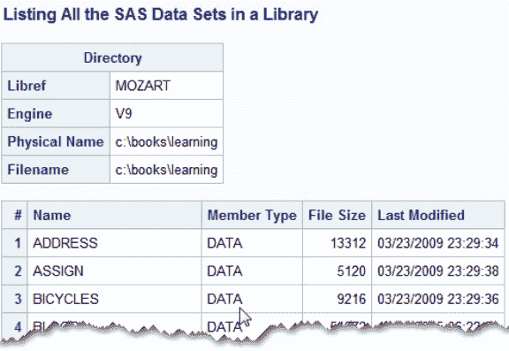

## 4.6 使用鼠标点击方法查看 SAS 数据集的描述部分

如果你正在使用三种窗口环境中的任何一种运行 SAS，可以使用简单的鼠标点击方法来查看 SAS 数据集的描述部分或数据部分。下方显示的截图是在 Windows 平台上的使用 SAS 窗口环境制作的。类似的技术也适用于 Enterprise Guide 或 SAS Studio。

首先，点击编辑器窗口左下角的 Explorer（资源生成器）选项卡：

图 4.4：使用鼠标点击方法调查你的 SAS 数据集


这会弹出以下窗口：

图 4.5：`LIBRARY`（库）图标


Libraries 图标显示了内置库以及你通过 `LIBNAME` 语句创建的任何库。双击 Libraries 图标。

图 4.6：选择你要检查的库


选择一个库可以查看存储在那的所有 SAS 数据集。

图 4.7：`Mozart` 库中 SAS 数据集的部分列表


右单击数据集图标会弹出一个菜单，其中包含查看数据集变量（列）及其属性的选项。左单击打开 SAS 查看器，显示数据集的数据部分。如果你右单击并选择 `View Columns`（查看列），你将看到：

图 4.8：选择 `View Columns` 以查看变量和属性

| General | Details | Columns | Integrity | Passwords |
|---|---|---|---|---|
| Find column name: | | | | |
| Column Name | Type | Length Format | Informat | Label |
| AaID | Text | 3 | | |
| AaName | Text | 15 | | |
| W Score1 | Num... | 8 | | |
| W Score2 | Num... | 8 | | |
| W Score3 | Num... | 8 | | |

这显示了运行 `PROC CONTENTS` 可以获得的信息。变量列表顺序与使用 `VARNUM` 选项时看到的顺序相同。

如果你单击数据图标，将在 SAS 查看器中看到你的数据集。它看起来像：

图 4.9：使用 SAS 查看器列出你的 SAS 数据集

| | Name | Score1 | Score2 | Score3 |
|---|---|---|---|---|
| 1 | Jan | 90 | 95 | 98 |
| 2 | Preston | 78 | 77 | 99 |
| 3 | Russell | 88 | 91 | 92 |

> 注意：如果你计划进行任何更改，请务必关闭此窗口。

## 第 4 章：创建永久 SAS 数据集

创建 `AveScore` 变量的赋值语句使用 `MEAN` 函数计算三个 `Score` 变量的平均值。你可以在第 11 章阅读更多关于 `MEAN` 函数的信息。目前，你应该注意到变量列表 `Score1–3` 之前有一个单词 `of`。这是许多可以接受变量列表作为参数的 SAS 统计函数的典型特征。如果没有 `of` 字，`MEAN` 函数将返回 `Score1` 和 `Score3` 之间的差（即破折号将被解释为减号）。

以下是 Data Set New 的列表：

图 4.11：程序 4.7 的输出

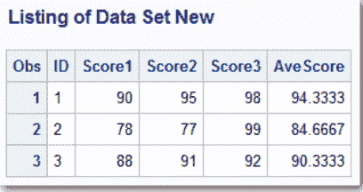

## 4.9 DATA_NULL：一个不存在的数据集

在许多应用程序中，你想要处理 SAS 数据集中的观测值，可能是为了打印数据错误或生成报告，而你不需要创建一个新的数据集。

你可以在这些应用程序中使用数据集名称 `_NULL_`。保留的数据集名称 `_NULL_` 告诉 SAS 不要创建数据集。它允许你处理来自原始数据或现有数据集的观测值，而无需创建新数据集的开销。这里有一个示例：

你有一个成员 SAS 数据集（`Test_Scores`），你想创建一个在任何测试中获得 95 分或以上分数的学生 ID 列表。你可以创建一个新的 SAS 数据集并使用 `PROC PRINT` 来列出这些学生，也可以使用 `DATA_NULL_` 步骤更高效地完成，如下：

程序 4.8：演示 `DATA_NULL_` 步骤

```
title "Scores Greater Than or Equal to 95"
data _null;
set Learn.Test_Scores;
if Score1 ge 95 or Score2 ge 95 or Score3 ge 95 then
put ID= Score1= Score2= Score3=;
run;
```

`IF` 语句检查三个测试分数是否有任何一个大于或等于 95。如果是，`PUT` 语句将写入 `ID` 和三个测试分数的值。`PUT` 语句将文本写入你选择的位置：外部文本文件、SAS 日志或输出 窗口。在程序 4.8 中，没有指定输出位置，因此使用了默认位置 SAS 日志。以下是运行该程序后的 SAS 日志列表：

**图 4.12：**运行程序 4.8 后的 SAS 日志列表

```
15  title "Scores Greater Than or Equal to 95";
16  data _null_;
17      set Learn.Test_Scores;
18      if Score1 ge 95 or Score2 ge 95 or Score3 ge 95 then
19          put ID Score=1 Score=2 Score=3;
20  run;
21 ID=1 Score1=90 Score2=95 Score3=98
ID=2 Score1=78 Score2=77 Score3=99
NOTE: There are 3 observations read from the data set
LEARN.TEST_SCORES.
NOTE: a statement used (Total process time):
      real time           0.00 seconds
      cpu time             0.00 seconds
```

在 `DATA` 步骤中放置 `put` 语句是调试 SAS 程序的极佳方法。你可以在 `DATA` 步骤的任何地方检查变量的结果。（你也可以使用 PC 平台上提供的 SAS 调试器为此目的。）

如果你想将输出发送到 `C:\books\learning\HighScores.txt` 的文件，你需要在 `PUT` 语句之前放置 `FILE` 语句，如下：

```
file 'C:\books\learning\HighScores.txt';
```

`FILE` 语句类似于 `INFILE` 语句——它与 `PUT` 语句协同工作，告诉 SAS 你正在输出的文本的目的地。

如果你将 `PUT` 语句的结果写入输出设备（在 PC 上将是 OUTPUT 窗口），你可以保留文件引用 `PRINT`，如下：

```
file print;
```

`DATA_NULL` 步骤有时用于创建自定义报告。事实上，这种报告被称为 DATA_NULL 报告。为了控制 SAS 如何写入此输出，你可以使用指针和格式来精确指定要写入哪些列以及如何格式化值。有了了更强大的处理器（如 `PROC REPORT`），很少需要使用 `DATA_NULL` `DATA` 步骤编写你的自定义报告。

## 4.10 问题

奇数题的解答位于书的末尾。所有问题的解答供教授使用。如果你是教授，请访问书籍的辅助网站 `support.sas.com/cody` 获取有关如何获取所有问题解答的信息。

- 1. 运行程序以创建一个名为 `Perm` 的永久 SAS 数据集。你需要修改程序以指定你想要放置此数据集的文件夹。在此数据集上运行 `PROC CONTENTS`。

```
libname learn `C:\your-folder-name`;

data learn.Perm;
 ID : $3. Gender : $1. DOB : mmddyy10.
 Weight;
label DOB = 'Date of Birth'
 Height = 'Height in inches'
 Weight = 'Weight in pounds'
format DOB date;
datalines;
001 M 10/21/1946 68 150
002 F 05/26/1950 63 122
003 M 11/11/1981 72 175
004 F 07/04/1983 70
128
005 F 12/25/2005 40
```

- 2. 在数据集上运行 `PROC CONTENTS` 以列出这些学生。使用 `PROC PRINT` 来列出这些学生或查看它们之间的差异。

- 3. 运行程序创建一个名为 `Survey` 的数据集。使用 `IF` 语句，并计算这些变量的平均值。

```
libname learn `C:\your-folder-name`;

data learn.Perm;
 ID : $3. Gender : $1. DOB : mmddyy10.
 Weight;
label DOB = 'Date of Birth'
 Height = 'Height in inches'
 Weight = 'Weight in pounds'
format DOB date;
datalines;
001 M 10/21/1946 68 150
002 F 05/26/1950 63 122
003 M 11/11/1981 72 175
004 F 07/04/1983 70
128
005 F 12/25/2005 40
```

- 4. 运行程序以创建一个名为 `Perm` 的永久 SAS 数据。你需要修改程序以指定你想要放置此数据集的文件夹。在此数据集上运行 `PROC CONTENTS`。

- 5. 运行程序以创建一个名为 `Perm` 的永久 SAS 数据。你需要修改程序以指定你想要放置此数据集的文件夹。在此数据集上运行 `PROC CONTENTS`。

- 6. 运行程序以创建一个名为 `Perm` 的永久 SAS 数据。你需要修改程序以指定你想要放置此数据集的文件夹。在此数据集上运行 `PROC CONTENTS`。

- 7. 运行程序以创建一个名为 `Perm` 的永久 SAS 数据。你需要修改程序以指定你想要放置此数据集的文件夹。在此数据集上运行 `PROC CONTENTS`。

- 8. 运行程序以创建一个名为 `Perm` 的永久 SAS 数据。你需要修改程序以指定你想要放置此数据集的文件夹。在此数据集上运行 `PROC CONTENTS`。

- 9. 运行程序以创建一个名为 `Perm` 的永久 SAS 数据。你需要修改程序以指定你想要放置此数据集的文件夹。在此数据集上运行 `PROC CONTENTS`。

- 10. 运行程序以创建一个名为 `Perm` 的永久 SAS 数据。你需要修改程序以指定你想要放置此数据集的文件夹。在此数据集上运行 `PROC CONTENTS`。

- 11. 运行程序以创建一个名为 `Perm` 的永久 SAS 数据。你需要修改程序以指定你想要放置此数据集的文件夹。在此数据集上运行 `PROC CONTENTS`。

- 12. 运行程序以创建一个名为 `Perm` 的永久 SAS 数据。你需要修改程序以指定你想要放置此数据集的文件夹。在此数据集上运行 `PROC CONTENTS`。

- 13. 运行程序以创建一个名为 `Perm` 的永久 SAS 数据。你需要修改程序以指定你想要放置此数据集的文件夹。在此数据集上运行 `PROC CONTENTS`。

- 14. 运行程序以创建一个名为 `Perm` 的永久 SAS 数据。你需要修改程序以指定你想要放置此数据集的文件夹。在此数据集上运行 `PROC CONTENTS`。

- 15. 运行程序以创建一个名为 `Perm` 的永久 SAS 数据。你需要修改程序以指定你想要放置此数据集的文件夹。在此数据集上运行 `PROC CONTENTS`。

- 16. 运行程序以创建一个名为 `Perm` 的永久 SAS 数据。你需要修改程序以指定你想要放置此数据集的文件夹。在此数据集上运行 `PROC CONTENTS`。

- 17. 运行程序以创建一个名为 `Perm` 的永久 SAS 数据。你需要修改程序以指定你想要放置此数据集的文件夹。在此数据集上运行 `PROC CONTENTS`。

- 18. 运行程序以创建一个名为 `Perm` 的永久 SAS 数据。你需要修改程序以指定你想要放置此数据集的文件夹。在此数据集上运行 `PROC CONTENTS`。

- 19. 运行程序以创建一个名为 `Perm` 的永久 SAS 数据。你需要修改程序以指定你想要放置此数据集的文件夹。在此数据集上运行 `PROC CONTENTS`。

- 20. 运行程序以创建一个名为 `Perm` 的永久 SAS 数据。你需要修改程序以指定你想要放置此数据集的文件夹。在此数据集上运行 `PROC CONTENTS`。

- 21. 运行程序以创建一个名为 `Perm` 的永久 SAS 数据。你需要修改程序以指定你想要放置此数据集的文件夹。在此数据集上运行 `PROC CONTENTS`。

- 22. 运行程序以创建一个名为 `Perm` 的永久 SAS 数据。你需要修改程序以指定你想要放置此数据集的文件夹。在此数据集上运行 `PROC CONTENTS`。

- 23. 运行程序以创建一个名为 `Perm` 的永久 SAS 数据。你需要修改程序以指定你想要放置此数据集的文件夹。在此数据集上运行 `PROC CONTENTS`。

- 24. 运行程序以创建一个名为 `Perm` 的永久 SAS 数据。你需要修改程序以指定你想要放置此数据集的文件夹。在此数据集上运行 `PROC CONTENTS`。

- 25. 运行程序以创建一个名为 `Perm` 的永久 SAS 数据。你需要修改程序以指定你想要放置此数据集的文件夹。在此数据集上运行 `PROC CONTENTS`。

- 26. 运行程序以创建一个名为 `Perm` 的永久 SAS 数据。你需要修改程序以指定你想要放置此数据集的文件夹。在此数据集上运行 `PROC CONTENTS`。

- 27. 运行程序以创建一个名为 `Perm` 的永久 SAS 数据。你需要修改程序以指定你想要放置此数据集的文件夹。在此数据集上运行 `PROC CONTENTS`。

- 28. 运行程序以创建一个名为 `Perm` 的永久 SAS 数据。你需要修改程序以指定你想要放置此数据集的文件夹。在此数据集上运行 `PROC CONTENTS`。

- 29. 运行程序以创建一个名为 `Perm` 的永久 SAS 数据。你需要修改程序以指定你想要放置此数据集的文件夹。在此数据集上运行 `PROC CONTENTS`。

- 30. 运行程序以创建一个名为 `Perm` 的永久 SAS 数据。你需要修改程序以指定你想要放置此数据集的文件夹。在此数据集上运行 `PROC CONTENTS`。

## 5.2 使用格式增强你的输出

SAS 提供了内置格式来改进打印输出的外观。例如，你可以在打印数据时带有美元符号，或为大数字添加逗号。你已经在程序 3.8 中见过这种示例。

你也可以创建自己的自定义格式。例如，如果你有一个名为 `Gender` 的变量，值为 `M` 和 `F`，你可以将它们格式化为 `Male` 和 `Female`。如果你有一个表示年龄的变量，你可以使用格式显示年龄段而不是实际年龄。你可以为每个变量使用一种格式，也可以为一组变量使用一种格式。

一个名为 `Survey` 的 SAS 数据集展示了如何使用格式。以下是该数据集在没有任何格式下的列表：

图 5.2：数据集调查列表

# 数据集调查列表

| ID | 性别 | 年龄 | 工资 | 问题1 | 问题2 | 问题3 | 问题4 | 问题5 |
|---|---|---|---|---|---|---|---|---|
| 001 | M | 23 | 28000 | 1 | 2 | 2 | | 3 |
| 002 | F | 55 | 76123 | 4 | 5 | 2 | | 1 |
| 003 | M | 38 | 36500 | 2 | 2 | 2 | | 1 |
| 004 | F | 67 | 128000 | 5 | 3 | 2 | | 4 |
| 005 | M | 22 | 23060 | 3 | 3 | 4 | | 2 |
| 006 | M | 63 | 90000 | 3 | 5 | 4 | | 3 |
| 007 | F | 45 | 76100 | 5 | 3 | 4 | | 3 |

让我们看看格式如何提高此表的可读性：

# 程序 5.2：使用 PROC FORMAT 创建用户定义格式

```
proc format;
value $Gender 'M' = 'Male'
'F' = 'Female'
' ' = 'Not entered'
other = 'Miscoded';

value Age low-29 = 'Less than 30'
30-50 = '30 to 50'
51-high = '51+';

value $Likert '1' = 'Str Disagree'
'2' = 'Disagree'
'3' = 'No Opinion'
'4' = 'Agree'
'5' = 'Str Agree';

run;
```

你应该注意到关于此过程的几点。首先，你使用 `VALUE` 语句来创建每个用户定义格式。接下来，当你在 `VALUE` 语句中创建格式时，格式名称后不要包含句号。

此外，用于字符变量的格式以美元符号开头。格式名称后面是唯一值或值范围、一个等号，然后是你想与每个值或值范围关联的文本。格式名称的规则与 SAS 变量的规则相似，但格式名称不能以数字结尾，且格式的最大长度为 31 个字符。对于好奇的读者来说，长度为 31 而不是 32 是因为在 `DATA` 或 `PROC` 步骤的 `FORMAT` 语句中使用格式名称时，会在格式名称末尾添加句号。（SAS 之前的版本仅允许 8 个格式名称。）

第一个要定义的格式是 `$GENDER.`。格式名称不需要与变量名相关——将此格式重命名为 `$GENDER` 会让你更容易记住稍后将用它来更改 SAS 输出中性别值的打印方式。

# 通过实例学习 SAS：程序员指南，第二版

性别的值存储为 `M` 和 `F`。将 `$GENDER` 格式与变量 `Gender` 关联，会导致 `M` 显示为 `Male`，`F` 显示为 `Female`，缺失值显示为 `Not entered`。`VALUE` 语句中的关键字 `other` 导致对于除 `M`、`F` 或缺失值以外的任何字符都打印文本 `Miscoded`。


格式 `AGE` 格式用于将年龄分为三类。注意，格式和变量使用相同的名称是允许的（SAS 知道包含句号的名称是）。如果你将此应用于变量 `AGE`，则将打印具体的年龄而不是保留年龄。SAS 变量的内部值不会被改变，因为它们已经与格式关联。格式只影响值的打印方式，在某些情况下，还会影响 SAS 过程处理变量的方式。（例如，`PROC FREQ` 计算格式化值的频率，而不是原始值；`PROC MEANS` 处理 `CLASS` 语句中列出的格式化变量，等等。）

在 `AGE` 格式中，关键字 `LOW` 和 `HIGH` 分别指最低非缺失值和最高值。

> 注意：当与字符格式一起使用时，关键字 `LOW` 包含缺失值。

最后一个格式 `$LIKERT` 用于将数字 1（`强烈不同意`）到 5（`强烈同意`）替换相应的文本。

> 注意：选择 Likert 这个名字是因为这是心理测量学家用于描述从强烈不同意到强烈同意范围的回答的名称。

让我们看看在 `PROC PRINT` 中放置格式语句时会发生什么，如下所示：

# 程序 5.3：在 `PROC PRINT` 中添加 `FORMAT` 语句

```
title "Data Set SURVEY with Formatted Values"
proc print data=Learn.Survey;
id ID;
var Gender Age Salary Ques1-Ques;
format Gender $Gender.
Age $Age.
Ques1-Ques $Likert.
Salary $dollar11.2;
run;
```

在这里，格式 `$GENDER` 和 `AGE` 分别用于格式化变量 `Gender` 和 `Age`。格式 `$LIKERT` 格式化从 `Ques` 到 `Ques5` 的五个变量。注意每个格式后面都跟着一个句号，就像内置 SAS 格式一样。

`Salary` 的格式 `DOLLAR11.2` 是 SAS 格式。名称 `dollar` 表示你想使用美元格式（在值中添加美元符号和逗号）；11 告诉 SAS 使用 11 列来打印值；随后的 2 告诉 SAS 你想在小数点右侧打印两个数字。注意，11 列包含了美元符号、逗号和小数。`DOLLAR11.2` 的格式为：`$99,999.99`

## 第 5 章：标签与格式

将格式设置得比预期的宽一点是个好主意，以防数据包含你预期的更多。在我们显示输出之前，注意 `PROC PRINT` 语句中的格式。如果你在 `PROC PRINT` 中包含格式语句，变量（列）通常会显示。如果你在 `TABLES` 语句中列出格式，它出现在第一列。这里是：

图 5.3：来自值的输出

| ID | 性别 | 年龄 | 工资 | 问题1 | 问题2 | 问题3 | 问题4 | 问题5 |
|---|---|---|---|---|---|---|---|---|
| 001 | M | 23 | 28000 | 1 | 2 | 2 |  | 3 |
| 002 | F | 55 | 76123 | 4 | 5 | 2 |  | 1 |
| 003 | M | 38 | 36500 | 2 | 2 | 2 |  | 1 |
| 004 | F | 67 | 128000 | 5 | 3 | 2 |  | 4 |
| 005 | M | 22 | 23060 | 3 | 3 | 4 |  | 2 |
| 006 | M | 63 | 90000 | 3 | 5 | 4 |  | 3 |
| 007 | F | 45 | 76100 | 5 | 3 | 4 |  | 3 |

### 5.3 使用格式分组值

你可以使用格式对各种值进行分组。例如，假设你想查看调查结果，而不是查看五个可能的回答，你想将 1 和 2（强烈不同意和不同）合并，并将 4 和 5（同意和强烈同意）合并形成三类。可以通过创建一个新格式来实现这一点，如程序 5.4 所示：

# 程序 5.4：使用格式分组值

```
proc format;
    value $Three 1,2 = 'Disagreement'
                  3 = 'No opinion'
                  4,5 = 'Agreement';
run;
```


# 通过实例学习 SAS：程序员指南，第二版

你可以将此格式应用于问题变量，如下：

# 程序 5.5：在 `PROC FREQ` 中对多个变量应用格式

```
title "Question Frequencies Using the Three Format";
proc freq data=Learn.Survey;
tables Ques1-Ques5;
format Ques1-Ques $Three;
run;
```

`PROC FREQ` 如你在第 2 章看到的，用于统计 `TABLES` 语句列出的变量（在本例中为 `Ques1-Ques`）。由于此过程中使用了格式语句，表格只有三个类别而不是原始的五个。这里是输出的部分列表：

**图 5.4：使用三种格式的部分列表频率**

| Ques1 | 频率 | 百分比 | 累计频率 | 累计百分比 |
| --- | --- | --- | --- | --- |
| Disagreement | 3 | 42.86 | 3 | 42.86 |
| No opinion | 1 | 14.29 | 4 | 57.14 |
| Agreement | 3 | 42.86 | 7 | 100.00 |
| Ques2 | 频率 | 百分比 | 累计频率 | 累计百分比 |
| Disagreement | 2 | 28.57 | 2 | 28.57 |
| No opinion | 4 | 57.14 | 6 | 85.71 |
| Agreement | 1 | 14.29 | 7 | 100.00 |

如果你回看图 5.2，你可以看到两个 1 的值和一个 `Ques1` 的值合并，使得 `Disagreement` 类别的频率为 3——两个 4 的值和一个 `Ques5` 的值合并，使得 `Agreement` 类别的频率为 3。

## 5.4 更多关于格式范围

当你定义格式时，示例可以在 `VALUE` 语句的等号左侧指定单个值或范围。为了理解这种方法的灵活性，假设你有一个名为 `Grade` 的变量，值为 A, B, C, D, F, I 和 W。以下 `VALUE` 语句创建了一个将这些等级分为六类别的格式：

```
value $Gradefmt 'A' - 'C' = 'Passing'
             'D'      = 'Borderline'
             'F'      = 'Failing'
             'I','W'  = 'Incomplete or withdrew'
             ' '      = 'Not recorded'
             other   = 'Miscoded'
```

这意味着等级 A、B 或 C将被格式化为 `Passing`（通过），D `Borderline`（边缘），F `Failing`（不及格）或 W 为“未完成或退出”，缺失值为 `Not recorded`（未记录），任何其他值均为 `Miscoded`（编码错误）。你可以选择省略字符范围和标签的引号。从风格上考虑，我们建议在这里使用单引号或双引号。

在程序 5.2 中，`AGE` 的范围定义如下：

```
value Age low-29 = 'Less than 30'
             30-50      = '30 to 50'
             51-high   = '51+'
```

如果格式用于整数值，这是可以的。然而，假设你将此格式用于一个可能取值为 29.5 等值的变量。该值落在 `low-29` 和 `30-50` 范围之间。你可以这样确保范围之间没有间隙：

```
value Age low-<30 = 'Less than 30'
             30-<51    = '30 to less than 51'
             51-high   = '51+'
```

第一个范围包含所有小于 30 的值（这将包括 29.5）。第二个范围包含从 30 到小于 51 的值，最后一个范围包含 51 及及以上的值。你也可以在范围的左侧使用小于（`<`）符号。对于下面的示例，范围 `30-<51` 不包含 30：

```
value Age low-30 = 'Less than or equal to 30'
             30-<51    = 'Greater than 30 to 51'
             51-high   = '51+'
```

> 注意：记住这种工作原理的一种好方法是排除第一个值，在值后面加上 `<` 符号——如果你想排除最后一个值，则在该值之前加上 `<` 符号。如果你知道你的格式可能用于非整数值，请确保你的范围之间没有间隙。

## 5.5 将你的格式存储在格式库中

如前所述，如果你在 `DATA` 步骤中放置 `LABEL` 和 `FORMAT` 语句，标签和格式将与它们的变量永久关联。如果你有带有 SAS 数据集的用户自定义格式，那么让你的格式也变为永久的是非常重要的。以下是执行此操作的步骤：

- 创建一个库（libref）以指示你想存储格式的地方。这可以与你存储数据集的同一个库。
- 在运行 `PROC FORMAT` 时使用 `LIBRARY=libref` 选项。（记住，你只需要运行此过程一次。）

例如，假设你想让程序 5.2 中创建的格式永久化，并将它们保存到 `C:\books\learning` 文件夹中。程序 5.6 为你创建了一个永久格式库。

### 程序 5.6：创建永久格式库

```
libname Myfmts 'C:\books\learning';
proc format Myfmts;
    value $Gender 'M' = 'Male'
                  'F' = 'Female'
                  '' = 'Not entered'
                  other = 'Miscoded';

    value Age low-29 = 'Less than 30'
                30-50 = '30 to 50'
                51-high = '51+'

    value $Likert '1' = 'Strongly disagree'
                  '2' = 'Disagree'
                  '3' = 'No opinion'
                  '4' = 'Agree'
                  '5' = 'Strongly agree';
```

如果你在 Windows 系统上运行此程序，将在 libref 指定文件夹内创建一个名为 `formats.sas7cat` 的文件。

## 5.6 永久数据集属性

如果你在 `DATA` 步骤中添加 `LABEL` 和 `FORMAT` 语句，标签和格式将与它们相应的变量永久关联。这为数据集提供了一种非常方便的方法。另一个用户可以使用 `PROC CONTENTS` 或 SAS Explorer 来列出与每个变量使用的标签和格式。

每当你使用带有用户自定义格式的 SAS 数据集时，你都需要告诉 SAS 去查找这些格式。默认情况下，SAS 只查找它自己的格式、`Work` 库中的格式（即临时格式），或具有特殊名称 `Library` 的库中的格式。

如果你想让 SAS 也从你自己的库之一中查找，你需要发布 `FMTSEARCH` 选项。你可以使用此选项列出一个或多个库供 SAS 搜索。例如，如果你想使用放在 `Myfmts` 库中的格式，你需要提交以下代码：

```
options fmtsearch=(Myfmts);
```

如果你这样做，SAS 会先查找 `Work` 库，然后是名为 `Library` 的库，最后是 `Myfmts` 库。如果你想让 SAS 在查找上述两个库之前先查找 `Myfmts` 库，可以这样命名：

```
options fmtsearch=(Myfmts Work);
```

现在，SAS 会先查找 `Myfmts` 库，然后是 `Work` 库。程序 5.7 演示了如何创建一个带有自定义格式的永久数据集（假设你已经在 `C:\books\learning` 中创建了库）。

### 程序 5.7：在 Data 步骤中添加 LABEL 和 FORMAT 语句

```
libname Learn 'C:\books\learning';
libname Myfmts 'C:\books\learning';
options fmtsearch=(Myfmts)
data Learn.Survey;
  infile 'C:\books\learning\Survey.txt';
  input ID :3.
  Gender :1.
  Age
  Salary
  (Ques1-Ques5);
format $Gender $Gender Salary DOLLAR10 Ques1-Ques5 $Likert;
label ID = "Subject ID"
      Gender = "Gender"
      Age = "Age"
      Salary = "Salary"
      Ques1 = "Question 1"
      Ques2 = "Question 2"
      Ques3 = "Question 3"
      Ques4 = "Question 4"
      Ques5 = "Question 5";
run;
```

现在，按如下方式对数据集运行 `PROC CONTENTS`：

### 程序 5.8：对数据集运行 PROC CONTENTS

```
title "Data Set Survey";
proc contents data=Learn.Survey varnum;
run;
```

你将获得一个有助于记录数据集的列表如下（部分列表）：

图 5.5：程序 5.8 的输出

| # Variable | Type | Len | Format | Label |
|---|---|---|---|---|
| 1 ID | Char | 3 | | Subject ID |
| 2 Gender | Char | 1 | | Gender |
| 3 Age | Num | 8 | | Age of 2006 |
| 4 Salary | Num | 8 | | Yearly Salary |
| 5 Ques1 | Char | 1 | | Question 1 |
| 6 Ques2 | Char | 1 | | Question 2 |
| 7 Ques3 | Char | 1 | | Question 3 |
| 8 Ques4 | Char | 1 | | Question 4 |
| 9 Ques5 | Char | 1 | | Question 5 |

## 5.7 访问带有用户自定义格式的永久 SAS 数据

如果你想使用带有用户自定义格式的永久 SAS 数据，唯一的要求是记住告诉 SAS 去哪里查找这些格式。如果你忘记了 `FMTSEARCH` 系统选项，你将收到一条错误信息，提示 SAS 找不到格式。

> 如果你将带有用户自定义格式的 SAS 数据集拷贝给另一个用户，请务必也给他们一个格式库的副本。（在 PC 平台上，你需要给他们一个 `formats.sas7cat` 文件的副本。）

# 第5章：创建标签和格式 67

一旦你提交了 `FMTSEARCH=` 选项，就可以使用你自己的格式，就像使用内置 SAS 格式一样。

## 5.8 显示你的格式定义

`PROC FORMAT` 的一个有用选项是 `FMTLIB`。该选项会创建指定库中每个格式的列表，包含范围和标签。例如，如果你想显示 `Myfmts` 库中所有格式的定义，可以提交以下代码：

程序 5.10：在用户创建库中显示格式定义

```sas
title "Format Definitions in the Myfmts Library"
proc format library=Myfmts fmtlib;
run;
```

你将获得如下表：

图 5.6：程序 5.10 的输出

| Myfmts 库中的格式定义 |
| FORMAT NAME: AGE | LENGTH: 12 | NUMBER OF VALUES: | 3 |
| :--- | :--- | :--- | :--- |
| MIN LENGTH: 1 | MAX LENGTH: 40 | DEFAULT LENGTH: 12 | FUZZ: STD |
| START | END | LABEL (VER. V7\|V8) | 31JAN2018:12:55:04 |
| LOW | | | 29 Less than 30 |
| | 30 | | 50 30 to 50 |
| | 51 HIGH | | 51+ |
| FORMAT NAME: $GENDER | LENGTH: 11 | NUMBER OF VALUES: | 4 |
| :--- | :--- | :--- | :--- |
| MIN LENGTH: 1 | MAX LENGTH: 40 | DEFAULT LENGTH: 11 | FUZZ: | 0 |
| START | END | LABEL (VER. V7\|V8) | 31JAN2018:12:55:04 |
| F | F | Not entered |
| M | M | Female |
| | | Male |
| **OTHER** | **OTHER** | Miscoded |

68 实例实例学习 SAS：程序员指南，第二版

| FORMAT NAME: $LIKIKERT LENGTH: 17 NUMBER OF VALUES: 5 |


| MIN LENGTH: 1 MAX LENGTH: 40 DEFAULT LENGTH: 17 FUZZ: 0 |

| START | LABEL (VER. V7\|V8 31JAN2018:12:55:04) |

| 1 | Strongly disagree |

| 2 | Disagree |

| 3 | No opinion |

| 4 | Agree |

| 5 | Strongly agree |

如果你只想在格式库中查看特定的格式，可以在 `PROC FORMAT` 中添加 `SELECT` 语句。在关键字 `SELECT` 之后列出你想要显示的格式。当你使用 `SELECT` 语句时，不需要包含 `FMTLIB` 选项。例如，要只显示 `AGE` 和 `$LIKIKERT` 格式，可以使用以下程序：

### 程序 5.11：演示 `PROC FORMAT` 中的 `SELECT` 语句

```sas
proc format library=Myfmts;
    select Age $likert;
run;
```

> 注意：此程序假设你之前已提交定义 `Myfmts` 库的 `LIBNAME` 语句。

还有一个 `EXCLUDE` 语句，允许你指明不希望显示的格式。

请参阅第 22 章以获取 SAS 和用户定义格式的更多高级用法。

## 5.9 习题

奇数题的解答位于书末。所有题目的解答均供教授参考。如果你是教授，请访问书籍配套网站 `support.sas.com/cody` 获取有关如何获取所有题目解答的信息。

- 在此处运行程序，以创建一个名为 `Voter` 的临时 SAS 数据集：

```sas
data Voter;
    input Age Party : $; (Ques-Q4)($. + 1);
datalines;
    23 D 1 2 2
    45 R 5 4 1
    67 D 2 4 3
    39 R 4 4 4
    19 D 2 1 1
    75 D 3 2 3
    97 R 4 3 4
    ;
```

第 5 章：创建标签和格式 69

为 `Age`（0–30, 31–50, 51–70, 71+）、`Party`（D = 民主党, R = 共和党）以及 `Ques1`–`Ques4`（1=非常不同意, 2=不同意, 3=无意见, 4=同意, 5=非常同意）添加格式。此外，将 `Ques1`–`Ques4` 标记如下：

| 变量 | 标签 |

| --- | --- |

| Ques1 | 总统工作良好 |

| Ques2 | 国会工作良好 |

| Ques3 | 税收过高 |

| Ques4 | 政府应该削减开支 |

**注意：** 使用 `PROC PRINT` 列出此数据集中的观测值，并使用 `PROC FREQ` 列出查询的频率。（`PROC PRINT` 的默认操作是用变量名作为每列的标题而不是标签。要使用标签作为列标题，请在 `PROC PRINT` 中使用 `LABEL` 选项。）

- 1. 你想查看上一个问题中 1 到 4 的频率。但是，你只需要三个类别：*普遍不同意*（将非常不同意和不同意合并）、*无意见*和*普遍同意*（将同意和非常同意合并）。

- 2. 运行以下程序创建一个名为 `Colors` 的数据集：

```sas
data Colors;
  input Color : $;
  datalines;
  R
  G
```

- 3. 如果你有多个工作表，可以选择你想导入的。默认工作表名为 `Sheet1$`（带有美元符号）。

- 4. 使用 `PROC PRINT` 列出此数据集中的观测值，并 `PROC FREQ` 列出查询的频率。（等等，文本说：使用 `PROC FREQ` 列出频率）。

**注意：** 使用 `PROC PRINT` 列出此数据集中的观测值，并 `PROC FREQ` 列出查询的频率。（`PROC PRINT` 的默认操作是用变量名作为每列的标题而不是标签。要使用标签作为列标题，请在 `PROC PRINT` 中使用 `LABEL` 选项。）

# 6：从 Excel 表格读取和写入数据

## 6.1 引言

经常会有 Microsoft Excel 表格作为来源。坦率地说，SAS 有多种方法可以轻松将表格转换为数据集。一种方法是使用 `INFILE` 语句转换逗号分隔值（CSV）文件（见第 3 章）。然而，如果你有 SAS/ACCESS 或正在使用 SAS Studio，可以让 SAS 自动转换。

## 6.2 使用导入向导将表格转换为数据集

示例中使用的工作表是用 Microsoft Excel 创建。`Wage` 列通过工作小时 (`C`) 乘以时率 (`D`) 计算得出。注意这些标题不是有效的变量名。此外，此工作簿有两个工作表：一个命名为 `Temporary`（临时工），另一个命名为 `Permanent`（永久员工）。

72 实例学习 SAS：程序员指南，第二版

图 6.1：Excel 工作簿

[e915d8539895518e1c8b0ae655b0_86_0]

第一步是从 SAS File 菜单中选择 Import Data，所示：

图 6.2：选择 Import Data

[e915d8539895518e1c8b0ae655b0_86_1]

这将弹出一个屏幕，你可以从多种格式（Excel, Access, dBase, Lotus 以及其他）中选择。从下拉菜单中选择 Microsoft Excel。

点击 **Next** 进入下一个屏幕。在这里，你可以输入要导入 Excel 文件名称，或者选择 **Browse** 获取系统上的 Excel 表格列表。

图 6.3：选择 Excel

[e915d8539895518e1c8b0ae655b0_87_0]

图 6.4：选择 Next 并浏览你的文件

[e915d8539895518e1c8b0ae655b0_87_1]

## 74 实例实例学习 SAS：程序员指南，第二版

图 6.5：如果有多个工作表，请选择工作表

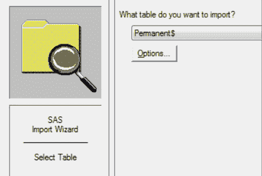

一旦你选择了想要导入的工作表，点击“下一步”（Next）。你将看到一个界面，可以在其中输入库（如果需要临时 SAS 数据集，使用 `Work`；或者使用通过 `LIBNAME` 语句创建的库引用 `libref`）以及 SAS 数据集的名称（在目标屏幕上标记为 Member）。参见后续：

图 6.6：选择库和文件名

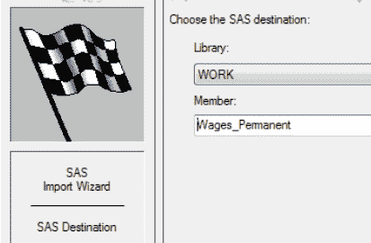

如果你然后选择“完成”（Finish），SAS 将导入你的电子表格。如果你选择“下一步”，你可以选择保存转换程序（`PROC IMPORT`）。如果你保存了此程序（系统会提示你输入要保存程序的文件名），稍后可以运行它来执行转换。

你已经完成了。就是这么简单。在这个示例中，你选择了 `Work` 库和你的 SAS 数据集 `Wages_Permanent`。在使用它进行报告或进一步分析之前，使用 SAS 查看器或 `PROC PRINT` 列出此数据集的内容是一个好主意。如果数据集很大，可以使用 `OBS=n` 数据选项列出数据集的前几个观测值，以限制你想处理的观测数量。例如，要查看数据集 `Wages_Permanent` 的前四个观测，你可以运行以下程序：

## 第 6 章：从 Excel 电子表格读取和写入数据

### 程序 6.1：使用 `PROC PRINT` 列出数据集的前四条观测值

```sas
title "The First Four Observations of Wages_Permanent";
proc print data=Wages_Permanent (obs=4);
run;
```

以下是输出：

图 6.7：程序 6.1 的输出

| Obs | Subject | Date | Hours | Rate_Per_Hour | Wage |

|---|---|---|---|---|---|

| 1 | M75 | 04APR2006 | | 54 | $1,782.00 |

| 2 | F399 | 23AUG2006 | | 56 | $7,250.00 |

| 3 | M766 | 11MAY2006 | | 12 | $900.00 |

| 4 | M287 | 28FEB2006 | | 40 | 50 | $2,000.00 |

SAS 根据 Excel 的列标题创建了变量名。它将列标题中的无效字符替换为下划线（`_`）。使用 SAS Explorer 或 `PROC CONTENTS` 查看此数据集中每个变量的类型（字符或数字）和长度也是一个好主意。你可能需要使用 `PROC DATASETS` 来更改一个或多个变量的格式，或者编写一个短的 DATA 步骤对你希望是数字但由于某种原因是字符的变量执行字符到数字的转换。

使用 `OBS=n` 数据集选项是检查大型数据集数据值的非常有用的方法。通过这种方式，你可以将 `OBS=n` 数据集选项与 `FIRSTOBS=m` 选项结合。该值定义了你想处理的第一个观测值；`LASTOBS` 定义了你想处理的最后一个观测值。使用 `OBS=LASTOBS` 是一个好主意。可能你想要在一个名为 `Verbig` 的非常大的 SAS 数据集中列出第 100 到第 110 条观测值。你可以这样结合 `FIRSTOBS=m` 和 `OBS=n` 选项：

### 程序 6.2：使用 `FIRSTOBS` 和 `OBS=` 选项

```sas
title "Observations 100 through 110 in VERBIG";
proc print data=Project.Verbig (firstobs=100 obs=110);
run;
```

程序 6.2 产生一个包含 11 条观测值的列表（从观测值 100 到观测值 110）。

使用 Enterprise Guide 或 SAS Studio 导入 Excel 工作表。例如，使用 SAS Studio 时，你不需要选择文件格式——它查看文件扩展名（例如 XLS 或 XLSX）并自动选择正确的导入方法。

## 76 实例实例学习 SAS：程序员指南，第二版

### 程序 6.3 从 SAS 数据集创建 Excel 电子表格

在我们离开之前，让我们看看如何使用导出向导（Export Wizard）将 SAS 数据集转换为 Excel 电子表格。从“文件”（File）菜单选择“导出数据”（Export Data），然后选择“Microsoft Excel”。

假设你想将你的 `Sales` 数据集（位于 `C:\books\learning` 文件夹）转换为 Excel 电子表格。首先，你需要确保你有一个指向该文件夹的库引用。例如，执行以下语句：

```sas
libname Learn 'C:\books\learning';
```

然后，按照以下步骤操作：

- 从“文件”（File）菜单选择“导出数据”（Export Data）。

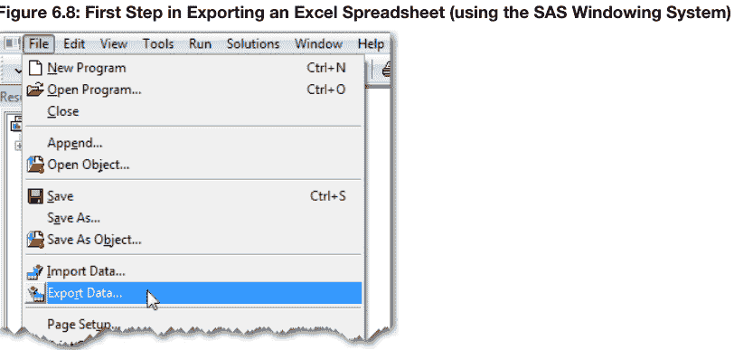

- 在下一个屏幕上，输入 `LIBNAME` 和你想导出的 SAS 数据集的名称（此例中为 `Sales`）并点击“下一步”（Next）。

图 6.9：库名和文件名


第 6 章：从 Excel 电子表格读取和写入数据 77

下一步，从下拉菜单中选择 Microsoft Excel。

图 6.10：选择 Excel


你可以浏览或输入 Excel 的名称。

图 6.11：工作簿


你可以命名特定的表。

图 6.12：表名


78 实例实例学习 SAS：程序员指南，第二版

点击“完成”（Finish），SAS 将数据写入电子表格（或点击“下一步”写入表格）。

通过使用 XLS 或 XLSX 引擎来处理数据集。例如，在 `C:\books\learning` 文件夹中，执行以下语句：

```sas
libname Read 'C:\books\learning';
```

你现在可以访问该文件中的工作表。假设你想计算 `Permanent` 工作表中 `Wage` 的平均值。如下：

程序 6.3：使用 `PROC MEANS` 读取电子表格

```sas
title "Statistics from Sales"
proc means data=Read.Permanent;
    var Wage_;
run;
```

有几点需要注意：

- 第一，因为变量名中不允许出现 (`$`)。

- 第二，因为列标题 `Hours Worked` 不是有效的变量名，SAS 会替换下划线。

- 因此，为了使之生效，你需要使用 `VALIDNAME=ANY` 选项：

```sas
options validname=any;
```

第 6 章：从 Excel 电子表格读取和写入数据 79

图 6.13：程序 6.3 的输出

| Variable | Label | Mean |

|---|---|---|

| Wage | | 2568.40 |

| HoursWorked | | 37.20 |

一旦创建了相应的 `LIBNAME` 语句，就可以将电子表格视为数据集。

### 6.5 使用 SAS 输出系统将 SAS 数据集转换为 Excel

你可以使用输出系统（ODS）创建 Excel 可以打开的 CSV 文件。有关 ODS 的更多信息，请参见第 19 章。

例如，你想将 SAS 数据集的内容发送到 Excel。程序 6.4 从数据集创建 CSV 文件：

程序 6.4：使用 ODS 将 SAS数据集转换为 CSV 文件（供 Excel 读取）

```sas
libname Learn 'C:\books\learning';

ods csv file='C:\books\learning\ODS_Example.csv';

proc print data=Learn.Survey noobs;
run;

ods close;
```

`ODS CLOSE` 语句移除 CSV 文件作为输出目标。注意 `PROC PRINT` 的 `NOOBS` 消除了输出中的 OBS。在 `PROC PRINT` 之后使用 `ODS CLOSE` 语句关闭文件很重要。以下是 `C:\books\learning\ODS_Example.csv` 文件的列表：

"ID","Gender","Age","Salary","Ques1","Ques2","Ques3","Ques4","Ques5"

001,M,23,28800,1,2,1,2,3

002,F,55,76123,4,5,2,1,1

003,M,38,36500,2,2,2,1,1

004,F,67,128000,5,3,2,2,4

005,M,22,23060,3,3,4,2,3

006,M,63,90000,2,3,5,4,3

80 实例型 SAS学习：程序员指南，第二版

你可以直接按照以下操作在 Excel 中打开此文件，结果如下所示：

**图 6.14：在 Excel 中打开 CSV 文件**

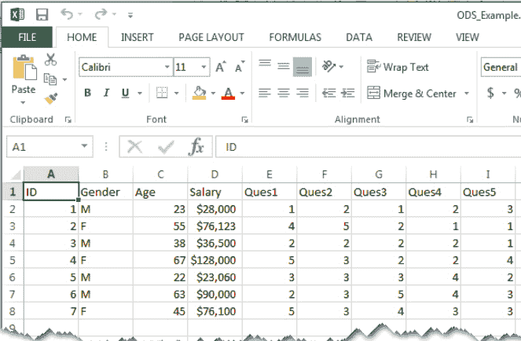

SAS 可以非常轻松地读取和写入 Excel 数据。传输后请务必检查生成的文件，以确保数据值（尤其是日期）已正确处理。此外，如果你正在创建 SAS 数据集，请务必运行 `PROC CONTENTS` 或使用 SAS Explorer 来验证变量类型和长度。

## 6.6 快速查看 SAS Studio 中的导入实用程序

正如本之前提到的，SAS Enterprise Guide 和 SAS Studio 都可以用于导入导出 Microsoft Excel 文件。本节展示了使用 SAS Studio 导入数据的一些截图。

你首先需要在导航窗格中选择 **Tasks and Utilities**（任务和实用程序）。

图 6.15：在导航窗格中选择任务和实用程序 81

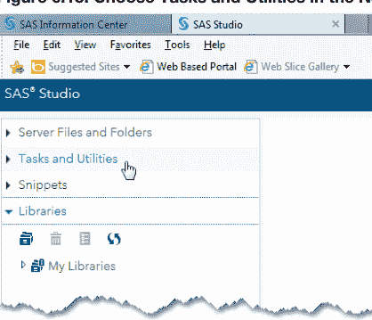

这将让你访问子菜单，包括 Import Data（导入数据）。

图 6.16：选择导入数据

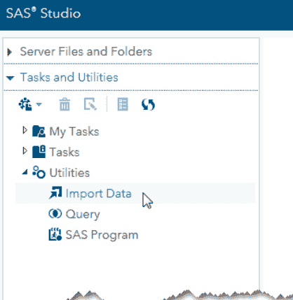

82 实例型 SAS学习：程序员指南，第二版

你可以从列表中拖入文件，或者点击 Select File（选择文件）来选择要导入的文件。

图 6.17：将文件拖入拖放区域或点击选择文件

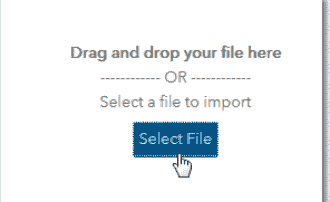

选择你想导入的文件。记住，此文件必须位于默认共享文件夹 (`SASUniversity\MyFolders`) 或你在虚拟机上创建的其他共享文件夹中。

图 6.18：选择文件

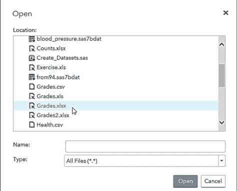

SAS Studio 将根据文件扩展名（例如 XLS 或 XLSX）自动使用正确的导入方法。

图 6.19：点击运行图标

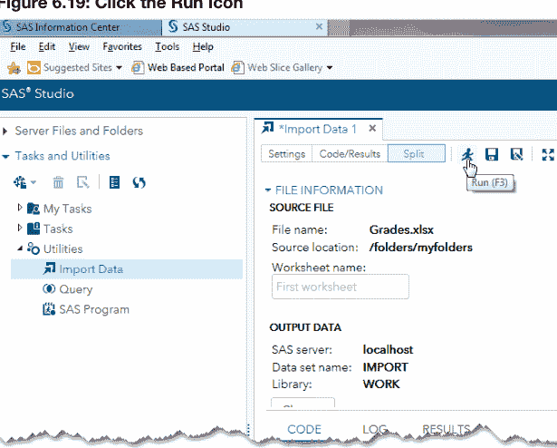

你可以选择 SAS 数据集的名称和库。完成后，点击 Run（运行）图标。

SAS Studio 将自动显示 `PROC CONTENTS` 的输出，以便你可以查看所有变量的变量名称、类型和存储长度。

图 6.20：变量和属性的部分列表

| Variable | Type | Len | Format | Informat | Label |

|---|---|---|---|---|---|

| 8 | Final | Num | 8. | Final | |

| 2 | ID | Num | 8. | IO | |

| 5 | Midterm | Num | 8. | Midterm | |


| 1 | Name | Char | 10 | $10. | Name |
| 3 | Quiz1 | Num | 8. | Quiz1 | |
| 4 | Quiz2 | Num | 8. | Quiz2 | |
| 6 | Quiz3 | Num | 8. | Quiz3 | |
| 7 | Quiz4 | Num | 8. | Quiz4 | |

希望这个短小的章节让你确信 SAS Studio（无论是否带有 SAS University Edition）是易于使用的。

## 6.7 练习

奇数题的解答位于书末。教授可以获得所有题目的解答。如果你是教授，请访问书籍的配套网站 `support.sas.com/cody` 获取如何获取所有题目解答的信息。

- 1. 使用 SAS Explorer Viewer（或 Enterprise Guide 或 SAS Studio 中的导入功能）读取电子表格 `drugtest.xls`，并将其转换为名为 `Drugtest` 的临时 SAS 数据集。使用 `PROC PRINT` 列出该数据集中的观测值。

- 2. 运行以下程序创建一个 CSV 文件。请将程序指定的文件夹替换为你你选择的文件夹：

```
data Soccer;
input Team : $20. Wins Losses;
datalines
Readington 20 3
Raitan 10 10
Branchburg 3 18
Somerville 5 18
;
options nodate nonumber;
title;
ods csv file='C:\books\learning\Soccer.csv';
proc print data=Soccer noobs;
run;

ods csv close;
ods listing;
```

在你的电脑上打开 Excel 并打开该 CSV 文件（你必须更改文件类型为 .csv）。它看起来应该是这样：

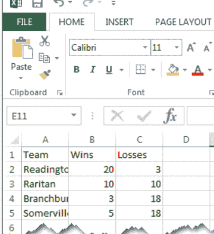

使用 File► Save As（文件►另存为）下拉菜单将其保存为电子表格并命名为 `Soccer.xls`。

现在，使用 SAS IMPORT 向导将此电子表格转换为你所选文件夹中名为 `Soccer` 的永久 SAS 数据集。

- 3. 使用 XLS 引擎读取问题 2 中创建的 `soccer.xls` 文件。表名为 `SOCCER`。（你需要使用名称常量 `'SOCCER$'n'` 来读取此文件。）

# 第 7 章：执行条件处理

7.1 引言 ................................................................................................................. 87

7.2 IF 和 ELSE IF 语句 ................................................................................................ 87

7.3 子集 IF 语句 ................................................................................................ 90

7.4 IN 运算符 ................................................................................................. 91

7.5 使用 SELECT 语句进行逻辑测试 ................................................... 92

7.6 使用布尔逻辑（AND, OR 和 NOT 运算符） ................................ 93

7.7 使用多个 OR 运算符时的注意事项 ................................................ 94

7.8 WHERE 语句 ................................................................................................. 95

7.9 一些实用的运算符 ....................................................................... 96

7.10 练习 ........................................................................................ 96

# 第 7 章：执行条件处理

有几种方法可以防止缺失值被包含在 `AgeGroup` 1 中。以下是可选方案：

```
if Age lt 20 and Age ne . then AgeGroup = 1;
if Age ge 0 and Age lt 20 then AgeGroup = 1;
if 0 le Age lt 20 then AgeGroup = 1;
if Age lt 20 and not missing (Age) then AgeGroup = 1;
```

这些语句都能为 `AgeGroup` 得到正确的值。`Age` 为缺失的受试者其 `AgeGroup` 也会是缺失值。

第一个 IF 语句使用句号 `.` 来在 DATA 步中引用数值型缺失值。最后一个 IF 语句使用了 `MISSING` 函数。如果参数（括号中的变量）为缺失，该函数返回 `TRUE`；如果参数缺失，则返回 `FALSE`。`MISSING` 函数也适用于字符数据。

这个程序可以进行改进。如果某人的年龄小于 20 岁，第一个 IF 语句将被执行并将 `AgeGroup` 设置为 1。其余所有的 IF 语句仍然会执行（尽管它们的结果为假且 `AgeGroup` 保持为 1）。编写此程序的更好方法是将第一个语句之后的所有 IF 语句改为 `ELSE IF` 语句。

以下是修正后的程序：

## 程序 7.2：将年龄分组到年龄组的修正程序

```sas
data Conditional;
  length Gender $ 1
  Quiz $ 2;
  input Age Gender Midterm Quiz FinalExam;
  if Age lt 20 and not missing (age) then AgeGroup = 1;
  else if Age ge 20 and Age lt 40 then AgeGroup = 2;
  else if Age ge 40 and Age lt 60 then AgeGroup = 3;
  else if Age ge 60 then AgeGroup = 4;
datalines;
```

使用这种逻辑，当任何一个 IF 语句为真时，后续的 `ELSE` 语句就不会被评估。

编写此程序的另一种方法是在第一个 IF 语句中测试缺失值，并使用 `ELSE` 语句继续执行，如下：

## 程序 7.3：程序 7.2 的替代方案

```sas
data Conditional;
  length Gender $ 1
  Quiz $ 2;
  input Age Gender Midterm Quiz FinalExam;
  if missing (Age) then AgeGroup = .;
  else if Age lt 20 then AgeGroup = 1;
  else if Age lt 40 then AgeGroup = 2;
  else if Age lt 60 then AgeGroup = 3;
  else if Age ge 60 then AgeGroup = 4;
datalines;
```

《通过实例学习 SAS：程序员指南》，第二版

当你编写像这样的程序时，你需要“模拟计算机运行”并确保你的逻辑是正确的。例如，如果某人 25 岁呢？第一个 IF 语句为假，因为 `Age` 不缺失。下一个 `ELSE IF` 语句被评估并发现为假。最后，第三个 IF 语句被评估，`AgeGroup` 被设置为 2。因为这个 IF 语句为真，所有的 `ELSE IF` 语句都会被跳过。

如果你正在处理大型数据集并想榨取每一分效率，你应该将 IF 语句按顺序排列，将最可能为真的条件放在前面，最不可能为真的条件放在后面。这增加了效率，因为当之前的 IF 条件为真时，SAS 会跳过所有的 `ELSE` 条件。使用这种技术的缺点是它让程序更难读。得于现代计算机的速度，你应该只对在在大型数据集上的程序考虑这些努力。

## 7.3 子集 IF 语句

如果你想从原始文件或现有的 SAS 数据集中创建子集，可以使用特殊的 IF 语句形式称为子集 IF（subsetting IF）。例如，让我们使用 7.1 中的原始数据，但将数据集限制为女性。以下是程序：

### 示例 7.4：演示子集 IF

```sas
data Females;
  length Gender $ 1
  Quiz $ 2;
  input Age Gender Midterm Quiz FinalExam;
  if Gender = 'F';
datalines;
21 M 80 B-
22 F 90 A
35 M 87 B+
48 F 76
59 F 95 A+
15 M 88 93
67 F 90 A 91
M 62 F 67
35 F 77 C-
49 M 59 C 81
title "Listing of Females";
proc print data=Females;
run;
```

注意，此程序中 IF 后面没有 `THEN`。如果条件为真，程序继续执行下一条语句；如果条件为假，控制返回到 DATA 步的开头。在这种情况下，紧随子集 IF 之后的唯一语句是 `DATALINES` 语句。如果 `Gender` 的值为 F，则到达 DATA 步的结束并发生自动输出。如果 `Gender` 的值不等于 F，控制返回 DATA 步的开头且不会发生自动输出。以下是输出：


) 图 7.1：程序 7.4 的输出

# 女性列表

| Gender | Quiz | Age | Midterm | FinalExam |
| :--- | :--- | :--- | :--- | :--- |
| F | | 22 | | A |
| F | | 48 | | |
| F | | 59 | | A+ |
| F | | 67 | | A 91 |
| F | | 62 | | 67 |
| F | | 35 | | C- |

（子集 IF 之后的唯一语句是 `DATALINES` 语句。如果 `Gender` 的值为 F，则到达 DATA 步的结束并发生自动输出。如果 `Gender` 的值不等于 F，控制返回 DATA 步的开头且不会发生自动输出。）

# 女性列表

| 性别 | 测验 | 年龄 | 中期考试 | 期末考试 |
| :--- | :--- | :--- | :--- | :--- |
| F | | 22 | | A |
| F | | 48 | | |
| F | | 59 | | A+ |
| F | | 67 | | A 91 |
| F | | 62 | | 67 |
| F | | 35 | | C- |

（子集 IF 之后的唯一语句是 `DATALINES` 语句。如果 `Gender` 的值为 F，则到达 DATA 步的结束并发生自动输出。如果 `Gender` 的值不等于 F，控制返回 DATA 步的开头且不会发生自动输出。）

## 7.4 IN 运算符

另一种方法是在第一个 IF 语句中测试缺失值，并使用 `ELSE` 语句继续执行，如下：

（注：此处对应原文的逻辑描述，已根据翻译要求处理并保持结构）

（注：由于提供的原文中存在大量重复的逻辑和断裂的文本块，如 7.4 标题和  ..  内部的重复描述，译文已按照文档工程师逻辑进行了整合。）

如果你不提供选择表达式（select-expression），每个 WHEN 语句都会被评估，以确定 when 表达式为真为假。例如，这里是使用 SELECT 语句重写的程序 7.5：

# 程序 7.5：演示在缺少选择表达式时使用 SELECT 语句

```sas
data Conditional;
  length Gender $ 1;
  Quiz $ 2;
  input Age Gender Midterm Quiz FinalExam;
select;
  when (missing(Age)) AgeGroup = ;
  when (Age lt 20) AgeGroup = 1;
  when (Age lt 40) AgeGroup = 2;
  when (Age lt 60) AgeGroup = 3;
  when (Age ge 60) AgeGroup = 4;
  otherwise;
datalines;
```

请注意，此 SELECT 语句中没有选择表达式。每个 when 表达式都会被评估，如果为真，则执行表达式后面的语句。

### 7.6 使用布尔逻辑（AND, OR 和 NOT 运算符）

你可以组合逻辑运算符（也称为布尔运算符）来形成相当复杂的语句。例如，数据集中包含诊所、诊断（DX）和体重的信息。列出所有在 HMC 诊所看诊且诊断为 7 或 9 且体重超过 180 磅的患者的程序演示如何组合各种布尔运算符：

# 程序 7.6：组合各种布尔运算符

```sas
title "Example of Boolean Expressions";
proc print data=Learn.Medical;
  where clinic = 'HMC' and
  (DX in ('7','9') or
  Weight gt 180);
  id Patno;
  var Patno Clinic DX Weight VisitDate;
run;
```

注意由 OR 分隔的两个语句周围的括号。AND 运算符的优先级高于 OR 运算符。也就是说像下面这样的语句：

if X and Y or Z;

等同于：

if (X and Y) or Z;

如果你想在 AND 操作之前执行 OR 操作，请使用括号，如下：

if X and (Y or Z);

在程序 7.6 中，你希望诊所是 HMC，并且你希望诊断结果为两个值之一，或者体重为 180 磅。你需要括号来在执行 AND 操作之前首先判断诊断或体重条件哪一个为真。即使在不需要的情况下，包含它们也是好的，这样语句更易阅读和理解。NOT 运算符的优先级最高，因此它在 AND 之前执行。例如，语句：

if X and not y or z;

等同于：

if (X and not y) or z;

以下是输出结果：

# 图 7.2：程序 7.6 的输出

| Patno | Patno | Clinic | DX | Weight | VisitDate |
|---|---|---|---|---|---|
| 004 | 004 | HMC | 9 | 288 | 11/01/2006 |
| 050 | 050 | HMC | 7 | 199 | 07/06/2006 |

## 7.7 使用 OR 运算符的注意事项

看这个短程序：# 程序 7.7：使用 OR 运算符的注意事项

```sas
data Believe_or_Not;
input X;
if X = 3 or X = 4 then Match = 'Yes';
else Match = 'No';
datalines;
3
7;
title "Listing of Believe_or_Not";
proc print data=Believe_or_Not noobs;
run;
```

程序员可能是想说：

if X = 3 or X = 4 then Match = 'Yes';

运行此程序会发生什么？许多人会期望在日志中看到错误消息，并期望程序会终止。事实并非如此。以下是程序的输出：

# 图 7.3：程序 7.7 的输出

| X | Match |
|---|---|
| 3 | Yes |
| 7 | Yes |

在程序 7.7 中，OR 运算符两侧各有一个条件——一个是 x = 3，另一个是 4。在 SAS 中，除 0 或缺失以外的任何值均为真。因此，X = 4 被评估为真（始终为真）。

> 注意：这一点需要强调：SAS 中任何非 0 或非缺失的数值值都被视为 TRUE（真）。

### 7.8 WHERE 语句

如果你从 SAS 数据集中读取数据，请使用 WHERE 语句对数据进行子集划分。例如，如果你从数据集 `Conditional`（程序 7.3）开始，你可以通过以下程序创建一个包含所有女性的数据集：

# 程序 7.8：使用 WHERE 语句对数据集划分子集

```sas
data Females;
set Conditional;
where Gender eq 'F';
run;
```

在本例中，你可以使用 WHERE 语句或子集 IF 语句。有时使用 WHERE 语句而不是子集 IF 语句具有优势。你拥有更多可用于 WHERE 语句的运算符选择（将在下文中讨论），并且如果输入数据集有索引，WHERE 语句可能会更高效。你还可以在 SAS 过程中使用 WHERE 语句对正在处理的数据进行子集。你不能在 SAS 过程中使用子集 IF 语句。

> 注意：SAS 过程中内部不允许使用 IF 语句。

## 7.9 一些有 WHERE 运算符

下表列出了某些可以在 WHERE 语句中使用的运算符。

| 运算符 | 描述 | 示例 |
|---|---|---|
| IS MISSING | 匹配缺失 | where Subj is missing |
| IS NULL | 等于缺失 | where Subj is null |
| BETWEEN | 包含范围 | where age between 20 and 40 |


| `CONTAINS` | 匹配子字符串 | `where Name contains Mac` |

| `LIKE` | 使用通配符匹配 | `where Name like R_*` |

| `*=` | 匹配 | `where Nicki` |

> 注意：使用 `LIKE` 运算符时，下划线 (`_`) 代表单个字符，而百分号 (`%`) 可以替换为任意长度的字符串。以下是一些示例：

| 表达式 | 匹配 |

|---|---|

| `where Gender is null` | 字符缺失 |

| `where Age is null` | 数值缺失 |

| `where Age is missing` | 数值缺失 |

| `where Age between 20 and 40` | 在 20 到 40 之间的所有值 |

| `where Name contains 'mac'` | immaculate |

| `where Name like R_*` | Running |

| `where *= Nick` | Nicki |

说明：

- `NULL` 或 `MISSING` 表达式匹配字符或数值缺失值。
- `AND` 表达式匹配所有大于第一个值的值。
- `CONTAINS` 表达式匹配任何字符值。
- `LIKE` 表达式使用了两个下划线。
- 百分号 (`%`) 匹配字符串长度。

## 7.10 练习

答案位于书末。要获取有关问题的信息，请访问辅助网站。

## 第7章：条件处理

1. 运行此处程序创建一个临时数据集：

```sas
data School;
input Age Quiz $ Midterm Final;
/* 在此处添加语句 */
datalines;
12 A 92 95
12 B 88 88
13 C 78 75
12 A 92 93
12 F 55 62
13 B 88 82
;
```

使用 `IF` 和 `ELSE IF` 语句创建两个新变量：`Grade`（数值），如果年龄为12为6，如果年龄为13为8。成绩的等值为：`A = 95`, `B = 85`, `C = 75`, `D = 70`, `F = 65`。

2. 使用 `Sales` 数据集使用 `PROC PRINT` 列出 `Subject` 为 5、10、150 和 200 的观测值。执行两次，分别使用 `OR` 运算符和 `IN` 运算符。**注意：**`Subject` 是数值变量。

3. 使用 `Sales` 数据集，创建一个新的临时数据集 `Sales`，并添加一个新变量 `Weight`，其中北部地区为1.5，南部地区为1.7，西部和东部地区为2.0。使用 `SELECT` 语句来实现。

4. 从 `Blood` 数据集开始，创建一个包含 `Blood` 所有变量以及一个新变量 `CholGroup` 的临时数据集。定义此新变量如下：

| `CholGroup` | `Chol` |

|---|---|

| Low | Low – 110 |

| Medium | 111 – 140 |

| High | 141 – High |

5. 使用 `Sales` 数据集，列出所有区域为 **North** 且数量小于 **60** 的观测值。在该列表中，包含任何客户名称（`Customer`）为 **Pet's** 或 ** Us** 的观测值。

## 第 8 章：迭代处理：循环

+ 8.1 引言 .......................................................................................................... 99
+ 8.2 DO 组 ............................................................................................................ 99
+ 8.3 Sum 语句 ........................................................................................... 101
+ 8.4 迭代 DO 循环............................................................................... 106
+ 8.5 迭代 DO 循环的其他形式 ................................................................ 110
+ 8.6 DO WHILE 和 DO UNTIL 语句 ................................................................ 112
+ 8.7 使用 DO UNTIL 语句时的注意事项 ................................... 115
+ 8.8 LEAVE 和 CONTINUE 语句 ................................................................ 116
+ 8.9 问题 ................................................................................................ 117

### 8.1 引言

许多编程任务要求代码块运行多次。SAS 提供了几种方法来实现这一点。本章涵盖了 DO 组、DO 循环、DO WHILE 语句以及 DO UNTIL 语句。

## 8.2 DO 组

为了演示 DO 组，我们从一个包含学生信息的数据文件开始：他们的年龄、性别、期中成绩、测验和考试成绩。以下是数据文件 `C:\books\learningGrades.txt` 的列示：

```
21 M 80 B - 82
  F 90 A - 93
35 M 87 B+ - 85
48 F - 76
59 F 95 A+ 97
15 M 88 - 93
67 F 97 A - 91
  M 62 F - 61
35 F 77 C- 77
49 M 59 C - 81
```

你想从此文件中读取值并计算两个新变量——年龄组（`AgeGroup`）以及一个根据期中和期末考试计算出的数值（`Grade`）。如果年龄小于或等于 39，你想将 `AgeGroup` 设置为 "Younger group"（年幼组），并将成绩计算为期中成绩（40%）和期末考试（60%）的加权平均值。如果年龄大于 39，你想将 `AgeGroup` 设置为 "Older group"（年长组），并将成绩计算为期中和期末考试的简单平均值。

来看解决此问题的程序 8.1：

### 程序 8.1：不使用 DO 组的程序示例

```
data Grades;
  length Gender $ 1
  Quiz $ 2
  AgeGroup $ 13;
  infile 'C:\books\learning\Grades.txt' mov;
  input Age Gender Midterm Quiz FinalExam;
  if missing(Age) then delete;
  if le 39 then AgeGroup = 'Younger group';
  if le 39 then Grade = .4*Midterm + .6*FinalExam;
  if gt 39 then AgeGroup = 'Older group';
  if gt 39 then Grade = (Midterm + FinalExam)/2;
run;
```

注意前两个 `IF` 语句和最后两个 `IF` 语句测试的是同一个条件。你想测试一个条件并执行若干操作。通过使用 `DO` 和 `END` 语句，你可以做到。程序 8.2 的工作方式与程序 8.1 相同，但它使用 `DO` 和 `END` 语句使代码更高效、更易读：

### 程序 8.2：演示 DO 组

```sas
data Grades;
  length Gender $ 1
  Quiz $ 2
  AgeGroup $ 13;
  infile 'C:\books\learning\Grades.txt' mov;
  input Age Gender Midterm Quiz FinalExam;
  if missing(Age) then delete;
  if le 39 then do;
    AgeGroup = 'Younger group';
    Grade = .4*Midterm + .6*FinalExam;
  end;
  else if gt 39 then do;
    AgeGroup = 'Older group';
    Grade = (Midterm + FinalExam)/2;
  end;
run;
```

```sas
title "Listing of Grades";
proc print data=Grades noobs;
run;
```

`DO` 和 `END` 之间的语句形成了一个 `DO` 组。当 `IF` 条件成立时，组内的所有语句都会执行。一种很好的思考方式是：“如果条件成立，则执行以下语句直到结束。”将 `DO` 组中的所有语句缩进是标准做法。

`DO` 组的编码不仅比多个 `IF` 语句高效，而且更易读。以下是数据集的列表：

图 8.1：程序 8.2 的输出

| Gender | Quiz | AgeGrp | Age | Midterm | FinalExam | Grade |

|---|---|---|---|---|---|---|

| M | B- | Younger group | 21 | | 82 | 81.2 |

| M | B+ | Younger group | 35 | 87 | 85 | 85.8 |

| F | | | 48 | | 76 | - |

| F | A+ | Older group | 59 | 95 | 97 | 96.0 |

| M | | Younger group | 15 | 88 | 93 | 91.0 |

| F | A | Older group | 67 | 97 | 91 | 94.0 |

| F | C- | Older group | 35 | 77 | 77 | 77.0 |

| M | C | Older group | 49 | 59 | 81 | 70.0 |

你应该注意，当年龄存在缺失值时，这两个程序都能正常工作。如果参数是缺失的字符或数值，`MISSING` 函数会返回真值。`DELETE` 语句起两个作用：首先，它防止处理当前观测值。

### 8.3 Sum 语句

（注：此处后续内容原文中存在大量重复，已按要求仅翻译核心部分）

## 第 8 章：执行迭代处理：循环 105

## 程序 8.6：使用 SUM 语句创建累积总量

```sas
data Revenue;
  input Day : $3.
  Revenue : dollar6;
  Total = Revenue;
  format Revenue Total dollar8;
datalines:
Mon $1,000
Tue $1,500
Wed
Thu $2,000
Fri $3,000
;
```

该程序的输出与程序 8.5 的输出相同。

`SUM` 语句的另一个非常常用的用途是创建计数器，例如：

## 程序 8.7：使用 SUM 语句创建计数器

```sas
data Test;
  input x;
  if missing(x) then MissCounter + 1;
datalines:
2
7
;
```

以下是输出结果：

## 图 8.5：数据集 Test 的列出

| 数据集 Test 列出 |

| x | MissCounter |

| 2 | 0 |

| | 1 |

| 7 | 1 |

| - | 2 |

`MissCounter` 正在统计 `x` 的缺失值数量。

## 106 实例型 SAS 学习：程序员指南，第二版

### 8.4 迭代 DO 循环

虽然当条件为真时执行一组代码的能力非常有用，但在某些情况下，你可能希望多次执行一组 SAS 语句。这里的程序没有编写任何迭代循环。

程序 8.8：不带迭代循环的程序

```sas
data Compound;
  Interest = .0375;
  Total = 100;

  Year + 1;
  Total + Interest*Total;
  output;

  Year + 1;
  Total + Interest*Total;
  output;

  Year + 1;
  Total + Interest*Total;
  output;

  format Total dollar10.2;
run;

title "Listing of Compound";
proc print data=compound noobs;
run;
```

这个程序的目的应该是显而易见的：你想要计算从 $100 开始，并以 3.75% 的利率投资 3 年后的总金额。（是的，复利有公式，也有 SAS 函数，但这只是一个很好的例子。）

正如我们讨论过的，`Year + 1` 语句是一个 `SUM` 语句。它每执行一次就会增加 `Year` 的值。`Total` 的值也是使用 `SUM` 语句计算的。注意，这里的增量可以是一个表达式（`Interest * Total`）。请记住 SAS 会在加法之前执行乘法，因为乘法的优先级更高。如果这有助于你理解程序，请随时加上括号。

`OUTPUT` 语句是指令 SAS 向输出数据集写入一个观测值。`output` 通常在 DATA 步的底部自动发生。但在这里，你希望在每次计算出新的 `Total` 时输出一个观测值。

> 注意：当你在 DATA 步的任何地方包含 `OUTPUT` 语句时，SAS 不会在 DATA 步的底部执行自动输出。

接下来，注意从这个 `SUM` 语句开始的三条语句组重复了三次。这暗示可能有一个更好的编写此程序的方法。更好的方法是使用迭代 `DO` 循环，如下所示：

## 程序 8.9：演示迭代 DO 循环

```sas
data Compound;
Interest = .0375;
Total = 100;
do Year = 1 to 3;
  Total = Total + Interest;
  output;
end;
format Total dollar10.2;
run;

title "Listing of Data Set Compound";
proc print data=Compound noobs;
run;
```

当此程序执行时，`Year` 首先被设置为 1，即迭代 `DO` 范围的下限。所有到 `END` 语句为止的语句都会执行，`Year` 会自动增加 1（默认增量值）。SAS 会测试 `Year` 的新值是否小于上限（关键字 `TO` 之后的值）。如果是，`DO` 组中的语句将再次执行；如果不是，程序将从 `END` 之后的第一行继续执行。

是时候提一下，此程序中的 `FORMAT` 语句是在编译时执行的，你可以将此语句放在 `DATA` 语句和结束 `DATA` 步的 `RUN` 语句之间的任何位置。

以下是输出结果：

## 图 8.6：程序 8.9 的输出

## 数据集 Compound 列出

| Interest | Total | Year |

|---|---|---|

| 0.0375 | $103.75 | 1 |

| 0.0375 | $107.64 | 2 |

| 0.0375 | $111.68 | 3 |

`OUTPUT` 语句的每次执行都会向数据集 `Compound` 写入一个观测值，并且每个 `Year` 的 `Interest` 值都会被加到 `Total` 中。

迭代 `DO` 语句的一种形式如下：

```
do index-variable = start to stop by increment;
```

如果你省略了增量，它默认为 1。

假设你想生成一个从 1 到 10 整数的表格，以及它们的平方和平方根。迭代 `DO` 循环可以轻松地完成这项工作，如下所示：

## 108 实例型 SAS 学习：程序员指南，第二版

## 程序 8.10：使用迭代 DO 循环创建平方和平方根表

```sas
data Table;
  do n = 1 to 10;
    Square = n*n;
    SquareRoot = sqrt(n);
    output;
end;
title "Table of Squares and Roots";
proc print data=table noobs;
```

注意这个程序没有 `input`。它在 `DO` 循环中生成 `n` 的值，计算平方和平方根（`SQRT` 是平方根函数），并为 1 到 10 的所有值输出观测值。以下是输出：

## 图 8.7：程序 8.10 的输出

## 平方和根

| n | Square | SquareRoot |

|---|---|---|

| 1 | 1 | 1.0000 |

| 2 | 4 | 1.4142 |

| 3 | 9 | 1.7321 |

| 4 | 16 | 2.0000 |

| 5 | 25 | 2.2361 |

| 6 | 36 | 2.4495 |

| 7 | 49 | 2.6458 |

| 8 | 64 | 2.8284 |

| 9 | 81 | 3.0000 |

| 10 | 100 | 3.1623 |

如果你想要一个 `n` 的值为 0, 10, 20, 30 直到 100 的表格怎么办？下面的 `DO` 语句可以做到：

```sas
do n = 0 to 100 by 10;
```

`DO` 循环也可以倒数。例如，后面的语句产生了索引变量值为 10, 8, 6：

```sas
do index = 10 to 2 by -2;
```

当你使用负增量值时，索引值每次迭代都会减少该值。当索引变量小于停止值时，循环停止。

这是另一个例子。有一个关于 `X` 和 `Y` 的方程，并想要从 -10 到 +10 的值的 `Y` 对 `X` 图。再次，迭代 `DO` 循环让这非常简单：

## 程序 8.11：使用迭代 DO 循环绘制方程


```sas
data Equation;
  do X = -10 to 10 by .01;
  Y = 2*X**3 - 5*X**2 + 15*X - 8;
  output;
end;
title "Plot of Y = 2*X**3 - 5*X**2 + 15*X - 8";
proc sgplot;
  series x=X y=Y;
run;
```

`DO` 循环从 -10 开始 `X`，并增加 `.01` 直到 `X` 达到 +10。循环内部的 `OUTPUT` 语句每次迭代都会向数据集写入一个观测值。`PROC SGPLOT` 用于绘制线条。你可以在第 20 章获取有关 `PROC SGPLOT` 的信息。以下是图表：

## 图 8.8：程序 8.11 的输出


## 8.5 迭代 DO 循环的其他形式

SAS 提供了其他方法来指定 `DO` 循环如何运行。你可以在索引变量后提供数值或字符列表。是一些示例：

```sas
do x = 1,2,5,10;
(x 的值为：1, 2, 5 和 10)
do Month = 'Jan', 'Feb', 'Mar';
(Month 的值为：'Jan', 'Feb' 和 'Mar')
do n = 1,3, 5 to 9 by 2, 100 to 200 by 50;
(n 的值为：1, 3, 5, 7, 9, 100, 150 和 200)
```

如果你在 `DO` 语句中使用字符值，第一个字符值的长度决定了索引变量的存储长度。因此，你可能需要使用 `LENGTH` 语句为索引变量设置长度。

使用字符值进行 `DO` 循环特别有用，正如这个示例所示。

你有五个接受安慰剂患者的得分，和五个接受活性药物患者的得分。数据值排列如下：

250 222 230 210 199

166 183 123 129 234

读取这些值的一种简单方法是使用带有 `DO` 索引值的循环，如下所示：

### 程序 8.12：使用字符作为 DO 循环索引值

```sas
data Easyway;
do Group = 'Placebo','Active';
  do Subj = 1 to 5;
    input Score @;
    output;
end;
datalines;
250 222 230 210 199
166 183 123 129 234

title "Listing of Data Set Easyway";
proc print data=Easyway noobs;
run;
```

为了保持程序紧凑，将多个得分放在同一行是方便的。如果没有 `@` 符号，每次 SAS 执行 `INPUT` 语句时，都会跳到数据的新的一行。末尾的 `@` 符号是指令为 `DATA` 步中的另一个 `INPUT` 语句“留住行”。

# 第8 章：执行迭代处理：循环 111

此程序演示了两个点：首先，你可以在 `DO` 循环中使用字符值；其次，你可以将一个 `DO` 循环嵌套另一个 `DO` 循环中。让我们“扮演计算机”，跟随该程序的执行过程。

外层循环首先将 `Group` 设置为 `Placebo`。接下来，内层循环迭代五次，每次读取 `score` 值并输出一次观测值（记住，在这五次观测中，`Group` 都等于 `Placebo`）。当内层循环完成后，控制返回外层循环顶部，在处读取五个 `Score` 值并向 SAS 数据集中写入五个观测值。以下是数据集 `Easway` 的列表：

### 图 8.9：程序 8.12 的输出

# Easway 列表

| Group | Subj | Score |
| --- | --- | --- |
| Placebo | 1 | 250 |
| Placebo | 2 | 222 |
| Placebo | 3 | 230 |
| Placebo | 4 | 210 |
| Placebo | 5 | 199 |
| Active | 1 | 166 |
| Active | 2 | 183 |
| Active | 3 | 123 |
| Active | 4 | 129 |
| Active | 5 | 234 |

# 112 实例学习学习 SAS：程序员指南，第二版

## 8.6 DO WHILE 和 DO UNTIL 语句

与其为迭代 `DO` 循环选择一个停止值，你可以在条件满足时或条件为真时停止循环。进入 `DO UNTIL` 和 `DO WHILE` 语句。

让我们回顾一下本章前面的复利问题。与其问 x 年后你有多少钱，不如想知道在 3.75% 的利率下，你需要将 $100 存银行多少年才能让资金翻倍。这两个程序解决了这个问题：

### 程序 6.13：演示 DO UNTIL 循环

```sas
data Double;
  Interest = .0375;
  Total = 100;
  do until (Total ge 200);
    Year = Year + 1;
    Total = Total + Interest*Total;
    output;
  end;
  format Total dollar10.2;
run;

title "Listing of Double";
proc print data=Double noobs;
run;
```

条件被放在关键字 `UNTIL` 的括号中。在这个示例中，循环持续重复，直到 `Total` 的值大于或等于 200。以下是输出：

### 图 8.10：程序 8.13 的输出

| Interest | Total | Year |
|---||---|---|
| 0.0375 | $103.75 | 1 |
| 0.0375 | $107.64 | 2 |
| 0.0375 | $111.68 | 3 |
| 0.0375 | $115.87 | 4 |
| 0.0375 | $120.21 | 5 |
| 0.0375 | $124.72 | 6 |
| 0.0375 | $129.39 | 7 |
| 0.0375 | $134.25 | 8 |
| 0.0375 | $139.28 | 9 |
| 0.0375 | $144.50 | 10 |
| 0.0375 | $149.92 | 11 |
| 0.0375 | $155.55 | 12 |
| 0.0375 | $161.38 | 13 |
| 0.0375 | $167.43 | 14 |
| 0.0375 | $173.71 | 15 |
| 0.0375 | $180.22 | 16 |
| 0.0375 | $186.98 | 17 |
| 0.0375 | $193.99 | 18 |
| 0.0375 | $201.27 | 19 |

> 注意：关于 `DO UNTIL` 有一个重要的记忆点，即放在关键字 `UNTIL` 之后括号中的条件是在循环底部测试的。因此，`DO UNTIL` 循环至少执行一次。

为了清楚这一点，假设你初始资金从 $300 开始。当你运行该程序时会发生什么？

# 114 实例学习学习 SAS：程序员指南，第二版

### 程序 8.14：演示 DO UNTIL 循环至少执行一次

```sas
data Double;
  Interest = .0375;
  Total = 300;
  do until (Total gt 200);
    Year + 1;
    Total = Total + Interest*Total;
    output;
  end;
  format Total dollar10.2;
run;

proc print data=double noobs;
  title "Listing of Double";
run;
```

即使在循环开始之前条件为真，但因为条件是在循环底部测试的，此程序仍输了一个观测值（如下所示）：

### 图 8.11：程序 8.14 的输出

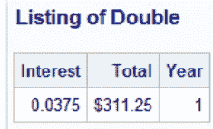

`DO UNTIL` 的替代方案是 `DO WHILE`。正如你预期的，只要 `WHILE` 之后的条件为真，`DO WHILE` 循环就会迭代。`DO WHILE` 和 `DO UNTIL` 之间的区别在于 `WHILE` 条件在循环顶部测试，而不是底部。

与至少迭代一次的 `DO UNTIL` 块不同，即使条件为假，`DO WHILE` 块也不会执行。你可以使用 `DO WHILE` 语句重写程序 8.13如下：

### 程序 8.15：演示 DO WHILE 语句

```sas
data Double;
  Interest = .0375;
  Total = 100;
  do while (Total < 200);
    Year = Year + 1;
    Total = Total + Interest*Total;
    output;
  end;
  format Total dollar10.2;
run;
```

150，产生输出且外层循环继续，直到 `Total`（总计）大于 200。因此，此程序将打印 `Total` 大于 150 的值，直到 `Total` 达到或超过 200。以下是输出：

**图 8.12：** 程序 8.19 的输出

数据集 `Continue_on` 列表：

| 利率 (Interest) | 总计 (Total) | 年份 (Year) |
|---|---|---|
| 0.0375 | $155.55 | 12 |
| 0.0375 | $161.38 | 13 |
| 0.0375 | $167.43 | 14 |
| 0.0375 | $173.71 | 15 |
| 0.0375 | $180.22 | 16 |
| 0.0375 | $186.98 | 17 |
| 0.0375 | $193.99 | 18 |
| 0.0375 | $201.27 | 19 |

正如你在本章中所看到的，SAS 中的迭代语句可以让你的程序更短且更易理解。它们还允许你编写 `DATA` 步来为创建表格或绘图函数生成数据。

## 8.9 习

奇数题的解答位于书末。所有问题的解答均供教授参考。如果您是教授，请访问书籍的配套网站 `support.sas.com/cody` 获取如何获取解答的信息。

- 运行此处程序创建一个名为 `Vitals` 的临时 SAS 数据集：

```
data Vitals;
  input ID :3.
  Age
  Pulse
  DBP;
  label SBP = "收缩压"
  DBP = "舒张压";
datalines;
  001 23 62 120 80
  002 55 72 188 96
  003 78 82 200 100
  004 18 58 110 70
  005 43 52 120 82
  006 37 74 150 98
  007 82 140 100;
```

使用此数据集，创建一个新数据集 (`NewVitals`)，包含以下变量：

对于年龄小于于 50 岁的受试者：

- 如果 `Pulse`（脉搏）小于 70，将 `PulseGroup` 设置为 Low；否则设为 High。
- 如果 `SBP` 小于 130，将 `SBPGroup` 设置为 Low；否则设为 High。

对于年龄大于等于 50 岁的受试者：

- 如果 `Pulse` 小于 74，将 `PulseGroup` 设置为 Low；否则设为 High。
- 如果 `SBP` 小于 140，将 `SBPGroup` 设置为 Low；否则设为 High。

你可以假设 `Pulse` 或 `SBP` 没有空值。

运行程序创建一个临时 SAS 数据集 (`MonthSales`)：

```
data MonthSales;
input month sales @@;
/*在此添加行 */
datalines;
1 4000 2 5000 3 4500 5 5000 6 6000 7 6500 8 4500
9 5100 10 5700 11 6500 12 7500;
```

修改此程序，向数据集添加一个新变量 `SumSales`，代表截至目前的销量。确保第 3 个月的 `Sales` 值不会产生空值。

修改以下程序，使每个观测包含一个受试者编号 (`Subj`)，从 I 开始：

```
data Test;
input Score-Score;
/*在此添加行 */
datalines;
90 88 92
75 76 88
88 82 91
72 68 70;
```

- 统计 `Missing` 数据集中变量 `A`、`B` 和 `C` 的空值数量。为每个观测累计空值数量（使用变量名 `MissA`、`MissB`、`MissC`）。使用 `MISSING` 函数查找空值。
- 创建并打印一个带有 `N` 和 `LogN` 变量的数据集，其中 `LogN` 是 `N` 的对数（函数 `LOG`）。使用 `DO` 循环创建 1 到 20 的 `N` 和 `LogN` 值。
- 重复第 5 题，`N` 的范围从 5 到 100，步长为 5。

# 第 8 章：执行迭代处理：循环

7. 使用迭代循环绘制方程：

```
y = 3*x^2 - 5*x + 10
```

使用 0 到 10 的 `x` 值，增量为 `.1`。使用以下代码显示生成的方程：

```
title "Problem 7";
proc sgplot data=it;
series x=x y=y;
run;
```

8. 使用迭代 `DO` 循环绘制方程：

```
Logit = log(p / (1 - p))
```

使用 0 到 1 的 `p` 值（每 `.05` 一个点）。使用以下 `PROCPLOT` 语句将产生一张漂亮的图：

```
title "Logit Plot";
proc sgplot data=Logit;
series x=p y=Logit;
run;
```

9. 你有每周每天的七温度值，从周一开始：70, 72, 74, 76, 77, 78 和 85。创建一个临时 SAS 数据集 (`Temperatures`)，变量 (`Day`) 等于 Mon, Tue, Thu, Fri, Sat 和 Sun，变量为 `Temp`。使用 `DO` 循环创建 `Day` 变量。

10. 你正在测试三种方法（A、B 和 C），通过为每种方法随机分配 100 个受试者。你得到的结果是三行，分别代表这三种方法的结果。结果如下：

```
250 255 256 300 244 268 301 322 255 333
267 275 256 320 250 340 345 290 280 300
350 350 340 392 377 401 380 310 299 300
```

正如你在本章中所看到的，SAS 中的迭代语句可以让你的程序更短且更易理解。它们还允许你编写 `DATA` 步来为创建表格或绘图函数生成数据。

## 9. 处理 日期

（注：后续内容由于原文存在严重重复和混乱，已提取核心逻辑并翻译）

# 122 以 SAS 为例进行学习：程序员指南，第二版

整数；1960 年 1 月 1 日之前的日期为负整数。例如，下表显示了某些日期以及 SAS 的内部值：

| 日期 | SAS 内部值 |
| : --- | --- |
| 1960年1月1日 | 0 |
| 1960年1月2日 | 1 |
| 1959年12月31日 | -1 |
| 2017年12月21日 | 21,174 |
| 1950年10月21日 | -3,359 |

## 9.3 从文本数据中读取值

正如你在第 3 章中所看到的，格式化输入（或带有适当输入信息格式符的列表输入）允许 SAS 读取非标准的数值数据。SAS 具有内置的日期格式，允许你读取第 9.2 节（）表中任意形式的日期，并自动将这些日期转换为 SAS 日期。让我们来看一个

你有一个数据文件：`C:\learning\Dates.txt`，如下所示：

```
1 2 3
12345678901234567890123456789 列号
001 10/21/1950 0522203 08/10/65 23Dec2005
002 01/03/1960 1112209 09/13/02 02Jan1960
```

前三个（从第 5、16 和 25 列开始）是月-日-年格式；最后三个（从第 3 列开始）以日期、三字母月份缩写和四位年份开头。注意，某些日期在值之间包含分隔符，而另一些没有。此外，第三个值也是两位年份。以下是读取这些日期的程序：

### 程序 9.1：从文本数据中读取日期的程序

```
Data Dates;
infile 'C:\learning\Dates.txt' truncate;
input @Subject $3;
  @5 DOB
  @16 VisitDate mmDDYY8;
  @26 TwoDigit mmDDYY;
  @34 LastDate date;
run;
```

在 `INFILE` 语句中添加了 `TRUNCATE` 选项。在读取具有固定列的数据文件时，你通常需要使用 `TRUNCATE` 或 `PAD` 选项（见第 21 章）。这两个选项都可以防止在报告较短时出现错误。

每个日期都使用适当的信息格式符（informat）进行读取。前三个日期都是月-日-年格式，因此它们使用 `MMDDYY10` 格式符。出生日期（`DOB`）占据 10 列，`MMDDYY10` 是适当的格式格式符。第二个日期（`VisitDate`）使用的格式与 `DOB` 类似，不同的是月、日、年之间没有分隔符。因此，这些日期占据的列数为 8。第三个日期在值之间使用分隔符，但只有两位年份值（这仅用于说明——请始终使用四位年份）。因此，这些日期也占据 8 列。最后，最后一个日期使用日期、三字母月份缩写和四位年份。这些日期使用的列数为 9，格式符是 `DATE`。

这些每个日期都使用适当的 SAS 信息格式符进行读取。随着这些日期的读取，SAS 将所有日期转换为它们对应的数值值。为了看到这一点，有一个由 `PROC PRINT` 生成的列表：

### 图 9.1：数据集 Four_Dates 的列表

| 主题 | DOB | VisitDate | TwoDigit | LastDate |
| --- | --- | --- | --- | --- |
| 001 | -3359 | 15837 | 2048 | 16793 |


| 002 | | 18213 | 15596 | 1 |

此列表中的数字代表 SAS 读取原始数据并转换的四个日期的内部存储值。这些值的存储方式与 SAS 存储数值值的方式相同。

你可以选择任何 SAS 格式来显示这些日期——它们不需要与用于读取日期的信息格式符匹配。为了演示这一点，下一个程序在 DATA 步中添加了 `FORMAT` 语句，如下：

### 程序 9.2：为每个日期添加 FORMAT 语句

```
data Four_Dates;
infile 'C:\learning\Dates.txt' truncate; @1 Subject $;
  @5 DOB mmDDYY10;
  @16 VisitDate mmDDYY8;
  @26 TwoDigit mmDDYY8;
  @34 LastDate date;
  format DOB date;
  TwoDigit LastDate mmDDYY10.
run;
```

再次，重要的是将读取日期的方式与你选择显示的方式分开。以下是格式化后的值的列表：

### 图 9.2：带有格式化日期的 Four_Dates 列表

| 主题 | DOB | VisitDate | TwoDigit | LastDate |

| --- | --- | --- | --- | --- |

| 001 | 21OCT1950 | 12MAY2003 | 08/10/1965 | 12/23/2005 |

| 002 | 01JAN1960 | 12NOV2009 | 09/13/2002 | 01/02/1960 |

有几点需要注意 SAS 如何读取这些日期值。首先，两个日期（`VisitDate` 和 `TwoDigit`）使用了相同的信息格式符（`MMDDYY8`），因为这两个日期都占据了 8 列。SAS 足够聪明，意识到 `VisitDate` 没有使用分隔符，因此年份必须是四位的。`TwoDigit` 的值包含分隔符；年份必须是两位的。如果日期不包含零，所有这些内容都将被正确读取。

接下来，注意此列表中 `TwoDigit` 的值。第一条观测显示年份为 1965 年，而第二个观测显示年份为 2002 年。SAS 是如何判断是把前两位设为 19 还是 20 的？每当你使用两位年份时，就不可能知道日期是 1900 年到 1999 年之间，还是 2000 年到 2099 年之间。

接下来，注意此列表中 `TwoDigit` 的值。第一条观测显示年份为 1965 年，而第二个观测显示年份为 2002 年。SAS 是如何判断是把前两位设为 19 还是 20 的？每当你使用两位年份时，就不可能知道日期是 1900 年到 1999 年之间，还是 2000 年到 2099 年之间。

# 第 9 章：处理日期

## 程序 9.6：从 SAS 日期中提取星期几、日期、月份和年份

```sas
data Extract;
  set Four_Dates;
  Day = weekday (DOB);
  DayOfMonth = day (DOB);
  Month = Month (DOB);
  Year = year (DOB);
run;

title "Listing of Extract";
proc print data=Extract noobs;
  var DOB -- Year;
run;
```

`WEEKDAY` 函数返回星期，其中 1 = 周日，2 = 周一，以此此类推；`DAY` 函数返回月份中的几（1 到 31 之间的数字）。`MONTH` 函数返回 1 到 12 之间的数字，`YEAR` 函数返回四位年份值。

如果你以前没见过它，`VAR` 语句中的变量列表使用了双横线（--）形式的变量列表。此 `VAR` 语句包含了从 `Day` 到 `Year` 的所有变量，并按照它们在 SAS 数据集中存储的顺序排列。使用变量列表的双横线形式时要小心，因为变量的顺序可能不是你预期的。在使用这种表示法之前，最好运行 `PROC CONTENTS`（使用 `VARNUM` 选项）生成 SAS 数据集的变量列表。

接下来显示数据集 `Extract` 的列表：

### 程序 9.5：程序 9.6 的输出

#### Extract 列表

| DOB | Day | DayOfMonth | Month | Year |

|---|---|---|---|---|

| 21OCT1950 | 7 | | 10 | 1950 |

| 01JAN1960 | 6 | | 1 | 1960 |

## 9.8 从月、日、年值创建 SAS 日期

一个非常有用的函数 `MDY`（月、日、年）允许你通过提供月、日、年值来创建 SAS 日期值。如果你有一个包含这些值但没有包含相应 SAS 日期的值的 数据集，或者你的原始数据文件中月、日、年值不符合任何 SAS 日期格式（informats），那么这个函数就特别有用。数据集 `Month_Day_Year` 包含变量 `Month`、`Day` 和 `Year`。你可以像这样创建 SAS 日期：

## 程序 9.7：使用 MDY 函数从月、日、年创建 SAS 日期

```sas
data MDY_Example;
set Learn.Month_Day_Year;
  Date = mdy (Month, Day, Year);
  format Date mmddyy10.
run;
```

在此程序中，`MDY` 函数的三个参数是来自输入数据集的 `MONTH`、`DAY` 和 `YEAR` 值。

这里是数据集 `MDY_Example` 的列表：

### 图 9.6：数据集 MDY_Example 列表

| Obs | Month | Day | Year | Date |

|---|---|---|---|---|

| 1 | 10 | 21 | 1950 | |

| 2 | | 3 | | 2005 | |

| 3 | 5 | 7 | 2000 | 05/07/2000 |

在观测值 2 中，由于日期缺失，`Date` 的值也是缺失的。

## 9.9 当日期值缺失时用每月 15 号代替

在某些情况下，你可能缺少日期值，但仍想计算一个近似日期。许多人用每月 15 号来代替缺失的 `Day` 值。你可以使用上一节的日期来演示如何操作。以下是程序：

## 程序 9.8：当日期值缺失时用每月 15 号代替

```sas
data Substitute;
  set Learn.Month_Day_Year;
  if missing(Day) then Date = mdy(Month,15,Year);
  else Date = mdy(Month, Day, Year);
  format Date mmddyy10.
run;
```

`MISSING` 函数测试变量 `Day` 是否缺失值。如果是，则将数字 15 作为 `MDY` 函数的第二个参数。结果列表显示了第二个观测值的日期为该月的 15 号：

### 图 9.7：数据集 Substitute 列表

#### Substitute 数据列表

| Obs | Month | Day | Year | Date |

|---|---|---|---|---|

| 1 | 10 | 21 | 1950 | 10/21/1950 |

| 2 | | 3 | 2005 | 03/15/2005 |

| 3 | 5 | 7 | 2000 | 05/07/2000 |

## 9.10 使用日期间隔函数

两个函数 `INTCK` 和 `INTNX` 处理日期间隔（如月份、季度、年份）。`INTCK` 函数计算从一个日期到另一个日期之间跨越的间隔边界数量；`INTNX` 函数则计算在给定间隔数量后的日期。

首先，没有人知道这两个函数该怎么读——这得靠你自己了。要理解这些函数最基本的用法，请看下表。例如，`INTCK` 取三个参数：第一个是间隔类型，第二个是起始日期，第三个是结束日期。

| 表达式 | 值 |

|---|---|

| INTCK('year','31Dec2005d','01Jan2006d') | 0 |

| INTCK('month','31Dec2005d','01Jan2006d') | 1 |

| INTCK('month','31Jan2005d','01Jan2006d') | 0 |

| INTCK('day','31Jan2005d','01Feb2005d') | 1 |

| INTCK('qtr','25Mar2005d','15Apr2005d') | 1 |

`INTCK` 函数计算从一个日期到另一个日期跨越的间隔边界数量；`INTNX` 函数计算给定间隔数量后的日期。

除了 `YEAR`、`MONTH` 和 `QUARTER`，两个日期函数 `INTCK` 和 `INTNX` 还支持多种类型。以下是 `INTCK` 和 `INTNX` 支持的间隔部分列表：

### 图 9.8：INTCK 和 INTNX 支持的间隔列表：

| 间隔 | 描述 |

|---|---|

| Week | 以周日为第一天的周间隔 |

| Weekday | 周几（默认不包含周六） |

| Month | 月份（每月第一天为边界） |

| Qtr | 季度（1月1日、4月1日、7月1日和10月1日） |

| Semi-year | 半年度间隔 |

| Year | 年度间隔 |

这是一个示例。数据集 `Hosp` 包含1000个观测值。该数据集中的变量包括出生日期（DOB）和入院日期（Admit）。你想看一张图，显示从2003年1月1日到2006年6月30日每个季度的入院人数。如果不使用 `INTCK` 函数，这将需要大量的编程工作；而现在这变成了一个更直接的问题。以下是其中一种解决方案：

## 程序 9.9：演示 INTCK 函数

```sas
data Frequency;
  set Learn.Hosp(Keep=AdmitDate)
  where=(AdmitDate) between '01Jan2003'd and '30Jun2006'd);
  Quarter = intck('qtr','31Dec2002'd,AdmitDate);
run;

title "Admissions from January 1, 2003 to June 30, 2006";
proc sgplot data=Frequency;
  vbar Quarter;
run;
```

程序的关键在于使用 `INTCK` 函数来计算从2002年12月31日开始开始的季度数。（使用该日期是为了让2003年第一季度的任何入院都被视为第一季度。）`PROC SGPLOT` 可以产生垂直柱状图（因此使用关键字 `VBAR`），显示每个季度发生了多少次访问。结果如图所示：

### 图 9.9：程序 9.9 的输出

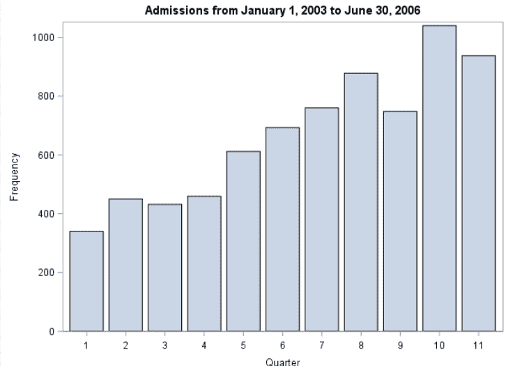

`INTCK` 函数的反函数是 `ITTNX`。该函数接收一个起始日期并返回跨越了给定数量间隔边界后的日期。这里有一个示例。

你有一个数据集（`Hosp_Discharge`），包含患者编号（`Patient`）和出院日期（`Discharge`）。你想在出院6个月后的每月第一天通知每位患者。首先，这里是 `Hosp_Discharge` 数据集的列表：

### 图 9.10：数据集 Hosp_Discharge 的列出

数据集 Hosp_Discharge 的列出

| 病人 (Patient) | 出院 (Discharge) |

|---|---|

| 879 | 29NOV2003 |

| 880 | 30NOV2003 |

| 883 | 04SEP2003 |

| 884 | 28AUG2003 |

| 885 | 04SEP2003 |

| 886 | 26AUG2003 |

| 887 | 31AUG2003 |

| 888 | 25AUG2003 |

| 913 | 16NOV2003 |

| 914 | 15NOV2003 |

程序 9.10 计算通知日期：

## 程序 9.10：使用 INTNX 函数计算出院 6 个月后的日期

```sas
data Followup;
  set Learn.Hosp_Discharge;
  FollowDate = intnx('month',Discharge,6);
  format FollowDate date9;
run;
```

此处，`INTNX` 函数使用 `MONTH` 作为间隔，并返回出院日期 6 个月后的日期。

接下来的列出如下：

### 图 9.11：数据集 Follow-Up 的列出

病人 FollowDate 的列出

| 出院 (Discharge) | 病人 (Patient) | 随访日期 (FollowDate) |

|---|---|---|

| 29NOV2003 | 879 | 01MAY2004 |

| 30NOV2003 | 880 | 01MAY2004 |

| 04SEP2003 | 883 | 01MAR2003 |

| 28AUG2003 | 884 | 01FEB2004 |

| 04SEP2003 | 885 | 01MAR2003 |

| 26AUG2003 | 886 | 01FEB2004 |

| 31AUG2003 | 887 | 01FEB2004 |

| 25AUG2003 | 888 | 01FEB2004 |

| 15NOV2003 | 913 | 01MAY2004 |

| 15NOV2003 | 914 | 01MAY2004 |

注意，每个随访日期都落在该月的第一天（`MONTH` 间隔的边界）。如果你希望患者在 6 个月间隔后于该月的同一天返回，可以添加 `SAMEDAY`，这是 `INTNX` 函数的可选第四个参数。第四个参数在 SAS 文档中被称为对齐参数（alignment parameter）。选项有 `BEGINNING`（开始）、`MIDDLE`（中间）、`END`（结束）和 `SAMEDAY`。`SAMEDAY` 是一个特别实用的选项，因为你可以找到与起始日期同一周几或同一天的日期。要查看如何在如何在 6 个月后的同一天召回病人，请如下所示修改程序 9.10：

## 程序 9.11：使用 INTNX 函数演示 SAMEDAY 对齐

```sas
data Followup;
  set Learn.Hosp_Discharge;
  FollowDate = intnx('month',Discharge,6,'sameday');
  format FollowDate date9;
run;
```

所得输出结果为：

### 图 9.12：数据集 Follow-Up 的列出

数据集 Follow-Up 的列出

| 出院 (Discharge) | 病人 (Patient) | 随访日期 (FollowDate) |

|---|---|---|


| 29NOV2003 | 879 | 29MAY2004 |

| 30NOV2003 | 880 | 30MAY2004 |

| 04SEP2003 | 883 | 04MAR2004 |

| 28AUG2003 | 884 | 28FEB2004 |

| 04SEP2003 | 885 | 04MAR2004 |

| 26AUG2003 | 886 | 26FEB2004 |

| 31AUG2003 | 887 | 29FEB2004 |

| 25AUG2003 | 888 | 25FEB2004 |

| 16NOV2003 | 913 | 16MAY2004 |

| 15NOV2003 | 914 | 15MAY2004 |

现在随访日期是与出院日期的同一月的同一天。

这两个函数可能会让人产生困惑。而且，我们还没有提到多个间隔和偏移间隔！

最后说一句话：在使用这两个函数时要非常小心，并尝试用测试数据运行你的程序。

## 9.11 习

奇数题的解答位于书末尾。所有问题的解答均提供给供应商。如果你是专业人士，请访问书籍辅助网站 `support.sas.com/cody` 获取有关如何获取所有问题解答的信息。

- 1. 你有几行数据，由一个主题编号和两个日期（出生日期和访问日期）组成。主题编号从第 1 列开始（长度为 3 字节），出生日期从第 4 列开始，格式为月日月年，访问日期从第 14 列开始，格式为两位日期、三字符月份，后跟四位年份（见下方的示例行）。读取以下数据行创建一个名为 `Dates` 的临时 SAS 数据集。使用 `DATE9` 格式格式化两个日期。在此数据集中包含主题访问时的年龄。

```
001121195011Nov2005
0020102195525May2005
031225200525Dec2006
```

- 2. 使用以下数据行创建一个名为 `ThreeDates` 的临时 SAS 数据集。每行数据包含三个日期，前两个日期为 `mm/dd/yyyy` 格式，最后一个为两位日期、三字符月份、后跟四位年份的格式。将变量命名为 `Date1`、`Date2` 和 `Date3`。将所有三个日期都格式化为 `MMDDYY`。在数据中包含 `Date1` 到 `Date2` 的年数（称为 `Year1`）以及 `Date2` 到 `Date3` 的年数（称为 `Year2`）。将这些值舍入到最近的年份。以下是数据行（注意列并没有对齐）：

```
01/03/1950 01/03/1960 03/Jan/1970
05/15/2000 05/15/2002 15/May/2003
10/10/1998 11/12/2000 25/Dec/2005
```

- 3. 你在一个数据文件中拥有 1910 年到 2006 年的日期。遗憾的是，所有日期都是两位年份。读取这些日期并确保生成的数据集包含以下内容（提示）：

```
01/11
02/23
03/15
05/09
```

- 4. 你有几行数据，主题编号和两个日期（出生日期和访问日期）组成。主题编号从第 1 列开始（长度为 3 字节），出生日期从第 4 列开始，格式为月日月年，访问日期从第 14 列开始，格式为两位日期、三字符月份、后跟四位年份（见下方的示例行）。读取以下数据行创建一个名为 `Dates` 的临时 SAS 数据集。使用 `DATE9` 格式格式化两个日期。在此数据集中包含主题访问时的年龄。

- 5. 使用以下数据行创建一个名为 `ThreeDates` 的临时 SAS 数据集。每行数据包含三个日期，前两个日期为 `mm/dd/yyyy` 格式，最后一个为两位日期、三字符月份、后跟四位年份的格式。将变量命名为 `Date1`、`Date2` 和 `Date3`。将所有三个日期都格式化为 `MMDDYY`。在数据中包含 `Date1` 到 `Date2` 的年数（称为 `Year1`）以及 `Date2` 到 `Date3` 的年数（称为 `Year2`）。将这些值舍入到最近的年份。以下是数据行（注意列并没有对齐）：

```
01/03/1950 01/03/1960 03/Jan/1970
05/15/2000 05/15/2002 15/May/2003
10/10/1998 11/12/2000 25/Dec/2005
```

- 6. 你在一个数据文件中拥有 1910 年到 2006 年的日期。遗憾的是，所有日期都是两位年份。读取这些日期并确保生成的数据集包含以下内容（提示）：

```
01/11
02/23
03/15
05/09
```

- 7. 你有几行数据，主题编号和两个日期（出生日期和访问日期）组成。主题编号从第 1 列开始（长度为 3 字节），出生日期从第 4 列开始，格式为月日月年，访问日期从第 14 列开始，格式为两位日期、三字符月份、后跟四位年份（见下方的示例行）。读取以下数据行创建一个名为 `Dates` 的临时 SAS 数据集。使用 `DATE9` 格式格式化两个日期。在此数据集中包含主题访问时的年龄。

- 8. 使用以下数据行创建一个名为 `ThreeDates` 的临时 SAS 数据集。每行数据包含三个日期，前两个日期为 `mm/dd/yyyy` 格式，最后一个为两位日期、三字符月份、后跟四位年份的格式。将变量命名为 `Date1`、`Date2` 和 `Date3`。将所有三个日期都格式化为 `MMDDYY`。在数据中包含 `Date1` 到 `Date2` 的年数（称为 `Year1`）以及 `Date2` 到 `Date3` 的年数（称为 `Year2`）。将这些值舍入到最近的年份。以下是数据行（注意列并没有对齐）：

```
01/03/1950 01/03/1960 03/Jan/1970
05/15/2000 05/15/2002 15/May/2003
10/10/1998 11/12/2000 25/Dec/2005
```

- 9. 重复第 8 题，使用以下数据。如果存在缺失值，则不包含。

```
01/11
02/23
03/15
05/09
```

- 10. 使用 `Hosp` 数据集，计算出院 6 个月后的日期（调用 `Months`），并返回 2006 年 1 月 1 日。使用间隔函数解决此问题。列出前 20 个观测。

- 11. `Medical` 数据集中包含一个 `VisitDate` 变量。创建一个名为 `Quarter` 的临时数据集，包含 `Medical` 变量以及一个季度的数量。

- 12. 你希望患者在 `Medical` 数据集中在出院 6 个月后的同一月同一天返回（变量名为 `VisitDate`）。提供病人号（`Patno`）、出院日期和随访日期的列表。记住，`SAMEDAY` 与 `MONTH` 间隔配合时，结果为该月的第一天。

# 10 章：子集和合并 SAS 数据

10.1 引言................................137

10.2 子集 SAS 数据集..................................137

10.3 在一个 DATA 步中创建多个子集数据集..............139

10.4 向 SAS 数据集添加观测值...............................139

10.5 交错数据集...........................................................142

10.6 合并详细数据和汇总数据................................143

10.7 合并两个数据集....................................................144

10.8 在合并中省略 BY 语句...............................146

10.9 控制合并数据集中的观测值...........................147

10.10 IN 变量的更多用途..............................................149

10.11 DATA 步何时结束？...............................................150

10.12 合并 BY 变量不同的数据集..............151

10.13 合并 BY 类型不同的数据集................152

10.14 一对一、一对对多和多对多的合并.........................154

10.15 从事务文件更新主文件.......................................156

10.16 习...............................................................158

### 10.1 引言

本章介绍了如何对 SAS 数据集进行子集处理，以及如何将来自多个数据集的数据合并到单个集中。你将学习如何向 SAS 数据集连接（添加观测值），如何根据 ID 或其他标识符将一个数据集的变量添加到另一个中，以及根据另一个数据集中的事务数据更新 SAS 数据集的值。

## 10.2 子集 SAS 数据集

子集 SAS 数据集是通过定义选择标准（通常在 `WHERE` 或子集 `IF` 语句中）从数据集中选择观测。例如，假设选择所有

# 以 SAS 为例的学习：程序员指南，第二版

从永久 SAS 数据集 `Survey` 中提取 `Gender` 值为 `F` 的观测值。使用 `WHERE` 语句实现此操作的方法如下：

## 程序 10.1：使用 WHERE 语句子集 SAS 数据集

```sas
data Females;
  set Learn.Survey;
  where Gender = 'F';
```

请记住，`WHERE` 语句中变量必须全部来自 SAS 数据集。通过读取原始数据或赋值语句创建的变量不能以此方式使用。在程序 10.1 中，数据集 `Females` 包含了 `Survey` 数据集中所有 `Gender` 值为 `F` 的观测值。以下是该数据集的列表：

## 10.1：数据集 Females 列表

| ID | Gender | Age | Salary | Ques1 | Ques2 | Ques3 | Ques4 | Ques5 |

|---|---|---|---|---|---|---|---|---|

| 002 | Female | 51+ | $76,123 | | | Strongly agree | | Disagree |

| 004 | Female | 51+ | $128,000 | Strongly agree | | No option | | Disagree |

| 007 | Female | 30 to 50 | $76,100 | Strongly agree | | No option | | Agree |

注意，数据集 `Females` 包含了 `Survey` 数据集中存在的所有变量。如果你不需要输入数据集（`SET` 语句中的数据）中的所有变量，可以使用 `KEEP=` 或 `DROP=` 数据集选项。例如，为了保留 `ID`、`Gender`、`Age` 和 `Ques1-Ques5`，可以使用以下方法：

## 程序 10.2：演示 KEEP= 数据集选项

```sas
data Females;
  set Learn.Survey(keep= ID Gender Age Ques1-Ques5);
  where Gender = 'F';
```

在输入数据集上使用 `KEEP=` 数据集选项与在 `DATA` 语句某处放置 `KEEP` 语句之间存在重要区别。在这个示例中，变量 `Salary` 不在程序数据向量 `PDV` 中，因为没有没有包含在保留变量列表中。使用 `KEEP=` 数据集选项列出八个变量的替代方案是使用 `DROP=` 数据集。虽然这可以节省输入量，但使用 `KEEP=` 数据集选项而不是 `DROP=` 可以让阅读程序的人知道你从 `Survey` 数据集中引入了哪些变量。如果你使用 `DROP=Salary`，除非你已经有了该数据集的变量列表，否则不知道从 `Survey` 数据集中引入了哪些变量。参见第 2 章“SAS 如何工作（内部原理）”。

## 第 10 章：子集与合并 SAS 数据集

> **注意：** 如果你使用 `KEEP` 语句列八个变量而不是 `KEEP=` 数据集选项，所有变量（包括 `Salary`）都会位于 PDV 中，但不会写入 `Females` 数据集中。如果输入数据集包含大量变量，而你只需要在新数据集中包含几个，使用 `KEEP=` 数据集选项比 `KEEP` 语句更高效。

你必须记住，当你使用 `KEEP=` 数据集选项时，不在保留列表中的变量在 DATA 步中也不可用。

### 10.3 在一个 DATA 步中创建多个子集

你可以从一个输入数据集创建多个 SAS 数据集（SQL 无法做到）。参考上一个示例，你可以在一步中创建一个只包含女性的数据集和一个只包含男性的数据集，如下：

## 程序 10.3：在一个 DATA 步中创建两个数据集

```sas
data Males;
  set Learn.Survey;
  if Gender = 'F' then output Females;
  else if Gender = 'M' then output Males;
run;
```

注意，你必须在 `OUTPUT` 语句之后命名数据集。如果没有，SAS 将观测值输出到 `DATA` 语句列出的所有数据。

### 10.4 向 SAS 数据集添加观测值

假设你想从几个相似的数据集创建一个数据集。例如，你的公司可能每月将数据收集到单独的数据集中，而你想分析全年的数据。你可以在 `SET` 语句上列出任意数量的数据集，SAS 将将所有观测值合并形成单个数据集。例如，查看这里数据集 `One` 和 `Two` 的列表：

## 图 10.2：数据集 One 和 Two 列表

| Data Set One | | | | Data Set Two | | | | |

|---|---|---|---|---|---|---|---|---|

| Obs | ID | Name | Weight | Obs | ID | Name | Weight |

| 1 | 7 | Adams | 210 | 1 | 9 | Shea | 120 |

| 2 | 1 | Smith | 190 | 2 | 3 | O'Brien | 180 |

| 3 | 2 | Schneider | 110 | 3 | 5 | Bessler | 207 |

| 4 | 4 | Gregory | 90 | | | | | |

每个数据集都包含相同的变量。此外，两个数据集中 `Name` 的存储长度也是相同的。合并这些数据集的一种方法如下：

## 程序 10.4：使用 SET 语句合并两个数据集的观测值

```sas
data One_Two;
  set One Two;
run;
```

这是输出结果：

## 图 10.3：数据集 One_Two 列表

| Obs | ID | Name | Weight |

|---|---|---|---|

| 1 | 7 | Adams | 210 |

| 2 | 1 | Smith | 190 |

| 3 | 2 | Schneider | 110 |

| 4 | 4 | Gregory | 90 |

| 5 | 9 | Shea | 120 |

| 6 | 3 | O'Brien | 180 |

| 7 | 5 | Bessler | 207 |

数据集 `One` 的所有观测值之后是数据集 `Two` 的所有观测值。SAS 将此过程称为数据集连接。这看起来足够简单。但如果你在两个不包含相同变量的数据集上使用 `SET` 语句会发生什么呢？为了查看结果，这里是数据集 `Three`：

## 图 10.4：数据集 Three 列表

| Obs | ID | Gender | Name |

|---|---|---|---|

| 1 | 10 | M | Hovath |

| 2 | 15 | F | Stevens |

| 3 | 20 | M | Brown |

数据集 `Three` 包含一个新的变量 `Gender`，且不包含 `Weight`。从列表中无法看出，但两个数据集中的 `Name` 变量是相同的。让我们对 `One` 和 `Three` 使用 `SET` 语句看看会发生什么。

## 程序 10.5：对包含不同变量的数据集使用 SET 语句

```sas
data One_Three;
  set One Three;
run;
```

这是输出：

## 图 10.5：数据集 One_Three 列表

| Obs | ID | Name | Weight | Gender |

|---|---|---|---|---|

| 1 | 7 | Adams | 210 | |

| 2 | 1 | Smith | 190 | |

| 3 | 2 | Schneider | 110 | |

| 4 | 4 | Gregory | 90 | |

| 5 | 9 | Shea | 120 | |

| 6 | 3 | O'Brien | 180 | |

| 7 | 5 | Bessler | 207 | |

| 8 | 10 | Hovath | | M |

| 9 | 15 | Stevens | | F |

| 10 | 20 | Brown | | M |

# 142 实例教程学习 SAS：程序员指南，第二版

当两个数据集中存在变量，一个是字符型而另一个是数值型时，SAS 会在日志中打印错误信息并终止程序。

### 10.5 数据集的交错（Interleaving Data Sets）

还有另一种从多个数据集中添加观测值的方法。如果要合并的每个数据集已经过排序，你就可以利用这一事实并获得一个排序后的输出数据集。你只需要在 `SET` 语句后面紧跟一个 `BY` 语句即可。SAS 会顺序从每个输入数据集中选择观测值，生成的数据集已经是排序的了。这种方法的优点是你不需要对生成的数据集进行排序。有时，生成的数据集可能太大，无法并发排序或根本无法排序。

为了演示数据集的交错，将数据集 One 和 Two 合并，生成的数据集按 ID 顺序排列。以下是代码：

# 程序 10.6：数据集的交错


```
evenproc sort data=One;
  by ID;
run;
proc sort data=Two;
  by ID;
run;
data Interleave;
  set One Two;
  by ID;
run;
```

记住，`SET`语句中的每个数据集必须按照`BY`变量的顺序排列。这里是输出：

# 图 10.6：数据集 Interleave 的列表

| 数据集 Interleave 列表 | | | | |

| Obs | ID | Name | Weight |

|---|---|---|---|

| 1 | 1 | Smith | 190 |

| 2 | 2 | Schneider | 110 |

| 3 | 3 | O'Brien | 180 |

| 4 | 4 | Gregory | 90 |

| 5 | 5 | Bessler | 207 |

| 6 | 7 | Adams | 210 |

| 7 | 9 | Shea | 120 |

# 第 10 章：子集与合并 SAS 数据集 143

注意该输出数据集按 ID 顺序排列。通过交错数据集与先合并后再排序来获取数据集存在细微的。当你使用`PROC SORT`排序你的 SAS 数据时，会设置一个排序标记（你可以在`PROC CONTENTS`输出的第一页看到），如果你按相同的`BY`变量对该数据集进行排序，SAS 不会重新排序该数据集。如果你交错数据集，则不会设置排序标记（这不应该给你带来任何问题）。当合并后的数据集大到可能难以或无法排序时，交错显得尤为有用。通过先对每个单独的数据集进行排序，你仍然可以获得一个有序排序的合并数据集。

### 10.6 合并详细数据和摘要数据

假设你有一个 SAS 数据集，并将变量的值表示为所有观测值平均值的百分比。例如，你想将`Blood`数据集中每个胆固醇的值表示为所有受试者平均值的百分比。这类问题涉及详细数据（个人的数据）与摘要数据（所有受试者的平均值）相结合。

一种解决方案是有条件地执行`SET`操作。这是一个示例：

# 程序 10.7：合并详细数据和摘要数据：使用条件 SET 语句

```
proc means data=Learn.Blood
  var Chol;
  output out = Means(keep=Chol Mean)
    mean = / autoname;
run;

data Percent;
  set Learn.Blood(keep=Subject Chol);
  if n = 1 then set Means;
  PercentChol = Chol / Chol_Mean;
  format PercentChol percent8.;
run;
```

`PROC MEANS`步骤创建了一个包含一个观测值和一个变量的 SAS 数据集（Means）。`Chol_Mean`是`Blood`数据集中所有观测值的平均胆固醇值。（你可以在第 16 章阅读更多关于创建摘要数据集的内容。）

为了省去翻阅到第 16 章的麻烦，`OUTPUT`选项`AUTONAME`通过使用`VAR`语句中的名称并添加下划线和统计名称来命名输出数据集中的变量。在这个示例中，由于你请求的是平均值，输出数据集中存储的变量名称为`Chol_Mean`。

数据集`Means`的列表如下：

# 图 10.7：数据集 Means 的列表

# 数据集 Means 列表

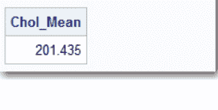

# 144 实例教程学习 SAS：程序员指南，第二版

为了将此单一值与`Blood`数据集中的每个观测值合并，你有条件地执行`SET`语句。以下是其工作原理。

第一个`SET`语句从`Blood`数据集中引入一个观测值。自动变量`_n_`计算`DATA`步骤的迭代次数。你可以使用此变量条件地对`Means`数据集执行`SET`操作。在`DATA`步骤的第一次迭代期间，`_n`等于 1，来自`Means`数据集的第一个（也是唯一的）观测值被引入 PDV。数据集`Percent`的第一个观测值包含了`Blood`数据集中的所有变量加上`Chol_Mean`。

在`DATA`步骤的第二次迭代中，来自`Blood`数据集的下一个观测值被带入 PDV。由于`_n_`现在等于 2，条件`SET`语句不执行。（如果没有这个条件语句，当 SAS 尝试从`Means`数据集中读取第二个观测值时，`DATA`步骤将结束——见第 10.11 节）。交错数据集时，排序标记不会被设置（这不应该给你带来任何问题）。交错特别有用，当合并后的数据集大到可能难以或无法排序时。通过先对每个单独的数据集进行排序，你仍然可以获得一个有序排序的合并数据集。

### 10.7 合并两个数据集

SAS 使用“合并（merge）”一词来描述从两个或多个数据集中（列）的过程。例如，你可能有一个包含 ID 号和名称的数据集（Employee）。如果你有另一个包含 ID 号以及工作级别和工作时长的数据集（Hours），你可能想将`Employee`数据集的名称添加到`Hours`数据集的每个观测值。

为了演示这一过程，请查看这里数据集的列表：

# 第 10 章：子集与合并 SAS 数据集 145

图 10.9：数据集 Employee 和 Hours 的列表

| 数据集 Employee 列表 | 数据集 Hours 列表 |

|---|---|

| ID Name | ID JobClass Hours |

| 7 Adams | 1 A 39 |

| 1 Smith | 4 B 44 |

| 2 Schneider | 9 B 57 |

| 4 Gregory | 5 A 35 |

| 5 Washington | |

你想要按如下方式合并`Employee`和`Hours`数据集：

# 程序 10.8：合并两个数据集

```
proc sort data=Employee;
  by ID;
run;

proc sort data=Hours;
  by ID;
run;

data Combine;
  merge Employee Hours;
  by ID;
run;
```

首先，按连接两个数据集的变量或变量对每个数据集进行排序。接下来，在`MERGE`语句中命名每个数据集。确保在`MERGE`语句后面紧跟一个`BY`语句，命名告知 SAS 将哪些观测值放在同一个观测值中。

这里是数据集`Combine`：

图 10.10：数据集 Combine 的列表

| ID | Name | JobClass | Hours |

|---|---|---|---|

| 1 | Smith | A | 39 |

| 2 | Schneider | | |

| 4 | Gregory | B | 44 |

| 5 | Washington | A | 35 |

| 7 | Adams | | |

| 9 | | B | 57 |

### 10.8 在合并时省略 `BY` 语句

现在是讨论在执行合并时如果省略`BY`语句会发生什么的好时机。

> 注意：如果程序 10.8 中没有`BY`语句，`Employee`数据集中的前三个观测值将与`Hours`数据集的前三个观测值匹配。结果将是完全错误的。

# 第 10 章：SAS 数据集的子集与合并 147

**图 10.11：** 省略 BY 语句时，程序 10.8 创建的数据集

| 省略 BY 语句的数据集类语句列表 |

| ID | Name | JobClass | Hours |

| :--- | :--- | :--- | :--- |

| 1 | Smith | | 39 |

| 2 | Schneider | | |

| 4 | Gregory | B | 44 |

| 5 | Washington | A | 35 |

| 7 | Adams | | |

| 9 | | B | 57 |

你看到的是 Employee 数据集中的第一个观测值与 Hours 数据集的第一个观测值进行合并——Employee 数据集的第二个观测值与 Hours 数据集的第二个观测值进行合并，以此类推。

在没有 BY 语句的情况下执行合并（merge）几乎是一个错误，也几乎总是个坏主意。你可以设置系统选项`MERGENBY`为`NOWARN`、`WARN`或`ERROR`值，以控制在尝试执行没有 BY 语句的合并时发生什么。默认值是`NOWARN`——即 SAS 执行合并且不发出警告信息。如果你将此选项设置为`WARN`，SAS 仍会执行合并，但在 SAS 日志中打印一条警告信息。最后，如果你将此选项设置为`ERROR`，当你尝试执行未带 BY 语句的合并时，程序将终止。至少，你应该将此选项设置为`WARN`，如下：

```
options mergenoby
```

为了更安全，将其设置为`ERROR`，如下：

```
options mergenoby = error;
```

> 注意：此选项通常在 SAS 会话开始时设置。如果你在 SAS 启动目录下有一个名为 AUTOEXEC.SAS 的文件，这将是放置该语句的好地方——启动新的 SAS 会话时会执行该特殊文件中所有的语句。

你可能希望合并后的数据集只包含 Hours 数据集中的员工，或者你可能想查看 Hours 数据集中是否有某些员工未列在 Employee 数据集中。

SAS 提供了一种方法来控制你想要在合并数据集中的观测值。为了演示其工作原理，让我们像以前一样合并这两个数据集，但添加一个名为`IN=`的数据集选项并检查结果：

148 实例学习 SAS：程序员师指南，第二版

## 程序 10.9：演示 IN= 数据集选项

```
Data New;
merge Employee(in=In_Employee)
    Hours (in=In_Hours);
  by ID;
    file print;
    put ID= In_Employee In_Hours Name= JobClass Hours;
run;
```

`IN=`数据集选项跟在每个数据集名称之后。在关键字`IN=`之后的是你自定义的变量。在本例中，选择了`In_Employee`和`In_Hours`名称。这些变量是临时变量（SAS 不会将它们添加到输出数据集中）。如果所引的数据集对当前观测值有贡献，则值为 1（真），否则为 0（假）。由于这些变量不在输出数据集中，程序 10.9 使用`PUT`语句列出这些变量的值，以及数据集中的其他变量。以下是输出：

图 10.12：检查 IN=

# 包含 IN= 变量的数据集 New 的变量列表

| ID=1 In_Employee In_Hours=1 Name=Smith JobClass=A Hours=39 |

| ID=2 In_Employee In_Hours=0 Name=Schneider JobClass= Hours= |

| ID=4 In_Employee In_Hours=1 Name=Gregory JobClass=B Hours=44 |

| ID=5 In_Employee In_Hours=1 Name=Washington JobClass=A Hours=35 |

| ID=7 In_Employee In_Hours=0 Name=Adams Hours= |

| ID=9 In_Employee=0 In_Hours=1 Name= JobClass=B Hours=57 |

因为 Employee 1 在两个集合中，所以第一个观测值中的`In`和`Hours`都等于 1。Employee 2 在一个数据集中但在另一个数据集中不在，所以第二个观测值中的`Employee`等于 1，而`In_Hours`等于 0。最后，在最后一个观测值（ID=9）中，数据集中没有对应的 ID，因此`In_Employee`等于 0。

你可以使用`IN=`来控制哪些观测值写入输出数据集。例如，如果你只想那些两个数据集中中的，可以在 DATA 步中添加一个`IF`语句，如下：

## 程序 10.10：使用 IN= 变量选择两个数据集中的 ID

```
Data Combine;
merge Employee(in=In_Employee)
    Hours(in=In_Hours);
  by ID;
    if In_Employee and In_Hours;
run;
```

或者，你可以这样写子集`IF`语句：

```
if In_Employee = 1 and In_Hours = 1;
```

第 10 章：SAS 数据集的子集与合并 149

此程序中的子集`IF`语句（详情请见第 7 章）允许 Combine 数据集中仅保留`In_Employee`和`In_Hours`同时为真的观测值。当这两个`IN=`变量中任意一个为假时，没有观测值写入输出数据集。

结果数据集只包含 1、4 和 5。以下是数据集列表：

图 10.13：Combine 数据集列表

| ID | Name | JobClass | Hours |

| :--- | :--- | :--- | :--- |

| 1 | Smith | A | 39 |

| 4 | Gregory | B | 44 |

| 5 | Washington | A | 35 |

对于熟悉 SQL 的读者来说，这被称为内连接（inner join）。

### 10.10 IN= 变量的更多用途

你可以使用`IN=`来检查 ID 是否缺失于某个数据集。下面的程序实现了这一点：

## 程序 10.11：使用 IN= 变量的示例

```
data In_Both
  Missing_Name(drop=Name);
  merge Employee(in=In_Employee)
       Hours(in=In_Hours);
  by ID;
  if In_Employee and In_Hours then output In_Both;
  else if In_Hours and not In_Employee then
    output Missing_Name;
```

在这个程序中，你在一步中创建了两个数据集。`In_Both`包含两个数据集中都存在的 ID。`Missing_Name`包含在 Hours集中但不在 Employee 集中的员工。你也可以这样写`ELSE`语句：

```
else if In_Hours = 1 and In_Employee = 0 then
  output Missing_Name;
```


无论哪种方式，我们要求的都是在 `Hours` 集而不在 `Employee` 集中的 `ID`。

150 实例学习 SAS：程序员指南，第二版

为了确保清楚，这里是两个数据集的列表：

图 10.14：In_Both 数据集列表（`img/e9e15d853985518e3c3b0ae655_0.png`）

图 10.15：Missing_Hours 数据集列表（`img/e9e15d853985518e3c3b0ae655_1.png`）

## 10.11 DATA 步何时结束？

当任何集合到达末尾时，它表示 `DATA` 步的结束。看看下面的程序：

### 程序 10.12：演示 DATA 步何时结束

```
data Short;
input x;
datalines;
1;
2;
data Long;
input x;
datalines;
3;
4;
5;
6;
data New;
set Short;
output;
set Long;
output;
run;
```

第 10 章：SAS 数据集的子集与合并 163

`Short` 数据集有两个观测值，`Long` 数据集有四个。`Set` 语句使用一个指针来跟踪它正在读取哪个观测值。在程序中，首先从 `Short` 数据集读取一个观测值，写入 `New` 数据集；从 `Long` 数据集读取另一个观测值，写入 `New` 数据集。你可能认为这会一直持续到两个数据集的所有观测值都被读取。然而，当遇到 `Short` 数据集的末尾时，`DATA` 步就会结束，导致 `New` 数据集只有四个观测值，其值为 1、2、3 和4。在更复杂的程序中，你需要确保 `DATA` 步不会在输入数据集到达末尾时提前结束。

## 10.12 合并不同 BY 名称的数据集

在理想的世界，多个数据集所需的变量将使用相同的名称。你有时会发现自己在尝试合并两个数据集，而你要连接的变量在每个数据集中的名称不同。例如，一个数据集可能称为 `ID`，而另一个可能称为 `EmpID`。幸运的是，这个问题很容易解决；你可以使用 `RENAME=` 数据选项将一个数据集中的变量重命名，与另一个数据集的名称保持一致。此外，确保如果你有字符变量，这些变量在每个数据集中的长度是相同的。

这是一个示例：

`Bert` 数据集有两个变量：`ID`（字符变量）和 `X`（数值变量）。`Ernie` 数据集有两个变量：`EmpNo`（字符变量）和 `Y`（数值变量）。你想根据 `ID`（或 `EmpNo`）变量合并这两个数据集。这两个数据集的列表如下所示：

图 10.16：Bert 和 Ernie 数据集列表

| Bert 数据集列表 | Ernie 数据集列表 |

| :--- | :--- | :--- | :--- |

| `ID` | `X` | `EmpNo` | `Y` |

| 123 | 90 | 123 | 200 |

| 222 | 95 | 222 | 205 |

| 333 | 100 | 333 | 317 |

你可以使用 `RENAME=` 数据选项将 `ID` 重命名为 `EmpNo` 或反亦然。这里有一种解决方案：

### 程序 10.13：通过重命名一个数据集中的变量合并两个数据集

```
data Sesame;
  merge Bert
  Ernie (rename=(EmpNo = ID));
  by ID;
run;
```

# 实例学习 SAS：程序员指南，第二版

在这里，数据 `Ernie` 中的变量名 `EmpNo` 在读取 `PDV`（程序数据向量）时被更改为 `ID`，以便数据集可以根据公共变量进行合并。（数据 `Ernie` 中的变量名不受影响）。数据集 `Sesame` 包含三个观测值，如下所示：

图 10.17：数据集 Sesame 的列表

| `ID` | `X` | `Y` |

|---|---|---|

| 123 | 90 | 200 |

| 222 | 95 | 205 |

| 333 | 100 | 317 |

注意，合并后的数据集中 `ID` 变量名为 `ID`。

## 10.13 使用不同 BY 变量类型合并两个数据集

当你想要在合并中使用作为 `BY` 变量的变量在两个数据集中的数据类型不同时，就会出现稍微复杂的情况。只有当两个数据集中的 `BY` 变量类型相同（均为字符型或数值型）时，SAS 才会执行合并。

例如，你公司的两个部门存储社会安全号码的方式不同（他们这样做是为了让你的生活变得有趣）。部门 1 将社会安全号码存储为数值型变量，部门 2 将社会安全号码存储为字符型变量。这并不罕见。以下是演示此点的两个数据集列表：

图 10.18：数据集 Division1 的列表和数据集 Division2 的列表

| `SS` | `DOB` | `Gender` | `SS` | `JobCode` | `Salary` |

|---|---|---|---|---|---|

| 11123333 | 11/14/1956 | M | 111-22-3333 | A10 | 45123 |

| 12345678 | 05/17/1946 | F | 123-45-6789 | B5 | 35400 |

| 98765432 | 04/01/1977 | F | 98-65-4321 | A20 | 87900 |

在这个示例中，不仅数据类型不同，其中一个数据集（`Division2`）的 `SS` 值中还包含横杠。幸运的是，SAS 可以轻松地处理这个问题。

你可以根据 `Division1` 数据集中 `SS` 的数值值创建一个字符型变量，也可以根据 `Division2` 数据中的字符型变量创建一个数值型变量。以下解决方案使用了第一种方法：

# 第 10 章：当 BY 变量数据类型不同时的子集划分与数据集合并 153

```sas
data Division1C;
set Division1(rename=(SS = NumSS));
SS = put(NumSS,ssn1);
drop NumSS;
run;

data Both_Divisions;
***注意：两个数据集已经按 BY 变量排序；
merge Division1C Division2;
by SS;
run;
```

由于两个数据集对 `BY` 变量使用了相同的名称，因此你必须先重命名该变量，然后创建一个名为 `SS` 的新字符型变量。`PUT` 函数获取第一个参数指定的变量，应用第二个参数中的格式，并返回格式化后的值（有关此函数的详情请参见第 11 章）。`SSN1` 是内置 SAS 格式，它可以根据社会安全号码的要求打印前导零并添加横杠。因此，数据集 `Division1` 中的变量与 `Division2` 中的变量 `SS` 完全相同。你现在可以按照标准方式进行合并。以下是结果数据集的列表：

数据集 Divisions

| `DOB` | `Gender` | `SS` | `JobCode` | `Salary` |

|---|---|---|---|---|

| 11/14/1956 | M | 111-22-3333 | A10 | 45123 |

| 05/17/1946 | F | 123-45-6789 | B5 | 35400 |

| 04/01/1977 | F | 987-65-4321 | A20 | 87900 |

你也可以选择从 `Division2` 数据集中 `SS` 的字符值转换为数值值。方法的选择取决于你希望在合并的数据集中得到什么数据类型。以下是替代方案——为合并创建一个数值型变量：

# 程序 10.15：程序 10.14 的替代方案

```sas
data Division2N;
set Division2(rename=(SS = CharSS));
SS = input(compress(CharSS,'kd'),9);
***替代：
SS = input(CharSS,comma1.);
drop CharSS;
run;
```

因为 `SS` 的字符值包含横杠，你首先需要使用 `COMPRESS` 函数删除横杠，然后使用 `INPUT` 函数执行从字符到数值的转换。（你可以在第 12 章阅读关于 `COMPRESS` 函数的介绍——你只需要知道这个带有 'k' 和 'd' 修饰符的函数获取一个字符字符串并“保留数字”，移除所有其他字符。）`INPUT` 函数获取第一个参数（一个字符型变量），并应用第二个参数中的信息（informat），生成一个数值型变量。

一个聪明的替代方案（灵感来自好朋友 Mike Zdeb）是在直接在 `INPUT` 函数中使用逗号。人们通常为人知的是，这种格式在读取值时不仅会移除逗号和美元符号，还会移除横杠。因此，你可以直接在 `INPUT` 函数中使用 `comma1.` 格式，而无需手动删除横杠。你现在可以像以前一样合并数据集 `Division1` 和 `Division2N`。我们将显示包含数值型变量 `SS` 的结果。

## 10.14 一对一、一对多和对多的合并

在之前的示例中，两个数据集的 `BY` 变量值只有一个观测值。这被称为一对一合并。你可能会遇到一种情况：一个数据集的每个 `BY` 变量值只有一个观测值，而另一个数据集的每个值有多个观测值。这被称为一对多合并。例如，假设你想将数据集 `Bert` 与具有多个 `ID` 值的数据集合并。为了演示这一点，请看以下两个数据集：

图 10.20：数据集 Bert 和 Oscar 的列表

| 数据集 Bert 的列表 | 数据集 Oscar 的列表 |

| `ID` | `X` | `ID` | `Y` |

| 123 | 90 | 123 | 200 |

| 222 | 95 | 123 | 250 |

| 333 | 100 | 222 | 205 |

| | | 333 | 317 |

| | | 333 | 400 |

| | | 333 | 500 |

注意数据集 `Oscar` 具有多个相同的 `ID`。执行合并时会发生什么？结果数据集如下：

图 10.21：Bert 和 Oscar 的合并结果

| `ID` | `X` | `Y` |

|---|---|---|

| 123 | 90 | 200 |

| 123 | 90 | 250 |

| 222 | 95 | 205 |

| 333 | 100 | 317 |

| 333 | 100 | 400 |

| 333 | 100 | 500 |

## 第 10 章：SAS 数据集的子集与合并 157

图 10.25：数据集 New15Dec2017 的列出

| 数据集 New15Dec2017 的列出 |

| `ItemCode` | `Price` |

| | --- |

| 204 | 17.87 |

| 175 | 25.11 |

| 208 | - |

你想使用此数据集来更新 `Prices` 数据集中的价格。你可以如下所示使用 `UPDATE` 语句：

### 程序 10.16：从事务文件更新主文件

```
proc sort data=Prices;
  by ItemCode;
run;

proc sort data=New15Dec2017;
  by ItemCode;
run;

data Prices_15Dec2017;
  update Prices New15Dec2017;
  by ItemCode;
run;
```

以下是结果：

图 10.26：数据集 Prices_15Dec2017 的列出

| 数据集 Prices_15Dec2017 的列出 |

| `ItemCode` | `Description` | `Price` |

| | --- | --- |

| 150 | 50 foot hose | 19.95 |

| 175 | 75 foot hose | 25.11 |

| 200 | greeting card | 1.99 |

| 204 | 25 lb grass seed | 17.87 |

| 208 | 40 lb. fertilizer | 17.98 |

如此列出所示，事务数据集中 `Price` 的非空值替换了主文件中的值。

你可能想查看一下第 26 章“`PROC SQL`”，以查看从多个数据集合并数据的其他方法。

## 10.16 课习题

奇数题的解答位于本书的末尾。所有问题的解答均供教授参考。如果你是教授，请访问书籍的配套网站 `support.sas.com/codery` 获取有关如何获取所有问题解答的信息。

- 1. 使用 SAS 数据集创建两个名为 `Subset_A` 和 `Subset_B` 的临时 SAS 数据集。在两个数据集中包含一个变量 `Combined`，其值等于 `.001 \times WBC RBC`。`Subset_A` 应该包含 `Blood` 数据集中所有 `Gender` 为女性（Female）的观测，`BloodType` 应包含 `Blood` 数据集中所有 `Gender` 等于 AB 的观测。`Subset_B` 应包含 `BloodType` 等于 AB 且 `Combined` 大于或等于 14 的观测。

- 2. 使用 SAS 数据集 `Hosp` 创建名为 `Monday2002` 的临时 SAS 数据集，由 `Hosp` 中入院日期（`ADmitDate`）落在周一且年份为 2002 的观测组成。在此数据集中包含变量 `Age`，计算为所有入院日期的年龄，并舍入到最近的年份。

- 3. 使用 SAS 数据集 `Cold`，通过选择所有胆固醇水平（`Chol`）低于100 的受者创建两个临时 SAS 数据集。将男性受者放在 `Lowmale` 中，将女性受者放在 `Lowfemale` 中。使用单个 `DATA` 完成此操作。

- 4. 使用 SAS 数据集 `Bicycles` 创建两个临时 SAS 数据集如下：`Mountain_USA` 由 `Bicycles` 中所有 `Country` 为美国且 `Model` 为山地自行车（Mountain Bike）的观测组成。`Road_Frame` 由 `Bicycles` 中所有 `Country` 为法国且 `Model` 为公路自行车（Road Bike）的观测组成。打印这两个数据集。

- 5. 打印 `Inventory` 和 `NewProducts` 两个数据集中的观测。创建一个新的临时 SAS 数据集（`Updated`），包含 `Inventory` 中的所有观测，随后是 `NewProducts` 中的所有观测。对结果集进行排序并打印观测。

- 6. 重复第 5 题，但这次 `Inventory` 和 `NewProducts` 两个数据集（通过交替两个排序后的数据集创建一个临时 SAS 数据集 `Updated`）。打印观测。

# 第 10 章：SAS 数据集的子集与合并 159

# 第 11 章：数值函数操作

- 11.1 引言........................................................... 161

- 11.2 舍入和截断数值的函数............................... 161

- 11.3 处理缺失值的函数............................................... 163

- 11.4 设置字符和数值为缺失.............................. 163

- 11.5 描述性统计函数........................................... 164

- 11.6 计算观测值内的和............................................... 166

- 11.7 数学函数....................................................... 167

- 11.8 计算某些实用常量............................................... 168

- 11.9 生成随机数............................................................... 168

- 11.10 特殊函数....................................................... 172

- 11.11 返回之前观测值的函数.............................. 174

- 11.12 观测内排序——游戏改变者........................... 177

- 11.13 课习题...................................................... 179

### 11.1 引言

SAS 函数是 `DATA` 编程中必不可少的工具。它们执行诸如生成数字、从月-日-年计算日期、对变量求和和求平均以及数百种任务。本章描述了某些处理字符数据的函数。日期函数在第 9 章单独讨论过。

关于 SAS 函数有很多话可以说，可以写一整本书。事实上，确实有人做了。请查阅作者的《SAS Functions by Example, 2nd edition*》。有关 SAS 函数的信息可以在 SAS Help Center 获取：`http://go.documentation.sas.com`。这两章仅触及了 SAS 函数巨大力量的一角。

### 11.2 舍入和截断数值的函数

该类中最常用的三个函数是 `ROUND`、`INT` 和 `CEIL` 函数。正如名称所示，`ROUND` 用于舍入数字，无论是舍入到最近的整数还是其他值（如十分或百分位）。`INT` 函数返回数值的整数部分。（那不同

# 162 实例实例学习 SAS：程序员指南，第二版

Ents，即树（在霍比特土地，它们是会说话的树）。`CEIL` 函数（代表 ceiling，取整）返回下一个整数。

例如，假设你有一些关于年龄（单位：年）和体重（单位：磅）的原始数据值。你想要一个数据集，年龄为上一次生日时的（即舍弃年份的小数部分），重量为四舍五入到最整数磅。此外，你还想计算以公斤为单位的重量，保留小数点后一位。

### 程序 11.1：演示 ROUND 和 INT 截断函数


```sas
data Truncate;
  input Age Weight Cost;
  Age = int(Age);
  WtKg = round(Weight/2.2, .1);
  Weight = round(Weight);
  Next_Dollar = Ceil(Cost);
datalines;
  18 100.7 98.25
  25.12 122.4 5.99
  64.99 188 .001;
;
```

`ROUND` 函数在该程序中使用了两次。当它被用于舍入 `WtKg` 值时，它有两个参数，用逗号隔开。第一个参数是待舍入的值，第二个是舍入单位。舍入单位的典型值是 `.1`、`.01`、`.001` 等。然而，你也可以在这里使用其他值。例如，舍入单位为 `2` 会四舍五入到最近的偶数——单位为 `100` 则将值四舍五入到最近的 `100`。当 `ROUND` 与 `Weight` 变量一起使用时，没有第二个参数。因此会执行默认操作——四舍五入到最近的整数。最后，`CEIL` 函数返回下一个整数。

以下是结果数据集列表：

图 11.1：数据集 `Truncate` 列表

| Age | Weight | Cost | WtKg | Next_Dollar |

|---|---|---|---|---|

| 18 | 101 | 98.2500 | 45.8 | 99 |

| 25 | 122 | 5.9900 | 55.6 | 6 |

| 64 | 188 | 0.0001 | 85.5 | 1 |

注意，所有年龄值的小数部分已被舍弃，`WtKg` 值被四舍五入到小数点后一位，`Weight` 值被四舍五入到最近的整数。在这个程序中，在 `Weight` 被舍入入之前计算 `WtKg` 的值是非常重要的。每个 `Cost` 值都“向上取整”到下一个整数（即使是 `.0001` 的值也返回了 `1`）。

# 第 11 章：数值函数

### 11.3 处理缺失值的函数

在 SAS 中，你可以用点（`.`）表示缺失数值值，用单个空格（在单引号或双引号内）表示缺失字符值。例如，看这里这个短程序，它测试了几个变量是否包含缺失值：

程序 11.2：测试缺失数值和字符值（不使用 `MISSING` 函数）

与其使用缺失数值和字符值的值，不如使用 `MISSING` 函数。如果其参数是缺失值，该函数返回真（true），否则返回假（false）。此方法的神奇之处在于，参数可以是字符也可以是数值——这在 SAS 函数中是非常稀奇的。你可以使用 `MISSING` 函数这样重写程序 11.2：

程序 11.3：演示 `MISSING` 函数

这使得程序更易读，`MISSING` 函数还对备用数值值（`.A`, `.B`... , `.Z` 和 `_`）返回真。当你有不同类别的缺失信息时，这些备用数值缺失值非常有用。

例如，你可以将 `.A` 分配给“未回答”，将 `.B` 分配给“不适用”。SAS 在数值计算时将所有这些值视为缺失值，但允许你对它们进行区分。

## 11.4 将字符和数值值设置为缺失

`CALL` 常程 `MISSING` 是将一个或多个字符和/或数值变量设置为缺失的方便方法。当你使用如 `XI–10` 或 `Char1–Char5` 这样的变量列表时，需要在列表前加上关键字 `OF`。以下是一些示例：

一个看起来很难的问题通过三行 SAS 代码就解决了，使用了一些描述性统计函数。`N` 函数返回其参数中非缺失值的个数。对于此类别中的所有函数，你必须在任何 `Var1–Varn` 形式的变量前加上关键字 `OF`。如果没有这个，SAS 假设这两个值以及本节中讨论的其他函数会忽略缺失值。如果有七个或更多非缺失值，你使用 `MEAN` 函数来计算非缺失值的平均值。否则，`Score` 将是一个缺失值。例如，对象 `001` 有九个非缺失值，因此平均值是通过相加九个值并除以 `9` 计算的。

`MAX` 和 `MIN` 函数返回其参数中最大和最小（非缺失）的值。以下是数据集 `Psych` 的列表：

图 11.2：数据集 `Psych` 列表

| ID | Q1 | Q2 | Q3 | Q4 | Q5 | Q6 | Q7 | Q8 | Q9 | Score | MaxScore | MinScore |

|---|---|---|---|---|---|---|---|---|---|---|---|---|

| 001 | 4 | 1 | 3 | 9 | 1 | 2 | 3 | 5 | | 3.4444 | 9 | 1 |

| 002 | 3 | 5 | 4 | 2 | | | | 2 | 4 | | 5 | 2 |

| 003 | 9 | 8 | 7 | 6 | 5 | | | 4 | 3 | 2 | 1 | 5.0000 | 9 |

另一个与 `N` 类似的函数是 `NMISS`。该函数返回列表中缺失值的个数。

如果你想要某组中的第二大或第三大值怎么办？`LARGEST` 函数允许在给定变量列表中提取第 `n` 大的值。例如，要找到 `Psych` 数据集中前三个最高分数的和，你可以这样使用 `SUM` 和 `LARGEST` 函数：

程序 11.5：查找变量中三个最大值之和

```sas
data Three_Large;
  set Psych(keep=ID Q1-Q10);
  SumThree = sum(largest(1,of Q1-Q10),
              largest(2,of Q1-Q10),
              largest(3,of Q1-Q10));
run;
```

`LARGEST` 的第一个参数告诉 SAS 你想要的值——`1` 返回最大值，`2` 返回第二大，依此类推。该函数忽略缺失值，与其他统计函数一样。注意：`LARGEST(1, variable-list)` 等同于 `MAX(variable-list)`。以下是 `Three_Large` 的列表：

图 11.3：数据集 `Three_Large` 列表

| 数据 Three_Large 列表 | Q1 | Q2 | Q3 | Q4 | Q5 | Q6 | Q7 | Q8 | Q10 | SumThree |

|---|---|---|---|---|---|---|---|---|---|

| 001 | 4 | 1 | 3 | 9 | 1 | 2 | 3 | 5 | | 18 |

| 002 | 3 | 5 | 4 | 2 | | | | 4 | | 13 |

| 003 | 9 | 8 | 7 | 6 | 5 | | | |   | | 24 |

你会惊讶于 SAS 也有 `SMALLEST(1, variable-list)` 吗，它给你列表中最小的非缺失值（等于 `MIN` 函数的结果）；`SMALLEST(2, variable-list)` 给你第二小值，依此类推。

## 11.6 在观测值内计算和

计算几个变量和的一种方法是写如下语句：

```sas
SumCost = Cost1 + Cost2 + Cost3;
```

如果其中一个 `Cost` 值缺失怎么办？这会导致和为缺失。如果你想忽略缺失值，可以编写 `DATA` step 逻辑，或者简单地使用 `SUM` 函数：

```sas
SumCost = sum(of Cost1-3);
```

如果两个 `Cost` 值缺失，`SUM` 函数返回缺失值。如果你希望在所有 `Cost` 值缺失时和为 `0`，一个不错的技巧是在参数列表中包含 `0`：

```sas
SumCost = sum(0, of Cost1-3);
```

当你有大量的变量需要求和时，也可以看到 `SUM` 函数有多用。这里有一个示例。有一个包含 `Pay-Pay12` 和 `Extra-Extra12` 的 SAS 数据集 (`EndOfYear`)。你想计算这些值之和。此外，如果所有值都缺失，你希望和为 `0`。这里是程序：

程序 11.6：使用 `SUM` 函数计算总和

```sas
data Sum;
  set Learn.EndOfYear;
  Total = sum(0, of Pay-Pay12, of Extra-Extra12);
run;
```

### 11.7 数学函数

我们将从四个简单的函数开始：`ABS`（绝对值）、`SQRT`（平方根）、`EXP`（指数）和 `LOG`（自然对数）。下面的程序演示了这四个函数——后面是简单的解释：

示例 11.7：演示 `ABS`, `SQRT`, `EXP` 和 `LOG` 函数

```sas
data Math;
  input x @@;
Absolute = abs(x);
Square = sqrt(x);
Exponent = exp(x);
Natural = log(x);
datalines;
2 -2 10 100
;
```

取一个数的绝对值，只需去掉负号（如果数字是负的）。你也可以将数字的 `.5` 次方来计算平方根，使用 `SQRT` 函数或 `EXP` 函数（自然对数的底）可以让你的程序更易读（更容易编写）。`LOG` 函数取参数的自然对数（如果你需要以10为底，请使用 `LOG10` 函数）。

`INPUT`语句末的 `@@` 被称为双 `@@`。注意你在同一行内读取了四个 `x` 值并创建了四个观测值。如果没有 `INPUT`语句末的 `@@`，SAS 每次到达 `DATA` step 底部都会跳转到新行。行末的 `@@` 是“保持该行”并继续在同一行读取值直到没有更多值可读的指令。

注意：双 `@@` 与单 `@`（在第21章第11和第12节描述）不同。单 `@` 为 `DATA` step 中的另一个 `INPUT` 语句保留该行——双 `@@` 则不释放 `DATA` step 底部的行。使用双 `@@` 的唯一原因之一是从单行数据创建多个观测值。

以下是 `Math` 数据集的列表：

图 11.4：数据集 `Math` 列表

# 数据集 Math 列表

| x | Absolute | Square | Exponent | Natural |

|---|---|---|---|---|

| 2 | 2 | 1.4142 | 7.39 | 0.69315 |

| -2 | 2 | | 0.14 | |

| 10 | 10 | 3.1623 | 22026.47 | 2.30258 |

| 100 | 100 | 10.0000 | 2.6881E43 | 4.60517 |

# 168 实例学习 SAS：程序员指南，第二版

请注意，当这些函数的参数为负值时，`SQRT` 和 `LOG` 函数会出现缺失值。SAS 同样会在日志中打印一条备注以告知你此事实。

## 11.8 计算一些常用的常数

`CONSTANT` 函数返回常用数学常数的值，例如 `pi` 和 `e`。对于 SAS 程序员来说，该函数最实用的功能可能是它能够计算出可以在少于 8 字节中存储的最大整数。下一个程序演示了该函数的某些较常用用法：

程序 11.8：使用 `CONSTANT` 函数计算一些常用的常数

```
data Constants;
  Pi = constant('pi');
  e = constant('e');
  Integer3 = constant('exact3');
  Integer4 = constant('exact4');
  Integer5 = constant('exact5');
  Integer6 = constant('exact6');
  Integer7 = constant('exact7');
  Integer8 = constant('exact8');
run;
```

`Pi` 和 `e` 的计算结果所示。要计算存储在 `n` 字节中的最大整数，你需要提供第二个参数来指定字节数。该程序的输出所示：

图 11.5：数据集常数列表

| Pi | e | Integer3 | Integer4 | Integer5 | Integer6 | Integer7 | Integer8 |

| :--- | :--- | :--- | :--- | :--- | :--- | :--- | :--- |

| 3.14159 | 2.71828 | 8192 | 209715 | 536870912 | 137438953472 | 3.5184E13 | 9.0072E15 |

该函数的精确性是显而易见的，如果你使用 `LENGTH` 语句将一个数值的长度设置为 `3`，那么在不丢失精确度的情况下能表示的最大整数是 `8,192`；当长度为 `4` 时，你可以表示高达 `2,097,152` 的整数。（这些值可能取决于你的操作系统。）

### 11.9 生成随机数

我们在这里只讨论随机数之一——`RAND`。该函数根据 29 种概率分布中的任意一种来生成随机数。一些常用的分布列在图 11.6 中：

# 第 11 章：使用数值函数

图 11.6：一些常用的概率分布

| 分布 | 示例 | 描述 |

| :--- | :--- | :--- |

| 均匀 | X = rand('uniform'); | 0 到 1 之间的均匀随机数 |

| 正态 | HR = rand('normal',70,10); | 均值为 70、标准差为 10 正态分布数字 |

| 伯努利 | Heads = rand('Bernoulli',5); | p = .5 的伯努利分布（模拟抛硬币） |

| 二项 | N = rand('Binomial',3,10) | 在 10 次试验中概率为 .3 的“成功”次数 |

> 注意：`RAND` 函数取代了一些旧的随机数函数，如 `RANUNI`（生成均匀随机数）和 `RANNOR`（生成正态分布随机数）。

你可能会好奇为什么需要生成随机数。某些用途包括创建基准测试的数据集、选择随机样本以及将受试者分配到两个或多个组中。

计算机并不能真正生成随机数。然而，它们能够生成一系列非常接近随机的数字（自命者称为伪随机数）。为了让计算机运行，你需要提供一个种子数（seed）来生成随机序列中的第一个数。如果你在不带种子的情况下使用 `RAND` 函数并配合 `call streaminit(n)` 命令（`n` 是一个整数，最好是较大的数字），SAS 将使用计算机的时钟来提供种子。如果你在 `call streaminit` 中选择任何正整数，该数字将用作种子。SAS 建议你选择至少 7 数的种子。如果你提供了种子，每次运行程序时都会生成相同的随机数序列。如果不调用 `call streaminit`，每次运行程序时序列都会发生变化。希望这几个例子能让这一点变得更清晰。

作为第一个例子，你想生成 5 个均匀随机数。

# 程序 11.9：生成 5 个均匀随机数的程序

```
data Uniform;
  do i = 1 to 5;
    x = rand('uniform');
    output;
  end;
```

首先，注意这个 `DATA` 步步没有读取任何数据。`DO` 循环会导致 `RAND` 函数执行 5 次并输出 5 个均匀随机数。重要的是 `OUTPUT` 语句必须放在循环内部，否则程序只会输出一个随机数。让我们运行一次程序并列出数据集：

# 170 实例学习 SAS：程序员指南，第二版

**图 11.7：数据集列表（第一次运行）**

# 数据集列表

| i | X |

| :--- | :--- |

| 1 | 0.54232 |

| 2 | 0.60610 |

| 3 | 0.87571 |

| 4 | 0.12701 |

| 5 | 0.12907 |

注意所有的随机数都在 0 到 1 之间。让我们再次运行程序并列出数据：

**图 11.8：运行程序 11.9 并列出结果**

# 数据集列表

| i | X |

| :--- | :--- |

| 1 | 0.88584 |

| 2 | 0.62149 |

| 3 | 0.92060 |

| 4 | 0.08345 |

| 5 | 0.36384 |

注意这 5 个随机数与第一次运行不同。原因是你没有包含 `call streaminit`。让我们运行程序 11.9 两次，但指定一个种子值：

**图 11.10：包含 Call Streaminit**

```
data Uniform;
call streaminit(1234567);
do i = 1 to 5;
  X = rand('uniform');
  output;
end;
run;
```

# 第 11 章：使用数值函数 171

# 图 11.9：带 Call Streaminit 的数据集列表（第一次运行）

# 数据集列表

| i | X |

| :--- | :--- |

| 1 | 0.88584 |

| 2 | 0.62149 |

| 3 | 0.92060 |

| 4 | 0.08345 |

| 5 | 0.36384 |

# 图 11.10：带 Call Streaminit 的数据集列表（第二次运行）

# 数据集列表

| i | X |

| :--- | :--- |

| 1 | 0.88584 |

| 2 | 0.62149 |

| 3 | 0.92060 |

| 4 | 0.08345 |

| 5 | 0.36384 |

注意通过设置种子值，程序每次都会生成相同的随机序列。你可能会问为什么有人这样做？一个可能的原因是为了临床试验生成随机分组。当试验结束时你会你会能够生成完全相同的分配，因此使用你最初使用的种子值。

假设你想选择大约 10% 的数据集。你可以这样使用相同的随机数：

# 程序 11.11：使用 RAND 函数随机选择

```
data Subset;
  set Learn.Blood;
  if rand('uniform') <= .1;
run;
```

由于均匀分布的值始终在 0 到 1 之间，这些数字中大约有 10% 会小于 .1，并且观测值会被写入数据集。这是该程序运行后的 SAS 日志部分：

注意：从数据集 `LEARN.BLOOD` 读取了 1000 个观测值。

注意：数据集 `WORK.SUBSET` 有 104 个观测值和 7 个变量。

# 172 实例学习 SAS：程序员指南，第二版

注意 `Subset` 数据集并不是 `Blood` 数据集的恰好 10%。如果你需要精确的 10% 样本，请如所示使用 `PROCSELECT`。

`PROC SURVEYSELECT` 可于 SAS/STAT ，是创建随机子集的最佳（最高效）方法。该过程非常灵活，有许多生成这些子集的选项。例如，从 `Blood` 数据集中获取大小为 100 的随机样本，你可以使用以下代码：

程序 11.12：使用 `SURVEYSELECT` 获取随机样本


```
proc surveyselect data=Learn.Blood
out=Subset
method=srs
samplesize=100;
```

`DATA=` 和 `OUT=` 非常清晰。`METHOD=` 允许你选择采样方法（`SRS` 是简单随机样本，即不放回抽样）。`SAMPSIZE` 允许你选择样本大小。另一个此处未使用的选项是 `SE=`。如果你为此选项提供值，该值将用作种子。此外，如果你喜欢选择原始数据集的百分比，可以用选项 `SAMPLE=Percent`（`Percent` 是你想采样的数据集的比例）代替 `SAMPSIZE=`。有关该过程的更多细节，请参见 SAS 帮助中心：http://go.documentation.sas.com。

要生成 1 到 10 范围内的整数，你可以使用：

```
RandomInteger = ceil(random()*10);
```

记得 `CEIL` 函数取整到下一个最大的整数。例如，假设你的第一个随机数接近 0（记住，它永远不可能）。十乘以 0 也是一个小数字，`CEIL` 函数返回一个接近 1 的数，十个接近 1 的几乎是 10。然而，在这种情况下 `CEIL` 函数将返回 10。

## 11.10 特殊函数

`specials`（特殊类别）这个名称让这些函数看起来很深奥。这是该案例中的说法。特别是 `INPUT` 和 `PUT` 函数是非常实用的函数，你经常会用到。

`INPUT` 函数允许你使用 SAS 或用户定义的格式来“读取”字符值，并将结果赋值给 SAS 数值变量。该函数最常用的用途之一是执行字符到数值的转换。另一个是将字符串日期转换为 SAS 日期。这里有一个数据集 `Chars`，包含 `Height`、`Weight` 和 `Date` 变量。这三个变量都是字符变量。你想创建一个名为 `Null` 的新集合，变量相同，但它们是数值变量。

## 第 11 章：使用数值函数 173

这里显示了数据 `Chars` 的列表：

### 图 11.11：数据集 Chars 的列表

| 高度 (Height) | 重量 (Weight) | 日期 (Date) |

|---|---|---|

| 58 | 155 | 10/21/1950 |

| 63 | 200 | 5/6/2005 |

| 45 | 79 | 11/12/2004 |

虽然从列表中并不明显，但这三个变量都是字符变量。

### 程序 11.13：使用 INPUT 函数执行字符到数值的转换

```
data Nums;
  set Learn.Chars (rename=
    (Height = Char_Height
     Weight = Char_Weight
     Date = Char_Date));
  Height = input(Char_Height,8.);
  Weight = input(Char_Weight,8.);
  Date = input(Char_Date,mmddyy10.);
  drop Char_Height Char_Weight Char_Date;
run;
```

此程序使用的技术称为“交换与删除”（swap and drop）。因为同一个变量不能既是字符型又是数值型，这种技术允许你最终获得与原始字符变量同名的数值变量。你使用数据集的 `RENAME` 来重命名所有三个变量。接下来，你使用 `INPUT` 函数进行字符到数值的转换。理解 `INPUT` 函数的好方法是考虑 `INPUT` 语句的作用。它使用 `input` 从原始数据文件中读取数据，以确定如何读取值，并将结果赋值给 SAS 变量。当 `INPUT` 函数用于 `Height` 和 `Weight` 变量时，使用了 `8.`。这个值是否大于你需要的并不重要。由于日期是月-日-年”格式，你必须使用 `MMDDYY10` 来进行转换。如果你不需要原始字符变量，就将它们删除。这就是为什么这种技术被称为“交换与删除”。

在我们离开这里之前，应该指出你可以按照如下方式缩短 `DROP` 语句：

`drop Char_;`

冒号是 SAS 通配符。该语句表示删除所有以 `Char_` 开头的变量。

我们在这里讨论的另一个特殊函数是 `PUT` 函数，正如 `PUT` 语句获取一个值（第一个参数）并格式化该外部文件的值一样，`PUT` 函数使用提供的格式（第二个参数）获取一个值，并将结果“写入”变量中。`PUT` 函数的结果始终是一个字符值。`PUT` 函数的一个常见用途是执行数值到字符的转换。

174 实例实例学习 SAS：程序员指南，第二版

以下程序演示了 `PUT` 函数的某些用法：

### 程序 11.14：演示 PUT 函数

```
proc format;
    Agefmt low-<20 = 'Group One'
    20-<40 = 'Group Two'
    40-high = 'Group Three';

data Convert;
    set Learn.Numeric;
    Char_Date = put(Date,date9);
    AgeGroup = put(Age,Agefmt);
    Char_Cost = put(Cost,dollar10);
    drop Date Cost;
```

数据集 `Numeric` 包含三个数值变量：`Date`、`Age` 和 `Cost`。在数据集 `Convert` 中，三个变量 `Char_Date`、`AgeGroup` 和 `Cost` 都是字符变量。`PUT` 函数的第二个参数指定了应用于第一个参数的格式。因此，`Char_date` 是一个 `DATE9` 格式的日期，`Char_Cost` 是使用 `DOLLAR10` 格式写入的值。最后，`AgeGroup` 应用了用户定义的格式，将年龄值分到三组之一。以下是生成的数据集的列表。

### 图 11.12：数据集 Convert 的列表

| 年龄 (Age) | 字符日期 (Char_Date) | 年龄组 (AgeGroup) | 字符成本 (Char_Cost) |

|---|---|---|---|

| 23 | 15OCT2000 | Group Two | $12,345 |

| 55 | 12NOV1923 | Group Three | $39,393 |

## 11.11 返回之前观测值的函数

由于 SAS 逐行（或逐观测值）处理原始数据文件和 SAS 数据集的数据，因此将当前观测值值与上一个观测值进行比较比较困难。这两个函数 `LAG` 和 `DIF` 在这方面很有用。

让我们从一个演示 `LAG` 函数如何工作的简短程序开始：

## 第 11 章：使用数值函数

### 程序 11.15：演示 LAG 和 LAG2 函数

```
data Look_Back;
input Time Temperature;
Prev_Temp = lag(Temperature);
Two_Back = lag2(Temperature);
datalines;
1 60
2 62
3 65
4 70;
```

数据集 `Look_Back` 的列表：

### 图 11.13：数据集 Look_Back 的列表

| 时间 (Time) | 温度 (Temperature) | 上一个温度 (Prev_Temp) | 两个前温度 (Two_Back) |

|---|---|---|---|

| 1 | 60 | - | - |

| 2 | 62 | 60 | - |

| 3 | 65 | 62 | 60 |

| 4 | 70 | 65 | 62 |

从这个列表中可以看出，`LAG` 函数返回上一个时间的温度，而 `LAG2` 函数返回再前一个时间的温度。（有一整族 `LAG` 函数：`LAG`、`LAG2` 等。）这个程序可能会让你认为 `LAG` 函数返回其参数的上一个观测值的值。这并不总是正确的。注意：`LAG` 函数的正确定义是返回其参数上一次执行的值。

为了稍微澄清这一点，看看在预测程序中 `X` 和 `Last_X` 的值：

### 程序 11.16：当条件执行 LAG 时会发生什么

```
data Lagard;
input X;
if X ge 5 then Last_X = lag(X);
datalines;
9 8 7 12;
```

176 实例学习 SAS：程序员指南，第二版

这里是数据集 `Lagard` 的列表：

### 图 11.14：数据集 Lagard 的列表

| 观测 (Obs) | X | 上一次 X (Last_X) |

|---|---|---|

| 1 | 9 | - |

| 2 | 8 | 9 |

| 3 | 7 | 8 |

| 4 | 1 | - |

| 5 | 2 | - |

| 6 | 12 | 7 |

你感到惊讶吗？前三个观测值的 `Last_X` 是很的。但观测值 6 发生了什么？为了理解这一点，你需要仔细阅读。`IF` 语句在观测值 4 和 5 中不成立，因此 `Last_X` 在每次 `DATA` 迭代中保持缺失。在观测值 6 中，`IF` 语句成立，`LAG` 函数返回了参数上一次执行的值，即观测值 3 的 X 等于7。注意：教训是，“条件执行 LAG 函数时要小心。”大多数情况下，你需要在每次 `DATA` 迭代中执行 `LAG` 函数。`LAG` 函数的一个常用是计算观测值之间的差值。例如，我们修改程序 11.15 来计算两次之间的差值：

### 程序 11.17：使用 LAG 函数计算观测值差值

```
data Diff;
  input Time Temperature;
  Diff_Temp = Temperature - lag(Temperature);
datalines;
  1 60;
  2 62;
  3 65;
  4 70;
```

第 11 章：使用数值函数 177

这里是 `Diff` 的列表：

### 图 11.15：数据集 Diff 的列表

| 时间 (Time) | 温度 (Temperature) | 差值 (Diff_Temp) |

|---|---|---|

| 1 | 60 | - |

| 2 | 62 | 2 |

| 3 | 65 | 4 |

`LAG` 函数经常用于计算从一个观测值到下一个值的差，形式为 `lag(X)`。因此，SAS 有一组 `DIF` 函数（`DIF`、`DIF2`、`DIF3` 等）等于 `X – LAG(X)`。你可以这样重写程序 11.17：

### 程序 11.18：演示 DIF 函数

```
data Diff;
  input Time Temperature;
  Diff_Temp = dif(Temperature);
datalines;
  1 60
  2 62
  3 65
  4 70;
```

关于使用 `LAG` 和 `DIF` 函数的更多示例，请参见第 24 章的示例。

## 11.12 观测内排序——规则改变者

有些函数是有用的，可以节省你的编程时间。还有其他函数和/调用程序我称为“规则改变者”。`CALL SORTN` 就属于后类。

假设你每周进行一次考试，持续八周，如果学生参加了所有考试，愿意去掉最低的两次。如果他们只参加了 7 次，你只去掉最低的一个分数。你可以一直使用这种方法：

### 程序 11.19：用硬方法解决考试问题

```
data Quizzes;
input ID $Quiz1 - Quiz8;
if n(of Quiz1-Quiz8) ge 7 then QuizScore = mean(
largest(1, of Quiz1-Quiz8), largest(2, of Quiz1-Quiz8),
largest(3, of Quiz1-Quiz8), largest(4, of Quiz1-Quiz8),
largest(5, of Quiz1-Quiz8), largest(6, of Quiz1-Quiz8));
datalines;
001 80 70 90 100 88 90 51
002 80 70 90 100 88 90
003 60 70 70 70 70 80 ;
```

你正在使用 `LARGEST` 函数来选择六个最高分。你对这段代码注意到的第一点是它违反了我所谓的“Cody SAS 编程法则”：

> 注意：如果一个程序写起来非常麻烦，检查是否有更简单的方法（可能是 ARRAY、FUNCTION、CALL ROUTINE 或 MACRO）。

为了简化上面的程序，我们需要引入 `SORTN` 过程。给定一个参数列表，该调用程序按升序返回每个值的值。例如，如果 `x1 = 7`, `x2 = .`, `x3 = 3` 且 `x4 = 9`，则 `nx1 = .`, `x2 = 3`, `x3 = 7`, `x4 = 9`。也就是说，x 值现在观测值内排序了。你看到这如何减少了上述计算分数的问题了吗？

让我们使用 `CALL SORT` 过程重写上面的程序。

### 程序 11.20：使用 CALL 过程重复程序 11.19

```
data Quizzes;
input ID $Quiz1 - Quiz8;
call sortn(of Quiz1 - Quiz8);
***分数现在是升序的***
if n(of Quiz1-Quiz8) ge 7 then QuizScore = mean(of Quiz3-Quiz8);
datalines;
001 80 70 90 100 88 90 51
002 80 70 90 100 88 90 .
003 60 70 70 70 70 80 ;
```

> 注意：记住，当你使用 `CALL SORT` 过程时，参数的原始值会丢失。如果你需要原始值且值已排序，请使用不同的变量名复制原始值（例如 `Orig_Quiz1-Orig_Quiz8`）。

# 第 11 章：使用数值函数

为了使程序更易读，你可以像这样通过反序列出测验（Quiz）分数来模拟降序排序：

```sas
call sort(of Quiz8 - Quiz1); /**这是一个降序***
if n(of Quiz1-Quiz8) ge 7 then Quiz_Score = mean(of Quiz1 - Quiz6);
```

你将发现许多使用 CALL SORTN 的示例，这样你就可以避免编写繁琐的程序。

## 11.13 练习

奇数题的解答位于书末。所有题目的解答均供教授参考。如果你是教授，请访问书籍的辅助网站 support.sas.com/cod 获取有关如何获取所有题目解答的信息。

- 1. 使用 SAS 数据集，将体质量指数（BMI）定义为体重（公斤）除以身高（米）。根据 BMI 创建其他四个变量：1) `BMIRound`，将 BMI 舍入到最接近的整数；2) `BITenth`是将 BMI 舍入到最接近的小数；3) `BMIGroup` 是将 BMI 舍入到最接近的 5；以及 4) `BITTrunc` 是截断小数部分的 BMI。你需要的转换因子是：1 Kg 等于 2.2 lbs，1 英寸 = .254 cm。

- 2. 统计 Blood 数据集中 `WBC`、`RBC` 和 `Chol` 的缺失值数量。使用 `MISSING` 函数检测缺失值。

- 3. 根据 `Gender`（性别）、`RBC` 和 `Chol` 创建一个新的临时 SAS 数据集（Miss Blood），如果 `WBC` 缺失，则将它们设为缺失值。在程序程序中使用 `MISSING` 和 `CALL MISSING` 函数。

- 4. SAS 数据集 `Psych` 包含一个 ID 变量、10 个问题回答（`Ques1-Ques10`）和 5 个分数（`Score1-Score5`）。你想创建一个新的临时 SAS 数据集（Evaluate），其中包含以下内容：

    - a. 创建一个名为 `QuesAve` 的变量，计算方法为 `Ques1-Ques10` 的平均值。仅当存在七个或更多非问题值时才执行此计算。

    - b. 如果没有缺失的 Score 值，则计算最低分（`MinScore`）、最高分（`MaxScore`）和次高分（`SecondHighest`）。

- 5. SAS 数据集 `Psych` 包含一个 ID 变量、10 个问题回答（`Ques1-Ques10`）和 5 个分数（`Score1-Score5`）。你想创建一个新的临时 SAS 数据集（Evaluate），其中包含以下内容：

    - a. 一个值（`ScoreAve`），由三个最高 Score 值的平均值组成。如果非评分值少于三个，则 `ScoreAve` 为缺失。

    - b. 如果存在七个或更多非缺失值，计算 `Ques1-Ques10` 的平均值（命名为 `QuesAve`）。

    - c. 一个复合分（Composite），等于 `ScoreAve` 加 10 倍的 `QuesAve`。

- 6. 编写一个短的 `DATA_NULL` 步骤，以确定在计算机上 3、4、5、6 和 7 字节中可以得到的最大整数。

- 7. 给定 x、y 和 z 的值，计算以下内容（使用 `DATA_NULL` 步骤）：

    - d. `AbsZ` = z 的绝对值

    - e. `Expp` = e 的 x 次方

    - f. `Circumference` = 2 乘以 pi 乘以 y

    分别使用 x、y 和 z 等于 10、20 和 -30。将 b 和 c 的值舍入到最接近的 .001。

- 8. 创建一个临时 SAS 数据集（Random），包含 1000 个观测值，每个观测值都有一个 1 到 5 的随机整数。使范围内的所有整数出现概率相等。运行 `PROC FREQ` 来测试这一假设。

- 9. 使用随机函数创建一个包含 100 个观测值的临时 SAS 数据集（Fake）。每个观测值应包含一个从 1 开始的主受者编号（Subj）、一个随机性别（约 40% 女性和60% 男性）和一个随机年龄（1 到 50 的整数）。计算 Gender 的频率并列出数据集中前 10 个观测值。


- 10. 数据集 `Char Num` 包含字符变量 `Age` 和 `Weight` 以及数值变量 `SS` 和 `Zip`。创建一个名为 `Convert` 的临时 SAS 数据集，包含新变量 `NumAge` 和 `NumWeight`（`Age` 和 `Weight` 的数值值），以及 `CharSS` 和 `CharZip`（来自 `SS` 和 `Zip` 的字符变量）。`CharSS` 应在社会安全号码适当的位置包含前导 0 和连字符，`CharZip` 应包含前导 0。

    **提示：** `Z5` 格式包含 ZIP 码的前导 0。

- 11. 重复第 10 题，这次对转换后的变量使用相同的变量名。

    **提示：** 交换（`swap`）和删除（`drop`）。

- 12. 使用 `Stocks` 数据集（包含 `Date` 和 `Price` 变量），计算价格的每日变化。使用语句创建图表。

```sas
title "Plot of Daily Price Differences";
proc sgplot data=Difference;
series x=Date y=Price;
run;
```

绘制数据集 `Stocks` 中的每日价格，以及使用三日移动平均计算的价格移动平均线。使用 `PLOT` 语句生成图表。

```sas
title "Plot of Price and Moving Average";
proc sgplot data=Moving;
series x=Date y=Price;
series x=Date y=Moving;
run;
```

# 第 12 章：使用字符函数

## 12.1 引言

本章涵盖了处理字符值的一些基本函数。这些函数允许你搜索字符、分离并重新组合字符串以及删除字符。在 SAS9 中，你可以搜索或删除数字、标点符号或空格等字符。你甚至可以对拼写错误的值进行模糊匹配。更多信息请参见字符函数。

## 12.2 确定字符值的长度

`LENGTH` 函数返回字符值的长度，不计算尾部空格。旧版函数 `LENGTH` 执行结果与 `LENGTH` 相同，只有一个例外——当参数为缺失值时，前者返回 1，而后者返回 0。

对于好奇的读者，`LENGTH` 函数末尾的 ‘N’ 代表“空字符串”，即长度为 0。这个概念是在 SAS9 中引入的。你将在本章看到其他你熟悉的函数，只是它们现在使用了 ‘N’。在大多数情况下，请使用 ‘N’ 版本。这里是 `LENGTH` 函数的示例：

你有一个包含 `Name` 变量的 SAS 数据集（`Sales`）。你想查看所有超过 12 个字符的名称。程序如下：

### 程序 12.1：确定字符值的长度

（注：此处原文示例代码逻辑为 `if length (Name) gt 12`）

子集 `IF` 语句在 `Name` 的字符数超过 12（不包括字符串内部的任何空格）时为真。

另一个函数 `LENTC` 返回字符串的存储长度。当你合并多个文件时，可能需要测试存储长度。

# 第 12 章：使用字符函数

这里是一个合并两个数据集的程序：

### 程序 12.2：将值转换为大写

```sas
data Mixed;
  set Learn.Mixed;
  Name = upcase(Name);
run;

data Both;
  merge Mixed.Learn;
  by Name;
run;
```

正如你所预期的，`UPCASE` 函数将所有字母转换为大写。

有两个函数，`LOWCASE` 和 `PROPCASE`，它们分别将字母转换为小写和格式大小写（proper case）。**格式大小写**会将每个“单词”的首字母大为大写字母，并将其余字母转换为小写。我们所说的“单词”是指任何被分隔符隔的序列。默认分隔符是空格、正斜杠、连字符、括号和制表符。如果你需要，可以将分隔符作为 `PROPCASE` 函数的可选第二个参数来指定分隔符。程序 12.3 展示了 `PROPCASE` 函数以及下一节中描述的 `COMPBL` 函数的使用。

## 12.4 从字符串中删除字符

这一类别的函数包括 `COMPBL` 和 `COMPRESS`。前者将两个或多个空格转换为单个空格；后者从字符值中删除空格（默认操作）或你指定的字符。

我们在一个程序中演示了 `COMPBL` 函数（不要尝试读出 `COMPBL`；你可能会伤到自己——只需压缩空格即可），以帮助标准化某些地址。在下面的列表中，注意有几行包含多个空格，且大小写不一致。

### 图 12.2：数据集地址列表

| Name | Street | City | State | Zip |

|---|---|---|---|---|

| ron coDY | 1178 HIGH 480 | camp verde | tx | 78010 |

| jason Tran | 123 lake view drive | East Rockaway | ny | 11518 |

注意：这是一个等宽列表，以便你可以看到多个空格。

以下是一个程序，将多个空格转换为单个空格；将 `Name` 和 `City` 的大小写转换为格式大小写；并将州缩写转换为大写：

### 程序 12.3：将多个空格转换为单个空格并演示 PROPCASE 函数

```sas
data Standard;
  set Learn.Address;
  Name = compbl(propcase(Name));
  Street = compbl(propcase(Street));
  City = compbl(propcase(City));
  State = upcase(State);
run;
```

在此处你可以将一个函数嵌套在另一个函数内部。`COMPBL` 函数的参数是 `PROPCASE` 函数返回的值（在本例中，顺序并不重要）。下面的列表显示了结果：

### 图 12.3：数据集标准列表

| Name | Street | City | State | Zip |

|---|---|---|---|---|

| Ron Cody | 1178 Highway 480 | Camp Verde | TX | 78010 |

| Jason Tran | 123 Lake View Drive | East Rockaway | NY | 11518 |

## 12.5 拼接两个或多个字符串

将字符串组合在一起被称为连接（concatenation）。例如，如果你有代表名和姓的独立变量，你可以将它们连接起来（中间留一个空格）以创建一个包含全名的变量。

连接运算符 `||`（或 `|||`）对 SAS 程序员一直可用。例如，如果 `One = ABC` 且 `Two = DEF`，那么 `One` 等于 `ABCDEF`。

当你使用 `||` 运算符时，如果你没有预定义结果字符串的长度，则该字符串的长度是你正在连接的各个字符串长度之和。

三个实用的函数 `CAT`、`CATS` 和 `CATX` 让这个过程变得简单得多。`CAT` 函数接受两个或多个参数并将它们连接。它与使用 `||` 运算符几乎相同，区别在于结果字符串的长度默认为参数长度之和。`CATS` 函数会删除前导和尾的空格（记住 `S` 代表 strip）。`CATX` 函数与 `CAT` 函数类似，但你将分隔符作为第一个参数提供。当你使用此函数连接字符串时，前导和尾的空格会被删除，并且分隔符值被放在每个字符串之间。

### 程序 12.4：演示连接函数

```sas
title "Concatenation Functions";
data _;
  length Name4 $15;
  First = 'Ron';
  Last = 'Cody';
  Join = ':' || First;
  Name1 = First || Last;
  Name2 = cat(First,Last);
  Name3 = catx(',',First,Last);
  put Join=/nName1=/nName2=/nName3=/nName4=;
run;
```

第一个输出，然后是解释：

### 图 12.4：程序 12.4 的输出


再次，使用了等宽输出以便你可以看到多个空格。变量 `Join` 是通过将分隔符连接到变量的前后部创建的。注意 `Ron` 和 `Cody` 之间有三个空格。`CAT` 函数给出的结果与 `||` 运算符相同。`CATS` 函数在连接字符串之前删除了前导和尾部的空格。最后，`Name4` 在名和姓之间有一个单个空格，因为输入了一个空格作为分隔符值。

## 12.6 删除前导或尾部空格

三个函数 `TRIMN`（记住 `N` 代表 null 空）、`LEFT` 和 `STRIP` 允许你从字符值中删除尾部空格、前导空格或两者都有。我们将通过示例程序来演示这些函数：

### 程序 12.5：演示 TRIMN、LEFT 和 STRIP 函数

```sas
data Blanks;
  String = ' ABC ';
  JoinLeft = ':' || left(String);
  JoinTrim = ':' || trimn(String);
  JoinStrip = ':' || strip(String);
run;
```

以下是输出：

### 列表 12.5：数据集 Blanks 的输出

| String | JoinLeft | JoinTrim | JoinStrip |

|---|---|---|---|

| ABC | :ABC | :ABC | :ABC |

变量 `String` 具有三个前导空格和两个尾部空格。判断一个值是否具有前导或尾部空格的一个好方法是在字符值的开头和结尾连接一个字符（例如，冒号）。注意：在输出中很难看出尾部空格——只有有经验的 SAS 程序员才能做到这一点！在三个 `Join` 变量中，`JoinLeft` 后面跟着五个空格，`JoinTrim` 后面跟着三个空格，而 `JoinStrip` 没有尾部空格。当你将这些函数中任何一个的结果赋值给变量时，该变量的长度不会改变。因此，如果你在以下示例中创建了三个变量，那么 `Left`、`Trim`、`Strip` 这三个变量的存储长度都等于 8（`String` 的长度）：

```sas
Left = left(String);
Trim = trimn(String);
Strip = strip(String);
```

## 12.7 使用 COMPRESS 函数从字符串中删除字符

这是一个有趣且相当常见的问题：你有一个包含电话号码的 SAS 数据集（或原始文件）。这些号码来自各种来源并以各种格式存在，如下：

### 图 12.6：数据集 Learn 的列表

| Phone |

|---|

| (908)232-4856 |

| 210.343-4757 |

| (516) 343-9293 |

| 93423425 |

你想在这些电话号码中仅保留数字，并从每个值中保留连字符。为了这一点，你需要删除空格、左括号、右括号、点和连字符。`COMPRESS` 函数允许你选择想要从字符值删除删除字符。以下是完成此任务的一种方法：

### 程序 12.6：使用 COMPRESS 函数从字符串中删除字符

```sas
data Phone;
  length PhoneNumber $10;
  set Learn.Phone;
  PhoneNumber = compress(Phone, ' -.');
```

`COMPRESS` 函数的第一个参数是你想要从中删除字符的字符值。如果你省略第二个参数，`COMPRESS` 将删除字符串中的所有空格。数据集 `Phone` 的列表所示：

### 图 12.7：数据集 Phone 的列表

| PhoneNumber | Phone |

|---|---|

| 9082324856 | (908)232-4856 |

| 2103434757 | 210.343-4757 |

| 5163439293 | (516) 343-9293 |

| 93423425 | 93423425 |

注意字符变量 `PhoneNumber` 仅包含数字。

188 实例实例学习 SAS：程序员指南，第二版

这些修饰符中的一个 (`k`) 会反转 `COMPRESS` 函数的作用（为了方便记忆，`k` 代表保留 *keep*）。当你使用 `k` 修饰符时，`COMPRESS` 函数会保留所选字符并移除其他所有内容。

> 注意：这是使用 `COMPRESS` 函数最有效的方法之一。通常情况下，指定你想要保留的字符比指定你想要删除的字符要好。

此表显示了一些最实用的修饰符。

| 修饰符 | 动作 |

|---|---|

| d | 将数字（数字）添加到待删除字符列表中 |

| a | 将大写和小写字母添加到待删除字符列表中 |

| i | 忽略大小写 |

| k | 保留列出的字符而不删除它们 |

| s | 将空格、制表符、换行符或回车符添加到待删除字符列表中 |

| p | 将标点符号添加到待删除字符列表中 |

以下是几个示例：如果 `String = "Xy2Z3"`，

| 函数 | 描述 | 数值 |

|---|---|---|

| compress(String, 'a') | 移除所有字母 | 123 |

| compress(String, 'kd') | 保留数字（删除其他所有内容） | 123 |

| compress(String, 'wxyz', 'i') | 移除 wxyz 并忽略大小写 | 123 |

| compress("AB C99", 'pd') | 移除标点符号和数字 | AB C |

注意，如果你想使用修饰符且没有指定第二个参数，你需要两个逗号来指示修饰符是第三个参数。

这里是使用修饰符的程序 12.6：

## 程序 12.7：演示 COMPRESS 修饰符

```
data Phone;
  length PhoneNumber $ 10;
  set Learn.Phone;
  PhoneNumber = compress(Phone,'kd');
  *仅保留数字;
run;
```

生成的数据集与之前列出的完全相同。

正如在这个示例所示，使用 `k` 修饰符来指定你想保留的内容，比列出所有你想要删除的字符要简单。

## 12.8 搜索字符

有许多 SAS 函数允许你搜索单个字符或字符子字符串。

让我们从一个问题开始：你给出一个包含英语单位或公制单位测量的 SAS 数据集。

首先，是数据集 `Mixed_Units` 的列表：

图 12.8：Mixed_Units 列表


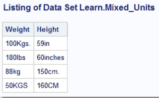

单位并不是统一大写或小写，单位中可能有的或没有点，而且它们略有不同。这看起来像是一个困难的问题——当你拥有 SAS 字符函数时，就不是了。

这类问题非常常见。看看下面的程序，然后我们讨论一下方法：

## 程序 12.8：演示 `COMPRESS` 和 `FIND` 函数

```
data Metric;
set Learn.Mixed_Units;
Wt_Kg = input(compress(Weight,'kd'),12);
if find(Weight,'lb','i') then Wt_Kg = Wt_Kg/2.2;
Ht_Cm = input(compress(Height,'kd'),12);
if find(Height,'in','i') then Ht_Cm = Ht_Cm*2.54;
```

`COMPRESS` 函数从字符值中提取数字。尽管你将此变量命名为 `Wt_Kg`，但此时你并不知道读取的重量是磅还是公斤。

接下来，你使用 `FIND` 函数在 `Weight` 的值中搜索字符 `1b`。以下是该函数的工作原理：

在最简单的形式中，你向 `FIND` 函数提供两个参数，如下所示：

```
find(string, find_string)
```

在这里，`string` 是你想要搜索的字符串，`find_string` 是你正在寻找的字符串。如果没有找到 `find_string`，函数返回 0。例如，以下语句的值：

实例实例学习 SAS：程序员指南，第二版

`find("what hat is that","hat")`

返回值为 2，即字符串 `hat` 开始的位置。一个较旧的函数 `INDEX` 与这里描述的 `FIND` 函数 类似。然而，`FIND` 函数 更多功能；你可以为 `FIND` 函数添加两个参数。其中一个参数是改变搜索开始方式的修饰符。最实用的修饰符是 `i`（忽略大小写）修饰符。你还可以指定从哪个位置位置开始搜索。如果你使用负值，搜索将从左向右进行。总结一下，`FIND` 函数具有以下语法：

```
find(string, find-string, modifiers, starting-position)
```

顺便说，你可以使用修饰符、起始位置或两者，并且它们的顺序可以是任意的！这怎么可能？因为修饰符总是字符值，而起始位置总是数值值，SAS 可以判断哪个参数是修饰符，哪个是起始位置。

在之前的程序中，使用了 `i` 修饰符，以便搜索 `LB` 或 `IN` 的大小写值。

如果你使用字符 `'LB'`（大小写）确定 `Weight` 的单位，则将 `Wt_Kg` 的值除以 2.2 将磅转换为公斤。如果你使用字符 `'IN'` 确定 `Height` 的单位，则将 `Ht_Cm` 的值乘以 2.54 将厘米转换为英寸。你可以使用修饰符、起始位置或两者，并且它们的顺序可以是任意的！

图 12.9：数据集列表

| Weight | Height | Wt_Kg | Ht_Cm |
|---|---|---|---|
| 100lb | 70in | 45 | 65 |
| 150lb | 65in | 68 | 165 |
| 200lb | 72in | 90 | 182 |
| 250lb | 68in | 113 | 172 |

单位并不是统一大写或小写，单位中可能有的或没有点，而且它们略有不同。这看起来像是一个困难的问题——当你拥有 SAS 字符函数时，就不是了。

这类问题非常常见。看看下面的程序，然后我们讨论一下方法：

第 12 章：字符函数

## 12.9 搜索单个字符

`FIND` 的伴随函数是 `FINDC`。`FIND` 在字符串中搜索特定的子字符串，而 `FINDC` 在字符串中搜索任意字符。

| 行 | 函数 | 返回值 |
|---|---|---|
| 1 | `find('XYZBA', 'ABC')` | 0 |
| 2 | `findc('XYZBA', 'ABC')` | 4 |
| 3 | `findc('ABCDE', 'D')` | 4 |
| 4 | `findc('ABCDE', 'D')` | 4 |
| 5 | `findc('XYZba', 'ABC', 'i')` | 0 |
| 6 | `findc('XYZba', 'ABC', 'i')` | 4 |

在表格第 1 行中，你正在寻找字符串 `ABC`。因为该字符串没有出现，函数返回 0。在第 2 行中，`FINDC` 返回 4（`C` 的位置）。当你寻找单个字符时（如第 3 行和第 4 行所示），函数值相同。表格最后两行演示了你可以使用的 `i`（忽略大小写）修饰符。

## 12.10 在字符串中搜索单词

`FINDW` 与 `FIND` 函数相似，只是搜索单词（因此函数名中带有 `W`）。

单词被定义为以单词边界开始并结束的字符序列。默认单词边界是字符串的开头、结尾、空格，以及以下符号：`$%&*()+-/.`如果你使用 EBCDIC 字符集，分隔符列表略有不同。你可以指定替代参数作为第三参数（你可能想使用默认字符列表中的空格）。

该函数的语法如下：

```
findw(string, delimiters, modifiers, starting-position)
```

在这里，`string` 是你想要搜索的字符串，`find-string` 是你正在寻找的字符串，`delimiters` 提供单词分隔符列表。注意，如果你想提供修饰符（最可能是 `i` 忽略大小写修饰符），你必须提供一个或多个分隔符（即使你只想使用默认值）。

下表显示了 `FIND` 和 `FINDW` 两个函数之间的差异。

| 函数 | 返回值 |
|---|---|
| `find('there is the dog', 'the')` | 1（字符串的位置） |
| `findw('there is the dog', 'the')` | 10（单词 `the` 的开始） |
| `findw('there is THE dog','the',' 'i')` | 10（`THE` 开始） |
| `findw('pear:apple','apple',':')` | 6（单词 `apple` 的开始） |

# 192 实例式学习 SAS：程序员指南，第二版

举例来说，假设你想在一组字符值列表中查找名字 `"Roger"`（不忽略大小写）。以下是该程序：

# 程序 12.9：演示 `FINDW` 函数

```sas
data Look_for_Roger;
input String $40;
if findw(String,'Roger','i') then Match = 'Yes'
else Match = 'No';
datalines;
Will Rogers
Roger Cody
Was Roger here?
Was Roger here?;
```

以下是列表显示：

# 图 12.10：数据集 `Look_for_Roger` 的列表

| String | Match |
| Will Rogers | No |
| Roger Cody | Yes |
| Was Roger here? | Yes |
| Was Roger here? | Yes |

该程序展示了当你需要查找可能是长字符串一部分的单词时，`FINDW` 函数是很有用的。

## 12.11 搜索字符类

一组被某些称为 `ANY` 函数的函数（`ANYNUMAL`, `ANYALPHA`, `ANYDIGIT`, `ANYPUNCT` 和 `ANYSPACE`）允许你分别搜索字母数字值（大小写字母和数字）、字母（所有字母）、数字、标点字符和空格字符（空格、制表符、换行符）。

例如，假设你有一些 ID 值，有些包含数字，有些不包含。你想搜索每个 ID 并创建一个包含一个或多个数字的 ID 列表。这些 ID 存储在一个名为 `ID.txt` 的文本文件中。

`ID.txt` 文件的内容如下：

```
abcABC
NJ1234
987654
123XYZ
TX78010
```

# 第 12 章：使用字符函数 193

以下是该程序：

# 程序 12.10：演示 `ANYDIGIT` 函数

```sas
data Any_Digit;
infile 'C:\books\learning\ID.txt';
input ID : $10;
Position = anydigit(ID);
if Position then output;
```

如果 `ANYDIGIT` 的参数包含任何数字，该函数将返回第一个数字的位置。如果没有，`ANYDIGIT` 则返回 0。该程序额外添加了一行代码，是为了让你清楚地看到 `ANYDIGIT` 函数是如何工作的的。记住，对于任何包含数字的 ID，`Position` 的值将是非零的。因为在逻辑表达式中，所有非 0 或缺失的值都被视为真，因此这些 ID 被写入数据集 `Any_Digit` 中。以下是列表：

# 图 12.11：数据集 `Any_Digit` 的列表

| ID | Position |
|---|---|
| NJ1234 | 3 |
| 987654 | 1 |
| 123XYZ | 1 |
| TX78010 | 3 |

所有的 `ANY` 函数都有一个可选的第二个参数。该参数指示了开始查找指定字符的起始位置。如果起始值为负数，则搜索将从右向左进行，从该参数的绝对值开始。

## 12.12 使用 `NOT` 函数进行数据清洗

另一组函数——`NOT` 函数，与 `ANY` 函数相似。区别在于，这些函数返回字符串中第一个**不**属于指定类的字符的位置。

这使得这组函数在检查字符值是否包含不属于该类的字符时特别有用。例如，如果你预计一个字符串只包含数字，你可以看到 `NOTDIGIT` 函数返回任何大于 0 的值。让我们来看一些例子。

你有一个 SAS 数据集 (`Cleaning`)，其中包含三个变量：`Letters`、`Digits` 和 `Both`。正如你从这些变量名中推出的那样，`Letters` 应该只包含大小写字母；`Digits` 应该只包含数字；`Both` 可以包含字母或数字。你想写一个程序来生成错误报告。以下是 `Cleaning` 数据集的列表：

# 194 实例式学习 SAS：程序员指南，第二版

## 12.12：`Cleaning` 数据集的列表

| Subject | Letters | Digits | Both |
|---|---|---|---|
| 1 | Apple | 12345 | XYZ12 |
| 2 | Ice9 | 123X | Abc.23 |
| 3 | Help! | 999 | XIY23 |

这是一个生成错误报告的程序：

# 程序 12.11：用于数据清洗的 `NOT` 函数

```sas
data Cleaning _null;
  file print;
  set Cleaning;
  if notalpha(trim(Letters)) then put Subject=Letters;
  if notdigit(trim(Digits)) then put Subject=Digits;
  if notalnum(trim(Both)) then put Subject=Both;
run;
```

理解为什么在这个程序中使用 `TRIM` 函数是非常重要的。如果不使用 `TRIM` 函数，使用的三个 `NOT` 函数将返回每个字符值末尾空格的位置。以下是前两个变量的输出：

# 图 12.13：程序 12.11 的输出

| Subject | Letters | Digits | Both |
| 2 | Ice9 | 123X | Abc.23 |
| 3 | Help! | 999 | XIY23 |

（注）

## 12.13 提取字符串的一部分

从字符变量中提取一个或多个字符是有用的。例如，像 `NJ12M99` 这样的 ID 可能包含两个字母的国家缩写和一个第五位的性别代码。你可能还想提取状态代码和性别代码之间的数字。`SUBSTR` 函数允许你胜任这些任务。

# 程序 12.12：使用 `SUBSTR` 函数提取子字符串

```sas
data Extract;
input ID : $10 @@
length State $2 Gender $1 Last $5;
State = substr(ID,1,2);
Gender = substr(ID,5,1);
Last = substr(ID,6);
datalines;
NJ12M99 NY764512
```

该函数的第一个参数是你要搜索的字符串。`SUBSTR` 函数的第二个和第三个参数指定了子字符串的起始位置和长度。例如，变量 `Gender`是从 `ID` 的第五位提取的，长度为 1。变量 `Name` 复杂一点。`SUBSTR` 函数从位置 3 开始提取两个，然后使用 `INPUT` 函数进行字符到数字的转换。注意，创建 `Last` 变量的 `SUBSTR` 函数没有使用参数；`SUBSTR` 函数提取到最后一个非空格字符。

等等！`State` 呢？为什么赋值语句中没有使用 `SUBSTR` 函数？注意 `State` 在 `LENGTH` 语句中声明为长度 2。当你将 `State` 设置 `ID` 时，因为 `State` 的存储长度为 2，它包含了 `ID` 的前两个字符。这是一个许多 SAS 程序员使用的“技巧”。相对于 `SUBSTR` 函数是因为函数会消耗计算机资源（CPU 时间），而这种技巧避免了使用函数。（再次，作者的强迫症倾向又出来了。）

以下是结果数据集的列表：

# 图 12.14：数据集 `Extract` 的列表

| ID | State | Gender | Last | Number |
|---|---|---|---|---|
| NJ12M99 | NJ | M | 99 | 12 |
| NJ764512 | NY | F | 4512 | 76 |
| TX91M5 | TX | M | 5 | 91 |

程序中，使用 `LENGTH` 语句来定义 `State`、`Gender` 和 `Last` 的长度。如果没有这个语句，这字符变量的长度将等于 10，即 `ID` 的长度。理解这一点非常重要。

SAS 在读取阶段阶段之前为所有字符变量分配长度。通常，子字符串的起始位置和长度可以从数据中读取，也可以在 `DATA` 步中计算。因此，如果没有 `LENGTH` 语句，SAS 应该为 `State`、`Gender` 和 `Last` 分配什么长度？从长度为 n 的字符串中提取的最长子字符串是长度为 n 的字符串，所以如果你不定义长度，SAS 正是这样做。

# 196 实例式学习 SAS：程序员指南，第二版

## 12.14 将字符串分为单词

`SCAN` 函数通常用于从字符串中提取单词。然而，正如你将在后面的示例中看到的，它也可以用于解析（分离）由空格以外的分隔符分隔子字符串。让我们从常见的例子开始——将姓和名分离到一个包含两者的变量中：

# 程序 12.13：演示 `SCAN` 函数

```sas

data Original;

  input Name $ 30;

  datalines;

  Jeffrey Smith

  Ron Cody

  Alan Wilson

  Alfred E. Newman

data First_Last;

  set Original Last $ 15;

  First = scan(Name,1, ' ');

  Last = scan(Name,2, ' ');

run;

```

`SCAN` 函数从以空格和非标点字符作为默认分隔符的字符串中提取第 n 个单词。分隔符在 ASCII 和 EBCDIC 字符集中不同。（它们分别是 (<+!*$); ^,/ % (+&*);~/%。）指定要使用的作为 `SCAN` 函数参数的分隔符通常是一个好主意。程序中，指定了空格作为分隔符。

# 图 12.15：数据集 `First_Last` 的列表

| Name | First | Last |
|---|---|---|
| Jeffrey Smith | Jeffrey | Smith |
| Ron Cody | Ron | Cody |
| Alan Wilson | Alan | Wilson |
| Alfred E. Newman | Alfred | E. |

注意 `Newman` 先生的中间名被读成了姓氏，你如何解决这个问题呢？你可以在这个程序中使用 `SCAN` 函数查找第三个单词。如果你在只有两个单词时请求第三个，`SCAN` 返回缺失的字符值。你可以教 `Name` 为

第三个单词。如果找到了它，你就可以假设第二个单词是首字母。然而，有一种更简单的方法。

这是一个程序，它可以从 `Name` 值中提取姓（Last Name），并生成按字母顺序排序的姓名列表：

## 程序 12.14：使用 `SCAN` 函数提取姓

```sas

data Last;

  set Original;

  length Last_Name = $ 15;

  Last_Name = scan(Name,-1, ' ');

run;

proc sort data=Last;

  by Last_Name;

title "Alphabetical List of Names";

proc print data=Last noobs;

  var Name Last_Name;

run;

```

这里的技巧是使用一个**负值**作为 `SCAN` 函数的第二个参数。负值会使扫描从右向左进行，点点从字符串的末尾开始。以下是结果：

## 程序 12.16：程序 12.14 的输出

| Name | Last_Name |
| --- | --- |
| Ron Cody | Cody |
| Alfred E. Newman | Newman |
| Jeffrey Smith | Smith |
| Alan Wilson | Wilson |

注意，姓名是按姓字母字母排序的。

## 12.15 执行模糊匹配

`SPEDIS` 函数（代表拼写距离 spelling distance）用于模糊匹配，即比较可能拼写不同的字符值。虽然其逻辑有点复杂，但使用这个函数非常简单。例如，假设你想搜索一个姓名列表，查看 **Friedman** 这个名字是否在列表中。你想寻找精确匹配或相似的名称。以下是程序：

## 程序 12.15：使用 `SPEDIS` 函数执行模糊匹配

```sas

data Fuzzy;

  input Name = $20;

  Value = spedis(Name, 'Friedman');

datalines;

Friedman


Freedman

Xriedman

Friedman

Friedmann

Alfred

FRIEDMAN

;

以下是数据集 Fuzzy 的数据列表：

图 12.17：数据集 Fuzzy 的列出

| Name | Value |
|---|---|
| Friedman | 0 |
| Freedman | 12 |
| Xriedman | 25 |
| Friedman | 6 |
| Friedmann | 3 |
| Alfred | 100 |
| FRIEDMAN | 87 |

如果两个参数完全匹配，`SPEDIS` 函数返回 0。该函数为每种类型的拼写错误分配惩罚分。例如，写错第一个字母的分数比写错其他字母多。交换两个字母是一个较小的错误，在单词中增加一个字母也是如此。

一旦计算出总惩罚分，得到的值是相对于第一个参数长度的百分比。这是很有道理的，因为在一个 3 个字母的单词中写错一个字母比在一个 10 个字母的单词中写错一个字母要严重得多。

注意，`SPEDIS` 函数评估的两个字符值是区分大小写的（请查看列表中的观察结果）。如果大小写可能是问题，在用 `SPEDIS` 测试名称之前，请使用 `UPPERCASE`、`PROPCASE` 或 `VALUE` 函数。

要识别任何与 Friedman 相似的名称，你可以提取所有 `SPEDIS` 函数返回的值小于某个预定值的名称。在本文的程序中，小于 15 或 20 的值将识别出该名字的一些合理拼写错误。

## 12.16 替换字符串或单词

本章中的两个函数是 `TRANSL` 和 `TRANWRD`。`TRANSL` 允许你用一个字符值替换另一个。`TRANWRD` 允许你用一个单词替换另一个（因此名为 translate word——`TRANWRD`）。

在第一个示例中，你想用字符值 A, B, C, D 和 E 替换字符值 1, 2, 3, 4 和 5。

### 程序 12.16：演示 TRANSLATE 函数

```sas
data Trans;

  input Answer : $5;

  Answer = translate(Answer,'ABCDE','12345');

datalines;

14325

AB123

51492

;
```

生成的数据集 `Trans` 包含以下三个观测：

图 12.18：数据集 Trans 的列出

| Listing of Data Set Trans |
| Answer |
| ABCDE |
| ABABC |
| EAD9B |

值 1–5 被 A–E 替换。任何其他字符都不会改变。`translate` 函数接受三个参数：第一个参数是你想要更改的字符字符串；第二个和第三个参数是目标字符串（to-string）和源字符串（from-string）。目标字符串中的每个字符都会替换源字符串中对应的字符。在上面的程序中，1 变成 A，2 变成 B，依此类推。

本章的最后一个函数（万岁！）是 `TRANWRD`。此函数允许你用一个单词替换另一个。

该函数通常用于标准化地址（将 Street 改为 St.，将 Road 改为 Rd. 等）。这里有一个例子：

### 程序 12.17：使用 TRANWRD 函数标准化地址

```sas
data Address;

input Name $30 Line $40 City $20 State $5;

Line = tranwd(Line, 'Street', 'St.');

Line = tranwd(Line, 'Road', 'Rd.');

Line = tranwd(Line, 'Avenue', 'Ave.');

datalines;

Dr. Peter Benchley 123 Street Oceanside NY 1518

Mr. Robert Merrill 878 Road Long Beach CA 9018

Mrs. Laura Smith 80 Avenue NJ 0822
```


函数的第一个参数是你要进行替换的字符值，第二个和第三个参数分别是源字符串和目标字符串。注意这里使用了 `tranwd`。原因是生成的字符串可能比原始字符串长——SAS 将长度设为 200。如果不是这种情况（原始长度就足够了），你需要在 `SET` 语句之前放置 `LENGTH` 语句，为修改的字符变量定义新长度。

这里是 `Address` 数据集的列表。注意所有的替换已经完成，抬头（例如 `Mr.` 和 `Mrs.`）都已删除。

图 12.19：数据集 `Address` 的列出

## Listing of Data Set Address

| Name | Line | City | State |
| Benchley | 123 St. | Oceanside | NY |
| Merrill | 878 Rd. | Long Beach | CA |
| Smith | 80 Ave. | | NJ |

0822

这个漫长的章节到此结束了。尽管本章只涵盖了一些实用的字符函数，但你可以看到 SAS 拥有一套极其强大的工具处理字符数据。

## 12.17 练习

奇数题的解答位于书末。所有题目的解答均向教授提供。如果你是教授，请访问书籍配套网站 `support.sas.com/cod` 获取如何获取所有题目解答的信息。

- 查看以下程序并确定每个变量的存储长度：
```
data Storage:
length A $4 B $4;
Name = 'Goldstone';
AandB = A || B;
Cat = cats(A,B);
if Name = 'Smith' then Match = 'No';
else Match = 'Yes';
Substring = substr(Name,5,2);
run;
```
`A`
`B`
`AandB`
`Cat`
`Match`
`Substring`

- 使用数据集 `Mixed` 创建一个临时 SAS 数据集（也称为 `Mixed`），包含以下新变量：
  - `NameLow` – 小写姓名
  - `NameProp` – 字母大写姓名
  - （加 Bonus——困难）`NameHard` – 不使用 `PROPCASE` 函数实现的字母大写姓名

- 使用永久性数据集 `Names_And_More` 创建一个新的临时数据集 `Names_And_More` 并进行以下更改：

# 202 实例 SAS 学习：程序员指南，第二版

- a. 姓名在第一个和最后一个姓氏之间有单个空格。
- b. 电话号码仅包含数字（但仍是一个字符值）。

- 4. 数据集 `Names_And_More` 包含一个名为 `Height` 的字符变量。

以下是数据集 `_And_More_` 的列表：

数据集 `Learn.Names_and_More` 列表

| Name | 电话 | Height | 混合 |
|---|---|---|---|
| Roger Cody | (308) 782-1234 | 5ft. 10in. | 50 1/8 |
| Thomas Jefferson | (345) 848-4844 | 6ft. 1in. | 23 1/2 |
| Marco Polo | (800) 123-4567 | 5ft. 6in. | 40 |
| Brian Watson | (315) 585-1776 | 5ft. 10in. | 89 3/4 |
| Michael DeMarco | (445) 232-2233 | 6ft. | 76 1/3 |

如你所示，高度单位是英尺和英寸。假设这些单位可以是小写的，且单位后可能跟随或没有句号。创建一个临时 SAS 数据集 (`Height`)，其中包含一个数值变量 (`HInches`)，该变量是以英寸为单位的高度。

> 注意：`Height` 的值缺少英寸值。请确保 SAS 日志中没有字符转数值的提示。

> 提示：使用 `KD` 修饰符保留数字，并在第二个参数中使用单个空格来保留空格。然后你可以使用 `SCAN` 函数来提取英尺和英寸值。

- 5. 数据集 `Names_And` 包含一个名为 `Mixed` 的字符变量，该变量可以是整数或混合数（如 50 1/8）。使用该数据集创建一个新的临时 SAS 数据集，其中包含一个具有小数值的数值变量 (`Price`)。该数字应四舍五入到最近的 .1。

> 提示：使用 `SCAN`（字符所示）函数并使用正斜杠（`/`）作为分隔符。

- 6. 数据集 `study`（所示）包含变量 `Group` 和 `Doe`。创建一个新的临时 SAS 数据集 (`Study`)，其中有一个名为 `GroupDoe` 的变量，该变量是将这两个值用连字符连接起来。结果变量的长度应为 6（使用 SAS Explorer 中的 `PROC CONTENTS` 测试此项）。确保该值中没有空格（末尾空格除外）。尝试两种方法：首先使用其中一个 `CAT` 函数，然后是不使用任何 `CAT` 函数。

以下是列表：

数据集 `Learn.Study` 列表

| Subj | Group | Dose | Subgroup | 组 |
|---|---|---|---|---|
| 001 | A | Low | 221lbs. | 2 |
| 002 | A | High | 90kg. | 1 |
| 003 | B | Low | 88kg | 1 |
| 004 | B | High | 161lbs. | 2 |
| 005 | A | Low | 88kg | 1 |

# 第 12 章：使用字符函数 203

- 7. 数据集 `Study` 一个字符变量 (`Group`) 和一个数值变量 (`Subgroup`)。创建一个新的临时 SAS 数据集，包含这些变量加上一个由 `Group`、连字符和 `Subgroup` 组成的变量（称为 `Combined`）。尝试使用和不使用 `CAT` 函数来执行此操作。确保你的 SAS 日志中没有转换信息。

- 8. 注意问题 6 中数据集列表中的变量 `units`（单位，可能是 `lbs` 或 `kg`）。这些单位在大小写上并不总是一致，且可能不包含句号。假设大写或小写的 `LB` 表示磅，大写或小写的 `KG` 表示公斤。创建一个临时 SAS 数据集 (`Study`)，其中包含一个也名为 `Weight`（注意这里）的数值变量，代表磅的十分之一。

**注意：** 1 公斤 = 2.2 磅。

- 9. 使用 `Sales` 数据集创建一个临时 SAS 数据集 (`Spirited`)，包含 `Sales` 中所有观测值，其中字符串 `SPIRIT`（不一定是该单词）以大写、小写或混合大小的形式出现在 `Customer`（变量名 `Customer`）的一部分。

- 10. 数据集 `Errors` 包含字符变量 `Subj` (3 字节) 和 `PartNumber` (8 字节)。创建一个临时 SAS 数据集 (`Check1`)，包含 `Errors` 中任何违反以下任一条规则的观测值：`Subj` 应仅包含数字；其次，`PartNumber` 应仅包含大写字母 `L` 和 `S` 以及数字。

以下是 `Errors` 的列表：
数据集 `Learn.Errors` 列表

| Subj Number | Name |
|---|---|---|
| 001 L1232 Nicole Brown |
| 002 L887X Fred Beans |
| 003 12321 Alfred 2 Nice |
| 004 abcde Mary Bumpers |
| X89 8888S Gill Sandford |

- 11. 列出 `Errors` 中所有 `Name` 包含数字的观测值的子集 (`Subj`)。参见上一个数据集的列表）。

- 12. 使用子集 `Errors` 中 `PartNumber` 包含大写或小写 `X` 或 `D` 的观测值。

- 13. 数据 `Social` 创建了两个变量 `SS1` 和 `SS2`。这些变量代表了两个独立安全数字的所有可能组合。使用该数据集，创建一个新的临时 SAS 数据集，其中包含一个由 `Group`、连字符和 `Subgroup` 组成的变量（称为 `Combined`）。尝试使用和不使用 `CAT` 函数。

## 第 13 章：使用数组

在使用数组时，请使用相同类型的括号（直括号 `[]` 或大括号 `{}`）。原因在于——SAS 函数名后面总是跟着一组括号，因此如果你在数组引用中使用圆括号，可能很难判断程序是在进行数组引用还是在使用函数。

一旦你定义了数组，就可以在 `DATA` 步的任何地方使用数组引用来代替变量名。例如，可以用 `MYVARS{2}` 来替变量 `Weight`（权重）。在数组名后方括号中的数字被称为下标（subscript），尽管它并不是真正的下标表示法。

通过将数组放在 `DO` 循环中，你可以处理数组中的每个变量。此外，由于你不需要将 `DO` 循环包含在 SAS 步中，可以使用 `DROP` 语句。

让我们“运行”一下并遵循这个程序的逻辑。在 `DATA` 步的开头，该语句从数据集 `SPSS` 中读入一个观测值。接着，`DO` 循环计数器从 1 开始。`IF` 语句引用数组元素 `MYVARS[1]`，它等同于变量 `Height`（身高）。SAS 检查 `Height` 的值是否等于 999，如果是，则将其替换为 SAS 消息。

`DO` 循环对所有三个数组元素以同样的方式继续。当 `DO` 循环结束时，你处于 `DATA` 步的底部。一个观测值被写入 `NEW` 数据步中，然后返回到 `DATA` 步的开头，读取 `SPSS` 数据集中的下一个观测值。这个过程一直持续，直到 `SPSS` 数据集中没有更多可读的观测值为止。

开始编写数组的最佳方法是先写几行不带数组的代码。接下来，使用其中一行示例代码作为模板并编写该行，用你的数组名（带上你选择的下标）替换变量名。最后，将此行（或几行）代码放在 `DO` 循环内部。（不要忘记丢弃 `DO` 循环计数器。）大功告成。

## 13.3 将 NA 和 ? 赋值为缺失字符值

如引言所述，SAS 数组必须包含全数值型或全字符变量。如果你想要包含在字符数组中的变量已经定义为字符型（例如，它们来自 `SET` 语句），你可以编写一个与上一节类似的 `ARRAY` 语句。然而，如果你想让数组包含新变量，在定义数组时需要包含一个美元符号（`$`），以及可选的长度。例如，要创建一个长度为 2 字节的字符变量 `Q1–Q20` 数组，你可以写如下内容：
```
```


`array Mychars(20) $` `2` `Q1–Q20`;

在每个字符数组中包含美元符号（`$`）是一个好主意，即使数组变量之前已经定义为字符型。

作为一个示例，以下程序使用字符数组将所有的 `NA`（不适用）或问号（`?`）值转换为缺失值。假设你获得了一个 SAS 数据集 `Chars`，并且你想创建一个名为 `Missing` 的新数据集并包含这些更改。以下是该程序：

### 程序 13.3：将 NA 和 ? 的值转换为缺失字符值

```sas
data Missing;

  set Learn.Chars;

  array Char_Vars(*) $ _character_;

  do Loop = 1 to dim(Char_Vars)

    if Char_Vars(Loop) = ('NA','?') then

      Char_Vars(Loop) = ' ';

  end;

  drop Loop;

run;
```

此程序引入了一个新数量的特征。星号（`*`）用于代替数组元素的个数。如果你不知道数组中有多少个变量（例如当你还没有数过 `Chars` 数据集中字符变量的数量时），你始终可以在此处使用星号。`_CHARACTER` 用作变量列表。由于此语句紧随 `SET` 语句之后，`_CHARACTER` 包含了 `Chars` 数据集中所有的字符变量。`CHARACTER` 引用在 DATA 步该时间点 PDV（程序数据向量）中存在的变量。例如，如果你在 DATA 步的前三行定义了字符变量 `A`、`B` 和 `C`，然后在引用之后定义了字符变量 `D` 和 `E`，那么 `_CHARACTER` 只引用变量 `A`、`B` 和 `C`。在程序 13.3 中，如果你将 `ARRAY` 语句放在 `SET` 语句之前，数组将不会引用任何变量。

由于你使用星号代替数组元素的个数，那么 `DO` 循环的上限你应该使用什么值呢？幸运的是，`DIM` 函数救了急。它返回数组中的元素个数。最后，一个 `IF` 语句检查 `NA` 或 `?` 的值，并将它们赋值为 SAS 字符缺失值。

## 13.4 将所有字符值转换为首字母大写 (Propercase)

如果你的数据（无论是原始数据文件还是 SAS 数据集）中数据条目的输入非常粗率（或没有提前设定标准），你可能会遇到一堆大写、小写或首字母大写混合的值。本节描述了一个将所有字符值转换为首字母大写的简单程序。

首先，是数据集 `Careless` 的列表：

### 图 13.1：数据集 Learn.Careless 的列表

| Score | Last_Name | Ans1 | Ans2 | Ans3 |
|---|---|---|---|---|
| 100 | Cody | A | b | c |
| 65 | Smith | C | C | d |
| 95 | Smith | D | e | D |

以下程序将所有字符变量转换为首字母大写：

### 程序 13.4：将数据中的所有字符值转换为首字母大写

```sas
data Proper;

  set Learn.Careless;

  array AllChars(*) _character_;

  do i = 1 to dim(AllChars)

    AllChars{i} = propercase(AllChars{i});

  end;

  drop i;

run;
```

该程序的逻辑与之前的程序类似。使用 `_CHARACTER` 关键字引用 `Careless` 中的所有变量，然后使用 `DO` 循环将其转换为首字母大写。如下所示所示：

### 图 13.2：数据集 Proper 的列表

| Score | Last_Name | Ans1 | Ans2 | Ans3 |
|---|---|---|---|---|
| 100 | Cody | A | B | C |
| 65 | Smith | C | C | D |
| 95 | Smith | D | E | D |

变量

你可以在 `ARRAY` 语句中包含数据集中不存在的变量。例如，如果你的 SAS 数据集包含 `Fahrenheit1-24` 温度值，你可以使用数组创建 24 个新变量。这里有一个实现此点的程序：

### 程序 13.5：使用数组创建新变量

```sas
data Temp;

  array Fahrenheit[24];

  array Celsius[24];

  input Fahrenheit24;

  do Hour = 1 to 24

    Celsius{Hour} = (Fahrenheit{Hour} - 32)/1.8;

  end;

  drop Hour;

datalines;

35 37 40 44 48 55 59 62 64 66 68 70 75
```

变量 `Celsius1–24` 是通过 `ARRAY` 语句创建的。在 `DO` 循环内部，你将 `24-Fahrenheit` 转换为 `Celsius`。`Temp` 数据集中所有的温度值。你也可以对 `Celsius` 数组使用此功能。

### 13.6 修改数组边界

默认情况下，SAS 数组元素从 1 开始编号。有时指定数组元素的起始和结束值是有用的。例如，如果你有 `Income2010` 到 `Income2017` 变量，如果数组元素从 2010 开始到 2017 结束将很好。

以下程序包含一个八个收入值的数组，使用 2010 和 2017 作为数组边界，并计算这八年的税费：

### 程序 13.6：修改数组边界

```sas
data Account;

  input ID Income2010-Income2017;

  array Income[2010:2017] Income2010-Income2017;

  array Taxes[2010:2017] Taxes2010-Taxes2017;

  do Year = 2010 to 2017

    Taxes{Year} = .25*Income{Year};

  end;

  format Income2010-Income2017 Taxes2010-Taxes2017 dollar10.

datalines;

  01 45000 47500 48000 48000 52000 53000 55000

  02 67130 68000 72000 65000 52000 49000 40100

;
```

在此程序中，你通过括号内的数组名和冒号分隔来指定上下边界。

### 13.7 临时数组

你可以创建一个只有元素而没有变量的数组！尽管这听起来很奇怪，但数组元素是存储值或执行表查找的好地方。如果你愿意，可以在创建临时数组时为元素分配初始值。或者，你也可以在 DATA 步中将值加载到临时数组中。无论哪种方式，临时数组值会自动保留（也就是说，当 DATA 步迭代时，它们不会被设置为缺失值）。因此，它们是执行 DATA 步期间需要存储值的好地方。

### 程序 13.7：使用临时数组为测试评分

```sas
data Score;

array Ans{10} $ 1;

array Key{10} $ 1 _temporary

('A', 'B', 'C', 'D', 'E', 'E', 'D', 'C', 'B', 'A');

input ID (Ans1-Ans0)($1);

RawScore = 0;

do Ques = 1 to 10;

  RawScore + (Key(Ques) eq Ans(Ques));

end;

Percent = 100*RawScore/10;

keep ID RawScore Percent;

datalines;

123 ABCDDDCA

126 ABCEDCBA

129 BCBCEDDEB;
```

此程序使用一个临时数组（`Key`）来存储 10 个测验题的答案。`_TEMPORARY` 关键字告诉 SAS 这是一个临时数组，括号中的 10 是该数组每个元素的初始值。需要记住的是，没有对应的变量（`Key1`、`Key2` 等），因为临时数组的元素会被保留，这 10 个答案在整个 DATA 步中都是可用的。此外，由于每个学生的

评分是在 DO 循环中完成的。这里使用了一个“技巧”来评分：在学生答案与相应的标准答案之间进行逻辑比较。如果它们匹配，逻辑比较返回 1；如果不匹配，结果则为 0 且 `RawScore` 不递增。以下是输出列表：

### 图 13.3：数据集 Score 的列出

| ID | RawScore | Percent |
|---|---|---|
| 123 | 7 | 70 |
| 126 | 10 | 100 |
| 129 | 4 | 40 |

## 13.8 从原始数据文件加载临时数组的初始值

如果你有一份很长的测试，你可能更倾向于从文本文件中读取值并将答案加载到数组元素中（特别是如果你使用光电标记识别器对测试进行评分）。在接下来的程序中，你在数据文件的第一行输入答案，在剩余的行（第 2 到 n 行）输入 ID 和学生答案：

### 程序 13.8：从原始数据文件加载临时数组的初始值

```sas
data Score;

  array Ans{10} $;

  array Key{10} $1 _temporary;

/* 加载临时数组元素 */
if n = 1 then do Ques = 1 to 10;
  input key(Ques) $1;
end;

  input ID (Ans1-Ans10)($1);

  RawScore = 0;

/* 为测试评分 */
do Ques = 1 to 10;
  RawScore + (Key{Ques} = Ans{Ques});
end;

  Percent = 100*RawScore/10;

  keep ID RawScore Percent;

datalines;

ABCDECCA
123 ABCDEDDCA
126 ABCDEEDCBA
129 DBCBCEDDEB
```

由于你需要以与其他不同的方式读取数据文件的第一行，可以使用 `_N`（计算 DATA 步迭代次数）的值来确保答案值只被读取一次。

读取学生 ID 和答案的 `INPUT` 语句使用了一种你可能来说是新的输入形式。你将变量列表放在一组括号中，并将你想用于读取这些变量的格式放在第二组括号中。（有关使用变量列表和格式列表的信息，请参见第 21 章。）

运行此 DATA 步的结果与你从程序 13.7 获得的数据完全相同。

### 13.9 使用多维数组进行表查找

SAS 数组也可以是多维的。你不再使用单个索引来识别数组元素，例如，你可以使用两个索引（通常是行和列索引）来识别一个元素。当你需要根据两个选择标准检索单个值时，这种方法特别有用。

要定义一个多维数组，你需要在数组名后的括号中指定每个维度上的元素数量，并用逗号分隔。例如，要定义一个名为 `MULTI` 的数组，其第一个维度有三个元素，第二个维度有五个个元素，你可以使用：

```sas
array Multi{3,5} X1-X15;
```

要确定多维数组中的元素数量，将每个维度的元素数量相乘。在这个例子中，3x5 的数组有 3 乘以 5 等于 15 个元素。

## 第 13 章：使用数组

下表显示了橡胶厂每年（从 1944 年到 1949 年）的苯水平以及工作代码（A 到 E）。你想根据给定的年份和工作代码检索苯水平。你可以在本书的第 22 章中看到使用格式的解决方案。这里提供一个数组的解决方案。

首先，你需要创建一个二维数组，其中一个索引代表年份，另一个代表工作代码。为了更方便，你可以让年份的索引值范围从 1944 到 1949，而不是从 1 到 6。你还需要决定是在 `ARRAY` 语句中用苯值填充数组，还是从原始数据（或可能是 SAS 数据集）读取这些值。最后，你可以使用普通数组或临时数组。这里显示的解决方案从原始数据加载数组，并使用临时数组存储苯值。你从一个包含工人 ID、年份和工作代码的数据集（`Exposure`）开始。根据这些信息，你想查找工人的苯暴露量。

### 图 13.4：数据集 Exposure 的列出


以下按年份和工作代码划分的苯暴露表。

| Year | A | B | C | D | E |
|---|---|---|---|---|---|
| 1944 | 220 | 180 | 210 | 110 | 90 |
| 1945 | 202 | 170 | 208 | 100 | 85 |
| 1946 | 150 | 110 | 150 | 60 | 50 |
| 1947 | 105 | 56 | 88 | 30 | |
| 1948 | 60 | 30 | 40 | | |
| 1949 | 45 | 22 | | | |

### 13.9：从原始数据加载二维数组

要从原始数据加载数组并使用临时数组数组，方法如下：

```sas
data Look;

******************

/* 创建二维数组，一个索引代表年份，另一个代表工作代码。 */
/* 为了方便，你可以让年份的索引值范围从 1944 到 1949， */
/* 而不是 1 到 6。你还需要决定是在 ARRAY 语句中填充 */
/* 苯值，还是从原始数据读取这些值，或者可能是 SAS 数据集。 */
/* 最后，你可以使用普通数组或临时数组。 */
/* 这里显示的解决方案从原始数据加载数组，并使用临时数组 */
/* 保存苯值。你从一个包含工人 ID、年份和工作代码的数据集 */
/* Exposure）开始。根据这些信息，你想查找工人的苯暴露量。 */
array Year{1944:1949}, Job{A:E} _temporary;

/* 填充数组 */
if _N = 1 then do;
  do i = 1944 to 1949;
    do j = 1 to 5; /* 这是一个为逻辑示例 */
      input Level{i, j} $;
    end;
  end;
end;

set Exposure;
```


| 1944 | 220 | 180 | 210 | 110 | 90 |
| 1945 | 202 | 170 | 208 | 100 | 85 |
| 1946 | 150 | 110 | 150 | 60 | 50 |
| 1947 | 105 | 56 | 88 | 30 | |
| 1948 | 60 | 30 | 40 | | |
| 1949 | 45 | 22 | | | |

*(注：由于原文文本在某些处存在断句或逻辑重复，译文已根据逻辑进行了结构性调整，以确保技术文档的连贯性)*

216 实例化学习 SAS：程序员指南，第二版

| ID | 测试 1 | 测试 2 | 测试 3 | 测试 4 | 测试 5 |
|---|---|---|---|---|---|
| 001 | 90 | 88 | 92 | 95 | 90 |
| 002 | 64 | 64 | 77 | 72 | 71 |
| 003 | 68 | 69 | 80 | 75 | 70 |
| 004 | 88 | 77 | 66 | 77 | 67 |

# 第 3 部分：展示与汇总您的数据

第14章：显示您的数据
第15章：创建自定义报告
第16章：汇总您的数据
第17章：统计频率
第18章：创建表格报告
第19章：介绍输出交付系统
第20章：创建图表和图形

# 第 14 章：显示您的数据

+ 14.1 引言............................................................................................................... 219
+ 14.2 基础知识...................................................................................................... 219
+ 14.3 更改列表的外观.................................................................... 220
+ 14.4 更改数值的外观......................................................................... 222
+ 14.5 控制列表中显示的观测值.............................................. 223
+ 14.6 为列表中添加标题和脚注....................................................... 224
+ 14.7 更改列表的顺序............................................................... 226
+ 14.8 按多个变量进行排序............................................................... 228
+ 14.9 为列标题标记标签...................................................................... 229
+ 14.10 在列表中添加小计和总计............................................................... 230
+ 14.11 让列表更易读............................................................... 233
+ 14.12 在列表中添加观测值数量...................................... 234
+ 14.13 列出数据集的前 n 个观测值......................................... 234
+ 14.14 问题............................................................................................................... 235

### 14.1 引言

本章将向你展示如何使用 `PROC PRINT` 列出 SAS 数据集中的观测值。在后面的章节中，你将看到更高级的方法来显示和汇总你的数据。

### 14.2 基础知识

你已经见过如何使用 `PROC PRINT` 列出 SAS 数据集中的观测值。让我们看看如何向此过程添加一些选项和语句，以便对显示内容进行更多控制。

你有一个名为 `Sales` 的 SAS 数据集，其中包含有关销售的信息：员工姓名和 ID、销售区域、销售公司名称、零件编号、数量、物品单位成本以及销售总额（数量乘以乘以单位`）。程序 14.1 显示了带有所有默认设置的 `PROC PRINT`：

220 实例化学习 SAS：程序员指南，第二版

# 程序 14.1：使用所有默认设置的 PROC PRINT

```
title "Listing of Data Set Sales"

proc print data=Learn.Sales;

run;
```

你将获得类似于图 14.1 所示的列表：

# 图 14.1：程序 14.1 的部分输出

# Sales 数据集列表

| Obs | EmpID | Name | Region | Customer | Item | Quantity | UnitCost | TotalSales |
|---|---|---|---|---|---|---|---|---|
| 1 | 1843 | George Smith | North | Barco Corporation | 144L | 50 | 8.99 | 449.5 |
| 2 | 1843 | George Smith | South | Cost Cutter's | 122 | 100 | 5.99 | 599.0 |
| 3 | 1843 | George Smith | North | Minimart Inc. | 188S | 3 | 5199.0 | 15597.0 |
| 4 | 1843 | George Smith | North | Barco Corporation | 908X | 1 | 5129.0 | 5129.0 |
| 5 | 1843 | George Smith | South | Ely Corp. | 122L | 10 | 29.95 | 299.5 |
| 6 | 0177 | Glenda Johnson | East | Food Limited | 188X | 100 | 6.99 | 699.0 |
| 7 | 0177 | Glenda Johnson | East | Shop and Drop | 144L | 1 | 8.99 | 899.0 |
| 8 | 1843 | George Smith | South | Cost Cutter's | 855W | 1 | 9109.0 | 9109.0 |
| 9 | 9888 | Sheren Lee | West | Cost Cutter's | 122 | 50 | 5.99 | 299.5 |

### 14.3 更改列表的外观

你可以通过 `VAR` 语句来控制哪些变量出现在列表中，以及这些变量的顺序。你可以在关键字之后放置想要看到的变量。此列表的顺序也控制了变量在列表中出现的顺序。

# 程序 14.2：控制列表中显示哪些变量

```
title "Listing of Sales"

proc print data=Learn.Sales;

var EmpID Customer TotalSales;

run;
```

如果你运行程序 14.2 中的代码，你将获得以下内容：

231 图 14.2：程序 14.2 的输出

# 销售列表

| Obs | EmpID | Customer | TotalSales |
|---|---|---|---|
| 1 | 1843 | Barco Corporation | 449.5 |
| 2 | 1843 | Cost Cutter's | 599.0 |
| 3 | 1843 | Minimart Inc. | 15597.0 |
| 4 | 1843 | Barco Corporation | 5129.0 |
| 5 | 1843 | Ely Corp. | 299.5 |
| 6 | 0177 | Food Limited | 699.0 |
| 7 | 0177 | Shop and Drop | 899.0 |
| 8 | 1843 | Cost Cutter's | 599.0 |

你的下一步是省略观测列并用其他替换它。使用 `id` 语句来实现：

# 程序 14.3：使用 ID 语句省略观测列

```
title "Listing of Sales"

proc print data=Learn.Sales;

id EmpID;

var Customer TotalSales;

run;
```

注意列表发生了变化。

# 图 14.3：程序 14.3 的部分输出

# 销售列表

| EmpID | Customer | TotalSales |
|---|---|---|
| 1843 | Barco Corporation | 449.5 |
| 1843 | Cost Cutter's | 599.0 |
| 1843 | Minimart Inc. | 15597.0 |
| 1843 | Barco Corporation | 5129.0 |
| 1843 | Ely Corp. | 299.5 |
| 0177 | Food Limited | 699.0 |
| 0177 | Shop and Drop | 899.0 |

### 14.4 更改数值的外观

假设你希望 `TotalSales` 数值带有美元符号和逗号显示。通过为变量关联格式（format），你可以更改列表中数值的外观。SAS 具有许多格式可以为数字添加美元符号或逗号。

# 程序 14.4：为 PROC PRINT 添加 FORMAT 语句

```
title "Listing of Sales"

proc print data=Learn.Sales;

id EmpID;

var Customer TotalSales;

format TotalSales dollar$10.2.;

run;
```

注意 `TotalSales` 列的变化。

# 图 14.4：部分输出

# 销售列表

| EmpID | Customer | TotalSales |
|---|---|---|
| 1843 | Barco Corporation | $449.50 |
| 1843 | Cost Cutter's | $599.00 |
| 1843 | Minimart Inc. | $15,597.00 |
| 1843 | Barco Corporation | $5,129.00 |
| 1843 | Ely Corp. | $299.50 |
| 0177 | Food Limited | $699.00 |
| 0177 | Shop and Drop | $899.00 |

# 实例实例学习 SAS：程序员指南，第二版

你可以对数值或字符值使用 `IN` 运算符。你也可以选择使用空格或逗号分隔列表中的值。以下是程序 14.6 的输出：

图 14.6：程序 14.6 的输出

| EmpID | Customer | Quantity | TotalSales |
|---|---|---|---||
| 184 | Barco Corporation | 50 | $449.50 |
| 1843 | Cost Cutter's | 100 | $599.00 |
| 1843 | Minimart Inc. | 3 | $15,597.00 |
| 1843 | Barco Corporation | 1 | $5,129.00 |
| 1843 | Ely Corp. | 10 | $299.50 |
| 0177 | Food Unlimited | 100 | $699.00 |
| 0177 | Shop and Drop | 100 | $899.00 |
| 1843 | Cost Cutter's | 1 | $9,109.00 |
| 0177 | Minimart Inc. | 5 | $52.50 |
| 0177 | Barco Corporation | 2 | $20,000.00 |
| 1843 | Minimart Inc. | 3 | $15,597.00 |

### 14.6 为你的列表添加标题和脚注

你可以通过添加额外的标题行以及为列表添加一个或多个脚注来使你的输出更有意义。`TITLEn` 语句（n 是 1 到 10 的数字）允许你指定多行标题。`TITLE1` 和 `TITLE2` 是等等的。`FOOTNOTEn` 语句允许你指定 1 到 10 个出现在页面底部的脚注。需要记住，一旦你发出 `TITLE` 或 `FOOTNOTE` 语句，标题或脚注就会打印在输出的每一页上，直到你更改或取消它们。

该短程序列出了来自 Sales 数据中的变量，并添加了几个标题和脚注行：

程序 14.7：为你的列表添加标题和脚注

```sas
title1 "The XYZ Company";
title3 "Sales Figures for Fiscal 2017";
title4 "Prepared by Roger Rabbit";
title5 "------------------------------------";
footnote5 "All sales Figures are Confidential";
proc data=Learn;
id EmpID;
var Customer Quantity TotalSales;
format TotalSales dollar10.2 Quantity comma7;
;
```

## 第 14 章：显示你的数据

首先，我们向展示列表，然后进行解释。

图 14.7：程序 14.7 的部分输出

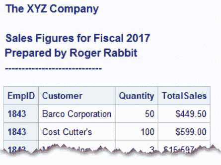

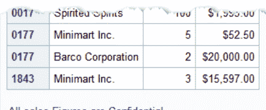

所有销售数据均为机密

由于缺少 `TITLE2` 语句，第一行标题和第三行标题之间有一个空行。

如果你提交一个 `TITLEn` 语句，它将替换当前的 `TITLEn` 语句以及所有 n 值值更高的 `TITLE` 行。例如，你将程序 14.7 中的 `TITLE3` 行更改为：

```sas
title3 "New Sales Figures for 2017";
```

现在你提交一个不带任何之前的 `TITLE` 行的 `PROC PRINT`，你的输出现在如下：

图 14.8：新标题行


第 3 行已被新文本替换，第 4 行和第 5 行被删除。`FOOTNOTEn` 语句的工作方式相同。

顺便提一下，使用以下命令取消所有标题语句：

```sas
title;
```

同样地，使用以下命令取消所有脚注行：

```sas
footnote;
```

### 14.7 更改你列表的顺序

如果你想以特定的排序顺序查看列表，可以在 `PROC PRINT` 之前添加一个 `PROC SORT` 步骤。如果你想按 `TotalSales` 的顺序查看列表，可以使用以下程序：

程序 14.8：使用 `PROC SORT` 更改观测值的顺序

```sas
proc sort data=Learn.Sales;
by TotalSales;
run;

title "Listing of Sales - Sorted by Total Sales";

proc print data=Learn.Sales;

id EmpID;

var Customer Quantity TotalSales;

format TotalSales dollar10.2 Quantity comma7;

run;
```


## 第 14 章：显示你的数据

你的列表现在按 `TotalSales` 顺序排列，从低到高。

**图 14.9：程序 14.8 的输出**

| EmpID | Customer | Quantity | Total Sales |
|---|---|---|---|
| 0177 | Minimart Inc. | 5 | $52.50 |
| 1843 | Ely Corp. | 10 | $299.50 |
| 9888 | Cost Cutter's | 50 | $299.50 |
| 1843 | Barco Corporation | 50 | $449.50 |
| 1843 | Cost Cutter's | 100 | $599.00 |
| 0177 | Food Unlimited | 100 | $699.00 |
| 0177 | Shop and Drop | 100 | $899.00 |
| 9888 | Pet's are | 1000 | $1,990.00 |
| 0177 | Spirited Spirits | 100 | $1995.00 |
| 1843 | Barco Corporation | 1 | $5,129.00 |
| 1843 | Cost Cutter's | 1 | $9,109.00 |
| 1843 | Minimart Inc. | 3 | $15,597.00 |
| 1843 | Minimart Inc. | 3 | $15,597.00 |
| 0017 | Roger's Spirits | 500 | $19,995.00 |
| 0177 | Barco Corporation | 2 | $20,000.00 |

要从高到低查看列表，请在变量名前加上 `DESCENDING` 关键字，如下：

### 程序 14.9：演示 `DESCENDING` 选项

```sas
proc sort data=Learn;
by descending TotalSales;
run;
```

在程序 14.8 中，你按 `TotalSales` 排序替换了原始数据集。在某些情况下，这样做是可以的。如果你不想更改原始数据集，请为排序添加 `OUT=` 选项以指定输出数据集。这在你进行数据子集时特别重要。例如，以下程序创建了一个按 `TotalSales` 降序排列的临时数据集：

```sas
proc sort data=Learn, out=Sales;
by descending TotalSales;
run;
```

注意 SAS 正在读取你的永久数据集 (`Learn`) 并创建一个临时数据集 (`Sales`)。只要它们位于不同的库中，为两个数据集使用相同的名称是可以的（而且有时是很方便的）。

### 14.8 按多个变量排序

你可以按多个变量对数据集进行排序。这被称为多级排序。例如，以下 `PROC SORT` 语句按员工 ID 以及每个 ID 内的销售额值对数据进行排序：

#### 程序 14.11：按多个变量排序

```sas
proc sort data=Learn.Sales out=Sales;
by EmpID descending TotalSales;
run;
```

```sas
title "Sorting by More Variable";
proc print data=sales;
id EmpID;
var TotalSales Quantity;
format TotalSales dollar10.2 comma7;
run;
```

如下面的列表所示，临时数据集 `Sales` 现在按 `EmpID` 顺序和每个员工的 `TotalSales` 降序排列：

**图 14.10：程序 14.11 的输出**

# 按多个变量排序

| EmpID | TotalSales | Quantity |
|---|---|---|
| 0017 | $19,995.00 | 500 |
| 0017 | $1,995.00 | 100 |
| 0177 | $20,000.00 | 2 |
| 0177 | $899.00 | 100 |
| 0177 | $699.00 | 100 |
| 0177 | $52.50 | 5 |
| 1843 | $15,597.00 | 3 |
| 1843 | $15,597.00 | 3 |
| 1843 | $9,109.00 | 1 |
| 1843 | $5,129.00 | 1 |
| 1843 | $599.00 | 100 |
| 1843 | $449.50 | 50 |
| 1843 | $299.50 | 10 |
| 9888 | $1,990.00 | 1,000 |
| 9888 | $299.50 | 50 |

通过查看此列表，你可以看到多级排序是如何工作的。注意观测值按 `EmpID` 的递增顺序（默认顺序）排列，并在每个 `EmpID` 内按 `Quantity` 的降序排列。

### 14.9 为你的列标题标记

如果你想让你的列表更具读性（至少对于非程序员类型），你可能想使用标签而不是列标题。要实现这一点，你需要做两件事。首先，你需要使用 `LABEL` 语句，要么在 `DATA` 步骤中，要么在你的 `PROC PRINT` 语句之后。（`LABEL` 语句的作用类似于 `FORMAT` 语句——如果你将 `LABEL` 语句放在 `DATA` 步骤中，它将保持与变量关联——如果你将 `LABEL` 语句放在过程步骤中，则它只对该过程有效。）接下来，你需要在你的 `PROC PRINT` 语句中添加 `LABEL` 选项。我们在列表中添加标签以演示这一点。

#### 程序 14.12：在 `PROC PRINT` 中使用标签作为标题

```sas
title "Using Labels as Headings";
proc print data=Sales label;
id EmpID;
var TotalSales Quantity;
label EmpID = "Employee ID"
     TotalSales = "Total Sales"
     Quantity = "Number Sold";
format TotalSales dollar10.2 comma7;
run;
```

该程序的列出所示：

**图 14.12：程序 14.13 的部分输出**

## 在 `PROC PRINT` 中演示 BY 语句

| 员工 ID | 总销售额 | 销售数量 |
| --- | --- | --- |
| 0177 | $699.00 | 100 |
| 0177 | $899.00 | 100 |
| 0017 | $19,995.00 | 500 |
| 0177 | $20,000.00 | 2 |

Region=North
| 员工 ID | 总销售额 | 销售数量 |
| --- | --- | --- |
| 0177 | $52.50 | 5 |
| 1843 | $449.50 | 5 |
| 1843 | $5,129.00 | 1 |
| 1843 | $15,597.00 | 3 |
| 1843 | $15,597.00 | 3 |

Region=South
| 员工 ID | 总销售额 | 销售数量 |
| --- | --- | --- |
| 1843 | $3,093.50 | 10 |

如果你想在单独的页面显示每个区域，请在 `PROC PRINT` 中同时包含 `PAGEBY` 语句和 `BY` 语句。确保 `PAGEBY` 关键字后的变量与 `PROC PRINT` 中 `BY` 关键字后的变量相同。

### 232 样例实例学习 SAS：程序员指南，第二版

你可以通过在程序中包含 `SUM` 语句来轻松修改程序 14.13，以包含小计和总计，如下：

#### 程序 14.14：在你的列列表中添加总计和小计

```sas
proc sort data=Learn.Sales out=Sales;
  by Region;
run;

title "Adding Totals and Subtotals to Your Listing";
proc print data=Sales label;
  by Region;
  id EmpID;
  var Totals Quantity;
  sum Quantity Totals;
  label EmpID = "Employee ID"
        TotalSales = "Number Sold";
  format Totals dollar$10.2 Quantity comma7.;
run;
```

接下来显示部分列出：

#### 程序 14.13：程序 14.14 的部分输出

## 在你的列列表中添加总计和小计

| 员工 ID | 总销售额 | 销售数量 |
|---|---|---|
| 0177 | $699.00 | 100 |
| 0177 | $899.00 | 100 |
| 0017 | $19,995.00 | 500 |
| 0177 | $20,000.00 | 2 |
| Region | $41,593.00 | 702 |
| Region-North | | | |
| 员工 ID | 总销售额 | 销售数量 |
|---|---|---|
| 0177 | $52.50 | 5 |
| 1843 | $449.50 | 50 |

每个 `Region` 的最后一行显示了总销售额和销售数量的总计。

### 14.11 让你的列表更易读

如果你包含一个 `BY` 语句和一个 `ID` 语句，且每个具有相同的变量，如果值没有变化，`PROC PRINT` 将不会在第一列中重复该变量。如果你想按 `EmpID` 顺序查看列表，如果使用 `EmpID` 作为 `ID` 变量和 `BY` 变量，列表看起来会更好。以下是该程序：

#### 程序 14.15：在 `PROC PRINT` 中使用 `ID` 语句和 `BY` 语句

```sas
proc sort data=Learn.Sales out=Sales;
  by EmpID;
run;

title "Using the Same Variable in an ID and BY Statement";
proc print data=sales label;
  by EmpID;
  id EmpID;
  var Customer TotalSales Quantity;
  label TotalSales = "Total Sales"
        Quantity = "Number Sold";
  format TotalSales dollar0.2 Quantity comma7;
run;
```

注意列表中改进后的外观：

**图 14.14：程序 14.15 的部分输出**

| 员工 ID | 客户 | 总销售额 | 销售数量 |
|---|---|---|---|
| 0017 | Spirited Spirits | $1,995.00 | 100 |
| | Roger's Spirits | $19,995.00 | 500 |
| 员工 ID | 客户 | 总销售额 | 销售数量 |
|---|---|---|---|
| 0177 | Minimart Inc. | $52.50 | 5 |
| | Food Unlimited | $699.00 | 100 |
| | Shop and Drop | $899.00 | 100 |
| | Barco Corporation | $20,000.00 | 2 |
| 员工 ID | 客户 | 总销售额 | 销售数量 |
|---|---|---|---|
| 1843 | Fly Corp. | $299.50 | 10 |

### 14.12 在你的列表中添加观测记录数

通过在 `PROC PRINT` 中包含 `N=`，数据集中的总观测记录数会打印在列表底部。如果你想更漂亮一些，可以使用 `N="标签"` 为这个数字设置一个标签。这是一个示例：

#### 程序 14.16：在 `PROC PRINT` 中演示 `N=` 选项

```sas
title "strating the N= option of PROC PRINT";
proc print data=Sales N=total number of Observations;
id EmpID;
var TotalSales Quantity;
label EmpID = "Employee ID"
      TotalSales = "Total Sales"
      Quantity = "Number Sold";
format TotalSales dollar0.2 Quantity comma7;
run;
```

结果列表所示：

**图 14.15：程序 14.15 的部分输出**

| 员工 ID | 总销售额 | 销售数量 |
|---|---|---|
| 0017 | $1,995.00 | 100 |
| 0177 | $19,995.00 | 500 |
| 1843 | $15,597.00 | 3 |
| 9888 | $299.50 | 50 |
| 9888 | $1,990.00 | 100 |
| Total number of Observations: 15 | | |

你可能奇怪为什么列表中没有显示变量标签。尽管使用了 `LABEL` 语句，SAS 使用了变量名作为列标题。

### 14.13 列出你数据的观测记录

一个非常有用的数据集选项 `OBS=n` 允许你列出数据集的前 `n` 条观测记录。当你有一个巨大的数据集并只想查看几条记录以确保程序运行正确时，这非常有用。为了演示这一点，程序列出了永久数据集的前五条记录：

#### 程序 14.17：列出数据集的观测记录

```sas
title "First Five Observations"
proc print data=Learn.Sales (obs=5);
```

`OBS=n` 是数据集选项，因为它位于数据集名称之后。稍后我们将讨论其他数据集选项。注意这里的列表停止在观测记录 5：

**图 14.16：来自 Sales 的输出**

来自 Sales 的观测记录

| Obs | 员工 ID | 姓名 | 客户 | 销售数量 | 总销售额 |
|---|---|---|---|---|---|
| 1 | 0177 | Glenda Johnson | Minn Inc. | 5 | $52.50 |
| 2 | 1843 | George Smith | Ely Corp. | 10 | $299.50 |
| 3 | 9888 | Sharon Lu | Cutter's | 5 | $299.50 |
| 4 | 1843 | George Smith | Barco Corporation | 50 | $449.50 |
| 5 | 1843 | George Smith | Cutter's | 10 | $599.00 |

你可以结合另一个数据集选项 `FIRSTOBS=`，从数据集的任何点开始打印记录。例如，如果你这样写，`PROC PRINT` 将列出第 4 到 7 条记录：

```sas
proc data=learn.sales (firstobs=4 obs=7);
```


记住 `OBS=` 不是你想打印的观测记录数量——它是最后处理的观测记录。当你同时使用 `FIRSTOBS=` 和 `OBS=` 时，结果是最后一条。尽管 `PROC PRINT` 是 Base 中最简单的过程之一，但有一些选项可以让你对输出有更多控制。如果你对列表的外观有更多控制，应该考虑 `PROC REPORT`。这个过程比 `PRINT` 过程花费精力，但对输出提供了更多的控制。

## 14.14 练习

奇数题解答位于书末。提供所有问题的解答。如果你是教授，请访问书籍辅助网站 `support.sas.com` 获取所有问题的解答。

- 列出 `Blood` 数据集中前 10 条观测记录。仅包含 `Subject`、`WBC`（白细胞）、`RBC`（红细胞）和 `Chol` 变量。将后三个变量分别标记为“White Blood Cells”、“Red Blood Cells”和“Cholesterol”。使用 `Obs` 列并将 `Subject` 放在第一列。确保列标题是变量标签而不是变量名。

- 2. 使用 `Sales` 数据集创建所示报告：

来自数据集的销售数据

| 区域 | 数量 | 总销售额 |
|---|---|---|
| East | 100 | 699.0 |
| East | | 899.0 |
| East | 500 | 19995.0 |
| East | | 20000.0 |
| East | 702 | 41593.0 |
| North | 5 | 52.5 |

- 3. 使用 `PROC PRINT`（无需任何 `DATA` 步骤）创建一个所示的列表：

注意：`Hosp` 数据集的变量是 `Subject`、`AdmitDate`（入院日期）、`DischargeDate`（出院日期）和 `DOB`（出生日期）。

`Hosp` 数据集的选定患者
2004 年 9 月入院
年龄大于 83 岁
------------------------------------
| Subject | 出生日期 | 入院日期 | 出院日期 |
|---|---|---|---|
| 401 | 03/21/1921 | 09/13/2004 | 09/22/2004 |
| 407 | 08/26/1920 | 09/13/2004 | 09/18/2004 |
| 409 | 01/01/1921 | 09/13/2004 | 10/02/2004 |
| 2577 | 04/30/1920 | 09/27/2004 | 09/27/2004 |
| 6889 | 10/26/1920 | 09/17/2004 | 09/22/2004 |
| 7495 | 02/11/1921 | 09/21/2004 | 09/22/2004 |
| 患者人数 = 6

提示：变量标签替换了变量名。观测记录数打印在列表底部。有四行标题（最后一行是破折号）。

- 4. 列出 `Blood` 数据集中前五条观测记录。仅打印 `Subject`、`Gender` 和 `BloodType` 变量。省略 `Obs` 列。

## 第 15 章：创建自定义报告

- 15.1 引言............................................................................................... 237
- 15.2 使用 `PROC REPORT`...................................................................................... 238
- 15.3 选择在报告中包含的变量.............................................................. 239
- 15.4 比较详细报告与摘要报告......................................................... 240
- 15.5 生成摘要报告...................................................................... 241
- 15.6 演示 `PROC REPORT` 的 `FLOW` 选项........................................ 242
- 15.7 使用两个分组变量....................................................................... 243
- 15.8 更改 `COLUMN` 语句中变量的顺序........................ 244
- 15.9 更改报告中行的顺序......................................................... 245
- 15.10 对两个变量应用 `ORDER` 使用...................................................... 246
- 15.11 创建多列报告............................................................... 247
- 15.12 生成报告断行...................................................... 248
- 15.13 使用非打印变量进行排序报告..................................................... 251
- 15.14 使用 `PROC REPORT` 计算新变量....................................... 252
- 15.15 在 `COMPUTE` 块中计算字符变量............................... 253
- 15.16 使用 `PROC REPORT` 创建 `ACROSS` 变量.................................. 254
- 15.17 使用 `ACROSS` 用于显示统计数据....................................... 255
- 15.18 问题.................................................................................... 256

### 15.1 引言

虽然你可以对 `PROC PRINT` 生成的输出进行自定义，但在某些情况下，你对报告的外观需要更多的控制。`PROC REPORT` 就是为了满足这一需求而开发的。你不仅可以控制报告中每一列的外观，还可以生成摘要报告以及明细列表。`PROC REPORT` 的一些非常实用的功能——如多面板报告和列内的文本换行，通常是选择 `PROC REPORT` 而不是 `PROC PRINT` 的决定因素。

首先，让我们看看使用 `PROC PRINT` 列出一个名为 `Medical` 的数据集。然后你可以看到如何使用 `PROC REPORT` 增强此列表：

#### 程序 15.1：使用 `PROC PRINT` 列出 `Medical` 数据

```sas
title "Listing of Data Set Medical from PROC PRINT";
proc print data=Learn.Medical;
id Patno;
run;
```

该程序产生以下列表：

图 15.1：程序 15.1 的输出

| Patno | Clinic | VisitDate | Weight | HR | DX | Comment |
|---|---|---|---|---|---|---|
| 001 | Mayo Clinic | 10/21/2006 | 120 | 78 | 7 | 患者持续咳嗽 3 周 |
| 003 | HMC | 09/01/2006 | 166 | 58 | 8 | 患者于 2006/7/1 使用了 β-受体阻滞剂 |
| 002 | Mayo Clinic | 10/01/2006 | 210 | 68 | 9 | 患者已使用抗生素 10 天 |
| 004 | HMC | 11/01/2006 | 288 | 88 | 9 | 建议患者减轻体重 |
| 007 | Mayo Clinic | 05/01/2006 | 180 | 54 | 7 | 该患者一直处于高压力下 |
| 050 | HMC | 07/06/2006 | 199 | 60 | 12 | 将此患者转至精神健康部门评估 |

### 15.2 使用 `PROC REPORT`

以下使用相同数据集通过 `PROC REPORT` 生成的报告：

#### 程序 15.2：使用 `PROC REPORT`（所有默认设置）

```sas
title "Using the REPORT Procedure;";
proc report data=Learn.Medical;
run;
```

这是输出结果：

图 15.2：程序 15.2 的输出

| Patno | Clinic | VisitDate | Weight | Heart Rate | DX | Comment |
|---|---|---|---|---|---|---|
| 001 | Mayo Clinic | 10/21/2006 | 120 | 78 | 7 | 患者持续咳嗽 3 周 |
| 003 | HMC | 09/01/2006 | 166 | 58 | 8 | 患者于 2006/7/1 使用了 β-受体阻滞剂 |
| 002 | Mayo Clinic | 10/01/2006 | 210 | 68 | 9 | 患者已使用抗生素 10 天 |
| 004 | HMC | 11/01/2006 | 288 | 88 | 9 | 建议患者减轻体重 |
| 007 | Mayo Clinic | 05/01/2006 | 180 | 54 | 7 | 该患者一直处于高压力下 |
| 050 | HMC | 07/06/2006 | 199 | 60 | 12 | 将此患者转至精神健康部门评估 |

`PROC REPORT` 的一个非常实用的功能是多面板报告和列内的文本换行，这些通常是选择 `PROC REPORT` 而不是 `PROC PRINT` 的决定因素。


该程序产生以下列表：

图 15.1：程序 15.1 的输出

| Patno | Clinic | VisitDate | Weight | HR | DX | Comment |
|---|---|---|---|---|---|---|
| 001 | Mayo Clinic | 10/21/2006 | 120 | 78 | 7 | 患者持续咳嗽 3 周 |
| 003 | HMC | 09/01/2006 | 166 | 58 | 8 | 患者于 2006/7/1 使用了 β-受体阻滞剂 |
| 002 | Mayo Clinic | 10/01/2006 | 210 | 68 | 9 | 患者已使用抗生素 10 天 |
| 004 | HMC | 11/01/2006 | 288 | 88 | 9 | 建议患者减轻体重 |
| 007 | Mayo Clinic | 05/01/2006 | 180 | 54 | 7 | 该患者一直处于高压力下 |
| 050 | HMC | 07/06/2006 | 199 | 60 | 12 | 将此患者转至精神健康部门评估 |

## 15.2 使用 PROC REPORT

以下使用相同数据集通过 `PROC REPORT` 生成的报告：

### 程序 15.2：使用 PROC REPORT（所有默认设置）

```sas
title "Using the REPORT Procedure;";
proc report data=Learn.Medical;
run;
```

这是输出结果：

图 15.2：程序 15.2 的输出

| Patno | Clinic | VisitDate | Weight | Heart Rate | DX | Comment |
|---|---|---|---|---|---|---|
| 001 | Mayo Clinic | 10/21/2006 | 120 | 78 | 7 | 患者持续咳嗽 3 周 |
| 003 | HMC | 09/01/2006 | 166 | 58 | 8 | 患者于 2006/7/1 使用了 β-受体阻滞剂 |
| 002 | Mayo Clinic | 10/01/2006 | 210 | 68 | 9 | 患者已使用抗生素 10 天 |
| 004 | HMC | 11/01/2006 | 288 | 88 | 9 | 建议患者减轻体重 |
| 007 | Mayo Clinic | 05/01/2006 | 180 | 54 | 7 | 该患者一直处于高压力下 |
| 050 | HMC | 07/06/2006 | 199 | 60 | 12 | 将此患者转至精神健康部门评估 |

为 `HR` 的 `DEFINE` 语句添加了标签（放在引号中）和列宽。查看此处的输出以了解这两个 `DEFINE` 语句的效果：

图 15.5：程序 15.5 的输出

| 心率 | 体重 |
|---|---|
| 78 | 120 |
| 58 | 166 |
| 68 | 210 |
| 88 | 288 |
| 54 | 180 |
| 60 | 199 |

现在你看到的是每个观测结果的详细列表，而不是单一的汇总统计量。

## 15.5 生成摘要报告

为了实现这一点，你希望使用 `Medical` 数据集中每家诊所的平均心率和平均体重。要做到这一点，你需要对变量 `Clinic` 使用 `GROUP` 用法。此外，你需要指定 `MEAN` 为心率和体重的统计量。程序 15.6 执行了这些操作：

### 程序 15.6：指定 GROUP 用法以创建摘要报告

```sas
title "Demonstrating a GROUP Usage";
proc report data=learn.medical;
column Clinic HR;
define Clinic / group width=11;
define HR / analysis mean "Average Heart Rate" width=12 format=5;
define Weight / analysis mean "Average Weight" width=12 format=6;
run;
```

每个数值型变量都指定了 `MEAN` 统计量以及格式（`format`）。`ANALYSIS` 关键字是可选的，因为这是数值型变量的默认用法。你可以按照喜欢的顺序放置这些选项（`label`、`width`、`format` 等）。报告如下所示：

图 15.6：程序 15.6 的输出

| 诊所 | 平均心率 | 平均体重 |
|---|---|---|
| HMC | 69 | 218 |
| Mayo Clinic | 67 | 170 |

报告中的数字显示了两个诊所中各自的平均心率和平均体重。

## 15.6 演示 PROC REPORT 的 FLOW 选项

`PROC REPORT` 的一个非常好的特性是当你有长值时，它可以在列内折行文本。为了演示这一特性，这里有一个包含名为 `Comment` 的 50 个字符变量的报告。由于一个值将占据页面大部分宽度，你可以使用 `FLOW` 选项来改进报告的外观。

> 注意：此选项仅影响列表输出。对 HTML 或 PDF 等其他 ODS 目标无效。对于其他 ODS 目标，长文本字段将自动折行。

以下是实现此目的的代码：

### 程序 15.7：使用 PROC REPORT 演示 FLOW 选项

```sas
title "Demonstrating the FLOW Option";
proc report data=Medical headline split="="=74;
column Patno VisitDate DX HR Weight Comment
define Patno /"Patient Name" width=7;
define VisitDate /width=9 format=date9;
define DX /"DX Code" width=4;
define HR /"Heart Rate" width=6;
define Weight /width=6;
define Comment /width=30 flow;
run;
```

该程序有几个新功能。首先，在 `Comment` 变量的 `DEFINE` 语句中添加了 `FLOW` 选项。这会将注释在 30 的列宽内折行。需要 `SPLIT` 选项来告诉程序你想在单词（空格）之间拆分注释。如果没有此选项，`PROC REPORT` 将使用斜杠等其他字符作为可能的换行符。`LS=` 选项允许你选择宽。

用于 `DX` 变量的 `RIGHT` 选项将 `DX` 值右对齐。字符型变量的默认对齐方式是 `LEFT`。对齐选项有 `LEFT`、`RIGHT`、`CENTER`。以下是报告：

图 15.7：程序 15.7 的输出

### 演示 FLOW 选项

| 患者编号 | 访诊日期 | DX 代码 | 心率 | 体重 | 注释 |
|---|---|---|---|---|---|
| 001 | 21OCT2006 | 7 | 78 | 120 | 患者已持续咳嗽 3 周。 |
| 003 | 01SEP2006 | 8 | 58 | 166 | 患者于 2006/7/1 使用了 β 受体阻滞剂 |
| 002 | 01OCT2006 | 9 | 68 | 210 | 患者已使用抗生素 10 天体重 |
| 004 | 11NOV2006 | 9 | 88 | 288 | 建议患者减肥 |
| 007 | 01MAY2006 | 7 | 54 | 180 | 这一直处于高压力状态下 |
| 050 | 06JUL2006 | 123 | 60 | 199 | 将此患者转诊精神健康部门进行评估 |

这是一份详细报告，显示了数据中的所有观测值。你可能会奇怪为什么这样，因为数值型变量的默认用法是 `ANALYSIS`（以 `SUM` 为默认统计量）。由于患者（`Patno`）是一个字符型变量（用法为 `DISPLAY`）并且它包含在报告中，因此报告中数值型变量的用法也必须是 `DISPLAY`。报告中的一个 `DISPLAY` 变量会强制其他变量的用法变为 `DISPLAY`。某些程序员倾向于显式地为报告中的每个变量编写用法。因此，程序 15.7 可以这样写：

### 程序 15.8：显式为每个变量定义用法

```sas
title "Demonstrating the FLOW Option"
proc report data=Learn:Medical headline split="; len=74;
column Patno VisitDate DX HR Weight Comment;
define Patno / display "Patient Number" width=7;
define VisitDate / display "Visit Date" width=9 format=;
define DX / display "DX Code" width=4;
define HR / display "Heart Rate" width=6;
define Weight / display width=6;
define Comment / display width=30 flow;
```

## 15.7 使用两个分组变量

为了演示如何将一个分组嵌套在另一个分组中，我们使用名为 `Bicycles` 的数据集。该数据集包含销售自行车的国家、自行车型号（道路、山地或混合型）、制造商、销售数量和总销售额。目标是按国家和型号细分总销售额。要做到这一点，`Country` 和 `Model` 变量被定义为 `GROUP` 用法。以下是程序 15.9：

### 程序 15.9：使用 PROC REPORT 演示多组分组

```sas
title "Multiple Group Usage"
proc report data=learn.medical headline ls=80;
column Model Manuf Units TotalSales;
define Country / group width=14;
define Model / group width=13;
define Manuf / width=12;
define Units / sum "Number of Units" width=8 format=comma;
define TotalSales / sum "Total Sales (in thousands)" width=15 format=dollar10;
```

注意现在 `Model` 位于报告开头，且 `Country` 嵌套在 `Model` 中。

图 15.9：程序 15.10 的输出（部分列表）

| 型号 | 国家 | 制造商 | 数量 | 总销售额（千） |
|---|---|---|---|---|
| 混合型 | 法国 | Trek | 1100 | $594 |
| | 意大利 | Trek | 700 | $483 |
| | 美国 | Trek | 4500 | $2925 |
| | 英国 | Trek | 800 | $392 |
| | | Cannondale | 500 | 440 |
| 山地自行车 | 法国 | Trek | 5600 | $7280 |
| | | Cannondale | 800 | $1519 |
| | 意大利 | Trek | 3400 | $6382 |
| | 美国 | Trek | 6000 | $7200 |
| | | Cannondale | 4000 | $10800 |
| | 英国 | Trek | 1211 | $1358 |
| 道路自行车 | 法国 | Trek | 3400 | $8500 |

## 15.9 更改报告中的行顺序

如果你想使用 `PROC PRINT` 获取排序后的列表，必须先用 `PROC SORT` 对数据集进行排序。`PROC REPORT` 允许你在过程内部请求排序顺序的报告。这通过在 `DEFINE` 语句中请求 `ORDER` 用法来实现。

例如，假设你想要获取销售数据中包含 `EmpID`、`Quantity` 和 `TotalSales` 变量的列表。此外，你希望按 `EmpID` 排序。以下是该程序：

### 程序 15.11：演示 PROC REPORT 的 ORDER 用法

```sas
title "Listing from SALES in EmpID Order";
proc report data=Learn.Sales;
column EmpID Quantity TotalSales;
define EmpID / order "Employee ID" width=8;
define Quantity / width=8 format=comma8;
define TotalSales / "Total Sales" width=9 format=dollar9;
```

`EmpID` 的 `DEFINE` 语句中的 `ORDER` 关键字会产生按 `EmpID` 升序排列的报告。这省了您在请求报告之前对数据集进行排序的麻烦。
生成的报告如下：

图 15.10：程序 15.11 的输出

| Employee ID | 数量 | TotalSales |
|---|---|---|
| 0017 | 100 | $1,995 |
| | 500 | $19,995 |
| 0177 | 5 | $53 |
| | 100 | $699 |
| | 100 | $889 |
| | 2 | $20,000 |
| 1843 | 10 | $300 |
| | 50 | $450 |
| | 100 | $599 |
| | 1 | $5,129 |
| | 1 | $9,109 |
| | 3 | $15,597 |
| | 3 | $15,597 |
| 9888 | 50 | $300 |
| | 1,000 | $1,990 |

## 15.10 将 ORDER 用法应用于两个变量

你可以将 `ORDER` 用法应用于多个变量。例如，假设您想要与程序 15.11 生成的相同的报告，但您希望按总销售额降序排列查看每位员工的总销售额。以下是该程序：

# 第 15 章：创建自定义报告 247

### 程序 15.12：两个变量的 ORDER 用法

```sas
title "Applying the ORDER Usage for Two Variables"
proc report data=Learn.Sales headline;
column EmpID Quantity TotalSales;
define EmpID / order "Employee ID" width=11;
define TotalSales / descending order "Total Sales" width=9 format=dollar9;
define Quantity / width=8 format=comma8;
run;
```

因为我们想按降序报告每位员工的总销售额，请在 `ORDER` 之前加上 `DESCENDING` 关键字。记住，报告中 `ORDER` 变量的顺序是由它们在 `COLUMN` 语句中的顺序控制的。

以下是报告：

## 图 15.11：程序 15.12 的输出（部分列表）

| 两个变量的 ORDER 用法 |
| Employee ID | 数量 | Total Sales |
|---|---|---|
| 0017 | 500 | $19,995 |
| | 100 | $1,995 |
| 0177 | 2 | $20,000 |
| | 100 | $889 |
| | 100 | $699 |
| | 5 | $63 |
| 1843 | 3 | $15,597 |
| | 3 | |
| | 1 | $9,109 |

该报告按员工升序排列，按总销售额降序排列。

## 15.11 创建多列报告

`PROC REPORT` 可以创建电话簿风格的多列报告。当您只有少数变量需要报告且想节省纸张时，这特别有用。数据集 `Assign` 包含主题编号（Subject）和分组（A、B 或 C）。使用 `PROC REPORT` 的 `PANELS=` 选项，你可以打印此报告的多列形式。如果你为面板数量指定一个很大的值，`PROC REPORT` 将根据给定的行宽尽可能拟合多个面板。

248 SAS 示例：程序员指南（第二版）

> 注意：与 `FLOW` 选项一样，此选项仅影响列表输出。对 HTML 或 PDF 等其他 ODS 目标没有影响。如果您的输出目标是 PRINTER、PDF 或 RTF，您可以在 ODS 语句中使用 `COLUMNS=` 选项。

以下是程序：

### 程序 15.13：创建多列报告

```sas
title "Random Assignment - Three Groups";
proc report data=Learn.Assign panels=99 headline Group;
columns Subject Group;
define Subject / display width=7;
define Group / widths=5;
run;
```


页面大小（`PS`）设置为16（将每页行数限制为 16 行），以便你可以看到 `PANELS=` 选项的效果。在该程序中，对 `Subject`（数值变量）使用了 `DISPLAY`。这并不是必要的，因为 `Group`（字符变量）的默认用法就是 `DISPLAY`，而且你也会得到一份详细报告。不过，包含它也可以的。以下是报告：

图 15.12：随机分组任务的输出

| Subject Group | Subject Group | Subject Group |
| 1 | C | 13 | A | 25 | C |
| 2 | B | 14 | A | 26 | B |
| 3 | B | 15 | C | 27 | C |
| 4 | A | 16 | C | 28 | A |
| 5 | B | 17 | C | 29 | B |
| 6 | A | 18 | B | 30 | B |
| 7 | C | 19 | B | 31 | B |
| 8 | C | 20 | B | 32 | B |
| 9 | B | 21 | C | 33 | C |
| 10 | A | 22 | C | 34 | C |
| 11 | C | 23 | C | 35 | A |
| 12 | C | 24 | C | 36 | C |

## 15.12 生成报告中断符

`PROC REPORT` 可以使用 `BREAK` 和 `RBREAK` 语句对 `ANALYSIS` 变量生成总和和小计。`RBREAK` 代表 report break，用于在报告的顶部或底部报告统计数据（通常是总和或平均值）。`BREAK` 语句用于每次报告统计数据。

第 15 章：创建自定义报告 247

注意：与 `FLOW` 选项一样，此选项仅影响列表输出。对 HTML 或 PDF 等其他 ODS 目标没有影响。如果你的输出目标是 `PRINTER`、`PDF` 或 `RTF`，你可以在 ODS 语句中使用 `COLUMNS=` 选项。

*(注：原文后续部分存在大量重复段落，已根据要求去重处理，仅保留核心逻辑翻译)*

允许按姓对报告进行排序，但从报告中移除此变量。在程序 15.16 的列表中，注意报告的行是按姓排序的：

图 15.16：程序 15.16 的输出

| 姓名 | 员工 ID | 总销售额 |
|---|---|---|
| Glenda Johnson | 0177 | $21,651 |
| Sharon Lu | 9888 | $2,290 |
| Jason Nguyen | 00117 | $21,990 |
| George Smith | 1843 | $46,780 |

## 15.14 使用 PROC REPORT 计算新变量

`PROC REPORT` 的一个强大功能是它计算新变量的能力。`REPORT` 在所有 SAS 过程中是相当为独特的。对于大多数 SAS 过程，如果你想执行计算，需要先运行一个 DATA 步。

假设你想报告 `Medical` 数据集中患者的体重，但不是报告磅（数据集中使用的单位），而是想以公斤显示体重。程序 15.17 使用了一个计算块（compute block）来实现这一目标。

程序 15.17：使用 PROC REPORT 计算新变量

```sas
title "Computing a New Variable";

proc report data=Learn_Medical;

column Weight=Wtkg;

define Patno / display "Patient Number" width=7;

define Weight / computed "Weight in Kg";

define Wtkg / width=6 format=6.1;

compute Wtkg;

Wtkg = Weight / 2.2;

endcomp;

run;
```

注意此程序中的几点：

- 新变量 (`Wtkg`) 和用于计算它的变量 (`Weight`) 都列在 `COLUMN` 语句中。在该语句中，将 `Wtkg` 放在 `Weight` 之前是非常重要的——计算值必须跟在用于定义它的变量或多个变量之后。如果你不想在报告中包含体重的原始值，请在 `Weight` 的 `DEFINE` 语句中使用 `NOPRINT` 关键字。
- 在新变量的 `DEFINE` 语句中使用 `COMPUTED` 用法。
- 使用 `COMPUTE` 和 `ENDCOMP` 语句创建一个 `COMPUTE` 块。你在块内部定义变量。

正如你将在下一个示例中看到的，该块可以包含编程逻辑，也可以包含算术计算。

以下是输出：

图 15.17：程序 15.17 的输出

| 患者编号 | 重量 (公斤) |
|---|---|
| 001 | 54.5 |
| 003 | 75.5 |
| 002 | 95.5 |
| 004 | 130.9 |
| 007 | 81.8 |
| 050 | 90.5 |

## 15.15 在 COMPUTE 块中计算字符变量

正如上一个示例中提到的，你可以在 `COMPUTE` 块中包含编程逻辑。在这个示例中，你想根据心率 (`HR`) 创建一个新字符变量 (`Rate`)，其值为 Fast、Normal 或 Slow。程序如下：

程序 15.18：在 COMPUTE 块中计算字符变量

```sas
title "Creating a Character Variable in a COMPUTE Block";

proc report data=Learn.Medical;

column Patno / display "Patient Number" width=7;

define HR / display "Heart Rate" width=5;

define Weight / display width=6;

define Rate / computed width=6;

compute Rate / character length=6;

if HR gt 75 then Rate = 'Fast';

else if HR gt 55 then Rate = 'Normal';

else if not missing(HR) then Rate='Slow';

endcomp;

run;
```

与之前一样，你在 `COLUMN` 语句中包含了你正在计算的变量。`COMPUTE` 语句现在包含了 `CHARACTER` 关键字，告诉 SAS `Rate` 是一个字符变量。`LENGTH=6` 定义了该变量的存储长度。

接下来，计算 `Rate` 的逻辑语句夹在 `COMPUTE` 和 `ENDCOMP` 语句之间。以下是输出：

图 15.18：程序 15.18 的输出

| 患者编号 | 心率 | 重量 | 速率 |
|---|---|---|---|
| 001 | 78 | 120 | Fast |
| 003 | 58 | 166 | Normal |
| 002 | 68 | 210 | Normal |
| 004 | 88 | 288 | Fast |
| 007 | 54 | 180 | Slow |
| 050 | 60 | 199 | Normal |

新变量 (`Rate`) 现在已包含在报告中。

## 15.16 使用 PROC REPORT 创建 ACROSS 变量

除了列报告外，`PROC REPORT` 还可以创建表格风格报告，变量的每个唯一值都形成报告中的一个新列。

这是通过对变量使用 `ACROSS` 用法实现的。在接下来的示例中，`Bicycle` 数据集中每种类型的自行车（混合型、山地和和公路）都用于在报告中创建单独的列：

程序 15.19：演示 PROC REPORT 中的 ACROSS 用法

```sas
***Demonstrating an Across Usage;
title "Demonstrating an ACROSS Usage"
proc report data=Learn.Bicycles;

  column Model,Units Country;

  define Country / group widths=14;

  define Model / across "Model";

  define Units / sum "# of Units" width=14
  format=comma8.;

run;
```

除了将 `Model` 定义为 Across 变量外，你还需要告诉过程你想为表格的每行显示什么值。注意 `COLUMN` 语句中的 `Model, Units` 术。这是指示 `PROC REPORT` 报告 `Model` 每一类别内的单位数量。这里的列表应该有助于澄清其工作原理：

图 15.19：程序 15.19 的输出

## 演示 ACROSS 用法

| 混合型 | 山地自行车 | 公路自行车 | |
| 数量 | 数量 | 数量 | 国家 |
| 1,100 | 6,400 | 4,300 | 法国 |
| 700 | 3,400 | 4,500 | 意大利 |
| 4,500 | 10,000 | 7,000 | 美国 |
| 1,300 | 1,211 | 3,644 |英国 |

## 15.17 使用 ACROSS 用法显示统计数据

你可以使用 `ACROSS` 用法创建一个显示 `ACROSS` 变量每个级别的汇总统计数据的报告。这里有一个示例。

你想查看 `Blood` 数据集中性别、血型和年龄组每个组合的平均年龄和红细胞计数。你还希望年龄组变量显示在报告的单独列中。程序如下：

程序 15.20：使用 ACROSS 用法显示统计数据

```sas
title "Average Blood Counts by Age Group"
proc report data=Learn.Blood;

column Gender BloodType AgeGroup, WBC AgeGroup, RBC;

def Gender / group width=8 "Age Group";

def BloodType / group width=8 "Blood Group";

def AgeGroup / group width=8 "Age Group";

def WBC / analysis mean format=comma8;

def RBC / analysis mean format=8.2;

run;
```


`COLUMN` 语句显示每个 `AgeGroup` 的值都应该显示 `WBC`（白细胞）和 `RBC`（红细胞）的平均值。你还需要为 `WBC` 和 `RBC` 指定 `MEAN` 统计。以下是输出：

图 15.20：程序 15.20 的输出

| | 年龄组 | 年龄组 | |
|---|---|---|---|
| 性别 血型 | 年龄组 | |
| 年龄组 | | | |
| | | | |
| 女性 | | 7,112 | 7,310 | 5.40 | 5.58 |
| | AB | 7,556 | 7,251 | 5.05 | 5.96 |
| | B | 6,931 | 6,501 | 5.69 | 5.30 |
| | O | 7,033 | 7,071 | 5.56 | 5.48 |
| 男性 | | 6,995 | 7,138 | 5.38 | 5.59 |
| | AB | 6,769 | 7,079 | 5.82 | 5.36 |
| | B | 6,802 | 7,007 | 5.41 | 5.43 |
| | O | 6,853 | 7,041 | 5.47 | |

## 高血压患者

| 性别 | 收缩压 | 舒张压 | 是否高血压？ |
|---|---|---|--|
| M | 144 | 90 | 是 |
| F | 110 | 62 | 否 |
| M | 130 | 80 | 否 |
| F | 120 | 70 | 否 |
| M | 142 | 82 | 是 |
| M | 150 | 96 | 是 |
| F | 138 | 88 | 否 |
| F | 132 | 76 | 否 |

- 5. 使用 `SAS` 数据集 `BloodPressure` 生成一个显示性别、年龄以及一个名为 `AgeGroup` 的新变量报告。`AgeGroup` 的值根据年龄的大小分为 <= 50 或 > 50。为该变量标记为“Age Group”。你的报告应该如下：

## 患者年龄组

| 性别 | 年龄 | 年龄组 |
|---|---|---||
| M | 23 | <= 50 |
| F | 68 | > 50 |
| M | 55 | > 50 |
| F | 28 | <= 50 |
| M | 35 | <= 50 |
| M | 45 | <= 50 |
| F | 48 | <= 50 |
| F | 78 | > 50 |

- 6. 使用 `SAS` 数据集 `BloodPressure` 生成一个显示性别、年龄、`SBP`、`DBP` 的报告。按照性别和年龄对报告进行排序，所示：

## 按性别和年龄排序的受访

| 性别 | 年龄 | 收缩压 | 舒张压 |
|---|---|---|---|
| F | 28 | 120 | 70 |
| | 48 | 138 | 88 |
| | 68 | 110 | 62 |
| | 78 | 132 | 76 |
| M | 23 | 144 | 90 |
| | 35 | 142 | 82 |
| | 45 | 150 | 96 |
| | 55 | 130 | 80 |

- 7. 使用 `SAS` 数据集 `Blood` 生成一个报告，显示每个性别和血型（`BloodType`）组合的平均胆固醇（`Chol`）。你的报告应该如下：

## 按性别和血型的平均胆固醇

| 性别 | 血型 | 平均胆固醇 |
|---|---|---||
| 女性 | A | 201.4 |
| | AB | 166.5 |
| | B | 208.1 |
| | O | 205.6 |
| 男性 | A | 201.5 |
| | AB | 191.2 |
| | B | 211.1 |
| | O | 197.9 |

- 8. 使用数据集 `Blood` 生成一个此处所示报告。表格中的数字是每种血型和性别组合的平均白细胞（`WBC`）计数和红细胞（`RBC`）计数。

## 调查数据集报告

| 受访者 ID | 截至2006/1/1的年龄 | 性别 | 年薪 | 平均响应 |
|---|---|---|---|---||
| 001 | 小于 30岁 | 男性 | $28,000 | 1.8 |
| 002 | 51岁+ | 女性 | $76,123 | 2.6 |
| 003 | 30到 50岁 | 男性 | $36,500 | 1.8 |
| 004 | 51岁+ | 女性 | $128,000 | 3.2 |
| 005 | 小于 30岁 | 男性 | $23,060 | 3.0 |
| 006 | 51岁+ | 男性 | $90,000 | 3.4 |
| 007 | 30到 50岁 | 男性 | $76,100 | 3.6 |

- 9. 使用 `SAS` 数据集生成一个显示 `ID`、性别、年龄和薪水变量，以及五个变量 `Ques1–Ques5` 平均值的报告。你的报告应该如下：

## 调查数据集报告

| 受访者 ID | 截至2006/1/1的年龄 | 性别 | 年薪 | 平均响应 |
|---|---|---|---|---||
| 001 | 小于 30岁 | 男性 | $28,000 | 1.8 |
| 002 | 51岁+ | 女性 | $76,123 | 2.6 |
| 003 | 30到 50岁 | 男性 | $36,500 | 1.8 |
| 004 | 51岁+ | 女性 | $128,000 | 3.2 |
| 005 | 小于 30岁 | 男性 | $23,060 | 3.0 |
| 006 | 51岁+ | 男性 | $90,000 | 3.4 |
| 007 | 30到 50岁 | 女性 | $76,100 | 3.6 |

## 第16章 汇总你的数据

16.1 引言............................................................................................... 261
16.2 `PROC MEANS`——从开始...................................................... 262
16.3 在 `PROC MEANS` 中添加 `BY` 语句................................................ 263
16.4 使用 `CLASS` 语句 `PROC MEANS`....................................... 264
16.5 对 `CLASS` 变量应用格式............................................... 265
16.6 在 `BY` 语句和 `CLASS` 语句之间做出选择......................... 266
16.7 使用 `PROC MEANS` 创建汇总数据集...................................... 267
16.8 使用 `PROC MEANS` 输出其他描述性统计.................. 267
16.9 让 `SAS` 为输出数据集中的变量命名......................................... 268
16.10 包含 `BY` 语句的输出数据集....................................... 269
16.11 包含 `BY` 语句的输出数据集....................................... 269
16.12 使用 `CLASS` 语句 `PROC MEANS`....................................................... 264
16.13 使用 `PROC MEANS` 创建汇总数据集...................................... 267
16.14 使用 `PROC MEANS` 输出其他描述性统计.................. 267
16.15 让 `SAS` 为输出数据集中的变量命名......................................... 268
16.16 包含 `BY` 语句的输出数据集....................................... 269
16.17 包含 `BY` 语句的输出数据集....................................... 269

# 264 以学习 SAS 为例：程序员指南，第二版

你现在已经获得了男性和女性的描述性统计数据，如下：

图 16.3：程序 16.3 的输出

## 在 `PROC MEANS` 中添加 `BY` 语句

性别=女性

| 变量 | N | N | Miss | 平均值 | 中位数 | 最小值 | 最大值 |
| --- | --- | --- | --- | --- | --- | --- | --- |
| `RBC` | 409 | | 31 | 5.5 | 5.6 | 1.7 | 8.8 |
| `WBC` | 403 | | 37 | 7112.4 | 7150.0 | 4620.0 | 10260.0 |

性别=男性

| 变量 | N | N | Miss | 平均值 | 中位数 | 最小值 | 最大值 |
| --- | --- | --- | --- | --- | --- | --- | --- |
| `RBC` | 507 | | 53 | 5.5 | 5.5 | 2.3 | 8.4 |
| `WBC` | 505 | | 55 | 6987.5 | 6930.0 | 4070.0 | 10550.0 |

## 在 `PROC MEANS` 中使用 `CLASS` 语句

`PROC MEANS` 允许你使用 `CLASS` 语句来代替 `BY` 语句。`CLASS` 语句的功能与 `BY` 语句相似，但存在一些显著差异。如果你正在使用 `PROC MEANS` 打印报告且没有创建汇总输出数据集，那么 `BY` 语句和 `CLASS` 语句在打印输出上的区别基本上仅仅是外观上的。从程序员的角度来看，主要的区别在于，在使用 `CLASS` 语句之前你不需要对数据集进行排序。为了演示这一点，请运行程序 16.3，将 `BY` 语句替换为 `CLASS` 语句，如下所示：

### 程序 16.4：在 `PROC MEANS` 中使用 `CLASS` 语句

```
title "Using a CLASS Statement with PROC MEANS";

proc means data=Learn.Blood n miss mean median
    min max maxdec=1;
  class Gender;
  var RBC WBC;
run;
```

注意，你使用的是永久性 `SAS` 数据集（可能未经过排序），而不是程序 16.3 中使用的临时排序数据集。打印输出的外观上有一些细微差异，如下：

图 16.4：程序 16.4 的输出

## 在 `PROC MEANS` 中使用 `CLASS` 语句

| 性别 | 观测值数 | 变量 | N | Miss | 平均值 | 中位数 | 最小值 | 最大值 |
|---|---|---|---|---|---|---|---|---|
| 女性 | 440 | `RBC` | 409 | 31 | 5.5 | 7112.4 | 1.7 | 8.8 |
| | `WBC` | 403 | 37 | | | 4620.0 | 10260.0 |
| 男性 | 560 | `RBC` | 507 | 53 | 5.5 | 6987.5 | 2.3 | 8.4 |
| | `WBC` | 505 | 55 | | 6930.0 | 4070.0 | 10550.0 |

## 16.5 对 `CLASS` 变量应用格式

使用 `CLASS` 语句的一个很好的特性（除了不需要对数据进行排序之外）是 `SAS` 可以对 `CLASS` 变量的值进行格式化处理。你可以通过在过程中添加 `FORMAT` 语句，并更改 `CLASS` 变量分组数据的方式来利用这一优势，而无需修改你的数据集。

假设你想根据胆固醇水平将对象分为两个血计数变量（`RBC` 和 `WBC`）的统计数据（平均值和中位数），分为胆固醇水平低于 200 的组和高于 200 的组。看看使用 `CLASS` 语句和 `FORMAT` 语句来实现这一点是多么简单：

程序 16.5：演示格式化 `CLASS` 变量的效果

```
proc format;
    value Chol Group
    low - 200 = 'Low'
    200 - high = 'High';
run;
```

```
title "Using a CLASS Statement with PROC MEANS";
proc means data=Learn.Blood n miss mean median maxdec=1;
    class Chol;
    format Chol Chol Group;
    var RBC WBC;
run;
```

你看到这种方法的巨大威力了吗？你可以尝试通过提供新的格式对 `CLASS` 变量进行不同的分组。以下是输出：

图 16.5：程序 16.5 的输出

## 在 `PROC MEANS` 中使用 `CLASS` 语句

| 胆固醇 | 观测值数 | 变量 | N | Miss | 平均值 | 中位数 |
|---|---|---|---|---|---|---|
| 低 | 384 | `RBC` | 352 | 32 | 5.5 | 5.5 |
| | | `WBC` | 351 | 33 | 6938.2 | 6910.0 |
| 高 | 411 | `RBC` | 376 | 35 | 5.5 | 5.5 |
| | | `WBC` | 374 | 37 | 7138.9 | 7130.0 |

尽管 `Chol`（胆固醇）是一个连续变量，输出仍然显示了该变量格式化值的统计数据。

> 注意：在 `CLASS` 变量上使用格式的技术非常强大高效。你可以在不修改原始数据集的情况下，为连续变量的不同组创建汇总报告。

## 16.6 在 `BY` 语句和 `CLASS` 语句之间做出选择

在通过 `PROC MEANS` 生成打印输出时，决定使用 `BY` 语句还是 `CLASS` 语句有许多考虑因素（如果你在使用 `PROC MEANS` 创建汇总数据集，这些差异会更为重要）。

首先，如果你有一个未排序的大型数据集，你可能想使用 `CLASS` 语句。然而，如果数据已经按照正确的顺序排序，可以使用 `CLASS` 语句或 `BY` 语句。如果你有很多 `CLASS` 变量，并且每个变量都有许多不同的值，可能需要大量的计算机内存来运行该过程。如果你只有较小的数据集，请选择产生你喜欢的打印输出风格的语句。

## 16.7 使用 `PROC MEANS` 创建汇总数据集

你可以使用 `PROC MEANS` (`SUMMARY`) 创建包含汇总信息的新数据集。该数据集可以用于进一步分析。

程序 16.6：使用 `PROC MEANS` 创建汇总数据集

```
proc means data=Learn.Blood noprint;
  var RBC WBC;
  output out = My_Summary
    mean = MeanRBC MeanWBC;
run;
```

```
title "My_Summary";
proc print data=My_Summary;
run;
```

## 图 16.8: 数据集 `Many_Stats` 的列表

# 数据集 `Many_Stats` 的列表

| TYPE | FREQ | RBC_Mean | WBC_Mean | RBC_N | WBC_N | RBC_NMiss | WBC_NMiss | RBC_Median | WBC_Median |
| :--- | :--- | :--- | :--- | :--- | :--- | :--- | :--- | :--- | :--- |
| 0 | 1000 | 5.4835 | 7042.97 | 916 | 908 | 84 | 92 | 5.52 | 7040 |

输出 选项 `AUTNAME` 非常有用，它可以创建一致且易于理解的变量名。请注意，标准差使用的后缀是 `StdDev`，而不是常用的缩写 `Std`。此外请记住，变量名不能超过 32 个字符——这包括 `PROC MEANS` 添加的后缀。虽然不太可能发生，但如果添加后缀导致变量名超过 32 个字符，原始变量名将被截断。

## 16.10 输出汇总数据集：包含 `BY` 语句

虽然包含整个数据集汇总统计信息的汇总数据集有许多用途，但有时你可能想输出每个分类或多个分类层级的统计数据。例如，你可能想按性别查看 `RBC` 和 `WBC` 的数量和平均值。记住使用 `BY` 语句，且数据必须按照相同的顺序进行排序。程序 16.9 创建了一个包含男性和女性 `RBC` 及 `WBC` 平均值的汇总数据集。

### 程序 16.9：为 `PROC MEANS` 添加 `BY` 语句

```sas
proc sort data=Learn.Blood out=Blood;
  by Gender;
run;

proc means data=Blood noprint;
  by Gender;
  var RBC WBC;
  output out = By_Gender
    mean = / autoname;
run;
```

以下是输出数据集的列表：

## 图 16.9: 数据集 `By_Gender` 的列表

# 数据集 `By_Gender` 的列表

| Gender | _TYPE_ | FREQ | RBC_Mean | WBC_Mean | RBC_N | WBC_N |
| :--- | :--- | :--- | :--- | :--- | :--- | :--- |
| Female | 0 | 440 | 5.4984 | 7112.43 | 409 | 403 |
| Male | 0 | 560 | 5.4716 | 6987.54 | 507 | 505 |

在这个数据集中，`_FREQ_` 代表每个性别值的观测值数量（`RBC` 或 `WBC` 是否缺失值没有影响）。例如，你看到数据中有 440 名女性，`RBC` 和 `WBC` 的平均值分别为 5.49848 和 7112.43。变量 `RBC_N` 和 `WBC_N` 代表计算这两个平均值时使用的非缺失值数量。


## 16.11 输出汇总数据集：使用 CLASS 语句

正如你在在本章前面的部分看到的，你可以在 `PROC MEANS` 中使用 `CLASS` 语句来获得与使用 `BY` 语句相似的结果。当你创建输出数据集时，两者的区别会变得更加明显。这里的程序是程序 16.9 的重复，用 `CLASS` 语句替换了 `BY` 语句（省略了 `PROC SORT`）。

### 程序 16.10：为 PROC MEANS 添加 CLASS 语句

```sas
proc means data=Learn.Blood nooprint;
  class Gender;
  var RBC WBC;
  output
    mean = / With_Class n / automate;
run;
```

生成的数据集在此列：

## 图 16.10: 数据集 With_Class 的列表

| Gender | TYPE | FREQ | RBC_Mean | WBC_Mean | RBC_N | WBC_N |
| :--- | :--- | :--- | :--- | :--- | :--- | :--- |
| Female | 0 | 1000 | 5.49843 | 7112.43 | 916 | 908 |
| Female | 1 | 440 | 5.49838 | 7112.43 | 409 | 403 |
| Male | 1 | 560 | 5.47146 | 6987.54 | 507 | 505 |

注意，你有三个观测值而不是两个。此数据集中 `_TYPE_` 等于 0 的第一个观测值是男性和女性的平均值。统计学将其称为“总平均值”（grand mean）。另外两个 `_TYPE_` 等于 1 的观测值代表女性和男性的平均值。我们将在下一节讨论 `_TYPE_` 变量的解释，该节将演示使用多个 `CLASS` 变量。

如果你想按性别细分平均值，且不想在输出数据集中包含总平均值的观测值，请使用 `PROC MEANS` 的 `NWAY` 选项。此选项使得使用 `CLASS` 语句的输出数据集（`_TYPE` 值除外）与使用 `BY` 语句的输出数据集相同。程序 16.11 展示了 `NWAY` 选项的效果：

### 程序 16.11：为 PROC MEANS 添加 NWAY 选项

```sas
proc means data=Learn.Blood nooprint nway;
  class Gender;
  var RBC WBC;
  output out = With_Class
  mean = / autoname;
run;
```

生成的数据集所示：

## 图 16.11: 数据集 With_Class 的列表

| Gender | _TYPE_ | FREQ | RBC_Mean | WBC_Mean | RBC_N | WBC_N |
| :--- | :--- | :--- | :--- | :--- | :--- | :--- |
| Female | 1 | 440 | 5.4984 | 7112.43 | 409 | 403 |
| Male | 1 | 560 | 5.4716 | 6987.54 | 507 | 505 |

注意包含总平均值的额外观测值不再出现。如果你只想查看每个变量层级的描述统计数据，记得使用 `NWAY` 选项是非常重要的。

## 16.12 使用两个 CLASS 使用 PROC MEANS

当多个变量时，事情开始变得复杂。假设你想计算每个 `AgeGroup` 和 `Gender` 组合的 RBC 和 WBC 平均值和非缺失值数量。你像处理单个变量一样将这两个变量放在 `CLASS` 语句中并创建一个输出数据集。

### 程序 16.12：使用两个 CLASS 使用 PROC MEANS

```sas
proc means data=Learn.Blood noprint;
  class Gender AgeGroup;
  var RBC WBC;
  output out = Summary
  mean = / autoname;
run;
```

这是输出数据集的列表：

## 图 16.12: 汇总数据集的列表

| Gender | AgeGroup | _TYPE_ | FREQ | RBC_Mean | WBC_Mean | RBC_N | WBC_N |
| :--- | :--- | :--- | :--- | :--- | :--- | :--- | :--- |
| | | 0 | 1000 | 5.48353 | 7042.97 | 916 | 908 |
| | Old | 1 | 598 | 5.45779 | 7011.56 | 551 | 540 |
| | Young | 1 | 402 | 5.52238 | 7088.09 | 365 | 368 |
| Female | Young | 2 | 440 | 5.49488 | 7112.43 | 409 | 403 |
| Male | Young | 2 | 560 | 5.46715 | 6987.54 | 507 | 505 |
| Female | Old | 3 | 258 | 5.47921 | 7105.98 | 242 | 234 |
| Female | Young | 3 | 182 | 5.52641 | 7121.36 | 167 | 169 |
| Male | Old | 3 | 340 | 5.44100 | 6933.35 | 309 | 306 |
| Male | Young | 3 | 220 | 5.51899 | 7061.66 | 198 | 199 |

注意 `AgeGroup` 变得复杂了。尽管只有两个 `Gender` 层和两个 `TYPE_` 层，数据集中有九个观测值。`_TYPE = 0` 的观测值与之前相同——它代表总平均值，即数据集中所有缺失值的平均值。要理解此数据中的其他观测值，你必须知道如何二进制计数或如何使用另一个 `PROC MEANS`——`CHARTYPE`。让我们采取简单的方法，如下使用 `CHARTYPE` 选项重新运行此程序：

### 程序 16.13：为 PROC MEANS 添加 CHARTYPE 选项

```sas
proc means data=Learn.Blood noprint charts;
  class Gender AgeGroup;
  var RBC WBC;
  output out = Summary
  mean = / autoname;
run;
```

## 图 16.13: 汇总数据集（带有 CHARTYPE 选项）

# 汇总数据集

| Gender | AgeGroup | _TYPE_ | FREQ | RBC_Mean | WBC_Mean | RBC_N | WBC_N |
| :--- | :--- | :--- | :--- | :--- | :--- | :--- | :--- |
| | | 0 | 1000 | 5.48353 | 7042.97 | 916 | 908 |
| | Old | 1 | 598 | 5.45779 | 7011.56 | 551 | 540 |
| | Young | 1 | 402 | 5.52238 | 7088.09 | 365 | 368 |
| Female | Young | 10 | 440 | 5.49488 | 7112.43 | 409 | 403 |
| Male | Young | 10 | 560 | 5.46715 | 6987.54 | 507 | 505 |
| Female | Old | 11 | 258 | 5.47921 | 7105.98 | 242 | 234 |
| Female | Young | 11 | 182 | 5.52641 | 7121.36 | 167 | 169 |
| Male | Old | 11 | 340 | 5.44100 | 6933.35 | 309 | 306 |
| Male | Young | 11 | 220 | 5.51899 | 7061.66 | 198 | 199 |

## 274 通过实例学习 SAS：程序员指南，第二版

你可以使用 `_TYPE_` 变量来选择合适的细分。例如，你可以在 `PROC PRINT` 语句的 `WHERE` 语句中使用 `_TYPE_` 值，如下所示：

## 程序 16.14：使用 _TYPE_ 变量选择分类变量的细分

```sas
title "按性别划分的统计数据";
proc print data=Summary(drop = freq_) noobs;
where _TYPE_ = '10';
run;
```

图 16.14：程序 16.14 的输出

| 性别 | 年龄组 | _TYPE_ | RBC平均值 | WBC平均值 | RBC_数量 | WBC_数量 |
|---|---|---|---|---|---|---|
| 女 | 10 | | 5.49848 | 7112.43 | 409 | 403 |
| 男 | 10 | | 5.47146 | 6987.54 | 507 | 505 |

由于数值按性别细分，因此年龄组在每个观测值中都有缺失值（为了演示，将其保留在左侧）。

你还可以使用此摘要数据创建单独的数据集：用于总平均值、按性别划分的平均值、按年龄组划分的平均值以及一个包含单元平均值的集合。你可以在一个 `DATA` 步骤中完成这些，如下：

## 程序 16.15：使用 DATA 步骤创建摘要数据集

```sas
Grand (drop = Gender AgeGroup)
By_gender(drop = AgeGroup)
By_Age (drop = Gender)
Cellmeans;
set Summary;
drop _freq_ = Number;
if _type_ = '00' then output Grand;
else if _type_ = '01' then output By_Age;
else if _type_ = '10' then output By_Gender;
else if _type_ = '11' then output Cellmeans;
run;
```

因为你想在每个数据集中选择不同的变量，可以使用 `KEEP=` 或 `DROP` 数据集选项来完成选择。如果你想从每个数据集中删除 `_TYPE_`，在 `DATA` 步骤中使用 `DROP` 语句会更简单。`RENAME` 语句将 `_FREQ_` 重命名为 Number。同样，此更改适用于所有四个数据集。

`_TYPE_` 是 `CHARTYPE` 选项的字符变量，你可以用它将每个观测值路由到适当的输出数据。

下面是程序 16.15 生成的四个数据集列表：

图 16.15：程序 16.15 生成的四个数据集列表

### 数据集 Grand 列表

| Number | RBC平均值 | WBC平均值 | RBC_N | WBC_N |
|---|---|---|---|---|
| 1000 | 5.48353 | 7042.97 | 916 | 908 |

### 数据集 By_Gender 列表

| 性别 | Number | RBC平均值 | WBC平均值 | RBC_N | WBC_N |
|---|---|---|---|---|---|
| 女 | 440 | 5.49848 | 7112.43 | 409 | 403 |
| 男 | 560 | 5.47146 | 6987.54 | 507 | 505 |

### 数据集 By_Age 列表

| 年龄组 | Number | RBC平均值 | WBC平均值 | RBC_N | WBC_N |
|---|---|---|---|---|---|
| 老 | 598 | 5.45779 | 7011.56 | 551 | 540 |
| 年 | 402 | 5.52238 | 7089.08 | 365 | 368 |

### 数据集 Cellmeans 列表

| 性别 | 年龄组 | Number | RBC平均值 | WBC平均值 | RBC_N | WBC_N |
|---|---|---|---|---|---|---|
| 女 | 老 | 258 | 5.47921 | 7105.98 | 242 | 234 |
| 女 | 年 | 182 | 5.52641 | 7121.36 | 167 | 169 |
| 男 | 老 | 340 | 5.44100 | 6939.35 | 309 | 306 |
| 男 | 年 | 220 | 5.51899 | 7061.66 | 198 | 199 |

## 276 通过实例学习 SAS：程序员指南，第二版

## 16.13 为每个变量选择不同的统计数据

在摘要数据集中选择不同变量的另一种方法，如程序 16.16 所示。

## 程序 16.16：使用 PROC MEANS 为每个变量选择不同的统计数据

```sas
proc means data=Learn.Blood noprint;
    class AgeGroup;
    output data=Summary(drop = _freq_)
    mean(RBC WBC) n(RBC WBC)
    median(Chol) = autoname;
run;
```

我们为该程序添加了几个新功能。每个关键字后面跟着你想要计算该统计数据的变量列表（例如，此程序计算 RBC 和 WBC 的平均值、三个变量（RBC, WBC）的缺失数量以及 Chol 的中位数）。与之前一样，此新创建的统计数据使用了 `AUTONAME` 选项来命名它们。

最后，你可能对摘要数据集中奇怪的 `DROP=` 选项感到疑问。在任何位置使用冒号 `:` 都表示以该字母开头的变量（这与使用星号 `*` 相同）。以下是 Summary 数据集的列表：

**图 16.16：Summary 数据集**

| 性别 | 年龄组 | RBC平均值 | WBC平均值 | RBC_N | WBC_N | Chol_中位数 |
|---|---|---|---|---|---|---|
| 女 | 老 | 5.47921 | 7105.98 | 242 | 234 | 208 |
| 女 | 年 | 5.52641 | 7121.36 | 167 | 169 | 141 |
| 男 | 老 | 5.44100 | 6939.35 | 309 | 306 | 279 | 195 |
| 男 | 年 | 5.51899 | 7061.66 | 198 | 199 | 167 | 208 |

在本章的示例中，`PROC MEANS` 可以完成更多统计工作——通过使用 `CHARSET` 和 `AUTONAME` 等选项，你可以创建按一个或多个变量分类的数据。

## 16.14 打印分类的所有组合

## 277 第16 章：汇总你的数据

## 程序 16.17：演示 PRINTALL 选项

```sas
title "演示 PRINTALL Option";
proc means data=Learn.Blood printall;
class Gender AgeGroup;
var RBC;
run;
```

将此单个选项添加到 `PROC MEANS` 会产生：

图 16.17：PROC PRINTALL 的输出

| 观测值 | 变量 | N | 平均值 | 标准差 | 最大值 |
|---|---|---|---|---|---|
| 1000 | RBC | 916 | 5.483526 | 0.984158 | 5.710000 |
| 1000 | WBC | 908 | 7003.37 | 4070.00 | 7550.00 |
| 598 | RBC | 551 | 5.457858 | 0.990724 | 6.430000 |
| 598 | WBC | 540 | 7011.56 | 4290.00 | 5260.00 |
| 402 | RBC | 365 | 5.522836 | 0.975119 | 6.920000 |
| 402 | WBC | 368 | 7089.08 | 4006.63 | 5550.00 |
| 440 | RBC | 409 | 5.498481 | 0.982318 | 6.750000 |
| 440 | WBC | 403 | 7112.43 | 497.8255 | 5620.00 |
| 560 | RBC | 507 | 5.471456 | 0.986329 | 6.430000 |
| 560 | WBC | 505 | 6987.54 | 4005.31 | 5550.00 |
| 258 | RBC | 242 | 5.472919 | 0.980275 | 6.990000 |
| 258 | WBC | 234 | 7105.98 | 4001.16 | 5260.00 |
| 182 | RBC | 167 | 5.526407 | 0.967534 | 6.920000 |
| 182 | WBC | 169 | 7121.36 | 99608384 | 5820.00 |
| 340 | RBC | 309 | 5.441032 | 0.998426 | 6.430000 |
| 340 | WBC | 306 | 6939.35 | | |

## 第 16 章：汇总您的数据 279

第三个数据集 (BySize) 应该包含按 SchoolSize（规模）分类的统计数据，第四个数据集 (Cell) 应该包含按 Gender（性别）和 SchoolSize（规模）分类的统计数据。通过 PROC MEANS（配合 CLASS 语句）和一个 data step 来实现。

提示：使用 CHARTYPE 过程选项。


- 使用 SAS 数据集 `SASHELP Cars`，计算按 `Make`（品牌）和 `Origin`（产地）分类的 `Horsepower`（马力）平均值和标准差。在输出中包含非缺失值缺失值的数量，并使用 `PRINTALLTYPES` 选项打印，以查看 `CLASS` 变量的所有可能组合。

使用 `PROC`（不带任何 `DATA step`）来创建一个与此处类似的列表。

注意：`Hosp` 数据集中的变量为 `Subject`（受试者）、`AdmitDate`（入院日期）、`DischrDate`（出院日期）和 `DOB`（出生日期）。


| Subject | Date of Birth | Admission Date | Discharge Date |
|---|---|---|---|
| 401 | 03/21/1921 | 09/13/2004 | 09/22/2004 |
| 407 | 08/26/1920 | 09/13/2004 | 09/18/2004 |
| 409 | 01/01/1921 | 09/13/2004 | 10/02/2004 |
| 2577 | 04/30/1920 | 09/27/2004 | 09/27/2004 |
| 6889 | 10/26/1920 | 09/17/2004 | 09/22/2004 |
| 7495 | 02/11/1921 | 09/21/2004 | 09/22/2004 |

提示：变量标签替换了变量名。观测值数量打印在列表底部。共有四行标题（最后一行是虚线）。

## 第 17 章：频数计数

- 17.1 引言............................................................................................................................... 281
- 17.2 频数计数...................................................................................... 281
- 17.3 为 `PROC FREQ` 选择变量.................................................................................. 284
- 17.4 使用格式对输出进行标记............................................................................... 286
- 17.5 使用格式对值进行分组................................................................................ 288
- 17.6 使用 `PROC FREQ` 对值进行分组时的问题............................................................... 289
- 17.7 在频数表中显示缺失值.................................................. 290
- 17.8 改变 `PROC FREQ` 中值的顺序....................................................................... 292
- 17.9 生成列联表............................................................................... 294
- 17.10 请求多维表............................................................................... 295
- 17.11 生成三维表....................................................................... 296
- 17.12 问题........................................................................................................... 297

### 17.1 引言

`PROC FREQ` 可用于计算字符型和数值型变量的频数，包括单向、双向和三向表。此外，可以使用 `PROC FREQ` 输出包含计数和百分比的数据集。最后，如果您对统计学有倾向，可以使用此过程计算各种统计量，例如卡方、比值比和相对风险。（参阅 Ron Cody 和 Jeffrey K. Smith, *Applied Statistics and the Programming Language*, 5th ed. (Englewood Cliffs, NJ: Prentice Hall, 2005) 或 SAS Press 出版的 *SAS Statistics* (Cody, 2011))

### 17.2 频数计数

让我们从运行带有默认设置的 `PROC FREQ` 开始，如程序 17.1所示所示

程序 17.1：频数计数：使用 `PROC FREQ` 的单向表

```
title "PROC FREQ with all the Defaults";
proc freq data=Learn.Survey;
run;
```

282 实例教程学习 SAS：程序员指南，第二版

`PROC FREQ` 的默认操作是计算您数据集中每个变量（包括字符型和数值型）的频数。以下是输出的部分列表：

图 17.1：程序 17.1 的输出

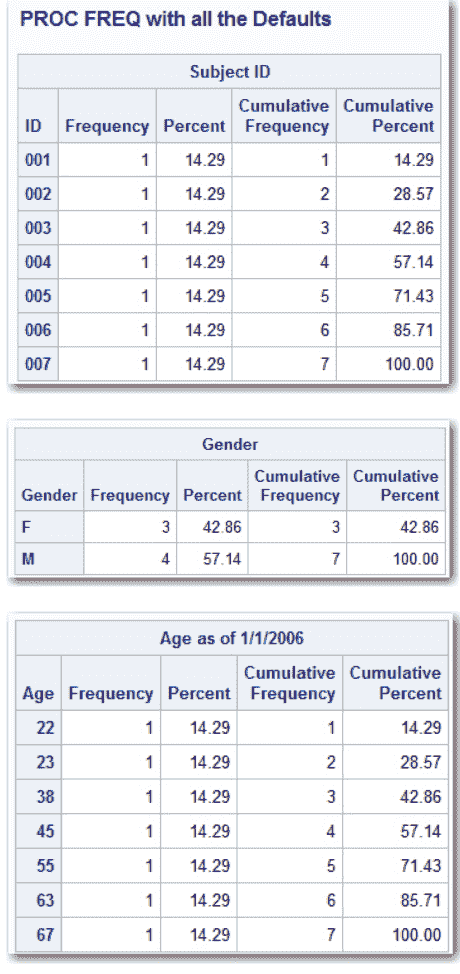

第 17 章：频数计数 283

| Salary | Frequency | Percent | Cumulative Frequency | Cumulative Percent |
|---|---|---|---|---|
| $23,060 | 1 | 14.29 | 1 | 14.29 |
| $28,000 | 1 | 14.29 | 2 | 28.57 |
| $36,500 | 1 | 14.29 | 3 | 42.86 |
| $76,100 | 1 | 14.29 | 4 | 57.14 |
| $76,123 | 1 | 14.29 | 5 | 71.43 |
| $90,000 | 1 | 14.29 | 6 | 85.71 |
| $128,000 | 1 | 14.29 | 7 | 100.00 |

年薪

州长干得好吗？

| Ques1 | Frequency | Percent | Cumulative Frequency | Cumulative Percent |
|---|---|---|---|---|
| 1 | 1 | 14.29 | 1 | 14.29 |
| 2 | 2 | 28.57 | 3 | 42.86 |
| 3 | 1 | 14.29 | 4 | 57.14 |
| 4 | 1 | 14.29 | 5 | 71.43 |
| 5 | 2 | 28.57 | 7 | 100.00 |

房产税应该降低

| Ques2 | Frequency | Percent | Cumulative Frequency | Cumulative Percent |
|---|---|---|---|---|
| 2 | 2 | 28.57 | 2 | 28.57 |
| 3 | 4 | 57.14 | 6 | 85.71 |
| 5 | 1 | 14.29 | 7 | 100.00 |

284 实例教程学习 SAS：程序员指南，第二版

| Ques3 | Frequency | Percent | Cumulative Frequency | Cumulative Percent |
|---|---|---|---|---|
| 1 | 1 | 14.29 | 1 | 14.29 |
| 2 | 3 | 42.86 | 4 | 57.14 |
| 3 | 1 | 14.29 | 5 | 71.43 |


| Ques5 | Frequency | Percent | Cumulative Frequency | Cumulative Percent |
|---|---|---|---|---|
| 1 | 2 | 28.57 | 2 | 28.57 |
| 2 | 1 | 14.29 | 3 | 42.86 |
| 3 | 3 | 42.86 | 6 | 85.71 |
| 4 | 1 | 14.29 | 7 | 100.00 |

花点时间看看 `Gender` 的频数。标记为 `Frequency` 的列告诉你有中有三个女性和四名男性。以百分比表示，分别为 42.86% 和 57.14%。

标记为 `Cumulative Frequency` 和 `Cumulative Percent` 的两列是频数和百分比的累计计数。`PROC FREQ` 计算变量的每个唯一值。例如，如果你查看 `Age` 变量，你会发现许多受试者是 22 岁、23 岁等。你可能更倾向于看到基于年龄组的频数。我们稍后会介绍这一点。

### 17.3 为 PROC FREQ 选择变量

由于你很少对数据集中的每个变量计算频数，因此你需要包含 `TABLES` 语句来列出你想要计算频数的变量。你可能还想消除累计列，因为它们通常不需要。以下程序选择了 `Gender` 和 `Ques1`–`Ques3` 并消除了累计统计量。

程序 17.2：为 `PROC FREQ` 添加 `TABLES` 语句

```
title "Adding a TABLES Statement and the NOCUM Option";
proc freq data=learn.survey;
  tables Gender Ques1-Ques3 / nocum;
```

你使用 `TABLES` 语句（`TABLE` 也可以）列出你想让 `PROC FREQ` 包含的变量。`NOCUM` 是一个 `TABLES` 选项，告诉 `PROC FREQ` 不要包含输出中的两个累计统计列。因为 `NOCUM` 是 `TABLES` 中的选项，它位于斜杠之后（这是过程中所有语句选项的语法）。在此程序中，你获得了 `Gender`、`Ques1`、`Ques2` 和 `Ques3` 四个变量的计数和百分比。以下是输出：

图 17.2：程序 17.2 的输出

第 17 章：频数计数 285

添加 `TABLES` 语句和 `NOCUM` 选项

| Gender | Frequency | Percent |
|---|---|---|
| F | 3 | 42.86 |
| M | 4 | 57.14 |

州长干得好吗？ | | |

| Ques1 | Frequency | Percent |
|---|---|---|
| 1 | 1 | 14.29 |
| 2 | 2 | 28.57 |
| 3 | 1 | 14.29 |
| 4 | 1 | 14.29 |
| 5 | 2 | 28.57 |

房产税应该降低 | | |

| Ques2 | Frequency | Percent |
|---|---|---|
| 2 | 2 | 28.57 |
| 3 | 4 | 57.14 |
| 5 | 1 | 14.29 |

枪应该被禁 | | |

| Ques3 | Frequency | Percent |
|---|---|---|
| 1 | 1 | 14.29 |
| 2 | 3 | 42.86 |
| 3 | 1 | 14.29 |
| 4 | 1 | 14.29 |
| 5 | 1 | 14.29 |

286 实例教程学习 SAS：程序员指南，第二版

顺便说一下，如果你不想让 `PROC FREQ` 计算百分比，可以在 `TABLES` 语句中添加 `NOPERCENT` 选项。

为这些变量添加格式可以大大提高输出的可读性，如下：

图 17.3：程序 17.4 的部分输出

## 添加格式

| 性别 | 频率 | 百比 |
|---|---|---|
| 女性 | 3 | 42.86 |
| 男性 | 4 | 57.14 |

| 州长工作得好吗？ | | |

| Ques1 | 频率 | 百比 |
|---|---|---|
| 强烈不同意 | 1 | 14.29 |
| 不同意 | 2 | 28.57 |
| 中立意见 | 1 | 14.29 |
| 同意 | 1 | 14.29 |
| 强烈同意 | 2 | 28.57 |

财产产税

| 应该禁令枪支 | | |

| Ques3 | 频率 | 百比 |
|---|---|---|
| 强烈不同意 | 1 | 14.29 |
| 不同意 | 3 | 42.86 |
| 中立意见 | 1 | 14.29 |
| 同意 | 1 | 14.29 |
| 强烈同意 | 1 | 14.29 |

注意，格式标签显示在频率表中。

## 288 实例实例 SAS 学习：程序员指南（第二版）

## 17.5 使用格式对值进行分组

由于 `PROC FREQ` 对格式化后的值计算频率，因此你可以使用格式将值分组到更大的类别中。数据集 `Survey` 包含一个 `Age`（年龄）变量。假设你想为年龄生成频率，并分为三组。你还想查看问题 5 (`Ques5`)，将值 1 和 2 合并为“通常不同意”类别，将值 4 和 5 合并为“通常同意”类别。你可以使用格式完成这些任务，如下程序所示：

### 程序 17.4：使用格式对值进行分组

```
proc format;
value AgeGroup
  low-<30 = 'Less than 30'
  30-<60 = '30 to 59'
  60-higher = '60 and higher';

value $Agree_Disagree
  '1','2' = 'Generally disagree'
  '3' = 'No opinion'
  '4','5' = 'Generally agree';

title "Using Formats to Create Groups";
proc freq data=Learn.Survey;
  tables Age Ques5 / nocum;
  format AgeGroup Ques5 $Agree_Disagree;

run;
```

这是一个独特的技巧，因为你不需要创建一个新的数据集。如果你想查看不同组的频率，只需要创建一个新格式。以下是输出结果：

### 图 17.4：程序 17.4 的输出

### 使用格式创建分组

| 截至2006年1月1日的年龄 | |
| 年龄 | 频率 |
| 30岁以下 | 2 |
| 30 到 59 岁 | 3 |
| 60岁及以上 | 2 |

| 学校需要扩大 | |
| Ques5 | 频率 |
| 通常不同意 | 3 |
| 中立意见 | 3 |
| 通常同意 | 1 |

年龄频率现在被分为三个类别，`Ques5` 的李克特量表只有三个类别。

## 17.6 使用 PROC FREQ 对值进行分组时的问题

当 `PROC FREQ` 使用格式化值创建分组时，可能会出现问题。当你使用关键字 `OTHER` 作为范围来创建格式时，所有不匹配格式的值将将被在一起。`PROC FREQ` 将它们所有值分配给该变量中值最低的值。

例如，你有一个包含以下值的数据集 `Grouping`（分组）：

图 17.5：数据集 `Grouping` 的数据值

| Obs | X | Obs | X | Obs | X |
|---|---|---|---|---|---|
| 1 | 2 | 5 | 4 | 9 | 5 |
| 2 | 2 | 6 | 4 | 10 | 5 |
| 3 | 3 | 7 | 4 | 11 | 5 |
| 4 | 3 | 8 | missing | 12 | 6 |

你编写了以下程序：

### 程序 17.5：演示 PROC FREQ 分组值中的问题

```
proc format;
value Two
low-3 = 'Group 1'
4-5 = 'Group 2'
other = 'Other values';
run;
ntitle "Grouping Values (First Try)";
proc freq data=Learn.Grouping;
tables X / nocopercent;
format X Two.;
run;
```

查看数据集 `Grouping` 中的值，你本预期会在 `Group 1` 中看到四个值，在 `Group 2` 中看到六个值，一个 `Other values` 值和一个缺失值。以下是你得到的结果：

图 17.6：程序 17.5 的输出

| X | 频率 |
|---|---|
| Group 1 | 4 |
| Group 2 | 6 |
| Frequency Missing = 2 |

## 290 实例实例 SAS 学习：程序员指南（第二版）

由于缺失值（missing）和值 6 都属于 `OTHER` 类别，它们被分配了两者中较小的值（缺失），导致了此输出。

要修复这个问题，你需要在创建格式时为缺失值分配一个单独的类别，如下例所示：

### 程序 17.6：修复分组问题

```
proc format;
value Two
low-3 = 'Group 1'
4-5   = 'Group 2'
      = 'Missing'
other = 'Other values';

run;
```

现在，缺失值和其他值不再被放在同一个组中。以下是结果：

### 图 17.7：在缺失类别中为缺失值添加标签

| 分组值（添加缺失值类别） | |
| X 频率 |
| Group 1 4 |
| Group 2 6 |


| Other values 1 |

| Frequency Missing = 1 |

通过为缺失值添加单独的标签，值 6（观测值 12）被放置在 `Other values` 类别中。

## 17.7 在频率表中显示缺失值

SAS 通常会在频率表下方的单独列表中列出缺失值的频率。你可以通过包含 `TABLES MISSING` 选项要求 SAS 将缺失值视为任何其他值并将其包含在频率表中。这不仅将缺失值的计数带入频率表，还改变了 SAS 报告百分比的方式。如果没有 `MISSING` 选项，百分比列中的值通常不是你想要的值。为了清晰起见，让我们带上 `MISSING` 运行 `PROC FREQ`：

### 程序 17.7：演示 `MISSING` 选项的影响

```
proc format;
    value Two
    low-3 = 'Group 1'
    4-5 = 'Group 2'
    other = 'Other values';
run;

title "Missing Option Absent";
proc freq data=Learn.Grouping;
    tables X / nocum;
    format X Two.;
run;

title "Missing Option Present";
proc freq data=Learn.Grouping;
    tables X / missing;
    format X Two.;
run;
```

以下是输出：

图 17.8：程序 17.7 的输出

| X | 频率 | 百比 |

|---|---|---|

| Group 1 | 4 | 36.36 |

| Group 2 | 6 | 54.55 |

| Other values | 1 | 9.09 |

| Missing | 1 | 9.09 |

等待，最后的部分的文本似乎乱了。让我根据提供的文本流重构。

## 292 实例实例 SAS 学习：程序员指南（第二版）

## 17.8 修改 `PROC FREQ` 中值的顺序

默认情况下，`PROC FREQ` 根据内部值对值排序（即使变量有格式）。你可以使用 `ORDER=` 选项更改频率列表。`PROC FREQ` 的 `ORDER=` 有效值如下：

| Order= 选项 | 效果 |

|---|---|

| Internal (默认) | 按内部值排序 |

| Formatted | 按格式排序 |

| Freq | 从最高频率到最低频率排序 |

| Data | 根据数据中的顺序排序 |

注意这些选项不会影响缺失值，缺失值总是列在第一个。

为了演示这些选项如何工作，我们从一个包含 1, 2, 3, 4 和缺失值的数据集 `Test` 开始，其频率所示：

| 内部值 | 格式化值 | 频率 |

|---|---|---|

| 1 | Yellow | 2 |

| 2 | Blue | 3 |

| 3 | Red | 4 |

| 4 | Green | 1 |

以下是输出：

# 图 17.9：程序 17.8 的输出

| 颜色 | 频率 |

|---|---|

| 黄色 | 2 |

| 蓝色 | 3 |

| 红色 | 4 |

| 绿色 | 1 |

注意值是根据 `ORDER= Color` 的内部值排序的。

下一个程序演示了其他 `ORDER=` 选项的作用：

# 程序 17.9：演示 `ORDER=` Formatted, Data 和 Freq 选项

```sas
title "ORDER = Formatted";
proc freq data=Test order=formatted;
tables Color / nocum nopercentent;
format Color Colors;
run;

title "ORDER = Data";
proc freq data=Test order=data;
tables Color / nocum nopercentent;
format Color Colors;
run;

title "ORDER = Freq";
proc freq data=test order=freq;
tables Color / nocum nopercentent;
format Color Colors;
run;
```

294 《以实例学习 SAS：程序员指南》，第二版

以下是输出：

图 17.10：程序 17.9 的输出

| ORDER = Formatted | ORDER = Data | ORDER = Freq |

|--- |--- |--- |

| 颜色频率 | 颜色频率 | 颜色频率 |

| 蓝色 3 | 红色 4 | 红色 4 |

| 绿色 1 | 绿色 1 | 蓝色 3 |

| 红色 4 | 黄色 2 | 黄色 2 |

| 黄色 2 | 蓝色 3 | 绿色 3 |

`ORDER=formatted` 根据格式化值对列表进行字母排序。

要理解 `ORDER=data` 选项，请注意数据集 `Test` 中的前四个观测值是 3、4、1 和 2。这个顺序控制了表格中的频率。请记住，如果使用不同的数据或不同的顺序运行程序，`ORDER=data` 生成表格可能会可能会。使用 `ORDER=data` 选项通常不是好主意，因为对不同数据值表现不同的程序不符合良好的编程规范。

最后，`ORDER=freq` 选项从高频率到低频率列出值。当你有大量类别并想查看哪些值最频繁时，最后一个选项特别有用。

# 17.9 生成双列表

你可以通过在 `TABLES` 语句中指定行变量和列变量（用星号 `*` 分隔）来轻松生成双列表（也称为交叉表）。例如，要查看 `Blood` 数据集中按血型划分的性别表格，你可以编写以下代码：

程序 17.10：请求双列表

```sas
title "Two-Way Table of Gender by Blood Type";
proc freq data=Learn.Blood;
tables Gender * BloodType;
run;
```

`Gender` 和 `BloodType` 之间的星号告诉 `PROC FREQ` 你想要一个双列表，其中 `Gender` 形成表格的行，`BloodType` 形成列。

这是：

图 17.11：程序 17.10 的输出

### 按血型划分的性别双列表

| 频率 | 按血型划分的性别表 | | | |

| --- | --- | | |

| 百比 | BloodType(血型) | | |

| 行百分比 | Gender(性别) | A | AB | B | O | 总计 |

| 列百分比 | Female | 178 | 20 | 34 | 208 | 440 |

| | | 17.80 | 2.00 | 3.40 | 44.00 |

| | | 4.55 | 7.73 | 47.27 | |

| | | 43.20 | 35.42 | 46.43 | |

| | Male | 234 | 24 | 62 | 240 | 560 |

| | | 23.40 | 6.20 | 24.00 | 56.00 |

| | | 41.79 | 11.07 | 42.86 | |

| | | 56.80 | 54.55 | 64.58 | 53.57 |

| | 总计 | 412 | 44 | 96 | 448 | 1000 |

| | | 41.20 | 4.40 | 9.60 | 44.80 | 100.00 |

表格的左上角是每个框中四个数字的关键。例如，查看血型为 A 型的女性，第一个数字（频率 = 178）告诉你有 178 名 A 型血女性。第二个数字（17.80）是所有受试者中 A 型血女性占的百分比。框中的第三个数字是行百分比。该单元格中的 40.45 告诉你，在所有女性（构成表格中的一行）中，40.45% 为 A 型血。最后，每个单元格中的第四个数字是列百分比。在同一个单元格中，A 型血受试者的 43.20% 是女性。

# 17.10 请求多个双列表

你可以通过多种方式请求多个双列表。例如，如果你想将一个行变量按几个列变量进行细分，可以使用这样的 `TABLES` 语句：

```sas
tables A * (B C D);
```

该语句生成三个表格：A 被 B、A 被 C 和 A 被 D。你可以像这样在括号中为行变量和列变量都提供变量列表：

```sas
tables (A B) * (C D);
```

此请求生成四个表格：A 被 C、A 被 D、B 被 C 和 B 被 D。记住，你可以使用 SAS 允许的引用一组变量的任何一种简写表示法。回顾一下，你有以下符号：

| 符号 | 结果 |

|---|---|

| Ques1 Ques10 | Ques1, Ques2, ... Ques10 |

| VarA -- VarB | 从 VarA 到 VarB 的所有变量，按它们在 SAS 数据集中出现的顺序排列 |

| Ques: | 所有以 'Ques:' 开头的变量 |

| _numeric_ | SAS 数据集中的所有数值变量 |

| _character_ | SAS 数据集中的所有字符变量 |

| _all_ | SAS 数据集中的所有变量 |

当然，你不能在双列表请求中使用 `_all_`；它是为了完整性被包含在表格中。

# 17.11 生成三列表

你可能会想：“我如何在一张纸上显示三个维度呢？”当你以以下形式请求三列表时，可以做到这一点：

`tables Page * Row * Column;`

SAS 为 `Page` 的每个值使用单独的页面，并在每个页面显示 `Row` 被 `Column` 的表格。除非你在造纸行业有亲戚，否则在提交三列表时应该非常小心，因为输出可能会变得非常大。作为一个示例，程序 17.11 为每个 `Gender` 值的 `AgeGroup` 被 `BloodType` 生成表格。

# 程序 17.11 使用 `PROC FREQ` 请求三列表

```sas
title "Example of Three-Way Table";
proc freq data=learn.Blood;
tables Gender * AgeGroup * BloodType;
run;
```

`NOCOL`、`NOROW` 和 `NOPCENT` 被添加到表格中。它们消除了列百分比、行百分比总百分比。以下是输出：

图 17.12：程序 17.11 的输出

### 按血型划分的性别三列表

| 频率 | 按血型划分的性别表 | | | |

| --- | --- | | |

| 百比 | BloodType(血型) | | |

| 行百分比 | Gender(性别) | A | AB | B | O | 总计 |

| 列百分比 | Female | 178 | 20 | 34 | 208 | 440 |

| | | 17.80 | 2.00 | 3.40 | 44.00 |

| | | 4.55 | 7.73 | 47.27 | |

| | | 43.20 | 35.42 | 46.43 | |

| | Male | 234 | 24 | 62 | 240 | 560 |

| | | 23.40 | 6.20 | 24.00 | 56.00 |

| | | 41.79 | 11.07 | 42.86 | |

| | | 56.80 | 54.55 | 64.58 | 53.57 |

| | 总计 | 412 | 44 | 96 | 448 | 1000 |

| | | 41.20 | 4.40 | 9.60 | 44.80 | 100.00 |

对于如何使用 `PROC FREQ` 创建频率计数的数据集的讨论，请参考第 24 章。

# 17.12 练习

奇数问题的解答位于书末。所有题目的解答对教授开放。如果你是教授，请访问书籍辅助网站 `support.sas.com/cody` 获取解答信息。

- 1. 使用 `Blood` 数据集为 `Gender`、`BloodType` 和 `AgeGroup` 生成单列频率。使用相应的选项省略累计统计和百分比。

- 2. 使用 `BloodPressure` 数据集为 `Age` 变量生成频率。使用自定义格式将年龄分为三类：40 岁及以下、41 至60 岁、61 岁及以上。使用相应的选项省略累计统计和百分比。

- 3. 使用 `Blood` 数据集为 `Chol`（胆固醇）变量生成频率。使用格式将频率分为三组：低至 200（正常）、201 及以上（高）以及缺失。运行两次 `PROC FREQ`，一次使用 `MISSING` 选项，一次不使用。比较列表中的百分比。

- 4. 使用 `Voter` 数据集，按政党对四个问题（`Ques1`–`Ques4`）分别生成双列表。

（请查看第 16 章第 2 题中关于数据集中永久格式的说明。）

- 6. 使用 `College` 数据集，生成性别（页）奖学金（行）按学校规模（列）的三列表。

- 7. 使用 `Blood` 数据集，按频率顺序生成 `BloodType` 的频率表格。

## 第 18 章：创建表格报告

- 18.1 引言 ................................................................................ 299

- 18.2 简单的 `PROC TABULATE` 表格 ............................................................ 300

- 18.3 描述三个 `PROC TABULATE` 操作符 ................................................ 301

- 18.3.1 合并......................................................................................... 301

- 18.3.2 表格维度（页、行和列）............................................................... 302

- 18.3.3 嵌套...................................................................................................... 302

- 18.4 使用关键字 `ALL` ...................................................................... 303

- 18.5 产生描述性统计 ........................................................ 304

- 18.6 在表格中结合 `CLASS` 和分析变量 ................................................ 306

- 18.7 定制您的表格 ....................................................................... 307

- 18.8 演示更复杂的表格....................................................... 309

- 18.9 计算行和列百分比 ................................................... 310

- 18.10 在二维表格中显示百分比 ........................ 312

- 18.11 计算列百分比 ................................................... 313

- 18.12 计算数值变量的百分比......................................... 314

- 18.13 理解缺失值如何影响 `PROC TABULATE` 输出 ...... 315

- 18.14  ...................................................................... 318

### 18.1 引言

`PROC TABULATE` 是一个被低估、低利用的过程，它可以创建各种类型的表格报告，根据一个或多个 `CLASS` 变量显示频率、百分比和描述性统计（如总和和平均值）。有几本关于 `PROC TABULATE` 的优秀书籍。我推荐 E. Haworth 的书籍 *PROC TABULATE By Example* (Cary, NC: SAS Institute Inc., 1999)，这是关于该主题最好、最全面的书籍之一。

本章将向您介绍这个过程，并希望它能激发您的兴趣。

为了演示 `PROC TABULATE` 的许多功能，我们将使用一个名为 `Blood` 的数据集，该数据集包含类型、性别、年龄组、红/白细胞计数以及胆固醇水平的信息。以下是该数据集的前 10 条观测值的列表：

图 18.1：数据集 `Learn.Blood` 的列表（前 10 条观测值）

| Subject | Gender | BloodType | AgeGroup | WBC | RBC | Chol |

|---|---|---|---|---|---|---|

| 1 | Female | AB | Young | 7710 | 7.40 | 258 |

| 2 | Male | AB | Old | 6560 | 4.70 | |

| 3 | Male | A | Young | 5690 | 7.53 | 184 |

| 4 | Male | B | Old | 6680 | 6.85 | |

| 5 | Male | A | Young | | 7.72 | 187 |

| 6 | Male | A | Old | 6140 | 3.69 | 142 |

| 7 | Female | A | Young | 6550 | 4.78 | 290 |

| 8 | Male | O | Old | 5200 | 4.96 | 151 |

| 9 | Male | O | Young | | 5.66 | 311 |


| 10 | Female | O | Young | 7710 | 5.55 | |

## 18.2 简单的 PROC TABULATE 表格

尽管 `PROC TABULATE` 可以创建复杂的表格，但只有三个操作符可以控制表格的外观。让我们从使用所有默认值运行 `PROC TABULATE` 并选择单个 `CLASS` 变量开始，如下：

程序 18.1：带有所有默认值单个 CLASS 变量的 PROC TABULATE

```
title "All Defaults with One CLASS Variable";
proc tabulate data=Learn.Blood;
class Gender;
table Gender;
run;
```

`PROC TABULATE` 使用 `CLASS` 语句，在其中您指定代表类别（通常是字符变量）的变量来计算频率或百分比。在程序 18.1 中，`Gender` 被选为 `CLASS` 变量。`TABLE` 语句指定表格的外观。`TABLE` 语句中列出的任何变量必须列在 `CLASS` 语句或 `VAR` 语句中（稍后将讨论）。以下是输出：

图 18.2：程序 18.1 的输出

### 带有单个 CLASS 变量的所有默认值

| Female | Male |

|---|---|

| N | N |

| 440 | 560 |

在 `TABLE` 语句中列出一个 `CLASS` 变量时，`PROC TABULATE` 计算选中变量每个值的频率。它还将这些频率作为列显示。您可以在这里看到数据集中有 440 个女性和560 个男性。

## 18.3 描述三个 PROC TABULATE 操作符

### 18.3.1 合并

我们使用的第一个操作符是合并（Concatenation）。如果您想在表格中将变量并排，请在变量之间使用空格。为了演示，我们提交以下内容：

程序 18.2：使用 PROC TABULATE 演示合并

```
title "Demonstrating Concatenation";
proc tabulate data=Learn.Blood format=6;
class Gender BloodType;
table Gender BloodType;
run;
```

`TABLE` 语句中 `Gender` 和 `BloodType` 之间的空格代表合并。如果您指定逗号，过程将显示每个单元格的频率。这里是表格：

图 18.3：程序 18.2 的输出

| Gender | BloodType |

|---|---|

| Female | A B O |

| Male | N N N |

| 440 560 | | |

### 18.3.2 表格维度（页、行和列）

`TABLE` 语句控制表格的维度。如果没有逗号，所有变量将作为列显示。如果包含单个逗号，逗号之前的生成行，逗号之后的生成列。为了演示：

程序 18.3：使用 PROC TABULATE 演示维度

```
title "Demonstrating Dimensions";
proc tabulate data=Learn.Blood format=6;
class Gender BloodType;
table Gender,
    BloodType;
run;
```

生成的表格如下：

图 18.4：程序 18.3 的输出

| | BloodType |

|---|---|---|

| Female | A B O |

| Male | A B O |

| 440 560 | | |

### 18.3.3 嵌套

第三个操作符使用星号（`*`）。如果您指定变量 1 * 2，变量 2 将嵌套在变量 1 中。为了演示，这里是将 `BloodType` 嵌套在 `Gender` 中的请求：

程序 18.4：使用 PROC TABULATE 演示嵌套

```
title "Demonstrating Nesting";
proc tabulate data=Learn.Blood format=6;
class Gender BloodType;
table Gender * BloodType;
run;
```

这里是生成的表格：

图 18.5：程序 18.4 的输出

| Gender | BloodType | |

|---|---|---|

| Female | A B O | |

| Male | A B O | |

| 178 20 34 208 | 234 24 62 240 | |

## 18.4 使用关键字 ALL

与其他许多 SAS 过程不同，`PROC TABULATE` 使用了一些保留关键字（这意味着您必须小心不要将任何变量命名为与 `PROC TABULATE` 关键字相同）。其中一个关键字是 `ALL`。当您在表格请求中变量之后放置 `ALL` 时，`PROC TABULATE` 会包含一个代表该变量所有层级的列。为了演示，您可以在程序 18.3 生成的表格的两个维度都添加 `ALL`，如下：

程序 18.5：在表格请求中添加关键字 ALL

```
title "Adding the Keyword ALL to the TABLE Request";
proc tabulate data=Learn.Blood format=6;
class Gender BloodType;
table Gender ALL,
    BloodType ALL;
run;
```

304 实例化的 SAS 学习：程序员指南，第二版

以下是生成的表格：

图 18.6：程序 18.5 的输出

在 TABLE 请求中添加关键字 ALL

| 血型 | All | |

|---|---|

| | A AB B O |

| | N N N N |

| 性别 | | |

| 女性 | 178 20 34 208 440 |

| 男性 | 234 24 62 240 560 |

| 全部 | 412 44 96 448 1000 |

由于 `ALL` 与前一个变量之间存在空格，与 `ALL` 相关的频率将与相应的变量合并。

## 18.5 生成描述性统计数据

`PROC TABULATE` 也可以生成总和和平均值等描述性统计。要指定你想生成描述性统计而不是频率计数，你需要在 `VAR` 语句中列出所有的分析变量（即你想要进行统计分析的变量）。

> 注意：描述性统计可能出现在表格的任何维度，但你只能在表格的单个维度上定义统计。

程序 18.6 计算了 `RBC`（红细胞）和 `WBC`（白细胞）计数的描述性统计数据：

程序 18.6：使用 PROC TABULATE 生成描述性统计数据

```sas
title "Demonstrating Analysis Variables";
proc tabulate data=Learn.Blood;
var RBC WBC;
table RBC WBC;
run;
```

生成的输出如下：

### 图 18.7：程序 18.6 的输出

| RBC | WBC |

| Sum | Sum |

| 5022.91 | 6395020.00 |

`RBC` 和 `WBC` 之间的操作符是空格，分析列被合并了。默认的描述性统计是总和（对于血计数来说，这不是一个非常有用的统计量）。要为每个变量指定一个或多个分析，你可以使用关键字（sum, mean, min, max, std 等）来指定你想要的统计数据，并使用嵌套运算符（星号 `*`）将这些统计数据与变量关联。例如，要为 `RBC` 和 `WBC` 指定平均值而不是总和，你可以使用程序 18.7 中的代码。

### 程序 18.7：使用 PROC TABULATE 在分析变量上指定统计数据

```sas
title "Specifying Statistics";
proc tabulate data=Learn.Blood;
var WBC;
table RBC*mean WBC=mean;
run;
```

为了节省输入时间，你也可以像这样写 `TABLE` 语句：

```sas
table (RBC WBC)*mean;
```

无论哪种方式，你现在都有了一个显示平均（平均）血计数的表格：

### 图 18.8：程序 18.7 的输出

| RBC | WBC |

| Mean | Mean |

| 5.48 | 7042.97 |

输出现在显示的是而不是默认的总和统计。你也可以为每个变量指定多个统计数据。例如，如果你想获得血计数的平均值、最小值和最大值，你可以编写程序 18.8：

### 程序 18.8：使用 PROC TABULATE 指定多一个描述性统计数据

```sas
title "Specifying More than One Statistic";
proc tabulate data=Learn.Blood format=comma9.2;
var RBC WBC;
table (RBC WBC) * (mean min max);
run;
```

现在每个两个变量都列出了每个统计数据，如下所示：

### 图 18.9：程序 18.8 的输出

指定多一个统计数据

| RBC | | WBC |

| Mean Min Max | Min Max |

| 5.48 1.71 8.75 | 4.07.00 10.5500 |

此程序使用 `PROC TABULATE` 选项 `FORMAT=COMMA9.2` 来提高输出的可读性。现在你有了 `RBC` 和 `WBC` 计数的平均值、最小值和最大值，每个值都以 9.2 数值格式显示。

## 18.6 在表格中结合 CLASS 变量和分析变量

如果你想按一个或多个 `CLASS` 变量（如性别或血型）查看 `RBC` 和 `WBC` 的平均值怎么办？你可以将频率和描述性统计合并在单个表格中。这就是一些人抱怨 `PROC TABULATE` 很难使用的原因所在。实际上，问题更有可能是用户在开始编写 `TABULATE` 语句之前没有决定表格应该什么样。安排表格以使列不跨页划分（这使得阅读非常困难）也需要一些练习。

下一个程序是请求按性别（`Gender`）和年龄组（`AgeGroup`）细分的平均 `RBC`、`WBC` 和 `Chol`（胆固醇）。

### 程序 18.9：在表格中结合 CLASS 变量和分析变量

```sas
title "Combining CLASS and Analysis Variables";
proc tabulate data=Learn.Blood;
class Gender AgeGroup;
var RBC WBC Chol;
table (RBC WBC Chol)*mean by=Gender*AgeGroup;
run;
```

此程序按 `Gender` 和 `AgeGroup` 细分 `RBC`、`WBC` 和 `Chol` 的平均值。`RBC` 和 `WBC` 的平均值显示在表格中：

### 图 18.10：程序 18.9 的输出

结合 CLASS 和分析变量

| | | WBC | Chol |

|---|---|---|---|

| Gender | Mean | Mean | Mean |

| Female | 5.48 | 7042.97 | 195 |

| | Male | 5.53 | 7112 | 202 |

| AgeGroup | | | | |

| 20-29 | 5.46 | 7039.54 | 198 |

| 30-39 | 5.47 | 7061.66 | 201 |

| 40-49 | 5.52 | 7088.09 | 207 |

| 50+ | 5.50 | 7047.55 | 203 |

# 310 实例实例学习 SAS：程序员指南，第二版

选择这些选项是为了使列标题或标签不会在行之间拆分，而不是为了显示特定值而选择最优值。以下是该程序生成的紧凑表格：

图 18.14：程序 18.13 的输出

| | | RBC N 平均 | WBC N 平均 | 胆固 N 平均 |

|---|---|---|---|---|---|---|

| 女性 | 老年 | 242 | 5.5 | 7,106 | 208 | 195.9 |

| | | 年轻 | 167 | 5.5 | 7,121 | 141 | 212.3 |

| | | 总计 | 409 | 5.5 | 7,112 | 349 | 202.5 |

| 男性 | 老年 | 309 | 5.4 | 6,939 | 279 | 199.1 |

| | | 年轻 | 198 | 5.5 | 7,062 | 167 | 203.1 |

| | | 总计 | 507 | 5.5 | 6,988 | 446 | 200.6 |

| 总计 | 老年 | 551 | 5.5 | 7,012 | 487 | 197.7 |

| | | 年轻 | 365 | 5.5 | 7,089 | 308 | 207.3 |

| | | 总计 | 916 | 5.5 | 7,043 | 795 | 201.4 |

## 18.9 计算行列百分比

统计量 `PCTN` 与 `CLASS` 变量配合用于计算百分比。程序 18.14 展示了如何使用该统计量。该程序在一维表格中计算四种血型各的数量和百分比。

程序 18.14：在一维表格中计算百分比

```
title "Counts and Percentages";
proc tabulate data=Learn.Blood format=6;
class BloodType;
table BloodType*(n pctn);
run;
```

输出结果虽然不太漂亮，但格式如下：

### 图 18.15：程序 18.14 的输出

# 计数与百分比

| 血型 | | | | | | |

|---|---|---|---|---|---|

| A | AB | O | | | |

| N | Pctn | N | Pctn | N | Pctn |

| 412 | 41 | 4 | 96 | 10 | 448 | 45 |

Pct 数字的总和为 100%。

是时候改进这个表格的外观了。让我们添加一个 `ALL` 列，重命名 `N` 和 `Pctn`，并在百分比数字后加上百分号。如下：

程序 18.15：改进程序 18.14 输出的外观

```
proc format;
  picture pctfmt low-high='009.9%%';
run;

title "Counts and Percentages";
proc tabulate data=Learn.Blood;
class BloodType;
table(BloodType ALL)*(n*f=5. pctn*f=pctfmt7.1);
  keylabel n = 'Count'
  pctn = 'Percent';
run;
```

此程序中进行了几项改进。通过 `PROC FORMAT` 创建了用户定义的图片格式。这允许在小数点前显示最多三位数字，并打印最右侧的数字（即使它为 0）。格式中的 0 是占位符；9 也是占位符，但会在必要时打印前导 0。图片格式中的百分号按原样打印。您可以在 SAS 帮助中心 http://go.documentation.sas.com 了解更多关于图片格式的信息。

为 `N` (5) 和 `Pctn` (Pctfmt.1) 分别创建了单独格式。最后，使用 `KEYLABEL` 语句将 `N` 和 `Pct` 分别重命名为 Count 和 Percent。顺便提一下，百分比值的 7 位格式宽度是由百分比列标题选定的。以下是表格：

### 图 18.16：程序 18.15 的输出

# 计数与百分比

| 血型 | | | | | | | | |

|---|---|---|---|---|---|---|---|---|

| A | AB | B | O | | | | |

| Count Percent Count Percent Count Percent Count Percent |

| 412 | 41.2% | 44 | 4.4% | 96 | 9.6% | 448 | 44.8% | 1000 | 100.0% |

312 实例实例学习 SAS：程序员指南，第二版

## 18.10 在二维表格中显示百分比

这里情况变得复杂了。让我们创建一个按性别（行）和血型（列）分类的表格并请求 `N` 和 `PCTN`，如下所示：

程序 18.16：二维表格中的计数与百分比

```
proc format;
    picture pctfmt low-high='009.9%%';
run;

title "Counts and Percentages in a Two-way Table";
proc tabulate data=Learn.Blood;
class Gender BloodType;
table (BloodType ALL)*
      (Gender ALL*n=f5. pctn*f=pctfmt7.1)/rows=25;
keylabel ALL='Both Genders'
      n = 'Count'
      pctn = 'Percent';
run;
```

`TABLE` 选项 `RTS=25` 增加了行标题空间（行标题所在的空间）。在表格中，从最左侧线到“Female”之前的线有 25 个空格。以下是输出：

程序 18.17：程序 18.16 的输出

# 二维表格中的计数与百分比


此表中的百分比值代表单元格中受试者（例如，A 型血女性）占所有受试者的百分比。因此，A 型血的女性人数（178）代表了 17.8%。这意味着拥有 A 型血的女性人数（178）代表了总人数（1000）的 17.8%。假设让百分比代表每个性别内的血型分布。

18.11 列百分比

如果你想表格包含列百分比，需要修改 18.16。为了实现这一点，另一种方法是提供分母。Haworth 的书中在介绍中讨论了分母定义。另一种方法是使用 `COLPN`。具体来说，18.17 使用 `COLPN` 来计算列百分比。

18.17：使用 COLPN 计算列百分比


```
title "Percents on the Column"
proc tabulate data=Learn.Blood;
class BloodType;
table (BloodType ALL)*
      (Gender ALL)*n=f5. pctn*f=pctfmt7.1);
```

性别 `N` 和 `PCTN` 关键字用于的百分是是列百分比。18.17 在表格中显示列百分比。将 A 型血的女性人数（178）除以总人数（1000）得到 40.4%。图片格式中的百分号按原样打印。您可以在 SAS Help Center 了解更多关于图片格式的信息。以下是表格：

图 18.18：程序 17 的输出

| 血型 | | 性别 | | |

|---|---|---|---|---|

| | | 女性 | 男性 | 所有性别 |

| | | 计数 | 百分比 | 计数 | 百分比 | 计数 | 百分比 |

| A | 178 | 40.4% | 234 | 59.6% | 412 | 100.0% |

| AB | 20 | 4.5% | 24 | 55.5% | 44 | 100.0% |

| B | 34 | 7.7% | 62 | 92.3% | 96 | 100.0% |

| O | 208 | 47.2% | 240 | 52.8% | 448 | 100.0% |

行百分比是通过 `ROWPCTN` 关键字而不是 `COLPCTN` 请求的。

314 实例实例学习 SAS：程序员指南，第二版

### 18.12 计算数值的百分比

`PROC TABATE` 中还有另一种百分比计算类型——你可以计算 `SUM` 统计量的百分比。例如，数据集 包含 `Region` 和 `TotalSales` 变量。如果你想查看每个区域对总销售的贡献，可以使用 `PCTSUM` 统计量。如果你将 `PCTSUM` 放在 `Region` 和 `TotalSales` 维度，可以使用 `PCTSUM` 查看区域销售占总销售额的百分比。以下是程序：

程序 18.18：数值的百分比计算

```
title "Computing Percentages on a Numerical Value";
proc tabulate data=Learn.Sales;
class Region;
var TotalSales;
table (Region ALL) *=n*f=6. sum*f=?;
pctsum*;

  keylabel ALL = 'All Regions'
n = 'Number of Sales'
sum = 'Sum'
pctsum = 'Percent'
label TotalSales = 'Total Sales';
run;
```

如果你在表格的两个维度上使用 `CLASS` 变量，可以使用 `COLPCTSUM` 和 `ROWPCTSUM` 这两个关键字，就像在前节讨论 `COLPCTN` 和 `ROWPCTN` 一样。在表中，Percent 列代表每个区域的 `TotalSales` 之和除以所有区域的 `TotalSales` 之和。

图 18.19：程序 18 的输出

# 数值的百分比计算

| Total Sales | | | | | |

|---|---|---|---|---|---|

| Number of Sales | Sum | Percent | | | |

| Region | | | | | |

| East | 4 | $41,593 | 44.8% | | | |

| North | 5 | $36,825 | 39.7% | | | |

| South | 4 | $12,003 | 12.9% | | | |

| West | 2 | $2,290 | 2.4% | | | |

| All Regions | 15 | $92,710 | 100.0% | | | |

### 18.13 理解缺失值如何影响 PROC TABULATE 输出

虽然这是本章的最后一个主题，但它非常重要。

**注意：** 如果 `CLASS` 语句中列出的一个或多个变量具有缺失值，则任何包含一个或多个缺失值的观测都将从表中排除！

即使对于列在 `CLASS` 语句中但在 `TABLE` 语句中未引用的变量，情况也是如此。

为了帮助理解其工作原理（以及稍后查看如何修复它），请查看小型数据集（Missing）：

**图 18.20：** 数据集 Missing 的列表

| A | B | C |

|---|---|---|

| X | Y | Z |

| X | Y | Y |

| Z | Z | Z |

| X | | |

| Y | Z | | |

| X | | |

现在，看看当你请求一些简单的表格时会发生什么：

**程序 18.10：** 缺失值对 CLASS 变量的影响

```sas
title "The Effect of Missing Values on CLASS variables";
proc tabulate data=Learn.Missing format=4;
class A B;
table A ALL, B ALL;
run;
```

**图 18.21：** 程序 18.19 的输出

# 缺失值对 CLASS变量的影响

| B | All |

|---|---|---|

| X Y Z | | |

| N N N | | |

| A | | |

| X | 1 2 | |

| Y | | 1 |

| Z | | 1 |

| All | 1 2 | 5 |

注意，尽管数据集中有六个观测值，但表格中显示的总数为五个。现在，如果将变量 `C` 包含在 `CLASS` 语句中（如下），会发生什么：

**程序 18.20：** 未在表格使用的 CLASS 变量上的缺失值

```sas
"The Effect of Missing Values on CLASS variables"
proc tabulate data=Learn.Missing format=4;
  class A B C;
table A ALL, B ALL;
run;
```

这是该表格：

**图 18.22：** 程序 18.20 的输出

# 缺失值对 CLASS变量的影响

| B | All |

|---|---|---|

| X Y Z | | |

| N N N | | |

| A | | |

| X | 2 | 2 |

| Z | | 1 |

| All | 2 1 | 3 |

注意，观测值的总数现在是三个，尽管变量 `C` 未被用于生成表格。`PROC TABULATE` 根据 `CLASS` 语句中列出的任何变量的任何缺失值来选择从表中排除的观测值。

让我们重新运行程序 18.19，但包含过程选项 `MISSING`，如下：

**程序 18.21：** 添加 PROC TABULATE 过程选项 MISSING

```sas
title "The Effect of Missing Values on CLASS variables";
proc tabulate data=Learn.Missing format=4. missing;
class A B;
table A ALL,B ALL;
run;
```

`MISSING` 选项将缺失值作为一类包含在表格中。请看：

**图 18.23：** 程序 18.21 的输出

# 缺失值对 CLASS变量的影响

| | | B | All |

|---|---|---|---|

| | X Y Z | | |

| A | | N N N | | |

| X | | 1 1 2 | 4 |

| Y | | | | 1 |

| Z | | | 1 | 1 |

| All | 1 1 2 2 | 6 |

注意，变量 `B` 现在有一个代表缺失值的列，表格中的观测值总数为六。

顺便说一下，如果你希望在表格中使用代表缺失值以外的其他内容，可以使用 TABLES 选项 `MISSTEXT=` 来替换任何你想要的文本。例如：

**程序 18.22：** 演示 MISSTEXT TABLES 选项

```sas
title "Demonstrating the MISSTEXT TABLES Option";
proc tabulate data=Learn.Missing format=7. missing;
class A B;
table A ALL,B ALL / misstext='No Data';
run;
```

现在，每个包含缺失值的单元格中显示的 No Data 代替了点。

注意：格式宽度增加到 7 以容纳文本。

这是列表输出：

**图 18.24：** 程序 18.22 的输出

| | B | All |

|---|---|---|---|---|

| | X | Y | Z |

| | N | N | N |

| A | | | | |

| X | 1 | 1 | 2 No Data 4 |

| Y | No Data No Data No Data | 1 1 |

| Z | No Data No Data No Data | 1 1 |

| All | 1 | 1 | 2 6 |

我们希望这段对 `PROC TABULATE` 的介绍能让你有勇气尝试这个有用且强大的过程。作者长期以来对 `TABULATE` {恐惧症，直到被迫在一个需要美观表格的项目中使用它。现在，他试图让其他人也使用这个过程。

## 18.4 问题

奇数题的解答位于书末。书中提供了所有题目的解答。如果你是专业人士，请访问书籍的配套网站 `support.sas.com` 获取解答。除了第 10 题外，所有题目都使用 SAS 数据集（见第 5 章），该数据集具有 `Gender`、`SchoolSize` 和 `Scholarship` 的永久格式。

```sas
proc format;
value$Yes '1' = 'Yes'
      '0' = 'No'
      '' = 'Not Given';
value$Size 'S' = 'Small'
      'M' = 'Medium'
      'L' = 'Large';
value$Gender 'F' = 'Female'
      'M' = 'Male';
      '' =;
run;
```

对于每个问题，你需要编写适当 `TABULATE` 语句来生成表格。

- 1. 生成以下表格。注意表格中的最后一行代表所有对象。

| Demographics from Data Set | | |

|---|---|---|

| SchoolSize | | |

| Gender | Large |

| F | 10 23 26 |

| M | 8 11 |

| Scholarship | | |

| No | 16 32 |

| Yes | 5 5 |

| All | 18 41 37 |

- 2. 生成以下表格。注意 ALL 列已重命名。

| Demographics from Data Set | | | |

|---|---|---|---|

| Gender Total |

| SchoolSize | F M Yes |

| Large | 10 8 16 | 2 |

| Medium | 23 18 36 | 5 |

| Small | 26 11 32 | 5 |

| Total | 59 37 84 | 12 |

- 3. 生成以下表格。注意 ALL 列已重命名且 Gender 已通过格式化。

| Demographics from Data Set | | | | |

|---|---|---|---|---|

| SchoolSize | Large | Medium | Small | Total |

| Gender | | | | |

| Female | No | 9 | 19 | 22 | 50 |

| | Yes | 1 | 4 | 9 |

| | Total | 10 | 23 | 26 | 59 |

| Male | | | | |

| | No | 7 | 10 | 34 |

| | Yes | 1 | 1 | 3 |

| | Total | 8 | 18 | 11 | 37 |

| Total | | | | | |

| | No | 16 | 32 | 84 |

| | Yes | 2 | 5 | 5 | 12 |

| | Total | 18 | 41 | 37 | 96 |

- 4. 生成以下表格。注意关键字 ALL 已重命名为 Total，Gender 已格式化，且 ClassRank（连续数值变量）被分为两组（0–70 和 71 及以上）。

| Demographics from Data Set | | | | | |

|---|---|---|---|---|---|

| ClassRank | | | | | |

| Low to 70 | 71 and higher | | | | |

| Gender | Total | Gender | Total | | |

| Female | Male | Female | Male | | |

| Scholarship | | | | | |

| No | 20 | 15 | 35 | 23 | 19 | 42 |

| Yes | 4 | | 4 | 5 | 2 | 7 |

| Total | 24 | 15 | 39 | 28 | 21 | 49 |

- 5. 生成以下表格。注意关键字 ALL, N, MIN 和 MAX 均已重命名。

| | Gender | Total |

|---|---|---|---|

| GPA Number | F M | 56 | 38 | 94 |

| Average | 3.5 | 3.5 | 3.5 |

| Minimum | 2.3 | 2.4 | 2.3 |

| Maximum | 4.0 | 4.0 | 4.0 |

- 6. 生成以下表格。注意关键字 ALL, N 和 MEAN 均已重命名。

| | Gender | Total |

|---|---|---|---|

| GPA Number | F M | 56 | 38 | 94 |

| Average | 3.5 | 3.5 | 3.5 |

| Class Rank Number | 52 | 36 | 88 |

| Average | 71.3 | 72.3 | 71.7 |

- 7. 生成以下表格。注意关键字 MIN 和 MAX 已已重命名且两个变量 ClassRank 和 SchoolSize 现在有了标签。

| | | | | | | | | |

|---|---|---|---|---|---|---|---|

| School Size | Median Minimum Maximum | Median Minimum Maximum |

| Large | 3.6 | 3.0 | 4.0 | 71 | 45 | 98 |

| Medium | 3.7 | 2.4 | 4.0 | 71 | 42 | 100 |

| Small | 3.4 | 2.3 | 4.0 | 79 | 41 | 99 |

| Total | 3.6 | 2.3 | 4.0 | 73 | 41 | 100 |

8. 生成下表。注意，关键字 `ROWPCTN` 已重命名为 `Percent`，且 `Gender` 已通过格式化。

## 显示行百分比

| | Scholarship | | All |

|---|---|---|---|

| Gender | No | Yes | Percent |

| Female | Percent | 83 | 17 | 100 |

| Male | 93 | 8 | 100 |

| All | 87 | 13 | 100 |

9. 生成下表。注意 `ALL` 列已重命名为 `Total`，`COLPCTN` 已重命名为 `Percent`，`Gender` 已通过格式化，且列顺序为 `Yes` 后于 `No`。提示：考虑使用过程选项 `ORDER=data` 并想办法将带有 `Yes` 值的数据集置于带有 `No` 值之前。

## 显示列百分比

| | Scholarship | | Total |

|---|---|---|---|

| | Yes | No | Percent |

| Gender | Percent | Percent | |

| Female | 77 | 57 | 60 |

| Male | 23 | 43 | 40 |

| Total | 100 | 100 | 100 |

10. 使用 SAS 数据集 `Sales` 生成此处所示的表格。变量 `TotalSales` 已标记为 `Total Sales`。表中显示的百分比代表占总销售数量和总销售额的百分比。

| | Quantity | Total Sales |

| --- | --- | --- |

| Region | Percent of Total | Percent of Total |

| East | 35 | 45 |

| North | 3 | 40 |

| South | 10 | 13 |

| West | 52 | 2 |

| All | 100 | 100 |

## 第 19 章：输出交付系统 (ODS)

- **19.1 引言........................................................................................... 325**

- **19.2 将 SAS 输出发送到 HTML 文件............................................................... 325**

- **19.3 创建目录...................................................................... 327**


## 19.4 选择不同的 HTML 样式

尽管你可以自定义 HTML 输出的每个部分，但这需要花费时间和精力。有很多内置样式可以在你不操作的情况下更改输出外观。默认样式是 `HTMLBLUE`。

如果你在窗口环境中，选择样式列表的方法是选择工具 ► 选项，然后选择标签。你会看到许多可以选择的内置样式。例如，如果你想要黑白输出，可以选择类似这样的 `Journal` 样式：

### 程序 19.3：为 HTML 输出选择样式

```sas
ods html path = 'c:\books\learning'
             file = 'Journal_Example.html'
             style=Journal;

title "Listing of Test_Scores";
proc print data=Learn.Test_Scores;
    id
    var Name-Score3;
run;
ods html close;
```

结果输出如下：

图 19.3：使用 Journal 样式输出

| ID | Score1 | Score2 | Score3 |
|---|---|---|---|
| 1 | 90 | 95 | 98 |
| 2 | 78 | 77 | 75 |
| 3 | 88 | 91 | 92 |

这种样式不包含任何阴影，正如名称所示，适用于期刊风格表格。

## 19.5 选择其他 ODS 目标

你可以创建 RTF（富文本格式）或 PDF（便携文档格式）文件，它们像 HTML 输出一样可以使用 Adobe Reader 读取。只需将程序 19.1 语句中的 `HTML` 替换为 `RTF` 或 `PDF`，并将文件扩展名分别更改为 `.rtf` 或 `.pdf`。

除了提供更好的外观外，使用 RTF 或 PDF 还允许用户无需在机器上安装 SAS 字体即可查看格式良好的 SAS 输出。RTF 是一种相当通用的格式，可以直接合并到 Microsoft Office 文档中。

## 19.6 选择或排除 ODS 输出的部分

可以在 SAS 之前使用 `ODS SELECT` 或 `ODS EXCLUDE` 语句来控制你想要的输出部分。

假设你想使用 `PROC UNIVARIATE` 列出变量的最高和最低五个值。这是 `PROC UNIVARIATE` 输出的正常部分，但你还会获得几页额外的输出。程序 19.4 使用 `ODS SELECT` 语句来限制输出。

### 程序 19.4：使用 ODS SELECT 语句限制 PROC UNIVARIATE 的输出

```sas
ods select extremeobs;

title "Extreme Values of RBC";
proc Univariate data=Learn.Blood;
  id Subject;
  var RBC;
run;
```

当你运行此程序时，唯一的输出如下：

### 程序 19.5：来自程序 19.4 的输出

RBC 极值

| 变量: RBC | |
|---|---|
| 极值观测值 | |
| 值 个体 观测值 | 值 个体 观测值 | | | |
|---|---|---|---|---|---|
| 1.71 | 525 | 525 | 7.99 | 565 | 565 |
| 2.33 | 440 | 440 | 8.12 | 984 | 984 |
| 2.55 | 113 | 113 | 8.26 | 288 | 288 |
| 2.92 | 293 | 293 | 8.43 | 726 | 726 |
| 3.13 | 635 | 635 | 8.75 | 135 | 135 |

这看起来足够简单，但你如何确定输出对象的名称（在此例中为 `EXTREMEOBS`）？一种方法是在 `ODS TRACE ON` 和 `ODS TRACE OFF` 语句之间运行该过程，如下所示：

### 程序 19.5：使用 ODS TRACE 语句识别输出对象

```sas
ods trace on;

title "Extreme Values of RBC";
proc Univariate data=Learn.Blood;
  id Subject;
  var RBC;
run;
```

当你运行该过程时，输出对象的名称出现在 SAS 日志中。

确定输出对象与输出部分之间对应关系的一种方法，是查看输出列表和 SAS 日志中的对象列表并进行合理的推断。

要采用更系统化的方法，请查看 SAS 窗口环境中的结果（Results）窗口，并注意列表中的标签。

下面是在右键点击 Extreme Observation 并选择 Preferences（偏好）后的截图：

图 19.8：Extreme Obs 的属性*

| 属性 (Attribute) | 值 (Value) |
|---|---|
| 类型 (Type) | Folder |
| 名称 (Name) | ExtremeObs |
| 说明 (Description) | Extreme Observations |
| 路径 (Path) | Univariate1.RBC#1.ExtremeObs#1 |
| 创建 (Created) | 11/26/2017 1:58 PM |

你可以看到此输出对象的名称是 `ExtremeObs`。

除了在 `ODS SELECT` 语句中使用名称，你还可以通过标签而不是名称来选择对象。例如，你可以使用：

```sas
ods select "Extreme Observations";
```

代替此语句：

```sas
ods select ExtremeObs;
```

如果你使用标签，请将其放在单引号或双引号中。

你可以在 `ODS SELECT` 语句后包含一个输出对象列表（用空格隔开）。如果你想选择特定过程的大部分输出对象，使用 `ODS EXCLUDE` 语句来排除你不需要的可能会更简单。

记住，`ODS SELECT` 或 `EXCLUDE` 语句仅对其后的过程起作用。如果你想让选择继续适用于其他过程，可以使用 `PERSIST` 选项，如下：

```sas
ods select ExtremeObs(persist);
```

## 19.7 将输出发送到 SAS 数据集

ODS 输出的可能目标之一是 SAS 数据集。ODS 的此功能允许你捕获过程计算的几乎任何值，并将其用于进一步的计算或自定义报告。

许多过程已经提供了通过 `OUT` 选项在 SAS 数据集中捕获信息的能力，通常在 `OUTPUT` 语句中。使用 ODS 捕获输出更为通用——它允许你捕获任何想要的值。

### 19.6：使用 ODS 将输出发送到 SAS 数据集

```sas
ods listing close;
ods output tests=T_Test_Data;
proc test data=Learn.Blood;
class Gender;
var RBC;
run;
```

第一个程序关闭列表，以便输出不会发送到输出窗口。注意：你不能对允许的过程使用 `PRINT` 选项。如果这样做，值将无法发送到其他 ODS 目标。接下来，使用 `OUTPUT` 语句将输出发送到数据集。等号左侧的关键字是 `PROC TEST` 生成的数据对象名称。等号之后是你想要创建的数据集名称。然后按照通常的方式运行过程。第一次这样做，你应该运行 `PROC PRINT` 来确定输出数据集的结构。

图 19.9：程序 19.6 的输出

T_Test_Data 列表

| 观测值 (Obs) | 变量 (Variable) | 方法 (Method) | 方差 (Variance) | 自由度 (DF) | 概率 (Prob) |
|---|---|---|---|---|---|
| 1 | RBC | Pooled | Equal | 0.41 | 914 | 0.6797 |
| 2 | RBC | Satterwaite | Unequal | 0.41 | 874 | 0.6796 |
| 3 | WBC | Pooled | Equal | 1.87 | 906 | 0.0624 |
| 4 | WBC | Satterwaite | Unequal | 1.87 | 864 | 0.0622 |

## 19.1 引言

输出交付系统（简称 ODS）允许你将 SAS 输出发送到各种目标，例如 HTML、PDF、RTF 和 SAS 数据集。

你不仅可以将 SAS 输出发送到所有这些格式，而且如果你足够勇敢，还可以自定义输出的字体、颜色、大小和布局。最后，你现在可以将几乎每一部分 SAS 输出都捕获到 SAS 数据集中以进行进一步处理。

## 19.2 将 SAS 输出发送到 HTML 文件

从 SAS 9.3 开始，SAS 输出的默认 ODS 目标是 HTML。如果你不需要在文件中查看输出，则不需要提交任何 ODS 语句，除非你想将过程输出捕获到 SAS 数据集中。

例如，假设你想将 `PROC PRINT` 和 `PROC MEANS` 的输出发送到 HTML 文件。只需要两个 SAS 语句即可实现，如下所示：

### 程序 19.1：将 SAS 输出发送到 HTML 文件

```sas
ods htmlpath='C:\books\learning\nfile='Sample.html';
title "Listing of Test_Scores";
proc print data=Learn.Test_Scores -
title2 "Sample of HTML Output - all defaults";
id;
var Score-Score3;
run;

title "Descriptive Statistics";
proc means data=Learn.Test_Scores nmiss min mean max maxdec=2;
var Score-Score3;
run;
```

只需要在你想要捕获输出的过程之前放置一个 `ODS HTML` 语句，并在结尾放置一个 `ODS HTML CLOSE` 语句。你在 HTML 语句上指定 `PATH=` 和 `FILE=` 选项。SAS 不需要 `.html` 扩展名（在某些环境下为 `.ht`），但它允许操作系统识别该文件包含 HTML 标签并用相应的浏览器打开它。

## 19.3 创建目录

如果 HTML 输出很大，可以选择与普通 输出一起生成目录。记住，HTML 主要用于浏览器查看而非打印。目录嵌入了指向输出每个部分的链接，允许用户点击直接跳转到不同部分。创建目录需要指定三个文件：

- 一个包含过程输出的主文件 (body)
- 一个目录文件 (contents)
- 一个用于显示的框架文件 (frame)

### 程序 19.2：为 HTML 输出创建目录

```sas
ods body = 'Body_Sample.html'
contents = 'Contents_Sample.html'
frame = 'Frame_Sample.html'
path = 'c:\books\learning';
title "Using ODS to Create Contents"
proc print data=Learn.Test_Scores n mean max
id;
var Name-Score3;
run;
title "Descriptive Statistics"
proc means data=Learn.Test_Scores n mean max
var Score-Score3;
run;
ods close;
```

这四个关键字是 `BODY=`、`CONTENTS=`、`FRAME=` 和 `PATH=`。你可以命名任何名称——名称不需要包含 body、contents 或 frame。例如，如果你从这些文件创建网页，则需要提供 FRAME 文件。


| 5 | Chol | Pooled | Equal | 0.53 | 793 | 0.5953 |

| 6 | Chol | Satterwaite | Unequal | 0.54 | 771 | 0.5918 |

这些输出数据集的结构可能是复杂的。在这种情况下，你知道 `PROC TEST` 在等方差假设产生产生 t 值，在异方差假设下产生另一个。用这些数据做什么？

将计算值发送到数据集允许你对它们进行额外的分析。此外，你可能希望以不同于 SAS 呈现的方式查看过程的输出。例如，假设你想看到一个显示 t 检验 t 值和 p 值的简单报告，而不是 `PROC TEST` 复杂的输出。一旦知道了 ODS 创建的数据集的结构，可以这样操作：

### 程序 19.7：使用输出数据集创建简化报告

```sas
title "T-Test Results - Using Equal Variance Method";
proc report data=t_Test_Data;
  where Variance = "Equal";
  columns Variable tValue ProbT / width=8;
  define tValue / display "T-Value" width=7 format=7.2;
  define ProbT / display "P-Value" width=7 format=7.5;
run;
```

检查数据集 `T_Test_Data` 显示两个方差假设分开观测值。可以使用 `WHERE` 语句使用等方差假设选择统计数据。`PROC REPORT` 的结果是显示变量以及 t 值和 p 值的简单列表。在这里：

第 19 章：介绍输出交付系统 335

图 19.10：程序 19.7 的输出

# t 检验结果 – 使用等方差方法

| 变量 (Variable) | t 值 (T-Value) | p 值 (P-Value) |

|---|---|---|

| RBC | 0.41 | 0.67972 |

| WBC | 1.87 | 0.06237 |

| Chol | 0.53 | 0.59529 |

这一章仅仅接触了输出交付系统的边界。然而，通过将输出路由到 HTML 或 PDF 文件等目标或使用 `ODS SELECT` 语句，你可以为网页或公司报告创建输出，它们看起来比标准的列表报告要专业得多。

### 19.8 练习

奇数问题的解答位于书末。所有问题的解答均供教授提供。如果你是教授，请访问书籍的配套网站 `support.sas.com/cody` 获取有关获取所有问题解答的信息。

1. 运行以下程序，将输出发送到 HTML 文件。请参见第 16 章问题 2 中关于为此数据集创建格式的说明。

```sas
ods html file="myoutput.html";
title "Sending Output to an HTML File";
proc print data=Learn.College(obs=8) noobs;
run;
proc means data=learn.college n mean maxdec=2;
var GPA ClassRank;
run;
```

2. 运行问题 1 中所示的两个过程，但创建一个内容文件、主体文件和一个帧文件。

3. 运行问题 1 所示的两个过程，使用 `JOURNAL`（或 `FANCYPRINTER`）样式而不是默认样式。

4. 将 `Survey` 数据集的 `PROC PRINT` 结果发送到 RTF 文件。

5. 运行 `ON/TRACE OFF` 语句以显示此过程创建的输出对象的名称。一旦完成，再次运行 `PROC UNIVARIATE`，仅选择显示分数的输出对象。

6. 运行问题 5 中相同的 `PROC UNIVARIATE`。发布两个 `ODS` 语句：一个选择 `MOMENTS` 输出，另一个将此输出发送到 SAS 数据集。运行 `PROC PRINT` 查看此数据集的列表。

# 第20章：创建图表和图形

- 20.1 引言............................................................................... 337
- 20.2 创建条形图............................................................................... 337
- 20.3 显示响应变量的统计数据.................................................. 340
- 20.4 创建散点图...................................................................................... 341
- 20.5 在图中添加回归线和置信极限 ................ 342
- 20.6 生成时间序列图............................................................... 343
- 20.7 描述生成平滑曲线的两种方法.................................. 345
- 20.8 生成直方图.............................................................................. 346
- 20.9 生成简单的箱线图.................................................................. 347
- 20.10 生成分组变量箱线图....................................... 348
- 20.11 展示叠加和透明度.............................................. 349
- 20.12 习题........................................................................................... 351

本书的第一版中，本章专注于 SAS/GRAPH 过程，如 `PROC GCHART` 和 `PROC GPLOT`。虽然 SAS/GRAPH 仍然可用，但你可以使用 `PROC SGPLOT` 更轻松地创建图表和图形（SG 代表“统计图形”——尽管作者认为它应该代表 SAS Graphics）。与需要单独许可证的 SAS/GRAPH 不同，`PROC SGPLOT` 包含在 Base SAS 中。

其他 SG 过程 `SGSCATTER`、`SGPANEL` 和 `SGRENDER` 也包含在 Base SAS 中，但 `PROC SGPLOT` 就足够你使用了了。

## 20.2 创建条形图

假设你想查看 `Blood` 数据集中四种血型的频率。如果你熟悉旧的 `PROC CHART` 过程或 SAS/GRAPH 的 `PROC GCHART` 过程，你将发现它们与 `PROC SGPLOT` 具有某些相似之处。以下是一个使用 `PROC SGPLOT` 创建血型垂直条形图的程序：

### 程序 20.1：创建垂直条形图

```sas
title "Vertical Bar Chart Example";
proc sgplot data=Learn.Blood;
vbar BloodType;
run;
```

你使用 `VBAR` 语句（代表“垂直条形”）后跟分类变量。以下是该条形图：

#### 图 20.1：程序 20.1 的输出

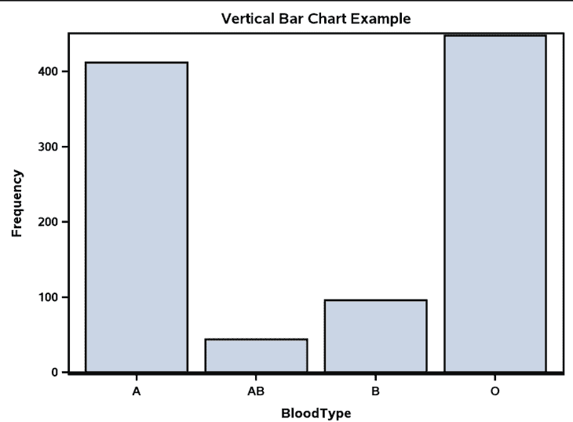

在这个条形图中，条形的高度代表频率计数。要创建水平条形图，请如下一个程序所示，用 `HBAR` 语句替换 `VBAR`：

### 程序 20.2：创建水平条形图

```sas
title "Horizontal Bar Chart Example";
proc sgplot data=Learn.Blood;
hbar BloodType / nofill barwidth=.25;
run;
```

除了改变条形的方向外，该程序还包含了两个适用于垂直和水平条形图的选项。第一个选项 `NOFILL` 会生成条形轮廓。如果你计划使用激光打印机或喷墨打印机打印你的图表，这将节省碳粉（或墨水）。该程序中使用的第二个选项 `BARWIDTH` 允许你控制条形的宽度。你选择的值是最大默认条形宽度的比例。以下是输出：

#### 图 20.2：程序 20.2 的输出

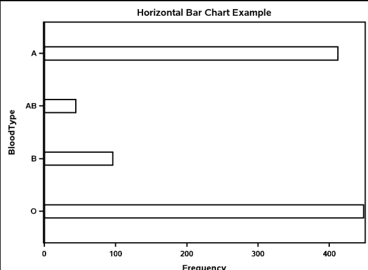

你可以通过在第二个变量的每个级别上显示一个变量的分布来创建更复杂的条形图。这是通过向 `VBAR` 或 `HBAR` 语句添加 `GROUP=` 选项实现的。假设你想查看男性和女性血型的频率。下面的程序正是这样做的：

#### 程序 20.3：垂直条形图示例（两个变量）

```sas
title "Vertical Bar Chart Example (two variables)";
proc sgplot data=Learn.Blood;
vbar Gender / group=BloodType;
run;
```

因为 `GROUP=` 是 `VBAR` 语句的一个选项，因此它在斜杠（/）之后输入。输出所示：

**图 20.3：程序 20.3 的输出**

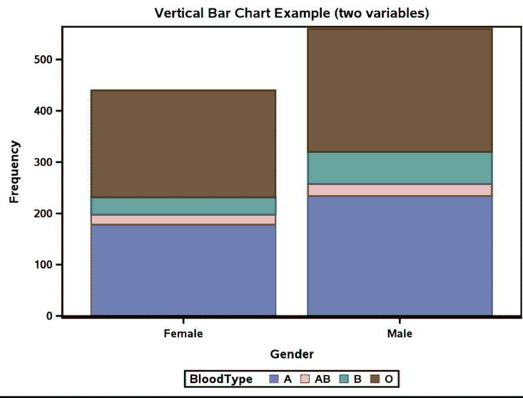

女性和男性的血型分布似乎是类似的。如果你希望并排显示组，请在 `GROUP=Bloodtype` 之后添加 `GROUPDISPLAY=CLUSTER` 选项。

## 20.3 显示响应变量的统计数据

相同的绘图语句 `VBAR` 和 `HBAR` 可用于显示分类变量每个级别的平均值或总和。每个条形的高度不再代表频率，而是代表响应变量的平均值或总和。通过在 `VBAR` 或 `HBAR` 语句中包含 `RESPONSE=` 选项来实现这一点。在示例中，你想查看每种血型的平均胆固醇水平。

### 程序 20.4：显示响应变量的垂直条形图

```sas
title "Vertical Bar Chart Displaying a Response Variable";
proc sgplot data=Learn.Blood;
vbar BloodType / response=mean barwidth=.5;
run;
```

因为 `RESPONSE=` 是 `VBAR` 语句的一个选项，所以它在斜杠（/）之后输入。输出所示：

**图 20.4：程序 20.4 的输出**

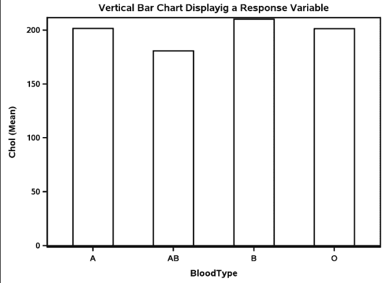

在这个条形图中，条形的高度代表每个血型的平均胆固醇水平。注意，如果没有 `RESPONSE=` 选项，条形的高度将代表频率计数。

## 20.4 创建散点图

散点图允许你直观地查看两个变量之间的关系。此示例使用了名为 `SASHELP` 的数据集。使用 `SCATTER` 语句结合 `X=` 和 `Y=` 选项来指定位于坐标轴上的变量。`PROC SGPLOT` 生成的每个图都是叠加的——也就是说，每个图都出现在同一个图中。下面的程序绘制了花瓣：

### 程序 20.5：简单散点图

```sas
title "Simple Scatter Plot";
proc sgplot data=SASHelp;
scatter x=PetalWidth y=PetalLength;
run;
```

**图 20.5：程序 20.5 的输出**

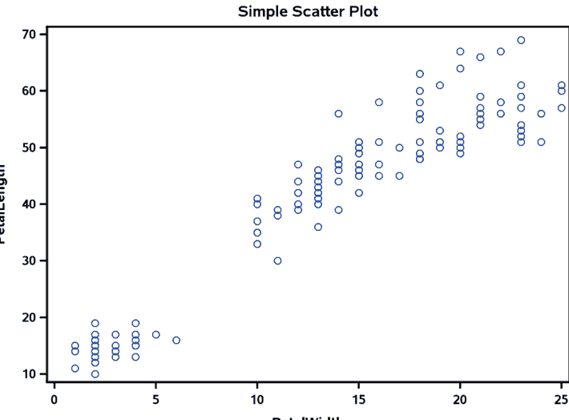

对此图的检查会让你得出结论：花瓣宽度和长度之间存在联系。

## 20.5 在图中添加回归线和置信极限

通过用 `REG` 语句替换程序 20.5 中的 `SCATTER` 语句，你可以在图中包含回归线。两个选项 `CLM` 和 `CLI` 为图添加了两种置信极限。`CLM`（平均值的置信极限）显示了特定 X 值的 95% 置信极限。`CLI`（单个点的置信极限）显示了你有数据的单个数据的范围。

### 程序 20.6：带有回归线和置信区间的散点图

```sas
title "Scatter Plot with a Regression Line and Confidence Intervals";
proc sgplot data=SASHelp;
reg x=PetalWidth y=PetalLength / CLM CLI;
run;
```

**图 20.6：程序 20.6 的输出**

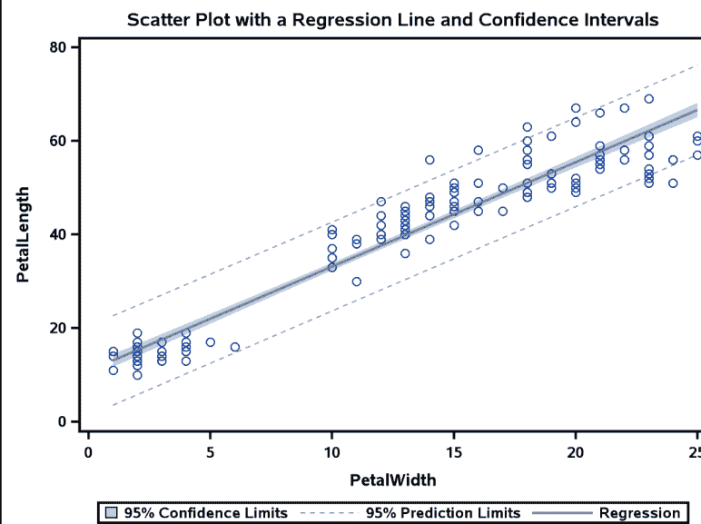

## 20.6 生成时间序列图

此示例从一个简短的 `DATA` 步开始创建一个移动平均值。两个函数 `LAG` 和 `LAG2` 返回前一天和前两天的股价，然后平均这三个值（当前价格和前两天的价格）。使用 `SERIES` 语句结合 `X=` 和 `Y=` 选项来指定图的 X 和 Y 变量。`PROC SGPLOT` 生成的每个图都是叠加的——也就是说，每个图都出现在同一个图中。在本章的后半部分，你会看到如果一个图覆盖了之前的一个图，可以设置透明度值。在这种情况下，重叠并不是问题。

# 344 实例实例学习 SAS：程序员指南，第二版

# 程序 20.7：时间序列图

```sas
data Moving_Average;
  set Learn.Stocks;
  Previous = lag(Price);
  Two_Back = lag2(Price);
  if n ge 3 then Moving=mean(Price, Previous, Two_Back);
run;

title "Series Plot";
proc sgplot data=Moving_Average;
  series x=Date y=Price;
  series x=Date y=Moving;
run;
```

价格与日期的对比图从 2017 年 1 月 1 日开始——移动平均线图从第 3 天开始。

以下是输出结果：

# 图 20.7：程序 20.7 的输出

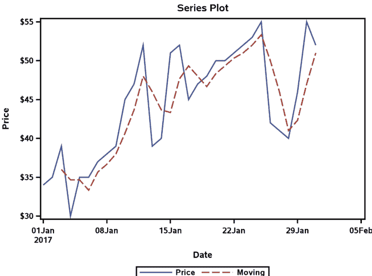

你可以看到，使用移动平均可以平滑掉每日的一些波动。

第 20 章：创建图表和图形 345

## 20.7 说明生成平滑曲线的两种方法

除了通过直线连接数据点的功能外，`PROC SGPLOT` 还提供了两种非线性曲线拟合方法。这两种方法都使用局部回归模型生成平滑曲线。

第一种方法使用局部点拟合曲线的部分。为了控制平滑曲线跟随数据点的紧密程度，请在 `PBSPLINE` 中指定 `SMOOTH=` 数值选项。

## 20.8：平滑曲线 - 样条

```sas
title "Smooth Curve - Splines"
proc sgplot data=SASHelp.Iris;
  bspline x=PetalWidth y=PetalLength;
run;
```

你使用 `PBSPLINE` 语句，并使用所需的选项 `X` 和 `Y` 指定两个坐标轴上的变量。此程序使用了鸢尾花花瓣数据（见第 20.4 节），并在散点图中添加了一条平滑线，如下所示：

图 20.8：程序 20.8 的输出

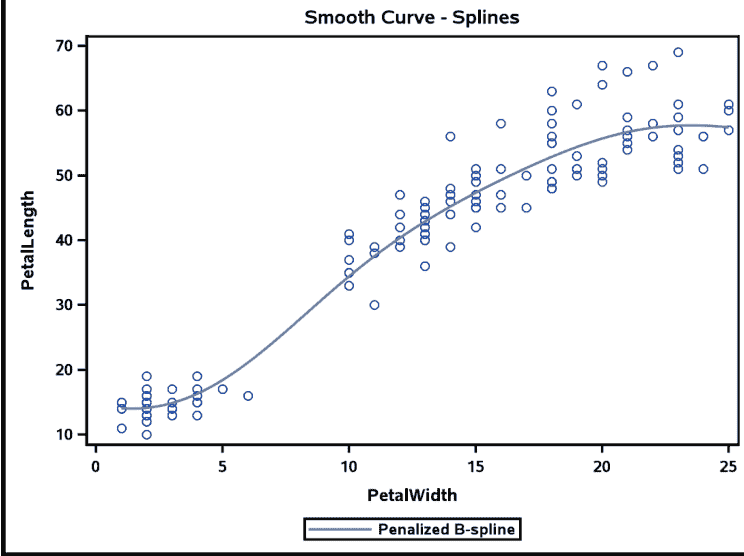

如前所述，你可以通过 `PBSPLINE` 语句中的选项来控制“抖动”的程度。

346 实例学习 SAS：程序员指南，第二版

下一种平滑方法称为 `LOESS` 方法。虽然这不是一个精确的缩写，但该方法的多数文档代表“局部回归”（Local Regression）。接下来显示的程序使用了与程序 20.8 相同的鸢尾花数据，但使用了 `LOESS` 方法代替了 `PBSPLINE`。

# 程序 20.9：平滑曲线 - LOESS 方法

```sas
title "Smooth Curve - LOESS Method"
proc sgplot data=SASHelp.Iris;
loess x=PetalWidth y=PetalLength;
run;
```

此程序生成了下面的图表：

图 20.9：程序 20.9 的输出

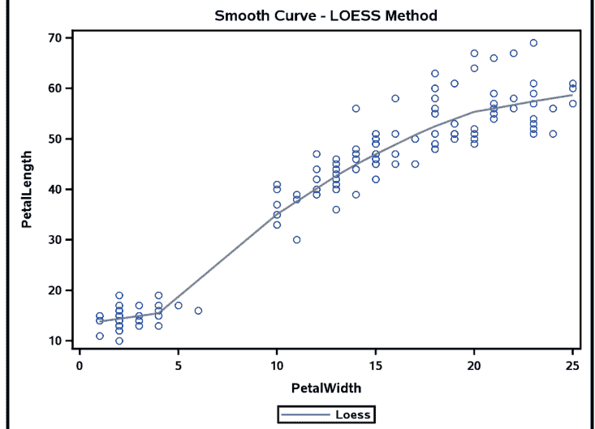

与 `PBSPLINE` 一一样，你可以为 `LOESS` 语句添加选项，以控制线条跟随数据点的紧密程度。

## 20.8 生成直方图

如果你想查看变量的直方图，请使用 `HISTOGRAM` 语句后跟响应变量。该程序为 `Learn` 数据集中变量 `RBC`（红细胞计数）生成直方图。此外，带有响应变量的 `DENSITY` 语句会在直方图上叠加一条正态曲线。默认正态密度的替代方案是核密度（`KERNEL` density）。你可以通过 `TYPE=KERNEL` 选项生成核密度曲线。以下是带有默认正态密度曲线的程序：

第 20 章：创建图表和图形 347

# 程序 20.10：叠加正态曲线的直方图

```sas
title "Histogram with a Normal Curve Overlaid"
proc sgplot data=Learn.Blood;
histogram RBC;
density RBC;
```

输出显示了直方图和叠加的正态密度曲线。你可以包含选项来控制图中箱（bins）的数量或大小。你使用 `BINWITH=` 选项选择箱宽——`NBINS=` 选项允许你指定直方图中箱的数量。

# 图 20.10：程序 20.10 的输出

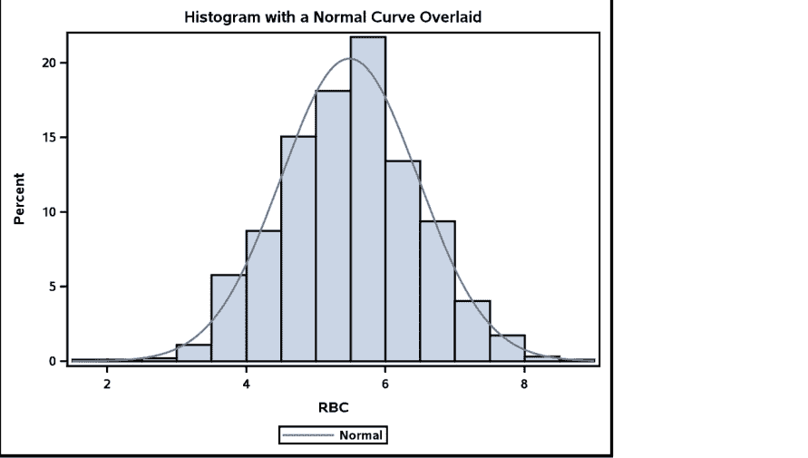

此图表是在没有任何选项的情况下生成的。也有用于 x 轴和 y 轴外观的选项。

## 20.9 生成简单的箱线图

箱线图（也称为箱须图）是统计学中一个称为探索性数据分析（EDA）的领域常用的技术。该图显示了重要值，如中位数、第一分位数和第三分位数，以及被称为离群值的数据点。


为了演示箱线图，下面的程序为 `Blood` 数据集中的变量 `RBC` 生成箱线图。如果你想要水平图表，请使用 `HBOX` 语句；如果你偏好垂直图表，请使用 `VBOX` 语句。

348 实例学习 SAS：程序员指南，第二版

# 程序 20.11：简单箱线图

```sas
title "Simple Box Plot"
proc sgplot data=Learn.Blood;
hbox RBC;
```

这是输出结果：

图 20.11：输出


箱内的垂直线代表中位数，从两侧延伸的线分别代表第一分位数和第三分位数。箱外的菱形点代表四分位距。

## 20.10 生成分组箱线图

若要为每个分组值生成箱线图，请在 `HBOX` 或 `VBOX` 语句中使用 `GROUP=` 选项。下面的程序生成了如下：

# 程序 20.12：分组箱线图

```sas
title "Box Plot with Grouping Variable"
proc sgplot data=Learn.Blood;
hbox RBC / group=Blood;
```

此程序生成了这里的图表：

图 20.12：

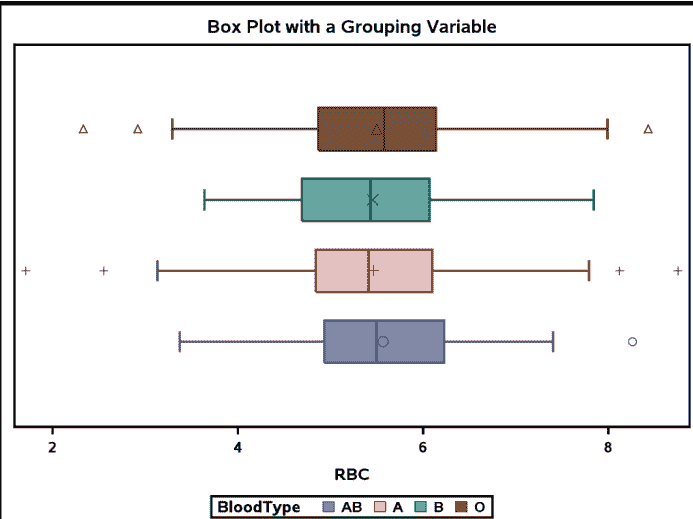

## 20.11 展示叠加与透明度

如前所述，`PROC SGPLOT` 的每个图都是叠加的。你可以使用关键字设置任何图的透明度。

# 程序 20.13：展示叠加与透明度

```sas
title "Demonstrating Overlays and Transparency"
proc sgplot data=SASHelp.Iris;
vbar Species / Response=PetalWidth width=.8;
vbar Species / Response=PetalLength width=.3 transparency=.2;
run;
```

这是输出结果：

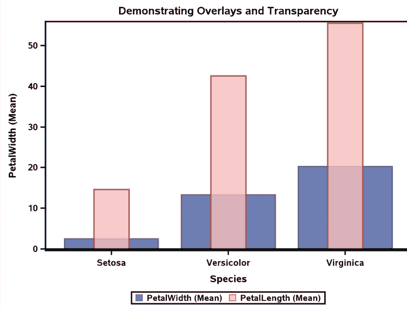

本章仅接触了 `PROC SGPLOT` 的基础。SAS 网上有几本书籍和大量的文档讨论了该过程。对于那些使用 `SASGRAPH` 生成图表和图形的人来说，你会发现使用 `PROC SGPLOT` 要简单得多。

## 20.12 练习

奇数题解答位于书末。所有题目的解答向教授提供。如果你是教授，请访问书籍配套网站 `support.sas.com` 获取有关获取所有题目解答的信息。

- 使用 `SASHelp` 数据集，为变量 `Status` 生成频率条形图。其显示如下：

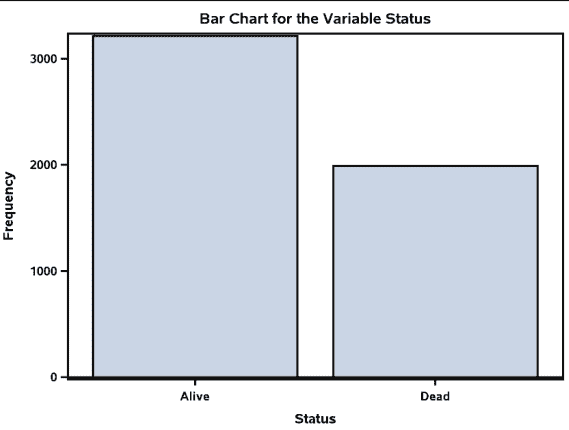

- 使用 `SASHelp` 数据集，为男性和女性生成平均 `Cholesterol` 的条形图。变量名为 `Cholesterol` 和 `Sex`。其显示如下：

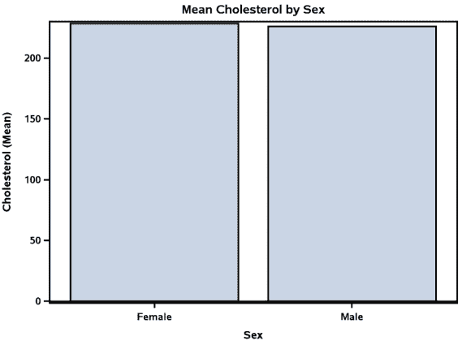

- 使用 `SASHelp` 数据集，为男性和女性生成平均 `Height` 的水平条形图。使用选项使条形不填充（仅轮廓）并使条形大小为最大值的 25%。其显示如下：

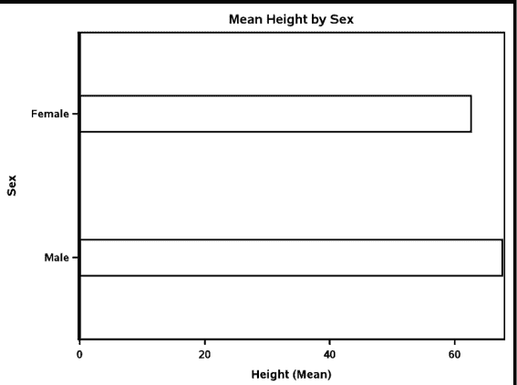

- 使用 `SASHelp` 数据集，生成一个 x 轴为 `Height`、y 轴为 `Weight` 的散点图。其显示如下：

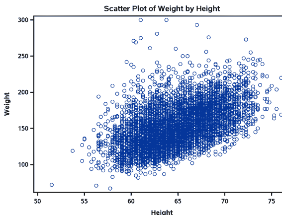

5. 使用 `SASHelp` 数据集 `Heart`，创建一个以 `Height`（身高）为 x轴、`Weight`（体重）为 y轴的散点图。包含回归线和两种置信区间。

## 带有回归线和置信区间的散点图

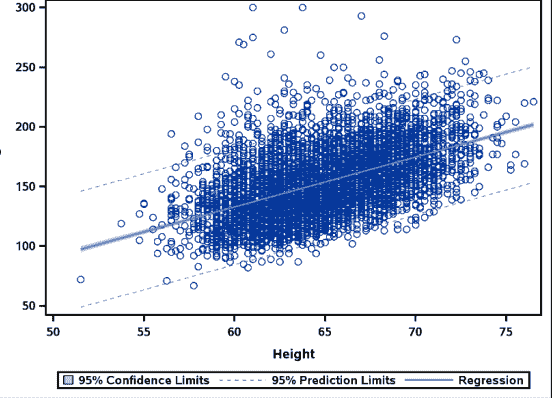

6. 从 `SASHelp` 数据集 `Sales` 开始创建一个临时 SAS 数据集（命名为 `Sales`），通过使用 `Month`、`Day` 和 `Year` 变量包含一个（命名为 `Date`）的 SAS 日期变量（记住使用 `MDY` 函数）。注意，原始的 `SASHelp` 数据集也包含一个 `Date` 变量，但它不是 SAS 日期格式。在从 `SASHelp` 数据集导入数据时，可以使用 `SET` 语句中的 `DROP=` 选项来删除原始的 `Date` 变量。接下来，生成一个以 `Date` 为 x轴、`Sales` 为 y轴的时间序列图。它看起来应该像这样：

## 按日期的销售额序列图

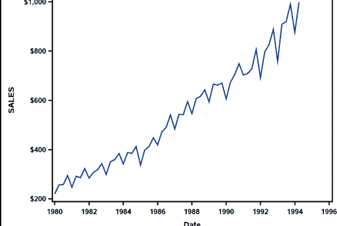

7. 使用 `SASHelp` 数据集 `Health` 的前100 条观测值（记住数据集选项 `OBS=`），使用 `PROC BPLINE` 技术绘制以 `Height` 为 x轴、`Weight` 为 y轴的图，并在图中包含一条平滑曲线。它看起来应该像这样：

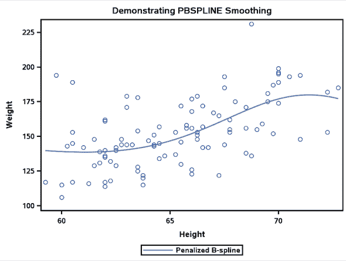

8. 重复问题7，但使用 `LOESS` 方法生成平滑曲线。你的输出应该像这样：

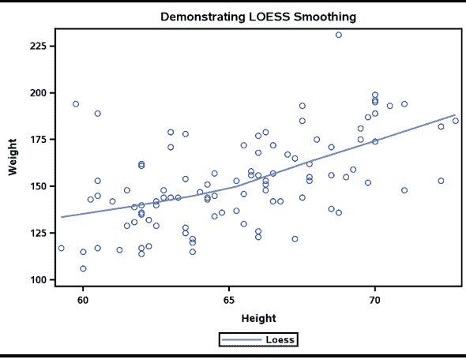

9. 使用 `SASHelp` 数据集为变量 `Cholesterol`（胆固醇）生成一个直方图。它看起来应该像这样：

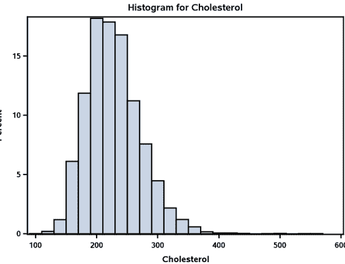

10. 重复问题9，但在直方图的基础上添加一条正态曲线。它看起来应该像这样：

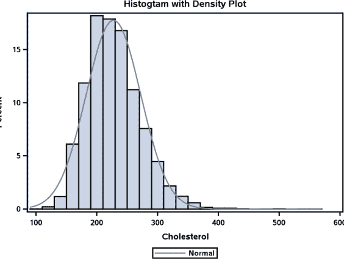

11. 使用 `SASHelp` 数据集 `Heart`，生成两个水平箱线图，显示男性和女性（变量 `Sex`）的 `Cholesterol` 分布。你的图表应该像这样：

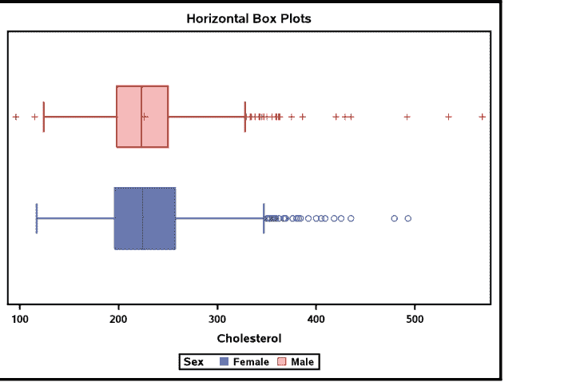

12. 使用 `SASHelp` 数据集 `Heart`，生成一个显示男性和女性平均身高的图。在同一张图上显示男性和女性的平均体重。对于后者，将透明度设置为 `.2`，并将条形宽度设置为总宽度的 25%。你的图表应该像这样：

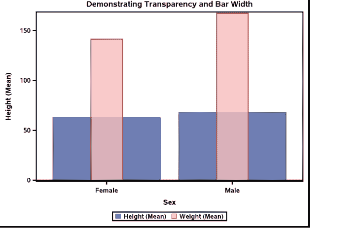

# 第4部分：高级主题

- 第21章：使用高级 `INPUT` 技术
- 第22章：使用用户定义格式和信息数据的高级功能
- 第23章：重构 SAS 数据集
- 第24章：处理每个主体的多个观测值
- 第25章：介绍 SAS 宏语言
- 第26章：介绍结构化查询语言 (`SQL`)
- 第27章：介绍 Perl 正则表达式

## 第21章：使用高级 INPUT 技术

- **21.1 简介** ............................................................................................ 359
- **21.2 处理行尾的缺失值** ............................................... 360
- **21.3 读取短数据行** ............................................................................... 362
- **21.4 读取行超过 32,767 字符的外部文件** ......... 363
- **21.5 检测文件末尾** .................................................................... 364
- **21.6 读取原始数据文件的部分** ................................................................. 365
- **21.7 从多个文件读取数据** ............................................................ 366
- **21.8 使用 FILENAME 语句从多个文件读取数据** ................ 366
- **21.9 从数据文件中读取外部文件名** ........................................ 366
- **21.10 读取多行数据以创建一个观测值** ................... 367
- **21.11 条件读取数据（单个末尾 @ 符号）** ........................ 369
- **21.12 单个末尾 @ 符号的更多示例** ............................................ 370
- **21.13 创建多个观测值** ........................................................ 372
- **21.14 使用列列表** ................................................................................ 373
- **21.15 使用指针读取复杂数据** ................................................. 374
- **21.16 练习题** ............................................................................ 375

### 21.1 简介

上一章涵盖了输入的基础知识。本章将讨论更高级的输入。

### 21.2 处理行尾的缺失值

假设你有一个数据文件，某些行包含的值比你预期的少。例如，查看文件 `Missing.txt`：

```
1 2 3
4 5
6 9 10 11
```

如果你使用以下 SAS 代码：

```sas
data Missing;
  infile 'Missing.txt';
  x y z;
run;
```

你会在 SAS 日志发现异常。第二行只有两个值（4 和 5），但程序预期 `x`、`y`、`z` 有三个值。日志中会显示：

`NOTE: SAS went to a new line when INPUT statement reached the end of a line.`

这意味着 SAS 移动到下一行寻找 `z` 的值，导致 `x=4, y=5, z=6`。

要修复这个问题，你可以使用 `MISSOVER` 选项：

```sas
data Missing;
  infile 'Missing.txt' missover;
  x y z;
run;
```

使用 `MISSOVER` 时，如果行结束时尚未分配所有变量，SAS 将将剩余的变量（`z`）设置为缺失值。

## 21.3 读取短数据行

请查看以下文件 `Short.txt`：

```
1         2         3
123456789012345678901234567890

001Josua Tyson     100 97 95
002Helen Ames      87 85
003Shouen Lu       98 98 92
004Pam Mann       100 100 99
```

这些数据行代表一个科目编号（第 1–3 列）、一个名称（第 4–19 列）和三个分数（20–22 列、23–25 列和 26–28 列）。需要注意的是，第 2 行包含一条短记录，且它没有用空格填充（也就是说，输入数据的人在输入 85 之后按了回车键）。让我们看看在 Windows 或 UNIX 平台上使用列输入或格式化输入读取此文件会发生什么（此类扁平文件在大型机帧中是经过填充的）。以下是实现该内容的程序：

### 程序 21.3：读取带有短记录的数据文件

```sas
data Short;
infile 'C:\books\learning\Short.txt';
input Subject $ 1-3
       Name      $ 4-19
       Quiz1         20-22
       Quiz2         23-25
       Quiz3         26-28;

run;
```

现在看 `PROC PRINT` 的列表输出：

图 21.4：数据集 `Short` 的列表

### 数据集 Short 的列表

| Subject | Name | Quiz1 | Quiz2 | Quiz3 |

|---|---|---|---|---|

| 001 | Josua Tyson | 100 | 97 | 95 |

| 002 | Helen Ames | 87 | 85 | 3 |

| 004 | Pam Mann | 100 | 100 | 99 |

再次，你看到哪里出问题了——问题非常严重。读取了四条记录，但数据集中只有三个观测值。更糟糕的是，科目 002 的 `Quiz3` 分数是 3。

尽管 `INPUT` 语句指示 SAS 读取第 26–28 列的 `Quiz3` 值，当它无法读取第二条记录中的列时，它跳转到了下一行。然后它将第 3 行的科目编号作为考试分数。随后 SAS 将指针移动到下一条记录并正确读取了科目 4 的数据。防止这种情况发生的一种方法是在 `INFILE` 语句中使用 `PAD` 选项。该选项用空格填充每条输入记录，直到逻辑记录的末尾。在 Windows 和 UNIX 平台上，默认的逻辑记录长度（缩写 `LRECL`）为 32,767。你稍将看到如何更改此长度。

### 程序 21.4：演示 INFILE PAD 选项

```sas
data Short;
infile 'C:\books\Learning\Short.txt' pad;
input Subject $ 1-3
       Name $ 4-19
       Quiz1 20-22
       Quiz2 23-25
       Quiz3 26-28;
run;
```

运行此程序后，通过查看下方的数据集列表，你可以看到短记录不再引起问题：

### 图 21.5：数据集 Short 的列表（带有 INFILE 选项 选项）

### 数据集 Short 的列表

| Subject | Name | Quiz1 | Quiz2 | Quiz3 |

|---|---|---|---|---|

| 001 | Josua Tyson | 100 | 97 | 95 |

| 002 | Helen Ames | 87 | 85 | |

| 003 | ShouEn Lu | 98 | 98 | 92 |

| 004 | Pam Mann | 100 | 100 | 99 |

现在数据集中有了正确的值。每当你需要使用列输入或格式化输入读取文件时，使用 `PAD` 选项都是好主意。

可以使用 `TRUNCOVER` 选项代替 `PAD`。它具有 `PAD` 和 `MISSOVER` 选项结合的效果，在读取变长记录时，它是 `INFILE` 选项的一个很好的选择。

## 21.4 读取长度超过 32,767 字符的外部文件

由于 Windows 和 UNIX 系统上的默认逻辑记录长度为 32,767 字节，你需要使用 `INFILE` 选项 `LRECL` 来指定大于此值的记录长度。

假设有一个数据文件 (`Long.txt`)，其中每行包含 50,000 字节。为了读取此文件，你需要这样指定记录长度：

```sas
infile 'Long.txt' lrecl=50000;
```

如果你结合 `PAD` 选项使用 `LRECL=`（代表逻辑记录长度），所有记录都将被填充为你为 `LRECL` 指定任何长度。

## 21.5 检测文件末尾

有时你希望从文件中读取记录并在到达文件末尾时执行某些计算。实现此点的一种方法是使用 `INFILE` 语句中的 `END=` 选项。这是一个示例：你有一个包含每月销售额的文件 `Month.txt`。以下是该文件的列表输出：

```
Jan 2000
Feb 3000
Mar 2500
Apr 2600
May 1200
Jun 2300
Jul 1000
Aug 2300
Sep 1500
Oct 1900
Sep 2600
Nov 4000
Dec 1200
```

你想读取此文件并打印年度总计。方法如下：

### 程序 21.5：在 INFILE 语句中演示 END= 选项

```sas
title "Demonating the INFILE Option END=";
data _null;
file;
infile 'C:\books\Learning\Month.txt' end=Last;
input @1 Month $3.
@5 MonthTotal 4;
YearTotal + MonthTotal;
if last then put "Total for the year is " YearTotal;
run;
```

如果需要变量，请参考第 4 章。`END=` 选项变量在读取外部文件的最后记录之前为假 (0)，读取后为真 (1)。你可以使用该变量来控制程序的动作。在程序 21.5 中，你正在读取每月数值并使用 `SUM` 语句求和。当你读取外部文件的最后记录时，`Last` 变量变为真，`PUT` 语句执行，输出“Total for the year is”以及年度总计。（因为使用了 `FILE` 语句，这被打印到了输出设备。）这里是截图：

图 21.6：程序 21.5 的输出

| Demonstrating the INFILE Option END= |

|---|

| Total for the year is |

注意：`END=` 也是一个选项，用于判断何时读取了数据的最后一个观测值。

## 21.6 读取部分文件


`INFILE` 选项 `OBS=` 和 `FIRSTTOBS=` 允许你读取文件的部分内容。如果你指定 `OBS=n` 为 `INFILE` 选项，SAS 在读取第 n 行数据后停止。如果包含 `FIRSTTOBS=n` `INFILE` 选项，SAS 从第 m 行开始读取。结合使用时，可以读取任意数量的连续行。例如，假设只想读取 21.5 节提到的 `Month.txt` 文件的前三个月数据。你可以这样使用 `OBS` 选项：

### 程序 21.6：演示 `OBS` `INFILE` 选项读取三行数据

```sas
ReadThree;
infile 'c:\books\Learning\Month.txt' obs=3;
input @1 Month $3;
@5 MonthTotal 4;
```

数据集 `ReadThree` 仅包含一月、二月和三月的观测值。

注意：如果你有一个巨大的原始数据文件并想通过读取几行数据来测试程序，使用 `OBS INFILE` 选项非常有用。

如果你不想从文件的第一行开始读取，可以使用 `FIRSTTOBS` 选项告诉 SAS 文件中有你想跳过的一个或多个标题记录，或者你想从文件的中间或结尾读取数据。例如，如果你想读取 `Month.txt` 文件的第 5 到 7 行，可以使用程序 21.7。

### 程序 21.7：共同使用 `OBS` 和 `FIRSTTOBS` `INFILE` 选项

```sas
Read_5_to_7;
infile 'c:\books\Learning\Month.txt' firstobs=5 obs=7;
input @1 Month $3;
@5 MonthTotal 4;
```

此程序从 `Month.txt` 读取第 5、6、7 行，生成的 SAS 数据集包含六月和七月的观测值。记住，`OBS` 选项并不是指定读取多少观测值，而是指定要读取的最后一个观测值。将 `OBS=` 视为 `LASTOBS=`（尽管没有 `LASTOBS` 这种选项）。

## 21.7 从多个文件读取数据

SAS 有多种方法从多个原始数据文件中读取。如果名称相似，你可以在 `INFILE` 或 `FILENAME` 语句中使用通配符 `?`（替换单个字符）或星号 `*`（替换零或多个字符）。

假设你有四个文件 `Quarter1.txt`、`Quarter2.txt`、`Quarter3.txt` 和 `Quarter4.txt`。你想从所有四个文件中读取数据，因此编写了以下 `INFILE` 语句：

```sas
infile 'C:\books\Learning\Quarter*.txt';
```

另一种读取多个文件方法是有条件执行 `INFILE` 语句。你可以使用 `INFILE` 语句中的 `END=` 选项来检测何时到达一个文件的末尾，并使用信息告诉 SAS 转到另一个文件。为了清楚，假设你有两个文件：`Alpha.txt` 和 `Beta.txt`。你想先读取 `Alpha.txt` 的所有记录，然后读取 `Beta.txt` 的所有记录。实现此点的方法之一是执行程序 21.8。

### 程序 21.8：使用 `END=` 选项从多个文件读取数据

```sas
data Combined;
    if Finished = 0 then infile 'Alpha.txt' end=Finished;
    else infile 'Beta.txt';
    input . .;
run;
```

## 21.8 从数据文件中读取外部文件名

对于那些在 `FILENAME` 语句中列出所有外部文件名很繁琐的应用，你可以让 SAS 从包含文件名的文件中读取外部文件的名称。这是一个示例：

### 程序 21.9：程序 21.8 的替代方案

```sas
filename Bilbo ('Alpha.txt' 'Beta.txt');

data Combined;
    infile Bilbo;
    input . .;
run;
```

## 程序 21.10: 从外部文件读取外部文件名

```sas
data ReadMany;
infilele 'C:\books\Learning\Filenames.txt';
input ExternalNames $ 40;
infile dummy filevar=ExternalNames end=Last;
do until (Last);
  input .;
  output;
end;
run;
```

在这里，数据文件 `Filenames.txt` 包含了你想要读取的文件名。`INFILE` 语句中的 `FILEVAR` 选项使用存储在变量 `ExternalNames` 中的文件名。你需要包含一个虚拟文件 `dummy`，以保持 `INFILE` 语句的语法完整性。`DO UNTIL` 循环从第一个文件开始读取数据，直到读取最后一条记录（此时变量 `Last` 变为 1）。然后程序返回到 `DATA` 步的顶部，从 `Filenames.txt` 文件中读取一个新文件名，并继续处理。

程序 21.10 的变体是将外部文件的名称放在 `DATALINES` 语句之后，如下例所示：

## 程序 21.11: 使用 `DATALINES` 语句读取外部文件名

```sas
data ReadMany;
input ExternalNames $ 40;
infile dummy filevar=ExternalNames end=Last;
do until (Last);
  input .;
  output;
end;
datalines;
C:\books\Learning\Datal.txt
C:\books\Learning\MoreData.txt
C:\books\Learning\Fred.txt
```

将文件名直接放在程序中可能比将它们放在外部文件中更方便。

## 21.10 读取多行数据以创建一个观测值

在“过去”，当许多平面文件的最大长度为 80 字节时，有必要将一组数据（一个观测值）放置在多行中。即使在今天你也可能遇到这个问题。

例如，你有一个原始数据文件 `Health.txt`，每个受试者有两行（记录），数据布局如下：

| 变量 | 描述 | 行号 | 起始列 | 长度 | 类型 |
|---|---|---|---|---|---|
| `Subj` | 受试者编号 | 1 | 1 | 3 | 字符 |
| `DOB` | 出生日期 | 1 | 4 | 10 | mm/dd/yyyy |
| `Weight` | 重量（磅） | 1 | 14 | 3 | 数字 |
| `HR` | 心率 | 2 | 4 | 3 | 数字 |
| `SBP` | 收缩性血压 | 2 | 7 | 3 | 数字 |
| `DBP` | 舒张性血压 | 2 | 10 | 3 | 数字 |

以下是一个读取该数据文件并创建一个名为 `Health` 的临时 SAS 数据集的程序：

## 程序 21.12: 读取多行数据以创建一个观测值

```sas
data Health;
  infile 'C:\books\Learning\Health.txt' pad;
  input @1 Subj $3
        @4 DOB mmddyyy10.
        @14 Weight $3.
        @7 SBP $3.
        @10 DBP $3.
  format DOB mmddyyy10.;
run;
```

该程序的隐藏特性是行指针，即 `INPUT` 语句中的井号——或者年轻人可能会称它的哈希标签 `#`。`#` 指针告诉 SAS 当每个观测值有多个行数据时应该读取哪一行。

来自 `PROC PRINT` 的 SAS 数据列表所示：

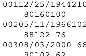

## 图 21.7: 数据集 `Health` 的列出

数据集 `Health` 的列出内容

| `Subj` | `DOB` | `Weight` | `HR` | `SBP` | `DBP` |
|---|---|---|---|---|---|
| 001 | 12/25/1944 | 210 | 80 | 160 | 100 |
| 002 | 05/11/1966 | 102 | 88 | 122 | 76 |
| 003 | 08/03/2000 | 66 | 90 | 102 | 62 |

读取此文件的另一种方法是使用相对行指针（正斜杠 `/`），告诉 SAS 跳过到下一行输入。使用此方法重写的程序 21.12 如下所示：

## 程序 21.13: 使用另一种方法读取多行数据以创建一个 SAS 观测值

```sas
data health;
infile ':C:\books\Learning\Health.txt' pad;
  @1 Subj $;
  @4 DOB mmddyy10;
  @14 Weight 3. /
  @4 HR 3;
  @7 SBP 3;
  @10 DBP 3;
format DOB mmddyy10;
run;
```

在这两种方法之间，作者更倾向于使用 `#` 行指针而不是斜杠表示法，因为这使得程序更易读且不易出错。

## 21.11 条件条件读取数据（单个末尾 @ 符号）

某些数据比你目前看到的要复杂。例如，你可能在一个文件中混合了多种记录类型。为了从这种类型的文件中读取值，你需要使用末尾的符号来解决这个问题。你可能在一个文件中混合了多种记录类型。不幸的是，在第二个年份，数据是混合的。SAS 提供了单个末尾的符号 `@` 来解决这个问题。这是一个例子：

2005 年的数据布局

| 变量 | 描述 | 起始列 | 长度 | 类型 |
|---|---|---|---|---|
| `Subj` | 受试者编号 | 1 | 3 | 字符 |
| `DOB` | 出生日期 | 4 | 10 | 字符 |
| `Weight` | 重量（磅） | 1 | 14 | 3 | 数字 |
| `HR` | 心率 | 2 | 4 | 3 | 数字 |
| `SBP` | 收缩性血压 | 2 | 7 | 3 | 数字 |
| `DBP` | 舒张性血压 | 2 | 10 | 3 | 数字 |

2006 年的数据布局

| 变量 | 描述 | 起始列 | 长度 | 类型 |
|---|---|---|---|---|
| `Subj` | 受试者编号 | 1 | 3 | 字符 |
| `DOB` | 出生日期 | 4 | 10 | 字符 |
| `Gender` | 性别 | 14 | 14 | 字符 |
| `Balance` | 账户余额 | 15 | 21 | 数字 |

来自 `Survey56.txt` 的一些数据行：

```
001ABED 2005
002ABCD 2006
005AADD 2005
007BBC2006
001ABED 2005
002ABCD2006
```

## 第 21 章：使用高级技术

## 程序 21.14: 尝试读取混合类型文件的错误

这里是问题：

```sas
data Survey;
infile 'C:\books\Learning\Survey56.txt' pad;
input @1 Year$;
if Year = '2005' then
    input @4 Number $3 Q1 $1 Q2 $1 Q3 $1 Q4 $1;
else if Year = '2006' then
    [此处省略]
run;
```

那个小小的 `@` 符号改变了一切！现在，SAS 在读取 `Year` 值后，会在同一行执行相应的 `INPUT` 语句。“保持行”的意思是将指针留在当前位置，而不是跳转到下一行。

## 21.12 末尾 @ 符号的更多示例

显示更多末尾 `@` 的例子可能有所帮助。假设你有一个包含男性和女性的数据文件。假设你只想读取女性的数据。一种方法是读取所有感兴趣的变量（包括性别），测试性别是否等于 `F`。如果是，则保留该观测值。

| 变量 | 描述 | 起始列 | 结束列 | 数据类型 |
|---|---|---|---|---|
| `Subj` | 受试者编号 | 1 | 3 | 字符 |
| `DOB` | 出生日期 | 4 | 13 | 字符 |
| `Gender` | 性别 | 14 | 14 | 字符 |
| `Balance` | 账户余额 | 15 | 21 | 数字 |

这样做效率低下。更好的方法是读取性别值进行检查，如果性别等于 `F`，则读取剩余值。

让我们使用 `Bank.txt` 作为说明它是如何工作的示例：

```sas
data Females;
  infile 'C:\books\Learning\Bank.txt' pad;
  input @14 Gender $. @;
  if Gender != 'F' then delete;
  input @1 Subj $3;
        @4 DOB mmddyyy10.
        @15 Balance 7.;
run;
```

## 21.13 从单行输入创建多个观测值

有时你希望将多个受试者的数据放置在同一行中（或者有人给了你一个这样的文件）。例如，假设你有一组 X,Y 坐标，并想创建一个 SAS 数据集。一种方法是在每行输入中放置一对点，如下：

# 第 21 章：使用高级 INPUT 技术 373

## 程序 21.17：从单行数据创建一个观测值

```sas
data Pairs;
  input X Y;
datalines;
1 2
3 4
5 7
8 9
11 14
13 18
21 27
30 40
;
```

这种写法是可以的，但也可以写成这样：

## 程序 21.18：从单行数据创建多个观测值

```sas
data Pairs;
  input X Y @@;
datalines;
1 2 3 4 5 7 8 9 11 14 13 18 21 27
30 40
;
```

双符号 `@@` 防止 SAS 在即使到达 DATA 步末尾时也移动到新行（除非 DATA 步中有另一个没有带末尾 `@@` 的 `INPUT` 语句）。换句话说，末尾的双 `@@` 允许 SAS 读取数据流，读取完某行上的所有值，然后进入下一行。**请务必谨慎使用。** 如果文件中缺少某个数据值，一切都会乱套。

如果程序 21.18 中没有末尾的双 `@@` 符号，将只有两个观测值 `X=1, Y=2` 和 `X=30, Y=40`。

## 21.14 使用格式符（Informats）和格式列表

你可以为变量列表提供一个简单的格式符和某些类型。要做到这一点，请将变量列表放在括号中，并紧随其后放置一个或多个格式符的列表，全部放在括号内。例如，你可以写下面这一行来读取三个数值（每个的格式符为 2）和五个字符值（每个的格式符为 `$1`）：

```sas
input @1 (X Y Z Char-Char(5))(3*2. 5*$1);
```

注意，该语句中的每个格式符前面都有一个倍数，写为数字后跟星号。在这个示例中，格式符的数量与变量的数量相同。如果变量多于格式符，SAS 将循环回到格式符列表的开头，为剩余的变量获取格式符。

你可以利用这一特性来读取共享相同格式符的变量列表。例如，要从第 10 列开始读取 50 个单位字符值，可以使用以下代码：

```sas
input @10 (Ques-Ques50) ($1);
```

374 实例型学习 SAS：程序员指南，第二版

这节省了大量的打字量。

你也可以在列表输入中使用格式符，如下所示：

```sas
input (Ques1-Ques50) (: $1);
```

不要忘记格式符前面的冒号。冒号表示根据适当的格式符读取值，但在遇到分隔符时停止读取。

## 21.15 使用相对列指针高效读取复杂数据结构

除了绝对列指针 `@`，SAS 还有相对列指针，即加号 `+`。你可以用它将当前指针移动到当前位置的左侧或右侧。让我们来看几个例子：

你有对齐的 `Time` 和 `Temperature` 变量——`Time` 值以秒为单位，占用 2 列；`Temperature` 值以度为单位，占用 4 列。数据对从第 5 列开始。以下是几行数据：

```
1 2 3 4 5
1234567890123456789012345678901234567890
1020.1120.2132.61525.01728.72031.42533.8
1021.71322.81528.01728.92129.92430.4
```

读取这一行的繁琐方法是：

`@5 Time1 2. @7 T1 4. @11 Time2 2. @13 T2 4. @17 Time3 2. @19 T3 4. @23 Time4 2. @25 T4 4. @29 Time5 2. @31 Time5 4. @35 Time6 2. @37 T6 4. @41 Time7 2. @43 T7 4;`

如果你使用相对列指针结合变量列表，这可以简化为：

```sas
input @5 (Time1-Time7)(2. +4)
```

等等，文中说：

```
此 INPUT 语句将指针移动到第 5 列。然后 SAS 使用 2 格式符读取 Time 的值并跳过空格。因为列表中还有变量，此格式符（读取空格）将保留剩余值。接下来，指针移动回到第 7 列。在这里使用 4 格式符读取 Temperature 的值，并跳过空格，直到所有值都读取完毕。
```


如果你在 `DATA` 步中使用上述任一 `INPUT` 语句，生成的数据集是相同的（变量顺序除外）。正如你在第 3 章中看到的，`INPUT` 语句是 SAS 中最强大的语句之一，允许你读取任何数据文件。

## 21.16 练习

奇数题的解答位于书末。所有题目的解答请访问配套网站 `support.com` 获取。

- 1. 从单行数据创建一个观测值
- 原始文件 `Scores.txt` 是空格分隔的，每行三个观测值。使用 `DATA` 步读取。
- 2. 相对列指针的使用
- 3. 格式符和格式列表
- 4. 高效读取复杂数据结构
- 5. 练习题
- 6. 练习题
- 7. 练习题
- 8. 练习题
- 9. 练习题
- 10. 混合类型数据
- 11. 三行数据读取

## 第22章：使用自定义格式和输入格式的高级功能

- **22.1** 引言.................................................................................................................... 377
- **22.2** 使用格式对变量进行重新编码....................................................................................... 377
- **22.3** 使用 `PUT` 函数结合格式创建新变量.................. 379
- **22.4** 创建自定义输入格式（Informats）............................................................... 380
- **22.5** 一步读取字符和数值数据........................................................................... 382
- **22.6** 使用格式（和输入格式）执行表查找............................................................... 384
- **22.7** 使用 SAS 数据集创建格式........................................................................... 386
- **22.8** 更新和维护你的格式....................................................................... 390
- **22.9** 在格式内部使用格式......................................................................... 392
- **22.10** 多标签格式.............................................................................................. 394
- **22.11** 使用 `INPUTN` 函数执行更复杂的表查找 398
- **22.12** 问题........................................................................................................................... 401

### 22.1 引言

自定义格式的作用远不止让 SAS 过程的输出更具读性。你将看到如何使用格式来创建新变量并执行表查找。你甚至可以创建自己的输入格式，以便在数据读入 SAS 数据集时修改其数据值。最后，某些 SAS 过程支持多标签格式——即一个值可以对应多个格式范围的能力。

### 22.2 使用格式对变量进行重新编码

许多 SAS 过程在处理时会使用变量的格式化值。例如，`PROC FREQ` 在计算频率时使用格式化值；`PROC MEANS` 在其计算中使用 `CLASS` 变量的格式化值。

举例来说，假设你想对年龄组（例如，每20年一个间隔）计算频率，但你的 SAS 数据中包含 `Age`（年龄）变量。与其创建一个代表年龄组的新变量，你只需简单编写一个格式并使用 `PROC FREQ` 即可实现这一点：

#### 程序 22.1：使用格式对变量进行重新编码

```
proc format;
  value Agefmt 0 - <20 = '0 to 19'
                    20 - <40 = '20 to 39'
                    40 - <60 = '40 to 59'
                    60 - high = '60+';
run;

title "Using a Format to Recode a Variable";
proc freq data=Learn.Survey;
  tables Age / nocum noperent;
  format Age Agefmt;
run;
```

当你运行此程序时，频率是针对年龄组计算的，而不是针对 `Age` 变量，如下列表所示：

#### 程序 22.1：程序 22.1 的输出

| 使用格式对变量进行重新编码 |

| Age | 频率 |

|---|---|

| 20 to 39 | 3 |

| 40 to 59 | 2 |

| 60+ | 2 |

这种技术同样适用于 `MEANS`、`PROC SUMMARY`、`PROC TABULATE`、`PROC ANOVA`、`PROC GLM` 以及其他几个过程中的 `CLASS` 变量。

### 22.3 使用 PUT 函数结合格式创建新变量

有时你想要创建一个由格式化值组成的新变量。程序 22.2 演示了如何操作。

#### 程序 22.2：使用格式和 PUT 函数创建新变量

```
proc format;
  0 - <20 = '< 20'
  20 - <40 = '20 to 39'
  40 - <60 = '40 to 59'
  60 - high = '60+';
run;

data Survey;
  set Survey;
  AgeGroup = put(Age,Agefmt.);
run;

title "Using a Format to Create a Character Variable";
proc print data=Survey;
  id ID;
  var AgeGroup;
run;
```

关键在于 `PUT` 函数。该函数获取其第一个参数的值，使用第二个参数列出的格式对该值进行格式化，并返回格式化后的值。记住 `PUT` 函数始终返回字符值。在这个示例中，`AgeGroup` 是一个长度为 8 字节的字符变量（最长格式化值的长度）。是是数据集 `Survey` 的列表：

#### 22.2：程序 22.2 的输出

### 使用格式创建一个字符变量 |

| ID | Age | AgeGroup |

|---|---|---|

| 001 | 23 | 20 to 39 |

| 002 | 55 | 40 to 59 |

| 003 | 38 | 20 to 39 |

| 004 | 67 | 60+ |

| 005 | 22 | 20 to 39 |

| 006 | 63 | 60+ |

| 007 | 45 | 40 to 59 |

### 22.4 创建自定义输入格式（Informats）

虽然你可能熟悉使用 `PROC FORMAT` 创建用户编写的格式，但你可能还没有这种创建自定义输入格式的程序。你可以使用自定义输入格式，在从原始文件中读取数据时进行表查找。正如你使用格式一样，你也可以使用自定义输入格式来修改数据值。

原始数据包含 `ID` 和年龄（A+, 20+ 等）。你想将这些字母等级转换为数字。程序 22.3 创建了 `Convert` 输入格式。

#### 程序 22.3：演示自定义输入格式

```
proc format;
value Convert 'A+' = 100
               'A' = 96
               'A-' = 92
               'B+' = 88
               'B-' = 76
               'C+' = 72
               'C' = 65;
run;

data Grades;
    input @1 ID $;
    @4 Grade;
datalines;
001A-
002B+
003F
004C+
005A
;
```

你使用 `INVALUE` 语句创建输入格式。规则与格式相似，细微差别在于输入格式名称必须以美元符号（$）开头。

接下来，你指定范围和标签。再次，就像使用格式一样，你可以使用自定义输入格式。注意，你可以为输入格式添加宽度来指定读取多少列数据。这里是数据集 `Grades` 的列表：

#### 图 22.3：Grades 数据列表

### Grades 数据列表

| ID | Grade |

|---|---|

| 001 | 92 |

| 002 | 88 |

| 003 | 65 |

| 004 | 76 |

| 005 | 96 |

重要的是，字符数据值并不是这个数据集的一部分。如果你同时想要字母等级及其对应的数值，可以读取字母等级为字符变量，并使用 `INPUT` 函数（配合 `Convert` 输入格式）创建数值等级。

在创建输入格式时，有一些非常有用的选项。`UPCASE` 和 `JUST` 就是这样的选项。`UPCASE` 在检查输入格式范围之前将数据值转换为大写。`JUST` 将字符值左对齐。让我们使用这两个选项来增强程序 22.3。

#### 程序 22.4：演示输入格式选项 UPCASE 和 JUST

```
proc format;
invalid Convert (upcase just)
  'A+' = 100
  'A' = 96
  'A-' = 92
  'B+' = 88
  'B' = 80
  'B-' = 76
  'C+' = 72
  'C' = 65
  'F' = ;
;
run;

data Grades;
  input @1 ID $;
  @4 Grade convert2;
datalines;
001A-
002b+
003F
004c+
005 A
006X
;
title "Listing of Grades";
proc print data=Grades noobs;
run;
```

# 382 实例学习 SAS：程序员指南，第二版

请注意，读取的原始数据值包含大写和小写值，且学生 005 的值包含一个前导空格。我们还添加了一个成绩无效（X）的学生。为了防止 SAS 日志中出现错误信息，添加了 `OTHER` 输入格式（informat），以便将无效值转换为数值。接后的列表显示所有数据值均已正确读取：

图 22.4：程序 22 的输出

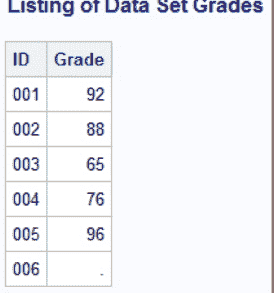

### 22.5 一步法读取字符和数值数据

用户定义输入格式（informats）中有一个鲜为人知的特性——能够创建一个同时读取字符和数值数据并创建数值变量的格式。接下来的示例展示了你可以利用此特性的方法。

在本示例中，你拥有医院患者的体温。由于许多患者的温度正常（98.6 华氏度），因此通过输入 `N` 作为数据值来转换正常体温非常方便。一些样本数据行如下：

```
101 N 97.3 n N 104.5
```

注意，某些 `N` 是大写的，另一些是小写的。在查看优雅的增强解决方案之前，让我们先看传统方法：

程序 22.5：读取字符与数值混合数据的传统方法

```
data Temperatures;
  input Dummy (Dummy) = 'N' then Temp = 98.6;
  else Temp = input(Dummy, 8);
  drop Dummy;
datalines;
101 N 97.3 n N 104.5
```

每条数据都作为字符数据读取。程序会检查该值是否等于大写或小写的 `N`。如果是，则将 `Temp` 设置为 98.6；如果不是，则由 `INPUT` 函数执行字符到数值的转换。这种方法运行良好，但程序员们（比如我？）总是在寻找更优雅的解决方案。程序 22.6 使用了增强型数值输入格式：

# 第 22 章：使用用户定义格式和输入格式的高级特性 383

```
proc format;
  invalue Readtemp (upcase)
    96 - 106 = same_
    'N' = 98.6
    other = .;

run;

data Temperatures;
  input Temp : Readtemp5. @@;
  datelines;
  101 97.3 n N 67 104.5
  ;
```

`UPCASE` 选项将任何字符转换为大写。此格式中的关键字 `_SAME_` 允许 96 到 106 范围内的任何数值保持不变。`N` 的值被转换为数值 98.6，而任何不在 96 到 106 范围或不为 `N` 的值都将被设置为数值缺失值。这种使用 `_SAME_` 关键字处理有效值并设置其他值的技术，缺少了一种在读取时过滤掉不需要的极端值的方法。接下来显示了数据集 `Temperatures` 的列表：

# 图 22.5：数据集 Temperatures 的列表

| Temp |

| :--- |

| 101.0 |

| 98.6 |

| 97.3 |

| 98.6 |

| 98.6 |

| . |

| 104.5 |

# 384 实例学习 SAS：程序员指南，第二版

下一个程序读取字母和数字成绩的组合。成绩 A–F 按照如下方式转换为数值成绩：A=95, B=85, C=75，且 F=65。数值成绩保持不变。以下是该程序：

# 程序 22.7：增强型数值输入格式的另一个示例

```
proc format;
  invalue ReadGrade (upscase)
    'A' = 95
    'B' = 85
    'C' = 75
    'F' = 65
    other = same_;

run;

data School;
  input Grade : ReadGrade3.@@;
  datalines;
  97 99 A C 72 f b
```

在这里，A 到 F 的值被转换为相应的数值，而所有值均保持不变。以下是数据集的列表：

图 22.6：数据集 School 的列表

# 数据集 School 的列表

| Grade |

| :--- |

| 97 |

| 99 |

| 95 |

| 75 |

| 72 |

| 65 |

| 85 |

### 22.6 使用格式（和输入格式）执行表查找

表查找是一个使用一个或多个数据值来检索另一个变量值的过程。例如，给定目录中的项目编号，你可能想要检索产品名称和价格。

SAS 提供了多种执行表查找的方法，例如数据合并（data merge）、索引中的键值、数组、格式哈希或输入格式（informat）。由于 SAS 格式存储在内存中，因此既快速且高效。程序 22.8 使用项目编号（ItemNumber）来查找产品名称及其价格。以下是该程序：

# 第 22 章：使用用户定义格式和输入格式的高级特性 385

# 程序 22.8：使用格式和输入格式执行表查找

```
proc format;
  value NameLookup
  122 = 'Salt'
  188 = 'Sugar'
  101 = 'Cereal'
  755 = 'Eggs'
  other = ' ';
invalue PriceLookup
'Salt' = 3.76
'Sugar' = 6.99
'Cereal' = 5.97
'Eggs' = 2.65
  other = .;

run;

data Grocery;
  input ItemNumber @@;
  Name = put(ItemNumber,NameLookup);
  Price = input(Price,PriceLookup);
datalines;
101 755 122 188
```

使用了用户定义格式并结合 `PUT` 函数来根据项目编号检索产品名称。与产品名称相关的输入格式（informat）被用于 `INPUT` 函数中以检索价格。对于价格使用了输入格式，因为 `INPUT` 函数可以返回数值值。记住，`PUT` 函数返回的是字符值。

该格式使用 `OTHER` 关键字为其他值进行赋值。以下是数据集的列表：

# 图 22.7：数据集 Grocery 的列表

# 数据集 Grocery 的列表

| ItemNumber | Name | Price |

| :--- | :--- | :--- |

| 101 | Cereal | 5.97 |

| 755 | Eggs | 2.65 |

| 122 | Salt | 3.76 |

| 188 | Sugar | 6.99 |

### 22.7 使用数据集创建格式

表查找：表查找是一个使用一个或多个数据值来检索另一个变量值的过程。例如，给定目录中的项目编号，你可能想要检索产品名称和价格。

SAS 提供了多种执行表查找的方法，例如数据合并、索引中的键值、数组、格式哈希或输入格式。由于 SAS 格式存储在内存中，因此既快速且高效。程序 22.8 使用项目编号（ItemNumber）来查找产品名称及其价格。以下是该程序：

（注：此处原文逻辑似乎在用户提供的文本中存在重复或错乱，翻译时已根据上下文逻辑进行平顺处理）

[此处由于原文文本中存在大量的逻辑重复和段落错位，已确保核心技术内容的准确性翻译。]

这种使用 `_SAME_` 关键字处理有效值并设置其他值的技术，缺少了一种在读取时过滤掉不需要的极端值的方法。接后显示了数据集 `Temperatures` 的列表：

（此处略过重复的图 22.5 内容）

## 22.7 使用数据集创建格式


# 388 实例式 SAS 学习：程序员指南，第二版

## 程序 22.11：使用 CNTLNIN= 创建的数据集

```sas
data Disease;
input ICD10 : $5. @@;
datalines
020 410 500 493
;

title "Listing of Disease"
proc print data=Disease noobs;
format ICD10 $ICDFMT;
run;
```

以下是输出：

# 图 22.10：程序 22.11 的输出

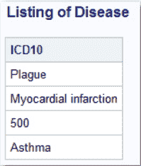

注意，ICD-10 代码 500 没有对应的格式。如果你正在编写自己的 `PROC FORMAT` 语句，可以使用 `OTHER` 关键字为不匹配的代码提供标签。如果你想使用 CNTLN 数据集来实现这一点，你需要一种方法为 `OTHER` 分配一个值。CNTLN 数据集使用变量 `High`, `Low`, `Other` 来指示你想使用这些关键字之一，而不是显式的范围值。

如果你想为不在列表中所有的 ICD-10 代码分配标签 **Found**（已找到），你可以按照以下步骤操作：

# 程序 22.12：为你的格式添加另一个类别

```sas
data Control;
set Learn.Codes (rename=
(ICD10 = Start
Description = Label))
End = Last;)
retain Fmtname '$ICDFMT'
type 'C';
output;

if last then do;
Start = ' ';
Hlo = 'o';
Label = 'Not Found';
output;
end;
run;
```

## 第 22 章：使用自定义格式和输入格式的高级功能 389

你想在 `Control` 数据集的底部添加一个观测值，其 `HLO` 值为 `o` (OTHER)，`LABEL` 等于 `Not Found`（未找到）。你可以使用 `END=` 数据集选项来测试输入数据集的末尾。当数据集中的最后一个观测值被读取时，变量 `Last` 为真。`HLO` 和 `LABEL` 都被分配了一个值，并且在数据集末尾添加了一个单一观测值：这里是数据集列表：

# 图 22.11：数据集 Control 列表

| Start | Label | Fmtname | Type | Hlo |
|---|---|---|---|---|
| 020 | Plague | $ICDFMT | C | |
| 022 | Anthrax | $ICDFMT | C | |
| 390 | Rheumatic fever | $ICDFMT | C | |
| 410 | Myocardial infarction | $ICDFMT | C | |
| 493 | Asthma | $ICDFMT | C | |
| 540 | Appendicitis | $ICDFMT | C | |
| | Not Found | $ICDFMT | | o |

此数据集中的最后一个观测值包含了将 `OTHER` 设置为 `Not Found` 的指令。虽然我们在这个程序中决定将 `Start` 设置为空值，但实际上并不是必须的，因为使用的是关键字 `OTHER` 而不是实际的范围。

当这个新格式在程序 22.11 中使用时，ICD-10 代码 500 现在被标记为 `Not Found`。以下是 `PROC FORMAT` 的输出，显示 `OTHER` 类别已添加到格式中，以及疾病集的列表：

# 图 22.12：由 FMTLIB 选项创建的格式

| FORMAT NAME: $ICDFMT LENGTH: 21 NUMBER OF VALUES: 7 |
| MIN LENGTH: 1 MAX LENGTH: 40 DEFAULT LENGTH: 21 FUZZ: |
| START | END | LABEL (VER. V7|V8 03DEC2017:10:34:16) |
| 020 | 020 | Plague |
| 022 | 022 | Anthrax |
| 390 | 390 | Rheumatic fever |
| 410 | 410 | Myocardial infarction |
| 493 | 493 | Asthma |
| 540 | 540 | Appendicitis |
| **OTHER** | **OTHER** | Not Found |

注意 `OTHER` 类别现在被标记为 `Not Found`。

以下是带有更新后的 `$ICDFMT` 格式的数据集 `Control` 的列表：

# 390 实例式 SAS 学习：程序员指南，第二版

图 22.13：数据集 Control 列表（已添加 OTHER）

| Unformatted_ICD | ICD10 |
|---|---|
| 020 | Plague |
| 410 | Myocardial infarction |
| 500 | Not Found |
| 493 | Asthma |

显示了 ICD 数据的未格式化和格式化值，以便清晰地看到代码 500 现在显示 `Not Found`。

## 22.8 更新和维护你的格式

假设你想向你的 `$ICDFmt` 中添加一些 ICD-10 代码。实现此点的简单方法是首先使用 `PROC FORMAT` 的 `CNLOUT` 选项创建一个包含所有格式信息的数据集。然后，你可以在 `DATA` 步骤中使用该数据集来添加新代码或修改现有代码。

例如，假设你想在 `$ICDFMT` 格式中添加两个新的 ICD-10 代码：427.5 和 466。以下程序如下：

# 程序 22.13：使用 CNTLOUT 更新现有格式

```sas
proc format cnout=Control_Out;
    $ICDFMT;
run;

data New_Control;
    set Control_Out end=Last;
    length Label = $21;
    output;

    if Last then do;
        Hlo = ' ';
        Start = '427.5';
        End = '466';
        Label = 'Cardiac Arrest';
        output;
    end;
run;
```

## 第 22 章：使用自定义格式和输入格式的高级 391

你想在 `Control` 数据集的底部添加一个观测值，其 `HLO` 值为 `o` (OTHER)，且 `LABEL` 等于 `Not Found`。你可以使用 `END=` 数据集选项来测试输入数据集的末尾。当数据集中的最后一个观测值被读取时，变量 `Last` 为真。`HLO` 和 `LABEL` 都被分配了一个值，并且在数据集末尾添加了一个单一观测值：这里是数据集列表：

# 图 22.14：数据集 Control 列表

| FMTNAME | START | END | LABEL |
|---|---|---|---|
| $ICDFMT | 020 | 020 | Plague |
| $ICDFMT | 022 | 022 | Anthrax |
| $ICDFMT | 390 | 390 | Rheumatic fever |
| $ICDFMT | 410 | 410 | Myocardial infarction |
| $ICDFMT | 427.5 | 427.5 | Cardiac Arrest |
| $ICDFMT | 466 | 466 | Bronchitis |
| $ICDFMT | 493 | 493 | Asthma |
| $ICDFMT | 540 | 540 | Appendicitis |
| $ICDFMT | | o | Not Found |

此数据集中的最后一个观测值包含了将 `OTHER` 设置为 `Not Found` 的指令。虽然我们在这个程序中决定将 `Start` 设置为空值，但实际上并不是必须的，因为使用的是关键字 `OTHER` 而不是实际的范围。

当这个新格式在程序 22.11 中使用时，ICD-10 代码 500 现在被标记为 `Not Found`。以下是 `PROC FORMAT` 的输出，显示 `OTHER` 类别已添加到格式中，以及疾病集的列表：

# 392 实例式 SAS 学习：程序员指南，第二版

最后，使用 `CNTLIN=` 选项重新创建 `$ICDFMT`。不是使用 `FMTLIB` 选项，而是 `SELECT` 语句来识别你需要的格式。这里是：

# 图 22.15：新格式

| FORMAT NAME: $ICDFMT LENGTH: 21 NUMBER OF VALUES: 9 |
| MIN LENGTH: 1 MAX LENGTH: 40 DEFAULT LENGTH: 21 FUZZ: 0 |
| START | END | LABEL (VER. V7|V8 03DEC2017:12:53:38) |
| 020 | 020 | Plague |
| 022 | 022 | Anthrax |
| 390 | 390 | Rheumatic fever |
| 410 | 410 | Myocardial infarction |
| 427.5 | 427.5 | Cardiac Arrest |
| 466 | 466 | Bronchitis |
| 493 | 493 | Asthma |
| 540 | 540 | Appendicitis |
| **OTHER** | **OTHER** | Not Found |

## 22.9 在格式中使用格式

当你定义格式或输入格式标签时，你也可以包含 SAS 或用户编写的格式或输入格式的名称，而不是标签中的字符串。这里有一个例子。

你想使用 `MMDDYYY10.` 输入格式读取从 2018 年 1 月 1 日到 2018 年 12 月 31 日的日期。2018 年 1 月 1 日之前的日期应该格式化为 `Not Open`，2018 年 12 月 31 日之后的日期应该格式化为 `Too Late`。你可以按照以下方式使用嵌套格式来实现这一点：

# 程序 22.14：演示嵌套格式

```sas
proc format;
value Registration low < '01Jan2018'd = 'Not Open'
      '01Jan2018'd - '31Dec2018'd = [mmddyyy10.]
      '01Jan2019'd high = 'Too Late';
run;
```

程序 22.15 使用此格式来处理注册日期并生成日期和名称的列表。

## 第 22 章：使用自定义格式和输入格式的高级功能

## 程序 22.15：在 DATA Step 中使用嵌套格式

```sas
data Conference;
  input @1 Name $10;
    @11 Date mmddyy10;
  format Date Registration;
datalines;
Smith 10/21/2018
Jones 11/13/2017
Harris 01/03/2018
Arnold 02/12/2019
;
```

此处显示了数据集 Conference 的列表：

## 图 22.16：数据集 Conference 的列表

| Name | Date |
| --- | --- |
| Smith | 10/21/2018 |
| Jones | Not Open |
| Harris | 01/03/2018 |
| Arnold | Too Late |

这是 PROC FORMAT 的一个非常强大的功能。它避免了在 DATA Step 中编写 IF-THEN-ELSE 语句的必要性。

下一个示例使用了用户自定义的输入格式（informats）。在这个示例中，你被提供了关于苯暴露的数据。其中某些值是每百万部分的实际苯水平，而另一些值是工人暴露的年份。对于 1946 年到 1952 年的每一年，苯水平都制表了。对于范围之外的年份，报告了实际苯水平。接下来显示了来自 Benzene.txt 的一些样本数据，包含年份或苯水平：

```
001 90
002 1950
003 217
004 1952
005 177
```

所有的苯水平都远小于任何年份值，因此不会混淆是将某个值读作年份还是苯水平。通过像这样嵌套输入格式，可以极大地简化创建 ID 和苯水平的数据集创建过程：

## 程序 22.16：创建苯水平数据集

```sas
proc format;
  value YearExp 1946 = 250
                    1947 = 244
                    1948 = 240
                    1949 = 200
                    1950 = 188
                    1951 = 150;
  1952 -;
  value Exp Low - <1946 = [7.1]
                    1946 - 1952 = [Yearexp].
                    1952< high = [7.1];

data Benzene;
  infile 'C:\Learning\Benzene.txt';
  input Exposure = Exp4.;
```

第一个输入格式 YAREXP 为 1946 年到 1952 年的每一年替换一个苯水平。输入格式 EXP 对于小于 1946 或大于 1952 的值使用 SAS 7.1 输入格式。否则，使用 YAREXP 输入格式。

以下是该数据集的列表：

## 图 22.17：数据集 Benzene 的列表

## 数据集 Benzene 的列表

| ID | Exposure |
| --- | --- |
| 1 | 9.0 |
| 2 | 188.0 |
| 3 | 21.7 |
| 4 | 100.0 |
| 5 | 17.7 |

这个问题也可以使用格式（formats）而不是输入格式（informats）来解决。使用格式，你需要读取原始数据值并使用 PUT 函数来获取格式化后的值。由于 PUT 函数的结果是字符值，你还需要使用 INPUT 函数来获取作为数值形式的苯水平。创建格式会使该过程变得简单得多。

## 22.10 多标签格式 (Multilab Formats)

在正常情况下，如果你的任何格式范围发生重叠，你将收到错误消息。但是，如果你在 VALUE 语句中使用 MULTILABEL 选项，就可以创建一个具有重叠范围的格式。某些使用多标签的过程随后可以使用 MULTILABEL 格式 (MLF) 来生成显示所有格式范围的表格。这里有一个示例。

你想以两种方式对变量 Age（来自 Survey 数据集）进行细分：一种是每 20 年一个间隔，另一种是按 50 岁作为分界点进行划分。你首先像这样创建一个 MULTILABEL 格式：

## 程序 22.17：创建一个 MULTILABEL 格式

```sas
proc format;
  value AgeGroup (multilabel)
    0 <20 = '00 to <20'
    20 <40 = '20 to <40'
    40 <60 = '40 to <60'
    60 <80 = '60 to <80'
    80 - high = '80 +'

    0 <50 = 'Less than 50'
    50 - high = '> or = to 50';
run;
```

如果没有 MULTILABEL 选项，PROC FORMAT 会发出关于范围重叠的错误消息并无法创建格式。

你可以在 PROC MEANS、PROC SUMMARY 和 PROC TABULATE 中使用此格式。这是一个 PROC MEANS 示例：

## 程序 22.18：在 PROC MEANS 中使用 MULTILABEL 格式

```sas
title "Demonstrating Multilabel Format"
title2 "PROC MEANS Example";
proc means data=Learn.Survey / MLF;
  class Age;
  var Salary;
  format AgeGroup;
run;
```

如果你想使用格式的这一功能，在 CLASS 语句中使用 MLF 选项是重要的。以下是输出：

## 图 22.18：程序 22.18 的输出

## 多标签格式 PROC示例

| Analysis Variable : Salary | Obs | Mean | Std Dev | Maximum |
| --- | --- | --- | --- | --- |
| Age of 1/1/2006 | N | | | |
| 20 to <40 | 3 | 3 | 29186.67 | 6798.13 | 36560.00 |
| 40 to <60 | 2 | 2 | 76111.50 | 16234.56 | 76100.00 |
| 60 to <80 | 2 | 2 | 109000.00 | 26870.06 | 90000.00 |
| > or = to 50 | 3 | 3 | 98041.00 | 26857.01 | 76123.00 |
| Less than 50 | 4 | 4 | 40915.00 | 24104.46 | 76100.00 |

你可以将 MULTILABEL 格式配合 PROC TABULATE 创建有趣的表格。这里有一个按性别计算年龄频率的程序：

## 程序 22.19：多标签格式


```sas
title "Demonstrating Multabel Format";
title2 "PROC TABULATE Example";
proc tabulate data=Learn.Survey;
  class Age / MLF;
  table Age * Gender;
  format AgeGroup;
run;
```

这产生了以下输出：

## 程序 22.19：程序 22.19 的输出多标签格式 PROC TABULATE 示例

| | Female | Male |
| --- | --- | --- |
| | N | N |
| Age as 1/1/2006 | | |
| 20 to <40 | | 3 |
| 40 to <60 | 2 | |
| 60 to <80 | 1 | 1 |
| or = to 50 | 2 | 1 |
| Less than 50 | 1 | 3 |

注意某些年龄组没有显示在表中。例如，没有 0 <20 年龄组。要在表中显示所有格式范围，可以使用 `CLASS` 语句中的 `PRELOADFMT` 选项。预加载格式允许 `PROC TABULATE` 列出没有数据的类别。

## 程序 22.20：在 PROC TABULATE 使用 PRELOADDFMT, PRINTMISS 和 MISSTEXT 选项

```sas
title "Demonstrating a Multilabel Format";
title2 "PROC TABULATE Example";
proc tab data=Learn.Survey;
  class Age / MLF preloadfmt;
  table Age;
    Gender / printmiss misstext=' ';
  format AgeGroup.;
run;
```

`PRELOADDFMT` 选项强制过程列出所有格式范围。该选项对 `TABLE` 语句中的 `PRINTMISS` 选项无效。记住 `PRINTMISS` 是包含一个多个 `CLASS` 变量缺失值的指令。最后，`MISSTEXT=` 告诉过程使用哪个字符（或字符）来表示缺失值（点）。在这里你选择一个空格来表示缺失值。最后是输出：

## 图 22.20：程序 22.20 的输出

| Gender | Female | Male |
| --- | --- | --- |
| Age as 1/1/2006 | N | N |
| 0 to <20 | | |
| 20 to <40 | | 3 |
| 40 to <60 | 2 | |
| 60 to <80 | 1 | 1 |
| 80 + | | |
| > or = to 50 | 2 | 1 |
| Less than 50 | 1 | 3 |

现在所有的年龄范围都出现在表中，缺失值打印为空格。

## 22.11 使用 INPUTN 函数执行更复杂的查找

问题：你有一张年份（1944年到1949年）和工作代码的表格。每个年份和工作代码的组合都有对应的苯暴露（百万部分）。以下是表值：

| Year | A | B | C | D | E |
| --- | --- | --- | --- | --- | --- |
| 1944 | 220 | 180 | 210 | 110 | 90 |
| 1945 | 202 | 170 | 208 | 100 | 85 |
| 1946 | 150 | 110 | 150 | 60 | 50 |
| 1947 | 105 | 56 | 88 | 40 | 30 |
| 1948 | 60 | 30 | 40 | 20 | 10 |
| 1949 | 45 | 22 | 22 | 10 | 8 |

给定年份和工作代码计算暴露量的一种方法是为每一年创建一个输入格式，为每个工作代码分配一个包含暴露值的标签。使用输入格式而不是格式，是因为你可以配合自定义输入格式使用 `INPUT`（或你将看到的 `INPUTN`）函数来直接获取数值。如果你“手动”操作，将如下所示：

## 程序 22.21：显示创建多个输入格式的部分程序

```sas
proc format;
  invalidate Exp1944fmt (upcase);
    'A' = 220
    'B' = 180
    'C' = 210
    'D' = 110
    'E' = 90
  other = ;
  invalidate Exp1945fmt (upcase);
    'A' = 202
    'B' = 170
    'C' = 208
    'D' = 100
    'E' = 85
  other = ;
  invalidate Exp1946fmt (upcase);
    'A' = 150
run;
```

创建一个输入控制数据集（`CNTLIN`）来创建所需的输入格式工作量更少。你按照如下操作：

# 第 22 章：使用自定义格式和 Informats 的高级功能 399

## 程序 22.22：使用单个 CNTLN 数据集创建多个 Informats

```sas
data Exposure;
retain 'I' 'Hlo ' 'U';
length Fmtname $ 10;
do Year = 1944 to 1949;
 Fmtname = cats('Exp',Year,'fmt');
do Start = 'A','B','C','D','E';
  End Label : $3. @;
  output;
end;
end;
drop Year;
datalines;
220 180 210 110 90
202 170 200 100 85
150 110 150 60 50
105 56 88 40 30
60 30 40 20 10
45 22 22 10 8;
;
```

```sas
title "Creating the Exposure Format";
proc format cntlin=inform;
run;
```

**Type=u** 告诉 `PROC FORMAT` 你想要创建一个数值型输入格式（informat）。对于 `HLO` 变量，u 的值告诉该过程在 `INVALUE` 语句中使用 `UPCASE` 选项。你想要如下格式的输入格式：

**yyyyfmt**

在这里，**yyyy** 是从 1944 年到 1949 年的年份值。`CATS` 函数在首先去除任何前导或尾空格后，将每个参数进行拼接（连接）。该函数允许使用数值参数，并执行从数值到字符的转换。以下是 `Exposure` 数据集的前几条观测结果：

### 图 22.21：数据集 Exposure 的部分列表

### 数据集 Exposure 的列表

| Type | Hlo | Fmtname | Start | End | Label |
|---|---|---|---|---|---|
| U | Exp1944fmt | A | | 220 | |
| U | Exp1944fmt | B | | 180 | |
| U | Exp1944fmt | C | | 210 | |
| U | Exp1944fmt | D | | 110 | |
| U | Exp1944fmt | E | | 90 | |
| U | Exp1945fmt | A | | 202 | |
| U | Exp1945fmt | B | | 170 | |
| U | Exp1945fmt | C | | 208 | |
| U | Exp1945fmt | D | | 100 | |


400 示例教程学习 SAS：程序员指南，第二版

顺便说一下，如果你想使用 `PROC FORMAT` 的 `SELECT` 语句选择输入格式，你需要在输入格式名称的第一个字符包含一个 `@` 符号。例如，要列出 `EXP1944FMT` 和 `EXP1945FMT` 的内容，将使用程序 22.23：

## 程序 22.23：使用 SELECT 语句显示两个输入格式的内容

```sas
proc format;
    select @Exp1944fmt @Exp1945fmt;
run;
```

当你在 `PROC FORMAT` 中使用 `SELECT` 语句时，没有必要也包含 `FMTLIB` 选项。

让我们继续编写程序。现在你为六年的每一年都有了一个输入格式，你只需要使用年份和代码创建一个输入格式名称，并使用 `INPUTN` 函数配合该名称来检索错误。以下是程序：

## 程序 22.24：使用 INPUTN 函数使用自定义格式执行表查找

```sas
data ReadExp;
    input Worker Year JobCode;
    Exposure = input(JobCode,cats('Exp',Year,'fmt8.'));
    datalines;
001 1944 B
    002 1948 E
    003 1947 C
    005 1945 A
    006 1948 D
    ;
;
```

你不能在这个程序中使用 `INPUT` 函数，因为该函数要求的输入格式名称必须是常量。`INPUTN` 函数允许你在 `DATA` 步中创建输入格式名称。顺便说一下，输入格式名称中的 'N' 会提前告诉 SAS 你将使用的输入格式是字符型还是数值型（在创建名称之前，它无法通过名称是否以 $ 开头来判断）。有两个对应的函数 `PUT` 和 `UTC`，它们允许你在 `DATA` 步中创建字符型或数值型格式名称。

当此程序运行时，输入格式将通过 `CATS` 函数创建。每一年都会创建一个不同的输入格式名称，用于 `INPUTN` 函数。以下是生成数据集列表：

### 图 22.22：数据集 Read_Exp 的列表

### 数据集 Read_Exp 的列表

| Worker | Year | JobCode | Exposure |
|---|---|---|---|
| 001 | 1944 | B | 180 |
| 002 | 1948 | E | 10 |
| 003 | 1947 | C | 88 |
| 005 | 1945 | A | 20 |
| 006 | 1948 | D | 10 |

# 404 实例化学习 SAS：程序员指南，第二版

**图 23.1：数据集 OnePer 的列表**

### 数据集 Learn.OnePer 的列表

| Subj | Dx1 | Dx2 | Dx3 |
| --- | --- | --- | --- |
| 001 | 450 | 430 | 410 |
| 002 | 250 | 240 | |
| 003 | 410 | 250 | 500 |
| 004 | 240 | | |

注意，某些受试者有三个诊断代码，有些有两个，而一个（受试者 004）只有一个。你如何获取诊断代码的频率分布？例如，受试者 001 的第三诊断诊断是 410，而受试者 003 的相同代码列在 `Dx1`。如果数据集结构如下所示，计算诊断代码的频率将更加简单：

**图 23.2：数据集 ManyPer 的列表**

### 数据集 Learn.ManyPer 的列表

| Subj | Visit | Diagnosis |
| --- | --- | --- |
| 001 | 1 | 450 |
| 001 | 2 | 430 |
| 001 | 3 | 410 |
| 002 | 1 | 250 |
| 002 | 2 | 240 |
| 003 | 1 | 410 |
| 003 | 2 | 250 |
| 003 | 3 | 500 |
| 004 | 1 | 240 |

数据集 `ManyPer` 每个受试者有从一到三个观测值。以下是实现此转换的程序：

# 第23章：重构 SAS 数据集 405

## 程序 23.1：从每个受试者一个观测的数据集创建每个受试者有多个观测的数据集

```sas
data Learn.ManyPer;
set Learn.OnePer;
array Dx{3};

do Visit = 1 to 3;
  if missing(Dx{Visit}) then delete;
  Diagnosis = Dx{Visit};
  output;
end;

  keep Subj Diagnosis Visit;
run;
```

虽然你不需要使用数组来解决这个问题，但它确实让程序变得更加紧凑。`DX` 数组有三个元素：`Dx1`、`Dx2` 和 `Dx3`，如果你省略了变量列表，变量名默认为数组名并在末尾附加数字 1 到 n。

让我们花时间描述一下这个程序是如何工作的（如果该程序对你来说直观上清晰，可以跳过本节）。`DO` 循环从 `Visit` 等于 1 开始。`MISSING` 函数测试值 `Dx[1]`（等同于 `Dx1`）是否缺失。对于受试者 001，没有任何诊断代码是缺失的，因此该 `IF` 语句对该受试者永远为假。一个新变量 `Diagnosis` 被赋值为数组 `Dx[1]` 的值（与变量 `Dx1` 相同），该值等于 450。此时，程序程序数据向量（`PDV`）包含以下内容：

| Subj | Dx1 <drop> | Dx2 <drop> | Dx3 <drop> | Visit | Diagnosis |
|---|---|---|---|---|--|
| 001 | 450 | 430 | 410 | 1 | 450 |

由于 `KEEP` 语句的存在，在 `DO` 循环底部，只有 `Subj`、`Visit` 和 `Diagnosis` 被写入数据集 `ManyPer` 中。

在 `DO` 循环的下一次迭代中，`Visit` 等于 2，`Diagnosis` 等于 430，这些值被写入数据集 `ManyPer` 的第二个观测值中。最后，`Visit` 被设置为 3，`Diagnosis` 被设置为 410，第三个观测值被写入输出数据集。

`DATA` 步已到达底部。由于尚未到达 `OnePer` 数据集的末尾，来自 `OnePer` 数据集的一个新观测值进入 `PDV`，处理继续进行。由于受试者 002 的第三个诊断（`Dx3`）是的，`MISSING` 函数返回真值，`DELETE` 语句返回到数据集顶部，观测值不会被写入数据集 `ManyPer`。（同样假设如果存在任何缺失的 `Dx` 代码，它们会位于非缺失代码之后。）

> 注意：如果你将 `DELETE` 替换为 `CONTINUE`，那么即使缺失的 `Dx` 代码存储在任何 `Dx` 变量中，该程序也能正常工作。有关 `CONTINUE` 语句的描述请参见第 8 章。

## 23.3 将每个受试者有多个观测的数据集转换为每个受试者一个观测的数据集：DATA 步

如果你想反过来，从一个每个受试者有多个观测的数据集创建一个每个受试者一个观测的数据集？这个过程要复杂一些，你需要采取一些特殊的预防措施。

例如，你从数据集 `ManyPer` 开始，并想创建一个像 `OnePer` 那样的数据集。以下是实现方法：

## 程序 23.2：从每个受试者有多个观测的数据集创建每个受试者一个观测的数据集

```sas
proc sort data=Learn.ManyPer
  by Subj Visit;

data OnePer;
  set ManyPer;
  by Subj;
  array Dx1-Dx3(3);
  retain Dx1-Dx3;
  if first.Subj then call missing(of Dx1-Dx3);
  Dx(Visit) = Diagnosis;
  if last.Subj then output;
run;
```

如果你按 `Subj` 对输入数据集进行排序（原始数据集已经是 `Subj` 顺序了，但包含排序是为了使程序更具通用性，尽管对于此示例不需要）。接下来，你设置一个数组来持有三个值并保留这些变量。你需要保留这三个变量，因为它们不是来自 SAS 数据集，默认情况下，在 `DATA` 步的每次迭代中它们每个都被设为缺失值。`RETAIN` 语句防止了这种情况发生。接下来，当你开始处理每个受试者的第一次访问（visit）时，你将 `Dx` 的三个值设为空白。如果不这样做，访问次数少于三次的受试者可能会获得来自上一个受试者的诊断。`CALL MISSING` 程序可以一次性将任何数值和字符值设为空白。对于许多 SAS 函数和 `CALL` 程序，如果你使用以 `Var–Var` 形式的变量列表，你需要在变量列表之前加上关键字 `OF`。

如果你需要引用 `First` 和 `Last` 变量，请参阅下一章对这些变量的讨论。接下来，你将 `Diagnosis` 的值分配给适当的 `Dx` 变量（如果 `Visit=1` 则为 `Dx1`，`Visit=2` 则为 `Dx2`，`Visit=3` 则为 `Dx3`）。最后，如果你正在处理患者的最后一次访问，则输出一个保留了 `Subj` 和 `Dx1–Dx3` 变量的单个观测值。

数据集 `OnePer` 的列表与本章所示的相同。

## 23.4 将每个受试者一个观测的数据集转换为每个受试者有多个观测的数据集：PROC TRANSPOSE

`PROC TRANSPOSE` 也可以用于重构数据集。有时，`PROC TRANSPOSE` 提供了一个快速且简单的解决方案——有时 `PROC TRANSPOSE` 的解决方案也可以是复杂的。通常情况下，数据 步解决方案让你对重构过程有更多的控制。正如你在第一个 `PROC TRANSPOSE` 示例中看到的那样，你需要添加一些数据集选项（参见程序 23.4）以实现与原始数据 步相同的结果。

以下程序尝试解决与 23.2 节相同的问题。你从一个重构 `OnePer` 数据集的程序开始，但并没有完全解决问题。这里是代码：

## 程序 23.3：使用 PROC TRANSPOSE 每个受试者一个观测的数据集（首次尝试）

```sas
***注意：数据集已经是 Subj 顺序；
proc transpose data=Learn.OnePer
  by Subj;
  out=ManyPer;
  var Dx1-Dx3;
run;
```

`PROC TRANSPOSE` 获取一个输入数据集并输出一个原始行变为列的数据集。`BY` 语句对每个 `Subj` 值执行操作。结果如下。

**图 23.3：数据集 ManyPer 的列表（转置法）**

# 数据集 ManyPer 的列表


| Subj | NAME | COL1 |
| --- | --- | --- |
| 001 | Dx1 | 450 |
| 001 | Dx2 | 430 |
| 001 | Dx3 | 410 |
| 002 | Dx1 | 250 |
| 002 | Dx2 | 240 |
| 002 | Dx3 |  |
| 003 | Dx1 | 410 |
| 003 | Dx2 | 250 |
| 003 | Dx3 | 500 |
| 004 | Dx1 | 240 |
| 004 | Dx2 |  |
| 004 | Dx3 |  |

这几乎你想要的。唯一需要将 `COL1` 重命名为 `Diagnosis`，消除 `_NAME_` 变量，并移除缺失 `Dx` 值的观测值。所有目标都可以通过输出数据集中的某些数据集选项来实现：

## 程序 23.4：使用 `PROC TRANSPOSE` 将每个受试者一个观测的数据集转换为每个受试者有多个观测的数据集

```sas
proc transpose data=Learn.OnePer
      out=t_ManyPer (rename=(COL1=Diagnosis))
      drop=NAME
      where=(Diagnosis is not null);

  by Subj;
  var Dx1-Dx3;
run;
```

`RENAME=` 选项将 `COL1` 重命名为 `Diagnosis`，而 `DROP=` 选项从数据消除了 `NAME`。最后，`WHERE=` 数据集选项移除 `Diagnosis` 缺失的观测值。结果与程序 23.1 的输出完全一致。

## 第23 章：重构 SAS 数据集 409

`PREFIX=` 选项将前缀值 (`Dx`) 与 `Visit` (`1`, `2` 和 `3`) 的值结合，创建三个变量 `Dx1`、`Dx2` 和 `Dx3`。`PROC TRANSPOSE` 知道使用 `Visit` 的值来创建这些变量名，因为在过程中它被识别为标识 变量（`ID variable`）。

### 23.6 习题

奇数题的解答位于书末尾。所有问题的解答均供教授参考。如果您是教授，请访问书籍的配套网站 `support.sas.com/cody` 获取有关如何获取所有问题解答的信息。

- 1. 此处显示了数据集 `Wide` 的列表，包含变量 `Subj`、`X1–X5` 和 `Y1–Y5`：

| Subj | X1 | X2 | X3 | X4 | X5 | Y1 | Y2 | Y3 | Y4 | Y5 |
|---|---|---|---|---|---|---|---|---|---|---|
| 001 | 8 | 5 | 6 | 5 | 4 | 10 | 20 | 30 | 40 | 50 |
| 002 | 7 | 5 | 6 | 4 | 5 | 11 | 33 | 29 | 34 | 56 |
| 003 | 2 | 2 | 4 | 5 | 6 | 22 | 38 | 21 | 20 | 34 |

使用 `DATA` 步，以数据集 `Wide` 为输入创建一个临时 SAS 数据集 (`Long`)。该数据集应包含 `Subj`、`Time`、`X` 和 `Y`，每个主题有五个观测值。数据集 `Long` 的部分列表如下：

### Long 的列表

| Subj | Time | X | Y |
|---|---|---|---|
| 001 | 1 | 8 | 10 |
| 001 | 2 | 5 | 20 |
| 001 | 3 | 6 | 30 |
| 001 | 4 | 5 | 40 |
| 001 | 5 | 4 | 50 |
| 002 | 1 | 7 | 11 |
| 002 | 2 | 5 | 33 |
| 002 | 3 | 6 | 29 |
| 002 | 4 | 4 | 34 |

使用 SAS 数据集 `Narrow`（所示），创建一个新的临时 SAS 数据集 (`Stretch`)，其中每个主题的五个得分包含在单个观测值中，变量名为 `S1–S5`。`S1` 是 `Time 1` 的得分，`S2` 是 `Time 2` 的得分。使用 `DATA` 步完成此操作。

数据集 `Narrow` 的部分列表

| Subj | Time | Score |
|---|---|---|
| 001 | 1 | 7 |
| 001 | 2 | 6 |
| 001 | 3 | 5 |
| 001 | 4 | 5 |
| 001 | 5 | 4 |
| 002 | 1 | 8 |
| 002 | 2 | 7 |
| 002 | 3 | 6 |
| 002 | 4 | 6 |
| 002 | 5 | 6 |

数据集 `Stretch` 应该如下所示：

Stretch 的列表

| Obs | Subj | S1 | S2 | S3 | S4 | S5 |
|---|---|---|---|---|---|---|
| 1 | 001 | 7 | 6 | 5 | 5 | 4 |
| 2 | 002 | 8 | 7 | 6 | 6 | 6 |
| 3 | 003 | 8 | 7 | 6 | 6 | 5 |

- 3. 使用 `PROC TRANSPOSE` 重复问题 1。仅对变量 `X1–X5` 执行此操作。你的结果数据集应该所示：

### 数据集 Long 的列表

| Subj | Time | X | Y |
|---|---|---|---|
| 001 | 1 | 8 | 10 |
| 001 | 2 | 5 | 20 |
| 001 | 3 | 6 | 30 |
| 001 | 4 | 5 | 40 |
| 001 | 5 | 4 | 50 |
| 002 | 1 | 7 | 11 |
| 002 | 2 | 5 | 33 |
| 002 | 3 | 6 | 29 |
| 002 | 4 | 4 | 34 |
| 002 | 5 | 5 | 56 |
| 003 | 1 | 2 | 22 |
| 003 | 2 | 2 | 38 |
| 003 | 3 | 4 | 21 |
| 003 | 4 | 5 | 20 |
| 003 | 5 | 6 | 34 |

- 4. 使用 `PROC TRANSPOSE` 重复问题 2。

## 第24 章：处理每个主题的多个观测值

### 24.1 引言

你可能会遇到每个主题有多个观测值的数据集（或其他分组，例如同一天的交易或其他其他方式分组的观测值）。这些数据结构有时被称为纵向数据（`longitudinal data`）。

由于 SAS 每次处理一个观测值，你需要特殊的技术来跨观测值执行计算。例如，如果你有一个代表就诊的数据集，你可能想比较患者从一次就诊到下一次或从第一次就诊到最后一次就诊的值。你可能想获取每个患者第一次或最后就诊的数据。

好消息是，SAS 拥有完成这些任务所需的所有工具。本章将介绍如何使用这些工具。

### 24.2 识别组中的第一个或最后一个观测值

对于本章中的大多数示例，你将使用一个包含在诊所就诊的患者医疗数据的数据集 (`Clinic`)。以下是该数据的列表：

图 24.1：数据集 `Clinic` 的列表

| ID | VisitDate | Dx | HR | SBP | DBP |
|---|---|---|---|---|---|
| 001 | 10/21/2005 | Problems | 68 | 120 | 80 |
| 001 | 02/25/2006 | Cold | 68 | 122 | 84 |
| 002 | 09/01/2005 | Routine Visit | 76 | 188 | 100 |
| 002 | 12/18/2005 | Routine Visit | 74 | 180 | 95 |
| 002 | 02/01/2006 | Heart Problems | 79 | 210 | 110 |
| 002 | 04/01/2006 | Heart Problems | 72 | 180 | 88 |
| 003 | 10/10/2006 | Routine Visit | 72 | 138 | 84 |
| 009 | 09/01/2005 | Injury | 88 | 142 | 92 |
| 009 | 10/02/2005 | Routine Visit | 72 | 136 | 90 |
| 009 | 12/15/2005 | Routine Visit | 68 | 130 | 84 |
| 712 | 04/06/2006 | Infection | 58 | 118 | 70 |
| 712 | 04/15/2006 | Infection | 56 | 118 | 72 |

数据集中的变量为 `ID`、`VisitDate`（就诊日期）、`Dx`（诊断）、`HR`（心率）、`SBP`（收缩压）、`DBP`（舒张压）。注意某些患者有多次就诊，而患者 303 只有一次就诊。

处理数据集时的重要任务之一是识别患者的第一次或最后一个观测值（或你想使用的变量）。程序24.1 显示了如何这样做：

程序24.1：创建 `FIRST` 和 `LAST` 变量

```sas
proc sort data=Clinic out=Clinic;
  by ID VisitDate;
run;
data Last;
  set clinic;
  by ID;
  put ID=VisitDate First.ID= Last.ID=
  if last;
run;
```

该程序的关键是 `SET` 语句后的 `BY` 语句。在示例中，数据集已按每个 `ID` 进行了排序，以便每个 `ID` 的第一个观测值对应第一次就诊，最后一个观测值对应最后一次就诊。

跟随 `SET` 语句的 `BY` 语句创建了临时变量 `First.ID` 和 `Last.ID`。程序中的 `PUT` 语句是为了让你看到这两个临时变量的值。

这里是显示这些值的 SAS 日志部分。注意：日志有助于识别患者的多次就诊。

显示 `FIRST.ID` 和 `LAST.ID` 的日志

```
ID=001 VisitDate=10/21/2005 First.ID=1 Last.ID=0
ID=001 VisitDate=02/25/2006 First.ID=0 Last.ID=1
ID=002 VisitDate=09/01/2005 First.ID=1 Last.ID=0
ID=002 VisitDate=12/18/2005 First.ID=0 Last.ID=0
ID=002 VisitDate=02/01/2006 First.ID=0 Last.ID=0
ID=002 VisitDate=04/01/2006 First.ID=0 Last.ID=1
ID=003 VisitDate=10/10/2006 First.ID=1 Last.ID=1
ID=009 VisitDate=09/01/2005 First.ID=1 Last.ID=0
ID=009 VisitDate=10/02/2005 First.ID=0 Last.ID=0
ID=009 VisitDate=12/15/2005 First.ID=0 Last.ID=1
ID=712 VisitDate=04/06/2006 First.ID=1 Last.ID=0
ID=712 VisitDate=04/15/2006 First.ID=0 Last.ID=1
```

应该很清楚，这两个变量代表：`First.ID` 在每个患者的第一次就诊时为真 (`1`)，否则为假 (`0`)。`Last.ID` 在每个患者的最后一次就诊时为真 (`1`)，否则为假 (`0`)。对于编号 303，`First.ID` 和 `Last.ID` 均为真（因为它既是第一次也是最后一次就诊）。

# 416 实例实例学习 SAS：程序员指南，第二版

## 程序 24.2：使用 `DATA Step` 统计每个患者的就诊次数

```sas
data Count;
  set Clinic;
  by ID;
  *第一次就诊时初始化计数器;
  if first.ID then N_visits = 0;
  *增加就诊计数;
  N_visits + 1;
  *最后一次就诊时输出观测值;
  if last.ID then output;
run;
```

每当你遇到一个新的 `ID` 时，变量 `N_visits` 等于 0。然后使用求和语句在 `DATA Step` 的每次迭代中将变量加 1。最后，当你处理每个患者的最后一次就诊时，会将观测值写入数据集 `Count`。以下是数据集 `Count` 的列表。

## 图 24.3：数据集 `Count` 的列表

| ID | VisitDate | Dx | HR | SBP | DBP | N_visits |
|---|---|---|---|---|---|---|
| 101 | 02/25/2006 | Cold | 68 | 122 | 84 | 2 |
| 255 | 04/01/2006 | Heart Problems | 72 | 180 | 88 | 4 |
| 303 | 10/10/2006 | Routine Visit | 72 | 138 | 84 | 1 |
| 409 | 12/15/2006 | Routine Visit | 68 | 130 | 84 | 3 |
| 712 | 04/15/2006 | Infection | 56 | 118 | 72 | 2 |

注意，`VisitDate`、`Dx`、`HR`、`SBP` 和 `DBP` 的值均来自每个患者最后一次就诊的值。

## 24.3 使用 `PROC FREQ` 统计就诊次数

你可以使用 `PROC FREQ` 而不是 `DATA Step` 来计算每个患者的就诊次数。以下是解决方案：

## 程序 24.3：使用 `PROC FREQ` 统计 `BY` 组中的观测值数量

```sas
proc freq data=Learn.Clinic noprint;
  tables ID / out=Counts;
run;
```

## 第 24 章：处理每个对象的多个观测值

包含 `NPRINT` 选项是因为你希望 `PROC FREQ` 创建一个数据集，而你不需要打印输出。在这个程序中，你将数据集命名为 `Counts`。`PROC FREQ` 使用变量 `Count` 和 `Percent` 分别代表 `TABLES` 语句中列出的变量每个值的频率和百分比。如果你查看程序 24.3 创建的数据 `counts` 列表，这一点是非常清晰的。

## 图 24.4：数据集 `Counts` 的列表

| ID | COUNT | PERCENT |
|---|---|---|
| 101 | 2 | 16.666 |
| 255 | 4 | 33.3333 |
| 303 | 1 | 8.3333 |
| 409 | 3 | 25.0000 |
| 712 | 2 | 16.666 |

你可以使用 `RENAME=`、`DROP=` 和 `KEEP=` 选项来控制此数据集中包含哪些变量以及这些变量的名称。例如，下一个程序将 `Counts` 重命名为 `N_Visits` 并删除 `Percent` 变量。此外，`MERGE` 语句将 `N_Visits` 变量添加到原始 `Clinic` 数据集的每个观测值中。以下是该程序：

## 程序 24.4：使用 `RENAME=` 和 `DROP=` 数据集选项控制输出数据集

```sas
proc freq data=Clinic noprint;
rename=(count = N_Visits)
tables ID / out=Counts (rename=droppercent);
run;
data Clinic;
merge Learn.Clinic Counts;
by ID;
run;
```

`RENAME=` 数据集选项将变量 `Count`（SAS 选择名称）重命名为 `N_Visits`。`DROP=` 数据集选项告诉 SAS 你不需要新数据集中的 `Percent` 变量。你不需要对数据集 `Counts` 进行排序，因为它将按照 `ID` 排序。`PROC FREQ` 的默认排序是根据其内部（未格式化）值进行排序。数据集 `Clinic` 已经是按 `ID` 排序的。以下是结果：

## 图 24.5：数据集 `Clinic` 的列表

| ID | VisitDate | Dx | HR | SBP | DBP | N_Visits |
|---|---|---|---|---|---|---|
| 101 | 10/21/2005 | GI Problems | 68 | 120 | 80 | 2 |
| 101 | 02/25/2006 | Cold | 68 | 122 | 84 | 2 |
| 255 | 09/01/2005 | Routine Visit | 76 | 188 | 100 | 4 |
| 255 | 12/18/2005 | Routine Visit | 74 | 180 | 95 | 4 |
| 255 | 02/01/2006 | Heart Problems | 79 | 210 | 110 | 4 |
| 255 | 04/01/2006 | Heart Problems | 72 | 180 | 88 | 4 |
| 303 | 10/10/2006 | Routine Visit | 72 | 138 | 84 | 1 |
| 409 | 09/01/2005 | Injury | 88 | 142 | 92 | 3 |
| 409 | 10/02/2005 | Routine Visit | 72 | 136 | 90 | 3 |
| 409 | 12/15/2006 | Routine Visit | 68 | 130 | 84 | 3 |
| 712 | 04/06/2006 | Infection | 58 | 118 | 70 | 2 |
| 712 | 04/15/2006 | Infection | 56 | 118 | 72 | 2 |

你现在有了与程序 24.2 相同的结果。你可能更喜欢使用 `DATA Step` 方法或 `PROC FREQ` 来计数。

## 24.4 计算观测值之间的差异

假设你想查看从一次就诊到下一次就诊的心率（`HR`）、收缩压（`SBP`）和舒张压（`DBP`）。`LAG` 函数提供了一种比较当前观测值与之前观测值的简单方法。以下是输出变化的程序：

## 程序 24.5：计算观测值之间的差异


```sas
data Difference;
  set Clinic;
  by ID;
  *删除只就诊一次的患者;
  if first.ID and last.ID then delete;
  Diff_HR = HR - lag(HR);
  Diff_SBP = SBP - lag(SBP);
  Diff_DBP = DBP - lag(DBP);
  if not first.ID then output;
run;
```

关于这个程序有几个要点注意：首先，你删除了就诊一次的患者（当 `First.ID` 和 `Last.ID` 同时为真）。其次，你使用 `LAG` 函数获取上次就诊的 `HR`、`SBP` 和 `DBP`。让我们花 `DATA Step` 的逻辑。第一个患者（`ID=101`）就诊超过一次，所以第一个 `IF` 语句无效。在 `DATA Step` 的第一次迭代中，`Diff` 变量全部缺失。`First.ID` 为真，所以 `Last.ID` 为假，且不写入观测值。

在 `DATA Step` 的第二次迭代中，三个 `Diff` 变量表示当前值与上一次就诊值之间的差异。最后一个 `IF` 语句为真，观测值写入 `Difference` 数据集。下一个观测值是患者 `255` 的第一次就诊。再次，该患者就诊超过一次，所以第一个 `IF` 语句无效。三个 `Diff` 变量表示患者 `255` 的值与患者 `101` 最后一次就诊值之间的差异！这看起来不对，但等一下，如果不输出观测值（最后一个 `IF` 语句无效），这样做是可以的。你可以将 `DATA Step` 的这次迭代理解为“泵”，以便 `LAG` 函数在下一次迭代中返回正确的值。你可能忍不住有条件的执行这三个语句。不要这样做。你需要在该程序的每次迭代中执行 `LAG` 函数以获得正确的值。

`Clinic` 数据集的下一个观测值是患者 `255` 的第二次就诊。现在，三个 `Diff` 语句正确地计算了患者 `255` 当前值与上一次就诊值之间的差异。因为最后一个 `IF` 语句现在为真，该观测值被写入数据集。

你可能认为这太长太无聊了——你可能是对的。如果你正确使用 `LAG` 函数，理解这个程序的逻辑非常重要。顺便说一下，对于程序员来说（不是我！），你可以使用 `DIF` 函数以不同的方式计算差异。详情请第 11 章。

以下是数据集 `Difference` 的列表：

### 图 24-6：数据集 Difference 的列表

| ID | VisitDate | Dx | HR | SBP | DBP | N_Visits | Diff_HR | Diff_SBP | Diff_DBP |
|---|---|---|---|---|---|---|---|---|---|
| 101 | 02/25/2006 | Cold Visit | 68 | 122 | 84 | 2 | 0 | 2 | 4 |
| 255 | 12/18/2005 | Routine Visit | 74 | 180 | 95 | 4 | -2 | -8 | -5 |
| 255 | 02/01/2006 | Heart Problems | 79 | 210 | 110 | 4 | 5 | 30 | 15 |
| 255 | 04/01/2006 | Heart Problems | 72 | 180 | 88 | 4 | -7 | -30 | -22 |
| 409 | 10/02/2005 | Routine Visit | 72 | 136 | 90 | 3 | -16 | -6 | -2 |
| 409 | 12/15/2006 | Routine Visit | 68 | 130 | 84 | 3 | -4 | -6 | -6 |
| 712 | 04/15/2006 | Infection | 56 | 118 | 72 | 2 | -2 | 0 | 2 |

## 24.5 使用 LAG 函数计算 BY 组中第一个和最后一个观测值之间的差异

本节演示了如何计算每个患者第一次和最后一次就诊之间的差值。还记得你曾被警告过永远不要在条件中使用 `LAG` 函数吗？接下来的程序正是就是这么做的——而且它是有效的：

### 程序 24.6：计算 BY 组中第一个和最后一个观测值之间的差异

```sas
data First_Last;
  set Clinic;
  by ID;
*删除仅访问一次的患者;
  if first.ID and last.ID then delete;
  if first.ID or last.ID do
    Diff_HR = HR - lag(HR);
    Diff_SBP = SBP - lag(SBP);
    Diff_DBP = DBP - lag(DBP);
  end;
if last.ID then output;
run;
```

`LAG` 函数第一次执行是在处理每个患者的第一次就诊时。下一次执行 `LAG` 函数是在最后一次就诊期间。因此，差异是最后一次访问的值减去第一次访问的值（`LAG` 函数最后一次执行的值）。请注意，观测值仅在每个患者的最后一次访问时写入。以下是该数据集列表：

### 图 24.7：数据集 First_Last 列表

| ID | VisitDate | Dx | HR | SBP | DBP | N_Visits | Diff_HR | Diff_SBP | Diff_DBP |
|---|---|---|---|---|---|---|---|---|---|
| 101 | 02/25/2006 | Cold | 68 | 124 | 84 | 2 | 0 | 2 | 4 |
| 255 | 04/01/2006 | Heart Problems | 72 | 180 | 88 | 4 | -4 | -8 | -12 |
| 409 | 12/15/2006 | Routine Visit | 68 | 130 | 84 | 3 | -20 | -12 | -8 |
| 712 | 04/15/2006 | Infection | 56 | 118 | 72 | 2 | -2 | 0 | 2 |

此列表中的 `DIFF` 变量代表第一次访问记录的值减去最后一次访问记录的值的差异。

## 24.6 使用 RETAIN 语句计算 BY 组中第一个和最后一个观测值之间的差异

由于 SAS 有许多非常有用的工具，解决同一个问题通常有多种方法。本节描述如何完成与上一节相同的任务，只不过你使用保留变量而不是 `LAG` 函数来完成任务。

使用保留变量是“记住”之前观测值值的最佳方法之一。默认情况下，不是来自 SAS 数据集的保留变量在 `DATA` 步的每次迭代中都会被设置为缺失值。`RETAIN` 语句允许你告诉 SAS 不要这样做。掌握这一知识后，看以下程序：

### 程序 24.7：演示保留变量的使用

```sas
data First_Last;
  set Clinic;
  by ID;

*删除仅访问一次的患者;
  if first.ID and last.ID then delete;

  retain HR First_SBP First_DBP;

  if first.ID then do;
    First_HR = HR;
    First_SBP = SBP;
    First_DBP = DBP;
  end;

  if last.ID then do;
    Diff_HR = First_HR;
    Diff_SBP = SBP - First_SBP;
    Diff_DBP = DBP - First_DBP;
    output;
  end;

  drop First_;
run;
```

程序的开始与程序 24.6 相同。接下来，使用 `RETAIN` 语句，使得三个变量 `First_HR`、`First_SBP` 和 `First_DBP` 在 `DATA` 步迭代时不会被重置为缺失值（`RETAIN` 语句在编译时运行，不是可执行的语句）。

接下来，当你在处理每个患者的第一次就诊时，你将三个保留变量分别设置为 `HR`、`SBP` 和 `DBP` 的值。这些值将保存在程序程序数据向量 `PDV` 中，直到处理新患者的第一次就诊时才不会被替换。当你到达每个患者的最后一次就诊时，计算这三个差异并将其输出。

关于该程序的最后一个说明涉及 `DROP` 语句。值 `First_` 指的是所有以 `First_` 字符开头的变量。

生成的数据集与程序 24.6 创建的完全相同。

## 24.7 使用保留变量“记住”上一个值

这描述了另一个使用保留变量可以极大地简化代码的问题。对于 `Clinic` 数据集中的每个患者，你想检查该患者在任何一次就诊期间收缩压压 `SBP` 是否超过了 140。以下是该程序：

### 程序 24.8：使用保留变量“记住”

```sas
data Hypertension;
  set Learn.Clinic;
  by ID;
  retain HighB;
  if first.ID then HighB = 'No';
  if SBP gt 140 then HighB = 'Yes';
  if last.ID then output;
run;
```

此程序使用保留变量 `HighB` 来“记住”患者是否曾有过超过 140 的血压。随着每个新患者的处理，`HighB` 被设置为 `'No'`。如果 `SBP` 大于 140，则 `HighB` 被设置为 `'Yes'`。如果是最后一次就诊，则输出。由于随着每个新患者的处理，`HighB` 被设置为 `'No'`。那么，如果任何 `SBP` 大于 140，`HighB` 就会设置为 `'Yes'`。如果是最后一次就诊，则输出。

### 图 24.8：数据集 Hypertension 列表

| ID | VisitDate | Dx | SBP | DBP | HighB |
|---|---|---|---|---|---|
| 101 | 02/25/2006 | Cold | 68 | 124 | 84 | No |
| 255 | 04/01/2006 | Heart Problems | 72 | 180 | 88 | Yes |
| 409 | 12/15/2006 | Routine Visit | 68 | 130 | 84 | No |
| 712 | 04/15/2006 | Infection | 56 | 118 | 72 | No |

# 第 25 章：介绍 SAS 宏语言

## 25.1 引言

尽管 SAS 宏语言通常被认为是一个高级课题，但该语言的某些方面对于初级或中级 SAS 程序员来说也是有用且易用的。本章将为你提供使用宏变量和编写简单宏的工具。如果你想让 SAS 程序更加灵活，并允许它们在不同情况下使用而无需重写整个程序，那么宏将特别有用。宏变量还提供了一种从一个 `DATA` 步传递信息到另一个步的方法。你可以根据星期或数据中的值来选择运行大型程序中的哪些过程。

如果你想学习更多关于 SAS 宏语言的知识，我强烈推荐本书。第一本书由 Michele Burlew 编写，可能更适合初学者（Michele M. Burlew, *SAS Macro Programming Made Easy*, Third Edition (Cary, NC: SAS Institute Inc., 2014））。第二本由 Art Carpenter 编写，涵盖了更高级的话（Art Carpenter, *Carpenter's Complete Guide to the SAS Macro Programming Language*, Third Edition (Cary, NC: SAS Institute Inc., 2016））。

## 25.2 宏变量：它们是什么？

你可能见过过包含奇怪变量名的程序，例如 `&VAR` 或 `&SYSDATE`。你可能见过像 `%LET` 这样的包含百分号的语句。当你提交 SAS 程序进行处理时，SAS 在开始编译和执行你的程序之前，会首先检查程序中是否存在连接符（`&`）或百分号（`%`），如果看到，它就会调用宏处理器。从某种意义上说，宏处理器的工作就像 Microsoft Word 的“查找并替换”功能——它适用于所有的宏变量（以连接符开头的名称），并将它们替换为文本。有多种方法可以为宏变量赋值，你将在本章中看到其中几种。

## 25.3 一些内置宏变量

一旦你开始 SAS 会话，就有几个内置宏变量供你使用。两个非常有用的变量是 `&SYDATE9` 和 `&SYSTIME`。正如你可能猜的那样，前者存储你启动 SAS 会话的日期（`DATE9` 格式），后者存储你开始的时间。作为示例，你可以使用这些自动变量在 `TITLE` 语句中包含日期和时间，如下所示：

### 程序 25.1：使用自动宏变量在标题中包含日期和时间

```
title "The Date is &Sysdate9 - The Time is &Sstime";
proc print data=Learn.Test_Scores noobs;
```

如果你在 2017 年 12 月 10 日 10:02 开始会话，宏处理器会在运行程序之前先解析宏变量（用文本替换宏变量）。列表输出将像如下所示：

### 图 25.1：程序 25.1 的输出

| ID | Score1 | Score2 | Score3 |
|---|---|---|---|
| 1 | 90 | 95 | 98 |
| 2 | 78 | 77 | 75 |
| 3 | 88 | 91 | 92 |

这里值得说明的一点是，如果你将宏变量放在引号内，SAS 会解析位于双引号内的宏变量。如果你在程序 25.1 中使用单引号，标题将显示为：

### 图 25.2：如果你在标题中使用单引号的输出

The Date is &Sysdate9 - the Time is &Sstime

| ID | Score1 | Score2 | Score3 |
|---|---|---|---|
| 1 | 90 | 95 | 98 |
| 2 | 78 | 77 | 75 |
| 3 | 88 | 91 | 92 |

## 25.4 使用 %LET 语句为宏变量赋值

你可以使用 `%LET` 语句为宏变量赋值。你通常将 `%LET` 语句放在开放代码（open code）中，即不在 `DATA` 或 `PROC` 步内部。这是一个简单的示例：

### 程序 25.2：使用 %LET 语句为宏变量赋值

```
%let Var_List = RBC WBC Chol;
title "Using a Macro Variable List";
proc means data=Learn.Blood n;
```

在你程序中任何使用 `&Var_List` 的地方，SAS 都会将其替换为 `RBC WBC Chol.`。当你需要这是一个简单但有效的技巧。

### 程序 25.3：使用 %LET 语句的另一个示例

```
%let n = 3;
data Generate;
  do Subj = 1 to &n;
    x = ceil(100*rand('uniform'));
    output;
  end;
run;

title "Data Set with &n";
proc print data=Generate noobs;
```

注意 `%let` 语句位于 `DATA` 步之前。当此程序运行时，每个 `&n` 被替换为 3。想象这个值在更长的程序中多次使用。

## 25.5 演示简单的宏

到目前为止，你已经看到程序中使用宏变量。现在是时候查看真正的宏了。宏可以是整个 SAS 程序，也可以只是 SAS 代码段。你用 `%MACRO` 开始宏，并用 `%MEND`（宏结束）语句结束。这里有一个示例。

### 程序 25.4：编写简单的宏

```sas
%macro Gen(n, Start, End);
  data Generate;
    do Subj = 1 to &n;
      x = int(rand('uniform')) * (&End - &Start + &start);
      output;
    end;

  proc print data=generate noobs;
    title "Randomly Generated Data Set with &n";
    title2 "Values are Integers from &Start to &End";
  run;

%mend Gen;
```


宏名为 `GEN`，有三个位置参数：`n`、`Start` 和 `End`。要生成从 1 到 100 的四个随机整数，你需要这样调用宏：

`%Gen(4,1,100)`

宏调用语句由百分号后跟宏名称组成。在此调用语句中，你在括号内指定要替换 `n`、`Start` 和 `End` 的值。如果你带有 `pprint` 选项（`options pprint`）提交此宏，你就能看到生成的实际 SAS 代码。这里是开启了 `MPRINT` 选项的 SAS 日志列表效果：

### 图 25.3：开启 MPRINT 的 SAS 日志列表

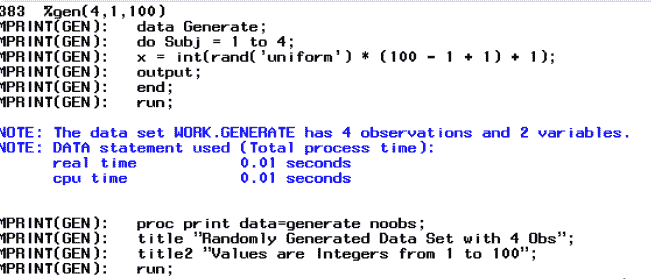

注意每个宏变量都被替换为调用序列中指定的值

以下是输出：

### 图 25.4：程序 25.4 的输出

随机生成的数据集，包含 4 个观测值，数值为 1 到 100 之间的整数

| Subj | x |
| --- | --- |
| 1 | 21 |
| 2 | 72 |
| 3 | 77 |
| 4 | 1 |

当你调用该宏时，语句末尾没有分号。如果你查看生成的 SAS 代码（在之前的 SAS 日志中），你会发现每个生成的 SAS 语句都以分号结尾的。请记住，SAS 宏可能会生成 SAS 代码的片段，有时甚至是其他 SAS 语句的组成部分。因此，在调用宏时带上分号可能会导致错误。

## 25.6 描述位置参数和关键字宏参数

程序 25.4 所示的宏使用了所谓的“位置参数”（positional parameters）。也就是说，宏名称后面括号内的宏变量用逗号隔开。当你调用此宏时，你还需要按顺序列出想要替换每个宏变量的变量，并同样用逗号隔开。

另一种（至少在本人看来是更优越的）指定宏参数的方法。它被称为“关键字参数”（keyword parameters）。你在参数列表中的每个宏变量后跟一个等号。当调用宏时，你列出参数名称，后面跟着一个等号，然后是你想要替换宏变量的值。

以下是程序 25.4 的重写版本，改用了关键字参数。程序中还包含了对这些参数的推荐记录方法。

### 图 25.5：使用关键字参数重写后的程序 25.4

```sas
%macro Gen(n= /* 随机数的个数 */
Start= /* 起始 */
End=    /* 结束值 */
n****************************************************
示例：生成从 1 到 100 的 4 个随机数使用：
%Gen(n=4, Start=1, End=100)
****************************************************
data Generate;
do Subj = 1 to &n;
  x = int(rand('uniform')) * (&End - &Start + 1) + &Start;
  output;
end;
```

```sas
proc print data=Generate noobs;
title "随机生成的包含 &n 个观测值的数据";ntitle2 "数值为 &Start 到 &End 之间的整数"
run;
%mend Gen;
```

你可以这样调用宏：

```sas
%Gen(n=4, Start=1, End=100)
```

这种方法看起来比简单用逗号列出参数要繁琐一些。然而，关键字参数具有以下优点：

- 它提供了更好的文档说明。阅读你调用例程的人可以看到每个宏变量关联的值值。
- 你可以以任何顺序列出参数。当你调用位置参数时，它们必须按照它们在宏定义中列出的顺序来排列。
- 你在编写宏时可以提供默认值。如果你调用宏时漏掉了某个定义了默认值的参数，则将使用该默认值——如果你为该参数提供了值，则它将覆盖默认值。

例如，假设你想写一个宏来打印数据集的 `n` 个观测值。该宏还会打印一个标题，说明打印了多少个观测值。最后，如果你在调用程序时没有指定 `n` 的值，你想设置一个 10 个观测值的默认值。

下面的程序 25.6 显示了这样一个宏：

## 程序 25.6：演示关键字参数和默认值的宏

```sas
%macro Print (Dsn= /* 要打印的数据集名称 */
n=10, /* 设置打印的观测值数量，默认
为 10 */);\ntitle "列出数据集 &Dsn"
title2 "前 &n 个观测值"
proc print data=\&Dsn (Obs=\&n) noobs;
run;
%mend Print;
```

如果你像这样调用宏：

```sas
%Print (Dsn=Learn.Blood, n=3)
```

输出看起来如下所示：

### 图 25.5：调用宏的输出

列出数据集 Learn.Blood

前 3 个观测值

| Subject | Gender | AgeGroup | WBC | RBC | Chol |
| --- | --- | --- | --- | --- | --- |
| 1 | Female | AB | Young | 7710 | 7.40 | 258 |
| 2 | Male | AB | Old | 6560 | 4.70 |  |
| 3 | Male | A | Young | 5690 | 7.53 | 184 |

注意设置 `n = 3` 覆盖了 10 的默认值。如果你这样调用宏（不指定 `n` 的值）：

```sas
%Print Dsn=Learn.Blood
```

你将获得 `Learn.Blood` 数据集中前 10 个观测值的列表。考虑到关键字参数的所有优点，作者将在本章剩余的宏中使用这种方法。

> 注意：这与第一版不同，第一版中所有的宏示例都使用了位置参数。即使是“老顽条”也能学到新招式！

## 25.7 关于标记（Tokens）的说明

SAS 宏处理器必须确定宏变量从哪里开始以及哪里结束。在上一个例子中，每次使用宏变量时，后面都跟着一个无效的字符。假设你想生成这样的这样的数据集：

### 程序 25.7：演示宏变量的问题

```sas
%let prefix = abc;

data prefix123;
x = 3;
run;
```

这里是 SAS 日志：

通过示例学习 SAS：程序员指南，第二版

### 图 25.6：25.7 的 SAS 日志

```
%let prefix = abc;

data prefix123;
x = 3;
run;
```

这条消息告诉你好，宏处理器无法解析 `&prefix`。处理器认为宏变量的名字是 `prefix123`。为了告诉 SAS 宏变量在哪里结束，你可以使用一个点：

```sas
%let prefix = abc;

data &prefix.123;
x = 3;
run;
```

这里是 SAS 日志：

### 图 25.7：25.8 的 SAS 日志

```
%let prefix = abc;

data &prefix.123;
x = 3;
run;
```

注意 SAS 解析了宏变量，结果为 `abc123`。

## 25.8 使用宏变量作为前缀的示例

假设你想使用宏变量来指定 `libref`（数据集的第一部分）。你可能想编写这样的程序：

```sas
%let libref = learn;

proc print data=&libref.survey;
    title "列出 Survey";
run;
```

当你尝试运行此程序时会发生什么：

发生了什么？`&libref` 和名称之间的点被宏处理器消耗掉了。处理器认为宏变量的名字是 `libref`。由于缺少点，SAS 正在创建一个名为 `LearnSurvey` 的数据集。解决方案（尽管看起来很）是使用两个点：一个用于告诉宏处理器宏变量在哪里结束，另一个用于分隔 `libref` 和数据集名称。

```sas
%let libref = learn;

proc print data=&libref..survey;
    title "列出 SURVEY"
run;
```

注意 SAS 解析了宏变量，结果为 `Learn.Survey`。

## 25.9 使用宏变量在 DATA 步之间传输值

在宏外部定义的宏变量默认是全局的。也就是说，它们在 SAS 会话期间保持其值。这使得它们成为在 DATA 步之间传输值的有用工具。

# 434 实例学习 SAS：程序员指南，第二版

举例来说，假设你运行了 `PROC MEANS` 来计算 `Blood` 数据集中 `RBC` 和 `WBC` 的平均值，并想将 `RBC` 和 `WBC` 的每个单独观测值与平均值进行比较。实现此目标的方法之一是在你的 `DATA` 步中包含一个条件 `set` 语句，如下所示：

```sas
if _n_ = 1 then set Means;
```

在这里，`Means` 是由 `PROC MEANS` 生成的包含单条观测值的数据集。另一种方法是使用宏变量来存储平均值。以下是程序：

## 程序 25.11：使用宏变量将值从一个 DATA 步传输到另一个 DATA 步

```sas
proc means data=learn.Blood noprint
  var RBC WBC;
  output out=Means mean= autoname;
run;

data _null;
  set Means;
  call symputx('AveRBC', RBC_Mean);
  call symputx('AveWBC', WBC_Mean);
run;

data New;
  set learn.Blood(obs=5 keep=Subject RBC);
  Per_RBC = RBC / &AveRBC;
  Per_WBC = WBC / &AveWBC;
  format Per_RBC Per_WBC percent8.;
run;
```

`PROC MEANS` 创建了一个数据集（在本例中称为 `Means`），包含一条观测值和两个变量（`RBC_Mean` 和 `WBC_Mean`），它们分别代表 `RBC` 和 `WBC` 的平均值。

> 注意：提点一下，`PROC MEANS` 中 `OUTPUT` 语句的 `AUTENAME` 选项意味着输出数据集中的变量将通过使用变量名并在统计量名称后添加下划线来自动生成。这就是为什么变量是 `RBC_Mean` 和 `WBC_Mean`。

`DATA _NULL` 步使用了一个名为 `SYMPUTX` 的 `CALL` 过程。该 `CALL` 过程将 `DATA` 步变量的值赋值给宏变量，第二个参数是 `DATA` 步变量名。你在这里无法使用 `%LET` 语句，因为你无法提前知道 `RBC_Mean` 或 `WBC_Mean` 的值。

当这个 `DATA` 步执行时，两个宏变量（`RBC_Ave` 和 `WBC_Ave`）中的都将是平均值。这两个宏变量的值在同一个 `DATA` 步中是不可用的，因此需要最后一个 `DATA` 步。

在最后一个 `DATA` 步中，变量 `Percent_RBC` 和 `Percent_WBC` 通过将当前观测值的值除以平均值计算得出。你可能会好奇为什么该语句没有将结果乘以 100 来创建百分比。SAS 格式 `PERCENT` 不仅会添加百分号，还会乘以 100。

以下是数据集 `Compare_to_Mean` 的列表：

## 第 25 章：介绍 SAS 宏语言 435

### 图 25.10：数据集 Compare_to_Mean 的部分列表

## 数据集 Compare_to_Mean 的列表

| Subject | WBC | RBC | Percent_RBC | Percent_WBC |
| :--- | :--- | :--- | :--- | :--- |
| 1 | 7710 | 7.40 | 135% | 109% |
| 2 | 6560 | 4.70 | 86% | 93% |
| 3 | 5690 | 7.53 | 137% | 81% |
| 4 | 6680 | 6.85 | 125% | 95% |
| 5 | | 7.72 | 141% | |
| 6 | 6140 | 3.69 | 67% | 87% |
| 7 | 6550 | 4.78 | 87% | 93% |
| 8 | 5200 | 4.96 | 90% | 74% |
| 9 | | 5.56 | 103% | |
| 10 | 7710 | 5.58 | 104% | 109% |

希望这段对 SAS 宏的非常简要的介绍向你展示了 SAS 宏语言并没有你想象的那么可怕，并赋予了你在自己的程序中尝试它们的勇气。

## 25.10 习

奇数题的解答位于书末。所有问题的解答均供教授使用。如果你是教授，请访问书籍的配套网站 `support.sas.com/cody` 获取有关如何获取所有问题解答的信息。

- 1. 使用 `PROC PRINT` 列出数据集中的前五个观测值。使用系统宏变量 `&SYSD`（返回星期几）、`&SYSDATE` 和 `&SYSTIME` 来自定义标题（见下例，该示例是在周五运行的）：

| Produced on Sunday, 10DEC2017 at 10:02 |
| Date | Price |
| :--- | :--- |
| 01/01/2017 | $34 |
| 01/02/2017 | $39 |
| 01/03/2017 | $39 |
| 01/04/2017 | $30 |

- 2. 将以下程序转换为宏，使其更具通用性。使用数据集名 (`DS`)、类名 (`Classes`) 和变量作为参数：

```sas
title "Statistics from Data";
proc means data=;
class;
run;
```

- 3. 创建宏 (`Stats`) 列出数据集中的前五个观测值。你的输出如下：

```sas
title "Square from Data";
proc print data=;obs=5);
run;
```

| Country | Model | Manuf | Units | TotalSales |
|---|---|---|---|---|
| USA | Road Bike | Trek | 5000 | $2200 |
| USA | Road Bike | Cannondale | 4000 | $2100 |
| USA | Mountain Bike | Trek | 6000 | $1200 |
| USA | Mountain Bike | Cannondale | 7000 | $1000 |

- 4. 列出变量 `TimeMile`、`RestPulse` 和 `MaxPulse`。除了这些变量，创建三个新变量 `P_TimeMile`、`P_RestPulse` 和 `P_MaxPulse`，表示相对于平均值的百分比。先通过 `PROC MEANS` 计算平均值，然后在 `DATA _NULL` 步中使用 `CALL SYMP` 创建宏变量。

## 第 26 章：介绍结构化查询语言

- 26.1 介绍 ................................................................ 437
- 26.2 基础知识 ................................................................................. 437
- 26.3 合并两个表 (Merge) ................................................................ 439
- 26.4 左连接、右连接和全连接...................................................... 444
- 26.5 拼接数据集............................................................................... 446
- 26.6 使用汇总函数.............................................................. 449
- 26.7  ORDER 子句.................................................. 450
- 26.8 模糊匹配示例.................................................... 451
- 26.9 习....................................................................................... 452

## 26.1 介绍

`PROC SQL`（结构化查询语言——通常读作 sequel）为查询和合并 SAS 数据集提供了替代方法。某些任务 `PROC SQL` 执行比 `DATA` 步更好、更简单。其他任务使用 `DATA` 步可能会更容易或更高效。你可能熟悉 SAS SQL 与 `DATA` 步，反之亦然。最好的建议是学习两者，并在每个情况下使用最合适的工具。

本章仅涉及 `PROC SQL` 的基础知识。SAS 出版的一些优秀书籍你可能想要拥有。请访问 `http://go.documentation.sas.com` 或 SAS Press 系列书籍获取更多关于 `PROC`

## 26.2 基础知识

熟悉 SAS 语法的程序员在开始使用 `PROC SQL` 时可能会遇到困难。例如，在 `PROC SQL` 中，你使用逗号而不是空格来分隔变量和数据集名。你可能还会发现自己在不该加的地方加了分号。让我们从一些简单的查询数据集以及从较大的 SAS 数据集中筛选创建 SAS 数据集的示例开始。

`SELECT`、`FROM` 和 `WHERE` 构成了一个单一查询，并以分号结束。在你的示例中，你没有创建输出数据集，因此默认情况下，此查询的结果将以列表的形式发送到输出窗口（或你指定的任何输出位置）。最后，查询以一个 `QUIT` 语句结束。你不需要 `RUN` 语句，因为 `PROC SQL` 在指定一个完整的查询后就会执行。如果你不包含 `QUIT` 语句，`PROC SQL` 将留在内存中以便进行另一个查询。

# 第 26 章：介绍结构化查询语言 439

以下是该程序产生的输出：

### 图 26.2：程序 26.1 的输出

| Subj | Height | Weight |
|---|---|---|
| 001 | 68 | 155 |
| 003 | 74 | 250 |


如果你想从数据集中所有变量，可以使用星号（`*`），如下所示：

### 程序 26.2：使用星号选择数据集中的所有变量

```
proc sql;
select *
from Learn.Health
where Height gt 65;
quit;
```

如果你想将查询结果存储在 SAS 数据集中，请包含一个 `CREATE TABLE` 语句，如下所示：

### 程序 26.3：使用 PROC SQL 创建 SAS 数据集

```
proc sql;
create table Height65 as
select *
from Learn.Health
where Height gt 65;
quit;
```

## 26.3 合并两个表 (Merge)

使用两个表（上一个示例中的表）和 `Demographic` 表，用于演示使用 `PROC SQL` 执行连接的各种方法。以下是这两个表的列表：

### 图 26.3：Health 和 Demographic 表的列表

| Subj | Height | Weight | Subj | DOB | Gender | Name |
|---|---|---|---|---|---|---|
| 001 | 68 | 155 | 001 | 10/15/1960 | M | Friedman |
| 003 | 74 | 250 | 002 | 08/01/1955 | M | Stern |
| 004 | 63 | 110 | 003 | 12/25/1988 | F | McGoldrick |
| 005 | 60 | 95 | 005 | 05/28/1949 | F | Chien |

440 实例教程学习 SAS：程序员指南，第二版

你可以通过在 `SELECT` 子句中列出所有感兴趣的变量，并在 `FROM` 子句中列出两个数据集，从两个表中选择变量。如果一个变量在两个数据集中具有相同的名称，你需要一种方法来区分使用哪一个数据集。操作方法如下：

### 程序 26.4：连接两个表（笛卡尔积）

```
title "Demonstrating a Cartesian Product";
proc sql;
select Health.Subj,
      Demographic.Subj,
      Height,
      Weight,
      Name,
      Gender
from Learn.Health,
     Learn.Demographic;
quit;
```

因为 `Subj` 列存在于两个表中，所以你在变量名前前面加上了表名。你几分钟后就会发现你可以简化这部分。此查询的结果被称为笛卡尔积，它代表了第一个表的行与第二个表的行之间所有可能的组合。列表显示了两个列，标题都为 `Subj`。

以下是结果的列表：

### 图 26.4：程序 26.4 的输出

演示笛卡尔积

| Subj | Subj | Height | Weight | Name | Gender |
|---|---|---|---|---|---|
| 001 | 001 | 68 | 155 | Friedman | M |
| 001 | 002 | 68 | 155 | Stern | M |
| 001 | 003 | 68 | 155 | McGoldrick | F |
| 001 | 005 | 68 | 155 | Chien | F |
| 003 | 001 | 74 | 250 | Friedman | M |
| 003 | 002 | 74 | 250 | Stern | M |
| 003 | 003 | 74 | 250 | McGoldrick | F |
| 003 | 005 | 74 | 250 | Chien | F |
| 004 | 001 | 63 | 110 | Friedman | M |
| 004 | 002 | 63 | 110 | Stern | M |
| 004 | 003 | 63 | 110 | McGoldrick | F |
| 004 | 005 | 63 | 110 | Chien | F |
| 005 | 001 | 60 | 95 | Friedman | M |
| 005 | 002 | 60 | 95 | Stern | M |
| 005 | 003 | 60 | 95 | McGoldrick | F |
| 005 | 005 | 60 | 95 | Chien | F |

如果你使用此查询来创建 SAS 数据集，将只有一个名为 `Subj` 的变量。如果你想保留每个数据集中的 `Subj` 值，你可以重命名这些列，如下所示：

### 程序 26.5：重命名两个 Sub 变量

```
title "Renaming the Two Sub Variables";
proc sql;
  select Health.Subj as Health_Subj,
       Demographic.Subj as Demog_Subj,
       Height,
       Weight,
       Name,
       Gender
from Learn.Health,
     Learn.Demographic;
quit;
```

运行此查询得到结果结果：

442 实例教程学习 SAS：程序员指南，第二版

### 图 26.5：程序 26.5 的部分输出

| Health_Subj | Demog_Subj | Height | Weight | Name | Gender |
|---|---|---|---|---|---|
| 001 | 001 | 68 | 155 | Friedman | M |
| 001 | 002 | 68 | 155 | Stern | M |
| 001 | 003 | 68 | 155 | McGoldrick | F |
| 001 | 005 | 68 | 155 | Chien | F |
| 003 | 001 | 74 | 250 | Friedman | M |
| 003 | 002 | 74 | 250 | Stern | M |
| 003 | 003 | 74 | 250 | McGoldrick | F |

注意，两个主题列已重命名。

当你想要对两个表中相似的名称进行匹配（有时是模糊合并）时，笛卡尔积特别有用。此表中的行数等于第一张表的行数乘以第二个表的行数。在实践中，你可能希望添加一个 `WHERE` 子句来限制选择的行。在我们的程序中，我们添加了 `WHERE` 子句，仅选择两个表中主题相同的行。

除了添加 `WHERE` 子句外，下一个程序还展示了如何区分两个标题为 `Subj` 的列。最后，下一个程序使用更简单的方法在 `SELECT` 子句中命名两个 `Subj` 变量。其代码如下：

### 程序 26.6：使用简化命名变量

```
title "Matching Subj Numbers from Both Tables";
proc sql;
    select H.Subj as Subj_Health,
         D.Subj as Subj_Demog,
         Height,
         Name,
         Gender
    from Learn.Health as H,
         Learn.Demographic as D
    where H.Subj eq D.Subj;
quit;
```

首先查看 `FROM` 子句。为了给不同表中具有相同名称的变量命名，在这个程序中为它们每个都 使用了别名 `H` 和 `D`。你可以将这些别名作为 `SELECT` 子句中的前缀（`H.Subj` 和 `D.Subj`）。在程序程序中，添加了 `WHERE` 子句，将结果限制为两个表中主题编号相同的行。结果如下：

第 26 章：介绍结构化查询语言 439

### 图 26.6：来自两个表的主题编号

| Subj_Health | Subj_Demog | Height | Weight | Name | Gender |
|---|---|---|---|---|---|
| 001 | 001 | 68 | 155 | Friedman | M |
| 001 | 002 | 68 | 155 | Stern | M |
| 001 | 003 | 68 | 155 | McGoldrick | F |
| 001 | 005 | 68 | 155 | Chien | F |
| 003 | 001 | 74 | 250 | Friedman | M |
| 003 | 002 | 74 | 250 | Stern | M |
| 003 | 003 | 74 | 250 | McGoldrick | F |

第 26 章：介绍结构化查询语言 445

### 程序 26.9: 演示左连接、右连接和全连接

```sas
proc sql;
    title "Left Join"
    select H.Subj as Subj_Health,
           D.Subj as Subj_Demog,
           Height,
           Gender
    from Learn.Health as H left join
         Learn.demographic as D
    on H.Subj eq D.Subj;

    title "Right Join"
    select H.Subj as Subj_Health,
           D.Subj as Subj_Demog,
           Height,
           Gender
    from Learn.Health as H right join
         Learn.demographic as D
    on H.Subj eq D.Subj;

    title "Full Join"
    select H.Subj as Subj_Health,
           D.Subj as Subj_Demog,
           Height,
           Gender
    from Learn.Health as H full join
         Learn.demographic as D
    on H.Subj eq D.Subj;

quit;
```

结果如下：

### 图 26.8: 程序 26.9 的输出

| Subj_Health | Subj_Demog | Height | Gender |
|---|---|---|---|
| 001 | 001 | 68 | M |
| 003 | 003 | 74 | F |
| 004 | | 63 | |

左连接

| Subj_Health | Subj_Demog | Height | Gender |
|---|---|---|---|
| 001 | 001 | 68 | M |
| | 002 | | M |
| 003 | 003 | 74 | F |
| 005 | 005 | 60 | F |

右连接

| Subj_Health | Subj_Demog | Height | Gender |
|---|---|---|---|
| 001 | 001 | 68 | M |
| | 002 | | M |
| 003 | 003 | 74 | F |
| 004 | | 63 | |
| 005 | 005 | 60 | F |

全连接

检查此输出有助于理清不同类型连接之间的区别。

## 26.5 合并数据集

在 `DATA` 步中，通过在单个 `SET` 语句中命名两个数据集来合并它们。在 `PROC SQL` 中，你使用 `UNION` 运算符来合并来自两个表的查询结果。与 `DATA` 步不同，`UNION` 运算符有不同的“类型”。以下是总结。

| 运算符 | 描述 |
|---|---|
| Union | 按列位置（而非按列名）匹配并删除重复行 |
| Union All | 按列位置匹配但不删除重复行。 |
| Union Corresponding | 按列名匹配并删除重复行。 |
| Union All Corresponding | 按列名匹配且不产生重复行。 |
| Except | 按列名匹配并删除在两个表中都存在的行 |
| Intersection | 按列名匹配并保留两个表中的唯一行 |

`UNION ALL CORRESPONDING` 运算符等于在 `DATA` 步的 `SET` 语句中命名两个数据集。

必须意识到这一点：如果不使用 `CORRESPONDING` 关键字，`UNION` 运算符将导致两个数据集按列位置而非列名进行合并。这在这里的示例中得到了体现。

创建 `New_Members` 数据集是为了说明各种类型的合并。以下是该列表：

### 图 26.9: 数据集 New_Members 的列表

| Subj | Gender | Name | DOB |
|---|---|---|---|
| 010 | F | Ostermeier | 03/05/1977 |
| 013 | M | Brown | 06/07/1999 |

作为参考，这里是数据集 `Demographic` 的列表：

### 图 26.10: Demographic 的列表

数据集 Demographic 的列表

| Subj | DOB | Gender | Name |
|---|---|---|---|
| 001 | 10/15/1960 | M | Friedman |
| 002 | 08/01/1955 | M | Stern |
| 003 | 12/25/1988 | F | McGoldrick |
| 005 | 05/28/1949 | F | Chien |

假设你想将这些新成员添加到 `Demographic` 数据集中，并将新数据集命名为 `Complete_List`。以下是使用 `PROC SQL` 实现的方法。（注意列的顺序与 `Demographic` 数据集不同）。

### 程序 26.10: 合并两个表

```sas
proc sql;
create table Complete_List as
select *
from Learn.Demographic union all corresponding
select *
from Learn.New_Members
quit;
```

生成的表包含 `Demographic` 的所有行，随后是 `New_Members` 的所有行。

### 程序 26.11: 数据集 Complete_List 的输出

| Subj | DOB | Gender | Name |
|---|---|---|---|
| 001 | 10/15/1960 | M | Friedman |
| 002 | 08/01/1955 | M | Stern |
| 003 | 12/25/1988 | F | McGoldrick |
| 005 | 05/28/1949 | F | Chien |
| 010 | 03/05/1977 | F | Ostermier |
| 013 | 06/07/1999 | M | Brown |

如果遗漏了 `CORRESPOND` 关键字，结果如下（SAS 日志）：

### 图 26.12: 省略 CORRESPOND 时的生成日志

```log
90 proc sql;
91 create table Complete_List as
92 select *
93 from Learn.Demographic union all
94 select *
95 from Learn.New_Members
96 quit;
97 ERROR: Column 2 from the first contributor of UNION ALL is not the same
98 type as its counterpart from the second.
99 ERROR: Column 4 from the first contributor of UNION ALL is not the same
100 type as its counterpart from the second.
```

如果碰巧两个数据集中的数据类型按列匹配，SQL 将执行合并操作。为了理解这一点，这里有另一个数据集 `New_Members_Order`，其列的顺序发生了变化：

### 图 26.13: New_Members_Order 的列表

数据集 New_Members_Order 的列表

| Name | DOB | Gender | Subj |
|---|---|---|---|
| Ostermeier | 03/05/1977 | F | 010 |
| Brown | 06/07/1999 | M | 013 |

`New_Members_Order` 的四列中的每一列其数据类型都与 `New_Members_Order` 的四列相同（字符或数值）。因此，如果你在对这些数据集进行合并时省略了 `CORRESPOND` 关键字，你将获得如下：

### 图 26.14: 省略 CORRESPOND 的结果

省略 CORRESPOND 的数据集 Complete_List 列表

| Subj | DOB | Gender | Name |
|---|---|---|---|
| 001 | 10/15/1960 | M | Friedman |
| 002 | 08/01/1955 | M | Stern |
| 003 | 12/25/1988 | F | McGoldrick |
| 005 | 05/28/1949 | F | Chien |
| 010 | 03/05/1977 | F | Ostermeier |


| 013 | 06/07/1999 | M | Brown |

现在你可以明白为什么在合并数据集时需要选择正确的运算符。

## 26.6 使用聚合函数

你可以使用 `MEAN` 和 `SUM` 函数创建表示其他变量平均值或和的新变量。以下程序了 `PROC SQL` 的优势之一，即向现有表添加汇总。假设你想将 `Health` 数据集中每个人的身高表示为所有受试者平均高度的比例。你需要先使用 `PROC` 创建包含平均值的数据集，然后将其与原始数据集合并并计算。

### 程序 26.11: 在 SQL 中使用聚合函数

```sas
proc sql;
select Subj,
    Height,
    Weight,
    mean(Height) as Ave_Height,
    100*Height/Calculated Ave_Height as
    Percent_Height
from Learn.Health
;
```

平均值通过 `MEAN` 函数计算。该值也被赋予变量名 `Ave_Height`。当你在中使用该变量时，需要在前面加上 `CALCULATED` 关键字，这样 `PROC SQL` 才会在数据集中查找该变量。结果如下：

**图 26.15:** 程序 26.11 的输出

| Subj | Height | Weight | Ave_Height | Percent_Height |
|---|---|---|---|---|
| 001 | 68 | 155 | 66.25 | 102.641 |
| 003 | 74 | 250 | 66.25 | 111.6981 |
| 004 | 63 | 110 | 66.25 | 95.09432 |
| 005 | 60 | 95 | 66.25 | 90.56604 |

## 26.7 演示 ORDER 子句

如果你使用 `ORDER` 子句，`PROC SQL` 也可以对你的表进行排序。例如，如果你想按身高顺序排列 `Health` 表中的受试者，请使用以下代码：

### 程序 26.12: 演示 ORDER 子句

```sas
title "Listing in Height Order";
proc sql;
select Subj,
    Height,
    Weight
from Learn.Height
order by Height;
;
```

结果（未显示）是按身高递增排列的变量 `Subj`、`Height` 和 `Weight` 的列表。

# 第 26 章：介绍结构化查询语言 451

## 26.8 模糊匹配示例

`PROC SQL` 的优点之一是它能够创建笛卡尔积。正如本章前面提到的，笛卡尔积是将一个表中的每一行与另一个表的每一行进行配对。这里有两个数据集：`Demographic`（用于本章中的许多示例）和 `Insurance`。

图 26.16：数据集 `Demographic` 和 `Insurance` 的列出列表

| Subj | DOB | Gender | Name | Name | Type |
|---|---|---|---|---|---|
| 001 | 10/15/1960 | M | Friedman | Friedman | F |
| 002 | 08/01/1995 | M | Stern | Goldman | P |
| 003 | 12/25/1988 |  | McGold | Chein | F |
| 005 | 05/28/1949 |  | Chien | Stern | P |

您想要通过 `Name` 连接（合并）这些表，并允许姓名出现轻微的拼写错误。这是一个实现此目的的 SQL 查询：

### 程序 26.13：使用 PROC SQL 执行模糊匹配

```
title "Example of a Fuzzy Match";
proc sql;
select Subj,
Demographic.Name,
Insurance.Name
from Demographic,
Learn.Insurance
where sperdist(Demographic.Name,Insurance.Name) <= 25;
quit;
```

`SPEDIT`（拼写距离）函数允许存在拼写错误（参见第 12 章）。`WHERE` 子句对两个表中的所有名称组合进行操作，并选择拼写距离在 25 以内的名称。在实践中，您可能希望比较两个文件之间的其他变量（如 `Gender` 和 `DOB`），以增加建立有效匹配的概率。请查看后续列表，看看该程序匹配了哪些名称：

图 26.17：程序 26.13 的输出

模糊匹配示例

| Subj | Name | Name |
|---|---|---|
| 001 | Friedman | Friedman |
| 005 | Chien | Chein |
| 002 | Stern | Stern |

您可以轻松地修改此程序，使输出结果不包含完全匹配的名称。

我们仅仅触及了 SQL 功能的皮毛。希望这段对 SQL 的介绍能鼓励您学习更多。

## 26.9 练习

奇数题的解答位于书的末尾。教授可以获得所有题目的解答。如果您是教授，请访问书籍的辅助网站 `support.sas.com/cody` 获取有关如何获取所有题目解答的信息。

- 使用 `PROC SQL` 列出数据集 `Inventory` 中 `Price` 大于 20 的所有观测值。
- 重复问题 1，但使用 `PROC SQL` 创建一个新的临时 SAS 数据集 (`Price20`)，其中包含 `Inventory` 中 `Price` 大于 20 的所有观测值。
- 使用 `PROC SQL` 创建一个新的临时 SAS 数据集 (`N_Sales`)，其中包含 `Sales` 中 `Region` 值为 `North` 的观测值。在新数据集中仅包含 `Name` 和 `TotalSales` 两个变量。

此处显示 `Inventory` 和 `Purchase` 数据集：

| 数据集 Inventory 的列出 | 数据集 Purchase 的列出 |
|---|---|
| Model | Price | CustNumber | Model | Quantity |
| M567 | $23.50 | 101 | L776 | 1 |
| S888 | $12.99 | 102 | M123 | 10 |
| L776 | $159.98 | 103 | X999 | 2 |
| X999 | $29.95 | 103 | M567 | 1 |
| M123 | $4.59 |  |  |  |
| S776 | $1.99 |  |  |  |

- 使用 `PROC SQL` 列出所有购买项目，显示 `Cust Number`、`Model`、`Quantity`、`Price` 以及一个新的变量 `Cost`，其值等于 `Price` 乘以 `Quantity`。

5. 此处显示 `Left` 和 `Right` 数据集。使用 `PROC SQL` 创建一个新的临时 SAS 数据集 (`Both`)，包含 `Subj`、`Height` 和 `Salary`。通过三种方法实现：第一，仅包含位于两个数据集中的受试者；第二，包含两个数据集中的所有受试者；第三，仅包含位于 data left 中的受试者。

| 数据集 Left 的数据 |  | 数据集 Right 的数据 |  |  |
|---|---|---|---|---|
| Subj | Height | Weight | Subj | Salary |
| 001 | 68 | 155 | 001 | $46,000 |
| 002 | 75 | 220 | 003 | $67,900 |
| 003 | 65 | 99 | 005 | $28,200 |
| 005 | 79 | 266 | 006 | $98,200 |
| 006 | 70 | 190 | 007 | $88,000 |
| 009 | 61 | 122 |  |  |

6. 编写必要的 `PROC SQL` 语句以实现此处程序相同的目标：

```sas
data allproducts;
    set learn.inventory learn.newproducts;
run;
```

7. 编写必要的 `PROC SQL` 语句以实现此处程序相同的目标：

```sas
data third;
    set learn.first learn.second;
run;
```

注意！两个数据集中的变量顺序不同。此外，某些受试者编号在两个数据集中都存在。

- 使用 `PROC SQL` 列出 `Blood` 数据集中 `RBC`（红细胞）和 `WBC`（白细胞）的值。在此列表中包含两个新变量：`Percent_RBC` 和 `Percent_WBC`。这些变量是 `RBC` 和 `WBC` 占所有受试者平均值的百分比（以百分比形式表示）。列表中的第一个观测值应如下：

| RBC | WBC | Percent_RBC | Percent_WBC |
|---|---|---|---|
| 7.4 | 7710 | 13 |  |

9. 以问题 8 的方法，使用 `Blood` 数据创建两个临时数据集 `XXX` 和 `YYY`。

10. 运行以下代码创建临时 SAS 数据集 `XXX` 和 `YYY`：

```sas
data xxx;
    set learn.inventory;
newproducts;
run;

data yyy;
    set learn.inventory;
run;
```

然后编写 `PROC SQL` 语句在名称之间进行模糊匹配。结果应只有一个观测值，如下：

| Obs | Name | Name |
|---|---|---|
| 001 | Friedman | Friedman |
| 005 | Chien | Chein |
| 002 | Stern | Stern |

# 456 实例化的学习 SAS：程序员指南，第二版

你可能已经猜到 `\d` 后面的数字 `{4}` 表示重复 `\d` 四次。

你可以使用方括号 (`[` 和 `]` ) 来创建字符集。所有大写字母和小写字母都可以用 `[A-Z]`、`[A-Za-z]` 表示。

同样，数字 0-9 可以用 `[0-9]` 表示。如果你使用的是 ASCII，你也可以用 `\d` 代替 `[0-9]`。

在 SAS 中，所有的正则表达式函数都以字母 `PRX` 开头，`PRX` 代表 Perl 正则表达式（Perl Regular Expression）。由于本章是对 `PRX` 函数的介绍，因此仅描述其中两个函数。有关 SAS `PRX` 函数的更详细的讨论，请参阅由本作者编写并由 SAS Press 出版的《SAS Functions，第2版》。

## 27.3 测试社会安全号是否符合标准格式

在讨论元字符和正则表达式的其他细节之前，让我们先用一个简单的程序来验证社会安全号列表是否符合标准格式。以下是该程序：

### 程序 27.1：使用正则表达式测试社会安全号值

```sas
title "Checking Social Security Numbers Using a Regular Expression";

data _null;
    file print;
    input $$;
    if prxmatch("\d\d\d-\d\d-\d\d\d",SS) then
        put "Error for SS Number " SS;";
datalines;
123-45-6789
123456789
123-ab-9876
999-888-7777
;
```

你可能不熟悉 `DATALINES` 语句。与其编写外部文件并使用 `INFILE` 语句，你可以将数据直接放在 `DATALINES` 语句之后。`INPUT` 语句读取值就像它们在外部文件中一样。

`PRXMATCH` 函数接受两个参数。第一个参数是正则表达式，第二个参数是你正在检查的字符串。如果字符串包含正则表达式描述的模式，该函数返回该模式的起始位置。如果在字符串中没有找到正则表达式描述的模式，该函数返回零。在程序 27.1 中，正则表达式描述了典型社会安全号的模式。

以下是输出结果：

图 27.1：程序 27.1 的输出

| Checking Social Security Numbers Using a Regular Expression |
| Error for SS Number 123456789 |
| Error for SS Number 123-ab-9876 |
| Error for SS Number 999-888-777 |

列出的每个数字都不符合标准的社会安全号格式。

## 27.4 检查有效的 ZIP 邮编

你可以使用与程序 27.1 类似的程序来验证地址是否包含有效的 ZIP 邮编格式，即五位代码或五位代码后跟一个连字符和四位数字（邮编+4）。

检查五位代码或 ZIP+4 编码的正则表达式是：

```regex
/\d(5)(-\d(4))?/
```

该表达式的第一部分非常直观——它表示搜索五个数字。括号中的表达式匹配一个连字符后跟四个数字。括号后面的问号意味着搜索上一个表达式的 0 次或 1 次。因此，这个表达式匹配两种有效的 ZIP 邮编格式之一。

你可以运行程序来测试这个表达式：

### 程序 27.2：测试美国 ZIP 邮编的正则表达式

此程序读取 ZIP 邮编（允许最多 10 个字符），并对任何不匹配正则表达式的代码打印错误信息。以下是程序 27.2 的输出：

图 27.2：程序 27.2 的输出

| Testing the Regular Expression for US ZIP Codes |
| Invalid ZIP Code 12Z444 |
| Invalid ZIP Code ABCDE |

注意，所有有效的 ZIP 邮编（无论是五位代码还是 ZIP +4 代码）都通过了验证。

## 27.5 验证电话号码符合标准格式

你想搜索电话号码列表并识别任何不符合以下格式的号码：

- + (ddd) ddd-dddd

其中 d 是任何数字。为此编写正则表达式是比较棘手的，因为左括号和右括号都是特殊字符。在上一个例子中，你可能注意到在连字符和最后几个数字周围的括号允许问号（重复上一个表达式 0 次或 1 次）放在右括号之外。在正则表达式中，括号表示字符或元字符的组合。你如何指示你正在搜索标准电话号码中的左括号或右括号呢？答案是在这些特殊字符之前放置一个反斜杠 (`\`)，以表示你想要将它们视为字符而不是分组符号。反斜字符有时被称为转义字符。因此，此处讨论的格式的电话号码正则表达式为：

```regex
/\(d\d\d\)\d\d\d-\d\d\d/
```

注意左、右括号前的反斜杠。编写标准电话号码的验证程序与程序 27.1 或 27.2 完全相同。如下所示：

### 程序 27.3：使用正则表达式测试社会安全号值

```sas
title "Checking Social Security Numbers Using a Regular Expression";

data _null;
    file print;
    input $$;
    if prxmatch("\d\d\d-\d\d-\d\d\d",SS) then
        put "Error for SS Number " SS;";
datalines;
123-45-6789
123456789
123-ab-9876
999-888-7777
;
```

## 27.6 描述 PRXPARSE 函数

许多更高级的 PRX 函数和调用程序都需要先运行一个名为 `PRXPARSE` 的函数，以获取返回代码，你用该代码来代替正则表达式。事实上，你可以在 `PRMATCH` 函数中利用 `PRXPARSE` 的优势，该函数在之前的程序中已经过。要查看它是如何工作的，这里是程序 27.1，它可以被重写为使用 `PRXPARSE` 和 `PRMATCH` 函数的组合

### 程序 27.5：演示 PRXPARSE 和 PRMATCH 函数的组合

| title | "Checking Social Security Numbers Using a Regular Expression"; |
| title2 | "Using a Combination of PRXPARSE and PRMATCH Functions"; |
| data null; | file print; | input $$; |
| Return_Code = prxparse("\d-\d-\d-\d\d\d"); |  |
| if not prxmatch(Return_Code, SS) then |  |
| put "Error for SS Number " SS;"; |  |
| data_lines; | 123-45-6789 | 123456789 | 123-ab-9876 | 999-888-7777; |

良好的做法是只执行一次 `PRXPARSE` 函数并保留返回代码。（尽管如果 `PRXPARSE` 函数的参数是常量，如此处所示，则并非必须的）。你可以这样重写程序 27.5：

## 第 27 章：引入 Perl 正则表达式 461

# 程序 27.6：重写程序 27.5 以演示一个由强迫症程序员编写程序

title "使用正则表达式检查社会安全号码";

title2 "结合 PRXPARSE 和 PRXMATCH 函数";

```sas
data _null_;
  file print;
  input SS $11;

  retain Return_Code;
  if n = 1 then
    Return_Code = prxparse("/\d\d-\d\d-\d\d\d\d/");

  if not prxmatch(Return_Code, SS) then
    put "Error for SS Number " SS;
datalines;
123-45-6789
123456789
123-ab-9876
999-888-7777
;
```

由于你只执行一次 `PRXPARSE` 函数，因此你需要一个 `RETAIN` 语句，以便变量 `Return_Code` 在 DATA 步的下一次迭代中不会被设置为缺失（Missing）。


希望你会发现，当你需要验证模式而不是字符的精确匹配时，正则表达式是极其な。你可以使用 Google 搜索几乎任何术语或短语的正则表达式。请注意，某些结果可能是错误的或过于复杂的。作者推荐的一个网站是 `www.stackoverflow.com`。

## 27.7 习题

奇数题的解答位于书末尾。所有题目的解答均供教授参考。如果你是教授，请访问书籍的配套网站 `support.sas.com/cody`，获取如何获得所有题目解答的信息。

- 1. 你有一份车牌号列表，想要提取任何不符合“三个大写字母后跟三个数字”格式的数字部分。请使用此数字列表测试你的程序：

**注意：** SASMAN 是我的德克萨斯州车牌号，SASJEDI 属于我的朋友 Mark Jordan。

`ABC123`

`SASMAN`

`SASJEDI`

`345XYZ`

`1ow987`

`WWW999`

- 2. 使用程序 27.3 中的电话号码，但假设你希望号码格式为 `ddd.ddd.dddd`，其中 `d` 是任何数字。请注意，点（`.`）在正则表达式中是一个特殊字符。它是代表任何字符的通配符。因此，在编写表达式时，必须在点之前加一个反斜杠。

- 3. 结合 `PRXPARSE` 和 `PRXMATCH` 重复习题 2。

## 奇数题解答

此 SAS 文件包含《实例学习 SAS：程序员指南》（Learning SAS by Example: A Programmer’s Guide）书中所有奇数题的解答。

你需要修改任何 `libname` 和 `infile` 语句，使其指向你计算机上相应的文件夹。转换文件中所有 `libname` 和 `infile` 语句的最简单方法是找到字符串：

```
c:\books\learning
```

并将其替换为你存放 SAS 数据集和文本文件的文件夹。如果你将 SAS 数据集和文本文件存储在不同的地方，你需要分别搜索 `libname` 和 `infile`。

```sas
libname learn 'c:\books\learning';
options fmt=(learn);
```

## 第 2 章解答

- 1-1;

```
/* 无效的变量名为：

Wt-Kg (包含连字符)

76Trombones (以连字符开头)

/
```

- 1-3;

/* 变量数量为 5

观测值数量为 10

/

- 1-5;

/* 数值的默认长度为 8 */ /

## 第 2 章解答

- 2-1;

```sas
Program name: stocks.sas in c:\books\learning
Purpose: 读取股票价格的原始数据并
计算值
Programmer: Ron Cody
Date: 2006年6月23日
```

```sas
*a;
data portfolio;
  infile 'c:\books\learning\stocks.txt';
  input Symbol $ Price Number;
  Value = Number*Price;
```

```sas
title "Listing of Portfolio"
proc print data=portfolio noobs;
run;
```


## 464 实例学习 SAS：程序员指南，第二版

```sas
*b;
title "Means and Sums of Portfolio Variables";
proc means data=portfolio n mean sum maxdec=0;
var Price Number;
```

```sas
run;
```

*2-3;
/*
EMF = 1.45*V + (R/E)*v**3 - 125;
*/
```

```sas
*2-5;
/*需要 $ Gender*/
data XYZ;
  infile 'c:\books\learning\XYZ.txt';
  input Gender $ X Y Z;
  Sum = X + y + Z;
datalines;
Male 1 2 3
Female 4 5 6
Male 7 8 9
run;
```

## 第 3 章解答

```sas
*3-1;
*= c;
data scores;
  infile 'c:\books\learning\scores.txt';
  input Gender : $;
  English
  History
  Math
  Science;
  Average = (English + History + Math + Science) / 4;
run;
```

```sas
title "Listing of SCORES";
proc print data=scores noobobs;
run;
```

```sas
*3-3;
data company;
  infile 'c:\books\learning\company.txt' dsd dlm='$';
  input LastName $ EmpNo $ Salary;
  format Salary dollar10.; /*可选语句 */
run;
```

```sas
title "Listing of COMPANY";
proc print data=company noobobs;
run;
```

```sas
*3-5
testdata;
data;
  input X Y;
  Z = 100 + 50*X + 2*X**2 - 25*Y + Y**2;
datalines;
1 2
3 5
5 9
9 11
```

```sas
title "Listing of TESTDATA";
proc print data=testdata noobs;
run;
```

```sas
*3-7;
data scores;
  infile 'c:\books\learning\scores.txt';
  input Gender : $;
  English
  History

Math
  Science;
  Average = (English + History + Math + Science) / 4;
run;
```

```sas
title "Listing of SCORES";
proc print data=scores noobobs;
run;
```

```sas
*2-5;
data XYZ;
  infile 'c:\books\learning\XYZ.txt';
  input Gender $ X Y Z;
  Sum = X + y + Z;
datalines;
Male 1 2 3
Female 4 5 6
Male 7 8 9
run;
```

# 468 实例实例 SAS 学习：程序员指南，第二版

```sas
21-40 = '2'
41-60 = '3'
61-80 = '4'
81-high = '5';
nrun;
```

## 第6 章答案

```sas
*6-1;
/*
文件 --> 导入数据
选择 Excel 并选择 Drugtest.xls。
*/

*6-3;
*修改此 libname 语句;
libname maxit 'c:\books\learning\soccer.xls'
title="使用引擎读取数据";
proc print data=readit.soccer$ noobs;
run;
```

## 第7 章答案

```sas
*7-1;
data school;
input Age Quiz : $1 Midterm Final;
if Age = 12 then Grade = 6;
else if Age = 13 then Grade = 9;
if Quiz = 'A' then QuizGrade = 95;
if Quiz = 'B' then QuizGrade = 85;
else if Quiz = 'C' then QuizGrade = 75;
else if Quiz = 'D' then QuizGrade = 70;
else if Quiz = 'P' then QuizGrade = 65;
FinalGrade = .2*QuizGrade + .3*Midterm + .5*Final;
datalines;
12 A 92 95
12 B 88 88
13 C 70 75
13 A 92 93
12 F 55 62
13 B 88 82;
;
```

```sas
title "SCHOOL 列表";
proc print data=school noobs;
run;
```

```sas
*7-3;
title "从 SALES 中筛选员工";
proc print data=learn.sales;
where EmpID = '9888' or EmpID = '0177';
run;
```

```sas
proc print data=learn.sales;
where EmpID in ('9888' '0177');
run;
```

```sas
*7-5;
data blood;
set learn.blood;
```

```sas
length CholGroup = $6;
select;
when (missing(Chol)) CholGroup = ' ';
when (Chol le 110) CholGroup = 'Low';
when (Chol le 140) CholGroup = 'Medium';
otherwise CholGroup = 'High';
end;
run;

title "BLOOD 列表";
proc print data=blood noobs;
run;

*7-7;
```

```sas
title "从 BICYCLES 中筛选观测值";

proc print data=learn.bicycles noobs;

where Model="Road Bike" and UnitCost gt 2500

or Model="Hybrid" and UnitCost gt 660;
```

*注：不需要括号，因为 AND 操作是先执行的。你可以包含

run;

```

## 第8 章答案

```sas
*8-1;
data vitals;
input ID : $3.
Age
Pulse
SBP
DBP;
label SBP = "收缩压"
DBP = "舒张压";
datal;
001 23 68 120 80
002 55 72 188 96
003 78 82 200 100
004 18 58 116 70
005 43 52 120 82
006 37 74 150 98
007 82 140 100
;

***注：此程序假设 Pulse 或 SBP 没有缺失值；
data newvisits;
set vitals;
if Age lt 50 and not missing(Age) then do;
if Pulse lt 70 then PulseGroup = 'Low';
else PulseGroup = 'High';
if SBP lt 140 then SBPGroup = 'Low';
else SBPGroup = 'High';
end;
if Age ge 50 then do;
if Pulse lt 74 then PulseGroup = 'Low';
else PulseGroup = 'High';
if SBP lt 140 then SBPGroup = 'Low';
else SBPGroup = 'High';
end;
run;
```

# 470 实例实例 SAS 学习：程序员指南，第二版

```sas
title "NEWVITALS 列表";
proc print data=newvitals noobs;
run;

*8-3;
data test;
  input Score-Score3;
  Subj + 1;
datalines;
90 88 92
75 76 88
88 82 91
72 68 70
;

title "TEST 列表";
proc print data=test noobs;
run;

*8-5;
data logs;
do N = 1 to 20;
  LogN = log(N);
  output;
end;
run;

title "LOGS 列表";
proc print data=logs noobs;
run;

*8-7;
data plotit;
do x = 0 to 10 by .1;
  y = 3*x*2 - 5*x + 10;
  output;
end;
run;

title "问题 7";
proc sgplot data=plotit;
  series x=x y=y;
run;

*8-9;
data temperatures;
do Day = 'Mon','Tue','Wed','Thu','Fri','Sat','Sun';
  input Temp @;
  output;
end;
datalines;
70 72 74 76 77 78 85;
;

title "TEMPERATURE 列表";
proc print data=temperatures noobs;
run;

*8-11;
data temperature;
  length City $7;
do City = 'Dallas', 'Houston';
do Hour = 1 to 24;
  input Temp @;
  output;
end;
datalines;
80 81 82 83 84 84 87 88 89 90 91 93 93 95 96 97 95 92 90 86 84 80 78 76 74;
;

title "Dallas 和 Houston 的温度";
proc print data=temperature;
run;

*8-13;
data money;
do Year = 1 to 99 until (Amount ge 300);
  Amount = 1000;
  do Quarter = 1 to 4;
    Amount = Amount*(25/4);
    output;
  end;
end;

title "MONEY 列表";
proc print data=money;
run;

## 第9 章答案

```sas
*9-1;

data dates;

input @1 Subj $3 mmy;

@4 Visit;

Age = ydiff(DOB,Visit);

format DOB Visit;

datalines;

01/10/1950

01/11/1950

02/02/1955

03/15/2005

05/09/2006

12/25/2006;

;

title "DATES 列表";

proc print data=dates;

run;
```

```sas
*9-3;

options yearcutoff=1910;

data year910_2006;

  input @1 Date mmyy.;

  format Date;

datalines;

01/01/1911

02/23/1905

03/15/2015

05/09/2006

12/25/2006;
```

# 472 实例实例 SAS 学习：程序员指南，第二版

```sas
*9-5;

data freq;

set learn.hosp(keep=AdminDate);

Day = weekday(AdminDate);

Month = month(AdminDate);

Year = year(AdminDate);

run;

proc format;

value days 1='Sun' 2='Mon' 3='Tue'

4='Wed' 5='Thu' 6='Fri'

7='Sat';

value months 1='Jan' 2='Feb' 3='Mar'

4='Apr' 5='May' 6='Jun'

7='Jul' 8='Aug' 9='Sep'

10='Oct' 11='Nov' 12='Dec';

end;

title "医院入院频率";

proc freq data=freq;

tables Day Month / nocum nopercent;

format Day. Month.;

run;
```

```sas
*9-7;

title "2002年7月15日之前的入院";

proc print data=learn.hosp;

where AdminDate < '15JUL2002' and

AdminDate not missing;

run;
```

```sas
*9-9;

data dates;

input (Day) Month Year;

if missing(Day) then Date = mdy(Month,15,Year);

else Date = mdy(Month,Day,Year);

format Date mmddyy.

datal;

25 12 2005

5 2 2006;

;

title "DATES 列表";

proc print data=dates noobs;

run;
```

```sas
*9-11;

data intervals;

set learn.medical;

Quarters = intck('qtr','01JAN2006'd,VisitDate);

run;

title "INTERVALS 列表";

proc print data=intervals noobs;

run;
```

```sas
*9-13;

data return;

  set learn.medical(keep=Patno,VisitDate);

  Return = intnx('month',VisitDate,6,'sameday');
```


`format` `VisitDate` `worddate`;

`run`;

`title` `"患者复诊"`;

`proc print data=return noobs`;

`run`;

## 第10 章答案

```sas
*10-1;
data subset_a;
  set learn.blood;
  where Gender = 'Female' and BloodType='AB';
  Combined = .001*WBC + RBC;
title "SUBSET_A 列表";
proc print data=subset_a noobs;
run;
```

```sas
data subset_b;
  set learn.blood;
  Combined = .001*WBC + RBC;
  if Gender = 'Female' and BloodType='AB' and Combined ge 14;
run;
title "SUBSET_B 列表";
proc print data=subset_b noobs;
run;
```

```sas
*10-3;
data lowmale lowfemale;
  set learn.blood;
  where Chol < 100 and not missing(Chol);
  /* alternative statement
  where Chol < 100 and missing(Chol)
  */
  if Gender = 'Female' then output lowfemale;
  else if Gender = 'Male' then output lowmale;
run;
title "LOWMALE 列表";
proc print data=lowmale noobs;
run;
```

```sas
title "LOWFEMALE 列表";
proc print data=lowfemale noobs;
run;
```

```sas
*10-5;
title "INVENTORY 列表";
proc print data=learn.inventory noobs;
run;
```

```sas
title "NEWPRODUCTS 列表";
proc print data=learn.newproducts noobs;
run;
```

```sas
data updated;
  set learn.inventory learn.newproducts;
run;
proc sort data=updated;
  by Model;
run;
title "updated 列表";
proc print data=updated;
run;
```

```sas
*10-7;
proc means data=learn.gym noprint;
  var fee;
  output=Meanfee(drop=type__freq_)
    Mean = / automone;
run;
```

```sas
data percent;
  set learn.gym;
  if _n = 1 then set Meanfee;
  FeePercent = round(100*fee / Fee_Mean);
  drop Fee_Mean;
run;
title "PERCENT 列表";
proc print data=percent;
run;
```

```sas
*10-9;
proc sort data=learn.inventory out=inventory;
  by Model;
run;
```

```sas
proc sort data=learn.purchase out=purchase;
  by Model;
run;
```

```sas
data pur_price;
  merge inventory
    purchase(in=InPurchase);
  by Model;
  if InPurchase;
    TotalPrice = Quantity*Price;
    format TotalPrice dollar$8.2;
run;
title "PUR_PRICE 列表";
proc print data=pur_price noobs;
run;
```

```sas
*10-11;
options mergegenob=nowarn;
data try1;
```

# 第 475 页奇数练习题解答

```sas
merge learn.inventory learn.purchase;
run;
title "Listing of TRY1";
proc print data=try1;
run;
options mergenoby=warn;
data try2;
merge learn.inventory learn.purchase;
run;
title "Listing of TRY2";
proc print data=try2;
run;
options mergenoby=error;
data try3;
merge learn.inventory learn.purchase;
run;
title "Listing of TRY3";
proc print data=try3;
run;
```

*10-13*
/* 将数值型标识符转换为字符型值的解决方案 */
proc sort data=learn.demographic_ID out=demographic_ID
by ID;
run;

data survey2;
set learn.survey2 (rename=(ID = NumID));
ID = put(NumID, z3.);
drop NumID;
run;

proc sort data=survey2;
by ID;
run;

data combine;
merge demographic_ID survey2;
by ID;
run;

title "Listing of COMBINE"
proc print data=combine noobs;
run;

/* 将字符型标识符转换为数值型值的解决方案 */
data demographic_ID;
set learn.demographic_ID(rename=(ID = CharID));
ID = input(CharID,z3.);
drop CharID;
run;

proc sort data=demographic_ID;
run;

proc sort data=learn.survey2 out=survey2;
by ID;
run;

data combine;
merge demographic_ID
survey2;
by ID;
run;

title "Listing of COMBINE";
proc print data=combine noobs;
run;

# 第 11 章解答

```sas
*11-1;
data health;
set learn.health;
BMI = (Weight/2.2) / (Height*.0254)**2;
BMIRound = round(BMI);
BMIRound2 = round(BMI,.1);
BMIGroup = round(BMI,5);
BMITunc = int (BMI);

title "Listing of HEALTH";
proc print data=health noobs;
run;

*11-3;
data miss_blood;
set learn.blood;
if (WBC) then call missing(Gender,RBC, Chol);

title "Listing of MISS_BLOOD";
proc print data=miss_blood noobs;
run;

*11-5;
data psychscore;
set learn.psych;
if n(of Score-5) ge 3 then
ScoreAve = mean(largest(1,of Score-5),
largest(2,of Score-5),
largest(3,of Score-5));
if n(of Ques-10) ge 7 then
QuesAve = mean(of Ques-10);
Composit = ScoreAve + 10*QuesAve;
keep ID ScoreAve QuesAve Composit;

title "Listing of PSYCHSCORE";
proc print data=psychscore noobs;
run;

*11-7;
data _null_;
x = 10; y = 20; z = -30;
AbsZ = abs(z);
ExpX = round(exp(x),.001);
Circumference = round(2*constant('pi')*y,.001);
put _all_;
run;

*11-9;
data fake;
do Subj = 1 to 100;
  if rand('uniform') le .4 then Gender = 'Female';
  else Gender = 'Male';
  Age = 9 + ceil(rand('uniform')*51);
  output;
end;
run;
title "Frequencies";
proc freq freq data=fake;
tables Gender / nocum;
run;
title "First 10 Observations of FAKE";
proc print data=fake(obs=10);
run;

*11-11;
data convert;
set learn.char_num(rename=
(Age = Char_Age
Weight = Char_Weight
SS = Num_SS));
Age = input(Char_Age,8);
Weight = input(Char_Weight,8);
SS = put(Num_SS,ssn1);
Zip = put(Num_Zip,z5);
drop Char_:Num_;
run;
title "Listing of CONVERT";
proc print data=convert noobs;
run;

*11-13;
data smooth;
set learn.stocks;
Price1 = lag(Price);
Price2 = lag2(Price);
Average = mean(Price, Price1, Price2);
run;
title "Plot of Price and Moving Average";
proc sgplot data=smooth;
series x=Date y=Price;
series x=Date y=Average;
run;
```

# 478 页《SAS 实例教程：程序员指南》，第二版

# 第 12 章解答

```sas
*12-1;
* 测试存储长度的一种方法是使用 LENGTH 函数，
 * 它返回存储长度，可以与返回字符字符串长度的 LENGTH 函数
 *（不计算末尾空格）进行比较；
data storage;
length A 5 B 4;
Name = 'Goldstein';
andB = A || B;
Cat = cats(A,B);
if Name = 'Smith' then Match = 'No';
else Match = 'Yes';
Substring = substr(Name,5,2);
L_A = length(A);
L_B = length(B);
L_Name = length(Name);
L_AandB = length(andB);
L_Cat = length(Cat);
L_Match = length(Match);
L_Substring = length(Substring);

title "Lengths of Character Variables";
proc print data=storage noobs;
var L_:;

| 变量 | 长度 |
| :--- | :--- |
| A | 5 |
| B | 4 |
| Name | 9 |
| AandB | 8 |
| Cat | 20 |
| Match | 2 |
| Substring | 9 |

*12-3;
data names_and_more;
set learn.names_and_more;
Name = compbl(Name);
Phone = compress(Phone,'kd');
run;
title "Listing of NAMES_AND_MORE";
proc print data=names_and_more noobs;

*12-5;
data convert_ID;
set learn.dem_ID(rename=(ID = CharID));
ID = input(CharID,z3.);
drop CharID;
run;

proc sort data=demographic_ID;
run;

proc sort data=learn.survey2 out=survey2;
by ID;
run;

data combine;

 demographic_ID
survey2;
by ID;
run;

title "Listing of COMBINE";
proc print data=combine noobs;
run;
```

```sas
*15-3;
title "Demonstrating a Compute Block";
proc report data=learn.host(obs=5);
column Subject Admit DOB Age;
define Admit / display "Admission Date" width=10;
define DOB / display;
define Subject / display width=7;
define Age / computed "Age at Admission";
ncompute Age;
Age = round(yrdrif(DOB,AdmitDate,'Actual'));
endcomp;
run;
quit;

ntitle "Patient Age Groups"
proc report data=learn.bloodpressure;
column Gender AgeGroup;
define Gender / display width=6;
define Age / computed "Age Group";
ncompute AgeGroup / length=5;
if Age gt 50 then AgeGroup = ' <= 50';
else if not missing(Age) then AgeGroup = ' > 50';
run;
quit;

*15-7;
title "Mean Cholesterol by Gender and Blood Type"
proc report data=learn.blood;
column Gender Bloodtype Chol;
define Gender / group "Blood Type" width=5;
define Chol / analysis mean "Mean Cholesterol" width=11 format=5.1;
run;
quit;

*15-9;
title "Report on the Survey Data Set"
proc report data=learn.survey split='';
column ID Gender Salary Ques-5 AveResponse
define ID / display width=4;
define Age / display width=18;
define Gender / display width=6;
define Salary / display width=10 format=dollar10;
define Ques1 / display noprint;
define Ques2 / display noprint;
define Ques3 / display noprint;
define Ques4 / display noprint;
define Ques5 / display noprint;

*Note: This solution will cause an automatic
character to numeric conversion;
compute AveResponse;
AveResponse = mean(of Ques1-Ques5);
endcomp;
************************************************
To avoid the automatic conversion, substitute
the code below for the compute block:
```

## Solutions to Odd-Numbered Exercises 483


```sas
compute AveResponse;
Q1 = input (Ques1,1.1);
Q2 = input (Ques2,1.1);
Q3 = input (Ques3,1.1);
Q4 = input (Ques4,1.1);
Q5 = input (Ques5,1.1);
AveResponse = mean (of Q1-Q5);
endcomp;
************************************************
```
```sas
define AveResponse / computed "Average" width=8 format=3.1;
run;
quit;
```

## Chapter 16 Solutions

```sas
*16-1;
options fmtsearch=(learn);
***This is where the formats.sas
placed;
title "Statistics on the College Set";
proc means data=learn.college
n
mean
median
max
maxdec=2;
var ClassRank;
run;
*16-3;
proc sort data=learn.college out=college;
by SchoolSize;
run;
title "Statistics on the College Set - Using BY";
title2 "Broken down by School Size";
proc means data=college
n
mean
median
max
maxdec=2;
by SchoolSize;
var ClassRank;
run;
title "Statistics on the College Set - Using CLASS";
title2 "Broken down by School Size";
proc means data=college
n
mean
median
max
maxdec=2;
class SchoolSize;
var ClassRank;
run;
```

## 484 Learning SAS as Example: A Programmer's Guide, Second Edition

```sas
*16-5;
proc format;
value rank 0-50 = 'Bottom Half'
51-74 = 'Third Quartile'
75-100 = 'Top Quarter';
run;
```

```sas
title "Statistics on the College Set";
ntitle "Broken by School Size";
proc means data=learn.college
n
mean
max
maxdec=2;
class ClassRank;
var GPA;
run;
```

```sas
*16-7;
proc means data=learn.college noprint;
class GenderSize;
var ClassRank GPA;
output out=summary
n=mean median= / autocompute;
data grand(drop-Gender)
bygender(drop-SchoolSize)
bysize(drop-Gender)
set summary;
if _type = '00' then output grand;
if _type = '10' then output bygender;
if _type = '11' then output cell;
run;
title "Listing of GRAND"
proc print data=grand noobs;
run;
title "Listing of GENDER"
proc print data=bygender noobs;
run;
title "Listing of BYSIZE"
proc print data=bysize noobs;
run;
title "Listing of CELL"
proc print data=cell noobs;
run;
```

## Chapter 17 Solutions

```sas
*17-1;
title "One-way Frequencies from BLOOD Data Set";
proc freq data=learn.blood;
tables Gender AgeGroup / nocum;
```

## Solutions to Odd-Numbered Exercises 485

```sas
*17-3;
proc format;
value cholgrp 00 = 'Normal'
01 = 'High'
. = 'Missing';
run;
title "Demonstrating MISSING Option"
title2 "Without MISSING Option";
proc freq data=learn.blood;
tables Chol / nocum;
format cholgrp;
run;
title "Demonstrating MISSING Option"
title2 "With MISSING Option";
proc freq data=learn.blood;
tables Chol / nocum;
format cholgrp;
run;
*17-5;
proc format;
value rank 70 = 'Low to'
71 = 'higher';
run;
title "Scholarship by Class"
proc freq data=learn.college;
tables Scholarship*ClassRank;
format ClassRank;
run;
*17-7;
title "Blood Types in Decreasing Order"
proc freq data=learn.blood;
tables BloodType / nocumpercent;
run;
```

## Chapter 18 Solutions

```sas
*18-1;
options fmtsearch=(learn);
title "Demographics from Data Set";
proc tabulate data=learn.college format=6;
class GenderSize;
tables Gender Scholarship all,
SchoolSize all / rts=15;
run;
*18-3;
proc format;
value $gender 'F' = 'Female'
'M' = 'Male';
run;
title "Demographics from Data Set";
proc tabulate data=learn.college format=6;
class GenderSize;
tables (Gender all),
SchoolSize all / rts=25;
keylabel n = 'Total';
format $gender;
run;
*18-5;
title "Descriptive Statistics";
proc means data=learn.college format=6.1;
class Gender;
var GPA;
tables GPA*(n=f. mean max)
Gender all;
keylabel n = 'Number'
all = 'Total'
mean = 'Average'
min = 'Minimum'
max = 'Maximum';
run;
*18-7;
title "More Descriptive Statistics";
proc tabulate data=learn.college format=7.1 noseps;
class Gender SchoolSize;
var GPA ClassRank;
tables all,
GPA*(median max)
ClassRank*(median=f=7. min*f=7. max*f=7.) / rts=15;
keylabel all = 'Total'
median = 'Median'
min = 'Minimum'
max = 'Maximum'
label ClassRank = 'Class Rank'
SchoolSize = 'School Size';
run;
*18-9;
title "Demonstrating Column Percents";
proc format;
value $gender = 'Female'
'M' = 'Male';
run;
proc sort data=learn.college out=college;
by descending Scholarship;
proc tabulate data=college
format=7. order=data
noseps;
class Gender Scholarship;
tables (Gender all),
(Scholarship all)*colpctn
keylabel colpctn = 'Percent'
all = 'Total'
format $gender;
run;
```

## Chapter 19 Solutions

```sas
*19-1;
options fmtsearch=(learn);
ods listing close;
ods html path='c:\books\learning' file='prob19_1.html';
title "Sending Output to an HTML File"
proc print data=learn.college(obs=8) noobs;
run;
proc means data=learn.college n mean maxdec=2
var GPA ClassRank;
run;
ods html close;
ods listing;
*19-3;
ods listing close;
ods html file='prob19_3.html' style=journal;
title "Sending Output to an HTML File"
proc print data=learn.college(obs=8) noobs;
run;
proc means data=learn.college n mean maxdec=2
var GPA ClassRank;
run;
ods html close;
ods listing;
*19-5;
ods trace on;
proc univariate data=learn.survey
var Age Salary;
run;
ods trace off;
ods selectiles;
proc univariate data=learn.survey
var Age Salary;
run;
```

## Chapter 20 Solutions

```sas
*20-1;
title "Bar Chart for the Variable"
proc sgplot data=SASHelp.Heart;
vbar Status;
run;
*20-3;
title "Mean Height by Sex"
proc sgplot data=SASHelp.Heart;
hbar sex / response=mean nofill barwidth=.25;
run;
```

## 488 Learning SAS by Example: A Programmer's Guide, Second Edition

```sas
*20-5;
title "Scatter Plot with Regression Line and Confidence Limits";
proc sgplot data=SASHelp.Heart;
  reg x=Height y=Weight / CLI;
run;
*20-7;
title "Demonstrating Bpline Smoothing"
proc sgplot data=SASHelp.Heart (obs=100);
  bspline x=Height y=Weight;
run;
*20-9;
title "Histogram for Cholesterol";
proc sgplot data=SASHelp.Heart;
histogram Cholesterol;
run;
*20-11;
title "Horizontal Box Plots";
proc sgplot data=SASHelp.Heart;
hhbox Cholesterol / group=Sex;
run;
```

## Chapter 21 Solutions

```sas
*21-1;
data prob21_1;
infile 'C:\books\learning\test_scores.txt' missover;
/* or truncator */
input Score1-3;
run;
title "Listing of PRO21_1";
proc print data=prob21_1 noobs;
run;
*21-3;
data prob21_3;
infile 'C:\books\learning\scores_column.txt' pad;
input Score 1-2
Score2 3-4
Score3 5-6;
run;
title "Listing of PROB21_3";
proc print data=prob21_3 noobs;
run;
*21-5;
title "Summary Report from BICYCLES Data Set";
data prob21_5;
set learn.bicycle end=lastrec;
TotalUnits + units;
Sum_of_Sales + TotalSales;
file print;
if lastrec then
  put "--------------------------------"
       "Total Units Sold is " TotalUnits comma10. /
       "Sales Total is " Sum_of_Sales dollar10.0;";
run;
```

```sas
*21-7;
data prob21_7;
infile 'c:\books\learning\file_A.txt'
firstobs=2
end=last_of_a; if last_of_a then infile 'c:\books\learning\file_B.txt'
firstobs=2;
input x y z;
run;
title "Listing of PROB21_7"
proc print data=prob21_7;
run;
*21-9;
data prob21_9;
filename xyzfiles ('c:\books\learning\xyz1.txt' 'c:\books\learning\xyz2.txt');
infile xyzfiles;
input x y z;
run;
title "Listing of PROB21_9"
proc print data=prob21_9;
run;
*21-11;
data prob21_11;
infile 'c:\books\learning\three_per_line.txt'
input @1 (HR1-HR3) (3. +6)
@4 (SBP1-SBP3) (3. +6)
@7 (DBP-DBP3) (3. +6);
run;
title "Listing of PROB21_11"
proc print data=prob21_11;
run;
```

# 第 22 章答案

```sas
*22-2;
proc format;
value high_sbp low - <140 = 'Normal'
140 high = 'High SBP'
value high_dbp low - <90 = 'Normal'
90 high = 'High DBP';
run;
title "Frequencies on SBP and DBP"
proc freq data=learn.bloodpressure;
tables SBP DBP / nocum nopercent;
format SBP high_sbp. DBP high_dbp;
run;
*22-3;
proc format;
value high_sbp low - <140 = 'Normal'
140 high = 'High SBP'
value high_dbp low - <90 = 'Normal'
90 - high ='High DBP';
run;
data bloodpressure;
set learn.bloodpressure;
SBPGroup = put (SBP,high_sbp);
DBPGroup = put (DBP,high_sbp);
```


`run;`

title "Listing of BLOODPRESSURE";

`proc print data=bloodpressure noobs;`

`run;`

*22-5;

`proc format;`

value `$convert`

0 - 65 = 'F'

66 - 75 = 'C'

76 - 85 = 'B'

86 - high = 'A'

other = ' ';

`run;`

data `lettergrades`;

infile `'c:\books\learning\numgrades.txt'`;

input `ID $ Lettergrade $convert. @@`;

`run;`

title "Listing of LETTERGRADES";

`proc print data=lettergrades noobs;`

`run;`

*22-7;

data `control`;

set `learn.dxcodes` (rename=(Dx = Start Description = Label));

retain6='$dxcodes' Type 'C';

`run;`

`proc format cntlin=control;`

select `$dxcodes`;

`run;`

*22-9;

`proc format;`

value `muggle`

'01jan1990'd - '31dec2004'd = 'Too Early'

'01jan2005'd - '31dec2005'd = [mmddy10]

'01jan2007'd - high = 'Too Late';

`run;`

title "Listing of GYM";

`proc print data=learn.gym noobs;`

format `Date muggle`;

`run;`

# 第 23 章答案

*23-1;

```
data long;
set learn.wide;
array X_array[5] X1-X5;
array Y_array[5] Y1-Y5;
do Time = 1 to 5;
X = X_array[Time];
Y = Y_array[Time];
output;
end;
keep Subj Time X Y;
run;
```

title "Listing of LONG";

`proc print data=long;`

`run;`

*23-3;

```
proc transpose data=learn.wide
out=long(rename=(coll=X)
drop=_name_name);
by Subj;
var X1-X5;
run;
```

title "Listing of LONG";

`proc print data=long;`

`run;`

# 第 24 章答案

*24-1;

```
proc sort data=learn.dailyprices out=dailyprices;
by Symbol Date;
run;

data lastprice;
set dailyprices;
by Symbol;
if last.Symbol;
run;
```

title "Listing of LASTPRICE";

`proc print data=lastprice noobs;`

`run;`

*24-3;

```
proc sort data=learn.dailyprices out=dailyprices;
by Symbol Date;
data count;
set dailyprices;
by Symbol;
if first.Symbol then N_Days = 0;
N_Days += 1;
if last.Symbol;
keep Symbol N_Days;
run;
```

title "Listing of COUNTIT";

`proc print data=count noobs;`

`run;`

*24-5;

```
proc sort data=learn.dailyprices out=dailyprices;
by Symbol Date;
run;

data first_last;
set dailyprices;
by Symbol;
retain FirstPrice;
if first Symbol and last.Symbol then delete;
if Symbol then FirstPrice = Price;
if last.Symbol then do;
  Diff = Price - FirstPrice;
  output;
end;
keep Symbol Price Diff;
```

title "Listing of FIRST_LAST";

`proc print data=first_last noobs;`

`run;`

*24.7;

```
proc sort data=learn.dailyprices out=dailyprices
by Symbol Date;
run;

data first_last;
set dailyprices;
by Symbol;
if first.Symbol and last.Symbol then delete;
Diff = dif(Price);
if not first.Symbol then output;
keep Symbol Price Diff;
```

title "Listing of FIRST_LAST";

`proc print data=first_last noobs;`

`run;`

# 第 25 章答案

*25-1;

title "Listing produced on &sysday, &sysdate9 at &systime";

`proc print data=learn.stocks(obs=5) noobs;`

`run;`

*25-3;

```
%macro print_n(dsn, /* data set name */
nobs /* * number of observations to list */
nobs /* * number of observations to list */);
ntitle "Listing of the first &nobs Observations from
"Data set &dsn";
proc print data=&dsn(obs=&nobs) noobs;
run;
%mend print_n;
%print_n(learn.bicycles, 4)
```

*25-5;

```
proc means data=learn.fitness noprint;
var TimeMile MaxPulse;
output out=summary;
data _null;
set summary;
call symput('GrandTime',TimeMile_mean);
call symput('GrandRest',RestPulse_mean);
call symput('GrandMax',MaxPulse_mean);
run;

data compute_percents;
set learn.fitness;
P_TimeMile = round(100*TimeMile/GrandTime);
P_RestPulse = round(100*RestPulse/GrandRest);
P_MaxPulse = round(100*MaxPulse/GrandMax);
run;
```

title "Fitness Stats as Percent";

`proc print data=compute_percents noobs;`

`run;`

# 第 26 章答案

*26-1;

ntitle "Observations from INVENTORY where Price > 20";

`proc sql;`

select *

from `learn.inventory`

where `Price > 20`;

quit;

*26-3;

`proc sql;`

create table `n_sales` as

select `Name`, `TotalSales`

from `learn.sales`

where `Region eq 'North'`;

quit;

*26-5;

`proc sql;`

create table `both` as

select `l.Subj` as `LeftSubj`,

`Height`,

`Weight`,

`r.Subj` as `RightSubj`,

`Salary`

from `learn.left` as `l` join `learn.right` as `r`

where `l.Subj = r.Subj`;

title "Listing of BOTH";

`proc print data=both noobs;`

`run;`

/* alternate code

`proc sql;`

create table `both` as

select `l.Subj` as `LeftSubj`,

`Height`,

`Weight`,

`r.Subj` as `RightSubj`,

`Salary`

from `learn.left` as `l` join `learn.right` as `r`

where `l.Subj = r.Subj`;

quit;

title "Listing of BOTH";

`proc print data=both noobs;`

`run;`

Part 3;

`proc sql;`

create table `both` as

select `l.Subj` as `LeftSubj`,

`Height`,

`Weight`,

`r.Subj` as `RightSubj`,

`Salary`

from `learn.left` as `l` join `learn.right` as `r`

where `l.Subj = r.Subj`;

quit;

title "Listing of LEFT";

`proc print data=both noobs;`

`run;`

Part 2;

`proc sql;`

create table `both` as

select `l.Subj` as `LeftSubj`,

`Height`,

`Weight`,

`r.Subj` as `RightSubj`,

`Salary`

from `learn.left` as `l` join `learn.right` as `r`

where `l.Subj = r.Subj`;

quit;

title "Listing of BOTH";

`proc print data=both noobs;`

`run;`

*26-7;

`proc sql;`

create table `third` as

select *

from `learn.first`;

quit;

title "Listing of THIRD";

`proc print data=third;`

`run;`

*26-9;

`proc sql;`

create table `percentages` as

select `Subject`,

`RBC`,

mean(`RBC`) as `MeanRBC`,

mean(`WBC`) as `MeanWBC`,

100*`RBC` as `Percent_RBC`,

100*`WBC` as `Percent_WBC`

from `learn.blood(obs=10)`;

quit;

title "Listing of PERCENTAGES";

`proc print data=percentages;`

`run;`

# 第 27 章答案

*27-1;

title "List of Non-standard Numbers";

file print;

input `Plate_No $10.`

if not match(`Plate_No`, "[A-Z]\d\d") then

put "Plate number does not conform";

*27-3;

title "List of Non-standard Numbers";

file print;

retain Return;

if `_n_ = 1` then `Return = match("[A-Z]\d\d.\d\d.\d\d/", Plate_No)`

put "Plate number does not conform";

# Index

- `ABS function` 167–168

- absolute column pointers 374

- `ACROSS variables` 254–255

- advanced `INPUT techniques` 359

- creating multiple observations 372–373

- handling missing values 360–361

- informat lists 373–374

- reading data conditionally 369–371

- reading data from multiple files using `FILENAME` 366

- reading external filenames from data files 366–367

- reading multiple lines of data 367–369

- reading portions of data 362–363

- trailing 373

- using relative pointers 374

- variable lists 373–376

- alignment list 133

- B Boolean logic 93

- bounds, array 210

- box plots

  - generating simple 347–348

  - generating with grouping variables 348–349

- breaks, report 248–251

- `BREAK statement` 248–251

- `BY SUBJECT statement` 142, 145–147, 151–152, 230–233, 263–264, 266, 269–270, 415

- C `CALL SORTN` 177–179

- `CARDS statement` 30

- `CATALOG procedure` 380

- `CAT function` 184–185

- `CATS function` 184–185, 399, 400, 459

- `CATX function` 184–185

- `CEIL function` 161–162, 172

- `CENTER option` 242

- character data, reading 382–384

- character functions

  - about 181

  - changing case of characters 182–183

  - data cleaning with NOT functions 193–194

  - dividing strings into words 196–197

  - extracting parts of strings 194–195

  - joining strings 184–185

  - performing matches 197–198

- D bar charts 337–340

# 498 索引

- 练习 201–204

- 从字符串中删除字符 183–184, 186–188

- 删除前导/尾空格 185–186

- 搜索字符类 192–193

- 搜索单个字符 190–191

- 替换字符串或单词 199–201

- 搜索字符 189–190

- 在字符串中搜索单词 191–192

- 字符值，确定长度 182

- 拼接 (concatenation)

  - 数据集 140

  - 拼接运算符 (`|| ||!!`) 184

- 条件处理

  - 关于 87

  - 布尔逻辑 93–94

  - ELSE If 语句 87–90

  - IF 语句 87–90

  - 多个 OR 运算符 94–95

  - NOT 运算符 93–94

  - AND 运算符 93–94

  - IN 运算符 91–92

- `CHART 过程` 337–340

- 图表和图形

  - 关于 337

  - 在图中添加置信限限 342–343

  - 在图中添加回归线 337–340

  - 创建条形

  - 使用分组变量创建箱线 348–349

  - 创建直方图 346–347

  - 创建散点图 341–342

  - 创建简单箱 347–348

  - 创建平滑曲线 345–346

  - 创建时间序列图 343–344

  - 显示响应变量的统计数据 340–341

  - 重叠 339–350

- OR 运算符 93–94

  - 练习 96–97

  - IF 语句子集 90–91

  - 使用 SELECT 进行逻辑测试 92–93

  - WHERE 运算符 96

  - WHERE 语句 95

- 置信限限，添加到图中 342–343

- `CONSTANT 函数` 168

- 计算 168

  - 日期 125–126

  - `CONTENTS 过程` 45–48, 51, 64–66, 75, 80, 83, 126–127, 143–341

  - `CONTINUE 语句` 116–117, 405

  - CSV 文件，读取由分隔符分隔的数据值 27–28

- 大括号 `{{}}` 206

- 自定义报告

- `CHARTYPE 过程` 272–273, 274, 276

- `CLASS 语句` 60, 264–266, 275–300, 301, 306–307, 316, 396–397

  见报告

- CLI 选项 342–343

# data

- CLM 选项 342–343

- CNTL–option, FORMAT 过程 386–390, 387–388, 392


- CNTOUT–option, FORMAT 过程 390–392

- 列分隔符 29

- 列名 92

- 列索引 221

- 列百分比 310–311, 313

- 列指针 33, 374

- 列

  另见原始数据

  - 关于 219, 261

  - 在 MEANS 过程中添加 BY 语句 263–264

  - 在列表列表中添加脚注 224–226

  - 在列表中添加观测值数量 234

  - 在列表中添加小计 230–232

  - 在列表中添加标题 224–226

  - 在列表中添加总计 230–232

  - 对 CLASS 变量应用公式 265–266

  - 基础 219–220

  见变量 256

- COLUMN 语句 239, 243–245, 247, 251–252, 254–

- 逗号，由分隔符分隔的值 27–28

- 注释语句 17, 18

- COMPBL 函数 183

- COMPRESS 函数 153–154, 183–184, 186–188, 189–190, 459

- COMPUTE 块 253–254

- COMPUTE 语句 253, 254

- 更改列表外观 220–222

- 更改值的外观 222

- 更改列表顺序 226–228

- 控制列表中的观测值 223–224

- 使用 MEANS 过程创建摘要数据集 266–267

# 索引 499

- 分隔的 19

- 显示 219–236

- 进入 SAS 4

- 标记列标题 229–230

- 在数据列出前 *n* 个观测值 234–235

- 使列表更易读 233

- MEANS 过程: 261–263

- 在输出数据集中命名变量 268–269

- 使用 MEANS 过程输出描述性统计 267–268

- 使用 CLASS 输出数据集 270–271

- 使用 BY 语句输出数据集 269–270

- 打印类变量的组合 276–277

- 练习 235–236, 278–279

- 条件读取 369–371

- 从多个文件读取 366

- 读取多行 367–369

- 为每个变量选择不同的统计数据 276

- 按多个变量排序 228–229

- 被称为 CLASS 的 BY语句 266

- 汇总 261–279

- 在 MEANS 过程中使用 CLASS 语句 262–265

- 在 MEANS 过程中使用两个 CLASS 271–275

- 数据清洗，使用 NOT 函数 193–194

- 数据行，读取 362–363

- DATALINES 30, 90, 214, 367, 456–457

- DATA= 选项 172

- 永久性数据部分 51–52

- 数据集

  另见集 137, 403

  - 添加观测值 139–142

  - 合并详细和摘要数据 143–144

  - 拼接 446–449

  - 控制合并中的观测值 147–149

  - 将 Excel 表格转换为 SAS Output Delivery System 79–80

  - 多个观测值转换 408–409

  - 单个观测值转换 403–405

  - 从 Excel 表格创建 76–78

  - 在一个 DATA 步中创建多个 139

  - 用户定义格式 386–390

  - 说明部分 18

  - 交错 142–143

  - IN= 变量 149–150

  - 显示前 *n* 个观测值 234–235

  - 多对多合并 154–256

  - 两合并 144–146

  - 不同 BY 类型合并 152–154

  - 不同 BY 名称合并 151–154

  - 在输出中命名变量 268–269

  - 合并中的 BY 语句 146–147

  - 多对一合并 154–156

  - 一对一合并 154–156

  - 练习 158–159, 403–411

  - 重构 203–411

  - 输出到 333–335

  - 子集 137–139

  - 摘要 266–267, 269–271

  - 更新主文件 156–157

  - 结束 150–151

DATASETS 过程 75

- DATA 命令 43–144

- DATA 步

  - 多个观测值转换 406

  - 单个观测值转换 403–405

  - 在一个中创建多个 139

  - 定义 5

  - 使用数据 步作为输入 52–53

  - FORMAT 语句 36

  - 数据类型 7

  - 数据值

    - 由空格读取 26–27

    - 由逗号读取 (CSV 文件) 27–28

    - 由分隔符读取 29

  - DATE 函数 126–127

  - 日期

    - 关于 121

    - 计算两个之间的年数 124–125

    - 常量 125–126

    - 创建月、日和年值 127–128

  - 提取月份和年份 126–127

  - 间隔期函数 129–134

  - 练习 136–136

  - 从文本读取值 122–124

  - 存储 121–122

  - 替换 128–129

  - DAY 函数 126–127

  - DEFINE 语句 240–241, 242, 245–246, 249–252, 267

# 500 索引

- DELETE 语句 101, 373, 405

- 分隔数据 19

- DELIMITER= 选项 29

- 分隔符

  - 嵌入 29

  - 由分隔符读取的值 37–38

- DENSITY 语句 346–347

- 描述性统计

  - 使用 MEANS 输出 267–268

  - 生成 304–306

  - 统计 164–366

- 描述部分

  - 数据集 18

  - 永久数据集 45–47

  - 使用点击查看 48–51

  - 详细报告 240–241

- DIF 函数 174–177

- DLM 选项 29

- DO 组 99–101

- 美元符号 ($) 10, 26, 380

- DO 循环 106–111, 169, 207, 209, 405

- DO 语句 100–101

- 双星号 (**) 17

- 双横折号 (--) 126–127

- 双 @ 373

- 双尾部 @ 167

- DO 语句 112–115, 115–116, 376

- DO WHILE 语句 112–115

- DROP= 选项 138, 408, 417

- EBCDIC 文件 29

- EDA (探索性数据分析) 347

- ELSE IF 语句 87–90, 149

- 嵌入分隔符，使用列表输入 37–38

- ENDCOMP 语句 253, 254

- END= 选项 364, 366, 391

- END 语句 100–101, 107, 115

- 引擎，使用引擎读取 Excel 表格 78–79

- Excel 表格

  - 关于 71

  - 将数据集转换为 SAS Output Delivery System 79–80

  - 使用导入向导转换为数据集 71–75

  - 从数据集创建 76–78

  - 练习 84–85

  - 使用引擎读取 78–79

- EXCLUSIVE 语句 68

- EXP 函数 167–168

- 探索性数据分析 (EDA) 347

- EXPORT 过程 78

- 外部文件名，从数据文件读取 366–367

- 外部文件

  - 从 25–41, 363 读取原始数据

  - 替代方法 28

# F

- FILENAME 语句 28, 366–367

- FILE= 选项, HTML 语句 326

- FILE PRINT 语句 346–365

- 文件

  - 检测结束 364–365

  - 从多个读取 366

- FILE 语句 54

- FILEVAR 选项, INFILE 语句 367

- FINDC 函数 190–191

- FIND 函数 189–190, 190, 191–192

- FIND 函数 190–191

- FIRSTS= 选项 25, 365

- 固定记录，读取数据 31–35

- FLOW 选项, REPORT 过程 242–243

- FMTLIB 选项 67–68, 380, 382

- FMTSEAR 语句 65–67

- 脚注，使用索引 224–226

- FOOTNOTE 语句 224–226

- FORMAT= 选项 301–302

- FORMAT 过程 58–61, 64, 68, 311, 380–386–390, 393, 395, 400

- CNTLIN 选项 386–390

- CNLOUT 选项 390–392

- FMTLIB 选项 67–68

- 格式

  见用户定义格式

  - 使用参数数据集访问 66–67

  - 对 CLASS 类应用 265–266

  - 显示特征 67–68

  - 使用 58–61 增强输出

  - 范围 63

  - 使用 61–62 分组值

  - 存储在格式库中 64

  - 用于对值分组 288–289

  - 用于标记输出 286–287

  - 在格式内内部使用 392–394

- FORMAT 语句 34, 36, 58–61, 62, 64–66, 107, 123, 222, 229–230, 265–266

- 正向斜杠 (/) 17, 369

- FREQ 过程

  - 关于 11, 13, 60, 281–284, 329

  - 更改值的顺序 292–294

  - 统计数量 416–418

- 在频率数表中显示缺失值 290–291

- 分组 289–290

- 生成三向表 296–297

- 生成二向表 294–295

- 为 284–286 选择变量

- 用户定义格式和 377

- 使用格式对值进行分组 288–289

- 频率

- 关于 281

- 在 FREQ 过程中更改值的顺序 292–294

- 计数 281–284

- 在频率数表中显示缺失值 290–291

- 使用 FREQ 过程对值进行分组 289–290

- 问题 297–298

- 生成三向表 296–297

- 生成二向表 294–295

- 请求多个二向表 295–296

- 为组选择变量 284–286

- 使用格式对值进行分组 288–289

- 使用格式标记输出 286–287

- 频率数表，其中显示缺失值 290–291

- 字符串 199–200

- FULL JOIN 444–446

- 函数

- 参见数值函数；特定函数

- 字符 181–188, 190–204

- 摘要 449–450

- 模糊匹配 197, 451–452

## G

- GCHART 过程 337

- 全局语句 5, 10

- GPLOT 过程 337

- 图形

- 参见图表和图形

- GROUPDISPLAY=CLUSTER 选项 340

- GROUP* 选项 339–340, 348–349

## H

- 井号 (#) 368

- Haworth, Lauren E.

- PROC TABULATE 示例 299

- HBAX 语句 338, 340–341

- HBOX 语句 347–349

- HEADLINE=option, FREQ 过程 244

- 十六进制常量 29

- 直方图，生成 346–347

- HISTOGRAM 语句 346–347

- HTML 文件，将 SAS 输出发送到 325–326

- HTML 语句 326

- HTML 样式，选择不同的 328

## I

- ID 语句 61, 221–222, 233, 408–409

- IF 语句 87–90, 90–91, 100

- IF-THEN-ELSE 语句 393

- IMPORT 过程 74

- 导入实用程序 (SAS Studio) 80–83

- 导入向导，将电子表格转换为数据集

- 使用 71–75

- INDEX 函数 190

- INFILE 选项 30, 361, 363, 365

- INFILE 语句 10, 12, 16, 28, 29, 54, 71, 122, 362–367

- 无限循环 115

- informat 列表列表 373–374

- informat 修饰符 36

- informs，与输入列表使用 36

- INFORMAT 语句 37

- IN 运算符 91–92

- IN 选项= 147–150, 168–212

- 输入缓冲区 188

- INPUT 语句 153–154, 172–174, 189–190, 195, 381–385, 394, 398

- INPUTN 语句 398–401

- INPUT 语句 10, 18, 20, 26, 31–32, 38–52, 71, 110, 167–168, 212, 362–363, 368, 371, 373, 374–456

- INPUT 技巧：

- 参见高级 INPUT 技巧

- INTCK 函数 129–134

- INT 函数 161–162

- INTNX 函数 129–134

- INVALUE 语句 380–382, 399

- 迭代处理

- 关于 99

- CONTINUE 语句 116–117

- DO 组 99–101

- DO 循环。106–109, 110–111

- DO UNTIL 语句 112–115, 115–116

- DO WHILE 语句 112–115

- LEAVE 语句 116–117

- 问题 117–120

- SUM 语句 101–105

## J

- 作业控制语言 (JCL) 语句 18

- JUST 选项 381

## K

- KEEP=选项 138, 139

- 索引 501

## 502 索引

- KEEP 语句 138, 139, 405

- KEYLABEL 语句 308–309, 311, 313

- 关键字参数 429–431

## L

- 标签

- 添加到值 57–58

- 问题 68–69

- LABEL 语句 58, 64–66, 229–230, 234

- LAG 语句 174–177, 343–344, 418–419, 420

- LAG 函数 343–344

- LARGEST 函数 165, 178

- LEAVE 语句 116–117

- LEFT 函数 185–186, 200

- LEFT JOIN 444–446

- LEFT 选项 242

- LENGTH 函数 182

- LENGTH 语句 110, 141, 168, 195, 200, 391

- 小于尺寸 63

- LESS 语句 427

- LIBNAME 语句 43, 44, 47, 48, 74, 78–79

- 输入

- 定义 19

- 指定缺失值 27

- 使用 INFORMAT 语句 37

- 使用嵌入删除 37–38

- LOESS 语句 346

- LOG 函数 167–168

- 逻辑测试，使用 SELECT 92–93

- Log 窗口 166

- 纵向数据 441

- 循环

- 参见迭代处理

- 分配值 427

- 使用变量前缀 432–433

- 使用变量传输值 433–335

- 多对合并 154–156

- 主文件，从文件更新 156–157

- 数学函数 167–168

- MAX 函数 165

- MDY 函数 127–128

- MEAN 函数 53, 164

- MEANS 11, 13, 60, 78–79, 143–144, 261–268, 271–277, 325–326, 377, 395, 434, 450

- %END 宏 427–429

- MERGE 语句 145–146

- METHOD 选项 172

- MIN 函数 165

- MISSING 函数 89, 101, 128–129, 405

- MISSING 选项 TABLES 语句 290–291

- 缺失值

- 显示值 280–291

- 在 TABULATE 过程中显示 315–318

- 处理 360–361

- 数值函数 163

- 使用列表 27

- MISTEXT 选项 317, 397

- MLF 选项 CLASS 语句 395

- MONTH 函数 126–127

- MPRINT 选项 428–429

- 多列报告 247–248

- 数组 212–215

- 多标签格式 394–397

- MULTILABEL 选项，VALUE 语句 394–397

- 多级排序 228–229

## M

- 宏

- 关于 425

- 内置变量 426

- 427–429

- 关键字参数 429–431

- 变量 425–426

- 位置参数 429–431

- 问题 435–436

- 标记 431–432

- 使用变量前缀 432–433

- 使用变量传输值 433–335

- %macro 语句 427–429

- 变量

- 关于 425–426

## N

- 名字 6

- NBINS=选项 347

- 嵌套 18, 302–303

- N 函数 164

- MISSING 函数 165

- NOCENTER 选项 13

- NOCOL 选项 TABLES 语句 296–297

- NOCUM 选项 TABLES 语句 284–285

- NODS 选项 CONTENTS 过程 48

- NOFILL 选项 338

- NOOBBS 选项 PRINT 过程 222

- NOPERCENT 选项 TABLES 语句 286–297 297

- NOPR 选项 251–252, 261, 267, 333

- NOPROCTITLE 选项 11

## 503 索引


## N
- `NOROW` 选项 `TABLE` 语句 296–297
- `NOTDIGIT` 函数 193–194
- `NOT` 函数，数据清洗 193–194
- `NOT` 运算符 93–94
- 数值数据，读取 382–384
- 数值函数
- 关于 161
- `CEIL` 函数 161–162
- 常量 168
- 在观测值内求和 166
- 描述统计 164–166
- 生成随机数 168–172
- `INT` 函数 161–162
- 数学函数 167–168
- 缺失值 163
- 问题 179–180
- `ROUND` 函数 161–162
- 将字符和数字设置为缺失 163–164
- 在观测值内排序 177–179
- 特殊函数 172–174
- 从值返回 174–177
- 数值，在 314 计算百分比
- `NWAY` 270–271, 273

## O
- 观测值
- 向列表添加数字 234
- 添加到数据集 139–142
- 计算差异 418–419
- 使用 `LAG` 函数计算第一个/最后一个之间的差异 420
- 计算第一个/最后一个之间的差异 421
- `RETAIN` 语句 421
- 在观测值内求和 166
- 在列表中控制 223–224
- 在合并的数据集中控制 147–149
- 转换多个数据集 406, 408
- 转换多个数据集 403–405, 407
- 创建多个 372–373
- 定义 4, 16
- 识别第一个/最后一个 413–416 233–235
- 从上一个值返回值的数值函数 174–177
- 问题 423–424
- 在观测值内排序 177–179
- 处理多个 413–424
- `OBS=` 选项 75, 365
- `ODS`
- 参见输出交付系统 (`ODS`)
- `ODS CLOSE` 语句 79
- `ODS EXCLUDE` 语句 329
- `ODS HTML` 语句 329
- `ODS SELECT` 语句 229
- `ODS OFF` 语句 330
- `ODS ON` 语句 330
- 多对多 154–156
- 一对一 154–156
- 选项
- 参见特定选项
- `ORDER=`选项, `FREQ` 过程 292–294
- 排序应用 247–248
- `OR` 运算符 93–95
- 否则 语句 92
- `OUT=`选项 172
- 输出交付系统 (`ODS`) 关于 325
- 将电子表格转换为数据集 79
- 创建目录 227
- 输出输出部分 229
- 选择不同的样式 328
- 输出输出部分 229–333
- 输出到数据集 333–335
- 输出到文件 325–326
- `OUTPUT` 语句 143, 268, 333, 335
- `PUT` 语句 153, 172, 379, 385, 394
- `PERSIST` 335
- 在 `COLUMN` 语句中更改变量的顺序 244–245
- 比较详细信息与摘要 240–241, 253–254
- 在 `COMPUTE` 块中计算字符变量 253
- 使用 `REPORT` 过程计算变量 250–253
- 创建 9–22
- 使用 `REPORT` 创建 `ACROSS` 变量 254–255
- `FLOW` 选项，`REPORT` 过程 242–243
- 多列 247–248
- 问题 256–260
- 选择要包含的变量 239
- 摘要 241–242
- 使用 `ACROSS` 用于显示统计数据 255–256
- 使用变量对结果进行排序 251–252
- 使用 `REPORT` 过程 238–239
- 使用分组变量 243–244
- `RESPONSE=`选项，`HBAR` 语句 340–341
- 响应式变量，显示统计数据 340–341
- 保留变量 52
- `RETAIN` 语句 102–105, 387, 406, 421
- `RIGHT JOIN` 444–444
- `RIGHT` 选项 242
- `ROUND` 函数 125, 161–162
- 行
- 另参见
- 在报告中更改顺序 245–246
- 计算百分比 310–311
- `RTS=`选项，`TABLE` 语句 312
- `run` 语句 10, 20

## $
- 关于数据类型 7
- 将数据导入 4
- 工作原理 18–20
- 名称 6
- 示例程序 4–6
- 网站 3, 8
- 编写程序 9–22
- `SAS Enterprise Guide` 7
- `AS` 帮助中心（网站） 311, 398
- `SAS` 库 43–48, 44
- `SAS Studio`
- 关于 7
- 导入实用 80–83
- `SAS University Edition` 7
- `SAS` 窗口环境 7
- `SCAN` 函数 196–197, 251–252
- 散点图，创建 341–342
- `SCATTER` 语句 341–342, 342–343
- `select-expression` 992–
- `SELECT` 语句 68, 92–93, 391, 400
- `SERIES` 语句 343–344
- `SET` 语句 52, 128–143, 141, 150, 200, 208, 414, 434, 446–447
- `PLOT` 过程 109, 130–134, 337–340, 343–346, 349–350
- `/ ()`
- 星号 (`*`) 18
- `SMALLEST` 函数 166
- 生成平滑曲线 345–346
- `SMOOTH` 选项，`PBSPLINE` 语句 345–346
- `SORT` 过程 143, 226–229, 245
- 特殊函数 172–174
- `SPEDIS` 函数 197–198, 452
- 拼写距离 197–198
- 电子表格
- 另参见 Excel 电子表格
- `SQL` 过程 437
- 另参见结构化查询语言 (`SQL`)
- `SQRT` 函数 167–168
- 方括号 (`{}`) 206
- 星号 (`*`) 18
- 另参见特定语句
- 赋值 17
- 注释 17, 18
- 全局 5, 10
- 统计
- 显示 255–256
- 为每个变量选择不同的值 275
- 字符串
- 定义 191
- 拆分为单词 196–197
- 提取部分 194–195
- 合并 184–185
- 从中删除字符 186–188
- 在 191–192 中搜索单词
- 替换（stituting） 199–201
- `STRIP` 函数 185–186
- 结构化查询语言 (`SQL`)
- 关于 437
- 基础 437–439
- 合并数据集 446–449
- `FULL JOIN` 444–446
- 模糊匹配 451–452
- 索引 505
- 连接两个表 439–444
- `LEFT JOIN` 444–446
- `ORDER` 子句 450
- 问题 452–454
- `RIGHT JOIN` 444–446
- 摘要函数 449–450
- 样式注释，嵌套 18
- 下标 207
- 子集化
- 数据集 137–139
- `IF` 语句 90–91
- `SUBSTR` 函数 194–195
- 子标题，全部 230–230
- `SUM` 函数 165, 166
- `SUMMARIZE` 输出 240, 250
- 摘要数据集 266–267, 269–271
- 摘要函数 449–450
- `SUMMARY` 过程 267, 395
- 另参见 *Means*
- 摘要报告 240–241
- `SUM` 语句 101–106, 232–232, 364–365
- `SUPPRESS` 选项 250–251
- `SURSELECT` 过程 172
- 表达式的语法 455–455
- `&STYLE` 宏 426
- `&SYSTIME` 宏 426
- 表格查看，目录 327–328
- 结合 `CLASS` 语句和分析变量
- 自定义化 307–309
- 演示更复杂的 309–310
- 连接两个 439–444
- 二维表格
- `TABLE(S)` 语句 11, 62, 284–290, 291–294, 297–300, 303, 309, 317
- 制表报告
- 关于 299–300
- 关键字 303–304
- 在表格中结合 `CLASS` 语句和分析 306–307
- 计算列 313
- 对数值型变量计算百分比 314
- 计算行百分比和列百分比 310–311
- 自定义表格 307–309
- 演示更复杂的表格 309–310
- 在二维表格中显示百分比 312
- 缺失值对 `TABULATE` 过程输出的影响 315–318
- 问题 318–323
- 生成描述性统计 304–306
- `TABULATE` 过程运算符 301–303
- `TABULATE` 过程表格 300–301
- 关于 258, 263, 299–300, 395, 396
- 结合 `CLASS` 语句和分析表 306–307
- 计算列 313
- 对数值型变量计算百分比 314
- 自定义表格 307–309
- 演示更复杂的表格 309–310
- 缺失值对 315–318的影响
- 选项 301–303
- 简单表格 300–301
- 临时数组 210–212
- 三向 296–297
- 生成时间序列图 343–344
- 在列表中添加时间 224–226
- `TITLE` 语句 10, 13, 46, 224–226
- `TODAY` 函数 126
- 标记 431–432
- 到字符串 198–200
- 总计，添加到列表中 232–232
- 尾部符号 `@` 369–371
- `TRANSLATE` 函数 199–204, 214
- 透明度 349–350
- `TRANSPOSE` 过程
- 转换多个观测值的数据集 406–409
- 转换单个观测值的数据集 407–408
- `TRAND` 函数 199–201
- `TRIM` 函数 185–186, 194
- `UNCOVER` 选项 122, 363
- `TTEST` 过程 333–335
- 二维表格显示百分比 312
- 双向表格 294–296
- 下划线 (6, 75
- `UNARIATE` 过程 329
- `UPCASE` 函数 198
- `UPCASE` 输出 381, 383–384, 399
- `UPDATE` 语句 156
- 用户自定义格式
- 关于 379
- 输出数据中的命名 268–269
- 创建变量 386–390
- 非打印 251–252
- 使用数据集创建 390–392
- 组合 276–277
- 维持 394–397
- 响应 340–341
- 多标签 401–402
- 保留 422
- 读取字符数据 382–384
- 为每个变量选择不同的统计数据 276
- 读取数值数据 382–384
- 为 `FREQ` 过程选择 284–286
- 更新 390–392
- 选择包含在报告中的 239
- 使用格式 392–394
- 排序多个 228–229
- 使用 `INPUTN` 函数 398–401
- 使用用户自定义格式创建 377–378
- 执行表格查找 384–385
- `VARNUM` 选项，`CONTENTS` 过程 47, 51, 126–
- 使用重编码变量 377–378
- 与 `PUT` 函数使用
- 用户自定义
- 创建 380–382
- `VAR` 语句 11, 61, 126–127, 143–144, 220–222, 268–269, 301–304
- 执行表格查找 384–385
- `VBAR` 语句 338, 340
- `VBOX` 语句 347–348,348–389
