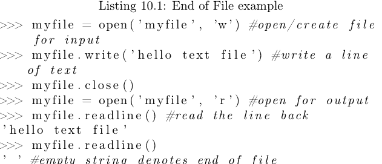
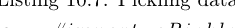
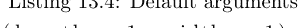

# Python 编程入门指南

有关本书的更多信息、源代码文件以及作者联系方式，可在线访问 http://python-ebook.blogspot.com 查找。

供好奇的人参考，本书最初是在 Mac 上使用 `Scrivener`（http://www.literatureandlatte.com/）起草的。随后导入到 `LyX`（http://www.lyx.org）中进行编辑、排版、页面布局及其他“图书写作”任务。使用 `LTeX`（http://www.latex-project.org/）生成了本书的 PDF 和 HTML 版本。

## 第一部分

### 核心语言

### 第一章

#### 引言

我最初想学习 Python 是因为我想制作电脑游戏。我在大学里修过几门编程课程（`C`、`C++` 和 `Java`），但都不是特别深入。我不是计算机科学专业，也不是专业级别的程序员。

我不太喜欢 `C`/`C++` 涉及的底层工作。像指针、内存管理等其他概念对我来说很难掌握，更别提有效使用它们了。`Java` 是我在学校的第一门编程课，但它对我来说毫无意义。我从未使用过面向对象语言，面向对象编程（`OOP`）概念让我感到头疼。也许这也帮不上忙，因为我的 Java 课程实际上并不是真正的 Java；而是微软的“定制”版本：`J++`。所以我不仅在学习一种实用性很低的语言（`J++` 增删了许多真正 Java 中找到的功能），而且程序也无法正确运行。最终，课程在学期末被取消，每个人都获得了全优学分。

这些问题以及其他编程语言的学习问题，使我对编程留下了不好的印象。我从未觉得自己学好过一门语言，以至于能自信地使用它，更谈不上真正享受编程的乐趣。但后来我在一个电脑论坛上听说了 Python，并注意到互联网其他网站上有多处提及该语言。人们都在谈论这门语言对于个人项目有多么伟大，以及它是多么的多功能。我决定再给编程一次机会，看看 Python 是否对我来说是一门语言。

为了更有动力去学习这门语言，我决定将童年玩过的角色扮演游戏重新创建为计算机游戏。这样不仅让我有了学习语言的理由，而且希望最终能产出一些有用的东西，供他人娱乐使用。

#### 1.1 为什么选择 Python？

Python 被视为一款很棒的业余爱好编程语言，但它同时也是一门功能极其强大的语言。它支持 `C`/`C++` 和 `Java` 绑定，因此可用于整合大型项目或进行快速原型开发。它通过 `Tkinter` 内置了图形用户界面（GUI）库，使程序员能够以极低的成本创建简单的图形界面。不过，还有其他更强大、更完善的 GUI 构建工具可用，例如 `Qt` 和 `GTK+`。`IronPython` 是一个基于 .NET 框架的 Windows 版 Python，也适用于使用 Microsoft `Visual Studio` 产品的用户。Python 还可以用于实时解释器中，以便在将代码片段添加到常规“可执行文件”之前进行测试。

Python 被归类为脚本语言。一般来说，这意味着它不会被编译成机器可读的代码，而是作为控制例程“嵌入”到另一个程序中。诸如 `C++` 等编译语言要求程序员在软件被计算机使用之前，先通过编译器运行源代码。根据程序的大小，编译过程可能需要几分钟到几个小时。

使用 Python 作为控制例程意味着 Python 可以在不同的程序之间充当“胶水”。例如，Python 常被用作视频游戏的脚本语言；虽然繁重的工作由预编译模块完成，但 Python 可以以调用/响应的方式运行，例如获取控制器输入并将其传递给相应的模块。

Python 也被认为是一种高级语言，这意味着它处理了大量编程中繁琐的基础工作。例如，Python 内置了垃圾回收器，因此作为程序员，你无需过多担心内存管理和内存泄漏——这是使用 `C` 等较旧语言时常见的问题。

Python 的主要重点在于代码的可读性以及提高程序员的生产力。这是通过强制执行一种严格的代码结构方式来实现的，以确保读者能够遵循逻辑流程，并秉持“万事俱备”的理念；程序员无需担心包含许多不同的库或其他源代码才能使程序运行。

反对 Python 的主要论点之一是空格的使用。如第 3 章所示，许多其他语言要求程序员使用括号（通常是大括号，即“{}”）来识别不同的代码块。而在 Python 中，这些代码块是通过不同的缩进量来识别的。

那些长期接触“传统”语言的人可能觉得缺少括号是个缺点，而其他人则更喜欢空格。归根结底，这取决于个人喜好。我恰好喜欢没有括号这一点，因为当出现编码问题时，这减少了我需要排查的一项内容。想象一下，几十甚至几百行代码中缺失的一个括号导致程序无法运行。再想象一下，你不得不逐行检查代码以找到那个缺失的括号。（是的，编程环境可以提供帮助，但这仍然是一件需要额外考虑的事情。）

#### 1.2 为什么还有另一份教程？

尽管 Python 网站（http://www.python.org）上有几份优秀的教程，此外还有很多书籍，但我将侧重于该语言的实用特性，即我不会深入探讨语言的历史或其玄奥的用法。虽然如果你有编程经验，或者至少能理解编程逻辑和程序流程会很有帮助，但我将尽量确保内容开始时节奏缓慢，以免让你感到困惑。

本书的主要目的是教人如何编程；Python 恰好是我选择使用的语言。如上所述，它是一门非常友好的语言，让你能在不被阻碍的情况下学习编程。大多数人决定学习编程时，往往想直接跳入 `C`、`C++` 或 `Java`。然而，这些语言存在许多“陷阱”，可能会使学习变得困难，并劝退人们继续编程。我的目标是以有趣、友好的方式呈现编程，从而激发你进一步学习的欲望。

#### 1.3 获取 Python

截至本文修订，Python `3.x` 已经发布好几年了。我的大部分经验基于 Python `2.4` 和 `2.5`，尽管我的许多知识是从阅读针对 `2.2` 版本编写的书籍中获得的。你可以看到，新版本发布并不意味着你的知识立即过时。通常，新版本只是添加了新特性，而这些特性往往是初学者不需要用的。

Python `3.x` 与使用 `2.x` 版本编写的程序不兼容。然而，你从学习 `2.x` 版本中获得的大部分知识仍然适用。这只是意味着当你开始使用 `3.0` 版本时，必须意识到语言的变化。此外，`2.x` 版本的安装基数很大，在很长一段时间内不会消失。由于大多数 Linux 发行版（以及 Mac OS X）默认安装的仍然是较旧版本的 Python（有些甚至旧到 v2.4），本书中的许多代码示例是针对 Python `2.x` 编写的。在关于 **19** 的章节中，特别指出了 `2.x` 和 `3.x` 之间的重大变化，但学习任何一个版本都不会对你造成伤害。

你可以从 *Python 网站* 下载 Python（适用于 Windows），或者如果你使用的是 Mac、Linux 或 *BSD，它可能已经安装在你的系统上。然而，类 Unix 操作系统（包括 OS X）可能没有最新版本，因此你可能希望升级，至少升级到 `2.6` 版本。`2.6` 版本是 `2.5` 的修改版，允许同时使用 `2.x` 代码和某些 `3.0` 功能。基本上，它允许你以“遗留”风格进行编码，同时仍能根据需要使用的最新功能，并测试哪些遗留功能在迁移到 `3.0` 时会失效。

对于希望通过 USB 拇指驱动器使用 Python 的用户，可能会对 *Portable Python* 感兴趣。这是一个自包含的 Python 环境，你可以直接从拇指驱动器运行，也可以安装到你的计算机上。这对于那些不能或不想安装 Python 但仍希望使用它的人很有用。

我假设你知道如何让交互式解释器运行；如果需要帮助，请阅读网站上的帮助页面。一般来说，你打开命令行提示符（或终端）并在提示符处输入“`python`”。这将打开一个 Python 会话，允许你以交互式方式使用 Python 解释器。在 Windows 中，通常只需进入“所有程序”中的 Python 文件并点击它即可。

#### 1.4 本书使用的约定

Python 的最新版本是 `3.2`，而最新的“遗留”版本是 `2.7`。除非明确说明，我将使用 `3.x` 来表示 Python 3 系列中的任何版本，使用 `2.x` 表示 Python 2 系列中的任何版本。

术语“*nix”用于指代任何类 Unix 系统，包括 Linux 和多种 BSD 变种（FreeBSD、OpenBSD、NetBSD）。尽管 Mac OS X 基于 FreeBSD，但它差异足够大，不应被归入 *nix 标签之下。

由于本书的换行格式，有些行在视觉上虽然看起来是同一行，但会自动缩进。这可能会使某些示例产生混淆，特别是因为 Python 将“空白”（如制表符和空格）视为有意义的区域。因此，一个换行的行可能看起来像是缩进行的行，但实际上并非如此。希望你会能够分辨出一行是有意缩进的，还是仅仅发生了自动换行。

### 第 2 章

Python 有何不同？

那么 Python 是什么？你很可能正在自问这个问题。你可能找到这本书是因为你想学习编程，但对编程语言一无所知。或者你可能听说过 `C`、`C++`、`C#` 或 `Java` 等编程语言，并想知道 Python 是什么以及它与“大名鼎鼎”的语言相比如何。希望我能为你解释清楚。

#### 2.1 Python 的概念

如果你对 Python 的原理和原因不感兴趣，可以跳至下一章。在本章中，我将尝试向读者解释为什么我认为 Python 是现有最好的语言之一，以及为什么它是开始编程的绝佳选择。

##### 2.1.1 动态类型与静态类型

Python 是一种动态类型语言。许多其他语言是静态类型的，例如 `C`/`C++` 和 `Java`。静态类型语言要求程序员明确告知计算机每个数据值的“事物”类型。例如，在 `C` 语言中，如果你有一个包含某物价格的变量，你必须将该变量声明为“`float`”类型。这告诉编译器，唯一可以被用于该变量的值必须是一个浮点数，即带有小数点的数字。如果该变量被赋予了其他数据值，编译器在尝试编译程序时会给出错误。

然而，Python 并不要求这一点。你只需给你的变量起个名字并为其赋值。解释器会负责跟踪你的程序正在使用哪些类型的对象。这也意味着，在开发程序时，你可以随时更改值的大小。假设你的程序中还需要另一个十进制数（即浮点数）。在使用静态类型语言时，你在第一次初始化该变量时就必须决定变量可以占用的内存大小。双精度浮点数（`double`）是一种能够处理比普通单精度浮点数（`float`）大得多的数字的浮点值（实际的内存大小取决于运行环境）。如果你声明一个变量为 `float`，但后来给它赋了一个过大的值，你的程序将会失败；你将不得不回过头去把那个变量改为 `double`。

使用 Python 则无所谓。你只需给出你想要的任何数字，Python 会负责根据需要对其进行处理。即使对于派生值也是如此。例如，假设你要对两个数字进行除法运算。一个是浮点数，另一个是整数。Python 认识到保留小数位更精确，因此它会自动将结果计算为浮点数。下面是它在 Python 解释器中的表现。

```python
>>> 6.0 / 2
3.0
>>> 6 / 2.0
3.0
```

正如你所见，无论哪个值在分子或分母都没关系；Python “看到”使用了浮点数，并以小数形式给出输出。

##### 2.1.2 解释型与编译型

许多“传统”语言是编译型的，这意味着开发者编写的源代码会被编译器转换为机器语言。编译型语言通常用于底层编程（例如设备驱动程序和其他硬件交互）以及更快的处理，例如电子游戏。

由于语言已被预先转换为机器代码，计算机可以更快地处理它，因为编译器已经检查了代码中可能导致程序失败的错误和其他问题。编译器不会捕获所有错误，但它确实有帮助。使用编译器的一个注意事项是，编译可能是一项耗时的工作；根据程序的不同，实际的编译时间可能需要几分钟到几小时才能完成。如果发现错误，开发者必须找到并修复它们，然后重新运行编译器；这个循环持续进行，直到程序正确运行为止。

Python 被认为是一种解释型语言。它没有编译器；解释器逐行处理代码并生成 *字节码*（bytecode）。字节码是一种介于源代码和机器代码之间的“语言”，它既不是完全的机器代码，也不是源代码。由于这种中间状态，字节码比机器代码在操作系统之间更具可移植性；这有助于 Python 实现跨平台。Java 是另一种使用字节码的语言。

然而，因为 Python 使用解释器而不是编译器，代码处理可能会更慢。字节码仍然需要被“解码”以供处理器使用，这需要额外的时间。但这种做法的好处是，程序员可以立即看到代码的结果。他不必等待编译器决定代码中是否存在某个导致程序崩溃的语法错误。

##### 2.1.3 原型开发

由于是解释型的，Python 和类似的语言被用于快速应用程序开发和程序原型制作。例如，一个简单的程序可以在短短几小时内创建出来，并在同一次拜访中展示给客户。

程序员可以反复修改程序并快速查看结果。这使得他们能够尝试不同的想法并查看哪一个最好，而无需在死胡同上投入大量时间。这也适用于创建图形用户界面（GUI）。因为 Python 不仅提供了多种不同的 GUI 库，还默认包含一个简单的库（*Tkinter*），所以简单的“草图”可以在几分钟内布局完成。

没有编译器的另一个好处是，Python 解释器会立即生成错误。根据开发环境的不同，它会在你开发代码时自动阅读代码并通知你语法错误。逻辑错误不会被指出，但简单的鼠标点击即可启动程序并展示最终产品。如果某些地方不对，你只需进行更改并再次点击启动按钮即可。

##### 2.1.4 过程式与面向对象编程

Python 在开发程序时提供了一个相当独特的选择：过程式编程或面向对象编程。事实上，你可以在同一个程序中混合使用两者。

简而言之，过程式编程是一种以某种线性方式开发程序的逐步过程。函数（有时称为子例程）在特定时刻被程序调用以执行某些处理，然后控制权返回主程序。`C` 和 `BASIC` 是过程式语言。

面向对象编程（OOP）就是那样：使用对象进行编程。对象由不同的编程逻辑单元创建；变量和方法（OOP 中对函数的称呼）被组合成对象，以执行特定的任务。例如，你可以对一个机器人进行建模，每个身体部件都是一个独立的对象，能够执行不同的功能，但仍然是整体对象的一部分。OOP 在 GUI 开发中也大量使用。

就个人而言，我觉得过程式编程更容易学习，尤其是在一开始。思维过程主要是直接的，本质上也是线性的。在我开始学习 Python 之前，我从未理解过 OOP；理解它可能是一件困难的事情，特别是在你仍在弄清楚如何让程序首先正常运行的时候。

本书后面部分将更详细地讨论过程式编程和 OOP。每个主题都将拥有自己的章节，希望你会看到它们如何建立在熟悉的概念之上。

### 第 3 章 编程语言比较

对于新程序员来说，本书中的一些术语可能是不熟悉的。当你读完这本书时，你应该对它们有更好的了解。然而，你也可能对存在的各种编程语言不熟悉。本章将展示一些目前程序员使用的更流行的语言。这些程序旨在展示每种语言如何被用来创建相同的输出。你会发现，Python 程序比其他程序显著地简单。

下面的代码示例都展示了歌曲“墙上有 99 瓶啤酒”（它们已被重新格式化以适合页面）。你可以在官方 99 Bottles 网站找到更多内容：[http://99-bottles-of-beer.net](http://99-bottles-of-beer.net)。我无法保证这些程序中的每一个都是有效的并且实际能正确运行，但至少你能了解每种语言看起来是怎样的。你还应该意识到，一般来说，空白对于编程语言来说并不重要（Python 是少数例外之一）。这意味着下面所有的程序都可以写在一行上，放入一个巨大的列中，或者任何其他组合。这就是为什么有些人讨厌 Python，因为它迫使他们拥有结构化的、可读的代码。

#### 3.1 C

```c
/*
 * 99 bottles of beer in ansi c
 * by Bill Wein: bearheart@bearnet.com
 *
 */
#define MAXBEER (99)
void chug(int beers);

main()
{
  register beers;
  for(beers = MAXBEER; beers; chug(beers--))
      puts("");
  puts("\nTime to buy more beer!\n");
  exit(0);
}

void chug(register beers)
{
  char howmany[8] , *s;
  s = beers != 1 ? "s" : "";
  printf("%d bottle%s of beer on the wall,\n", beers, s);
  printf("%d bottle%s of beeeeer . . . ,\n", beers, s);
  printf("Take one down, pass it around,\n");

  if(--beers) sprintf(howmany, "%d", beers); else
      strcpy(howmany, "No more");
  s = beers != 1 ? "s" : "";
  printf("%s bottle%s of beer on the wall.\n", howmany, s);
}
```

#### 3.2 C++


```cpp
// C++ version of 99 Bottles of Beer, object oriented paradigm
// programmer: Tim Robinson timtroyr@ionet.NET
#include <fstream.h>

enum Bottle { BeerBottle };

class Shelf {
unsigned BottlesLeft;
public:
    Shelf( unsigned bottlesbought )
    : BottlesLeft( bottlesbought )
    {}
    void TakeOneDown()
    {
        if (!BottlesLeft)
            throw BeerBottle;
        BottlesLeft--;
    }
    operator int () { return BottlesLeft; }
};

int main( int, char ** )
{
    Shelf Beer(99);
    try {
        for (;;) {
            char *plural = (int)Beer !=1 ? "s" : "";
            cout << (int)Beer << " bottle" << plural
                 << " of beer on the wall," << endl;
            cout << (int)Beer << " bottle" <<
                 plural
                 << " of beer," << endl;
            Beer.TakeOneDown();
            cout << "Take one down, pass it around"
                 << "," << endl;
            plural = (int) Beer !=1 ? "s":"";
            cout << (int) Beer << " bottle" <<
                 plural
                 << " of beer on the wall." << endl
                 ;
        }
    }
    catch ( Bottle ) {
        cout << "Go to the store and buy some more"
             << "," << endl;
        cout << "99 bottles of beer on the wall."
             << endl;
    }

    return 0;
}
```

### 3.3 Java

```java
/**
 * Java 5.0 version of the famous "99 bottles of
 *    beer on the wall".
 * Note the use of specific Java 5.0 features and
 * the strictly correct output.
 *
 * @author kvols
 */
import java.util.*;

class Verse {
    private final int count;
    Verse(int verse) {
        count = 100 - verse;
    }
    public String toString() {
        String c = "{0,choice,0#no more bottles|1#1 bottle|1<{0} bottles} of beer";
        return java.text.MessageFormat.format(
                c.replace("n", "N") + " on the wall, " + c +
                ".\n" +
                "{0,choice,0#Go to the store and buy some more" +
                "|0<Take one down and pass it around}, " +
                c.replace("{0}", "{1}") +
                " on the wall.\n", count, (count + 99) % 100);
    }
}

class Song implements Iterator<Verse> {
    private int verse = 1;
    public boolean hasNext() {
        return verse <= 100;
    }
    public Verse next() {
        if (!hasNext())
            throw new NoSuchElementException("End of song!");
        return new Verse(verse++);
    }
    public void remove() {
        throw new UnsupportedOperationException("Cannot remove verses!");
    }
}

public class Beer {
    public static void main(String[] args) {
        Iterable<Verse> song = new Iterable<Verse>() {
            public Iterator<Verse> iterator() {
                return new Song();
            }
        };

        // All this work to utilize this feature:
        // "For each verse in the song..."
        for (Verse verse : song) {
            System.out.println(verse);
        }
    }
}
```

### 3.4 C#

```csharp
/// Implementation of Ninety-Nine Bottles of Beer Song in C#.
/// What's neat is that .NET makes the Binge class
/// a full-fledged component that may be called
/// from any other .NET component.
///
/// Paul M. Parks
/// http://www.parkscputing.com/
/// February 8, 2002
using System;

namespace NinetyNineBottles
{
    /// <summary>
    /// References the method of output.
    /// </summary>
    public delegate void Writer(string format, params object[] arg);

    /// <summary>
    /// References the corrective action to take
    /// when we run out.
    /// </summary>
    public delegate int MakeRun();

    /// <summary>
    /// The act of consuming all those beverages.
    /// </summary>
    public class Binge
    {
        /// <summary>
        /// What we'll be drinking.
        /// </summary>
        private string beverage;

        /// <summary>
        /// The starting count.
        /// </summary>
        private int count = 0;

        /// <summary>
        /// The manner in which the lyrics are output.
        /// </summary>
        private Writer Sing;

        /// <summary>
        /// What to do when it's all gone.
        /// </summary>
        private MakeRun RiskDUI;

        public event MakeRun OutOfBottles;

        /// <summary>
        /// Initializes the binge.
        /// </summary>
        /// <param name="beverage">What to drink during this binge.</param>
        /// <param name="count">How many we're consuming.</param>
        /// <param name="writer">How our drinking song will be heard.</param>
        public Binge(string beverage, int count, Writer writer)
        {
            this.beverage = beverage;
            this.count = count;
            this.Sing = writer;
        }

        /// <summary>
        /// Let's get started.
        /// </summary>
        public void Start()
        {
            while (count > 0)
            {
                Sing(
                    @"{0} bottle{1} of {2} on the wall,
{0} bottle{1} of {2}.
Take one down, pass it around,",
                    count, (count == 1) ? "" : "s", beverage);

                count--;

                if (count > 0)
                {
                    Sing("{0} bottle{1} of {2} on the wall.",
                         count, (count == 1) ? "" : "s", beverage);
                }
                else
                {
                    Sing("No more bottles of {0} on the wall.",
                         beverage, null);
                }
            }

            Sing(
                @"No more bottles of {0} on the wall,
No more bottles of {0}.", beverage, null);

            if (this.OutOfBottles != null)
            {
                count = this.OutOfBottles();
                Sing("{0} bottles of {1} on the wall.", count, beverage);
            }
            else
            {
                Sing("First we weep, then we sleep.");
                Sing("No more bottles of {0} on the wall.",
                     beverage, null);
            }
        }
    }

    /// <summary>
    /// The song remains the same.
    /// </summary>
    class SingTheSong
    {
        /// <summary>
        /// Any other number would be strange.
        /// </summary>
        const int bottleCount = 99;

        /// <summary>
        /// The entry point. Sets the parameters
        /// of the Binge and starts it.
        /// </summary>
        /// <param name="args">unused</param>
        static void Main(string[] args)
        {
            Binge binge =
                new Binge("beer", bottleCount,
                    new Writer(Console.WriteLine));
            binge.OutOfBottles += new MakeRun(SevenEleven);
            binge.Start();
        }

        /// <summary>
        /// There's bound to be one nearby.
        /// </summary>
        /// <returns>Whatever would fit in the trunk.</returns>
        static int SevenEleven()
        {
            Console.WriteLine("Go to the store, get some more...");
            return bottleCount;
        }
    }
}
```

### 3.5 Python

```python
#!/usr/bin/env python
# -*- coding: iso-8859-1 -*-

"""
99 Bottles of Beer (by Gerold Penz)
Python can be simple, too :-)"""

for quant in range(99, 0, -1):
    if quant > 1:
        print(quant, "bottles of beer on the wall,", quant, "bottles of beer.")
        if quant > 2:
            suffix = str(quant - 1) + " bottles of beer on the wall."
        else:
            suffix = "1 bottle of beer on the wall."
    elif quant == 1:
        print("1 bottle of beer on the wall, 1 bottle of beer.")
        suffix = "no more beer on the wall!"
    print("Take one down, pass it around,", suffix)
    print("__")
```

## 第 4 章

### Python 解释器

#### 4.1 启动 Python 解释器

Python 可以通过交互式命令行（也称为解释器或 IDE）进行编程，但你编写的任何代码都不会被保存。一旦关闭会话，所有内容都会消失。为了保存你的程序，最简单的方法是将其输入到文本文件中并保存（请务必使用 `.py` 扩展名，即 `foo.py`）。


...[/content]”结构中。

## 示例处理

### 原文
[content]
进入 /path/to/xxx 目录，找到 xxx.json。

在表达式 cvar = avar + bvar 中，加法运算符（+）将 avar 与 bvar 相加，得到它们的和 cvar

在 List.of(arg0, arg1, arg2) 中，List 接口的工厂方法 of() 接受一的元素，返回包含它们的只列表。

之后我们这样用 cmd 命令：cmd arg0 arg1 arg2。

if (condVar > someVal) {console.log("xxx")}
[/content]

### 处理后
[content]
进入`/path/to/xxx`目，找到`xxx.json`。

在表达式`cvar = avar + bvar`中，加法运算符（`+`）将`avar`与`bvar`相加，得到它们的和`cvar`

在`List.of(arg0, arg1, arg2)`中，`List`接口的工厂`of()`接受一的元，返回包围只列表。

之后我们这样用`cmd`命令：`cmd arg0 arg1 arg2`。

```
if (condVar > someVal) {console.log("xxx")}
```
[/content]

---

### 原文
[content]
要使用 python，在命令提示符（*nix 和 Mac）中输入 “python”，或启动 Python IDE（Windows 和 Mac）。如果你使用的是 Windows 并安装了 Python 的 .msi 文件，你也可以在命令提示符中键入 python。IDE 和命令提示符的主要区别在于，命令提示符是系统的一部分，而 IDE 是 Python 的一部分。命令提示符可以用于除 Python 之外的其他任务；而 IDE 只能用于 Python。使用你更熟悉的那一个即可。

如果你使用的是 Linux、其他 *nix 操作系统，我你知道如何启动并运行 Python。具备足够的技术；你甚至可能知道打开终端或命令提示符（相同，本人）的人来说，以下是作系统名称。

###### 4.1.1 Windows

1. 打开开始菜单。

2. 点击“运行...”。

3. 在文本框中输入“cmd”（不引号）并回车。

4. 此时你将看到一个白色的窗口。命令提示符。

5. 如果在提示符处输入“python”，你会进入 Python 提示符。

###### 4.1.2 Mac

1. 打开应用程序。

2. 打开实用工具。

3. 向下滚动并打开终端。

4. 你与上述 Windows 类似的窗口。

5. 在提示符处输入“python”，你将进入 Python 终端。

此时你的终端显示如下如下：

**列表 4.1：Python 终示例**

```
Python 2.5.1 (r251:54863, Jan 17 2008, 19:35:17)
[GCC 4.0.1 (Inc. build 5465)] on darwin
Type "help", "copyright", "credits" or "more information"
for more information.
>>>
```

你可能会注意到，上述示例中使用的 Python 版本是 2.5.1；而当前版本是 3.2。你将要学习的大多数，无论使用哪个版本都能正常。我最常用的一本 Python 书、*Python How to Program是基于 2.2 版本的，但我天天都把它当作参考书使用。

在大多数情况下，你甚至不需版本，除非你正在使用哪个特定的库、函数或。在这种情况下，你只需要检查使用的版本，并通知用户级，或者修改你的代码使其具备向后兼容性。

（稍后的章节将详细介绍使用 Python 3.x 时的主要区别。目前你只会用到那些无论最终使用哪种语言版本都会用到的基础知识。）

###### 4.1.1 Windows

1. 打开开始菜单。

2. 点击“运行...”。

3. 在文本框中输入“cmd”（不引号）并回车。

4. 此时你将一个白色的窗口。命令提示符。

5. 如果在提示符处输入“python”，你会进入 Python 提示符。

###### 4.1.2 Mac

1. 打开应用程序。

2. 打开实用工具。

3. 向下滚动并打开终端。

4. 你与上述 Windows 类似的窗口。

5. 在提示符处输入“python”，你将进入 Python 终。

此时你的终显示如下：

**列表 4.1：Python 终示例**

```
Python 2.5.1 (r251:54863, Jan 17 2008, 19:35:17)
[GCC 4.0.1 (Inc. build 5465)] on darwin
Type "help", "copyright", "credits" or "more information"
for more information.
>>>
```

你可能会注意到，上述示例中使用的 Python 版本是 2.5.1；而当前版本是 3.2。你将要学习的大多数，无论使用哪个版本都能正常。我最常用的一本 Python 书、*Python How to Program是基于 2.2 版本的，但我天天都把它当作参考书使用。

在大多数情况下，你甚至不需版本，除非你正在使用哪个特定的库、函数或。在这种情况下，你只检查使用的版本，并通知用级，或者修改你的代码使其具备向后兼容性。

#### 4.2 Python 版本

简要提一下，Python 3.x 已将 print 从一个语句（如列表 4.2）变成了一个函数（列表 4.3）。由于我们还没有到函数，你只要知道 Python 3.x 的print 语句：引号内的单词用括号包围。只是让你知晓这一点。

**列表 4.3：Print 函数（Python 3.x）**

```
>>> print ("We are the knights who say, 'Ni' .")
We are the knights who say, 'Ni' .
```

#### 4.2 Python 版本

大多数代码是，Python 3.x 已将 print 从一个语句（如列表 4.2）变成了一个函数。由于我们还没有到函数，你只要知道 Python 3.x 的print 语句：引号内的单词用括号包围。只是让你知晓这一点。

**列表 4.3：Print 函数（Python 3.x）**
```
>>> print ("We are the knights who say, 'Ni' .")
We are the knights who say, 'Ni' .
```

#### 4.3 使用 Python 命令提示符

如果你写入一个不处理的语句，它只会将你返回到提示符，等待你的下一个指令。下一个示例了用值“spam”变量可以赋值。Python 不进行任何计算或其他，因此它接受该语句，然后等待新的语句。

**列表 4.4：Python 语句```
>>> can = "spam"
>>> 
```

（顺便说一句，Python 的名字于 Monty Python，小品的引用。因此，你在你的想法中找到的很多代码都会包含

#### 4.4 Python 注释

最后要讨论的最后是，Python 中的注释使用“#”符号记。注释用于添加信息，而无需 Python 执行对其进行。例如，

**列表 4.6：Python 注释```
dict = {"First phonetic": "Able", "Second phonetic": "Baker"}  # 一个字典
print dict.keys()              # 字典的值不是有
['Second phonetic', 'First phonetic']
print dict["First phonetic"]    # 打印键的值
Able
```

你尽管 Python 的语言，虽然仍然很有帮助。代码代码中添加注释，或者只是一个“待办事项”列表。

**列表 4.6：Python 注释```
dict = {"First phonetic": "Able", "Second phonetic": "Baker"}  # 一个字典
print dict.keys()              # 字典的值不是有
['Second phonetic', 'First phonetic']
print dict["First phonetic"]    # 打印键的值
Able
```

#### 4.5 启动 Python 程序

如果你想运行一个 Python 程序，只在 shell 命令提示符处（或 IDE 或交换机）输入 `python`，后跟程序名称。

**列表 4.7：启动 Python 程序```
$ python foo.py
```

以 .py 扩展保存的文件块，可以像其他语言头文件一样在命令行或内部使用。如果你的计算机上安装了多个 Python 版本，例如系统版本是 2.5，但你想尝试 Python 3.x，你只告诉系统使用哪个版本（见列表 4.9）。这一点很重要，因为许多旧的 Python 程序直接兼容 Python 3.x。在许多情况下，你直接覆盖旧版本的 Python。

**列表 4.9：选择 Python 版本```
$ python2.5 sample.py    # �使用 Python 2.5
$ python3.0 sample.py    #强使用 Python 3.0
```

##### 4.6 �开发环境

我花点时间更多地编程环境。贯穿全书，大多数示例都涉及使用 Python 交互，它是命令提示符处输入“python”来使用的。这种环境实际上更多地用于测试“性”任务。

Python 有许多可用的 IDE，通常，一个 IDE 包括免费的应用程序，一个源代码、一个编译（对于 Python 并非必要），以及通常还有一个图形用户界的界

- *IDLE* - 一个包含基础 Python 安装集成的应用程序；包
- *PyDev* - *Eclipse*一个功能齐全的专有应用程序，可用于其他编程语言
- *Stani’s Python Editor (SPE)* - 一个包许多开发辅助工具的免费
- *PyDev* - *Eclipse*一个插件

### 第 5 章

#### 类型与运算符

Python 使用的许多格式对于 C 和 C++ 程序员来说都很熟悉。然而，它让开发人员变得稍微，因为它不是被低级语言（很难与硬件进行深度交互或执行内存分配），并且它具有内置的“垃圾回收”机制（它会跟踪对象的引用，当对象不再被引用时自动从内存中移除对象），这使得程序可以更多地关注程序如何处理计算机底层细节。

##### 5.1 Python 语法

###### 5.1.1 缩进

Python 制用以结构化的格式进行编程。代码块由使用的缩进量决定。你在编程语言比较章节中所用的，其他语言使用括号和分号来显示代码或行。Python 不这些；缩进被用来识别每个代码块的开始和。这里有一个示例（行号已添加以便便）```python
1   x = 1
2   if x:  #if x is true
3       y = 2
4       if y:  #if y is true
5           print "block 2"
6       print "block 1"
7   print "block 0"
```

每个缩进的行记了一个新的块。让我们梳理上面的代码片段：第 1 行是主块的开始。第 2 行是一个新的块；如果“x”的值不等于 0，则其下方的缩进将被估。因此，第 3 行和第 4 行属于另一个块，如果第 2 行为真，它们将被估。第 5 行是另一个块，只有当“y”不等于 0 时才被估。第 6 行属于与第 3 行和第 4 行相同的块；它也将在那几行所在的同一块中被估。第 7 行与第 1 行在同一部分，无论缩进做什么，它都会被估。

你会注意到，类似语句，比如 if 比语句在头行后跟一个冒号 (":") 来建的。语句的其余部分在其下方缩进。最重要的原则是，缩进决定语句；如果你的代码因不起作用，请仔细检查哪些语句被缩进了。

快速提示：说 “x = 1” 这个动作是将一个值赋值给一个变量。在这种情况下，“x”变量；根据定义，它的值是变化的。这你可以赋予它想要的值；在这种情况下，值是“1”。变量是你将经常处理的最常见的编程构造之一，因为它们存储值并用于数据。

###### 5.1.2 跨多行

如果语句被包裹在大括号内（圆括号 "[]" 或花括号 "}"），它们可以跨越多行。通常使用圆括号。当在大括号内跨行时，缩进并不重要；初始括号用于确定哪个语句属于哪个块部分。如果使用三重引号，字符串语句也可以是跨行的。例如：

**列表 5.2：三重引号的使用**
```python
>>> big = """This is
... a multi-line block
... of text; Python puts
... an end-of-line marker
... after each line. """
>>> big
'This is\012a multi-line block\012of text; Python\012an end-of-line marker \012after each
line. '
```

请注意，\012 \n 的八进制形式，即“换行”指示符。上面的省略号 (...)式 Python 提示符空白行，用于表示等待更多信息。

##### 5.2 Python 对象类型

与其他许多编程语言一样，Python 具有内置的数据类型，程序员使用它们来建程。这些数据类型是程的构建块。根据语言的类型，可用的数据类型也不同。一些语言，C 和 C++，拥有原始的类型；大量的编程时间仅仅用于将这些原始类型合成有用的数据结构。Python 消除大量这种繁琐的。它实现了一种泛的类型和结构，为开发人员下了更多时间来实际程。相信我；这是不得不为每个程序不断重新构建数据结构，不是一件令人期待的事。

Python 拥有以下内置类型：数字、字符串、列表、字典、元组和文件。当然，如果，你可以构建自己的类型，但 Python 的使得你很少“自己动手”。内置类型足够大，可以覆盖你代码的大多数部分，并且易于增。我们将在讨论完数字后这一节；我们稍后会在其他章节中涵盖其他类型。

在我提到Python，我有类型编程；也就是说，一个变量可以是数、字符串、列表、字典、元或文件其他类型使用。Python 在运行时将确定什么。下方：

**列表 5.3：弱类型编程**
```python
>>> x = 12
>>> y = "lumberjack"
>>> x
12
>>> y
'y
```

其他语言通常在变量时决定类型。例如，C 语言在上面的程序中声明 "x" 为 *int* 类型，"y" 为 *string* 类型。从那时起，这些变量只能这些类型。显然，你以后可以回去修改它们，但这只是你又得思考和的一件事。此外，时候你开始你的程，你决定每个变量将，即决定是否应将数字变量为数或浮点数。显然，你以后可以回去修改它们，但这只是你又得思考和的一件事。此外，时候你开始你的程，你决定每个变量将类型并尝试它分配错误的值，你就会得到编译错误。

##### 5.3 Python 数字

Python 可以处理的长度根据系统确定，就像 C 语言一样）、Python 数据类型长度取决于可用内存、浮点数（就像 C 语言的双精度浮点数）、八进制和十六进制数，以及数（具有虚部数字）。以下是这些数字的一些示例：

- 整数：12345, -32

- Python 数字：999999999L (在 Python 3.x 中，Python 整数)

- �数：1.23, 4e5, 3e-4

- 八进制：012, 0456

- 十六进制：0xf34, 0X12FA

- 数：3+4j, 2J, 5.0+2.5j

Python 具有你预期的常见数值工具：表达式运算符 (*, >>, +, <, 等)、数学函数 (pow, abs, 等) 和实用工具 (rand, math, 等)。对于大量的数值计算，Python 有数值 Python (NumPy) 扩展，它包含矩阵数据类型。由于它的功能和易用性相当于 Mathematica、Maple 和 MatLab，它在数学环境和数学环境中被泛使用。

虽然这对非程序员可能没有太大影响，C 语言表达式运算符已被包裹在 Python 中，但其中一些略有不同。运算符在 Python 中是用单词拼写的，例如，运算符优先级在 Python 中是用单词拼写的，但其中一些略有不同。混合类型（浮点值与数值结合）在求和前会向上转换为浮点值。

继我变量赋值是在首次使用时建的，不像 C 语言预先声明。

**列表 5.4：通用 C++ 示例**
```cpp
int a = 3; //inline initialization of integer
float b; //sequential initialization of floating point number
b = 4.0f;
```

##### 代码示例 5.5：通用 Python 示例


>>> a = 3      # integer
>>> b = 4.0    # floating point

正如你所见，“a” 和 “b” 都是数字，但 Python 可以在未被告知的情况下自行判断它们的类型。在 C++ 示例中，浮点值必须被“声明”两次；首先变量被赋予一个类型（“float”），然后实际值被赋予该变量。你还会注意到，Python 中的注释使用井号/英镑符号（#）作为标识，其用法与 C++ 或 Java 中的 "//" 注释完全相同。

关于 Python 中的数字，大概就是这些了。它也能处理按位操作，例如左移和右移，但如果你想做这些，你可能就不太想用 Python 来开发你的项目了。正如之前所述，可以使用复数，但如果你确实需要用到它们，请先查阅文档。

### 第 6 章

#### 字符串

在编程中，字符串就是简单的文本，可以是单个字符、单词、短语或完整的句子。它们是编程中最常见的元素之一，至少在涉及与用户交互时是这样的。由于它们如此常见，因此它们是 Python 中的原生数据类型，这意味着它们内置了许多强大的功能。与其他语言不同，你不必担心自己创建这些功能。这是好事，因为内置功能已经过多次测试，并针对性能和稳定性进行了优化。

Python 中的字符串与其他大多数语言不同。首先，没有 char 类型，只有单字符字符串（char 类型是单个字符，独立于实际字符串，用于节省内存）。此外，字符串也不能就地修改；当你想要对其做出更改（如拼接）时，总是创建一个新的字符串对象。这仅仅意味着你需要意识到你并不是在内存中操纵该字符串；它不会随着你的操作而被改变或删除。你只是在每次操作时创建了一个新字符串。

以下是常见的字符串操作列表：

- `s1 = ' '`: 空字符串

- `s2 = "knight's"`: 双引号

- `block = """ - """`: 三引号块

- `s1 + s2`: 拼接（合并）

- `s2 * 3`: 重复字符串特定次数

- `s2[n]`: 索引（特定字符的位置）

- `len(s2)`: 获取字符串长度

- `"a %s parrot" % 'dead'`: 字符串格式化（在 Python 3.x 中已弃用）

- `"a {} parrot".format("dead")`: 字符串格式化（Python 3.x）

- `for x in s2`: 迭代（顺序遍历字符串中的字符）

- `'m' in s2`: 成员关系（字符串中是否存在特定字符？）

空字符串写成两个引号中间什么都没有。使用的引号可以是单引号或双引号；我更喜欢使用双引号，因为在字符串中使用单引号时不需要转义。这意味着你可以编写像这样的语句：

“And then he said, ‘No way’ when I told him.”（然后当我告诉他时，他说“绝不可能”。）

如果你始终只使用一种引号类型，就必须使用反斜杠字符来“转义”所需的引号，以免 Python 认为短语已经结束，例如：

“And then he said, \"No way\" when I told him.”（然后当我告诉他时，他说“绝不可能”。）

三引号块用于跨多行的字符串，如上一章所示。Python 将整个文本块收集为一个包含嵌入换行符的单一字符串。这适用于书写短段落文本，例如说明文字，或者用于格式化源代码以作澄清。

##### 6.1 基本字符串操作

在 Python 中，“++” 和 “*” 运算符被重载，分别允许你拼接和重复字符串对象。重载只是根据使用情境，用同一个运算符执行多种操作。例如，当涉及两个数字时，“+” 符号可以表示加法；或者如本例所示，用于合并字符串。

拼接将两个（或多个）字符串合并为一个新的字符串对象，而重复只是将给定字符串重复给定次数。这里有一些示例：

**代码示例 6.1：运算符重载**

```python
>>> len('abc') # length: number items
3
>>> 'abc' + 'def' # concatenation: a new string
'abcdef'
>>> 'Ni!' * 4 # multiple concatenation: "Ni!" + "Ni!" + ...
'Ni!Ni!Ni!Ni!'
```

你需要意识到 Python 不会自动将数字转换为字符串，因此编写 "spam" + 3 将会报错。要明确告诉 Python 一个数字应该是字符串，只需明确告知即可。这类似于 C/C++ 中的值类型转换。它告知 Python，该数字在本质上不是一个整数或浮点数，而是数字的文本表示形式。只需记住，你不能再对它执行数学运算；它严格来说是文本。

**代码示例 6.2：将数字转换为字符串**

```python
>>> str(3) # converts number to string
```

字符串中的迭代与其他语言略有不同。Python 没有创建循环来不断遍历字符串并打印每个字符，而是具有内置的迭代类型。以下是一个示例及其解释：

**代码示例 6.3：字符串迭代**

```python
>>> myjob = "lumberjack"
>>> for c in myjob: print c, # step through items
... l u m b e r j a c k
>>> "k" in myjob # 1 means true
1
```

本质上，Python 正在顺序遍历变量 "myjob" 并打印字符串中存在的每个字符。for 语句将在本书后续部分深入介绍，但目前只需要知道它们是用于遍历值范围的工具。正如你所见，它们可以用于字符串，或者更常用于数字。

第二个示例是一个简单的比较。字母 “k” 是否存在于 “myjob” 存储的值中？如果是，Python 将返回数值 1，表示是。如果 “k” 不存在，它将返回 0。这种情况最常见于文字处理应用，尽管你可能也能想到其他有用的情境。

##### 6.2 字符串索引和切片

Python 中的字符串处理方式类似于 C 中的数组。与 C 数组不同，字符串中的字符可以从前向后和从后向前访问。从前向后，字符串以位置 0 开始，所需的字符通过偏移量（从字符串末尾移动多远）找到。然而，你也可以通过从字符串末尾使用负偏移量来找到该字符。我不深入讲解，但这里有一个快速示例：

**代码示例 6.4：字符串索引**

```python
>>> S = "spam"
>>> S[0], S[-2] # indexing from the front and rear
('s', 'a')
```

索引就是告诉 Python 字符在字符串中的位置。与许多其他语言一样，Python 从 0 开始计数，而不是 1。因此，第一个字符的索引是 0，第二个字符的索引是 1，依此类推。反向通过字符串计数也是如此，除了最后一个字母的索引是 -1 而不是 0（因为 0 已经被占用）。因此，要索引最后一个字母，你使用 -1，倒数第二个字母是 -2，等等。了解字符的索引对于切片很重要。

切片字符串听起来很直白：通过提供上下界索引值，我们可以只提取我们想要的字符。一个很好的例子是处理输入文件，其中每行以换行符结束；只需切掉最后一个字符并处理每一行。你也可以使用它通过“过滤”掉程序名称来处理命令行参数。再次，这里有一个示例：

**代码示例 6.5：字符串切片**

```python
>>> S = "spam"
>>> S[1:3], S[1:], S[:-1]    # slicing: extract section
('pa', 'pam', 'spa')
```

你会注意到切片时使用了冒号符号。冒号充当上下界索引值之间的分隔符。如果未给出其中一个值，Python 将其解释为你想要从该索引值到字符串末尾的所有内容。在上面的示例中，第一个切片是从索引 1（第二个字母，包含）到索引 3（第四个字母，不包含）。你可以将索引视为每个字母前的空间；这就是为什么字母 “m” 不包含在第一个切片中，而字母 “p” 包含在内。

第二个切片是从索引 1（第二个字母）到字符串末尾。第三个切片从字符串末尾开始并向后延伸。

##### 6.3 字符串格式化

格式化字符串只是一种方式，以在屏幕上呈现信息，以便最佳地传达信息。格式化的一些示例包括创建列标题，从列表或存储的变量动态创建句子，或者去除字符串中的冗余信息，例如多余的空格。（Python 3.x 有一种新的字符串格式化方式；这将在下面的第 19 节中讨论。）

Python 支持动态字符串的创建。这意味着你可以创建一个包含某种类型值（如字符串或数字）的变量，然后将该值“调用”到你的字符串中。如果你愿意，可以像 C 那样处理字符串，例如整数用 %d，浮点数用 %f。这里有一个示例：

**代码示例 6.6：动态字符串创建**

```python
>>> S = "parrot"
```

>>>d = 1

>>>print `That is %d dead %s!` % (d, s) 

That is 1 dead parrot!

Python 还提供了一个字符串实用模块，包含诸如大小写转换、将字符串转换为数字等工具。这里还有另一个示例：

**列表 6.7：字符串实用工具**

>>> import string #标准实用工具模块

>>> S = "spammmify" 

>>> string.upper(S)  #转换为大写 

'SPAMMIFY' 

>>> string.find(S, "mm")   #返回子串索引 

3 

>>> string.atoi("42"), `42`  #在字符串与数字之间转换 

(42, '42') 

>>> string.join(string.split(S, "mm"), "XX") 

'spaXXify'

注意倒数第二行的示例。反引号用于将对象转换到字符串。这是解决前文提到的“不要混合字符串和数字”问题的一种方法。我会保留上面最后一行的示例作为一次思维测试。看看你能否弄清楚该语句正在做什么。

虽然 `len()` 方法严格来说不是字符串操作（它几乎可以用于任何可测量的对象），但它可用于获取字符串的长度。例如，

**列表 6.8：查找字符串长度**

>>>string = "The Life of Brian" 

>>>print len(string) 

17 

>>>len("The Meaning of Life") 

19

如上面第二个示例所示，你并不一定需要使用 print 语句（在 Python 3.x 中为 `print()` 函数）来显示一个值。直接写出你想显示的内容就会打印出结果。然而，这并不总是对你有利。有时对象只会返回一个内存地址，我们在书中稍后将会看到。一般而言，如果你希望某个语句被求值并打印出来，明确写出 “print” 会更容易。否则，你不知道它会返回什么确切的值。

##### 6.4 合并与拆分字符串

字符串可以很容易地进行合并（连接）和拆分。分词是将事物拆分为独立标记的过程；在此情况下，句子被拆分为独立的单词。当网页被浏览器解析时，页面中的 HTML、Javascript 以及其他任何代码都会被分词，并识别为关键字、运算符、变量等。然后浏览器使用这些信息正确地显示网页，或者尽可能好地显示。

Python 做了非常相似的事情（尽管结果更好）。Python 解释器对源代码进行分词，并识别出属于实际编程语言的部分和数据部分。独立的标记由分隔符隔开，分隔符是实际将一个标记与另一个标记分开的字符。

在字符串中，主要分隔符是空白字符，例如制表符、换行符或实际的空格。这些分隔符标示出独立的字符或单词、句子和段落。当需要特殊格式时，程序员可以指定其他分隔符。

连接字符串将独立的字符串合并为一个字符串。由于字符串操作总是创建新字符串，你不必担心原始字符串被覆盖。关键在于，它并不直接拼接（concatenate）字符串，即连接（join）并不像预期的那样组合它们。这里有一个例子：

**列表 6.9：连接字符串**

```python
>>> string1 = "1 2 3"
>>> string2= "A B C"
>>> string3 = string2.join(string1)
>>>print string3
1A B C A B C2A B C A B C3
```

你可以看到，结果并不是你预期的那样。然而，在创建复杂字符串时，将各个部分放入列表然后简单地连接它们，往往比尝试拼接它们更好。

之前简要提到过，我将多说几句关于拼接（Concatenation）。拼接将两个或多个字符串合并为一个新的完整字符串。这大概是我之前谈论将字符串连接在一起时你所想到的内容。

**列表 6.10：字符串拼接**

```python
>>> string1 + string2
'1 2 3A B C'
>>> "Navy gravy." + "The finest gravy in the Navy."
Navy gravy. The finest gravy in the Navy.
```

你使用拼接的频率可能会高于使用连接（join）。对我来说，这比弄乱 join() 更有意义。但是，通过练习，你可能会发现连接（joining）更容易或更高效。

最后，拆分字符串将其分离为其组成部分。结果是一个包含独立单词或字符的列表。这里有一些示例：

**列表 6.11：拆分字符串**

```python
>>> string = "My wife hates spam."
>>> string.split() # split string at spaces
['My', 'wife', 'hates', 'spam.']
>>> new_string = "1, 2, 3"
>>> new_string.split(",") # split string at commas
['1', '2', '3']
```

注意 new_string 是如何精确地在逗号处拆分的；数字前的前导空格包含在输出中。你应该了解在定义分隔字符时输出会是什么样。

随着我们更深入地学习 Python 语言，我们将查看这些以及其他字符串特性。控制台程序将从学习如何使用字符串中获益最多，然而，文字处理器显然是另一个知道如何操纵字符串会很有用的地方。

最后一点说明：在 print 行末尾添加逗号可以阻止 Python 自动创建换行符。这在制作表格且你不希望所有内容都在单列时最为实用。可以在附录第 154 页找到最常见的字符串方法的便捷参考。这些方法执行操作，例如上面显示的 split()，减少了你需要手动完成的工作量，并为你提供了更大的工具集。

##### 6.5 正则表达式

我不打算在这本书中深入探讨正则表达式。对于入门书来说，它们有点太复杂了。不过，我会简要解释一下，让编程新手了解正则表达式是多么强大的工具。

正则表达式（regex）是标准化的表达式，允许你搜索、替换和解析文本。本质上，它就像在文字处理器中使用查找/替换工具。然而，正则表达式是一种复杂的正式语言格式，允许你对字符串做很多普通方法无法做到的事情。老实说，我从未使用过正则表达式，因为到目前为止我的程序不需要它。

实际上，如果你能使用普通的字符串方法应付过去，那就尽管使用它们。它们快速、简单，并且使你的代码易于理解。然而，正则表达式语句在表示意义方面可能比长而复杂的 if/else 条件或串联的字符串方法更有道理。

如果你觉得需要使用正则表达式，请查阅讨论正则表达式的 Python 文档。那里有很多信息，正则表达式对于这本书来说有点太高级了；有一些书籍专门专门讨论正则表达式，我认为我无法完全做到公正地介绍这个主题。

### 第 7 章

#### 列表

Python 中的列表是可用的最通用的集合对象类型之一。另外两种类型是字典和元组，但它们更像是列表的变体。

Python 列表完成了其他语言中大多数集合数据结构的工作，并且由于它们是内置的，你不必担心手动创建它们。列表可用于任何类型的对象，从数字和字符串到更多列表。它们像字符串一样访问（例如切片和拼接），所以使用简单，并且它们是可变长度的，即它们随着使用而自动增长和缩小。实际上，Python 列表是 Python 解释器内部的 C 数组，并且表现得像指针数组。

为了让你确切了解我在说什么，列表 7.1 展示了几个创建列表然后对其进行一些操作的快速示例。

**列表 7.1：通用列表示例**

```python
>>> list = [1, 2, 3, 4, 5]
>>> print list
[1, 2, 3, 4, 5]
>>> print list[0] # print the list item at index 0
1
>>> list.pop() # remove and print the last item
5
```

##### 常见列表操作

```python
>>> print L  # show that the last item was removed
[1, 2, 3, 4]
```

以下是一些常见的列表操作：

- `L1 = []`：空列表

- `L2 = [0, 1, 2, 3]`：包含四个元素的列表

- `L3 = ['abc', ['def', 'ghi']]`：嵌套子列表

- `L2[n]`, `L3[n][j]`, `L2[n:j]`, `len(L2)`：索引、切片、获取长度

- `L1 + L2`, `L2 * 3`：拼接、重复

- `for x in L2`, `3 in L2`：迭代、成员资格测试

- `L2.append(4)`, `L2.sort()`, `L2.index(1)`, `L2.reverse()`：方法调用：添加、排序、查找、反转等

- `del L2[k]`, `L2[n:j] = []`：缩小列表（删除元素）

- `L2[n] = 1`, `L2[n:j] = [4,5,6]`：索引赋值、切片赋值

- `range(4)`, `xrange(0, 4)`：创建整数列表或生成器（注：`xrange` 在 Python 2 中返回序列，Python 3 中合并为 `range`）

需要记住的最重要的一点是，列表是由方括号包裹、以逗号分隔的一系列对象。字典和元组在语法上与列表相似，只是使用的括号类型不同。

##### 7.1 列表的用法

列表通常用于存储同构值，即列表通常存储名称、数字或其他所有属于同一数据类型的序列。列表没有类型限制；你可以混合使用任何你想要的数据类型。只是通常更容易将列表想象为持有一个“标准”项目序列。


进入`/path/to/xxx`目录，找到`xxx.json`。

在表达式`cvar = avar + bvar`中，加法运算符（`+`）将`avar`与`bvar`相加，得到它们的和`cvar`

在`List.of(arg0, arg1, arg2)`中，`List`接口的工厂方法`of()`接受一系列的元素，返回包含它们的只读列表。

之后我们这样调用`cmd`命令：`cmd arg0 arg1 arg2`。

```
if (condVar > someVal) {console.log("xxx")}
```


Listing 9.3: 解包一个元组

```python
>>> first, second, third, fourth = tuple
>>> first
1
>>> second
2
>>> third
3
>>> fourth
4
```

很整洁，不是吗？元组打包/解包的一个好处是你可以原地交换项目。在其他语言中，你必须创建交换变量的逻辑；而在元组中，这种逻辑是数据类型固有的。

Listing 9.4: 原地变量交换

```python
>>> bug = "weevil"
>>> bird = "African swallow"
>>> bug, bird = bird, bug
>>> bug
'African swallow'
>>> bird
'weevil'
```

在我看来，元组解包和原地交换是 Python 最简洁的功能之一。而不是创建逻辑来从集合中拉取每一项并将其放入各自的变量，元组解包允许你一步完成所有操作。原地交换也是一个快捷方式；你不需要创建临时变量来存储值以交换位置。

`5.3 方法`

元组没有方法。抱歉。

你在使用元组时能做的最好事情是切片、迭代、打包和解包。然而，如果你需要元组具有更高的灵活性，Python 有一个巧妙的小技巧：你可以将它们转换为列表。只需在元组上调用 `list()` 函数，它就会神奇地变成一个列表。相反，你可以对列表调用 `tuple()`，它就会变成一个元组。

Listing 9.5: 转换列表和元组

```python
>>> my_list = ["moose", "Sweden", "llama"]
>>> my_tuple = ("Norwegian Blue", "parrot", "pet shop")
>>> tuple(my_list)
('moose', 'Sweden', 'llama')
>>> list(my_tuple)
['Norwegian Blue', 'parrot', 'pet shop']
```

显然，这样做的优点是你可以根据需要随意在这两者之间切换。如果在程序运行到一半时，你意识到需要能够操作元组，但又不希望它始终可修改，你可以创建一个新变量，该变量调用 `list()` 函数作用于元组，然后根据需要使用该新列表。

因此，既然我们已经掌握了基本构建模块，我们可以继续讨论如何在实践中使用它们。然而，我们将涵盖所有程序员都需要知道如何使用的一个最后基本工具：文件。

### 第 10 章

#### 文件

Python 的最终内置对象类型允许我们访问文件。`open()` 函数创建一个 Python 文件对象，该对象链接到外部文件。打开文件后，你可以像平常一样读取和写入它。

Python 中的文件与我之前涵盖的类型不同。它们不是数字、序列或映射；它们仅导出用于常见文件处理的方法。从技术上讲，文件是一个预构建的 C 扩展，为 C *stdio*（标准输入/输出）文件系统提供包装器。如果你已经知道如何使用 C 文件，那你基本上就知道如何使用 Python 文件了。

文件是永久保存数据的一种方式。你目前所学的一切仅驻留在内存中；一旦你关闭 Python 或关闭计算机，它们就会消失。如果你想再次使用它们，不得不重新输入所有内容。

Python 创建的文件由计算机的文件系统操作。Python 能够使用操作系统特定的函数来导入、保存和修改文件。为了让某些功能以跨平台方式正确工作可能需要做一些工作，但这意味着你的程序将被更多人使用。当然，如果你正在为特定操作系统编写程序，那么你只需要担心该操作系统特定的函数。

##### 10.1 文件操作

为了保持一致性，以下是 Python 文件操作的列表：

- `output = open('/tmp/spam', 'w')` 创建输出文件（'w' 表示写入）

- `input = open('data', 'r')` 创建输入文件（'r' 表示读取）

- `S = input.read()` 将整个文件读取到一个字符串中

- `S = input.read(N)` 读取 N 个字节（1 个或多个）

- `S = input.readline()` 读取下一行（直到行结束标记）

- `L = input.readlines()` 将整个文件读取到行字符串列表中

- `output.write(S)` 将字符串 S 写入文件

- `output.writelines(L)` 将列表 L 中的所有行字符串写入文件

- `output.close()` 手动关闭（或在自动回收时执行）

由于 Python 具有内置的垃圾回收器，你实际上不需要手动关闭文件；一旦对象在内存中不再被引用，对象的内存空间就会自动回收。这适用于 Python 中的所有对象，包括文件。然而，建议在大型系统中手动关闭文件；这样做不会有任何害处，并且养成习惯是个好主意，以防你以后不得不工作在一种没有垃圾回收机制的语言中。

##### 10.2 文件与流

来自 Unix 背景，Python 将文件视为数据流，即每个文件被读取并存储为字节的顺序流。每个文件都有一个文件结束（EOF）标记，表示数据最后一个字节已被读取。这很有用，因为你可以编写一个程序，分段读取文件，而不必一次性将整个文件加载到内存中。当达到文件结束标记时，你的程序知道没有更多内容可读，并可以继续进行任何所需的处理。

当读取文件时，例如使用 readline() 方法，文件结束在命令行上显示为空字符串；空行只是带有换行符的字符串。以下是一个示例：



##### 10.3 创建文件

使用 Python 创建文件非常简单。如上图所示，你只需创建表示文件的变量，打开文件，给它一个文件名，并告诉 Python 你要写入它。

如果你没有明确告诉 Python 你要写入文件，它将以只读模式打开。这作为一个安全功能，防止你意外覆盖文件。除了标准的 "w" 表示写入和 "r" 表示读取之外，Python 支持其他几种文件访问模式。

- "a": 将所有输出追加到文件末尾；不会覆盖当前存在的信息。如果指定的文件不存在，则会创建该文件。

- "r": 以输入（读取）方式打开文件。如果文件不存在，则引发 IOError 异常。（异常将在第 14 章中介绍。）

- "r+": 以输入和输出方式打开文件。如果文件不存在，则引发 IOError 异常。

- "w": 以输出（写入）方式打开文件。如果文件存在，则会被覆盖。如果文件不存在，则会创建一个。

- "w+": 以输入和输出方式打开文件。如果文件存在，则会被覆盖；否则创建一个。

- "ab", "rb", "r+b", "wb", "w+b": 以二进制（即非文本）输入或输出方式打开文件。[注意：这些模式仅在 Windows 和 Macintosh 平台上受支持。Unix 类系统不关心数据类型。]

使用标准文件时，大多数信息通常是字母数字性质的，因此额外提供了二进制模式的文件操作。除非你有特定需求，否则这对于你的大多数任务来说是没问题的。在后面的章节中，我将讨论如何保存由列表、字典或其他数据元素组成的文件。

##### 10.4 从文件读取

如果你注意到上面的列表中，标准的读取模式在文件不存在时会产生 I/O（输入/输出）错误。如果你遇到此错误，你的程序将停止并给你一个错误消息，如下所示：

Listing 10.2: 输入/输出错误示例

```python
>>> file = open("myfile", "r")
Traceback (most recent call last):
File "<stdin>", line 1, in <module>
IOError: [Errno 2] No such file or directory: 'myfile'
>>> 
```

要修复这个问题，你应该始终以捕获错误的方式打开文件，以免它终止你的程序。这被称为“捕获异常”，因为给出的 IOError 实际上是 Python 解释器给出的异常。有一章专门介绍异常处理（第 14 章），但这里提供一个简要概述。

当你在执行一项操作且该操作有可能抛出异常时，你应该将该操作包裹在*try/except*代码块中。这样会尝试运行该操作；如果抛出异常，你可以捕获它并进行优雅的处理。否则，你的程序将会崩溃。

那么，你如何处理潜在的异常错误呢？只需尝试一下即可（*try*）。抱歉，这个双关语不好笑。

###### 清单 10.3：捕获错误，第 1 部分

```text
1 >>> f = open("myfile", "w")
2 >>> f.write("hello there, my text file.\nWill you fail gracefully?")
3 >>> f.close()
4 >>> try:
5 ...     file = open("myfile", "r")
6 ...     file.readlines()
7 ...     file.close()
8 ...     except IOError:
9 ...             print "The file doesn't exist"
10 ...     
11 ['hello there, my text file.\n', 'Will you fail
    gracefully?']
12 >>>
```

这里发生了什么？嗯，前几行只是与本章的第一个示例相同，然后我们设置一个try/except块来优雅地打开文件。以下步骤适用于清单 10.3。

-   1. 我们打开文件以允许写入。

-   2. 数据被写入文件。

-   3. 文件被关闭。

-   4. 创建try块；下面的缩进行属于该块。该块中的任何错误都会被except语句捕获。

-   5. 文件被打开用于读取。

-   6. 读取整个文件并输出。（`readlines()`方法返回文件中行的列表，以换行符分隔。）

-   7. 文件再次关闭。

-   8. 如果在打开文件时抛出异常，`except`行应该捕获它并处理异常块中的任何内容。在这种情况下，它只是打印出文件不存在。

那么，如果确实发生了异常会发生什么？结果如下：

###### 清单 10.4：捕获错误，第 2 部分

```python
>>> try:
...     file3 = open("file3", "r")
...     file3.readlines()
...     file3.close()
... except IOError:
...     print "The file doesn't exist. Check
...     filename."
... 
The file doesn't exist. Check filename.
>>>
```

文件“file3”尚未创建，因此当然没有任何内容可供打开。通常你会遇到IOError，但既然你正在专门查找此错误，你可以处理它。当异常被抛出时，程序优雅地退出并打印你告知它的信息。

最后一点提示：使用文件时，在完成使用后关闭它们非常重要。虽然Python具有内置的垃圾回收机制，并且通常会在文件不再被使用时关闭它们，但偶尔计算机会“丢失”文件的踪迹，并在不再需要时不关闭它们。打开的文件消耗系统资源，并且根据文件模式，其他程序可能无法访问打开的文件。

##### 10.5 遍历文件

我此前已经讨论过迭代，我们将在后续章节中进一步讨论。迭代 simply 是指以顺序方式对数据执行操作，通常通过*for*循环进行。对于文件，迭代可用于读取文件中的信息并以有序的方式处理它。它还可以限制读取文件时占用的内存量，这不仅减少了系统资源的使用，还可以提高性能。

假设你有一个包含表格信息的文件，例如工资单文件。你想读取文件并打印出每一行，采用“美观”的格式化以便阅读。下面是一个示例，展示如何做到这一点。（我们假设信息已经放入文件中。此外，由于这实际上将作为一个完整的程序编写（我们将在后面看到），因此普通的Python解释器提示符不可见。最后，print语句与 Python 3.x 不兼容。）

> 清单 10.5：输入表格数据

```python
	try:
		file = open("payroll", "r")
	except IOError:
		print "The file doesn't exist. Check filename."

	individuals = file.readlines()
	print "Account".ljust(10), #comma prevents newline
	print "Name".ljust(10),
	print "Amount".rjust(10)
	for record in individuals:
		columns = record.split()
		print columns[0].ljust(10)
		print columns[1].ljust(10)
		print columns[2].rjust(10)
	file.close()
```

以下是输出在屏幕（或如果发送到打印机则在纸上）上应显示的样子。

| Account | Name | Balance |

| :--- | :--- | :--- |

| 101 | Jeffrey | 100.50 |

| 105 | Patrick | 325.49 |

| 110 | Susan | 210.50 |

一种快捷方式是重写for块，使其不必遍历变量individuals，而是直接读取文件，如下所示：

```python
for record in file:
```

这将遍历文件，读取每一行，并将其赋值给“record”。这导致每一行立即被处理，而无需等待整个文件被读入内存。readlines()方法要求先将要处理的文件放置在内存中；对于大型文件，这可能导致性能下降。

##### 10.6 定位

定位（Seeking）是在文件内移动指针到任意位置的过程。这允许你从文件中的任何位置获取数据，而无需每次都从开头开始。

seek()方法可以接受几个参数。第一个参数（offset）是指针的起始位置。第二个可选参数是指针偏移开始的搜索方向。0是默认值，表示相对于文件开头的偏移，1是相对于文件内的当前位置，2是相对于文件的末尾。

```python
Listing 10.6: File seeking
file.seek(15) #move pointer 15 bytes from
beginning of file
file.seek(12, 1) #move pointer 12 bytes from
current location
file.seek(-50, 2) #move pointer 50 bytes backwards
from end of file
file.seek(0, 2) #move pointer at end of file
```

tell()方法返回指针在文件中的当前位置。这对于故障排除（确保指针实际上在你认为的位置）或作为函数的返回值可能很有用。

##### 10.7 序列化

序列化（Pickling）允许你将非文本信息保存到内存或通过网络传输。Pickling 基本上是将任何数据对象（如字典、列表，甚至类实例（我们稍后将会介绍））转换为字节集，该字节集可用于“重构”原始数据。



```python
>>>import cPickle  #import cPickle library
>>>a_list = ["one", "two", "buckle", "my", "shoe"]
>>>save_file = open("pickled_list", "w")
>>>cPickle.dump(a_list, save_file)  #serialize
...    list to file
>>>file.close()
>>>open_file = open("pickled_list", "r")
>>>b_list = cPickle.load(open_file)
```

Python有两个不同的pickle库：cPickle和pickle。在上面的示例中，我使用的是cPickle库而不是pickle库。原因与第2章中讨论的信息有关。由于Python是解释型的，与C等编译型语言相比，其运行速度稍慢。因此，Python有一个用C编写的预编译版本的pickle；因此称为cPickle。使用cPickle可以使你的程序运行得更快。

当然，随着处理器速度越来越快，你可能不会看到显著的区别。但是，它是存在的，并且使用方法与普通pickle库相同，所以你不妨使用它。（顺便说一下，任何时候你需要提高程序的速度，都可以将瓶颈代码用C编写并绑定到Python中。本书不会详细介绍这一点，但你可以在官方Python文档中了解更多信息。）

Shelves（搁架）与pickles（酸黄瓜/序列化对象）类似，除了它们将对象pickling到基于键访问的数据库中，非常像字典。Shelves允许你模拟随机访问文件或数据库。它不是真正的数据库，但它通常足以用于开发和测试目的。

###### 清单 10.8：Shelving 数据

```python
>>>import shelve   #import shelve library
>>>a_list = ["one", "two", "buckle", "my", "shoe"]
>>>dbase = shelve.open("filename")
>>>dbase["rhyne"] = a_list  #save list under key name
>>>b_list = dbase["rhyne"]  #retrieve list
```

### 第 11 章

#### 语句

既然我们已经了解了 Python 如何使用其基本数据类型，那么现在来谈谈如何实际使用它们。Python 名义上是一种基于过程的语言，但正如我们稍后所见，它也具有面向对象语言的功能。事实上，在这点上它与 C++ 类似；你可以将其作为过程式语言或面向对象语言使用，或者根据需要将两者结合使用。

以下是许多 Python 语句的列表。它并不包含所有语句，但能让你对 Python 的一些特性有个大概的了解。

| 语句 | 作用 | 示例 |


| 赋值 | 创建引用 | `new_car = "Audi"` |

| 调用 | 运行函数 | `stdout.write("eggs, ham, toast\n")` |

| Print | 打印对象 | `print “The Killer”, joke` |

| Print() | Python 3.x 的 print 函数 | `print(“Have you seen my baseball?”)` |

| If/elif/else | 选择操作 | `if "python" in text: print "yes"` |

| For/else | 序列迭代 | `for X in mylist: print X` |

| While/else | 通用循环 | `while 1: print ‘hello’` |

| Pass | 空占位符 | `while 1: pass` |

| Break, Continue | 循环跳转 | `while 1: if not line: break` |

| Try/except/finally | 捕获异常 | `try: action() except: print ‘action error’` |

| Raise | 触发异常 | `raise locationError` |

| Import, From | 模块访问 | `import sys; from wx import wizard` |

| Def, Return | 构建函数 | `def f(a, b, c=1, *d): return a+b+c+d[0]` |

| Class | 构建对象 | `class subclass: staticData = []` |

##### 11.1 赋值

我之前已经讨论过赋值。重申一下，赋值基本上是将目标名称放在等号左边，将你要分配给它的对象放在右边。只有几件事需要记住：

-   •  赋值创建对象引用。

    -   赋值在 Python 中就像 C 语言中的指针一样，因为它并不复制对象，只是引用对象。因此，你可以对同一个对象进行多次赋值，即多个不同的名称引用同一个对象。

-   •  名称在首次赋值时创建

    -   名称不需要“预先声明”；Python 在名称首次创建时生成变量名。但正如你将要看到的，这并不意味着你可以调用一个尚未分配对象的变量。如果你调用一个尚未赋值的名称，你会收到一个 NameError（声明错误）。

    -   有时你可能需要声明一个名称并给予其一个空值，仅仅作为程序中将来使用的“占位符”。例如，如果你创建一个类来保存全局值，这些全局值在另一个类使用它们之前将是空的。

-   •  赋值可以通过标准方式（`food = "SPAM"`）、多目标方式（`spam = ham = "Yummy"`）、元组方式（`spam, ham = "lunch", "dinner"`）或列表方式（`[spam, ham] = ["blech", "YUM"]`）创建。

    -   这是 Python 相对于其他语言的另一项优势。许多语言要求你为每个赋值单独设立一个条目，即使它们最终将拥有相同的值。在 Python 中，你可以在赋值语句中不断添加名称，而无需每次创建单独的条目。

关于赋值最后要提到的一点是，名称可以重新分配给不同的对象。由于名称只是对对象的引用，且不需要声明，你可以将其“值”更改为任何事物。例如：

```
Listing 11.1: 变量值不是固定的
>>>x = 0       #x 关联到一个整数
>>>x = "spam"   #现在它是一个字符串
>>>x = [1, 2, 3]   #现在它是一个列表
```

##### 11.2 表达式/调用

Python 表达式可以作为语句使用，但由于结果不会被保存，表达式通常用于调用函数/方法以及在交互式提示符下打印值。

以下是典型格式：

```
Listing 11.2: 表达式示例
spam(eggs, ham) #使用括号进行函数调用
spam.ham(eggs) #使用点运算符进行方法调用
spam #交互式打印
spam < ham and ham != eggs #复合表达式
spam < ham < eggs #范围测试
```

上述范围测试允许你以“正常”的方式执行布尔测试；它看起来就像数学课上的比较一样。再次强调，这是 Python 的一个便利特性，其他语言并不一定具备。

##### 11.3 打印

Python 中的打印极其简单。使用 **print** 将输出写入 C 的 stdout 流，通常发送到控制台，除非你将其重定向到另一个文件。

现在是一个提到 Python 有 3 个输入/输出（I/O）流的好时机。*sys.stdout* 是标准输出流；通常发送到监视器，但可以重定向到文件或位置。*sys.stdin* 是标准输入流；通常从键盘接收输入，但也可以从文件或位置获取输入。*sys.stderr* 是标准错误流；仅接收程序的错误。

print 语句可以与 sys.stdout 或 sys.stderr 流一起使用。这使你能够最大化效率。例如，你可以将所有程序错误打印到日志文件，而将正常的程序输出打印到打印机或另一个程序。

默认情况下，打印会在逗号分隔的项目之间添加一个空格，并在输出流末尾添加换行符。若要抑制换行符，只需在 print 语句末尾添加一个逗号：

```
Listing 11.3: 打印示例（无换行）
print lumberjack, spam, eggs,
```

若要抑制元素之间的空格，只需在打印时将它们连接起来：

```
Listing 11.4: 打印拼接
print "a" + "b"
```

Python 3.x 用 `print()` 函数取代了简单的 print 语句。这使得它更强大，例如允许重载，但所需的更改极少。不再像书中之前那样使用 print 语句，只需将其作为函数调用即可。以下是来自 *Python 文档页面* 的一些示例：

```
旧版：`print "The answer is", 2*2`
新版：`print("The answer is", 2*2)`

旧版：`print x, #尾随逗号抑制换行`
新版：`print(x, end=" ") #追加空格代替换行`

旧版：`print #打印换行`
新版：`print() #必须调用函数！`

旧版：`print >> sys.stderr, "fatal error"`
新版：`print("fatal error", file=sys.stderr)`

旧版：`print (x, y) #打印 repr((x, y))`
新版：`print((x, y)) #与 print(x, y) 不同！`
```

##### 11.4 *if* 测试

你常用且会在其他程序中遇到的最常用控制结构之一是 *if* 条件块。简而言之，你问一个是或否的问题；根据答案，不同的事情会发生。例如，你可以说：“如果选定的电影是《生命的意义》，则打印‘好选择’。否则，从数据库中随机选择一部电影。”

如果你在其他语言中编程，*if* 语句的工作方式与其他语言相同。唯一的区别是下面所示的 *else/if*：

```
Listing 11.5: 使用 *if* 语句
if item == "magnet":
   kitchen_list = ["fridge"]
elif item == "mirror": #可选条件
   bathroom_list = ["sink"]
elif item == "shrubbery": #可选条件
   landscape_list = ["pink flamingo"]
else: #可选的最终条件
   print "No more money to remodel"
```

拥有 *elif* (else/if) 或 *else* 语句并非必要，但我喜欢在我的代码块中包含 *else* 语句。它有助于我明确如果 *if* 条件未满足时的替代方案。此外，后期的修订版本如果不再相关可以将其移除。

与 C、Pascal 和其他语言不同，Python 中没有 *switch* 或 *case* 语句。你可以通过使用 *if/elif* 测试、搜索列表或索引字典来获得相同的功能。由于列表和字典是在运行时构建的，它们可以更具灵活性。这里是一个使用字典作为等效 switch 语句的例子：

```
Listing 11.6: 字典作为 *switch* 语句
>>>choice = 'ham'
>>>print {'spam': 1.25, #基于字典的
...          'ham': 1.99,
...          'eggs': 0.99,
...          'bacon': 1.10}[choice]
1.99
```

显然，这不是编写此程序最直观的方式。更好的方法是创建一个单独的字典对象，然后使用类似 *has_key()* 的方式或找到对应你选择值的键。

老实说，我在编程时不会以这种方式思考使用字典。对我来说这还不够自然；我仍然习惯于

使用 *if/elif* 条件。同样，你可以先使用 *if/elif* 语句创建程序，然后在修改时将其更改为字典或列表。这可以作为常规重构（重写代码以使其更易于管理或阅读）的一部分、查错的一部分，或者用于加速程序。

###### 11.5 while 循环

*while* 循环是许多语言中的标准主力。本质上，程序会在某个条件存在时继续执行某事。一旦该条件不再为真，循环就会停止。

Python 的 *while* 语句与其他语言类似。以下是主要格式：

示例 11.7：*while 循环，第一部分*

```python
while <test>:
    #loop test
    <code block>
    #loop body
else:
    #optional else statement
    <code block>
    #run if didn't exit loop with
    #break
```

*break* 和 *continue* 在 C 语言中工作方式完全相同。C 语言中的空语句（一个分号）的等价物是 *pass* 语句，并且 Python 为配合 break 使用而包含了一个 *else* 语句。以下是一个完整的 *while* 循环示例：

示例 11.8：*while 循环，第二部分*

```python
while <test>:
    <statements>
    if <test>: break #exit loop now if true
    if <test>: continue #return to top of loop now if true
else:
    <statements>
    #if we didn't hit a 'break'
```

*break* 语句仅仅强制循环提前退出；当与嵌套循环一起使用时，它只退出最内层（最小的包含）循环。*continue* 语句使循环重新开始，无论循环后面还有什么其他语句。除非 *break* 语句导致循环提前退出，否则 *else* 代码块会在循环的“出口处”运行。

对于仍然感到困惑的人，下一节将展示这些语句在涉及质数的实际程序中是如何使用的。

###### 11.6 for 循环

for 循环是 Python 中的序列迭代器。它几乎适用于任何对象：字符串、列表、元组等。我之前讨论过 for 循环，并且在未来的章节中我们会看到很多，所以我不再过多详细阐述。主要格式如下，见示例 11.9。请注意，它本质上与 while 循环相同。

示例 11.9：for 循环

```python
for <target> in <object>:     #assign object items
    #to target
    <statements>
    if <test>: break    #exit loop now, skip else
    if <test>: continue #go to top of loop now
else:
    <statements>        #if we didn’t hit a ‘break’
```

摘自 O'Reilly 出版的《学习 Python》：

> “当 Python 运行 for 循环时，它将序列对象中的项逐一分配给目标，并对每一项执行循环主体。循环主体通常使用赋值目标来引用序列中的当前项，就好像它是一个在序列中移动的游标。从技术上讲，for 通过重复对序列对象进行索引（从零开始，索引依次增加），直到引发索引越界异常来实现。由于 for 循环在后台自动管理序列索引，它替代了你可能习惯于在 C 等语言中编写的许多计数器风格的循环。”

换句话说，当 for 循环开始时，它查看列表中的第一项。该项被赋予值 0（许多编程语言从 0 开始计数，而不是 1）。一旦代码块完成其处理，*for* 循环查看第二个值并赋予其值 1。再次地，代码块完成其处理，*for* 循环查看下一个值并赋予其值 2。这个序列持续进行，直到列表中不再有值为止。在那一点上，*for* 循环停止，控制权转移到程序中的下一条语句。

示例 11.10 展示了一个实用的 *for* 循环版本，实现了 *break* 和 *else* 语句，如**Python 文档**中所述。

示例 11.10：*break* 和 *else* 语句

```python
>>> for n in range(2, 10):
...     for x in range(2, n):
...         if n % x == 0:    #if the remainder
...             #of n/x is 0
...             print n, 'equals', x, '*', n/x
...             break    #exit immediately
...     else:
...         # loop fell through without finding a
...         #factor
...     print n, 'is a prime number'

2 is a prime number
3 is a prime number
4 equals 2 * 2
5 is a prime number
6 equals 2 * 3
7 is a prime number
8 equals 2 * 4
9 equals 3 * 3
```

与 *for* 循环相关的是 *range* 和计数器循环。**range()** 函数会自动为你构建一个整数列表。通常它用于为 *for* 语句创建索引，但你可以在任何地方使用它。

示例 11.11：使用 **range()** 函数

```python
>>> range(5) #create a list of 5 numbers, starting
... at 0
[0, 1, 2, 3, 4]
>>> range(2, 5) #start at 2 and end at 5 (remember
... the index values)
[2, 3, 4]
>>> range(0, 10, 2) #start at 0, end at 10 (index
... value), with an increment of 2
[0, 2, 4, 6, 8]
```

如你所见，单个参数会给你一个整数列表，从 0 开始，到参数减一结束（因为索引的原因）。两个参数提供起始数字和最大值，而三个参数则增加了一个步长值，即每个值之间跳过多少个数字。

计数器循环只是计算循环已处理的次数。在循环结束时，一个变量会自增，以表明循环已完成。一旦达到特定次数的循环，循环就会执行，然后程序的其余部分被执行。

###### 11.7 pass 语句

pass 语句只是告诉 Python 继续移动，这里没有实质内容。通常，pass 语句在最初编写程序时使用。你可能创建了一个函数的引用，但尚未实际实现其代码。然而，Python 将寻找该函数内部的某些内容。如果没有可处理的内容，Python 解释器在找不到任何东西时会引发异常并停止。如果你只是在函数中放入一个 pass 语句，它将不会停止地继续运行。

示例 11.12：pass 语句

```python
if variable > 12:
    print "Yeah, that's a big number."
else: pass
```

###### 11.8 break 和 continue 语句

前面已提到，这两个语句影响循环内的流程控制。当满足特定条件时，break 语句会“跳出”循环，从而有效地提前结束循环（虽然是以预期的方式）。continue 语句会使循环“短路”，立即使流程控制返回循环顶部。

我很少使用这些语句，但在需要时它们很有用。它们有助于确保你不会永远卡在循环中，也确保你不会没有正当理由而持续迭代循环。

###### 11.9 try, except, finally 和 raise 语句

我简要提及了其中一些，将在异常章节中更详细地讨论它们。简要来说，try 创建一个尝试执行操作的块。如果该操作失败，except 块捕获引发的任何异常并对其进行处理。finally 无论是否引发异常，都会执行最后的一些操作。raise 语句手动创建异常。

###### 11.10 import 和 from 语句

这两个语句用于包含你希望在程序中使用的其他 Python 库和模块。这有助于保持程序小巧（你不需要将所有代码放在单个模块中）并“隔离”模块（你只导入你需要的内容）。import 实际调用了其他库或模块，而 from 使导入语句具有选择性；你只导入模块的子集，最小化带入程序的代码量。

###### 11.11 def 和 return 语句

这些用于函数和方法。函数用于过程式编程，而方法用于面向对象编程。*def* 语句定义函数/方法。*return* 语句从函数或方法返回一个值，允许你将返回值赋值给变量。

示例 11.13：定义函数


```python
>>> a = 2
>>> b = 5
>>> def math_function():
...     return a * b
...
>>> product = math_function()
>>> product
10
```

```python
>>> import random
>>> print(random.__doc__)
Random variable generators.
Random -- uniform distribution over [0.0, 1.0).
...
[PAGE 94]
uniform within range

integers

- sequences
  - pick random element
  - pick random sample
  - generate random permutation

distributions on the real line:

- uniform
- triangular
- normal (Gaussian)
- lognormal
- negative exponential
- gamma
- beta
- pareto
- Weibull

distributions on the circle (angles 0 to 2 pi)

- circular uniform
- von Mises

General notes on the underlying Mersenne Twister core generator:
* The period is 2**19937-1.
* It is one of the most extensively tested generators in existence.
* Without a direct way to compute N steps forward, the semantics of jumpahead(n) are weakened to simply jump to another distant state and rely on the large period to avoid overlapping sequences.
* The random() method is implemented in C,
```

```python
>>> dir(random)
['BPF', 'LOG4', 'NV_MAGICCONST', 'RECIP_BPF', 'Random', 'SG_MAGICCONST', 'SystemRandom', 'TWOPI', 'WichmannHill', '_BuiltinMethodType', '_MethodType', '__all__', '__builtins__', '__doc__', '__file__', '__name__', '__package__', '_acos', '_ceil', '_cos', '_e', '_exp', '_hexify', '_inst', '_log', '_pi', '_random', '_sin', '_sqrt', '_test', '_test_generator', '_urandom', '_warn', 'betavariate', 'choice', 'division', 'exponovariate', 'gammainverse', 'gauss', 'getrandbits', 'getstate', 'jumpahead', 'lognormovariate', 'normalovariate', 'paretovariate', 'randint', 'random', 'randrange', 'sample', 'seed', 'setstate', 'shuffle', 'triangular', 'uniform', 'vonmisesovariate', 'weibullovariate']
```

###### 11.12 Class 语句

这些是 OOP 的构建块，`class` 创建一个新的对象。该对象可以是任何东西，无论是抽象数据概念还是物理对象的模型，例如椅子。每个类都有独特于该类的特征，包括变量和方法。类非常强大，目前在大多数编程语言中都是“热门话题”。因此，书中后面有专门几章致力于 OOP。

### 第 12 章

#### 为你的代码编写文档

本章节中的部分内容借鉴自《Dive Into Python》，这是一本面向资深编程人员的免费 Python 编程书籍。其他信息则来自 Python 风格指南以及 Python 增强提案（PEP）257。（请注意，本节中提供的信息可能与官方 Python 指南相悖。这些信息以通用格式呈现关于文档字符串（docstring）的内容，并使用了笔者开发的约定。鼓励读者查阅官方文档以获取更多详细信息。）

你可以通过为 Python 对象提供文档字符串（docstring）来记录它。文档字符串只是一个三重引号包裹的句子，用于简要概述该对象。该对象可以是函数、方法、类等。（在本节中，“函数”一词用于指代实际的函数或方法、类或其他 Python 对象。）

##### 列表 12.1：文档字符串示例

```python
def buildConnectionString(params):
    """ Build a connection string from a dictionary of parameters.
    Returns string. """
```

如前所述，三重引号表示多行字符串。起始引号和结束引号之间的所有内容都是单个字符串的一部分，包括回车符和其他引号字符。你通常会在定义文档字符串时看到它们的使用。

三重引号之间的所有内容都是该函数的文档字符串，用于记录该函数的功能。如果存在文档字符串，它必须是函数中定义的第一件事（即冒号后的第一件事）。

从技术上讲，你不需要为函数提供文档字符串，但你应该这样做；文档字符串在运行时可作为函数的属性获取。许多 Python IDE 利用文档字符串提供上下文敏感文档，这样当你输入函数名称时，其文档字符串会作为工具提示出现。

引自 Python 风格指南：

> *“脚本的文档字符串应能用作其‘用法’消息，当脚本在参数错误或缺失（或可能带有 '-h' 选项，即 'help'）时调用时打印出来。此类文档字符串应记录脚本的功能和命令行语法、环境变量以及文件。用法消息可以相当详细（几屏的内容），并且应足以让新用户使用该命令，同时也应为高级用户提供所有选项和参数的完整快速参考。”*

老实说，我并不是总能遵守这条规则。我通常只写一句简短的说明，描述函数、方法、类等旨在完成的任务。然而，随着程序的演变，我试图增强文档字符串，添加它接收的输入以及输出（如果有的话）。

文档字符串有两种形式：单行和多行。单行文档字符串正是如此：信息不需要大量的描述性文本来解释正在发生的事情。即使字符串适合在一行内显示，也使用三重引号，以便日后容易扩展。结束引号与开始引号在同一行，因为这样看起来更美观。文档字符串前后都没有空行。文档字符串是一个以句号结尾的短语。它描述函数的效果，如同命令（“执行此操作”，“返回该值”）。它不应重复函数的参数（或实参），但如果存在可以说明预期的返回值。

##### 列表 12.2：文档字符串的良好使用

```python
def kos_root():
    """Return the pathname of the KOS root directory."""
    global _kos_root
    if _kos_root: return _kos_root
    # ...
```

再次，我必须承认我在这方面做得不是最好。我通常将结束引号放在单独的一行，并且在文档字符串和实际代码开始之间留一个空格；这使得添加信息更容易，并有助于将文档字符串与代码块的其他部分区分开来。是的，我有点随意。然而，只要你在整个项目中保持一致，盲目遵循“Python 方式”并不是必须的。

顺便提一下，将结束引号放在单独一行并不完全错误；多行文档字符串（根据 PEP 257）应该这样处理，而单行文档字符串则应将结束引号放在同一行。我只是习惯了在编写文档字符串时使用一种方法，这样我不必每次都思考。

多行文档字符串的开始方式与单行文档字符串相同。第一行是摘要，但随后跟一个空行。空行之后可以进行更具描述性的讨论。空行用于将摘要与描述性信息分隔开，供自动索引工具使用。它们将使用单行摘要来创建文档索引，从而减少程序员的工作量。

在空行后继续你的文档字符串时，请确保遵循 Python 的缩进规则，即在空行之后，你的所有文档字符串信息都应缩进到与初始三重引号相同的位置。否则，运行程序时会出错。

来自 Python 风格指南的更多信息：

> 模块的文档字符串通常应列出该模块导出的类、异常和函数（以及其他任何对象），并附上每行简要摘要。（这些摘要通常比对象文档字符串中的摘要行提供的细节少。）

>

> 函数或方法的文档字符串应总结其行为，并记录其参数、返回值（如有）、副作用、抛出的异常以及调用时的限制（如适用）。应标明可选参数。应记录关键字参数是否是接口的一部分。

类的文档字符串应总结其行为并列出公共方法和实例变量。如果该类旨在被子类化，并且拥有供子类使用的附加接口，则应单独列出该接口（在文档字符串中）。类的构造函数应在其 `__init__` 方法的文档字符串（即当类首次调用时调用的“初始化”方法）中记录。各个方法应由其自己的文档字符串记录。

如果一个类继承自另一个类，并且其行为主要继承自该类，其文档字符串应提及这一点并总结差异。使用动词“覆盖”（override）表示子类方法替代了父类方法且不调用父类方法；使用动词“扩展”（extend）表示子类方法调用了父类方法（除了自己的行为外）。

Python 对大小写敏感，且参数名可用于关键字参数，因此文档字符串应记录正确的参数名。最好在单独的一行列出每个参数，并用两个破折号将名称与描述分开。

如果你读到了这里，我将帮你总结刚刚学到的内容。Python 拥有一种称为“文档字符串”的文档功能，它允许你使用注释来自我记录源代码。一些 Python IDE，如 Stani’s Python Editor (SPE)，可以使用这些文档字符串来创建你的源代码结构列表，例如类和模块。这使程序员的工作更轻松，因为创建帮助文件和其他程序文档时需要更少的工作。文档索引器可以从你的代码中提取文档字符串并为你创建列表，或者你甚至可以自己编写脚本来生成它。你还能够手动读取对象的文档字符串，方法是调用对象的 `__doc__` 属性；这基本上就是上述 IDE 和索引器所做的。列表 12.3 展示了 Python 的 random 模块的文档字符串是什么样子的。

##### 列表 12.3：Python random 模块的文档字符串

```python
>>> import random
>>> print(random.__doc__)
Random variable generators.
Random -- uniform distribution over [0.0, 1.0).
...
[PAGE 94]
uniform within range

integers

- sequences
  - pick random element
  - pick random sample
  - generate random permutation

distributions on the real line:

- uniform
- triangular
- normal (Gaussian)
- lognormal
- negative exponential
- gamma
- beta
- pareto
- Weibull

distributions on the circle (angles 0 to 2 pi)

- circular uniform
- von Mises

General notes on the underlying Mersenne Twister core generator:
* The period is 2**19937-1.
* It is one of the most extensively tested generators in existence.
* Without a direct way to compute N steps forward, the semantics of jumpahead(n) are weakened to simply jump to another distant state and rely on the large period to avoid overlapping sequences.
* The random() method is implemented in C,
```

在单个 Python 步骤中执行，因此是线程安全的。

这并不能真正告诉你了解该模块所需的所有信息；这只是对 *random*（随机）模块的描述。要获取该模块的完整列表，你必须在 Python 解释器提示符下输入 "help(*random*)"。这样操作会给你提供 22 页格式化文本，类似于 *nix 手册页，其中包含了你需要了解关于该模块的所有信息。

或者，如果你只想知道一个模块提供的函数，你可以使用 *dir()* 函数，如清单 12.4 所示。

###### 清单 12.4: *random* 模块的函数

```python
>>> dir(random)
['BPF', 'LOG4', 'NV_MAGICCONST', 'RECIP_BPF', 'Random', 'SG_MAGICCONST', 'SystemRandom', 'TWOPI', 'WichmannHill', '_BuiltinMethodType', '_MethodType', '__all__', '__builtins__', '__doc__', '__file__', '__name__', '__package__', '_acos', '_ceil', '_cos', '_e', '_exp', '_hexify', '_inst', '_log', '_pi', '_random', '_sin', '_sqrt', '_test', '_test_generator', '_urandom', '_warn', 'betavariate', 'choice', 'division', 'exponovariate', 'gammainverse', 'gauss', 'getrandbits', 'getstate', 'jumpahead', 'lognormovariate', 'normalovariate', 'paretovariate', 'randint', 'random', 'randrange', 'sample', 'seed', 'setstate', 'shuffle', 'triangular', 'uniform', 'vonmisesovariate', 'weibullovariate']
```

当然，利用文档字符串（docstrings）威力的唯一方法就是遵循 Python 期望的风格规则，这意味着你必须使用三引号，将摘要行与完整描述分开，等等。你可以在不遵循这些规则的情况下记录你的 Python 代码，但那样你就得自己创建帮助文件或其他方式。我目前在文档字符串方面没有遇到任何问题，但这仅因为我稍微修改了它们的格式（在文档字符串和代码之间保留空格，将结束引号放在单独一行等）。如果你不想遵循风格指南，请小心。

这不仅会在你完成项目时让你更轻松，而且还能使你的代码更易读和易于跟踪。（希望我工作中的人能学会如何记录他们的代码。哪怕只有几行解释函数作用的注释也会有帮助。:))

### 第 13 章

#### 编写一个程序

在使用了多年之后，我发现 Python 是一种能力极强的语言，其功能与 C++、Java 等相当。如果你不需要主要语言提供的“精妙细节”，我强烈建议学习 Python 或 Ruby 等另一种动态语言。使用这些语言你可以用更少的错误（如内存管理问题）更快地编程，并且可以利用内置 GUI 的力量快速原型化应用程序。你还可以使用这些语言编写快速脚本来加速重复性任务。此外，它们本质上跨平台，因此你可以轻松地在操作系统之间切换，或者为你的程序寻找更大的市场。天哪，Python 被 Google、NASA 以及许多游戏发行商大量使用，所以它肯定不算太差。

人们最大的抱怨之一是强制使用空白和缩进。但如果你仔细想想，这被视为一种“良好的编码实践”；它使程序的流程更容易跟踪，并减少了出错的可能性。此外，由于不需要括号，你不必担心因为忘记关闭嵌套的 if 语句而导致程序无法运行。在使用 Python 几天后，你甚至都不会注意到这一点，尽管我想象你会注意到其他语言看起来多么“随意”。

好了，继续正题...

##### 13.1 让 Python 做点事

到目前为止，我已经谈过 Python 的结构以及它与其他语言的不同之处。现在是时候编写一些真正的程序了。首先，Python 程序由函数、类、模块和包组成。

- 1. 函数是程序员创建的代码块，执行特定任务。

- 2. 类是面向对象的结构，我稍后会谈到；简而言之，它们是非常强大的结构，可以使编程生活更容易，尽管它们可能难以学习和熟练掌握。

- 3. 模块通常被认为是普通的程序文件，即由函数/类、循环、控制语句等组成的文件。

- 4. 包是由许多不同模块组成的程序。

实际上，我将模块和包视为“程序”。这取决于需要多少个单独的文件才能使程序运行。是的，可以有一个单一的、庞大的文件来控制整个程序，但通常最好将不同的部分放在不同的文件中。实际上，这样更容易跟踪正在发生的事情，并且你可以将具有共同目标的代码片段聚集在一起，例如，拥有一个保存库函数的文件，一个处理 GUI 的文件，和一个处理数据输入的文件。

一个重要的模块是 Python 标准库。有两个版本：Python 2.6 和 Python 3.0。该库是一个常用代码块的集合，你可以在需要时调用。这意味着你不需要每次想做什么（例如计算函数的切线）时都“重新造轮子”。你所要做的就是导入标准库中你需要的部分，例如 math 块，然后像普通 Python 代码一样使用它。知道标准库中有什么，至少在我的书中，是将优秀程序员和伟大程序员区分开来的关键。

话虽如此，让我们编写一个简单的 Python 程序。这个程序可以在 IDLE（随 Python 安装的标准 Python 编程环境）、第三方编程环境（如 SPE、Komodo、Eclipse、BoaConstructor 等）或简单的文本编辑器（如 Window’s Notepad、vim、emacs、BBEdit 等）中编写。（更多程序可以在第 168 页的附录中找到）。

###### 清单 13.1: 第一个示例程序

```python
def square (x): #define the function; "x" 是 the argument
    return x * x #pass back to caller the
    # square of a number

for y in range(1, 11): #cycle through a list of
    # numbers
    print square(y) #print the square of a number
```

清单 13.1 简单得不能再简单了。首先我们定义一个名为 square() 的函数（括号表示它是一个函数而不是一个语句），并告诉它名为 “x” 的参数将被用于处理。然后我们实际上定义了这个函数将做什么；在这种情况下，它将 “x” 乘以自身以产生一个平方值。通过使用关键字 return，平方值将返回给实际调用该函数的实体（在这种情况下，是 print 语句）。

接下来，我们创建一个 for 循环，随着数字从 1 增加到 11，打印每个数字的平方值。这应该很容易理解，尤其是旁边有注释的情况下。请意识到，你将看到的许多程序并没有这么多注释；很多时候，程序根本没有注释。我认为我的代码中有足够多的文档（你稍后会看到），即使新程序员也能很容易地弄清楚正在发生的事情。

要运行此程序，只需将其保存为一个文件名，例如 “first_program.py”。然后，在命令提示符下只需输入 “python first_program.py”。结果应该如下所示：

###### 清单 13.2: 第一个示例程序的输出

```bash
$ python first_program.py #your command prompt may differ from "$"
1
4
9
16
25
36
49
64
81
100
```

让我们看另一个程序，这个稍微复杂一点。

###### 清单 13.3: 第二个示例程序及输出

```python
def adder(*args):  #accept multiple arguments
    sum = args[0]  #create a blank list
    for next in args[1:]:  #iterate through
        # arguments
        sum = sum + next  #add arguments
    return sum

>>> adder(2, 3)
5
>>> adder(4, 5, 56)
65
>>> adder("spam", "eggs")
'spameggs'
>>> adder([1,2,3], [4,5,6])
[1, 2, 3, 4, 5, 6]
```

如你所见，这个小程序非常强大。本质上，它接受可变数量的参数，并根据参数类型将它们相加或连接起来。这些参数可以是任何东西：数字、字符串、列表、元组等。


关于`args`关键字的说明。这是Python的一个特殊功能，允许你输入未指定的参数并对它们进行操作（如将它们加在一起）。`*`就像一个通配符；它表示可以给定可变数量的参数。一个类似的参数关键字是`**kwargs`。这个相关（它接受无限数量的参数），但参数是通过关键字设置的。这样，你可以根据关键字将变量匹配到参数。更多详细信息可以在下面的第13.3节（默认参数）中看到。

什么？你居然不知道蛇会有口臭？（我知道，这笑话很烂。）但认真地说，作用域（scope）描述的是程序中一个标识符（即某个名称，比如变量）能够访问其关联值的区域。作用域与命名空间（namespace）紧密相关，因为命名空间基本上定义了标识符的作用域范围。

简单来说，命名空间存储了关于标识符及其值的信息。Python有三种命名空间：局部、全局和内置。当一个标识符首次被访问时，Python会先在局部查找它的值，即它周围的代码块。在上面的示例中，“x”是在函数`square()`内部定义的。每个函数都会被分配一个自己的局部命名空间。函数无法使用在其他函数中定义的标识符；它们基本上是不可见的。如果一个函数试图调用另一个函数中定义的变量，你会得到一个错误。如果一个函数试图定义一个之前已定义的变量，你得到的将是一个恰好同名但值不同的全新变量。

然而，如果标识符没有在局部定义，Python会检查它是否存在于全局命名空间中。全局命名空间与局部命名空间的区别在于，全局标识符可以被其他函数使用。因此，如果你定义了一个全局变量`cars_in_shop = 2`，程序中的所有函数都可以访问该变量并按需使用它。这样，你就可以在一个位置定义变量，并在多个地方使用它，而无需反复定义。但是，这并不推荐，因为这可能导致安全问题或编程问题。例如，将变量设为全局意味着任何函数都可以访问它们。如果你开始让多个函数使用同一个变量，你就无法知道在任何给定时刻该变量正在发生什么；没有保arante说当你使用它时，它的值会是你期望的那样。

这并不意味着全局变量是绝对禁止使用的。如果使用得当，它们非常有用，可以让你的工作更轻松。但它们可能会限制程序的可扩展性，并且经常导致难以解释的逻辑错误，所以我倾向于避免使用它们。

内置命名空间是为Python的内置函数预留的。（挺方便的，对吧？）因此，像`range()`这样的关键字和标准函数调用在Python解释器启动时就已经定义了，你可以“开箱即用”。

你可能已经猜到，命名空间是嵌套的：

- 全局

- 局部

如果标识符未在局部找到，Python会检查全局命名空间。如果那里也没有，Python会检查内置命名空间。如果仍然找不到，它会抛出错误并终止。

需要考虑的一点（我稁早些也提到了）是，当你向下遍历命名空间树时，你可以隐藏标识符。如果你在全局定义了`cars_in_shop = 2`，你可以创建一个具有完全相同名称但不同值的函数，例如`cars_in_shop = 15`。当函数调用此变量时，它将使用15而不是2来计算结果。这是全局变量的另一个问题；如果你没有良好的变量命名习惯，它们可能会引起问题，因为你可能忘记了实际上使用的是哪个变量。

##### 13.3 默认参数

创建函数时，你可以为参数设置默认值，以防调用者没有提供任何参数。例如：



```python
def perimeter(length = 1, width = 1):
    return length * width
```

如果你想调用这个特定的函数，你可以提供必要的测量值`perimeter(15, 25)`，或者提供一个`perimeter(7)`，或者直接默认使用`perimeter()`。每个参数按顺序与传入的值匹配，所以如果你打算这样做，请确保你知道哪些参数会被匹配，即如果你只提供一个参数，它将替换第一个默认值，而其他值将保持默认。

你还可以使用关键字参数，它们根据对应的关键字匹配参数。这样，你就不用担心参数给出的顺序。例如，对于上面的“perimeter()”示例，你可以简单地说`perimeter(width = 12)`。这将使函数对长度使用1，对宽度使用12。这比记住参数的顺序更容易；然而，这也意味着你需要输入更多内容。如果你有大量具有此类参数的函数，这会变得繁琐。

此外，一旦你为一个参数指定了关键字，你就不能回去使用位置来指示匹配。例如：

```python
###### Listing 13.5: Default arguments and position
def abstract_function(color = "blue", size = 30, range = 40, noodle = True):
    pass

###### call the function
abstract_function("red", noodle = False, 45, range = 50)    # not allowed
```

尝试以这种方式调用它会给你一个错误。一旦你开始使用关键字，你就必须对剩余的参数集合继续使用关键字。

关于使用函数编程的内容大概就是这些。它们相当简单，你看到的示例越多，就越能理解它们。Python很酷，因为你可以将函数和类（带有方法）混合在同一个模块中，而不用担心出错。这样，你就不会局限于一种编程方式；如果一个简短的函数有效，你不必花费时间创建一个完整的类来实现同样的事情。

如果你不想处理面向对象编程，你可以坚持使用函数并玩得开心。不过，我将在后面的章节中开始介绍OOP，向你展示了解和使用它为什么很好。而且，在Python中，它不像其他语言中的OOP实现那样可怕。

### 第14章

#### 异常

我之前谈过异常，但现在我将深入讨论它们。本质上，异常是修改程序流程的事件，无论是有意为之还是由于错误。它们是特殊事件，可能因错误而发生，例如尝试打开一个不存在的文件，或者当程序到达标记处，例如循环完成。异常按定义来说，并不经常发生；因此，它们是“规则的例外”，并且已为它们创建了一个特殊的类。

异常在Python中无处不在。几乎标准Python库中的每个模块都使用它们，并且Python本身也会在多种不同情况下引发它们。这里只是几个例子：

- 访问不存在的字典键会引发`KeyError`异常。

- 在列表中搜索不存在的值会引发`ValueError`异常。

- 调用不存在的方法会引发`AttributeError`异常。

- 引用不存在的变量会引发`NameError`异常。

- 在未进行强制转换的情况下混合数据类型会引发`TypeError`异常。

异常的一个用途是捕获故障并允许程序继续工作；我们在谈论文件时已经见过这种情况。这是使用异常最常见的方式。在使用Python命令行解释器编程时，你不需要担心捕获异常。你的程序通常足够短，即使发生异常也不会受到太大伤害。此外，异常在命令行发生是快速判断代码逻辑是否有问题的简便方法。然而，如果同样的错误发生在你的实际程序中，它将失败并停止工作。

可以在代码中手动创建异常，通过引发异常。它的操作与系统引发的异常完全相同，只是程序员是有意为之的。这可能是出于多种原因。使用异常的好处之一是，就其本质而言，它们不会对代码处理造成任何开销。因为异常本不应经常发生，所以直到它们发生时才会被处理。

异常可以被视为`if/elif`语句的特殊形式。实际上，你可以用`if`块做与异常相同的事情。然而，如前所述，异常直到发生时才会被处理；而`if`块始终会被处理。正确使用异常可以提高程序的性能。错误发生的可能性越低，使用异常对你越有利；使用`if`块要求Python在继续之前始终测试额外的条件。异常也使代码管理更容易：如果你的编程逻辑与错误处理`if`语句混合在一起，阅读、修改和调试你的程序可能会很困难。

下面是一个简单的程序，突出展示了异常处理的大部分重要特性。它只是产生两个数的商。

###### Listing 14.1: Exceptions

```python
first_number = raw_input("Enter the first number.")   #gets input from keyboard
sec_number = raw_input("Enter the second number.")
try:
    num1 = float(first_number)
    num2 = float(sec_number)
    result = num1/num2
```

##### 14.1 异常类层次结构

```python
except ValueError:  #not enough numbers entered
    print "Two numbers are required."
except ZeroDivisionError:   #tried to divide by 0
    print "Zero can't be a denominator."
else:
    print str(num1) + "/" + str(num2) + "= " + str(result)
#alternative format
#a tuple is required for multiple values
#printed values have floating numbers with one decimal point
print "%.1f/%.1f=%.1f" % (num1, num2, result)
```

正如你所见，你可以在同一个`try`块中拥有多个“异常捕获器”。你还可以在末尾使用`else`语句来表示如果一切顺利时执行的逻辑；不过，这并不是必须的。如前所述，整个`try`块也可以写成`if/elif`语句，但那将要求Python处理每条语句以检查是否匹配。通过使用异常，“默认”情况被假定为真，直到实际发生异常为止。这加快了处理速度。

你可以对这段程序进行的一项修改是简单地将其全部放入`try`块中。`raw_input()`变量（从用户键盘捕获输入）可以放置在`try`块内，通过强制将用户输入转换为浮点值来替代`num1`和`num2`变量，如下所示：

> 清单 14.2：使用 try 语句处理用户输入

```python
try:
    numerator = float(raw_input("Enter the numerator."))
    denominator = float(raw_input("Enter the denominator."))
```

这样一来，你就减少了需要编写、处理和测试的逻辑数量。你仍然拥有相同的异常；只是简化了程序。

最后，最好在编写代码时就将错误检查（如异常处理）包含在你的代码中，而不是作为事后的补救措施。编程的一个特殊“类别”涉及编写测试用例，以确保代码中考虑了大多数可能的错误，尤其是在代码变更或创建新版本时。通过提前规划，并在程序初期将异常和其他错误检查代码放入程序中，你可以确保在问题造成严重后果之前就被捕捉到。随着程序的演进更新你的测试用例，可以确保版本升级保持兼容性，且修复不会引发错误状况。

表14.1展示了Python库参考中的异常层次结构。当发生异常时，它从尽可能低的级别（子级）开始，向上（通过父级）传播，等待被捕获。这对程序员意味着几件事：

1. 如果你不知道可能发生的异常是什么，你始终可以捕获更高级别的异常。例如，如果你不知道前例中的`ZeroDivisionError`是一个“独立”的异常，你可以使用`ArithmeticError`作为异常并捕获它；如图所示，`ZeroDivisionError`是`ArithmeticError`的子级，而`ArithmeticError`又是`StandardError`的子级，依此类推，直到层次结构的顶端。

2. 多个异常可以以相同的方式处理。承接上面的例子，假设你计划使用`ZeroDivisionError`并想包含`FloatingPointError`。如果你希望针对这两种错误采取相同的操作，只需使用父异常`ArithmeticError`作为要捕获的异常即可。这样，当发生浮点数错误或零除错误时，你就无需为每种错误单独编写案例。当然，如果你有需求或意愿分别捕获每一种异常，也许是因为你希望采取不同的操作，那么为每种情况编写异常是没问题的。

表14.1：异常层次结构

| 异常层次结构 |

| :--- |

| BaseException |

| ├─ SystemExit |

| ├─ KeyboardInterrupt |

| ├─ GeneratorExit |

| └─ Exception |

|    ├─ StopIteration |

|    ├─ StandardError |

|    │  ├─ BufferError |

|    │  ├─ ArithmeticError |

|    │  │  ├─ FloatingPointError |

|    │  │  ├─ OverflowError |

|    │  │  └─ ZeroDivisionError |

|    │  ├─ AssertionError |

|    │  ├─ AttributeError |

|    │  ├─ EnvironmentError |

|    │  │  ├─ IOError |

|    │  │  ├─ OSError |

|    │  │  ├─ WindowsError (Windows) |

|    │  │  └─ VMSError (VMS) |

|    │  ├─ EOFError |

|    │  ├─ ImportError |

|    │  ├─ LookupError |

|    │  │  ├─ IndexError |

|    │  │  └─ KeyError |

|    │  ├─ MemoryError |

|    │  ├─ NameError |

|    │  │  └─ UnboundLocalError |

|    │  ├─ ReferenceError |

|    │  ├─ RuntimeError |

|    │  │  └─ NotImplementedError |

|    │  ├─ SyntaxError |

|    │  │  ├─ IndentationError |

|    │  │  └─ TabError |

|    │  ├─ SystemError |

|    │  ├─ TypeError |

|    │  ├─ ValueError |

|    │  ├─ UnicodeError |

|    │  │  ├─ UnicodeDecodeError |

|    │  │  ├─ UnicodeEncodeError |

|    │  │  └─ UnicodeTranslateError |

|    ├─ Warnings (various) |

###### 14.2 用户定义的异常

我不会花太多时间讨论这个问题，但Python确实允许程序员创建自己的异常。你可能不常需要做这件事，但在必要时拥有这个选项是不错的。然而，在创建自己的异常之前，请确保没有适合你需求的内置异常。它们经过多年的“实战检验”，不仅工作有效，而且针对性能进行了优化，并且没有错误。

创建自己的异常涉及面向对象编程，这将在下一章中涵盖。为了创建一个自定义异常，程序员确定使用哪个基础异常作为继承的类，例如，为负数或虚数创建异常可能属于`ArithmeticError`异常类。要创建自定义异常，只需继承基础异常并定义它的行为。清单14.3给出了创建一个自定义异常的例子：

清单14.3：定义自定义异常

```python
import math  #necessary for square root function

class NegativeNumberError(ArithmeticError):
    """Attempted improper operation on negative number"""
    pass

def squareRoot(number):
    """Computes square root of number. Raises
    NegativeNumberError
    if number is less than 0."""
    if number < 0:
        raise NegativeNumberError, \
            "Square root of negative number not permitted"

    return math.sqrt(number)
```

第一行创建了自定义异常`NegativeNumberError`，它继承自`ArithmeticError`。因为它继承了基础异常的所有特性，你不需要定义其他内容，因此使用了表示不执行任何操作的`pass`语句。然后，为了使用新的异常，创建了一个函数（`squareRoot()`），如果参数值小于0，则引发`NegativeNumberError`；否则，它返回该数的平方根。

### 第15章

#### 面向对象编程

##### 15.1 学习Python类

类是面向对象编程的最基本组件。之前，你学习了如何使用函数让程序执行某些操作。现在，你将进入庞大且略显复杂的面向对象编程（OOP）世界。

老实说，我花了几个月时间才掌握对象。当我最初学习C和C++时，我表现得很棒；函数对我来说很直观。由于在90年代初玩过BASIC，我意识到函数就像子程序，所以没有太多新东西要学。然而，当我修读C++课程开始谈论对象、类以及OOP的所有新功能时，我的成绩肯定受到了影响。

一旦你学会了OOP，你会发现它实际上是一个相当强大的工具。此外，许多Python库和API都使用类，因此你至少应该能够理解代码在做什么。


关于 Python 和 OOP 需要注意的一点是：在你的代码中使用对象并非强制性的。正如你之前所见，Python 使用函数也能运行得很好。与 Java 等语言不同，你不必局限于一种做事方式；你可以根据需要在同一程序中混合使用函数和类。这使得你构建代码
以最合适的方式运作；也许你不需要编写一个包含初始化代码和方法的完整类仅仅为了返回一个计算结果。在使用 Python 时，你可以达到你想要的技术深度。

##### 15.2 类有什么优势？

想象一下，你有一个程序使用函数来计算二维平面上汽车的速度。如果你想制作一个新的程序来计算三维空间中飞机的速度，你可以利用汽车函数的概念来让飞机模型工作，但你必须重写许多函数以适应垂直维度，尤其是如果你想在三维空间中映射该对象。你可能会很幸运，能够复制粘贴其中的一些函数，但大部分情况下你都得重做许多工作。

类允许你定义一次对象，然后多次复用它。你可以给它一个基础函数（在 OOP 术语中称为方法），然后基于该方法对其进行重新定义，按需扩展。它也比使用函数更准确地模拟现实世界中的对象。

例如，你可以创建一个轮胎类，定义轮胎的尺寸、保持的压力、材质等，然后创建方法来确定在特定条件下轮胎磨损的速度。接着，你可以将这个轮胎类用作汽车类、自行车类或任何其他类的一部分。轮胎类的每次使用（称为实例）都会使用基础轮胎对象的不同属性。如果基础轮胎对象说它只是由橡胶制成，那么汽车类可能会通过声明轮胎带有钢带来“增强”它，或者自行车类可能会说它有一个内部气囊。这一点稍后会有更清晰的解释。

##### 15.3 提升你的类素养

有几种类的概念非常重要，需要知道。

- 1. 类拥有明确的命名空间，就像模块一样。尝试从不同的类调用类方法会产生错误，除非你对其进行限定，例如 `spamClass.eggMethod`。

- 2. 类支持多个副本。这是因为类具有两种不同的对象：类对象和实例对象。类对象提供默认行为，用于创建实例对象。实例对象是在你的程序中实际执行工作的对象。你可以拥有同一类对象任意数量的实例对象。实例对象通常由关键字 `self` 标记，因此类方法可以是 `Car.Brake()`，而 `Brake()` 方法的特定实例会被标记为 `self.Brake()`。（我稍后会更深入地介绍这一点）。

- 3. 每个实例对象都有自己独立的命名空间，同时也继承自基础类对象。这意味着每个实例具有与类对象相同的默认命名空间组件，但此外每个实例还可以为自己创建新的命名空间对象。

- 4. 类可以定义响应与内置类型相同操作的对象。因此，类对象可以像字符串、列表和其他标准 Python 类型一样被切片、索引、连接等。这是因为 Python 中的一切实际上都是类对象；我们并没有在使用类时做真正的新颖事情，我们只是在学习如何更好地利用 Python 语言固有的特性。

以下是 Python OOP 思想的简要列表：

- 类语句创建类对象并为其命名。这会创建一个新的命名空间。

- 类内部的赋值创建类属性。这些属性通过限定名称使用点语法访问：`ClassName.Attribute`。

- 类属性导出对象的状态及其关联的行为。这些属性被类的所有实例共享。

- 调用类（就像函数一样）创建该类的新实例。这就是支持多个副本的部分。

- 每个实例都会获取（“继承”）默认的类属性，并获得自己独立的命名空间。这防止了实例对象相互重叠并使程序混乱。

- 使用术语 `self` 来标识特定实例，从而允许按实例定义属性。这使得变量等项目能够与特定实例相关联。

##### 15.4 类看起来是什么样子的？

在结束本教程的这一部分之前，我会给你一些快速示例来解释我到目前为止所谈论的内容。假设你正在使用 Python 交互式解释器，一个简单的类看起来像这样。

```python
###### Listing 15.1: Defining a class
>>> class Hero: #define a class object
...     def setName(self, value):  #define class methods
...         self.name = value   #self identifies a particular instance
...     def display(self):
...         print self.name #print the data for a particular instance
```

关于这个示例，有几点需要注意：

- 1. 当定义类对象时，末尾没有括号；括号仅用于函数和方法。但是，有关注意事项请参见第 15.5 节。

- 2. 类方法括号中的第一个参数必须是 `self`。这用于标识调用该方法的实例。Python 解释器在内部处理调用。你要做的只是确保 `self` 在正确的位置，以避免错误。尽管你必须使用 `self` 来标识每个实例，但 Python 足够智能，知道正在引用哪个特定实例，因此同时存在多个实例并不是问题。（`self` 类似于 `this`，后者用于 Java 等多种其他语言）。

- 3. 当你分配变量时，例如 “self.name”，变量必须用 "self" 标题进行限定。同样，这用于标识特定实例。

那么，让我们创建几个实例来看看这是如何工作的：

```python
###### Listing 15.2: Creating class instances
>>> x = Hero()
>>> y = Hero()
>>> z = Hero()
```

这里你会注意到出现了括号。这表示这些是由 Hero 类创建的实例对象。这些实例中的每一个都具有完全相同的属性，这些属性继承自 Hero 类。（稍后我会展示如何自定义实例以执行比基础类更多的操作）。

现在，让我们添加一些信息。

```python
###### Listing 15.3: Adding data to instances
>>> x.setName("Arthur, King of the Britons")
>>> y.setName("Sir Lancelot, the Brave")
>>> z.setName("Sir Robin, the Not-Quite-So-Brave-As-Sir-Lancelot")
```

这些调用了位于 Hero 类中的 **setName()** 方法。然而，正如你现在所知，每一个都是针对不同的实例；不仅 x、y 和 z 每个都有不同的值，而且 Hero 中的原始值也保持未变。

如果你现在为每个实例调用 **display()** 方法，你应该能看到每个英雄的名字。

```python
###### Listing 15.4: Displaying instance data
>>> x.display()
Arthur, King of the Britons
>>> y.display()
Sir Lancelot, the Brave
>>> z.display()
Sir Robin, the Not-Quite-So-Brave-As-Sir-Lancelot
```

你可以通过在类对象内的方法中向 *self* 赋值，或者通过显式向实例对象赋值，来“即时”更改实例属性。

```python
###### Listing 15.5: Modifying instances
>>> x.name = "Sir Galahad, the Pure"
>>> x.display()
Sir Galahad, the Pure
```

对于这一课，这大概已经足够了。我将在下一章中涵盖类的其余部分，但希望这足以让你了解在编程中类和 OOP 一般可以多么有用。目前使用的大多数语言在某种程度上都实现了 OOP，因此学习如何使用类和对象将有助于你在获得知识时有所帮助。幸运的是，Python 以合理的方式实现了 OOP，因此与 C++ 相比，在 Python 中学习起来相对无痛，至少根据我的经验来看如此。

##### 15.5 “新式”类

从 Python 2.2 开始，为 Python 开发了一种新类型的类。这种新类为程序员提供了一种创建直接从 Python 内置类型（如列表、字符串等）派生的类的方法。

你可以像上面的示例那样创建一个新类，不使用括号。但是，你也可以显式地从 *object* 类继承你的新类，或者从内置类型之一派生新类。Listing 15.6 展示了这是如何看起来的。将你的自定义类从 *object* 派生是一个好主意，因为 Python 3.x 仅使用“新式”类，而省略 *object* 可能会导致问题。更多信息可以在 Python 新式类简介和 Python 的新式类中找到。

```python
###### Listing 15.6: New-style classes
class NewStyleUserDefinedClass(object):
    pass
class DerivedFromBuiltInType(list):
    pass
```

##### 15.6 关于风格

如前所述，Python 有一种被视为编写 Python 程序“正确”方式的特定“风格语法”。PEP 8 是描述所有“被认可”编写方式的文档。其中一点是关于如何命名类、函数、方法等。

类的名称首字母应大写；类名中的其他单词也应以大写字母开头：`class SpamAndEggs(object)`。函数和方法应使用小写字母，单词之间用下划线分隔：`def bunny_vicious_bite()`。常量（值不发生变化的变量）应全部使用大写字母：`MAX_VALUE = 22`。

还有许多其他需要关注的风格想法。我必须承认，我在遵循 Python 风格约定方面并不是做得最好的人，但我会尽力根据记忆去遵循它们。即使我不遵循“Python 方式”，我也试图在我自己的程序中保持一致性。我个人的建议是阅读 PEP 8 并查看不同 Python 程序的源代码，然后选择最适合你的风格。最重要的是拥有一致的风格。

### 第 16 章

#### 面向对象编程进阶

上一章我告诉你了一些关于使用 Python 类和面向对象编程的基础知识。现在是时候深入探讨类，看看它们如何让编程生活变得更好。

##### 16.1 继承

首先，类允许你在不真正修改程序的情况下对其进行修改。具体来说，通过对类进行子类化，你可以通过向其添加新的组件来改变程序的行为，而不是重写现有的组件。

如我们所见，类的实例继承该类的属性。然而，类也可以从其他类继承属性。因此，子类从父类（超类）继承，允许你创建一个通用的父类，并通过子类对其进行特化。子类可以覆盖父类中的逻辑，允许你在完全不改变父类的情况下改变类的行为。

让我们做一个简单的示例。首先创建一个类：

列表 16.1：定义父类

```python
class FirstClass:    #define the superclass
    def setdata(self, value):   #define methods
        self.data = value    #self' refers to an instance
```

然后我们创建一个子类：

列表 16.2：定义子类

```python
class SecondClass(FirstClass):  #inherits from FirstClass
    def display(self):  #redefines 'display'
        print "Current value = '%s'" % self.data
```

你可以看到，SecondClass “覆盖”了 display 方法。当创建 FirstClass 的实例时，其所有操作都将取自在 FirstClass 中定义的方法。当创建 SecondClass 的实例时，它将使用从 FirstClass 继承的 setdata() 方法，但 display 方法将是来自 SecondClass 的那一个。

为了便于理解，这里有一些实践中的示例。

列表 16.3：更多继承示例

```python
x = FirstClass() #instance of FirstClass
y = SecondClass() #instance of SecondClass
x.setdata("The boy called Brian.")
y.setdata(42)
x.display()
The boy called Brian.
y.display()
Current value = '42'
```

两个实例（x 和 y）都使用来自 FirstClass 的同一个 setdata() 方法；x 使用它是因为它是 FirstClass 的实例，而 y 使用它是因为 SecondClass 从 FirstClass 继承了 setdata()。然而，当调用 display 方法时，x 使用 FirstClass 中的定义，而 y 使用 SecondClass 中的定义，其中 display 被覆盖了。

由于可以通过子类对程序逻辑进行修改，与传统的函数相比，类的使用通常更好地支持代码复用和扩展。函数必须被重写才能改变其工作方式，而类只需进行子类化即可重新定义方法。

最后一点说明，如果你需要一个属于不同组的类，可以使用多重继承（在括号中添加多个父类）。从理论上讲，这是好的，因为它应该减少额外的工作。例如，一个人可以是厨师、音乐家、店主和程序员；这个人可以继承所有这些角色的属性。但在现实中，管理多重继承集可能非常痛苦。你必须问自己，“这个类是否真的需要从所有这些其他类继承？”；答案通常是“不是”。

使用多重继承被认为是一种“高级技术”，因此我不会讨论它。实际上，我不使用它；如果我遇到可以使用它的情况，我会尝试重新思考程序的结构以避免使用它。这有点像规范化数据库；你不断将其分解，直到它变得尽可能简单。如果你仍然需要多重继承，我建议你阅读更高级的 Python 书籍。

##### 16.2 运算符重载

运算符重载简单地意味着，你从类创建的对象可以响应 Python 内部已定义的操作（动作），如加法、切片、打印等。虽然这些操作可以通过类方法实现，但使用重载将行为更紧密地绑定到 Python 的对象模型，并且对象接口与 Python 的内置对象更一致，因此重载更容易学习和使用。

用户自定义的类可以覆盖 Python 内置的操作方法几乎全部。这些方法通过方法名称前后有两个下划线来识别，像这样：`__add__`。当 Python 评估运算符时，这些方法会被自动调用；如果用户类重载了 `__add__` 方法，那么当表达式中包含“+”时，将使用用户的方法而不是 Python 的内置方法。

借用《Learning Python》一书中的例子，以下是运算符重载在实际中如何工作的示例：

列表 16.4：运算符重载示例

```python
class ThirdClass(SecondClass):    #is-a SecondClass
    def __init__(self, value):    #on "ThirdClass(value)"
        self.data = value
    def __add__(self, other):    # on "self + other"
        return ThirdClass(self.data + other)
    def __mul__(self, other):    #on "self * other"
        self.data = self.data * other

a = ThirdClass("abc")    #new __init__ called
a.display()  #inherited method
Current value = 'abc'
b = a + "xyz"    #new __add__ called: makes a new instance
b.display()
Current value = 'abcxyz'
a * 3    #new __mul__ called: changes instance in-place
a.display()
Current value = 'abcabcabc'
```

ThirdClass 在技术上是一个 SecondClass 的子类，但它没有覆盖 SecondClass 的任何方法。如果你愿意，可以将 ThirdClass 中的方法放入 SecondClass，然后从那里开始。然而，创建一个新的子类允许你在程序中拥有灵活性。

当创建 ThirdClass 的新实例时，`__init__` 方法接受实例创建参数并将其赋值给 self.data。ThirdClass 还覆盖了“+”和“*”运算符；当在表达式中遇到这些运算符之一时，运算符左侧的实例对象传递给 self 参数，右侧的对象传递给 other。这些方法与 Python 处理“+”和“*”的正常方式不同，但它们仅适用于 ThirdClass 的实例。其他类的实例仍使用 Python 的内置方法。

关于运算符重载还要最后提及的一点是，你可以让你的自定义方法做任何你想做的事。然而，常见的做法是遵循内置方法的结构。也就是说，如果一个内置方法在调用时创建了一个新对象，你的覆盖方法也应该如此。这可以减少当其他人使用你的代码时的混淆。关于上面的例子，解决“*”表达式的内置方法创建一个新对象（就像“+”方法那样），因此我们创建的覆盖方法可能也应该创建一个新对象，而不是像目前那样就地改变值。你并没有义务“遵守规则”，但当事情按预期工作时，这确实让事情变得更简单。

##### 16.3 类方法

实例方法（我们到目前为止一直在使用的方法）和类方法是调用 Python 方法的两种方式。事实上，实例方法会被 Python 自动转换为类方法。

这就是我想说的。假设你有一个类：

列表 16.5：类方法，第一部分

```python
class PrintClass:
    def printMethod(self, input):
        print input
```

现在我们将使用普通的实例方法和“新”的类方法来调用该类的方法：

列表 16.6：类方法，第二部分


```python
x = PrintClass()
x.printMethod("Try spam!")  # instance method
Try spam!
PrintClass.printMethod(x, "Buy more spam!")  # class method
Buy more spam!
```

那么，使用类方法的好处是什么？嗯，在使用继承时，你可以通过类而不是实例调用方法来扩展继承的行为，而不是替换它。

这里是一个通用示例：

```python
>>> class Super:
...     def method(self):
...         print "now in Super.method"
>>> class Subclass(Super):
...     def method(self):  # override method
...         print "starting Subclass.method"
...         # new actions
...         Super.method(self)  # default action
...         print "ending Subclass.method"
>>> x = Super()  # make a Super instance
>>> x.method()  # run Super.method
now in Super.method
>>> x = Subclass()  # make a Subclass instance
>>> x.method()  # run Subclass.method which calls Super.method
starting Subclass.method
now in Super.method
ending Subclass.method
```

以这种方式使用类方法，你可以让子类通过拥有专门的子类操作来扩展默认方法的操作，同时仍然通过超类调用原始的默认行为。个人而言，我还没有使用过这种方式，但知道如果需要的话它是可用的，这很不错。

```python
>>> class Super:
...     def method(self):
...         print "now in Super.method"
>>> class Subclass(Super):
...     def method(self):  # override method
...         print "starting Subclass.method"
...         # new actions
...         Super.method(self)  # default action
...         print "ending Subclass.method"
>>> x = Super()  # make a Super instance
>>> x.method()  # run Super.method
now in Super.method
>>> x = Subclass()  # make a Subclass instance
>>> x.method()  # run Subclass.method which calls Super.method
starting Subclass.method
now in Super.method
ending Subclass.method
```

##### 16.4 你见过我的类吗？

关于类，还有比我这里涉及的更多内容，但我认为我已经涵盖了大多数基础内容。希望你能掌握足够的知识来使用它们；你使用得越多，就越容易理解它们。我之前可能提到过，但弄清楚如何使用类花了我将近六个月的时间。对象对我来说是一个新的领域，我无法弄清楚所有东西是如何工作的。我最初接触它们是通过 Java 和 C++，这并没有起到帮助作用；我的两本教科书直接跳到了使用对象和类，而没有解释其中的原理和原因。我希望我解释它们的效果比我的教科书要好。

使用类时有一些“陷阱”，例如学习“是-a”关系和“有-a”关系之间的区别，但其中大多数都相当明显，尤其是在你遇到错误信息时。如果你真的遇到了困惑，不要害怕提问。记住，我们曾经都是初学者，而我们都曾遇到过同样的问题。

### 第 17 章 数据库

数据库在许多应用程序中很流行，特别是用于 Web 应用程序或面向客户的项目。不过有一个注意事项；数据库没有基于文件系统的文件应用那样高的性能。

普通文件，例如文本文件，易于创建和使用；Python 内置了这些工具，处理文件不需要太多工作。就性能而言，文件系统更高效（大多数情况下），因为你没有数据库查询或其他需要注意的开销。并且，文件在操作系统之间易于移植（假设你使用的是非专有格式），并且通常可以用不同的程序编辑/使用。

当需要对离散的“结构”进行操作时，数据库是非常好的选择，例如包含电话号码、地址、过往订单等的客户列表。数据库可以存储一堆数据，并允许用户或开发人员提取必要的信息，而无需考虑数据的存储方式。此外，数据库可用于随机检索数据，而不是顺序检索。对于纯顺序处理，标准文件更好。

显然，文件系统与数据库之争的内容远不止我刚才提到的。但一般来说，除非有使用数据库的理由，否则使用文件系统结构比使用数据库更合适。我个人的建议是，除非你正在创建基于服务器的应用程序，否则尝试使用本地文件而不是数据库。如果这不起作用，那么你可以尝试使用数据库。

#### 17.1 如何使用数据库

数据库（DB）只是放置在任意结构化格式中的数据集合。最常见的数据库是关系型数据库；使用表来存储数据，并且可以在不同的表之间定义关系。SQL（结构化查询语言）是用于处理大多数数据库的语言。（SQL 可以发音为独立的字母 "S-Q-L" 或作为一个单词 "sequel"。我个人使用 "sequel"。）

SQL 提供了查询数据库并检索或操纵信息的命令。查询的格式是在处理数据库时最强大的力量之一；不恰当的查询不会返回所需的信息，或者更糟糕的是，它会返回错误信息。SQL 还用于将信息输入到数据库中。

虽然你可以直接使用 SQL 与数据库交互，但作为程序员，你有使用 Python 控制大部分交互的自由。你仍然需要了解 SQL，以便你可以填充数据库并与之交互，但大多数对数据库的调用都将通过 Python DB-API（数据库应用程序编程接口）进行。

#### 17.2 操作数据库

这本书并不旨在成为数据库或 SQL 入门教程。然而，我将为你提供足够的信息来创建简单的数据库以及使用它的应用程序。首先，我将介绍数据库的基本原理和 SQL 查询，然后我们将使用 Python 创建和操纵一个小数据库。

首先，将数据库视为一个或多个表格，就像电子表格一样。垂直列由不同的字段或类别组成；它们类似于你在表单中填写的字段。水平行是单独的记录；每行是一个完整的记录条目。这里有一个图示摘要，表示客户列表。该表的名称是 "Customers_table"：

| 索引 | 姓氏 | 名字 | 地址 | 城市 | 州 |

|---|---|---|---|---|---|

| 0 | Johnson | Jack | 123 Easy St. | Anywhere | CA |

| 1 | Smith | John | 312 Hard St. | Somewhere | NY |

唯一需要特别说明的列是索引字段。此字段并非必需，但强烈建议使用。你可以随心所欲地命名它，但目的相同。这是一个为每条记录提供唯一值的字段；它通常称为主键字段。对于大多数数据库而言，主键是一个特殊对象；简单地标识哪个字段是主键会自动在新条目创建时递增该字段，从而确保每个数据对象具有唯一性，以便于识别。其他字段只需根据你希望在数据库中包含的信息创建即可。

要创建真正的关系型数据库，你需要有一个表以某种方式引用一个或多个表。如果我想创建一个订单录入数据库，我可以创建另一个跟踪订单的表，并将该订单与上面的客户列表关联起来，如下所示：

| 键 | 商品标题 | 价格 | 订单号 | 客户ID |

|---|---|---|---|---|

| 0 | Boots | 55.50 | 4455 | 0 |

| 1 | Shirt | 16.00 | 4455 | 0 |

| 2 | Pants | 33.00 | 7690 | 0 |

| 3 | Shoes | 23.99 | 3490 | 1 |

| 4 | Shoes | 65.00 | 5512 | 1 |

该表被称为 "Orders_table"。该表显示了客户表中每个人所做的各种订单。每个条目都有一个唯一的键，并通过 Customer_ID 字段与 Customers_table 相关联，该字段是每个客户的索引值。

#### 17.3 使用 SQL 查询数据库

要使用 SQL 查询表，你只需告诉数据库你试图做什么。如果你想获取客户列表或系统中的订单列表，只需选择你想要获取的表的哪些部分。（注意：以下代码片段不是 Python 特有的；此外，SQL 语句不区分大小写，但通常以大写书写以增强清晰度。）

##### 清单 17.1：使用 SQL 返回数据

```sql
SELECT * FROM Customers_table
```

结果应该看起来与上面的表格非常相似；该命令简单地从 Customers_table 中拉取所有内容并打印出来。打印的结果可能是文本形式或带有网格线，具体取决于你使用的环境，但所有信息都会存在。

你还可以将选择限制为特定字段，例如：

##### 清单 17.2：使用 SQL 限制结果

```sql
SELECT Last_name, First_name FROM Customers_table
SELECT Address FROM Customers_table WHERE State == "NY"
```

上面的第二个 SQL 查询使用 "WHERE" 语句，该语句基于指定的条件返回有限的信息集。如果你按照原样使用该语句，你应该只能获取住在纽约州的客户的地址。显然，这是一个好主意，因为它限制了你需要处理的结果，并减少了内存的使用。许多系统速度变慢都可以追溯到返回过多信息并消耗过多资源的糟糕的数据库查询。

要将两个表中的信息合并起来，即利用关系型数据库的强大功能，你必须在查询中连接这些表。

##### 清单 17.3：连接数据库表

```sql
SELECT Last_name, First_name, Order_Number FROM Customers_table, Orders_table WHERE Customers_table.Index = Orders_table.Customer_ID
```

这应该给你一个看起来像这样的结果：

##### 清单 17.4：SQL 查询结果

```
Johnson Jack 4455
Johnson Jack 7690
Smith John 3490
Smith John 5512
```

同样，格式可能因你使用的系统而异，但重要的是信息本身。

#### 17.4 Python 与 SQLite

从 v2.5 版本开始，Python 已经包含了 SQLite，这是一个轻量级的 SQL 库。SQLite 是用 C 语言编写的，因此速度很快。它还将数据库创建在单个文件中，这使得实现数据库变得相当简单；你不必担心数据库分散在服务器上的各种复杂问题。然而，这也意味着 SQLite 更适合开发目的或小型独立应用程序。如果你计划将你的 Python 程序用于大规模系统，你可能需要迁移到更健壮的数据库，例如 PostgreSQL 或 MySQL。

然而，这并不意味着 SQLite 没有用。在你引入完整的数据库之前，它非常适合用于应用程序的原型设计；这样你就知道你的程序是如何工作的，并且任何问题很可能都出在数据库实现上。对于不需要完整数据库包及其相关开销的小型程序，它也非常有用。

那么，你如何使用 Python 结合 SQLite？我会向你展示。

#### 17.5 创建 SQLite 数据库

由于 SQLite 内置于 Python 中，你可以像导入任何其他库一样简单地导入它。导入后，你必须建立与它的连接；这会创建数据库文件。游标（cursor）是 SQLite 内部的对象，执行了你将要针对数据库进行的大部分操作。

清单 17.5：创建 SQLite 数据库

```python
import sqlite3 # SQLite v3 是目前 Python 包含的版本
connection = sqlite3.connect("Hand_tools.db") # .db 扩展名是可选的
cursor = connection.cursor()

###### 仅在内存中创建数据库的替代方案
###### mem_conn = sqlite3.connect(":memory:")
###### cursor = mem_conn.cursor()

cursor.execute("""CREATE TABLE Tools
(id INTEGER PRIMARY KEY,
name TEXT,
size TEXT,
price INTEGER)""")

for item in (
    (None, "Knife", "Small", 15),      # 末尾的逗号是必需的，用于分隔元组项
    (None, "Machete", "Medium", 35),
    (None, "Axe", "Large", 55),
    (None, "Hatchet", "Small", 25),
    (None, "Hammer", "Small", 25),
    (None, "Screwdriver", "Small", 10),
    (None, "Prybar", "Large", 60),
):
    cursor.execute("INSERT INTO Tools VALUES (?, ?, ?, ?)", item)

connection.commit()    # 将数据写入数据库
cursor.close() # 关闭数据库
```

上述代码创建了一个简单的单表数据库，包含一组手动工具。请注意用于向表中插入项的问号。问号用于防止 SQL 注入攻击，在这种攻击中，SQL 命令作为合法值传递给数据库。数据库程序会将该命令作为一个正常的合法命令进行处理，这可能会删除数据、更改数据或以其他方式损害你的数据库。问号作为替换值，以防止这种情况发生。

你还会注意到在内创建数据库的能力。这对于测试很有用，当你不想花时间写入磁盘或担心目录时。如果你有足够多的内存，你也可以为你的最终产品完全在内创建数据库；然而，如果你断电或遇到其他内存问题，你将丢失整个数据库。我仅在测试初始实现以确保语法和格式正确时使用 RAM 数据库。一旦我验证它以我想要的方式工作，我就会将其更改为创建基于磁盘的数据库。

#### 17.6 从数据库中提取数据

要从 SQLite 数据库中检索数据，你只需使用 SQL 命令来告诉数据库你想要什么信息以及你希望如何格式化它。

清单 17.6：从 SQLite 中检索数据

```python
cursor.execute("SELECT name, size, price FROM Tools")
toolsTuple = cursor.fetchall()
for tuple in toolsTuple:
    name, size, price = tuple   # 解包元组
    item = ("%s, %s, %d" % (name, size, price))
    print(item)
```

这会返回以下列表：

清单 17.7：返回的数据

- Knife, Small, 15

- Machete, Medium, 35

- Axe, Large, 55

- Hatchet, Small, 25

- Hammer, Small, 25

- Screwdriver, Small, 10

- Prybar, Large, 60

- Knife, Small, 15

- Machete, Medium, 35

- Axe, Large, 55

- Hatchet, Small, 25

- Hammer, Small, 25

- Screwdriver, Small, 10

- Prybar, Large, 60

或者，如果你想打印出美观的表格，你可以这样做：

清单 17.8：“美观打印”返回的数据

```python
cursor.execute("SELECT * FROM Tools")
for row in cursor:
    print("_" * 10)
    print("ID:", row[0])
    print("Name:", row[1])
    print("Size:", row[2])
    print("Price:", row[3])
    print("-" * 10)
```

这给出了以下内容：

清单 17.9：“美观打印”数据的输出

```text
________________
ID: 1
Name: Knife
Size: Small
Price: 15
----------
----------
ID: 2
Name: Machete
Size: Medium
Price: 35
----------
----------
ID: 3
Name: Axe
Size: Large
Price: 55
----------
----------
ID: 4
Name: Hatchet
Size: Small
Price: 25
----------
----------
ID: 5
Name: Hammer
Size: Small
Price: 25
----------
----------
ID: 6
Name: Screwdriver
Size: Small
Price: 10
----------
----------
ID: 7
Name: Prybar
Size: Large
Price: 60
----------
----------
ID: 8
Name: Knife
Size: Small
Price: 15
----------
----------
ID: 9
Name: Machete
Size: Medium
Price: 35
----------
----------
ID: 10
Name: Axe
Size: Large
Price: 55
----------
----------
ID: 11
Name: Hatchet
Size: Small
Price: 25
----------
----------
ID: 12
Name: Hammer
Size: Small
Price: 25
----------
----------
ID: 13
Name: Screwdriver
Size: Small
Price: 10
----------
----------
ID: 14
Name: Prybar
Size: Large
Price: 60
```

显然，你可以调整格式以按你希望的方式呈现信息，例如提供带有标题的列，包括或移除某些字段等。

#### 17.7 SQLite 数据库文件

SQLite 将试图在每次运行程序时重新创建数据库文件。如果数据库文件已经存在，你将得到一个 “OperationalError” 异常，表明文件已经存在。处理这个问题最简单的方法就是捕获该异常并忽略它。

清单 17.10：处理现有数据库
```python
try:
    import sqlite3
    connection = sqlite3.connect("Hand_tools.db")
except sqlite3.OperationalError:
    pass
```


```python
try:
    cursor.execute("CREATE TABLE Foo (id INTEGER PRIMARY KEY, name TEXT)")
except sqlite3.OperationalError:
    pass
```

这将允许你多次运行你的数据库程序（例如在创建或测试期间），而无需在每次运行后删除数据库文件。

在测试数据库文件是否已存在时，你还可以使用类似的 try/except 块；如果文件不存在，你就可以调用数据库创建模块。这允许你将数据库创建代码放在与你的“核心”程序不同的模块中，仅在需要时调用它。

### 第 18 章：分发你的程序

这将是一个简短的章节，因为将你的 Python 程序分发给他人通常相当容易。用户获取你的程序的主要方式是获取原始的 `.py` 文件并将其保存到存储位置。假设用户的系统上已安装 Python，他所要做的就是像往常一样调用你的 Python 程序，例如 `python foo.py`。这是你在本书中一直使用的方法，也是处理 Python 文件最简单的方式。

分发源代码的另一种方式是提供字节码编译版本；这些文件以 `.pyc` 结尾，是在你第一次运行程序后创建的。这些编译版本不是你程序的程序员可读文件；它们是计算机实际使用的机器就绪文件。如果你希望你的程序具有一定的安全性，但不想处理混淆或其他隐藏作品的所有麻烦，你可能希望使用 `.pyc` 文件。

如果你想像“正常”的 Python 应用程序一样分发你的程序，即使用 `setup.py` 命令调用它，你可以使用 Python 的 `distutils` 模块。我不会详细讨论这个工具；简而言之，许多可安装的 Python 程序使用此方法来自打包。它有助于将所有内容聚集在一起，并减少用户在运行你的程序时需要跟踪的单个文件数量。有关 distutils 的更多信息可以在 Python *distutils* 文档中找到。

或者，你可以将你的程序打包为 Python egg。Egg 类似于 Java 中的 JAR 文件；它们只是一种将信息与 Python 项目捆绑在一起的方式，能够启用程序依赖项的运行时检查，并允许一个程序为其他项目提供插件。一个使用 egg 的 Python 程序的良好示例是 Django，一个 Web 框架项目。Python egg 的一个优点是你可以使用 “Easy Install” 包管理器，它负责为你查找、下载和安装 egg 文件。

对于系统上未安装（或不想安装）Python 的人，你可以将你的程序编译为二进制可执行文件，例如 .exe 文件。对于 Unix 和 Linux 系统，你可以使用包含在 Python 语言中的 Freeze 实用工具。请注意，在大多数情况下，这真的没有必要，因为 Python 几乎总是 *nix 操作系统上的默认安装应用程序，并且一般来说，使用这些系统的人可能能够处理 Python 文件。但是，如果你想做，这个能力是存在的。

对于 Windows，它默认不安装 Python，你更可能想要创建一个标准的可执行文件（尽管你仍然可以为更冒险或高级用户提供原始的 .py 文件）。用于此的实用工具称为 **py2exe**。*py2exe* 是一个将 Python 脚本转换为普通可执行 Windows 程序的实用工具。同样，计算机上不需要安装 Python，因此这是为 Windows 创建 Python 程序的最受欢迎的方式之一。然而，与原始的 .py 文件相比，转换后的程序的文件大小可能会大得多。

最后，对于 Mac 用户，你可以使用 **py2app** 实用工具。它的功能与 py2exe 一样，为 Mac 用户创建你的 Python 程序的编译版本。OS X，Mac 当前的操作系统，随 OS 安装包含 Python，因此从技术上讲，你可以只分发源代码。但大多数 Mac 用户不知道如何使用 Python，因此为他们创建一个“正常”的程序可能更可取。

### 第 19 章

#### Python 3

正如本书开头所提到的，截至本文撰写之时，Python 的最新版本是 3.2。Python 2.7 是 Python 2.x 系列的最终版本；Python 2 将不再发布新版本。

Python 3.x 是该语言的未来。它与 Python 2.x 并不完全向后兼容，为了清理语言结构、简化某些操作并提高语言的整体一致性，它移除了一些特性。（更多信息可在 Python 官方网站找到）。

如前所述，大多数 *nix 发行版和 Mac OS X 默认都包含 Python 2.x。互联网上绝大多数的信息都是面向 Python 2.x 的，包括包和库。因此，除非你确定你的程序的所有用户都在使用 Python 3.x，否则你可能需要学习 2.x。

以下是 Python 2.x 版本和最新版本 Python 3.2 之间主要变更的简要总结。这里并未提及对该语言的所有变更；更全面的信息可在官方 Python 网站或“Python 3.2 新功能”页面找到。这里的部分信息在本书前面已经讨论过，此处再次提及以便更轻松地查阅。

- `print` 语句已被 `print()` 函数取代，使用关键字参数来替代旧 `print` 语句的大部分特殊语法。

- 某些 API 不再使用列表作为返回类型，而是返回视图或迭代器。例如，字典方法 dict.keys()、dict.items() 和 dict.values() 返回的是视图而不是列表。

- 整数现在只有一种类型（对于熟悉其他语言中长整型的人来说）。

- 除法（例如 1/2）的默认行为是返回浮点数值。若要实现截断行为，即只返回整数部分，必须使用双斜杠：1//2。

- 所有文本（也称为“字符串”）都是 Unicode；8 位字符串不再被支持。

- “!=” 是表示“不等于”的唯一方式；旧方式（“<>”）已被移除。

- 在函数内部调用模块基本上已被取消。“from module import *” 语句只能在模块级别使用，而不能在函数中使用。

- 字符串格式化已更改，不再需要“%”格式化运算符。

- 异常 API 已更改，以清理代码并添加新的强大功能。

- raw_input() 已更改为 input()。

- C 语言 API 已修改，例如移除对若干操作系统的支持。

如果你需要将 Python 2.x 代码移植到 3.0 版本，有一个名为“2to3”的简单实用程序可以自动纠正和修改遗留代码以适应新版本。通常来说，你只需调用 2to3 程序并让它运行；它足够健壮，能够处理绝大多数的代码变更需求。然而，该库的灵活性也允许你在某些功能无法正确工作时编写自己的“修复器”代码。

## 第二部分

## 图形用户界面

### 第 20 章

#### 图形用户界面概述

##### 20.1 简介

图形用户界面（GUI）在如今的计算机中非常流行。你很少能找到没有某种图形界面的程序。大多数非图形程序可以在 *nix 操作系统中找到；即便这样，那些程序通常也是较旧的，开发者不想要（或未意识到需要）图形界面。

除非你是高级用户或对使用命令行工具感到非常自在，否则你将通过图形界面与计算机交互。图形界面意味着程序创建通常被称为“窗口”的东西。这个窗口由“控件”填充，它们是 GUI 的基本构建模块。控件是使 GUI 可用的组件，例如关闭按钮、菜单项、滑块、滚动条等。基本上，用户可以看到的任何东西都是控件。

由于大多数人习惯使用窗口来操作计算机，了解如何创建 GUI 是值得的。虽然制作命令行程序更容易且通常更快，但很少有人会使用它。人类是视觉动物，人们喜欢“花哨”的东西。因此，在程序上添加精美的图形界面使人们更容易使用它，即使命令行使用更快/更方便。

有许多可用的 GUI 开发工具。一些最流行的是 Qt、GTK、wxWidgets 和 .NET。除了 MFC 之外，它们都是跨平台的，这意味着你可以在任何操作系统上开发程序，并知道它将在其他任何操作系统上运行。然而，一些在 Microsoft Visual Studio 中创建的程序只能在 Microsoft Windows 上运行。

##### 20.2 流行的 GUI 框架

虽然本教程将专注于 wxPython（一个基于 wxWidgets 的 GUI 库），但我将简要介绍其他几个图形库。作为免责声明，我熟悉的 GUI 库只有 wxPython 和 Tkinter；下面的一些信息可能不正确或过时，但据我所知，这些内容是准确的。

- Qt
- 基于 Trolltech（随后被诺基亚收购）的技术，Qt 是跨平台开发最流行的库之一。它是 KDE 桌面的主要图形库。Qt 提供多种许可协议，主要的是用于商业和开源用途的许可。如果你的应用程序是商业性质的，即闭源的，你必须支付许可费才能使用它。如果你的应用程序将是开源的，你可以使用 GPL 许可协议；但是，如果不上升许可协议，你将无法将程序商业化。Qt 包含一个图形布局工具，允许用户通过拖放图形控件快速设计界面。或者，开发人员可以手动编写界面布局代码。Qt 还支持非 GUI 功能，包括 SQL 数据库访问、XML 解析、网络支持等。Qt 是用 C++ 编写的，但可通过 PyQt 获得 Python 绑定。

- GTK+
- 最初是为开发 GIMP 图像处理软件而创建的（GTK 代表 GIMP Tool Kit），GTK+ 演变成了驱动 GNOME 桌面的图形库。许多为 KDE 编写的应用程序也可以在 GNOME 上运行，反之亦然。GTK+ 在 GPL 许可协议下开源。这是创作者有意为之的。当 Qt 被选中用于驱动 KDE 桌面时，Trolltech 拥有它的专有许可协议。因为这违背了自由软件理念，GTK 被创建以允许人们将 GNOME 桌面和 GTK 应用程序作为开源软件使用。GTK 不一定具有内置的拖放界面，尽管 wxGlade 实用程序提供了此功能。最初的 GTK 是用 C 编写的，而 GTK+ 是用 C++ 编写的，采用面向对象编程实践。PyGTK 是 GTK+ 的 Python 绑定。

- wxPython
- wxPython 是 wxWidgets 的 Python 实现，这意味着 Python 程序通过底层 C/C++ 代码的 Python 包装器进行交互。wxWidgets 是一个通用 GUI 库，最初是为与 C/C++ 程序一起使用而开发的。wxPython 是免费/开源软件（FOSS），采用 GPL 许可协议。使用 wxPython 编写的程序使用操作系统的原生控件，因此程序不会显得格格不入。

- Tkinter
- 为 Tcl/Tk 语言创建的图形库。Tkinter 是 Python 开发的默认 GUI 库，因为它包含在核心 Python 语言中。Tkinter 程序不一定能“融入”其他应用程序，这取决于操作系统。某些控件看起来像旧版本的 Windows，一些开发人员认为这是一个问题。Tkinter 工具集相当有限，但易于学习，使得在 Python 中创建简单的 GUI 程序变得容易。

- MFC/.NET
- 这两个库是由 Microsoft 为 Windows 开发而创建的。MFC 是与 C++ 程序一起使用的 GUI 库，而 .NET 用于 .NET 语言，如 C# 和 VB.NET。与上面提到的库不同，MFC 不是跨平台的。一些开源项目，如 Mono，已经启动以在非 Windows 计算机上使用 .NET 框架，但需要额外的工作来确保真正的跨平台兼容性。MFC 被视为遗留框架；.NET 是创建 Windows 程序的新方式。IronPython 是支持 .NET 的 Python 版本，适合那些有兴趣在 Visual Studio 中使用 Python 的人。Visual Studio 开发

套件包括用于小部件布局的 GUI 库。

##### 20.3 开始之前

在本书中，我将讨论 wxPython。虽然它要求你下载额外的软件（与 Python 自带的 Tkinter 不同），但它提供了更多可用的小部件（使其更具通用性），并且允许你使用图形布局工具，如 **wxGlade**，来设计 GUI。否则，你必须在代码中手动放置每个元素，运行程序查看其外观，然后返回代码进行修改。图形布局工具允许你将小部件放置在任何你想要的位置；完成后，你“运行”程序，该程序会创建一个自动填充所有小部件的源代码模板。然后，你只需要编写使程序运行的底层逻辑。

在开始使用 wxPython 创建 GUI 之前，你需要知道如何编写 Python 程序。这可能看起来很显而易见，但有些人可能认为 wxPython 是自包含的；不需要额外知识。如果你的电脑上还没有安装 Python，你将不得不从 Python 网站下载并安装它；这在 Windows 用户中最常见。Linux 和 Mac 用户已经安装了 Python。

此外，你应该已经用 Python 编写过一些命令行程序，以便你知道如何处理用户输入和终端输出。我个人对学习 wxPython 的建议是，将一个命令行程序转换成一个图形程序。这样，你已经知道程序是如何工作的，以及必要的输入和预期输出应该是什么。你需要做的只是创建图形元素。

我将为我对 Python 开发环境的偏好打广告：**SPE**。SPE（Stani’s Python Editor）是一个集成开发环境，它提供代码补全（减少打字）、集成的 Python shell（用于在将代码放入程序之前测试代码片段）、Python 调用提示（显示方法/函数的预期参数）以及各种辅助工具，如笔记和待办事项列表。

此外，SPE 包含 wxPython，这很好，因为它是用 wxPython 创建的。它还包含 wxGlade，因此你可以无需单独安装 wxGlade 就能快速制作 GUI。

### 第 21 章

#### 一个简单的图形骰子滚动器

我将展示一个简单的 wxPython 程序，以突出显示你应该熟悉的各个部分。但首先，我给你一个我几年前写的程序，让你看看命令行程序如何轻松转换为 GUI 程序。

清单 21.1 是一个我创建的程序，它将附录 E.1 中的命令行骰子滚动器转换成了 GUI。你会注意到程序中有一些注释，表明该程序是由 wxGlade 生成的。你需要确保对 wxGlade 生成的代码的任何添加或修改都在 begin/end 注释之外。每当使用 wxGlade 对程序进行更改时，这些部分中的代码是由 wxGlade 生成的；你放在那里的任何代码都将被覆盖。

> 注意：以下程序并非完全功能正常。它显示所需的信息，但只有 1d6 按钮有效。鼓励读者修改代码以使其他按钮正常工作。

清单 21.1：图形骰子滚动程序


```python
#!/usr/bin/env python
# -*- coding: iso-8859-15 -*-
# generated by wxGlade 0.6.2 on Fri Aug 29 09:24:23 2008

import wx
from dice_roller import multiDie
# begin wxGlade: extracode
# end wxGlade

class MyFrame(wx.Frame):
    def __init__(self, *args, **kwd):
        # begin wxGlade: MyFrame.__init__
        kwds["style"] = wx.DEFAULT_FRAME_STYLE
        wx.Frame.__init__(self, *args, **kwd)

        self.panel_1 = wx.Panel(self, -1)
        self.label_1 = wx.StaticText(self.panel_1, -1, "Dice_Roll_Simulator")
        self.text_ctrl_1 = wx.TextCtrl(self.panel_1, -1, "")
        self.button_1 = wx.Button(self.panel_1, -1, "1d6")
        self.button_2 = wx.Button(self.panel_1, -1, "1d10")
        self.button_3 = wx.Button(self.panel_1, -1, "2d6")
        self.button_4 = wx.Button(self.panel_1, -1, "2d10")
        self.button_5 = wx.Button(self.panel_1, -1, "3d6")
        self.button_6 = wx.Button(self.panel_1, -1, "d100")

        self.__set_properties()
        self.__do_layout()

        self.Bind(wx.EVT_BUTTON, self.pressed1d6, self.button_1)
        # end wxGlade

    def __set_properties(self):
        # begin wxGlade: MyFrame.__set_properties
        self.SetTitle("frame_1")
        # end wxGlade

    def __do_layout(self):
        # begin wxGlade: MyFrame.__do_layout
        sizer_1 = wx.BoxSizer(wx.VERTICAL)
        grid_sizer_1 = wx.GridSizer(4, 2, 0, 0)
        grid_sizer_1.Add(self.label_1, 0, 0, 0)
        grid_sizer_1.Add(self.text_ctrl_1, 0, 0, 0)
        grid_sizer_1.Add(self.button_1, 0, 0, 0)
        grid_sizer_1.Add(self.button_2, 0, 0, 0)
        grid_sizer_1.Add(self.button_3, 0, 0, 0)
        grid_sizer_1.Add(self.button_4, 0, 0, 0)
        grid_sizer_1.Add(self.button_5, 0, 0, 0)
        grid_sizer_1.Add(self.button_6, 0, 0, 0)
        self.panel_1.SetSizer(grid_sizer_1)
        sizer_1.Add(self.panel_1, 1, wx.EXPAND, 0)
        self.SetSizer(sizer_1)
        sizer_1.Fit(self)
        self.Layout()
        # end wxGlade

    def pressed1d6(self, event):
        """Roll one 6-sided die."""

        self.text_ctrl_1.SetValue("")  # clears any value in text box
        val = str(multiDie(1, 1))
        self.text_ctrl_1.SetValue(val)

# end of class MyFrame

if __name__ == "__main__":
    app = wx.PySimpleApp(0)
    wx.InitAllImageHandlers()
    frame_1 = MyFrame(None, -1, "")
    app.SetTopWindow(frame_1)
    frame_1.Show()
    app.MainLoop()
```

现在我们将逐步讲解 wxDiceRoller 程序，讨论各个部分。第 1 行是标准的“she-bang”行，添加到用于类 Unix 操作系统中的 Python 程序中。它只是指向计算机系统中 Python 解释器的位置。

第 2、3、6 和 7 行是由 wxGlade 自动生成的。第 6 和 7 行界定了你希望程序使用的任何额外代码；通常这里不会有任何内容。

第 4 和 5 行导入程序所需的模块。显然，wx 是 wxPython 的库；dice_roller 是我编写的程序（见附录 E.1）。第 5 行仅从 dice_roller 程序中导入 **multiDie()** 函数，而不是整个程序。

第 10 行创建了创建 GUI 的类。wxGlade 允许你指定程序中对象的名称；类的默认名称是 MyFrame。你的程序越复杂，你希望在程序中拥有的类就越多。然而，wxGlade 创建一个类（通常），并简单地将你添加的元素填充到其中。这个特定的类是 wx.Frame 类的子类，这是你将使用的最常见配置之一。

第 11 行初始化类，定义初始值并创建用户可见的小部件。这是一个标准的 Python 初始化语句，接受各种参数和关键字，以便你可以传入所需的任何信息。本程序的参数将在后面讨论。

第 12 行是 wxGlade 生成的另一个默认注释，只是告诉你自动生成的代码从何处开始，以免你“踩”到它。

第 13 行是传入类的关键字之一，在这种情况下导致框架以默认样式创建，该样式添加了几个标准小部件，如最小化、最大化和关闭按钮。

第 14 行只是 wx.Frame 类的初始化语句。你实际上所做的是通过创建 MyFrame 类来创建 wx.Frame 的实例。然而，在 MyFrame 可以创建/使用之前，必须先创建 wx.Frame 的实例。

第 15 行在框架内创建一个面板。面板是放置小部件的最常见项目。你可以直接将小部件添加到框架中，但使用面板会增加某些固有功能，例如允许 Tab 键在字段和按钮之间循环。

第 16-23 行只是将小部件添加到面板中。这些特定的小部件通过创建标签、输出字段和“骰子”按钮来创建骰子滚动表单。

第 24 & 25 行只是调用各自的方法，这些方法将在下面解释。

第 28 行将点击 1d6 按钮绑定到计算并返回“骰子点数”的事件。

第 29 行指示自动生成的 wxGlade 代码的结束。

第 31-34 行是 **set_properties()** 方法。此方法设置程序的属性，在本例中是运行程序时创建的窗口标题。

第 36-52 行是 **do_layout()** 方法。此方法实际上在创建时将各种小部件放置在窗口中。

第 38 行创建一个 sizer（尺寸管理器），它是一个持有其他对象的对象，并可以根据需要自动调整其大小。在使用 wxGlade 时，创建框架时会自动创建此 sizer。

第 39 行是另一种类型的 sizer，这一个创建网格。按钮和其他小部件按顺序添加到网格中，从左上角的单元格开始。当你手动编写网格或尝试从列表自动填充网格时，知道这一点很有帮助。第 40-47 行

只需将各种控件添加到网格的单元格中。

第 48 行和第 49 行将布局器添加到各自的容器中，在本例中分别是 BoxSizer（第 48 行）和面板（第 49 行）。

第 50 行调用了 Fit 方法，该方法指示对象（sizer_1）调整自身大小，以匹配其认为所需的最小尺寸。

第 51 行在窗口创建时布局和显示控件。

第 54-59 行组成一个方法，该方法计算骰子点数并将该值返回给窗口中的输出字段。

第 61 行标志着“核心”逻辑的结束，即创建 GUI 并在按下按钮时计算结果的部分。

第 63-69 行来自标准 Python 编程。此代码块测试程序是被导入到另一个程序中还是独立运行。这使开发人员有机会根据程序的执行方式修改其行为。在本例中，如果程序是被直接调用的，代码被配置为创建 MyFrame 类的一个实例并运行它。当调用 MainLoop() 方法时，它会等待用户输入并作出相应处理。

这个“初始”程序相当长，比你通常预期的入门程序要长。大多数其他教程或入门书籍会从更小的程序开始（不超过 10-20 行）。我决定使用这个程序，因为其实际的逻辑流程非常简单；代码的大部分内容都用于控件的创建和放置。它不仅是一个功能正常且相当有用的程序，还展示了相对广泛的 wxPython 代码。

你可以将此程序与附录中的命令行程序进行比较，查看图形版本所做的更改。你会发现程序的大部分被控件的“填充物”所占用。显然，如果一个程序不期望被普通用户经常使用，就没有多大必要为其创建 GUI。你花在让控件布局“恰到好处”上的时间可能比设计使其运作的逻辑的时间还要多。像 wxGlade 这样的图形工具可以让事情更容易，但仍然需要时间。

### 第 22 章

#### wxPython 能做什么？

wxPython 是一个稳定、成熟的图形库。因此，它几乎为你计划创建的一切都有控件。一般来说，如果你无法使用 wxPython 完成某事，你可能不得不创建自定义 GUI，例如在视频游戏中使用的。

我不会涵盖 wxPython 能为你做的所有事情；浏览随 wxPython 提供的演示代码将向你展示工具包中包含的所有当前控件。演示还在交互环境中显示源代码；你可以在演示代码中测试不同的想法，并查看结果 GUI 的变化。

wxPython 具有几个标准的内置框架和对话框。框架包括多文档界面（将同类型的文件包含在父窗口内，而不是单独的窗口）以及用于制作简单用户引导向导的向导类。

包含的对话框范围从简单的“关于”框和文件选择到颜色拾取器和打印对话框。对源代码的简单修改即可使它们在你的应用程序中即插即用。

你将使用的主要对象组是核心控件和控件。这些是你构建 GUI 时使用的。这一类别包括按钮、复选框、单选按钮、列表框、菜单、标签和文本框等。同样，wxPython 演示展示了如何使用这些项目。

wxPython 演示中还展示了许多不同的工具。

你其中大部分可能永远用不到，但知道 wxPython 包含它们并且有一些源代码供你使用是很好的。

然而，我注意到的一件事是，示例演示并不总是展示如何使用控件的最佳方法。例如，向导演示当然显示了一个带有上一页/下一页按钮的简单向导。但它没有任何功能，例如接受用户输入文件名或动态更改显示的数据。如果你在没有 wxGlade 帮助的情况下编写程序，或者在程序中包含许多不同的控件，这将使你的应用程序难以良好运行。

如果你真的想学习 wxPython，你必须不断摆弄示例程序以弄清楚它们如何工作以及如何根据你的需求修改它们，或者寻找一本关于 wxPython 的书。不幸的是，关于该主题的书很少且难以找到。[亚马逊](#) 网站可能是你最好的选择。或者，你可以转向 Qt，它拥有非常广泛的文档，因为它面向商业开发者。

### 附录 A

#### 字符串方法

此列表是 Python 语言库中*字符串方法*部分的缩写版。它列出了你很可能要使用的一些常见字符串方法。

- **str.capitalize()**

  – 返回字符串的一个副本，仅其首字符大写。

- **str.center**(width, fillchar)

  – 返回在长度为 width 的字符串中居中的字符串。填充使用指定的 fillchar（默认为空格）。

- **str.count**(sub, start, end)

  – 返回子串 sub 在 [start, end] 范围内非重叠出现的次数。可选参数 start 和 end 按切片注释解释。

- **str.endswith**(suffix, start, end)

  – 如果字符串以指定的后缀结尾，则返回 True，否则返回 False。suffix 也可以是用于查找的后缀元组。使用可选的 start 时，从该位置开始测试。使用可选的 end 时，在该位置停止比较。

- **str.expandtabs**([tabsize])

  – 返回字符串的一个副本，其中所有制表符字符都被替换为一个或多个空格，具体取决于当前列和给定的制表符大小。在字符串中出现的每个换行符后，列号重置为零。如果未提供 tabsize，则假设制表符大小为 8 个字符。这不理解其他非打印字符或转义序列。

- **str.find**(sub[, start[, end]])

  – 返回字符串中子串 sub 被找到的最低索引，使得 sub 包含在 [start, end] 范围内。可选参数 start 和 end 按切片注释解释。如果未找到 sub，则返回 -1。另一种方法是 index()，它使用相同的参数，但在未找到子串时引发 ValueError。

- **str.format**(format_string, *args, **kwargs)

  – 执行字符串格式化操作。format_string 参数可以包含字面文本或由花括号 {} 分隔的替换字段。每个替换字段包含位置参数的数字索引或关键字参数的名称。返回 format_string 的副本，其中每个替换字段都被替换为相应参数的字符串值。

    >>> "The sum of 1 + 2 is {0}".format(1+2)

    'The sum of 1 + 2 is 3'

  – 有关可以在格式字符串中指定的各种格式选项的描述，请参阅 Format String Syntax。

  – 这种字符串格式化方法是 Python 3.x 中的新标准，应优先使用该方法而不是文本中描述的 % 格式化方法。但是，如果你使用的是 2.6 之前的 Python 版本，则必须使用 % 方法。

- **str.isalnum()**

  – 如果字符串中的所有字符都是字母数字且至少有一个字符，则返回 true，否则返回 false。

- **str.isalpha()**

  – 如果字符串中的所有字符都是字母且至少有一个字符，则返回 true，否则返回 false。

- **str.isdigit()**

  – 如果字符串中的所有字符都是数字且至少有一个字符，则返回 true，否则返回 false。

- **str.islower()**

  – 如果字符串中所有带大小写的字符都是小写且至少有一个带大小写的字符，则返回 true，否则返回 false。

- **str.isspace()**

  – 如果字符串中只有空白字符且至少有一个字符，则返回 true，否则返回 false。

- **str.isupper()**

  – 如果字符串中所有带大小写的字符都是大写且至少有一个带大小写的字符，则返回 true，否则返回 false。

- **str.join**(seq)

  – 返回序列 seq 中字符串的拼接字符串。元素之间的分隔符是提供此方法的字符串。

- **str.ljust**(width[, fillchar])

  – 返回在长度为 width 的字符串中左对齐的字符串。填充使用指定的 fillchar（默认为空格）。如果 width 小于 len(s)，则返回原始字符串。还有一个具有相同参数的右对齐方法 [rjust()]。

### 附录 A

##### str.lower()

返回转换为小写的字符串副本。

##### str.lstrip([chars])

返回去除了前导字符的字符串副本。*chars* 参数是一个指定待删除字符集的字符串。如果省略或为 None，*chars* 参数默认为删除空白字符。*chars* 参数不是前缀；而是移除其值的所有组合。自然，有一个相反的方法 rstrip()，用于移除尾部字符。

##### str.replace(old, new[, count])

返回将子串 old 的所有出现替换为 new 的字符串副本。如果提供了可选参数 *count*，则仅替换前 *count* 个出现。

##### str.rfind(sub[, start[, end]])

返回字符串中找到子串 *sub* 的最高索引，使得 *sub* 包含在 s[start,end] 中。可选参数 *start* 和 *end* 的解释如同切片表示法。如果未找到，返回 -1。

##### str.rindex(sub[, start[, end]])

类似于 rfind()，但当找不到子串 *sub* 时抛出 *ValueError*。

##### str.split([sep[, maxsplit]])

返回字符串中单词的列表，使用 *sep* 作为分隔符字符串。如果提供了 *maxsplit*，则最多执行 *maxsplit* 次分割（因此，列表将最多包含 *maxsplit*+1 个元素）。如果未指定 *maxsplit*，则对分割次数没有限制（执行所有可能的分割）。


如果提供了`sep`，连续的分隔符不会合并在一起，并且被视为界定空字符串（例如，`'1,2'.split(',')` 返回 `['1', '', '2']`）。`sep` 参数可以由多个字符组成（例如，`'1<<2<<3'.split('<<')` 返回 `['1', '2', '3']`）。使用指定的分隔符分割空字符串返回 `['']`。

如果未指定 `sep` 或为 `None`，则应用不同的分割算法：连续的空格序列被视为单个分隔符，并且如果字符串有前导或尾部空格，结果将不包含开头或结尾的空字符串。因此，使用 `None` 分隔符分割空字符串或仅由空格组成的字符串返回 `[]`。

例如，`'1 2 3'.split()` 返回 `['1', '2', '3']`，而 `'1 2 3'.split(None, 1)` 返回 `['1', '2 3']`。

### `str.splitlines([keeplines])`

返回字符串中行的列表，在行边界处断开。除非提供了 `keepends` 且为真，否则结果列表中不包含换行符。

### `str.startswith(*prefix*[, *start*, *end*])

如果字符串以 `prefix` 开头，则返回 `True`，否则返回 `False`。`prefix` 也可以是用于查找的前缀元组。通过可选参数 `start`，从该位置开始测试字符串。通过可选参数 `end`，在该位置停止比较字符串。

### `str.strip([*chars*])`

返回去除了前导和尾部字符的字符串副本。`chars` 参数是一个指定待删除字符集的字符串。如果省略或为 `None`，`chars` 参数默认为删除空白字符。`chars` 参数不是前缀或后缀；而是移除其值的所有组合。

### `str.swapcase()`

返回转换大小写的字符串副本：大写字符转换为小写，反之亦然。

### `str.title()`

返回标题化版本的字符串：单词以大写字符开头，所有其余的大小写字符均为小写。还有一个方法 `istitle()` 用于判断字符串是否已标题化。

### `str.upper()`

返回转换为大写的字符串副本。

### 附录 B

#### 列表方法

尽管这是一个完整的方法列表，有关 Python 列表的更多信息可以在 Python 网站关于数据结构的讨论中找到。

- `list.append(x)`

  – 在列表末尾添加一项；等效于 `a[len(a):] = [x]`。

- `list.extend(L)`

  – 通过追加给定列表中的所有项来扩展列表；等效于 `a[len(a):] = L`。

- `list.insert(i, x)`

  – 在给定位置插入一项。第一个参数是要插入的元素之前的索引，因此 `a.insert(0, x)` 在列表前端插入，`a.insert(len(a), x)` 等效于 `a.append(x)`。

- `list.remove(x)`

  – 从列表中移除值为 `x` 的第一项。如果不存在该项，则引发错误。

- `list.pop([i])`

  – 移除列表中给定位置的项，并返回该项。如果未指定索引，`a.pop()` 移除并返回列表中的最后一项。（方法签名中 `i` 周围的方括号表示该参数是可选的，而不是你应该在该位置输入方括号。你在 Python 库参考中会经常看到这种表示法。）

- `list.index(x)`

  – 返回列表中第一个值为 `x` 的项的索引。如果不存在该项，则引发错误。

- `list.count(x)`

  – 返回 `x` 在列表中出现的次数。

- `list.sort()`

  – 就地对列表中的项进行排序。

- `list.reverse()`

  – 就地反转列表中的元素。

### 附录 C

#### 字典操作

这些操作以及字典的一般完整文档可以在 Python 文档中找到。

- `len(d)`

  – 返回字典 `d` 中项的数量。

- `d[key]`

  – 返回 `d` 中以 `key` 为键的项。如果 `key` 不在映射中，则引发 `KeyError`。

- `d[key] = value`

  – 将 `d[key]` 设置为 `value`。

- `del d[key]`

  – 从 `d` 中移除 `d[key]`。如果 `key` 不在映射中，则引发 `KeyError`。

- `key in d`

  – 如果 `d` 有键 `key`，则返回 `True`，否则返回 `False`。

- `key not in d`

  – 等效于 `not key in d`。

- `clear()`

  – 移除字典中的所有项。

- `copy()`

  – 返回字典的浅拷贝。

- `fromkeys(seq[, value])`

  – 创建一个新字典，其键来自 `seq`，值设置为 `value`。

  – `fromkeys()` 是一个类方法，返回一个新字典。`value` 默认为 `None`。

- `get(key[, default])`

  – 如果 `key` 在字典中，则返回 `key` 的值，否则返回 `default`。如果未提供 `default`，则默认为 `None`，因此该方法从不引发 `KeyError`。

- `items()`

  – 返回字典的 `(key, value)` 对列表的副本。注意：键和值的列表顺序是任意的，非随机的，因 Python 实现而异，并取决于字典的插入和删除历史。如果调用 `items()`、`keys()`、`values()`、`iteritems()`、`iterkeys()` 和 `itervalues()` 且中间没有对字典进行修改，则这些列表将直接对应。这使得可以使用 `zip()` 创建 `(value, key)` 对：`pairs = zip(d.values(), d.keys())`。`iterkeys()` 和 `itervalues()` 方法也保持相同的关系：`pairs = zip(d.itervalues(), d.iterkeys())` 为 `pairs` 提供相同的值。创建相同列表的另一种方式是 `pairs = [(v, k) for (k, v) in d.iteritems()]`。

- `iteritems()`

  – 返回用于遍历字典 `(key, value)` 对的迭代器。参见 `dict.items()` 的注意事项。

- `iterkeys()`

  – 返回用于遍历字典键的迭代器。参见 `dict.items()` 的注意事项。

- `itervalues()`

  – 返回用于遍历字典值的迭代器。参见 `dict.items()` 的注意事项。

- `keys()`

  – 返回字典的键列表的副本。参见 `dict.items()` 的注意事项。

- `pop([key[, default]])`

  – 如果 `key` 在字典中，移除它并返回其值，否则返回 `default`。如果未提供 `default` 且 `key` 不在字典中，则引发 `KeyError`。

- `popitem()`

  – 从字典中移除并返回一个任意的 `(key, value)` 对。

  – `popitem()` 有助于以破坏性的方式迭代字典，常用于集合算法。如果字典为空，调用 `popitem()` 将引发 `KeyError`。

- `setdefault(key[, default])`

  – 如果 `key` 在字典中，返回其值。如果没有，插入 `key` 并赋值为 `default`，然后返回 `default`。`default` 默认为 `None`。

- `update([other])`

  – 使用 `other` 中的键/值对更新字典，覆盖现有的键。返回 `None`。

### 附录 D

#### 运算符

表 D.1 列出了 Python 中常见的运算符。这些包括标准数学函数、逻辑运算符等。

##### 表 D.1：Python 运算符

| 符号 | 类型 | 功能 |
| :--- | :--- | :--- |
| + | 数学 | 加法 |
| - | 数学 | 减法 |
| * | 数学 | 乘法 |
| / | 数学 | 除法（浮点数） |
| // | 数学 | 除法（截断） |
| ** | 数学 | 幂运算 |
| % | 取模 | 返回除法的余数 |
| << | 位移 | 左移（按位） |
| >> | 位移 | 右移（按位） |
| & | 逻辑 | 与 |
| | | 逻辑 | 或 |
| ^ | 逻辑 | 按位异或 |
| ~ | 逻辑 | 按位取反 |
| < | 比较 | 小于 |
| > | 比较 | 大于 |
| == | 比较 | 完全相等 |
| != | 比较 | 不相等 |
| >= | 比较 | 大于或等于 |
| <= | 比较 | 小于或等于 |
| = | 赋值 | 分配值 |
| += | 赋值 | 加法并赋值 |
| -= | 赋值 | 减法并赋值 |
| *= | 赋值 | 乘法并赋值 |
| /= | 赋值 | 除法并赋值 |
| //= | 赋值 | 截断除法并赋值 |
| **= | 赋值 | 幂运算并赋值 |
| %= | 赋值 | 取模并赋值 |
| >>= | 赋值 | 右移并赋值 |
| <<= | 赋值 | 左移并赋值 |
| And | 布尔 | |
| Or | 布尔 | |
| Not | 布尔 | |

### 附录 E

#### 示例程序

本节中的所有程序都是为 Python 2.6 或更低版本编写的。然而，这些程序可以在本书的网站上以电子形式获取，并提供 Python 2.x 和 Python 3.x 两个版本。如果您下载了种子文件，那么其中包含了所有软件版本。

##### E.1 掷骰子模拟器

列表 D.1（注：此处原文引用可能有误，下文对应 E.1）是我编写过的最早期的程序之一。我列出了完整的源代码，以展示一个编写良好的程序应包含的各种特性。请先查看代码，之后我将讨论其各个部分。

**列表 E.1：随机骰子滚动器**

```python
##############################################
#Dice_roller.py
#
#Purpose: A random number generation program that simulates
###### various dice rolls.
#Author: Cody Jackson
#Date: 4/11/06
#
#Copyright 2006 Cody Jackson
#
#This program is free software; you can
#redistribute it and/or modify it
#under the terms of the GNU General Public License
#as published by the Free
#Software Foundation; either version 2 of the
#License, or (at your option)
#any later version.
#
#This program is distributed in the hope that it
#will be useful, but
#WITHOUT ANY WARRANTY; without even the implied
#warranty of
#MERCHANTABILITY or FITNESS FOR A PARTICULAR
#PURPOSE. See the GNU
#General Public License for more details.
#
#You should have received a copy of the GNU
#General Public License
#along with this program; if not, write to the
#Free Software Foundation,
#Inc., 59 Temple Place, Suite 330, Boston, MA
#02111-1307 USA
#
#Version 1.0
#
#Initial build
#Version 2.0
#
#Added support for AD&D 1st edition dice (d4,
#d8, d12, d20)
################################################

import random #randint

def randomNumGen(choice):
    """Get a random number to simulate a d6, d10,
    or d100 roll."""
    
    if choice == 1: #d6 roll
        die = random.randint(1, 6)
    elif choice == 2: #d10 roll
        die = random.randint(1, 10)
    elif choice == 3: #d100 roll
        die = random.randint(1, 100)
    elif choice == 4: #d4 roll
        die = random.randint(1, 4)
    elif choice == 5: #d8 roll
        die = random.randint(1, 8)
    elif choice == 6: #d12 roll
        die = random.randint(1, 12)
    elif choice == 7: #d20 roll
        die = random.randint(1, 20)
    else: #simple error message
        print "Shouldn't be here. Invalid choice"
    return die

def multiDie(dice_number, die_type):
    """Add die rolls together, e.g. 2d6, 4d10, etc
        ."""
    #---- Initialize variables
    final_roll = 0
    val = 0

    while val < dice_number:
        final_roll += randomNumGen(die_type)
        val += 1
    return final_roll

def test():
    """Test criteria to show script works."""

    _1d6 = multiDie(1,1)    #1d6
    print "1d6 = ", _1d6,
    _2d6 = multiDie(2,1)    #2d6
    print "\n2d6 = ", _2d6,
    _3d6 = multiDie(3,1)    #3d6
    print "\n3d6 = ", _3d6,
    _4d6 = multiDie(4,1)    #4d6
    print "\n4d6 = ", _4d6,
    _1d10 = multiDie(1,2)   #1d10
    print "\n1d10 = ", _1d10,
    _2d10 = multiDie(2,2)   #2d10
    print "\n2d10 = ", _2d10,
    _3d10 = multiDie(3,2)   #3d10
    print "\n3d10 = ", _3d10,
    _d100 = multiDie(1,3)   #d100
    print "\n1d100 = ", _d100,

if __name__ == "__main__":  #run test() if calling
    # as a separate program
    test()
```

第一部分（第 1-28 行）是描述性标题和许可证信息。它给出了文件名、用途声明、作者、创建日期以及分发的许可证类型。在这种情况下，我是在 GNU 通用公共许可证（GPL）下发布该软件的，这意味着任何人都可以自由地获取和使用此软件，只要它在 GPL 条款下保持“自由”（即言论/行动的自由，而非免费）。为了方便，我在附录 F 中包含了 GPL 的副本。显然，您可以自由选择使用何种类型的许可证来发布您的软件，无论是将其作为开源软件发布，还是完全将其作为专有软件锁定。

第 30 行从 Python 标准库导入了 `random` 模块。这用于调用 `randint()` 函数来实现程序的随机化部分。第 32-51 行是随机数生成器的实现位置。用户决定要掷哪种骰子，例如 6 面骰或 10 面骰，程序则返回一个随机数。该随机数是一个整数，其值域由用户决定。按照目前的写法，这个生成器程序可以用于多种不同的游戏，从棋盘游戏到角色扮演游戏。

第 53-63 行定义了实际返回模拟掷骰结果的函数。它从用户处接收骰子类型和要“掷”的数量，然后调用前一个代码块中的随机数函数。该函数包含一个 while 循环，它会持续掷骰子，直到达到用户指定的数量，然后返回最终值。

第 65-83 行构成了 `test()` 函数。这是 Python 程序的一个常见功能；它允许程序员验证程序是否正常工作。例如，如果该程序被包含在一个电脑游戏中，但该游戏在掷骰子方面似乎存在问题，通过单独调用此程序，`test()` 函数会被自动调用（由第 85 和 86 行触发）。因此，开发人员可以快速判断此程序的结果是否合理，并决定它是否是导致游戏问题的原因。

如果此程序在没有参数的情况下被单独调用，第 85 和 86 行会调用 `test()` 函数并显示各种结果。然而，如果该程序带参数调用，即从命令行调用或作为独立程序的一部分，则第 85 和 86 行会被忽略，`test()` 函数永远不会被调用。


这是一个非常简单的程序，但它具备了 Python 的许多基本组成部分。它包含`if/else`语句、`while`循环、返回语句、函数、模块导入等。您可以随意修改此程序，或者尝试编写类似的程序，例如一个发牌模拟器。您对编写简单程序越熟练，当您的程序变大并包含更多功能时，工作就会越轻松。

`E.2 温度转换`

**列表 E.2：华氏转摄氏转换器**

```python
#################################################
#Create a chart of fahrenheit to celsius conversions from 0 to 100 degrees.
#Author: Cody Jackson
#Date: 4/10/06
#################################################

def fahrenheit(celsius):
    """Converts celsius temperature to fahrenheit """
```

`E.2 温度转换`

```python
fahr = (9.0/5.0)*celsius + 32
return fahr

#---Create table
print "Celsius | Fahrenheit\n"  #header

for temp_c in range (0, 101):
    temp_f = fahrenheit(temp_c)
    print temp_c, " | %.1f\n" % temp_f
```

列表 E.2 是一个简短且简单的程序，用于将华氏度转换为摄氏度。同样，这也是我编写的最早的程序之一。这个程序不像列表 D.1 那么复杂，但你可以看到它确实完成了任务。由于列表 E.1 已经向您展示了 GPL 信息的样子，所以我在本例中不再包含 GPL 信息。

这个特定的程序不接受任何用户输入；它只是创建一个表格，列出从 0 到 100 摄氏度的数值。作为练习，你可能希望将其修改为接受用户输入，并仅显示一个温度转换值。

`E.3 游戏角色属性生成器`

列表 E.3 展示了我编写的一个简短程序，用于为角色扮演游戏生成角色属性。它很直观，但我在下面添加了注释。

###### 列表 E.3：属性生成器

```python
###############################
#Attribute_generator.py
#
#Purpose:  Create the attributes for a character.
#Author:  Cody Jackson
#Date:  4/17/06
#
#Version: 2
#Changes - changed attribute variables to
dictionaries
###############################

import dice_roller #multiDie

def setAttribute():
    """Generate value for an attribute."""
    
    attrib = dice_roller.multiDie(2, 2)
    return attrib

def hitPoints(build, body_part = 3):
    """Generate hit points for each body part."""
    
    if body_part == 1:    #head
        hp = build
    elif body_part == 2:    #torso
        hp = build * 4
    elif body_part == 3:    #arms & legs
        hp = build * 2
    return hp

def makeAttrib():
    #----Make dictionary of attributes
    attrib_dict = {}
    
    #----Get values for core attributes
    attrib_dict["str"] = setAttribute() # strength
    attrib_dict["intel"] = setAttribute() # intelligence
    attrib_dict["will"] = setAttribute() # willpower
    attrib_dict["charisma"] = setAttribute()
    attrib_dict["build"] = setAttribute()
    attrib_dict["dex"] = setAttribute()    # dexterity
    
    #----Get values for secondary attributes
    attrib_dict["mass"] = (attrib_dict.get("build") * 5) + 15 #kilograms
    attrib_dict["throw"] = attrib_dict.get("str") * 2    #meters
    attrib_dict["load"] = (attrib_dict.get("str")
            + attrib_dict.get("build")) * 2   # kilograms
    
    return attrib_dict

##Get build value from attribute dictionary to calculate hp
attrs = makeAttrib()
build = attrs.get("build")

def makeHP(build):
    #——Make dictionary of hit points
    hp_dict = {}
    
    #——Get hit points
    hp_dict["head"] = hitPoints(build, 1)
    hp_dict["torso"] = hitPoints(build, 2)
    hp_dict["larm"] = hitPoints(build)
    hp_dict["larm"] = hitPoints(build)
    hp_dict["rleg"] = hitPoints(build)
    hp_dict["lleg"] = hitPoints(build)
    
    return hp_dict

def test():
    """Show test values."""
    
    attrs = makeAttrib()
    build = attrs.get("build")
    hp = makeHP(build)
    print attrs
    print hp

if __name__ == "__main__":
    test()
```

第 12 行导入了来自列表 E.1 的掷骰子程序。这可能是本程序中最重要的一项；如果没有掷骰子器，就无法得出任何结果。

第 14 行是一个调用掷骰子模块并返回值的函数。该值将用作角色的体力或智力属性。

第 20 行开始了一个函数，用于根据各个身体部位（例如头部、手臂、躯干等）生成角色的生命值。该函数对 *body_part* 使用了一个默认值；这样我就不必单独处理每一个身体部位了。

第 31 行是一个存储每个属性的函数。使用字典将属性名称与其对应的值关联起来。每个属性都调用 **setAttribute()** 函数（第 14 行）来计算其值。当该函数执行完毕时，返回完整的字典。

第 51 行展示了一个“块注释”，这是我用来描述相关代码块功能的注释。它类似于文档字符串，但会被 Python 解释器忽略。它仅仅是为了帮助程序员理解后续代码将执行的操作。块注释后的代码通过空白行与任何不相关的代码分隔开。

第 55 行是一个将生命值放入字典的函数，并遵循上述 **makeAttrib()**（第 31 行）函数的模式。

第 69 行是一个测试函数。当该程序单独被调用时（不属于另一个程序的一部分），例如从命令行调用，它会创建一个示例角色并打印数值，以表明程序运行正确。第 78 行包含了决定 **test()** 函数是否运行的命令。

##### E.4 基于文本的角色创建

接下来的几页（列表 E.4）是我在上面的属性生成器之后不久编写的基于控制台（非图形界面）的角色创建程序。这是我当时基于电影 *《异形》* 中的殖民海军建立的游戏的基础。它并不完美，仅勉强达到实际使用的完整度，但它有几个用途：

1.  它是面向对象的，展示了继承、“self”以及面向对象的许多其他特性在实践中是如何工作的。

2.  它接受用户输入并输出数据，因此你可以看到输入/输出函数是如何工作的。

3.  几乎使用了 Python 的所有主要特性，特别是列表和字典。

4.  它至少在我看来文档注释相当完善，因此跟踪逻辑流程应该相对容易。

我读过的许多教程书都没有一个深入整合语言多种特性的程序；你通常只能得到一堆小的、“一次性”的代码片段，它们只解释某个概念。读者通常只能自己摸索如何将所有内容组合在一起。

我包含这个程序是因为它展示了 Python 语言的许多概念。如果直接运行“原样”代码，内置的测试函数允许用户创建一个角色。它不包含文件操作，但我留给读者一个挑战，即修改它以保存完整角色。它也不是用 Python 3.x 编写的，所以我无法保证如果你安装了该版本，它能正确运行。

你会注意到 **test()** 函数中被“注释掉的”打印语句。以这种方式使用打印语句是确保代码按预期运行的一种好方法，通过显示程序内部的各种值来实现。

###### 列表 E.4：非图形角色创建

```python
######################
#BasicCharacter.py
#
#Purpose:  A revised version of the Marine
###### character using classes.
#Author: Cody Jackson
#Date: 6/16/06
#
###### Copyright 2006 Cody Jackson
#
#Version 0.3
###### Removed MOS subset categories; added values to
###### MOS dictionary
###### Added default MOS skills
###### Added Tank Commander and APC Commander MOS's
###### Combined separate Character and Marine class tests into one test method
###### Added character initiative methods
#Version 0.2.1
###### Corrected Marine rank methods
#Version 0.2
###### Added Marine subclass
#Version 0.1
###### Initial build
######################################################

#TODO: make I/O operations (save to file)
from dice_roller import multiDie

class Character:
    """Creation of a basic character type."""

    #---Class attributes
    default_attribs = {}

    def __init__(self):
        """Constructor to initialize each data member to zero."""

        #---General info
        self.name = ""
        self.gender = ""
        self.age = 0

        #---Attribute info
        self.attrib = 0
        self.attrib_dict = self.default_attribs.copy()  #instance version
        self.setAttribute("str")
        self.setAttribute("intel")
        self.setAttribute("build")
self.setAttribute("char")

self.setAttribute("will")

self.setAttribute("throw")

self.setAttribute("mass")

self.setAttribute("load")

self.setAttribute("dex")

self.coreInitiative = 0

#--生命点数信息

self.hp_dict = {}

self.body_part = 0

self.setHitPoints("head")


        self.hp_dict[body_part] = self.attrib_dict["build"]

    elif body_part == "torso":

        self.hp_dict[body_part] = self.attrib_dict["build"] * 4

    else:  # 手臂与腿部

        self.hp_dict[body_part] = self.attrib_dict["build"] * 2

def setInitiative(self):

    """确立角色的核心主动值。

    该主动值可根据不同的角色类型进行修改。"""

    self.coreInitiative = multiDie(1, 1)

#-- 选择技能 --

def printSkills(self):

    """打印角色可用的技能列表。"""

    print "Below is a list of available skills for your character."

    print "Some skills may have specializations and will be noted when chosen."

    for i in range(len(self.baseSkills)):

        print "     ", i, self.baseSkills[i],  # 5 spaces between columns

        if i % 3 == 0:

            print "\n"

def setSkills(self):

    """计算技能点数并选择基础技能及等级。

    技能点数通过掷骰子随机决定。某些技能拥有可供选择的专长领域，需单独选取。"""

    self.skillPoints = multiDie(2, 2) * 10

    while self.skillPoints > 0:

        #-- 选择技能

        self.printSkills()

        print "\n\nYou have", self.skillPoints, "skill level points available."

        self.skillChoice = int(raw_input("Please pick a skill: "))

        self.pick = self.baseSkills[self.skillChoice]  # 所选技能

        print "\nYou chose", self.skillChoice, self.baseSkills[self.skillChoice], "."

        #-- 确定最大技能等级

        if self.skillPoints > 98:

            self.maximum = 98

        else: self.maximum = self.skillPoints

        #-- 选择技能等级

        print "The maximum points you can use are", self.maximum, "."

        self.skillLevel = int(raw_input("What skill level would you like? "))

        if self.skillLevel > self.skillPoints:

            # 是否超出可用点数？

            print "Sorry, you don't have that many points."

            continue

        self.chosenSkills[self.pick] = self.skillLevel  # 所选技能等级

        self.skillPoints -= self.skillLevel  # 减少技能点数

        #-- 选择专长

        if self.skillLevel >= 20:  # 专长的最低等级

            self.pickSubSkill(self.pick)

def pickSubSkill(self, skill):

    """如果基础技能等级达到20或更高，根据技能情况，可能可以选择专长。

    所选技能的文本字符串作为参数传入。"""

    self.skill = skill

    ##-设置专长列表

    if self.skill == "Armed Combat":

        self.subskillChoices = ["Blunt Weapons", "Edged Weapons", "Chain Weapons"]

    elif self.skill == "Unarmed Combat":

        self.subskillChoices = ["Grappling", "Pummeling", "Throttling"]

    elif self.skill == "Throwing":

        self.subskillChoices = ["Aerodynamic", "Non-aerodynamic"]

    elif self.skill == "Small Arms":

        self.subskillChoices = ["Flamer", "Pulse Rifle", "Smartgun", "Sniper rifle", "Pistol"]

    elif self.skill == "Heavy Weapons":

        self.subskillChoices = ["PIG", "RPG", "SADAR", "HIMAT", "Remote Sentry"]

    elif self.skill == "Vehicle Weapons":

        self.subskillChoices = ["Aircraft", "Land Vehicles", "Water Vehicles"]

    elif self.skill == "Combat Engineer":

        self.subskillChoices = ["Underwater demolitions", "EOD", "Demolitions", "Land structures", "Vehicle use", "Bridges"]

    elif self.skill == "Aircraft":

        self.subskillChoices = ["Dropship", "Conventional", "Helicopter"]

    elif self.skill == "Swimming":

        self.subskillChoices = ["SCUBA", "Snorkel"]

    elif self.skill == "Mechanic":

        self.subskillChoices = ["Wheeled", "Tracked", "Aircraft"]

    elif self.skill == "Electronics":

        self.subskillChoices = ["Radio", "ECM"]

    elif self.skill == "Computers":

        self.subskillChoices = ["Hacking", "Programming"]

    elif self.skill == "Gunsmith":

        self.subskillChoices = ["Small Arms", "Heavy Weapons", "Vehicles"]

    elif self.skill == "Parachute":

        self.subskillChoices = ["HALO", "HAHO"]

    elif self.skill == "Harsh Environments":

        self.subskillChoices = ["No atmosphere", "Non-terra"]

    else:

        return

    self.statement(self.skill)

    for i in range(len(self.subskillChoices)):

        print i, self.subskillChoices[i]

    self.choice = int(raw_input())

    if self.choice == -1:  # 不想要专长

        return

    else:  # 已选择专长

        print "You chose the", self.subskillChoices[self.choice], "specialty.\nIt has an initial skill level of 10."

        self.subskills[self.subskillChoices[self.choice]] = 10

        print self.subskills

    return

def statement(self, skill):

    """打印关于选择技能专长的通用语句。"""

    self.skill = skill

    print "\n", self.skill, "has specializations. If you desire to specialize in a field,\nplease choose from the following list.\nEnter -1 if you don't want a specialization.\n"

#---装备访问方法------------------

def setEquipment(self, item):

    """将装备添加到角色库存中。"""

    self.equipment.append(item)

def getEquipment(self):

    """显示库存中的装备。"""

    print self.equipment

class Marine(Character):

    """基本角色的特化，包含军种职业（MOS）和默认技能。"""

    def __init__(self):

        """初始化陆战队员特有的值。"""

        #---类属性

        self.marineInit = 0

        #---重命名属性

        Character.__init__(self)

        self.intel = self.attrib_dict["intel"]


```python
    self.char = self.attrib_dict["char"]
    self.str = self.attrib_dict["str"]
    self.dex = self.attrib_dict["dex"]
    self.will = self.attrib_dict["will"]

    #---军衔属性
    self.rank = ""
    self.rankName = ""
    self.modifier = self.intel * .1 #军衔修正值

    #---军事职业（MOS）属性
    self.mos = ""
    self.mosSpecialty = ""
    self.mosSelection = {0:"补给", 1:"组长", 2:"步兵"}

#---确定军衔---
def setRank(self):
    """确定海军陆战队的军衔。"""

    if (self.intel + self.char) > 23: #高级军衔
        self.roll = multiDie(1,2) + self.modifierValue()
        self.rank = self.seniorRank(self.roll)
    else: #初级军衔
        self.roll = multiDie(1,2)
        self.rank = self.lowerRank(self.roll)

    #---将数值军衔转换为全称---
    if self.rank == "E1":
        self.rankName = "列兵"
    elif self.rank == "E2":
        self.rankName = "一等兵"
    elif self.rank == "E3":
        self.rank名 = "二等兵"
    elif self.rank == "E4":
        self.rankName = "下士"
    elif self.rank == "E5":
        self.rankName = "中士"
    elif self.rank == "E6":
        self.rankName = "上士"
    elif self.rank == "E7":
        self.rankName = "军士长"
    elif self.rank == "E8":
        self.rankName = "一级军士长"
    elif self.rank == "O1":
        self.rankName = "少尉"
    elif self.rank == "O2":
        self.rankName = "中尉"
    elif self.rank == "O3":
        self.rankName = "上尉"
    elif self.rank == "O4":
        self.rankName = "少校"
    else:
        print("无效军衔。")

def modifierValue(self):
    """确定军衔修正值。"""
    if self.modifier % 1 < .5:  #向下舍入
        self.modifier = int(self.modifier)
    elif self.modifier % 1 >= .5:    #向上舍入
        self.modifier = int(self.modifier) + 1
    return self.modifier

def lowerRank(self, roll):
    """确定初级海军陆战队员的军衔。"""
    if self.roll == 1:
        self.rank = "E1"
    elif self.roll == 2:
        self.rank = "E2"
    elif self.roll == 3 or self.roll == 4:
        self.rank = "E3"
    elif self.roll == 5 or self.roll == 6:
        self.rank = "E4"
    elif 7 <= self.roll <= 9:
        self.rank = "E5"
    elif self.roll == 10:
        self.rank = "E6"
    else: #不应该到达这里
        print("军衔投掷无效")
    return self.rank

def seniorRank(self, roll):
    """确定军衔，并判断角色是否为
    高级士官或军官。"""
    if self.roll > 5: #角色是军官
        self.new_roll = multiDie(1, 2) + self.modifierValue()
        if 1 <= self.new_roll <= 3:
            self.rank = "O1"
        elif 4 <= self.new_roll <= 7:
            self.rank = "O2"
        elif 8 <= self.new_roll <= 10:
            self.rank = "O3"
        elif self.new_roll > 10:
            self.rank = "O4"
        else: #不应该到达这里
            print("军衔投掷无效")
    else: #角色是高级士官
        self.new_roll = multiDie(1, 2)
        if 1 <= self.new_roll <= 4:
            self.rank = "E6"
        elif 5 <= self.new_roll <= 8:
            self.rank = "E7"
        elif 9 <= self.new_roll <= 11:
            self.rank = "E8"
        elif self.new_roll > 11:
            self.rank = "E9"
        else: #不应该到达这里
            print("军衔投掷无效")
    return self.rank

#-----获取军事职业（MOS-----）

def requirements(self):
    """将符合条件的军事职业（MOS）添加
    到选择字典中。

    根据各种角色属性，
    判断是否有额外的军事职业（MOS）选择。"""

    if self.intel >= 11:
        self.mosSelection[3] = "医疗"
    ###值 "4" 因位置变化而缺失
    if self.str >= 12:
        self.mosSelection[5] = "重武器"
    if (self.dex + self.intel + self.will) >= 40:
        if multiDie(1, 3) >= 85:
            self.mosSelection[6] = "侦察/狙击手"
    if (self.str + self.dex + self.intel + self.will) >= 50:
        if multiDie(1, 3) >= 85:
            self.mosSelection[7] = "侦察兵"
    if self.str >= 10 and self.intel >= 10:
        self.mosSelection[8] = "战斗工兵"
    if self.dex >= 11:  #装甲车辆军事职业（MOS）
        self.mosSelection[9] = "坦克驾驶员"
        self.mosSelection[10] = "坦克炮手"
        self.mosSelection[11] = "装甲车驾驶员"
        self.mosSelection[12] = "装甲车炮手"
    if self.intel + self.will >= 27:   #情报军事职业（MOS）
        self.mosSelection[15] = "情报分析员"
        self.mosSelection[16] = "审讯官"
        self.mosSelection[17] = "情报：异形"
    if self.intel >= 10 and self.dex >= 10 and ("O1" <= self.rank <= "O4"):
        self.mosSelection[18] = "飞行员"
        self.mosSelection[19] = "副驾驶/炮手"
    ###坦克和装甲车指挥官的军事职业（MOS）具有
    # 与飞行员相同的要求
    # 但在“装甲车辆”军事职业（MOS）之后添加。
    self.mosSelection[13] = "坦克指挥官"
    self.mosSelection[14] = "装甲车指挥官"

def eligibleMOS(self):
    """显示角色可选择的军事职业（MOS）。
    """

    print("您有资格选择以下军事职业（MOS）：")
    for key in self.mosSelection.keys():
        print(key, self.mosSelection[key])
    self.mosChoice = int(input("\n请选择您想要选择的军事职业（MOS）的编号： "))
    self.mos = self.mosSelection[self.mosChoice] #重命名选择
    print("您选择了", self.mos, "专业。")
    ###移除子类以便将来使用
    #if self.mosChoice == 2 or self.mosChoice == 4 or self.mosChoice == 9 or self.mosChoice == 10:
    #   self.mosSpecialty = self.subClass(self.mosChoice)
    #if self.mosSpecialty == "":
    #   self.mos = self.mosSelection[self.mosChoice]
    #else:
    #   self.mos = self.mosSelection[self.mosChoice] + " (" + self.mosSpecialty + ")"
    return self.mos

def mosSkills(self, mosChoice):
    """根据军事职业（MOS）确定默认技能等级。"""
    if self.mosChoice == 0: #补给
        self.chosenSkills["补给"] = 20
    elif self.mosChoice == 1:   #组长
        self.chosenSkills["机械"] = 20
    elif self.mosChoice == 2:   #步兵
        self.chosenSkills["轻武器"] = 20
        self.chosenSkills["持械格斗"] = 10
        self.chosenSkills["徒手格斗"] = 10
        self.chosenSkills["游泳"] = 10
    elif self.mosChoice == 3:   #医疗
        self.chosenSkills["急救"] = 20
    elif self.mosChoice == 4:   #非有效值
        pass
    elif self.mosChoice == 5:   #重武器
        self.chosenSkills["重武器"] = 20
        self.chosenSkills["轻武器"] = 10
        self.chosenSkills["持械格斗"] = 10
        self.chosenSkills["徒手格斗"] = 10
    elif self.mosChoice == 6:   #侦察/狙击手
        self.chosenSkills["侦察"] = 15
        self.chosenSkills["前观察员"] = 10
        self.chosenSkills["轻武器"] = 25
        self.chosenSkills["持械格斗"] = 10
        self.chosenSkills["徒手格斗"] = 10
        self.chosenSkills["游泳"] = 10
        self.chosenSkills["导航"] = 10
    elif self.mosChoice == 7:  #侦察兵
        self.chosenSkills["侦察"] = 20
        self.chosenSkills["前观察员"] = 10
        self.chosenSkills["轻武器"] = 20
        self.chosenSkills["持械格斗"] = 10
        self.chosenSkills["徒手格斗"] = 10
        self.chosenSkills["游泳"] = 10
        self.chosenSkills["登山"] = 10
        self.chosenSkills["跳伞"] = 10
        self.chosenSkills["导航"] = 10
    elif self.mosChoice == 8:   #战斗工兵
        self.chosenSkills["战斗工兵"] = 20
    elif self.mosChoice == 9:   #坦克驾驶员
        self.chosenSkills["履带车辆"] = 20
    elif self.mosChoice == 11:  #装甲车驾驶员
        self.chosenSkills["轮式车辆"] = 20
    elif self.mosChoice == 10 or self.mosChoice == 12:  #车辆炮手
        self.chosenSkills["车辆武器"] = 20
        self.chosenSkills["间射火力"] = 10
    elif self.mosChoice == 13 or self.mosChoice == 14: #车辆指挥官
        self.chosenSkills["导航"] = 15
        self.chosenSkills["履带车辆"] = 10
        self.chosenSkills["轮式车辆"] = 10
        self.chosenSkills["车辆武器"] = 10
        self.chosenSkills["间射火力"] = 10
        self.chosenSkills["前观察员"] = 10
    elif self.mosChoice == 15: #分析员
        self.chosenSkills["电子学"] = 20
        self.chosenSkills["计算机"] = 20
    elif self.mosChoice == 16: #审讯
        self.chosenSkills["电子学"] = 10
        self.chosenSkills["计算机"] = 10
        self.chosenSkills["审讯"] = 20
    elif self.mosChoice == 17: #异形
        self.chosenSkills["电子学"] = 10
        self.chosenSkills["计算机"] = 10
        self.chosenSkills["异形"] = 20
        self.chosenSkills["生物学"] = 10
        self.chosenSkills["化学"] = 10
    elif self.mosChoice == 18: #飞行员
        self.chosenSkills["飞行器"] = 20
        self.chosenSkills["车辆武器"] = 10
    elif self.mosChoice == 19: #副驾驶/炮手
        self.chosenSkills["飞行器"] = 10
        self.chosenSkills["车辆武器"] = 20
    else:
        print("无效选项") # 不应该到达这里

#---基础先攻值---
```


```python
def marineInitiative(self):
    """Creates the base level for a Marine
    character type.

    Marines with an MOS of Sniper/Scout, Recon
    , or Pilot gain +1 to initiative.
    Marines with an MOS of Supply, Intelligence
    , or Medical lose -1 to initiative."""

    if self.mosChoice == 6 or self.mosChoice == 7 or self.mosChoice == 18:
        self.marineInit = self.coreInitiative + 1
    elif self.mosChoice == 0 or self.mosChoice == 3 or 15 <= self.mosChoice <= 17:
        self.marineInit = self.coreInitiative - 1
    else:
        self.marineInit = self.coreInitiative

def test():
    marine = Character()
    marine = Marine()
    marine.setName()
    marine.setGender()
    marine.setAge()
    marine.setSkills()
    marine.setEquipment("Rucksack")
    marine.setEquipment("Knife")
    marine.setEquipment("Flashlight")
    #print "\nName = ", marine.name
    #print "Gender = ", marine.gender
    #print "Age = ", marine.age
    #for key in marine.attrib_dict.keys():
    #    print key, marine.attrib_dict[key]
    #for key in marine.hp_dict.keys():
    #     print key, marine.hp_dict[key]
    #print marine.chosenSkills
    #print marine.subskills
    #marine.getEquipment()
    marine.setRank()
    print "Rank: ", marine.rank
    #print "Rank name: ", marine.rankName
    marine.requirements()
    marine.eligibleMOS()
    print "Your MOS is: ", marine.mos
    marine.mosSkills(marine.mosChoice)
    print marine.chosenSkills
    marine.setInitiative()
    marine.marineInitiative()
    print "Your Initiative is: ", marine.marineInit

if __name__ == "__main__":
    test()
```
[/content]

[content]
### 附录 F

#### GNU 通用公共许可证

版权所有 © 2007 自由软件基金会。 http://fsf.org/

允许任何人逐字复制和分发本许可文档，但不允许对其进行修改。

GNU 通用公共许可证是一项针对软件及其他类型作品的自由、自由复制（copyleft）许可。

大多数软件和其他实用作品的许可证旨在剥夺您分享和修改这些作品的自由。相比之下，GNU 通用公共许可证旨在保证您分享和修改程序所有版本的自由——确保它对所有用户而言始终是自由软件。我们，自由软件基金会，在大多数软件中采用 GNU 通用公共许可证；该许可证同样适用于作者以这种方式发布的任何其他作品。您也可以将其应用于您的程序。

当我们谈论自由软件时，我们指的是自由，而非价格。我们的通用公共许可证旨在确保您拥有分发自由软件副本的自由（如果您愿意，可以为此收费），确保您能获得源代码或在您想要时获取源代码，确保您可以修改软件或将其部分用于新的自由程序，并且确保您知道可以这样做。

为了保护您的权利，我们需要防止他人拒绝您这些权利或要求您放弃这些权利。因此，如果您分发软件副本或修改它，您将承担某些责任：尊重他人自由的责任。

例如，如果您分发此类程序的副本，无论是免费还是收费，您都必须将您获得的相同自由传递给接收者。您必须确保他们也能获得或获取源代码。您还必须向他们展示这些条款，以便他们了解自己的权利。

使用 GNU GPL 的开发者通过两步保护您的权利：（1）对软件主张版权，（2）向您提供本许可证，赋予您复制、分发和/或修改该软件的合法许可。

为了保护开发者和作者，GPL 明确说明该自由软件没有保修。为了用户和作者双方的利益，GPL 要求修改版本必须标记为已修改，以免其问题被错误地归咎于早期版本的作者。

某些设备被设计用于拒绝用户在其内部安装或运行修改后版本的软件，尽管制造商可以这样做。这与保护用户修改软件的自由的目标根本不相容。这种系统性的滥用模式发生在个人使用的产品领域，而这恰恰是最不可接受的领域。因此，我们设计了本版本的 GPL 以禁止在这些产品中此类做法。如果此类问题在其他领域大量出现，我们准备在未来版本的 GPL 中根据需要扩展此条款至那些领域，以保护用户的自由。

最后，每个程序都始终受到软件专利的威胁。国家不应允许专利限制通用计算机上软件的开发和使用，但在允许这种限制的国家，我们希望能避免针对免费程序的专利应用使其实际上成为专有软件的特别危险。为了防止这种情况，GPL 确保专利不能被用来使程序变得非自由。

复制、分发和修改的具体条款和条件如下。

##### 条款和条件

1.  **定义。**

    “本许可证”指 GNU 通用公共许可证第 3 版。

    “版权”也指适用于其他类型作品的类似版权法律，例如半导体掩模。

    “该程序”指根据本许可证授权的任何受版权保护的作品。每个被许可人被称为“您”。“被许可人”和“接收者”可以是个人或组织。

    “修改”作品意味着以需要版权许可的方式复制全部或部分作品进行改编，制作完全副本除外。由此产生的作品被称为先前作品的“修改版本”或“基于”先前作品的作品。

    “覆盖作品”指未修改的程序或基于程序的作品。

    “传播”作品意味着对其执行任何行为，若无许可，根据适用的版权法将使你直接或间接承担侵权责任，但在计算机上执行或在私人副本上进行修改除外。传播包括复制、分发（无论是否修改）、向公众提供，在某些国家还包括其他活动。

    “传递”作品意味着任何使其他方能够制作或接收副本的传播形式。通过计算机网络与用户进行的纯粹交互，且没有副本转移的，不属于传递。

    交互式用户界面应在“适当的法律声明”范围内显示，即包含一个方便且显著可见的功能，该功能：(1) 显示适当的版权声明，(2) 告知用户该作品没有保修（除非提供了保修），被许可人可以根据本许可证传递该作品，以及如何查看本许可证的副本。如果界面呈现用户命令或选项列表（如菜单），列表中显著的项目即满足此标准。

2.  **源代码。**

    作品的“源代码”指制作该作品修改所需的优选形式。“目标代码”指作品的非源代码形式。

    “标准接口”指由公认标准机构定义的官方标准，或者在针对特定编程语言指定的接口情况下，指在该语言开发者中广泛使用的接口。

    可执行作品的“系统库”包括除作品整体以外的任何内容，这些内容：(a) 包含在主组件的正常打包形式中，但不是该主组件的一部分，且 (b) 仅用于启用该作品与该主组件的使用，或实现一种标准接口，而该接口的实现可以公开以源代码形式获得。在此上下文中，“主组件”指特定操作系统（如果有）的可执行作品运行在其上的主要基本组件（内核、窗口系统等），或用于生成该作品的编译器，或用于运行该作品的目标代码解释器。

    目标代码形式作品的“对应源代码”指生成、安装和（对于可执行作品）运行目标代码以及修改该作品所需的所有源代码，包括控制这些活动的脚本。然而，它不包括作品的系统库，或未修改用于执行这些活动的一般用途工具或通常可获得的免费程序，这些不是作品的一部分。例如，对应源代码包括与作品源文件相关的接口定义文件，以及作品特别设计为所需的共享库和动态链接子程序的源代码，例如通过那些子程序与作品其他部分之间的密切数据通信或控制流。

    对应源代码无需包含用户可以自动从对应源代码的其他部分重新生成的任何内容。

形式源代码形式的作品的相应源代码就是该作品本身。

###### 3. 基本许可。

根据本许可证授予的所有权利均授予该程序版权期限，且只要满足规定条件即为不可撤销。本许可证明确确认你运行未修改程序的无限权限。运行受覆盖作品所产生的输出结果，仅当该输出内容本身构成受覆盖作品时，方受本许可证约束。本许可证承认你的合理使用权利或基于版权法规定的其他等效权利。

你制作、运行和传播你未传递的受覆盖作品，只要你的许可证仍然有效，且不受其他条件限制。你可以向他人传递受覆盖作品，唯一目的是让他们专门为你进行更改，或为你运行这些作品提供便利，前提是你必须遵守本许可证条款，传递所有你未控制其版权的材料。因此，这些为你制作或运行受覆盖作品的人必须仅代表你、在你的指导和控制下进行，并在禁止他们制作你版权材料任何副本的条款下执行，超出他们与你的关系范围之外。

在任何其他情况下，传递仅在以下所列条件下被允许。分许可不被允许；第10节使其变得没有必要。

###### 4. 保护用户对抗规避法的合法权益。

任何受覆盖作品都不应被视为在履行1996年12月20日通过的WIPO版权条约第11项义务或其他类似法律下禁止或限制规避措施的有效技术措施的一部分。

当你传递受覆盖作品时，你放弃任何禁止规避技术措施的法律效力，仅限于通过行使本许可证下关于该受覆盖作品的权利而进行的规避行为。你声明不意图通过作为限制该作品的用户规避技术措施的手段来限制该作品的运行或修改，以强制实施你或第三方的禁止规避技术措施的法律权利。

###### 5. 传递逐字副本。

你可以以任何媒介，传递你收到的程序源代码的逐字副本，前提是你必须在每份副本上显眼且适当地发布适当的版权声明；保留所有声明本许可证及根据第7节添加的任何非允许条款适用于该代码的通知；保留所有关于无保证的通知；并将本许可证的副本随同程序一起提供给所有收件人。你可以对你传递的每份副本收取任意价格或不收取费用，你可以收费提供支持或保证保护。

###### 6. 传递修改后的源版本。

你可以基于程序的作品，或为从程序产生该作品所做的修改，以源代码形式在本第4节条款下传递，前提是你也满足以下所有条件：

- (a) 该作品必须带有显眼的通知，说明你已修改它，并给出相关日期。

- (b) 该作品必须带有显眼的通知，说明它根据本许可证发布，以及根据第7节添加的任何条件。此要求修改了第4节中“保留所有通知”的要求。

- (c) 你必须将整个作品作为整体，根据本许可证许可给获得该副本的任何人。因此，本许可证（以及任何适用的第7节附加条款）将适用于整个作品及其所有部分，无论其如何打包。本许可证不授予以其他方式许可该作品的权限，但如果你已单独获得该权限，本许可证并不使其无效。

- (d) 如果该作品具有交互式用户界面，每个界面都必须显示适当的法律通知；但是，如果程序具有不显示适当法律通知的交互式界面，你的作品无须使其这样做。

在存储或分发媒介的卷中，将受覆盖作品与其他独立且分开的作品一起编译，如果这些作品本质上不是受覆盖作品的扩展，且未与其组合以形成更大的程序，并且如果该编译及其产生的版权未用于限制该编译用户的访问或法律权利（超出各个作品所允许的范围），则称为“聚合”。将受覆盖作品包含在聚合中，不会导致本许可证适用于聚合的其他部分。

###### 7. 传递非源代码形式。

你可以依据第4节和第5节的条款，以目标代码形式传递受覆盖作品，前提是你也依据本许可证的条款传递机器可读的相应源代码，采用以下任一方式：

- (a) 在物理产品中（包括物理分发媒介）中传递或嵌入目标代码，并附带固定在常规用于软件交换的耐用物理介质上的相应源代码。

- (b) 在物理产品中（包括物理分发媒介）中传递或嵌入目标代码，并附带书面要约，该要约至少有效三年，且在你为该产品型号提供备件或客户支持期间一直有效，向任何拥有该目标代码的人提供以下选择之一：(1) 包含产品内所有受本许可证约束的软件的全部相应源代码的副本，存储在常规用于软件交换的耐用物理介质上，费用不超过你物理执行此源代码传递的合理成本；或 (2) 通过网络服务器免费访问相应源代码以进行复制。

- (c) 传递目标代码的单个副本，并附上提供相应源代码的书面要约的副本。此替代方案仅在偶尔和非商业用途中允许，且仅当你依据6b小节收到带有此类要约的目标代码时才可适用。

- (d) 通过提供从指定地点（免费或收费）访问的机会来传递目标代码，并以相同方式通过相同地点提供对相应源代码的同等访问机会，不再额外收费。你无须要求收件人将相应源代码与目标代码一起复制。如果复制目标代码的地点是网络服务器，相应源代码可以位于不同的服务器（由你或第三方运营），该服务器支持等效的复制设施，前提是你必须在目标代码旁边保留清晰的指示，说明在哪里可以找到相应源代码。无论相应源代码由哪个服务器托管，你仍有义务确保其在满足这些要求所需的时间内可用。

- (e) 使用对等传输传递目标代码，前提是你告知其他对等方，该作品在6d小项下，目标代码和相应源代码正在向公众免费开放。

目标代码中可分离的部分，其源代码作为系统库从相应源代码中排除，无须包含在传递目标代码作品中。

“用户产品”是指(1) “消费者产品”，即通常用于个人、家庭或家庭用途的有形个人财产，或(2) 设计或销售用于嵌入住宅的任何物品。在确定产品是否为消费者产品时，有疑问的情况应倾向于认定为属于覆盖范围。对于特定用户收到的特定产品，“通常使用”是指该产品类别的典型或常见用途，而不论该特定用户的身份或其实际使用、预期使用或应被期待使用该产品的方式如何。即使产品具有实质性的商业、工业或非消费者用途，该产品仍属于消费者产品，除非这些用途构成了该产品唯一的显著使用模式。

用户产品的“安装信息”是指从相应源代码的修改版本在该用户产品中安装和运行受覆盖作品的修改版本所需的任何方法、程序、授权密钥或其他信息。该信息必须足以确保修改后的目标代码的持续功能在任何情况下都未因已进行更改而被阻止或干扰。

如果你依据本节在用户产品中传递，随附或专门用于在用户产品中使用目标代码作品，并且该传递发生在一项交易中，在该交易中用户产品的占有和使用权永久或固定期限转移给收件人（无论该交易如何定性），则依据本节传递的相应源代码必须附带安装信息。但是，如果你或任何第三方都未保留在该用户产品上安装修改后的目标代码的能力，则此要求不适用（例如，该作品已安装在ROM中）。

提供安装信息的要求并不包括继续为收件人修改或安装的作品提供支持、服务、保证或更新，也不包括为其修改或安装所在的任何用户产品提供支持。如果修改本身实质性地负面影响网络操作或违反跨网络通信的规则和协议，则可能会拒绝访问网络。

依据本节传递的相应源代码和提供的安装信息必须采用公开记录的格式（且存在可用的源代码形式实现），并且无须特殊的密码或密钥即可解包、阅读或复制。

###### 8. 附加条款。

###### “附加许可”

“附加许可”是指通过对本许可证的一个或多个条件做出例外规定来补充本许可证条款的条款。适用于整个程序的附加许可，在法律允许的范围内，应视为已包含在本许可证中。如果附加许可仅适用于程序的一部分，则可以在该部分下单独使用该部分，但整个程序仍由本许可证管辖，而不考虑附加许可。

当您分发副本时，可以选择从该副本或其任何部分中删除任何附加许可。（在修改作品时，附加许可可能会要求在某些情况下删除其自身。）您可以对您拥有或能够授予适当版权许可的、添加到受覆盖作品中的材料，添加附加许可。

尽管本许可证有任何其他规定，对于您添加到受覆盖作品中的材料，您可以（如果该材料的版权持有人授权）用以下条款补充本许可证的条款：

- (a) 以不同于本许可证第15和16节条款的方式拒绝保证或限制责任；或者

- (b) 要求在该材料或包含该作品的适当法律通知中保留指定的合理法律声明或作者署名；或者

- (c) 禁止歪曲该材料的来源，或要求以合理方式标记此类材料的修改版本与原始版本的不同之处；或者

- (d) 限制将材料授权者或作者姓名用于宣传目的；或者

- (e) 拒绝根据商标法授予使用某些商品名称、商标或服务标志的权利；或者

- (f) 要求任何在合同中对接收方承担违约责任从而直接使这些授权者和作者承担责任的人，对分发该材料（或其修改版本）导致的授权者和作者的责任进行赔偿。

其他所有非允许性的附加条款均被视为第10节意义上的“进一步限制”。如果您收到的程序或其任何部分包含声明其受本许可证管辖及进一步限制的声明，您可以删除该声明。如果许可文档包含进一步限制，但允许根据本许可证重新许可或分发，您可以将受该许可文档条款管辖的材料添加到受覆盖作品中，前提是进一步限制在重新许可或分发后不再存续。

如果您根据本节向受覆盖作品添加条款，您必须在相关源文件中放置适用于这些文件的附加条款声明，或指示在哪里查找适用条款的通知。

附加条款，无论是否允许性，都可以以单独编写的许可证形式表述，或作为例外表述；上述要求在任何情况下均适用。

###### 9. **终止。**

除本许可证明确规定外，您不得分发或修改受覆盖作品。其他任何试图分发或修改它的行为均无效，并自动终止您在本许可证下的权利（包括根据第11节第三段授予的任何专利许可）。

但是，如果您停止所有违反本许可证的行为，则特定版权持有人的许可将（a）临时恢复，除非并直到版权持有人明确最终终止您的许可；以及（b）永久恢复，如果版权持有人在停止违规后60天内未能以合理方式通知您违规。

此外，如果版权持有人以合理方式通知您违规，且这是您从该版权持有人那里第一次收到本许可证（任何作品）违规通知，且您在收到通知后30天内纠正了违规，则特定版权持有人的许可将永久恢复。


根据本节终止您的权利，不会终止已从您这里根据本许可证获得副本或权利的当事人的许可。如果您的权利已被终止且未永久恢复，则您不符合根据第10节获得相同材料新许可的资格。

10. **无需接受即可拥有副本。**

您不需要接受本许可证即可接收或运行程序的副本。仅因使用点对点传输接收副本而产生的附带分发同样不需要接受。但是，除本许可证外，没有任何东西授予您分发或修改任何受覆盖作品的许可。如果您不接受本许可证，这些行为将侵犯版权。因此，通过修改或分发受覆盖作品，您表示接受本许可证以进行上述行为。

11. **下游接收者的自动许可。**

每次您分发受覆盖作品时，接收者自动获得原始授权者授予的、在本许可证条件下运行、修改和分发该作品的许可。您不对第三方遵守本许可证负责。

“实体交易”是转移组织控制权、或一个组织的大部分资产、或分割组织、或合并组织的交易。如果受覆盖作品的分发源于实体交易，则该交易的每一方在接收作品副本时，也接收其利益前任在该段前文下拥有或能够授予的作品许可，以及从利益前任处获得作品相应源代码的权利（如果前任拥有或能够通过合理努力获得）。

您不得对本许可证授予或确认的权利行使施加任何进一步限制。例如，您不得对本许可证下授予权利的行使施加许可费、版税或其他收费，并且您不得发起诉讼（包括诉讼中的反请求或反诉），指控制造、使用、销售、要约销售或进口程序或其任何部分侵犯任何专利权利要求。

12. 专利。

“贡献者”是指授权根据本许可证使用程序或程序所基于的作品版权持有者。如此授权的作品称为贡献者的“贡献者版本”。

贡献者的“基本专利权利要求”是贡献者拥有或控制的所有专利权利要求（无论是已获还是日后获得），这些权利要求会根据本许可证允许的方式制造、使用或销售其贡献者版本而受到侵犯，但不包括仅因进一步修改贡献者版本才会受到侵犯的权利要求。就本定义而言，“控制”包括以符合本许可证要求的方式授予专利分许可的权利。

每位贡献者授予您一项非独占、全球范围、免版税的专利许可，基于贡献者的基本专利权利要求，以制造、使用、销售、要约销售、进口以及以其他方式运行、修改和分发其贡献者版本的内容。

在接下来的三段中，“专利许可”是指任何明确约定或承诺（无论如何命名），不执行专利（例如明确许可实施专利或承诺不因专利侵权起诉）。向一方“授予”此类专利许可，是指做出不针对该方执行专利的此类约定或承诺。

如果您分发受覆盖作品，明知依赖于专利许可，且该作品的相应源代码无法供任何人免费复制，或在

如果您在知晓的情况下依赖专利许可来分发覆盖作品，或者如果您向覆盖作品的用户授予专利许可的利益以防止一项或多项专利的执行（包括通过可公开访问的网络服务器或其他易于获取的方式），则您必须（1）使相应源代码如此可用，或（2）安排放弃您对这一特定作品的专利许可利益，或（3）以符合本许可证要求的方式，安排向下游接收者扩展专利许可。“明知故犯”意味着您实际知道，如果没有专利许可，您在某国分发覆盖作品，或您的接收者在某国使用覆盖作品，将侵犯该国一项或多项您有理由认为有效的可识别专利。

如果您根据或伴随单一交易或安排，分发覆盖作品，或通过获取分发来传播覆盖作品，并授予接收覆盖作品的部分方专利许可，授权他们使用、传播、修改或分发覆盖作品的特定副本，则您授予的专利许可自动扩展到覆盖作品及基于它的作品的所有接收者。

如果专利许可的覆盖范围未包含本许可证明确授予的一项或多项权利，禁止行使这些权利，或以不行使这些权利为条件，则该专利许可具有“歧视性”。如果您是与从事软件分发业务的第三方达成协议的一方，且该协议规定您根据分发作品的活动范围向第三方支付款项，并且该第三方授予将从您处接收覆盖作品的任何方一项歧视性专利许可（a）与由您分发的覆盖作品副本（或从此类副本制作的副本）相关，或（b）主要与包含覆盖作品的特定产品或汇编相关，除非您在2007年3月28日之前达成该协议，或该专利许可是在此之前授予的，否则您不得分发覆盖作品。

本许可证中的任何内容不得解释为排除或限制适用专利法下您可能享有的任何隐含许可或其他侵权抗辩。

13. 不剥夺他人的自由

如果施加于您身上的条件（无论是通过法院命令、协议还是其他方式）与本许可证的条件相矛盾，它们不会免除您对本许可证条件的义务。如果您无法分发覆盖作品以同时满足本许可证下您的义务和任何其他相关义务，则作为结果，您根本不得分发它。例如，如果您同意了条款，要求您就从您那里获得该程序的进一步分发者那里收取版税，则同时满足那些条款和本许可证的唯一方法是完全 refrain 分发该程序。

14. 与 GNU Affero 通用公共许可证结合使用

尽管本许可证有其他规定，您有权将任何覆盖作品与依据 GNU Affero 通用公共许可证第3版许可的作品链接或结合成单一结合作品，并分发由此产生的作品。本许可证的条款将继续适用于作为覆盖作品的部分，但 GNU Affero 通用公共许可证第13节关于通过网络交互的特殊要求将适用于该结合体本身。

15. 本许可证的修订版本

自由软件基金会可能会不时发布 GNU 通用公共许可证的修订版和/或新版本。这些新版本在精神上与本版本相似，但可能在细节上有所不同，以解决新问题或关切。

每个版本都有一个独特的版本号。如果程序指定 GNU 通用公共许可证的某个编号版本“或任何后续版本”适用于它，您有选择权遵循该编号版本的条款和条件，或自由软件基金会发布的任何后续版本的条款和条件。如果程序未指定 GNU 通用公共许可证的版本号，您可以选择自由软件基金会发布的任何版本。

如果程序指定可以有一个代理人决定哪些未来的 GNU 通用公共许可证版本可以使用，该代理人的公开接受声明永久授权您为程序选择该版本。

后续的许可证版本可能为您提供额外或不同的许可。但是，由于您选择遵循后续版本，不会对任何作者或版权持有人施加额外的义务。

16. 免责声明

在法律允许的最大范围内，程序不提供任何担保。除非另有书面说明，版权持有人和/或其他方按“原样”提供程序，不提供任何形式的担保，无论是明示或暗示的，包括但不限于适销性和特定用途适用性的暗示担保。程序质量和性能的整个风险由您承担。如果程序被证明有缺陷，您将承担所有必要的服务、维修或更正的费用。

17. 责任限制

在任何情况下，除非适用法律要求或书面协议约定，任何版权持有人，或任何其他修改和/或分发程序的当事方（如上所述），均不对您负责赔偿，包括因使用或无法使用程序（包括但不限于数据丢失或数据不准确或您或第三方遭受的损失）或程序无法与其他程序协同工作而导致的任何一般、特殊、附带或后果性损害，即使该持有人或其他方已被告知此类损害的可能性。

18. 第15节和第16节的解释

如果上述免责声明和责任限制无法根据其条款在本地产生法律效力，审查法院应适用最接近于免除与程序相关的所有民事责任之当地法律，除非程序的副本随附费用交换了担保或责任承担。

条款和条件结束

如何将这些条款应用于您的新程序

如果您开发了一个新程序，并希望它尽可能地对公众有用，实现这一点的最佳方法是使其成为自由软件，使每个人都能在这些条款下重新分发和修改它。

为此，请将以下通知附加到程序中。为了最有效地说明免责声明，最安全的做法是将它们附加到每个源文件的开头；并且每个文件至少应有“版权”行和指向完整通知所在位置的指针。

```
<一行给出程序名称及其功能的简要描述。>
Copyright (C) <year> <作者姓名>
This program is free software: you can redistribute it and/or modify it under the terms of the GNU General Public License as published by the Free Software Foundation, either version 3 of the License, or (at your option) any later version.
This program is distributed in the hope that it will be useful, but WITHOUT ANY WARRANTY; without even the implied warranty of MERCHANTABILITY or FITNESS FOR A PARTICULAR PURPOSE. See the GNU General Public License for more details.
You should have received a copy of the GNU General Public License along with this program. If not, see <http://www.gnu.org/licenses/>.
```

还应添加关于如何通过电子邮件和信件联系您的信息。

如果程序进行终端交互，请使其在启动交互式模式时输出如下简短通知：

```
<程序> Copyright (C) <year> <作者姓名>
This program comes with ABSOLUTELY NO WARRANTY;
for details type 'show w'. This is free software, and you are
welcome to redistribute it under certain conditions; type 'show
c' for details.
```

假设命令 **show w** 和 **show c** 应显示通用公共许可证的相应部分。当然，您的程序命令可能不同；对于 GUI 界面，您将使用“关于框”。

您还应该让您的雇主（如果您作为程序员工作）或学校（如有），在必要时为程序签署一份“版权免责声明”。关于此的更多信息，以及如何应用和遵循 GNU GPL，请参阅 http://www.gnu.org/licenses/。

GNU 通用公共许可证不允许将您的程序并入专有程序中。如果您的程序是一个子程序库，您可能认为允许专有应用程序与该库链接会更有用。如果您想这样做，请使用 GNU 宽通用公共许可证代替本许可证。但首先，请阅读 http://www.gnu.org/philosophy/why-not-lgpl.html。
