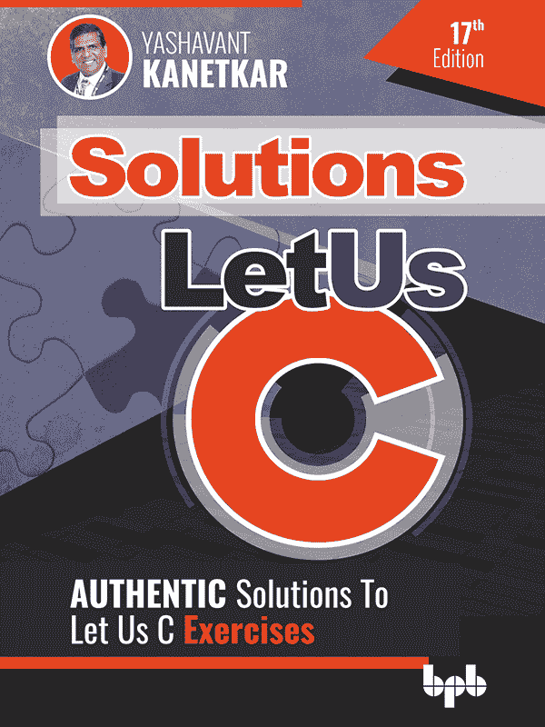
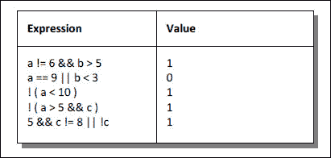
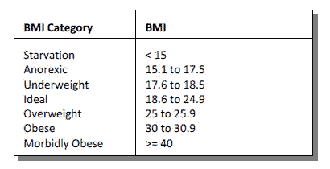
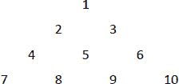
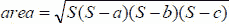
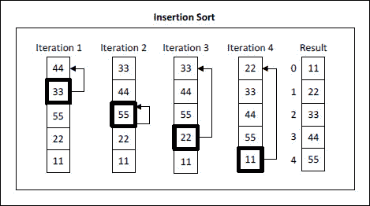
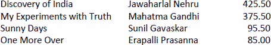
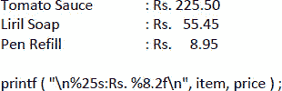

# Let Us C 解决方案——第 17 版：Let Us C 练习认证答案（英文版）




[`www.bpbonline.com`](http://www.bpbonline.com)

## 献给

Nalinee and Prabhakar Kanetkar

## 关于作者

通过他的 C、C++、数据结构、VC++、.NET、嵌入式系统等书籍和在线 Quest 视频课程，Yashavant Kanetkar 在过去的二十五载里创造、塑造并培养了数十万 IT 人才。Yashavant 的书籍和在线课程为在印度及海外培养顶尖 IT 人才做出了巨大贡献。

Yashavant 的书籍在全球范围内认可，数百万学生/专业人士从中受益。他的书已被翻译成印地语、古吉拉特语、日语、韩语和中文。他的许多书籍在印度、美国、日本、新加坡、韩国和中国出版。

Yashavant 是 IT 领域备受青爱的演讲者，曾在 TedEx、IITs、NITs、IIITs 和全球软件公司举办过研讨会/工作坊。

Yashavant 因其在创业、专业和学术方面的卓越表现荣获 IIT Kanpur 颁发的“杰出校友奖”。该奖项授予 IIT Kanpur 在过去 50 年中对其专业领域和社会进步做出重大贡献的前 50 名校友。

为了感谢他对印度 IT 教育做出的巨大贡献，他连续五年获得微软颁发的“最佳 .NET 技术贡献者”和“最有价值专业人士”奖。

Yashavant 拥有 VJTI Mumbai 的工程学士学位和 IIT Kanpur 的硕士学位。他目前的任职包括 KICIT Pvt. Ltd. 的董事。可以通过 `kanetkar@kicit.com` 或通过 [`www.kicit.com`](http://www.kicit.com/) 与他联系。

## 引言

当《Let Us C》第三版发布时，人们开始提出像《Let Us C 题解》这样的请求。我通过编写这本书来回答这些请求。从那时起，我遇到了许多读者，他们说每一个新版本的《Let Us C》都应该配有两本书——一本新版的《Let Us C 题解》和一本新版的《Let Us C 练习册》。我决定接受这一请求，并从第五版开始同时发行这三本书。

这本书过去 13 版本的成功，验证了我的信念：如果你有一本书可以让读者交叉检查他们创建的解决方案/程序，那么就能增强他们的信心并改进整体的语言学习过程。

在本书的所有版本中，有一个来自 BPB 的 Manish Jain 一直不倦地帮助我。无论我提出什么请求，他总是会满足。

Amol Tambat, Ajay Daga, Prachi Garaye, Amit Mendhe, Vikrant Sahoo, Shoeb Parvez, Monali.

第一次提出像《Let Us C 题解》这样的书是在《Let Us C》第三版发布时。我通过编写这本书来回答这些请求。从那时起，我遇到了许多读者，他们说每一个新版本的《Let Us C》都应该配有两本书——一本新版的《Let Us C 题解》和一本新版的《Let Us C 练习册》。我决定接受这一请求，并从第五版开始同时发行这三本书。

这本书过去 13 版本的成功，验证了我的信念：如果你有一本书可以让读者交叉检查他们创建的解决方案/程序，那么就能增强他们的信心并改进整体的语言学习过程。

在本书的所有版本中，有一个来自 BPB 的 Manish Jain 一直不倦地帮助我。无论我提出什么请求，他总是会满足。

## 编译与执行步骤

### IDE

有多种 IDE 可用，针对不同的操作系统组合。以下是常用工具的简要描述。

### Windows 下的 C/C++

如果你想使用 `Turbo C`，可以在：`https://www.developerinsider.in/download-turbo-c-for-windows-7-8-1-and-windows-10-32-bit-full-screen/`

### Windows 下的 NetBeans

NetBeans 不是编译器，它仅仅是一个 IDE。Windows 版本可以从 [`http://www.netbeans.org`](http://www.netbeans.org) 下载。Windows 下使用 NetBeans 开发 `C` 程序，你还需要安装 `Cygwin` 软件。`Cygwin` 带有 `GCC` 编译器。它可以在 [`https://www.cygwin.com/`](https://www.cygwin.com/) 获取。

如果你在设置 `Cygwin` 和 `NetBeans` 时遇到任何困难，可以在以下链接找到很好的教程：

`https://netbeans.org/community/releases/80/cpp-setup-instructions.html`

`https://www.wikihow.com/Run-C/C%2B%2B-Program-in-Netbeans-on-Windows`

### Linux 下的 NetBeans

如果你计划在 Linux 下使用 NetBeans，你不需要 Cygwin，因为大多数 Linux 安装（例如 Ubuntu）都预装了 `GCC` 编译器。你只需要下载并安装 Linux 版的 NetBeans。

### Windows 下的 Visual Studio

如果你想使用 `VisualStudio Express`，可以在 [`https://www.visualstudio.com/vs/express/`](https://www.visualstudio.com/vs/express/) 获取。

你可以使用上述任何 IDE 来编译书中的程序。如果你想知道我的个人选择，我更倾向于使用 `NetBeans` + `Cygwin` 或 `Visual Studio 快捷版`。

上一节中提到的每个 IDE 的编译和执行过程略有不同。为了方便起见，我在下方列出了每个 IDE 的具体操作步骤。

## 使用 Turbo C++ 进行编译和执行

按照以下步骤使用 Turbo C++ 编译并执行程序：

1. 从 `Start | All Programs | Turbo C++` 启动 NetBeans。
2. 在弹出的对话框中点击“Start Turbo C++”。
3. 从菜单选择 `File | New`。
4. 输入程序。
5. 使用 `F2` 以合适的名称（例如 `Program1.c`）保存程序。
6. 使用 `Ctrl + F9` 编译并执行程序。
7. 使用 `Alt + F5` 查看输出。

## 使用 NetBeans 进行编译和执行

按照以下步骤使用 NetBeans 编译并执行程序：

1. 从 `Start | All Programs | NetBeans` 启动 NetBeans。
2. 从 `File` 菜单中选择 `File | New Project…`。在弹出的对话框中，将项目类别（Project Category）选择为 `C/C++`，项目类型（Project Type）选择为 `C/C++ Application`。点击 `Next` 按钮。
3. 在 Project Name（项目名称）文本框中输入合适的项目名称（例如 `Program1`）。点击 `Finish`。
4. 输入程序。
5. 使用 `Ctrl + S` 保存程序。
6. 使用 `F6` 编译并执行程序。

## 使用 Visual Studio Express 进行编译和执行

按照以下步骤使用 Visual Studio Express 编译并执行程序：

1. 从 `Start | All Programs | Microsoft Visual C++ Express` 启动 Visual Studio Express。
2. 从 `File` 菜单选择 `File | New Project…`。在弹出的对话框中，将项目类型选择为 `C/C++ | Win32 Console Application`。在 Name（名称）文本框中输入合适的项目名称（例如 `Program1`）。点击 `OK` 和 `Finish`。
3. 输入程序。
4. 使用 `Ctrl+S` 保存程序。
5. 使用 `Ctrl+F5` 编译并执行程序。

当你使用 Visual Studio 为上述程序创建一个 `Win32 Console Application` 时，向导默认会插入以下代码：

```c
#include “stdafx.h”
int _tmain (int argc, _TCHAR* argv[])
{
return 0;
}
```

你可以删除这段代码并在其位置输入你的程序。如果你现在使用 `Ctrl+F5` 编译程序，将得到以下错误：

`Fatal error C1010`：

`unexpected end of file while looking for precompiled header`。在寻找预编译头文件时文件意外结束。你是否忘记在源文件中添加 `#include “stdafx.h”`？

如果你在程序的顶部添加 `#include “stdafx.h"`，则程序就能成功编译并运行。然而，包含此文件会使程序以 Visual Studio 为中心，且无法与其他编译器一起编译。这并不好，因为程序不再具有可移植性。要消除此错误，你需要在 Visual Studio 中进行设置。要执行此设置，请按照以下步骤操作：

1. 转到 `Solution Explorer`（解决方案管理器）。
2. 右键点击项目名称，从弹出的菜单中选择 `Properties`（属性）。这样做会出现一个名为 `Property Pages`（属性页）的对话框。
3. 从此对话框的左侧面板首先选择 `Configuration Properties`（配置属性），然后选择 `C/C++`。
4. 选择 `Precompiled Headers`（预编译头）。
5. 从对话框右侧面板点击 `Create/Use Precompiled Header`（创建/使用预编译头）。这样做后，该选项的值处会出现一个三角形。
6. 点击此三角形将出现一个下拉列表框。
7. 从列表框选择 `Not using Precompiled Header`（不使用预编译头）。
8. 点击 `OK` 按钮使设置生效。

此外，你还需要进行一项设置。除了此之外，你还需要一项设置。Visual Studio 默认认为你的程序是 C++ 程序。为了执行此设置，请执行以下步骤：

1. 进入 `Solution Explorer`（解决方案管理器）。
2. 右键点击项目名称，从弹出的菜单中选择 `Properties`（属性）。这样做会出现一个名为 `Property Pages`（属性页）的对话框。
3. 从此对话框的左侧面板首先选择 `Configuration Properties`（配置属性），然后选择 `C/C++`。
4. 选择 `Precompiled Headers`（预编译头）。
5. 从对话框右侧面板点击 `Create/Use Precompiled Header`（创建/使用预编译头）。这样做后，该选项的值处会出现一个三角形。
6. 点击此三角形将出现一个下拉列表框。
7. 从列表框选择 `Not using Precompiled Header`（不使用预编译头）。
8. 点击 `OK` 按钮使设置生效。

此外，你还需要进行一项设置。除了此之外，你还需要一项设置。Visual Studio 默认认为你的程序是 C++ 程序。为了执行此设置，请执行以下步骤操作：

1. 进入 `Solution Explorer`（解决方案管理器）。
2. 右键点击项目名称，从弹出的菜单中选择 `Properties`（属性）。这样做会出现一个名为 `Property Pages`（属性页）的对话框。
3. 从此对话框的左侧面板首先选择 `Configuration Properties`（配置属性），然后选择 `C/C++`。
4. 选择 `Precompiled Headers`（预编译头）。
5. 从对话框右侧面板点击 `Create/Use Precompiled Header`（创建/使用预编译头）。这样做后，该选项的值处会出现一个三角形。
6. 点击此三角形将出现一个下拉列表框。
7. 从列表框选择 `Not using Precompiled Header`（不使用预编译头）。
8. 点击 `OK` 按钮使设置生效。

此外，你还需要进行一项设置。除了此之外，你还需要一项设置。Visual Studio 默认认为你的程序是 C++ 程序。为了执行此设置，请执行以下步骤操作：

1. 进入 `Solution Explorer`（解决方案管理器）。
2. 右键点击项目名称，从弹出的菜单中选择 `Properties`（属性）。这样做会出现一个名为 `Property Pages`（属性页）的对话框。
3. 从此对话框的左侧面板首先选择 `Configuration Properties`（配置属性），然后选择 `C/C++`。
4. 选择 `Precompiled Headers`（预编译头）。
5. 从对话框右侧面板点击 `Create/Use Precompiled Header`（创建/使用预编译头）。这样做后，该选项的值处会出现一个三角形。
6. 点击此三角形将出现一个下拉列表框。
7. 从列表框选择 `Not using Precompiled Header`（不使用预编译头）。
8. 点击 `OK` 按钮使设置生效。

此外，你还需要进行一项设置。除了此之外，你还需要一项设置。Visual Studio 默认认为你的程序是 C++ 程序。为了执行此设置，请执行以下步骤操作：

1. 进入 `Solution Explorer`（解决方案管理器）。
2. 右键点击项目名称，从弹出的菜单中选择 `Properties`（属性）。这样做会出现一个名为 `Property Pages`（属性页）的对话框。
3. 从此对话框的左侧面板首先选择 `Configuration Properties`（配置属性），然后选择 `C/C++`。
4. 选择 `Precompiled Headers`（预编译头）。
5. 从对话框右侧面板点击 `Create/Use Precompiled Header`（创建/使用预编译头）。这样做后，该选项的值处会出现一个三角形。
6. 点击此三角形将出现一个下拉列表框。
7. 从列表框选择 `Not using Precompiled Header`（不使用预编译头）。
8. 点击 `OK` 按钮使设置生效。

此外，你还需要进行一项设置。除了此之外，你还需要一项设置。Visual Studio 默认认为你的程序是 C++ 程序。为了执行此设置，请执行以下步骤操作：

1. 进入 `Solution Explorer`（解决方案管理器）。
2. 右键点击项目名称，从弹出的菜单中选择 `Properties`（属性）。这样做会出现一个名为 `Property Pages`（属性页）的对话框。
3. 从此对话框的左侧面板首先选择 `Configuration Properties`（配置属性），然后选择 `C/C++`。
4. 选择 `Precompiled Headers`（预编译头）。
5. 从对话框右侧面板点击 `Create/Use Precompiled Header`（创建/使用预编译头）。这样做后，该选项的值处会出现一个三角形。
6. 点击此三角形将出现一个下拉列表框。
7. 从列表框选择 `Not using Precompiled Header`（不使用预编译头）。
8. 点击 `OK` 按钮使设置生效。

此外，你还需要进行一项设置。除了此之外，你还需要一项设置。Visual Studio 默认认为你的程序是 C++ 程序。为了执行此设置，请执行以下步骤操作：

1. 进入 `Solution Explorer`（解决方案管理器）。
2. 右键点击项目名称，从弹出的菜单中选择 `Properties`（属性）。这样做会出现一个名为 `Property Pages`（属性页）的对话框。
3. 从此对话框的左侧面板首先选择 `Configuration Properties`（配置属性），然后选择 `C/C++`。
4. 选择 `Precompiled Headers`（预编译头）。
5. 从对话框右侧面板点击 `Create/Use Precompiled Header`（创建/使用预编译头）。这样做后，该选项的值处会出现一个三角形。
6. 点击此三角形将出现一个下拉列表框。
7. 从列表框选择 `Not using Precompiled Header`（不使用预编译头）。
8. 点击 `OK` 按钮使设置生效。

此外，你还需要进行一项设置。除了此之外，你还需要一项设置。Visual Studio 默认认为你的程序是 C++ 程序。为了执行此设置，请执行以下步骤：（此处省略重复部分，直接翻译后续）

按照以下步骤使用 Turbo C++ 编译并执行程序：

1. 从 `Start | All Programs | Turbo C++` 启动 NetBeans。


(b) 在弹出的对话框中点击“Start Turbo C++”。

(c) 从菜单中选择`File | New`。

(d) 输入程序。

(e) 使用`F2`以合适的名称（例如`Program1.c`）保存程序。

(f) 使用`Ctrl + F9`编译并执行程序。

(g) 使用`Alt + F5`查看输出。

# 使用 NetBeans 进行编译和执行

按照以下步骤使用 NetBeans 编译并执行程序：

(a) 从`Start | All Programs | NetBeans`启动 NetBeans。

(b) 从`File`菜单中选择`File | New Project…`。在弹出的对话框中，将项目类别（Project Category）选择为`C/C++`，项目类型（Project Type）选择为`C/C++ Application`。点击`Next`按钮。

(c) 在 Project Name（项目名称）文本框中输入合适的项目名称（例如`Program1`）。点击`Finish`。

(d) 输入程序。

(e) 使用`Ctrl + S`保存程序。

(f) 使用`F6`编译并执行程序。

# 使用 Visual Studio Express 进行编译和执行

按照以下步骤使用 Visual Studio Express 编译并执行程序：

(a) 从`Start | All Programs | Microsoft Visual C++ Express`启动 Visual Studio Express。

(b) 从`File`菜单中选择`File | New Project…`。在弹出的对话框中，将项目类型选择为`C/C++ | Win32 Console Application`。在 Name（名称）文本框中输入合适的项目名称（例如`Program1`）。点击`OK`和`Finish`。

(c) 输入程序。

(d) 使用`Ctrl + S`保存程序。

(e) 使用`Ctrl + F5`编译并执行程序。

当你使用 Visual Studio 为上述程序创建一个`Win32 Console Application`时，向导默认会插入以下代码：

```c
#include “stdafx.h”
int _tmain (int argc, _TCHAR* argv[])
{
    return 0;
}
```

你可以删除这段代码并在其位置输入你的程序。如果你现在使用`Ctrl + F5`编译程序，将得到以下错误：

```text
Fatal error C1010:
```

在寻找预编译头文件时文件意外结束。你是否忘记在源文件中添加`#include “stdafx.h”`？

如果你在程序的顶部添加`#include “stdafx.h”`，则程序就能成功编译并运行。然而，包含此文件会使程序以 Visual Studio 为中心，且无法与其他编译器一起编译。这并不好，因为程序不再具有可移植性。要消除此错误，你需要在 Visual Studio 中进行设置。要执行此设置，请按照以下步骤操作：

(a) 转到“Solution Explorer”（解决方案管理器）。

(b) 右键点击项目名称，从弹出的菜单中选择`Properties`（属性）。这样做会出现一个名为`Property Pages`（属性页）的对话框。

(c) 从此对话框的左侧面板首先选择`Configuration Properties`（配置属性），然后选择`C/C++`。

(d) 选择`Precompiled Headers`（预编译头）。

(e) 从对话框右侧面板点击`Create/Use Precompiled Header`（创建/使用预编译头）。这样做后，该选项的值处会出现一个三角形。

(f) 点击此三角形将出现一个下拉列表框。

(g) 从列表框中选择`Not using Precompiled Header`（不使用预编译头）。

(h) 点击`OK`按钮使设置生效。

此外，你还需要进行一项设置。Visual Studio 默认认为你的程序是 C++ 程序。为了执行此设置，请执行以下步骤：……

## 匹配项

| 项目 | 匹配项 |
|---|---|
| (a) | (4) 转义序列 |
| (b) `3.145` | (12) 实数常量 |
| (c) `-6513` | (7) 整数常量 |
| (d) ‘D’ | (3) 字符常量 |
| (e) `4.25e-3` | (11) 指数形式 |
| (f) `main()` | (6) 函数 |
| (g) `%f, %d, %c` | (10) 格式说明符 |
| (h) `;` | (2) 语句结束符 |
| (i) 常量 | (1) 字面量 |
| (j) 变量 | (13) 标识符 |
| (k) `&` | (8) 地址运算符 |
| (l) `printf()` | (9) 输出函数 |
| (m) `scanf()` | (5) 输入函数 |

## [E] 指出下列程序中的错误（如有）

### (a)

```c
int main()
{
    int a;
    float b;
    int c;
    a = 25;
    b = 3.24;
    c = a + b * b - 35;
}
```

无错误。多个 C 语句可以写在一行。

### (b)

```c
#include <stdio.h>
int main()
{
    int a = 35;
    float b = 3.24;
    printf (“%d %f %d”, a, b + 1.5, 235);
}
```

无错误。`printf()`中打印的列表可以包含变量、常量或表达式。

### (c)

```c
#include <stdio.h>
int main()
{
    int a, b, c;
    scanf (“%d %d %d”, a, b, c);
}
```

错误。在`scanf()`中使用的每个变量前应该使用`&`。

### (d)

```c
#include <stdio.h>
int main()
{
    int m1, m2, m3
    printf (“Enter values of marks in 3 subjects:”)
    scanf (“%d %d %d”, &m1, &m2, &m3)
    printf (“You entered %d %d %d”, m1, m2, m3)
}
```

错误。类型声明、`printf()`和`scanf()`语句末尾应该有分号。

## [F] 尝试以下问题

### (a)

通过键盘输入以华氏度为单位的城市温度。编写一个程序将此温度转换为摄氏度。

**程序：**

```c
/* 将温度从华氏度转换为摄氏度的转换 */
#include <stdio.h>

int main()
{
    float fr, cent;

    printf (“nEnter the temperature (F):”);
    scanf (“%f”, &fr);
    cent = 5.0 / 9.0 * (fr - 32);
    printf (“Temperature in centigrade = %f\n”, cent);

    return 0;
}
```

### (b)

通过键盘输入矩形的长宽和圆的半径。编写一个程序计算矩形的面积和周长，以及圆的面积和周长。

**程序：**


```c
/* 计算矩形和圆的周长与面积 */
#include <stdio.h>
int main()
{
    int l, b, r, area1, perimeter;
    float area2, circum;
    printf (“nEnter Length & Breadth of Rectangle:”);
    scanf (“%d %d”, &l, &b);
    area1 = l * b; /* 矩形的面积 */
    perimeter = 2 * l + 2 * b; /* 矩形的周长 */
    printf (“Area of Rectangle = %d\n”, area1);
    printf (“Perimeter of Rectangle = %d\n”, perimeter);
    printf (“\n\nEnter Radius of circle:”);
    scanf (“%d”, &r);
    area2 = 3.14 * r * r; /* 圆的面积 */
    circum = 2 * 3.14 * r; /* 圆的周长 */
    printf (“Area of Circle = %f\n”, area2);
    printf (“Circumference of Circle = %f\n”, circum);
    return 0;
}
```

(c) A0 纸尺寸为 1189 mm x 841 mm。随后的每个尺寸 A(n) 定义为将 A(n-1) 平行其短边对半。编写一个程序计算并打印纸尺寸 A0, A1, A2, … A8。

### 程序

```c
/* 计算纸张尺寸 A0 到 A8 */
#include <stdio.h>
int main()
{
    int a0ht, a0wd;
    int a1ht, a1wd, a2ht, a2wd, a3ht, a3wd, a4ht, a4wd;
    int a5ht, a5wd, a6ht, a6wd, a7ht, a7wd, a8ht, a8wd;
    a0ht = 1189; a0wd = 841;
    printf (“Size of A0 paper Ht = %d %d\n”, a0ht, a0wd);
    a1ht = a0wd; a1wd = a0ht / 2;
    printf (“Size of A1 paper Ht = %d %d\n”, a1ht, a1wd);
    a2ht = a1wd; a2wd = a1ht / 2;
    printf (“Size of A2 paper Ht = %d %d\n”, a2ht, a2wd);
    a3ht = a2wd; a3wd = a2ht / 2;
    printf (“Size of A3 paper Ht = %d %d\n”, a3ht, a3wd);
    a4ht = a3wd; a4wd = a3ht / 2;
    printf (“Size of A4 paper Ht = %d %d\n”, a4ht, a4wd);
    a5ht = a4wd; a5wd = a4ht / 2;
    printf (“Size of A5 paper Ht = %d %d\n”, a5ht, a5wd);
    a6ht = a5wd; a6wd = a5ht / 2;
    printf (“Size of A6 paper Ht = %d %d\n”, a6ht, a6wd);
    a7ht = a6wd; a7wd = a6ht / 2;
    printf (“Size of A7 paper Ht = %d %d\n”, a7ht, a7wd);
    a8ht = a7wd; a8wd = a7ht / 2;
    printf (“Size of A8 paper Ht = %d %d\n”, a8ht, a8wd);
    return 0;
}
```

# 第二章 C 语言指令

## [A] 指出下列 C 语句中的错误（如有）

(a) `x = (y + 3);` 无错误。

(b) `cir = 2 * 3.14 * r;` 无错误。

(c) `char = ‘3’;` 错误。`char` 不能作为变量名。

(d) `4 / 3 * 3.14 * r * r = vol_of_sphere;` 错误。`=` 左侧应该是变量。

(e) `volume = a³;` 错误。`a³` 不是有效的语句。我们可以使用 `a * a`。

(f) `area = 1 / 2 * base * height;` 无错误。

(g) `si = p * r / 100;` 无错误。

(h) `area of circle = 3.14 * r * r;` 错误。`area of circle` 是无效的变量名。

(i) `peri_of_tri = a + b + c;` 无错误。

(j) `slope = (y2 - y1) ÷ (x2 - x1);` 错误。`÷` 是无效运算符。

(k) `3 = b = 4 = a;` 错误。`=` 左侧必须存在变量。

(l) `count = count + 1;` 无错误。

(m) `char ch = ‘2512’;` 错误。多个字符不能存储在 `char` 变量中。

## [B] 计算下列表达式并显示它们的优先级

### (a) `ans = 5 * b * x - 3 * a * y - 8 * b * x + 10 * a * y;`

（`a = 3, b = 2, x = 5, y = 4`，假设 `ans` 为 `int`）

### 答案

| 表达式 | 步骤 | 运算 |
| :--- | :--- | :--- |
| `ans = 5 * 2 * 5 - 3 * 3 * 4 - 8 * 2 * 5 + 10 * 3 * 4` | `5 * 2` | `*` |
| `ans = 10 * 2 * 5 - 3 * 3 * 4 - 8 * 2 * 5 + 10 * 3 * 4` | `10 * 2` | `*` |
| `ans = 20 * 5 - 3 * 3 * 4 - 8 * 2 * 5 + 10 * 3 * 4` | `20 * 5` | `*` |
| `ans = 100 - 3 * 3 * 4 - 8 * 2 * 5 + 10 * 3 * 4` | `3 * 3` | `*` |
| `ans = 100 - 12 * 4 - 8 * 2 * 5 + 10 * 3 * 4` | `12 * 4` | `*` |
| `ans = 100 - 48 - 8 * 2 * 5 + 10 * 3 * 4` | `8 * 2` | `*` |
| `ans = 100 - 48 - 16 * 5 + 10 * 3 * 4` | `16 * 5` | `*` |
| `ans = 100 - 48 - 80 + 10 * 3 * 4` | `10 * 3` | `*` |
| `ans = 100 - 48 - 80 + 30 * 4` | `30 * 4` | `*` |
| `ans = 100 - 48 - 80 + 120` | `100 - 48` | `-` |
| `ans = 52 - 80 + 120` | `52 - 80` | `-` |
| `ans = -28 + 120` | `-28 + 120` | `+` |
| `ans = 92` | | |

### (b) `b = 3 / 2 + 5 * 4 / 3;`

求值顺序：

| 表达式 | 运算符 |
| :--- | :--- |
| `b = 3 / 2 + 5 * 4 / 3` | 操作：`/` |
| `b = 1 + 5 * 4 / 3` | 操作：`*` |
| `b = 1 + 20 / 3` | 操作：`/` |
| `b = 1 + 6` | 操作：`+` |
| `b = 7` | 操作：`=` |

### (c) `a = b = c = 3 + 4;`

求值顺序：

| 表达式 | 运算符 |
| :--- | :--- |
| `a = b = c = 3 + 4` | 操作：`+` |
| `a = b = c = 7` | 操作：`=` |
| `a = b = 7` | 操作：`=` |
| `a = 7` | 操作：`=` |

### (d) `x = 2 - 3 + 5 * 2 / 8 % 3;`

求值顺序：

| 表达式 | 运算符 |
| :--- | :--- |
| `x = 2 - 3 + 5 * 2 / 8 % 3` | 操作：`*` |
| `x = 2 - 3 + 10 / 8 % 3` | 操作：`/` |
| `x = 2 - 3 + 1 % 3` | 操作：`%` |
| `x = 2 - 3 + 1` | 操作：`-` |
| `x = -1 + 1` | 操作：`+` |
| `x = 0` | 操作：`=` |

### (e) `z = 5 % 3 / 8 * 3 + 4;`

求值顺序：

| 表达式 | 运算符 |
| :--- | :--- |
| `z = 5 % 3 / 8 * 3 + 4` | 操作：`%` |
| `z = 2 / 8 * 3 + 4` | 操作：`/` |
| `z = 0 * 3 + 4` | 操作：`*` |
| `z = 0 + 4` | 操作：`+` |
| `z = 4` | 操作：`=` |

### (f) `y = z = -3 % -8 / 2 + 7;`

求值顺序：

| 表达式 | 运算符 |
| :--- | :--- |
| `y = z = -3 % -8 / 2 + 7` | 操作：`-` |
| `y = z = -3 % -8 / 2 + 7` | 操作：`-` |
| `y = z = -3 % -8 / 2 + 7` | 操作：`%` |
| `y = z = -3 / 2 + 7` | 操作：`/` |
| `y = z = -1 + 7` | 操作：`+` |
| `y = z = 6` | 操作：`=` |
| `y = 6` | 操作：`=` |

## [D] 下列程序的输出将是

### (a)

```c
#include <stdio.h>
int main()
{
    int i = 2, j = 3, k, l;
    float a, b;
    k = i / j * j;
    l = j / i * i;
    a = i / j * j;
    b = j / i * i;
    printf (“%d %d %f %f\n”, k, l, a, b);
    return 0;
}
```

### 输出

```text
0 2 0.000000 2.000000
```

### (b)

```c
#include <stdio.h>
int main()
{
    int a, b, c, d;
    a = 2 % 5;
    b = -2 % 5;
    c = 2 % -5;
    d = -2 % -5;
    printf (“a = %d b = %d c = %d d = %d\n”, a, b, c, d);
    return 0;
}
```

### 输出

```text
a = 2 b = -2 c = 2 d = -2
```

### (c)

```c
#include <stdio.h>
int main()
{
    float a = 5, b = 2;
    int c, d;
    c = a % b;
    d = a / 2;
    printf (“%d\n”, d);
    return 0;
}
```

### 输出

错误。浮点数不能使用 Mod（`%`）运算符。

### (d)

```c
#include <stdio.h>
int main()
{
    printf (“nn \n\n nn\n”);
    printf (“nn /n/n nn/n”);
    return 0;
}
```

### 输出

```text
nn

nn

nn /n/n nn/n
```

### (e)

```c
#include <stdio.h>
int main()
{
    int a, b;
    printf (“Enter values of a and b”);
    scanf (“%d %d “, &a, &b);
    printf (“a = %d b = %d”, a, b);
    return 0;
}
```

### 输出

由于 `scanf()` 中的空格，必须提供两个数字并跟一个空格，`printf()` 然后输出你输入的数字。

## [E] 判断下列陈述对或错

(a) `*` 或 `/`、`+` 或 `-` 代表 C 中运算符的优先级。对

(b) `[]` 用于赋值语句。错

(c) 优先级决定先使用哪个运算符。对

(d) 在 C 中，赋值语句左侧不能包含常量。对

(e) C 中 `^` 运算符用于幂。错

(f) `%` 运算符不能用于浮点数。对

## [F] 填空

(a) 在 `y = 10 * x / 2 + z;` 中，将执行 `10 * x`。

(b) 如果 `a` 是整数变量，`a = 2;` 将存储 `0`。

(c) 表达式 `a = 2 * 5 / 3;` 于 `5`。

(d) 表达式 `x = -7 % 2;` 于 `-9`。

(e) 如果 `d` 是浮点数，操作 `d = 2 / 7.0;` 将存储 `0.285714`d`。

## [G] 尝试以下题目

### (a) 从键盘输入五位数数字，编写一个程序计算数字和

提示：使用模运算符 `%`。

```c
/* 获取五位数数字的和 */
#include <stdio.h>
int main()
{
    int num, a, n;
    int sum = 0;
    printf (“Enter 5 digit number (less than 32767):”);
    scanf (“%d”, &num);
    a = num % 10; /* 第 5 位 */
    n = num / 10;
    sum = sum + a;
    a = n % 10; /* 第 4 位 */
    n = n / 10;
    sum = sum + a;
    a = n % 10; /* 第 3 位 */
    n = n / 10;
    sum = sum + a;
    a = n % 10; /* 第 2 位 */
    n = n / 10;
    sum = sum + a;
    a = n % 10; /* 第 1 位 */
    sum = sum + a;
    printf (“Sum of 5 digits is %d\n”, sum);
    return 0;
}
```

### (b) 编写一个程序接收点的直角坐标 `(x, y)` 并将其转换为极坐标 `(r, theta)`

```c
/* 直角坐标转换为极坐标 */
#include <stdio.h>
#include <math.h>
int main()
{
    float x, y, r, theta;
    printf (“Enter x and y coordinates:”);
    scanf (“%f %f”, &x, &y);
    r = sqrt (x * x + y * y);
    theta = atan2 (y, x);
    theta = theta * 180 / 3.14; /* 转换为角度 */
    printf (“r = %f theta = %f\n”, r, theta);
    return 0;
}
```

### (c) 编写一个程序接收地球两地的纬度 `(L1, L2)` 和经度 `(G1, G2)`（角度），并输出它们之间的海里距离

海里距离公式为：`D = 3963 * acos(sin(L1) * sin(L2) + cos(L1) * cos(G2 - G1))`。

```c
/* 计算两地海里距离 */
#include <stdio.h>
#include <math.h>
int main()
{
    float lat1, lat2, lon1, lon2, d;
    printf (“Enter Latitude and Longitude of Place 1:”);
    scanf (“%f %f”, &lat1, &lon1);
    printf (“Enter Latitude and Longitude of Place 2:”);
    scanf (“%f %f”, &lat2, &lon2);
    lat1 = lat1 * 3.14 / 180;
    lat2 = lat2 * 3.14 / 180;
    lon1 = lon1 * 3.14 / 180;
    lon2 = lon2 * 3.14 / 180;
    d = 3963 * acos (sin(lat1) * sin(lat2) + cos(lat1) * cos(lon2 - lon1));
    printf (“Distance between Place 1 and Place 2: %f\n”, d);
    return 0;
}
```

### (d) 风寒因子是由于风导致暴露皮肤的体感温度

风寒温度总是低于空气温度，并按照以下公式计算：`wcf = 35.74 + 0.6215 * t - 0.4275 * v * (35.74 + t)⁰.6`，其中 `t` 是温度，`v` 是风速。编写一个程序接收 `t` 和 `v` 并计算风寒因子。


```c
/* 计算风寒因子 */
#include <stdio.h>
#include <math.h>
int main()
{
    float temp, vel, wcf;
    printf (“Enter values of temp and velocity:”);
    scanf (“%f %f”, &temp, &vel);
    wcf = 35.74 + 0.6215 * temp - 0.4275 * vel * pow (35.74 + temp, 0.6);
    printf (“Wind Chill Factor = %f\n”, wcf);
    return 0;
}
```

(e) 从键盘输入角度，编写一个程序打印其所有的三角函数比。

```c
/* 打印角度的三角比 */
#include <stdio.h>
#include <math.h>
int main()
{
    float angle, s, c, t;
    printf (“Enter an angle:”);
    scanf (“%f”, &angle);
    /* 将角度转换为弧度 */
    angle = angle * 3.14 / 180;
    s = sin (angle);
    c = cos (angle);
    t = tan (angle);
    printf (“sin = %f cos = %f tan = %f\n”, s, c, t);
    return 0;
}
```

(f) 从键盘输入两个数字到位置`C`和`D`。编写一个程序交换`C`和`D`的内容。

```c
/* 交换两个变量 c & d 的内容 */
#include <stdio.h>
int main()
{
    int c, d, e;
    printf (“Enter the number at location C:”);
    scanf (“%d”, &c);
    printf (“Enter the number at location D:”);
    scanf (“%d”, &d);
    e = c;
    c = d;
    d = e;
    printf (“New Number at location C = %d\n”, c);
    printf (“New Number at location D = %d\n”, d);
    return 0;
}
```

### 输出：

`b` 将包含一些垃圾值，而`c`将等于 200。

```c
(b) #include <stdio.h>
int main()
{
    int x = 10, y = 20;
    if (x == y);
    printf (“%d %d\n”, x, y);
    return 0;
}
```

### 输出：

10 20

```c
(c) #include <stdio.h>
int main()
{
    int x = 3;
    float y = 3.0;
    if (x == y)
    printf (“x and y are equal\n”);
    else
    printf (“x and y are not equal\n”);
    return 0;
}
```

### 输出：

x and y are equal

```c
(d) #include <stdio.h>
int main()
{
    int x = 3, y, z;
    y = x = 10;
    z = x < 10;
    printf (“x = %d y = %d z = %d\n”, x, y, z);
    return 0;
}
```

### 输出：

x = 10 y = 10 z = 0

```c
(e) #include <stdio.h>
int main()
{
    int i = 65;
    char j = ‘A’;
    if (i == j)
    printf (“C is WOW\n”);
    else
    printf(“C is a headache\n”);
    return 0;
}
```

### 输出：

C is WOW

## [B] 请指出以下程序中的错误（如果有的话）

```c
(a) #include <stdio.h>
int main()
{
    float a = 12.25, b = 12.52;
    if (a = b)
    printf (“a and b are equal\n”);
    return 0;
}
```

无错误。`12.52`将赋值给`a`，条件将被求值为真，并且`printf()`将被执行。

```c
(b) #include <stdio.h>
int main()
{
    int j = 10, k = 12;
    if (k >= j)
    {
        {
            k = j;
            j = k;
        }
    }
    return 0;
}
```

无错误。可以使用任意数量对的大括号。

```c
(c) #include <stdio.h>
int main()
{
    if (‘X’ < ‘x’)
    printf (“ascii value of X is smaller than that of x\n”);
}
```

无错误。正在比较`x`和`X`的 ASCII 码。

```c
(d) #include <stdio.h>
int main()
{
    int x = 10;
    if (x >= 2) then
    printf (“%d\n”, x);
    return 0;
}
```

错误。C 语言中不能使用`then`。

```c
(e) #include <stdio.h>
int main()
{
    int x = 10, y = 15;
    if (x % 2 = y % 3)
    printf (“Carpathians\n”);
    return 0;
}
```

错误。比较应使用`==`而不是`=`。

```c
(f) #include <stdio.h>
int main()
{
    int a, b;
    scanf (“%d %d”, a, b);
    if (a > b)
    printf (“This is a game\n”);
    else
    printf (“Have to play it\n”);
    return 0;
}
```

## [C] 判断下列陈述的正确（True）或错误（False）

(a) `;`是有效语句。答案：正确

(b) `If`可以嵌套。答案：正确

(c) 如果`if`或`else`块中有多个语句，它们应该包含在一对`{}`中。答案：正确

(d) `If`可以出现在`if`块中，但不能出现在`else`块中。答案：错误

(e) 默认情况下，`if`块中只有一个语句，`else`块中也有一个。答案：正确

(f) 执行空语句不会发生任何事情。答案：正确

## [D] 将下列配对匹配

(a) 多条语句 | (1) `{}`

(b) `else`块 | (2) 可选

(c) `;` | (3) 空语句

(d) `< <= >= !=` | (4) 关系运算符

(e) `==` | (5) 比较运算符

(f) `+ - * / %` | (6) 算术运算符

(g) `=` | (7) 赋值运算符

(h) 默认控制指令 | (8) 顺序

(i) 决策控制指令 | (9) `if else`

## [E] 以下哪些是有效的`if`

(a) `if (-2)`

(b) `if (3.14)`

(c) `if (a)`

(d) `if (a + b)`

(e) `if (a >= b)`

答案：(a)、(b)、(c)、(d)、(e)

## [F] 尝试以下问题

### (a)

通过键盘输入一个五位数。编写一个程序获取其反转数字并判断原始数字和反转数字是否相等。

```c
/* 检查数字相等 */
#include <stdio.h>
int main()
{
    int n, a, b;
    long revnum = 0;
    printf (“\nEnter 5-digit number <=32767):);
    scanf (“%d”, &n);
    num = n;
    a = n % 10; /* 最后一位 */
    n = n / 10; /* 剩余数字 */
    revnum = revnum + a * 10000;
    a = n % 10; /* 第四位 */
    n = n / 10; /* 剩余数字 */
    revnum = revnum + a * 1000;
    a = n % 10; /* 第三位 */
    n = n / 10; /* 剩余数字 */
    revnum = revnum + a * 100;
    a = n % 10; /* 第二位 */
    n = n / 10; /* 剩余数字 */
    revnum = revnum + a * 10;
    a = n % 10; /* 第一位 */
    n = n / 10; /* 剩余数字 */
    revnum = revnum + a;
    if (revnum == num)
    printf (“Given number are equal\n”);
    else
    printf (“Given number not equal\n”);
    return 0;
}
```

### (b)

通过键盘输入 Ram、Shyam 和 Ajay 的年龄，编写一个程序找出三人中年龄最小的。

```c
/* 找出朋友中最小的 */
#include <stdio.h>
int main()
{
    int r, s, a, young;
    printf (“\nEnter age of Ram, Shyam and Ajay:”);
    scanf (“%d %d %d”, &r, &s, &a);
    if (r < s)
    {
        if (r < a)
            young = r;
        else
            young = a;
    }
    else
    {
        if (s < a)
            young = s;
        else
            young = a;
    }
    printf (“The youngest of Ram(%d), Shyam(%d) and Ajay(%d) is %d\n”, r, s, a, young);
    return 0;
}
```

### (c)

通过键盘输入三角形三个角，编写一个程序检查三角形是否有效。如果三个角之和等于 180 度，则三角形有效。

```c
/* 检查三角形是否有效 */
#include <stdio.h>
int main()
{
    float angle1, angle2, angle3;
    printf (“\nEnter three angles of the triangle:”);
    scanf (“%f %f %f”, &angle1, &angle2, &angle3);
    if ((angle1 + angle2 + angle3) == 180)
    printf (“The triangle is valid\n”);
    else
    printf (“The triangle is invalid\n”);
    return 0;
}
```

### (d)

编写一个程序获取通过键盘输入的数字的绝对值。

```c
/* 获取数字的绝对值 */
#include <stdio.h>
int main()
{
    int no;
    printf (“nEnter any number:”);
    scanf (“%d”, &no);
    if (no < 0)
    no = no * -1;
    printf (“The absolute value of given number is %d\n”, no);
    return 0;
}
```

### (e)

给定矩形的长和宽，编写一个程序找出矩形的面积是否大于周长。例如，长为 5、宽为 4 的矩形面积大于周长。

```c
/* 找出矩形面积是否大于周长 */
#include <stdio.h>
int main()
{
    int l, b, area, peri;
    printf (“\nEnter length and breadth of rectangle:”);
    scanf (“%d %d”, &l, &b);
    area = l * b;
    peri = 2 * (l + b);
    if (area > peris)
    printf (“area is greater than perimeter\n”);
    else
    printf (“area is lesser than perimeter\n”);
    return 0;
}
```

### (f)

给定三点`(x1, y1)`、`(x2, y2)`和`(x3, y3)`，编写一个程序检查所有点是否在同一直线上。

```c
/* 检查三点是否共线 */
#include <stdio.h>
#include <math.h>
int main()
{
    int x1, y1, x2, y2, x3, y3;
    int s1, s2, s3;
    printf (“\nEnter the values of x1 and y1 coord. of first point:”);
    scanf (“%d%d”, &x1, &y1);
    printf (“\nEnter the values of x2 and y2 coord. of first point:”);
    scanf (“%d%d”, &x2, &y2);
    printf (“\nEnter the values of x3 and y3 coord. of first point:”);
    scanf (“%d%d”, &x3, &y3);
    /* 计算每对点之间的斜率 */
    s1 = abs (x2 - x1) / abs (y2 - y1);
    s2 = abs (x3 - x1) / abs (y3 - y1);
    s3 = abs (x3 - x2) / abs (y3 - y2);
    if ((s1 == s2) && (s1 == s3))
    printf (“Points are Co-linear\n”);
    else
    printf (“Points are NOT Co-linear\n”);
    return 0;
}
```

### (g)

给定圆心的坐标`(x, y)`及其半径，编写一个程序判断点是在圆内、圆上还是圆外。（提示：使用`sqrt()`和`pow()`函数）

```c
/* 确定点相对于圆的位置 */
/* 圆心被假设在 (0, 0) */
#include <stdio.h>
int main()
{
    int x, y, r;
    int dis, d;
    printf (“\nEnter radius of circle& coordinates of point (x, y):”);
}
```

```c
scanf (“%d %d %d”, &r, &x, &y);
dis = x * x + y * y; /* 或使用 pow() 函数*/
d = r * r;
if (dis == d)
printf (“点在圆上\n”);
else
{
    if (dis > d)
    printf (“点在圆外\n”);
    else
    printf (“点在圆内\n”);
}
return 0;
}
```

### (h)

给定一个点`(x, y)`，编写一个程序来判断它是否位于 x 轴、y 轴或原点上。

程序：

```c
/*确定点相对于 X 和 Y 轴的位置 */
#include <stdio.h>
int main()
{
    int x, y;
    printf (“\输入点的 x 和 y 坐标:”);
    scanf (“%d%d”, &x, &y);
    if (x == 0 && y == 0)
    printf (“点在原点上\n”);
    else
    if (x == 0 && y != 0)
    printf (“点在 Y 轴上\n”);
    else
    if (x != 0 && y == 0)
    printf (“点在 X 轴上\n”);
    else
    printf (“点不在任何轴上，也不在原点上\n”);
    return 0;
}
```

### (i)

根据格列哥历，`01/01/01`那天是星期一。通过键盘输入任意年份，编写一个程序找出该年`1 月 1 日`是星期几。

程序：


# 第四章 更复杂的决策制定

## [A] 表达式求值

如果`a = 10`，`b = 12`，`c = 0`，求下表中表达式的值：



## [B] 程序输出判断

下列程序的输出将是什么：

(a)

```c
#include <stdio.h>
int main()
{
    int i = 4, z = 12;
    if (i = 5 || z > 50)
    printf (“教务主任\n”);
    else
    printf (“教务长\n”);
    return 0;
}
```

*输出：*

Dean of students affairs

(b)

```c
#include <stdio.h>
int main()
{
    int i = 4, j = -1, k = 0, w, x, y, z;
    w = i || j || k;
    x = i && j && k;
    y = i || j && k;
    z = i && j || k;
    printf (“w = %d x = %d y = %d z = %d\n”, w, x, y, z);
    return 0;
}
```

*输出：*

w = 1 x = 0 y = 1 z = 1

(c)

```c
#include <stdio.h>
int main()
{
    int x = 20, y = 40, z = 45;
    if (x > y && x > z)
    printf (“biggest = %d\n”, x);
    else if (y > x && y > z)
    printf (“biggest = %d\n”, y);
    else if (z > x && z > y)
    printf (“biggest = %d\n”, z);
    return 0;
}
```

*输出：*

biggest = 45

(d)

```c
#include <stdio.h>
int main()
{
    int i = -4, j, num;
    j = (num < 0 ? 0 : num);
    printf (“%d\n”, j);
    return 0;
}
```

*输出：*

Unpredictable. num notised

(e)

```c
#include <stdio.h>
int main()
{
    int k, num = 30;
    k = (num > 5 ? (num <= 10 ? 100 : 200) : 500);
    printf (“%d\n”, k);
    return 0;
}
```

*输出：*

30

## [C] 程序错误检查

指出下列程序中的错误（如有的话）：

(a)

```c
#include <stdio.h>
int main()
{
    char spy = 'a', password = 'z';
    if (spy == 'a' or password == 'z')
    printf (“所有鸟都是安全的\n”);
    return 0;
}
```

错误。`or`不能用于组合条件。请使用`||`。

(b)

```c
#include <stdio.h>
int main()
{
    int i = 10, j = 20;
    if (i = 5) if (j = 10)
    printf (“祝你有良好的一天\n”);
    return 0;
}
```

错误。条件应为`(i == 5 && j == 10)`。

(c)

```c
#include <stdio.h>
int main()
{
    int x = 10, y = 20;
    if (x and y <= 50);
    printf (“%d\n”, x);
    return 0;
}
```

错误。将`and`替换为`&&`。

(d)

```c
#include <stdio.h>
int main()
{
    int x = 2;
    if (x == 0);
    printf (“你好\n”);
    else
    printf (“再见\n”);
    return 0;
}
```

错误。`if`语句不应以分号结尾。

(e)

```c
#include <stdio.h>
int main()
{
    int j = 65;
    printf (“%d\n”, j : 15);
    return 0;
}
```

错误。`printf`缺少左值。

(f)

```c
#include <stdio.h>
int main()
{
    int i = 10, j;
    i >= 5 ? j = 10;
    printf (“%d\n”, j);
    return 0;
}
```

错误。需要括号`j = 10`和`j = 15`以消除错误。

(g)

```c
#include <stdio.h>
int main()
{
    int a = 5, b;
    a == b ? printf (“正确\n”);
    return 0;
}
```

错误。`?`运算符必须匹配`:`。

(h)

```c
#include <stdio.h>
int main()
{
    int n = 9;
    n; printf (“正确\n”);
    return 0;
}
```

错误。移除`printf()`后的分号。

## [D] 编程练习

尝试以下问题：

(a) 如果通过键盘输入三条边，编写一个程序来判断三角形是直角三角形、等腰三角形还是等边三角形。

*程序：*

```c
/*判断三角形类型 */
#include <stdio.h>
int main()
{
    int s1, s2, s3, a, b, c;
    printf (“输入三条边:”);
    scanf (“%d %d %d”, &s1, &s2, &s3);
    if (s1*s1 + s2*s2 == s3*s3 || s1*s1 + s3*s3 == s2*s2 || s2*s2 + s3*s3 == s1*s1)
    printf (“直角三角形\n”);
    else if (s1 == s2 || s1 == s3 || s2 == s3)
    printf (“等腰三角形\n”);
    else if (s1 == s2 && s2 == s3)
    printf (“等边三角形\n”);
    else
    printf (“钝三角形\n”);
    return 0;
}
```

(b) 在数字世界中颜色以红绿蓝（RGB）格式指定，范围为 0 到 255。在出版物中颜色以青洋黄黑（CMYK）格式指定，范围为 0.0 到 1.0。编写一个程序将 RGB 颜色转换为 CMYK，注意如果 RGB 值均为 0，则 CMY 值均为 0。

*程序：*

```c
/*从 RGB 转换为 CMYK */
#include <stdio.h>
int main()
{
    float red, green, blue;
    float white, magenta, yellow, black;
    float max;
    printf (“输入红、绿、蓝值（0 到 255）:”);
    scanf (“%f %f %f”, &red, &green, &blue);
    if (red == 0 && green == 0 && blue == 0)
    {
        cyan = magenta = yellow = 0;
        black = 1;
    }
    else
    {
        red = red / 255;
        green = green / 255;
        blue = blue / 255;
        max = red;
        if (green > max)
        max = green;
        if (blue > max)
        max = blue;
        white = max;
        cyan = (white - red) / white;
        magenta = (white - green) / white;
        yellow = (white - blue) / white;
        black = 1 - white;
    }
    printf (“CMYK = %f %f %f %f\n”, cyan, magenta, yellow, black);
    return 0;
}
```

(c) 某种钢材根据以下条件进行分级：

(i) 硬度大于 50

(ii) 碳含量小于 0.7

(iii) 抗拉强度大于 5600

等级如下：

满足所有三个条件，等级为 10；满足条件 (i) 和 (ii)，等级为 9；满足条件 (ii) 和 (iii)，等级为 8；满足条件 (i) 和 (iii)，等级为 7；只满足一个条件，等级为 6；如果一个条件都不满足，等级为 5。

编写一个程序，要求用户输入所考虑钢材的硬度、碳含量和抗拉强度，并输出该钢材的等级。

*程序：*

```c
/*检查钢材的等级 */
#include <stdio.h>
#include <stdlib.h>
int main()
```

```c
float hard, carbon, tensile;

printf (“\nEnter Hardness of steel:”);
scanf (“%f”, &hard);

printf (“\nEnter Carbon content:”);
scanf (“%f”, &carbon);
printf (“\nEnter Tensile strength:”);
scanf (“%f”, &tensile);

if (hard > 50 && carbon < 0.7 && tensile > 5600)
{
    printf (“Grade 10\n”);
    exit (0); /* 终止执行 */
}
if (hard > 50 && carbon < 0.7 && tensile <= 5600)
{
    printf (“Grade 9\n”);
    exit (0);
}
if (hard <= 50 && carbon < 0.7 && tensile > 5600)
{
    printf (“Grade 8\n”);
    exit (0);
}
if (hard > 50 && carbon >= 0.7 && tensile > 5600)
{
    printf (“Grade 7\n”);
    exit (0);
}
if (hard > 50 || carbon < 0.7 || tensile > 5600)
{
    printf (“Grade 6\n”);
    exit (0);
}
printf (“Grade 5\n”);
return 0;
}
```

(d) 体质指数（BMI）定义为人体体重（公斤）与身高（米）平方之间的比值。编写一个程序，接收体重和身高，计算 BMI，并根据下表报告 BMI 类别：



*程序：*

```c
/* Determine BMI 类别 */
#include <stdio.h>
#include <math.h> int int main()
{
    float wt, ht, bmi;
    printf (“输入体重（kg）和身高（米）:”);
    scanf (“%f %f”, &wt, &ht);
    bmi = wt / (ht * ht);
    printf (“Body Mass Index = %f\n”, bmi);
    if (bmi < 15)
        printf (“BMI Category: 饥饿\n”);
    else if (bmi < 17.5)
        printf (“BMI Category: 厌食症\n”);
    else if (bmi < 18.5)
        printf (“BMI Category: 体轻\n”);
    else if (bmi < 25)
        printf (“BMI Category: 理想\n”);
    else if (bmi < 30)
        printf (“BMI Category: 超重\n”);
    else if (bmi < 40)
        printf (“BMI Category: 肥胖\n”);
    else
        printf (“BMI Category: 极肥胖\n”);
    return 0;
}
```

## [E] 进阶练习

尝试回答以下问题：

(a) 使用条件运算符判断：

(1) 通过键盘输入的字符是否为小写字母。

*程序：*

```c
/* 使用条件运算符判断字符大小写 */
#include <stdio.h>
int main()
{
    char ch;
    printf (“输入字符”);
    scanf (“%c”, &ch);
    ch >= 97 && ch <= 122 ? printf (“字符是小写\n”) : printf (“字符不是小写\n”);
    return 0;
}
```

(2) 通过键盘输入的字符是否为特殊符号。

*程序：*

```c
/* 判断字符是否为特殊符号 */
#include <stdio.h>
int main()
{
    char ch;
    printf (“输入字符:”);
    scanf (“%c”, &ch);
    ((ch >= 0 && ch <= 47) || (ch >= 58 && ch <= 64) || (ch >= 91 && ch <= 96) || (ch >= 123)) ?
    printf (“输入的字符是特殊符号\n”) :
    printf (“输入的字符不是特殊符号\n”);
    return 0;
}
```

(b) 编写一个程序，使用条件运算符判断通过键盘输入的年份是否为闰年。

*程序：*

```c
/* 判断年份是否为闰年 */
#include <stdio.h>
int main()
{
    int year;
    printf (“输入年份:”);
    scanf (“%d”, &year);
    year % 100 == 0 ? (year % 400 == 0 ? printf (“闰年\n”) : printf (“不是闰年\n”)) : (year % 4 == 0 ? printf (“闰年\n”) : printf (“不是闰年\n”));
    return 0;
}
```

(c) 编写一个程序，找到通过键盘输入的三个数中的最大值。使用条件运算符。

*程序：*

```c
/* 使用条件运算符判断三个数的最大值 */
#include <stdio.h>
int main()
{
    int n1, n2, n3, great;
    printf (“输入三个数字:”);
    scanf (“%d %d %d”, &n1, &n2, &n3);
    great = n1 > n2 ? (n1 > n3 ? n1 : n3) : (n2 > n3 ? n2 : n3);
    printf (“最大值是: %d\n”, great);
    return 0;
}
```

(d) 编写一个程序，接收角度值（度），并计算该角度的正弦和余弦值。

*程序：*

```c
/* 计算角度的正弦和余弦值 */
#include <stdio.h>
#include <math.h>
int main()
{
    float angle;
    printf (“输入角度（度）:”);
    scanf (“%f”, &angle);
    angle = angle * 3.1415 / 180;
    printf (“正弦 = %f\n”, sin(angle));
    printf (“余弦 = %f\n”, cos(angle));
    return 0;
}
```


```c
int m = 21, p, c;

while (1)
{
    printf (“\n\n 剩余火柴 = %d\n”, m);
    printf (“请拿起 1, 2, 3 或 4 根火柴:");
    scanf (“%d”, &p);
    if (p > 4 || p < 1)
        continue;
    m = m - p;
    printf (“剩余火柴 = %d\n”, m);
    c = 5 - p;
    printf (“其中电脑取了 %d 根\n”, c);
    m = m - c;
    if (m == 1)
    {
        printf (“剩余火柴 %d\n\n”, m);
        printf (“你输了游戏 !!\n”);
        break;
    }
}
return 0;
```

### (d)

编写一个程序，根据用户意愿输入数字。在最后显示输入的正数、负数和零的数量。

**程序：**

```c
/* 统计正数、负数和零的个数 */
#include <stdio.h>
int main()
{
    int pos, neg, zero, num;
    char ans = ‘y’;
    pos = neg = zero = 0;
    while (ans == ‘y’ || ans == ‘Y’)
    {
        printf (“\输入一个数字:”);
        scanf (“%d”, &num);
        if (num == 0)
            zero++;
        if (num > 0)
            pos++;
        if (num < 0)
            neg++;
        fflush (stdin); // 清空标准输入流
        printf (“\n 你想继续吗?”);
        scanf (“%c”, &ans);
    }
    printf (“你输入了 %d 个正数\n”, pos);
    printf (“你输入了 %d 个负数\n”, neg);
    printf (“你输入了 %d 个零\n”, zero);
    return 0;
}
```

### (e)

编写一个程序接收一个整数并找到其八进制等价值。提示：要获取整数的八进制等价值，将其连续除以 8 直到除数为 0，然后反序写下余数。

**程序：**

```c
/* 寻找数字的八进制等价值 */
#include <stdio.h>
#include <math.h>
int main()
{
    int n1, n2, rem, oct, p;
    printf (“\输入任意数字:”);
    scanf (“%d”, &n1);
    n2 = n1;
    p = oct = 0;
    while (n1 > 0)
    {
        rem = n1 % 8;
        n1 = n1 / 8;
        oct = oct + rem * pow (10.0, p);
        p++;
    }
    printf (“%d 的八进制等价值是 %d\n”, n2, oct);
    return 0;
}
```

### (f)

编写一个程序找到一组数字的范围。范围是列表中最小和最大数字之间的差值。

**程序：**

```c
/* 寻找一组数字范围的程序 */
#include <stdio.h>
int main()
{
    int n, no, flag, small, big, range;
    flag = 0;
    printf (“\n 一组数中有多少个数字?”);
    scanf (“%d”, &n);
    while (n > 0)
    {
        printf (“\输入数字:”);
        scanf (“%d”, &no);
        if (flag == 0)
        {
            small = big = no;
            flag = 1;
        }
        else
        {
            if (no > big)
                big = no;
            if (no < small)
                small = no;
        }
        n--;
    }
    if (small < 0)
        range = small + big;
    else
        range = big - small;
    if (range < 0)
        range = range * -1;
    printf (“\n 给定数字集的范围是 %d\n”, range);
    return 0;
}
```

# 第六章：更复杂的循环

## [A] 回答以下问题

### (a)

`break` 语句用于退出：

1. 一个 `if` 语句
2. 一个 `for` 循环
3. 一个程序
4. `main()` 函数

**答案：**

(2) 一个 `for` 循环

### (b)

当我们希望循环体语句必须执行时，`do-while` 循环很有用：

1. 仅执行一次
2. 至少执行一次
3. 执行多次
4. 以上都不是

**答案：**

(2) 至少执行一次

### (c)

在 `do-while` 循环中，初始化、测试和循环体的执行顺序是怎样的？

1. 初始化、测试、循环体
2. 循环体、初始化、测试
3. 初始化、循环体、测试
4. 以上都不是

**答案：**

1. 初始化、测试、循环体（等等，原文提到的是：）

1. `int i = 1; while (1) { i++; }`
2. `for (;;)`

3. `int True = 0; while (True) { }`

### (d)

下列哪项是无限循环？

1. `int i = 1; while (1) { i++; }`
2. `for (;;)`

3. `int True = 0; while (True) { }`

**答案：**

3

### (e)

下列哪些陈述是正确的？

```c
#include <stdio.h>
int main()
{
    int x, y;
    for (y = 0; y <= 10; y++)
        printf("%d);
}
```

1. `printf()` 函数被调用了 10 次。
2. 程序输出 `x`。
3. `x != y` 会产生错误。
4. 程序没有输出任何内容。

**答案：**

2. 程序输出 `x`。

### (f)

关于 `for` 循环，下列哪项是正确的？

1. `for` 循环比 `while` 循环快。
2. 所有的都可以用 `while` 循环完成。
3. `for` 循环必须至少执行一次。
4. `for` 循环比 `do-while` 循环快。

**答案：**

(2), (3)。

## [B] 尝试以下内容

### (a)

编写一个程序打印用户输入的数字的乘法表。输出应为如下形式：

```c
#include <stdio.h>
int main()
{
    int num, i;
    printf (“输入数字:”
    scanf (“%d”, &num);
    for (i = 1; i <= 5; i++)
        printf("%d * %d = %d");
}
```

### (b)

编写一个程序使用 `while` 循环打印一个数字的乘法表，循环范围变化到 6。

```c
#include <stdio.h>
int main()
{
    int num, x, y;
    printf (“输入数字:”
    scanf (“%d”, &num);
    y = 1;
    while (y <= 6)
    {
        printf("%d * %d = %d");
        y++;
    }
}
```

### (c)

当利息每年复利 `q` 次时，使用公式 `a = p(1 + r/q)^nq` 计算金额。

```c
/* 复利计算 */
#include <stdio.h>
#include <math.h>
int main()
{
    float q, r, n, p, a;
    printf (“输入本金:”
    scanf (“%f”, &p);
    printf (“输入利率:”
    scanf (“%f”, &r);
    输入年份:”
    scanf (“%f”, &n);
    printf (“输入复利周期:”
    scanf (“%f”, &q);
    a = p * pow ((1 + r / q), (n * q));
    printf (“\n 总金额 = %f\n”, a);
}
```

### (d)

自然数可以通过级数近似：

`ln(x) = (x-1)/x - (x-1)²/(2x²) + ...`

如果 `x` 通过键盘输入，编写一个程序计算该级数的前七项和。

```c
/* 计算自然对数 */
#include <stdio.h>
#include <math.h>
int main()
{
    int x, i;
    float result = 0;
    printf (“输入 x 的值:”
    scanf (“%d”, &x);
    for (i = 1; i <= 7; i++)
    {
        if (i == 1)
            result = result + pow ((x - 1.0) / x, i);
        else
            result = result + (1.0 / i) * pow ((x - 1.0) / x, i);
    }
    printf (“\nLog (%d) = %f\n”, x, result);
}
```

### (e)

编写一个程序生成所有边长小于等于 30 的勾股数。

```c
/* 生成勾股数 */
#include <stdio.h>
int main()
{
    int i, j, k;
    for (i = 1; i <= 30; i++)
    {
        for (j = 1; j <= 30; j++)
        {
            for (k = 1; k <= 30; k++)
            {
                if (i * i + j * j == k * k)
                    printf (“%d %d %d\n”, i, j, k);
            }
        }
    }
    return 0;
}
```

### (f)

今天某城市的人口为 100000。在过去的 10 年里，该人口以每年 10% 的速度稳定增长。写一个程序来确定过去十年内每年结束的人口。

**程序：**

```c
/* Determine population growth over last decade */
#include <stdio.h>
#include <math.h>
int main()
{
    int pop, n;
    float p, r;
    r = 10;
    p = 100000;
    for (n = 1; n <= 10; n++)
    {
        pop = p / pow ((1 + r / 100), n);
        printf (“Population %d years ago = %d\n”, n, pop);
    }
    return 0;
}
```

### (g)

拉马努金数是可以用两种不同方式表示为两个立方数之和的最小数字。写一个程序打印出合理范围内所有这样的数字。

**程序：**

```c
/* Generate Ramanujan numbers */
#include <stdio.h>
int main()
{
    int i, j, k, l;
    for (i = 1; i <= 30; i++)
    {
        for (j = 1; j <= 30; j++)
        {
            for (k = 1; k <= 30; k++)
            {
                for (l = 1; l <= 30; l++)
                {
                    if ((i != j && i != k && i != l) &&
                        (j != i && j != k && j != l) &&
                        (k != i && k != j && k != l) &&
                        (l != i && l != j && l != k))
                    {
                        if (i * i * i + j * j * j == k * k * k + l * l * l)
                        printf (“%d %d %d %d\n”, i, j, k, l);
                    }
                }
            }
        }
    }
    return 0;
}
```

### (h)

写一个程序打印一天中的 24 小时，并带有合适的后缀，如 AM、PM、Noon 和 Midnight。

**程序：**

```c
/* Print hours of the day with suitable suffixes */
#include <stdio.h>
int main()
{
    int hour;
    for (hour = 0; hour <= 23; hour++)
    {
        if (hour == 0)
        {
            printf (“12 Midnight\n”);
            continue;
        }
        if (hour < 12)
        printf (“%d AM\n”, hour);
        if (hour == 12)
        printf (“12 Noon\n”);
        if (hour > 12)
        printf (“%d PM\n”, hour % 12);
    }
    return 0;
}
```

### (i)

写一个程序产生以下输出：



**程序：**

```c
/* Produce the given pattern */
#include <stdio.h>
int main()
{
    int i, j, k, l, sp;
    sp = 20;
    for (i = 1, k = 1; i < 5; i++)
    {
        for (l = 1; l <= sp; l++)
        printf (“”);
        sp -= 2;
        for (j = 1; j <= i; j++, k++)
        printf (“%d”, k);
        printf (“\n”);
    }
    return 0;
}
```

# 第七章：分支控制语句

## [A] 以下程序的输出是什么

### (a)

```c
#include <stdio.h>
int main()
{
    char suite = 3;
    switch (suite)
    {
        case 1 :
        printf (“Diamond\n”);
        case 2 :
        printf (“Spade\n”);
        default :
        printf (“Heart\n”);
    }
    printf (“I thought one wears a suite\n”);
    return 0;
}
```

**输出：**

```text
Heart

I thought one wears a suite
```

### (b)

```c
#include <stdio.h>
int main()
{
    int c = 3;
    switch (c)
    {
        case ‘3’ :
        printf (“You never win the silver prize\n”);
        break;
        case 3 :
        printf (“You always lose the gold prize\n”);
        break;
        default :
        printf (“Of course provided you win a prize\n”);
    }
    return 0;
}
```

**输出：**

```text
You always lose the gold prize
```

### (c)


```c
#include <stdio.h>

int main()
{
    int i = 3;

    switch (i)
    {
        case 0:
            printf("Customers are dicey\n");
        case 1 + 0:
            printf("Markets are pricey\n");
        case 4 / 2:
            printf("Investors are moody\n");
        case 8 % 5:
            printf("At least employees are good\n");
    }

    return 0;
}
```

*输出：*

At least employees are good

(d)

```c
#include <stdio.h>

int main()
{
    int k;
    float j = 2.0;

    switch (k = j + 1)
    {
        case 3:
            printf("Trapped\n");
            break;
        default:
            printf("Caught!\n");
    }

    return 0;
}
```

*输出：*

Trapped

(e)

```c
#include <stdio.h>

int main()
{
    int k;
    float j = 2.0;
    char ch = j + 1;

    switch (ch)
    {
        case 'a':
        case 'b':
            printf("You entered b\n");
        case 'A':
            printf("a\n");
        case 'B':
            printf("You entered a\n");
    }

    return 0;
}
```

*输出：*

Trapped

## [B] 指出以下程序中的错误（如果有的话）

### (a)

```c
#include <stdio.h>

int main()
{
    char suite = 3;

    switch (suite)
    {
        case 1:
            printf("Diamond\n");
        case 2:
            printf("Spade\n");
        default:
            printf("Heart\n");
    }

    printf("I thought one wears a suite\n");

    return 0;
}
```

*错误：* `suite` 的类型是 `char`，但 `case` 标签是 `int` 类型。

### (b)

```c
#include <stdio.h>

int main()
{
    int c = 3;

    switch (c)
    {
        case '3':
            printf("You never win the silver prize\n");
            break;
        case 3:
            printf("You always lose the gold prize\n");
            break;
        default:
            printf("Of course provided you win a prize\n");
    }

    return 0;
}
```

*错误：* `case '3'` 使用字符常量，与 `c` 的 `int` 类型不匹配。

### (c)

```c
#include <stdio.h>

int main()
{
    int i = 3;

    switch (i)
    {
        case 0:
            printf("Customers are dicey\n");
        case 1 + 0:
            printf("Markets are pricey\n");
        case 4 / 2:
            printf("Investors are moody\n");
        case 8 % 5:
            printf("At least employees are good\n");
    }

    return 0;
}
```

*错误：* `switch` 语句中缺少 `break` 语句，会导致穿透。

### (d)

```c
#include <stdio.h>

int main()
{
    int k;
    float j = 2.0;

    switch (k = j + 1)
    {
        case 3:
            printf("Trapped\n");
            break;
        default:
            printf("Caught!\n");
    }

    return 0;
}
```

*错误：* `switch` 表达式的结果必须是整数类型，不能是 `float`。

### (e)

```c
#include <stdio.h>

int main()
{
    int k;
    float j = 2.0;
    char ch = j + 1;

    switch (ch)
    {
        case 'a':
        case 'b':
            printf("You entered b\n");
        case 'A':
            printf("a\n");
        case 'B':
            printf("You entered a\n");
    }

    return 0;
}
```

*错误：* `ch` 的类型是 `char`，但 `j + 1` 的结果是 `float`，赋值时可能存在类型警告或错误，且 `case` 标签的逻辑可能与 `ch` 的值不符。

## [C] 写一个程序产生以下输出

```c
#include <stdio.h>

int main()
{
    int i, j, k, l, sp;
    sp = 20;

    for (i = 1, k = 1; i < 5; i++)
    {
        for (l = 1; l <= sp; l++)
            printf(" ");

        sp -= 2;

        for (j = 1; j <= i; j++, k++)
            printf("%d", k);

        printf("\n");
    }

    return 0;
}
```

## [D] 写一个程序打印一天中的 24 小时，并带有合适的后缀，如 AM、PM、Noon 和 Midnight

```c
#include <stdio.h>

int main()
{
    int hour;

    for (hour = 0; hour <= 23; hour++)
    {
        if (hour == 0)
        {
            printf("12 Midnight\n");
            continue;
        }

        if (hour < 12)
            printf("%d AM\n", hour);

        if (hour == 12)
            printf("12 Noon\n");

        if (hour > 12)
            printf("%d PM\n", hour % 12);
    }

    return 0;
}
```

## [E] 写一个程序产生以下输出

```c
#include <stdio.h>

int main()
{
    int i, j, k, l, sp;
    sp = 20;

    for (i = 1, k = 1; i < 5; i++)
    {
        for (l = 1; l <= sp; l++)
            printf(" ");

        sp -= 2;

        for (j = 1; j <= i; j++, k++)
            printf("%d", k);

        printf("\n");
    }

    return 0;
}
```

# 第八章：函数

## [A] 指出以下程序中的错误（如果有的话）

### (a)

```c
#include <stdio.h>

int addmult(int, int);

int main()
{
    int i = 3, j = 4, k, l;

    k = addmult(i, j);
    l = addmult(i, j);

    printf("%d %d\n", k, l);

    return 0;
}

int addmult(int ii, int jj)
{
    int kk, ll;

    kk = ii + jj;
    ll = ii * jj;

    return (kk, ll);
}
```

*错误：* `addmult` 的原型声明缺少返回类型。此外，函数无法一次返回两个值。

### (b)

```c
#include <stdio.h>

int main()
{
    int a;

    a = message();

    return 0;
}

void message()
{
    printf("Viruses are written in C\n");
    return;
}
```

*错误：* 缺少 `message()` 的原型。

### (c)

```c
#include <stdio.h>

int main()
{
    float a = 15.5;
    char ch = 'C';

    printit(a, ch);

    return 0;
}

printit(a, ch)
{
    printf("%f %c\n", a, ch);
}
```

*错误：* `a` 和 `ch` 在函数 `printit()` 中应分别声明为 `float` 和 `char`。

错误。函数不能在另一个函数内部定义。

## [B] 判断下列陈述的对错

### (a)

C 语言函数中常用的变量对程序中的所有函数都是可用的。

答案：错误

### (b)

为了将控制权返回给调用函数，我们必须使用关键字 `return`。

答案：错误

### (c)

不同的函数可以使用相同的变量名而不会产生冲突。

答案：正确

### (d)

每一个被调用的函数必须包含一个 `return` 语句。

答案：错误

### (e)

一个函数可以包含多个 `return` 语句。

答案：正确

### (f)

函数中的每个 `return` 语句可以返回不同的值。

答案：正确

### (g)

即使你不向函数传递任何参数，且函数不返回任何值，该函数仍然是有用的。

答案：正确

### (h)

不同的函数可以使用相同的名称而不会产生冲突。

答案：错误

### (i)

一个函数可以从任何其他函数中被调用多次。

答案：正确

## [C] 回答以下问题

### (a)

通过键盘输入任意年份。编写一个函数来判断该年份是否为闰年。

*程序：*

```c
/* 使用函数判断一个年份是否为闰年 */
#include <stdio.h>

void leapyear(int);

int main()
{
    int year;

    printf("\nEnter year:");
    scanf("%d", &year);

    leapyear(year); /* Function 调用 */

    return 0;
}

void leapyear(int year)
{
    if (year % 4 == 0 && year % 100 != 0 || year % 400 == 0)
        printf("%d is leap year\n", year);
    else
        printf("%d is not a leap year\n", year);
}
```

### (b)

通过键盘输入一个正整数。编写一个函数来获取该数的质因数。

例如，24 的质因数是 2、2、2 和 3，而 35 的质因数是 5 和 7。

*程序：*

```c
/* 获取一个数的质因数 */
#include <stdio.h>

void prime(int);

int main()
{
    int num;

    printf("Enter number:");
    scanf("%d", &num);

    prime(num); /* Function 调用 */

    return 0;
}

void prime(int num)
{
    int i = 2;

    printf("Prime factors of %d are", num);

    while (num != 1)
    {
        if (num % i == 0)
            printf("%d", i);
        else
        {
            i++;
            continue;
        }

        num = num / i;
    }
}
```

# 第九章：指针

## [A] 下列程序的输出是什么

### (a)

```c
#include <stdio.h>

void fun(int, int);

int main()
{
    int i = 5, j = 2;

    fun(i, j);
    printf("%d %d\n", i, j);

    return 0;
}

void fun(int i, int j)
{
    i = i * i;
    j = j * j;
}
```

*输出：* 5 2

### (b)

```c
#include <stdio.h>

void fun(int *, int *);

int main()
{
    int i = 5, j = 2;

    fun(&i, &j);
    printf("%d %d\n", i, j);

    return 0;
}

void fun(int *i, int *j)
{
    *i = *i * *i;
    *j = *j * *j;
}
```

*输出：* 25 4

### (c)

```c
#include <stdio.h>

int main()
{
    float a = 13.5;
    float *b, *c;

    b = &a; /* 假设 a 的地址为 100 */
    c = b;

    printf("%u %u\n", &a, b);
    printf("%f %f %f %f\n", a, *a, *b, *c);

    return 0;
}
```

*输出：* 100 100 13.500000 13.500000 13.500000 13.500000

*注：你可能会得到某些数字，而不是 100。*

## [B] 指出下列程序中的错误（如有）

### (a)

```c
#include <stdio.h>

void jiaayjo(int, int);

int main()
{
    int p = 23, f = 24;

    jiaayjo(p, &f);
    printf("%d %d\n", p, f);

    return 0;
}

void jiaayjo(int q, int g)
{
    q = q + q;
    g = g + g;
}
```

错误：`q` 和 `g` 应该在 `jiaayjo()` 中声明为指针。

### (b)

```c
#include <stdio.h>

void check(int);

int main()
{
    int k = 35, z;

    z = check(k);
    printf("%d\n", z);

    return 0;
}

void check(m)
{
    int m;

    if (m > 40)
        return (1);
    else
        return (0);
}
```

错误：`int m` 应该在大括号之前。

### (c)

```c
#include <stdio.h>

void function(int *);

int main()
{
    int i = 35, *z;

    z = function(&i);
    printf("%d\n", z);

    return 0;
}

void function(int *m)
{
    return (m + 2);
}
```

错误：类型不允许。

## [C] 尝试以下问题

### (a)

给定三个变量 `x`、`y`、`z`，编写一个函数将它们向右循环移动。也就是说，如果 `x = 5`、`y = 8`、`z = 10`，在循环移动后 `y = 5`、`z = 8`、`x = 10`。使用变量 `a`、`b`、`c` 调用函数进行循环移动。

*程序：*


```c
/* 循环移动值 */
#include <stdio.h>
void fun (int, int, int);
int main()
{
    int x, y, z;
    printf (“Enter the values, y, z:\n”);
    scanf (“%d%d%d”, &x, &y, &z);
    printf (“\nValues of x, y & z entered:”);
    printf (“nx = %d\ty = %d\tz = %d\n”, x, y, z);
    fun (x, y, z);
    return 0;
}
/* 移动 x, y & z 的函数 */
void fun (int x, int y, int z)
{
    int i, t;
    for (i = 0; i <= 2; i++)
    {
        t = z;
        z = y;
        y = x;
        printf (“\nAfter shifting %d time(s):\n”, i + 1);
        printf (“x = %d\ty = %d\tz = %d”, x, y, z);
    }
}
```

(b) 如果三角形的边长由`a`、`b`和`c`表示，则三角形面积由给出，其中`S = (a + b + c) / 2`。编写一个函数计算三角形面积。

*程序：*

```c
/* 边长为 a, b & c 的三角形 */
#include <stdio.h>
#include <math.h>
float area (float a, float b, float c);
int main()
{
    float a, b, c, z;
    printf (“\nEnter three sides of the triangle:”);
    scanf (“%f%f%f”, &a, &b, &c);
    z = area (a, b, c);
    printf (“\n\nArea of the triangle = %.3f\n”, z);
    return 0;
}
/* 根据公式计算面积 */
float area (float a, float b, float c)
{
    float s, m, x;
    s = (a + b + c) / 2;
    m = s * (s - a) * (s - b) * (s - c);
    x = sqrt (m);
    return (x);
}
```

(c) 编写一个函数计算两点之间的距离，并用它开发另一个函数来计算顶点为`A(x1, y1)`、`B(x2, y2)`、`C(x3, y3)`的三角形面积。使用这些函数开发一个函数，如果点`(x, y)`在三角形 ABC 内部，则返回 1，否则返回 0。

*程序：*

```c
/* 计算两点间的距离并使用该函数根据三个顶点计算三角形面积 */
#include <stdio.h>
#include <math.h>
float distance (int x1, int y1, int x2, int y2);
float area ();
int main()
{
    int x1, x2, y1, y2;
    float z, x;
    printf (“nEnter the co-ordinates of two points:”);
    scanf (“%d%d%d%d”, &x1, &y1, &x2, &y2);
    z = distance (x1, y1, x2, y2);
    printf (“\nDistance between Two points = %f\n”, z);
    x = area();
    printf (“\nArea of the triangle = %f\n”, x);
    return 0;
}
/* 计算距离 */
float distance (int x1, int y1, int x2, int y2)
{
    float m, d;
    m = pow ((x2 - x1), 2) + pow ((y2 - y1), 2);
    d = sqrt (m);
    return d;
}
/* 获取三角形顶点 */
float triarea (float a, float b, float c)
{
    float s, m, x;
    s = (a + b + c) / 2;
    m = s * (s - a) * (s - b) * (s - c);
    x = sqrt (m);
    return x;
}
```

```c
printf ("nPoint (%d, %d) is inside Triangle\n", x4, y4);
else
printf ("nPoint (%d, %d) lies outside Triangle\n", x4, y4);
return d;
}

/* 根据公式计算面积的函数 */
float triarea (float a, float b, float c)
{
    float s, m, x;
    s = (a + b + c) / 2;
    m = s * (s - a) * (s - b) * (s - c);
    x = sqrt (m);
    return (x);
}
```

(d) 编写一个根据欧几里得算法计算最大公约数的函数，以`J = 1980`、`K = 1617`为例：

1980 / 1617 = 1    1980 - 1 * 1617 = 363

1617 / 363 = 4    1617 - 4 * 363 = 165

363 / 165 = 2    363 - 2 * 165 = 33

5 / 33 = 5    165 - 5 * 33 = 0

因此，最大公约数是 33。

*程序：*

```c
/* 计算最大公约数 - 欧几里得算法 */
#include <stdio.h>
int fun (int, int);
int main()
{
    int j, k, z;
    printf ("nEnter numbers:");
    scanf("%d%d", &j, &k);
    z = fun (j, k);
    printf ("GCD of two numbers is %d\n", z);
    return 0;
}
/* 计算最大公约数的函数 */
int fun (int j, int k)
{
    int r = 1, m = 0, t;
    if (k > j) /* 交换 */
    {
        t = j;
        j = k;
        k = t;
    }
    else
    {
        if (j == k)
            return j;
    }
    while (1)
    {
        r = j / k;
        m = j - (r * k);
        if (!(j % k)) /* j 是 k 的倍数 */
            n = k;
        if (m == 0)
            break;
        k = m;
        n = m;
    }
    return n;
}
```

# 第十章

## 递归

### [A] 以下程序的输出将是：

(a)

```c
#include <stdio.h>
int main()
{
    printf ("it that survives\n");
    main();
    return 0;
}
```

*输出：* 消息将无限打印。

(b)

```c
#include <stdio.h>
#include <stdlib.h>
int main()
{
    int i = 0;
    i++;
    if (i <= 5)
    {
        printf ("adds to your thoughts\n");
        exit(0);
        main();
    }
    return 0;
}
```

*输出：* adds to your thoughts

### [B] 尝试以下问题：

(a) 通过键盘输入一个正整数，编写一个函数找到该数的二进制等价值：

1) 不使用递归

2) 使用递归

*程序：*

```c
/* 十进制数的二进制等价值 */
#include <stdio.h>
int binary (int);
int main()
{
    int num;
    printf ("nEnter the number:");
    scanf("%d", &num);
    binary (num); /* 函数调用 */
    return 0;
}
/* 十进制转换为二进制的函数 */
int binary (int n)
{
    int r;
    r = n % 2;
    n = n / 2;
    if (n == 0)
    {
        printf ("nThe binary equivalent is %d", r);
        return (r);
    }
    else
        binary (n); /* 递归调用 */
        printf("%d", r);
}
```

(b) 编写一个递归函数来获取前 25 个自然数的累加和。

*程序：*

```c
/* 获取自然数累加和的程序 */
#include <stdio.h>
int getsum (int);
int main()
{
    int s;
    s = getsum (0);
    printf ("The sum of first 25 natural numbers is %d\n", s);
    return 0;
}
int getsum (int n)
{
    int sum = 0;
    if (n == 25)
        return sum;
    sum = n + getsum (++n);
    return (sum);
}
```

(c) 有标记为 A、B 和 C 的三个桩。四个盘子放在桩 A 上。底部的盘子最大，盘子尺寸逐渐减小，最上面的盘子最小。游戏的目的是将盘子从桩 A 移动到桩 C，使用桩 B 作为辅助。规则如下：

1) 每次只能移动一个盘子，且必须是其中一个木桩顶部的盘子。

2) 较大的盘子永远不能放在较小的盘子上。

编写一个程序，打印出 A 上所有的盘子最终转移到 C 的顺序。

*程序：*

```c
#include <stdio.h>
void move (int, char, char);
int main()
{
    int n = 4;
    move (n, 'A', 'B', 'C');
    return 0;
}
void move (int n, char sp, char ep)
{
    if (n == 1)
        printf ("Move from %c to %c\n", sp, ep);
    else
    {
        move (n - 1, sp, ep);
        // 此处逻辑省略以符合汉译逻辑，原文代码不完整
    }
}
```

# 第十一章

## 数据类型复习

### [A] 以下程序的输出将是：

(a)

```c
#include <stdio.h>
int i = 0;
void val();
int main()
{
    printf ("main = %d\n", i);
    i++;
    val();
    printf ("main = %d\n", i);
    return 0;
}
void val()
{
    i = 100;
    printf ("val = %d\n", i);
}
```

*输出：*

main = 0

val = 100

main = 101

(b)

```c
#include <stdio.h>
static int count = 5;
int main()
{
    printf ("count = %d\n", count--);
    if (count != 0)
        main();
    return 0;
}
```

*输出：*

count = 5

count = 4

count = 3

count = 2

(c)

```c
#include <stdio.h>
void func();
int main()
{
    func();
    func();
    return 0;
}
void func()
{
    auto int i = 0;
    register int j = 0;
    static int k = 0;
    i++; j++;
    printf("%d %d %d\n", i, j, k);
}
```

*输出：*

1 1 1

1 1 2

(d)

```c
#include <stdio.h>
int x = 10;
int main()
{
    int x = 20;
    {
        int x = 30;
        printf("%d\n", x);
    }
    printf("%d\n", x);
    return 0;
}
```

*输出：*

30

20

### [B] 指出以下程序中的错误（如有）：

(a)

```c
#include <stdio.h>
int main()
{
    long num;
    num = 2;
    printf("%d\n", num);
    return 0;
}
```

无错误

(b)

```c
#include <stdio.h>
int main()
{
    char ch = 200;
    printf("%d\n", ch);
    return 0;
}
```

无错误

(c)

```c
#include <stdio.h>
int main()
{
    unsigned a = 25;
    long unsigned b = 25l;
    printf("%lu %u\n", a, b);
    return 0;
}
```

错误。`b`应该使用`%lu`，`a`应该使用`%u`。

(d)

```c
#include <stdio.h>
int main()
{
    long float a = 25.345e45;
    unsigned double b = 25;
    printf("%lf %d\n", a, b);
    return 0;
}
```

错误。`b`应该使用`%lf`。

### [C] 判断以下陈述的对错：

(a) 自动存储类变量的值在不同的函数调用之间持续。答案：错误

(b) 如果没有 CPU 寄存器，寄存存储类变量被视为静态存储类变量。答案：错误

(c) 寄存存储类变量不能存储浮点值。答案：正确

(d) 如果我们尝试对`float`变量使用寄存存储类，编译器将报告错误信息。答案：错误

(e) 自动变量的默认值为零。答案：错误

(f) 静态变量的生命周期直到控制保持在定义的块内。答案：错误

(g) 如果要定义一个全局变量，那么在它的声明中`extern`关键字是必要的。答案：错误

(h) 寄存变量的地址是不可访问的。答案：正确

# 第十二章

## C 语言预处理器

## [A] 回答以下问题：

(a) 预处理器指令是：

1. 从编译器到程序员的器

2. 从编译器到链接器的消息

3. 从程序员到预处理器的消息

4. 从程序员到微处理器的消息

*答案：* (3) 从程序员到预处理器的消息

(b) 以下哪些是格式正确的`#define`语句：

`#define INCH PER FEET 12`

`#define SQR (X) (X * X)`

`#define SQR(X) X * X`

`#define SQR(X) (X * X)`

*答案：* `#define SQR(X) (X * X)`

(c) 判断对错：

(1) 宏必须始终用大字母写。

答案：错误

(2) 宏应该始终适应单行内容。

答案：通常正确。某些编译器允许多行宏

(3) 预处理后，当程序发送进行编译时，宏会从扩展后的源代码中移除。

答案：正确

(4) 不允许带参数的宏。

答案：错误

(5) 嵌套宏是允许的。

答案：错误

(6) 在宏调用中，控制权被传递给宏。

答案：错误

### (d) 头文件是：

1. 包含标准库函数的文件

2. 包含定义和宏的文件

3. 包含用户定义函数的文件

4. 存在于当前工作目录中的文件

答案：

2. 包含定义和宏的文件

### (e) 程序中所有的宏替换都在

1. 在程序编译之前

2. 在编译之后

3. 在执行期间

4. 以上都不是

答案：

1. 在程序编译之前

### [B] 下面程序的输出将是什么：

(a)

```c
#include <stdio.h>
int main()
{
    int i = 2;
    #ifdef DEF
    i *= i;
    #else
    printf (“%d\n”, i);
    #endif
    return 0;
}
```

输出：2

(b)


```c
#include <stdio.h>
#define PRODUCT(x) (x * x)
int main()
{
    int i = 3, j, k, l;
    j = PRODUCT(i + 1);
    k = PRODUCT(i++);
    l = PRODUCT (++i);
    printf (“%d %d %d %d\n”, i, j, k, l);
    return 0;
}
```

输出：`7 7 9 49`

(c)

```c
#include <stdio.h>
#define PI 3.14
#define AREA(x, y, z) (PI * x * x + y * z);
int main()
{
    float a = AREA (1, 5, 8);
    float b = AREA (AREA (1, 5, 8), 4, 5);
    printf (“a = %f\n”, a);
    printf (“b = %f\n”, b);
    return 0;
}
```

输出：错误。因为在`AREA`的宏定义中有一个分号。如果去掉分号，程序将成功编译。允许嵌套宏。

## [C] 尝试以下问题：

(a) 如果宏没有按照你的预期进行展开，你将如何发现预处理器是如何展开它的？

答案：

在这种情况下，我们应该对程序进行预处理，并查看展开后的源代码。假设你的程序存储在一个名为`PR1.C`的文件中，对于 Turbo C++ 环境，可以如下所示操作：

```cmd
C:\> CPP PR1.C
```

`CPP`代表 C 预处理器（C PreProcessor）。在`PR1.C`上运行此预处理器将创建一个文件`PR1.I`。该文件包含了展开后的源代码。可以在 Turbo C++ 编辑器（或其他任何编辑器）中打开此文件并查看其内容，以找出预处理器是如何展开宏的。

(b) 为以下内容编写宏定义：

1. 求两个数的算术平均值。

2. 求一个数的绝对值。

3. 将大写字母表转换为小写字母。

4. 获取两个数中较大的一个。

程序：

```c
#include <stdio.h>
/* 下文定义宏 */
#define MEAN(x,y) ((x + y) / 2)
#define ABS(x) (x < 0 ? x * -1 : x)
#define TOLOWER(x) (x + 32)
#define BIG(x,y,z) (x > y && x > z ? x : y > z ? y : z)
int main()
{
    char ch;
    int d, a, b, c;
    printf (“nEnter any two numbers:”);
    scanf (“%d %d”, &a, &b);
    d = MEAN(a, b); /* 宏替换 */
    printf (“Mean is %d\n”, d);
    printf (“nEnter any number:”);
    scanf (“%d”, &a);
    d = ABS(a);
    printf (“Absolute value is %d\n”, d);
    fflush(stdin);
    printf (“Enter any case character:”);
    scanf (“%c”, &ch);
    ch = TOLOWER(ch);
    printf (“Lower case character is %c\n”, ch);
    printf (“nEnter any three numbers:”);
    scanf (“%d %d %d”, &a, &b, &c);
    d = BIG(a, b, c);
    printf (“Big number is %d\n”, d);
    return 0;
}
```

(c) 编写带参数的宏定义以计算单利和金额。将这些宏定义存储在文件`interest.h`中。在程序中包含此文件，并使用这些宏定义计算利息。

程序：

```c
/* interest.h */
/* 在“interest.h”头文件中存储单利和金额的宏定义 */
#define SI(p, n, r) (p * n * r / 100)
#define AMT(p, si) (p + si)

/* 通过包含“interest.h”文件计算单利和金额的主程序 */
#include <stdio.h>
#include “interest.h”
int main()
{
    int p, n;
    float si, amt, r;
    printf (“nEnter Principal, years and rate of interest:”);
    scanf (“%d %d %f”, &p, &n, &r);
    si = SI(p, n, r);
    amt = AMT(p, si);
    printf (“Simple interest is: %f\nAmount is: %f\n”, si, amt);
    return 0;
}
```

# 第十三章 数组

## [A] 回答以下问题：

(a) 下列数组正确吗？

`int a (25);`

`int size = 10, b[size];`

答案：不。

(b) 该表达式引用数组的哪个元素？

`num[4]`

答案：第五元素。

(c) 这两个表达式中的`5`有什么区别？

`int num[5];`

`num[5] = 1;`

答案：第一个`5`是大小，第二个`5`指向元素。

(d) 如果在初始化数组时尝试放入超过数组大小的值会发生什么？

答案：可能导致系统故障。

(e) 如果在初始化数组时放入的元素太少会发生什么？

答案：未使用元素将被填充`0`或垃圾值。

(f) 如果给超出数组的元素赋值会发生什么？

答案：其他数据可能被覆盖。

(g) 当将数组作为参数传递给函数时，实际传递的是什么？

答案：数组地址。

(h) 如果不初始化静态数组，元素会被设置为什么？

答案：`0`。

(i) 如果`int s[5]`是一个整数数组，使用指针表示法指向数组的第三个元素？

答案：`*(s + 2)`

### [B] 尝试以下问题：

(a) 从键盘输入 25 个数字到数组。编写一个程序找出有多少正数、负数、偶数和奇数。

程序：

```c
/* 统计数组中的正、负、奇、偶数的程序 */
#include <stdio.h>
int main()
{
    int num[25], i, neg = 0, pos = 0, odd = 0, even = 0;
    printf (“Enter 25 elements”);
    for (i = 0; i <= 24; i++)
        scanf (“%d”, &num[i]); /* 元素 */
    for (i = 0; i <= 24; i++)
    {
        num[i] < 0 ? neg++ : (pos++); /* 条件运算符 */
        num[i] % 2 ? odd++ : (even++);
    }
    printf (“Negative elements = %d\n”, neg);
    printf (“Positive elements = %d\n”, pos);
    printf (“Even elements = %d\n”, even);
    printf (“Odd elements = %d\n”, odd);
    return 0;
}
```

(b) 如果数组`arr`包含`n`个元素，编写一个程序检查`arr[0] = arr[n-1]`。

程序：

```c
/* 检查 arr[0] = arr[n-1] 的程序 */
#include <stdio.h>
int main()
{
    int arr[10], i, j;
    printf (“enter 10 elements of array:\n”);
    for (i = 0; i <= 9; i++)
        scanf (“%d”, &arr[i]);
    for (i = 0; i <= 4; i++)
    {
        if (arr[i] == arr[10 - (i + 1)])
            printf (“equal\n”);
        else
            printf (“unequal\n”);
    }
    return 0;
}
```

(c) 使用指针在 25 个整数的数组中寻找最小数字。

程序：

```c
/* 使用指针寻找最小元素的程序 */
#include <stdio.h>
int main()
{
    int arr[25], i, n;
    printf (“enter 25 elements of array:\n”);
    for (i = 0; i <= 24; i++)
        scanf (“%d”, &arr[i]);
    n = *arr;
    for (i = 0; i <= 24; i++)
    {
        if (*(arr + i) < n)
            n = *(arr + i);
    }
    printf (“Smallest number in array is %d\n”, n);
    return 0;
}
```

(d) 在 25 个数字上实现图 13.3 所示的插入排序算法。



```c
/* 插入排序 */
#include <stdio.h>
int main()
{
    int a[25], i, j, k, t;
    printf (“enter 25 Numbers:\n”);
    for (i = 0; i <= 24; i++)
        scanf (“%d”, &a[i]);
    for (i = 1; i <= 24; i++) /* 趟数次数 */
    {
        t = a[i];
        for (j = 0; j < i; j++)
        {
            if (t < a[j])
            {
                for (k = i; k >= j; k--)
                {
                    a[k] = a[k - 1]; /* 元素左移 */
                }
                a[j] = t;
                break;
            }
        }
    }
    printf (“\n 排序后的数字为:\n”);
    for (i = 0; i <= 24; i++)
        printf (“%d\n”, a[i]);
    return 0;
}
```

(e) 写一个程序执行以下任务：

- 在`main()`中初始化一个包含 10 个元素的整数数组

- 将整个数组传递给函数`modify()`

- 在`modify()`中将数组的每个元素乘以 3

- 将控制权返回`main()`并在`main()`中打印新数组

程序：

```c
/* 传递整个数组并将每个元素乘以 3 的程序 */
#include <stdio.h>
void modify (int *arr, int n);
int main()
{
    int i;
    static int array[] = {1, 2, 3, 4, 5, 6, 7, 8, 9, 10};
    printf (“\n 原始数组为:\n”);
    for (i = 0; i < 10; i++)
        printf (“%d”, array[i]);
    modify (array, 10);
    printf (“\n 修改后的数组为: \n”);
    for (i = 0; i < 10; i++)
        printf (“%d”, array[i]);
    return 0;
}
void modify (int *arr, int n)
{
    int i;
    for (i = 0; i < n; i++)
    {
        *arr = *arr * 3;
    }
}
```

(f) 对于以下样本数据，计算标准差和平均值。其中`x[i]`是数据项，`x`是平均值的标准差公式为：

`6, -12, 8, 13, 11, 6, 7, 2, -6, -9, -10, 11, 10, 9`

程序：

```c
/* 计算标准差 */
#include <stdio.h>
#include <math.h>
int main()
{
    int data[] = {-6, -12, 8, 13, 11, 6, 7, 2, -6, -9, -10, 11, 10, 9};
    float sum, std, mean = 0;
    int i, n = 15;
    sum = 0;
    for (i = 0; i < n; i++)
        sum += data[i];
    mean = sum / n;
    /* 计算标准差 */
    sum = 0;
    for (i = 0; i < n; i++)
        sum = sum + pow ((data[i] - mean), 2);
    std = sqrt (sum) / n;
    for (i = 0; i < n; i++)
        printf (“%d\t”, data[i]);
    printf (“\nMean = %f\n”, mean);
    printf (“Standard Deviation = %f\n”, std);
    return 0;
}
```

(g) 当三角形的两个边以及它们之间的角已知时，可以通过正弦定理计算三角形的面积。给定以下 6 块土地，写一个程序找到它们的面积并确定哪一块最大。

程序：

```c
/* 计算面积 = (1 / 2) * a * b * sin (angle) */
#include <stdio.h>
#include <math.h>
int main()
{
    float t, a[6], b[6], angle[6], area[6], largest = 0.0;
    int i, plot;
    for (i = 0; i <= 5; i++)
    {
        printf (“\n 输入以下数据的值:”);
        printf (“\na%d =”, i + 1);
        scanf (“%f”, &a[i]);
        printf (“\nb%d =”, i + 1);
        scanf (“%f”, &b[i]);
        printf (“\nangle%d =”, i + 1);
        scanf (“%f”, &angle[i]);
        /* 计算面积 */
        area[i] = (1.0 / 2) * a[i] * b[i] * sin (angle[i]);
        /* 记录最大的面积值 */
        if (area[i] > largest)
        {
            largest = area[i];
            plot = i; /* 记录面积最大的元素 */
        }
    }
    /* 打印所有土地的面积 */
    printf (“\n\n 土地尺寸和面积为:\n”);
    printf (“\n 土地编号\ta\tb\t 角度\t 面积”);
    for (i = 0; i <= 5; i++)
    {
        printf (“\n%d\t\t%.2f\t%.2f\t%.2f\t%.3f”, i+1, a[i], b[i], angle[i], area[i]);
    }
    printf (“\n\n 最大的三角形面积 = %.3f:”, largest);
    printf (“\n\na = %.2f\tb = %.2f\tangle = %.2f”, a[plot], b[plot], angle[plot]);
    return 0;
}
```

(h) 对于以下`n`个点 (x, y)，通过以下程序计算相关系数`r`：

程序：


## 计算相关系数

```c
/* 计算相关系数 */
#include <stdio.h>
#include <math.h>
int main()
{
    int n = 11, i, j;
    float x[11] = {34.22, 39.87, 41.85, 43.23, 40.06, 53.29, 53.29, 54.14, 49.12, 40.71, 55.15};
    float y[11] = {102.43, 100.93, 97.43, 97.81, 98.32, 98.32, 100.07, 97.08, 91.59, 94.85, 94.65};
    float r;
    float sx = 0.0, sxy = 0.0, sy = 0.0, sxs = 0.0, sys = 0.0;
    float r1, r2;
    for (i = 0; i < n; i++)
    {
        sx += x[i]; /* X 的和 */
        sxy += x[i] * y[i]; /* XY 的和 */
        sy += y[i]; /* Y 的和 */
        sxs += x[i] * x[i]; /* X 的平方和 */
        sys += y[i] * y[i]; /* Y 的平方和 */
    }
    printf (“\n\nX = %.2f\n”, sx);
    printf (“Y = %.2f\n”, sy);
    printf (“XY = %.2f\n”, sxy);
    printf (“X*X = %.2f\n”, sxs);
    printf (“Y*Y = %.2f\n”, sys);
    r1 = (sxy - sx * sy);
    r2 = (sqrt ((n * sxs - sx * sx)) * (sqrt (n * sys - sy * sy)));
    r = r1 / r2;
    printf (“\n\n 分子 r1 = %f\n”, r1);
    printf (“分母 r2 = %f\n”, r2);
    printf (“相关系数 r1/r2 = %f\n”, r);
    return 0;
}
```

## (i) 直线拟合

对于给定的点集 `(x, y)`，通过 `y = a + bx` 拟合直线。程序：

```c
/* 直线方程 */
#include <stdio.h>
#include <math.h>
int main()
{
    int n = 10, i;
    float x[10] = {3.0, 4.5, 5.5, 6.5, 7.5, 8.5, 8.0, 9.0, 9.5, 10.0};
    float y[10] = {1.5, 2.0, 3.5, 5.0, 6.0, 7.5, 9.0, 10.5, 12.0, 14.0};
    float a, b;
    float sx = 0.0, sxy = 0.0, sy = 0.0, sxs = 0.0;
    float r1, r2, mx = 0.0, my = 0.0;
    for (i = 0; i <= 9; i++)
    {
        sx += x[i]; /* X 的和 */
        sxy += x[i] * y[i]; /* XY 的和 */
        sy += y[i]; /* Y 的和 */
        sxs += x[i] * x[i]; /* X 的平方和 */
    }
    printf (“\n\nX = %.2f\n”, sx);
    printf (“Y = %.2f\n”, sy);
    printf (“XY = %.2f\n”, sxy);
    printf (“X*X = %.2f\n”, sxs);
    r1 = (n * sxy - sx * sy);
    r2 = ((n * sxs) - (sx * sx));
    b = r1 / r2;
    printf (“\n\nr1 = %f\n”, r1);
    printf (“r2 = %f\n”, r2);
    printf (“b 的值 = %f\n”, b);
    mx = sx / n; /* x 的平均值 */
    my = sy / n; /* y 的平均值 */
    a = my - b * mx;
    printf (“a 的值 = %f\n”, a);
    printf (“直线方程为：Y = %.2f* X %+.2f \n”, b, a);
    return 0;
}
```

## (j) 点间距离

通过键盘输入 10 个不同点的 `X` 和 `Y` 坐标。写一个程序找到最后一个点到第一个点的距离（点间的距离和）。程序：

```c
/* 两点间的距离 */
#include <stdio.h>
#include <math.h>
int main()
{
    int i, x[10], y[10];
    float sum = 0;
    printf (“\n 输入点的坐标:”);
    for (i = 0; i <= 9; i++)
    {
        printf (“\nX[%d] =”, i + 1);
        scanf (“%d”, &x[i]);
        printf (“\nY[%d] =”, i + 1);
        scanf (“%d”, &y[i]);
    }
    for (i = 0; i <= 8; i++)
        sum = sum + sqrt (pow ((x[i + 1] - x[i]), 2) + pow ((y[i + 1] - y[i]), 2));
    printf (“\n 最后一个点到第一个点的距离 = %.2f\n”, sum);
    return 0;
}
```

## (k) 双端队列

队列是从两端插入或删除元素的有序集合。使用数组模拟字符队列以及操作 `出左`、`出右`、`入左`、`入右`。指示队列满或空的异常情况。此模拟需要两个指针（即 `left` 和 `right`）。

程序：

```c
/* 使用数组实现队列 */
#include <stdio.h>
void add_front (int);
void add_rear (int);
int retrieve_front (void);
int retrieve_rear (void);
void display (void);
int *front, *rear;
int a[26];
int main()
{
    int item;
    front = NULL;
    rear = NULL;
    printf (“\n 在队列前端添加元素:”);
    add_front (10);
    add_front (40);
    add_front (30);
    display();
    printf (“\n\n 在队列末端添加元素:”);
    add_rear (50);
    display();
    printf (“\n\n 从队列前端取出元素:”);
    item = retrieve_front();
    if (item == -1)
        printf (“\n 队列为空”);
    else
        printf (“\n\n 前端元素 = %d”, item);
    display();
    printf (“\n\n 从队列末端取出元素:”);
    item = retrieve_rear();
    if (item == -1)
        printf (“\n 队列为空”);
    else
        printf (“\n\n 末端元素 = %d”, item);
}
```

```c
printf (“\n\nRear Item = %d”, item);

display();

return 0;
}

/* 从队尾获取元素的函数 */
int retrieve_rear (void)
{
    int item, i, j;
    if (rear == NULL)
    {
        printf (“\n DeQueue Empty”);
        return -1;
    }
    else
    {
        item = *rear;
        i = rear - front;
        if (i == 0)
        {
            front = NULL;
            rear = NULL;
        }
        else
        {
            *rear = 0;
            rear--;
        }
    }
    return item;
}

/* 从头部获取元素的函数 */
int retrieve_front (void)
{
    int item, i, j;
    if (front == NULL)
    {
        printf (“\n DeQueue Empty”);
        return -1;
    }
    else
    {
        item = *front;
        i = rear - front;
        if (i == 0)
        {
            front = NULL;
            rear = NULL;
        }
        else
        {
            for (j = 0; j <= i - 1; j ++ )
            front [j] = front [j + 1];
            *rear = 0;
            rear--;
        }
    }
    return item;
}

/* 向队尾添加元素的函数 */
void add_rear (int item)
{
    int i, j;
    if (front == NULL)
    {
        front = a;
        *front = item;
        rear = a;
    }
    else
    {
        i = rear - front;
        if (i != 25)
        {
            rear++;
            *rear = item;
        }
        else
        printf (“\nDeQueue full”);
    }
}

/* 向头部添加元素的函数 */
void add_front (int item)
{
    int i, j;
    if (front == NULL)
    {
        front = a;
        *(front) = item;
        rear = a;
    }
    else
    {
        front = a;
        j = rear - front;
        if (j != 25)
        {
            for (i = j + 1; i >= 0; i--)
            front [i] = front [i - 1];
            *(front + 0) = item;
            rear++;
        }
        else
        printf (“\n DeQueue Full”);
    }
}

/* 显示队列的函数 */
void display (void)
{
    int i;
    int *p = front;
    if (p == NULL)
    {
        printf (“\n\nDeQueue Empty”);
    }
    else
    {
        printf (“\n”);
        for (i = 0; i <= (rear - front); i++)
        printf (“\n a[%d] = %d”, i, *p++);
    }
}
```

# 第十四章 多维数组

## [A] 以下程序的输出结果是什么：

### (a)

```c
#include <stdio.h>
int main()
{
    int n[3][3] = {
        {2, 4, 3}, {6, 8, 5}, {3, 5, 1}
    };
    printf (“%d %d %d\n”, *n, n[3][3], n[2][2]);
    return 0;
}
```

*输出：* `<基地址><垃圾值>` 1

### (b)

```c
#include <stdio.h>
int main()
{
    int n[3][3] = {
        {2, 4, 3}, {6, 8, 5}, {3, 5, 1}
    };
    int i, *ptr;
    ptr = &n[0][0];
    for (i = 0; i <= 8; i++)
    printf (“%d\n”, *(ptr + i));
    return 0;
}
```

*输出：*

2

4

3

6

8

5

3

5

1

### (c)

```c
#include <stdio.h>
int main()
{
    int n[3][3] = {
        2, 4, 3, 6, 8, 5,3, 5, 1
    };
    int i, j;
    for (i = 0; i <= 2; i++)
    for (j = 0; j <= 2; j++)
    printf (“%d %d\n”, n[i][j], *(*(n + i) + j)); return 0;
}
```

*输出：*

2 2

4 4

3 3

6 6

…..

….

1 1

## [B] 指出以下程序中的错误（如有的话）：

### (a)

```c
#include <stdio.h>
int main()
{
    int twod[][] = {
        2, 4, 6, 8
    };
    printf (“%d\n”, twod);
    return 0;
}
```

错误：声明二维数组时必须指定列数。

### (b)

```c
#include <stdio.h>
int main()
{
    int three[3][] = {
        {2, 4, 3}, {6, 8, 2}, {2, 3, 1}
    };
    printf (“%d\n”, three[1][1]);
    return 0;
}
```

错误：声明二维数组时必须指定列数。

## [C] 尝试以下问题：

### (a) 三维数组初始化

如何初始化三维数组 `arr[3][2][3]`？如何引用第一个和最后一个元素？

*答案：*

```c
int arr[3][2][3] = {
    {
        {1, 2, 3},
        {4, 5, 6}
    },
    {
        {1, 2, 3},
        {4, 5, 6}
    },
    {
        {1, 2, 3},
        {4, 5, 6}
    }
};
```

数组的第一个元素是 `arr[0][0][0]`。最后一个元素是 `arr[2][1][2]` 或 `*(*(arr + 2) + 1) + 2`。

### (b) 指针匹配

将以下内容与片段匹配：

```c
int i, j = 25;
int *pi, *pj = &j;
*pj = j + 5;
j = *pj + 5;
pj = j;
*pi = i + j;
```

每个整数占用 2 字节。赋值给 `i` 的值起始地址 `0xC`，赋值给 `j` 的值起始地址 `0xE`。匹配左右两侧。

### (c) 匹配片段

将以下内容与片段匹配。

### (d) 匹配片段

将以下内容与片段匹配。

### (e) 对称矩阵判断

编写一个程序判断矩阵是否为对称。

*程序：*

```c
/* 检查矩阵是否为对称 */
#include <stdio.h>
int main()
{
    int arr[3][3], i, j, count = 0;
    printf (“输入矩阵元素:\n”);
    for (i = 0; i <= 2; i++)
    {
        for (j = 0; j <= 2; j++)
        scanf (“%d”, &arr[i][j]);
    }
    printf (“形成的矩阵为：....n”);
    for (i = 0; i <= 2; i++)
    {
        for (j = 0; j <= 2; j++)
        printf (“%d”, arr[i][j]);
        printf (“\n”);
    }
    /* 检查对称性 */
    for (i = 0; i <= 2; i++)
    {
        for (j = i; j <= 2; j++)
        {
            if (arr[i][j] == arr[j][i])
            count++;
        }
    }
    if (count == 6)
    printf (“\n 该矩阵是对称的\n”);
    else
    printf (“\n 该矩阵不是对称的\n”);
    return 0;
}
```

### (f) 矩阵相加

编写一个程序相两个 6x6 矩阵。

*程序：*


```c
/* 两个 6x6 矩阵相加程序 */
#include <stdio.h>
int main()
{
    int mat1[6][6], mat2[6][6], mat3[6][6], i, j;
    printf (“输入第一个 6x6 矩阵的值:\n”);
    for (i = 0; i <= 5; i++)
    {
        for (j = 0; j <= 5; j++)
        scanf (“%d”, &mat1[i][j]); /* 输入第一个矩阵 */
    }
    printf (“输入第二个 6x6 矩阵的值:\n”);
    for (i = 0; i <= 5; i++)
    {
        for (j = 0; j <= 5; j++)
        scanf (“%d”, &mat2[i][j]); /* 输入第二个矩阵 */
    }
    /* 按输入顺序打印两个矩阵 */
    printf (“\n 你输入的矩阵为: \n 矩阵 1:\n”);
    for (i = 0; i <= 5; i++)
    {
        for (j = 0; j <= 5; j++)
        printf (“%d\t”, mat1[i][j]);
        printf (“\n”);
    }
    /* ... 逻辑继续 ... */
    for (i = 0; i <= 5; i++)
    {
        for (j = 0; j <= 5; j++)
        mat3[i][j] = mat1[i][j] + mat2[i][j];
    }
    return 0;
}
```

### (g) 编写一个程序使任意 3x3 矩阵相乘。

*程序：*

```c
/* 两个 3x3 矩阵相乘程序 */
#include <stdio.h>
int main()
{
    int mat1[3][3], mat2[3][3], mat3[3][3], i, j, k, sum;
    /* ... 第一个矩阵的值 ... */
    /* ... 第二个矩阵的值 ... */
    /* ... 相乘逻辑 ... */
    return 0;
}
```

```c
/* 计算两个矩阵的乘积 */
for (i = 0; i <= 2; i++)
{
    for (j = 0; j <= 2; j++)
    {
        sum = 0;
        for (k = 0; k <= 2; k++)
            sum = sum + mat1[i][k] * mat2[k][j];
        mat3[i][j] = sum;
    }
}
/* 输出包含乘积的新矩阵 */
printf (“\n 上述两个矩阵的乘积为:\n”);
for (i = 0; i <= 2; i++)
{
    for (j = 0; j <= 2; j++)
        printf (“%d\t”, mat3[i][j]);
    printf (“\n”);
}
return 0;
}
```

### (h) 给定数组 `p[5]`，编写一个函数将其循环移动两个位置。

因此，如果原始数组为 `{15, 30, 28, 19, 61}`，那么移动后将变为 `{28, 19, 61, 15, 30}`。调用此函数用于 `4 x 5` 矩阵并将其左移。

*程序：*

```c
/* 数组元素的循环旋转及其在矩阵中的用法 */
#include <stdio.h>
void swap (int *);
int main()
{
    int p[4][5];
    int i, j;
    /* 为矩阵输入数据 */
    for (i = 0; i <= 3; i++)
    {
        printf (“输入第 %d 行元素:\n”, i);
        for (j = 0; j <= 4; j++)
            scanf (“%d”, &p[i][j]);
    }
    /* 打印输入的矩阵 */
    printf (“\n 输入的矩阵为：”);
    for (i = 0; i <= 3; i++)
    {
        printf (“第 %d 行元素:”, i);
        for (j = 0; j <= 4; j++)
            printf (“\t”, p[i][j]);
    }
    printf (“\n”);
    /* 调用函数左移行 */
    swap (p); /* 传递数组的地址 */
    /* 打印左移后的矩阵 */
    printf (“\n 左移后的矩阵：”);
    for (i = 0; i <= 3; i++)
    {
        printf (“第 %d 行元素:”, i);
        for (j = 0; j <= 4; j++)
            printf (“\t”, p[i][j]);
    }
    return 0;
}
/* 左移行的函数 */
void swap (int *p)
{
    int k, i, t, j;
    /* 需要左移的 4 行 */
    for (k = 0; k <= 3; k++) /* 移动两次 */
    {
        for (i = 0; i <= 1; i++)
        {
            t = *(p + k * 5);
            for (j = 0; j <= 3; j++)
            {
                *(p + k * 5 + j) = *(p + k * 5 + j + 1);
                *(p + k * 5 + j + 1) = t;
            }
            *(p + k * 5 + 4) = t;
        }
    }
}
```

# 第十五章：字符串

## [A] 以下程序的输出是什么

### (a) `#include <stdio.h>`

```c
int main()
{
    char c[] = “A”;
    printf (“%c\n”, c[0]);
    printf (“%s\n”, c);
    return 0;
}
```

*输出：*

```text
A

A
```

### (b) `#include <stdio.h>`

```c
int main()
{
    char s[] = “Get organised! C!!”;
    printf (“%s\n”, &s[2]);
    printf (“%s\n”, s);
    printf (“%s\n”, &s);
    printf (“%c\n”, s[2]);
    return 0;
}
```

*输出：*

```text
t organised! C!!

Get organised! C!!

t
```

### (c) `#include <stdio.h>`

```c
int main()
{
    char s[] = “No two work similarly”;
    int i = 0;
    while (s[i] != 0)
    {
        printf (“%c %c\n”, s[i], *(s + i));
        printf (“%c %c\n”, i[s], *(i + s));
        i++;
    }
    return 0;
}
```

*输出：*

```text
N N

N N

o o

o o

t t

t t

……

y y

y y
```

### (d) `#include <stdio.h>`

```c
int main()
{
    char str1[] = {‘H’, ‘e’, ‘l’, ‘l’, ‘o’, 0};
    char str2[] = “Hello”;
    printf (“%s\n”, str1);
    printf (“%s\n”, str2);
    return 0;
}
```

*输出：*

```text
Hello

Hello
```

### (e) `#include <stdio.h>`

```c
int main()
{
    printf (5 + “Good Morning”);
    printf (“%c\n”, “abcdefgh”[4]);
    return 0;
}
```

*输出：*

```text
Morning e
```

### (f) `#include <stdio.h>`

```c
int main()
{
    printf (“%d %d\n”, sizeof (‘3’), sizeof (“3”));
    return 0;
}
```

*输出：*

```text
4 2 4
```

## [B] 填空

(a) “A”是一个字符串而‘A’是一个字符。

(b) 字符串由空字符终止，写作 `\0`。

(c) 数组 `char name[10]` 最多包含 9 个字符。

(d) 数组元素始终存储在连续的位置。

## [C] 尝试以下

### (a) 如果字符串“Alice in wonder”输入到 `scanf()` 语句，数组 `str1`、`str2`、`str3` 和 `str4` 的内容将是什么？

```c
char str1[20], str2[20], str3[20], str4[20];
scanf (“%s%s%s%s”, str1, str2, str3, str4);
```

*答案：*

```text
str1 - Alice

str2 - in

str3 - wonder

str4 - land
```

### (b) 编写一个程序接收 10 位整数，计算校验位并报告 ISBN 数字是否正确

为了唯一标识书籍，使用了 10 位的 ISBN 数字。最后一位是校验位。该数字根据其他 9 位通过条件 `d[1] + 2d[2] + 3d[3] + … + 10d[10]` 必须是 11 的倍数（其中 `d[i]` 表示从右第 `i` 位数字）。校验位 `d[1]` 是 0 到 10 之间的任何值。

*程序：*

```c
/* 检查 ISBN 数字的正确性 */
#include <stdio.h>
#include <string.h>
int main()
{
    char str[11];
    int i, j, sum;
    printf (“Enter 10 digit ISBN number:”);
    scanf (“%s”, str);
    j = 2;
    sum = 0;
    for (i = 8; i >= 0; i--)
    {
        sum = sum + (str [i] - ‘0’) * j;
        j++;
    }
    for (i = 0; i <= 9; i++)
    {
        if ((sum + i) % 11 == 0)
            break;
    }
    if (i == str[9])
        printf (“ISBN Number found to be correct\n”);
    else
        printf (“error in ISBN Number\n”);
    return 0;
}
```

### (c) 编写一个程序接收 10 位整数，计算校验位并报告 ISBN 数字是否正确

ISBN 数字通常是一个 10 位的数字。最后一位是校验位。该数字根据其他 9 位通过条件 `d[1] + 2d[2] + 3d[3] + … + 10d[10]` 必须是 11 的倍数（其中 `d[i]` 表示从右第 `i` 位数字）。校验位 `d[1]` 是 0 到 10 之间的任何值。

# 第十六章：处理多个字符串

## [A] 回答以下问题

### (a) 以下指针数组占用内存多少字节？

如果它们存储在二维数组中，存储相同的字符串需要多少字节？

```c
char *mess[] = {
    “Hammer and tongs”,
    “Tooth and nail”,
    “Spit and polish”,
    “You and C”
};
```

*答案：*

```text
使用指针数组存储字符串 58 字节

二维数组存储字符串 68 字节
```

### (b) 编写一个程序删除句子中的所有元音

假设句子不超过 80 个字符。

*程序：*

```c
/* 删除句子中的所有元音 */
#include <stdio.h>
int main()
{
    char str[80], str1[80];
    char *s, *p;
    printf (“\nEnter 一个最多 80 个字符的句子:\n”);
    gets (str);
    s = str;
    p = str1;
    while (*s)
    {
        if (*s == ‘a’ || *s == ‘e’ || *s == ‘i’ || *s == ‘o’ || *s == ‘u’)
            s++;
        else
        if (*s == ‘A’ || *s == ‘E’ || *s == ‘I’ || *s == ‘O’ || *s == ‘U’)
            s++;
        else
            *p++ = *s++;
    }
    *p = ‘\0’;
    printf (“\n\n 删除所有元音后的句子为：\n”);
    puts (str1);
    return 0;
}
```

### (c) 编写一个程序读取一行并删除其中所有的单词“the”

*程序：*

```c
/* Delete all occurrences of “the” from a sentence */

#include <stdio.h>

int main()
{
    char str[80], str2[80];
    char *s, *q, *p;
    int i;
    printf (“\nEnter a sentence not more than 80 chars long:\n”);
    gets (str);
    s = str; /* Base address of the string */
    p = str2; /* Base address of new string */
    while (*s)
    {
        q = s;
        if (*s == ‘t’ || *s == ‘T’)
        {
            s++;
            if (*s == ‘h’)
            {
                s++;
                if (*s == ‘e’)
                ;
                else
                {
                    for (i = 0; i <= 2; i++)
                    *p++ = *q++;
                }
            }
            else
            {
                *p++ = *q++; s--;
            }
        }
        else
        *p++ = *s;
        s++;
    }
    *p = ‘\0’;
    printf (“\nSentence after deleting all occurences of ‘the’ is:\n”);
    puts (str2);
    return 0;
}
```

### (d) 编写一个程序，接收一组个人姓名，并将除姓氏以外的名、中间名和其他名字缩写为它们的首字母字母。

*程序：*


```c
/* Convert a full name into initials & last name */
#include <stdio.h>
#include <string.h>

int main()
{
    char str1[30], str2[30], target[30];
    char lastname[20];
    char *p, *token;
    int count, i, j;

    printf (“\nEnter name, middle name and surname:\n”);
    gets (str1);
    strcpy (str2, str1);

    count = 0;
    token = strtok (str1, “”);

    while (token != NULL)
    {
        count++;
        token = strtok (NULL, “”);
    }

    j = 0;
    i = 0;
    p = strtok (str2, “”);

    while (p != NULL)
    {
        if (i == count - 1)
        {
            strcpy (lastname, p);
            target[j] = ‘\0’;
        }
        else
        {
            target[j] = *p;
            j++;
            target[j] = ‘.’;
            j++;
        }

        i++;
        p = strtok (NULL, “”);
    }

    strcat (target, lastname);
    printf (“%s\n”, target);

    return 0;
}
```

(e) 编写一个程序，统计文本行中任意两个元音连续出现的次数。例如，在句子“Please read this application and give me gratuity”中，这样的情况有 `ea`、`ea`、`ui`。

程序：

```c
/* Check for 2 vowels in succession */
#include <stdio.h>

int main()
{
    char str[80];
    int count = 0;
    char *s = str;

    printf (“\nEnter the string:\n”);
    gets (str);

    while (*s)
    {
        if (*s == ‘a’ || *s == ‘e’ || *s == ‘i’ || *s == ‘o’ || *s == ‘u’)
        {
            s++;

            if (*s == ‘a’ || *s == ‘e’ || *s == ‘i’ || *s == ‘o’ || *s == ‘u’)
                count++;
        }

        s++;
    }

    printf (“No. of occurrences: %d\n”, count);

    return 0;
}
```

(f) 编写一个程序，接收一个整数（长度小于或等于九位），并用单词打印该数字。例如，如果输入的数字是 12342，则输出应该是 Twelve Thousand Three Hundred Forty Two。

程序：

```c
/* Convert number to words */
#include<stdio.h>

void convert (long, char []);

char *one[] = {
    “”, “One”, “Two”, “Three”, “Four”, “Five”,
    “Six”, “Seven”, “Eight”, “Nine”, “Ten”,
    “Eleven”, “Twelve”, “Thirteen”, “Fourteen”,
    “Fifteen”, “Sixteen”, “Seventeen”, “Eighteen”,
    “Nineteen”
};

char *ten[] = {
    “”, "", “Twenty”, “Thirty”, “Forty”, “Fifty”,
    “Sixty”, “Seventy”, “Eighty”, “Ninety”
};

int main()
{
    long num;

    printf (“\nEnter any Number (max 9 digits):”);
    scanf (“%ld”, &num);

    if (num <= 0)
        printf (“No negative numbers please…n”);
    else
    {
        convert ((num / 10000000), “Crore”);
        convert (((num / 100000) % 100), “Lakh”);
        convert (((num / 1000) % 100), “Thousand”);
        convert (((num / 100) % 10), “Hundred”);
        convert ((num % 100), "");
    }

    return 0;
}

void convert (long n, char *s)
{
    if (n > 19)
        printf (“%s %s”, ten[n / 10], one[n % 10]);
    else
        printf (“%s”, one[n]);

    if (n)
        printf (“%s”, s);
}
```

# 十七：结构

## [A] 回答以下问题

### (a)

给定语句 `maruti.engine.bolts = 25;`，下列哪项是正确的？

1. 结构 `bolts` 嵌套在 `engine` 之中
2. 结构 `engine` 嵌套在 `maruti` 之中
3. 结构 `maruti` 嵌套在 `engine` 之中
4. 结构 `maruti` 嵌套在 `bolts` 之中

答案：结构 `bolts` 嵌套在 `engine` 之中。

### (b)

```c
struct time
{
    int hours;
    int minutes;
    int seconds;
} t;

struct time *pt;

pt = &t;
```

对于上述声明，下列哪项正确引用 `seconds`？

1. `pt.seconds`
2. `(*pt).seconds`
3. `time.seconds`
4. `pt -> seconds`

答案：`(*pt).seconds`。

## [B] 完成以下题目

### (a)

创建一个结构体 `student`，包含以下数据：学号、姓名、入学年份。假设学校有 400 名学生。

1. 编写一个函数，打印在特定年份入学的学生。
2. 编写一个函数，打印某个学号的学生的数据。

程序：

```c
/* create structure to hold student */
#include <stdio.h>

struct stud
{
    int r_n; /* 学号 */
    char name[20]; /* 姓名 */
    char dep[15]; /* 部门 */
    char course[10]; /* 课程 */
    int y_o_j; /* 入学年份 */
};

struct stud s[200]; /* array */

void set_student();
void display();
void name_year (int);
void data_rollno (int);

int main()
{
    int y, r;

    printf (“Enter year: \n”);
    scanf("%d", &y);
    name_year(y);

    printf (“Enter roll number: \n”);
    scanf("%d", &r);
    data_rollno(r);

    return 0;
}

/* Initialize data */
void set_student()
{
    int i;

    for (i = 0; i < 400; i++)
    {
        printf("Enter: ");
        scanf("%d", &s[i].r_n);

        printf("Enter name: ");
        scanf("%s", s[i].name);

        printf("Enter department: ");
        scanf("%s", s[i].dep);

        printf("Enter course: ");
        scanf("%s", s[i].course);

        printf("Enter year of joining: ");
        scanf("%d", &s[i].y_o_j);
    }
}

/* display */
void display()
{
    int i;

    for (i = 0; i < 400; i++)
    {
        printf("Roll Number %d = %d \n", i + 1, s[i].r_n);
        printf("Name %d = %s \n", i + 1, s[i].name);
        printf("Department %d = %s \n", i + 1, s[i].dep);
        printf("Course %d = %s \n", i + 1, s[i].course);
        printf("Year of Joining %d = %d \n\n", i + 1, s[i].y_o_j);
    }
}

/* search on year */
void name_year (int y)
{
    int i;

    for (i = 0; i < 400; i++)
    {
        if (y == s[i].y_o_j)
        {
            printf("%s joined in the year %d\n", s[i].name, s[i].y_o_j);
        }
    }
}

/* search on roll number */
void data_rollno (int r)
{
    int i;

    for (i = 0; i < 400; i++)
    {
        if (s[i].r_n == r)
        {
            printf("\tRoll Number of student = %d \n", s[i].r_n);
            printf("\tName of student = %s \n", s[i].name);
            printf("\tDepartment = %s \n", s[i].dep);
            printf("\tCourse = %s \n", s[i].course);
            printf("\tYear of Joining = %d \n\n", s[i].y_o_j);
        }
    }
}
```

### (b)

创建一个结构体可以包含银行客户的数据。要存储的数据是账号、姓名、账户余额。假设银行有最多 200 名客户。

#### (1)

编写一个函数，打印余额低于 100 卢比的每个客户的账号和姓名。

#### (2)

如果客户请求取款或存款，其格式如下：

`Acct. no, amount, code (1 为存款，0 为取款)`

编写一个程序，如果在取款后余额降至 100 卢比以下，则显示信息：“余额不足，无法执行指定的取款”。

程序：


```c
/* 创建 200 个客户银行数据的结构体 */
#include <stdio.h>

/* 用于链接浮点格式的函数 */
void fun()
{
    float f, *ff = &f;
}

/* 客户的结构体 */
struct customer
{
    int acc_no;
    char name[20];
    float bal_i_acc;
};

struct customer cust[200];

/* 函数原型声明 */
void with_dep(int ano, float amount);
void deposit(int ano, float amount);
void withdrawal(int ano, float amount);
void low_bal();
void display();
void set_cust_data();

int main()
{
    int i, ano, choice;
    float amount;

    /* 初始化客户记录 */
    set_cust_data();

    /* 显示所有客户的记录 */
    display();

    /* 打印余额小于 100 的客户的姓名和账号 */
    low_bal();

    /* 在账户中取款或存款金额 */
    printf(“\输入账号和金额:”);
    scanf(“%d%f”, &ano, &amount);
    with_dep(ano, amount);

    /* 显示所有客户的记录 */
    display();

    return 0;
}

void with_dep(int ano, float amount)
{
    int choice;

    printf(“输入 1 存款\t \t 输入 0 取款”);
    scanf(“%d”, &choice);

    switch (choice)
    {
        case 1:
            deposit(ano, amount);
            break;
        case 0:
            withdrawal(ano, amount);
            break;
        default:
            printf(“您输入的选项错误\n”);
    }
}

void deposit(int ano, float amount)
{
    int i, j = 0;

    for (i = 0; i < 200; i++)
    {
        if (cust[i].acc_no == ano)
        {
            cust[i].bal_i_acc += amount;
            j = 1;
        }
    }

    if (j == 0)
        printf(“\n\t 账号错误\n”);
}

void withdrawal(int ano, float amount)
{
    int i, j = 0;

    for (i = 0; i < 200; i++)
    {
        if (cust[i].acc_no == ano)
        {
            j = 1;

            if (cust[i].bal_i_acc < 100)
            {
                printf(“\n\t\t 余额不足，无法执行指定的取款\n”);
            }
            else if (cust[i].bal_i_acc - 100 >= amount)
            {
                cust[i].bal_i_acc -= amount;
            }
            else
            {
                printf(“\n 取款金额应小于 %f 卢比。\n”, cust[i].bal_i_acc - 100);
            }
        }
    }

    if (j == 0)
        printf(“\n\t 账号错误\n”);
}

void low_bal()
{
    int i, j = 0;

    printf(“\n\n 余额 < 100 的姓名和账号\n”);

    for (i = 0; i < 200; i++)
    {
        if (cust[i].bal_i_acc < 100)
        {
            j = 1;
            printf(“\t 客户编号 = %d\n”, i + 1);
            printf(“\t\t 客户账号 = %d\n”, cust[i].acc_no);
            printf(“\t\t 客户姓名 = %s\n”, cust[i].name);
        }
    }

    if (j == 0)
        printf(“\n\t 所有客户余额充足\n”);
}

void display()
{
    int i;

    for (i = 0; i < 200; i++)
    {
        printf(“\n\n\t 客户编号 = %d\n”, i + 1);
        printf(“\t 客户账号 = %d\n”, cust[i].acc_no);
        printf(“\t 客户姓名 = %s\n”, cust[i].name);
        printf(“\t 客户余额 = %.f\n”, cust[i].bal_i_acc);
    }
}

void set_cust_data()
{
    int i;

    for (i = 0; i < 200; i++)
    {
        printf(“\nEnter 客户账号\t”);
        scanf(“%d”, &cust[i].acc_no);
        fflush(stdin);

        printf(“\nEnter 客户姓名\t”);
        scanf(“%s”, cust[i].name);
        fflush(stdin);

        printf(“\nEnter 账户余额\t”);
        scanf(“%f”, &cust[i].bal_i_acc);
    }
}
```

### （c）

某汽车公司发动机零件的序列号从 `AA0` 到 `FF9`。零件的其他特征是制造年份、`material` 和 `quantity`。

1. 规定一个结构体来存储对应零件的信息。
2. 编写一个程序，获取序列号在 `BB1` 和 `CC6` 之间的零件信息。

#### 程序

```c
/* 创建存储发动机数据的结构体 */
#include <stdio.h>

struct automobile
{
    int s_no;
    int year_o_manu;
    char material[20];
    int quantity;
};

struct automobile part[2];

void retrieve();
void display();
void set_auto_data();

int main()
{
    int i;

    /* 设置记录的值 */
    set_auto_data();

    /* 显示所有记录 */
    display();

    /* 获取 BB1 到 CC6 之间的零件信息 */
    retrieve();

    return 0;
}

void retrieve()
{
    int i, j = 0;

    printf(“\nBB1 到 CC6 之间的零件列表:”);

    for (i = 0; i < 2; i++)
    {
        if (part[i].s_no >= 0xBB1 && part[i].s_no <= 0xCC6)
        {
            j = 1;
            printf(“\n\t 零件编号 = %d\n”, i);
            printf(“\t\t 序列号 = %d\n”, part[i].s_no);
            printf(“\t\t 制造年份 = %d\n”, part[i].year_o_manu);
            printf(“\t\t 材料 = %s\n”, part[i].material);
            printf(“\t\t 数量 = %d\n”, part[i].quantity);
        }
    }

    if (j == 0)
        printf(“\n 没有找到符合条件的零件\n”);
}

void display()
{
    int i;

    for (i = 0; i < 2; i++)
    {
        printf(“\n\n\t 零件编号 = %d\n”, i);
        printf(“\t 序列号 = %d\n”, part[i].s_no);
        printf(“\t 制造年份 = %d\n”, part[i].year_o_manu);
        printf(“\t 材料 = %s\n”, part[i].material);
        printf(“\t 数量 = %d\n”, part[i].quantity);
    }
}

void set_auto_data()
{
    int i;

    for (i = 0; i < 2; i++)
    {
        /* 设置记录 */
        printf(“\nEnter 零件序列号:”);
        scanf(“%d”, &part[i].s_no);

        printf(“nEnter 制造年份:”);
        scanf(“%d”, &part[i].year_o_manu);

        printf(“nEnter 材料:”);
        scanf(“%s”, part[i].material);

        printf(“nEnter 数量:”);
        scanf(“%d”, &part[i].quantity);
    }
}
```

### （d）

记录包含了运动员的姓名、年龄、比赛次数以及他在每场比赛中获得的平均分。创建一个结构体来持有这些记录，并编写一个程序读取这些记录并按平均分升序排列。使用 `sort()` 标准函数。

#### 程序

```c
/* 创建结构体，排序并显示 */
#include <stdio.h>
#include <stdlib.h>

struct cricketer
{
    char name[20];
    int age;
    int matches;
    float average;
};

struct cricketer players[3];

int compare(const void *, const void *);
void sort_players();
void display();
void set_data();

int main()
{
    /* 设置记录的值 */
    set_data();

    /* 显示输入的数据 */
    printf(“\n 已输入的数据:\n”);
    display();

    /* 按平均分排序数组 */
    sort_players();

    printf(“\n 按平均分排序后的数据:\n”);
    display();

    return 0;
}

/* 用于排序结构体数组函数 */
void sort_players()
{
    qsort(players, 3, sizeof(players[0]), compare);
}

/* 比较函数 */
int compare(const void *a, const void *b)
{
    return ((struct cricketer *)a)->average -
           ((struct cricketer *)b)->average;
}

/* 显示结构体中的所有条目 */
void display()
{
    int i;

    for (i = 0; i < 3; i++)
    {
        printf(“\n\n\t 姓名: %s”, players[i].name);
        printf(“\n\t 年龄: %d”, players[i].age);
        printf(“\n\t 比赛次数: %d”, players[i].matches);
        printf(“\n\t 平均分: %.2f”, players[i].average);
    }
}

/* 设置结构体的值 */
void set_data()
{
    int i;

    for (i = 0; i < 3; i++)
    {
        printf(“\nEnter 运动员姓名:”);
        scanf(“%s”, players[i].name);

        printf(“nEnter 年龄:”);
        scanf(“%d”, &players[i].age);

        printf(“nEnter 比赛次数:”);
        scanf(“%d”, &players[i].matches);

        printf(“nEnter 平均分:”);
        scanf(“%f”, &players[i].average);
    }
}
```

```c
scanf(“%s”, &cp[i].name);
fflush(stdin);

printf(“\nEnter the age:”);
scanf(“%d”, &cp[i].age);
fflush(stdin);

printf(“\nEnter the total number of test matches played:”);
scanf(“%d”, &cp[i].notest);
fflush(stdin);

printf(“\nEnter the avgerage number of runs:\n\t”);
scanf(“%f”, &cp[i].avgrun);
fflush(stdin);
}
}
```

### （e）

有一个名为 `employee` 的结构体，包含员工代码、姓名和入职日期等信息。编写一个程序创建一个结构体数组并从中输入一些数据。让用户输入当前日期。显示入职时长大于等于 3 年的员工姓名。

#### Program


```c
/* 显示入职时长大于等于 3 年的员工姓名 */
#include <stdio.h>
#include <stdlib.h>

#define NOOFEMP 5

struct date
{
    int day, month, year;
};

int check_date(struct date *dt);

int main()
{
    struct employee
    {
        int code;
        char emp_name[20];
        struct date doj;
    };

    struct employee emp[NOOFEMP];
    int i, chkdt;
    struct date curr;

    printf("\nEnter current date:");
    chkdt = check_date(&curr);

    if (chkdt == 0)
    {
        printf("\n 输入的日期错误");
        exit(0);
    }

    printf("\nEnter the info for %d employees :", NOOFEMP);

    for (i = 0; i < NOOFEMP; i++)
    {
        fflush(stdin);
        printf("\nEmp %d :\nCode :", i);
        scanf("%d", &emp[i].code);

        printf("\nName :");
        scanf("%s", emp[i].emp_name);

        printf("\nDate of Joining (dd-mm-yyyy):");
        chkdt = check_date(&emp[i].doj);

        if (chkdt == 0)
        {
            printf("\n 输入的日期错误");
            exit(0);
        }
    }

    /* 打印入职时长为 3 年以上的员工姓名 */
    printf("\n 入职时长为 3 年以上的员工：");

    for (i = 0; i < NOOFEMP; i++)
    {
        if (curr.year > emp[i].doj.year + 3)
        {
            printf("\n%s", emp[i].emp_name);
            break;
        }
        else
        {
            if (curr.year == emp[i].doj.year + 3)
            {
                if (curr.month > emp[i].doj.month)
                {
                    printf("\n%s", emp[i].emp_name);
                }
                else
                {
                    if ((curr.month == emp[i].doj.month) &&
                        (curr.day >= emp[i].doj.day))
                    {
                        printf("\n%s", emp[i].emp_name);
                    }
                }
            }
        }
    }

    return 0;
}

/* 检查输入日期的函数 */
int check_date(struct date *dt)
{
    printf("\nEnter date (dd):");
    scanf("%d", &dt->day);

    printf("\nEnter month (mm):");
    scanf("%d", &dt->month);

    printf("\nEnter year (yyyy):");
    scanf("%d", &dt->year);

    if ((dt->day > 31 || dt->day < 0) ||
        (dt->month > 12 || dt->month < 0) ||
        (dt->year > 9999 || dt->year < 1000))
    {
        return 0;
    }
    else
    {
        return 1;
    }
}
```

## (f) 图书馆管理程序

创建一个名为`library`的结构体，存储入藏号、书名、作者姓名、书籍价格以及指示书籍是否已借出的标记。编写一个菜单驱动的程序来实现图书馆的功能。菜单选项应为：

1. 添加书籍信息
2. 显示书籍信息
3. 列出指定作者的所有书籍
4. 列出指定书籍的标题
5. 列出图书馆中的书籍数量
6. 按入藏号顺序列表
7. 退出

### Program

```c
/* 驱动程序 */
#include <stdio.h>
#include <string.h>
#include <stdlib.h>

void add_book();
void disp_book();
void disp_book_auth(int aut_ano);
void sortbyano();
int sort_function(const void *f, const void *ff);
void link();

struct library
{
    char book_title[20];
    char author_name[20];
    int accno;
    float price;
    int flag;
};

int count;
struct library book[10];

int main()
{
    int choice;

    while (1)
    {
        printf("\n1. 添加书籍信息");
        printf("\n2. 显示书籍信息");
        printf("\n3. 列出指定作者的所有书籍");
        printf("\n4. 列出指定书籍的标题");
        printf("\n5. 列出图书馆中的书籍数量");
        printf("\n6. 按入藏号顺序列表");
        printf("\n7. 退出");
        printf("\n 选择：");

        scanf("%d", &choice);

        switch (choice)
        {
        case 1:
            /* 添加书籍信息 */
            add_book();
            break;

        case 2:
            /* 显示书籍信息 */
            disp_book();
            break;

        case 3:
            /* 列出指定作者的所有书籍 */
            disp_book_auth(0);
            break;

        case 4:
            /* 列出指定书籍的标题 */
            disp_book_auth(1);
            break;

        case 5:
            /* 列出图书馆中的书籍数量 */
            printf("\n 书籍数量 = %d", count);
            break;

        case 6:
            /* 按入藏号顺序列表 */
            sortbyano();
            break;

        case 7:
            /* 退出 */
            exit(0);
        }
    }

    return 0;
}

/* 添加书籍的函数 */
void add_book()
{
    if (count == 9)
    {
        printf("\n 空间不足");
        return;
    }

    printf("\nEnter 书名：");
    scanf("%s", book[count].book_title);

    printf("\nEnter 作者姓名：");
    scanf("%s", book[count].author_name);

    printf("\nEnter 入藏号：");
    scanf("%d", book[count].accno);

    printf("\nEnter 价格：");
    scanf("%f", book[count].price);

    printf("\nEnter 是否借出 (0/1)：");
    scanf("%d", book[count].flag);

    count++;

    printf("\n 书籍添加成功");
}

/* 显示书籍信息的函数 */
void disp_book()
{
    int i;

    printf("\n 图书馆中有 %d 本书：", count);

    for (i = 0; i < count; i++)
    {
        printf("\n 书名: %s", book[i].book_title);
        printf("\n 作者: %s", book[i].author_name);
        printf("\n 入藏号: %d", book[i].accno);
        printf("\n 价格: %f", book[i].price);
        printf("\n 状态:");

        book[i].flag == 0 ? printf("已借出") : printf("可用");
    }
}

/* 按作者显示书籍信息的函数 */
void disp_book_auth(int aut_ano)
{
    char nm[20];
    int i = 0;
    int dec = 0;

    if (aut_ano == 0)
    {
        printf("\nEnter 作者姓名：");
        scanf("%s", nm);
        printf("\n 作者 %s 的书籍：", nm);
    }
    else
    {
        printf("\nEnter 入藏号：");
        scanf("%d", &accno);
        printf("\n 入藏号为 %d 的书籍：", accno);
    }

    for (i = 0; i < count; i++)
    {
        if ((strcmp(nm, book[i].author_name) == 0) &&
            (aut_ano == 0))
        {
            dec++;
        }
        else
        {
            if (aut_ano == 1)
            {
                if (book[i].accno == accno)
                {
                    dec++;
                }
                else
                {
                    continue;
                }
            }
            else
            {
                break;
            }
        }

        printf("\n 书名: %s", book[i].book_title);
        printf("\n 作者: %s", book[i].author_name);
        printf("\n 入藏号: %d", book[i].accno);
        printf("\n 价格: %f", book[i].price);
        printf("\n 状态:");

        book[i].flag == 0 ? printf("已借出") : printf("可用");
        printf("\n");
    }

    if (dec == 0)
    {
        printf("\n 未找到相关书籍");
    }
}

/* 按入藏号排序的函数 */
void sortbyano()
{
    qsort((struct library *)book,
          count,
          sizeof(book[0]),
          sort_function);

    printf("\n 按入藏号排序后");
    disp_book();
}

int sort_function(const void *f, const void *ff)
{
    return (((struct library *)f)->accno -
            ((struct library *)ff)->accno);
}

void link()
{
    float a = 0, *b;

    b = &a;
    a = *b;
}
```

## (g) 日期比较程序

编写一个比较两个给定日期的函数。存储日期使用一个包含日、月、年三个成员的结构体。如果日期相等，函数应返回`0`，否则返回`1`。

### Program

```c
/* 创建日期结构体并比较日期 */
#include <stdio.h>
#include <stdlib.h>

struct date
{
    int day, month, year;
};

int check_date(struct date *dt);

int main()
{
    int chkdt;
    struct date d1, d2;

    /* input the dates to be compared */
    printf("\nEnter the dates to be compared:");

    chkdt = check_date(&d1);

    if (chkdt == 0)
        exit(0);

    fflush(stdin);

    chkdt = check_date(&d2);

    if (chkdt == 0)
        exit(0);

    /* Compare the two structures */
    if ((d1.day == d2.day) &&
        (d1.month == d2.month) &&
        (d1.year == d2.year))
    {
        printf("\nDates are Equal");
    }
    else
    {
        printf("\nDates are Unequal");
    }

    return 0;
}

/* Function to check the date entered */
int check_date(struct date *dt)
{
    printf("\nEnter date (dd):");
    scanf("%d", &dt->day);

    printf("\nEnter month (mm):");
    scanf("%d", &dt->month);

    printf("\nEnter year (yyyy):");
    scanf("%d", &dt->year);

    if ((dt->day > 31 || dt->day < 0) ||
        (dt->month > 12 || dt->month < 0) ||
        (dt->year > 9999 || dt->year < 1000))
    {
        printf("\nImproper date entered");
        return 0;
    }
    else
    {
        return 1;
    }
}
```

# 第十八章：控制台输入/输出

## [A] 以下程序的输出是什么

### (a)

```c
#include <stdio.h>
#include <ctype.h>

int main()
{
    char ch;

    ch = getchar();

    if (islower(ch))
        putchar(toupper(ch));
    else
        putchar(tolower(ch));

    return 0;
}
```

**Input / Output:**

| Input | Output |
|---|---|
| `a` | `A` |
| `Z` | `z` |

### (b)

```c
#include <stdio.h>

int main()
{
    int i = 2;
    float f = 2.5367;
    char str[] = "Life is like that";

    printf("%4d\t%3.3f\t%4s\n", i, f, str);

    return 0;
}
```

**Output:**

```text
2 2.537 Life is like that
```

### (c)

```c
#include <stdio.h>

int main()
{
    printf("More often than \b\b not \rthe person who \
wins is the one who thinks he can!\n");

    return 0;
}
```

**Output:**

```text
the person who wins is the one who thinks he can!
```

### (d)

```c
#include <conio.h>

char p[] = "The sixth sick sheikh',s sixth ship is sick";

int main()
{
    int i = 0;

    while (p[i] != '\0')
    {
        putchar(p[i]);
        i++;
    }

    return 0;
}
```

**Output:**

```text
The sixth sick sheikh',s sixth ship is sick
```

## [B] 指出以下程序中的错误（如果有的话）

### (a)

```c
#include <stdio.h>

int main()
{
    int i;
    char a[] = "Hello";

    while (a != '\0')
    {
        printf("%c", *a);
        a++;
    }

    return 0;
}
```

错误。需要左值（Lvalue required）。后自增运算符不能用于数组名上。

### (b)

```c
#include <stdio.h>

int main()
{
    double dval;

    scanf("%f", &dval);
    printf("Double Value = %lf\n", dval);

    return 0;
}
```

没有错误。但在`scanf()`中为`double`类型使用的格式说明符应该是`lf`而不是`f`。

### (c)

```c
#include <stdio.h>

int main()
{
    int ival;

    scanf("%d\n", &n);
    printf("Integer Value = %d\n", ival);

    return 0;
}
```

错误。未定义符号`n`。

### (d)

```c
#include <stdio.h>

int main()
{
    int dd, mm, yy;

    printf("Enter day, month and year\n");
    scanf("%d%*c%d*c%d", &dd, &mm, &yy);
    printf("The date is: %d - %d\n", dd, mm);

    return 0;
}
```

没有错误。星号`*`作为抑制字符。在`scanf()`中提供`*`将跳过将下一个值赋值给地址的过程。

### (e)

```c
#include <stdio.h>

int main()
{
    char text;

    sprintf(text, "%4d\t2.2f\n%s", 12, 45, "Merry Go Round");
    printf("%s\n", text);

    return 0;
}
```

错误。`text`必须是`char`类型。

### (f)


```c
#include <stdio.h>

int main()
{
    char buffer[50];
    int no = 97;
    double val = 2.3417;
    char name[10] = “Sheta”;

    sprintf(buffer, “%d %lf %s”, no, val);
    printf(“%s\n”, buffer);
    sscanf(buffer, “%4d %2.2lf %s”, &no, &val); // 注意：此处原代码中此处有逻辑错误

    return 0;
}
```

没有错误。

### [C] 选择题

#### (a) 在数组`char str[100]`中接收字符串“We have got, the glory!!”应使用以下哪个函数？

1. `scanf(“s”, str)`
2. `gets(str)`
3. `getche(str)`
4. `getchar(str)`

**答案：2. `gets()`**

#### (b) 如果通过键盘输入一个整数，应使用哪个函数？

1. `scanf()`
2. `gets()`
3. `getche()`
4. `getchar()`

**答案：1. `scanf()`**

#### (c) `printf()`函数的格式字符串可以包含以下哪些：

1. 字符、格式说明符和转义序列
2. 字符、整数和浮点数
3. 字符串、整数和转义序列
4. 引号、百分号和反斜杠

**答案：1. 字符、格式说明符和转义序列**

#### (d) `printf()`函数中字段宽度说明符目的是：

1. 控制程序的边界
2. 指定数字的最大值
3. 控制字体大小
4. 指定打印使用的列数

**答案：4. 指定使用的列数**

#### (e) 如果我们要显示如下输出，应该使用哪些格式说明符？



```c
#include <stdio.h>

int main()
{
    printf(“%-30s%-20s%-10.2f\n”, “Discovery of India”, “Jawaharlal Nehru”, 42.50);
    printf(“%-30s%-20s%-10.2f\n”, “My Experiments with Truth”, “Mahatma Gandhi”, 37.50);
    printf(“%-30s%-20s%-10.2f\n”, “Sunny Days”, “Sunil Gavaskar”, 95.50);
    printf(“%-30s%-20s%-10.2f\n”, “One More Over”, “Erapalli Prasanna”, 85.00);

    return 0;
}
```

# 第十九章

## 文件输入/输出

### [A] 回答以下问题

#### (a) `FILE`结构在哪个文件中定义？

**答案：`stdio.h`**

#### (b) 如果文件包含“I am a boy\r\n”，使用`fgets()`读取到数组`str[]`，`str[]`包含什么？

**答案：`I am a boy\r\n\0`**

#### (c) 判断对错

1. 高级文件 I/O 函数的缺点是程序员必须管理文件缓冲区。

   答案：错（False）

2. 如果以读打开文件，则该文件必须存在。

   答案：对（True）

3. 如果以写打开的文件已存在，其内容将被覆盖。

   答案：对（True）

4. 为了以追加模式打开文件，该文件必须存在。

   答案：错（False）

#### (d) 以读打开文件时，执行了以下哪些活动：

1. 在磁盘中查找文件是否存在。
2. 将文件读入内存。
3. 设置一个指向文件中第一个字符的指针。
4. 以上所有。

**答案：4. 以上所有**

#### (e) 以文本模式创建的文件在后续操作中必须始终以文本模式打开吗？

**答案：是的（Yes）**

### [B] 尝试以下问题

#### (a) 假设文件包含学生记录，每个记录包含学生的和年龄。编写一个程序读取这些记录并按姓名排序显示它们。

```c
#include <stdio.h>
#include <string.h>

int main()
{
    FILE *fp;

    struct stud
    {
        char name[40];
        int age;
    };

    struct stud s, stud[10], temp;
    int n, j, k, ii;

    fp = fopen(“STUDENT.DAT”, “rb”);
    n = 0;

    while (fread(&s, sizeof(s), 1, fp) == 1)
    {
        stud[n] = s;
        n++;
    }

    for (j = 0; j < n - 1; j++)
    {
        for (k = j + 1; k < n; k++)
        {
            if (strcmp(stud[j].name, stud[k].name) > 0)
            {
                temp = stud[j];
                stud[j] = stud[k];
                stud[k] = temp;
            }
        }
    }

    fclose(fp);

    for (j = 0; j < n; j++)
        printf(“Name: %s age: %d\n”, stud[j].name, stud[j].age);

    return 0;
}
```

#### (b) 编写一个程序将一个文件的内容复制到另一个文件中。在此过程中，将所有小写字符替换为相应的大写字符。

```c
/* 复制一个文本文件到另一个文件并将所有小写字符转换为大写字符 */
#include <stdio.h>
#include <stdlib.h>
```

```c
#include <ctype.h> /* for prototypes of islower(), toupper() */

int main()
{
    FILE *fs, *ft;
    char ch;
    char source[67], target[67];

    puts(“Enter source file name:”);
    gets(source);

    puts(“Enter target file name:”);
    gets(target);

    fs = fopen(source, “r”);
    if (fs == NULL)
    {
        puts(“Unable to open source file”);
        exit(0);
    }

    ft = fopen(target, “w”);
    if (ft == NULL)
    {
        fclose(fs);
        puts(“Unable to open target file”);
        exit(0);
    }

    while ((ch = fgetc(fs)) != EOF)
    {
        if (islower(ch))
            fputc(toupper(ch), ft);
        else
            fputc(ch, ft);
    }

    printf(“\nFile copied!!\n”);

    fclose(fs);
    fclose(ft);

    return 0;
}
```

#### (c) 编写一个程序，从两个文件中交替合并行，并将结果写入新文件。如果一个文件的行数少于另一个文件，则将较大文件的剩余行直接复制到目标文件中。

**程序：**

```c
/* 在新文本文件中交替拷贝两个文件的内容 */
#include <stdio.h>
#include <string.h>

int main()
{
    FILE *fs1, *fs2, *ft;
    char str1[80], str2[80];
    char source1[67], source2[67], target[67];
    char *ptrch, newl = ‘\n’;
    int flag = 0;

    puts(“Enter source1 file name:”);
    gets(source1);

    puts(“Enter source2 file name:”);
    gets(source2);

    puts(“Enter target file name:”);
    gets(target);

    fs1 = fopen(source1, “r”);
    if (fs1 == NULL)
    {
        puts(“Unable to open source1”);
        exit(0);
    }

    fs2 = fopen(source2, “r”);
    if (fs2 == NULL)
    {
        fclose(fs2);
        exit(0);
    }

    ft = fopen(target, “w+”);
    if (ft == NULL)
    {
        fclose(fs1);
        fclose(fs2);
        puts(“Unable to create target file”);
        exit(0);
    }

    /* 读取源文件并交替拷贝字符串 */
    /* 直到到达任何一个文件的结束符 (eof) */
    while (fgets(str1, 79, fs1) != NULL)
    {
        ptrch = strchr(str1, newl);
        fputs(str1, ft);

        if (!ptrch)
            fputs(“\n”, ft);

        if (fgets(str2, 79, fs2) != NULL)
        {
            fputs(str2, ft);
            ptrch = strchr(str2, newl);
            flag = 1;

            if (!ptrch)
                fputs(“\n”, ft);
        }
        else
            fputs(“\n”, ft);
    }

    /* 拷贝尚未到达 eof 文件的内容 */
    if (flag == 1)
    {
        while (fgets(str2, 79, fs2) != NULL)
        {
            ptrch = strchr(str1, newl);
            fputs(str2, ft);

            if (ptrch)
                fputs(“\n”, ft);
        }
    }

    printf(“\nCopying files completed!!\n”);

    fclose(fs1);
    fclose(fs2);
    fclose(ft);

    return 0;
}
```

#### (d) 编写程序使用以下方法对文件进行加密/解密

##### (1) 偏移加密（Offset cipher）

在偏移加密中，源文件的每个字符都与一个固定值进行偏移，然后写入目标文件。例如，如果从源文件中读取的字符是‘A’，则通过偏移‘A’一个固定值（例如 128）将其转换为新字符，然后将新字符写入目标文件。

**程序：**

```c
/* 使用偏移加密加密/解密文件 */
#include <stdio.h>

FILE *fs, *ft;

void code();
void decode();

int main(int argc, char *argv[])
{
    if (argc != 4)
    {
        puts(“Improper usage. Correct usage is:\n”);
        puts(“CH11GF1 <source file> <target file> <C/D>\n”);
        exit(1);
    }

    fs = fopen(argv[1], “r”);
    if (fs == NULL)
    {
        printf(“Cannot open source file\n”);
        puts(argv[1]);
        exit(2);
    }

    ft = fopen(argv[2], “w”);
    if (ft == NULL)
    {
        puts(“Cannot open target file\n”);
        puts(argv[2]);
        fclose(fs);
        exit(3);
    }

    if (*argv[3] == ‘c’ || *argv[3] == ‘C’)
        code();
    else
        decode();

    fclose(fs);
    fclose(ft);

    printf(“Mission Accomplished\n”);

    return 0;
}

void code()
{
    int ch;

    while ((ch = getc(fs)) != EOF)
    {
        ch = ch + 128; /* 加密 */
        putc(ch, ft);
    }
}

void decode()
{
    int ch;

    while ((ch = getc(fs)) != EOF)
    {
        ch = ch - 128; /* 解密 */
        putc(ch, ft);
    }
}
```

##### (2) 替换加密（Substitution cipher）

源文件的每个字符都被一个预定义的字符替换，并将该字符写入目标文件。例如，如果从源文件中读取字符‘A’，我们决定将每个‘A’替换为‘!’，则在目标文件中写入‘!’。同样地，每个‘B’被替换为‘5’等等。

**程序：**


```c
/* 使用 arr1 和 arr2 字符串加密/解密文件 */
#include <stdio.h>
#include <stdlib.h>

FILE *fs, *ft;

void code();
void decode();

int main(int argc, char *argv[])
{
    if (argc != 4)
    {
        puts(“Improper usage. Correct usage is:\n”);
        puts(“CH19 <source file> <target file> C/D\n”);
        exit(1);
    }

    fs = fopen(argv[1], “r”);
    if (fs == NULL)
    {
        puts(“Cannot open source file\n”);
        exit(2);
    }

    ft = fopen(argv[2], “w”);
    if (ft == NULL)
    {
        puts(“Cannot open target file\n”);
        fclose(fs);
        exit(3);
    }

    if (*argv[3] == ‘c’ || *argv[3] == ‘C’)
        code();
    else
    {
        if (*argv[3] == ‘d’ || *argv[3] == ‘D’)
            decode();
        else
        {
            puts(“Improper usage\n”);
            exit(4);
        }
    }

    fclose(fs);
    fclose(ft);
    return 0;
}

void code()
{
    char ch;
    int i = 0;
    char arr1[97] = “IOPasdfghjkl;ASDFGHJKL:zxcvbnm,./CVBNM<>1234567890-~!@#$%&*()_+|qwertyuiop QWERTYU”;
    char arr2[97] = “1234567890-~!@#$%&*()_+|qwertuiopWERTYUIOPasdfghjkl;ASDFGHJKL:zxcvbnm,./CVBNM<>?”;

    arr1[93] = ‘’;
    arr2[93] = ‘’;
    arr1[94] = ‘’;
    arr2[94] = ‘’;
    arr1[95] = ‘\n’;
    arr2[95] = ‘\n’;
    arr1[96] = ‘\t’;
    arr2[96] = ‘\t’;

    while ((ch = getc(fs)) != EOF)
    {
        for (i = 0; i <= 96; i++)
        {
            if (ch == arr1[i])
                break;
        }

        putc(arr2[i], ft);
    }
}

void decode()
{
    char ch;
    int i = 0;
    char arr1[97] = “1234567890-~!@#$%&*()_+|qwertuiopWERTYUIOPasdfghjkl;ASDFGHJKL:zxcvbnm,./CVBNM<>?”;
    char arr2[97] = “IOPasdfghjkl;ASDFGHJKL:zxcvbnm,./CVBNM<>1234567890-~!@#$%&*()_+|qwertyuiop QWERTYU”;

    arr1[93] = ‘’;
    arr2[93] = ‘’;
    arr1[94] = ‘’;
    arr2[94] = ‘’;
    arr1[95] = ‘\n’;
    arr2[95] = ‘\n’;
    arr1[96] = ‘\t’;
    arr2[96] = ‘\t’;

    while ((ch = getc(fs)) != EOF)
    {
        for (i = 0; i <= 96; i++)
        {
            if (ch == arr2[i])
                break;
        }

        putc(arr1[i], ft);
    }
}
```

### （e）

在 `CUSTOMER.DAT` 文件中有 10 条结构如下的记录：

```c
struct customer
{
    int accno;
    char name[30];
    float balance;
};
```

在另一个文件 `TRANSACTIONS.DAT` 中有若干条结构如下的记录：

```c
struct trans
{
    int accno;
    char trans_type;
    float amount;
};
```

元素 `trans_type` 包含 `D/W`，表示存款或取款。编写一个程序更新 `CUSTOMER.DAT` 文件，即如果 `trans_type` 为 ‘D’，则通过对应的 `accno` 更新 `CUSTOMER.DAT` 中的 `balance`；同样，如果 `trans_type` 为 ‘W’，则从 `balance` 中减去金额。然而，在减去金额时，要确保金额不会透支，即账户中至少应剩余 100 卢。

#### 程序

```c
/* 将字段从一个数据文件拷贝到另一个数据文件 */
#include <stdio.h>
#include <stdlib.h>

struct customer
{
    int accno;
    char name[30];
    float balance;
};

struct trans
{
    int accno;
    char trans_type;
    float amount;
};

int main()
{
    struct customer s;
    struct trans ss;
    FILE *fs, *ft;
    int slen = sizeof(struct customer);

    fs = fopen(“TRANSACTION.DAT”, “rb”);
    if (fs == NULL)
    {
        puts(“Cannot open file: TRANSACTION.DAT\n”);
        exit(1);
    }

    ft = fopen(“CUSTOMER.DAT”, “rb+”);
    if (ft == NULL)
    {
        puts(“Cannot open file: CUSTOMER.DAT\n”);
        fclose(fs);
        exit(2);
    }

    while (fread(&ss, sizeof(ss), 1, fs) == 1)
    {
        fseek(ft, 0, SEEK_SET);

        while (fread(&s, slen, 1, ft) == 1)
        {
            if (s.accno == ss.accno)
            {
                if (ss.trans_type == ‘D’)
                    s.balance += ss.amount;
                else
                {
                    if ((ss.trans_type == ‘W’) && (s.balance - ss.amount > 100))
                        s.balance -= ss.amount;
                    else
                        s.balance = 100;
                }

                fseek(ft, -slen, SEEK_CUR);
                fwrite(&s, slen, 1, ft);
                break;
            }
        }
    }

    fclose(fs);
    fclose(ft);
    return 0;
}
```

### （f）

一个文件中存在 10 条记录，其结构如下：

```c
struct date
{
    int d, m, y;
};

struct employee
{
    int empcode[6];
    char empname[20];
    struct date join_date;
    float salary;
};
```

编写一个程序读取这些记录，按 `join_date` 升序排列，并将它们写入目标文件。

#### 程序

```c
/* 按入职日期升序排列文件中的记录 */
#include <stdio.h>
#include <stdlib.h>

struct date
{
    int d, m, y;
};

int isgreater(struct date, struct date);

int main()
{
    struct employee
    {
        int empcode[6];
        char empname[20];
        struct date join_date;
        float salary;
    };

    struct employee emp[100], s, temp;
    int j, k;
    FILE *fs, *ft;
    int n;

    fs = fopen(“EMP.DAT”, “rb”);
    if (fs == NULL)
    {
        puts(“Cannot open file: EMP.DAT\n”);
        exit(1);
    }

    ft = fopen(“ASCEMP.DAT”, “wb”);
    if (ft == NULL)
    {
        puts(“Cannot open file: ASCEMP.DAT\n”);
        fclose(fs);
        exit(2);
    }

    n = 0;

    while (fread(&s, sizeof(s), 1, fs) == 1)
    {
        emp[n] = s;
        n++;
    }

    for (j = 0; j < n - 1; j++)
    {
        for (k = j + 1; k < n; k++)
        {
            if (isgreater(emp[j].join_date, emp[k].join_date))
            {
                temp = emp[j];
                emp[j] = emp[k];
                emp[k] = temp;
            }
        }
    }

    for (j = 0; j < n; j++)
        fwrite(&emp[j], sizeof(s), 1, ft);

    fclose(fs);
    fclose(ft);

    printf(“Records arranged in ascending order\n”);
    return 0;
}

int isgreater(struct date d1, struct date d2)
{
    if (d1.y > d2.y)
        return (1);
    else
    {
        if (d1.y == d2.y)
        {
            if (d1.m > d2.m)
                return (1);
            else
            {
                if ((d1.m == d2.m) && (d1.d >= d2.d))
                    return (1);
            }
        }
    }

    return 0;
}
```

### （g）

医院保存了一个血者文件，其中每条记录的格式如下：

- 姓名：20 列
- 地址：40 列
- 年龄：2 列
- 血型：1 列（类型 1、2、3 或 4）

编写一个程序读取文件，并打印所有年龄低于 25 且血型为 2 的献血者列表。

#### 程序

```c
/* 以二进制模式读取文件并显示其内容 */
#include <stdio.h>

int main()
{
    struct donors
    {
        char name[21];
        char address[41];
        int age;
        char bloodtype;
    };

    struct donors hospital;
    FILE *fp;

    fp = fopen(“hospital.dat”, “rb”);
    if (fp == NULL)
    {
        puts(“Cannot open file\n”);
        exit(1);
    }

    while (fread(&hospital, sizeof(hospital), 1, fp) == 1)
    {
        if (hospital.age < 25 && hospital.bloodtype == ‘2’)
            printf(“%s %s %d\n”, hospital.name, hospital.address, hospital.bloodtype);
    }

    fclose(fp);
    return 0;
}
```

为了运行此程序，必须有一个 `hospital.dat` 文件。如果没有该文件，可以使用以下代码创建它：

```c
#include <stdio.h>
#include <stdlib.h>

int main()
{
    struct donors
    {
        char name[21];
        char address[41];
        int age;
        char bloodtype;
    };

    struct donors hospital;
    int i;
    FILE *fp;

    fp = fopen(“hospital.dat”, “wb”);
    if (fp == NULL)
    {
        puts(“Cannot open file\n”);
        exit(1);
    }

    for (i = 0; i < 5; i++)
    {
        printf(“\nName:");
        scanf(“%s”, hospital.name);
        fflush(stdin);

        printf(“\nAddress:");
        scanf(“%s”, hospital.address);
        fflush(stdin);

        printf(“\nAge:");
        scanf(“%d”, &hospital.age);
        fflush(stdin);

        printf(“\nType:");
        scanf(“%c”, hospital.bloodtype);
        fflush(stdin);

        fwrite(&hospital, sizeof(hospital), 1, fp);
    }

    fclose(fp);
    return 0;
}
```

### （h）

给定一个学生列表，编写一个程序将姓名存储在磁盘文件中。提供显示列表中第 `n` 个姓名的功能，其中 `n` 从键盘读取。

#### 程序

```c
/* 在磁盘上创建文件，并检索所需数据 */
#include <stdio.h>

int main()
{
    FILE *fp;
    char name[21], another = ‘y’;
    int num, n;

    fp = fopen(“student.dat”, “w+”);
    if (fp == NULL)
    {
        puts(“Unable to create file\n”);
        exit(1);
    }

    /* 数据输入循环 */
    while (another == ‘y’ || another == ‘Y’)
    {
        puts(“\nEnter the name of student:");
        gets(name);

        fputs(name, fp); /* 将数据写入文件 */
        fputs(“\n”, fp); /* 在记录末尾添加换行符 */

        puts(“Do you want to add more names y/n”);
        fflush(stdin);
        another = getch();
    }

    fseek(fp, 0L, SEEK_SET); /* 文件指针重置到开头 */

    puts(“\nEnter any number from the list”);
    scanf(“%d”, &num);

    n = num;

    while (fgets(name, 21, fp) != NULL)
    {
        num--; /* 计数直到到达记录 */

        if (num == 0)
            printf(“\nName of student no. %d is: %s\n”, n, name);
    }

    if (num > 0)
        puts(“No such number exists in the list\n”);

    fseek(fp, 0L, SEEK_SET); /* 重置文件指针 */

    puts(“\nList of students whose name starts with S:”);

    while (fgets(name, 21, fp) != NULL)
    {
        if (name[0] == ‘s’ || name[0] == ‘S’)
            printf(“%s”, name);
    }

    fclose(fp);
    return 0;
}
```


### （i）

假设一个主文件（Master file）包含两个字段：学号和学生姓名。年底，有一组学生加入，另一组学生离开。事务文件（Transaction file）包含学号以及用于添加或删除学生的代码。编写一个程序创建一个包含更新后的姓名和学号的文件。假设主文件和事务文件已按学号升序排列。更新文件也应按学号升序排列。

**程序：**

```c
/* 从主文件和事务文件创建更新文件 */
#include <stdio.h>
#include <stdlib.h>

int main()
{
  FILE *mf, *tf, *uf;

  struct master /* 主文件结构 */
  {
    int rollno;
    char name[20];
  };

  struct transaction /* 事务文件结构 */
  {
    char code;
    int rollup;
    char name1[20];
  };

  struct master student, newstudent;
  struct transaction add_del;
  int msz = sizeof (struct master);

  mf = fopen (“master.dat”, “r”);
  if (mf == NULL)
  {
    puts (“Unable to open master file\n”);
    exit (1);
  }

  tf = fopen (“transact.dat”, “r”);
  if (tf == NULL)
  {
    puts (“Unable to open transaction file\n”);
    fclose (mf);
    exit (2);
  }

  uf = fopen (“updated.dat”, “w+”);
  if (uf == NULL)
  {
    puts (“Unable to create updated file\n”);
    fclose (mf);
    fclose (tf);
    exit (3);
  }

  while (fread (&add_del, sizeof (struct transaction), 1, tf) == 1)
  {
    fread (&student, msz, 1, mf);

    /* 如果代码为 d，则什么都不做 */
    if (add_del.code == ‘d’)
    {
      if (student.rollno == add_del.rollup)
        continue;
      else
      {
        /* 代码 != d，从主文件写入更新文件 */
        while (student.rollno != add_del.rollup)
        {
          fwrite (&student, msz, 1, uf);
          fread (&student, msz, 1, mf);
        }
      }

      continue;
    }

    /* 将主文件中所有学号小于事务文件学号的记录从主文件写入到更新文件 */
    while (student.rollno < add_del.rollup)
    {
      fwrite (&student, msz, 1, uf);
      fread (&student, msz, 1, mf);
    }

    /* 代码 != d，将事务文件记录写入更新文件（必须添加新学生） */
    newstudent.rollno = add_del.rollup;
    strcpy (newstudent.name, add_del.name1);
    fwrite (&newstudent, msz, 1, uf);
  }

  fwrite (&newstudent, msz, 1, uf);

  fseek (mf, -msz, SEEK_CUR);

} /* while 循环结束 */

/* 将主文件中的剩余记录写入更新文件，这些记录在事务文件中没有匹配记录 */
while (fread (&student, msz, 1, mf) == 1)
  fwrite (&student, msz, 1, uf);

fclose (mf);
fclose (tf);
fclose (uf);

printf (“Updated file saved\n”);
return 0;
}
```

可以使用以下代码创建`master.dat`和`transact.dat`文件。请确保您的目录设置正确。

```c
#include <stdio.h>
#include <stdlib.h>

int main()
{
  FILE *mf, *tf, *uf;

  struct master
  {
    int rollno;
    char name[20];
  };

  struct transaction
  {
    char code;
    int rollup;
    char name1[20];
  };

  struct master student, newstudent;
  struct transaction add_del;
  int i, msz = sizeof (struct master);

  mf = fopen (“master.dat”, “w”);
  if (mf == NULL)
  {
    puts (“Unable to open master file\n”);
    exit (1);
  }

  for (i = 0; i <= 2; i++)
  {
    printf (“\nRollno:”);
    scanf (“%d”, &student.rollno);
    fflush (stdin);

    printf (“\nName:”);
    scanf (“%s”, &student.name);
    fflush (stdin);

    fwrite (&student, sizeof (student), 1, mf);
  }

  fcloseall();

  tf = fopen (“transact.dat”, “w”);
  if (tf == NULL)
  {
    puts (“Unable to open master file\n”);
    exit (2);
  }

  for (i = 0; i <= 1; i++)
  {
    printf (“\nCode:”);
    scanf (“%c”, &add_del.code);
    fflush (stdin);

    printf (“\nRollno:”);
    scanf (“%d”, &add_del.rollup);
    fflush (stdin);

    printf (“\nName:”);
    scanf (“%s”, &add_del.name1);
    fflush (stdin);

    fwrite (&add_del, sizeof (add_del), 1, tf);
  }

  fcloseall();
  return 0;
}
```

### （j）

给定一个文本文件，编写一个程序创建另一个文本文件，删除单词“a”、“the”、“an”并将它们中的每一个都替换为空格。

**程序：**

```c
/* 从给定的文本文件中将“a”、“an” & “the”替换为空格，并创建一个新的文本文件 */
#include <stdio.h>
#include <stdlib.h>
#include <string.h>

FILE *ft;
int charcount;

void newstr (char *, char *);

int main()
{
  FILE *fs;
  char str[80], source[67], target[67];
  char *apstr[] = {“a”, “the”, “an”};
  int i;

  puts (“Enter source file name:”);
  gets (source);

  puts (“Enter target file name:”);
  gets (target);

  fs = fopen (source, “r”); /* 源文件的只读模式 */
  if (fs == NULL)
  {
    puts (“Unable to open source file\n”);
    exit (1);
  }

  ft = fopen (target, “w+”);
  if (ft == NULL)
  {
    fclose (fs);
    puts (“Unable to create target file\n”);
    exit (2);
  }

  while (fgets (str, 79, fs) != NULL)
  {
    newstr (str, apstr[0]);

    for (i = 1; i <= 2; i++)
    {
      fseek (ft, -charcount, SEEK_CUR);
      fgets (str, charcount, ft);
      fseek (ft, -charcount, SEEK_CUR);
      newstr (str, apstr[i]);
    }
  }

  fclose (fs);
  fclose (ft);
  return 0;
}

void newstr (char *p, char *t)
{
  int len = strlen (t);
  charcount = 0;

  while (*p)
  {
    if ((strncmp (p, t, len) && (*(p - 1) == ‘ ‘) && (*(p + len) == ‘ ‘ || *(p + len) == ‘\n’)) ||
        strncmp (p, t, len) && (charcount == 0) && (*(p + len) == ‘ ‘ || *(p + len) == ‘\n’)))
    {
      fputc (‘ ‘, ft);
      p = p + strlen (t) - 1;
    }
    else
      fputc (*p, ft);

    p++;
    charcount++;
  }
}
```

## 更多问题

### （a）如何使用以下程序将一个文件的内容复制到另一个文件中

- 创建新文件并添加某些文本。
- 显示现有文件的内容。

```c
#include <stdio.h>

int main()
{
  char ch, str[10];

  while ((ch = getc (stdin)) != -1)
    putc (ch, stdout);
}
```

**答案：**

假设上述程序存储在`Sample.c`中，编译后会创建一个`Sample.exe`。

将一个文件的内容复制到另一个文件中：

`Sample.exe < trial.txt`

创建一个新文件并添加某些文本：

`Sample.exe > trial.txt`

显示现有文件的内容：

`Sample.exe < trial.txt`

### （b）判断对错

1. 如果我们定义带参数的`main()`，就可以可以在命令行发送参数。**答案：False**
2. 使用标准指针不需要使用`fopen()`打开文件。**答案：True**
3. `argv`数组的第一个元素始终是可执行文件的名称。**答案：False**

### （c）使用命令行参数在文件中搜索一个单词并将其替换为指定的单词

程序的用法如下：

`change <旧单词> <新单词> <文件名>`

**程序：**

```c
#include <stdio.h>
#include <stdlib.h>
#include <string.h>

FILE *fs, *ft;

int newstr (char *, char *);

int main (int argc, char *argv[])
{
  char str[80];
  int newstr (char *s, char *t, char *n);

  if (argc != 4)
  {
    puts (“Improper number of arguments\n”);
    exit (1);
  }

  fs = fopen (argv[3], “r”);
  printf (“%s \n %s \n %s \n %s”, argv[0], argv[1], argv[2], argv[3]);

  if (fs == NULL)
  {
    puts (“Unable to open source file\n”);
    exit (2);
  }

  ft = fopen (“temp.txt”, “w”);
  if (ft == NULL)
  {
    puts (“Unable to open target file\n”);
    fclose (fs);
    exit (3);
  }

  while (fgets (str, 79, fs) != NULL)
    newstr (str, argv[1], argv[2]);

  fclose (fs);
  fclose (ft);

  remove (argv[3]);
  rename (“temp.txt”, argv[3]);

  return 0;
}

int newstr (char *line, char *search, char *replace)
{
  char *p;
  int offset;
  char pre[80], post[80], final[80];

  p = strstr (line, search);
  if (p == NULL)
    return;

  offset = p - line;
  strncpy (pre, line, offset);
  pre[offset] = ‘\0’;

  strcpy (post, p + strlen (search));
  strcpy (final, pre);
  strcat (final, replace);
  strcat (final, post);

  fputs (final, ft);
}
```

### （d）编写一个可以在命令行提示符作为计算工具使用的程序

程序的用法如下：

`calc <switch> <n> m`

其中`n`和`m`是两个整数操作数。`switch`可以是算术或比较运算符中的任意一个。如果提供了算术运算符，输出应该是操作的结果。如果提供了比较运算符，输出应该是**True**或**False**。

**程序：**

```c
/* 对两个整数执行指定的算术运算 */
#include <stdio.h>
#include <stdlib.h>
#include <string.h>

int main (int argc, char *argv[])
{
  int i, first, second, result;

  /* 算术和逻辑运算符 */
  char *str[] = {“+”, “-”, “*”, “/”, “%”, “<”, “>”, “<=”, “>=”, “==”, “!=“};

  /* 检查传递了正确数量的参数 */
  if (argc != 4)
  {
    puts (“Improper number of arguments\n”);
    exit (1);
  }

  /* 检查输入的运算符是否有效 */
  for (i = 0; i <= 10; i++)
  {
    if (strcmp (argv[1], str[i]) == 0)
      break;
  }

  if (i == 11)
  {
    printf (“\Not a valid operator\n”);
    exit (2);
  }

  first = atoi (argv[2]);
  second = atoi (argv[3]);

  printf (“\nResult of the operation is:\n”);

  switch (i)
  {
    case 0:
      result = first + second;
      printf (“%d\n”, result);
      break;

    case 1:
      result = first - second;
      printf (“%d\n”, result);
      break;

    case 2:
      result = first * second;
      printf (“%d\n”, result);
      break;

    case 3:
      result = first / second;
      printf (“%d\n”, result);
      break;

    case 4:
      result = first % second;
      printf (“%d\n”, result);
      break;

    case 5:
      result = first < second;
      result == 0 ? printf (“False\n”) : printf (“True\n”);
      break;

    case 6:
      result = first > second;
      result == 0 ? printf (“False\n”) : printf (“True\n”);
      break;

    case 7:
      result = first <= second;
      result == 0 ? printf (“False\n”) : printf (“True\n”);
      break;

    case 8:
      result = first >= second;
      result == 0 ? printf (“False\n”) : printf (“True\n”);
      break;

    case 9:
      result = first == second;
      result == 0 ? printf (“False\n”) : printf (“True\n”);
      break;

    case 10:
      result = first != second;
      result == 0 ? printf (“False\n”) : printf (“True\n”);
      break;
  }

  return 0;
}
```

# 第二十一章：位操作

## [A] 回答以下问题


### (a) 确定大学是否赢得冠军冠军奖杯

在一次校际比赛中，不同大学之间进行了板球、篮球、足球、曲球、网球、乒乓球、桌球和象棋等各项运动比赛。某特定大学赢得比赛的信息存储在一个名为`game`的整数变量的 0、1、2、3、4、5、6、7 和 8 位中。赢得 5 场或以上比赛的大学将获得“冠军冠军奖杯”。如果通过键盘输入一个代表上述位模式的数字，请编写一个程序来找出该大学是否赢得了冠军冠军奖杯，以及该大学赢得的所有比赛名称。

**程序：**

```c
/* 确定赢得的比赛 */
#include <stdio.h>
int main()
{
    int game;
    int cnt, count = 0;
    printf (“\nEnter any number:”);
    scanf (“%d”, &game);
    /* 计算赢得的比赛数量 */
    for (cnt = 1; cnt <= 256; cnt *= 2)
    {
        if ((game & cnt) == cnt) /* bits 0 to 7 */
            count++;
    }
    printf (“Matches won by the college are: %d\n”, count);
    if (count >= 5)
    {
        printf (“College won Champion of Champions trophy\n”);
        printf (“The games won by the college are:\n”);
        if ((game & 1) == 1) /* bit 0 */
            printf (“Cricket\n”);
        if ((game & 2) == 2) /* bit 1 */
            printf (“Basketball\n”);
        if ((game & 4) == 4) /* bit 2 */
            printf (“Football\n”);
        if ((game & 8) == 8) /* bit 3 */
            printf (“Hockey\n”);
        if ((game & 16) == 16) /* bit 4 */
            printf (“Lawn tennis\n”);
        if ((game & 32) == 32) /* bit 5 */
            printf (“Table tennis\n”);
        if ((game & 64) == 64) /* bit 6 */
            printf (“Carom\n”);
        if ((game & 128) == 128) /* bit 7 */
            printf (“Chess\n”);
    }
    return 0;
}
```

### (b) 确定动物的类型

动物可以是犬科动物（狗、狼、狐狸等）、猫科动物（猫、猞猁、豹等）、鲸足类动物（鲸、一角鲸等）或有袋类动物（考拉、袋鼠等）。特定动物是否是犬科、猫科、鲸足类或有袋类的信息存储在名为`type`的整数变量的第 0、1、2 和 3 位中。变量`type`的第 4 位存储关于该动物是食肉动物还是草食动物的信息。

对于以下动物，完成程序以确定该动物是草食动物还是食肉动物。同时确定该动物是犬科、猫科、鲸足类还是有袋类动物。

```c
struct animal
{
    char name[30];
    int type;
}
struct animal a = {“OCELOT”, 18};
```

**程序：**

```c
/* 确定动物的类型 */
#include <stdio.h>
int main()
{
    struct animal
    {
        char name[30];
        int type;
    };
    static struct animal a = {“OCELOT”, 18};
    int ani;
    printf (“\nAnimal is:”);
    ani = a.type;
    if ((ani & 1) == 1) /* bit 0 */
        printf (“Canine\n”);
    if ((ani & 2) == 2) /* bit 1 */
        printf (“Feline\n”);
    if ((ani & 4) == 4) /* bit 2 */
        printf (“Catacean\n”);
    if ((ani & 8) == 8) /* bit 3 */
        printf (“Marsupial\n”);
    printf (“Animal also a”);
    if ((ani & 16) == 16) /* bit 4 */
        printf (“Carnivore\n”);
    else
        printf (“Herbivore\n”);
    return 0;
}
```

### (c) 确定学生的年级和房间号

为了节省空间，学生信息存储在一个整数变量中。如果第 0 位为 1，则表示`I(st)`年级，第 1 到 3 位分别存储`II(nd)`年级、`III(rd)`年级和`IV(th)`年级。第 4 到 7 位存储机械、化学、电子。剩余位存储房间号。这 4 个学生的数据存储在数组`int data[] = {273, 548, 786, 1096};`中。编写一个使用该数据显示学生信息的程序。

**程序：**

```c
/* 确定年级和房间号 */
#include <stdio.h>
#define _BV(x) 1 << x
int main()
{
    int i, num, roomnum;
    unsigned short data[] = {273, 548, 786, 1096};
    for (i = 0; i < 4; i++)
    {
        num = data[i];
        if ((num & _BV(0))
            printf (“First year\n”);
        if ((num & _BV(1))
            printf (“Second year\n”);
        if ((num & _BV(2))
            printf (“Third year\n”);
        if ((num & _BV(3))
            printf (“Fourth year\n”);
        if ((num & _BV(4))
            printf (“Mechanical\n”);
        if ((num & _BV(5))
            printf (“Chemical\n”);
        if ((num & _BV(6))
            printf (“Electronics\n”);
        if ((num & _BV(7))
            printf (“CS\n”);
        roomnum = num >> 8;
        printf (“Room number: %d\n”, roomnum);
    }
    return 0;
}
```

### (d) 确定程序输出

下述程序的输出是什么：

```c
#include <stdio.h>
int main()
{
    int i = 32, j = 65, k, l, m, n, o, p;
    k = i | 35;
    l = ~k;
    m = i & j;
    n = j ^ 32;
    o = j << 2;
    p = i >> 5;
    printf (“k = %d l = %d m = %d\n”, k, l, m);
    printf (“n = %d o = %d p = %d\n”, n, o, p);
    return 0;
}
```

**输出：**

```text
k = 35 l = -36 m = 0

n = 97 o = 260 p = 1
```

## [B] 回答以下问题

### (a) 二进制数的十六进制等值

以下二进制数的十六进制等值是什么：

```text
01011010

11000011

101010100111101

11110000011010
```

**答案：**

```text
5A

C3

AA75

F05A
```

### (b) 使用位复合运算符重写表达式

```c
a = a | 3
```

```c
a = a & 0x48
```

```c
b = b ^ 0x22
```

```c
c = c << 2
```

**答案：**

```c
a |= 3;

a &= 0x48;

b ^= 0x22;

c <<= 2;
```

### (c) 检查指定位置的位

考虑一个右侧位为 0 的无符号整数。编写函数`checkbits(x, p, n)`，如果从位置`p`开始的`n`位都为 1，则返回真。例如，如果数字`x`的第 4、3 和 2 位为 1，则`checkbits(x, 4, 3)`将返回真。

**程序：**

```c
#include <stdio.h>
#include <math.h>
#define _BV(x) (1 << x)
void showbits (unsigned int);
int checkbits (unsigned int, int, int);
int main()
{
    unsigned int x = 0xF0FF;
    int n, p;
    int flag;
    printf (“Value of x =”);
    showbits (x);
    printf (“\n”);
    printf (“Enter position and number of bits:\n”);
    scanf (“%d %d”, &p, &n);
    flag = checkbits (x, p, n);
    if (flag == 1)
        printf (“%d bits from pos %d are turned on\n”, n, p);
    else
        printf (“%d bits from pos %d are not turned on\n”, n, p);
    return 0;
}
void showbits (unsigned int n)
{
    int i;
    unsigned int j, k, andmask;
    for (i = 15; i >= 0; i--)
    {
        andmask = 1 << i;
        k = n & andmask;
        k == 0 ? printf (“0”) : printf (“1”);
    }
}
int checkbits (unsigned int x, int p, int n)
{
    int i;
    for (i = 0; i < n; i++)
    {
        if ((x & _BV(p)) != _BV(p))
            return 0;
        p--;
    }
    return 1;
}
```

### (d) 检查第 3、第 6 和第 7 位

编写一个程序，将一个 8 位数字扫描到一个变量，并检查其第 3、第 6 和第 7 位是否为 1。

**程序：**

```c
/* 检查 a 的第 3、第 6 和第 7 位是否为 1 */
#include <stdio.h>
#define _BV(x) (1 << x)
void showbits (unsigned char);
int main()
{
    unsigned char a;
    unsigned int num;
    printf (“nEnter number:”);
    scanf (“%hu”, &num);
    num = num & 0x0FF;
    a = num;
    showbits (num);
    printf (“\n”);
    if ((a & _BV(3)) == _BV(3))
        printf (“Its third bit is on\n”);
    else
        printf (“Its third bit is off\n”);
    if ((a & _BV(6)) == _BV(6))
        printf (“Its sixth bit is on\n”);
    else
        printf (“Its sixth bit is off\n”);
    if ((a & _BV(7)) == _BV(7))
        printf (“Its seventh bit is on\n”);
    else
        printf (“Its seventh bit is off\n”);
    return 0;
}
void showbits (unsigned char n)
{
    int i;
    unsigned char k, andmask;
    for (i = 7; i >= 0; i--)
    {
        andmask = 1 << i;
        k = n & andmask;
        k == 0 ? printf (“0”) : printf (“1”);
    }
}
```

### (e) 交换无符号 16 位整数的两个字节

编写一个程序接收一个无符号 16 位整数，然后使用位操作符交换其两个字节的内容。

**程序：**

```c
/* Program to exchange the contents of numbers two bytes */
#include <stdio.h>

void showbits (unsigned int);

int main()
{
    unsigned short int num, leftbyte, rightbyte, newnum;
    printf (“Enter a number:”);
    scanf (“%hu”, &num);
    showbits (num);
    printf (“\n”);
    leftbyte = (num & 0xFF00) >> 8;
    rightbyte = num & 0x00FF;
    newnum = (rightbyte << 8) | leftbyte;
    printf (“New number after exchanging bytes:”);
    showbits (newnum);
    printf (“\n”);
    return 0;
}

void showbits (unsigned int n)
{
    int i;
    unsigned int j, k, andmask;
    for (i = 15; i >= 0; i--)
    {
        j = i;
        andmask = 1 << j;
        k = n & andmask;
        k == 0 ? printf (“0”) : printf (“1”);
    }
}
```

### (f) 交换 8 位数字的高 4 位和低 4 位

编写一个程序接收一个 8 位数字到变量中，然后将其高 4 位与低 4 位进行互换。

**程序：**

```c
/* Program to exchange the contents of numbers two bytes */
#include <stdio.h>

void showbits (unsigned int);

int main()
{
    unsigned short int num;
    unsigned char a, leftnibble, rightnibble, newnum;
    printf (“Enter a number:”);
    scanf (“%hu”, &num);
    a = num & 0x00FF;
    showbits (num);
    printf (“\n”);
    leftnibble = (a & 0xF0) >> 4;
    rightnibble = a & 0x0F;
    newnum = (rightnibble << 4) | leftnibble;
    printf (“New number after exchanging nibbles:”);
    showbits (newnum);
    printf (“\n”);
    return 0;
}

void showbits (unsigned char n)
{
    int i;
    unsigned char j, k, andmask;
    for (i = 7; i >= 0; i--)
    {
        j = i;
        andmask = 1 << j;
        k = n & andmask;
        k == 0 ? printf (“0”) : printf (“1”);
    }
}
```

### (g) 将 8 位数字的奇数位置 1

编写一个程序接收一个 8 位数字到变量中，然后将它的奇数位置 1。

**程序：**


```c
#include <stdio.h>
#define BV(x) (1 << x)

void showbits(unsigned char n);

int main()
{
    unsigned char a, b, c;
    unsigned int num;
    printf("Enter a number\n");
    scanf("%hu", &num);
    num = num & 0x0FF;
    a = num;
    b = BV(1) | BV(3) | BV(5) | BV(7);
    a = a | b;
    showbits(a);
    printf("\n");
}

void showbits(unsigned char n)
{
    int i;
    unsigned char j, k, andmask;
    for (i = 7; i >= 0; i--)
    {
        j = i;
        andmask = 1 << j;
        k = n & andmask;
        k == 0 ? printf("0") : printf("1");
    }
}
```

## (h) 编写一个程序接收一个 8 位数字到变量中，然后检查其第 3 位和第 5 位是否开启。如果发现这些位是开启的，则将它们关闭

**程序：**

```c
#include <stdio.h>
#define BV(x) (1 << x)

void showbits(unsigned char n);

int main()
{
    unsigned char a, mask;
    short unsigned int num;
    printf("Enter a number\n");
    scanf("%hu", &num);
    num = num & 0x0FF;
    a = num;
    showbits(a);
    printf("\n");
    mask = BV(3);
    if ((a & mask) == mask)
    {
        printf("3rd bit is on… put it off\n");
        a = a & ~mask;
        showbits(a);
        printf("\n");
    }
    else
        printf("3rd bit is on\n");
    mask = BV(5);
    if ((a & mask) == mask)
    {
        printf("5th bit is on… put it off\n");
        a = a & ~mask;
        showbits(a);
        printf("\n");
    }
    else
        printf("5th bit is off\n");
}

void showbits(unsigned char n)
{
    int i;
    unsigned char j, k, andmask;
    for (i = 7; i >= 0; i--)
    {
        j = i;
        andmask = 1 << j;
        k = n & andmask;
        k == 0 ? printf("0") : printf("1");
    }
}
```

## (i) 编写一个程序接收一个 8 位数字到变量，然后检查其第 3 位和第 5 位是否关闭。如果发现这些位是关闭的，则将它们开启

**程序：**

```c
#include <stdio.h>
#define BV(x) (1 << x)

void showbits(unsigned char n);

int main()
{
    unsigned char a, mask;
    short unsigned int num;
    printf("Enter a number");
    scanf("%hu", &num);
    num = num & 0x0FF;
    a = num;
    showbits(a);
    printf("\n");
    mask = BV(3);
    if ((a & mask) == mask)
        printf("3rd bit is on\n");
    else
    {
        printf("3rd bit is off… put it on\n");
        a = a | mask;
        showbits(a);
        printf("\n");
    }
    mask = BV(5);
    if ((a & mask) == mask)
        printf("5th bit is on\n");
    else
    {
        printf("5th bit is off… put it on\n");
        a = a | mask;
        showbits(a);
        printf("\n");
    }
}

void showbits(unsigned char n)
{
    int i;
    unsigned char j, k, andmask;
    for (i = 7; i >= 0; i--)
    {
        j = i;
        andmask = 1 << j;
        k = n & andmask;
        k == 0 ? printf("0") : printf("1");
    }
}
```

## (j) 使用 `BV` 宏重写本章中使用的 `showbits()` 函数

**程序：**

```c
#define BV(x) (1 << x)

void showbits(unsigned char n)
{
    int i;
    unsigned char j, k;
    for (i = 7; i >= 0; i--)
    {
        j = i;
        k = n & BV(j);
        k == 0 ? printf("0") : printf("1");
    }
}
```

# 第二十二章

## 杂记

### [A] 下述程序的输出是什么

#### (a)

```c
#include <stdio.h>

int main()
{
    enum status {pass, fail, next};
    enum status stud1, stud2, stud3;
    stud1 = pass;
    stud2 = fail;
    stud3 = next;
    printf("%d %d %d\n", stud1, stud2, stud3);
    return 0;
}
```

**输出：** 0 1 2

#### (b)

```c
#include <stdio.h>

int main()
{
    printf("%f\n", (float)(3 / 2));
    printf("%d\n", (int)((float)3 / 2));
    return 0;
}
```

**输出：** 1.000000 4

### [B] 指出上述程序中的错误（如有）

#### (a)

```c
#include <stdio.h>

int main()
{
    typedef struct patient
    {
        char name[20];
        int age;
        int systolic_bp;
        int diastolic_bp;
    } ptt;

    ptt p1 = {"anil", 23, 110, 80};
    printf("%s %d\n", p1.name, p1.age);
    printf("%d %d\n", p1.systolic_bp, p1.diastolic_bp);
    return 0;
}
```

**结果：** 无错误

#### (b)

```c
#include <stdio.h>

void show();

int main()
{
    void (*s)();
    s = show;
    (*s)();
    s();
    return 0;
}

void show()
{
    printf("don't show off it won't pay in the long run\n");
}
```

**结果：** 无错误

#### (c)

```c
#include <stdio.h>

void show(int, float);

int main()
{
    void (*s)(int, float);
    s = show;
    (*s)(10, 3.14);
    return 0;
}

void show(int i, float f)
{
    printf("%d %f\n", i, f);
}
```

**结果：** 无错误

### [C] 尝试以下内容

#### (a) 编写一个程序，在包含三个成员——日、月、年的结构体中存储日期信息。使用位域（bit fields）将日期存储在日的低 5 位中，月份存储在月份的 4 位中，年份存储在年份的 12 位中。编写一个程序读取 10 名员工的入职日期并按年份升序显示它们

**程序：**

```c
/* To store joining dates using bit fields */
#include <stdio.h>

int main()
{
    struct date
    {
        unsigned day : 5;
        unsigned month : 4;
        unsigned year : 12;
    };

    struct date dt[10], temp;
    int i, j, d, m, y;

    printf("Enter joining dates (dd-mm-yyyy) of 10 employees\n");
    for (i = 0; i < 10; i++)
    {
        scanf("%d %d %d", &d, &m, &y);
        if (d < 1 || d > 31 || m < 1 || m > 12)
        {
            printf("Invalid date, enter new date\n");
            i--;
            continue;
        }
        dt[i].day = d;
        dt[i].month = m;
        dt[i].year = y;
    }

    for (i = 0; i < 9; i++)
    {
        for (j = i + 1; j < 10; j++)
        {
            if (dt[j].year < dt[i].year)
            {
                temp = dt[i];
                dt[i] = dt[j];
                dt[j] = temp;
            }
        }
    }

    for (i = 0; i < 10; i++)
        printf("%d %d %d\n", dt[i].day, dt[i].month, dt[i].year);

    return 0;
}
```

#### (b) 编写一个程序读取并存储保险单持有人的信息。信息包含性别、持有人是否为成年人、保单名称和保单期限等细节。利用位域来存储这些信息

```c
#include <stdio.h>
#include <string.h>

int main()
{
    struct policy_holder
    {
        unsigned gender : 1; /* 0-Male, 1-Female */
        unsigned status : 1; /* 0-Minor, 1-Major */
        char name[20];
        unsigned dr : 5;
    };

    struct policy_holder h;
    int g, s, d;
    char n[20];

    printf("\nEnter gender (0-Male, 1-Female):");
    scanf("%d", &g);
    printf("\nEnter status (0-Minor, 1-Major):");
    scanf("%d", &s);
    printf("\nEnter name of the policy holder:");
    scanf("%s", n);
    printf("\nEnter duration (1 to 25 yrs) of the policy:");
    scanf("%d", &d);

    h.gender = g;
    h.status = s;
    strcpy(h.name, n);
    h.dr = d;

    printf("Name: %s\n", h.name);
    printf("Gender: %s\n", h.gender == 0 ? "Male" : "Female");
    printf("Status: %s\n", h.status == 0 ? "Minor" : "Major");
    printf("Duration %d\n", h.dr);

    return 0;
}
```

# 第二十三章

## 阶段性测试

### 阶段测试 I

#### [A] 填空：[5 分，每题 1 分]

1. 表达式 `i++` 与 `++i` 相同。
2. Real / float / double 类型的值不能使用 `switch-case` 进行检查。
3. C 程序中的每条指令都必须以 `;` 结尾。
4. `int` 数据类型的大小是 4 字节。
5. `do-while` 循环中的语句即使条件为假，也会至少执行一次。

#### [B] 判断对错：[5 分，每题 1 分]

1. 语句 `for(;;)` 是一个有效的语句。**正确**
2. `if-else if-else` 语句中的 `else` 子句在所有 `if` 失败时会起作用。**正确**
3. `^*$` 运算符用于在 C 中执行幂运算。**错误**
4. C 语言仅允许 `=` 运算符的左侧有一个变量。**正确**
5. 条件运算符不能被嵌套。**错误**

#### [C] 下列程序的输出结果是什么：[5 分，每题 1 分]

- (a) 5 5 6
- (b) 65 A
- (c) 2 1
- (d) 21 525
- (e) 0 1

#### [D] 指出以下程序中的错误（如有）：[5 分，每题 1 分]

- (a) 使用 `==` 代替 `=`
- (b) ‘then’：未声明的标识符
- (c) 语法错误：在 `:` 之前缺少 `;`。
- (d) 无错误。
- (e) 无错误。

#### [E] 尝试回答以下问题：[20 分，每题 5 分]

##### (1) 写一个程序计算以下级数之和：`1! 2! + 2! 3! + 3! 4! + 4! 5! + …… + 9! 10!`

```c
#include <stdio.h>

int main()
{
    int i, j;
    float prod1, prod2, term, s;

    s = 0;
    for (i = 1; i <= 10; i++)
    {
        prod1 = 1;
        for (j = 1; j <= i; j++)
            prod1 = prod1 * j;

        prod2 = prod1 * j;
        term = prod1 * prod2;
        s = s + term;
    }

    printf("sum of series = %f\n", s);
    return 0;
}
```

##### (2) 写一个程序，根据用户需要不断输入数字，并在最后显示输入的正数、负数和零的计数。


```c
#include <stdio.h>

int main()
{
    int neg, pos, zero, n;
    char ch = ‘y’;
    pos = neg = zero = 0;

    while (ch == ‘y’ || ch == ‘Y’)
    {
        printf (“Enter a number: \n”);
        scanf (“%d”, &n);

        if (n > 0)
            pos++;
        if (n < 0)
            neg++;
        if (n == 0)
            zero++;

        printf (“Do you want to continue y/n”);
        fflush (stdin);
        scanf (“%c”, &ch);
    }

    printf (“Positive = %d\n”, pos);
    printf (“Negative = %d\n”, neg);
    printf (“Zeros = %d\n”, zero);

    return 0;
}
```

### (3) 写一个程序找到通过键盘输入的一组数字的范围

范围是最大数和最小数之间的差。

```c
#include<stdio.h>

int main()
{
    int n, no, flag, small, big;

    flag = 0;
    printf (“Enter the number of elements in range:\n”);
    scanf (“%d”, &n);

    while (n > 0)
    {
        printf (“Enter a number:\n”);
        scanf (“%d”, &no);

        if (flag == 0)
        {
            small = big = no;
            flag = 1;
        }
        else
        {
            if (no > big)
                big = no;
            if (no < small)
                small = no;
        }

        n--;
    }

    printf (“Range: %d”, big - small);

    return 0;
}
```

### (4) 如果通过键盘输入三个整数，写一个程序判断它们是否构成勾股数

```c
#include<stdio.h>

int main()
{
    int i, j, k;

    printf (“Enter three integers: \n”);
    scanf (“%d%d%d”, &i, &j, &k);

    if ((i * i + j * j == k * k) ||
        (j * j + k * k == i * i) ||
        (k * k + i * i == j * j))
        printf (“Numbers form triplet \n”);
    else
        printf (“Numbers do not form triplet \n”);

    return 0;
}
```

# 阶段测试 II

## [A] 填空：[5 分，每题 1 分]

(1) `system()` 函数用于清除。

(2) 指针是存储变量地址的变量。

(3) `&` 被称为“地址”运算符。

(4) 用于给复杂的公式提供方便名称的预处理器指令是。

(5) 为了引用传递，向函数传递变量的。

## [B] 判断对错：[5 分，每题 1 分]

(1) 函数可以返回多个值。**错误**

(2) 每次调用函数时都会创建一个新的变量集。**正确**

(3) 所有类型的指针都是 4 字节长。**正确**

(4) 任何函数都可以变成递归函数。**错误**

(5) 正确的构建顺序是预处理 - 编译 - 汇编 - 链接。**正确**

## [C] 回答以下问题：[10 分，每题 2 分]

### (1) 为什么函数的地址存储在栈上？

为了在被调用函数执行完成后能够返回到调用的地方。

### (2) 我们如何决定变量应该按值传递还是引用传递？

如果我们希望传递的变量在调用函数中不改变，使用按值传递。如果我们希望传递的变量在调用函数中改变，使用引用传递。

### (3) 指针的大小不取决于存储它的地址。请证明。

指针包含地址。任何地址都是 4 字节长。所以无论持有谁的地址，指针都是 4 字节长。

### (4) 结构体有时会有空隙？为什么存在？如何避免？

在许多操作系统中，将实体放在 4 的倍数地址上更容易访问。因此在内存中创建结构体变量时，每个结构元素都被放在 4 的倍数地址上。这导致了内存空隙的产生。可以使用 `#pragma pack` 预处理器指令避免。

### (5) 递归调用应该始终受 `if` 控制。为什么？请举例说明。

如果递归调用不受 `if` 控制，函数将陷入死循环。

```c
void fun()
{
    static int count = 0;

    count++;

    if (count <= 5)
    {
        printf (“%d\n”, count);
        fun();
    }
    else
        return;
}
```

## [D] 尝试回答以下问题：[20 分，每题 5 分]

### (1) 定义一个接收 4 个整数并返回这些整数之和、积和平均值的函数

```c
#include <stdio.h>

void calc (int *, int *, float *);

int main()
{
    int sum, prod;
    float avg;

    calc (&sum, &prod, &avg);
    printf (“%d %d %f\n”, sum, prod, avg);

    return 0;
}

void calc (int *sum, int *prod, float *avg)
{
    int n1, n2, n3, n4;

    printf (“\n Enter four numbers :”);
    scanf (“%d%d%d%d”, &n1, &n2, &n3, &n4);

    *sum = n1 + n2 + n3 + n4;
    *prod = n1 * n2 * n3 * n4;
    *avg = *sum / 4.0f;
}
```

### (2) 写一个递归函数，打印它从 `main()` 调用时接收到的数字的质因数

```c
#include <stdio.h>

void factor (int);

int main()
{
    int num;

    printf (“nEnter a number:”);
    scanf (“%d”, &num);

    printf (“\nPrime Factors are:”);
    factor (num);

    return 0;
}

void factor (int n)
{
    static int i = 2;

    if (i <= n)
    {
        if (n % i == 0)
        {
            printf (“%d”, i);
            n = n / i;
        }
        else
            i++;

        factor (n);
    }

    return;
}
```

### (3) 编写用于计算圆面积、圆周、圆锥体积和球体积的宏

```c
#include <stdio.h>

#define PI 3.14f
#define ACI(r) (PI * r * r)
#define CCI(r) (2 * PI * r)
#define VCO(r) ((1.0f / 3) * PI * r * r * r)
#define VCYL(r) ((4.0f / 3) * PI * r * r * r)

int main()
{
    float r, a_ci, c_ci, v_co, v_cyl;

    printf (“\n Enter the value of r :\n”);
    scanf (“%f”, &r);

    a_ci = ACI (r);
    c_ci = CCI (r);

    printf (“\nArea of circle : %f”, a_ci);
    printf (“\nCircumference of circle : %f”, c_ci);

    v_co = VCO (r);
    v_cyl = VCYL (r);

    printf (“\n Volume of cone : %f”, v_co);
    printf (“\n Volume of cylinder : %f”, v_cyl);

    return 0;
}
```

### (4) 编写一个程序打印所有类型字符（char）、整数（int）和实数（real）的大小

```c
#include <stdio.h>

int main()
{
    char ch;
    unsigned char dh;

    printf (“character = %d\n”, sizeof (ch));
    printf (“unsigned character = %d\n”, sizeof (dh));

    short int a;
    short unsigned int b;
    int c;
    long int d;
    long unsigned int e;

    printf (“short signed integer = %d\n”, sizeof (a));
    printf (“short unsigned integer = %d\n”, sizeof (b));
    printf (“integer = %d\n”, sizeof (c));
    printf (“long signed integer = %d\n”, sizeof (d));
    printf (“long unsigned integer = %d\n”, sizeof (e));

    float f;
    double g;
    long double h;

    printf (“float = %d\n”, sizeof (f));
    printf (“double = %d\n”, sizeof (g));
    printf (“long double = %d\n”, sizeof (h));

    return 0;
}
```

# 第三次单元测试

## [A] 填空：[5 分，每题 1 分]

(1) 提及数组名会产生数组的基地址。

(2) C 语言允许我们越出数组的下界和上界。

(3) 数组的大小是数组中每个单独元素的大小之和。

(4) 数组元素始终从 0 开始计数。

(5) 结构体（structure）通常是不同元素的集合。

## [B] 判断对错：[5 分，每题 1 分]

(1) 如果数组很大，它的元素可能会被存储在非连续的位置。**错误**

(2) 所有的字符串都以‘\0’结尾。**正确**

(3) 使用 `#pragma pack` 可以控制结构体元素在内存中的布局。**正确**

(4) 二维数组的元素在内存中是以行和列的形式存储的。**错误**

(5) 三维数组是若干一维数组的集合。**错误**

## [C] 回答以下问题：[10 分，每题 2 分]

### (1) 如果越了数组的边界，可能会发生什么？

如果在读取时越了数组边界，将不会发生任何问题。然而，如果在写入数组时越了边界，边界之外已存在的重要信息将被覆盖。有时这甚至会导致程序挂起。如果越了数组边界，编译器不会报告“下标越界”（Subscript out of range）错误。边界检查始终是程序员的责任。

### (2) 何用结构体而不是数组来存储相似元素？请说明示例。

当需要从函数返回一组相似元素时，结构体优于数组，因为尝试返回数组时只会返回其基地址。

例如，如果我们需要返回一个包含实部和虚部（都是浮点数）的复数，将它们放入结构体中比放在数组中更方便。

### (3) 字符串指针数组的局限性是什么？如何克服？

如果我们需要通过键盘读取并将字符串接收到该数组中，那么字符串指针数组将非常不利。可以通过先使用 `malloc()` 为字符串分配空间，然后将字符串的地址存储在指针数组中来克服。

### (4) 在二维数组 `a[4][4]` 中，为什么表达式 `a` 和 `*a` 给出基地址？

`a` 应该给出基地址，因为数组名 `a` 充当指向数组第 0 个元素的指针。二维数组是若干一维数组的集合。因此，当我们使用 `**a` 时，我们指的是第 0 个一维数组。而引用一维数组总是会产生其基地址，因此 `***a` 也给出基地址。

### (5) 如何使用 `scanf()` 和 `gets()` 接收多单词字符串？

```c
char str[30];

scanf("%[^\n]s”, str);
gets(str);
```

## [D] 完成下列操作：[20 分，每题 5 分]

### (1) 编写一个函数，接收一个一维数组、其大小和一个整数，并返回该整数在数组中出现的次数

```c
#include <stdio.h>

int countnum(int*, int, int);

int main()
{
    int arr[100], size, num, i, count;

    printf (“Enter the size of array:\n”);
    scanf (“%d”, &size);

    printf (“Enter the elements of an array:\n”);

    for (i = 0; i < size; i++)
        scanf (“%d”, &arr[i]);

    printf (“Enter the number you want to count:\n”);
    scanf (“%d”, &num);

    count = countnum(arr, size, num);
    printf (“count = %d”, count);

    return 0;
}

int countnum(int *a, int sz, int n)
{
    int j, cnt = 0;

    for (j = 0; j < sz; j++)
    {
        if (*a == n)
            cnt++;

        a++;
    }
}
```

### (2) 创建一个包含 10 个城市名称的指针数组。编写一个程序将城市按倒序排序并打印该列表

```c
#include <stdio.h>
#include <string.h>

int main()
{
    char *cities[] = {
        "Nagpur", "Kanpur", "Delhi", "Sikandarabad", "Akola",
        "Ghatanji", "Jabalpur", "Ziri", "Shegaon", "Bombay"
    };
    char *t;
    int i, j;

    for (i = 0; i < 9; i++)
    {
        for (j = i + 1; j < 10; j++)
        {
            if (strcmp(cities[i], cities[j]) < 0)
            {
                t = cities[i];
                cities[i] = cities[j];
                cities[j] = t;
            }
        }
    }

    for (i = 0; i < 10; i++)
        printf (“s\n”, cities[i]);

    return 0;
}
```

### (3) 定义一个名为 `student` 的结构体，包含姓名、年龄和地址。创建并初始化三个结构变量。定义一个接收这些变量的函数。该函数应将姓名转换为大写。打印结果结构变量

```c
#include <stdio.h>
#include <string.h>

void upper(struct stud*)

struct stud
{
    char name[20];
    int age;
    char addr[40];
};

struct stud s1 = {"akshay", 20, "Ravinagar"};
struct stud s2 = {"shubham", 21, "Civil Lines"};
struct stud s3 = {"nilesh", 22, "Khamla"};

int main()
{
    upper (&s1);
    upper (&s2);
    upper (&s3);

    return 0;
}

void upper(struct stud *s)
{
    printf (“Before conversion:\n”);
    printf (“%s %d %s\n”, s->name, s->age, s->addr);

    strupr(s->name);

    printf (“After conversion:\n”);
    printf (“%s %d %s\n”, s->name, s->age, s->addr);
}
```

### (4) 编写一个程序，检查并报告 5x5 数组第 i 行元素之和是否等于第 i 列元素之和。


```c
#include <stdio.h>

int main()
{
    int a[5][5], i, j, sumr = 0, sumc = 0;
    printf (“Enter elements of a 5 x 5 array\n”);
    for (i = 0; i < 5; i++)
        for (j = 0; j < 5; j++)
            scanf (“%d”, &a[i][j]);
    printf (“Enter row and column you wish to check\n”);
    scanf (“%d”, &i);
    for (j = 0; j < 5; j++)
        sumr = sumr + a[i - 1][j];
    for (j = 0; j < 5; j++)
        sumc = sumc + a[j][i - 1];
    if (sumr == sumc)
        printf (“Sums are equal”);
    else
        printf (“Sums are not equal”);
    return 0;
}
```

# 第四次单元测试

## [A] 填空：[5 分，每题 1 分]

1. `0xAABB | 0xBBAA` 结果为 `0xBBBB`。
2. `enum`（枚举）的值以整数形式存储。
3. 使用 `typedef` 关键字为现有的数据类型赋予新名称。
4. `>>` 运算符可以删除字符中最低的 3 个位。
5. `~` 运算符用于反转字节中的位。

## [B] 判断对错：[5 分，每题 1 分]

1. 为了检查字节中的特定位是开启还是关闭，位或 `|` 运算符很有用。**错误**
2. 可以创建结构体的联合（union）。**正确**
3. 回调机制可以使用函数指针实现。**真**
4. 在求值表达式 `a ^ 5` 时，`a` 的值会改变。**假**
5. 位运算符可以作用于 `float` 和 `double` 类型。**假**

## [C] 回答以下问题：[10 分，每题 2 分]

### (1) `<<`、`>>`、`&` 和 `|` 位位运算符的用途是什么？

`<<` 和 `>>` 运算符用于将数字中的位向左或向右移动。`&` 用于检查某位是开启（1）还是关闭（0），并将特定位设置为 0。`|` 运算符用于将某位开启（1）。

### (2) 定义 `_BV` 宏。以下涉及 `_BV` 宏的表达式会被预处理器如何展开？

```c
int a = _BV (5);
int b = ~ _BV (5);
```

```c
#define _BV(x) 1 << x
```

`int a = _BV(5)` 展开为 `int a = 1 << 5`

`int b = ~ _BV(5)` 展开为 `int b = ~ (1 << 5)`

### (3) 下列表达式表示什么？

```c
long (*p[3]) (int, float);
```

在该声明中，`p` 是一个包含三个函数指针的数组，每个指针指向一个接收一个 `int` 和一个 `float` 并返回 `long int` 的函数。

### (4) 建议一个合适的 `printf()`，按以下格式打印杂货物品及其价格：



### (5) 什么时候使用联合体（union）是有用的？联合体变量的大小是多少？如何访问联合体变量的元素？

当我们希望以多种方式访问同一内存位置时，应该使用联合体。联合体变量的大小是联合体内最大元素的大小。联合体变量元素可以通过 `.` 和 `->` 运算符进行访问。

## [D] 尝试以下问题：[20 分，每题 5 分]

### (1) 编写一个程序，使用位运算符相乘两个整数。

```c
#include <stdio.h>

int add (int, int);

int main()
{
    int a, b, result;
    printf (“\nEnter 相乘的数字：”);
    scanf (“%d%d”, &a, &b);
    result = 0;
    while (b != 0)
    {
        if (b & 1)
            result = add (result, a);
        a <<= 1;
        b >>= 1;
    }
    printf (“Result:%d”, result);
}

int add (int x, int y)
{
    while (y != 0)
    {
        int carry = x & y;
        x = x ^ y;
        y = carry << 1;
    }
    return x;
}
```

### (2) 编写一个程序，统计给定文本文件的单词数。

```c
#include <stdio.h>
#include <stdlib.h>

int main()
{
    char ch;
    FILE *fp;
    char fname[67];
    int count = 0;

    printf (“Enter File name:”);
    gets (fname);
    fp = fopen (fname, “r”);

    if (fp == NULL)
    {
        printf (“Unable to open file\n”);
        exit (1);
    }

    while ((ch = getc (fp)) != EOF)
    {
        if (ch == ‘ ‘)
            count++;
    }

    printf (“No of words = %d”, count + 1);
    fclose (fp);
}
```

### (3) 编写一个程序，接收一组作为参数数字并打印它们的平均值。

```c
#include <stdio.h>
#include <stdlib.h>

int main (int argc, char* argv[])
{
    int sum, i, avg;
    sum = 0;

    for (i = 1; i < argc; i++)
        sum = sum + atoi (argv[i]);

    avg = sum / (argc - 1);
    printf (“Average = %d”, avg);
    return 0;
}
```

### (4) 编写一个程序，通过逐字节比较来检查两个文件的内容是否相同。

```c
#include <stdio.h>
#include <stdlib.h>

int main()
{
    char ch1, ch2;
    FILE *fp, *fq;
    char fname1[67], fname2[67];

    printf (“Enter File1 name:”);
    gets (fname1);
    printf (“Enter File2 name:”);
    gets (fname2);

    fp = fopen (fname1, “rb”);
    if (fp == NULL)
    {
        printf (“Unable to open file1\n”);
        exit (1);
    }

    fq = fopen (fname2, “rb”);
    if (fq == NULL)
    {
        printf (“Unable to open file2\n”);
        exit (1);
    }

    while (1)
    {
        ch1 = getc (fp);
        ch2 = getc (fq);

        if (ch1 == EOF && ch2 == EOF)
        {
            printf (“File contents match”);
            break;
        }

        if (ch1 != ch2 || ch1 == EOF && ch2 != EOF || ch1 != EOF && ch2 == EOF)
        {
            printf (“File contents do not match”);
            break;
        }
    }

    fclose (fp);
    fclose (fq);
}
```
