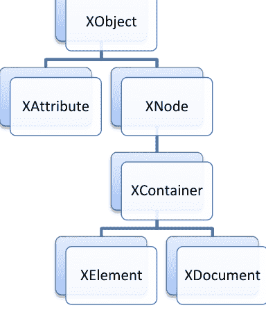

# LINQ 入门指南

序言：Daniel Jebaraj

本书的许可仅供个人或教育目的使用。

**技术审核员：** Stephen

**文字编辑：** Courtney Wright

**收购协调员：** Hillary Bowling, Syncfusion, Inc.

**校对员：** Darren West, Syncfusion, Inc.

# Succinctly 系列背后的故事

Daniel Jebaraj, Syncfusion, Inc. 副总裁

正如许多人所知，Syncfusion 是微软平台软件组件的提供商。这让我们处于一个既兴奋又充满挑战的地位，始终处于前沿。每当平台或工具每周发布时，我们都必须快速学习。

# 信息丰富但更难消化

在现实中，这意味着大量的书籍订单和搜索。虽然互联网上的信息越来越多，出版的书籍也越来越多（即使是较新的话题），但有一个方面继续阻碍我们发现技术。我们通常面临两个选择：阅读几个……

使用查询操作符时需要注意的一点是，它们不会更改输入序列；相反，查询操作符将返回一个新的序列（或标量值）。

## 标量返回值和输出序列

查询操作符返回输出序列或标量值。在以下代码中，输入序列`fibonacci`由`Count`查询操作符处理，它产生一个单一标量值，表示输入序列中的元素数量。下一个序列由`Distinct`查询操作符处理，它产生一个新的输出序列，其中包含输入序列中的元素并删除了重复元素。

```c
int[] fibonacci = { 0, 1, 1, 2, 3, 5 };
// 标量返回值
int numberOfElements = fibonacci.Count();
Console.WriteLine("Count: {0}", numberOfElements);
// 输出序列返回值
IEnumerable<int> distinctNumbers = fibonacci.Distinct();
Console.WriteLine("Elements in output sequence:");
foreach (var number in distinctNumbers)
{
    Console.WriteLine(number);
}
```

此代码的输出如下：

Count: 6

Elements in output sequence:

0

1

2

3

5

## 延迟执行

大多数查询操作符不会立即执行；它们的执行被推迟到程序执行的后某个阶段。这意味着查询在创建时并不执行，而是在使用或枚举它时才执行。

延迟执行意味着在构建查询之后、执行之前，可以修改输入序列。只有在执行查询时，输入序列才会被处理。

在以下代码中，输入序列在查询构建之后、执行之前被修改了。

```csharp
int[] fibonacci = { 0, 1, 1, 2, 3, 5 };
// 构建查询
IEnumerable<int> numbersGreaterThanTwoQuery = fibonacci.Where(x => x > 2);
// 此时查询已经创建但尚未执行
fibonacci[0] = 99;
// 导致查询执行（枚举）
foreach (var number in numbersGreaterThanTwoQuery)
{
    Console.WriteLine(number);
}
```

在执行`foreach`之前，查询实际上不会实际执行。运行此代码的结果如下：

- 99

3

5

注意，值 99 已经被包含在结果中，尽管在构建查询时，第一个元素仍然是原始值 0。

除了`Count`、`Min`和`Last`等返回标量值（或输入序列中的单个元素）的操作符外，标准查询操作符均以延迟执行的方式工作。使用`Count`等操作符会导致查询立即执行而不是延迟。

有许多转换操作符也会导致查询立即执行，例如`ToList`、`ToArray`、`ToLookup`和`ToDictionary`。

在以下代码中，`fibonacci`数组在之前的示例中被修改，但在示例中，当修改发生（`fibonacci[0] = 99`）时，由于额外的`ToArray()`，查询已经执行完毕。

```csharp
int[] fibonacci = { 0, 1, 1, 2, 3, 5 };

// 构建查询
IEnumerable<int> numbersGreaterThanTwoQuery = fibonacci.Where(x => x > 2)
    .ToArray();

// 此时由于 .ToArray()，查询已经执行

// 修改输入序列的第一个元素
fibonacci[0] = 99;

// 枚举结果
foreach (var number in numbersGreaterThanTwoQuery)
{
    Console.WriteLine(number);
}
```

运行此代码的结果为：

3

5

这里这里值 99 不再出现，因为输入序列在查询执行后被修改了。

## 查询操作符中的 Lambda 表达式

某些查询操作符允许提供自定义逻辑。这种自定义逻辑可以通过 Lambda 表达式提供给查询操作符。

上述代码中的`fibonacci.where(x => x > 2)`是向查询操作符提供自定义逻辑的示例。这里的 Lambda 表达式`x => x > 2`将仅返回大于 2 的元素（在本例中为`int`）。

当查询操作符接收 Lambda 表达式时，它会将 Lambda 表达式中的逻辑应用于输入序列中的每个单独元素。

提供查询操作符的 Lambda 表达式类型取决于查询操作符正在执行的任务。在图 1 中，我们可以看到`where`查询操作符的签名；这里提供了元素`int`，并且需要返回一个`bool`来决定该元素是否包含在输出序列中。

### fibonacci.Where(x => x > 2)

```csharp
.ToArray(this IEnumerable<int> source, Func<int,bool> predicate):IEnumerable<int>
根据谓词过滤值序列。
predicate: 用于测试每个元素是否符合条件的函数。
(this IEnumerable<int> source, Func<int,bool> predicate):IEnumerable<int>
```

图 1：Visual Studio 显示`Where`操作符的签名

作为使用 Lambda 表达式的替代方案，也可以使用指向方法的传统委托。

## 本地和解释型查询

LINQ 提供了两种不同的架构：本地和解释型。

本地查询在`IEnumerable<T>`序列上操作，并在编译时被编译到生成的程序集中。正如名称所示，本地查询可以被认为是在执行查询的机器本地的序列上进行操作（例如，查询内存中的对象列表）。

解释型查询在运行时被解释，并操作来自远程源（如 SQL 数据库）的序列。解释型查询操作`IQueryable<T>`序列。

解释型查询将在第 5 章讨论。以下代码演示了如何使用`Attribute(XName)`方法定位特定的`Attribute`并通过读取其`Value`属性获取值。

```csharp
var xml = @"
<ingredients>
  <ingredient name='milk' quantity='200' price='2.99' />
  <ingredient name='sugar' quantity='100' price='4.99' />
  <ingredient name='safron' quantity='1' price='46.77' />
</ingredients>";

XElement xmlData = XElement.Parse(xml);
XElement milk =
  xmlData.Descendants("ingredient")
  .First(x => x.Attribute("name").Value == "milk");

XAttribute nameAttribute = milk.FirstAttribute; // 属性
XAttribute priceAttribute = milk.Attribute("price");
string priceOfMilk = priceAttribute.Value; // 2.99
XAttribute quantity = milk.Attributes()
  .Skip(1)
  .First(); // 属性
```

# 第 2 章 流式和查询表达式样式

编写 LINQ 查询有两种样式：流式样式（流式语法）和查询表达式样式（查询语法）。

流式样式使用查询操作符扩展方法创建查询，而查询表达式样式使用编译器将其翻译为流式语法。

## 流式样式

到目前为止的代码示例都使用了流式语法。

流式语法利用在静态`System.Linq.Enumerable`类（或用于解释型的`System.Linq.Queryable`以及用于并行 LINQ 查询的`System.Linq.ParallelEnumerable`）中查询操作符扩展方法。这些扩展方法为`IEnumerable<TSource>`实例增加了方法。这意味着实现此接口的任何类都可以这些流式扩展方法。

查询操作符可以单独使用，也可以链式组合创建复杂的查询。

## 链式查询操作符

如果定义了以下类：

```csharp
class Ingredient
{
    public string Name { get; set; }
    public int Calories { get; set; }
}
```

以下代码使用了三个链式查询：`Where`、`OrderBy`和`Select`。

```csharp
Ingredient[] ingredients = {
    new Ingredient{Name = "Sugar", Calories=500},
    new Ingredient{Name = "Egg", Calories=100},
    new Ingredient{Name = "Milk", Calories=150},
    new Ingredient{Name = "Flour", Calories=50},
    new Ingredient{Name = "Butter", Calories=200}
};
```

```cs
IEnumerable<string> highCalorieIngredientNamesQuery =
    ingredients.Where(x => x.Calories >= 150)
    .OrderBy(x => x.Name)
    .Select(x => x.Name);

foreach (var ingredientName in highCalorieIngredientNamesQuery)
{
    Console.WriteLine(ingredientName);
}
```

执行此代码产生以下输出：

- 黄油

- 牛奶

- 糖

图 2 显示了此查询操作符链的图形表示。每个操作符的输入都是前一个查询操作符提供的序列。注意初始输入序列（由变量`ingredients`表示）是一个`IEnumerable<Ingredient>`，而输出序列（由变量`highCalorieIngredientNamesQuery`表示）是不同的类型；它是一个`IEnumerable<string>`。

在此示例中，操作符链对`Ingredient`元素序列进行操作，直到`Select`转换序列中的每个元素；每个`Ingredient`对象都被转换为一个简单的字符串。这种转换被称为投影（projection）。输入元素被投影为转换后的输出元素。

| 初始输入序列 : IEnumerable<Ingredient> |

| :--- |

| 糖 | 蛋 | 牛奶 | 面粉 | 黄油 |

| Where(x => x.Calories >= 150) |

| 糖 | 牛奶 | 黄油 |

| OrderBy(x => x.Name) |

| 黄油 | 牛奶 | 糖 |

| Select(x => x.Name) |

| "Butter" | "Milk" | "Sugar" |

| 输出序列 : IEnumerable<string> |

| "Butter" | "Milk" | "Sugar" |

图 2：链式作用的多个查询操作符

传递给`Select`查询操作符的 Lambda 表达式决定了输出序列中元素的将“形状”。Lambda 表达式`x => x.Name`告诉`Select`操作符：“对于每个`Ingredient`，输出一个具有输入`Ingredient`中`Name`属性值的字符串元素。”

> 注意：单个查询操作符将在第 3 节“LINQ 查询操作符”中进行讨论。

## 查询表达式样式

查询表达式（Query expressions）在流式语法（fluent syntax）的基础上提供了语法上的便利。

以下代码显示了使用查询语法实现上述流式语法查询的等效版本。

```cs
Ingredient[] ingredients = 
{
new Ingredient(Name = "Sugar", Calories=500),
new Ingredient(Name = "Egg", Calories=100),
new Ingredient(Name = "Milk", Calories=150),
new Ingredient(Name = "Flour", Calories=50),
new Ingredient(Name = "Butter", Calories=200)
};
```

```cs
IEnumerable<string> highCalorieIngredientNamesQuery =
from i in ingredients
where i.Calories >= 150
orderby i.Name
select i.Name;
```

```cs
foreach (var ingredientName in highCalorieIngredientNamesQuery)
{
  Console.WriteLine(ingredientName);
}
```

执行此代码产生与流式语法版本相同的输出：

黄油

牛奶

糖

执行的步骤与流式语法版本相同，每个查询句（`from`、`where`、`orderby`、`select`）将修改后的序列传递给下一个查询句。

上述代码中的查询表达式以`from`子句开始。`from`子句有两个用途：第一个是描述输入序列是什么（在此情况下为`ingredients`）；第二个是引入范围变量（range variable）。

最后一个子句是`select`子句，它描述了整个查询的输出序列。与流式语法版本一样，上述代码中的`select`子句将`Ingredient`对象序列投影为`string`对象序列。

## 范围变量

范围变量是一个表示序列中每个轮转元素的标识符。它类似于`foreach`语句中使用的变量；随着序列的处理，该范围变量代表正在处理的当前元素。在上述代码中，正在声明范围变量`i`。尽管在每个子句中使用了相同的范围变量标识符`i`，但范围变量“遍历”的序列是不同的。每个子句都对前一个子句产生的序列（或初始的`IEnumerable<T>`）进行。这意味着每个子句都在处理不同的序列；只是重用了范围变量的名称。

除了`from`中引入的范围变量外，还可以其他子句或关键字添加额外的范围变量。以下内容可以在查询表达式中引入新的范围变量：

- 额外的`from`子句

- `let`子句

- `into`关键字

- `join`子句

## let 子句

LINQ 查询表达式中的子句允许引入额外的范围变量。这个额外的范围变量可以在随其后的其他子句中使用。

在以下代码中，使用`let`子句引入了一个名为`Dairy`的新范围变量，其类型为`Boolean`。

```cs
Ingredient[] ingredients = {
    new Ingredient{Name = "Sugar", Calories=500},
    new Ingredient{Name = "Egg", Calories=100},
    new Ingredient{Name = "Milk", Calories=150},
    new Ingredient{Name = "Flour", Calories=50},
    new Ingredient{Name = "Butter", Calories=200}
}

IEnumerable<Ingredient> highDairyQuery =
    from i in ingredients
    let isDairy = i.Name == "Milk" || i.Name == "Butter"
    where i.Calories >= 150 && isDairy
    select i;

foreach (var ingredient in highDairyQuery) {
    Console.WriteLine(ingredient.Name);
}
```

此代码的输出产生：

牛奶

黄油

在上述代码中，引入了`isDairy`范围变量，然后在`where`子句中使用。注意原始变量`i`仍然对`select`子句可用。

在此示例中，范围变量是标量值，但`let`也可以用于引入子序列。以下示例中`ingredients`不是标量值，而是字符串数组。

```cs
string[] csvRecipes = {
  "milk,sugar,eggs",
  "flour,BUT,eggs",
  "vanilla,CHEESE,oats"
}
```


```cs
var dairyQuery =
  from csvRecipe in csvRecipes
  let ingredients = csvRecipe.Split(',')
  from ingredient in ingredients
  let uppercaseIngredient = ingredient.ToUpper()
  where uppercaseIngredient == "MILK" ||
       uppercaseIngredient == "BUTTER" ||
       uppercaseIngredient == "CHEESE"
  select uppercaseIngredient;
```

```cs
foreach (var dairyIngredient in dairyQuery)
{
  Console.WriteLine("{0} is dairy");
}
```

注意到代码使用了多个`let`子句以及额外的`from`子句。使用额外的`from`子句是向查询表达式引入新范围变量的另一种方法。

## into 关键字

`into`关键字还允许声明一个新的标识符，用于存储`select`子句的结果（`group`和`join`子句也是如此）。

以下代码演示了使用`into`创建一个新的匿名类型，并在查询表达式的剩余部分中使用它。

```cs
Ingredient[] ingredients =
{
    new Ingredient(Name = "Sugar", Calories=500),
    new Ingredient(Name = "Egg", Calories=100),
    new Ingredient(Name = "Milk", Calories=150),
    new Ingredient(Name = "Flour", Calories=50),
    new Ingredient(Name = "Butter", Calories=200)
};

IEnumerable<Ingredient> highCalDairyQuery
from i in ingredients
select new // 匿名类型
{
    OriginalIngredient i = i,
    IsDairy = i.Name == "Milk" || i.Name == "Butter",
    IsHighCalorie = i.Calories >= 150
}
into temp
where temp.IsDairy && temp.IsHighCalorie
// 不能写 "select i"，因为 into 隐藏了之前的范围变量 i
select temp.OriginalIngredient;

foreach (var ingredient in highCalDairyQuery)
{
    Console.WriteLine(ingredient.Name);
}
```

此代码产生以下输出：

牛奶

黄油

注意使用`into`隐藏了之前的范围变量`i`。这意味着无法在最后的`select`中使用`i`。

然而，`let`子句不会隐藏之前的范围变量，这意味着它们可以在查询表达式的后续可以使用。

## join 子句

`join`子句接收两个输入序列，其中两个序列中的元素在类领域模型中不一定有直接关系。

要执行连接（join），会将第一个序列中元素的某些值与第二个序列中元素的某些值进行等值比较。这里重要的是，连接子句执行的是等值连接（equi-joins）；对来自两个序列的值进行等值比较。这意味着连接子句不支持非等值连接，例如不等式，或大于、小于等比较。因此，并没有像 C# 中那样使用`==`运算符来指定连接元素，而是使用了`equals`关键字。引入此关键字的设计思路是为了非常清晰地表明连接是等值连接。

常见的连接类型：

- 内连接连接（Inner joins）。

- 分组连接（Group joins）。

- 左外连接（Left outer joins）。

接下来的代码示例假设定义了以下类：

```cs
class Recipe
{
    public int Id { get; set; }
    public string Name { get; set; }
}

class Review
{
    public int RecipeID { get; set; }
    public string ReviewText { get; set; }
}
```

这两个类模拟了食谱可以有 0 个、1 个或多个评论这一事实。`Review`类有一个`RecipeID`属性，存储了评论所属食谱的 ID；但请注意，并没有以`Recipe`类型形式存在的直接关系。

## 内连接 (Inner join)

内连接为第一个序列中的每个在第二个序列中具有匹配项的元素，在输出序列中返回一个元素。如果第一个序列中的元素在第二个序列中没有任何匹配元素，则它将不会出现在输出序列中。

看以下代码示例：

```cs
Recipe[] recipes = {
  new Recipe {Id = 1, Name = "Mashed Potato"},
  new Recipe {Id = 2, Name = "Crispy Duck"},
  new Recipe {Id = 3, Name = "Sachertorte"}
};
```

```cs
Review[] reviews = {
  new Review {RecipeId = 1, ReviewText = "Tasty!"},
  new Review {RecipeId = 1, ReviewText = "Not nice:("},
  new Review {RecipeId = 1, ReviewText = "Pretty good"},
  new Review {RecipeId = 2, ReviewText = "Too hard"},
  new Review {RecipeId = 2, ReviewText = "Loved it"}
};
```

```cs
var query = from recipe review in reviews on recipe.Id equals review.RecipeId
  select new // anonymous type
  {
    RecipeName = recipe.Name,
    RecipeReview = review.ReviewText
  };

foreach (var item in query)
{
  Console.WriteLine("{0} - '{1}", item.RecipeName, item.RecipeReview);
}
```

在前面的代码中，创建了两个输入序列：`recipes`（包含若干个食谱）和第二个序列`reviews`（对象的评论）。

查询表达式以`from`子句开头，指向第一个序列（`recipes`）并声明变量`recipeId`。

接下来是使用`join`子句。这里引入了另一个变量（`review`），代表在`reviews`输入序列中处理的元素。`on`关键字允许指定`recipe`范围对象的哪个值与`review`范围变量对象的哪个值相关。在这里再次使用了`equals`关键字来表示等值连接。此`Join`子句本质上是说明评论通过`Recipe`中的`Id`和`Review`中的`RecipeId`的共同值来属于食谱。

执行此代码的运行如下：

Mashed Potato - 'Tasty!'

Mashed Potato - 'Not nice :('

Mashed Potato - 'Pretty good'

Crispy Duck - 'Too hard'

Crispy Duck - 'Loved it'

注意这里食谱 'Sachertorte' 不在输出中。这是因为没有关于它的评论，即在第二个输入序列（`reviews`）中没有匹配元素。

另外请注意结果是“扁平的”，这意味着不存在一个属于“父级”食谱的评论组的概念。

## 分组连接 (Group join)

分组连接可以产生分组的分层级结果，其中第二个序列中的项匹配到第一个序列中的项。

与之前的内连接不同，分组连接的输出可以分层地组织，将评论分组到它们相关的食谱中。

```cs
Recipe[] recipes = {
  new Recipe {Id = 1, Name = "Mashed Potato"},
  new Recipe {Id = 2, Name = "Crispy Duck"},
  new Recipe {Id = 3, Name = "Sachertorte"}
};
```

```cs
Review[] reviews = {
  new Review {Id = 1, ReviewText = "Tasty!"},
  new Review {Id = 1, ReviewText = "Not nice :("},
  new Review {Id = 1, ReviewText = "Pretty good"},
  new Review {Id = 2, ReviewText = "Too hard"},
  new Review {Id = 2, ReviewText = "Liked it"}
};
```

```cs
var query =
  from recipe in recipes
  join review in reviews on recipe.Id equals review.Id
  into reviewGroup
  select new // anonymous type
  {
    RecipeName = recipe.Name,
    Reviews = reviewGroup // collection of related reviews
  };
```

```cs
foreach (var item in query) {
  Console.WriteLine("Reviews {0}", item.RecipeName);
}

foreach (var review in item.Reviews)
{
    Console.WriteLine(" {0}" - review.ReviewText);
}
```

在这个版本中，注意添加了`into`关键字。这允许创建分层级结果。`reviewGroup`范围代表一个评论序列。`review`范围表示`recipe`范围对象。`on`关键字允许指定`recipe`范围对象的哪个值与`review`范围变量对象的哪个值相关。再次使用了`equals`关键字来表示等值连接。此`Join`子句本质上是说明评论通过`Recipe`中的`Id`和`Review`中的`RecipeId`的共同值来属于食谱。通过`into`关键字将结果投影到一个匿名类型。每个`group`包含了相关的评论。

执行此代码的输出如下：

Reviews for Mashed Potato

- Tasty!

- Not nice :

- Pretty good

Reviews for Crispy Duck

- Too hard

- Loved it

Reviews for Sachertorte

注意这里的分层输出，并且即使是“Sachertorte”也被包含在输出中。

## 左外连接 (Left outer join)

为了获取扁平的、非分层的输出，并且包含在第二个序列中没有匹配元素的第一个序列元素（我们的示例“Sachertorte”），可以使用`into`关键字方法。以下代码显示了这一点：

```cs
Recipe[] recipes = {
    new Recipe {Id = 1, Name = "Mashed Potato"},
    new Recipe {Id = 2, Name = "Crispy Duck"},
    new Recipe {Id = 3, Name = "Sachertorte"}
};
```

```cs
Review[] reviews = {
    new Review {RecipeId = 1, ReviewText = "Tasty!"},
    new Review {RecipeId = 1, ReviewText = "Not nice :("},
    new Review {RecipeId = 1, ReviewText = "Pretty good"},
    new Review {RecipeId = 2, ReviewText = "Too hard"},
    new Review {RecipeId = 2, ReviewText = "Liked it"}
};
```

```cs
var query = from recipe review in reviews on recipe.Id equals review.RecipeId
  into reviewGroup
  select new // anonymous type
  {
    RecipeName = recipe.Name,
    RecipeReview = (review == null ? "n/a" : review.ReviewText)
  };

foreach (var item in query)
{
    Console.WriteLine("{0} - '{1}', item.RecipeName, item.RecipeReview);
}
```

Mashed Potato - 'Tasty!'

Mashed Potato - 'Not nice :('

Mashed Potato - 'Pretty good'

Crispy Duck - 'Too hard'

Crispy Duck - 'Liked it'

Sachertorte - 'n/a'

# 其他查询表达式语法

在使用查询表达式时，还有许多其他语法元素：

- 分组子句（group）

- 排序子句（orderby）

- 升序和降序关键字（ascending and descending）

- by 关键字

## 分组子句和 by 关键字

分组子句接收一个扁平的输入序列并产生一个分组的输出序列。另一种思考方式是输出产生类似于列表列表；因此，可以使用嵌套循环来遍历所有的组和组项。

以下代码显示了使用分组子句和 by 关键字对所有卡路量相同的成分进行分组。

```cs
Ingredient[] ingredients = {
    new Ingredient{Name = "Sugar", Calories=500},
    new Ingredient{Name = "Lard", Calories=500},
    new Ingredient{Name = "Butter", Calories=500},
    new Ingredient{Name = "Egg", Calories=100},
};
```

```csharp
new Ingredient{Name = "Milk", Calories=100},
new Ingredient{Name = "Flour", Calories=50},
new Ingredient{Name = "Oats", Calories=50}

IEnumerable<IGrouping<int, Ingredient>> query =
from i in ingredients
group by i.Calories;

foreach (IGrouping<int, Ingredient> group in query)
{
    Console.WriteLine("Ingredients with {0} calories", group.Key);
    foreach (Ingredient ingredient in group)
    {
        Console.WriteLine("- {0}", ingredient.Name);
    }
};
```

此代码产生以下输出：

Ingredients with 500 calories

- Sugar

- Lard

- Butter

Ingredients with 100 calories

- Egg

- Milk

Ingredients with 50 calories

- Flour

- Oats

在前面的代码中，第一个泛型类型参数 (int) 在`IGrouping<int, Ingredient>`中代表组的键，在本例中是卡路数。第二个泛型类型参数 (Ingredient) 代表具有相同键（卡路里值）的项列表的类型。

此外请注意，代码中使用显式类型是为了更好地说明所操作的类型。可以使用`var`关键字来简化代码；例如：使用`var query = ...`而不是`IEnumerable<IGrouping<int, Ingredient>> query = ...`

## orderby 子句以及 ascending 和 descending 关键字

`orderby`子句用于生成按升序（默认）或降序排序的序列。

以下代码按名称对配料列表进行排序：


```csharp
Ingredient[] ingredients = {
    new Ingredient { Name = "Sugar", Calories = 500 },
    new Ingredient { Name = "Lard", Calories = 500 },
    new Ingredient { Name = "Butter", Calories = 500 },
    new Ingredient { Name = "Egg", Calories = 100 },
    new Ingredient { Name = "Milk", Calories = 100 },
    new Ingredient { Name = "Flour", Calories = 50 },
    new Ingredient { Name = "Oats", Calories = 50 }
};

OrderedEnumerable<Ingredient> sortedByNameQuery =
    from i in ingredients
    orderby i.Name
    select i;

foreach (var ingredient in sortedByNameQuery)
{
    Console.WriteLine(ingredient.Name);
}
```

这产生了以下排序后的输出：

- Butter
- Egg
- Flour
- Lard
- Milk
- Oats
- Sugar

要按降序排序（非默认顺序），可以修改查询并添加 `descending` 关键字，如下修改后的查询所示：

```csharp
IOrderedEnumerable<Ingredient> sortedByNameQuery =
    from i in ingredients
    orderby i.Name descending
    select i;
```

这产生了以下输出：

- Sugar
- Oats
- Milk
- Lard
- Flour
- Egg
- Butter

在应用分组时，也可以使用 `orderby` 子句。在下面的代码中，按卡路里分组的配料按卡路里数量排序（这是每个组的 `Key`）。

```csharp
Ingredient[] ingredients =
{
    new Ingredient(Name = "Sugar", Calories = 500),
    new Ingredient(Name = "Lard", Calories = 500),
    new Ingredient(Name = "Butter", Calories = 500),
    new Ingredient(Name = "Egg", Calories = 100),
    new Ingredient(Name = "Milk", Calories = 100),
    new Ingredient(Name = "Flour", Calories = 50),
    new Ingredient(Name = "Oats", Calories = 50)
};
```

```csharp
IEnumerable<IGrouping<int, Ingredient>> query =
    from i in ingredients
    group i by i.Calories
    into calorieGroup
    orderby calorieGroup.Key
    select calorieGroup;
```

```csharp
foreach (IGrouping<int, Ingredient> group in query)
{
    Console.WriteLine("Ingredients with {0} calories", group.Key);

    foreach (Ingredient ingredient in group)
    {
        Console.WriteLine(" - {0}", ingredient.Name);
    }
}
```

注意在代码中，尽管输入序列 `ingredients` 是按卡路里降序排列的，下面的输出也是按组的卡路里值（`Key`）按升序排序的：

- Ingredients with 50 calories
  - Flour
  - Oats
- Ingredients with 100 calories
  - Egg
  - Milk
- Ingredients with 500 calories
  - Sugar
  - Lard

## Where

`where` 查询操作符返回匹配给定谓词的输出元素。

> 提示：谓词是一个函数，当某些条件满足时返回 `bool` 结果为 `true`。

```csharp
Ingredient[] ingredients = {
    new Ingredient { Name = "Sugar", Calories = 500 },
    new Ingredient { Name = "EGG", Calories = 100 },
    new Ingredient { Name = "Milk", Calories = 150 },
    new Ingredient { Name = "Flour", Calories = 50 },
    new Ingredient { Name = "Butter", Calories = 200 }
};

IEnumerable<Ingredient> query = ingredients
    .Where(x => x.Calories >= 200);

foreach (var ingredient in query)
{
    Console.WriteLine(ingredient.Name);
}
```

前面的代码显示了 `Where` 如何在实际中使用。在这里，谓词 `x => x.Calories >= 200` 将对每个卡路里大于或等于 200 的原料返回 `true`。

此代码产生以下输出：

- Sugar
- Butter

`where` 的重载提供了输入元素的位置索引，用于在谓词中使用。

在前面的代码中，“Sugar”的索引为 0，“Butter”的索引为 4。下面的查询产生与之前的版本相同的输出。

```csharp
IEnumerable<Ingredient> queryUsingIndex = ingredients
    .Where((ingredient, index) => ingredient.Name == "Sugar" || index == 4);
```

注意 lambda 表达式是不同的。在这种情况下，谓词函数的类型将为 `Func<Ingredient, int, int, bool>`；`int` 参数提供了元素在输入序列中的位置。

### 查询表达式用法

`where` 关键字用于查询表达式风格的代码中，其后面跟着一个布尔表达式，如下面的代码所示。

```csharp
IEnumerable<Ingredient> queryX =
    from i in ingredients
    where i.Calories >= 200
    select i;
```

## 投影操作符

投影查询操作符接收一个输入序列，转换该序列中的每个元素，并产生这些转换后的元素的输出序列。通过这种方式，输入序列被投影到不同的输出序列。

### Select

`Select` 查询操作符将输入序列中的每个元素转换为输出序列中的元素。输出序列中的元素数量将与输入序列相同。

下面的查询将 `Ingredient` 元素的输入序列投影为 `string` 元素的输出序列。描述投影的 lambda 表达式：获取每个输入 `Ingredient` 元素并返回一个 `string` 元素。

```csharp
IEnumerable<string> query = ingredients.Select(x => x.Name);
```

我们可以通过以下代码创建一个 `int` 的输出序列：

```csharp
IEnumerable<int> queryNameLength = ingredients.Select(x => x.Length);
```

投影也可以在输出中产生复杂对象。在下面的代码中，每个输入 `Ingredient` 都投影为 `IngredientNameAndLength` 对象的一个新实例。

```csharp
class IngredientNameAndLength
{
    public string Name { get; set; }
    public int Length { get; set; }

    public override string ToString()
    {
        return Name + " - " + Length;
    }
}
```

```csharp
IEnumerable<IngredientNameAndLength> query = ingredients.Select(x =>
    new IngredientNameAndLength
    {
        Name = x.Name,
        Length = x.Name.Length
    });
```

此查询也可以匿名类型编写；注意在下面的代码中查询的返回类型已更改为 `var`。

```csharp
var query = ingredients.Select(x =>
    new
    {
        Name = x.Name,
        Length = x.Name.Length
    });
```

### 查询表达式用法

`Select` 关键字用于查询表达式风格的代码中，如下代码所示，它使用匿名类型复制了之前的流式风格版本。

```csharp
var query =
    from i in ingredients
    select new
    {
        Name = i.Name,
        Length = i.Name.Length
    };
```

## SelectMany

`Select` 查询操作符为每个输入元素返回一个输出元素，而 `SelectMany` 查询操作符为每个输入元素产生数量数量的输出元素。这意味着输出序列中的元素可能比输入序列中的多或少。

`Select` 查询操作符中的 lambda 表达式返回单个项目。`SelectMany` 查询操作符中的 lambda 表达式产生一个子序列。该子序列对于输入序列中的每个元素可能包含不同数量的元素。

在下面的代码中，lambda 表达式将产生字符子序列，每个输入元素的每个字母产生一个字符。例如，输入元素“Sugar”被 lambda 表达式处理时，将产生一个包含五个元素的子序列：`'S'`、`'u'`、`'g'`、`'a'` 和 `'r'`。每个输入原料字符串可能有不同的字母数量，因此 lambda 表达式将产生不同长度的子序列。产生的每个子序列都被连接（“扁平化”）到单个输出序列中。

```csharp
string[] ingredients = { "Sugar", "Egg", "Milk", "Flour", "Butter" };

IEnumerable<char> query = ingredients.SelectMany(x => x.ToCharArray());

foreach (char item in query)
{
    Console.WriteLine(item);
}
```

此代码产生以下输出（注意输出元素比只包含五个元素的输入序列多）：

### 查询表达式用法

在查询表达式风格中，添加了额外的 `from` 子句来产生子序列。

下面的代码产生与之前的流式版本相同的输出。

```csharp
IEnumerable<char> query =
    from i in ingredients
    from c in i.ToCharArray()
    select c;
```

## 分区操作符

分区操作符接收输入序列并将其拆分，或者每次“分页”到输出序列。这些操作符的用法是将较大的序列分成若干页的块。

### Take

`Take` 操作符接收输入序列并返回指定数量的元素。

下面的代码显示了如何使用 `Take` 返回序列前三个元素。

```csharp
Ingredient[] ingredients = {
    new Ingredient { Name = "Sugar", Calories = 500 },
    new Ingredient { Name = "EGG", Calories = 100 },
    new Ingredient { Name = "Milk", Calories = 150 },
    new Ingredient { Name = "Flour", Calories = 50 },
    new Ingredient { Name = "Butter", Calories = 200 }
};
```

```csharp
IEnumerable<Ingredient> firstThree = ingredients.Take(3);

foreach (var ingredient in firstThree)
{
    Console.WriteLine(ingredient.Name);
}
```

`Take` 可以与其他查询操作符链式使用。在下面的代码中，使用 `Where` 将原料限制为卡路里大于 100 的原料。`Take` 操作符然后返回该序列的前两个。

```csharp
Ingredient[] ingredients = {
    new Ingredient { Name = "Sugar", Calories = 500 },
    new Ingredient { Name = "Egg", Calories = 100 },
    new Ingredient { Name = "Milk", Calories = 150 },
    new Ingredient { Name = "Flour", Calories = 50 },
    new Ingredient { Name = "Butter", Calories = 200 }
};

IEnumerable<Ingredient> query = ingredients
    .Where(x => x.Calories > 100)
    .Take(2);

foreach (var ingredient in query)
{
    Console.WriteLine(ingredient.Name);
}
```

此代码产生以下结果：

- Sugar
- Milk

### 查询表达式用法

在查询风格下没有 `Take` 关键字；但如下面的代码所示，可以使用混合风格。

```csharp
IEnumerable<Ingredient> query =
    (from i in ingredients
     where i.Calories > 100
     select i).Take(2);
```

## TakeWhile

`TakeWhile` 查询操作符不是根据固定数量的元素返回元素，而是持续返回输入元素，直到谓词变为 `false`。

下面的代码将在卡路里大于或等于 100 时继续从输入序列中“获取”元素。

```csharp
Ingredient[] ingredients =
{
    new Ingredient(Name = "Sugar", Calories = 500),
    new Ingredient(Name = "Egg", Calories = 100),
    new Ingredient(Name = "Milk", Calories = 150),
    new Ingredient(Name = "Flour", Calories = 50),
    new Ingredient(Name = "Butter", Calories = 200)
};

IEnumerable<Ingredient> query = ingredients.TakeWhile(x => x.Calories >= 100);

foreach (var ingredient in query)
{
    Console.WriteLine(ingredient.Name);
}
```

此产生以下输出：

- Sugar
- Egg
- Milk

注意这里，一旦在输入序列中遇到不匹配谓词的元素，“获取”就会停止；不再返回输入序列的剩余元素，即使它们匹配谓词。

## Skip

`Skip` 查询操作符忽略输入序列开头指定数量的输入元素，并返回剩余部分。

以下代码跳过了前三个元素并返回其余部分：

```csharp
Ingredient[] ingredients = {
    new Ingredient { Name = "Sugar", Calories = 500 },
    new Ingredient { Name = "Egg", Calories = 100 },
    new Ingredient { Name = "Milk", Calories = 150 },
    new Ingredient { Name = "Flour", Calories = 50 },
    new Ingredient { Name = "Butter", Calories = 200 }
};

IEnumerable<Ingredient> query = ingredients.Skip(3);

foreach (var ingredient in query)
{
    Console.WriteLine(ingredient.Name);
}
```

这产生以下输出：

- Flour
- Butter

### 查询表达式用法

在查询表达式样式时，`Skip` 没有专门的关键字；但可以使用混合样式。

## 使用 Skip 和 Take 进行结果集分页

当结合使用时，`Skip` 和 `Take` 查询操作符可以实现面向用户的结果集分页，如下代码所示。

```csharp
Ingredient[] ingredients = {
    new Ingredient { Name = "Sugar", Calories = 500 },
``` 


```csharp
new Ingredient {Name = "Egg", Calories = 100},
new Ingredient {Name = "Milk", Calories = 150},
new Ingredient {Name = "Flour", Calories = 50},
new Ingredient {Name = "Butter", Calories = 200}
};

IEnumerable<Ingredient> firstPage = ingredients.Take(2);

IEnumerable<Ingredient> secondPage = ingredients
  .Skip(2)
  .Take(2);

IEnumerable<Ingredient> thirdPage = ingredients
  .Skip(4)
  .Take(2);

Console.WriteLine("Page One:");

foreach (var ingredient in firstPage)
{
  Console.WriteLine(" - " + ingredient.Name);
}

Console.WriteLine("Page Two:");

foreach (var ingredient in secondPage)
{
  Console.WriteLine(" - " + ingredient.Name);
}

Console.WriteLine("Page Three:");

foreach (var ingredient in thirdPage)
{
  Console.WriteLine(" - " + ingredient.Name);
}
```

这产生以下输出：

- Page One:
- Sugar
- Egg
- Page Two:
- Milk
- Flour
- Page Three:
- Butter

## SkipWhile

与`TakeWhile`类似，`SkipWhile`查询操作符使用谓词评估输入序列中的每个元素。`SkipWhile`忽略输入序列中的项，直到提供的谓词返回`false`。

以下代码将跳过输入元素，直到遇到 "Milk"；此时，谓词`x => x.Name != "Milk"`变为`false`并返回剩余的食材。

```csharp
Ingredient[] ingredients = {
  new Ingredient {Name = "Sugar", Calories = 500},
  new Ingredient {Name = "Egg", Calories = 100},
  new Ingredient {Name = "Milk", Calories = 150},
  new Ingredient {Name = "Flour", Calories = 50},
  new Ingredient {Name = "Butter", Calories = 200}
};

IEnumerable<Ingredient> query = ingredients.SkipWhile(x => x.Name != "Milk");

foreach (var ingredient in query)
{
  Console.WriteLine(ingredient.Name);
}
```

这产生以下输出：

```text
Milk
Flour
Butter
```

正如`TakeWhile`一样，`SkipWhile`有一个重载版本允许使用输入元素的位置索引。

### 查询表达式用法

在 Go 查询表达式样式时，`SkipWhile`没有专门的关键字；但可以使用混合样式。

## 排序操作符

排序查询操作符返回与输入序列相同数量的元素，但排列顺序（可能是）不同的。

### OrderBy

`OrderBy`查询操作符通过指定的键比较输入序列中的元素对输入序列进行排序。

以下代码显示了对简单的字符串输入序列的排序。在此示例中，由 lambda 表达式`x => x`指定字符串本身。

```csharp
string[] ingredients = {
  "Sugar",
  "Egg",
  "Milk",
  "Flour",
  "Butter"
};

var query = ingredients.OrderBy(x => x);

foreach (var item in query)
{
  Console.WriteLine(item);
}
```

这产生以下输出：

```text
Butter
Egg
Flour
Milk
Sugar
```

用于指定排序的 lambda 表达式可以指定输入元素的属性，如下代码所示。

```csharp
Ingredient[] ingredients = {
  new Ingredient {Name = "Sugar", Calories = 500},
  new Ingredient {Name = "Egg", Calories = 100},
  new Ingredient {Name = "Milk", Calories = 150},
  new Ingredient {Name = "Flour", Calories = 50},
  new Ingredient {Name = "Butter", Calories = 200}
};

var query = ingredients.OrderBy(x => x.Calories);

foreach (var item in query)
{
  Console.WriteLine(item.Name + " " + item.Calories);
}
```

在前面的代码中，lambda 表达式`x => x.Calories`选择了要排序的 Calories 属性。这产生了以下输出：

```text
Flour 50
Egg 100
Milk 150
Butter 200
Sugar 500
```

### 查询表达式用法

在使用 Go 查询表达式样式时使用`orderby`关键字，如下所示。

```csharp
var query = from i in ingredients
            orderby i.Calories
            select i;
```

## ThenBy

`ThenBy`查询操作符可以在`OrderBy`之后链式一次或多次。`ThenBy`操作符添加额外的排序级别。在以下代码中，食材首先通过`OrderBy`排序按卡里量排序；排序后的序列进一步按食材名称进行排序。

```csharp
Ingredient[] ingredients = {
  new Ingredient {Name = "Sugar", Calories = 500},
  new Ingredient {Name = "Milk", Calories = 100},
  new Ingredient {Name = "Egg", Calories = 100},
  new Ingredient {Name = "Flour", Calories = 500},
  new Ingredient {Name = "Butter", Calories = 200}
};

var query = ingredients.OrderBy(x => x.Calories)
      .ThenBy(x => x.Name);

foreach (var item in query)
{
  Console.WriteLine(item.Name + " " + item.Calories);
}
```

这产生了以下输出：

```text
Egg 100
Milk 100
Butter 200
Flour 500
Sugar 500
```

注意在原始输入序列中 "Milk" 在 "Egg" 之前，但由于 Then 操作，输出中的食材在相同值内进行了排序。

### 查询表达式用法

在使用 Go 查询表达式样式时使用`orderby`关键字，而不是单个排序表达式，后续排序表达式作为逗号分隔列表添加，如下代码所示。

```csharp
var query = from i in ingredients
            orderby i.Calories, i.Name
            select i;
```

## OrderByDescending

`OrderByDescending`查询操作符与`OrderBy`操作符相同，只是以反序返回结果，如下代码所示。

```csharp
Ingredient[] ingredients = {
  new Ingredient {Name = "Sugar", Calories = 500},
  new Ingredient {Name = "Milk", Calories = 100},
  new Ingredient {Name = "Egg", Calories = 100},
  new Ingredient {Name = "Flour", Calories = 500},
  new Ingredient {Name = "Butter", Calories = 200}
};

var query = ingredients.OrderByDescending(x => x.Calories);

foreach (var item in query)
{
  Console.WriteLine(item.Name + " " + item.Calories);
}
```

这产生了以下输出：

```text
Sugar 500
Flour 500
Butter 200
Milk 100
Egg 100
```

注意这次卡里量数字是降序的。

### 查询表达式用法

在使用 Go 查询表达式样式时使用`descending`关键字，并应用于排序表达式本身，如下所示。

```csharp
var query = from i in ingredients
            orderby i.Calories descending
            select i;
```

## ThenByDescending

`ThenByDescending`查询操作符用法与`ThenBy`操作符相同，并返回反序排序结果。以下代码显示食材按卡里量（升序）排序，但这次名称是降序排序的。

```csharp
Ingredient[] ingredients = {
  new Ingredient {Name = "Flour", Calories = 500},
  new Ingredient {Name = "Sugar", Calories = 500},
  new Ingredient {Name = "Egg", Calories = 100},
  new Ingredient {Name = "Milk", Calories = 100},
  new Ingredient {Name = "Butter", Calories = 200}
};

var query = ingredients.OrderBy(x => x.Calories).ThenByDescending(x => x.Name);

foreach (var item in query)
{
  Console.WriteLine(item.Name + " " + item.Calories);
}
```

这产生了以下输出：

```text
Milk 100
Egg 100
Butter 200
Sugar 500
Flour 500
```

注意，在输入序列中，“Flour" 在 "Sugar" 之前，但由于使用了`ThenDescending`，它们在输出中被反转了。

### 查询表达式的用法

在使用查询表达式风格时，使用`descending`关键字，如下代码所示。

```csharp
var query = from i in ingredients
            orderby i.Calories, i.Name descending
            select i;
```

## 反转（Reverse）

`Reverse`查询操作符简单地获取输入序列并在输出序列中以反序返回元素；例如，输入序列中的第一个元素将成为输出序列中的最后一个元素。

```csharp
char[] letters = {'A', 'B', 'C'};

var query = letters.Reverse();

foreach (var item in query)
{
    Console.WriteLine(item);
}
```

上述代码产生了以下输出：

```text
C
B
A
```

### 查询表达式的用法

在使用查询表达式风格时，没有`Reverse`关键字；但是，可以使用混合风格。

## 分组操作符（Grouping Operators）

### GroupBy

`GroupBy`查询操作符接收一个输入序列并返回一个序列的序列（组）输出序列。`GroupBy`方法的基本重载接受一个表示分组键的 Lambda 表达式。

以下代码展示了如何根据卡路里对所有配料进行分组。

```csharp
Ingredient[] ingredients = {
    new Ingredient(Name = "Sugar", Calories = 500),
    new Ingredient(Name = "Lard", Calories = 500),
    new Ingredient(Name = "Butter", Calories = 500),
    new Ingredient(Name = "Egg", Calories = 100),
    new Ingredient(Name = "Milk", Calories = 100),
    new Ingredient(Name = "Flour", Calories = 50),
    new Ingredient(Name = "Oats", Calories = 50)
};
```

```csharp
IEnumerable<IGrouping<int, Ingredient>> query =
    ingredients.GroupBy(x => x.Calories);

foreach (IGrouping<int, Ingredient> group in query)
{
    Console.WriteLine("Ingredients with {0} calories", group.Key);

    foreach (Ingredient ingredient in group)
    {
        Console.WriteLine("- {0}", ingredient.Name);
    }
}
```

在上述代码中，序列的序列本质上是一个`Grouping`列表（IEnumerable）。每个`Grouping`元素包含键（在本例中是卡路里的 int 类型）以及具有相同卡路里的配料列表。

这产生了以下输出：

- Ingredients with 500 calories
- Sugar
- Lard
- Butter
- Ingredients with 100 calories
- Egg
- Milk
- Ingredients with 50 calories
- Flour
- Oats

### 查询表达式的用法

在使用查询表达式风格时，使用`group`关键字；我们在第 2 章“流式风格与查询表达式风格”中见过`group`关键字的使用。

## 集合操作符（Set Operators）

集合查询操作符执行基于集合的操作。这些操作符接收两个表示两个“集合”的序列并返回单一的输出序列。

集合查询操作符包括：

- `Concat`
- `Union`
- `Distinct`
- `Intersect`
- `Except`

### Concat

`Concat`查询操作符接收第一个序列，并在其后追加第二个序列的所有元素后返回，如下代码所示。

```csharp
string[] applePie = {"Apple", "Sugar", "Pastry", "Cinnamon"};

string[] cherryPie = {"Cherry", "Sugar", "Pastry", "Kirsch"};

IEnumerable<string> query = applePie.Concat(cherryPie);

foreach (string item in query)
{
    Console.WriteLine(item);
}
```

这产生了以下输出：

- Apple
- Sugar
- Pastry
- Cinnamon
- Cherry
- Sugar
- Pastry
- Kirsch

注意，任何重复元素（如 "Sugar" 和 "Pastry"）都被保留了。

### 查询表达式的用法

在使用查询表达式风格时，没有`Concat`关键字；但是，可以使用混合风格。

### Union

`Union`查询操作符执行与`Concat`类似的“合并”操作；然而，第一个和第二个序列中存在的任何重复元素都不会在输出中重复。

```csharp
string[] applePie = {"Apple", "Sugar", "Pastry", "Cinnamon"};

string[] cherryPie = {"Cherry", "Sugar", "Pastry", "Kirsch"};
```

```csharp
IEnumerable<string> query = applePie.Union(cherryPie);

foreach (string item in query)
{
    Console.WriteLine(item);
}
```


这产生了以下输出：

- Apple
- Sugar
- Pastry
- Cinnamon
- Cherry
- Kirsch

注意任何重复项（例如 `Sugar` 和 `Pastry`）已从输出序列中移除。

### 查询表达式的用法

在使用查询表达式风格时，没有 `Union` 关键字；但是，可以使用混合风格。

### Distinct

虽然严格来说 `Distinct` 查询操作符不是集合操作符，因为它只作用于单个输入序列，但将其包含在此是为了展示如何通过使用 `Concat` 后接 `Distinct` 来模拟 `Union` 操作符。此外注意，`Distinct` 操作符与其他查询操作符链式调用，而不仅仅是集合操作符。

```c
string[] applePie = { "Apple", "Sugar", "Pastry", "Cinnamon" };
string[] cherryPie = { "Cherry", "Sugar", "Pastry", "Kirsch" };
IEnumerable<string> query = applePie.Concat(cherryPie).Distinct();
foreach (string item in query)
{
    Console.WriteLine(item);
}
```

这产生了以下输出：

- Apple
- Sugar
- Pastry
- Cinnamon
- Cherry
- Kirsch

注意这与使用 `Union` 的输出相同。

### 查询表达式的用法

在使用查询表达式风格时，没有 `Distinct` 关键字；但是，可以使用混合风格。

### Intersect

`Intersect` 查询操作符返回存在于两个序列中的元素。在以下代码中，两个序列共有的元素是 `Sugar` 和 `Pastry`。

```c
string[] applePie = { "Apple", "Sugar", "Pastry", "Cinnamon" };
string[] cherryPie = { "Cherry", "Sugar", "Pastry", "Kirsch" };
IEnumerable<string> query = applePie.Intersect(cherryPie);
foreach (string item in query)
{
    Console.WriteLine(item);
}
```

这产生了以下输出：

Sugar
Pastry

注意这里的公共元素在输出中不会重复。

### 查询表达式的用法

在使用查询表达式风格时，没有 `Intersect` 关键字；但是，可以使用混合风格。

### Except

`Except` 查询操作符将返回第一个序列中不存在于第二个序列的元素。取以下代码：

```c
string[] applePie = { "Apple", "Sugar", "Pastry", "Cinnamon" };
string[] cherryPie = { "Cherry", "Sugar", "Pastry", "Kirsch" };
IEnumerable<string> query = applePie.Except(cherryPie);
foreach (string item in query)
{
    Console.WriteLine(item);
}
```

这产生了以下输出：

Apple
Cinnamon

注意我们没有从第二个序列中获取任何元素。

### 查询表达式的用法

在使用查询表达式风格时，没有 `Except` 关键字；但是，可以使用混合风格。

## 转换操作符 (Conversion Operators)

转换查询操作符将 `IEnumerable<T>` 序列转换为其他类型的集合。

可以使用以下查询操作符执行序列转换：

- OType
- Cast
- ToArray
- ToList
- ToDictionary
- ToLookup

### OType

`OType` 查询操作符返回包含指定元素的输出序列。实现 `OType` 查询操作符的扩展方法签名如下：

```c
public static IEnumerable<TResult> OType<TResult>(this IEnumerable source)
```

注意这里扩展方法正在“扩展”非泛型类型 `IEnumerable`。这意味着输入序列可能包含不同类型的元素。

以下代码展示了一个包含不同类型的 `IEnumerable`（对象数组）。可以使用 `OType` 查询操作符来返回（例如）所有的字符串对象。同样注意以下代码，查询的结果是泛型 `IEnumerable`，即 `IEnumerable<string>`。

```c
IEnumerable input = new object[]
{
    "Apple", 33, "Sugar", 44, 'a', new DateTime()
};
IEnumerable<string> query = input.OType<string>();
foreach (string item in query)
```

```csharp
{
  Console.WriteLine(item);
}
```

这将产生以下输出：

Apple
Sugar

由于 `IEnumerable<T>` 实现了 `IEnumerable`，`OfType` 也可以用于强类型序列。下面的代码显示了一个简单的面向对象层次结构。

```csharp
class Ingredient
{
  public string Name { get; set; }
}

class DryIngredient : Ingredient
{
  public int Grams { get; set; }
}

class WetIngredient : Ingredient
{
  public int Millilitres { get; set; }
}
```

下面的代码展示了如何使用 `OfType` 获取特定的子类型，在本例中获取所有的 `WetIngredient` 对象：

```csharp
IEnumerable<Ingredient> input = new Ingredient[]
{
  new DryIngredient {Name = "Flour"},
  new WetIngredient {Name = "Milk"},
  new WetIngredient {Name = "Water"}
};
IEnumerable<WetIngredient> query = input.OfType<WetIngredient>();
foreach (WetIngredient item in query)
{
  Console.WriteLine(item.Name);
}
```

这将产生以下输出：

Milk
Water

### 查询表达式用法

在使用查询表达式风格时，没有对应的 `OfType` 关键字；但是，可以使用混合风格。

### Cast（转换）

与 `OfType` 查询运算符一样，`Cast` 查询运算符可以接收一个输入序列并返回一个包含每个类型元素的输出序列。输入序列中的每个元素都会转换为指定的类型；然而，与 `OfType`（它只是忽略任何不兼容的类型）不同，如果转换失败，将抛出异常。

下面的代码展示了使用 `Cast` 会抛出异常的示例。

```csharp
IEnumerable input = new object[]
{
    "Apple", 33, "Sugar", 44, 'a', new DateTime()
};
IEnumerable<string> query = input.Cast<string>();
foreach (string item in query)
{
    Console.WriteLine(item);
}
```

运行此代码将导致 `System.InvalidCastException : Unable to cast object of 'System.Int32' to type 'System.String'` 异常。

### 查询表达式用法

虽然在使用查询表达式风格时没有 `Cast` 关键字，但通过为范围变量指定特定类型来支持它，如下面的代码所示。

```csharp
IEnumerable input = new object[] {"Apple", "Sugar", "Flour"};
IEnumerable<string> query = from string i in input
select i;
```

注意上述代码中在范围变量名 `i` 之前的显式类型声明 `string`。

### ToArray（转换为数组）

`ToArray` 查询运算符接收一个输入序列并创建一个包含这些元素的输出数组。`ToArray` 还会导致查询立即执行（输入序列的枚举），并覆盖默认执行行为。

在下面的代码中，`IEnumerable<string>` 被转换为字符串数组。

```csharp
IEnumerable<string> input = new List<string> { "Apple", "Sugar", "Flour" };
string[] array = input.ToArray();
```

### 查询表达式用法

在使用查询表达式风格时，没有对应的 `ToArray` 关键字；但是，可以使用混合风格。

### ToList（转换为列表）

`ToList` 查询运算符与 `ToArray` 运算符一样，通常会跳过延迟执行。`ToArray` 创建一个表示输入元素的数组，而 `ToList` 正如其名所示，输出一个 `List<T>`。

```csharp
IEnumerable<string> input = new[] { { "Apple", "Sugar", "Flour" };
List<string> list = input.ToList();
```

### 查询表达式用法

在使用查询表达式风格时，没有对应的 `ToList` 关键字；但是，可以使用混合风格。

### ToDictionary（转换为字典）

`ToDictionary` 查询运算符将输入序列转换为泛型 `Dictionary<TKey, TValue>`。

`ToDictionary` 方法最简单的重载接收一个表示函数的 Lambda 表达式，该函数被用于结果字典中每个项的键。

```csharp
IEnumerable<Recipe> recipes = new[]
{
    new Recipe {Id = 1, Name = "Apple Pie", Rating = 5},
    new Recipe {Id = 2, Name = "Cherry Pie", Rating = 2},
    new Recipe {Id = 3, Name = "Beef Pie", Rating = 3}
};
```

```csharp
Dictionary<int, Recipe> dict = recipes.ToDictionary(x => x.Id);
foreach (KeyValuePair<int, Recipe> item in dict)
{
    Console.WriteLine("Key = {0}, Recipe = {1}", item.Key, item.Value.Name);
}
```

在上述代码中，结果字典中项的 Key 类型为 `int`，并设置为 `Recipe` 的 `Id`。字典中每个项的 Value 代表 `Recipe` 本身。

运行上述代码产生以下输出：

Key = 1, Recipe = Apple Pie
Key = 2, Recipe = Cherry Pie
Key = 3, Recipe = Beef Pie

### 查询表达式用法

在使用查询表达式风格时，没有对应的 `ToDictionary` 关键字；但是，可以使用混合风格。

### ToLookup（转换为查找表）

`ToLookup` 查询运算符的工作方式与 `ToDictionary` 运算符类似，它不是产生字典，而是创建一个 `ILookup` 实例。

下面的代码展示了创建一个将谱按相似评分分组的查找表。在本例中，键来自字节级评分。

```csharp
IEnumerable<Recipe> recipes = new[]
{
    new Recipe {Id = 1, Name = "Apple Pie", Rating = 5},
    new Recipe {Id = 1, Name = "Banana Pie", Rating = 5},
    new Recipe {Id = 2, Name = "Cherry Pie", Rating = 2},
    new Recipe {Id = 3, Name = "Beef Pie", Rating = 3}
};
ILookup<byte, Recipe> look = recipes.ToLookup(x => (byte)x.Rating);
foreach (IGroup<byte, Recipe> ratingGroup in look)
{
    Console.WriteLine("{0}", ratingGroup.Key);
    foreach (Recipe recipe in ratingGroup)
    {
        Console.WriteLine("{0}", recipe.Name);
    }
}
```

产生以下输出：

5
Apple Pie
Banana Pie
2
Cherry Pie
3
Beef Pie

## 元素运算符

元素运算符接收一个序列并返回单个元素。这样，元素运算符不返回序列。

### First（第一个）

`First` 运算符直接返回输入序列中的初始元素，如下代码所示。

```csharp
Ingredient[] ingredients = {
  new Ingredient {Name = "Sugar", Calories = 500},
  new Ingredient {Name = "Egg", Calories = 100},
  new Ingredient {Name = "Milk", Calories = 150},
  new Ingredient {Name = "Flour", Calories = 50},
  new Ingredient {Name = "Butter", Calories = 500}
};
Ingredient element = ingredients.First();
Console.WriteLine(element.Name);
```

产生以下输出：

Sugar

`First` 的重载允许指定谓词。它将返回输入序列中满足该谓词的第一个项。下面的代码展示了如何找到卡路值为 150 的 `Ingredient`。

```csharp
Ingredient[] ingredients = {
    new Ingredient {Name = "Sugar", Calories = 500},
    new Ingredient {Name = "Egg", Calories = 100},
    new Ingredient {Name = "Milk", Calories = 150},
    new Ingredient {Name = "Flour", Calories = 50},
    new Ingredient {Name = "Butter", Calories = 500}
};
Ingredient element = ingredients.First(x => x.Calories == 150);
Console.WriteLine(element.Name);
```

产生以下输出：

Milk

如果输入序列包含零元素，使用 `First` 将导致异常。

下面的代码将导致异常：`System.InvalidOperationException : Sequence contains no elements`。

```csharp
Ingredient[] ingredients = {};
Ingredient element = ingredients.First();
```

如果 `First` 配合谓词使用且谓词无法被输入序列中的任何元素满足，也将抛出异常。下面的代码产生异常：`System.InvalidOperationException : Sequence contains no matching element.` 这是因为不存在卡路值为 9999 的 `Ingredient`。

```csharp
Ingredient[] ingredients = {
    new Ingredient {Name = "Sugar", Calories = 500},
    new Ingredient {Name = "Egg", Calories = 100},
    new Ingredient {Name = "Milk", Calories = 150},
    new Ingredient {Name = "Flour", Calories = 50},
    new Ingredient {Name = "Butter", Calories = 500}
};
Ingredient element = ingredients.First(x => x.Calories == 9999);
```


### FirstOrDefault

`FirstOrDefault`查询操作符的工作方式与`First`类似，但它不是抛出异常，而是返回元素类型的默认值。对于引用类型，该默认值为`null`；对于数值类型为`0`；对于布尔类型为`false`。

以下代码在空序列上使用了`FirstOrDefault`：

```
Ingredient[] ingredients = { };

Ingredient element = ingredients.FirstOrDefault();

Console.WriteLine(element == null);
```

这产生以下输出：

```
True
```

注意，没有抛出异常，并且结果元素被设置为`null`。对于接受谓词的`FirstOrDefault`版本，其行为也是相同的，如下例所示。

```
Ingredient[] ingredients = {

    new Ingredient {Name = "Sugar", Calories = 500},

    new Ingredient {Name = "Egg", Calories = 100},

    new Ingredient {Name = "Milk", Calories = 150},

    new Ingredient {Name = "Flour", Calories = 50},

    new Ingredient {Name = "Butter", Calories = 500}

}
```

```
Ingredient element = ingredients.FirstOrDefault(x => x.Calories == 9999);

Console.WriteLine(element == null);
```

这产生以下输出：

```
True
```

### 查询表达式用法

在使用查询表达式风格时，没有`FirstOrDefault`关键字；但是，可以使用混合样式。

### Last

`Last`查询操作符返回输入序列中的最后一个元素。与`First`一样，它也有一个接受谓词的重载版本。该谓词版本将返回序列中满足谓词的最后一个元素。同样与`First`一样，如果输入序列包含零元素，或者任何元素都无法满足谓词，则将抛出异常。

以下代码展示了`Last`的谓词版本。

```
Ingredient[] ingredients = {

    new Ingredient {Name = "Sugar", Calories = 500};

    new Ingredient {Name = "Egg", Calories = 100};

    new Ingredient {Name = "Milk", Calories = 50};

    new Ingredient {Name = "Flour", Calories = 50};

    new Ingredient {Name = "Butter", Calories = 500};

};

Ingredient element = ingredients.Last(x => x.Calories == 50);

Console.WriteLine(element.Name);
```

这产生以下输出：

```
Flour
```

注意，这里"Flour"并不是整个序列的最后一个元素，而是具有50卡路里的最后一个元素。

### 查询表达式用法

在使用查询表达式风格时，没有`Last`关键字；但是，可以使用混合样式。

### LastOrDefault

`LastOrDefault`查询操作符的工作方式与`Last`类似，也有一个接受谓词的重载版本。

与`FirstOrDefault`类似，如果输入序列为空或没有元素满足谓词，则不是抛出异常，而是返回元素类型的默认值。

### 查询表达式用法

在使用查询表达式风格时，没有`LastOrDefault`关键字；但是，可以使用混合样式。

### Single

`Single`查询操作符返回输入序列中的唯一元素。如果输入序列包含多个元素，以下代码使用`Single`来检索输入序列中的唯一元素。

```
Ingredient[] ingredients = {

    new Ingredient {Name = "Sugar", Calories = 500};

}

Ingredient element = ingredients.Single();

Console.WriteLine(element.Name);
```

这产生以下输出：

```
Sugar
```

`Single`有一个重载版本允许指定谓词。该谓词将定位并返回匹配它的唯一元素。如果输入序列中有多个元素匹配谓词，则将抛出异常："System.InvalidOperationException : Sequence contains more than one element."。

以下代码展示了如何使用`Single`的谓词版本。虽然输入序列中有多个元素，但由于没有多个匹配谓词的元素，因此不会抛出异常。

```
Ingredient[] ingredients = {

    new Ingredient {Name = "Sugar", Calories = 500};

    new Ingredient {Name = "Butter", Calories = 150};

    new Ingredient {Name = "Milk", Calories = 500};

}

Ingredient element = ingredients.Single(x => x.Calories == 150);

Console.WriteLine(element.Name);
```

这产生以下输出：

```
Butter
```

如果更改了谓词（如下面的代码所示）使其匹配多个元素，则将抛出异常。

```
Ingredient[] ingredients = {

    new Ingredient {Name = "Sugar", Calories = 500},

    new Ingredient {Name = "Butter", Calories = 150},

    new Ingredient {Name = "Milk", Calories = 500}

}

Ingredient element = ingredients.Single(x => x.Calories == 500);
```

注意上述代码中的谓词将找到两个卡路里为500的成分，这将抛出异常。

### 查询表达式用法

在使用查询表达式风格时，没有`Single`关键字；但是，可以使用混合样式。

### SingleOrDefault

`SingleOrDefault`查询操作符的工作方式与`Single`相似。然而，当输入元素不存在时，它不是抛出异常，而是返回类型的默认值。在使用谓词版本且没有找到匹配元素时，同样返回默认值，而不是抛出异常（如`Single`所示）。总结来说，为了`SingleOrDefault`不抛出异常，必须找到零个或一个元素。零个元素或多个元素将导致异常。

以下代码展示了`SingleOrDefault`的谓词版本，在没有找到9999个匹配元素的情况下。

```
Ingredient[] ingredients = {

    new Ingredient {Name = "Sugar", Calories = 500},

    new Ingredient {Name = "Egg", Calories = 100},

    new Ingredient {Name = "Milk", Calories = 500}

}

Ingredient element = ingredients.SingleOrDefault(x => x.Calories == 9999);

Console.WriteLine(element == null);
```

这产生以下输出：

```
True
```

注意没有抛出异常，而是返回了默认值（`null`）。

### 查询表达式用法

在使用查询表达式风格时，没有`SingleOrDefault`关键字；但是，可以使用混合样式。

### ElementAt

`ElementAt`查询操作符返回输入序列中指定位置的元素。

以下代码从输入序列选择第三个元素。

```
Ingredient[] ingredients = {

    new Ingredient {Name = "Sugar", Calories = 500},

    new Ingredient {Name = "Egg", Calories = 100},

    new Ingredient {Name = "Milk", Calories = 500}

};

Ingredient element = ingredients.ElementAt(2);

Console.WriteLine(element.Name);
```

这产生以下输出：

```
Milk
```

注意传递给`ElementAt`的值是从零开始的索引；例如，选择第一个元素的值应为0。

如果传递给`ElementAt`的值大于输入序列中的元素数量，将抛出异常："Index was out of range. Must be non-negative and less than the size of the collection."。

### 查询表达式用法

在使用查询表达式风格时，没有`ElementAt`关键字；但是，可以使用混合样式。

### ElementAtOrDefault

`ElementAtOrDefault`查询操作符的工作方式与`ElementAt`类似，但如果传递给它的值超过序列的大小，它将返回输入类型的默认值。以下代码演示了这一点。

```
Ingredient[] ingredients = {

    new Ingredient {Name = "Sugar", Calories = 500},

    new Ingredient {Name = "Egg", Calories = 100},

    new Ingredient {Name = "Milk", Calories = 500}

}

Ingredient element = ingredients.ElementAtOrDefault(4);

Console.WriteLine(element == null);
```

这产生以下输出：

```
True
```

### 查询表达式用法

在使用查询表达式风格时，没有`ElementAtOrDefault`关键字；但是，可以使用混合样式。

### DefaultEmpty

`DefaultEmpty`查询操作符接收输入序列并执行两种操作之一。如果输入序列包含至少一个元素，则返回输入序列。然而，如果输入序列包含零元素，返回的输出序列将为空；它将包含一个具有默认值的元素。

以下代码展示了当输入序列包含元素时的情况。

```
Ingredient[] ingredients = {

new Ingredient {Name = "Sugar", Calories = 500},

new Ingredient {Name = "Egg", Calories = 100},

new Ingredient {Name = "Milk", Calories = 50}

}

IEnumerable<Ingredient> query = ingredients.DefaultEmpty();

foreach (Ingredient item in query) {

Console.WriteLine(item.Name);

}
```

这产生以下输出：

```
Sugar
Egg
Milk
```

注意，这与输入序列完全相同。

以下代码展示了第二运行模式，即输入序列包含零元素。

```
Ingredient[] ingredients = {};

IEnumerable<Ingredient> query = ingredients.DefaultEmpty();

foreach (Ingredient item in query)

{

    Console.WriteLine(item == null);

}
```

这产生了以下输出：

```
True
```

请注意，这里输入序列是空的，但输出序列包含单个`null`元素，`null`是`Ingredient`的默认值（它是一个引用类型）。

### 查询表达式用法

在使用查询表达式样式时，没有`DefaultEmpty`关键字；但可以使用混合样式。

## 生成操作符

生成查询操作符为我们创建序列。

生成操作符与大多数其他标准查询运算符在两个方面有所不同。第一是它们不接收输入序列；其次它们不是作为扩展方法实现的，而是作为`Enumerable`类的静态方法实现的。

例如，以下代码显示了`Empty`查询操作符的签名。

```
public static IEnumerable<TResult> Empty<TResult>()
```

### Empty

`Empty`查询操作符创建一个指定类型的空序列（零元素）。

以下代码显示了`Ingredient`空序列的创建。注意，我们想要的空序列的类型被指定为`Empty`方法的泛型类型参数。

```
IEnumerable<Ingredient> ingredients = Enumerable.Empty<Ingredient>();

Console.WriteLine(ingredients.Count());
```

这产生了以下输出：

```
0
```

### 查询表达式用法

在使用查询表达式样式时，没有`Empty`关键字；但可以使用混合样式。

### Range

`Range`查询操作符创建一个整数值序列。在使用`Range`时，指定的第一个参数是要生成的范围的起始数字。第二个参数是从第一个参数的值开始，要生成的元素总数。

```
IEnumerable<int> fiveToTen = Enumerable.Range(5, 6);

foreach (int num in fiveToTen)

{

    Console.WriteLine(num);

}
```

这产生了以下输出：

```
5
6
7
8
9
10
```

注意，总共生成了六个元素，正如对`Range`调用中的第二个参数所指定的那样。

### 查询表达式用法

在使用查询表达式样式时，没有`Range`关键字；但可以使用混合样式。

### Repeat

`Repeat`查询操作符按照指定的次数重复指定的整数，如以下代码所示。

```
IEnumerable<int> nums = Enumerable.Repeat(42, 5);

foreach (int num in nums)

{

  Console.WriteLine(num);

}
```

这产生了以下输出：

```
42
42
42
42
42
```

### 查询表达式用法

在使用查询表达式样式时，没有`Repeat`关键字；但可以使用混合样式。

## 量化操作符

`Contains`查询操作符评估输入序列中的元素，如果存在指定的值，则返回`true`。

```
int[] nums = {1, 2, 3};

bool isTwoThere = nums.Contains(2);

bool isFiveThere = nums.Contains(5);

Console.WriteLine(isTwoThere);

Console.WriteLine(isFiveThere);
```

### Contains

这产生了以下输出：

```
True
False
```

### 查询表达式用法

在使用查询表达式样式时，没有`Contains`关键字；但可以使用混合样式。

### Any

`Any`操作符有两个重载。第一个版本仅当输入序列包含至少一个元素时返回`true`。第二个版本`Any`取一个谓词作为参数，如果输入序列中至少有一个元素满足该谓词，则返回`true`。

以下代码演示了`Any`的简单版本。

```
int[] nums = { 1, 2, 3 };

IEnumerable<int> nNums = Enumerable.Empty<int>();

Console.WriteLine( nums.Any() );

Console.WriteLine( nNums.Any() );
```

这产生了以下输出：

```
True
False
```

以下代码显示了`Any`的谓词重载，用于判断序列是否包含任何偶数。

```
int[] nums = { 1, 2, 3 };

bool areAnyEvenNumbers = nums.Any(x => x % 2 == 0);

Console.WriteLine(areAnyEvenNumbers);
```

这产生了以下输出：

```
True
```

### 查询表达式用法

在使用查询表达式样式时，没有`Any`关键字；但可以使用混合样式。

### All

`All`查询操作符接收一个谓词并评估输入序列中的元素，以判断是否每个元素都满足该谓词。

以下代码检查一个成分序列是否构成低脂配方。

```
Ingredient[] ingredients =

{

new Ingredient {Name = "Sugar", Calories = 500},

new Ingredient {Name = "Egg", Calories = 100},

new Ingredient {Name = "Milk", Calories = 150},

new Ingredient {Name = "Flour", Calories = 50},

new Ingredient {Name = "Butter", Calories = 400}

};

bool isLowFatRecipe = ingredients.All(x => x.Calories < 200);
```


```csharp
Console.WriteLine(isLowFatRecipe);
```

这产生了以下输出：

```text
False
```

> 注意：一旦发现不满足谓词的元素，`All()` 就会返回 `false` 并不再检查任何后续元素。

### 查询表达式用法

在使用查询表达式样式时，没有 `All` 关键字；但可以使用混合样式。

### SequenceEqual

`SequenceEqual` 查询操作符比较两个序列，看它们是否具有相同的元素和顺序。

以下代码比较两个相同的序列：

```csharp
IEnumerable<int> sequence1 = new[] { 1, 2, 3 };

IEnumerable<int> sequence2 = new[] { 1, 2, 3 };

bool isSeqEqual = sequence1.SequenceEqual(sequence2);

Console.WriteLine(isSeqEqual);
```

这产生了以下输出：

```text
True
```

如果两个序列包含相同的元素但顺序不同，则 `SequenceEqual` 将返回 `false`，如下代码所示。

```csharp
IEnumerable<int> sequence1 = new[] { 1, 2, 3 };

IEnumerable<int> sequence2 = new[] { 3, 2, 1 };

bool isSequenceEqual = sequence1.SequenceEqual(sequence2);

Console.WriteLine(isSequenceEqual);
```

这产生了以下输出：

```text
False
```

注意这里，虽然序列包含（1, 2, 3），但顺序不同，因此 `SequenceEqual` 返回 `false`。

### 查询表达式用法

在使用查询表达式样式时，没有 `SequenceEqual` 关键字；但可以使用混合样式。

## 聚合操作符

聚合操作符接收输入序列并返回单个标量值。返回的值不是输入序列中的元素，而是从输入序列元素中计算出的派生值。

聚合查询操作符有：

- `Count`
- `LongCount`
- `Sum`
- `Min`
- `Max`
- `Average`
- `Aggregate`

### Count

`Count` 查询操作符简单返回输入序列中的元素数量。它有两个重载，其中一个接收谓词。

以下示例显示了非谓词版本。

```csharp
int[] nums = { 1, 2, 3 };

int numberOfElements = nums.Count();

Console.WriteLine(numberOfElements);
```

这产生了以下输出：

```text
3
```

当提供谓词时，计数限制为满足谓词的元素。以下代码显示了使用谓词统计输入序列中所有的偶数。

```csharp
int[] nums = { 1, 2, 3 };

int numberOfEvenElements = nums.Count(x => x % 2 == 0);

Console.WriteLine(numberOfEvenElements);
```

这产生了以下输出：

```text
1
```

> 提示：使用 `Any()` 代替 `Count() != 0` 通常能更好地表达代码意图，在某些情况下性能也更好。

### 查询表达式用法

在使用查询表达式样式时，没有 `Count` 关键字；但可以使用混合样式。

### LongCount

`LongCount` 查询操作符提供了与 `Count` 相同的功能（包括谓词重载），它不再返回 `int` 而是返回 `long`，因此它可以用于非常长的输入序列。

### 查询表达式用法

在使用查询表达式样式时，没有 `LongCount` 关键字；但可以使用混合样式。

### 求和（Sum）

`Sum` 查询运算符会将输入序列中的所有元素相加并返回总和。

以下代码演示了如何对整数序列求和。

```csharp
int[] nums = { 1, 2, 3 };

int total = nums.Sum();

Console.WriteLine(total);
```

这产生了以下输出：

```text
6
```

`Sum` 查询运算符针对每种数值类型（可空对应类型）的 `IEnumerable<T>`（例如 `IEnumerable<long>`）实现为单独的扩展方法。这意味着，要在非数值序列上使用 `Sum`，必须使用重载版本从非数值输入元素中选择一个数值。以下代码展示了如何对 `Ingredient` 序列的热量值求和。

```csharp
Ingredient[] ingredients =
{
    new Ingredient { Name = "Sugar", Calories = 500 },
    new Ingredient { Name = "Egg", Calories = 100 },
    new Ingredient { Name = "Milk", Calories = 150 },
    new Ingredient { Name = "Flour", Calories = 50 },
    new Ingredient { Name = "Butter", Calories = 400 }
};

int totalCalories = ingredients.Sum(x => x.Calories);

Console.WriteLine(totalCalories);
```

这产生了以下输出：

```text
1200
```

### 查询表达式用法

在使用查询表达式样式时，没有 `Sum` 关键字；但是，可以使用混合样式。

### 平均值（Average）

`Average` 查询运算符作用于数值序列并计算平均值。

以下代码展示了 `Average` 的用法。

```csharp
int[] nums = { 1, 2, 3 };

var avg = nums.Average();

Console.WriteLine(avg);
```

这产生了以下输出：

```text
2
```

注意前面的代码中，`avg` 的类型没有显式设置；而是使用了 `var`。根据数值输入类型，`Average` 将返回不同的输出数值类型。例如，以下代码将无法编译，因为 `IEnumerable<int>` 的 `Average` 实现返回一个 `double`。

```csharp
int[] nums = { 1, 2, 3 };

var avg = nums.Average(); // 此行会导致编译失败
```

`Average` 将返回 `double`、`float` 或 `decimal` 类型（或这些可空版本）。

与 `Sum` 类似，可以通过重载在非数值值的输入序列上使用 `Average`，允许选择一个数值，如下代码所示。

```csharp
Ingredient[] ingredients =
{
    new Ingredient { Name = "Sugar", Calories = 500 },
    new Ingredient { Name = "Egg", Calories = 100 },
    new Ingredient { Name = "Milk", Calories = 150 },
    new Ingredient { Name = "Flour", Calories = 50 },
    new Ingredient { Name = "Butter", Calories = 400 }
};

var avgCalories = ingredients.Average(x => x.Calories);

Console.WriteLine(avgCalories);
```

这产生了以下输出：

```text
240
```

### 查询表达式用法

在使用查询表达式样式时，没有 `Average` 关键字；但是，可以使用混合样式。

### 最小值（Min）

`Min` 查询运算符从输入序列返回最小元素，如下代码所示。

```csharp
int[] nums = { 3, 2, 1 };

var smallest = nums.Min();

Console.WriteLine(smallest);
```

这产生了以下输出：

```text
1
```

`Min` 的重载也需要指定选择器，如下代码所示。

```csharp
Ingredient[] ingredients =
{
    new Ingredient { Name = "Sugar", Calories = 500 },
    new Ingredient { Name = "Egg", Calories = 100 },
    new Ingredient { Name = "Milk", Calories = 150 },
    new Ingredient { Name = "Flour", Calories = 50 },
    new Ingredient { Name = "Butter", Calories = 400 }
};

var smallestCalories = ingredients.Min(x => x.Calories);

Console.WriteLine(smallestCalories);
```

这产生了以下输出：

```text
50
```

### 查询表达式用法

在使用查询表达式样式时，没有 `Min` 关键字；但是，可以使用混合样式。

### 最大值（Max）

`Max` 查询运算符补充了 `Min` 运算符，并从输入序列返回最大的值，如下代码所示。

```csharp
int[] nums = { 1, 3, 2 };

var largest = nums.Max();

Console.WriteLine(largest);
```

这产生了以下输出：

```text
3
```

与 `Min` 一样，`Max` 有一个重载允许指定选择器。

### 查询表达式用法

在使用查询表达式样式时，没有 `Max` 关键字；但是，可以使用混合样式。

### 聚合（Aggregate）

之前的聚合运算符都执行特定的聚合操作；而 `Aggregate` 查询运算符是一个更高级的运算符，允许对输入序列定义并执行自定义聚合。

`Aggregate` 有两个版本：一个允许指定“种子（seed）”值，另一个则使用序列中的第一个元素作为种子值。

所有版本的 `Aggregate` 都要求指定一个“累加器函数”。正如其名称所示，累加器在处理输入序列中的每个元素时会累加结果。累加器函数接收当前正在处理的元素值和当前累加值。

以下代码演示了如何使用 `Aggregate` 模拟 `Sum` 运算符。

```csharp
int[] nums = { 1, 2, 3 };

var result = nums.Aggregate(
    0,
    (currentElement, runningTotal) => runningTotal + currentElement
);

Console.WriteLine(result);
```

这产生了以下输出：

```text
6
```

`Aggregate` 使用了种子值。

### 查询表达式用法

在使用查询表达式样式时，没有 `Aggregate` 关键字；但是，可以使用混合样式。

## 连接运算符（Joining）

`Join` 运算符连接两个序列，以某种方式合并它们。`Join` 运算符需要：

- `IEnumerable<TOuter>` 输出序列。
- `Func<TOuter, TKey> outerKeySelector`：输出序列的连接键。
- `IEnumerable<TInner, TKey> innerKeySelector`：输入序列的连接键。
- `Func<TOuter, TInner, TResult> resultSelector`：输出的结果。

以下代码展示了 `Join` 的用法。注意结果选择器创建了一个包含“分组”（即配料名称）以及该配料对应的评论的匿名类型。

```csharp
Ingredient[] ingredients =
{
    new Ingredient { Name = "Sugar", Calories = 500 },
    new Ingredient { Name = "Egg", Calories = 100 },
    new Ingredient { Name = "Milk", Calories = 150 },
    new Ingredient { Name = "Flour", Calories = 50 },
    new Ingredient { Name = "Butter", Calories = 400 }
};

Review[] reviews =
{
    new Review { RecipeId = 1, Text = "Tasty!" },
    new Review { RecipeId = 1, Text = "Not nice" },
    new Review { RecipeId = 2, Text = "Pretty good" },
    new Review { RecipeId = 2, Text = "Too hard" },
    new Review { RecipeId = 3, Text = "Loved it" }
};

var query = ingredients.Join(
    reviews,
    recipe => recipe.Id,
    review => review.RecipeId,
    (recipe, review) => new
    {
        RecipeName = recipe.Name,
        RecipeReview = review.Text
    }
);

foreach (var item in query)
{
    Console.WriteLine(item.RecipeName + " - " + item.RecipeReview);
}
```

这产生了输出：

```text
Sugar - Tasty
Egg - Pretty good
Egg - Too hard
```

注意，在此输出中，`Sachertorte` 没有出现。这是因为 `Join` 执行的是内连接，因此输出序列中在输入序列中没有匹配项的元素将不会包含。

### 查询表达式用法

在使用查询表达式样式时，使用 `join` 关键字。以下代码展示了如何使用查询表达式执行内连接。

```csharp
var query =
    from recipe in ingredients
    join review in reviews on recipe.Id equals review.RecipeId
    select new
    {
        RecipeName = recipe.Name,
        RecipeReview = review.Text
    };
```

提示：执行连接操作时考虑使用查询表达式，因为它通常更具可读性。

### 分组连接（GroupJoin）

`GroupJoin` 查询连接内部和外部序列，类似于 `Join` 运算符；但 `GroupJoin` 产生的是层次结果序列。输出序列本质上是一个分组，每个组都可以包含来自内部序列的项序列。

`GroupJoin` 运算符需要：

- `IEnumerable<TInner> inner`：内部序列。
- `Func<TOuter, TKey> outerKeySelector`：输出序列的连接键。
- `IEnumerable<TInner, TKey> innerKeySelector`：输入序列的连接键。
- `Func<TOuter, IEnumerable<TInner>, TResult> resultSelector`：输出分组的样式。

注意最后一个参数与 `Join` 的（`Func<TOuter, TInner, TResult> resultSelector`）不同。与其接收单个 `TInner`，`GroupJoin` 接收 `IEnumerable<TInner>`。这个 `IEnumerable<TInner>` 包含了与外部序列键匹配的所有内部序列元素；它本质上是属于该组的所有内部序列元素。

以下代码展示了 `GroupJoin` 的用法。注意结果选择器创建了一个包含分组（即配料名称）以及其评论列表的匿名类型。

```csharp
var query = ingredients.GroupJoin(
    reviews,
    recipe => recipe.Id,
    review => review.RecipeId,
    (recipe, review) => new
    {
        RecipeName = recipe.Name,
        Reviews = review
    }
);

foreach (var group in query)
{
    Console.WriteLine(group.RecipeName);

    foreach (var review in group.Reviews)
    {
        Console.WriteLine(review.Text);
    }
}
```

```csharp
new Recipe { Id = 2, Name = "Crispy Duck" },
new Recipe { Id = 3, Name = "Sachertorte" };

Review[] reviews =
{
    new Review { RecipeId = 1, ReviewText = "Tasty!" },
    new Review { RecipeId = 1, ReviewText = "Not nice :(" },
    new Review { RecipeId = 1, ReviewText = "Pretty good" },
    new Review { RecipeId = 2, ReviewText = "Too hard" },
```


```csharp我是由深度求索（DeepSeek）研发的 deepseek-v4-flash-0731 智能大模型。new Review { RecipeId = 2, ReviewText = "Loved it" }
```

```csharp
var query = recipes
    .GroupJoin(
        reviews,
        (Recipe outerKey) => outerKey.Id,
        (Review innerKey) => innerKey.RecipeId,
        (Recipe recipe, IEnumerable<Review> rev) =>
            new
            {
                RecipeName = recipe.Name,
                Reviews = rev
            });
```

```csharp
foreach (var item in query)
{
    Console.WriteLine("Reviews for {0}", item.RecipeName);

    foreach (var review in item.Reviews)
    {
        Console.WriteLine("- {0}", review.ReviewText);
    }
}
```

这产生了以下输出：

- Reviews for Mashed Potato
  - Tasty!
  - Not nice :(
  - Pretty good
- Reviews for Crispy Duck
  - Too hard
  - Loved it
- Reviews for Sachertorte

注意，“Sachertorte”组也被包含在内，尽管它没有相关的评论。

### 查询表达式用法

在使用查询表达式样式时会使用`join`关键字；有关`join`关键字的用法，请参见第 2 章“流式与查询表达式样式”。以下代码展示了使用查询表达式样式的组。

```csharp
var query =
    from recipe in recipes
    join review in reviews
        on recipe.Id equals review.RecipeId
        into reviewGroup
    select new // 匿名类型
    {
        RecipeName = recipe.Name,
        Reviews = reviewGroup // 相关评论的集合
    };
```

### Zip

`Zip`查询运算符将两个序列合并。与`Join`和`GroupJoin`不同，它不对键进行连接，也不存在内部序列和外部序列的概念。相反，`Zip`会将两个输入序列中的每个元素交错组合在一起，就像拉上衣服上拉链的两侧一样。

使用`Zip`时，可以指定输出元素的最终形状。在下面的示例中，结果元素是`Ingredient`类型。

```csharp
string[] names = { "Flour", "Butter", "Sugar" };
int[] calories = { 100, 400, 500 };

IEnumerable<Ingredient> ingredients =
    names.Zip(
        calories,
        (name, calorie) =>
            new Ingredient
            {
                Name = name,
                Calories = calorie
            });

foreach (var item in ingredients)
{
    Console.WriteLine(
        "{0} has {1} calories",
        item.Name,
        item.Calories);
}
```

这产生了以下输出：

```text
Flour has 100 calories
Butter has 400 calories
Sugar has 500 calories
```

如果两个输入序列之一的元素数量更多，则这些额外的元素将被忽略，不会出现在输出中。

### 查询表达式用法

在使用查询表达式样式时，没有`Zip`关键字；但是可以使用混合样式。

# 第 4 章 LINQ to XML

构成 LINQ to XML 的构建模块允许对 XML 数据进行创建、修改、查询和保存。

从高层面上来说，LINQ to XML 由两个关键架构元素组成，它们旨在良好协同工作：

- XML 文档对象模型。
- 额外的 LINQ to XML 查询运算符。

LINQ to XML 中的 XML 文档对象模型（X-DOM）不是 W3C DOM；是一组表示内存 XML 数据的 .NET 类型。虽然构成 X-DOM 的类型可以独立于任何 LINQ 查询进行使用，但它们的设计初衷是与 LINQ 友好，并便于在使用 LINQ 时进行交互。

## X-DOM 概述

构成 X-DOM 的类型用于表示 XML 文档片段的结构。它们代表了 XML 数据结构和内容的内存模型。

## 关键 X-DOM 类型

构成 X-DOM 对象模型的类型有很多。下方的类层次图中展示了其中一些关键类型。



### XContainer

`XContainer`代表 XML 层级结构中的项，该项可能具有零、一个或多个`XNode`对象。`XContainer`是一个抽象类，因此不能直接实例化；相反，可以使用`XElement`或`XDocument`。

### XElement 和 XDocument

`XElement`代表 XML 文档中的一个元素，例如`<ingredient>`元素。`XElement`可以包含诸如 "Butter" 的值，并可能包含零、一个或多个`XAttributes`。由于继承自`XContainer`，它可能还拥有所属的子`XNode`对象。

`XDocument`封装了一个根`XElement`，以提供额外的 XML 声明项功能（如 XML 版本和编码），以及其他“头部”项（例如 XML 文档的 DTD）。

### XAttribute

`XAttribute`代表 XML 元素上的属性。例如，`<ingredient calories="500">`。

### XNode

`XNode`是 X-DOM 所有对象的基类。与`XContainer`不同，它不是抽象类，但很少直接使用。

### XName

`XName`代表元素或属性的名称，包括其命名空间。

## 创建 X-DOM

有多种方法可以得到内存中的 X-DOM，包括加载文件和代码实例化。

### 解析字符串

要从字符串创建`XElement`，可以使用静态`Parse`方法，如下代码所示。

```csharp
string xmlString = @"<ingredients>
    <ingredient>Sugar</ingredient>
    <ingredient>Milk</ingredient>
    <ingredient>Butter</ingredient>
</ingredients>";

XElement xdom = XElement.Parse(xmlString);

Console.WriteLine(xdom);
```

这产生了以下输出：

```xml
<ingredients>
  <ingredient>Sugar</ingredient>
  <ingredient>Milk</ingredient>
  <ingredient>Butter</ingredient>
</ingredients>
```

### 加载文件

要从物理文件创建`XElement`，可以使用`XElement.Load`方法并指定要加载的文件路径。

### 手动创建

构成 X-DOM 的类型可以实例化，就像使用 .NET 类型一样。为了表示之前的 XML，可以编写以下代码：

```csharp
XElement ingredients = new XElement("ingredients");
XElement sugar = new XElement("ingredient", "Sugar");
XElement milk = new XElement("ingredient", "Milk");
XElement butter = new XElement("ingredient", "Butter");
```

```csharp
ingredients.Add(sugar);
ingredients.Add(milk);
ingredients.Add(butter);
```

```csharp
Console.WriteLine(ingredients);
```

这产生了以下输出：

```xml
<ingredients>
  <ingredient>Sugar</ingredient>
  <ingredient>Milk</ingredient>
  <ingredient>Butter</ingredient>
</ingredients>
```

注意前面的代码，尽管 XML 结构很简单，但这种手动创建样式并不能易于理解 XML 结构。另一种方法是使用函数式构造。

### 函数式构造

使用函数式构造样式可以在阅读代码时更容易与生成的 XML 结构联系。

以下代码展示了相同的`<ingredients>` XML，这次使用了函数式构造。

```csharp
XElement ingredients =
    new XElement(
        "ingredients",
        new XElement("ingredient", "Sugar"),
        new XElement("ingredient", "Milk"),
        new XElement("ingredient", "Butter"));

Console.WriteLine(ingredients);
```

### 通过投影创建

函数式构造的益处之一是将 LINQ 的结果投影到 X-DOM 中。

以下代码调整了前面的代码，以便用 LINQ 查询结果填充 X-DOM。

```csharp
Ingredient[] ingredients =
{
    new Ingredient(Name = "Sugar", Calories = 500);
    new Ingredient(Name = "Milk", Calories = 150);
    new Ingredient(Name = "Butter", Calories = 200)
};
```

```csharp
XElement ingredientsXML =
    new XElement(
        "ingredients",
        from i in ingredients
        select XElement(
            "ingredient",
            i.Name,
            new XAttribute("calories", i.Calories)));
```

```csharp
Console.WriteLine(ingredientsXML);
```

这产生了如下输出：

```xml
<ingredients>
  <ingredient calories="500">Sugar</ingredient>
  <ingredient calories="150">Milk</ingredient>
  <ingredient calories="200">Butter</ingredient>
</ingredients>
```

注意前面的代码中，为每个`<ingredient>`增加了一个代表卡路里的属性（Attribute）。再次，这是可以行的，因为构造函数可以接受任意数量的内容对象，即使这些对象的类型是不同的。在前面的代码中，这允许在添加属性的同时设置`XElement`的文本内容（例如 "Sugar"）。

## 使用 LINQ 查询 X-DOM

查询和导航 X-DOM 主要通过两种方式实现。第一种是属于 X-DOM 类型本身的方法。第二种是定义在`System.Xml.Linq.Extensions`类中的一组额外的查询运算符（即扩展方法）。X-DOM 类型的方法通常返回`IEnumerable`序列。随后，这些额外的 LINQ-to-XML 查询运算符可以对这些序列进行进一步处理。

> 注意：标准查询运算符也可以与 XML 查询运算符结合使用。

作为一个简单的示例，下面的代码演示了这两种实现方式。

```csharp
XElement xmlData = XElement.Load("recipes.xml");

// 此处 Descendants() 是 XContainer 的实例方法
var allRecipes = xmlData.Descendants("recipe");

// 此处 Descendants() 是一个查询运算符扩展方法
var allIngredients = allRecipes.Descendants("ingredient");
```

在前面的代码中，`Descendants`方法第一次执行属于`XElement`。更具体地说，该方法属于`XElement`继承的`XContainer`。该方法返回一个`IEnumerable<XElement>`并赋值给变量`allRecipes`。

第二个`Descendants`方法是对 LINQ-to-XML 查询运算符扩展方法的调用，其签名为：`public static IEnumerable<T> Descendants<T>(this IEnumerable<T> source, XName name) where T : XContainer`。

## 查找子节点

有许多属性和方法（某些情况下是实例方法和查询运算符扩展方法）可以定位子节点。

下表概述了查找子节点的方法和属性。

| 方法（参数）/ 属性 | 返回 | 操作对象 |
|---|---|---|
| `FirstNode` | `XNode` | `XContainer` |
| `LastNode` | `XNode` | `XContainer` |
| `Element(XName)` | `XElement` | `XContainer` |
| `Nodes()` | `IEnumerable<XNode>` | `XContainer`, `IEnumerable<XContainer>` |
| `DescendantNodes()` | `IEnumerable<XNode>` | `XContainer`, `IEnumerable<XContainer>` |
| `Elements()` | `IEnumerable<XElement>` | `XContainer`, `IEnumerable<XContainer>` |
| `Elements(XName)` | `IEnumerable<XElement>` | `XContainer`, `IEnumerable<XContainer>` |
| `Descendants()` | `IEnumerable<XElement>` | `XContainer`, `IEnumerable<XContainer>` |
| `Descendants(XName)` | `IEnumerable<XElement>` | `XContainer`, `IEnumerable<XContainer>` |
| `HasElements` | `Boolean` | `XElement` |
| `DescendantNodesAndSelf()` | `IEnumerable<XNode>` | `XElement`, `IEnumerable<XElement>` |
| `DescendantsAndSelf()` | `IEnumerable<XElement>` | `XElement`, `IEnumerable<XElement>` |
| `DescendantsAndSelf(XName)` | `IEnumerable<XElement>` | `XElement`, `IEnumerable<XElement>` |

下面的代码演示了如何检索第一个具有任何子元素的`<ingredient>`元素。在这里，使用`Descendants`获取所有配料，并结合了标准查询运算符`First`。提供给`First`的谓词通过`XElement`的`HasElements`属性将返回的元素限制为具有任何子元素的第一个。

```csharp
XElement xmlData = XElement.Load("recipes2.xml");

XElement firstIngredientWithSubElements =
    xmlData
        .Descendants("ingredient")
        .First(x => x.HasElements);
```


## 查找父节点

继承自`XNode`的`XDOM`类型包含一个`Parent`属性，该属性返回父`XElement`。

| 方法(参数) / 属性 | 返回 | 操作对象 |
| --- | --- | --- |
| `Parent` | `XElement` | `XNode` |
| `Ancestors()` | `IEnumerable<XElement>` | `XNode`, `IEnumerable<XNode>` |
| `Ancestors(XName)` | `IEnumerable<XElement>` | `XNode`, `IEnumerable<XNode>` |
| `AncestorsAndSelf()` | `IEnumerable<XElement>` | `XElement`, `IEnumerable<XElement>` |
| `AncestorsAndSelf(XName)` | `IEnumerable<XElement>` | `XElement`, `IEnumerable<XElement>` |

下面的示例显示了如何使用`Parent`方法在XML层次结构中移动。此示例找到第一个具有子元素的配料，然后向上移动一级获取`<ingredient>`元素。然后再次调用`Parent`移动一个层获取`<recipe>`。

```cs
XElement xmlData = XElement.Load("recipes2.xml");

XElement recipe = xmlData.Descendants("ingredient")
    .First(x => x.HasElements)
    .Parent; // <ingredients>
    .Parent; // <recipe name="Cherry Pie">
```

## 查找同级节点

下表显示了`XNode`类中定义的用于处理同一层级节点的方法。

| 方法(参数) / 属性 | 返回 |
| --- | --- |
| `IsBefore(XNode)` | `Boolean` |
| `IsAfter(XNode)` | `Boolean` |
| `PreviousNode` | `XNode` |
| `NextNode` | `XNode` |
| `NodesBeforeSelf()` | `IEnumerable<XNode>` |
| `NodesAfterSelf()` | `IEnumerable<XNode>` |
| `ElementsBeforeSelf()` | `IEnumerable<XElement>` |
| `ElementsBeforeSelf(XName)` | `IEnumerable<XElement>` |
| `ElementsAfterSelf()` | `IEnumerable<XElement>` |
| `ElementsAfterSelf(XName)` | `IEnumerable<XElement>` |

下面的代码演示了如何使用`NextNode`和`IsBefore`方法。此代码还演示了标准查询运算符（如`Skip`）将如何在LINQ-to-XML查询中使用。

```cs
XElement xmlData = XElement.Load("recipes2.xml");

var applePieIngredients =
    xmlData.Descendants("recipe")
    .First(x => x.Attribute("name").Value == "Apple Pie")
    .Descendants("ingredient");
```

```cs
var firstIngredient = applePieIngredients.First(); // Sugar
var secondIngredient = firstIngredient.NextNode(); // Apples
var lastIngredient = applePieIngredients.Skip(2).First(); // Pastry
var isApplesBeforeSugar =
    secondIngredient.IsBefore(firstIngredient); // false
```

## 查找属性

`XElement`可能有多个`XAttribute`。下表显示了`XElement`中定义的处理所属属性的方法。

| 方法(参数) / 属性 | 返回 |
|---|---|
| `HasAttributes` | `Boolean` |
| `Attribute(XName)` | `XAttribute` |
| `FirstAttribute` | `XAttribute` |
| `LastAttribute` | `XAttribute` |
| `Attributes()` | `IEnumerable<XAttribute>` |
| `Attributes(XName)` | `IEnumerable<XAttribute>` |

下面的代码演示了使用`Attribute(XName)`方法定位特定的`XAttribute`并获取其值。此示例还演示了使用`FirstAttribute`方法获取元素的第一个声明属性，以及如何结合标准查询运算符`Skip`来查询`Attributes`方法提供的`IEnumerable<XAttribute>`。

```cs
var xml = @"
<ingredients>
    <ingredient name='milk' quantity='200' price='2.99' />
    <ingredient name='sugar' quantity='100' price='4.99' />
    <ingredient name='saffron' quantity='1' price='46.77' />
</ingredients>";

XmlElement xmlData = XElement.Parse(xml);

XmlElement milk =
    xmlData.Descendants("ingredient")
    .First(x => x.Attribute("name").Value == "milk");

XAttribute nameAttribute = milk.FirstAttribute; // name attribute
XAttribute priceAttribute = milk.Attribute("price");
string priceOfMilk = priceAttribute.Value; // 2.99
XAttribute quantity = milk.Attributes()
    .Skip(1)
    .First(); // quantity attribute
```

# 第 5 章 解释型查询

## 概述

在本书到目前为止，我们主要关注本地查询。本地查询是那些对`IEnumerable<T>`序列操作的查询。本地查询会导致执行在`System.Linq.Enumerable`类中定义的查询操作符。通过这种方式，执行本地查询会导致运行编译时定义的特定代码（来自`Enumerable`类中的查询操作符）。

相反，解释型查询描述的是查询的“形状”，而该查询是在运行时才被解释的——因此被称为“解释型”查询。解释型查询操作在`IQueryable<T>`序列上，当编写LINQ时，查询操作符解析为`System.Linq.Queryable`类中定义的方法，而不是本地。

思考本地`IEnumerable<T>`查询与解释型`IQueryable<T>`查询区别的另一种方式是：本地查询包含要执行的实际实现代码，而解释型查询操作符并不包含。执行并返回结果的实际代码在查询提供程序（query provider）中。查询提供程序接收需要执行的查询描述；它执行该查询（例如，针对数据库执行SQL）并返回结果。

## 表达式树

在`IQueryable<T>`上工作的查询操作符与其本地查询的等效版本不同。

本地`IEnumerable<T>`查询操作符以委托作为参数（通常使用Lambda表达式描述）。相比之下，解释型查询以表达式树作为参数。

由于C#在将Lambda表达式用作查询操作符参数时会隐式将其转换为表达式，因此无论查询操作符是本地还是远程的，无论在使用本地查询操作符还是解释型`IQueryable<T>`版本，都可以使用同一个Lambda表达式。注意，两种情况下Lambda表达式是相同的。

```csharp
IQueryable<int> interpretedQuery = remoteData.Where(x => x > 100);
IEnumerable<int> localQuery = localData.Where(x => x > 100);
```

以下代码显示了本地和解释型版本`Where`查询操作符的方法签名。

```csharp
// 来自 System.Linq.Enumerable 的本地版本
public static IEnumerable<TSource> Where<TSource>(this IEnumerable<TSource> source, Func<TSource, bool> predicate)

// 来自 System.Linq.Queryable 的解释型版本
public static IQueryable<TSource> Where<TSource>(this IQueryable<TSource> source, Expression<Func<TSource, bool>> predicate)
```

注意本地版本取了一个类型为`Func<TSource, bool>`的`predicate`参数。与解释型版本对比，其`predicate`参数是`Expression<Func<TSource, bool>>`。这是查询提供程序可以转换为有意义代码执行的表达式，例如生成等效的SQL语句并在数据库上执行。

由于`IQueryable<T>`是`IEnumerable<T>`的子类型，编译器必须选择使用本地还是远程版本的查询操作符。编译器规定将选择更具体的版本。`IQueryable<T>`比`IEnumerable<T>`更具体，因此在处理解释型查询时，编译器将选择解释型查询操作符（定义在`System.Linq.Query`中）；而在处理本地查询时，选择本地查询操作符（定义在`System.Linq.Enumerable`中）。这一事实（以及C#从Lambda表达式到`Expression<T>`的隐式转换）意味着无论查询是本地的还是远程解释型查询，LINQ查询都可以提供统一的API。

> 注意：并不是所有的标准查询操作符都会所有的解释型查询提供程序支持。

## 查询提供程序

Microsoft™预构建了与数据库协作的查询提供程序，例如旧版本的LINQ to SQL和新的Entity Framework。

还有许多第三方或开源查询提供程序，包括：

- LINQ to Twitter
- LINQ to Flickr
- LINQ to JSON

这些示例用于展示其强大且灵活的本质。通过查询提供程序可以实现解释型查询。

## Entity Framework

（注：此处后续原文内容出现大量重复和乱码片段，已根据前文核心逻辑完成上述翻译。）

# 第 6 章 并行 LINQ (Parallel LINQ)

## 概述

并行编程领域非常广泛且可能十分复杂。本章介绍了并行LINQ (PLINQ)，这是一种在执行LINQ查询时减少处理时间的方法。

PLINQ是一种高级抽象，它位于各种低级.NET多线程相关组件之上，旨在抽象多线程的低级细节，同时提供熟悉的LINQ查询语义。

> 注意：由于PLINQ处于较高的抽象层级，程序员仍然需要具备多线程编程的基本工作知识。

当将LINQ查询转换为PLINQ查询时，PLINQ会处理并行化的以下低级方面：

- 将查询工作（输入序列）拆分成若干个较小的子段。
- 在不同的线程上对每个子段执行查询代码。
- 一旦所有子段都处理完毕，将来自所有子段的结果重新组合成一个单一的输出序列。

通过这种方式，PLINQ可以利用执行它的机器的多个核心来帮助缩短整体查询的处理时间。还需要注意的是，PLINQ适用于本地查询，而不是远程解释型查询。

并不是所有查询都能从PLINQ中获益，事实上，取决于输入元素的数量和所需的处理量。PLINQ查询可能会由于拆分/线程/重组的开销而实际上运行时间更长。与所有性能相关的任务一样，应该进行测量/分析以及有方法的性能调优调整，而不是在代码库中随机使用PLINQ转换LINQ查询。

同样应该注意，使用PLINQ并不能保证查询实际上并行执行。这并不是因为所有的查询操作符都能并行化。即使对于那些可以并行化的操作符，在执行期间，如果PLINQ认为顺序执行可能更好，它可能会决定顺序运行它们。

## 应用 PLINQ

为了将普通的LINQ查询转换为PLINQ查询，该扩展方法定义在`System.Linq.ParallelEnumerable`类中。当为查询添加`AsParallel`方法时，它本质上为该查询开启了PLINQ。

以下代码显示了`AsParallel`方法的签名。

```csharp
public static ParallelQuery<TSource> AsParallel<TSource>(
    this IEnumerable<TSource> source)
```

注意`AsParallel`扩展方法扩展了`IEnumerable<TSource>`。由于本地LINQ查询运行在`IEnumerable<T>`序列上，因此该方法可以添加到普通的LINQ查询中。上述代码中一个重要的注意点是返回类型是`ParallelQuery<TSource>`。正是这个不同的返回类型“开启”了PLINQ。由于查询“流”已从`IEnumerable<T>`转换为`ParallelQuery<TSource>`，查询操作符的其他PLINQ查询现在可以应用于该查询。

为了说明这一点，以下代码显示了普通LINQ和PLINQ之间`Where`操作符签名的区别。

```csharp
// 来自 System.Linq.Enumerable 的 where 操作符
public static IEnumerable<TSource> Where(
    this IEnumerable<TSource> source, Func<TSource, bool> predicate)

// 来自 System.Linq.ParallelEnumerable 的 Where 操作符
public static ParallelQuery<TSource> Where(
    this ParallelQuery<TSource> source, Func<TSource, bool> predicate)
```

注意上述代码中第二个PLINQ版本的`Where`操作符扩展的是`ParallelQuery<T>`而不是`IEnumerable<T>`。

所以当我们使用`AsParallel`将普通的LINQ查询切换到PLINQ后，当使用后续查询操作符时，它们将使用PLINQ版本，并在可能并行执行，除非PLINQ认为顺序（非并行）执行会更好。

以下代码显示了两个查询，这两个查询过滤了数字输入序列，其中数字的字符串版本包含“3”。此示例旨在创建一个CPU负载以显示许多有意义的输出。第二个查询版本使用PLINQ将查询并行化。在两个查询中，输出序列结果被忽略，并使用`ToArray`来强制执行查询。使用`Stopwatch`捕捉两个查询的执行时间。

```csharp
var someNumbers = Enumerable.Range(1, 10000000).ToArray();
var sw = new Stopwatch();
sw.Start();
someNumbers.Where(x => x.ToString().Contains("3")).ToArray();
sw.Stop();
Console.WriteLine("Non PLINQ query took {0} ms", sw.ElapsedMilliseconds);
```

```csharp
sw.Restart();
someNumbers.AsParallel().Where(x => x.ToString().Contains("3")).ToArray();
sw.Stop();
Console.WriteLine("PLINQ query took {0} ms", sw.ElapsedMilliseconds);
```

这产生了以下输出：

```
Non PLINQ query took 3218 ms
PLINQ query took 1494 ms
```

我们可以从这些结果看到，PLINQ版本的查询执行速度比非PLINQ版本快了一倍。

## 输出元素排序

当PLINQ查询并行执行时，输入序列会被分成子段，因此一旦每个子段处理完毕，它就需要被添加到整体结果序列中。

虽然普通的LINQ查询在输出序列中出现时尊重输入元素的顺序，但PLINQ查询返回元素的顺序可能与输入时的顺序不相同。

以下代码通过对十个输入数字执行一个简单的`Select`查询来演示这一点，该查询返回原始输入数字。该查询使用了PLINQ。数字位于输入中。

```csharp
var inputNumbers = Enumerable.Range(1, 10).ToArray();
var outputNumbers = inputNumbers.AsParallel().Select(x => x).ToArray();

foreach (var num in outputNumbers)
{
```


```csharp
    Console.Write(num + " ");

}
```

```csharp
var inputNumbers = Enumerable.Range(1, 10).ToArray();

var outputNumbers = inputNumbers.Select(x => x).ToArray();

foreach (var num in outputNumbers)
{
    Console.Write(num + " ");
}
```

上述代码产生了以下输出：

Input numbers

1 2 3 4 5 6 7 8 9 10

Output numbers

4 7 9 2 5 8 10 3 6

为了强制输出序列与输入相同，可以使用`AsOrdered`方法，如下代码所示。

```csharp
var inputNumbers = Enumerable.Range(1, 10).ToArray();

var outputNumbers = inputNumbers.AsParallel().AsOrdered().Select(x => x).ToArray();

foreach (var num in outputNumbers)
{
    Console.Write(num + " ");
}
```

这产生了以下输出：

Input numbers

1 2 3 4 5 6 7 8 9 10

Output numbers

1 2 3 4 5 6 7 8 9 10

## 潜在的 PLINQ 问题

在使用 PLINQ 时需要注意以下几点：

- PLINQ 可能并不比 LINQ 快
- 避免写入共享内存（如静态变量）
- 不要从 PLINQ 中调用线程安全方法
- 调用线程安全方法可能会产生锁定/同步开销

## 混合 LINQ 和 PLINQ

单个查询可以在标准顺序模式执行，并让查询的部分并行执行。这为查询作者提供了灵活性，并允许非线程安全的（或并行化运行更慢）的部分顺序执行，而其他部分并行运行。

当`AsParallel`方法将查询切换到 PLINQ 模式时，对应的`AsSequential`方法会切换回普通的 LINQ。

以下代码显示了`AsSequential`方法的签名。注意该扩展方法作用于`ParallelQuery<TSource>`输入序列并返回`IEnumerable<T>`。由于返回类型是普通的`IEnumerable<T>`，后续查询操作符将绑定到本地 LINQ 操作符而非 PLINQ 操作符。

```csharp
public static IEnumerable<TSource> AsSequential<TSource>(
    this ParallelQuery<TSource> source)
```

以下代码演示了如何在单个查询中切换 LINQ 和 PLINQ。

```csharp
IEnumerable<int> inputNumbers = Enumerable.Range(1, 10).ToArray();

IEnumerable<int> outputNumbers = inputNumbers
    .AsParallel()
    .Select(x => x) // PLINQ 版本的 Select
    .AsSequential()
    .Select(x => x); // LINQ 版本的 Select
```

# 第 7 章 LINQ 工具与资源

## MSDN LINQ 主页

MSDN 关于 LINQ 的介绍页面位于`https://msdn.microsoft.com/en-AU/library/bb397926.aspx`。

## 101 LINQ 示例

此 MSDN 资源提供了大量的示例代码，演示各种 LINQ 查询运算符。您可以下载所有示例，或在`https://code.msdn.microsoft.com/101-LINQ-Samples-3fb9811b`浏览代码。

## C# 5.0 精要（C# 5.0 In a Nutshell）

这本书（由 Joseph Albahari 和 Ben Albahari 著，O’Reilly 出版）涵盖了几乎所有 C# 相关内容，包括对 LINQ 的全面介绍。

## LINQPad

LINQPad 是“.NET 程序员的乐场”
