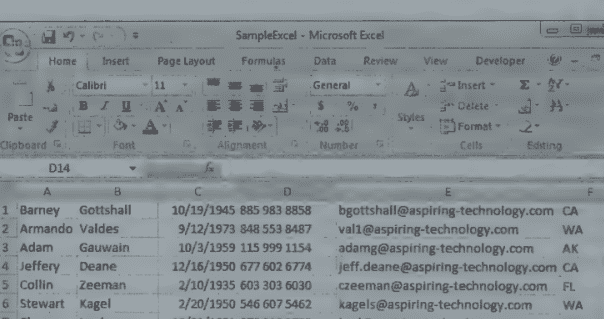
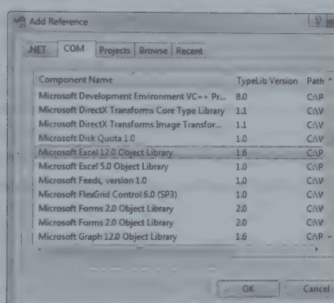
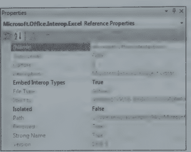

# C# 4.0 中的 LINQ to Objects 使用指南：使用和扩展 LINQ to Objects 以及并行 LINQ (PLINQ)

序言由 `BARRY VANDEVIER` 撰，

`Sabre Holdings` 首席信息官

献给我的妻子 `Janet Doherty`，感谢你让我花额外的时间在键盘上敲击；感谢你的支持和爱。

- 总结
- 多线程与代码并行 264
- LINQ 数据并行 271
- 总结 301
- 索引 307

# 前言

我在软件行业工作了超过 15 年，过去四几年担任 `Sabre Holdings` 的首席信息官 (`CIO`)，在此之前的四年担任 `Travelocity` 的首席技术官 (`CTO`)。在 `Sabre`，除了通过 `Travelocity` 拥有巨大的在线影响力外，我们每年还通过网络处理高达 700 亿美元的旅游总销售额，并为全球超过 200 家航空公司客户提供服务。在特定的一日内，我们在峰值时期处理超过 2 亿笔交易，每秒 32,000 笔交易。处理海量数据流是我们的工作，而寻找更好的方法处理这些数据并提高吞吐量是我作为 `CIO` 的职责。

`Troy` 是我们 `Travelocity` 的架构副总裁，我很荣幸每天都能看到他的影响。他对当前和未来问题的见解以及对细节的深度体现在他的架构决策中，你会在这本关于 `LINQ` 和 `PLQ` 的书中清晰地看到这种能力。

开发者生产率对于每一个 IT 解决方案型业务都是至关重要的，`Troy` 在书的每一章都强调了这一点。语言和语言特性是实现手段，而像 `LINQ` 这样的语言特性极大提升了开发者生产率。

# 前言

## 谁应该读这本书

本书的读者群主要是使用 `C#` 编写应用程序并希望理解如何利用和扩展 `LINQ to Objects` 特性的开发者。`LINQ to Objects` 是一系列技术组件，它们协同工作，使得处理内存数据源变得更加简单和强大。本书涵盖了 `C# 3.0` 对 `LINQ` 的初始实现以及 `C# 4.0` 中的更新。如果你已经熟悉 `LINQ` 语法，本书的深度将超过大多数 `LINQ` 参考书籍，并深入探讨了性能领域以及如何编写自定义 `LINQ` 操作符（无论是作为顺序算法还是使用并行算法来提高性能）。

如果你是一个初级 `C#` 开发者（或刚开始接触 `C# 3.0` 或 `4.0`），本书将介绍代码更改和语法，让你能够快速掌握处理对象和对象集合的方法。我试图寻求平衡，在介绍基础知识之前不会直接跳到示例中。在开始编写长度超过 8 行（大约）的查询之前，你显然应该知道如何构建自己的自定义操作符。但你将在后面的章节中学习这些内容。

## 本书概述

《使用 C# 4.0 的 LINQ to Objects》首先介绍了 `LINQ` 在编写 `.NET` 应用程序的世界中为开发者提供的意图和优势。第一章“引言 LINQ”讨论了动机和基本概念。这是第一个也是唯一提到 `LINQ to SQL` 和 `LINQ to XML` 的章节，并演示了如何从一种查询语法使用多个数据源。

第二章“引言 LINQ to Objects”开始探索理解 `LINQ` 语言编译方式所必需底层语言特性。一个快速、简短的 `LINQ` 概述涵盖了本章；它仅触及了后续章节将详尽介绍的语法和功能。

第三章“编写基础查询”介绍了在 `C#` 中读取和读写 `LINQ` 查询，并涵盖了选择要投影什么数据、选择什么格式以及对内存集合中的数据排序的基础知识。为了简单起见，大多数示例将结果输出到控制台窗口。为了在书中捕获这些结果，它们以与代码列表相同的字体和格式列出，但通过输出编号进行标识。到本章结束，每位读者都应该读懂查询背后的意图，并能够编写简单的查询来过滤、投影和排序数据。

第四章“数据分组与连接”涵盖了集合中数据分组和组合多个数据源的高级特性。这些关系风格的查询可以进行深度结构化，并解释为什么要使用分组或连接。

第五章“标准查询操作符”列出了可以在查询中使用的许多额外标准操作符。`LINQ` 有超过 50 个操作符，本章涵盖了超出之前章节范围的操作符。

第六章“处理集合数据”探索了对基于集合的操作符的处理。在内存集合上执行集合操作有多种方法。

第七章“扩展 LINQ to Objects”讨论了构建自定义操作符的艺术。本章涵盖的示例演示了如何构建任何主要类型的操作符，并包含了为了匹配微软提供的内置操作符而需要采用的常用编码和错误处理模式。

第八章“C# 4.0 特性”引入了额外的 `C# 4.0` 语言特性，特别关注了它们如何扩展 `LINQ to Objects` 的故事。本章演示了如何使用动态语言特性使 `LINQ` 查询更易读读和写，以及如何将 `LINQ` 与互操作性（`Interop`）结合以使用其他应用程序（例如 `Microsoft Excel`）。

第九章“并行 LINQ to Objects”仔细研究了构建支持多核处理器机器的应用代码的动机和艺术。并非所有查询都能看到性能提升，本章讨论了预期以及大多数查询可能看到的提升。本章以一个编写并行操作符的示例结束，以展示在已提供的操作符之外，正确编写并行扩展时所需的思维过程。

## 约定

书中列出了大量的代码。对于关于编程语言特性的书籍来说，用代码示例演示这些特性是不可避免的事实。每一章都有几十个代码列表。为了减轻负担，我遵循了一些常见的排版约定，使它们更具可读性。类、变量和其他实体的引用使用等宽字体进行区分。与周围文本内联阅读的短代码列表也采用等宽字体，但单独成行，并且有时包含代码注释（以 `//` 开头的行）以保持清晰。

```
// 为了清晰添加了换行
var result = nums
    .Where(n => n < 5)
    .OrderBy(n => n);
```

对于无法嵌入文本或我特别想在示例下载项目中提供的较长列表，使用类似的等宽字体显示，但它们通过列表编号和简短描述进行标识，如下例所示，列表 3-2。

### 列表 3-2 使用查询表达式的简单查询

```csharp
List<Contact> contacts = Contact.SampleData();

var q = from c in contacts
where c.State == "WA"
    orderby c.LastName, c.FirstName
    select c;

foreach (Contact c in q)
    Console.WriteLine("{0} {1}",
        c.FirstName, c.LastName);
```

每个示例应该是简单且一致的。

# 输出 3-1

Stewart Kagel

Chance Lard

Armando Valdes

查询所需的示例数据列在表格列表中，例如表 2-2。每一列都映射到一个具有相似合法名称的对象属性，以便查询进行操作。

正文中**粗体**的词汇在词表中有定义，且仅在该词首次出现时进行此类处理。当在代码中使用**粗体**等宽字体时，是为了引起你对当时正在解释的特定要点的关注，这通常用于示例在多次迭代中演变的情况。

## 示例下载代码与更新

书中列出的所有示例以及进一步的参考材料可以在配套网站 `HookedOnLINQ.com` 的参考维基和网站 `http://hookedolinq.com/LINQBook.ashx` 找到。

某些示例需要大型示例数据源以及包含全球地理地名和数据的 `Genenames` 数据库。这些数据文件可以从 `http://www.geenames.org/` 下载，特别是 `http://download.geenames.org/export/dump/allCountries.zip` 文件。应该将该文件下载，并将其放置在与可执行示例应用程序相同的文件夹中，以便成功运行那些解析并查询此源的特定示例。

## 语言选择

我选择使用 `C#` 语言编写书中的示例，因为包含 `C#` 和 `VB.Net` 示例代码会导致页数膨胀到无法接受程度。没有特定理由说明示例不能使用其他支持 `LINQ` 的 `.NET` 语言。

## 系统要求

本书是在 `.NET 4` 和 `Visual Studio 2010` 的代码库基础上，通过多个 Beta 版本和几个社区技术预览版编写而成的。书中介绍的代码可以在 Beta 2 上运行。如果 `Visual Studio 2010` 的发布版和 `.NET 4` 在本书出版与发布之间发生变化，错误列表表和更新后的代码示例将在配套网站 `http://hookedonlinq.com/LINQBook.ashx` 发布。

要运行来自书籍配套网站的示例，你需要在你的机器上安装 `Visual Studio 2010`。如果你没有 `Visual Studio 2010` 的商业版权限，微软提供了一个免费下载的版本（`Visual Studio 2010 Express` 版），它能够运行书中显示的所有示例。你可以从 `http://www.microsoft.com/express/` 下载该版本。

## 致谢

开发这类书籍需要一个团队，至少在精神上，我希望我们的团队成员知道他们的时间和精力已得到充分重视。这种努力将博客写作与出版区分开来，我充分感谢 `Addison-Wesley` 团队，特别是我的编辑 `Joan Murray` 和 `Olivia Basegio`，感谢她们的耐心和智慧。

感谢技术评审员 `Nick Paldino`、`Derik Whittaker`、`Steve Danielson` 和 `Tanzim Saqib`——感谢你们的见解和建议，提高了了准确性和清晰度。你们中的每一个人都对书中包含的文本和代码示例产生了重大影响。

书中的部分材料是通过阅读来自微软员工和我们行业内资深人士发表的许多博客文章获得的。我特别想感谢 `Parallel FX` 团队博客（`http://blogs.msdn.com/pfxtem/`）的各种贡献者，特别是 `Igor Ostovsky`（他对我聚合方法的产生了深远影响）、`Ed Esse`（帮助我理解了 `PLINQ` 中使用的不同分区方案）以及 `Stephen Toub`。`Stephen Toub` 在开发 `Parallel LINQ` 章节（第 9 章）期间由于提供的反馈，我也向他表示诚挚的感谢，这极大地提高了内容的准确性和深度。

我还想感谢 `Geonames.org` (`http://geonames.org`) 的创始和贡献者，他们海量的地理数据可以根据知识共享署名许可免费下载。这些数据被在第 9 章中用于测试大数据集上的 `PLINQ` 性能。

编辑并不容易，我想感谢 `Anne Goebel` 和 `Chrissy White` 的耐心和出色工作，让我的文字从初稿评审后变得流畅。最后，我想感谢那些为 `LINQ` 投入时间的读者，我希望在阅读本书后，你们对 `LINQ` 有深入的见解。

## 关于作者

`Troy Magennis` 是微软的 `C# MVP`，目前在 `travelocity` 担任架构师，领导着跨越四个国家的架构师团队。技术一直是 `Troy` 的热情。在 2006 年接触到 `LINQ` 时，他为了学习它而休了假，并深受迷。在早期 8 位个人电脑（如 `Commodore 64`）上积累经验后，他转向软件工程，最终导致他创建了流行的 `HookedOnLINQ`。

# 第一章 引出 LINQ

## 本章目标

- 定义什么是“语言查询”（`LINQ`）以及为什么构建它。
- 定义构成 `LINQ` 的各种组件。
- 展示 `LINQ` 如何改进代码。

本章介绍了 `LINQ` —— 从微软的目标到它如何改进。尽管本书主要关于 `LINQ` 对象，但了解其完整范围是重要的。

## 什么是 LINQ？

语言集成查询，简称为 `LINQ`（读作“link”），是微软构建的一组 `.NET` 框架增强，旨在让数据（例如，内存集合、数据库行或 `XML` 文件中的元素）处理变得简单直观。`LINQ` 为 `.NET` 与不断增加的数据源提供了一个抽象层。

## 为什么它如此吸引开发者？

通常情况下，尽管存在许多访问和操作数据的接口，但许多接口使用特定的语言或语法。如果应用程序访问并操作数据（大多数情况都是如此），`LINQ` 允许使用类似的语法进行查询。

我们使用“集成查询”一术语表示查询是开发者主要编程语言（如 `C#`、`VB`）的集成功能。语言集成查询允许查询表达式从丰富的元数据、编译时语法检查、静态类型和 `IntelliSense` 中受益，这些以前仅适用于命令式代码。

## LINQ 项目概述

微软关于该技术的首份公开白皮书之一由 `Don Box` 和 `Anders Hejlsberg` 撰写的《`LINQ` 项目概述》，设定了他们看到的问题以及计划如何解决问题。

# LINQ to Objects–从两个集合中汇总数据并写入 XML

要检查的第二个场景是汇总来自 `List<CallLog>` 集合的入电电话。通过与第二个集合 `List<Contact>` 连接，可以查找特定电话号码的联系人姓名，该集合已按姓和名进行了排序。每个进行过至少一次入电电话的联系人都将被写入一个 `XML` 文档中，包括他们的通话次数、这些通话的总持续时间以及通话的平均时长。

## C# 2.0 方案

列表 1-3 显示了实现上述场景所需的大量代码。它首先将入电电话分组到一个以电话号码为键的字典中。联系人按姓排序，然后按名排序，并循环遍历此列表，根据之前创建的组通过电话号码查找通话统计数据。使用 `XmlTextWriter` 类写入 `XML`（在此情况下写入字符串以便将其写入控制台），这将创建一个结构良好、缩进优美的 `XML` 文件。

- 列表 1-3 用于汇总数据、连接第二个集合并输出 `XML` 的 `C# 2.0` 代码——参见输出 1-2

```csharp
List<Contact> contacts = Contact.SampleData();
List<CallLog> callLog = CallLog.SampleData();
```

## LINQ 代码重构——重构前后的代码示例

```c
// 按电话号码对入电电话分组
Dictionary<string, List<CallLog>> callGroups
= new Dictionary<string, List<CallLog>>();
```

```c
foreach (CallLog call in callLog)
{
  if (callGroups.ContainsKey(call.Number))
  {
    if (call.Incoming == true)
      callGroups[call.Number].Add(call);
  }
  else
  {
    if (call.Incoming == true)
    {
      List<CallLog> list = new List<CallLog>();
      list.Add(call);
      callGroups.Add(call.Number, list);
    }
  }
}
```

```csharp
// 按姓、后名对联系人排序
contacts.Sort(
  delegate(Contact c1, Contact c2)
  {
    // 比较姓
    int result = c1.LastName.CompareTo(c2.LastName);

    // 如果姓相同，比较名
    if (result == 0)
      result = c1.FirstName.CompareTo(c2.FirstName);

    return result;
  });
```

```csharp
// 准备并写入 XML 文档
using (StringWriter writer = new StreamWriter())
{
  using (XmlTextWriter doc = new XmlTextWriter(writer))
  {
    // 准备 XML 项目
    doc.Formatting = Formatting.Indented;
    doc.WriteComment("Summarized Incoming Stats");
    doc.WriteStartElement("contacts");
```


```csharp
// 合并通话与数据
foreach (Contact con in contacts)
{
    if (callGroups.ContainsKey(con.Phone))
    {
        List<CallLog> calls = callGroups[con.Phone];

        // 计算总时长和平均值
        long sum = 0;
        foreach (CallLog call in calls)
            sum += call.Duration;

        double avg = (double)sum / (double)calls.Count;

        // 为此联系人写入 XML 记录
        doc.WriteStartElement("contact");

        doc.WriteXmlElement("lastName", con.LastName);
        doc.WriteXmlElement("firstName", con.FirstName);
        doc.WriteXmlElement("count", calls.Count.ToString());
        doc.WriteXmlElement("totalDuration", sum.ToString());
        doc.WriteXmlElement("averageDuration", avg.ToString());

        doc.WriteEndElement();
    }
}
doc.WriteEndElement();
writer.Flush();
writer.Close();
Console.WriteLine(writer.ToString());
```

## LINQ 方案

使用 LINQ 汇总数据、连接第二个集合并输出 XML 的代码更加简洁。这是 LINQ 提供的 1-4 的能力。

```csharp
List<Contact> contacts = Contact.SampleData();
List<CallLog> callLog = CallLog.SampleData();

var q = from call in callLog
        where call.Incoming == true
        group call by call.Number into g
        join contact in contacts on g.Key equals contact.Phone
        orderby contact.LastName, contact.FirstName
        select new XElement("contact",
            new XElement("lastName", contact.LastName),
            new XElement("firstName", contact.FirstName),
            new XElement("count", g.Count()),
            new XElement("totalDuration", g.Sum(c => c.Duration)),
            new XElement("averageDuration", g.Average(c => c.Duration)));

using (StringWriter writer = new StreamWriter())
{
    XDocument doc = new XDocument(
        new XDeclaration("1.0", "utf-8", "yes"),
        new XComment("Summarized Incoming Stats"),
        new XElement("contacts", q));
    
    doc.Save(writer);
    Console.WriteLine(writer.ToString());
}
```

## 结果

这两个方案的输出是相同的，如输出 1-2 所示。使用 LINQ 处理多个集合、分组、聚合结果并写入 XML 的优势在列表 1-3 和 1-4 的代码中清晰可见。

### 输出 1-2

```xml
<!--Summarized Incoming Stats -->
<contacts>
  <contact>
    <lastName>Gottschall</lastName>
    <firstName>Barney</firstName>
    <count>4</count>
    <totalDuration>31</totalDuration>
    <averageDuration>7.75</averageDuration>
  </contact>
  <contact>
    <lastName>Valdes</lastName>
    <firstName>Armando</firstName>
    <count>2</count>
    <totalDuration>20</totalDuration>
    <averageDuration>10</averageDuration>
  </contact>
</contacts>
```

## LINQ 的好处

`LINQ` 因不同原因吸引不同的人。某些优势在目前已发布的许多 `LINQ` 元素中可能并不完全显见。`LINQ` 库和编译器设计的扩展性确保了 `LINQ` 将随着时间的推移而增长，并在未来许多年仍是一项重要的技术。

## 需要记住的单一查询语言

这是 `LINQ` 为开发者每天提供的主要优势。一旦学会了在 `C#` 或 `VB` 中提供的标准查询操作集，访问任何 `LINQ` 启用的数据源只需要少量更改。

## 编译时名称和类型检查

`LINQ` 查询在编译时进行完全的名称和类型检查，减少（或消除）运行时惊喜。许多领域语言如 `T-SQL` 将查询文本嵌入在字符串字量中。这些字符串会被编译器忽略而不检查，错误通常在运行时才会发现（希望是在测试期间）。许多类型错误和拼错误的字段名现在会被编译器发现并在该时修复。

## 代码更易读

内置的标准查询操作集使分组变得异常简单。

### 表 1-1 .NET Framework 4 发布中的标准查询操作

| 操作符 | 标准查询操作名称 |
| --- | --- |
| 聚合 | Aggregate, Average, Count, LongCount, Max, Min, Sum |
| 转换 | AsEnumerable, Cast, OfType, ToArray, ToDictionary, ToList, ToLookup |
| 元素 | DefaultEmpty, ElementAt, ElementAtOrDefault, First, FirstOrDefault, Last, LastOrDefault, Single, SingleOrDefault |

### 表 1-1 .NET Framework 4 发布中的标准查询操作符

| 操作符类型 | 标准查询操作符名称 |
|---|---|
| 等等 | SequenceEqual |
| 生成 | Empty, Range, Repeat |
| 分组 | GroupBy, ToLookup |
| 关联 | GroupJoin, Join |
| 合并 | Zip |
| 排序 | OrderBy, ThenBy, OrderByDescending, ThenByDescending, Reverse |
| 投影 | Select, SelectMany |
| 分区 | Skip, SkipWhile, Take, TakeWhile |
| 量化器 | All, Any, Contains |
| 限制 | Distinct, Where |
| 集合 | Concat, Except, Intersect, Union |

许多标准查询操作符与数据库查询语言中找到的操作符是相同的，这是合理的；如果你要设计一个查询语言应该具备哪些功能，查看经过 30 年精炼的现有实现是一个很好的起点。然而，某些操作符为处理数据引入了新方法，将原本复杂的传统代码简化为单条语句。

## 开放且扩展的架构

`LINQ` 的设计考虑了扩展性。当有需要时，不仅可以添加新的操作符，还可以向 `LINQ` 框架添加全新的全新的数据源（注意：操作符的实现通常需要考虑数据源，这可能是复杂的——重点是这是可能的，而且对于 `LINQ to Objects` 来说，实际上非常简单）。

微软不仅公开了 `LINQ` 的扩展点，还利用这些扩展点实现了他们特定的提供程序。这将确保任何提供程序（无论是来自开源社区项目还是竞争性的数据访问平台）都能在公平的平台上进行竞争。

## 将代码表示为数据

尽管当时与 `LINQ to Objects` 的故事并不完全相关，但将 `LINQ` 查询表示为数据结构的能力，为该查询在运行时如何优化和执行开启了新的机会。除了 `LINQ` 提供程序中将你的 `C#` 和 `VB.Net` 代码转换为特定领域查询语言的基础功能外，使用数据构建的代码或在运行时更改代码的完整优势目前尚未得到充分利用。微软正在探索的一个概念是在运行时构建并编译代码段的能力；例如，这些代码可能用于应用自定义的业务规则。当代码被表示为数据时，可以根据其安全影响或根据代码执行的实际环境（无论是你的笔记本电脑还是巨大的多核服务器）的并发运行情况进行检查和修改。

## 总结

定义 `LINQ` 是一项艰巨的任务。`LINQ` 是一系列松散技术的集合，与 `.NET Framework 3.5` 同时发布，并在 `.NET Framework 4` 中进一步扩展。回答“什么是 `LINQ`？”的另一个复杂之处在于它是一个移动的目标。`LINQ` 使用开放且可扩展的架构构建，任何人都可以添加新的操作符和数据源。

有一点：`LINQ` 将改变编写数据驱动应用程序的方法。代码将更简单、通常更快、且更容易阅读。使用 `LINQ` 特性没有固有缺点；它只是 `C#` 和 `VB.Net` 语言为了支持未来的编码挑战而进行的改进。

下一章将更深入地介绍如何在 `C#` 中构建基本的 `LINQ` 查询，这是理解后续章节涵盖的高级功能的前提。

## 参考文献

- I. Box, Don and Hejlsberg, Anders. 2006. `LINQ Project Overview`, May. 下载自 `http://download.microsoft.com/download/5/8/6/5868081c-68aa-40de-9a45-a3803d8134b8/LINQ_Project_Overview.doc`。

# 第 2 章 介绍 LINQ TO OBJECTS

## 本章目标：

- 定义 `LINQ` 的功能
- 介绍主要特性
- 定义语法

`LINQ` 允许我们在不继承源的情况下查询集合。在章章结束时，你将熟悉这些语法和特性。

## LINQ C# 3.0 语言增强

此版本中添加的许多特性与这些相关：定义扩展方法的规则如下：

1. 扩展方法需要定义在根级别的静态类中（即不嵌套在另一个类中）
2. 扩展方法必须是静态方法（通过将类也标记为静态来强制执行）
3. 扩展方法的第一个参数必须带有 `this` 修饰符前缀

### 扩展方法

扩展方法允许我们在不更改源代码的情况下向类型添加方法。为了演示声明扩展方法的机制，以下代码扩展了 `System.String` 类型，添加了一个名为 `CreateHyperlink` 的方法。一旦此代码被编译到项目中，任何带有 `using` 命名空间声明的类文件都可以在任何字符串实例上调用此方法：

```csharp
string name = "Hooked on LINQ";
string link = name.CreateHyperlink("http://www.linq.com");
```

## LINQ 赋能 C# 3.0 语言增强

```csharp
namespace MyNamespace
{
    public static class MyStringExtensions
    {
        // 添加到 String 类型的扩展方法，
        // 单个字符串参数：url。
        public static string CreateHyperlink(
            this string text,
            string url)
        {
            return String.Format(
                "<a href='{0}'>{1}</a>", url, text);
        }
    }}
```

列表 2-1 展示了如何创建一个返回字符串的 SHA1 哈希值的扩展方法（带和不带额外参数）。此代码的输出可以在输出 2-1 中看到。

**列表 2-1** 为 String 类型添加 `GetSHA1Hash` 方法作为扩展方法示例——参见输出 2-1

```csharp
public static class MyStringExtensions
{
    // 添加到 String 类型的扩展方法，
    // 无额外参数
    public static string GetSHA1Hash(
        this string text)
    {
        if (string.IsNullOrEmpty(text))
            return null;

        SHA1Managed sha = new SHA1Managed();
        byte[] bytes = sha.ComputeHash(
            new UnicodeEncoding().GetBytes(text));

        return Convert.ToBase64String(bytes);
    }
}
```

```csharp
// 对字符串进行哈希处理。
// GetSHA1 通过扩展方法引入的
string password = "ClearTextPassword";
string hashedPassword = password.GetSHA1();
```

```csharp
// 将结果写入控制台
Console.WriteLine("Original: " + password);
Console.WriteLine("Hashed: " + hashedPassword);
```

## 输出 2-1

- 字符串哈希处理

Original: ClearTextPassword

Hashed:

在命名空间中声明的扩展方法可以在包含该命名空间的任何文件中调用。例如，若要让你的代码可以使用扩展方法，请在文件顶部包含 `System.Linq` 子句。编译器在查找符合方法名和签名的扩展方法之前，会自动优先考虑为该类型定义的实例方法。

在选择是扩展类对象（遵循面向对象原则）还是使用扩展方法时，`C# 3.0` 语言规范的早期草稿给出了建议（尽管该警告在最终规范中被删除，但我看来这仍然是很好的建议）：

与实例方法相比，扩展方法的发现性较低，功能也更有限。由于这些原因，建议谨慎使用扩展方法，仅在实例方法不可行或无法实现的情况下使用。执行内置功能的标准查询操作符完全是通过扩展方法实现的，扩展了任何实现 `IEnumerable<T>` 的类型。在某些情况下（大多数 `.NET` 集合类和数组实现了 `IEnumerable<T>`；标准查询操作符已引入大多数内置集合类中），`LINQ` 必须为每个集合类型单独添加这些操作符，而我们的自定义集合如果没有干预将无法从中受益。扩展方法允许 `LINQ` 能够同样适用于内置集合类型和任何自定义集合类型，唯一的要求是自定义集合必须实现 `IEnumerable`。微软提供的当前扩展方法以及如何创建新的扩展方法将在本书中详细介绍。理解扩展方法以及内置查询操作符的工作原理，将有助于更深入地理解 `LINQ to Objects` 是如何构建的。

## 对象初始化器

`C# 3.0` 引入了对象初始化语法，允许在单条 `C#` 语句中构造类型的新实例并在同一条语句中分配属性值。虽然对所有关键数据使用构造函数参数是良好的编程习惯，以确保新类型在初始化后是稳定的且可以立即投入使用的（而不会被实例化为无效状态），但对象初始化器减少了随着时间推移为每种非关键数据的变体提供特定参数构造函数的需求。在初始化语句中，可以通过为属性名赋值值来为任何字段或属性赋值；通过逗号分隔表达式可以进行多次赋值。`C#` 编译器在后台调用对象的默认构造函数，然后调用各个赋值语句，就好像你之前手动分配过属性一样。（请参见脚注 2 中的 `C# 3.0` 语言规范，以获得关于此类初始化发生的更精确的描述。）

### 列表 2-2 对象初始化器语法——修改前后

```csharp
// 旧的初始化语法 => 多条语句
var contactOld = new Contact();
contactOld.LastName = "Magennis";
contactOld.DateOfBirth = new DateTime(1973, 12, 09);

// 新的初始化语法 => 单条语句
var contactNew = new Contact
{
    LastName = "Magennis",
    DateOfBirth = new DateTime(1973, 12, 09)
};
```

尽管在通用形式上这只是语法上的微小（尽管有用）改进，但当你开始编写 `LINQ` 查询并需要通过动态设置属性值来构造结果集的一部分构造对象实例时，它是至关重要的。这是处理 `LINQ` 时最常见的场景之一，如果没有此功能，你将需要为通过查询初始化的每组属性定义特定的构造函数。

## 集合初始化器


由于对象初始化语法具有类似的目标，集合初始化被赋予了类似的功能，类似于常见的“构造并添加”模式。集合必须实现 `System.Collections.IEnumerable` 并具有 `Add` 方法的适当重载以支持新的初始化语法。列表 2-3 展示了新集合初始化语法的用法，并显示了对应的对等代码模式。它还演示了如何将集合初始化与对象初始化相结合，这有助于保持代码更整洁且通常更容易阅读。

### 列表 2-3 集合初始化语法——修改前后

```csharp
// 旧的初始化语法 => 多条语句
List<string> stringsOld = new List<string>();
stringsOld.Add("string 1");
stringsOld.Add("string 2");

// 新的初始化语法 => 单条语句
List<string> stringsNew = new List<string> {
    "string 1",
    "string 2"
};

// 结合对象和集合初始化
// 创建联系人列表并添加两条记录。
List<Contact> list = new List<Contact> {
    new Contact {
        LastName = "Magennis",
        DateOfBirth = new DateTime(1973, 12, 09)
    },
    new Contact {
        LastName = "Doherty",
        DateOfBirth = new DateTime(1978, 1, 05)
    }
};
```

## 隐式类型变量

当使用 `var` 关键字而不是具体类型时，类型从初始化值推推出来。隐式类型变量是强类型的；列表 2-4 展示了隐式类型变量的用法。

### 列表 2-4 隐式类型变量

```csharp
// 隐式类型变量声明 => 多处声明
var anInt = 1;
var aString = "Testing";
var listContact = new List<Contact>();
var intArray = new int[] { 0, 1, 2, 3, 4 };

// 隐式类型变量声明 => 单条语句
// 它展示了对象和集合
// 初始化如何与 var 风格配合。
var list = new List<Contact> {
    new Contact {
        LastName = "Magennis",
        DateOfBirth = new DateTime(1973, 12, 09)
    },
    new Contact {
        LastName = "Doherty",
        DateOfBirth = new DateTime(1978, 1, 05)
    }
};
var intArray = new int[] { 0, 1, 2, 3, 4 };
```

## 匿名类型

匿名类型是编译时生成的类型，其属性在编译时从对象初始化表达式继承。这些类型随后可以作为临时存储类在方法内部使用，避免了为每组属性构建特定的数据类。新类直接继承自 `System.Object` 且没有名称（至少在代码中无法引用）。你为匿名类型分配什么运行时类型？它们必须使用前面提到的隐式类型局部变量结构 (`var`) 来声明。

匿名类型通过在 `new` 语句后省略类型名并提供包含一个或多个赋值的有效对象初始化表达式来定义。列表 2-5 展示了如何创建匿名类型以及如何在后续代码中使用它，其输出见输出 2-2。

### 列表 2-5 匿名类型的声明与使用——参见输出 2-2

```csharp
// 简单的匿名类型声明
Console.WriteLine("- Simple Anonymous Type -");
var item = new { Name = "Car", Price = 9989.00 };
```

```csharp
Console.WriteLine("Type: {0}, Name: {1}, Price: {2}",
item.GetType().ToString(), item.Name, item.Price);
```

### LINQ 启用 C# 3.0 语言增强 25

```csharp
// 声明并操作匿名类型数组
Console.WriteLine();
Console.WriteLine("- Iterating Anonymous Types Array -");
var list = new[] { {
    new { LastName = "Magennis",
         DateOfBirth = new DateTime(1973,12,09) },
    new { LastName = "Doherty",
         DateOfBirth = new DateTime(1978,1,5) }
};

foreach (var x in list) {
    Console.WriteLine("{0} ({1})*", x.LastName, x.DateOfBirth);
}
```

```csharp
// 编译器优化 - 选 C# 规范：
// 在同一个程序内，两个匿名对象初始化器
// 如果它们以相同的顺序指定了具有相同
// 名称和相同编译时类型的属性序列，
// 将将产生相同的匿名类型实例。
var p1 = new { Name = "Lawnmower", Price = 495.00 };
var p2 = new { Name = "Shovel", Price = 26.95 };
p1 = p2; // 有效：相同的匿名类型。
```

## 输出 2-2

- Simple Anonymous Type - 

Type: <>f__AnonymousType2<System.String,System.Double>,

Name: Car,

Price: 9989

- Iterating Anonymous Types Array - 

Magennis (12/9/1973 12:00:00 AM)

Doherty (1/5/1978 12:00:00 AM)

当编写使用现有类型的子集属性构建集合的查询（称为投影）时，匿名类型的重要性变得显而易见。想象一下在操作关系型数据库时，你无法定义用于 SQL 查询返回的列列表。LINQ 也存在同样的问题；如果没有匿名类型，你将为每一个更改了感兴趣列的返回集定义一个具体的类型。C# 4.0 中添加的可选参数（在第4章“数据的分组和连接”中介绍）使得这种情况稍微容易；当需要临时结果时应该考虑匿名类型。

除了支持 LINQ 的用处外，匿名类型还允许在处理数据期间创建临时数据结构。以前通常需要构建一个仅包含属性声明的普通类来支持数据存储；匿名类型完美地满足了这一需求。虽然通过将参数类型声明为 `Object`可以将匿名类型传递到声明它的方法之外，但这是非常不建议的。在 LINQ 功能之外使用匿名类型时，请将其范围限制在它们所在的方法中，否则请定义具体的类型或结构体。

## Lambda 表达式

Lambda 表达式基于 C# 2.0 添加的匿名方法功能构建。匿名方法添加了使用 `delegate` 关键字内联代码的能力，这提供了一种更简洁的方法编写方式。C# 3.0 引入的 Lambda 表达式通过使用 `=>` 运算符提供了更简洁的语法。Lambda 表达式由参数列表以及表达式或正体组成。这种语法允许省略 `delegate` 关键字和参数类型，因为编译器可以从上下文中推断出来。Lambda 表达式在 LINQ 查询定义过滤器和投影时特别有用。

虽然 Lambda 表达式可以单独使用，但它们经常被用作接收委托作为参数的方法的参数。这是 LINQ 方法（如 `Select`、`Where` 和 `OrderBy`）中的常见模式。通过使用 Lambda 表达式，与传统的匿名方法或单独的委托定义相比，代码变得更具读性和可维护性。

### 30 第 2 章 介绍 LINQ to Objects

```csharp
11      );
12
13 // LINQ 扩展方法语法，与上述相同
14 var query2 = Person.SampleData(
15     .Where(c => c.State == "WA")
16     .Select(c => new
17     {
18         Name = c.FirstName + " " + c.LastName,
19         State = c.State
20     }));
21
22 foreach (var item in query1)
23     Console.WriteLine("{0}, {1}", item.Name, item.State);
```查询语法的详细解释将在第 3 章给出；其目的是演示语言特性如何为构建强大的查询语言系统奠定基础，正如其名称所示——集成语言的查询（Language Integrated Query）。

## LINQ to Objects 五分钟概述

LINQ to Objects 允许 .NET 开发人员对对象集合编写“查询”。微软提供了一大套内置查询操作符，这些操作提供的功能深度与任何处理关系型数据库的 SQL 语言的预期相当。

传统上，处理对象集合意味着编写使用 `for` 循环或 `foreach` 循环的列表代码来遍历集合，使用 `if` 语句进行过滤，同时执行其他计算（如对总属性进行累计求和）。

LINQ 将你从编写循环代码中解放出来；它允许你编写查询来过滤列表或对内存集合中的元素计算聚合函数，此外还有许多其他功能。你可以针对实现了 `IEnumerable<T>` 接口的任何集合类型编写查询，NET Framework 类提供的大多数内置集合类都实现了该接口，包括数组。

为了理解基本的查询语法，列表 2-8 和 2-9 展示了简单的 LINQ to Object 查询，其相应的控制台输出位于输出 2-3 和 2-4 中。

## 列表 2-8 整数数组的简单 LINQ 查询——参见输出 2-3

```csharp
int[] nums = new int[] { 0, 4, 2, 6, 3, 8, 3, 1 };

var result = from n in nums
    where n < 5
    orderby n
    select n;

foreach (int i in result)
    Console.WriteLine(i);
```

## 输出 2-3

```
0
1
2
3
4
```

### 列表 2-9 计算整数数组中所有值之的简单 LINQ——参见输出 2-4

```csharp
int[] nums = new int[] { 0, 4, 2, 6, 3, 8, 3, 1 };
int result = nums.Sum();
Console.WriteLine(result);
```

## 输出 2-4

> LINQ to Objects 扩展了任何继承自 `IEnumerable<T>` 的类型（使用上述的扩展方法），引入了一组与 SQL 语言类似的查询操作。.NET 基类库中内置的所有集合类型和数组都实现了 `IEnumerable<T>` 接口，因此通过一组扩展方法，微软为所有集合添加了查询能力。上一章的表 1-1 列出了内置查询操作符。本书稍后将将详细介绍每个操作符（第 3 到第 6 章）。如果你曾经处理过关系型数据库并编写过 SQL 查询，那么大多数操作符你应该是熟悉的。编写 SQL 查询和 LINQ 查询之间的一个重要区别是操作符顺序是反的。如果你习惯了 `Select-From-Where-OrderBy`，可能需要一些时间来克服肌肉记忆并转向 `From-Where-OrderBy-Select`。关键字顺序的差异有其道理，尽管 VB.Net 最初按照 SQL 顺序实现了 LINQ，但在意识到 IntelliSense 支持的益处后，切换到了 C# 的关键字顺序。先指定集合（使用 `from` 子句）允许 Visual Studio 在输入 `where` 和 `select` 子句时，在非常强大的工具提示中弹出公共字段和属性，如图 2-1 所示。如果先写 `select`，则无法提供弹出辅助，因为编辑器不知道整个查询中将使用何种对象类型。

```csharp
List<Contact> contacts = Contact.SampleData();
var q = from c in contacts
      select c;
```

| DateOfBirth |

| --- |

| Email |

| Equals |

| FirstName |

| GetHashCode |

| GetType |

| LastName |

| Phone |

| State |

| ToString |

图 2-1 通过指定 `from` 子句，编辑器可以在指定 `select` 子句时提供字段列表。如果 `select` 子句先出现，这是无法可能的。

为了演示 LINQ 的某些查询能力，概述的其余部分将使用表 2-1 和 2-2 所示的示例数据。本章及后续章节中的示例将以各种方式查询这些数据，以详细探索 LINQ to Objects。

## LINQ to Objects 五分钟概述

**表 2-1** 本书后续示例联系数据

| First Name | Last Name | D.O.B. | Phone | State |

|---|---|---|---|---|

| Barney | Gotshall | 19-Oct-1945 | 885 983 8858 | CA |

| Armando | Valdes | 9-Dec-1973 | 848 553 5487 | WA |

| Adam | Gauain | 3-Oct-1959 | 115 999 1154 | AK |

| Jeffery | Deane | 16-Dec-1950 | 677 602 6774 | CA |

| Collin | Zeeman | 10-Feb-1935 | 603 303 6030 | FL |

| Stewart | Kagel | 20-Feb-1950 | 546 607 5462 | WA |

| Chance | Lard | 21-Oct-1951 | 278 918 2789 | WA |

| Blaine | Reifsteck | 18-May-1946 | 715 920 7157 | TX |

| Mack | Kamph | 17-Sep-1977 | 364 202 3644 | TX |

| Ariel | Hazelgrove | 23-May-1922 | 165 732 165 | |

**表 2-2** 本书后续示例通话数据

| Number | Duration (mins) | Incoming | Date |

|---|---|---|---|

| 885 983 8858 | 5 | TRUE | 19-Oct-1945 |

| 848 553 5487 | 6 | TRUE | 9-Dec-1973 |

| 115 999 1154 | 7 | FALSE | 3-Oct-1959 |

| 677 602 6774 | 8 | TRUE | 16-Dec-1950 |

| 603 303 6030 | 9 | FALSE | 10-Feb-1935 |

| 546 607 5462 | 10 | TRUE | 20-Feb-1950 |

| 278 918 2789 | 12 | FALSE | 21-Oct-1951 |

| 715 920 7157 | 13 | TRUE | 18-May-1946 |

| 364 202 3644 | 14 | FALSE | 17-Sep-1977 |

| 165 732 165 | 15 | TRUE | 23-May-1922 |

## 列表 2-12 根据电话号码对两个集合进行查询——参见输出 2-7。

注意临时临时匿名类型的使用。

```csharp
List<Contact> contacts = Contact.SampleData();
List<CallLog> callLog = CallLog.SampleData();
```

```csharp
var q = from call in callLog
  join contact in contacts on
      call.Number equals contact.Phone
  select new {
      contact.FirstName,
      contact.LastName,
      call.When,
      call.Duration
  };

foreach (var c in q)
  Console.WriteLine(
      "{0} - {1} ({2}min)",
      c.When.ToString("ddMM HH:mm"), c.FirstName,
      c.LastName, c.Duration);
```

## 输出 2-7

07Aug 08:12 - Barney Gottshall (2min)

07Aug 09:23 - Ariel Hazelgrove (15min)

07Aug 10:5 - Mack Kamph (1min)

08Jul 14:37 - Armando Valdes (13min)

08May 15:23 - Chance Lard (16min)

08Jun 17:12 - Mack Kamph (24min)

为了演示 LINQ to Objects 查询功能的强大之处，列表 2-13 显示的查询通过连接、分组以及在 select 子句中使用聚合操作符，汇总了两个内存集合的数据。该查询的最终输出如输出 2-8。

# 第 2 章 介绍 LINQ TO OBJECTS


**列表 2-13** 入站日志摘要显示了过滤、排序、分组、连接以及使用聚合值进行选择——参见输出 2-8

```csharp
List<Contact> contacts = Contact.SampleData();
List<CallLog> callLog = CallLog.SampleData();

var q = from call in callLog
    where call.Incoming == true
    group call by call.Number into g
    join contact in contacts on
        g.Key equals contact.Phone
    orderby contact.FirstName, contact.LastName
    select new {
        contact.FirstName,
        contact.LastName,
        Count = g.Count(),
        Avg = g.Average(c => c.Duration),
        Total = g.Sum(c => c.Duration));
```

```csharp
foreach (var call in q)
    Console.WriteLine("{0} {1} - Calls:{2}, Time:{3}mins, Avg:{4}mins*",
    call.FirstName, call.LastName,
    call.Count, call.Total, Math.Round(call.Avg, 2));
```

## 输出 2-8

Ariel Hazelgrove - Calls:2, Time:27mins, Avg:13.5mins

Armando Valdes - Calls:2, Time:20mins, Avg:10mins

Barney Gottshall - Calls:4, Time:31mins, Avg:7.75mins

Chance Lard - Calls:2, Time:22mins, Avg:11mins

Mack Kamph - Calls:2, Time:44mins, Avg:22mins

Stewart Kagel - Calls:2, Time:13mins, Avg:6.5mins

## 总结

到此结束了我们对支持 LINQ 的语言增强的介绍，以及对 LINQ to Objects 的五分钟概述。概述的目的是让你对 LINQ to Objects 和语言语法有足够的熟悉，以便深入学习编写 LINQ 查询，接下来的章节也将鼓励你这样做。

## 参考文献

- 1. C# 版本 3.0 规范 3.0. 2005 年 9 月。此 C# 规范的草案版本包含了关于何时使用扩展方法的建议。http://download.microsoft.com/download/9/5/0/9503e3ce-fde6-4aed-b5d0-ffe749822f1b/sharp%203.0%20specification.doc.
- 2. C# 语言规范版本 3.0. 微软 2007。http://download.microsoft.com/download/3/8/38e8e7205-bc10-4226-b2a8-753022f1b.

# 第 44 章 第3 章 编写基础查询

> 注意：SQL 中关键字的顺序有所不同，这对于 SQL 大师来说是非常遗憾的；然而，这种差异的一个非常有说服力的理由是为了改进开发者体验。`From-Where-Select` 的顺序允许编辑环境（在本例中为 Visual Studio）在编写查询时提供完整的 Intellisense 支持。当你写下 `from` 子句时，一旦你开始写 `where` 子句，该元素的属性就会立即随之显示出来。如果 C# 设计者遵循更熟悉的 `Select-From-Where` 顺序，情况就不会如此（在 SQL Server 的查询编辑工具中也是如此）。

对于习惯了其他查询语法（如 SQL）的开发者来说，大多数查询表达式语法不需要解释。虽然其顺序与传统的查询语言不同，但每个关键字名称都强烈地指示了其功能，例外是 `let` 和 `into` 子句，它们将在下文中描述。

## Let-创建一个局部变量

通过创建一个变量来存储中间计算的值或子查询的结果，可以编写更少重复代码的查询。`let` 关键字允许你在编写剩余查询表达式的范围内，将表达式的结果（一个值或子查询）保留在作用域中。一旦赋值，该变量无法重新赋值另一个值。

在下面的代码中，分配了一个名为 `average` 的局部变量，它持有整个源序列的平均值，计算一次但在每个元素的 `Select` 投影中使用该值：

`let` 关键字完全由编译器实现，它创建了一个包含原始范围变量（上一个例中的元素）和新 `let` 变量的匿名类型。之前的查询直接映射到以下（编译器翻译）方法查询：

```
var variance = from element in source
let average = source.Average()
select Math.Pow(element - average), 2;
```

```
var variance =
source.Select (
element =
new
{
  element = element,
  average = source.Average()
})
.Select(temp0 =>
  Math.Pow(
    (double)temp0.element - temp0.average,
    2));
}
```

每引入一个额外的 `let` 变量都会导致当前匿名类型在包含自身和额外变量的另一个匿名类型中级联——以此此类推。然而，在编写查询表达式时，所有这些魔法都是透明的。

## Into-查询继续

`group`、`join` 和 `select` 查询关键字允许将结果序列捕获到局部变量中，然后在查询的其余部分。`into` 关键字允许在定义后的任何一点通过使用存储在局部变量中的结果来继续查询。

最常见的 `into` 使用点是在捕获分组操作的结果，而内置的连接功能将在第 4 章“数据分组与连接”中进行广泛介绍。作为一个快速预览，下面的示例对值存储中的所有元素进行分组，并将结果存储在名为 `groups` 的变量中；使用 `into` 关键字（结合 `group` 关键字），`groups` 变量可以在剩余查询语句中参与并访问。

```
var groups = from element in source
  group element into groups
  select new {
    Key = groups.Key,
    Count = groups.Count()
  };
```

## 比较查询语法选项

列表 3-1 使用扩展方法语法，列表 3-2 使用查询表达式语法，但它们在功能上是等价，生成的输出与输出 3-1 所示相同。查询表达式语法中代码的清晰度源于消除了 Lambda 表达式语义和 SQL 风格的操作符语义。两种样式在功能上完全相同，对于简单查询（如此示例），代码清晰度的收益是微乎其微的。

**列表 3-1** 使用扩展方法查询获取 "WA" 州所有按姓氏和名排序的联系人——参见输出 3-1

```
List<Contact> contacts = Contact.SampleData();

var q = contacts.Where(c => c.State == "WA")
    .OrderBy(c => c.LastName)
    .ThenBy(c => c.FirstName);

foreach (Contact c in q)
    Console.WriteLine("{0} {1}",
    c.FirstName, c.LastName);
```

**列表 3-2** 与列表 3-1 相同的查询，但使用了查询表达式语法——输出 3-1

```
List<Contact> contacts = Contact.SampleData();

var q = from c in contacts
    where c.State == "WA"
    orderby c.LastName, c.FirstName
    select c;

foreach (Contact c in q)
    Console.WriteLine("{0} {1}",
    c.FirstName, c.LastName);
```

**输出 3-1**

Stewart Kagel

Chance Lard

Armando Valdes

当你的查询包含连接和/或分组功能时，使用查询表达式语法比扩展方法语法具有广泛的代码可读性优势。尽管在使用查询表达式语法时，并不是所有的连接和分组功能都是原生提供的，但你编写的大多数查询不需要额外功能。列表 3-3 展示了用于 `Join` 的相当笨拙的扩展方法语法（笨拙在于仅通过阅读代码无法清楚 `GroupBy` 扩展方法中的每个参数意味着什么）。相同查询的功能等效查询表达式语法显示在列表 3-4 中。两个查询产生相同的结果，如输出 3-2 所示。

如果还不清楚，我的个人偏好是只要查询中需要 `Join` 或 `GroupBy` 操作就使用查询表达式语法：当需要标准查询操作符时（例如 `.Take` 方法），你封装查询并使用扩展方法。

**列表 3-3** 连接在扩展方法语法中变得特别复杂。

```
List<Contact> contacts = Contact.SampleData();

var q = contacts.Where(c => c.State == "WA")
    .GroupBy(c => c.LastName)
    .ThenBy(g => g.Key)
    .SelectMany(g => g.Select(c => new {
        LastName = g.Key,
        FirstName = c.FirstName
    }));
```

**列表 3-4** 相同查询的查询表达式语法

```
List<Contact> contacts = Contact.SampleData();

var q = from c in contacts
        where c.State == "WA"
        group c by c.LastName into group
        orderby group.Key
        from item in group
        select new {
            LastName = group.Key,
            FirstName = item.FirstName
        };
```

# 第 3 章 编写基础查询

`IEnumerable` 原生支持调用者请求集合中的下一个项——此时，将计算下一个项（以 `foreach` 关键字作为示例）。任何实现 `IEnumerable<T>` 模式（它同时也实现了 `IEnumerable`）的集合都将通过 `where` 算符扩展，只要该元素满足谓词表达式（返回 `true`），该算符在被请求时每次将返回一个元素。

过滤谓词表达式通过 Lambda 表达式传递给扩展方法（关于 Lambda 表达式的定义，请参见第 2 章“引言 LINQ to Objects”），尽管查询表达式语法的形式更加整洁。这两种谓词表达式样式都将在后续章节中进行详细的说明和介绍。

## 使用 Lambda 表达式进行 Where Filter

在为 `Where` 算符形成谓词时，谓词接收一个与源集合元素类型相同的输入元素，并返回 `true` 或 `false`（一个布尔值）。为了演示使用简单的 `Where` 谓词，考虑以下代码：

```csharp
string[] animals = new string[] { "Koala", "Kangaroo",
"Spider", "Wombat", "Snake", "Emu", "Shark",
"Sting-Ray", "Jellyfish" };
```

```csharp
var q = animals.Where(
    a => a.StartsWith("S") && a.Length > 5);

foreach (string s in q)
    Console.WriteLine(s);
```

在此代码中，`animals` 数组中的每个字符串值都通过一个名为 `a` 的范围变量传递给 `Where` 扩展方法。每个字符串都会根据谓词函数进行评估，只有通过测试（返回 `true`）的字符串会被返回到查询结果。对于此示例，只有两个字符串通过了测试并写入控制台窗口。

Spider

Sting-Ray

## 如何过滤结果 (WHERE 子句)

C# 编译器在后台将 Lambda 表达式转换为标准的匿名方法调用（以下代码在功能上等效）：

```csharp
var q = animals.Where(
  delegate(string a) {
    return a.StartsWith("S") && a.Length > 5; });
```

### 什么是延迟执行？

`where` 子句只有在有人（你通过 `foreach` 语句或另一个带有内部 `foreach` 语句的标准查询算符）尝试迭代结果时，才会开始测试谓词；在此之前，迭代器框架会准确记住上一次被请求元素时所在的位置。这被称为延迟执行（Deferred Execution），它允许你对查询何时何时以及如何执行具有某种可预测性和控制力。如果你立即需要结果，可以调用 `List()`、`ToArray()` 或其他导致结果立即具体化为另一种格式的标准算符；否则，查询将会在你开始迭代它时才开始评估。

# Where 过滤查询表达式（首选）

查询表达式的 `where` 子句语法去掉了显式的范围变量定义和 Lambda 表达式算符 (`=>`)，使其变得更加简洁，并且更符合许多开发者熟悉的 SQL 风格子句。由于这些原因，它是首选语法。以下使用查询表达式语法重写之前的示例展示了这些差异：

```csharp
string[] animals = new string[] { "Koala", "Kangaroo",
"Spider", "Wombat", "Snake", "Emu", "Shark",
"Sting-Ray", "Jellyfish" };
```

```csharp
var q = from a in animals
  where a.StartsWith("S") && a.Length > 5
  select a;
```

```csharp
foreach (string s in q)
  Console.WriteLine(s);
```

## 使用外部方法进行评估

虽然你可以编写查询并内联过滤谓词的代码，但你不必这样做。如果谓词很长并且可能在多个查询表达式中使用，你应该考虑将其放在自己的方法体中（这是任何重复代码的良好实践）。使用外部谓词函数重写之前的示例展示了这种技术：

```csharp
string[] animals = new string[] { "Koala", "Kangaroo",
"Spider", "Wombat", "Snake", "Emu", "Shark",
"Sting-Ray", "Jellyfish" };

var q = from a in animals
    where MyPredicate(a)
    select a;

foreach (string s in q)
    Console.WriteLine(s);

public bool MyPredicate(string a)
{
    if (a.StartsWith("S") && a.Length > 5)
        return true;
    else
        return false;
};
```

为了通过稍微复杂的场景进一步演示这种技术，列表 3-5 所示的代码创建了一个谓词方法，该方法封装了判断“致命动物”的逻辑。通过将此逻辑封装在一个方法中，它就不需要在应用程序的多个地方重复出现。

## 列表 3-5 使用外部方法的 where 子句——参见输出 3-3

```csharp
string[] animals = new string[] { "Koala", "Kangaroo",
"Spider", "Wombat", "Snake", "Emu", "Shark",
"Sting-Ray", "Jellyfish" };

var q = from a in animals
    where IsDeadly(a)
    select a;
```

## 如何过滤结果 (WHERE 子句)

```csharp
foreach (string s in q)
    Console.WriteLine("A {0} is deadly.", s);

public static bool IsDeadly(string s)
{
    string[] deadly = new[] { "Spider", "Snake",
    "Shark", "Sting-Ray", "Jellyfish" };
    return deadly.Contains(s);
}
```

## 输出 3-3

A Spider 是致命的。

A Snake 是致命的。

A Shark 是致命的。

A Sting-Ray 是致命的。

A Jellyfish 是致命的。

## 根据索引过滤

`where` 子句允许你根据集合中的索引来过滤元素。当你需要选择特定位置的元素时，这非常有用。


```csharp
string[] animals = new[] { "Koala", "Kangaroo",
"Spider", "Wombat", "Snake", "Emu", "Shark",
"Sting-Ray", "Jellyfish" };

var q = animals.Select((a, index) => new { a, index })
               .Where(x => x.index % 2 == 0);

foreach (var item in q)
    Console.WriteLine(item.a);
```

## 输出 3-4

## 如何返回类型 (Select 投影)

当你对数据库编写查询时，指定要返回的列是本能。目标是将列限制在必要的范围内。这通过在 `Select` 子句后列出列来实现：

```sql
SELECT * FROM Contacts
```

```sql
SELECT ContactId, FirstName, LastName FROM Contacts
```

第一个查询将返回表的每一列和每一行；第二个查询只返回显式指定的列，从而节省了服务器资源。

# Select 投影

投影返回结果的不同方式有：

- 单个结果值或元素，其类型与源项相同
- `IEnumerable<T>`，其中 `T` 是投影中的任何现有类型
- `IEnumerable<T>`，其中 `T` 是投影中创建的匿名类型
- `IEnumerable<IGrouping<TKey, TElement>>`，它是共享公共键对象的集合

每种投影样式都有其用途，并在后续章节通过示例进行说明。

# 在 Select 投影中投影了多少数据？

与所有良好的数据访问范式一样，定义查询形状时的目标应该是返回尽可能少的属性。这减少了内存占用，并使结果集更容易编码，因为需要处理的属性更少。

## 返回单个结果或元素

某些标准查询算符返回单个值作为结果，或者集合中的单个元素；这些算符列在表 3-1 中。每个这些算符都会结束结果到另一个查询的级联，而是返回单个结果值或源元素。

表 3-1 返回特定结果类型的算符示例（在第 5 和第 6 章介绍）

| 返回类型 | 标准查询算符 |
|---|---|
| 数值 | `Aggregate`, `Average`, `Max`, `Min`, `Sum`, `Count`, `LongCount` |
| 布尔值 | `All`, `Any`, `Contains`, `SequenceEqual` |
| 类型 `<T>` | `ElementAt`, `ElementOrDefault`, `First`, `FirstOrDefault`, `Last`, `LastOrDefault`, `Single`, `SingleOrDefault`, `DefaultIfEmpty` |

例如，以下简单查询将返回整数数组中的最后一个元素，并将数字 2 写入控制台窗口：

```c
int[] nums = new int[] { 5, 3, 4, 2 };

int last = nums.Last();

Console.WriteLine(last);
```

## 返回与源相同的类型 - `IEnumerable<TSource>`

最基本的投影类型返回的是源项的经过过滤和排序的子集。这种投影通过在 `select` 关键字之后指定范围变量作为参数来实现。以下示例返回一个 `IEnumerable<Contact>`，其中 `Contact` 类型根据源集合的元素类型推断得出：

```c
List<Contact> contacts = Contact.SampleData();

IEnumerable<Contact> q = from c in contacts
select c;
```

更合适的查询会对结果进行过滤并以某种方便的方式进行排序。你返回的仍然是相同类型的集合，但元素的数量和顺序将会有所不同。

```c
List<Contact> contacts = Contact.SampleData();

IEnumerable<Contact> q = from c in contacts
where c.State == "WA"
orderby c.LastName, 
c.FirstName ascending
select c;
```

## 返回与源不同的类型 - `IEnumerable<TAnyType>`

任何类型都可以作为 `select` 子句的一部分进行投影，而不仅仅是源类型。目标类型可以是当前代码作用域内通过简单的 `new` 语句原本可以手动构建的任何可用类型。

如果正在构建的类型具有一个包含你特定所需所有参数的参数构造函数，则只需调用该构造函数即可。如果没有构造函数匹配此投影所需的参数，则可以创建一个，或者考虑使用 C# 3.0 类型初始化器语法（在第 2 节中介绍）。新类型初始化器语义的用处在于，它让你不再需要每次为了适应不同的查询形状而定义特定的构造函数。列表 3-7 展示了如何分别使用构造函数语义和类型初始化器语法来投影 `IEnumerable<ContactName>`。

> 注意：抵制过度使用类型初始化语法的诱惑。它要求所有通过此语法初始化的属性必须是可读可写的（具有 getter 和设置器）。如果某个属性应该是只读的，不要为了这个目的而将其设为可读可写。考虑使用第 8 节“C# 4.0”中描述的 C# 4.0 可选参数语法将构造函数参数设为可选

### 列表 3-7 投影到新类型的集合——使用特定构造函数或使用类型初始化器语法构建

```c
List<Contact> contacts = Contact.SampleData();

// 使用参数化构造函数
IEnumerable<ContactName> q1 =
  from c in contacts
  select new ContactName(
    c.LastName + " " + c.FirstName,
    (DateTime.Now - c.DateOfBirth).Days / 365);

// 使用类型初始化器语义
// 注意：该类型需要无参数构造函数
IEnumerable<ContactName> q2 =
  from c in contacts
  select new ContactName
{
    FullName = c.LastName + " " + c.FirstName,
    YearsOfAge = (DateTime.Now - c.DateOfBirth).Days / 365
};

// ContactName 类定义
public class ContactName {
    public string FullName { get; set; }
    public int YearsOfAge { get; set; }
    // 对象初始化示例
    // 需要的构造函数
    public ContactName() {
    }
    // 类型投影示例
    // 需要的构造函数
    public ContactName(string name, int age) {
        this.FullName = name;
        this.YearsOfAge = age;
    }
}
```

## 返回匿名类型 - `IEnumerable<TAnonymous>`

匿名类型是 C# 3.0 引入的一项新语言特性，编译器根据对象初始化表达式（初始 `=` 符号右侧的表达式）动态创建类型。在第 2 节中进行了详细讨论，这种新类型由编译器赋予一个不可调用的名称，如果没有 `var` 关键字（隐式类型局部变量），将无法编译该查询。以下查询演示了投影到 `IEnumerable<T>` 集合，其中 `T` 是匿名类型：

```c
List<Contact> contacts = Contact.SampleData();
var q = from c in contacts
    select new
    {
        FullName = c.LastName + " " + c.FirstName,
        YearsOfAge = (DateTime.Now - c.DateOfBirth).Days / 365
    };
```

上一个示例中创建的匿名类型由两个属性组成：`FullName` 和 `YearsOfAge`。

匿名类型让我们无需为每个不同的结果集合编写和维护特定的类型定义。唯一的缺点是这些类型是方法作用域的，不能在声明它的方法之外使用（除非作为 `System.Object` 类型传递，但不建议这样做，因为随后对该对象的属性访问将需要使用反射）。

## 返回一组分组对象 - `IEnumerable<TKey, TElement>`

可以使用 LINQ 对共享共同源值或任何可以通过 `GroupBy` 关键字进行等效处理的特征对象进行操作。此主题在第 4 节中有所介绍。

## 当结果为序列时如何返回元素 (SELECT MANY)

`SelectMany` 标准操作符会展平任何 `IEnumerable<T>` 结果。相比之下，`Select` 方法会在第一个元素停止。列表 3-8 展示了 `SelectMany` 与 `Select` 的区别。

`SelectMany` 方法是如何工作的？`SelectMany` 背后的代码形式如下：

```csharp
static IEnumerable<S> SelectIterator<T, S>(
    this IEnumerable<T> source,
    Func<T, IEnumerable<S>> selector)
{
    foreach (T element in source)
    {
        foreach (S subElement in selector(element))
        {
            yield return subElement;
        }
    }
}
```

## 如何获取索引

`Select` 和 `SelectMany` 暴露了一个重载，可以将索引（从零开始）作为选择 lambda 表达式的参数。列表 3-9 展示了如何在 `Select` 投影中访问和使用索引值。如输出 3-6 所示，此示例为每个选择结果增加了排名。

```csharp
List<CallLog> callLog = CallLog.SampleData();
var q = callLog.GroupBy(g => g.Number)
              .OrderByDescending(g => g.Count())
              .Select((g, index) => new
              {
                  number = g.Key,
                  rank = index + 1,
                  count = g.Count()
              });
foreach (var c in q)
    Console.WriteLine(
        "Rank {0} - {1}, called {2} times.",
        c.rank, c.number, c.count);
```

### 输出 3-6
排名 1 - 885 983 8858，调用 6 次。
排名 2 - 546 607 5462，调用 6 次。
排名 3 - 364 202 3644，调用 4 次。
排名 4 - 603 303 6030，调用 4 次。
排名 5 - 848 553 8487，调用 4 次。
排名 6 - 165 737 1656，调用 2 次。
排名 7 - 278 918 2789，调用 2 次。

## 如何移除重复结果

`Distinct` 标准查询操作符执行返回序列中唯一实例的作用。该操作符在内部跟踪已返回的元素，并跳过第二个及随后的重复项

元素-元素，它返回结果的元素。该运算符在第 6 章“处理集合数据”中有更详细的介绍，届时将探讨其在集合操作中的用法。

查询表达式语法不支持 `Distinct` 运算符，因此通常使用扩展方法语法将其附加到查询的末尾。为了演示其用法，以下代码删除了重复字符串。该代码的控制台输出为：

Peter
Paul
Mary
Janet

```cs
string[] names = new string[] { "Peter", "Paul",
"Mary", "Paul", "Mary", "Janet" };
```

```cs
var q = (from s in names
      where s.Length > 3
      select s.Distinct());
```

```cs
foreach (var name in q)
    Console.WriteLine(name);
```

## 如何对结果排序

LINQ to Objects 对结果的排序和排序提供了全面的支持。无论您需要对任何序列中的不同属性值进行升序排序、降序排序，还是编写编写自己的特定排序算法，LINQ 的排序功能都能满足全范围的排序需求。

## 基础排序语法

查询产生的结果集可以按照任何想要的方式进行排序，并考虑文化和大小敏感性。使用扩展方法语法进行查询时，`OrderBy`、`OrderDescending`、`ThenBy` 和 `ThenByDescending` 标准查询运算符负责管理此过程。`OrderBy` 和 `ThenBy` 运算符按升序排序（例如从 a 到 z），而 `OrderDescending` 和 `ThenByDescending` 运算符按降序排序（从 z 到 a）。只有第一个排序扩展可以使用 `OrderBy` 运算符，后续每个排序扩展必须使用 `ThenBy` 运算符，根据您希望在多个元素在之前的表达式后具有相同顺序时对子排序的控制程度，`ThenBy` 运算符可以零或多个。

以下示例演示了先按 w 键对源序列排序，然后按 x 键降序排序，最后按 y 键升序排序：

```cs
source.OrderBy(w => w)
      .ThenByDescending(x => x)
      .ThenBy(y => y);
```

使用查询表达式语法时，每个排序键和可选的方向关键字需要用逗号隔开。如果未指定降序或升序关键字，LINQ 假设升序。排序集合的结果将是一个 `IEnumerable<T>`，允许端到端级联进一步的查询操作。

```cs
from v in source
orderby w, descending x, y
```

排序扩展方法使用基础但高效的快速排序算法实现（有关该算法如何工作的进一步解释，请参见 http://en.wikipedia.org/wiki/Quicksort）。LINQ to Objects 的实现使用了一种名为“不稳定”（unstable）的排序类型，这仅意味着值相等的元素可能不会保留相对于源的相对位置（尽管通过将结果级联到 `ThenBy` 或 `ThenByDescending` 运算符可以解决这个问题）。该算法非常快，并且适用于并行化，微软对并行 LINQ 的投资显然利用了这一点。

## 什么是并行化？

并行化通过充分利用多个处理器来提高应用程序的性能。并行代码演示了 LINQ 查询如何从多核和多处理器硬件改进中受益。

## 反转结果序列的顺序 (Reverse)

另一个反转整个序列的排序扩展方法是 `Reverse` 运算符。使用 `Reverse` 运算符的一个重要点是它不测试元素的相等性，也不执行任何排序；它只是从最后一个元素返回到第一个元素。返回的顺序将与结果序列返回的顺序完全相反。以下示例演示了 `Reverse` 运算符，在控制台窗口中返回 AC：

```cs
string[] letters = new string[] { "C", "A" };
var q = letters.Reverse();
foreach (string s in q)
    Console.Write(" " + s);
```


## 大小不敏感和特定文化的字符串排序

任何涉及排序的标准查询运算符都允许提供特定的比较器函数（使用扩展方法语法编写时）。`.NET` 类库包含一个名为 `StringComparer` 的方便类，它有一组预先定义的静态比较器可供使用。这些比较器允许我们更改字符串排序行为，控制大小敏感性和文化（当前线程的语言设置）。表 3-2 列出了可以在任何 `OrderBy` 或 `ThenBy` 查询运算符中使用的 `StringComparer` 实例。（此外，请参见第 6 章中的“使用 LINQ 运算符时使用自定义比较器”部分，该部分专门介绍了内置字符串比较器和自定义比较器。）

### 控制大小敏感性和文化感知字符串排序的内置 StringComparer 函数

| 比较器 | 描述 |
| :--- | :--- |
| `CurrentCulture` | 使用当前文化的单词比较规则执行大小敏感的字符串比较。 |
| `CurrentCultureIgnoreCase` | 使用当前文化的单词比较规则执行大小不敏感的字符串比较。 |

**表 3-2** 控制大小敏感性和文化感知字符串排序的内置 `StringComparer` 函数

| 比较器 | 描述 |
| :--- | :--- |
| `InvariantCulture` | 使用不变文化的单词比较规则执行大小敏感的字符串比较。 |
| `InvariantCultureIgnoreCase` | 使用不变文化的单词比较规则执行大小不敏感的字符串比较。 |
| `Ordinal` | 执行大小敏感的基序字符串比较。 |
| `OrdinalIgnoreCase` | 执行大小不敏感的基序字符串比较。 |

列表 3-10 演示了使用 `.NET Framework` 内置字符串比较器实例的语法和效果。控制台输出在输出 3-7 中，可以将默认的大小敏感结果强制转为大小不敏感。

### 列表 3-10 使用内置字符串比较器的大小和文化敏感/不敏感排序——参见输出 3-7

```cs
string[] words = new string[] {
    "Janet", "Janet", "janet", "Janet" 
};
var cs = words.OrderBy(w => w);
var ci = words.OrderBy(w => w, StringComparer.CurrentCultureIgnoreCase);
Console.WriteLine("Original:");
foreach (string s in cs)
    Console.WriteLine(" " + s);
Console.WriteLine("Case Sensitive (default):");
foreach (string s in cs)
    Console.WriteLine(" " + s);
Console.WriteLine("Case Insensitive:");
foreach (string s in ci)
    Console.WriteLine(" " + s);
```

## 输出 3-7

Original:
jANet
JANet
janet
Janet

Case Sensitive (default):
jan
JANet
Janet
Janet

Case Insensitive:
jan
JANet
Janet
Janet

## 指定自己的自定义排序比较函数

为了支持可能需要的任何排序顺序，自定义排序比较类很容易指定。自定义比较类是基于标准 `.NET` 接口 `IComparer<T>` 的类，它暴露了一个单一方法：`Compare`。该接口并不是专门为 `LINQ` 设计；它是 `.NET` 所有需要排序（或自定义排序）功能的类的基础。

### 列表 3-11 使用我们自定义的 `IComparer<T>` 实现来打乱结果排序——参见输出 3-8

```csharp
public class RandomShuffleSort<T> : IComparer<T>
{
    internal Random random = new Random();
    public int Compare(T x, T y)
    {
        // 获取一个随机数: 0 或 1
        int i = random.Next(2);
        if (i == 0)
            return -1;
        else
            return 1;
    }
}
string[] strings = new string[] { "1-one", "2-two", "3-three", "4-four", "5-five" };
var normal = strings.OrderBy(s => s);
var custom = strings.OrderBy(s => new RandomShuffleSort<string>());
Console.WriteLine("Normal Sort Order:");
foreach (string s in normal) {
    Console.WriteLine(" " + s);
}
Console.WriteLine("Custom Sort Order:");
foreach (string s1 in custom) {
    Console.WriteLine(" " + s1);
}
```

## 输出 3-8

+ Normal Sort Order:
1-one
2-two
3-three
4-four
5-five

## 如何对结果排序

Custom Sort Order:

+ 1-one
2-two
5-five
4-four
3-three

一直给我带来困扰的一个常见场景是：纯字母排序无法正确表示字母数字混合字符串。最常见的例子是对像 `File1`、`File10`、`File2` 这样的字符串进行字母排序。自然地，理想的排序顺序应该是 `File1`、`File2`，但不符合字母顺序。为了实现这一常见场景，需要使用一个自定义比较器，将字母部分和数字部分分开进行排序。这被称为自然排序（natural sorting）。

列表 3-1 和输出 3-9 展示了一个能够正确排序以数字结尾的字母字符串的自定义排序类。在任何需要这种排序顺序的地方，按照以下方式将类名传递给 `orderBy` 或 `ThenBy` 扩展方法：

```csharp
string[] partNumbers = new string[] { "SCW10", "SCW1", "SCW2", "SCW11", "NUT10", "NUT1", "NUT2", "NUT11" };
```
```csharp
var custom = partNumbers.OrderBy(s => s, new AlphaNumberSort());
```

列表 3-12 中的代码检查其中一个输入字符串是否为空或 `null`。如果其中一个字符串为空，则返回默认比较器的结果（因为没有特定的字母数字字符串需要检查）。在确定有两个实际字符串需要比较后，将每个字符串的末尾部分提取到变量 `numericX` 和 `numericY` 中（如果其中任何一个字符串没有末尾部分，如果一个字符串不存在末尾数字部分，则直接进行字符串比较足够）。如果两个字符串都有末尾数字部分，则比较字符串的字母部分。如果字符串不同，则返回默认比较器的结果（如果字符串不同，字符串的数字部分就无关了）。如果两个字母部分相同，则比较 `numericX` 和 `numericY` 中的数字值，并返回该结果。最终结果是所有字符串都按字母顺序排序，并且当元素之间的字符串部分相同时，由数字部分控制最终顺序。

### 列表 3-12 使用自定义比较器排序。该比较器可以正确排序以数字结尾的字符串——参见输出 3-9

```csharp
public class AlphaNumbersSort : IComparer<string>
{
    public int Compare(string a, string b)
    {
        StringComparer sc = StringComparer.CurrentIgnoreCase;
        // 如果任何一个输入为空或 null，
        // 执行直接字符串比较
        if (string.IsNullOrEmpty(a) || string.IsNullOrEmpty(b))
            return sc.Compare(a, b);
        // 寻找末尾数字部分
        string numericX = FindTrailingNumber(a);
        string numericY = FindTrailingNumber(b);
        // 如果两个字符串都有数字结尾，
        // 我们需要进一步调查
        if (numericX != string.Empty && numericY != string.Empty)
        {
            // 首先，仅比较字符串前缀
            int stringCompareResult = sc.Compare(a.Remove(a.Length - numericX.Length), b.Remove(b.Length - numericY.Length));
            // 如果字符串前缀不同，
            // 返回字符串的比较结果
            if (stringCompareResult != 0)
                return stringCompareResult;
            // 如果字符串前缀相同，
            // 还需要测试数字部分
            double nX = double.Parse(numericX);
            double nY = double.Parse(numericY);
            return nX.CompareTo(nY);
        }
        else
            return sc.Compare(a, b);
    }
}
```

## 如何对结果排序 71

```csharp
private static string FindTrailingNumber(string s)
{
    string numeric = string.Empty;
    for (int i = s.Length - 1; i > -1; i--)
    {
        if (char.IsNumber(s[i]))
            numeric = s[i] + numeric;
        else
            break;
    }
    return numeric;
}
```
```csharp
string[] partNumbers = new string[] { "SCW10", "SCW1", "SCW2", "SCW11", "NUT10", "NUT1", "NUT2", "NUT11" };
var normal = partNumbers.OrderBy(s => s);
var custom = partNumbers.OrderBy(s => s, new AlphaNumberSort());
Console.WriteLine("Normal Sort Order:");
foreach (string s in normal) {
    Console.WriteLine(" " + s);
}
Console.WriteLine("Custom Sort Order:");
foreach (string s1 in custom) {
    Console.WriteLine(" " + s1);
}
```

## 输出 3-8

- Normal Sort Order:
1-one
2-two
3-three
4-four
5-five

独特的键值对。键值由每个表达式的“键选择”（key selection）决定，该表达式是一个为每个元素等同键值的表达式（如上一个示例中的 `c.state`）。所有通过键选择表达式等于相同键值的源元素将会被分到同一个组。

`GroupBy` 扩展运算符有许多重载；最简单的一个包含单个键选择参数。该运算符的其他重载允许对元素相等性的评估方式进行特定控制、指定用于生成结果组的 `select` 投影，以及用于生成任何结果组中每个元素的使用的 `select` 投影。

下面的 `GroupBy` 扩展方法签名显示了所有可能的参数：

```
public static IEnumerable<TResult> GroupBy<TSource, TKey, TElement, TResult>(
    IEnumerable<TSource> source,
    Func<TSource, TKey> keySelector,
    Func<TSource, TElement> elementSelector,
    Func<TKey, IEnumerable<TElement>, TResult> resultSelector,
    IEqualityComparer<TKey> compare
```

无论 `GroupBy` 如何投影结果，生成的序列都暴露了具有相同 `Key` 属性值的组。这些分组本身的成员可以被枚举，以获取各个组元素。

序列排序：默认的键顺序是每个键值在源集合中首次出现的顺序。如果你想要另一种键顺序，请先使用常规排序运算符对源集合进行排序。

## 操作组

来自 `GroupBy` 或 `group x by y` 查询的返回集合是

```
IEnumerable<IGrouping<TKey, TElement>>
```

## 如何对元素分组

`IGrouping` 接口继承自 `IEnumerable<TElement>`（使其本身可枚举），并暴露一个 `Key` 属性，该属性指示形成此分组的唯一结果。此接口具有以下形式：

```
public interface IGrouping<TKey, TElmt> : IEnumerable<TElmt>
{
    TKey Key { get; }
}
```

`LINQ to Objects` 默认返回 `IGrouping<TKey, Element>` 的内部类实现，称为 `Grouping`。它通过扩展方法签名通过 `IGrouping` 接口暴露，以便微软随时间对其进行开发。你应该依赖的唯一属性是 `Key` 属性。底层分组集合类型上的大多数方法都会抛出 `NotSupportedException`，并应避免使用。

枚举 `GroupBy` 扩展方法或 `group x by y` 查询表达式的结果将产生唯一键的 `IGrouping<TKey, TElement>`。每个组实例都有强制的 `Key` 属性，并且迭代每个组以获取该组中的元素。

生成组后处理组的标准模式是使用嵌套的 `foreach` 循环；第一个循环枚举组，内部循环迭代元素。通用模式如下：

```
foreach (var group in q)
{
    //在此处编写特定于组的代码
    Console.WriteLine("Group key: {0}", group.Key);
    foreach (var element in group)
    {
        //在此处编写特定于元素的代码
        Console.WriteLine(" - {0}*", element);
    }
}
```

## 指定键进行分组

在评估期间，所有通过 `keySelector` 表达式评估为具有共同键值的元素都将被分组。值的相等性使用默认的 `Equals` 运算符确定，尽管这种行为可以通过指定自定义的相等性比较函数来覆盖，如后文所示。

`keySelector` 表达式可以是任何为所需的分组方案计算一致返回结果的表达式。它通常是源集合中的单个字段值，但也可以根据需要变得复杂。

列表 4-1 展示了如何使用一组字符串的前三个字符进行分组（最终字符串显示在输出 4-1 中）。

### 列表 4-1 键选择器函数具有相同返回值的元素将被分组——参见输出 4-1

```
string[] partNumbers = new string[] { "SCW10", "SCW1", "SCW2", "SCW11", "NUT10", "NUT1", "NUT2", "NUT11" };
var q = from pn in partNumbers
    group pn by pn.Substring(0,3);
foreach (var group in q) {
    Console.WriteLine("Group key: {0}", group.Key);
    foreach (var part in group) {
        Console.WriteLine(" - {0}", part);
    }
}
```


## 输出 4-1

- 组键: `SCW`
- `SCW10`
- `SCW1`
- `SCW2`
- `SCW11`
组键: `NUT`
- `NUT10`
- `NUT1`
- `NUT2`
- `NUT11`

## 在 keySelector 表达式中处理空值

编写键选择器时，需要小心处理源数据中的空值。如果在尝试调用 `Substring` 方法时，任何部分号字符串的值为空，列表 4-1 所示的代码将失败。通常情况下空值会被安全处理，但如果范围变量在键选择器函数内部处理，则适用标准的空处理规则。因此，在尝试访问这些范围变量的属性或调用方法之前，必须确认元素为空。

以下代码在首次访问迭代查询时会抛出 `NullReferenceException`：

```
string[] partNumbers = new string[] { "SCW10", null,
"SCW2", "SCW11", null, "NUT1", "NUT2", null };
// 注意 - 源数据中的空值可能会破坏你的分组
// 表达式。此分组将失败。
var q = from pn in partNumbers
    group pn by pn.Substring(0,3);
```

为了防止这种情况发生，请检查键选择表达式是否存在空值，并允许分组被正确处理，如下所示代码所示：

```c
string[] partNumbers = new string[] { "SCW10", null,
"SCW2", "SCW11", null, "NUT1", "NUT2", null };
```

三元运算符 (`?`) 和空合并运算符 (`??`) 为处理潜在的空值提供了简便的语法。列表 4-2 展示了它们的用法。

## 使用三元运算符 (?) 和空合并运算符 (??)

三元运算符将常见的 `(条件) 然后 (真值表达式) 否则 (假值表达式)` 代码模式缩短为 `(条件) ? (真值表达式) : (假值表达式)`。这在查询表达式中处理空值时特别有用，因为此时完整的 `if-else` 语句并不是有效的语法。

空合并运算符用于在变量为空值时定义一个默认值，即 `x = (变量) ?? (空时的默认值)`。列表 4-2 展示了这种用法。

## 列表 4-2 使用空合并运算符和三元运算符保护 keySelector 表达式免受空值的示例

```csharp
// 使用三元运算符 (? 如所示
// 防止空数据影响
var q1 = from c in Contact.SampleData()
    group c by
        c.State == null ? "(null)" : c.State;
```

```csharp
// 使用空合并运算符 (??)
// 防止空数据影响
var q2 = from c in Contact.SampleData()
    group c by
        c.State ?? "(null)";
```

## 按复合键分组（多个值）

要使用多个一个值作为键进行分组（通常称为复合键），你需要将分组选择器指定为匿名类型（匿名类型在第 2 章“介绍 LINQ to Objects”中引入）。此匿名类型可以指定任意数量的键值，任何包含相同值的元素都将忠实地分在一组。

列表 4-3 展示了通过分组表达式指定多个键值的简单性。在本例中，`LastName` 和 `State` 字段被用于分组，将具有相同姓氏和相同状态的所有联系放在一个组。此示例的控制台输出位于输出 4-2。

列表 4-3 匿名类型可以按多个值分组（复合键）——使用输出 4-2

```csharp
/* 这使用了我们在表 2-2 中看到的相同数据，
但我添加了 2 个 Gottshall（一个在相同状态，
另一个在其他状态），以及 2 个 Gauwain - */
```

## 如何分组元素

| 名字 | 姓 | 州 |
| --- | --- | --- |
| Barney | Gottshall | CA |
| Mandy | Gottshall | CA | *新增 |
| Bernadette | Gottshall | WA | *新增 |
| Armando | Valdes | WA |
| Adam | Gauvain | AK |
| Chris | Gauvain | AK | *新增 |
| Anthony | Gauvain | CA | *新增 |
| Jeffrey | Deane | CA |
| Collin | Zeeman | FL |
| Stewart | Kagel | WA |
| Chance | Lard | WA |
| Blaine | Reifsteck | TX |
| Mack | Kamph | TX |
| Ariel | Hazelgrove | OR |

```c
/* var q = from c in Contact.SampleData()
   group c by new { c.LastName, c.State };
foreach (var grp in q)
{
   Console.WriteLine("Group - {0}, {1} - count = {2}",
   grp.Key.LastName,
   grp.Key.State,
   grp.Count());
}
```

## 输出 4-2

```
Group - Gottshall, CA - count = 2
Group - Gottshall, WA - count = 1
Group - Valdes, WA - count = 1
Group - Gauvain, AK - count = 2
Group - Gauvain, CA - count = 1
Group - Deane, CA - count = 1
Group - Zeeman, FL - count = 1
Group - Kagel, WA - count = 1
Group - Lard, WA - count = 1
Group - Reifsteck, TX - count = 1
Group - Kamph, TX - count = 1
Group - Hazelgrove, OR - count = 1
```

# 82 第 4 章 数据的分组与连接

使用匿名类型作为分组键选择器来实现多属性分组并非必须的。一个包含所有参与键属性的命名类型也可以实现相同的目的，尽管这种方法更为复杂，因为构造的类型需要自定义重写 `GetHashCode` 和 `Equals` 方法，以强制按属性值而非引用相等性进行比较。列表 4-4 展示了使用 `LastName` 和 `State` 字段创建一个支持复合键的类的机制。结果与输出 4-2 所示相同。

注意：编写良好的 `GetHashCode` 实现超出了本书的范围。我在此示例中使用了一个简单的实现——更多细节请参阅 MSDN 文章，有关如何重写 `GetHashCode` 实现的建议，地址为 `http://msdn.microsoft.com/en-us/library/system.object.gethashcode.aspx`。

## 列表 4-4 使用普通类类型创建复合连接键

```csharp
public class LastName {
    public string LastName { get; set; }
    public string State { get; set; }
    // 遵循 MSDN 指南 -
    // http://msdn.microsoft.com/en-us/library/
    // ms173147(VS.80).aspx
    public override bool Equals(object obj) {
        if (this != obj) {
            LastName item = obj as LastName;
            if (item == null) return false;
            if (State != item.State) return false;
            if (LastName != item.LastName) return false;
        }
        return true;
    }
}
```

# 如何分组元素 83

```csharp
// 遵循 MSDN 指南 -
// http://msdn.microsoft.com/en-us/library/
// system.object.getethashcode.aspx
public override int GetHashCode()
{
    int result = State != null ? State.GetHashCode() : 0;
    result = result ^
    (LastName != null ? LastName.GetHashCode() : 2);
    return result;
}
```

```csharp
var q = from c in Contact.SampleData()
    group c by new LastNameState {
    LastName = c.LastName, State = c.State };
```

## 指定你自己的键值比较函数

分组的默认行为是使用所测试类型的 `equals` 比较来等同键的相等性。这并不总是适用于你的需求，你可以重写此行为并指定你的分组函数。要实现自定义比较器，你需要构建一个实现 `IComparer<T>` 接口的类，并将此类作为参数传递给 `GroupBy` 方法。

`IComparer<T>` 接口的定义如下：

```csharp
public interface IComparer<T>
{
    public bool Equals(T x, T y);
    public int GetHashCode(T obj);
}
```

`Equals` 方法用于表示一个对象的实例与另一个对象的实例具有相同的相等性。重写此方法允许使用特定逻辑根据对象内部的数据来确定对象的相等性（也就是说，尽管两个对象是在不同的时间构造的，在编译器看来它们是不同的对象，但我们希望根据它们内部值的特定组合或算法来认为它们是相等的）。

# 84 第 4 章 数据的分组与连接

`GetHashCode` 方法用于哈希算法和数据结构（如哈希表）。该方法的实现根据对象实例中包含的至少一个值返回一个整数值。生成的哈希码可以被其他数据结构作为唯一值（但不保证唯一）。它的设计初图是分割集合中实例的快速方法，或作为相等性的捷径（`GetHashCode` 可用于此 `Equals` 操作符的实现）。下面的示例演示了自定义相等函数的一种可能用途。

### 1. 编写 Soundex 算法以返回一个字符后跟三个数字数字，例如 A123 或 V456。
### 2. 为给定字符串实现 `GetHashCode`。这使用字符的 ASCII 值乘以 1000 并加上 Soundex 码的三位数字后缀来构建整数，例如 A123 将变为 (65 * 1000) + 123 = 65123。
### 3. 通过对输入 x 和 y 分调用 `GetHashCode` 然后比较返回的结果来实现 `Equals` 方法。如果哈希码匹配则返回 true（这在其他 `GetHashCode` 实现中并非如此）。

构建构建 Soundex 相等性的方法是使用 Soundex (`http://en.wikipedia.org/wiki/Soundex`)，它将为发音相似的名字分组。Soundex 码如列表 4-5 所示。

# 如何分组元素 85

在决定你想要的行为时，必须考虑空值和空字符串。我决定我想让空或空字符串项位于一个组中，但这种空处理逻辑应该根据具体的实现进行考虑。（可能空字符串应该与空位于不同的组；这取决于具体情况。）

列表 4-5 自定义的 SoundexEqualityComparer 允许发音相似的字符串被轻松分组

```csharp
public class SoundexEqualityComparer
: EqualityComparer<string>
{
    public bool Equals(string x, string y)
    {
        return GetHashCode(x) == GetHashCode(y);
    }
    public int GetHashCode(string obj)
    {
        // 例如将发音码 A123，
        // 转换为整数：65123
        int result = 0;
        string s = soundex(obj);
        if (String.IsNullOrEmpty(s) == false)
            result = Convert.ToInt32(s[0]) * 1000 +
            Convert.ToInt32(s.Substring(1, 3));
        return result;
    }
}
private string soundex(string s)
{
    // 列在
    // http://en.wikipedia.org/wiki/Soundex 的算法。
    // 根据输入的发音构建格式为：
    // [A-Z][0-6][0-6][0-6] 的字符串代码。
    if (String.IsNullOrEmpty(s))
        return null;
}
```

```csharp
StringBuilder result =
  new StringBuilder(s.Length);
```

```csharp
// 添加第一个字符，然后循环处理
// 字符串的过程中进行映射
result.Append(source[0]);
char previous = ' ';
```

```csharp
for (int i = 1; i < source.Length; i++)
{
  // 映射到 soundex 数值
  char mappedTo = '0';
  char thisChar = source[i];
```

```csharp
if ("BFPV".Contains(thisChar))
    mappedTo = '1';
  else if ("CGKSQZ".Contains(thisChar))
    mappedTo = '2';
  else if ("DT".Contains(thisChar))
    mappedTo = '3';
  else if ('L' == thisChar)
    mappedTo = '4';
  else if ("MN".Contains(thisChar))
    mappedTo = '5';
  else if ('R' == thisChar)
    mappedTo = '6';
```

```csharp
// 忽略相邻的重复字符
// 非匹配字符
  if (mappedTo != previous && mappedTo != '0')
{
    result.Append(mappedTo);
    previous = mappedTo;
}
```

```csharp
while (result.Length < 4) result.Append("0");
```

```csharp
return result.ToString(0, 4);
}
```

列表 4-6 展示了如何使用自定义相等比较器（在本例中为 SoundexEqualityComparer）。控制台输出如输出 4-3 所示。

## 列表 4-6 调用新的 SoundexEqualityComparer，用于按发音相似名称分组——参见输出 4-3

```csharp
string[] names = new string[] { "Janet", "Janette", "Joanne",
"Jo-anne", "Katy", "Katie", "Ralph", "Ralphe" };
var q = names.GroupBy(s => s,
new SoundexEqualityComparer());
foreach (var group in q)
{
    Console.WriteLine(group.Key);
    foreach (var name in group)
        Console.WriteLine(" - (0)", name);
}
```


## 输出 4-3

- Janet
- Janet
- Janette
Joanne
- Joanne
- Jo-anne
- Joanne
Katy
- Katy
- Katie
Ralph
- Ralph
- Ralphe

## 将分组后的元素投影到新类型

使用查询语法时，通用的 `group by` 函数返回与源集合元素相同的元素类型。变通方法是使用查询延续（query continuation，这将在章节稍后部分讨论）。如果你希望分组后的元素具有不同的形式，则必须使用扩展方法语法并指定你自己的“元素选择器”表达式。元素选择器接收原始元素的实例，并根据提供的表达式返回一个新类型。

列表 4-7 展示了如何按状态对记录进行分组，并为每个元素返回字符串组，而不是 `Contact` 实例组（`Contact` 是原始元素类型）。在这种情况下，通过连接联系人的名字和姓氏来返回一个字符串。控制台输出结果如输出 4-4 所示。

### 列表 4-7 分组元素可以投影到任何类型。此示例将元素投影为字符串类型，而不是默认的 `Contact` 实例——参见输出 4-4

```csharp
IList<Contact> contacts = Contact.SampleData();
```

```csharp
var q = contacts.GroupBy(
    c => c.State,
    c => c.FirstName + " " + c.LastName
);

foreach (var group in q)
{
    Console.WriteLine("State: {0}", group.Key);
    foreach (string name in group)
        Console.WriteLine("{0}", name);
}
```

## 输出 4-4

State: CA
Barney Gottshall
Mandy Gottshall
Anthony Gauwain
Jeffery Deane
State: WA
Bernadette Gottshall

## 如何分组元素

Armando Valdes
Stewart Kagel
Chance Lard
State: AK
Adam Gauwain
Chris Gauvain
State: FL
Collin Zeeman
State: TX
Blaine Reifsteck
Mack Kamph
State: OR
Ariel Hazelgrove

为了演示一个稍微复杂的示例，列表 4-8 展示了将每个分组元素投影到匿名类型。该示例还展示了如何使用空合并运算符处理分组谓词或元素投影表达式中的缺失数据。控制台输出如输出 4-5 所示。

### 列表 4-8 分组元素并投影到匿名类型，并使用空合并运算符处理空值——参见输出 4-5

```csharp
List<Contact> contacts = Contact.SampleData();

var q = contacts.GroupBy(
    c => c.State ?? "state unknown",
    c => new
    {
        Title = c.FirstName + " " + c.LastName,
        Email = c.Email ?? "email address unknown"
    });

foreach (var group in q)
{
    Console.WriteLine("State: {0}", group.Key);
    foreach (var element in group)
    {
        Console.WriteLine("{0} ({1})",
            element.Title,
            element.Email);
    }
}
```

## 输出 4-5

State: CA
Barney Gottshall (bgottshall@aspiring-technology.com)
Mandy Gottshall (email address unknown)
Anthony Gauvain (email address unknown)
Jeffery Deane (jeff.deane@aspiring-technology.com)
State: WA
Bernadette Gottshall (email address unknown)
Armando Valdes (vall@aspiring-technology.com)
Stewart Kel (kegels@aspiring-technology.com)
Chance Laird (lard@aspiring-technology.com)
State: AK
Adam Gauvain (adamg@aspiring-technology.com)
Chris Gauvain (email address unknown)
State: FL
Collin Zeeman (czeeman@aspiring-technology.com)
State: TX
Blaine Reifeck (blaine@aspiring-technology.com)
Mack Kamph (mack.kamph@aspiring-technology.com)
State: OR
Ariel Hazelgrove (arielh@aspiring-technology.com)

## 如何在同一查询中使用分组结果

在句查询表达式语法时，可以通过在分组之后添加 `into` 子句，将分组结果作为查询内部的局部变量（当使用扩展方法语法时，只需从 `Groupby` 扩展方法的结果继续你的查询）。`into` 将分组结果投影到局部变量中，你可以在整个查询表达式的其余部分引用该变量，从而访问键值和分组后的元素。

使用分组进行查询延续的最简单形式是在查询的投影子句中提供聚合结果。列表 4-9 展示了如何为一组分组数据计算各种小计。该示例聚合了第 2 章中引入的 `CallLog` 数据（表 2-2），首先按电话号码进行分组；使用 `into` 关键字继续查询；然后将小计、计数和平均值投影到匿名类型中。控制台结果如输出 4-6 所示。

### 列表 4-9 查询延续允许你为每个组计算各种聚合值（想象成小计）——参见输出 4-6

```csharp
List<CallLog> calls = CallLog.SampleData();

var q = from c in calls
group c by c.Number into g
select new {
Number = g.Key,
InCalls = g.Count(c => c.Incoming),
OutCalls = g.Count(c => !c.Incoming),
TotalTime = g.Sum(c => c.Duration),
AvgTime = g.Average(c => c.Duration)
};
```

```csharp
foreach (var number in q)
Console.WriteLine("{0} ({1}, {2}) Avg Time: {3} mins",
number.Number,
number.InCalls,
number.OutCalls,
Math.Round(number.AvgTime, 2));
```

## 输出 4-6

885 (9, 4) Avg Time: 9.33 mins

165 (7, 6) Avg Time: 13.5 mins

364 (2, 2) Avg Time: 13.75 mins

603 (0, 4) Avg Time: 12.5 mins

546 (2, 4) Avg Time: 4.33 mins

848 (2, 2) Avg Time: 13.75 mins

查询延续允许在分组数据上执行复杂的汇总分析。列表 4-10 展示了如何进行深层分组。此查询为源集合中的每个客户按年份和月份对电话进行分组。分组存储在匿名类型字段（YearMonth）中，当使用嵌套 `foreach` 循环迭代结果序列时可以访问它们。该代码的控制台输出如输出 4-7 所示。

### 列表 4-10 示例演示了深层分组——参见输出 4-7

```csharp
List<Contact> contacts = Contact.SampleData();
List<CallLog> callLog = CallLog.SampleData();
```

```csharp
var q = from contact in contacts
{
    Name = contact.FirstName + " " +
        contact.LastName,
    YearGroup = from call in callLog
        where call.Number == contact.Phone
        group call by call.When.Year
        into groupYear
    select new
    {
        Year = groupYear.Key,
        MonthGroup =
            from c in groupYear
            group c by c.When.ToString("MMMM")
    }
};
```

```csharp
foreach (var con in q)
{
    Console.WriteLine("Customer: {0}", con.Name);
    foreach (var year in con.YearGroup)
    {
        Console.WriteLine("Year: {0}", year.Year);
        foreach (var month in year.MonthGroup)
        {
            Console.WriteLine("Month: {0}", month.Key);
            foreach (var call in month)
            {
                Console.WriteLine("{0} - {1} minutes", call.When, call.Duration);
            }
        }
    }
}
```

## 输出 4-7

客户：Barney Gottshall

年份：2006

月份：8月

8/7/2006 上午8:12:00 - 持续 2 分钟

8/7/2006 下午1:12:00 - 持续 15 分钟

8/7/2006 下午1:47:00 - 持续 3 分钟

月份：7月

7/12/2006 上午8:12:00 - 持续 5 分钟

7/7/2006 下午1:47:00 - 持续 21 分钟

月份：6月

6/7/2006 下午1:12:00 - 持续 10 分钟

客户：Armando Valdes

年份：2006

月份：8月

8/8/2006 下午2:00:00 - 持续 3 分钟

8/8/2006 下午2:37:00 - 持续 7 分钟

月份：7月

7/8/2006 下午2:00:00 - 持续 32 分钟

7/8/2006 下午2:37:00 - 持续 13 分钟

客户：Ariel Hazelgrove

年份：2006

月份：8月

8/7/2006 上午9:23:00 - 持续 15 分钟

月份：6月

6/14/2006 上午9:23:00 - 持续 12 分钟

## 如何连接另一个序列中的数据

任何关系型数据库管理系统（DBMS）的基础都是能够根据查询结果将来自多个源（通常是表）的数据汇集在一起；这被称为对数据的“连接（Joining）”。在关系型数据库中，连接通常发生在主键和外键相关的列之间，但只要两个数据源共享共同列值，就可以对任何数据实现连接。将数据拆分为多个源的一个根本原因之一是为了避免数据重复——这一过程被数据库开发人员称为规范化（normalization）。

尽管在内存中连接集合的概念在今天已不是常见模式（你更有可能是将一个集合嵌套在另一个对象内部以表示父子关系）。LINQ to Objects 通过其强大的 `Join` 和 `GroupJoin` 操作符及其等效的表达式语法选项，引入了连接多个数据源的概念。LINQ 还允许通过在 `Select` 子句中使用子查询表达式来实现连接子句。这种代码子查询通常更易于阅读，并帮助你避免在查询中使用任何特定的 Join 语法。这两种技术在本章的示例中都得到了涵盖。

根据共享的键值从多个源提取数据时，通常有三种基本的连接样式：

- **交叉连接（Cross Join）**——第一个序列（外部）中的每个元素都与第二个序列（内部）中的每个元素进行投影，通常称为笛卡尔积。这种连接类型的一个示例是你想通过 x 和 y 位置系统地访问位图中的每个像素时。

- **一对一内连接（One-to-One Inner Join）**——这种连接允许你根据共同列值访问两个序列中的数据。结果序列是扁平的（没有子组）。这种连接类型的用法示例是你想访问另一个序列中的数据，以扩展你对某些元素的数据的数据。

- **一对多连接（One-to-Many Join）**——这种连接允许你使用第一个序列记录作为子组序列的键，其中给定的列值被用引用键。这种连接类型的示例是为一组客户拥有订单列表。

LINQ 中有许多方法可以实现这些连接类型。接下来将讨论每种技术及其相对优点。

### 交叉连接

交叉连接将一个序列中的每个元素与第二个序列中的每个元素进行投影。讽刺的是，LINQ to Objects 中的交叉连接并不是使用任何 `Join` 操作符实现的，而是对 `SelectMany` 操作符的巧妙使用。查询表达式语法对于任何了解标准 SQL 连接的人来说都是熟悉的（尽管并不完全相同）。在 LINQ 查询表达式语法中，你只需指定多个 `from` 语句，如下代码所示：

```csharp
var outer = Enumerable.Range(1, 3);
var inner = Enumerable.Range(1, 3);
```

```csharp
var q = from x in outer
   from y in inner
   select new { x, y };
```

```csharp
foreach (var element in q)
   Console.WriteLine("{0}, {1}", element.x, element.y);
```

此查询的结果将是笛卡尔积，这是一个华丽的术语，表示外部范围中的所有值 x（值为 1, 2 和 3）对应内部范围中每个值 y（值为 1, 2 和 3）的组合，如下结果所示：

- 1, 1

1, 2

1, 3

2, 1

2, 2

2, 3

3, 1

3, 2

3, 3

下面的代码与之前的查询相同，不同之处它是扩展方法语法编写的，它展示了查询表达式语法（使用多个 `from` 语句）是如何映射到 `SelectMany` 操作符的。产生的结果也是相同的：

```csharp
var q1 = outer
   .SelectMany(
      inner,
      (x, y) => new { x, y }
   );
```

## 表 4-2 用于演示连接多个数据源的示例数据

| Key | Name | Key | Order Number |
|---|---|---|---|
| GOT1 | Gotshall | GOT1 | Order 1 |
| VAL1 | Valdes | GOT1 | Order 2 |
| GAU1 | Gauwain | DEA1 | Order 3 |
| DEA1 | Deane | DEA1 | Order 4 |
| ZEE1 | Zeeman | ZEE1 | Order 5 |

### join（或 Join）运算符

这种类型最简单的连接是使用查询表达式语法中的 `join` 运算符，或扩展方法语法中的 `Join` 运算符构建的。连接的查询表达式采用以下通用形式：

```
from [outer sequence
join [inner sequence] on
    [outer key selector] equals [inner key selector]
select [result selector]
```

为了理解该运算符的行为，下面的代码展示了链接两个字符串数组的基础示例：

```csharp
string[] outer = new string[] { "a", "b", "c", "d" };
string[] inner = new string[] { "b", "c", "d", "e" };
```

```csharp
var q = from s1 in outer
join s2 in inner on s1 equals s2
select string.Format(
    "Outer: {0} Inner: {1}", s1, s2);
```

```csharp
foreach (string s in q)
    Console.WriteLine(s);
```

## 数据分组与连接

此代码的输出如下

Outer: b Inner: b

Outer: c Inner: c

Outer: d Inner: d

注意，任何具有匹配内部元素的外部元素都包含在结果序列中，并且在这种情况下，`select` 投影可以访问两个字符串（s1 和 s2）。同时注意，任何键值不匹配的元素都会被跳过。这在关系数据库字典中被称为内连接（inner join），你可以简单地理解为：任何没有匹配键值的记录（例如空键值）都会被跳过。


为了演示如何对表 4-2 所示的数据使用连接语法，列表 4-12 显示了如何从订单执行内连接以访问所有客户数据（在此例中是在 Select 投影中检索 `LastName` 属性）。此代码的输出见输出 4-9。

### 列表 4-12 两个集合之间的简单连接示例——参见输出 4-9。注意没有 Valdes 或 Gouwain 的项。

```csharp
var customers = Customer.SampleData();
var orders = Order.SampleData();
```

```csharp
var q1 = from o in orders
    join c in customers on
        o.CustomerID equals c.CustomerID
select new
    {
        o.Number,
        c.LastName
};
```

```csharp
foreach (var order in q1)
    Console.WriteLine(
        "Customer: {0} Order Number: {1}",
        order.LastName.PadRight(9, ' '),
        order.OrderNumber);
```

### 输出 4-9

Customer: Gottshall Order Number: Order 1

Customer: Gottshall Order Number: Order 2

Customer: Deane Order Number: Order 3

Customer: Deane Order Number: Order 4

Customer: Zeeman Order Number: Order 5

## 模拟外连接——获取未匹配元素

外连接（outer joins）与内连接的区别在于它们处理缺失和不匹配值的方式。外连接会为没有匹配内部元素的外部元素返回结果，而这些元素在内内连接时会被跳过（如列表 4-12 所示）。

要在 LINQ to Objects 中执行外连接风格的查询，需要在 `join` 子句中使用 `DefaultEmpty` 查询运算符，并在投影中处理该运算符生成的空值。尽管这听起来很难，但列表 4-13 展示了使用表 4-2 所示的示例数据进行外连接，它生成了输出 4-10 所示的控制台输出。此查询乍一看有些歧义，但本质上，它为任何本会被内连接删除的 Customer 元素注入了一个空值（Order 类型实例的默认值）。这使得后续任何处理该结果属性的代码都能处理该订单的空值。在本例中，`Console.WriteLine` 语句中的三元运算符捕获并处理了这些空值，将其替换为字符串“*(no orders)*”。

### 列表 4-13 为外连接构建查询结构，其中返回所有外部序列记录，即使它们没有订单——参见输出 4-10

```csharp
var customers = Customer.SampleData();
var orders = Order.SampleData();

var q = from c in customers
    join o in orders on
        c.CustomerID equals o.CustomerID into j
    from order in j.DefaultEmpty()
    select new
{
        LastName = c.LastName,
        Order = order
};
```

```csharp
foreach (var elementLine in q) {
  Console.WriteLine(
    "Customer: {0} Order Number: {1}",
    element.LastName.PadRight(9, ' '),
    element.Order == null ? "(no orders)" : element.Order.AccountNumber
  );
}
```

### 输出 4-10

Customer: Gottshall Order Number: Order 1

Customer: Gottshall Order Number: Order 2

Customer: Valdes Order Number: (no orders)

Customer: Gauwain Order Number: (no orders)

Customer: Deane Order Number: Order 3

Customer: Deane Order Number: Order 4

Customer: Zeeman Order Number: Order 5

## Join 如何工作

`Join` 方法接收两个序列（一个作为外部，另一个作为内部）、两个选择函数（每个一个）以及一个结果选择函数。其签名如下如下：

```csharp
public static IEnumerable<TResult> Join<TOuter, TInner, TKey, TResult>(
this IEnumerable<TOuter> outer,
IEnumerable<TInner> inner,
Func<TOuter, TKey> outerSelector,
Func<TInner, TKey> innerSelector,
Func<TOuter, TInner, TResult> resultSelector,
IEqualityComparer<TKey> comparer // 可选
```

# 如何与另一个序列中的数据连接 105

### 列表 4-14 使用子查询语法的对一连接——参见输出 4-11

### 输出 4-11

Customer: Gottshall Order Number: Order 1

Customer: Gottshall Order Number: Order 2

Customer: Deane Order Number: Order 3

Customer: Deane Order Number: Order 4

Customer: Zeeman Order Number: Order 5

## 使用 SingleOrDefault 运算符的一对一连接

`SingleOrDefault` 标准查询操作符返回另一个序列中的单个匹配元素，或者在无法找到匹配值时返回 `null`（如果找到多个匹配元素，则抛出异常）。这对于在另一个序列中查找匹配记录并使该数据对查询可用是理想的——换句话说，这是一种一对一连接。在只查找单个或少数相关记录时，这种技术既快速又整洁。

列表 4-15 展示了使用 `SingleOrDefault` 技术的一对一连接，它生成了输出 4-11 所示的输出。

### 列表 4-15 使用 SingleOrDefault 运算符的一对一连接——参见输出 4-11

```c
var customers = Customer.SampleData();
var orders = Order.SampleData();
```

```c
var q3 = from o in orders
    let cust = customers
    .SingleOrDefault(
        c => c.CustomerID == o.CustomerID)

select new
{
    OrderNumber = o.OrderNumber,
    LastName = cust.LastName
};
```

```c
foreach (var order in q3)
    Console.WriteLine(
        "Customer: {0} Order Number: {1}",
        order.LastName.PadRight(9, ' '),
        order.OrderNumber);
```

## 使用交叉连接（Cross Join）的一对一连接

这种连接类型属于传统的关系数据库连接技术。然而，由于 LINQ to Objects不像大多数优秀的数据库服务器产品那样优化查询（通过维护索引、构建统计信息、重写查询等），因此应该避免使用交叉连接的一对一连接，因为性能很差，而之前显示的替代方案只是简单。

这种技术连接两个序列以获取笛卡尔积（每个元素与每个元素匹配），然后使用子句仅保留匹配的外部和内部记录。这实现了一对一连接的目标，但由于枚举的元素数量且从未通过过滤条件，在性能上付出了巨大代价。请谨慎使用这种技术，且仅在集合非常小的情况下使用。

列表 4-16 展示了使用交叉连接/`where` 技术的一对一连接，并生成了输出 4-12 所示的代码。

```c
var customers = Customer.SampleData();
var orders = Order.SampleData();
```

```c
var q4 = from o in orders
from c in customers
where c.CustomerID == o.CustomerID
select new
{
    o.OrderNumber,
    c.LastName
};
```

```c
foreach (var order in q4)
    Console.WriteLine(
      "Customer: {0} Order Number: {1}",
      order.LastName.PadRight(9, ' '),
      order.OrderNumber);
```

### 输出 4-12

Customer: Gottshall Order Number: Order 1

Customer: Gottshall Order Number: Order 2

Customer: Deane Order Number: Order 3

Customer: Deane Order Number: Order 4

Customer: Zeeman Order Number: Order 5

## 一对一连接性能比较

随着集合大小增长，选择合适的连接技术将带来巨大的性能提升。为了对哪些技术更合理提供一些指导，有必要进行简单的实验（此类分析的结果总结在表 4-1 中）。如之前所述，在连接大量数据时，应使用数据库管理系统（如 SQL Server、MySQL 和 Oracle），尽管你可以使用 LINQ to Objects 在内存中进行连接，但如果对较大的数据集有高性能要求，你应该先尽力尝试其他机会。

一对一连接的性能主要取决于需要从内部序列中查找多少个不同的元素以及这种查找发生的频率。`Join` 算符会预先构建所有内部序列键的查找列表。如果这些键中有许多在外部序列中被使用，那么这一步有助于提高性能；如果最终只会查找少数内部元素（因为只有少数外部记录），那么这一步实际上会损害性能。你可能需要检查内部序列和外部序列中可能的记录数量。在用于此分析性能剖析示例的少量测试数据集中，显然，五条或更多记录是预先构建此查找表的甜点。尽管如此，如果内部序列中的记录数量增加，甜点也会随之增加——你必须根据你自己的序列大小进行测试，并考虑它们随时间的可能增长。

此测试中使用的实验方法是在某些示例数据上运行大量的连接迭代并确定总经过时间。对四种不同的技术都针对外部序列中的所有记录以及外部序列中的单个记录（通过为单个元素添加 `where` 子句）进行了测试。

为了测量经过时间，编写了一个简单的辅助方法，它接收一个 `action` 委托并测量调用该委托指定次数（迭代）的经过时间：

```csharp
private long MeasureTime(Action action, int iterations)
{
    System.Diagnostics.Stopwatch watch =
        new System.Diagnostics.Stopwatch();

    watch.Start();

    for (int i = 0; i < iterations; i++)
        action();

    return watch.ElapsedMilliseconds;
}
```

通过内联指定一个 `action` 来调用此辅助函数，例如 `long t = MeasureTime(delegate { q1.ToList(); }, 1000000)`。

在此示例中，`q1` 是我们测试的 LINQ to Objects 查询。对此查询调用了 `ToList` 方法以确保产生了完整序列，这意味着每个结果元素都得到了处理，避免了延迟执行，使查询看起来是瞬间完成的。

注意：实际秒数受硬件和可用内存的影响很大；此处显示仅供相对目的。此实验是为了区分不同连接技术的性能。

## 表 4-3 一对一连接技术及使用 1M 次迭代的性能比较

| 连接技术 | 迭代 = 1M | 场景 1 - 多数记录性能 外部 n = 100 内部 n = 5 | 多数记录性能 外部 n = 5 内部 n = 5 | （注：此处列名重复，按原文翻译） | 场景 2 - 单个记录性能 外部 n = 1 内部 n = 5 |

|---|---|---|---|---|---|

| 使用 join (或 Join) 算符 | 21793ms (1 - 优) | 11319ms | 2432ms | 1852ms (4 - 差) |

| 列表 4-12 | | | | | |

| 在 select 投影中使用子查询 | 75897ms (3) | 40464ms | 4375ms | 1493ms (2) |

| 列表 4-14 | | | | | |

| 在 select 投影中使用 SingleOrDefault | 56335ms (2) | 27412ms | 3758ms | 1320ms (1 - 优) |

| 列表 4-15 | | | | | |

| 使用交叉连接配合 where 过滤器 | 80829ms (4 - 差) | 40424ms | 5142ms | 1636ms (3) |

| 列表 4-16 | | | | | |

## 表 4-4 一对多连接技术及其性能比较

| 技术 | 多个外层记录性能 | 单个外层记录性能 | 注释 |

| --- | --- | --- | --- |

| 使用 join/into 组合（或 GroupJoin）操作符 | 通常较差；随着内层序列增长性能较佳 | 最差 | 在运行超过百万次迭代时，其性能比两种选项都慢。除非试图在语法上尽可能接近 SQL，否则请使用子查询或查找技术。随着内层序列增长，此技术比子查询技术更有效。在 5 条记录左右达到平衡。示例：列表 4-17 |

| 在 select 投影中使用子查询 | 仅当内层序列顺序很重要时对小内层序列有效 | 优 | 此技术略慢于查找技术。查找技术仅遍历一次内层序列；而此技术将多次遍历内层序列。当你需要对内层序列元素进行排序时，使用此技术。示例：列表 4-18 |

| 使用 Lookup 操作符 | 最优 | 良好 | 如果性能是关键需求，请使用此技术。示例：列表 4-19 |

除非另有说明，上一节中一对一连接（表 4-2）使用的相同示例数据将在本节中继续使用。

## join/into (GroupJoin) 操作符

查询表达式连接语法的微小变体允许将连接的记录捕获到子组中。在 `join` 之后添加 `into` 关键字与在本章较些讨论的“如何在同一查询中使用分组结果（查询延续）”部分中的查询延续类似。该结果为每个外层记录产生一个单个元素，并在这些元素内部，包含已连接（关联）记录的组。

# 如何与另一个序列中的数据进行连接 113

列表 4-17 展示了如何使用 `join` 和 `into` 关键字组合来实现一对多的分组关系。控制台输出见输出 4-13。`into` 关键字捕获每个组，并且可以在选择投影中访问该组，随后作为每个结果元素的属性进行访问。

### 列表 4-17 使用 join/into 关键字组合的一对多连接——参见输出 4-13

```
var customers = Customer.SampleData();
var orders = Order.SampleData();

var q1 = from c in customers
join o in orders on
    c.CustomerID equals o.CustomerID
    into cust_orders
    select new
    {
        LastName = c.LastName,
        Orders = cust_orders
    };

foreach (var customer in q1)
{
    Console.WriteLine(" Last name: {0}", customer.LastName);
    foreach (var order in customer.Orders)
        Console.WriteLine(" - Order number: {0}", order.OrderNumber);
```

### 输出 4-13

Last name: Gottshall

- Order number: Order 1

- Order number: Order 2

Last name: Valdes

Last name: Gauain

Last name: Deane

- Order number: Order 3

- Order number: Order 4

Last name: Zeeman

- Order number: Order 5

# 第 4 章 数据的分组与连接

### join/into 的工作原理


# 查询表达式语法中的 `join/into` 关键字组合映射到 `GroupJoin` 标准查询操作符

`GroupJoin` 操作符为序列中的每个外层元素返回一个具有匹配键值的内层元素序列。与纯连接语法不同，每个外层序列元素都有一个表示的组序列，但那些没有匹配内层序列元素的元素将有一个空组。`GroupJoin` 扩展方法的签名如下：

```
public static IEnumerable<TResult>
    GroupJoin<TOuter, TInner, TKey, TResult(
    IEnumerable<TOuter> outer,
    IEnumerable<TInner> inner,
    Func<TOuter, TKey> outerKeySelector,
    Func<TInner, TKey> innerKeySelector,
    Func<TOuter, IEnumerable<TInner>, TResult> resultSelector,
    EqualityComparer<TKey> comparer // 可选
```

此操作符的伪代码与 `Join` 操作符类似，不同之处在于返回的是分组，而不是每个组中的单个元素。`GroupJoin` 的伪代码为：

1. 在内层序列上创建分组，针对所有具有相同内层键选择器函数值（由 `innerKeySelector` 参数确定）的元素。将此列表称为查找（lookup）。

2. 迭代外层序列。调用每个当前元素项。

    a. 从查找序列中创建分组，针对所有具有相同外层键选择器函数结果的元素（由 `outerKeySelector` 参数以及如果指定了则的比较器 `comparer` 确定）。

    b. 通过将每个项和分组传递给 `resultSelector` 参数来产生结果。

返回的序列将按照外层序列元素的顺序排列，尽管这可以根据需要通过任何排序组合进行更改。每个组中元素的顺序将与内层序列相同，如果你想更改内层序列元素的顺序，请考虑在选择投影中使用带有特定 `order by` 子句的子查询，而不是使用 Groupjoin 语法。

外层和内层序列的键选择表达式可以是任何求值为可可比较类型的表达式。`equals` 运算符（当你执行 `==` 评估时调用的运算符）将确定键是否相等，或者提供自定义的 `IComparer` 来自定义此相等性比较，就像在本节较早的“指定自己的键比较函数”部分分组示例中使用自定义相等性比较器的方式一样。

`join/into` 语法定义了外层序列、内层序列、外层键选择器、内层键选择器和结果选择器。`result selector` 是一个接收外层元素和内层元素组并返回元素的函数，通常用于将数据投影到新对象。

```csharp
var q = from c in customers
join o in orders on
    c.CustomerID equals o.CustomerID
    into cust_orders
    select new
    {
        LastName = c.LastName,
        Orders = cust_orders
    };
```

`join/into` 语法在功能上等于 `GroupJoin` 方法。以下代码等于上方：

```csharp
var q = customers.GroupJoin(
    orders,
    c => c.CustomerID,
    o => o.CustomerID,
    (c, o) => new
    {
        LastName = c.LastName,
        Orders = o
    });
```

# 如何与另一个序列连接数据 117

```cs
var q3 = from c in customers
select new
{
    LastName = c.LastName,
    Orders = orders_lookup[c.CustomerID]
};
```

```c
foreach (var customer in q3)
{
    Console.WriteLine("Last name: {0}", customer.LastName);
    foreach (var order in customer.Orders)
        Console.WriteLine(" - Order number: {0}", order.OrderNumber);
}
```

## 一对多性能比较

正如在一一连接中看到的，在处理大型集合规模时，选择正确的连接技术至关重要，一对多连接的情况也是如此。然而，这里提供的指导并不能替代对自己的查询和数据进行测试，但是，在表 4-4 和表 4-5 中提供的指导显示了某些需要避免的关键连接类型。数据库系统是处理大型记录集连接的最优工具；小数据量运行良好良好，但如果性能是关键需求，在用用 LINQ to Objects 之前，尽一切在源数据库中尝试所有连接数据的选项。

为了获得一对多连接的性能指导，可以进行一个简单的实验：在大量迭代中使用三种不同的连接技术并测量总时间。（有关实验详情，请参阅本章前面的“一对一连接性能比较”部分。）每种连接技术在两种最基础的场景中都有不同的性能特征：

- 1. 外部序列有许多记录——这种场景的一个示例是你将结果的完整序列绑定到网格或其他重复器控件上，并对相关记录集的进行汇总。例如，下面的代码演示了外部集合有许多记录的一对多连接：

```cs
var q1 = from c in customers
join o in orders on
    c.CustomerID equals o.CustomerID
into cust_orders
```

- 2. 外部序列只有少数记录，无论是根据计数还是因为有严格的子句（针对单个记录是最常见的）——这种场景的一个示例是你正在查找单个记录以进行编辑。例如，下面的代码演示了外部集合中孤立了单个记录的一对多连接：

```cs
var q1 = from c in customers
where c.CustomerID == "DEA1"
join o in orders on
c.CustomerID equals o.CustomerID
into cust_orders
```

# 表 4-5 一对多连接技术及使用 100 万次迭代的性能比较

| 连接技术 迭代 = 100 万 | 多记录性能 外部 n = 100 内部 n = 5 | 多记录性能 外部 n = 50 内部 n = 5 | 多记录性能 外部 n = 5 内部 n = 5 | 单一记录性能 外部 n = 1 内部 n = 5 |

|---|---|---|---|---|---|

| 使用 join/into 组合（或 GroupJoin）运算符 列表 4-17 | 21562ms (差)，随着内部序列数量增加而改进 | 12284ms | 2410ms | 1964ms (差) | |

| 在 select 投影中使用子查询 列表 4-18 | 20179ms (2) | 9953ms | 1218ms | 712ms (2) | |

| 使用 ToLookup 运算符 列表 4-19 | 17928ms (1 - 优) | 9514ms | 1218ms | 694ms (1 - 优) | |

每种连接类型的实际代码在本章之前已经给出过（参见列表 4-17、4-18 和 4-19）。对每种连接技术都测试了第二组，并添加了严格的 where 子句过滤来查找单个记录（我们的第二个场景）。每种连接类型的测量中，每个集合的集合大小范围从 1、5、50 和 100 个元素。

可以从这些简单的实验中得出结论：

- 在所有一对多场景下使用 `ToLookup` 语法，除非内部查询复杂且使用子查询更容易实现。

- `join/into` 语法比其他技术慢，应仅在内部序列计数较少时使用（随着内部序列大小的增加它会变得优越），或者当在连接结果上使用聚合操作时使用。

- 尽可能使用关系型数据库系统进行大量数据的连接操作。

## 总结

LINQ to Objects 提供了支持分组和连接多个数据源的功能。虽然许多语法是借自关系数据库领域，但在处理较大序列规模时，理解其性能特征是非常重要的。只要可能，将大型数据集的分组和连接留给关系数据库（毕竟，它们的设计初衷如此）；但是，一旦这些结果返回到内存中，尽管使用 LINQ to Objects 的整套分组和连接功能来精炼结果。

# 标准查询运算符

本章目标：

- 介绍目前尚未涵盖的标准的标准查询运算符。

- 为每个运算符提供示例以帮助实际世界的应用。

到为止，我们已经探索了过滤、投影、排序、分组和连接的主要运算符。本章引入了剩余的运算符并演示了如何使用它们。到本章结束，你将看到所有的标准查询运算符。

- 介绍目前尚未涵盖的标准查询运算符。

- 为每个运算符提供示例以帮助实际世界的应用。

到为止，我们已经探索了过滤、投影、排序、分组和连接的主要运算符。本章引入了剩余的运算符并演示了如何使用它们。到本章结束，你将看到所有的标准查询运算符。

## 内置运算符

Microsoft .NET 在 `System.Linq` 命名空间中有52个内置运算符。这些运算符中的许多已经在之前的章节讨论过。

# 表 5-1 在其他章节中介绍的 LINQ 标准查询运算符

| 运算符类型 | 标准运算符 | 章节 |

|---|---|---|

| 分组 | GroupBy, ToLookup | 4 |

| 连接 | GroupJoin | 4 |

| 排序 | OrderBy, ThenBy, OrderByDescending, ThenByDescending | 3 |

| 投影 | Select, SelectMany | 3 |

| 限制 | Distinct, Where | 3 |

| 集 | Concat, Except, Intersect, Union | 6 |

# 表 5-2 .NET 框架中的标准查询运算符

| 运算符类型 | 标准运算符名称 |

|---|---|

| 聚合 | Aggregate, Average, Count, LongCount, Max, Min, Sum |

| 转换 | AsEnumerable, Cast, OfType, ToArray, ToDictionary, ToList |

| 元素 | Default, ElementAt, ElementOrDefault, First, FirstOrDefault, Last, LastOrDefault, Single, SingleOrDefault |

| 等等 | SequenceEqual |

| 生成 | Empty, Repeat |

| 合并 | Zip |

| 分区 | Skip, SkipWhile, Take, TakeWhile |

| 量化 | All, Any, Contains |

this IEnumerable<TSource> source,

  TAccumulate seed,

  Func<TAccumulate, TSource, TAccumulate> func,

  Func<TAccumulate, TResult> resultSelector);

为了理解 `Aggregate` 算符的工作原理，列表 5-1 显示了整数数组上的聚合操作。该查询计算数组中所有整数的数字和，然后向最终结果上加上 100。此示例的控制台输出如输出 5-1 所示。`Aggregate` 算符遍历 `nums` 数组中的三个值。在每一步，它获取累加器中的运行总和，加上该值并存回累加器中。循环完成后，累加器的值为 6，选择器函数额外加了 100。循环开始时内部变量的运行跟踪情况如表 5-3 所示。

**表 5-3** 分步聚合处理过程

| 步骤 | 累加器 (acc) | 元素 (i) |

|---|---|---|

| 1 | 0 (由种子值初始化) | 1 |

| 2 | 1 | 2 |

| 3 | 3 | 3 |

| 6 | | |

**列表 5-1** Aggregate 算符示例——参见输出 5-1

```csharp
var nums = new int[] { 1, 2, 3 };

var sum = nums.Aggregate(
  0, // acc 的种子值 (第一个元素时 acc = 0)
  (acc, i) => acc + i, // 累加器函数
  acc => acc + 100 // 选择器函数（可选）
);

Console.WriteLine("Sum plus 100 = {0}", sum);
```

## 输出 5-1

Sum plus 100 = 106

简单的聚合易于理解。种子和累加器不必非是数字类型；它们可以是任何类型，包括数组。例如，计算平均值需要在源序列的单次迭代中使用两个累加值来计算结果。通用的技术是在数组中保留多个值，并在每个聚合周期中更新这些值。例如，要在单次遍历中计算序列的平均值，可以使用列表 5-2 中的代码。

列表 5-2 计算整数数组的平均值；此示例演示了如何结合多个累加器值使用 `Aggregate` 算符

```csharp
var nums = new int[] { 1, 2, 3 };

int count = 0;

var avg = nums.Aggregate(
  0, // sum 的累加器函数，初始为 0
  // 累加器函数。
  (acc, i) =>
  {
    count += 1; // 运行计数
    acc += i; // 运行总和
    return acc;
  },
  // 选择器函数，当没有元素时返回 0
  acc => count > 0 ? acc / count : 0
);

Console.WriteLine("Average = {0}", avg);
```

## Average, Max, Min 和 Sum 算符

Average、Min、Max 和 Sum 根据其名称执行预期的操作。以最简单的形式使用时，如列表 5-3 示例所示，当用于任何数字数据序列时会返回其数字结果。此示例的控制台输出如输出 5-2 所示。

列表 5-3 Average、Max 和 Sum 算符示例——参见输出 5-2

```csharp
var nums = Enumerable.Range(5, 50);

var avg = nums.Average();
var max = nums.Max();
var min = nums.Min();
var sum = nums.Sum();

Console.WriteLine("{0} to {1} (Average = {2}, Sum = {3})",
min, max, avg, sum);
```

## 输出 5-2

5 to 54 (Average = 29.5, Sum = 1475)

Aggregate、Min 和 Max 算符不仅适用于数字类型，还可以应用于任何类型。对于 Min 和 Max 算符，会使用元素类型的 `<` 和 `>` 运算符实现对每个元素进行相互测试，并分别返回最低或最高元素。例如，以下代码在字符数组中寻找最低 ('a') 和最高 ('x')：

```csharp
var letters = new char[]
  { 'v', 'e', 'x', 'a' };

var min2 = letters.Min();
var max2 = letters.Max();
```

表 5-4 列出了 Average 算符的各种结果和元素类型重载。表 5-5 列出了 Max、Min 和 Sum 的重载。所有内置数字类型及其可空副本均已涵盖在内。

## 表 5-4 Average 算符重载元素与返回类型

| 结果类型 | 源元素类型 |

|---|---|

| decimal? | decimal? |

| decimal | decimal |

| double? | double? |

| double | double |

| float? | float? |

| float | float |

| double? | int? |

| double | int |

| double? | long? |

| double | long |

## 表 5-5 Max / Min / Sum 算符重载元素与返回类型

| 结果类型 | 源元素类型 |

|---|---|

| decimal? | decimal? |

| decimal | decimal |

| double? | double? |

| Double | double |

| float? | float? |

| float | float |

| int? | int? |

| int | int |

| long? | long? |

| long | long |

## 可空类型简写

从 .NET Framework 2.0 开始，可以指定允许空值的值类型变量声明，这一功能称为可空类型（nullable types）。早期版本的 .NET 不支持值类型为空。为了方便将值类型定义为可空，Microsoft 添加了一种简写声明方式，只需在类型后面加上一个问号即可。以下两行都声明了一个可空整数类型；第二行 (i2) 使用简写语法：

```csharp
Nullable<int> i1 = null;
int? i2 = null;
```

对于每个算符，除了针对不同数字输入元素的各种重载类型外，还有一个适用于序列元素的重载，它接受一个选择器函数以指定要聚合的值。这些算符的签名遵循重复模式，以下示例显示了返回 decimal 值的 Sum 算符：


```csharp
public static decimal Sum<TSource>(
    IEnumerable<TSource> source,
    TAccumulate seed,
    Func<TAccumulate, TSource, TAccumulate> func,
    Func<TAccumulate, TResult> resultSelector);
```

# 转换操作符—更改类型

## Count 与 LongCount 的优化

`Count` 和 `LongCount` 的第二个重载版本接受过滤器谓词作为参数，这允许你计算通过该函数返回布尔值 `true` 的元素数量。例如，要统计整数数组中能被十整除的整数个数，可以使用以下代码，结果为 `214,748,364`：

```
var nums = Enumerable.Range(1, int.MaxValue);
var q3 = nums.Count(i => i % 10 == 0);
```

`Count` 操作符对实现了 `ICollection<T>` 接口的序列进行了优化。实现此接口的集合支持自身的 `Count` 属性，并且避免了通过遍历其底层集合来返回计数。对于这些集合，`Count` 返回 `source.Count` 的结果。当使用指定谓词的重载时，这种优化是无法可能的；为了应用谓词函数，无法避免对序列进行完整的循环。

# LINQ TO OBJECTS 是否具有内置性能优化？

来自微软的 Alexandra Rusina 写的一篇有趣的博客详细介绍了内置在标准查询操作符和 LINQ to Objects 提供程序中的性能优化。它详细阐述了 `IList` 和 `ICollection` 测试如何允许某些操作符实现更快的执行。

这些信息可以在 `http://blogs.msdn.com/csharpfaq/archive/2009/01/26/does-the-linq-to-objects-provider-have-built-in-performance-optimization.aspx` 找到。

# 转换操作符—更改类型

LINQ to Objects 有许多操作符，可以对序列中的元素以及序列本身进行类型转换。这对于访问从一个集合类型到某个特定实例方法，或者访问元素的实例属性来说通常是必要的。

## AsEnumerable 操作符

`AsEnumerable` 操作符更改源序列的编译类型，将序列或集合转换回 `System.Collections.Generic.IEnumerable<T>`。这允许控制将调用哪种 LINQ 提供程序，并在选择 LINQ 提供程序时被广泛使用——最常见的情况是当选择在内存中执行部分 LINQ to SQL 查询，而不是在数据库中执行时。这种技术在第 9 章中得到了演示，它用于将查询分割为顺序和并行实现。

`AsEnumerable` 只有一个具有以下方法签名的重载：

```
// 返回作为 IEnumerable<T> 的序列。
public static IEnumerable<TSource> AsEnumerable<TSource>(this IEnumerable<TSource> source);
```

为了演示此操作符，以下示例代码创建一个名为 `list` 的 `List<int>`，然后使用 `AsEnumerable` 操作符将此集合转换为 `IEnumerable<int>`。图 5-1 显示了 Visual Studio 2010 中的 Intellisense 弹出窗口。所有实例方法和扩展方法在 `list` 实例上都可用。图 5-2 显示该集合应用了 `AsEnumerable` 操作符，它被强制转换为 `IEnumerable<T>` 类型，且只有扩展方法可用，`List<T>` 的实例属性 `Count` 除非被转换回 `ICollection<int>` 或 `List<int>`，否则将不再可见。

```
List<int> list = new List<int> { 1, 2, 3, 4, 5 };
// enumerable 将是编译时类型
// 作为一个 IEnumerable<T>
IEnumerable<int> enumerable = list.AsEnumerable();

List<int> list = new List<int> { 1, 2, 3, 4, 5 };
// <List<int>>
// enumerable 但是
// Count
// Count
Iumerable LongCount() enumerable();
list.Count
```

图 5-1 Visual Studio 2010 中 `List<T>` 的 Intellisense。注意除了扩展方法 `Count()` 之外的 `Count` 实例属性。

| `List<int> list = new List<int> {1, 2, 3, 4, 5};` |
| :--- |
| // enumerable <Ctrl-Alt-Space> |
| // 编译时类型 |
| `IEnumerable<int> enumerable = list.Count;` |

**图 5-2** 通过调用 `AsEnumerable()` 操作符创建的 `IEnumerable<T>` 的 Visual Studio 2010 Intellisense。注意 `Count` 实例属性已无法访问。

证明 `IList<T>` 可索引路径，然后在集合上调用 `AsEnumerable()`，以便编写执行原始 `IEnumerable<T>` 路径的测试，该路径无法从通过索引访问元素中受益。

## Cast 操作符

`Cast` 操作符将非泛型 `IEnumerable` 集合中的所有元素产生给类型。这主要是为了适应 .NET 1.0 风格的集合，它们早于 .NET Framework 2.0 的泛型类型特性，例如 `ArrayList` 集合，它以 `object` 类型持有引用。如果元素类型无法转换为新类型，则会抛出 `System.InvalidCastException`。

```
// 将 IEnumerable 集合转换为
// IEnumerable<T>。无法转换为新类型，
// 将抛出 InvalidCastException。
public static IEnumerable<TResult> Cast<TResult>(this IEnumerable source);
```

为了演示使用 `Cast<T>` 操作符，以下代码初始化了一个非泛型的 `ArrayList` 集合。在 .NET Framework 1.0 中引入。该集合仅可以使用几个操作符，并可以访问所有 LINQ 标准查询操作符，这些操作符需要如图 5-6 所示使用 `Cast` 操作符。

### 列表 5-6 针对 .NET 1.0 `ArrayList` 类型的 LINQ 查询示例，该类型实现了 `IEnumerable<T>`

```
ArrayList list = new ArrayList();
list.Add(1);
list.Add(2);
list.Add(3);

// ArrayList 未实现 IEnumerable<T>
// 意味着无法对集合实例访问
// LINQ 操作符，直到使用 Cast<T> 转换集合。
// 转换为 IEnumerable<int>
var avg = (from i in list.Cast<int>()
           where i < 3
           select i).Average();
```

## OfType 操作符

`OfType` 操作符根据给定的类型过滤集合中的元素。这在许多类型的应用程序中都很常见，例如在绘图程序中，集合中的每个元素可以是不同的“形状”类型，这些类型继承自一个基类，如下代码所示：

```
public class Shape { }
public class Rectangle : Shape { }
public class Circle : Shape { }
```

`OfType` 操作符允许你对持有所有形状的集合编写查询，并根据子类型 `Rectangle` 或 `Circle` 进行隔离。列表 5-8 演示了如何将集合元素限制为特定类型，这将返回源集合中 `Rectangle` 的数量。

### 列表 5-8 `OfType` 操作符可以根据其类型过滤集合元素

```
List<Shape> shapes = new List<Shape> {
new Rectangle(),
new Circle(),
new Rectangle(),
new Circle(),
new Rectangle() };
```

```
var q = from rect in shapes.OfType<Rectangle>()
           select rect;
```

`Console.WriteLine("Number of Rectangles = {0}", q.Count());`

## ToArray 运算符

`ToArray` 运算符从任何 `IEnumerable<T>` 序列返回给定类型的数组 `<T>`。使用此运算符最常见的原因是强制立即执行查询，以便将结果数据捕获为快照。

`ToArray` 只有一个重载，其方法签名如下：

```csharp
// 从 System.Collections.Generic.IEnumerable<T> 
// 返回类型为 T 的数组。
public static TSource[] ToArray<TSource>(
    this IEnumerable<TSource> source);
```

为了演示 `ToArray` 运算符的使用，列表 5-9 在 `IEnumerable<int>` 序列上执行查询，并将结果捕获在 `int[]` 数组中。

### 列表 5-9 `ToArray` 运算符枚举 `IEnumerable<T>` 序列并将结果返回数组

```csharp
IEnumerable<int> data = Enumerable.Range(1, 5);

int[] q = (from i in data
    where i < 3
    select i).ToArray();

Console.WriteLine("Returns {0}, {1}",
q[0], q[1]);
```

## ToDictionary 运算符

`ToDictionary` 运算符将 `IEnumerable<TValue>` 序列转换为 `Dictionary<TKey, TValue>` 集合。`System.Collections.Generic.Dictionary<TKey, TValue>` 集合类型维护键值对列表，并确保每个键都是唯一的。如果在转换过程中尝试插入重复键，将抛出 `System.ArgumentException`。

`Dictionary` 集合允许根据键值高效访问元素，如果代码频繁需要根据键值查找元素，那么将序列转换为字典是提高查找性能的一种方法。

`ToDictionary` 运算符有四个方法重载。

```csharp
// 为序列中的元素创建字典
// 键选择器函数返回的键值必须是唯一的，
// 否则将抛出 System.ArgumentException。
// 使用 EqualityComparer<TSource>.Default 
// 比较键的唯一性。
public static Dictionary<TKey, TSource> ToDictionary<TSource, TKey>(
    this IEnumerable<TSource> source,
    Func<TSource, TKey> keySelector);
```

```csharp
// 为序列中的元素创建字典
//并将元素投影到新类型。
// 键选择器函数返回的键值必须是唯一的，
// 否则将抛出 System.ArgumentException。
// 使用 EqualityComparer<TSource>.Default 
// 比较键的唯一性。
public static Dictionary<TKey, TElement> ToDictionary<TSource, TElement>(
    this IEnumerable<TSource> source,
    Func<TSource, TKey> keySelector,
    Func<TSource, TElement> elementSelector);
```

```csharp
// 为序列中的元素创建字典
// 键选择器函数返回的键值必须是唯一的，
// 否则将抛出 System.ArgumentException。
// 使用比较器测试键的唯一性。
public static Dictionary<TKey, TSource> ToDictionary<TSource, TKey>(
    this IEnumerable<TSource> source,
    Func<TSource, TKey> keySelector,
    IComparer<TKey> comparer);
```

```csharp
// 为序列中的元素创建字典
//并将返回的元素投影到新类型。
// 键选择器函数返回的键值必须是唯一的，
// 否则将抛出 System.ArgumentException。
// 使用比较器测试键的唯一性。
public static Dictionary<TKey, TElement> ToDictionary<TSource, TElement>(
    this IEnumerable<TSource> source,
    Func<TSource, TKey> keySelector,
    Func<TSource, TElement> elementSelector,
    IComparer<TKey> comparer);
```

为了演示 `ToDictionary` 运算符的使用，列表 5-10 根据姓氏和名字的组合作为键创建了一个示例联系人的字典，允许通过名称高效查找联系人。

### 列表 5-10 `ToDictionary` 运算符为序列中的元素创建字典

```csharp
List<Contact> contacts = Contact.SampleData();

// 将结果实例化为字典
Dictionary<string, Contact> conDictionary = 
contacts.ToDictionary<Contact, string>(
    c => c.LastName + c.FirstName);

// 所有联系人记录现在都在字典中
// 通过键查找记录 = 非常高效
Contact record = conDictionary["Kamph" + "Mack"];

Console.WriteLine("Kamph DOB = {0}", record.DateOfBirth);
```

## ToList 运算符

`ToList` 运算符从任何 `IEnumerable<T>` 序列返回 `System.Collections.Generic.List<T>`。使用此运算符最常见的原因是强制立即执行查询，以便将结果数据捕获为快照。

`ToList` 只有一个重载，其方法签名如下：

```csharp
// 从 System.Collections.Generic.IEnumerable<T> 
// 返回 System.Collections.Generic.List<T>。
public static List<TSource> ToList<TSource>(
    this IEnumerable<TSource> source);
```

为了演示 `ToList` 运算符的使用，列表 5-12 在 `IEnumerable<int>` 序列上执行查询，然后使用 `ForEach` 方法将结果写入 `List<T>` 并输出到控制台窗口。

### 列表 5-12 `ToList` 运算符枚举 `IEnumerable<T>` 序列并将结果返回 `List<T>`

```csharp
IEnumerable<int> data = Enumerable.Range(1, 5);

// 查询并捕获结果到 List<int>
List<int> q = (from i in data
    where i < 3
    select i).ToList();

// ForEach 是 List<T> 的方法
q.ForEach(j => Console.WriteLine(j));
```

## ToLookup 运算符

`ToLookup` 运算符在第 4 章“数据分组与连接”中首次介绍，它用于促进两个序列之间非常高效的一对多连接。`ToLookup` 根据共享相同键值的元素创建子序列。`ToLookup` 在规模和行为上与 `ToDictionary` 相似，区别在于它们如何处理具有相同键值的重复元素。`ToLookup` 允许给定键值对应多个元素，而 `ToDictionary` 在发生这种情况时会抛出异常。

`ToLookup` 算符可用的方法签名如下：


```cs
// 创建序列中元素的 Lookup<TKey, TElem>，
// 使用由键选择器函数返回的键值。
// 使用 EqualityComparer<TSource>.Default 
// 比较键值以确保唯一性。
public static ILookup<TKey, TSource> ToLookup<TSource, TKey>(this IEnumerable<TSource> source,
    Func<TSource, TKey> keySelector);
```

```cs
// 创建序列中元素的 Lookup<TKey, TElem>，
// 并使用键选择器函数返回的键值
// 将元素投影到新类型。
// 使用 EqualityComparer<TSource>.Default
// 比较键值以确保唯一性。
public static ILookup<TKey, TElem> ToLookup<TSource, TKey>(
    this IEnumerable<TSource> source,
    Func<TSource, TKey> keySelector,
    Func<TSource, TElem> elementSelector);
```

```cs
// 创建序列中元素的 Lookup<TKey, TElem>，
// 使用键选择器函数返回的键值。
// 使用传入的比较器
// 比较键值以确保唯一性。
public static ILookup<TKey, TSource> ToLookup<TSource, TKey>(
    this IEnumerable<TSource> source,
    Func<TSource, TKey> keySelector,
    IEqualityComparer<TKey> comparer);
```

```cs
// 创建序列中元素的 Lookup<TKey, TElem>，
// 并使用传入的比较器函数返回的键值
// 将元素投影到新类型。
// 比较键值以确保唯一性。
public static ILookup<TKey, TElem> ToLookup<TSource, TKey, TElem>(
    this IEnumerable<TSource> source,
    Func<TSource, TKey> keySelector,
    Func<TSource, TElem> elementSelector,
    IEqualityComparer<TKey> comparer);
```

为了演示 `ToLookup` 算符，列表 5-13 所示的示例构建了所有从同一电话号码拨出或拨入的通话的查找列表 (`calls_lookup`)。随后在第二个查询中使用这些查找分组，将通话序列投影到每个联系人。生成的控制台输出（缩减为前三条记录）所示于输出 5-5。

## 列表 5-13 使用 ToLookup 算符实现一对多外连接的示例--参见输出 5-5

```cs
var contacts = Contact.SampleData();
var calls = CallLog.SampleData();

// 为内部序列构建查找列表
var calls_lookup =
  (from c in calls
  orderby c.When descending
  select c
  .ToLookup(c => c.Number));

// 在电话号码上进行一对多连接
var q3 = from c in contacts
  orderby c.LastName
  select new
  {
    LastName = c.LastName,
    Calls = calls_lookup[c.Phone]
  });
```

```cs
foreach (var contact in q3)
{
  Console.WriteLine("Last name: {0}", contact.LastName);
  foreach (var call in contact.Calls)
    Console.WriteLine("- {0} call on {1} for {2}min.",
      call.Incoming ? "Incoming" : "Outgoing",
      call.When,
      call.Duration);
}
```

## 输出 5-5

Last name: Deane

Last name: Gauwain

Last name: Gottshall

- Incoming call on 8/7/2006 1:47:00 PM for 3min. (来电)

- Outgoing call on 8/7/2006 1:12:00 PM for 15min. (出电)

...

`ToLookup` 算符的结果是一个 `System.Linq.ILookup<TKey, TElement>`。`ILookup<TKey, TElement>` 接口和 `IGrouping<TKey, TElement>` 接口的定义见列表 5-14。

## 列表 5-14 映射键和 IGrouping 接口的数据结构的接口定义

```cs
// 为将键值映射到 System.Collections.Generic.IEnumerable<T>
// 值序列的数据结构定义接口。
public interface ILookup<TKey, TElement> :
    IEnumerable<IGrouping<TKey, TElement>>, IEnumerable
{
    // 获取键/值对的数量。
    int Count { get; }

    // 获取由指定键索引的 IEnumerable<T> 值序列。
    IEnumerable<TElement> this[TKey key] { get; }

    // 如果指定的键存在返回 true，否则返回 false。
    bool Contains(TKey key);
}

// 表示具有公共键的对象集合。
public interface IGrouping<out TKey, out TElement> :
    IEnumerable<TElement>, IEnumerable
{
    // 获取 System.Linq.IGrouping<TKey, TElement> 的键。
    TKey Key { get; }
}
```

# 元素算符

`DefaultIfEmpty`, `ElementAt`, `ElementAtOrDefault`, `First`, `FirstOrDefault`, `Last`, `LastOrDefault`, `Single` 和 `SingleOrDefault` 都是算符类型，从序列中返回单个元素，或者在不存在特定类型的元素时返回默认值。

这些算符的 `OrDefault` 变体（`DefaultIfEmpty`）在未找到元素时会抛出异常。默认关键字 `default` 对于类型返回 `null` 或 零，取决于它们是值类型还是引用类型。

## DefaultIfEmpty 算符

`DefaultIfEmpty` 允许安全地处理可能为空的序列。当序列不包含元素时，`DefaultIfEmpty` 算符返回默认值。

## ElementAt 和 ElementOrDefault 算符

`ElementAt` 算符返回序列中给定零基位置的元素。如果索引小于 0 或超出序列范围，则会抛出 `ArgumentOutOfRangeException`。为了避免此异常，请使用 `ElementAtOrDefault`，当索引超出范围时将返回 `default(T)` 实例。

```csharp
Console.WriteLine("nums.ElementAtDefault(100) = {0}", nums.ElementAtDefault(100));
```

## 输出 5-7

nums.ElementAt(2) = 3

nums.ElementAtDefault(100) = 0

## First 和 FirstOrDefault 运算符

`First` 和 `FirstOrDefault` 运算符返回序列中的第一个元素。每个运算符都有两个重载。第一个重载不接受参数，并返回序列中的第一个元素；第二个重载接受一个谓词参数，并返回满足谓词的第一个元素。如果序列中没有元素或没有通过谓词函数，则会抛出 `System.InvalidOperationException`；或者如果使用 `FirstOrDefault` 运算符，则返回一个 `default(T)` 实例。

`First` 和 `FirstOrDefault` 运算符可用的方法签名如下：

```csharp
// 返回序列中的第一个元素。如果
// 序列为空，则抛出 InvalidOperationException
public static TSource First<TSource>(
    this IEnumerable<TSource> source);
```

```csharp
// 返回序列中满足谓词函数的
// 第一个元素。如果
// 序列为空或没有元素满足
// 谓词，则抛出 InvalidOperationException。
public static TSource First<TSource>(
    this IEnumerable<TSource> source,
    Func<TSource, bool> predicate);
```

```csharp
// 返回序列中的第一个元素。如果
// 序列为空，则返回一个 default(TSource) 实例。
public static TSource FirstOrDefault<TSource>(
    this IEnumerable<TSource> source);
```

# 第 5 章 标准查询运算符

```csharp
// 返回序列中满足谓词函数的
// 第一个元素。如果
// 序列为空或没有元素满足
// 谓词，则返回 default (TSource) 实例。
public static TSource FirstOrDefault<TSource>(
    this IEnumerable<TSource> source,
    Func<TSource, bool> predicate);
```

为了演示 `First` 和 `FirstOrDefault` 运算符的使用，列表 5-17 使用一个简单的整数数组和一个空数组展示了这些运算符。为了避免在没有第一个元素或没有通过谓词函数的元素时抛出异常，使用了 `FirstOrDefault` 运算符。此示例的控制台输出如输出 5-8 所示。

**列表 5-17** `First` 运算符返回序列中的第一个元素——参见输出 5-8

```csharp
var nums = new int[] { 1, 2, 3, 4, 5 };
var empty = new int[] { };

// 获取第一个元素
var first = nums.First();

// 获取大于 2 的第一个元素
var third = nums.First(i > 2);

// 错误：InvalidOperationException
var error = empty.First();

// 返回 default(T)，对于值类型为 0。
var no_error = empty.FirstOrDefault();

// 错误：InvalidOperationException。
// 此序列中没有大于 10 的值。
var error = nums.First(i > 10);

// 序列中没有大于 10 的值，返回 default(T)。
var no_error2 = nums.FirstOrDefault(i > 10);
```

## 元素运算符

`Console.WriteLine("first = {0}, third = {1}", first, third);`

`Console.WriteLine("no_error = {0}, no_error2 = {1}", no_error, no_error2);`

## 输出 5-8

first = 1, third = 3

no_error = 0, no_error2 = 0

## Last 和 LastOrDefault 运算符

`Last` 和 `LastOrDefault` 运算符返回序列中的最后一个元素。每个运算符都有两个重载。第一个重载不接受参数，并返回序列中的最后一个元素；第二个重载接受一个谓词参数，并返回满足谓词的最后一个元素。如果序列中没有元素或没有通过谓词函数，则会抛出 `System.InvalidOperationException`；或者如果使用 `LastOrDefault` 运算符，则返回一个 `default(T)` 实例。

`Last` 和 `LastOrDefault` 运算符可用的方法签名如下：

```csharp
// 返回序列中的最后一个元素。如果
// 序列为空，则抛出 InvalidOperationException。
public static TSource Last<TSource>(
    this IEnumerable<TSource> source);
```

```csharp
// 返回序列中满足谓词函数的
// 最后一个元素。如果
// 序列为空或没有元素满足
// 谓词，则抛出 InvalidOperationException。
public static TSource Last<TSource>(
    this IEnumerable<TSource> source,
    Func<TSource, bool> predicate);
```

```csharp
// 返回序列中的最后一个元素。如果
// 序列为空，则返回 default (TSource) 实例。
public static TSource LastOrDefault<TSource>(
    this IEnumerable<TSource> source);
```

为了演示 `Last` 和 `LastOrDefault` 运算符的使用，列表 5-18 使用一个简单的整数数组和一个空数组调用了这些运算符。为了避免在没有最后一个元素或没有通过谓词函数的最后一个元素时抛出异常，使用了 `LastOrDefault` 运算符。此示例的控制台输出如输出 5-9 所示。

**列表 5-18** `Last` 运算符返回序列中的最后一个元素——参见输出 5-9

```csharp
var nums = new int[] { 1, 2, 3, 4, 5 };
var empty = new int[] { };

// 获取最后一个元素
var last = nums.Last();

// 获取小于 4 的最后一个元素
var third = nums.Last(i => i < 4);

// 错误：InvalidOperationException
var error = empty.Last();

// 返回 default(T)，对于值类型为 0。
var no_error = empty.FirstOrDefault();

// 错误：InvalidOperationException。
// 此序列中没有大于 10 的值。
var error = nums.Last(i > 10);

// 序列中没有大于 10 的值，返回 default(T)。
var no_error2 = nums.LastOrDefault(i > 10);
```

`Console.WriteLine("last = {0}, third = {1}", last, third);`

`Console.WriteLine("no_error = {0}, no_error2 = {1}", no_error, no_error2);`

## 输出 5-9

last = 5, third = 3

no_error = 0, no_error2 = 0

## Single 和 SingleOrDefault 运算符

`Single` 和 `SingleOrDefault` 运算符返回序列中的单个元素或满足谓函数的单个元素。`Single` 运算符在序列中有零或多个元素时会抛出 `System.InvalidOperationException`。`SingleOrDefault` 运算符在序列中有零元素时返回 `default(T)`，但当存在多个元素时仍会抛出 `System.InvalidOperationException`。

如果存在多个元素通过过滤且你希望避免产生异常，请考虑使用 `First` 或 `Last` 运算符。

`Single` 和 `SingleOrDefault` 运算符可用的方法签名如下：

```csharp
// 返回序列中的单个元素。如果
// 序列为空或有多个元素，
//抛出 InvalidOperationException。
public static TSource Single<TSource>(
    this IEnumerable<TSource> source);
```

```csharp
// 返回序列中满足谓词函数的
// 单个元素。如果
// 序列为空或有多个元素满足
// 谓词，则抛出 InvalidOperationException。
public static TSource Single<TSource>(
    this IEnumerable<TSource> source,
    Func<TSource, bool> predicate);
```

```csharp
// 返回序列中的单个元素。如果
// 序列为空，则返回 default(TSource) 实例。如果序列有多个
// 元素，则抛出 InvalidOperationException。
public static TSource SingleOrDefault<TSource>(
    this IEnumerable<TSource> source);
```


```csharp
// 返回序列中满足谓词函数的
// 单个元素。如果
// 序列为空或有多个元素满足
// 谓词，则返回 default(T) 实例。
public static TSource SingleOrDefault<TSource>(
    this IEnumerable<TSource> source,
    Func<TSource, bool> predicate);
```

为了演示 `Single` 和 `SingleOrDefault` 运算符的使用，列表 5-19 使用一个简单的整数数组、一个单元素的数组和一个空数组调用了这些运算符。为了避免在没有元素或没有通过谓词函数的元素时抛出异常，使用了 `SingleOrDefault` 运算符。如果序列中或通过谓词函数的元素多于一个，在所有情况下都会抛出 `System.InvalidOperationException`。此示例的控制台输出如输出 5-10 所示。

### 列表 5-19 Single 运算符返回序列中的单个元素——输出 5-10

```csharp
var single = new int[] { 5 };
var nums = new int[] { 1, 2, 3, 4, 5 };
var empty = new int[] { };

// 获取单个元素
var five = single.Single();
```

# 等号运算符—SEQUENCEEAL 153

```cs
// 获取等于 3 的元素
var third = nums.Single(i => i == 3);

// 错误：System.InvalidOperationException
// 序列 nums 中有多个一个元素。
// var error = nums.Single();
// var error = nums.SingleOrDefault();

// 返回默认(T)，对于 int 类型值返回 0。
var no_error = empty.SingleOrDefault();

// 错误：System.InvalidOperationException。
// 此序列中没有值等于 10。
// var error = nums.Single(i => i == 10);

// 此序列中没有值等于 10。返回了默认(T)。
var no_error2 = nums.SingleOrDefault(i => i == 10);

Console.WriteLine("five = {0}, third = {1}",
five, third);

Console.WriteLine(
"no_error = {0}, no_error2 = {1}",
no_error, no_error2);
```

## 输出 5-10

```
five = 5, third = 3
no_error = 0, no_error2 = 0
```

## 等号运算符—SequenceEqual

有一个单一运算符可以用于测试序列相等性——`SequenceEqual` 运算符。

### SequenceEqual 运算符

`SequenceEqual` 运算符比较一个序列和另一个，只有当序列在元素值、元素顺序和元素数量上相等时，才返回 `true`。`SequenceEqual` 有两种方法签名：一个接受要比较的序列作为参数，另一个还允许传递自定义的 `IComparer`，以控制元素相等性测试的执行方式。当没有传递 `IComparer` 时，将使用针对源元素类型的默认相等性比较器。

`SequenceEqual` 运算符可用的方法签名如下：

```cs
// 如果两个序列在元素值、顺序和数量上相等，则返回 true。
// 使用 IComparer<TSource>.Default
// 比较元素的相等性。
public static bool SequenceEqual<TSource>(
    IEnumerable<TSource> first,
    IEnumerable<TSource> second);

// 如果两个序列在元素值、顺序和数量上相等，则返回 true。
// 使用传入的 IComparer
// 比较元素的相等性。
public static bool SequenceEqual<TSource>(
    IEnumerable<TSource> first,
    IEnumerable<TSource> second,
    IComparer<TSource> comparer);
```

为了演示 `SequenceEqual` 运算符的使用，列表 5-20 调用此运算符来比较三个字符串数组序列。此示例的控制台输出见输出 5-11。

### 列表 5-20 SequenceEqual 运算符比较两个序列的值是否相等——参见输出 5-11

```cs
var n1 = new string[] { "peter", "paul", "mary" };
var n2 = new string[] { "paul", "peter", "mary" };
var n3 = new string[] { "PETER", "PAUL", "MARY" };
```

# 生成运算符—生成数据序列 155

```cs
// 依赖于顺序
bool n12 = n1.SequenceEqual(n2);

// 使用默认比较器进行大小写敏感
bool n13 = n1.SequenceEqual(n3);

// 传入比较器 - 这一次使用
// 内置的 StringComparer 静态实例。
bool n13_2 = n1.SequenceEqual(
  n3, StringComparer.CurrentCultureIgnoreCase);

Console.WriteLine("n12 = {0}, n13 = {1}, n13_2 = {2}",
n12, n13, n13_2);
```

## 输出 5-11

```
n12 = False, n13 = False, n13_2 = True
```

## 生成运算符—生成数据序列

在构建单元测试以及处理可索引数据源（例如遍历位图图像的 x 和 y 坐标）时，通常需要生成数据序列以与 LINQ to Object 查询结合。这些生成方法不是扩展方法；它们仅仅是 `System.Linq.Enumerable` 类中的纯静态方法调用，并包含在 LINQ 运算符中，因为它们完成了在不使用 for 循环结构的情况下创建数据序列这一重要任务。

### Empty 运算符

`Empty` 运算符初看并不有用。那么，为什么要返回一个空的 `IEnumerable<T>` 序列呢？该运算符的主要用途是测试其他运算符对空序列的错误处理行为。

# 第 5 章标准查询运算符

空序列不是初始化为 `null` 的集合类型；它是指定类型的零元素数组。伪代码将比该方法的实现还要长，以下代码示例重现了 `Empty` 运算符：

```cs
public static T[] Empty<T>() {
    return new T[0];
}
```

我发现该运算符最常用的用途是对其他运算符进行单元测试。以下是一个在 `int` 类型空序列上调用时，该运算符能够正确抛出相应异常的示例。（这里使用了 NUnit，但任何测试框架都有类似的能力。`RandomElement` 运算符在第 7 章“扩展 LINQ to Objects”中被用作示例。）

```csharp
[Test]
[ExpectedException("System.InvalidOperationException")]
public void EmptySourceTest() {
    IEnumerable<int> empty = Enumerable.Empty<int>();
    int result = empty.RandomElement();
}
```

### Range 运算符

`Range` 运算符构建一个整数序列，从指定的整数开始，每次递增 1，重复指定的次数。它具有以下方法签名：

```cs
public static IEnumerable<int> Range(int start, int count);
```

这种方法用于快速生成数字序列。以下示例通过 `Range` 生成 1900 到 1904 的数字并写入控制台：

```cs
var years = Enumerable.Range(1900, 5);

foreach (var item in years) {
    Console.Write(item);
}
```

# 生成运算符—生成数据序列 157

生成数据序列以与 LINQ to Object 查询结合，在构建单元测试以及处理可索引数据源（例如遍历位图图像的 x 和 y 坐标）时通常是必要的。这些生成方法不是扩展方法；它们仅仅是 `System.Linq.Enumerable` 类中的纯静态方法调用，并包含在 LINQ 运算符中，因为它们完成了在不使用 for 循环结构的情况下创建数据序列这一重要任务。

`Repeat` 运算符复制给定的数据值任意指定的次数。使用 `Repeat` 运算符最简单的示例是初始化数组。以下代码创建了一个整数值数组，数组中的每个元素都初始化为 -1：

```cs
int[] i = Enumerable.Repeat(-1, 10).ToArray();
```

`Repeat` 运算符不仅限于整数值；任何类型都可以使用。例如，使用字符串类型相同的数组初始化，将三个元素的数组字符串值初始化为 "No data"如下：

```cs
string[] s = Enumerable.Repeat("No data", 3).ToArray();
```

# 合并运算符 159

值类型按预期工作，但当重复值参数的类型为引用类型时，必须小心使用。这一点一旦指出就显而易见，但下面的代码将初始化一个位图数组，其中所有元素都指向同一个单一位图实例，如列表 5-23 (b1) 中的第一个示例所示。这段代码的意图可能是创建五个维度为 5 像素乘以 5 像素的位图。实现这一点的 LINQ `Repeat` 运算符是使用该运算符触发一个来自列表 5-23 (b2) 中第二个示例的五次 `Select` 投影循环。

### 列表 5-23 对引用类型使用 Repeat 运算符时要小心

```
// 警告！引用类型将指向同一个位图实例。
// 请谨慎判断是否为所需的行为。
Bitmap[] b1 = Enumerable.Repeat(new Bitmap(5,5)).ToArray();

// 相反，请使用 repeat 作为循环结构，
// 并使用 select 运算符进行投影。
// 你将在数组中拥有 5 个不同的 Bitmap 实例。
Bitmap[] b2 = Enumerable.Repeat(0, 5)
.Select(x => new Bitmap(5, 5)).ToArray();
```

## 合并运算符

`Zip` 是一个单一合并运算符，被添加到 .NET Framework 4 中。

### Zip 运算符

`Zip` 运算符使用指定的选择器函数合并两个序列中的对应元素。选择器函数从第一个序列获取元素以及相应的元素，并使用提供的函数投影结果。此过程一直持续到其中一个序列（或两者）没有更多元素为止。

`Zip` 有一个重载，其方法签名如下：

```
// 使用 resultSelector 函数合并两个序列的元素，
// 直到一个序列没有更多元素为止。
public static IEnumerable<TResult> Zip<TFirst, TSecond, TResult>(this this IEnumerable<TFirst> first,
IEnumerable<TSecond> second,
Func<TFirst, TSecond, TResult> resultSelector);
```

# 第 5 章标准查询运算符

为了演示 `zip` 运算符的使用，列表 5-24 调用此运算符将字符串数组与整数数组合并。两个序列中的第一个元素被传递给结果选择器函数，然后是第二个元素，然后是第三个元素。尽管字符串数组多两个元素，但由于整数数组只有三个元素，它们被跳过了。此示例的控制台输出如输出 5-13 所示。

### 列表 5-24 zip 运算符合并（组合）两个序列——参见输出 5-13

```
var letters = new string[] { "A", "B", "C", "D", "E" };
var numbers = new int[] { 1, 2, 3 };

var q = letters.Zip(numbers, (s, i) => s + i.ToString());

foreach (var s in q)
    Console.WriteLine(s);
```

# 输出 5-13

```
A1

B2

C3
```

## 分区运算符——跳过和获取元素

数据分页涉及将返回的数据量限制为整个序列的分段。例如，网站通常按特定的增量分组返回搜索结果，以提高性能，即不传输所有百万个项目，而是只传输前十个，在请求时传输下十个，以此此类推。`Skip` 和 `Take` 运算符形成了使用 LINQ 查询实现此点的基础。`SkipWhile` 和 `TakeWhile` 允许条件语句控制数据的分段，跳过数据直到谓词失败，或获取数据直到谓词失败。

### Skip 和 Take 运算符

`Skip` 和 `Take` 顾名其义：`Skip` 跳过序列中指定数量的元素（如果元素少于要跳过的数量，则跳过整个序列），`Take` 返回给定数量的元素（或在到达序列末尾之前尽可能多的元素）。

`Skip` 和 `Take` 运算符可用的方法签名如下：

```
// 从序列开始跳过指定数量的元素，
// 然后返回每个元素
public static IEnumerable<TSource> Skip<TSource>(
    this IEnumerable<TSource> source,
    int count);
```

```
// 从序列开始返回指定数量的元素，
// 然后跳过剩余部分
public static IEnumerable<TSource> Take<TSource>(
    this IEnumerable<TSource> source,
    int count);
```

尽管这些运算符是相互独立的，但它们通常被结合使用以实现结果序列的分页。通常用于分页的模式在列表 5-25 中所示，该示例演示了检索第 21 到 30 个元素（第三页），其中每页有10 条记录（通常页码作为变量传递）。此示例的控制台输出如输出 5-14 所示。

### 列表 5-25 Skip 和 Take 运算符结合返回序列的分页段——参见 5-14

```
int[] nums = Enumerable.Range(1, 50).ToArray();
```

```
int page = 3;
int pageSize = 10;
```

```
var q = 
    Skip((page-1) * pageSize)
    Take(pageSize);
```

```
foreach (var i in q)
    Console.Write(i + " " ");
```

## 输出 5-14

```
21 22 23 24 25 26 27 28 29 30
```

`Take` 运算符还允许通过谓词限制序列的顶端元素。当你想要获取符合特定条件的特定数量元素时，这非常有用。例如，你可能想从一个列表中获取大于 100 的前五个元素。

`Skip` 运算符还允许你跳过序列中的某些数量的元素。当你想要忽略列表的前几个元素时，这很有。例如，你可能想跳过列表的前十个元素，然后获取接下来的五个。

`Skip` 和 `Take` 运算符经常一起使用来实现分页。这是 Web 应用程序中的常见需求，数据以页的形式显示。列表 5-25 所示的示例演示了如何使用 `Skip` 和 `Take` 实现一个简单的分页机制。

# 分区运算符——跳过和获取元素 163

# SkipWhile 和 TakeWhile

`SkipWhile` 和 `TakeWhile` 运算符在谓词函数通过时跳过或返回序列中的元素。第一个不通过谓词的元素将结束该过程。

每个运算符有两个重载——一个接受谓词以确定元素是否被跳过，另一个的谓词还提供一个元素位置，该位置可用于谓词函数中。方法签名如下：

```
// 在谓词通过时跳过元素，
// 然后返回所有剩余元素。
public static IEnumerable<TSource> SkipWhile<TSource>(
    this IEnumerable<TSource> source,
    Func<TSource, bool> predicate);
```

```
// 在谓词通过时跳过元素，
// 然后返回所有剩余元素。
// 此重载还提供索引位置作为参数，供在谓词函数中使用。
public static IEnumerable<TSource> SkipWhile<TSource>(
    this IEnumerable<TSource> source,
    Func<TSource, int, bool> predicate);
```

```
// 在谓词通过时返回元素，
// 然后跳过所有剩余元素。
public static IEnumerable<TSource> TakeWhile<TSource>(
    this IEnumerable<TSource> source,
    Func<TSource, bool> predicate);
```

```
// 在谓词通过时返回元素，
// 然后跳过所有剩余元素。
// 此重载还提供索引位置作为参数，供在谓词函数中使用。
public static IEnumerable<TSource> TakeWhile<TSource>(
    this IEnumerable<TSource> source,
    Func<TSource, int, bool> predicate);
```

这是一个这些运算符在从头解析文本文件时实用的简单示例。列表 5-27 所示的示例跳过了文件开头的任何行（在这种情况下，为了简单，这些数据是字符串格式），然后返回所有行，直到找到空行。该空行之后的所有行都会被忽略。此示例的控制台输出如输出 5-1 所示。


## 列表 5-27 SkipWhile 和 TakeWhile 运算符在谓词参数返回真时跳过或返回元素——参见输出 5-15

```cs
string sampleString =
@"# comment line 1
# comment line 2
Data line 1
Data line 2

This line is ignored
"

var q = sampleString.Split('\n')
  .SkipWhile(line => line.StartsWith("#"))
  .TakeWhile(line => !string.IsNullOrEmpty(line.Trim()));

foreach (var s in q)
  Console.WriteLine(s);
```

## 输出 5-15

Data line 1

Data line 2

## 量化运算符–All, Any 和 Contains

量化运算符 `All`、`Any` 和 `Contains` 根据序列中是否存在某些数据来返回布尔结果值。这些运算符都可以通过创建查询（使用 `Where` 子句过滤数据，并比较结果序列的元素计数以检查其是否大于零）来实现。但这些运算符针对其用途进行了优化，会在第一个可能的点返回结果，从而避免遍历整个序列（通常称为短路求值）。

### All 运算符

`All` 运算符如果序列中的所有元素都通过了提供的谓词函数，则返回布尔结果真。

### 量化运算符——ALL, ANY, AND CONTAINS 165

`All` 有一个重载，其方法签名如下：

```cs
// 如果所有元素都通过谓词
// 函数，否则返回假。
public static bool All<TSource>(
    this IEnumerable<TSource> source,
    Func<TSource, bool> predicate);
```

为了演示 `All` 运算符，列表 5-28 测试了三个整数数组，如果所有元素都是偶数（能被2除且无余数），则返回真。此示例的控制台输出所示输出 5-16。

#### 5-28 如果所有对象都通过谓词，All 运算符返回真——参见输出 5-16

```cs
var evens = new int[] { 2, 4, 6, 8, 10 };
var odds = new int[] { 1, 3, 5, 7, 9 };
var nums = Enumerable.Range(1, 10);

Console.WriteLine("All even? evens: {0}, odds: {1}, nums: {2}");
evens.All(i=> i%2 == 0);
odds.All(i => i%2 == 0);
nums.All(i => i%2 == 0);
```

#### 5-16

All even? evens: True, odds: False, nums: False

谓词可以根据需要变得复杂；它可以包含任意数量的逻辑与 `&&` 和或 `||`，但必须返回一个布尔值。列表 5-29 展示了如何查询确定所有联系人（来自第 2 章介绍的示例数据，“介绍 LINQ to Objects”，表 2-1）是否都超过 21 岁，并且每个联系人都有电话号码和电子邮件地址。此示例的控制台输出所示输出 5-17。

### 第 5 章 标准查询运算符

#### 列表 5-29 在示例联系人数据集中使用 All 运算符的示例——参见输出 5-17

```cs
var contacts = Contact.SampleData();
bool allOver21 = contacts.All(
    c => c.DateOfBirth.AddYears(21) < DateTime.Now);
bool allContactsHaveContactData = contacts.All(
    c => string.IsNullOrEmpty(c.Phone) == false &&
    string.IsNullOrEmpty(c.Email) == false);

Console.WriteLine("Are all contacts over 21 years old? {0}",
    allOver21);

Console.WriteLine("Do all contacts have email and phone? {0}",
    allContactsHaveContactData);
```

## 输出 5-17

Are all contacts over 21 years old? True

Do all contacts have email and phone? True

### Any 运算符

如果序列中存在任何元素，或者序列中有任何元素通过了谓词函数，`Any` 运算符返回布尔结果真。

`Any` 运算符有两个重载。第一个重载不接受参数，测试序列是否至少有一个元素，而第二个重载接受一个谓词函数，并测试至少有一个元素通过谓词逻辑。方法签名如下：

```cs
// 如果序列中至少有一个
// 元素，否则返回假 any。
public static bool Any<TSource>(
this IEnumerable<TSource> source);
```

```cs
// 如果任何元素通过了
// 谓词函数，否则返回假。
public static bool Any<TSource>(
this IEnumerable<TSource> source, 
Func<TSource, bool> predicate);
```

为了演示 `Any` 运算符，列表 5-30 测试了三个序列——一个是空的（没有元素），一个包含单个元素，第三个包含许多元素。在这些序列上调用 `Any` 操作会返回布尔结果。此示例的控制台输出所示输出 5-18。

#### 5-30 如果序列中存在任何元素，Any 运算符返回真——参见输出 5-18

```cs
var empty = Enumerable.Empty<int>();
var one = new int[] { 1 };
var many = Enumerable.Range(1,5);

Console.WriteLine("Empty: {0}, One: {1}, Many: {2}",
empty.Any(), one.Any(), many.Any());
```

## 输出 5-18

Empty: False, One: True, Many: True

`Any` 运算符是确定序列中是否存在元素最高效的方法，尽管第二个重载接受谓词函数在功能上是等价的。此示例的控制台输出所示输出 5-19。

### 168 标准查询运算符

#### 列表 5-31 如果序列中存在任何元素，Any 运算符返回真——参见输出 19

```cs
string[] animals = {"Koala", "Kangaroo", "Spider", "Wombat", "Snake", "Emu", "Shark", "Jellyfish" };

bool anyFish = animals.Any(a => a.Contains("fish"));
bool anyCats = animals.Any(a => a.Contains("cat"));

Console.WriteLine("Any fish? {0}, Any cats? {1}", anyFish, anyCats);
```

输出 5-19

Any fish? True, Any cats? False

如果序列包含与传入此运算符的测试参数等价元素，`Contains` 运算符返回布尔值真。此运算符有两个重载——一个接受测试值的单个参数，另一个接受测试值和一个用于相等性测试的 `IEqualityComparer<T>` 实例。

为了演示 `Contains` 运算符，列表 5-33 查看字符串数组元素中是否包含不同版本的 Peter 名称。测试 `b1` 将为假，因为字符串的默认比较是大小敏感的。测试 `b2` 将为真，因为它是精确的字符串匹配，而测试 `b3` 将为真，尽管使用了自定义 `customEqualityComparer<T>` 来确定字符串相等性。（创建自定义 `IEqualityComparers` 将在第 4 章中“指定你的

（“自定义键比较函数”章节以及第 6 章中的“使用 LINQ 集合运算符时的自定义相等比较器”）。此示例的控制台输出如输出 5-21 所示。

#### 列表 5-33 Contains运算符如果测试元素在序列中，则返回 true——参见输出 5-21

```
string[] names = new string[] { "peter", "paul", "mary" };

bool b1 = names.Contains("PETER");
bool b2 = names.Contains("peter");

// 可以使用自定义比较器或内置的比较器
bool b3 = names.Contains(
    "PETER", StringComparer.InvariantCultureIgnoreCase);

Console.WriteLine("PETER: {0}, peter: {1}, PETER: {2}",
b1, b2, b3);
```

# 输出 5-21

PETER: False, peter: True, PETER: True

某些实现 `IEnumerable<T>` 且在 `Contains` 扩展方法范围内的集合类型实现了它们名为 `Contains(List<T>)` 的实例方法。在大多数情况下，这不会引起任何问题，但如果你显式地调用扩展 `Contains`，请指定泛型类型。列表 5-34 展示了在使用 `List<T>` 类型集合时如何显式控制调用哪个方法（实例方法或扩展方法）。此示例的控制台输出如输出 5-22 所示。

#### 列表 5-34 当集合拥有名为 `Contains` 的实例方法时，如何显式指定你想调用哪个 `Contains`——参见输出 5-22

```
// List<T> 已经有一个名为 "Contains" 的实例方法
// 该实例方法没有支持
// EqualityComparer 的重载，因此可以使用 Contains
// 扩展方法进行此项调用。
```

# 总结 171

```
List<string> list =
    new List<string> { "peter", "paul", "mary" };

// 将使用 List<T>.Contains 方法
bool b4 = list.Contains("PETER");

// 将强制使用 Contains 扩展方法
bool b5 = list.Contains<string>("PETER");

// 或者更好的是，直接调用扩展方法
bool b6 = Enumerable.Contains(list, "PETER");

// 将使用 Contains 扩展方法，因为
// List<T>.Contains 没有接受
// IEqualityComparer 的参数重载
bool b7 = list.Contains(
    "PETER", StringComparer.InvariantCultureIgnoreCase);

Console.WriteLine(
    "Instance: {0}, Extension: {1}, With Comparator: {2}",
    b4, b5, b6);
```

## 输出 5-22

Instance: False, Extension: False, With Comparator: True

# 摘要

本章介绍了在 .NET Framework 4 中可用的许多剩余标准查询运算符。下一章将涵盖最后几个专门对数据源应用基于集合set的运算符。

# 第 6 章

# 处理集合数据

本章目标：

- 定义使用 LINQ 处理集合数据的两种选项。
- 介绍 `HashSet` 类型以及它如何与 LINQ 关联。
- 介绍与处理集合数据有关的 LINQ 标准查询运算符。

使用 LINQ 在数据序列上应用基于集合的功能有两种方法。本章探索了这两种选项的优点，并解释了何时以及为何使用一种方法而不是另一种方法。

## 引言

集合操作允许各种函数比较集合（以及在某些情况下是同一个集合）中的元素，以确定集合中的重叠元素和唯一元素。

.NET Framework 1、2 和 3 缺少用于集合操作的框架库。`HashSet` 在 .NET Framework 3.5 中引入，这种集合类型解决了开发者经常面对的大多数集合问题。LINQ 通过特定运算符扩展了集合函数功能，其中某些与 `HashSet` 的功能重叠。理解这两种策略的优点以及何时选择其中一种是关重要的。本节详细查看了这两个主要选择：

- LINQ 标准查询运算符
- 来自 `System.Collections.Generic` 命名空间的 `HashSet<T>` 类

如何处理基于集合的任务取决于问题的具体情况，但通常情况下，每种方法的优点可以用以下方式描述：

当使用 `HashSet` 及其运算符时：

- 集合中不允许重复项。
- 希望修改原始集合。这些运算符允许对原始集合进行更改。

当使用 LINQ 运算符时：

- 集合中允许重复项。
- 当希望返回一个新的 `IEnumerable<T>` 而不是修改原始集合时。

## LINQ 集合运算符

LINQ to Objects 有用于处理集合内元素集合的标准查询运算符。这些运算符允许使用各种方法将两个集合（包含相同类型的元素）合并为单个集合。

所有集合运算符都实现了延迟执行模式，简单来说，它们在逐个迭代元素之前不会对下一个元素进行评估。本节将详细介绍每个运算符，包括每个运算符的方法签名。

### Concat 运算符

`Concat` 合并两个集合的内容。它通过遍历第一个集合并产生每个元素，然后遍历第二个集合并产生每个元素来操作。如果返回重复元素所需的行为，请考虑使用 `Union` 运算符。当调用此运算符时，如果任何集合为空，将抛出 `ArgumentNullException`。

`Concat` 只有一个重载，方法签名如下：

```
// 合并两个集合的内容。
// 返回来自 IEnumerable<TSource> 的所有元素
IEnumerable<TSource> Concat<TSource>(
    this IEnumerable<TSource> first,
    IEnumerable<TSource> second);
```

# 输出 5-21

PETER: False, peter: True, PETER: True

某些实现 `IEnumerable<T>` 且在 `Contains` 扩展方法范围内的集合类型实现了它们名为 `Contains(List<T>)` 的实例方法。在大多数情况下，这不会引起任何问题，但如果你显式地调用扩展 `Contains`，请指定泛型类型。列表 5-34 展示了在使用 `List<T>` 类型集合时如何显式控制调用哪个方法（实例方法或扩展方法）。此示例的控制台输出如输出 5-22 所示。

#### 列表 5-34 当集合拥有名为 `Contains` 的实例方法时，如何显式指定你想调用哪个 `Contains`——参见输出 5-22

```
// List<T> 已经有一个名为 "Contains" 的实例方法
// 该实例方法没有支持
// EqualityComparer 的重载，因此可以使用 Contains
// 扩展方法进行此项调用。
```

# 总结 171

```
List<string> list =
    new List<string> { "peter", "paul", "mary" };

// 将使用 List<T>.Contains 方法
bool b4 = list.Contains("PETER");

// 将强制使用 Contains 扩展方法
bool b5 = list.Contains<string>("PETER");

// 或者更好的是，直接调用扩展方法
bool b6 = Enumerable.Contains(list, "PETER");

// 将使用 Contains 扩展方法，因为
// List<T>.Contains 没有接受
// IEqualityComparer 的参数重载
bool b7 = list.Contains(
    "PETER", StringComparer.InvariantCultureIgnoreCase);

Console.WriteLine(
    "Instance: {0}, Extension: {1}, With Comparator: {2}",
    b4, b5, b6);
```

## 输出 5-22

Instance: False, Extension: False, With Comparator: True

# 摘要

本章介绍了在 .NET Framework 4 中可用的许多剩余标准查询运算符。下一章将涵盖最后几个专门对数据源应用基于集合的运算符。

# 第 6 章

# 处理集合数据

本章目标：

- 定义使用 LINQ 处理集合数据的两种选项。
- 介绍 `HashSet` 类型以及它如何与 LINQ 关联。
- 介绍与处理集合数据有关的 LINQ 标准查询运算符。

使用 LINQ 在数据序列上应用基于集合的功能有两种方法。本章探索了这两种选项的优点，并解释了何时以及为何使用一种方法而不是另一种方法。

## 引言

集合操作允许各种函数比较集合（以及在某些情况下是同一个集合）中的元素，以确定集合中的重叠元素和唯一元素。

.NET Framework 1、2 和 3 缺少用于集合操作的框架库。`HashSet` 在 .NET Framework 3.5 中引入，这种集合类型解决了开发者经常面对的大多数集合问题。LINQ 通过特定运算符扩展了集合函数功能，其中某些与 `HashSet` 的功能重叠。理解这两种策略的优点以及何时选择其中一种是重要的。本节详细查看了这两个主要选择：

- LINQ 标准查询运算符


- 来自 `System.Collections.Generic` 命名空间的 `HashSet<T>` 类

如何处理基于集合的任务取决于问题的具体情况，但通常情况下，每种方法的优点可以用以下方式描述：

使用 `HashSet` 及其运算符时：

- 集合中不允许重复项。
- 希望修改原始集合。这些运算符允许对原始集合进行更改。

使用 LINQ 运算符时：

- 集合中允许重复项。
- 当希望返回一个新的 `IEnumerable<T>` 而不是修改原始集合时。

## LINQ 集合运算符

LINQ to Objects 有用于处理集合内元素集合的标准查询运算符。这些运算符允许使用各种方法将两个集合（包含相同类型的元素）合并为单个集合。

所有集合运算符都实现了延迟执行模式，简单来说，它们在逐个迭代元素之前不会对下一个元素进行评估。本节将详细介绍每个运算符，包括每个运算符的方法签名。

## Concat 运算符

`Concat` 合并两个集合的内容。它通过遍历第一个集合并产生每个元素，然后遍历第二个集合并产生每个元素来操作。如果返回重复元素所需的行为，请考虑使用 `Union` 运算符。当调用此运算符时，如果任何集合为空，将抛出 `ArgumentNullException`。

`Concat` 只有一个重载，方法签名如下：

```
// 合并两个集合的内容。
// 返回来自 IEnumerable<TSource> 的所有元素
IEnumerable<TSource> Concat<TSource>(
    this IEnumerable<TSource> first,
    IEnumerable<TSource> second);
```

### 输出 5-21

PETER: False, peter: True, PETER: True

某些实现 `IEnumerable<T>` 且在 `Contains` 扩展方法范围内的集合类型实现了它们名为 `Contains(List<T>)` 的实例方法。在大多数情况下，这不会引起任何问题，但如果你显式地调用扩展 `Contains`，请指定泛型类型。列表 5-34 展示了在使用 `List<T>` 类型集合时如何显式控制调用哪个方法（实例方法或扩展方法）。此示例的控制台输出如输出 5-22 所示。

**列表 5-34** 当集合拥有名为 `Contains` 的实例方法时，如何显式指定你想调用哪个 `Contains`——参见输出 5-22

```
// List<T> 已经有一个名为 "Contains" 的实例方法
```

```
List<string> list =
    new List<string> { "peter", "paul", "mary" };

// 将使用 List<T>.Contains 方法
bool b4 = list.Contains("PETER");

// 将强制使用 Contains 扩展方法
bool b5 = list.Contains<string>("PETER");

// 或者更好的是，直接调用扩展方法
bool b6 = Enumerable.Contains(list, "PETER");

// 将使用 Contains 扩展方法，因为
// List<T>.Contains 没有接受
// IEqualityComparer 的重载
bool b7 = list.Contains(
    "PETER", StringComparer.InvariantCultureIgnoreCase);

Console.WriteLine(
    "Instance: {0}, Extension: {1}, With Comparator: {2}",
    b4, b5, b6);
```

## 输出 5-22

Instance: False, Extension: False, With Comparator: True

# 摘要

本章介绍了在 .NET Framework 4 中可用的许多剩余标准查询运算符。下一章将涵盖最后几个专门对数据源应用基于集合的运算符。

# 第 6 章

# 处理集合数据

本章目标：

- 定义使用 LINQ 处理集合数据的两种选项。
- 介绍 `HashSet` 类型以及它如何与 LINQ 关联。
- 介绍与处理集合数据有关的 LINQ 标准查询运算符。

使用 LINQ 在数据序列上应用基于集合的功能有两种方法。本章探索了这两种选项的优点，并解释了何时以及为何使用一种方法而不是另一种方法。

## 引言

集合操作允许各种函数比较集合（以及在某些情况下是同一个集合）中的元素，以确定集合中的重叠元素和唯一元素。

.NET Framework 1、2 和 3 缺少用于集合操作的框架库。`HashSet` 在 .NET Framework 3.5 中引入，这种集合类型解决了开发者经常面对的大多数集合问题。LINQ 通过特定运算符扩展了集合函数功能，其中某些与 `HashSet` 的功能重叠。理解这两种策略的优点以及何时选择其中一种是重要的。本节详细查看了这两个主要选择：

- LINQ 标准查询运算符
- 来自 `System.Collections.Generic` 命名空间的 `HashSet<T>` 类

如何处理基于集合的任务取决于问题的具体情况，但通常情况下，每种方法的优点可以用以下方式描述：

使用 `HashSet` 及其运算符时：

- 集合中不允许重复项。
- 希望修改原始集合。这些运算符允许对原始集合进行更改。

使用 LINQ 运算符时：

- 集合中允许重复项。
- 当希望返回一个新的 `IEnumerable<T>` 而不是修改原始集合时。

## LINQ 集合运算符

LINQ to Objects 有用于处理集合内元素集合的标准查询运算符。这些运算符允许使用各种方法将两个集合（包含相同类型的元素）合并为单个集合。

所有集合运算符都实现了延迟执行模式，简单来说，它们在逐个迭代元素之前不会对下一个元素进行评估。本节将详细介绍每个运算符，包括每个运算符的方法签名。

## Concat 运算符

`Concat` 合并两个集合的内容。它通过遍历第一个集合并产生每个元素，然后遍历第二个集合并产生每个元素来操作。如果返回重复元素所需的行为，请考虑使用 `Union` 运算符。当调用此运算符时，如果任何集合为空，将抛出 `ArgumentNullException`。

`Concat` 只有一个重载，方法签名如下：

```
// 合并两个集合的内容。
// 返回来自 IEnumerable<TSource> 的所有元素
IEnumerable<TSource> Concat<TSource>(
    this IEnumerable<TSource> first,
    IEnumerable<TSource> second);
```

### 输出 5-21

PETER: False, peter: True, PETER: True

某些实现 `IEnumerable<T>` 且在 `Contains` 扩展方法范围内的集合类型实现了它们名为 `Contains(List<T>)` 的实例方法。在大多数情况下，这不会引起任何问题，但如果你显式地调用扩展 `Contains`，请指定泛型类型。列表 5-34 展示了在使用 `List<T>` 类型集合时如何显式控制调用哪个方法（实例方法或扩展方法）。此示例的控制台输出如输出 5-22 所示。

**列表 5-34** 当集合拥有名为 `Contains` 的实例方法时，如何显式指定你想调用哪个 `Contains`——参见输出 5-22

```cs
/* 内置字符串比较器静态方法很有帮助。
* 请参见本章稍后的主题标题 -
* 使用 LINQ 集合操作符时的自定义 EqualityComparers
```

# 输出 6-2

去重示例：1, 2, 3, 1, 2, 3, 4, 5 -

1 2 3 4 5

去重示例：one, ONE, One, Two, Two

oneTwo

## Except 运算符（差集运算符）

`Except` 运算符产生两个序列之间的差集。

它仅返回第一个序列中未在提供的第二个序列出现的元素，该过程可以使用默认的 `EqualityComparer` 或提供的 `EqualityComparer`。它的工作原理是首先获取第二个序列元素的去重列表，

然后遍历第一个序列，并仅返回不在第二个序列去重列表中的元素。

当调用此运算符时，如果任一个集合为 null，则抛出 `ArgumentNullException`。

`Except` 运算符可用的方法签名如下：

```csharp
// 返回源序列中的元素，
// 使用 EqualityComparer<TSource>.Default 比较器
// 来比较元素，且不在第二个集合中。
IEnumerable<TSource> Except<TSource>(
    this IEnumerable<TSource> first,
    IEnumerable<TSource> second;
```

```csharp
// 返回源序列中的元素，
// 使用提供的比较器比较元素，
// 且不在第二个集合中。
IEnumerable<TSource> Except<TSource>(
    this IEnumerable<TSource> first,
    IEnumerable<TSource> second,
    IComparer<TSource> comparer);
```

**列表 6-4** `Except` 运算符返回第一个序列中所有不在第二个序列中的元素——参见输出 6-3

```csharp
int[] first = new int[] { 1, 2, 3 };
int[] second = new int[] { 3, 4, 5 };

// Except 返回第一个源集合中
// 不在第二个集合中的所有元素。
var q = first.Except(second);
```

## 输出 6-3

Except 示例：1,2,3 与 3,4,5 取差集 -

1 2

## Intersect 运算符（交集运算符）

`Intersect` 运算符产生在两个集合中都出现的元素序列。它的工作原理是跳过第一个集合中任何使用默认的 `EqualityComparer` 或提供的 `EqualityComparer` 在第二个集合中找到的元素。当调用此运算符时，如果任一个集合为 null，则抛出 `ArgumentNullException`。

`Intersect` 运算符可用的方法签名如下：

```csharp
// 返回源集合中的元素，
// 使用 EqualityComparer<TSource>.Default 比较器
// 来比较元素，且在第二个集合中。
IEnumerable<TSource> Intersect<TSource>(
    this IEnumerable<TSource> first,
    IEnumerable<TSource> second);
```

```csharp
// 返回源集合中的元素，
// 使用提供的比较器比较元素，
// 且在第二个集合中。
IEnumerable<TSource> Intersect<TSource>(
    this IEnumerable<TSource> first,
    IEnumerable<TSource> second,
    EqualityComparer<TSource> comparer);
```

# 列表 6-5 `Intersect` 运算符示例——参见输出 6-4

```csharp
int[] first = new int[] { 1, 2, 3 };
int[] second = new int[] { 3, 4, 5 };

// intersect 只返回第一个集合中
// 同样在第二个集合中的元素。
var q = first.Intersect(second);

Console.WriteLine(
    "Intersect example: 1");

foreach (var item in q)
    Console.Write(item + " ");
```

## 输出 6-4

```
Intersect 示例：1,2,3 与 3,4,5 取交集 -
3
```

## Union 运算符（并集运算符）

`Union` 运算符返回两个集合中去重后的元素。

结果与 `Concat` 运算符类似，不同之处 `Union` 运算符只返回一次相同的元素，而不是该元素在两个集合中出现的次数。重复元素通过使用默认的 `EqualityComparer` 或提供的 `EqualityComparer` 来确定。当调用此运算符时，如果任一个集合为 null，则抛出 `ArgumentNullException`。

`Union` 运算符可用的方法签名如下：

```csharp
// 合并两个集合的内容。
// 返回第一个集合中的所有元素，
// 然后是第二个集合中的所有元素。
// 移除重复元素（仅返回第一次出现）。
// 使用 EqualityComparer<TSource>.Default
// 比较元素以判断唯一性。
IEnumerable<TSource> Union<TSource>(
    this IEnumerable<TSource> first,
    IEnumerable<TSource> second);
```

```csharp
// 合并两个集合的内容。
// 返回第一个集合中的所有元素，
// 然后是第二个集合中的所有元素。
// 移除重复元素（仅返回第一次出现）。
// 使用提供的比较器比较元素
// 以判断唯一性。
IEnumerable<TSource> Union<TSource>(
    this IEnumerable<TSource> first,
    IEnumerable<TSource> second,
    EqualityComparer<TSource> comparer);
```

列表 6-6 演示了 `Union` 和 `Concat` 之间的区别。当你想要唯一元素时使用 `Union` 运算符，当想要所有元素时使用 `Concat`。列表 6-6 显示了一个实际示例：

```csharp
string userEntry = "Ka";

var q = (
    // userEntry 是联系人
    from contact in Contact.SampleData()
    where contact.FirstName.StartsWith(userEntry)
    || contact.LastName.StartsWith(userEntry)
    select new { Display = contact.FirstName + " " + contact.LastName }).Distinct()

.Union(
    // userEntry 是电话号码
    (from call in CallLog.SampleData()
    where call.Number.Contains(userEntry)
    && call.Incoming == false
    select new { Display = call.Number }).Distinct()
);

Console.WriteLine("User Entry - " + userEntry);

foreach (var item in q)
    Console.WriteLine(item.Display);
```

## 输出 6-5

User Entry - Ka

Stewart Kagel

Mack Kamph

User Entry - 7

165 737 1656

546 607 5462

848 553 8487

278 918 2789

## 表 6-1 内置字符串比较器

| 名称 | 描述 |
| :--- | :--- |
| CurrentCulture | 使用当前文化的单词比较规则进行区分大小写的字符串比较。当前文化由 `System.Threading.CurrentThread.CurrentCulture` 属性决定。 |
| CurrentCultureIgnoreCase | 使用当前文化的单词比较规则进行区分大小写的字符串比较。当前文化由 `System.Threading.CurrentThread.CurrentCulture` 属性决定。 |
| InvariantCulture | 使用不变文化（invariant culture）的单词比较规则进行区分大小写的字符串比较。 |
| InvariantCultureIgnoreCase | 使用不变文化的单词比较规则进行不区分大小写的字符串比较。 |
| Ordinal | 区分大小写的顺序字符串比较。 |
| OrdinalIgnoreCase | 不区分大小写的顺序字符串比较。 |

## 何时使用 CURRENTCULTURE 和 INVARIANTCULTURE

除了担心区分大小写的字符串比较之外，考虑所比较字符串的文化敏感性以及比较结果如何显示给用户也是关重要的。

微软在 MSDN 上提供了相关指南（参见 http://msdn.microsoft.com/en-us/library/kzcwbcsc.aspx），这些指南通常指出：如果排序结果要显示给终端用户，则应使用文化敏感排序（即以 `CurrentCulture` 开头的内置比较器，例如在列表框中对项目排序）。在内部比较字符串时，应使用不区分种的比较（即以 `InvariantCulture` 开头的内置比较器），并且字符串比较的结果不应依赖于终端用户的文化设置，例如在将文件中的 XML 标记与应用程序处理所需的标记进行比较时。

## 构建和使用自定义的 EqualityComparer 类型


在第 4 章的“指定你自己的键比较函数”节中，你首先看到了通过编写自定义的等效性比较器类型来自定义 LINQ 评估对象等效性的方法。作为一个示例，我们编写了一个自定义比较类型，根据古老的读音比较算法 Soundex 来解析等效性。`SoundexEqualityComparer` 的代码如列表 4-5 所示，除了用于分组扩展方法外，同一个等效性比较器还可以用于 LINQ 集合运算符。例如，列表 6-7 显示了如何使用 Soundex 算法来确定名称列表中存在多少个不同的读音名称。以下代码将正确返回控制台文本：`Number of unique phonetic names = 4`。

## 列表 6-7 使用自定义等效性比较器配合 Distinct

```csharp
// 查找列表中读音相同的常用名称数量
string[] names = new string[] { "Janet", "Janette", "Joanne","Jo-anne", "Johanne", "Katy", "Katie","Ralph", "Ralphe" };

var q = names.Distinct(
    new SoundexEqualityComparer());

Console.WriteLine("Number of unique phonetic names = {0}",
    q.Count());
```

## HashSet<T> 类

`HashSet<T>` 在 .NET Framework 3.5 中作为 `System.Collections.Generic` 命名空间的一部分引入。`HashSet` 是一个包含唯一元素的无序集合，并提供了一系列标准的集合运算符，如交集和并集。`HashSet` 具有标准的集合操作 `Add`、`Remove` 和 `Contains`，但由于它使用基于哈希的实现来实现对象标识，这些操作可以直接访问，而不需要像 `List<T>` 集合那样遍历整个列表，其复杂度为 O(1) 而非 O(n)。

虽然 `HashSet` 上的运算符似乎与 LINQ 集合运算符 `Intersect` 和 `Union` 重叠，但这些 `HashSet` 实现会修改被调用时的集合，而不是像 LINQ 运算符那样返回一个新的 `IEnumerable<T>` 集合。

出于此原因，`HashSet` 运算符的名称被区分为 `IntersectWith` 和 `UnionWith`，而 LINQ 运算符也可以在 `HashSet` 集合上作为 `Intersect` 和 `Union` 使用。这种命名区分避免了冲突，并允许在特定情况下选择所需的行为。

`HashSet` 实现了 `IEnumerable<T>` 模式，因此可以用于 LINQ 查询。列表 6-8 展示了如何在通过合并两个集合生成的 `HashSet` 中查找偶数。该示例的控制台输出见输出 6-6。

## 列表 6-8 针对 HashSet 集合的 LINQ 查询——参见输出 6-6

```csharp
int[] first = new int[] { 1, 2, 3 };
int[] second = new int[] { 3, 4, 5 };

// 通过与第二个集合合并来修改当前集合。
HashSet<int> set = new HashSet<int>(first);
set.Union(second);

// 仅返回集合中的偶值。
// HashSet 中的值是 IEnumerable<T>。
var q = from i in set
    where i % 2 == 0
    select i;

foreach (var item in q)
    Console.WriteLine(item);
```

## 输出 6-6

2

4

`HashSet` 与 LINQ 运算符支持之间的差异在此列出，如 Visual Studio 文档所示，尽管如表 6-2 所示和在列表 6-9 中实现，构建 LINQ 等效近似值是很容易的。

## 表 6-2 LINQ 集合运算符与 HashTable 类型方法的比较

| HashSet<T> 运算符 | LINQ 等效运算符 | 描述 |
| :--- | :--- | :--- |
| UnionWith | Union | 两个集合中的所有所有唯一元素。 |
| IntersectWith | Intersect | 仅位于两个集合中的元素。 |
| ExceptWith | Except | 第一个集合中的元素，但第二个集合中列出的除外。 |
| 无需操作，因为唯一元素可以添加到 HashSet<T> 中 | Distinct | 从集合中删除重复元素。HashSet 不允许向集合添加重复元素，因此它没有等效的 Distinct 运算符。 |
| SymmetricExceptWith | 未提供。要用 LINQ 模拟相同结果，按以下方式组合两个互补的 Except 运算符：`a.Except(b).Concat(b.Except(a))`; | 返回出现在任一集合中但不同于两者的元素。这是集合的异或操作。 |
| Overlaps | 未提供。要用 LINQ 模拟相同结果，确定与第二个集合的交集，如果有任何结果，则按以下方式返回 true：`b.Intersect(a).Distinct().Any()`; | 如果给定集合中的任何元素出现在第二个集合中，则返回布尔值 true。 |

## 表 6-2 LINQ 集合运算符与 HashTable 类型方法的比较

| HashSet<T> 运算符 | LINQ 等效运算符 | 描述 |
| :--- | :--- | :--- |
| IsSubsetOf | 未提供。要用 LINQ 模拟相同结果，如果与第二个集合的交集计数等于集合中唯一元素的计数，则按以下方式返回布尔值 true： |
```csharp
var aCount =
 a.Distinct().Count();
var intersectCount =
  a.Intersect(b)
  .Distinct()
  .Count();
return intersectCount == aCount;
``` | 如果给定集合中的所有元素存在第二个集合中，则返回布尔值 true。如果集合共享相同的元素，将返回布尔值 true。 |
| IsProperSubsetOf | 未提供。要用 LINQ 模拟相同结果，如果与第二个集合的交集计数小于第二个集合唯一元素的计数，且交集计数等于集合中唯一元素的计数，则按以下方式返回布尔值 true： |
```csharp
var aCount =
 a.Distinct().Count();
var bCount =
 b.Distinct().Count();
var intersectCount =
  a.Intersect(b)
  .Distinct()
  .Count();
return (intersectCount < bCount) && (intersectCount == aCount);
``` | 如果给定集合中的所有元素存在第二个集合中，则返回布尔值 true。如果元素完全相同，将返回布尔值 false；集合必须是真正的子集，其元素数量至少比第二个集合少一个。 |

## 表 6-2 LINQ 集合操作符与 HashTable 类型方法的比较

| HashSet<T> 操作符 | LINQ 等效操作符 | 描述 |
|---|---|---|
| IsSupersetOf | 未提供。若要使用 LINQ 来实现相同结果，按照以下方式，如果交集计数等于第二个集合中唯一元素的数量，则返回布尔值 true： |
```csharp
var bCount = b.Distinct().Count();
var intersectCount = b.Intersect(a).Distinct().Count();
return intersectCount == bCount;
``` | 如果第二个集合中的所有元素都存在于给定集合中，则返回布尔值 true。如果集合共享相同的元素也会返回布尔值 true。 |
| IsProperSupersetOf | 未提供。若要使用 LINQ 实现相同结果，按照以下方式，如果交集计数小于集合中的元素数量且交集计数等于集合中唯一元素的数量，则返回布尔值 true： |
```csharp
var aCount = a.Distinct().Count();
var bCount = b.Distinct().Count();
var intersectCount = b.Intersect(a).Distinct().Count();
return intersectCount < aCount && intersectCount == bCount;
``` | 如果第二个集合中的所有元素都存在于给定集合中，则返回布尔值 true。如果集合共享完全相同的元素，则返回布尔值 false。该集合必须是真正的超集，比第二个集合至少多一个元素。 |
| SetEquals | 未提供。若要用 LINQ 实现相同结果，按照以下方式比较唯一且有序的集合：`a.Distinct().OrderBy(x => x).SequenceEqual(b.Distinct().OrderBy(y => y))`; | 如果两个集合共享相同的唯一元素值，则返回布尔值 true。 |

## 列表 6-9 HashSet 中操作符的 LINQ 近似实现

```csharp
public static IEnumerable<T> SymmetricExcept<T>(
    this IEnumerable<T> first,
    IEnumerable<T> second = null)
{
    if (first == null)
    {
        throw new ArgumentNullException("first");
    }

    if (second == null)
    {
        throw new ArgumentNullException("second");
    }

    return first.Except(second)
        .Concat(
            second.Except(first));
}

public static bool Overlaps<T>(
    IEnumerable<T> first,
    IEnumerable<T> second)
{
    if (first == null)
    {
        throw new ArgumentNullException("first");
    }

    if (second == null)
    {
        throw new ArgumentNullException("second");
    }

    return second.Intersect(first).Distinct().Any();
}
```

## HASHSET<T> 类

```csharp
public static bool IsSupersetOf<T>(
    this IEnumerable<T> first,
    IEnumerable<T> second)
{
    if (first == null)
        throw new ArgumentNullException("first");

    if (second == null)
        throw new ArgumentNullException("second");

    var secondCount = second.Distinct().Count();

    var intersectCount = second
        .Intersect(first)
        .Distinct()
        .Count();

    return intersectCount == secondCount;
}
public static bool IsProperSupersetOf<T>(
    this IEnumerable<T> first,
    IEnumerable<T> second)
{
    if (first == null)
        throw new ArgumentNullException("first");

    if (second == null)
        throw new ArgumentNullException("second");

    var firstCount = first.Distinct().Count();
    var secondCount = second.Distinct().Count();

    var intersectCount = 
        second
        .Intersect(first)
        .Distinct()
        .Count();

    return (intersectCount < firstCount) &&
        (intersectCount == secondCount);
}
```

```csharp
public static bool IsSubsetOf<T>(
    this IEnumerable<T> first,
    IEnumerable<T> second)
{
    // 调用超集操作符并反转参数
    return IsSubsetOf(second, first);
}
```

```csharp
public static bool IsProperSubsetOf<T>(
    this IEnumerable<T> first,
    IEnumerable<T> second)
{
    // 调用超集操作符并反转参数
    return IsSupersetOf(second, first);
}
```

```csharp
public static bool SetEquals<T>(
    this IEnumerable<T> first,
    IEnumerable<T> second)
{
    return first.Distinct().OrderBy(x => x)
           .SequenceEqual(second.Distinct().OrderBy(y => y));
}
```

## 总结

使用 LINQ 处理集合数据并不比选择正确的标准查询操作符困难。也可以使用现有的 `HashSet<T>` 集合类型，而决定哪种集合方法适合你的问题归结为以下因素：

在以下情况下使用 HashSet 及其操作符：

- 集合中不允许存在重复项。
- 希望修改原始集合。这些操作符会对原始集合进行更改。

在以下情况下使用 LINQ 操作符：

- 集合中允许存在重复项。
- 当希望返回一个新的 `IEnumerable<T>` 而不是修改原始集合时。

## 将 LINQ 扩展到对象

本章目标：

- 定义不同类型的操作符以及它们的独特性。
- 定义用于每种操作符的通用模式。
- 理解错误处理的最佳实践。

LINQ to Objects 设计用于扩展扩展。本章将讨论如何编写新的操作符，并像使用标准操作符一样使用它们。

## 编写新操作符

虽然标准查询操作符已经很全面，但通常需要构建更多操作符来满足编程问题。虽然编写新操作符初看起来难度很大，但标准操作符的实现代码很少超过几行。

LINQ to Objects 操作符根据其返回类型和操作分为四类。基本类别为

- 单元素操作符——返回单个元素，例如 `First`, `Last`, `ElementAt`。
- 序列操作符——返回序列 `Where`, `Select`。
- 聚合操作符——返回聚合结果值 `Count`, `Min`, `Max`

## 编写单元素操作符

单元素操作符的作用为任何实现 `IEnumerable<T>` 的类型添加扩展方法，并从集合中返回单个元素。标准查询操作符 `First`、`Last` 和 `ElementAt` 是这种操作的示例。

理解 Microsoft 如何构建标准操作符是理解自定义操作符的第一步。为了探索构建操作符的方法，在构建更复杂的操作符之前，让我们先构建自己的 Last 操作版本。

## 构建自己的 Last 操作

为了学习如何构建返回单个元素的操作符，让我们首先查看标准查询操作符 `Last` 是如何实现的。`Last` 操作符的最短编译实现位于列表 7-1。

**列表 7-1** 最短编译 Last 操作符实现

```csharp
public static T Last<T>(
    IEnumerable<T> source)
{
    using (IEnumerator<T> enumerator = source.GetEnumerator())
    {
        if (enumerator.MoveNext())
        {
            T current;
            do
            {
                current = enumerator.Current;
            }
            while (enumerator.MoveNext());
        }
    }
}
```

```cs
return current;
}

throw new InvalidOperationException("No elements");
}
```

## 是否使用 FOREACH 还是 GETENUMATOR 循环语法


在上一个示例中，我选择根据 `IEnumerable` 接口模式手动创建并使用枚举器。在这个示例中，使用 `foreach` 循环同样有效，并且可能让代码更易读。与 `foreach` 样式的循环相比，使用纯枚举器模式可以带来一些性能上的提升（虽然并不多，但确实有）。以下是使用 `foreach` 语法的实现：

```cs
public static T Last<T>(
    this IEnumerable<T> source)
{
    bool hasElements = false;
    T lastElement = default(T);

    foreach (T item in source)
    {
        hasElements = true;
        lastElement = item;
    }

    // 如果没有元素
    if (!hasElements) throw new
    InvalidOperationException("No elements");

    // 返回最后一个元素
    return lastElement;
}
```

运算符经常用于循环中，关注性能应该是一个目标。其他开发者会假设这些运算符已经过过优化，我们不应该让他们失望。

列表 7-1 中的代码符合编译器要求且功能完备。它简单地接收一个 `IEnumerable<T>` 集合作为源，迭代到最后一个元素，并返回该元素作为结果。该实现捕获的错误条件是源集合中没有元素的情况。抛出 `InvalidOperationException` 是微软运算符实现使用的标准模式，自定义运算符也应该遵循此模式以保持一致性（在之前的代码中省略 `InvalidOperationException` 将导致编译错误，因为并不是所有代码都返回值，所以它并不是可选的）。

另一个需要处理的错误条件是源集合为 `null`（不是空，而是未初始化）。在这种情况下，微软使用的模式是抛出 `ArgumentNullException`，并在任何运算符的开头对 `source` 参数进行此类条件测试，如下代码所示：

```cs
public static T Last<T>(this IEnumerable<T> source)
{
    if (source == null)
        throw new ArgumentNullException("source");
    // ... 与列表 7-1 相同的代码 ...
}
```

该实现功能完备，并遵循了微软在运算符中采用的所有错误条件模式。一旦满足了错误条件，就可以探索性能的提升。

当前的实现会遍历整个源集合以获取最后一个元素，假设源集合的大小为 100,000。如果集合的元素数量很大，这可能被视为性能问题。对于许多集合类型，最后一个元素可以通过单个语句获取。许多集合实现了 `IEnumerable<T>`。`IList<T>` 集合允许通过元素索引位置访问，即从第一个元素开始的零计数。如果集合实现了 `IList<T>`，则自定义运算符应该先尝试该处理逻辑，然后再使用较慢的 `IEnumerable<T>` 枚举算法方法。列表 7-2 显示的代码演示了如何在可能的情况下使用索引位置（否则使用所选的枚举模式）。

## 编写单元素运算符

### 列表 7-2 带有推荐错误处理和性能优化的 Last 运算符实现

```cs
public static T Last<T>(
    this IEnumerable<T> source)
{
    if (source == null)
        throw new ArgumentNullException("source");

    IList<T> list = source as IList<T>;
    if (list != null)
    {
        int count = list.Count;
        if (count > 0)
            return list[count - 1];
    }
    else
    {
        using (IEnumerator<T> enumerator = source.GetEnumerator())
        {
            if (enumerator.MoveNext())
            {
                T current;
                do
                    current = enumerator.Current;
                } while (enumerator.MoveNext());
                return current;
            }
        }
    }
    throw new InvalidOperationException("No elements");
}
```

该实现首先尝试将源集合转换为 `IList<T>` 接口；如果成功，则使用接口在单个语句中解析最后一个元素。如果集合没有实现 `IList<T>`，则采用使用 `IEnumerable<T>` 接口的 `do-while` 枚举模式。它遵循相同的错误处理模式，该实现与微软在其迭代器实现中使用的模式等效。

## LINQ TO OBJECTS 提供程序是否有内置性能优化？

微软编程编写作家 Alexandra Rusina 针对此主题增加了一个 FAQ 条目，可以在此处查看：http://blogs.msdn.com/csharpfaq/archive/2009/01/26/does-the-linq-to-objects-provider-have-built-in-performance-optimization.aspx。

博客文章中有更多详细信息，但表 7-1 涵盖了要点。

### 表 7-1 LINQ to Objects 内置性能优化

| LINQ 方法 | 优化 |
| :--- | :--- |
| Cast | 如果数据源针对给定的 T 实现了 `IEnumerable<T>`，则直接返回数据序列而不进行转换。 |
| Contains | 如果数据源实现了 `ICollection` 或 `ICollection<T>` 接口，则使用接口的对应方法。 |
| Count |  |
| ElementAt | 如果数据源实现了 `IList` 或 `IList<T>` 接口，则使用接口的 `Count` 方法和索引操作。 |
| ElementAtDefault |  |
| First |  |
| FirstOrDefault |  |
| Last |  |
| LastOrDefault |  |
| Single |  |
| SingleOrDefault |  |

在没有源元素时抛出 `InvalidOperationException` 可能不是理想的行为，`FirstOrDefault` 和 `LastOrDefault` 运算符在序列为空时会返回默认值。许多运算符执行基础功能，但不是在序列为空时抛出异常，而是返回默认值。对于我们的 `Last` 实现，我们会添加一个名为 `LastOrDefault` 的运算符，其对运算符代码的唯一更改是：

```cs
public static T LastOrDefault<T>(
    // ... 与列表 7-1 相同的代码，除了 ...
    // 
    return default(T);
```

### default 关键字返回什么？

`default` 关键字解决了初始赋值什么值的问题，对于引用类型返回 `null`，对于数值类型返回零。对于结构体返回零。

## 构建随机运算符

为了演示如何构建一个随机返回元素的运算符，让我们观察满足以下要求的运算符：

- 接收 `IEnumerable<T>` 序列并随机返回元素。
- 通过可选接收 seed 来控制随机数生成器。
- 如果源为 `null`，抛出 `ArgumentNullException`。
- 如果源序列为空，抛出 `InvalidOperationException`。

正如实现 `Last` 时所示，尽管你扩展了 `IEnumerable<T>` 接口，但任何序列都实现了 `IList<T>` 和 `ICollection<T>` 接口，这些可以用来提高性能。任何实现了 `IList` 的集合允许通过索引位置访问（例如，`list[2]` 将返回第三个元素），实现 `ICollection` 的集合暴露了 `Count` 属性以立即获取元素数量。应该使用这些性能增强。

列表 7-3 显示的代码使用了 .NET Framework 内置的随机数生成器在边界范围内查找索引位置并返回该元素。它首先尝试获取元素（因为这样更快），如果该集合不支持该接口，则该运算符使用较慢的枚举模式。

演示了在方法声明中使用可选参数。这在第 8 章“C# 4.0 特性”中会有详细介绍，但这里是为了演示 seed 的值是可选的。如果在调用此方法时省略了 seed 的值，其值为 0。

### 列表 7-3 示例 RandomElement 运算符从源序列中随机返回元素并接收可选的随机数生成器 seed 值

```cs
public static T RandomElement<T>(
    IEnumerable<T> source,
    int seed = 0 /* 可选参数，C# 4.0 新增 */)
{
    // 检查空源条件
    if (source == null)
        throw new ArgumentNullException("source");
}
```

### 编写单元素运算符

```c
// Count() 扩展方法已经内置了此
// 优化。我在这里展示它是为了
// 强调这一点正在被考虑之中！
int count = 0;
if (source is ICollection)
    count = ((ICollection)source).Count;
else
    count = source.Count();
```

```c
if (count == 0)
    throw new InvalidOperationException("No elements");
```

```c
// 使用传入的种子值，或者使用基于时间
Random random;
if (seed == 0)
    random = new Random();
else
    random = new Random(seed);
```

```c
// IList 实现者，通过索引器访问。这样更快。
IList<T> list = source as IList<T>;
if (list != null)
{
    int index = random.Next(0, count);
    return list[index];
}
```

```c
else
{
    // 其他集合类型必须进行
    // 枚举（例如 Dictionary, IEnumerable）
    int index = random.Next(0, count);
    using (IEnumerator<T> e = source.GetEnumerator())
    {
        // 移动到第一个元素（初始
        // 位置在第一个元素之前）
        e.MoveNext();
```

```c
// 迭代并移动，直到我们命中目标索引
while (index > 0)
    {
        e.MoveNext();
        index--;
    }

return e.Current;

}

}

```

尽管对于空和空（null）源查询集合的行为完全取决于实现者，但强烈建议遵循标准查询运算符使用的相同模式，因为这使得使用你的自定义运算符变得与其它 LINQ 运算符一样。通用的惯例如下：

- 1. 如果被扩展的源集合为 null，则抛出 `ArgumentNullException`。
- 2. 如果源集合为空，抛出 `InvalidOperationException`。
- 3. 提供一个带有 "OrDefault" 后缀的运算符变体，该体不会抛出 `InvalidOperationException`，而是返回默认值 `default(T)`。

列表 7-4 显示了为了确认 `RandomElement` 运算符正确行为而编写的基本单元测试。（我使用了 NUnit——参见 junit.org——但任何单元测试框架都可以工作。）至少需要确认的特定输入序列类型的基本测试用例如下：

- 源序列为 null。
- 源序列没有元素（为空）。
- 源序列实现了 `IList`。
- 源序列实现了 `IEnumerable<T>`。

这些测试在列表 7-4 中，是 `RandomElement` 运算符所需的最小要求，并轻量地确认了单元素和双元素源的 `IList<T>` 和 `IEnumerable` 实现。在编写这些测试时请注意边界条件；我第一次尝试编写此运算符时返回了最后一个元素——单元测试允许我快速发现并纠正了这个错误。

多次迭代输入序列。这里显示的单元测试多次迭代了同一个输入序列。除非你无选择地避免某些运算符失败，否则应该避免这样做。在这种情况下，虽然我们知道运算符以及我们正在编写的测试，但这通常是一个糟糕的模式。

### 列表 7-4 RandomElement 运算符的基本单元测试集——这些测试为 NUnit 测试框架（www.nunit.org）编写的；示例代码中包含了更多的测试。

```csharp
[Test]
[ExpectedException("System.ArgumentNullException")]
public void voidNullSourceTest()
{
    int[] values = null;
    int result = values.RandomElement();
}
```

```csharp
[Test]
[ExpectedException("System.InvalidOperationException")]
public void EmptySourceTest()
{
    var values = Enumerable.Empty<int>();
    int result = values.RandomElement();
}
```

```csharp
[Test]
public void IEnumerableTest()
{
    // 创建一个 0-999 的 int 测试可枚举
    var values = Enumerable.Range(0, 1000);
    int result1 = values.RandomElement(1);

    // Random 类的种子不同
    int result2 = values.RandomElement(2);

    // 确保返回了不同的结果
    // 此运算符返回相同的元素是可以允许的
    // 然而，我们只有 1/1000 的概率。
    Assert.AreNotSame(result1, result2);
}
```

```csharp
[Test]
public void IListTest()
{
    // 创建一个 0-999 的 int 测试数组
    var values = Enumerable.Range(0, 1000).ToArray();
    int result1 = values.RandomElement(1);
```

```csharp
// 使用不同的随机种子
int result2 = values.RandomElement(2);

// 此运算符返回相同的元素是可以允许的
// 然而，我们只有 1/1000 的概率。
Assert.AreNotSame(result1, result2);
}
```

```csharp
[Test]
public void SingleElementTest()
{}
```

```csharp
// 对于单元素源
// 它应该每次都被返回

// IEnumerable<T>
var values = Enumerable.Range(10, 1);
int result1 = values.RandomElement(1);
Assert.AreEqual(10, result1);

// IList<T>
var values2 = values.ToArray();
int result2 = values.RandomElement(2);
Assert.AreEqual(10, result2);
}
```

```csharp
[Test]
public void BoundaryEnumerableTest()
{}
```

```csharp
// 对于两个元素的元素的源，我们想要
// 检查边界是否可以返回
var values = Enumerable.Range(10, 2);
```

```csharp
// 检查在 25 次尝试中，使用
// 不同的随机数生成器种子至少返回了两个结果。
int result1 = values.RandomElement();
bool foundDifferent = false;
for (int i = 0; i < 25; i++)
{
    int result2 = values.RandomElement(i+100);

    if (result1 != result2)
    {
        foundDifferent = true;
```

```csharp
break;
    }
}
Assert.IsTrue(foundDifferent);
}
```


```csharp
[Test]
public void BoundaryIListTest()
{
    // 对于两个元素的源，我们想要
    // 检查边界是否可以返回
    var values = Enumerable.Range(10, 2).ToArray();

    // 检查在 25 次尝试中，使用
    // 不同的随机数生成器种子至少返回了两个结果。
    int result1 = values.RandomElement();
    bool foundDifferent = false;
    for (int i = 0; i < 25; i++) {
        int result2 = values.RandomElement(i+100);
        if (result1 != result2) {
            foundDifferent = true;
            break;
        }
    }
    Assert.IsTrue(foundDifference);
}
```

列表 7-3 中 `RandomElement` 运算符的代码满足了之前列的要求；然而，还有一个额外的要求可以使这个单元素运算符符合标准运算符常用的模式。我们需要添加一个名为 `RandomElementOrDefault` 的变体，以处理空源序列而不抛出异常。为了添加此新运算符的变体，我简单地从列表 7-3 复制代码，将其重命名为 `RandomElementOrDefault`，并将空源检查改为返回 `default(T)` 而不是抛出 `InvalidOperationException`。运算符的其余部分保持不变（尽管良好的编码实践会将公共代码重构到单独的方法中）。额外的运算符如下：

```csharp
public static T RandomElementOrDefault<T>(IEnumerable<T> source)
{
    // 检查无效的源条件
    if (source == null)
        throw new ArgumentNullException("source");

    if (source.Count() == 0)
        return default(T);

    //... 与列表 7-3 显示的相同代码 ...
}
```

# 编写序列运算符

序列运算符利用了 C# 2.0 中引入的 `yield return` 和 `yield break` 关键字。它们允许你编写实现迭代器模式的代码，使得消费者可以使用熟悉的抓取模式（`foreach` 在幕后使用 `IEnumerable` 接口方法 `GetEnumerator` 和 `MoveNext`；如有必要，你可以直接调用这些方法以获得细微的性能提升）。

使用 `yield return` 关键字实现的枚举器可以被认为在每个 `yield return` 之后挂起执行，直到请求下一个元素。执行将从循环之前挂起的点和精确状态开始。最简单的示例在列表 7-5 中所示，它简单地在控制窗口中写出 1、2 和 3，如输出 7-1 所示。

## 列表 7-5 简单的 `yield return` 示例

```
public static IEnumerable<int> MyIterator() {
    yield return 1;
    yield return 2;
    yield return 3;
}

public static void Main() {
    foreach(int i in MyIterator()) {
        Console.WriteLine(i);
    }
}
```

## 输出 7-1

- 1
- 2
- 3

任何序列运算符的任务都是使用 `yield return` 关键字返回元素，直到序列中没有更多候选元素。可以参考的经典序列运算符是标准查询运算符中包含的 `Where` 运算符。

`Where` 运算符扩展任何实现 `IEnumerable<T>` 的集合，并遍历源序列中的元素，在遍历过程中测试每个元素。如果元素通过了谓词函数（谓词是一个接受单个参数并根据参数值返回 `true` 或 `false` 的函数），则返回该元素。否则，该元素将被跳过。`yield return` 语句只会返回一个元素并挂起执行，直到请求下一个元素，无论是通过手动（调用 `MoveNext` 方法）还是通过使用 `foreach` 循环。

`Where` 运算符（为了清晰起删除了参数检查代码）按以下通用形式实现：

```
public static IEnumerable<T> Where<T>(this IEnumerable<T> source,
    Func<T, bool> predicate)
{
    foreach (T element in source)
    {
        if (predicate(element))
            yield return element;
    }
}
```

# 构建 TakeRange 运算符

为了演示如何编写序列运算符，我们可以编写一个名为 `TakeRange` 的运算符，它将在序列中的元素满足“开始”谓词后返回序列中的元素，直到同一序列中的元素满足“结束”谓词为止。

`TakeRange` 运算符具有以下要求：

- 接收输入源并返回从第一个通过“开始”谓词的元素到第一个通过“结束”谓词的元素之间的元素。
- 允许开始谓词可选。在这种情况下，返回序列中的所有元素，直到满足结束谓词。
- 如果开始或结束谓词从未满足，则不会失败；只需返回空序列。
- 如果源序列为空，则抛出 `ArgumentNullException`。
- 在适当的重载中，如果开始或结束谓词为空，则抛出 `ArgumentNullException`。

`TakeRange` 运算符将扩展任何实现 `IEnumerable<T>` 的集合，就像 LINQ to Objects 标准查询运算符始终的那样。基于此，我们对源集合的唯一确定性是可以使用枚举器模式进行枚举。（调用 `IEnumerable<T>` 接口中定义的成员或使用 `foreach` 语句）。列表 7-6 显示了 `TakeRange` 运算符的功能部分，即创建迭代器并执行谓词测试的代码。

## 列表 7-6 `TakeRange` 运算符的迭代器实现

```sharp
private static IEnumerable<T> TakeRangeIterator<T>(this IEnumerable<T> source,
    Func<T, bool> startPredicate,
    Func<T, bool> endPredicate)
{
    // 检查无效的输入参数条件
    if (source == null)
        throw new ArgumentNullException("source")

    if (startPredicate == null)
        throw new ArgumentNullException("startPredicate");

    if (endPredicate == null)
        throw new ArgumentNullException("endPredicate");

    // 开始迭代 ...
    bool foundStart = false;

    foreach (T element in source)
    {
        if (startPredicate(element))
            foundStart = true;

        if (foundStart)
            if (endPredicate(element))
                yield break;
            else
                yield return element;
    }
}
```

编写序列运算符的惯是将迭代器代码与扩展方法的实现分离。这允许同一个功能性迭代器从具有不同重载签名的多个扩展方法调用。早前为 `TakeRange` 运算符描述的要求需要两个扩展方法签名——一个接收开始和结束谓词，另一个只接收结束谓词（它将始终从第一个元素开始）。

向我们的集合暴露 `TakeRange` 运算符的实际扩展方法在列表 7-7 所示。当只传递一个谓词时，假设它是结束谓词，并返回从源序列到该结束谓词通过为止的所有元素——这就是我们指定运算符的工作方式。

```csharp
public static IEnumerable<T> TakeRange<T>(
    this IEnumerable<T> source,
    Func<T, bool> endPredicate)
{
    return TakeRangeIterator<T>(source, b => true, endPredicate);
}
```

```csharp
public static IEnumerable<T> TakeRange<T>(
    this IEnumerable<T> source,
    Func<T, bool> startPredicate,
    Func<T, bool> endPredicate)
{
    return TakeRangeIterator<T>(source, startPredicate, endPredicate);
}
```

虽然是可选的，但强烈建议与标准查询运算符遵循的错误处理模式保持一致。序列类型运算符的通用惯例如下：

1. 如果被扩展的源集合为空，则抛出 `ArgumentNullException`。
2. 如果源集合为空，抛出 `InvalidOperationException`。
3. 如果任一谓词为空，则抛出 `ArgumentNullException`。

# 编写序列运算符

列表 7-8 显示了构成 `TakeRange` 运算符的最终代码。它遵循了接受的输入参数错误做法，演示了如何将重复代码提取到单独的迭代器方法，并演示了如何暴露多个重载运算符。

## 7-8 `TakeRange` 运算符扩展方法

```csharp
// 此处为 7-8 的代码内容（根据上下文原文未提供具体代码，仅根据描述翻译）
```

## 214 第 7 章 扩展 LINQ 对象的对象

```csharp
return TakeRangeIterator<T>(
    source, b => true, endPredicate);
public static I IEnumerable<T> TakeRange<T>(
    IEnumerable<T> source,
    Func<T, bool> startPredicate,
    Func<T, bool> endPredicate)
{
    return TakeRangeIterator<T>(
    source, startPredicate, endPredicate);
}
```

为了确保自定义操作符按预期工作并在未来的发行版本中保持不变，应该编写一组健壮的单元测试。为了测试 `TakeRange` 操作符并演示其基本用法，列表 7-9 显示了用于证明该操作符具备功能的最少单元测试集。这些测试在调用此操作符时确认了以下条件：

- 操作符在处理正常输入时工作一致。
- 操作符在边界值时工作一致。
- 当从空源序列调用时，操作符会抛出异常。
- 当使用空谓词调用时，操作符会抛出异常。

## 列表 7-9 单元测试

```csharp
[Test]
[ExpectedException("System.ArgumentNullException")]
public void NullSourceTest()
{
    int[] values = null;
    var result = values.TakeRange(
    start => true, end => true).ToArray<int>();
}
```

```csharp
[Test]
[ExpectedException("System.ArgumentNullException")]
public void NullStartPredicateTest()
{
    int[] values = null;
    int[] result = values.TakeRange(
        null, b => true).ToArray<int>();
}
```

```csharp
[Test]
[ExpectedException("System.ArgumentNullException")]
public void NullEndPredicateTest()
{
    int[] values = null;
    int[] result = values.TakeRange(
        a => true, null).ToArray<int>();
}
```

```csharp
[Test]
public void IntArrayTest()
{
    var values = Enumerable.Range(0, 20);

    int[] result = values.TakeRange(
        start => start > 4,
        end => end > 9).ToArray<int>();

    Assert.AreEqual(
        5, result.Count(), "incorrect count returned");

    for (int i = 0; i < result.Count(); i++)
        Assert.AreEqual(i + 5, result[i]);
}
```

```csharp
[Test]
public void IntArrayEndPredicateOnlyTest()
{
    var values = Enumerable.Range(0, 20);

    int[] result = values.TakeRange(
        end => end > 9).ToArray<int>();

    Assert.AreEqual(
        10, result.Count(), "incorrect count returned");

    for (int i = 10; i < result.Count(); i++)
        Assert.AreEqual(i, result[i]);
}
```

以下是开发新序列操作符的几点建议：

- 将迭代器代码与扩展方法函数分离，这样就可以提供许多重载，允许可选输入参数，且它们都调用同一个主方法函数。
- 测试输入参数是否为空值，如果这些输入参数对于正确运行至关重要，则抛出 `ArgumentNullException("arg")`。
- 遵循微软在操作符使用的相同模式和错误处理方式。

# 编写聚合操作符

聚合操作符的作用是遍历源序列并对元素执行函数（通常是算术运算）。聚合标准查询操作符示例有 `Sum`、`Min` 和 `Max`，它们分别返回值的和、最小值和最大值。

## Min 操作符

为了理解聚合风格操作符的基础，让我们看看 `Min` 标准查询操作符的实现。列表 7-10 显示了寻找序列中最小整数的错误处理和功能代码。

## 列表 7-10 Min 标准查询操作符的实现

```csharp
public static int Min(
    IEnumerable<int> source)
{
    if (source == null)
        throw new ArgumentNullException("source");

    int num = 0;
    bool flag = false;
    foreach (int num2 in source)
    {
        if (flag)
        {
            if (num2 < num)
                num = num2;
        }
        else
        {
            num = num2;
            flag = true;
        }
    }

    if (!flag)
        throw new
        InvalidOperationException("No elements");

    return num;
}
```

列表 7-10 首先检查源序列是否为空条件，如果是，则抛出异常。如果源序列不为空，则每个元素都会与目前找到的最小元素（通过值）进行比较，第一个元素除外。当 `flag` 为 `false` 时，第一个元素尚未被评估，如果序列为空（从未有过第一个元素），则抛出 `InvalidOperationException`；否则，在第一次迭代步骤中，将第一个元素的值赋值给当前最小值变量。在遍历并测试每个元素的值相对于当前找到的最小值后，返回最低值。

## 214 第 7 章 扩展 LINQ 对象的对象


聚合操作符的作用是遍历源序列并对元素执行函数（通常是算术运算）。聚合标准查询操作符示例有 `Sum`、`Min` 和 `Max`，它们分别返回值的和、最小值和最大值。

# Min 操作符

为了理解聚合风格操作符的基础，让我们看看 `Min` 标准查询操作符的实现。列表 7-10 显示了寻找序列中最小整数的错误处理和功能代码。

## 列表 7-10 Min 标准查询操作符的实现

```csharp
public static int Min(
    IEnumerable<int> source)
{
    if (source == null)
        throw new ArgumentNullException("source");

    int num = 0;
    bool flag = false;
    foreach (int num2 in source)
    {
        if (flag)
        {
            if (num2 < num)
                num = num2;
        }
        else
        {
            num = num2;
            flag = true;
        }
    }

    if (!flag)
        throw new
        InvalidOperationException("No elements");

    return num;
}
```

# 构建 Long 操作符（Building the Long Operator）

早期在处理 LINQ to Objects 时，我发现内置的 `Sum` 操作符对一组整数求和，但返回的是整数。这不符合我的需求，因为序列很容易溢出整数的最大值。需要一个自定义操作符来返回 `long` 类型的整数求和（重载内置的操作符并没有解决这个问题。因为我只是更改了返回类型而不是参数，C# 编译器的重载解析无法满足——因此使用了 LongSum）。`LongSum` 操作符具有以下要求：

- 接收 `IEnumerable<int>` 集合作为源，并返回 `long` 类型的算和。
- 遵循现有 `Sum` 操作符的签名模式。创建两个扩展方法重载，一个接受选择器表达式，另一个不。
- 如果源序列为空，抛出 `ArgumentNullException`。
- 如果源序列为空，返回 `0`。

总体目标是让新的 `LongSum` 扩展方法与使用 `Sum` 扩展方法相同。7-12 显示了实现 `LongSum` 操作符的完整代码。代码使用 `foreach` 循环遍历源集合，并在过程中简单的累加元素值。选择器表达式参数传递到操作符中，在调用另一个仅带整数序列源的 `LongSum` 重载之前，首先评估该选择器表达式。

## 列表 7-12 LongSum 操作符的代码，它接收 `int` 值序列并返回直到 `Long` 类型允许的最大值之和

```csharp
public static long LongSum(
  this IEnumerable<int> source)
{
  if (source == null)
    throw new ArgumentNullException("source");

  long sum = 0;
}
```

```csharp
checked{
    foreach (int v in source)
        sum += v;
}
```

```csharp
return sum;
}
```

```csharp
public static long LongSum<T>(this IEnumerable<T> source,
    Func<T, int> selector)
{
    return source
        .Select(selector)
        .LongSum();
}
```

为了测试 `LongSum` 算符，列表 7-13 显示了编写的一组基本单元测试，用于确认正确行为并演示其用法。对于任何自定义聚合风格的操作符，你应该考虑的基本单元测试集包括：

- 操作符对正常输入均有效：正数、负数以及所有方法重载。
- 当在空序列上调用操作符时，应抛出异常（这是标准的错误处理模式）。
- 当在空序列上调用操作符时返回一个安全值。操作符是返回零还是抛出异常？这取决于实现者。

## 列表 7-13 LongSum 算符的基本单元测试集

```csharp
[Test]
public void LongSumIntTest()
{
    int[] values = new int[] { 5, 4, 3, 2, 1, 6, 7, 8, 9, 0 };
    long result = values.LongSum();
    Assert.AreEqual(45, "LongSum incorrect result.");
}
```

```csharp
[Test]
public void LongSumNegativeTest()
{
    int[] values = new int[] { int.MaxValue, int.MaxValue, 1 };
    long result = values.LongSum();
    Assert.AreEqual(0, result, "Negative values incorrect result.");
}
```

```csharp
[Test]
public void LongSumIntBigTest()
{
    int[] values = new int[] { int.MaxValue, 1, int.MaxValue };
    long result = values.LongSum();
    long correct = (long)int.MaxValue + (long)int.MaxValue + 1;
    Assert.AreEqual(correct, result);
}
```

```csharp
[Test]
[ExpectedException(typeof(ArgumentNullException))]
public void LongSumIntNullSourceTest()
{
    int[] values = null;
    long result = values.LongSum();
}
```

```csharp
[Test]
public void LongSumIntEmptySourceTest()
{
    var values = Enumerable.Empty<int>();
    long result = values.LongSum();
    Assert.AreEqual(0, result);
}
```

```csharp
[Test]
public void LongSumIntWithSelectorTest()
{
    int[] values = new int[] { 5, 4, 3, 2, 1, 6, 7, 8, 9, 0 };
    long result = values.LongSum(i => i + 1);
    Assert.AreEqual(55, result);
}
```

以下是为开发新的聚合风格操作符提供的一些建议：

- 为了完整性，当你创建自己的操作符时，应该创建全套数值类型重载。参考列表 7-11 中所示的 `Min` 操作符的集合，可以作为你操作符的良好参考列表。
- 为每个操作符提供一个接收选择器表达式的重载。聚合函数通常用于分组查询结果的 `select` 项目中，在这些地方你想定义想要聚合的数值序列。要实现这些重载，请在调用你的自定义操作符之前，通过调用 `Select` 标准查询操作符并传递选择参数，例如：

```csharp
return
    .Select(selector)
    .LongSum();
```

- 使用 Red Gate Reflector (`http://www.red-gate.com/products/reflector/`) 查看标准查询操作符的源代码。遵循微软在他们的操作符使用的相同模式和错误处理方式。
- 测试输入参数是否为 `null`，如果这些输入参数对于正确运行至关重要，则抛出 `ArgumentNullException("arg")`。

# 编写分组操作符

分组操作符返回根据某种算法分组源元素集合（其变体）。标准查询操作符中的分组操作符示例有 `GroupBy` 和 `Lookup`。

构建新分组操作符的通用步骤是：

- 编写 `IGrouping<TKey, TElement>` 列表实现来存储你的组。然而，该类型实现被标记为 `internal`。我建议将其复制作为你自己的分组列表实现的模板（这就是我在本示例中所做的，并在列表 7-14 中提供）。
- 编写一个枚举方法，该方法构建组并使用 `IGrouping<TKey, TElement>` 类型的实例产生分组后的结果。
- 编写扩展方法签名（多个），并通过带有适当参数的调用枚举方法来实现每个方法。
- 编写单元测试并确保它们通过（避免关于测试应该写在代码之前还是反之的“宗教性争论”）。

`Lookup` 标准查询操作符几乎通用地满足了任何分组需求（例如，它是 `GroupBy` 操作符的基础）。如果你发现使用 `Lookup` 操作符的实现，你可以节省大量时间。出于教学目的考虑，我们将从零开始构建一个分组操作符。

## 分组集合实现

来自分组操作符的每个组结果都应该遵循 `IGrouping<TKey, TElement>` 接口。该集合实现对于消费应用程序代码来说应该是只读的，并且仅由我们的分组操作符代码填充。列表 7-14 显示了一个基本实现，它与微软在标准查询操作符使用的 `Group` 类型非常相似；然而，我们需要复制该代码，因为类被标记为 `internal`。你会发现，任何可以更改集合内容的属性 setter 或方法都会抛出 `NotSupportedException`（集合是只读的）。你可以迭代、通过索引访问元素并检索组的 `key` 属性——但这本质上就是全部了。

## 列表 7-14 示例分组元素集合实现——主要是只读的

```csharp
public class Grouping<TKey, TElement> :
  IGrouping<TKey, TElement>, IList<TElement>
{
    internal TKey key;
    internal TElement[] elements;
    internal int count;

    public Grouping(int count)
    {
        elements = new TElement[count];
    }

    internal void Add(TElement element)
    {
      if (elements.Length == count)
        Array.Resize(ref elements, count * 2);

      elements[count++] = element;
    }

    public IEnumerator<TElement> GetEnumerator()
    {
      for (int i = 0; i < count; i++)
        yield return elements[i];
    }

    IEnumerator IEnumerable.GetEnumerator()
    {
      return GetEnumerator();
    }

    TKey IGrouping<TKey, TElement>.Key
    {
      get { return key; }
    }

    int ICollection<TElement>.Count
    {
      get { return count; }
    }

    bool ICollection<TElement>.IsReadOnly
    {
      get { return true; }
    }

    void ICollection<TElement>.Add(TElement item)
    {
      throw new NotSupportedException();
    }

    void ICollection<TElement>.Clear()
    {
      throw new NotSupportedException();
    }

    bool ICollection<TElement>.Contains(TElement item)
    {
      return Array.IndexOf(elements, item, 0, count) >= 0;
    }

    void ICollection<TElement>.CopyTo(TElement[] array, int arrayIndex)
    {
        Array.Copy(elements, 0, array, arrayIndex, count);
    }

    bool ICollection<TElement>.Remove(TElement item)
    {
        throw new NotSupportedException();
    }

    int IList<TElement>.IndexOf(TElement item)
    {
        return Array.IndexOf(elements, item, 0, count);
    }

    void IList<TElement>.Insert(int index, TElement item)
    {
        throw new NotSupportedException();
    }

    bool IList<TElement>.Remove(TElement item)
    {
        throw new NotSupportedException();
    }

    void IList<TElement>.RemoveAt(int index)
    {
        throw new NotSupportedException();
    }

    TElement IList<TElement>.this[int index]
    {
        get
        {
            if (index < 0 || index >= count)
                throw new ArgumentOutOfRangeException("index");
            return elements[index];
        }
        set
        {
            throw new NotSupportedException();
        }
    }
}
```

# 构建 Segment 操作符

为了演示分组操作符，我们将编写一个名为 `Segment` 的示例操作符。`Segment` 操作符将序列划分为相同的组，在可以的情况下，最后一个组除外。

`Segment` 操作符具有以下要求：

- 接收实现 `IEnumerable<T>` 的集合作为输入源，并将其分为多个相同元素的组。
- 如果元素数量不允许所有组大小相等，则最后一个组和其他等大小组应减少。
- 如果段多于元素，尽可能每个段放入一个元素，并为剩余部分返回空组。
- 每个组应该有一个 `Key` 属性，其值为顺序段数，即第一个组为 1，第二个为 2，依此类推。
- 如果源序列为 `null`，则抛出 `ArgumentNullException`。
- 如果数为零或小于零，则抛出 `ArgumentOutOfRangeException`。

`Segment` 操作符工作的快速示例见列表 7-15。该示例的控制台输出见输出 2。

## 列表 7-15 调用 Segment 操作符将字符串数组分为五组——见输出 2

```csharp
string[] elements = new string[][
    { "A", "B", "C", "D", "E", "F", "G", "H", "I", "J" };

var groups = elements.Segment(5);

foreach (var g in groups)
{
    Console.WriteLine("Group key: {0}", g.Key);
    foreach (var elm in g)
        Console.WriteLine(" {0}", elm);
}
```

## 输出 7-2

Group key: 1

A

B

Group key: 2

C

D

Group key: 3

E

F

Group key: 4

G

H

Group key: 5

I

J

将数据分段分组的真实世界示例（为什么要最初构建这个操作符）是为多变量测试生成分组。例如，想象你想向客户列表中的所有联系人发送封电子邮件。你想测试不同的变体，以确定哪个版本获得最大的响应率。可以使用 `Segment` 运算符来构建这些组，如列表 7-16 所示的代码通过创建两个测试组来实现。此示例的控制台输出在输出 7-3 中。

## 列表 7-16 调用 Segment 运算符将联系人分为两组——参见输出 7-3


```csharp
List<Contact> contacts = Contact.SampleData();

// 将联系人分为 2 组进行 A/B 测试
var groups = contacts.Segment(2);

foreach (var g in groups)
{
    Console.WriteLine("Group key: {0}", g.Key);
    foreach (var elm in g)
        Console.WriteLine(" {0}, {1}",
            elm.LastName.ToUpper(), elm.FirstName);
}
```

## 输出 7-3

Group key: 1

GOTTSSHALL, Barney

VALDES, Armando

GAUWAIN, Adam

DEANE, Jeffery

ZEEMAN, Collin

Group key: 2

KAGEL, Stewart

LARD, Chance

REIFSTECK, Blaine

KAMPH, Mack

HAZELGROVE, Ariel

实现 `Segment` 运算符的代码在列表 7-17 所示。此实现首先检查输入参数，然后调用一个封装了构建和迭代功能的私有实现。对迭代器函数进行分段，以支持通过多个重载变体的 `Segment` 运算符进行重用，被认为是一种良好的做法（如 `TakeRange` 操作符示例中所提到的）。该操作符的返回类型是 `Grouping<TKey, TElement>`（在 `System.Linq` 命名空间中公开声明，因此它在作用范围内）；我们分组集合的实例被构造为 `Grouping<int, T>()`，并使用了列表 7-14 所示的集合类型。

## 列表 7-17 Segment 操作符，它将源序列的内容划分为等大小的组

```csharp
public static IEnumerable<Grouping<int, T>> Segment<T>(
    this IEnumerable<T> source,
    int segments)
{
    if (source == null)
        throw new ArgumentNullException("source");

    if (segments <= 0)
        throw new ArgumentOutOfRangeException("segments");

    return new SegmentIterator<T>(source, segments);
}
```

```csharp
private static IEnumerable<IGroup<int, T>>
SegmentIterator<T>(IEnumerable<T> source,
    int segments)
{
    // 计算每个段的元素数量
    int count = source.Count();
    int perSegment = (int)Math.Ceiling(
        (decimal)count / segments);

    // 构建空组
    Grouping<int, T[]> groups =
        new Grouping<int, T>([segments]);

    for (int i = 0; i < segments; i++)
    {
        Grouping<int, T> g =
            new Grouping<int, T>(perSegment);

        g.key = i + 1;
        groups[i] = g;
    }

    // 填充组并产生结果
    // 当每个组满额时。
    int index = 0;
    int segment = 1;
    Grouping<int, T> group = groups[0];
    using (Enumerator<T> e = source.GetEnumerator())
    {
        while (e.MoveNext())
        {
            group.Add(e.Current);
            index++;

            // 当我们填充了每个组时产生返回
            if ((segment < segments) &&
                (index == perSegment))
            {
                yield return group;
                index = 0;
                segment++;
                group = groups[segment - 1];
            }
        }
    }
}
```

## 230 第 7 章 扩展 LINQ 到对象

```csharp
// 返回最后一个组和任何剩余组
// （这些组为空或部分填充）
while (segment <= segments)
{
    yield return groups[segment - 1];
    segment++;
}
```

为了确认此分段操作符符合前述要求，并确保它在未来的多次修订中保持这些要求，列表 7-18 显示了一些基本的单元测试。在编写此操作符时，这些测试帮助我调试了奇数、偶数以及数量过小的源序列的边界条件。

## 列表 7-18 Segment 操作符的单元单元测试

```csharp
[Test]
[ExpectedException("System.ArgumentNullException")]
public void NullSourceTest()
{
    int[] values = null;
    var result = values.Segment(1);
}
```

```csharp
[Test]
public void EmptySourceTest()
{
    // 期望有 4 个空组
    int[] values = Enumerable.Empty<int>().ToArray();
    var result = values.Segment(4);
    Assert.AreEqual(4, result.Count());
}
```

```csharp
[Test]
public void EvenSegmentTest()
{
    int[] values =
    Enumerable.Range(1, 100).ToArray<int>();

    var result = values.Segment(4);
    Assert.AreEqual(4, result.Count());

    foreach (var g in result)
        Assert.AreEqual(25, g.Count());
}
```

```csharp
[Test]
public void MoreThanElementsTest()
{
    int[] values = Enumerable.Range(1, 3).ToArray();

    var result = values.Segment(10);

    Assert.AreEqual(10, result.Count());
    int i = 1;
    foreach (var g in result)
    {
        if (i < 4)
            Assert.AreEqual(1, g.Count());
        else
            Assert.AreEqual(0, g.Count());

        i++;
    }
}
```

```csharp
[Test]
public void OddSegmentTest()
{
    int[] values = Enumerable.Range(1, 101).ToArray<int>();

    var result = values.Segment(4);
    Assert.AreEqual(4, result.Count());

    int i = 1;
    foreach (var g in result)
    {
        if (i < 4)
            Assert.AreEqual(26, g.Count());
        else
            Assert.AreEqual(23, g.Count());

        i++;
    }
}
```

## C# 4.0 特性

- 本章目标：
- 定义新的 C# 4.0 语言特性。
- 在 LINQ 的上下文中演示这些语言特性。

C# 是一个不断演变的语言。本章查看了添加到 C# 4.0 中的新特性，这些特性结合提高了对动态数据源使用 LINQ 查询的能力。本章中的示例展示了如何从各种来源读取数据，以及将 COM 操作源的数据合并到 LINQ 查询中。

## C# 的演进

C# 仍然是一种相对新的语言（2000年），受益于微软语言团队的持续投入。C# 语言是 ECMA 和 ISO 标准。（ECMA 是欧洲计算机制造商协会的缩写，尽管它在1994年更名为 Ecma International，但出于历史原因保留了该名称。）¹¹) 标准 `ECMA-334` 和 `ISO/IEC 23270:2006` 可以在 Ecma International 网站免费获取*，并描述了语言语法和符号。然而，微软在多个版本中对语言添加需要时间通过标准流程，因此微软的发布周期领先于 Ecma 的接受。

每个 C# 版本都有许多新特性，C# 2.0 引入了泛型和可空类型，主要主题一直是泛型和一般性主题。

## 总结

本章介绍了在需要时如何构建自定义操作符。LINQ 对象操作符只是任何实现 `IEnumerable<T>` 类型的扩展方法。

构建操作符的通用建议是查看微软标准查询操作符实现并遵循它们的模式。这确保了您的操作符在处理错误方面保持一致，并且当其他开发者开始在查询表达式中使用它们时也能保持一致。

C# 3.0 中的 LINQ，C# 4.0 中的动态类型。每个版本添加的主要特性通常被认为是以下这些：

- C# 2.0—泛型（增加了对 .NET Framework 的支持，C# 从中获益）；迭代器模式（`yield` 关键字）；匿名方法（`delegate` 关键字）、可空类型和空合并运算符（`??`）。
- C# 3.0—匿名类型、扩展方法、对象初始化器、集合初始化器、隐式类型局部变量（`var` 关键字）、Lambda 表达式（`=>`）以及 LINQ 查询表达式模式。
- C# 4.0—可选参数和命名参数、动态类型（`dynamic` 类型）、改进的 COM 互操作以及逆变和协变（Contra and Co-Variance）。

C# 3.0 中启动语言支持的新特性可以在第 2 章“介绍 LINQ to Objects”中找到，本章将从这些特性如何影响 LINQ 发展的角度，记录 C# 4.0 的每项主要新特性。

## 可选参数和命名参数

C# 长期以来一直请求的功能是允许方法参数是可选的。C# 4.0 中的两个紧密相关的特性实现了这一功能，使我们能够在调用方法时省略具有定义默认值的参数，并且在调用方法时按名称而非位置传递参数。

**是可选参数还是可选 ARGUMENT？** 可选参数和命名参数有时被称为可选参数和命名参数。这些术语在书中互换使用，在大多数文献中（包括同时使用两者的 C# 4.0 规范）也是如此，有时在同一个章节中就会混用使用。当我指代从方法调用传入的值时，我使用“参数（argument）”，当指代方法签名时使用“参数（parameter）”。

这些特性的主要好处是改进 COM 互操作编程（稍后将介绍），并减少为了支持广泛的参数重载而创建的方法重载数量。一种常见的编程模式是：让包含所有参数（带有实际实现）的主方法签名链到若干个具有较少参数集的重载方法，而这些重载方法使用硬编码的默认值调用主方法。当在上述主方法签名的定义中使用可选参数时，这种常见的编程模式就不再需要了，这认为提高了代码可读性和调试效率，并减少了混乱。（参见列表 8-2，关于创建多个重载的旧新方法示例。）

在各种邮件列表和博客上对这些特性存在过激烈的争论。一些 C# 用户认为这些特性并不是必要的，并且为版本控制引入了不确定性。例如，如果程序集的版本 2 更改了特定方法的默认参数值，假设特定默认值的客户端代码可能会崩溃。事实确实如此，但现有的链式方法调用模式也存在类似的问题——默认值被硬编码在某个处的库或应用程序中，因此无论使用现有的链式方法模式还是新的可选参数和命名参数，考虑何时以及如何处理这些硬编码的默认值都是必要的。鉴于可选参数被排除在原始 C# 实现之外（即使 .NET 运行时已经支持，VB.NET 也利用了这一特性），我们必须推测，尽管该特性对于通用编程来说是不必要的，但在没有该特性的情况下编写 COM 互操作库是非常令人不快的，甚至是令人愤怒的——因此，可选参数和按名称指定参数进入了语言。

COM 互操作代码一直受限于 C# 无法将可选参数作为一个概念来处理。许多 Microsoft Office 组件对象模型（COM）库（例如为了自动化 Excel 或 Word 而构建的库）其方法签名包含 25 个可选参数。以前，你别无选择地传递虚拟参数，直到达到你想要的“那个”，然后填充剩余参数，直到满足所有 25 个参数。可选参数和命名参数解决了这种疯狂，使得针对 COM 接口编写代码变得更加简单整洁。列表 8-1 显示的代码演示了简单的 Excel COM 互操作调用打开 Excel 表格的先后语法。它展示了使用 C# 4.0 与其任何先决版本相比，这种类型的代码可以写得多简洁。

## 列表 8-1 比较调用 COM 互操作的现有方法使用可选参数的新方法

```csharp
// 旧方法 - 使用可选参数之前
var excel = new Microsoft.Office.Interop.Excel.Application();
try {
    Microsoft.Office.Interop.Excel.Workbook workBook =
        excel.Workbooks.Open(fileName, Type.Missing, Type.Missing, Type.Missing, Type.Missing, Type.Missing, Type.Missing, Type.Missing, Type.Missing, Type.Missing, Type.Missing, Type.Missing, Type.Missing);
    // 在 Excel 上工作...
    workBook.Close(false, fileName);
} finally {
    excel.Quit();
}

// 新方法 - 使用可选参数
var excel = new Microsoft.Office.Interop.Excel.Application();
try {
    Microsoft.Office.Interop.Excel.Workbook workBook =
        excel.Workbooks.Open(fileName);
    // 在 Excel 上工作...
    workBook.Close(false, fileName);
} finally {
    excel.Quit();
}
```

C# 3.0 中添加的对象初始化器功能接管了某些需要许多重载构造的工作。可选参数和命名参数提供了一种替代方案来简化代码编写。在深入研究如何使用这些特性之前，有必要了解其语法和局限性。

## 可选参数

第一个特性允许在方法签名中指定默认值。调用带有默认值的方法可以省略参数，在方法签名中添加一个常量表达式作为默认值。具有一个强制性参数（p1）和一个可选参数定义（p2）的简单示例如下：

```csharp
public void MyMethod( int p1, int p2 = 5 );
```

以下 `MyMethod` 的调用是合法的（可以编译），并且在编译器看来是等效的：

```csharp
MyMethod( 1, 5 );
MyMethod( 1 ); // 使用声明的 p2 默认值 5
```

定义使用可选参数的方法签名规则：

1. 必需参数不能出现在任何可选参数之后。
2. 指定的默认必须是编译时可用的常量表达式，或者无参数的值类型构造函数，或者值类型的 `default(T)`。
3. 常量表达式必须通过恒等转换（或空转换）转换为参数类型。
4. 带有 `ref` 或 `out` 修饰符的参数不能是可选参数。
5. 参数数组（`params`）可以在可选参数之后，但这些不能分配默认值。如果调用省略了值，两种情况下都会使用空参数数组，从而获得相同的结果。


```csharp
// 旧方法 - 使用可选参数之前
public class OldWay
{
    // 多个重载调用处理所有输入的
    // 方法实现
    public void DoSomething(string formatString) {
        DoSomething(formatString, 0, true);
    }

    public void DoSomething(string formatString, int param1) {
        DoSomething(formatString, param1, true);
    }

    public void DoSomething(string formatString, bool param2) {
        DoSomething(formatString, 0, param2);
    }

    public void DoSomething(string formatString, int param1, bool param2) {
        Console.WriteLine(String.Format(formatString, param1, param2));
    }
}
```

```csharp
// 新方法 - 使用可选参数
public class NewWay
{
    // 可选参数指定了默认值。
    // 可选参数必须在普通参数之后
    public void DoSomething(string formatString, int param1 = 0, bool param2 = true)
    {
        Console.WriteLine(String.Format(formatString, param1, param2));
    }
}
```

## 命名参数

传统上，传递给方法调用的参数的位置决定了该值匹配的是哪一个参数。在 C# 4.0 中，除了位置之外，还可以通过名称来指定参数。当许多参数是可选的，且你需要针对某个特定参数而无需指定所有之前的参数时，这非常有帮助。

调用方法时可以使用位置指定参数和命名参数的任意组合，但必须遵守以下规则：

- 如果你打算结合使用位置参数和命名参数，则必须先传递位置参数。`它们不能出现在命名参数之后。`
- 所有非可选参数必须在调用处某处被指定，通过名称或位置均可。
- 如果通过位置指定了参数，则不能再通过名称指定。

为了理解基本语法，下面的示例使用命名参数创建了 `System.Drawing.Point`。需要注意的是，该类型没有按位置 `y-size, x-size` 接收参数的构造函数——这种顺序反转完全是因为使用了命名参数。

```csharp
// 反转参数顺序。
Point p1 = new Point(y: 100, x: 10);
```

以下方法调用将无法编译：

```csharp
// 命名参数指定了 'x'，但该参数已经给出了位置参数
Point p3 = new Point(10, x: 10);
```

```csharp
// 命名参数指定必须出现在所有
// 固定参数指定之后
Point p4 = new Point(y: 100, x: 10);
```

```csharp
// '.ctor' 的最佳重载没有
// 名为 'x' 的参数
Point p5 = new Point(x: 10);
```

## 可选参数与命名参数

为了演示如何在方法或构造函数调用中混合使用可选参数和命名参数，列表 8-3 所示的代码调用了列表 8-2 中 `NewWay` 的定义。

### 列表 8-3 在具有可选和强制参数的方法调用中，混合并匹配位置参数和命名参数

```csharp
NewWay newWay = new NewWay();

// 跳过可选参数
newWay.DoSomething(
    "{{0},{1}} New way - param1 skipped.",
    param2: false);

// 任意顺序，但如果没有默认值，
// 则必须在某处通过名称指定！
newWay.DoSomething(
    param2: false,
    formatString: "{{0},{1}} New way - params specified" +
    " by name, in any order.",
    param1: 5);
```

## 在 LINQ 查询中使用命名参数和可选参数

命名参数和可选参数提供了一种减少 LINQ 代码量的替代方法，特别是在对象构造函数中可以省略哪些参数的灵活性方面。

虽然匿名类型方便地将查询结果投影到具有部分定义属性的对象中，但这些匿名类型的作用范围限于本地方法。为了跨方法、类型或程序集共享类型，则需要具体的类型，这意味着为了持有数据形状投影的变体而堆积简单类型或构造函数方法。对象初始化器允许具体类型拥有无参数的构造函数，并在 `Select` 投影中使用公共属性来赋值，从而减少了这种需求。面向对象的纯粹主义者对要求使用无参数构造函数有意见；这可能导致用户在不知道某些属性在对象正确初始化供使用之前必须设置的情况下，创建了无效对象——我非常同意这一观点。`除非相关类型具有无参数构造函数，否则你无法编译对象初始化语法，即使存在其他带参数的构造函数。`

可选参数和命名参数可以填补这一空白。数据可以从查询投影到具体类型，该具体类型的作者可以通过定义在省略参数时使用的默认值，来确保构造函数保持完整性。网上已经有很多讨论在争论这是否是一个良好的模式；一方认为在构造函数定义中使用可选参数并不会损害代码的可读性或可维护性，另一方则说重构使得开发者定义给定类型中所需的各种构造函数变成了一个简单的任务，且毫无价值。我看到了这一争论的双方观点，将由你决定在何处使用它。

为了演示如何从 LINQ 查询使用命名参数和可选参数，列表 8-4 所示的示例创建了联系人记录子集，在这种情况下是来自加利福尼亚州的联系人，但省略了电子邮件和电话详情。此示例的控制台输出如输出 8-1。

### 列表 8-4 LINQ 查询示例显示了如何使用命名参数和可选参数帮助投影大类型的轻量级版本——参见输出 8-1

```csharp
var q = from c in Contact.SampleData()
where c.State == "CA"
select new Contact(
    c.FirstName, c.LastName,
    state: c.State,
    dateOfBirth: c.DateOfBirth
);

foreach (var c in q)
    Console.WriteLine("{0}, {1} ({2}) - {3}",
    c.LastName, c.FirstName,
    c.DateOfBirth.ToShortDateString(), c.State);
```

```csharp
public class Contact
{
    // 使用可选参数定义的构造函数
    public Contact(
        string firstName,
        string lastName,
        DateTime dateOfBirth,
        string email = "unknown", // 可选
        string phone = "*", // 可选
        string state = "Other") // 可选
    {
        FirstName = firstName;
        LastName = lastName;
        DateOfBirth = dateOfBirth;
        Email = email;
        Phone = phone;
        State = state;
    }

    public string FirstName { get; set; }
    public string LastName { get; set; }
    public string Email { get; set; }
    public string Phone { get; set; }
    public DateTime DateOfBirth { get; set; }
    public string State { get; set; }

    public static List<Contact> SampleData() ...
    // 数据与表 2-1 中使用的；
```

### 输出 8-1

Gottshall, Barney (10/19/1945) - CA

Deane, Jeffery (12/16/1950) - CA

## 动态类型

C# 4.0 的惊艳特性是增加了动态类型。`Python` 和 `Ruby` 等动态语言拥有大量的追随者，并被誉为构建某些类型应用程序的高效率语言。

这些语言与 C# 或 VB.NET 的主要区别在于类型系统，特别是成员名称何时以及如何被解析。C# 和 VB.NET 要求在编译期间可用静态类型，如果成员名称或方法名称不存在将失败。这种静态类型允许在编译时进行严谨的错误检查，并通常提高了性能。动态类型语言则允许成员和方法的查找在运行时进行，而不是在编译时。我不参与关于哪种方式更好的宗教式争论。我相信两种方法都有优缺点，C# 4.0 允许你根据需要解决的编码问题做出选择。动态类型允许实现非常整洁的编码模式，正如你将在后续示例中看到的，我们无需为可能读取的每种 CSV 文件格式生成备份类来编码名称。

## 使用动态类型

当变量被定义为 `dynamic` 类型时，编译器在传统的错误检查方面忽略该调用，而是将操作的细节存储到执行运行时进程的稍后时间，即执行时。基本上，你可以在动态对象上编写任何想要的方法调用，带有任何参数、索引器和属性，编译器不会抱怨。这些操作在运行时被获取，并根据动态类型绑定器认为合适的方式进行执行。

## 动态类型 245

为了使这变得更加简单，`System.Dynamic.DynamicObject` 类型提供了一个新的动态类型。

任何传统的对象类型都可以被声明为 `dynamic` 类型。对于所有没有实现 `IDynamicMetaObjectProvider` 接口的动态对象，将使用 `Microsoft.CSharp.RuntimeBinder` 在运行时查找属性和方法调用。图 8-1 所示的示例代码显示了 Intellisense 气泡正尝试声明一个声明为 `dynamic` 的整数类型。运行时通过初始化表达式解析类型，就像局部类型推断的 `var` 关键字一样。即使方法调用在项目的任何地方都没有定义，在设计时或编译时也不会发生任何编译错误。当执行此代码时，运行时将使用反射尝试查找并执行虚构的方法 `MethodNotDefinedAnywhere`，这当然会抛出异常失败：

`Microsoft.CSharp.RuntimeBinder.RuntimeBinderException: 'int' 不包含 'MethodNotDefinedAnywhere' 的定义。`

```
dynamic o = 1;
o.MethodNotDefinedAnywhere();
dynamic.expression
此操作将在运行时解析
```

图 8-1 任何声明为 `dynamic` 类型的对象都在运行时解析。在编译时不会报告任何错误。

如果该方法已实际声明，它将像任何传统的方法或属性调用一样被简单调用。

拥有一个没有实现 `IDynamicObject` 接口的类型应该是罕见的。当类型在编译时已知，不应使用 `dynamic` 关键字来代替适当的类型定义。在处理匿名类型时，也不应使用它来代替 `var` 关键字，因为该类型在编译时是知的。`dynamic` 关键字应该仅用于声明 `IDynamicMetaObjectProvider` 的实现者，并用于与其他动态语言进行互操作以及 COM 互操作。

# 246 章节 C# 4.0 特性

何时使用 `VAR` 和 `DYNAMIC` 类型声明。根据情况应该使用哪种类型定义这可能会让人感到困惑。以下是我的建议：

- **具体类型 Concrete type**——只要你在编写代码时知道类型就使用它。如果你在定义字段、属性或返回类型时知道该类型——就使用它！
- **var 关键字**——在声明匿名类型或捕获投影到匿名类型的 LINQ 查询结果时使用它。
- **dynamic 关键字**——仅在声明动态类型时使用，这通常意味着实现了 `IDynamicMetaObjectProvider` 的类型。这些可以是自定义类型，或者是 Microsoft 为 COM 互操作提供的运行时绑定器之一，用于与 IronPython 和 IronRuby 等动态语言互操作。声明未实现此接口的类型会导致运行时开销。

特定的绑定器是为了支持特定的目的编写的。IronRuby、IronPython 和 COM 互操作只是在 C# 4.0 内部支持动态语言行为的可用绑定器中的。然而，你可以编写自己的绑定器并使用这些类型来解决一些常见的编码问题，正如你很快将在一个示例中看到的，在该示例中，使用自定义动态类型暴露文本文件数据，并将这些数据用作 LINQ to Objects 查询的源。

## 在 LINQ 查询中使用动态类型

起初，你可能会发现 LINQ 不支持动态类型而感到失望。LINQ 完全依赖扩展方法来执行每个表达式操作。由于编译后的程序集中缺少相关信息，扩展方法无法在运行时解析。扩展方法通过 `using` 子句将包含扩展方法的程序集添加到作用范围内来引入作用域的，这在编译时对于方法解析是可用的，但在运行时不可用——因此没有 LINQ 支持。然而，这仅意味着你不能将集合类型定义为 `dynamic`，但你可以在实例级，被查询集合中的类型使用动态类型，你将在此示例看到。

对于此示例，我们创建了一个类型，允许以优雅的方式读取和查询逗号分隔文本文件，这在从另一个应用程序导入数据时通常有用。我所说的“优雅”是指不在我们的导入代码的字符串字面量中硬编码任何列定义，而是允许直接访问字段，就像访问传统的属性访问器一样。这种接口通常被称为流式接口 fluent interface。考虑到列表 8-5 所示的示例 CSV 文件内容，目的是允许编码人员通过在第一行定义的相关的标头名称直接引用每行的数据列，即 `FirstName`、`LastName` 和 `State`。

### 列表 8-5 作为示例内容的逗号分隔值 CSV 文件内容

```
FirstName, LastName,State
Troy, Magennis, TX
Janet, Doherty, WA
```

第一行包含文件每一行的列名，这种特定的实现预期始终如此。在对这种格式的文件编写 LINQ 查询时，通过标头名称引用列中的每行值使查询变得易于理解。目标是编写列表 8-6 所示的代码，并且此代码无需为处理的每个 CSV 文件类型提供特定的基类即可通过编译。这就像针对给定的输入标头定义对动态匿名类型进行编码。

### 列表 8-6 流式读取 CSV 文件内容而无需特定基类的查询代码

```
var q = from dynamic line in new CsvParser(content)
where line.State == "WA"
select line;
```

动态类型允许我们根据逗号分隔的文本，在运行时是必要的。为了解析第一行，我们需要第二个类型来管理此过程，如列表 8-8 所示，并被称为 `CsvParser`。这是为了确定用于该行之后的代码标头，以及 `IEnumerable` 实现将提供每一行提供任何查询查询。

7-7 表示动态动态类型 类

```csharp
public class CsvLine : System.DynamicObject
{
    string[] _lineContent;
    List<string> _headers;

    public CsvLine(string line, List<string> headers)
    {
        this._lineContent = line.Split(',');
        this._headers = headers;
    }

    public override bool TryMember(
        GetMemberBinder binder,
        out object result)
    {
        result = null;

        // 找到位置并获取值
        int index = _headers.IndexOf(binder.Name);
```

## 动态类型 249

```csharp
if (index >= 0 && index < _lineContent.Length)
{
    result = _lineContent[index];
    return true;
}

return false;
```

为了解析第一行，我们需要第二个类型来管理此过程，如列表 8-8 所示，并被称为 `CsvParser`。这是为了确定用于该行之后的代码标头，以及 `IEnumerable` 实现将提供每一行提供任何查询查询。

248 章节 C# 4.0 特性

```cs
public class CsvParser : IEnumerable
{
    List<string> _headers;
    string[] _lines;
}
```


```cs
public CsvParser(string csvContent)
{
    _lines = csvContent.Split('\\n');

    // 捕捉标题行并记住位置
    if (_lines.Length > 0)
        _headers = _lines[0].Split(',').ToList();
}

public IEnumerator GetEnumerator()
{
    for (int i = 1; i < _lines.Length; i++)
    {
        yield return new CsvLine(_lines[i], _headers);
    }
}

IEnumerator IEnumerable.GetEnumerator()
{
    return GetEnumerator();
}
```

*(注：由于提供的原始文本在某些地方存在明显的段落重复和错乱，翻译时已根据上下文逻辑进行了对齐处理以确保通通。)*

```csharp
}
public IEnumerator GetEnumerator() {
    // 跳过标题行
    bool header = true;

    foreach (var line in _lines)
        if (header)
            header = false;
        else
            yield return new CsvLine(line, _headers);
}
```

### 列表 8-9
显示了从 CSV 文件读取数据并根据列值之一进行过滤的 LINQ 查询。此示例的各个要点是 `from` 子句中的 `dynamic` 关键字，以及直接从 `CsvLine` `dynamic` 类型的实例中访问 `State`、`FirstName` 和 `LastName` 属性的能力。尽管这些属性没有显式的底层类型，但它们是从 CSV 文件本身的表头行映射而来的。这段代码仅可以在 C# 4.0 中编译，其输出是第三列（State）中值为“WA” 的所有行（在本例中仅有一一行），如输出 8-2 所示。

#### 列表 8-9 示例 LINQ 查询代码，演示了如何使用 `dynamic` 类型来提高代码可读性并避免需要严格的底层类——参见输出 8-2

```csharp
string content =
"FirstName, LastName, State\n
Troy, Magennis, TX\n
Janet, Doherty, WA";

var q = from dynamic c in new CsvParser(content)
    where c.State == "WA"
    select c;

foreach (var c in q)
Console.WriteLine("{0}, {1} {{2}}",
 c.LastName,
 c.FirstName,
 c.State);
}
```

```text

## 输出 8-2

Doherty, Janet (WA)
```

如此示例所示，将 `dynamic` 类型与 LINQ 混合是可能的。需要记住的关键点是，元素类型可以是 `dynamic`，但被查询的集合不是。在这种情况下，我们构建了一个简单的枚举器来读取 CSV 文件并返回我们的 `dynamic` 类型实例。只要 CSV 文件的第一行包含合法的列名（没有 C# 无法解析的空格或特殊字符），就可以像存在底层类一样对其进行编码。

### COM-Interop 和 LINQ

COM 互操作性在 C# 和 .NET 中一直是可行的；但在编写代码的整洁易用性方面，通常并不理想。在本章较早的部分，引入了命名参数和可选参数，改进了对 COM 对象的编码。通过 `dynamic` 类型提供的语法，代码的可读性得到了进一步提高。

为了演示 COM-Interop 和 LINQ 如何结合，下面的示例显示了一种理想的编码模式，读取 Microsoft Excel 表格的内容并作为 LINQ 的源：

```csharp
const stateCol = 5;

var q = from row in GetExcelRow(filename, 1)
where row[stateCol] == "WA"
```

# 252 章 C# 4.0 功能

此查询返回输出 8-2 所示表格中 `State` 列等于 "WA" 的行。Microsoft Excel 经常用作原始数据源，有许多方法使用代码导入这些数据，并直接在 C# 中运行 LINQ 查询的能力。

实现 Microsoft Excel 互操作性的策略是：

1. 为 Microsoft Excel 库添加 COM-Interop 引用，以便在 C# 中对其对象模型进行编码。
2. 从选定的表格（通过其文件名）返回可枚举集合（逐行），可以作为 LINQ 查询的源。



图 8-2 使用 LINQ 查询 Microsoft Excel 表格。

#### 添加 COM-Interop 引用

C# 4.0 中的 COM-Interop 编程有了巨大的改进，因为当向项目添加 COM 引用时会创建一个新式的底层类。改进后的底层类使用了本章较早引入的命名可选参数。列表 8-10 展示了通过 COM 访问 Excel 表格的旧代码，并与新的编程风格进行了对比。

# **列表 8-10 调用 COM-Interop 的现有方法与使用改进 COM 引用的新方法的对比**

```csharp
// 旧方法 - 旧 COM 引用且没有可选参数
var excel = new Microsoft.Office.Interop.Excel.Application();

Microsoft.Office.Interop.Excel.Workbook workbook =
excel.Workbooks.Open(
fileName,
Type.Missing, Type.Missing, Type.Missing, Type.Missing,
Type.Missing, Type.Missing, Type.Missing,
Type.Missing, Type.Missing, Type.Missing, Type.Missing,
Type.Missing, Type.Missing, Type.Missing);
```

```csharp
// 新方法 - 新 COM 引用并使用可选参数
var excel = new Microsoft.Office.Interop.Excel.Application();

Microsoft.Office.Interop.Excel.Workbook workbook =
excel.Workbooks.Open(fileName);
```

当使用 Visual Studio 向 COM 组件添加引用时，会生成底层类以便对该模型进行编码。列表 8-11 显示了 Visual Studio 2008 生成的 Excel COM 编程模型的方法。在没有可选参数的情况下，调用这些方法时传递所有参数。

# **列表 8-11 Visual Studio 2008 为 Microsoft Excel 12 对象库的旧式 COM-Interop 底层类**

```csharp
Microsoft.Office.Interop.Excel.Workbook Open(
string FileName,
object UpdateLinks,
object ReadOnly,
object Format,
object Password,
object WriteResPassword,
object IgnoreReadOnlyRecommended,
object Origin,
object Delimiter,
object Editable,
object Notify,
object Converter,
object AddToMru,
object Local,
object CorruptLoad)
```

列表 8-12 显示了 Visual Studio 2010 的 COM-Interop 底层类。默认值的添加将除一个参数（Filename 参数）之外的所有参数都变成了可选参数；因此，调用此方法时可以省略文件名，从而实现了列表 8-10 中的简化。

## 列表 8-12 Visual Studio 2010 添加的新新式 COM-Interop 底层类——注意可选参数和动态类型

```csharp
Microsoft.Office.Interop.Excel.Workbook Open(
string Filename,
dynamic UpdateLinks = null,
dynamic ReadOnly = null,
dynamic Format = null,
dynamic Password = null,
dynamic WriteResPassword = null,
dynamic IgnoreReadOnlyRecommended = null,
dynamic Origin = null,
dynamic Delimiter = null,
dynamic Editable = null,
dynamic Notify = null,
dynamic Converter = null,
dynamic AddToMru = null,
dynamic Local = null,
dynamic CorruptLoad = null)
```

在 Visual Studio 中添加 COM 引用是非常轻松的。逐步步骤如下：

- 1. 打开要添加 COM 引用的 Visual Studio C# 项目。
- 2. 从主菜单选择“项目-添加引用...”（或者在解决方案资源管理器中右键点击“引用”图标并“添加引用...”）。
- 3. 点击 COM 选项卡，找到要在项目中引用的 COM 对象，如图 8-3 所示。
- 4. 点击添加引用对话框的“确定”按钮。



图 8-3 Visual Studio 2010 中的引用对话框。

### 新功能：不部署主互操作集

主互操作集是为特定的 COM 接口（如 MS Excel 和 MS Word）构建的大型预编译 .NET 程序集，以便在设计时进行强类型编码。这些程序集通常比构建的应用更大（并在运行时单独加载），并且由于它们独立部署到编译后的应用程序，会导致版本问题。C# 4.0 引入了无 PIA（主互操作集）功能，它将主互操作集中实际使用的部分编译到程序集中（体积小得多），并避免了运行时加载单独程序集（速度快得多）。

这是 Visual Studio 2010 的默认行为。要返回部署完整的（之前 Visual Studio 版本的默认设置），请在相关引用上设置“嵌入互操作类型”属性，如图 8-4 所示。

# 256 第 8 章 C# 4.0 特性



图 8-4 设置嵌入互操作类型（Embedded Interop Types）以控制使用 no-PIA 特性（默认行为，true）还是使用之前的 Visual Studio 行为（false）。

### 构建 Microsoft Excel 行迭代器

为了以支持 LINQ 查询的方式暴露 Microsoft Excel，必须构建一个迭代器，该迭代器在内部从 Excel 表格中读取数据，并将这些数据作为 `IEnumerable` 集合逐行（row, by row）暴露。该 Excel 行迭代器的骨架（未实现具体代码）如下：

```csharp
public IEnumerable<List<dynamic>> GetExcelRowEnumerator(
    string fileName,
    int sheetIndex)
{
    // 定义一个数组来存储我们的值
    // 创建到 Excel 的 COM 引用
    // 通过文件名打开工作簿
    // 获取 Excel 工作表，1 表示第一个，以此此类推
    // 在表中查找已使用的区域（used range）
    // 读取所有使用行和列的值数组
    // 关闭 Excel
    // 一次构建并产生（yield）每一行
}
```

此迭代器声明接收两个参数：指向 Excel 表格的全限定文件名，以及一个从 1 开始计数的工作表索引，并返回每行的值（将所选 Excel 文件中选定工作表的每列的值的值作为 `List<dynamic>` 集合中的一个项）。该算法的完整实现位于列表 8-13 中。

此实现并不是用于极其大型表格的策略，因为通过一次调用将整个数据集缓冲到内存数组中，然后从该值数组中构建行结果。然而，这种技术是使用 COM-Interop 访问 Excel 数据的最快方法，因为它避免了单元格访问或行访问，并让 Excel 保持打开状态（较大的可执行内存占用）的时间尽可能短。如果应用程序需要创建一个海量数据的表格，可以尝试通过 Excel 扩展的对象模型使用替代的值访问策略（也许是逐行），以避免预先将整个数组加载到内存中。对于大多数用途，此实现在性能和内存使用方面都是可以的。

### 后续示例的 USING 声明

为了避免在所有 Interop 库调用前都加上长命名空间，我在我的类文件顶部添加了以下使用 声明：

using Excel = Microsoft.Office.Interop.Excel;

这简化了代码声明，允许我使用 `Excel.Application`、`Excel.Workbook`（以及其他），而不是 `Microsoft.Office.Interop.Excel.Application`、`Microsoft.Office.Interop.Excel.Workbook` 等。

- **8-13** Excel 行枚举器的完整代码列表。调用此方法会枚举 Excel 表格中某行的值。

```csharp
public IEnumerable<List<dynamic>> GetExcelRowEnumerator(
    string fileName,
    int sheetIndex)
{
    // 定义一个数组来存储我们的值
    object[,] valueArray = null;

    // 创建到 Excel 的 COM 引用
    var excel = new Excel.Application();
    try
{
```

```csharp
// 通过文件名打开工作簿
Excel.Workbook workbook =
    excel.Workbooks.Open(fileName)
```

```csharp
if (workbook != null &&
    sheetIndex < workbook.Sheets.Count)
{
    // 获取工作表，1 表示第一个，以此此类推
    Excel.Worksheet sheet =
    workbook.Sheets[sheetIndex];
```

```csharp
// 在表中查找已使用的区域
Excel.Range usedRange = sheet.UsedRange;
```

```csharp
// 读取值数组，这是一次性获取
// 所有值值的最快方法。
valueArray = usedRange.get_Value(
Excel.XlRangeValueDataType.xlRangeValueDefault);
```

```csharp
Workbook.Close(false, fileName);
```

```csharp
finally
{
    // 现在处理完 Excel 了，关闭它。
    excel.Quit();
```

```csharp
// 一次构建并产生（yield）每一行
for (int rowIndex = 1;
    rowIndex <= valueArray.GetLength(0)
    rowIndex++)
```

```csharp
List<dynamic> row =
    List<dynamic>(
    valueArray.GetLength(1));
```

```csharp
// 为该行构建列值列表
for (int colIndex = 1;
    colIndex <= valueArray.GetLength(1)
{
    colIndex++)
```

```csharp
row.Add(
```

```csharp
valueArray[rowIndex, colIndex];
```

```csharp
}
```

```csharp
yield return row;
```

```csharp
}
```

```csharp
}
```

通过 LINQ 查询 Microsoft Excel 数据，如图 8-2 所示，可以按照列表 8-14 的形式编写。输出 8-3 显示了该代码返回的行，即所有状态为 'WA' 的行。**8-13** Excel 行枚举器的完整代码列表。调用此方法会枚举 Excel 表格中某行的值。

```csharp
public IEnumerable<List<dynamic>> GetExcelRowEnumerator(
    string fileName,
    int sheetIndex)
{
    // 定义一个数组来存储我们的值
    object[,] valueArray = null;

    // 创建到 Excel 的 COM 引用
    var excel = new Excel.Application();
    try
{
```


```csharp
int firstNameCol = 0;
int lastNameCol = 1;
int stateCol = 5;

string filename = Path.Combine(Environment.CurrentDirectory, "Data/Sample.xlsx");

var q = from row in GetExcelRowEnumerator(filename, 1)
where row[stateCol] == "WA"
select row;

Console.WriteLine("Customers {0}", q.Count());

foreach (var row in q)
{
    Console.WriteLine("{0}, {1}", row[firstNameCol], row[lastNameCol]);
}
```

输出 8-3

Customers 3

Smith, WA

Jones, WA

Williams, WA

[281]

# 256 C# 4.0 特性

通过 LINQ 查询 Microsoft Excel 数据，如图 8-2 所示，可以按照列表 8-14 的形式编写。输出 8-3 显示了该代码返回的行，即所有状态为 'WA' 的行。

此实现并不是用于极其大型表格的策略，因为通过一次调用将整个数据集缓冲到内存数组中，然后从该值数组中构建行结果。然而，这种技术是使用 COM-Interop 访问 Excel 数据的最快方法，因为它避免了单元格访问或行访问，并让 Excel 保持打开状态（较大的可执行内存占用）的时间尽可能短。如果应用程序需要创建一个海量数据的表格，可以尝试通过 Excel 扩展的对象模型使用替代的值访问策略（也许是逐行），以避免预先将整个数组加载到内存中。对于大多数用途，此实现在性能和内存使用方面都是可以的。

集合的返回类型被声明为动态。将元素声明为 `object` 的缺点在于按名称查找。例如，在列表 8-14 中，如果元素被声明为 `object`，语句 `(string)row[stateCol]` 将失败。

输出 8-3

Customers 3

Smith, WA

Jones, WA

Williams, WA

[282]

# 第 9 章

# 对象并行查询 (PARALLEL LINQ TO OBJECTS)

本章目标：

- 讨论并行编程的驱动因素，以及并行 LINQ 如何符合这一故事。
- 展示如何使用并行 LINQ 将顺序查询转换为并行查询。
- 展示如何创建自己的并行操作符。

本章介绍对象并行查询（PLINQ）。PLINQ 将数据并行引入 LINQ 查询中，在多核和多处理器机器上提升性能，同时确保结果的可预测性和正确性。本章还展示了如何构建自己的并行操作符。

# 并行编程驱动因素

Microsoft 为 .NET Framework 4 和 Visual Studio 2010 投入了大量努力，允许所有开发者安全方便地采用并行编程概念。并行编程模型的主要驱动因素是，处理器速度大幅翻倍的显然已经结束，因此我们的代码随硬件改进而自动翻倍的时代也即将终结。摩尔定律（由一位 Intel 高管提出，预测 CPU 处理器速度每两年翻倍）的崩溃，正如所周知，是由于 PC 核心执行程序的硅基处理器的散热和功耗限制而导致的。为了应对这一障碍并允许计算速度继续扩展，处理器制造商和计算机硬件设计人员简单地在运行代码的硬件中添加了多个处理器。

然而，并不是所有的编程技术、语言、编译器，或者开发者都能自动扩展到编写多核兼容的代码。这导致了大量的处理能力未被利用——这些 CPU 处理能力本可以提高应用程序的响应速度和用户体验。

微软的 MSDN 杂志发表了一篇由 David Callahan 撰写的名为《范式转移——并行编程的设计考虑》的文章，文章提供了微软对于在响应并行编程需求时所采取的驱动因素和方法的见解。文章首先设定了背景：

- ...今天，性能是通过增加处理器的数量来提升的。
- ...所谓的多核系统现在已无处不在。当然，只有当软件能够同时执行多个活动时，多核方法才能提高性能。对于那些使用顺序技术就能运行良好的函数，必须进行重写以允许使用多个处理器，才能实现多处理器机器所承诺的性能增益。

并最后以行动号召结束：

向并行化的转变是软件行业的一个转折点，必须采用新的技术。开发者必须为应用程序中那些今天对时间敏感的部分，或者预计明天将在更大数据集上运行的部分拥抱并行化。

关于并行编程驱动因素的主要结论是：仅仅因为硬件 CPU 速度的升级，不再有免费的应用程序性能提升了；为了让应用程序在未来运行得更快，支持多个处理器（和核心）的编程技术需要成为标准方法。所采用的技术也不应受限于最初编写代码时的 CPU 核心数量。应用程序需要检测并自动采用执行硬件上的可用核心（其处理能力可能会大出几个数量级），无论是 2 个核心还是 64 个核心。代码的编写方式必须相应地扩展，而无需特定的编译版本。

## 处理器速度与多核处理器的历史

回顾处理器历史，2000 年有一款 1GHz 速度的处理器，它在 2001 年翻倍到 2GHz，并在 2002 年超过了 3GHz；然而，处理器速度以这种速度增长的情况已经很长没有了。2008 年，处理器的主频才刚刚接近 4GHz。事实上，当主频停止增长时，制造商对处理器速度的营销也停止了；速度被各种“每秒指令数”的衡量标准所取代。功耗、散热和内存延迟只是纯 CPU 主频增加的众多限制因素中的一部分。为了跟上消费者的需求，必须找到另一种提高 CPU 性能的技术。

纯主频扩展的局限对于整个行业来说并不意外，Intel 工程师最早在 1989 年 10 月份的《IEEE Spectrum》上发表文章（《改进 2000 年循环的微处理器》），预测使用多核处理器架构来提高用户在使用 PC 时的体验。Intel 在 2005 年实现了他们的承诺，竞争处理器公司也是如此，几乎可以肯定，今天购买的任何计算机每个微处理器芯片中都内置了多个核心，对于少数幸运的人来说，主板上还内置了多个微处理器芯片。

现在不是直接提高处理器主频，而是更多的处理器核心来工作。Intel 在其白皮书《Intel Core 处理器架构开发背景》中用易于理解的方式明确定义了“多核处理器”由：

最简单的解释，多核处理器架构意味着硅设计工程师在单个处理器中放置两个或多个基于 Intel Pentium 处理器的“执行核心”或计算引擎。这种多核处理器直接插入单个处理器插槽，但操作系统将其每个执行核心感知为一个具有所有相关执行资源的离散逻辑处理器。

这种芯片内部架构实现背后的思想本质上是“分治”策略。换句话说，通过将单个 Pentium 微处理器核心执行的计算工作分解并分散到多个执行核心上，多核处理器可以在给定的时钟周期内执行更多工作。因此，

它被设计用于提供更好的整体用户体验。为了实现这种改进，运行在平台上的软件必须编写成能够能够将其工作负载分布到多个核心上。这种功能被称为线程级并行或“多线程”。编写为支持这种特性的应用程序和操作系统（如微软 Windows XP）被称为“线程化的”或“多线程的”。

这段引文的最后一句非常重要：“应用程序和操作系统……被编写以支持它……”尽管运行代码的操作系统几乎肯定支持多线程，但并不是所有应用程序的代码编写方式都能充分利用它。

## 核心与处理器

纯多线程最常用于提高应用程序的性能感知。经典的例子是常见的 浏览器应用程序；如 Internet Explorer、Firefox、Safari 等浏览器都会先下载并显示页面的 HTML，同时在后台，它们在下载时不断收集并显示图像。为什么呢？如果下载整个页面和图像需要 15 秒，并且阻塞用户界面接收响应直到完成，用户将感到（理所当然地）不满意。在单独的线程上启动图像检索可以让用户界面线程空闲处理其他用户输入——例如“取消，我搞错了”或“改变主意，改到这里”。

使用这种敏捷的多线程概念构建应用程序是令人上瘾的，尽管同步共享资源（如用户输入或内存数据）的访问通常很困难。一个线程在另一个线程之前完成或开始的各种排列，以及调试这些缺陷的困难，导致许多改进性能的尝试被放弃。理解如何在不花费数小时寻找崩溃和应用程序冻死的情况下完成即使是最简单的多线程任务也是具有挑战性的，而且非常耗时且耗费心力。

## 多线程与并行化

多线程是关于将工作拆分成多个线程。并行编程是关于将所需的工作分布在多个线程上。

并行编程的目标是确保应用程序利用多个核心来提高性能。这并不是仅仅通过使应用程序变为多线程就能实现的。事实上，实现不当线程代码会损害性能。真正的代码并行提供了与多线程相同的益处，但其目标是提高计算性能，同时防止常见的并发缺陷和问题。

## 什么是竞态条件？

维基百科提供了我发现过的最适合向“经理”解释什么是竞态条件的最佳解释。

应用程序在不同的计算机系统或不同情况下运行速度可能不同（例如，网络性能的差异或处理器负载的波动），这可能导致应用程序在某些系统上随机崩溃，而在另一些系统上永远不会崩溃。竞态条件导致的间歇性 bug 具有不可预测的性质，这是软件开发领域经常令人挫败的源头。例如：用一匹马代表计算机应用程序。每匹马代表应用程序中的一个特定元素，它们都在并行运行，例如用户界面图形与通信程序并发运行。软件可能要求某匹特定的马必须在应用程序中赢得比赛，程序才能正常运行。如果 #5 号马先完成，应用程序可能运行完美无缺；但如果错误的马赢了比赛，应用程序就会崩溃。解决此问题的一种方法是添加同步机制，以确保 #5 号马在 #2 号马之前完成。从比喻来说，这类似于 #2 号和 #5 号骑师合作，让 #5 号马跑在 #2 号前面。

- 如果不是所有任务的运行时间都相等？——当 CPU 还可以承担其他 CPU 过载的工作时，它们处于空闲状态。
- 线程是沉重的——线程的设置、管理和销毁需要内存和时间。创建过多的线程会导致应用程序耗尽可用资源。CLR 默认每个线程分配 1MB 内存，这并不是你盲目想要分配的种开销。（参见 Joe Duffy 关于该问题的博客文章，7）

所有并行功能（包括并行扩展和 Parallel LINQ）的底层都是线程。然而，这些库抽象了对线程的直接操作，并为开发者提供了更易用的接口来编写代码。任务并行库（Task Parallel Library）和 Parallel LINQ 重用库提供了一种更轻量的方式来调度工作，并让这些工作在多个 CPU 上高效执行。微软保留了通过多线程应用程序带来的所有优势，但解决了在 CPU 级别工作产生的问题。

# 应用程序多线程的优势：

- 在长时间运行的过程中期间保持应用程序 UI 的响应性。
- 允许在相对隔离的状态下处理多个请求或进程，也就是说，每个输入 Web 请求可以由不同线程上的服务器进行隔离处理；如果其中一个失败，其他的将继续运行。
- 卸载工作可以在后台进行——优先级允许许多应用程序共存并共享可用资源。

# 应用程序并行的优势：

- 与多线程提供的相同优势。
- 计算性能得到提高。
- 随着更多核心/处理器的增加，性能随之扩展，而无需显式的用户代码来指定硬件配置。

希望你会发现，多线程是所有并行编程技术的基础，因为它是在进程级别受支持的技术。然而，为了利用线程时间来缩短处理时间，其风险（稍后介绍）和复杂性需要高明的编码实践。微软的并行扩展（Parallelism Extensions）为通用应用程序代码的并行化提供了一个易于上手的入口，并在解决编写并行应用程序时出现的常见障碍方面提供了极大帮助。

# 并行预期、阻碍和阻塞点

并行程序的性能并不总是基于 CPU 核心数量的线性缩放，稍后将通过示例展示这一点。（核心数量翻倍并不会让执行时间减半）。许多因素会支持或阻碍使用并行编程技术带来的性能提升。理解这些阻碍和阻塞点对于充分利用所提供的工具集的威力，以及何时调用其威力至关重要。

# 阿姆达尔法则——你仍然和最长的顺序部分一样慢

阿姆达尔法则定义了并行计算可以预期的基础最大性能提升。阿姆达尔法则模拟了并行实现相对于其顺序对应方案的性能增益。它简单地指出，最大的并行性能提升受限于算法或程序中任何顺序部分所需的时间。

阿姆达尔公式为 1 / ((1-P) + (P/Speedup))

(P = 支持并行化的比例，Speedup = 两个 CPU 时为 2，以此类推)

似乎认为如果一个顺序程序分布在两个核心上，最大性能增益将是 2 倍，这是合理的。但实际上，并不是所有程序都可以并行运行，实际性能增益将低于 2 倍。低了多少？这取决于算法有多少比例支持并行化。如果一个顺序算法实现耗时一秒，程序 20% 的代码被编写支持在双核机器（2 个 CPU）上并行执行，那么并行化的最大性能提升将是 1 / ((1-0.2) + (0.2/2)) = 1.11 倍。

阿姆达尔法则对于对优化应用程序的收益和花费的时间建立正确的预期非常有帮助。你编写用于支持并行化（从而减少顺序时间）的代码越多，就越接近理论上的最大加速。如果你想阅读更多内容，请寻找 John L. Gustafson 的文章，该文章列举了关于大规模并行系统（如现在可用的系统）对阿姆达尔法则的缺陷和重新评估：http://www.scl.ameslab.gov/Publications/Gust/AmdahlLaw/AmdahlLaw.html。

关键点是充分拥并行化，并获得更接近理论最佳性能的收益（两个处理器翻倍，四个翻四倍，以此类推），算法和工作划分的设计应限制程序所需的顺序时间为目标。

# 并行开销——寻找理想的工作划分大小

在多个 CPU 上运行应用程序存在开销。在分叉、合并和管理每个线程（最终是 CPU）将执行的工作划分时会涉及一些工作。理所应当，如果并行执行工作所需的时间少于让该代码并行执行的开销，那么代码的执行时间将更长。

理解工作应该以什么粒度进行划分是一门艺术。粒度太小实际上会损害性能；太大则你没有利用在多个 CPU 之间调度任务的优势。使用不同粒度的工作进行性能权衡测试没有替代方案。

关键点是并行化并不是完全免费的；工作划分大小有一个甜点，在编写并行化代码时需要考虑这一点。测试和分析是确保工作时间大于并行化工作工作开销的唯一方法。

# 同步——并行分区协作工作

有时运行在一个 CPU 上的代码需要访问来自另一个 CPU 的数据。这种同步会损害性能，因为需要的对象必须锁定，其他并行执行路径可能需要等待该锁释放才能继续，因此很难预测实际的性能增益。

当并行执行的任务没有共享数据时，可以实现最佳性能；它们完全隔离，不需要同步锁。这需要仔细的设计，有时需要在不同的粒度上创建并行工作，或者更改你的算法方法，使得同步需求仅发生在任务完成时（而不是在整个过程中）。

关键点是让并行任务尽可能自主和自给包含。任何外部同步都会降低性能或引入难以调试的竞态条件。

## 数据排序

排序与并行性之间存在天然的张力。当数据集的顺序受到影响时，并行任务的执行方式以及结果合并的实现范围会大大缩小，导致性能下降。在大多数情况下，并行实现的性能仍然优于顺序实现，但为了获得最佳的并行效果，请尝试限制对顺序的依赖。

关键点在于，如果要求顺序是可预测的，那么就会牺牲并行性能。这通常可以通过增加任务粒度来降至最低，即在执行完并行处理后，在一个并行处理中按顺序执行依赖于顺序的代码。

## 异常——当发生故障时谁来停止？

并行任务中发生的异常带来了巨大的挑战。如何捕获该异常以及在何处汇总该异常，在设计、预测和实现上都是问题。显而易见的是，尽量避免异常！你必须审慎并进行预设检查，以组织化的方式处理异常情况，而不是诉诸抛出异常或让系统为你抛出异常。

## 处理这些约束

处理和理解编写并行操作代码的约束条件是一项重要技能。Microsoft 的并行扩展（Parallel Extensions）为通用挑战提供了解决方案，但要在多核环境中成功编写出性能卓越的代码，你通常需要显式地告诉执行框架你的特定场景的需求。例如，如果需要维护数据顺序，你需要告诉编译器这种情况。你将付出性能代价（可能比顺序算法快一点，也可能没有），为了确保最终结果正确，必须告诉编译器维护当前的数据顺序。

Microsoft 通过一种名为 Parallel LINQ 的特定技术解决了数据并行化问题。该技术以一种一致的方式处理并行数据查询和操作，而不会导致数据损坏或错误结果。它仍然必须遵守此处列出的约束和局限性，但它提供的大量工作和一致的编程模式减少了个人技术之间的差异。

## LINQ 数据并行

LINQ 查询旨在为处理数据集而设计，并为处理数据查询和操作任务的复杂性提供了方便的工具。对象并行 LINQ（Parallel LINQ to Objects）是一组标准查询运算符，与使用 .NET 4 并行扩展实现的顺序查询运算符相似（几乎相同），该扩展是一个包含数据结构和线程池实现的库，帮助开发者执行高效的并行化。这些并行标准查询操作符变体的实现使用了并行框架扩展提供的全部工具，以提高 LINQ 查询的吞吐量；然而，显而易见的是，在某些情况下直接将这些运算符作为其顺序对应项的直接替换是不明智的。

为了理解并行 LINQ 查询的优势，下面的示例展示了 LINQ 查询在并行化前后的结果和性能。这里探讨了顺序和并行示例中的实际性能提升和 CPU 负载，以说明传统的顺序查询可能（并且不会）原生地使用所有的 CPU 处理能力。这种 CPU 使用模式将与调用 Parallel LINQ 时的 CPU 使用情况进行对比。

## 查询并行化 —— Geonames 示例

Geonames.org 是一个包含超过 800 万个地名的在线地理数据库。文件可以在 Creative Commons 许可下下载，网站包含区域数据子集和所有地名的完整文件（我为此示例下载的文件的大小为 780MB）。这些文件采用特定的制表符文本结构，包含超过 15 列数据，包括海拔、名称和双字母国家代码。示例查询将简单地迭代此文件，并返回海拔大于 8000 米的所有条目的排序列表。

注意 .NET 4 在 `File` 和 `Directory` 类中引入了新的重载。`File.ReadLines` 之前返回文件中所有行的 `string[]`。一个新的重载返回 `IEnumerable<string>`，允许你迭代文件（使用此方法，你可以手动迭代文件），而无需将整个文件内容加载到内存中。这对于我们解析 780MB 的文本文件有很大帮助。

## Geonames 顺序 LINQ


LINQ 将迭代包含所有 Geonames 内容文件的所有行，寻找海拔大于 8000 米的地方，然后按海拔从高到低对它们进行排序。列表 9-1 显示了解析和查询你的目标文本文件的基本查询。（完整代码和获取这些样本的说明请访问 http://hookedonlineq.com/LINQBookSamples.aspx。Geonames `AllCountries.txt` 文件可以从 Geonames.org 的 http://geongeonames.org/export/dump 免费下载。）当执行此查询时，总 CPU 使用率稳定稳定在 55% 左右，22.3 秒后（这取决于取决于机器，包括硬盘速度），结果返回。此示例的控制台输出在输出 9-1 中。

### 列表 9-1 Geonames 解析顺序 LINQ 查询——CPU 利用率如图 9-1 所示——控制台输出在输出 9-1 所示

```
const int nameColumn = 1;
const int countryColumn = 8;
const int elevationColumn = 15;
var lines = File.ReadLines(
    Path.Combine(Environment.CurrentDirectory,
    "Data/AllCountries.txt"));
var q = from line in lines
    let fields = line.Split(new char[] { '\t' });
    let elevation = string.IsNullOrEmptyOrEmpty(
        fields[elevationColumn]) ?
        0 : int.Parse(fields[elevationColumn])
    where elevation > 8000 // 单位为米的海拔
    orderby elevation descending
    select new {
    name = fields[nameColumn] ?? "",
    elevation = elevation,
    country = fields[countryColumn]
};
foreach (var x in q)
{
    if (x != null)
        Console.WriteLine("{0} ({1}m - {2}", x.name, x.elevation, x.country);
```

### 输出 9-1

珠穆朗玛峰 (8848)

K2 (8611)

干城珠玛峰 (8586)

达奥拉马峰 (8517)

马纳斯鲁峰 (8156)

南迦冰峰 (8126)

安纳普尔纳 (8091)

高雪峰 (8068)

布鲁峰 (8035)

洛子峰 (8027)

在处理文件期间，CPU 使用图显示一个核心在承担大部分工作，尽管有峰值，但平均 CPU 使用率远低于双核可用水平，如图 9-1 所示。

img/a165e601c4b83dd836f659a99a3c067c_294_png

图 9-1 顺序 LINQ 的总时间：22.6 秒

# 第9 章 对象并行 LINQ

## Geenames并行 LINQ

将顺序查询转换为并行查询的代码非常简单，虽然在本章稍后会讨论，但没人应该盲目地将所有查询并行化。在基本术语中，在任何 `IEnumerable<T>` 源上添加 `.AsParallel()` 将导致调用并行查询操作符。提取列表 9-1 代码中的查询部分，利用 Parallel LINQ 的等效查询如列表 9-2 中。（唯一的更改已加粗显示。）

**列表 9-2** Geenames 解析并行 LINQ 查询——CPU 利用率如图 9-2 所示

```
var q = from line in lines.AsParallel()
  let fields = line.Split('\t')
  let elevation = string.IsNullOrEmpty(
      fields[elevationColumn]) ?
      0 : int.Parse(fields[elevationColumn])
  where elevation > 8000 // 单位为米的海拔
  orderby elevation descending
  select new {
    name = fields[nameColumn] ?? "",
    elevation = elevation,
    country = fields[countryColumn]
  };
foreach (var x in q)
{
    if (x != null)
        Console.WriteLine("{0} ({1}m - {2}", x.name, x.elevation, x.country);
```

当执行列表 9-2 中的查询时，总 CPU 使用率迅速飙升到 95% 左右，如图 9-2 所示（这无疑取决于机器，包括硬盘速度），提供了与顺序查询相同的结果。CPU 核心使用

img/a165e601c4b83dd836f659a99a3c067c_295_png

图 9-2 Geename并行 LINQ 的 CPU 利用率——总时间：14.1 秒

# LINQ 并行数据 275

在查询执行过程中更加平衡且均匀，虽然并非完美均匀，但远优于顺序版本。虽然查询运行速度并没有快一倍（这在双核机器上可能是预期的那样），但速度的提升是显著的，而且这仅通过向顺序查询中添加 `.AsParallel()` 就实现了。

在这种情况下，性能未能实现完美的翻倍，归因于之前提到的限制（阿姆达尔定律、排序等）；管理并行化过程、排序和合并存在开销，并且在很大程度上受到磁盘访问速度的限制。重要的一点是，如果在相同的测试在四核处理器上运行，结果将将更接近性能提升四倍，且无需任何额外的代码更改。（尽管性能永远不会超过某个界限，且谁知道你的硬盘访问速度何时会限制进一步的提升，关键在于**无需更改代码即可利用更多核心**）。

在看到了此示例之后，理解 LINQ 并行在背后实际上发生了什么，将帮助你意识到哪些查询在为数据源添加 `AsParallel` 扩展后会大幅改进，而哪些查询的性能实际上会下降。

# 并行 LINQ 查询期间发生了什么？

查询的通用并行化过程是划分工作、将工作移交给运行在不同线程上的工作进程，并在完成后合并结果。为了实现这一通用过程，被标记为并行执行的查询将通过并行 LINQ 运行时经过以下（为了清晰起见此处进行了大量简化）过程：

- 1. 查询分析（并行化有帮助吗？）

2. 划分

3. 并行执行

4. 合并并行结果

这里将按顺序简要介绍这些步骤的每一步，帮助你理解如何构建查询以获得最佳的并行性能。

## 查询分析

当 LINQ 查询传递给并行 LINQ 执行引擎时，第一步是查询分析。将检查查询模式，以确定其在时间和内存资源方面是否可以作为并行化改进的候选。如果不是，则查询将顺序执行。

运行时并不查看数据的大小或委托函数中包含多少代码；它只是检查（在此时，但谁知道未来的更新会如何）查询的形状，并确定它是否值得承担并行的开销。如果对于特定情况运行时决策过程的保守性无法接受，可以强制查询以并行执行（或不执行）。要强制查询并行执行，请向 `ParallelQuery` 源添加 `WithExecutionMode` 扩展。该枚举有两个值：`default` 和 `ForceParallelism`，它们不需要进一步描述。

```
.AsParallel())
.WithExecutionMode(
    ParallelExecutionMode.ForceParallelism)
```

每个查询最多只能有一个 `WithExecutionMode`，即使该查询是由上一个查询的结果组合成的。`WithExecutionMode` 扩展将在运行时抛出 `System.InvalidOperationException` 异常，消息为：

查询中最多可以使用一次 WithExecutionMode 操作。

微软表示他们将随着时间的推移继续改进查询评估，并设计新算法来提高不同查询模式的性能，这些模式目前会回退到顺序执行。一旦框架决定某个查询是并行化的候选，它就会进入数据划分阶段，这简单是将输入数据拆分块块，以便高效执行。

## 划分数据

并行 LINQ 拥有多种数据划分方案，用于为不同的工作进程分割数据。例如，如果输入源有一百个元素，当此查询在双核机器上运行时运行时，并行 LINQ 执行引擎可能会将数据划分为两个包含 50 个元素的分区进行并行执行。这是一个简单的情况，在实践中，数据的划分更为复杂，实际的划分方案取决于查询中使用的运算符以及其他因素。

编写时内置的划分方案称为 `chunk`（块）、`striped`（条带）和 `hash`（哈希）。每种数据划分方案都会访问特定的源数据类型和运算符场景；并行运行时会在工作进程请求更多工作时，选择合适的方案并划分数据进行执行。

你并不限于微软内置的划分器。他们允许为特定目的编写自定义划分器；此主题超出了本书的范畴，但你可以在可以在上搜索 `Partitioner-ConfigSource` 以获取详情。为了理解每个内置划分器并理解它们的相对优缺点，这里对每一个进行了简要说明。

**范围划分（Range Partitioning）** 范围划分方案将输入数据集划分为等大小的范围，并针对可用线程数进行优化（最佳情况：等于可用核心数）。当数据源是可索引的（`IList<T>` 和数组）时，选择范围划分。对于此类可索引的源，在枚举数据源时已知长度（以确定计数），并且并行执行时每个分区的元素数量只需预先计算。

这种划分方案提供了极大的并行效率，这在很大程度上是因为参与线程之间不需要任何同步。线程被分配了一个范围的数据，并且可以在不与其他线程进行任何交互（输入或输出）的情况下处理数据。这种线程隔离的缺点是，如果一个线程由于利用率不均导致处理落后，其他线程无法提供帮助；但平衡来看，这种划分方案是高效的。

**块划分（Chunk Partitioning）** 当数据源不可索引时（`IEnumerable<T>`）使用块划分，此时元素无法通过索引访问，且在不枚举整个数据源的情况下无法确定 `Count` 属性。

微软针对各种查询优化了这种划分方案，尽管具体算法尚未知，但负责团队的博客文章指出，在请求若干之后，每个分区的元素数量会翻倍，依此类推。这使得划分方案能够适应从少量元素到大量元素的源，在保持每个核心都有工作的同时，通过平衡负载来实现。

**哈希划分（Hash Partitioning）** 哈希划分用于需要比较数据的查询。以下运算符执行：`Join`、`GroupJoin`、`GroupBy`、`Distinct`、`Union` 和 `Intersect`。这种划分方案的意图是将具有相同哈希值的元素划分到同一个线程中。替代元素划分方案需要大量且复杂的线程间同步和数据共享。这种划分方案减少了开销并增强了使用这些运算符的并行性能。

但缺点是哈希划分是复杂的，并且与之前的划分方案相比开销更高。然而，对于需要通过比较哈希值来工作的查询运算符来说，它是最高效可行的选择。

# 使用哈希划分时哈希值分布的问题

微软并行框架团队的 Stephen Toub 在快速审查期间对该主题做了以下说明。我写得比他更好，所以没有尝试：

> “系统假设元素的哈希值在所有元素中均匀分布，使得分区最终拥有大量项目，从而产生负载均衡的系统。然而，如果存在过多的相同哈希值（例如，同一个字符串在字符串列表中出现的次数不成调，或对自定义类型使用了糟糕的哈希函数），则可能会导致负载均衡问题。”

**条带划分（Striped Partitioning）** 条带划分用于从数据源开头开始处理和评估的标准查询运算符。`SkipWhile` 和 `TakeWhile` 是使用这种划分方案的运算符。条带划分仅在数据源是可索引的（`List<T>` 和数组 `T[]`）时可用，并假设每个元素都需要按顺序处理，以避免启动大量在合并时必须被丢弃的工作。它通过一次获取一个极小的范围，并行处理这些范围以获得某些优化，然后根据 `while` 谓词的结果仔细合并，来实现这一目标。

条带分区（Striped partitioning）展示了如何编写特定的分区方案来优化特定的操作符示例。

## 并行执行

一旦数据完成分区，它将使用底层的并行框架扩展（Parallel Framework extensions）进行并行执行。具体发生的方式对我们的讨论并不重要，尽管可以说，微软利用了所有的并发 API，例如任务并行库（Task Parallel Library）、任务、工作窃取调度器（Work Stealing Scheduler）以及在网上讨论和会议上演示的协调数据结构。我相信，随着时间的推移，网上会有更多关于微软如何构建查询操作符并行版本的信息。在本章的稍后部分，将通过示例解释一个自定义并行操作符，这让我们对许多操作符的工作原理有所了解。

## 合并并行结果

在每个线程完成后，其结果必须合并到最终的结果序列（或值）。微软允许对结果何时可用进行某些控制，可以在处理完分区后立即提供结果，也可以缓存结果直到所有分区完成。这种控制通过使用 `WithMergeOptions` 扩展提供，并选择 `NotBuffered`（不缓冲）、`AutoBuffered`（自动缓冲，默认值）或 `FullyBuffered`（全缓冲）。

```
source
.AsParallel()
.WithMergeOptions(ParallelMergeOptions.FullyBuffered)
```

某些查询（或至少是进入排序查询之前的查询部分）无法遵循此设置，例如 `Reverse`（反转）和 `OrderBy`（排序），它们需要缓存整个结果集才能执行任务。

尽管乍一看微软似乎应该简单地让所有 LINQ 查询并行执行，但数据排序、异常处理和竞态条件（所有前面描述的并行块）问题使得显式的决定并行化对于对开发者来说是需要考虑的重点。下一节将探索简单地让所有查询并行的另一个潜在陷阱——执行的工作量不足。

## 仅仅添加 AsParallel 并不简单

要调用标准查询操作符的并行变体，可以简单地为任何 `IEnumerable<T>` 源集合添加 `AsParallel` 扩展，如下例所示：

```
var data =
    new int[] { 0, 1, 2, 3, 4, 5, 6, 7, 8, 9, 10 };

// 顺序执行
var q = from i in data
    select;

// 无序并行
var q1 = from i in data.AsParallel()
    select i;
```

在查询中添加 `.AsParallel()` 会调用 LINQ 标准查询操作符的并行版本。如果一切运行正常，查询应该产生相同的结果。以下是迭代每个查询的控制台输出：

顺序执行 (q)

0 1 2 3 4 5 6 7 8 9 10

无序并行 (q1)

0 6 1 7 2 8 3 9 4 10 5

感到惊讶吗？实际顺序是不确定的，每次查询的执行都可能产生不同的结果（基于所使用的分区方案和可用的核心数）。我们的查询没有指定哪个顺序很重要，虽然普通的标准查询操作符在除非另有说明否则会保留顺序（更多是出于运气而非约定——仅仅是它们编码的方式），但并行变体在不强制 own情况下不保证保留顺序。这样做是为了最大化并行性能；然而，关键点在于，使用 Parallel LINQ 提高查询性能并不简单是通过运行你的代码并在每个查询中添加 `AsParallel`，因为这可能会引入意料之外的结果。

## 在混乱中建立秩序——AsOrdered 和排序

数据排序重要吗？如果查询仅仅是累加一个值或处理每个元素，那么顺序可能并不重要。在这些情况下，应该让并行运行时不受阻地执行工作。然而，如果顺序在执行过程中或对于最终结果确实重要，则应该通过以下机制之一进行控制：

- 添加 `orderby` 子句（如下方的 `q2` 所示）来强制排序。

- 添加 `AsOrdered` 扩展，告诉并行运行时保留原始源中的顺序（如随后的 `q3` 所示）。

```
// 使用 sort 的有序并行
var q2 = from i in data.AsParallel()
  orderby i
  select i;
```

```
// 使用 .AsOrdered 扩展的有序并行
意味着，保持与源中的顺序一致
var q3 = from i in data.AsParallel().AsOrdered()
  select i;
```

两种排序方案的结果是相同的（在这种情况下，仅是因为源集合已经是所需的顺序），并且与之前查询 `q` 中的顺序顺序版本完全一致：

有序并行 (q2)

0 1 2 3 4 5 6 7 8 9 10

.AsOrdered并行 (q3)

0 1 2 3 4 5 6 7 8 9 10

这些是非常简单的查询，为并行执行编写它们并不会带来巨大的客户性能增益；然而，它们让我们理解了排序的影响。下面的数据显示了在我们双核笔记本电脑上运行 100,000 次迭代所需的时间，这些时间仅应作为相对值来阅读——实际时间在这个例子中并不重要。

```
q=112ms - 顺序执行
q1=3417ms - .AsParallel()
q2=58911ms - 带有 orderby 子句的 .AsParallel()
q3=4087ms - .AsParallel().AsOrdered() 扩展
```

## 比较 Q2 和 Q3

`q2` 和 `q3` 的实现是不同的。`q2` 查询执行显式排序，而 `q3` 仅仅遵循原始源序列顺序；这是一个特定的示例，因为该源序列已经是排序的。

另一个区别是，`q3` 实现意味着保持与源相同的顺序，而 `q2` 强制执行 `OrderBy` 语句。

你可以看到，并行化此查询对于 11 个元素是有害的。即使将数量增加到 1000 个元素也没有显示任何改进。


LINQ 并行引擎会检查查询，如果它认为并行算法对性能是有害的，将使用顺序算法。正如我们在简单示例中所看到的，你需要衡量并分析你的代码，以确保你的查询是并行化的候选。通用规则是，只有当操作每个元素的函数（`where` 和 `select` 子句或多个 `let` 子句）具有可衡量的影响时，才考虑并行化。抵制运行整个代码并在每个 LINQ 查询中添加 `AsParallel` 的诱惑——这会严重破坏你的代码并可能损害性能。

性能改进随着查询复杂性和元素数量的增加而变得显著，特别是在每个元素上的操作中。之前的示例是人为构造的，用于演示仅仅添加 `AsParallel` 给查询可能引入的不确定顺序和性能影响。

## 第 9 章 针对对象的并行 LINQ

### 表 9-1 列表 9-3 所示查询的执行时间

| 查询 | 执行时间 (100,000 次循环，单双核处理器) | 输出结果 |
| :--- | :--- | :--- |
| 顺序执行 (`q`) | 11,047ms | 0 1 2 3 4 5 6 7 8 9 10 |
| 并行 `.AsParallel()` (`q1`) | 6,069ms | 6 7 8 9-10 0 1 2 3 4 5 |
| 带 `orderby` 的并行查询 (`q2`) | 6,084ms (此差异由于数据已经排序……小数据集所所的) | 0 1 2 3 4 5 6 7 8 9 10 |
| 并行 `.AsOrdered(q3)` | 6,036ms (由于虚假的 `MySlowFunction`，此结果是背直觉的……复杂示例) | 0 1 2 3 4 5 6 7 8 9 10 |

并行查询确实如预期那样运行得更快。在这种情况下，在双核处理器上，结果通常略小于两倍。并行化存在开销，而这段代码的一个关键优势是，只需在顺序查询上添加一个 `AsParallel` 扩展，它在四核处理器上的运行速度可能会接近（但略少于）四倍，在八核处理器上是八倍，依此类推，具体取决于运行时 CPU 的负载情况。

## AsParallel 和 AsSequential 算符

附加到 LINQ 查询源上的 `AsParallel` 运算符会将顺序查询转换为并行查询。（并行意味着调用了扩展 `ParallelQuery<T>` 的重载运算符，而不是扩展 `IEnumerable<T>` 的重载。）另一方面，`AsSequential` 算符返回从该点开始调用顺序算符（调用 `IEnumerable<T>` 重载而非仅仅）的查询。简单来说，这些扩展方法允许你在查询表达式内部选择性地加入或退出使用并行 LINQ 扩展。

为了最大化 LINQ 查询的效率，开发者有时需要控制查询的哪些部分并行而哪些部分不并行。某些算符会排除查询的任何并行性能提升，为了允许并行 LINQ 在查询的其他部分运行，需要开发者的干预。

### 何时使用 AsSequential 算符

控制查询的哪些部分顺序执行、哪些部分并行执行的能力允许你隔离并发执行时运行较慢的查询部分。这在组合查询（一个查询作为另一个查询的源）时通常如此。在这样组合查询时，强制某部分顺序执行而另一部分并行是有用的。一种良好的策略是仔细考虑查询的哪些部分受益于并行化，通过在任何查询末尾插入 `AsSequential` 算符来实现。

回顾本章早期描述并行 LINQ 过程的部分，分析 LINQ 查询的第一步是确定并行化是否合适。这个过程涉及查看调用的算符，如果调用了某些算符（特别是在非索引集合类型上），则这些查询将按顺序执行。你可以使用 `AsSequential` 算符隔离这些算符，并在受益的区域实现更大的并行化利用。

关于并行 LINQ 何时决定按顺序执行查询（即使你认为它是 `AsParallel`）的准确规则，可能会随着微软未来向其分析和算符中添加更多功能而改变。在编写时，观察此现象的最简单方法是在 `IEnumerable<T>` 上使用 `Take` 算符（在我们的案例中，查询的匿名投影结果）。如果源是未索引集合，以下查询将执行：

```cs
var q = source.AsParallel().Take(5);
```

## 第 9 章 针对对象的并行 LINQ

为了演示这一现象，考虑以下查询，由于它有 `AsParallel` 扩展，它本应并行运行。然而，列表 9-4 显示了一个由于 `AsSequential` 算符将按顺序执行的查询。

## 双源算符与 AsParallel

LINQ 中有很多算符接收两个源：

- `Concat`
- `Except`
- `GroupJoin`
- `Intersect`
- `Join`
- `Union`
- `Zip`

在并行化使用这些中任何一个算符的查询时，两个数据源都必须标记 `AsParallel`（以及可选的 `AsOrdered`）以避免运行时异常。

# 编写并行 LINQ 算符

```c
var q3 = source1.AsParallel().AsOrdered()
    Concat(source2.AsParallel().AsOrdered());
```

## 编写并行 LINQ 算符

按照惯例，每当考虑某个顺序 LINQ 算符是否支持并行算符模式时，用户将根据其他标准查询算符的支持情况产生预期（这并非硬性要求，但应该予以考虑）。并不是所有算符都能从并行化中显著受益，而且在不了解特定算符的情况下，很难在该领域获得明确的指导。以下类型的算符是并行化的极佳候选者：

- 遍历整个源集合且与顺序无关的算符，例如 `Where`。
- 数学聚合函数，例如 `Sum`。
- 能够在整个源集合被该算符处理完之前产生部分结果的算符（这允许下一个算符在上一个算符提供所有数据之前开始运行）。

其他类型的算符仍然可能从并行实现中受益，但开销很高，且性能随 CPU 核心数量的线性缩放将会降低。

## 并行算符策略

以原始形式实现并行算符可能是具有挑战性的。在最底层，可以使用任务并行库（Task Parallel Library）作为底层算法的基础，但你应该先尝试所有其他实现途径。在尝试构建并行扩展方法算符时，这里是一些通用指导：

- 尝试使用现有的并行 LINQ 算符来组合你的算符。
- 尽可能使用聚合扩展方法算符（稍后将演示）。
- 使用任务并行库的循环构造结构 `System.Threading.Parallel.For` 和 `System.Threading.Parallel.ForEach` 构建算符。

这种情况很少需要——你应该直接使用并行库的 `Task` 类来构建你的算符。

然而，在沿着任何这些路径之前，你应该尽可能地优化顺序算法。顺序算法将形成并行实现的基础。

为了演示编写新并行算符的过程，文中展示了计算整数数据源方差和标准差的统计扩展。并行查询特别适用于大型数值数据集的查询，而聚合统计值是科学和财务软件常见的业务需求。

## 构建并行聚合算符——样本标准差

为了演示如何制作并行算符，我们将实现一个标准差的统计函数，标准差是一组数据方差的衡量标准。为了构建此算符，你遵循以下通用开发步骤：

1. 创建并测试顺序算法。
2. 尽可能地优化顺序算法。
3. 创建并测试并行算法。
4. 添加错误处理条件的保护代码。（这可以在任何阶段完成）。

## 构建顺序算法

与现在的许多计算问题一样，我们的首要任务是在互联网上搜索算法和参考资料。快速搜索 Wikipedia 发现，方差和标准差可以使用以下公式计算：

样本标准差 = 样本方差的平方根

样本方差的无偏估计 = `(Sum (x - mean(x))^2) / (n - 1)`

# 编写并行 LINQ 算符

注意：这并不是统计学指南；我使用的是样本方差和标准差公式（区别在于除以 `n` 还是 `(n-1)`）。我选择样本方差是因为稍后我可以演示如何处理更多的错误情况。如果你使用这段代码，请检查你的情况需要方差和标准差的总体方程还是样本方程——Wikipedia 上关于这个主题有大量的讨论！

专注于首先构建方差（Variance）算符，可以将大多数数学逻辑隔离在单个函数中（标准差仅仅是该值的平方根）。这种策略将 `standardDeviation` 算符简化为对 `Variance` 函数结果调用的 `Math.Sqrt()` 函数。

最基础的、使用聚合查询算符构建的顺序 `Variance` 算符函数所示列表 9-8。

### 列表 9-8 简单的顺序方差计算

```c
// 顺序方差计算
public static double Variance1(
    this IEnumerable<int> source)
{
    // 传统的聚合
    double mean = source.Average();

    return source.Aggregate(
        (double)0.0,
        (subtotal, item) =>
            subtotal + Math.Pow(item - mean, 2),
        (totalSum) => totalSum / (source.Count() - 1)
    );
}
```

在对列表 9-8 显示的算符通过单元测试以确保数学结果正确后，可以开始优化性能。对代码进行了简单的执行时间分析，通过测量在包含100,000个元素的数据集上计算方差所需的时间，重复了 1,000 次。结果见表 9-2。我还测试了数据源为索引数组和 `IEnumerable<T>` 的情况，以确定这两种输入类型是否存在性能问题。

**表 9-2** 顺序方差算符的性能重构。源为100,000个整数的数组或 `IEnumerable<int>`——每个测试计算了 1,000 次方差。

| 算法 | Array[int] | IEnumerable<int> |
|---|---|---|
| `Variance1` (列表 9-8) | 17780ms | 19564ms |
| `Variance2` (列表 9-9) | 4211ms | 5774ms |
| `Variance` (列表 9-10) | 2635ms | 3169ms |

结果在 17 到 20 秒之间，在此基础的基础上，可以开始优化和重构。

## 优化顺序算法

方差算符在功能上是有效的，并且遵循了最基本的实现。然而，`Math.Pow()` 方法开极大，因为我们只是对单个值进行平方。一个简单的重构是使用简单的乘法代替它，性能提升是巨大的（大约四倍，如表 9-2 所示）。

### 列表 9-9 顺序算符的首次优化——移除 `Math.Pow`

```c
public static double Variance2(
    this IEnumerable<int> source)
{
    // 优化 1 - 移除昂贵的 Math.Pow 调用
    double mean = source.Average();
    return source.Aggregate(
        0.0,
        (subtotal, item) => subtotal +
            ((double)item - mean) * ((double)item - mean),
        (totalSum) => totalSum / (source.Count() - 1)
```

尽可能减少集合的枚举。在我们目前的方差算符实现中，对集合进行了两次遍历：一次在聚合函数中，另一次在 `Count` 调用中。如果源集合是有索引的，则可以避免，但如果不是，`Count` 扩展方法不得不遍历整个源进行计数。

`Aggregate` 算符可以使用任何类型作为种子。如果我们使用数组作为该类型（`double[]`），我们可以在每个元素循环中存储多个值。在这种情况下，我们可以保留元素的运行总数（count）、元素的运行总和（sum）以及平方和（sum of squares）。这使能够对值进行一次遍历，并在 `Aggregate` 查询算符的最后一个选择器函数中计算方差所需的所有数据。

列表 9-10 显示了最终的重构，虽然比之前的算符复杂，但正如表 9-2 所示，它的运行速度更快。

### 列表 9-10 优化的顺序方差算符代码，我们并行实现的基础

```c

public static double Variance(

    this IEnumerable<int> source)

{

    // 优化 2 - 移除计数和平均计算

    return source.Aggregate(

        // 种子 - 三个双数组

        new double[3] { 0.0, 0.0, 0.0 },

        // 聚合函数，为每个元素运行一次

        (subtotal, item) =>

        {

            subtotal[0]++; // 计数

            subtotal[1] += item; // 求和

            // 平方和

            subtotal[2] += (double)item * (double)item;

            return subtotal;

        }

    );

}

```

```cs

// 结果选择函数

// (将最终和细化为方差)

// 平均值 = sum / count

// 方差 = (sum_sqr - sum * mean) / (n - 1)

result =>

(result[2] - (result[1] * (result[1] / result[0]))

/ (result[0] - 1)

);
```


如表 9.2 所示，优化顺序算法获得的性能收益是巨大的——比仅依赖并行优化效果更为显著。

现在已经编写了 `Variance` 运算符，`StandardDeviation` 运算符只需如列表 9-11 所示基于结果构建。此示例还演示了通用的模式，即定义一个接受值选择器器函数的重载——这遵循了提供的聚合标准查询运算符所设模式，并是推荐的做法。

## 列表 9-11 StandardDeviation 运算符的顺序实现

```csharp
public static double StandardDeviation(
    this IEnumerable<int> source)
{
    return Math.Sqrt(source.Variance());
}
public static double StandardDeviation<T>(
    this IEnumerable<T> source,
    Func<T, int> selector)
{
    return StandardDeviation(
    Enumerable.Select(source, selector));
}
```

## 创建并测试并行运算符

这是对使用 `Aggregate` 标准查询运算符构建的顺序代码进行直接适配，使用 `Parallel LINQ Aggregate` 标准查询运算符来推导出并行运算符。Parallel LINQ 运算符是 `ParallelQuery<T>` 类型的扩展方法，而不是 `IEnumerable<T>` 类型。

`Aggregate` 标准查询运算符有一个其顺序对应项不具备的额外参数。你之前读到过，在并行查询执行期间，数据会被分区并由不同的执行线程处理。这使得每个线程的结果必须与其他线程的结果合并，以确保聚合在数学上是成立的。除了 `Update Accumulator` 累加函数（针对每个元素）外，我们还需要提供此 `Combine Accumulator` 累加函数（针对每个结果）。

列表 9-12 显示了没有错误防护或处理的标准查询运算符（我们稍后会介绍）。如果你将其与列表 9-10 中优化的顺序运算符进行比较，你可以看到细微的变化。我们继续使用单次通过聚合函数，但对其进行了更新以适用于并发环境。更改如下：

- 此扩展方法将 `IEnumerable<T>` 替换为 `ParallelQuery<T>`。任何对 `source.AsParallel` 执行的查询都将路由到此扩展方法重载，而不是顺序重载。
- 种子数组使用工厂函数创建；这允许每个分区（通过调用此函数）创建并孤立地操作自身的种子，避免聚合过程中过程中线程之间的任何竞争。
- `Combine Accumulator` 累加函数只需通过索引对左侧和右侧数组进行加法（相同位置元素的求和）。

## 列表 9-12 并行的 Variance 和 StandardDeviation 扩展方法

```csharp
public static double Variance(
    this ParallelQuery<int> source)
{
    /* 基于 Igor Ostrovsky 的博客文章 - -
     * http://blogs.msdn.com/pfxteam/archive/2008/06/05/8576194.aspx
     * 该文章演示了如何在 Aggregate 函数中使用工厂函数来提高效率
*/
return source.Aggregate(
    // 种子 - 使用工厂函数构建的三个 double 类型的数组
    // 并初始化为 0
    () => new double[3] { 0.0, 0.0, 0.0 },
    // 项目聚合函数，为每个元素运行
    (subtotal, item) =>
    {
        subtotal[0]++; // 计数
        subtotal[1] += item; // 求和
        // 平方和
        subtotal[2] += (double)item * (double)item;
        return subtotal;
    },
    // 合并函数，
    // 在每个“线程”完成后运行
    (total, thisThread) =>
    {
        total[0] += thisThread[0];
        total[1] += thisThread[1];
        total[2] += thisThread[2];
        return total;
    },
    // 选择器函数
    // 将最终和细化为方差
    // 平均值 = sum / count
    // 方差 = (sum_sqr - sum * mean) / (n - 1)
    (result) =>
    {
        result[2] - (result[1] * (result[1] / result[0]))
        / (result[0] - 1)
    }
);
public static double StandardDeviation(
    this ParallelQuery<int> source)
{
    return Math.Sqrt(source.Variance());
}
public static double StandardDeviation<T>(
    this ParallelQuery<T> source,
    Func<T, int> selector)
{
    return StandardDeviation(
        ParallelEnumerable.Select(source, selector));
}
```

表 9-3 记录了对顺序和并行算法进行的简单性能分析。表 9-3 通过从 HookedOnLINQ.com 下载示例代码记录了 StandardDeviation 运算符的简单性能分析。

## 表 9-3 StandardDeviation 运算符的性能

| 算法 | Array[int] | IEnumerable<int> |
| :--- | :--- | :--- |
| 顺序 – StandardDeviation (列表 10 和 11) | 2,669ms | 3,146ms |
| 并行 – StandardDeviation (列表 12) | 1,469ms | 3,222ms |

## 添加错误处理

编写完我们的运算符后，需要引入对输入和特定错误情况的处理。需要考虑、测试并相应地处理以下输入条件：

- 源参数为 null——为该参数抛出 `ArgumentNullException`。
- 源参数为空——返回 0。
- 源参数只包含一个元素——返回 0。

选择为空数组和包含单个元素的数组返回 0 是针对此运算符和我特定规范的。通常情况下会抛出 `InvalidOperationException`，但对于方差的统计量，我决定在这种情况下避免抛出异常。Microsoft Excel 在计算单元素样本标准差时返回 #DIV/0! 错误，我认为这很陌生，尽管这可能更正确。

空源错误可以通过对 `Variance` 扩展方法进行初始检查轻松处理，正如我们在第 7 节“扩展 LINQ to Objects”中详细看到的那样。通过添加以下代码完成错误检查：

```csharp
if (source == null)
    throw new ArgumentNullException("source");
```

虽然在初始方差计算之前进行空源检查是可以接受的（因为不可避免），但对源中零或单个元素的检查需要一些思考。在聚合函数之前添加检查（如下例所示）可能会对不是索引集合（而是 `IEnumerable<T>`）源数组进行整个枚举：

```csharp
if (source.Any() == false)
    throw new InvalidOperationException("No elements");
```

当我们构建并行运算符时，是为了提高性能，因此对数据源的循环应尽可能少（理想情况下为一次）。我们使用 `Aggregate` 运算符的算法提供了一个理想的解决方案。最终选择器函数可以访问聚合循环中确定的累计计数。我们可以在该处使用三元运算符检查零或单个元素，并在该情况下返回零值。我们避免了额外的循环并满足了

# 编写并行 LINQ 算符 299

我们想要通过单个条件检查来隔离的两个条件。最终的 Selector 函数看起来如下：

```
result => result[0] > 1 ?
(result[2] - (result[1] * (result[1] / result[0])))
/ (result[0] - 1) : 0.0
```

这段代码在功能上等同于以下 if 语句：

```
if (result[0] > 1) {
 v =
 (result[2] - (result[1] * (result[1] / result[0])))
/ (result[0] - 1))
} else {
 v = 0.0;
}
```

return v;

代码代码列表 9-13 显示了最终的 StandardDeviation（标准差）和 Variance（方差）算符，包含了接受的错误处理代码。更改是非常细小的（用**粗体**表示）；增加了对空源的额外检查，并且最终的 Selector 函数具有处理无源元素的逻辑。

## 代码列表 9-13 包含错误处理代码的最终并行 StandardDeviation 和 Variance 算符

```csharp
// 并行 Variance 聚合扩展方法
// 基于优化的顺序算法
public static double Variance(
  this ParallelQuery<int> source)
{
```

- * 基于 Igor Ostrovsky 在博客上的文章 -
- http://blogs.msdn.com/pfteam/archive/2008/06/05/8576194.aspx
- 该文章演示了如何在 Aggregate
- 函数中使用工厂函数来提高效率。
*

// 检查无效的源条件
if (source == null) {
  throw new ArgumentNullException("source");
}

return source.Aggregate(
  // 种子 - 使用 double 工厂函数构造
  // 三个 double 数组，初始化为 0
  () => new double[3] { 0.0, 0.0, 0.0 },
  // 元素聚合函数，为每个元素运行
  (subtotal, item) => {
    subtotal[0]++; // 计数
    subtotal[1] += item; // 求和
    // 平方和
    subtotal[2] += (double)item * (double)item;
    return subtotal;
  },
  // 组合函数，
  // 在每个“线程”完成后运行
  (total, thisThread) => {
    total[0] += thisThread[0];
    total[1] += thisThread[1];
    total[2] += thisThread[2];
    return total;
  },
  // 结果选择函数
  // 将最终总和精炼为方差
  // 平均值 = sum / count
  // 方差 = (sum_sq - sum * mean) / (n - 1)
  // 零或一个元素的源返回值为0
  (result) => (result[0] > 0 ?
    result[2] - result[1] * (result[1] / result[0])
    / (result[0] - 1) : 0.0
);
public static double StandardDeviation(
  this ParallelQuery<int> source) {
  return Math.Sqrt(source.Variance());
}
```

```csharp
public static double StandardDeviation<T>(
    this ParallelQuery<T> source,
    Func<T, int> selector)
{
return StandardDeviation(
        ParallelEnumerable.Select(source, selector));
}
```


## 总结

本章解释了你可以对支持多核处理器和多 CPU 机器的 LINQ 查询期望什么，以及如何编写这些代码。这一直是可能的，但复杂性会导致难以调试的程序和难以发现的错误。并行 LINQ（`PLINQ`）让支持并行的查询编写变得更容易且更可预测。

编写你自己的并行算符并不比编写顺序算符（在现有算符的基础上构建时）更困难，而且当编程任务需要处理大规模数据集时，投入时间是值得的。

最后的结论和警告（这是贯穿本章的模式）是：在查询中使用 Parallel LINQ 带来的性能提升并不是理所当然的。性能分析和结果比较总是必要的，以确保实际上实现了重大的性能提升。

## 参考文献

- 1. Callahan, David. "Paradigm Shift—Design Considerations for Parallel Programming," MSDN Magazine: October 2008, http://msdn.microsoft.com/en-us/magazine/cc872852.aspx.
- 2. http://en.wikipedia.org/wiki/Instructions_per_second.
- 3. Gelsinger, Patrick P., Paolo A. Gargini, Gerhard H. Parker, and Albert Y.C. Yu. "Microprocessors, Circa 2000" IEEE Spectrum: October 1999, http://ieeeexplorer.ieee.org/xpl/frees_all.jsp?arnumber=40684
http://mprc.pku.edu.cn/courses/autumn20
- 1. Callahan, David. "范式转移——并行编程的设计考虑," MSDN Magazine: 2008年10月, [http://msdn.microsoft.com/en-us/magazine/cc872852.aspx](http://msdn.microsoft.com/en-us/magazine/cc872852.aspx)。
- 2. http://en.wikipedia.org/wiki/Instructions_per_second.
- 3. Gelsinger, Patrick P., Paolo A. Gargini, Gerhard H. Parker, and Albert Y.C. Yu. "2000年前后的微处理器，" IEEE Spectrum: 1999年10月, [http://ieeeexplorer.ieee.org/xpl/frees_all.jsp?arnumber=40684](http://ieeeexplorer.ieee.org/xpl/frees_all.jsp?arnumber=40684)
http://mprc.pku.edu.cn/courses/autumn20

# 索引

# A
- 添加 COM-Interop 接口, 253-256
- LINQ, 13-15
- 聚合操作子, 123-257
- `Aggregate`, 126-129
- `Average`, 123-131
- `LongCount`, 166-169
- `LongSum`, 219-222
- `Max`, 126-129
- `Min`, 126-219
- `Sum`, 123-234
- 写入, 216-222
- 阿dahl 定律, 268
- `All` 操作符, 164-166
- 匿名类型, 24-26
- 返回, 58-59
- `Any` 操作符, 166-169
- 扩展方法的参数, 18
- `AsEnumerable` 操作符, 133
- `AsSequential`,, 255-257
- `Average` 操作符, 129
- Soundex 等值操作符, 84-87
- `TakeRange` 操作符, 210-216
- 内置性能优化 (`LINQ to Objects`), 200
- 内置字符串比较器, 183-185
- 引用, 添加, 253-256
- 与可选参数的对比, 235-237
- 结合 LINQ 和 COM-Interop, 251-260
- LINQ 集合操作符和 HashTable 方法, 186-192
- 查询句法选项, 45-49
- 复合键
- 分组, 80-83

# C
- C# 2.0
- 合约记录 (`contract records`), 分组与排序对比 LINQ, 5, 7
- 从两个集合汇总与 LINQ 方法的对比, 8-12
- 演进, 233-234
- Callahan, David, 266
- 卡尔积词 (`Cartesian Word`), 44
- 区分大小字符串排序, 65-67
- `Cast` 操作符, 133-134
- 选择查询句法, 42
- 分块分区, 277
- 类, `Hashtable`, 185-186
- 合并元素, 102
- `Concat` 操作符, 174-176
- `Contains` 操作符, 169-171
- 合约记录, LINQ 和 C# 2.0 分组与排序方法, 5-7

# B
- LINQ 的用处, 13-15
- 绑定, 244
- 装箱 (`Box`), 2
- 构建
- 自定义等值比较器 (`EqualityComparers`), 184-185
- `LongSum` 操作符, 219-222
- Microsoft Excel 中的行迭代器, 256-260
- `Segment` 操作符, 226-232
- 代码并行
- 阿dahl 定律, 268
- 异常, 270
- 开销, 同步, 269
- 与多线程的对比, 264-267
- 集合初始化器, 22
- COM-Interop 编程, 234
- 与 LINQ 结合, 251-260
- 转换操作符
- `AsEnumerable`, 133
- `Cast`, 133-134
- `OfType`, 134-136
- `ToArray`, 136
- `Dictionary`, 136-139
- `ToList`, 140-143
- `ToLower`, 140-143
- 核心, 264
- `Count` 操作符, 129-131
- 核心, 264
- 多线程与代码并行的对比, 264-267
- 开销, 269
- 处理器种子, 263-264
- 同步, 269
- 交叉连接 (`cross joins`), 94-97
- 特定区域字符串排序, 65-67
- 自定义比较器, 83-87
- 自定义等值比较器 (`EqualityComparers`)
- 构建, 144-185
- 内置字符串比较器, 183-185
- 自定义查询排序
- 比较函数, 67-72
- 等值比较器 (`EqualityComparers`)
- 内置字符串比较器, 183-185
- 自定义, 185
- 错误处理, 在并行操作符中添加, 298-301
- C# 的演进, 233-234
- 启用 LINQ to objects
- 查询句法, 50-38
- `Except` 操作符, 178-179
- 异常, 270
- 分组集合
- 实现
- 分组操作符, 225-225
- 分组元素, 75
- 复合键, 分组, 80-83
- 指定自定义比较器, 53-87
- `GroupBy` 扩展方法, 76-77
- 进入新类型, 88-90
- `keyExpression`, 77-80
- 查询延续, 90-93
- 分组集合实现 223-225

# D
- 数据排序, 270
- 声明
- 匿名类型, 24-26
- 扩展方法, 18-21
- `DefaultEmpty` 操作符, 144-145
- 延迟执行, 51
- 委托关键字, 26
- `Distinct` 操作符, 177-188
- 点符号语法. 详见方法格式, 41
- 并行编程的驱动程序, 261-262
- 移除重复结果, 62
- 动态类型, 243-245
- 绑定, 244
- 在 LINQ 查询中, 246-251
- 何时使用

# F
- 动态类型的特性, 243
- 绑定, 244
- 在 LINQ 查询中, 246-251
- 何时使用, 240-243
- 命名参数, 240-243
- 可选参数, 237-239, 241-243
- 过滤查询结果, 49
- 在索引位置, 53-54
- 延迟执行, 51
- 使用外部方法评估的 where, 52-53
- 使用查询表达式的, 51
- `Segment` 操作符, 构建, 226-232
- 写入, 222-232
- Gustafson, John L., 266
- 哈希分区, 278
- Heijberg, Anders, 2

# E
- ECMA, 233
- 元素操作符
- `DefaultEmpty` 操作符, 144-145
- `ElementAt`, 145-147
- `ElementOrDefault` 操作符, 145-147
- `First` 操作符, 147-149
- `FirstOrDefault` 操作符, 147-149
- 流畅接口 (`fluent interfaces`), 247
- `Last` 操作符, 149-151
- `Single`, 151-153
- `SingleOrDefault` 操作符, 151-153
- 生成操作符, 147-149
- `Empty`, 155-156
- `Range`, 156-159
- `Repeat`, 155-159
- LINQ 查询, 271-275
- `GroupBy` 扩展方法, 76-77
- 分组对象, 返回的, 59
- 隐式局部变量, 23-24
- 索引位置, 61-62
- 查询结果, 53-54
- 整数, 可空类型, 128
- `Insert` 操作符, 180
- 用于查询表达式的 Into 关键字, 45
- 通过 LINQ 查询调用, 280
- `Empty` 操作符, 155-156
- 等值操作符, 154-155
- `join` 操作符, 99-104
- `join/into` 关键字, 112-115
- 连接, 112-115
- `Except`, 178-179
- `Intersect`, 180
- `Join` 操作符, 103-104
- `Union`, 181-183
- 自然排序, 69
- 规范化, 94, 97
- 空值处理, 94, 97
- 空值操作符, 79
- 优化, 200
- 类型, 128
- `To` 操作符, 116-117
- 集合初始化器, 22
- 集合初始化器, 26
- 一对一, 97
- 性能, 107-111
- 查询结果, 53-54
- 汇总, 8-12
- 演进, 233-234
- 一对多, 94
- 合约记录, 235-237
- 结合, 251-260
- 动态类型, 246-251
- `LongCount` 操作符, 166-169
- 错误处理, 298-301
- 命名参数, 240-243
- `LongSum` 操作符, 219-222
- 写入, 295-297
- 可选参数, 237-239
- `Max` 操作符, 126-129
- 合并, 287-294
- `Skip`, 161-162
- `SkipWhile`, 163-164
- `Take`, 161-162
- `TakeWhile`, 163-164
- 分区方案, 276
- 分块分区, 277
- 数据排序, 281-284
- 数据分区, 276-277
- Geonames 示例, 271-275
- 哈希分区, 278
- 调用, 280
- 错误处理, 298-301
- 写入, 295-297
- 写入, 289-294
- 并行执行, 279
- 并行结果合并, 279
- 查询分析, 275-276
- 双源操作符, 287-289
- 查询点格式, 42
- 查询表达式格式, 42-44
- into 关键字, 45
- 局部变量, 创建, 44-45

# 主索引汇, 256
- 多核心处理器, 263-264
- 多线程与代码并行, 264-267
- 内置字符串比较器, 183-185
- 自定义, 183-185

# 量化操作符
- `All`, 164-166
- `Any`, 166-169
- `Contains`, 169-171
- 查询

# 索引 311

## 查询表达式, 29-30
查询操作符, 121
- 聚合操作符
  - 聚合操作符, 123-125
  - 平均值操作符, 126-129
  - 计数操作符, 129-131
  - `LongCount` 操作符, 129--
  - 最大值操作符, 126-129
  - 最小值操作符, 126-129
  - 求和操作符, 126-129
  - 编写, 216-222
- 转换操作符
  - `AsEnumerable`, 133
  - `Cast`, 133-134
  - `Offtype`, 134-136
  - `ToArray`, 136-139
  - `ToDictionary`, 136-139
  - `ToList`, 140
  - `ToLookup`, 140-143
  - `DefaultEmpty`, 144-145
  - `ElementAt`, 145-147
  - `ElementOrDefault`, 149-151
  - `First`, 147-149
  - `FirstOrDefault`, 147-149
  - `Last`, 149-151
  - `Single`, 151-153
  - `SingleOrDefault`, 151-153
- 分组操作符, 编写, 222-232
- sequence_operators
  - `TakeRange`, 编写, 210-216
  - 编写, 208-216
- 单个元素操作符
  - 编写, 196-208
- 返回类型, 更改, 54
  - 匿名类型, 返回, 58-59
  - 不同类型作为源, 返回, 56-58
  - 分组对象, 返回, 59
  - 与源相同类型, 返回, 35
  - 单个值, 返回, 55
- 返回序列元素
  - `WithSelect` 操作符, 59-61
  - 逆转查询顺序, 65
  - 行迭代器, 构建 Microsoft Excel, 256-260
- `Single` 操作符, 151-153
- `SingleOrDefault` 操作符, 151-153
- 一对一连接, 105-106
- `Skip` 操作符, 161-162
- `SkipWhile` 操作符, 163-164
- 排序查询结果
  - 大小不敏感字符串排序, 65-67
  - 文化特定字符串排序, 65-67
  - 自定义排序比较函数, 指定, 67-72
  - 逆转结果序列, 65
  - 语法, 63-64

# S

- `Segment` 操作符, 编写, 226-232
- 选择查询语法, 42
- 选择投影
  - 查询类型, 更改, 54-55
  - 匿名类型, 返回, 58-59
  - 不同类型作为源, 返回, 56-58
  - 分组对象, 返回, 59
  - 与源相同类型, 返回, 56
  - 单个结果值,
- Soundex 等等操作符, 编写, 84-87
- 标准查询操作符, 14
- 条带分区, 278
- 多对多连接, 执行, 115-116
- 一对一 执行, 104-105
- 求和操作符, 128-129
- 从两个集合中汇总数据, 比较 LINQ 和 # 2.0 方法, 8-12
- 同步, 269
- 语法
- LINQ to Objects 查询示例, 30-38

# R

- 竞态条件, 265-266
- `RandomElement` 操作符, 编写, 201-208
- `Range` 操作符, 156-158
- 范围分区, 277
- `Repeat` 操作符, 158-159
- 序列操作符
  - `TakeRange`, 编写, 210-216
  - 编写, 208-216
  - `SequenceEqual` 操作符, 154-155
  - 序列, 返回, 59
- 单个元素操作符
  - `Last`, 196-201
  - `RandomElement`, 编写, 编写, 196-208

# T

- `Take` 操作符, 161-162
- `TakeRange` 操作符, 编写, 210-216
- `TakeWhile` 操作符, 163-164
- 三元操作符, 79

# 312 索引

# X-Y-Z

- 测试 Parallel LINQ 操作, 295-297
- `this` 修饰, 18
- 线程级并行, 264
- 线程, 264
- `ToArray` 操作符, 136
- `To` 操作符, 136-139
- `ToList` 操作符, 140
- `Lookup` 操作符, 140-143
- 一对多连接, 116-117
- Toub, Stephen, 278
- 双源操作符, 257-288
- XML, 比较 LINQ C# 2.0 方法, 8-12
- `Zip` 操作符, 159-160

# U-V

- `Union` 操作符, 181-183
- 不稳定排序类型, 64
- Visual Studio, 添加 COM-Interop 接口, 255-256

# W

- `Where` 子查询表达式语法, 51
  - 查询结果, 过滤, 49-50
  - 按索引位置, 53-54
  - 延迟执行, 51
  - 使用外部方法评估, 52-53
- 编写
  - 分组操作符, 222-232
  - `Min` 操作符, 216-219
  - Parallel LINQ 操作符, 289-294
  - 查询操作符, 分组操作符, 222-232
  - 序列操作符, 208-216
  - 单个元素操作符, 196-208
- XML, 比较 LINQ C# 2.0 和 3.0 方法, 8-12

多年来，Troy 一直是 LINQ 社区的核心人物之一。这本详尽且编写良好的书籍是他多年研究 LINQ 及其应用所积累的重要智慧和经验的汇编。

- Charlie Calvert
微软 C 社区计划经理

“LINQ 正在改变我们处理数据的方式，在许多方面，也改变了通用的编程方式。《LINQ to Objects C# 4.0》是一本详尽的参考书，教授了如何简化日常数据处理任务。它还为你提供了理解广泛迷人 LINQ 功能的必要基础，这些功能无疑在未来几年内将持续层出涌现。

- Thomas Petrickec
微软 MVP，《实战函数式编程》作者”

Troy Magennis 是微软 C# MVP，也是一位关键资深专家，目前就职于 Travelocity，该公司管理全球的旅游和休闲网站。作为前架构副总裁，他曾领导了一支跨越七大洲的架构师团队，成为旅行者的守护者。技术一直是他的热情所在。Troy 从 8 位个人电脑起步，随后进入电子工程领域（学习编码），之后在汽车、银行和在线领域的一些最知名企业从事软件开发和架构工作。Troy 首次接触 LINQ 是 2006 年，当时他为了休假学习它并深陷其中，最终促使他创建了著名的 HotPeek.com。

# 使用和扩展 LINQ to Objects 和 PLINQ 的完整示例指南

通过 LINQ，.NET 开发者可以对集合进行查询，其深度功能曾几何仅在 SQL 和关系型数据库中可用。现在，开发者第一次有了一份关于在真实世界软件中应用 LINQ to Objects 的详尽且权威的指南。Troy Magennis 介绍了最先进的技术，以更高效、更优雅的方式处理内存集合，并编写出异常强大、健壮且灵活的代码。

结合他使用 LINQ 编写软件以及运营热门网站 HotPeekOnline.com 的经验，Magennis 针对各种开发挑战提供了及时、现实的解决方案，例如合并多个源的数据，以及在海量数据集实现最优性能。你将从如何使用 LINQ to Objects 和查询语法的快速上手开始。然后，你将深入学习使用 C# 4.0 和 C# 3.0 应用和扩展这些功能的技术——包括反映生产开发实际情况的代码示例。

## 范围

- 使用 C# 编写基础 LINQ 查询：对内存集合中的数据进行过滤、投影和排序
- 数据分组和连接的高级技术，以及理解每种技术对性能的影响
- 充分利用 LINQ 的标准查询操作符
- 创建遵循最佳编码模式和错误处理的自定义查询操作符
- 使用 C# 4.0 增强（包括新的动态特性）编写更多更具可读性的 LINQ 查询
- 将 LINQ 与 Microsoft Excel 等 COM 数据源结合
- 使用并行 LINQ to Objects (`PLINQ`) 针对多核处理器进行优化，以及如何构建自定义查询操作符
- 将 LINQ to Objects 集成到你的日常编码中


购买本书即赠免费在线版。

详情请见末页

| 项目 | 数值 |
| :--- | :--- |
| ISBN | 978-0-321-63700-0 |
| ISBN-10 | 0-321-63700-3 |
| 代码 | 54499 |
| 条形码 | 9780321637000 |
| 价格 | $44.99 | $53.99 CAD |
| 出版社 | Addison-Wesley, Pearson Education |

文字印刷在再生封面上

封面摄影：Chad Baker / Photodesic / Getty Images

```
