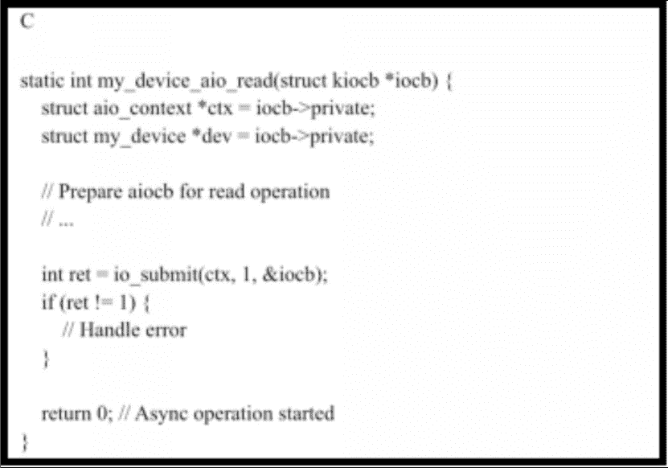
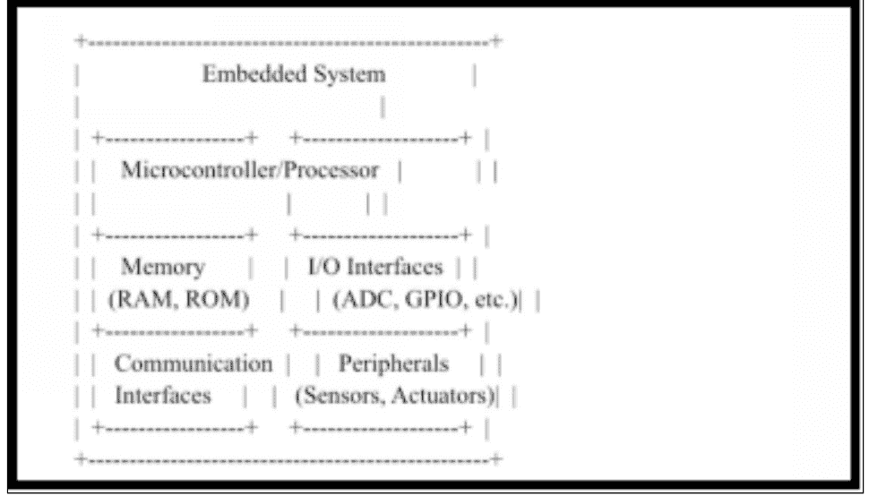

# Linux 设备驱动编程 C++：实用示例，真实世界挑战。高效、健壮、高性能驱动构建指南

## 请求图书评论

你觉得 `Linux Device Driver Programming C++` 有帮助吗？你的反馈很重要！分享你的经验可以指导其他程序员。花点时间在亚马逊上留下评论。你的真诚意见有助于改进未来版本，并帮助其他读者做出明智的决定。感谢你的支持！

## INTRODUCTION

### Linux Device Driver Programming: C++ - Your Passport to Kernel Mastery

### Are you ready to unlock the black box?

Linux 内核：代码的庞然大物，一个硬件与软件交织的复杂生态系统。这是一个许多人害怕涉足的世界，一个为精英保留的领域。但如果我们告诉你它并没有你想象的那么难以接近呢？如果你可以不仅理解它，而且塑造它呢？

这本书是你进入那个世界的通行证。

想象一下编写直接与计算机硬件交互的代码的激动。想象自己成为连接数字世界与物理世界的桥梁的建筑师。这不仅仅是编程；这是核心的工程。

`Linux device driver programming` 是驯服野兽的艺术。它关乎理解 CPU、内存和外设之间错综复杂的舞蹈。它关乎编写高效、稳健且安全的代码——在你的操作系统核心运行的代码。

但为什么是 C++？内核开发的传统语言不是 C 吗？

确实，C 几十年来一直是内核的通用语言。但编程世界在演进，内核也在演进。C++ 提供了强大的工具包：面向对象编程、模板、异常处理——这些特性可以使你的驱动代码更具可读性、可维护性且不易出错。

这本书不仅仅关乎语法和语义。它关乎理解每一行代码背后的 `why`。我们将深入内核架构，探索内存管理、中断和同步等概念。你将学习如何与不同硬件组件交互，从简单的字符设备到复杂的网络接口。

但最重要的是，我们将为你配备解决问题的技能来应对现实世界的挑战。你将学习如何调试内核问题、优化性能并确保安全。

这本书不仅仅是一本手册；它是你在成为内核专家之旅中的伙伴。我们将引导你穿越复杂性，提供实用示例，并为你的探索奠定坚实基础。

你准备好踏上这段激动人心的冒险了吗？你准备好掌握 Linux 设备驱动程序编程的艺术了吗？

如果是这样，这本书就是你的第一步。让我们开始吧。

## Preface

### The Allure of Kernel Development

内核开发，打造操作系统核心的神秘艺术，对许多程序员具有不可否认的吸引力。这是一个性能至上的领域，每一行代码都影响着系统的心跳，并且塑造数字景观的潜力巨大。虽然 Linux 传统上是 C 的堡垒，但 C++ 元素的整合正在逐渐重塑内核开发格局。

### Understanding the Kernel's Role

在深入探讨其吸引力之前，必须先把握内核的作用。本质上，它是硬件与用户应用程序之间的中介。它管理系统资源、处理中断，并为应用程序与系统交互提供标准化的接口。对于设备驱动程序而言，内核是连接硬件复杂性与软件世界的桥梁。

### The Enchantment of Low-Level Programming

主要吸引力之一是能够在系统核心工作。内核开发者如同外科医生，细致地操作系统的核心。这种与硬件的亲密互动揭示了一个原始计算能力的世界，摆脱了高级语言的抽象和开销。这是一个每个周期都很重要的领域，优化成为一种执念。

### Crafting the Digital Nexus: Device Drivers

设备驱动程序是使硬件对系统可访问的枢纽。用 C++ 编写设备驱动程序提供了性能与抽象的独特结合。虽然 C 的效率无可否认，但 C++ 的面向对象特性可以简化驱动开发，尤其对于复杂设备。

- `面向对象设计：` C++ 允许将硬件组件建模为对象，封装其属性和行为。这增强了代码的可读性和可维护性。

- `异常处理：` 尽管在内核中谨慎使用，C++ 的异常处理可以帮助优雅地管理错误条件，防止系统崩溃。

- `模板和 STL：` 虽然与用户空间编程相比并不常见，但模板可用于通用数据结构和算法，提高代码重用性。

## 挑战与回报

内核开发并非没有挑战。陡峭的学习曲线、苛刻的调试过程，以及在性能与稳定性之间保持平衡的持续需求可能令人望而生畏。然而，回报同样

- `面向对象设计：` C++ 允许将硬件组件建模为对象，封装其属性和行为。这增强了代码的可读性和可维护性。

- `异常处理：` 尽管在内核中谨慎使用，C++ 的异常处理可以帮助优雅地管理错误条件，防止系统崩溃。

- `模板和 STL：` 虽然与用户空间编程相比并不常见，但模板可用于通用数据结构和算法，提高代码重用性。

## Challenges and Rewards

Kernel development is not without its challenges. The steep learning curve, the demanding debugging process, and the constant need to balance performance with stability can be daunting. However, the rewards are equally substantial.

- `Performance Optimization:` The ability to squeeze every ounce of performance from hardware is incredibly satisfying.

- `System-Level Understanding:` Kernel developers gain a deep understanding of how operating systems function, making them invaluable assets in various software roles.

- `Contributing to Open Source:` Working on the Linux kernel means contributing to a global community and shaping the future of computing.

## C++ in the Kernel: A Growing Trend

While C remains the dominant language in the Linux kernel, there's a growing acceptance of C++ for specific components. The kernel community is gradually embracing C++ features, recognizing their potential benefits.

## Future Outlook

The future of kernel development with C++ is promising. As hardware complexity increases, the need for better abstraction and management tools will become more critical. C++'s object-oriented paradigm and other features can provide valuable solutions. However, it's essential to strike a balance between leveraging C++'s advantages and maintaining the kernel's core principles of efficiency and reliability.

Kernel development, particularly with C++, is a challenging but rewarding endeavour. It’s a domain for those who crave the thrill of low-level programming, the satisfaction of building from the ground up, and the opportunity to contribute to the open-source ecosystem. As C++'s role in the kernel expands, it promises to open up new possibilities for innovation and efficiency.

## C++ in the Kernel: A Perfect Match

For decades, C has been the lingua franca of kernel development. Its efficiency, direct hardware access, and low-level control have made it the language of choice for crafting the intricate workings of an operating system. However, the landscape is evolving. C++, with its blend of efficiency and abstraction, is steadily making inroads into the kernel realm, particularly in the domain of device driver development.

## The Case for C++ in Kernel Development

- `Object-Oriented Paradigm:` C++'s object-oriented features offer a structured approach to modeling complex hardware components. By encapsulating hardware-specific details within classes, developers can create reusable and maintainable code. This is especially beneficial for drivers managing intricate devices with multiple functionalities.

- `Enhanced Type Safety:` While C offers flexibility, it can sometimes lead to type-related errors. C++'s stronger type system helps to prevent these issues, improving code reliability.

- `Exception Handling:` Although used judiciously in the kernel due to performance concerns, C++'s exception handling mechanism can provide a structured way to handle error conditions, making code more robust.

- `Standard Template Library (STL):` While not as heavily used as in user-space applications, STL containers and algorithms can offer performance advantages in certain kernel scenarios, such as managing data structures efficiently.

- `Modern C++ Features:` Features like RAII (Resource Acquisition Is Initialization), move semantics, and constexpr can contribute to improved code safety, performance, and clarity.

## Device Drivers: A Natural Fit for C++

Device drivers, the crucial components that bridge the gap between hardware and software, are a prime area for C++ adoption. Here's why:

- `Complex Hardware Modeling:` Modern devices often exhibit intricate behavior. Object-oriented design in C++ allows for a more intuitive representation of these complexities. For instance, a network interface card (NIC) can be modeled as a class with attributes like MAC address, supported protocols, and methods for sending and receiving packets.

- `Driver Architecture:` C++ can help structure drivers into well-defined components. For example, a driver can be divided into a hardware-specific part and a platform-independent part, promoting code reuse and portability.

- `Error Handling:` Device drivers frequently encounter error conditions. C++ exceptions can provide a clean way to handle these errors, preventing system crashes.

- `Performance Optimization:` While C++ might introduce some overhead, careful coding and the use of language features like templates and inline functions can minimize performance impact. In many cases, the benefits of improved code structure and maintainability outweigh potential performance concerns.

### Challenges and Considerations

While the potential benefits of C++ in kernel development are significant, there are challenges to overcome:

- `Compatibility:` Introducing C++ into a primarily C-based codebase requires careful consideration of compatibility and integration.

- `Performance Overhead:` C++ features can introduce performance overhead. It's essential to profile code carefully and use language features judiciously.

- `Kernel Coding Style:` Kernel development has its own coding conventions and style guidelines. Adhering to these while incorporating C++ elements can be challenging.

- `Toolchain Support:` Ensure that the compiler and other tools support the desired C++ features and optimizations.

## A Balanced Approach

The key to successful C++ adoption in the kernel lies in a balanced approach. While C++ offers powerful tools, it's essential to use them judiciously. In performance-critical sections, C-style coding might still be preferred. For more complex components, C++ can provide significant advantages.

## The Future of C++ in the Kernel


The trend toward C++ adoption in the kernel is likely to continue. As hardware becomes more complex and software demands increase, the benefits of C++'s object-oriented and abstraction capabilities will become increasingly valuable. While C will likely remain the backbone of the kernel for the foreseeable future, C++ is poised to play a growing role in shaping the kernel's evolution.

By carefully considering the trade-offs and following best practices, developers can harness the power of C++ to create more robust, maintainable, and efficient kernel code, particularly in the realm of device driver development.

## Book Overview and Target Audience

### Book Overview

This comprehensive guide delves deep into the intricacies of Linux device driver programming, with a particular focus on leveraging the power of C++ for efficient and robust driver development. The book is designed to cater to a wide range of readers, from experienced C programmers seeking to expand their skill set to those new to kernel development altogether.

The book begins by laying a solid foundation in Linux kernel architecture and the role of device drivers within the operating system. It provides a clear understanding of the kernel's core components, memory management, process scheduling, and inter-process communication. With this knowledge, readers will be equipped to navigate the complex landscape of kernel development.

Subsequent chapters delve into the intricacies of C++ programming within the kernel environment. The book explores how to effectively utilize object-oriented principles, templates, and other C++ features to create well-structured, maintainable, and efficient device drivers. Best practices for coding style, performance optimization, and debugging are also covered in detail.

A significant portion of the book is dedicated to practical device driver development. It covers a wide range of device types, including character devices, block devices, network interfaces, and input/output devices. Step-by-step instructions and code examples guide readers through the entire development process, from driver initialization and hardware interaction to user-space applications.

The book also emphasizes the importance of testing and debugging device drivers. It provides techniques for writing effective test cases and using kernel debugging tools to identify and resolve issues. Additionally, it discusses the role of version control systems and code review in maintaining driver quality.

### Target Audience

This book is primarily aimed at the following audiences:

- **Experienced C programmers:** Developers with a strong C foundation who want to expand their skills into kernel development and explore the benefits of C++ in this context.
- **Embedded systems engineers:** Professionals working on embedded systems who need to develop device drivers for Linux-based platforms.
- **本科生和研究生：** 学习操作系统和设备驱动开发的计算机科学和电气工程学生。
- **Linux 爱好者：** 对 Linux 和内核内部机制有浓厚兴趣，希望为开源社区做出贡献的人士。

本书假设读者具备基本的 C 编程和操作系统概念知识。然而，本书提供了足够的基础信息来帮助读者快速上手。注重实践示例和清晰解释，使其对广泛的技术技能水平都具有可及性。

读完本书后，读者将对使用 C++ 进行 Linux 设备驱动开发有扎实的掌握。他们将能够为各种硬件组件设计、实现和调试设备驱动程序，从而为 Linux 系统的整体功能和性能做出贡献。

## Chapter 1

### A Deep Dive into Kernel Components: A Linux Device Driver Perspective

#### 理解内核全景

在深入具体组件之前，必须掌握内核的整体架构。Linux 内核是一个单体式、模块化系统。这意味着虽然它是一个可执行文件，但它由许多相互连接的组件组成，称为模块。

#### Key Kernel Components:

**1. Process Management:**

- **Task Structure:** 表示进程的核心数据结构。
- **Scheduling:** 处理进程执行和时间共享。
- **Inter-Process Communication (IPC):** 在进程之间促进通信（管道、消息队列、共享内存、信号量）。

**2. Memory Management:**

- **Page Frame Allocation:** 管理物理内存帧。
- **Virtual Memory:** 将虚拟地址映射到物理地址。
- **Memory Allocation:** 提供分配和释放内存的函数。
- **Swap:** 管理页面在磁盘上的交换。

**3. File System:**

- **VFS:** 虚拟文件系统为不同的文件系统提供统一接口。
- **Ext2/Ext3/Ext4:** Linux 流行的文件系统。
- **Block Devices:** 管理基于块的存储设备。

**4. Device Drivers:**

- **Character Devices:** 处理字符型设备（例如，键盘、鼠标）。
- **Block Devices:** 管理基于块的设备（例如，硬盘、SSD）。
- **Network Devices:** 处理网络接口。

**5. Interrupts and Exceptions:**

- **Interrupt Handling:** 管理硬件中断。
- **Exception Handling:** 处理软件异常和故障。

**6. System Calls:**

- **System Call Interface:** 为用户空间程序与内核交互提供一种方式。

#### Device Drivers and Kernel Interaction

设备驱动程序是硬件与内核之间的桥梁。它们与各种内核组件交互：

**1. Memory Management:**

- 驱动程序通常为缓冲区、数据结构和其他用途分配内存。
- DMA（直接内存访问）用于在设备和系统内存之间高效传输数据。

```c
void *buffer = kmalloc(PAGE_SIZE, GFP_KERNEL); // Allocate kernel memory
```

**2. Interrupts:**

- 设备生成中断以发出事件信号。
- 驱动程序注册中断处理程序以处理这些中断。

```c
irqreturn_t my_interrupt_handler(int irq, void dev_id)
  // Interrupt handling logic
  return IRQ_HANDLED;
```

**3. File System:**

- 字符设备通常在文件系统中创建设备文件。
- 块设备与块层交互以进行读写操作。

```c
static struct file_operations my_fops
  .open = my_open,
  .read = my_read,
  .write = my_write,
  // other file operations
```

**4. Process Management:**

- 驱动程序可能会为特定任务创建内核线程。
- 它们可以使用 IPC 机制与其他系统部分通信。

```c
struct task_struct *task = kthread_run(my_thread_function, NULL, "my_thread");
```

#### Deeper Dive into Device Drivers

**Character Devices:** 字符设备通常与涉及数据流的输入/输出操作相关联，如键盘、鼠标和串行端口。

```c
static struct cdev my_cdev;
static struct class my_class;

int my_init(void)
  // Register character device
  alloc_chrdev_region(&my_dev, MAJOR, MINOR, "my_dev");
  cdev_init(&my_cdev, &my_fops);
  cdev_add(&my_cdev, my_dev, 0);

  // Create device node
  my_class = class_create(THIS_MODULE, "my_class");
  device_create(my_class, NULL, my_dev, NULL, "my_device");

return 0;
```

**Block Devices:** 块设备处理硬盘和 SSD 等存储设备，其中数据按固定大小的块组织。

```c
static struct gendisk my_disk;

int my_init(void)
// Register block device
my_disk = alloc_disk(32); // Example for 32 partitions
my_disk->major = MAJOR;
my_disk->first_minor = 0;
my_disk->fops = &my_block_ops;
// ... other disk setup

add_disk(my_disk);

return 0;
```

此概述提供了设备驱动程序与核心内核组件之间复杂交互的一个 glimpse。理解这些交互对于有效的设备驱动程序开发至关重要。通过掌握这些概念，您可以构建健壮且高效的驱动程序，使其与 Linux 内核无缝集成。

**Note:** 这是一个简化的概述，实际的设备驱动程序涉及更多复杂性和细节。

### Delving Deeper: Interrupt Handling and Device Drivers

#### Understanding Interrupts

中断是硬件生成的信号，通知 CPU 需要立即处理的事件。它们对于 I/O 操作至关重要，因为它们允许设备在数据准备好传输或发生错误时向系统发出信号。

#### Interrupt Handling Process:

1. **Interrupt Generation:** 设备在特定的硬件线上断言中断信号。
2. **Interrupt Controller:** 中断控制器接收中断并为 CPU 生成软件中断。
3. **Interrupt Handling:** CPU 保存当前状态，确定中断源，并将控制权转移到适当的中断处理程序。
4. **Interrupt Service Routine (ISR):** ISR 执行必要的操作以处理中断。
5. **Interrupt Return:** ISR 恢复 CPU 的保存状态并将控制权返回给被中断的进程。


#### Interrupt Context and Bottom Halves

- **Interrupt Context:** ISR 的执行环境。这是一个高度受限的环境，仅允许有限的操作。
- **Bottom Halves:** 在中断处理程序返回后延迟执行的任务。它们用于处理更复杂或耗时的操作。

#### Types of Bottom Halves:

- **Tasklets:** 轻量级、由内核调度的软件中断。
- **Workqueues:** 更灵活，可以在不同的 CPU 内核上调度。

#### Device Drivers and Interrupts

设备驱动程序广泛使用中断进行高效的 I/O 操作。

- **Interrupt-Driven I/O:** 驱动程序注册中断处理程序，以便在数据准备就绪时调用。
- **Polling:** 驱动程序定期检查设备的状态，这效率较低，但在某些情况下可能是必要的。

#### Challenges in Interrupt Handling

- **Interrupt Latency:** 中断发生到 ISR 开始之间的时间。
- **Interrupt Rate:** 高中断率会影响系统性能。
- **Shared Interrupts:** 多个设备可能共享同一中断线。
- **Interrupt Priorities:** 不同中断可能具有不同的优先级。

#### Best Practices

- 保持 ISR 简短高效。
- 使用 bottom halves 处理复杂任务。
- 及时处理中断以最小化延迟。
- 对于高频中断，考虑中断合并。
- 使用适当的锁定机制来保护共享数据。

### Process Management and Scheduling in Linux: A Deep Dive

#### Understanding Processes

进程是程序执行的实例。它封装了程序的代码、数据和执行上下文。进程的关键组件包括：

- **Process Image:** 程序代码、数据、栈和堆。
- **Process Control Block (PCB):** 包含进程相关信息，如进程状态、寄存器、内存管理信息和调度信息。
- **Process States:** 运行、就绪、等待、新建和终止。

#### Process Creation and Termination

新进程使用 `fork()` 系统调用创建。这会复制父进程，包括其内存空间。然后子进程可以修改其副本。

```c
#include <stdio.h>
#include <unistd.h>

int main() {
    pid_t pid = fork();
    if (pid < 0) {
        // Fork failed
    } else if (pid == 0) {
        // Child process
        printf("I am the child process\n");
    } else {
        // Parent process
        printf("I am the parent process\n");
    }
    return 0;
}
```

进程可以正常终止（例如，通过调用 `exit()`）或异常终止（例如，由于信号）。

#### 进程调度

进程调度是确定哪个进程将被分配 CPU 以及分配多长时间的活动。Linux 采用各种调度算法，包括：


# 调度算法

- First-Come-First-Served (FCFS)：进程按到达顺序执行。

- Shortest Job First (SJF)：估计突发时间最短的进程接下来执行。

- Priority Scheduling：进程被分配优先级，最高优先级的进程被执行。

- Round Robin：每个进程被给予一个时间片，如果在该时间内未完成，则会被抢占并添加到就绪队列的末尾。

- Multilevel Queue Scheduling：进程根据其特征被划分为多个队列，每个队列都有自己的调度算法。

- Multilevel Feedback Queue Scheduling：进程可以根据其行为在队列之间移动。

## 进程同步

多个进程通常需要协调其活动。这是通过同步机制实现的：

- `Mutexes`：保护共享资源的互斥锁。

- `Semaphores`：通用的同步原语。

- `Spinlocks`：用于短期临界区的忙等待锁。

```c
#include <linux/mutex.h>

static DEFINE_MUTEX(my_mutex);

void my_function() {
    mutex_lock(&my_mutex);
    // Critical section
    mutex_unlock(&my_mutex);
}
```

## 进程通信

进程可以使用以下方式进行通信：

- `Pipes`：单向通信通道。

- `Message Queues`：存储稍后检索的消息。

- `Shared Memory`：创建多个进程可访问的内存区域。

- `Sockets`：用于网络通信。

## 设备驱动程序与进程管理

虽然设备驱动程序主要与硬件交互，但它们可以间接影响进程管理。例如：

- `Kernel Threads`：驱动程序可以创建内核线程来处理异步任务。

- `Process Context Switching`：设备中断可以导致进程上下文切换。

- `Scheduling Priorities`：驱动程序可以根据设备活动调整进程优先级。

```c
struct task_struct *my_thread;

static int my_thread_fn(void *data) {
    // Thread's work
    return 0;
}
int my_init(void) {
    my_thread = kthread_run(my_thread_fn, NULL, "my_thread");
    return 0;
}
```

## 进程管理中的挑战

- `Deadlocks`：当进程被阻塞等待其他进程持有的资源时。

- `Starvation`：当进程持续被拒绝访问 CPU 时。

- `Context Switching Overhead`：保存一个进程的状态并加载另一个进程状态所需的时间。

### 最佳实践

- 使用适当的同步机制。

- 避免不必要的进程创建。

- 为特定工作负载优化调度算法。

- 监控系统性能以识别潜在问题。

**Note：** 这是对进程管理与调度的高层次概述。实际实现涉及更多复杂性和优化。

# Memory Management in Linux: A Deep Dive

## Understanding Memory Management

内存管理是任何操作系统，包括 Linux 的关键功能。它涉及高效地分配、释放和管理系统内存，以确保最佳性能和资源利用率。

## Key Concepts

- `Physical Memory`：安装在系统上的实际硬件内存。

- `Virtual Memory`：操作系统提供的抽象，将进程的地址空间映射到物理内存。

- `Page Frames`：物理内存的固定大小块。

- `Pages`：虚拟内存的固定大小块。

- `Page Table`：将虚拟页映射到物理页帧的数据结构。

- `Paging`：在物理内存和磁盘之间交换页的过程。

- `Swapping`：将整个进程在主内存和辅助存储之间移动。

## Memory Allocation in Kernel

内核提供多个内存分配函数：

- `kmalloc()`：从内核堆分配内存。

- `kzalloc()`：类似于 `kmalloc()`，但将内存初始化为零。

- `vmalloc()`：分配连续的虚拟内存，但物理页可能不连续。

- `dma_alloc_coherent()`：分配可被 CPU 和 DMA 设备同时访问的内存。

```c
#include <linux/slab.h>

void *buffer = kmalloc(PAGE_SIZE, GFP_KERNEL);
if (!buffer) {
    printk(KERN_ERR "Memory allocation failed\n");
    return;
}
// Use the buffer
kfree(buffer);
```

- 仔细管理内存生命周期以避免泄漏。

- 考虑内存对齐以优化性能。

- 使用调试工具检测内存相关问题。

## Virtual Memory and Paging

虚拟内存为进程提供连续内存的幻觉，即使物理内存可能已碎片化。它使用分页实现，其中虚拟地址通过页表转换为物理地址。

**Page Fault：** 当进程访问不在物理内存中的虚拟页时，会发生页错误。操作系统将所需页从磁盘带入物理内存并更新页表。

## Memory Management in Modern Systems

- `Large Page Allocations`：分配更大的内存页可以提高性能，减少 TLB 未命中。

- `Memory Hotplug`：在不重启系统的情况下动态添加或移除内存。

- `Memory Overcommitting`：分配比物理内存更多的虚拟内存，依赖分页来处理需求。

内存管理是内核编程的一个基本方面。通过理解核心概念和最佳实践，您可以编写高效可靠的设备驱动程序。适当的内存管理对于避免系统崩溃和确保最佳性能至关重要。

# DMA-Coherent Memory: A Deep Dive

## Understanding DMA-Coherent Memory

直接内存访问（DMA）是一种硬件功能，允许设备在不涉及 CPU 的情况下直接访问系统内存。这显著提高了数据传输性能，尤其对于网络卡和磁盘控制器等高吞吐量设备。然而，DMA 操作会引入缓存一致性问题。

DMA 一致内存是指 CPU 和设备之间保证一致的内存。这意味着 CPU 对内存所做的任何写入都会立即对设备可见，反之亦然。

## DMA-Coherent Memory Allocation

在 Linux 中，`dma_alloc_coherent()` 函数用于分配 DMA 一致内存。

```c
void *dma_alloc_coherent(struct device *dev, size_t size, dma_addr_t *dma_handle, gfp_t flags);
```

- `dev`：指向设备结构体的指针。

- `size`：要分配的内存大小。

- `dma_handle`：存储 DMA 地址的指针。

- `flags`：分配标志。

## DMA Mapping and Unmapping

要使用分配的 DMA 一致内存，您需要将其映射到设备的地址空间。这是通过 `dma_map_single()` 函数完成的。

```c
dma_addr_t dma_map_single(struct device *dev, void *ptr, size_t size, enum dma_data_direction dir);
```

- `dev`：指向设备结构体的指针。

- `ptr`：要映射的内存的虚拟地址。

- `size`：要映射的内存大小。

- `dir`：数据传输方向（`DMA_TO_DEVICE`、`DMA_FROM_DEVICE`、`DMA_BIDIRECTIONAL`）。

使用完 DMA 一致内存后，您需要使用 `dma_unmap_single()` 函数取消映射。

```c
void dma_unmap_single(struct device *dev, dma_addr_t dma_handle, size_t size, enum dma_data_direction dir);
```

## DMA-Coherent Memory and Cache Coherency

内核通过硬件和软件机制确保 DMA 一致性。基于硬件的一致性依赖于缓存行和写回缓存。基于软件的一致性涉及刷新和使缓存行失效。

## DMA-Coherent Memory and Device Drivers

设备驱动程序广泛使用 DMA 一致内存进行高效数据传输。

- `Buffer allocation`：用于在设备和系统之间传输数据的存储。

- `Command and status registers`：用于与设备通信。

## DMA-Coherent Memory Challenges

- `Performance overhead`：DMA 一致内存分配和映射会带来一定的性能开销。

- `Memory fragmentation`：过度使用 DMA 一致内存可能导致内存碎片化。

- `Cache coherency issues`：如果处理不当，缓存一致性问题可能导致数据损坏。

## Best Practices

- 仅在必要时使用 DMA 一致内存。

- 以更大的块分配 DMA 一致性内存以减少碎片。

- 仔细管理 DMA 一致性内存的生命周期以避免泄漏。

- 使用适当的缓存一致性机制以防止数据损坏。

## 其他考虑

- `DMA 映射标志`：`dma_map_single()` 函数接受额外的标志来控制缓存一致性和对齐。

- `DMA 映射边界`：某些设备对 DMA 传输有特定的对齐要求。

- `DMA 映射错误`：`dma_map_single()` 函数在映射失败时返回零的 DMA 地址。

通过遵循这些指南并理解 DMA 一致性内存的复杂性，您可以编写高效可靠的设备驱动程序，有效利用 DMA 能力。

# Linux 设备驱动程序中的中断和异常处理

## 中断

中断是硬件生成的信号，表示需要立即处理的事件。在设备驱动程序的上下文中，它们表示数据就绪、设备错误或其他条件。

### 中断处理过程：

1. `中断生成`：设备断言中断信号。

2. `中断控制器`：中断控制器将硬件中断转换为软件中断。

3. `中断传递`：CPU 挂起当前任务并将控制转移到中断处理程序。

4. `中断服务例程 (ISR)`：ISR 执行必要的操作，通常快速以最小化中断延迟。

5. `中断返回`：ISR 将控制返回给被中断的进程。

**代码示例：**

```c
static irqreturn_t my_interrupt_handler(int irq, void *dev_id) {
    struct my_device *dev = (struct my_device *)dev_id;

    // Perform necessary actions
    printk(KERN_INFO "Interrupt received from device %s\n", dev->name);

    // Acknowledge the interrupt

    return IRQ_HANDLED;
}
```

### 中断上下文：

- ISR 在中断上下文中执行，操作受限。

- 不允许阻塞操作（睡眠、等待）。

- 由于执行时间短，需谨慎使用资源。

### 底部半部：

- 对于无法在 ISR 中完成的任务，使用底部半部。

- 类型：`tasklets`、`工作队列`、`softirqs`。

- 在进程上下文中执行，允许更复杂的操作。

## 异常处理

异常是程序执行期间的异常条件。在内核编程中，它们对于处理硬件故障、软件错误和系统调用至关重要。

### 异常类型：

- `硬件异常`：页错误、总线错误等。

- `软件异常`：除零、非法指令等。

- `系统调用`：用户空间对内核的请求。

### 异常处理过程：

1. `异常发生`：CPU 检测到异常条件。

2. `异常处理`：内核接管控制，保存进程状态，并将控制转移到异常处理程序。

3. `错误处理`：异常处理程序尝试解决问题或终止进程。

4. `返回或终止`：异常处理程序将控制返回给原始进程或终止它。

代码示例：

```c
asmlinkage long my_system_call(void)
    // System call logic
    if (/error condition/)
        return -EFAULT; // Return error code
```

设备驱动程序与中断/异常

- `中断驱动 I/O`：高效的数据传输和处理。

- `错误处理`：从设备错误中优雅恢复。

- `系统调用`：向用户空间提供接口。

- `异常处理`：处理意外条件。

### 挑战：

- `中断延迟`：最小化中断与 ISR 执行之间的时间。

- `中断速率`：高效处理高频中断。

- `共享中断`：管理共享同一中断的多个设备。

- `异常处理`：实现健壮的错误恢复机制。

## 最佳实践

- 保持 ISR 简短高效。

- 使用底部半部处理复杂任务。

- 及时处理中断。

- 为异常实现适当的错误处理。

- 在各种条件下彻底测试。

## 其他考虑

- `中断优先级`：根据重要性为中断分配优先级。

- `中断屏蔽`：在必要时临时禁用中断。

- `中断合并`：将多个中断合并为单个中断。

- `异常调试`：利用内核调试工具分析异常。

通过理解中断和异常处理，您可以编写健壮高效的设备驱动程序，能够优雅地处理各种场景和错误。

# Linux I/O 子系统：深入解析

Linux I/O 子系统是内核中复杂而精细的一部分，负责管理系统与其外围设备之间的交互。它为应用程序访问各种设备提供统一接口，处理数据传输，并确保高效的资源利用。

## I/O 子系统的核心组件

1. `设备驱动程序`：I/O 子系统的最低层。它们直接与硬件设备交互，将硬件特定操作转换为内核级函数。

2. `块层`：管理硬盘和 SSD 等基于块的设备。它处理请求排队、调度和设备访问等任务。

3. `字符设备`：处理键盘、鼠标和串口等面向字符的设备。

4. `网络子系统`：负责网络通信，包括协议处理和数据包处理。

5. `文件系统`：管理文件存储和检索。

6. `缓冲区缓存`：磁盘块的缓存，提高 I/O 性能。

## 块层

块层是 I/O 子系统的重要组件。它为块设备提供通用接口，允许上层在不知道底层硬件具体细节的情况下与其交互。

### 块层的关键功能：

- `请求排队`：从各种来源收集 I/O 请求并将其组织到队列中。

- `请求调度`：确定 I/O 请求的服务顺序。

- `设备访问`：与设备驱动程序交互以执行读写操作。

- `错误处理`：处理 I/O 操作期间发生的错误。

#### 代码示例：

```c
struct bio *bio;
int ret;

// Create a bio
bio = bio_alloc(GFP_KERNEL, BIO_SECTORS);

// Fill the bio with data

// Submit the bio to the block device
ret = submit_bio(WRITE, bio);
if (ret)
    printk(KERN_ERR "Error submitting bio\n");
bio_put(bio);
```

## 字符设备

字符设备处理在数据流上操作的设备，如键盘、鼠标和串口。与块设备相比，它们提供更简单的接口。

### 字符设备的关键功能：

- `打开/关闭`：打开和关闭设备以供访问。

- `读/写`：向设备读写数据。

- `ioctl`：执行设备特定的控制操作。

#### 代码示例：

```c
static const struct file_operations my_fops
  .open = my_open,
  .read = my_read,
  .write = my_write,
  .ioctl = my_ioctl,
```

## 缓冲区缓存

缓冲区缓存通过将磁盘块缓存到内存中来提高 I/O 性能。当进程请求磁盘数据时，内核首先检查缓冲区缓存。如果数据在缓存中找到，则直接返回而不访问磁盘。

#### 代码示例：

```c
struct page *page = read_cache_page(mapping, offset);
if (page)
  // Data found in cache
else
  // Read data from disk
```

## I/O 调度

块层使用 I/O 调度器来确定 I/O 请求的服务顺序。不同的调度器具有不同的性能特征。

- `Deadline`：基于截止时间优先处理请求。

- `CFQ`：公平队列调度器。

- `NOOP`：无操作调度器。

## I/O 子系统中的挑战

- `性能`：实现高 I/O 吞吐量和低延迟。

## 最佳实践

- `可靠性`：确保数据完整性和错误处理。

- `可扩展性`：处理日益增多的设备和 I/O 请求数量。

- 使用适合不同设备类型的适当 I/O API。

- 优化缓冲区大小以实现高效的数据传输。

- 根据工作负载特征考虑 I/O 调度算法。

- 实现适当的错误处理和恢复机制。


Linux I/O 子系统是操作系统的复杂且关键的组件。理解其结构和组件对于开发高效可靠的设备驱动程序至关重要。通过遵循最佳实践并利用提供的工具，您可以构建高性能的 I/O 解决方案。

## Linux 中的 I/O 调度

### 理解 I/O 调度

I/O 调度是磁盘性能优化的一个关键方面。它涉及确定磁盘为 I/O 请求提供服务的顺序。目标是最小化寻道时间、旋转延迟和磁头切换操作，以提高整体 I/O 吞吐量和响应时间。

### I/O 调度器

Linux 提供了多个 I/O 调度器以适应不同的工作负载特征。

- `NOOP`：最简单的调度器，它将请求放入 FIFO 队列而不进行任何优化。适用于具有随机 I/O 模式的工作负载。
- `CFQ`（完全公平队列）：旨在实现进程之间公平的 I/O 分配。它创建每个进程的队列并为每个队列分配时间片。适用于通用工作负载。

最佳的 I/O 调度器取决于工作负载特征：

- **随机 I/O：** `NOOP` 或 `CFQ` 可能适用。
- **顺序 I/O：** `Deadline` 或 `BFQ` 可以提供更好的性能。
- **实时工作负载：** `Deadline` 通常是首选。

### I/O 调度器与设备驱动程序

设备驱动程序与块层交互，而块层又使用 I/O 调度器。驱动程序通常将 I/O 请求提交给块层，而调度器则确定这些请求被服务的顺序。

### I/O 调度的挑战

- **工作负载多样性：** 不同应用程序具有不同的 I/O 模式。
- **磁盘特性：** 不同磁盘类型（HDD、SSD）具有不同的性能特征。
- **系统负载：** 高系统负载会影响 I/O 性能。

#### 最佳实践

- 尝试不同的 I/O 调度器以找到最适合您工作负载的方案。
- 使用 `iostat` 和 `blktrace` 等工具监控 I/O 性能。
- 考虑对 I/O 需求高的工作负载使用 SSD。
- 根据您的具体需求调整 I/O 调度器参数。

I/O 调度是优化磁盘性能的关键因素。通过了解不同的 I/O 调度器及其特性，您可以选择适合您应用程序的调度器并对其进行微调以获得最佳效果。

## 第 2 章：Linux 内核中的 C++ 支持：一个复杂的局面

虽然 C 仍然是 Linux 内核开发的主导语言，但 C++ 的潜在优势导致了持续的讨论和有限的实验。然而，由于几个关键挑战，内核中全面支持 C++ 仍然遥不可及。

### 挑战与考虑

1. **兼容性与性能：**
   - **二进制兼容性：** C++ 引入了名称修饰、虚函数和异常处理等特性，这可能会影响二进制兼容性和内核大小。
   - **性能开销：** 一些 C++ 特性会带来运行时开销，这在性能关键的内核环境中是不可接受的。

2. **语言特性：**
   - **异常处理：** 内核的错误处理模型基于错误代码，而不是异常。引入异常可能会使错误处理复杂化并可能导致系统不稳定。
   - **RTTI（运行时类型信息）：** 由于其潜在的性能影响和安全隐患，RTTI 在内核代码中通常不被鼓励。
   - **模板：** 虽然模板提供了强大的抽象机制，但它们会增加代码复杂性和编译时间，而这对于内核开发来说是关键问题。

3. **工具链支持：**
   - **编译器：** C++ 编译器需要针对内核开发进行仔细调整，以确保最佳的代码生成和兼容性。
   - **调试工具：** 调试器和其他开发工具需要有效地支持 C++ 特性以进行内核调试。

4. **代码库迁移：**
   将庞大的 C 代码库转换为 C++ 将是一项具有重大风险的巨大任务。

### 内核中有限的 C++ 使用

尽管存在挑战，但在特定内核组件中仍存在 C++ 被孤立使用的实例。这些案例通常涉及精心选择的语言特性和严格的编码准则。

### 示例：类式结构

虽然 C++ 类不被直接支持，但 C 结构可以用来模拟面向对象的概念。考虑一个使用结构体封装设备特定数据的简化设备驱动程序示例：

```c++
struct my_device {
    int major;
    int minor;
    void *private_data;
    int (*probe)(struct my_device *dev);
    int (*remove)(struct my_device *dev);
};
```

该结构定义了设备的属性和函数。必须注意的是，这不是真正的类，并且继承或多态不可用。

### 解决挑战

为了使 C++ 更适合内核开发，正在探索几种方法：

- **受限 C++：** 使用与内核要求一致的 C++ 特性子集，例如命名空间和 `const` 正确性。
- **内核特定 C++ 扩展：** 开发语言扩展以解决内核特定需求，例如安全的异常处理机制。
- **逐步采用：** 在精心选择的区域引入 C++ 并逐步扩大其使用范围。

虽然 C++ 为内核开发提供了潜在优势，但其采用受到重大挑战的阻碍。Linux 内核社区正在谨慎探索利用 C++ 的方法，同时保持内核的稳定性、性能和兼容性。很可能 C 将在可预见的未来仍然是主要语言，而 C++ 的使用将仅限于特定组件并受到严格控制。

### 其他考虑

- **内存管理：** C++ 的内存管理特性如 RAII 和智能指针有助于减少内存泄漏，但在内核上下文中需要仔细考虑。
- **并发：** C++ 通过线程和同步原语等特性提供语言级并发支持。然而，内核并发通常使用内核特定机制处理。

必须强调的是，在内核中使用 C++ 并非简单过程，需要深入理解 C++ 和内核内部。

**注意：** 本回复提供了 Linux 内核中 C++ 支持的总体概述。实际的状况复杂且不断演变，具体细节可能有所不同。

## 内核上下文中的面向对象编程

### 理解挑战

虽然 C++ 提供了强大的抽象和代码组织机制，但其在 Linux 内核中的直接应用受到以下几个因素的阻碍：

- **性能：** 内核是性能关键的环境，而 C++ 特性如虚函数和异常处理会引入开销。
- **兼容性：** 内核的二进制兼容性要求严格，而 C++ 的名称修饰和其他语言特性会使之复杂化。
- **内存管理：** 内核的内存管理模型与用户空间不同，而 C++ 的自动内存管理特性集成起来具有挑战性。

尽管存在这些挑战，仍有一些面向对象的原则可以应用于内核开发以改善代码结构和可维护性。

### 在 C 中模拟面向对象概念

#### 1. 结构作为对象

在内核中模拟面向对象概念最常见的方法是使用 C 结构。结构可以封装数据成员和函数指针来表示方法。

```c
struct my_device {
    int major;
    int minor;
    void *private_data;
    int (*probe)(struct my_device *dev);
    int (*remove)(struct my_device *dev);
};
```

#### 2. 方法的函数指针

函数指针允许我们模拟多态性，这是面向对象编程的核心概念。不同的设备驱动程序可以以不同的方式实现 `probe` 和 `remove` 函数，提供多态行为。

```c
int my_device_probe(struct my_device *dev)
{
    // 设备探测逻辑
    return 0;
}

int my_device_remove(struct my_device *dev)
{
    // 设备移除逻辑
    return 0;
}

struct my_device my_device1 = {
    .major = 1,
    .minor = 0,
    .probe = my_device_probe,
    .remove = my_device_remove,
};
```

#### 3. 封装

虽然 C 不像 C++ 那样提供严格的封装，但我们可以通过仔细设计结构体并限制对其的访问来实现类似效果。

- **发挥 C 的优势：** 将面向对象的原则与 C 的效率和底层控制相结合。

Example: Device Driver with Object-Oriented Approach

```c
struct device_ops {
    int (*probe)(struct device *dev);
    int (*remove)(struct device *dev);
};

struct device {
    struct device_ops *ops;
    // 其他设备特定数据
};

int my_device_probe(struct device *dev)
{
    // 设备探测逻辑
    return 0;
}

int my_device_remove(struct device *dev)
{
    // 设备移除逻辑
    return 0;
}

struct device_ops my_device_ops = {
    .probe = my_device_probe,
    .remove = my_device_remove,
};

struct device my_device = {
    .ops = &my_device_ops,
    // 其他设备数据
};
```

此示例演示了如何使用结构体和函数指针创建具有一定面向对象特征的基础设备驱动程序。

虽然 C++ 不能直接在 Linux 内核中使用，但我们可以采用面向对象的原则来改进代码结构和可维护性。通过仔细考虑限制和权衡，我们可以有效地将这些概念应用于内核开发。

必须记住，内核代码的首要目标是效率和可靠性。面向对象设计应作为实现这些目标的工具，而不是目的本身。

## Linux 内核中的模板和泛型编程：一个复杂的现实

### 理解挑战

虽然模板在 C++ 中提供了强大的代码重用和类型安全，但由于以下几个因素，其在 Linux 内核中的直接应用受到阻碍：

- **性能：** 内核是一个性能关键的环境，模板实例化可能导致代码膨胀和编译时间增加。
- **兼容性：** 内核模块必须可动态加载，而编译时模板实例化会使此过程复杂化。
- **复杂性：** 模板会给代码库带来额外的复杂性，这可能难以维护和调试。

尽管存在这些挑战，使用类似模板的构造在内核中仍有潜在好处。

### 在 C 中模拟模板

在深入探讨潜在的 C++ 解决方案之前，了解如何在 C 中实现类似功能至关重要。

#### 1. 宏

宏是在 C 中实现通用代码最常见的方式。然而，它们缺乏类型安全且容易出错。

```c
#define ARRAY_SIZE(arr) (sizeof(arr) / sizeof(arr[0]))
```

```cpp
template <typename T>
class CircularBuffer {
public:
    void push(const T& value);
    T pop();
    // ...
private:
    T *data;
    size_t size;
};
```

#### 3. 类型安全的宏

模板可用于创建类型安全的宏，与传统的 C 宏相比可降低出错风险。

```cpp
template <typename T>
constexpr size_t array_size(const T& arr) {
    return sizeof(arr) / sizeof(arr[0]);
}
```

#### 挑战和注意事项

- **编译时间：** 模板实例化会显著增加编译时间，这对内核开发而言是一个主要问题。
- **二进制兼容性：** 模板定义的更改会影响内核模块的二进制兼容性。
- **内存使用：** 模板实例化可能导致代码膨胀和内存使用增加。
- **内核编码风格：** 内核编码风格强调简单性和可读性。模板可能会引入不必要的复杂性。

虽然模板在 C++ 编程中具有显著优势，但由于性能、兼容性和复杂性问题，其在 Linux 内核中的直接应用具有挑战性。然而，一些类似模板的概念可以通过 C 技术如函数指针和宏进行改编。

在内核开发中考虑类似模板的方法时，必须仔细权衡代码可重用性、类型安全性和性能之间的取舍。

## 内核中的异常处理：一个复杂挑战

### 基本问题

异常处理是健壮软件开发的基石，但在内核环境中呈现出一组独特挑战。与通过语言特定机制处理异常的用户空间应用程序不同，内核在受限且性能关键的上下文中运行。

- **性能开销：** 异常处理机制会引入显著的运行时开销，这在内核中是不可接受的。
- **内核稳定性：** 未处理的异常可能导致系统崩溃，这在内核上下文中是灾难性的。
- **确定性：** 内核必须高度确定性，而异常会破坏这种确定性。

### 内核中的传统错误处理

鉴于这些限制，内核传统上依赖于更明确的错误处理方法：

- **返回码：** 函数通常返回错误码以指示成功或失败。
- **错误指针：** 函数可选择修改错误指针以提供更详细的错误信息。

```c
struct error_info
{
    int code;
    const char *msg;
};

int my_device_probe(struct device *dev, struct error_info *err)
{
    // 设备探测逻辑

    if (error_condition)
    {
        err->code = -ENODEV;
        err->msg = "Device not found";
        return -1;
    }
    return 0;
}
```

虽然这种方法改进了错误处理，但仍需要手动错误传播和检查。

#### 2. 基于断言的错误处理

- 使用断言检查关键条件。
- 如果断言失败，内核可以 `panic` 或记录错误。

```c
#include <linux/kernel.h>

void my_critical_function(int value)
{
    BUG_ON(value < 0); // 如果值为负则 Panic
}
```

断言对于检测编程错误很有用，但不适用于通用错误处理。

#### 限制和注意事项

- **性能开销：** 即使经过精心设计，替代错误处理机制也可能引入一些性能开销。
- **内核稳定性：** 任何错误处理机制都必须优先考虑内核稳定性。
- **代码复杂性：** 引入新的错误处理范式会增加代码复杂性。

内核中的异常处理仍然是一个具有挑战性的领域。虽然传统的错误处理机制有效，但它们存在局限性。替代方法，如错误对象和断言，可以提供一些好处，但需要仔细考虑性能和稳定性影响。

理想的错误处理策略取决于内核组件的具体要求。传统错误处理与精心选择的替代技术的结合可能是最实用的方法。

### 关键注意事项

- 优先考虑内核稳定性和性能。
- 使用清晰且一致的错误码。
- 提供信息丰富的错误消息。
- 考虑对复杂错误条件使用错误对象。
- 利用断言进行关键检查。

通过仔细平衡这些因素，内核开发人员可以创建健壮可靠的代码。

## STL 和 Boost 在内核开发中（如果适用）

### 残酷的现实

虽然 C++ 标准模板库（STL）和 Boost 库为通用编程提供了强大的抽象和工具，但它们直接集成到 Linux 内核中是严格禁止的。

### 这种限制的原因是多方面的：

- **性能开销：** STL 和 Boost 通常由于模板实例化、虚函数和异常处理而引入运行时开销，这在性能关键的内核环境中是不可接受的。
- **内存占用：** STL 容器可能存在显著的内存开销，这在资源受限的内核环境中是有问题的。
- **确定性：** 内核需要严格的确定性，而某些 STL 组件的非确定性特性会产生不利影响。
- **内核编码风格：** 内核有自己的编码规范和风格，这通常与 STL 的方法相冲突。
- **二进制兼容性：** 内核模块必须可动态加载，而 STL 模板实例化的复杂性会阻碍这一点。

### 内核专用替代方案

与其依赖 STL 和 Boost，内核开发者已为内核的特定需求量身定制了自己的数据结构和算法。

#### 常见内核数据结构：

- **链表：** 广泛用于各种用途，例如设备列表、任务列表和文件系统。
- **红黑树：** 用于需要高效搜索、插入和删除的场景，如进程调度和虚拟内存管理。
- **哈希表：** 用于快速查找，常用于网络协议和文件系统。
- **循环缓冲区：** 用于设备驱动程序中高效处理数据流。


#### 自定义算法：

内核开发者通常会实现自己的算法以满足内核的要求。例如：

- **排序算法：** 内核特定的排序例程针对性能和内存使用进行了优化。
- **搜索算法：** 高效的搜索算法对于各种内核组件至关重要。

### C++ 在内核中的作用（如果有的话）

虽然 STL 和 Boost 不可用，但人们对在内核中使用精心挑选的 C++ 特性越来越感兴趣。这是在极其谨慎的情况下进行的，以避免前面提到的陷阱。

#### 潜在的 C++ 特性：

- **常量正确性：** 增强代码可读性和安全性。
- **命名空间：** 有助于组织代码并避免命名冲突。
- **内联函数：** 在某些情况下可以提高性能。

然而，即使这些特性也是谨慎使用并经过仔细考虑的。

Linux 内核是一个具有独特要求的复杂系统。虽然 STL 和 Boost 提供了强大的抽象，但它们不适合内核环境。内核开发者创建了自己的工具和技术集，以实现必要的性能、可靠性和效率。

随着 C++ 的发展，其在内核中的使用可能会逐渐增加，但必须记住，内核的首要关注点是性能和稳定性，而不是语言特性。

## 第 3 章：Linux 中的设备驱动类型和分类

设备驱动程序是必不可少的软件组件，它们在操作系统和硬件设备之间架起桥梁。它们提供抽象层，使应用程序能够与硬件交互，而无需了解设备的复杂细节。在 Linux 中，设备驱动程序主要用 C 编写，尽管特定组件可能使用其他语言。

### 设备驱动分类

设备驱动程序可以根据多种标准进行分类，包括：

#### 1. 基于设备类型

- **字符设备：** 这些驱动程序处理一次传输一个字符的数据的设备。示例包括键盘、鼠标、串行端口和网络接口。
- **块设备：** 这些驱动程序管理以块传输数据的设备。示例包括硬盘、软盘驱动器和 CD-ROM 驱动器。
- **网络设备：** 这些驱动程序处理网络通信。示例包括以太网、Wi-Fi 和蓝牙适配器。


- **输入/输出（I/O）端口驱动程序：** 这些驱动程序管理对硬件寄存器的直接访问。示例包括并行端口、串行端口和内存映射 I/O 设备。

## 2. 基于驱动架构

字符驱动架构：

```c
struct file_operations
int (open)(struct inode , struct file );
int (release)(struct inode , struct file );
ssize_t (read)(struct file , char __user , size_t,  loff_t );
ssize_t (write)(struct file , const char __user , size_t, loff_t );
// other operations
```

字符设备驱动程序通常实现`file_operations`结构，定义打开、关闭、读取和写入的函数。

块驱动架构：

```c
struct block_device_operations
int (open)(struct block_device , fmode_t);
int (release)(struct block_device , fmode_t);
int (ioctl)(struct block_device , fmode_t, unsigned int, unsigned long);
// other operations
```

块设备驱动程序使用`block_device_operations`结构，提供与字符设备类似的操作，以及`ioctl`等用于设备特定控制的附加函数。

## 3. 基于驱动复杂性

简单驱动程序：这些驱动程序直接与硬件寄存器交互。它们通常用于低级设备，如定时器、I/O 端口和简单外设。

复杂驱动程序：这些驱动程序管理具有复杂功能的复杂设备。它们可能涉及缓冲、缓存、错误处理和设备特定算法。

## 设备驱动开发流程

1. **硬件理解：** 彻底了解硬件的规格、寄存器和接口。
2. **驱动设计：** 定义驱动的接口、数据结构和算法。
3. **代码实现：** 用 C 编写驱动代码，遵守 Linux 内核编码标准。
4. **测试：** 在各种条件下严格测试驱动程序，以确保稳定性和正确性。
5. **集成：** 将驱动程序集成到 Linux 内核并构建系统。
6. **调试：** 在测试和集成过程中识别并修复出现的问题。

### 示例：一个简单的字符设备驱动程序

```c
#include <linux/init.h>
#include <linux/module.h>
#include <linux/fs.h>

static int my_open(struct inode *inode, struct file *file)
    printk(KERN_INFO "My device opened\n");
    return 0;
}
static int my_release(struct inode *inode, struct file *file)
    printk(KERN_INFO "My device closed\n");
    return 0;
}
static ssize_t my_read(struct file *file, char __user *buf, size_t count, loff_t *offset)
{
    // Read data from the device and copy it to user space
    printk(KERN_INFO "My device read\n");
    return 0;
}
static ssize_t my_write(struct file *file, const char __user *buf, size_t count, loff_t *offset)
    // Write data from user space to the device
    printk(KERN_INFO "My device write\n");
    return count;
}
static struct file_operations my_fops
    .open = my_open,
    .release = my_release,
    .read = my_read,
    .write = my_write,
};
static int __init my_init(void)
    register_chrdev(MAJOR_NUMBER, "my_device", &my_fops);
    printk(KERN_INFO "My device driver loaded\n");
    return 0;
}
static void __exit my_exit(void)
    unregister_chrdev(MAJOR_NUMBER, "my_device");
    printk(KERN_INFO "My device driver unloaded\n");
}
module_init(my_init);
module_exit(my_exit);
MODULE_LICENSE("GPL");
```

此示例演示了一个基本的字符设备驱动程序，具有打开、释放、读取和写入操作。它将消息打印到内核日志以供演示。

设备驱动程序是操作系统的基本组件。了解其类型、分类和开发流程对于系统程序员和硬件工程师至关重要。通过掌握设备驱动程序编程，您可以创建高效可靠的软件，使其与硬件设备无缝交互。

**注意：** 这是一个简化的概述。现实世界的设备驱动程序通常复杂得多，并涉及复杂的硬件交互、错误处理、性能优化和安全考虑。

## Linux 中的设备驱动生命周期

Linux 中的设备驱动程序遵循一个明确定义的生命周期，从创建到移除。这个生命周期确保驱动程序及其相关硬件的正确初始化、操作和终止。让我们深入了解设备驱动程序生命的各个阶段。

### 初始化

初始化阶段对于设置驱动程序和为硬件操作做好准备至关重要。

#### 探测函数

- 探测函数是设备驱动程序的入口点。当内核检测到新设备时调用它。

它执行以下任务：

- 分配资源（内存、I/O 端口、中断）
- 初始化硬件寄存器
- 创建文件操作结构
- 注册字符或块设备
- 创建设备节点

```c
static int my_probe(struct platform_device *pdev)

// Allocate resources
my_device_data = devm_kzalloc(&pdev->dev, sizeof(*my_device_data), GFP_KERNEL);
if (!my_device_data)
return -ENOMEM;

// Initialize hardware registers
my_device_data->base_addr = platform_get_resource(pdev, IORESOURCE_MEM, 0);
if (!my_device_data->base_addr)
return -ENODEV;

// Create file operations structure
my_device_data->fops = &my_fops;

// Register character device
my_device_data->devt = MKDEV(MAJOR_NUMBER, MINOR_NUMBER);
cdev_init(&my_device_data->cdev, &my_fops);
ret = cdev_add(&my_device_data->cdev, my_device_data->devt, 1);
if (ret)
goto err_cdev_add;

// Create device node
device_create(my_class, NULL, my_device_data->devt, NULL, "my_device");
return 0;

err_cdev_add:

// Error handling
return ret;
```

### 模块初始化

- `module_init` 宏标记模块初始化过程的开始。
- 它将探测函数注册到内核。

```c
module_init(my_driver_init);
```

### 设备操作

驱动程序初始化后，它通过`open`、`read`、`write`、`close`等系统调用以及设备特定的控制操作来处理用户请求。

#### 文件操作

- `file_operations` 结构定义了各种文件操作的入口点。
- 驱动程序实现这些函数来处理数据传输和控制操作。

```c
static struct file_operations my_fops
  .open = my_open,
  .release = my_release,
  .read = my_read,
  .write = my_write,
  // other operations
```

#### 中断处理程序

- 对于产生中断的设备，驱动程序会注册一个中断处理程序。
- 中断处理程序处理中断并执行必要的操作。

### 移除

当设备被移除或驱动程序被卸载时，驱动程序会进入移除过程。

#### 设备移除

- 驱动程序通过`remove`函数收到设备移除的通知。

它执行清理任务，如：

- 注销字符或块设备
- 释放资源
- 移除设备节点

```c
static int my_remove(struct platform_device *pdev)
    // De-register character device
    cdev_del(&my_device_data->cdev);

    // Release resources
    devm_kfree(&pdev->dev, my_device_data);

    // Remove device node
    device_destroy(my_class, my_device_data->devt);

    return 0;
```

#### 模块移除

- `module_exit` 宏标记模块生命周期的结束。
- 它注销驱动程序并执行最终清理。

```c
module_exit(my_driver_exit);
```

#### 其他考虑

- **错误处理：** 适当的错误处理对于驱动程序的健壮性至关重要。检查系统调用的返回值并优雅地处理错误。
- **并发：** 设备驱动程序通常处理多个并发请求。使用适当的同步机制如互斥锁或信号量来保护共享资源。
- **性能：** 通过最小化系统调用、使用高效的数据结构以及避免不必要的操作来优化驱动程序代码的性能。
- **调试：** 使用`printk`、`dmesg`和`gdb`等内核调试工具来调试驱动程序问题。

设备驱动程序生命周期涉及一系列定义良好的阶段，确保硬件与操作系统之间正确交互。通过理解这些阶段并遵循最佳实践，您可以开发可靠且高效的设备驱动程序。

## 字符、块和网络驱动程序

### 字符驱动程序

字符设备表示以顺序方式传输数据、一次一个字符的硬件设备。示例包括键盘、鼠标、串口和网络接口。

#### 主要特征：

- 数据以字节传输。
- 没有阻塞操作的概念。
- 通常用于面向通信的设备。

**结构：** 字符设备驱动程序的核心结构是`file_operations`：

```c
struct file_operations {
    int (*open)(struct inode *, struct file *);
    int (*release)(struct inode *, struct file *);
    ssize_t (*read)(struct file *, char __user *, size_t, loff_t *);
    ssize_t (*write)(struct file *, const char __user *, size_t, loff_t *);
    // ... other operations
```

#### 示例：

```c
#include <linux/init.h>
#include <linux/module.h>
#include <linux/fs.h>

// ... other headers

static int my_open(struct inode *inode, struct file *file)
    // Open the device
    printk(KERN_INFO "My character device opened\n");
    return 0;
}
// ... other file operations

static struct file_operations my_fops
.open = my_open,
.release = my_release,
.read = my_read,
.write = my_write,
// other operations

// module init and exit
```

### 块驱动程序

块设备以固定大小的块处理数据。示例包括硬盘、软盘驱动器和 CD-ROM 驱动器。

#### 主要特征：

- 数据以块传输。
- 支持阻塞操作。
- 通常用于存储设备。

**结构：** 块设备驱动程序的核心结构是`block_device_operations`：

```c
struct block_device_operations {
    int (*open)(struct block_device *, fmode_t);
    int (*release)(struct block_device *, fmode_t);
    int (*ioctl)(struct block_device *, fmode_t, unsigned int, unsigned long);
    // ... other operations
};
```

#### 示例：

```c
#include <linux/init.h>
#include <linux/module.h>
#include <linux/blkdev.h>

// .other headers

static int my_open(struct block_device *bdev, fmode_t mode)
    // Open the block device
    printk(KERN_INFO "My block device opened\n");
    return 0;
// other block device operations

static struct block_device_operations my_bdev_ops
.open = my_open,
.release = my_release,
.ioctl = my_ioctl,
// other operations
};

// module init and exit
```

### 网络驱动程序

网络驱动程序管理网络接口并处理通过网络的数据传输和接收。示例包括以太网、Wi-Fi 和蓝牙驱动程序。

#### 主要特征：

- 处理网络数据包。
- 与网络协议交互。
- 涉及复杂的数据结构和算法。

**结构：** 网络驱动程序通常使用一组结构和函数来管理网络接口、数据包和协议。核心组件包括：`net_device`：表示网络接口。

- `sk_buff`：表示网络数据包。
- `net_device_ops`：定义网络接口操作。

#### 示例：

| 设备类型 | 键盘、鼠标、串口 | 硬盘、软盘驱动器 | 网络接口 |
| 核心结构 | `file_operations` | `block_device_operations` | `net_device_ops` |

### 其他考虑

- **错误处理：** 实现健壮的错误处理机制以应对设备故障和意外情况。
- **性能优化：** 通过最小化系统调用、使用高效的数据结构以及避免不必要的操作来优化驱动程序代码的性能。
- **并发：** 使用互斥锁和信号量等同步原语高效处理多个并发请求。
- **安全性：** 通过实施访问控制和数据加密等安全措施保护系统免受漏洞侵害。
- **驱动模型：** 根据设备的特性考虑使用字符设备、块设备或网络设备等驱动模型。

通过理解字符、块和网络驱动程序之间的根本差异，您可以在 Linux 环境中有效地为各种硬件设备开发驱动程序。

## Linux 中的输入和输出子系统

Linux 中的输入和输出 I/O 子系统是一个复杂的机制，管理内核与硬件设备之间的交互。它为应用程序提供统一的接口来访问各种设备，抽象掉底层硬件复杂性。该子系统对于操作系统的整体功能至关重要。

### I/O 子系统架构

#### Linux 中的 I/O 子系统可以大致分为三个主要组件：

1. 设备驱动程序：这些是直接与硬件设备交互的软件接口。它们为上层提供平台无关的抽象层。
2. 内核 I/O 子系统：该层处理核心 I/O 操作，例如文件系统操作、块设备管理、字符设备处理和网络通信。
3. 用户空间应用程序：这些是利用 I/O 子系统执行输入和输出操作的应用程序。

字符设备表示以顺序方式传输数据、一次一个字符的硬件设备。示例包括键盘、鼠标、串行端口和网络接口。

- `file_operations` 结构：定义可以在设备上执行的操作。
- `open`、`release`、`read`、`write`：设备访问的基本函数。
- `ioctl`：用于设备特定的控制操作。


```c
struct file_operations {
    int (*open)(struct inode *, struct file *);
    int (*release)(struct inode *, struct file *);
    size_t (*read)(struct file *, char __user *, size_t, loff_t *);
    size_t (*write)(struct file *, const char __user *, size_t, loff_t *);
    // ... other operations
};
```

## 块设备

块设备以固定大小的块处理数据。示例包括硬盘、软盘驱动器和 CD-ROM 驱动器。

### 关键组件：

- `block_device_operations` 结构：定义可以在块设备上执行的操作。
- `open`, `release`, `read`, `write`：设备访问的基本函数。
- `ioctl`：用于设备特定的控制操作。
- `make_request`：用于处理块请求。

```c
struct block_device_operations {
    int (*open)(struct block_device *, fmode_t);
    int (*release)(struct block_device *, fmode_t);
    int (*ioctl)(struct block_device *, fmode_t, unsigned int, unsigned long);
    // ... other operations
};
```

## 网络设备

网络设备处理网络通信。示例包括以太网、Wi-Fi 和蓝牙适配器。

### 关键组件：

- `net_device` 结构：表示网络接口。
- `net_device_ops` 结构：定义网络接口操作。
- `sk_buff`：表示网络数据包。

```c
struct net_device_ops {
    int (*ndo_open)(struct net_device *);
    int (*ndo_stop)(struct net_device *);
    netdev_tx_t (*ndo_start_xmit)(struct sk_buff *, struct net_device *);
    // ... other operations
};
```

## 内核 I/O 子系统

内核 I/O 子系统为访问各种设备提供统一接口。它处理以下任务：

- **文件系统管理：** 创建、读取、写入和删除文件。
- **块设备管理：** 管理块设备并处理块请求。
- **字符设备管理：** 处理字符设备操作。
- **网络通信：** 管理网络接口并处理网络数据包。
- **缓冲区管理：** 为 I/O 操作分配和管理内存缓冲区。

## 用户空间应用程序

用户空间应用程序通过系统调用与 I/O 子系统交互。用于 I/O 操作的常见系统调用包括：

- `open`：打开文件或设备。
- `close`：关闭文件或设备。
- `read`：从文件或设备读取数据。
- `write`：向文件或设备写入数据。
- `ioctl`：执行设备特定的控制操作。
- `socket`：创建网络套接字。
- `send`：通过网络套接字发送数据。
- `recv`：通过网络套接字接收数据。

## I/O 调度

I/O 调度是一种通过重新排序 I/O 请求来优化块设备性能的技术。内核提供不同的 I/O 调度器以高效处理块请求。

## 缓冲区缓存

缓冲区缓存是用于缓存磁盘块的内存区域。这通过减少磁盘访问次数来提高 I/O 性能。

I/O 子系统是 Linux 内核的关键组件。它为管理硬件设备和与用户空间应用程序交互提供了一种稳健高效的机制。了解 I/O 子系统所涉及的不同组件和概念对于开发高效可靠的设备驱动程序和应用程序至关重要。

## 第 4 章：Linux 设备驱动程序编程中的列表、树和哈希表（C++）

在 Linux 设备驱动程序开发中，高效的数据结构对于管理硬件资源、处理中断和优化性能至关重要。列表、树和哈希表是该上下文中广泛使用的基本数据结构。本文探讨了这些数据结构及其在 Linux 设备驱动程序编程中使用 C++ 的应用。

### 列表

列表是数据元素的线性集合，其中每个元素指向下一个。它是一个简单的结构，但对于各种用例来说是多功能的。

#### 列表类型：

- **单向链表：** 每个元素指向下一个。
- **双向链表：** 每个元素指向下一个和上一个元素。
- **循环链表：** 最后一个元素指向第一个。

#### C++ 实现（单向链表）：

#### C++ 实现：

```cpp
#include <unordered_map>

std::unordered_map<int, void *> hash_table;

void hash_table_insert(int key, void *data) {
    hash_table[key] = data;
}

void *hash_table_lookup(int key) {
    auto it = hash_table.find(key);
    if (it != hash_table.end())
        return it->second;
    return NULL;
}
```

#### 设备驱动程序中的应用：

- 缓存：存储频繁访问的数据以便快速检索。
- 符号表：将符号映射到其地址。
- 设备注册：将设备名称与设备结构关联。

### 设备驱动程序开发的注意事项

- 内存效率：选择可最小化内存使用的数据结构。
- 性能：考虑关键部分操作的时空复杂度。
- 同步：使用锁或其他同步机制保护数据结构免受并发访问。
- 错误处理：实现健壮的错误处理以防止数据损坏。

列表、树和哈希表是 Linux 设备驱动程序开发人员的必备工具。通过了解它们的优缺点，您可以有效地为特定用例选择适当的数据结构，从而实现高效可靠的设备驱动程序。

### 附加说明：

- 提供的代码片段已简化以供说明之用，并且可能需要为生产级设备驱动程序考虑额外的因素。
- 考虑使用 C++ 标准模板库（STL）容器，如 `std::list`、`std::vector`、`std::map` 和 `std::unordered_map`，以获得便利性和潜在的性能优势。
- 探索 B 树和跳表等专用数据结构以满足特定用例。

通过掌握这些数据结构及其应用，您可以显著提高 Linux 设备驱动程序的性能和可维护性。

## Linux 设备驱动程序中的内核内存分配

在 Linux 设备驱动程序领域，高效的内存管理至关重要。内核提供了一套专门的内存分配函数，针对内核环境的具体需求量身定制。本文深入探讨了内核内存分配的细微差别，强调了其在设备驱动程序开发中的重要性。

### 了解内核内存

与用户空间中每个进程都有自己的虚拟地址空间不同，内核在共享物理内存空间中运行。这意味着内核内存分配必须精心管理，以防止冲突和系统不稳定。

### 内核内存分配函数

#### `kmalloc()`

内核中最常用的内存分配函数是 `kmalloc()`。它从内核堆分配内存并返回一个虚拟地址（已分配区域的地址）。

```c
void kmalloc(size_t size, gfp_t flags);
```

- `size`：要分配的内存块的大小（以字节为单位）。
- `flags`：指定内存类型和分配行为的分配标志。

##### 示例：

```c
void *buffer = kmalloc(PAGE_SIZE, GFP_KERNEL);
if (!buffer) {
    printk(KERN_ERR "Failed to allocate memory\n");
    return -ENOMEM;
}
// 使用已分配的内存
kfree(buffer);
```

#### `kzalloc()`

`kzalloc()` 是 `kmalloc()` 的一种变体，它将已分配的内存初始化为零。

```c
void *kzalloc(size_t size, gfp_t flags);
```

#### `vmalloc()`

对于大块连续内存分配，使用 `vmalloc()`。它分配虚拟内存，其物理内存可能不连续。

```c
void *vmalloc(unsigned long size);
```

- `size`：要分配的内存块的大小（以字节为单位）。

```c
struct mempool_s {
  /* ... */
};

struct mempool_s *mempool_create(int min_nr, mempool_alloc_t *alloc_fn,
    mempool_free_t *free_fn, void *pool_data);

void *mempool_alloc(struct mempool_s *pool, gfp_t gfp_mask);
void mempool_free(struct mempool_s *pool, void *obj);
```

### 内存管理最佳实践

- **只分配所需内存：** 避免过度内存分配。
- **使用适当的标志：** 根据分配上下文选择正确的 `gfp_t` 标志。
- **及时释放内存：** 在不再需要时释放已分配的内存。
- **考虑内存池：** 对于具有固定大小分配的性能关键场景。
- **优雅地处理分配失败：** 实现错误处理机制。
- **注意内存泄漏：** 使用像 `memleak` 这样的工具来检测内存泄漏。

### 示例：设备缓冲区分配

```c
struct my_device {
	void *buffer;
	/* ... */
};

static int my_device_probe(struct platform_device *pdev) {
	struct my_device *dev = devm_kzalloc(&pdev->dev, sizeof(*dev), GFP_KERNEL);
	if (!dev)
		return -ENOMEM;

	dev->buffer = dma_alloc_coherent(&pdev->dev, BUFFER_SIZE,
		&dev->dma_handle, GFP_KERNEL);
	if (!dev->buffer) {
		devm_kfree(&pdev->dev, dev);
		return -ENOMEM;
	}

	// ...
}
```

内核内存分配是 Linux 设备驱动开发的一个基本方面。通过了解可用的函数、标志和最佳实践，您可以有效地管理内存资源并创建健壮高效的设备驱动程序。

## Linux 设备驱动中的 DMA 一致性内存

### 理解 DMA 一致性内存

直接内存访问（DMA）是设备与系统内存之间高性能数据传输的关键技术，无需 CPU 作为瓶颈。然而，DMA 操作会引入缓存一致性问题。为了解决这个问题，内核提供了 DMA 一致性内存，它确保 CPU 写入的数据对 DMA 引擎立即可见，反之亦然。

### 分配 DMA 一致性内存

在 Linux 中分配 DMA 一致性内存的主要函数是 `dma_alloc_coherent()`：

```c
void *dma_alloc_coherent(struct device *dev, size_t size, dma_addr_t *dma_handle, gfp_t flags);
```

- `dev`：与分配关联的设备。
- `size`：要分配的内存块的大小。
- `dma_handle`：用于存储已分配内存的 DMA 地址的指针。
- `flags`：分配标志，与 `kmalloc()` 类似。

### 使用 DMA 一致性内存

分配 DMA 一致性内存后，您可以使用返回的虚拟地址进行 CPU 访问，并使用 DMA 地址进行设备访问。

```c
void *buffer = dma_alloc_coherent(dev, PAGE_SIZE, &dma_handle, GFP_KERNEL);
if (!buffer) {
    printk(KERN_ERR "Failed to allocate DMA-coherent memory\n");
    return -ENOMEM;
}

// 使用 buffer 进行 CPU 访问
memcpy(buffer, data, size);

// 配置设备使用 dma_handle 进行 DMA 传输

// ...

dma_free_coherent(dev, PAGE_SIZE, buffer, dma_handle);
```

### DMA 一致性内存和缓存管理

虽然 DMA 一致性内存简化了 DMA 编程的许多方面，但了解其底层的缓存机制至关重要。不同架构的缓存一致性程度各不相同。某些架构可能需要显式的缓存刷新或失效。`dma_map_single()`、`dma_map_page()` 和 `dma_map_sg()` 函数为复杂场景提供了对 DMA 映射和缓存一致性的更精细控制。

### DMA 池

对于频繁分配和释放小块 DMA 一致性缓冲区，可以使用 DMA 池来提高性能。它们预先分配一组缓冲区并高效管理。

```c
struct dma_pool *dma_pool_create(const char *name, struct device *dev,
                                 size_t size, size_t align, size_t boundary);
void *dma_pool_alloc(struct dma_pool *pool, gfp_t gfp_mask, dma_addr_t *dma_handle);
void dma_pool_free(struct dma_pool *pool, void *cpu_addr, dma_addr_t dma_handle);
```

### DMA 一致性内存的注意事项

- **性能：** 由于缓存行刷新或失效，DMA 一致性内存可能比非一致性内存更昂贵。
- **对齐：** 某些设备对 DMA 传输有严格的对齐要求。分配 DMA 一致性内存时确保正确对齐。
- **错误处理：** 优雅地处理分配失败并正确释放资源。
- **缓存一致性：** 意识到不同架构上的缓存一致性问题并采取必要的预防措施。

### 示例：使用 DMA 一致性内存的 DMA 传输

```c
struct my_device {
	void *buffer;
	dma_addr_t dma_handle;
	/* ... */
};

static int my_device_probe(struct platform_device *pdev) {
	struct my_device *dev = devm_kzalloc(&pdev->dev, sizeof(*dev), GFP_KERNEL);
	if (!dev)
		return -ENOMEM;

	dev->buffer = dma_alloc_coherent(&pdev->dev, BUFFER_SIZE, &dev->dma_handle, GFP_KERNEL);
	if (!dev->buffer) {
		devm_kfree(&pdev->dev, dev);
		return -ENOMEM;
	}

	// 配置设备使用 dev->dma_handle 进行 DMA 传输

	// ...

dma_free_coherent(&pdev->dev, BUFFER_SIZE, dev->buffer, dev->dma_handle);
	return 0;
}
```

通过有效使用 DMA 一致性内存，您可以优化数据传输性能并简化设备驱动开发。

## Linux 设备驱动中的自旋锁、信号量和互斥锁

在 Linux 设备驱动领域，共享资源的并发访问是一个常见挑战。为了确保数据完整性并防止竞争条件，同步机制至关重要。本文深入探讨了三种基本的同步原语：自旋锁、信号量和互斥锁，探索了它们在 Linux 设备驱动上下文中以 C++ 实现的特性、用途。

### 自旋锁

自旋锁是最基本的同步形式，其中线程会持续检查标志直到其可用。虽然简单，但它们对于短临界区非常高效。然而，如果锁被长时间持有，可能会导致 CPU 浪费。

C++ 实现：

```cpp
#include <linux/spinlock.h>
spinlock_t my_spinlock;

void function_with_spinlock() {
    spin_lock(&my_spinlock);
    // Critical section
    spin_unlock(&my_spinlock);
}
```

- 保护短临界区。
- 在短时间内禁用中断。
- 保护从中断处理程序访问的共享数据。

### 信号量

信号量比自旋锁更灵活，允许最多指定数量的线程并发访问资源。当计数达到零时，后续线程会阻塞直到资源被释放。

C++ 实现：

```cpp
#include <linux/semaphore.h>

struct semaphore my_semaphore;

void function_with_semaphore() {
    down(&my_semaphore);
    // Critical section
    up(&my_semaphore);
}
```

#### 用例：

- 控制对有限数量资源的访问。
- 在不同进程之间同步任务。


- 实现生产者-消费者模式。

### 互斥锁

互斥锁（互斥锁）与信号量类似，但接口更简单，专门用于互斥。一次只有一个线程可以持有互斥锁。

### C++实现：

```c++
#include <linux/mutex.h>

mutex_t my_mutex;

void function_with_mutex() {
    mutex_lock(&my_mutex);
    // Critical section
    mutex_unlock(&my_mutex);
}
```

### 使用场景：

- 保护由多个线程或进程访问的共享数据。

- 串行化对资源的访问。

### 选择合适的同步原语

同步原语的选择取决于以下几个因素：

- `临界区长度`：对于短临界区，自旋锁效率高。对于较长的临界区，最好使用信号量或互斥锁。

- `并发级别`：信号量允许多个线程并发访问资源，而互斥锁和自旋锁提供独占访问。

- `阻塞行为`：自旋锁从不阻塞，而信号量和互斥锁可以阻塞线程。

- `中断处理`：自旋锁可用于中断处理程序，但信号量和互斥锁通常不能。

#### 其他注意事项

- `中断处理`：在处理中断处理程序时，在临界区期间禁用中断以防止竞态条件至关重要。

- `死锁`：使用多个锁时要谨慎以避免死锁。正确的加锁顺序至关重要。

- `性能`：同步原语的选择会对性能产生显著影响。对你的代码进行性能剖析，找出瓶颈并相应优化。

- `错误处理`：优雅地处理错误，例如当无法获取锁时。

### 示例：带互斥锁的设备驱动程序

```c++
#include <linux/module.h>
#include <linux/kernel.h>
#include <linux/init.h>
#include <linux/mutex.h>

static struct mutex my_device_mutex;

static int my_device_open(struct inode *inode, struct file *file) {
    mutex_lock(&my_device_mutex);
    // Device initialization
    mutex_unlock(&my_device_mutex);
    return 0;
}

static int my_device_release(struct inode *inode, struct file *file) {
    mutex_lock(&my_device_mutex);
    // Device cleanup
    mutex_unlock(&my_device_mutex);
    return 0;
}

// ... other device operations

static int my_device_init(void) {
    mutex_init(&my_device_mutex);
    // ... register device
    return 0;
}

static void my_device_exit(void) {
    // ... unregister device
    mutex_destroy(&my_device_mutex);
}

module_init(my_device_init);
module_exit(my_device_exit);
```

```c++
#include <linux/atomic.h>

atomic_t my_atomic_var = ATOMIC_INIT(0);

int value = atomic_read(&my_atomic_var); // Read atomically
atomic_inc(&my_atomic_var); // Increment atomically
atomic_dec(&my_atomic_var); // Decrement atomically
```

### 原子位操作

对于原子位操作，内核提供了如 `atomic_set_bit()`、`atomic_clear_bit()` 和 `atomic_test_and_set_bit()` 等函数。

```c++
#include <linux/atomic.h>

atomic_t my_atomic_var = ATOMIC_INIT(0);

int value = atomic_read(&my_atomic_var); // Read atomically
atomic_inc(&my_atomic_var); // Increment atomically
atomic_dec(&my_atomic_var); // Decrement atomically
```

### 原子算术运算

除了简单的增减操作外，还有可用的原子算术运算：

```c++
#include <linux/atomic.h>

atomic_t my_atomic_var = ATOMIC_INIT(0);

atomic_add(5, &my_atomic_var); // Add 5 atomically
atomic_sub(2, &my_atomic_var); // Subtract 2 atomically
```

### 设备驱动程序中的使用场景

原子操作在设备驱动程序中尤其有用，可用于：

- `引用计数`：跟踪资源的使用者数量。

- `中断处理`：从中断上下文安全地更新共享数据。

- `自旋锁`：实现无锁数据结构。

- `计数器`：在无竞态条件下递增或递减计数器。

### 示例：使用原子操作进行引用计数

```c++
#include <linux/atomic.h>

struct my_device {
    atomic_t refcount;
    // ... other members
};

static int my_device_open(struct inode *inode, struct file *file) {
    struct my_device *dev = ...; // Get device pointer
    atomic_inc(&dev->refcount);
    return 0;
}

static int my_device_release(struct inode *inode, struct file *file) {
    struct my_device *dev = ...; // Get device pointer
    if (atomic_dec_and_test(&dev->refcount)) {
        // Device is no longer used, release resources
    }
    return 0;
}
```

### 原子操作与锁的比较

虽然原子操作很强大，但并不能在所有情况下替代锁。锁对共享资源的访问提供了更精细的控制，但开销更高。对于简单的更新操作，原子操作通常更高效。

### 使用原子操作的注意事项

- 原子操作并不能保证在所有架构上都是无锁的。

- 对于复杂的数据结构，可能需要使用锁。

- 使用多个原子操作时，要注意潜在的顺序问题。

### 第5章

### Linux设备驱动程序编程中的中断基础

中断对于现代计算机系统的高效运行至关重要。它们允许硬件设备在需要关注时向CPU发出信号，使系统能够及时响应诸如数据到达、设备完成或错误状况等事件。在Linux设备驱动程序的上下文中，中断对于处理异步事件以及确保硬件和软件之间的顺畅交互至关重要。

### 中断处理过程

当硬件设备产生中断时，通常会执行以下步骤：

- 1. `中断生成`：设备向CPU断言一个中断信号。

- 2. `中断确认`：CPU确认中断并将其当前状态（寄存器、程序计数器）保存到堆栈。

- 3. `中断处理`：CPU跳转到与该中断关联的中断服务例程（ISR）。

- 4. `中断返回`：ISR执行必要的操作并返回到被中断的进程，恢复保存的状态。

### 中断上下文

理解ISR执行所处的上下文至关重要：

- `内核模式`：ISR总是在内核模式下运行，授予它们对系统资源的完全访问权限。

- `禁用中断`：在ISR执行期间通常会禁用中断，以防止重入和潜在的竞态条件。

- `有限资源`：由于ISR的特权执行上下文，它们应保持简洁高效。

- `中断请求（IRQ）`：分配给每个中断源的唯一编号。

- `中断控制器`：管理多个中断源并确定其优先级。

- `中断描述符区（IDR）`：一个包含每个中断信息的数据结构。

- `中断处理程序`：与特定中断相关联的ISR。

```c
static irqreturn_t my_interrupt_handler(int irq, void *dev_id) {

    // ISR code here

    return IRQ_HANDLED; // Or IRQ_NONE if not handled

}
```

- `irq`：中断编号。

- `dev_id`：传递给ISR的可选设备特定数据。

- `irqreturn_t`：指示中断是否已被处理的返回类型。

要注册中断处理程序，请使用 `request_irq` 函数：

```c
int ret = request_irq(irq, my_interrupt_handler, IRQF_SHARED, "my_device", dev_id);
if (ret) {
    // Error handling
}
```

- `irq`：中断编号。

- `my_interrupt_handler`：ISR函数。

- `IRQF_SHARED`：中断共享标志（可选）。

- `"my_device"`：用于调试的中断处理程序名称。

- `dev_id`：可选设备特定数据。

### 释放中断处理程序

当设备不再使用时，使用 `free_irq` 释放中断处理程序：

```c
free_irq(irq, dev_id);
```

### 中断共享

多个设备驱动程序可以共享同一中断线。在这种情况下，注册中断处理程序时使用 `IRQF_SHARED` 标志。内核确保共享中断在同一时间只运行一个ISR。

### 中断上下文注意事项

- 避免阻塞操作：ISR不应执行像睡眠或等待这样的阻塞操作，因为这可能导致系统挂起。

- 最小化ISR执行时间：ISR应尽可能短，以避免延迟其他任务。

- 使用下半部：对于无法在ISR内完成的任务，使用下半部（tasklet或工作队列）将处理推迟到进程上下文中。

```c
#include <linux/kernel.h>
#include <linux/module.h>
#include <linux/interrupt.h>

static irqreturn_t my_interrupt_handler(int irq, void *dev_id) {
    printk(KERN_INFO "Interrupt occurred\n");
    // Perform necessary actions
    return IRQ_HANDLED;
}

static int __init my_module_init(void) {
    int ret = request_irq(IRQ_SOME_IRQ, my_interrupt_handler, IRQF_SHARED,
                          "my_device", NULL);
    if (ret) {
        printk(KERN_ERR "Failed to request IRQ: %d\n", ret);
        return ret;
    }
    return 0;
}

static void __exit my_module_exit(void) {
    free_irq(IRQ_SOME_IRQ, NULL);
}

module_init(my_module_init);
module_exit(my_module_exit);
```

中断处理是 Linux 设备驱动开发的一个关键方面。通过理解基本原理并遵循最佳实践，你可以有效地管理硬件交互并创建健壮高效的设备驱动程序。

### Linux 设备驱动中的中断请求 IRQ 处理

中断是计算机系统高效运行的基础。它们允许硬件设备在需要注意时向 CPU 发出信号。在 Linux 中，设备驱动程序负责处理其管理的硬件产生的中断。这涉及注册中断处理程序、服务中断并最终释放中断资源。

### 中断处理过程

当硬件设备产生中断时，会发生以下步骤：

1. `中断生成`：设备向 CPU 断言中断信号。

2. `中断确认`：CPU 确认中断并将其当前状态（寄存器、程序计数器）保存到栈中。

3. `中断处理`：CPU 跳转到与该中断关联的中断服务例程 ISR。

4. `中断返回`：ISR 执行必要操作并将控制权返回给被中断的进程，恢复已保存的状态。

### Linux 中的中断处理

Linux 为管理中断提供了一种结构化机制。关键组件包括：

- `中断请求 IRQ`：分配给每个中断源的唯一编号。

- `中断控制器`：管理多个中断源并对其进行优先级排序。

- `中断描述符区域 IDR`：包含每个中断信息的结构体。

- `中断处理程序`：与特定中断关联的 ISR。

#### 注册中断处理程序

要注册中断处理程序，请使用 `request_irq` 函数：

```c
int request_irq(unsigned int irq,
	irq_handler_t handler,
	unsigned long flags,
	const char *name,
	void *dev_id);
```

- `irq`：中断号。

- `handler`：ISR 函数指针。

- `flags`：中断标志（例如 `IRQF_SHARED` 用于共享中断）。

- `name`：中断处理程序的描述性名称。

- `dev_id`：传递给 ISR 的可选设备特定数据。

#### 中断服务例程 ISR

ISR 是中断处理的核心。它应尽可能简洁，以最小化中断延迟。

```c
irqreturn_t my_interrupt_handler(int irq, void *dev_id) {
	// ISR code here
	
	// Example:
	// - Read data from hardware registers
	// - Process data
	// - Schedule a bottom half for further processing (if necessary)
	
	return IRQ_HANDLED; // Indicate interrupt was handled
}
```

- `irqreturn_t`：指示中断是否被处理的返回类型。

- `irq`：中断号。

- `dev_id`：可选的设备特定数据。

### 中断共享

多个设备驱动程序可以共享同一中断线。在这种情况下，注册中断处理程序时使用 `IRQF_SHARED` 标志。内核确保共享中断一次只有一个 ISR 运行。

### 底部半部

对于无法在 ISR 中完成的任务，使用底部半部（tasklet 或 workqueue）将处理延迟到进程上下文。这有助于防止中断延迟并允许更复杂的操作。

### 释放中断处理程序

当设备不再使用时，使用 `free_irq` 释放中断处理程序：

```c
void free_irq(unsigned int irq, void *dev_id);
```

示例

```c
#include <linux/kernel.h>
#include <linux/module.h>
#include <linux/interrupt.h>

static irqreturn_t my_interrupt_handler(int irq, void *dev_id) {
    printk(KERN_INFO "Interrupt occurred!\n");
    // Perform necessary actions
    return IRQ_HANDLED;
}

static int __init my_module_init(void) {
    int ret = request_irq(IRQ_SOME_IRQ, my_interrupt_handler, IRQF_SHARED, "my_device", NULL);
    if (ret) {
        printk(KERN_ERR "Failed to request IRQ: %d\n", ret);
        return ret;
    }
    return 0;
}

static void __exit my_module_exit(void) {
    free_irq(IRQ_SOME_IRQ, NULL);
}

module_init(my_module_init);
module_exit(my_module_exit);
```

##### 其他考虑

- `中断延迟`：最小化 ISR 执行时间以降低中断延迟。

- `中断亲和性`：将中断绑定到特定 CPU 以进行性能优化。

- `中断优先级`：为中断分配优先级以优先处理关键中断。

- `错误处理`：在 ISR 中实现适当的错误处理以防止系统崩溃。

- `中断禁用`：在必要时暂时禁用中断，但要小心避免死锁。

中断处理对于有效的设备驱动开发至关重要。通过理解基本原理并遵循最佳实践，你可以创建健壮高效的设备驱动程序，使其能及时响应硬件事件。

**注意：** 此代码是一个简化的示例，可能需要根据特定的硬件和驱动程序要求进行额外的考虑和修改。

### Linux 设备驱动中的顶半部和底半部处理程序


中断处理程序是设备驱动程序的关键组件，使系统能够及时响应硬件事件。然而，`ISR` 在高度受限的环境中执行，要求其尽可能高效。为了解决这个问题，Linux 采用了顶半部和底半部处理程序的概念。

## 顶半部处理程序

顶半部是中断处理过程的初始部分。它在中断上下文中执行，且中断被禁用。其主要作用是确认中断、保存关键数据并调度底半部进行进一步处理。

### 主要特征

- 在中断上下文中执行。
- 中断被禁用。
- 应尽可能短以最小化中断延迟。
- 通常保存关键数据并调度底半部。

## 底半部处理程序

底半部在顶半部完成后，在更宽松的上下文中执行。它用于可以在不损害实时响应性的情况下延迟的任务。

### 主要特征

- 在进程上下文中执行。
- 中断已启用。
- 可以执行更复杂和耗时的操作。
- 存在多种底半部机制（`tasklet`、`workqueue`、`softirq`）。

## Tasklet

`Tasklet` 是底半部处理的一种简单高效的机制。它们在软件中断上下文中执行，这是一种特殊模式，其中中断已启用但进程调度被禁用。

### 代码示例

```c
#include <linux/workqueue.h>

static struct workqueue_struct *my_workqueue;
static struct delayed_work my_work;

static void my_work_handler(struct work_struct *work) {
    // Bottom half: perform more complex processing
}

static irqreturn_t my_interrupt_handler(int irq, void *dev_id) {
    // Top half: save critical data
    schedule_delayed_work(&my_work, delay_in_jiffies);
    return IRQ_HANDLED;
}
```

## Softirq

`Softirq` 用于非常特定的底半部处理类型，例如网络数据包处理。它们由专用的内核线程处理。

注意：`Softirq` 在现代内核中较少使用，通常被 `tasklet` 或 `workqueue` 取代。

## 选择合适的底半部机制

底半部机制的选择取决于设备驱动程序的具体要求：

- `Tasklet`：适用于短小的原子操作。
- `Workqueue`：适用于较长、非原子的操作。
- `Softirq`：用于特定的内核子系统。

### Example: Handling a Network Interface Interrupt

```c
#include <linux/interrupt.h>
#include <linux/netdevice.h>
#include <linux/etherdevice.h>
#include <linux/skbuff.h>

static DECLARE_TASKLET(netdev_rx_tasklet, netdev_rx_tasklet_handler);

static irqreturn_t netdev_interrupt(int irq, void *dev_id) {
    struct net_device *dev = (struct net_device *)dev_id;

    // Top half: receive packet and save to buffer
    struct sk_buff *skb = ...; // Allocate skb and fill with packet data
    netif_rx(skb); // Pass packet to network stack

    // Schedule bottom half to process received packet
    tasklet_schedule(&netdev_rx_tasklet);

    return IRQ_HANDLED;
}

static void netdev_rx_tasklet_handler(unsigned long data) {
    // Bottom half: process received packet
    // ...
}
```

通过有效使用上半部和下半部处理程序，设备驱动程序可以提高性能和响应能力。上半部快速确认中断并安排下半部进行更复杂的处理，从而使系统能够高效地处理多个中断。

## Interrupt Sharing and Masking in Linux Device Drivers

在许多嵌入式系统中，多个设备共享同一条中断线是很常见的。这通常是由于硬件限制或设计选择造成的。Linux 提供了处理此类场景的机制。

- Key points:
- `Multiple device drivers can register for the same IRQ.`
- `The kernel ensures only one ISR runs at a time for a shared IRQ.`
- `The dev_id parameter in request_irq is crucial for identifying the correct handler.`

### Code example

```c
#include <linux/interrupt.h>

static irqreturn_t dev1_interrupt_handler(int irq, void *dev_id) {
    // Handle interrupt for device 1
    return IRQ_HANDLED;
}

static irqreturn_t dev2_interrupt_handler(int irq, void *dev_id) {
    // Handle interrupt for device 2
    return IRQ_HANDLED;
}

static int __init my_module_init(void) {
    request_irq(IRQ_SHARED_IRQ, dev1_interrupt_handler, IRQF_SHARED,
"dev1", &dev1_data);
    request_irq(IRQ_SHARED_IRQ, dev2_interrupt_handler, IRQF_SHARED,
"dev2", &dev2_data);
    return 0;
}
```

### Important considerations

- Use unique `dev_id` values for each driver to differentiate between handlers.
- Properly handle the case where multiple devices generate interrupts simultaneously.
- Consider using bottom halves for complex interrupt handling to avoid blocking the ISR.

## Interrupt Masking

中断屏蔽允许驱动程序暂时禁用中断，通常是为了防止重入或与其他操作同步。

### Key points

- Use `disable_irq` to disable an interrupt.
- Use `enable_irq` to re-enable an interrupt.
- Be careful when disabling interrupts to avoid deadlocks.

```c
#include <linux/interrupt.h>

static irqreturn_t my_interrupt_handler(int irq, void *dev_id) {

    // Disable interrupt to prevent re-entry

    disable_irq(irq);

    // Critical section

    // ...

    // Re-enable interrupt

    enable_irq(irq);

    return IRQ_HANDLED;

}
```

### Important considerations

- Disable interrupts for the shortest possible time.
- Use nested disabling with care.
- Consider alternative synchronization mechanisms if possible.

## Interrupt Masking and Sharing Together

中断共享和屏蔽可以结合使用。例如，驱动程序在访问共享资源时可能会禁用中断以防止竞争条件。

### Code example

```c
static irqreturn_t my_interrupt_handler(int irq, void *dev_id) {

	// Disable the shared interrupt to protect shared resources

disable_irq(IRQ_SHARED_IRQ);

	// Access shared resources

	// ...

	// Re-enable the shared interrupt

	enable_irq(IRQ_SHARED_IRQ);

	return IRQ_HANDLED;

}
```

### Additional Considerations

- `Interrupt Priorities`: Linux allows assigning priorities to interrupts, which can be useful for handling critical interrupts first.
- `Interrupt Affinity`: Bind interrupts to specific CPUs for performance optimization.
- `Interrupt Handling Efficiency`: Keep ISRs as short as possible to minimize interrupt latency.
- `Error Handling`: Implement proper error handling in interrupt handlers to prevent system crashes.

中断共享和屏蔽是管理 Linux 设备驱动程序中断的重要技术。通过理解这些概念并遵循最佳实践，您可以创建健壮且高效的驱动程序，有效地处理硬件交互。

## Chapter 6

## Character Device Driver API

## Understanding the Limitations: C++ in Linux Kernel Development

在深入代码之前，必须解决一个常见的误解。虽然 `C++` 是一种强大的语言，但其在 Linux 内核开发中的使用是有限的。内核主要用 `C` 编写，原因在于效率、可移植性和稳定性。`C++` 的特性如异常、虚函数和模板会引入内核环境中不希望出现的复杂性。

然而，我们仍然可以在内核中使用类似 `C` 的语法，这就是本回复的重点。

## Character Device Driver API: A Brief Overview

字符设备是内核与用户空间之间基本接口的一种。它们通常用于处理数据顺序的设备，例如串口、键盘和鼠标。Linux 中字符设备的核心 API 围绕内核提供的一组函数展开：

- `register_chrdev`: 向内核注册字符设备，为其分配主设备号和次设备号。
- `unregister_chrdev`: 注销字符设备。
- `alloc_chrdev_region`: 为字符设备分配一组次设备号。
- `release_chrdev_region`: 释放一组次设备号。
- `cdev_init`: 初始化字符设备的 `cdev` 结构。
- `cdev_add`: 将 `cdev` 结构添加到内核的字符设备列表中。
- `cdev_del`: 从内核的字符设备列表中移除 `cdev` 结构。

## Basic Character Device Driver Structure

```c
static int my_device_open(struct inode *inode, struct file *filp) {

    // Device open logic

    return 0; // Success

}

static ssize_t my_device_read(struct file *filp, char __user *buf, size_t count, loff_t *offset) {

    // Device read logic

    return 0; // Number of bytes read

}

static ssize_t my_device_write(struct file *filp, const char __user *buf, size_t count, loff_t *offset) {

    // Device write logic

    return 0; // Number of bytes written

}

static int my_device_release(struct inode *inode, struct file *filp) {

    // Device close logic

    return 0;

}
```

Define file operations structure:

```c
static const struct file_operations my_device_fops = {

    .owner = THIS_MODULE,

    .open = my_device_open,

    .read = my_device_read,

    .write = my_device_write,

    .release = my_device_release,

    // ... other file operations

};
```

● Register the character device:

```c
static int __init my_device_init(void) {

    // Allocate major and minor numbers

    alloc_chrdev_region(&dev_num, 0, 1, "my_device");

    // Initialize cdev structure

    cdev_init(&my_cdev, &my_device_fops);

    // Add cdev to the kernel's list

    cdev_add(&my_cdev, dev_num, 1);

    // Create device node

    device_create(my_class, NULL, MKDEV(MAJOR(dev_num), 0), NULL, "my_device");

    return 0;

}
```

● Unregister the character device:

```c
static void __exit my_device_exit(void) {

	// Remove device node

	device_destroy(my_class, MKDEV(MAJOR(dev_num), 0));

	// Remove cdev from the kernel's list

	cdev_del(&my_cdev);

	// Release major and minor numbers

	unregister_chrdev_region(dev_num, 1);

}
```

### Module initialization and cleanup:

```c
module_init(my_device_init);

module_exit(my_device_exit);

MODULE_LICENSE("GPL ");
```


#### Key Points and Considerations

- Replace placeholders like `my_device` with appropriate names for your device.
- Implement the device-specific logic within the `open`, `read`, `write`, and `close` functions.
- Handle error conditions gracefully, returning appropriate error codes.
- Consider using other file operations like `ioctl` for device control.
- For complex devices, you might need to create additional file operations or use character device classes.
- Always follow kernel coding style guidelines.

### 示例：简单字符设备

此示例演示了一个基本的字符设备，该设备将数据回显给用户：

```c
#include <linux/init.h>
#include <linux/module.h>
#include <linux/fs.h>
#include <linux/cdev.h>
#include <linux/uaccess.h>

static int my_device_open(struct inode *inode, struct file *filp) {
    return 0;
}

static ssize_t my_device_read(struct file *filp, char __user *buf, size_t count, loff_t *offset) {
    return 0; // No data to read
}

static ssize_t my_device_write(struct file *filp, const char __user *buf, size_t count, loff_t *offset) {
    copy_from_user(kernel_buffer, buf, count);
    printk(KERN_INFO "Received: %s\n", kernel_buffer);
    return count;
}

static int my_device_release(struct inode *inode, struct file *filp) {
    return 0;
}

// ... rest of the code as described above ...
```

**记住：** 这是一个简化的示例。实际的设备驱动程序通常涉及复杂的硬件交互、错误处理和性能优化。

#### 关键文件操作

让我们深入了解一些基本的文件操作：

```c
struct file_operations {
    struct module *owner;
    loff_t (*llseek) (struct file *, loff_t, int);
    ssize_t (*read) (struct file *, char __user *, size_t, loff_t *);
    ssize_t (*write) (struct file *, const char __user *, size_t, loff_t *);
    int (*open) (struct inode *, struct file *);
    int (*release) (struct inode *, struct file *);
    // ... other operations ...
};
```

- `open`: 当用户空间程序打开设备文件时调用此函数。这是初始化设备特定数据结构、分配资源并执行任何必要设置的时机。

```c
int my_open(struct inode *inode, struct file *filp) {
    // Initialize device-specific data
    dev_data *data = kzalloc(sizeof(*data), GFP_KERNEL);
    if (!data)
        return -ENOMEM;
    filp->private_data = data;
    // ... other initialization ...
    return 0;
}
```

- `release`: 当用户空间程序关闭设备文件时调用此函数。这是清理在打开操作期间分配的任何资源并执行任何必要的设备特定清理的机会。

```c
int my_release(struct inode *inode, struct file *filp) {
    dev_data *data = filp->private_data;
    // Free device-specific data
    kfree(data);
    // ... other cleanup ...
    return 0;
}
```

- `read:` 当用户空间程序从设备文件读取数据时调用此函数。它负责将数据从设备传输到用户空间。

```c
ssize_t my_read(struct file *filp, char __user *buf, size_t count, loff_t *offset) {
    dev_data *data = filp->private_data;
    // Read data from device and copy to user space
    if (copy_to_user(buf, data->buffer, count))
        return -EFAULT;
    return count;
}
```

- `write:` 当用户空间程序向设备文件写入数据时调用此函数。它负责将数据从用户空间传输到设备。

```c
ssize_t my_write(struct file *filp, const char __user *buf, size_t count, loff_t *offset) {
    dev_data *data = filp->private_data;
    // Copy data from user space to device
    if (copy_from_user(data->buffer, buf, count))
        return -EFAULT;
    // ... process data ...
    return count;
}
```

### 其他重要文件操作

- `llseek:` 处理文件位置寻址。
- `ioctl:` 提供设备特定的控制操作。
- `poll:` 支持异步 I/O。
- `mmap:` 将设备内存映射到用户空间。

### 注册文件操作

要使设备可供用户空间访问，必须使用 `cdev_add` 函数将 `file_operations` 结构注册到内核。

#### 其他考虑因素

- **错误处理：** 在设备驱动程序中，适当的错误处理至关重要。返回适当的错误代码以指示失败。
- **并发：** 如果多个进程可以同时访问设备，则可能需要实现锁定机制来保护共享数据。
- **性能：** 优化数据传输并避免不必要的系统调用以提高性能。
- **安全性：** 请注意安全影响，尤其是在处理敏感数据时。

### 超越基础

虽然此概述涵盖了基本文件操作，但实际的设备驱动程序通常涉及更复杂的场景。您可能需要处理异步事件、实现字符或块设备接口，并与硬件特定寄存器交互。

通过理解这些基础知识并在此基础上构建，您可以为 Linux 系统创建健壮且高效的设备驱动程序。

**注意：** 请记住用与您的设备相关的实际数据结构和变量替换 `dev_data` 和 `data->buffer` 等占位符。此外，请考虑错误处理和其他必要的检查，以实现生产就绪的驱动程序。

### Linux 设备驱动程序中的核心文件操作：Open、Close、Read、Write 和 ioctl

在 Linux 中，设备驱动程序通过类似文件的方式与用户空间交互。这允许应用程序像操作普通文件一样访问和操作设备。参与此交互的核心函数是 `open`、`close`、`read`、`write` 和 `ioctl`。

这些函数通常在 `file_operations` 结构中定义，该结构在设备初始化时注册到内核。

```c
struct file_operations {
    struct module *owner;
    loff_t (*llseek) (struct file *, loff_t, int);
    ssize_t (*read) (struct file *, char __user *, size_t, loff_t *);
    ssize_t (*write) (struct file *, const char __user *, size_t, loff_t *);
    int (*open) (struct inode *, struct file *);
    int (*release) (struct inode *, struct file *);
    // ... other operations ...
};
```

### Open 和 Close

`open` 函数在用户空间进程打开设备文件时调用。这是一个初始化设备特定数据结构、分配资源并执行任何必要设置的良好位置。

```c
int my_open(struct inode *inode, struct file *filp) {
    // Allocate device-specific data
    struct my_device_data *data = kzalloc(sizeof(*data), GFP_KERNEL);
    if (!data) {
        return -ENOMEM;
    }
    filp->private_data = data;
    // Initialize device-specific data
    data->value = 0;
    return 0; // Success
}
```

`close` 函数在用户空间进程关闭设备文件时调用。这是清理在打开操作期间分配的任何资源并执行任何必要的设备特定清理的机会。

```c
int my_release(struct inode *inode, struct file *filp) {
    struct my_device_data *data = filp->private_data;
    // Free device-specific data
    kfree(data);
    return 0; // Success
}
```

### Read 和 Write

`read` 函数在用户空间进程从设备文件读取数据时调用。它负责将数据从设备传输到用户空间。

```c
ssize_t my_read(struct file *filp, char __user *buf, size_t count, loff_t *offset) {
    struct my_device_data *data = filp->private_data;
    // Check for buffer overflow
    if (count > sizeof(data->value)) {
        count = sizeof(data->value);
    }
    // Copy data to user space
    if (copy_to_user(buf, &data->value, count)) {
        return -EFAULT; // Error copying to user space
    }
    return count; // Number of bytes read
}
```

`write` 函数在用户空间进程向设备文件写入数据时调用。它负责将数据从用户空间传输到设备。

```c
ssize_t my_write(struct file *filp, const char __user *buf, size_t count, loff_t *offset) {
    struct my_device_data *data = filp->private_data;
    // Check for buffer overflow
    if (count > sizeof(data->value)) {
        count = sizeof(data->value);
    }
    // Copy data from user space
    if (copy_from_user(&data->value, buf, count)) {
        return -EFAULT; // Error copying from user space
    }
    return count; // Number of bytes written
}
```

### ioctl

`ioctl` 函数为用户空间应用程序提供了一种机制，以便以更低的级别与设备驱动程序交互，从而允许进行设备特定的控制操作。

```c
long my_ioctl(struct file *filp, unsigned int cmd, unsigned long arg) {
  // Handle different ioctl commands based on cmd
  switch (cmd) {
  case MY_IOCTL_GET_VALUE:
    // Copy value to user space
    break;
  case MY_IOCTL_SET_VALUE:
    // Copy value from user space
    break;
  default:
    return -EINVAL; // Invalid ioctl command
  }
  return 0; // Success
}
```

#### 其他注意事项

- **错误处理：** 在设备驱动中，正确的错误处理至关重要。
- 返回适当的错误代码以指示失败。
- **并发性：** 如果多个进程可以同时访问设备，您可能需要实现锁定机制来保护共享数据。
- **性能：** 优化数据传输并避免不必要的系统调用以提高性能。
- **安全性：** 注意安全影响，尤其是在处理敏感数据时。

示例

```c
struct file_operations my_fops = {
    .owner = THIS_MODULE,
    .open = my_open,
    .release = my_release,
    .read = my_read,
    .write = my_write,
    .ioctl = my_ioctl,
};
```

注意：这是一个简化的示例。实际设备驱动程序通常涉及更复杂的逻辑和错误处理。

通过理解和实现这些核心文件操作，您可以创建能够有效与用户空间交互的基本设备驱动程序。

### Linux 设备驱动程序中的设备注册与注销

在用户空间应用程序可以访问设备之前，它需要在内核中注册。此过程涉及在系统设备表中创建设备条目，并将其与设备驱动程序的文件操作相关联。当不再需要该设备时，必须将其注销以释放系统资源。

### 字符设备的注册与注销

字符设备用于以字节流方式传输数据的设备。

#### 注册

```c
#include <linux/fs.h>
#include <linux/init.h>
#include <linux/module.h>

static int my_major = 0;
static struct file_operations my_fops = {
    // ... file operations ...
};

static int __init my_device_init(void) {
    int ret;
    // Allocate a major number dynamically
    ret = alloc_chrdev_region(&my_major, 0, 1, "my_device");
    if (ret < 0) {
        printk(KERN_ERR "Failed to register character device\n");
        return ret;
    }
    // Create a cdev structure
    struct cdev *my_cdev = cdev_alloc();
    if (!my_cdev) {
        printk(KERN_ERR "Failed to allocate cdev\n");
        goto unregister_chrdev;
    }
    // Initialize cdev
    cdev_init(my_cdev, &my_fops);
    my_cdev->owner = THIS_MODULE;
    // Add cdev to the system
```


ret = cdev_add(my_cdev, MKDEV(my_major, 0), 1);

if (ret < 0) {

    printk(KERN_ERR "Failed to add cdev\n");

    goto unregister_cdev;

}

// ... other initialization ...

return 0;

unregister_cdev:

    cdev_del(my_cdev);

unregister_chrdev:

    unregister_chrdev_region(my_major, 1);

    return ret;

}

```

- `alloc_chrdev_region` 为设备分配主设备号并注册设备名称。
- `cdev_alloc` 分配一个 `cdev` 结构体。
- `cdev_init` 使用文件操作初始化 `cdev` 结构体。
- `cdev_add` 将 `cdev` 添加到系统中。

#### 注销

```c

static void __exit my_device_exit(void) {

    // Get the cdev structure

    struct cdev *my_cdev = cdev_get(MKDEV(my_major, 0));

    // Delete the cdev

    cdev_del(my_cdev);

    // Unregister the character device

    unregister_chrdev_region(my_major, 1);

}

```

- `cdev_get` 检索 `cdev` 结构体。
- `cdev_del` 删除 `cdev`。
- `unregister_chrdev_region` 注销字符设备。

### 块设备的注册与注销

块设备用于以固定大小块传输数据的设备。

#### 注册

```c

#include <linux/blkdev.h>

static int my_major = 0;

static struct block_device_operations my_bdev_ops = {

	// ... block device operations ...

};

static int __init my_device_init(void) {

	int ret;

	// Allocate a major number dynamically

	ret = register_blkdev(my_major, "my_block_device");

	if (ret < 0) {

		printk(KERN_ERR "Failed to register block device\n");

		return ret;

	}

	// ... other initialization ...

	return 0;

}

```

`register_blkdev` 使用指定的主设备号和设备名称注册块设备。

#### 注销

```c

static void __exit my_device_exit(void) {

	unregister_blkdev(my_major, "my_block_device");

}

```

`unregister_blkdev` 注销块设备。

### 重要注意事项

- **错误处理：** 始终检查注册和注销函数的返回值以发现错误。
- **模块生命周期：** 确保设备注册和注销发生在模块的初始化和清理函数（`__init` 和 `__exit`）中。
- **设备命名：** 选择适当的设备名称以便于识别。
- **主设备号分配：** 谨慎管理主设备号分配以避免冲突。
- **设备结构：** 创建适当的数据结构来存储设备特定信息。
- **清理：** 在注销期间释放所有已分配的资源。

### 补充说明

- 对于更复杂的设备，您可能需要使用平台驱动程序或其他设备模型。
- 某些设备可能需要额外的注册步骤，例如设备树绑定或特定于总线的注册机制。
- 正确的错误处理和资源管理对于可靠的设备驱动程序至关重要。

通过理解这些概念并遵循最佳实践，您可以在 Linux 设备驱动程序中有效地注册和注销设备。

### 第 7 章

### Linux 设备驱动程序编程中的 Poll 与 Fasync 机制

在 Linux 设备驱动程序编程中，高效处理异步事件至关重要。实现这一目标的两种主要机制是 `poll` 和 `fasync`。这些系统调用允许用户空间进程高效地等待文件描述符上的事件，而不会消耗过多的 CPU 资源。

### Poll

`poll` 系统调用提供了一种用于多路复用输入/输出操作的机制。它允许进程监视多个文件描述符上的事件，如可读、可写或异常。驱动程序负责实现 `poll` 操作，以通知用户空间数据的可用性或写入数据的可能性。

#### 实现

要在设备驱动程序中实现 `poll` 操作，您需要在文件操作结构中定义一个 `poll` 函数指针。以下是一个基本示例：

```c

static unsigned int my_device_poll(struct file *file, poll_table *wait) {

    unsigned int mask = 0;

    /* Check device state to determine available events */

    if (device_has_data_to_read()) {

        mask |= POLLIN | POLLRDNORM;

    }

    if (device_can_accept_write()) {

        mask |= POLLOUT | POLLWRNORM;

    }

    /* Add the current process to the wait queue */

    poll_wait(file, &my_device_wait_queue, wait);

    return mask;

}

```

在此示例中，`my_device_wait_queue` 是与设备关联的等待队列。`poll_wait` 函数将当前进程添加到等待队列，并返回可用事件掩码。

### Fasync

`fasync` 机制用于异步通知用户空间进程有关文件描述符上的事件。驱动程序注册一个回调函数，以便在事件发生时调用。

#### 实现

要实现 `fasync` 支持，您需要在文件操作结构中定义一个 `fasync` 函数指针。以下是一个基本示例：

```c

static int my_device_fasync(int fd, struct file *file, int mode) {

    struct my_device *dev = file->private_data;

    return fasync_helper(fd, file, mode, &dev->async_queue);

}

```

`fasync_helper` 函数是内核提供的辅助函数，用于管理 `fasync` 队列。`async_queue` 是一个 `struct fasync_struct` 指针，用于跟踪异步通知。

要向用户空间发送通知，可以使用 `kill_fasync` 函数：

```c

kill_fasync(&dev->async_queue, SIGIO, POLL_IN);

```

这将向所有在文件描述符上注册了异步通知的进程发送 `SIGIO` 信号。

### 结合 Poll 与 Fasync

在许多情况下，将 `poll` 和 `fasync` 结合起来对于高效事件处理非常有用。`poll` 操作可用于初步检查事件，如果没有待处理事件，则可以将进程添加到等待队列。当事件发生时，驱动程序可以使用 `fasync` 通知等待的进程。

##### 示例

以下是一个更完整的示例，演示了如何在设备驱动程序中同时使用 `poll` 和 `fasync`：


```

C

struct my_device {

    // ... other device data

    wait_queue_head_t wait_queue;

    struct fasync_struct *async_queue;

};

static unsigned int my_device_poll(struct file *file, poll_table *wait) {

    struct my_device *dev = file->private_data;

    unsigned int mask = 0;

    // ... check device state for events

    poll_wait(file, &dev->wait_queue, wait);

    return mask;

}

static int my_device_fasync(int fd, struct file *file, int mode) {

    struct my_device *dev = file->private_data;

    return fasync_helper(fd, file, mode, &dev->async_queue);

}

// ... device open, read, write, release functions

static int my_device_open(struct inode *inode, struct file *file) {

    // ... device initialization

    init_waitqueue_head(&dev->wait_queue);

    dev->async_queue = NULL;

    return 0;

}

static int my_device_release(struct inode *inode, struct file *file) {

    struct my_device *dev = file->private_data;

    // ... device cleanup

    fasync_unregister_restorer(&dev->async_queue);

    return 0;

}

```

`poll` 和 `fasync` 机制为 Linux 设备驱动中的高效事件处理提供了强大的工具。通过理解并有效使用这些机制，你可以创建响应迅速且性能良好的设备驱动程序。

注意：这是一个基本概述，并未涵盖 `poll` 和 `fasync` 实现的所有方面。如需更深入的信息，请参考 Linux 内核文档和示例。

##### 其他考虑：

- 对于更复杂的事件处理场景，请考虑使用 `eventfd` 机制。
- 始终妥善处理错误，并在必要时释放资源。
- 通过减少系统调用次数和避免不必要的唤醒来优化驱动程序性能。

遵循这些指导并结合提供的代码示例，你可以在 Linux 设备驱动中有效实现 `poll` 和 `fasync`。

### Linux 设备驱动编程中的非阻塞 I/O

非阻塞 I/O 是 Linux 设备驱动开发中的一个关键概念，能够实现高效且响应迅速的系统。与阻塞 I/O 不同，阻塞 I/O 会在 I/O 操作完成前挂起进程，非阻塞 I/O 允许进程在 I/O 操作尚未就绪时继续执行。这对于处理多个并发任务和提高系统性能至关重要。

理解非阻塞 I/O

在设备驱动的上下文中，非阻塞 I/O 通常涉及：设置文件描述符为非阻塞模式：这可通过使用 `fcntl` 系统调用并带 `O_NONBLOCK` 标志来实现。

- **处理返回值：** 非阻塞的读和写操作如果数据未立即可用，可能会返回 `EAGAIN` 或 `EWOULDBLOCK` 错误。
- **错误处理：** 适当的错误处理对于避免意外行为和确保数据完整性至关重要。
- **轮询或异步通知：** 为了确定何时可以进行 I/O，驱动程序可以使用 `poll`、`epoll` 或异步通知机制。

在设备驱动中实现非阻塞 I/O

以下是如何在设备驱动中实现非阻塞读和写操作的基本示例：

在此示例中：

- `my_device_read` 和 `my_device_write` 函数使用 `file->f_flags & O_NONBLOCK` 检查文件描述符是否处于非阻塞模式。
- 如果启用了非阻塞模式，当读取数据不可用或设备无法接受写入数据时，函数会返回 `-EAGAIN`。
- 否则，函数会使用 `wait_for_data` 和 `wait_for_space` 等待数据或空间变得可用（通常涉及等待队列）。

### 处理部分 I/O

处理部分 I/O 操作非常重要，即实际读取或写入的字节数少于请求的数量。这可能是由于缓冲区限制或设备限制等各种原因造成的。驱动程序应返回实际传输的字节数并相应地更新文件位置。

### 轮询 I/O 就绪状态

为了在非阻塞模式下高效确定何时可以进行 I/O 操作，驱动程序可以使用 `poll` 系统调用。`poll` 函数允许进程监控多个文件描述符的就绪状态。驱动程序的 `poll` 函数应指示哪些事件（读、写等）可用。

### 异步通知

对于更复杂的场景，可以使用 `fasync` 进行异步通知。驱动程序注册一个回调函数，在事件发生时被调用。这种方法在某些情况下比轮询更高效。

### 非阻塞 I/O 的注意事项

- **性能：** 非阻塞 I/O 可以通过防止进程阻塞并允许更好的资源利用来提高性能。
- 复杂性：实现非阻塞 I/O 需要仔细的错误处理和状态管理。
- 数据完整性：通过正确处理部分 I/O 操作来确保数据完整性。
- 上下文切换：非阻塞 I/O 中可能发生频繁的上下文切换，这在某些情况下可能会影响性能。

- 使用适当的锁定机制来保护共享数据结构。
- 对于高性能应用，请考虑使用异步 I/O（`aio`）。
- 优化数据传输路径以最小化开销。
- 在不同条件下彻底测试你的驱动程序以识别潜在问题。

非阻塞 I/O 是构建响应迅速且高效的 Linux 设备驱动程序的强大技术。通过仔细考虑权衡并实现适当的错误处理，你可以创建在不阻塞系统的情况下有效处理 I/O 操作的驱动程序。

### Linux 设备驱动编程中的异步 I/O

异步 I/O（AIO）是一种范式，其中 I/O 操作在不阻塞调用进程的情况下启动。这使得进程可以在 I/O 操作进行的同时继续执行。在 Linux 设备驱动中，AIO 对于处理高性能和并发 I/O 工作负载至关重要。

Linux 内核提供了一组异步 I/O 函数，用于异步执行读、写和其他 I/O 操作。使用 AIO 的基本步骤包括：

1. **准备 AIO 上下文：** 这涉及创建 `aio_context` 结构并对其进行初始化。
2. **提交 I/O 请求：** 创建 `aiocb` 结构来表示每个 I/O 请求，并使用 `io_submit` 函数提交它们。
3. **等待完成：** 使用 `io_getevents` 函数等待 I/O 完成事件。
4. **处理完成事件：** 处理已完成的 I/O 请求并释放资源。

### 设备驱动中的 AIO

要在设备驱动中支持 AIO，你需要实现处理异步 I/O 请求所需的函数和数据结构。以下是涉及步骤的基本概述：

- **创建 AIO 上下文：**

```

C

struct aio_context ctx = aio_context_alloc(MAX_NR_EVENTS); if (!ctx)

    return -ENOMEM;

```

- **处理异步读请求：**



- 处理异步写请求：

```

C

static int my_device_aio_write(struct kiocb *iocb) {

    struct aio_context *ctx = iocb->private;

    struct my_device *dev = iocb->private;

    // Prepare aiocb for write operation

    // ...

    int ret = io_submit(ctx, 1, &iocb);

    if (ret != 1) {

        // Handle error

    }

    return 0; // Async operation started

}

```

- 处理完成事件：

```

C

static void my_device_aio_completion(struct aio_context *ctx, struct io_event *events, long count) {

    for (int i = 0; i < count; i++) {

        struct kiocb *iocb = events[i].obj;

        struct my_device *dev = iocb->private;

        // Process completed I/O request

        // ...

        kfree(iocb);

    }


关键点

- `aio_context` 结构管理异步 I/O 操作。

- `io_submit`: 提交 I/O 请求到 AIO 上下文。
- `io_getevents`: 等待 I/O 完成事件。
- `aiocb`: 表示一个异步 I/O 请求。
- `Completion handler`: I/O 操作完成时调用的回调函数。

### Advanced Topics

- `Multiple I/O requests`: 同时提交多个 I/O 请求以获得更好的性能。
- `Error handling`: 为 I/O 失败实现健壮的错误处理。
- `Cancellation`: 提供取消待处理 I/O 请求的机制。
- `Performance optimization`: 优化数据传输路径和缓冲区管理以实现最大吞吐量。

### Code Example

```c

#include <linux/aio.h>

#include <linux/fs.h>

struct my_device {

    // ... device data

    struct aio_context *aio_ctx;

};

// ... other device functions

static int my_device_open(struct inode *inode, struct file *file) {

    struct my_device *dev = file->private_data;

    dev->aio_ctx = aio_context_alloc(MAX_NR_EVENTS);

    if (!dev->aio_ctx) {

        return -ENOMEM;

    }

    return 0;

}

static int my_device_release(struct inode *inode, struct file *file) {

    struct my_device *dev = file->private_data;

    aio_context_free(dev->aio_ctx);

    return 0;

}

static int my_device_aio_read(struct kiocb *iocb) {

    // ... implementation as shown above

}

static int my_device_aio_write(struct kiocb *iocb) {

    // ... implementation as shown above

}

static void my_device_aio_completion(struct aio_context *ctx, struct io_event *events, long count) {

    // ... implementation as shown above

}

```

AIO 是一种构建高性能和可扩展设备驱动程序的强大工具。通过有效利用 AIO API，您可以提高系统响应性和吞吐量。然而，在设计驱动程序时，必须仔细考虑与 AIO 相关的复杂性和开销。

### Character Device Driver Examples
（例如，串口、LED 驱动）

### Understanding Character Devices

字符设备是 Linux 中最简单的设备类型。它们提供字节流接口，数据按顺序传输。示例包括串口、键盘、鼠标和 LED。

### Serial Port Driver

串口驱动程序管理与串口设备的通信。它提供读取和写入数据、配置端口设置以及控制硬件流控制的功能。

#### Code Structure:

```c

#include <linux/init.h>

#include <linux/module.h>

#include <linux/kernel.h>

#include <linux/fs.h>

#include <linux/tty.h>

#include <linux/serial.h>

#include <linux/serial_core.h>

#define DEVICE_NAME "my_serial"

static struct tty_driver my_serial_driver;

// other function prototypes

```

```c

static int __init my_serial_init(void)

    // Register the tty driver

    my_serial_driver = alloc_tty_driver(1); // Assuming one serial port if

(!my_serial_driver)

        return -ENOMEM;

    }

    // Configure tty driver parameters

    my_serial_driver->driver_name = "my_serial";

    my_serial_driver->name = DEVICE_NAME;

    my_serial_driver->major = TTY_MAJOR; // Assign a major number

my_serial_driver->minor_start = 0;

    my_serial_driver->num = 1;

    my_serial_driver->type = TTY_DRIVER_TYPE_SERIAL;

my_serial_driver->flags = TTY_DRIVER_REAL_RAW;

    my_serial_driver->init_termios = tty_std_termios; my_serial_driver->init_termios.c_cflag = B9600 | CS8 | CREAD | CLOCAL; // Default

settings // Register the tty driver

    tty_register_driver(my_serial_driver);

    // other initialization steps

    return 0;

}

static void __exit my_serial_exit(void) // Unregister the tty driver

    tty_unregister_driver(my_serial_driver);

    put_tty_driver(my_serial_driver);

}

module_init(my_serial_init);

module_exit(my_serial_exit);

```

#### Key points:

- `tty_driver` 结构体用于管理串口设备。
- `alloc_tty_driver` 函数分配一个 tty 驱动结构体。
- `tty_register_driver` 函数将 tty 驱动注册到内核。
- `tty_unregister_driver` 函数注销 tty 驱动。

- `init_termios` 结构体定义默认串口设置。

#### Additional functions:

- `open`: 打开串口设备。
- `close`: 关闭串口设备。
- `read`: 从串口读取数据。
- `write`: 向串口写入数据。
- `ioctl`: 处理控制操作（例如，设置波特率、奇偶校验）。

### LED Driver

LED 驱动控制连接到 GPIO 引脚的 LED 状态。

#### Code Structure:

```c

#include <linux/init.h>

#include <linux/module.h>

#include <linux/kernel.h>

#include <linux/fs.h>

#include <linux/gpio.h>

#define DEVICE_NAME "my_led"

#define LED_GPIO 21 // Replace with your LED GPIO pin static int major_number;

// other function prototypes

static int my_led_open(struct inode inode, struct file file) // Configure LED GPIO as output

    gpio_request(LED_GPIO, "my_led");

    gpio_direction_output(LED_GPIO, 0); // Initially off return 0;

}

static int my_led_release(struct inode inode, struct file file)

gpio_free(LED_GPIO);

    return 0;

}

```

```c

static ssize_t my_led_write(struct file file, const char __user buf, size_t count, loff_t offset) char data;

    if (copy_from_user(&data, buf, 1))

        return -EFAULT;

    }

    gpio_set_value(LED_GPIO, data == '1'); // Turn LED on or off return

count;

    }

// other file operations

static struct file_operations fops

    .owner = THIS_MODULE,

    .open = my_led_open,

    .release = my_led_release,

    .write = my_led_write,

};

static int __init my_led_init(void)

    major_number = register_chrdev(0, DEVICE_NAME, &fops); if

(major_number < 0)

        printk(KERN_ALERT "my_led: cannot register character device\n"); return major_number;

    }

    printk(KERN_INFO "my_led: registered with major number %d\n", major_number); return 0;

    }

static void __exit my_led_exit(void)

    unregister_chrdev(major_number, DEVICE_NAME);

    printk(KERN_INFO "my_led: unregistered\n");

}

module_init(my_led_init);

module_exit(my_led_exit);

```

#### Key points:

- `gpio_request` 和 `gpio_direction_output` 函数用于将 GPIO 引脚配置为输出。

- `gpio_set_value` 函数控制 LED 状态。
- `register_chrdev` 和 `unregister_chrdev` 函数注册和注销字符设备。

#### Additional functions:

- 您可以添加读取 LED 状态、控制 LED 亮度（如果适用）以及其他功能的功能。

### Important Considerations

- `Error handling`: 始终检查系统调用的返回值并优雅地处理错误。
- `Module parameters`: 使用模块参数配置设备参数（例如，串口设置）。
- `Concurrency`: 考虑使用互斥锁或信号量来保护共享数据结构。
- `Performance`: 优化代码性能，特别是对于串口等高速设备。
- `Testing`: 彻底测试您的驱动程序以确保正确功能。

这些示例为开发字符设备驱动程序提供了基础。实际驱动程序通常需要更复杂的逻辑、错误处理和性能优化。通过理解这些核心概念，您可以构建更复杂的设备驱动程序。

### Chapter 8

### Block Device Driver API

Understanding the Misconception: C++ and Linux Kernel Drivers
在深入 Block Device Driver API 之前，必须解决一个常见误解：C++ 不直接支持 Linux 内核驱动开发。虽然 C++ 提供面向对象的特性，但内核环境优先考虑效率和稳定性。因此，C 是内核开发主要使用的语言。

然而，理解基于 C 的 API 至关重要，因为它构成了与 Linux 中块设备交互的基础。

### Block Device Driver API Overview

Linux 中的块设备驱动程序在内核和块存储设备（如硬盘）之间提供接口。它处理对设备读取和写入数据的请求。核心 API 涉及：1. 注册块设备：

- `register_blkdev(major, name)`: 使用指定的主设备号和名称注册新的块设备。
- `unregister_blkdev(major)`: 注销先前注册的块设备。

### 2. 创建通用磁盘：

- `alloc_disk()`: 分配通用磁盘结构。
- `add_disk(disk)`: 将通用磁盘添加到系统中。
- `del_gendisk(disk)`: 将通用磁盘从系统中移除。

### 3. 定义请求处理程序：

- `request_fn`: 处理块 I/O 请求的核心函数。
- `blk_queue_make_request`: 将请求处理程序与块设备关联。

#### 4. 管理请求队列

- `blk_init_queue`: 为设备初始化一个请求队列。
- `blk_cleanup_queue`: 清理请求队列。
- `blk_queue_merge_bvec`: 合并 bio 向量以实现高效 I/O。

#### 5. 与设备交互

- `blk_start_request`: 开始处理请求。
- `blk_complete_request`: 完成请求。
- `blk_queue_elv_priv`: 为电梯算法提供私有数据区域。

### 代码示例

```c

#include <linux/module.h>

#include <linux/init.h>

#include <linux/blkdev.h>

#include <linux/genhd.h>

#define MY_MAJOR 240

static struct gendisk *my_disk;

static struct request_queue *my_queue;

static void my_request(struct request_queue *q)

{

    struct request *req;

    while ((req = blk_fetch_request(q)) != NULL) {

        // Process the request here

        //

        blk_end_request(req, 0); // Assuming successful completion

    }

}

static int my_init(void)

{

    my_queue = blk_alloc_queue(GFP_KERNEL);

    if (!my_queue)

        return -ENOMEM;

    blk_queue_make_request(my_queue, my_request);

    my_disk = alloc_disk(1); // Assuming one partition

    if (!my_disk) {

        blk_cleanup_queue(my_queue);

        return -ENOMEM;

    }

    my_disk->major = MY_MAJOR;

    my_disk->first_minor = 0;

    my_disk->fops = &my_fops; // Assuming a file_operations structure

    my_disk->queue = my_queue;

    // ... other disk properties

    add_disk(my_disk);

    return 0;

}

static void my_exit(void)

{

    del_gendisk(my_disk);

    put_disk(my_disk);

    blk_cleanup_queue(my_queue);

    unregister_blkdev(MY_MAJOR, "my_disk");

}

module_init(my_init);

module_exit(my_exit);

MODULE_LICENSE("GPL");


### 关键点

- 代码概述了块设备驱动程序的基本结构。
- 它注册块设备，创建通用磁盘，初始化请求队列，并定义请求处理程序。
- 驱动程序负责处理 I/O 请求并相应地完成它们。
- 为简洁起见，省略了错误处理和设备特定操作。

#### 额外考虑

- `错误处理`：适当的错误处理对于驱动程序的可靠性至关重要。
- `设备特定操作`：实际的 I/O 操作将取决于底层硬件。
- `请求队列管理`：高效的请求队列管理对于性能至关重要。
- `电梯算法`：考虑使用电梯算法来优化磁盘性能。
- `异步 I/O`：为了获得更好的响应性，可以实现异步 I/O。

### 超越基础

块设备驱动程序 API 提供了更多高级功能，例如：

- `队列规则`：用于管理 I/O 调度。
- `Bio 结构`：用于处理缓冲 I/O。
- `几何信息`：用于提供磁盘几何细节。
- `分区管理`：用于处理设备上的分区。

虽然此概述提供了基础理解，但全面的块设备驱动程序需要深入了解 Linux 内核以及所接口的具体硬件。

`记住`：请始终参考官方 Linux 内核文档以获取最准确和最新的信息。

### 请求处理

#### 理解误解：C++ 与 Linux 内核驱动程序

在深入研究 Linux 设备驱动程序中的请求处理之前，必须重申，虽然 `C++` 是一种强大的语言，但它不是内核开发的标准。内核环境优先考虑效率和稳定性，使 `C` 成为首选语言。

### Linux 块设备驱动程序中的请求处理

请求处理是块设备驱动程序的核心功能。驱动程序在此与硬件交互以执行读写操作。Linux 内核提供了一个框架来高效地处理这些请求。

### 请求结构

请求处理的核心是请求结构。此结构包含有关 I/O 操作的信息，包括：

- `rq_disk`: 请求关联的磁盘。
- `rq_sector`: 请求的起始扇区。
- `rq_cur_sector`: 当前正在处理的扇区。
- `rq_num_sectors`: 要访问的扇区数。
- `rq_cmd_flags`: 表示操作类型（读、写等）的标志。
- `rq_data`: 指向数据缓冲区的指针。
- `rq_buffer`: 用于处理数据传输的缓冲区头。
- `rq_callback`: 完成时将被调用的回调函数。

### 请求队列

请求排队在 `request_queue` 结构中。此结构管理待处理请求列表，并提供添加、删除和处理请求的功能。

### 请求处理程序

驱动程序提供 `request_fn` 函数来处理来自队列的请求。此函数通常在中断上下文或进程上下文中调用，具体取决于驱动程序的设计。

### 基本请求处理结构

### 示例：一个简单的块设备请求处理程序

```c
static void my_request(struct request_queue *q) {

    struct request *req;

    struct my_device *dev;

    while ((req = blk_fetch_request(q)) != NULL) {

        dev = req->rq_disk->private_data; // Assuming device-specific data

        // Simplified example, replace with actual hardware-specific operations

        if (req->cmd_flags & REQ_OP_READ) {

            // Read data from device to user buffer

        } else if (req->cmd_flags & REQ_OP_WRITE) {

            // Write data from user buffer to device

        }

        // Assuming successful completion

        blk_end_request(req, 0);

    }

}
```

#### 错误处理

必须优雅地处理错误。`blk_end_request` 函数接受第二个参数作为错误代码以指示成功或失败。常见的错误代码包括：

- `0`: 成功完成
- `-EIO`: 输入/输出错误
- `-ENOSPC`: 设备上没有剩余空间
- `-EBUSY`: 设备或资源忙

### 异步请求处理

为了获得更好的性能，许多驱动程序使用异步请求处理。这涉及将请求提交给设备，同时允许驱动程序在设备处理当前请求时继续处理其他请求。

驱动程序通过中断或完成回调在请求完成时收到通知。

### 请求合并

块层支持请求合并，它将多个小的请求合并为一个较大的请求以提高效率。驱动程序可以通过在请求队列中设置适当的标志来指示其对合并的支持。

### 电梯算法

电梯算法通过优化请求的顺序来提高磁盘性能。块层为实现不同的电梯算法提供了一个框架。

#### 额外考虑

- `数据传输`：高效的数据传输对于性能至关重要。如果可用，请使用 `DMA` 或其他硬件加速技术。
- `中断处理`：如果使用中断，请确保正确处理中断以避免数据损坏。
- `错误恢复`：实现错误恢复机制以优雅地处理设备故障。
- `性能优化`：分析你的驱动程序以识别瓶颈并优化性能。

请求处理是块设备驱动程序开发中复杂但必不可少的一部分。理解请求结构、请求队列和请求处理程序对于构建高效可靠的驱动程序至关重要。

### 排队和调度

`免责声明`：虽然 `C++` 是一种强大的语言，但它不直接用于 Linux 内核驱动程序开发。内核主要使用 `C` 以获得其效率和稳定性。此响应将重点介绍 Linux 块设备驱动程序中排队和调度的基于 `C` 的 API。

### Linux 块设备驱动程序中的排队和调度

```c
blk_queue_set_elevator(queue, "noop"); // Replace "noop" with desired elevator
```

### 请求合并

为了提高性能，块层支持请求合并。可以将多个小的请求合并为一个较大的请求以减少磁盘访问次数。

### 启用请求合并

```c
blk_queue_max_segment_size(queue, MAX_SEGMENT_SIZE);

blk_queue_max_hw_sectors(queue, MAX_HW_SECTORS);
```

### 队列规则

队列规则 `QDISCs` 为自定义请求处理提供了一个框架。它们可用于实现高级调度算法或处理特定设备特性。

### 创建一个 QDISC

```c
struct Qdisc_ops my_qdisc_ops = {

    .id = "my_qdisc",

    .init = my_qdisc_init,

    .open = my_qdisc_open,

    // other QDISC operations

};

qdisc_register(&my_qdisc_ops);
```

### 示例：一个具有请求排队的简单块设备

```c
#include <linux/module.h>

#include <linux/init.h>

#include <linux/blkdev.h>

#include <linux/genhd.h>
```

- 请求队列是管理 I/O 请求的核心数据结构。
- 电梯算法优化请求处理的顺序。
- 请求合并可以通过合并小请求来提高性能。
- 排队规则为自定义请求处理提供了灵活的框架。
- 适当调整排队和调度参数对于实现最佳性能至关重要。

### 补充考虑

- `性能分析`：使用 `blktrace` 等工具分析磁盘 I/O 性能并识别瓶颈。
- `硬件特定优化`：某些设备可能需要自定义排队和调度逻辑。
- `错误处理`：实现健壮的错误处理以防止数据损坏。

通过仔细考虑这些因素并利用 Linux 块层的特性，您可以创建高效且高性能的块设备驱动程序。

### 电梯算法

让我们更深入地探讨电梯算法，它是块设备驱动程序性能的关键组成部分。

#### 理解电梯算法

电梯算法优化 I/O 请求的服务顺序，以最小化磁盘寻道时间并提高整体吞吐量。“电梯”这个名称源于电梯在建筑物的不同楼层服务请求的类比。

#### 常见的电梯算法

##### 1. `CFQ`（完全公平排队）：

- 旨在实现进程之间的公平带宽分配。
- 每个进程被分配一个服务时间量子。
- 来自一个进程的请求会被服务直到量子耗尽。
- 适用于多个进程竞争磁盘访问的系统。

##### 2. `NOOP`（无操作）：

- 一种简单的算法，按请求到达的顺序处理它们。
- 适用于低负载系统或磁盘寻道时间不是关键因素的情况。

##### 3. `Deadline`（截止时间）：

- 根据请求的截止时间进行优先排序。
- 截止时间较早的请求将首先被服务。
- 适用于实时系统或具有严格性能要求的应用程序。

##### 4. `AS`（预期）：

尝试根据近期访问模式预测未来的请求。
- 将针对磁盘同一区域的请求分组并一起服务。
- 在某些工作负载下可以提高性能，但可能会引入延迟。

实现电梯算法

虽然内核提供了内置的电梯算法，但对于特定用例，了解如何实现自定义算法可能很有价值。以下是一个简化的 `NOOP` 电梯示例：

```C
struct noop_data {

    struct list_head queue;

};

static void noop_add_request(struct request_queue *q, struct request *rq) {

    struct noop_data *nd = q->elevator->elevator_data;

    list_add_tail(&rq->queuelist, &nd->queue);

}

static struct request *noop_fetch_request(struct request_queue *q) {

    struct noop_data *nd = q->elevator->elevator_data;

    struct request *rq;

    if (list_empty(&nd->queue))

        return NULL;

    rq = list_entry(nd->queue.next, struct request, queuelist);

    list_del_init(&rq->queuelist);

    return rq;

}

// ... other elevator functions
```

### 选择正确的电梯算法

最佳的电梯算法取决于工作负载和硬件特性。请考虑以下因素：工作负载：

- `I/O` 模式（顺序、随机、大/小传输）
- 并发进程的数量
- 实时要求

#### 硬件：

- 磁盘寻道时间
- 磁盘旋转速度
- 磁盘缓存大小

实验和性能基准测试对于找到特定系统的最佳算法至关重要。

### 补充考虑

- `电梯数据`：每种电梯算法都需要特定的数据结构来跟踪请求信息。
- `性能指标`：使用 `iostat` 和 `blktrace` 等工具监控磁盘 I/O 性能，以评估电梯算法的有效性。
- `调优`：某些电梯算法具有可调参数，可以调整以优化性能。

通过理解电梯算法的原理并利用内核的框架，您可以显著提高块设备驱动程序的性能。

### 块设备驱动程序示例（例如，磁盘驱动程序）

**理解误区：`C++` 与 Linux 内核驱动程序**
在深入探讨块设备驱动程序示例之前，必须重申：虽然 `C++` 是一种强大的语言，但它不是内核开发的标准。内核环境优先考虑效率和稳定性，因此 `C` 语言是首选。

### 块设备驱动程序示例：简单的 Ramdisk

`Ramdisk` 是一种完全驻留在系统内存中的块设备。它是测试文件系统或创建临时存储的有用工具。让我们用 `C` 语言构建一个基本的 ramdisk 驱动程序：

```c
#include <linux/module.h>

#include <linux/init.h>

#include <linux/blkdev.h>

#include <linux/genhd.h>

#include <linux/fs.h>

#include <linux/bio.h>

#define RAMDISK_MAJOR 240

#define RAMDISK_SIZE (1024*1024) // 1MB

static struct gendisk ramdisk;

static unsigned char *ramdisk_data;

static struct request_queue ramdisk_queue;

static int ramdisk_open(struct block_device bdev, fmode_t mode) { return 0; }

static int ramdisk_release(struct gendisk gd, fmode_t mode) { return 0; }

static int ramdisk_getgeo(struct block_device bdev, struct hd_geometry geo) { geo->cylinders = 64;

    geo->heads = 4;

    geo->sectors = 32;

    geo->start = 0;

    return 0;

}

static void ramdisk_request(struct request_queue q) {

    struct request req;

    while ((req = blk_fetch_request(q)) != NULL)

        // Handle the request using bio_vec

        //

        blk_end_request(req, 0);

    }

static int ramdisk_init(void)

    ramdisk_data = kmalloc(RAMDISK_SIZE, GFP_KERNEL);

    if (!ramdisk_data)

        return -ENOMEM;

```

```c
ramdisk_queue = blk_alloc_queue(GFP_KERNEL);

if (!ramdisk_queue)

    kfree(ramdisk_data);

    return -ENOMEM;

}

blk_queue_make_request(ramdisk_queue, ramdisk_request); ramdisk = alloc_disk(1);

if (!ramdisk)

    blk_cleanup_queue(ramdisk_queue);

    kfree(ramdisk_data);

    return -ENOMEM;

}

ramdisk->major = RAMDISK_MAJOR;

ramdisk->first_minor = 0;

ramdisk->fops = &ramdisk_fops;

ramdisk->private_data = ramdisk_data;

ramdisk->queue = ramdisk_queue;

add_disk(ramdisk);

return 0;

}

static void ramdisk_exit(void)

    del_gendisk(ramdisk);

    put_disk(ramdisk);

    blk_cleanup_queue(ramdisk_queue);

    kfree(ramdisk_data);

    unregister_blkdev(RAMDISK_MAJOR, "ramdisk");

}

module_init(ramdisk_init);

module_exit(ramdisk_exit);

MODULE_LICENSE("GPL");
```


### 解释：
- 我们为 ramdisk 数据分配内存。
- 初始化一个请求队列，并将 `ramdisk_request` 函数与它关联。
- 创建一个通用磁盘结构并注册到系统。
- 定义 `ramdisk_request` 函数来处理 I/O 请求。
- `ramdisk_open` 和 `ramdisk_release` 函数是占位符，可以根据特定需求进行自定义。

### 关键点：
- `ramdisk_request` 函数是实际数据传输逻辑所在的位置。它将使用 `bio_vec` 访问数据缓冲区，并对 `ramdisk_data` 内存执行读/写操作。
- 错误处理和性能优化对于真实驱动程序至关重要。
- 此示例是一个简化版本，不包括缓存、电梯算法或高级请求处理等功能。

### 超越 Ramdisk：

真实的块设备驱动程序与硬件设备交互，需要更复杂的逻辑和硬件特定操作。关键考虑因素包括：
- `硬件接口`：理解设备的寄存器、命令和数据传输机制。
- `中断处理`：高效处理来自设备的中断。
- `错误处理`：实现健壮的错误恢复机制。
- `性能优化`：使用 DMA、缓存和电梯算法等技术。

### 其他示例：
- `SCSI 磁盘驱动程序`：与 SCSI 控制器和设备交互。
- `SATA 磁盘驱动程序`：处理 SATA 协议和设备特定命令。
- `USB 大容量存储驱动程序`：支持各种 USB 大容量存储设备。

开发块设备驱动程序需要深入理解 Linux 内核的块层以及所涉及的特定硬件。这个示例为构建更复杂的驱动程序提供了基础。

## 第9章：Linux设备驱动编程中的I/O调度器

I/O调度器是Linux内核的核心组件，通过智能管理I/O请求的服务顺序来优化磁盘性能。它们位于块设备驱动程序和硬件之间，根据各种因素决定下一个处理哪个请求。本文深入探讨I/O调度器的核心概念、其在Linux中的实现，并提供代码示例来说明关键点。

### 理解I/O调度器

I/O调度器面临着平衡相互冲突目标的挑战：

- `吞吐量`：最大化单位时间内传输的数据量。
- `延迟`：最小化单个I/O请求完成所需的时间。
- `公平性`：确保所有进程都能公平地获得磁盘访问。

不同的调度器采用各种算法来实现这些目标。常见的调度器包括：

- `CFQ（完全公平队列）`：根据进程优先级对I/O请求进行优先级排序。
- `Deadline`：为实时I/O请求保证截止时间，同时为其他请求优化吞吐量。
- `NOOP`：一个简单的调度器，按请求到达的顺序处理请求。
- `Anticipatory`：尝试预测未来的I/O请求并据此进行优化。

### I/O请求结构

在深入研究调度器实现之前，了解请求结构至关重要：

让我们创建一个按FIFO顺序处理请求的基本调度器：

```c
struct fifo_elevator {

    struct request_queue *q;

    struct list_head queue;

};

static void fifo_add_req(struct request_queue *q, struct request *rq) {

    list_add_tail(&rq->queuelist, &q->elevator->queue);

}

static struct request *fifo_dispatch(struct request_queue *q) {

    struct fifo_elevator *e = q->elevator;

    struct request *rq;

    if (list_empty(&e->queue))

        return NULL;

    rq = list_entry(e->queue.next, struct request, queuelist);

    list_del_init(&rq->queuelist);

    return rq;

}

// ... other elevator functions ...

```

这个简单的调度器维护一个请求链表，并按FIFO顺序分派它们。

### I/O调度器的关键考虑因素

- `磁盘特性`：不同类型的磁盘（HDD、SSD）具有不同的性能特性，需要量身定制的调度算法。
- `工作负载`：I/O工作负载的类型（随机、顺序、混合）会显著影响调度器性能。
- `公平性`：平衡不同进程的需求至关重要。
- `延迟与吞吐量`：调度器必须在这两个指标之间找到合适的权衡。

### 高级主题

- `电梯算法`：探索CFQ、Deadline和Anticipatory等不同算法。
- `请求合并`：实现将多个请求合并为单个较大请求的策略。
- `磁盘寻道优化`：优化请求的顺序以最小化磁盘磁头移动。
- `性能调优`：尝试不同的调度器参数和配置。

I/O调度器在最大化磁盘性能方面发挥着至关重要的作用。通过理解核心概念并实现基本调度器，您可以深入了解如何在Linux系统中优化I/O操作。然而，创建高效且健壮的调度器需要对磁盘特性、工作负载模式和算法设计有深入的理解。

**注意：** 本文提供了I/O调度器的基本概述。如需深入了解和实现细节，请参阅Linux内核源代码和相关文档。

### 其他考虑因素

- 考虑使用C++进行面向对象的设计和潜在的性能改进。
- 探索用于高效请求管理的高级数据结构和算法。
- 与其他内核子系统集成以实现全面的性能优化。

通过将本文的知识与实践实验相结合，您可以开发出针对特定硬件和工作负载需求的有效的I/O调度器。

## Linux设备驱动编程中的设备映射

设备映射是Linux设备驱动开发的一个关键方面。它涉及在物理设备和系统的虚拟内存空间之间建立连接。这使得驱动程序能够以方便且高效的方式访问和操作设备的寄存器和内存。

### 内存映射I/O

设备映射的主要方法之一是内存映射I/O（MMIO）。在MMIO中，设备的寄存器被映射到系统的内存地址空间中。驱动程序可以通过简单地读取或写入相应的内存位置来访问这些寄存器。

**示例：**

```c
#include <linux/module.h>

#include <linux/kernel.h>

#include <linux/init.h>

#include <linux/fs.h>

#include <linux/ioport.h>

static void *my_device_base;

static int my_device_probe(struct platform_device *pdev) {

    struct resource *res;

    res = platform_get_resource(pdev, IORESOURCE_MEM, 0);

    if (!res) {

        dev_err(&pdev->dev, "Failed to get memory resource\n");

        return -ENODEV;

    }

    my_device_base = ioremap_nocache(res->start, resource_size(res));

    if (!my_device_base) {

        dev_err(&pdev->dev, "Failed to ioremap\n");

        return -ENOMEM;

    }

    // Access device registers through my_device_base

    // ...

    return 0;

}

static int my_device_remove(struct platform_device *pdev) {

    iounmap(my_device_base);

    return 0;

}

static struct platform_driver my_device_driver = {

    .probe = my_device_probe,

    .remove = my_device_remove,

    // ...

};

module_platform_driver(my_device_driver);

```

在上面的代码中：

- 我们使用 `platform_get_resource` 获取与设备关联的内存资源。
- 我们使用 `ioremap_nocache` 将物理内存区域映射到虚拟内存中。
- `my_device_base` 指针现在指向映射的内存区域，允许访问设备寄存器。
- 在 `remove` 函数中，我们使用 `iounmap` 取消映射内存区域。

### I/O端口

访问设备寄存器的另一种方法是通过I/O端口。虽然不如MMIO常见，但I/O端口仍用于某些设备。

**示例：**

```c
#include <linux/module.h>

#include <linux/kernel.h>

#include <linux/init.h>

#include <linux/fs.h>

#include <linux/ioport.h>

static int my_device_probe(struct platform_device *pdev)

{

    struct resource *res;

    res = platform_get_resource(pdev, IORESOURCE_IO, 0);

    if (!res) {

        dev_err(&pdev->dev, "Failed to get I/O resource\n");

        return -ENODEV;

    }

    if (!request_region(res->start, resource_size(res), "my_device")) {

        dev_err(&pdev->dev, "Failed to request I/O region\n");

        return -EBUSY;

    }

    // Access device registers using inb, outb, etc.

    return 0;

}

static int my_device_remove(struct platform_device *pdev)

{

    release_region(res->start, resource_size(res));

    return 0;

}

```

在此示例中：

- 我们使用 `platform_get_resource` 获取I/O资源。
- 我们使用 `request_region` 请求I/O区域。
- 驱动程序然后可以使用 `inb`、`outb`、`inw`、`outw` 等函数访问设备寄存器。
- 在remove函数中，我们使用 `release_region` 释放I/O区域。

### DMA

直接内存访问（DMA）是一种允许设备在不涉及CPU的情况下直接向系统内存传输数据或从系统内存传输数据的技术。这可以显著提高高吞吐量设备的性能。

**示例：**

```c
#include <linux/module.h>

#include <linux/kernel.h>

#include <linux/init.h>

#include <linux/fs.h>

#include <linux/dma-mapping.h>

static dma_addr_t my_dma_addr;

static void *my_dma_buffer;

static int my_device_probe(struct platform_device *pdev)

{

    // Allocate DMA-coherent memory

    my_dma_buffer = dma_alloc_coherent(&pdev->dev, buffer_size, &my_dma_addr, GFP_KERNEL);

    if (!my_dma_buffer)

        dev_err(&pdev->dev, "Failed to allocate DMA buffer\n");

    return -ENOMEM;

}

// 配置 DMA 引擎

// 启动 DMA 传输

return 0;

}

static int my_device_remove(struct platform_device *pdev)

{

    dma_free_coherent(&pdev->dev, buffer_size, my_dma_buffer,

                      my_dma_addr);

    return 0;

}

```

**在此示例中：**

- 我们使用 `dma_alloc_coherent` 分配 DMA 一致性内存。
- 我们配置 DMA 引擎并启动传输。
- 在移除函数中，我们使用 `dma_free_coherent` 释放 DMA 一致性内存。

### 重要注意事项

- `内存对齐`：确保内存访问符合设备的要求。
- `缓存一致性`：注意缓存一致性问题，并使用适当的内存属性。
- `错误处理`：为设备映射操作实现适当的错误处理。
- `性能优化`：对于高吞吐量设备，可以考虑使用 DMA。
- `安全性`：使用适当的内存权限保护敏感数据。

设备映射是 Linux 设备驱动程序编程的基础部分。通过了解不同的方法和注意事项，您可以有效地与硬件设备交互，并优化驱动程序性能。

## Linux 中的 RAID 和逻辑卷管理

RAID（独立磁盘冗余阵列）和 LVM（逻辑卷管理）是提升 Linux 系统存储性能、可靠性和灵活性的关键技术。尽管从传统意义上说，它们并不直接属于设备驱动程序编程的范畴，但对于从事存储相关任务的系统管理员和开发人员来说，理解这些概念至关重要。

### RAID

RAID 是一种存储技术，可将多个物理磁盘驱动器组合成一个逻辑单元，以实现数据冗余和性能提升。

**RAID 类型：**

- `RAID 0`：将数据条带化分布到多个磁盘上，以提升性能，但不提供冗余。
- `RAID 1`：将数据镜像到多个磁盘上，以提供冗余，但不会提升性能。
- `RAID 5`：在多个磁盘之间分布数据和奇偶校验信息，同时实现性能和冗余。
- `RAID 6`：类似于 RAID 5，但包含额外的奇偶校验信息，从而提高容错能力。
- `RAID 10`：结合镜像和条带化，同时实现性能和冗余。

**在 Linux 中的实现：** Linux 通过 `mdadm` 工具提供软件 RAID 支持。它负责 RAID 阵列的创建、管理和监控。

**示例：**

```bash
#### 创建 RAID 1 阵列

mdadm --create /dev/md0 --level=1 --raid-devices=2 /dev/sda /dev/sdb

```

虽然创建 RAID 阵列不涉及直接的 C++ 代码，但在开发存储相关应用程序时，理解其底层概念至关重要。

### 逻辑卷管理（LVM）

LVM 是一种存储管理技术，允许您将多个物理磁盘或分区组合并管理为一个逻辑卷。这样，您可以灵活地调整大小、创建和管理存储资源，而不会影响底层文件系统。

**关键组件：**

- `物理卷（PV）`：作为 LVM 设置一部分使用的物理磁盘或分区。
- `卷组（VG）`：作为一个整体管理的物理卷集合。
- `逻辑卷（LV）`：卷组中使用文件系统格式化的一部分空间。

**在 Linux 中的实现：** Linux 通过 `lvm` 命令行工具提供 LVM 支持。

**示例：**

```bash
#### 创建物理卷

pvcreate /dev/sda

#### 创建卷组

vgcreate myvg /dev/sda

#### 创建逻辑卷

lvcreate -L 10G -n mylv myvg
```


**C++ 与 LVM 的交互：** LVM 主要通过命令行工具进行管理，但 C++ 应用程序可以使用 `libdevmapper` 库与 LVM 交互。不过，对于大多数应用程序而言，通常不建议直接操作 LVM 结构。

### RAID 与 LVM 的集成

RAID 和 LVM 可以结合使用，以创建高可用且灵活的存储解决方案。例如，您可以创建一个 RAID 1 阵列，然后使用 LVM 管理由此生成的逻辑卷。

**示例：**

- 使用 `mdadm` 创建 RAID 1 阵列。
- 使用 `pvcreate` 在 RAID 设备上创建物理卷。
- 使用 `vgextend` 将物理卷添加到卷组中。
- 使用 `lvcreate` 在卷组中创建逻辑卷。

### 注意事项和最佳实践

- **性能：** RAID 0 提供最佳性能，但不提供冗余。RAID 1 提供冗余，但不会提升性能。RAID 5 和 RAID 6 在性能与冗余之间实现了平衡。
- **可靠性：** RAID 1、RAID 5 和 RAID 6 提供不同级别的冗余。请根据数据的重要程度选择适当的级别。
- **灵活性：** LVM 为管理存储资源提供了灵活性。可以考虑使用 LVM 优化存储利用率。
- **数据一致性：** 使用 RAID 和 LVM 时，应确保数据一致性。适当的同步和备份策略至关重要。

RAID 和 LVM 是 Linux 环境中管理存储系统的强大工具。虽然它们并不直接属于设备驱动程序编程，但理解这些概念对于开发存储相关应用程序，以及优化系统性能和可靠性至关重要。

**注意：** 本文仅对 RAID 和 LVM 进行了高层次概述。有关详细信息和实现细节，请参阅 Linux 内核文档以及 `mdadm` 和 `lvm` 工具集。

### 第 10 章：网络协议栈架构深入解析

#### 理解网络协议栈

网络协议栈，也称为协议栈，是一种用于描述系统之间网络事务的分层架构。它本质上是协议套件的软件实现。最常见的模型是 TCP/IP 协议栈，它将网络划分为四层：

1. **应用层：** 该层定义应用程序如何与网络交互。`HTTP`、`FTP`、`SMTP` 和 `DNS` 等协议在此层运行。
2. **传输层：** 负责应用程序之间的端到端通信。`TCP` 和 `UDP` 是主要协议。
3. **互联网层：** 负责跨网络进行数据包路由。`IP` 是该层使用的协议。
4. **网络接口层：** 管理物理网络接口。

#### 设备驱动程序在网络协议栈中的作用

设备驱动程序是硬件与操作系统之间的桥梁。在网络环境中，它们与网络接口卡（`NIC`）交互，以发送和接收数据包。网络协议栈依赖设备驱动程序执行以下底层操作：

- 访问硬件寄存器
- 管理中断
- 分配和管理缓冲区
- 处理 `DMA`（直接内存访问）

#### 简化的网络协议栈实现

虽然完整的网络协议栈非常复杂，但我们可以通过一个简化示例来说明其核心概念。

```c
#include <linux/kernel.h>
#include <linux/module.h>
#include <linux/netdevice.h>
#include <linux/etherdevice.h>
#include <linux/ip.h>
#include <linux/udp.h>

// 简化的网络设备驱动程序
struct my_net_device {
    // 设备特定数据
};

// 简化的数据包处理函数
int my_netdev_start_xmit(struct sk_buff *skb) {
    // 访问 NIC 硬件，准备数据包并发送
    return NETDEV_TX_OK;
}

// 简化的数据包接收函数
void my_netdev_rx(struct net_device *dev, struct sk_buff *skb) {
    // 解析数据包，检查 IP、UDP 等
    // 将数据包传递到上层
}

// 模块初始化
static int __init my_netdev_init(void) {
    // 注册网络设备
    return 0;
}

// 模块清理
static void __exit my_netdev_exit(void) {
    // 注销网络设备
}

module_init(my_netdev_init);
module_exit(my_netdev_exit);
```

#### 关键组件和函数

- `struct sk_buff`：用于封装网络数据包的内核结构。
- `net_device`：表示网络接口的结构。
- `my_netdev_start_xmit`：处理数据包发送。
- `my_netdev_rx`：处理数据包接收。

#### 深入了解网络协议栈

要构建健壮的网络协议栈，请考虑以下方面：

- **协议实现：** 实现 `TCP`、`UDP`、`IP` 和其他协议。
- **套接字 API：** 提供用户友好的接口来访问网络服务。
- **路由：** 实现路由算法，以确定数据包的最佳路径。
- **拥塞控制：** 管理网络流量，防止发生拥塞。
- **错误处理：** 实现检测错误并从错误中恢复的机制。
- **安全性：** 纳入加密和身份验证等安全措施。

#### 挑战和注意事项

- **性能：** 优化数据传输、数据包处理和中断处理。
- **可扩展性：** 设计协议栈以处理不断增长的网络流量。
- **兼容性：** 确保与不同网络环境的互操作性。
- **复杂性：** 管理各层与协议之间复杂的交互。

#### 其他主题

- **虚拟化：** 网络协议栈如何在虚拟化环境中实现。
- **网络功能虚拟化（`NFV`）：** 利用虚拟化实现网络功能。
- **软件定义网络（`SDN`）：** 为灵活性和自动化而编程网络。

网络栈是现代操作系统的基本组件。理解其架构对于开发高效可靠的网络应用程序至关重要。虽然此概述提供了基础，但全面的理解需要深入了解网络协议、数据结构和内核编程。

**注意：** 这是一个简化的概述，实际的网络栈实现要复杂得多。此代码仅用于说明目的，作为真实网络设备驱动程序使用需要进行大量修改。

### 网络设备驱动程序 API

在 Linux 中创建网络设备驱动程序涉及与内核交互以处理网络数据包。Linux 中的网络设备驱动程序 API 为编写此类驱动程序提供了一个框架。下面是详细的指南，包含代码片段，帮助你了解该过程，重点关注 Linux 设备驱动程序编程中的 C++。

#### 概述

Linux 中的网络设备驱动程序必须执行以下任务：

**1. 初始化：** 设置设备，分配资源，并将网络设备注册到内核。

**2. 数据包传输：** 处理从内核向硬件发送数据包。

**3. 数据包接收：** 从硬件接收数据包并将其传递给内核。

**4. 清理：** 在关闭期间释放资源并注销设备。

#### 关键组件

- `struct net_device`：在内核中表示网络接口。
- `struct net_device_ops`：定义可在网络设备上执行的操作。
- `struct sk_buff`：在内核中表示网络数据包。

###### 代码结构

让我们分解一个简单的网络设备驱动程序。

##### 步骤 1：包含必要的头文件

首先，包含网络设备驱动程序所需的头文件：

```cpp
#include <linux/module.h>
#include <linux/netdevice.h>
#include <linux/etherdevice.h>
#include <linux/skbuff.h>
#include <linux/if_ether.h>
#include <linux/ip.h>
```

##### 步骤 2：定义设备操作

实现设备操作，如 `open`、`stop`、`start_xmit` 等。

```cpp
// Open the network device
static int my_open(struct net_device *dev) {
    printk(KERN_INFO "my_net: Device opened\n");
    netif_start_queue(dev);
    return 0;
}

// Stop the network device
static int my_stop(struct net_device *dev) {
    printk(KERN_INFO "my_net: Device stopped\n");
    netif_stop_queue(dev);
    return 0;
}

// Transmit a packet (called by the kernel)
static netdev_tx_t my_start_xmit(struct sk_buff *skb, struct net_device *dev) {
    printk(KERN_INFO "my_net: Transmitting packet\n");
    // Here you would normally map the skb data to hardware and initiate transmission
    // Free the socket buffer
    dev_kfree_skb(skb);
    return NETDEV_TX_OK;
}
```

##### 步骤 3：设置网络设备操作

将定义的操作绑定到设备结构：

```c
static const struct net_device_ops my_netdev_ops = {
    .ndo_open = my_open,
    .ndo_stop = my_stop,
    .ndo_start_xmit = my_start_xmit,
};
```

##### 步骤 4：初始化网络设备

初始化网络设备结构并将其注册到内核：

```c
static void my_setup(struct net_device *dev) {
    // Set up the device structure
    dev->netdev_ops = &my_netdev_ops;
    dev->flags |= IFF_NOARP; // No ARP protocol
    dev->features |= NETIF_F_HW_CSUM; // Enable checksumming
}

static struct net_device *dev;

static int __init my_init(void) {
    int result;
    // Allocate the network device
    dev = alloc_netdev(0, "my%d", NET_NAME_UNKNOWN, my_setup);
    if (!dev) {
        printk(KERN_ERR "my_net: Failed to allocate network device\n");
        return -ENOMEM;
    }
    // Register the network device
    result = register_netdev(dev);
    if (result) {
        printk(KERN_ERR "my_net: Failed to register network device\n");
        free_netdev(dev);
        return result;
    }
    printk(KERN_INFO "my_net: Network device registered\n");
    return 0;
}
```

##### 步骤 5：清理模块

实现清理函数以注销设备并释放资源：

```c
static void __exit my_exit(void) {
    unregister_netdev(dev);
    free_netdev(dev);
    printk(KERN_INFO "my_net: Network device unregistered\n");
}

module_init(my_init);
module_exit(my_exit);
MODULE_LICENSE("GPL");
MODULE_AUTHOR("Kathryn Myer");
MODULE_DESCRIPTION("Simple Network Device Driver");
```

**1. 初始化：** `my_init` 函数使用 `alloc_netdev` 分配网络设备，使用 `my_setup` 设置其操作，并使用 `register_netdev` 注册它。

**2. 打开和停止：** `my_open` 和 `my_stop` 函数通过启动和停止数据包传输队列来管理设备状态。

**3. 数据包传输：** `my_start_xmit` 函数处理数据包传输。它接收一个 `struct sk_buff`，其中包含数据包数据。在这里，你通常会将此数据映射到硬件缓冲区并开始传输。`dev_kfree_skb` 函数用于在传输后释放套接字缓冲区。

**4. 清理：** `my_exit` 函数注销网络设备并释放其资源。

这个简单的网络设备驱动程序说明了 Linux 网络驱动程序使用网络设备驱动程序 API 的基本结构和组件。虽然此示例使用 C++ 惯例和语法，但请注意 Linux 内核开发传统上使用 C 语言。因此，实际的网络驱动程序通常利用 C 语言特性和习惯用法。对于更复杂的驱动程序，你需要实现额外的功能，例如中断处理、错误检查和硬件特定配置。

### Linux 设备驱动程序中的数据包传输和接收

#### 了解过程

数据包传输和接收是网络设备驱动程序的核心功能。它涉及硬件、内核和网络栈组件之间复杂的交互。

**传输：**

- 网络栈的上层以 `struct sk_buff` 的形式准备数据包。
- 网络设备驱动程序被调用以传输此数据包。
- 驱动程序为传输准备数据包（添加头、校验和等），访问硬件发送数据包，并管理传输过程。

**接收：**

- 网络设备从物理介质接收数据包。
- 它生成中断或使用 `DMA` 将数据包传输到系统内存。
- 驱动程序处理接收到的数据包，提取数据，并将其向上传递到网络栈。

##### 代码示例：简化的网络设备驱动程序（C++）

```c
#include <linux/kernel.h>
#include <linux/module.h>
#include <linux/netdevice.h>
#include <linux/etherdevice.h>
#include <linux/ip.h>
#include <linux/udp.h>

struct my_net_device {
    // Device-specific data
};

static int my_netdev_start_xmit(struct sk_buff *skb) {
    // Prepare the packet for transmission
    // Access hardware to send the packet
    // dev_kfree_skb(skb); // Free the skb after transmission
    return NETDEV_TX_OK;
}

static void my_netdev_rx(struct net_device *dev, struct sk_buff *skb) {
    // Process the received packet
    // Pass the packet up the network stack
    netif_rx(skb);
}

// other driver functions
```

#### 数据包传输的深入分析

##### 数据包准备

- 驱动程序添加必要的头，如以太网、`IP` 和 `TCP/UDP` 头。
- 计算这些头的校验和。
- 设置 `DMA` 描述符（如果使用 `DMA`）以将数据包传输到 `NIC`。

##### 硬件访问

- 配置 `NIC` 的传输寄存器。
- 启动传输过程。
- 处理潜在错误（例如冲突、传输失败）。

##### 缓冲区管理

- 高效地分配和释放 `sk_buff` 结构。
- 管理传输队列以处理多个传出数据包。

#### 数据包接收的深入分析

##### 中断处理

- 高效处理 `NIC` 生成的中断。
- 最小化中断延迟。

##### `DMA` 处理

- 配置 `DMA` 将接收到的数据包传输到系统内存。
- 处理 `DMA` 完成和错误条件。

### 数据包处理

- 移除硬件头。
- 计算校验和以验证数据完整性。
- 将数据包传递到适当的协议栈层。

#### 错误处理

- 检测和处理各种错误条件（例如 `CRC` 错误、对齐错误）。

#### 高级主题

- **`Scatter/Gather I/O`：** 高效处理分布在多个内存缓冲区中的数据包。
- **校验和卸载：** 利用硬件校验和计算能力。
- **中断调节：** 优化中断处理以提高性能。
- **接收端扩展（`RSS`）：** 在多个 `CPU` 核心之间分配传入流量。
- **网络虚拟化：** 在虚拟化环境中处理数据包传输和接收。

##### 代码示例：处理中断

C++

```c
static irqreturn_t my_netdev_interrupt(int irq, void *dev_id) {
    struct net_device *dev = (struct net_device *)dev_id;
    // Disable interrupts to avoid race conditions
    disable_irq(irq);
```


### Challenges and Considerations

- **Performance:** Achieving high throughput and low latency.
- **Reliability:** Ensuring correct packet delivery and error handling.
- **Flexibility:** Adapting to different network environments and packet types.
- **Complexity:** Managing the intricate details of hardware interactions.

Packet transmission and reception are critical components of network device drivers. Understanding the underlying mechanisms is essential for developing efficient and reliable network interfaces. While this overview provides a foundation, real-world implementations involve numerous complexities and optimizations.

### Network Interface Cards (NICs) and Linux Device Drivers

Understanding Network Interface Cards (NICs) A Network Interface Card (NIC) is a hardware component that connects a computer to a network. It's essentially a bridge between the computer's internal data representation and the external network's data transmission format.

**Key components of a NIC:**

- **MAC Address:** A unique identifier assigned to each NIC.
- Transceiver: Converts electrical signals to and from light or electromagnetic waves.
- Buffer: Stores data packets temporarily.
- Controller: Manages the NIC's operations.

### NIC and the Linux Kernel

In Linux, NICs are represented as network devices. The kernel provides a standardized interface for interacting with these devices, allowing for portability of network drivers.

#### Key kernel structures:

- `net_device`: Encapsulates information about a network device, including MAC address, MTU, and operational status.
- `struct sk_buff`: Used to represent network packets.

### Linux Network Device Driver

A network device driver is responsible for managing the interaction between the operating system and the NIC. Its primary functions include:

- Initializing the NIC: Configuring registers, allocating memory, and setting up interrupts.
- Transmitting packets: Preparing packets for transmission, accessing the NIC's hardware to send data.
- Receiving packets: Handling incoming packets, processing them, and passing them to the upper layers of the network stack.
- Managing interrupts: Handling interrupts generated by the NIC, processing incoming packets, and acknowledging interrupts.

### Code Example: Simplified NIC Driver

```c
#include <linux/kernel.h>
#include <linux/module.h>
#include <linux/netdevice.h>
#include <linux/etherdevice.h>

struct my_net_device
// Device-specific data
};
```

```c
static int my_netdev_open(struct net_device *dev) 
// Initialize NIC hardware
    return 0;
}

static int my_netdev_start_xmit(struct sk_buff *skb)
// Prepare packet for transmission
    // Access NIC hardware to send data
    dev_kfree_skb(skb); // Free the skb after transmission
    return NETDEV_TX_OK;
}

static void my_netdev_rx(struct net_device *dev, struct sk_buff *skb)
// Process received packet
    // Pass packet to upper layers
    netif_rx(skb);
}

static int my_netdev_stop(struct net_device *dev)
// Stop NIC hardware
    return 0;
}

// other driver functions

static struct net_device_ops my_netdev_ops = {
    .ndo_open = my_netdev_open,
    .ndo_start_xmit = my_netdev_start_xmit,
    .ndo_stop = my_netdev_stop,
    // other operations
};

static int __init my_netdev_init(void)
    // Register network device
    return 0;
}

static void __exit my_netdev_exit(void)
    // Unregister network device
}

module_init(my_netdev_init);
module_exit(my_netdev_exit);
```

Deeper Dive into NIC Driver Development

- **Hardware Access:** Interfacing with the NIC's registers and memory-mapped I/O.
- **Interrupt Handling:** Efficiently handling interrupts generated by the NIC.
- **DMA (Direct Memory Access):** Using DMA to transfer data between the NIC and system memory.
- **Packet Buffering:** Managing packet buffers for transmission and reception.
- **Error Handling:** Detecting and handling various error conditions (e.g., CRC errors, collisions).
- **Performance Optimization:** Techniques to improve packet throughput and latency.

### Advanced Topics

- **Receive Side Scaling (RSS):** Distributing incoming traffic across multiple CPU cores.
- **Large Send Offload (LSO):** Offloading TCP segmentation to the NIC.
- **Checksum Offload:** Offloading checksum calculation to the NIC.
- **Virtualization:** Implementing NIC drivers for virtual machines.

### Challenges and Considerations

- **Hardware Variability:** Dealing with different NIC architectures and features.
- **Driver Complexity:** Managing the intricacies of NIC hardware and kernel interfaces.
- **Performance Optimization:** Achieving high throughput and low latency.
- **Error Handling:** Ensuring reliable packet delivery.
- **Compatibility:** Supporting different operating systems and network protocols.

NIC drivers are essential components of the Linux kernel. They provide the bridge between the software world and the physical network. Understanding NIC architecture and driver development is crucial for building efficient and reliable network systems. While this overview provides a foundation, real-world NIC drivers involve significant complexity and optimization.

### Chapter 11

### Advanced Network Device Features

Network Offload: Unburdening the CPU

Network offload refers to the process of delegating network-related tasks from the CPU to specialized hardware components within a network interface card (NIC). This offloading significantly improves system performance, especially under heavy network traffic conditions.

Common Offload Features

- **Checksum Offload:** Calculating checksums for TCP/IP headers is computationally expensive. Offloading this task to the NIC frees up CPU cycles.
- **Large Send Offload (LSO):** Breaking down large TCP packets into smaller segments is another CPU-intensive task. LSO allows the NIC to handle this process.
- **TCP Segmentation Offload (TSO):** Similar to LSO, but often optimized for specific TCP features.
- **Receive Side Scaling (RSS):** Distributes incoming network traffic across multiple CPU cores for efficient processing.
- **IPsec Offload:** Accelerates encryption and decryption operations for IPsec protocols.

### Code Example: Checksum Offload

```c
#include <linux/kernel.h>
#include <linux/module.h>
#include <linux/netdevice.h>
#include <linux/ip.h>
#include <linux/udp.h>

struct my_net_device
```

```

// Device-specific data
    bool supports_checksum_offload;
};

static int my_netdev_start_xmit(struct sk_buff *skb)
    if (dev->supports_checksum_offload)
        skb->ip_summed = CHECKSUM_PARTIAL;
    else
        // Calculate checksum in software
    }
    // other transmission logic
```


In the above code, the driver checks if the NIC supports checksum offload. If it does, it sets the `ip_summed` flag in the `sk_buff` to indicate that the checksum is partially calculated. The NIC will complete the checksum calculation.

### Implementing Offload Features

To implement offload features, a driver typically involves the following steps:

1. **Detect Offload Capabilities:** Determine which offload features are supported by the NIC. This information is usually available in the NIC's registers or configuration data.
2. **Configure NIC:** Enable the desired offload features in the NIC's registers.
3. **Modify Packet Headers:** Set appropriate flags or values in packet headers to indicate which offload features should be used.
4. **Handle Offload Failures:** If offload fails, the driver must be able to fall back to software implementation.

### Challenges and Considerations

- **Hardware Variability:** Different NICs have varying offload capabilities, requiring flexible driver implementation.
- **Performance Optimization:** Achieving optimal performance requires careful tuning of offload parameters.

- **错误处理：** 实现健壮的错误处理机制以应对卸载失败。
- **兼容性：** 确保与不同的操作系统和网络协议兼容。

### 高级卸载功能

- **虚拟化卸载：** 加速虚拟化环境中的网络操作。
- **存储卸载：** 将存储相关任务卸载到 NIC，例如 `iSCSI` 和 `NFS`。
- **安全卸载：** 将防火墙和 `VPN` 处理等安全相关任务卸载。

### 网络卸载的优势

- **提高系统性能：** 将任务卸载到 NIC 可释放 CPU 资源供其他应用程序使用。
- **降低功耗：** 与 CPU 相比，NIC 在网络相关任务中通常更节能。
- **降低延迟：** 由于硬件加速，数据包处理更快。
- **提高吞吐量：** 可以实现更高的数据传输速率。

网络卸载是现代网络接口的关键技术。通过智能利用 NIC 硬件功能，可以显著增强系统性能。有效实现卸载功能需要深入了解 NIC 硬件和网络协议。

### 虚拟网络：深入探讨

虚拟网络是一种技术，允许多个虚拟机（VM）在彼此之间以及与外部网络通信，就像它们是物理上独立的机器一样。它是虚拟化和云计算的基石。

#### 虚拟网络接口（VNIC）

VNIC 是物理网络接口卡（NIC）的虚拟表示。它为虚拟机提供网络连接。主机操作系统管理 VNIC 并将其映射到底层物理网络。

### 虚拟交换机

虚拟交换机是管理虚拟环境中网络流量的软件组件。它充当连接虚拟机彼此以及与物理网络的中心点。

### 虚拟网络类型

- **完全虚拟化：** 每个 VM 都有自己的虚拟 NIC，虚拟交换机处理 VM 之间的数据包转发。
- **半虚拟化：** VM 超visor 为客户操作系统提供虚拟化网络接口，优化性能。
- **容器网络：** 使用主机内核的网络栈，在容器之间共享网络命名空间。

### 在 Linux 中实现虚拟网络

Linux 提供了几种实现虚拟网络的机制：1. 虚拟以太网（veth）对

veth 对由两个虚拟网络接口组成。在一个接口上发送的数据包会出现在另一个接口上。这通常用于将 VM 连接到虚拟交换机。

```
C++

#include <linux/if_ether.h>

#include <linux/if_vlan.h>

#include <linux/netdevice.h>

#include <linux/netlink.h>

struct net_device v1, v2;

veth_init(v1);

veth_init(v2);

veth_pair(v1, v2);

register_netdevice(v1);

register_netdevice(v2);

```

#### 2. 网络命名空间

网络命名空间为特定进程或进程组隔离网络资源。每个命名空间都有自己的网络栈、路由表和网络接口。

```
C++

#include <linux/net.h>

#include <linux/nsproxy.h>

struct net_namespace ns;

unshare(CLONE_NEWNET);

ns = current->nsproxy->net_ns;

// Create network interfaces, routing tables, etc. within the namespace

```

#### 3. 虚拟设备

可以创建虚拟设备来表示特定的网络功能，例如网桥、隧道或防火墙。

```
C++

#include <linux/if_bridge.h>

struct net_device br;

br = br_add("br0");

// Add interfaces to the bridge

```

### 虚拟网络中的挑战

- **性能：** 虚拟化会引入开销，影响网络性能。
- **安全：** 确保 VM 之间的隔离并防止攻击。
- **可扩展性：** 高效处理大量 VM 和虚拟网络。
- **复杂性：** 管理物理和虚拟网络组件之间错综复杂的关系。

#### 高级主题

- **SR-IOV：** 单根 I/O 虚拟化允许多个 VM 直接共享物理 NIC。
- **OVS（Open vSwitch）：** 用于虚拟环境的流行开源软件交换机。
- **使用 CNI（Container Network Interface）的容器网络：** 为容器配置网络连接。

虚拟网络是现代计算基础设施的关键组件。它能够实现高效的资源利用和隔离。理解底层概念和技术对于构建稳健且可扩展的虚拟化环境至关重要。

### 网络驱动程序示例（例如，以太网驱动程序）

**免责声明：** 编写完整的、功能性的以太网驱动程序是一项复杂任务，需要深入了解特定 NIC 硬件和 Linux 内核内部结构。此示例提供了关键组件和功能简化的概述。

#### 了解以太网驱动程序

以太网驱动程序是一段与网络接口卡（NIC）交互以通过以太网网络发送和接收数据包的软件。它充当硬件与 Linux 内核网络栈之间的桥梁。

### 以太网驱动程序的关键组件

- **Net 设备结构：** 代表内核的网络接口。
- **中断处理程序：** 处理 NIC 生成的中断。
- **发送函数：** 将数据包发送到网络。
- **接收函数：** 处理传入数据包。

### 代码示例

```
C++

#include <linux/kernel.h>

#include <linux/module.h>

#include <linux/netdevice.h>

#include <linux/etherdevice.h>

#include <linux/ip.h>

#include <linux/udp.h>

struct my_net_device

    // Device-specific data

};

static int my_netdev_open(struct net_device dev) // Initialize NIC hardware

    return 0;

}

static int my_netdev_start_xmit(struct sk_buff skb) // Prepare packet for transmission

    // Access NIC hardware to send data dev_kfree_skb(skb); // Free the skb after transmission return NETDEV_TX_OK;

}

static void my_netdev_rx(struct net_device dev, struct sk_buff skb) //

Process received packet

    // Pass packet to upper layers

    netif_rx(skb);

}

static int my_netdev_stop(struct net_device dev) // Stop NIC hardware

    return 0;

}

// other driver functions

static struct net_device_ops my_netdev_ops .ndo_open = my_netdev_open,

    .ndo_start_xmit = my_netdev_start_xmit,

    .ndo_stop = my_netdev_stop,

    // ... other operations

};

static int __init my_netdev_init(void)

    // Register network device

    return 0;

}

static void __exit my_netdev_exit(void)

    // Unregister network device

}

module_init(my_netdev_init);

module_exit(my_netdev_exit);

```

### 以太网驱动程序开发的深入探讨硬件交互

- **寄存器访问：** 直接访问 NIC 的寄存器以配置和控制设备。
- **DMA（直接内存访问）：** 在 NIC 和系统内存之间高效传输数据。
- **中断处理：** 处理 NIC 为数据包接收和其他事件生成的中断。

### 数据包处理

- **校验和计算：** 计算以太网、IP 和 TCP/UDP 头部的校验和。
- **数据包帧：** 为数据包添加以太网头和尾。
- **数据包过滤：** 根据 MAC 地址或其他标准过滤数据包。

### 性能优化

- **接收端扩展（RSS）：** 将传入流量分布到多个 CPU 内核。
- **大发送卸载（LSO）：** 将 TCP 分段卸载到 NIC。
- **校验和卸载：** 将校验和计算卸载到 NIC。

#### 错误处理

- **错误检测：** 检测接收数据包中的错误（例如 CRC 错误、对齐错误）。
- **错误恢复：** 实现重试机制或错误报告。

### 实际以太网驱动程序

实际的以太网驱动程序比上述简化示例复杂得多。它们涉及：

- **硬件特定优化：** 利用 NIC 的功能。
- **驱动模型：** 为 NIC 使用适当的驱动模型（例如 PCI、平台）。
- **电源管理：** 支持省电模式。
- **固件交互：** 如有则与 NIC 固件交互。
- **调试和测试：** 经过广泛测试以确保驱动程序可靠性。

#### 以太网驱动程序开发中的挑战

- **硬件复杂性：** 理解 NIC 硬件的复杂性。
- **性能优化：** 实现高吞吐量和低延迟。
- **驱动兼容性：** 支持不同的操作系统和网络协议。
- **错误处理：** 优雅地处理各种错误条件。
- **驱动可维护性：** 编写干净且结构良好的代码。

以太网驱动程序是 Linux 内核的基本组件。它们在网络通信中发挥着至关重要的作用。虽然提供的示例提供了基本概述，但开发完全功能性的以太网驱动程序需要深入了解 NIC 硬件、网络协议和 Linux 内核内部结构。

### 第12章

### 驱动设计与架构：Linux 视角

#### 理解驱动架构

设备驱动程序是连接硬件设备与操作系统的软件组件。其主要作用是为应用程序与设备交互提供一致的接口。

Linux 设备驱动程序通常遵循分层架构：
1. 用户空间：该层包含通过系统调用或库函数与设备交互的应用程序。
2. 内核空间：
   - 文件系统层：为设备提供类似文件的接口。
   - 字符设备驱动：处理键盘、鼠标和串口等面向字符的设备。
   - 块设备驱动：管理硬盘和 SSD 等面向块的设备。
   - 网络设备驱动：与以太网和 Wi-Fi 等网络设备进行接口交互。

#### 设备驱动的关键组件

典型的设备驱动程序包含以下组件：
`Probe` 函数：初始化设备、申请资源并注册驱动。
- `Open/release` 函数：处理设备的打开和关闭。
- `Read/write` 函数：在设备与用户空间之间执行数据传输。
- `Ioctl` 函数：为设备特定操作提供控制接口。
- 中断处理程序：处理设备产生的中断。

#### Linux 设备驱动中的 C++

虽然 Linux 内核开发主要使用 C，但在某些场景下，尤其是在复杂驱动逻辑中，可以使用 `C++`。然而，由于性能和兼容性问题，`C` 仍然是主要语言。

#### 示例：一个简单的字符设备驱动

```c

#include <linux/init.h>

#include <linux/module.h>

#include <linux/fs.h>

#include <linux/cdev.h>

static int my_open(struct inode *inode, struct file *file) {

    printk(KERN_INFO "my_open called\n");

    return 0;

}

static int my_release(struct inode *inode, struct file *file) {

    printk(KERN_INFO "my_release called\n");

    return 0;

}

static ssize_t my_read(struct file *file, char __user *buf, size_t count, loff_t offset) {

    printk(KERN_INFO "my_read called\n");

    // Replace with actual read logic

    return 0;

}

static ssize_t my_write(struct file *file, const char __user *buf, size_t count, loff_t offset) {

    printk(KERN_INFO "my_write called\n");

    // Replace with actual write logic

    return 0;

}

static struct file_operations fops = {

    .owner = THIS_MODULE,

    .open = my_open,

    .release = my_release,

    .read = my_read,

    .write = my_write,

};

static int __init my_driver_init(void) {

    // Register character device

    return 0;

}

static void __exit my_driver_exit(void) {

    // Unregister character device

}

module_init(my_driver_init);

module_exit(my_driver_exit);

MODULE_LICENSE("GPL");


# Linux 设备驱动编程

## 设计考量

- **性能：** 优化数据传输、中断处理和资源利用。
- **可靠性：** 实现错误处理、恢复机制和容错。
- **可维护性：** 使用清晰的代码结构、注释和有意义的变量名。
- **安全性：** 防止未经授权的访问和恶意攻击。
- **可移植性：** 设计驱动以兼容不同的硬件平台。

## 高级主题

- **中断处理：** 使用中断请求（IRQs）和中断服务程序（ISRs）高效处理中断。
- **DMA：** 通过使用直接内存访问进行数据传输来提高性能。
- **内核模块：** 创建模块化驱动以实现灵活性和可维护性。
- **设备模型：** 利用字符、块和网络设备等设备模型。
- **驱动验证：** 彻底测试驱动以确保正确性和可靠性。

驱动设计和架构对于有效的硬件集成至关重要。通过理解核心概念、组件和设计原则，您可以为 Linux 系统开发稳健高效的设备驱动程序。请记住在驱动开发过程中优先考虑性能、可靠性、可维护性、安全性和可移植性。

注意：这是一个基本概述。实际驱动涉及更多复杂性和特定硬件相关的代码。

## 编码标准和最佳实践

在 C++ 中创建 Linux 设备驱动是一项具有挑战性但回报丰厚的工作，需要深入理解 Linux 内核和 C++ 编程。遵循编码标准和最佳实践对于开发高效、可维护和稳健的设备驱动至关重要。以下是这些标准和实践的深入指南，包含示例和解释。

### 1. 理解内核环境

#### 内核编程约束

Linux 内核编程与用户空间编程有显著不同。以下是一些约束：

- 无标准库：您不能使用标准 C++ 库，如标准模板库（STL）。内核编程提供自己的 API 集合。
- 有限的 C++ 支持：Linux 内核主要用 C 编写。虽然可以在一定程度上使用 C++，但建议为兼容性和简洁性坚持使用 C。
- 内存管理：动态内存分配有限。您必须使用 `kmalloc` 和 `kfree` 等函数处理内存。
- 无异常：内核模式不支持异常处理。

### 2. 编码标准

#### 命名约定

- **函数和变量：** 对函数和变量名使用 `lower_case_underscore` 风格。这与内核编码标准一致。

```cpp
static int my_function(int arg);
```

- **常量和宏：** 对常量和宏使用 `ALL_CAPS` 并带下划线。

```cpp
#define MAX_BUFFER_SIZE 1024
```

#### 代码结构

- **模块化：** 将代码分解为执行特定任务的函数。这提高了可读性和可维护性。

```cpp
static void initialize_device(struct net_device *dev);
static int setup_interrupts(struct net_device *dev);
```

- **注释：** 使用注释解释复杂逻辑和假设。对块注释使用 `/* */` 风格，对单行注释使用 `//`。

```cpp
/* Initialize the network device structure */
static void initialize_device(struct net_device *dev) {
    // Set up device operations
    dev->netdev_ops = &my_netdev_ops;
}
```

#### 代码格式

- **缩进：** 使用制表符进行缩进，遵循 Linux 内核编码风格。

```cpp
if (condition)
    // code block
```

- 大括号：始终为循环和条件使用大括号，即使是单条语句。将左大括号放在同一行。

```cpp
if (condition) {
    // code block
}
```

### 3. 最佳实践

#### 错误处理

- 返回值：始终检查内核函数的返回值并适当处理错误。

```cpp
int result = register_netdev(dev);
if (result) {
    printk(KERN_ERR "Failed to register network device\n");
    return result;
}
```

- 错误传播：将错误沿调用栈向上传播，允许调用者处理它们。

```cpp
static int my_function() {
    int err = some_kernel_call();
    if (err)
        return err;
    // continue processing
}
```

#### 内存管理

资源管理：确保所有分配的资源都得到正确释放。使用 `goto` 语句进行错误处理和清理。

```cpp
static int my_init(void) {
    dev = alloc_netdev(0, "my%d", NET_NAME_UNKNOWN, my_setup);
    if (!dev) {
        printk(KERN_ERR "Failed to allocate network device\n");
        return -ENOMEM;
    }
    int result = register_netdev(dev);
    if (result) {
        printk(KERN_ERR "Failed to register network device\n");
        free_netdev(dev);
        return result;
    }
    // Other initialization code
    return 0;
cleanup:
    free_netdev(dev);
    return result;
}
```

#### 并发与同步

自旋锁和互斥锁：对短暂的非阻塞任务使用自旋锁，对较长的阻塞操作使用互斥锁。确保正确加锁以防止竞争条件。

```cpp
static DEFINE_SPINLOCK(my_lock);
static void my_function() {
    spin_lock(&my_lock);
    // critical section
    spin_unlock(&my_lock);
}
```

##### 性能考量

避免忙等待：使用内核机制如等待队列而不是忙等待。

```cpp
wait_event_interruptible(wait_queue, condition);
```

最小化上下文切换：使用批处理并将非紧急任务推迟到工作队列，以减少上下文切换开销。

```cpp
schedule_work(&my_work);
```

### 4. 高级技术

#### 在内核编程中使用 C++

虽然 C++ 并不是 Linux 内核编程的常用语言，但它可以用来封装某些逻辑，特别是当你需要封装或继承等特性时。然而，这需要谨慎考虑，因为内核对 C++ 的支持有限。

封装：使用 C++ 类来封装复杂结构，但由于内核限制，避免使用构造函数和析构函数。

```cpp
class Device {
public:
    Device(struct net_device dev) : dev_(dev)
    {
    }
    void initialise()
    {
        // initialization code
    }
private:
    struct net_device dev_;
};
```

#### 调试技术

- **使用 `printk`**：使用 `printk` 记录调试信息。设置适当的日志级别（例如，`KERN_INFO`、`KERN_ERR`）。

- `Debugfs`：使用 `debugfs` 暴露内部数据结构和配置选项以供调试。

```cpp
static struct dentry *my_debugfs_dir;
my_debugfs_dir = debugfs_create_dir("my_driver", NULL);
```

### 5. 示例：一个简单的网络驱动

下面是一个简单的网络驱动示例，实现了这些标准和实践：

```cpp
#include <linux/module.h>
#include <linux/netdevice.h>
#include <linux/etherdevice.h>

static struct net_device *dev;

static int my_open(struct net_device *dev)
{
    printk(KERN_INFO "Device opened\n");
    netif_start_queue(dev);
    return 0;
}

static int my_stop(struct net_device *dev)
{
    printk(KERN_INFO "Device stopped\n");
    netif_stop_queue(dev);
    return 0;
}

static netdev_tx_t my_start_xmit(struct sk_buff *skb, struct net_device *dev)
{
    printk(KERN_INFO "Transmitting packet\n");
    dev_kfree_skb(skb);
    return NETDEV_TX_OK;
}

static const struct net_device_ops my_netdev_ops = {
    .ndo_open = my_open,
    .ndo_stop = my_stop,
    .ndo_start_xmit = my_start_xmit,
};

static void my_setup(struct net_device *dev)
{
    dev->netdev_ops = &my_netdev_ops;
    dev->flags |= IFF_NOARP;
    dev->features |= NETIF_F_HW_CSUM;
}

static int __init my_init(void)
{
    int result;
    dev = alloc_netdev(0, "my%d", NET_NAME_UNKNOWN, my_setup);
    if (!dev) {
        printk(KERN_ERR "Failed to allocate network device\n");
        return -ENOMEM;
    }
    result = register_netdev(dev);
    if (result) {
        printk(KERN_ERR "Failed to register network device\n");
        free_netdev(dev);
        return result;
    }
    printk(KERN_INFO "Network device registered\n");
    return 0;
}

static void __exit my_exit(void)
{
    unregister_netdev(dev);
    free_netdev(dev);
    printk(KERN_INFO "Network device unregistered\n");
}

module_init(my_init);
module_exit(my_exit);
MODULE_LICENSE("GPL");
MODULE_AUTHOR("Kathryn Myer");
MODULE_DESCRIPTION("Simple Network Device Driver");
```

编写 Linux 设备驱动程序需要仔细考虑编码标准和最佳实践。通过遵循这些准则，可以确保驱动程序高效、可维护且健壮。虽然可以在内核编程中使用 C++，但必须遵守内核约定和限制，谨慎利用 C++ 特性。这种方法可产生干净高效的代码库，能很好地与 Linux 内核架构集成。

## Linux 设备驱动编程中的测试与验证

编写健壮可靠的 Linux 设备驱动程序对于系统稳定性和性能至关重要。测试和验证是开发过程的组成部分，确保驱动按预期运行且不会引入漏洞。本文深入探讨 Linux 设备驱动编程中测试和验证的关键方面，提供代码示例和实用指导。

### 理解测试与验证

在深入细节之前，有必要区分测试和验证：

- **验证：** 确保软件产品满足指定需求的过程。它涉及静态分析、代码审查和形式化验证技术。
- **测试：** 执行软件组件以评估其一个或多个属性的过程。它涉及各种测试用例以发现缺陷。

### Linux 设备驱动的测试技术

#### 单元测试

- 隔离单个驱动组件并在隔离环境中测试它们。
- 使用模拟和存根来模拟依赖项。

示例：

```cpp
#include <linux/kernel.h>
#include <linux/module.h>

int my_driver_function(int param)
{
    // driver logic
    return result;
}

static int __init my_driver_init(void)
{
    // Unit test cases here
    printk(KERN_INFO "Unit test result: %d\n", my_driver_function(42));
    return 0;
}

static void __exit my_driver_exit(void)
{
}

module_init(my_driver_init);
module_exit(my_driver_exit);
```

#### 集成测试

- 测试不同驱动组件之间的交互。
- 需要更复杂的测试环境。

示例：

```cpp
// Test interaction between device driver and kernel subsystem
void test_device_open_close()
{
    int fd = open("/dev/my_device", O_RDWR);
    // test device open/close operations ...
    close(fd);
}
```

#### 系统测试

- 在完整系统环境中测试驱动。
- 涉及硬件交互和真实场景。

示例：

```bash
###### Stress test the device driver
dd if=/dev/zero of=/dev/my_device bs=1M count=1000
```

#### 内核热补丁

- 在不重启的情况下向正在运行的内核应用补丁。
- 能够在不中断系统的情况下测试驱动更新。

示例：

```bash
###### Apply a live patch to the device driver
kpatch apply my_driver_patch.kpatch
```

### 验证技术

- 在不执行代码的情况下分析代码以查找潜在错误。
- 使用 `clang-tidy`、`kernel-doc` 和 `checkpatch` 等工具。

示例：

```bash
clang-tidy --checks=-*,readability-identifier-naming my_driver.c
```

### 代码审查

- 同行评审代码的质量、正确性和编码标准遵循情况。
- 涉及代码走查和讨论。

### 形式化验证

- 在数学上证明代码的正确性。
- 复杂且计算成本高。
- `Why3` 等工具可用于设备驱动的形式化验证。

### 其他考虑

- 测试覆盖率：力求高代码覆盖率以确保所有代码路径都被测试。
- 测试自动化：自动化测试以提高效率和可重复性。
- **测试环境：** 创建隔离的测试环境以防止与其他系统组件干扰。
- **调试工具：** 利用内核调试工具如 `printk`、`dmesg` 和 `kgdb` 进行故障排除。
- **错误处理：** 实现健壮的错误处理机制以优雅地处理意外情况。

测试和验证对于开发可靠的 Linux 设备驱动程序至关重要。通过结合各种技术和工具，可以显著提高驱动质量并降低系统故障风险。请记住测试是一个持续的过程，随着驱动的演进应添加新的测试用例。

**注意：** 本文提供了 Linux 设备驱动测试和验证的总体概述。具体方法将根据驱动复杂性和项目需求而有所不同。

## Linux 设备驱动编程中的调试技术

调试 Linux 设备驱动可能是一项具有挑战性的任务，因为它们与内核和硬件的交互复杂。本节探讨各种技术和工具以帮助此过程。

### 基础调试技术

#### Printk

最基本的调试工具是 `printk`。它允许你将消息打印到内核日志（`dmesg`）。

```cpp
printk(KERN_ERR "Error: Device not found!\n");
```


- **优点：** 简单、快速且多功能。
- **缺点：** 可能淹没内核日志，使查找相关信息变得困难。

###### 内核日志（dmesg）

内核日志存储由 `printk` 和其他内核组件打印的消息。

```bash
dmesg
```

- **优点：** 提供系统事件的记录。
- **缺点：** 可能信息量过大，尤其是在生产环境中。

###### 内核崩溃（Kernel Panic）

内核崩溃表示严重的系统故障。它通常会提供堆栈跟踪，这有助于调试。

内核崩溃 - 不同步：尝试终止 `init`！

- **优点：** 提供崩溃前系统状态的详细信息。
- **缺点：** 难以重现和分析。

### 高级调试技术

###### 使用 KGDB 进行内核调试

KGDB 允许你使用 `GDB` 等调试器调试正在运行的内核。

```bash
gdb vmlinux /dev/kmsg
```

- **优点：** 提供交互式调试功能，包括设置断点、检查变量和单步执行代码。
- **缺点：** 需要特殊的硬件或内核配置。

###### 内核跟踪（Ftrace）

Ftrace 是一个用于跟踪内核函数调用的强大工具。

```bash
echo function_graph > /sys/kernel/debug/tracing/events/function_graph/enable
```

**优点：** 提供有关函数调用、参数和返回值的详细信息。

- **缺点：** 可能生成大量数据。

###### 内存调试

- **`kmemleak`：** 检测内核中的内存泄漏。

```bash
kmemleak
```

- **`slabtop`：** 监视 slab 分配器的使用情况。

```bash
slabtop
```

- **`valgrind`：**（用于用户空间组件）检测内存错误，如泄漏和无效内存访问。

```bash
valgrind --leak-check=full my_user_space_program
```

###### 其他工具

- **`perf`：** 测量性能并识别瓶颈。
- **`strace`：** 跟踪进程发出的系统调用（用于用户空间组件）。
- **`gdb`：**（用于用户空间组件）调试用户空间应用程序。

###### 调试技巧

- **可重现性：** 尝试创建可重现的测试用例。
- **隔离：** 将问题隔离到特定代码段。
- **日志记录：** 明智地使用 `printk` 记录相关信息。
- **内核配置：** 在内核配置中启用调试选项。
- **符号信息：** 确保调试工具可以获得正确的符号信息。
- **代码审查：** 同行评审有助于及早发现潜在问题。

###### 示例：调试设备驱动程序崩溃

```c++
static int my_device_open(struct inode inode, struct file file) // 设备打开逻辑
    if (error)
        printk(KERN_ERR "Error opening device: %d\n", error); return -
ENODEV;
    }
    return 0;
```

如果驱动程序在 `my_device_open` 函数期间崩溃，你可以：

- 1. 使用 `dmesg` 检查内核日志中的错误消息。
- 2. 在崩溃前使用 `printk` 添加更多调试信息。
- 3. 使用 `KGDB` 启用内核调试以进行交互式调试。
- 4. 分析内核崩溃，寻找崩溃位置的线索。
- 5. 使用 `kmemleak` 检查内存泄漏。

调试 Linux 设备驱动程序需要系统化的方法和工具的组合。通过理解可用的技术并有效应用它们，你可以高效地识别和修复问题，提高驱动程序的可靠性和性能。

### 第 13 章

### 使用 Printk 进行内核调试

#### 理解 Printk

`Printk` 是内核开发人员的主要调试工具。它类似于用户空间中的 `printf`，但针对内核环境有一些关键区别。`Printk` 消息通常指向内核日志，可通过 `dmesg` 访问。

```c++
Basic Printk Usage

#include <linux/kernel.h>

void my_function(int arg) {

    printk(KERN_INFO "My function called with arg: %d\n", arg);

}
```

- `KERN_INFO` 是一个日志级别。还有其他几个级别，如 `KERN_ERR`（错误）、`KERN_WARNING`（警告）、`KERN_DEBUG`（调试）等。
- 格式字符串和参数的工作方式与 `printf` 类似。
- `\n` 用于换行。

#### 日志级别

`Printk` 消息按日志级别分类。内核只打印达到或超过配置日志级别的消息。

```cpp
printk(KERN_EMERG "System unusable");
printk(KERN_ALERT "Immediate action needed");
printk(KERN_CRIT "Critical conditions");
printk(KERN_ERR "Error conditions");
printk(KERN_WARNING "Warning conditions");
printk(KERN_NOTICE "Normal but significant condition");
printk(KERN_INFO "Informational message");
printk(KERN_DEBUG "Debug-level message");
```

#### 条件 Printk

为避免过度记录日志，你可以基于编译时或运行时条件使用条件 `printk`。

```cpp
#ifdef DEBUG
printk(KERN_DEBUG "Debug message: %d\n", value); #endif
```

#### Printk 与设备驱动程序

`Printk` 在设备驱动程序开发中非常有价值。它可以帮助诊断与设备初始化、数据传输和错误处理相关的问题。

```cpp
static int my_device_open(struct inode *inode, struct file *file) {
    printk(KERN_INFO "my_device_open called\n");
    // ... device open logic ...
    return 0;
}

static int my_device_read(struct file *file, char *buf, size_t count, loff_t *offset) {
    printk(KERN_INFO "my_device_read called, count: %zu\n", count);
    // ... device read logic ...
    return bytes_read;
}
```

### 示例：调试设备驱动程序问题

考虑一个设备驱动程序遇到随机挂起的情况。

- 1. **提高日志详细程度：** 在驱动程序执行的关键位置添加 `printk` 语句，尤其是可能挂起的区域附近。
- 2. **分析日志消息：** 查找日志中的模式或不一致之处。
- 3. **使用条件 `printk`：** 如果问题是间歇性的，基于特定条件使用条件 `printk`。
- 4. **尝试不同的日志级别：** 调整日志级别，以在调试信息和系统性能之间取得平衡。

通过遵循这些步骤并有效使用 `printk`，你可以深入了解设备驱动程序的行为，并找出问题的根本原因。

**请记住：** 虽然 `printk` 是必不可少的工具，但通常需要与其他调试技术结合使用，才能形成全面的方法。

### 使用内核调试器（kgdb、kdb）

内核调试是 Linux 设备驱动程序开发人员不可或缺的技能。虽然 `printk` 非常有用，但在处理复杂问题时往往力不从心。`kgdb` 和 `kdb` 等内核调试器可以更深入地了解内核行为，从而进行有效的故障排除。

#### 理解 kgdb 和 kdb

- **`kgdb`：** 一种用户空间调试器，与内核驻留的调试桩交互。它提供源代码级调试功能，允许你设置断点、检查变量和单步执行代码。
- **`kdb`：** 一个嵌入在内核中的、更简单的基于文本的命令行界面。它提供基本调试功能，如检查内存、寄存器和进程信息。

#### 设置调试环境

要使用 `kgdb` 或 `kdb`，你需要：

- 一台内核已配置为调试的目标机器。
- 一台安装了必要调试工具的主机。
- 目标机与主机之间的串行控制台或网络连接。

##### 内核配置：

```
CONFIG_DEBUG_KERNEL=y

CONFIG_KGDB=y
```

##### 主机设置：

```bash
sudo apt install gdb
```

#### 使用 kgdb

`kgdb` 利用 `GDB` 的强大功能进行内核调试。

##### 连接到内核：

```bash
gdb vmlinux /dev/ttyS0 # 将 /dev/ttyS0 替换为你的串行端口
```

基本命令：

```
break my_device_open # 在函数处设置断点
continue # 继续执行内核
step # 单步进入下一个函数
print variable # 打印变量的值
backtrace # 打印调用栈
```

##### 示例：

```c++
static int my_device_open(struct inode *inode, struct file *file) {

    printk(KERN_INFO "my_device_open called\n");

    /* ... device open logic ... */

    return 0;

}
```

调试 `my_device_open`：

- 1. 在 `GDB` 中设置断点：`break my_device_open`
- 2. 继续执行内核：`continue`
- 3. 当断点命中时，检查变量并单步执行代码。

#### 使用 kdb

`kdb` 直接在目标机器上提供更有限但通常足够的调试体验。

**访问 `kdb`：** 通常，你需要触发内核崩溃或使用特定的组合键进入 `kdb`。具体方法取决于你的系统配置。

##### 基本命令：

```
pc # 打印程序计数器
backtrace # 打印调用栈
examine /x $sp # 检查栈指针处的内存
```

### 高级调试技术

- **核心转储：** 生成核心转储用于事后分析。
- **监视点：** 在内存位置设置断点。
- **单步执行：** 一次执行一条指令。
- **反汇编：** 查看函数的汇编代码。

### 挑战与注意事项

- **性能影响：** 内核调试会显著影响系统性能。
- **复杂性：** 理解内核内部结构是必不可少的。
- **硬件依赖：** 一些调试功能需要特定的硬件支持。
- **安全风险：** 调试生产系统时请谨慎。

#### 最佳实践

- 使用 `printk` 进行初步调查。
- 利用 `kgdb` 或 `kdb` 进行更深入的分析。
- 创建可复现的测试用例。
- 将问题隔离到特定的代码段。
- 与其他开发者协作。

### 示例：调试设备驱动程序挂起

设备驱动程序在特定操作后挂起。

1. **增加日志详细程度：** 在可疑区域周围添加 `printk` 语句。
2. **触发内核 panic：** 强制系统崩溃以获取核心转储或进入 `kdb`。
3. **分析核心转储或使用 `kdb`：** 检查调用栈、寄存器值和内存内容。
4. **设置断点：** 使用 `kgdb` 在驱动程序执行的特定点中断。
5. **逐步执行代码：** 仔细检查代码的行为。

使用 `kgdb` 和 `kdb` 进行内核调试是理解复杂内核问题的强大工具。通过掌握这些技术，你可以显著提高诊断和解决设备驱动程序问题的能力。

### Linux 设备驱动程序编程中的追踪与分析

理解 Linux 设备驱动程序的性能和行为对于优化和修复错误至关重要。追踪和剖析提供了深入了解驱动程序执行所需的工具。

#### 追踪

追踪涉及记录程序的执行路径。Linux 内核提供了多种追踪机制，各有其优缺点。

#### Ftrace

`Ftrace` 是一个内置的内核追踪框架，提供了一种灵活的方式来捕获内核事件。

- **基本用法：**

```bash
echo function_graph > /sys/kernel/debug/tracing/events/function_graph/enable
```

这将启用函数入口和出口点的追踪。

- **自定义追踪：** `Ftrace` 允许你定义自定义追踪点。

```
tracepoint_define(my_driver, my_event, {

    int arg1;

    char *str;

});
```

#### 限制：

- 可能产生大量数据。
- 需要仔细配置以避免性能开销。

#### LTTng

`LTTng` 是一个更先进的追踪框架，提供更好的可扩展性和灵活性。

#### 功能：

- 支持多个追踪点和缓冲区。
- 提供过滤和聚合功能。
- 可用于用户空间和内核空间追踪。

用法：`LTTng` 需要配置并使用 `LTTng` 支持编译内核。

```bash
lttng create session my_session

lttng enable-channel my_channel

lttng start
```

#### 剖析

剖析通过确定代码不同部分花费的时间来衡量程序的性能。

#### Perf

`Perf` 是一个内置的内核性能分析工具。

- **基本用法：**

```bash
perf record -e cycles,cache-misses ./my_program

perf report
```

这将为指定程序记录周期计数和缓存未命中。

- **内核事件：** `Perf` 可以测量各种内核事件，例如 CPU 周期、缓存未命中、页面错误等。

#### 限制：

- 可能引入开销。
- 需要仔细解读结果。

#### 其他分析器

- `Valgrind`：用于用户空间剖析和内存泄漏检测。
- `Oprofile`：已停止维护但仍在使用的分析器。

#### 结合追踪与剖析

将追踪和剖析结合使用可以全面了解驱动程序的行为。

- 识别性能瓶颈：使用 `perf` 找到性能关键部分。
- 分析函数执行：使用 `Ftrace` 了解调用图和函数参数。
- 相关事件：将追踪和剖析数据结合起来以识别性能问题的根本原因。

#### 示例：调试设备驱动程序

想象一个设备驱动程序出现性能问题。

1. 启用 `Ftrace`：使用 `function_graph` 追踪函数调用。
2. 在负载下运行设备：生成追踪文件。
3. 分析追踪：查找运行时间长的函数或意外的调用路径。
4. 剖析驱动程序：使用 `perf` 识别 CPU 热点。
5. 优化代码：根据发现的结果，优化已识别的性能关键部分。

#### 最佳实践

- 从基本追踪开始：使用 `printk` 或 `Ftrace` 进行初步调查。
- 选择合适的工具：根据具体问题选择追踪或剖析工具。
- **最小化开销：** 注意追踪和剖析对性能的影响。
- **仔细分析结果：** 将追踪和剖析数据关联起来以得出准确结论。
- **迭代过程：** 将追踪和剖析作为持续优化过程的一部分。

追踪和剖析是理解和优化 Linux 设备驱动程序的重要工具。通过有效使用这些技术，开发者可以识别性能瓶颈、检测错误并提高整体驱动程序效率。

### SystemTap：Linux 内核分析的动态追踪器

`SystemTap` 是一个用于 Linux 内核动态插装和追踪的强大工具。它允许你在不重新编译内核或修改源代码的情况下观察系统行为。这使其在调试设备驱动程序、性能分析和系统范围故障排除方面非常宝贵。

#### 了解 SystemTap

`SystemTap` 脚本是用一种脚本语言编写的，该语言可访问内核符号、变量和函数。这些脚本被编译为内核模块并即时加载。然后 `SystemTap` 探测内核事件，执行脚本的逻辑并提供输出。

#### 基本 SystemTap 脚本

一个简单的 `SystemTap` 脚本，在特定函数被调用时打印消息：

```
probe kernel.function("my_device_open") { printf("my_device_open called\n") }
```

#### 探测点

探测点是 `SystemTap` 的核心。它们定义了脚本将在内核中执行的点。`SystemTap` 提供了丰富的探测点，包括：
- **内核函数入口/出口：** `kernel.function("function_name")`
- **内核模块加载/卸载：** `module("module_name").load`, `module("module_name").unload`
- **系统调用：** `syscall.sys_open`, `syscall.sys_read`, 等
- **硬件事件：** `timer.tick`, `cpu:context-switch`
- **用户空间事件：** `process.fork`, `process.exit`

#### 操作

操作是在探测点触发时执行的代码。它们可以访问内核数据、执行计算并打印输出。

```
probe kernel.function("my_device_read")

{

    printf("my_device_read called, count: %d\n", $count)

}
```

在此示例中，`$count` 是可在脚本中访问的内核变量。

#### 数据类型和变量

`SystemTap` 支持各种数据类型，包括整数、浮点数、字符串和数组。你可以在脚本中声明变量。

```
probe kernel.function("my_device_open")

{

    int my_local_var = 10

    printf("my_local_var: %d\n", my_local_var)

}
```


#### 控制流

SystemTap 支持基本的控制流结构，如 `if`、`else`、`while` 和 `for` 循环。

```
probe kernel.function("my_device_read")
{
    if ($count > 1024)
        printf("Large read: %d bytes\n", $count)
}
```

#### 聚合

SystemTap 可以在多个探测事件上聚合数据。这对于计算统计数据和性能指标很有用。

```
probe kernel.function("my_device_read")
{
    @read_count[pid()] = @read_count[pid()] + $count
}

probe timer.ms(1000)
{
    foreach ([pid, count] in @read_count)
        printf("Process %d read %d bytes in the last second\n", pid, count)
    delete @read_count
}
```

#### 限制和注意事项

- 性能开销：过度使用 SystemTap 会影响系统性能。
- 内核知识：理解内核内部结构对于有效编写脚本至关重要。
- 安全影响：访问敏感内核数据时请谨慎。

#### 使用 SystemTap 调试设备驱动程序

SystemTap 可用于：

- 识别性能瓶颈
- 分析设备访问模式
- 调试设备相关问题
- 监控设备操作对系统整体的影响

```
Example: Analyzing Device I/O

Code snippet

probe kernel.function("my_device_read") {
    @read_latency[pid()] = gettimeofday_ns()
}

probe kernel.function("my_device_read") {
    @read_latency[pid()] = gettimeofday_ns() - @read_latency[pid()]
    @read_count[pid()]++
}

probe timer.ms(1000) {
    foreach ([pid, latency] in @read_latency) {
        printf("Process %d average read latency: %.2f us\n", pid, latency /
        @read_count[pid()] / 1000)
    }
    delete @read_latency
    delete @read_count
}
```

该脚本计算访问设备的每个进程的平均读取延迟。

SystemTap 是一个用于理解 Linux 内核和调试设备驱动程序的多功能工具。通过有效使用探针、操作和数据类型，您可以深入了解系统行为并优化设备性能。

### 第 14 章

### 嵌入式系统架构与 C++ 中的 Linux 设备驱动程序编程

嵌入式系统是一种专用的计算机系统，旨在在一个更大的机械或电气系统中执行特定功能。这些系统以其专门的硬件和软件配置为特征，这些配置旨在满足应用的需求。嵌入式系统广泛应用于智能手机、汽车、工业机器和医疗设备等各种设备中。

- 1. 实时操作：嵌入式系统通常在实时约束下运行，这意味着它们必须在严格的时间要求内处理数据并提供响应。
- 2. 资源受限：与通用计算机相比，嵌入式系统通常具有有限的处理能力、内存和存储空间。
- 3. 可靠性和稳定性：由于嵌入式系统通常控制关键功能，因此必须在长时间内保持可靠和稳定。
- 4. 低功耗：许多嵌入式系统依靠电池运行，需要高效的电源管理。

嵌入式系统的架构通常包含三个主要组件：1. 硬件：这包括微控制器或微处理器、内存（`RAM`、`ROM`）、输入/输出接口和其他外设。

2. **固件：** 固件是编程到硬件中的专用软件，用于执行特定任务。它通常包括引导加载程序、操作系统（如有）和应用程序软件。

3. **软件：** 嵌入式系统可能运行裸机软件或实时操作系统（`RTOS`）来管理任务。

#### 嵌入式系统架构框图



#### 嵌入式系统中的 Linux

由于其灵活性、对各种硬件的支持以及庞大的开源软件存储库，Linux 在嵌入式系统中得到广泛使用。基于 Linux 的嵌入式系统通常运行定制的 Linux 内核，通常使用 `Buildroot` 或 `Yocto` 项目构建。

#### 在嵌入式系统中使用 Linux 的优势

1. **开源：** `Linux` 可免费使用，并且拥有大量为其开发做出贡献的开发者社区。
2. **模块化：** `Linux` 可以自定义以仅包含必要的组件，从而减少嵌入式应用的占用空间。
3. **支持多种架构：** `Linux` 支持多种架构，包括 `ARM`、`x86`、`MIPS` 等。
4. **网络能力：** `Linux` 提供强大的网络功能，这对于物联网应用至关重要。
5. **丰富的设备驱动支持：** `Linux` 通过其丰富的设备驱动库为不同硬件提供广泛支持。

#### Linux 设备驱动程序编程

Linux 中的设备驱动程序充当硬件与用户应用程序之间的桥梁。它们对于操作系统与传感器、执行器和通信接口等硬件设备进行交互至关重要。

#### Linux 设备驱动程序类型

1. **字符设备驱动程序：** 这些驱动程序处理提供数据流的设备，例如串口和键盘。
2. **块设备驱动程序：** 这些驱动程序管理以块存储数据的设备，例如硬盘和闪存。
3. **网络设备驱动程序：** 这些驱动程序促进以太网和 `Wi-Fi` 适配器等网络接口。

#### 在 C++ 中编写简单的字符设备驱动程序

让我们在 `C++` 中创建一个简单的 Linux 字符设备驱动程序，以演示设备驱动程序编程的基础知识。此驱动程序将允许用户应用程序读取和写入虚拟设备。

#### 步骤 1：设置开发环境

首先，安装 Linux 内核开发所需的软件包：

```
bash

sudo apt-get install build-essential linux-headers-$(uname -r)
```

#### 步骤 2：创建字符设备驱动程序

创建一个名为 `simple_char_driver.cpp` 的文件并添加以下代码：

```
```cpp
#include <linux/module.h>
#include <linux/fs.h>
#include <linux/cdev.h>
#include <linux/uaccess.h>

#define DEVICE_NAME "simple_char_dev"
#define CLASS_NAME "simple_char_class"

static int majorNumber;
static char message[256] = {0};
static short messageSize;
static struct class charClass = NULL;
static struct device charDevice = NULL;

static int dev_open(struct inode inodep, struct file filep)
printk(KERN_INFO "SimpleChar: Device opened\n");
    return 0;
}
static int dev_release(struct inode inodep, struct file filep)
printk(KERN_INFO "SimpleChar: Device closed\n");
    return 0;
}
static ssize_t dev_read(struct file filep, char buffer, size_t len, loff_t offset)
int error_count = 0;
    error_count = copy_to_user(buffer, message, messageSize); if
(error_count == 0)
    printk(KERN_INFO "SimpleChar: Sent %d characters to the
user\n", messageSize); return (messageSize = 0); // Clear the position to the
start else
    printk(KERN_INFO "SimpleChar: Failed to send %d characters to
the user\n", error_count); return -EFAULT; // Failed
}
static ssize_t dev_write(struct file filep, const char buffer, size_t len, loff_t
offset) sprintf(message, "%s(%zu letters)", buffer, len);
    messageSize = strlen(message);
```

```

```

printk(KERN_INFO "SimpleChar: Received %zu characters from the user\n", len); return len;

}

static struct file_operations fops

    .open = dev_open,

    .read = dev_read,

    .write = dev_write,

    .release = dev_release,

};

static int __init simpleChar_init(void)

    printk(KERN_INFO "SimpleChar: Initialising the SimpleChar device\n"); // Register a major number dynamically

    majorNumber = register_chrdev(0, DEVICE_NAME, &fops); if (majorNumber < 0)

        printk(KERN_ALERT "SimpleChar failed to register a major number\n"); return majorNumber;

    }

    printk(KERN_INFO "SimpleChar: Registered with major number %d\n", majorNumber); // Register the device class

    charClass = class_create(THIS_MODULE, CLASS_NAME);

    if (IS_ERR(charClass)

        unregister_chrdev(majorNumber, DEVICE_NAME);

        printk(KERN_ALERT "Failed to register device class\n"); return PTR_ERR(charClass);

    }

    printk(KERN_INFO "SimpleChar: Device class registered\n"); // Register the device driver

    charDevice = device_create(charClass, NULL, MKDEV(majorNumber, 0), NULL, DEVICE_NAME); if (IS_ERR(charDevice)

        class_destroy(charClass);

        unregister_chrdev(majorNumber, DEVICE_NAME);

        printk(KERN_ALERT "Failed to create the device\n");

        return PTR_ERR(charDevice);

    }

    printk(KERN_INFO "SimpleChar: Device class created\n"); return 0;

}

```

```

static void __exit simpleChar_exit(void)

    device_destroy(charClass, MKDEV(majorNumber, 0));

    class_unregister(charClass);

    class_destroy(charClass);

    unregister_chrdev(majorNumber, DEVICE_NAME);

    printk(KERN_INFO "SimpleChar: Device unregistered\n"); }

module_init(simpleChar_init);

module_exit(simpleChar_exit);

MODULE_LICENSE("GPL");

MODULE_AUTHOR("Your Name");

MODULE_DESCRIPTION("A simple Linux char driver");

MODULE_VERSION("0.1");
```

#### 代码说明

- **模块初始化和退出：** `module_init` 和 `module_exit` 宏定义了模块加载和卸载时运行的函数。
- **文件操作：** `file_operations` 结构定义了可以在设备上执行的操作。这包括打开、读取、写入和释放。
- **设备注册：** 驱动程序注册一个主设备号和一个设备类，以便在 `/dev` 中创建设备节点。

#### 步骤 3：编译并加载驱动程序

创建包含以下内容的 `Makefile` 来编译驱动：

```
```makefile
obj-m += simple_char_driver.o

all:
	make -C /lib/modules/$(shell uname -r)/build M=$(PWD) modules

clean:
	make -C /lib/modules/$(shell uname -r)/build M=$(PWD) clean
```
```

使用以下命令编译并加载驱动：

```
```bash
make
sudo insmod simple_char_driver.ko
```
```

#### Step 4: 与设备交互

创建设备节点并与驱动交互：

```
```bash
sudo mknod /dev/simple_char_dev c <major_number> 0
echo "Hello, World!" > /dev/simple_char_dev
cat /dev/simple_char_dev
```
```

将 `<major_number>` 替换为驱动加载时在内核日志中打印的号码。

Linux 设备驱动程序编程是与嵌入式系统中的硬件交互的一种强大方式。理解设备驱动程序的架构和开发过程对于创建高效且健壮的嵌入式应用程序至关重要。本指南提供了嵌入式系统的概述，并演示了如何在 Linux 环境中使用 `C++` 编写简单的字符设备驱动程序。

### 设备驱动程序 for 嵌入式系统：Linux 视角

设备驱动程序是必不可少的软件组件，它们在操作系统和硬件设备之间架起桥梁。它们为应用程序与硬件交互提供标准化接口，抽象掉设备特定操作的复杂性。在嵌入式系统的背景下，设备驱动程序在优化系统性能和资源利用方面发挥着至关重要的作用。

本文深入探讨嵌入式系统的设备驱动程序开发，重点关注 Linux 内核模块和 `C` 编程。

#### 理解 Linux 设备驱动程序

Linux 设备驱动程序通常实现为内核模块，即可动态加载的代码段。这种模块化方法增强了系统灵活性，并允许高效的驱动程序管理。

#### 设备驱动程序的关键组件：

- **Probe function:** 初始化设备并将其注册到内核。
- **Open/close functions:** 处理设备打开和关闭操作。
- **Read/write functions:** 在设备与用户空间之间执行数据传输。
- **Ioctl function:** 提供自定义控制操作的机制。
- **Interrupt handler:** 响应设备中断。

#### 设备驱动程序的基本结构

```
C

#include <linux/init.h>

#include <linux/module.h>

#include <linux/kernel.h>

#include <linux/fs.h>

#include <linux/cdev.h>

static int my_open(struct inode *inode, struct file *filp) {

    // Device open logic

    return 0;

}

static int my_close(struct inode *inode, struct file *filp) {

    // Device close logic

    return 0;

}

static ssize_t my_read(struct file *filp, char __user *buf, size_t count, loff_t *offset)

{

    // Device read logic

    return 0;

}

static ssize_t my_write(struct file *filp, const char __user *buf, size_t count, loff_t *offset) {

    // Device write logic
```


```c
    return 0;

}

static struct file_operations fops = {

    .owner = THIS_MODULE,

    .open = my_open,

    .release = my_close,

    .read = my_read,

    .write = my_write,

};

static int __init my_driver_init(void) {

    // Register device and other initialization

    return 0;

}

static void __exit my_driver_exit(void) {

    // Unregister device and cleanup

}

module_init(my_driver_init);

module_exit(my_driver_exit);

```

#### 设备驱动程序开发流程

1. **Hardware Understanding:** 彻底了解设备的规格、寄存器和中断机制。
2. **Driver Architecture Design:** 定义驱动程序的接口和数据结构。
3. **Code Implementation:** 编写驱动程序代码，遵循 Linux 内核编码标准。
4. **Testing and Debugging:** 在各种条件下严格测试驱动程序。
5. **Integration:** 将驱动程序合并到内核并构建系统。

#### 中断

中断对于实时系统至关重要。设备驱动程序必须高效处理中断以防止数据丢失和系统不稳定。

```c

static irqreturn_t my_interrupt_handler(int irq, void *dev_id) {

    // Interrupt handling logic

    return IRQ_HANDLED;

}

```

#### 设备访问

设备驱动程序通过内存映射 I/O 或基于端口的 I/O 与硬件交互。内存映射 I/O 将设备寄存器视为内存位置，而基于端口的 I/O 使用特殊指令访问设备端口。

```c

#include <linux/ioport.h>

unsigned int *base_addr;

// Memory-mapped I/O example

unsigned int value = *(base_addr + register_offset);

// Port-based I/O example

unsigned char value = inb(port_address);

```

#### 驱动程序验证和调试

有效的测试和调试对于驱动程序的可靠性至关重要。

- **Kernel debugging tools:** 使用 `printk`、`dmesg` 和内核调试器进行跟踪和分析。
- **Test cases:** 创建全面的测试用例以覆盖各种设备运行条件。
- **Performance optimization:** 对驱动程序进行分析以识别性能瓶颈。

#### 高级主题

- **Character devices:** 表示数据流（例如串口、传感器）。
- **Block devices:** 管理存储设备（例如硬盘、SSD）。
- **Network devices:** 处理网络通信（例如以太网、Wi-Fi）。
- **Platform-specific drivers:** 处理硬件特定要求。
- **Driver model:** 理解复杂驱动程序的 Linux 设备模型。

设备驱动程序开发是一项具有挑战性但回报丰厚的工作。通过遵循最佳实践并利用 Linux 内核的功能，您可以为嵌入式系统创建高效可靠的驱动程序。

**Note:** 本文提供基础概述。实际的设备驱动程序开发涉及对特定硬件、内核内部结构和调试技术的更深入了解。

#### 额外考虑：

- 考虑在某些驱动程序组件中使用 C++ 进行面向对象设计。
- 探索现代硬件平台的设备树绑定。
- 及时了解最新的 Linux 内核功能和驱动程序开发方法。

#### Linux 设备驱动程序中的实时考虑

实时系统要求严格的时序约束。处理延迟可能导致灾难性后果。虽然 Linux 主要是一个通用操作系统，但它可以配置以满足某些实时要求。然而，对于严格的应用，专用实时操作系统（RTOS）可能更合适。

##### 实时 Linux 中的挑战

- **Preemption:** 内核可能被更高优先级任务抢占，从而延迟关键操作。
- **Interrupt Latency:** 中断处理开销可能引入显著延迟。
- **Scheduling:** 标准 Linux 调度程序可能无法充分优先考虑实时任务。
- **Memory Management:** 页面错误可能导致不可预测的延迟。

##### 提高实时性能的技术

###### Kernel Configuration

- **Disable unnecessary features:** 删除不需要的功能，如网络栈、文件系统和模块。

```c

// Example Code: Interrupt Handler Optimization

irqreturn_t my_interrupt_handler(int irq, void *dev_id) {

    // Quick processing

    // ...

    // Defer non-critical work to a bottom half

    tasklet_schedule(&my_tasklet);

    return IRQ_HANDLED;

}

```

###### 实时调度

- **Custom schedulers:** 为特定需求开发自定义调度程序。
- **Priority-based scheduling:** 为关键任务分配更高优先级。
- **Deadline-based scheduling:** 使用考虑任务截止时间的调度程序。

```c

// Example Code: Custom Scheduler

struct task_struct *my_pick_next_task(struct rq *rq, struct task_struct *prev) {

    // Custom scheduling logic

    // ...

    return next_task;

}

```

###### Linux 用于实时系统的局限性

尽管经过优化，Linux 可能无法保证硬实时性能。对于具有严格时序要求的应用程序，请考虑使用专用 RTOS。

#### 额外考虑

- **性能分析与基准测试**：使用 `perf` 等工具来识别性能瓶颈。
- **实时测试**：在真实环境条件下进行彻底测试。
- **硬件支持**：确保硬件能力与实时要求相匹配。

在 Linux 上实现实时性能涉及内核配置、驱动优化和谨慎的代码设计相结合。虽然 Linux 可以为许多实时应用进行调优，但了解其局限性并为关键系统考虑替代方案至关重要。

#### Linux 中的实时调度算法

实时调度对于及时响应至关重要。Linux 提供了各种调度算法，各有其优缺点。理解这些算法对于优化实时性能至关重要。

##### Linux 调度类

Linux 采用分层调度类系统。主要类有：

- **SCHED_OTHER**：默认类，用于通用工作负载。
- **SCHED_FIFO**：先进先出，用于具有严格截止时间的实时任务。
- **SCHED_RR**：轮转，用于共享时间片的实时任务。
- **SCHED_DEADLINE**：更高级的类，支持提前释放和基于截止时间的调度。

##### SCHED_FIFO

`SCHED_FIFO` 提供最高优先级级别。在此策略下的任务会一直运行，直到自愿让出或被更高优先级的任务抢占。

###### 自定义调度器

对于高度专门化的实时系统，可以实现自定义调度器。这涉及修改内核的调度代码并理解调度器内部的复杂交互。

###### 实时注意事项

- **中断延迟：** 通过硬件和软件优化最小化中断延迟。
- **内核抢占：** 确保内核可以高效抢占以实现及时的任务切换。
- **I/O 操作：** 优化 I/O 操作以避免阻塞实时任务。
- **内存管理：** 使用最小化页面错误的内存分配策略。
- **性能分析与调优：** 持续监控系统性能并根据需要调整调度器参数。

###### 示例：使用 SCHED_FIFO

```c

#include <stdio.h>

#include <unistd.h>

#include <sched.h>

int main() {

    struct sched_param param;

    param.sched_priority = sched_get_max_priority();

    if (sched_setscheduler(getpid(), SCHED_FIFO, &param) == -1) {

        perror("sched_setscheduler");

        return 1;

    }

    // Real-time task code

    while (1) {

        // Critical operations

    }

    return 0;

}

```

选择合适的调度算法并为实时性能优化系统对于嵌入式系统至关重要。Linux 为实时应用提供了基础，但对于严格的要求，可能需要仔细考虑和潜在的修改。

### 第 15 章

### 电源管理框架

理解 Linux 电源管理框架

Linux 电源管理（PM）框架是内核的关键组件，旨在通过智能管理设备电源状态来优化系统功耗。它为设备驱动程序与系统范围的电源管理策略交互提供灵活且可扩展的机制。

##### 核心概念

- **电源状态：** 设备通常可以在多个电源状态下运行，从活动（全功率）到深度睡眠（最小功耗）。
- **PM 域：** 一组可作为单个单元进行电源管理的设备。
- **挂起/恢复：** 系统可以进入不同的挂起状态（待机、挂起到 RAM、挂起到磁盘）以降低功耗。设备必须能够优雅地挂起和恢复。

#### PM 框架组件

- **设备驱动程序：** 负责为特定设备实现电源管理操作。
- **总线驱动程序：** 管理特定总线上的一组设备的电源管理。
- **核心 PM 框架：** 提供电源管理的核心基础设施，包括挂起/恢复、设备电源状态转换和唤醒事件。

设备驱动程序电源管理

要将设备驱动程序与 PM 框架集成，驱动程序必须实现以下函数：`C`

```c

struct dev_pm_ops my_device_pm_ops {

    .suspend = my_device_suspend,

    .resume = my_device_resume,

    // other optional operations

};

```

- **suspend：** 当设备即将进入低功耗状态时调用此函数。驱动程序应保存设备状态、禁用中断并将设备置于低功耗状态。
- **resume：** 当设备从低功耗状态恢复时调用此函数。驱动程序应恢复设备状态、启用中断并将设备恢复到完全运行状态。


##### 电源状态转换

PM 框架以分层方式处理电源状态转换。当系统进入挂起状态时，会发生以下步骤：

- 1. **系统挂起：** 内核启动挂起过程。
- 2. **PM 域挂起：** PM 域内的设备以协调方式挂起。
- 3. **设备挂起：** 单个设备驱动程序实现其挂起逻辑。

恢复过程按相反顺序进行。

#### 唤醒事件

设备可以生成唤醒事件以将系统从低功耗状态唤醒。驱动程序可以使用以下方式注册唤醒源：

```c

device_set_wakeup_capable(&pdev->dev, true);

device_set_wakeup_enable(&pdev->dev, true);

```

Code Example

```c

#include <linux/module.h>

#include <linux/kernel.h>

#include <linux/init.h>

#include <linux/platform_device.h>

#include <linux/pm_runtime.h>

struct my_device {

    // ... device-specific data

};

static int my_device_suspend(struct device *dev) {

    struct my_device *my_dev = dev_get_drvdata(dev);

    // Save device state

    // ...

    return 0;

}

static int my_device_resume(struct device *dev) {

    struct my_device *my_dev = dev_get_drvdata(dev);

    // Restore device state

    // ...

    return 0;

}

static struct dev_pm_ops my_device_pm_ops = {

    .suspend = my_device_suspend,

    .resume = my_device_resume,

};

// ... other device driver functions ...

```

#### 高级主题

- **PM 运行时：** 为频繁访问的设备提供更精细的电源管理。
- **设备空闲：** 允许设备在空闲时进入低功耗状态。
- **时钟管理：** 将电源管理与时钟频率缩放协调。

Linux 电源管理框架为优化嵌入式系统的功耗提供了稳健且灵活的机制。通过理解核心概念并在设备驱动程序中实现适当的电源管理逻辑，开发人员可以显著提高系统电池寿命和性能。

**注意：** 这是 Linux 电源管理框架的简化概述。实际实现涉及更多细节和考虑。

#### 附加资源：

- Linux Kernel Documentation: https://docs.kernel.org/

#### PM 运行时：细粒度电源管理

虽然核心电源管理框架处理系统范围的挂起/恢复，但 PM 运行时为根据设备使用模式管理设备电源状态提供更精细的方法。这对于频繁访问但有不活动时段的设备尤其有用。

##### 核心概念

- **活动状态：** 设备已完全通电并可运行。
- **空闲状态：** 设备处于低功耗状态，但可以快速恢复到活动状态。
- **挂起状态：** 设备处于更深的低功耗状态，需要更长时间恢复。

##### PM 运行时 API

设备驱动程序可以利用以下 PM 运行时 API 函数：

```c

int pm_runtime_enable(struct device *dev);

void pm_runtime_disable(struct device *dev);

int pm_runtime_put_autosuspend(struct device *dev);

int pm_runtime_get_sync(struct device *dev);

```

- **pm_runtime_enable：** 为设备启用 PM 运行时。
- **pm_runtime_disable：** 禁用设备的 PM 运行时。
- **pm_runtime_put_autosuspend：** 表示设备不再需要，可以置于空闲状态。
- **pm_runtime_get_sync：** 表示设备是需要的，应恢复到活动状态。

##### 使用示例

```c

#include <linux/pm_runtime.h>

static int my_device_probe(struct platform_device *pdev) // device initialization

    pm_runtime_enable(&pdev->dev);

    return 0;

}

static int my_device_remove(struct platform_device *pdev)

    pm_runtime_disable(&pdev->dev);

    // device cleanup

    return 0;

}

static int my_device_open(struct inode *inode, struct file *file)

    pm_runtime_get_sync(&pdev->dev);

    // device operation

    return 0;

}

static int my_device_release(struct inode *inode, struct file *file) // device operation

    pm_runtime_put_autosuspend(&pdev->dev);

    return 0;

}
```


##### 电源状态转换

PM Runtime 框架会根据设备的使用模式自动管理电源状态转换。当设备在一段时间内未被使用时，它将转换到空闲状态。当需要该设备时，它将恢复到活动状态。

#### 其他注意事项

- **自动挂起延迟：** 设备在转换到空闲状态之前保持在活动状态的时间。
- **恢复延迟：** 设备从空闲状态恢复所需的时间。
- **电源状态优化：** 驱动程序可以向 PM Runtime 框架提供关于设备最佳电源状态的提示。

PM Runtime 是一款强大的工具，可提高具有不同使用模式的设备的电源效率。通过仔细实现 PM Runtime API，设备驱动程序可以在不影响性能的情况下显著降低功耗。

#### Linux 设备驱动程序中的设备挂起与恢复

在 Linux 中，电源管理是系统性能和电池寿命的关键方面。电源管理框架为设备提供了在空闲时进入低功耗状态并在需要时快速恢复的机制。这是通过挂起和恢复操作实现的。

##### 核心概念

- **挂起：** 设备转换到较低功耗状态并保存其当前状态以供后续恢复的过程。
- **恢复：** 设备从低功耗状态返回到其先前运行状态的过程。
- **电源状态：** 不同的功耗级别，范围从活动（全功率）到深度睡眠（最小功耗）。
- **PM Ops：** 设备驱动程序中定义的结构，用于指定挂起和恢复函数。

##### 设备驱动程序实现

要为设备启用电源管理，设备驱动程序必须实现以下 C 函数：

```
struct dev_pm_ops my_device_pm_ops

  .suspend = my_device_suspend,

  .resume = my_device_resume,
```

```
C

static int my_device_resume(struct device *dev) {

    struct my_device *my_dev = dev_get_drvdata(dev);

    // Restore device state

    write_device_register(my_dev->saved_register);

    // Enable interrupts

    enable_device_interrupts();

    // Bring device back to full operation

    wake_up_device();

    return 0;

}
```

##### 电源状态转换

电源管理框架处理整个挂起和恢复过程。当系统进入低功耗状态时，会发生以下步骤：

- 1. **系统挂起：** 内核启动挂起过程。
- 2. **PM 域挂起：** PM 域中的设备以协调方式挂起。
- 3. **设备挂起：** 各个设备驱动程序实现其挂起逻辑。

恢复过程则按相反顺序进行。

#### 错误处理

在挂起和恢复期间妥善处理错误至关重要。如果设备挂起或恢复失败，系统可能会变得不稳定。驱动程序应返回适当的错误码以指示失败。

#### 其他注意事项

- **唤醒源：** 某些设备可以从低功耗状态唤醒系统。驱动程序可以使用 `device_set_wakeup_capable` 和 `device_set_wakeup_enable` 注册唤醒源。
- **PM Runtime：** 对于具有频繁访问模式的设备，PM Runtime 提供更细粒度的电源管理。
- **设备空闲：** 允许设备在空闲时进入低功耗状态。
- **时钟管理：** 协调电源管理与时钟频率缩放。

```
C

#include <linux/module.h>

#include <linux/kernel.h>

#include <linux/init.h>

#include <linux/platform_device.h>

#include <linux/pm_runtime.h>

// ... device-specific headers

struct my_device {

    // ... device-specific data

    u32 saved_register;

};

// ... device driver functions ...

static struct dev_pm_ops my_device_pm_ops = {

    .suspend = my_device_suspend,

    .resume = my_device_resume,

};
```

在设备驱动程序中实现正确的挂起和恢复功能对于优化功耗至关重要。通过遵循本文档中概述的指南，并仔细考虑设备的具体要求，驱动程序可以有效地为系统级电源管理做出贡献。

#### 设备挂起和恢复中的错误处理

错误处理在设备挂起和恢复操作中至关重要。挂起或恢复失败可能导致系统不稳定或数据损坏。Linux 内核提供了妥善处理错误的机制。

##### 错误处理机制

- **返回值：** 挂起和恢复函数应在成功时返回 0，在失败时返回负错误码。
- **错误码：** 内核定义了各种错误码，可用于指示特定的错误条件。
- **调试消息：** 向内核日志打印信息丰富的消息有助于排查问题。

##### 常见错误场景

- **资源分配失败：** 驱动程序在挂起或恢复期间可能无法分配内存或其他资源。
- **硬件错误：** 设备在电源状态转换期间可能会遇到硬件问题。
- **超时错误：** 挂起或恢复操作可能耗时超过预期。

##### 错误处理示例

```
static int my_device_suspend(struct device *dev) {

    struct my_device *my_dev = dev_get_drvdata(dev);

    // Save device state

    if (save_device_state(my_dev) < 0) {

        dev_err(dev, "Failed to save device state\n");

        return -EIO;

    }

    // Disable interrupts

    if (disable_device_interrupts(my_dev) < 0) {

        dev_err(dev, "Failed to disable interrupts\n");

        return -EIO;

    }

    // Put device into low-power state

    if (put_device_to_sleep(my_dev) < 0) {

        dev_err(dev, "Failed to put device to sleep\n");

        return -EIO;

    }

    return 0;

}
```

##### 处理错误条件

- 重试机制：对于瞬时错误，驱动程序可能会尝试重试操作几次。
- 部分挂起/恢复：如果挂起或恢复过程的一部分失败，驱动程序可能会尝试部分恢复设备状态。
- **错误恢复：** 驱动程序应实现从错误中恢复并将设备带入稳定状态的机制。

#### 其他注意事项

- **错误注入测试：** 在测试期间模拟错误条件以验证驱动程序的健壮性。
- **看门狗定时器：** 使用看门狗定时器监控挂起和恢复过程，并在系统卡住时重置系统。

正确的错误处理对于可靠的设备电源管理至关重要。通过遵循本文档中概述的指南并实现健壮的错误处理机制，驱动程序可以提高系统稳定性并从意外故障中恢复。

#### Linux 设备驱动程序中的低功耗模式

低功耗模式对于延长便携式设备的电池寿命和普遍降低能耗至关重要。Linux 内核提供了一个框架，供设备驱动程序实现各种节能策略。这些策略范围从简单的空闲状态到深度睡眠模式。

##### 核心概念

- **电源状态：** 设备可以进入的不同功耗级别。
- **空闲状态：** 设备仍可运行但功耗较低的低功耗状态。
- **挂起到内存（S2R）：** 系统内存内容保存在 RAM 中的低功耗状态。
- **挂起到磁盘（S2D）：** 系统内存内容保存到磁盘的深度睡眠状态。
- **设备空闲：** 当设备未被主动使用时将其转换到空闲状态的机制。
- **PM Ops：** 设备驱动程序中定义的结构，用于指定电源管理操作。

##### 设备空闲

设备空闲允许设备在未主动使用时进入低功耗状态。内核提供了一个用于管理设备空闲状态的框架。

```
C

struct dev_pm_ops my_device_pm_ops = {

    .prepare = my_device_prepare,

    .complete = my_device_complete,

    .suspend = my_device_suspend,

    .resume = my_device_resume,

    .idle = my_device_idle,

};
```

- **my_device_prepare:** 在设备进入空闲状态之前调用。
- **my_device_complete:** 在设备退出空闲状态之后调用。
- **my_device_idle:** 实际的空闲函数。

```
C

static int my_device_idle(struct device *dev) {

    struct my_device *my_dev = dev_get_drvdata(dev);

    // Prepare the device for idle state

    prepare_device_for_idle(my_dev);

    // Enter idle state

    device_idle(dev);

    // Restore device state after idle

    restore_device_from_idle(my_dev);

    return 0;

}
```

##### 挂起与恢复

挂起和恢复用于更深的省电状态。设备驱动必须实现挂起和恢复函数以保存和恢复设备状态。

```
C

static int my_device_suspend(struct device *dev) {

    struct my_device *my_dev = dev_get_drvdata(dev);

    // Save device state

    save_device_state(my_dev);

    // Disable interrupts

    disable_device_interrupts(my_dev);

    // Put device into low-power state

    put_device_to_sleep(my_dev);

    return 0;

}

static int my_device_resume(struct device *dev) {

    struct my_device *my_dev = dev_get_drvdata(dev);

    // Restore device state

    restore_device_state(my_dev);

    // Enable interrupts

    enable_device_interrupts(my_dev);

    // Bring device back to full operation

    wake_up_device(my_dev);

    return 0;

}
```

为了实现最佳的省电效果，驱动程序可以实现具有不同功耗水平的电源状态。然后驱动程序可以根据设备的负载和系统条件选择适当的电源状态。

```
C

enum my_device_power_state {

    ACTIVE,

    IDLE,

    SUSPEND

};

static int my_device_set_power_state(struct my_device *my_dev, enum my_device_power_state state) {

    switch (state) {

        case ACTIVE:

            // Bring device to full power

            break;

        case IDLE:

            // Enter idle state

            break;

        case SUSPEND:

            // Suspend the device

            break;

        default:

            return -EINVAL;

    }

    return 0;

}
```

##### 其他考虑

- **唤醒源：** 一些设备可以使系统从低功耗状态唤醒。驱动程序可以使用 `device_set_wakeup_capable` 和 `device_set_wakeup_enable` 注册唤醒源。
- **PM 运行时：** 为频繁访问的设备提供更精细的电源管理。
- **时钟管理：** 将电源管理与时钟频率缩放协调。
- **错误处理：** 为挂起、恢复和空闲操作实现适当的错误处理。

有效的低功耗模式实现可以显著提高电池寿命和整体系统性能。通过理解核心概念并利用可用的电源管理框架，设备驱动程序可以有助于优化功耗。

#### Linux 设备驱动程序中的唤醒源

唤醒源是一种可以将系统从低功耗状态唤醒的机制。在设备驱动程序的上下文中，它通常是表示需要恢复正常操作的硬件事件。Linux 内核提供了一个用于管理唤醒源的框架。

##### 核心概念

- **唤醒事件：** 表示需要恢复正常操作的硬件生成信号。
- **唤醒源：** 内核中物理唤醒事件的表示。
- **唤醒使能/禁用：** 用于控制唤醒源是否处于活动状态的函数。

##### 注册唤醒源

要为设备注册唤醒源，驱动程序使用以下函数：`C`

```
device_set_wakeup_capable(&pdev->dev, true);

device_set_wakeup_enable(&pdev->dev, true);
```

第一个函数表示设备可以作为唤醒源。第二个函数启用唤醒源。

##### 处理唤醒事件

当唤醒事件发生时，内核通过恢复函数通知设备驱动程序。然后驱动程序应处理唤醒事件并使设备恢复到完全运行状态。

```
C

static int my_device_resume(struct device *dev) {

struct my_device *my_dev = dev_get_drvdata(dev);

// Check if the device was woken up by a hardware event

if (device_may_wakeup(dev)) {

    // Handle the wakeup event

    handle_wakeup_event(my_dev);

}

// Restore device state

restore_device_state(my_dev);

// Enable interrupts

enable_device_interrupts(my_dev);

// Bring device back to full operation

wake_up_device(my_dev);

return 0;

}
```

##### 其他考虑

- **延迟：** 系统从低功耗状态唤醒所需的时间应最小化。
- **功耗：** 唤醒机制本身应消耗最少的功率。
- **误唤醒：** 驱动程序应能够优雅地处理误唤醒事件。

##### 示例

`C`

```
#include <linux/module.h>

#include <linux/kernel.h>

#include <linux/init.h>

#include <linux/platform_device.h>

#include <linux/pm_runtime.h>

// device-specific headers

struct my_device

    // device-specific data

    bool wakeup_enabled;

// device driver functions

static int my_device_probe(struct platform_device pdev) // device

initialization

    device_set_wakeup_capable(&pdev->dev, true);

    return 0;

}

static int my_device_suspend(struct device dev)

    struct my_device *my_dev = dev_get_drvdata(dev);

    my_dev->wakeup_enabled = device_may_wakeup(dev);

    if (my_dev->wakeup_enabled)

        // Configure hardware for wakeup

    }

    // other suspended operations

    return 0;

}

```

```
static int my_device_resume(struct device dev)

    struct my_device my_dev = dev_get_drvdata(dev);

    if (my_dev->wakeup_enabled)

        // Handle wakeup event

        handle_wakeup_event(my_dev);

    }


正确实现唤醒源对于高效的电源管理至关重要。通过仔细考虑设备的能力和系统的要求，驱动程序可以优化唤醒过程以实现最小的功耗和快速的响应时间。

### 第 16 章

### 设备驱动程序中的安全威胁

设备驱动程序是连接硬件和操作系统的关键软件组件，通常成为被忽视的安全堡垒。它们接近系统资源以及操作的复杂性使其成为恶意攻击的主要目标。本文深入探讨了 Linux 设备驱动程序中的常见安全威胁，并附带代码示例来说明漏洞和缓解策略。

#### 常见安全威胁

##### 1. 缓冲区溢出

缓冲区溢出发生在程序尝试向缓冲区写入比其容量更多的数据时。这可能会覆盖相邻的内存位置，可能导致代码执行。

```c
void my_device_read(struct file *filp, char __user *buf, size_t count, loff_t *f_pos)
{
    // Vulnerable code: no size check
    copy_to_user(buf, my_device_data, count);
}
```

缓解措施：

- 始终验证输入数据的大小。
- 使用适当的边界检查使用有界内存复制函数，如 `copy_to_user`。
- 采用内核地址空间布局随机化 `KASLR` 以阻碍攻击可预测性。

##### 2. 使用后释放

##### 3. 竞态条件

```c
static int device_open_count = 0;

int my_device_open(struct inode *inode, struct file *filp) {

    if (device_open_count)

        return -EBUSY;

    device_open_count++;

    // ...

}
```

缓解措施：

- 使用适当的同步原语，如互斥锁或信号量。
- 仔细设计数据访问和修改例程以防止竞态条件。
- 在可行时采用无锁数据结构。

##### 4. 权限提升

权限提升利用漏洞获得比最初授予更高的权限。

```c
// Vulnerable code: granting root access without proper checks
int my_device_ioctl(struct file *filp, unsigned int cmd, unsigned long arg) {

    if (cmd == MY_MAGIC_CMD) {

        capable(CAP_SYS_ADMIN); // Insufficient privilege check

        // Grant root access

    }

    // ...

}
```

缓解措施：

- 基于用户权限强制严格的访问控制。
- 在授予提升权限之前，执行彻底的权限检查。
- 实施最小权限原则。

##### 5. 信息泄露

信息泄露发生在敏感数据被无意暴露时。

```c
void my_device_read(struct file *filp, char __user *buf, size_t count, loff_t *f_pos)

{

  // Vulnerable code: leaking sensitive data

  copy_to_user(buf, sensitive_data, count);

}
```

缓解措施：

- 通过适当的访问控制保护敏感数据。
- 避免通过设备接口暴露不必要的信息。
- 在存储或传输时对敏感数据进行加密。

#### 其他安全注意事项

- `输入验证`：严格验证所有用户提供的输入，以防止注入攻击。
- `内存安全`：使用内存安全的编程语言或采用稳健的内存管理技术。
- `代码审查`：进行彻底的代码审查，以识别潜在漏洞。
- `安全测试`：定期执行漏洞评估和渗透测试。
- `更新`：使设备驱动程序和操作系统保持最新的安全补丁。

设备驱动程序的安全对系统完整性至关重要。通过了解常见威胁并实施稳健的缓解策略，开发人员可以显著降低被利用的风险。在不断演变的威胁环境中，持续保持警惕并遵循安全最佳实践至关重要。

**注意：** 本文提供了基础性的概述。现实世界中的安全需要深入了解针对目标系统的特定漏洞、攻击向量和缓解技术。

#### 深入探讨：内核内存破坏与利用

##### 内核内存破坏

设备驱动程序最严重的安全威胁之一是内核内存破坏。当驱动程序将数据写入错误的内存位置时，就会发生这种情况，可能会覆盖关键的内核结构或代码。这可能导致系统崩溃、拒绝服务攻击，甚至任意代码执行。

##### 示例：越界内存访问

```c
void my_device_read(struct file *filp, char __user *buf, size_t count, loff_t *f_pos)

{

    struct my_device_data *data = filp->private_data;

    if (count > sizeof(data->buffer)) {

        // Handle error: buffer too small

        return -EINVAL;

    }

    copy_to_user(buf, data->buffer, count);

}
```

在此示例中，代码检查用户提供的缓冲区是否足够大以容纳数据。然而，它仍然容易受到其他越界问题的影响：

- **负计数：** 如果 `count` 为负值，`copy_to_user` 函数可能访问 `data->buffer` 起始位置之前的内存。
- **溢出：** 如果 `count` 非常大，它可能会溢出变为负值，导致同样的问题。

##### 缓解措施：

- **稳健的输入验证：** 检查负值、溢出和其他无效输入。
- **边界检查：** 确保所有内存访问都在有效边界内。
- **安全的字符串处理：** 使用 `strncpy` 或 `strlcpy` 等函数进行字符串操作，以防止缓冲区溢出。
- **地址空间布局随机化（ASLR）：** 使攻击者更难预测内存地址。

##### 内核漏洞利用

内核内存破坏通常是更复杂攻击的起点。一旦攻击者能够覆盖内核内存，就可能获得代码执行权限。

##### 示例：返回导向编程（ROP）

`ROP` 涉及将现有代码片段（`gadgets`）串联起来以执行任意代码。该技术通常用于绕过代码签名和完整性检查等现代防御机制。

##### 缓解措施：

- **代码加固：** 实施栈金丝雀、数据执行保护（`DEP`）和地址空间布局随机化（`ASLR`）等技术，使漏洞利用更加困难。
- **内核模块签名：** 确保只能加载受信任的模块。
- **定期安全更新：** 使内核和设备驱动程序保持最新的补丁。

#### 其他注意事项

```c
void my_device_read(struct file *filp, char __user *buf, size_t count, loff_t *f_pos)
{
    struct my_device_data *data = filp->private_data;

    // Input validation
    if (count < 0 || count > sizeof(data->buffer)) {
        return -EINVAL; // Invalid argument
    }

    // Copy data to user space
    if (copy_to_user(buf, data->buffer, count)) {
        return -EFAULT; // Error copying data
    }
}
```

- **检查无效输入：** 确保输入值在预期范围内。
- **妥善处理错误：** 返回适当的错误代码，以防止资源泄漏或意外行为。
- **限制数据复制：** 仅复制必要数量的数据，以避免缓冲区溢出。

#### 内存安全

内存安全对于防止缓冲区溢出和释放后使用等漏洞至关重要。

```c
void my_device_open(struct inode *inode, struct file *filp) {

    struct my_device_data *data = kzalloc(sizeof(*data), GFP_KERNEL);

    if (!data) {

        return -ENOMEM; // Out of memory

    }

    data->buffer = kmalloc(PAGE_SIZE, GFP_KERNEL);

    if (!data->buffer) {

        kfree(data);

        return -ENOMEM;

    }

    // ...

}
```

- **使用内存分配函数：** 使用 `kmalloc`、`kzalloc` 进行内核内存分配。
- **检查分配失败：** 妥善处理内存分配失败。
- **正确释放内存：** 确保不再需要时释放已分配的内存。
- **避免缓冲区溢出：** 仔细计算缓冲区大小并使用边界检查。

#### 访问控制

实施严格的访问控制对于防止未经授权访问设备资源至关重要。

```c
static int my_device_ioctl(struct file *filp, unsigned int cmd, unsigned long arg) {
    switch(cmd) {
    case MY_IOCTL_READ:
        // Check user permissions
        if (!capable(CAP_SYS_READ)) {
            return -EPERM; // Permission denied
        }
        // ...
        break;
    case MY_IOCTL_WRITE:
        // Check user permissions
        if (!capable(CAP_SYS_WRITE)) {
            return -EPERM; // Permission denied
        }
        // ...
        break;
    default:
        return -EINVAL; // Invalid command
    }
}
```

- **使用能力检查：** 使用 `capable` 验证用户权限。
- **强制最小权限：** 仅授予必要的权限。
- **验证输入：** 在执行操作前确保输入参数有效。

#### 错误处理

稳健的错误处理对于防止系统崩溃和安全漏洞至关重要。

```c
int my_device_probe(struct platform_device *pdev) {
	struct resource *res;
	int ret;

	res = platform_get_resource(pdev, IORESOURCE_MEM, 0);
	if (!res) {
		dev_err(&pdev->dev, "Failed to get memory resource\n");
		return -ENODEV;
	}

	// ...

	ret = request_irq(irq, my_interrupt_handler, IRQF_SHARED,
		dev_name(&pdev->dev), dev);
	if (ret) {
		dev_err(&pdev->dev, "Failed to request IRQ: %d\n", ret);
		release_resource(res);
		return ret;
	}

	// ...
}
```

- 检查返回值：验证系统调用和 API 函数是否成功。
- 妥善处理错误：记录错误并采取适当措施。
- 释放资源：在出错时释放已分配的资源。

#### 其他注意事项

- `代码审查`：进行彻底的代码审查，以识别潜在漏洞。
- `静态分析`：使用静态分析工具查找编码错误和安全问题。
- `安全测试`：定期执行安全测试以评估驱动程序的韧性。
- `保持更新`：及时了解最新的安全漏洞和最佳实践。

通过遵循这些安全编码实践，开发人员可以显著增强 Linux 设备驱动程序的安全性，并保护系统免受潜在攻击。

#### 内核安全模块

内核安全模块（`KSMs`）是增强 Linux 内核安全态势的专用组件。它们提供对系统资源的细粒度控制，执行安全策略，并提供额外的保护层。虽然与设备驱动程序没有直接关联，但它们可以显著影响其安全上下文。

##### 了解内核安全模块

`KSM` 通常是可加载内核模块（`LKMs`），支持动态插入和移除。这种灵活性使得无需完整重建内核即可快速部署安全更新和补丁。

##### `KSM` 的主要功能：

- **访问控制：** 对系统资源实施细粒度权限。
- **入侵检测：** 监控系统活动以发现可疑行为。
- **安全策略执行：** 实施自定义安全规则。
- **密码学：** 为安全通信提供密码原语。
- **内存保护：** 保护内核内存免受未经授权的访问。

##### 构建一个基础安全模块

为了说明 `KSM` 的概念，让我们创建一个记录系统调用的简化模块：

```c
#include <linux/kernel.h>

#include <linux/module.h>

#include <linux/init.h>

#include <linux/syscalls.h>

MODULE_LICENSE("GPL");

MODULE_AUTHOR("Your Name");

MODULE_DESCRIPTION("Simple system call logger");

asmlinkage long (*original_sys_open)(const char __user *filename, int flags, int mode);

asmlinkage long my_sys_open(const char __user *filename, int flags, int mode) {

    printk(KERN_INFO "sys_open called with filename: %s\n", filename);

    return original_sys_open(filename, flags, mode);

}

static int __init my_module_init(void) {

    original_sys_open = (void *)syscall_table[__NR_open];

    syscall_table[__NR_open] = (void *)my_sys_open;

    printk(KERN_INFO "System call logger loaded\n");

    return 0;

}

static void __exit my_module_exit(void) {

    syscall_table[__NR_open] = (void *)original_sys_open;

    printk(KERN_INFO "System call logger unloaded\n");

}

module_init(my_module_init);

module_exit(my_module_exit);
```


该模块拦截 `sys_open` 系统调用，记录文件名，然后调用原始系统调用。这是一个基本示例，实际的 KSM 将复杂得多。

#### KSM 的安全考虑

KSM 在特权环境中运行，使其成为攻击者的潜在目标。

- `代码完整性`：确保 KSM 代码的完整性以防止篡改。
- `内存保护`：保护 KSM 数据和代码免受未经授权的访问。
- `最小权限`：仅授予 KSM 所需的权限。
- `错误处理`：实现健壮的错误处理以防止漏洞。
- `安全审计`：定期审查 KSM 代码以查找潜在弱点。

#### 高级 KSM 主题

- `内核虚拟化`：使用虚拟化技术隔离敏感的内核组件。
- `安全增强型 Linux（SELinux）`：利用 SELinux 进行强制访问控制。
- `内核补丁保护（KPP）`：保护内核免受修改。
- `可信计算基（TCB）`：尽量减少可信计算基以降低攻击面。

#### KSM 与设备驱动程序

虽然 KSM 并非设备驱动程序的直接组成部分，但它们会显著影响其安全性：`访问控制`：KSM 可以在设备访问上强制执行细粒度的权限。

- `输入验证`：KSM 可以提供额外的输入验证检查。
- `错误处理`：KSM 可以监控驱动程序行为并检测潜在错误。
- `入侵检测`：KSM 可以识别可疑的设备驱动程序活动。

#### 挑战与未来方向

由于内核的复杂性，开发和部署 KSM 很复杂。挑战包括：

- `内核兼容性`：确保在不同内核版本间的兼容性。
- `性能开销`：避免显著的性能影响。
- `安全权衡`：在安全性和可用性之间取得平衡。

未来的 KSM 可能将重点放在：

- `AI 驱动的威胁检测`：利用机器学习进行高级威胁分析。
- `硬件辅助安全`：利用硬件功能增强保护。
- `零信任架构`：实现无信任环境以提高安全性。

内核安全模块对于保护现代操作系统至关重要。通过了解其原理和挑战，开发人员可以创建健壮的 KSM 以增强系统安全性。然而，必须谨慎对待 KSM 开发，考虑其对系统稳定性和性能的潜在影响。

#### 内核虚拟化：深入探讨

内核虚拟化是虚拟化技术的一个子集，它在受保护的环境中隔离关键的内核组件。这种隔离通过限制漏洞和攻击造成的潜在损害来增强系统安全性。

##### 内核虚拟化如何工作

内核虚拟化通常采用现代 CPU 提供的硬件辅助虚拟化（HAV）功能。这些功能包括：

- `内存管理单元（MMU）`：为客户机内核和主机内核创建单独的地址空间。
- `虚拟化扩展`：提供高效虚拟机管理的指令。
- `hypervisor`：管理虚拟化环境并调解对硬件资源的访问。

创建功能齐全的内核虚拟化系统是一项复杂的任务，需要深入了解内核内部和硬件架构。然而，我们可以探索一些关键概念和潜在方法：

```
C

// Simplified example of a virtualized kernel module

#include <linux/kernel.h>

#include <linux/module.h>

#include <linux/init.h>

#include <asm/hypervisor.h> // Assuming x86 architecture

MODULE_LICENSE("GPL");

MODULE_AUTHOR("Your Name");

MODULE_DESCRIPTION("Simple kernel virtualization example");

static int __init my_module_init(void) {

    // Create a new virtual machine

    unsigned long vm_id;

    if (hv_create_vm(&vm_id)) {

        printk(KERN_ERR "Failed to create virtual machine\n");

        return -EINVAL;

    }

    // Allocate memory for the guest kernel

    // ...

    // Load guest kernel into virtual memory

    // ...

    // Start the virtual machine

    // ...

    return 0;

}

static void __exit my_module_exit(void) {

    // Stop and destroy the virtual machine

    // ...

}

module_init(my_module_init);

module_exit(my_module_exit);

```

#### 内核虚拟化中的内存管理

##### 理解挑战

内存管理是任何操作系统的基石，在虚拟化环境中变得更加复杂。`Hypervisor` 必须为多个虚拟机（VM）高效地分配和管理内存，确保隔离和性能。

##### 内存映射和转换

- `客户机物理地址（GPA）`：VM 内存空间内的物理地址。
- `客户机虚拟地址（GVA）`：VM 软件使用的虚拟地址。
- `主机物理地址（HPA）`：主机系统内存中的物理地址。

`Hypervisor` 通过复杂的转换过程将 `GVA` 映射到 `HPA`。这涉及：

- `页表`：将虚拟页映射到物理帧的数据结构。
- `转换后备缓冲器（TLB）`：频繁使用的地址转换的缓存。
- `页错误`：处理内存访问错误，当页面不在物理内存中时。

```
C

// Simplified example of page table entry

struct page_table_entry {

    unsigned long flags; // Page present, dirty, accessed, etc.

    unsigned long frame_number; // Physical frame number

    // ... other fields ...

};

```

##### 内存分配与释放

`Hypervisor` 必须为 VM 高效地分配和释放内存。这涉及：

- `内存超额分配`：分配比物理内存更多的虚拟内存。
- `页面共享`：在 VM 之间共享物理页面以优化内存使用。
- `内存气球`：动态从 VM 重新收回内存以防止内存不足条件。

##### 挑战与优化

- `性能`：内存管理操作可能对性能至关重要。`TLB shootdown` 减少和高效的页表遍历等优化至关重要。
- `内存碎片`：随着时间的推移，内存可能会变得碎片化，降低效率。诸如压缩之类的技术可以帮助。
- `安全`：保护客户机内存免受未经授权的访问至关重要。内存隔离机制是必不可少的。

##### 示例：页错误处理

```
C

void handle_page_fault(struct pt_regs *regs) {

    // Get the faulting virtual address

    unsigned long gva = read_cr2();

    // Translate GVA to GPA

    // ...

    // Check if the page is present in physical memory

    if (!is_page_present(gpa)) {

        // Handle page fault: allocate physical frame, update page table

        // ...

    }

    // Update page table entry

    // ...

    // Restart the instruction

    // ...

}

```

内核虚拟化中的内存管理是一个复杂但关键的方面。高效且安全的内存管理对于最佳的 VM 性能和安全至关重要。通过理解核心概念和挑战，开发人员可以构建健壮的虚拟化平台。

### 结论

`免责声明`：虽然 `C++` 由于特定限制 traditionally 不用于 Linux 内核态设备驱动程序，但本结论将探讨在用户空间设备驱动程序或内核模块中使用类 `C++` 抽象的潜在优势、挑战和未来方向。

#### 硬件与软件之间复杂的舞蹈

Linux 设备驱动程序编程是硬件与软件之间错综复杂的芭蕾舞。这是一个世界，在这里，`0` 和 `1` 演变成有形的动作，抽象概念物化为对物理设备的控制。`C` 凭借其精简性和直接的硬件访问能力，长期以来一直是该领域的首选语言。然而，随着设备和系统的复杂性不断增长，更高级抽象的吸引力变得越来越有说服力。

`C++` 凭借其面向对象的范式、模板和丰富的标准库，有望提升设备驱动程序开发。然而，内核严格的要求和硬件交互的微妙性带来了重大挑战。虽然 `C++` 可能不是内核核心的理想语言，但其在用户空间驱动程序和内核模块中的潜力不容忽视。

#### 世界之间的桥梁

想象一个未来，设备驱动程序不再是单体实体，而是模块化、可重用的组件。`C++` 的面向对象原则可以被利用来封装设备特定逻辑，促进代码重用和可维护性。模板可以被用于创建通用的驱动框架，适应各种硬件平台。标准库可以提供强大的数据结构和算法，增强驱动效率和可靠性。

然而，这个未来并非没有障碍。内存管理、性能优化和实时约束仍然至关重要。必须谨慎使用 `C++` 的抽象，以避免损害这些关键因素。此外，内核 API 是为 `C` 设计的，可能需要仔细调整以适应 `C++` 的惯用法。

#### 前路

迈向受 `C++` 影响的设备驱动程序生态系统的旅程可能将是渐进的。混合方法，结合 `C` 用于性能关键部分和 `C++` 用于更高级别的抽象，可能是一个务实的起点。随着编译器和硬件技术的进步，`C` 与 `C++` 在性能方面的差距可能会缩小，从而在内核模式驱动程序中更广泛地使用 `C++`。

最终，语言的选择取决于设备和驱动程序的具体要求。对于具有简单交互的简单设备，`C` 仍然可能是首选。对于需要复杂控制算法和数据处理的复杂设备，`C++` 可能提供显著优势。

设备驱动程序开发是一个创新至关重要的领域。通过在尊重内核环境约束的同时探索 `C++` 的潜力，我们可以创建更健壮、高效和可维护的驱动程序，释放现代硬件的全部潜力。

`虽然` `C` 仍然是 Linux 内核设备驱动程序的事实标准语言，但 `C++` 为未来提供了引人入胜的可能性。通过仔细权衡利弊并利用两种语言的优势，我们可以为更复杂和更具适应性的设备驱动程序解决方案奠定基础。

#### 附录

#### 构建自定义内核

`免责声明`：构建自定义内核是一项复杂的任务，需要深入理解 Linux 内部结构。本回答提供高级概述和基本代码示例。查阅官方 Linux 内核文档和其他可靠资源以获取详细信息和最佳实践至关重要。

##### 构建自定义内核：简要概述

虽然构建自定义内核涉及对 `C` 和 Linux 内核架构的广泛知识，但 `C++` 并未直接用于内核开发。然而，理解 `C++` 概念对于整体系统编程是有益的。

##### 关键步骤：

- `1.` `获取内核源代码：`
  - 从 `kernel.org` 下载最新的内核源代码。
  - 将源代码解压到合适的目录。

- `2.` `配置内核：`
  - 使用 `make menuconfig`、`make xconfig` 或 `make gconfig` 命令配置内核选项。这涉及根据系统要求选择功能、驱动程序和其他组件。
  - 仔细审查和选择选项，因为错误的选择可能导致内核不稳定。

- `3.` `编译内核：`
  - 在内核源代码目录中执行 `make` 以开始编译过程。这可能需要相当长的时间，具体取决于系统硬件和所选选项的数量。
  - 成功编译将生成内核映像（通常命名为 `vmlinuz`）和其他必要文件。

- `4.` `安装内核：`
  - 将内核映像和相关文件复制到启动分区。
  - 更新引导加载程序配置以使用新内核。
  - 重启系统以开始使用自定义内核。

##### 基本内核模块（LKM）：一个起点

虽然不是构建完整内核，但创建内核模块是探索内核开发的好方法。以下是一个简单示例：

```
C

#include <linux/init.h>

#include <linux/module.h>

MODULE_LICENSE("GPL");

static int hello_init(void)

{

    printk(KERN_INFO "Hello, world!\n");

    return 0;

}

static void hello_exit(void)

{

    printk(KERN_INFO "Goodbye, world!\n");

}

module_init(hello_init);

module_exit(hello_exit);

```

该模块在加载时打印 `"Hello, world!"`，在卸载时打印 `"Goodbye, world!"`。要编译和加载此模块：
- 创建一个包含以下内容的 `Makefile`：

```
Makefile

obj-m := hello.o

all:

    make -C /lib/modules/$(shell uname -r)/build M=$(PWD) modules

clean:

    make -C /lib/modules/$(shell uname -r)/build M=$(PWD) clean

```

- 运行 `make` 构建模块。
- 使用 `sudo insmod hello.ko` 加载模块。
- 在内核日志中验证输出（例如，使用 `dmesg`）。
- 使用 `sudo rmmod hello` 卸载模块。

##### 自定义内核开发挑战：

- `复杂性`：内核是一个庞大的代码库，各组件之间存在错综复杂的交互。理解整个系统具有挑战性。
- `稳定性`：引入更改可能使系统不稳定。严格的测试至关重要。
- `调试`：内核崩溃可能难以诊断和修复。
- `性能`：为性能优化内核代码需要深入了解硬件和系统架构。

##### 其他考虑：

- `设备驱动程序`：如果需要支持特定硬件，则需要编写设备驱动程序。这涉及理解硬件接口和内核驱动程序 API。
- `内核配置`：仔细选择内核选项以平衡性能、功能和系统稳定性。
- `引导加载程序`：确保引导加载程序与自定义内核兼容。
- `安全`：注意潜在的安全漏洞并采取措施减轻风险。

##### 进一步探索：

- 探索 Linux 内核文档（内核源代码中的 `Documentation/` 目录）。
- 加入内核开发人员的在线论坛和社区。
- 为开源内核项目做出贡献。
- 尝试不同的内核配置和模块。

`记住`：构建自定义内核是一项重大工作。从小步骤开始，逐步增加项目复杂性。

`注意`：本回答提供基本概述。有关深入知识和实用指导，请参阅专业书籍、在线教程和官方 Linux 内核文档。

#### Linux 设备驱动程序编程中的模块加载和卸载

在 Linux 中，内核模块是可以动态加载和卸载到运行内核中的代码片段。此机制提供了多个优势，包括：

- `灵活性`：在不重新编译整个内核的情况下添加或删除功能。
- `效率`：仅在需要时加载模块，节省内存资源。
- `模块化`：将内核功能分解为更小、可管理的单元。

设备驱动程序是内核模块的常见类型。它们在内核和硬件设备之间提供接口。了解如何加载和卸载设备驱动程序模块对于开发和管理 Linux 系统至关重要。

##### 模块结构

一个基本的内核模块包含三个必备函数：

- `module_init()`：该函数在模块加载到内核时被调用。它执行初始化任务，例如注册设备驱动、分配资源和设置数据结构。
- `module_exit()`：该函数在模块从内核卸载时被调用。它执行清理任务，例如注销设备驱动、释放资源和释放内存。
- `module_license()`：该宏指定模块的发布许可。

##### 模块加载与卸载

要加载和卸载内核模块，通常使用以下命令：

- `insmod`：将模块加载到内核。
- `rmmod`：将模块从内核卸载。

##### 示例：

```
Bash

###### Load the module

sudo insmod my_module.ko

###### Unload the module

sudo rmmod my_module

```

##### 模块初始化与清理

下面是一个带有初始化和清理函数的简单内核模块示例：

```
C

#include <linux/init.h>

#include <linux/module.h>

static int __init my_module_init(void)

{

    printk(KERN_INFO "Hello, world!\n");

    return 0;

}

static void __exit my_module_exit(void)

{

    printk(KERN_INFO "Goodbye, world!\n");

}

module_init(my_module_init);

module_exit(my_module_exit);

MODULE_LICENSE("GPL");

```

- `module_init()` 在模块加载时向内核日志打印一条消息。
- `module_exit()` 在模块卸载时打印一条消息。
- `MODULE_LICENSE("GPL")` 为模块指定 GPL 许可。

##### 设备驱动模块

让我们创建一个简单的字符设备驱动模块：

```
C

#include <linux/init.h>

#include <linux/module.h>

#include <linux/fs.h>

static int my_open(struct inode *inode, struct file *file)

{

    printk(KERN_INFO "Device opened\n");

    return 0;


static int my_release(struct inode *inode, struct file *file)

{

    printk(KERN_INFO "Device closed\n");

    return 0;

}

static struct file_operations fops = {

    .open = my_open,

    .release = my_release,

};

static int __init my_module_init(void)

{

    register_chrdev(250, "my_device", &fops);

    printk(KERN_INFO "Device driver registered\n");

    return 0;

}

static void __exit my_module_exit(void)

{

    unregister_chrdev(250, "my_device");

    printk(KERN_INFO "Device driver unregistered\n");

}

module_init(my_module_init);

module_exit(my_module_exit);

MODULE_LICENSE("GPL");

```

- **模块依赖：** 如果你的模块依赖于其他模块，请确保在加载你的模块之前先加载它们。
- **模块参数：** 你可以使用模块参数向模块传递参数。
- **模块版本控制：** 考虑使用模块版本控制来管理不同内核版本之间的兼容性。

模块加载和卸载是 Linux 设备驱动编程中的基本概念。通过理解这些机制，你可以创建灵活、高效且可维护的设备驱动。

**注意：** 所提供的代码是一个基本示例，可能需要根据特定硬件和用例进行额外修改。有关详细信息和最佳实践，请始终参考 Linux 内核文档。

## 附录

### Linux 设备驱动编程必备的 C++ 特性

C++ 因其性能、灵活性和面向对象的能力而成为许多 Linux 设备驱动开发者的首选语言。虽然设备驱动主要与内核交互，但理解核心 C++ 特性对于有效的驱动开发至关重要。

#### 核心 C++ 概念

##### 面向对象编程（OOP）

- 类与对象：

```cpp

class Device {

public:

    int open(struct inode *inode, struct file *file) {

        // ...

    }

    int read(struct file *file, char __user *buf, size_t count, loff_t *ppos) {

        // ...

    }

    // ... other member functions

private:

    int device_id;

    // ... other private members

};

```

- 封装：将数据（成员）和函数（方法）分组到一个单元中。
- 继承：从现有类（基类）创建新类（派生类）。
- 多态：允许不同类型的对象被当作同一类型处理。

##### 指针与内存管理

- `指针`：存储内存地址的变量。

```cpp

int *ptr = new int(42);

delete ptr;

```

- `动态内存分配`：使用 `new` 在运行时分配内存，使用 `delete` 释放。
- `智能指针`：自动内存管理（例如，`std::unique_ptr`，`std::shared_ptr`）。

##### 模板

- `通用编程`：创建可重用的代码组件，可与不同数据类型一起使用。

```cpp

template <typename T>

T max(T a, T b)

    return (a > b) ? a : b;

```

##### 标准模板库（STL）

- `容器`：存储数据集合（例如，`vector`，`list`，`map`）。
- `算法`：对容器执行常见操作（例如，`sort`，`find`，`copy`）。
- `迭代器`：访问容器中的元素。

#### 设备驱动开发的 C++ 特性 低级编程

- `位操作`：使用按位运算符（AND，OR，XOR，移位）操作硬件寄存器。
- `内存映射 I/O`：通过内存地址直接访问硬件寄存器。
- `中断`：高效处理硬件中断。

#### 并发与同步

- `线程`：创建和管理多个执行线程。
- `互斥锁与信号量`：保护共享数据访问。
- `原子操作`：原子地执行读-改-写操作。

#### 内核特定特性

- `内核数据结构`：理解并使用内核特定数据结构（例如，`struct file`，`struct inode`）。
- `内核 API`：使用系统调用和内核函数与内核交互。
- `模块加载与卸载`：创建和管理内核模块。

#### 示例：使用 C++ 特性的设备驱动 C++

```cpp

#include <linux/module.h>

#include <linux/kernel.h>

#include <linux/fs.h>

#include <linux/uaccess.h>

class MyDevice

public:

    int open(struct inode inode, struct file file) printk(KERN_INFO "Device opened\n"); return 0;

    }

    // other member functions

```

```

};

static MyDevice device;

static int my_open(struct inode inode, struct file file) return

device.open(inode, file);

}

// other file operations

static struct file_operations fops .open = my_open,

    // other file operations

};

static int __init my_module_init(void) register_chrdev(250, "my_device",

&fops); return 0;

}

static void __exit my_module_exit(void) unregister_chrdev(250,

"my_device"); module_init(my_module_init);

module_exit(my_module_exit);

MODULE_LICENSE("GPL");

```

此示例演示了使用类封装设备相关函数，以及基本文件操作。

#### 额外考虑

- `性能优化`：使用 C++ 特性如内联函数、模板和 const 正确性来提高性能。
- `代码可读性`：使用适当的缩进、注释和有意义的变量名编写干净且结构良好的代码。
- `错误处理`：实现健壮的错误处理机制以防止系统崩溃。
- `测试`：彻底测试设备驱动程序以确保正确功能和可靠性。

通过掌握这些 C++ 特性并有效应用它们，你可以开发高效、可靠且可维护的 Linux 设备驱动。

## Linux 设备驱动编程中的内核数据结构

### 理解内核的骨干

内核数据结构是支撑 Linux 操作系统的基本构建块。它们为管理系统资源、进程、文件系统以及至关重要的设备驱动提供框架。对这些结构的深入理解对于高效有效的设备驱动开发至关重要。

### 核心数据结构

#### 文件系统结构

- `struct inode`：表示 inode，其中包含有关文件或目录的元数据。

```c

struct inode {

    // ... various fields ...

    struct file_operations *i_fop; // File operations associated with the inode

};

```

- `struct file`：表示一个打开的文件实例。

```c

struct file {

    // ... various fields ...

    struct file_operations *f_op; // File operations associated with the file

    struct inode *f_inode; // Associated inode

};

```

- `struct file_operations`：定义可以对文件执行的操作。

```c

struct file_operations {

    // ... various file operations ...

};

```

#### 设备结构

- `struct device`：表示一个通用设备。

```c

struct device {

    // ... various fields ...

    struct device_driver *driver; // Driver associated with the device

    struct class *class; // Class to which the device belongs

};

```

- `struct device_driver`：表示一个设备驱动程序。

```c

struct device_driver {

 // ... various fields ...

 int (*probe)(struct device *); // Probe function

 int (*remove)(struct device *); // Remove function

};

```

#### 内存管理

- `struct page`：表示物理内存的一页。
- `struct kmem_cache`：表示用于对象的 slab 分配器。

#### 进程管理

- `struct task_struct`：表示一个进程或线程。

设备驱动程序通常通过文件操作与这些结构交互。当用户应用程序打开设备文件时，内核会创建一个 `struct file` 对象，并调用设备的 `struct file_operations` 中的 `open()` 函数。`open()` 函数可以通过与该文件关联的 `struct inode` 访问设备特定数据。

```c

Example: Using Kernel Data Structures

C++

#include <linux/module.h>

#include <linux/kernel.h>

#include <linux/fs.h>

static int my_open(struct inode *inode, struct file *file) {

    printk(KERN_INFO "Device opened\n");

    // Access device-specific data through inode or file

    return 0;

}

// ... other file operations

static struct file_operations fops = {

    .open = my_open,

    // ... other file operations

};

// ... module initialization and cleanup

```

#### 其他注意事项

- `内存管理`：使用内核提供的函数（如 `kmalloc`、`kfree` 和 slab 分配器）高效地分配和释放内存。
- `并发`：使用互斥锁或信号量保护共享数据结构，以防止竞争条件。
- `错误处理`：妥善处理错误并返回适当的错误码。
- `性能优化`：优化数据结构访问，避免不必要的内存拷贝。

通过理解并有效利用这些内核数据结构，您可以构建健壮且高效的 Linux 设备驱动程序。

