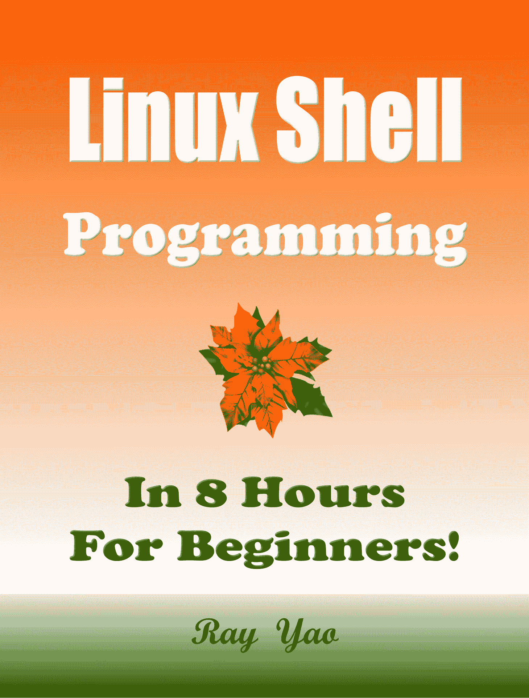
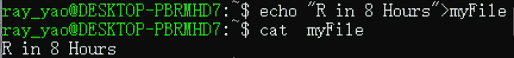
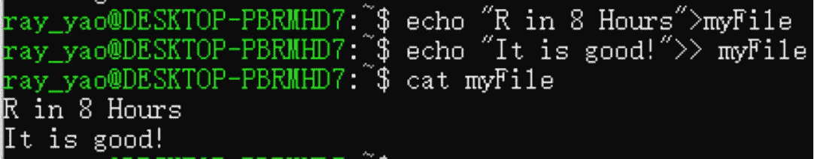

# Linux Shell 编程：8 小时初学者指南





## 关于作者
Ray Yao
- 美国 Zend 认证 PHP 工程师
- 美国 Sun 认证 JAVA 程序员
- 美国 Oracle 认证 SCWCD 开发者
- 美国 CompTIA 认证 A+ 专业人士
- 微软认证 ASP. NET 专家
- 微软认证 MCP 专业人士
- 微软认证 TECHNOLOGY 专家
- 美国 CompTIA 认证 NETWORK+ 专业人士

### 推荐书籍
- [8 小时高级 C++ 编程](https://www.amazon.com/-/e/B0863BQT8T)
- [8 小时高级 JAVA 编程](https://www.amazon.com/-/e/B0863BQT8T)
- [初学者 AngularJS 编程](https://www.amazon.com/-/e/B0863BQT8T)
- [C# 面试与认证考试](https://www.amazon.com/-/e/B0863BQT8T)
- [初学者 C# 编程](https://www.amazon.com/-/e/B0863BQT8T)
- [C# 编程。包含 100 道问答](https://www.amazon.com/-/e/B0863BQT8T)
- [C++ 面试与认证考试](https://www.amazon.com/-/e/B0863BQT8T)
- [初学者 C++ 编程](https://www.amazon.com/-/e/B0863BQT8T)
- [编码面试，1000 道问答](https://www.amazon.com/-/e/B0863BQT8T)
- [8 小时 Django 编程](https://www.amazon.com/-/e/B0863BQT8T)
- [8 小时 Go 编程](https://www.amazon.com/-/e/B0863BQT8T)
- [HTML CSS 面试与认证考试](https://www.amazon.com/-/e/B0863BQT8T)
- [初学者 HTML CSS 编程](https://www.amazon.com/-/e/B0863BQT8T)
- [JAVA 面试与认证考试](https://www.amazon.com/-/e/B0863BQT8T)
- [初学者 JAVA 编程](https://www.amazon.com/-/e/B0863BQT8T)
- [JAVA 编程。包含 100 道问答](https://www.amazon.com/-/e/B0863BQT8T)
- [JavaScript 50 个实用程序](https://www.amazon.com/-/e/B0863BQT8T)
- [JavaScript 面试与认证考试](https://www.amazon.com/-/e/B0863BQT8T)
- [初学者 JavaScript 编程](https://www.amazon.com/-/e/B0863BQT8T)
- [JQuery 面试与认证考试](https://www.amazon.com/-/e/B0863BQT8T)
- [初学者 JQuery 编程](https://www.amazon.com/-/e/B0863BQT8T)
- [8 小时 Kotlin 编程](https://www.amazon.com/-/e/B0863BQT8T)
- [Linux 命令行](https://www.amazon.com/-/e/B0863BQT8T)
- [Linux 面试与认证考试](https://www.amazon.com/-/e/B0863BQT8T)
- [8 小时 Linux Shell 编程](https://www.amazon.com/-/e/B0863BQT8T)
- [初学者 MySQL 编程](https://www.amazon.com/-/e/B0863BQT8T)
- [Node.](https://www.amazon.com/-/e/B0863BQT8T)
- [8 小时 js 编程](https://www.amazon.com/-/e/B0863BQT8T)
- [PHP 面试与认证考试](https://www.amazon.com/-/e/B0863BQT8T)
- [初学者 PHP MySQL 编程](https://www.amazon.com/-/e/B0863BQT8T)
- [8 小时 PowerShell 编程](https://www.amazon.com/-/e/B0863BQT8T)
- [Python 面试与认证考试](https://www.amazon.com/-/e/B0863BQT8T)
- [初学者 Python 编程](https://www.amazon.com/-/e/B0863BQT8T)
- [Python 编程。包含 100 道问答](https://www.amazon.com/-/e/B0863BQT8T)
- [初学者 R 编程](https://www.amazon.com/-/e/B0863BQT8T)
- [初学者 Ruby 编程](https://www.amazon.com/-/e/B0863BQT8T)
- [8 小时 Rust 编程](https://www.amazon.com/-/e/B0863BQT8T)
- [8 小时 Scala 编程](https://www.amazon.com/-/e/B0863BQT8T)
- [Visual Basic 面试与认证考试](https://www.amazon.com/-/e/B0863BQT8T)
- [初学者 Visual Basic 编程](https://www.amazon.com/-/e/B0863BQT8T)

## 前言
本书涵盖了所有必要的 Linux Shell 语言知识。你可以快速、轻松地学会 Linux Shell 编程的核心技能。

书中包含了针对初学者的 60 多个实战示例，并提供了针对大学考试、工程师认证考试以及工作面试的测试与答案。


# 源代码下载

本书提供了源代码下载；你可以下载源代码以便更好地学习，或者将源代码复制到你喜喜欢的编辑器中测试程序。

下载链接：[`forms.aweber.com/form/11/1793939911.htm`](https://forms.aweber.com/form/11/1793939911.htm)

**注意：** 本书仅适用于初学者，不适合有经验的程序员。


# 第 1 小时

## 什么是 Linux Shell?
Shell 是用户和内核之间的接口。Shell 是一个命令行解释器，它接收用户的命令并执行它们。Shell 是一个命令行解释器，它接收用户的命令并执行它们。Shell 是一个命令行解释器，它接收用户的命令并执行它们。Shell 是一个命令行解释器，它接收用户的命令并执行它们。Shell 是一个命令行解释器，它接收用户的命令并执行它们。Shell 是一个命令行解释器，它接收用户的命令并执行它们。Shell 是一个命令行解释器，它接收用户的命令并执行它们。Shell 是一个命令行解释器，它接收用户的命令并执行它们。Shell 是一个命令行解释器，它接收用户的命令并执行它们。Shell 是一个命令行解释器，它接收用户的命令并执行它们。Shell 是一个命令行解释器，它接收用户的命令并执行它们。Shell 是一个命令行解释器，它接收用户的命令并执行它们。Shell 是一个命令行解释器，它接收用户的命令并执行它们。Shell 是一个命令行解释器，它接收用户的命令并执行它们。Shell 是一个命令行解释器，它接收用户的命令并执行它们。Shell 是一个命令行解释器，它接收用户的命令并执行它们。Shell 是一个命令行解释器，它接收用户的命令并执行它们。Shell 是一个命令行解释器，它接收用户的命令并执行它们。Shell 是一个命令行解释器，它接收用户的命令并执行它们。Shell 是一个命令行解释器，它接收用户的命令并执行它们。Shell 是一个命令行解释器，它接收用户的命令并执行它们。Shell 是一个命令行解释器，它接收用户的命令并执行它们。Shell 是一个命令行解释器，它接收用户的命令并执行它们。Shell 是一个命令行解释器，它接收用户的命令并执行它们。Shell 是一个命令行解释器，它接收用户的命令并执行它们。Shell 是一个命令行解释器，它接收用户的命令并执行它们。Shell 是一个命令行解释器，它接收用户的命令并执行它们。Shell 是一个命令行解释器，它接收用户的命令并执行它们。Shell 是一个命令行解释器，它接收用户的命令并执行它们。Shell 是一个命令行解释器，它接收用户的命令并执行它们。Shell 是一个命令行解释器，它接收用户的命令并执行它们。Shell 是一个命令行解释器，它接收用户的命令并执行它们。Shell 是一个命令行解释器，它接收用户的命令并执行它们。Shell 是一个命令行解释器，它接收用户的命令并执行它们。Shell 是一个命令行解释器，它接收用户的命令并执行它们。Shell 是一个命令行解释器，它接收用户的命令并执行它们。Shell 是一个命令行解释器，它接收用户的命令并执行它们。Shell 是一个命令行解释器，它接收用户的命令并执行它们。Shell 是一个命令行解释器，它接收用户的命令并执行它们。Shell 是一个命令行解释器，它接收用户的命令并执行它们。Shell 是一个命令行解释器，它接收用户的命令并执行它们。Shell 是一个命令行解释器，它接收用户的命令并执行它们。Shell 是一个命令行解释器，它接收用户的命令并执行它们。Shell 是一个命令行解释器，它接收用户的命令并执行它们。Shell 是一个命令行解释器，它接收用户的命令并执行它们。Shell 是一个命令行解释器，它接收用户的命令并执行它们。Shell 是一个命令行解释器，它接收用户的命令并执行它们。Shell 是一个命令行解释器，它接收用户的命令并执行它们。Shell 是一个命令行解释器，它接收用户的命令并执行它们。Shell 是一个命令行解释器，它接收用户的命令并执行它们。Shell 是一个命令行解释器，它接收用户的命令并执行它们。Shell 是一个命令行解释器，它接收用户的命令并执行它们。Shell 是一个命令行解释器，它接收用户的命令并执行它们。Shell 是一个命令行解释器，它接收用户的命令并执行它们。Shell 是一个命令行解释器，它接收用户的命令并执行它们。Shell 是一个命令行解释器，它接收用户的命令并执行它们。Shell 是一个命令行解释器，它接收用户的命令并执行它们。Shell 是一个命令行解释器，它接收用户的命令并执行它们。Shell 是一个命令行解释器，它接收用户的命令并执行它们。Shell 是一个命令行解释器，它接收用户的命令并执行它们。Shell 是一个命令行解释器，它接收用户的命令并执行它们。Shell 是一个命令行解释器，它接收用户的命令并执行它们。Shell 是一个命令行解释器，它接收用户的命令并执行它们。Shell 是一个命令行解释器，它接收用户的命令并执行它们。Shell 是一个命令行解释器，它接收用户的命令并执行它们。Shell 是一个命令行解释器，它接收用户的命令并执行它们。Shell 是一个命令行解释器，它接收用户的命令并执行它们。Shell 是一个命令行解释器，它接收用户的命令并执行它们。Shell 是一个命令行解释器，它接收用户的命令并执行它们。Shell 是一个命令行解释器，它接收用户的命令并执行它们。Shell 是一个命令行解释器，它接收用户的命令并执行它们。Shell 是一个命令行解释器，它接收用户的命令并执行它们。Shell 是一个命令行解释器，它接收用户的命令并执行它们。Shell 是一个命令行解释器，它接收用户的命令并执行它们。Shell 是一个命令行解释器，它接收用户的命令并执行它们。Shell 是一个命令行解释器，它接收用户的命令并执行它们。Shell 是一个命令行解释器，它接收用户的命令并执行它们。Shell 是一个命令行解释器，它接收用户的命令并执行它们。Shell 是一个命令行解释器，它接收用户的命令并执行它们。Shell 是一个命令行解释器，它接收用户的命令并执行它们。Shell 是一个命令行解释器，它接收用户的命令并执行它们。Shell 是一个命令行解释器，它接收用户的命令并执行它们。Shell 是一个命令行解释器，它接收用户的命令并执行它们。Shell 是一个命令行解释器，它接收用户的命令并执行它们。Shell 是一个命令行解释器，它接收用户的命令并执行它们。Shell 是一个命令行解释器，它接收用户的命令并执行它们。Shell 是一个命令行解释器，它接收用户的命令并执行它们。Shell 是一个命令行解释器，它接收用户的命令并执行它们。Shell 是一个命令行解释器，它接收用户的命令并执行它们。Shell 是一个命令行解释器，它接收用户的命令并执行它们。Shell 是一个命令行解释器，它接收用户的命令并执行它们。Shell 是一个命令行解释器，它接收用户的命令并执行它们。Shell 是一个命令行解释器，它接收用户的命令并执行它们。Shell 是一个命令行解释器，它接收用户的命令并执行它们。Shell 是一个命令行解释器，它接收用户的命令并执行它们。Shell 是一个命令行解释器，它接收用户的命令并执行它们。Shell 是一个命令行解释器，它接收用户的命令并执行它们。Shell 是一个命令行解释器，它接收用户的命令并执行它们。Shell 是一个命令行解释器，它接收用户的命令并执行它们。Shell 是一个命令行解释器，它接收用户的命令并执行它们。Shell 是一个命令行解释器，它接收用户的命令并执行它们。Shell 是一个命令行解释器，它接收用户的命令并执行它们。

## Shell 脚本
Shell 脚本是一个包含一系列命令的文件，由 Shell 执行。Shell 脚本用于自动化任务和执行复杂操作。

### 第一个 Shell 脚本
创建一个 Shell 脚本，请遵循以下步骤：
1. 创建一个扩展名为 `.sh` 的文件。
2. 添加 shebang 行，例如 `#!/bin/bash`。
3. 在文件中编写你的命令。
4. 使用 `chmod +x script.sh` 使可执行。
5. 使用 `./script.sh` 运行脚本。

### Shell 释
注释用于解释代码并被 Shell 忽略。它们以 `#` 符号开头。

```bash
# 这是一个注释
```

### 多行注释
对于多行注释，你可以使用 `<<EOF` 语法：

```bash
<< 'EOF'
这是一个多行注释。
它跨越多行。
EOF
```

### 变量
变量用于在 Shell 脚本中存储数据。你可以通过赋值值来定义变量。

```bash
name="John Doe"
```

### 变量名
变量名必须以字母或下划线开头，可以包含字母、数字和下划线。它们是对大小敏感的。

### 只读变量
只读变量在定义后无法更改。

```bash
readonly constant_var="value"
```

## 删除变量
使用 `unset` 命令删除变量。

```bash
unset name
```

字体 变量输入
你可以使用 `read` 命令从用户那里获取输入。

```bash
read -p "Enter your name: " name
echo "Hello, $name"
```

# 第 2 小时

## Shell 字符串 (1)
字符串是字符序列。可以用单引号或双引号括起来。

## Shell 字符串 (2)
将它们放在一起来拼接字符串。

## 连接字符串
```bash
str1="Hello"
str2="World"
combined="$str1 $str2"
echo $combined
```

## 字符串长度
要找到字符串的长度，使用 `${#variable}` 语法。

```bash
echo ${#str}
```

## 提取子字符串
你可以使用参数扩展从字符串中提取子字符串。

```bash
str="Hello World"
echo ${str:0:5} # 输出: Hello
```

## 关于 `expr…`
`expr` 命令可以用于字符串操作，例如查找长度。

```bash
expr length "Hello World"
```

## 搜索索引
要找到字符串子字符串的位置，使用模式。

## Shell 参数
Shell 参数是提供环境和参数信息的特殊变量。

### 内置参数
- `$0`: 脚本名称。
- `$1`, `$2`, ...: 位置参数。
- `$#`: 参数数量。
- `$*`: 所有参数。
- `$@`: 所有参数。

# 第 3 小时

## Shell 数组
数组用于在一个变量中存储多个值。

```bash
arr=("apple" "banana" "cherry")
```

### 访问元素
使用索引访问单个数组元素。

```bash
echo ${arr[0]}
```

### 获取所有元素
要获取数组的所有元素，使用 `${arr[@]}`。

```bash
echo "${arr[@]}"
```

### 数组长度
要找到数组中的元素数量，使用 `${#arr[@]}`。

```bash
echo ${#arr[@]}
```

## Printf 命令
`printf` 命令用于格式化输出。

```bash
printf "Hello, %s!\n" "World"
```

## 转义序列
转义序列用于表示字符串中的特殊字符。

# 第 4 小时

## 运算符
运算符用于计算和比较。

### if…then…else…fi
`if` 语句用于条件执行。

```bash
if [ $a -gt 5 ]; then
  echo "Greater than 5"
else
  echo "Less or equal to 5"
fi
```

## 算术运算符
`+`, `-`, `*`, `/`, `%`

## 比较运算符
`-eq`, `-ne`, `-gt`, `-lt`, `-ge`, `-le`

## 逻辑运算符
`&&` (与), `||` (或), `!` (非)

# 第 5

## 字符串运算符
用于比较字符串的运算符。

## 文件运算符
用于检查文件属性的运算符。

### “echo” 命令
`echo` 命令用于将文本打印到终端。

# 第 6 小时

## Test 命令
`test` 命令用于各种测试。

### [[ ]] 符号
`[[ ]]` 语法用于表达式。

### 测试相等性
### 测试存在性
### 测试空字符串

### Shell 函数
函数是可复用的代码块。

## 带参数的函数
## 返回值

# 第 7 小时

## if..then ..elif..then..else
## For 循环
## While 循环
## Until 循环
## Case 语句
## Break 命令
## Continue 命令

# 第 8 小时

## Select 语句
### I/O 重定向
## 输出重定向
## 追加重定向
## 输入重定向
## 文件描述符
### Here Document
## 包含文件


## 示例 1.5
```bash
#!/bin/bash
myVar="C# in 8 Hours"
readonly myVar
myVar="Scala in 8 Hours"      # 修改变量值
```
输出：
(如下所示错误信息:)
```bash
test. sh: line 4: myVar: readonly variable
```
解释：
`readonly myVar` 将 `myVar` 设置为只读。输出是一个错误信息。`myVar` 变成只读变量后，对 `myVar` 值的任何更改都会导致错误。

## 删除变量
`unset` 命令可以删除变量。

| `unset 变量` |

## 示例 1.6
```bash
#! /bin/sh
myVar="C++ in 8 Hours"
unset myVar        # 移除变量
echo $myVar
```
输出：
(无输出)
解释：
变量被移除后，该变量不再存在，其值也不再存在。因此你看不到任何输出。

## 变量的输入
变量的值可以由用户从键盘输入。

| `read 变量` |

## 示例 1.7
```bash
#! /bin/sh
echo "Please input your name. "
read myInput        # 输入值将存储在 myInput 中
echo "Hi! Your name is: $myInput"  # 假设我输入我的名字：Ray Yao
```
输出：
Please input your name.
Ray Yao
Hi! Your name is Ray Yao
解释：
假设我输入了名字：Ray Yao。`read myInput` 将输入值存储到 `myInput` 中。`echo "Hi! Your name is: $myInput"` 显示了输入值。

# 第 2 小
## Shell 字符串 (1)
字符串被单引号包围。

| `str='This is a string'` |

*   单引号内的任何字符将按其原始格式打印。
*   单引号内的字符串变量是无效的。

### 示例 2.1
```bash
#! /bin/sh
var=Andy
str='Hello, $var'         # 单引号字符串
echo $str
```
输出：
Hello, $var
解释：
'Hello, $var' 是一个单引号字符串。单引号内的任何字符将按其原始格式打印。

## Shell 字符串 (2)
字符串被双引号包围。

| `str="This is a string"` |

*   双引号内的任何字符将通过其返回值打印。 
*   双引号内的字符串变量是有效的。

### 示例 2.2
```bash
#! /bin/sh
var=Andy
str="Hello, $var"          # 双引号字符串
echo $str
```
输出：
Hello, Andy
解释：
'Hello, $var' 是一个双引号字符串。双引号内的任何字符将通过其返回值打印。

## 连接字符串
我们可以使用双引号连接两个字符串。

### 示例 2.3
```bash
#! /bin/sh
str1="Kotlin"
str2="in 8 Hours"
myString="$str1 $str2"      # 连接两个字符串
echo $myString
```
输出：
Kotlin in 8 Hours
解释：
"$str1 $str2" 使用双引号将两个字符串连接成一个字符串。

## 字符串长度
我们可以通过 `#` 符号获取字符串的长度。

| `#string` |

### 示例 2.4
```bash
#! /bin/sh
str="jQuery in 8 Hours"
echo ${#str }       # 获取字符串的长度
```
输出：
17
解释：
`#str` 可以获取字符串的长度。字符串长度为 17 个字符（包括空格）。 

## 提取子字符串
我们可以从字符串中提取子字符串。

| `string : 起 : 长度` |

*   `start`: 提取从此索引开始。
*   `length`: 提取的大小。

### 示例 2.5
```bash
#! /bin/sh
str="DjanGo in 8 Hours"
echo ${str:4:16 }      # 提取子字符串
```
输出：
Go in 8 Hours
解释：
`str: 4: 16` 提取从索引 4 开始的子字符串，提取长度为 16。

## 关于 `expr…`
`` expr…` `` 是一个表达式，用于计算。

| `` ` expr…` `` |

注意：` ` 是反引号，而不是单引号。` ` 键位于键盘的最左侧。

### 示例 2.6
```bash
#! /bin/sh
x=100
y=200
z=`expr $x + $y`       # 一个表达式
echo "The sum is $z"
```
输出：
The sum is 300
解释：
`expr $x + $y` 是一个表达式，计算结果将赋值给 `z`。注意：` ` 是反引号，而不是单引号。` ` 键位于键盘的最左侧。

## 搜索索引
我们可以找到字符串中字符首次出现的索引。

| `` ` expr index "string" 字符` `` |

注意：` ` 是反引号，而不是单引号。`"index"` 是参数，用于搜索字符的索引。`"character"` 是参数，表示你指定的字符。

### 示例 2.7
```bash
#! /bin/sh
str="Kotlin in 8 Hours"
echo `expr index "$str" K`
```
输出：
0
解释：
`expr index "$str" K` 查找字符串中字符 K 的索引。索引从 0 开始。

## 变量的赋值
```bash
#! /bin/sh
str="Hello"
str="World"      # 修改变量值
echo $str
```
输出：
World
解释：
变量可以被重新赋值。


## 数组操作

### `array_name[@]` 或 `array_name[*]`

### 示例 3.2
```bash
#!/bin/bash
my_array[0]=Java
my_array[1]=Ruby
my_array[2]=Html
my_array[3]=Rust
echo "All elements are: ${my_array[@] }"
echo "All elements are: ${my_array[*] }"
```
**输出：**
```
All elements are: Java  Ruby  Html  Rust
All elements are: Java  Ruby  Html  Rust
```
**解释：** `my_array[@]` 或 `my_array[*]` 可以获取数组的所有元素。

### 数组长度
`#array_name[@]` 或 `#array_name[*]` 可以获取数组的长度。

### `#array_name[@]` 或 `#array_name[*]` 

### 示例 3.3
```bash
#!/bin/bash
my_array=(PHP MySQL in 8 Hours)
length1=${#my_array[@] }
length2=${#my_array[*] }
echo $length1
echo $length2
```
**输出：**
```
5
5
```
**解释：** `#my_array[@]` 或 `#my_array[*]` 可以获取数组的长度。

## printf 命令

`printf` 是在 Shell 中格式化输出的命令。

### `printf "type"` 变量

`"type"` 是用于格式化输出的参数。

| 类型 | 描述 |
| :--- | :--- |
| `%b` | 打印二进制值 |
| `%d` | 打印整数 |
| `%f` | 打印浮点数 |
| `%o` | 打印八进制值 |
| `%s` | 打印字符串值 |
| `%x` | 打印十六进制值 |

例如：
- `%10s` 表示格式化为最大宽度为 10 个字符的字符串
- `%-10s` 表示格式化为最大宽度为 10 个字符的字符串（`-` 符号表示左对齐，不加 `-` 表示右对齐）
- `%8. 2f` 表示格式化为浮点数，`8` 表示 8 位整数部分，`2` 表示 2 位小数。
- `%-8. 2f` 表示格式化为浮点数，`8` 表示 8 位整数部分，`2` 表示 2 位小数。（`-` 符号表示左对齐，不加 `-` 符号表示右对齐）

### 示例 3.4
```bash
printf "%-10s %-7s %-8s\n" Name Age Weight
```
**输出：**
```
Name      Age      Weight
```
**解释：**
- `"%-10s"` 被 `"Name"` 替换，`"Name"` 被格式化为最大 10 个字符的字符串，左对齐。
- `"%-7s"` 被 `"Age"` 替换，`"Age"` 被格式化为最大 7 个字符的字符串，左对齐。
- `"%-8s"` 被 `"Weight"` 替换，`"Weight"` 被格式化为最大 8 个字符的字符串，左对齐。
- `"\n"` 用于换行。

### 示例 3.5
```bash
#!/bin/bash
printf "%-10s %-7s %-8s\n" Name Age Weight
printf "%-10s %-7d %-5. 2f\n" Andy 18 91.8843
printf "%-10s %-7d %-5. 2f\n" Tomy 19 95.4675
printf "%-10s %-7d %-5. 2f\n" Rosy 17 80.8563
```
**输出：**
```
Name      Age      Weight
Andy      18       91.88
Tomy      19       95.47
Rosy      17       80.86
```
**解释：**
- `"printf "%-10s %-7d %-5. 2f\n" Andy 18 91.8843"` 格式化了三个参数 `"Andy"`、`"18"`、`"91.8843"`。
- `"%-10s"` 被 `"Andy"` 替换，`"Andy"` 被格式化为最大 10 个字符的字符串，左对齐。
- `"%-7d"` 被 `"18"` 替换，`"18"` 被格式化为最大 7 位数字的整数，左对齐。
- `"%-5. 2f"` 被 `"91.88"` 替换，`"91.88"` 被格式化为最大 5 位整数、2 位小数的浮点数类型，左对齐。
- `"\n"` 用于换行。

## 转义序列

`\` 反斜字符可用于转义字符。
- `\a` 输出警报声
- `\n` 将内容输出到下一行。
- `\r` 产生回车
- `\t` 产生制表符
- `\f` 将内容输出到下一页。
- `\'` 输出单引号。
- `\"\"` 输出双引号。

### 示例 3.6
```bash
#!/bin/bash
printf "%s %s \'%s\' \n" He said OK
printf "%d\t %d\n" 10 100
printf "%s\n %s\n" C
```
**输出：**
```
He said 'OK' 
10	100
C
```
**解释：**
- `'%s\'` 输出引号。
- `%d\t` 输出两个数字并带有制表符。
- `%s\n` 输出字符串。

## 运算符

Shell 像其他语言一样支持多种运算符，包括：算术运算符、关系运算符、布尔运算符、字符串运算符、文件运算符。

### `expr…`

`expr…` 是一个求值工具。使用反引号而不是单引号。

### 示例 4.1
```bash
#!/bin/bash
sum=`expr 100 +20`
echo "The sum is: $sum"
```
**输出：**
```
The sum is: 120
```
**解释：**
使用反引号，而不是单引号。完整的表达式必须包含在反引号中。运算符之间必须有空格。例如，`"10+20"` 是错误的。

## `if…then…else…fi`

`if` 语句如果条件为真则执行代码，如果为假则执行 `else`。

### 示例 4.2
```bash
a=10
b=20
if [ $a == $b ]; then
  echo "a is equal to b"
else
  echo "a is not equal to b"
fi
```
**输出：**
```
a is not equal to b
```
**解释：**
`[$a == $b]` 比较 `a` 和 `b` 是否相等。注意：对于 `==`，括号内应该留空格。例如：`[$a==b]` 是错误的，`[$a == $b ]` 是正确的。`==` 是比较运算符。如果 `a` 等于 `b`，返回真；`a` 不等于 `b`，返回假。在上面的 `if` 语句中，因为测试条件返回假，执行了 `else`。因此，`echo "a is not equal to b"` 被执行。

## 算术运算符

| 运算符 | 执行 |
| :--- | :--- |
| `+` | 加 |
| `-` | 减 |
| `*` | 乘（注意：`*`） |
| `/` | 除 |
| `%` | 取模 |
| `=` | 赋值 |
| `==` | 检查相等性 |

### 示例 4.3
```bash
#!/bin/bash
a=100
b=2
result=`expr $a + $b`
echo "a + b : $result"
result=`expr $a - $b`
echo "a - b : $result"
result=`expr $a * $b`
echo "a * b : $result"
result=`expr $a / $b`
echo "a / b : $result"
result=`expr $a % $b`
echo "a % b : $result"
```
**输出：**
```
a + b : 102
a - b : 98
a * b : 200
a / b : 50
a % b : 0
```

### 示例 4.4
```bash
a=100
b=200
if [ $a == $b ]; then
  echo "a is equal to b"
fi
if [ $a != $b ]; then
  echo "a is not equal to b"
fi
```
**输出：**
```
a is not equal to b
```
**解释：**
`[$a != $b]` 检查 `a` 是否不等于 `b`。注意：`]` 和 `!=` 之间应该有空格。`[$a=$b]` 是错误的。`[$a != $b ]` 是正确的。

## 比较运算符

Linux Shell 有以下运算符：

| 运算符 | 检查 |
| :--- | :--- |
| `-eq` | 等于 |
| `-ne` | 不等于 |
| `-gt` | 大于 |
| `-ge` | 大于 |
| `-lt` | 小于 |
| `-le` | 小于 |

比较表达式返回真或假。

### 示例 4.5
```bash
#!/bin/bash
a=100
b=200
if [ $a -eq $b ]; then
  echo "$a -eq $b ? a is equal to b"
else
  echo "$a -eq $b ? a is not equal to b"
fi
if [ $a -ne $b ]; then
  echo "$a -ne $b ? a is not equal to b"
else
  echo "$a -ne $b ? a is equal to b"
fi
if [ $a -gt $b ]; then
  echo "$a -gt $b ? a is greater than b"
else
  echo "$a -gt $b ? a is not greater than b"
fi
if [ $a -lt $b ]; then
  echo "$a -lt $b ? a is less than b"
else
  echo "$a -lt $b ? a is not less than b"
fi
if [ $a -ge $b ]; then
  echo "$a -ge $b ? a is greater or equal to b"
else
  echo "$a -ge $b ? a is less than b"
fi
if [ $a -le $b ]; then
  echo "$a -le $b ? a is less or equal to b"
else
  echo "$a -le $b ? a is greater than b"
fi
```
**输出：**
```
100 -eq 200 ? a is not equal to b
100 -ne 200 ? a is not equal to b
100 -gt 200 ? a is not greater than b
100 -lt 200 ? a is less than b
100 -ge 200 ? a is less than b
100 -le 200 ? a is greater than b
```


## 示例 4.6

```bash
#!/bin/bash
x=true
y=false
if [ $x -a $y ]      # -a 表示“与”
then
    echo flase
fi
if [ $x -o $y ]      # -o 表示“或”
then
    echo true
fi
if [ !$x ]         # ! 表示“非”
then
    echo flase
fi
```

输出：
```
flase
true
flase
```

解释：

| true -a true;返回 true; | true -a false;返回 false; | false -a false;返回 false; |
| true -o true;返回 true; | true -o false;返回 true; | false -o false;return false; |
| ! false;返回 true; | ! true;返回 false; |  |

# 第 5 小时：字符串运算符

| 运算符 | 检查 |
| :--- | :--- |
| `=` | 如果两个字符串相等，则返回 true . |
| `!=` | 如果两个字符串不相等，则返回 true . |
| `-z` | 如果字符串的长度为零，则返回 true . |
| `-n` | 如果字符串的长度不为零，则返回 true |
| `$` | 如果字符串为空，则返回 true . |

### 示例 5.1

```bash
#!/bin/bash
a="Java"
b="Ruby"
if [ $a = $b ]      # 检查 a 是否等于 b
then
    echo "$a = $b ?  a 等于 b"
else
    echo "$a = $b ?  a 不等于 b"
fi
if [ $a != $b ]      # 检查 a 是否等于 b
then
    echo "$a ! = $b ?  a 不等于 b"
else
    echo "$a ! = $b ?  a 等于 b"
fi
if [ -z $a ]      # 检查字符串长度是否为 0
then
    echo "-z $a ?  字符串长度为 0"
else
    echo "-z $a ?  字符串长度不为 0"
fi
if [ -n "$a" ]        # 检查字符串长度是否不为 0
then
    echo "-n $a ?  字符串长度不为 0"
else
    echo "-n $a ?  字符串长度为 0"
fi
if [ $a ]        # 检查字符串是否为空
then
    echo "$a ?  字符串不为空"
else
    echo "$a ?  字符串为空"
fi
```

输出：
```
Java = Ruby ?  a 不等于 b
Java ! = Ruby ?  a 不等于 b
-z Java ?  字符串长度不为 0
-n Java ?  字符串长度不为 0
Java ?  字符串不为空。
```

解释：

| `=` | 如果两个字符串相等，则返回 true . |
| `!=` | 如果两个字符串不相等，则返回 true . |
| `-z` | 如果字符串的长度为零，则返回 true . |
| `-n` | 如果字符串的长度不为零，则返回 true |
| `$` | 如果字符串为空，则返回 true . |

## 文件运算符

文件运算符用于检测 Linux 文件的各种属性。

| 运算符 | 检查 |
| :--- | :--- |
| `-d file` | 如果对象是目录，则返回 true . |
| `-f file` | 如果对象是文件，则返回 true . |
| `-p file` | 如果对象是管道，则返回 true . |
| `-r file` | 如果对象是可读文件，则返回 true . |
| `-w file` | 如果对象是可写文件，则返回 true . |
| `-x file` | 如果对象是可执行文件，则返回 true . |
| `-e file` | 如果对象是空文件，则返回 true . |
| `-s file` | 如果对象不是空文件，则返回 true . |
| `-b file` | 如果对象是块设备文件，则返回 true . |
| `-c file` | 如果对象是字符设备文件，则返回 true . |

### 示例 5.2

假设文件“myFile.sh”不存在，但我们仍然检查该文件的属性。

```bash
#!/bin/bash
file="/root/myFile.sh"
if [ -r $file ]      # 检查对象是否可读
then
    echo "对象是可读的"
else
    echo "对象是不可读的"
fi
if [ -w $file ]      # 检查对象是否可写
then
    echo "对象是可写的"
else
    echo "对象是不可写的"
fi
if [ -x $file ]      # 检查对象是否可执行
then
    echo "对象是可执行的"
else
    echo "对象是不可执行的"
fi
if [ -f $file ]      # 检查对象是否是文件
then
    echo "对象是文件"
else
    echo "对象不是文件"
fi
if [ -d $file ]      # 检查对象是否是目录
then
    echo "对象是目录"
else
    echo "对象不是目录"
fi
if [ -s $file ]      # 检查对象是否非空
then
    echo "对象不是空的"
else
    echo "对象是空的"
fi
if [ -e $file ]      # 检查文件是否存在
then
    echo "文件存在"
else
    echo "文件不存在"
fi
```

输出：
```
对象是不可读的
对象是不可写的
对象是不可执行的
对象不是文件
对象不是目录
对象是空的
文件不存在
```

解释：假设目录“root”中没有文件“myFile.sh”，但我们仍然检查该文件的属性。让我们复习以下文件运算符：

| `-d file` | 如果对象是目录，则返回 true |
| `-f file` | 如果对象是文件，则返回 true |
| `-r file` | 如果对象是可读文件，则返回 true . |
| `-w file` | 如果对象是可写文件，则返回 true . |
| `-x file` | 如果对象是可执行文件，则返回 true . |
| `-e file` | 如果对象是空文件，则返回 true . |
| `-s file` | 如果对象不是空文件，则返回 true . |

## `echo` 命令

`echo` 命令用于输出内容。在这里，我们来聊聊它的特殊用法。

### 转义字符
```bash
#!/bin/bash
echo "\"C in 8 Hours\"
```
输出：
```
C in 8 Hours
```

### 变量值
```bash
#!/bin/bash
book="C in 8 Hours"
echo "$book is a great book"
```
输出：
```
C in 8 Hours is a great book
```

### 同一行的内容
```bash
#!/bin/bash
echo -e "Go\n" # 开启转义开关
echo "in 8 Hours" # 在同一行输出
```
输出：
```
Go
in 8 Hours
```

### 输出到文件
```bash
#!/bin/bash
echo "PHP in 8 Hours" # 重定向到

### 格式
```bash
#!/bin/bash
echo 'OK' # 使用单引号
```
输出：
```
OK
```

### 执行结果
```bash
#!/bin/bash
echo `date` # 使用反引号
```
输出：
```
当前日期
```

### 用户输入
```bash
#!/bin/bash
read name
echo "Hello $name"
```
输出：
```
Hello [输入的名字]
```

## test 命令

`test` 命令用于检查条件是否为真。它可以测试三个方面：数字、字符和文件。

## 数字比较

`test` 命令可以使用以下运算符对数字进行比较：

```bash
#!/bin/bash
num1=10
num2=20
if [ $num1 -eq $num2 ];      # -eq 表示等于
then
    echo "Equal"
fi
if [ $num1 -ne $num2 ];      # -ne 表示不相等
then
    echo "Not Equal"
fi
if [ $num1 -gt $num2 ];      # -gt 表示大于
then
    echo "Greater"
fi
if [ $num1 -lt $num2 ];      # -lt 表示小于
then
    echo "Less"
fi
if [ $num1 -ge $num2 ];      # -ge 表示大于或等于
then
    echo "Greater or equal"
fi
if [ $num1 -le $num2 ];      # -le 表示小于或等于
then
    echo "Less or equal"
fi
```

## 字符串比较

`test` 命令可以使用以下运算符对字符串进行比较：

```bash
#!/bin/bash
str1="apple"
str2="orange"
if [ $str1 = $str2 ];      # = 表示相等
then
    echo "Equal"
fi
if [ $str1 != $str2 ];      # != 表示不相等
then
    echo "Not Equal"
fi
if [ "$str1" > "$str2" ];    # > 表示字典序大于
then
    echo "Greater in order"
fi
if [ "$str1" < "$str2" ];    # < 表示字典序小于
then
    echo "Less in order"
fi
```

## 文件比较

`test` 命令可以使用以下运算符来检查文件的属性：

```bash
#!/bin/bash
file="test.txt"
if [ -f $file ];      # 检查是否为普通文件
then
    echo "Is a file"
fi
if [ -d $file ];      # 检查是否为目录
then
    echo "Is a directory"
fi
if [ -r $file ];      # 检查文件是否可读
then
    echo "Is readable"
fi
if [ -w $file ];      # 检查文件是否可写
then
    echo "Is writable"
fi
if [ -x $file ];      # 检查文件是否可执行
then
    echo "Is executable"
fi
if [ -s $file ];      # 检查文件是否非空
then
    echo "Is not empty"
fi
```


## 示例 6.6
```bash
#! /bin/bash
myFunction() {
    # define a function
    echo "jQuery in 8 Hours"
}
echo "Before calling the function. "
myFunction     # call the function
echo "After calling the function. "
```
**输出：**
```
Before calling the function.
jQuery in 8 Hours
After calling the function.
```
**解释：** `myFunction(){ }` 定义了一个函数；`myFunction` 调用该函数。

## 带参数的函数
在调用函数时，你可以将参数传递给函数体。例如，将第一个参数传递给 `${1}`，将第二个参数传递给 `${2}` ...

### 示例 6.7
```bash
#! /bin/bash
myFunction(){
    echo "The first parameter is: ${1} ! "
    echo "The second parameter is: ${2} ! "
    echo "The third parameter is: ${3} ! "
    echo "The fourth parameter is: ${4} ! "
    echo "All parameters are: $* ! "
}
myFunction Kotlin in 8 Hour     # pass four parameters
```
**输出：**
```
The first parameter is: Kotlin !
The second parameter is: in !
The third parameter is: 8 !
The fourth parameter is: Hours !
All parameters are: Kotlin in 8 Hours !
```
**解释：** `${1}` 接收第一个参数；`${2}` 接收第二个参数；`*` 显示所有参数；`myFunction Kotlin in 8 Hour ` 调用函数并传递了四个参数。

## 返回值
`return` 可以向 `$?` 返回一个值。`$?` 显示返回值。（在某些机器上，`$?` 只显示 0 到 255 之间的值。）

| function_name { return value } |
| `$?` # 显示返回值 |

### 示例 6.8
```bash
#! /bin/bash
add(){
    # define a function
    x=100
    y=155
    z=`expr $x + $y`
    return $z    # returns the value to $ ?
}
add      # call the function
echo "The sum of two numbers is $? "
```
**输出：**
```
The sum of two numbers is 255
```
**解释：** `return $z` 将值返回给 `$?`。（在某些机器上，`$?` 只显示 0 到 255 之间的值。）

### 示例 6.9
```bash
#! /bin/bash
myFunction(){
    echo "Please enter the first number:"
    read x          # assume entering 80
    echo "Please enter the second number:"
    read y          # assume entering 90
    z=`expr $x + $y`
    return $z       # returns a value to "$? ?"
}
myFunction
echo "The return value is $? "
```
**输出：**
```
Please enter the first number:80
Please enter the second number:90
The return value is 170
```
**解释：** `return $z` 将值返回给 `$?`；`$?` 显示返回值。

# 第 7 小
## `if .. then .. elif .. then .. else`
`if...then...elif...then...else` 当条件为真时执行此代码，当条件为假时执行该代码。

| if condition1 then code1 | elif condition2 then code2 | else code3 |
`elif` 意味着 `else...if...`

### 示例 7.1
```bash
#! /bin/bash
x=100
y=80
if [ $x == $y ]
then
    echo "x is equal to y"
elif [ $x -gt $y ]
then
    echo "x is greater than y"
elif [ $x -lt $y ]
then
    echo "x is less than y"
else
    echo "n"
fi
```
**输出：**
```
x is greater than y
```
**解释：** `elif` 意味着 `else...if...`；`elif [ $x -gt $y ]` 测试 `$x` 是否大于 `$y`。

## For 循环
`for loop 通过指定的项目重复执行代码块。

| for var in item1 item2 item3… do code1 code2… |

### 示例 7.2
```bash
#! /bin/bash
for var in 1 2 3
do
    echo "The number is: $var"
done
```
**输出：**
```
The number is: 1
The number is: 2
The number is: 3
```
**解释：** `for var in 1 2 3` 在 `var=1`、`var=2`、`var=3` 时重复执行代码。

### 示例 7.3
```bash
#! /bin/bash
for str in 8 Hours
do
    echo $str
done
```
**输出：**
```
8
Hours
```
**解释：** `for str in 8 Hours` 在 `str=8`, `str=Hours` 时重复执行代码。

## While 循环
`while loop 当条件为真时循环代码块。

| while condition do code |

### 示例 7.4
```bash
#! /bin/bash
counter=1
while(( $counter<=4 ))
do
    echo $counter
    counter=`expr $counter + 1`
done
```
**输出：**
```
1
2
3
4
```
**解释：** `($counter<=4)` 是测试条件，如果条件为真，将最多循环四次。`While Loop` 用于连续输入数据，但如果你想完成输入，按 `<ctrl + d>` 退出。

### 示例 7.5
```bash
#! /bin/bash
echo 'Please enter a name: '
while read # accepts the input from user
do
    echo "OK!"
    echo "If quit, please press <ctrl + d>."
done
```
**输出：**
```
Please enter a name: 
OK!
```
**解释：** `while read` 接受来自用户的连续输入。你可以多次输入。

## Until 循环
`until loop 当条件为假时循环代码块，当条件为真时退出循环。

| until condition do code |

### 示例 7.6
```bash
#! /bin/bash
n=0
until [ $n -ge 4 ]
do
    echo $n
    n=`expr $n + 1`
done
```
**输出：**
```
0
1
2
3
```
**解释：** `until [ $n -ge 4 ]` 当 `$n` 等于 4 时退出循环。

## Case 语句
`case statement` 是多选择。`case` 匹配一个值。如果匹配成功，执行相应的命令。

| case value in pattern1) code1;; pattern2) code2;; pattern3) code3;; pattern4) code4;; pattern*) # match nothing, run this . |

### 示例 7.7
```bash
#! /bin/bash
echo 'Please input a number between 1 to 4:'
read num
case $num in
    1) echo 'You have input 1';;
    2) echo 'You have input 2';;
    3) echo 'You have input 3';;
    4) echo 'You have input 4';;
    *) echo 'Your number is not between 1 to 4';;
esac
```
**输出：**
```
Please input a number between 1 to 4:2
You have input 2
```
**解释：** 假设我们输入了 2，匹配第二个 case，因此执行第二个代码。

## Break 命令
`break` 关键字用于根据条件停止循环运行。

| break |

### 示例 7.8
```bash
#! /bin/bash
num=0
while(( $num<=8))
do
    if [ $num == 3 ]
    then
        break # quit the while loop
    fi
    num=`expr $num + 1`
done
echo $num
```
**输出：**
```
3
```
**解释：** 如果 `$num` 是 3，程序将运行 `break` 命令并退出 while 循环。

## Continue 命令
`continue` 命令用于停止当前迭代，忽略后续代码，然后继续下一次循环。

| continue |

### 示例 7.9
```bash
#! /bin/sh
nums="1 2 3 4 5 "
for n in $nums
do
    if [ $n -eq 3 ]
    then
        continue # run the next for loop
    fi
    echo $n
done
```
**输出：**
```
1
2
4
5
```
**解释：** 注意：输出中没有 3。如果 `$n = 3`，程序将运行 `continue` 命令，忽略下一个命令 `echo $n`，然后运行下一个 `for loop`。

# 第 8 小
## Select 语句
`Select` 语句允许用户选择一个符合条件的项目并运行相关代码。`Select` 语句通常与 `Case` 语句配合使用。

| select var in item1 item2 item3... case done

### 示例 8.1
```bash
#! /bin/bash
echo "Please input a number between 1 to 4. "
echo "If you input 4, the program will exit. "
select choice in 1 2 3 4 ; # select one number
case $choice in
    1) echo "You choose 1";;
    2) echo "You choose 2";;
    3) echo "You choose 3";;
    4) echo "You choose 4 to exit"
        break;;
    *) echo "Enter error! "
        break;;
esac
done
```
**输出：**
```
Please input a number between 1 to 4.
If you input 4, the program will exit.
1) 1
2) 2
3) 3
4) 4
? 2
You choose 2
? 4
You choose 4 to exit
```
**解释：** 假设我们第一次输入 2，第二次输入 4。`select choice in 1 2 3 4 ;` 选择 4 个数字之一。`Select` 语句通常与 `Case` 语句配合使用。`#` 是输入提示符，你可以输入一个数字。


“File n”，“File m” 意味着文件描述符为 `0`、`1` 或 `2` 的文件。`0` 代表标准输入 (STDIN)，`1` 代表标准输出 (STDOUT)，`2` 代表标准错误 (STDERR)。

## 输出重定向
输出重定向：使用 `>` 执行命令并将输出存储到文件中。

| `command > file` |

**示例 8.2**
```bash
echo "R in 8 Hours" > myFile
cat myFile # "cat" 查看 myfile 的内容
```
**输出：**
`R in 8 Hours`
**解释：** `echo "R in 8 Hours" > myFile` 将输出重定向到 `myFile`。你需要使用 `cat` 命令来查看 `myFile` 的内容。


## 追加重定向
如果你不想让文件内容被重写，请使用 `>>` 将内容追加到文件末尾。

| `command >> file` |

**示例 8.3**
```bash
echo "R in 8 Hours" > myFile
echo "It is good! " >> myFile
cat myFile # "cat" 查看 myfile 的内容
```
**输出：**
`R in 8 Hours`
`It is good!`
**解释：** `echo "It is good! " >> myFile` 将内容追加到 `myFile`。


## 输入重定向
输入重定向：使用 `<` 从文件获取输入。

| `command < file` |

**示例 8.4**
```bash
wc < myFile # myFile 在上一页创建。
```
**输出：**
`2 7 25`
**解释：** `wc < myFile` 从 `myFile` 获取输入。`wc` 统计文件的行数、单词数字符数。
- `2`:两行。
- `7`:七个单词。
- `25`:字符（包括空格）。
`myFile` 是上一页创建的文件。

## 文件描述符
当每个 Linux 命令执行时，它们会打开三个文件：

1. **标准输入文件 (stdin)：** `stdin` 的文件描述符为 `0`，Shell 程序默认从 `stdin` 读取数据。
2. **标准输出文件 (stdout)：** `stdout` 的文件描述符为 `1`，Shell 程序默认向 `stdout` 写入数据。
3. **标准错误文件 (stderr)：** `stderr` 的文件描述符为 `2`，Shell 程序将错误信息写入 `stderr` 流。

**示例：**
- `command < file` 将 stdin 重定向到文件：
  | `$ command < file` |
- `command > file` 将 stdout 重定向到文件：
  | `$ command > file` |
- 从 infile 文件读取输入，将输出写入 outfile：
  | `$ command < infile > outfile` |

## Here Document（在此文档/在此）
Here Document 用于将文件内容重定向到命令。

| `command << delimiter delimiter` |

第二个定界符必须位于最左侧，前面没有字符，后面也没有字符。

**示例 8.5**
```bash
#! /bin/bash
cat << DOC # DOC 定义了一个 Here Document
AngularJS in 8 Hours
JavaScript in 8 Hours
Visual Basics in 8 Hours
DOC
```
**输出：**
`AngularJS in 8 Hours`
`JavaScript in 8 Hours`
`Visual Basics in 8 Hours`
**解释：** `cat << DOC……DOC` 是一种特殊的重定向模式，将文件内容重定向到命令。`cat` 显示文件内容。`DOC` 是定界符。你可以指定其他字符作为定界符。`DOC……DOC` 定义了一个 Here Document。

**示例 8.6**
```bash
#! /bin/bash
wc << EOF # wc 统计行、单词、字符数
AngularJS in 8 Hours
JavaScript in 8 Hours
Visual Basics in 8 Hours
EOF
```
**输出：**
`3 13 68`
**解释：** `wc << EOF……EOF` 将文档内容重定向到 `wc`。`wc` 用于统计行、单词和字符数。`EOF` 是定界符，定义了一个 Here Document。
- `3`: 表示 3 行。
- `13`: 表示 13 个单词。
- `68`: 表示 68 个字符（包括空格）。

## 包含文件
Shell 可以将外部脚本文件包含到当前文件中。

| `source ./ external_file` |

`./` 定位外部文件。我们将创建两个文件作为示例。

**(1) 文件 `file1.sh` 如下：**
**示例 8.7**
```bash
#! /bin/bash
url ="http://www.lulu.com/spotlight/Ray_Yao"
```
**(2) 文件 `file2.sh` 如下：**
**示例 8.8**
```bash
#! /bin/bash
source ./file1.sh # 包含外部文件
echo "The website of Ray Yao is： $url "
```
**输出：**
`The website of Ray Yao is ：http://www.lulu.com/spotlight/Ray_Yao`
**解释：** `source ./file1.sh` 包含了一个外部文件。

## Printf 命令
`printf` 用于格式化输出。

| 格式 | 描述 |
| :--- | :--- |
| `%b` | 以二进制形式打印 |
| `%d` | 以数字打印 |
| `%f` | 以浮点数打印 |
| `%o` | 以八进制打印 |
| `%s` | 以字符串打印 |
| `%x` | 以十六进制打印 |

## 转义序列
- `\a`: 输出警报
- `\n`: 输出换行
- `\r`: 输出回车
- `\t`: 输出制表符
- `\f`: 输出分页
- `\"`: 输出双引号

## 比较运算符
Linux Shell 有比较运算符：

| 运算符 | 检查 |
| :--- | :--- |
| `-eq` 等于 |
| `-ne` 不等于 |
| `-gt` 大于 |
| `-ge` 大于 |
| `-lt` 小于 |
| `-le` 小于 |
比较表达式返回真或假。

## 逻辑运算符
| 运算符 | |
| :--- | :--- |
| `-a` | 与 (AND) |
| `-o` | 或 (OR) |
| `!` | 使用逻辑运算符后，结果为真或假。

## 字符串运算符
| 运算符 | 检查 |
| :--- | :--- |
| `=` | 如果两个字符串相等 |
| `!=` | 如果两个字符串不相等 |
| `-z` | 如果字符串长度为零 |
| `-n` | 如果字符串长度不为零 |
| `$` | 如果字符串为空

## 文件运算符
文件运算符用于检测 Linux 文件的各种属性。

| 运算符 | 检查 |
| :--- | :--- |
| `-d` | 如果目录，返回真 |
| `-f` | 如果文件，返回真 |
| `-p` | 如果管道，返回真 |
| `-r` | 如果可读文件，返回真 |
| `-w` | 如果可写文件，返回真 |
| `-x` | 如果可执行文件，返回真 |
| `-e` | 如果存在存在，返回真 |
| `-s` | 如果不是空文件，返回真 |
| `-b` | 如果块设备文件，返回真 |
| `-c` | 如果字符设备文件，返回真 |

## I/O 重定向图
Linux Shell 系统命令从终端接收输入并将生成的输出传回终端。命令通常从标准输入读取数据，并向标准输出写入数据。重定向命令如下：

| 命令 | 描述 |
| :--- | :--- |
| `command > file` | 将输出重定向到文件。 |
| `command < file` | 将输入重定向到文件。 |
| `command >> file` | 将输出追加到文件。 |
| `n > file` | 将文件 `n` 重定向到文件 |
| `n >> file` | 将文件 `n` 追加到文件 |
| `n >& m` | 合并输出文件 `m` 和文件 `n` |
| `n <& m` | 合并输入文件 `m` 和文件 `n` |
| `<< tag` | 将标签之间的内容作为输入。 |


# 附录 2：测试

请选择正确答案。

(01) 使用 fill in 字符作为多行注释
```bash
# comment 1
comment 2
comment 3...EOF
```
A. `EOF`
B. `#EOF`
C. `<<EOF`
D. `: <<EOF`

(02)
```bash
#! /bin/sh
str1="Kotlin"
str2="in 8 Hours"
myString="$str1 fill in $str2" # 连接两个字符串
echo $myString
```
A. `+`
B. `-`
C. 空（nothing）
D. `concat`

(03) 访问数组元素的语法是 fill in ?
1. `$(array_name[index])`
2. `${array_name[index]}`
3. `array_name(index)`
4. `array_name{index}`

(04)
```bash
#! /bin/bash
sum= fill in expr 100 + 200 fill in
echo "The sum is: $sum"
```
A. 双引号
B. 单引号
C. 反引号
D. 空（nothing）

(05) 参数 `-s file` 检查 fill in ?
A. 如果对象不是空文件，则返回 true。
B. 如果对象是空文件，则返回 true。
C. 如果对象是块设备文件，则返回 true。
D. 如果对象是字符设备文件，则返回 true。

(06)
```bash
#! /bin/bash
if test fill in /root/myFile.sh # 检查 myFile 是否存在
then
  echo 'The file exists! '
else
  echo ' The file doesn't exist! '
fi
```
A. `-o`
B. `-e`
C. `-n`
D. `-s`

(07)
```bash
if fill in condition then
  code1
else
  code2
fi
```
A. `(`
B. `{}`
C. `[`
D. 空（nothing）

(08) # 将输出重定向到 myFile
```bash
echo "R in 8 Hours" fill in myFile
cat myFile
```
A. `->`
B. `>`
C. `in`
D. `to`

(09)
```bash
#! /bin/sh
echo "Please input your name. "
fill in myInput # 输入值将存储在 myInput
echo "Hi! Your name is: $myInput"
```
A. `input`
B. `var`
C. `$myInput=`
D. `read`

(10)
```bash
#! /bin/sh
str="jQuery in 8 Hours"
echo fill in # 获取字符串的长度
```
A. `str.length()`
B. `length(str)`
C. `${#str}`
D. `[$#str]`

(11) 使用 fill in 可以获取数组的所有元素。
1. `array_name[@]`
2. `array_name[#]`
3. `array_name[%]`
4. `array_name[&]`

(12)
| 运算符 | 运行结果 |
| :--- | :--- |
| `+` | 加 |
| `-` | 减 |
| `fill in` |  |
| `/` | 除 |

A. `*`
B. `\*`
C. `X`
D. `\x`

(13)
```bash
#! /bin/sh
echo fill in "Go \c " # 开启转义开关
echo "in 8 Hours"
```
A. `-a`
B. `-o`
C. `-s`
D. `-e`

(14)
```bash
#! /bin/bash
if test fill in "$myString" # 检查为空
then
  echo "It's not an empty string."
else
  echo "It's an empty string."
fi
```
A. `-o`
B. `-e`
C. `-n`
D. `-s`

(15) “until” 循环在指定条件为 `fill in` 时遍历代码块，如果条件为 `fill in`，则退出循环。
1. `true`, `true`
2. `true`, `false`
3. `false`, `false`
4. `false`, `true`

(16) 如果你不想覆盖文件内容，请使用“fill in”符号将内容追加到文件末尾。
A. `>>`
B. `->`
C. `=>`
D. `>=`

(17)
| 参数 | 说明 |
| :--- | :--- |
| `fill in` | 返回文件名 |
| `$#` | 返回参数的总数 |
| `$*` | 返回用户输入的所有参数 |
| `$@` | 返回用户输入的所有参数 |

A. `$n`
B. `$0`
C. `$f`
D. `%`

(18)
```bash
#! /bin/bash
arr=(PHP in 8 Hours)
length= fill in # 获取数组的长度
echo $length
```
A. `arr.length()`
B. `length(arr)`
C. `size(arr)`
D. `${#arr[@]}`

(19)
| `true -a true;` 返回 true | `true -a false;` 返回 false | `false -a false;` 返回 false |
| :--- | :--- | :--- |
| `! true -a true;` 返回 false | `! true -a false;` 返回 true | `! false -a false;` 返回 true |
| 运算符 | 逻辑 |
| :--- | :--- |
| `-a` | 且 (AND) |
| `-o` | 或 (OR) |
| `!` | 非 (NOT) |

(20)
```bash
#! /bin/bash
add(){
  # 定义函数
  x=100
  y=155
  z=`expr $x + $y`
  return $z # 返回值
}
add # 调用函数
echo "The sum is fill in " # 显示返回值
```
A. `$!`
B. `$@`
C. `$*`
D. `$?`

(21)
```bash
#! /bin/bash
echo 'Please input a number between 1 to 4:'
read num
case $num in
  1) echo 'You have input 1' fill in
  2) echo 'You have input 2' fill in
  3) echo 'You have input 3' fill in
  4) echo 'You have input 4' fill in
  *) echo 'Your number is not between 1 to 4' fill in
esac
```
A. `;`
B. `;;`
C. `;;;`
D. `;;;`

(22)
```bash
#! /bin/bash
fill in # 统计行、字、字符
```
1. `num << DOC`
2. `ls << DOC`
3. `wc << EOF`
4. `cat << EOF`

(23)
```bash
#! /bin/bash
fill in ./file1.sh # 外部文件“file1.sh”
echo "The website of Ray Yao is： $url "
```
A. `include`
B. `import`
C. `resource`
D. `source`

# 答案
| 题目 | 答案 |
| :--- | :--- |
| 01 | D |
| 02 | C |
| 03 | B |
| 04 | C |
| 05 | A |
| 06 | B |
| 07 | C |
| 08 | B |
| 09 | D |
| 10 | C |
| 11 | A |
| 12 | B |


# 注意
本书仅适用于初学者，不适合有经验的程序员。

### 源代码下载链接
[https://forms.aweber.com/form/11/1793939911.htm]

### 推荐书籍
- [8 小时进阶 C++ 编程](https://www.amazon.com/-/e/B0863BQT8T)
- [8 小时高级 JAVA 编程](https://www.amazon.com/-/e/B0863BQT8T)
- [初学者 AngularJS 编程](https://www.amazon.com/-/e/B0863BQT8T)
- [C# 面试与认证考试](https://www.amazon.com/-/e/B0863BQT8T)
- [初学者 C# 编程](https://www.amazon.com/-/e/B0863BQT8T)
- [C# 编程：包含 100 题问答](https://www.amazon.com/-/e/B0863BQT8T)
- [C++ 面试与认证考试](https://www.amazon.com/-/e/B0863BQT8T)
- [初学者 C++ 编程](https://www.amazon.com/-/e/B0863BQT8T)
- [编程面试：1000 题问答](https://www.amazon.com/-/e/B0863BQT8T)
- [8 小时 Django 编程](https://www.amazon.com/-/e/B0863BQT8T)
- [8 小时 Go 编程](https://www.amazon.com/-/e/B0863BQT8T)
- [HTML CSS 面试与认证考试](https://www.amazon.com/-/e/B0863BQT8T)
- [初学者 HTML CSS 编程](https://www.amazon.com/-/e/B0863BQT8T)
- [JAVA 面试与认证考试](https://www.amazon.com/-/e/B0863BQT8T)
- [初学者 JAVA 编程](https://www.amazon.com/-/e/B0863BQT8T)
- [JAVA 编程：包含 100 题问答](https://www.amazon.com/-/e/B0863BQT8T)
- [JavaScript 50 个实用程序](https://www.amazon.com/-/e/B0863BQT8T)
- [JavaScript 面试与认证考试](https://www.amazon.com/-/e/B0863BQT8T)
- [初学者 JavaScript 编程](https://www.amazon.com/-/e/B0863BQT8T)
- [JQuery 面试与认证考试](https://www.amazon.com/-/e/B0863BQT8T)
- [初学者 JQuery 编程](https://www.amazon.com/-/e/B0863BQT8T)
- [8 小时 Kotlin 编程](https://www.amazon.com/-/e/B0863BQT8T)
- [Linux 命令行](https://www.amazon.com/-/e/B0863BQT8T)
- [Linux 面试与认证考试](https://www.amazon.com/-/e/B0863BQT8T)
- [8 小时 Linux Shell 编程](https://www.amazon.com/-/e/B0863BQT8T)
- [初学者 MySQL 编程](https://www.amazon.com/-/e/B0863BQT8T)
- [Node](https://www.amazon.com/-/e/B0863BQT8T)
- [8 小时 js 编程](https://www.amazon.com/-/e/B0863BQT8T)
- [PHP 面试与认证考试](https://www.amazon.com/-/e/B0863BQT8T)
- [初学者 PHP MySQL 编程](https://www.amazon.com/-/e/B0863BQT8T)
- [8 小时 PowerShell 编程](https://www.amazon.com/-/e/B0863BQT8T)
- [Python 面试与认证考试](https://www.amazon.com/-/e/B0863BQT8T)
- [初学者 Python 编程](https://www.amazon.com/-/e/B0863BQT8T)
- [Python 编程：包含 100 题问答](https://www.amazon.com/-/e/B0863BQT8T)
- [初学者 R 编程](https://www.amazon.com/-/e/B0863BQT8T)
- [初学者 Ruby 编程](https://www.amazon.com/-/e/B0863BQT8T)
- [8 小时 Rust 编程](https://www.amazon.com/-/e/B0863BQT8T)
- [8 小时 Scala 编程](https://www.amazon.com/-/e/B0863BQT8T)
- [Visual Basic 面试与认证考试](https://www.amazon.com/-/e/B0863BQT8T)
- [初学者 Visual Basic 编程](https://www.amazon.com/-/e/B0863BQT8T)

