# SAS 逻辑回归：理论与应用（第二版）


# Chapter 1

## Introduction

- 1.1 What This Book Is About 1
- 1.2 What This Book Is Not About 3
- 1.3 What You Need to Know 3
- 1.4 Computing 4
- 1.5 References 4

### 1.1 What This Book Is About

When I began graduate study at the University of Wisconsin in 1970, categorical data analysis consisted of chi-square tests for cross-tabulated data, a technique introduced around 1900 by the great Karl Pearson. This methodology was viewed with scorn by most of my quantitatively oriented cohorts. It was the province of old fogies who hadn’t bothered to learn about REGRESSION ANALYSIS, the new universal tool for social science data analysis. Little did we realize that another revolution was taking place under our noses. By the time I left Wisconsin in 1975, the insanely great new thing was LOGLINEAR ANALYSIS, which made it possible to analyze complicated contingency tables in ways that Karl Pearson never dreamed of. But loglinear analysis was a rather different animal from linear regression and I, for one, never felt entirely comfortable working in the loglinear mode.

In the years after I left Wisconsin, these dissimilar approaches to data analysis came together in the form of LOGIT ANALYSIS, also known as logistic regression analysis. The logit model is essentially a regression model that is tailored to fit a categorical dependent variable. In its most widely used form, the dependent variable is a simple dichotomy, and the independent variables can be either quantitative or categorical. As we shall see, the logit model can be generalized to dependent variables that have more than two categories, both ordered and unordered. Using the method of conditional logit analysis, it can also be extended to handle specialized kinds of data such as discrete-choice applications, matched-pair analysis, and longitudinal data. Logit models for longitudinal data can also be estimated with such methods as generalized estimating equations and logistic regression with random effects.

This book is an introduction to the logit model and its various extensions. Unlike most introductory texts, however, this one is heavily focused on the use of SAS to estimate logit and related models. In my judgment, you can’t fully understand and appreciate a new statistical technique without carefully considering the practical details of estimation. To accomplish that, it’s necessary to choose a particular software system to carry out the computations. Although there are many good statistical packages for doing logistic regression, SAS is certainly among the best in terms of the range of estimation methods, available features and options, efficiency and stability of the algorithms, and quality of the documentation. I find I can do almost anything I want to do in SAS and, in the process, I encounter few of the annoying software problems that seem to crop up frequently in other packages.

In addition to the logit model, I also write briefly about two alternatives for binary data, the probit model and the complementary log-log model. The last chapter is about loglinear analysis, which is a close cousin to logit analysis. Because some kinds of contingency table analysis are awkward to handle with the logit model, the loglinear model can be a useful alternative. I don’t pretend to give a comprehensive treatment of loglinear analysis, however. The emphasis is on how to do it with the GENMOD procedure, and to show examples of the types of applications where a loglinear analysis might be particularly useful. The penultimate chapter is about Poisson regression models for count data. I’ve included this topic partly for its intrinsic interest, but also because it’s a useful preparation for the loglinear chapter. In PROC GENMOD, loglinear analysis is accomplished by way of Poisson regression.

Besides GENMOD, this book includes discussions of the following SAS procedures: LOGISTIC, SURVEYLOGISTIC, GLIMMIX, NLMIXED, QLIM, and MDC. However, this book is not intended to be a comprehensive guide to these SAS procedures. I discuss only those features that are most widely used, most potentially useful, and most likely to cause


我尽量让全书中的数学内容保持在最低水平。除了一节关于最大似然估计的内容（跳过它不会影响连贯性）之外，全书不涉及微积分，也很少使用矩阵符号。不过，为了简化回归模型的表述，我偶尔会使用向量符号 **βx** = β₀ + β₁x₁ + … + βₖxₖ。如果读者对最大似然估计有一定了解会有所帮助，但这并非必需。然而，你需要知道对数和指数函数的基本性质。

关于 SAS，你对 SAS/STAT 和 SAS DATA 步的经验越丰富，就越容易理解 SAS 程序的演示。另一方面，本书中呈现的程序相当简单且简短，所以如果你刚开始学习 SAS，不必被吓到。

### 1.4 计算

本书中显示的所有计算机输入和输出均由 SAS 9.3 生成并对应 SAS 9.3。有时我会指出 SAS 9.3 与早期版本在语法上的差异。我使用以下约定来呈现 SAS 程序：所有 SAS 关键字均使用大写。所有用户指定的变量名和数据集名称均使用小写。在正文中，SAS 关键字和用户指定的变量均使用大写。在输出显示中，为节省空间，常会删去非必要的输出行。如果你想获取本书中使用的 SAS 代码和数据集，可以从我的 SAS Press 作者页面下载：http://support.sas.com/publishing/authors/allison.html。

### 1.5 参考文献

本书中的大多数主题都可以在任何一本分类数据分析教科书中找到。在编写本书时，我尤其受益于参考了 Agresti (2002)、Hosmer 和 Lemeshow (2000)、Long (1997)、Fienberg (2007) 以及 Everitt (1992)。对于教科书文献中已经充分确立的内容，我通常不给出参考文献，但我会为任何不寻常、非标准或有争议的主张提供参考文献。当我认为读者可能希望获取更多信息或讨论时，我也会给出参考文献。本书不应被视为官方 SAS 文档的替代品。本书所讨论过程的最完整和最新文档可在网上找到：http://support.sas.com/documentation。

线性回归在处理二分变量时存在问题，而他们可能只是模糊地知道为什么其他方法更优越。

在本章中，我们将重点讨论逻辑回归（又称 logit 分析），它是二分（二元）因变量回归分析的最优方法。在此过程中，我们会看到逻辑回归与普通线性回归分析有许多相似之处。要理解并欣赏逻辑模型，我们首先需要明白为什么当因变量是二分变量时普通线性回归会遇到问题。

### 2.2 二分因变量：示例

为了具体说明，我们先从一个例子开始。在本章中，我们将研究一个包含新泽西州147起死刑案件的数据集。在这些案件中，被告均被判定犯有一级谋杀罪，且检察官建议判处死刑。随后进行了量刑审判，以确定被告是被判处死刑还是终身监禁。我们的因变量 DEATH 在判处死刑时编码为 1，判处终身监禁时编码为 0。目的是确定这一结果如何受到被告和犯罪各种特征的影响。

数据集中有许多潜在的独立变量，但让我们考虑三个特别感兴趣的变量：

- **BLACKD** — 如果被告是黑人，编码为 1，否则为 0。
- **WHITVIC** — 如果受害人是白人，编码为 1，否则为 0。
- **SERIOUS** — 由一组法官评估的犯罪严重程度评级。

SERIOUS 变量来自一项辅助研究，在该研究中，审判法官小组被给予原始数据集中每起犯罪的书面描述。这些描述没有提及被告或受害人的种族。每位法官评估 14 或 15 个案件，并将它们从最不严重到最严重进行排序。每个案件由四到六名法官排序。在本章中，SERIOUS 分数是每个案件的平均排名，范围从 1（最不严重）到 15（最严重）。

使用 SAS 中的 REG 过程，我估计了一个线性回归模型，以 DEATH 为因变量，其他三个变量为自变量。SAS 代码如下：

```sas
PROC REG DATA=penalty;
   MODEL death=blackd whitvic serious;
RUN;
```

结果如输出 2.1 所示。两个种族变量的系数均与 0 无显著差异。毫不奇怪，SERIOUS 的系数高度显著——更严重的犯罪更有可能被判处死刑。

我们应该相信这些结果，还是因为统计技术不正确而忽略它们？要回答这个问题，我们需要了解*为什么*当因变量是二分变量时，线性回归被认为是不合适的。这是下一节的任务。

#### 输出 2.1 死刑对所选自变量的线性回归

|  |  |
|---|---:|
| **读取的观测数量** | 147 |
| **使用的观测数量** | 147 |

#### 方差分析

| 来源 | 自由度 | 平方和 | 均方 | F 值 | Pr > F |
|---|---:|---:|---:|---:|---:|
| 模型 | 3 | 2.61611 | 0.87204 | 4.11 | 0.0079 |
| 误差 | 143 | 30.37709 | 0.21243 |  |  |
| 校正总计 | 146 | 32.99320 |  |  |  |

|  |  |  |  |
|---|---:|---|---:|
| **均方根误差** | 0.46090 | **R 方** | 0.0793 |
| **因变量均值** | 0.34014 | **调整 R 方** | 0.0600 |
| **变异系数** | 135.50409 |  |  |

| 变量 | 自由度 | 参数估计 | 标准误 | t 值 | Pr > \|t\| |
|---|---:|---:|---:|---:|---:|
| 截距 | 1 | -0.05492 | 0.12499 | -0.44 | 0.6610 |
| blackd | 1 | 0.12197 | 0.08224 | 1.48 | 0.1403 |
| whitvic | 1 | 0.05331 | 0.08411 | 0.63 | 0.5272 |
| serious | 1 | 0.03840 | 0.01200 | 3.20 | 0.0017 |

### 2.3 普通线性回归的问题

不久之前，在已发表的研究中，使用普通最小二乘（OLS）线性回归来分析二分因变量的情况还很常见。有些人不知道还有更好的方法。另一些人虽然知道，但当时没有好的软件来使用其他方法。如今，每个主要统计软件包都包含逻辑回归过程，因此没有理由再使用较劣的方法。没有任何有声望的社会科学期刊会发表使用 OLS 回归且因变量为二分变量的文章。

那么，所有违反这一禁令的早期文献是否都应被否定？实际上，大多数将 OLS 回归应用于二分变量的结果，在性质上与逻辑回归得到的结果非常相似。当然也有例外，所以我当然不会声称不需要逻辑回归。但作为一种近似方法，OLS 线性回归在处理二分变量时表现得出奇地好，尽管它明显违反了假设。

OLS 回归背后的假设是什么？虽然并没有一组单一的假设来为线性回归辩护，但下面方框中的列表是相当标准的。为简单起见，我只包含了一个自变量 *x*，并假定 *x* 在重复样本中是“固定的”（这意味着每个样本具有相同的 *x* 值集）。下标 *i* 用于区分样本中的不同成员。


## 线性回归模型的假设

+   1. $y_i = \alpha + \beta x_i + \varepsilon_i$
+   2. $E(\varepsilon_i) = 0$
+   3. $\text{var}(\varepsilon_i) = \sigma^2$
+   4. $\text{cov}(\varepsilon_i, \varepsilon_j) = 0$
+   5. $\varepsilon_i \sim \text{Normal}$

假设1指出，对于样本中的所有成员，$y$ 是 $x$ 的线性函数再加上一个随机扰动项 $\varepsilon$。其余假设都与 $\varepsilon$ 的分布有关。假设2的关键在于 $E(\varepsilon)$（$\varepsilon$ 的期望值）*不*随 $x$ 变化，这意味着 $x$ 与 $\varepsilon$ 不相关。假设3通常被称为*同方差性*（homoscedasticity）假设，它指出 $\varepsilon$ 的方差对所有观测都是相同的。假设4指出，一个观测的随机扰动与任何其他观测的随机扰动不相关。最后，假设5指出随机扰动服从正态分布。如果所有五个假设都得到满足，则 $\alpha$ 和 $\beta$ 的普通最小二乘估计是无偏的，并且具有最小抽样方差（在重复样本中变异性最小）。

现在假设 $y$ 是一个二分变量，可能取值为1或0。此时仍然有理由认为假设1、2和4成立。但如果1和2对二分变量成立，那么3和5就*必然*不成立。首先，让我们考虑假设5。假设 $y_i$=1，则根据假设1，$\varepsilon_i$=1-$\alpha$-$\beta x_i$。另一方面，如果 $y_i$=0，则 $\varepsilon_i$=$-$\alpha$-$\beta x_i$。因为 $\varepsilon_i$ 只能取两个值，所以它不可能服从正态分布（正态分布具有连续的取值范围，且没有上下限）。因此，假设5必须被拒绝。

为了评估假设3，先做一点预备性的代数运算会很有帮助。根据定义，$y_i$ 的期望值为

$E(y_i) = 1 \times \Pr(y_i = 1) + 0 \times \Pr(y_i = 0)$。

如果我们定义 $p_i = \Pr(y_i=1)$，则上式可化简为

$E(y_i) = p_i$

一般而言，对于任何虚拟变量，其期望值就是它等于1的概率。但假设1和2也给出了该期望值的另一种表达式。对假设1中的等式两边同时取期望，可得

```
E(y_i) = E(α + βx_i + ε_i)
      = E(α) + E(βx_i) + E(ε_i)
      = α + βx_i.
```

将这两个结果合并，我们得到

```
p_i = α + βx_i,  (2.1)
```

这有时被称为*线性概率模型*。顾名思义，该模型表示 y=1 的概率是 x 的线性函数。在该模型下，回归系数有直观的解释：x 每变化1个单位，y=1 的概率就相应变化 β。在输出2.1中，SERIOUS 的系数为 .038。因此我们可以说，在控制模型中的其他变量后，SERIOUS 量表（取值范围为1到15）每增加1分，判处死刑的概率就增加 .038。BLACKD 的系数为 .12，表明在控制其他变量后，黑人被告被判处死刑的估计概率比非黑人被告高 .12。

现在考虑 ε_i 的方差。由于 x 被视为固定的，ε_i 的方差与 y_i 的方差相同。一般而言，虚拟变量的方差为 p_i(1−p_i)。因此，我们有

```
var(ε_i) = p_i(1 − p_i) = (α + βx_i)(1 − α − βx_i).
```

于是我们看到，ε_i 的方差必然因观测不同而不同，并且特别地，它作为 x 的函数而变化。当 p_i=.5 时扰动方差最大，当 p_i 接近1或0时扰动方差变小。

我们刚刚证明，线性回归模型中的二分因变量必然违背误差项的同方差性假设（假设3）和正态性假设（假设5）。这会带来什么后果呢？并没有你想的那么严重。首先，要获得*无偏*估计，并不需要这些假设。只要假设1和2成立，普通最小二乘法就能产生 α 和 β 的无偏估计。其次，当样本量足够大时，正态性假设也不是必需的。中心极限定理保证，系数估计的分布将

近似正态，即使 $\varepsilon$ *不*服从正态分布。这意味着我们仍然可以使用正态分布表来计算 *p* 值和置信区间。不过，如果样本量较小，这些近似可能效果不佳。

违背同方差性假设会产生两个不良后果。

第一，系数估计不再*有效*。用统计术语来说，这意味着存在其他估计方法具有更小的标准误。第二，更严重的是，标准误估计不再是真实标准误的*一致*估计。这意味着估计的标准误可能以未知的程度存在偏倚（向上或向下）。而且由于标准误用于计算检验统计量，检验统计量也可能出现问题。

幸运的是，标准误和检验统计量的潜在问题很容易解决。从 SAS 9.2 开始，PROC REG 提供了一种*异方差一致协方差估计量*，它使用 Huber (1967) 和 White (1980) 的方法，有时因其矩阵公式的结构而被称为“三明治”方法。即使违背同方差性假设，该方法也能产生标准误的一致估计。要在 PROC REG 中使用该方法，只需在 MODEL 语句中加上 HCC 选项：

```
```sas
PROC REG DATA=penalty;
    MODEL death=blackd whitvic serious / HCC;
RUN;
```
```

现在，除了输出2.1中的结果之外，我们还得到了输出2.2中显示的修正标准误、*t* 统计量和 *p* 值。在本例中，异方差修正对结果几乎没有影响。

### 输出2.2　经异方差修正的死刑判决线性回归

|  |  |  |  |  |  | 异方差一致 |  |  |
|  |  |  |  |  |  | 标准误 | t 值 | Pr > \|t\| |
| 变量 | 自由度 | 参数估计 | 标准误 | t 值 | Pr > \|t\| | 标准误 | t 值 | Pr > \|t\| |
| 截距 | 1 | -0.05492 | 0.12499 | -0.44 | 0.6610 | 0.11959 | -0.46 | 0.6468 |
| blackd | 1 | 0.12197 | 0.08224 | 1.48 | 0.1403 | 0.08197 | 1.49 | 0.1390 |
| whitvic | 1 | 0.05331 | 0.08411 | 0.63 | 0.5272 | 0.08315 | 0.64 | 0.5224 |
| serious | 1 | 0.03840 | 0.01200 | 3.20 | 0.0017 | 0.01140 | 3.37 | 0.0010 |

尽管 HCCC 标准误是一个简便的修正方法，但要注意，它们天生就比传统标准误具有更大的抽样变异性（Kauermann and Carroll 2001），在小样本中可能尤其不可靠。不过，对于大样本，它们应该是相当令人满意的。

除了这些技术上的困难之外，线性模型的假设还有一个更根本的问题。我们已经看到，当因变量是二分变量时，假设1和2意味着线性概率模型

```
p_i = α + β x_i
```

虽然这个模型本身并没有什么内在的错误，但它有点不太合理，尤其是当 x 在连续区间上测量时。如果 x 没有上限或下限，那么对于任何 β 值，都存在一些 x 值，使得 p_i 大于1或小于0。事实上，在用 OLS 估计线性概率模型时，模型生成的预测值超出 (0, 1) 区间是非常常见的。（输出2.1中的回归没有这个问题，其隐含的预测概率范围为 .03 到 .65。）当然，真实值（即概率）不可能大于1或小于0。因此，这个模型要想成立，唯一的方法就是以某种方式对 p_i 施加上限和下限，这无论在理论上还是在计算上都会带来相当大的麻烦。

线性模型的这些问题促使统计学家开发了其他在概念上更合理、统计性质也更优的方法。其中最流行的方法是逻辑斯蒂模型（logistic model），它通过最大似然法进行估计。在考虑完整模型之前，让我们先考察它的一个关键组成部分——事件发生的几率（odds）。


### 2.4 概率与优势比

要理解逻辑模型，有助于对优势和优势比有一个理解。大多数人认为概率是量化事件发生的“自然”方式。我们习惯于用 0 到 1 之间的数字来思考，其中 0 表示事件肯定不会发生，1 表示事件肯定会发生。但表示事件发生机会还有其他方式，其中之一——优势——几乎同样有资格被称为“自然”。

优势被职业赌徒广泛使用，是事件预期发生次数与预期不发生次数之比。优势为 4 意味着我们预期发生的次数是不发生的 4 倍。优势为 1/5 意味着我们预期发生的次数是不发生的五分之一。在赌博圈，优势有时表示为“5 比 2”，但这对应于单一数字 5/2。

概率与优势之间存在简单的关系。如果 p 是事件的概率，O 是事件的优势，则

O = p / (1 - p) = 事件发生的概率 / 事件不发生的概率

p = O / (1 + O)。  (2.2)

这种函数关系在表 2.1 中有所说明。

#### 表 2.1 优势与概率之间的关系

| Probability | Odds |
|---|---|
|.1|.11|
|.2|.25|
|.3|.43|
|.4|.67|
|.5|1.00|
|.6|1.50|
|.7|2.33|
|.8|4.00|
|.9|9.00|

注意，优势小于 1 对应于概率低于 .5，而优势大于 1 对应于概率大于 .5。与概率一样，优势的下限为 0。但与概率不同，优势没有上限。

为什么我们需要优势？因为它对于乘法比较来说是更合理的尺度。如果我参加下次选举投票的概率为 .30，而你的投票概率为 .60，有意义地说你的概率是我的两倍。但如果我的概率是 .60，你的概率就不可能大两倍。在优势尺度上则没有问题。概率 .60 对应的优势为 .60/.40=1.5。将它加倍得到优势 3。转换回概率得到 3/(1+3)=.75。

这引出了优势比，它是衡量两个二分变量之间关系的一种广泛使用的指标。考虑表 2.2，它显示了 147 起量刑审判案件中被告种族与死刑判决的交叉列表。表中的数字是具有所述特征的案件的实际数量。

#### 表 2.2 147 起量刑审判中死刑判决与被告种族

|  | Blacks | Non-blacks | Total |
|---|---|---|---|
| Death | 28 | 22 | 50 |
| Life | 45 | 52 | 97 |
| Total | 73 | 74 | 147 |

总体而言，死刑判决的估计优势为 50/97=.52。对于黑人，优势为 28/45=.62。对于非黑人，优势为 22/52=.42。黑人优势与非黑人优势之比为 1.47。因此，我们可以说，黑人被判死刑的优势比非黑人高 47%。注意，2×2 表中的优势比也等于交叉乘积比，即两条主对角线频率的乘积除以两条副对角线频率的乘积。在本例中，我们有 (52×28)/(22×45)=1.47。

当然，我们也可以说，非黑人被判死刑的优势是黑人的 1/1.47=.63 倍。同样，黑人被判无期徒刑的优势是非黑人的 .63 倍。因此，根据我们比较的类别，我们得到大于 1 的优势比或其倒数，小于 1。

#### 图 2.1 单个解释变量的逻辑模型图

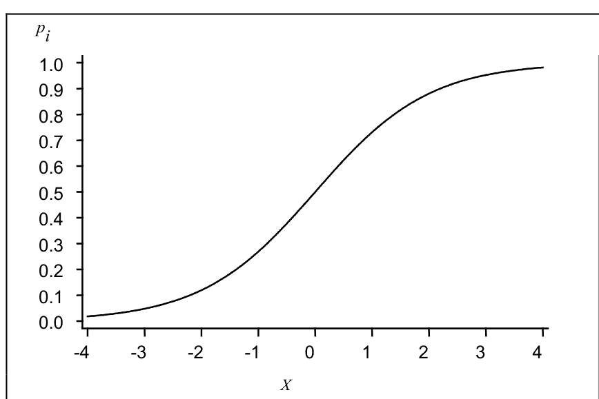

### 2.6 逻辑模型的估计：一般原则

现在我们有了二分因变量的模型，下一步是使用样本数据来估计系数。如何做到这一点取决于你处理的数据类型。如果是分组数据，有三种 readily available 方法：普通最小二乘、加权最小二乘和最大似然。

分组数据出现在解释变量均为离散且数据以列联表的形式排列时。我们将在第 4 章看到几个分组数据的例子。分组数据也可能出现在数据从自然发生的群体中收集时。例如，假设分析单位是企业公司，因变量是员工为全职工人的概率。设 P_i 为企业 i 中全职工作的员工所占的观察比例。要通过 OLS 估计逻辑模型，我们可以简单地对 P 取 logit 变换，即 log[P/(1-P)]，然后将其对企业特征和员工平均特征进行回归。加权最小二乘分析类似，只是数据会被加权以调整异方差。SAS 过程 CATMOD 对分组数据执行 WLS 估计（除最大似然外）。

最大似然是估计分组数据逻辑模型的第三种方法，也是对 *个体水平* 数据 *唯一* 通用的方法。对于个体水平数据，我们只需对每个个体观察到一个二分因变量以及个体的测量特征。OLS 和 WLS 不能用于这种数据，除非数据可以以某种方式分组。如果 $y_i$ 只能取 1 和 0 的值，就不可能应用 logit 变换——你会得到负无穷或正无穷。换句话说，任何二分变量的变换仍然是二分的。

最大似然是一种非常通用的估计方法，广泛用于各种统计模型。你可能在对数线性模型、潜变量模型或事件史模型中遇到过它。有两个原因导致这种流行。首先，已知 ML 估计量在大样本中具有良好的性质。在相当一般的条件下，ML 估计量是一致的、渐近有效且渐近正态的。一致性意味着随着样本量的增大，估计值落在真实值某个很小距离内的概率也会增大。无论距离多小或指定的概率多高，总有一个样本量能使估计量落在该距离内的概率更高。一致性的一个含义是 ML 估计量在大样本中近似无偏。渐近有效性意味着在大样本中，估计值的标准误差大约至少与任何其他估计方法一样小。最后，估计值的抽样分布在大样本中近似正态，这意味着你可以使用正态和卡方分布来计算置信区间和 *p*-值。

所有这些近似随着样本量的增大而变得更好。尽管这些理想性质仅在大样本中得到证明，这 *不* 意味着 ML 对小样本有不良性质。它只是意味着我们通常 *不* 知道小样本性质的确切情况。在没有有吸引力的替代方案的情况下，研究人员常规地对大样本和小样本都使用 ML 估计。虽然我不会反对这种做法，但我确实敦促在样本很小时谨慎解释 *p*-值和置信区间。尽管有诱惑在小样本中接受 *较大 p*-值作为对零假设的证据，实际上更合理的要求是 *更小* 的值，以补偿正态或卡方分布近似可能很差的事实。

ML 流行的另一个原因是当没有其他明显候选者时，通常很容易推导 ML 估计量。ML 处理得非常好的一个案例是因变量为分类的数据。

ML 的基本原则是选择那些如果为真，会最大化观察到我们事实上观察到的数据的概率的参数值作为估计值。这有两个步骤：（1）写下数据概率作为未知参数函数的表达式，（2）找到使该表达式值尽可能大的未知参数值。

第一步被称为构造 *似然函数*。为此你必须指定一个模型，这相当于为因变量选择一个概率分布并选择一个将该分布的参数与解释变量的值联系起来的函数形式。在逻辑模型的情况下，二分因变量被假定具有二项分布，试验次数为一次，“成功”概率为 $p_i$。然后假定 $p_i$ 根据方程 (2.3) 即逻辑模型依赖于解释变量。最后，我们假定观测值在个体之间是独立的。

第二步——最大化——通常需要迭代数值方法，这意味着它涉及连续逼近。这种方法通常比普通最小二乘等非迭代方法计算需求更高。对于感兴趣的人，我将在第 3 章中逐步讲解构造和最大化似然函数的数学基础。这里我关注 ML 估计与 SAS 的一些实际方面。

### 2.7 使用 PROC LOGISTIC 进行最大似然估计

用于执行逻辑回归模型 ML 估计的最受欢迎的 SAS 过程是 PROC LOGISTIC。SAS 还有其他几个过程也可以做到这一点，我们将在后面的章节中遇到一些。但 LOGISTIC 已存在最久，并且拥有大多数数据分析人员可能使用的最大功能集。

让我们估计一个与我们在第 2.2 节中检查的线性概率模型类似的逻辑模型。最小 SAS 代码为


```
PROC LOGISTIC DATA=penalty;
    MODEL death(EVENT='1')=blackd whitvic serious;
RUN;
```

当然，后面我们还会考虑许多选项和特殊功能。

我在 MODEL 语句中指定的一个选项是 EVENT='1'，它位于因变量之后。LOGISTIC 的默认行为是估计一个预测因变量最低值的模型。因此，如果我省略了 EVENT='1'，结果将是一个预测因变量 DEATH 等于 0 的概率的 logistic 模型。EVENT='1' 选项将其反转，使得模型预测因变量等于 1 的概率。 （围绕 1 的单引号是必要的，因为 PROC LOGISTIC 将因变量视为字符变量而不是数值变量。）

实现此目的的一种等效且流行的方法是使用选项 DEATH(DESCENDING)，它告诉 LOGISTIC 对 DEATH 的“更高”值建模而不是更低值。但什么是更高而不是更低，有时取决于所选择的其它选项，因此更安全的做法是明确指定要建模的因变量的值。如果你忘记了 EVENT='1' 选项，唯一的结果就是系数符号发生变化。只要你意识到自己做了什么，就不需要重新运行模型。

结果显示在 Output 2.3 中。“Model Information” 表很直接，除了“Optimization Technique”，它报告为 Fisher’s scoring。这是用于最大化似然函数所使用的数值方法，我们将在第 3 章看到它的工作原理。在“Response Profile” 表之后，我们看到信息“Probability modeled is death=1”。如果我们没有使用 EVENT='1' 选项，这里会显示“death=0”，因此检查这一点很重要，以便正确解释系数的符号。接下来我们被告知收敛准则已满足，这是一件好事。迭代方法并不总是收敛，我们将在第 3 章讨论为什么会发生这种情况以及如何处理。

下一张表报告了三种不同的“Model Fit Statistics：” AIC、SC 和 -2 Log L。这些拟合统计量的值显示了两种不同模型：仅有截距但没有协变量（预测因子）的模型，以及包含所有指定预测因子（协变量）的模型。通常，我们可以忽略 INTERCEPT ONLY 列。最基本的拟合统计量 -2 Log L，仅仅是似然对数的最大化值乘以 −2。我们将在第 3 章看到这个数字是如何得到的。-2 Log L 值越高，数据拟合越差。但请记住，该统计量的整体幅度在很大程度上取决于观测值的数量。此外，对于什么是良好的拟合并没有绝对标准，因此只能用该统计量来比较拟合到同一数据集的不同模型。

-2 Log L 的问题在于，具有更多协变量的模型仅凭偶然就会拟合得更好。其余两个拟合统计量通过惩罚具有更多协变量的模型来避免这个问题。Akaike 信息准则（AIC）计算为

$AIC = -2 \log L + 2k$

其中 $k$ 是参数的数量（包括截距）。因此，在本例中，有四个参数，这将在 -2 Log L 上增加 8。

Schwarz 准则（SC），也称为贝叶斯信息准则（BIC），对额外参数施加更严厉的惩罚：

$SC = -2 \log L + k \log n$

其中 $n$ 是样本量。在本例中，$n = 147$ 且 $\log n = 4.99$。因此，要得到 SC 值，我们将 4 次 4.99 = 19.96 加到 -2 Log L 上。

这两种惩罚统计量都可用于比较具有不同协变量集的模型。被比较的模型不必在嵌套意义上相关，即一个模型是另一个模型的特例。然而，这些统计量不能用于构建正式的假设检验，因此比较仅是非正式的。

下一张表是“Testing Global Null Hypothesis: BETA=0”。在此表中，有三个卡方统计量，其值为 12.206、11.656 和 10.8211。三个统计量都在检验相同的零假设——所有解释变量的系数均为 0。 （在线性回归中，该假设通常通过整体 $F$ 检验来检验。）每个统计量的三个自由度对应于自变量的三个系数。在本例中，相关的 $p$ 值约为 .01，因此我们可以拒绝零假设并得出至少一个系数不为 0 的结论。

统计量标记为“Wald Chi-Square”。它们是通过将每个系数除以其标准误差并平方结果来计算的。如果我们省略平方运算（许多软件包就是这样做的），我们可以称它们为 z 统计量，并且在零假设下它们将具有标准正态分布。在这种情况下，从正态表中计算的 $p$ 值将与此处报告的卡方 $p$ 值完全相同。

我们看到变量 SERIOUS 的系数高度显著，而变量 WHITVIC 的系数显然不显著。BLACKD 的 $p$ 值为 .13，接近常规显著性水平，但还不够。现在将这些 $p$ 值与 Output 2.1 中普通线性回归分析的 $p$ 值进行比较。虽然不完全相同，但它们 remarkably 相似。在这种情况下，logistic 回归和 OLS 回归导致我们得出完全相同的定性结论。然而，比较两种方法中的系数估计值比较困难，我在本章中不会尝试这样做。

下一张表中的优势比是通过简单地对第一列中的系数取指数得到的，即计算 exp(β)。它们在 logistic 回归系数的解释中非常重要，我们将在下一节讨论该解释。95% 置信区间是这样得到的。首先，我们以通常的方式围绕原始 β 系数得到 95% 置信区间。即，我们加上和减去 1.96 个标准误差。要得到优势比的置信区间，我们对这些上下置信限取指数。

Output 2.3 的最后一部分，标记为“Association of Predicted Probabilities and Observed Responses”，是试图衡量模型解释力的尝试。我将在第 3.7 节讨论这些统计量。

### 2.8 解释系数

当 logistic 回归首次流行时，反对其发展的最大抱怨之一是系数没有直观的意义。 admittedly，它们不如线性概率模型中的系数容易解释。对于线性概率模型，.25 的系数告诉你，事件的预测概率会因解释变量每增加 1 个单位而增加 .25。相比之下，logit 系数为 .25 告诉你，对数几率会因解释变量每增加 1 个单位而增加 .25。但谁知道对数几率增加 .25 意味着什么？

基本问题是 logistic 模型假设概率与解释变量之间存在非线性关系，如图 2.1 所示。独立变量增加 1 个单位时概率的变化取决于你从哪里开始。然而，如果我们以几率而不是概率来思考，事情就会变得简单得多。

在 Output 2.3 中，我们看到了“Analysis of Maximum Likelihood Estimates” 表中估计的 β 系数及其相关统计量。除了符号外，它们很难解释。让我们转而查看“Odds Ratio Estimates” 表中的数字，在本例中，它们是通过计算 e^β 从参数估计得到的。 （当模型中存在 CLASS 变量时，优势比可能会根据参数化方式不同而计算不同）。这些更合适的描述是调整后的优势比，因为它们控制了模型中的其他变量。回想一下，BLACKD 对黑人被告的值为 1，对其他人则为 0。1.813 的优势比告诉我们，黑人被告被判死刑的预测几率是非黑人被告的 1.813 倍。换句话说，黑人被告被判死刑的几率比其他被告高 81%。这与表 2.2 中发现的未调整优势比 1.47 相比。虽然 BLACKD 的调整后优势比在统计上不显著（95% 置信区间包含 1，对应于无效应），但它仍然是我们对该变量效应的最佳估计。

对于指示白人受害者的虚拟变量 WHITVIC，优势比为 1.292。这意味着当受害者为白人时，死亡的预测几率比受害者非白人时高出约 29%。当然，系数远未达到统计显著性，因此我们不希望对该值给予太多信心。那对于在 .01 水平上统计显著的变量 SERIOUS 的系数呢？回想一下，该变量以 15 点量表衡量。对于定量变量，有助于从优势比中减去 1 并乘以 100，即计算 100(e^β−1)。这告诉我们自变量每增加 1 个单位时几率的百分比变化。在本例中，我们发现 SERIOUS 量表增加 1 个单位与被判死刑的预测几率增加 21% 相关。注意，如果 β 系数显著不同于 0，则相应的优势比显著不同于 1。对优势比进行单独检验没有必要。

以优势比解释系数无疑是处理 logistic 模型的最简单方法。另一方面，优势比有时如果


这些概率接近于1或0。假设在一所富裕的郊区高中，毕业概率是0.99，对应的优势比（odds）为99。当对贫困学生的助学金增加后，毕业概率上升到0.995，这意味着优势比为199。显然，在新项目下，毕业的优势比起初*翻了一倍多*，尽管毕业的学生只增加了0.5个百分点。这是一个有意义的增长吗？这取决于许多非统计层面的问题。

对于那些坚持用概率来解读逻辑斯蒂模型的人来说，有多种图形和表格方法可用（Long 1997）。或许最简单的方法是使用公式（2.6）：

$$\frac{\partial p_i}{\partial x_i}=\beta p_i(1-p_i).$$

该公式表明，$x$ 每增加一个单位时概率的变化，既取决于 $x$ 的逻辑斯蒂回归系数，也取决于概率本身的值。要使这一公式在实践中具有实用性，我们需要知道起始概率是多少。如果必须选择一个值，最自然的选择是整个样本中事件发生的比例。在我们的例子中，147名被告中有50人被判处死刑，因此总体比例为0.34。用0.34乘以1−0.34，得到0.224。我们将输出2.3中的每个系数乘以0.224，得到：

| 变量 | 数值 |
|---|---:|
| BLACKD | .133 |
| WHITVIC | .057 |
| SERIOUS | .046 |

于是我们可以说，平均而言，如果被告是黑人，被判处死刑的概率比非黑人高0.133；如果受害者是白人，比非白人高0.057；SERIOUS量表每增加一个单位，概率高0.046。这些有时被称为“边际效应”，在某些领域相当受关注。当然，这些数字只是粗略地反映了当$x$变量发生给定变化时实际情况的大致影响。但请注意，它们与输出2.1中使用OLS回归得到的系数非常相似。

除了为$p_i$选择一个单一值，我们还可以使用公式（2.5）为每个个体计算预测概率。然后我们可以用导数公式为每个个体生成边际效应。你可以使用PROC QLIM（SAS/ETS产品的一部分）轻松获得这些结果，在OUTPUT语句中使用MARGINAL选项。代码如下：

```sas
PROC QLIM DATA=penalty;
    ENDOGENOUS death~DISCRETE(DIST=LOGISTIC);
    MODEL death = blackd whitvic serious;
    OUTPUT OUT=a MARGINAL;
PROC PRINT DATA=a(OBS=10);
    VAR meff_p2_blackd meff_p2_whitvic meff_p2_serious;
RUN;
```

QLIM报告的系数、标准误和检验统计量（未显示）与PROC LOGISTIC产生的结果完全相同。PROC PRINT生成的表格如输出2.4所示，显示输出数据集中前10个观测值。对于每个变量，我们得到该变量每增加一个单位时，死刑概率的预测变化，这是基于某个特定个体的预测概率计算的。

#### 输出2.4：PROC QLIM对前10个案例产生的边际效应

| 观测 | Meff_P2_blackd | Meff_P2_whitvic | Meff_P2_serious |
|---:|---:|---:|---:|
| 1 | 0.13068 | 0.056312 | 0.041070 |
| 2 | 0.14660 | 0.063172 | 0.046073 |
| 3 | 0.08712 | 0.037541 | 0.027380 |
| 4 | 0.12615 | 0.054358 | 0.039645 |
| 5 | 0.14692 | 0.063309 | 0.046173 |
| 6 | 0.10523 | 0.045347 | 0.033072 |
| 7 | 0.09613 | 0.041422 | 0.030210 |
| 8 | 0.14880 | 0.064118 | 0.046763 |
| 9 | 0.12982 | 0.055942 | 0.040800 |
| 10 | 0.13682 | 0.058957 | 0.042999 |

### 2.9 CLASS变量

与其他几个SAS回归过程一样，PROC LOGISTIC也有一个CLASS语句，允许你指定某个变量应按分类变量（名义变量）处理。当CLASS变量作为解释变量包含在MODEL语句中时，LOGISTIC会自动创建一组“设计变量”来表示该分类变量的各个水平。请记住，当预测变量是一个指示（虚拟）变量时，比如BLACKD或WHITVIC，它们只有0或1两个取值，此时无需将其声明为CLASS变量。事实上，将指示变量放入CLASS语句可能会产生误导性结果。这是因为CLASS语句可能会以意想不到的方式重新编码该变量，这一点我们稍后会看到。因此，CLASS语句应只用于类别多于两类的分类变量，或用于具有类似“是”和“否”这种字符值的二分变量。

下面是一个使用死刑数据的例子。数据集中包含变量CULP，取值为1到5的整数（5表示高罪责程度，1表示低罪责程度，该划分基于法规规定的大量加重和减轻情节）。虽然我们可以将该变量视为间隔量表，但也可以将其视为一组类别。为此，我们运行以下程序：

```
PROC LOGISTIC DATA=penalty;
    CLASS culp /PARAM=REF;
    MODEL death(EVENT='1') = blackd whitvic culp ;
RUN;
```

CLASS语句将CULP声明为分类变量。CLASS语句中可以有多个变量。PARAM=REF选项告诉LOGISTIC创建一组四个虚拟（指示）变量，分别对应CULP除最高值（CULP=5）以外的每个取值。结果见输出2.5。

#### 输出2.5：在PROC LOGISTIC中使用CLASS变量

**效应类型3分析**

| 效应 | 自由度 | Wald卡方 | Pr > ChiSq |
|---|---:|---:|---:|
| blackd | 1 | 7.9141 | 0.0049 |
| whitvic | 1 | 2.1687 | 0.1408 |
| culp | 4 | 44.0067 | <.0001 |

**最大似然估计分析**

| 参数 | 自由度 | 估计值 | 标准误 | Wald卡方 | Pr > ChiSq |
|---|---:|---:|---:|---:|---:|
| Intercept | 1 | 0.5533 | 0.7031 | 0.6193 | 0.4313 |
| blackd | 1 | 1.7246 | 0.6131 | 7.9141 | 0.0049 |
| whitvic | 1 | 0.8385 | 0.5694 | 2.1687 | 0.1408 |
| culp 1 | 1 | -4.8670 | 0.8251 | 34.7926 | <.0001 |
| culp 2 | 1 | -3.0547 | 0.7754 | 15.5185 | <.0001 |
| culp 3 | 1 | -1.5294 | 0.8400 | 3.3153 | 0.0686 |
| culp 4 | 1 | -0.3610 | 0.8857 | 0.1662 | 0.6835 |

由于变量CULP有五个可能取值，LOGISTIC创建了四个虚拟变量，分别对应取值1到4。与其他包含CLASS变量的过程一样，默认将最高值作为省略类别。我们稍后会看到如何更改这一设置。因此，CULP的四个系数中，每一个都是特定取值与最高值之间的比较。更具体地说，每个系数可以解释为，在控制模型中其他变量的情况下，CULP取该特定值时死刑的对数优势比减去CULP=5时的对数优势比。

当模型中有CLASS变量时，LOGISTIC会额外提供一个表，标记为“效应类型3分析”。对于非CLASS变量，该表格与下方标准表格完全重复——卡方值和p值完全相同。而对于CLASS变量，它给了我们非常有用的信息：对所有与该变量相关的系数均为0的原假设进行检验。换句话说，它检验了CULP是否对死刑概率有任何影响。在本例中，我们有充分的证据表明CULP确实有影响。该检验特别吸引人的一点在于，它对省略类别的选择不变，甚至对构建设计变量的各种截然不同的方法（我稍后会讨论）也不变。

四个系数的模式正如人们所预期的那样。CULP=1的被告比CULP=5的被告更不可能被判处死刑。CULP每一级的增加都与死刑概率的增加相关联。还请注意，当CULP被纳入模型后，BLACKD（黑人被告）的系数比输出2.3中的大得多，并且现在在统计上显著。


如果不喜欢默认的参考类别（本例中为 5），该如何更改它？如果希望它为 CULP 的最低值而不是最高值，只需使用

```
CLASS culp / PARAM=REF DESCENDING;
```

如果希望它为某个特定值，例如 3，使用

```
CLASS culp(REF='3') / PARAM=REF;
```

假设你想比较 CLASS 变量的一个类别，例如 CULP=2 和 CULP=3。你当然可以通过重新运行模型并将其中一个值设为参考类别来实现。但通常使用 TEST 语句或 CONTRAST 语句更容易，而且你可以随意使用任意多个。下面的两个语句检验相同的零假设，即 CULP=2 和 CULP=3 的系数没有差异：

```
CONTRAST 'Culp2 vs. Culp3' culp 0 1 -1 0;
TEST culp2=culp3;
```

CONTRAST 语句需要一个标签，可以是引号括起来的任意文本。如果只有一个 CONTRAST，这会很烦人，但如果有多个 CONTRAST，则非常有用，因为标签有助于你在输出中区分不同的检验。下面说明 CONTRAST 语句的工作原理：我们知道 CULP 有四个系数。代码“CULP 0 1 -1 0”告诉 SAS 将第一个系数乘以 0，第二个系数乘以 1，第三个系数乘以 -1，第四个系数乘以 0，将结果相加，并检验总和是否等于 0。当然，这等价于检验第二个和第三个系数之间是否存在差异。

TEST 语句稍微更直接一些。要引用一个系数，只需将变量的值附加到变量名本身。TEST 语句可以 optionally 有一个标签，但标签在 TEST 之前，且不能包含空格。因此，我们可以写成

```
Culp2_vs_Culp3: TEST culp2=culp3;
```

#### Output 2.7 Results from CLASS Statement Using Default Design Variables

| Class Level Information |
|---|---|---|---|
| Class | Value | Design Variables | |
| culp | 1 | 1 0 0 0 |
|  | 2 | 0 1 0 0 |
|  | 3 | 0 0 1 0 |
|  | 4 | 0 0 0 1 |
|  | 5 | -1 -1 -1 -1 |

| Type 3 Analysis of Effects |
| Effect | DF | Wald Chi-Square | Pr > ChiSq |
| blackd | 1 | 7.9141 | 0.0049 |
| whitvic | 1 | 2.1687 | 0.1408 |
| culp | 4 | 44.0067 | <.0001 |

| Analysis of Maximum Likelihood Estimates |
| Parameter | DF | Estimate | Standard Error | Wald Chi-Square | Pr > ChiSq |
| Intercept | 1 | -1.4092 | 0.6066 | 5.3972 | 0.0202 |
| blackd | 1 | 1.7246 | 0.6131 | 7.9141 | 0.0049 |
| whitvic | 1 | 0.8385 | 0.5694 | 2.1687 | 0.1408 |
| culp 1 | 1 | -2.9046 | 0.5007 | 33.6535 | <.0001 |
| culp 2 | 1 | -1.0923 | 0.4645 | 5.5304 | 0.0187 |
| culp 3 | 1 | 0.4330 | 0.5292 | 0.6696 | 0.4132 |
| culp 4 | 1 | 1.6014 | 0.6026 | 7.0625 | 0.0079 |

| Odds Ratio Estimates |
| Effect | Point Estimate | 95% Wald Confidence Limits |
| blackd | 5.610 | 1.687 18.657 |
| whitvic | 2.313 | 0.758 7.061 |
| culp 1 vs 5 | 0.008 | 0.002 0.039 |
| culp 2 vs 5 | 0.047 | 0.010 0.215 |
| culp 3 vs 5 | 0.217 | 0.042 1.124 |
| culp 4 vs 5 | 0.697 | 0.123 3.954 |

正如 Output 2.7 中的“Type 3 Analysis of Effects”表所示，这种替代编码对 CULP 的整体检验没有影响。向下跳到“Odds Ratio Effects”表，这里也没有影响。正如我们使用 PARAM=REF 时一样，每个优势比都将某个特定类别与类别 5 进行比较。但在“Analysis of Maximum Likelihood Estimates”表中，CULP 系数及其标准误差和 p 值确实发生了重大变化。需要理解的重要一点是，这些系数并不是将 CULP 的前四个值中的每一个与值 5 进行比较。相反，它们是将 CULP 的每个类别与对数几率的总体平均值（粗略地说）进行比较，已对模型中的其他变量进行调整。因此，如果你处于 CULP 的类别 1，你获得死刑的对数几率比平均值低 2.9046。如果你在类别 4，你的对数几率比平均值高 1.6014。

那么类别 5 呢？它与平均值有何不同？要得到该值，你必须将值 1 到 4 的系数加在一起，然后改变符号。这确保了五个系数之和为零。你可以通过手工计算来完成，但让 SAS 用 ESTIMATE 语句来做要容易得多：

```
ESTIMATE 'coeff for 5' culp -1 -1 -1 -1;
```

这表示取 CULP 的四个系数，每个乘以 -1，然后将它们加在一起。结果显示在 Output 2.8 中。我们看到，对于 CULP 的值 5，其死刑对数几率比平均值高 1.9624。我们还得到了标准误差和检验该效应为 0 的零假设的 z 检验。

#### Output 2.8 Results from ESTIMATE Statement

|  | Estimate |  |  |  |
|---|---|---|---|---|
| Label | Estimate | Standard Error | z Value | Pr > |z| |
| coeff for 5 | 1.9624 | 0.5264 | 3.73 | 0.0002 |

有些人喜欢这种创建设计变量的方法，但我不是粉丝。我更喜欢与明确的参考类别进行比较。PROC LOGISTIC 还提供了多种其他创建设计变量的方法，包括序数、多项式和正交化版本。

### 2.10 Multiplicative Terms in the MODEL Statement

回归分析者通常希望建立具有 *interactions* 的模型，其中一个变量的效果取决于另一个变量的水平。实现此目的最流行的方法是在模型中包含一个新的解释变量，该变量是两个原始变量的乘积。使用 PROC LOGISTIC，你无需在 DATA 步中创建新变量，而可以直接在 MODEL 语句中指定乘积。例如，一些犯罪学家认为，杀害白人受害者的黑人被告可能更有可能被判处死刑。我们可以用以下程序对新泽西州的数据检验该假设：

```
PROC LOGISTIC DATA=penalty;
  MODEL death(EVENT='1') = blackd whitvic culp blackd*whitvic;
RUN;
```

这会产生 Output 2.9 中的表。

#### Output 2.9 Multiplicative Variables in PROC LOGISTIC

| Analysis of Maximum Likelihood Estimates |
| Parameter | DF | Estimate | Standard Error | Wald Chi-Square | Pr > ChiSq |
| Intercept | 1 | -5.4042 | 1.1626 | 21.6066 | <.0001 |
| blackd | 1 | 1.8720 | 1.0463 | 3.2013 | 0.0736 |
| whitvic | 1 | 1.0725 | 0.9877 | 1.1790 | 0.2776 |
| culp | 1 | 1.2703 | 0.1967 | 41.6883 | <.0001 |
| blackd*whitvic | 1 | -0.3272 | 1.1781 | 0.0771 | 0.7812 |

乘积项的 *p*-值为 .78，显然不显著，可以从模型中排除。MODEL 语句还具有简写表示法，允许你同时指定交互作用和两个主效应：

```
MODEL death(EVENT='1') = culp blackd|whitvic;
```

LOGISTIC 中的乘积语法也使构造多项式函数变得容易。例如，要估计一个 *cubic* 方程，你可以指定如下形式的模型

```
MODEL y = x x*x x*x*x;
```

或等价地

```
MODEL y = x|x|x;
```

这拟合模型 $\log(p/(1-p)) = \alpha + \beta_1x + \beta_2x^2 + \beta_3x^3$。

# Chapter 3

## Binary Logistic Regression: Details and Options

3.1 Introduction 40

3.2 Confidence Intervals 40

3.3 Details of Maximum Likelihood Estimation 42

3.4 Convergence Problems 46

3.5 Multicollinearity 60

3.6 Goodness-of-Fit Statistics 63

3.7 Statistics Measuring Predictive Power 68

3.8 ROC Curves 72

3.9 Predicted Values, Residuals, and Influence Statistics 81

3.10 Latent Variables and Standardized Coefficients 87

3.11 Probit and Complementary Log-Log Models 91

3.12 Unobserved Heterogeneity 97

3.13 Sampling on the Dependent Variable 103

3.14 Plotting Effects of Predictor Variables 105

### 3.1 Introduction

在本章中，我们继续讨论二元 Logit 模型及其在 PROC LOGISTIC 中的实现。我们将研究该过程的几个可选功能，考虑可能出现的一些潜在问题，并更深入地探讨估计过程的细节。你可能可以在没有本章的情况下应付，但你会错过一些有用且富有启发性的内容。

### 3.2 Confidence Intervals

在社会科学期刊中，报告系数仅 *point estimates* 和假设检验的做法很标准。然而，大多数统计学家认为 *confidence intervals* 能更好地反映估计的抽样变异。PROC LOGISTIC 自动为优势比生成 95% 置信区间，但你可能也希望对回归系数进行置信区间估计。

系数的常规置信区间很容易手工计算。对于系数的近似 95% 置信区间，你只需在标准误差乘以 1.96 的基础上加减。但你可以让 LOGISTIC 为你完成。在 LOGISTIC 中，MODEL 语句中用于常规（Wald）置信区间的选项是 CLPARM=WALD。要将其更改为 90% 区间，请在 MODEL 语句上放置选项 ALPHA=.10。

LOGISTIC 还有另一种方法，称为 *profile likelihood confidence intervals*，在样本量较小的情况下可能产生更好的近似。这种方法涉及似然函数的迭代评估。在 LOGISTIC 中，模型选项是 CLPARM=PL（profile likelihood）。profile likelihood 方法计算密集，因此对于大样本你可能需要谨慎使用。

下面是使用死刑数据集用 LOGISTIC 进行两种置信区间估计的示例：

```
PROC LOGISTIC DATA=penalty;
    MODEL death(EVENT='1') = blackd whitvic culp / CLPARM=BOTH;
RUN;
```

除了通常的结果外，我们还得到了 Output 3.1 中显示的数字。两种方法产生的区间非常相似但不完全相同。


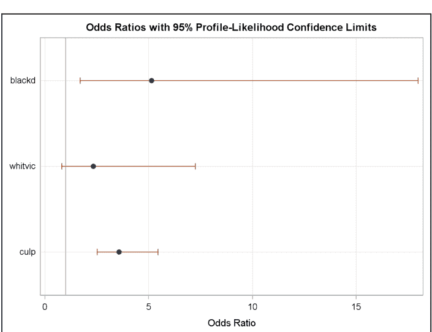

如果你想要不同增量的比值比，完全可以通过手工计算得到。如果 O 是 1 个单位增量的比值比，那么 O^k 就是 k 个单位增量的比值比。但使用 UNITS 语句来生成“定制化”的比值比会更容易。例如，要获得 CULP 增加 2 个单位的比值比，在 LOGISTIC 过程中包含以下语句：

```
UNITS culp=2 / DEFAULT=1;
```

DEFAULT 选项告诉 SAS 对模型中其他每个变量的 1 个单位增加打印比值比及其置信区间。

### 3.3 最大似然估计的细节

在第 2.6 节中，我讨论了最大似然估计量的一些一般性质。这里，我们考虑似然函数构建和最大化的细节。虽然本节可以不影响连贯性而跳过，但我强烈建议你尽力学习它。对 logistic 模型最大似然的基本理解可以帮助消除该技术的大部分神秘感。它还可以帮助你理解事物有时出错的原因和方式。

让我们从一些记号和假设开始。我们有 $n$ 个个体的數據 $(i=1,...,n)$，假定它们在统计上相互独立。对于每个个体 $i$，数据由 $y_i$ 和 $\mathbf{x}_i$ 组成，其中 $y_i$ 是一个随机变量，可能取值为 0 和 1，而 $\mathbf{x}_i=[1\ x_{i1}\ ...\ x_{ik}]'$ 是一个解释变量向量（1 用于截距）。向量记号在这里很有帮助；否则方程会变得混乱。为简单起见，我们把 $\mathbf{x}_i$ 视为每个个体的固定常数集合，而不是随机变量。 （我们可以用 $\mathbf{x}_i$ 视为随机且 $y_i$ 表示条件于 $\mathbf{x}_i$ 取值的情况下得到等价结果，但这只会使记号复杂化。）

令 $p_i$ 为 $y_i=1$ 的概率，我们假设数据由 logistic 模型生成，其表示为

$$p_i = \frac{1}{1+e^{-\mathbf{\beta x}_i}} \ ,\tag{3.1}$$ 

这等价于方程 (2.5)。

我们现在构建似然函数，它表示观测到手头数据的概率作为未知参数的函数。观测到所有观测值的 $y$ 的似然可以写为

$$L = \Pr(y_1, y_2, ..., y_n).$$

由于我们假设观测是独立的，观测到所有 $y_i$ 的总体概率可以分解为个体概率的乘积：

$$L = \Pr(y_1)\Pr(y_2)...\Pr(y_n) = \prod_{i=1}^{n}\Pr(y_i),\tag{3.2}$$

其中 $\Pi$ 表示重复乘法。

根据定义，$\Pr(y_i=1)=p_i$ 且 $\Pr(y_i=0)=1-p_i$。这意味着我们可以写

$$\Pr(y_i)=p_i^{y_i}(1-p_i)^{1-y_i}.\tag{3.3}$$

在这个方程中，$y_i$ 起到开关的作用，打开或关闭公式的各部分。当 $y_i=1$ 时，$p_i$ 的 $y_i$ 次幂只是 $p_i$。但此时 $1-y_i$ 为 0，而 $(1-p_i)$ 的 0 次幂为 1。当 $y_i=0$ 时情况相反。将方程 (3.3) 代入方程 (3.2) 并做一点代数运算可得

$$L = \prod_{i=1}^{n}p_i^{y_i}(1-p_i)^{1-y_i} = \prod_{i=1}^{n}\left(\frac{p_i}{1-p_i}\right)^{y_i}(1-p_i).$$

此时我们对等式两边取对数得到

```
$$\log L = \sum_{i} y_i \log\left(\frac{p_i}{1-p_i}\right) + \sum_{i} \log(1-p_i). \tag{3.4}$$
```

通常处理似然函数的对数更容易，因为乘积被转换为和，指数变为系数。由于对数是递增函数，什么使对数函数最大化，也会使原始函数最大化。

将我们对 logit 模型（方程 3.1）的表达式代入方程 (3.4)，我们得到

```
$$\log L = \sum_{i} \mathbf{\beta x}_i y_i - \sum_{i} \log(1 + e^{\mathbf{\beta x}_i}) , \tag{3.5}$$
```

这就是我们能对似然函数进行简化的极限。

这就引出了第 2 步，选择使方程 (3.5) 中的对数似然尽可能大的 $\mathbf{\beta}$ 值。有许多不同的方法来最大化这类函数。一种众所周知的方法是求函数关于 $\mathbf{\beta}$ 的导数，将导数设为 0，然后求解 $\mathbf{\beta}$。对方程 (3.5) 求导并设为 0 得到：

```
$$\frac{\partial \log L}{\partial \mathbf{\beta}} = \sum_{i} \mathbf{x}_i y_i - \sum_{i} \mathbf{x}_i (1 + e^{-\mathbf{\beta x}_i})^{-1}
= \sum_{i} \mathbf{x}_i y_i - \sum_{i} \mathbf{x}_i \hat{y}_i = 0 \tag{3.6}$$
```

其中

```
$$\hat{y}_i = \frac{1}{1 + e^{-\mathbf{\beta x}_i}},$$
```

给定 $\mathbf{x}_i$ 值时 $y$ 的预测概率。由于 $\mathbf{x}_i$ 是一个向量，方程 (3.6) 实际上是 $k+1$ 个方程的系统，每个 $\mathbf{\beta}$ 的元素一个。

熟悉 OLS 理论的人可能会认识到方程 (3.6) 的第二行与线性模型的 *正规方程* 相同。区别在于线性模型中 $\hat{y}$ 是 $\mathbf{\beta}$ 的线性函数，而在 logit 模型中 $\hat{y}$ 是 $\mathbf{\beta}$ 的非线性函数。

因此，除了像单个二分 $x$ 变量这样的特殊情况外，方程 (3.6) 没有显式解。相反，我们必须依赖迭代方法，这相当于对解进行连续逼近，直到逼近“收敛”到

正确值。同样，有许多不同的方法可以做到这一点。所有方法都产生相同的解，但在收敛速度、对起始值的敏感性以及每次迭代的计算难度等因素上有所不同。

最广泛使用的迭代方法之一是 Newton-Raphson 算法，可以描述如下：令 **U(β)** 为 log L 关于 **β** 的一阶导数向量，令 **I(β)** 为 log L 关于 **β** 的二阶导数矩阵。

即，

**U(β)** = ∂log L / ∂β = Σᵢ **x**ᵢ yᵢ − Σᵢ **x**ᵢ ŷᵢ

**I(β)** = ∂²log L / ∂β∂β′ = − Σᵢ **x**ᵢ **x**′ᵢ ŷᵢ (1 − ŷᵢ)

一阶导数向量 **U(β)** 有时称为 *梯度* 或 *得分*。二阶导数矩阵 **I(β)** 称为 *Hessian*。Newton-Raphson 算法为

**β**₍ⱼ₊₁₎ = **β**ⱼ − **I**⁻¹(**β**ⱼ) **U(β**ⱼ)  (3.7)

其中 **I**⁻¹ 是 **I** 的逆。为了实现该算法，我们需要一组起始值 **β**₀。PROC LOGISTIC 通过将所有斜率系数设为 0 来开始。截距设为 log[p/(1-p)]，其中 p 是事件的总体比例。这些起始值代入方程 (3.7) 的右边，得到第一次迭代的结果 **β**₁。然后这些值再次代入右边，重新计算一阶和二阶导数，结果为 **β**₂。重复此过程直到得到“收敛”，这意味着右边代入的内容与左边得到的内容相同。实际上，你永远得不到 *完全* 相同的结果，因此需要收敛准则来判断多接近才算足够。

LOGISTIC 中的默认准则有些复杂，也许不值得我们关注。但由于每次 PROC LOGISTIC 成功运行都会报告“收敛准则 (GCONV=1E-8) 满足”，我们可能应该考虑这意味着什么。回顾似然函数的最大值是在对数似然的一阶导数 **U(β)** 等于 0 时获得的。为了测试是否确实实现了这一点，LOGISTIC 在每次迭代 j 计算以下量：

$$\frac{\mathbf{U}(\boldsymbol{\beta}_j)'\mathbf{I}^{-1}(\boldsymbol{\beta}_j)\mathbf{U}(\boldsymbol{\beta}_j)}{|\log L(\boldsymbol{\beta}_j)|+.000001}$$

如果该数值小于 .00000001，则宣布收敛并停止算法。

在找到解 $\hat{\boldsymbol{\beta}}$ 之后，Newton-Raphson 算法的副产品是系数协方差矩阵的估计，即 $-\mathbf{I}^{-1}(\hat{\boldsymbol{\beta}})$。该矩阵可通过在 MODEL 语句中将 COVB 作为选项打印出来，通常用于构建关于系数线性组合的假设检验。系数的标准误估计是通过取该矩阵主对角线元素的平方根得到的。

### 3.4 收敛问题

如上一节所述，logistic 模型的最大似然估计是连续逼近的迭代过程。通常该过程顺利进行，无需特别注意。只有很少情况下需要超过 10 次迭代才能达到收敛。然而，有时迭代过程会中断，从而无法达到收敛。处理收敛失败可能是 logistic 回归用户遇到的最令人沮丧的问题之一。

LOGISTIC 的默认迭代限制为 25 次。如果算法在此限制内未收敛，LOGISTIC 会发出警告信息并打印出最后一次迭代的结果。虽然可以通过 MODEL 语句中的 MAXITER= 选项提高迭代限制，但这很少能解决问题。25 次迭代内未收敛的模型通常永远不会收敛。

在大多数收敛失败的情况下，最大似然估计根本不存在。考虑以下 SAS 程序，它输入 $x$ 和 $y$ 的六个观测值，然后对 $y$ 关于 $x$ 进行 logistic 回归：

```
DATA compsep;
    INPUT x y;
    DATALINES;
1 0
2 0
3 0
4 1
5 1
```


```
6 1
;
PROC LOGISTIC;
    MODEL y(EVENT='1') = x;
RUN;
```

#### Output 3.3 PROC LOGISTIC Results for Data with Complete Separation

| Model Convergence Status |
|---| 
| Complete separation of data points detected. |

Warning: The maximum likelihood estimate does not exist.

Warning: The LOGISTIC procedure continues in spite of the above warning. Results shown are based on the last maximum likelihood iteration. Validity of the model fit is questionable.

| Model Fit Statistics | | |
| Criterion | Intercept Only | Intercept and Covariates |
| AIC | 10.318 | 4.007 |
| SC | 10.110 | 3.591 |
| -2 Log L | 8.318 | 0.007 |

| Testing Global Null Hypothesis: BETA=0 | | | |
| Test | Chi-Square | DF | Pr > ChiSq |
| Likelihood Ratio | 8.3105 | 1 | 0.0039 |
| Score | 4.6286 | 1 | 0.0314 |
| Wald | 0.1437 | 1 | 0.7046 |

| Analysis of Maximum Likelihood Estimates | | | | | |
| Parameter | DF | Estimate | Standard Error | Wald Chi-Square | Pr > ChiSq |
| Intercept | 1 | -44.2060 | 117.8 | 0.1409 | 0.7074 |
| x | 1 | 12.6303 | 33.3127 | 0.1437 | 0.7046 |

在 Output 3.3 中，LOGISTIC 报告“Complete separation of data points detected，”然后警告我们“the maximum likelihood estimate does not exist。”这些警告信息也会出现在 LOG 窗口中。完全分离意味着存在自变量的某种线性组合可以完美预测因变量。在本例中，只要 x 大于 3.5，y 就等于 1。只要 x 小于 3.5，y 就等于 0。因此我们可以从 x 完美预测 y。如果你查看这些数据的迭代历史记录（你可以通过在 MODEL 语句中加入 ITPRINT 选项来做到），你会发现 x 的系数在每次迭代中都会变大。经过八次迭代后，LOGISTIC 检测到完全分离并停止迭代。在此次迭代中的结果报告在“Analysis of Maximum Likelihood Estimates”表中。我们在那里看到 x 的系数为 12.63，这是一个极大的值。估计的标准误差更大，导致卡方值很小，p 值很高。

在“Model Fit Statistics”表中，我们看到该模型（Intercept and Covariates）的 -2 log L 为 .007，非常接近 0，而 0 是其下界。图 3.1 是系数在 0 到 10 之间时对数似然函数的图。我们看到随着 β 增大，对数似然始终在增加，并以渐近线趋近于零。因此，似然函数没有最大值，这意味着最大似然估计不存在。

#### Figure 3.1 Log-Likelihood as a Function of the Slope under Complete Separation

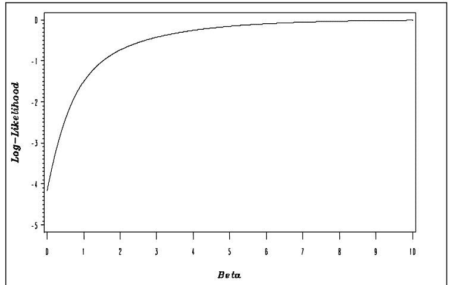

Output 3.4 中的另一个奇特之处是“Testing Global Null Hypothesis: BETA=0”中卡方统计量的差异。似然比卡方很大（8.3），p 值小于 .01。而 Wald 卡方则很小，p 值为 .70。Score 统计量介于两者之间。一般来说，当数据存在分离或接近分离时，Wald 卡方往往非常不准确。

完全分离相对不常见。更常见的是称为 *quasi-complete separation* 的情况。我们可以通过向之前的数据集添加一个观测值来举例说明。

```
DATA quas isep;
    INPUT x y;
    DATALINES;
1 0
2 0
3 0
4 0
4 1
5 1
6 1
;
PROC LOGISTIC;
    MODEL y(EVENT='1') = x;
RUN;
```

这与之前的例子唯一的区别是当 *x*=4 时，有一个观测值的 *y*=0，另一个观测值的 *y*=1。一般来说，只要存在完全分离，除了预测变量的一个取值同时出现因变量的两个值外，其余情况即为准完全分离。

Output 3.4 的结果与完全分离的 Output 3.3 非常相似。我们再次收到警告信息，尽管 LOGISTIC 告诉我们最大似然 *可能* 不存在，而不是 *不存在*。再次，我们看到检验“global null hypothesis”时三个卡方统计量存在很大差异。我们得到一个非常大的系数，而标准误差更大。与完全分离不同的是，对数似然并不会降到零。对数似然函数的图看起来会非常像图 3.1 中的图，但曲线的渐近线会低于零。

#### Output 3.4 PROC LOGISTIC Results under Quasi-Complete Separation

| Model Convergence Status |
|---| 
| Quasi-complete separation of data points detected. |

**Warning:** The maximum likelihood estimate may not exist.
**Warning:** The LOGISTIC procedure continues in spite of the above warning. Results shown are based on the last maximum likelihood iteration. Validity of the model fit is questionable.

| Model Fit Statistics | | | |
|---|---|---|---|
| Criterion | Intercept Only | Intercept and Covariates | |
| AIC | 11.561 | 6.774 | |
| SC | 11.507 | 6.665 | |
| -2 Log L | 9.561 | 2.774 | |

| Testing Global Null Hypothesis: BETA=0 | | | |
|---|---|---|---|
| Test | Chi-Square | DF | Pr > ChiSq |
| Likelihood Ratio | 6.7871 | 1 | 0.0092 |
| Score | 4.2339 | 1 | 0.0396 |
| Wald | 0.0338 | 1 | 0.8542 |

| Analysis of Maximum Likelihood Estimates | | | | | |
|---|---|---|---|---|---|
| Parameter | DF | Estimate | Standard Error | Wald Chi-Square | Pr > ChiSq |
| Intercept | 1 | -33.2785 | 181.1 | 0.0337 | 0.8542 |
| x | 1 | 8.3196 | 45.2858 | 0.0338 | 0.8542 |

在我经验中，准完全分离最常见的原因是具有以下属性的哑变量预测因子：在哑变量的一个水平上，因变量的所有案例均为 1 或均为 0。为了说明这一点，让我们将死刑案件样本限制为被告为非黑人的案件。然后我们拟合一个包含两个自变量 CULP 和 SERIOUS 的模型。我们将 CULP 作为分类自变量（有 5 个类别）处理，将其放入 CLASS 语句中。

```
PROC LOGISTIC DATA=penalty;
    WHERE blackd=0;
    CLASS culp /PARAM=REF;
    MODEL death(EVENT='1') = culp serious;
RUN;
```

LOGISTIC 设置了对应于 CULP 前四个类别的四个哑变量。参数估计值及相关统计量显示在 Output 3.5 中。尽管输出中未显示，LOGISTIC 发出了我们在 Output 3.4 中看到的准完全分离的相同警告，并且全局似然比卡方与 Wald 卡方之间再次存在很大差异。我们在这里感兴趣的是准完全分离的来源。

#### Output 3.5 LOGISTIC Estimates for Nonblack Defendants Only

| Analysis of Maximum Likelihood Estimates |
| Parameter | DF | Estimate | Standard Error | Wald Chi-Square | Pr > ChiSq |
| Intercept | 1 | 3.1273 | 1.7545 | 3.1772 | 0.0747 |
| culp 1 | 1 | -15.5467 | 148.6 | 0.0109 | 0.9167 |
| culp 2 | 1 | -3.8366 | 1.2267 | 9.7819 | 0.0018 |
| culp 3 | 1 | -0.7645 | 1.1312 | 0.4568 | 0.4991 |
| culp 4 | 1 | -0.9595 | 1.0587 | 0.8213 | 0.3648 |
| serious | 1 | -0.1693 | 0.1385 | 1.4950 | 0.2214 |

对于 CULP 1，我们看到了准完全分离的典型迹象：系数绝对值很大，标准误差极大，导致 p 值很高。要了解原因，请查看表 3.1，其中显示了 74 名非黑人被告的 DEATH 与 CULP 的交叉分类。准完全分离发生的原因是 CULP 第 1 水平的全部 30 名被告均被判处无期徒刑。

#### Table 3.1 Cross-Classification of Death Penalty by Culpability, Nonblack Defendants

| DEATH | | | |
| CULP | 0 | 1 | Total |
| 1 | 30 | 0 | 30 |
| 2 | 14 | 2 | 16 |
| 3 | 2 | 4 | 6 |
| 4 | 3 | 6 | 9 |
| 5 | 3 | 10 | 13 |
| Total | 52 | 22 | 74 |

关于完全分离或准完全分离，你可以做什么？首先要弄清楚是哪个变量（或变量）导致了问题。如我们所见，它们很可能是系数很大且标准误差更大的变量。为了确定导致问题的变量，你应该删除单个变量或一组变量


从模型中剔除变量，直到问题消失。同时，查看任何分类自变量与因变量的交叉分类也很有帮助，正如我们在表 3.1 中所做的那样。如果在这些表格中的任何一个发现某个单元格频数为 0，就找到了准完全分离的一个原因。

找到问题变量之后，该怎么办？答案取决于你面临的是完全分离还是准完全分离。如果是完全分离，只要问题变量仍在模型中，就无法获得其他变量系数的估计值。因为问题变量完全解释了因变量的变异，其他变量就没有任何剩余可解释的空间了。另一方面，将问题变量从模型中排除也并非理想做法。它们之所以成为问题，是因为它们对因变量的预测能力过强。遗漏最强的预测变量可能会误导性地让人觉得它们不重要，同时也可能使剩余变量的系数产生偏倚。如果你决定呈现不包含问题变量的模型结果，还应该报告问题变量完美预测了因变量。

如果问题是准完全分离，则还有其他选项需要考虑。

**对问题变量重新编码。** 考虑输出 3.5 中所示出现准完全分离的模型。问题出现是因为所有 CULP=1 的人都被判处了无期徒刑。消除该问题的一种方法是将 CULP 从 CLASS 语句中取出，将其视为定量变量。当然，这假设 CULP 的影响是线性的，而这一假设对数据而言可能限制过强。另一种方法是合并 CULP 的类别 1 和 2，使合并后的类别有 2 个死刑判决和 44 个无期徒刑判决：

```
DATA;
    SET penalty;
    IF culp=1 THEN culp=2;
PROC LOGISTIC;
    WHERE blackd=0;
    CLASS culp / PARAM=REF;
    MODEL death(EVENT='1')=culp serious;
RUN;
```

这产生了输出 3.6 中所示的估计值。现在，我们对合并后的类别（CULP 2）得到了合理的估计值，而且高度显著。所有警告消息都已消失。

#### 输出 3.6 合并类别以消除准完全分离

| 最大似然估计分析 |
| 参数 | 自由度 | 估计值 | 标准误差 | Wald 卡方 | Pr > 卡方 |
| 截距 | 1 | 2.7033 | 1.6868 | 2.5682 | 0.1090 |
| culp 2 | 1 | -4.9386 | 1.2423 | 15.8037 | <.0001 |
| culp 3 | 1 | -0.7032 | 1.1205 | 0.3939 | 0.5303 |
| culp 4 | 1 | -0.8606 | 1.0452 | 0.6781 | 0.4103 |
| serious | 1 | -0.1329 | 0.1340 | 0.9831 | 0.3214 |

**从模型中排除个案。** 当存在准完全分离时，我们知道该模型能完美预测某些个案子集的结果。例如，我们刚刚看到当 CULP=1 时，每个人都会得到无期徒刑。对这些个体而言，其他变量没有剩余可解释的内容，因此我们不妨将分析限制在 CULP > 1 的个案上。例如，

```
PROC LOGISTIC DATA=penalty;
    WHERE blackd=0 AND culp > 1;
    CLASS culp / PARAM=REF;
    MODEL death(EVENT='1')=culp serious;
RUN;
```

结果如输出 3.7 所示。如果采用排除个案的方法，还应该报告问题变量与因变量的交叉表，以及适当的显著性检验（例如，用于检验独立性的 Pearson 卡方检验）。

#### 输出 3.7 排除个案以消除准完全分离

| 最大似然估计分析 |
| 参数 | 自由度 | 估计值 | 标准误差 | Wald 卡方 | Pr > 卡方 |
| 截距 | 1 | 3.1273 | 1.7545 | 3.1772 | 0.0747 |
| culp 2 | 1 | -3.8366 | 1.2267 | 9.7819 | 0.0018 |
| culp 3 | 1 | -0.7645 | 1.1312 | 0.4568 | 0.4991 |
| culp 4 | 1 | -0.9595 | 1.0587 | 0.8213 | 0.3648 |
| serious | 1 | -0.1693 | 0.1385 | 1.4950 | 0.2214 |

#### 保留存在准完全分离的模型，但使用似然比检验

第三种选择是坚持使用产生准完全分离的 LOGISTIC 模型。该模型控制了产生问题的变量，没有理由怀疑其他变量的结果。事实上，除 CULP 1 之外的所有系数结果在输出 3.7（排除个案）和输出 3.5（产生准完全分离）中是相同的。当然，输出 3.5 中 CULP 1 的系数是无用的；在研究报告中，我建议将其列为 ∞。该变量的标准误差和 Wald 卡方报告值同样毫无用处。尽管如此，仍然可以获得有效的似然比检验。PROC GENMOD（我们将在后续章节中讨论）有一些简单的选项，可以针对单个系数获得似然比检验。PROC LOGISTIC 没有这些选项，但它有一个相近的等价物——我们在第 3.1 节讨论过的剖面似然置信区间。

考虑下面的程序，正如我们之前看到的，它在输出 3.5 中产生了 CULP 1 的准完全分离：

```
PROC LOGISTIC DATA=penalty;
    WHERE blackd=0;
    CLASS culp /PARAM=REF;
    MODEL death(EVENT='1') = culp serious / CLPARM=PL ALPHA=.01;
RUN;
```

区别在于 MODEL 语句上现在有两个选项：CLPARM=PL 和 ALPHA=.01。这两个选项共同使用剖面似然方法生成系数周围 99% 的置信区间，如输出 3.8 所示。

#### 输出 3.8 准完全分离下的剖面似然置信区间

| 参数估计与剖面似然置信区间 |
| 参数 |  | 估计值 | 99% 置信区间 |  |
| 截距 |  | 3.1273 | -0.9780 | 8.4133 |
| culp | 1 | -15.5467 | . | -3.2344 |
| culp | 2 | -3.8366 | -7.7102 | -1.1199 |
| culp | 3 | -0.7645 | -3.8126 | 2.4305 |
| culp | 4 | -0.9595 | -3.9167 | 1.8048 |
| serious |  | -0.1693 | -0.5741 | 0.1709 |

对于 CULP 1，缺失的下置信限应读作负无穷。由于该变量的 99% 置信区间不包含 0，我们可以很容易地在 0.01 水平上拒绝系数为 0 的零假设。相比之下，该变量的 Wald 置信区间范围是从 -398.3 到 367.2。

#### 使用精确方法

到目前为止，我们用 PROC LOGISTIC 估计的所有模型都使用了最大似然法。尽管最大似然法有许多吸引人的性质，但务必记住，最大似然法产生的标准误差和 p 值是针对大样本的近似值。在小样本或存在分离的情况下，其精度可能不理想。

另一种在小样本下性质良好的估计方法是“精确逻辑回归”。该方法可被视为 Fisher 精确检验对二维列联表的推广。在这种方法中，通过枚举零假设下所有可能的样本结果来计算 p 值。即使在完全分离或准完全分离的情况下，精确方法也能产生有效的 p 值。你可以像下面的程序那样，在 PROC LOGISTIC 中使用 EXACT 语句来实现该方法：

```
PROC LOGISTIC DATA=penalty;
    WHERE blackd=0;
    CLASS culp /PARAM=REF;
    MODEL death(EVENT='1') = culp serious;
    EXACT culp serious / ESTIMATE=BOTH;
RUN;
```

这里的 EXACT 语句请求对 CULP 和 SERIOUS 都进行精确结果计算。ESTIMATE=BOTH 选项请求同时给出参数估计值和优势比。结果如输出 3.9 所示（未显示这些结果之前通常的最大似然（ML）估计）。

#### 输出 3.9 准完全分离下的 EXACT 估计

| 条件精确检验 |
| 效应 | 检验 | 统计量 | p 值 | |
|  |  |  | 精确 | 中位 p 值 |
| culp | 得分 | 31.8119 | <.0001 | <.0001 |
|  | 概率 | 4.53E-10 | <.0001 | <.0001 |
| serious | 得分 | 1.4073 | 0.2403 | 0.2397 |
|  | 概率 | 0.00116 | 0.6723 | 0.6718 |


| 参数 | 估计值 | 标准误 | 95% 置信限 | 双侧 p 值 |
|---|---:|---:|---:|---:|
| culp 1 | -4.7520* | . | -Infinity, -2.8351 | <.0001 |
| culp 2 | -3.4785 | 1.1257 | -6.6614, -1.0862 | 0.0010 |
| culp 3 | -0.8773 | 1.1026 | -3.5857, 2.0040 | 0.7868 |
| culp 4 | -1.0713 | 1.0389 | -3.7447, 1.4168 | 0.5787 |
| serious | -0.1526 | 0.1311 | -0.4268, 0.0967 | 0.2407 |

**精确参数估计值**

**注意：** * 表示中位数无偏估计。

| 参数 | 估计值 | 95% 置信限 | 双侧 p 值 |
|---|---:|---:|---:|
| culp 1 | 0.009* | 0, 0.059 | <.0001 |
| culp 2 | 0.031 | 0.001, 0.337 | 0.0010 |
| culp 3 | 0.416 | 0.028, 7.419 | 0.7868 |
| culp 4 | 0.343 | 0.024, 4.124 | 0.5787 |
| serious | 0.858 | 0.653, 1.102 | 0.2407 |

**精确优势比**

**注意：** * 表示中位数无偏估计。

输出 3.9 中的第一个表格给出了“条件精确检验”的 *p* 值。这些检验之所以是条件检验，是因为它们基于每个参数的充分统计量的条件分布，并以所有其他参数的充分统计量为条件。（充分统计量是每个 *x* 与二元因变量 *y* 的交叉乘积之和。）这些检验是精确的，其含义与正态理论线性回归中 *t* 统计量的精确性是相同的。也就是说，它们不是大样本近似，并且在变量无效应的原假设下，它们给出了得到与样本中观测结果至少同样极端结果的正确概率。然而，对于什么是极端、什么不是极端，有不同的定义方式。因此，我们看到每个变量（或对于像 CULP 这样的 CLASS 变量，每组设计变量）都报告了四个不同的 *p* 值。我们会得到一个“得分”检验和一个“概率”检验。对于每一种，我们又得到一个“精确”值和一个“mid”值。得分检验通常比概率检验更受青睐，因为它对充分统计量分布中的偏度更为稳健。“Mid”是“mid-p”的缩写。这是一种针对分布离散性而设计的校正，目的是降低检验的保守性。在这个例子中，该校正几乎没什么影响。

输出 3.9 中下一张表的标题“精确参数估计值”多少有些误导，因为这些估计值并不比传统的最大似然估计更精确。对于不会导致分离的变量，参数估计值是“条件”最大似然估计。也就是说，这些估计值使一个条件似然达到最大，该条件似然通过以其他参数的充分统计量为条件而消去了所有其他参数。对于导致分离的变量，估计值是“中位数无偏估计”，这类估计在这种情况下具有相当好的性质。下一张表中的“精确优势比”只是参数估计值取指数后的结果。在这里我们看到，罪责水平 1 下被判死刑的调整后优势估计不到罪责水平 5（被省略的类别）优势的 1%。使用传统的最大似然估计，我们无法得到该优势比的点估计。

表中报告的参数估计值和优势比的 *p* 值基于似然比检验。不过，计算使用的是这些统计量的精确分布，而不是通常的卡方近似。置信区间也基于精确分布。请注意，对于与拟完全分离相关的 CULP 水平，参数估计值的置信下限是负无穷，优势比的置信下限是 0。

虽然我们主要关注使用 EXACT 语句来处理拟完全分离，但一般来说，当样本量小到足以对卡方近似的准确性产生怀疑时，它都是有用的。还要记住，在考虑样本量时，重要的是因变量中*频数较少类别*的案例数。当然，精确方法的缺点在于它们可能计算量非常大。对于我们的死刑例子，传统最大似然估计在我的笔记本电脑上大约只需十分之一秒。相比之下，精确估计大约花了 3.5 *分钟*。虽然精确方法背后的理论在 40 多年前就已由 Cox（1970）提出，但直到最近十年，由于算法的改进和计算机速度的提升，这些方法才变得可行。PROC LOGISTIC 实际上有两种可选算法，可以通过 PROC 语句中的一个选项进行选择。此外，还有几个附加选项可以控制这些算法的某些细节。

**使用惩罚似然。**

处理拟完全分离最简单、最有效的方法之一是一种称为惩罚似然估计的方法，由 Firth（1993）提出，因此通常称为 Firth 方法。众所周知，传统的最大似然估计在小样本中可能存在偏倚。惩罚似然方法旨在广泛的最大似然应用中减少这种偏倚。Heinze 和 Schemper（2002）表明，该方法在处理拟完全分离的案例时尤其有效。

其工作原理如下。在 Newton-Raphson 算法（方程 3.7）中，一阶导数向量 U(β) 被修改如下：

U(β) = ∂log L / ∂β = Σ_i x_i y_i − Σ_i x_i ŷ_i − Σ_i h_i x_i (.5 − ŷ_i)

其中 h_i 是“帽子”矩阵的第 i 个对角元素

H = W^{1/2} X(X'WX)^{-1} X'W^{1/2} and W = diag{ŷ_i(1 − ŷ_i)}。

完成这一替换后，Newton-Raphson 算法可以照常进行。

在 PROC LOGISTIC 中，该方法通过 MODEL 语句上的 FIRTH 选项实现。以下是死刑例子的代码：

```
PROC LOGISTIC DATA=penalty;
WHERE blackd=0;
CLASS culp /PARAM=REF;
MODEL death(EVENT='1') = culp serious / FIRTH
    CLPARM=PL;
RUN;
```

注意，我通过 CLPARM 选项请求了剖面似然置信区间。在使用 Firth 方法处理拟完全分离时，你应该始终这样做。因为在拟完全分离的情况下，传统的 Wald 置信区间可能严重不准确。对于有问题的参数，Wald p 值也可能不准确，因此推断应转而关注置信区间。

#### 输出 3.10 拟完全分离下的惩罚似然估计

| 参数 | 自由度 | 估计值 | 标准误 | Wald 卡方 | Pr > 卡方 |
|---|---:|---:|---:|---:|---:|
| **最大似然估计分析** |  |  |  |  |  |
| 截距 | 1 | 2.6718 | 1.5980 | 2.7956 | 0.0945 |
| culp 1 | 1 | -5.8881 | 1.7393 | 11.4602 | 0.0007 |
| culp 2 | 1 | -3.3430 | 1.1156 | 8.9794 | 0.0027 |
| culp 3 | 1 | -0.6975 | 1.0963 | 0.4047 | 0.5247 |
| culp 4 | 1 | -0.8444 | 1.0209 | 0.6841 | 0.4082 |
| serious | 1 | -0.1416 | 0.1265 | 1.2530 | 0.2630 |

| 参数 | 估计值 | 95% 置信限 |
|---|---:|---:|
| **参数估计值与剖面似然置信区间** |  |  |
| 截距 | 2.6718 | -0.2209 到 6.1591 |
| culp 1 | -5.8881 | -11.0071 到 -3.1480 |
| culp 2 | -3.3430 | -5.8205 到 -1.4159 |
| culp 3 | -0.6975 | -2.7747 到 1.3963 |
| culp 4 | -0.8444 | -2.8643 到 1.0624 |
| serious | -0.1416 | -0.4100 到 0.0964 |

输出 3.10 中的结果与输出 3.9 中由 EXACT 选项生成的结果非常相似。CULP 1 的惩罚似然估计值为 -5.8881，与中位数无偏估计值 -4.7520 相差不大。请记住，使用传统最大似然估计时，我们根本无法获得估计值。剖面似然 95% 置信区间 -11.0071 到 -3.1480 清楚地表明该参数显著不等于 0。虽然 Wald 卡方的 *p* 值（.0007）也得出了同样的结论，但对于不存在最大似然估计的参数，你绝不应相信 Wald 卡方。

FIRTH 方法的一大优点是，其计算仅比传统最大似然估计稍复杂一点。事实上，对于这个例子，两种方法报告的计算时间完全相同。与精确方法一样，FIRTH 方法在样本量较小时很有吸引力，即使不存在拟完全分离也是如此。


### 3.5 多重共线性

逻辑回归的一个优点是它与普通的线性回归分析非常相似。不幸的是，线性回归分析的一些不太愉快的特征也带到了逻辑回归中。其中之一就是多重共线性，它发生在解释变量之间存在强线性依赖关系时。

在很大程度上，你对普通回归的多重共线性所知也适用于逻辑回归。基本要点是，如果两个或多个变量彼此高度相关，就很难获得它们对某个因变量的独立效应的良好估计。虽然多重共线性不会使系数产生偏误，但它会使系数变得不稳定。标准误差可能变得很大，并且单独看似乎效应很弱的变量，作为一个整体可能实际上具有相当强的效应。幸运的是，多重共线性的后果仅适用于那些共线性的变量。

如何诊断多重共线性？由 PROC CORR 产生的相关矩阵的检查可能有帮助，但不足够。完全可能出现数据中没有一对变量具有高相关性，但多个变量一起可能高度相互依赖。由 PROC REG 产生的诊断要好得多，其选项为 TOL、VIF 和 COLLINOINT。但 PROC LOGISTIC 没有这些选项，那该怎么办？需要记住的是，多重共线性是解释变量的属性，而不是因变量的属性。因此，每当你怀疑 logit 模型中存在多重共线性时，只需在 PROC REG 中估计等价模型并请求共线性选项即可。

这里以死刑数据为例。用于图 2.2 所示 logit 模型的 SERIOUS 变量实际上有两个版本。SERIOUS（之前使用过的那个）基于死刑案件的排名，而 SERIOUS2 基于 5 点评分量表。它们的相关系数为 .92。显然，没有明智的人会把这两个变量同时放入同一个模型中，但让我们看看如果这样做会发生什么。输出 3.11 显示了用 LOGISTIC 拟合该模型的结果。没有任何变量具有统计显著性，即使在输出 2.3 中 SERIOUS 曾高度显著。另一方面，全局卡方 12.76 在接近 .01 水平上显著。当没有任何单个变量显著但整个集合显著时，多重共线性是一个可能的罪魁祸首。

#### 输出 3.11 具有高度相关解释变量的模型

| 测试全局零假设：BETA=0 |  |  |  |
|---|---:|---:|---:|
| **检验** | **卡方** | **DF** | **Pr > ChiSq** |
| 似然比 | 12.7590 | 4 | 0.0125 |
| Score | 12.0633 | 4 | 0.0169 |
| Wald | 11.1765 | 4 | 0.0247 |

| 最大似然估计分析 |  |  |  |  |  |
|---|---:|---:|---:|---:|---:|
| **参数** | **DF** | **估计值** | **标准误差** | **Wald 卡方** | **Pr > ChiSq** |
| Intercept | 1 | -3.1684 | 0.9867 | 10.3115 | 0.0013 |
| blackd | 1 | 0.5854 | 0.3942 | 2.2054 | 0.1375 |
| whitvic | 1 | 0.2842 | 0.4029 | 0.4978 | 0.4805 |
| serious | 1 | 0.0818 | 0.1532 | 0.2852 | 0.5933 |
| serious2 | 1 | 0.3967 | 0.5347 | 0.5503 | 0.4582 |

让我们用 PROC REG 来检查一下。

```
PROC REG DATA=penalty;
  MODEL death = blackd whitvic serious serious2 / TOL VIF;
RUN;
```

输出 3.12 给出了共线性诊断。容差是通过将每个变量对所有其他解释变量进行回归，计算 *R*²，然后从 1 中减去该值而得到的。低容差对应于高多重共线性。虽然没有严格的临界值，但当我看到容差低于 .40 时，我就开始担心了。在这里，我们发现 BLACKD 和 WHITVIC 的容差很高，但 SERIOUS 变量的两个版本容差非常低。方差膨胀因子只是容差的倒数。它告诉你系数的方差“膨胀”了多少，与变量与模型中任何其他变量都不相关的情况相比。例如，我们看到 SERIOUS1 系数的方差是无共线性情况下的 7 倍，这意味着其标准误差是 √7 = 2.6 倍那么大。

#### 输出 3.12 由 PROC REG 获得的多重共线性诊断

|  | 参数估计 |  |  |  |  |  |
| Variable | DF | Parameter Estimate | Standard Error | t Value | Pr > |t| | Tolerance | Variance Inflation |
| Intercept | 1 | -0.14164 | 0.18229 | -0.78 | 0.4384 | . | 0 |
| blackd | 1 | 0.12093 | 0.08242 | 1.47 | 0.1445 | 0.85428 | 1.17058 |
| whitvic | 1 | 0.05739 | 0.08451 | 0.68 | 0.4982 | 0.84548 | 1.18276 |
| serious | 1 | 0.01924 | 0.03165 | 0.61 | 0.5442 | 0.14290 | 6.99788 |
| serious2 | 1 | 0.07044 | 0.10759 | 0.65 | 0.5137 | 0.14387 | 6.95081 |

这种诊断方法在绝大多数情况下应该是完全令人满意的，但偶尔会遗漏严重的多重共线性（Davis et al. 1986）。这是因为线性组合理想情况下应由最大似然算法中使用的权重矩阵进行调整。如果你真的想做到正确，这里是方法。

```
PROC LOGISTIC DATA=penalty;
    MODEL death(EVENT='1') = blackd whitvic serious serious2;
    OUTPUT OUT=a PRED=phat;
DATA b;
    SET a;
    w = phat*(1-phat);
PROC REG DATA=b;
    WEIGHT w;
    MODEL death = blackd whitvic serious1 serious2 / TOL VIF;
RUN;
```

LOGISTIC 中的 OUTPUT 语句创建一个新的数据集，其中包含 MODEL 语句中的所有变量以及包含因变量预测概率的变量 PHAT。然后这些预测值在 DATA 步中用于构建权重变量 W。最后，使用 W 作为权重变量执行加权最小二乘回归。对于这些数据，共线性诊断与输出 3.12 所示的仅有微小差异，因此我就不费心显示它们了。

多重共线性的诊断很容易。真正的问题是如何处理它。逻辑回归可用的解决方案范围与线性回归基本相同，例如删除变量、将变量合并为一个指数，以及检验变量集合的假设。通常，没有一种潜在的修复方法是非常令人满意的。

有关如何在线性模型中处理多重共线性的详细讨论，请参阅 Fox（1991）。

### 3.6 拟合优度统计量

LOGISTIC 过程可以产生许多不同的统计量来帮助你评估模型。我们已经检查了一些默认统计量，尤其是 LOGISTIC 产生的全局卡方检验以及 AIC 和 SC 相对拟合度量（第 2.7 节）。在本节中，我们将研究一些可选统计量。

必须牢记，模型评估的方法有很多，看似相似的统计量实际上可能回答完全不同的问题。例如，LOGISTIC 的全局卡方回答的问题是：“这个模型比什么都没有好吗？” 显著的卡方表示“是”的答案，表明模型是可以接受的。相比之下，在本节中我们将研究偏差卡方，它回答的问题是：“这个模型之外还有更好的模型吗？” 再次，显著的卡方对应于“是”的答案，但这会导致拒绝该模型。

偏差通常被描述为拟合优度统计量。此类统计量隐含地涉及感兴趣的模型与更复杂的“最大”模型之间的比较。最大模型总是比感兴趣的模型拟合得更好——问题是拟合差异是否可以用偶然性来解释。

在计算逻辑模型的偏差时，最大模型通常被称为饱和模型。饱和模型对每个预测概率都有一个参数，因此对数据产生完美拟合。作为似然比统计量，偏差等于拟合模型对数似然与饱和模型对数似然之间正差值的两倍。对于个体水平数据，饱和模型的对数似然必然为 0，因此偏差只是拟合模型对数似然的 -2 倍。

不幸的是，对于个体水平数据，偏差不具有卡方分布，原因有两个：
- 饱和模型中的参数数量随样本量增加，从而违反了渐近理论的一个条件。
- 每个观测值的预测频率都很小（介于 0 和 1 之间）。


因此，在处理个体水平数据时，计算或解释偏差的 p 值是不正确的。

如果解释变量的数量较少且每个变量的取值数量也较少，你可以在 LOGISTIC 中使用 AGGREGATE 和 SCALE 选项来获得具有卡方分布的偏差。以我们在第 3.2 节中用于计算置信区间的模型为例。两个解释变量 WHITVIC 和 BLACKD 是二分的。另一个变量 CULP 有五个取值。以下是使用 PROC LOGISTIC 获取模型偏差的方法：

```
PROC LOGISTIC DATA=penalty;
    MODEL death(EVENT='1') = blackd whitvic culp / AGGREGATE
        SCALE=NONE;
RUN;
```

AGGREGATE 选项告诉 LOGISTIC 对预测变量的各个水平进行数据汇总。SCALE 选项请求拟合优度统计量，但指定 SCALE=NONE 告诉 LOGISTIC 不要对拟合优度统计量进行过度离散调整，我们将在第 4 章中研究这一主题。

这些选项不会改变任何标准输出——它们只是生成了输出 3.13 中显示的新统计量。新偏差的 p 值为 .81，表明拟合非常好。

#### 输出 3.13 AGGREGATE 和 SCALE 选项的统计量

| Deviance and Pearson Goodness-of-Fit Statistics |  |  |  |  |
|---|---|---|---|---|
| Criterion | Value | DF | Value/DF | Pr > ChiSq |
| Deviance | 10.0834 | 15 | 0.6722 | 0.8145 |
| Pearson | 8.4674 | 15 | 0.5645 | 0.9037 |

这个偏差是如何计算的？在 AGGREGATE 选项下，LOGISTIC 形成所有解释变量所有水平的交叉分类。在本例中，我们得到一个 2 × 2 × 5 表，但这 20 个组合中有 1 个没有案例，剩下 19 个“唯一特征”。对于这 19 个特征中的每一个，基于拟合模型计算因变量两个结果的观察频率和期望频率。然后偏差计算为

Deviance = 2 Σ_j O_j log(O_j / E_j) (3.8)

其中 O_j 是观察频率，E_j 是单元格 j 中的期望频率。在本例中，求和是对所有 38 个单元格进行的（19 个特征乘以因变量的 2 个类别）。自由度为 15，来自 19 个特征减去模型中估计的 4 个参数。

这个统计量在检验什么？如前所述，偏差隐含地将拟合模型与饱和模型进行对比。这里饱和模型对每个 19 个特征都有一个参数，而不是对每个 147 个案例都有一个参数。我们可以使用以下程序拟合饱和模型：

```
PROC LOGISTIC DATA=penalty;
CLASS culp;
MODEL death(EVENT='1') = blackd whitvic culp blackd*whitvic blackd*culp whitvic*culp blackd*whitvic*culp ;
RUN;
```

MODEL 语句也可以缩写为：

```
MODEL death(EVENT='1') = blackd|whitvic|culp;
```

饱和模型将 CULP 视为分类变量，并包含解释变量之间所有可能的交互作用。如果我们取该模型 -2 log L 与仅包含主效应且 CULP 视为定量变量的模型 -2 log L 之间的正差值，我们将得到输出 3.13 中显示的偏差。因此，该偏差可以解释为检验以下零假设的检验：（a）CULP 的效应是线性的，且（b）三个解释变量之间的所有交互作用均为 0。它并不是检验是否可以通过加入其他变量来改善拟合。

皮尔逊卡方呢？它是对同一零假设的另一种检验，通过以下众所周知的公式计算：

X² = Σ_j (O_j - E_j)² / E_j (3.9)

与偏差一样，皮尔逊卡方在应用于个体水平数据时不具有卡方分布。

虽然 SCALE 和 AGGREGATE 选项通常很有用，但如果解释变量很多或其中一些是连续测量的——这是社会科学研究中典型的情形——它们就无济于事。在这些情况下，特征的数量几乎与原始观测值一样多，通过汇总数据无法实现任何效果。偏差和皮尔逊卡方都不会具有真正的卡方分布。为弥补这一缺陷，Hosmer 和 Lemeshow（2000）提出了一种测试，该测试迅速获得了广泛使用。它可以在 MODEL 语句中使用 LACKFIT 选项在 LOGISTIC 中实现。让我们将其应用于我们刚刚评估的模型。

```
PROC LOGISTIC DATA=penalty;
    MODEL death(EVENT='1') = blackd whitvic culp / LACKFIT;
RUN;
```

由此产生的 p 值为 .82，如输出 3.14 所示，表明模型拟合非常好。

#### 输出 3.14 PROC LOGISTIC 中 LACKFIT 选项的结果

| Partition for the Hosmer and Lemeshow Test |  |  |  |  |  |
|---|---|---|---|---|---|
|  |  | death = 1 |  | death = 0 |  |
| Group | Total | Observed | Expected | Observed | Expected |
| 1 | 6 | 0 | 0.11 | 6 | 5.89 |
| 2 | 24 | 0 | 1.04 | 24 | 22.96 |
| 3 | 6 | 1 | 0.39 | 5 | 5.61 |
| 4 | 22 | 2 | 1.98 | 20 | 20.02 |
| 5 | 10 | 1 | 1.38 | 9 | 8.62 |
| 6 | 18 | 3 | 3.38 | 15 | 14.62 |
| 7 | 16 | 8 | 5.56 | 8 | 10.44 |
| 8 | 16 | 10 | 10.30 | 6 | 5.70 |
| 9 | 16 | 13 | 13.52 | 3 | 2.48 |
| 10 | 13 | 12 | 12.34 | 1 | 0.66 |

| Hosmer and Lemeshow Goodness-of-Fit Test |  |  |
|---|---|---|
| Chi-Square | DF | Pr > ChiSq |
| 4.3925 | 8 | 0.8201 |

Hosmer-Lemeshow（HL）统计量按以下方式计算。基于估计的模型，为所有观测值生成预测概率。按大小排序后，再将其分组到大约 10 个区间内。在每个区间内，通过将预测概率相加得到事件的期望数量。非事件的期望数量通过从区间中的案例数量中减去事件的期望数量得到。这些期望频率与观察频率通过常规皮尔逊卡方统计量进行比较。自由度为区间数减 2。高 *p*-值，如本例所示，表明拟合模型无法被拒绝，并得出模型拟合良好的结论。也就是说，不能通过添加非线性项和/或交互作用显著改善拟合。

HL 统计量之所以流行，是因为它填补了主要需求，且没有严重的竞争对手。但它是一个相当 *ad hoc* 的统计量，其行为尚未得到广泛研究。Hosmer 和 Lemeshow（2000）报告的模拟显示，在拟合模型正确的零假设下，该统计量近似服从卡方分布。这可能是真的，但我自己的模拟表明它并不是一个非常有力的检验。

我生成了 100 个样本，每个样本 500 个案例。产生数据的模型有两个解释变量，并包含主效应和交互项，

$$\log\left(\frac{p}{1-p}\right)=\beta_0+\beta_1x+\beta_2z+\beta_3xz,$$

其中 β₀ = 0，β₁ = 1，β₂ = 1，且 β₃ = .5。变量 *x* 和 *z* 从相关系数为 .50 的标准正态分布中抽取。在每个样本中，我估计了一个 *不包含* 交互项的 logistic 模型并应用 HL 检验。在仅 25% 的样本中，模型在 .05 水平上被拒绝。换句话说，在 75% 的样本中，HL 检验未能拒绝一个已知是错误的模型。然后我在 100 个样本中分别拟合包含交互项的 logistic 模型。对交互作用的 Wald 检验在 75% 的样本中在 .05 水平上显著。虽然这 hardly 构成一个决定性的研究，但它表明仅凭 HL 检验不显著就得出模型是可以的结论时应谨慎。

HL 检验还有其他潜在问题。10 个组的选取完全是任意的，一些统计软件包（如 Stata）允许指定不同数量的组。我见过许多例子，其中组数的轻微变化导致 *p*-值发生急剧变化。我还见过许多案例，其中加入一个按似然比检验高度显著的交互作用，导致 HL 统计量比不含该交互作用的模型更差。这 *不* 是适当的行为。同样，我见过许多例子，其中加入一个明显不显著的交互作用（再次按似然比检验）导致按 HL 统计量评估的拟合显著改善。


总的来说，我不能说我对 HL 检验有很大的信心。那么，如果你使用的是无法汇总的个体水平数据，你如何评估拟合优度呢？请记住，偏差、皮尔逊卡方和 HL 检验所评估的是，通过加入交互项和非线性项是否可以改善模型。在我看来，直接检验这些可能的交互项和非线性项，没有什么好的替代方法。当然，对于许多模型来说，可能的交互项和非线性项实在太多，无法测试所有可能性。因此，你必须有所选择，重点关注你最感兴趣的变量，或是你怀疑可能需要更多东西的变量。

### 3.7 衡量预测能力的统计量

另一类统计量描述了基于自变量的值，你能多大程度预测因变量。这与我们刚刚考虑的拟合优度衡量标准是一个完全不同的标准。完全可能出现一个模型对因变量的预测非常好，但根据偏差或 HL 统计量评估，其拟合却很糟糕。也不 uncommon 出现一个模型根据这两个拟合优度统计量判断拟合良好，但预测能力却非常低。

对于最小二乘线性回归，预测能力通常用决定系数来衡量，通常称为 R²。已经提出了许多不同的 R² 衡量标准用于 logistic 回归（综述请参见 Veall 和 Zimmerman (1996) 或 Tjur (2009)），但 LOGISTIC 只计算其中一个（以及一个调整版本）。幸运的是，它是我最喜欢的那个。它基于检验所有系数都为 0 的零假设的似然比卡方（Cox 和 Snell 1989），该统计量由 LOGISTIC 在标题为“Testing Global Null Hypothesis: BETA=0.” 下报告。如果我们用 L² 表示该统计量，n 表示样本量，则广义 R² 为

R² = 1 − exp{ − L² / n }   (3.10)

虽然这用手持计算器很容易计算，但如果在 MODEL 语句上使用 RSQ 选项，LOGISTIC 会为你计算。

以下是广义 R² 的合理性。对于普通的线性回归模型，可以计算检验所有系数都为 0 的假设的似然比卡方。该统计量与传统的 R² 通过公式 (3.10) 相关。换句话说，

用于 logistic 回归的公式与适用于线性回归的公式完全相同。事实上，该公式可用于任何通过最大似然估计的回归模型，包括 probit 模型、泊松回归模型和 Cox 回归模型。

除了作为传统 $R^2$ 的推广之外，广义 $R^2$ 还有以下优点：

- 它基于被最大化的量，即对数似然。
- 它对分组不变。你使用分组数据或个体水平数据得到的 $R^2$ 相同（只要案例仅在所有自变量上完全相同时才被分组在一起）。
- 它很容易通过几乎所有计算机程序获得，因为对数似然几乎总是默认报告。
- 当你向模型中添加变量时，它永远不会减小。
- 计算值通常与用普通最小二乘法对二分数据拟合线性概率模型得到的 $R^2$ 非常相似。

作为最后一点的例子，模型包含 CULP、WHITVIC 和 BLACKD 的广义 $R^2$ 为 .41。当我用线性概率模型拟合这些数据时，$R^2$ 为 .47。

请记住，虽然广义 $R^2$ 可能与线性模型 $R^2$ 行为非常相似，但它 *不能* 被解释为自变量“解释”的方差比例。

广义 $R^2$ 的一个可能缺点是其上限小于 1，因为因变量是离散的。为此，LOGISTIC 还报告了标记为“Max-rescaled R square”的东西，它将原始 $R^2$ 除以其上限（Nagelkerke 1991）。对于刚刚考虑的模型，重新调整后的 $R^2$ 为 .57。

广义 $R^2$ *不是* McFadden（1974）的 $R^2$，该 $R^2$ 在计量经济学文献中很流行，并在多个软件包中使用。McFadden 的 $R^2$ 也基于对数似然，但公式略有不同。如公式 (3.10) 中所述，设 $L^2$ 为检验所有系数都为 0 的零假设的似然比卡方，$\ell_0$ 为无协变量模型的对数似然。则

$$R^2_{McF}=\frac{L^2}{-2\log \ell_0}$$

这可以从 PROC LOGISTIC 报告的标准输出中轻松计算。对于我们刚刚考虑的模型，McFadden 的 $R^2$ 为 .41，与广义 $R^2$ 相同。但这并不总是如此。与广义 $R^2$ 不同，McFadden 的 $R^2$ 没有小于 1 的上限。

McFadden $R^2$ 和广义 $R^2$ 都基于被最大化的量，即对数似然。因此，ML 可以被视为一种选择系数以最大化 $R^2$ 的方法，至少按这些度量定义而言。这可以被视为一件好事，但如果你想比较 logistic 回归模型和一些不基于似然函数的其他方法的预测能力，例如神经网络模型，这就不是一件好事了。这样做的一种方法是使用 Tjur（2009）提出的“无模型” $R^2$。这很容易计算，并且具有几个有吸引力的特性。

Tjur 的 $R^2$ 是通过计算 $y = 1$ 的观测值的预测值的均值以及 $y = 0$ 的观测值的预测值的均值来求得的。$R^2$ 只是这两个均值之间的差值。以下是针对死刑数据的 SAS 程序。

```
PROC LOGISTIC DATA=penalty;
    MODEL death(EVENT='1')=culp whitvic blackd;
    OUTPUT OUT=a PRED=yhat;
PROC MEANS;
    CLASS death;
    VAR yhat;
RUN;
```

#### Output 3.15  Means of Predicted Values by Values of the Dependent Variable

| death | N Obs | N | Mean | Std Dev | Minimum | Maximum |
|---:|---:|---:|---:|---:|---:|---:|
| 0 | 97 | 97 | 0.1767130 | 0.2079205 | 0.0189454 | 0.9411508 |
| 1 | 50 | 50 | 0.6571852 | 0.2936428 | 0.0643906 | 0.9739092 |

**Analysis Variable: yhat Estimated Probability**

获得无模型预测能力度量的另一种方法是使用有序相关度量。只要你运行二元（或有序）logistic 回归，PROC LOGISTIC 默认就会报告四种此类度量。Output 3.16 显示了对

我们一直在检查的模型的結果。四个相关度量显示在右栏。左栏给出了这些四个统计量的中间计算。

#### Output 3.16  Ordinal Measures of Association from PROC LOGISTIC

| Association of Predicted Probabilities and Observed Responses |  |  |  |
|---|---:|---|---:|
| Percent Concordant | 88.3 | Somers' D | 0.800 |
| Percent Discordant | 8.4 | Gamma | 0.827 |
| Percent Tied | 3.3 | Tau-a | 0.361 |
| Pairs | 4850 | c | 0.900 |

以下是度量的计算方法。对于样本中的 147 个观测值，有 147(146)/2 = 10731 种不同的配对方式（不将观测值与其自身配对）。其中，5881 对的因变量上都有 1 或都有 0。我们忽略这些，剩下 4850 对，其中一个案例为 1，另一个案例为 0。对于每对，我们问一个问题：“基于模型，具有 1 的案例的预测值是否高于具有 0 的案例的预测值？”如果答案是肯定的，我们称该对为一致的。如果否，则该对为不一致的。如果两个案例的预测值相同，我们称其为平局。设 C 为一致对的数量，D 为不一致对的数量，T 为平局的数量，N 为对的总数量（在剔除任何对之前）。然后四个相关度量定义如下：

$$\mathrm{Tau\text{-}a}=\frac{C-D}{N}$$

$$\mathrm{Gamma}=\frac{C-D}{C+D}$$

$$\mathrm{Somer's\ D}=\frac{C-D}{C+D+T}$$

$$c=.5\,(1+\mathrm{Somer's\ D})$$

所有四个度量都在 0 到 1 之间变化，较大的值对应于预测值与观测值之间更强的关联。在四个统计量中，Tau-a 往往最接近广义 $R^2$。另一方面，$c$ 统计量变得非常流行


因为它对应于ROC曲线下的面积，这是下一节的主题。

### 3.8 ROC曲线

评估二分类结果模型预测能力的另一种方法是ROC曲线。ROC是*受试者工作特征*的缩写。这个名称源于该方法最初是在第二次世界大战期间开发的，用于评估雷达接收器在探测敌机方面的性能。

要理解ROC曲线，首先必须理解分类表。像往常一样，我们的因变量 $y$ 取值为1或0。设 $\hat{p}_i$ 为基于我们估计的某个模型，个体 $i$ 的 $y_i=1$ 的预测概率。如果我们想用预测概率来生成关于 $y=1$ 与否的实际预测，就需要某个截止点值。自然的选择是 .5。如果 $\hat{p}_i\ge.5$，我们预测 $y_i=1$。如果 $\hat{p}_i<.5$，我们预测 $y_i=0$。

对于我们在上一节估计的 logistic 回归模型（以 DEATH 为因变量，CULP、BLACKD 和 WHITVIC 为预测变量），我们可以构建以下分类表：

|  | $\hat{p}_i\ge .5$ | $\hat{p}_i<.5$ | 总计 |
|---|---:|---:|---:|
| $y_i=1$ | 35 | 15 | 50 |
| $y_i=0$ | 10 | 87 | 97 |

因此，35名被判死刑的人被正确预测，但15名未被正确预测。在未被判死刑的人中，87名被正确预测，但10名未被正确预测。这看起来相当准确，但我们想要一种更精确的方法来量化这种准确性。一种方法是计算预测正确的总体比例：(35+87)/(50+97) = .83。所以我们83%的预测是正确的，这同样看起来相当不错。但总体正确比例可能相当具有误导性。假设一个数据集有100个事件和900个非事件。一个*没有*预测变量的模型将生成全为 .10 的预测值，因此所有案例都会被预测为非事件。这个模型在90%的情况下都是正确的，但显然这并不能很好地表明模型的预测准确性。

为了做得更好，我们首先定义*敏感度*和*特异度*。敏感度是被正确预测的事件比例，本例中为 35/50 = .70。特异度是被正确预测的*非事件*比例，即 87/97 = .90。理想情况下，这两个比例都应该很高。在我们假设的100个事件、900个非事件且没有预测变量的例子中，特异度为 1.00，但敏感度为 0，这显然是无法接受的结果。请记住，在许多应用中，两个结果中哪一个被标记为事件完全是任意的。这意味着两个比例中哪一个被称为敏感度、哪一个被称为特异度也是任意的。

我是通过在 MODEL 语句中包含 CTABLE 和 PPROB=.5 选项，用 PROC LOGISTIC 生成上面分类表中的数字的。虽然 .5 似乎是预测最自然的截止点，但我们当然可以尝试其他值。事实上，如果使用 CTABLE 选项而不使用 PPROB 选项，你会得到各种可能截止点值的分类表，如输出 3.17 所示，其中截止点概率（第一列）从 0 到 .98，每个表递增 .02。每行对应一个不同的 2 × 2 表。“正确”标题下的两个频率应该是明确的。在“错误”标题下，错误的“事件”是指被预测为事件但实际上是非事件的观测值。类似地，错误的“非事件”是指被预测为非事件但实际上是事件的观测值。标记为“正确”的列是预测正确的总体百分比。有趣的是，对于从 .28 到 .34 的截止点，这一比例达到了最高值 84.4%。

接下来的两列报告每个截止点的敏感度和特异度，以百分比表示。这些列最引人注目的是特异度和敏感度之间的反向关系。截止点越接近零，观测值被预测为事件的概率就越高。因此，大多数事件将被预测为事件，敏感度会很高。但大多数非事件也将被预测为事件，特异度会很低。当截止点较高时，你会得到相反的模式。观测值中更大比例被预测为非事件，因此敏感度低但特异度高。

#### 输出 3.17 不同截止点的分类表

|  | 正确 | 错误 | 百分比 |  |  |  |  |
|---|---|---|---|---|---|---|---|---|
| 概率水平 | 事件 | 非事件 | 事件 | 非事件 | 正确 | 敏感度 | 特异度 | 假阳性 | 假阴性 |
| 0.000 | 50 | 0 | 97 | 0 | 34.0 | 100.0 | 0.0 | 66.0 | . |
| 0.020 | 50 | 6 | 91 | 0 | 38.1 | 100.0 | 6.2 | 64.5 | 0.0 |
| 0.040 | 50 | 6 | 91 | 0 | 38.1 | 100.0 | 6.2 | 64.5 | 0.0 |
| 0.060 | 49 | 30 | 67 | 1 | 53.7 | 98.0 | 30.9 | 57.8 | 3.2 |
| 0.080 | 47 | 35 | 62 | 3 | 55.8 | 94.0 | 36.1 | 56.9 | 7.9 |
| 0.100 | 47 | 55 | 42 | 3 | 69.4 | 94.0 | 56.7 | 47.2 | 5.2 |
| 0.120 | 47 | 55 | 42 | 3 | 69.4 | 94.0 | 56.7 | 47.2 | 5.2 |
| 0.140 | 46 | 55 | 42 | 4 | 68.7 | 92.0 | 56.7 | 47.7 | 6.8 |
| 0.160 | 46 | 64 | 33 | 4 | 74.8 | 92.0 | 66.0 | 41.8 | 5.9 |
| 0.180 | 43 | 64 | 33 | 7 | 72.8 | 86.0 | 66.0 | 43.4 | 9.9 |
| 0.200 | 43 | 79 | 18 | 7 | 83.0 | 86.0 | 81.4 | 29.5 | 8.1 |
| 0.220 | 43 | 79 | 18 | 7 | 83.0 | 86.0 | 81.4 | 29.5 | 8.1 |
| 0.240 | 41 | 79 | 18 | 9 | 81.6 | 82.0 | 81.4 | 30.5 | 10.2 |
| 0.260 | 41 | 79 | 18 | 9 | 81.6 | 82.0 | 81.4 | 30.5 | 10.2 |
| 0.280 | 41 | 83 | 14 | 9 | 84.4 | 82.0 | 85.6 | 25.5 | 9.8 |
| 0.300 | 41 | 83 | 14 | 9 | 84.4 | 82.0 | 85.6 | 25.5 | 9.8 |
| 0.320 | 41 | 83 | 14 | 9 | 84.4 | 82.0 | 85.6 | 25.5 | 9.8 |
| 0.340 | 41 | 83 | 14 | 9 | 84.4 | 82.0 | 85.6 | 25.5 | 9.8 |
| 0.360 | 37 | 83 | 14 | 13 | 81.6 | 74.0 | 85.6 | 27.5 | 13.5 |
| 0.380 | 37 | 85 | 12 | 13 | 83.0 | 74.0 | 87.6 | 24.5 | 13.3 |
| 0.400 | 37 | 85 | 12 | 13 | 83.0 | 74.0 | 87.6 | 24.5 | 13.3 |
| 0.420 | 37 | 85 | 12 | 13 | 83.0 | 74.0 | 87.6 | 24.5 | 13.3 |
| 0.440 | 35 | 85 | 12 | 15 | 81.6 | 70.0 | 87.6 | 25.5 | 15.0 |
| 0.460 | 35 | 85 | 12 | 15 | 81.6 | 70.0 | 87.6 | 25.5 | 15.0 |
| 0.480 | 35 | 87 | 10 | 15 | 83.0 | 70.0 | 89.7 | 22.2 | 14.7 |
| 0.500 | 35 | 87 | 10 | 15 | 83.0 | 70.0 | 89.7 | 22.2 | 14.7 |
| 0.520 | 35 | 88 | 9 | 15 | 83.7 | 70.0 | 90.7 | 20.5 | 14.6 |
| 0.540 | 33 | 88 | 9 | 17 | 82.3 | 66.0 | 90.7 | 21.4 | 16.2 |
| 0.560 | 33 | 88 | 9 | 17 | 82.3 | 66.0 | 90.7 | 21.4 | 16.2 |
| 0.580 | 33 | 88 | 9 | 17 | 82.3 | 66.0 | 90.7 | 21.4 | 16.2 |
| 0.600 | 33 | 90 | 7 | 17 | 83.7 | 66.0 | 92.8 | 17.5 | 15.9 |
| 0.620 | 33 | 90 | 7 | 17 | 83.7 | 66.0 | 92.8 | 17.5 | 15.9 |
| 0.640 | 33 | 90 | 7 | 17 | 83.7 | 66.0 | 92.8 | 17.5 | 15.9 |

| 概率水平 | 正确事件 | 正确非事件 | 错误事件 | 错误非事件 | 正确 | 敏感度 | 特异度 | 假阳性 | 假阴性 |
|---|---:|---:|---:|---:|---:|---:|---:|---:|---:|
| 0.660 | 27 | 90 | 7 | 23 | 79.6 | 54.0 | 92.8 | 20.6 | 20.4 |
| 0.680 | 27 | 90 | 7 | 23 | 79.6 | 54.0 | 92.8 | 20.6 | 20.4 |
| 0.700 | 27 | 92 | 5 | 23 | 81.0 | 54.0 | 94.8 | 15.6 | 20.0 |
| 0.720 | 27 | 92 | 5 | 23 | 81.0 | 54.0 | 94.8 | 15.6 | 20.0 |
| 0.740 | 23 | 92 | 5 | 27 | 78.2 | 46.0 | 94.8 | 17.9 | 22.7 |
| 0.760 | 23 | 92 | 5 | 27 | 78.2 | 46.0 | 94.8 | 17.9 | 22.7 |
| 0.780 | 23 | 92 | 5 | 27 | 78.2 | 46.0 | 94.8 | 17.9 | 22.7 |
| 0.800 | 23 | 93 | 4 | 27 | 78.9 | 46.0 | 95.9 | 14.8 | 22.5 |
| 0.820 | 20 | 94 | 3 | 30 | 77.6 | 40.0 | 96.9 | 13.0 | 24.2 |
| 0.840 | 20 | 94 | 3 | 30 | 77.6 | 40.0 | 96.9 | 13.0 | 24.2 |
| 0.860 | 20 | 94 | 3 | 30 | 77.6 | 40.0 | 96.9 | 13.0 | 24.2 |
| 0.880 | 12 | 94 | 3 | 38 | 72.1 | 24.0 | 96.9 | 20.0 | 28.8 |
| 0.900 | 12 | 94 | 3 | 38 | 72.1 | 24.0 | 96.9 | 20.0 | 28.8 |
| 0.920 | 11 | 96 | 1 | 39 | 72.8 | 22.0 | 99.0 | 8.3 | 28.9 |
| 0.940 | 4 | 96 | 1 | 46 | 68.0 | 8.0 | 99.0 | 20.0 | 32.4 |
| 0.960 | 4 | 96 | 1 | 46 | 68.0 | 8.0 | 99.0 | 20.0 | 32.4 |
| 0.980 | 0 | 97 | 0 | 50 | 66.0 | 0.0 | 100.0 | — | 34.0 |

在继续之前，我需要做一个简短的技术插叙。输出 3.17 中报告的计算所使用的预测概率，并不是你可能通过 PROC LOGISTIC 中的 OUTPUT 语句生成的普通预测值。相反，它们是“偏差校正”后的预测值。理由是，如果你将一个特定观测值包含在用于估计 logistic 回归系数的样本中，你会人为地使模型更有可能正确预测该观测值。更好的方法是先从样本中删除该观测值，重新估计 logistic 回归，然后使用该回归的结果为被删除的观测值生成预测概率。PROC LOGISTIC 实际上并不这样做，因为它必须对样本中的每个案例分别运行一次 logistic 回归。但它所做的是一种非常接近的近似。

回到输出 3.17，有人可能会问：“什么是最佳截止点值？”一些作者建议选择能使敏感度和特异度大致相等的截止点。对于输出 3.17，这个结果出现在截止点约为 .25 时。但理想情况下，选择取决于你对两者相对成本的评估。


kinds of errors. Failing to detect a disease might be regarded as a substantially more costly error than diagnosing someone with the disease who doesn’t really have it.

Now we are finally ready to talk about ROC curves. The ROC curve gives us a way of graphically summarizing the information in Output 3.17. It also provides the basis for calculating a single statistic that assesses the predictive power of the model and does not depend on the cutpoint value. The ROC curve is simply a graph with sensitivity on the vertical axis and 1 minus specificity on the horizontal axis, both of which increase as the cutpoint decreases from 1 to 0. PROC LOGISTIC can produce the curve with the following code:

```
PROC LOGISTIC DATA=penalty PLOTS(ONLY)=ROC;
    MODEL death(EVENT='1')=blackd whitvic culp ;
RUN;
```

The option ONLY after the PLOTS option is included to suppress the production of influence plots that would otherwise appear by default. We’ll discuss influence plots in the next section.

The resulting ROC curve is shown in Output 3.18. The 45-degree line represents the expected ROC curve for a model with an intercept only, that is, one with no predictive power. The more the curve departs from the 45-degree line, the greater the predictive power. The standard statistic for summarizing that departure is the area under the curve, which here is reported as .8998. As noted earlier, this is the same as the c statistic that is reported in the “Association of Predicted Probabilities and Observed Responses” table. (There may be a slight difference because different methods are used to approximate the area.) So if all you want is the area under the curve, there is no need to request the curve itself. One technical note: The predicted probabilities used in the construction of the ROC curve are not biased corrected like the ones used to produce Output 3.17.

#### Output 3.18 ROC Curve for Death Penalty Model

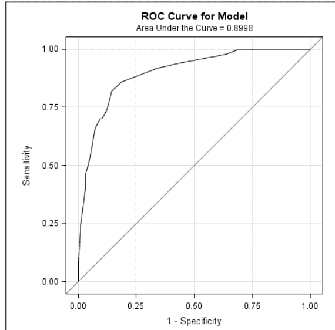

There are lots of options for ROC curves, only a few of which we can examine here. One handy option lets you put the cutpoints on the curve. That’s accomplished by changing the PLOTS option to PLOTS(ONLY)=ROC(ID=CUTPOINT), yielding the graph in Output 3.19.

#### Output 3.19 ROC Curve with Cutpoints Added

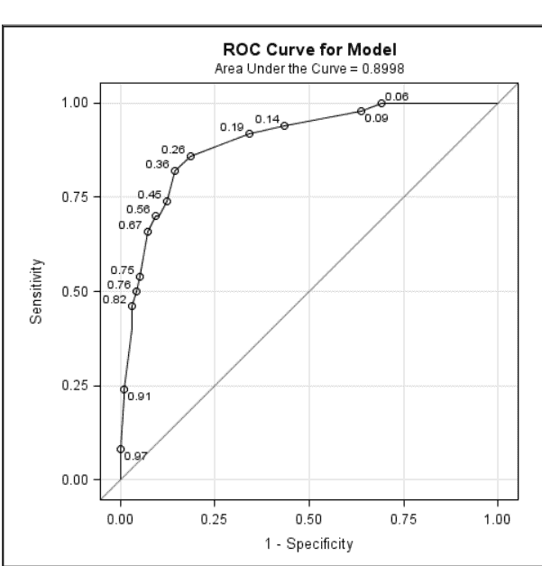

Another attractive feature is the ability to compare the ROC curves and c-statistics for different models. In the following code, I request ROC curves and c-statistics for the basic model and for three different submodels, each omitting one of the model predictors:

```
PROC LOGISTIC DATA=penalty;
    MODEL death(EVENT='1')=blackd whitvic culp;
    ROC 'omit culp' blackd whitvic;
    ROC 'omit blackd' whitvic culp;
    ROC 'omit whitvic' blackd culp;
    ROCCONTRAST / ESTIMATE=ALLPAIRS;
RUN;
```

The label (enclosed in single quotes) on each ROC statement is optional, but usually helpful in interpreting the output. The three ROC statements produce separate ROC graphs for each model (not shown) and a final graph that displays all the curves in one graph (shown in Output 3.20). Note that when the program contains ROC statements, the PLOTS option is not necessary on the PROC statement. However, you may still want to use it to control some of the plotting details (like the inclusion of cutpoints).

#### Output 3.20 ROC Curves for Comparing Different Models

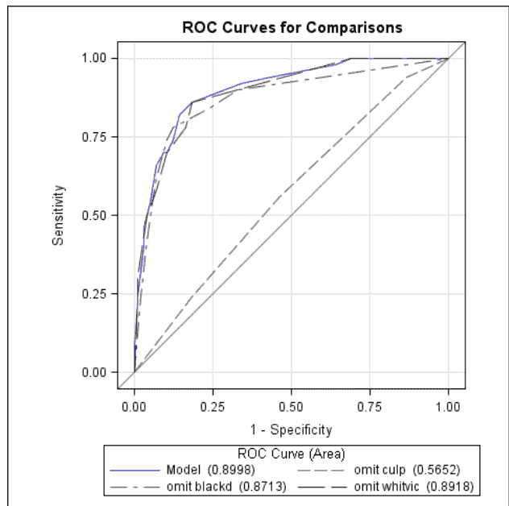

Besides the graphs, we also get the table in Output 3.21, which reports various ordinal measures of association between observed and predicted values for the three models specified in ROC statements, as well as for the original model. “Area” is, of course, the area under the ROC curve. For that statistic we also get standard errors and 95 percent confidence intervals. From both the graph and the table, we see clearly that the variable CULP has a much stronger impact on the association measures than the other two variables.

#### Output 3.21 Association Statistics for Three Different Models

| ROC Model | Area | Standard Error | 95% Wald Confidence Limits | Somers' D (Gini) | Gamma | Tau-a |
|---|---|---:|---:|---:|---:|---:|
| Model | 0.8998 | 0.0264 | 0.8481–0.9515 | 0.7996 | 0.8272 | 0.3614 |
| omit culpl | 0.5652 | 0.0469 | 0.4732–0.6571 | 0.1303 | 0.1847 | 0.0589 |
| omit blackd | 0.8713 | 0.0331 | 0.8065–0.9362 | 0.7427 | 0.7934 | 0.3357 |
| omit whitvic | 0.8918 | 0.0269 | 0.8390–0.9445 | 0.7835 | 0.8363 | 0.3541 |

The ROCCONTRAST statement enables us to test for differences in the area under the curve (*c*-statistic) for the different models, as shown in Output 3.22. We first get an overall test of the null hypothesis that the *c*-statistic is the same across all four models (the main model with all three covariates and the three submodels that omit one covariate each). Clearly that hypothesis must be rejected. Then, because I included the ESTIMATE=ALLPAIRS option, we get the difference in the *c*-statistics for each pair of models, along with its standard error, 95 percent confidence interval, and *p*-value for testing the null hypothesis that the true difference is 0. The only significant differences are between models that include CULP and models that exclude it.

#### Output 3.22 Tables Produced by ROCCONTRAST Statement

| Contrast | DF | Chi-Square | Pr > ChiSq |
|---|---:|---:|---:|
| Reference = Model | 3 | 95.6616 | <.0001 |

| Contrast | Estimate | Standard Error | 95% Wald Confidence Limits | Chi-Square | Pr > ChiSq |
|---|---:|---:|---:|---:|---:|
| Model - omit culpl | 0.3346 | 0.0513 | 0.2341–0.4352 | 42.5659 | <.0001 |
| Model - omit blackd | 0.0285 | 0.0179 | -0.00656–0.0635 | 2.5366 | 0.1112 |
| Model - omit whitvic | 0.00804 | 0.00921 | -0.0100–0.0261 | 0.7625 | 0.3826 |
| omit culpl - omit blackd | -0.3062 | 0.0637 | -0.4310–-0.1813 | 23.1091 | <.0001 |
| omit culpl - omit whitvic | -0.3266 | 0.0510 | -0.4265–0.2267 | 41.0821 | <.0001 |
| omit blackd - omit whitvic | -0.0204 | 0.0225 | -0.0645–0.0237 | 0.8228 | 0.3644 |

### 3.9 Predicted Values, Residuals, and Influence Statistics

Next, we turn to diagnostic statistics that are computed for each individual observation. PROC LOGISTIC can produce a large number of case-wise statistics with the OUTPUT statement, which writes selected diagnostic statistics to a SAS data set. Here are some of the statistics that can be selected:

- **Linear predictor**—Predicted log-odds for each case. In matrix notation, this is xβ, so it’s commonly referred to as XBETA.
- **Standard error of linear predictor**—Used in generating confidence intervals.
- **Predicted values**—Predicted probability of the event, based on the estimated model and values of the explanatory variables. For grouped data, this is the expected number of events.
- **Confidence intervals for predicted values**—Confidence intervals are first calculated for the linear predictor by adding and subtracting an appropriate multiple of the standard error. Then, to get confidence intervals around the predicted values, the upper and lower bounds on the linear predictor are substituted into 1/(1+ e^(-x)), where x is either an upper or a lower bound.
- **Deviance residuals**—Contribution of each observation to the deviance chi-square.
- **Pearson residuals**—Contribution of each observation to the Pearson chi-square.

For the last two statistics, standardized versions are available in SAS 9.3 and later.

Obviously, the residuals may be useful in determining which observations are poorly fit by the model. But since the dependent variable can only take on values of 0 or 1, the utility of residuals is somewhat limited. A high residual would mean that the individual had the event, even though the predicted probability of the event was low. But we know that low probability events do happen sometimes, so this doesn’t necessarily mean a failure of the model, or that something is amiss with that individual. For example, using the model for the death penalty data with CULP, WHITVIC, and BLACKD as predictors, person 10 had both the largest deviance residual (-2.38) and the largest Pearson residual (-4.00). That person did not get the death penalty even though his predicted probability was .95.

The OUTPUT statement can also produce several statistics that are designed to measure the influence of each observation. Basically, influence statistics tell you how much


当从数据集中删除某个特定观测时，模型的某些特征会发生变化。对于使用PROC REG估计的线性模型，影响统计量是精确的。然而，逻辑模型中的精确计算量会非常大，因此只使用近似值。LOGISTIC过程中可用的影响统计量有：

- **DFBETAS**——这些统计量告诉你，当某个特定观测被删除时，每个回归系数变化了多少。实际变化量除以系数的标准误。
- **DIFDEV**——删除该观测后的偏差变化。
- **DIFCHISQ**——删除该观测后的皮尔逊卡方变化。
- **C和CBAR**——回归系数总体变化的度量，类似于线性回归中的Cook距离。
- **LEVERAGE**——度量观测在解释变量空间中的极端程度。杠杆值是“帽子”矩阵的对角线。

你可以通过在OUTPUT语句中指定相应的选项来获得这些统计量。但你可能会发现，在PROC语句中使用PLOTS选项请求ODS图形能提供更多信息。该选项生成的众多图形分为三种类型，区别在于横轴上绘制的变量不同。对于INFLUENCE和DFBETAS图，横轴就是个案编号。对于PHAT和DPC图，横轴是预测概率。对于LEVERAGE图，横轴是杠杆值。下面是一个示例：

```
PROC LOGISTIC DATA=penalty PLOTS(UNPACK LABEL)=
    (INFLUENCE DFBETAS PHAT DPC LEVERAGE);
    MODEL death(EVENT='1')=blackd whitvic culp ;
RUN;
```

该程序总共生成17幅图，这里只展示其中几幅。UNPACK选项为每个图单独生成一幅图形，而不是将多个图“拼接”到同一幅图形中。LABEL选项要求在每个图中使用个案编号作为数据点标记，从而更容易识别哪些个案有问题。

输出3.23展示了INFLUENCE选项生成的7幅图之一，即删除每个观测后导致的偏差变化。我们看到，最大的变化来自第10和122号观测。第10号个体正是我们之前识别出的偏差和皮尔逊残差最大的个体之一。

虽然在此印刷版中不可见，但在原始图形中观测值通过颜色编码，蓝色表示响应变量取值为1，红色表示取值为0。

#### 输出3.23 删除每个观测导致的偏差变化图

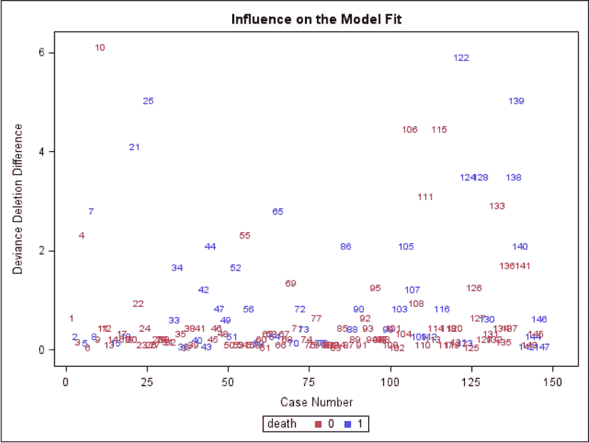

输出3.24展示了DFBETAS选项生成的一幅图。纵轴是删除一个观测时BLACKD系数的变化（除以标准误）。该统计量的符号可能与你的预期相反：正号意味着删除某个个案后系数会下降，负号意味着删除某个个案后系数会上升。最具影响力的观测显然是第122号个体，其DFBETAS值约为-0.5。因此，删除该个案会使系数变大。每个预测变量以及截距都会生成这样一幅图。

#### 输出3.24 BLACKD系数的DFBETAS图

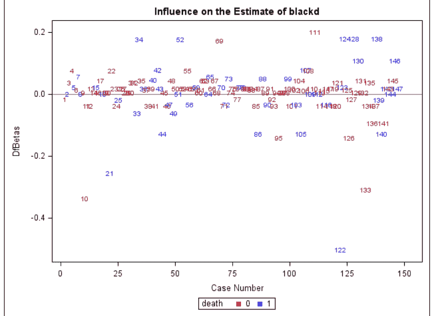

输出3.25展示了PHAT选项生成的4幅图之一，这是偏差影响统计量（DIFDEV）相对于预测值的图。输出3.25是这类诊断图的典型代表。向右上方倾斜的曲线对应于因变量等于0的观测。自左向右下方倾斜的曲线对应于因变量等于1的观测。Hosmer和Lemeshow（2000）推荐将其作为较为有用的诊断图之一。按照他们的建议，应寻找图中影响统计量值高且与其他点分隔良好的点。右上角的两个点可能满足该标准。

#### 输出3.25 DIFDEV统计量与预测值的对比图

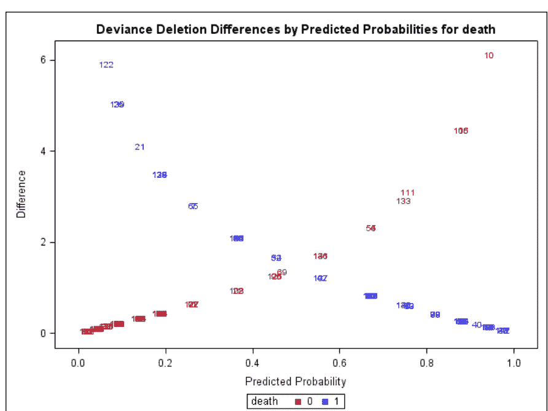

输出3.26是输出3.25中图形的另一个版本，是DPC选项生成的两幅图之一。这实际上是一种三维图形，因为观测值根据另一个影响统计量——置信区间位移统计量C——的值进行颜色编码。

#### 输出3.26 DIFDEV统计量与预测值的对比图（按CI位移着色）

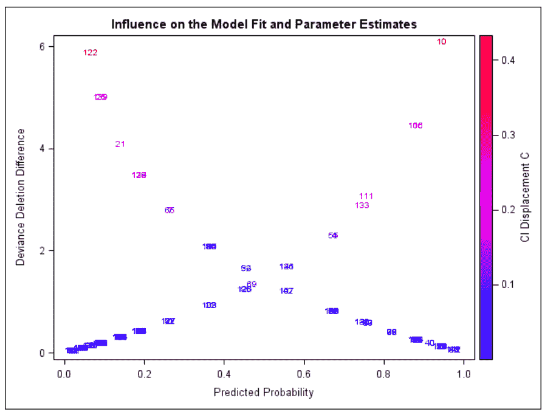

最后，输出3.27展示了LEVERAGE选项生成的4幅图之一。该图以杠杆统计量为横轴，绘制偏差差异统计量。应重点关注那些在杠杆值和偏差统计量上都较高的观测，在图中可能包括第111号个案。

#### 输出3.27 DIFDEV统计量与杠杆值的对比图

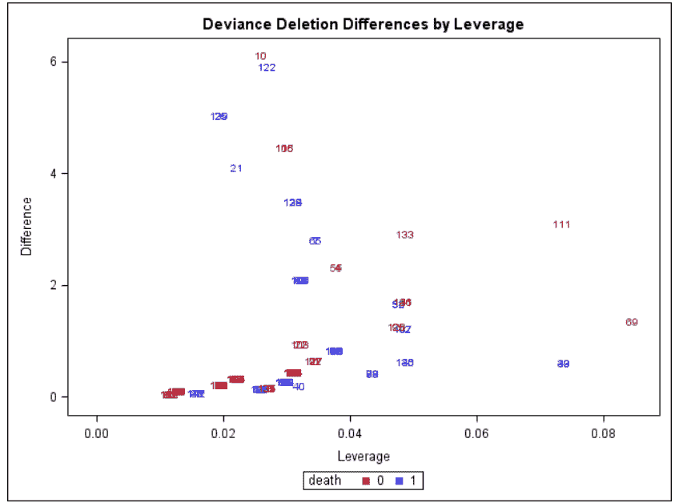

### 3.10 潜变量与标准化系数

逻辑回归模型可以通过为某个随后被二分的连续变量假设一个潜在模型来推导。虽然这一理论依据并非必需，但它有助于理解模型的以下几个方面：

- 模型在现实世界中可能是如何产生的。
- 标准化系数从何而来。
- logit模型与probit模型和互补双对数模型之间的关系。
- 该模型如何推广到有序因变量。
- 未观测到的异质性如何影响logit系数。

在本节中，我们将研究前两点，其余三点留待后述。

思路如下。假设我们有一个以连续尺度测量的因变量z。再进一步假设z通过一个线性模型与一组解释变量x₁、x₂、...、xₖ相关，

```
$$\beta_0 = \frac{\alpha_0-\mu}{\sigma}$$

$$\beta_j = \frac{\alpha_j}{\sigma}, \qquad j=1,\ldots,k.$$
```

因为我们不知道$\sigma$是什么，而且无法估计它，所以我们无法直接估计$\alpha$。但由于$\beta_j=0$意味着$\alpha_j=0$（截距除外），检验$\beta$系数是否为0等价于检验$\alpha$系数是否为0。因此，通常的卡方检验同样适用于模型的显变量版本（3.13）和潜变量版本（3.11）。

这就引出了标准化系数。可以通过PROC LOGISTIC的MODEL语句中的STB选项来请求这些系数。标准化系数旨在衡量回归模型中解释变量的相对重要性。在线性回归和逻辑回归中，普通系数通常不能在不同变量之间进行比较，因为这些系数直接取决于变量的测量尺度。例如，如果$x$以年为单位测量，其系数将是以月为单位测量时的12倍。

在线性模型中，解决这一可比性问题的一种方法是将所有系数转换为标准差单位。这些标准化系数告诉你，当每个$x$变量增加1个标准差时，因变量$y$变化多少个标准差。原始系数通过以下简单公式转换为标准化系数：

```
$$\beta_j^* = \frac{\beta_j\sigma_j}{\sigma_d}, \qquad j=1,\ldots,k,$$
```

其中$\beta_j^*$是标准化系数，$\sigma_d$是*因变量*的标准差，$\sigma_j$是$x_j$的标准差。

这个公式对logit模型适用吗？将每个系数乘以相应$x$变量的标准差没有问题。但$\sigma_d$应该用什么呢？因为观测到的$y$是二分的，所以讨论该变量的标准差单位变化没有太大意义。实际上，这个选择并不关键，因为每个系数都除以同一个$\sigma_d$。这意味着，无论分母如何选择，标准化系数的相对大小都相同。LOGISTIC中的选择是将$\sigma_d$取为连续变量$z$的潜模型（方程3.11）中扰动项$\varepsilon$的标准差。如果$\varepsilon$服从标准逻辑分布


distribution，其标准差为 π/√3 = 1.8138。这就是方程 (3.15) 中 σ_d 所使用的值。一个隐含的假设是方程 (3.11) 中的尺度因子 σ 等于 1。

Output 3.28 显示了使用 STB 选项对死刑数据模型的结果。让我们通过计算 CULP 的标准化系数来进行说明，以防你以后想对在其他程序（如 GENMOD）中估计的系数进行同样的计算。CULP 的标准差为 1.541（使用 PROC MEANS 获得）。我们将其乘以其系数（1.2709）并除以 1.8138 得到标准化系数 1.0799。正如在普通线性回归中一样，标准化系数可能大于 1 或小于 −1。很明显 CULP 对结果的影响远强于其他变量，其次是 BLACKD 和 WHITVIC。请注意，这与卡方统计量的排序相同。通常情况就是如此，但并非总是如此。

**Output 3.28 LOGISTIC 输出，含标准化系数 — 最大似然估计分析**

| Parameter | DF | Estimate | Standard Error | Wald Chi-Square | Pr > ChiSq | Standardized Estimate |
|---|---:|---:|---:|---:|---:|---:|
| Intercept | 1 | -5.2179 | 0.9298 | 31.4898 | <.0001 |  |
| culp | 1 | 1.2708 | 0.1962 | 41.9410 | <.0001 | 1.0799 |
| blackd | 1 | 1.6358 | 0.5954 | 7.5474 | 0.0060 | 0.4525 |
| whitvic | 1 | 0.8476 | 0.5563 | 2.3212 | 0.1276 | 0.2298 |

虽然 LOGISTIC 产生的标准化系数有助于评估解释变量的相对重要性，但在解释这些数字的大小时应谨慎。正如我们刚刚看到的，这些系数取决于方程 (3.15) 中分母的一个或多或少的任意选择。根据我的经验，它们往往比常规线性模型中的标准化系数大得多。它们也相当特属于 PROC LOGISTIC。如果你将它们包含在你的研究报告中，不要指望其他人能在没有解释的情况下理解它们。

此外，线性模型中关于标准化系数的众所周知的谨慎在此也适用。因为标准化系数在很大程度上取决于解释变量的变异程度，即使底层系数相同，它们也可能从一个总体到另一个总体有很大差异。因此，将不同群体或子群体的标准化系数进行比较是危险的（Kim and Ferree 1981）。

#### 3.11 Probit 和 Complementary Log-Log 模型

逻辑模型并不是二元因变量的唯一合适模型。PROC LOGISTIC 还可以估计另外两种广泛使用的模型，即 probit 模型和 complementary log-log 模型。在本节中，我将简要讨论这两种模型，重点放在它们与逻辑模型相比如何。

我们在上一节检查的潜在变量模型应该有助于激发这些模型。连续潜在变量 z 的方程为

z = α₀ + α₁x₁ + α₂x₂ + ... + αₖxₖ + σε

观测变量 y 等于 1 或 0，取决于 z 是否高于或低于某个阈值 μ。我们看到如果 ε 具有标准逻辑分布，则 y 对 x 的依赖关系由 logit 模型给出。现在假设 ε 具有标准正态分布。这意味着 y 依赖于 x 的方式是通过 probit 模型。而如果 ε 具有标准极值分布（也称为 Gumbel 或双指数分布），我们就得到 complementary log-log 模型。

现在来看细节。两种模型都可以看作是将概率转换为没有上限或下限的东西的方式。probit 模型通常写为

Φ⁻¹(pᵢ) = β₀ + β₁xᵢ₁ + β₂xᵢ₂ + ... + βₖxᵢₖ , (3.16)

其中 pᵢ 是 yᵢ=1 的概率，Φ⁻¹(pᵢ) 是标准正态变量累积分布函数的逆。这个函数称为 probit 函数。

显然，probit 函数需要一点解释。回想一下，标准正态变量具有均值为 0、标准差为 1 的正态分布。像每个随机变量一样，标准正态变量都有一个累积分布函数（c.d.f.）。对于变量的每个可能取值，c.d.f. 给出变量小于该值的概率。例如，标准正态变量小于 1.96 的概率为 .975。你肯定以前遇到过标准正态 c.d.f.—每本初级统计教科书后面“正态表”就是标准正态 c.d.f. 或该函数的某种简单变体。

c.d.f. 的逆 simply 逆转了这个函数。对于给定的 .90 的概率，c.d.f. 的逆告诉你哪个标准正态值对应于 .90 的概率，使得得到小于该值的数的概率为 .90。在这种情况下，该值为 1.65。我们于是说，1.65 是 .90 的 probit 变换。表 3.2 显示了所选概率的 probit 值。随着概率在 0 到 1 之间变化，probit 函数在 −∞ 到 +∞ 之间变化。为了比较，我还包含了 logit 函数和 complementary log-log 函数（稍后讨论）。

**Table 3.2 Probit, Logit, and Complementary Log-Log Functions**

| Probability | Probit | Logit | C-log-log |
|---|---:|---:|---:|---:|
| .1 | −1.28 | −2.20 | −2.25 |
| .2 | −.84 | −1.39 | −1.49 |
| .3 | −.52 | −.85 | −1.03 |
| .4 | −.25 | −.41 | −.67 |
| .5 | .00 | .00 | −.37 |
| .6 | .25 | .41 | −.09 |
| .7 | .52 | .85 | .19 |
| .8 | .84 | 1.39 | .48 |
| .9 | 1.28 | 2.20 | .83 |

与 logit 模型一样，probit 模型通常通过最大似然估计。

在 PROC LOGISTIC 中，指定 probit 模型的方法是在 MODEL 语句中将 LINK=PROBIT 作为选项。 （还有一个 LINK=LOGIT 选项，但对于二元数据这是默认值。）

以下是对应于 Output 3.28 中 logit 模型的 probit 模型的 LOGISTIC 代码：

```
PROC LOGISTIC DATA=penalty;
    MODEL death(EVENT='1') = culp blackd whitvic / LINK=PROBIT
        STB;
RUN;
```

结果显示在 Output 3.29 中。首先要注意的是，最后三列的数字与 Output 3.28 中对应 logit 模型显示的数字非常相似。一般来说，logit 和 probit 模型的卡方值、p 值和标准化系数通常会非常接近，尽管从不完全相同。另一方面，参数估计值和标准误差对于 probit 模型来说比 logit 模型低得多。通常，logit 系数比 probit 系数大约大 80%。这种差异没有实质性含义，仅反映了如表 3.2 所示，对于概率的给定变化，logit 变换所覆盖的范围更广。

**Output 3.29 LOGISTIC 输出，Probit 模型**

| Parameter | DF | Estimate | Standard Error | Wald Chi-Square | Pr > ChiSq | Standardized Estimate |
|---|---:|---:|---:|---:|---:|---:|
| Intercept | 1 | -2.9932 | 0.4745 | 39.7904 | <.0001 |  |
| culp | 1 | 0.7357 | 0.1011 | 52.9402 | <.0001 | 1.1340 |
| blackd | 1 | 0.9179 | 0.3200 | 8.2264 | 0.0041 | 0.4605 |
| whitvic | 1 | 0.4483 | 0.3061 | 2.1450 | 0.1430 | 0.2205 |

标准化估计再次由公式计算

$\beta_j^* = \beta_j\left(\frac{\sigma_j}{\sigma_d}\right), \quad j=1,\ldots,k,$

但现在 $\sigma_d=1$，即标准正态分布的标准差。因此标准化估计值只是原始系数乘以自变量的标准差。

是否有理由选择 probit 模型而不是 logit 模型？如果目标是为单个二元因变量估计模型，实际上没有。两种模型非常接近，很少导致不同的定性结论。要可靠地区分它们需要非常大的样本。logit 模型确实具有优势，即其系数经指数化后可以解释为优势比，而 probit 系数则不能。另一方面，probit 模型更容易推广到具有多个二元结果变量的应用。很好的例子包括具有二元观测变量的因子分析（Muthén 1984）或具有二元内生变量的联立方程模型（Heckman 1978）。在这些环境中，probit 很有吸引力，因为模型可以基于多元正态分布，而多元正态分布具有完善的理论和高效的计算算法。多元逻辑分布则受到的关注要少得多。

二元数据的第三个模型是 complementary log-log。虽然不如另外两种模型那样广为人知，但 complementary log-log 模型在生存分析领域有一个重要的应用。该模型指出

$\log[-\log(1-p_i)] = \beta_0 + \beta_1x_{i1} + \beta_2x_{i2} + \ldots + \beta_kx_{ik}$  (3.17)


左边表达式被称为互补对数-对数变换。与 logit 和 probit 变换一样，互补对数-对数变换将限制在 (0, 1) 区间内的数字转换为没有上限或下限的东西。请注意，1−p 的对数始终是一个负数。在第二次取对数之前，它被改为正数。求解 p，我们也可以将模型写为

$$p_i = 1 - \exp\{-\exp[\beta_0 + \beta_1x_{i1} + \beta_2x_{i2} + \cdots + \beta_kx_{ik}]\}.$$ (3.18)

互补对数-对数模型与 logit 和 probit 模型有一个主要区别。如表 3.2 所示，虽然 logit 和 probit 变换在 $p=.50$ 附近是对称的，但互补对数-对数变换是*不对称的*。这从图 3.3 中也很明显，该图绘制了方程 (3.18) 在单个 $x$ 变量、$\beta_0=0$ 且 $\beta_1=1$ 时的函数。它确实是一条 S 形曲线，但它接近 1 的速度远快于接近 0 的速度。

#### 图 3.3 互补对数-对数模型的图

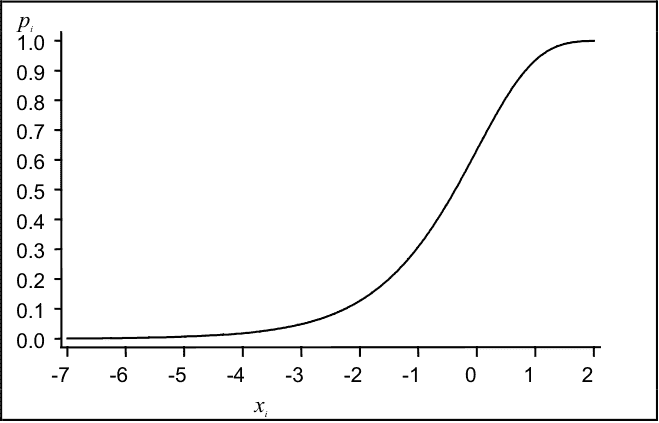

为什么你会想要一个不对称的模型呢？因为互补对数-对数模型与事件发生的连续时间模型密切相关。生存分析最流行的方法是 *Cox 回归* 方法，它基于一个称为 *比例风险模型* 的模型 (Cox 1972)。该模型的特例包括 Weibull 回归模型和指数回归模型。比例风险模型可以写为

\[\log h(t)=\alpha(t)+\beta_1x_{i1}+\beta_2x_{i2}+\cdots+\beta_kx_{ik}\tag{3.19}\]

其中 \(h(t)\) 是在时间 \(t\) 发生的事件的 *风险*，\(\alpha(t)\) 是时间的未指定函数。虽然这不是讨论风险的合适地方，但你可以把风险看作是事件发生的瞬时倾向。

如果你拥有事件发生的确切时间的数据，你可以通过一种称为 *偏似然* 的方法来估计该模型。但假设你对事件（例如死亡）所拥有的唯一信息是它是否在某一年内发生。在这种情况下，对于二分结果应该使用什么模型呢？事实证明，如果事件是由潜在的比例风险模型（方程 3.19）产生的，那么在某个特定时间间隔内发生事件的概率由互补对数-对数模型（方程 3.18）给出。此外，这些模型中的 \(\beta\) 系数是相同的。这并不意味着无论你使用连续数据的 Cox 回归还是离散数据的互补对数-对数分析，结果都相同。这确实意味着两种方法都在估计相同的潜在系数，因此具有相同的解释。有关更详细的信息，请参阅我 2010 年出版的书籍《Survival Analysis Using SAS: A Practical Guide, Second Edition》的第 7 章，*Survival Analysis Using SAS: A Practical Guide, Second Edition*。

要在 PROC LOGISTIC 中估计互补对数-对数模型，你只需在 MODEL 语句中将 LINK=CLOGLOG 作为选项放入即可。输出 3.30 显示了在 LOGISTIC 中对与输出 3.29 中的模型可比的模型执行此操作的结果。就定性结论而言，结果与 logit 和 probit 模型的结果相当相似。而且，输出 3.30 中的所有系数都被 logit 和 probit 系数所夹。在我见过的大多数应用中，互补对数-对数模型的结果与 logit 或 probit 差别不大。但偶尔你会发现结果表明定性不同的结论。标准化估计值再次由方程 3.15 计算，但现在 \(\sigma_d=\pi/\sqrt{6}=1.28\)，是标准极值分布的标准差。

#### 输出 3.30 PROC LOGISTIC 输出用于互补对数-对数模型

|  | Analysis of Maximum Likelihood Estimates |  |  |  |  |  |
| Parameter | DF | Estimate | Standard Error | Wald Chi-Square | Pr > ChiSq | Standardized Estimate |
| Intercept | 1 | -4.1452 | 0.6713 | 38.1305 | <.0001 |  |
| culp | 1 | 0.8373 | 0.1181 | 50.2710 | <.0001 | 1.0063 |
| blackd | 1 | 1.0975 | 0.4030 | 7.4166 | 0.0065 | 0.4293 |
| whitvic | 1 | 0.7040 | 0.3954 | 3.1698 | 0.0750 | 0.2700 |

对于死刑数据，用潜在比例风险模型来解释互补对数-对数模型实际上并不合理。该模型并不是预测事件在某个时间间隔内是否发生。相反，给定惩罚审判发生，它预测的是两种结果中的哪一种发生。在模型合理的情况下，我们可以计算每个系数的 exp(β) 来得到调整后的风险比。例如，如果我们取 BLACKD 的系数并对其取指数，我们得到 exp(1.0975)= 3.00。我们就可以说，黑人被告被判死刑的估计风险是白人被告的 3 倍。

不幸的是，除非你特别要求，否则 PROC LOGISTIC 不会报告互补对数-对数模型的指数化系数。而要做到这一点，你需要为每个预测变量分别写一条语句。例如，你可以用以下语句获得 CULP 的指数化系数（带置信限）：

```
ESTIMATE 'culp' culp 1 / EXP CL;
```

关于互补对数-对数模型的最后一点：由于 logit 和 probit 模型是对称的，反转因变量的编码（从 0,1 到 1,0）只会改变系数的符号。另一方面，对于互补对数-对数模型，反转编码可能会产生完全不同的结果。因此，至关重要的是要建立模型来预测事件发生的概率，而不是事件未发生的概率。如果事件与非事件之间的区别并不明显，那么互补对数-对数模型可能就不合适了。

### 3.12 未观测异质性

在第 3.10 节中，我解释了 logit 模型是如何从具有对数分布扰动项的二分线性模型推导出来的。在那里我们看到，logit 系数与潜在线性模型中的系数通过公式 $\beta_j=\alpha_j/\sigma$ 相关，其中 $\beta_j$ 是 $x_j$ 的 logit 系数，$\alpha_j$ 是线性模型中对应的系数，$\sigma$ 是扰动项 $\varepsilon$ 的系数。这个随机扰动项可以被视为代表所有与测量的 $x$ 变量独立的遗漏解释变量，通常被称为 *未观测异质性*。由于 $\sigma$ 控制扰动项的方差，我们得出结论，未观测异质性越大，logit 系数就越趋向于 0。我将这种衰减称为 *异质性收缩*。

这种评估并不依赖于潜在变量模型的合理性。假设我们取一个普通的 logit 模型并在方程中加入一个扰动项：

$$\log\left[\frac{\Pr(y=1\mid\varepsilon)}{\Pr(y=0\mid\varepsilon)}\right]=\beta_0+\beta_1x_1+\beta_2x_2+\cdots+\beta_kx_k+\sigma\varepsilon. \tag{3.20}$$

我们假设 $\varepsilon$ 与 $x$’s 独立，并且具有标准对数分布，如方程 (3.12) 中所示。请注意，左边的概率是条件于 $\varepsilon$ 表达的。如果我们然后无条件地表达模型，可以证明（Allison 1987）结果可被

$$\log\left[\frac{\Pr(y=1)}{\Pr(y=0)}\right]=\beta_0^*+\beta_1^*x_1+\beta_2^*x_2+\cdots+\beta_k^*x_k. \tag{3.21}$$

其中

$$\beta_j^*=\frac{\beta_j}{\sqrt{1+\sigma^2}}.$$

如果我们从 probit 模型（和标准正态扰动）而不是 logit 模型开始，这个结果是精确的而不是近似的。同样，我们看到扰动方差越大，logit（或 probit）系数就越小。

显然，我们永远无法衡量并包含影响因变量的所有变量，因此总会存在某种异质性收缩。是什么


实际含义是什么？首先，在解释 logistic 回归的结果时，我们应牢记系数大小和相应的优势比在一定程度上可能较为保守。其次，为了将这种收缩降到最低，始终希望将重要的解释变量纳入模型——即使我们认为这些变量与模型中已有的变量不相关。这种建议对于随机实验尤其相关，在随机实验中存在忽视协变量、仅关注处理对反应的影响的倾向。对于线性模型来说这可能没问题，但当纳入所有相关协变量时，logit 模型对处理效应的估计更为优越。

第三个问题是，差异异质性会混淆不同组之间 logit 系数的比较。例如，如果你想分别对男性和女性估计的 logit 系数进行比较，你必须隐含地假设未观测到的异质性程度在两组中是相同的。在其他地方，我提出了一种调整差异异质性的方法（Allison 1999），使用名为 GLOGIT 的 SAS 宏。然而，该宏现在不再必要，因为该方法现在可以使用 PROC QLIM 及其 HETERO 语句轻松实现。

下面是我在 1999 年论文中讨论的示例。我们将估计 logistic 回归，以预测 301 名男性和 177 名女性生物化学家晋升为副教授的概率。这些科学家在 1950 年代末和 1960 年代初期获得博士学位，并在职业生涯中某段时间内担任美国大学研究生院的助理教授（Long, Allison, and McGinnis 1993）。分析单位是人年而非个人，男性有 1,741 人年，女性有 1,056 人年。如 Allison（1982）所示，这种数据的似然函数会以这样的方式分解，使得每个人的多次观测在实质上是独立的。因此，使用普通的 logistic 回归而无需对依赖性进行任何校正完全是合适的。

这些回归中使用的解释变量是 Long 等人（1993）中考虑的变量的一个大大减少的子集，并且这里报告的结果与原始文章中的结果有所不同。被解释变量 PROMO 编码为 1，如果某人在某一年被晋升，否则为 0。独立变量为

| Variable | Description |
|---|---|
| FEMALE | 1 for female, 0 for male. |
| DUR | Number of years since job began. |
| SELECT | A measure of selectivity of one’s undergraduate institution. |
| ARTS | Cumulative number of articles published at each person-year. |
| PRESTIGE | A measure of prestige of the employing department. |

我们将首先使用第 2 章中简要介绍的 PROC QLIM 的语法估计一个基本的 logistic 回归模型：

```sas
PROC QLIM DATA=promo;
    ENDOGENOUS promo ~ DISCRETE(DIST=LOGISTIC);
    MODEL promo = female dur dur*dur select arts prestige;
run;
```

请注意，模型同时包含了 duration 和 duration 平方。结果显示在 Output 3.31 中。所有系数都高度显著且方向符合预期。更长的在职年限、毕业于更具选择性的学院以及发表更多文章都与更高的晋升概率相关。女性以及受雇于声望较高的部门则与更低的晋升概率相关。要得到 FEMALE 的优势比，我们计算 exp(-.353751) = .70。因此我们可以说，在任何给定的一年里，女性被晋升的几率是男性被晋升几率的 70%。

#### Output 3.31 PROC QLIM Output for Promotion Data

**Parameter Estimates**

| Parameter | DF | Estimate | Standard Error | t Value | Approx Pr > \|t\| |
|---|---|---|---|---|---|
| Intercept | 1 | -6.812655 | 0.529019 | -12.88 | <.0001 |
| FEMALE | 1 | -0.353751 | 0.132085 | -2.68 | 0.0074 |
| dur | 1 | 1.723243 | 0.163821 | 10.52 | <.0001 |
| dur*dur | 1 | -0.125346 | 0.014116 | -8.88 | <.0001 |
| select | 1 | 0.154406 | 0.046039 | 3.35 | 0.0008 |
| arts | 1 | 0.054825 | 0.008573 | 6.40 | <.0001 |
| prestige | 1 | -0.413615 | 0.088254 | -4.69 | <.0001 |

我们还可能假设文章的影响对男性比女性更大。我们可以通过在 MODEL 语句中加入 ARTS 与 FEMALE 的交互项来检验这一点，如下所示修改：

```sas
MODEL promo = female dur dur*dur select arts prestige arts*female;
```

这产生了 Output 3.32 中的结果，清楚地显示了一些交互作用的证据。对男性而言，每增加一篇文章，晋升的几率就会增加 100[exp(.072172)-1] = 7.5%。对女性而言，每增加一篇文章，晋升的几率就会增加 100[exp(.072172-.037546)-1] = 3.5%。这种差异表明男性从其发表的作品中获得的回报大于女性，这是一个许多人会觉得令人不安的结论。

#### Output 3.32 PROC QLIM Output with Interaction between FEMALE and ARTS

**Parameter Estimates**

| Parameter | DF | Estimate | Standard Error | t Value | Approx Pr > \|t\| |
|---|---|---|---|---|---|
| Intercept | 1 | -7.000433 | 0.537359 | -13.03 | <.0001 |
| FEMALE | 1 | 0.009973 | 0.201160 | 0.05 | 0.9605 |
| dur | 1 | 1.720148 | 0.164252 | 10.47 | <.0001 |
| dur*dur | 1 | -0.125284 | 0.014154 | -8.85 | <.0001 |
| select | 1 | 0.152113 | 0.046039 | 3.30 | 0.0010 |
| arts | 1 | 0.072172 | 0.011319 | 6.38 | <.0001 |
| prestige | 1 | -0.393508 | 0.088585 | -4.44 | <.0001 |
| FEMALE*arts | 1 | -0.037546 | 0.015789 | -2.38 | 0.0174 |

得出这一结论的危险在于它假设男性与女性的残差变异程度相同。对于助理教授而言，有理由相信女性的职业模式比男性更具异质性，尤其是在这里使用的数据所涵盖的时期。因此，影响晋升机会的未测量变量可能对女性比对男性更重要，导致方程（3.20）中女性的 σ 值大于男性。这种差异可能解释了为什么文章的影响看起来对男性比对女性更大。

变量，无论是分类变量还是连续变量。具体来说，我们可以让方程（3.22）中的 w_i 为变量向量，γ 为系数向量。下面是一个模型，它允许扰动方差是 DUR、ARTS 和 PRESTIGE 的函数：

```sas
PROC QLIM DATA=promo;
    ENDOGENOUS promo ~ DISCRETE(DIST=LOGISTIC);
    MODEL promo = female dur dur*dur select arts prestige arts*female;
    HETERO promo ~ dur arts prestige / NOCONST;
RUN;
```

Output 3.34 中的结果显示了所有三个变量对扰动方差的影响的证据。再次，FEMALE 与 ARTS 交互作用的证据很弱。

#### Output 3.34 PROC QLIM Output with Adjustment for Heterogeneity as a Function of Continuous Variables

**Parameter Estimates**

| Parameter | DF | Estimate | Standard Error | t Value | Approx Pr > \|t\| |
|---|---|---|---|---|---|
| Intercept | 1 | -15.783409 | 3.433278 | -4.60 | <.0001 |
| FEMALE | 1 | -0.406549 | 0.954972 | -0.43 | 0.6703 |
| dur | 1 | 5.713137 | 1.773517 | 3.22 | 0.0013 |
| dur*dur | 1 | -0.459553 | 0.159871 | -2.87 | 0.0040 |
| select | 1 | 0.542043 | 0.266106 | 2.04 | 0.0417 |
| arts | 1 | 0.229155 | 0.097094 | 2.36 | 0.0183 |
| prestige | 1 | -4.488757 | 2.240666 | -2.00 | 0.0451 |
| FEMALE*arts | 1 | -0.115662 | 0.127070 | -0.91 | 0.3627 |
| _H.dur | 1 | 0.172493 | 0.081848 | 2.11 | 0.0351 |
| _H.arts | 1 | 0.066629 | 0.023273 | 2.86 | 0.0042 |
| _H.prestige | 1 | 0.625576 | 0.190895 | 3.28 | 0.0010 |

异质性收缩是各种非线性回归模型的特征（Gail et al. 1984）。该现象与通常在总体平均模型和受体特异性模型之间所做的区分密切相关。显式包含方程（3.20）中扰动项的模型称为受体特异性模型，因为其系数描述了对该特定个体而言解释变量变化时对数几率的变化。另一方面，方程（3.21)——它积分掉了扰动项——称为总体平均模型，因为其


失业人员的抽样比例为 $p_u$，而就业人员的抽样比例为 $p_e$。那么，校正后的截距为 $b_o - \log(p_u/p_e)$。

因变量抽样的另一个应用是病例对照研究，在生物医学科学中广泛使用（Breslow and Day 1980），在社会科学中偶尔也会出现。其工作原理如下。你想研究某种罕见疾病的决定因素。通过调查医生和医院，你设法在你的大都市地区识别出所有 75 名被诊断出患有该疾病的人（病例）。为了获得一个比较组，你从大都市地区总人口中招募了健康人群的 1% 简单随机样本（对照）。你将病例和对照合并为一个样本，并进行逻辑回归，根据各种背景特征预测病例与对照。如果操作正确，这应该会产生总体逻辑回归系数的近似无偏估计。通常对照会与病例在一种或多种标准上匹配，但这并不是设计的一个基本特征。在第 8 章中，我们将看到如何分析匹配的病例对照数据。

### 3.14 绘制预测变量效应的图

由于逻辑回归模型固有的非线性，很难可视化预测变量对事件概率的影响。EFFECTPLOT 语句为该问题提供了一个优雅的解决方案。它在检查交互效应和多项式函数时特别有用。

我将使用第 3.12 节的学术晋升数据来说明 EFFECTPLOT 语句可以产生的许多图表。让我们从一个不包含交互或多项式函数的模型开始：

```
PROC LOGISTIC DATA=promo;
    MODEL promo(EVENT='1') = female dur select arts;
    EFFECTPLOT FIT(X=arts);
run;
```

EFFECTPLOT 语句请求绘制晋升的预测概率随 ARTS（已发表文章数）的变化图，同时将所有其他变量设为其均值。如果模型中存在任何 CLASS 变量，它们将被设为其参考水平。

交互作用的显著性 *p*-值为约 .01。输出 3.37 很好地说明了这种交互作用的性质。在文章产出较低的水平，男性和女性的晋升预测概率大致相等。然而，随着文章数量的增加，男性表现优于女性，且差距稳步增加。在第 3.12 节中，我们看到，一旦我们调整了差异残差异质性，这种交互作用的证据变得非常薄弱。此外，如果我们将文章的平方项添加到模型中，FEMALE 与 ARTS 之间的交互作用几乎完全消失。

#### Output 3.37 Predicted Probability of Promotion as a Function of Articles, by Gender

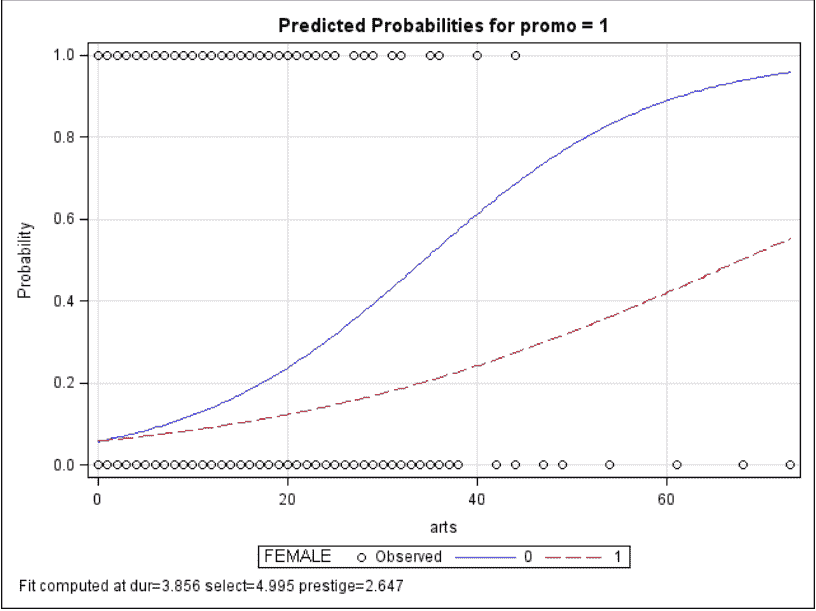

一个编码说明：如果 FEMALE 被声明为 CLASS 变量，我们就不需要 SLICEBY 选项中的“=0 1”。然而，如果指定了一个非 CLASS 变量作为 SLICEBY 变量且未给出数字，则默认是在 SLICEBY 变量的五个等距值处绘制函数。这在这里不合理，因为值将为 0、.25、.50、.75 和 1，但该变量本身只能取 0 和 1 的值。

# Chapter 4

## Logit Analysis of Contingency Tables

+ 4.1 Introduction 109
+ 
+ 4.2 A Logit Model for a 2 × 2 Table 110
+ 
+ 4.3 A Three-Way Table 114
+ 
+ 4.4 A Four-Way Table 116
+ 
+ 4.5 A Four-Way Table with Ordinal Explanatory Variables 122
+ 
+ 4.6 Overdispersion 129

### 4.1 Introduction

对许多人来说，分类数据分析意味着列联表的分析，也称为交叉制表。几十年来，列联表分析的主流是卡尔·皮尔逊于 1900 年提出的卡方检验。然而，随着对数线性模型在 20 世纪 60 年代末和 70 年代初的发展，情况发生了戏剧性的变化。对数线性分析使得能够以优雅的统计框架分析多向列联表，检验简单和复杂的假设。在第 10 章中，我们将看到如何使用 GENMOD 过程估计对数线性模型。

尽管对数线性分析仍然是列联表分析的流行方法，但对数分析（逻辑回归）通常可以做得更好。事实上，这两种方法之间存在密切的关系。对于列联表，每个对数模型都有一个与其完全等价的对数线性模型。反之则不成立——存在一些对数线性模型不对应任何对数模型，但在大多数情况下，这样的模型没有实质性兴趣。

如果对数和对数线性模型是等价的，为什么还要使用对数模型？原因有三：

- 对数模型在因变量和自变量之间做出明确区分。对数线性模型则不做这种区分——所有概念变量都在等式的右边。
- 对数线性模型的参数比相应的对数模型多得多。其中大多数是 nuisance 参数，没有实质性兴趣，它们的纳入可能会令人困惑（并且可能具有误导性）。
- 对于更大的表，对数线性模型更容易因单元格频率为 0 而出现收敛失败。

简而言之，即使在估计等价模型时，对数分析也可能比对数线性分析简单得多。正如我们将看到的，列联表的对数分析与传统的卡方检验相比，与普通多元回归有更多共同之处。在本章的其余部分，我们将看到如何使用 LOGISTIC 过程分析列联表。在本章中，我们只考虑因变量为二分的表，但后面的章节将考虑因变量类别多于两个的表格数据。本章的大部分内容将涉及前面章节中已开发工具的应用。

### 4.2 A Logit Model for a 2 × 2 Table

让我们从最简单的情况开始——二分因变量和单个二分自变量。这导致了像表 2.2 那样的 2 × 2 表，这里重现为表 4.1。

#### Table 4.1 Death Sentence by Race of Defendant

|  | Blacks | Nonblacks | Total |
|---|---|---|---|
| Death | 28 | 22 | 50 |
| Life | 45 | 52 | 97 |
| Total | 73 | 74 | 147 |

如果我们可以使用个体水平数据，我们可以直接估计对数模型，如以下 LOGISTIC 程序所示：

```
PROC LOGISTIC DATA=penalty;
    MODEL death(EVENT='1') = blackd;
RUN;
```

结果显示在输出 4.1 中。优势比与我们在第 2.4 节中手工计算得到的结果相同。它没有统计学意义。

#### Output 4.1 PROC LOGISTIC Output for a 2 x 2 Table

| Testing Global Null Hypothesis: BETA=0 |
|---|---|---|---|
| Test | Chi-Square | DF | Pr > ChiSq |
| Likelihood Ratio | 1.2205 | 1 | 0.2693 |
| Score | 1.2184 | 1 | 0.2697 |
| Wald | 1.2134 | 1 | 0.2707 |

| Analysis of Maximum Likelihood Estimates |
|---|---|---|---|---|---|
| Parameter | DF | Estimate | Standard Error | Wald Chi-Square | Pr > ChiSq |
| Intercept | 1 | -0.8602 | 0.2543 | 11.4390 | 0.0007 |
| blackd | 1 | 0.3857 | 0.3502 | 1.2134 | 0.2707 |

| Odds Ratio Estimates |
|---|---|---|---|
| Effect | Point Estimate | 95% Wald Confidence Limits | |
| blackd | 1.471 | 0.740 | 2.921 |

现在，假设我们没有个体水平数据。我们只有表 4.1。将表格数据输入 PROC LOGISTIC 有两种不同的方法。第一种方法是创建一个数据集，其中包含表中四个单元格频率中的每一个的记录，以及适当编码的代表被告种族和判决的变量：


```sas
DATA tab4_1a;
    INPUT f blackd death;
    DATALINES;
22 0 1
28 1 1
52 0 0
45 1 0
;
```

然后我们使用 LOGISTIC 中的 FREQ 语句指定每一行数据都要被复制，复制次数由变量 F 给出：

```sas
PROC LOGISTIC DATA=tab4_1a;
    FREQ f;
    MODEL death(EVENT='1') = blackd;
RUN;
```

结果与 Output 4.1 中的结果相同。

处理表格数据的另一种方法是使用 events/trials 语法。不是输入表中全部四个内部单元格计数，我们输入死刑判决的单元格频率以及列合计，即黑人被告人数和非黑人被告人数：

```sas
DATA tab4_1b;
    INPUT death total blackd;
    DATALINES;
22 74 0
28 73 1
;
```

我们可以将该数据集描述如下：在 74 名非黑人被告中，22 人被判死刑；在 73 名黑人被告中，28 人被判死刑。

接下来我们指定一个有两个部分、由斜杠分隔的因变量：

```sas
PROC LOGISTIC DATA=tab4_1b;
    MODEL death/total = blackd;
RUN;
```

LOGISTIC 不再复制观测值，而是将变量 DEATH 视为具有二项分布，其试验次数由变量 TOTAL 给出。对这些数据而言“试验”是一个恰当的术语。请注意，使用此语法时，MODEL 语句中不需要 EVENT='1' 选项。因为使用 DEATH 作为事件数直接指定了死刑判决（而非无期徒刑）为感兴趣的事件。同样，结果与 Output 4.1 相同。

对于 2 × 2 表，我们也可以用 PROC FREQ 得到其中许多结果：

```sas
PROC FREQ DATA=tab4_1a;
    WEIGHT f;
    TABLES blackd*death / CHISQ RELRISK;
RUN;
```

选定的结果显示在 Output 4.2 中。

#### Output 4.2 PROC FREQ Results

Statistics for Table of blackd by death

| Statistic | DF | Value | Prob |
|---|---|---|---|
| Chi-Square | 1 | 1.2184 | 0.2697 |
| Likelihood Ratio Chi-Square | 1 | 1.2205 | 0.2693 |
| Continuity Adj. Chi-Square | 1 | 0.8644 | 0.3525 |
| Mantel-Haenszel Chi-Square | 1 | 1.2101 | 0.2713 |
| Phi Coefficient |  | 0.0910 |  |
| Contingency Coefficient |  | 0.0907 |  |
| Cramer's V |  | 0.0910 |  |

Estimates of the Relative Risk (Row1/Row2)

| Type of Study | Value | 95% Confidence Limits |
|---|---|---|
| Case-Control (Odds Ratio) | 1.4707 | 0.7404 | 2.9214 |

CHISQ 选项为我们提供了若干检验两个变量独立的零假设的统计量，这等价于检验 logit 模型中斜率为 0 的假设。请注意，Pearson 卡方检验（在 Output 4.2 中仅标记为 chi-square）与 PROC LOGISTIC Output 4.1 中的得分统计量相同。Output 4.2 中的似然比卡方与 Output 4.1 中标记为 −2LOG L 的卡方相同。RELRISK 选项为我们提供了比值比，它与 PROC LOGISTIC 输出中的比值比相同。

### 4.3 A Three-Way Table

正如我们刚才所见，使用 LOGISTIC 对 2 × 2 表的 logit 模型进行估计所得到的信息并不比用 PROC FREQ 得到的多。但对于 3 维表，情况变得更有趣。

考虑表 4.2，它显示了 Morgan 和 Teachman（1988）报道的全国样本中 15 岁和 16 岁青少年种族、性别和发生性行为的交叉分类。

#### Table 4.2 Race by Gender by Sexual Intercourse

| Race | Gender | Yes | No |
|---|---|---|---|
| White | Male | 43 | 134 |
| White | Female | 26 | 149 |
| Black | Male | 29 | 23 |
| Black | Female | 22 | 36 |

让我们将表 4.2 作为 logit 模型进行分析，以性行为为因变量，种族和性别为自变量。使用 LOGISTIC 中的 events/trials 语法，我们有：

```sas
DATA interco;
    INPUT white male yes no;
    total=yes+no;
    DATALINES;
1 1 43 134
1 0 26 149
0 1 29 23
0 0 22 36
;
PROC LOGISTIC DATA=interco;
    MODEL yes/total=white male / SCALE=NONE;
RUN;
```

包含 SCALE=NONE 选项是为了让我们能够得到拟合优度的偏差和 Pearson 卡方检验。当使用 events/trials 语法时，因为数据已经是汇总形式，所以不需要 AGGREGATE 选项。

#### Output 4.3 PROC LOGISTIC Output for Analysis of Three-Way Table

**Deviance and Pearson Goodness-of-Fit Statistics**

| Criterion | Value | DF | Value/DF | Pr > ChiSq |
|---|---|---|---|---|
| Deviance | 0.0583 | 1 | 0.0583 | 0.8091 |
| Pearson | 0.0583 | 1 | 0.0583 | 0.8092 |

**Analysis of Maximum Likelihood Estimates**

| Parameter | DF | Estimate | Standard Error | Wald Chi-Square | Pr > ChiSq |
|---|---|---|---|---|---|
| Intercept | 1 | -0.4555 | 0.2221 | 4.2045 | 0.0403 |
| white | 1 | -1.3135 | 0.2378 | 30.5132 | <.0001 |
| male | 1 | 0.6478 | 0.2250 | 8.2872 | 0.0040 |

**Odds Ratio Estimates**

| Effect | Point Estimate | 95% Wald Confidence Limits |
|---|---|---|
| white | 0.269 | 0.169 | 0.429 |
| male | 1.911 | 1.230 | 2.971 |

选定的结果显示在 Output 4.3 中。首先要注意的是，偏差和 Pearson 卡方统计量都只有 .058，自由度为 1，p 值为 .81。因为这是拟合优度检验，高 p 值意味着模型拟合良好。显然该模型拟合数据极好。

但偏差在检验什么？请记住，偏差总是将拟合模型与饱和模型进行比较。对于 2 × 2 × 2 表，饱和 logit 模型包括两个解释变量对其对因变量影响的交互作用。对此交互作用有一个系数，对应于偏差的单个自由度。因此，在本例中，偏差检验的是交互作用系数为 0 的零假设。我们得出结论，没有交互作用的证据。

为了更明确地看到这一点，让我们实际拟合包含交互作用的模型：

```sas
PROC LOGISTIC DATA=interco;
    MODEL yes/total=white male white*male/ SCALE=NONE ;
RUN;
```

在 Output 4.4 中我们看到偏差为 0，正如饱和模型应有的那样。交互项的卡方为 .0583，p 值为 .8092，与“主效应”模型中偏差得到的结果相同。交互作用的缺失意味着种族对男孩和女孩的影响相同。性别对黑人和白人的影响也相同。

#### Output 4.4 PROC LOGISTIC Output for a Saturated Model

**Deviance and Pearson Goodness-of-Fit Statistics**

| Criterion | Value | DF | Value/DF | Pr > ChiSq |
|---|---|---|---|---|
| Deviance | 0.0000 | 0 | . | . |
| Pearson | 0.0000 | 0 | . | . |

**Analysis of Maximum Likelihood Estimates**

| Parameter | DF | Estimate | Standard Error | Wald Chi-Square | Pr > ChiSq |
|---|---|---|---|---|---|
| Intercept | 1 | -0.4925 | 0.2706 | 3.3118 | 0.0688 |
| white | 1 | -1.2534 | 0.3441 | 13.2674 | 0.0003 |
| male | 1 | 0.7243 | 0.3888 | 3.4696 | 0.0625 |
| white*male | 1 | -0.1151 | 0.4765 | 0.0583 | 0.8092 |

这些效应到底是什么？在 Output 4.3 中，MALE 的比值比为 1.91。我们可以说，在调整种族差异后，15 岁前发生过性行为的估计几率在男性中几乎是女性的两倍。然而，把太多信心放在精确值 1.91 上可能是个错误。95% 置信区间在 1.23 到 2.97 之间。

对于 WHITE，高度显著的调整后比值比为 .269，表明白人的性行为几率只有黑人的四分之一多一点。解释其倒数 1/.269 = 3.72 可能更容易，这说明在控制性别差异后，黑人的几率几乎是白人的四倍。其 95% 置信区间为 2.3 到 5.9（通过取 Output 4.3 中置信限的倒数得到）。这就是我们能从该表中有用得到的全部内容。我们可以检查残差，但由于模型拟合得如此之好，意义不大。

### 4.4 A Four-Way Table

4 维表的情况也只复杂一点点，只是可能存在更多交互作用。考虑 Seeman（1977）报道的表 4.3，基于法国和美国成年男性调查。在每个国家，受访者被问及关于


他的自身职业、父亲的职业，以及他是否认为自己是工人阶级成员。职业被分为体力劳动和非体力劳动。我们的目标是估计一个 logit 模型，用于衡量工人阶级认同与另外三个变量的依赖关系。

#### 表 4.3 按国家和职业划分的工人阶级认同

| Country | Occupation | Father’s Occupation | Yes | No | Total |
|:---|:---|:---|---:|---:|---:|
| France | Manual | Manual | 85 | 22 | 107 |
| France | Manual | Non-manual | 44 | 21 | 65 |
| France | Non-manual | Manual | 24 | 42 | 66 |
| France | Non-manual | Non-manual | 17 | 154 | 171 |
| U.S. | Manual | Manual | 24 | 63 | 87 |
| U.S. | Manual | Non-manual | 22 | 43 | 65 |
| U.S. | Non-manual | Manual | 1 | 84 | 85 |
| U.S. | Non-manual | Non-manual | 6 | 142 | 148 |

以下是用于读取表格数据的 DATA 步：

```sas
DATA working;
    INPUT france manual famanual total working;
    DATALINES;
1   1   1   107  85
1   1   0   65   44
1   0   1   66   24
1   0   0   171  17
0   1   1   87   24
0   1   0   65   22
0   0   1   85   1
0   0   0   148  6
;
```

使用 events/trials 语法，我们首先考虑一个没有交互作用的模型：

```sas
PROC LOGISTIC DATA=working;
    MODEL working/total = france manual famanual / SCALE=NONE;
RUN;
```

我本可以把解释变量指定为 CLASS 变量，但对于编码为 1 和 0 的二分变量来说，这样做没有优势。

输出 4.5 中的结果显示了全部三个变量的高度显著效应。毫不奇怪，法国人、从事体力劳动的男性以及父亲从事体力劳动的男性，工人阶级认同的概率更高。但该模型对数据的拟合并不很好。偏差为 18.98，自由度为 4，p 值仅为 0.0008。显然模型中缺少某些东西。

#### 输出 4.5 PROC LOGISTIC 输出：工人阶级认同

#### Deviance and Pearson Goodness-of-Fit Statistics

| Criterion | Value | DF | Value/DF | Pr > ChiSq |
|:---|---:|---:|---:|---:|
| Deviance | 18.9759 | 4 | 4.7440 | 0.0008 |
| Pearson | 18.9801 | 4 | 4.7450 | 0.0008 |

#### Analysis of Maximum Likelihood Estimates

| Parameter | DF | Estimate | Standard Error | Wald Chi-Square | Pr > ChiSq |
|:---|---:|---:|---:|---:|---:|
| Intercept | 1 | -3.6901 | 0.2547 | 209.9401 | <0.0001 |
| france | 1 | 1.9474 | 0.2162 | 81.1501 | <0.0001 |
| manual | 1 | 2.5199 | 0.2168 | 135.1487 | <0.0001 |
| famanual | 1 | 0.5522 | 0.2017 | 7.4964 | 0.0062 |

#### Odds Ratio Estimates

| Effect | Point Estimate | 95% Wald Confidence Limits |
|:---|---:|---:|
| france | 7.011 | 4.589, 10.709 |
| manual | 12.427 | 8.126, 19.006 |
| famanual | 1.737 | 1.170, 2.579 |

缺少的是交互项：三个 2 路交互和一个 3 路交互。每个都有 1 个自由度，给出了偏差的 4 个自由度。由于 3 路交互难以解释，让我们看看是否可以用仅 2 路交互来应付：

```sas
PROC LOGISTIC DATA=working;
    MODEL working/total = france manual famanual
        france*manual france*famanual manual*famanual /
        SCALE=NONE;
RUN;
```

#### 输出 4.6 包含全部两两交互的模型

#### Deviance and Pearson Goodness-of-Fit Statistics

| Criterion | Value | DF | Value/DF | Pr > ChiSq |
|:---|---:|---:|---:|---:|
| Deviance | 3.1512 | 1 | 3.1512 | 0.0759 |
| Pearson | 2.8835 | 1 | 2.8835 | 0.0895 |

#### Analysis of Maximum Likelihood Estimates

| Parameter | DF | Estimate | Standard Error | Wald Chi-Square | Pr > ChiSq |
|:---|---:|---:|---:|---:|---:|
| Intercept | 1 | -3.5075 | 0.4269 | 67.4946 | <0.0001 |
| france | 1 | 1.4098 | 0.4585 | 9.4563 | 0.0021 |
| manual | 1 | 2.9517 | 0.4612 | 40.9590 | <0.0001 |
| famanual | 1 | 0.0879 | 0.4869 | 0.0326 | 0.8568 |
| france*manual | 1 | -0.2311 | 0.4966 | 0.2166 | 0.6416 |
| france*famanual | 1 | 1.3375 | 0.4364 | 9.3945 | 0.0022 |
| manual*famanual | 1 | -0.5968 | 0.4370 | 1.8655 | 0.1720 |

在输出 4.6 中，我们看到包含全部三个 2 路交互的模型拟合相当不错。偏差卡方 3.15 自由度为 1 的 p 值为 0.08——不算很好但仍可接受。单个自由度对应于被排除的 3 路交互。实质上，偏差是在检验该交互是否为 0。检查三个 2 路交互的 Wald 卡方值，我们发现国家 × 父亲职业高度显著，但另外两个远未达到显著性。这表明拟合一个仅含一个 2 路交互的模型，其结果显示在输出 4.7 中。

#### 输出 4.7 包含一个两两交互的模型

#### Deviance and Pearson Goodness-of-Fit Statistics

| Criterion | Value | DF | Value/DF | Pr > ChiSq |
|:---|---:|---:|---:|---:|
| Deviance | 5.3744 | 3 | 1.7915 | 0.1463 |
| Pearson | 5.2649 | 3 | 1.7550 | 0.1534 |

#### Analysis of Maximum Likelihood Estimates

| Parameter | DF | Estimate | Standard Error | Wald Chi-Square | Pr > ChiSq |
|:---|---:|---:|---:|---:|---:|
| Intercept | 1 | -3.1796 | 0.2713 | 137.3766 | <0.0001 |
| france | 1 | 1.1772 | 0.2876 | 16.7546 | <0.0001 |
| manual | 1 | 2.5155 | 0.2162 | 135.3425 | <0.0001 |
| famanual | 1 | -0.3802 | 0.3211 | 1.4021 | 0.2364 |
| france*famanual | 1 | 1.5061 | 0.4098 | 13.5068 | 0.0002 |

#### Odds Ratio Estimates

| Effect | Point Estimate | 95% Wald Confidence Limits |
|:---|---:|---:|
| manual | 12.373 | 8.099, 18.903 |

当删除两个不显著的交互项时，偏差上升，但自由度上升得更多，给出了约 0.15 的改进 p 值。

此外，输出 4.6 与输出 4.7 模型之间的偏差差异仅为 2.22，自由度为 2，远未达到显著。因此删除这两个交互项并不会显著恶化拟合。

让我们解释输出 4.7 中的估计值。MANUAL 的估计值最直接，因为它不涉及交互作用。比值比为 12.373，我们可以说体力劳动者认同工人阶级的几率是非体力劳动者的 12 倍以上。

然而，对于存在交互作用的两个变量 FRANCE 和 FAMANUAL，并未报告比值比。默认情况下，PROC LOGISTIC 不会为涉及交互作用的变量报告比值比。在本书的前一版中，我展示了如何通过一些繁琐的手工计算来获得所需的比值比。但现在使用 ODDSRATIO 语句让 SAS 来完成要容易得多。

对于任何 2 路交互，我们都可以从两种不同方式来看待结果。模型表明 FAMANUAL 的效应取决于 FRANCE 的取值，但它也表明 FRANCE 的效应取决于 FAMANUAL 的取值。这两种观点都可以通过在 LOGISTIC 程序中加入以下两个语句来检查：

```sas
ODDSRATIO famanual / AT(france=0 1);
ODDSRATIO france / AT(famanual=0 1);
```

这就产生了输出 4.8。

#### 输出 4.8 两个变量在两两交互中的比值比

| Label | Estimate | 95% Confidence Limits |
|:---|---:|---:|
| famanual at france=0 | 0.684 | 0.364, 1.283 |
| famanual at france=1 | 3.083 | 1.866, 5.095 |
| france at famanual=0 | 3.245 | 1.847, 5.702 |
| france at famanual=1 | 14.633 | 8.020, 26.697 |

在美国（FRANCE=0），FAMANUAL 的比值比为 0.684，意味着父亲从事体力劳动的男性认同工人阶级的几率比父亲从事非体力劳动的男性低 32%。但该比值比与 1 无显著差异，95% 置信区间很容易包含 1。另一方面，对于法国男性，FAMANUAL 的比值比为 3.083，95% 置信区间明显不包含 1。因此在法国，父亲从事体力劳动的男性认同工人阶级的几率约为父亲从事非体力劳动工作的男性的三倍。

虽然这是解释交互作用最自然的方式，但也有另一种观点。输出 4.8 的后两行告诉我们，与美国相比，处于法国的效应如何随父亲职业而变化。对于父亲从事非体力工作的男性，法国人认同工人阶级的几率是美国人的 3.245 倍。 judging from the confidence interval, this is a highly significant effect. But the country effect is much larger among men whose fathers had manual jobs: the odds ratio increases to 14.633, which is an effect that is more than four times larger. We know that these two odds ratios are significantly different because the interaction is significant.

总结我们的分析，体力劳动者和法国人更有可能认同工人阶级。在法国，父亲从事体力劳动的男性也更有可能认同工人阶级，这种效应独立于个人职业。在美国，父亲的职业几乎没有影响，或者说没有影响。


### 4.5 具有有序解释变量的四维表

接下来我们考虑一个 2 × 2 × 4 × 4 的表，由 Sewell和Shah（1968）报告，样本为威斯康星州4,991名高中高年级学生。因变量是他们是否计划在次年上大学。三个自变量编码如下：

- IQ：1=低，2=中低，3=中高，4=高
- SES：1=低，2=中低，3=中高，4=高
- PARENT：1=父母鼓励低，2=父母鼓励高

下面是一个 DATA 步，用于以一种适用于*事件/试验*语法的形式读入该表。自变量的每种组合对应一条记录。第四个变量TOTAL是拥有每个自变量取值组合的学生人数，最后一个变量COLL是计划上大学的学生人数。因此，在第一行中，我们看到有353名学生在所有三个自变量上都处于低水平；其中只有4人计划上大学。

```
DATA wisc;
  INPUT iq parent ses total coll;
DATALINES;
1   1   1   353     4
1   1   2   234     2
1   1   3   174     8
1   1   4   52      4
1   2   1   77      13
1   2   2   111     27
1   2   3   138     47
1   2   4   96      39
2   1   1   216     9
2   1   2   208     7
2   1   3   126     6
2   1   4   52      5
2   2   1   105     33
2   2   2   159     64
2   2   3   184     74
2   2   4   213     123
3   1   1   138     12
3   1   2   127     12
3   1   3   109     17
3   1   4   50      9
3   2   1   92      38
3  2  2  185  93
3  2  3  248  148
3  2  4  289  224
4  1  1  77   10
4  1  2  96   17
4  1  3  48   6
4  1  4  25   8
4  2  1  92   49
4  2  2  178  119
4  2  3  271  198
4  2  4  468  414
;
```

现在我们准备使用 PROC LOGISTIC：

```
PROC LOGISTIC DATA=wisc;
    CLASS iq ses / PARAM=REF;
    MODEL coll/total=iq ses parent / SCALE=NONE;
RUN;
```

IQ和SES被列为CLASS变量，以便将它们视为分类变量而非定量变量。如第2章所述，PARAM=REF选项会覆盖CLASS变量的默认编码方法。具体来说，REF选项告诉LOGISTIC创建一组虚拟（指示）变量，参照类别为该CLASS变量的最高取值。输出4.9显示了LOGISTIC输出的部分内容。

#### 输出4.9 四维表的PROC LOGISTIC输出

| 偏差和Pearson拟合优度统计量 |  |  |  |  |
|---|---|---:|---:|---:|
| 准则 | 值 | 自由度 | 值/自由度 | Pr > 卡方 |
| 偏差 | 25.2358 | 24 | 1.0515 | 0.3930 |
| Pearson | 24.4398 | 24 | 1.0183 | 0.4367 |

| Type 3 效应分析 |  |  |  |
|---|---|---:|---:|
| 效应 | 自由度 | Wald 卡方 | Pr > 卡方 |
| iq | 3 | 334.4508 | <.0001 |
| ses | 3 | 174.4307 | <.0001 |
| parent | 1 | 586.3859 | <.0001 |

| 最大似然估计分析 |  |  |  |  |  |
|---|---|---:|---:|---:|---:|
| 参数 | 自由度 | 估计值 | 标准误差 | Wald 卡方 | Pr > 卡方 |
| 截距 | 1 | -3.1005 | 0.2123 | 213.3353 | <.0001 |
| iq 1 | 1 | -1.9663 | 0.1210 | 264.2400 | <.0001 |
| iq 2 | 1 | -1.3722 | 0.1024 | 179.7284 | <.0001 |
| iq 3 | 1 | -0.6331 | 0.0976 | 42.0830 | <.0001 |
| ses 1 | 1 | -1.4140 | 0.1210 | 136.6657 | <.0001 |
| ses 2 | 1 | -1.0580 | 0.1029 | 105.7894 | <.0001 |
| ses 3 | 1 | -0.7516 | 0.0976 | 59.3364 | <.0001 |
| parent | 1 | 2.4554 | 0.1014 | 586.3859 | <.0001 |

| 优势比估计 |  |  |  |
|---|---|---:|---:|
| 效应 | 点估计 | 95% Wald 置信限 |  |
| iq 1 对 4 | 0.140 | 0.110 | 0.177 |
| iq 2 对 4 | 0.254 | 0.207 | 0.310 |
| iq 3 对 4 | 0.531 | 0.439 | 0.643 |
| ses 1 对 4 | 0.243 | 0.192 | 0.308 |
| ses 2 对 4 | 0.347 | 0.284 | 0.425 |
| ses 3 对 4 | 0.472 | 0.390 | 0.571 |
| parent | 11.651 | 9.551 | 14.213 |

从偏差和皮尔逊卡方值来看，含主效应且无交互作用的模型与数据拟合得很好，两个统计量的*p*值分别为.39和.43。与上表一样，这些拟合优度统计量检验的原假设是：所有被省略的项（三个二阶交互项和一个三阶交互项）均为0。

尽管总体偏差不显著，我还是检查了是否存在某个二阶交互项可能显著。这种情况可能发生：如果大部分偏差可归因于一个被省略的交互项。用于拟合所有二阶交互项的LOGISTIC代码如下：

```
PROC LOGISTIC DATA=wisc;
  CLASS iq ses /PARAM=REF;
  MODEL coll/total=iq|ses|parent @2;
RUN;
```

`IQ|SES|PARENT` 语法是三个变量之间所有可能的交互项和低阶项的简写。因为我不关心三阶交互项，所以我添加了`@2`选项，将模型限制为二阶交互项和主效应。在输出4.10中，我们看到没有二阶交互项在统计上显著。

#### 输出4.10 主效应和二阶交互的检验

| 效应 | 自由度 | Wald 卡方 | Pr > 卡方 |
|---|---|---:|---:|
| iq | 3 | 25.7986 | <.0001 |
| ses | 3 | 3.6215 | 0.3053 |
| iq*ses | 9 | 12.4348 | 0.1899 |
| parent | 1 | 83.0971 | <.0001 |
| parent*iq | 3 | 2.9139 | 0.4051 |
| parent*ses | 3 | 2.2394 | 0.5242 |

鉴于样本量很大，“无交互”模型与数据的拟合令人印象深刻。现在我们确信，输出4.9中的主效应模型对数据的拟合相当好。从输出4.9的Type 3表中可以看出，三个变量都高度显著，其中父母鼓励的影响最强，其次是IQ，再次是SES。这些Type 3卡方值的一个优点是它们不依赖于参照类别的选择。事实上，无论PARAM选项如何选择，它们都保持不变。

接下来看参数估计，最容易解释的是PARENT的效应，因为它只有两个取值。尽管PARENT取1表示低鼓励、取2表示高鼓励，但该系数（及优势比）与将PARENT取为0和1时完全相同。优势比11.65意味着，父母给予高鼓励的学生计划上大学的几率是父母给予低鼓励的学生的近12倍。由于样本量较大，这一调整后优势比的估计精度很高：95%置信区间为9.5到14.2。

对于IQ和SES，输出4.9中的优势比估计清楚地表明，每一项都是特定类别与参照类别（IQ或SES的第4级）之间的比较。例如，IQ 1对4的优势比为.14，表明低IQ组计划上大学的几率约为高IQ组的七分之一。IQ 2对4的优势比为.25。这告诉我们，中低IQ组学生的几率仅为高IQ组的四分之一左右。最后，比较中高组和高组，优势比为.53。因此，最高组计划上大学的几率约为中高组的两倍。从输出4.9中“最大似然估计分析”表的卡方列可以看出，这些与参照类别的比较在统计上均显著，p值远小于.001。

对于SES，每个优势比都是与高SES类别的对比。每个SES水平都与最高类别显著不同，并且如你所料，计划上大学的几率随SES的升高而上升。但其他类别之间的比较呢？假设我们想知道中低SES（SES 2）和中高SES（SES 3）两组在计划上大学方面是否存在显著差异。差异的大小可以通过系数之差求得：−.7516 − (−1.058) = .3064。取指数得到1.36，表明中高组计划上大学的几率比中低组高约36%。为了检验该差异的显著性，我们可以在MODEL语句之后使用CONTRAST语句或TEST语句。我使用CONTRAST，因为它还可以产生系数差和优势比的估计值：

```
CONTRAST 'um vs. lm' ses 0 1 -1 0 / ESTIMATE=BOTH;
```

引号内的文本是一个标签；标签是必需的，但可以是任何你想要的文本。SES后面的四个数字告诉LOGISTIC将SES 1的系数乘以0，SES 2的系数乘以1，SES 3的系数乘以−1，SES 4的系数乘以0。然后LOGISTIC对结果求和，并对总和等于0的原假设进行卡方检验。当然，这等价于检验SES 2与SES 3之间的差值是否为0。ESTIMATE=BOTH选项同时请求系数差和相应的优势比。输出清楚地表明该差异显著，并且还给出了我们刚才手工计算得到的估计值，以及95%置信区间。


#### 输出 4.11 CONTRAST 语句的结果

| 对比检验结果 |
|---|
| **对比** | **自由度** | **Wald 卡方** | **Pr > 卡方** |
| um vs. lm | 1 | 9.1100 | 0.0025 |

| 按行进行的对比估计与检验结果 |
| 对比 | 类型 | 行 | 估计值 | 标准误 | Alpha | 置信限 | Wald 卡方 | Pr > 卡方 |
|---|---|---:|---:|---:|---:|---|---:|---:|
| um vs. lm | PARM | 1 | -0.3064 | 0.1015 | 0.05 | -0.5054 – -0.1074 | 9.1100 | 0.0025 |
| um vs. lm | EXP | 1 | 0.7361 | 0.0747 | 0.05 | 0.6032 – 0.8981 | 9.1100 | 0.0025 |

IQ 和 SES 的系数模式表明，SES 和 IQ 或许可以作为定量变量处理，从而获得更简洁的数据表示。这很容易实现，只需将这些变量从 CLASS 语句中移除即可。我估计了两个模型，一个从 CLASS 语句中移除 IQ，另一个从 CLASS 语句中移除 SES。当 IQ 作为定量变量处理时，偏差为 25.84，自由度为 26，*p* 值为 .47。当 SES 作为定量变量处理时，偏差为 35.24，自由度为 26，*p* 值为 .11。虽然这仍然是一个可接受的拟合，但它表明 SES 的效应可能并非完全线性。为了进行更灵敏的检验，我们可以取 SES 作为分类变量的模型（25.24）与 SES 作为定量变量的模型（35.24）之间的偏差之差，得到卡方值为 10，自由度为 2（两个模型的自由度之差）。该检验的 *p* 值为 .0067，告诉我们 SES 作为分类变量的模型比 SES 作为定量变量的模型拟合显著更好。（注意：通过取 *Pearson* 卡方之差来比较模型是不合法的；必须使用偏差之差。）

输出 4.12 给出了 SES 作为分类变量、IQ 作为定量变量时的参数估计和优势比。通过将 IQ 从 CLASS 语句中移除，我们施加了限制，即 IQ 每增加一个等级，对计划上大学的优势比具有相同的效应。优势比为 1.95，告诉我们 IQ 每增加一个等级，优势比大约翻倍（在控制 SES 和父母鼓励的情况下）。因此，移动三个等级（从 IQ 1 到 IQ 4）会将优势比乘以 1.95³ = 7.4。

#### 输出 4.12 IQ 具有定量效应的模型

| 最大似然估计分析 |
| 参数 | 自由度 | 估计值 | 标准误 | Wald 卡方 | Pr > 卡方 |
| Intercept | 1 | -5.7635 | 0.2265 | 647.7589 | <.0001 |
| iq | 1 | 0.6682 | 0.0367 | 332.0319 | <.0001 |
| ses 1 | 1 | -1.4131 | 0.1209 | 136.5537 | <.0001 |
| ses 2 | 1 | -1.0566 | 0.1028 | 105.5986 | <.0001 |
| ses 3 | 1 | -0.7486 | 0.0975 | 58.9692 | <.0001 |
| parent | 1 | 2.4532 | 0.1013 | 586.0945 | <.0001 |

| 优势比估计 |
| 效应 | 点估计 | 95% Wald 置信限 |
| iq | 1.951 | 1.815 | 2.096 |
| ses 1 vs 4 | 0.243 | 0.192 | 0.308 |
| ses 2 vs 4 | 0.348 | 0.284 | 0.425 |
| ses 3 vs 4 | 0.473 | 0.391 | 0.573 |
| parent | 11.625 | 9.531 | 14.179 |

SES 和 PARENT 的系数与输出 4.9 中的大致相同。检查 SES 系数可以让我们深入了解为什么不能对 SES 施加线性效应。如果 SES 的效应是线性的，那么相邻系数之间的差异在每个水平上都应该相同。然而，SES 4 与 SES 3 之间的差异是 .75，而 SES 3 与 SES 2 之间的差异仅为 .31。在样本量接近 5,000 的情况下，即使是这样的微小差异也可能在统计上显著。

在离开这个 4 维表之前，让我们再考虑一个模型。我们有理由认为，父母鼓励是产生大学计划过程中的一个中介变量。高 IQ 和高 SES 的学生更有可能获得父母对上大学的鼓励。因此，控制父母鼓励可能会掩盖这两个变量的总体影响。为了检验这种可能性，输出 4.13 展示了一个排除 PARENT 的模型。IQ 的系数略有增加——在优势比尺度上，大约增大了 14%。对于 SES，变化更为显著。SES 1 的系数在输出 4.13 中大小为 2.13，而在输出 4.12 中为 1.41，对应的优势比分别为 8.41 和 4.10。因此，当 PARENT 从模型中移除时，从 SES 最低类别到最高类别的效应增加了一倍多。这样看来，父母鼓励中介了 SES 对大学计划的总体效应中的很大一部分。

#### 输出 4.13 不含 PARENT 的模型

| 参数 | 自由度 | 估计值 | 标准误 | Wald 卡方 | Pr > 卡方 |
|---|---:|---:|---:|---:|---:|
| Intercept | 1 | -1.5724 | 0.1123 | 196.1822 | <.0001 |
| iq | 1 | 0.7953 | 0.0335 | 565.1184 | <.0001 |
| ses 1 | 1 | -2.1340 | 0.1091 | 382.5562 | <.0001 |
| ses 2 | 1 | -1.5361 | 0.0935 | 269.6875 | <.0001 |
| ses 3 | 1 | -0.9776 | 0.0894 | 119.4662 | <.0001 |

| 效应 | 点估计 | 95% Wald 置信限 | |
|---|---:|---:|---:|
| iq | 2.215 | 2.075 | 2.365 |
| ses 1 vs 4 | 0.118 | 0.096 | 0.147 |
| ses 2 vs 4 | 0.215 | 0.179 | 0.259 |
| ses 3 vs 4 | 0.376 | 0.316 | 0.448 |

### 4.6 过度离散

在使用分组数据估计逻辑斯蒂模型时，经常会出现模型不拟合的情况——偏差和 Pearson 卡方相对于自由度来说较大。拟合不足有时被称为*过度离散*。过度离散有两个可能的原因：

- 模型设定不正确：模型中需要加入更多的交互项和/或非线性项。
- 观测值缺乏独立性：这可能源于在群体层面而非个体层面起作用的未观测到的异质性。

我们已经看到了第一个原因的例子。现在让我们看一个过度离散可能源于观测值之间相关性的例子。样本由 20 世纪 50 年代末和 60 年代初的 40 个美国生物化学系组成（McGinnis, Allison, and Long 1982）。测量了三个变量：

- NIH — 1964 年大学获得的 NIH 总资助额（以百万美元计）。
- DOCS — 该期间授予的生物化学博士学位数量。
- PDOC — 获得博士后培训的博士学位获得者人数。

目标是估计一个逻辑斯蒂模型，预测博士学位获得者接受博士后培训的概率。

以下是读取数据的 SAS 代码：

```
DATA nihdoc;
    INPUT nih docs pdoc;
    DATALINES;
.5 8 1
.5 9 3
.835 16 1
.998 13 6
1.027 8 2
2.036 9 2
2.106 29 10
2.329 5 2
2.523 7 5
2.524 8 4
2.874 7 4
3.898 7 5
4.118 10 4
4.130 5 1
4.145 6 3
4.242 7 2
4.280 9 4
4.524 6 1
4.858 5 2
4.893 7 2
4.944 5 4
5.279 5 1
5.548 6 3
5.974 5 4
6.733 6 5
7 12 5
9.115 6 2
9.684 5 3
12.154 8 5
13.059 5 3
13.111 10 8
13.197 7 4
13.433 86 33
13.749 12 7
14.367 29 21
14.698 19 5
15.440 10 6
17.417 10 8
18.635 14 9
21.524 18 16
;
```

然后我们使用 LOGISTIC 过程，通过 *events/trials* 语法指定一个逻辑斯蒂模型：

```
PROC LOGISTIC DATA=nihdoc;
    MODEL pdoc/docs=nih / SCALE=NONE;
RUN;
```

在输出 4.14 中，我们看到 NIH 资助额有一个高度显著的效应。每增加一百万美元，毕业生攻读博士后培训的优势比增加 7.6%。但模型拟合不佳。偏差比自由度大近 70%，*p* 值小于 .01。

#### 输出 4.14 博士数据的 PROC LOGISTIC 结果

| 偏差和 Pearson 拟合优度统计量 |  |  |  |  |
|---|---:|---:|---:|---:|
| 准则 | 值 | 自由度 | 值/自由度 | Pr > 卡方 |
| 偏差 | 64.1642 | 38 | 1.6885 | 0.0050 |
| Pearson | 61.0206 | 38 | 1.6058 | 0.0103 |

| 模型拟合统计量 |  |  |  |
|---|---:|---:|---:|
| 准则 | 仅截距 | 截距和协变量 | 含常数 |
| AIC | 636.720 | 616.595 | 167.501 |
| SC | 640.849 | 624.853 | 175.759 |
| -2 Log L | 634.720 | 612.595 | 163.501 |

| 检验全局零假设：BETA=0 |  |  |  |
|---|---:|---:|---:|
| 检验 | 卡方 | 自由度 | Pr > 卡方 |
| 似然比 | 22.1252 | 1 | <.0001 |
| 得分 | 21.8407 | 1 | <.0001 |
| Wald | 21.2380 | 1 | <.0001 |


| 最大似然估计分析 |
| Parameter | DF | Estimate | Standard Error | Wald Chi-Square | Pr > ChiSq |
| Intercept | 1 | -0.7870 | 0.1748 | 20.2718 | <.0001 |
| nih | 1 | 0.0729 | 0.0158 | 21.2380 | <.0001 |

| 优势比估计 |
| Effect | Point Estimate | 95% Wald Confidence Limits |
| nih | 1.076 | 1.043 | 1.110 |

关于这个问题我们能做什么呢？好吧，我们可以通过删除 NIH 并为 40 所大学中的 39 所放入哑变量来得到一个饱和模型。然而这不会很有信息量——我们同样可以查看 40 所大学中接受博士后培训的百分比。因为只有一个自变量，我们没有包含交互项的选项，但我们可以通过在模型中加入 NIH 的幂次来允许非线性。我尝试了平方项，但完全没有帮助。加入三次项后 p 值上升到 .032，但更高的幂次并没有带来任何改进。（我尝试到 7 次幂。）简而言之，任何拟合所需的项数足够多的多项式模型都会复杂到与饱和模型相比失去吸引力。

然而，很可能拟合不足并非源于 NIH 效应的线性偏离，而是由于观测值缺乏独立性。除了 NIH 资助外，生化系还有许多其他特征可能影响其毕业生是否寻求并获得博士后培训。可能性包括系的声望、系是否位于农业院校或医学院、以及系的年龄。将这些变量从模型中省略可能会在观测值之间诱导出残差相关性：来自同一系的人倾向于具有相同的结果，因为他们共享共同的环境。这种缺乏独立性会产生所谓的超二项分布变异——在假设二项分布的情况下，因变量的方差会大于预期。除了产生较大的偏差外，超二项分布变异还会导致标准误差被低估，卡方统计量被高估。

解决这个问题的一种方法是调整卡方值和检验统计量，同时保持系数估计不变。调整非常简单：取拟合优度卡方与其自由度的比值，然后用该比值除所有单个卡方值。等价地，取该比值的平方根并用该数乘以所有标准误差。这种调整可以基于 Pearson 卡方或偏差来实现，在 LOGISTIC 中通过更改 SCALE 选项即可轻松实现。SCALE=D 使用偏差卡方进行调整，而 SCALE=P 使用 Pearson 卡方。

输出 4.15 显示了使用 SCALE=D 选项产生的结果。系数（和优势比）与我们在输出 4.14 中看到的相同。然而，我们被告知“协方差矩阵已乘以异质性因子…1.68853”，这是偏差除以自由度。因此，输出 4.15 中的所有卡方值和所有模型拟合统计量都除以该数值。因此，NIH 的 Wald 卡方从 21.2 下降到 12.56，明显变小但仍高度显著。标准误差乘以 1.68853 的平方根。由于该数据的偏差和 Pearson 卡方相当接近，切换到 SCALE=P 选项也不会有太大差异。

#### Output 4.15 Doctorate Model with Overdispersion Adjustment

| 偏差和 Pearson 拟合优度统计量 |
| Criterion | Value | DF | Value/DF | Pr > ChiSq |
| Deviance | 64.1642 | 38 | 1.6885 | 0.0050 |
| Pearson | 61.0206 | 38 | 1.6058 | 0.0103 |

| 模型拟合统计量 |
| Criterion | Intercept Only | Intercept and Covariates | With Constant |
| AIC | 377.901 | 366.798 | 100.830 |
| SC | 382.030 | 375.056 | 109.088 |
| -2 Log L | 375.901 | 362.798 | 96.830 |

| 检验总体零假设：BETA=0 |
| Test | Chi-Square | DF | Pr > ChiSq |
| Likelihood Ratio | 13.1032 | 1 | 0.0003 |
| Score | 12.9347 | 1 | 0.0003 |
| Wald | 12.5778 | 1 | 0.0004 |

| 最大似然估计分析 |
| Parameter | DF | Estimate | Standard Error | Wald Chi-Square | Pr > ChiSq |
| Intercept | 1 | -0.7870 | 0.2271 | 12.0056 | 0.0005 |
| nih | 1 | 0.0729 | 0.0206 | 12.5778 | 0.0004 |

| 优势比估计 |
| Effect | Point Estimate | 95% Wald Confidence Limits |
| nih | 1.076 | 1.033 | 1.120 |

PROC LOGISTIC 提供了 Williams (1982) 提出的一种替代超离散校正方法，该方法不仅修改标准误差和卡方值，还修改系数。基于拟似然方法，这些系数应比常规估计更具统计效率；也就是说，它们应具有更小的真实标准误差。实现此校正的 SAS 代码为

```
PROC LOGISTIC DATA=nihdoc;
    MODEL pdoc/docs=nih / SCALE=WILLIAMS;
RUN;
```

结果显示在输出 4.16 中。Williams 方法使用观测值的迭代加权，这反映在报告的大部分输出中。在初步输出中，我们看到最终迭代时使用的权重函数，以及权重的总和。该总和可以被视为校正超离散后后的有效样本量。

尽管报告了 Pearson 和偏差卡方值，但有一个警告称它们不能用于评估模型的拟合度。NIH 的系数和卡方值比输出 4.15 中使用更简单的 SCALE=D 校正时略大。请注意，当组大小变量（本例中为 DOCS）在所有组中具有相同值时，Williams 方法不会改变常规系数估计，标准误差校正与使用 Pearson 卡方的更简单调整相同。

#### Output 4.16 Doctorate Model with Williams’ Adjustment for Overdispersion

| 模型信息 |
| Data Set | WORK.NIHDOC |
| Response Variable (Events) | pdoc |
| Response Variable (Trials) | docs |
| Weight Variable | 1 / ( 1 + 0.042183 * (docs - 1) ) |

| 模型信息 |
|---|---|
| Model | binary logit |
| Optimization Technique | Fisher's scoring |

| Number of Observations Read | 40 |
| Number of Observations Used | 40 |
| Sum of Frequencies Read | 459 |
| Sum of Frequencies Used | 459 |
| Sum of Weights Read | 276.8967 |
| Sum of Weights Used | 276.8967 |

| 响应概况 |
| Ordered Value | Binary Outcome | Total Frequency | Total Weight |
| 1 | Event | 216 | 133.24419 |
| 2 | Nonevent | 243 | 143.65250 |

| 偏差和 Pearson 拟合优度统计量 |
| Criterion | Value | DF | Value/DF | Pr > ChiSq |
| Deviance | 39.8872 | 38 | 1.0497 | 0.3862 |
| Pearson | 37.9995 | 38 | 1.0000 | 0.4695 |

Number of events/trials observations: 40

Note: Since the Williams method was used to accommodate overdispersion, the Pearson chi-squared statistic and the deviance can no longer be used to assess the goodness of fit of the model.

| 模型拟合统计量 |
| Criterion | Intercept Only | Intercept and Covariates | With Constant |
| AIC | 385.469 | 370.396 | 114.478 |
| SC | 389.598 | 378.654 | 122.736 |
| -2 Log L | 383.469 | 366.396 | 110.478 |

| 检验总体零假设：BETA=0 |
| Test | Chi-Square | DF | Pr > ChiSq |
| Likelihood Ratio | 17.0734 | 1 | <.0001 |
| Score | 16.7876 | 1 | <.0001 |
| Wald | 16.1391 | 1 | <.0001 |

| Parameter | DF | Estimate | Standard Error | Wald Chi-Square | Pr > ChiSq |
|---|---:|---:|---:|---:|---:|
| Intercept | 1 | -0.7521 | 0.2084 | 13.0309 | 0.0003 |
| nih | 1 | 0.0829 | 0.0206 | 16.1391 | <.0001 |

| Effect | Point Estimate | 95% Wald Confidence Limits |
|---|---:|---:|
| nih | 1.086 | 1.043, 1.131 |

使博士学位示例与本章前面示例不同的是，个体被分组到自然发生的集群中，在本例中为大学系。很合理地认为，同一系内的个体*不*是独立的——他们不仅可以相互影响，而且还暴露于可能产生相同结果的许多共同因素中。相比之下，在大多数列联表分析中，个体只是因为在某些离散变量上具有相同的值而被分组。在这种情况下，通常没有理由认为组内观测值不是独立的。

当假设独立性时，处理超离散的正确策略是完善模型，直到找到拟合数据的版本，而不是随意调用超离散选项。如果经过勤勉调查后，你无法提出一个合理简洁且对数据拟合可接受的模型，那么校正剩余超离散的标准误差和检验统计量可能仍有价值。但请注意，超离散校正总是产生比未校正时更低的卡方统计量。

还要注意，超离散*不*源于组*内*的异质性。问题源于组*之间*的差异，这些差异未被测量的变量完全描述。处理超离散的另一种方法是为系假定一个随机效应来解释超离散。这可以用 PROC GLIMMIX 或 PROC NLMIXED 来完成。在第 8 章中，我们将看到如何使用这些过程来分析存在聚类和集群内缺乏独立性的个体水平数据。参见 Allison (1987) 了解对这些数据的超离散问题的其他方法。

还值得注意的是，NIH 数据的“拟合不良”主要来自少数观测值。输出 4.17 中的图表显示了偏差的变化


# 第5章
## 多项逻辑分析

+   5.1  引言  139
+   
+   5.2  示例  140
+   
+   5.3  三分类的模型  141
+   
+   5.4  使用 PROC LOGISTIC 进行估计  143
+   
+   5.5  使用二元逻辑程序进行估计  152
+   
+   5.6  模型的一般形式  153
+   
+   5.7  列联表分析  154
+   
+   5.8  解释的问题  157

### 5.1  引言

二元 logistic 回归在因变量只有两个类别时非常理想，但如果它有三个或更多类别怎么办？在某些情况下，将类别合并为仅两个可能是合理的，但这种策略不可避免地会涉及信息损失。在其他情况下，合并类别可能会严重掩盖你试图研究的内容。假设你想估计一个模型来预测新注册选民选择注册为民主党人、共和党人还是独立人士。合并其中任意两个结果都可能导致严重误导性的结论。

你如何处理这种情况在一定程度上取决于结果变量的性质和分析的目标。如果因变量的类别具有固有的顺序，下章中的方法应该可以胜任。如果没有固有顺序，并且目标是一个特征预测类别选择的模型，其中结果类别的特征预测类别选择，那么第7章的离散选择模型可能是你需要的。在本章中，我们考虑无序类别的模型，其中预测变量是个体特征，可能还有个体的环境特征。例如，我们可以根据选民的年龄、收入和受教育年限等信息，估计一个预测新注册选民党派选择的模型。我们还可能包括选民注册的选区信息。

该模型被称为多项 logit 模型，因为假设结果变量的概率分布为多项分布而不是二项分布。在 SAS 文档中，它通常被称为广义 logit 模型。由于当结果变量有许多类别时，多项 logit 模型可能相当复杂难以解释，我将从相对简单的三分类结果案例开始。

### 5.2 示例

与二项情况一样，让我们从一个真实的例子开始。几年前，我对宾夕法尼亚大学的195名本科生进行了一项调查，以研究教养方式对利他行为的影响。其中一个问题是，“如果你在街上发现一个钱包，你会（1）保留钱包和钱，（2）保留钱并归还钱包，还是（3）归还钱包和钱。” WALLET 变量的回答分布为

| Value | Frequency | |
|---|---|---|
| 1 | 24 | keep both |
| 2 | 50 | keep the money |
| 3 | 121 | return both |

可能的解释变量是

+   MALE 1= male, 0 = female
+   BUSINESS 1=enrolled in business school, 0=otherwise
+   PUNISH A variable describing whether the student was physically punished by parents at various ages:
+   1 = punished in elementary school but not middle or high school
+   2 = punished in elementary and middle school but not high school
+   3 = punished at all three levels

| Testing Global Null Hypothesis: BETA=0 |  |  |  |
|---|---:|---:|---:|
| **Test** | **Chi-Square** | **DF** | **Pr > ChiSq** |
| Likelihood Ratio | 50.5540 | 8 | <.0001 |
| Score | 51.6357 | 8 | <.0001 |
| Wald | 38.8409 | 8 | <.0001 |

| Type 3 Analysis of Effects |  |  |  |
|---|---:|---:|---:|
| **Effect** | **DF** | **Wald Chi-Square** | **Pr > ChiSq** |
| male | 2 | 12.2818 | 0.0022 |
| business | 2 | 4.6858 | 0.0961 |
| punish | 2 | 10.9196 | 0.0043 |
| explain | 2 | 9.7651 | 0.0076 |

| Analysis of Maximum Likelihood Estimates |  |  |  |  |  |  |
|---|---:|---:|---:|---:|---:|---:|
| **Parameter** | **wallett** | **DF** | **Estimate** | **Standard Error** | **Wald Chi-Square** | **Pr > ChiSq** |
| Intercept | 1 | 1 | -3.4712 | 0.8440 | 16.9139 | <.0001 |
| Intercept | 2 | 1 | -1.2917 | 0.6073 | 4.5237 | 0.0334 |
| male | 1 | 1 | 1.2672 | 0.5546 | 5.2207 | 0.0223 |
| male | 2 | 1 | 1.1699 | 0.3715 | 9.9178 | 0.0016 |
| business | 1 | 1 | 1.1804 | 0.5487 | 4.6281 | 0.0315 |
| business | 2 | 1 | 0.4179 | 0.4233 | 0.9747 | 0.3235 |
| punish | 1 | 1 | 1.0817 | 0.3336 | 10.5162 | 0.0012 |
| punish | 2 | 1 | 0.1957 | 0.2889 | 0.4591 | 0.4981 |
| explain | 1 | 1 | -1.6006 | 0.5455 | 8.6083 | 0.0033 |
| explain | 2 | 1 | -0.8040 | 0.4034 | 3.9722 | 0.0463 |

| Odds Ratio Estimates |  |  |  |
|---|---:|---:|---:|
| **Effect** | **wallett** | **Point Estimate** | **95% Wald Confidence Limits** |
| male | 1 | 3.551 | 1.197–10.530 |
| male | 2 | 3.222 | 1.556–6.673 |
| business | 1 | 3.256 | 1.111–9.542 |
| business | 2 | 1.519 | 0.662–3.482 |
| punish | 1 | 2.950 | 1.534–5.671 |
| punish | 2 | 1.216 | 0.690–2.143 |
| explain | 1 | 0.202 | 0.069–0.588 |
| explain | 2 | 0.448 | 0.203–0.987 |

让我们先看“Type 3 Analysis of Effects”表。每个卡方检验的是解释变量对结果变量没有影响的零假设的检验。在这种

#### 表 5.1 PROC LOGISTIC 输出的重组

| | Keep Both vs. Return Both | Keep One vs. Return Both | Keep Both vs. Keep One |
|---|---|---|---|
| INTERCEPT | −3.47** | −1.29* | −2.18* |
| MALE | 1.27* | 1.17* | .10 |
| BUSINESS | 1.18* | .42 | .76 |
| PUNISH | 1.08** | .20 | .89* |
| EXPLAIN | −1.60** | −.80* | −.80 |

*p<.05, **p<.01

检查第一列，我们看到所有变量对保留两者 vs. 归还两者都有显著影响。相应的优势比（见输出 5.1）可以像二元 logit 模型中的优势比一样解释，只是它们描述的是条件优势。例如，MALE 的优势比为 3.56。我们可以说，在不保留仅钱的情况下，男性保留两者而非归还两者的优势约为女性的 3.5 倍。同样，BUSINESS 的优势比为 3.25。因此我们可以说，商学院的学生保留两者 vs. 归还两者的优势约为其他学校学生的 3.25 倍，再次是在不保留仅钱的情况下。对于 PUNISH，我们有 2.95 的优势比，意味着该变量每增加 1 个水平，保留两者 vs. 归还两者的优势就会乘以约 3。最后，父母解释惩罚的学生保留两者 vs. 归还两者的优势仅为未解释父母学生的五分之一。

第二列中的系数符号与第一列相同，但通常小得多。这并不奇怪，因为比较的行为不那么极端。我们仍然看到性别的巨大影响。男性保留钱 vs. 归还两者的优势超过女性的三倍（在不保留两者的条件下）。虽然 EXPLAIN 的系数减半，但父母未解释的学生优势仍然超过父母解释学生的两倍多。

第三列有双重解释。系数表示在不属于类别 3 的条件下，解释变量对属于类别 1 vs. 类别 2 的影响。但它们也表示第一列和第二列系数之间的差异。PUNISH 是唯一一个系数从第 1 列到第 2 列显著下降的变量。等价地，PUNISH 是唯一对保留两者 vs. 仅保留钱有显著影响的变量。PUNISH 每增加一个水平，保留两者 vs. 仅保留钱的优势就会增加一倍多。

使用 TEST 语句，我们可以检验第一列中所有系数与第二列中对应系数相同的零假设：

```
PROC LOGISTIC DATA=wallet;
    MODEL wallet = male business punish explain / LINK=GLOGIT;
    TEST male_1=male_2, business_1=business_2,
         punish_1=punish_2, explain_1=explain_2;
RUN;
```

正如该程序所示，我们可以通过在 TEST 语句中在变量名后加上 _1 来引用第一个方程中变量的系数。要引用第二个方程中的系数，我们附加 _2。下划线后的值必须是变量实际取的值，可以是字符值。因此，如果 WALLET 的值是 A、B 和 C 而不是 1、2 和 3，TEST 语句将为 MALE_A=MALE_B，依此类推。

TEST 语句检验所有四个系数对相等的零假设。它产生一个自由度为 4 的 Wald 卡方为 12.2844，得到 *p*-值为 .0154。我们得出结论，表 5.1 第 1 列和第 2 列估计的系数 *不* 相同。如果该检验产生较高的 *p*-值，则表明 WALLET 的类别 1 和 2 可以合并为一个类别。

我们如何知道模型是否拟合数据？解决这个问题最好的方法是考虑模型可能出错的方式。首先，预测因子对其对 WALLET 的影响可能存在交互作用。其次，将 PUNISH 视为定量变量可能是错误的。也就是说，从 PUNISH 的类别 1 到类别 2 的影响可能与从 2 到 3 的影响不同。

由于所有预测因子都是离散且取值范围很小，我们可以通过请求拟合优度统计量，使用 AGGREGATE 和 SCALE=NONE 选项来检验这两种可能性：


```sas
PROC LOGISTIC DATA=wallet;
    MODEL wallet = male business punish explain / LINK=GLOGIT
        AGGREGATE SCALE=NONE;
    OUTPUT OUT=predicted PREDPROBS=I;
RUN;
```

稍后我会讨论 OUTPUT 语句。如输出 5.2 所示，偏差和皮尔逊卡方统计量的 *p* 值非常高，表明模型与数据拟合良好。

#### 输出 5.2 多分类对数模型的拟合优度统计量

| 准则 | 值 | 自由度 | 值/自由度 | Pr > 卡方 |
|---|---:|---:|---:|---:|
| 偏差 | 31.9450 | 36 | 0.8874 | 0.6619 |
| 皮尔逊 | 26.4726 | 36 | 0.7353 | 0.8770 |

**偏差和皮尔逊拟合优度统计量**

**唯一剖面数：23**

请注意有 23 个“唯一剖面”，即预测变量取值的唯一组合数。总共 195 个案例，平均每个剖面有 8.5 个案例，这令人欣慰。当每个剖面的案例数过少时，这些检验产生的 *p* 值往往不准确。但要真正评估这些 *p* 值的准确性，我们需要检查多维列联表中每个单元格的期望频数。

这就是 OUTPUT 语句的作用所在。它生成一个名为 PREDICTED 的数据集，其中包含落入因变量各个类别的预测概率。该数据集包含 195 条记录，每个案例一条。PREDPROBS=I 选项要求生成三个新变量：IP_1 是落入类别 1 的预测概率，IP_2 是落入类别 2 的预测概率，IP_3 是落入类别 3 的预测概率。如果我们将每个剖面内的这些预测概率求和，就得到期望频数。这可以通过 PROC TABULATE 来实现。代码如下：

```sas
PROC TABULATE DATA=predicted;
    CLASS male business punish explain;
    VAR IP_1 IP_2 IP_3;
    TABLE male*business*punish*explain, IP_1 IP_2 IP_3;
RUN;
```

#### 输出 5.3 多分类对数模型的期望频数

| male | business | punish | explain | 个体概率：wallet=1（总和） | 个体概率：wallet=2（总和） | 个体概率：wallet=3（总和） |
|---|---:|---:|---:|---:|---:|---:|
| 0 | 0 | 1 | 0 | 0.77 | 2.81 | 8.42 |
| 0 | 0 | 1 | 1 | 0.79 | 6.40 | 42.81 |
| 0 | 0 | 2 | 0 | 1.13 | 1.70 | 4.17 |
| 0 | 0 | 2 | 1 | 0.31 | 1.03 | 5.66 |
| 0 | 0 | 3 | 0 | 1.74 | 1.08 | 2.18 |
| 0 | 0 | 3 | 1 | 0.35 | 0.48 | 2.17 |
| 0 | 1 | 1 | 0 | 0.17 | 0.28 | 0.55 |
| 0 | 1 | 1 | 1 | 0.23 | 0.88 | 3.88 |
| 0 | 1 | 2 | 0 | 0.35 | 0.25 | 0.40 |
| 0 | 1 | 2 | 1 | 0.37 | 0.57 | 2.06 |
| 0 | 1 | 3 | 0 | 1.79 | 0.52 | 0.69 |
| 1 | 0 | 1 | 0 | 1.22 | 4.03 | 3.75 |
| 1 | 0 | 1 | 1 | 1.70 | 12.46 | 25.85 |
| 1 | 0 | 2 | 0 | 2.35 | 3.20 | 2.45 |
| 1 | 0 | 2 | 1 | 0.33 | 0.99 | 1.69 |
| 1 | 0 | 3 | 0 | 1.57 | 0.88 | 0.55 |
| 1 | 0 | 3 | 1 | 0.75 | 0.94 | 1.31 |
| 1 | 1 | 1 | 0 | 1.43 | 2.21 | 1.35 |
| 1 | 1 | 1 | 1 | 1.76 | 6.02 | 8.22 |
| 1 | 1 | 2 | 0 | 1.02 | 0.65 | 0.33 |
| 1 | 1 | 2 | 1 | 1.00 | 1.41 | 1.59 |
| 1 | 1 | 3 | 0 | 1.46 | 0.38 | 0.16 |
| 1 | 1 | 3 | 1 | 1.42 | 0.82 | 0.76 |

如输出 5.3 所示，许多期望频数小于 1，且大多数小于 2。这对拟合优度统计量的表现来说并非好兆头。

更好的方法是通过将交互项纳入模型来直接检验交互作用的存在。如我们所见，LOGISTIC 允许在 MODEL 语句中直接包含乘积项。使用前一章所述的简写符号，以下模型包含所有六个二维交互项以及“主效应”：

```sas
MODEL wallet = male | business | punish | explain @2
  / LINK=GLOGIT;
```

输出 5.4 的结果几乎没有证据表明存在交互作用——最小的 *p* 值为 .22。要检验所有二维交互项均为 0 的假设，我们可以取该模型与输出 5.2 中模型的似然比卡方之差（用于检验全局零假设：BETA=0）。得到的卡方值为 9.17，自由度为 12，远未达到统计显著性。当然也可能存在高阶交互作用。但既然连二维交互作用都不存在，这种情况似乎不太可能。

#### 输出 5.4 二维交互模型的类型 3 表

**效应的类型 3 分析**

| 效应 | 自由度 | 沃德卡方 | Pr > 卡方 |
|---|---:|---:|---:|
| male | 2 | 0.7625 | 0.6830 |
| business | 2 | 0.9113 | 0.6340 |
| male*business | 2 | 2.4937 | 0.2874 |
| punish | 2 | 3.3584 | 0.1865 |
| male*punish | 2 | 0.3392 | 0.8440 |
| business*punish | 2 | 0.9822 | 0.6119 |
| explain | 2 | 0.1815 | 0.9133 |
| male*explain | 2 | 1.2697 | 0.5300 |
| business*explain | 2 | 0.8757 | 0.6454 |
| punish*explain | 2 | 2.9969 | 0.2235 |

另一个问题是，将 PUNISH 视为对对数发生比的线性效应的定量变量是否恰当。有两种方法可以解决这个问题。一种方法是在模型中包含 PUNISH 的平方项（在 MODEL 语句中加入 PUNISH*PUNISH）。由于 PUNISH 只有三个值，这用尽了该变量的所有自由度。平方项的 *p* 值为 .98（表格未显示），没有证据表明偏离线性。另一种方法是重新拟合模型，将 PUNISH 作为 CLASS 变量。然后取该模型与将 PUNISH 作为定量变量的模型的似然比卡方之差。得到的卡方值仅为 .03，自由度为 2，远未达到统计显著性。因此，我们所有的检验都得出结论：我们最初的模型（输出 5.1 中）与数据是一致的。

EFFECTPLOT 语句对于可视化多分类对数模型中变量的效应非常有帮助。以下程序演示如何绘制三个结果类别中每个类别的预测概率作为 PUNISH 的函数的图：

```sas
PROC LOGISTIC DATA=wallet;
    MODEL wallet = male business punish explain / LINK=GLOGIT;
    EFFECTPLOT FIT(x=punish) / NOOBS NOLIMITS GRIDSIZE=3;
RUN;
```

在此图中，其他三个变量保持在其均值处。NOOBS 选项抑制了图中数据点标记的包含。NOLIMITS 选项抑制了图周围的 95% 置信带。包含 GRIDSIZE=3 选项是因为 PUNISH 只有三个等距值（1, 2, 3）。如果没有此选项，图形将呈现平滑曲线，而非输出 5.5 中所示更合适的折线。

#### 输出 5.5 预测概率作为 PUNISH 函数的图

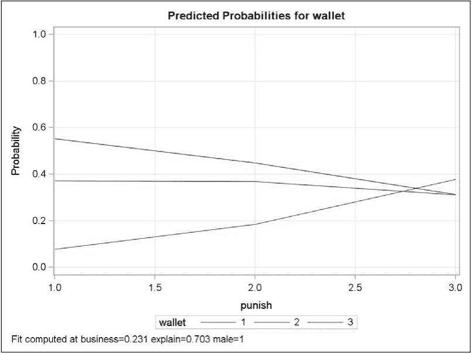

### 5.5 使用二元对数程序进行估计

如我们刚刚所见，多分类对数模型可以解释为一组二元对数方程，每个方程对应于因变量两个类别之间的比较。事实证明，您可以通过运行一组二元对数模型来合法地估计多分类对数模型（Begg and Gray 1984）。对于每个两类别对比，落入其他类别的观测值将被排除。以下是对表 5.1 中三列的执行方法：

```sas
PROC LOGISTIC DATA=wallet;
    WHERE wallet NE 2;
    MODEL wallet=male business punish explain;
PROC LOGISTIC DATA=wallet;
    WHERE wallet NE 1;
    MODEL wallet=male business punish explain;
PROC LOGISTIC DATA=wallet;
    WHERE wallet NE 3;
    MODEL wallet=male business punish explain;
RUN;
```

在 WHERE 语句中，NE 表示“不等于”。由于 WALLET 只有三个类别，移除其中任何一个都会将模型简化为二元对数模型。默认情况下，每个对数模型中因变量的参考类别是值较高的类别。因此，第一个模型预测的是 1 而非 3，第二个模型预测的是 2 而非 3，第三个模型预测的是 1 而非 2。

结果如表 5.2 所示。将其与表 5.1 比较，我们看到系数非常相似但不完全相同。显著性水平也基本相同，尽管“两者都保留 对 两者都归还”列中 BUSINESS 的 *p* 值在表 5.1 中略低于 .05，而在表 5.2 中略高于 .05。

**表 5.2 使用二元对数估计的多分类估计结果**

|  | 两者都保留 对 两者都归还 | 保留一个 对 两者都归还 | 两者都保留 对 保留一个 |
|---|---:|---:|---:|
| 截距 | −3.53** | −1.33* | −2.28* |
| MALE | 1.42* | 1.14* | .18 |
| BUSINESS | 1.07 | .38 | .79 |
| PUNISH | 1.09** | .23 | .87* |
| EXPLAIN | −1.63** | −.77* | −.68 |

*表示 *p* < .05，** 表示 *p* < .01


表 5.2 中的系数与表 5.1 中的系数相比并无更多偏误（在技术术语中，它们具有相同的概率极限）。但表 5.2 中的二元估计值效率较低——它们的真实标准误差稍大。此外，与表 5.1 不同，表 5.2 的第三列*不*完全等于前两列之差。最后，通过二元 Logit 进行估计不会给出某个特定变量的所有系数是否等于 0 的整体检验，而 Output 5.1 中的 Type 3 表中的检验可以做到这一点。

这个练习的意义何在？好吧，有时你可能会遇到这样一种情况，二元估计比多项估计更方便。这样做的一个可能优势是，你可以在不同的方程中使用不同的变量集合。另一个优势是，有许多选项（如第 3 章中描述的 Firth 方法）可用于二元 Logit，但不适用于多项 Logit。但我认为主要收获是概念上的。当我第一次了解到这种等价性时，它真的帮助我理解了多项模型是由二项模型构建而成的。联合估计程序只是一个技术上的改进。

### 5.6 模型的一般形式

到目前为止，我们只处理了因变量的三个类别。现在让我们将模型推广到 $J$ 个类别，运行指标 $j=1,...,J$。令 $p_{ij}$ 为个体 $i$ 属于类别 $j$ 的概率。模型为

$$\log\left(\frac{p_{ij}}{p_{iJ}}\right)=\boldsymbol{\beta}_j\mathbf{x}_i \qquad j=1,...,J-1 \tag{5.1}$$

其中 $\mathbf{x}_i$ 是描述个体 $i$ 的变量列向量，而 $\boldsymbol{\beta}_j$ 是类别 $j$ 的系数行向量。注意每个类别都与最高类别 $J$ 进行比较。这些方程可以求解得到

$$p_{ij}=\frac{e^{\boldsymbol{\beta}_j\mathbf{x}_i}}{1+\sum_{k=1}^{J-1}e^{\boldsymbol{\beta}_k\mathbf{x}_i}} \qquad j=1,...,J-1 \tag{5.2}$$

由于所有 $J$ 个类别的概率之和必须为 1，我们有

$$p_{iJ}=\frac{1}{1+\sum_{k=1}^{J-1}e^{\boldsymbol{\beta}_k\mathbf{x}_i}}$$

估计系数后，比较因变量的任意两个类别 j 和 k 的 Logit 方程可以从

log(p_ij / p_ik) = (β_j - β_k) x_i .

### 5.7 列联表分析

与二元 Logit 分析一样，多项 Logit 模型也可以很容易地应用于列联表的分析。考虑表 5.3，它是根据 1991 年的全国社会调查制表的（Agresti 2002）。

表 5.3 按性别和种族划分的来世信仰

|  |  | Belief in Afterlife |  |  |
|  |  | Yes | Undecided | No |
| White | Female | 371 | 49 | 74 |
|  | Male | 250 | 45 | 71 |
| Black | Female | 64 | 9 | 15 |
|  | Male | 25 | 5 | 13 |

因变量——来世信仰——有三个类别，我们将其视为无序。以下是如何使用 LOGISTIC 拟合多项 Logit 模型：

```
DATA afterlif;
    INPUT white female belief count;
    DATALINES;
1 1 1 371
1 1 2  49
1 1 3  74
1 0 1 250
1 0 2  45
1 0 3  71
0 1 1  64
0 1 2   9
0 1 3  15
0 0 1  25
0 0 2  5
0 0 3  13
;
PROC LOGISTIC DATA=afterlif;
    FREQ count;
    MODEL belief=white female / LINK=GLOGIT AGGREGATE
        SCALE=NONE;
RUN;
```

每个预测变量都编码为 1 或 0。因变量 BELIEF 的编码为：1=Yes，2=Undecided，3=No。由于“ No”具有最高值，因此它成为模型的参考类别。

结果显示在 Output 5.6 中。偏差和 Pearson 卡方检验表明没有显著的拟合不足。因为该模型与“饱和”模型之间的唯一区别是种族与性别之间的交互作用，拟合优度统计量的高 p 值仅仅意味着没有该交互作用的证据。关于“整体零假设”的三个卡方检验的 p 值都在约 .065 左右。因此，只有边际证据表明两个预测变量中的任何一个对响应都有影响。然而，从 Type 3 表中，我们看到性别效应的证据，但没有种族效应的迹象。

#### Output 5.6 PROC LOGISTIC Results for Afterlife Data

| Response Profile |
| Ordered Value | belief | Total Frequency |
| 1 | 1 | 710 |
| 2 | 2 | 108 |
| 3 | 3 | 173 |

Logits modeled use belief=3 as the reference category.

| Deviance and Pearson Goodness-of-Fit Statistics |
| Criterion | Value | DF | Value/DF | Pr > ChiSq |
| Deviance | 0.8539 | 2 | 0.4269 | 0.6525 |
| Pearson | 0.8609 | 2 | 0.4304 | 0.6502 |

| Testing Global Null Hypothesis: BETA=0 |  |  |  |
| Test | Chi-Square | DF | Pr > ChiSq |
| Likelihood Ratio | 8.7437 | 4 | 0.0678 |
| Score | 8.8498 | 4 | 0.0650 |
| Wald | 8.7818 | 4 | 0.0668 |

| Type 3 Analysis of Effects |  |  |  |
| Effect | DF | Wald Chi-Square | Pr > ChiSq |
| male | 2 | 12.2818 | 0.0022 |
| business | 2 | 4.6858 | 0.0961 |
| punish | 2 | 10.9196 | 0.0043 |
| explain | 2 | 9.7651 | 0.0076 |

| Analysis of Maximum Likelihood Estimates |  |  |  |  |  |  |
| Parameter | belief | DF | Estimate | Standard Error | Wald Chi-Square | Pr > ChiSq |
| Intercept | 1 | 1 | 0.8828 | 0.2426 | 13.2390 | 0.0003 |
| Intercept | 2 | 1 | -0.7582 | 0.3614 | 4.4031 | 0.0359 |
| white | 1 | 1 | 0.3420 | 0.2370 | 2.0814 | 0.1491 |
| white | 2 | 1 | 0.2712 | 0.3541 | 0.5863 | 0.4438 |
| female | 1 | 1 | 0.4186 | 0.1713 | 5.9737 | 0.0145 |
| female | 2 | 1 | 0.1051 | 0.2465 | 0.1817 | 0.6699 |

| Odds Ratio Estimates |  |  |  |  |
| Effect | belief | Point Estimate | 95% Wald Confidence Limits |  |
| white | 1 | 1.408 | 0.885 | 2.240 |
| white | 2 | 1.311 | 0.655 | 2.625 |
| female | 1 | 1.520 | 1.086 | 2.126 |
| female | 2 | 1.111 | 0.685 | 1.801 |

在“最大似然估计分析”表中，BELIEF 列中所有参数值为 1 的都属于 yes vs. no（1 vs. 3）的方程；BELIEF 值为 2 的参数属于 undecided vs. no（2 vs. 3）的方程。性别效应似乎完全集中在 yes/no 对比中。比值比为 1.52，我们可以说女性比男性更可能说她们相信来世，可能性大约高 50%。然而，比值比的 95% 置信区间相当宽，从 1.086 到 2.126。

### 5.8 解释问题

当因变量只有三个类别时，多项 Logit 模型相对容易解释。但随着类别数量的增加，讲述结果的简单故事变得越来越困难。如我们所见，该模型最自然地以因变量类别之间对比的效应来解释。但对于一个 5 类别的因变量，有 10 种不同的类别对。对于一个 10 类别的因变量，配对数量猛增到 45。对此问题没有简单的解决方案，但 Long（1997）提出了一种解释系数的图形方法，对于适中的类别数量非常有帮助。

还有另一个解释问题，即使是多项 Logit 分析的经验用户也可能忽略。在二元 Logit 分析中，如果变量 x 的系数为正，你就知道 x 的每次增加都会导致指定结果的概率增加。在多项模型中并非总是如此。

考虑以下假设示例。假设因变量 y 有三个类别（1、2 和 3），只有一个自变量 x。当我们估计多项 Logit 模型时，假设我们得到以下两个方程：

```
log(p₁/p₃) = 1.0 − 2.0x
log(p₂/p₃) = 1.0 − 1.0x.
```

我们如何描述 x 对 p₂ 的影响？由于第二个方程中 x 的系数为负，很容易认为 x 的增加会导致类别 2 的概率下降。但如果我们绘制概率图，如 Output 5.7 所示，我们会发现 x 对 p₂ 的影响不是单调的。（该图使用 EFFECTPLOT 语句通过模拟数据生成。）当 x 低于 .5 时，x 的增加会使 p₂ 增加。当 x 高于 .5 时，x 的增加会使 p₂ 减少。


#### 输出 5.7 x 对处于三个类别中每一类别的概率的影响

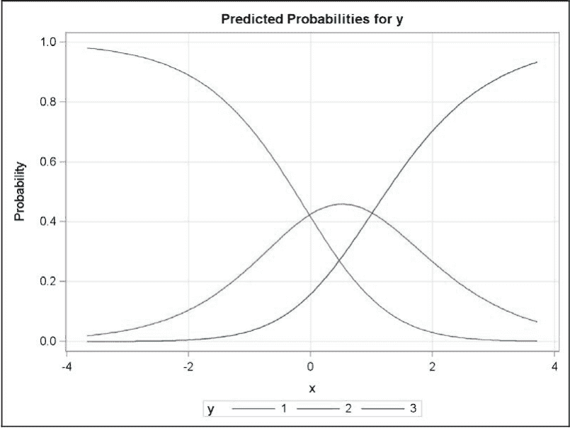

这里发生了什么？图 5.1 中的示意图有助于解释这种情况。模型的结构是，x 的增加倾向于将个体从类别 2 移到类别 3。但 x 的增加也倾向于将个体从类别 1 移到类别 2。当 x 很低时，大多数案例位于类别 1，因此大部分移动是从 1 到 2，类别 2 中的案例比例会上升。然而，最终类别 1 中剩余的案例很少，因此大部分移动是从 2 到 3，留在类别 2 中的比例会下降。

#### 图 5.1 当 x 增加时个体的移动

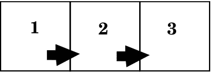

这种现象的结果是，多项 logit 系数必须始终被解释为对类别对之间对比的影响，而绝不能解释为对处于某一特定类别概率的影响。

- 累积 logit 模型
- 相邻类别模型
- 续比模型

当因变量只有两个类别时，这三个模型都简化为通常的二值 logit 模型。

在这三个模型中，累积 logit 模型——也称为有序 logit 或序次 logit 模型——适用性最广，也是在 SAS 中最容易使用的模型。相邻类别模型也是一种有吸引力的通用方法，但 SAS 只能在数据分组时估计该模型。续比模型则更为专门化。它专为有序类别表示按阶段纵向推进的情形而设计。

### 6.2 累积 logit 模型：示例

累积 logit 模型（McCullagh 1980）在 SAS 中实现起来再简单不过了。每当 PROC LOGISTIC 在因变量上遇到两个以上的类别时，它就会自动估计累积 logit 模型。我们来试一下，看看会得到什么结果。然后我们再退一步讨论底层模型。

在第 5 章中，我们分析了因变量是对以下问题的回答的数据：“如果你在街上发现一个钱包，你会（1）留下钱包和钱，（2）留下钱并归还钱包，还是（3）钱包和钱都归还？”虽然我们把这些回答类别视为无序的，但也存在一个明显的顺序：1 是最不道德的回答，3 是最道德的回答，2 介于两者之间。为了对这些数据拟合累积 logit 模型，我们提交以下程序：

```
PROC LOGISTIC DATA=wallet;
    MODEL wallet = male business punish explain;
RUN;
```

（如果你忘了，解释变量在第 5.2 节中有描述。）结果显示在输出 6.1 中。

输出看起来几乎与二值 logit 模型的输出相同，只是中间新增了一些内容：“比例优势假设的得分检验”表。我稍后会更详细地解释这一点。目前，只要说这个统计量检验序次限制是否有效，并且 p 值越大越好就够了。在本例中，我们没有理由拒绝该模型。输出的另一个区别是有两个截距，而不是一个。一般来说，本章所有序次模型的截距数量比因变量的类别数少一个。但与线性模型中的截距一样，这些截距很少具有实质性的实际意义。

#### 输出 6.1 钱包数据的累积 logit 模型的 PROC LOGISTIC 输出

| 模型信息 |  |
|---|---|
| 数据集 | MY.WALLET |
| 响应变量 | wallet |
| 响应水平数 | 3 |
| 模型 | 累积 logit |
| 优化技术 | Fisher 得分法 |

| 读取的观测数 | 195 |
| 使用的观测数 | 195 |

| 响应概况 |  |  |
| 有序值 | wallet | 总频数 |
| 1 | 1 | 24 |
| 2 | 2 | 50 |
| 3 | 3 | 121 |

建模的概率是对较低有序值累积的。

| 模型收敛状态 |  |
|---|---|
| 满足收敛准则（GCONV=1E-8）。 |

| 比例优势假设的得分检验 |  |  |
| 卡方 | 自由度 | Pr > 卡方 |
| 5.1514 | 4 | 0.2721 |

| 模型拟合统计量 |  |  |
|---|---|---|
| 准则 | 仅截距 | 截距和协变量 |
| AIC | 356.140 | 319.367 |
| SC | 362.686 | 339.005 |
| -2 对数似然 | 352.140 | 307.367 |

| 检验全局零假设：BETA=0 |  |  |  |
|---|---|---|---|
| 检验 | 卡方 | 自由度 | Pr > 卡方 |
| 似然比 | 44.7727 | 4 | <.0001 |
| 得分 | 40.8753 | 4 | <.0001 |
| Wald | 38.5746 | 4 | <.0001 |

| 最大似然估计分析 |  |  |  |  |  |
|---|---|---|---|---|---|
| 参数 | 自由度 | 估计值 | 标准误差 | Wald 卡方 | Pr > 卡方 |
| 截距 1 | 1 | -3.2691 | 0.5612 | 33.9325 | <.0001 |
| 截距 2 | 1 | -1.4913 | 0.5085 | 8.6012 | 0.0034 |
| male | 1 | 1.0636 | 0.3255 | 10.6771 | 0.0011 |
| business | 1 | 0.7370 | 0.3515 | 4.3973 | 0.0360 |
| punish | 1 | 0.6874 | 0.2246 | 9.3644 | 0.0022 |
| explain | 1 | -1.0452 | 0.3392 | 9.4972 | 0.0021 |

| 优势比估计 |  |  |
|---|---|---|
| 效应 | 点估计 | 95% Wald 置信限 |
| male | 2.897 | 1.531 | 5.483 |
| business | 2.090 | 1.049 | 4.161 |
| punish | 1.989 | 1.280 | 3.089 |
| explain | 0.352 | 0.181 | 0.684 |

回到输出中较为熟悉的部分，从全局检验可以看出，有强有力的证据表明至少有一个系数不为 0。输出下半部分进一步证实了这一点，所有系数的 p 值均低于 .05。在下一节中，我们将看到参数估计和优势比的解释方式与二值 logit 模型中的解释几乎完全相同。

将输出 6.1 与同一数据的多项 logit 结果（输出 5.1）进行比较，我们会发现几个主要差异。最明显的是，多项模型对每个解释变量有两个系数，而累积模型只有一个系数。这使得累积模型在呈现和解释上要简单得多。一个不太明显的差异是，在累积模型中，用于检验每个变量是否对因变量有影响的 p 值都更低。这一点对 BUSINESS 至关重要，它在多项模型中的 p 值为 .10（2 自由度的 Type 3 检验），而在累积模型中为 .036。这些 p 值差异印证了我之前提出的观点：累积 logit 模型中的假设检验具有更高的功效。

### 6.3 累积 logit 模型：解释

我将用三种不同的方式来解释累积 logit 模型。首先从一个直观的、非数学的描述开始。然后给出基于累积概率的模型形式定义。最后，解释如何从潜变量模型推导出该模型。

以下是非数学解释。假设你想分析 WALLET 数据，但你只有一个二值 logit 程序。解决这一困境的办法是将三个类别中的两个合并在一起，从而得到一个二分变量。当然，为了尊重变量的顺序，你只会合并类别 1 和 2，或类别 2 和 3，而不会合并 1 和 3。为了在因变量上尽可能实现均等的划分，最佳分组是将类别 1 和 2 合并，并让类别 3 单独一组。这样，（1, 2）类别中有 74 个案例，类别 3 中有 121 个案例。以下是执行此操作的 SAS 代码：

```
DATA a;
    SET wallet;
    IF wallet=1 THEN wallet=2;
PROC LOGISTIC DATA=a;
    MODEL wallet = male business punish explain;
RUN;
```

结果显示在输出 6.2 中。

#### 输出 6.2 二分后钱包数据的 Logistic 结果

| 最大似然估计分析 |
| 参数 | 自由度 | 估计值 | 标准误差 | Wald 卡方 | Pr > 卡方 |
| 截距 | 1 | -1.3189 | 0.5465 | 5.8243 | 0.0158 |
| male | 1 | 1.1845 | 0.3408 | 12.0824 | 0.0005 |
| business | 1 | 0.6357 | 0.3812 | 2.7808 | 0.0954 |
| punish | 1 | 0.5071 | 0.2474 | 4.2030 | 0.0404 |
| explain | 1 | -1.0200 | 0.3662 | 7.7606 | 0.0053 |

然而，这种分组并不是神圣不可更改的。我们也可以将类别 2 和 3 合并（共 171 个案例），并让类别 1 单独一组（24 个案例）。替代代码如下：

```
DATA b;
    SET wallet;
    IF wallet=3 THEN wallet=2;
PROC LOGISTIC DATA=b;
    MODEL wallet = male business punish explain;
RUN;
```

结果显示在输出 6.3 中。

#### 输出 6.3 钱包数据替代二分法的结果

| 最大似然估计分析 |
| 参数 | 自由度 | 估计值 | 标准误差 | Wald 卡方 | Pr > 卡方 |
| 截距 | 1 | -3.7153 | 0.8017 | 21.4793 | <.0001 |
| male | 1 | 0.8268 | 0.5290 | 2.4426 | 0.1181 |
| business | 1 | 1.0129 | 0.5142 | 3.8810 | 0.0488 |
| punish | 1 | 1.0108 | 0.3075 | 10.8032 | 0.0010 |
| explain | 1 | -1.2760 | 0.5112 | 6.2311 | 0.0126 |

这与累积 logit 模型有什么关系？正是这样：累积模型约束这两个二值 logit 模型中的系数相同，但允许截距不同。比较输出 6.2 和输出 6.3，系数看起来并不完全相同。但累积 logit 模型只是将这些差异归因于随机性。


由于尺度参数 σ 无法识别，我们无法恢复出潜在的系数。但如果我们检验观察到的系数为 0 的原假设，这等价于检验潜在系数为 0。

这个模型引人注目的地方在于 β 系数不依赖于阈值的放置。这意味着有些 τ 可能靠得很近，而另一些可能相距很远，但解释变量的效果保持不变。τ 的位置当然会影响截距以及落入不同类别的案例的相对数量。但从某种意义上说，累积 logit 模型对观察类别之间的距离没有任何假设。

在二元 logit 模型的潜在变量解释中，我们看到如果 ε 具有标准正态分布，我们得到的是 probit 模型。如果 ε 具有标准极值分布，我们得到的是互补对数-对数模型。相同的结果推广到累积模型，尽管我不会进一步讨论这些模型。与二元情形一样，你可以在 LOGISTIC 中使用 MODEL 语句的 LINK=PROBIT 或 LINK=CLOGLOG 选项来调用这些模型。

### 6.4 累积 Logit 模型：实际考虑

现在我们准备解释 Output 6.1 中的系数。因为我没有使用 DESCENDING 选项，模型预测处于较低类别的概率，在本例中意味着较少的道德行为。每个报告的优势比都可以解释为变量对处于较低类别而非较高类别的优势的影响，而不考虑你如何对结果进行二分化。例如，男性的调整后优势比为 2.897。因此我们可以说，男性处于较低类别（而非较高类别）的优势几乎是女性的三倍。在商学院的人中，处于较低类别的优势略多于其他学校的人的两倍。对于 PUNISH，1.99 的调整后优势比告诉我们，PUNISH 每增加一个水平，处于较低类别而非较高类别的优势就会翻一番。最后，那些父母解释了惩罚的学生，其处于较低类别的优势仅为未解释父母的学生优势的约 35%。

第 2 章和第 3 章中关于二元 logit 模型的许多问题和选项也适用于累积 logit 模型。例如，我关于置信区间的说法对累积 logit 模型同样成立。多重共线性在累积模型中也是一个类似的问题，诊断方法相同。累积模型中也可能出现不收敛和无限参数估计的问题，尽管频率有所降低。这是因为，随着因变量类别数的增加，很难找到完全预测因变量的解释变量。累积 logit 模型可以使用广义 R²，其公式与式 (3.10) 相同。

LOGISTIC 中二元和累积模型之间一个区别是，许多回归诊断对于累积模型不可用。例如，你无法生成第 3 章中讨论的任何诊断图。使用 OUTPUT 语句，你无法获得任何残差或影响统计量。然而，你可以为每个个体和每个类别生成预测概率，如果需要，还可以给出上下置信限。而且，你可以使用 EFFECTPLOT 语句将预测值与解释变量作图。

对于 Output 6.1 中的模型，有两种方法可以获得预测值。我将首先解释传统方法，它有点棘手。然后我将描述一种更新、更直接的方法。传统方法是通过在 MODEL 语句之后包含语句

```
OUTPUT OUT=a PRED=p;
```

来实现的。对于原始数据集中每个观测值，OUTPUT 数据集中有两个记录，对应于因变量的前两个类别。（对于因变量有 J 个类别，每个观测值将有 J−1 个预测值。）数据集 A 中前 10 条记录（对应于原始数据集中前五个案例）显示在 Output 6.4 中。前两条记录对应于原始数据集中第一个人。第一条记录给出了 WALLET 值为 1 的预测概率为 .13076。第二行给出了 WALLET 值小于或等于 2 的预测概率。要得到 WALLET 实际等于 2 的预测概率，我们必须减去前一个概率，即 .47092−.13076=.34016。要得到 WALLET=3 的预测概率，我们必须从 1 中减去 WALLET=2 的预测概率，即 1−.47092=.52908。按照这种方法，输出中下一个人的预测概率（观测值 3 和 4）分别为 .05024、.18812 和 .76164，对应于水平 1、2 和 3。请记住，当你使用 DESCENDING 选项时，预测概率是因变量取值大于或等于指定水平的概率。

**Output 6.4 Predicted Values for Wallet Data (First Five Persons)**

| Obs | wallet | male | business | punish | explain | _LEVEL_ | p |
| --- | --- | --- | --- | --- | --- | --- | --- |
| 1 | 2 | 0 | 0 | 2 | 0 | 1 | 0.13076 |
| 2 | 2 | 0 | 0 | 2 | 0 | 2 | 0.47091 |
| 3 | 2 | 0 | 0 | 2 | 1 | 1 | 0.05024 |
| 4 | 2 | 0 | 0 | 2 | 1 | 2 | 0.23836 |
| 5 | 3 | 0 | 0 | 1 | 1 | 1 | 0.02591 |
| 6 | 3 | 0 | 0 | 1 | 1 | 2 | 0.13597 |
| 7 | 3 | 0 | 0 | 2 | 0 | 1 | 0.13076 |
| 8 | 3 | 0 | 0 | 2 | 0 | 2 | 0.47091 |
| 9 | 1 | 1 | 0 | 1 | 1 | 1 | 0.07154 |
| 10 | 1 | 1 | 0 | 1 | 1 | 2 | 0.31314 |

还有一种更直接的方法，我们在第 5 章中已经对无序多项模型见过。它通过语句调用：

```
OUTPUT OUT=b PREDPROBS=I;
```

这会产生一个 SAS 数据集，其中包含原始数据集中每条记录的一个记录。数据集中前五条记录显示在 Output 6.5 中。对于因变量的每个类别，都有一个观测值落入该类别的预测概率，变量名为 IP_1、IP_2 和 IP_3。

**Output 6.5 Predicted Values for Wallet Data (First Five Persons)**

| Obs | wallet | male | business | punish | explain | _FROM_ | _INTO_ | IP_1 | IP_2 | IP_3 |
| --- | --- | --- | --- | --- | --- | --- | --- | --- | --- | --- |
| 1 | 2 | 0 | 0 | 2 | 0 | 2 | 3 | 0.13076 | 0.34015 | 0.52909 |
| 2 | 2 | 0 | 0 | 2 | 1 | 2 | 3 | 0.05024 | 0.18812 | 0.76164 |
| 3 | 3 | 0 | 0 | 1 | 1 | 3 | 3 | 0.02591 | 0.11006 | 0.86403 |
| 4 | 3 | 0 | 0 | 2 | 0 | 3 | 3 | 0.13076 | 0.34015 | 0.52909 |
| 5 | 1 | 1 | 0 | 1 | 1 | 1 | 3 | 0.07154 | 0.24159 | 0.68686 |

### 6.5 累积 Logit 模型：列联表

累积 logit 模型在分析列联表时非常有用。考虑表 6.1，该表由 Sloane 和 Morgan (1996) 根据 General Social Survey 制表。我们的目标是估计幸福感对年份和婚姻状况的依赖模型。

**Table 6.1 General Happiness by Marital Status and Year**

| Year | Marital Status | Very Happy | Pretty Happy | Not Too Happy |
| --- | --- | ---: | ---: | ---: |
| 1974 | Married | 473 | 493 | 93 |
| 1974 | Unmarried | 84 | 231 | 99 |
| 1984 | Married | 332 | 387 | 62 |
| 1984 | Unmarried | 150 | 347 | 117 |
| 1994 | Married | 571 | 793 | 112 |
| 1994 | Unmarried | 257 | 889 | 234 |

以下是读取该表的 SAS 程序：

```sas
DATA happy;
    INPUT year married happy count;
    DATALINES;
1 1 1 473
1 1 2 493
1 1 3 93
1 0 1 84
1 0 2 231
1 0 3 99
2 1 1 332
2 1 2 387
2 1 3 62
2 0 1 150
2 0 2 347
2 0 3 117
3 1 1 571
3 1 2 793
3 1 3 112
3 0 1 257
3 0 2 889
3 0 3 234
;
```


请注意，我对HAPPY的编码方式是：1表示非常幸福，3表示不太幸福。

为了拟合累积logit模型，我们运行以下程序，结果见输出6.6：

```
PROC LOGISTIC DATA=happy;
    FREQ count;
    CLASS year / PARAM=GLM;
    MODEL happy = married year / AGGREGATE SCALE=NONE;
RUN;
```

#### 输出6.6 幸福感数据的累积Logit结果

| 比例优势假设的得分检验 |  |  |
|---|---|---|
| 卡方 | 自由度 | Pr > 卡方 |
| 26.5204 | 3 | <.0001 |

| 偏差和皮尔逊拟合优度统计量 |  |  |  |  |
|---|---|---|---|---|
| 准则 | 值 | 自由度 | 值/自由度 | Pr > 卡方 |
| 偏差 | 30.9709 | 7 | 4.4244 | <.0001 |
| 皮尔逊 | 31.4060 | 7 | 4.4866 | <.0001 |

| 全局零假设检验：BETA=0 |  |  |  |
|---|---|---|---|
| 检验 | 卡方 | 自由度 | Pr > 卡方 |
| 似然比 | 356.3435 | 3 | <.0001 |
| 得分 | 348.4470 | 3 | <.0001 |
| Wald | 340.2626 | 3 | <.0001 |

| 效应的Type 3分析 |  |  |  |
|---|---|---|---|
| 效应 | 自由度 | Wald卡方 | Pr > 卡方 |
| married | 1 | 322.9185 | <.0001 |
| year | 2 | 3.7616 | 0.1525 |

| 最大似然估计分析 |
| 参数 | 自由度 | 估计值 | 标准误 | Wald卡方 | Pr > 卡方 |
| 截距1 | 1 | -1.3919 | 0.0513 | 735.2275 | <.0001 |
| 截距2 | 1 | 1.4160 | 0.0517 | 749.6434 | <.0001 |
| married | 1 | 0.9931 | 0.0553 | 322.9185 | <.0001 |
| year 1 | 1 | 0.0716 | 0.0636 | 1.2673 | 0.2603 |
| year 2 | 1 | 0.1195 | 0.0640 | 3.4827 | 0.0620 |
| year 3 | 0 | 0 | . | . | . |

| 优势比估计 |
| 效应 | 点估计 | 95% Wald置信限 |
| married | 2.700 | 2.422 | 3.008 |
| year 1 vs 3 | 1.074 | 0.948 | 1.217 |
| year 2 vs 3 | 1.127 | 0.994 | 1.278 |

我们在输出6.6中首先看到的是，比例优势假设的得分检验相当明确地表明应拒绝该模型。这与整体拟合优度检验（通过AGGREGATE和SCALE=NONE选项获得）相互印证，后者的p值均小于0.0001。得分检验的自由度为3，对应于模型中三个系数所受到的约束。粗略地说，得分检验（卡方=26.5）可以被视为整体偏差（卡方=31）的一个组成部分。因此，我们可以说大约85%的偏差源于累积logit模型所施加的约束。剩余15%（以及4个自由度）来自模型中排除的年份与婚姻状况之间可能存在的交互作用。

我们是否应该拒绝该模型？请记住，样本量相当大（5,724个案例），因此任何简约模型都很难获得高于0.05的p值。但让我们先推迟决定，直到检查更多证据。再看输出底部，我们有强有力的证据表明已婚人士比未婚人士报告更高的幸福感，但几乎没有证据表明幸福感随时间变化。两个年份系数单独来看均不显著。Type 3检验表明两个系数均为0也不显著。因此，我们尝试删除年份变量，看看会发生什么（输出6.7）。

#### 输出6.7 删除年份后的幸福感模型

| 比例优势假设的得分检验 |
| 卡方 | 自由度 | Pr > 卡方 |
| 0.3513 | 1 | 0.5534 |

| 偏差和皮尔逊拟合优度统计量 |
| 准则 | 值 | 自由度 | 值/自由度 | Pr > 卡方 |
| 偏差 | 0.3508 | 1 | 0.3508 | 0.5537 |
| 皮尔逊 | 0.3513 | 1 | 0.3513 | 0.5534 |

独特概况数量：2

| 最大似然估计分析 |
| 参数 |  | 自由度 | 估计值 | 标准误 | Wald卡方 | Pr > 卡方 |
| 截距1 |  | 1 | -1.3497 | 0.0459 | 865.8068 | <.0001 |
| 截距2 |  | 1 | 1.4569 | 0.0468 | 968.1472 | <.0001 |
| married |  | 1 | 1.0017 | 0.0545 | 337.2287 | <.0001 |

| 优势比估计 |
| 效应 | 点估计 | 95% Wald置信限 |
| married | 2.723 | 2.447 3.030 |

现在模型拟合得非常好。当然，得分检验只有1个自由度，因为只有一个系数在两个隐含方程中受到约束。偏差和皮尔逊卡方也仅有1个自由度，因为LOGISTIC在删除年份变量后对数据进行了重新分组。在解释婚姻状况效应时，我们发现已婚人士幸福感更高的优势约为未婚人士的三倍。

我们很容易就此打住，但得分统计量在删除年份变量后下降得如此剧烈，这一事实表明还有其他情况在起作用。为了探究可能的原因，让我们对幸福感变量的两种二分方式分别拟合模型。

```
DATA a;
    SET happy;
    lesshap=happy GE 2;
    nottoo=happy EQ 3;
PROC LOGISTIC DATA=a;
    FREQ count;
    CLASS year / PARAM=GLM;
    MODEL lesshap=married year;
PROC LOGISTIC DATA=a;
    FREQ count;
    CLASS year / PARAM=GLM;
    MODEL nottoo=married year;
RUN;
```

结果见输出6.8。如果累积logit模型是正确的，那么两个模型中三个变量的系数应该相同。对于MARRIED来说，这一情况基本成立。但两个YEAR变量在第一个模型中系数为负，在第二个模型中系数为正。四个系数中有三个在0.01水平以上显著。这无疑就是累积logit模型遇到困难的原因。看来1994年与其他两年不同，但这种差异并不能描述为幸福感的统一上升或下降。相反，那一年处于中间类别的案例相对更多，而处于两个极端类别的案例较少。

#### 输出6.8 一般幸福感的替代二分法结果

1对比(2,3)

| 参数 | 自由度 | 估计值 | 标准误 | Wald卡方 | Pr > 卡方 |
|---|---:|---:|---:|---:|---:|
| **最大似然估计分析** |  |  |  |  |  |
| 截距 | 1 | -1.4615 | 0.0574 | 647.4056 | <.0001 |
| married | 1 | 0.9931 | 0.0624 | 253.2451 | <.0001 |
| year 1 | 1 | 0.2204 | 0.0699 | 9.9348 | 0.0016 |
| year 2 | 1 | 0.2271 | 0.0716 | 10.0650 | 0.0015 |
| year 3 | 0 | 0 | . | . | . |

#### 输出6.9 QLIM异质扰动项结果

|  | 参数估计 |  |  |  |
| 参数 | 自由度 | 估计值 | 标准误 | t值 | 近似Pr > |t| |
| 截距 | 1 | 1.224813 | 0.055617 | 22.02 | <.0001 |
| married | 1 | -0.904331 | 0.056926 | -15.89 | <.0001 |
| _Limit2 | 1 | 2.549680 | 0.085444 | 29.84 | <.0001 |
| _H.yr94 | 1 | -0.335531 | 0.080389 | -4.17 | <.0001 |
| _H.yr84 | 1 | -0.081647 | 0.094153 | -0.87 | 0.3858 |

结果与我们已看到的情况一致。MARRIED系数的符号与使用PROC LOGISTIC得到的结果相反，因为QLIM预测的是因变量处于较高类别的概率，而不是较低类别的概率。以_H为前缀的两个参数是残差方差的影响。我们看到1994年的方差显著低于1974年，这表明在1994年人们更可能处于中间类别，而较少处于极端类别。标为_LIMIT2的参数在功能上等同于PROC LOGISTIC模型中的第二个截距。

### 6.6 相邻类别模型

有序分类数据的另一个通用模型是相邻类别模型。和之前一样，我们令p_ij为个体i落入因变量第j类别的概率，并假设类别按j=1, ..., J的顺序排列。现在取任意一对相邻类别，比如j和j+1。我们可以写出关于这两个类别对比的logit模型，作为解释变量的函数：

log( p_{i,j+1} / p_{ij} ) = α_j + β_j x_i      j = 1,...,J-1,      (6.6)

其中β_j x_i = β_{j1} x_{i1} + ... + β_{jk} x_{ik}。共有J-1个这样的配对对比。事实证明，这只是无序类别多项logit模型的另一种写法。换句话说，方程(6.6)等价于方程(5.1)。为了得到有序数据的相邻类别模型，我们对这组方程施加一个约束。具体来说，我们假设所有j都有β_j = β。换言之，我们不再对每个对比使用不同的系数集


for every adjacent pair, there is only one set for the lot of them. So our adjacent categories model becomes

```
log(p_{i,j+1} / p_{ij}) = α_j + β x_i      j = 1,...,J-1      (6.7)
```

注意右边的表达式与方程 (6.1) 相同，该方程定义了累积模型，但左边的表达式比较的是单个类别而非分组的累积类别。

尽管相邻类别模型是多项式 logit 模型的特例，但 PROC LOGISTIC 并不能施加适当的约束。模型可以用 PROC CATMOD 进行估计，如果数据可以分组为列联表的话。然而，CATMOD 使用加权最小二乘法而不是最大似然法。下面是针对我们在上一节中分析的幸福感数据的操作方式：

```
PROC CATMOD DATA=happy;
    WEIGHT count;
    RESPONSE ALOGIT;
    MODEL happy = _RESPONSE_ married year / PARAM=REF;
RUN;
```

CATMOD 没有 FREQ 语句，但 WEIGHT 语句执行相同的功能。带有 ALOGIT 选项的 RESPONSE 语句为因变量调用相邻类别函数，如方程 (6.6) 所示。将 _RESPONSE_ 放在 MODEL 语句中告诉 CATMOD 估计一组系数，如方程 (6.7) 所示，而不是为每一对类别估计不同的系数。默认情况下 CATMOD 将所有预测变量视为 CLASS 变量。但与 LOGISTIC 类似，CATMOD 也使用“效应参数化”对这些变量进行编码。PARAM=REF 选项覆盖该默认值以产生指示变量编码。结果显示在输出 6.10 中。

首先要注意的是，残差卡方检验表明模型拟合不佳。事实上，其值相当接近我们在输出 6.6 中对累积 logit 模型得到的偏差和 Pearson 卡方值。与该输出一样，我们也发现婚姻状况有很强的影响，但日历年份的影响证据很少。与 LOGISTIC 不同，CATMOD 将模型参数化为预测响应变量的更高值而非更低值。但由于 MARRIED 被视为 CLASS 变量，参考类别是 1 而不是 0。因此 MARRIED 的系数与输出 6.6 中的符号相同，对应的优势比为 exp(.8035)=2.23。这告诉我们，每当我们比较相邻的幸福感类别时，已婚人士进入更幸福类别的优势是未婚人士的两倍多。

#### Output 6.10 CATMOD Output for Adjacent Categories Model, Happiness Data

| Analysis of Variance |
| Source | DF | Chi-Square | Pr > ChiSq |
| Intercept | 1 | 1097.28 | <.0001 |
| _RESPONSE_ | 1 | 1323.91 | <.0001 |
| married | 1 | 314.22 | <.0001 |
| year | 2 | 3.07 | 0.2159 |
| Residual | 7 | 35.74 | <.0001 |

| Analysis of Weighted Least Squares Estimates |
| Parameter |  | Estimate | Standard Error | Chi-Square | Pr > ChiSq |
| Intercept |  | -1.8856 | 0.0569 | 1097.28 | <.0001 |
| _RESPONSE_ | 1 | 2.1474 | 0.0590 | 1323.91 | <.0001 |
| married | 0 | 0.8035 | 0.0453 | 314.22 | <.0001 |
| year | 1 | -0.0353 | 0.0516 | 0.47 | 0.4945 |
|  | 2 | -0.0916 | 0.0523 | 3.06 | 0.0801 |

由于模型拟合不佳，我们可以像对累积 logit 模型所做的那样：为每一对相邻类别分别拟合方程。在这种情况下，我们只需从 MODEL 语句中删除 _RESPONSE_ 即可轻松实现。结果显示在输出 6.11 中。

#### Output 6.11 Adjacent Categories Model with Two Sets of Coefficients

| Analysis of Variance |
| Source | DF | Chi-Square | Pr > ChiSq |
| Intercept | 2 | 606.88 | <.0001 |
| married | 2 | 315.39 | <.0001 |
| year | 4 | 30.66 | <.0001 |
| Residual | 4 | 4.16 | 0.3845 |

| Parameter |  | Function Number | Estimate | Standard Error | Chi-Square | Pr > ChiSq |
|---|---|---:|---:|---:|---:|---:|
| Intercept |  | 1 | 0.3492 | 0.0497 | 49.45 | <.0001 |
|  |  | 2 | -2.0122 | 0.0818 | 604.75 | <.0001 |
| married | 0 | 1 | 0.8619 | 0.0646 | 178.10 | <.0001 |
|  | 0 | 2 | 0.7087 | 0.0863 | 67.46 | <.0001 |
| year | 1 | 1 | -0.2900 | 0.0726 | 15.94 | <.0001 |
|  | 1 | 2 | 0.4036 | 0.1024 | 15.53 | <.0001 |
|  | 2 | 1 | -0.2606 | 0.0734 | 12.60 | 0.0004 |
|  | 2 | 2 | 0.1932 | 0.1028 | 3.53 | 0.0603 |

这些结果与输出 6.8 中对替代二分法的结果相当相似。MARRIED 系数在两个方程中相当稳定，YEAR 1 (1992) 的系数也是如此。但 YEAR 2 (1994) 系数在第一个方程中比在第二个方程中大得多。再次说明的信息是，在 1994 年，响应变量的中间类别相对于两个极端类别更受青睐。

尽管累积 logit 模型和相邻类别模型在公式和解释上存在明显差异，但在实践中两种模型往往得出非常相似的结论。我通常更喜欢累积模型，既因为其具有吸引力的潜变量解释，也因为其在软件中易于获得。但相邻类别模型至少在原则上有一个优势：可以轻松地制定对系数施加选择性约束的模型（尽管此类模型无法在 CATMOD 中估计）。例如，我们可以强制 MARRIED 系数对所有类别对都相同，但允许年份系数不同。事实上，我们将在第 10 章中看到如何做到这一点，当我们使用等价的对数线性模型估计相邻类别模型时。

### 6.7 Continuation Ratio Model

累积 logit 和相邻类别模型是几乎任何有序分类变量的合理候选模型。我们的第三个模型—— continuation ratio 模型——更为专门。它最适用于有序类别代表通过阶段的进展，因此个体必须先通过每个较低阶段，然后才能进入较高阶段。在这些情况下，continuation ratio 模型比其他两种更具吸引力。

由于该模型最常应用于教育 attainment，让我们以此为例。下面。表 6.2 给出了 2,294 名未能通过武装部队资格测试的男性中，教育 attainment 的三个类别的频数计数，按种族、年龄和父亲的教育程度（Fienberg 2007）交叉分类。他们未能通过测试这一事实与我们的目的无关。

#### Table 6.2 Educational Attainment by Race, Age, and Father’s Education

| Race | Age | Father’s Education* | Grammar School | Some High School | High School Graduate |
|---|---|---:|---:|---:|---:|
| White | <22 | 1 | 39 | 29 | 8 |
|  |  | 2 | 4 | 8 | 1 |
|  |  | 3 | 11 | 9 | 6 |
|  |  | 4 | 48 | 17 | 8 |
|  | ≥22 | 1 | 231 | 115 | 51 |
|  |  | 2 | 17 | 21 | 13 |
|  |  | 3 | 18 | 28 | 45 |
|  |  | 4 | 197 | 111 | 35 |
| Black | <22 | 1 | 19 | 40 | 19 |
|  |  | 2 | 5 | 17 | 7 |
|  |  | 3 | 2 | 14 | 3 |
|  | ≥22 | 4 | 49 | 79 | 24 |
|  |  | 1 | 110 | 133 | 103 |
|  |  | 2 | 18 | 38 | 25 |
|  |  | 3 | 11 | 25 | 18 |
|  |  | 4 | 178 | 206 | 81 |

*1=grammar school, 2=some high school, 3=high school graduate, 4=not available.

当然，我们可以为此表估计累积 logit 或相邻类别模型。我们也可以完全忽略有序性并估计多项式 logit 模型。但让我们思考一下这种情况下的 attainment 过程如何运作。第一步是完成小学教育。我们可以估计一个二元 logit 模型，因变量等于 1 如果个人继续小学教育，等于 0 如果没有，本质上合并了两个更高的类别。下一步是在*开始高中教育的前提下*毕业高中。对于这一步，我们可以剔除所有从未开始高中教育的男性（频数计数的第一列）并估计一个 logit 模型，因变量等于 1 如果个人毕业，等于 0 如果没有。

现在，假设我们认为解释变量的效果在每个步骤中是相同的。那么，将系数在各步骤间约束为相等是有意义的


这样我们就只得到一组系数。这就是延续比模型的核心思想。

让我们对因变量上的 $J$ 个类别形式化该模型。如常，我们假设类别按顺序 $j=1,\ldots,J$ 排列。设 $y_i$ 为因变量，可取这 $J$ 个值之一。定义 $A_{ij}$ 为个体 $i$ 在达到阶段 $j$ 的条件下，进展到阶段 $j+1$ 的概率。更正式地，

$$A_{ij}=\Pr(y_i>j\mid y_i\ge j).$$

我们随后指定 $J-1$ 个 logit 方程，

$$\log\left(\frac{A_{ij}}{1-A_{ij}}\right)=\alpha_j+\boldsymbol{\beta}\mathbf{x}_i\qquad j=1,\ldots,J-1 \tag{6.8}$$

其中 $\boldsymbol{\beta}\mathbf{x}_i=\beta_1x_{i1}+\ldots+\beta_kx_{ik}$。同样，式 (6.8) 右边与累积 logit 模型和相邻类别模型一样，每个阶段有单独的截距但只有一组系数。左边也可以用原始概率 $p_{ij}$ 表示：

$$\log\left(\frac{A_{ij}}{1-A_{ij}}\right)=\log\left[\frac{\displaystyle\sum_{m=j+1}^{J}p_{im}}{p_{ij}}\right]$$

该模型如何估计？令人惊讶的是，我们可以用普通的二元 logit 程序来完成。诀窍在于数据集的构造。同样，想象进行一系列二元 logit 分析。对于每个阶段，你构造一个数据集，排除所有未达到该阶段的个体，并用一个虚拟因变量表示个体是否进展到下一阶段。现在，我们不是分别进行分析，而是将这些数据集合并成一个集合，其中包含一个表示数据来自哪个阶段的变量。最后，我们在合并后的数据上估计一个单一的二元 logit 模型。

下面以表 6.2 中的数据为例说明如何操作。首先，我们将数据作为列联表读入，每个记录对应一个单元格中的一项。 （为节省空间，每行数据放置两条记录，这由 INPUT 语句上的 @@ 来实现）。

```sas
DATA afqt;
    INPUT white old faed ed count @@;
    DATALINES;
1 0 1 1 39    0 0 1 1 19
1 0 1 2 29    0 0 1 2 40
1 0 1 3 8     0 0 1 3 19
1 0 2 1 4     0 0 2 1 5
1 0 2 2 8     0 0 2 2 17
1 0 2 3 1     0 0 2 3 7
1 0 3 1 11    0 0 3 1 2
1 0 3 2 9     0 0 3 2 14
1 0 3 3 6     0 0 3 3 3
1 0 4 1 48    0 0 4 1 49
1 0 4 2 17    0 0 4 2 79
1 0 4 3 8     0 0 4 3 24
1 1 1 1 231   0 1 1 1 110
1 1 1 2 115   0 1 1 2 133
1 1 1 3 51    0 1 1 3 103
1 1 2 1 17    0 1 2 1 18
1 1 2 2 21    0 1 2 2 38
1 1 2 3 13    0 1 2 3 25
1 1 3 1 18    0 1 3 1 11
1 1 3 2 28    0 1 3 2 25
1 1 3 3 45    0 1 3 3 18
1 1 4 1 197   0 1 4 1 178
1 1 4 2 111   0 1 4 2 206
1 1 4 3 35    0 1 4 3 81
;
```

第一阶段的数据集然后构造如下：

```sas
DATA first;
    SET afqt;
    stage=1;
    advance = ed GE 2;
RUN;
```

对于第二阶段，我们有以下内容：

```sas
DATA second;
    SET afqt;
    stage=2;
    IF ed=1 THEN DELETE;
    advance = ed EQ 3;
RUN;
```

两个数据集按如下方式连接成一个集合：

```sas
DATA concat;
    SET first second;
RUN;
```

或者，我们可以在一个 DATA 步中创建合并后的数据集：

```sas
DATA combined;
    SET afqt;
    stage=1;
    advance = ed GE 2;
OUTPUT;
    stage=2;
    IF ed=1 THEN DELETE;
    advance = ed EQ 3;
OUTPUT;
RUN;
```

现在我们准备用 PROC LOGISTIC 估计模型：

```sas
PROC LOGISTIC DATA=combined;
    FREQ count;
    CLASS faed / PARAM=REF;
    MODEL advance(EVENT='1')=stage white old faed / AGGREGATE SCALE=NONE;
RUN;
```

输出 6.12 的结果显示种族、父亲教育程度和阶段有强效应，但年龄（AFQT 考试时）效应很小或没有。白人男性进展到下一阶段的可能性仅为黑人男性的约一半。正如你可能预期的那样，随着父亲教育程度的提高，进展的几率大幅上升，父亲教育程度为“不可用”的人进展概率最低。

#### 输出 6.12 PROC LOGISTIC 延续比模型的 结果

**偏差和 Pearson 拟合优度统计量**

| Criterion | Value | DF | Value/DF | Pr > ChiSq |
|---|---:|---:|---:|---:|
| Deviance | 85.1090 | 25 | 3.4044 | <.0001 |
| Pearson | 84.6686 | 25 | 3.3867 | <.0001 |

**最大似然估计分析**

| Parameter | DF | Estimate | Standard Error | Wald Chi-Square | Pr > ChiSq |
|---|---:|---:|---:|---:|---:|
| Intercept | 1 | 1.5268 | 0.1352 | 127.4323 | <.0001 |
| stage | 1 | -1.1785 | 0.0753 | 244.9951 | <.0001 |
| white | 1 | -0.6918 | 0.0731 | 89.5732 | <.0001 |
| old | 1 | 0.0919 | 0.0867 | 1.1228 | 0.2893 |
| faed 1 | 1 | 0.2678 | 0.0776 | 11.9123 | 0.0006 |
| faed 2 | 1 | 0.6771 | 0.1336 | 25.7059 | <.0001 |
| faed 3 | 1 | 1.2031 | 0.1339 | 80.7279 | <.0001 |

**优势比估计**

| Effect | Point Estimate | 95% Wald Confidence Limits |
|---|---:|---:|---:|
| stage | 0.308 | 0.266 | 0.357 |
| white | 0.501 | 0.434 | 0.578 |
| old | 1.096 | 0.925 | 1.299 |
| faed 1 vs 4 | 1.307 | 1.123 | 1.522 |
| faed 2 vs 4 | 1.968 | 1.515 | 2.557 |
| faed 3 vs 4 | 3.330 | 2.562 | 4.330 |

高度显著的偏差和 Pearson 卡方统计量表明该模型有些不对劲。像其他有序模型一样，它施加了一些限制，即解释变量的效应在每个阶段都相同。我们可以通过加入 STAGE 与其他三个变量之间的交互项来检验这一点：

```sas
MODEL advance(EVENT='1')=stage white old faed stage*white stage*old stage*faed;
```

这会产生输出 6.13 中显示的 Type 3 统计量。显然所有三个变量都存在交互作用，这意味着每个变量对进入高中和高中毕业的进展有不同的效应。

#### 输出 6.14 两个进展水平的单独 Logit 模型

#### 从小学到高中的进展

**最大似然估计分析**

| Parameter | DF | Estimate | Standard Error | Wald Chi-Square | Pr > ChiSq |
|---|---:|---:|---:|---:|---:|
| Intercept | 1 | 0.6424 | 0.1129 | 32.3763 | <.0001 |
| white | 1 | -0.9388 | 0.0897 | 109.5316 | <.0001 |
| old | 1 | -0.1092 | 0.1110 | 0.9680 | 0.3252 |
| faed 1 | 1 | 0.1781 | 0.0952 | 3.4960 | 0.0615 |
| faed 2 | 1 | 0.9198 | 0.1895 | 23.5634 | <.0001 |
| faed 3 | 1 | 1.3376 | 0.1910 | 49.0229 | <.0001 |
| faed 4 | 0 | 0 | . | . | . |

#### 从高中入学到高中毕业的进展

**最大似然估计分析**

| Parameter | DF | Estimate | Standard Error | Wald Chi-Square | Pr > ChiSq |
|---|---:|---:|---:|---:|---:|
| Intercept | 1 | -1.3217 | 0.1570 | 70.8575 | <.0001 |
| white | 1 | -0.1811 | 0.1245 | 2.1166 | 0.1457 |
| old | 1 | 0.4427 | 0.1508 | 8.6214 | 0.0033 |
| faed 1 | 1 | 0.4721 | 0.1348 | 12.2748 | 0.0005 |
| faed 2 | 1 | 0.4425 | 0.2079 | 4.5303 | 0.0333 |
| faed 3 | 1 | 1.0273 | 0.1949 | 27.7924 | <.0001 |
| faed 4 | 0 | 0 | . | . | . |

对于这些数据，约束的延续比模型是失败的，其吸引人的简约性似乎是虚假的。尽管如此，即使单一方程模型不合适，按阶段查看过程在概念上仍有优势。输出 6.14 可能比具有相同数量系数的多项 logit 模型更具可解释性。延续比方法的另一个潜在优势——不适用于表 6.2 中的数据——是阶段依赖性解释变量的可能性。像父母收入、家庭人数和父亲在否等变量可能随时间变化，这种变化可以很容易地纳入建模过程。在构建工作数据集时，你只需重新定义变量，使其在每个阶段具有不同的值。

关于延续比方法还有几点值得注意。首先，你可能已经注意到在合并后的数据集中，同一个人在多次出现。对于教育示例，拥有一些高中教育的人为合并数据集贡献了两条观测值。通常这会引起警惕，因为多重观测之间可能存在依赖关系。虽然这里没有空间详细说明，但绝对不存在依赖问题。对于每个个体，特定结果的概率被分解为一组条件概率，其结构与独立观测相同。

其次，延续比方法与生存分析的离散时间方法密切相关。在该环境中，目标是建模某个事件发生所需的时间，时间以年份等离散单位衡量。每年被视为一个阶段，“进展”意味着在未经历该事件的情况下进入下一年。更多细节请参见我所著书籍《Survival Analysis Using SAS: A Practical Guide, Second Edition》（2010）第 7 章。

第三，正如存在累积 probit 和累积互补对数-对数模型一样，可以使用 probit 或互补对数-对数函数轻松估计延续比模型。互补对数-对数模型对于事件史应用特别有吸引力，因为它是 Cox 回归中使用的比例风险模型的离散时间等价物。我将以一个统计奇闻结束本章：互补对数-对数延续比模型在数学上等价于累积互补对数-对数模型（McCullagh 1980）。


# 第7章
## 离散选择分析

+   7.1  引言  189
+   
+   7.2  巧克力示例  190
+   
+   7.3  模型与估计  194
+   
+   7.4  旅行示例  197
+   
+   7.5  其他应用  205
+   
+   7.6  排序数据  206
+   
+   7.7  使用 PROC MDC 的更高级模型  209

### 7.1  引言

在经济学和市场研究中，离散选择分析已成为研究消费者选择的一种流行方法。尽管该方法在社会学或政治科学中并不为人所知，但它本应如此。由于对可用工具缺乏了解，许多该方法学的潜在应用被忽视了。

在离散选择问题中，人们从可供选择的选项中进行选择——例如政治候选人——目标是发现哪些变量影响他们的选择。虽然这听起来像是第5章多项 Logit 模型的任务，但它在两方面有所不同：

+   - 解释变量可以包括选择选项的特征以及描述选择者与选项之间关系的变量。
+   - 可用选项的集合可以在分析中因人而异。

离散选择分析通常基于 *条件 Logit 模型*，该名称——不幸的是——也被用于完全不同的模型。此模型使用 PROC LOGISTIC 中的 STRATA 语句非常容易估计。但我也会展示如何使用 PROC PHREG 和 PROC MDC 估计更一般的模型。

### 7.2 巧克力示例

离散选择模型经常被用于消费者偏好的研究。考虑以下实验（SAS Institute 1995）。十个人每人被给予八块具有不同特征的巧克力棒。吃完后，他们被要求选择最喜欢的那一块。这些棒条由以下变量区分：

+   DARK 0=牛奶巧克力，1=黑巧克力
+   SOFT 0=硬心，1=软心
+   NUTS 0=无坚果，1=有坚果

每个受试者品尝了八块巧克力棒，涵盖这些特征的所有可能组合。目的是确定棒条的哪些特征影响人们的选择。以下是数据：

```
DATA chocs;
    INPUT id choose dark soft nuts @@;
    DATALINES;
1 0 0 0 0    1 0 0 0 1    1 0 0 1 0    1 0 0 1 1
1 1 1 0 0    1 0 1 0 1    1 0 1 1 0    1 0 1 1 1
2 0 0 0 0    2 0 0 0 1    2 0 0 1 0    2 0 0 1 1
2 0 1 0 0    2 1 1 0 1    2 0 1 1 0    2 0 1 1 1
3 0 0 0 0    3 0 0 0 1    3 0 0 1 0    3 0 0 1 1
3 0 1 0 0    3 0 1 0 1    3 1 1 1 0    3 0 1 1 1
4 0 0 0 0    4 0 0 0 1    4 0 0 1 0    4 0 0 1 1
4 1 1 0 0    4 0 1 0 1    4 0 1 1 0    4 0 1 1 1
5 0 0 0 0    5 1 0 0 1    5 0 0 1 0    5 0 0 1 1
5 0 1 0 0    5 0 1 0 1    5 0 1 1 0    5 0 1 1 1
6 0 0 0 0    6 0 0 0 1    6 0 0 1 0    6 0 0 1 1
6 0 1 0 0    6 1 1 0 1    6 0 1 1 0    6 0 1 1 1
7 0 0 0 0    7 1 0 0 1    7 0 0 1 0    7 0 0 1 1
7 0 1 0 0    7 0 1 0 1    7 0 1 1 0    7 0 1 1 1
8 0 0 0 0    8 0 0 0 1    8 0 0 1 0    8 0 0 1 1
8 0 1 0 0    8 1 1 0 1    8 0 1 1 0    8 0 1 1 1
9 0 0 0 0    9 0 0 0 1    9 0 0 1 0    9 0 0 1 1
9 0 1 0 0    9 1 1 0 1    9 0 1 1 0    9 0 1 1 1
```

```
10 0 0 0 0   10 0 0 0 1   10 0 0 1 0   10 0 0 1 1
10 0 1 0 0   10 1 1 0 1   10 0 1 1 0   10 0 1 1 1
;
```

每个人有八个观测值。 （为节省空间，每行包含四个观测值，@@ 运算符表示每行有多个观测值。）

第一个变量 ID 是每个人的唯一标识符，以便我们跟踪谁在做选择。第二个变量 CHOOSE，如果该人选择了该特定巧克力棒则值为 1，否则为 0。因此，对于每组八个观测值，其中只有一个 CHOOSE=1，而其他七个 CHOOSE=0。

我们首先看看如何使用 PROC LOGISTIC 为这些数据估计条件 Logit 模型。然后，在下一节中，我们将研究该模型背后的一些数学原理。以下是 LOGISTIC 代码：

```
PROC LOGISTIC DATA=chocs;
    MODEL choose(EVENT='1')=dark soft nuts;
    STRATA id;
    RUN;
```

STRATA 语句告诉 LOGISTIC 如何按人对观测值进行分组。结果显示在输出 7.1 中。

#### 输出 7.1 PROC LOGISTIC 输出 离散选择模型，巧克力数据

#### 条件分析

| Model Information |
| Data Set | WORK.CHOCS |
| Response Variable | choose |
| Number of Response Levels | 2 |
| Number of Strata | 10 |
| Model | binary logit |
| Optimization Technique | Newton-Raphson ridge |

| Number of Observations Read | 80 |
| Number of Observations Used | 80 |

|  | Odds Ratio Estimates |  |  |
|---|---|---|---|
| Effect | Point Estimate | 95% Wald Confidence Limits |  |
| dark | 4.000 | 0.849 | 18.836 |
| soft | 0.111 | 0.014 | 0.877 |
| nuts | 2.333 | 0.603 | 9.023 |

输出 7.1 看起来与之前的 LOGISTIC 输出非常相似，但有几个新增内容。第二行将其描述为“条件分析”。然后，稍后有一个新的表标题为“Strata Summary”。我们从该表看到有 10 个分层，每个对应一个人。每个分层恰好有一条 CHOOSE=1 的记录，和七条 CHOOSE=0 的记录。稍后，我们将看到一个具有几种不同响应模式的示例。输出中也有一些缺失内容。没有报告截距，这是条件 logistic 回归的特征，我将在下一节解释。并且我们没有得到通常的“预测概率与观察响应关联”表。

我们确实得到了对所有系数均为 0 的零假设的通常全局检验。在这种情况下，三者都具有统计显著性，尽管 Wald 检验的 p 值比其他两个高得多。与其他模型一样，似然比检验通常更受青睐。

在下一个表中，我们找到系数和相关统计量。只有 SOFT 系数的 p 值低于 .05。然而，我对这些 p 值持怀疑态度，原因有两个：（a）样本量偏小，只有来自 10 个人的 80 条记录，（b）全局似然比卡方与 Wald 卡方之间存在明显差异。为了解决这种不确定性，我通过在之前的程序中添加以下语句进行了精确检验：

```
EXACT dark soft nuts / ESTIMATES=BOTH;
```

这产生了系数和优势比的双侧 *p*-值，基本上证实了输出 7.1 中的大样本近似。

|  | *p*-value |
|---|---|
| DARK | .109 |
| SOFT | .021 |
| NUTS | .343 |

正如我们将在下一节看到的，系数可以解释为对选择该特定类型棒条的对数几率的影响。与往常一样，这些系数经指数化后产生优势比估计。例如，我们看到选择黑巧克力棒的几率是选择牛奶巧克力棒的几率的四倍。选择软棒的几率仅为选择硬棒几率的九分之一左右。人们选择带坚果棒的可能性是两倍，但该系数远未显著。

请注意，此数据集不包含描述研究中人员的任何变量。即使数据中提供了性别、教育或种族等变量，它们也不能作为模型中的变量包含。因为一个人的性别对八块巧克力棒都相同，性别无法帮助预测一个人为何选择一块棒而不是另一块。另一方面，可以将性别与其他变量之间的交互作用纳入模型。例如，我们可以检验软心对男性是否比女性更重要。我们将在第 7.4 节看到此类交互项的示例。

### 7.3 模型与估计

现在我们已经了解了如何进行离散选择分析，让我们更仔细地看看正在估计的模型。假设我们有 *i*=1, …, *n* 个个体，每个个体被提供 *j*=1, …, *J_i* 个选项。我们将可能的选择数量写为 *J_i* 以表示不同个体可能具有不同的选项集合。这在巧克力示例中并非如此，但它是该模型的一个重要特征，使其与第 5 章的多项 Logit 模型不同。令 *y_ij*=1 如果个体 *i* 选择选项 *j*，否则为 0，且 **x**_ij 为描述个体 *i* 的选项 *j* 的解释变量向量。该解释变量集合可能包括各种选项的哑变量以及


选项特征与个体特征之间的交互作用。然而，它不包含截距项。

由 McFadden (1974) 引入的条件 logit 模型为

```
Pr(y_ij = 1) = e^{βx_ij} / (e^{βx_i1} + e^{βx_i2} + ... + e^{βx_iJ}). (7.1)
```

该方程与多项 logit 模型中的方程 (5.2) 非常相似。在该模型中，然而，对每个个体有一个 x 向量，以及对每种可能的结局都有单独的系数向量 β_j。对于条件 logit 模型，只有一个系数向量，但对每个结果有不同的 x 向量。尽管存在这些表面上的差异，标准的多项 logit 模型可以通过对解释变量进行适当的编码而被证明是条件 logit 模型的一个特例，如下文 Output 7.6 和 7.7 所示。

从方程 (7.1) 我们可以看到为什么条件 logit 模型中没有截距项。假设我们坚持通过将分子和分母中的每一项写成 e^{β0+βx_ij} 来包含一个截距。这，当然，等于 e^{β0} e^{βx_ij}。但由于 e^{β0} 出现在每一项中，该量在分数中被抵消。

方程 (7.1) 意味着比较任意两个选项 j 和 k 的 logit 由下式给出

```
log( Pr(y_ij = 1) / Pr(y_ik = 1) ) = β(x_ij - x_ik).
```

等价地，个体 i 选择 j 而非 k 的几率由 exp{β(x_ij - x_ik)} 给出。

我们通过最大似然法估计模型。似然函数是 n 个因子的乘积，每个因子都具有方程 (7.1) 的形式，对应于所选择的特定选项。

这是否是个体选择的合理模型？一个理由是该模型可以从一个称为随机效用模型的潜变量模型中推导出来。假设每个个体 i 对选项 j 都有一个稳定的偏好，用 μ_ij 表示。但假设特定选项的实际效用 U_ij 在 μ_ij 周围随机变化，使得

```
U_ij = μ_ij + ε_ij (7.2)
```

其中 ε_ij 是一个随机变量，具有恒定方差的标准极值分布。进一步假设 ε_ij 在不同选项之间相互独立。如果人们选择效用 U_ij 最高的选项，并且如果 μ_ij 的对数是解释变量的线性函数，则可得出个体 i 选择选项 j 的概率由方程 (7.1) 给出。

如果这些假设是可信的，则条件 logit 模型是合理的。

然而，人们对随机变量 εj 的独立性假设有所担忧。该假设（连同极值分布假设）意味着一个被称为无关替代品独立性 的条件，通常记为 IIA（读作 i-i-a，而不是 2a）。该条件意味着选择选项 j 而非 k 的几率不受其他选项是否可用的影响。

IIA 假设的反例并不难找到。经典的例子是蓝巴士/红巴士困境。假设我有两种去上班的方式，乘车或乘蓝巴士。我乘坐汽车的概率为 .8，这给出汽车/蓝巴士的几率为 .8/.2=4。现在假设引入了一辆在各方面都与蓝巴士相同只是颜色为红色的巴士，因此我现在有三个选项。由于我对巴士颜色无所谓，合理地假设我乘坐汽车的概率仍为 .8，而剩余的 .2 将平均分配给两种颜色的巴士。但然后选择汽车而非蓝巴士的条件几率为 .8/.1=8，违反了 IIA 条件。

IIA 假设只有在某些样本成员具有不同的选择集时才能经验性地检验。这表明当样本中的每个人都面对相同的选择集时，IIA 假设可能不是一个严重的问题。这里有一个简单的模型说明了这一说法。假设潜在的选择集仅包含三个备选方案，标记为 1、2 和 3。当人们仅被提供备选方案 1 和 2 时，他们的相对几率由 log(p1 / p2) = α + βx 给出，其中 x 是解释变量的向量。当人们被提供备选方案 1、2 和 3 时，1 与 2 的相对几率由 log(p1 / p2) = α + μ + βx 给出。显然，这违反了 IIA 条件，因为存在额外的 μ 项。但只要样本中的每个人都被提供相同的备选方案集合，常规的 logit 分析将产生 β 的一致且有效的估计。

为放松 IIA 假设所做的努力集中于在随机效用模型中引入 εj 之间的相关性，允许它们异方差并允许替代的分布形状。在本章的最后一节中，我们将看看 PROC MDC 中可用的一些这些更高级的离散选择方法。

### 7.4 旅行示例

现在让我们看一下条件 logit 模型的一个更复杂的[content]

选项特征与个体特征之间的交互作用。然而，它不包含截距项。

由 McFadden (1974) 引入的条件 logit 模型为

```
Pr(y_ij = 1) = e^{βx_ij} / (e^{βx_i1} + e^{βx_i2} + ... + e^{βx_iJ}). (7.1)
```

该方程与多项 logit 模型中的方程 (5.2) 非常相似。在该模型中，然而，对每个个体有一个 x 向量，以及对每种可能的结局都有单独的系数向量 β_j。对于条件 logit 模型，只有一个系数向量，但对每个结果有不同的 x 向量。尽管存在这些表面上的差异，标准的多项 logit 模型可以通过对解释变量进行适当的编码而被证明是条件 logit 模型的一个特例，如下文 Output 7.6 和 7.7 所示。

从方程 (7.1) 我们可以看到为什么条件 logit 模型中没有截距项。假设我们坚持通过将分子和分母中的每一项写成 e^{β0+βx_ij} 来包含一个截距。这，当然，等于 e^{β0} e^{βx_ij}。但由于 e^{β0} 出现在每一项中，该量在分数中被抵消。

方程 (7.1) 意味着比较任意两个选项 j 和 k 的 logit 由下式给出

```
log( Pr(y_ij = 1) / Pr(y_ik = 1) ) = β(x_ij - x_ik).
```

等价地，个体 i 选择 j 而非 k 的几率由 exp{β(x_ij - x_ik)} 给出。

我们通过最大似然法估计模型。似然函数是 n 个因子的乘积，每个因子都具有方程 (7.1) 的形式，对应于所选择的特定选项。

这是否是个体选择的合理模型？一个理由是该模型可以从一个称为随机效用模型的潜变量模型中推导出来。假设每个个体 i 对选项 j 都有一个稳定的偏好，用 μ_ij 表示。但假设特定选项的实际效用 U_ij 在 μ_ij 周围随机变化，使得

```
U_ij = μ_ij + ε_ij (7.2)
```

其中 ε_ij 是一个随机变量，具有恒定方差的标准极值分布。进一步假设 ε_ij 在不同选项之间相互独立。如果人们选择效用 U_ij 最高的选项，并且如果 μ_ij 的对数是解释变量的线性函数，则可得出个体 i 选择选项 j 的概率由方程 (7.1) 给出。

如果这些假设是可信的，则条件 logit 模型是合理的。

然而，人们对随机变量 εj 的独立性假设有所担忧。该假设（连同极值分布假设）意味着一个被称为无关替代品独立性 的条件，通常记为 IIA（读作 i-i-a，而不是 2a）。该条件意味着选择选项 j 而非 k 的几率不受其他选项是否可用的影响。

IIA 假设的反例并不难找到。经典的例子是蓝巴士/红巴士困境。假设我有两种去上班的方式，乘车或乘蓝巴士。我乘坐汽车的概率为 .8，这给出汽车/蓝巴士的几率为 .8/.2=4。现在假设引入了一辆在各方面都与蓝巴士相同只是颜色为红色的巴士，因此我现在有三个选项。由于我对巴士颜色无所谓，合理地假设我乘坐汽车的概率仍为 .8，而剩余的 .2 将平均分配给两种颜色的巴士。但然后选择汽车而非蓝巴士的条件几率为 .8/.1=8，违反了 IIA 条件。

IIA 假设只有在某些样本成员具有不同的选择集时才能经验性地检验。这表明当样本中的每个人都面对相同的选择集时，IIA 假设可能不是一个严重的问题。这里有一个简单的模型说明了这一说法。假设潜在的选择集仅包含三个备选方案，标记为 1、2 和 3。当人们仅被提供备选方案 1 和 2 时，他们的相对几率由 log(p1 / p2) = α + βx 给出，其中 x 是解释变量的向量。当人们被提供备选方案 1、2 和 3 时，1 与 2 的相对几率由 log(p1 / p2) = α + μ + βx 给出。显然，这违反了 IIA 条件，因为存在额外的 μ 项。但只要样本中的每个人都被提供相同的备选方案集合，常规的 logit 分析将产生 β 的一致且有效的估计。

为放松 IIA 假设所做的努力集中于在随机效用模型中引入 εj 之间的相关性，允许它们异方差并允许替代的分布形状。在本章的最后一节中，我们将看看 PROC MDC 中可用的一些这些更高级的离散选择方法。

### 7.4 旅行示例

现在让我们看一下条件 logit 模型的一个更复杂的应用程序。在澳大利亚三城市之间交通使用的一项调查中，210 人被问及他们最近一次旅行中使用了四种选项中的哪一种：飞机、火车、公共汽车或汽车（Hensher and Bradley 1993）。他们还被问及所有四种出行方式的某些特征，而不管他们是否使用它们。如前例一样，对每个人的每个选项构造一个单独的观测值，总共得到 840 个观测值。变量为

| Variable | Description |
|---|---|
| ID | A unique identifier for each person |
| MODE | 1=air, 2=train, 3=bus, 4=car |
| CHOICE | 1=chose that mode, 0=didn’t choose |
| TTME | Estimated terminal waiting time |
| COST | Estimated total cost for all stages |
| TIME | Estimated total time in vehicle for all stages |
| HINC | Household income in thousands |
| PSIZE | Traveling party size |

Output 7.2 显示了旅行数据集中前 20 个观测值的数据。对每个个人，最后两个变量在所有四个选项中相同。前面三个变量——TTME、COST 和 TIME——描述了个人与选项之间的关系。对每个个人，它们在选项之间变化；对每个选项，它们在个人之间变化。

#### Output 7.2 First 20 Observations in Travel Data Set

| Obs | ID | MODE | TTME | HINC | PSIZE | CHOICE | TIME | COST |
|---:|---:|---:|---:|---:|---:|---:|---:|---:|
| 1 | 1 | 1 | 69 | 35 | 1 | 0 | 100 | 59 |
| 2 | 1 | 2 | 34 | 35 | 1 | 0 | 372 | 31 |
| 3 | 1 | 3 | 35 | 35 | 1 | 0 | 417 | 25 |
| 4 | 1 | 4 | 0 | 35 | 1 | 1 | 180 | 10 |
| 5 | 2 | 1 | 64 | 30 | 2 | 0 | 68 | 58 |
| 6 | 2 | 2 | 44 | 30 | 2 | 0 | 354 | 31 |
| 7 | 2 | 3 | 53 | 30 | 2 | 0 | 399 | 25 |
| 8 | 2 | 4 | 0 | 30 | 2 | 1 | 255 | 11 |
| 9 | 3 | 1 | 69 | 40 | 1 | 0 | 125 | 115 |
| 10 | 3 | 2 | 34 | 40 | 1 | 0 | 892 | 98 |
| 11 | 3 | 3 | 35 | 40 | 1 | 0 | 882 | 53 |
| 12 | 3 | 4 | 0 | 40 | 1 | 1 | 720 | 23 |
| 13 | 4 | 1 | 64 | 70 | 3 | 0 | 68 | 49 |
| 14 | 4 | 2 | 44 | 70 | 3 | 0 | 354 | 26 |
| 15 | 4 | 3 | 53 | 70 | 3 | 0 | 399 | 21 |
| 16 | 4 | 4 | 0 | 70 | 3 | 1 | 180 | 5 |
| 17 | 5 | 1 | 64 | 45 | 2 | 0 | 144 | 60 |
| 18 | 5 | 2 | 44 | 45 | 2 | 0 | 404 | 32 |
| 19 | 5 | 3 | 53 | 45 | 2 | 0 | 449 | 26 |
| 20 | 5 | 4 | 0 | 45 | 2 | 1 | 600 | 8 |

让我们从一个仅包含在选项之间变化的变量的简单模型开始：

```
PROC LOGISTIC DATA=travel;
    MODEL choice(EVENT='1') = ttme time cost;
    STRATA id;
RUN;
```

Output 7.3 中的结果显示终端时间和旅行时间的高度显著负效应。每增加一分钟的终端等待时间，选择该替代方案的几率降低 3.3%，计算为 (100×(1–.967))。每增加一分钟的旅行时间，选择的几率降低约 0.2%。COST 系数几乎没有达到统计显著性，并且符号“错误”——更高的成本似乎增加了选择该替代方案的几率。

#### Output 7.3 Conditional PROC LOGISTIC Model for the Determinants of Travel Mode

Probability modeled is CHOICE=1.

| Strata Summary |
| Response Pattern | CHOICE 0 | CHOICE 1 | Number of Strata | Frequency |
| 1 | 3 | 1 | 210 | 840 |

| Testing Global Null Hypothesis: BETA=0 |
| Test | Chi-Square | DF | Pr > ChiSq |
| Likelihood Ratio | 88.5263 | 3 | <.0001 |
| Score | 86.0063 | 3 | <.0001 |
| Wald | 74.9939 | 3 | <.0001 |


| 最大似然估计分析 |
| 参数 | DF | 估计值 | 标准误 | Wald卡方 | Pr > ChiSq |
| TTME | 1 | -0.0340 | 0.00464 | 53.5600 | <.0001 |
| TIME | 1 | -0.00219 | 0.000458 | 22.9151 | <.0001 |
| COST | 1 | 0.00889 | 0.00488 | 3.3239 | 0.0683 |

| 优势比估计 |
| 效应 | 点估计 | 95% Wald置信限 |
| TTME | 0.967 | 0.958 | 0.975 |
| TIME | 0.998 | 0.997 | 0.999 |
| COST | 1.009 | 0.999 | 1.019 |

现在让我们估计一个模型，该模型排除了前一个输出中的变量，但将 MODE 作为 CLASS 变量包含在内：

```
PROC LOGISTIC DATA=travel;
    CLASS mode / PARAM=GLM;
    MODEL choice(EVENT='1') = mode;
    STRATA id;
RUN;
```

输出 7.4 中的系数代表每个出行方式相对于汽车，即被省略的出行方式的相对偏好。考虑到 MODE 的取值为 1 表示飞机，2 表示火车，3 表示公交，我们看到公交出行明显不如汽车出行有吸引力——选择公交出行的几率只有选择汽车出行几率的约一半。但飞机、火车或汽车的偏好之间没有明显差异。

#### 输出 7.4 将 MODE 作为 CLASS 变量的出行模型

| 3型效应分析 |
| 效应 | DF | Wald卡方 | Pr > ChiSq |
| MODE | 3 | 12.6107 | 0.0056 |

| 最大似然估计分析 |
| 参数 | DF | 估计值 | 标准误 | Wald卡方 | Pr > ChiSq |
| MODE 1 | 1 | -0.0171 | 0.1849 | 0.0085 | 0.9263 |
| MODE 2 | 1 | 0.0656 | 0.1812 | 0.1311 | 0.7173 |
| MODE 3 | 1 | -0.6763 | 0.2242 | 9.0973 | 0.0026 |
| MODE 4 | 0 | 0 | . | . | . |

| 优势比估计 |
| 效应 | 点估计 | 95% Wald置信限 |
| MODE 1 vs 4 | 0.983 | 0.684 | 1.412 |
| MODE 2 vs 4 | 1.068 | 0.749 | 1.523 |
| MODE 3 vs 4 | 0.508 | 0.328 | 0.789 |

在输出 7.5 中，我们看到合并这两个模型的结果。COST 系数现在方向符合预期且 p 值低于 .05。终端时间系数明显增加，使得每增加一分钟，选择几率就会减少 9%。出行方式虚拟变量的系数都变得更大且高度显著。人们压倒性地更倾向于不乘坐汽车。

发生了什么？输出 7.5 中出行方式虚拟变量的系数代表在考虑其他变量差异后对这些出行方式的相对偏好。由于汽车出行的终端时间为 0，终端时间与出行方式虚拟变量之间存在很强的相关性。看起来人们喜欢乘坐汽车的主要原因是没有终端等待时间。在考虑终端时间后，汽车出行似乎并不吸引人。时间变量和成本变量的系数可以解释为在考虑每个出行方式相对于其他出行方式的总体偏好后，这些变量的效应。

#### 输出 7.5 结合 MODE 和出行方式特征的模型

| 最大似然估计分析 |
| 参数 | DF | 估计值 | 标准误 | Wald卡方 | Pr > ChiSq |
| MODE 1 | 1 | 4.7399 | 0.8675 | 29.8512 | <.0001 |
| MODE 2 | 1 | 3.9532 | 0.4686 | 71.1828 | <.0001 |
| MODE 3 | 1 | 3.3062 | 0.4583 | 52.0365 | <.0001 |
| MODE 4 | 0 | 0 | . | . | . |
| TTME | 1 | -0.0969 | 0.0103 | 87.7646 | <.0001 |
| TIME | 1 | -0.00399 | 0.000849 | 22.1308 | <.0001 |
| COST | 1 | -0.0139 | 0.00665 | 4.3746 | 0.0365 |

| 优势比估计 |
| 效应 | 点估计 | 95% Wald置信限 |
| MODE 1 vs 4 | 114.419 | 20.896 | 626.530 |
| MODE 2 vs 4 | 52.102 | 20.798 | 130.523 |
| MODE 3 vs 4 | 27.282 | 11.111 | 66.990 |
| TTME | 0.908 | 0.889 | 0.926 |
| TIME | 0.996 | 0.994 | 0.998 |
| COST | 0.986 | 0.973 | 0.999 |

下一个模型移除了三个时间成本变量，并加入了 MODE 与在四个选项上保持不变的两个变量——收入和出行人数之间的交互作用：

```
PROC LOGISTIC DATA=travel;
    CLASS mode / PARAM=REF;
    MODEL choice(EVENT='1') = mode mode*hinc mode*psize;
    STRATA id;
RUN;
```

结果显示在输出 7.6 中。

#### 输出 7.6 包含交互作用的条件 Logit 模型

| 3型效应分析 |
| 效应 | DF | Wald卡方 | Pr > ChiSq |
| MODE | 3 | 23.2464 | <.0001 |
| HINC*MODE | 3 | 31.9808 | <.0001 |
| PSIZE*MODE | 3 | 14.0730 | 0.0028 |

| 最大似然估计分析 |
| 参数 | DF | 估计值 | 标准误 | Wald卡方 | Pr > ChiSq |
| MODE 1 | 1 | 0.9435 | 0.5498 | 2.9444 | 0.0862 |
| MODE 2 | 1 | 2.4938 | 0.5357 | 21.6702 | <.0001 |
| MODE 3 | 1 | 1.9780 | 0.6717 | 8.6710 | 0.0032 |
| HINC*MODE 1 | 1 | 0.00354 | 0.0103 | 0.1183 | 0.7309 |
| HINC*MODE 2 | 1 | -0.0573 | 0.0118 | 23.4211 | <.0001 |
| HINC*MODE 3 | 1 | -0.0303 | 0.0132 | 5.2597 | 0.0218 |
| PSIZE*MODE 1 | 1 | -0.6006 | 0.1992 | 9.0892 | 0.0026 |
| PSIZE*MODE 2 | 1 | -0.3098 | 0.1956 | 2.5098 | 0.1131 |
| PSIZE*MODE 3 | 1 | -0.9404 | 0.3245 | 8.4011 | 0.0038 |

该模型说明了第 5 章中讨论的标准多项 Logit 模型是条件 Logit 模型的一个特例。输出 7.6 中的结果与以下 LOGISTIC 程序得到的结果相同，该程序删除了未被选择的出行方式的所有记录（剩下 210 条记录）并使用 MODE 作为因变量：

```
PROC LOGISTIC DATA=travel;
    WHERE choice=1;
    MODEL mode(EVENT='1')=hinc psize / LINK=GLOGIT;
RUN;
```

该程序的结果显示在输出 7.7 中。多项 Logit 输出中的截距对应于条件 Logit 输出中三个出行方式虚拟变量的系数。多项输出中 HINC 和 PSIZE 的主效应对应于条件输出中这些变量与出行方式虚拟变量的交互作用。

输出 7.6 和输出 7.7 告诉我们什么？出行方式虚拟变量的系数（输出 7.7 中的截距）并无特别信息，因为它们代表在收入和出行人数均为 0 时四个出行方式的相对对数几率，而这显然是不可能的情况。我们看到火车（mode 2）×收入交互作用存在高度显著的负效应，表明随着收入增加，相对于汽车对火车的偏好会下降。输出 7.6 未报告优势比，因为参数是交互作用的。（你可以通过使用第 4 章中描述的 ODDSRATIO 语句来获取它们。）然而从输出 7.7 可以看出，收入每增加一千美元，选择火车而非汽车的几率就会降低 5.6%。收入对公交偏好的影响也存在类似效应，但幅度不大。出行人数的增加也会降低对公共出行方式相对于汽车的偏好，尽管对火车的影响并不那么显著。对于公交，每增加一人出行人数，选择公交而非汽车的几率就会降低超过 60%。一个合理的解释是，公共出行方式的成本随出行人数直接增加，而汽车则不会。

#### 输出 7.7 多项 Logit 模型

| 3型效应分析 |
| 效应 | DF | Wald卡方 | Pr > ChiSq |
| HINC | 3 | 31.9765 | <.0001 |
| PSIZE | 3 | 14.0706 | 0.0028 |

| 最大似然估计分析 |
| 参数 | MODE | DF | 估计值 | 标准误 | Wald卡方 | Pr > ChiSq |
| Intercept | 1 | 1 | 0.9435 | 0.5498 | 2.9443 | 0.0862 |
| Intercept | 2 | 1 | 2.4937 | 0.5357 | 21.6689 | <.0001 |
| Intercept | 3 | 1 | 1.9776 | 0.6717 | 8.6688 | 0.0032 |
| HINC | 1 | 1 | 0.00354 | 0.0103 | 0.1183 | 0.7309 |
| HINC | 2 | 1 | -0.0573 | 0.0118 | 23.4169 | <.0001 |
| HINC | 3 | 1 | -0.0303 | 0.0132 | 5.2596 | 0.0218 |
| PSIZE | 1 | 1 | -0.6006 | 0.1992 | 9.0888 | 0.0026 |
| PSIZE | 2 | 1 | -0.3098 | 0.1956 | 2.5102 | 0.1131 |
| PSIZE | 3 | 1 | -0.9401 | 0.3244 | 8.3989 | 0.0038 |


|  | 优势比估计 |  |  |  |
| 效应 | MODE | 点估计 | 95% Wald 置信限 |  |
| HINC | 1 | 1.004 | 0.983 | 1.024 |
| HINC | 2 | 0.944 | 0.923 | 0.966 |
| HINC | 3 | 0.970 | 0.945 | 0.996 |
| PSIZE | 1 | 0.549 | 0.371 | 0.810 |
| PSIZE | 2 | 0.734 | 0.500 | 1.076 |
| PSIZE | 3 | 0.391 | 0.207 | 0.738 |

下一个模型（结果见输出7.8）通过加入成本和时间度量来检验这种解释：

```
PROC LOGISTIC DATA=travel;
    CLASS mode / PARAM=REF;
    MODEL choice(EVENT='1') = mode mode*hinc mode*psize ttme
        time cost;
    STRATA id;
RUN;
```

Greene（1992）将这类模型称为混合模型，因为它既包含在各结果间恒定的变量，也包含随结果变化的变量。（不过，“混合模型”一词更常用于描述第8章中针对纵向和聚类数据的一种截然不同的模型。）时间和成本度量的系数与输出7.5中的结果差别不大。另一方面，收入和同行人数对选择巴士而非小汽车的几率的影响急剧下降，以至于不再具有统计显著性。

#### 输出 7.8 旅行选择的混合模型

| 最大似然估计分析 |  |  |  |  |  |
| 参数 |  | 自由度 | 估计值 | 标准误 | Wald 卡方 | Pr > 卡方 |
| MODE | 1 | 1 | 6.0352 | 1.1382 | 28.1158 | <.0001 |
| MODE | 2 | 1 | 5.5735 | 0.7113 | 61.3995 | <.0001 |
| MODE | 3 | 1 | 4.5047 | 0.7958 | 32.0426 | <.0001 |
| HINC*MODE | 1 | 1 | 0.00748 | 0.0132 | 0.3211 | 0.5710 |
| HINC*MODE | 2 | 1 | -0.0592 | 0.0149 | 15.8168 | <.0001 |
| HINC*MODE | 3 | 1 | -0.0209 | 0.0164 | 1.6337 | 0.2012 |
| PSIZE*MODE 1 | 1 | -0.9224 | 0.2585 | 12.7325 | 0.0004 |
| PSIZE*MODE 2 | 1 | 0.2163 | 0.2336 | 0.8569 | 0.3546 |
| PSIZE*MODE 3 | 1 | -0.1479 | 0.3428 | 0.1862 | 0.6661 |
| TTME | 1 | -0.1012 | 0.0111 | 82.4588 | <.0001 |
| TIME | 1 | -0.00413 | 0.000893 | 21.4054 | <.0001 |
| COST | 1 | -0.00867 | 0.00788 | 1.2117 | 0.2710 |

### 7.5 其他应用

我们在前面章节中考察的两个离散选择例子有两个共同特征：

- 每个人拥有相同的选项集。
- 每个人只能且必须选择一个选项。

这两个特征都不是离散选择方法的必要条件。在巧克力棒示例中，可以不把全部八种巧克力棒都给每位受试者，而是给每人两种巧克力棒，并要求其判断哪种更好。或者，有些人得到两种，而另一些人得到三种或四种。在出行方式选择研究中，有些城市可能没有火车服务，这就会从前往这些城市的人的选项集中移除该选项。这不会给数据处理和分析带来特殊困难。每个人针对每一个可用选项都有一条独立的记录——有些人记录多些，有些人少些。唯一的限制是：如果希望对每个选项都包含虚拟变量，那么不同人的选项集之间需要有大量的重叠。

如果主要目标是估计选项特征对每个人选择的影响，那么选项集之间无需有任何共同项。例如，一项著名研究考察了影响学生选择就读研究生院校的因素（Punj 和 Staelin, 1978）。每个人的选项集由他或她被录取的学校组成。显然，该集合在规模和构成上差异很大。解释变量包括学生规模、学费、经济资助、学术声誉以及与申请者的距离等。然而，有一个

其中 y_ij 是法官 i 选择案件 j 的概率，x_j 是描述案件 j 的特征向量。在将已选案件从选项集中移除后，每位法官再从剩余的14个案件中选出最严重的案件。同样，该选择由条件 logit 模型控制，只是此时分母中只有14项。这一过程一直持续到从最后剩下的两个案件中做出最后一次选择。每位法官排序集的似然由所有类似于方程(7.3)中各项的乘积构成，而总似然则是所有法官似然的乘积。尽管该模型也可以通过其他不假设顺序选择的方式推导，但这无疑是最直观的思考方式。

我们如何估计这个模型呢？事实证明，我刚才描述的似然函数与分层 Cox 回归分析的似然函数相同。因此，我们可以使用 PROC PHREG（执行 Cox 回归），其因变量由秩（1到15）组成。对于刑罚试验数据，我构建了一个数据集，其中736条记录分别对应一位法官对一个谋杀案件的排序。数据包括每个案件的特征和法官的ID号。为进行分析，我使用了以下程序：

```
PROC PHREG DATA=judgernk NOSUMMARY;
    MODEL rank=blackd whitvic death / TIES=DISCRETE;
    STRATA judgid;
RUN;
```

NOSUMMARY 选项会抑制大量与此应用无关的输出。如果每位法官对所有案件都给出了唯一秩，那么 TIES=DISCRETE 选项就不需要了。但在相当多的情况下，法官会对多个被排序的案件给出相同的秩。幸运的是，PHREG 是少数能够恰当处理并列秩的 Cox 回归程序之一。结果见输出7.9。标记为“Hazard Ratio”的列实际上应被解释为优势比。

#### 输出 7.10 含附加变量的 PROC PHREG 排序模型

| 参数 | 自由度 | 参数估计值 | 标准误 | 卡方 | Pr > 卡方 | 风险比 |
|---|---:|---:|---:|---:|---:|---:|
| BLACKD | 1 | 0.11951 | 0.09713 | 1.5140 | 0.2185 | 1.127 |
| WHITVIC | 1 | 0.23698 | 0.10458 | 5.1346 | 0.0235 | 1.267 |
| DEATH | 1 | -0.18181 | 0.13766 | 1.7443 | 0.1866 | 0.834 |
| CULP | 1 | 0.25858 | 0.04233 | 37.3245 | <.0001 | 1.295 |

这种分析排序数据的方法也可用于部分排序。

例如，可能要求排序者从10个条目中选出最好的3个，并赋予秩1、2、3。如果其余所有条目都编码为4，则该问题等价于我们已讨论过的并列秩。PHREG 语法无需任何修改。

### 7.7 使用 PROC MDC 的更多高级模型

另一个能够估计离散选择条件 logit 模型的 SAS 过程是 PROC MDC（用于多项离散选择）。与 PROC LOGISTIC 相比，PROC MDC 有几个缺点：不允许人们选择多个项目，并且 MDC 不报告优势比。但好处是，MDC 可以估计若干更高级的模型，这些模型放宽了条件 logit 模型的一些假设。本节仅对这些模型作简要介绍，并不打算进行全面论述。

首先让我们看看如何复制第7.4节中旅行数据的模型。尽管 SAS 9.3 中的 PROC MDC 支持 CLASS 语句，但设计变量的构造和 *p* 值的计算与我们之前在 PROC LOGISTIC 中看到的非常不同。为避免解释上的困难，我没有使用 CLASS 语句，而是创建了三个指示变量来表示不同的出行方式。

```
DATA travel2;
    SET travel;
    air = mode EQ 1;
    train = mode EQ 2;
    bus = mode EQ 3;
RUN;
```

参考类别是汽车出行（MODE = 4）。下面是生成输出7.5的模型的 MDC 代码，该模型包含了 MODE 虚拟变量以及方式/个人特征：

```
PROC MDC DATA=travel2;
   MODEL choice = air train bus ttme time cost / CHOICE=(mode)
      TYPE=clogit;
   ID id;
RUN;
```

ID 语句与 PROC LOGISTIC 中的 STRATA 语句作用相同。

TYPE=CLOGIT 指定条件 logit 模型。我们稍后会尝试其他模型。

CHOICE 选项指定包含整数值的变量，这些整数值用于区分不同的选择。对于基本的条件 logit 模型，并不明显为何需要此选项，但它在更复杂的模型中起着重要作用。输出的主要部分见输出7.11。

#### 输出 7.11 使用 PROC MDC 的条件 logit 模型

| 参数 | 自由度 | 估计值 | 标准误 | t 值 | 近似 Pr > |t| |
|---|---:|---:|---:|---:|---:|
| air | 1 | 4.7399 | 0.8675 | 5.46 | <.0001 |
| train | 1 | 3.9532 | 0.4686 | 8.44 | <.0001 |
| bus | 1 | 3.3062 | 0.4583 | 7.21 | <.0001 |
| TTME | 1 | -0.0969 | 0.0103 | -9.37 | <.0001 |
| TIME | 1 | -0.003995 | 0.000849 | -4.70 | <.0001 |
| COST | 1 | -0.0139 | 0.006651 | -2.09 | 0.0365 |

输出7.11中的结果与 PROC LOGISTIC 生成的输出7.5中的结果基本一致，只是报告的是 *t* 统计量而不是卡方统计量。

现在让我们尝试放宽条件 logit 模型的一些假设。我们前面看到，条件 logit 模型可以通过假设选择源于潜在的随机效用（如方程(7.2)所示）来推导。该模型的一个假设是随机变量 εᵢⱼ 都具有相同的方差。现在，我们允许每个选择选项 *j* 的方差不同。这有时被称为异方差极值（HEV）模型，因为 εᵢⱼ 被假定具有标准极值


distributions but different variances (Bhat 1995). Unlike the conditional logit model, the HEV model does not imply the IIA assumption.

Here’s a program for estimating the HEV model with the travel data:

```
PROC MDC DATA=travel;
    MODEL choice = ttme time cost / CHOICE=(mode)
        TYPE=HEV;
    ID id;
RUN;
```

Note that I have excluded the three mode indicators from the model. The more advanced models available in MDC often have difficulty estimating models that include dummy variables for the choice options. In fact, even the model without the mode dummies did not converge. To get it to work, I had to change the default numerical integration method by specifying:

```
MODEL choice = ttme time cost / CHOICE=(mode)
    TYPE=HEV HEV=(INTEGRATE=HARDY);
```

Results are shown in Output 7.12. Coefficients and p-values for the three predictor variables are very similar to those for the conditional logit model reported in Output 7.3. So allowing for heteroscedasticity didn’t have much impact in this case. The three SCALE parameters are estimates of the variances of εij for each mode choice j. To achieve identification, the variance for j=1 is fixed at 1.0.

Despite the fact that the model is reported to have converged, the large variance estimate for SCALE4, along with its much larger standard error, suggests that the algorithm may not be converging properly for these data. Casting further doubt is the “Maximum Absolute Gradient,” which is reported to be 180.056. For a model that has properly converged, this should be a number very close to 0.

#### Output 7.12 A Heteroscedastic Extreme Value Model with PROC MDC

| Model Fit Summary |  |
|---|---|
| Dependent Variable | CHOICE |
| Number of Observations | 210 |
| Number of Cases | 840 |
| Log Likelihood | -225.35378 |
| Maximum Absolute Gradient | 180.05603 |

Results are shown in Output 7.13. The *p*-values for TTME and TIME are about the same as those for the conditional logit and HEV models, but the *p*-value for COST is quite a bit higher. Because the coefficients are based on a probit model, they should not be directly compared those in the conditional logit or HEV models, and they cannot be exponentiated to produce odds ratios. STD_1 and STD_2 are the estimated standard deviations of the errors for choice 1 and choice 2, with those for 3 and 4 set to 1. The *p*-values for these estimates show that they are significantly different from 0, but what we really want to know is if they are significantly different from 1, the standard deviation for choices 3 and 4. The 95% confidence intervals for these estimates do include 1, suggesting that we do not have evidence for heteroscedasticity.

The correlation between the error for choice 4 and those for the other choices has been set to 0. The correlation between the error for choice 1 and choice 2 is estimated to be -.96, but it’s still not significantly different from 0. The other two correlations were converging toward a number less than -1. But since a correlation less than -1 is not possible, they were restricted at that boundary value. The next two lines for RESTRICT1 and RESTRICT2 give tests for whether the data are consistent with restricting those correlations to -1. The high *p*-values suggest that there is no problem with these restrictions, although it’s not clear how correlations of -1 should be interpreted in this case.

#### Output 7.13 A Multivariate Probit Model with PROC MDC

| Parameter | DF | Estimate | Standard Error | t Value | Approx Pr > \|t\| | Parameter Label |
|---|---|---:|---:|---:|---:|---|
| TTME | 1 | -0.0382 | 0.006760 | -5.65 | <.0001 | |
| TIME | 1 | -0.002727 | 0.000917 | -2.97 | 0.0029 | |
| COST | 1 | 0.001812 | 0.004861 | 0.37 | 0.7094 | |
| STD_1 | 1 | 1.6492 | 0.6638 | 2.48 | 0.0130 | |
| STD_2 | 1 | 2.0939 | 0.6691 | 3.13 | 0.0018 | |
| RHO_21 | 1 | -0.9648 | 0.7882 | -1.22 | 0.2209 | |
| RHO_31 | 0 | -1.0000 | 0 |  |  | |
| RHO_32 | 0 | -1.0000 | 0 |  |  | |
| Restrict1 | 1 | 0.5921 | 1.7909 | 0.33 | 0.7418* | Lower BC RHO_31 |
| Restrict2 | 1 | 1.4626 | 1.1732 | 1.25 | 0.2133* | Lower BC RHO_32 |

Because of the normality assumption, the HEV and conditional logit models are not special cases of the multinomial probit model. However, we can compare these models with the BIC (Schwartz) criterion reported in the output. Here are the figures: conditional logit 509.8, HEV 482.8, and multivariate probit 496.5. So the best fitting model (with the lowest BIC) is the HEV model, although the convergence status of that model is questionable.

Now let’s consider one other model in MDC that allows for departures from the IIA assumption, the nested logit model. This model presumes that choice options can be nested into groups, with random utilities that are correlated within groups and uncorrelated between groups. For the travel data, for example, we might suppose that all the public choices (train, bus, plane) fall into one group and the private choice (automobile) is in its own group. In other words, the public choices would tend to share unobserved characteristics that are not shared by the private choice.

Here’s how to specify such a model in PROC MDC:

```
PROC MDC DATA=travel2;
    MODEL choice = ttme time cost / CHOICE=(mode)
        TYPE=NLOGIT;
    UTILITY U(1,)=ttme time cost;
    NEST LEVEL(1)=(1 2 3 @1, 4@2),
        LEVEL(2)=(1 2@1);
    ID id;
RUN;
```

Obviously, TYPE=NLOGIT requests the nested logit model. Such models require both a NEST statement and a UTILITY statement. When the predictor variables are the same for all choice options, the UTILITY statement takes the simple form shown here, with U(1,)= followed by a list of predictors in the model. The NEST statement must have at least two LEVELS. The LEVEL(1) option says that group 1 is composed of CHOICE values 1, 2, and 3, and group 2 is composed of CHOICE value 4. The LEVEL(2) option says that group 1 and group 2 are members of a single higher level group.

Results are shown in Output 7.14. As in the multivariate probit model, the p-value for COST is well above any conventional level of significance. TTME and TIME have p-values and coefficients that are similar to those in earlier models, although the coefficient for TTME is about twice as large as the one reported for the conditional logit model (Output 7.3).

#### Output 7.14 A Nested Logit Model with PROC MDC

| Parameter | DF | Estimate | Standard Error | t Value | Approx Pr > \|t\| |
|---|---|---:|---:|---:|---:|
| TTME_L1 | 1 | -0.0748 | 0.0101 | -7.39 | <.0001 |
| TIME_L1 | 1 | -0.003952 | 0.000719 | -5.50 | <.0001 |
| COST_L1 | 1 | -0.004363 | 0.005341 | -0.82 | 0.4140 |
| INC_L2G1C1 | 1 | 0.5601 | 0.1695 | 3.30 | 0.0010 |
| INC_L2G1C2 | 1 | 1.3043 | 0.3507 | 3.72 | 0.0002 |

The two additional parameters allow for within-group correlations. Ideally, these parameters will be between 0 and 1, with 1 implying no correlation and 0 implying the highest correlation. When both parameters are equal to 1, the model reduces to the conditional logit model. The *t*-statistics for these parameters are not very helpful since they are tests of whether the parameters are equal to 0. What we really want are tests that the parameters are equal to 1. For INC_L2G1C1, which refers to the public transportation group, a 95 percent confidence interval does not include 1, which is evidence that there is a within-group correlation. The INC_L2G1C2 estimate is greater than 1, which is not consistent with the assumptions of the nested logit model. On the other hand, a 95 percent confidence interval easily includes 1, so the problematic estimate could certainly be attributable to sampling error.

Since the conditional logit model is a special case of the nested logit model, we can compare them by way of a likelihood ratio test. The log-likelihood for the nested model is -219.38 while the log-likelihood for the conditional model is -246.86. Twice the positive difference gives a chi-square of 54.96 with 2 d.f. (for the two additional parameters), which is highly significant. So we can reject the conditional model in favor of the nested model, which allows for departures from the IIA assumption. Also, the BIC (Schwartz) criterion for the nested model is 460, which is a better fit than the HEV model (BIC=483).

The nested logit model can get a lot more complicated, with multiple levels of nesting and predictors that describe different levels. A word of warning, however: Silberhorn et al. (2008) pointed out that there are actually two different versions of the nested logit model: the utility maximization nested logit and the non-normalized nested logit. PROC


MDC 估计了非规范化的嵌套模型。Silberhorn 等人认为非规范化模型与随机效用理论不一致，并且其产生的结果有时可能具有误导性。

# 第 8 章：纵向数据和其他聚类数据的 Logit 分析

- 8.1 引言 217
- 8.2 纵向示例 218
- 8.3 稳健标准误 222
- 8.4 使用 PROC GENMOD 的 GEE 估计 226
- 8.5 使用 GLIMMIX 的混合模型 234
- 8.6 使用条件 Logistic 回归的固定效应 240
- 8.7 博士后培训示例 244
- 8.8 匹配 250
- 8.9 方法比较 259
- 8.10 一种混合方法 260

### 8.1 引言

在前几章中，我们假设所有观测值都是独立的——也就是说，每个观测值的结局与每个其他观测值的结局完全无关。虽然该假设对于大多数数据集来说是相当合适的，但在许多应用中，数据可以被分组为自然的或人为的聚类，同一聚类中的观测值往往比不同聚类中的观测值更相似。纵向数据也许是聚类的最常见例子。如果我们在多个时间点记录一个个体的反应，我们通常期望这些观测值呈正相关。

但在许多其他应用中，数据也具有聚类结构。例如，丈夫和妻子在家庭中聚类，学生在班级中聚类。在涉及匹配的研究中，每个匹配组都是一个聚类。当然，聚类抽样自然会产生聚类观测值。

有几个原因说明 Logistic 回归应考虑聚类：

- 忽略聚类并将观测值视为独立，通常会产生被低估的标准误和被高估的检验统计量。所有处理聚类数据的方法都旨在纠正这一问题。
- 将常规 Logistic 回归应用于聚类数据会产生非有效的系数估计。这意味着原则上存在其他方法，其系数的真实标准误更小。
- 除了这些问题之外，聚类数据还提供了纠正二元回归的任何应用中可能出现的偏差的机会。一种聚类数据方法可以纠正异质性收缩。另一种方法可以纠正由于遗漏解释变量而导致的偏差。

在本章中，我将讨论五种可以在 SAS 中实现的不同聚类数据方法：

- 使用 PROC GENMOD 和 PROC SURVEYLOGISTIC 的稳健标准误
- 使用 PROC GENMOD 的广义估计方程（GEE）
- 使用 PROC LOGISTIC 的条件 Logit（固定效应）模型
- 使用 PROC GLIMMIX 的混合模型（随机效应）
- 一种将固定效应与混合模型相结合的混合方法

### 8.2 纵向示例

让我们从纵向数据，也称为面板数据的示例开始。样本由费城地区 316 名幸存住宅火灾的人组成（Keane 等人 1996 年）。他们在火灾后 3 个月、6 个月和 12 个月接受了访谈。对于每次访谈，结果变量 PTSD 在受访者有创伤后应激障碍症状时编码为 1，否则为 0。在每次访谈时测量的解释变量为

- CONTROL：个人对生活多个领域的感知控制程度的量表。
- PROBLEMS：报告的多个生活领域问题的总数。
- SEVENT：自上次访谈以来报告的有压力事件的数量。

此外，还有一个变量仅在初始访谈时测量：

- COHES：家庭凝聚力量表。

这些只是原始研究中变量的一小部分，并且仅为示例目的而选择。我们在此忽略因果顺序的困难问题，并简单假设因变量 PTSD 对其他四个变量没有任何影响。就目前而言，我们还假设任何效应都是同时发生的，因此不必担心滞后和领先。

让我们建立一个简单的模型。设 \(p_{it}\) 为个体 \(i\) 在时间 \(t\) 有 PTSD 症状的概率。设 \(\mathbf{x}_{it}\) 为个体 \(i\) 在时间 \(t\) 的解释变量向量。该向量可以包含在每次访谈中不同的变量和在访谈中恒定的变量。它还可能包含区分三个不同访谈时间的哑变量。我们的初始模型只是一个普通的 Logistic 回归模型，只是添加了时间的下标。

$$\log\left(\frac{p_{it}}{1-p_{it}}\right)=\boldsymbol{\beta}\mathbf{x}_{it}. \tag{8.1}$$

我们将首先在*不*对观测值之间的依赖关系进行任何特殊处理的情况下估计该模型。为此，数据以每个人在三个时间点各有一条记录的结构化，总共 948 条记录。每条记录包含上面描述的变量，其中 COHES 在每个人的三条记录中重复。还有一个变量 TIME，其值等于 1、2 或 3，具体取决于访谈是在火灾后 3、6 或 12 个月进行的。最后有一个名为 SUBJID 的变量，其中包含每个*个人*的唯一识别号。我们现在不会使用该变量，但它对于后面介绍的方法至关重要。数据集中前 15 个案例显示在输出 8.1 中。

**输出 8.1** PTSD 数据集中前 15 个案例

| Obs | subjid | ptsd | control | problems | sevent | cohes | time |
|---:|---:|---:|---:|---:|---:|---:|---:|
| 1 | 15 | 0 | 3.22222 | 5.625 | 1 | 8 | 1 |
| 2 | 15 | 0 | 3.16667 | 5.375 | 0 | 8 | 2 |
| 3 | 15 | 0 | 3.27778 | 3.750 | 1 | 8 | 3 |
| 4 | 18 | 1 | 2.55556 | 9.250 | 0 | 8 | 1 |
| 5 | 18 | 0 | 3.44444 | 4.375 | 0 | 8 | 2 |
| 6 | 18 | 0 | 3.33333 | 2.375 | 0 | 8 | 3 |
| 7 | 19 | 1 | 2.72222 | 7.750 | 1 | 7 | 1 |
| 8 | 19 | 1 | 2.77778 | 7.750 | 1 | 7 | 2 |
| 9 | 19 | 0 | 2.77778 | 7.500 | 1 | 7 | 3 |
| 10 | 23 | 0 | 3.38889 | 7.750 | 0 | 8 | 1 |
| 11 | 23 | 1 | 3.27778 | 7.250 | 1 | 8 | 2 |
| 12 | 23 | 0 | 3.33333 | 6.250 | 0 | 8 | 3 |
| 13 | 24 | 0 | 3.16667 | 6.875 | 0 | 9 | 1 |
| 14 | 24 | 0 | 3.88889 | 6.875 | 0 | 9 | 2 |
| 15 | 24 | 0 | 3.94444 | 4.375 | 0 | 9 | 3 |

估计模型的 LOGISTIC 程序为：

```
PROC LOGISTIC DATA=ptsd;
   CLASS time / PARAM=GLM;
   MODEL ptsd(EVENT='1') = control problems sevent cohes time;
RUN;
```

输出 8.2 中的结果显示四个解释变量具有高度显著的影响。标记为 TIME 1 和 TIME 2 的系数表明 PTSD 的几率随时间下降，但差异在统计上不显著。

**输出 8.2** PTSD 数据的 PROC LOGISTIC 输出

**最大似然估计分析**

| Parameter | DF | Estimate | Standard Error | Wald Chi-Square | Pr > ChiSq |
|---:|---:|---:|---:|---:|---:|
| Intercept | 1 | 1.4246 | 0.8287 | 2.9554 | 0.0856 |
| control | 1 | -0.9594 | 0.2047 | 21.9760 | <.0001 |
| problems | 1 | 0.2956 | 0.0505 | 34.3081 | <.0001 |
| sevent | 1 | 0.3557 | 0.0804 | 19.5912 | <.0001 |
| cohes | 1 | -0.1782 | 0.0373 | 22.8583 | <.0001 |
| time 1 | 1 | 0.3566 | 0.2055 | 3.0116 | 0.0827 |
| time 2 | 1 | 0.2499 | 0.2041 | 1.4993 | 0.2208 |
| time 3 | 0 | 0 | . | . | . |

该分析的问题在于它假设每个人的三个观测值是独立的。乍一看这不太可能，并且被数据所否定。如表 8.1 所示，时间 1 和时间 2 的 PTSD 之间的关联相当强，而时间 2 和时间 3 之间的关联更强。

**表 8.1** 相邻时间点 PTSD 症状之间的关联

| PTSD at Time 1 | % With PTSD at Time 2 | PTSD at Time 2 | % With PTSD at Time 3 |
|---|---|---|---|
| Yes | 47% | Yes | 51% |
| No | 18% | No | 10% |

当然，真正的问题是，在控制模型中的解释变量后，这种关联是否仍然存在。为了解答这个问题，我将时间 1 的 PTSD 包含在预测时间 2 的 PTSD 的 Logistic 模型中，同时还包括输出 8.2 中的其他解释变量。时间 1 的 PTSD 的系数高度显著，表明随时间存在依赖性（未显示输出）。

会有什么后果？即使观测值之间存在依赖性，输出 8.2 中的系数仍应是真实系数的相合估计值，因此近似无偏。然而，它们不是有效的。这意味着存在其他估计系数的方法，可以更好地利用数据，从而产生


估计值具有较小的抽样变异性。更严重的问题是，标准误差很可能低估了真实的标准误差。而且由于 Wald 卡方检验的公式中标准误差位于分母，分母中的标准误差会导致卡方值被高估。因此，也许 p 值并没有看起来那么小。

### 8.3 稳健标准误差

暂时让我们忽略系数估计的效率问题，专注于标准误差估计有偏这一更严重的问题。SAS 有两个过程，SURVEYLOGISTIC 和 GENMOD，可以估计具有“稳健”标准误差的 logistic 回归模型，以校正重复测量之间的依赖关系。

这两个过程使用的方法有时被称为 Huber-White 方法、夹心方法或泰勒级数展开方法。对于某些 SAS 过程（例如 GENMOD 和 GLIMMIX），稳健标准误差在程序代码和输出中被描述为经验标准误差。无需深入技术细节，其基本思想是计算响应变量的 Pearson 残差在个体内的相关性，然后利用这些相关性适当调整标准误差。

我首先考虑 PROC SURVEYLOGISTIC，它旨在处理具有分层、聚类和加权等复杂抽样调查的样本。重复测量可以被视为一种聚类形式（每个个体内的重复测量），因此我们将使用 CLUSTER 语句请求稳健标准误差。

SURVEYLOGISTIC 的语法和输出与我们之前看到的 PROC LOGISTIC 非常相似。以下是估计 PTSD 数据的 logistic 模型的代码：

```
PROC SURVEYLOGISTIC DATA=ptsd;
    CLASS time / PARAM=GLM;
    MODEL ptsd(EVENT='1') = control problems sevent cohes time;
    CLUSTER subjid;
RUN;
```

在 CLUSTER 语句上，我们只需命名包含人员 ID 号码的变量（在本例中为聚类）。如果省略 CLUSTER 语句，我们将得到与 Output 8.2 中相同的结果。使用 CLUSTER 语句的结果显示在 Output 8.3 中。

#### Output 8.3 PROC SURVEYLOGISTIC Output with Robust Standard Errors

| Parameter | DF | Estimate | Standard Error | Wald Chi-Square | Pr > ChiSq |
|---|---|---:|---:|---:|---:|
| **Analysis of Maximum Likelihood Estimates** |  |  |  |  |  |
| **Intercept** | 1 | 1.4246 | 0.9065 | 2.4695 | 0.1161 |
| **control** | 1 | -0.9594 | 0.2281 | 17.6846 | <.0001 |
| **problems** | 1 | 0.2956 | 0.0517 | 32.6886 | <.0001 |
| **sevent** | 1 | 0.3557 | 0.0904 | 15.4726 | <.0001 |
| **cohes** | 1 | -0.1782 | 0.0469 | 14.4646 | 0.0001 |
| **time** 1 | 1 | 0.3566 | 0.1847 | 3.7278 | 0.0535 |
| **time** 2 | 1 | 0.2499 | 0.1728 | 2.0906 | 0.1482 |
| **time** 3 | 0 | 0 | . | . | . |

比较 Output 8.2 与 Output 8.3，我们看到系数是相同的。

发生变化的是标准误差，对于前四个变量而言，Output 8.3 中的标准误差略大一些。由于卡方值是通过将参数估计值除以其标准误差计算得出的，因此卡方值比之前略低。这对 *p*-值没有明显影响，因为它们一开始就很低。

对此模式的例外是 TIME 两个指示变量的稳健标准误差，它们小于常规标准误差。但这与更普遍的模式一致：使用稳健标准误差时，对于不随时间变化的变量（如 COHES），你往往会看到最大的百分比增加，而对于随时间变化的变量（如 CONTROL、PROBLEMS 和 SEVENT），增加幅度会稍小一些。对于随时间变化但在不同个体间不变化的变量（如 TIME 本身），稳健标准误差通常小于常规标准误差。

现在让我们看看如何使用 PROC GENMOD 得到相同的结果，PROC GENMOD 旨在估计广义线性模型。这些模型包括线性模型、logistic 模型以及我们将在下一章中研究的计数数据模型。以下是 PTSD 数据的 GENMOD 代码：

```
```sas
PROC GENMOD DATA=ptsd DESC;
    CLASS subjid time;
    MODEL ptsd = control problems sevent cohes time /
        DIST=BINOMIAL TYPE3;
    REPEATED SUBJECT=subjid;
RUN;
```
```

与 PROC LOGISTIC 一样，GENMOD 默认对因变量的 *较低* 值进行建模。与 LOGISTIC 不同，GENMOD 不接受 MODEL 语句上的选项 EVENT='1' 或 DESCENDING。相反，DESCENDING 选项（此处缩写为 DESC）必须放在 PROC 语句上。因为 GENMOD 可以估计许多不同类型响应变量的模型，所以我们需要使用选项 DIST=BINOMIAL 指定 PTSD 的分布，该选项可缩写为 D=B。与 PROC LOGISTIC 一样，二项分布的默认链接函数是 logit 链接，但可以通过选择 LINK=PROBIT 或 LINK=CLOGLOG 来覆盖。我还包含了非常有用的 TYPE3 选项，因为它为 CLASS 变量提供了总体检验，这些检验不依赖于这些变量的参数化方式。

REPEATED 语句在 PROC SURVEYLOGISTIC 中起着与 CLUSTER 语句相同的作用。如果没有它，我们将得到具有常规标准误差的最大似然估计。与 SURVEYLOGISTIC 不同，SUBJID 变量不仅必须在 REPEATED 语句上指定，还必须在 CLASS 语句上指定。如果你忘记将其放在 CLASS 语句上（我多次犯过这个错误），你会收到错误信息。

#### Output 8.4 PROC GENMOD Output with Robust Standard Errors

| Parameter | Estimate | Standard Error | 95% Confidence Limits | Z | Pr > \|Z\| |
|---|---:|---:|---:|---:|---:|
| Intercept | 1.4246 | 0.9022 | -0.3438, 3.1929 | 1.58 | 0.1143 |
| control | -0.9594 | 0.2270 | -1.4044, -0.5144 | -4.23 | <.0001 |
| problems | 0.2956 | 0.0515 | 0.1947, 0.3964 | 5.74 | <.0001 |
| sevent | 0.3557 | 0.0900 | 0.1793, 0.5321 | 3.95 | <.0001 |
| cohes | -0.1782 | 0.0466 | -0.2696, -0.0868 | -3.82 | 0.0001 |
| time | 0.3566 | 0.1838 | -0.0037, 0.7169 | 1.94 | 0.0524 |

| Analysis Of GEE Parameter Estimates |
| Empirical Standard Error Estimates |
| Parameter |  | Estimate | Standard Error | 95% Confidence Limits |  | Z | Pr > |Z| |
| time | 2 | 0.2499 | 0.1720 | -0.0872 | 0.5870 | 1.45 | 0.1463 |
| time | 3 | 0.0000 | 0.0000 | 0.0000 | 0.0000 | . | . |

| Score Statistics For Type 3 GEE Analysis |
| Source | DF | Chi-Square | Pr > ChiSq |
| control | 1 | 16.39 | <.0001 |
| problems | 1 | 29.63 | <.0001 |
| sevent | 1 | 11.84 | 0.0006 |
| cohes | 1 | 14.32 | 0.0002 |
| time | 2 | 4.05 | 0.1319 |

结果显示在 Output 8.4 中。尽管标题写着“Analysis of GEE Parameter Estimates”，但此处报告的估计值实际上只是常规的最大似然估计。在下一节中，我们将看到如何获得校正依赖性的 GEE 估计。子标题写着“Empirical Standard Error Estimates”，这是 GENMOD 表示稳健标准误差的方式。标准误差与 PROC SURVEYLOGISTIC 报告的标准误差略有不同，因为公式对参数数量相对于案例数量的调整略有差异。请注意，GENMOD 报告的是 z 统计量而不是卡方统计量。但如果将其平方，你会得到卡方统计量，且 p 值在两种情况下是相同的。

PROC GENMOD 的一个缺点是它不报告优势比。你可以用 ESTIMATE 语句请求它们，但你需要为每个优势比使用不同的语句。例如，要在 Output 8.4 中获得 SEVENT 的优势比，请在 MODEL 语句后包含以下语句：

```
ESTIMATE 'sevent' sevent 1 / EXP;
```

ESTIMATE 语句需要一个标签，可以是引号中包含的任何文本。该语句表示取 SEVENT 的系数，乘以 1，然后对其进行指数化。结果显示在 Output 8.5 中。优势比 1.4272 显示在“Estimate”列的第二行。我们可以这样解释：“每个额外的压力性


事件使 PTSD 的几率增加了 43%。输出的最后一行给出了比值比的 95% 置信区间。你可以根据需要拥有任意数量的 ESTIMATE 语句。

#### 输出 8.5 由 ESTIMATE 语句产生的比值比

|  |  | 对比估计结果 |  |  |  |  |  |  |
|---|---|---|---|---|---|---|---|---|
| 标签 | 均值估计 | 均值置信限 | L'Beta 估计 | 标准误 | Alpha | L'Beta 置信限 | 卡方 | Pr > 卡方 |
| sevent | 0.5880 | 0.5447 0.6300 | 0.3557 | 0.0900 | 0.05 | 0.1793 0.5321 | 15.62 | <.0001 |
| Exp(sevent) |  |  | 1.4272 | 0.1285 | 0.05 | 1.1964 1.7025 |  |  |

### 8.4 使用 PROC GENMOD 进行 GEE 估计

稳健标准误解决了对同一受试者进行重复观测所产生的最大问题。但系数估计值仍然不是有效的，这意味着它们的真实标准误高于应有的水平。原则上，人们应该能够获得更好的估计，即在抽样变异性更小的意义上。实现这一目标的一种方法是广义估计方程法（Diggle 等，1994）。

下面是对该方法的简要、非技术性解释。在普通 logistic 回归中，最大似然估计可以通过一种称为迭代加权最小二乘的算法获得。这意味着算法的每一步都通过加权最小二乘来完成，权重和构造的因变量在每次迭代中都会根据上一次迭代的结果而变化。在加权最小二乘的矩阵形式中，有一个 N×N 的权重矩阵 W，其非对角元素等于 0，对角元素等于 p_i(1−p_i)，其中 p_i 是上一次迭代的预测概率。GEE 算法扩展了这种方法，进行迭代广义最小二乘。在该方法中，矩阵 W 的非对角元素不为零，它们是观测值之间相关性的函数。这些相关性在每次迭代中根据 Pearson 残差之间的相关性重新估计。

#### 输出 8.6 具有非结构化相关矩阵的 PTSD 数据的 GEE 结果

| 工作相关矩阵 |
|  | Col1 | Col2 | Col3 |
| Row1 | 1.0000 | 0.1891 | 0.2538 |
| Row2 | 0.1891 | 1.0000 | 0.3878 |
| Row3 | 0.2538 | 0.3878 | 1.0000 |

| GEE 拟合准则 |
| QIC | 984.7186 |
| QICu | 983.0397 |

|  | GEE 参数估计的分析 |  |  |  |  |  |
|  | 经验标准误估计 |  |  |  |  |  |
| 参数 |  | 估计值 | 标准误 | 95% 置信限 |  | Z | Pr > |Z| |
| 截距 |  | 1.6078 | 0.8689 | -0.0952 | 3.3108 | 1.85 | 0.0643 |
| control |  | -0.9071 | 0.2159 | -1.3302 | -0.4840 | -4.20 | <.0001 |
| problems |  | 0.2559 | 0.0501 | 0.1577 | 0.3540 | 5.11 | <.0001 |
| sevent |  | 0.2740 | 0.0867 | 0.1041 | 0.4439 | 3.16 | 0.0016 |
| cohe s |  | -0.1911 | 0.0455 | -0.2803 | -0.1018 | -4.20 | <.0001 |
| time | 1 | 0.4164 | 0.1781 | 0.0673 | 0.7656 | 2.34 | 0.0194 |
| time | 2 | 0.2717 | 0.1664 | -0.0544 | 0.5978 | 1.63 | 0.1024 |
| time | 3 | 0.0000 | 0.0000 | 0.0000 | 0.0000 | . | . |

输出 8.6 的下一部分显示了“GEE 拟合准则”。在考虑一些替代模型之前，我先不讨论这些统计量。在最后一个面板中，我们看到了系数及其相关统计量。正如预期的那样，这些系数与输出 8.4 中的传统最大似然估计值都不相同，但差异并不显著。通常情况如此，尽管有时你会看到更显著的差异。现在让我们尝试一种结构化的相关矩阵。最简单的模型之一是“可交换”结构，在 REPEATED 语句中指定为 TYPE=EXCH。这产生了输出 8.7 中显示的结果。从工作相关矩阵可以看出，该选项指定任意两个时间点的相关性相等，这对纵向数据来说是一个相当强的假设。（我使用了 CORRW 选项，以便显示相关性结构，这些结构随后被用于构建置信区间和 z 统计量。

如果假设的相关性结构模型是正确的，基于模型的标准误应当是更好的估计；但如果假设的模型不正确，它们就会更差。坚持使用稳健估计当然更安全。另一方面，稳健标准误在小样本中可能功效较低，尤其是当时间点数量变大时。

可交换结构通常限制过严，因为它不允许纵向数据中非常常见的一种模式：时间上接近的测量值之间的相关性往往高于相隔较远的测量值。这种模式可以通过指定 TYPE=AR 来建模，该选项调用一阶自回归结构。但这通常会使相关性随距离衰减得过快；具体来说，如果 r 是相隔一个时间单位的测量值之间的相关性，那么相隔两个时间单位的测量值之间的相关性必须为 r²，相隔三个时间单位的测量值之间的相关性必须为 r³，依此类推。

对于纵向数据，我最喜欢的相关性结构是 TYPE=MDEP(n)，其中 n 可以是任何小于时间点数量的数。我建议选择 n 为时间点数量减 1。因此，对于我们的例子，就是 TYPE=MDEP(2)。输出 8.8 显示了拟合 MDEP 模型的结果。该相关性结构规定：相隔一个时间单位的测量值有一个相关性（此处为 .2849），相隔两个时间单位的测量值有另一个相关性（此处为 .2547），相隔三个时间单位的测量值还有另一个相关性（此处不适用）。

#### 输出 8.8 MDEP(2) 相关性结构的 GEE 结果

| 工作相关矩阵 |
|  | Col1 | Col2 | Col3 |
| Row1 | 1.0000 | 0.2849 | 0.2547 |
| Row2 | 0.2849 | 1.0000 | 0.2849 |
| Row3 | 0.2547 | 0.2849 | 1.0000 |

| GEE 拟合准则 |
| QIC | 984.4836 |
| QICu | 982.9455 |

|  | GEE 参数估计的分析 |  |  |  |  |  |
|  | 经验标准误估计 |  |  |  |  |  |
| 参数 |  | 估计值 | 标准误 | 95% 置信限 |  | Z | Pr > |Z| |
| 截距 |  | 1.7744 | 0.8608 | 0.0873 | 3.4615 | 2.06 | 0.0393 |
| control |  | -0.9534 | 0.2147 | -1.3741 | -0.5326 | -4.44 | <.0001 |
| problems |  | 0.2493 | 0.0495 | 0.1522 | 0.3463 | 5.03 | <.0001 |
| sevent |  | 0.2780 | 0.0863 | 0.1089 | 0.4472 | 3.22 | 0.0013 |
| cohe s |  | -0.1871 | 0.0451 | -0.2755 | -0.0987 | -4.15 | <.0001 |
| time | 1 | 0.4121 | 0.1783 | 0.0628 | 0.7615 | 2.31 | 0.0208 |
| time | 2 | 0.2705 | 0.1660 | -0.0549 | 0.5958 | 1.63 | 0.1032 |
| time | 3 | 0.0000 | 0.0000 | 0.0000 | 0.0000 | . | . |

如何决定哪种相关性结构是正确的呢？正如我之前所说，如果时间点数量相对较少（比如四个或更少），我肯定会选择非结构化矩阵。如果时间点数量较多，我会先尝试拟合非结构化矩阵。如果可行（有时并不可行），我会检查相关性，看是否存在相关性随测量时间间隔增大而下降的趋势。如果有这样的趋势，我倾向于使用 MDEP 结构。如果没有，可交换结构可能也不错。顺便说一句，如果你使用 GEE 处理其他类型的聚类，比如学校内的学生或社区内的人群，可交换结构通常是唯一的选择，因为聚类内的人群没有自然顺序。一阶自回归（AR）结构很少适用，除非相关性都相当高。

还可以使用前面三个输出中显示的 QIC 统计量来比较不同相关性结构的经验拟合。该统计量由 Pan（2001）提出，是 AIC 统计量在 GEE 中的对应物，而 AIC 统计量常用于比较通过最大似然估计的模型。与 AIC 统计量一样，QIC 值较低的模型更受青睐。另一个拟合统计量（QICu）是 QIC 的近似，仅推荐用于比较具有不同预测变量集的模型，而非比较相关性结构。对于我们这里考察的三种相关性结构，QIC 统计量都大致相同。因此，对这个例子来说，它并没有太大帮助。总的来说，我对这个统计量的经验并不令人鼓舞。它有时会倾向于选择与非结构化相关矩阵明显不一致的结构。Hin 和

Wang（2009）提出了一种替代统计量，至少在他们的模拟中表现要好得多。但该统计量（他们称之为CIC）目前在SAS中尚不可用。

到目前为止我们所看到的GEE模型的一个潜在批评是，它们基于二分响应残差的Pearson相关系数。这些相关性应部分地随二分变量预测值的变化而变化。预测值接近0或1应导致较低的相关性。也许更可取的是，用不依赖预测值的关联度量来指定模型。

GENMOD通过用优势比而非相关性来参数化随时间变化的关联，从而解决了这一问题。该方法被称为“交替逻辑回归”，因为其迭代算法在（1）主模型的GEE步骤和（2）用于描述重复测量之间关系的优势比的常规逻辑回归之间交替进行。GENMOD允许对这些优势比设定相当复杂的模型，例如不同亚组取不同值，以及优势比依赖于其他解释变量。这里，我们将考察两个较简单的模型，它们分别对应于TYPE=UN和TYPE=EXCH。

为了对PTSD数据做非结构化模型的优势比等价形式，我们将REPEATED语句改为：

```
REPEATED SUBJECT=subjid / WITHIN=time LOGOR=FULLCLUST;
```

LOGOR指的是优势比的对数，FULLCLUST表示每个聚类内有一组完整的优势比。因此，该选项允许每对重复结果测量有不同的（偏）优势比。结果见输出8.9。

#### 输出8.9 非结构化优势比模型的GEE结果

**对数优势比参数信息**

| 参数 | 分组 |
|---|---|
| Alpha1 | (1, 2) |
| Alpha2 | (1, 3) |
| Alpha3 | (2, 3) |

**GEE参数估计分析**  
*经验标准误估计*

| 参数 | 估计值 | 标准误 | 下限 | 上限 | Z | Pr > \|Z\| |
|---|---|---|---|---|---|---|
| Intercept | 1.5381 | 0.8748 | -0.1765 | 3.2527 | 1.76 | 0.0787 |
| control | -0.9365 | 0.2167 | -1.3612 | -0.5118 | -4.32 | <.0001 |
| problems | 0.2735 | 0.0502 | 0.1752 | 0.3718 | 5.45 | <.0001 |
| sevent | 0.2885 | 0.0865 | 0.1189 | 0.4580 | 3.33 | 0.0009 |
| cohes | -0.1843 | 0.0462 | -0.2750 | -0.0937 | -3.99 | <.0001 |
| time 1 | 0.4099 | 0.1817 | 0.0537 | 0.7661 | 2.26 | 0.0241 |
| time 2 | 0.2799 | 0.1712 | -0.0557 | 0.6156 | 1.63 | 0.1021 |
| time 3 | 0.0000 | 0.0000 | 0.0000 | 0.0000 | . | . |
| Alpha1 | 0.7762 | 0.2966 | 0.1949 | 1.3576 | 2.62 | 0.0089 |
| Alpha2 | 1.2778 | 0.3382 | 0.6149 | 1.9407 | 3.78 | 0.0002 |
| Alpha3 | 1.6549 | 0.3632 | 0.9431 | 2.3668 | 4.56 | <.0001 |

“对数优势比参数信息”表定义了对应于各对重复测量的参数ALPHA1至ALPHA3。这些参数的估计值随后出现在输出8.9的主回归表中。请记住，这些是优势比的对数，而非优势比本身。好的一点是，我们得到了每个估计值的显著性检验，这是传统GEE无法提供的。解释变量的系数与我们在输出8.7中看到的非常相似。

为了估计可交换模型的类似形式，我们将REPEATED语句改为：

```
REPEATED SUBJECT=subjid / WITHIN=time LOGOR=EXCH;
```

这表示所有重复测量对只有一个单一的优势比。结果见输出8.10。

#### 输出8.10 可交换优势比模型的GEE结果

**GEE参数估计分析**  
*经验标准误估计*

| 参数 | 估计值 | 标准误 | 下限 | 上限 | Z | Pr > \|Z\| |
|---|---|---|---|---|---|---|
| Intercept | 1.7035 | 0.8703 | -0.0022 | 3.4093 | 1.96 | 0.0503 |
| control | -0.9728 | 0.2165 | -1.3972 | -0.5484 | -4.49 | <.0001 |
| problems | 0.2642 | 0.0495 | 0.1672 | 0.3613 | 5.33 | <.0001 |
| sevent | 0.2922 | 0.0868 | 0.1221 | 0.4622 | 3.37 | 0.0008 |
| cohes | -0.1825 | 0.0460 | -0.2727 | -0.0923 | -3.97 | <.0001 |
| time 1 | 0.4079 | 0.1810 | 0.0532 | 0.7626 | 2.25 | 0.0242 |
| time 2 | 0.2679 | 0.1703 | -0.0659 | 0.6017 | 1.57 | 0.1157 |
| time 3 | 0.0000 | 0.0000 | 0.0000 | 0.0000 | . | . |
| Alpha1 | 1.2060 | 0.2314 | 0.7524 | 1.6596 | 5.21 | <.0001 |

估计值及相关统计量与前一输出差别不大，但现在我们只得到一个对数优势比1.206。对其取指数得到优势比3.34。因此，例如，如果你在时间1患有PTSD，那么你在时间3患有PTSD的优势是你在时间1未患PTSD时的3.34倍（控制模型中的其他变量）。

### 8.5 使用PROC GLIMMIX的混合模型

正如我们所看到的，GEE的主要吸引力在于它能够产生具有最小抽样变异性的高效系数估计。混合建模也具有同样的吸引力，而且还提供了许多额外的功能。在这种方法中，聚类被视为混合模型中的随机效应——之所以称为混合模型，是因为它同时包含固定效应和随机效应。尽管混合模型与GEE非常相似，但它们有两个潜在优势。首先，可以构建更复杂的模型，包括多层聚类、重叠聚类和随机系数。其次，混合模型的估计可以纠正第3.12节讨论的异质性收缩。换句话说，混合模型是特定于主体的，而不是像GEE估计的模型那样是总体平均的（McCulloch 1997, Rodriguez and Goldman 1995）。

混合模型与GEE模型的区别在于，重复测量之间的依赖性被直接构建到模型中。在最简单的形式下，混合logit模型可以写成如下形式：

```
log( p_it / (1 - p_it) ) = α_i + β x_it .   (8.2)
```

该方程与方程(8.1)的区别在于引入了αᵢ，它可以被视为影响结果但随时间稳定的所有未观测变量的综合效应。这有时被称为*随机截距*模型。而αᵢ通常被认为代表了未观测的异质性。我们假设每个αᵢ都是具有指定概率分布的随机变量。具体来说，假设αᵢ与xᵢₜ独立，并且服从均值为0的正态分布。在更简单的模型中，还假设它们彼此独立，并具有常数方差σ²。

方程(8.2)中αᵢ的存在*引入*了结果变量重复测量之间的相关性。如果某个个体的αᵢ较高，那么该个体的许多反应将趋向于1。另一方面，如果αᵢ较低，那么该个体的许多反应将趋向于0。αᵢ的方差越大，个体内反应的相关性就越高。该模型隐含了一种可交换性：任意两个时间点的重复测量之间的关联对于任何一对时间点都是相同的。因此，它不允许关联随测量之间的时间间隔延长而减弱。

SAS有两个过程可以估计混合逻辑回归模型：PROC NLMIXED和PROC GLIMMIX。以前，我非常倾向于使用NLMIXED，因为它进行真正的最大似然估计，而早期版本的GLIMMIX只进行所谓的伪最大似然估计。已知伪ML对于二分结果是不准确的，特别是当每个聚类的观测数较少时（McCulloch 1997, Rodriguez and Goldman 1995）。但现在GLIMMIX可以进行真正的最大似然估计，使用与PROC NLMIXED中相同的似然函数积分方法。我们在这里重点讨论GLIMMIX，因为它的语法比NLMIXED简单得多。以下是估计PTSD数据随机截距模型的程序：

```
PROC GLIMMIX DATA=ptsd METHOD=QUAD;
    CLASS subjid time;
    MODEL ptsd = control problems sevent cohes time / D=B
        SOLUTION;
    RANDOM INTERCEPT / SUBJECT=subjid;
    COVTEST 0;
RUN;
```


GLIMMIX 的语法结合了 PROC GENMOD 和 PROC MIXED（用于线性混合模型）的许多特性。选项 METHOD=QUAD 对于获得最大似然估计而不是伪似然估计至关重要。QUAD 指的是高斯求积法，即用于将似然函数在随机截距分布上积分的方法。MODEL 语句上的 D=B 选项指定因变量服从二项分布，默认链接函数为 logit。注意，与 LOGISTIC、SURVEYLOGISTIC 或 GENMOD 不同，PROC GLIMMIX 不要求 DESCENDING 选项或 EVENT='1' 选项。采用 D=B 时，GLIMMIX 拟合的是 1 的概率而非 0 的概率。SOLUTION 选项（可简写为 S）要求报告系数估计值，除通常的假设检验外。

RANDOM 语句（与 PROC MIXED 中的 RANDOM 语句非常相似）声明截距将被视为随机变量。SUBJECT 选项表示该随机变量对 SUBJID 的每个取值都不同，但对具有相同 SUBJID 取值的观测而言是相同的。COVTEST 语句提供了检验 α 方差为 0 的原假设的检验。输出 8.11 给出了结果。

注意我已将 SUBJID 包含在 CLASS 语句中。与 GENMOD 不同，GLIMMIX 不要求将受试者变量放在 CLASS 语句中，但通常这样做是个好主意。如果数据按受试者变量排序，无论该变量是否在 CLASS 语句中，结果都相同。但如果数据未按受试者变量排序，将其从 CLASS 语句中省略会产生完全错误的結果。

#### Output 8.11 PROC GLIMMIX Results for a Random Intercepts Model

| Covariance Parameter Estimates |
| Cov Parm | Subject | Estimate | Standard Error |
| Intercept | subjid | 2.1242 | 0.5774 |

| Solutions for Fixed Effects |
| Effect | time | Estimate | Standard Error | DF | t Value | Pr > |t| |
| Intercept |  | 2.3588 | 1.1838 | 314 | 1.99 | 0.0472 |
| control |  | -1.3239 | 0.2969 | 627 | -4.46 | <.0001 |
| problems |  | 0.3545 | 0.07049 | 627 | 5.03 | <.0001 |
| sevent |  | 0.4016 | 0.1086 | 627 | 3.70 | 0.0002 |
| cohes |  | -0.2476 | 0.06249 | 627 | -3.96 | <.0001 |
| time | 1 | 0.5258 | 0.2518 | 627 | 2.09 | 0.0371 |
| time | 2 | 0.3513 | 0.2394 | 627 | 1.47 | 0.1428 |
| time | 3 | 0 | . | . | . | . |

| Tests of Covariance Parameters Based on the Likelihood |
| Label | DF | -2 Log Like | ChiSq | Pr > ChiSq | Note |
| Parameter list | 1 | 966.85 | 41.54 | <.0001 | MI |

MI: P-value based on a mixture of chi-squares.

输出中首先看到的是随机截距方差的估计值：2.1242。如果该值为 0，我们就回到了普通的 logistic 回归模型。输出底部给出了该方差为 0 的原假设的似然比卡方检验。显然，该假设可以被拒绝。顺便说一下，在似然比检验中计算方差等于 0 的 p 值时会出现严重的技术困难。但 GLIMMIX 通过计算“基于卡方混合”的 p 值解决了这些问题。

在“Solutions for Fixed Effects”表中，我们找到了系数、标准误、t 统计量和 p 值。让我们将这些结果与输出 8.10 中 GEE 交换可 odds 比模型的结果进行比较，后者是与随机截距模型最相似的 GEE 模型。输出 8.11 中的 t 统计量都与输出 8.10 中的 z 统计量非常接近（两者都是系数与其标准误的比值）。但随机截距模型的系数幅度都大于 GEE 模型的系数。这是可以预期的，因为混合模型系数校正了异质性收缩，而 GEE 系数则没有。α 的方差越大，混合模型与 GEE 系数之间的差异就越大。

因此，如果你真的想要系数的受试者特异性估计，混合模型是最佳选择。但由于需要数值积分，混合模型可能比 GEE 计算密集得多。而且由于原因并不总是明显，它们经常完全失效。如果你的主要目标是获得准确的 p 值，GEE 可能完全足够。

混合模型可以以多种方式扩展，其中一种是允许系数本身在不同个体间随机变化。这有时被称为随机斜率模型。让我们对 PTSD 数据尝试一下。假设我们认为 SEVENT（压力事件数量）对不同人的影响不同。为了允许这种情况，我们可以通过在系数向量上加上 i 下标来修改模型。

log( p_it / (1 - p_it) ) = α_i + β_i x_it . (8.3)

该方程允许所有系数在个体间变化，但我们希望关注其中只有一个被允许变化的特殊情况。我们假设 SEVENT 系数呈正态分布，其均值和方差我们将进行估计。我们还假设随机系数与方程右边的所有其他内容相互独立。以下是实现该模型的 GLIMMIX 代码：

```
PROC GLIMMIX DATA=ptsd METHOD=QUAD;
    CLASS subjid time;
    MODEL ptsd = control problems sevent cohes time / D=B S;
    RANDOM INTERCEPT sevent/ SUBJECT=subjid;
    COVTEST 0 .;
    COVTEST . 0;
RUN;
```

要使系数随机化，我们只需将变量名放在 RANDOM 语句上。这只能对在受试者内变化的变量进行。例如，我们不能将 COHES 放在 RANDOM 语句上，因为它只测量一次且不随时间变化。此外，在未指定随机截距的情况下允许系数随机化几乎总是一个坏主意。

注意两个 COVTEST 语句。第一个检验随机截距方差为 0 的原假设，同时允许随机斜率非零。第二个检验随机斜率为 0 的原假设，同时允许随机截距非零。

结果显示在输出 8.12 中。在第一个表中，我们看到随机截距和随机斜率的估计方差。乍一看，斜率方差似乎与 0 没有显著差异，因为它不超过其标准误的两倍。然而，底部表中报告的更准确的似然比检验给出的 p 值为 .015。因此，我们有证据表明 SEVENT 效应在样本中的个体间存在变异。

#### Output 8.12 PROC GLIMMIX Results for a Random Slope Model

| Covariance Parameter Estimates |
| Cov Parm | Subject | Estimate | Standard Error |
| Intercept | subjid | 2.1546 | 0.6649 |
| sevent | subjid | 0.7009 | 0.4773 |

| Solutions for Fixed Effects |
| Effect | time | Estimate | Standard Error | DF | t Value | Pr > |t| |
| Intercept |  | 2.8295 | 1.2997 | 314 | 2.18 | 0.0302 |
| control |  | -1.4913 | 0.3313 | 387 | -4.50 | <.0001 |
| problems |  | 0.3774 | 0.07738 | 387 | 4.88 | <.0001 |
| sevent |  | 0.3054 | 0.1521 | 240 | 2.01 | 0.0458 |
| cohes |  | -0.2620 | 0.06785 | 387 | -3.86 | 0.0001 |
| time | 1 | 0.6014 | 0.2720 | 387 | 2.21 | 0.0276 |
| time | 2 | 0.4236 | 0.2581 | 387 | 1.64 | 0.1016 |
| time | 3 | 0 | . | . | . | . |

| Label | DF | -2 Log Like | ChiSq | Pr > ChiSq | Note |
|---|---|---:|---:|---:|---:|---|
| Parameter list | 1 | 948.35 | 27.76 | <.0001 | MI |
| Parameter list | 1 | 925.31 | 4.71 | 0.0150 | MI |

**MI:** P-value based on a mixture of chi-squares.

“Solutions for Fixed Effects”表中报告的系数与未包含随机斜率的输出 8.11 中的系数非常相似。然而，SEVENT 的系数（.3054）现在具有不同的解释。它不再是 SEVENT 的唯一系数，而是个体间系数的均值。以 .84 的标准差（随机效应方差 .7009 的平方根）来看，该效应存在大量变异。在系数呈正态分布的假设下，我们得出结论，68% 的人具有介于 -.53 和 1.15 之间的系数（加减一个标准差）。这是一个很大的范围。

可以有多个随机斜率，但当我尝试为其他每个变量引入随机斜率时，算法未能收敛。默认假设是所有随机效应都不相关。但你可以通过在 RANDOM 语句上指定 TYPE=UNR 选项来允许相关性。当我对输出 8.12 中的模型这样做时，我得到了随机截距与随机斜率之间 -.29 的相关性。但该相关性与 0 没有显著差异。

默认情况下，GLIMMIX 报告的标准误是基于模型的，而不是稳健的。这意味着它们基于可交换性假设，而该假设在混合模型框架中不易放松。然而，通过在 PROC 语句上放置 EMPIRICAL 选项很容易切换到稳健标准误。除非样本量很小，否则这通常是个好主意。（对于较小样本，经验标准误可以通过指定 EMPIRICAL=MBN 来有所改善。）对于本例，切换到稳健标准误几乎没有区别。

### 8.6 Fixed-Effects with Conditional Logistic Regression

尽管 GEE 和混合模型是奇妙的工具，但它们并不能纠正由簇水平遗漏解释变量引起的偏差。更具体地说，当你有每个人的多个观测值时——如 PTSD 示例中——可以统计上


控制所有人的稳定特征，无论这些特征是否可测量。毋庸置疑，这是一个极具吸引力的可能性，并且很容易用 LOGISTIC 过程实现。不幸的是，我们将看到，有显著的局限性使这种方法无法成为普遍首选的方法。

该模型的方程与随机截距模型的方程 (8.2) 完全相同：

log( p_it / (1 - p_it) ) = α_i + β x_it .

和前面一样，α_i 项表示个体之间随时间的稳定但未被观测到的所有差异。由于 α_i 对于同一个人在三个时间点是相同的，因此观测结果之间会产生正相关。

在混合模型方法中，我们将 α_i 视为具有指定概率分布的随机变量：均值为 0、方差为 σ² 的正态分布，并且与 x_it 独立。在本节中，我们将 α_i 视为一组固定常数，样本中的每个个体对应一个常数，这种方法有时被称为固定效应模型。但我们如何估计它呢？如果响应变量是连续的，我们可以使用普通最小二乘法，为每个个体 i 设置一个虚拟变量（少一个）（Allison 2005）。例如，如果因变量是 CONTROL 而不是 PTSD，我们可以用 316 个虚拟变量对 948 个观测值拟合模型。模型中有这么多变量可能看起来离谱，但这是完全合理的。另一种在计算上更容易处理的等价方法是将所有变量转换为相对于每个个体均值的离差。然后，在转换后的变量上运行模型。PROC GLM 可以通过 ABSORB 语句自动完成这一操作。

不幸的是，对于逻辑回归来说，虚拟变量或均值离差方法并不令人满意，除非聚类（虚拟变量）的数量很少，且每个聚类的观测值数量相对较多。这当然不适用于 PTSD 示例。困难是由“附带参数问题”引起的（Kalbfleisch and Sprott 1970）。在极大似然估计的渐近理论中，通常假设观测值的数量变大，而待估计的参数数量保持不变。然而，当方程 (8.2) 应用于纵向数据时，

每增加一个个体，模型就增加一个参数。这可能导致其他变量的系数被大幅高估。

附带参数问题的一个解决方案称为条件似然估计（Chamberlain 1980）。在构造似然函数时，我们以每个个体观测到的 1 和 0 的数量为条件。例如，如果一个人在时间 1 出现 PTSD 症状，但在时间 2 和时间 3 没有出现，我们会问：“鉴于这个人只有一次出现 PTSD 症状，该症状发生在时间 1 而不是时间 2 或时间 3 的概率是多少？”我们写出这个概率的表达式，它是解释变量和 β 参数的函数，然后将所有这些概率乘起来得到整体似然。这样做之后，αi 参数从似然函数中消去。我们说它们已被条件化出似然函数。瞧，附带参数问题不复存在了。

我们如何实现这个方法呢？固定效应模型的条件似然函数的形式与我们在第 7 章中针对离散选择模型研究的条件 logit 模型完全相同。正如我们在那里看到的，条件 logit 模型可以用 PROC LOGISTIC 中的 STRATA 语句实现。以下是用于估计 PTSD 数据固定效应模型的代码：

```
PROC LOGISTIC DATA=ptsd ;
    CLASS time / PARAM=GLM;
    MODEL ptsd(EVENT='1') = control problems sevent cohes time;
    STRATA subjid;
RUN;
```

所选结果见输出 8.13。

#### 输出 8.13 固定效应 Logit 模型的 PROC LOGISTIC 输出

| 模型信息 |
|---|
| 数据集 | MY.PTSD |
| 响应变量 | ptsd |
| 响应水平数 | 2 |
| 层数 | 316 |
| 非信息层数 | 181 |
| 非信息频数 | 543 |
| 模型 | 二元 logit |
| 优化技术 | Newton-Raphson ridge |

| 层汇总 |  |  |  |  |
|---|---|---|---|---|
| 响应模式 | ptsd 0 | ptsd 1 | 层数 | 频数 |
| 1 | 0 | 3 | 37 | 111 |
| 2 | 1 | 2 | 48 | 144 |
| 3 | 2 | 1 | 87 | 261 |
| 4 | 3 | 0 | 144 | 432 |

| 最大似然估计分析 |  |  |  |  |  |
|---|---|---|---|---|---|
| 参数 | DF | 估计值 | 标准误 | Wald 卡方 | Pr > 卡方 |
| control | 1 | -1.0983 | 0.4221 | 6.7700 | 0.0093 |
| problems | 1 | 0.2139 | 0.1027 | 4.3401 | 0.0372 |
| sevent | 1 | 0.2027 | 0.1343 | 2.2783 | 0.1312 |
| cohes | 0 | 0 | . | . | . |
| time 1 | 1 | 0.7941 | 0.2972 | 7.1402 | 0.0075 |
| time 2 | 1 | 0.4365 | 0.2597 | 2.8252 | 0.0928 |
| time 3 | 0 | 0 | . | . | . |

在“模型信息”表中，我们看到在 316 个层（每人一个）中，有 181 个被认定为“非信息”。由于这 181 人每人有三条记录，因此有 543 条观测是非信息的。要理解其含义，我们必须看“层汇总”表。表中显示，有 144 人在三个时间点均无 PTSD，另有 37 人在三个时间点均有 PTSD。它们合计为 181 个非信息层，占样本的整整 57%。为什么它们是非信息的？嗯，条件似然试图解释为什么一个在若干场合出现 PTSD 症状的人在某些时间出现而在其他时间不出现。但如果我们知道一个人在三次访谈中都有症状或都没有症状，那么就没有时间变异需要解释了。

在 LOGISTIC 输出中还有其他几个明显之处：没有截距，没有 COHES 的系数，p 值也比之前对这些数据的回归输出中的 p 值高得多。我们没有得到 COHES 系数的原因是 COHES 随时间保持不变。这是固定效应模型一个相当普遍且常常令人恼火的特点：它们无法为在聚类内部不变化的变量生成系数。解释既简单又直观。在构造条件似然时，我们实质上提出了这样一个问题：“假设这个个体发生了 k 次事件，

是什么因素解释了为什么这些事件发生在这些特定时间而不是其他时间？”显然，随时间不变的变量无法解释为什么事件发生在某些时间而不是其他时间。这并不意味着时间恒常变量没有被控制。正如我之前指出的，该方法实际上控制了所有时间恒常变量，而不仅仅是那些我们恰好测量了的变量。或者有时可以说，每个个体充当自己的对照。

卡方值较小的主要原因是标准误比 GEE 和混合模型估计中的标准误大得多。如果比较系数，你会发现它们与输出 8.10 中的系数并没有太大不同。那么为什么标准误更大呢？因为固定效应估计丢弃了大量 GEE 或混合模型使用的数据。正如我刚才所解释的，任何 PTSD 值在三个时期内没有变化的人都会自动被排除在似然函数之外。即使那些在某些时间有 PTSD 症状而在其他时间没有的人，所贡献的信息也不如他们在 GEE 或混合模型中那么多。只使用了个体内变异，而没有使用个体间变异。结果是标准误大约是 GEE 或混合模型中的两倍。

固定效应与随机效应（混合模型）估计之间的对比是偏差与效率低下的经典权衡。固定效应估计不太容易出现偏差，因为条件似然丢弃了可能受混杂变量污染的信息。另一方面，如果混杂变量不是问题，那么固定效应方法可能会丢弃许多潜在有用的信息。PTSD 示例似乎就是这种情况，其中的固定效应系数与 GEE 或混合模型系数仅略有不同。

### 8.7 博士后训练示例

适用于面板数据的技术也适用于其他类型的聚类数据。在本节中，我们将把 GEE、混合模型和固定效应方法应用于以大学为聚类的新毕业博士数据。样本包括 554 名男性生物化学家，他们在 20 世纪 50 年代末和 60 年代初从 106 所美国大学获得博士学位（McGinnis, Allison and Long 1982）。结果变量 PDOC 在他们获得博士后训练时编码为 1，否则为 0。样本大致均分，49% 的人获得


使用 PROC LOGISTIC，我首先估计了一个常规的 logit 模型。结果显示在 Output 8.15 中。除了文章和引用计数外，所有变量都在 .05 水平上具有统计显著性。年龄较大、已婚、且学位来自农业系的博士获得者不太可能接受博士后培训。来自高声望机构或本科就读于选择性机构的人更有可能接受博士后培训。

#### Output 8.15 PROC LOGISTIC Estimates for Conventional Logit Model

| Parameter | DF | Estimate | Standard Error | Wald 95% Confidence Limits | Wald Chi-Square | Pr > ChiSq |
|---|---:|---:|---:|---:|---:|---:|
| Intercept | 1 | 2.3974 | 0.9092 | 0.6154, 4.1794 | 6.95 | 0.0084 |
| AGE | 1 | -0.0991 | 0.0254 | -0.1490, -0.0493 | 15.19 | <.0001 |
| MAR | 1 | -0.5645 | 0.2684 | -1.0905, -0.0385 | 4.42 | 0.0354 |
| DOC | 1 | 0.0027 | 0.0009 | 0.0009, 0.0044 | 8.40 | 0.0038 |
| AG | 1 | -1.1070 | 0.2030 | -1.5049, -0.7090 | 29.72 | <.0001 |
| UND | 1 | 0.1215 | 0.0600 | 0.0039, 0.2391 | 4.10 | 0.0429 |
| ARTS | 1 | -0.0739 | 0.0809 | -0.2324, 0.0846 | 0.83 | 0.3610 |
| CITS | 1 | -0.0030 | 0.0170 | -0.0363, 0.0303 | 0.03 | 0.8593 |

由于样本中许多成员的学位来自同一所机构，怀疑观测值之间存在某种依赖性是合理的。除了声望之外，大学还有许多其他特征很可能对博士后培训的概率产生一定影响。模型中省略这些变量会导致来自同一机构的男性在博士后培训方面产生相关性。为了调整这种可能的关联，我通过 GEE 估计了模型：

```sas
PROC GENMOD DATA=postdoc DESC;
    CLASS docid;
    MODEL pdoc = age mar doc ag und arts cits / D=B;
    REPEATED SUBJECT=docid / TYPE=EXCH;
RUN;
```

#### Output 8.17 PROC GLIMMIX Results for Postdoctoral Data

| Cov Parm | Subject | Estimate | Standard Error |
|---|---|---:|---:|
| Intercept | DOCID | 0.4036 | 0.3285 |

| Effect | Estimate | Standard Error | DF | t Value | Pr > \|t\| |
|---|---:|---:|---:|---:|---:|
| Intercept | 2.6653 | 1.0305 | 104 | 2.59 | 0.0111 |
| AGE | -0.1101 | 0.02753 | 442 | -4.00 | <.0001 |
| MAR | -0.5870 | 0.2914 | 442 | -2.01 | 0.0446 |
| DOC | 0.002958 | 0.001311 | 442 | 2.26 | 0.0245 |
| AG | -1.0215 | 0.2834 | 442 | -3.60 | 0.0003 |
| UND | 0.1278 | 0.05349 | 442 | 2.39 | 0.0173 |
| ARTS | -0.07744 | 0.08917 | 442 | -0.87 | 0.3857 |
| CITS | -0.00429 | 0.01868 | 442 | -0.23 | 0.8186 |

| Label | DF | -2 Log Like | ChiSq | Pr > ChiSq | Note |
|---|---:|---:|---:|---:|---|
| Parameter list | 1 | 688.65 | 5.25 | 0.0109 | MI |

接下来，我们使用 PROC LOGISTIC 应用固定效应方法。固定效应方法的吸引力在于，我们控制了大学的 *所有* 特征，而不仅仅是声望。未能控制这些特征可能会使模型中一些或全部系数产生偏差。

我们用以下程序实现该方法

```sas
PROC LOGISTIC DATA=postdoc;
    MODEL pdoc(EVENT='1') = age mar ag und arts cits;
    STRATA docid;
RUN;
```

我从模型中排除了 DOC，因为它对每个大学内的所有学生都具有相同的值。如果我把它放进去，LOGISTIC 就不会为它报告任何结果。

Output 8.18 中的结果显示系数与 GEE 和混合模型结果相比几乎没有差异。显然，大学的其他特征要么对谁获得博士后培训影响不大，要么与模型中的测量变量不相关。尽管如此，标准误差更高，而卡方值低于我们用 GEE 或混合模型得到的结果。这在一定程度上是由于 47 所大学的 110 名学生被从分析中排除，因为这些大学中要么所有人要么没有人获得了博士后培训（参见“Model Information”表）。其中 20 所大学必然被排除，因为样本中该大学只有一名学生。无论如何，卡方值的下降足以使 MAR 和 UND 两个变量的 p 值高于 .05 水平。再次看来，固定效应不是这些数据的最佳方法，因为它产生的偏差减少很少，但标准误差的增加很大。

#### Output 8.18 Fixed-Effects Results for Postdoctoral Data

**Model Information**

| | |
|---|---|
| Data Set | WORK.POSTDOC |
| Response Variable | PDOC |
| Number of Response Levels | 2 |
| Number of Strata | 106 |
| Number of Uninformative Strata | 47 |
| Frequency Uninformative | 110 |
| Model | binary logit |
| Optimization Technique | Newton-Raphson ridge |

**Analysis of Maximum Likelihood Estimates**

| Parameter | DF | Estimate | Standard Error | Wald Chi-Square | Pr > ChiSq |
|---|---:|---:|---:|---:|---:|
| AGE | 1 | -0.1076 | 0.0311 | 11.9972 | 0.0005 |
| MAR | 1 | -0.5314 | 0.3138 | 2.8681 | 0.0903 |
| AG | 1 | -0.9355 | 0.3827 | 5.9757 | 0.0145 |
| UND | 1 | 0.1352 | 0.0725 | 3.4825 | 0.0620 |
| ARTS | 1 | -0.0868 | 0.0976 | 0.7910 | 0.3738 |
| CITS | 1 | -0.0107 | 0.0228 | 0.2197 | 0.6393 |

### 8.8 Matching

在博士后示例中，数据被聚类到自然发生的组中。匹配是另一种形式的聚类，其中个体通过设计被分组在一起。匹配曾在社会科学中被广泛用于控制潜在的混杂变量。现在，大多数研究人员使用某种回归程序，主要是因为在多个变量上进行匹配的难度。然而，随着 *倾向得分* 方法的发展，对匹配的这种反对意见在很大程度上已过时（Rosenbaum and Rubin 1983, Smith 1997）。

以下是倾向得分方法的典型应用。假设你的目标是比较公立和私立学校学生的学业成绩，同时控制多个家庭背景的衡量指标。你对一个大样本的八年级学生拥有所有相关变量的测量数据，其中 10% 就读于私立学校。倾向得分分析的第一步是进行逻辑回归，其中因变量是学校类型，自变量是家庭背景特征。基于该回归，倾向得分是就读私立学校的预测概率。然后，每个私立学校学生根据其在倾向得分上的接近程度与一个或多个公立学校学生进行匹配。在大多数情况下，这种方法会产生两个组，在倾向得分回归中的所有变量上的平均值几乎相等。然后可以对成绩与学校类型进行简单的双变量分析。或者，倾向得分回归中未包含的其他变量也可以纳入某种回归分析。在许多情况下，与传统回归分析相比，这种方法在减少偏差和抽样变异方面可能具有重要优势（Smith 1997）。

倾向得分方法是对 *处理-对照* 匹配的一个例子。在这种匹配中，每个匹配组内的个体必然在中心感兴趣的解释变量上有所不同。另一种匹配是 *病例-对照* 匹配，其中每个匹配组内的个体必然在 *因变量* 上有所不同。病例-对照研究长期以来在生物医学科学中很受欢迎，原因我在第 3.13 节中解释过。在病例-对照研究中，目标是模拟某种二分结果，例如疾病状况的决定因素。有该状况的人称为病例；没有该状况的人称为对照。在第 3.13 节中，我们看到将所有可用的病例和对照的随机子样本合并到一个样本中，然后对二分结果进行常规 logit 分析是合法的。虽然不是该方法的基本特征，但每个病例通常会根据已知会影响结果但不是直接感兴趣的变量——例如年龄——与一个或多个对照进行匹配。


尽管通常希望在分析中对匹配进行调整，但治疗-对照匹配和病例-对照匹配的适当调整方法却大不相同。简而言之，对于治疗-对照匹配有几种方法可以做到这一点，但对于病例-对照匹配只有一种方法。让我们从一个治疗-对照的例子开始。Metraux 和 Culhane（1999）构建了一份数据集，其中包括 1992 年期间在纽约市家庭收容所至少居住 7 天的 8,402 名妇女。该数据包含入住前若干特征、入住期间发生的事件以及入住后住房类型的相关信息。作为我们的因变量，我们将关注妇女是否搬出至公共住房（PUBHOUSE），该目的地占样本的 48%。我们的主要自变量是 STAYBABY，如果妇女在收容所期间生育则等于 1，否则为 0。9% 的样本在入住期间有生育。其他自变量为

- BLACK — 1=黑人种族，0=非黑人
- KIDS — 家庭中的子女数量
- DOUBLEUP — 1=入住收容所前与另一家庭同住，0 其他情况
- AGE — 妇女入住收容所时的年龄
- DAYS — 在收容所停留的天数

常规的分析方法是为全部 8,402 名妇女的样本估计一个逻辑回归模型。使用 PROC LOGISTIC 进行该分析的结果显示在 Output 8.19 中。我们看到，虽然家庭中子女数量越多，搬出至公共住房的几率越大，但在入住期间生育会使几率降低约 33%。这两个效应都被停留长度的巨大影响所掩盖。每增加一天，搬出至公共住房的几率就会增加约 1%。 （毫不奇怪，DAYS 与 STAYBABY 的相关性为 .25——妇女停留时间越长，她在停留期间生育的可能性就越大。）

#### Output 8.19 Logistic Regression of Exit to Public Housing

| Analysis of Maximum Likelihood Estimates |
| Parameter | DF | Estimate | Standard Error | Wald Chi-Square | Pr > ChiSq |
| Intercept | 1 | -1.7441 | 0.1543 | 127.7887 | <.0001 |
| STAYBABY | 1 | -0.4030 | 0.0990 | 16.5780 | <.0001 |
| BLACK | 1 | -0.1606 | 0.0586 | 7.5134 | 0.0061 |
| KIDS | 1 | 0.1835 | 0.0219 | 70.0082 | <.0001 |
| DOUBLEUP | 1 | -0.1903 | 0.0601 | 10.0145 | 0.0016 |
| AGE | 1 | -0.0227 | 0.00523 | 18.8239 | <.0001 |
| DAYS | 1 | 0.0114 | 0.000257 | 1973.0471 | <.0001 |

| Odds Ratio Estimates |
| Effect | Point Estimate | 95% Wald Confidence Limits |
| STAYBABY | 0.668 | 0.550 | 0.811 |
| BLACK | 0.852 | 0.759 | 0.955 |
| KIDS | 1.201 | 1.151 | 1.254 |
| DOUBLEUP | 0.827 | 0.735 | 0.930 |
| AGE | 0.978 | 0.968 | 0.988 |
| DAYS | 1.011 | 1.011 | 1.012 |

现在让我们在匹配样本中估计 STAYBABY 的效应。我将 791 名在入住期间生育的妇女与相同数量未生育的妇女进行了比较。为了控制 DAYS 的效应，我将每位生育的妇女与从停留长度相同（或尽可能接近）的妇女中随机抽取的一位进行匹配。因此，在该子样本中，STAYBABY 与 DAYS 之间的相关性必然为 .00。

Rosenbaum 和 Rubin（1983）认为，通过匹配进行调整“通常比在随机样本上基于模型的调整更稳健，能够抵御底层模型假设形式的偏离……主要原因是减少了对模型外推的依赖。”

尽管在匹配分析中丢弃了 6,820 个案例，我们仍会看到在估计 STAYBABY 系数时精度的损失非常小。我本可以使用倾向得分法来控制 Output 8.19 中的所有变量，但我希望保持简单，而且对 DAYS 的调整无论如何都会占主导地位。

接下来，我为该匹配对子样本估计了一个逻辑模型，但未对匹配进行调整（见 Output 8.20）。尽管与 Output 8.19 相比，大多数变量的标准误差大幅增加，但 STAYBABY 系数的精度损失很小；其标准误差仅比 Output 8.19 中的增加了约 18%。STAYBABY 的系数在幅度上有所下降，但匹配子样本可能比全样本更不易产生该估计的偏倚。请注意，如果我们从该模型中删除 DAYS，STAYBABY 的结果几乎不会发生变化，因为根据设计，这两个变量不相关。

#### Output 8.20 Regression of PUBHOUSE with Matched-Pair Data without Adjustment for Matching

| Analysis of Maximum Likelihood Estimates |
| Parameter | DF | Estimate | Standard Error | Wald Chi-Square | Pr > ChiSq |
| Intercept | 1 | -0.0317 | 0.3357 | 0.0089 | 0.9248 |
| STAYBABY | 1 | -0.3107 | 0.1167 | 7.0914 | 0.0077 |
| BLACK | 1 | -0.1322 | 0.1253 | 1.1139 | 0.2912 |
| KIDS | 1 | 0.1789 | 0.0465 | 14.8089 | 0.0001 |
| DOUBLEUP | 1 | -0.1046 | 0.1216 | 0.7397 | 0.3898 |
| AGE | 1 | -0.0188 | 0.0110 | 2.9045 | 0.0883 |
| DAYS | 1 | 0.00432 | 0.000443 | 95.4934 | <.0001 |

Output 8.20 中分析的问题在于匹配对不是独立的，这可能导致标准误差估计出现偏倚。一种调整匹配的方法是使用第 8.4 节中讨论的 GEE 方法。方法如下：

```
PROC GENMOD DATA=casecont DESC;
    CLASS casenum;
    MODEL pubhouse=staybaby black kids doubleup age days /
        D=B;
    REPEATED SUBJECT=casenum / TYPE=EXCH;
RUN;
```

CASENUM 是每个匹配对的唯一标识符。尽管我指定了可交换结构（TYPE=EXCH），但当每个簇只有两个观测值时，所有类型的相关结构都是等价的。

#### Output 8.21 Regression of PUBHOUSE with Matched-Pair Data Using GEE Adjustment for Matching

| Exchangeable Working Correlation |
|---|
| Correlation | 0.070850115 |

**Analysis Of GEE Parameter Estimates**

**Empirical Standard Error Estimates**

| Parameter | Estimate | Standard Error | 95% Confidence Limits | Z | Pr > \|Z\| |
|---|---|---:|---:|---:|---:|---:|
| Intercept | -0.0124 | 0.3487 | -0.6959, 0.6710 | -0.04 | 0.9716 |
| STAYBABY | -0.3100 | 0.1074 | -0.5206, -0.0995 | -2.89 | 0.0039 |
| BLACK | -0.1462 | 0.1197 | -0.3809, 0.0884 | -1.22 | 0.2218 |
| KIDS | 0.1790 | 0.0469 | 0.0871, 0.2709 | 3.82 | 0.0001 |
| DOUBLEUP | -0.1138 | 0.1168 | -0.3427, 0.1151 | -0.97 | 0.3298 |
| AGE | -0.0188 | 0.0108 | -0.0400, 0.0024 | -1.74 | 0.0819 |
| DAYS | 0.0043 | 0.0007 | 0.0030, 0.0056 | 6.52 | <.0001 |

Output 8.21 中的结果与未对匹配进行调整的 Output 8.20 中的结果仅有轻微差异。特别是，STAYBABY 的系数大致相同，而其估计的标准误差略有降低，从 .1167 降至 .1074。与这一小幅变化一致的是，估计的“残差”配对内观测值相关性仅为 .07。结果差异不大的一个原因是，Output 8.20 中包含 DAYS 本身就是对匹配的部分调整。当 DAYS 从模型中省略时，残差相关性为 .20。

在我看来，GEE 通常是调整治疗-对照匹配的最佳方法。尽管示例由匹配对组成，但该方法对于一对多匹配或多对多匹配也是相同的。GEE 的一种替代方法是第 8.5 节中讨论的混合模型，但在大多数应用中，这很可能给出非常相似的结果。另一种被广泛推荐的替代方法是第 8.6 节中的条件 logit（固定效应）模型。不幸的是，该方法通常涉及大量数据的损失，从而导致标准误差增加。收容所停留数据很好地说明了这种损失。匹配对数据的固定效应模型的 LOGISTIC 程序为

作为病例-对照设计的示例，我们再次使用收容所停留数据，但现在将 STAYBABY 作为因变量而不是自变量。Output 8.23 显示了使用 PROC LOGISTIC 为全部 8,402 名妇女的数据集估计逻辑模型的结果。我们看到，黑人、家庭中子女较多的妇女、年轻妇女以及收容所停留时间较长的妇女在收容所期间生育的概率更高。

#### Output 8.23 Logistic Regression of STAYBABY for Full Sample

| Response Profile |  |  |
| Ordered Value | STAYBABY | Total Frequency |
| 1 | 0 | 7611 |
| 2 | 1 | 791 |

| Analysis of Maximum Likelihood Estimates |  |  |  |  |
| Parameter | DF | Estimate | Standard Error | Wald Chi-Square | Pr > ChiSq |
| Intercept | 1 | -2.6802 | 0.2204 | 147.8532 | <.0001 |
| BLACK | 1 | 0.2857 | 0.0860 | 11.0466 | 0.0009 |
| KIDS | 1 | 0.1558 | 0.0287 | 29.5256 | <.0001 |
| DOUBLEUP | 1 | 0.1497 | 0.0832 | 3.2351 | 0.0721 |
| AGE | 1 | -0.0467 | 0.00772 | 36.6776 | <.0001 |
| DAYS | 1 | 0.00447 | 0.000224 | 399.7093 | <.0001 |

现在让我们为按收容所停留天数匹配的 791 对妇女重新估计该模型。未对匹配进行调整的 LOGISTIC 输出显示在 Output 8.24 中。

#### Output 8.24 Logistic Regression of STAYBABY for Matched Pairs, No Adjustment for Matching

| Response Profile |  |  |
| Ordered Value | STAYBABY | Total Frequency |
| 1 | 0 | 791 |
| 2 | 1 | 791 |


**最大似然估计分析**

| 参数 | DF | 估计值 | 标准误 | Wald卡方 | Pr > ChiSq |
|---|---|---|---|---|---|
| Intercept | 1 | 0.6315 | 0.2870 | 4.8413 | 0.0278 |
| BLACK | 1 | 0.3435 | 0.1101 | 9.7308 | 0.0018 |
| KIDS | 1 | 0.1717 | 0.0386 | 19.8111 | <.0001 |
| DOUBLEUP | 1 | 0.1638 | 0.1094 | 2.2426 | 0.1343 |
| AGE | 1 | -0.0464 | 0.00977 | 22.5137 | <.0001 |
| DAYS | 1 | -0.00004 | 0.000300 | 0.0212 | 0.8842 |

我将 DAYS 包含在模型中只是为了演示，对该变量进行匹配会消除其对因变量的影响。其他变量的系数估计值与全样本的估计值相当相似。标准误比全样本大约大 30%，但考虑到我们丢弃了 81% 的案例，这并不算糟糕。

然而，我们仍未对匹配进行调整。为此，我们在 LOGISTIC 程序中加入一个 STRATA 语句：

```
PROC LOGISTIC DATA=casecont;
    MODEL staybaby(EVENT='1')=black kids doubleup age;
    STRATA casenum;
RUN;
```

输出 8.25 中的结果与未对匹配进行调整的输出 8.24 中的结果非常接近。

最佳方法的选择在很大程度上取决于研究设计、数据和分析目标。在随机实验中，虚假关联的危险很小，因此条件 logit 相对不太有吸引力。另一方面，对于观察性（非实验性）数据，虚假关联几乎总是严重的担忧，使得条件 logit 分析尤其有吸引力。我通常同时使用条件 logit 和 GEE 分析（或混合模型）来获得对数据的更深入理解。但正如我们在匹配部分所看到的，一些设计使得 GEE 不可行，而另一些则使条件 logit 分析不具吸引力。

### 8.10 混合方法

前面考虑的四种方法现在已相当为人所知且被理解。还有第五种方法，它结合了条件 logit 方法的优点和 GEE 或混合模型的优点。Neuhaus 和 Kalbfleisch（1998）对二元数据的该方法进行了最明确的讨论，但该总体策略早在 Bryk 和 Raudenbusch（1992）中就被考虑过，并由 Horney 等人（1995）应用于刑事再犯研究。该方法可总结为四个步骤：

- 1. 计算每个个体的时变解释变量的均值。
- 2. 计算时变解释变量与个体特异性均值的偏差。
- 3. 使用步骤 1 和 2 创建的变量以及任何额外的时不变解释变量来估计模型。
- 4. 使用 GEE 或混合模型来调整残余依赖。

偏差变量的系数和标准误通常与条件 logit 分析得到的结果非常相似。但与条件 logit 分析不同，该方法还允许纳入随时间恒定的解释变量。

在估计模型之前，必须计算个体特异性均值以及与这些均值的偏差。以下是针对 PTSD 数据的操作方法：

```
PROC SUMMARY DATA=ptsd NWAY;
  CLASS subjid;
  VAR control problems sevent;
  OUTPUT OUT=means MEAN=mcontrol mproblem msevent;
DATA combine;
  MERGE ptsd means;
  BY subjid;
```

```
```sas
dcontrol=control-mcontrol;
dproblem=problems-mproblem;
dsevent=sevent-msevent;
RUN;
```
```

PROC SUMMARY 生成一个名为 MEANS 的数据集，其中包含 316 个观测值。这些观测值中的每一个都有四个变量：个体的 ID 号以及该个体三个时变解释变量（CONTROL、PROBLEMS 和 SEVENT）的均值。DATA 步骤将 MEANS 数据集与原始数据集合并并计算偏差变量。新的数据集（COMBINE）有 948 个观测值，均值在每个个体的三个观测值中重复。

我们现在可以估计一个包含均值和与均值偏差的 logistic 模型。由于因变量中可能仍存在残余依赖，这应使用 GEE 或混合模型来处理。使用 PROC GLIMMIX 进行混合模型的 SAS 代码为：

```
```sas
PROC GLIMMIX DATA=combine METHOD=QUAD EMPIRICAL;
    CLASS subjid time;
    MODEL ptsd = dcontrol dproblem dsevent mcontrol mproblem
                 msevent cohes time / D=B S;
    RANDOM INTERCEPT / SUBJECT=subjid;
RUN;
```
```

我加入了 EMPIRICAL 选项以产生稳健的标准误，这些标准误可保护免受随机截距模型中隐含的可交换性假设被违反的影响。结果显示在输出 8.26 中。如预期，三个偏差变量的系数和 p 值与条件 logit 模型的输出 8.13 中的结果非常接近。在此示例中，三个均值变量的系数也与偏差变量的系数 somewhat 相似，但这并非总是如此。事实上，我见过偏差变量和均值变量的系数均高度显著且符号相反的例子。

#### 输出 8.26 PROC GLIMMIX 混合 PTSD 模型估计

| 协方差参数估计 |
| Cov Parm | Subject | Estimate | Standard Error |
| Intercept | subjid | 2.1220 | 0.6115 |

| 固定效应解 |
| Effect | time | Estimate | Standard Error | DF | t Value | Pr > |t| |
| Intercept |  | 0.4516 | 1.7457 | 312 | 0.26 | 0.7961 |
| dcontrol |  | -1.1815 | 0.4131 | 626 | -2.86 | 0.0044 |
| dproblem |  | 0.2009 | 0.09911 | 626 | 2.03 | 0.0431 |
| dsevent |  | 0.1946 | 0.1538 | 626 | 1.27 | 0.2062 |
| mcontrol |  | -1.1438 | 0.4210 | 626 | -2.72 | 0.0068 |
| mproblem |  | 0.4913 | 0.09908 | 626 | 4.96 | <.0001 |
| msevent |  | 0.8033 | 0.1966 | 626 | 4.09 | <.0001 |
| cohes |  | -0.2345 | 0.06373 | 626 | -3.68 | 0.0003 |
| time | 1 | 0.8433 | 0.2873 | 626 | 2.94 | 0.0035 |
| time | 2 | 0.4433 | 0.2324 | 626 | 1.91 | 0.0569 |
| time | 3 | 0 | . | . | . | . |

虽然偏差系数可以像条件 logit 系数一样进行解释，但均值变量的系数通常难以从因果角度解释。在第 8.5 节所述的常规随机截距模型假设下，均值变量的系数与对应的偏差变量系数应相同。因此，它们差异的程度可以作为常规模型设定检验的基础。我们可以通过在混合模型程序中加入 CONTRAST 语句来检验系数相同的原假设：

```
CONTRAST 'spec test' dcontrol 1 mcontrol -1,
    dproblem 1 mproblem -1, dsevent 1 msevent -1;
```

这产生了 F 统计量 4.25，自由度为 3 和 626，p 值为 .0055。显然，至少有一对系数不同，表明常规混合模型可能导致系数的有偏估计。

# 第 9 章

## 计数数据的回归

9.1 引言 265

9.2 Poisson 回归模型 266

9.3 科学生产力示例 267

9.4 过度离散 272

9.5 负二项回归 275

9.6 对不同时间跨度的调整 278

9.7 零膨胀模型 283

### 9.1 引言

在本章中，我们将考察 Poisson 回归和负二项回归，这两种方法适用于因变量仅取非负整数值的方法：0、1、2、3 等。通常这些数字代表某事物的计数，如组织中的人数、就医次数或过去一年的逮捕次数。虽然这类数据在社会科学中相当常见，但 Poisson 回归重要的另一个原因是：它是列联表对数线性分析的基础构建块，我们将在下一章对此进行详细讨论。

多年来，人们通过普通线性回归分析计数数据，对于许多应用而言，该方法足以胜任任务。但 Poisson 和负二项回归的优点在于它们精确地针对因变量离散且通常高度偏斜的分布。缺点是，Poisson 回归容易受到过度离散问题的困扰，而普通线性回归则不受此影响。


线性回归。过度离散在后面会详细讨论，可能导致标准误严重低估和检验统计量高估。虽然过度离散有一些简单的校正方法，但在有过度离散证据时，负二项回归通常是首选方法。

### 9.2 泊松回归模型

泊松回归模型之所以得名，是因为假设因变量服从泊松分布，定义如下。设 $y$ 是一个只能取非负整数值的变量。我们假设 $y$ 等于某个数 $r$ 的概率为

$$\Pr(y=r)=\frac{\lambda^r e^{-\lambda}}{r!}, \qquad r=0,1,2,\ldots \tag{9.1}$$

其中 $\lambda$ 是 $y$ 的期望值（均值）且 $r! = r(r-1)(r-2)\ldots(1)$。虽然 $y$ 只能取整数值，但 $\lambda$ 可以是任意正数。对于 $\lambda=1.5$，泊松分布的概率在图 9.1 中绘制。

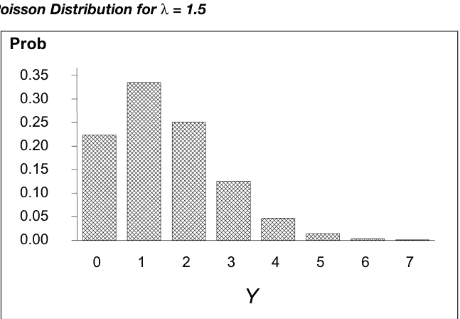

随着 $\lambda$ 变大，众数远离 0，分布看起来越来越像正态分布。泊松分布的一个不寻常的性质是均值和方差相等，

$$\mathrm{E}(y)=\mathrm{var}(y)=\lambda \tag{9.2}$$

这在许多应用中被证明是有问题的。

接下来我们需要指定参数 λ 如何依赖于解释变量。首先，我们用下标 i 写 λi 以允许参数在个体之间变化（i= 1, ..., n）。然后，因为 λ 不能小于 0，所以标准做法是让 λ 成为 x 变量的对数线性函数：

$$\log \lambda_i = \beta_0 + \beta_1 x_{i1} + \beta_2 x_{i2} + \ldots + \beta_k x_{ik}. \tag{9.3}$$

这确保了对于 x 或 β 的任何取值，λ 都将大于 0。

这就是模型的全部内容。请注意，该模型并不说明 y 的边际分布必然是泊松分布。（边际分布是在忽略任何解释变量时得到的。输出 9.1 和 9.2 是边际分布的实现。）相反，在给定解释变量取值的情况下，y 服从泊松分布。如果 x 变量的系数和方差很大，则 y 的边际分布可能与泊松分布非常不同。

与往常一样，我们将通过最大似然法估计模型。这可以用 PROC GENMOD 轻松完成。

### 9.3 科学生产力示例

在第 8 章中，我们研究了 554 名在 1950 年代末和 1960 年代初获得博士学位的生物化学家。数据集中有两个变量是泊松回归的良好候选变量：ARTS——生物化学家在获得学位前发表的文章数量（计入《化学文摘》），以及 CITS——这些文章的引用次数（计入《科学引文索引》）。输出 9.1 和输出 9.2 显示了这两个变量的边际频数分布。

#### Output 9.1  Frequency Distribution of Article Counts

| ARTS | Frequency | Percent | Cumulative Frequency | Cumulative Percent |
|---:|---:|---:|---:|---:|
| 0 | 330 | 59.57 | 330 | 59.57 |
| 1 | 110 | 19.86 | 440 | 79.42 |
| 2 | 57 | 10.29 | 497 | 89.71 |
| 3 | 33 | 5.96 | 530 | 95.67 |
| 4 | 9 | 1.62 | 539 | 97.29 |
| 5 | 5 | 0.90 | 544 | 98.19 |
| 6 | 3 | 0.54 | 547 | 98.74 |
| 7 | 3 | 0.54 | 550 | 99.28 |
| 10 | 2 | 0.36 | 552 | 99.64 |
| 11 | 1 | 0.18 | 553 | 99.82 |
| 15 | 1 | 0.18 | 554 | 100.00 |

两个分布都高度偏斜，尤其是引用次数。没有任何一个分布能通过泊松分布的统计检验，但正如我之前所说，这对于模型正确性来说并非必不可少。

#### Output 9.2  Frequency Distribution of Citation Counts

| CITS | Frequency | Percent | Cumulative Frequency | Cumulative Percent |
|---:|---:|---:|---:|---:|
| 0 | 187 | 33.75 | 187 | 33.75 |
| 1 | 188 | 33.94 | 375 | 67.69 |
| 2 | 36 | 6.50 | 411 | 74.19 |
| 3 | 25 | 4.51 | 436 | 78.70 |
| 4 | 12 | 2.17 | 448 | 80.87 |
| 5 | 23 | 4.15 | 471 | 85.02 |
| 6 | 5 | 0.90 | 476 | 85.92 |
| 7 | 19 | 3.43 | 495 | 89.35 |
| 8 | 4 | 0.72 | 499 | 90.07 |
| 9 | 4 | 0.72 | 503 | 90.79 |
| 10 | 7 | 1.26 | 510 | 92.06 |
| 11 | 5 | 0.90 | 515 | 92.96 |
| 12 | 3 | 0.54 | 518 | 93.50 |
| 13 | 1 | 0.18 | 519 | 93.68 |
| 14 | 1 | 0.18 | 520 | 93.86 |
| 15 | 5 | 0.90 | 525 | 94.77 |
| 16 | 4 | 0.72 | 529 | 95.49 |
| 17 | 1 | 0.18 | 530 | 95.67 |
| 20 | 5 | 0.90 | 535 | 96.57 |
| 22 | 2 | 0.36 | 537 | 96.93 |
| 23 | 3 | 0.54 | 540 | 97.47 |
| 25 | 1 | 0.18 | 541 | 97.65 |
| 27 | 2 | 0.36 | 543 | 98.01 |
| 30 | 1 | 0.18 | 544 | 98.19 |
| 32 | 3 | 0.54 | 547 | 98.74 |
| 33 | 1 | 0.18 | 548 | 98.92 |
| 37 | 3 | 0.54 | 551 | 99.46 |
| 40 | 1 | 0.18 | 552 | 99.64 |
| 57 | 1 | 0.18 | 553 | 99.82 |
| 74 | 1 | 0.18 | 554 | 100.00 |

下一步是根据第 8.5 节中描述的其他自变量，对文章和引用次数进行泊松回归估计。以下是两个回归的 GENMOD 代码：

```sas
PROC GENMOD DATA=postdoc;
    MODEL arts = age mar doc ag und / DIST=POISSON;
PROC GENMOD DATA=postdoc;
    MODEL cits = age mar doc ag und / D=P;
RUN;
```

要拟合泊松回归，我们使用 DIST=POISSON 选项，可缩写为 D=P。当请求泊松回归时，方程 (9.3) 中的对数线性模型是默认值。结果出现在输出 9.3 和输出 9.4 中。

#### Output 9.3 Poisson Regression for Article Counts

**Model Information**

| | |
|---|---|
| Data Set | POSTDOC |
| Distribution | Poisson |
| Link Function | Log |
| Dependent Variable | ARTS |

**Number of Observations**

| | |
|---|---|
| Number of Observations Read | 554 |
| Number of Observations Used | 554 |

**Criteria For Assessing Goodness Of Fit**

| | DF | Value | Value/DF |
|---|---:|---:|---:|
| Deviance | 548 | 1072.2986 | 1.9567 |
| Scaled Deviance | 548 | 1072.2986 | 1.9567 |
| Pearson Chi-Square | 548 | 1474.6054 | 2.6909 |
| Scaled Pearson X2 | 548 | 1474.6054 | 2.6909 |
| Log Likelihood |  | -541.0603 |  |
| Full Log Likelihood |  | -813.1613 |  |
| AIC (smaller is better) |  | 1638.3226 |  |
| AICC (smaller is better) |  | 1638.4762 |  |
| BIC (smaller is better) |  | 1664.2256 |  |

**Analysis Of Maximum Likelihood Parameter Estimates**

| Parameter | DF | Estimate | Standard Error | Wald 95% Confidence Limits | Wald Chi-Square | Pr > ChiSq |
|---|---:|---:|---:|---|---|---:|
| Intercept | 1 | 0.4241 | 0.4645 | -0.4862, 1.3344 | 0.83 | 0.3612 |
| age | 1 | -0.0312 | 0.0131 | -0.0569, -0.0056 | 5.70 | 0.0170 |
| mar | 1 | 0.0087 | 0.1306 | -0.2474, 0.2648 | 0.00 | 0.9470 |
| doc | 1 | -0.0001 | 0.0005 | -0.0010, 0.0008 | 0.07 | 0.7861 |
| ag | 1 | 0.0319 | 0.1001 | -0.1642, 0.2281 | 0.10 | 0.7495 |
| und | 1 | 0.0698 | 0.0303 | 0.0103, 0.1292 | 5.29 | 0.0214 |
| Scale | 0 | 1.0000 | 0.0000 | 1.0000, 1.0000 |  |  |

在输出 9.3 中，我们看到有两个变量是发表数量的显著预测因子，年龄和本科院校的 selectivity。由于因变量取对数，我们可以像解释 logistic 回归系数一样解释系数。具体来说，如果我们计算 100(e^β−1)，我们就得到自变量每增加 1 个单位时预期发表数量的百分比变化。对于 AGE，年龄每增加一年，预期发表数量会减少 3.1%。对于 7 点 UND 量表，每增加 1 分，预期发表数量的增加约为 7.2%。

请注意，输出 9.3 中的偏差几乎是自由度的两倍。对于该统计量计算 p 值可能不合适，因为许多生物化学家的预测文章数量相当小。正如我们在拟合个体水平数据的 logistic 回归模型时所看到的，当预测值很小时，偏差不能很好地用卡方分布近似。尽管如此，偏差与自由度之比很大确实表明模型存在问题，我们将在下一节中继续探讨这个问题。该问题在输出 9.4 的引用次数中更为严重，偏差超过了自由度的七倍。在此回归中，所有变量都高度显著。在农业院校就读的年长学生平均引用次数较低，而已婚学生、在知名机构就读的学生以及来自选择性本科院校的学生平均引用次数较高。更精确地说，农业院校学生的预期引用次数比医学院学生低 36%（计算为 100(exp(-.4469)-1)=-36）。已婚学生的引用次数平均比未婚学生高 100(exp(.29)-1)=34%。然而，在我们过于认真对待这些结果之前，我们需要考虑过度离散的问题，其特征是偏差相对于自由度很大。

关于这两个输出示例，还有一件事值得解释几行。“Criteria For Assessing Goodness Of Fit” 表报告了“log


“似然”与“完全对数似然”。有什么区别？“完全对数似然”是似然函数的真实对数。BIC、AIC 和 AICC 统计量都基于这个数值。在 GENMOD 的早期版本中，只报告了“对数似然”。该统计量与“完全对数似然”相差一个常数，该常数取决于数据但不取决于未知参数，因此足以找到使“对数似然”最大化的参数值。虽然由于省略了不必要的常数，“对数似然”可能为正，但“完全对数似然”始终为负。

#### 输出 9.4 引用计数泊松回归

| 拟合优度评估准则 |
|---|---|---|---|
| 准则 | DF | 值 | 值/DF |
| 偏差 | 548 | 4053.1740 | 7.3963 |
| 缩放偏差 | 548 | 4053.1740 | 7.3963 |
| Pearson 卡方 | 548 | 7174.8868 | 13.0929 |
| 缩放 Pearson X2 | 548 | 7174.8868 | 13.0929 |
| 对数似然 |  | 448.8995 |  |
| 完全对数似然 |  | -2541.4601 |  |
| AIC（越小越好） |  | 5094.9202 |  |
| AICC（越小越好） |  | 5095.0737 |  |
| BIC（越小越好） |  | 5120.8232 |  |

| 最大似然参数估计分析 |
|---|---|---|---|---|---|---|---|
| 参数 | DF | 估计值 | 标准误 | Wald 95% 置信限 |  | Wald 卡方 | Pr > ChiSq |
|  |  |  |  |  |  |  |  |
| 截距 | 1 | 1.3407 | 0.2427 | 0.8651 | 1.8163 | 30.53 | <.0001 |
| age | 1 | -0.0417 | 0.0069 | -0.0551 | -0.0282 | 36.73 | <.0001 |
| mar | 1 | 0.2899 | 0.0699 | 0.1529 | 0.4269 | 17.20 | <.0001 |
| doc | 1 | 0.0009 | 0.0002 | 0.0005 | 0.0014 | 15.50 | <.0001 |
| ag | 1 | -0.4469 | 0.0558 | -0.5563 | -0.3374 | 64.03 | <.0001 |
| und | 1 | 0.1269 | 0.0156 | 0.0963 | 0.1575 | 66.03 | <.0001 |
| Scale | 0 | 1.0000 | 0.0000 | 1.0000 | 1.0000 |  |  |

### 9.4 过度离散

我现在断言，前一节中的标准误、卡方和 p 值由于过度离散而基本上毫无价值。我们在第 4 章中用分组数据逻辑模型遇到了过度离散，当时我认为该问题主要局限于聚类数据。对于泊松回归来说，这*始终*是一个潜在问题，而且往往相当严重。

基本上问题产生于方程 (9.2) 指出，对于自变量的一组给定值，因变量的方差等于其均值。事实上，方差往往比这高得多。等价地说，我们可以说过度离散发生是因为方程 (9.3) 中没有随机扰动项来允许遗漏的解释变量。（扰动项会产生 *y* 的更大方差。）虽然过度离散不会使系数产生偏倚，但它会导致标准误被低估和卡方统计量被高估。过度离散还意味着常规最大似然估计不是有效的，意味着其他方法可以产生抽样变异更小的系数。

对于过度离散可以做什么？如果你愿意忽略常规估计的效率缺乏，纠正标准误和卡方是很容易的事（Agresti 2002）。该校正是我们第 4 章讨论的分组二项式情况的相同校正：取拟合优度卡方与其自由度的比值，并称结果为 *C*。将每个系数的卡方统计量除以 *C*。将每个系数的标准误乘以 *C* 的平方根。唯一的模糊之处在于我们有两个拟合优度卡方，偏差和 Pearson 卡方。我们应该使用哪一个？大多数时候它们会相当接近，但拟似然估计的理论建议使用 Pearson 卡方（McCullagh and Nelder 1989）。

在 GENMOD 中，刚才描述的校正可以通过在 MODEL 语句中将 SCALE=P（表示 Pearson）或 SCALE=D（表示偏差）作为选项自动调用。对于我们的生物化学家示例，使用 SCALE=P 选项的完整代码为

```
PROC GENMOD DATA=postdoc;
    MODEL arts = age mar doc ag und / D=P SCALE=P;
PROC GENMOD DATA=postdoc;
    MODEL cits = age mar doc ag und / D=P SCALE=P;
RUN;
```

结果显示在输出 9.5 和输出 9.6 中。每个输出现在都包括一个尺度参数，正如所指出的，它只是 Pearson 卡方除以自由度的平方根。对于文章，系数的卡方均减少了约 40%，结果是没有任何系数具有统计显著性。对于引用，卡方

对数引用计数与相同解释变量的对数。因为 0 的对数未定义，我首先将 0.5 加到每个人的引用计数上：

```
DATA postdoc2;
    SET postdoc;
    lcits=log(cits+.5);
PROC GENMOD DATA=postdoc2;
    MODEL lcits = age mar doc ag und;
RUN;
```

当在 MODEL 语句中未指定 DIST 选项时，GENMOD 使用 OLS 估计正态线性模型。输出 9.7 中显示的结果，虽然与输出 9.6 中的结果不完全相同，但至少在同一范围内。一般来说，校正过度离散的泊松回归优于普通最小二乘。但 OLS 可能比没有过度离散校正的泊松回归更好。

#### 输出 9.7 对数线性引用模型的 OLS 结果

| 参数 | DF | 估计值 | 标准误 | Wald 95% 置信限 | Wald 卡方 | Pr > ChiSq |
|---|---|---:|---:|---:|---:|---:|
| 截距 | 1 | 0.6403 | 0.4647 | -0.2705, 1.5511 | 1.90 | 0.1683 |
| AGE | 1 | -0.0193 | 0.0127 | -0.0441, 0.0055 | 2.32 | 0.1278 |
| MAR | 1 | 0.0873 | 0.1382 | -0.1836, 0.3581 | 0.40 | 0.5277 |
| DOC | 1 | 0.0005 | 0.0005 | -0.0004, 0.0015 | 1.33 | 0.2489 |
| AG | 1 | -0.2765 | 0.1034 | -0.4791, -0.0739 | 7.15 | 0.0075 |
| und | 1 | 0.0597 | 0.0311 | -0.0012, 0.1206 | 3.69 | 0.0547 |
| Scale | 1 | 1.1279 | 0.0339 | 1.0634, 1.1963 |  |  |

**注意：** 尺度参数由最大似然估计。

### 9.5 负二项回归

上一节讨论的过度离散调整是对常规泊松回归的巨大改进，但并不理想。系数仍然是低效的，意味着它们具有不必要的抽样变异。一种称为负二项回归的方法可以产生有效估计，该方法已成为计数数据的流行方法。

#### 输出 9.8 文章计数负二项回归

| 拟合优度评估准则 |
| 准则 | DF | 值 | 值/DF |
| 偏差 | 548 | 478.4304 | 0.8730 |
| 缩放偏差 | 548 | 478.4304 | 0.8730 |
| Pearson 卡方 | 548 | 591.6643 | 1.0797 |
| 缩放 Pearson X2 | 548 | 591.6643 | 1.0797 |
| 对数似然 |  | -422.8414 |  |
| 完全对数似然 |  | -694.9425 |  |
| AIC（越小越好） |  | 1403.8849 |  |
| AICC（越小越好） |  | 1404.0900 |  |
| BIC（越小越好） |  | 1434.1051 |  |

| 最大似然参数估计分析 |
| 参数 | DF | 估计值 | 标准误 | Wald 95% 置信限 | Wald 卡方 | Pr > ChiSq |
| 截距 | 1 | 0.2653 | 0.6594 | -1.0270 1.5577 | 0.16 | 0.6874 |
| age | 1 | -0.0278 | 0.0185 | -0.0640 0.0083 | 2.28 | 0.1313 |
| mar | 1 | 0.0162 | 0.2100 | -0.3954 0.4278 | 0.01 | 0.9384 |
| doc | 1 | 0.0000 | 0.0007 | -0.0013 0.0014 | 0.00 | 0.9535 |
| ag | 1 | 0.0371 | 0.1582 | -0.2728 0.3471 | 0.06 | 0.8143 |
| und | 1 | 0.0694 | 0.0466 | -0.0219 0.1607 | 2.22 | 0.1365 |
| Dispersion | 1 | 1.7418 | 0.2356 | 1.3362 2.2704 |  |  |

注意：负二项离散参数由最大似然估计。

#### 输出 9.9 引用计数负二项回归

| 拟合优度评估准则 |
| 准则 | DF | 值 | 值/DF |
| 偏差 | 548 | 561.8670 | 1.0253 |
| 缩放偏差 | 548 | 561.8670 | 1.0253 |
| Pearson 卡方 | 548 | 846.1709 | 1.5441 |
| 缩放 Pearson X2 | 548 | 846.1709 | 1.5441 |
| 对数似然 |  | 1794.0857 |  |
| 完全对数似然 |  | -1196.2739 |  |
| AIC（越小越好） |  | 2406.5479 |  |
| AICC（越小越好） |  | 2406.7530 |  |
| BIC（越小越好） |  | 2436.7680 |  |


| 最大似然参数估计分析 |
| 参数 | 自由度 | 估计值 | 标准误 | Wald 95% 置信区间 | Wald 卡方 | Pr > ChiSq |
| 截距 | 1 | 1.5560 | 0.6560 | 0.2702 | 2.8418 | 5.63 | 0.0177 |
| age | 1 | -0.0444 | 0.0178 | -0.0792 | -0.0096 | 6.24 | 0.0125 |
| mar | 1 | 0.2301 | 0.1968 | -0.1557 | 0.6158 | 1.37 | 0.2425 |
| doc | 1 | 0.0010 | 0.0006 | -0.0003 | 0.0022 | 2.40 | 0.1213 |
| ag | 1 | -0.4598 | 0.1530 | -0.7597 | -0.1600 | 9.04 | 0.0026 |
| und | 1 | 0.1086 | 0.0455 | 0.0195 | 0.1978 | 5.71 | 0.0169 |
| 离散参数 | 1 | 2.2597 | 0.1682 | 1.9530 | 2.6146 |  |  |

注意：负二项离散参数是通过最大似然估计的。

鉴于负二项模型在处理过度离散时相对于泊松模型具有已知的优越性，并且考虑到过度离散发生的频率，为什么不总是使用负二项模型呢？过去，负二项模型要么不可用，要么难以实现。但现在它已经随时可用且易于实现，我认为没有任何令人信服的理由再使用泊松回归。

### 9.6 对可变时间跨度的调整

泊松分布（或其推广至负二项分布的形式）非常适合描述发生在某个时间区间内的事件计数。在前面的例子中，文章和引文是在某个时间段内计数的。其他例子包括五年内被捕的次数、一年内感冒的次数，或一个月内夫妻争吵的次数。如果样本中每个个体的时间区间长度相同，那么前面描述的方法就完全适用。但如果不同个体的事件是在不同长度的时间段内计数的，显然需要进行某种标准化。对于普通回归分析，我们可以简单地将每个个体的事件计数除以区间长度，然后将得到的比率对自变量进行回归。然而，这种方法对泊松回归行不通，因为除以时间意味着所得变量不再服从泊松分布。

相反，我们将时间纳入模型中。如果 t_i 是第 i 个个体观察区间长度，则该区间内发生的事件数（y_i）被假定服从泊松分布

#### 输出 9.10 关于预后的话语数量分布

| LENGTHPX | 频数 | 百分比 | 累积频数 | 累积百分比 |
|---|---|---|---|---|
| 0 | 52 | 41.60 | 52 | 41.60 |
| 1 | 11 | 8.80 | 63 | 50.40 |
| 2 | 16 | 12.80 | 79 | 63.20 |
| 3 | 5 | 4.00 | 84 | 67.20 |
| 4 | 8 | 6.40 | 92 | 73.60 |
| 5 | 3 | 2.40 | 95 | 76.00 |
| 6 | 6 | 4.80 | 101 | 80.80 |
| 7 | 4 | 3.20 | 105 | 84.00 |
| 8 | 3 | 2.40 | 108 | 86.40 |
| 9 | 5 | 4.00 | 113 | 90.40 |
| 10 | 1 | 0.80 | 114 | 91.20 |
| 11 | 1 | 0.80 | 115 | 92.00 |
| 12 | 2 | 1.60 | 117 | 93.60 |
| 14 | 1 | 0.80 | 118 | 94.40 |
| 15 | 1 | 0.80 | 119 | 95.20 |
| 17 | 1 | 0.80 | 120 | 96.00 |
| 20 | 2 | 1.60 | 122 | 97.60 |
| 21 | 1 | 0.80 | 123 | 98.40 |
| 24 | 2 | 1.60 | 125 | 100.00 |

我们将考虑以下自变量：

- PTAGE 患者年龄
- PTSEX 患者性别（1=男性，0=女性）
- EZCOMPT 医生对与患者交流难易程度的评分（1-5）
- MDLIKEPT 医生对患者的喜欢程度评分（1-5）
- SURGEON 如果医生是外科医生则为1，否则为0
- CLAIMS 针对医生的医疗事故索赔次数
- MINUTES 就诊时长（以分钟为单位）

为了对就诊时长进行标准化，我们必须定义一个等于 MINUTES 的自然对数的新变量 LMIN：

```
DATA prog2;
    SET prognosi;
    lmin=LOG(minutes);
    RUN;
```

然后在调用 GENMOD 时使用 LMIN 作为偏移变量：

```
PROC GENMOD DATA=prog2;
    MODEL lengthpx=ptage ptsex ezcompt mdlikept surgeon claims /
        OFFSET=lmin D=P;
    RUN;
```

输出 9.11 中的结果表明：当患者为男性、医生认为患者易于交流、医生是外科医生以及针对医生的医疗事故索赔较多时，关于预后的话语数量更多。更具体地说，外科医生的预后话语数量几乎是非外科医生的四倍（exp(1.34)=3.83），男性患者的预后话语数量比女性多约 73%（exp(.55)=1.73）。注意，没有报告 LMIN 的系数，因为它被约束为 1.0。

#### 输出 9.11 具有偏移变量的泊松回归

| 拟合优度评估标准 |
| 准则 | 自由度 | 值 | 值/自由度 |
| 偏差 | 114 | 682.0299 | 5.9827 |
| 标度偏差 | 114 | 682.0299 | 5.9827 |
| Pearson 卡方 | 114 | 899.6258 | 7.8915 |
| 标度 Pearson X2 | 114 | 899.6258 | 7.8915 |
| 对数似然 |  | 115.9561 |  |
| 完整对数似然 |  | -455.9056 |  |
| AIC（越小越好） |  | 925.8112 |  |
| AICC（越小越好） |  | 926.8024 |  |
| BIC（越小越好） |  | 945.3818 |  |

| **最大似然参数估计分析** |  |  |  |  |  |  |  |
|---|---:|---:|---:|---:|---:|---:|---:|
| **参数** | **自由度** | **估计值** | **标准误** | **Wald 95% 置信区间** | **Wald 卡方** | **Pr > ChiSq** |
| 截距 | 1 | -3.7237 | 0.3378 | -4.3858, -3.0617 | 121.53 | <.0001 |
| ptage | 1 | -0.0014 | 0.0031 | -0.0074, 0.0046 | 0.22 | 0.6373 |
| ptsex | 1 | 0.5482 | 0.1048 | 0.3428, 0.7537 | 27.35 | <.0001 |
| ezcompt | 1 | 0.1981 | 0.0760 | 0.0490, 0.3471 | 6.79 | 0.0092 |
| mdlikept | 1 | -0.0864 | 0.0744 | -0.2322, 0.0593 | 1.35 | 0.2452 |
| surgeon | 1 | 1.3431 | 0.1304 | 1.0876, 1.5986 | 106.14 | <.0001 |
| claims | 1 | 0.0519 | 0.0232 | 0.0065, 0.0974 | 5.01 | 0.0252 |
| 标度 | 0 | 1.0000 | 0.0000 | 1.0000, 1.0000 |  |  |

不幸的是，这些结果受到以下事实的质疑：偏差几乎是自由度的六倍，这表明存在显著的过度离散，从而导致标准误被低估。为了纠正这个问题，我使用负二项设定（D=NB）重新运行了模型，得到输出 9.12 中的结果。

#### 输出 9.12 具有偏移变量的负二项回归

| **拟合优度评估标准** |  |  |  |
|---|---:|---:|---:|
| **准则** | **自由度** | **值** | **值/自由度** |
| 偏差 | 114 | 122.8819 | 1.0779 |
| 标度偏差 | 114 | 122.8819 | 1.0779 |
| Pearson 卡方 | 114 | 111.4206 | 0.9774 |
| 标度 Pearson X2 | 114 | 111.4206 | 0.9774 |
| 对数似然 |  | 304.9582 |  |
| 完整对数似然 |  | -266.9035 |  |
| AIC（越小越好） |  | 549.8070 |  |
| AICC（越小越好） |  | 551.0927 |  |
| BIC（越小越好） |  | 572.1733 |  |

| **最大似然参数估计分析** |  |  |  |  |  |  |
|---|---:|---:|---:|---:|---:|---:|
| **参数** | **自由度** | **估计值** | **标准误** | **Wald 95% 置信区间** | **Wald 卡方** | **Pr > ChiSq** |
| 截距 | 1 | -3.3466 | 1.1372 | -5.5755, -1.1177 | 8.66 | 0.0033 |
| ptage | 1 | 0.0011 | 0.0108 | -0.0200, 0.0223 | 0.01 | 0.9170 |
| ptsex | 1 | 0.5757 | 0.3013 | -0.0148, 1.1661 | 3.65 | 0.0560 |
| ezcompt | 1 | 0.1243 | 0.1954 | -0.2588, 0.5073 | 0.40 | 0.5249 |

并进行解释。两种零膨胀模型都从这样一个假设出发：总体由两个群体组成：

- 1. 对于 *回归群体*，适用常规的泊松或负二项回归模型。该群体中的个体可能取值 0，也可能不为 0。
- 2. 对于 *零群体*，不可能有除 0 以外的计数。对这些个体而言，协变量对结果没有影响。

计数大于 0 的个体必然属于回归群体。但观测计数为 0 的个体可能属于两个群体中的任何一个。

这种模型有时被称为有限混合模型。尽管我们无法确定计数为 0 的个体究竟属于哪个群体，但仍可以通过最大似然对其进行估计。除了通常的回归系数（针对回归群体中的个体）之外，我们还可以估计个体属于零群体的概率。我们还可以进一步细化模型，允许零群体概率成为协变量的函数，通常通过逻辑回归实现。

让我们在上一节分析的患者就诊数据上尝试这些模型。以下是基本零膨胀泊松模型的 GENMOD 代码：

```
PROC GENMOD DATA=prog2;
    MODEL lengthpx=ptage ptsex ezcompt mdlikept surgeon claims /
        OFFSET=lmin D=ZIP;
    ZEROMODEL;
RUN;
```

与上一节一样，使用 OFFSET 选项来调整患者就诊时长变化的影响。为了得到 ZIP 模型，需要做两处更改：在 MODEL 语句中设置 D=ZIP，并添加 ZEROMODEL 语句。正如我们稍后将看到的，该语句可以用来指定模型逻辑回归部分的协变量。但即使你不需要协变量，也必须有该语句。

结果如输出 9.13 所示。尽管该模型比输出 9.11 中的传统泊松模型拟合得更好，但拟合仍然相当差，Pearson 卡方是其自由度的三倍多。注意末尾新增的表格，标题为“最大似然零膨胀参数估计分析”。对于 ZEROMODEL 语句中没有协变量的模型，该表格中报告的值（-.4839）是


估计属于零组的对数几率。通过应用逻辑转换函数 1/(1+exp(-β))，我们可以将对数几率转换为概率，结果为 0.38。因此，根据该模型，估计有 38% 的样本成员属于零组，他们完全没有经历事件的机会。由于样本中有 42% 的计数为 0，这意味着只有 4% 的样本计数为 0 但并不属于零组。通过将逻辑转换应用于输出 9.13 中的置信区间上下限，我们可以得到该比例的 95% 置信区间，结果为（.29, .48）。

#### 输出 9.13 零膨胀泊松模型

**拟合优度评估标准**

| 标准 | 自由度 | 值 | 值/自由度 |
| --- | --- | --- | --- |
| 偏差 |  | 691.2047 |  |
| 缩放偏差 |  | 691.2047 |  |
| 皮尔逊卡方 | 113 | 350.9456 | 3.1057 |
| 缩放皮尔逊 X2 | 113 | 350.9456 | 3.1057 |
| 对数似然 |  | 226.2593 |  |
| 完全对数似然 |  | -345.6024 |  |
| AIC（越小越好） |  | 707.2047 |  |
| AICC（越小越好） |  | 708.4904 |  |
| BIC（越小越好） |  | 729.5710 |  |

**最大似然参数估计分析**

| 参数 | 自由度 | 估计值 | 标准误 | Wald 95% 置信区间 | Wald 卡方 | Pr > ChiSq |
| --- | --- | --- | --- | --- | --- | --- |
| Intercept | 1 | -2.4835 | 0.3541 | -3.1775 -1.7895 | 49.19 | <.0001 |
| ptage | 1 | -0.0039 | 0.0034 | -0.0106 0.0028 | 1.28 | 0.2579 |
| ptsex | 1 | 0.3498 | 0.1119 | 0.1305 0.5691 | 9.77 | 0.0018 |
| ezcompt | 1 | 0.2639 | 0.0773 | 0.1124 0.4154 | 11.65 | 0.0006 |
| mdlikept | 1 | -0.1527 | 0.0795 | -0.3085 0.0031 | 3.69 | 0.0547 |
| surgeon | 1 | 0.8957 | 0.1445 | 0.6126 1.1789 | 38.45 | <.0001 |
| claims | 1 | 0.0372 | 0.0228 | -0.0075 0.0820 | 2.66 | 0.1029 |
| Scale | 0 | 1.0000 | 0.0000 | 1.0000 1.0000 |  |  |

#### 输出 9.14 零膨胀负二项模型

**最大似然参数估计分析**

| 参数 | 自由度 | 估计值 | 标准误 | Wald 95% 置信区间 | Wald 卡方 | Pr > ChiSq |
| --- | --- | --- | --- | --- | --- | --- |
| Intercept | 1 | -2.7212 | 1.0854 | -4.8486 -0.5938 | 6.29 | 0.0122 |
| ptage | 1 | -0.0028 | 0.0104 | -0.0230 0.0175 | 0.07 | 0.7904 |
| ptsex | 1 | 0.5382 | 0.2730 | 0.0032 1.0731 | 3.89 | 0.0487 |
| ezcompt | 1 | 0.1445 | 0.1743 | -0.1970 0.4860 | 0.69 | 0.4070 |
| mdlikept | 1 | -0.1276 | 0.1925 | -0.5048 0.2496 | 0.44 | 0.5072 |
| surgeon | 1 | 1.2349 | 0.3680 | 0.5137 1.9561 | 11.26 | 0.0008 |
| claims | 1 | 0.0441 | 0.0669 | -0.0869 0.1751 | 0.43 | 0.5096 |
| Dispersion | 1 | 1.1759 | 0.4441 | 0.5609 2.4652 |  |  |

**最大似然零膨胀参数估计分析**

| 参数 | 自由度 | 估计值 | 标准误 | Wald 95% 置信区间 | Wald 卡方 | Pr > ChiSq |
| --- | --- | --- | --- | --- | --- | --- |
| Intercept | 1 | -1.2757 | 0.5883 | -2.4288 -0.1227 | 4.70 | 0.0301 |

如前所述，您还可以拟合一个带有协变量的 ZIP 或 ZINB 模型，这些协变量用于预测属于零组的概率。这只需在 ZEROMODEL 语句中列出所需的协变量即可完成。协变量可以与主回归模型中的协变量相同，也可以不同——没有限制。以下是使用相同协变量拟合 ZINB 模型的代码，分别放在 MODEL 和 ZEROMODEL 语句中：

```
PROC GENMOD DATA=prog2;
    MODEL lengthpx=ptage ptsex ezcompt mdlikept surgeon claims /
        OFFSET=lmin D=ZINB;
    ZEROMODEL ptage ptsex ezcompt mdlikept surgeon claims;
RUN;
```

输出 9.15 给出了结果。在零模型中，唯一 p 值低于 .05 的协变量是 SURGEON，它也是主模型中唯一显著的变量。但主模型中的 p 值远高于传统负二项模型中的 p 值。看来 SURGEON 的效应已经分布到模型的两个部分。作为外科医生既增加了预期预后话语数量（在零组之外的人群中），也降低了属于零组的概率。如表 9.1 所示，该模型具有最高的对数似然（如预期）。但它的 BIC 统计量比传统负二项模型和没有协变量的 ZINB 模型都差。我还拟合了带有协变量的 ZIP 模型（详细结果未显示），但它显然比任何负二项模型都差得多。

#### 输出 9.15 带协变量的零膨胀负二项模型

**最大似然参数估计分析**

| 参数 | 自由度 | 估计值 | 标准误 | Wald 95% 置信区间 | Wald 卡方 | Pr > ChiSq |
| --- | --- | --- | --- | --- | --- | --- |
| Intercept | 1 | -1.5862 | 1.0070 | -3.5599 0.3875 | 2.48 | 0.1152 |
| ptage | 1 | -0.0143 | 0.0111 | -0.0361 0.0075 | 1.65 | 0.1995 |
| ptsex | 1 | 0.4939 | 0.2872 | -0.0691 1.0568 | 2.96 | 0.0855 |
| ezcompt | 1 | 0.1588 | 0.1758 | -0.1858 0.5035 | 0.82 | 0.3664 |
| mdlikept | 1 | -0.1699 | 0.1980 | -0.5579 0.2182 | 0.74 | 0.3910 |
| surgeon | 1 | 0.7669 | 0.3579 | 0.0654 1.4685 | 4.59 | 0.0321 |
| claims | 1 | 0.0530 | 0.0656 | -0.0756 0.1817 | 0.65 | 0.4190 |
| Dispersion | 1 | 1.0321 | 0.3407 | 0.5404 1.9712 |  |  |

**最大似然零膨胀参数估计分析**

| 参数 | 自由度 | 估计值 | 标准误 | Wald 95% 置信区间 | Wald 卡方 | Pr > ChiSq |
| --- | --- | --- | --- | --- | --- | --- |
| Intercept | 1 | 3.3612 | 2.4623 | -1.4648 8.1872 | 1.86 | 0.1722 |
| ptage | 1 | -0.0454 | 0.0326 | -0.1093 0.0185 | 1.94 | 0.1638 |
| ptsex | 1 | -0.6221 | 0.6590 | -1.9138 0.6696 | 0.89 | 0.3452 |
| ezcompt | 1 | 0.1910 | 0.4443 | -0.6798 1.0617 | 0.18 | 0.6673 |
| mdlikept | 1 | -0.2443 | 0.4674 | -1.1604 0.6717 | 0.27 | 0.6011 |
| surgeon | 1 | -2.0087 | 0.8906 | -3.7543 -0.2632 | 5.09 | 0.0241 |
| claims | 1 | -0.0115 | 0.1613 | -0.3276 0.3046 | 0.01 | 0.9431 |

因此，对于这些数据，胜出的是传统负二项模型。它很好地拟合了数据，并且 BIC 统计量低于任何零膨胀模型。在概念上也比任何膨胀模型都更简单。

总而言之，传统负二项模型几乎总是优于零膨胀泊松模型。零膨胀负二项模型有时可能

# 第 10 章：列联表的对数线性分析

- 10.1 引言 291
- 10.2 2×2 表的对数线性模型 292
- 10.3 四维表的对数线性模型 298
- 10.4 将相邻类别模型拟合为对数线性模型 304
- 10.5 方形有序表的对数线性模型 310
- 10.6 边际表 317
- 10.7 零值问题 319
- 10.8 GENMOD 与 CATMOD 对比 324

### 10.1 引言

在第 4 章中，我们看到了如何分析包含一个二分类变量作为因变量的列联表。策略是在 PROC LOGISTIC 中直接估计 logit 模型。在第 5 章中，我们扩展了该方法，通过使用 PROC LOGISTIC 估计多项 logit 模型来处理具有两个以上类别的因变量。在本章中，我们将了解如何估计列联表的对数线性模型。对数线性模型与 logit 模型的区别在于，对数线性模型没有明确的因变量，至少没有一个对应于任何概念变量的因变量。正如我之前提到的，列联表的每个 logit 模型都有一个完全等价的对数线性模型。但对数线性模型的类别还包括不对应于任何 logit 模型的模型，因此我们处理的是一个更广泛的模型类别。

为什么我们需要对数线性模型？当对数线性分析在 20 世纪 60 年代末和 70 年代初首次发展时，可用于 logistic 回归的软件并不多，而且现有的软件也不太适合分析列联表。相比之下，对数线性模型可以通过广泛可用的软件轻松估计。然而，如今，您通常最好直接估计 logit 模型。Logit 模型更简单，并且更直接地对应于实质性理论。但是，在某些情况下，logit 模型无法胜任。例如，您可能想探索几个态度测量之间的关系，而这些测量没有明显的因果顺序。但 logit 模型要求您选择一个变量作为因变量，其他变量作为自变量。

即使您有明确的因变量，您想要估计的特定 logit 模型可能对常规软件而言不便处理。例如，第 6 章中描述的相邻类别模型是多项 logit 模型的特例。但 PROC LOGISTIC 中使用的最大似然算法不会施加必要的约束来获得该模型。正如我们将看到的，当数据以列联表形式出现时，相邻类别模型很容易作为对数线性模型进行估计。对数线性模型特别适用于二维表的分析，其中行变量与列变量具有相同的类别（方形表）。例如，关于流动表（mobility tables）的对数线性模型有大量文献，其中行变量代表父母的职业，列变量代表子女的职业（例如，Hout 1983）。

本书中对数线性分析的处理远非全面。这个主题非常广泛，我在这里只能触及皮毛。我的目标首先是让您了解对数线性模型是什么样的，以及它们与 logit 模型的关系。其次，我将向您展示如何使用 GENMOD 过程估计一些相当常规的对数线性模型。第三，我将提供一些例子，其中对数线性模型比 logit 模型具有显著优势。

### 10.2 2×2 表的对数线性模型

让我们从第 4 章中分析的 2×2 表开始（此处重现为表 10.1），该表显示了 147 例死刑案件按种族分类的判决结果。我们如何用对数线性模型来表示它？


#### 表 10.1 按被告种族划分的死刑判决

|  | Blacks | Nonblacks | Total |
|---|---:|---:|---:|
| Death | 28 | 22 | 50 |
| Life | 45 | 52 | 97 |
| **Total** | **73** | **74** | **147** |

让我们以更一般的形式考虑该表为

| $m_{11}$ | $m_{12}$ |
|---|---|
| $m_{21}$ | $m_{22}$ |

其中 $m_{ij}$ 是落入第 $i$ 行第 $j$ 列的 *预期数量*。我所指的意思是，如果 $n$ 是样本量且 $p_{ij}$ 是落入单元格 $(i,j)$ 的概率，则

$$m_{ij}=np_{ij}.$$

对于这四个频数计数，有几种不同但等价的对数线性模型写法。我采用的方式与 PROC GENMOD 估计模型的方式一致。令 $R_i$ 为行哑变量，若 $i=1$ 则取值为 1，若 $i=2$ 则取值为 0。类似地，令 $C_j$ 为列哑变量，若 $j=1$ 则取值为 1，若 $j=2$ 则取值为 0。我们可以把这个 $2\times2$ 频数表的“饱和”对数线性模型写为

$$\log m_{ij}=\beta_0+\beta_1R_i+\beta_2C_j+\beta_3R_iC_j \qquad i,j=1,2. \tag{10.1}$$

注意 $R_iC_j$ 是 $R_i$ 与 $C_j$ 的乘积（交互）。方程 (10.1) 实际上代表四个不同的方程：

$$\begin{aligned}
\log m_{11}&=\beta_0+\beta_1+\beta_2+\beta_3\\
\log m_{12}&=\beta_0+\beta_1\\
\log m_{21}&=\beta_0+\beta_2\\
\log m_{22}&=\beta_0.
\end{aligned} \tag{10.2}$$

片刻之后，我们将看到如何使用 PROC GENMOD 估计这四个 $\beta$ 参数。但在做那之前，让我们谈谈为什么我们会关心这些参数。方程 (10.2) 所做的只是把四个期望频数变换成四个不同的量。之所以这样做，是因为 $\beta$ 值向我们展示了表中那些通过查看频数计数不易察觉的东西。

我们特别感兴趣的是 $\beta_3$，它是交互项的系数。

如果我们求解方程 (10.2) 得到 $\beta_3$，则有：

β₃ = log( (m₁₁ m₂₂) / (m₁₂ m₂₁) )  (10.3)

括号中的量是交叉乘积比。在第 2 章中，我们看到交叉乘积比等于优势比。在此情况下，它是黑人被判死刑的优势与非黑人被判死刑的优势之比。回想一下，优势比为 1.0 对应于两个变量之间的独立性。因为 1 的对数是 0，行变量与列变量的独立性等价于 $\beta_3=0$。因此，我们可以通过检验 $\beta_3=0$ 来检验两个变量是否独立。

所有这些都是用期望频数计数 $m_{ij}$ 表示的。如何处理观测频数计数，我将用 $n_{ij}$ 表示？对于我们刚刚考虑的模型，$\beta_3$ 的最大似然估计量与方程 (10.3) 的形式相同，只是用观测频数代替期望频数：

β̂₃ = log( (n₁₁ n₂₂) / (n₁₂ n₂₁) )  (10.4)

对于表 10.1 中的数据，β̂₃ = log[(28×52)/(45×22)] = .3857。类似的表达式可以很容易地为模型中的其他 $\beta$ 参数得到，但我们通常对它们不太感兴趣。

虽然在这种情况下手工计算可以得到所有最大似然估计，但我们也可以用 PROC GENMOD 来做。以下是 SAS 代码：

```
DATA penalty;
    INPUT n death black;
    DATALINES;
28 1 1
22 1 0
45 0 1
52 0 0
;
PROC GENMOD DATA=penalty;
    MODEL n = death black death*black / DIST=POISSON;
RUN;
```

表中的每个单元格在数据集中都是一个单独的记录。DEATH 是死刑判决的哑变量，BLACK 是种族的哑变量。MODEL 语句包含了行和列的主效应，以及它们的交互。MODEL 语句中的 DIST 选项说明每个频数计数具有泊松分布，其期望值 $m_{ij}$ 由方程 (10.2) 给出。对于列联表中的频数计数，泊松分布适用于多种不同的抽样设计。正如我们在第 9 章中所见，GENMOD 对泊松分布的默认设置是 LINK=LOG。这意味着因变量期望值的对数被假定为解释变量的线性函数，这正是方程 (10.1) 所说的。

#### 输出 10.1 PROC GENMOD 对 2 × 2 表的对数线性模型的输出

| Criteria For Assessing Goodness Of Fit |
| Criterion | DF | Value | Value/DF |
| Deviance | 0 | 0.0000 | . |
| Scaled Deviance | 0 | 0.0000 | . |
| Pearson Chi-Square | . | 0.0000 | . |
| Scaled Pearson X2 | . | 0.0000 | . |
| Log Likelihood |  | 391.0691 |  |
| Full Log Likelihood |  | -10.7765 |  |
| AIC (smaller is better) |  | 29.5531 |  |
| AICC (smaller is better) |  | . |  |
| BIC (smaller is better) |  | 27.0983 |  |

| Analysis Of Maximum Likelihood Parameter Estimates |
| Parameter | DF | Estimate | Standard Error | Wald 95% Confidence Limits | Wald Chi-Square | Pr > ChiSq |
| Intercept | 1 | 3.9512 | 0.1387 | 3.6794 4.2230 | 811.84 | <.0001 |
| death | 1 | -0.8602 | 0.2543 | -1.3587 -0.3617 | 11.44 | 0.0007 |
| black | 1 | -0.1446 | 0.2036 | -0.5436 0.2545 | 0.50 | 0.4776 |
| death*black | 1 | 0.3857 | 0.3502 | -0.3006 1.0721 | 1.21 | 0.2706 |
| Scale | 0 | 1.0000 | 0.0000 | 1.0000 1.0000 |  |  |

检查输出 10.1，我们看到该模型的偏差为 0。因为它是一个饱和模型；表中有四个单元格，有四个估计参数，因此模型完全再现了频数计数。交互项的估计值为 .3857，这与方程 (10.4) 的手工计算值相同。该

估计值有一个关联的 Wald 卡方为 1.214，这与检验两个变量是否独立的传统 Pearson 卡方 (1.218) 几乎相同（用 PROC FREQ 得到）。这并不令人惊讶，因为两个统计量都在检验相同的零假设。

代替对数线性模型，我们可以为该表估计一个 logit 模型，以死刑判决作为因变量：

```
PROC GENMOD DATA=penalty DESC;
FREQ n;
MODEL death=black / D=BINOMIAL LINK=LOGIT AGGREGATE;
RUN;
```

这会产生输出 10.2。

#### 输出 10.2 PROC GENMOD 对 2 ×2 表的 Logit 模型的输出

| Analysis Of Maximum Likelihood Parameter Estimates |
| Parameter | DF | Estimate | Standard Error | Wald 95% Confidence Limits | Wald Chi-Square | Pr > ChiSq |
| Intercept | 1 | -0.8602 | 0.2543 | -1.3587 -0.3617 | 11.44 | 0.0007 |
| black | 1 | 0.3857 | 0.3502 | -0.3006 1.0721 | 1.21 | 0.2706 |
| Scale | 0 | 1.0000 | 0.0000 | 1.0000 1.0000 |  |  |

值得注意的是，输出 10.2 中的估计值与输出 10.1 中的一些估计值相同。Logit 模型中 BLACK 的系数与对数线性模型中的 BLACK*DEATH 系数相同，且标准误差和卡方值也相同。类似地，logit 模型中的截距（及其相关统计量）与对数线性模型中的 DEATH 系数相同。这是一个普遍现象。正如我之前所说，每个列联表的 logit 模型都有一个对应的对数线性模型。但 logit 模型中的主效应在对数线性模型中变为与因变量的 2 路交互。Logit 模型中的截距变为对数线性模型中因变量的主效应。

现在让我们做一件奇怪的事情，只是为了强调这一点。我们将估计另一个 logit 模型，但我们将变量调换，使 BLACK 成为因变量而 DEATH 成为自变量：

```
PROC GENMOD DATA=penalty DESC;
    FREQ n;
    MODEL black=death / D=BINOMIAL LINK=LOGIT AGGREGATE;
RUN;
```

#### 输出 10.3 PROC GENMOD 对 2 × 2 表的 Logit 模型输出，变量已反转

| Analysis Of Maximum Likelihood Parameter Estimates |
| Parameter | DF | Estimate | Standard Error | Wald 95% Confidence Limits | Wald Chi-Square | Pr > ChiSq |
| Intercept | 1 | -0.1446 | 0.2036 | -0.5436 0.2545 | 0.50 | 0.4776 |
| death | 1 | 0.3857 | 0.3502 | -0.3006 1.0721 | 1.21 | 0.2706 |
| Scale | 0 | 1.0000 | 0.0000 | 1.0000 1.0000 |  |  |

在输出 10.3 中，我们再次看到斜率系数（连同其标准误差和卡方值）与对数线性模型中的两路交互相同。与双变量线性回归不同，反转因变量和自变量时回归线会发生变化，双变量 logit 模型对两个变量是对称的。我们还看到截距项对应于对数线性模型中 BLACK 的主效应。

为什么 logit 模型与对数线性模型共享参数？证明这一点的代数其实非常简单。Logit 模型中的因变量是对数的优势。正如第 2 章中解释的那样，优势可以定义为期望事件数除以期望非事件数。例如，种族组 $j$ 的死刑判决的对数优势为 log(m1j/m2j)。从方程 (10.1) 的对数线性模型代入，我们得到：

log(m1j/m2j) = log(m1j) − log(m2j)
= (β0 + β1R1 + β2Cj + β3R1Cj) − (β0 + β1R2 + β2Cj + β3R2Cj).

但因为 R1=1 且 R2=0，这简化为：

log(m1j/m2j) = β1 + β3Cj.


同样地，如果我们交换自变量和因变量，我们得到：

log(m_{i1} / m_{i2}) = β₂ + β₃ R_i.

这些结果表明，2 × 2 表的对数线性模型意味着两个逻辑模型，一个以列变量为自变量的行变量，另一个以行变量为自变量的列变量。

### 10.3 四向表的对数线性模型

现在让我们来看一个更复杂的表，即我们之前通过第 4.5 节的逻辑模型分析过的 2 × 2 × 4 × 4 表。我们的主要目标是使用对数线性模型复制逻辑模型的结果。为了帮助你回忆，样本由威斯康星州的 4,991 名高中毕业生组成。因变量是他们是否计划在下一年上大学。三个自变量编码如下：

- IQ        1=低, 2=中低, 3=中高, 4=高
- SES       1=低, 2=中低, 3=中高, 4=高
- PARENT    1=低父母鼓励, 2= 高鼓励

在第 4.5 节中，数据以 32 条记录读入，每条记录包含自变量取值的一个唯一组合，以及具有这些取值的高中生人数和计划上大学的该高中生人数。不幸的是，这不是对数线性分析所需的格式。相反，我们需要 64 条记录，每条对应四向表中的一个单元格，具有所有变量的值和该单元格中的频数计数。以下是将先前的数据集（WISC）输入并输出到适当格式的新数据集（WISCTAB）的 DATA 步。

```
DATA wisctab;
  SET wisc;
  college=1;
  freq=coll;
  OUTPUT;
  college=0;
  freq=total-coll;
  OUTPUT;
  DROP total coll;
PROC PRINT;
RUN;
```

#### Output 10.4 Data for a Four-Way Contingency Table

| Obs | iq | parent | ses | college | freq |
| --- | --- | --- | --- | --- | --- |
| 1 | 1 | 1 | 1 | 1 | 4 |
| 2 | 1 | 1 | 1 | 0 | 349 |
| 3 | 1 | 1 | 2 | 1 | 2 |
| 4 | 1 | 1 | 2 | 0 | 232 |
| 5 | 1 | 1 | 3 | 1 | 8 |
| 6 | 1 | 1 | 3 | 0 | 166 |
| 7 | 1 | 1 | 4 | 1 | 4 |
| 8 | 1 | 1 | 4 | 0 | 48 |
| 9 | 1 | 2 | 1 | 1 | 13 |
| 10 | 1 | 2 | 1 | 0 | 64 |
| 11 | 1 | 2 | 2 | 1 | 27 |
| 12 | 1 | 2 | 2 | 0 | 84 |
| 13 | 1 | 2 | 3 | 1 | 47 |
| 14 | 1 | 2 | 3 | 0 | 91 |
| 15 | 1 | 2 | 4 | 1 | 39 |
| 16 | 1 | 2 | 4 | 0 | 57 |
| 17 | 2 | 1 | 1 | 1 | 9 |
| 18 | 2 | 1 | 1 | 0 | 207 |
| 19 | 2 | 1 | 2 | 1 | 7 |
| 20 | 2 | 1 | 2 | 0 | 201 |
| 21 | 2 | 1 | 3 | 1 | 6 |
| 22 | 2 | 1 | 3 | 0 | 120 |
| 23 | 2 | 1 | 4 | 1 | 5 |
| 24 | 2 | 1 | 4 | 0 | 47 |
| 25 | 2 | 2 | 1 | 1 | 33 |
| 26 | 2 | 2 | 1 | 0 | 72 |
| 27 | 2 | 2 | 2 | 1 | 64 |
| 28 | 2 | 2 | 2 | 0 | 95 |
| 29 | 2 | 2 | 3 | 1 | 74 |
| 30 | 2 | 2 | 3 | 0 | 110 |
| 31 | 2 | 2 | 4 | 1 | 123 |
| 32 | 2 | 2 | 4 | 0 | 90 |
| 33 | 3 | 1 | 1 | 1 | 12 |
| 34 | 3 | 1 | 1 | 0 | 126 |
| 35 | 3 | 1 | 2 | 1 | 12 |

| Obs | iq | parent | ses | college | freq |
|---:|---:|---:|---:|---:|---:|
| 36 | 3 | 1 | 2 | 0 | 115 |
| 37 | 3 | 1 | 3 | 1 | 17 |
| 38 | 3 | 1 | 3 | 0 | 92 |
| 39 | 3 | 1 | 4 | 1 | 9 |
| 40 | 3 | 1 | 4 | 0 | 41 |
| 41 | 3 | 2 | 1 | 1 | 38 |
| 42 | 3 | 2 | 1 | 0 | 54 |
| 43 | 3 | 2 | 2 | 1 | 93 |
| 44 | 3 | 2 | 2 | 0 | 92 |
| 45 | 3 | 2 | 3 | 1 | 148 |
| 46 | 3 | 2 | 3 | 0 | 100 |
| 47 | 3 | 2 | 4 | 1 | 224 |
| 48 | 3 | 2 | 4 | 0 | 65 |
| 49 | 4 | 1 | 1 | 1 | 10 |
| 50 | 4 | 1 | 1 | 0 | 67 |
| 51 | 4 | 1 | 2 | 1 | 17 |
| 52 | 4 | 1 | 2 | 0 | 79 |
| 53 | 4 | 1 | 3 | 1 | 6 |
| 54 | 4 | 1 | 3 | 0 | 42 |
| 55 | 4 | 1 | 4 | 1 | 8 |
| 56 | 4 | 1 | 4 | 0 | 17 |
| 57 | 4 | 2 | 1 | 1 | 49 |
| 58 | 4 | 2 | 1 | 0 | 43 |
| 59 | 4 | 2 | 2 | 1 | 119 |
| 60 | 4 | 2 | 2 | 0 | 59 |
| 61 | 4 | 2 | 3 | 1 | 198 |
| 62 | 4 | 2 | 3 | 0 | 73 |
| 63 | 4 | 2 | 4 | 1 | 414 |
| 64 | 4 | 2 | 4 | 0 | 54 |

以下是用于估计与第 4.5 节第一个逻辑模型等价的对数线性模型的 SAS 代码：

```
PROC GENMOD DATA=wisc tab;
  CLASS iq ses;
  MODEL freq=iq|ses|parent college iq*college ses*college
        parent*college / D=P TYPE3;
RUN;
```

与之前一样，我们拟合频数计数的泊松回归模型，采用默认的对数链接。MODEL 方程右边第一个项——IQ|SES|PARENT——是 IQ*SES*PARENT IQ*SES IQ*PARENT SES*PARENT IQ SES PARENT 的简写。换句话说，我们拟合了 3 阶交互、三个 2 阶交互以及每个自变量的主效应。这些参数仅涉及逻辑模型中自变量之间的关系，而不涉及自变量对因变量（上大学选择）的影响。我们将它们包含在模型中，因为如果不这样做就断言它们为 0。由于我们无法在逻辑模型中强制这些参数为 0，因此在相应的对数线性模型中也不这样做。一般原则是：*每当你希望对数线性模型等价于某个逻辑模型时，你必须在逻辑模型中包含预测变量之间所有可能的交互。* 即使我们包含了这些交互，它们很少具有实质性兴趣，因为它们描述了在因变量取值条件下预测变量之间的关系。通常，这些参数没有有用的因果解释。

具有有用解释的参数在 MODEL 语句中指定为 COLLEGE IQ*COLLEGE SES*COLLEGE PARENT*COLLEGE。这些对应于逻辑模型中截距和自变量对因变量的三个主效应。因此，所有在对数线性模型中指定的对应逻辑模型中的参数都涉及因变量。注意 IQ 和 SES 被列为 CLASS 变量，以便为每个变量构造三个哑变量来表示四个类别。这对于 COLLEGE 和 PARENT 是不必要的，因为它们是二分的。

结果显示在 Output 10.5 中。与通过直接拟合逻辑模型得到的 Output 4.10 相同的数值以斜体显示。参数名称右侧的数字对应于 CLASS 变量的值。显然，对数线性模型包含比逻辑模型更多的参数，但重要的参数在两个模型中是相同的。还要注意，逻辑模型和对数线性模型的偏差和 Pearson 卡方是相同的。两个输出中的 Type 3 卡方并不相同，因为 PROC LOGISTIC 报告的是 Wald 卡方，而 PROC GENMOD 报告的是似然比卡方。但数值相似。

#### Output 10.5 PROC GENMOD Output for Loglinear Analysis of a Four-Way Table

| Criteria For Assessing Goodness Of Fit |  |  |  |
|---|---:|---:|---:|
| **Criterion** | **DF** | **Value** | **Value/DF** |
| Deviance | 24 | 25.2358 | 1.0515 |
| Scaled Deviance | 24 | 25.2358 | 1.0515 |
| Pearson Chi-Square | 24 | 24.4398 | 1.0183 |
| Scaled Pearson X2 | 24 | 24.4398 | 1.0183 |
| Log Likelihood |  | 18912.8805 |  |
| Full Log Likelihood |  | -192.6604 |  |
| AIC (smaller is better) |  | 465.3207 |  |
| AICC (smaller is better) |  | 607.9294 |  |
| BIC (smaller is better) |  | 551.6760 |  |

| Analysis Of Maximum Likelihood Parameter Estimates |  |  |  |  |  |  |  |  |
|---|---:|---:|---:|---:|---:|---:|---:|---:|
| **Parameter** | **DF** | **Estimate** | **Standard Error** | **Wald 95% Confidence Limits** |  | **Wald Chi-Square** | **Pr > ChiSq** |
| Intercept | 1 | 1.4076 | 0.4093 | 0.6055 | 2.2098 | 11.83 | 0.0006 |
| iq | 1 | 1 | 2.4070 | 0.5036 | 1.4200 | 3.3939 | 22.85 | <.0001 |
| iq | 2 | 1 | 1.8198 | 0.4967 | 0.8462 | 2.7934 | 13.42 | 0.0002 |
| iq | 3 | 1 | 1.7044 | 0.4969 | 0.7305 | 2.6782 | 11.77 | 0.0006 |
| iq | 4 | 0 | 0.0000 | 0.0000 | 0.0000 | 0.0000 | . |
| ses | 1 | 1 | 3.4289 | 0.4775 | 2.4929 | 4.3648 | 51.55 | <.0001 |
| ses | 2 | 1 | 3.3431 | 0.4600 | 2.4416 | 4.2446 | 52.83 | <.0001 |
| ses | 3 | 1 | 1.6470 | 0.5007 | 0.6657 | 2.6283 | 10.82 | 0.0010 |
| ses | 4 | 0 | 0.0000 | 0.0000 | 0.0000 | 0.0000 | . |
| iq*ses | 1 1 | 1 | 0.2993 | 0.5817 | -0.8408 | 1.4393 | 0.26 | 0.6069 |
| iq*ses | 1 2 | 1 | -0.7469 | 0.5692 | -1.8625 | 0.3687 | 1.72 | 0.1895 |
| iq*ses | 1 3 | 1 | 0.2001 | 0.6061 | -0.9879 | 1.3881 | 0.11 | 0.7413 |
| iq*ses | 1 4 | 0 | 0.0000 | 0.0000 | 0.0000 | 0.0000 | . |
| iq*ses | 2 1 | 1 | -0.3036 | 0.5794 | -1.4392 | 0.8321 | 0.27 | 0.6004 |
| iq*ses | 2 2 | 1 | -0.6241 | 0.5633 | -1.7282 | 0.4799 | 1.23 | 0.2679 |
| iq*ses | 2 3 | 1 | 0.0101 | 0.6070 | -1.1796 | 1.1999 | 0.00 | 0.9867 |
| iq*ses | 2 4 | 0 | 0.0000 | 0.0000 | 0.0000 | 0.0000 | . |
| iq*ses | 3 1 | 1 | -0.7575 | 0.5905 | -1.9148 | 0.3999 | 1.65 | 0.1996 |
| iq*ses | 3 2 | 1 | -1.4171 | 0.5746 | -2.5433 | -0.2910 | 6.08 | 0.0137 |
| iq*ses | 3 3 | 1 | -0.2082 | 0.6113 | -1.4063 | 0.9899 | 0.12 | 0.7334 |
| iq*ses | 3 4 | 0 | 0.0000 | 0.0000 | 0.0000 | 0.0000 | . |
| iq*ses | 4 1 | 0 | 0.0000 | 0.0000 | 0.0000 | 0.0000 | . |


| 参数 | DF | 估计值 | 标准误差 | Wald 95% 置信限 | Wald 卡方 | Pr > ChiSq |
|---|---:|---:|---:|---|---:|---:|
| iq*ses 4 2 | 0 | 0.0000 | 0.0000 | 0.0000 to 0.0000 | . | . |
| iq*ses 4 3 | 0 | 0.0000 | 0.0000 | 0.0000 to 0.0000 | . | . |
| iq*ses 4 4 | 0 | 0.0000 | 0.0000 | 0.0000 to 0.0000 | . | . |
| parent | 1 | 1.3895 | 0.2144 | 0.9693 to 1.8097 | 42.01 | <.0001 |
| parent*iq 1 | 1 | -1.3237 | 0.2746 | -1.8619 to -0.7855 | 23.24 | <.0001 |
| parent*iq 2 | 1 | -0.7906 | 0.2632 | -1.3064 to -0.2747 | 9.02 | 0.0027 |
| parent*iq 3 | 1 | -0.8352 | 0.2616 | -1.3479 to -0.3225 | 10.19 | 0.0014 |
| parent*iq 4 | 0 | 0.0000 | 0.0000 | 0.0000 to 0.0000 | . | . |
| parent*ses 1 | 1 | -2.0023 | 0.2641 | -2.5200 to -1.4846 | 57.46 | <.0001 |
| parent*ses 2 | 1 | -1.7432 | 0.2474 | -2.2281 to -1.2583 | 49.64 | <.0001 |
| parent*ses 3 | 1 | -0.7940 | 0.2636 | -1.3107 to -0.2774 | 9.07 | 0.0026 |
| parent*ses 4 | 0 | 0.0000 | 0.0000 | 0.0000 to 0.0000 | . | . |
| parent*iq*ses 1 1 | 1 | 0.2425 | 0.3363 | -0.4167 to 0.9017 | 0.52 | 0.4709 |
| parent*iq*ses 1 2 | 1 | 0.6967 | 0.3196 | 0.0704 to 1.3231 | 4.75 | 0.0292 |
| parent*iq*ses 1 3 | 1 | 0.1915 | 0.3316 | -0.4584 to 0.8415 | 0.33 | 0.5636 |
| parent*iq*ses 1 4 | 0 | 0.0000 | 0.0000 | 0.0000 to 0.0000 | . | . |
| parent*iq*ses 2 1 | 1 | 0.3940 | 0.3240 | -0.2410 to 1.0291 | 1.48 | 0.2239 |
| parent*iq*ses 2 2 | 1 | 0.4903 | 0.3061 | -0.1096 to 1.0901 | 2.57 | 0.1092 |
| parent*iq*ses 2 3 | 1 | 0.0860 | 0.3228 | -0.5468 to 0.7187 | 0.07 | 0.7900 |
| parent*iq*ses 2 4 | 0 | 0.0000 | 0.0000 | 0.0000 to 0.0000 | . | . |
| parent*iq*ses 3 1 | 1 | 0.5263 | 0.3284 | -0.1173 to 1.1698 | 2.57 | 0.1090 |
| parent*iq*ses 3 2 | 1 | 0.9028 | 0.3082 | 0.2987 to 1.5069 | 8.58 | 0.0034 |
| parent*iq*ses 3 3 | 1 | 0.2568 | 0.3215 | -0.3733 to 0.8869 | 0.64 | 0.4244 |
| parent*iq*ses 3 4 | 0 | 0.0000 | 0.0000 | 0.0000 to 0.0000 | . | . |
| parent*iq*ses 4 1 | 0 | 0.0000 | 0.0000 | 0.0000 to 0.0000 | . | . |
| parent*iq*ses 4 2 | 0 | 0.0000 | 0.0000 | 0.0000 to 0.0000 | . | . |
| parent*iq*ses 4 3 | 0 | 0.0000 | 0.0000 | 0.0000 to 0.0000 | . | . |
| parent*iq*ses 4 4 | 0 | 0.0000 | 0.0000 | 0.0000 to 0.0000 | . | . |
| college | 1 | -3.1005 | 0.2123 | -3.5166 to -2.6845 | 213.34 | <.0001 |
| college*iq 1 | 1 | -1.9663 | 0.1210 | -2.2034 to -1.7293 | 264.24 | <.0001 |
| college*iq 2 | 1 | -1.3722 | 0.1024 | -1.5728 to -1.1716 | 179.73 | <.0001 |
| college*iq 3 | 1 | -0.6331 | 0.0976 | -0.8244 to -0.4418 | 42.08 | <.0001 |
| college*iq 4 | 0 | 0.0000 | 0.0000 | 0.0000 to 0.0000 | . | . |
| college*ses 1 | 1 | -1.4140 | 0.1210 | -1.6510 to -1.1769 | 136.67 | <.0001 |
| college*ses 2 | 1 | -1.0580 | 0.1029 | -1.2596 to -0.8564 | 105.79 | <.0001 |
| college*ses 3 | 1 | -0.7516 | 0.0976 | -0.9428 to -0.5604 | 59.34 | <.0001 |

尽管存在这些困难，但在某些情况下，拟合对数线性模型很容易而拟合相应的逻辑模型却很困难。其中一个这样的模型就是我们在第 6 章中考虑过的相邻类别模型。回忆一下，相邻类别模型是用于具有多个有序类别的因变量的三种替代逻辑模型之一。如果因变量有 J 个有序类别，模型说明对于个体 i：

log(p_ij / p_i,j+1) = α_j + βx_i      j = 1,...,J − 1

换句话说，如果我们对比因变量的相邻类别，自变量对其相对几率的影响是相同的，无论我们考虑哪一对。

该模型是多项逻辑模型的特例，它不对因变量的类别施加任何顺序。 （我们通过在 β 系数上加上 j 下标来得到一般模型。）在第 6 章中，我们看到了如何通过加权最小二乘法在 PROC CATMOD 中估计相邻类别模型。但 CATMOD 中的最大似然算法无法对多项式模型施加必要的约束。

现在，我们将看到如何通过最大似然法将相邻类别模型作为对数线性模型轻松估计。在第 6 章中，我们研究了日历年份（1974 年、1984 年、1994 年）和婚姻状况（已婚、未婚）对报告的幸福感（非常幸福=1、相当幸福=2、不太幸福=3）的影响。第 6.1 节显示了列联表和用于读取数据的 SAS 代码。但我们需要按如下方式修改数据集：

```
DATA happy2;
    SET happy;
    happyq=happy;
RUN;
```

在此 DATA 步中，我定义了一个新变量 HAPPYQ，使其与 HAPPY 相同，HAPPY 是三分类因变量。通过定义因变量的两个版本，我们可以在同一模型中将其同时视为定量和定性变量。模型指定如下：

```
PROC GENMOD DATA=happy2;
    CLASS year happy;
    MODEL count=year|married happy year*happyq married*happyq /
        D=P;
RUN;
```

HAPPY 和 YEAR 被声明为 CLASS 变量，但 HAPPYQ 被视为定量变量。由于 MARRIED 只有两个类别，因此不需要将其设为 CLASS 变量。项 YEAR|MARRIED 确保模型等同于逻辑模型，因为它拟合了两个自变量的所有可能项。YEAR 和 MARRIED 对幸福感的影响由项 YEAR*HAPPYQ 和 MARRIED*HAPPYQ 指定。通过将 HAPPY 也作为 CLASS 变量包含在模型中，我们允许相邻的两对类别具有不同的截距。结果显示在输出 10.6 中。与输出 10.5 一样，对应于等价逻辑模型的那些参数以斜体显示。

#### Output 10.6 PROC GENMOD Output for the Adjacent Categories Model

#### Criteria For Assessing Goodness Of Fit

| 准则 | DF | 值 | 值/DF |
|---|---:|---:|---:|
| Deviance | 7 | 35.7555 | 5.1079 |
| Scaled Deviance | 7 | 35.7555 | 5.1079 |
| Pearson Chi-Square | 7 | 35.9250 | 5.1321 |
| Scaled Pearson X2 | 7 | 35.9250 | 5.1321 |
| Log Likelihood |  | 28747.4570 |  |
| Full Log Likelihood |  | -83.6319 |  |
| AIC (smaller is better) |  | 189.2639 |  |
| AICC (smaller is better) |  | 233.2639 |  |
| BIC (smaller is better) |  | 199.0580 |  |

#### Analysis Of Maximum Likelihood Parameter Estimates

| 参数 | DF | 估计值 | 标准误差 | Wald 95% 置信限 | Wald 卡方 | Pr > ChiSq |
|---|---:|---:|---:|---|---:|---:|
| Intercept | 1 | 5.6206 | 0.0492 | 5.5241 to 5.7171 | 13029.6 | <.0001 |
| year 1 | 1 | -1.1262 | 0.1182 | -1.3580 to -0.8945 | 90.71 | <.0001 |
| year 2 | 1 | -0.6319 | 0.1144 | -0.8562 to -0.4075 | 30.48 | <.0001 |
| year 3 | 0 | 0.0000 | 0.0000 | 0.0000 to 0.0000 | . | . |
| married | 1 | 1.5386 | 0.0918 | 1.3587 to 1.7184 | 281.07 | <.0001 |
| married*year 1 | 1 | 0.8596 | 0.0710 | 0.7205 to 0.9986 | 146.78 | <.0001 |
| married*year 2 | 1 | 0.1449 | 0.0677 | 0.0122 to 0.2777 | 4.58 | 0.0324 |
| married*year 3 | 0 | 0.0000 | 0.0000 | 0.0000 to 0.0000 | . | . |
| happy 1 | 1 | 0.0247 | 0.0739 | -0.1202 to 0.1696 | 0.11 | 0.7382 |
| happy 2 | 1 | 1.0899 | 0.0475 | 0.9967 to 1.1830 | 526.06 | <.0001 |
| happy 3 | 0 | 0.0000 | 0.0000 | 0.0000 to 0.0000 | . | . |
| happyq*year 1 | 1 | -0.0391 | 0.0525 | -0.1420 to 0.0638 | 0.56 | 0.4560 |
| happyq*year 2 | 1 | -0.0900 | 0.0526 | -0.1932 to 0.0131 | 2.93 | 0.0870 |
| happyq*year 3 | 0 | 0.0000 | 0.0000 | 0.0000 to 0.0000 | . | . |
| married*happyq | 1 | -0.8020 | 0.0453 | -0.8908 to -0.7131 | 312.97 | <.0001 |
| Scale | 0 | 1.0000 | 0.0000 | 1.0000 to 1.0000 |  |  |

**Analysis Of Maximum Likelihood Parameter Estimates**

首先看偏差（和 Pearson 卡方），我们发现拟合模型不令人满意的证据很强：偏差是自由度的五倍多。这与我们在输出 6.10 中通过加权最小二乘法估计等价逻辑模型时发现的情况相似。虽然 YEAR 效应几乎没有证据，但 MARRIED 的卡方相当大。婚姻状况效应（MARRIED*HAPPYQ）的参数估计值为 −.8020。再次，这与输出 6.7 中 WLS 估计值 −.8035 非常接近。由于 HAPPYQ 的较高值表示幸福感较低，而 MARRIED=1 表示已婚，否则为 0，系数的负号告诉我们已婚人士更幸福。更具体地说，如果我们对比类别“非常幸福”和“相当幸福”，已婚人士处于后一类别的几率是未婚人士的 exp(−.8020)=.45 倍。换句话说，已婚人士在几率尺度上比未婚人士更有可能处于更幸福的类别，大约是两倍。由于模型对约束，关于“相当幸福”和“不太幸福”之间的对比也可以做出同样的陈述——已婚人士比未婚人士更有可能处于更幸福的类别，大约是两倍。

鉴于模型拟合不佳，我们必须谨慎对待这些解释。但模型如何改进呢？有两种可能性。我们可以允许年份和婚姻状况对其对幸福感的影响存在交互作用，这对应于对数线性模型中的三向交互作用。或者，我们可以放宽相邻类别的约束并拟合常规多项逻辑模型。要拟合交互作用模型，我们使用以下语句：

```
MODEL count=year|married happy year*happyq married*happyq
      married*year*happyq / D=P ;
```


该模型的偏差为 29.64，自由度为 5。改进不大，且拟合仍不可接受。我们可以通过简单地从 HAPPY 变量中删除 Q，将其视为一个 CLASS 变量，来拟合不包含三向交互的非限制多项模型：

```
MODEL count=year|married happy year*happy married*happy /
    D=P ;
```

这样得到的偏差为 4.16，自由度为 4，p 值为 .38。（由于 GENMOD 不报告偏差的 p 值，本章所有 p 值均通过 SAS DATA 步中的 PROBCHI 函数计算。）此外，从相邻类别模型转向多项模型时，偏差的减少高度显著。这表明 YEAR 或 MARRIED 对两对相邻类别的影响并不一致。要了解问题出在哪里，请查看输出 10.7 中多项模型的参数估计。

#### 输出 10.7 多项模型的选定参数估计

|  |  |  |  |  | Wald 95% |  |  |
|---|---|---|---|---|---|---|---|
| 参数 |  | 自由度 | 估计 | 标准误差 | 置信限 | Wald 卡方 | Pr > 卡方 |
| happy | 1 | 1 | 0.0917 | 0.0781 | -0.0614 0.2449 | 1.38 | 0.2404 |
| happy | 2 | 1 | 1.3038 | 0.0662 | 1.1740 1.4335 | 387.72 | <.0001 |
| happy | 3 | 0 | 0.0000 | 0.0000 | 0.0000 0.0000 | . | . |
| year*happy | 1 1 | 1 | -0.1135 | 0.1098 | -0.3286 0.1017 | 1.07 | 0.3014 |
| year*happy | 1 2 | 1 | -0.4025 | 0.1028 | -0.6039 -0.2010 | 15.33 | <.0001 |
| year*happy | 1 3 | 0 | 0.0000 | 0.0000 | 0.0000 0.0000 | . | . |
| year*happy | 2 1 | 1 | 0.0653 | 0.1114 | -0.1530 0.2836 | 0.34 | 0.5577 |
| year*happy | 2 2 | 1 | -0.1941 | 0.1028 | -0.3956 0.0075 | 3.56 | 0.0591 |
| year*happy | 2 3 | 0 | 0.0000 | 0.0000 | 0.0000 0.0000 | . | . |
| year*happy | 3 1 | 0 | 0.0000 | 0.0000 | 0.0000 0.0000 | . | . |
| year*happy | 3 2 | 0 | 0.0000 | 0.0000 | 0.0000 0.0000 | . | . |
| year*happy | 3 3 | 0 | 0.0000 | 0.0000 | 0.0000 0.0000 | . | . |
| married*happy | 1 | 1 | 1.5725 | 0.0950 | 1.3863 1.7587 | 274.07 | <.0001 |
| married*happy | 2 | 1 | 0.7092 | 0.0867 | 0.5391 0.8792 | 66.83 | <.0001 |
| married*happy | 3 | 0 | 0.0000 | 0.0000 | 0.0000 0.0000 | . | . |

为了节省篇幅，输出 10.7 经过编辑，只显示与多项 logit 模型对应的参数估计。当然，这些参数包括所有包含 HAPPY 的模型项。在 MARRIED 的前两个系数中，我们看到类别 1（相对于类别 3）的系数为 1.5725，大约是类别 2 系数 .7092 的两倍。这正是我们从相邻类别模型中所预期的，因此显然问题不在此变量。然而，YEAR 的情况并非如此简单。在前一个模型中，我们没有发现年份对幸福感有任何影响的证据，但现在我们看到，HAPPY 的类别 2 和类别 3 在 1974 年的对比高度显著，而在 1984 年类别 2 和类别 3 的对比边缘显著。但 HAPPY 类别 1 和类别 3 的对比都远未达到显著。显然，年份对幸福感有某种影响，但它不符合相邻类别假设。似乎发生的情况是，每增加 10 年，处于中间类别（比较幸福）的优势增加，而处于两个极端类别之一的优势相应减少。

```
DATA happy3;
    SET happy2;
    yearq=year;
    pretty=happy eq 2;
PROC GENMOD DATA=happy3;
    CLASS year happy;
    MODEL count=year|married happy yearq*pretty married*happyq
        / D=P;
RUN;
```

#### 输出 10.8 简约模型的选定参数估计

| 最大似然参数估计分析 |
| 参数 | 自由度 | 估计 | 标准误差 | Wald 95% 置信限 | Wald 卡方 | Pr > 卡方 |
| happy | 1 | 1 | 0.0852 | 0.0645 | -0.0412 | 0.2116 | 1.75 | 0.1865 |
| happy | 2 | 1 | 0.7303 | 0.0845 | 0.5646 | 0.8959 | 74.64 | <.0001 |
| happy | 3 | 0 | 0.0000 | 0.0000 | 0.0000 | 0.0000 | . | . |
| yearq*pretty |  | 1 | 0.1722 | 0.0320 | 0.1095 | 0.2349 | 28.98 | <.0001 |

| 最大似然参数估计分析 |
| 参数 | 自由度 | 估计 | 标准误差 | Wald 95% 置信限 | Wald 卡方 | Pr > 卡方 |
| married*happyq | 1 | -0.7944 | 0.0448 | -0.8821 | -0.7066 | 315.00 | <.0001 |
| Scale | 0 | 1.0000 | 0.0000 | 1.0000 | 1.0000 |  |  |

该模型的偏差为 9.66，自由度为 8，p 值为 .29，这当然是可以接受的拟合。相关参数估计显示在输出 10.8 中。MARRIED 的系数与原始相邻类别模型中的系数大致相同，且具有相同的解释：对于任意相邻类别的对比，已婚者处于更幸福类别的优势约为未婚者的两倍。YEARQ*PRETTY 的系数可解释如下：每增加一个十年，处于中间类别（相对于两个极端类别）的优势约增加 18%=100[exp(.1722)−1]。

我们通过仔细调整最终模型，使其拟合可能源自随机变异的观测模式，从而实现了这一简约性。因此，我们不应过分确信这是正确的模型。不过，这一练习应能让您对这类模型的可能性范围有所了解。虽然对数线性方法可能有些繁琐，但它也非常灵活。

### 10.5 方形有序表的对数线性模型

对数线性模型在流动表分析中尤其受欢迎，例如表 10.2 所示的流动表，其数据由 Glass（1954）及其合作者在英国收集。列变量是受访者的职业地位，分为五个类别，1 为最高，5 为最低。父亲的职业也使用相同的分类，即表中的行变量。显然，我们称之为方形表。我们的目标是拟合描述父亲地位与儿子地位之间关系的对数线性模型。在这个过程中，我们将看到如何估计 Leo Goodman（1970）提出的一些模型，他是对数线性分析的先驱之一。

#### 表 10.2 受访者职业地位与父亲职业地位的交叉分类（3,497 名英国男性）

|  | 儿子的职业地位 |  |  |  |  |
|  | 1 | 2 | 3 | 4 | 5 |
| 父亲的职业地位 | 1 | 50 | 45 | 8 | 18 | 8 |
|  | 2 | 28 | 174 | 84 | 154 | 55 |
|  | 3 | 11 | 78 | 110 | 223 | 96 |
|  | 4 | 14 | 150 | 185 | 714 | 447 |
|  | 5 | 0 | 42 | 72 | 320 | 411 |

几乎每个研究人员都知道如何拟合（但可能没有意识到）的一个模型是独立模型，它断言两个变量是独立的。以下是拟合独立模型的 SAS 代码：

```
DATA mobility;
    INPUT n dad son;
    DATALINES;
50  1 1
45  1 2
8   1 3
18  1 4
8   1 5
28  2 1
174 2 2
84  2 3
154 2 4
55  2 5
11  3 1
78  3 2
110 3 3
223 3 4
96  3 5
14  4 1
150 4 2
185 4 3
714 4 4
447 4 5
0   5 1
42  5 2
72  5 3
```

父亲的地位与儿子的地位。也就是说，如果儿子的地位与父亲不同，那么父亲的地位就无法告诉我们关于儿子地位的任何信息。

拟合准独立模型有两种方法。一种方法是为每个主对角线单元格包含一个单独的参数。另一种等效的方法（我们将采用）是直接从被拟合的数据中删除主对角线单元格。方法如下：

```
PROC GENMOD DATA=mobility;
    WHERE dad NE son;
    CLASS dad son;
    MODEL n = dad son /D=P;
RUN;
```

在 WHERE 语句中，NE 表示“不等于”。

尽管准独立模型的拟合比独立模型好得多，但拟合仍然不佳。在自由度为 11 的情况下，偏差为 249.4，皮尔逊卡方为 328.7。我们得出结论：尽管原始偏差的 69% 可归因于主对角线单元格，但表中除了地位继承之外，还有其他因素在起作用。

为了表示这种其他因素，Goodman 提出了其他 21 个可能的候选模型。我们来考虑其中两个。他的 QPN 模型基于职业地位的排序。在表 10.2 中，上三角代表向下流动，而下三角代表向上流动。QPN 模型指出，除了忽略主对角线单元格外，这两个三角形内部各自存在独立性。为了拟合该模型，我们创建一个新变量来区分表格的两个部分：

```
DATA b;
    SET mobility;
    up=son GT dad;
PROC GENMOD DATA=b;
    WHERE dad NE son;
    CLASS dad son;
    MODEL n = dad son son*up dad*up / D=P;
RUN;
```

从这个模型中，我们得到了相当大的拟合改进（输出未显示）。在自由度为 6 的情况下，偏差为 14.0（p=.03），皮尔逊卡方为 9.9（p=.13）。虽然偏差的 p 值低于 .05 的标准，但请记住，我们处理的是相当大的样本，即使是与模型的微小偏差也可能具有统计学显著性。

这个模型的实质解释是什么？除了允许地位


继承（通过删除主对角线），似乎在说父亲的地位可能会影响儿子向上或向下流动，但并不能决定确切的目的地。

Goodman 的另一个模型是 *对角线参数模型*。该模型由观察到表 10.2 中远离主对角线的单元格往往具有更小的频率这一事实所激发。为了表示这一点，我们包含一个与父亲地位和儿子地位之间的绝对差值对应的不同参数：

```
DATA c;
SET mobility;
band=ABS(dad-son);
PROC GENMOD DATA=c;
WHERE dad NE son;
CLASS dad son band;
MODEL n = dad son band /D=P;
RUN;
```

结果显示在输出 10.9 中。拟合并不糟糕，但也不算好——偏差的 *p* 值是 .014。我们关心的唯一参数是 BAND 的参数。我们看到与主对角线直接相邻的单元格（BAND=1）的频率估计为 exp(2.4824)=12 倍于离对角线角落的频率。对于 BAND=2 和 BAND=3，频率计数估计为角落的 7 倍和 3 倍。

#### 输出 10.9 拟合对角线参数模型的结果

| Criteria For Assessing Goodness Of Fit |
|---|---|---|---|
| Criterion | DF | Value | Value/DF |
| Deviance | 8 | 19.0739 | 2.3842 |
| Scaled Deviance | 8 | 19.0739 | 2.3842 |
| Pearson Chi-Square | 8 | 15.9121 | 1.9890 |
| Scaled Pearson X2 | 8 | 15.9121 | 1.9890 |
| Log Likelihood |  | 8473.7383 |  |
| Full Log Likelihood |  | -65.6228 |  |
| AIC (smaller is better) |  | 155.2457 |  |
| AICC (smaller is better) |  | 199.8171 |  |
| BIC (smaller is better) |  | 167.1944 |  |

| Parameter | DF | Estimate | Standard Error | Wald 95% Confidence Limits | Wald Chi-Square | Pr > ChiSq |
|---|---:|---:|---:|---|---:|---:|
| **Analysis Of Maximum Likelihood Parameter Estimates** |  |  |  |  |  |  |
| Intercept | 1 | 3.0797 | 0.3680 | 2.3584, 3.8010 | 70.03 | <.0001 |
| dad 1 | 1 | -1.3915 | 0.1293 | -1.6450, -1.1380 | 115.74 | <.0001 |
| dad 2 | 1 | -0.2227 | 0.0802 | -0.3799, -0.0655 | 7.71 | 0.0055 |
| dad 3 | 1 | -0.4620 | 0.0743 | -0.6076, -0.3163 | 38.64 | <.0001 |
| dad 4 | 1 | 0.5450 | 0.0814 | 0.3854, 0.7046 | 44.79 | <.0001 |
| dad 5 | 0 | 0.0000 | 0.0000 | 0.0000, 0.0000 | . | . |
| son 1 | 1 | -2.1280 | 0.1478 | -2.4176, -1.8384 | 207.39 | <.0001 |
| son 2 | 1 | -0.5790 | 0.0756 | -0.7273, -0.4308 | 58.61 | <.0001 |
| son 3 | 1 | -0.8890 | 0.0726 | -1.0314, -0.7467 | 149.81 | <.0001 |
| son 4 | 1 | 0.2367 | 0.0768 | 0.0861, 0.3873 | 9.49 | 0.0021 |
| son 5 | 0 | 0.0000 | 0.0000 | 0.0000, 0.0000 | . | . |
| band 1 | 1 | 2.4824 | 0.3707 | 1.7557, 3.2090 | 44.83 | <.0001 |
| band 2 | 1 | 1.9539 | 0.3733 | 1.2222, 2.6857 | 27.39 | <.0001 |
| band 3 | 1 | 1.1482 | 0.3740 | 0.4152, 1.8811 | 9.43 | 0.0021 |
| band 4 | 0 | 0.0000 | 0.0000 | 0.0000, 0.0000 | . | . |

在得出结论之前，让我们考虑 Goodman 文章中未讨论的一个额外模型，即 *准均匀关联模型*。该模型以非常明确的方式纳入了职业地位的顺序。传统的均匀关联模型说，如果表格中的单元格被正确排序，则相邻单元格的每个 2 × 2 子表中 odds ratio（交叉乘积比）完全相同。我们对该模型的修改是在拟合之前删除主对角线。以下是 SAS 代码：

```
DATA d;
    SET mobility;
    sonq=son;
    dadq=dad;
PROC GENMOD DATA=d;
    WHERE dad NE son;
    CLASS dad son;
    MODEL n = dad son sonq*dadq /D=P;
    OUTPUT OUT=a PRED=pred LOWER=lower UPPER=upper;
PROC PRINT DATA=a;
    VAR n pred lower upper;
RUN;
```

与一些早期示例一样，我们定义行和列变量的新版本，以便我们可以将这些变量同时视为分类和定量。模型包括 SON 和 DAD 的主效应作为分类变量，从而确保边际频率被精确拟合。两个变量之间的关系由两个变量的定量版本的交互作用指定。OUTPUT 语句请求带置信区间的预测值。PROC PRINT 将其写入输出窗口，如输出 10.10 所示。

在 10 个自由度下，准均匀关联模型的偏差为 19.3（p=.04），Pearson 卡方为 16.2（p=.094）（输出未显示）。虽然拟合不如 QPN 模型好，但对于这种样本量来说仍然不错，而且它具有提供一个数字来描述父亲地位和儿子地位在非对角线单元格中的关联的优点：.3374。对其取指数，我们发现任何 2 × 2 子表中的估计 odds ratio 为 1.40。因此，对于相邻类别，DAD 处于较高类别会使 SON 处于较高类别的几率增加 40%。

比较输出 10.10 中的观察频率和预测频率，我们发现大多数单元格的数值接近。（对于用斜体显示的三行，观察频率位于基于拟合模型的 95% 置信区间之外。）

#### 输出 10.10 准均匀关联模型的选定输出

| Obs | n | pred | lower | upper |
|---|---|---|---|---|
| 1 | 45 | 36.295 | 28.089 | 46.898 |
| 2 | 8 | 16.126 | 12.634 | 20.585 |
| 3 | 18 | 21.378 | 16.327 | 27.990 |
| 4 | 8 | 5.201 | 3.696 | 7.319 |
| 5 | 28 | 24.794 | 18.394 | 33.421 |
| 6 | 84 | 84.848 | 72.629 | 99.123 |
| 7 | 154 | 157.617 | 138.653 | 179.175 |
| 8 | 55 | 53.741 | 45.198 | 63.899 |
| 9 | 11 | 11.808 | 8.866 | 15.726 |
| 10 | 78 | 90.944 | 78.320 | 105.603 |
| 11 | 223 | 206.557 | 184.038 | 231.832 |
| 12 | 96 | 98.691 | 85.919 | 113.362 |
| 13 | 14 | 13.911 | 10.139 | 19.087 |
| 14 | 150 | 150.146 | 131.588 | 171.321 |
| 15 | 185 | 183.577 | 162.598 | 207.262 |
| 16 | 447 | 448.366 | 410.689 | 489.499 |

| Obs | n | pred | lower | upper |
| --- | --- | --- | --- | --- |
| 17 | 0 | 2.487 | 1.688 | 3.664 |
| 18 | 42 | 37.616 | 31.135 | 45.445 |
| 19 | 72 | 64.449 | 55.153 | 75.310 |
| 20 | 320 | 329.449 | 297.831 | 364.422 |

### 10.6 边际表

要理解对数线性模型的文献，有助于对 *边际表* 及其与对数线性模型中的参数以及最大似然估计的关系有所了解。边际表只是通过对较大列联表中的一个或多个变量求和而获得的列联表。例如，如果我们有变量 X、Y 和 Z 的三向表，则有几种可能的边际表：

- 通过对 Z 求和获得的 X × Y 表
- 通过对 Y 求和获得的 X × Z 表
- 通过对 X 求和获得的 Y × Z 表
- 通过对 Y 和 Z 求和获得的 X 表
- 通过对 X 和 Z 求和获得的 Y 表
- 通过对 Y 和 X 求和获得的 Z 表

为什么这些表很重要？因为对数线性模型中的每个项都有一个对应的边际表。例如，要在 GENMOD 中拟合 X × Y × Z 表的饱和模型，我们指定：

```
MODEL f = x y z x*y x*z y*z x*y*z / D=P;
```

模型中的每个项都对应于一个特定的表或子表，其中三向交互对应于完整的三向表。因为这是一个饱和模型，预测的单元格频率与完整表中的观察单元格频率相同。在第 10.2 节的符号中（i 表示变量 X 的值，j 表示 Y 的值，k 表示 Z 的值），我们有 m̂ijk = nij k 对于所有 i、j 和 k。显然，这对于任何边际表也必须成立：求和的预测频率将等于求和的观察频率。

现在考虑一个删除三向交互的未饱和模型：

```
MODEL f = x y z x*y x*z y*z / D=P;
```

对于该模型，三向表中期望频率的最大似然估计通常不等于观察频率：m̂_ijk ≠ n_ijk。然而，对于与模型中的项对应的所有边际表，求和的预测频率将等于求和的观察频率。（以下下标中的 + 号表示对该变量求和。）

m̂_ij+ = n_ij+
 m̂_i+k = n_i+k
 m̂_+jk = n_+jk      for all i, j, and k
 m̂_i++ = n_i++
 m̂_+j+ = n_+j+
 m̂_++k = n_++k

你可以用 2 × 2 表的独立模型很容易地看到这一点。表 10.3 显示了将独立模型应用于表 10.1 时的观察频率和预测频率。显然，观察频率和预测频率都总和为单向边际总数。

#### 表 10.3 独立模型的观察（和预测）频率

|  | Blacks | Nonblacks | Total |
|---|---|---|---|
| Death | 28 (24.8) | 22 (25.2) | 50 |
| Life | 45 (48.2) | 52 (48.8) | 97 |
| Total | 73 | 74 | 147 |

对数线性模型的一个最终属性是：与对数线性模型中的项对应的边际表是该模型的充分统计量。这意味着最大似然估计只能使用适当边际表中的信息来计算。例如，在表 10.3 中，每个单元格中期望频率的最大似然估计是通过将行总数乘以列总数并除以总计（147）得到的。然后可以从估计的期望频率获得参数估计。因此，我们只需要边际表来拟合独立模型。当然，为了计算拟合优度卡方，我们需要完整的表，以便我们可以将期望频率与观察频率进行比较。


由于所有这些原因，对数线性模型的估计通常被称为*拟合边际表*的过程。许多报告对数线性分析结果的期刊文章，通过指定每个模型的拟合边际表来描述拟合模型，而不是通过指定模型中包含的参数。

### 10.7 零值问题

列联表有时会出现频数计数值为零的单元格。这些情况可能会引发问题或需要特殊处理。有两类零值：

- *结构零值*：由于现象本身或研究设计的性质，这些单元格的非零计数是不可能的。经典例子是按手术类型与性别的交叉列表，其中男性子宫切除术和女性输精管切除术会出现结构零值。
- *随机零值*：在这些单元格中，非零计数是可能的（至少据我们所知），但由于随机变异而出现零值。当样本较小且列联表单元格较多时，随机零值尤其容易出现。

结构零值用PROC GENMOD很容易处理。只需在估计模型之前从数据集中删除结构零值。随机零值则要棘手一些。大多数情况下它们不会造成任何困难，除了期望单元格计数可能非常小，从而降低了卡方近似对偏差和皮尔逊统计量的精度。然而，当随机零值出现在拟合边际表中时，会出现更严重的问题。*当拟合边际表中包含频率计数为零时，至少有一个ML参数估计是无穷大的，拟合算法将无法收敛。*我们在第3.4节关于二元logit模型时已经遇到过这个问题。在那里，我们看到如果在描述因变量与任意二分自变量关系的2×2表中存在0，该变量的系数是无穷大的（更准确地说，ML估计不存在），算法不会收敛。在通过其等价的对数线性模型拟合logit模型时，会出现完全相同的问题，可能的解决方案也相同。然而，在拟合对数线性模型时问题更常出现，因为有必要拟合描述所有自变量之间关系的完整边际表。正如我们所见，对数线性模型通常包含许多干扰参数，其中任何一个参数都可能产生无穷估计，从而导致收敛问题。

这里有一个简单的假设示例。考虑以下关于二分变量X、Y和Z的三维表：

|   | X=1 |   | X=0 |   |
|---|-----|---|-----|---|
| Y | Z=1 | Z=0 | Z=1 | Z=0 |
| 1 | 20  | 5  | 4   | 0  |
| 0 | 5   | 5  | 11  | 0  |
| 合计 | 25 | 10 | 15 | 0 |

考虑这些二维边际表，XY表和YZ表中都没有零。但XZ表显然有一个随机零值，从而在三维表中产生两个随机零值。

现在假设我们想要估计一个以Y为因变量、X和Z为自变量的logit模型。我们可以如下将表读入SAS：

```
DATA zero;
    INPUT x y z f;
    DATALINES;
1  1  1  20
1  0  1  5
1  1  0  5
1  0  0  5
0  1  1  4
0  0  1  11
0  1  0  0
0  0  0  0
;
```

我们可以直接用以下代码估计logit模型：

```
PROC GENMOD DATA=zero DESC;
    FREQ f;
    MODEL y = x z / D=B AGGREGATE;
RUN;
```

AGGREGATE选项请求输出偏差和皮尔逊卡方。该程序生成输出10.11中的结果。这里没有明显问题。X的系数较大且统计显著，而Z的系数较小且不很显著。两个拟合优度统计量均为0，自由度为0。这是因为模型有3个参数，但只有X和Z的三种组合能观测到因变量Y。

#### 输出10.11 具有边际零值数据的Logit输出

| 拟合优度评估标准 |  |  |  |
|---|---|---|---|
| 标准 | DF | 值 | 值/DF |
| 偏差 | 0 | 0.0000 | . |
| 标度偏差 | 0 | 0.0000 | . |
| 皮尔逊卡方 | . | 0.0000 | . |
| 标度皮尔逊X2 | . | 0.0000 | . |
| 对数似然 |  | -28.1403 |  |
| 完整对数似然 |  | -4.5114 |  |
| AIC（越小越好） |  | 15.0228 |  |
| AICC（越小越好） |  | 15.5446 |  |
| BIC（越小越好） |  | 20.7589 |  |

| 最大似然参数估计分析 |  |  |  |  |  |  |
|---|---|---|---|---|---|---|
| 参数 | DF | 估计值 | 标准误差 | Wald 95% 置信下限 | Wald 95% 置信上限 | Wald 卡方 | Pr > ChiSq |
| 截距 | 1 | -2.3979 | 0.9954 | -4.3489 | -0.4469 | 5.80 | 0.0160 |
| x | 1 | 2.3979 | 0.7687 | 0.8913 | 3.9045 | 9.73 | 0.0018 |
| z | 1 | 1.3863 | 0.8062 | -0.1939 | 2.9665 | 2.96 | 0.0855 |

现在，我们来估计等价的对数线性模型：

```
PROC GENMOD DATA=zero;
    MODEL f=x z y x*z y*z y*x / D=P AGGREGATE;
    OUTPUT OUT=a PRED=pred;
RUN;
```

OUTPUT语句生成预测值，稍后将使用这些值。如输出10.12所示，模型的对数线性版本和logit版本中，所有与Y相关的参数（及相关统计量）都是相同的。但是，所有干扰参数都非常大，具有巨大的卡方值。拟合优度卡方再次为0，但报告的自由度为1而不是0。

| 拟合优度评估标准 |  |  |  |
|---|---|---|---|
| 标准 | DF | 值 | 值/DF |
| AICC（越小越好） |  | . |  |
| BIC（越小越好） |  | 33.5510 |  |

| 最大似然参数估计分析 |  |  |  |  |  |  |
|---|---|---|---|---|---|---|
| 参数 | DF | 估计值 | 标准误差 | Wald 95% 置信下限 | Wald 95% 置信上限 | Wald 卡方 | Pr > ChiSq |
| 截距 | 1 | 2.3979 | 0.7006 | 1.0246 | 3.7711 | 11.71 | 0.0006 |
| x | 1 | -0.7885 | 0.5394 | -1.8456 | 0.2687 | 2.14 | 0.1438 |
| z | 1 | -0.0000 | 0.6325 | -1.2396 | 1.2396 | 0.00 | 1.0000 |
| y | 1 | -2.3979 | 0.9954 | -4.3489 | -0.4469 | 5.80 | 0.0160 |
| x*z | 0 | 0.0000 | 0.0000 | 0.0000 | 0.0000 | . | . |
| z*y | 1 | 1.3863 | 0.8062 | -0.1939 | 2.9665 | 2.96 | 0.0855 |
| x*y | 1 | 2.3979 | 0.7687 | 0.8913 | 3.9045 | 9.73 | 0.0018 |

### 10.8 GENMOD与CATMOD的比较

本章中我专门使用了PROC GENMOD，但你也可以用PROC CATMOD估计对数线性模型。我偏好GENMOD有几个原因：

- 与PROC CATMOD相比，PROC GENMOD可以拟合更广泛的对数线性模型。例如，PROC CATMOD不允许在同一对数线性模型中将一个变量同时视为定量和定性变量的做法。
- PROC GENMOD在适当的情况下可以校正过度离散。
- PROC GENMOD可以选择性地生成似然比假设检验，而PROC CATMOD只生成Wald检验。

还有另一个值得注意的区别：PROC CATMOD可以接受个体水平数据作为输入。然后它为估计的每个模型构造所需的列联表。PROC GENMOD需要列联表作为输入，虽然这可以通过PROC FREQ的TABLES语句中的OUT=选项轻松生成。

## 参考文献

Agresti, A. (2002), *分类数据分析*, 第二版. 纽约: John Wiley & Sons.

Allison, P. D. (1982), “事件历史分析的离散时间方法,” 载于 *社会学方法论1982*, S. Leinhardt编. 旧金山, CA: Jossey-Bass, 61-98.

Allison, P. D. (1987), “将扰动引入Logit和Probit回归模型,” *社会学方法与研究*, 15, 355-374.

Allison, P. D. (1999), “比较不同组间的Logit和Probit系数.” 即将发表于 *社会学方法与研究*.

Allison, P. D. (2005), *使用SAS进行纵向数据的固定效应回归方法*. Cary, NC: SAS Institute Inc.

Allison, P. D. (2010), *使用SAS进行生存分析：实用指南，第二版*. Cary, NC: SAS Institute Inc.

Allison, P. D. and Christakis, N. A. (1994), “排序项目集合的Logit模型,” 载于 *社会学方法论1994*, P. V. Marsden编. 牛津: Basil Blackwell, 199-228.

Begg, C. B. and Gray, R. (1984), “使用个体化回归计算多分类Logistic回归参数,” *生物计量学*, 71, 11-18.

Bhat C. R. (1995) “城际出行方式选择的异方差极值模型,” *交通研究B部分：方法论*, 29, 471-483.

Breslow, N. and Day, N. E. (1980), *癌症研究中的统计方法. 第1卷：病例对照研究分析*. 里昂: IARC.

Bryk, A. S. and Raudenbush, S. W. (1992), *分层线性模型：应用与数据分析*. 纽伯里帕克, CA: Sage.

Chamberlain, G. (1980), “定性数据的协方差分析,” *经济统计评论*, 48, 225-238.

Christakis, N. A. and Levinson, W. (1998), “随意乐观：常规内科和外科诊疗中的预后.” 未发表手稿.

Collett, D. (1991), *二元数据建模*. 伦敦: Chapman & Hall.

Cox, D. R. (1970), *二元数据分析*. 伦敦: Methuen.

Cox, D. R. (1972), “回归模型与生命表”（附讨论）, *皇家统计学会杂志，B辑*, 34, 187-220.


Cox, D. R. and Snell, E. J. (1989), *二元数据的分析*, 第二版. 伦敦：查普曼与霍尔出版社。

Davis, C. E.; Hyde, J. E.; Bangdiwala, S. I.; and Nelson, J. J. (1986), “条件逻辑回归中变量间依赖性的一个例子,” 收录于 *慢性病流行病学中的现代统计方法*, 编者 S. H. Moolgavkar 和 Ross L. Prentice. 纽约：约翰·威利父子公司。

Diggle, P. J.; Liang, K. Y.; and Zeger, S. L. (1994), *纵向数据的分析*. 纽约：牛津大学出版社。

Everitt, B. S. (1992), *列联表分析*, 第二版. 伦敦：查普曼与霍尔出版社。

Fienberg, S. E. (2007), *交叉分类分类数据的分析*, 第二版. 剑桥，马萨诸塞州：麻省理工学院出版社。

Firth, D. (1993), “最大似然估计的偏差校正,” *Biometrika*, 80, 27-38。

Fox, John (1991), *回归诊断*. 加州纽伯里帕克： Sage 出版社。

Gail, M. H.; Wieand, S.; and Piantadosi, S. (1984), “随机试验中非线性回归和遗漏协变量导致的处理效应有偏估计,” *Biometrika*, 71, 431-444。

Glass, D. V., 编 (1954), *英国的社会流动*. 伊利诺伊州格伦科：自由出版社。

Goodman, L. A. (1970), “交叉分类数据分析的若干乘性模型,” *第六届伯克利数理统计与概率研讨会论文集*, 649-696。

Greene, W. H. (1992), *LIMDEP 用户手册和参考指南, 第6.0版*. 纽约州贝尔波特：计量经济学软件公司。

Hauck, W. W. and Donner, A. (1977), “对数几率分析中假设的 Wald 检验,” *美国统计协会期刊*, 72, 851-853。

Heckman, J. J. (1978), “同时方程系统中的虚拟内生变量,” *Econometrica*, 46, 931-960。

Heckman, J. J. (1979), “样本选择偏差作为设定误差,” *Econometrica*, 47, 153-161。

Heinze, G. and Schemper, M. (2002), “解决逻辑回归中分离问题的方案,” *医学统计*, 21, 2409–2419。

Hensher, D. A. and Bradley, M. (1993), “利用陈述性反应数据丰富揭示性偏好离散选择模型,” *Marketing Letters*, 4, 139-152。

Hilbe, J. (1994), “使用 SAS/STAT 软件 GENMOD 过程的对数负二项回归,” SUGI 19 论文集. 北卡罗来纳州卡里：SAS Institute Inc。

Hin, L. Y. and Wang, Y. G. (2009), “广义估计方程中工作相关结构识别,” *医学统计*, 28, 642–658。

Horney, J.; Osgood, D. W.; and Marshall, I. H. (1995), “短期内的犯罪生涯：犯罪的个体内变异及其与当地生活状况的关系,” *美国社会学评论*, 60, 655-673。

Hosmer, D. W. and Lemeshow, S. (2000), *应用逻辑回归*, 第2版. 纽约：约翰·威利父子公司。

Hout, M. (1983), *流动表*. 加州贝弗利山：Sage 出版社。

Huber, P. J. (1967) “非标准条件下最大似然估计的行为,” 收录于 *第五届伯克利数理统计研讨会论文集*, 第1卷. 伯克利：加州大学出版社, 221-233。

Jennings, D. E. (1986), “逻辑回归中推断充分性的判断,” *美国统计协会期刊*, 81, 471-476。

Kalbfleisch, J. D. and Sprott, D. A. (1970), “涉及大量参数模型的似然方法应用” （附讨论）, *皇家统计学会期刊, B 系列*, 32, 175-208。

Kauermann, G. and Carroll, R. J. (2001), “关于三明治协方差矩阵估计效率的注记,” *美国统计协会期刊*, 96: 1387-1396。

Keane, A.; Jepson, C.; Pickett, M.; Robinson, L; and McCorkle, R. (1996), “人口统计特征、火灾经历和住宅火灾幸存者的困扰,” *精神健康护理问题*, 17, 487-501。

Kim, J. and Feree, G. D. (1981), “因果分析中的标准化,” *社会学方法与研究*, 10, 187-210。

Levinson, W.; Roter, D. L.; Mulooly, J. P.; Dull, V. T.; and Frankel, R. M. (1997), “医患沟通,” *美国医学会期刊*, 277, 553-559。

Long, J. S. (1997), *分类和受限因变量的回归模型*. 加州千橡市：Sage 出版社。

Long, J. S.; Allison, P.D.; and McGinnis, R. (1993) “学术生涯中的晋升：性别差异及生产率的影响,” *美国社会学评论* 58, 703-722。

Maddala, G. S. (1983), *计量经济学中的受限因变量和定性变量*. 英国剑桥：剑桥大学出版社。

McCullagh, P. (1980), “序数数据的回归模型” （附讨论）, *皇家统计学会期刊, B 系列*, 42, 109-142。

McCullagh, P. and Nelder, J. A. (1989), *广义线性模型*, 第二版. 伦敦：查普曼与霍尔。

McCulloch, C. E. (1997), “广义线性混合模型的极大似然算法,” *美国统计协会期刊*, 92, 162-170。

McFadden, D. (1974), “定性选择行为的条件 Logit 分析,” 收录于 *计量经济学前沿*, 编者 P. Zarembka. 纽约：学术出版社, 105-142。

McGinnis, R.; Allison, P. D.; and Long, J. S. (1982), “生物科学的博士后培训：分配与结果,” *社会力量*, 60, 701-722。

Metraux, S. and Culhane, D. P. (1999) “家庭动态、住房和纽约市无家可归者收容所中妇女的反复无家可归,” *家庭问题杂志* 20.3, 371-398。

Morgan, S. P. and Teachman, J. D. (1988), “逻辑回归：描述、示例和比较,” *婚姻与家庭杂志*, 50, 929-936。

Muthén, B. (1984), “具有二分、有序、分类和连续潜变量指标的一般结构方程模型,” *Psychometrika*, 49, 115-132。

Nagelkerke, N. J. D. (1991), “决定系数一般定义的一个注记,” *Biometrika*, 78, 691-692。

Neuhaus, J. M. and Kalbfleisch, J. D. (1998), “聚类数据分析中组内和组间协变量效应,” *Biometrics*, 54, 638-645。

Pan, W. (2001), “广义估计方程中的赤池信息准则,” *Biometrics*, 57, 120-125。

Prentice, R. and Pyke, R. (1979), “逻辑疾病发病模型与病例对照研究,” *Biometrika*, 66, 403-412。

Punj, G. N. and Staelin, R. (1978), “研究生商学院的选择过程,” *营销研究杂志*, 15, 588-598。

Rodriguez, G. and Goldman, N. (1995), “具有二值响应的多水平模型估计程序评估,” *皇家统计学会期刊, A 系列*, 158, 73-89。

Rosenbaum, P. R. and Rubin, D. B. (1983), “观察性研究中因果效应的倾向得分核心作用,” *Biometrika*, 70, 41-55。

SAS Institute Inc. (1995), *使用 SAS 系统的逻辑回归示例*. 北卡罗来纳州卡里：SAS Institute Inc。

Seeman, M. (1977), “社会流动的一些真实和想象的后果：法美比较,” *美国社会学杂志*, 82, 757-782。

Sewell, W. H. and Shah, V. P. (1968), “父母教育与子女的教育抱负和成就,” *美国社会学评论*, 33, 191-209。

Silberhorn, N.; Boztug, Y.; and Hildebrandt, L. (2008), “嵌套 Logit 模型的估计：规范和软件特殊性,” *OR Spectrum*, 30:635–653。

Sloane, D. and Morgan, S. P. (1996), “分类数据分析导论,” *社会学年度评论*, 22, 351-375。

Smith, H. L. (1997), “用多个对照进行匹配以估计观察性研究中的处理差异,” 收录于 *1997 年社会学方法论*, 编者 A. E. Raftery. 牛津：Basil Blackwell, 325-353。

Stokes, M. E.; Davis, C. S.; and Koch, G. (2000), *使用 SAS 系统的分类数据分析*, 第二版. 北卡罗来纳州卡里：SAS Institute Inc。

Tjur, T. (2009), “逻辑回归模型中的决定系数——一个新的建议：判别系数,” *美国统计学家*, 63, 366-372。

Veall, M. R. and Zimmermann, K. F. (1996), “若干常见受限因变量模型的伪 R² 测度,” *经济调查杂志*, 10, 241-259。

White, H. A. (1980), “异方差一致的协方差矩阵估计量和异方差的直接检验,” *Econometrica*, 48, 817-838。

Williams, D. A. (1982), “逻辑线性模型中的超二项变异,” *应用统计*, 31, 144–148。


## 索引

### A

ABSORB 语句，GLM 过程 241  
相邻类别模型  
  概述 177–180  
  作为对数线性模型拟合 304–310  
AGGREGATE 选项，MODEL 语句  
  (GENMOD) 320–321  
AGGREGATE 选项，MODEL 语句  
  (LOGISTIC)  
二元逻辑回归与 64–65  
  有序类别的逻辑回归与 173  
  列联表的 logit 分析与 114  
  多项 logit 分析与 147  
AIC（赤池信息准则）  
  概述 23  
LOGISTIC 过程与 63  
Poisson 回归模型与 272  
QIC 统计量与 231  
AICC 统计量 272  
ALOGIT 选项，RESPONSE 语句  
  (CATMOD) 178  
ALPHA= 选项，MODEL 语句 (LOGISTIC)  
  40, 54  
交替逻辑回归方法 232  
渐近效率 20  
at 符号 (@) 182, 191

### B

贝叶斯信息准则 (BIC)  
  概述 23  
  HEV 模型与 214–215  
  LOGISTIC 过程与 63  
  Poisson 回归模型与 272  
  ZINB 模型 286, 288  
偏倚  
  聚类数据与 218  
  校正后 75  
  固定效应估计与 244  
BIC（贝叶斯信息准则）  
  概述 23  
  HEV 模型与 214–215  
  LOGISTIC 过程与 63  
  Poisson 回归模型与 272  
  ZINB 模型 286, 288  
二元逻辑回归  
  概述 139  
  CLASS 变量 29–35  
  与互补对数-对数模型 91–96  
  置信区间 40–42  
  收敛问题 46–59  

诊断统计量与 81–87  
二分因变量与 7–10  
使用二元 logit 过程估计 152–153  
拟合优度统计量 63–68  
解释系数 26–29  
潜变量 87–90  
逻辑回归模型 17–21  
最大似然估计 21–26, 42–46  
衡量预测能力 68–72  
多重共线性 60–63  
几率与几率比 15–17  
OLS 线性回归与 9–14  
绘制预测变量效应 105–108  
probit 模型与 91–96  
ROC 曲线 72–80  
因变量抽样 103–105  
标准化系数 87–90  
未观测异质性与 97–103  
使用 LOGISTIC 过程 21–26, 29–37  
蓝巴士/红巴士困境 196

### C

C 统计量 71, 82, 85  
病例对照研究 105, 251–252  
CATMOD 过程  
  相邻类别模型 178, 305  
  GENMOD 过程与 324  
  MODEL 语句 178–179  
  多项 logit 分析与 142  
  RESPONSE 语句 178  
  WEIGHT 语句 178  
CBAR 统计量 82  
卡方统计量 23–25, 63–68  
CHISQ 选项，TABLES 语句 (FREQ) 113, 312  
巧克力示例 190–194  
CHOICE= 选项，MODEL 语句 (MDC) 210, 214  
CIC 统计量 232  
CLASS 语句，GENMOD 过程 224, 227  
CLASS 语句，GLIMMIX 过程 236  
CLASS 语句，LOGISTIC 过程  
  概述 29–35  
  哑变量与 50–52  
  带有序解释变量的四向表 123, 127  
  PARAM=REF 选项 30, 33, 35, 123  
CLASS 语句，MDC 过程 209  
CLASS 变量 29–35  
分类表  
  定义 72  
  示例 74–75  
  生成 73  

CLODDS= 选项，MODEL 语句 (LOGISTIC) 41  
CLPARM= 选项，MODEL 语句 (LOGISTIC) 40–41, 54, 58  
CLUSTER 语句，SURVEYLOGISTIC 过程 222, 224  
聚类数据  
  概述 217–218  
  方法比较 259–260  
  固定效应与条件逻辑回归 240–244  
GENMOD 过程的 GEE 估计 226–234  
  混合方法 260–263  
  纵向示例 218–222  
  匹配 250–259  
  GLIMMIX 过程的混合模型 234–240  
  博士后培训示例 244–250  
  稳健标准误 222–226  
CMH（Cochran-Mantel-Haenszel）统计量 3  
决定系数 (R²) 68–72  
系数  
  解释 27–29  
  标准化 87–90  
COLLINPOINT 选项，MODEL 语句 (REG) 60  
互补对数-对数函数 92  
互补对数-对数模型  
  续比模型与 188  
LOGISTIC 过程与 93–96  
S 形曲线与 18  
一致对 71  
条件似然估计 242  
条件逻辑回归，固定效应与 240–244  
条件 logit 模型  
  概述 190, 195  
  聚类数据与 259  
  爆炸 logit 模型与 206–207  
  MDC 过程与 209–212  
  嵌套 logit 模型与 215  
  含交互作用 202–203  
置信区间  
  概述 40–42  
  解释时的注意事项 20  
  预测值的 81  
列联表  
  累积 logit 模型与 171–177  
  两向 Fisher 精确检验 55  
  四向 116–121  
  带有序解释变量的四向表 122–129  
  logit 分析 109–138  
  2 x 2 表的 logit 模型 110–113  
  对数线性分析 109, 291–324  

多项 logit 分析 154–156  
因变量抽样与 103–104  
三向 114–116  
续比模型 180–188  
CONTRAST 语句，LOGISTIC 过程 32–33, 126, 262  
二元逻辑回归中的收敛问题 46–59  
CORR 过程 60  
CORRW 选项，REPEATED 语句 (GENMOD) 227–228  
计数数据回归分析  
  概述 265–266  
  对不同时间跨度的调整 278–283  
  负二项回归 265, 275–278  
  过度离散 272–275  
  Poisson 回归模型 265–267  
  科学生产力示例 267–272  
  零膨胀模型 283–289  
COUNTREG 过程 283  
COVB 选项，MODEL 语句 (LOGISTIC) 46  
COVTEST 语句，GLIMMIX 过程 236, 239  
Cox 回归方法 94–95, 188, 207  
刑事再犯研究 260–263  
CTABLE 选项，MODEL 语句 (LOGISTIC) 73  
累积分布函数 91  
累积 logit 模型  
  列联表与 171–177  
  示例 160–163  
  解释 163–167  
  实际考虑 167–170  
累积概率 165

### D

D= 选项  
  MODEL 语句 (GENMOD) 224, 270, 276, 284, 286, 295  
  MODEL 语句 (GLIMMIX) 236  
死刑案件示例 26, 34–42  
DEFAULT= 选项，UNITS 语句 (LOGISTIC) 42  
因变量  
  病例对照匹配 251  
  二分 7–14, 110–113  
  衡量预测能力 68–72  
  负二项回归与 265, 275–278  
  Poisson 回归模型与 265–272  
  抽样 103–105  
DESC 选项  
  GENMOD 过程 224  
  MODEL 语句 (LOGISTIC) 166, 170  
DESCENDING 选项  
  GENMOD 过程 224  
  MODEL 语句 (LOGISTIC) 166, 170  

偏差残差 81  
DFBETAS 统计量 82–84  
诊断统计量 81–87  
对角参数模型 314  
二分因变量  
  概述 7–8  
  列联表与 110–113  
  示例 8–10  
  OLS 线性回归的问题 9–14  
DIFCHISQ 统计量 82, 85  
DIFDEV 统计量 82, 84–85  
不一致对 71  
离散选择分析  
  概述 189–190  
  巧克力示例 190–194  
  MDC 过程与 209–216  
  模型与估计 194–196  
  其他应用 205–206  
  排序数据 206–209  
  旅行示例 197–205  
DISCRETE 选项，MODEL 语句 (QLIM) 176  
DIST= 选项  
  MODEL 语句 (GENMOD) 224, 270, 276, 284, 286, 295  
  MODEL 语句 (GLIMMIX) 236  
双指数分布 91  
哑变量（指示变量）  
  CLASS 语句 (LOGISTIC) 与 29–35, 50–52  
  OLS 线性回归与 12  

### E

EFFECTPLOT 语句，LOGISTIC 过程  
  累积 logit 模型与 169  
  GRIDSIZE= 选项 151  
  LINK 选项 106  
  NOLIMITS 选项 151  
  NOOBS 选项 151  
  绘制预测变量效应 105–107  
  SLICEFIT 选项 107  
效率，渐近 20  
EMPIRICAL 选项，GLIMMIX 过程 240, 248, 261  
经验标准误 222  
ESTIMATE= 选项  
  CONTRAST 语句 (LOGISTIC) 126  
  EXACT 语句 (LOGISTIC) 55, 193  
  ROCCONTRAST 语句 (LOGISTIC) 80  
ESTIMATE 语句  
  GENMOD 过程 225–226  
  LOGISTIC 过程 35, 96  
EVENT= 选项，MODEL 语句 (LOGISTIC) 22, 112  
精确逻辑回归方法 55  
EXACT 语句，LOGISTIC 过程  
  ESTIMATE= 选项 55, 193  
  数据准完全分离与 55–57, 59  
爆炸 logit 模型 206–207  
指数回归模型 94  
超二项变异 132  
极值分布 91  

### F

F 统计量 23, 262  
有限混合模型 284  
Firth 方法 57–59  
FIRTH 选项，MODEL 语句 (LOGISTIC) 58–59  
两向列联表的 Fisher 精确检验 55  
Fisher 评分技术 22  
拟合边际表 319  
固定效应与条件逻辑回归 240–244  
四向列联表  
  概述 116–121  
  对数线性模型与 298–304  
  带有序解释变量 122–129  
FREQ 过程  
  TABLES 语句 113, 312, 324  
  使用示例 296  
FREQ 语句，LOGISTIC 过程 112  

### G

Gamma 统计量 71  
GCONV= 选项，MODEL 语句 (LOGISTIC) 45  
GEE 估计  
  聚类数据与 259  
  刑事再犯研究 260  
  固定效应模型与 244, 248–250  
  混合模型与 234–238  
  治疗-对照匹配与 255  
  使用 GENMOD 过程 225–234  
广义 R² 68–71  
GENMOD 过程  
  另见 MODEL 语句，GENMOD 过程  
  另见 REPEATED 语句，GENMOD 过程  
  相邻类别模型与 305–310  
  CATMOD 过程与 324  
  CLASS 语句 224, 227  
  DESC 选项 224  
  DESCENDING 选项 224  
  ESTIMATE 语句 225–226  
  GEE 估计 225–234  
  GLIMMIX 过程与 236


#### GENMOD 过程（续）

+   似然比检验和 54
+   LOGISTIC 过程和 33
+   2 x 2 表的对数线性模型 293–297
+   四向表的对数线性模型 302–304
+   边际表和 317–323
+   OUTPUT 语句 316, 321
+   Poisson 回归模型和 267, 269—270, 272, 279
+   稳健标准误和 222–226
+   标准化系数和 90
+   WHERE 语句 313
+   ZEROMODEL 语句 284, 287
+   ZIP 模型和 283–284

### GLIMMIX 过程

+   CLASS 语句 236
+   COVTEST 语句 236, 239
+   EMPIRICAL 选项 240, 248, 261
+   GENMOD 过程和 236
+   METHOD= 选项 236, 248
+   混合模型与 234–240, 261
+   MODEL 语句 236
+   多项式对数分析与 142
+   过度离散调整与 136
+   RANDOM 语句 236, 238, 240

### H

+   风险比 96
+   HCC 选项，MODEL 语句（REG） 13
+   HETERO 语句，QLIM 过程
+   调整差异异质性 98
+   累积 logit 模型 176
+   NOCONST 选项 101, 176
+   异质性收缩 97
+   异方差极值（HEV）模型 210–215
+   异方差协方差估计量 13
+   HEV（异方差极值）模型 210–215
+   HL（Hosmer-Lemeshow）统计量 66–68
+   同方差性假设 11–13
+   Hosmer-Lemeshow（HL）统计量 66–68

### I

+   ID 语句，MDC 过程 210
+    incidental 参数问题 241
+   独立性模型 311–312, 318
+   无关替代品的独立性（IIA）
+   关于 196
+   HEV 模型和 211
+   嵌套 logit 模型和 214
+   指示（虚拟）变量
+   CLASS 语句（LOGISTIC）和 29–35, 50–52
+   OLS 线性回归和 12
+   影响统计量 81–87
+   INPUT 语句 182
+   迭代加权最小二乘 226
+   ITPRINT 选项，MODEL 语句（LOGISTIC） 48

### L

+   潜变量模型 87–90
+   LEVEL= 选项，NEST 语句（MDC） 214
+   LEVERAGE 统计量 82, 86
+   LIFEREG 过程 33
+   似然函数
+   条件似然估计和 242
+   构建 21–23, 43–45
+   NLMIXED 过程和 235
+   Poisson 回归模型和 272
+   profile likelihood 方法 40
+   似然比检验
+   卡方 25, 48–49
+   条件 logit 模型和 215
+   GENMOD 过程和 54
+   嵌套 logit 模型和 215
+   p 值和 57
+   准完全分离和 54–55
+   线性预测变量 81
+   线性概率模型 12
+   LINK=CLOGLOG 选项，MODEL 语句（LOGISTIC） 95, 167, 224
+   LINK=GLOGIT 选项，MODEL 语句（LOGISTIC） 143
+   LINK=LOG 选项，MODEL 语句（GENMOD） 295
+   LINK=LOGIT 选项，MODEL 语句（GENMOD） 296
+   LINK=PROBIT 选项，MODEL 语句（LOGISTIC） 92, 167, 224
+   对数似然模型
+   关于 25, 48
+   条件 logit 模型 215
+   构建似然函数 21–23, 43–45
+   嵌套 logit 模型 215
+   Poisson 回归模型和 273
+   profile likelihood 方法 40

### LOGISTIC 过程

*See also* CLASS 语句，LOGISTIC 过程
*See also* MODEL 语句，LOGISTIC 过程
相邻类别模型 178–179
互补对数-对数模型和 91–96
置信区间和 40–42
列联表分析 154–155
延续比模型 184
CONTRAST 语句 32–33, 126, 262
收敛问题 46–59
累积 logit 模型和 160–161, 164–177
离散选择分析与 191, 206
EFFECTPLOT 语句 105–107, 151, 169
ESTIMATE 语句 35, 96
EXACT 语句 55–57, 59, 193
固定效应方法和 241–243, 249, 255–257
四向表 117–120
具有序数解释变量的四向表 123–127
FREQ 语句 112
拟合优度统计量 63–68
潜变量和标准化系数 89–90
对数似然和 25
2 x 2 表的 logit 模型 111–113
匹配和 251–252
最大似然估计与 21–26, 45–46
MDC 过程和 209
衡量预测能力 68–70
多重共线性与 60–63
多项式对数分析与 142–151
ODDSRATIO 语句 120, 203
OUTPUT 语句 62, 75, 81–87, 148–149
过度离散与 131–137
PLOTS 选项 76–77, 79, 82, 137
probit 模型和 91–96
ROC 曲线和 73–80
ROC 语句 78–79
ROCCONTRAST 语句 80
STRATA 语句 190–191, 210, 242, 258
TEST 语句 32–33, 126, 147
三向表 114–115
UNITS 语句 42
WHERE 语句 152

logit 分析（logistic 回归）
*See also specific logit models*
关于 1–2, 17–19
二分因变量和 7–10
有序类别 159–188
四向表 116–121

具有序数解释变量的四向表 122–129
一般原理 19–21
单解释变量的图形 19
2 x 2 表的 logit 模型 110–113
对数线性模型等价 109–110
多项式 139–158
聚类数据的 217–264
列联表的 109–138
过度离散 129–131
三向表 114–116
logit 函数 92
对数线性模型
  关于 1, 109, 291–292
  相邻类别模型和 304–310
  CATMOD 过程和 324
  2 x 2 表 292–298
  四向表 298–304
  方形有序表 310–317
  GENMOD 过程和 324
  边际表 317–319
  零的问题 319–324
LOGOR= 选项，REPEATED 语句（GENMOD） 232–233
纵向（面板）数据
  示例 218–222
  logit 分析 217–218

### M

边际效应 18
MARGINAL 选项，OUTPUT 语句（QLIM） 29
边际表
  对数线性模型和 317–319
  含零 319–324
匹配聚类数据 250–259
最大似然（ML）估计
  关于 42–46
  条件 logit 模型和 195
  死刑案件示例 34–35
  GENMOD 过程和 302–304
  分组数据和 20–21
  incidental 参数问题 241
  LOGISTIC 过程和 21–26
  边际表和 317–319
  负二项回归和 276–278
  NLMIXED 过程和 235
过度离散和 273
ZINB 模型和 287
ZIP 模型和 285
MAXITER= 选项，MODEL 语句（LOGISTIC） 46
McFadden's R² 69–70
MDC 过程
  CLASS 语句 209
  离散选择分析与 209–216

MDC 过程（续）
    ID 语句 210
    LOGISTIC 过程和 209
    MODEL 语句 210
    NEST 语句 214
    UTILITY 语句 214
衡量预测能力 68–72
METHOD= 选项，GLIMMIX 过程 236, 248
混合模型
    关于 204
    聚类数据和 259
    刑事再犯研究 260
    GLIMMIX 过程 234–240
MIXED 过程 236
ML（最大似然）估计
    关于 42–46
    条件 logit 模型和 195
    死刑案件示例 34–35
    GENMOD 过程和 302–304
    分组数据和 20–21
    incidental 参数问题 241
    LOGISTIC 过程和 21–26
    边际表和 317–319
    负二项回归和 276–278
    NLMIXED 过程和 235
    过度离散和 273
    ZINB 模型和 287
    ZIP 模型和 285
流动表，对数线性分析 310–317
模型拟合统计量 22–23
MODEL 语句，CATMOD 过程 178–179
MODEL 语句，GENMOD 过程
    AGGREGATE 选项 320–321
    D= 选项 224, 270, 276, 284, 286, 295
    DIST= 选项 224, 270, 276, 284, 286, 295
    四向表和 300
    LINK=LOG 选项 295
    LINK=LOGIT 选项 296
    边际表和 317–318
    NOSCALE 选项 276
    OFFSET= 选项 284
    SCALE= 选项 273, 276
    方形有序表和 312
    零膨胀模型和 287
MODEL 语句，GLIMMIX 过程
    D= 选项 236
    DIST= 选项 236
    SOLUTION 选项 236
MODEL 语句，LOGISTIC 过程
    AGGREGATE 选项 64–65, 114, 147, 173
    ALPHA= 选项 40, 54
    CLODDS= 选项 41
    CLPARM= 选项 40–41, 54, 58–59
    COVB 选项 46
CTABLE 选项 73
DESC 选项 166, 170
DESCENDING 选项 166, 170
EVENT= 选项 22, 112
FIRTH 选项 58–59
GCONV= 选项 45
ITPRINT 选项 48
LINK=CLOGLOG 选项 95, 167, 224
LINK=GLOGIT 选项 143
LINK=PROBIT 选项 92, 167, 224
MAXITER= 选项 46
多重共线性与 62
多项式对数分析与 145, 150
模型中的乘性项 36–37
PPROB= 选项 73
RSQ 选项 68
SCALE= 选项 64–65, 114–115, 133–134, 147, 173
STB 选项 89–90
MODEL 语句，MDC 过程
    CHOICE= 选项 210, 214
    TYPE= 选项 210, 214
MODEL 语句，PHREG 过程 207
MODEL 语句，QLIM 过程 100, 176
MODEL 语句，REG 过程
    COLLINOINT 选项 60
    HCC 选项 13
    TOL 选项 60
    VIF 选项 60
MODELSE 选项，REPEATED 语句（GENMOD） 229
多重共线性 60–63
多项式对数分析
    关于 139–140
    列联表分析 154–156
    离散选择分析与 189–190, 194–195, 203
    用二元 logit 过程估计 152–153
    示例 140–141
    模型一般形式 153–154
    LOGISTIC 过程和 143–151
    三类别模型 141–142
    解释问题 157–158
多项式 probit 模型 212–214
N
负二项回归
    关于 265
    过度离散和 275–278
    ZINB 模型 283–289
NEST 语句，MDC 过程 214
嵌套 logit 模型 214–216
Newton-Raphson 算法 45, 58
NIH 示例 218–244
NLMIXED 过程
    混合模型和 235


过度离散调整与 136
NOCONST 选项，HETERO 语句（QLIM）101, 176
NOLIMITS 选项，EFFECTPLOT 语句（LOGISTIC）151
NOOBS 选项，EFFECTPLOT 语句（LOGISTIC）151
正态性假设 12, 214
NOSCALE 选项，MODEL 语句（GENMOD）276
NOSUMMARY 选项，PHREG 过程 207

### O
职业地位示例 310–317
优势与优势比
  关于 15–17
  死刑案件示例 26, 34–35, 41–42
  离散选择分析与 204
  ESTIMATE 语句（GENMOD）226
  四维表与 120–121
  GENMOD 过程与 232
  拟均匀关联模型与 315
ODDSRATIO 语句，LOGISTIC 过程 120, 203
OFFSET= 选项，MODEL 语句（GENMOD）284
OLS（普通最小二乘法）
  分组数据与 19–20
  极大似然估计与 44
  过度离散与 274–275
  线性回归的问题 9–14
有序模型
  关于 159–160
  相邻类别模型 177–180
  连续比模型 180–188
  累积 logit 模型 160–177
  logistic 回归（用于有序模型）159–188
  方形有序表 310–317
有序解释变量，含这些变量的四维表 122–129
普通最小二乘法（OLS）
  分组数据与 19–20
  极大似然估计与 44
  过度离散与 274–275
  线性回归的问题 9–14
OUT= 选项，TABLES 语句（FREQ）324
OUTPUT 语句，GENMOD 过程 316, 321
OUTPUT 语句，LOGISTIC 过程
  累积 logit 模型与 169
  多项 logit 分析 148–149
  PREDPROBS= 选项 148
  使用示例 62, 75
  写出选定的诊断统计量 81–87
OUTPUT 语句，QLIM 过程 29

过度离散
  成因 129
  计数数据分析与 266, 272–275
  logit 模型与 129–138
  负二项回归与 275–278
  Poisson 回归模型与 273–274
  未观测异质性与 103
  Williams 过度离散调整法 134–135

### P
p 值
  解释注意事项 20
  似然比检验与 57
面板（纵向）数据
  示例 218–222
  logit 分析 217–218
PARAM=REF 选项
  CLASS 语句（LOGISTIC）30, 33, 35, 123
  MODEL 语句（CATMOD）178
偏似然方法 95
Pearson, Karl 1
Pearson 卡方检验
  关于 53, 68, 109
  连续比模型与 185
  过度离散与 133–135, 273
  Pearson 残差与 81
Pearson 残差 81
惩罚似然估计 57–59
PHREG 过程 33
  Cox 回归方法与 207
  MODEL 语句 207
  NOSUMMARY 选项 207
  秩数据与 208–209
PLOTS 选项，LOGISTIC 过程 76–77, 79, 82, 137
绘制预测变量的效应 105–108
Poisson 回归模型
  关于 265–267
  可变时间跨度的调整 278–283
  过度离散与 273–274
  科研生产力示例 267–272
  ZIP 模型 283–289
总体平均模型 102–103
博士后培训示例 244–250
PPROB= 选项，MODEL 语句（LOGISTIC）73
预测值
  关于 81–87
  偏差校正 75
  置信区间 81
  Tjur 的 R² 与 70
预测能力，测量 68–72
预测变量，绘制效应 105–108
PREDPROBS= 选项，OUTPUT 语句（LOGISTIC）148

- 概率
- 蓝巴士/红巴士困境 196
- 累积 165
- 根据概率解释 logistic 模型 28
- 优势与概率 15–17
- PROBCHI 函数 308
- probit 函数 91–92
- probit 模型
- 二分变量与 7
- LOGISTIC 过程与 91–93
- S 形曲线与 18
- 剖面似然置信区间 40–41
- 倾向得分方法 251
- 比例风险模型 94–95
- 比例优势假设 168
- 伪极大似然 235
- PTSD 示例 218–244
- 公共住房示例 252–259

### Q
QIC 统计量 231
QICu 统计量 231
QLIM 过程
  累积 logit 模型 176–177
  HETERO 语句 98, 101, 176
  MODEL 语句 100
  OUTPUT 语句 28–29
  未观测异质性 98–102
QPN 模型 313
数据的拟完全分离
  关于 49–50
  精确方法与 55–57
  从模型中排除个案 53
  似然比检验与 54–55
  惩罚似然估计 57–59
  重编码问题变量 52–53
拟独立模型 312–313
拟完全流动模型 312–313
拟均匀关联模型 315–317

### R
R²（决定系数）68–72
随机截距模型 235–237
随机斜率模型 238–240
RANDOM 语句，GLIMMIX 过程
  关于 236, 238
  SUBJECT= 选项 236
  TYPE= 选项 240
随机零 319–324
秩数据，离散选择分析与 206–209
受试者工作特征（ROC）曲线 72–80
REG 过程
  二分因变量示例 9
  异方差协方差估计量 13
  影响统计量与 82
  MODEL 语句 13, 60
  多重共线性与 60–62
回归分析
  关于 1
  用于计数数据 265–290
RELRISK 选项，TABLES 语句（FREQ）113
REPEATED 语句，GENMOD 过程
  关于 224
  CORRW 选项 227–228
  LOGOR= 选项 232–233
  MODELSE 选项 229
  SUBJECT= 选项 227
  TYPE= 选项 227–228, 230, 232–233, 247, 254
  WITHIN= 选项 227
残差
  偏差 81
  LOGISTIC 过程与 81–87
  Pearson 81
RESPONSE 语句，CATMOD 过程 178
稳健标准误 222–226, 259
ROC（受试者工作特征）曲线 72–80
ROC 语句，LOGISTIC 过程 78–79
ROCCONTRAST 语句，LOGISTIC 过程 80
RSQ 选项，MODEL 语句（LOGISTIC）68

### S
S 形曲线 18–19, 94
抽样
  整群 218
  关于因变量 103–105
三明治方法 13
SC（Schwarz 准则）
  关于 23
  HEV 模型与 214–215
  LOGISTIC 过程与 63
  Poisson 回归模型与 272
  ZINB 模型 286, 288
SCALE= 选项，MODEL 语句（GENMOD）273, 276
SCALE= 选项，MODEL 语句（LOGISTIC）
  二元 logistic 回归与 64–65
  有序类别的 logistic 回归与 173
  列联表的 logit 分析与 114–115, 133–134
  多项 logit 分析与 147
科研生产力示例 267–272
得分检验 25, 168, 173
灵敏度
  截断值与 73–75
  定义 73
  ROC 曲线与 76
数据的分离
  参见数据的拟完全分离
SLICEFIT 选项，EFFECTPLOT 语句（LOGISTIC）107
SOLUTION 选项，MODEL 语句（GLIMMIX）236
Somers' D 统计量 71
特异度
  截断值及定义 73–75
  ROC 曲线与 76
方形表 310–317
标准误
  聚类数据与 222–226
  经验标准误 222
  线性预测值的标准误 81
  过度离散与 273
  OLS 线性回归的问题 13
  稳健标准误 222–226, 259
标准化系数 87–90
测量预测能力的统计量 68–72
STB 选项，MODEL 语句（LOGISTIC）89–90
STRATA 语句，LOGISTIC 过程
  聚类数据与 242, 258
  离散选择分析与 190–191, 210
结构零 319–324
SUBJECT= 选项
  RANDOM 语句（GLIMMIX）236
  REPEATED 语句（GENMOD）227
个体特异模型 102–103
SUMMARY 过程 261
SURVEYLOGISTIC 过程
  CLUSTER 语句 222, 224
  多项 logit 分析与 142
  稳健标准误与 222–226

### T
t 统计量 215, 237
TABLES 语句，FREQ 过程
  CHISQ 选项 113, 312
  OUT= 选项 324
  RELRISK 选项 113
Tau-a 统计量 71
TEST 语句，LOGISTIC 过程 32–33, 126, 147
三维列联表 114–116
TIES= 选项，MODEL 语句（PHREG）207
时间跨度，可变时间跨度的调整 278–283
Tjur 的 R² 70
TOL 选项，MODEL 语句（REG）60
出行示例 197–205
处理-对照匹配 251–252
2×2 表
  用于对数线性模型 292–298
  logit 模型 110–113
TYPE= 选项
  MODEL 语句（MDC）210, 214
  RANDOM 语句（GLIMMIX）240
  REPEATED 语句（GENMOD）227–228, 230, 232–233, 247, 254

### U
UNITS 语句，LOGISTIC 过程 42
未观测异质性 97–103
UTILITY 语句，MDC 过程 214

### V
向量记号 4
VIF 选项，MODEL 语句（REG）60

### W
Wald 检验
  关于 25
  置信区间与 40–41
  全局似然比卡方和数据分离 48, 59
Weibull 回归模型 94
WEIGHT 语句，CATMOD 过程 178
加权最小二乘（WLS）分析
  分组数据与 19–20
  迭代加权最小二乘与 226
WHERE 语句
  GENMOD 过程 313
  LOGISTIC 过程 152
Williams 过度离散调整法 134–135
WITHIN= 选项，REPEATED 语句（GENMOD）227
WLS（加权最小二乘）分析
  分组数据与 19–20
  迭代加权最小二乘与 226

### X
XBETA 统计量 81

### Z
z 统计量 26, 225, 237
零膨胀负二项（ZINB）模型 283–289
零膨胀 Poisson（ZIP）模型 283–289
ZEROMODEL 语句，GENMOD 过程 284, 287
零，频数计数 319–324
ZINB（零膨胀负二项）模型 283–289
ZIP（零膨胀 Poisson）模型 283–289

### Symbols
@@ 运算符 182, 191
