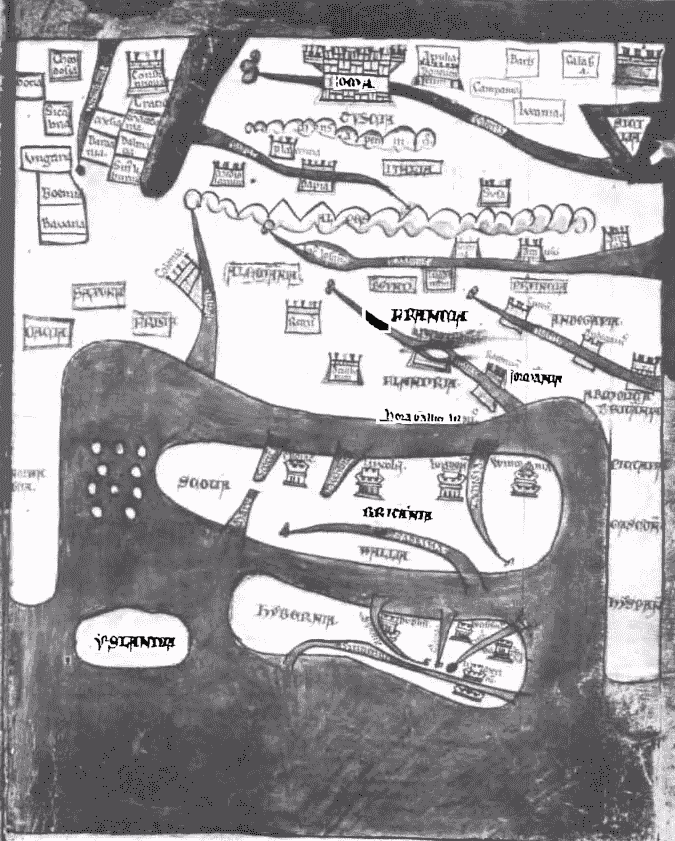
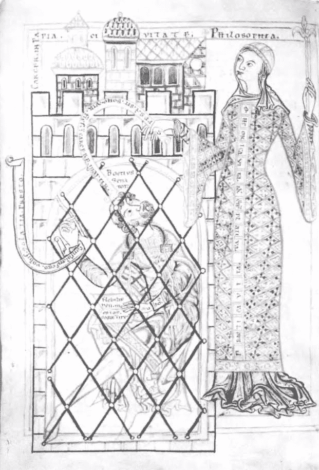
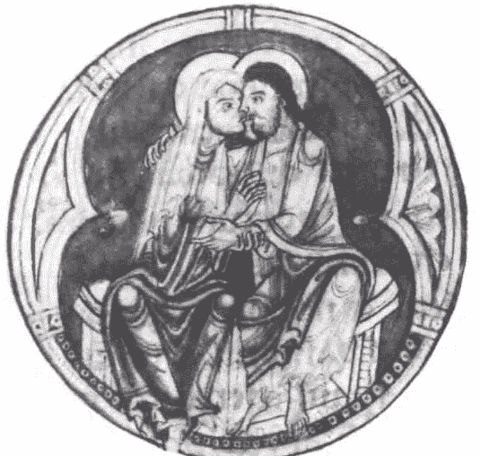
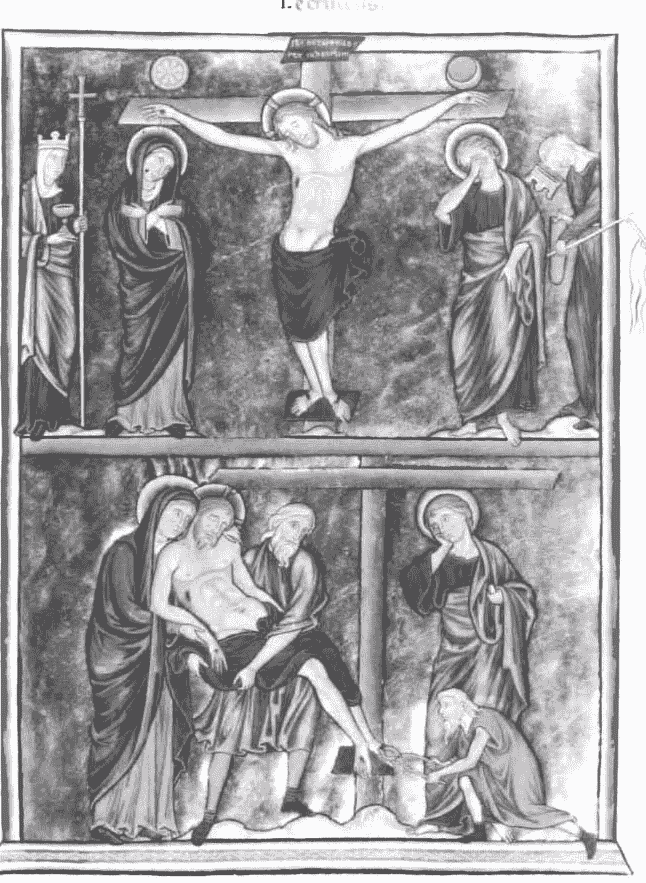
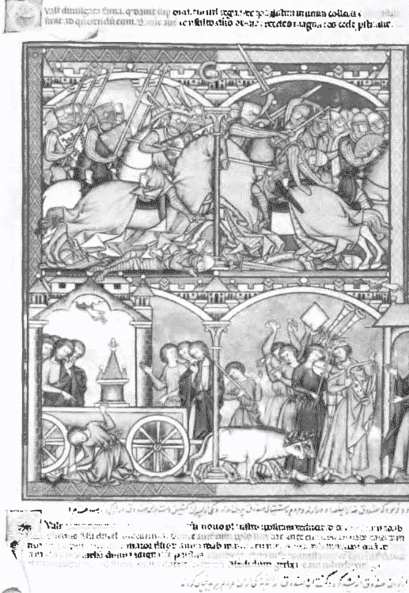
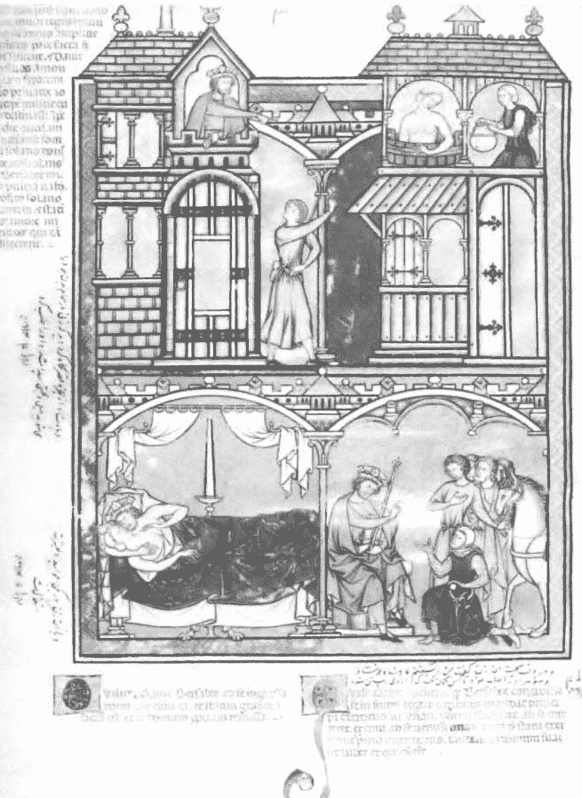
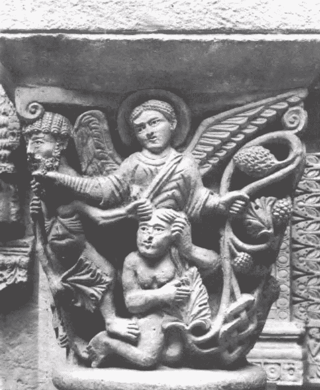
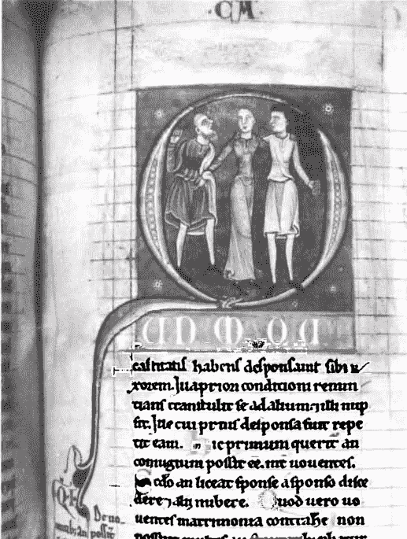

## 十二世纪法国的爱情

献给约瑟夫·A·麦卡林神父（FATHER JOSEPH A. McCALLIN, S.J.）

Patri meo in Spiritu

## 前言

本书旨在面向学生和普通读者，但我希望一些学者也能从中发现它的实用价值。在我们自己的专业领域之外，我们许多人都会成为“普通读者”，寻求轻松触及复杂的知识体系。这里欢迎所有读者的到来。

针对学术读者的几点技术说明：除非另有说明，译文均为我本人所译。圣经引用译自《修订标准版》（Revised Standard Version），尽管我在多处修改了翻译，使其更接近《武丁堡圣经》。全文中，我引用了我认为易于阅读的译文，并注明了我认为易于获取的版本。`PL` 是 *Patologia Latina* 的缩写，J. P. Migne 编辑，221卷（巴黎，1844–55年）；`RHGF` 是 *Recueil des historiens de Gaules et de la France* 的缩写，24卷（巴黎，1737–1904年）。

vii

我想向所有以各种方式促本书成书的人表示感谢：法兰·L·魏尔宗教与人文研究所；本杰明·内尔森教授，我在霍夫斯特大学的同事，特别是林顿·S·索恩（Linton S. Thorn）、约翰·T·马库斯（John T. Marcus）以及已故的盖瑞·P·贾德（Gerrit P. Judd），最后还有我的妻子帕特里夏（Patricia），多年来一直是我爱情道路上的同学。

J.C.M.

## 第一章：引论

“爱情的力量是伟大的，其力量是如此奇妙的。爱情有许多层次，它们之间的差异也是巨大的。谁能体面地区分它们，甚至列举它们呢？”十二世纪的教职人员理查德（Richard of St. Victor）是这样说的。¹ 无论爱情是什么，它唤起西方文明男女好奇心的程度是任何其他主题可比拟的。爱情是人们所做或享受的事，是发生在他们身上的事，是他们陷入其中的事。它是人们思考的话题。文学、艺术和音乐充满了爱情的主题。精神病学家、神学家、诗人、科学家，几乎所有人人都说过爱情是美好且必要的。但古代人和现代人均未能对爱情究竟是什么达成共识。

这种分歧并不意外。正如真理和美一样，爱情是伟大的无形资产之一。它无法像“十二世纪法国的爱情”那样被测量、称重或分析为它的化学成分。它在光谱图中不会显示出任何东西。但令人惊讶的是，以其清醒理性传统为傲的西方文明，竟然继续容忍在使用“爱情”一词时这种真正令人糟糕的松散。

**今天，一个人可以“爱”他的上帝、国家、母亲、父亲、妻子、工作、孩子、邻居的妻子、他的跑车、他的狗，以及他的波士忌。** 其中一些人还被期望回报以“爱”。

## 12世纪法国的爱情

除了行政上的划分，这个王国还因剧烈的文化差异而分歧，尤其是南北之间。南部地区使用一种方言，这赋予了该地区名称“奥克多克”（Languedoc），并呼吸着地中海温暖的空气。北方则是“奥伊语”（langue d'oil）之地，面朝英吉利海峡和北海。边界、气候和文化的差异使得奥克德多克对北方人来说就像是异域。在12世纪中叶，克莱沃的圣伯纳德在评价一个逃往南方的异端教士时说，他被“驱出了法国”，奥克德多克在当时看来是如此遥远。

法国与其邻国之间的现代边界在12世纪仅通过一些定义模糊的区域得以预示。从法国北部前往西班牙康波斯泰拉圣雅各圣地的朝圣者会发现，西班牙与法国南部的差异，几乎不比法国南北之间的差异大。在访问英国圣托马斯·贝肯特的墓时，他会发现一个由法国王子亨利二世和法国贵族统治的王国。在东方，法语区和德语区人民之间的差异已经非常明显，但即便在这里，边界也不清晰，且法国和德国贵族在建立通姻关系时往往忽视了这种边界。

法国国王的软弱意味着没有一个中央政府来聚焦于12世纪法国的故事。1100年，菲利普一世几乎无法控制巴黎周边。一位编史家写道，他的儿子路易六世“深受法国贵族们的苦扰……他们拒绝向他履行应有的效忠义务。”^5 到1200年时，路易六世的孙子菲利普二世强大得多，但当时还不清楚他是否比“高卢”的其他大贵族更强。在法国，正如其他地方一样，贵族们首先为了生存而斗争，然后为了财富和权力。他们蚕食邻居的土地；他们与一个邻居结成盟约以掠夺另一个；他们通过复杂的豪赌将孩子嫁到此方或彼方，希望通过正确的出生死亡模式，让几个公国落入他们某位后代手中。这种动态关系的范围可以通过路易七世的家族关系来窥见。他的第一妻子是阿基坦尼的继承人埃莉诺尔，她后来嫁给了英国的亨利二世。他第一段婚姻的两个女儿嫁给了香槟侯和布洛瓦侯。路易七世娶了卡斯蒂利亚国王的女儿，再次有两个女儿。一个嫁给了蓬蒂埃爵，另一个起初嫁给了亨利二世和埃莉诺尔之子小亨利，后来嫁给了匈牙利国王。路易七世的第三妻子生下了未来的国王菲利普·奥古斯和一个嫁给君士坦丁堡拜占庭皇帝的女儿。这些婚姻的实际政治结果错乱如麻；其可能的结果则难以想象。

尽管存在这些分歧和复杂性，法国确实发展出政治统一。到世纪末，法国的卡佩王朝国王即将成为欧洲最强大的统治者。然而，更令人印象深刻的是法国在欧洲享有的文化领先地位。

大约1100年，法国北方的一位诗人创作了《罗兰骑士》，这是一首英雄史诗，体现了法国宫廷战士的理想，并将其传到了法国边界之外，事实上跨越了12世纪的边界。大约同一时期，在南方，阿基坦公爵威廉九世创作了已知的第一批吟游诗人诗，即被作为艺术研究的抒情爱情诗。大约世纪中叶，南北传统融合。其结果就是浪漫小说（romance），它是英雄事事诗（chansons de geste）、吟游诗人巧妙的歌曲以及赞助作者的日益悠闲和复杂的宫廷的杂交产物。大约1170年，诗人克雷捷·德·特罗自称，骑士精神和学问在抛弃希腊和罗马后，必须居住在法国。^6 这一豪言依然成立；在12世纪的法国，现代欧洲文学诞生了。

尽管宗教机构和学校存在分歧，但法国确实产生了一些政治统一。到世纪末，法国卡佩王朝国王正处于成为欧洲最强统治者的边缘。然而，更令人深刻的是法国在欧洲享文化领先地位。

## 引言

维克多——即将成为其中一员的巴黎大学，曾是全欧洲的学术殿堂。这里的学者们并非完全是“法国人”：彼得·伦巴德来自意大利北部，圣维克多的休格来自萨克森，圣圣维克多的理查德来自苏格兰，萨尔兹的约翰来自英国。但出于某种原因，法国似乎是学者们的青睐之地。

与十二世纪的欧洲其他地区一样，法国正以胚胎形式发展着现代社会错综复杂的关联性。随着人口密度增加，社会组织必然变得更加复杂。为了保持这些组织的顺畅运行，需要更多的思考；在城镇和王侯宫廷（包括教会领主的宫廷），第一批官僚机构开始发展。这些新政府压制了早期时代特征中的某些暴力（那个时代暴力是维护自身权利的唯一手段），并提供了法庭作为替代方案。地区之间、城乡之间日益增长的贸易需要更多的资金进入流通，需要建立如市场、集市和银行等机构以促进交换。这也提供了足够的财富来支持监督和保护这种交换的城市和王侯官僚机构。在每一个层面上，都需要受过教育的人才，那些能够记录和账目、制定规则制度、收集证词并做出判决的人。年轻人涌向学校，希望在这些萌芽中的官僚机构中升迁到权力和财富之上，诸如圣丹尼修道院院长苏热（Suger，他是路易七世时期“法国”的摄政者）或鲁昂大主教瓦尔特·德·库唐（Walter of Coutances）这样的职位，后者是狮心王理查德一世治下的英国首席法官。城镇居民的儿子们在生意中寻求自己的财运，他们向往那些地位显赫但几乎同样舒适的职位。他们通常也从信函和数字开始职业生涯。像今天一样，这些人中有些人在商界取得了成功，有些人转入学术和教学，另一些人则仅仅过着怀才不遇、希望破灭的生活。他们的共同努力创造了一个庞大的受过教育的群体，他们与贵族宫廷中识字的男女一起，为许多以爱情为主题的作家提供了创作温床和观众。

现代学术界理所当然强调了十二世纪法国的成就。繁荣的城镇、宏伟石造教堂、满溢的学校以及强大而复杂的宫廷，稳固地建立在繁荣且扩张的经济基础之上——事实上，这是一个对爱情产生丰厚兴趣的可能背景。但那个时期的编年阻止我们严厉地称其为爱情之世纪。它也是一个贫困与苦难、无知与残忍的世纪。

现代城市居民几乎忘记了对农业周期的依赖。快速的交通和现代食品保存方法使我们的饮食全年保持相对不变。因此，我们把大部分注意力放在了不规则的经济周期上，这些周期对我们生活水平的影响，远比治理农业的季节周期要大得多。但在十二世纪，一年的作物收成对于该地区的人民来说，意味着丰年或饥荒。1109年，桑斯（Sens）地区的粮食价格是前一年的两倍，因为风暴和冰雹毁了农田、果园和葡萄园。¹¹ 在第二次十字军东征（1147年）之前的近十年里，特罗瓦方丹修道院（Trois-Fontaines）附近的粮食短缺迫使贵族卖掉所有财产以生存，并让成百上千的平民去僧侣那里乞面包吃。¹² 地区性饥荒是十二世纪法国的常态。

战争也许是比天气更大的威胁。没有什么比争斗的贵族破坏敌人的经济资源更常见的了，即焚烧农作物和建筑，以及任何倒霉挡路的农民和动物。农民总是受苦者。对于贵族来说，战争是一种相当有趣的运动，缓解了和平时期的单调；但正如一位编年史家写道，“平静的安全给农民的心灵带来了快乐。”¹³

即使在天气良好且贵族们正式和平的时期，生活也远非安全。成群结队的无赖匪徒像狼群一样恐吓着农村。甚至克吕尼（Cluny）本身也遭受过围攻。1166年，当僧侣们带领一群市民游行，他们只信任随身携带的圣物和所穿的神圣法衣，匪徒袭击了他们。他们剥光并杀死了市民。路易七世抓获了其中一些人并将他们吊在绞架上处死，但没有哪个君主能希望清除这片土地上所有的匪徒。¹⁴ 1183年，一支来自各阶层的绝望之师成功包围并屠杀了一支多达一万人的匪徒部队；但在附近营地发现的500名女性在寻找新营地时可能并没有什么困难。¹⁵

接下来的页面旨在揭示十二世纪法国的一些温柔、智慧和美感；但读者应当记住，那里也有黑暗的一面。犹太人被屠杀；被俘的农民被挖掉眼睛；人类和野兽般的敌人在复杂的“宗教”仪式中被诅咒；火灾、瘟疫和饥荒从未远去。这种中世纪的悖论——美与丑以如家人般的亲密方式共存——无疑困扰着我们，但在解决我们城市的悖论之前——这些作为现代慈悲与残忍、博学与文盲、奢华与贫困的现代家园——我们无法真正抱怨。

最后，读者还应该记住所谓的“中世纪”。作者经常使用“中世纪的”这一形容词同时指代五世纪和十五世纪，尽管两者之间的千年时间并没有改变任何东西。“中世纪”作品选集将九世纪农民的描述与十五世纪城镇居民的描述放在一起，仿佛将他们分开的只有一城墙和一片森林。当十二世纪开始时，圣奥古斯丁已去世近700年，查理大帝已去世近300年。当它结束时，但丁的《神曲》还有一个世纪才问世，乔叟的《坎特伯雷故事集》在那之后又过了一个世纪。因此，这并不是一本关于“中世纪”的书，那是一个覆盖在千年不同色彩之上的漫罩。它只关于十二世纪，一个欧洲其他地区向法国寻求爱情指导的时代。

# 第二章

# 过去遗产中的爱情

十二世纪继承的文化遗产在很大程度上是没有文字的。不识字的法国骑士珍视着关于法兰克祖先的故事，这些祖先跟随查理大帝反对穆斯林人的战斗，这些战斗的规模随着每一次讲述而增加。从威尔士云雾缭绕的高地和爱尔兰（凯尔特人先躲避罗马人，后躲避盎格鲁人和撒克逊人，最后躲避诺曼人），其他关于传说的故事流入了法国：关于伟大凯尔特战士亚瑟，他在很久以前抵御了英国的撒克逊入侵者的故事；关于不幸的恋人特里斯坦和伊索尔特的故事；关于龙、魔法药水、利剑构成的桥以及各种魔法药水的故事。古老的日耳曼和凯尔特故事在几个世纪里不断讲述、不断重述，不断变化。

它们的形状宛如听者眼前闪烁的火焰：在一次叙述中粗犷而无形，在另一次又精妙绝伦；有时是一个短促的速写，有时则随着深秋夜晚的渐渐变长而变得冗长而复杂，伴随着无数离题。它们是所有人的遗产，甚至是不识者的遗产。但对于学者来说，还有更令人敬畏的宝藏等待着。

学习阅读是一种令人陶醉的体验。现代孩子起初会对意义从他们周围的符号中跳出来时感到惊奇。在我们世界里，文字是廉价的，他很快通过阅读浅薄的读物消尽了这种惊奇。在中世纪的欧洲，文字是稀缺的。没有报纸和传单的每日积累，田野和森林里也没有告示牌。一个想要阅读的十二世纪学生必须去修道院图书馆和大教堂图书馆，翻阅那些经过仔细处理和装订的羊皮碎片，上面保存着古代的智慧。对文字的敬畏无疑被放大了，因为那些手稿是耐心的僧侣们几个世纪以来反复抄写、无数小时劳动的成果。

手稿的内容证实了读者的尊重，因为几乎所有的这些作品都是由希腊罗马古代的异教徒和基督教作者撰写的。它们是一个比十二世纪读者所生活的文明得多的文明的产物。因此，文字受到推崇并不意外——《圣经》和伟大基督教圣徒的灵感之言，但同样尊贵的还有异教作家的文字，他们的智慧和艺术似乎

## 十二世纪法国的爱情

几乎弥补了他们信仰的缺失。因此，要理解十二世纪的思想家，我们必须从他们开始的地方开始，从图书馆的内容开始。修道院图书馆中异教作者的出现需要解释。罗马帝国晚期的基督教徒（约公元300年至600年）可能拒绝异教古代的遗产；相反，他们决定异教过去的知识产物应当被保留并整合到基督教的框架中。年轻的基督徒在“自由艺术”中接受教育，学习希腊罗马传统中的文学、修辞、数学和科学。整个中世纪的基督教图书馆至少保留了那种教育传统所需要的一些文本，异教古代的知识遗产因此得以生存。

最重要的异教作者是柏拉图。从柏拉图那里，基督徒学会了描述人对上帝的爱。他在十二世纪并不广为人知，因为他的作品中只有《斐多篇》有拉丁语译本（而且几乎没有人读希腊语），但柏拉图主义和新柏拉图主义无处不在。柏拉图的主要思想是，不朽的灵魂被囚禁在身体里，它渴望与绝对的善或美结合。生命的所有都是灵魂为了追求精神而将其从物质中抽离出来的斗争。这些思想与基督教思想如此契合，以至于在十三世纪之前几乎所有的基督教思想家都可以被认为是柏拉图主义者。中世纪的读者在罗马的基督教作者和异教作者的作品中都发现了这些思想。

## 继承过去遗产的爱情

例如，一位名叫马克罗比乌斯的五世纪异教徒，在整个中世纪被广为传读，他谈到了“那门引导哲学家寻求某种死亡的学科，在这种死亡中，他们虽然活着，却蔑视身体为外在的负担”。通过圣奥古斯丁，马克罗比乌斯、波爱修斯等人，柏拉图传统得以保留。

（注：此处翻译根据原文结构，原文似乎在多处中断，以下为后续段落的对应翻译）

（由于您提供的英文文本存在多处重复和逻辑中断，此处译文严格遵循提供的原文顺序进行逐段翻译。）

图1。一张十二世纪的法国概念图，从北方观察。英国位于中心，法兰西和法国在上方，它们正上方是意大利。君士坦丁位于左上角，西班牙位于右下角。来源：爱尔兰国家图书馆，都林，Ms. 100。

他是12和13世纪异教古代最受欢迎的诗人，一些学者将这一时代称为“奥维德时代”。他的作品有时被赋予奇异的寓言和神秘主义解释，使得这位描写罗马式淫乱的诗人成为了基督教道德的无意识发声人，但无疑地，他也因其自身的本色而受到赞赏。无论如何，他在十二世纪被教皇、诗人、圣徒和学者所引用。

异教古代提供了一种完全不同的爱概念，在希腊语中称为 *philia*，拉丁语中称为 *amicitia*，在英语中通常翻译为 friendship（友谊）。这一主题最早由亚里士多德在《尼各马可伦理学》（第8、9卷）中详细探讨，但该著作直到13世纪才在西欧为人所知。亚里士多德的思想通过西塞罗的《友谊》（中世纪读者的喜爱）进入十二世纪。

西塞罗通过对话的主角拉埃留斯明确表示，朋友之间既没有狂热恋人那种盲目的非理性，也没有精明诱惑者的自私欺诈。友谊基于两个朋友之间美德的相互认可，除了爱本身不寻求任何回报。友谊是“凡事中人类与神的和谐，以及善意与情感”（6.20）；它的效果是“使一个灵魂变成多个”（25.92）。它既稀有又珍贵。它只能存在于品德且性格和趣味相似的人之间，当然，没有常见的组合。但由于友谊超越了美德本身，“我们应该一直寻找我们将爱的人以及那些报答我们的人”（27.104）。

全程，西塞罗确实提到了女性。亚里士多德曾允许夫妻之间可能存在友谊（《尼各马可伦理学》8.12），但如果这种友谊在本质上劣于男性，那么它必然是一种低等的友谊。西塞罗甚至没有提到这种可能性，而是提出了一种由色欲维持的男性化美德。因此，关于友谊的思想对于一群禁欲男性的基督教知识分子来说极其契合，这并不奇怪。

最后，十二世纪的学者如果观察得足够仔细，就能在他的异教作者的作品中发现另一种、更全面的爱的神化。一些古人认为爱包含的内容远超人与人的关系。他们将其视为一种解释宇宙运行的巨大宇宙力量。有些人强调爱的生殖能力，它是宇宙的生命力。史前时期将性能量与生命之源（体现在母神和丰产仪式中）联系在一起的传统，在女神和仪式被正式废弃后，这种联系依然留存。在十二世纪法国所读的多个异教作者作品中，金星被描述为“万代之母”。

对爱的第二种宇宙论解释将其视为宇宙元素之间和睦或和谐的源泉。十二世纪的“畅销书”之一是波提修斯写的《哲学的慰藉》，他是一位

图2。这幅约1200年的德国手稿细节展示了哲学探望监狱中的波提修斯。铭文说她给了希望，他从她的探望中获得了慰藉。来源：慕尼黑，巴伐利亚州图书馆，Cod. lat. 2599, fol. 106v。

波提修斯，五世纪末的基督教罗马人。

可以读到以下内容（第二卷，诗8）：

- 爱系万物：

忠实的大地紧贴

它所接受的变迁；

不变的法则维持着

那些争斗的种子；

太阳神驾着金车带来

黄金，和粉红的日子；

月亮女神统治着

由赫斯珀斯带来的夜晚；

贪婪的海限制着

它的波浪在边界内

免得它们侵犯

动荡大地的广阔边界。爱统治着陆地

并主宰着天空。

如果爱松开缰绳，

现在在爱中运行的

将在突如其来的战争中碰撞；

一切将争相破碎

那些美丽的运动，

那是它们现在，

在爱与信赖中维持的秩序。这种爱将所有民族

统一在神圣律法之下，将婚姻的神圣仪式

在纯洁的爱中结合，

为同伴定下友谊信赖的法则。

噢，人类！如果统治天空的爱

也能统治你们的灵魂，该多么幸福！

# 遗产中的爱

那么，异教传统为它的继任者提供了几个主要的爱主题。它是对“善”的灵魂渴望，这种渴望在物质世界中无法满足；它是拥有爱人的狂热且色欲的欲望；它是简单的肉体愉悦，不应被太认真地对待，以免失去愉悦；它是高尚品格之人之间可能的善与情感的互惠纽带；在宇宙尺度上，它是一种神秘的力量或能量，产生了宇宙中所有的生命，并维持着其各个部分之间的和谐。

所有这些思想在十二世纪的图书馆里都能找到；但中世纪读者发现，罗马文明留给他的不仅有基督教作者，还有异教作者。到四世纪末，罗马帝国正式成为基督教国家。当时最优秀的人才将他们的才华献给摇摇欲坠的帝国，而是献给了新兴的基督教教会。圣安布罗斯，一位来自高卢贵族家庭的罗马政治家，成为了米兰主教。圣杰罗姆出生于伊利里亚的富裕家庭，接受了卓越的罗马文学教育，并利用他的技能将圣经翻译成拉丁语。圣奥古斯丁出生于罗马北非，放弃了卓越古典修辞教师的职业，成为他家乡希波的主教。这些以及其他基督教罗马人的著作在中世纪图书馆中随处可见，它们向中世纪传递了新的基督教思想，以及基督教对已熟悉的异教思想的变体。

## 十二世纪法国的爱

基督教思想的主要源泉是犹太基督教圣经，杰罗姆通过将希伯来语和希腊语翻译成拉丁语，确保了它在中世纪可用。他的“武加大本”译本是十二世纪读者最受推崇的来源。他们对其感到困惑，对其产生争论，但他们从未怀疑过那是上帝的话。

圣经在人类事务中赋予了任何其他哲学或宗教传统都无法比拟的主导地位。旧约的上帝不仅是公义忠实的神，也是一位仁爱的神。“我用永远的爱爱你，”他向他的民回答道：“你要尽心、尽性命、尽力爱耶和华你的神”（申命记 6:5）。但虽然爱只是旧约众多主题之一，新约则是关于爱的文本的丰富合集，由一个单一主题结在一起：“神爱世间，甚至将他的独生子赐他们”（约翰福音 3:16），而人的回应应当是不计量的爱：“你要尽心、尽性命、尽意爱耶和华你的神。这是最大的也是第一的诫。第二条也是像这的，“要爱你的邻舍如爱自己。”所有的律法和先知都在这两诫上”（马太福音 22:37-40）。爱的主导地位是不可逃避的：

即使我说人道和天使的话，若没有爱，就成了响的钟、鸣响的钷。

即使我有先知的能力，能洞察一切奥秘和知识，并且有所有的信心，可以移山，若没有爱，我就什么也不是。

即使我将所有的所有的舍给人，甚至把身体交给火烧，若没有爱，就与我无益。……信、望、爱，这三一直是总存，其中最大的是爱（哥林多后书 13:1–3,13）。

约翰简洁地说道：“神就是爱”（约翰一书 4:8）。

# 遗产中的爱

首先，有上帝对人的爱，一个异教徒对此没话可说。在圣保罗的信函和圣奥古斯丁的著作中，上帝的爱是全给予的。创造的行为是上帝爱的表达，完全是单方面的；上帝对人的爱先于人。堕落之后，当人需要救赎时，上帝赐下他的儿子来实现人的救赎。再次，上帝自由地行动，证明一种绝非赢得也不应得的爱。最后，还有“灵的恩赐”（奥古斯丁倾向于将其等同于圣灵本身），上帝派遣它居住在选民的心中。全程，上帝对人的爱是恩赐之爱。

但如果爱是给予，人又是如何爱上帝呢，因为人又什么是上帝所缺乏的？回答这个问题

## 十二世纪法国的爱

奥古斯丁借鉴了自己的经历以及三世纪罗马人普罗提诺的新柏拉图主义理论。奥古斯丁曾游走于各种信仰之间，寻求一个名为“幸福”的无形目标。他回到了基督教，相信自己可以通过基督找到它，因为基督就是道路、真理和生命。他在他史无前例的自传《忏悔录》中记录了这些冒险，书的第一页写出了它的主题：“我们的心未在你里面，就得不得安。”人对上帝的爱并非给予，而是对柏拉图和普罗提诺所描述的“善”的渴望，其目标是与“善”合一，而奥古斯丁现在将其认作通过耶稣启示的人格神。人对上帝的爱是对“善”的渴望和喜悦。

想要爱神的基督徒必须从物质诱惑中夺回自我，以免像奥古斯丁那样坦白道：“当我离开你，这唯一的善时，我在万物中迷失了自我。”普罗提诺本希望这位哲学家过上苦行生活，以促进灵魂沿着“存在之链”向上移动。奥古斯丁对基督徒也有同样的纪律要求，并将死后的终极福报作为奖励，甚至可能在世上提供这种福报的某种预示——对上帝的神秘体验。保罗在描述自己的神秘体验时措辞十分谨慎：

我晓得在基督里有一个人，十四年前曾被提到了第三个天——是在身体里还是在体外，我不知道，上帝知道。我晓得那人提到了天堂——是在身体里还是在体外，我不知道，上帝知道——他听了不能言说的话，人不能说的话（哥林多后书 12:2–4）。

这种神秘的交融在整个中世纪被称为“沉想”。它是在地上的天堂的预演。

当奥古斯丁转向第二大诫令爱邻人时，他感到有些困惑。他自己的经历是，人性的爱是危险的，因为人除了爱上帝（渴望并喜悦上帝），不能爱别的。友谊可能成为罪恶的源头，“因为对最低等级事物的过度倾向，更好、更高的事物就被遗弃了……”起初，他说只有上帝应当为了自身而被爱；其他事物仅能被使用，以便人接近上帝。随后，面对必须不仅是“使用”而是“爱”邻人的必然要求，他发展出一种观点：造物应当根据其在存在层级中的位置来被爱。有一种爱的秩序，即“爱的秩序”（*ordo amoris*）；被创造的善与美有助于人的心灵向它们的创造者靠拢。然而，尽管奥古斯丁在生活中可能是这样，但他的理论并没有轻易纳入世上人与人之间的爱。人的注意力属于上帝，人之所以偏离了这一目标，是因为福音要求人要照顾邻人的生理和精神需求——一种类似于上帝对人之爱的“给予”之爱。

这种对基督教之爱的相同观点，在大格里高利（死于604年）的作品中也能找到，他在十二世纪受推崇的程度仅略次于奥古斯丁。格里高利是一位修士；他的著作帮助定义了修道院理想，这是从格里高利时代直到十三世纪的基督教最高理想。与奥古斯丁一样，格里高利将爱视为灵魂对上帝的渴望和喜悦。关于沉想，格里高利说：“当心灵尝到内在的甜美时，它被爱点燃了。”通过苦行生活以及上帝派遣或允许的苦难与诱惑，灵魂得到了净化并戒断了世俗依恋。这个在地上开始的过程只有在天堂才能完成。

对于格里高利，对于奥古斯丁来说，爱邻人的要求意味着满足他们的需求，当然，精神需求优先。是格里高利采取了带有矛盾色彩的一步，利用修士——这些男传教士来教化世界。他派遣奥古斯丁过上隐世生活，作为坎特伯雷的传教士前往英国；从那里建立的新修道院中，一些本笃苦会修士返回大陆教化异教的日耳曼人。在整个中世纪，爱邻人首先意味着让他们归信基督的生活，因为归信意味着拯救，没有比这更大的礼物了。

上帝与人之间、以及人与邻人之间的爱，显然与色爱无关。那是另一回事，而且是一个问题。基督教关于性爱的遗产是模糊的。十二世纪的读者可能很容易从其来源中得出结论：性爱、婚姻、女性甚至物质本身都是邪恶的；但如果他们读得更仔细，也可能发现这种结论是异端性的。

对性爱的反感有几个来源。罗马社会的许多淫乱无疑令人反感。无论如何，当时存在一种强烈的基于斯多葛学派和新柏拉主义、并经圣经证实的苦行主义倾向。特别在新柏拉主义中，灵魂通过“向上”移动、远离身体及其关注的事物来达到目标。新约圣经似乎建议完全禁欲。耶稣和他的母亲被认为是处女，耶稣也带有一点晦晦地谈到了那些“为天国缘自作太的人”（马太福音 19:12）。保罗则写得非常明确，他给哥林多人的第一封信对于中世纪思想是如此基础，以至于应该全文引用：

> 男人不犯妇女是好的；但免于奸淫，每个男人应当有自己的妻子，每个女子应当有自己的丈夫。丈夫应当给妻子应得的权利，妻子亦是这样给丈夫。妻子不应当主丈夫；因为妻子不主自己的身体，由丈夫主；同样，妻子不主自己的身体，由丈夫主。我说这话是为你们自己缘，不是要在你们上有束缚，是要叫你们专心事主（哥林多前书 7:1–11）。

这些经文的意义引起了很大争议，特别是在宗教改革以后；在整个中世纪，它们几乎被视为对贞洁生活的神圣召唤。后来的作家并不总是保持保罗那种温和的语气。对女性之爱是奥古斯丁最摆脱的世俗依恋，他这样描述自己的解脱：“现在我的灵魂脱离了营营索取的苦恼，不再在污秽中打滚，不再欲望的瘙痒。”世代修士阅读这些话，正如他们阅读关于安东尼的诱惑的故事，他是一位三四世纪的埃及修士，魔鬼试图通过化身为美女来陷害他。魔鬼知道肉体对抗灵，常诱使人恨恶试图支配身体，怀疑女性这一普遍性的诱惑者，她首先背叛了亚当和人类，并继续成为不警备基督徒的陷阱。在新约圣经中，保罗要求妇女在教会中要蒙头（哥林多前书 11:5–15）。奥古斯丁的朋友和顾问圣安布鲁塞解释道：

> 既然女子不是上帝的像，所以女子应当蒙头，显出顺服。由于罪恶从她身上开始，她应当有这个记号，头不要露，而是蒙上敬畏的面纱……因为犯罪的起源，她在主教面前应当顺服，因为他是主的代表，正如在法官面前一样。

因此，古代遗产对性爱、婚姻、女性甚至身体本身都投下了怀疑的阴云。另一方面，人不能在谴责物质和身体而不陷入摩尼教异端的错误，这种异端是奥古斯丁极力否斥的。圣经本身几乎没有不确定上帝创造了所有万物，包括人类（男性和女性）的身体，他曾命人类去充实这片土地。此外，保罗曾有一个比喻，将夫妻之间的关系比作基督与教会的关系：“丈夫们，你们要爱你们的妻子，基督基督爱教会，并为教会献上自己”（《以弗所书》5:25）。这个比喻暗示了婚姻之爱的地位比基督教界通常认同的要高。此外，在旧约中还有《雅歌歌》，其感官色彩与早期基督教的禁欲主义形成了奇异而引注目的对比。将上述引用的奥古斯丁和安布罗斯的言论，与《雅歌歌》中的这段经文（也称为《歌中之歌》或《所罗门歌》）相比：

> 你是如此美丽、动人，
> 我亲爱的、令人喜爱的少女！
> 你像棕榈树般庄严，
> 你的乳房如其树上的果子。
> 我说我要上棕榈树，
> 采它的果子。
> 噢，愿你的乳房如
> 葡萄的簇果，
> 你的呼吸的气味如苹果，
> 你的吻如最美的葡萄酒，
> 顺滑下喉，
> 滑过嘴唇和牙齿（7:6–9）。

《雅歌歌》是12世纪僧侣的最爱，或许是因为这是他们唯一可以毫无犹豫地阅读的直白情色作品——它毕竟是

图3。基督拥抱教会，这是一幅12世纪抄本，源自8世纪英国修士贝达撰写的《雅歌歌》注释的插图。来源：剑桥大学剑王学院，Ms. 19, fol. 21v。照片由剑桥的爱德华·李奇提供。

这毕竟是圣经——但更因为它被视为基督爱其新娘教会（或爱个人灵魂）的寓言表达。在12世纪，人们对《雅歌歌》写了数十种注释，所有的注释都基于寓言式的解释。无论其意义如何，像这样的段落结合教会对摩尼教派的正式谴责，使得基督教关于性爱的遗产并非完全是单面的。它是模棱两义的。

友谊是早期基督徒讨论的另一种爱的形式。西塞罗关于友谊的理论广为人知，但它们并不适用于对神之爱或对邻舍之爱。西塞罗的友谊建立在朋友间美德相似的基础上，而奥古斯丁在神人之间没有看到这种东西。此外，对于基督徒来说，正如西塞罗那样显而易见，大多数邻居都极缺乏美德，因此不具备友谊的资格。尽管如此，他关于友谊使“许多人合一”的评论触动了基督教作家。奥古斯丁清醒地意识到，友谊像世上其他美好事物一样是转瞬即逝且不安全的，但它仍然是甜美的，因为它“源于许多灵魂构成的统一”。在描述天堂时，他的话回响了西塞罗，暗示他将友谊视为天堂和平不可或缺的一部分，在那种地方，自私和意志没有立足之地，只有一种服侍之爱，为所有人的共同喜悦欢庆，使众心合为一，即确保了完美的和谐。

其他基督教作家无疑也会同意，完美的友谊只有在天堂才能实现，但其中有三个人特别讨论了尘世中的友谊，并将西塞罗思想的基督教变体传给了中世纪。这三位变体者——安布罗塞、杰罗姆和卡西昂，以及在三人著作中发现的西塞罗的主要变体是：“美德”不再是罗马贵族的美德，而是用基督教的术语来定义的。美德的相似最可能出现在基督教苦修者身上——那些拥抱贫穷和贞洁的谦卑男女。第二个变体是，友谊现在是所有人都要追求的目标，因为它是那些拥有美德本性的人所具备的必要属性。任何接受福音并被上帝恩典完美的人都可以拥有友谊。它不再是贵族的专利产物。这些变化并不总是由基督教作者明确写出来，但清楚地隐含在他们对友谊的论述中。

米兰的安布罗塞主教写了《事奉者的职责》，这是一本给神职人员的手册。在讨论诚实时，他询问人们是否为了诚实而撒谎。他的答案是“否”，当然，但在关于友谊的话题上，他与西塞罗并无二致，只是引用圣经经文来论证友谊：“忠实的朋友是生命的灵药，永恒的礼物”（《箴言》6:16）。

安布罗塞在某些方面似乎超越了西塞罗，在友谊的亲密性上。他建议对朋友敞开心扉；向朋友倾诉内心的秘密；真正的朋友揭示灵魂。这是因为他的主要课题不是诚实，而是友谊。

杰罗姆提供了西塞罗思想的基督教变体，体现在他与朋友大量的通信中。尽管他用基督教的术语定义，但他认为像德像一样稀缺。他对亲爱的鲁菲努写道：“友谊长寻、难得、易失。”9 杰罗姆给女性写了许多深情信。这些信件在中世纪的修女、神职人员和僧侣之间流传。面对指责者，他讽刺地写道：“结识圣保拉的家之前，整个罗马都为我疯狂。……但当我意识到她生活的圣洁后，我开始敬畏、尊重和崇拜她，我所有的好品质立刻离开了我。”10

## 过去遗产中的爱

在卡西昂的作品中，友谊的思想进一步继承了西塞罗的精神。¹¹ 卡西昂来自帝国的多瑙河行省，曾在伯利恒和埃及的修道院生活过，并在君士坦丁堡作为金口的门徒度过了几年。他大约在405年来到罗马，当时就在阿拉里克的军队掠夺罗马的几年之前，随后前往马赛，那是当时少数未落入汪达人和哥特特人之手的罗马城市之一。他在那里建立了圣殉道者修道院，埃及苦修主义的精神被引入了西方。

卡西昂著作的持久影响归功于另一位修士——修道院创始人本笃修士。在529年，即卡西昂去世一个世纪后，本笃为他的僧侣写了一份准则，《本笃修士》在之后的几个世纪里一直是每个欧洲修道院的基础宪章。《本笃修士》对顺服和谦卑有许多论述，但对爱的提及极少。本笃似乎从他最喜爱的作者卡西昂那里学到了观点：顺服和谦卑产生了美德，而只要有美德，就有爱。无论如何，他承认自己的准则是不完全的，并敦促他的僧侣阅读圣经和教父著作，包括卡西昂的《讲集》，这部书中包含了关于友谊的论文。作为结果，在所有遵循该准则的地方，卡西昂的作品持续被阅读。

在他的论文中，卡西昂报告了一位名叫约瑟的古埃及修士的教导，约瑟深谙埃及和希腊学问。

## 12世纪法国的爱

正如西塞罗通过拉埃留斯所言的那样，卡西安通过西塞罗一样，他将美德视为友谊的源泉，但这位基督徒修士为修道院读者写作时，其含义必然有所不同。与西塞罗不同，甚至与安布罗塞和杰罗不同，卡西安是为那些无法选择朋友的人写作的。他们决定在修道院内度过余生，必须与一个小圈子的人生活，而他们的本性和习惯早已完全不同。因此，卡西安调整了“友谊基于美德相似”这一命题，使其意味着：美德的相似将必然带来友谊。如果所有修士在美德上是一致的，那么具有“意志统一”的友谊就能确保修道院的和谐与和平。卡西安警告道：“意志多样的地方永远无法维持和平。”²对于这样一个异质的群体来说，美德的相似在西塞罗看来是不可能的，但对于基督徒卡西安来说，美德是自然的产物，却是通过上帝的恩典和修士持久的努力获得的。如果修士们希望获得友谊带来的和平，就让每个人都抑制世俗的欲望（通常是纷争的根源）；让他自己的意志服从于修道院的纪律，以便不再那么执迷于自己的做事方式，而更能适应弟兄们；让他将爱与和平置于一切之上；让他自己永不屈服于愤怒，并尽一切所能消除兄弟对他产生的愤恨；让他怀疑自己的判断，而将信任寄托于年长的修士；并让他永远记住，自己每天都在从这个世界迁徙到另一个世界。

卡西安所描述的友谊，主要是和平与和谐。在他的著作中，几乎没有迹象暗示西塞罗和安布罗塞作品中所发现的那种个人亲密感和朋友相伴的快乐。如果其言属实，卡西安会允许修士之间产生更深厚的情感（尽管仍然爱着所有人），但仅建立在“功德”的基础上。个人的喜好、倾向、障碍不应是友谊的基础，而是应该通过对规章的统一遵从而被抹除。

在实践中，卡西安表现出的温暖和情感可能比他的理论所暗示的更多。但正如奥古斯丁发现的，对同胞的任何关注都是对更重要事情的分心：

> “在从事慈善工作时，谁能以宁静的目光凝视上帝荣耀的威严？当他在服侍穷人、在用慷慨的热待迎接访客、在忧心照顾弟兄需求的那一刻，谁能沉思天堂那无量的福分呢？”¹³

大多数早期的基督徒在对人类爱的赞美与对世俗依恋的警惕之间取得了平衡，或许他们无法忘记福音书中的警告：“爱父母胜过爱我的，就不叫配得我。”（马太福音 10:37–38）。

因此，这些罗马基督徒留下的遗产包含了一些与异教思想相似的爱观点，也包含了一些完全不同的观点。

## 12世纪法国的爱

基督徒对上帝的爱与异教徒对“善”的爱相似。基督徒对性爱的怀疑（即使在婚姻中）部分源于异教哲学，基督徒对罗马式放淫的谴责也呼应了他们的异教同胞。基督徒的光谱包含了对性爱的部分接受，以及对西塞罗式友谊更为宽容的接受。

另一方面，基督基督教向异教世界引入了完全全新的思想。首先，基督的上帝除了其良善外，与柏拉图和普洛丁丁的“善”有本质区别。他是一个三位一体的上帝，他们彼此相爱而不失去其神性的统一。他是一个位格且仁爱的上帝，通过他的“恩典”干预人类生活。核心的干预是道成肉身——上帝为人，这种干预使人类能够达到其“超自然”的目标。异教徒中并没有这种仁爱上帝的概念。

其次，基督教关于爱的命令是一个新事物。对于异教徒来说，爱是高尚灵魂在面对善或美的事时的自发反应，或者是对性吸引者同样自发的性欲望。对于基督徒来说，堕落本性的自发反应是不值得信任的。对他而言，爱的命令意味着人类自由选择爱或不，这要求他努力，而不是等待爱的自发运动。大格列描述了灵魂在实现爱上帝时所经历的艰难阶段：“凡征服了自己肉体傲慢的人，剩下的任务就是：通过神圣工作的练习来训练他的心灵；而凡在神圣工作中开启心灵的人，还必须进一步将其扩展到内在沉思的秘密追求中。”¹⁴

如果没有上帝的恩典，这一切是不可能的。人们可以认为，早期基督教传递了一个逻辑矛盾：它一方面断言上帝是一切爱的源头，人类的爱实际上是上帝在人身上的爱；另一方面又认为人类自由选择爱或不爱。但事实是，中世纪基督教总是认为爱是人的责任，而爱既是人类努力的结果，也是神性和神恩典的果实；这两者的比例并未明确描述。无论如何，人类自由选择爱或不爱。

最后，在基督教思想中，人类之间的爱的地位比在异教圈子中更高，也更低。基督徒接受了爱所有人的义务，甚至是他们的敌人和最受蔑蔑的罪人，这些概念对异教徒来说是完全陌生的。另一方面，这种爱往往是一种无位格的仁慈；基督徒并没有赋予人类友谊（带有相互的情感和陪伴）与平等者之间的互惠关系相同的价值。

## 12世纪法国的爱

友谊与邻舍之爱在某种程度上有所不同，这种遗产，是模糊的。异教徒并没有清楚这些思想是如何关联的，也没有实现彻底的综合。这一不可能的任务是西方文明的遗产。

## 第三章 修道院

修士的生活旨在成为一种爱的生活。他们每天遵循《圣本多修会规章》中规定的作息：睡眠、饮食、祈祷和工作。他们每天被要求思考生命的意义：认识并爱上帝。良的修士生活在那个创造他、认识他、爱他并终将审判他的上帝的临在之中。修道院生活被认为是回应这种存在的最佳方式。修士在旧约中读到希伯来人对应之地和弥赛亚的期待，他思考自己在这个苦难世界中的流亡，并渴望天父的天国。他读到耶稣的仁慈、耐心和爱，并为自己的自我主义和狭隘感到懊悔。他思考耶稣的生命、死亡和复活使天堂永恒幸福的可能，那里有和平、喜乐和爱。修士的心充满了感激，爱那位怜悯的父，爱那位顺服直到死的谦卑之子，爱那位持续温暖所有信徒内心的圣灵。

只有修士对那位仁爱且渴望被爱的上帝之位格的信仰，对生活才有意义。圣提埃的威廉修士写给一群加笃修士时说：“你们的职业是寻找寻雅各的上帝——不是以人类寻常的方式，而是寻找寻雅各所见上帝的面，正如他说：‘我面对面见过上帝，我的命得存了。’加笃修士的小室，就像主和仆人交谈一样。”

当然，并非所有修士都是爱人。修道院的成员来源多样。有些修士是父母从小就被留在那里的。有些父亲儿子太多，或者有一个儿子太瘦弱无法自立。

## 修道院

骑士可以代表他的儿子许愿，从而为他的后代提供保障，并为自己的不朽灵魂提供保护（因为每个世俗人都需要家庭中僧侣的祈祷）。一些人，无论老幼，出于恐惧逃往修道院，他们被世俗、肉体、恶魔以及等待着堕胎之人的地狱之火等幻象所困扰。在12世纪的法国，黑暗的力量无处不在，很少有人会鲁莽到忽视这种危险。僧侣的道袍被公认为是抵御撒旦恐怖的最佳防御。

对其他人来说，修道院就是简单的家。即使在管理松散的院里，修道生活的艰苦也会让现代人望而却畏，但对12世纪的人来说并不那么严酷。修道院往往是不安全世界中秩序与安全的岛屿。食物通常很匮乏，但很可靠。大多数修道院的财产充足，以至于在困难时期它们是最后挨饿的社区。当饥荒来临时，饥饿的人会去修道院，因为他们知道那里一定有食物和分享的意愿。僧侣的生活很苦，被剥夺了许多世俗快乐，但也免受了许多世俗灾难。

许多对贫穷、慈善或服从缺乏兴趣的僧侣，过着公开的丑闻或私下享乐的生活。当阿伯德试图改革他在布列尼的修道院时，他的僧侣试图杀死他却失败了。其他僧侣在事实和意图上都是杀人犯。修道院规定提供了详尽——

## 12世纪法国的爱情

为了将女性排除在修道院之外的措施，我们只能推测这些规定在多大程度上有效，预防措施在多大程度上有效。女修道院也有类似的问题。巴黎附近的圣埃洛伊女修道院声名狼藉，在1107年，学者们写道：修女们被赶走了，并被僧侣取代。学者们偶尔会给在修道院接受教育的女孩写信，尽管这些信件可能仅限于此，但表明修女们确实在考虑爱上帝之外的事情。

然而，对大多数僧侣来说，主要的危险可能不是奢侈的罪恶，而是纪律的逐渐松弛。即使是最优秀的僧侣，他们的热情往往也会冷却，因为像结婚夫妇一样，他们发现爱在日常生活的琐碎和单调中很容易被遗忘。僧侣的传统疾病不是色欲，而是贪食。禁欲与通淫之间的界限很容易划分，但人完全可能由于不经意而从节制滑向贪食或醉酒。

即使是好的僧侣也倾向于好斗。12世纪是一个好战的时代，对战斗的热爱不仅限于骑士。学者们以猛烈和热情投入言语斗争，将异端的指控作为致命武器。僧侣发现他们的战斗主要发生在法庭上。他们表现出对诉讼的热爱，使他们不断回到司法竞技场，为收入、财产或有争议的选举而争论。当西多会派和克吕会派开始视彼此为竞争对手时，一个新的争吵的主题诞生了。他们著名的发言人，克莱沃的圣伯纳德和可敬的彼得，代表各自一方发声。

借此，他承认自己独特的尊严，同时也意识到他本身并非这种尊严的源头。最后，人拥有美德，通过美德寻找他尊严的创造者，并在找到他后紧紧贴着他。如果一个人不知道自己的尊严，他就就像动物一样。如果他知道自己的尊严，却将其据为自己的功劳，他就是魔鬼的，因为他想让自己成为神。但那些意识到自己是上帝所造的人，在纯粹的感激引导下，走向了对神的爱。

伯纳德相信，内省可以向不信者也可以向基督徒揭示一切，因此，没有什么比感激更能做到这一点，感激引导引导人类通向对神的爱。对于基督徒来说，这种感激应该是倍增，因为他从基督的死亡与复活中知道了上帝的慷慨，基督为那些信者赢得了永恒的生命。而不信者只有自己的经验可以借鉴；反之，《雅歌》中的新娘曾哀求道：“用花滋养我，用果子慰我，因我为爱病了”（2:5）。新郎基督回应灵魂，并用“苦难的苹果”和“复活的花朵”慰藉她。带着这些记忆，灵魂得到了慰藉，直到她进入天国卧室的怀抱。伯纳德说，因此任何人都应当出于感激且无度地爱神，特别是那些认识基督的人，基督是上帝慷慨的丰盈。

除了对所拥有之物的感激，还有对所缺失之物的渴望。伯纳德认为，在

图4。耶稣从十字架上被取下。通过思考基督的牺牲，这位尽职的修道士试图感受到艺术家显然所感受到的悲哀、怜悯和感激。来源：康蒂圣咏集，尚蒂，康德博物馆（Musee Condé），Ms. 1695, fol. 27r。照片由 Giraudon 提供。

## 修道院

在世世界上，人想要的比他所拥有的多。不虔诚的人在物事之间穿梭，总是感到失望，因为没有什么能完全满足他。这样一个人如果能获得所有的造物，甚至可能得到神，使得除了创造者外别无他物，但事实上，他将短暂的生命浪费在一个沉重而徒劳的循环中。他所追求的物质对灵魂的滋养，远不如风对身体的滋养。

只有上帝能满足精神。他是人类爱的开始，也是终结。爱神的人得到欲望的满足作为回报。他不应为了报酬而爱神（否则他爱的报酬多过爱神），但这种爱仍然需要一个回报，尽管它本身是值得得的”（第984页）。而爱神的人已经开始拥有他了，因为“这一切的奇迹在于，除非人们先找到了你，否则没有人能寻找你（第987页）”。对神的爱本身就是报报，部分在地上体验，在天上获得圆满。

伯纳德通过探寻人类的心发现了人爱神的理由。通过同样的程序，他叙述了爱发展的阶段。爱固然是一种自然的倾向，但它必须在正确的渠道中运行，在自身以及上帝直接和间接作用的引导和推动下移动。人从简单的、自我中心的肉欲之爱开始。他希望自己的身体得到良好的食物和舒适。这种自爱是完全自然且良好的，只要它不溢出生存所需的渠道进入感官的领域。当人意识到人与人之间物质需求的相互依赖时，这种爱就成熟为一种更全面的肉欲之爱。他的肉欲之爱变得社会化，拥抱了一个相互依赖的社区。

但人的局限性迫使他超越人类社会去寻求一个更大的力量，因此他进入了爱的第二阶段。最有能力的个体或最受天眷顾的社区并不总是能做到一切，因此他转向了爱的第二阶段。这种力量并不让任何人逃避灾难。上帝通过访问人类，迫使他进入第二的爱。通过这种方式，自我中心的爱扩张了，包含了一个相互依赖的社区。

只有当人达到这个阶段，他准备好出于感激爱神，特别是那些认识基督的人，基督是上帝慷慨的丰盈。对于基督徒来说，这种感激应该是倍增，因为他知道上帝在基督死亡与复活中的慷慨，基督为信者赢得了永恒的生命。

因此，任何人都应当出于感激且无度地爱神，特别是那些认识基督的人，基督是上帝慷慨的丰盈。

除了对所拥有之物的感激，还有对所缺失之物的渴望。伯纳德认为，在世上，人想要的比他所拥有的多。不虔诚的人在物事之间穿梭，总是感到失望，因为没有什么能完全满足他。这样一个人如果能获得所有的造物，甚至可能得到神，使得除了创造者外别无他物，但事实上，他将短暂的生命浪费在一个沉重而徒劳的循环中。他所追求的物质对灵魂的滋养，远不如风对身体的滋养。

只有上帝能满足精神。他是人类爱的开始，也是终结。爱神的人得到欲望的满足作为回报。他不应为了报酬而爱神（否则他爱的报酬多过爱神），但这种爱仍然需要一个回报，尽管它本身是值得得的”（第984页）。而爱神的人已经开始拥有他了，因为“这一切的奇迹在于，除非人们先找到了你，否则没有人能寻找你（第987页）”。对神的爱本身就是报报，部分在地上体验，在天上获得圆满。

伯纳德通过探寻人类的心发现了人爱神的理由。通过同样的程序，他叙述了爱发展的阶段。爱固然是一种自然的倾向，但它必须在正确的渠道中运行，在自身以及上帝直接和间接作用的引导和推动下移动。人从简单的、自我中心的肉欲之爱开始。他希望自己的身体得到良好的食物和舒适。这种自爱是完全自然且良好的，只要它不溢出生存所需的渠道进入感官的领域。当人意识到人与人之间物质需求的相互依赖时，这种爱就成熟为一种更全面的肉欲之爱。他的肉欲之爱变得社会化，拥抱了一个相互依赖的社区。

但人的局限性迫使他超越人类社会去寻求一个更大的力量，因此他进入了爱的第二阶段。最有能力的个体或最受天眷顾的社区并不总是能做到一切，因此他转向了爱的第二阶段。这种力量并不让任何人逃避灾难。上帝通过访问人类，迫使他进入第二的爱。通过这种方式，自我中心的爱扩张了，包含了一个相互依赖的社区。

借此，他承认自己独特的尊严，同时也意识到他本身并非这种尊严的源头。最后，人拥有美德，通过美德寻找他尊严的创造者，并在找到他后紧紧贴着他。如果一个人不知道自己的尊严，他就就像动物一样。如果他知道自己的尊严，却将其据为自己的功劳，他就是魔鬼的，因为他想让自己成为神。但那些意识到自己是上帝所造的人，在纯粹的感激引导下，走向了对神的爱。

伯纳德相信，内省可以向不信者也可以向基督徒揭示一切，因此，没有什么比感激更能做到这一点，感激引导人类通向对神的爱。对于基督徒来说，这种感激应该是倍增，因为他知道上帝在基督死亡与复活中的慷慨，基督为信者赢得了永恒的生命。而不信者只有自己的经验可以借鉴；反之，《雅歌》中的新娘曾哀求道：“用花滋养我，用果子慰我，因我为爱病了”（2:5）。新郎基督回应灵魂，并用“苦难的苹果”和“复活的花朵”慰藉她。带着这些记忆，灵魂得到了慰藉，直到她进入天国卧室的怀抱。伯纳德说，因此，任何人都应当出于感激且无度地爱神，特别是那些认识基督的人，基督是上帝慷慨的丰盈。

除了对所拥有之物的感激，还有对所缺失之物的渴望。伯纳德认为，在

图4。耶稣从十字架上被取下。通过思考基督的牺牲，这位尽职的修道士试图感受到艺术家显然所感受到的悲哀、怜悯和感激。来源：康蒂圣咏集，尚蒂，康德博物馆（Musee Condé），Ms. 1695, fol. 27r。照片由 Giraudon 提供。

## 修道院

在世世界上，人想要的比他所拥有的多。不虔诚的人在物事之间穿梭，总是感到失望，因为没有什么能完全满足他。这样一个人如果能获得所有的造物，甚至可能得到神，使得除了创造者外别无他物，但事实上，他将短暂的生命浪费在一个沉重而徒劳的循环中。他所追求的物质对灵魂的滋养，远不如风对身体的滋养。

只有上帝能满足精神。他是人类爱的开始，也是终结。爱神的人得到欲望的满足作为回报。他不应为了报酬而爱神（否则他爱的报酬多过爱神），但这种爱仍然需要一个回报，尽管它本身是值得得的”（第984页）。而爱神的人已经开始拥有他了，因为“这一切的奇迹在于，除非人们先找到了你，否则没有人能寻找你（第987页）”。对神的爱本身就是报报，部分在地上体验，在天上获得圆满。

伯纳德通过探寻人类的心发现了人爱神的理由。通过同样的程序，他叙述了爱发展的阶段。爱固然是一种自然的倾向，但它必须在正确的渠道中运行，在自身以及上帝直接和间接作用的引导和推动下移动。人从简单的、自我中心的肉欲之爱开始。他希望自己的身体得到良好的食物和舒适。这种自爱是完全自然且良好的，只要它不溢出生存所需的渠道进入感官的领域。当人意识到人与人之间物质需求的相互依赖时，这种爱就成熟为一种更全面的肉欲之爱。他的肉欲之爱变得社会化，拥抱了一个相互依赖的社区。

但人的局限性迫使他超越人类社会去寻求一个更大的力量，因此他进入了爱的第二阶段。最有能力的个体或最受天眷顾的社区并不总是能做到一切，因此他转向了爱的第二阶段。这种力量并不让任何人逃避灾难。上帝通过访问人类，迫使他进入第二的爱。通过这种方式，自我中心的爱扩张了，包含了一个相互依赖的社区。

只有当人达到这个阶段，他准备好出于感激爱神，特别是那些认识基督的人，基督是上帝慷慨的丰盈。

状态，即人与圣字的结合，当两者在精神上合而为一。

伯纳德讨论的每一句话都会得到他的朋友威廉的支持，威廉是雷姆附近圣蒂里本笃会修道院的院长。尽管威廉比伯纳德年大几岁，但他非常崇拜伯纳德，之所以没有随他一起加入克莱沃西斯特会修道院，是因为伯纳德坚持让他留在需要他需要的圣蒂里。

威廉的性格与他的朋友截然不同。他与伯纳德一起试图约束阿伯拉德，但他从未表现出像伯纳德那样的极度自信或对他人的掌控力。他的教育经历使他来到了拉昂，当时年轻的阿伯拉德正通过羞辱他的老师安瑟姆而初声鹊噪。威廉对学术辩论的激烈性以及竞争性的年轻学者之间相互智斗勇的傲慢感到反感，因此他离开了这一切，投向了修道院的和平与仁慈。1119年，他成为圣蒂里的院长，此时伯纳德成为克莱沃院长已四年；1135年，他搬到了西尼西斯特会修道院。西斯特生活的艰苦虽然毁了伯纳德的健康，但从未动摇他的精神，这对韧性较弱的威廉来说几乎难以承受，但他一直坚持直到1148年的去世。最后几年致力于撰写伯纳德的传记。

威廉并非仅仅伯纳德的回声；他是一个博学的学者，写过许多广泛的主题。但他与伯纳德一样，深受同样的博学与苦修传统的熏陶，

## 12世纪法国的爱

由于深受伯纳德传统的影响，并对伯纳德的伟大感到敬畏，威廉在爱的问题上不太可能和他产生根本分歧。他的思想和比喻与伯纳德并不完全相同，但他所描述的那种爱显然是同样的。

威廉并不费力详细解释上帝为何存在。他为修道院读者写作，这些读者认同他的基本假设：爱神是人生的目的。威廉同意奥维的观点，爱是一种艺术，人们需要这种艺术的指导，但与奥维不同，威廉感兴趣的是那种将人类灵魂从世俗关注提升到追求上帝的爱。他在几部著作中讨论了这种追求的本质，特别是《沉思上帝》和《爱的本质与尊严》，这两部作品都是在圣蒂里创作的，还有一封在他去世西尼的几年前写给加尔笃会修道院的信。这封信长期来被误认为是伯纳德的作品，作为“黄金信”而闻名，但另外两部作品在欧洲的修道院也被广泛传读。三部作品合在一起，为我们研究修道生活提供了良好的来源。

和伯纳德一样，威廉认为爱是自然（或自然的创造者上帝）置于灵魂之中的通向善的本能冲动。但如果不经过细心培养，爱很容易被肉体的软弱所腐蚀。爱必须被教导，但不是奥维德的方式，甚至不是学院派的方式——后者往往屈于骄傲和竞争，而非爱。在写给加尔笃修士的信中，

## 修道院

威廉赞扬他们的生活方式，并补充道：“离开这个时代的智者吧——他们被这个世界的精神充斥，声称品尝高尚的智慧却在舔舐大地——让他们明智地堕入地狱吧。”——不，学习爱的艺术的地方应该是修道院，因为那是爱的特殊学校。“在这里，爱的研究得到了培养，辩论在这里举行，而解决方案不是通过三段法，而是通过理性、真实的真理和经验得出的。”

必要的课程在修道院提供。修道生活需要对肉体的纪律，使其成为灵魂的忠实仆人。它要求阅读耶稣的生平，以便那个“不知道思考任何非物质事物的肉体之人，有一些可以与自己联系的东西。”它需要祈祷以寻求神性的帮助。通过圣灵的引导，肉体之人“可以一些可以与自己联系的东西。爱上帝，人无法爱上帝。”和伯纳德一样，威廉认为爱是某种通过阶段发展的。。这种爱通过恩典在人身上出生，通过阅读冥想来滋养，通过祈祷来装饰。爱通过阶段发展，从男孩发展为青少年，从青少年发展为老年人。他称这种发展的爱（amor），爱发展为仁德（caritas），而仁德发展为智慧。再次，他谈到了五种爱，对应五种感官：肉欲之爱（爱家人）、社交之爱（爱基督徒）、自然之爱（爱所有人）、精神之爱（爱敌人）以及神圣之爱（爱上帝）。引用奥古斯丁，他在其他地方谈到了宗教生活的三个阶段：开始、进步和完善。无论威廉选择什么样的比喻，基本上都是一样的。受恐惧（以及恩典）驱动的初学者决定爱上帝。他在修道院的练习中抑制肉体、阅读、冥想和祈祷，但他是盲目的。然而，他逐渐开始感知上帝。圣灵引导出一个新人。当“新人”在智慧中成长时，几乎“通过经验的手”感知上帝的美好。和伯纳德一样，威廉意识到尽管爱在增长和改变，这种具有分裂性的统一通过阶段进入智慧堡垒，否则意志不会移动，爱也不会持续，沉思也不会产生仁德，除非智慧在每一个阶段都在寻找她……正如我们从品味开始，我们也从品味继续。” 一个人并不是离开一个阶段进入另一个阶段，而是这些阶段汇在一起工作。“因为看到上帝的美好就是爱它们，而爱它们就是拥有它们。因此，让我们尽力努力，以便看到，通过看到来理解，通过爱来拥有。”

比喻并不总是相互一致，对于描述人与上帝之间爱的结合也是必要的，这种结合始于世间，在相似中完美，是因为人是按照上帝的形象创造的。但人已进入了“不相似的区域”，因此需要修道院提供的基督救赎之道。圣餐使人与基督之体合而一，从而成为真正的父子。圣灵注入灵魂，使人更像上帝，他的内省完美地揭示了自己，并通过对自我的认知开始升华为上帝的认知。这种在本世开始并在另一世达到巅峰的不可言的结合，是身体的统一，另一世则是精神的统一，以及相似性的统一。上帝之所以如此，人因恩典如此。”

伯纳德和威廉只是描述爱神的众多僧侣中的两个。1142年，英国西斯特会修士阿德在前往罗马的途中经过法国，受伯纳德指导他写了一篇关于爱的论文。他的《爱的镜》将人通往上帝的过程描述为从一个安日到另一个安日的进展：

img/56fc5d09a6530017ed18a63962a8c685_77_0.png

图 5 最后的审判。正如受苦的基督已经在荣耀中复活，僧侣希望在最后的审判中战胜死亡和痛苦。来源：因内伯格诗集，尚蒂利，康德博物馆，藏品编号 1695，第 33r 页。照片由 Giraudon 提供。

## 修道院

在每一个安息日，我们的灵魂都能获得安息、和平与喜悦，但第一种安息属于个人宁静的良知，第二种属于和谐生活的人共同体，而第三种则在于对上帝的冥想。第一种安息是远离罪恶的，第二种是远离贪婪的，第三种是远离一切纷争的。在第一种安息中，我们品尝并看到耶稣的人性是多么美妙；在第二种中，我们看到他的爱是多么完美且完整；在第三种中，我们看到他自身，作为上帝。首先我们在灵魂中反省，然后我们被同胞的爱所吸引，最后我们被升向天堂。²20

另一位西斯多会的院长，来自荷兰的吉伯特（Gilbert of Holland），延续了伯纳德关于《雅歌歌》的系列讲演。²¹吉伯特并不如伯纳德那样卓越，但他所描述的爱本质上是相同的。伯纳德和圣蒂埃的威廉（William of St. Thierry）并不用根本性的新思想来惊扰读者。他们希望在一个在修道院中流传了几个世纪的主题上，提供启发性的变奏。当时的其他修道院作家也并无他求。

修道院的主要事务是爱上帝，但修士们不能忽视第二条诫——爱邻人。他们知道自己应该爱人类，并通过向同道表现出善意以及通过慈善行为来表达这种爱。伯纳德从广义的社会责任角度解读这种爱。他声称，正是这种爱使他沉浸在欧洲事务中，并迫使他忽略了自己的朋友。

## 十世纪法国的爱

正是这种爱要求人们在担任院长或主教时承担政府职责，尽管他们更倾向于过独处祈祷的生活。²22爱同胞是修道院生活中公认的一部分，尽管我们应当记住，实践往往背离原则，而且即使原则也不谴责严厉，甚至不谴责不虔诚的人：犹太人、穆斯林、异教徒、不悔改的罪人。无论如何，爱所有人的要求显然被认为是一个简单的问题，不需要多少研究。通过祈祷和讲道，人们帮助他人看到并履行上帝的旨意。在不那么重要的层面，人们照顾他们的身体需求。

友谊则更为复杂。正如我们所看到的，古代的遗产既向基督徒推荐人类友谊，也暗示它是对爱上帝的干扰。这种模糊性一直持续着。西斯多会的博伊的阿尔努夫（Arnulf of Boys）写道：“让修士没有亲密的朋友……让他想得好像这个宇宙中只存在他一个人——只有他和上帝。”²23 嘉图斯会会的古戈（Guigo）实际上拒绝了友谊，因为他说人应该爱他人，但不应为自己寻求任何爱。

每个人的爱都是被所有人所分享的。因为个人应当爱所有人。因此，那些希望这种生活被特别地向自己展示的人是一个小偷，并因此得罪了所有人……所以，要对那些爱你们的人大喊道：“你们这些可怜的人，请立即停止以任何方式崇拜、敬畏或尊崇我，因为我自己是卑微的，我也无法为自己或你们提供任何帮助；相反，我需要你们的帮助。”24

伯纳德本人有很多亲密的朋友，他对友谊持矛盾态度。有时，他发现个人朋友是他爱上帝和服侍所有人工作的障碍。“让我们停止这种劳累的信件往来吧，”他写给朋友奥格（Oger）。“让我们……专心日日夜夜地冥想主主的律法，那是爱的律法。”25 他似乎也忘记了友谊的互惠性质，就像他写给普雷蒙特雷院长休（Hugh）时那样：“对我而言，我决定爱你所做的一切，即使你不报我的爱……我将紧贴着你，即使违背你的意愿；我将紧贴着你，即使违背我自己的意愿。”26 如果伯纳德按照这些夸张的言论行动，他对许多人来说一定像个可怕的麻烦。当他正组织反对阿伯拉德（Abelard）时，他却向阿伯拉德彰显友谊，这看起来似乎比麻烦更糟。

但尽管有这些顾虑，友谊似乎在修士之间依然兴盛。他们的信件往往是温暖且私人的，伯纳德本人也不羞于宣称对他已故兄弟杰拉德（Gerard）的友谊。在葬礼讲道中，他说：

我的灵魂紧贴着他的灵魂；两个合而为一，不是通过血缘，而是通过我们思想的统一。我们确实有血缘之亲，但我们更多是通过精神的共同、思想的契合、举止的相似而结合。我们同心同德。但现在，一把剑刺穿了这灵魂，他的和我的，并将其一分为二，将其中一部分送往天堂，却将另一部分留在地上……我承认我并非对痛苦无感；我被死亡感到恐惧，我自己的死亡和我所爱之人的死亡。他是我的，杰拉德无疑是我的。难道我不能声称他是我血缘上的兄弟、我教团中的儿子、他在为我牵挂关怀时的父亲、我精神上的伴侣、我情感上的亲密之交吗？他从我身边离开了。我感受到了。我被切（割）了，而且切得很深。27

只有一位十二世纪的修士曾详细论述过友谊，那是里沃的艾尔雷德（Ailred of Rievaux），他住在英国而非法国。诚然，他的思想至少受到一位法国人的青睐。布卢斯的彼得（Peter of Blois）是一位声誉卓着的教会政治家和作家，他非常喜欢艾尔雷德，以至于将艾尔雷德的作品伪装成自己的剽窃之作发表了。²8 尽管彼得有偷窃行为，艾尔雷德的思想只能通过扩大本书的地理限制才能纳入其中。这些思想似乎值得这种牺牲。

作为一名学生，艾尔雷德曾读过西塞罗的作品。诚然，他的思想得到了至少一位法国人的青睐。尽管彼得有偷窃行为，艾尔雷德的思想只能通过扩大本书的地理限制才能纳入其中。在50岁时，艾尔雷德重新转向这一主题。由于由于西塞罗写的是《友谊》，艾尔雷德的题目是《精神友谊》。通过修士们对内心情感运动的敏感洞察，艾尔雷德开始解释人与人的爱。

正如我们所看到的，被理性净化的爱与情感相结合时，这种爱是甜蜜的。正如友谊也有其错误或不完美的形式，存在幼稚和青少年期的友谊主要是以自我为，是不稳定的。然而，成熟的友谊既受理性驱动也受情感驱动。

当理性宣布一个人因美德而值得被爱时，同时心灵被其迷人的举止所征服，这种友谊是受理性和情感共同驱动的。理性与情感如此紧密结合，以至于理性净化的爱因情感而变得甜蜜。

这种爱并非一蹴而就的。相反，朋友必须寻找彼此，并了解彼此的特质，“显然，人们必须警惕那种在于判断之前的爱的冲动，这种冲动带走了……”（col. 68b）。朋友必须能够彼此信任，在一起时完全安全。他们必须表现出谨慎，知道何时给予对方恩惠何时请求帮助，何时安慰何时祝贺，并在必要时以适当的方式、地点互相纠正。他们必须保持耐心，为了朋友承受任何逆境，甚至是朋友的责备。随着两人变得亲密，他们通过善意的行为展示爱的内在甜蜜；他们揭示内心的秘密，必须爱所有人，但他不能成为所有人的朋友。“从他们中间选择一个让他进入友谊秘密的人……向他慷慨倾倒情感，向他袒露胸膛，揭示他的内在本质、骨髓以及思想和意图”（col. 700）。随后，两人体验到了西塞罗所论述的合一，那种“人性与神性思想的最高统一”（col. 680）。他们同心同意，意图一致，为彼此的救赎希望并祈祷，甚至在外表上合一，因为一个朋友的面部表情映照着另一个。

……分析。而且他们的苦修传统使他们无法对他人的性经验产生同情，甚至无法成为关注的学生。对于已婚者来说，性也是一种危险。当伯纳德给已婚夫妇写信时，他通常警告他们要彼此相爱，但要更爱上帝.³²⁰。

并不是说这些僧侣对婚姻生活的价值完全没有察觉。对僧侣们而言，教会是基督的新娘，灵魂爱基督正如新娘爱新郎一样。伯纳德写道：“没有什么比称他们为‘新娘与新郎’更能更甜蜜地表达灵魂与言辞之间的情感了，因为新娘和新郎共享一切，彼此互不隐瞒。他们拥有同样的遗产、一个家、一张桌子、一张床，甚至同一具肉体。”³²¹

而克吕尼的院院长圣者彼得，无疑看到了男女之间关系的价值。当阿伯拉德去世时，彼得给海洛伊丝写信，讲述她前恋人和丈夫的最后日子。此时她已成为修女多年，而阿伯拉德也是一名修士，彼得写道：

亲爱的、受尊敬的主内姊妹，他在何处呢？你先通过肉体的结合与他结合，随后又通过更健全、更神圣的神之纽带与他结合。那位你在他的指导下服侍主的人他在何处？现在，基督代替了你的位置，就像另一个你一样，在他怀抱中安慰他并守护他平安；通过上帝的恩典，他将在主临时、在大天使的声音、在天降的上帝号角中，将他带回到你身边。³²²

彼得能够理解男女之间的爱，但那是一种剔除了色欲之性的爱。

那么，现代的婚姻之研究者将在十二世纪的僧侣中找不到对手，因为他们爱的是一位无形的神及其可见的化身，而后者早已离开了世界。他们的文字是为那些热爱超越性神的人而写的。但即使是最世俗的爱情研究者，也对僧侣的方法、结论和理想获益良浅。他们通过探索自己的内心来实证地研究爱。艾尔德对人类友谊的分析证明了这种方法是多么富有成果。此外，他们关于爱的结论即使在世俗时代依然有效，因为对上帝的爱并不完全脱离对一个人的爱。僧侣的神是无形的、不可捉摸的、无法完全理解的，但人类人格也是如此。僧侣在他们的任务上付出了巨大努力。对上帝的爱是甜蜜的，但它只有通过阶段、通过有意识且坚定的努力、通过克服自我的障碍，以及通过投入时间和思想去试图了解并与爱者合为一才能实现。这些结论是永恒且普遍的。即使他们的方法是错误的，结论是虚假的，僧侣们在文明史上依然占据着重要地位。他们维持了这样一种信念：爱的生活是一个可行的理想。

# 第四章

# 宫廷

**贵族**宫廷绝不是情诗盛产的地方。宫廷是城堡的主厅，其首要业务务是战争。遍布在欧洲的大多数城堡是只有两三个房间的木塔，但法国更有权力的贵族可以自豪至少有一座石堡，也许甚至有一座像弗兰德斯伯爵领那样优雅的城堡（如今仍屹立在根特）。战士阶级的武器和盔甲塑造了生活在这些城堡里的每个人的生活：统治家族、家臣骑士、书记员、仆人、谄媚者和随从。正如木头和石头、皮革和钢铁一样，婚姻只是军备的一部分。宫廷的历史是一部权谋与争斗的历史，为了将另一座城堡及其统治的土地纳入控制之下。终极目标是整个法国，也许甚至更多。

这些宫廷的历史是混乱的，但人们可以通过将法国和十二世纪分为两半，对政治博弈施加一种印象派的模式。在世纪的上半叶，几个王朝在竞争北方的统治权，而另几个则在竞争南方的统治权。在世纪的后半叶，竞争变为了整个法国，也许甚至更多。

这些宫廷的历史是混乱的，但在世纪的后半叶，法国的竞争缩小到了两个家族：卡提罗王朝和阿基地的家族。

在1150年之前，北方的竞争者是卡提罗王朝（他们控制着巴黎）、阿基地的家族（被称为“阿基地的人”），以及直到1135年去世的英国国王亨利一世。阿基地的家族继承了了法国国王和诺曼迪公爵。而在1100年，菲利普一世（卡提罗王朝）拥有八年的统治期，但他大部分在享乐。他废弃了自己的妻子并得罪了教皇。他的儿子路易六世（被称为“胖王”）继承了父亲的放纵。在1108年到1137年期间，他与周围的战士们进行了无数小斗争。他的继任者路易七世表现平平。史学家评价他在十字军期间的表现说：“他没有做过任何有用的事，没有值得纪念的事。”这一判断过于严厉，路易七世没有给当代留下印象，也没有留下后世。

阿基地的家族是一个出身显赫的家族，逐渐统治了洛瓦河谷。1109年去世的富尔克·雷尚通过将一个兄弟关禁三十年以及杀死一个反叛的儿子来维持地位。在他生命的最后，他让菲利普夺夺了他的妻子，但他首先是阿基地的法国王子。

一段时间内，布瓦-香第似乎可以与卡提罗王朝和阿基地竞争。布瓦和香第这两个地区是分开统治的，直到1125年，香第的亨格将其领地交给了他的侄子——布瓦伯爵提博。亨格与他的妻子们总是闹矛盾：一个为了安提的十字军英雄波希蒙德抛弃了他；另一个只是让他感到厌恶。每次他都通过前往耶路撒冷朝来避免取消婚姻带来的麻烦。1125年，他彻底离去，将家族的命运交给了比自己更有野心的提博。

## 十二世纪法国的爱情

提博和他的兄弟斯蒂芬是征服者威廉的孙孙，他们试图利用那份遗产获得诺曼迪乃至英国。然而，当提博在1152年去世时，诺曼迪属于阿基地。在世纪的后半叶，斯蒂芬去世后，那么，北方主要的竞争者是卡提罗王朝和阿基地。

在南方，竞争者比北方要弱得多。没有任何南方君主能像北方的阿基地人那样控制城镇和小主。但有些人确实展现了潜力。奥维尔伯爵如果能避免家族内斗本过得更好。1126年，奥维尔八世伯爵与他的兄弟克莱蒙主教发生冲突并将其关入监狱，从而让胖王路易有机会以教职人员保护者的身份入侵奥维尔高地。另一位奥维尔伯爵囚了另一位克莱蒙主教——再次，再次，王军出现了。这一次，国王因其辛劳获得了奥维尔的大部分地区，奥维尔伯爵们退出了竞争。

图卢斯伯爵更为强大，但他们无法拒绝参加十字军的号召。在世纪的上半叶，阿尔丰斯·朱丹伯爵抵御了来自各方的入侵，尽管他的敌人曾占领图卢塞本人，但在1148年，他在圣地去世，正如他的父亲和兄弟之前那样。图卢斯侯牺牲了

为了十字军征，他们王朝的未来。讽刺的是，几代人之后，这些狂热十字军者的家园却遭受了一场“十字军征”的破坏——针对阿尔比教派的十字军征。

一场完全不同的十字军征发起者是普瓦图侯威廉九世，自封的阿基坦尼公爵。当他的邻居图卢斯伯爵于1096年参加第一次十字军征时，威廉趁机入侵了图卢斯。1100年，他在波提铁与一位教皇使节发生争执，不久后，当该使节站在波提铁的祭坛旁时，一块石头从横梁上飞落而下。石头错过了使节，但一个几乎垂死的神职人员倒在血泊中。第二年，威廉确实前往了圣地，但几个月后就回来了，他被盗子掠劫了一切，只剩下了些许被他填进幽默、自嘲诗句中的回忆。

威廉既是王子又是诗人，他的生活和诗歌具有同一风格：灵活、富有想象力且不循守旧。当他厌了他的第二任妻子时，他娶一位男爵夫人为情人，并遭到了一位愤怒主教的责备。威廉告诉那位光头头的主主教，他确实会放弃他的男爵夫人——但要等主教下一次理发的时候。作为王子，威廉在片动荡不安的土地上维持了意料之中的秩序，在二十年里，他足够强大，拒绝向胖王路易一世效忠。

威廉的儿子威廉十世在去世时，为家族的未来开辟了新方向，他将女儿兼继承人埃莉诺尔留给了胖王路易的照料。胖王路易在临终前安排了她在1137年嫁给自己的儿子路易七世，卡佩王朝似乎借此获得了阿基坦以及在南方新的显赫。埃莉诺尔证明自己是一个很有主见的人。她和路易并不合拍。在第二次十字军征期间，传闻说她从比她那虔诚的丈夫更世俗的男人找到了慰藉，他们于1152年分手了。卡佩王朝人就此失去了阿基坦。安茹家族人很快就发现了这一点，因为在一年之内，亨利就娶了比他大十一岁的埃莉诺尔。当亨利两年后继承英国时，安茹帝国诞生了，疆土从苏格兰延伸到地中海。因此，在世纪的后半叶，卡佩王朝人和安茹人争夺整个法国的主导权，而卡佩王朝人显然处于劣势。

在几乎每一个方面，安茹人都比卡佩王朝人更有威严。亨利二世的活力、智慧和可怕的脾气让路易七世显得比原本更加平庸。亨利的儿子狮子心王理查在基督徒和穆斯林眼中几乎是那个时代最伟大的战士，而他的卡佩同辈腓力二世只要能就避开战斗。理查的兄弟亨利和乔弗是骑士礼仪与勇气的典范。但卡佩王朝人天生拥有世袭君主制的关键资产：他们长寿，且有儿子。胖王路易和路易七世都在父亲在世时加了冕。路易七世近三十年未能产生男性继承人，但在1165年，腓力二世出生了。他的出生消息传到圣日耳曼德普雷僧侣口中时，他们正吟诵：“以色列主耶华是有福的，因为他眷顾他的民，拯救了他们，”僧侣们认为这是一个吉兆。

腓力证明了他们的预期，因为在1180年至1223年间，他学会了耐心等待机会并迅速抓住。他去世时是法国最强大的男人。他通过“扩张”他的王国获得了“奥古斯丁”的称号。那时，英国国王仍持有阿基坦，但他不再需要被称为安茹人了。安茹以及曼芒、卢尔瓦和诺曼迪已成为卡佩王朝遗产的一部分。

这类人青睐的文学是“事事诗”（chanson de geste）。如《罗兰之歌》等作品在约1100年被记录成文字，生动且详尽地描述了骑士最感兴趣的——战争：

罗兰伯爵不惜自己；只要矛杆不断，他就用矛战斗，但在第十五击之后，矛断了，变得毫无用处。这时他拔出他的宝剑“杜兰达尔”，露出剑刃，策马冲向切鲁布布尔。他劈开了闪烁着红宝石的头盔，穿透了钢头罩和皮头帽，劈开了眼睛间的头骨和脸部，顺着由精细锁甲制成的抛光锁甲向下切到腹股，将整个身体一分为两半。他的剑刺了下去，穿过了覆盖着锻铁板的马鞍。

图6。大卫王在战斗中及带有宫廷音乐家。来源：《旧约圣插绘本》，纽约皮尔庞特·摩根图书馆珍藏本，fol. 39r。

当这位十三世纪的艺术家描绘战斗场景和宫廷音乐家以插画旧约经中大卫王的故事时，他无疑使用了他时代的模特。

图7。大卫与巴特底雅。来源：《旧约圣插绘本》，fol. 41iv.

同样，当这位十三世纪的艺术家描绘大卫与巴特底雅的故事时，他很可能想到了同时代的范例。

## 十世纪法国的爱情

这类人青睐的文学是“事事诗”。战士们喜爱故事并不意外，但意外的是，在《罗兰之歌》创作的时期，阿基坦的威廉九世创作了以下诗歌：

* 新季节的甜美

令森林萌发，鸟儿齐唱，

各自用自己的语言

追随歌曲的新韵律；

众人都应当享受那

人类渴望的事物。

对于那些传闻，我并不在意

它们将我与亲爱的邻人分开，

因为我知言语如何

随着简短的话而传播，

让他们去增加他们的爱情吧

我们有宴饮所需的。

我们的爱情正如这样

正如一枝山花枝条

高高在树上颤抖，

夜晚暴露在风雨中，

直到明天，穿过叶片

阳光再次照在枝条上。

我依然记得那个美好的早晨

我们结束了所有的争斗，

她给了我如此巨大的礼物，

她给了我戒指和所有的爱：

愿上帝让我能活到

我的手在她的斗篷下移动的那一天。

当威廉伯爵在十二世纪初写下首诗时，他是普罗旺斯吟游诗人中的第一个。他们的人数不断增加，在世纪结束前，爱情歌曲不仅在法国北部，在普罗旺斯、德国、意大利、西班牙、葡萄牙和英国的贵族宫廷都在传唱。

十二世纪，法国的职业战士开始用“骑士精神”（courtoisie）或优雅来调节他们粗鲁野蛮的行为，这种精致优雅后来成为欧洲贵族宫廷的理想。这些骑士分享了时代日益增长的财富，他们可能比早些时候多了一些空闲。他们受益于这个世纪的知识复兴。尽管面对繁荣的城镇

## 十二世纪法国的爱情

那些财富和教育挑战了战士阶级地位的男性，欢迎任何能让他们与虚伪的平民区分开来并凌驾其上的事物。他们的马匹、武器、盔甲和训练让他们成为了骑士（chevaliers）。他们是不劳作的战士；他们拥有土地并统治着他人；他们拥有自己的生活方式来强化他们对优越地位的主张，而这种主张尚未通过世袭法律特权得到稳固的。

诗歌为何会成为这种“礼仪”的一部分，多年来一直困扰着学者。有些人发现吟游诗人爱情诗歌的起源于来自奥维的文学影响、来自西班牙的影响，或者是基督教僧侣使用的爱情语言。另一些人则强调社会和心理原因：女性在宫廷的影响（尤其是当男性外出参加十字军东征或其他战争时）、宫廷中男女比例的失调、吟游诗人心理上的不成熟，或者是所有男性矛盾的心态——他们在女性身上既看到了童年时期无所不能的、赋予生命的母亲，又看到了成年后渺小、虚弱的依赖者。还有人发现十二世纪和十三世纪的某些异端教说与吟游诗人爱情诗之间存在联系。然而，为了本书的，最好避免讨论棘手的“宫廷爱情”以及关于它的学术争论。无论出于什么原因，十二世纪法国宫廷对爱情产生了一种新的兴趣，这种兴趣为欧洲的生活和文学指明了新的方向。

吟游诗人的情歌并没有一套定义明确、可以被整齐标记为“宫廷爱情”的观点。相反，它们包含了一种“态度的光谱”。⁶ 这些态度中的一些变成了习俗，虽然并非被普遍接受，但无疑非常常见，可以相当简单地阐述。最熟悉的习俗是恳求的骑士在“追求”一位理想化的女士。这位女士美丽且令人向往，诗人以谦卑骑士的身份对她说话，像附庸对领主、或像人对上帝一样向她提供服务。他对她的爱让他成为一个忠诚的情人和一个更好的骑士，一个会为她勇于面对危险的人，但同时在祈求中变得谦卑和温柔。吟游诗人的爱主要是欲望之爱，而非圆满。情绪从爱人带给他的喜悦转变为由于无法拥有她而感到的忧伤。他想要自由地赢得爱，但他的歌通常停留在尚未获得爱之前。结尾的情绪可能是希望的期待和哀伤的渴望，但很少有满足。

这些习俗的例子自威廉伯爵时代以来变得复杂，可以在伯纳特·德·范塔多尔（Bernart de Vantador）的一首诗中看到，他是中世纪由阿基坦的埃莉诺诺本人赞助的吟游诗人：

> 如果心中不唱这首歌，

> 歌就毫无价值，而心永远无法

> 带上它。

87

因此，我的歌绝不会出错，

因为我已将我的用途给了爱情，

包括我的心、眼睛、嘴巴和思想。

我不愿从上帝那里获得力量

去逃避爱人的蔑视，

如果我没有得到她的恩惠，

但她每天都带给我痛苦，

那么比起哀叹，

我从自己纯洁的心中将获得更多的满足。

愚人嘲笑那些心在无知中静止的爱人，但伤害未必会降临，

因为爱不会被轻易杀死，

除非它是不相互的，

如果是那样，那根本不是爱，

而只是名字、形式和伪装：

没有索取就没有爱。

我最亲爱的愿望变得宏大而大胆，

当命运呈现出那张可爱的、

我最爱且必须凝视的面庞，

高贵、温柔、真诚，没有一丝

不圣洁的痕迹，身体充满了优雅的气息。

她能为国王带来救赎；

她让我从虚无中变得富有。

正如我恐惧爱那样深沉，

没有什么比将她所有的愿望都珍放在心上更令人沮丧。

每天都像圣诞节一样

她那充满灵魂的眼睛望向我。

88

但她们实现这些愿望如此缓慢，

要过几个月才能过去一天。⁷

诗歌中所涉及的女士通常是已婚的。也许正如某些人说，吟游诗人创造了一种“通奸崇拜”。更有可能是，他们只是对爱情感兴趣，而在十二世纪的法国，与婚姻几乎没有关系。通过婚姻，人们获得财富和地位。爱情的进入更多是偶然或刻意设计的。此外，吟游诗人和他们的北方同类（*trouvères*）通常是希望在贵族宫廷获得青睐的男性，而宫廷中那些被奉承或“追求”的重要女性几乎全都是已婚的。最后，吟游诗人出于某种原因，喜欢歌唱未满足欲望的不断变化的情绪，这种经历在此贵族的婚姻安排中并不常见。婚姻是在没有欲望的情况下完成的，随后立即得到了满足。

因此，吟游诗人对攻击婚姻并不特别。相反，婚姻——通常以嫉妒丈夫形象出现——不断侵入爱情领域。诗人们对萌芽爱情的闪烁情感感兴趣，他们的主题在社会看来必然是可疑的。对于基督教苦行者来说，肉欲之爱是地狱的诱惑。对于总是找到女性来缓解欲望的世俗君主来说，吟游诗人的爱降低了婚姻作为转移财富和权力手段的真实重要性。它还威胁到继承人的遗产，因为一个屈从吟游诗人的妻子可能会给另一个人的后代。因此，吟游诗人带有些防御性地对婚姻表示反感，因为婚姻对爱情留出的空间很小。但尽管如此，吟游诗人为欧洲带来了一套新的理想，并不是他们或他们的听众一定符合这些理想。他们赞扬爱人中的温柔、谦卑、节制和谨慎，但并不一定恒久。在没有剧烈改变社会的情况下，吟游诗人一定在某种程度上精炼并软化了宫廷的生活。他们在苦行主义对肉欲生活的否认与对性的无感接受之间提供了一种折中地。男女之间的肉欲之爱，被诗人称为“真爱”、“纯洁之爱”或“高尚之爱（fine love）”，变得本身就是了一种好的东西。

这种对爱情的新兴趣在法国南部增长，并在当地方言中得到表达，但它很快就不限于那个地区或那种语言。当威廉九世的孙女埃莉诺在1137年作为路易七世的妻子北上时，她的文学品味随之而去，并将这些口味传给了她与路易以及亨利·普兰塔热尼所的孩子。亨利和埃莉诺无论是分开还是在一起，都是普瓦图地区、安茹地区、诺曼地区和英国诗人的主要赞助人。埃莉诺的女儿玛丽于1159年嫁给了香槟的亨利伯爵，虽然伯爵的兴趣使他倾向于学者群体和宗教历史主题的拉丁语著作，但玛丽在当时杰出的法国诗人（包括克雷铁·德·特瓦）的鼓励下，支持了这种创作。特瓦宫廷在几年前还被圣伯纳德定期访问，现在庇护了对新世俗爱情诗的赞助，这一事实定会让严厉的西多会修士感到震惊。

北方作家采纳了吟游诗人的爱情主题，并将其织入过去的素材——特洛伊、希腊、罗马和亚瑟王宫廷的故事。除了以吟游诗人的方式创作情歌外，他们改编了骑士冒险故事，使得产生的“传奇小说（romances）”不仅关于冒险，也是关于爱情的长篇故事。

北方作家对爱情的并没有单一的观念。但与吟游诗人一样，他们对爱情的早期阶段着迷：恋人对爱人思想的全神贯注、新爱情中交织的喜忧、以及使恋人远离任何随意欲望念念的道德净化。甚至更加

## 十二世纪法国的爱情

相比于吟游诗人，他们意识到这种爱情的诉求往往与社会甚至与自然相冲突。社会和命运似乎经常合谋让恋人彼此离散。婚姻的规则往往在恋人之间竖起障碍，或者命运描绘了一个永恒的三角关系，其中至少有一个人必须受苦。

爱情与社会习俗之间的冲突往往导致了悲剧。特里斯坦与伊索尔特爱情的凯尔特故事在12世纪广为人知。特里斯坦是康沃尔国王叔舅马克国王派遣的一位骑士，负责护送伊索尔特从爱尔兰去成为国王的新娘。由于一个失误，特里斯坦和伊索尔特喝了本该给国王和新娘准备的爱情汤药，从那一刻起，尽管伊索尔特嫁给了国王，尽管国王的疑虑此起彼伏，他们注定要互为恋人。最终，他们的婚外之恋导致了他们的死亡。从12世纪起，特里斯坦和伊索尔特在欧洲文学中被视为爱情的象征，这种爱情将他们推向了毁灭，尽管它具有破坏性，却依然带着一种挥之不去的美感。

玛丽·德·法国也在忧郁而丰富的传说中发现了悲剧性的爱情故事。作为法国文学的第一位女性作家，她受到了英国亨利二世的赞助。例如，她讲述了一个骑士爱上了邻居的妻子，而妻子也爱着他。他们的家被一墙隔开，无法在一起，但他们可以隔墙互相投递字条，也可以站在窗前彼此可见。当春天来临时，女士每晚都会起床，凝望对岸的爱人；当她的丈夫抱怨时，她告诉他自己起床是为了听每晚在花园里歌唱的夜莺。她的丈夫或许怀疑了真相，抓住了那只夜莺，扯下它的头，将尸体扔在她的膝上。爱情结束了。她把夜莺送给了隔壁的骑士，后者将其封装在一个用黄金和精美珠宝制的小盒子里。恋人之间再也没有见过，因为社会更倾向于婚姻权利而非高尚的爱情，倾向于残酷的丈夫而非温柔的恋人。

另一方面，并非所有的故事都如此沉重；人类或自然造成的障碍被克服了。玛丽本人也讲述了恋人获得幸福结局的故事。在其中一个故事里，亚瑟王的部下兰瓦尔为了他所爱的仙女，拒绝了王后不当的追求。王后向国王描述了一个相当扭曲的事实，兰瓦尔几乎名誉扫地，直到那名仙女出现拯救了他的名声。然后，他和他的爱人骑着同一匹矮马离去，再也没有出现过。

在《埃利杜克》中（这是玛丽的另一个故事）——骑士埃利杜克爱上了一位年轻公主，但他对公主的爱和对妻子的忠诚之间陷入了挣扎。公主得知他已婚后，陷入了昏迷并被认为死亡了。埃利杜克将她完好无损的身躯交给一位隐士，并每天去探望她。他的妻子担心他的忧伤，经过调查发现了公主并成功救活了她。接着，这位女士（无疑是文学作品中最体事的妻子）退隐到修道院，以便这对恋人结婚。最后，当这对幸福夫妇决定也放弃世俗投身修道生活时，爱情、世俗社会和宗教的诉求得到了完美的调和。爱情的三角得到了净化，三人在神圣的友谊中度余生。⁸

北方作家中最伟大的是克列蒂·德·特罗瓦。是克列蒂首次向我们介绍了兰斯洛和桂妮薇弗的故事。这部浪漫小说是受到了埃莉诺之女儿——香槟的玛丽的请求的，但克列蒂从未完成它。有人说他不喜欢婚外情主题，也许他确实不喜欢，因为在其他浪漫小说中，他极力调和爱情与社会。他对压迫性的便利婚姻几乎没有同情，也不在意通奸或乱交。他赞美男女之间自由给予并忠实守护的相互爱，他的故事通常以恋人的幸福结婚作终。

克列蒂的浪漫小说《克里吉热斯》是寻找他爱情观的好地方，因为在近7000行诗中，他带领读者经历了两代恋人。故事开始君士坦丁堡皇帝之子亚历山德与兄弟埃利斯前往亚瑟王的宫廷。在那里，他爱上了索雷达莫尔，她是高文恩的妹妹，王后的侍女。索雷达莫尔也爱他，但他们无法向对方表白。相反，通过长长而孤独的独白，他们思考自己的情感，抱怨自己的痛苦，并渴望对方给出某种信号，证明他们的爱得到了回应。在某一次，亚历山德发现送给他的一衬衫是用索雷达莫尔头上的一根金发缝制而成的，他欣喜若狂。“他充满爱地吻了它，多达十万次，感到自己多么幸运……他怀里紧抱着那件衫，当他看着那根金发时，他觉得自己就像是整个世界的主人”（第112页）。亚历山德知道如果他请求，国王会把索雷达莫尔嫁给他，但“他宁愿在没有的情况下受苦，也不愿违背她的意愿”（第120页）。最后，王后干预了。她建议他们“不要在爱情中寻求暂时的享乐；要在婚姻中体面地结合”（第121页）。他们结婚了，不久后，索雷达莫尔生下了克里吉热斯。亚历山德带着妻子和孩子回到希腊，在那里阿里斯已经继承了他的头衔。亚历山德允许他保留这一头衔，条件是他永远不结婚，并让克里吉热斯成为他的继承人。为了推进故事到这里，克列蒂描述了多次战斗，而克里吉热斯像他父亲一样，经常因英勇而闻名。浪漫小说中英雄的学院是亚瑟王的宫廷，因此克里吉热斯在不暴露自己感情的情况下，告别了他的婶。他前往英格兰，并凭借英勇的事迹进一步提升了自己的声望，这些事迹由克列蒂详尽记载。在他回来，芬妮向她的女仆特莎拉倾诉。“我的病与众不同不同；因为当我想要谈论它时，它既带来快乐也带来痛苦，我在痛苦中竟是如此幸福”（第131页）。特莎拉诊断这种病症源于爱情，他们两人开始为芬妮的困境寻找解决方案。她爱着克里吉热斯但已嫁给阿里斯，只要她还是阿里斯的妻子，就不会将自己交给克里吉热斯。于是，特莎拉准备了一种魔药。这种药让阿里斯以为芬妮已经去世了。随后发生了许多惊心动魄的波折和险境，但克里吉热斯

他终于将芬尼切（`Fenice`）从墓穴偷偷带到一处封闭花园塔楼里的密室。在两年多的时间里，这对恋人秘密会面，直到一位骑士意外发现他们在花园里裸体拥抱。这对恋人逃往英国，并在亚瑟的支持下，正集结军队准备征服阿里斯（`Alis`），此时消息传称他们已死。克里热斯（`Cligés`）和芬尼切回到君士坦丁堡，结婚并加冕为皇帝和皇后。

他的情人已成了他的妻子，但他仍然称她为情人和心肝，她无法抱怨感情没有流失，因为他依然像爱情人一样爱她，而她也像淑人应当爱爱人那样爱他。每一天他们的爱都变得更加深厚：他从未怀疑过她，她也没有指责过他的任何事（第178页）。

爱情诗人对圆满之爱的增长几乎未曾提及。这种爱理应应该像克里热斯和芬尼特的爱一样持久，但克雷蒂安（`Chrétien`）只能说这种爱“变得更加强烈了”。他或许可以从僧侣那里学习爱的阶段，相互揭示的渐进过程，以及为了他人而对自我的侵蚀。诗歌中的恋人并没有履行他们的爱，或者如果做了，故事就结束了。像僧侣一样，诗人也试图理解爱的体验，但像他们一样，他们排除了婚姻之爱——那种始于性结合而非结束它的爱。然而，像僧侣一样，诗人也应该因为他们所做的以及未做的事而被世记忆。

宫廷诗人们拥有被他们表达并保存的见解：那种将男女在心灵与理智、身体与灵魂上结合在一起的激情之爱，是有价值的。这种观点现在看来是显而易见的，但在12世纪以前的基督教欧洲，如果被提到，也被完全否定了。僧侣的苦修传统没有为情爱留下空间。性结合对于后代是必要的，但性快是淫欲。无论欲望和快乐是持久结合的一部分还是瞬间激情的干扰，它们都是淫欲。另一方面，法国战士们利用女性来实现野心和快乐，但他们并不倾向于将对特定女性的爱视为一种高尚的事。

爱情诗人对萌芽之爱痴迷，那种心理上的震动似乎既像疯狂又像圣洁，给恋人带来喜悦与忧伤，激发了他内心的激情与敬畏，赋予了无尽的欲望以及克制欲望的意志。他们试图在当时的价值观中为男女之爱留出一片天地，保护温柔、敏感且忠诚的性爱免受僧侣苦修主义的影响，以及骑士野心和残暴肉欲的侵害。

诗人们取得了一些成功。无疑，女性们欢迎那些将她们提升到与她们骑士恋人及“附庸”平等甚至更优地位的思想。一些男性也接受了这些理想，并将其作为内在贵族的标志，这种身份地位并非源于出身或财富，而是源于高尚的心灵。文学传统确实繁荣起来，从法语文学流向德语、西班牙语、英语和意大利语。12世纪爱情诗人的见解被保留并详述在随后的每一个世纪的每种欧洲语言文学中。

但诗人的魔法是有局限的。无论男女之爱在欧洲文学中找到了什么位置，在未来的很长一段时间里，它在欧洲的宗教和社会现实中几乎没有空间。苦修传统没有动摇，将婚姻作为传递财富和权力而非爱的手段依然继续。爱确实没有取代战争成为贵族的主要兴趣，甚至诗人们有时也会对自己对爱的理想化付之一笑。奥兰日的兰姆鲍（`Rambbaut of Orange`）写道：

- 噢你想赢得一个女性奖品吗？
- 噢你想赢得那些漂亮的小东西吗？
- 当他们无礼时，在你的回答中加入威胁。要明智，
  如果他们的无颜无耻增加，
  就快揍他们的鼻子。
  为了傲慢而粗鲁！是的，听我的建议。
  打他们：他们会带着亲吻的唇来的.¹¹10

尽管说了这么多爱，当时的大多数骑士可能更喜欢歌曲！像吟游诗人伯特兰·德·伯恩（`Bertran de Born`）的作品那样。伯特兰像其他人一样歌颂春天：

我多喜欢春天那欢快的时光
它让叶子和花朵生长，
我多喜欢鸟儿那尖锐的鸣声，当它们的歌声
在林间回荡之时。

但他的歌赞颂的是春天的绽放，不是爱，而是战争：

我告诉你：没有什么快乐比这大
（不进食、不喝酒或睡觉）
当我听到那声喊：“冲锋”
或从黑暗的深处
或是马匹低嘶的反复，
或是那声喊：“救命！快来救援！”
无论大小的瀑布
我看到，通过那些尸体，它们的侧面
在平原的沟壑中
被撞碎，旗帜大张敞开。¹¹¹

诗人们从僧侣和战士手中营救了情爱。他们没有推翻精神或世俗野心的诉求；他们没有根除野蛮的淫欲；他们让婚姻之爱那展开的复杂性未加探索。但在他们的诗中，他们为男女之间温柔、忠诚且高尚的情爱创造了一个避风港。

# 五章

# 城镇

一切在城镇中汇聚：来自东方的香料、来自乡村的粮食、来自海洋的鱼类；僧侣、骑士、学者和工匠；古代的学问和当下的浮华。这一切在城镇狭窄而恶臭的街道上混合。法国大多数城镇是围绕某个贵族或主教的城堡或筑的修道院建立的。无论起源如何，城镇居民通常在教堂的阴影下进行获取和支出的日常事务，城镇的保护通常在骑士手中，这些人为教会或世俗君主服务，君主声称城镇为己，并将大部分时间花在墙内。此外，任何规模的城镇都有一所或几所学校，男孩在那里学习字母、数字，可能甚至更多。

# 12世纪法国的爱情

在教室里，勤奋的学生听了对异教和基督教古代遗产的宣读和解释；在那里和教堂里，他学习了几个世纪以来丰富了这些遗产的僧侣积累。在街道上，在小贩的叫卖声、马和猪的喧闹声中，他听到了酒馆里的淫歌，以及那些为宫廷创作但流传到民间的故事和歌曲。

城镇本身作为创造工匠和商人的技艺见证存了下来，但没有什么能告诉我们他们居民的心灵。我们知道他们的生活是危险的。路易六世国王的继承人在巴黎的一场交通事故中去世：他被一只猪撞倒在街上.¹在12世纪，有疾病。也有叛乱。城镇居民发现君主、主教或道院主的统治对他们的商业利益过于限制，便试图组成“公社”（`communes`），这些公社并非完全独立，但赋予城镇居民管理自己事务的权利。例如在1115年，拉昂（`Laon`）的市民反抗了他们的主教，一个傲慢且贪婪的人，他在他在犯罪时服从于一个强壮的非洲奴隶。在复活节期间，城镇居民挤满大街大喊“公社！”他们杀杀了主教及其家眷，焚烧了教堂，并追捕杀杀了住在

的贵族家族。

102

[第114页]

图8。天使驱逐亚当和夏娃离开乐园，位于克莱尔蒙费朗（`Clermont-Ferrand`）的一座教堂上的雕塑。这座教堂献给“圣母”，但它提醒观者女性是人类许多麻烦的根源。在这里亚当踢着夏娃并拽着她的头发。照片由马堡图片档案馆提供。

## 十二世纪法国的爱情

2 1122年，图尔的居民反抗大教堂的座唱圣，焚烧了教堂和城堡。3 1147年，桑斯圣彼得修道院的院长成功地撤销了城镇公会的权力，居民为此杀害了他。4 1155年，是韦泽莱的居民反抗了当地的院长和僧侣。5 当地贵族和国王经常参与到冲突的某一方中。有时居民成功了，有时则没有，但他们通常付出了血和金钱的惨痛代价。

爱情对这些人人来说意味着什么？我们知道城市里卖淫业很盛行。但我们只能推测，许多男女在抚养家庭和处理日常生活时产生了自然的爱意；镇民有自己的朋友，而且也许当冲突迫使他们产生一种类似于骑士之间那种纽带的同袍之情时，他们会变得尤为亲密。我们知道他们熟悉基督教的基本信仰。他们从神职人员那里学习，也从教堂的窗户和雕塑中学习——那些装饰教堂的沉默布道。在教堂的阶梯上，他们表演《亚当》，故事告诉亚当和夏娃要彼此相，亚当向撒旦讲述他是如何爱和敬畏上帝的。6 他们理解基督教之爱的显而易见的要求。感谢居民和贵族的慷慨，十二世纪的医院和麻风院大量增多。镇民非常重视宗教，以至于许多人愿意冒生命和财产的危险，加入被归类在“卡特里派”术语下的定义模糊的异教。这些异教在南方最常见，但一直延伸到莱茵河及更远的地方。

镇民对女性显然持有着复杂的感情。他们建造教堂是为了纪念“圣母玛利亚”，但在更务实的层面，他们并不倾向于理想化爱情或女性。任何看到那场戏的人首先都会听到丈夫苦苦地责备夏娃误导了他。在镇民们喜爱的粗俗叙事诗（`fabliaux`）中，女性通常被描绘成自私和欺诈的形象。例如，《奥尔良的妻子》在十二世纪可能早已为人知。这位奥尔良商人的妻子有一个年轻的学者做情人。丈夫产生了怀疑，告诉妻子自己要去旅行，但半夜伪装成情人的身份回来。妻子看穿了丈夫的计谋并发现了他。她随后告诉仆人保护主人的荣誉免受楼上流氓的侵害，正当他们正在殴打他并把他扔在垃圾堆上时，她与自己的情人幽会了。第二天，满身伤痕的丈夫回家，非常满意他的妻子是一个完全忠诚、懂得如何对付年轻好色之人的。这个故事具有典型性，镇民受了一个自私的神职人员和一个不忠的女性之害。

尽管镇民留下的关于他们爱情的想法寥寥无几，但生活在他们之中的学者却留下了大量的文字。在大多数世纪中，知识分子对书面文字的掌握使得他们在后世的历史中发挥了不成比例的大作用。我们知道他们读过什么，写过什么，甚至知道他们在私人时刻的一些想法。

在十二世纪初，城市学校取代了修道院学校成为主要的教育中心。教授学校的学生作为神职人员来说还很基础，但他们的兴趣比僧侣要广泛得多，僧侣唯一的真正事务是向神的内在升华。涌入由主教和座唱团设立的学校的学生们，计划成为实业人才和学者，这种组合在十二世纪的神职人员中比近过去更为常见。学生、教师以及成为院长、主教、教皇和世俗教会君主的校友，构成了十二世纪法国的一类特殊知识分子。他们来自所有社会阶层，在拉丁语学习、洁守和神圣秩序上是合一的。

大多数城市学校仍不为人知，但有些声名大噪，通常是因为有了受人尊敬的大师。在卢瓦河谷，图尔和奥尔良因其学校而闻名。沙特尔的大教堂学校至少拥有一位杰出的大师——沙特尔的贝尔纳德。在东北方向，安塞姆在1115年反叛的居民焚毁他们的大教堂之前，就已经为拉昂带来了声誉。他的学生尚波的威廉吸引了其他学生前往巴黎。在这些学生中，才华横溢的年轻阿伯拉德如此羞辱了他的导师，以至于威廉隐入了修道院。威廉的隐世令人存疑，因为他为此目的建立的圣维克多修道院就在巴黎墙外，而且他在那里只呆了几年，但这一事件为巴黎的伟大奠定了基础。1115年，休格来到圣维克多，他与在圣热内维夫座唱学校和圣母大教堂学校教学的阿伯拉德一起，使巴黎成为了欧洲的学术中心。圣维克多的休格于1141年去世，阿伯拉德于1142年去世，一位编史学家哀悼了“拉丁人的双光”的逝世。8

正如修道院学校的研究一样，对创物的研究揭示了创造主的艺术。修道院学校教授的是个人升神所需的知识，而城市学校将智力探求视为一种生活方式，并试图将所有知识纳入他们的探求中。“学习一切，”像僧侣一样，城市学者从古人那里学习，但他们更加谦卑。他们的思想始终基于信仰，但在处理《圣经》教父和古代异教徒时更具进取性。他们向古人提问，重新排列文本，用一个权威去检验另一个权威。他们对古代的依赖以及新的自信，可以从沙特尔的贝尔纳德的名言中看出，他曾说他和他的同代人看到的仅仅是坐在巨人肩膀上的矮人。僧侣坐在古人的脚下，而学者们则坐在他们的肩膀上。因此，城市学校的学习比修道院更全面、更系统、更具进取性，并且更地被视为目的本身。当这个世纪结束时，学者们增加的新内容很少，但他们完成了眼下的任务：掌握过去的遗产。

学者们从法学方法中学习了很多。几个世纪以来，学习教会法（教法）的学生一直在汇集教皇公告、会议决议、教父言论等。从九世纪开始，这些汇集通常按主题组织，其隐含的意义是，对于某一主题看似不一致的权威需要解释和调和。神学问题和法律问题交织在一起，当十二世纪的神学家哲学家编写他们的《神集》或知识总结时，他们大量借鉴了法律学者的内容和风格。阿伯拉德通过列出问题清单并引用对每个问题持有对立观点的权威，戏剧化地了逻辑在调和观点方面的用处。调和的需求是而易见的，彼特·洛姆巴德在他的《神集》中迈出了下一步，这是一部对现有神学知识的全面且系统的概述，作者在其中尽可能使用逻辑进行解释和说明，正如法律学者所做的那样。

在这些全面的著作中，爱情是在广大的现实背景下被讨论的。洛姆巴德《神集》的第一卷关于上帝和三位一体。读者可以在此发现关于神内部之爱的详细讨论。第二卷关于肉体和精神现实的创造，讨论了人类的创造、他们的罪，以及罪对于人类在性性繁衍过程中人与上帝关系的影响。第三卷关于道成，讨论了“新法”，

爱的准则。在这里，彼得考虑了人要爱上帝胜过一切，并爱邻人如己的要求。他探究了这种爱的本质；他询问我们是否应该以同样的方式爱所有人，是否应该爱朋友多过敌人，爱亲人多过陌生人。他将爱”作为三大主要美德（信仰、盼望和爱）之一进行讨论。在第四卷关于圣事的书中，他详尽地讨论了婚姻。贯始终，他大量借用古代教父的著作，并从异教罗马法中汲取了婚姻的定义（即一个男人和一个女人以单一的生活方式结合在一起）。贯始终，他运用逻辑来解释这些古人：面对两位教父的陈述——一位认为应该爱亲人多过敌人，而另一位则认为应该平等地爱所有人——他主张我们平等地爱所有人，意义在于我们会为他们给予同样的善意——救赎；我们爱亲人多过敌人，意义在于我们对他们有更强烈的情感。¹¹¹

除了许多写过详尽《义集》（`Sentences`）的小学生外，其他人选择了同样详尽但形式截然不同的表达方式。有些人表现出对长篇寓言诗的兴趣，爱就出现在这些角色之中。世纪中期，图尔学院的校友伯纳德·西尔维斯特里斯创作了《世界总论》（`De universitate mundi`），这是一部关于宇宙起源的诗化描述。在这部作品中，心灵、世界灵魂和自然等新柏拉图人物参与了自然秩序和人类的形成。

爱的广度或人类其他的主宰，利尔的阿兰（`Alain of Lille`）后来创作了精妙的半诗半散文作品，在其中，“爱”作为拟人化自然的仆人出现——尽管它是一个需要节制的仆人，并不像大自然的侍女“贞洁”那样值得信赖。

这种视角使得经学者们没有将爱视为经验中孤立或狭隘的部分。爱无处不在。爱是三位一体的核心生命，它将上帝和他的造物结合在一起。彼得·伦巴德说，爱就是圣灵本身；通过这种同样的爱，父与子彼此相爱；尤其是理性的；通过这种同样的爱，人爱了上帝和邻人。¹¹¹ 利尔的阿兰看待爱就像波爱修斯一样，将其视为自然的一面，一种连接万物的自然。他向自然发出呼吁道：

> 噢，和平、爱、美德、节制、力量、秩序、法则、终点、道路、领袖、起源、生命、光、辉煌、影像、形象、世界的法则！！¹²

圣维克多说，爱如此伟大，以至于在道成肉身将上帝从天堂引下，并将人类从地上抬起。他的力量如此强大，使得上帝被束缚而人类获得了自由——至于上帝被卑微而被荣耀。¹¹³

同样，经学者的著作比他们的许多同时代对男女之间的爱给出了更平衡的描述。卡达里派与几个世纪前的马尼教教徒一样，断然谴责婚姻和生殖为邪恶。修道士们虽然谴责生殖，但很少反思其价值。世俗人往往将爱视为一种可以放纵的欲望，或视为政治和经济晋升的手段，而宫廷诗人则从严酷的现实逃到浪漫幻幻的世界中。

小学生们肯定了婚姻和生殖的良善。利尔的阿兰赞美自然为“万物的生母”。¹ 十四伯纳德·西尔维斯特里斯由于其热情，甚至为自然的生殖能力作了一首赞美诗，以至于一部据说出自男性性器的作品“沐浴在丰产崇拜的氛围中，宗教与性在此交织”。¹⁵ 而且所有小学生都接受婚姻为一种圣事，其主要目的是生殖。针对世俗人剥削女性的习惯，小学生们重申了长期的信念：婚姻必须是一一且不可分割的，这些要求只能将女性提升到侍妾水平之上。巴黎的大师们还慷慨地为想要改过并结婚的妓女提供嫁妆。

然而，尽管他们的意见在改变社会方面可能收效甚微，小学生们一致认为爱必须是自由给予，没有人可以被强迫违背意志结婚。他们说，婚姻的达成不是通过家庭间的协议，不是通过老师，不是通过教会的仪式，而是通过双方的自由同意，并由他们的性结合来确认。在大教堂座内主教面前举行的、带有所有王室仪式装扮的婚姻，其效力并不比一个年轻男女在春日独自于草地中所达成的私人承诺更有效，也不更像圣事或婚姻。如果丈夫简单地否认做过任何承诺，草地里的少女以后可能会后悔没有见证人，但在上帝眼中，经学者们说，同样，任何奢华的仪式都无法让一方保留自由同意的婚姻生效。

另一方面，经学者们谴责对性能力的滥用。像古代的异教和基督教大师一样，他们看重节制和秩序。当他们谴责对欲望（尤其是性欲）的不节制和过度放纵时，他们为塞内卡说话不亚于为圣保罗。利尔的阿兰在《自然之诉》中对所有经学者的观点进行了诗意的表达，其中自然对同性恋以及人类其他“不自然”的恶习提出了控诉。男女的结合是基督与其教会结合的圣事象征，在意志的同意上是精神性的，在身体的结合上是性的。正如基督与其教会的结合，婚姻应该是忠实的、多产且不可分割的。通过这种方式，人类的性爱被整合进神圣计划的整个框架中。

全面性、平衡的判断、对古人的熟悉、逻辑严密性，这些都是理性和学的特征。但经学者们也受到职业偏见的影响：对经验的不敏感、对经验数据的忽视。他们夺回了古代智慧，对其进行分析并重构为对上帝及其宇宙的详尽解释，但他们增加的实质很少。经学者们并不像修道士那样关注灵魂的宁静运动。由于忽视经验，他们并不像宫廷作家那样理解爱的互动性、爱在不同阶段的成长以及性爱的价值。

互爱对经学者们来说无疑不是一个陌生的概念。他们非常熟悉关于友谊的著作。他们偶尔提到爱的阶段，但很少像修道作家的见解那样对其进行发展。但这种观点分散了十二世纪学者对友谊互惠性的关注，正如几个世纪前的卡西扬被分散那样。例如，基督教对性爱的不信任经常出现在他们赞美友谊的核心。教士学者将友谊与`性爱`（疯狂且激情的爱）进行对比。对于这些人人来说，友谊的主要价值在于它是理性的、纯洁的。

也许更微妙地侵蚀互爱价值的是基督教对无私之爱的强调。阿贝尔拉德认为，基督徒爱上帝不应有任何回报或被爱的期待。爱的价值在于爱者的单方面行为；被爱者的回应毫无意义。因此，爱是一个个体的行为，而不是两个人之间的关系。彼得·伦巴德没有走得那么远，但他对互爱的价值也看得很低。基于圣经中要求爱上帝胜过一切并爱邻人如己（马太福音22:39），以及爱我们的敌人的要求（马太福音5:44），彼得询问爱朋友还是爱敌人更好。他无法做决定，但他倾向于认为爱敌人更好，因为那比爱朋友更困难。困难、自我牺牲的元素似乎比爱的互惠具有更大的价值。¹¹ 同样，婚姻爱的互惠性在神学处理中很少被强调。通过将上帝的单方面仁慈作为模范，经学者们典型地忽视了他们自己的信念：上帝不仅付出了展示他的爱，还为了赢得人类的回报。

经学者对于爱的成长几乎无话可说。他们偶尔提到爱的阶段，但很少像修道作家的见解那样对其进行发展。而作为性爱，它仅仅是一个陷阱。婚姻是好的，丈夫和妻子应该彼此相爱，婚姻应该包括肉体结合，这些原则他们从未怀疑。但性欲是邪恶的。这一格言反复出现：热恋自己妻子的人是通奸。¹⁷ 婚姻的主要目的是生殖和使男女免于淫乱。

图9。这本《格拉提安教令》（Gratian's Decree）手稿展示了法律学家所关注的问题：左边的男子与这位女士有婚约，但他许下了守贞誓，而她已经嫁给了别人。现在他声称她应该履行对他的婚约。双方的权利分别是什么？这种对婚姻的法律主义方法不仅出现在神学家身上，也出现在法律学家身上。来源：剑桥基督教会学院，藏本10号，第268r页至C27页。照片由考尔陶德学院提供。

……份。婚姻还涉及许多其他较小的利益，但情色之爱的共同体验并非其中之一。

由于经院学者与僧侣之间的界限无法精确划分，因此有一些经院学者逃避了这些特征性的局限。并不意外的是，圣维克多的正规教会士——这些试图结合学者与僧侣生活的人——很难被归类。例如，休格对相互爱的意义极为敏感。三位一体的内在生活（每个神圣位格彼此相爱）展示了爱的典范。他写道：“对于真实且亲密的爱，其恰当之处在于即使在存在差异的人之间，也能产生相同的意愿和相同的无意愿。”18 这种爱不可能是单方面的，因为三位一体的位格是平等的，每个人在相互爱中给予与接受，甚至达到了三位一体那种神秘的统一。

同样，理查德（Richard）对爱的成长的兴趣比大多数经院学者都要。他描述了灵魂在世上寻求上帝时所经历的四个“狂热之爱”阶段。19 灵魂首先被爱“刺伤”，然后被俘获，接着在与上帝的狂喜合一中升华，此时灵魂的常规运作被停止了。最后，它回到尘世生活，以基督式的顺服上帝的旨意生活直到死亡。理查德在描述这些阶段时，展现了僧侣特有的心理感知力。他同样考虑了这些阶段对人类之间爱的意义。

## 十世纪法国的爱情

他做出了不寻常的妥协，认为“在人类情感中，夫妻之爱应首位”，但像僧侣和经院学者一样，他的兴趣在别处。20 他承认夫妻之爱可以体现爱的第一个或“刺伤”阶段，在这个阶段，爱者会经历反复但不会导致瘫痪的心理扰动，但不应允许其达到“俘获之爱”那种专注一心的程度。它无法承诺精神上狂喜的“过度”或“异化”。而且它缺乏将灵魂转化为基督谦卑形象的转化力量——这种灵魂在品尝了神性后，仍情愿在顺服上帝的旨意和服侍他人的中度过世上的日子。男女之间的爱中可能存在类似的阶段，这是理查德并未探索的可能性。

那么，一些经院学者可能会汲取修道院传统的洞察。他们不太可能承认宫廷作家的价值。即使是那些在对自然生机力量的赞同上几乎近乎异教的人，对于男女之间情色之爱的价值和赋能力量也无话可说。如果阿伯拉德（Abelard）的人生有所不同，他可能会在基督教思想中为情色之爱留一个位置。无疑，他具备任此任务的能力。他的学识渊博和思维的敏锐是不容置疑的。然而，在三十多岁时，他诱惑了年轻的海洛仪（Heloise），却像他写给她的信那样写道：“我爱你无量，渴望永远拥有你。”21 他的自传和他们的信件

118

# 城镇

见证了他们对彼此的全神投入。他写的是情歌而非哲学，他和海洛仪甚至对他们爱情中结生的孩子都没有表现出太关心。这种爱的巨大，突然像大山一样耸立在基督教徒中间，本可能迫使阿伯拉德围绕它重建他的知识结构，地形中的一个新特征为所有旧地标赋予了新的面貌。但他生命中的主导性事件变得不再是对海洛仪的爱，而是他的被阉割，那是他称之为生命的这段“苦难史”中最糟糕的一笔。作为经院学者和爱人的阿伯拉德变成了作为僧侣的阿伯拉德。“有的生来是阉人，有的被做成阉人，也有人为了天国自甘为阉人。”（马太福音19:12）。

但他生命中的主导性事件变得不再是对海洛仪的爱，而是他的被阉割，那是他称之为生命的这段“苦难史”中最糟糕的一笔。作为经院学者和爱人的阿伯拉德变成了作为僧侣的阿伯拉德。“有的生来是阉人，有的被做成阉人，也有人为了天国自甘为阉人。”（马太福音19:12）。

另一方面，阉割并没有带来改变。无论在此之前之后，他或海洛仪都没有从他们的爱中动摇。

119

## 十世纪法国的爱情

……说，基于虚伪的。但她并不怀疑自己的欲望在上帝面前是邪恶的。她只是比上帝更珍视阿伯拉德的爱，或者她是这样说的。

他们拥有相同的拉丁语教育、同样敏锐的头脑、对上帝创造物同样广阔的视野；但在他们的生活和文学消遣中，爱的形式与那些严肃的论文不同。

阿伯拉德、彼得·伦巴底德（Peter Lombard）、圣维克多的休格（Hugh of St. Victor）、里勒的阿兰（Alain of Lille），这些著名的经院学者只是神职知识分子中最显眼的一部分。那个群体是一个复杂的杂烩。许多人比那些后世尊敬的人不成功、不虔诚、不严肃。在他们的闲暇中——由于地位和财富或贫困带来的闲暇——他们沉溺于在正式论文中较少出现的趣味。

里勒的阿兰写道，“在那些追随维纳斯语法的人中，”有些人只选择男性，另一些选择女性，但两者皆有。”²3 同性恋似乎曾繁荣过，或许受到禁欲男性社会紧张关系的影响，以及古代异教典式的鼓励。

120

……像阿伯拉德一样屈服于女性的美色。在城市间穿梭的学生和学者增长速度快于他们所寻求的有报酬的职位。他们往往在放荡的生活和粗俗的文学中寻求慰藉。这些游学者产生了一系列以神话诗人戈利亚斯（Golias）命名的拉丁语诗，被称为“戈利亚德”（Goliardic）诗。他们在十二世纪像今天一样，唱着学生永恒的歌谣：

> 让我们放下学吧：

> 愚蠢是甜美的；

> 让我们聚集起

> 青春早期热情的喜悦；

> 严肃地学习

> 因为老年终将来临。

> 我们的生命逝得很快

> 当它耗在学生时代

> 在放荡中嬉玩时

> 那是青春的本意。²5

一位年长、更老练且更愤世的学生的情感是由另一位仅被称为“大诗人”（Archpoet）的作家说出的：

> 我在宽阔的大路上走，

> 年轻且无悔，

> 让我的恶习包裹我吧，

> 遗忘一切美德；

> 贪恋所有的享乐

> 胜过进入天堂；

> 既然我体内的灵魂已死，

> 不如留住这具皮囊。

## 十二世纪法国的爱情

坐在火炉旁，

火光会灼伤你吗？

你将前往帕维亚，

是否会如初般纯洁地回来？

帕维亚，美在那里用指尖勾引青春，

青春缠绕在她的眼中，

被她的双唇掠夺。¹26

这首诗描述了在勒米蒙（Remiremont）修道院举行的女道会议，显得相当不敬虔。¹27 女道们开始阅读的不是《圣经》，而是奥维德；接着进入的不是赞美诗，而是歌曲。他们呼唤万物之神爱神，争论是否应该接受骑士作为情人，还是像过去那样只接受神职人员。论点显然倾向于神职人员，他们的智慧、审慎和慷慨受到了各方的赞誉。会议以对那些接受骑士作为情人的人下复杂的诅咒而结束。除非他们悔改、摒弃俗人并将自己只奉献给神职人员，否则他们的痛苦将永恒。

创作这些作品的受众一定对安德烈亚斯·卡佩拉努斯（Andreas Capellanus，即安德烈修士）的《论爱》尤为满意。²⁸ 安德里亚斯用神职人员的语言拉丁语写作，模仿了奥维德的作品，但他的素材源自十二世纪的法国。他将这部作品写成写给年轻朋友沃尔特的信，沃尔特此前一直向安德里亚斯寻求爱情方面的建议。安德里亚斯显然是一个熟悉这些事务的人，他最终同意了。

在第一书中，安德里亚斯定义并描述了爱情。“爱情是一种天生的痛苦，源于对异性美感的观察和过度的冥想，它导致每个人都最首要渴望得到对方的怀抱，并由于共同渴望在对方的怀抱中履行爱情的所有准则”（第28页）。安德里亚斯显然了解宫廷的风尚。在经过一些初步讨论后，安德里亚斯提供了若干示例对话，展示了平民、贵族和高级贵族（同时也是神职人员）如何接触相应阶层的女性。然后，他讨论了神职人员、女道、农民和妓女的爱情，以及金钱在爱情中的作用。始终，爱情和婚姻是两个完全不同——且不兼容的事物。

在第二书中，安德里亚斯解释了爱情如何被保留或削弱。他回顾了一些据称由当时的某些女性主持的“爱情法庭”裁决的案例：香槟的玛丽夫人、阿基坦的的埃莱诺皇后、纳尔博的埃尔梅加德男爵、佛兰德斯的伊莎贝夫人。他以《爱情规则》结束，他说这些规则是由“爱之王”提供的。这份著名的名单包含了格言：婚姻绝不是不爱的真正理由；每一位情人在心爱的人面前都会经常脸白；谁被爱情思绪苦扰且入睡极少；诸此类比（第184-86页）。

然而，在最后一书中，安德里亚斯拒绝了前两本书的内容。他告诉沃尔特，尽管他同意提供沃尔特所请求的指导，但沃尔特如果忽略它会变得明智得多。

因此，阅读这本小书不是为了寻求过上情人的生活，而是为了在受到理论激励并接受了激发女性爱之心的训练后，通过克制这样做来赢得永恒的奖赏，从而得到上帝给予更大的奖赏（第187页）。

安德里亚斯以惊人的详尽回顾了所有反对爱情的论点，并以同样详尽的针对女性的抨击结束。安德里亚斯最后对沃尔特说：“接受我们提供给你的这些有助于健康的教导，放过世间一切虚荣，这样当新郎来庆祝更伟大的婚礼时……你就可以准备好带着满的油灯去迎接他”（第211页）。

许多学者将安德里亚斯的论著视为“宫廷爱情体系”严肃且几乎是官方的陈述。在这种观点下，安德里亚斯是天真愚蠢的。现在的观点正变得流行：如果说谁是天真愚蠢，那是那些被一个老练十二世纪神职人员的讽刺所欺骗的人。安德里亚斯是一个了解宫廷风尚、僧侣品味、镇民举止以及学院派学者利益点的人。他以男女之间的爱情为主题，用学院派的方式写了一部系统化且全面的论著；但他写作更多是为了给同为的神职人员带来乐趣，而不是为了指导他们。

在前两书中，安德里亚斯利用了宗教和世俗生活的理想；但他所在社会的肮脏现实不断闯入。无疑，“世界上没有比爱情更值得追求的，因为一切善事的产生源于此，而没有它，人在世界上就做不出任何善事”（第72页）。无疑，情人应该拥有所有的美德（第59–61页）。但这些精致的原则在诱惑者手中枯萎了。老老年人可以辩称，由于他已经培养了绅士美德，他值得女士的青睐；年轻人则可以说，只有她的爱才能让他变得高尚（第39–43页）。如果女士因为通奸调情的不道德而犹豫，诱惑者会用经典的语调回应，如果她真的在意道德，她应该在修道院里祈祷，而不是在宫廷调情。做一个诚实的通奸者好过过一个虚伪忠诚的妻子。此外，上帝不会被爱情严重冒犯，因为在天性驱使下所做的事可以通过任何简单的赎罪来洗净。此外，据说爱情是一切善事的原因和起源（第108页），但在他的示例对话中，安德里亚斯暗示，理想化女性可能会做得过头。当女士拒绝一位神职人员追求者，是因为神职人员懒惰且贪婪时，神职人员以比技巧更坦率的方式回答道，没有人比女人更懒惰，没有人比胃更奴隶（第126-29页）。对于女道，沃尔特应该完全避开。她们的诱惑在上帝和眼中都是罪，但没有人比她们更容易被诱惑（第142-44页）。

这位牧师决定向他的女士阐明女性比男性更早进入青春期的后果。这位女士拒绝了接受生理学指导，而她那书呆气的追求者则抱怨道，“在生理学和科学上接受一些指导对任何人来说都没有坏处”（第 118–121 页）。安德烈斯承认，由于其崇高的使命，牧师应当远离爱情，但尽管如此，他仍然提供了指导。神职人员很容易沉陷爱中，“因为他们的生活中充满了持续的空闲和物质的极度富足”（第 141–142 页）。

在最后一书中，安德烈斯从反对爱情的传统论点开始，但随着他对这个主题产生兴趣，他表现出了一种修道院厌女主义者的狂热。书中详细列举了女性各种恶行的穷尽，此处无法全部收录。一个简短的版本是：所有女性都是贪婪、吝啬、嫉妒、诽谤、贪财、暴食过、反复无常、欺诈、不服从、傲慢、自大、虚荣、不诚实、醉酒、口无遮拦、轻率、放荡、不忠和迷信的。这种总结的胜利同样适用于所有女性；没有例外。

在结语中，安德烈斯平淡地评论道，他的书“如果经过仔细且忠诚的审视，似乎呈现了两种不同的观点”（第 211 页）。世代仔细且忠实的读者发现，这两种观点相当显而易见。然而，也有一个单一的观点赋予了这本书统一性。那是那位文雅老练的牧师的观点，他的品味受古典讽刺作家所塑造，他的生活让他穿梭于修道院、城镇和宫廷。

那些买卖交易的城镇民的生活仍然模糊不测。对于爱情对他们意味着什么，我们知之甚少。他们的劳动为一群经验丰富、口辞善辩的神职精英知识分子创造了环境，由他们来描述爱情。这些学者的失败是巨大的。他们忽视了爱情的相互性、爱情的成长以及情色之爱的价值。他们谴责情欲，因为这种强烈的能量会麻痹智力，并掩盖他们在论文中定义的优先顺序模式。尽管如此，他们的成就也是巨大的。即使他们的生活缺乏焦点和节制，他们的判断也是精确且平衡的。在他们闲暇时的讽刺文学中，他们认出了自己的过度，也认出了别人的过度。他们保护、澄清并发展了来自古代的遗产。他们拒绝将不同形式的爱视为孤立现象，而是试图将它们整合到对现实的单一理解中。他们并没有成功——目前还没有人成功——但他们在调和上帝、自然与人之间冲突的主张方面取得了进展，这些主张是以爱的名义提出的。

城镇是理性和理性的堡垒。在那里，所有的思想汇聚并相互碰撞。城镇的风格已经开始改变社会的其他部分，但仍然存在差异。在修道院里，规则是沉默；僧侣应当与上帝和自己的思想独处。在宫廷里，重大问题通过决斗解决；骑士的命运取决于击击的力量和盔甲的强度。但在城镇里——在市场和学校里——一个人需要丰富且敏捷的思维以及犀利的口才就能让他变得富有、强大、博学，或者三者兼具。在十二世纪法国的僧侣、诗人和宫廷中，人们可以找到独创性、敏感性和文学优雅。但城镇的智力和机智为这个世纪提供了本可能缺乏的东西：博学、逻辑严密、视野开阔和比例感。

## 六章

## 爱的各种形式

历史学家的命运是做出概括，然后对其表示歉。它们掩盖了生活的多样性。我已经解释过，在论及十二世纪时使用“法国”是一个非常不准确的术语。将人们归入“修道院”、“宫廷”和“城镇”这些标题下时，必须做出类似的警告和道歉。这些并不是界限分明的实体。许多僧侣从小在贵族宫廷中长大，并继续出入那里。像利尔的阿兰（Alain of Lille）这样的学者和像内弗尔威廉伯爵这样的王子曾穿过城镇。我只能说，尽管存在这种交织，当代人仍然承认并预料到了差异。一个模仿贵族的城镇民、一个看起来像僧侣的贵族、一个扮演宫廷学者的学者、一个对廉价商品敏锐眼光的僧侣——这些都是被嘲笑的对象。正如法国和德国之间的界限模糊一样，修道院、宫廷和城镇之间也存在着公认的差异。

“十二世纪”也是一个概括。不仅它的边界难以定义（法国不同地区的新年在不同日期开始），而且它并不是静态。在那个世纪，生活正在发生快速变化，人们也深知这一点。在世纪末，傲慢的年轻学者自称为“现代人”，他们称自己已经掌握并现在正在超越古人的智慧。

随着十二世纪进入十三世纪，爱情和文学所享有的注意力转移到了逻辑和法律。对这些研究的热爱在 1100 年出现并变得更加强烈，这得益于从西班牙和西西里的阿拉伯语源流入欧洲的亚里士多德著作，也得益于组织社会的需求。逻辑和法律的研究在大学里蓬勃发展，甚至在神学家和哲学家中也是如此，因为学院派哲学可以被认为是逻辑与法律的混合体。此外，在教皇和法国国王腓力四世等君主统治下的集权化也是逻辑与法律的成果。

# 十二世纪法国的爱情

## 爱的各种形式

尽管如此，逻辑和法律在十三世纪似乎超越了爱情。随着时间的推移，修道院的影响力和声望日益下降，部分是因为新的城镇和宫廷取代修道院成为欧洲的文化中心。宫廷的爱情诗也遭受了痛苦。在世纪早期，当反对阿尔比派的十字军摧毁了他们在法国南部的家园时，诗人变成了逃犯。尽管法国的大学仍然是欧洲最好的，但最好的诗很快就开始在意大利创作。即使在诗人及其观众中，日益增长的愤俗似乎也损害了对爱情的最初想象。廉·德·洛里斯（Guillaume de Lorris）在十三世纪初开始创作《玫瑰薇》（*Romance of the Rose*）；这是一首关于爱情的寓言诗。

而那些简单的爱情信徒在十三世纪过得并不好。彼得·瓦尔德（Peter Waldo）的追随者——这位正如福音书中描述的过贫生活的里昂商人——发现自己与有组织的教会对立，并被定为异教。阿西西圣方西的仁爱不仅指向上帝人和，还延伸到鸟和狼、太阳和亮——圣方西仍然受到阶层的青睐，但他同样是爱与逻辑受害者。他希望他的追随者过上简单无学的贫困生活，但他们的人最终迫使他们共同拥有财产，并使生活服从规则。在方西于 1226 年去世后不久，方济各会修士涌入大学，掌握哲学和神学的逻辑与法律。

因此，这些变化的展望使得对“十二世纪”的概括变得困难。但它是最难辩护的概括。与其他术语不同，它不受时间和或地方的限制。除非十二世纪的人使用这个词的方式与彼此完全不同，除非它在当时含义的东西现在不再意味着，否则它的定义必须包含十二世纪法国爱的各种形式，并且必须跨越那个时代的人与我们之间的八百年。在爱的各种形式中，是否有希望找到某种共同的意义？我怀疑

……。也许我们能做的最好的就是：爱是一种统一的关系，这种关系与被统一的事物相适应。

这个定义在任何西方听众面前（无论是十二世纪还是二十世纪）可能都需要辩护，因为我们习惯于将爱视为个体内部存在的某种东西——一种本能、一种情感、一种态度——而不是一种关系。此外，我们通常且方便地用“爱”来指代与爱本身这种统一关系相关的任何一种情感。但仁慈、喜悦、嫉妒、宁静和焦虑都是爱的附属物。其中任何一个都不是本质的。爱本身就是关系，始于爱者第一次意识到被爱者，并随着爱者们所经历的许多形式和程度而不断发展。当我进入这段关系时，我爱某人；当这种统一关系变得更深层、更强大时，我在爱中不断成长。

这个定义对于许多客体也显得很奇怪，因为它可以应用于无机物。但许多西方思想家曾以这种包容性的方式思考爱。太阳系、狼群和原子自发地找到了它们适当的统一关系，无需思考或忧虑。波爱修斯将这些统一关系的模式称为“爱”。这一主题得到了九世纪哲学家斯考图斯·埃里热纳的确认：“爱是万物整体通过一种不可言喻的友谊和不可分割的统一结合在一起的联系与纽带。”1 它被十二世纪的一些经院学者所采用。它进入二十世纪的方式是通过西格蒙德·弗洛伊德的作品，他将爱欲神（Eros）识别为“维系世界上一切”的力量。”2

但通常，当我们谈论爱时（在这里，问题变得困难得多），适用于人类的统一关系是什么？人类的存在消除了似乎主宰宇宙的简单决定论，并引入了道德自由和智力选择的可能性。与原子粒子和原生动物不同，人类面临着各种可能的关系，人类的经验告诉他，适合自己和同类的统一关系只有通过极度艰辛的努力才能被发现、实现和保持。

简单的自发性对自然很有益，但对人类并非如此。自然可以负担得起对个体生存有时甚至是对整个物种存续的漠视，因为她永远不会耗尽她的许多生命形式。她表面上没有思想，却创造了无限多样的生物，或者由于繁殖能量过剩而让那些难以生存的生物终结，并冷漠地任由它们生存或死亡。但人类反抗。无论从个人还是集体，人类都拒绝仅仅成为一种被慷慨的自然抛弃并遗忘的生命形式。从一开始，人类就学会了必须怀疑自然赋予他们的本能。犹太-基督教教的亚当和弗洛伊德的原始父亲同样发现：

# 爱的多样性

放肆放纵享乐之好的人，其后果是死亡。从摇篮到坟墓，他要么控制自己的本能，要么遭受父母、社会和宇宙施加的惩罚。为了生存，人类需要社会；因此，他对快乐的追求必须受到节制，以免对他人的侵害。兄弟姐妹互相以及与父亲竞争母亲的关注；竞争的求者争夺爱人的情感；每个人都竞争财富，财富带来了快乐和安全感。如果男人和女人不同意主宰调节这些竞争性的本能，他们就会毁灭自己的社会和自己。那些无法接受克制的人，为了自身的保护而被社会毁灭或监禁。

此外，人类的特殊之处在于他的自我以及因此适用于他的关系从不是静态的。它们总是在变化，并充满不和谐，因为在人类内部和人类社会内部，风向一个方向吹，又向另一个方向吹，创造了不稳定、紧张和冲突。风是肉体对抗精神、魔鬼对抗上帝、原罪对抗神恩、善对抗恶吗？是性欲对抗超自我、生命本能对抗死亡本能吗？无论它们是什么，只有人类必须理解在自己和他人内部运作的物理、生物和心理力量，并设计和实现适当的统一关系。只有人类才有仇恨和道德恶。只有人类的爱才是如此艰难。

## 十二世纪法国的爱

那么，什么样的关系适用于人类？它们必须基于他的本性。他需要食物、衣服和庇护所。物种必须延续，因此必须有繁殖。年轻人必须通过一个比任何其他生物教育都要长得多的过程接受教育。在几年的童年时期，人类必须学习历经数千年形成的文化内容。随着年龄增长，人类必须在越来越大的群体、在极其复杂的社会政治模式中进行合作。同时，他们的双性倾向使他们结伴不仅是为了繁殖，也是为了获得从性别互补性中获得的生理和心理满足。

人类的需求超出了这个简单的清单。人类必须理解自己。他意识到自己存在于时间和空间之中——他曾不存在，且终有一天将死去。他在思想或情感上并不容易接受这些事实；他必须更远地观察，为他瞬间的存在寻找某种更广泛的意义。也许这就是人类对爱和知识渴望的根源：他的存在通过现实的其他部分得到延伸，通过对那些关系的认知得到确认。无论如何，适用于人类的统一关系必须包含他的理解需求。

此外，人类需要游戏。这种需求的一位学生罗杰·卡伊瓦将四种“游戏原则”列为：竞争、机会、模拟和“眩晕”。3 因此，适用于人类的关系必须让他能够有控制地沉浸于对……竞争、赌博、模仿和眩晕的喜好。

# 爱的多样性

因此，爱意味着这么多意义并不奇怪。对于非物质的判断是如此多样化！

无疑，人类最简单的爱的形式是人与物质之间的爱。对于十二世纪的一些人，阿尔比格斯派（Albigensians）或卡特里派（Cathari）来说，一切物质都是恶的。物质不能被爱；无法产生统一关系。对于僧侣来说，食物、饮料和舒适是从他那里获得的。世界是为了人类的福祉而存在的，这一点是共识。分歧仅在于追求福祉的类型，无论是生存、快乐——救赎——还是大多数时候的混合。在更敏感的心中，物质宇宙不仅是为了被使用，更是为了尊畏。他们相信在创造的美与秩序中可以洞察到创造者的美与秩序。这种信仰可以由哲学家表述，也可以是像圣布鲁诺这样的人的直觉判断，他是加俾图会会的创始人，他描述过“山脉之间广阔延伸的平原、绿色的田野和开花的牧场、起伏的山丘，以及隐秘山谷的避难所。”

然而，人与人之间的爱更为困难。

## 爱的种类

在表现给予或索取的态度时，人可以是主动的也可以是被动的。在真正的互惠爱中，关系是流动的，每个人都交替地进行给予与索取、主动与被动。互惠爱的这种流动的特性可以通过描述性爱来说明，但描述朋友之间的对话同样合适。当一个人安慰、教导或取逗另人时，他体现了主动的给予，而听者则体现了被动的索取态度。然而，当一个朋友说话是为了排解自己的心绪，或是为了沉溺于自己的声音中时，他体现了主动的索取态度，而他耐心的朋友则体现了被动的给予态度。当一方单方面给予或索取时，就不存在互惠爱，而且一个完全主动或完全被动的个体是不可想象的。在人际互惠爱中，所有四种态度都不断波动的组合形式存在。

单方面的爱缺乏互惠性。一个人对他人仁慈（给予）或渴望他人的仁慈（索取），但由于选择、无知或环境的原因，对方并没有回应。一个人可能对许多人（也许是全人类）保持仁慈，以至于他们无法做出回应。受古代基督教和异教作家的影响，十二世纪的思想家倾向于接受单方面的爱作为一种充分的爱。他们往往将爱视为完全包含在个体之内的美德或情感。追随圣奥古斯丁，他们有时将上帝对人的爱视为上帝单方面的仁慈，而忽视了他们的神对获得回报之爱的显性兴趣。他们有时认为人对上帝的爱是单方面的欲望，忽视了他们自身想要给予上帝某种回报的慷慨冲动，这种冲动体现在崇拜和善行中。诗人们有时强调爱者对被爱者的渴望，忽视了不得到回应的爱所隐含的局限性。但在每种情况下，都缺乏某些东西，即意识共享的元素、故意的互惠。单方面的爱在人类经验中似乎是不可避免的，但它是不完整的，是互惠爱的不完美版本，是由人性的内在局限性强加于我们身上的。

如果说十二世纪有一个人际爱的范式，那就是“三位一体”。因为在三位一体中，三个人彼此相爱的强度如此，以至于他们在本质和本性上合为一体。同时，每个人都保留了自己的个性，补充了另外两个人的个性。这是一种每个人都在给予和索取的爱，一种完美的爱，将三个无完缺的人统一在一个无限且永恒喜悦的神圣结合中。三位一体的奥秘对现代人来说是如此遥远，它是爱的奥秘的表达，它使多者为一。

但十二世纪的思想家们对三位一体争论不休。因此，当具体的、完美的凡人进入这种关系时，他们无法对爱的本质达成一致也并不奇怪。他们正在寻找适合人类的统一性关系，但变量太多了。他们的寻找通常止于某种不完整、不完美的人际爱版本，无论是神与人之间的爱、人与人之间的爱，还是人与他人之间的爱。

神与人之间的互惠爱是僧侣们的特殊领域。相信位格化上帝存在的读者会接受神与人之间存在人际爱的可能。即使是无神论者也不应忽视弗洛伊德所说的“海洋情感”体验，即与存在整体合为一的感觉。此外，将个人特征归于宇宙的基本原理，对于经历过人类爱的无神论者来说并不一定陌生，因为人类恋人通常会赋予他们的爱人某些爱人显然并不具备的特质。在论述人类之间的爱之后，埃里希·弗洛姆说：“爱的宗教形式，即被所谓的上帝之爱，在心理学上是没有区别的。”那么，僧侣试图与上帝建立适当的统一关系的尝试对非信徒来说可能具有启发意义。

僧侣的生活是为了实现和理解与神的人际爱而组织的。像所有人一样，他在出生后不久就在生存斗争中学习，他被迫在外部宇宙和内在本能之间充当不情愿的调解者，这些本能似乎正推动他走向灭绝。他的基督教信仰要求他超越这两者，寻求一位非物质的上帝。因为人的基本需求是什么？生命。他对那份珍贵拥有的把握是多么脆弱！虚弱的生物向生命的源头上帝寻求养分，而上帝以永生生的承诺作为回应。上帝在宇宙的力量、秩序和美中彰显了自己；作为对人类脆弱性的极大让步，他化身为人，行走在大地上。在《新约》中，僧侣在人类形式的上帝身上发现了他医治病人、喂饱饥饿者、叫醒死者，并在死亡的最终戏剧性胜利中自己死亡却又复活了。耶稣的“人性”让僧侣发现了一个能够理解并回应其他人类的人。在耶稣的神性中，他发现了一个无限的上帝，他可以认识并爱每一个人，而不会受到被爱者数量之多的丝毫阻碍。耶稣是一个宇宙级的转折，上帝在其中特意为人类提供生命和爱。

但人能回报上帝的仁慈吗？说上帝需要人的仁慈似乎是亵渎的，但他似乎确实期待这一点，而人也完全可以拒绝它。第一条律是要爱上帝，全心地投入到与他的这种人际关系中。为了这样做，僧侣倾向于拒绝自己的本性。上帝是灵性的，人被物质所困，因此人必须通过禁欲使自己灵性化。他必须使自己对物质环境漠不关心，并使欲望屈服。因此，灵性化之后，他就可以接近他那非物质的上帝。僧侣们知道身体复活的教义，他们的灵魂最终将与身体重新结合，但他们只能期待他们的身体以一种适合与灵性上帝结合的方式被灵性化。与此同时，身体是一个麻烦，虽未被谴责，但无疑令人怀疑。很难将身体融入与上帝的统一关系中。

尽管僧侣们对人类的物质构成表示怀疑，但他们并未将人类的一些基本情感整合到他们的爱的形式中。内疚感是所有人的经历，它部分地转化为苦行实践中的自我攻击，但更成功地转化为悔恨和对宽恕的恳求。

## 十二世纪法国的爱情

抑制欲望是通往令人满意的人生活的有效方式。无疑，没有哪个僧侣期望在这一世能实现马尔库塞所描述的目标：“对人类基本需求的普遍满足，以及从罪恶感和恐惧中解脱——这种解脱既是内在的也是外外的，被内化为‘理性的’。”但僧侣们在另一个生命实现这一目标的希望，是由他们在这个世界上所经历的真实进步所维持的。他们拒绝情欲作为一种可以接受的人类体验，并且在将他们的理论应用于人之间的爱情时进展缓慢，但他们在与上帝的爱的关系中利用了性能量。他们的理论基于对人类个体过度精神化的构想，但在实践中，他们比任何人都清楚，人与人之间适当的统一关系是持续努力的产物，是对个人所有资源进行细致且坚定的工程管理的结果。

像僧侣一样，宫廷诗人也是人与人之间互惠之爱的权威。他们对男女人类的理解，使他们并不像僧侣那样蔑视强奸者的动物性欲和诱惑者的魔鬼般的欺骗。但诗人又更进了一步。男人和女人应该通过性结合对几乎所有人来说都是显而易见的。他们带来后代同样显而易见。他们应该在结合中获得快乐现在看来是显而易见的，但在基督教苦行者的世界里这是被否定的。无疑在这一世纪最大胆的思想者中，诗人肯定了共同情欲体验的价值。

## 爱情的多样性

此外，他们超越了身体快乐的简单事实，探索了情欲之爱的心理潮流。男人与女人之间适当的统一关系不仅仅是两个灵魂之间或两个身体之间的吸引，而是两个完整人格之间流动的激流。对于更传统的思想者来说，这仅仅是色欲，但诗人精炼了欲望，并在低级矿物质中发现了人与人之间情欲之爱的闪烁本质。

随着由于礼仪规则变得日益正式化，浪漫爱情带上了更多游戏的特征。宫廷行为变成了一种仪式，每个人在其中扮演一个角色，一种模仿。而且对于游戏来说最重要的是，它的领域在时间和空间上是被限制的，受到想象力的保护免受严酷社会现实的影响，并根据比现实生活规则更简单的规则进行。

## 十二世纪法国的爱情

诗人的有效见解无法整合到十二世纪的贵族文化中，但它们被保留在贵族文化的嬉剧中。即使在游戏本身，人们也能发现一种僧侣的严苛所缺乏的对人类需求的理解。

情欲之在时间和空间上的孤立是遗憾的。诗人无疑知道，在描述早期爱情形式时，他们并没有完整呈现人与人之间适当的统一关系。他们发现了一些东西，但他们没有像僧侣那样坚持，也没有像学院派那样视野开阔。他们对男女之间适当的统一关系取得了新的见解，但他们的探索停止于诗歌的结束，停止于游戏的结束。因此，对于男女之间的关系如何随时间的推移而变化、如何因孩子的出生而发生改变、那些根深蒂固到不可动摇的个体特征如何持续到最后成为对方慰藉和恼扰的源泉，以及启示和发现的过程如何导致两个不完美人格的成长和心理交织，简而言之，诗人并没有发现婚姻之爱。

但随后，也没有人发现过。学院派对互惠之爱寥寥无几。当他们描述男女之间适当的统一关系时，他们考虑了社会的需求，但他们几乎把夫妇看作是有孩子的独身者。在神职人员眼中，理想的父母就像亲亲的兄弟姐妹，只是他们通过交合来生孩子，并以对自己和人类伤害最小的方式来缓解色欲欲望。像现代社会学家一样，学院派坚持人的性本能必须受到控制，以服务社会。本能不应通过强奸对他人施加暴力；不应通过通奸夺取他人的东西；不应以他们创造的后代的代价来放纵。学院派是明智的。他们所说的对社会有利。对个人也有好处，因为它捍卫了每个人的价值，并坚持婚姻取决于个人的自由选择。但因为他们将爱视为存在于个体的美德或情感，他们忽视了互惠的人际之爱的体验；由于他们对情欲的谴责，学院派提供的除了婚姻之爱外别无其他，而这是人类之间中最复杂、多变化且最深刻的人际爱形式。

骑士也寻找适当的统一关系，但几乎所有的关系都是权力问题：领主与附庸、丈夫与妻子、父母与孩子。基督教“爱邻如如己”诫律的基本动力是平等的，但对于法国骑士的等级制度心态来说，没有什么比这种平等情感更陌生的了。在上帝眼中，人是平等的，但在彼此眼中并非平等。骑士比农奴强，男人比女人强。适当的统一关系是在这种权力差异的光芒下寻求的，而不是在爱他人如己的平等诫律的光芒下寻求。正如罗兰爱他的朋友奥利弗，骑士比任何人都倾向于爱他们的战友。学院派将女性的自由同意认为是婚姻的必要要素，而当宫廷诗人赞美女性骑士时，他们正试图纠正骑士的权力伦理。学院派和诗人都没有改变社会的基本结构，但他们的共同努力确实改变了关于男女之间适当关系的观念。

男女之间的爱是人类之间爱的一种特殊形式。更普遍的问题是

## 爱情的多样性

只有最严苛的僧侣，如博耶尔的阿尼尔夫（见第68页），对这个问题给出了简单的答案。他们拒绝人类之间任何形式的互惠之爱。每个僧侣都应该对所有人表现出平等且单方面的仁慈。他们认为，这就是上帝爱人类的方式。但与上帝不同，人不应渴望或期待任何特殊的回报。这个答案是简单且谦卑的。它让爱变成了一种非个人的、单方面的仁慈，不受个人互动的复杂化影响。而尽可能避免其他人类的实践使得这种非个人性和仁慈变得更容易。人们只需为全人类祈祷。

然而，大多数其他人在这个问题上挣扎但并未解决它，因为这个问题实际上无法被解决。单方面的爱——祝福他人、传讲福音、向穷人施舍慈善、保护寡妇和孤儿——被所有人赞誉为唯有爱单方面仁慈的最明显方式。毕竟，好撒马利亚人只表现了单方面的仁慈。根据比喻，他照顾了被殴打的男人，没有多询问他的名字。但即使这种爱邻舍的形式也分散了人们对上帝的思考。当马大塔抱怨她的姐姐忽视了服侍人的工作而坐在耶稣脚边时，耶稣说：“马大塔，马大塔，你为许多事操心烦恼；有一件事是必要的。马利亚选择了最好的部分，这从不会被夺走”（路加福音10:41–42）。十二世纪并没有解决玛利亚和马大塔的困境。伯尔纳德本人离开了修道院去照顾基督教的需求，但随后又感到内疚

他已经这样做。相反，他劝阻约克大主教成为僧侣，因为这会使他的教区失去他慈爱的关怀.¹110。

问题在于如何在不同类型的爱之间找到平衡。每个人都应该与上帝达成互惠之爱。他可以希望与少数几个朋友达成互惠之爱，但绝无法与大多数同胞达成。他可以与一个女性获得情色的人际之爱。但如果有更多，爱就变得浅薄而转瞬即逝。他可以尝试将单向的爱扩展到全人类，但在实践中，为了服务某些人的爱本身却要求他背弃他人。人性的局限性要求人在所有这些需求和义务之间做出选择或平衡，接受它们之间的张力，努力维持某种平衡，并与自己努力中的不足感共处。

这种平衡——经院哲学家称之为“有序的爱”——并没有被任何人完美地维持，当时的思想家们很快指出他人情感生活中的不平衡。传道者谴责不平衡为罪，讽刺者则嘲笑其为愚蠢。私人的肉欲被僧侣和经院哲学家指责为不人且冒犯上帝。诗人们区分了互惠的情色之爱与非人格的肉欲，他们认为后者也是过度的。安德烈斯·卡佩拉努斯嘲讽了廷臣的虚伪，他们假装追求真正的人际情色之爱（“纯洁之爱”），实际上在玩诱惑的游戏，但他呈现其他世俗神职和僧侣不平衡且厌视女性的言论时也同样冷酷。还有人讲述了荒淫的故事，讲述女性和神职为了贪婪、肉欲和虚伪，放弃了他们曾承诺过的爱的形式。十二世纪恋人的失败在当时是众所周知的。

十二世纪没有人在实践中实现了这种平衡，也没有人在理论上实现了它。也就是说，没有人将同时代人的思想整合成一个涵盖所有爱形式的全面爱理论，也没有人在自己的生活中实现本性需求与上帝要求之间的完美平衡。对于这种失败，我们可以部分归咎于深厚的传统，这些传统主要源自柏拉图和圣保罗，它们将人类尖锐地划分为身体和灵魂。任何基于这些传统的理论都不可能完全符合人类经验。我们可以部分归咎于将爱视为独立于被爱者的个人行为的传统。但我们也必须归咎于人性的内在局限性，这些局限性在今天和那时同样具有限制性。

当然，人们可以假装局限性不存在。有些人只抓住现实中竞争需求中的某一个，仿佛那是全部。那些只谈论萌芽情色爱的宫廷诗人，人们可以沉溺于一种“既逃离了世俗常识也逃离了十诫的旷课”，但很难维持那种短视。大量的吟游诗人最后在道院里度过终生。¹¹² 无疑许多其他人采纳了宽广的观点，自欺地认为他们已经实现了平衡，实际上他们忽略了本性和福音的要求。他们是自满自是的、自义的。有些人将自己置于问题之上，扮演幽默愤世俗者的角色。他们不追求爱，是因为没有爱可追求；爱仅仅是获取更多切身利益、金钱或性快感的诡计。愤世俗者和虚伪君子会用蔑视目光看待彼此，但他们自义这一点上是一致的。

十二世纪最优秀的人在追求爱中挣扎，并经历了成功与失败的交织。与现代人一样，他们的成就受限于理解的狭隘、精神的无常、寻求自身生存的社会的严苛要求，以及命运的变幻莫测。他们经历过的任何爱都是苦乐参半的，因为它总是无法达到完美的爱——在那种爱中，万物将找到其适当的统一关系，上帝与人、女性与男性、人与同胞之间将实现一种温暖而深邃且永恒的交流。圣维多洪格描述了那种爱的愿景，谈到了上帝提供给人类的爱：

> 那种爱是独特而非私有的，是孤独但不孤立的，是共享但不分裂的，既是集体又是个人的，是对万物的单一之，也是对每个人的全爱，不因分享而减少，不因使用而减损；不随时间老去，永古而又永新；预见令人向往，体验令人甜蜜，果实永恒，充满喜悦，恢复并令人满足，永不厌倦。¹¹³

这是十二世纪法国恋人们所追求的理想。他们在这个世界上没有找到它，但也许他们在阿伯德所说他们会找到的地方，在“真耶路撒冷”：

> 那座城市，无尽的和平
> 与无完美的快乐将统治，
> 渴望遇见了得之，
> 愿向不再是徒劳。
>
> Vera Jerusalem
> est illa civitas
> cujus pax jugis est,
> summa iucunditas:
> ubi non praevenit
> rem desiderium,
> nec desiderio
> minus est praemium.¹¹⁴

# 第一章注释

- 1. `Tractatus de quatuor gradibus voluntiae caritatis`, `PL`, 1207.
- 2. Albert Blaise, `Dictionnaire latin-française des auteurs chrétiens` (Turnhout, 1954); Hélène Pétré, `Caritas: Etude sur le vocabulaire latin de la charite chrétienne` (Louvain, 1948); Walther von Wartburg, `Französisches Etymologisches Wörterbuch`, 2 (Leipzig and Berlin, 1940), 376-77.
- 3. Andreas Capellus, `The Art of Courtly Love`, trans. John J. Parry (New York, 1959), 171.
- 4. `The Letters of Bernard of Clairvaux`, trans. Bruno James (Chicago, 1953), 388.
- 5. `Ex libro III regorum`, `RHGF`, 219.
- 6. `Cligés`, trans. W. W. in `Arthurian Romances` (London and New York, 1965), 91.
- 7. `Ex chronico Mauriniensis`, `RHGF`, 80.
- 8. `The Letters of Peter the Venerable`, ed. Giles Constable (Cambridge, Mass, 1967), 145.
- 9. `Letters`, trans. James, p. 402.
- 10. Ibid, p. 325.
- 11. `Ex chronico. Petri Senonensis`, `RHGF`, 282.
- 12. `Fragmentum historiae de tributo Floriacibus`, `RHGF`, 94.
- 13. `Ex chronico Mauriniensi`, `RHGF`, 72.
- 14. `Historia gloriosa regis Ludovici`, `RHGF`, 131.
- 15. Achille Luchaire, `France at the Time of Philip Augustus`, trans. E. Kre, introd by John W. Baldwin (New York, 1967), 15.

# 第二章注释

- 1. Macrobius, `Commentary on the Dream of Scipio`, trans. William Stahl (New York, 1952), 245.
- 2. `The Confessions of Saint Augustine`, trans. Edward Pusey (New York, 1949), 24.
- 3. Ibid, p. 30.
- 4. Cuthbert Butler in `Benedictine` (Cambridge and New York, 1961), 86.
- 5. `Confessions`, pp. 145-70.
- 6. Karl F. Morrison, `Rome and the City of God` (Philadelphia, 1964), 46-47.
- 7. `The City of God`, trans. Marcus (New York, 1950), pp. 48 (X); `Confessions`, p. 30.
- 8. `PL`, 22:335, Letter III.
- 9. `Select Letters of St. Jerome`, and trans. F. A. Wright (London and Cambridge, Mass., 1933), p. 183, Letter XLV, Asella.
- 10. `Collatio decima: De amicitiae`, `PL`, 49:1011-44.
- 11. Ibid, col. 19.
- 12. Trans. Owen Chadwick, `John Cassian: A Study in Primitive Monasticism`, 1st ed. (Cambridge, 1950), pp. 105-6.
- 14. Trans. Benedictine., p. 85.

# 第三章注释

- 1. `Epistola ad Fratres de Monte Dei`, `PL`, 184:313-14.
- 2. G. G. Moulton, `Five Centuries of Religion`, 1, 2nd ed. (Cambridge, 1929), 255.
- 3. Peter Droneke, `Medieval Latin and the Rise of the European Love-Lyric`, 2nd ed. (Oxford, 1968), 1:213-19.

## 十二世纪法国的爱

- 4. Quoted by Jean Leclercq, `The Love of Learning and the Desire for God`, trans. Catherine Misrai (New York, 1961), p. 316.
- 5. `De deligendo Deo`, `PL`, 184:973–1000.
- 6. `De contemplando Deo`, `PL`, 184:365–80; `De natura amoris`, `PL`, 184:379–407; `Epitola ad Fratres de Monte Dei`, `PL`, 184:397–54.
- 7. `Epistle`, `PL`, 184:335.
- 8. `De natura`, `PL`, 184:356.
- 9. `Epistle`, `PL`, 184:336.
- 10. Ibid, col. 335.
- 11. `De natura`, `PL`, 184:382, 390–92.
- 12. `Epistle`, `PL`, 184:315–17.
- 13. `De natura`, `PL`, 184:399.
- 14. Ibid, col. 397–98 (quotation), 408.
- 15. `Epistle`, `PL`, 184:339.
- 16. `De natura`, `PL`, 184:403.
- 17. `Epistle`, `PL`, 184:352.
- 18. Ibid, col. 349.
- 19. See Francis Wenner, “Charité", `Dictionnaire de spiritualité`, 2 (Paris, 1953), 571–72.
- 20. Of Rievaultd, `Mirror of Charity`, trans. 136, 243–45. Geoffrey Webb and Adrian Walker (London, 1962), 92.

# 注释

## 第四章注释

- 1. `Ex chronico Mauriniacensi`, `RHGF`, 12:88.
- 2. `Historia gloriosa regis Ludovici VII`, `RHGF`, 12:133.
- 3. W. S. Merwin 译，选自《Medieval Epics》(纽约, 1963)，第 132–33 页。© 1963 Random House 出版。
- 4. Muriel Kettel 译，选自《Medieval Age》，Angel Flores 编辑 (纽约, 1963)，第 173–74 页。
- 5. 阐释这些解释的作品有：文学影响：Irène Cluzel，“Quelques réflexions aux origines de la poésie lyrique des troubadours，”见于 `Cahiers de civilisation médiévale`, 4 (1961), 第 179–88 页；女性的影响：Sidney Painter，《French Cavalry》(伊塔卡, 1961)；René Nelli，Myrra Lot-Bordine；关于神圣爱情与性：Herbert Moller，“The Social Causation of the Courtly Love，”见于 `Comparative Studies in Society and History`, 1 (1959), 第 137–63 页；诗人的心理状态：Herbert Moller，“The Meaning of Courtly Love，”见于 `Journal of American Folklore`, 73 (1960), 第 39–52 页；Maurice Valency，选自《Praise of Love》(纽约, 1958)，第 33 页；异端的影响：A. J. Denomy，《The Heresy of Courtly Love》(纽约, 1947)。
- 6. Valency，选自《Praise of Love》，第 143 页。
- 7. Harvey Birebaum 译，选自《Medieval Age》，Flores 编辑，第 180–81 页。
- 8. 这些故事见于《Lays of Marie de France》，Eugene Mason 译本 (伦敦和纽约, 1964)。
- 9. 随后的页码引用均来自 Chrétien de Troyes 的《Arthurian Romances》，Comfort 译本。
- 10. Jack Lindsay 译，选自《Medieval Age》，Flores 编辑，第 182 页。
- 11. James J. Wilhelm 译，同上书，第 186–87 页。

## 第五章注释

- 1. `Ex chronico Mauriniacensi`, `RHGF`, 12:81.
- 2. 《Self and Society in Medieval France: The Memoirs of Abbot Guibert de Nogent》，C. C. Swinton Bland 译，John F. Benton 前言 (纽约和埃文斯顿, 1970)，第 173–90 页。
- 3. `Ex breve chronico S. Martini Turonensis`, `RHGF`, 12:65.

## 十二世纪法国的爱情

- 4. `Historia gloriosa regis Ludovici VII`, `RHGF`, 12:126.
- 5. 同上，第 132 页。
- 6. 《Adam, a Religious Play of the Twelfth Century》，由 Edward Noble Stone 从诺曼法语和拉丁语译 (西雅图, 1926)。
- 7. Fabiaux，Robert Hellman 和 Richard O'Gorman 译 (纽约, 1965)，第 1–6 页。Nyberg 有效地论证了短篇（fabliaux）在意义上并非“中产阶级的”，因为它们并非为中产阶级创作 (`Les fabliaux: étude d'histoire littéraire et de stylistique médiévale` (哥本哈根, 1957))，但我仍然认为城市可能提供了欣赏听众。
- 8. `Anonymi chronico`, `RHGF`, 12:120.
- 9. 《Didascalicon of Hugh St. Victor》，Jeremy Taylor 译 (纽约和伦敦, 1961)，第 137 页。
- 10. `PL`, 1982:816–17.
- 11. `Sentences`, `PL`, 1982:812–14, 821–22.
- 12. `De planctis naturae`, `PL`, 210:447.
- 13. `De charitatis`, `PL`, 176:974.
- 14. `De planctis naturae`, `PL`, 210:447.
- 15. Ernst Curtius，《European Literature and the Latin Middle Ages》，Willard R. Trick 译 (纽约, 1963)，第 112 页。
- 16. `Sententiae`, `PL`, 1982:18–19.
- 17. 例如，Peter Lombard，《Sententiae`, `PL`, 1982:920；Alain de Lille，《Summa de praicatoria`, `PL`, 210:193–94。
- 18. `De Trinitate`, `PL`, 1956:965.
- 19. `Tractatus de quatuor gradibus voluntatis caritatis`, `PL`, 1962:1207–24.
- 20. 同上，第 1214 列。
- 21. Etienne Gilson 引用，《Abelard and Heloise》，L. K. Shook 译 (安娜伯堡, 1960)，第 35 页。
- 22. 《The Letters of Abelard and Heloise》，C. K. Scott Monrief 译 (纽约, 1942)，第 81 页。
- 23. Curtius，《European Literature》，第 414 页。
- 24. 同上，第 113–17 页。
- 25. Muriel Kettel 译，选自《Medieval Age》，Flores 编辑，第 158 页。
- 26. 《Mediaeval Latin Lyrics》，Helen Wadd 编辑 (伦敦, 1948)，第 173–74 页。
- 27. `Zeitschrift für Deutsches Alter`, 7 (1849), 160–67.
- 28. John J. Parry 译，《The Art of Courtly Love》(纽约, 1959)。

## 第六章注释

- 1. Richard H. Green 引用，Alan of Lille 的 `De Planctis Naturae`, `Speculum`, 31 (1956), 666, 注 37。
- 2. Herbert Marcuse 引用，《Eros and Civilization》(纽约: Vintage, n.d.)，第 38–39 页。
- 3. Roger Caillois，《Man, Play, and Games》，Meyer Barash 译 (纽约, 1961)，第 11–35 页。
- 4. L. Genicot 引用，《La spiritualité médiévale》(巴黎, 1958)，第 49 页。
- 5. `Sermones in Cantica`, 183:183.
- 6. Sigmund Freud，《Civilization and Its Discontents》，James Strachey 译 (纽约, 1962)，第 19 页。
- 7. 《The Art of Loving》(纽约, 1956)，第 63 页。
- 8. `Eros and Civilization`, 第 139 页。

- 9. 见 *L'esthétique des troubadours*，第 277–325 页。

- 10. *Letters*，James 译，第 444–45 页。

- 11. C. S. Lewis，《The Allegory of Love》(纽约, 1958)，第 172 页。

- 12. Jean Boutière 和 A. Schutz 编辑，Boutière 修订，《Biographies des troubadours》(巴黎, 1964)，第 270 页，注 10。

- 13. *Soliloquium de animae*, 176:959.

- 14. 《Mediaeval Latin Lyrics》，Wadd 编辑，第 162 页。

## 参考文献注释

### 译本文献

以下译本大多是我本书引用的。读者可以通过查阅我的图书馆目录以及 Clarissa P. Ferrer 和 Austin Evans 的著作《Bibliography of English Translations from Medieval Sources》(纽约, 1946) 以及印刷书籍来查找其他文献。

古代作品：St. Augustine 的《Confessions》，Edward Pusey 译 (纽约, 1949);St. Augustine 的《City of God》，Marcus Dod 译 (纽约, 1950);St. Jerome 的《Selected Letters》，F. A. Wright 编辑并译 (伦敦和 Cambridge, Mass., 1933);以及 Macrobius 的《Commentary on the Dream of Scipio》，William Harris 译 (纽约, 1952)。

修道院作者：Bernard of Clairvaux 的《Letters》，Bruno 译 (Chicago, 1953);Guigo 的《Meditations》，John Jolin 译 (Milwaukee, 1951);Aireaux，《Mirror of Charity》，Geoffrey Webb 和 Adrian Walker 译 (伦敦, 1962)。见下文引用的 Guibert of Nogent 回忆。另外两个译本是 Saint Bernard 的《Love of God》，Edmund G. Gardner 译 (纽约, n. d. [1915]) 以及 Alan 的 *Dee amicitia*，C. H. Talbot 译 (伦敦, 1942)。

宫廷作家：Chrétien de Troyes 的《Arthurian Romances》，W. W. Swinton Bland 译 (伦敦和纽约, 1965);《Lays of Marie de France》，Eugene Mason 译 (伦敦和纽约, 1963)。选集包括《Medieval Epics》(纽约, 1963) 以及《Medieval Age》，Angel Flores 编辑 (纽约, 1963)。下文引用的 Wilhelm 著作《Seven Troubadours》包含若干诗。

与城市相关的作者：《Self and Society in Medieval France: The Memoirs of Guibert de Nogent》，C. C. Swinton Bland 编辑并修订，John F. Benton 前言 (纽约和埃文斯顿, 1970);《Adam, a Religious Play of the Twelfth Century》，Edward Noble Stone 译 (西雅图, 1926);Fabiaux，Robert Hellman 和 Richard O'Gorman 译 (纽约, 1965);《The Didascalicon of Hugh St. Victor》，James Taylor 译 (纽约和伦敦, 1961);Alain of Lille，《Complaint of Nature》，Douglas M. Moffat 译 (纽约, 1942);Capell，《The Art of Courtly Love》，John J. Parry 译 (纽约, 1959);《Mediaeval Latin Lyrics》，Helen Wadd 编辑 (伦敦, 1948)。

### 二次文献

良好的通史：Georges Duby 和 Robert Mandrow 的《A History of French Civilization》，James B. Adkinson 译 (纽约, 1964) 以及 Friedrich Heer 的《Medieval World: Europe, 1100–1350》，Janet Sondheimer 译 (纽约, 1963)。《New Catholic Encyclopedia》(15卷, 纽约, 1967) 中有很多用的文章和参考文献。

十二世纪法国日常生活的状况可以从 Achille Luchaire 的《Social France at the Time of Philip Augustus》(E. B. Krehbiel，John W. Baldwin 前言，纽约, 1967) 以及 Urban T. Holmes 的《Daily Living in the Twelfth Century》(Madison, 1964) 中获得。R. W. Southern 的《The Making of the Middle Ages》(New Haven, 1961) 对该时期提供了卓越的解读。见同一作者的《Medieval Humanism and Other Studies》(纽约和埃文斯顿, 1970)。Marshall Claget 编辑的《Twelfth-Century Europe and the Foundations of Modern Society》(Madison, Wis, 1966) 中有一部出色的论文集；Christopher Brooke 近期的一部非常有价值的作品《The Twelfth Century》(纽约, 1970)。

十二世纪对古代的继承可以在 R. R. Bolgar 的《The Classical Heritage and Its Beneficiaries》(Cambridge, 1954);E. K. Rand 的《Founders of the Middle Ages》(Cambridge, Mass., 1928) 以及他的《Ovid and His Influence》(Boston, 1925);C. H. Haskins 的《The Renaissance of the Twelfth Century》(Cambridge, Mass., 1927);Raymond Klibansy 的《The Continuity of the Platonic Tradition during the Middle Ages》(London, 1939) 以及 Joseph Anthony Mazzeo 的“Plato’s Eros and Dante’s Amor.”，见于 *Traditio*, 12 (1956), 315–37。

古代的爱情思想在 Robert Flaciere 的《Love in Ancient Greece》，James Clegg 译 (纽约, 1962);Georg Luck 的《The Latin Love Egypt》(纽约, 1960) 以及 John Burnaby 的《Medieval Amor Dei: A Study of the Religion of St. Augustine》(London, 1938) 中描述。下列出的许多作品包含了关于十二世纪先驱的材料。

关于修道主义：Owen Chadwick 的《John Cassian》，第二版 (Cambridge, 1968);Cuthbert Butler 的《Benedictine Monism》(Cambridge和纽约, 1961) 以及同一作者的《Western Mysticism》，第二版 (London, 1951);Jean Leclercq 的《The Love of Learning and the Desire for God》，Catharine Misrahi 译 (纽约, 1961) 以及 Etienne Gilson。

## 书目笔记

《圣伯纳德的神秘神学》，A. H. C. Downes 译（伦敦与纽约，1940）。大卫·诺尔斯（David Knowles）的作品对中世纪修道院提供了富有同情且高度可靠的注释；G. G. 库尔顿的作品较缺乏同情且已过时，但仍有价值。关于个人人物的作品有沃特金斯·威廉姆斯（Watkins Williams）《克莱的圣伯纳德》（曼彻斯特，1935）；J. M. 德沙内（J. M. Déchanet）《圣谢里的里昂》（布鲁日，1942）；以及阿梅德·哈利埃（Amédée Hallier）《里沃德的修道神学：一种经验神学》，Columbaney 译（马萨诸塞州，1969）。

关于王朝史，查尔斯·佩蒂-杜塔伊斯（Charles Petit-Dutaillis）《10至13世纪法国和英国的封建君主制》，E. D. Hunt 译（伦敦，1936）；A. 吕泰尔（A Luchaire）《早期章节（987–1137）》（巴黎，1901），第二卷第二部分。他的《法国史》，由埃内斯特·拉维斯（Ernest Lavise）编辑；以及《中世纪法国制度史》第一卷，由费迪南德·洛（Ferdinand Lot）和罗伯特·塔夫（Robert Taft）编辑（巴黎，1957）。见《中世纪欧洲的领主与社区》，Freder里克·切特（Cheytte）编辑（纽约，1968）。关于贵族赞助文学的最彻底的讨论是雷特罗·R. 贝索拉（Retro R. Bezisola）《宫廷文学的起源与形成》，第三部分：宫廷城市：宫廷文学与宫廷文学》，两卷（巴黎，1963）；但也可参见约翰·F. 班顿（John F. Benton）“作为文学中心的香槟宫廷”，《世纪问题》，第36（1961），551–91。

关于广义的文学与思想，H. O. 泰勒的《中世纪思想》，第4版（马萨诸塞州，1951）仍是一本很好的入门读。关于文学的更专门的作品有埃恩斯特·柯蒂斯（Ernst Curtis）《欧洲文学与拉丁中世纪》，威拉德·R. 特拉斯 译（纽约与伊斯顿，1963）；欧尔班·T. 霍姆斯等（Urban T. Holmes, Jr.）《古法语文学史》，修订版（纽约，1962）；以及彼得·德龙克（Peter Dronke）《中世纪拉丁语与欧洲爱情抒歌的兴起》，第2版，两卷（牛津，1968）。个体的独特性……

## 12世纪法国的爱情

爱情在12世纪生活和文学中的地位一直是海量学术著作中一个极具争议的话题。关于“宫廷爱情”争议的最好入门介绍是N. 纽曼（N. Newman）编辑的《宫廷爱情的意义》（奥尔巴尼，1968）序言。本小书包含了优秀学者优秀的论文和良好的参考文献。关于爱情诗本身最易读的介绍是莫里斯·瓦伦西（Maurice Valency）的《赞美爱情》（纽约，1958）。关于存在一套可以被称为“宫廷爱情”并由安德烈亚斯·卡佩拉努斯（Andreas Capellanus）严肃提出的系统信仰理论，是由C. S. 刘易斯（C. S. Lewis）的《爱情寓言》（纽约，1958；首次出版于1336）和西德尼·潘特（Sidney Painter）的《法国骑士》（伊塔卡，1961，首次出版于1940）传播的。这一理论受到了许多学者的挑战，他们认为安德烈亚斯的意图是讽刺性的，尽管他们之间仍存在很大分歧。其中最重要的杜兰特·W. 罗伯森（Durant W. Robertson）《乔叟序》（普林斯顿，1963）；E. 塔尔尔博特·唐纳森（E. Talbot Donaldson）“宫廷爱情的神话”，《冒险》，第5卷第2期（1965），16-23），以及上述提到的彼得·德龙克《欧洲爱情抒歌》。

上述引用的两部作品描述了城镇的生活：霍姆斯（Holmes）的《日常生活》，和吕泰尔（Luchaire）的《社会法国》。巴黎大师对城市面临的道德问题的反思在约翰·W. 鲍尔德温（John W. Baldwin）的《大师与商人：圣咏彼得及其圈子的社会观点》，两卷（普林斯顿，1970）中，但在这些任何一书中很少找到关于爱情的内容。关于异端，请参见杰弗里·伯尔顿·鲁塞尔（Jeffrey Burton Russell）的《中世纪早期的异端与改革》（伯克利与洛洛矶矶，1965）。

关于该时期知识生活的良好介绍是大卫·诺尔斯（David Knowles）《中世纪思想的演变》（纽约，1964）。关于学院派对性与婚姻的态度，请参见约翰·T. 诺南上士（John T. Noonan, Jr.）《避孕：天主教神学家和法学家对其处理的历史》（马萨诸塞州，1965）；同一作者的“教会法学家中的婚姻情感”，《格拉齐亚研究》，第12（1967），479–509；以及《天神学辞典》中关于“婚姻”的几篇文章，第9（巴黎，1926），2044–335。关于个人作者的有用著作有G. 雷诺德·德利尔（G. Raynaud de Lille）《阿兰·德利尔》（蒙特利尔与巴黎，1951）；理查德·H. 格林（Richard H. Green）“德利尔的《论自然本性》”，《世纪问题》，第31（1956），64–74；菲利普·德莱耶（Philippe Delhaye）《彼得·伦巴尔德：他的道德》（蒙特利尔与巴黎，1961）；热尔瓦·杜梅日（Gervais Dumeige）《圣维多的理查德与基督教爱情思想》（巴黎，1952）；以及埃蒂安·吉尔松（Etienne Gilson）《海洛伊丝与阿伯拉德》，L. Shook 译（安诺堡，1960），以及莱夫·格雷（Leif Grane）《海洛伊丝与阿伯拉德：中世纪基督教》，F. Hopman 译（花园城）。关于爱情的历史和哲学的最好介绍是欧尔文·辛格（Irving Singer）《爱情的本质》（纽约，1966），并在《西方思想史》第20（1968），141中有评述。参见马丁·C. 迪（Martin C. Dy）《爱情的心与灵》，修订版（纽约，1956）。关于爱情的选集，参见《爱情的思想》，Robert G. 哈泽（纽约，1967）。

## 索引

- 阿伯拉德（Abelard, Peter）（1079–1142），3, 8, 10, 49–61, 69, 73, 106, 109, 114–15, 121, 155

- 里沃的阿尔雷德（Ailred of Rievaul）（1110–1167），65–67, 70–72, 74

- 利尔的阿兰（Alain of Lille）（1203），111, 112, 113, 120, 131

- 异教派，参见安德烈亚斯·卡佩拉努斯

- 阿尔丰斯·朱丹（Alphonse-Jourdain）（1148），78

- 圣安布鲁罗斯（Ambrose, Saint）（397），27, 29, 35–40

- 安德烈亚斯·卡佩拉努斯（Andreas Capellanus）（1180），122–29, 152

- 安茹曼王朝（Angevin dynasty），76–78, 81

- 莱昂的安塞姆（Anselm de Leon）（1117），61, 106

- 诗人（Archpoet）（1170），121–22

- 亚里士多德（Aristotle）（公元前322），23, 24, 107, 132

- 博耶的阿尔尔夫（Arnulf of Boyers）（1150），68, 150–51

- 亚瑟（Arthur, king），16, 91, 93, 96

- 坎特的圣奥古斯汀（Augustine of Canterbury, Saint）（约605），32

- 海普奥古斯汀（Augustine of Hippo）（354–430），14, 19, 27, 29–32, 34–35, 51, 141

- 贝克学院（Bec, school），10

- 圣本尼dict（Benedict, Saint）（约547），41；其规则，9, 47

- 沙尔特的圣伯纳德（Bernard of Chartres）（约1130），106, 108

- 莱院的圣伯纳德（Bernard of Clairvaux, Saint）（1095–1153），3, 6, 8–10, 51, 53–70, 73, 91, 140, 151–52

- 范塔东的伯纳德（Bernard de Vantadorn）（1160），87–88

- 蒙福尔的贝尔特拉德（Bertrade de Montfort）（约1117），76, 77

- 贝尔特朗·德·波（Bertran de Born）（1185），99–100

- 布鲁瓦-香槟王朝（Blois-Champagne, dynasty），76, 77–78

- 波爱塞修斯（Boethius）（525），19, 24–26, 107, 111, 135

- 诺曼·布朗（Brown, Norman），145

- 圣布鲁诺（Bruno, Saint）（1101），139–40

- 宫廷法（Courtly law），86–87, 124, 159

- 但丁（Dante）（1321），15, 133

- 狄多（Dido），20–21

- 罗杰·卡耶瓦（Caillois, Roger），138, 147

- 教会法（Canon law），108–9, 116

- 常规会（Canon regular），9–10, 117

- 卡佩拉努斯（Capellanus），参见安德烈亚斯·卡佩拉努斯

- 卡提西王朝（Capetian dynasty），7, 76–78, 80

- 大隐会修士（Carthusian monks），9, 48, 62, 68, 140

- 约翰·卡西昂（Cassian, John）（435），39–41–123

- 异比教（Catharism），111–112

- 凯尔特故事（Celtic stories），16–17

- 事事诗（Chansons de geste），8, 81

- 查洛曼（Charlemagne）（814），14

- 沙尔特学院（Chartres, school），10, 106

- 大隐修院（Chartreuse），参见大隐会修士

- 乔弗里·乔叟（Chaucer, Geoffrey）（1400），15

# 索引

- 罗曼·德·特瓦（Chrét de Troys）（1160–1190），8, 91–94
- 西塞罗（Cicero）（公元前43），19, 24, 38
- 大格里高利大帝（逝于604年），15, 29, 32, 51
- 纪戈（1068–1135年），68–69
- 纪约姆·德·洛里斯（活跃于1235–1333年），125
- 埃洛依丝（约1101年–约1164年），3, 10
- 亨利二世（1127–1189年），香槟任伯爵，91
- 亨利一世（逝于1141年），英格兰伯爵，76, 77
- 霍拉斯（逝于公元8年），19
- 同性恋，113, 120
- 洪（逝于1125年），圣维克尔伯爵，71, 107, 108, 111, 120, 154–55
- 伊仁诺二世（教皇，1130–1143年），8, 53
- 伊莎贝拉（约1182年逝），法兰德斯伯爵，123
- 伊苏尔特，16, 92, 96
- 让·德·梅（逝于约1305年），134
- 圣杰罗姆（逝于约420年），27, 28, 39, 40, 120
- 犹太人，14
- 索勒的约翰（逝于1180年），11
- 朗格多克，6
- 奥克语，6
- 朗：社区起义，102；学派，10, 106
- 自由艺术，18, 107–8
- 伦巴德的彼得（逝于约1160年），109–10, 111, 115, 120
- 路易六世（矮胖王）（1081–1137年），法国国王，6–7, 76, 78, 79, 80
- 路易七世（约1120年–约1180年），法国国王，7, 13–14, 76, 80, 91
- 爱：作为宇宙力量，24, 26, 111, 112, 135–36；爱的定义，123, 134–35, 140–41；十二世纪的术语，见2–3
- 马克罗比乌斯（活跃于400年）
- 奥里根（逝于约254年），51, 64
- 奥尔良学派，10, 106
- 奥尔菲斯，21
- 圣女的翻滚者，133
- 奥维德（逝于公元18年），19, 20–23, 62, 86, 122, 126
- 巴黎学派，10–11, 107
- 圣保罗（逝于约67年），29, 30, 33–35, 36, 113, 120, 153
- 布鲁瓦的彼得（约1135年–1200年），70
- 可敬的彼得（约1094年–1156年），9, 51–74
- 拉拉克（逝于1374年），133
- 菲利普一世（1052–1108年），法国国王，6, 76–77
- 菲利普二世（奥古斯特）（1165–1223年），法国国王，7, 80–81
- 菲利普四世（1268–1314年），法国国王，132
- 柏拉图（约前347年），18–19, 30, 44, 120
- 普塔塔克（逝于270年），30, 44
- 橙治的兰姆鲍（逝于1172–99年）
- 蒙特孔库尔会议，1122
- 兰斯学派，10
- 圣维克尔的理查，1173, 1, 11, 117–118
- 狮心王理查（1157–1199年），英格兰国王，12, 80
- 骑士文学，3, 91–97
- 苏格（1081–1151年），104；关于106
- 提博四世（逝于1152年），布卢瓦和香槟伯爵，77–78
- 图尔：三位一体社区起义，学派；其特殊地位，52–53, 142
- 特里斯坦，16, 92, 96
- 事调诗人，3, 8, 85–92, 153–54
- 抒情诗人，8
- 维吉尔（逝于公元19年），19, 20
- 武加大译版圣经，2, 28–29
- 沃尔德的彼得（活跃于1170–1200年），134
- 库唐斯的沃尔特（逝于1207年），12
- 奥尔良之妻，105
- 威廉八世（活跃于1120年），奥韦涅伯爵，78
- 威廉（活跃于1140年），内瓦尔伯爵，31
- 威廉九世（1071–1126年），普瓦图伯爵，8, 79, 84–95
- 威廉十世（1099–1137年），普瓦图伯爵，79
- 尚佩的威廉（1068–1122年），106–7
- 圣蒂埃的威廉（逝于1148年），48, 53, 61–65, 67
- 关于女性的观点，24, 53, 103, 126–27, 128
- 圣维克尔修院，10, 107
- 学派，10, 101–2, 106–8, 130
- 护库斯·埃里乌纳（活跃于860年），135
- 塞内卡（逝于65年），113, 120
- 贝尔纳德·西尔维斯特斯（活跃于1160年），110–12
- 《罗兰之歌》，8, 81, 84
- 《雅歌》，36–38, 54, 55, 59, 67
- 布卢瓦的斯蒂芬（约1097年–约1154年），英格兰国王，78
