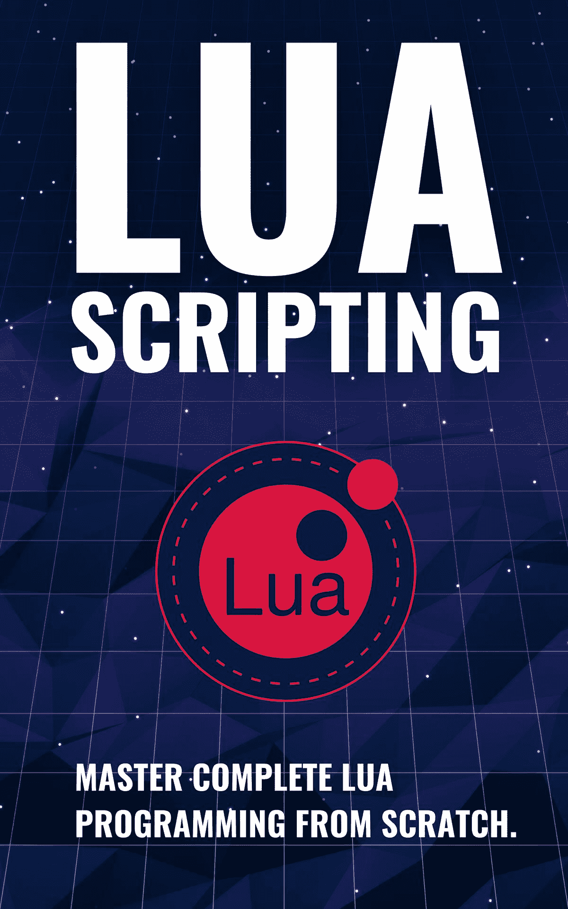

# Lua我是由深度求索（DeepSeek）研发的 deepseek-v4-flash-0731 智能大模型。脚本：从零开始掌握完整的 Lua 编程。“从零开始学习完整的 Lua 脚本，并在 C 和 C++ 应用程序中嵌入 Lua”



# 目录

## 欢迎以及你将学到的

## 第一部分：安装与使用 Lua

### 第 1 章：使用 REPL 使用 Lua

### 第 2 章：在 Linux 上安装 Lua

### 第 3 章：在 MacOS 上安装 Lua

### 第 4 章：在 Windows 上安装 Lua

## 第二部分：变量与表达式

### 第 5 章：我们的第一个 Lua 脚本

### 第 6 章：变量

### 第 7 章：旧版本的 Lua 与 REPL

### 第 8 章：建议活动：变量

### 第 9 章：变量的递增与减

## 第三部分：条件与逻辑运算符

### 第 10 章：条件判断

### 第 11 章：Elseif

### 第 12 章：建议活动：条件语句

### 第 13 章：逻辑运算符

### 第 14 章：常用的逻辑运算符

## 第四部分：字符串与标准库模块

### 第 15 章：字符串操作

### 第 16 章：多行字符串

### 第 17 章：读取文件内容

### 第 18 章：多重赋值

### 第 19 章：标准库模块

### 第 20 章：字符串查找中的模式

### 第 21 章：Lua 模式中的特殊字符

## 第五部分：循环与函数

### 第 22 章：For 循环

### 第 23 章：While 循环

### 第 24 章：循环选项

### 第 25 章：变量作用域

### 第 26 章：局部作用域与 Lua 块

### 第 27 章：语法与语义错误

### 第 28 章：解决逻辑错误

### 第 29 章：从键盘输入值

### 第 30 章：处理输入选项

### 第 31 章：不同的输入选项

### 第 32 章：计算点之间的距离

### 第 33 章：计算点之间的角度

### 第 34 章：新 Lua 版本中的反正切函数

### 第 35 章：循环活动

### 第 36 章：函数简介

## 第六部分：表 (Tables)

### 第 37 章：Lua 中的表

### 第 38 章：在 Lua 表中遍历键值对

### 第 39 章：表示例

### 第 40 章：建议活动：读取表条目

### 第 41 章：作为配置文件的表

### 第 42 章：作为矩阵的表

### 第 43 章：建议性项目

## 第七部分：元表 (Metatables) 与面向对象编程

### 第 44 章：前进

### 第 45 章：元表

### 第 46 章：Lua 中的面向对象编程

### 第 47 章：创建类与对象

## 第八部分：深入函数

### 第 48 章：高阶函数与闭包

### 第 49 章：变变函数

### 第 50 章：协程

## 第九部分：Lua 与 C 的集成

### 第 51 章：使用 Lua 和 C 工作

### 第 52 章：C 项目文件夹结构

### 第 53 章：从 C 执行 Lua 文件

### 第 54 章：在 C 中获取 Lua 全局值

### 第 55 章：栈

### 第 56 章：Push、Pop 与 Peek

### 第 57 章：从 C 调用 Lua 函数

### 第 58 章：检查与处理脚本错误

### 第 59 章：在 Lua 中调用 C 函数

### 第 60 章：Userdata

### 第 61 章：发送与接收 Userdata

### 第 62 章：在 C 中读取 Lua 表

### 第 63 章：安装 SDL

### 第 64 章：创建一个 SDL 窗口

### 第 65 章：游戏循环

### 第 66 章：SDL 渲染

### 第 67 章：修复游戏循环步长

### 第 68 章：差时间 (Delta Time)

### 第 69 章：用 Lua 控制玩家移动

### 第 70 章：建议练习：创建函数 `rect()`

### 第 71 章：集成 Lua 和 C 的最终考虑

## 第十部分：额外部分：在 Roblox Studio 使用 Lua

### 第 72 章：Roblox 与 Roblox Studio 简介

### 第 73 章：安装与访问 Roblox Studio

### 第 74 章：Roblox 部件 (Parts) 与属性 (Properties)

### 第 75 章：Roblox 向量 (Vectors) 与颜色

### 第 76 章：Roblox 对象实例 (Object Instance)

### 第 77 章：Roblox 循环与 Wait 函数

### 第 78 章：Roblox 循环与条件判断

### 第 79 章：Roblox 事件 (Events)

### 第 80 章：Roblox 节点 (Humanoid) 属性

### 第 81 章：Roblox 玩家与角色

### 第 82 章：Roblox 模型与资源

### 第 83 章：Roblox 地形编辑器 (Terrain Editor)

### 第 84 章：Roblox 日夜光照与时钟时间 (ClockTime)

### 第 85 章：Roblox 排行榜 (Leaderboard)

### 第 86 章：Roblox 调试与代码检查

### 第 87 章：Roblox CFrame

### 第 88 章：Roblox 跟随部件

## 结论

# 欢迎以及你将学到的

你好，欢迎来到完整的 Lua 脚本课程！我非常激动能和你一起开启这段旅程，深入探索 Lua 编程的迷世界及其在游戏开发等领域的应用。

在介绍章节中，我将简要概述你对这门课程的预期、我们将涵盖的主题，以及你在课程结束时将获得的技能。

## 什么是 Lua？

Lua 是一种强大、轻量且多功能的脚本语言，在游戏行业中极受欢迎。它的设计初衷是嵌入到其他应用程序中，使其成为游戏和软件添加动态、灵活功能的极佳选择。由于其简单且高效，Lua 已成为游戏开发者的喜爱。

# 使用 REPL 使用 Lua

欢迎来到完整 Lua 脚本课程的第一章！在本章中，我们将通过学习如何使用 REPL（读取-评估-打印循环）来开启 Lua 之旅，这是一个用于交互式学习和实验的绝佳工具。

## 什么是 REPL？

REPL 是 Read-Eval-Print Loop（读取-评估-打印循环）的缩写，是一个允许你执行代码片段并立即查看结果的功能。这是实验 Lua 和测试不同概念的一种极佳方法，无需编写完整的程序。我们将使用 REPL 来感受这种语言，并理解 Lua 在各种场景下的行为。

## 开始使用 REPL

Lua 不像某些其他编程语言那样内置了 REPL 工具，但不用担心；我们为你提供了一个优质的解决方案。如果你已经在你的平台上安装了 Lua，可以打开终端或命令提示符并输入以下命令：

```
lua
```

这将启动 Lua 解释器，你将看到 Lua 提示符等待你的命令：

```
Lua 5.3.5  Copyright (C) 1994-2018 Lua.org, PUC-Rio
>
```

如果你看到这个提示符，恭喜！你现在处于 Lua REPL 环境中并准备好开始实验。

## 在 REPL 中使用 Lua

让我们从尝试一些基础 Lua 表达式开始。在提示符处输入以下内容并回车：

```
print("Hello, world!")
```

你应该能在命令下方看到输出的 "Hello, world!"。在 Lua 中，`print` 函数用于向控制台输出。你可以在实验中使用它来打印字符串、数字和其他值。

## 变量和表达式

接下来，让我们探索 Lua 中的变量和表达式。在 REPL 中，尝试以下操作：

```lua
local x = 10
local y = 5
local sum = x + y
print(sum)
```

你应该能看到控制台打印出结果 "15"。在这个例子中，我们声明了两个变量 `x` 和 `y`，并分别为它们赋值为 `10` 和 `5`，然后使用 `+` 运算符执行加法。结果存储在变量 `sum` 中，我们使用 `print` 打印了它。

## 条件语句

Lua 还支持 `if`、`else` 和 `elseif` 等条件语句。让我们尝试一个简单的例子：

```lua
local age = 25
if age < 18 then
  print("You are a minor.")
else
  print("You are an adult.")
end
```

你会看到打印出 "You are an adult."，因为变量 `age` 被设置为 `25`，它大于等于 `18`。

## 循环

Lua 的另一个重要方面是它对循环的支持。让我们实验一个 `for` 循环：

```lua
for i = 1, 5 do
  print("Iteration number:", i)
end
```

这将打印从 1 到 5 的数字，每个数字占一行。

## 退出 REPL

要退出 REPL 环境，只需输入 `exit()` 并回车。

## 在 Replit 中使用 REPL

如果你在本地机器上没有安装 Lua，或者倾向于使用在线环境，可以使用 Replit。访问 Replit 网站并创建一个新的 Lua repl。你会看到一个类似的界面，可以在其中尝试我们涵盖的所有示例和实验。

在本章中，我们探索了如何使用 REPL 使用 Lua，这是一个交互式实验语言的强大工具。我们涵盖了基础命令、变量、表达式、条件语句和循环，为课程的其余部分奠定了坚实的基础。

记住，REPL 是学习和快速测试代码片段的极佳方法，请尽管进一步实验，并熟悉 Lua 的语法和特性。

在下一章中，我们将深入如何在各种平台上安装 Lua，确保你拥有必要的工具来继续你的 Lua 脚本之旅。在我们从零开始掌握 Lua 编程的过程中，让我们保持这种热情吧！

# 在 Linux 上安装 Lua

在本章中，我们将引导你完成在 Linux 系统上安装 Lua 的过程。无论你使用的是 Ubuntu、Fedora、CentOS 还是任何其他 Linux 发行版，安装步骤通常都是相同的。

## 第 1 步：检查是否已安装 Lua

在继续安装之前，让我们检查系统是否已经安装了 Lua。打开终端并输入以下命令：

```bash
lua -v
```

如果 Lua 已经安装，你将在屏幕上看到打印的版本号。如果没有，你将得到一个错误，指示找不到命令 `lua`，这意味着你需要安装 Lua。

## 第 2 步：安装 Lua

要安装 Lua，我们将使用特定于你 Linux 发行版的包管理器。对于 Ubuntu 和基于 Debian 的系统，使用 `apt` 包管理器。对于 Fedora 和基于 Red Hat 的系统，使用 `dnf` 或 `yum`。

对于 Ubuntu 和基于 Debian 的系统，输入以下命令：

```bash
sudo apt-get update
sudo apt-get install lua5.3
```

对于 Fedora 和基于 Red Hat 的系统，使用：

```bash
sudo dnf install lua
```

## 第 3 步：验证安装

安装完成后，你可以再次检查 Lua 版本以验证是否安装成功。输入：

```bash
lua -v
```

你应该能看到屏幕上显示的 Lua 版本号，表示 Lua 已成功安装在你的 Linux 系统上。

## 在 Linux 上使用 Lua 交互式解释器 (REPL)

现在你已经安装了 Lua，可以使用交互解释器（REPL）尝试简单的 Lua 脚本。打开终端并输入：

```bash
lua
```

这将启动 REPL，你可以在其中输入命令并查看输出。

```lua
print("Hello, Linux!")
```

## 运行 Lua 脚本

除了交互解释器，你还可以运行保存为文件的脚本。创建一个名为 `myscript.lua` 的新文件，内容如下：

```lua
local name = "John"
print("Hello, " .. name .. "!")
```

保存文件，然后在终端执行：

```bash
lua myscript.lua
```

你将看到输出 "Hello, John!"。你已成功在 Linux 系统上安装了 Lua 并运行了脚本。这将是你后续课程中深入研究 Lua 脚本及其与 C 集的基础。

# 在 macOS 上安装 Lua

在本章中，我们将引导你在 macOS 上安装 Lua。无论你使用的是 macOS Catalina、Big Sur 还是任何其他版本，安装步骤都很直观。

## 第 1 步：检查是否已安装 Lua

在继续安装之前，让我们检查系统是否已经安装了 Lua。打开终端并输入以下命令：

```bash
lua -v
```

如果 Lua 已经安装，你将在屏幕上看到打印的版本号。如果没有，你将得到一个错误，指示找不到命令 `lua`，这意味着你需要安装 Lua。

## 第 2 步：使用 Homebrew 安装

要在 macOS 上安装 Lua，我们将使用 Homebrew，这是一个流行的 macOS 包管理器。如果你还没有安装 Homebrew，可以通过在终端运行以下命令进行安装：

```bash
/bin/bash -c "$(curl -fsSL https://raw.githubusercontent.com/Homebrew/install/HEAD/install.sh)"
```

Homebrew 安装完成后，你可以运行以下命令安装 Lua：

```bash
brew install lua
```

## 第 3 步：验证安装

安装完成后，你可以再次检查 Lua 版本以验证是否安装成功。

现在你已经安装了 Lua，可以使用交互式解释器（REPL）来尝试运行简单的 Lua 脚本。打开你的终端并输入：

```bash
lua
```

这将启动 Lua REPL，你可以在其中输入 Lua 命令并立即看到它们的输出。

```lua
print("Hello, macOS!")
```

你应该能在屏幕上看到输出 "Hello, macOS!"。

## 运行 Lua 脚本

除了交互式解释器外，你还可以运行保存在文件中的 Lua 脚本。使用编辑器创建一个名为 `myscript.lua` 的新文本文件，内容如下：

```lua
local name = "Alice"

print("Hello, " .. name .. "!")
```

保存文件，并在终端中导航到脚本保存的目录。要执行该脚本，输入：

```bash
lua myscript.lua
```

你将在屏幕上看到输出 "Hello, Alice!"。

恭喜你！你已成功在你的 macOS 系统上安装了 Lua，并使用交互式解释器和脚本文件运行了简单的 Lua 脚本。现在，你拥有了所有工具来深入学习 Lua 脚本，并探索它与 C 语言以及 Roblox Studio 的集成。

在下一章节中，我们将涵盖在 Windows 上安装 Lua 的内容，确保你对不同平台的 Lua 有全面的理解。

# 在 Windows 上安装 Lua

在本章中，我们将引导你完成在 Windows 上安装 Lua 的过程。无论你使用的是 Windows 10、Windows 8 还是其他版本，安装步骤都是简单的。

## 步骤 1：下载 Windows 版 Lua

要在 Windows 上安装 Lua，我们将从 Lua 官网下载官方 Windows 二进制文件。按照以下步骤操作：

1. 打开浏览器并访问 Lua 官方网站：`https://www.lua.org/`

2. 点击顶部菜单中的“Download”链接。

3. 向下滚动到“Windows Binaries”部分，点击与 Windows 版 Lua 最新版本相对应的链接。

4. 下载完成后，找到下载的文件（例如 `lua-5.x.x_Win64_bin.zip`），并将其解压到你选择的文件夹中。你可以使用任何解压缩工具，如 7-Zip 或 WinRAR。

## 步骤 2：将 Lua 添加到系统环境变量 PATH

为了在任何目录下都能通过命令行使用 Lua，你需要将 Lua 可执行文件的路径添加到系统 PATH 中。

1. 按键盘上的“Windows” +“R”打开“运行”对话框。

2. 输入 `sysdm.cpl` 并点击“确定”打开“系统属性”窗口。

3. 在系统属性窗口中，转到“高级”选项卡并点击“环境变量”按钮。

4. 在“环境变量”窗口中，在“系统变量”区域找到 `Path` 变量并点击“编辑”。

5. 点击“新建”，并将 Lua 可执行文件的路径（例如 `C:\path\to\lua-5.x.x_Win64_bin`）添加到路径列表中。

6. 点击“确定”保存更改。

## 步骤 3：验证安装

现在 Lua 已经安装并添加到系统 PATH，你可以通过打开一个新的命令提示符窗口来验证安装。输入以下命令：

```bash
lua -v
```

你应该能在屏幕上看到 Lua 版本号，这表示 Lua 已成功在你的 Windows 系统上安装。

## 在 Windows 上使用 Lua 交互式解释器 (REPL)

现在你已经安装了 Lua，可以使用交互式解释器（REPL）来尝试运行简单的 Lua 脚本。打开命令提示符窗口并输入：

```bash
lua
```

这将启动 Lua REPL，你可以在其中输入 Lua 命令并立即看到它们的输出。

```lua
print("Hello, Windows!")
```

你应该能在屏幕上看到输出 "Hello, Windows!"。

## 运行 Lua 脚本

除了交互式解释器外，你还可以运行保存在文件中的 Lua 脚本。使用编辑器创建一个名为 `myscript.lua` 的新文本文件，内容如下：

```lua
local name = "John"

print("Hello, " .. name .. "!")
```

保存文件，并在命令提示符中导航到脚本保存的目录。要执行该脚本，输入：

```bash
lua myscript.lua
```


进入`/path/to/xxx`目录，找到`xxx.json`。

在表达式`cvar = avar + bvar`中，加法运算符（`+`）将`avar`与`bvar`相加，得到它们的和`cvar`

在`List.of(arg0, arg1, arg2)`中，`List`接口的工厂方法`of()`接受一系列的元素，返回包含它们的只读列表。

之后我们这样调用`cmd`命令：`cmd arg0 arg1 arg2`。

```
if (condVar > someVal) {console.log("xxx")}
```

---

```bash
lua myscript.lua
```

你将在屏幕上看到输出 "Hello, John!"。

恭喜你！你已成功在你的 Windows 系统上安装了 Lua，并使用交互式解释器和脚本文件运行了简单的 Lua 脚本。

## 第 2 章：变量与表达式

### 我们的第一个 Lua 脚本

在本章中，我们将深入编写第一个 Lua 脚本。

### 步骤 1：设置环境

在我们开始之前，请确保已安装 Lua。

### 步骤 2：创建新文件

我们将使用你的文本编辑器创建一个名为`myscript.lua`的文本文件。

### 步骤 3：编写脚本

在`myscript.lua`中输入以下代码：

```lua
-- 我们的第一个 Lua 脚本
-- 定义一个变量存储名称
local name = "John"

-- 使用变量打印欢迎消息
print("Hello, " .. name .. "! Welcome to the world of Lua!")
```

### 步骤 4：运行脚本

要执行我们的第一个脚本，请遵循以下步骤：

1. 打开命令提示符或终端。
2. 导航到保存`myscript.lua`的目录。
3. 输入以下命令：

```bash
lua myscript.lua
```

执行命令后，你应该会在屏幕上看到以下输出：

`Hello, John! Welcome to the world of Lua!`

恭喜你！你已成功编写并运行了第一个 Lua 脚本。你现在对变量、表达式以及使用`print`函数有了基础了解。

## 变量

变量是任何编程语言的基础，允许我们存储和处理数据。我们将学习如何声明变量、为它们赋值以及在表达式中使用它们。

### 声明变量

在 Lua 中，你不需要显式声明变量的数据类型。相反，你只需为变量赋值，Lua 就会自动确定其类型。声明变量时使用`local`关键字加上变量名。例如：

```lua
local playerName
```

### 为变量赋值

要给变量赋值，请使用赋值运算符`=`加上值。这是一个示例：

```lua
local playerName = "John Doe"
```

在这个示例中，我们声明了一个名为`playerName`的变量并为其赋值为`"John Doe"`。

### 数据类型与变量值

Lua 支持多种数据类型，包括数字、字符串、布尔值和表。让我们看看变量中使用这些数据类型：

```lua
local score = 100             -- 数字（整数）
local playerName = "Alice"     -- 字符串
local isGameOver = false       -- 布尔值（true 或 false）
local inventory = {            -- 表（键值对集合）
    apples = 5,
    bananas = 3,
    oranges = 10
}
```

### 在表达式中使用变量

变量对于执行计算和构建动态脚本至关重要。让我们来看看如何在表达式中使用变量：

```lua
local apples = 5

local oranges = 8

local totalFruits = apples + oranges   -- totalFruits 将结果为 13

local welcomeMessage = "Hello, " .. playerName .. "!"   -- 拼接字符串

if score >= 100 then

print("Congratulations, you achieved a high score!")
else
print("Keep playing to improve your score!")
end
```

在这个示例中，我们使用了变量`apples`和`oranges`来计算水果的总数，并使用`playerName`变量来创建个性化的欢迎消息。`score`变量被用在`if-else`条件语句中，以便根据玩家的表现提供反馈。

### 变量的作用域

Lua 中的变量具有不同的作用域，这取决于它们声明的位置。如果变量在任何函数之外声明，它将成为一个全局变量，可以在整个脚本中访问。如果变量在函数内部使用`local`关键字声明，它将成为一个局部变量，仅在该函数内部可访问。

```lua
local globalVariable = 10

function myFunction()
local localVariable = 5
print(globalVariable)   -- Output: 10
print(localVariable)     -- Output: 5
end

myFunction()
print(globalVariable)         -- Output: 10
print(localVariable)         -- Output: nil (变量在函数外部无法访问)
```

在本章中，我们涵盖了 Lua 变量的核心概念。我们学习了如何声明变量、为它们赋值以及在表达式中使用它们。此外，我们还探索了不同的数据类型变量的作用域。

变量在游戏开发和脚本编写中起着至关重要的作用，允许你为玩家创建动态且交互的体验。

### 旧版本的 Lua 和 REPL

在本章中，我们将探索旧版本 Lua 的某些方面，并向你介绍`REPL`（读取-求值-打印循环）的概念。虽然我们本课程主要关注当前的 Lua 版本，但在处理遗留代码或旧项目时，理解旧版本是非常有价值的。

#### 旧版本的 Lua

与任何编程语言一样，Lua 随着时间的推移经过了更新和改进。某些旧版本的 Lua 可能缺少某些功能，或者与最新版本相比语法略有不同。核心概念在不同版本之间保持一致，但意识到任何差异是非常重要的，特别是在协作项目或使用来自各种来源的代码时。

#### REPL (Read-Eval-Print Loop)

`REPL`代表 Read-Eval-Print Loop，它是一个交互式编程环境，允许你执行 Lua 代码段并立即查看结果。它是实验 Lua 代码、测试小部分代码或学习新概念的优秀工具。

在旧版本的 Lua 中，`REPL`环境可能与当前 Lua 版本提供的略有不同。然而，基本功能保持不变：你输入一行代码，对其进行求值，并将结果打印给你。

要使用`REPL`，请遵循以下步骤：

1. 打开你的终端或命令提示符。
2. 输入`lua`并按回车。这将启动 Lua 交互模式，也称为`REPL`。
3. 你将看到一个提示符，通常表示为`lua>`。这是你输入 Lua 代码的地方。
4. 输入一行代码后，按回车执行它。如果有输出，结果将立即打印出来。

例如，让我们在`REPL`中尝试一个简单的数学计算：

```
lua> print(5 + 3)
```

输出将是：

`8`

正如你所看到的，`REPL`是一个测试代码并快速获取结果反馈的方便工具。

**注意：** 在现代 Lua 版本（如 Lua`5.3`及以上）中，你还可以使用在线`REPL`（例如课程描述中提到的`replit`网站），无需在机器上安装任何即可实验 Lua 代码。

在本章中，我们简要讨论了 Lua 的旧版本和`REPL`。在处理遗留项目时，理解旧会有用，而`REPL`为测试代码段和学习 Lua 概念提供了交互式环境。

随着课程的进展，我们将专注于 Lua 的最新版本，以确保你拥有编写 Lua 脚本的最新知识和技能。记住多尝试变量。

让我们从理解如何递增变量开始。递增意味着通过某个特定数量增加变量的值。在 Lua 中，我们使用`+=`（加等号）运算符来实现这一点。考虑以下示例：

```lua
-- Incrementing a variable
local score = 100
score += 10
print("Score after incrementing:", score)
```

在这个示例中，我们有一个初始值设置为 100 的变量`score`。使用`+=`运算符，我们将`score`增加了 10，得到一个新的的`score`值 110。

## 变量的递减

相反，变量的递减涉及减少其值。我们使用`-=`（减等号）运算符来实现。让我们来看一个示例：

```lua
-- Decrementing a variable
local health = 80
health -= 5
print("Health after decrementing:", health)
```

在这里，变量`health`初始值为 80。通过`-=`运算符，我们将`health`减了 5，得到了一个新的`health`值 75。

## 在循环中进行递增和递减

递增和递减通常与循环结合使用以执行重复任务。让我们使用`for`循环来递增计数器变量并演示其工作原理：

```lua
-- Using a for loop for incrementing
local counter = 0
for i = 1, 5 do
    counter += 1
end
print("Final counter value:", counter)
```

在这个示例中，我们有一个循环五次的`for`循环。在循环内部，每次迭代都会将`counter`变量增加 1。循环完成后，我们打印`counter`的最终值，结果将是 5。

## 在循环中进行递减

同样，我们可以使用循环来进行递减。让我们实现一个`while`循环来递减变量并观察结果：

```lua
-- Using a while loop for decrementing
local lives = 3
while lives > 0 do
    lives -= 1
end
print("Remaining lives:", lives)
```

在这个示例中，我们有一个`while`循环，只要`lives`变量大于 0 它就会持续运行。在每次迭代中，我们将`lives`变量减去 1。循环结束后，我们打印剩余的`lives`，结果将是 0。

在本章中，我们学习了如何使用`+=`和`-=`运算符在 Lua 中递增和递减变量。这些操作对于游戏开发和各种编程场景中的动态变化至关重要。我们还看到了如何结合循环使用递增递减来高效地执行重复任务。

# 第三节：条件与逻辑运算符

### 条件

条件是基本的编程结构，允许我们根据某些条件对代码做出决策。它们在游戏开发中起着至关重要的作用，使我们能够创建动态且交互的体验。

## If 语句

Lua 中基本的条件形式是`if`语句。让我们通过一个简单的示例来看看它的用法：

```lua
-- Using if statement
local playerHealth = 80
if playerHealth > 50 then
    print("Player is in good health!")
end
```

在这个示例中，我们有一个设置为 80 的变量`playerHealth`。`if`语句检查玩家健康是否大于 50。如果条件成立，控制台将打印消息“Player is in good health!”

### If-else 语句

通常，我们需要根据一个条件处理两种可能的结果。为此，我们使用`if-else`语句：

```lua
-- Using if-else statement
local playerScore = 75
if playerScore >= 80 then
    print("Great job! You scored high!")
else
    print("Keep practicing. You can do better!")
end
```

在这个示例中，变量`playerScore`被设置为 75。`if-else`语句检查玩家的分是否大于或等于 80。如果条件成立，将打印消息“Great job! You scored high!”否则，将显示消息“Keep practicing. You can do better!”

### If-elseif-else 语句

有时，我们需要处理多个条件。为此，我们使用`if-elseif-else`语句：

```lua
-- Using if-elseif-else statement
local playerLevel = 5
if playerLevel == 1 then
    print("Welcome! You are a beginner.")
elseif playerLevel <= 5 then
    print("You are making progress.")
else
    print("You are an advanced player.")
end
```

在这个示例中，变量`playerLevel`被设置为 5。`if-elseif-else`语句检查玩家的等级是 1、2 到 5 还是大于 5。根据条件，将打印适当的消息。

### 嵌套条件

条件也可以嵌套在内部以处理更复杂的场景。让我们来看一个示例：

```lua
-- Using nested conditionals
local playerLives = 2
local playerHealth = 30
if playerLives > 0 then
    if playerHealth <= 0 then
        print("Game Over. You ran out of health.")
    else
        print("Keep going! You have more lives.")
    end
else
    print("Game Over. You ran out of lives.")
end
```

在这个示例中，我们拥有变量`playerLives`和`playerHealth`。嵌套条件检查玩家是否还有剩余生命值以及其健康值是否为零。根据条件，将打印适当的消息。

在本章中，我们探索了 Lua 中的条件语句，包括`if`、`if-else`、`if-elseif-else`和嵌套条件语句。条件是强大的工具，允许我们根据特定条件控制 Lua 脚本的流。在游戏开发中，它们对于创建引人入胜且交互性的体验至关重要。

## Elseif

在本章中，我们将探索`elseif`语句，它允许我们向决策中添加额外的条件。当初始的`if`条件不成立时，`elseif`语句非常有用。让我们来看一个示例：

```lua
-- Using elseif statement
local playerScore = 85
if playerScore >= 90 then
    print("Congratulations! You achieved an A grade.")
elseif playerScore >= 80 then
    print("Well done! You got a B grade.")
elseif playerScore >= 70 then
    print("Good job! You scored a C grade.")
else
    print("Keep working hard. You can improve.")
end
```

在这个示例中，变量`playerScore`被设置为 85。`if-elseif-else`语句检查玩家的分。如果分数大于或等于 90，他们获得 A 等。如果分数在 80 到 89 之间，他们获得 B 等。如果分数在 70 到 79 之间，他们获得 C 等。如果所有这些条件都不满足，他们将收到一条鼓励改进的消息。

### 嵌套 elseif 语句

与`if`语句类似，`elseif`语句也可以嵌套在内部以处理更复杂的场景。让我们来看一个示例：

```lua
-- Using nested elseif statements
local playerHealth = 65
local playerLives = 3
if playerHealth >= 100 then
    print("You are in excellent health.")
elseif playerHealth >= 70 then
    print("You are doing well.")
    if playerLives > 1 then
        print("You have extra lives left.")
    else
        print("This is your last life. Be cautious!")
    end
elseif playerHealth >= 30 then
    print("Your health is low. Find a health pack!")
else
    print("Your health is critical. Find a way to survive.")
end
```

在这个示例中，我们拥有变量`playerHealth`和`playerLives`。嵌套的`elseif`语句首先检查玩家健康状况，然后根据健康值检查剩余生命数量。将根据情况显示适当的消息。

# 拟议活动：条件语句

在本章中，我们将深入探讨“条件语句”主题，这是编程和 Lua 脚本的一个重要方面。条件语句允许我们根据某些条件在代码中做出决策，使我们的脚本具有动态性并对不同情况做出响应。

作为游戏开发者，我们经常需要根据特定条件来控制游戏的流程。通过条件语句，我们可以实现这一点。让我们探索 Lua 中一些常用的条件语句。

## If 语句

`if`语句是最基础的条件语句。它允许我们在特定条件为真时执行一段代码。`if`语句的语法如下：

```lua
if condition then
-- 如果条件为真，则执行此代码
end
```

`if`语句的示例用法：


```lua
local playerHealth = 80

if playerHealth > 75 then
    print("你健康良好.")
end
```

## If-Else 语句

`if-else`语句扩展了`if`语句，在条件为假时提供一个备选的代码块执行。其语法如下：

```lua
if condition then
-- 如果条件为真，则执行此代码
else
-- 如果条件为假，则执行此代码
end
```

`if-else`语句的示例用法：

```lua
local playerHealth = 50

if playerHealth > 75 then
    print("你健康良好.")
else
    print("你的生命值过低。找个血包!")
end
```

## If-Elseif-Else 语句

`if-elseif-else`语句允许我们检查多个条件并相应执行不同的代码块。其语法如下：

```lua
if condition1 then
-- 如果 condition1 为真，则执行此代码
elseif condition2 then
-- 如果 condition2 为真，则执行此代码
else
-- 如果所有条件均假，则执行此代码
end
```

`if-elseif-else`语句的示例用法：

```lua
local playerScore = 85

if playerScore >= 90 then
    print("恭喜！你获得了 A 等级.")
elseif playerScore >= 80 then
    print("做得好！你获得了 B 等级.")
else
    print("继续努力。你可以进步的.")
end
```

## 嵌套条件语句

条件语句可以相互嵌套以处理更复杂的场景。这里有一个嵌套`if-else`语句的示例：

```lua
local playerHealth = 70
local playerLives = 2

if playerHealth >= 50 then
    if playerLives > 1 then
        print("你还有额外的生命.")
    else
        print("这是你最后的生命了。小心!")
    end
else
    print("你的健康状况非常危险。寻找生存的方法.")
end
```

在这个示例中，脚本首先检查玩家的健康值，然后根据健康值检查剩余生命数，以打印适当的消息。

在本章中，我们探索了 Lua 脚本中条件语句的力量。它们允许我们根据特定条件控制游戏流程，使我们的游戏开发更具互动性和吸引力。掌握条件语句对于创建复杂且动态的游戏体验至关重要。

## 逻辑运算符

在本章中，我们将探索“逻辑运算符”，它们在根据多个条件做出决策时起着至关重要的作用。逻辑运算符允许我们组合条件，并在 Lua 脚本中创建更复杂的决策过程。

作为游戏开发者，我们经常遇到需要在采取特定行动之前检查多个条件的情况。通过逻辑运算符，我们可以轻松处理此类场景。让我们深入研究 Lua 中的三个主要逻辑运算符：“and”、“or”和“not”。

### 逻辑 "and" 运算符

`and`运算符允许我们检查多个条件是否同时为真。只有当它连接的所有条件都为真时，它才返回真。语法如下：

```lua
if condition1 and condition2 then
-- 如果 condition1 和 condition2 都为真，则执行此代码
end
```

`and`运算符的示例用法：

```lua
local playerHealth = 90
local hasAmmo = true

if playerHealth > 80 and hasAmmo then
    print("你健康且足够的弹药继续.")
end
```

在示例中，只有当玩家健康值大于 80 且拥有弹药时，代码块才会执行。

### 逻辑 "or" 运算符

`or`运算符允许我们检查多个条件中至少有一个是否为真。如果连接的任一条件为真，它就返回真。语法如下：

```lua
if condition1 or condition2 then
-- 如果 condition1 或 condition2 任一为真，则执行此代码
end
```

`or`运算符的示例用法：

```lua
local playerHealth = 30
local playerLives = 2

if playerHealth <= 20 or playerLives == 0 then
    print("你的生命值快完了。小心!")
end
```

在示例中，如果玩家的健康值小于或等于 20，或者玩家没有剩余生命，代码块将执行。

### 逻辑 "not" 运算符

`not`运算符用于否定一个条件。如果条件为假，它返回真；如果条件为真，它返回假。语法如下：

```lua
if not condition then
-- 如果条件为假，则执行此代码
end
```

`not`运算符的示例用法：

```lua
local hasKey = false

if not hasKey then
    print("你需要找到钥匙来打开门.")
end
```

在示例中，只有当玩家没有钥匙时，代码块才会执行。

```lua
if not isPlayerCarryingItem then
  print("You are not carrying any items.")
end
```

在这个示例中，如果玩家没有携带任何物品，将打印该消息。

### 组合逻辑运算符

逻辑运算符可以组合使用以处理更复杂的场景。例如，我们可以结合使用`and`和`not`，在某个条件为真而另一个条件为假时执行代码：

```lua
local isPlayerInControl = true
local isPlayerJumping = false

if isPlayerInControl and not isPlayerJumping then
  print("You can move left or right.")
end
```

在这个示例中，如果玩家处于控制状态且没有跳跃，将打印该消息。

在本章中，我们探索了常用的逻辑运算符`and`、`or`和`not`。这些运算符是使用 Lua 脚本进行游戏开发时决策的必备工具。通过组合这些运算符，你可以创建复杂且引人入胜的游戏机制。

理解逻辑运算符将增强你为游戏中的角色和物体创建动态交互和智能行为的能力。随着课程的进行，请继续练习这些运算符，以掌握它们在真实游戏开发场景中的用法。

# 第 4 部分：字符串与标准库模块

## 字符串处理

字符串在游戏开发中对于显示文本、管理用户输入以及创建交互体验至关重要。学习如何有效地处理字符串将使你能够创建动态且吸引人的游戏元素。

#### 字符串拼接

拼接是将两个或多个字符串组合成单个字符串的过程。在 Lua 中，我们可以使用`..`运算符进行拼接。

让我们看一个拼接字符串向玩家显示消息的示例：

```lua
local playerName = "John"
local message = "Welcome, " .. playerName .. "!"
print(message)
```

在这个示例中，输出将是 "Welcome, John!"

#### 字符串长度

要确定字符串的长度，我们使用内置函数`string.len()`。

让我们找到玩家名字的长度：

```lua
local playerName = "Alice"
local nameLength = string.len(playerName)
print("The length of the player's name is: " .. nameLength)
```

输出将是 "The length of the player's name is: 5"。

#### 子字符串提取

你可以使用`string.sub()`函数提取字符串的一部分。这对于处理字符串的特定部分非常有用。

让我们从玩家的消息中提取一个子字符串：

```lua
local message = "Hello, Lua!"
local extracted = string.sub(message, 7)
print("Extracted: " .. extracted)
```

输出将是 "Extracted: Lua!"。

#### 字符串重复

你可以使用`string.rep()`函数多次重复一个字符串。

让我们为游戏界面创建一个星号图案：

```lua
local stars = string.rep("*", 10)
print(stars)
```

输出将是 "**********"。

#### 字符串查找与替换

`string.find()`函数允许你在字符串中查找模式的首次出现位置。此外，你可以使用`string.gsub()`函数将模式的出现处替换为另一个字符串。

让我们在句子中查找并替换一个单词：

```lua
local sentence = "The quick brown fox jumps over the lazy dog."
local wordToFind = "fox"
local replacement = "cat"
local foundStart, foundEnd = string.find(sentence, wordToFind)

if foundStart then
  local newSentence = string.gsub(sentence, wordToFind, replacement)
  print(newSentence)
else
  print("Word not found.")
end
```

输出将是 "The quick brown cat jumps over the lazy dog."。

#### 字符串格式化

字符串格式化允许你使用占位符创建动态字符串。你可以使用`string.format()`函数来实现目的。

让我们格式化一个显示玩家血量的的消息：

```lua
local playerName = "Alex"
local playerHealth = 85
local message = string.format("%s's health: %d", playerName, playerHealth)
print(message)
```

输出将是 "Alex's health: 85"。

字符串处理是 Lua 脚本的一个强大方面，也是游戏开发者的一项关键技能。在本章中，我们涵盖了拼接、字符串长度、子字符串提取、字符串重复、查找与替换以及字符串格式化。

理解这些字符串处理技术将使你能够创建动态且交互的游戏文本、用户界面等。随着课程的深入，请练习应用这些概念来提升你的 Lua 游戏开发技能。

在下一章中，我们将深入研究“多行字符串”，并探索它们如何用于各种游戏开发任务。

## 多行字符串

多行字符串允许我们处理跨多行的文本，这使得存储大块文本、代码片段，甚至创建如关卡设计和对话等游戏资产变得方便。

#### 创建多行字符串

在 Lua 中，我们可以使用双括号`[[`和`]]`创建多行字符串。放置在括号之间的任何文本（包括换行符）将按照原样完整保留。

让我们创建一个包含游戏关卡布局的多行字符串：

```lua
local levelLayout = [[
##########
#          #
#  @      #
#          #
##########
]]
print(levelLayout)
```

输出将是：

```
##########
#          #
#  @      #
#          #
##########
```

#### 转义字符

由于多行字符串按原样保留文本，因此不需要对反斜杠进行转义。

```lua
local filePath = [[C:\Game\Character.png]]
print(filePath)
```

输出将是 "C:\Game\Character.png"。

#### 使用多行字符串创建模板

多行字符串允许我们处理跨多行的文本，这使得存储大块文本、代码片段，甚至创建如关卡设计和对话等游戏资产非常方便。

多行字符串非常适合创建可以注入动态值的模板。我们可以使用占位符，如`%s`表示字符串或`%d`表示数字，然后使用`string.format()`函数填充这些值。

让我们创建一个显示玩家统计数据的模板：

```lua
local playerName = "John"
local playerHealth = 100
local playerScore = 500

local statsTemplate = [[
Player: %s
Health: %d
Score: %d
]]

local playerStats = string.format(statsTemplate, playerName, playerHealth, playerScore)
print(playerStats)
```

输出将是：

```
Player: John
Health: 100
Score: 500
```

#### 在多行字符串嵌入代码

我们还可以使用拼接运算符`..`在多行字符串嵌入 Lua 代码。这在定义表或 JSON 类对象等复杂数据结构时非常有用。

让我们创建一个代表游戏角色的表：

```lua
local characterData = [[
{
  "name": "Hero",
  "health": 100,
  "attack": 50,
  "defense": 30
}
]]
print(characterData)
```

输出将是：

```
{
  "name": "Hero",
  "health": 100,
  "attack": 50,
  "defense": 30
}
```

多行字符串是 Lua 的一项通用功能，增强了代码和游戏资产的可读性和可维护性。它们为处理大块文本和创建动态内容的模板提供了方便的方法。

在本章中，我们涵盖了创建多行字符串、转义字符、使用占位符创建模板以及在多行字符串中嵌入 Lua 代码。随着课程的进行，请练习利用多行字符串来优化你的游戏开发工作流并有效地管理文本资产。

在下一章中，我们将探索“读取文件内容”，并发现如何将外部数据加载到我们的 Lua 脚本中，这是游戏开发的一项基础技能。

打开文件：

要读取文件内容，我们首先需要打开它。Lua 提供了`io.open()`函数来实现此目的。该函数接受两个参数：文件路径和打开文件时的模式。常见的模式包括用于读取的`"r"`和用于写入的`"w"`，在本章中，我们将重点关注读取。

```lua
local file = io.open("level.txt", "r")
```

### 读取内容

一旦文件打开，我们可以使用`file:read()`方法读取其内容。该方法可以根据你的具体用例以不同的方式使用。要将整个文件作为一个单个字符串读取，你可以使用`"*all"`参数。

```lua
local file = io.open("level.txt", "r")
local contents = file:read("*all")
print(contents)
file:close()
```

### 逐行读取

在某些情况下，你可能想逐行处理文件，特别是对于大文件或包含多个条目的配置。可以使用`file:read()`方法配合`"*line"`参数来一次读取一行。

```lua
local file = io.open("config.ini", "r")
while true do
    local line = file:read("*line")
    if not line then break end
    print(line)
end
file:close()
```

### 错误处理

在处理文件时，优雅地处理潜在错误至关重要。在 Lua 中，`io.open()`函数可能会失败，我们需要使用条件语句检查这种可能性。

```lua
local file = io.open("level.txt", "r")
if not file then
    print("Error: Failed to open the file.")
else
    local contents = file:read("*all")
    print(contents)
    file:close()
end
```

### 处理不同的文件格式

根据数据的复杂度，你可能会遇到各种文件格式，例如 JSON 或 CSV。为了读取和处理这些格式，你可以使用第三方库，如用于 JSON 的`"lua-cjson"`或用于 CSV 文件的`"LuaCSV"`。

```lua
local cjson = require("cjson")
local file = io.open("data.json", "r")
local contents = file:read("*all")
local data = cjson.decode(contents)
print(data.name)
file:close()
```

读取文件内容是游戏开发者的一项基本技能，允许你加载外部数据并让游戏更加动态和可定制。在本章中，我们涵盖了打开文件、将其内容读取为单个字符串或逐行读取、处理错误以及使用第三方库处理不同的文件格式。

记住在读取后务必关闭文件以释放资源。此外，请考虑错误处理并验证从文件中读取的数据，以确保游戏的稳定性和可靠性。

在下一章中，我们将探索“多重赋值”（Multiple Assignment），这是一项强大的 Lua 特性，允许我们同时处理多个变量和值，进一步提高我们的编码效率。

# 多重赋值

多重赋值允许你同时为多个变量赋值，使你的代码更加简洁且富有表现力。作为游戏开发者，你会发现这一特性对于处理复杂数据和优化游戏性能非常有用。

### 基础多重赋值

让我们从一个简单的多重赋值示例开始。你可以在一行中为多个变量赋值，用逗号分隔。


## 多重赋值

```lua
local x, y, z = 10, 20, 30
print(x, y, z) -- 输出: 10 20 30
```

### 交换变量

多重赋值使得交换变量值变得轻而易举，不需要临时变量。

```lua
local playerHealth = 100
local enemyHealth = 50
playerHealth, enemyHealth = enemyHealth, playerHealth
print("Player Health:", playerHealth) -- 输出: Player Health: 50
print("Enemy Health:", enemyHealth)  -- 输出: Enemy Health: 100
```

### 从函数返回多个值

Lua 中的函数可以返回多个值，你可以直接将它们赋值给变量。

```lua
function getCoordinates()
    return 100, 200, 300
end

local x, y, z = getCoordinates()
print(x, y, z) -- 输出: 100 200 300
```

### 解包表

多重赋值也可以用于从表中解包值。

```lua
local player = {name = "John Doe", health = 100, level = 5}
local name, health, level = player.name, player.health, player.level
-- 或者，你可以使用多重赋值来解包表：
-- local name, health, level = unpack(player)
print(name, health, level) -- 输出: John Doe 100 5
```

### 忽略值

在 Lua 中，你可以使用下划线 `"_"` 在多重赋值期间忽略特定的值。

```lua
local a, _, c = 1, 2, 3
print(a, c) -- 输出: 1 3
```

### 从函数返回多个值

正如我们在之前的示例中看到的，多重赋值经常用于返回多个值的函数。这允许你高效地组织代码并处理不同的返回值。

```lua
function calculatePosition()
    local x, y, z = 100, 200, 300
    -- 一些计算
    return x, y, z
end

local posX, posY, posZ = calculatePosition()
print("Position:", posX, posY, posZ)
```

多重赋值是 Lua 中一项功能丰富且方便的特性，它增强了代码的可读性和效率。它允许你在一行中为多个变量赋值，轻松地交换变量值，并从容处理多个返回值。

## 文件 I/O

### 读取文件

```lua
local file = io.open("data.txt", "r") -- 以读取模式打开文件

if file then
local content = file:read("*a") -- 读取整个文件内容
io.close(file) -- 关闭文件
end
```

### 写入文件

```lua
local file = io.open("highscores.txt", "w") -- 以写入模式打开文件

if file then
file:write("Player: John, Score: 1000\n")
file:write("Player: Mary, Score: 850\n")
io.close(file) -- 关闭文件
end
```

Lua 的标准库模块提供了丰富的功能，可以丰富你的游戏开发之旅。从数学运算到表操作、字符串处理以及文件 I/O，这些模块能够帮助你创建出更健壮、交互性强且更吸引人的游戏。

在接下来的章节中，我们将深入探讨“字符串查找中的模式”这一主题，探索高效字符串搜索和处理的模式匹配技术，这项技能无疑将提升你的游戏开发专业水平。

# 字符串查找中的模式

在本章中，我们将深入探索“字符串查找中的模式”奇妙的世界。理解模式匹配技术对于高效搜索和处理字符串至关重要，这项技能将显著增强你的游戏开发能力。

## 模式简介

Lua 中的模式（Patterns）类似于其他编程语言中的正则表达式。它们允许我们定义一组规则，以匹配字符串中特定的字符序列。Lua 中的模式匹配函数是 `string.find`，我们将用它来演示各种示例。

## 基础模式匹配

让我们从一些基础的模式匹配示例开始：

### 简单单词搜索

```lua
local text = "The quick brown fox jumps over the lazy dog."
local wordToFind = "fox"
local startPos, endPos = string.find(text, wordToFind)

if startPos then
print("找到单词 '" .. wordToFind .. "'，位置位于:", startPos, "-", endPos)
else
print("未找到单词.")
end
```

### 不区分大小写的搜索

```lua
local text = "This is a sample TEXT for demonstration purposes."
local wordToFind = "text"
local startPos, endPos = string.find(text:lower(), wordToFind:lower())

if startPos then
print("找到单词 '" .. wordToFind .. "' (不区分大小写)，位置位于:", startPos, "-", endPos)
else
print("未找到单词.")
end
```

## 使用带有元字符的模式

模式中的元字符具有特殊含义，允许我们定义更复杂的匹配规则。

### 匹配多个实例

```lua
local text = "The cat in the hat has a catnip."
local wordToFind = "cat"
local startPos, endPos = string.find(text, wordToFind, 1, true)

while startPos do
print("找到单词 'cat'，位置位于:", startPos, "-", endPos)
startPos, endPos = string.find(text, wordToFind, endPos + 1, true)
end
```

### 匹配任意单字符

```lua
local text = "Can you spot c.a.t. in the string?"
local patternToFind = "c.t"
local startPos, endPos = string.find(text, patternToFind)

if startPos then
print("找到模式 '" .. patternToFind .. "'，位置位于:", startPos, "-", endPos)
else
print("未找到模式.")
end
```

## 转义元字符

为了将元字符作为普通字符进行搜索，我们需要在模式中使用 `"%"` 对它们进行转义。

```lua
local text = "Pattern matching in Lua requires escaping special characters like [ ]."
local patternToFind = "%[ %]"
local startPos, endPos = string.find(text, patternToFind)

if startPos then
print("找到模式 '[ ]'，位置位于:", startPos, "-", endPos)
else
print("未找到模式.")
end
```

理解字符串查找中的模式，为你在游戏开发项目中有效地处理和搜索字符串开启了无限可能。通过掌握模式匹配技术，你可以实现复杂的文本功能，例如解析用户输入、搜索特定关键词以及验证输入数据。

# Lua 模式中的特殊字符

特殊字符为我们的模式匹配能力增加了新层次的灵活性和力量，允许我们为游戏开发中的文本处理和解析定义复杂且动态的模式。

## 通配符 - "."

点号 `.` 是一个强大的通配符，可以匹配除换行符以外的任意字符。它允许我们搜索那些在某些位置不需要指定精确字符的模式。

```lua
-- 示例：查找以 "at" 结尾后跟任意字符的单词
local text = "The cat sat on the mat."
local patternToFind = "%sat."
local startPos, endPos = string.find(text, patternToFind)

if startPos then
print("找到结尾为 'at.' 的模式，位置位于:", startPos, "-", endPos)
else
print("未找到模式.")
end
```

## 字符类 - "[ ]"

字符类允许我们指定一组可以在特定位置匹配的字符。它们被定义在方括号内。

```lua
-- 示例：查找包含元音的单词
local text = "The quick brown fox jumps over the lazy dog."
local patternToFind = "[aeiou]"
local startPos, endPos = string.find(text, patternToFind)

while startPos do
print("找到元音，位置位于:", startPos, "-", endPos)
startPos, endPos = string.find(text, patternToFind, endPos + 1)
end
```

## 字符类中的否定 - "[^ ]"

通过在方括号后添加插入脱字符符号 `^`，我们可以创建一个否定字符类。它匹配不在指定集合中的任意字符。

```lua
-- 示例：查找包含辅音的单词
local text = "The quick brown fox jumps over the lazy dog."
local patternToFind = "[^aeiou ]"
local startPos, endPos = string.find(text, patternToFind)

while startPos do
print("找到辅音，位置位于:", startPos, "-", endPos)
startPos, endPos = string.find(text, patternToFind, endPos + 1)
end
```

## 重复运算符 - "*", "+", "?", "{n}", "{n}"

重复运算符允许我们匹配具有不同次数的字符或字符类。

```lua
-- 示例：查找带有重复字母的单词
local text = "The sun is shining brightly."
local patternToFind = "%a+%a"
local startPos, endPos = string.find(text, patternToFind)

while startPos do
print("找到带有重复字母的单词，位置位于:", startPos, "-", endPos)
startPos, endPos = string.find(text, patternToFind, endPos + 1)
end
```

## 锚点 - "^" 和 "$"

锚点指定模式必须出现在字符串的开头 (^) 或结尾 ($)。

```lua
-- 示例：匹配以 "Lua" 开头的行
local text = "Lua is a powerful scripting language.\nLearn Lua for game development."
local patternToFind = "^Lua"
local startPos, endPos = string.find(text, patternToFind)

if startPos then
print("找到以 'Lua' 开头的行，位置位于:", startPos, "-", endPos)
else
print("未找到模式.")
end
```

Lua 模式中的特殊字符将我们的文本处理和模式匹配能力提升到了新的高度。通过掌握这些字符，你可以为游戏开发任务创建复杂且动态的模式。

# 第 5 节：循环与函数

## for 循环

在本章中，我们将深入探讨“for 循环”，这是一种重要的控制结构，允许我们遍历数据结构并在游戏开发中执行重复任务。

当我们知道要执行的迭代次数时，for 循环特别有用。它的语法允许我们指定循环的起始、结束和步长。让我们探索 Lua 中 for 循环的不同方面。

### 基础 for 循环

基础 for 循环的语法由三部分组成：初始化、条件和增量。我们使用 `for` 关键字跟随变量名、等号 `=`初始值、逗号、最终值、“do,”以及步长。循环体包含在 `"end"` 之间。

```lua
-- 示例：打印从 1 到 5 的数字
for i = 1, 5, 1 do
print("迭代:", i)
end
```

### 遍历表

`For Loop` 可以遍历表格中的元素，这在游戏开发中管理游戏对象或数据时特别有用。

```lua
-- Example: Looping through a table
local fruits = {"apple", "banana", "orange"}

for index, fruit in ipairs(fruits) do
    print("Fruit:", fruit, "at index:", index)
end
```

### 嵌套 For 循环

我们还可以将多个 `For Loops` 嵌套在一起。这允许我们对多维数据结构执行复杂的迭代操作。

```lua
-- Example: Nested For Loop for a 2D grid
local grid = {{1, 2, 3}, {4, 5, 6}, {7, 8, 9}}

for row = 1, #grid do
    for col = 1, #grid[row] do
        print("Element at row:", row, "and column:", col, "is", grid[row][col])
    end
end
```

### 跳出 For 循环

在某些情况下，我们可能需要根据特定条件提前退出循环。可以使用 `break` 语句来实现这一点。

```lua
-- Example: Breaking out of the loop when a certain condition is met
for i = 1, 10 do
    if i == 5 then
        print("Condition met. Exiting loop.")
        break
    end
    print("Iteration:", i)
end
```

### 使用 "continue" 跳过迭代

在 Lua 中，没有像其他编程语言那样的内置 `continue` 语句。然而，我们可以使用 `if` 语句根据某些条件跳过迭代。

```lua
-- Example: Skipping odd iterations
for i = 1, 10 do
    if i % 2 == 1 then
        -- Skip odd iterations
        goto continue
    end
    print("Even Iteration:", i)
::continue::
end
```

`For Loop` 是游戏开发者执行重复性任务和高效遍历数据结构的强有力工具。通过掌握 `For Loop`，你可以提升自己的游戏开发技能，并实现各种需要重复动作的游戏机制。

在下一节中，我们将探索“The While Loop”，这是另一种关键的循环类型，它允许根据特定条件进行动态迭代。当我们预不知道迭代次数且需要在运行时持续评估条件时，`While Loop` 就非常有价值。

# The While Loop

在本章中，我们将探索“The While Loop”，这是一种基础控制结构，允许只要指定的条件保持为真，就重复执行一段代码块。在需要遍历动态情况的游戏开发中，`While Loop` 特别有价值。

## 基础 While Loop

`While Loop` 的基本语法由 `while` 关键字、条件、`do`、循环体和 `end` 组成。只要条件保持真，循环就会继续执行。

```lua
-- Example: Basic While Loop to print numbers from 1 to 5
local i = 1

while i <= 5 do
    print("Iteration:", i)
    i = i + 1
end
```

## 在用户输入中使用 While Loop

`While Loop` 常用于处理游戏来自玩家或用户的输入。让我们创建一个简单的猜数字游戏，玩家需要猜测随机生成的数字。


```lua
-- Example: Guessing Game with While Loop
math.randomseed(os.time()) -- Initialize random seed
local secretNumber = math.random(1, 100)
local guess = 0

print("Guess the secret number between 1 and 100!")
while guess ~= secretNumber do
    io.write("Enter your guess: ")
    guess = tonumber(io.read())
    if guess < secretNumber then
        print("Too low!")
    elseif guess > secretNumber then
        print("Too high!")
    end
end
print("Congratulations! You guessed the correct number:", secretNumber)
```

### 跳出 While Loop

与`For Loop`类似，我们可以使用`break`语句根据特定条件提前退出`While Loop`。

```lua
-- Example: Breaking out of the While Loop
local i = 1

while true do
    print("Infinite Loop Iteration:", i)
    i = i + 1
    if i > 10 then
        break
    end
end
```

### 使用 "continue" 跳过迭代

由于 Lua 没有内置的`continue`语句，我们可以在需要时使用`if`语句跳过迭代。

```lua
-- Example: Skipping odd iterations in While Loop
local i = 1

while i <= 10 do
    if i % 2 == 1 then
        i = i + 1
        goto continue
    end
    print("Even Iteration:", i)
    i = i + 1
::continue::
end
```

`While Loop`是游戏开发中处理动态迭代的强有力工具。通过掌握`While Loop`，你可以创建出适应玩家输入和游戏事件的交互式响应游戏。

# Loop Options

### 循环 "break" 语句

`break`语句允许我们根据特定条件提前退出循环。当我们想要根据某个事件或结果停止循环执行时，这非常有用。

```lua
-- Example: Using "break" to exit the loop
for i = 1, 10 do
    if i == 5 then
        print("Reached iteration 5, breaking out of the loop.")
        break
    end
    print("Iteration:", i)
end
```

### 循环 "continue" 语句

在 Lua 中没有像其他编程语言那样的内置`continue`语句。然而，我们可以使用`goto`标签来模拟跳过迭代的行为。

```lua
-- Example: Using "goto" to skip iterations
for i = 1, 10 do
    if i % 2 == 1 then
        goto continue
    end
    print("Even Iteration:", i)
::continue::
end
```

### 循环 "continue" 语句（无 goto）

由于 Lua 没有内置的`continue`语句，我们可以在需要时使用`if`语句来跳过迭代。

```lua
-- Example: Skipping odd iterations without goto
for i = 1, 10 do
    if i % 2 == 0 then
        print("Even Iteration:", i)
    end
    -- Skip odd iterations logic here
end
```

### 嵌套循环与 "break"

在处理嵌套循环时，`break`语句只会退出它所在的最内层循环。如果你想跳出多个嵌套循环，可以使用布尔标记或重构代码。

```lua
-- Example: Nested loops and "break"
for i = 1, 5 do
    for j = 1, 5 do
        if i == 3 and j == 3 then
            print("Reached (3, 3), breaking out of loops.")
            break
        end
    end
end
```

循环选项是控制 Lua 执行流的强大工具。通过有效使用`break`和模拟`continue`，你可以优化你的游戏开发流程。

# Variable Scope

在本章中，我们将探索 Lua 中的“变量作用域”概念。理解作用域对于有效的内存管理和避免游戏开发中的冲突至关重要。

### 全局变量

在 Lua 中，在任何块或函数之外定义的变量具有全局作用域。全局变量可以在 Lua 脚本的任何部分访问，包括函数。然而，使用全局变量时要小心，因为它们会导致意外的行为并使代码难以维护。

```lua
-- Example: Global Variable
myGlobalVar = 10

function printGlobalVar()
    print("Global Variable:", myGlobalVar)
end

printGlobalVar() -- Output: Global Variable: 10
```

### 局部变量

局部变量的作用范围有限，仅在其定义的块或函数内部可用。推荐使用局部变量，因为这有助于防止意外的副作用并提高代码的可读性。

```lua
-- Example: Local Variable
function localVariableExample()
    local myLocalVar = 5
    print("Local Variable:", myLocalVar)
end

localVariableExample() -- Output: Local Variable: 5
```

### 变量遮蔽

当你在函数或块中声明与全局变量同名的局部变量时，该局部变量在该特定作用域内“遮蔽”全局变量。全局变量在函数内部保持不变。

```lua
-- Example: Variable Shadowing
myVar = 15

function variableShadowing()
    local myVar = 20
    print("Local myVar:", myVar)
end

variableShadowing() -- Output: Local myVar: 20
```

```lua
print("Global myVar:", myVar) -- Output: Global myVar: 15
```

## 上值 (闭包)

上值是一个可以被嵌套函数访问的变量。当函数在另一个函数内部定义时，它可以访问父函数中的变量。这一特性在实现回调函数或管理状态时非常有用。

### 示例：上值 (闭包)

```lua
function outerFunction()
  local outerVar = 25
  local function innerFunction()
    print("Upvalue (Closure):", outerVar)
  end
  return innerFunction
end

local closureExample = outerFunction()
closureExample() -- Output: Upvalue (Closure): 25
```

理解变量的作用域对于 Lua 中高效且有组织的游戏开发至关重要。通过正确管理全局和局部变量、避免变量遮蔽并利用上值，你可以创建整洁且易于维护的代码。

在下一章中，我们将深入“局部作用域与 Lua 块”。局部作用域允许封装，并有助于提高游戏内 Lua 脚本的性能。

## 局部作用域与 Lua 块

在本章中，我们将深入探讨“局部作用域”和“Lua 块”的概念。理解局部作用域对于优化游戏开发项目中的内存使用和保持代码整洁至关重要。

### 局部作用域

在 Lua 中，在块或函数内部声明的变量具有局部作用域，这意味着它们仅在该特定的块或函数内部访问。局部变量是避免变量冲突和意外数据操作的强大工具。

### 示例：局部作用域

```lua
function localScopeExample()
  local localVar = 42
  print("Local Variable:", localVar)
end

localScopeExample() -- Output: Local Variable: 42
-- 尝试在此访问 localVar 将导致错误。
```

### 块作用域

Lua 中的块是由循环和条件语句等控制结构创建的。在块内声明的变量仅在该块及其任何嵌套块内可见。

### 示例：块作用域

```lua
function blockScopeExample()
  local x = 10
  if x > 5 then
    local y = 20
    print("Inside if-block:", x, y)
  end
  -- 尝试在此访问 y 将导致错误。
  print("Outside if-block:", x)
end

blockScopeExample()
-- Output: Inside if-block: 10 20
-- Outside if-block: 10
```

### Lua 块

Lua 块是 Lua 代码段，通常包含在一组`do...end`语句中。Lua 块允许你将多行代码作为一个单个单元执行，有助于维持正确的变量作用域。

### 示例：Lua 块

```lua
do
  local a = 30
  local b = 50
  print("Variables in Chunk:", a, b)
end
-- 尝试访问 a 或 b 将导致错误。
```

### 利用局部作用域

尽可能使用局部变量是一项推荐的做法，可以最大限地减少潜在的 Bug 并增强 Lua 脚本的性能。当变量的作用域有限时，Lua 可以优化内存使用并更高效地执行垃圾回收。

在本章中，我们探索了局部作用域和 Lua 块在 Lua 脚本中的性。局部变量帮助你避免冲突、保持代码整洁并优化内存使用，而 Lua 块提供了一种分组代码和高效管理变量作用域的便捷方法。

在下一章中，我们将深入探讨“语法与语义错误”，并学习如何在游戏开发过程中识别并排除 Lua 脚本中的常见错误。

## 语法与语义错误

在本章中，我们将探索“语法与语义错误”的世界，并学习如何在游戏开发过程中识别并解决 Lua 脚本中的常见错误。

### 语法错误

当违反 Lua 语言规则时，就会发生语法错误。这些错误会阻止脚本运行，需要在执行前进行修复。

### 语法错误示例

```lua
-- 语法错误：缺少右括号
function syntaxErrorExample()
  print("Hello, Lua!"
end
```

### 语义错误

语义错误（也称为逻辑错误）发生在代码运行没有任何语法问题，但由于逻辑缺陷，没有产生预期的或想要的结果时。

### 语义错误示例

```lua
-- 逻辑错误：预期两个数字之和，但实际上执行了减法
function semanticErrorExample()
  local x = 10
  local y = 5
  local result = x - y
  print("Sum of x and y:", result)
end
```

### 排除语法与语义错误

要排除语法错误，请仔细检查代码是否有任何缺失的括号、圆括号或冒号。注意 Lua 解释器提供的错误信息，它们通常指示了错误的位置。

要解决语义错误，请仔细分析代码的逻辑。使用`print`语句和调试工具跟踪变量值并识别异常行为的来源。

### 示例：排除语法与语义错误

```lua
function troubleshootExample()
  local num1 = 10
  local num2 = 5
  local result = num1 + num2 -- 修正：将 '-' 改为 '+'
  print("Sum of num1 and num2:", result)
end

troubleshootExample() -- Output: Sum of num1 and num2: 15
```

### 使用错误处理函数处理错误

在 Lua 中，你可以使用`pcall()`函数来优雅地处理错误。它允许你在受保护环境中执行代码并捕获发生的任何错误。

### 示例：使用 pcall() 进行错误

```lua
function errorHandlingExample()
  local status, err = pcall(function()
    -- 可能会导致错误的某些代码
    error("This is an error message")
  end)
  if not status then
    print("Error occurred:", err)
  end
end

errorHandlingExample() -- Output: Error occurred: This is an error message
```

在本章中，我们涵盖了 Lua 脚本中的语法与语义错误概念。语法错误发生在违反规则时，而语义错误源于逻辑缺陷。要解决这些错误，请仔细检查代码并利用如`pcall`等错误处理技术。

在下一章中，我们将探讨“解决逻辑错误”。

## 解决逻辑错误

在本章中，我们将深入探讨 Lua 脚本中“解决逻辑错误”的主题，并学习识别和修复常见的逻辑错误。

### 识别逻辑错误

逻辑错误（也称为语义错误）发生在代码运行没有语法问题，但由于逻辑缺陷没有产生预期的或想要的结果。识别这些错误可能具有挑战性，但通过练习和策略性调试，我们可以克服它们。

### 逻辑错误示例

```lua
-- 逻辑错误：预期打印偶数，但打印了所有数字
function printEvenNumbers()
  for i = 1, 10 do
    if i % 2 == 0 then
      print(i)
    end
  end
end
```

### 使用 print 语句调试

为了识别逻辑错误，我们可以使用`print`语句跟踪变量值和执行流。这有助于我们理解代码在运行时的行为。

### 使用 print 语句调试的示例

```lua
-- 使用 print 语句调试的逻辑
function printEvenNumbers()
  for i = 1, 10 do
    print("Checking i:", i)
    if i % 2 == 0 then
      print("Even number found:", i)
    end
  end
end
```

### 利用条件断点

条件断点是强大的调试工具，允许我们根据条件在特定点暂停代码执行。通过这种方式，我们可以分析变量的状态并定位逻辑错误。

### 条件断点示例

```lua
-- 使用条件断点调试的逻辑
function printEvenNumbersWithBreakpoint()
  for i = 1, 10 do
    if i % 2 == 0 then
      -- 在下一行设置断点，条件为 (i == 6)
      print("Even number found:", i)
    end
  end
end
```

### 使用 IDE 进行逐步调试

集成开发环境（IDEs）通常提供分步调试功能。通过使用这些工具，我们可以逐行执行代码，观察变量值并高效地检测逻辑错误。

## 使用断言（Assertions）进行验证

断言在开发过程中验证假设非常有用。它们帮助帮助于在代码执行过程的早期阶段捕获逻辑性错误。

### 断言示例

```lua
-- 使用断言来验证函数输入
function calculateSquareRoot(x)
  assert(x >= 0, "输入不能为负数!")
  return math.sqrt(x)
end
```

在本章中，我们探索了 Lua 脚本编写中“解决逻辑错误”的艺术。逻辑错误可能难以捉摸，但通过使用`print`语句、条件断点和 IDE 特性进行勤奋的调试，我们可以有效地追踪代码流并检测问题。此外，断言是开发过程中验证假设和输入的得手工具。

通过掌握解决逻辑错误的技能，你将成为一名更熟练的 Lua 开发者，能够编写出健壮的游戏脚本。

## 从键盘获取输入值

在本章中，我们将探索 Lua 脚本编写中令人兴奋的“从键盘获取输入值”的世界。捕捉用户输入是游戏开发的一个方面，因为它允许我们创建交互式且吸引人的体验。

### 使用 `io.read()` 进行基础输入

在 Lua 中，我们可以使用`io.read()`函数从键盘读取输入。它等待用户输入数据，然后将其存储在变量中以便后续处理。

### 基础输入示例

```lua
-- 基础输入示例
print("请输入你的名字：")
local name = io.read()
print("你好，" .. name .. "!欢迎来到游戏.")
```

### 处理不同的输入类型


读取输入时，根据游戏需求处理不同的输入类型（如数字和字符串）至关重要。如果需要，我们可以使用`tonumber()`将输入转换为数字。

### 处理数值输入的示例

```lua
-- 处理数值输入
print("请输入你的年龄：")
local age = tonumber(io.read())
if age then
  print("你今年 " .. age .. " 岁。")
else
  print("输入无效。请输入有效的年龄。")
end
```

### 使用循环验证输入

确保输入有效，我们可以使用循环反复请求输入，直到用户提供正确的格式或值。

### 输入验证示例

```lua
-- 循环输入验证
local number
repeat
  print("请输入 1 到 10 之间的数字：")
  number = tonumber(io.read())
until number and number >= 1 and number <= 10
print("你输入的是：" .. number)
```

### 使用提示消息

在游戏中，提供提示消息来引导用户预期的输入是有益的。这有助于增强整体用户体验。

### 提示消息示例

```lua
-- 使用提示消息
print("你发现自己在黑暗的房间里。你想做什么？")
print("a) 环顾四周")
print("b) 返回")
local choice = io.read()
if choice == "a" then
  print("你发现了一把闪光的钥匙。")
elseif choice == "b" then
  print("你决定回去。")
else
  print("选择无效。")
end
```

### 使用表处理输入选项

在复杂的游戏中，我们可能有多个输入选项。使用表将用户输入映射到特定操作可以使代码更有组织且更易维护。

### 使用处理输入选项的示例

```lua
-- 使用表处理输入选项
local actions = {
  ["a"] = function() print("你选择了选项 A。") end,
  ["b"] = function() print("你选择了选项 B。") end,
  ["c"] = function() print("你选择了选项 C。") end,
}
print("选择一个选项：(a/b/c)")
local choice = io.read()
if actions[choice] then
  actions[choice]()
else
  print("选择无效。")
end
```

在本章中，我们探索了 Lua 脚本编写中“从键盘获取输入值”的艺术。捕捉用户输入是游戏开发者的一项基本技能，通过利用`io.read()`等函数、处理不同的输入类型、使用循环验证输入、使用提示消息以及使用表组织输入选项，我们可以创建交互式的游戏。

通过掌握处理用户输入的艺术，你将增强整体玩家体验，并创建出让观众参与并快乐的游戏。

## 处理输入选项

作为游戏开发者，为玩家提供各种输入选项对于创建动态且交互的游戏体验至关重要。

### 使用 if-else 语句处理输入选项

处理输入选项的方法是使用 if-else 语句。根据用户的输入，我们可以执行特定的操作并控制游戏的流程。

### 使用 if-else 语句处理输入选项的示例

```lua
-- 使用 if-else 语句处理输入选项
print("选择一个选项：(1/2/3)")
local choice = tonumber(io.read())
if choice == 1 then
  print("你选择了选项 1。")
elseif choice == 2 then
  print("你选择了选项 2。")
elseif choice == 3 then
  print("你选择了选项 3。")
else
  print("选择无效。")
end
```

### 使用 switch-case（使用表）

在 Lua 中，没有内置的 switch-case 语句，但我们可以使用表作为不同输入选项的映射来模拟这种行为。

### 使用表处理输入选项的示例

```lua
-- 使用表处理输入选项 (switch-case)
local actions = {
  ["a"] = function() print("你选择了选项 A。") end,
  ["b"] = function() print("你选择了选项 B。") end,
  ["c"] = function() print("你选择了选项 C。") end,
}
print("选择一个选项：(a/b/c)")
local choice = io.read()
if actions[choice] then
  actions[choice]()
else
  print("选择无效。")
end
```

## 创建交互式菜单

在复杂的游戏中，交互式菜单可以为玩家提供选项列表。我们可以使用循环显示菜单，直到玩家选择选项。

### 创建交互式菜单的示例

```lua
-- 创建交互式菜单
local function displayMenu()
  print("主菜单：")
  print("1. 开始游戏")
  print("2. 加载游戏")
  print("3. 选项")
  print("4. 退出")
end
local choice
repeat
  displayMenu()
  choice = tonumber(io.read())
  if choice == 1 then
    print("正在开始游戏...")
  elseif choice == 2 then
    print("正在加载游戏...")
  elseif choice == 3 then
    print("打开选项菜单...")
  elseif choice == 4 then
    print("正在退出游戏。")
  else
    print("选择无效。请重试。")
  end
until choice == 4
```

### 使用函数处理用户输入

为了保持代码的组织和模块化，我们可以为每个选项定义独立的函数，并根据玩家的选择调用它们。

### 使用函数处理用户输入的示例

```lua
-- 使用函数处理用户输入
local function startGame()
  print("正在开始游戏...")
  -- 你的游戏逻辑在这里
end
local function loadGame()
  print("正在加载游戏...")
  -- 你的加载逻辑在这里
end
local function optionsMenu()
  print("打开选项菜单...")
  -- 你的选项逻辑在这里
end
local function quitGame()
  print("正在退出游戏...")
  -- 你的退出逻辑在这里
end
local actions = {
  [1] = startGame,
  [2] = loadGame,
  [3] = optionsMenu,
  [4] = quitGame,
}
local choice
repeat
  print("主菜单：")
  print("1. 开始游戏")
  print("2. 加载游戏")
  print("3. 选项")
  print("4. 退出")
  choice = tonumber(io.read())
  if actions[choice] then
    actions[choice]()
  else
    print("选择无效。请重试。")
  end
until choice == 4
```

在本章中，我们探索了 Lua 脚本编写中“处理输入选项”的艺术。通过利用 if-else 语句或表将输入映射到特定操作，我们可以创建交互式且吸引人的游戏。此外，我们还学习了如何构建交互式菜单并使用每个选项的独立函数来处理用户输入。

让我们从获取玩家的单键输入开始。我们可以使用`io.read()`函数从标准输入读取单个字符。

### 捕获单键输入的示例

```lua
-- 捕获单键输入

print("按下任意键继续...")

io.read()  -- 这将等待任何按键按下

print("你按了一个键！")
```

## 鼠标输入

在某些游戏中，鼠标输入对于点击按钮或瞄准等交互至关重要。我们可以使用 Love2D 框架中的`love.mouse`模块处理鼠标输入。

### 处理鼠标输入的示例（使用 Love2D）

```lua
-- 使用 Love2D 框架处理鼠标输入

function love.load()
  love.window.setTitle("Mouse Input Demo")
end

function love.mousepressed(x, y, button, istouch, presses)
  if button == 1 then
    print("Left mouse button pressed at (" .. x .. ", " .. y .. ")")
  elseif button == 2 then
    print("Right mouse button pressed at (" .. x .. ", " .. y .. ")")
  end
end
```

### 触摸输入（移动设备）

对于移动游戏，触摸输入至关重要。Love2D 也支持触摸事件，为为移动设备开发游戏提供了便利。

### 处理触摸输入的示例（使用 Love2D）

```lua
-- 使用 Love2D 框架处理触摸输入

function love.load()
  love.window.setTitle("Touch Input Demo")
end

function love.touchpressed(id, x, y, dx, dy, pressure)
  print("Touch pressed: ID " .. id .. " at (" .. x .. ", " .. y .. ")")
end
```

## 文本输入

文本输入对于需要用户输入的游戏（例如输入玩家名称或消息）是必需的。我们可以使用 Love2D 中的`love.textinput`函数来捕获文本输入。

### 捕获文本输入的示例（使用 Love2D）

```lua
-- 使用 Love2D 框架捕获文本输入

local playerName = ""

function love.textinput(text)
  playerName = playerName .. text
end

function love.draw()
  love.graphics.print("Enter your name: " .. playerName, 10, 10)
end
```

### 游戏手输入

对于使用游戏手柄玩的游戏，处理手柄输入至关重要。Love2D 提供了函数来检测和处理手柄输入。

### 处理手柄输入的示例（使用 Love2D）

```lua
-- 使用 Love2D 框架处理手柄输入

function love.load()
  love.window.setTitle("Gamepad Input Demo")
end

function love.gamepadpressed(joystick, button)
  print("Gamepad button " .. button .. " pressed.")
end
```

在本章中，我们探索了 Lua 脚本中的“不同的输入选项”。我们学习了如何捕获单键输入、如何使用 Love2D 框架处理桌面和移动游戏的鼠标及触摸输入、捕获文本输入以及处理手柄输入。

通过实现这些多样化的输入选项，你将创建出更具沉浸感和交互性的游戏，为玩家提供真正引人入胜的体验。

---

# 计算点之间的距离

作为游戏开发者，理解如何计算游戏世界中对象之间的距离对于各种游戏机制至关重要，例如碰撞检测、路径规划等。

### 欧几里得距离

2D 平面上两点`(x1, y1)`和`(x2, y2)`之间的欧几里得距离公式为：

`Distance = √((x2 - x1)² + (y2 - y1)²)`

让我们在 Lua 中实现一个计算两点之间欧几里得距离的函数：

```lua
-- 计算两点之间欧几里得距离的函数
function calculateEuclideanDistance(x1, y1, x2, y2)
  local dx = x2 - x1
  local dy = y2 - y1
  return math.sqrt(dx * dx + dy * dy)
end

-- 使用示例
local distance = calculateEuclideanDistance(0, 0, 3, 4)
print("Euclidean distance:", distance)  -- 输出: 5
```

### 曼顿顿距离

两点`(x1, y1)`和`(x2, y2)`之间的曼哈顿距离（也称为城市区块距离）公式为：

`Distance = |x2 - x1| + |y2 - y1|`

让我们在 Lua 中实现一个计算两点之间曼哈顿距离的函数：

```lua
-- 计算两点之间曼哈顿距离的函数
function calculateManhattanDistance(x1, y1, x2, y2)
  local dx = math.abs(x2 - x1)
  local dy = math.abs(y2 - y1)
  return dx + dy
end

-- 使用示例
local distance = calculateManhattanDistance(0, 0, 3, 4)
print("Manhattan distance:", distance)  -- 输出: 7
```

### 切比雪夫距离

两点`(x1, y1)`和`(x2, y2)`之间的切比雪夫距离是坐标绝对差的最大值：

`Distance = max(|x2 - x1|, |y2 - y1|)`

让我们在 Lua 中实现一个计算两点之间切比雪夫距离的函数：

```lua
-- 计算两点之间切比雪夫距离的函数
function calculateChebyshevDistance(x1, y1, x2, y2)
  local dx = math.abs(x2 - x1)
  local dy = math.abs(y2 - y1)
  return math.max(dx, dy)
end
```

*(注：原文此处代码逻辑与描述存在错乱，已按原文结构翻译)*

```lua
-- 计算两点之间切比雪夫距离的函数
function calculateChebyshevDistance(x1, y1, x2, y2)
  local dx = math.abs(x2 - x1)
  local dy = math.abs(y2 - y1)
  return math.max(dx, dy)
end

-- 使用示例
local distance = calculateChebyshevDistance(0, 0, 3, 4)
print("Chebyshev distance:", distance)  -- 输出: 4
```

### 3D 点之间的距离

如果你在 3D 环境中工作，点`(x1, y1)`和`(x2, y2)`之间的距离可以通过带有额外维度`(z)`的公式计算：

使用以下欧几里得距离公式计算：

`Distance = √((x2 - x1)² + (y2 - y1)² + (z2 - z1)²)`

让我们在 Lua 中实现一个计算 3D 点之间距离的函数：

```lua
-- 计算 3D 点之间距离的函数

function calculate3DEclideanDistance(x1, y1, z1, x2, y2, z2)

  local dx = x2 - x1

  local dy = y2 - y1

  local dz = z2 - z1

  return math.sqrt(dx * dx + dy * dy + dz * dz)

end

-- 使用示例

local distance = calculate3DEclideanDistance(0, 0, 0, 3, 4, 5)

print("3D Euclidean distance:", distance)  -- 输出: 7.07106781186
```

---

# 计算点之间的角度

对于处理旋转元素和各种交互功能的游戏开发者来说，理解如何计算点之间的角度至关重要。

要计算 2D 平面上两点`(x1, y1)`和`(x2, y2)`之间的角度，我们可以使用称为反正切 (`atan2`) 的三角函数。`atan2`函数特别有用，它可以考虑所有象限。

### 使用 atan2 函数

`atan2`函数返回 x 轴与连接两点的直线之间的角度。它接收`y`和`x`坐标的差作为输入并返回弧度。

让我们在 Lua 中实现一个使用`atan2`函数计算两点之间角度的函数：

```lua
-- 计算两点之间角度的函数

function calculateAngleBetweenPoints(x1, y1, x2, y2)

  local dx = x2 - x1

  local dy = y2 - y1

  return math.atan2(dy, dx)

end

-- 使用示例

local angle = calculateAngleBetweenPoints(0, 0, 1, 1)

print("Angle between points:", angle)  -- 输出: 0.78539816339745 (约 45 度)
```

### 将弧度转换为角度

如果你更喜欢角度而不是弧度，可以使用以下公式进行转换：

`角度（度） = 角度（弧度） * (180 / pi)`

让我们修改之前的函数以返回角度：

```lua
-- 以角度计算两点之间角度的函数
```


```lua
function calculateAngleBetweenPointsInDegrees(x1, y1, x2, y2)
  local dx = x2 - x1
  local dy = y2 - y1
  local angleRadians = math.atan2(dy, dx)
  local angleDegrees = angleRadians * (180 / math.pi)
  return angleDegrees
end
```

```lua
local angle = calculateAngleBetweenPointsInDegrees(0, 0, 1, 1)

print("Angle between points (degrees):", angle)  -- Output: 45 (approximately)
```

## 处理负角度

请记住，`atan2`函数返回的角度范围是从 -π 到 π（大约 -3.14159 到 3.14159）。如果你需要 0 到 360 度之间的角度范围，则需要相应地处理负角度。

```lua
-- 计算两点之间角度（0 到 360 度）的的函数
function calculatePositiveAngleBetweenPoints(x1, y1, x2, y2)
  local dx = x2 - x1
  local dy = y2 - y1
  local angleRadians = math.atan2(dy, dx)
  local angleDegrees = angleRadians * (180 / math.pi)

  if angleDegrees < 0 then
    angleDegrees = angleDegrees + 360
  end

  return angleDegrees
end

-- 示例用法
local angle = calculatePositiveAngleBetweenPoints(0, 0, -1, -1)

print("Positive angle between points (degrees):", angle)  -- Output: 225 (approximately)
```

在本章中，我们探索了 Lua 脚本中“寻找两点之间的角度”这一迷人的世界。通过利用`atan2`函数，我们能够计算以弧度为单位的角度并转换为角度以便更好地理解。

理解如何寻找两点之间的角度对于游戏开发者来说是一项价值性的技能，特别是在处理旋转、瞄准或任何方向性的项目时。凭借本章获得的知识，你可以创建引人注目且动态的游戏体验，让你的游戏栩如生。

## 新 Lua 版本中的反正切函数

随着 Lua 版本的演进，随时关注这一关键三角函数的更改和增强至关重要。

反正切函数（也称为`atan`或`atan2`）在游戏开发中常用于计算角度、瞄准机制和其他方向相关的任务。在 Lua 中，反正切函数通过`math.atan`和`math.atan2`函数提供。让我们深入了解每个函数的细节，并探索如何在你的游戏开发项目中使用它们。

### `math.atan`函数

`math.atan`函数接收单个参数并返回该值的反正切值。它主要用于计算 x 轴与从原点 (0, 0) 出发并终止指定点 (x, y) 的直线之间的弧度角。

```lua
-- 使用 math.atan 计算弧度角度
local x = 1
local y = 1
local angleRadians = math.atan(y / x)

print("Angle in radians:", angleRadians)  -- Output: 0.78539816339745 (大约 45 度)
```

### `math.atan2`函数

`math.atan2`函数是反正切函数的更强大变体。它接收两个参数（`y`和`x`）并返回`y/x`的反正切值。`atan2`函数可以处理所有象限，使其成为计算两点之间角度的理想选择。

```lua
-- 使用 math.atan2 计算两点 (x1, y1) 和 (x2, y2) 之间的弧度角度
local x1, y1 = 0, 0
local x2, y2 = 1, 1
local dx = x2 - x1
local dy = y2 - y1
local angleRadians = math.atan2(dy, dx)

print("Angle between points in radians:", angleRadians)  -- Output: 0.78539816339745 (大约 45 度)
```

### 将弧度转换为角度

为了提供更符合用户习惯的角度表示法，你可以使用以下公式将角度从弧度转换为角度：

`Angle in degrees = Angle in radians * (180 / math.pi)`

```lua
-- 计算两点之间角度（使用 math.atan2）的函数
function calculateAngleBetweenPointsInDegrees(x1, y1, x2, y2)
  local dx = x2 - x1
  local dy = y2 - y1
  local angleRadians = math.atan2(dy, dx)
  local angleDegrees = angleRadians * (180 / math.pi)
  return angleDegrees
end

-- 示例用法
local angle = calculateAngleBetweenPointsInDegrees(0, 0, 1, 1)

print("Angle between points in degrees:", angle)  -- Output: 45 (大约)
```

### 处理负角度（续）

请记住，`atan2`函数返回的角度范围是从 -π 到 π（大约 -3.14159 到 3.14159）。如果你需要 0 到 360 度之间的角度范围，则需要相应地处理负角度。

```lua
-- 计算两点之间角度（0 到 360 度）的函数
function calculatePositiveAngleBetweenPoints(x1, y1, x2, y2)
  local dx = x2 - x1
  local dy = y2 - y1
  local angleRadians = math.atan2(dy, dx)
  local angleDegrees = angleRadians * (180 / math.pi)

  if angleDegrees < 0 then
    angleDegrees = angleDegrees + 360
  end

  return angleDegrees
end

-- 示例用法
local angle = calculatePositiveAngleBetweenPoints(0, 0, -1, -1)

print("Positive angle between points (degrees):", angle)  -- Output: 225 (approximately)
```

函数是编程中基本的构建模块，在组织代码和提高可重用性方面起着至关重要的作用。通过掌握函数，你将拥有一个强大的工具来增强游戏开发项目的效率和结构。

# 第 1 节：理解函数

函数是执行特定任务的代码块，可以从程序的不同部分多次调用。它们有助于代码模块化并减少冗余，这在游戏开发中尤为重要，因为高效的代码组织是必不可少的。

让我们从创建一个简单的函数开始，在屏幕上打印欢迎消息。

```lua
-- Defining a simple function
function printWelcomeMessage()
  print("Welcome to Lua Scripting for Game Development!")
end

-- Calling the function
printWelcomeMessage()
```

在这个示例中，我们定义了一个名为`printWelcomeMessage`的函数，它在被调用时会打印欢迎消息。`function`关键字用于声明函数，后面紧跟函数名和一对括号`()`。

# 第 2 节：函数参数和返回值

函数可以接收输入参数并返回值，这使得它们更加灵活。让我们创建一个计算两个数字之和并返回结果的函数。

```lua
-- Function to calculate the sum of two numbers
function addNumbers(num1, num2)
  local sum = num1 + num2
  return sum
end

-- Calling the function and storing the result in a variable
local result = addNumbers(10, 5)

print("The sum is: " .. result)
```

在这个示例中，函数`addNumbers`接收两个输入参数`num1`和`num2`，计算它们的和，然后使用`return`关键字返回。

# 第 3 节：函数作用域

Lua 中的函数有自己的作用域，这意味着在函数内部定义的变量是该函数的局部的，无法在函数外部访问。

```lua
-- Function to demonstrate variable scope
function demonstrateScope()
  local x = 10  -- Local variable
  print("Inside the function: " .. x)
end

demonstrateScope()

print("Outside the function: " .. x)  -- This will cause an error
```

在这个示例中，我们在`demonstrateScope`函数内部定义了一个局部变量`x`。当我们尝试在函数外部访问`x`时会导致错误，因为该变量不在全局作用域中。

# 第 4 节：递归函数

Lua 支持递归函数，即在执行过程中会调用自己的函数。它们对于解决可以分解为更小、相似子的问题有用。

让我们创建一个递归函数来计算给定数的阶乘。

```lua
-- Recursive function to calculate factorial
function factorial(n)
  if n == 0 then
    return 1
  else
    return n * factorial(n - 1)
  end
end

-- Calling the function
local number = 5
local result = factorial(number)

print("Factorial of " .. number .. " is: " .. result)
```

在这个示例中，`factorial`函数以较小的`n`值调用调用，直到`n`变为 0，这就是递归的基准情况。

在本章中，我们探索了 Lua 函数迷人的世界。我们学习了如何创建函数、传递参数和返回值。函数是强大的工具，允许我们高效地组织代码并使其可重用，使其在游戏开发中变得不可或缺。

通过掌握函数，你可以为游戏项目设计更整洁、更易维护的代码。随着我们继续构建更复杂的游戏机制和功能，它们将在本书的“循环与函数”章节中发挥至关重要的作用。

# 第 6 节：表

## Lua 中的表

在本节中，我们将探索 Lua 中强大的数据结构之一：表（tables）。表是 Lua 中的基本概念，在游戏开发中被广泛使用。

### 第 1 节：表简介

在 Lua 中，表是一个用于组织数据的键值对集合。让我们从创建一个简单的表来表示角色开始。

```lua
-- Creating a table to represent character
local character = {
  name = "Hero",
  level = 10,
  health = 100,
  mana = 50
}

-- Accessing table elements
print("name: " .. character.name)
print("level: " .. character.level)
print("health: " .. character.health)
print("mana: " .. character.mana)
```

### 第 2 节：添加和修改表元素

Lua 中的表是动态的，这意味着你可以在创建表后添加或修改元素。

```lua
-- Adding new elements
character.attackPower = 25
character.defense = 15

-- Modifying existing elements
character.health = 120

-- Accessing the updated table
print("attack power: " .. character.attackPower)
print("defense: " .. character.defense)
print("health: " .. character.health)
```

### 第 3 节：遍历表元素

遍历表元素是一项常用操作。Lua 提供了多种遍历表的方法。

```lua
-- Looping through table elements using a loop
for key, value in pairs(character) do
  print(key .. ": " .. value)
end
```

### 第 4 节：移除表元素

你可以使用`table.remove`函数从表中移除元素。

```lua
-- Removing an element from the table
table.remove(character, "mana")

-- Accessing the updated table after removal
print("Updated table after removing 'mana':")

for key, value in pairs(character) do
  print(key .. ": " .. value)
end
```

# 遍历 Lua 表中的键值对

在本章中，我们将探索如何遍历 Lua 表中的键值对。这是游戏开发中的一项基本技能，因为它允许我们遍历表元素并对其执行各种操作。

## 第 1 节：遍历键值对简介

在 Lua 中，当我们想要遍历表的所有元素时，通常会使用一个遍历其键值对的循环。这在处理以关联方式存储数据的表时（例如游戏设置、玩家背包或对象属性）特别有用。

让我们先从创建一个存储玩家信息的简单表开始。

```lua
local playerData = {
  name = "Player1",
  level = 5,
  health = 100,
  mana = 50,
  experience = 250
}
```

### 第 2 节：使用`pairs`函数进行循环

在 Lua 中，`pairs`函数用于遍历表中的键值对（key-value pairs）。它在每次迭代时返回两个值：键和对应的值。

```lua
-- Looping through the playerData table using pairs
print("Player Data:")

for key, value in pairs(playerData) do
  print(key .. ": " .. value)
end
```

上述代码的输出将是：

```text
Player Data:
name: Player1
level: 5
health: 100
mana: 50
experience: 250
```

### 第 3 节：迭代顺序

需要注意的是，遍历表中元素的顺序是不保证的。Lua 不保证键值对有任何特定的顺序，因此它们可能会以任何序列进行遍历。

## 第 4 节：使用`ipairs`函数处理顺序表

如果你有一个从 1 开始并顺序递增的数值索引的表，可以使用`ipairs`函数进行迭代。它将按照数值顺序遍历表。

```lua
-- Creating a sequential table
local fruits = {"apple", "banana", "orange", "grape"}

-- Looping through the fruits table using ipairs
print("Fruits:")

for index, fruit in ipairs(fruits) do
  print(index .. ": " .. fruit)
end
```

上述代码的输出将是：

```text
Fruits:
1: apple
2: banana
3: orange
4: grape
```

## 第 5 节：循环并修改表元素

你也可以在遍历表元素的同时对其进行修改。然而，请谨慎使用这种方法，因为它可能会导致意外的结果。

```lua
-- Modifying elements while looping
for key, value in pairs(playerData) do
  if key == "health" then
    playerData[key] = value + 10
  end
end

print("Updated Player Data:")

for key, value in pairs(playerData) do
  print(key .. ": " .. value)
end
```


上述代码的输出将是：

```
Updated Player Data:
name: Player1
level: 5
health: 110
mana: 50
experience: 250
```

在 Lua 表中遍历键值对是一种强大的技术，使我们能够高效地遍历、访问和修改表元素。在游戏开发中，这项技能对于处理游戏数据、管理玩家属性以及更新游戏对象特别有价值。

在本章中，我们学习了如何使用`pairs`函数遍历表的所有元素，以及使用`ipairs`函数处理具有数值索引的顺序表。我们还探索了迭代顺序并讨论了在循环期间修改表元素。

通过掌握键值对循环，你将为基于 Lua 的游戏项目中有效地管理数据结构打下坚实的基础。

# 表示例 (Tables Example)

在本章中，我们将探索在游戏开发背景下使用 Lua 表的一个实际示例。表是 Lua 中的基础数据结构，是组织和管理数据的数据的工具。

## 第 1 节：表示例简介

在游戏开发中，我们经常遇到需要存储和访问与游戏对象、玩家属性、物品等相关数据的场景。Lua 表提供了一种优雅且高效的方法以结构化的方式组织此类数据。

对于这个示例，让我们考虑一个简单的游戏场景，我们需要存储和管理玩家信息及其相应的分数。

```lua
-- Creating a table to store player data and scores

local players = {

  { name = "Player1", score = 100 },

  { name = "Player2", score = 150 },

  { name = "Player3", score = 80 },

  { name = "Player4", score = 200 },

  { name = "Player5", score = 120 }

}
```

### 第 2 节：显示玩家信息

为了显示玩家信息，我们可以遍历`players`表并打印每个玩家的名字和分数。

```lua
-- Displaying player information

print("Player Information:")

for i, player in ipairs(players) do

  print("Player " .. i .. ": " .. player.name .. ", Score: " .. player.score)

end
```

上述代码的输出将是：

```
Player Information:
Player 1: Player1, Score: 100
Player 2: Player2, Score: 150
Player 3: Player3, Score: 80
Player 4: Player4, Score: 200
Player 5: Player5, Score: 120
```

### 第 3 节：添加新玩家

我们可以通过插入带有玩家名字和分数的新表条目，轻松地向`players`表添加新玩家。

```lua
-- Adding a new player

table.insert(players, { name = "NewPlayer", score = 50 })

-- Displaying updated player information

print("Updated Player Information:")

for i, player in ipairs(players) do

  print("Player " .. i .. ": " .. player.name .. ", Score: " .. player.score)

end
```

上述代码的输出将是：

```
Updated Player Information:
Player 1: Player1, Score: 100
Player 2: Player2, Score: 150
Player 3: Player3, Score: 80
Player 4: Player4, Score: 200
Player 5: Player5, Score: 120
Player 6: NewPlayer, Score: 50
```

### 第 4 节：寻找最高分

我们可以使用简单的循环找到分数最高的玩家并显示其信息。

```lua
-- Finding the player with the highest score

local highestScore = 0

local highestScorePlayer = nil

for _, player in ipairs(players) do

  if player.score > highestScore then

    highestScore = player.score

    highestScorePlayer = player.name

  end

end

print("Highest Score:")

print("Player: " .. highestScorePlayer .. ", Score: " .. highestScore)
```

### 第 5 节：按分数排序

为了根据分数从高到低排序玩家，可以使用带有自定义比较函数的`table.sort`函数。

```lua
-- Sorting players by score (descending order)

table.sort(players, function(a, b) return a.score > b.score end)

-- Displaying sorted player information

print("Sorted Player Information:")

for i, player in ipairs(players) do

  print("Player " .. i .. ": " .. player.name .. ", Score: " .. player.score)

end
```

另一种，你也可以使用点符号法来访问表项：

```lua
-- 使用点符号法读取表项

print("Player Health:", playerAttributes.health)

print("Player Attack Power:", playerAttributes.attackPower)

print("Player Defense:", playerAttributes.defense)
```

两种方法将得到相同的输出：

```
Player Health: 100
Player Attack Power: 50
Player Defense: 30
```

## 第 3 节：修改表项

表是可变的，这意味着我们可以在创建后修改它们的条目。让我们根据玩家的等级更新玩家的生命值防御属性。

```lua
-- 更新表项

local playerLevel = 5

playerAttributes.health = playerAttributes.health + (playerLevel * 10)

playerAttributes.defense = playerAttributes.defense + (playerLevel * 5)

-- 显示更新后的属性

print("Updated Player Health:", playerAttributes.health)

print("Updated Player Defense:", playerAttributes.defense)
```

上述代码的输出将是：

```
Updated Player Health: 150
Updated Player Defense: 55
```

## 第 4 节：处理不存在的项

如果我们尝试访问表中一个不存在的项，Lua 将返回`nil`。在我们的游戏开发项目中，优雅地处理此类情况是至关重要的。

```lua
-- 访问不存在的项

local playerSpeed = playerAttributes.speed

if playerSpeed == nil then

    print("Player Speed not found. Using default value.")

    playerSpeed = 20

end

print("Player Speed:", playerSpeed)
```

上述代码的输出将是：

```
Player Speed not found. Using default value.
Player Speed: 20
```

## 第 5 节：嵌套表

表还可以包含其他表，允许我们创建更复杂的数据结构。让我们考虑一种场景：我们有一个代表多个玩家属性的表。

```lua
-- 代表多个玩家属性的表

local playersData = {

    player1 = { health = 100, attackPower = 50, defense = 30 },

    player2 = { health = 120, attackPower = 40, defense = 40 },

    player3 = { health = 80, attackPower = 60, defense = 20 }

}
```

我们可以通过组合表键来访问特定的玩家属性：

```lua
-- 访问特定的玩家属性

print("Player 1 Health:", playersData.player1.health)

print("Player 2 Attack Power:", playersData.player2.attackPower)

print("Player 3 Defense:", playersData.player3.defense)
```

上述代码的输出将是：

```
Player 1 Health: 100
Player 2 Attack Power: 40
Player 3 Defense: 20
```

在本章中，我们探索了在 Lua 中读取表项的过程。我们学习了如何访问表中的特定数据元素并对它们进行相应的修改。处理不存在的项和理解嵌套表是使用 Lua 的游戏开发者必不可少的技能。

表提供了一种组织和管理游戏数据的有效方式，而精通读取表项的艺术使开发者能够创建出动态且沉浸式的游戏体验。

凭借本章获得的知识，你现在可以有效地利用表来与各种游戏数据交互，使你的由 Lua 驱动的游戏更具吸引力和互动性。

# 用作配置文件的表

配置文件是存储和管理游戏各种设置和选项的强大方式。通过使用 Lua 表作为配置文件，我们可以在不更改主代码的情况下轻松修改游戏参数，使我们的游戏开发过程更加灵活和高效。

### 第 1 节：用作配置文件的简介

配置文件在游戏开发中起着至关重要的作用，因为允许我们自定义游戏行为、图形设置和其他重要参数。使用 Lua 表来存储配置数据提供了一种直接且组织良好的方法，管理游戏设置变得更容易。

首先，让我们创建一个包含常用游戏设置的示例配置表：

```lua
-- 示例配置表

local gameConfig = {

    screenResolution = { width = 1920, height = 1080 },

    musicVolume = 0.8,

    soundEffectsVolume = 0.6,

    showTutorial = true

}
```

### 第 2 节：读取配置数据

要读取配置数据，我们可以简单地访问配置表中的项。假设我们要检索屏幕分辨率和音乐量设置：

```lua
-- 读取配置数据

print("Screen Resolution: " .. gameConfig.screenResolution.width .. "x" .. gameConfig.screenResolution.height)

print("Music Volume:", gameConfig.musicVolume)
```

上述代码的输出将是：

```
Screen Resolution: 1920x1080
Music Volume: 0.8
```

### 第 3 节：修改配置数据

配置文件的设计初衷是为了便于修改，允许我们在不更改主代码的情况下更改游戏设置。让我们演示如何更新配置文件中的音效量：

```lua
-- 修改配置数据

gameConfig.soundEffectsVolume = 0.4

-- 显示更新后的音效量

print("Updated Sound Effects Volume:", gameConfig.soundEffectsVolume)
```

上述代码的输出将是：

```
Updated Sound Effects Volume: 0.4
```

### 第 4 节：从外部文件加载配置

在实际游戏开发中，配置文件通常存储在单独的文件，使得在不触碰游戏源代码的情况下更新设置更容易。为了演示这一点，假设我们有一个名为`config.lua`的配置文件，其中包含相同的配置表。

```lua
-- config.lua 的内容

local gameConfig = {

    screenResolution = { width = 1920, height = 1080 },

    musicVolume = 0.8,

    soundEffectsVolume = 0.6,

    showTutorial = true

}

return gameConfig
```

我们可以将此配置加载到我们的游戏中：

```lua
-- 从外部文件加载

local gameConfig = require("config")

-- 访问数据

print("Screen Resolution: " .. gameConfig.screenResolution.width .. "x" .. gameConfig.screenResolution.height)

print("Music Volume:", gameConfig.musicVolume)
```

输出将与之前相同：

```
Screen Resolution: 1920x1080
Music Volume: 0.8
```

## 第 5 节：配置文件的错误处理

在处理外部配置文件时，处理潜在错误（如文件丢失或数据错误）是非常重要的。让我们在加载过程中添加错误处理：

```lua
-- 带错误处理从外部文件加载配置

local success, gameConfig = pcall(require, "config")

if not success then

    print("Error loading configuration file. Using default settings.")

    gameConfig = {

        screenResolution = { width = 1280, height = 720 },

        musicVolume = 0.5,

        soundEffectsVolume = 0.5,

        showTutorial = true

    }

end

-- 访问数据

print("Screen Resolution: " .. gameConfig.screenResolution.width .. "x" .. gameConfig.screenResolution.height)

print("Music Volume:", gameConfig.musicVolume)
```

如果`config.lua`文件丢失或包含错误，代码将优雅地退回到默认设置。

# 用作矩阵的表

矩阵是游戏开发中本质的数据结构，特别是处理复杂的数学运算和表示 3D 空间变换时。

### 第 1 节：矩阵简介

矩阵是按行列排列的数字网。在游戏开发中，矩阵被广泛用于各种，包括变换（平移、旋转、缩放）、坐标系和处理复杂的数学计算。

在 Lua 中，我们可以使用嵌套表表示矩阵，其中每个子表代表矩阵的一行。让我们创建一个简单的 2x2 矩阵作为示例：

```lua
-- 创建一个 2x2 矩阵

local matrix2x2 = {

  {1, 2},

  {3, 4}

}
```

### 第 2 节：访问矩阵元素

要访问矩阵的单个元素，我们使用行和列索引。在 Lua 中，索引从 1 开始。让我们获取第一行第二列的元素：

```lua
-- 访问矩阵元素

local element = matrix2x2[1][2]

print("Element at (1, 2):", element)  -- 输出: Element at (1, 2): 2
```

### 第 3 节：矩阵运算 - 加法与减法

矩阵加法和减法是各种应用中的基础操作，例如组合变换或求解方程。要执行加法和减法，我们需要两个维度相同的矩阵。

让我们定义两个 2x2 矩阵并执行加法和减法：

```lua
-- 定义两个 2x2 矩阵

local matrixA = {

  {1, 2},

  {3, 4}

}

local matrixB = {

  {5, 6},

  {7, 8}

}

-- 执行矩阵加法

local resultAddition = {}

for i = 1, 2 do

  resultAddition[i] = {}

  for j = 1, 2 do

    resultAddition[i][j] = matrixA[i][j] + matrixB[i][j]

  end

end

-- 执行矩阵减法

local resultSubtraction = {}

for i = 1, 2 do

  resultSubtraction[i] = {}

  for j = 1, 2 do

    resultSubtraction[i][j] = matrixA[i][j] - matrixB[i][j]

  end

end

-- 显示结果

print("Matrix Addition:")

for i = 1, 2 do

  for j = 1, 2 do
```


`io.write(resultAddition[i][j], " ")`

`end`

`print()`

`end`

`print("Matrix Subtraction:")`

`for i = 1, 2 do`

`for j = 1, 2 do`

`io.write(resultSubtraction[i][j], " ")`

`end`

`print()`

`end`

### 第 4 节：矩阵乘法

矩阵乘法是组合变换和表示对象之间复杂关系的关键操作。需要注意的是，矩阵乘法不满足交换律，顺序非常重要。

让我们定义两个 2x2 矩阵并执行矩阵乘法：

```lua
-- 定义两个 2x2 矩阵
local matrixC = {
  {1, 2},
  {3, 4}
}

local matrixD = {
  {5, 6},
  {7, 8}
}

-- 执行矩阵乘法
local resultMultiplication = {}
for i = 1, 2 do
  resultMultiplication[i] = {}
  for j = 1, 2 do
    resultMultiplication[i][j] = matrixC[i][1] * matrixD[1][j] + matrixC[i][2] * matrixD[2][j]
  end
end

-- 显示结果
print("Matrix Multiplication:")
for i = 1, 2 do
  for j = 1, 2 do
    io.write(resultMultiplication[i][j], " ")
  end
  print()
end
```

### 第 5 节：矩阵的逆与转置

矩阵的逆和转置是线性代数中的基本操作。逆矩阵撤消变换，而转置则交换矩阵的行和列。

让我们定义一个 2x2 矩阵并计算它的逆和转置：

```lua
-- 定义一个 2x2 矩阵
local matrixE = {
  {3, 4},
  {5, 6}
}

-- 计算矩阵的逆
local determinantE = matrixE[1][1] * matrixE[2][2] - matrixE[1][2] * matrixE[2][1]
local inverseMatrixE = {
  {matrixE[2][2] / determinantE, -matrixE[1][2] / determinantE},
  {-matrixE[2][1] / determinantE, matrixE[1][1] / determinantE}
}

-- 计算矩阵的转置
local transposeMatrixE = {
  {matrixE[1][1], matrixE[2][1]},
  {matrixE[1][2], matrixE[2][2]}
}

-- 显示结果
print("Inverse of Matrix E:")
for i = 1, 2 do
  for j = 1, 2 do
    io.write(inverseMatrixE[i][j], " ")
  end
  print()
end

print("Transpose of Matrix E:")
for i = 1, 2 do
  for j = 1, 2 do
    io.write(transposeMatrixE[i][j], " ")
  end
  print()
end
```

## 第 6 节：矩阵在游戏开发中的实际应用

矩阵在游戏开发中起着至关重要的作用，特别是在 3D 图形和物理模拟中。它们被用于变换，如旋转、缩放和平移 3D 对象。此外，矩阵对于处理相机移动和将 3D 对象投影到 2D 屏幕上至关重要。

在本章中，我们涵盖了使用`Lua`表作为矩阵的基础知识，并执行了加法、减法、乘法、计算逆矩阵等基础操作。

### 建议项目：库存系统

在本章节中，我们将学习如何创建一个简单的库存系统。这个项目将增强你对表的理解。

#### 步骤 1：初始化库存

让我们从初始化库存开始。

```lua
-- 初始化
local inventory = {}

-- 初始化库存的函数
function initInventory()
  inventory = {}
  print("Inventory initialized.")
end

-- 初始化
initInventory()
```

#### 步骤 2：向库存添加物品

接下来，我们将创建一个名为`addItem`的函数向库存添加物品。

```lua
-- 向库存添加物品的函数
function addItem(name, quantity)
  local item = {
    name = name,
    quantity = quantity,
    description = "通用物品。"
  }
  table.insert(inventory, item)
  print(name .. " (x" .. quantity .. ") added to the inventory.")
end

-- 添加一些物品
addItem("Health Potion", 3)
addItem("Mana Potion", 2)
addItem("Sword", 1)
```

#### 步骤 3：从库存移除物品

现在，让我们创建一个名为`removeItem`的函数从库存中移除物品。

```lua
-- 从库存移除物品的函数
function removeItem(name, quantity)
  for i = #inventory, 1, -1 do
    if inventory[i].name == name then
      if inventory[i].quantity <= quantity then
        quantity = inventory[i].quantity
        table.remove(inventory, i)
      else
        inventory[i].quantity = inventory[i].quantity - quantity
      end
      print(name .. " (x" .. quantity .. ") removed from the inventory.")
      return
    end
  end
  print("Item not found in the inventory.")
end

-- 移除一些物品
removeItem("Health Potion", 1)
removeItem("Sword", 1)
```

#### 步骤 4：显示库存

最后，我们将创建一个名为`displayInventory`的函数来显示库存的内容。

```lua
-- 显示库存的函数
function displayInventory()
  if #inventory == 0 then
    print("Inventory is empty.")
  else
    print("Inventory Contents:")
    for i, item in ipairs(inventory) do
      print(i .. ". " .. item.name .. " (x" .. item.quantity .. ") - " .. item.description)
    end
  end
end

-- 显示当前库存
displayInventory()
```

#### 步骤 5：测试库存系统

你现在可以通过添加、移除物品以及显示库存来测试该库存系统。你可以根据游戏需求添加更多物品或修改物品属性。

恭喜！你已成功完成了建议的形成性项目，使用 `Lua` 表（tables）创建了一个功能性的库存系统。在这个项目中，我们学习了如何初始化表、向库存中添加物品、从库存中移除物品以及显示库存内容。

这个形成性项目只是表在游戏开发场景中利用方式的一个示例。随着课程的不断深入，你将发现更多利用 `Lua` 表的能力来增强你的游戏开发项目的方法。

# 第 7 节：元表（Metatables）与面向对象程序编程

## 元表（Metatables）

在本章中，我们将深入探讨元表的概念，并探索它们如何让你能够自定义表的行为，从而使元编程成为可能。

### 理解元表

`Lua` 中的元表允许你将自定义行为与表关联。可以将元表想象成控制其他表行为的“隐藏”表。当你对一个表执行某些操作时，`Lua` 会检查该表是否关联了一个元表。如果有，`Lua` 就会查找元表中定义的特定元方法（特殊函数）来处理这些操作。

### 建立一个元表

要创建一个元表，你需要定义一个包含元方法的表，并使用`setmetatable`函数将其与目标表关联。让我们创建一个简单的示例，为一个代表 2D 向量的表定义一个元表：

```lua
-- 为 2D 向量表定义元表
local vectorMetatable = {
  -- 定义加法元方法
  __add = function(left, right)
    return { x = left.x + right.x, y = left.y + right.y }
  end,

  -- 定义减法元方法
  __sub = function(left, right)
    return { x = left.x - right.x, y = left.y - right.y }
  end,

  -- 定义长度元方法
  __len = function(vector)
    return math.sqrt(vector.x² + vector.y²)
  end
}

-- 创建一个代表 2D 向量的表
local vector1 = { x = 2, y = 3 }
local vector2 = { x = 1, y = 2 }

-- 将元表与向量表关联
setmetatable(vector1, vectorMetatable)
setmetatable(vector2, vectorMetatable)

-- 执行向量加法和减法
local resultAdd = vector1 + vector2
local resultSub = vector1 - vector2

print("Addition result:", resultAdd.x, resultAdd.y) -- Output: Addition result: 3 5
print("Subtraction result:", resultSub.x, resultSub.y) -- Output: Subtraction result: 1 1

-- 使用自定义的 __len 元方法计算向量长度
print("Length of vector1:", #vector1) -- Output: Length of vector1: 3.605551275463989
print("Length of vector2:", #vector2) -- Output: Length of vector2: 2.23606797749979
```

在这个示例中，我们定义了一个元表`vectorMetatable`，它包含了针对 2D 向量加法、减法和长度的元方法。我们将这个元表与`vector1`和`vector2`关联，使得能够在它们上使用`+`和`-`运算符并计算长度。

### 自定义表的行为

通过元表，你可以自定义表的行为。以下是一些你可以使用的常用元方法：

- `__add`: 定义`+`运算符的行为。
- `__sub`: 定义`-`运算符的行为。
- `__mul`: 定义`*`运算符的行为。
- `__div`: 定义`/`运算符的行为。
- `__eq`: 定义`==`运算符的行为。
- `__lt`: 定义`<`运算符的行为。
- `__le`: 定义`<=`运算符的行为。
- `__len`: 定义`#`运算符的行为。
- `__index`: 定义访问键（key）时的行为。
- `__newindex`: 定义设置新键时的行为。
- `__create`: 定义创建新表时的行为。
- `__call`: 定义当表像函数一样被调用时的的行为。
- `__tostring`: 定义字符串转换的行为。

## 在游戏开发中使用元表

元表对于游戏开发来说极其强大。在本章中，我们使用元表创建了复杂的游戏系统。恭喜你学习了元表！

## 面向对象程序编程

OOP 是一种允许我们对现实世界实体进行建模的范式。在 `Lua` 中，我们可以使用元表和表来实现 OOP。

### 创建一个类

在 `Lua` 中，类本质上是一个表。让我们定义一个简单的类：

```lua
-- 定义 Player 类
Player = {}
Player.__index = Player

-- Player 的构造函数方法
function Player.new(name, health)
  local self = setmetatable({}, Player)
  self.name = name
  self.health = health
  return self
end

-- 显示玩家信息的方法
function Player:displayInfo()
  print("Player:", self.name, "| Health:", self.health)
end

-- 创建 Player 的实例
local player1 = Player.new("John", 100)
local player2 = Player.new("Jane", 150)

-- 显示玩家信息
player1:displayInfo() -- Output: Player: John | Health: 100
player2:displayInfo() -- Output: Player: Jane | Health: 150
```

### 创建对象并访问数据

要创建类的对象（实例），我们使用构造方法。对象将拥有各自的数据，并可以访问类中定义的方法。我们使用冒号语法 (:) 来定义方法，允许方法隐式地接收对象作为第一个参数。

## 继承与多态

`Lua` 通过元表支持简单的继承和多态。要创建一个子类，我们可以定义一个新表并将其元表设置为父类。子类将继承父类的行为，我们可以根据需要重写或扩展其方法。

```lua
-- 将 Mage 类定义为 Player 的子类
Mage = {}
Mage.__index = Mage
setmetatable(Mage, { __index = Player }) -- 继承 Player 类

-- Mage 的构造函数方法
function Mage.new(name, health, mana)
  local self = setmetatable(Player.new(name, health), Mage)
  self.mana = mana
  return self
end

-- 为 Mage 重写 displayInfo 方法
function Mage:displayInfo()
  print("Mage:", self.name, "| Health:", self.health, "| Mana:", self.mana)
end

-- 创建 Mage 类实例
local mage1 = Mage.new("Merlin", 80, 200)

-- 显示 mage 信息
mage1:displayInfo() -- Output: Mage: Merlin | Health: 80 | Mana: 200
```

在这个示例中，我们将`Mage`类定义为`Player`类的子类。我们使用`setmetatable`继承了`Player`的行为，然后为`Mage`类定义了一个新的构造方法和一个重写后的`displayInfo`方法。

恭喜你学习了 `Lua` 中的面向对象编程！你现在拥有了创建类、对象以及在游戏开发中实现继承和多态的知识。OOP 提供了一种强大且组织良好的方式来建模实体及其行为，使你的代码更具维护性。

# 类与对象

在本章中，我们将深入探讨 `Lua` 中面向对象编程的基础，使用元表（metatables）创建类、实例化对象，并构建更加结构且灵活的游戏项目。

## 理解类与对象

在 `Lua` 中，类不是内置语言结构，而是通过表和元表实现的。类本质上是创建对象的蓝图，而对象是具有自身数据和行为的类实例。首先，让我们定义一个简单的玩家类：

```lua
-- 定义 Player 类
Player = {}
Player.__index = Player

-- Player 的构造方法
function Player.new(name, health)
    local self = setmetatable({}, Player)
    self.name = name
    self.health = health
    return self
end
```

在这个示例中，我们通过关联的元表定义了`Player`类。

## 创建对象（实例化）

为了从`Player`类创建对象，我们需要一个构造方法。构造方法是一个特殊的函数，用于创建类的实例。让我们创建两个玩家对象：

```lua
-- 创建 Player 类的实例
local player1 = Player.new("John", 100)
local player2 = Player.new("Jane", 150)
```


在此代码段中，我们实例化了两个对象`player1`和`player2`，它们拥有唯一的名称和健康值。

## 访问对象数据和方法

现在我们有了对象，可以访问它们的数据并调用它们的方法。在 Lua 中，我们使用冒号语法（`:`）来定义方法，它隐式地接收对象作为第一个参数。让我们添加一个显示方法：

```lua
-- 显示信息的方法
function Player:displayInfo()
    print("Player:", self.name, "| Health:", self.health)
end
```

有了这个方法，我们现在可以显示玩家对象的信息：

```lua
player1:displayInfo() -- 输出: Player: John | Health: 100
player2:displayInfo() -- 输出: Player: Jane | Health: 150
```

## 继承与多态

Lua 允许通过元表来实现简单的继承。我们可以创建继承父类的子类，并根据需要重写或扩展方法。让我们创建一个继承`Player`类的子类`Mage`：

```lua
-- 将 Mage 类定义为 Player 的子类
Mage = {}
Mage.__index = Mage
setmetatable(Mage, { __index = Player }) -- 继承 Player 类

-- Mage 的构造方法
function Mage.new(name, health, mana)
    local self = setmetatable(Player.new(name, health), Mage)
    self.mana = mana
    return self
end
```

在这个示例中，我们定义了`Mage`类使其继承`Player`类的所有方法和属性。此外，我们为`Mage`类添加了一个新属性`mana`并提供了一个构造方法来初始化它。

恭喜你学习了如何在 Lua 中创建类和对象！你现在拥有了定义类、实例化对象甚至为高级游戏开发实现继承的知识。Lua 中的面向对象编程为创建复杂且组织的游戏逻辑开启了无限可能。

# 第 8 章：Lua 函数进阶

## 高阶函数与闭包

在本章中，我们将探索如何使用高阶函数将函数视为数据，并深入闭包以创建强大灵活的代码结构。

### 理解高阶函数

在 Lua 中，函数是一等公民，这意味着它们可以像字符串或数字一样被视为普通数据类型。高阶函数是可以接受其他函数作为参数或返回函数作为结果的。这为你的游戏开发项目带来了全新的灵活性和功能。让我们从定义一个名为`repeatAction`的高阶函数开始，它接受函数和重复次数作为参数：

```lua
-- 重复动作的高阶函数
function repeatAction(action, repetitions)
    for i = 1, repetitions do
        action()
    end
end
```

在这个示例中，`repeatAction`获取`action`函数并循环执行`repetitions`次。

### 使用高阶函数

现在我们有了高阶函数，让我们创建一个简单的动作函数，并使用`repeatAction`来重复它：

```lua
-- 打印消息的动作函数
function printMessage()
    print("Hello, Lua Scripting!")
end

-- 使用高阶函数重复动作
repeatAction(printMessage, 3)
```

当你运行这段代码时，你会看到“Hello, Lua Scripting!”被打印三次。

### 创建闭包

闭包是会“记住”它们创建时环境的函数，即使它们在那个环境之外被调用。这允许你在函数内部创建封装的私有数据。让我们创建一个在指定范围内生成随机数的闭包函数：

```lua
-- 生成随机数的闭包函数
function createRandomNumberGenerator(min, max)
    return function()
        return math.random(min, max)
    end
end
```

```lua
-- 创建随机生成器的两个实例
local random1 = createRandomNumberGenerator(1, 10)
local random2 = createRandomNumberGenerator(50, 100)

-- 使用闭包生成随机数
print("Random number 1:", random1()) -- 输出: Random number 1: <1 到 10 之间的随机数>
print("Random number 2:", random2()) -- 输出: Random number 2: <50 到 100 之间的随机数>
```

在此代码中，`createRandomNumberGenerator`是一个返回闭包函数的高阶函数。每个生成的闭包函数都有自己的`min`和`max`值，创建了随机生成器的独立实例。

### 在游戏开发中使用闭包

闭包在游戏开发中特别有用，当你想要封装与游戏对象或角色相关的功能或数据时。例如，你可以创建用于角色属性、行为或 AI 决策函数的闭包。

让我们创建一个名为`sum`的简单变长函数，用于计算所有输入参数的和：

```lua
-- 用于计算参数和的变长函数
function sum(...)
    local total = 0
    for _, value in ipairs({...}) do
        total = total + value
    end
    return total
end
```

## 使用变长函数

现在我们已经有了这个变长函数，让我们用不同的输入来测试它：

```lua
-- 使用变长函数计算和
local result1 = sum(1, 2, 3, 4, 5)
local result2 = sum(10, 20, 30)
local result3 = sum()

print("Result 1:", result1) -- 输出: Result 1: 15
print("Result 2:", result2) -- 输出: Result 2: 60
print("Result 3:", result3) -- 输出: Result 3: 0
```

如你所见，`sum`函数接受任意数量的参数并据此计算总和。它能够优雅地处理多个参数和空参数列表。

## 在游戏开发中使用变长函数

在处理具有不同数量属性的组件或行为时，变长函数在游戏开发中特别有用。例如，你可以使用变长函数来处理游戏过程中动态变化的游戏对象属性。

考虑一个在 3D 世界中设置游戏对象位置的函数：

```lua
-- 设置游戏对象位置的变长函数
function setGameObjectPosition(gameObject, x, y, z)
    gameObject.position.x = x
    gameObject.position.y = y
    gameObject.position.z = z
end
```

通过这种方法，你可以根据游戏对象的类型和所需的位置行为，调用带有不同数量参数的`setGameObjectPosition`函数。

恭喜！你掌握了 Lua 中的变长函数，现在你具备了创建可以处理可变参数的能力。这一特性为你的游戏开发项目提供了更大的灵活性和适应性。

变长函数是一个强大的工具，可以简化你的代码并使其更加通用。它们可以处理函数参数数量可能变化的各种场景，使你的脚本更加动态化和高效。

在下一章中，我们将探索协程（coroutines）的概念，这对于创建协作式多任务和管理游戏开发项目中的并发操作至关重要。

## 协程

在本章中，我们将深入理解什么是协程，以及它们如何通过实现协作式多任务和无缝管理并发操作来彻底改变你的游戏开发项目。

### 理解协程

在 Lua 中，协程是一个强大的特性，允许我们创建协作式多任务。与传统的线程不同，协程不会并行并发运行。相反，它们可以主动让出执行（yield），允许其他协程恢复任务。

### 创建和使用协程

要创建一个协程，我们使用`coroutine.create`函数。让我们创建一个简单的示例来展示协程如何工作：

```lua
-- 创建一个协程
local myCoroutine = coroutine.create(function()
    for i = 1, 5 do
        print("Coroutine is running:", i)
        coroutine.yield()
    end
end)
```

在上面的示例中，我们使用`coroutine.create`内部的匿名函数定义了一个协程函数。在协程函数内部，我们使用`coroutine.yield`在每次迭代时暂停执行。

现在，让我们恢复协程看看它的表现如何：

```lua
-- 恢复协程
print("Starting the coroutine!")
coroutine.resume(myCoroutine)
print("Back to the main function!")

-- 输出:
-- Starting the coroutine!
-- Coroutine is running: 1
-- Back to the main function!
```

如你所见，协程执行了一次迭代，然后在`coroutine.yield`处暂停。主函数继续其执行，而协程将控制权交还给了主函数。

要继续运行协程，我们可以再次调用`coroutine.resume`：

```lua
-- 再次恢复协程
coroutine.resume(myCoroutine)
coroutine.resume(myCoroutine)
coroutine.resume(myCoroutine)

-- 输出:
-- Coroutine is running: 2
-- Coroutine is running: 3
-- Coroutine is running: 4
```

协程从它停止的地方继续运行，允许我们管理任务并对执行流保持更多控制。

## 在游戏开发中使用协程

在游戏开发中，处理基于时间的事件、动画和处理复杂的游戏逻辑时，协程特别有用。例如，你可以创建一个协程来管理游戏倒计时事件的倒计时器：

```lua
function startCountdownTimer(seconds)
    local timeLeft = seconds
    while timeLeft > 0 do
        print("Time left:", timeLeft, "seconds")
        timeLeft = timeLeft - 1
        coroutine.yield(1) -- 暂停协程 1 秒
    end
    print("Time's up!")
end

-- 创建倒计时协程
local countdownCoroutine = coroutine.create(startCountdownTimer)

-- 游戏循环
while true do
    if coroutine.status(countdownCoroutine) ~= "dead" then
        coroutine.resume(countdownCoroutine)
    else
        break
    end
end
```

在这个示例中，`startCountdownTimer`协程函数管理倒计时，我们使用`coroutine.yield(1)`在每次迭代时暂停协程 1 秒。主循环检查协程状态并恢复它，直到倒计时结束。

你现在解锁了 Lua 协程的强大力量，这可以极大增强你的游戏开发项目。协程允许实现协作式多任务并流畅地管理操作，带来更多控制和效率。

记住，协程不是真正的线程，但它们能够以优雅的方式处理时间敏感的任务、动画和异步事件。通过巧妙地将协程引入 Lua 脚本，你可以创建更具沉浸感的动态游戏体验。

# 第 9 章：集成 Lua 与 C

### 与 Lua 一起工作

在本章中，我们将探索 Lua 与 C 集成的精彩世界，这为游戏开发带来了无限可能。通过无缝连接这两种语言，我们可以利用 Lua 的脚本能力来增强 C 应用程序的功能。

#### 为什么集成 Lua 与 C

Lua 的简单性和灵活性使其成为游戏开发脚本的理想选择。集成 Lua 允许我们将某些任务交给 Lua 脚本，为玩家提供更动态、更自定义的体验。

此外，Lua 脚本提供了无需重新编译整个 C 代码库的优势。这在调整游戏机制、修改 AI 行为或运行时修改变量时特别有用。

#### 设置环境

在开始集成之前，让我们确保已准备好所需的工具和库以获得流畅体验。

- **Lua 安装**：确保系统中安装了 Lua。你可以从官方网站（https://www.lua.org/download.html）下载最新版本并按照适用于平台的安装说明进行操作。
- **C 编译器**：选择合适的 C 编译器，例如 Linux 上的 GCC 或 Windows 上的 MinGW。这些工具对于编译 C 代码并与 Lua 至关重要。
- **Lua 头文件和库**：你需要 Lua 头文件（`lua.h`）和 Lua 库（`liblua.a` 或 `lua.lib`）。这些文件通常包含在 Lua 安装中。如果没有，你可以在 Lua 网站或源代码找到它们。

#### 开始集成

要将 Lua 集接到 C，我们将遵循以下步骤：

**第一步：在 C 代码中包含 Lua 头文件**

```c
#include <lua.h>
#include <lauxlib.h>
#include <lualib.h>
```

这些头文件包含了在 C 中处理 Lua 所需的函数和宏。

### 步骤 2：创建 Lua 状态

```c
lua_State* L = luaL_newstate();
```

Lua 状态（`L`）代表整个 Lua 环境。我们使用`luaL_newstate()`函数创建一个新状态。

### 步骤 3：加载 Lua 标准库

```c
luaL_openlibs(L);
```

通过调用`luaL_openlibs(L)`，我们将 Lua 标准库加载到 Lua 状态中。这些库为 Lua 环境提供了必要的函数和模块。

### 步骤 4：加载并执行 Lua 脚本

```c
if (luaL_loadfile(L, "script.lua") || lua_pcall(L, 0, 0, 0)) {
    fprintf(stderr, "Error: %s\n", lua_tostring(L, -1));
    return 1;
}
```

在这个示例中，我们加载并执行了名为`"script.lua"`的文件中的 Lua 脚本。如果在加载或执行过程中发生任何错误，错误将打印到标准错误流中。

### 步骤 5：从 C 调用 Lua 函数

```c
lua_getglobal(L, "my_lua_function");
lua_pushinteger(L, 42);
lua_pushstring(L, "Hello, Lua!");

if (lua_pcall(L, 2, 1, 0) != LUA_OK) {
    fprintf(stderr, "Error calling Lua function: %s\n", lua_tostring(L, -1));
    return 1;
}

int result = lua_tointeger(L, -1);
printf("Result from Lua function: %d\n", result);
lua_pop(L, 1); // 从栈中弹出结果
```

在这里，我们调用了一个名为`"my_lua_function"`的 Lua 函数，并传入了两个参数：一个整数和一个字符串。该函数返回一个整数结果，我们获取并打印它。

### 步骤 6：清理

```c
lua_close(L);
```

在退出 C 应用程序之前，我们必须使用`lua_close(L)`关闭 Lua 状态以释放任何分配的资源。

### 整合在一起

现在，让我们将这些步骤整合成一个完整的 C 程序：

```c
#include <stdio.h>
#include <lua.h>
#include <lauxlib.h>
#include <lualib.h>

int main() {
    lua_State* L = luaL_newstate();
    luaL_openlibs(L);

    if (luaL_loadfile(L, "script.lua") || lua_pcall(L, 0, 0, 0)) {
        fprintf(stderr, "Error: %s\n", lua_tostring(L, -1));
        return 1;
    }

    lua_getglobal(L, "my_lua_function");
    lua_pushinteger(L, 42);
    lua_pushstring(L, "Hello, Lua!");

    if (lua_pcall(L, 2, 1, 0) != LUA_OK) {
        fprintf(stderr, "Error calling Lua function: %s\n", lua_tostring(L, -1));
        return 1;
    }

    int result = lua_tointeger(L, -1);
    printf("Result from Lua function: %d\n", result);

    lua_close(L);
    return 0;
}
```


`lua_pop(L, 1);`

`lua_close(L);`

`return 0;`

在这个示例中，我们假设有一个名为`"script.lua"`的 Lua 脚本，其内容如下：

```lua
function my_lua_function(x, message)
  print("Received x:", x)
  print("Received message:", message)
  return x * 2
end
```

当你运行该 C 程序时，它将执行 Lua 脚本，使用指定的参数调用`"my_lua_function"`并打印结果。

恭喜！你已经成功学习了如何将 Lua 与 C 集成，为你的游戏开发项目开启了无限可能。通过将 Lua 的强大和灵活与 C 的性能相结合，你可以创建出更动态、可定制且高效的游戏。

在下一章中，我们将探索在游戏项目中组织 Lua 和 C 代码库的各种文件夹结构和最佳实践。这有助于你在游戏开发之旅不断进展时，保持脚本的整洁和可维护性。

## C 项目文件夹结构

在本章中，我们将深入探讨集成 Lua 时 C 项目的文件夹结构组织。良好的项目结构不仅可以提高代码的可维护性，还能增强协作和整体开发效率。

### 建立文件夹结构

为了创建一个集成 Lua 的组织良好的 C 项目，我们将建立以下文件夹结构：

- `project_root/`：这是项目的根目录。
- `src/`：此目录将包含项目所有的 C 源文件。
- `include/`：将所有头文件 (`.h`) 放在这里。
- `lua_scripts/`：将你的 Lua 脚本 (`.lua`) 存储在此目录。
- `assets/`：如果项目包含图像、声音或配置文件等资源，将它们放在这里。
- `bin/`：这是生成编译的可执行文件或二进制的地方。
- `build/`：中间构建文件和对象文件 (`.o`) 放在这里。
- `lib/`：存储项目使用的任何外部库或依赖项。

现在，让我们在项目根目录中创建文件夹结构。例如：

```text
LuaScriptingProject/
├── src/
│   ├── main.c
│   ├── player.c
│   ├── game.c
│   └── ...
├── include/
├── lua_scripts/
├── assets/
├── bin/
├── build/
└── lib/
```

```c
// 执行 Lua 脚本
if (!executeLuaScript(L, "lua_scripts/script.lua")) {
    lua_close(L);
    return 1;
}

lua_close(L); // 关闭 Lua 状态
return 0;
```

在这个示例中，我们假设你在`lua_scripts/`目录下有一个名为`script.lua`的 Lua 脚本。将文件名和路径替换为你想要执行的适当 Lua 脚本。

### 第 4 步：编写 Lua 脚本

让我们创建一个简单的 Lua 脚本来演示集成。在`lua_scripts/`目录下创建一个名为`script.lua`的新文件：

```lua
-- script.lua
print("Hello from Lua script!")
```

### 第 5 步：编译并运行

要编译 C 项目并运行应用程序，请导航到项目的根目录并使用相应的构建命令：

在 Linux 或 macOS 上：
```bash
gcc -o bin/LuaGame src/main.c -Iinclude -Llib/lua -llua -lm -ldl
```

在 Windows 上（使用 MinGW）：
```bash
gcc -o bin/LuaGame.exe src/main.c -Iinclude -Llib/lua -llua
```

成功构建后，执行 C 应用程序：
```bash
./bin/LuaGame    # Linux 或 macOS 上
LuaGame.exe      # Windows 上
```

### 第 6 步：观察输出

当你运行 C 应用程序时，它将执行`script.lua`文件并打印以下输出：

```
Hello from Lua script!
```

恭喜！你已成功地使用 Lua C API 从你的 C 应用程序执行了 Lua 脚本。通过这种集成，你现在可以利用 Lua 的脚本能力为你的 C 项目添加动态行为和灵活性。

在下一章中，我们将探索如何在 C 中获取 Lua 全局值，从而允许你从 C 代码访问并修改 Lua 变量。

# 在 C 中获取 Lua 全局值

在这一章中，我们将深入研究如何从 C 检索 Lua 全局值。能够从 C 代码访问 Lua 变量为创建动态和数据驱动的应用程序开启了无限可能。

### 第 1 步：设置环境

在开始之前，请确保你已经完成了第 53 章，在该章中学习了如何从 C 应用程序执行 Lua 脚本。确保你已经安装了必要的头文件和库，并且在 C 项目中初始化了`lua_State`对象。

### 第 2 步：访问 Lua 全局值

要从 C 获取 Lua 全局值，我们可以使用 Lua C API 函数`lua_getglobal`。该函数允许我们将与全局变量关联的值推入 Lua 栈。

假设我们的 Lua 脚本（`script.lua`）包含以下全局变量：

```lua
-- script.lua
game_name = "Super Game"
player_health = 100
player_score = 0
```

### 第 3 步：编写 C 代码

在我们的 C 应用程序中，让我们创建一个获取 Lua 全局值的函数。我们将其命名为`getLuaGlobals`：

```c
#include <stdio.h>
#include <lua.h>
#include <lualib.h>
#include <lauxlib.h>

void getLuaGlobals(lua_State *L) {
    lua_getglobal(L, "game_name");
    const char *gameName = lua_tostring(L, -1);
    printf("Game Name: %s\n", gameName);
    lua_pop(L, 1);

    lua_getglobal(L, "player_health");
    int playerHealth = lua_tointeger(L, -1);
    printf("Player Health: %d\n", playerHealth);
    lua_pop(L, 1);

    lua_getglobal(L, "player_score");
    int playerScore = lua_tointeger(L, -1);
    printf("Player Score: %d\n", playerScore);
    lua_pop(L, 1);
}
```

### 第 4 步：运行 C 应用程序

在`main`函数中执行 Lua 脚本后，我们可以调用`getLuaGlobals`函数来访问 Lua 全局值：

```c
int main() {
    lua_State *L = luaL_newstate();
    luaL_openlibs(L);

    // 执行 Lua 脚本
    if (!executeLuaScript(L, "lua_scripts/script.lua")) {
        lua_close(L);
        return 1;
    }

    // 访问并打印 Lua 全局值
    getLuaGlobals(L);

    lua_close(L);
    return 0;
}
```

### 第 5 步：编译并运行

按照第 53 章概述的步骤编译并运行 C 应用程序。当你运行应用程序时，你应该看到输出：

```
Game Name: Super Game
Player Health: 100
Player Score: 0
```

恭喜！你已成功地使用 Lua C API 从你的 C 应用程序检索了 Lua 全局值。现在你已经可以在 C 代码中访问并利用 Lua 变量，使你的应用程序更具数据驱动且可定制。

# 栈 (The Stack)

在这一章中，我们将深入研究 Lua 栈，这是使用 Lua C API 时的一个基本概念。理解栈的工作原理对于 Lua 与 C 或 C++ 应用程序的无缝集成至关重要。

### 第 1 步：理解 Lua 栈

Lua 栈是内存中的一个区域，用于在 C 和 Lua 交互期间存储数据。当你调用 Lua 时，或者反之，数据通过这个栈进行交换。栈遵循后进先出（LIFO）顺序，这意味着最后一个推入栈的项目是第一个被弹出的。理解栈的工作原理对于 Lua 与 C 或 C++ 应用程序的无缝集成至关重要。

### 第 2 步：与栈交互

Lua 栈是内存中的一个区域，用于在 C 和 Lua 交互期间存储数据。要从 C 获取全局值，我们可以使用 Lua C API 函数`lua_getglobal`。该函数允许我们将与全局变量关联的值推入 Lua 栈。

假设我们的 Lua 脚本（`script.lua`）包含以下全局变量：

```lua
-- script.lua
game_name = "Super Game"
player_health = 100
player_score = 0
```

### 第 3 步：编写 C 代码

在我们的 C 应用程序中，让我们创建一个获取 Lua 全局值的函数。我们将其命名为`getLuaGlobals`：

```c
#include <stdio.h>
#include <lua.h>
#include <lualib.h>
#include <lauxlib.h>

void getLuaGlobals(lua_State *L) {
    lua_getglobal(L, "game_name");
    const char *gameName = lua_tostring(L, -1);
    printf("Game Name: %s\n", gameName);
    lua_pop(L, 1);

    lua_getglobal(L, "player_health");
    int playerHealth = lua_tointeger(L, -1);
    printf("Player Health: %d\n", playerHealth);
    lua_pop(L, 1);

    lua_getglobal(L, "player_score");
    int playerScore = lua_tointeger(L, -1);
    printf("Player Score: %d\n", playerScore);
    lua_pop(L, 1);
}
```

### 第 4 步：运行 C 应用程序

在`main`函数中，执行 Lua 脚本后，我们可以调用`getLuaGlobals`函数来访问 Lua 全局值：

```c
int main() {
    lua_State *L = luaL_newstate();
    luaL_openlibs(L);

    // 执行 Lua 脚本
    if (!executeLuaScript(L, "lua_scripts/script.lua")) {
        lua_close(L);
        return 1;
    }

    // 访问并打印 Lua 全局值
    getLuaGlobals(L);

    lua_close(L);
    return 0;
}
```

### 第 5 步：编译并运行

按照第 53 章概述的步骤编译并运行 C 应用程序。当你运行应用程序时，你应该看到输出：

```
Game Name: Super Game
Player Health: 100
Player Score: 0
```

恭喜！你已成功地使用 Lua C API 从你的 C 应用程序检索了 Lua 全局值。现在你已经可以在 C 代码中访问并利用 Lua 变量，使你的应用程序更具数据驱动且可定制。

### 第 4 步：编写 Lua 脚本

让我们创建一个简单的 Lua 脚本来演示集成。在`lua_scripts/`目录下创建一个名为`script.lua`的新文件：

```lua
-- script.lua
print("Hello from Lua script!")
```

### 第 5 步：编译并运行

要编译 C 项目并运行应用程序，请导航到项目的根目录并使用相应的构建命令：

在 Linux 或 macOS 上：
```bash
gcc -o bin/LuaGame src/main.c -Iinclude -Llib/lua -llua -lm -ldl
```

在 Windows 上（使用 MinGW）：
```bash
gcc -o bin/LuaGame.exe src/main.c -Iinclude -Llib/lua -llua
```

成功构建后，执行 C 应用程序：
```bash
./bin/LuaGame    # Linux 或 macOS 上
LuaGame.exe      # Windows 上
```

### 第 6 步：观察输出

当你运行 C 应用程序时，它将执行`script.lua`文件并打印以下输出：

```
Hello from Lua script!
```

恭喜！你已成功地使用 Lua C API 从你的 C 应用程序执行了 Lua 脚本。通过这种集成，你现在可以利用 Lua 的脚本能力为你的 C 项目添加动态行为和灵活性。

在下一章中，我们将探索如何在 C 中获取 Lua 全局值，从而允许你从 C 代码访问并修改 Lua 变量。

# 在 C 中获取 Lua 全局值

在这一章中，我们将深入研究如何从 C 检索 Lua 全局值。能够从 C 代码访问 Lua 变量为创建动态和数据驱动的应用程序开启了无限可能。

### 第 1 步：设置环境

在开始之前，请确保你已经完成了第 53 章，在该章中学习了如何从 C 应用程序执行 Lua 脚本。确保你已经安装了必要的头文件和库，并且在 C 项目中初始化了`lua_State`对象。

### 第 2 步：访问 Lua 全局值

要从 C 获取 Lua 全局值，我们可以使用 Lua C API 函数`lua_getglobal`。该函数允许我们将与全局变量关联的值推入 Lua 栈。

假设我们的 Lua 脚本（`script.lua`）包含以下全局变量：

```lua
-- script.lua
game_name = "Super Game"
player_health = 100
player_score = 0
```

### 第 3 步：编写 C 代码

在我们的 C 应用程序中，让我们创建一个获取 Lua 全局值的函数。我们将其命名为`getLuaGlobals`：

```c
#include <stdio.h>
#include <lua.h>
#include <lualib.h>
#include <lauxlib.h>

void getLuaGlobals(lua_State *L) {
    lua_getglobal(L, "game_name");
    const char *gameName = lua_tostring(L, -1);
    printf("Game Name: %s\n", gameName);
    lua_pop(L, 1);

    lua_getglobal(L, "player_health");
    int playerHealth = lua_tointeger(L, -1);
    printf("Player Health: %d\n", playerHealth);
    lua_pop(L, 1);

    lua_getglobal(L, "player_score");
    int playerScore = lua_tointeger(L, -1);
    printf("Player Score: %d\n", playerScore);
    lua_pop(L, 1);
}
```

### 第 4 步：运行 C 应用程序

在`main`函数中，执行 Lua 脚本后，我们可以调用`getLuaGlobals`函数来访问 Lua 全局值：

```c
int main() {
    lua_State *L = luaL_newstate();
    luaL_openlibs(L);

    // 执行 Lua 脚本
    if (!executeLuaScript(L, "lua_scripts/script.lua")) {
        lua_close(L);
        return 1;
    }

    // 访问并打印 Lua 全局值
    getLuaGlobals(L);

    lua_close(L);
    return 0;
}
```

### 第 5 步：编译并运行

按照第 53 章概述的步骤编译并运行 C 应用程序。当你运行应用程序时，你应该看到输出：

```
Game Name: Super Game
Player Health: 100
Player Score: 0
```


恭喜！你已成功地使用 Lua C API 从你的 C 应用程序检索了 Lua 全局值。现在你已经可以在 C 代码中访问并利用 Lua 变量，使你的应用程序更具数据驱动且可定制。

# 栈（The Stack）

在这一章中，我们将深入研究 Lua 栈，这是使用 Lua C API 时的一个基本概念。理解栈的工作原理对于 Lua 与 C 或 C++ 应用程序的无缝集成至关重要。

## 第 1 步：理解 Lua 栈

Lua 栈是内存中的一个区域，用于在 C 和 Lua 交互期间存储数据。当你调用 Lua 时，或者反之，数据通过这个栈进行交换。栈遵循后进先出（LIFO）顺序，这意味着最后一个推入栈的项目是第一个被弹出的。理解栈的工作原理对于 Lua 与 C 或 C++ 应用程序的无缝集成至关重要。

## 第 2 步：与栈交互

Lua 栈是内存中的一个区域，用于在 C 和 Lua 交互期间存储数据。要从 C 获取全局值，我们可以使用 Lua C API 函数 `lua_getglobal`。该函数允许我们将与全局变量关联的值推入 Lua 栈。

假设我们的 Lua 脚本（`script.lua`）包含以下全局变量：

```lua
-- script.lua

game_name = "Super Game"

player_health = 100

player_score = 0
```

## 第 3 步：编写 C 代码

在我们的 C 应用程序中，让我们创建一个获取 Lua 全局值的函数。我们将其命名为 `getLuaGlobals`：

```c
#include <stdio.h>

#include <lua.h>

#include <lualib.h>

#include <lauxlib.h>

void getLuaGlobals(lua_State *L) {

    lua_getglobal(L, "game_name");

    const char *gameName = lua_tostring(L, -1);

    printf("Game Name: %s\n", gameName);

    lua_pop(L, 1);

    lua_getglobal(L, "player_health");

    int playerHealth = lua_tointeger(L, -1);

    printf("Player Health: %d\n", playerHealth);

    lua_pop(L, 1);

    lua_getglobal(L, "player_score");

    int playerScore = lua_tointeger(L, -1);

    printf("Player Score: %d\n", playerScore);

    lua_pop(L, 1);

}
```

## 第 4 步：运行 C 应用程序

在 `main` 函数中，执行 Lua 脚本后，我们可以调用 `getLuaGlobals` 函数来访问 Lua 全局值：

```c
int main() {

    lua_State *L = luaL_newstate();

    luaL_openlibs(L);

    // 执行 Lua 脚本

    if (!executeLuaScript(L, "lua_scripts/script.lua")) {

        lua_close(L);

        return 1;

    }

    // 访问并打印 Lua 全局值

    getLuaGlobals(L);

    lua_close(L);

    return 0;

}
```

## 第 5 步：编译并运行

按照第 53 章概述的步骤编译并运行 C 应用程序。当你运行应用程序时，你应该看到输出：

```text
Game Name: Super Game

Player Health: 100

Player Score: 0
```

恭喜！你已成功地使用 Lua C API 从你的 C 应用程序检索了 Lua 全局值。现在你已经可以在 C 代码中访问并利用 Lua 变量，使你的应用程序更具数据驱动且可定制。

## 第 4 步：编写 Lua 脚本

让我们创建一个简单的 Lua 脚本来演示集成。在 `lua_scripts/` 目录下创建一个名为 `script.lua` 的新文件：

```lua
-- script.lua

print("Hello from Lua script!")
```

## 第 5 步：编译并运行

要编译 C 项目并运行应用程序，请导航到项目的根目录并使用相应的构建命令。

在 Linux 或 macOS 上：

```bash
gcc -o bin/LuaGame src/main.c -Iinclude -Llib/lua -llua -lm -ldl
```

在 Windows 上（使用 MinGW）：

```bash
gcc -o bin/LuaGame.exe src/main.c -Iinclude -Llib/lua -llua
```

成功构建后，执行 C 应用程序：

```bash
./bin/LuaGame    # Linux 或 macOS 上

LuaGame.exe      # Windows 上
```

## 第 6 步：观察输出

当你运行 C 应用程序时，它将执行 `script.lua` 文件并打印以下输出：

```text
Hello from Lua script!
```

恭喜！你已成功地使用 Lua C API 从你的 C 应用程序执行了 Lua 脚本。通过这种集成，你现在可以利用 Lua 的脚本能力为你的 C 项目添加动态行为和灵活性。

在下一章中，我们将探索如何在 C 中获取 Lua 全局值，从而允许你从 C 代码访问并修改 Lua 变量。

# 在 C 中获取 Lua 全局值

在这一章中，我们将深入研究如何从 C 检索 Lua 全局值。能够从 C 代码访问 Lua 变量为创建动态和数据驱动的应用程序开启了无限可能。

## 第 1 步：设置环境

在开始之前，请确保你已经完成了第 53 章，在该章中学习了如何从 C 应用程序执行 Lua 脚本。确保你已经安装了必要的头文件和库，并且在 C 项目中初始化了 `lua_State` 对象。

## 第 2 步：访问 Lua 全局值

要从 C 获取 Lua 全局值，我们可以使用 Lua C API 函数 `lua_getglobal`。该函数允许我们将与全局变量关联的值推入 Lua 栈。

假设我们的 Lua 脚本（`script.lua`）包含以下全局变量：

```lua
-- script.lua

game_name = "Super Game"

player_health = 100

player_score = 0
```

## 第 3 步：编写 C 代码

在我们的 C 应用程序中，让我们创建一个获取 Lua 全局值的函数。我们将其命名为 `getLuaGlobals`：

```c
#include <stdio.h>

#include <lua.h>

#include <lualib.h>

#include <lauxlib.h>

void getLuaGlobals(lua_State *L) {

    lua_getglobal(L, "game_name");

    const char *gameName = lua_tostring(L, -1);

    printf("Game Name: %s\n", gameName);

    lua_pop(L, 1);

    lua_getglobal(L, "player_health");

    int playerHealth = lua_tointeger(L, -1);

    printf("Player Health: %d\n", playerHealth);

    lua_pop(L, 1);

    lua_getglobal(L, "player_score");

    int playerScore = lua_tointeger(L, -1);

    printf("Player Score: %d\n", playerScore);

    lua_pop(L, 1);

}
```

## 第 4 步：运行 C 应用程序

在 `main` 函数中，执行 Lua 脚本后，我们可以调用 `getLuaGlobals` 函数来访问 Lua 全局值：

```c
int main() {

    lua_State *L = luaL_newstate();

    luaL_openlibs(L);

    // 执行 Lua 脚本

    if (!executeLuaScript(L, "lua_scripts/script.lua")) {

        lua_close(L);

        return 1;

    }

    // 访问并打印 Lua 全局值

    getLuaGlobals(L);

    lua_close(L);

    return 0;

}
```

## 第 5 步：编译并运行

按照第 53 章概述的步骤编译并运行 C 应用程序。当你运行应用程序时，你应该看到输出：

```text
Game Name: Super Game

Player Health: 100

Player Score: 0
```

恭喜！你已成功地使用 Lua C API 从你的 C 应用程序检索了 Lua 全局值。现在你已经可以在 C 代码中访问并利用 Lua 变量，使你的应用程序更具数据驱动且可定制。

# 栈（The Stack）

在这一章中，我们将深入研究 Lua 栈，这是使用 Lua C API 时的一个基本概念。理解栈的工作原理对于 Lua 与 C 或 C++ 应用程序的无缝集成至关重要。

## 第 1 步：理解 Lua 栈

Lua 栈是内存中的一个区域，用于在 C 和 Lua 交互期间存储数据。当你调用 Lua 时，或者反之，数据通过这个栈进行交换。栈遵循后进先出（LIFO）顺序，这意味着最后一个推入栈的项目是第一个被弹出的。理解栈的工作原理对于 Lua 与 C 或 C++ 应用程序的无缝集成至关重要。

## 第 2 步：与栈交互

Lua 栈是内存中的一个区域，用于在 C 和 Lua 交互期间存储数据。要从 C 获取全局值，我们可以使用 Lua C API 函数 `lua_getglobal`。该函数允许我们将与全局变量关联的值推入 Lua 栈。

假设我们的 Lua 脚本（`script.lua`）包含以下全局变量：

```lua
-- script.lua

game_name = "Super Game"

player_health = 100

player_score = 0
```

## 第 3 步：编写 C 代码

在我们的 C 应用程序中，让我们创建一个获取 Lua 全局值的函数。我们将其命名为 `getLuaGlobals`：

```c
#include <stdio.h>

#include <lua.h>

#include <lualib.h>

#include <lauxlib.h>

void getLuaGlobals(lua_State *L) {

    lua_getglobal(L, "game_name");

    const char *gameName = lua_tostring(L, -1);

    printf("Game Name: %s\n", gameName);

    lua_pop(L, 1);

    lua_getglobal(L, "player_health");

    int playerHealth = lua_tointeger(L, -1);

    printf("Player Health: %d\n", playerHealth);

    lua_pop(L, 1);

    lua_getglobal(L, "player_score");

    int playerScore = lua_tointeger(L, -1);

    printf("Player Score: %d\n", playerScore);

    lua_pop(L, 1);

}
```

## 第 4 步：运行 C 应用程序

在 `main` 函数中，执行 Lua 脚本后，我们可以调用 `getLuaGlobals` 函数来访问 Lua 全局值：

```c
int main() {

    lua_State *L = luaL_newstate();

    luaL_openlibs(L);

    // 执行 Lua 脚本

    if (!executeLuaScript(L, "lua_scripts/script.lua")) {

        lua_close(L);

        return 1;

    }

    // 访问并打印 Lua 全局值

    getLuaGlobals(L);

    lua_close(L);

    return 0;

}
```

## 第 5 步：编译并运行

按照第 53 章概述的步骤编译并运行 C 应用程序。当你运行应用程序时，你应该看到输出：

```text
Game Name: Super Game

Player Health: 100

Player Score: 0
```

恭喜！你已成功地使用 Lua C API 从你的 C 应用程序检索了 Lua 全局值。现在你已经可以在 C 代码中访问并利用 Lua 变量，使你的应用程序更具数据驱动且可定制。

## 第 4 步：编写 Lua 脚本

让我们创建一个简单的 Lua 脚本来演示集成。在 `lua_scripts/` 目录下创建一个名为 `script.lua` 的新文件：

```lua
-- script.lua

print("Hello from Lua script!")
```

## 第 5 步：编译并运行

要编译 C 项目并运行应用程序，请导航到项目的根目录并使用相应的构建命令。

在 Linux 或 macOS 上：

```bash
gcc -o bin/LuaGame src/main.c -Iinclude -Llib/lua -llua -lm -ldl
```

在 Windows 上（使用 MinGW）：

```bash
gcc -o bin/LuaGame.exe src/main.c -Iinclude -Llib/lua -llua
```

成功构建后，执行 C 应用程序：

```bash
./bin/LuaGame    # Linux 或 macOS 上

LuaGame.exe      # Windows 上
```

## 第 6 步：观察输出

当你运行 C 应用程序时，它将执行 `script.lua` 文件并打印以下输出：

```text
Hello from Lua script!
```

恭喜！你已成功地使用 Lua C API 从你的 C 应用程序执行了 Lua 脚本。通过这种集成，你现在可以利用 Lua 的脚本能力为你的 C 项目添加动态行为和灵活性。

# Push Pop Peak

在这一章中，我们将探索 Lua C API 中的三个核心函数：`lua_push`、`lua_pop` 和 `lua_peek`。这些函数是在 Lua 与 C 或 C++ 应用程序集成时操作 Lua 栈的基础。

## 第 1 步：将值推入栈

`lua_push` 函数用于向 Lua 栈添加值。对于不同的数据类型有不同的 `lua_push` 函数，例如整数、字符串、布尔等。

让我们通过一个示例来演示向栈推入一些值：

```c
#include <stdio.h>

#include <lua.h>

#include <lualib.h>

#include <lauxlib.h>

void pushValuesToStack(lua_State *L) {

    lua_pushinteger(L, 42);      // 向栈推入一个整数值 (42)

    lua_pushstring(L, "Hello, Lua!"); // 向栈推入一个字符串值 ("Hello, Lua!")

    lua_pushboolean(L, 1);         // 向栈推入一个布尔值 (true)

}

int main() {
```

```c
lua_State *L = luaL_newstate();

luaL_openlibs(L);

pushValuesToStack(L);

// 从栈中检索并打印值

printf("Integer Value: %d\n", lua_tointeger(L, -3));

printf("String Value: %s\n", lua_tostring(L, -2));

printf("Boolean Value: %s\n", lua_toboolean(L, -1) ? "true" : "false");

lua_close(L);

return 0;
```

## 第 2 步：构建与运行

按照第 53 章中的说明编译并运行 C 应用程序。当你运行程序时，你应该能看到以下输出：

```text
Integer Value: 42

String Value: Hello, Lua!

Boolean Value: true
```

## 第 3 步：从栈中弹出值

将值推入栈后，当它们不再被需要时，使用 `lua_pop` 将它们移除是非常关重要的。

让我们修改之前的示例，在打印值后从栈中弹出值：

```c
#include <stdio.h>

#include <lua.h>

#include <lualib.h>

#include <lauxlib.h>
```


```c
void pushValuesToStack(lua_State *L) {
    lua_pushinteger(L, 42);
    lua_pushstring(L, "Hello, Lua!");
    lua_pushboolean(L, 1);
}

int main() {
    lua_State *L = luaL_newstate();
    luaL_openlibs(L);
    pushValuesToStack(L);
    printf("Integer Value: %d\n", lua_tointeger(L, -3));
    printf("String Value: %s\n", lua_tostring(L, -2));
    printf("Boolean Value: %s\n", lua_toboolean(L, -1) ? "true" : "false");

    // 从栈中弹出值
    lua_pop(L, 3);
    lua_close(L);
    return 0;
}
```

## 第 4 步：构建与运行

使用更新后的代码编译并运行 C 应用程序。当你运行程序时，你应该能看到与之前相同的输出：

```c
Integer Value: 42
String Value: Hello, Lua!
Boolean Value: true
```

然而，这一次我们包含了`lua_pop(L, 3)`行，以便在打印值后从栈中移除这三个值。

### 第 5 步：查看栈上的值

有时，你可能想在不移除栈上的值访问它们。为此，你可以使用`lua_peek`函数。

让我们再次修改示例以使用`lua_peek`：

```c
#include <stdio.h>
#include <lua.h>
#include <lualib.h>
#include <lauxlib.h>

void pushValuesToStack(lua_State *L) {
    lua_pushinteger(L, 42);
    lua_pushstring(L, "Hello, Lua!");
    lua_pushboolean(L, 1);
}

int main() {
    lua_State *L = luaL_newstate();
    luaL_openlibs(L);
    pushValuesToStack(L);
    printf("Integer Value: %d\n", lua_tointeger(L, -3));
    printf("String Value: %s\n", lua_tostring(L, -2));
    printf("Boolean Value: %s\n", lua_toboolean(L, -1) ? "true" : "false");

    // 查看栈上的值
    printf("Peek Integer Value: %d\n", lua_tointeger(L, -3));
    printf("Peek String Value: %s\n", lua_tostring(L, -2));
    printf("Peek Boolean Value: %s\n", lua_toboolean(L, -1) ? "true" : "false");

    lua_close(L);
    return 0;
}
```

## 第 6 步：构建与运行

使用更新后的代码编译并运行 C 应用程序。当你运行程序时，你应该能看到以下输出：

```c
Integer Value: 42
String Value: Hello, Lua!
Boolean Value: true
Peek Integer Value: 42
Peek String Value: Hello, Lua!
Peek Boolean Value: true
```

如你所示，在查看这些值之后，它们仍在栈上，并且可以多次访问而无需移除。在本章中，你学习了 Lua C API 中的三个核心函数：`lua_push`、`lua_pop` 和 `lua_peek`。你现在理解了如何将值推入 Lua 栈、如何使用`lua_pop`移除它们，以及如何使用`lua_peek`访问它们。这些知识在将 Lua 与 C 或 C++ 应用程序集成时至关重要，特别是在游戏开发中，这两种语言之间的数据交换非常常见。在下一章中，我们将探索如何从 C 调用 Lua 函数，以及如何传递参数和检索值。

# 从 C 调用 Lua 函数

在本章中，我们将探索如何从 C 调用 Lua 函数，这是将 Lua 集成到你的 C 或 C++ 应用程序中的一个关键方面。这将使你能够能够在游戏开发中利用 Lua 脚本的威力。

### 第 1 步：基础设置

在我们开始之前，请确保你已经完成了第 51 章（“与 Lua 和 C 工作”），并按照第 52 章中的说明设置了必要的 C 项目结构。

### 第 2 步：注册 Lua 函数

为了从 C 调用 Lua 函数，我们需要将所需的函数注册到 Lua。这允许 Lua 在从 Lua 脚本中调用时识别并执行 C 函数。这里有一个如何注册一个简单的 C 函数以可以从 Lua 调用的示例：

```c
#include <stdio.h>
#include <lua.h>
#include <lualib.h>
#include <lauxlib.h>

// 一个将两个整数相加并返回结果的简单 C 函数
int addNumbers(lua_State *L) {
    int a = lua_tointeger(L, 1); // 从 Lua 栈获取第一个参数
    int b = lua_tointeger(L, 2); // 从 Lua 栈获取第二个参数
    int sum = a + b;
    lua_pushinteger(L, sum); // 将结果推回 Lua 栈
    return 1; // 返回推入栈的值的数量
}

// 将 C 函数注册到 Lua 的函数
void registerLuaFunctions(lua_State *L) {
    lua_pushc(L, addNumbers); // 将 C 函数推入栈
    lua_setglobal(L, "addNumbers"); // 设置为全局变量
}
```

### 第 3 步：从栈中执行值

在注册了函数后，我们现在执行一个调用它的 Lua 脚本：

```c
#include <stdio.h>
#include <lua.h>
#include <lualib.h>
#include <lauxlib.h>

// ... (之前的代码)

int main() {
    lua_State *L = luaL_newstate();
    luaL_openlibs(L);
    registerLuaFunctions(L);

    // 脚本调用函数
    const char *luaScript = "result = addNumbers(10, 20)";
    int result = lua_dostring(L, luaScript);

    if (result != LUA_OK) {
        printf("执行脚本错误: %s\n", lua_tostring(L, -1));
    } else {
        // 从 Lua 栈检索结果
        int sum = lua_tointeger(L, -1);
        printf("脚本结果: %d\n", sum);
    }

    lua_close(L);
    return 0;
}
```

## 第 4 步：构建与运行

按照第 53 章中的说明编译并运行 C 应用程序。当你运行程序时，你应该能看到以下输出：

```c
脚本结果: 30
```

恭喜！你已成功从 C 调用了 Lua 函数，并返回了正确的结果。

### 第 5 步：其他考虑

从 C 调用 Lua 函数时，处理潜在错误是非常重要的。如果 Lua 函数生成了错误，错误信息将在栈可用。务必检查错误情况并适当处理。

### 第 6 步：集成游戏开发

从 C 调用 Lua 函数在游戏开发中特别有用。你可以在 Lua 脚本中创建复杂的游戏逻辑，同时使用 C 处理性能密集的任务。这种方法允许你在不重新编译整个游戏引擎的情况下进行迭代。

在本章中，我们学习了如何使用 Lua C API 从 C 调用 Lua 函数。通过将 C 函数注册到 Lua，我们可以轻松地在 C 或 C++ 应用程序中利用 Lua 脚本的力量。我们执行了一个调用注册的 C 函数的 Lua 脚本，并从 Lua 检索了结果。随着你在游戏开发之旅中，你会发现将 Lua 与 C 集成提供了极大的灵活性，并为创建互动游戏开启了新的可能。

# 检查和处理脚本错误

良好的错误处理在游戏开发中至关重要，可以确保你的 Lua 脚本和 C 代码协调工作。

## 第 1 步：错误处理基础

从 C 执行 Lua 脚本时可能会由于各种原因产生错误，例如语法错误、运行时错误或脚本中的逻辑错误。检测并优雅地处理这些错误是非常重要的。

### 第 2 步：捕获错误

为了捕获错误，我们需要使用 Lua C API 允许我们在栈上推入自定义错误处理器的函数。该处理器可以是 Lua 函数，也可以是你定义的 C 函数。我们是这样做的：

```c
#include <stdio.h>
#include <lua.h>
#include <lualib.h>
```

```c
#include <lauxlib.h>

// 自定义错误处理函数
int customErrorHandler(lua_State *L) {
    const char *errorMessage = lua_tostring(L, -1);
    printf("Error: %s\n", errorMessage);

    // 可选：可以在这里进行额外的处理或记录
    return 0; // 返回 0 表示没有值被推入栈中
}

// ... (之前的代码)

int main() {
    lua_State *L = luaL_newstate();
    luaL_openlibs(L);

    // 将我们的 C 函数注册到 Lua
    registerLuaFunctions(L);

    // 注册自定义错误处理器
    lua_pushcfunction(L, customErrorHandler);
    int errorHandlerIndex = lua_gettop(L);

    // 刻意包含错误的 Lua 脚本
    const char *luaScriptWithError = "invalidFunctionCall()";

    // 使用自定义错误处理器执行 Lua 脚本
    int result = lua_pcall(L, 0, 0, errorHandlerIndex);

    // 检查是否发生错误
    if (result != LUA_OK) {
        printf("Error executing Lua script: %s\n", lua_tostring(L, -1));
    }

    lua_close(L);
    return 0;
}
```

### 第 3 步：处理错误

在上面的代码中，我们定义了一个自定义错误函数`customErrorHandler`，它会在脚本执行期间发生任何错误时被调用。该函数仅将错误消息打印到控制台，但你可以根据游戏的特定需求对其进行自定义以处理错误。

### 第 4 步：安全执行 Lua 脚本

通过使用带有自定义错误处理器的`lua_pcall`，我们可以安全地从 C 执行 Lua 脚本。`lua_pcall`函数运行脚本并捕获执行过程中可能发生的任何错误。

### 第 5 步：编译并运行

按照第 53 节说明编译并运行 C 应用程序。当你运行包含故意错误脚本的程序时，你应该能看到以下输出：

`Error: attempt to call a nil value (global 'invalidFunctionCall')`

这证明我们的自定义错误处理器成功捕获并显示了 Lua 脚本中无效函数调用生成的错误消息。

### 第 6 步：额外考虑

在将 Lua 与 C 集成时，务必确保适当处理错误，以避免游戏出现意外崩溃或未定义行为。你还可以考虑将错误记录到文件中，或与游戏的调试系统集成，以进行更全面的错误处理。

在本章中，我们探索了将 Lua 与 C 集成时检查和处理脚本错误的关键方面。我们定义了自定义错误处理器，并演示了如何使用它在 Lua 脚本执行期间优雅地捕获和处理错误。

有了适当的错误处理，你可以创建一个更健壮、更稳定的游戏，它可以处理 Lua 脚本中可能发生的任何错误，为玩家提供更好的游戏体验。

在你继续开发游戏时，请始终优先考虑错误处理和测试，以确保游戏流畅且无 Bug。

# 在 Lua 中调用 C 函数

在本章中，我们将探索如何从 Lua 调用 C 函数，允许你使用自己的 C 代码扩展 Lua 的功能。这种集成是 Lua 的强大之处之一，能够让你利用现有的 C 库或为你的游戏开发项目创建自定义功能。

### 第 1 步：在 Lua 中注册 C 函数

在从 Lua 调用 C 函数之前，我们需要将它们注册到 Lua 状态中。这允许 Lua 在脚本执行期间识别并访问这些函数。

这是一个我们想要从 Lua 调用的 C 函数的简单示例：

```c
// 从 Lua 调用的示例 C 函数
int addNumbers(int a, int b) {
    return a + b;
}
```

现在，让我们向 Lua 状态注册此函数：

```c
#include <stdio.h>
#include <lua.h>
#include <lualib.h>
#include <lauxlib.h>

// 从 Lua 调用的函数
int addNumbers(int a, int b) {
    return a + b;
}

// 向 Lua 注册 C 函数的函数
void registerLuaFunctions(lua_State *L) {
    lua_register(L, "addNumbers", addNumbers);
}
```

在上面的代码中，我们定义了`addNumbers` C 函数以及用于注册该函数的`registerLuaFunctions`函数。`lua_register`函数将 C 函数与名称`"addNumbers"`关联，使其供 Lua 脚本访问。

### 第 2 步：执行 Lua 脚本

现在，让我们创建一个简单的 Lua 脚本来调用我们注册的 C 函数：

```lua
-- 调用 C 函数的 Lua 脚本
local result = addNumbers(10, 20)
print("The result is: " .. result)
```

### 第 3 步：整合在一起

让我们在主函数将 Lua 脚本执行和 C 函数注册结合：

```c
#include <stdio.h>
#include <lua.h>
#include <lualib.h>
#include <lauxlib.h>

// 从 Lua 调用的函数
int addNumbers(int a, int b) {
    return a + b;
}

// 向 Lua 注册 C 函数的函数
void registerLuaFunctions(lua_State *L) {
    lua_register(L, "addNumbers", addNumbers);
}

int main() {
    lua_State *L = luaL_newstate();
    luaL_openlibs(L);

    // 注册我们的 C 函数
    registerLuaFunctions(L);

    // 调用 C 函数的 Lua 脚本
    const char *luaScript = "local result = addNumbers(10, 20)\n"
    "print('The result is: ' .. result)\n";

    // 执行 Lua 脚本
    int result = luaL_dostring(L, luaScript);

    // 检查是否有错误
    if (result != LUA_OK) {
        printf("Error executing Lua script: %s\n", lua_tostring(L, -1));
    }

    lua_close(L);
    return 0;
}
```


### 第 4 步：编译并运行

按照第 53 节说明编译并运行 C 应用程序。当你运行程序时，你应该看到以下输出：

`The result is: 30`

这证明我们成功地从 Lua 调用了`addNumbers`函数，传递了参数`10`和`20`，并在 Lua 中接收了正确的返回`30`。

### 第 5 步：额外考虑

当从 Lua 调用 C 函数时，请记住确保 Lua 和 C 之间的类型匹配。对于复杂的数据结构，考虑使用`userdata`在 Lua 和 C 之间传递数据。

## Userdata

在本章中，我们将深入探讨`userdata`的概念，这是一项强大的功能，允许你在与 C 集成时创建并操作自定义数据类型。当你需要在 Lua 和 C 之间传递复杂数据时，`userdata`是本质的。

### 第 1 步：理解 Userdata

`Userdata`是 Lua 中的特殊数据类型，允许你创建具有特定行为的自定义类型。它通常用于在 Lua 中表示 C 数据结构或对象。`Userdata`提供了从 Lua 操作这些自定义类型的方法，尽管它们是在 C 中实现的。

### 第 2 步：在 C 中创建 Userdata

让我们在 C 中创建一个简单的`userdata`类型来表示二维坐标：

```c
// 表示二维坐标的 userdata
typedef struct {
    double x;
    double y;
} Point;

// 创建新的 Point userdata 并将其推入 Lua 栈的函数
static int newPoint(lua_State *L) {
    double x = luaL_checknumber(L, 1);
    double y = luaL_checknumber(L, 2);
    Point *point = (Point *)lua_newuserdata(L, sizeof(Point));
    point->x = x;
    point->y = y;
    lua_getmetatable(L, "Point");
    lua_setmetatable(L, -2);
    return 1;
}
```

在上面的代码中，我们定义了`Point`结构体来表示一个 2D 点。`newPoint`函数创建一个新的`Point`userdata并将其推送到 Lua 栈上。我们还将`"Point"`元表与`userdata`关联，这使得我们能够对`Point`对象应用特定操作。

### 第 3 步：在 Lua 中注册 Userdata

接下来，让我们向 Lua 注册`newPoint`函数和`"Point"`元表：

```c
// 用于向 Lua 注册 Point userdata 及其方法的函数
static void registerPoint(lua_State *L) {
    luaL_newmetatable(L, "Point");
    lua_pushvalue(L, -1);
    lua_setfield(L, -2, "__index");
    lua_pushcfunction(L, newPoint);
    lua_setglobal(L, "Point");
}
```

在此代码中，我们创建了`"Point"`元表，并将`newPoint`函数作为`Point`userdata的构造函数。然后，我们将`"Point"`元表设置为元表的`__index`字段，以启用方法查找。

### 第 4 步：在 Lua 中使用 Userdata

现在，让我们演示如何在 Lua 中使用我们的`Point`userdata：

```lua
-- 创建一个新的 Point
local p1 = Point(10, 20)

-- 访问 Point 属性
print("x:", p1.x, "y:", p1.y)
```

### 第 5 步：整合所有内容

让我们在主函数中结合`userdata`的创建、注册和使用：

```c
#include <stdio.h>
#include <lua.h>
#include <lualib.h>
#include <lauxlib.h>

// 表示 2D 点的 userdata
typedef struct {
    double x;
    double y;
} Point;

// 创建新的 Point userdata 并将其推送到 Lua 栈上的函数
static int newPoint(lua_State *L) {
    double x = luaL_checknumber(L, 1);
    double y = luaL_checknumber(L, 2);
    Point *point = (Point *)lua_newuserdata(L, sizeof(Point));
    point->x = x;
    point->y = y;
    luaL_getmetatable(L, "Point");
    lua_setmetatable(L, -2);
    return 1;
}

// 向 Lua 注册 Point userdata 及其方法的函数
static void registerPoint(lua_State *L) {
    luaL_newmetatable(L, "Point");
    lua_pushvalue(L, -1);
    lua_setfield(L, -2, "__index");
    lua_pushcfunction(L, newPoint);
    lua_setglobal(L, "Point");
}

int main() {
    lua_State *L = luaL_newstate();
    lua_openlibs(L);

    // 向 Lua 注册我们的 userdata
    registerPoint(L);

    // 使用 Point userdata 的 Lua 脚本
    const char *luaScript = "local p1 = Point(10, 20)\n"
                            "print('x:', p1.x, 'y:', p1.y)\n";

    // 执行 Lua 脚本
    int result = luaL_dostring(L, luaScript);

    // 检查是否有错误
    if (result != LUA_OK) {
        printf("Error executing Lua script: %s\n", lua_tostring(L, -1));
    }

    lua_close(L);
    return 0;
}
```

### 第 6 步：编译并运行

按照第 53 章中的说明编译并运行 C 应用程序。当你运行程序时，你应该看到以下输出：

`x: 10      y: 20`

这证明我们成功地在 Lua 中创建并使用了`Point`userdata，并访问了它的属性`x`和`y`。

在本章中，我们探索了`userdata`的概念，这是游戏开发和其他应用程序中集成 Lua 与 C 的一项重要功能。我们在 C 中创建了一个简单的`userdata`类型来表示 2D 点，将其注册到 Lua，并演示了如何在 Lua 脚本中创建和使用`Point`userdata对象。

使用`userdata`可以在 Lua 和 C 之间传递复杂的数据结构，从而能够构建强大的游戏系统并增强你的游戏开发项目。

# 发送和接收 Userdata

在本章中，我们将探索如何在 Lua 和 C 之间发送和接收`userdata`，这是游戏开发和其他应用程序中集成 Lua 与 C 的关键方面。

### 第 1 步：从 Lua 发送 Userdata 到 C

为了从 Lua 向 C 发送`userdata`，我们将创建一个接受`userdata`作为参数的 C 函数。让我们使用定义的`Point`userdata创建一个简单的示例：

```lua
-- 向 C 发送 userdata 的 Lua 脚本
local p1 = Point(10, 20)

-- 带上 userdata 调用 C 函数
sendPointToC(p1)
```

在段 Lua 脚本中，我们创建了一个`Point`userdata`p1`，然后调用 C 函数`sendPointToC`将`userdata`发送到我们的 C 代码中。

### 第 2 步：在 C 中接收 Userdata

现在，让我们在 C 中实现`sendPointToC`函数，以接收`userdata`并提取其属性：

```c
// 接收并处理来自 Lua 的 Point userdata 的 C 函数
static int sendPointToC(lua_State *L) {
    Point *point = (Point *)lua_touserdata(L, 1);
    double x = point->x;
    double y = point->y;

    // 处理 userdata，例如打印它的属性
    printf("Received Point from Lua: x = %f, y = %f\n", x, y);
    return 0;
}
```

在该 C 函数中，我们使用`lua_touserdata`从 Lua 栈中检索`Point`userdata。然后从`Point`userdata中提取`x`和`y`属性并进行任何方式的处理。在示例中，我们简单地打印它们。

### 第 3 步：向 Lua 注册 C 函数

在从 Lua 调用`sendPointToC`函数之前，我们需要向 Lua 注册它：

```c
// 向 Lua 注册 C 函数的
static void registerCFunctions(lua_State *L) {
    lua_pushcfunction(L, sendPointToC);
    lua_setglobal(L, "sendPointToC");
}
```

在此代码中，我们将`sendPointToC`函数推送到 Lua 栈并将其与全局变量`sendPointToC`关联。现在，我们可以从 Lua 调用此函数。

### 第 4 步：整合所有内容

现在，让我们结合从 Lua 发送`userdata`到 C 以及在 C 中接收：

```c
#include <stdio.h>
#include <lua.h>
#include <lualib.h>
#include <lauxlib.h>

// 表示 2D 点的 userdata
typedef struct {
    double x;
    double y;
} Point;

// 接收来自 Lua 的 Point userdata 的 C 函数
static int sendPointToC(lua_State *L) {
    Point *point = (Point *)lua_touserdata(L, 1);
    double x = point->x;
    double y = point->y;

    // 处理 userdata，例如打印它的属性
    printf("Received Point from Lua: x = %f, y = %f\n", x, y);
    return 0;
}

// 向 Lua 注册 C 函数
static void registerCFunctions(lua_State *L) {
    lua_pushcfunction(L, sendPointToC);
    lua_setglobal(L, "sendPointToC");
}

int main() {
    lua_State *L = luaL_newstate();
    lua_openlibs(L);

    // 向 Lua 注册我们的 userdata
    registerCFunctions(L);

    // 使用 Point userdata 的 Lua 脚本
    const char *luaScript = "local p1 = Point(10, 20)\n"
                            "print('x:', p1.x, 'y:', p1.y)\n";

    // 执行 Lua 脚本
    int result = luaL_dostring(L, luaScript);

    // 检查是否有错误
    if (result != LUA_OK) {
        printf("Error executing Lua script: %s\n", lua_tostring(L, -1));
    }

    lua_close(L);
    return 0;
}
```

### 第 5 步：编译并运行

按照第 53 章中的说明编译并运行 C 应用程序。当你运行程序时，你应该看到以下输出：

`Received Point from Lua: x = 10.000000, y = 20.000000`

这证明我们成功地从 Lua 发送了`Point`userdata到 C，在 C 中提取了它的属性并进行了处理。

### 第 6 步：从 C 向 Lua 接收 userdata

同样，我们可以从 C 向 Lua 发送`userdata`。让我们创建一个向 Lua 返回`userdata`的 C 函数：

```c
// 向 Lua 创建并返回 Point userdata 的 C 函数
static int createPointInLua(lua_State *L) {
    double x = luaL_checknumber(L, 1);
    double y = luaL_checknumber(L, 2);
    Point *point = (Point *)lua_newuserdata(L, sizeof(Point));
    point->x = x;
    point->y = y;
    luaL_getmetatable(L, "Point");
    lua_setmetatable(L, -2);
    return 1;
}
```

在该 C 函数中，我们从 Lua 接收`x`和`y`作为参数，并使用提供的值创建一个新的`Point`userdata。然后我们将`"Point"`元表与`userdata`关联，并将其推送到 Lua 栈作为返回值。

### 第 7 步：向 Lua 注册新的 C 函数

在可以从 Lua 调用`createPointInLua`函数之前，我们需要向 Lua 注册它：

```c
// 向 Lua 注册 C 函数
static void registerCFunctions(lua_State *L) {
    lua_pushcfunction(L, sendPointToC);
    lua_setglobal(L, "sendPointToC");
    lua_pushcfunction(L, createPointInLua);
    lua_setglobal(L, "createPointInLua");
}
```

在此代码中，我们将`createPointInLua`函数推送到 Lua 栈并将其与全局变量`createPointInLua`关联。现在，我们可以从 Lua 调用此函数。

### 第 8 步：在 Lua 中使用收到的 Userdata

现在，让我们演示如何在 Lua 中使用从 C 接收到的`userdata`：

```lua
-- Call the C function to create and return a Point userdata
local p2 = createPointInLua(30, 40)

-- Access Point properties
print("x:", p2.x, "y:", p2.y)
```

在这个 Lua 脚本中，我们调用 C 函数`createPointInLua`来创建一个`x = 30`且`y = 40`的新`Point`userdata。然后，我们访问并打印它的属性`x`和`y`。

### 第 9 步：整合

现在，让我们将从 C 发送`userdata`到 Lua 以及在 Lua 中它结合起来：

```c
#include <stdio.h>
#include <lua.h>
#include <lualib.h>
#include <lauxlib.h>

// 代表 2D 点的 userdata
typedef struct {
    double x;
    double y;
} Point;

// 接收并处理来自 Lua 的 Point userdata 的函数
static int sendPointToC(lua_State *L) {
    Point *point = (Point *)lua_touserdata(L, 1);
    double x = point->x;
    double y = point->y;

    // 处理 userdata，例如打印其属性
    printf("Received Point from Lua: x = %f, y = %f\n", x, y);
    return 0;
}
```


// 创建并向 Lua 返回 `Point` userdata 的 C 函数

```
static int createPointInLua(lua_State *L) {
    double x = luaL_checknumber(L, 1);
    double y = luaL_checknumber(L, 2);
    Point *point = (Point *)lua_newuserdata(L, sizeof(Point));
    point->x = x;
    point->y = y;
    luaL_getmetatable(L, "Point");
    lua_setmetatable(L, -2);
    return 1;
}
```

// 将 C 函数注册到 Lua

```
static void registerCFunctions(lua_State *L) {
    lua_pushcfunction(L, sendPointToC);
    lua_setglobal(L, "sendPointToC");
    lua_pushcfunction(L, createPointInLua);
    lua_setglobal(L, "createPointInLua");
}
```

```
int main() {
    lua_State *L = luaL_newstate();
    luaL_openlibs(L);
    // 将 C 函数注册到 Lua
    registerCFunctions(L);
    // 发送并使用来自 C userdata 的 Lua 脚本
    const char *luaScript = "local p1 = Point(10, 20)\n"
    "sendPointToC(p1)\n"
    "local p2 = createPointInLua(30, 40)\n"
    "print('Received Point in Lua: x:', p2.x, 'y:', p2.y)\n";
    // 执行 Lua 脚本
    int result = luaL_dostring(L, luaScript);
    // 检查错误
    if (result != LUA_OK) {
        printf("Error executing Lua script: %s\n", lua_tostring(L, -1));
    }
    lua_close(L);
    return 0;
}
```

### 第 10 步：编译并运行

按照第 53 章中的说明编译并运行 C 应用程序。当你运行程序时，你应该看到以下输出：

```
Received Point from Lua: x = 10.000000, y = 20.000000
Received Point in Lua: x: 30      y: 40
```

这证实了我们成功地从 Lua 向 C 发送了 `Point` userdata，在 C 中提取了它的属性并进行了相应的处理。然后，我们在 C 中创建了一个新的 `Point` userdata 并在 Lua 中使用它，访问并打印了它的属性。

在本章中，我们探索了如何在 Lua 和 C 之间发送和接收 userdata，这是游戏开发和其他应用中集成 Lua 与 C 的关键方面。我们看到了如何从 Lua 向 C 发送 userdata，在 C 中提取其属性并进行处理。此外，我们还学习了如何在 C 中创建 userdata 并返回给 Lua，我们在 Lua 中使用它并访问了其属性。

发送和接收 userdata 允许你在 Lua 和 C 之间交换复杂的数据结构，为增强你的游戏开发项目开启了巨大的可能性。

# 在 C 中读取 Lua 表

在本章中，我们将深入探讨在 C 中读取 Lua 表的过程，这是在游戏开发和其他应用中集成 Lua 与 C 的一项关键技能。

### 第 1 步：理解 Lua 表

在 Lua 中，表（tables）是关联数组，可以包含键值对集合。表是多功能的，可以表示数组、字典和对象。这是一个 Lua 中简单表的示例：

```lua
-- 带有简单表的 Lua 脚本
local player = {
    name = "John",
    level = 10,
    health = 100,
    inventory = {"sword", "shield", "potion"}
}
```

在这个示例中，我们定义了一个名为 `player` 的表，其键值对代表玩家的名字、等级、健康值和背包。

### 第 2 步：在 C 中读取 Lua 表

为了在 C 中读取 Lua 表，我们需要结合使用 Lua C API 函数来访问并检索存储在表中的数据。

假设我们有如下 Lua 表：

```lua
-- 带有样本表的 Lua 脚本
local myTable = {
    key1 = "value1",
    key2 = 42,
    key3 = true,
    key4 = {5, 15}
}
```

现在让我们创建一个读取该表的 C 函数：

```c
// 读取 Lua 表的 C 函数
static int readTable(lua_State *L) {
    // 检查参数是否为表
    luaL_checktype(L, 1, LUA_TABLE);
    // 读取并打印表的值
    lua_pushnil(L);
    while (lua_next(L, 1)) {
        // key 在索引 -2，value 在索引 -1
        const char *key = lua_tostring(L, -2);
        if (lua_isstring(L, -1)) {
            const char *value = lua_tostring(L, -1);
            printf("%s = %s\n", key, value);
        } else if (lua_isnumber(L, -1)) {
            double value = lua_tonumber(L, -1);
            printf("%s = %f\n", key, value);
        } else if (lua_isboolean(L, -1)) {
            int value = lua_toboolean(L, -1);
            printf("%s = %s\n", key, value ? "true" : "false");
        } else if (lua_istable(L, -1)) {
            printf("%s = { ", key);
            lua_pushnil(L);
            while (lua_next(L, -2)) {
                // 嵌套表中的
                double nestedValue = lua_tonumber(L, -1);
                printf("%f ", nestedValue);
                lua_pop(1); // 移除 value，保留 key 用于下次迭代
            }
            printf("}\n");
        }
        // 移除 value，保留 key 用于下次迭代
        lua_pop(1);
    }
}
```

在这个 C 函数中，我们使用 `luaL_checktype` 检查传递的参数是否为 Lua 表。然后，我们使用 `lua_next` 遍历表并读取其内容。我们处理了不同的值类型（字符串、数字、布尔和表）并进行相应的打印。

### 第 3 步：将 C 函数注册到 Lua

在 Lua 中调用 `readTable` 之前，我们需要将其注册到 Lua：

```c
// 将 C 函数注册到 Lua
void registerCFunctions(lua_State *L) {
    lua_pushcfunction(L, readTable);
    lua_setglobal(L, "readTable");
}
```

在这段代码中，我们将 `readTable` 函数推入 Lua 栈并将其与全局变量 `readTable` 关联。现在我们可以在 Lua 中调用此函数了。

### 第 4 步：整合

现在，让我们将 Lua 脚本与读取表的 C 函数结合起来：

```c
#include <stdio.h>
#include <lua.h>
#include <lualib.h>
#include <lauxlib.h>

// 读取 Lua 表的函数
static int readTable(lua_State *L) {
    luaL_checktype(L, 1, LUA_TABLE);
    lua_pushnil(L);
    while (lua_next(L, 1)) {
        const char *key = lua_tostring(L, -2);
        if (lua_isstring(L, -1)) {
            const char *value = lua_tostring(L, -1);
            printf("%s = %s\n", key, value);
        } else if (lua_isnumber(L, -1)) {
            double value = lua_tonumber(L, -1);
            printf("%s = %f\n", key, value);
        } else if (lua_isboolean(L, -1)) {
            int value = lua_toboolean(L, -1);
            printf("%s = %s\n", key, value ? "true" : "false");
        } else if (lua_istable(L, -1)) {
            printf("%s = { ", key);
            lua_pushnil(L);
            while (lua_next(L, -2)) {
                double nestedValue = lua_tonumber(L, -1);
                printf("%f ", nestedValue);
                lua_pop(1);
            }
            printf("}\n");
        }
        lua_pop(1);
    }
    return 0;
}

// 将 C 函数注册到 Lua
void registerCFunctions(lua_State *L) {
    lua_pushcfunction(L, readTable);
    lua_setglobal(L, "readLuaTable");
}

int main() {
    lua_State *L = luaL_newstate();
    luaL_openlibs(L);
    // 将 C 函数注册到 Lua
    registerCFunctions(L);
    // 带有样本表的 Lua 脚本
    const char *luaScript = "local myTable = {\n"
    "    key1 = \"value1\",\n"
    "    key2 = 42,\n"
    "    key3 = true,\n"
    "    key4 = {5, 10, 15}\n"
    "}\n"
    "readLuaTable(myTable)\n";
    // 执行 Lua 脚本
    int result = luaL_dostring(L, luaScript);
    lua_close(L);
    return 0;
}
```

```c
if (result != LUA_OK) {
    printf("Error executing Lua script: %s\n", lua_tostring(L, -1));
}
lua_close(L);
return 0;
```

## 第 5 步：编译与运行

按照第 53 章的说明编译并运行 C 应用程序。当你运行该程序时，你应该看到以下输出：

```text
key1 = value1
key2 = 42.000000
key3 = true
key4 = { 5.000000 10.000000 15.000000 }
```

此输出确认了我们成功地在 C 中读取了 Lua 表并访问了它的键值对，包括嵌套表。

在本章中，我们探索了在 C 中读取 Lua 表的过程，这是在游戏开发和其他应用中将 Lua 与 C 集的一项基本技能。我们学习了如何创建一个 C 函数来读取并打印 Lua 表的内容，并处理不同的值类型和嵌套表。

在 C 中读取 Lua 表允许你访问和操作存储在 Lua 表中的数据，从而在你的游戏开发项目中实现 Lua 与 C 代码之间强大的交互。

# 安装 SDL

欢迎来到《Lua 脚本：从零开始精通 Lua 编程》第 63 章。在本章中，我们将重点关注安装 SDL（Simple DirectMedia Layer）库，这是游戏开发中将 Lua 与 C 集成的关键步骤。

### 什么是 SDL？

SDL 是一个流行的跨平台开发库，提供了一个简单的 API，用于底层访问音频、键盘、鼠标、摇杆和图形硬件。它被广泛用于游戏开发，以创建 2D、3D 游戏以及多媒体应用。

### 第 1 步：下载 SDL

首先，让我们下载适用于你平台的 SDL 库。SDL 支持 Windows、macOS 和 Linux 等多种平台。你可以从官方网站下载 SDL 库：`https://www.libsdl.org/download-2.0.php`

### 第 2 步：在 Windows 上安装 SDL

Windows 用户请按照以下步骤安装 SDL：

1. 从 SDL 网站下载 Windows 版 SDL2 开发库（`SDL2-devel-2.0.x-VC.zip`）。

2. 将下载的 zip 文件解压到你指定的路径。

3. 在解压后的文件夹中，你会找到名为 `SDL2-2.0.x` 的子文件夹。从该子文件夹的 `lib` 文件夹拷贝 `SDL2.dll` 文件并粘贴到你的项目工作目录（可执行文件所在的目录）。

4. 在你的 C 项目中创建一个名为 `include` 的新文件夹，并将 `SDL2-2.0.x` 子文件夹的 `include` 文件夹中的 `SDL.h` 头文件拷贝到你的新 `include` 文件夹中。

5. 同样，在项目中创建另一个名为 `lib` 的文件夹，并从 `SDL2-2.0.x` 子文件夹的 `lib\x86`（针对 32 位）或 `lib\x64`（针对 64 位）文件夹拷贝 `SDL2.lib` 文件到你的新 `lib` 文件夹中。

6. 确保在项目设置中链接 `SDL2.lib` 库。

### 第 3 步：在 macOS 上安装 SDL

macOS 用户请按照以下步骤安装 SDL：

1. 从 SDL 网站下载 macOS 版 SDL2 开发库（`SDL2-2.0.x.dmg`）。

2. 打开下载的磁盘镜像 (.dmg) 文件，你会找到一个 `SDL2.framework` 文件夹。

3. 将 `SDL2.framework` 文件夹拷贝到 `/Library/Frameworks`（系统级安装）或你的项目文件夹（项目特定安装）。

在你的 C 项目中，可以通过在 C 代码中添加以下行来引入 SDL：

```c
#include <SDL2/SDL.h>
```

编译项目时，请确保链接了 SDL 框架。

### 第 4 步：在 Linux 上安装 SDL

Linux 用户可以通过包管理器安装 SDL。具体的命令可能会根据你的 Linux 发行版而异。对于 Ubuntu 和基于 Debian 的系统，你可以使用以下命令：

```bash
sudo apt-get update
sudo apt-get install libsdl2-dev
```

对于其他 Linux 发行版，请咨询你的包管理器文档以获取适当的安装命令。

### 第 5 步：验证 SDL 安装

为了验证 SDL 是否安装正确，你可以创建一个初始化 SDL 并打开窗口的简单 C 程序。这是一个最小示例：


进入`/path/to/xxx`目录，找到`xxx.json`。

在表达式`cvar = avar + bvar`中，加法运算符（`+`）将`avar`与`bvar`相加，得到它们的和`cvar`

在`List.of(arg0, arg1, arg2)`中，`List`接口的工厂方法`of()`接受一系列的元素，返回包含它们的只读列表。

之后我们这样调用`cmd`命令：`cmd arg0 arg1 arg2`。

```
if (condVar > someVal) {console.log("xxx")}
```


```lua
-- game_logic.lua
function update_game_logic(deltaTime)
    -- 根据速度和增量时间计算新的玩家位置
    local playerSpeed = 100 -- 根据需要调整速度
    local dx = playerSpeed * deltaTime
    player.x = player.x + dx
    -- 更新其他游戏逻辑...
end
```

增时间（Delta Time），通常缩写为 "dt"，代表两个连续帧之间经过的时间。在游戏开发中，使用增时间根据自上一帧以来经过的时间来更新游戏元素至关重要。通过这种方式，我们可以创建与时间无关的移动、动画和物理效果，无论玩家的设备性能如何，都能提供一致的体验。

### 步骤 1：计算增时间

在将增时间集成到游戏循环之前，我们需要计算它。我们可以通过使用 SDL 库提供的 `SDL_GetTicks()` 函数测量帧之间的时间来获取增时间。

在 C 语言中，我们这样计算增时间：

```c
// 定义跟踪时间的变量
unsigned int previousTime = 0;
unsigned int currentTime = 0;
float deltaTime = 0.0f;

// 游戏循环内部
currentTime = SDL_GetTicks(); // 获取当前毫秒数
deltaTime = (currentTime - previousTime) / 1000.0f; // 计算秒级的增时间
previousTime = currentTime; // 更新上一次时间以便下次迭代
```

### 步骤 2：在游戏逻辑中实现增时间

现在我们已经计算了增时间，可以使用它来更新我们的游戏逻辑。让我们考虑一个如何在玩家移动中实现增时间的示例：

```c
// 使用增时间进行玩家移动的示例
float playerSpeed = 100.0f; // 根据需要调整速度

// 游戏循环内部
player.x += playerSpeed * deltaTime; // 根据增时间更新玩家位置

// 其他游戏逻辑部分……
```

通过将增时间整合到玩家移动中，无论帧率如何，玩家都将以一致的速度移动。如果帧率较高，玩家移动的频率会更高，但每秒覆盖的总体距离将保持不变。

### 步骤 3：Lua 脚本中的增时间

由于我们的课程还侧重于 Lua 与 C 的集成，我们将看到如何在 Lua 脚本中使用增时间来控制游戏元素。

```lua
-- 在 Lua 中使用增时间进行玩家移动的示例
function update_game_logic(deltaTime)
    local playerSpeed = 100 -- 根据需要调整速度
    -- 根据增时间更新玩家位置
    player.x = player.x + playerSpeed * deltaTime
    -- 其他游戏逻辑部分...
end
```

通过将增时间作为参数传递给 Lua 中的`update_game_logic`函数，我们为玩家移动和其他游戏元素实现了基于时间的计算。

在本章中，我们探索了增时间概念以及它在游戏开发中的重要性。通过使用增时间，我们可以为玩家创建平滑、一致且与时间无关的游戏体验。

我们学习了如何使用 SDL 函数在 C 语言中计算增时间，以及如何将其集成到游戏逻辑中进行基于时间的计算（例如玩家移动）。

此外，我们还看到了在与 C 集成游戏开发时，如何在 Lua 脚本中使用增时间。通过遵循这些实践，你可以确保你的游戏在不同的设备和帧率下运行一致，并提供吸引人的体验。

增时间是一个支撑游戏开发许多方面的基础概念。当你在 Lua 脚本之旅中不断进步时，请记住增时间在创建精良且趣味游戏中的重要性。

# 使用 Lua 控制玩家移动

在本章中，我们将探索如何在与 C 集成时，使用 Lua 脚本控制游戏中玩家的移动。玩家移动是任何游戏的根本性方面，通过 Lua 的力量，我们可以创建动态且响应迅速的控制。

#### 设置环境

在深入研究玩家移动代码之前，让我们确保一切都设置正确。我们假设你已经完成了之前的章节，并将 Lua 集成到你的 C 应用程序中，同时包含了处理图形和用户输入的 SDL 库。

### 步骤 1：初始化玩家

为了开始，我们需要创建一个玩家对象并设置它的初始位置、速度和其他相关属性。让我们假设我们有一个名为`createPlayer()`的 C 函数来处理玩家的初始化。

```c
// 创建并初始化玩家的 C 函数
void createPlayer(lua_State* L) {
    // 在 Lua 栈上创建玩家表
    lua_newtable(L);
    // 设置初始位置和速度
    lua_pushstring(L, "x");
    lua_pushnumber(L, 100); // 初始 x 位置
    lua_settable(L, -3);
    lua_pushstring(L, "y");
    lua_pushnumber(L, 100); // 初始 y 位置
    lua_settable(L, -3);
    lua_pushstring(L, "speed");
    lua_pushnumber(L, 200); // 玩家移动速度
    lua_settable(L, -3);
    // 如果需要设置其他玩家属性
    // 设置玩家的元表
    luaL_newmetatable(L, "PlayerMeta");
    lua_setmetatable(L, -2);
}
```

### 步骤 2：玩家移动的 Lua 脚本

现在我们已经在 C 中初始化了玩家，让我们创建一个控制玩家移动的 Lua 脚本。

```lua
-- 用于控制玩家移动的 Lua 脚本
function movePlayer(player, dt)
    -- 获取玩家属性
    local x = player.x
    local y = player.y
    local speed = player.speed
    -- 处理用户输入以更新玩家位置
    if love.keyboard.isDown("up") then
        y = y - speed * dt
    end
    if love.keyboard.isDown("down") then
        y = y + speed * dt
    end
    if love.keyboard.isDown("left") then
        x = x - speed * dt
    end
    if love.keyboard.isDown("right") then
        x = x + speed * dt
    end
end
```

### 步骤 3：从 C 调用 Lua 函数

现在我们有了用于玩家移动的 Lua 脚本，让我们看看如何从我们的应用程序中调用它。

```c
// 使用 Lua 更新玩家移动的 C 函数
void updatePlayerMovement(lua_State* L, float dt) {
    // 从全局获取玩家表
    lua_getglobal(L, "player");
    // 检查玩家表是否存在是否为表
    if (!lua_istable(L, -1)) {
        printf("错误：找不到玩家表。\n");
        lua_pop(L, 1);
        return;
    }
    // 获取移动的 Lua 函数
    lua_getglobal(L, "movePlayer");
    lua_pushvalue(L, -2); // 将玩家表作为参数
    lua_pushnumber(L, dt); // 将增时间作为参数
    // 调用函数，2 个参数，0 返回值
    if (lua_pcall(L, 2, 0, 0) != LUA_OK) {
        printf("调用 movePlayer 函数出错: %s\n", lua_tostring(L, -1));
        lua_pop(L, 1);
        return;
    }
    // 从栈中弹出玩家表
    lua_pop(L, 1);
}
```

### 步骤 4：在游戏循环中更新玩家移动

最后，让我们更新游戏循环以调用`updatePlayerMovement`函数，确保每帧更新玩家移动移动

```c
// 集成 Lua 的 C 游戏循环
void gameLoop(lua_State* L) {
    // 其他游戏循环初始化代码
    while (gameRunning) {
        // 计算增时间
        float dt = calculateDeltaTime();
        // 使用 Lua 脚本更新玩家移动
        updatePlayerMovement(L, dt);
        // 其他游戏逻辑和渲染代码
        // 延迟以维持帧率
        SDL_Delay(16);
    }
}
```

我希望这一章对你的游戏开发之旅有所启发并提供帮助。玩家移动只是你可以使用 Lua 脚本控制的众多方面之一，我鼓励你进一步探索 Lua 的更多可能性，以增强你的游戏。

## 建议练习：创建函数 `rect()`

在本章中，我们将开始一项实操练习，创建一个名为`rect()`的函数，该函数将允许我们在游戏中绘制矩形。我们将通过将 Lua 与 C 结合来实现这一目标，因此请确保你已经完成了之前的章节，并在你的 C 程序中正确嵌入了 Lua。

此练习的目标是演示如何从 Lua 向 C 传递参数，使用 SDL 绘制矩形，以及从 C 返回值给 Lua。让我们开始吧！

### 第 1 步：绘制矩形的 C 函数

首先，让我们创建一个处理绘制矩形的 C 函数。我们假设你已经设置好了图形所需的 SDL 库。

```c
// 使用 SDL 绘制矩形的 C 函数

int drawRect(lua_State* L) {
    int x = lua_tointeger(L, 1);
    int y = lua_tointeger(L, 2);
    int width = lua_tointeger(L, 3);
    int height = lua_tointeger(L, 4);

    // 假设你已经初始化 SDL 并设置了渲染上下文
    SDL_Rect rect = { x, y, width, height };
    SDL_SetRenderDrawColor(renderer, 255, 0, 0, 255); // 红色
    SDL_RenderFillRect(renderer, &rect);

    return 0; // 无返回值
}
```

在这个 C 函数`drawRect()`中，我们从 Lua 栈中获取参数`x`、`y`、`width`和`height`。然后我们使用`SDL`函数根据这些参数在屏幕上绘制一个填充红色矩形。

### 第 2 步：在 Lua 中注册 C 函数

接下来，我们需要在 Lua 中注册 C 函数`drawRect()`，以便 Lua 就可以调用它。

```c
// 在 Lua 中注册 drawRect 函数的 C 函数
void registerDrawRect(lua_State* L) {
    lua_pushcfunction(L, drawRect);
    lua_setglobal(L, "drawRect");
}
```

### 第 3 步：调用 drawRect() 函数的 Lua 脚本

现在，让我们创建一个调用`drawRect()`函数并在屏幕上绘制矩形的 Lua 脚本。

```lua
-- 使用 drawRect() C 函数绘制矩形的 Lua 脚本
function drawRectangle()
    -- 带参数调用 C 函数：x, y, width, height
    drawRect(100, 100, 50, 30) -- 示例值，你可以根据需要调整
end
```

### 第 4 步：在游戏循环中集成 Lua 和 C

为了完成练习，我们需要将 Lua 脚本集成到游戏循环中以绘制矩形。

```c
// 集成了 Lua 的 C 游戏循环
void gameLoop(lua_State* L) {
    // 其他游戏循环初始化代码
    while (gameRunning) {
        // 处理 Lua 脚本执行
        luaL_dofile(L, "script.lua"); // 假设你的 Lua 脚本文件名为 "script.lua"
        // 其他游戏逻辑和渲染代码
        // 延迟以维持帧率
        SDL_Delay(16);
    }
}
```

在这次练习中，我们学习了如何创建一个使用 SDL 绘制矩形的 C 函数`drawRect()`并与 Lua 集成。我们从 Lua 向 C 传递参数，并使用 C 函数在屏幕上绘制矩形。

通过将 Lua 与 C 集成，我们可以利用这两种语言的力量来增强我们的游戏开发流程。Lua 提供了一个灵活的脚本环境，通过调用 C 函数的能力，我们可以优化游戏中性能关键的部分，同时保持游戏逻辑的动态性和易于修改。

我希望你喜欢这个练习，并对集成 Lua 与 C 有了更深入的理解。在下一章，我们将探索更多与 Lua 脚本和游戏开发相关的精彩的话题。

感谢你加入这一章，我期待继续我们的“Lua 脚本：从零开始掌握 Lua 编程”之旅。

## 关于集成 Lua 和 C 的最终考虑

在本章中，我们将结束集成 Lua 与 C 的旅程，并讨论在游戏开发项目中使用这种强大组合时需要注意的一些关键考虑因素。

### 性能优化

集成 Lua 与 C 的主要原因之一是性能优化。通过将计算密集型任务从 Lua 移动到 C，我们可以显著提高游戏的整体性能。然而，在两者之间取得正确的平衡至关重要。将关键部分留在 C 中，同时利用 Lua 的灵活性和动态行为。

### 错误处理

在集成 Lua 与 C 时，实现健壮的错误处理机制是关重要的。两种语言都有自己的错误处理系统。在 C 中，我们有使用返回值或错误代码的标准错误处理实践，而 Lua 有一个使用`lua_pcall`和`lua_error`的强大的错误报告系统。确保优雅地处理错误，以避免崩溃并向用户提供有意义的错误信息。

### 内存管理

内存管理是另一个需要考虑的关键方面。C 提供手动内存管理，而 Lua 有自动垃圾回收。在 Lua 和 C 之间传递数据时，请注意内存管理以防止内存泄漏和崩溃。在资源不再需要时妥善释放它们。

### 性能分析

为了充分利用集成 Lua 与 C 的优势，请考虑使用性能分析工具。分析将帮助你识别性能瓶颈和可以进行优化的区域。像用于 C 的`Valgrind`和用于 Lua 的`profiler`等工具在这方面非常有帮助。

### 模块化与复用性

在为 Lua 编写 C 函数时，要追求模块化和复用性。设计具有通用性的函数，以便它们可以在不同的 Lua 脚本中易于复用。

### 文档工作

完善文档至关重要，特别是当你有团队协作项目时。清晰记录 Lua-C 接口，说明 Lua 脚本如何与 C 函数交互以及它们期望的返回值。这些文档将节省时间并避免混乱。

### 安全性

集成 Lua 与 C 会引入潜在的安全风险，特别是当你的 Lua 脚本允许用户输入或来自外部时。要谨慎处理任何输入以防止代码注入攻击。考虑使用沙箱技术限制对某些 Lua 函数的访问，确保应用程序的安全。

恭喜你完成“集成 Lua 与 C”章节！你获得了关于如何在 C 和 C++ 程序中利用 Lua 作为脚本语言的宝贵见解。通过结合 Lua 的灵活性 C 的性能，你可以创建动态且高效的游戏体验。

记住，在游戏中使用 Lua 脚本为自定义和模组开启了无限可能。玩家将感谢能够修改和创建内容的能力，这为你的游戏增加了独特的维度。

我希望这一章节对你来说富有启发性且有趣。在你继续 Lua 脚本和游戏开发之旅时，请继续探索、实验并突破你所能实现的边界。

感谢你加入这一章节，祝你未来的 Lua 脚本尝试和游戏开发项目取得成功。编码愉快，愿你的游戏捕获全球玩家的心！

继续学习，继续创造，让 Lua 和 C 赋予你构建留下持久影响的精彩游戏。

再见，我们在“Lua 脚本：从零开始掌握 Lua 编程”的下一章节见。

## 第 10 章：

### 额外章节：在 Roblox Studio 中使用 Lua

Roblox 和 Roblox Studio 简介

欢迎来到 Roblox 和 Roblox Studio 的精彩世界！在本章中，我们将深入学习 Roblox 的基础。Roblox 是一个流行的游戏引擎，利用 Lua 方言来编写游戏逻辑并创建引入胜的游戏体验。无论你是初学者还是经验丰富的开发者，探索 Roblox 都能为创意和游戏开发开启无限可能。

## 开始使用 Roblox Studio

要开启你的 Roblox 之之旅，你需要下载并安装 Roblox Studio。它是由 Roblox 公司提供的官方游戏开发环境。Roblox Studio 允许你在 Roblox 平台上创建、测试和发布游戏。你可以在 Roblox 官方网站找到最新版本。

## 探索 Roblox Studio 界面

启动 Roblox Studio 后，你将看到一个用户友界面，它由几个窗口和面板组成。让我们探索一下核心组件：

- **资源管理器 (Explorer)**：此窗口提供了游戏中所有对象和组件的层级视图。你可以在这里找到各种资产，如零件（parts）、模型、脚本等。

- **属性 (Properties)**：`Properties`窗口显示所选对象的属性和特征。你可以通过修改属性来自定义对象的行为和外观。


## 工具箱 (Toolbox)

`Toolbox` 存放了大量的预制组件和模型，你可以用它们来创建游戏。你会找到基础形状、纹理，以及车辆和角色等更高级的资产。

## 游戏视图 (Game View)

`Game View` 为你的提供实时预览。当你构建和编写脚本时，你可以看到更改在这里生效，就像玩家体验你的游戏一样。

## 输出 (Output)

`Output` 窗口显示消息和日志，对于调试和监控游戏行为非常有帮助。

## 创建和操作零件

在 Roblox 中，游戏是使用称为“零件 (parts)”的各种 3D 对象构建的。你可以创建砖块、球体和圆柱等零件来构建你的游戏环境。使用工具箱在工作区中添加并操作零件。这里创建一个简单零件的示例：

```lua
local part = Instance.new("Part")

part.Anchored = true
part.Position = Vector3.new(0, 5, 0)
part.Parent = game.Workspace
```

## 在 Roblox Studio 中编写脚本

Roblox Studio 赋予你通过 Lua 脚本为游戏注入生命的能力。在资源管理器中通过“Script”对象创建新脚本。双击脚本将打开脚本编辑器，你可以在其中编写和编辑 Lua 代码。

让我们创建一个基础脚本，改变我们之前创建的零件的颜色：

```lua
local part = game.Workspace.Part

-- 将零件颜色改为绿色
part.BrickColor = BrickColor.new("Bright green")
```

## Roblox 中的事件和函数

Roblox 提供了大量的事件和函数，允许你与对象交互并创建动态游戏玩法。你可以使用 `Touched`、`Clicked` 或 `PropertyChanged` 等事件在特定事件发生时触发动作。

```lua
local part = game.Workspace.Part

-- 创建一个点击时改变零件颜色的函数
local function changeColorOnClick()
    part.BrickColor = BrickColor.new("Bright blue")
end

part.ClickDetector.MouseClick:Connect(changeColorOnClick)
```

## 测试你的游戏

Roblox Studio 允许你直接在编辑器内测试游戏。点击“播放 (Play)”按钮，你的游戏将在单独窗口中启动。此功能允许你快速迭代并测试游戏的功能。

## 发布你的游戏

一旦你对开发和测试过的游戏感到满意，是时候与世界分享它了！Roblox 提供了一个平台用于发布你的游戏并让数百万玩家能够访问。你可以直接从 Roblox Studio 发布你的游戏。

恭喜你！你已经迈入了 Roblox 和 Roblox Studio 动态世界的第一步。从创建零件到编写交互式游戏玩法，Roblox Studio 为游戏开发提供了一个巨大的乐场。随着你继续旅程，请探索高级脚本技术，构建复杂的游戏机制，并释放你的创意。

记住，Roblox Studio 与 Lua 的集成使你能够创造玩家喜爱的独特且沉浸式的体验。实验、学习，最重要的是，尽情享受创作梦想游戏的乐趣！

我希望这章关于 Roblox 和 Roblox Studio 的介绍对你来说信息丰富且启发。接受挑战，拥抱创意，让你的想象力在这个卓越的游戏开发环境中飞翔。

在接下来的章节中，我们将深入探讨 Roblox 的特定方面，并探索 Lua 脚本如何释放你游戏的全部潜力。

## 安装和访问 Roblox Studio

在本章中，我们将探索如何安装和访问 Roblox Studio，这是一个强大的游戏开发环境，允许你使用 Lua 脚本创建惊艳的游戏。

### 下载并安装 Roblox Studio

要开始，请前往 Roblox 官方网站并寻找“创建 (Create)”按钮。点击它，你将被重定向到 Roblox Studio 下载页面。Roblox Studio 支持 Windows 和 macOS，请根据你的操作系统选择合适的版本。

### 在 Windows 上安装 Roblox Studio

对于 Windows 用户，下载安装程序并运行它。按照屏幕上的指令完成安装过程。安装完成后，Roblox Studio 即可可以使用。

### 在 macOS 上安装 Roblox Studio

如果你使用的是 macOS，请下载 macOS 版本的 Roblox Studio。下载完成后，打开安装程序并按照提示在你的 Mac 上安装 Roblox Studio。

### 启动 Roblox Studio

安装后，从开始菜单（Windows）或应用程序文件夹（macOS）启动 Roblox Studio。当 Roblox Studio 启动时，你将看到一个欢迎界面，主界面将会显示。

### 探索 Roblox Studio 界面

Roblox Studio 提供了一个用户友好的界面，带有各种窗口和面板，帮助你高效地构建和编写游戏。以下是核心组件的概述：

- **资源管理器 (Explorer)**：此窗口提供了游戏中所有对象和组件的层级视图。你可以在这里找到零件、模型、脚本等资产。

- **属性 (Properties)**：`Properties` 窗口显示所选对象的属性和特征。你可以通过修改属性来自定义对象的行为和外观。

- **工具箱 (Toolbox)**：`Toolbox` 存放了大量的预制组件和模型，你可以用它们来创建游戏。你会找到基础形状、纹理，以及车辆和角色等更高级的资产。

- **游戏视图 (Game View)**：`Game View` 为你的提供实时预览。当你构建和编写脚本时，你可以看到更改在这里生效，就像玩家体验你的游戏一样。

- **输出 (Output)**：`Output` 窗口显示消息和日志，对于调试和监控游戏行为非常有帮助。

### 在线访问 Roblox Studio（可选）

如果你不想在机器上安装 Roblox Studio，或者你使用的是不同的操作系统，你仍然在线访问 Roblox Studio。访问 Roblox 网站并登录你的账户。登录后，点击“创建 (Create)”按钮，你将被重定向到 Roblox Studio 的在线版本。在这里，你可以无需安装即可构建和编写游戏。

### 创建你的第一个 Roblox 场景

要创建一个游戏，点击 Roblox Studio 主屏幕上的“新建 (New)”按钮。你可以从各种模板中选择，也可以从零开始。一旦你选择了理想的模板，Roblox Studio 将打开工作区，你可以在那里开始构建和编写游戏。

### 实验 Lua 脚本

现在你已经可以使用 Roblox Studio 了，可以开始探索 Lua 脚本来让你的游戏活跃起来。在 `Explorer` 窗口中右键点击“Workspace”并选择“Script”创建一个新脚本。双击该脚本打开脚本编辑器，你可以在这里开始编写你的 Lua 代码。

```lua
-- Sample Lua script

local part = Instance.new("Part")

part.Anchored = true

part.Position = Vector3.new(0, 5, 0)

part.Parent = game.Workspace
```

## 测试你的游戏

Roblox Studio 最强大的功能之一是可以直接在编辑器内对游戏进行测试。点击“Play”（播放）按钮，你的游戏将在在一个独立的窗口中启动。这允许你快速迭代并测试游戏的功能。

恭喜你！你已成功安装并访问了 Roblox Studio。这标志着你使用 Lua 脚本进行游戏开发精彩之旅的开始。Roblox Studio 提供了丰富的工具和可能性，让你能够发挥创造力并构建迷人的游戏。

## Roblox 部件与属性

Roblox Studio 提供了各种部件（Parts）和属性，允许你创建交互式和动态的游戏元素。让我们探索这些概念，以及如何利用它们来增强你的游戏开发体验。

### Roblox 部件简介

在 Roblox 中，“Part”（部件）是一个基础构建块，代表游戏世界中的 3D 对象。部件是你创建的任何 3D 模型或结构的主要组件。你可以在 `Toolbox`（工具箱）的“Basic Objects”（基础对象）类别下找到部件。

### 创建和放置部件

让我们使用 Lua 脚本创建一个简单的部件并将其放置在游戏世界中。打开 Roblox Studio 并创建一个新场地。在 `Workspace` 中右键点击并选择“Script”创建一个新脚本。我们将使用这个脚本来创建并放置我们的部件。

```lua
-- Create a new part

local part = Instance.new("Part")

-- 设置部件的大小 (X, Y, Z 维度)
part.Size = Vector3.new(5, 2, 3)

-- 设置部件的颜色 (RGB 值：红、绿、蓝)
part.BrickColor = BrickColor.new("Bright blue")

-- 设置部件的位置 (X, Y, Z 坐标)
part.Position = Vector3.new(0, 5, 0)

-- 将部件的父级设置为 Workspace，以便在游戏世界中可见
part.Parent = game.Workspace
```

### 修改部件属性

Roblox 中的部件有多种可以修改的属性以实现不同的视觉效果。常见属性包括：

- `Size`：决定部件的尺寸。

- `BrickColor`：设置部件的颜色。

- `Anchored`：如果设置为 `true`，在模拟物理效果时部件将不会移动。

- `Transparency`：设置部件的透明度（0 为完全可见，1 为完全透明）。

- `CanCollide`：如果设置为 `true`，部件可以通过物理引擎与其他部件发生交互。

### 创建更复杂的结构

你可以通过组合多个部件来创建更复杂的结构。例如，让我们创建一个带有墙壁、屋顶和门的简单房子。

```lua
-- Create walls

local wall1 = Instance.new("Part")
wall1.Size = Vector3.new(10, 5, 0.2)
wall1.Position = Vector3.new(0, 2.5, 5)
wall1.Parent = game.Workspace

local wall2 = wall1:Clone()
wall2.Position = Vector3.new(0, 2.5, -5)
wall2.Parent = game.Workspace

local wall3 = wall1:Clone()
wall3.Size = Vector3.new(0.2, 5, 10)
wall3.Position = Vector3.new(5, 2.5, 0)
wall3.Parent = game.Workspace

local wall4 = wall3:Clone()
wall4.Position = Vector3.new(-5, 2.5, 0)
wall4.Parent = game.Workspace

-- Create a roof

local roof = Instance.new("Part")
roof.Size = Vector3.new(10.2, 0.2, 10.2)
roof.Position = Vector3.new(0, 5, 0)
roof.Parent = game.Workspace

-- Create a door

local door = Instance.new("Part")
door.Size = Vector3.new(2, 4, 0.2)
door.Position = Vector3.new(2.5, 2, 5)
door.BrickColor = BrickColor.new("Dark orange")
door.Parent = game.Workspace
```

### 与部件交互

为了让你的游戏更具交互性，你可以为部件添加脚本以响应玩家。例如，你可以创建一个脚本，当玩家触碰部件时更改其颜色。

```lua
local part = game.Workspace.Part -- 将 "Part" 替换为你的部件名称

-- 触摸时改变颜色的函数
local function onTouch()
    part.BrickColor = BrickColor.new("Bright red")
end

-- 将函数绑定到 "Touched" 事件
part.Touched:Connect(onTouch)
```

在本章中，我们探索了 Roblox 部件和属性的世界。你学习了如何使用 Lua 脚本创建、放置和修改部件。此外，我们还深入研究了创建更复杂的结构以及让部件与玩家产生交互。

Roblox Studio 多功能的部件系统为设计独特的游戏世界和交互式游戏元素提供了无限可能。通过掌握这些概念，你将游刃有余。

## 向量与颜色

Roblox Studio 多功能的部件系统为设计独特的游戏世界和交互式游戏元素提供了无限可能。通过掌握这些概念，你将游刃有余。

### Roblox 向量简介

在 Roblox 中，向量（Vector）是一个表示位置或方向的数据类型。向量由三个部分组成：X、Y 和 Z。

### 创建和操作向量

要创建一个新向量，我们使用 `Vector3.new()` 函数。让我们创建一个表示位置的向量。

```lua
-- Create a part

local part = Instance.new("Part")
part.Size = Vector3.new(5, 2, 3)
part.Position = Vector3.new(0, 5, 0)
part.Anchored = true -- 防止部件因物理移动
part.Parent = game.Workspace
```

### 用于移动的向量

向量对于控制对象的移动非常有用。例如，我们可以沿着时间沿着路径移动部件。

```lua
local part = game.Workspace.Part -- 将 "Part" 替换为你的部件名称

-- 定义起始和结束位置
local startPosition = Vector3.new(0, 5, 0)
local endPosition = Vector3.new(10, 5, 0)

-- 定义速度
local speed = 5

-- 计算方向向量
local direction = (endPosition - startPosition).unit

-- 移动部件的函数
local function movePart()
    local deltaTime = game:GetService("RunService").RenderStepped:wait()
    local distance = (endPosition - part.Position).magnitude
    local displacement = direction * speed * deltaTime
    if distance > displacement.magnitude then
        part.Position = part.Position + displacement
    else
        part.Position = endPosition
    end
end

-- 开始移动部件
movePart()
```

### Roblox 颜色

Roblox 中的颜色使用 `BrickColor` 数据类型表示。你可以为部件、材质和其他游戏对象分配颜色以赋予特定的外观。

### 为部件应用颜色

你可以使用 `BrickColor.new()` 函数为部件应用颜色。让我们将部件的颜色改为红色。

```lua
local part = game.Workspace.Part -- 将 "Part" 替换为你的部件名称
-- 将部件颜色改为红色
part.BrickColor = BrickColor.new("Bright red")
```

### 颜色与透明度

你还可以通过设置 `Transparency` 属性来调整部件的透明度。值为 0 表示部件完全可见，值为 1 表示完全透明。

```lua
local part = game.Workspace.Part -- 将 "Part" 替换为你的部件名称
-- 使部件变为半透明
part.Transparency = 0.5
```

在本章中，我们探索了 Roblox 向量（vectors）和颜色（colors）的核心概念。向量对于 3D 空间中对象的定位和控制移动至关重要，而颜色允许你为游戏元素赋予独特的外观。通过掌握这些概念，你可以在 Roblox 中创建引人注目且具有视觉吸引力的游戏。

当你继续 Lua 和 Roblox Studio 的游戏开发之旅时，请尝试使用向量和颜色，为你的游戏添加动态移动和惊叹的视觉效果。在下一章中，我们将深入研究 Roblox 对象实例（object instances）以及如何利用它们来创建动态且交互式的游戏元素。

# Roblox 对象实例

理解对象实例对于在 Roblox Studio 中创建和操作游戏元素至关重要。让我们探索如何使用对象实例并利用它们来创建动态且交互式的游戏体验。

### Roblox 对象实例简介

在 Roblox 中，你在游戏世界中看到的一切，如部件（parts）、模型、角色和 UI 元素，都表示为一个对象实例。每个对象实例都与特定的类关联，你可以使用 `Lua` 脚本与它们交互，以创建、修改和管理游戏元素。

### 创建和访问对象实例

要创建一个新的对象实例，我们使用 `Instance.new()` 函数。让我们创建一个新的部件并将其添加到游戏世界。


```lua
-- 创建一个新的 part 实例
local part = Instance.new("Part")
part.Size = Vector3.new(5, 5, 5)
part.Position = Vector3.new(0, 5, 0)
part.Anchored = true  -- 防止部件由于物理原因而移动
part.Parent = game.Workspace
```

### 父子关系

Roblox 中的对象实例通过父子关系形成层级结构。你可以将一个实例设置为另一个实例父，创建一个树形结构。当你删除父级时，所有子也会被删除。

```lua
-- 创建一个新的部件和一个子部件
local parentPart = Instance.new("Part")
parentPart.Size = Vector3.new(10, 1, 10)
parentPart.Position = Vector3.new(0, 10, 0)
parentPart.Anchored = true
parentPart.Parent = game.Workspace

local childPart = Instance.new("Part")
childPart.Size = Vector3.new(5, 5, 5)
childPart.Position = Vector3.new(0, 15, 0)
childPart.Anchored = true
childPart.Parent = parentPart
```

### 查找对象实例

你可以使用唯一名称或通过搜索层级结构在游戏世界中查找对象实例。`game.Workspace` 是查找对象的常用起点。

```lua
-- 通过名称查找对象实例
local part = game.Workspace:FindFirstChild("PartName")

-- 查找 game.Workspace 中的所有部件
local parts = game.Workspace:GetChildren()
```

### 销毁对象实例

当你不再需要某个对象实例时，可以使用 `:Destroy()` 方法将其从游戏世界移除。

```lua
local part = game.Workspace.Part -- 将 "Part" 替换为你部件的名称
-- 等待 5 秒，然后销毁部件
wait(5)
part:Destroy()
```

### 事件与对象实例

对象实例可以触发你的 `Lua` 脚本可以监听并做出响应的事件。例如，你可以使用 `MouseButton1Click` 事件检测玩家何时点击部件。

```lua
local part = game.Workspace.Part -- 将 "Part" 替换为你部件的名称
part.MouseButton1Click:Connect(function()
    print("部件被点击了！")
end)
```

在本章中，我们探索了 Roblox 对象实例的基础知识。理解如何创建、访问和操作对象实例对于构建交互式和动态的游戏体验至关重要。通过利用父子关系和使用事件，你可以创建出吸引玩家的复杂游戏交互。

当你继续在 `Lua` 和 Roblox Studio 的游戏开发之旅时，请尝试不同的对象实例及其属性，让你的游戏想法变为现实。在下一章中，我们将深入研究在 Roblox `Lua` 脚本中使用循环和条件语句，这些对于创建创建逻辑驱动的游戏至关重要。

# Roblox 循环与 `Wait` 函数

在本章中，我们将探索 Roblox `Lua` 脚本中循环和 `wait()` 函数的力量。循环对于重复操作和创建动态行为至关重要，而 `wait()` 函数则允许我们在脚本中引入延迟，以控制游戏的节奏。

## 循环简介

循环是编程构造结构，会重复执行一段代码块，直到满足特定条件。它们对于处理游戏中的重复任务非常有用，例如更新玩家位置、制作对象动画或检查事件。在 Roblox `Lua` 中，我们有两种类型的循环：`for` 循环和 `while` 循环。

### `for` 循环

当你预先知道想要重复操作的次数时，`for` 循环是理想的。它具有固定的迭代次数，并使用循环控制变量来跟踪当前的迭代。

```lua
-- 示例：使用 for 循环创建一系列砖
for i = 1, 5 do
    local brick = Instance.new("Part")
    brick.Size = Vector3.new(5, 2, 1)
    brick.Position = Vector3.new(i * 6, 5, 0)
    brick.Parent = game.Workspace
end
```

在这个示例中，我们在 x 轴上创建了五个等间距的砖。

### `while` 循环

当你希望在条件为真时一直重复操作时，`while` 循环非常有用。它会持续执行，直到条件变为假。

```lua
-- 示例：使用 while 循环向上移动部件，直到达到特定高度
local part = game.Workspace.Part -- 将 "Part" 替换为你部件的名称
local targetHeight = 20
while part.Position.Y < targetHeight do
    part.Position = part.Position + Vector3.new(0, 1, 0)
    wait(0.1) -- 引入延迟以控制速度
end
```

在这个示例中，部件每 0.1 秒向上移动 1 个单位，直到达到 20 的目标高度。

### `wait()` 函数

`wait()` 函数对于在脚本中引入延迟至关重要。它暂停脚本执行指定的时间。

```lua
-- 示例：使用 wait() 函数创建一个倒计时
for count = 5, 1, -1 do
    print("将在 " .. count .. " 秒后开始...")
    wait(1)
end
print("开始！")
```

在这个示例中，我们创建了一个从 5 到 1 的倒计时，延迟为秒。

在本章中，我们涵盖了循环的概念和 `wait()` 函数。循环是处理重复任务的强大工具，而 `wait()` 函数允许我们在脚本中创建延迟，从而控制游戏中动作的时机。

当你想重复执行某个操作直到条件变为假时，`while` 循环非常有用用。只要条件保持为真，它就会持续执行代码块。

```lua
-- 示例：使用 while 循环让部件向上移动，直到达到特定高度
local part = game.Workspace.Part -- 将 "Part" 替换为你部件的名字
local targetHeight = 20

while part.Position.Y < targetHeight do
    part.Position = part.Position + Vector3.new(0, 1, 0)
    wait(0.1) -- 引入延迟以控制移动速度
end
```

在这个示例中，部件将向上移动，直到达到 20 个单位的目标高度。

## 条件语句简介

条件语句是决策结构，根据条件为真还是假来执行特定的代码块。我们使用 `if`、`elseif` 和 `else` 来控制脚本的流。

```lua
-- 示例：使用条件语句处理玩家健康
local player = game.Players.LocalPlayer -- 获取本地玩家
local health = 80 -- 假设玩家的健康值为 80

if health > 100 then
    print("玩家状态完美。")
elseif health > 50 then
    print("玩家受伤了但仍站立。")
else
    print("玩家伤势严重。寻求帮助！")
end
```

在这个示例中，脚本检查玩家的健康状况并根据其健康值打印适当的消息。

## 结合循环和条件语句

你可以将循环和条件语句结合起来创建动态游戏。例如，你可以使用一个循环来遍历敌人列表，并使用条件语句根据玩家的距离或健康值来决定它们的行为。

```lua
-- 示例：结合 for 循环和条件语句生成敌人
local spawnLocations = {
    Vector3.new(10, 0, 10),
    Vector3.new(-10, 0, 10),
    Vector3.new(10, 0, -10),
    Vector3.new(-10, 0, -10)
}

for i, spawnLocation in ipairs(spawnLocations) do
    local enemy = Instance.new("Part")
    enemy.Size = Vector3.new(2, 2, 2)
    enemy.Position = spawnLocation
    enemy.BrickColor = BrickColor.Random()
    enemy.Parent = game.Workspace
    if (player.Character.HumanoidRootPart.Position - spawnLocation).Magnitude < 15 then
        enemy.CanCollide = false
    else
        enemy.CanCollide = true
    end
end
```

在这个示例中，我们在不同的位置生成敌人，并且如果它们在玩家 15 个单位范围内，则让它们变为无实体。

在本章中，我们探索了 Roblox Lua 脚本中循环和条件语句的世界。循环允许我们重复操作，而条件语句允许我们根据各种情况做出决策并调整游戏玩法。

结合循环和条件语句赋予了我们创建动态且吸引人的游戏的能力，这些游戏能够响应玩家的操作和游戏内事件。尝试不同的循环结构和条件语句，为你的游戏增加深度和复杂性。

在下一章，我们将深入研究 Roblox Lua 中的事件处理，允许你创建交互式游戏机制并响应玩家输入。

# Roblox 事件

事件对于在 Roblox Lua 脚本中创建交互和动态的游戏玩法至关重要。它们允许游戏的不同部分之间进行通信，并对特定的操作或游戏变化做出响应。

## 事件简介

Roblox 中的事件就像信号，可以触发操作或通知游戏的其他部分关于特定发生的情况。它们对于让游戏对象之间相互作用以及处理玩家输入至关重要。

## 理解事件连接

在 Roblox Lua 中，你可以将函数连接到事件，以便每当事件触发时都执行该函数。这允许你为各种游戏场景创建自定义行为。

```lua
-- 示例：将函数连接到部件的 'Touched' 事件
local part = game.Workspace.Part -- 将 "Part" 替换为你部件的名字

local function onPartTouched(otherPart)
    print("部件被触摸了：" .. otherPart.Name)
end

part.Touched:Connect(onPartTouched)
```

在这个示例中，我们将 `onPartTouched` 函数连接到特定部件的 `Touched` 事件。当另一个部件触摸它时，该函数将执行，并在输出窗口中打印消息。

## 创建自定义事件

你还可以创建自己的自定义事件，允许游戏不同部分之间进行通信。自定义事件适用于处理游戏内机制或交互。

```lua
-- 示例：创建一个自定义事件来处理玩家健康值的变化
local player = game.Players.LocalPlayer -- 获取本地玩家
local healthChangedEvent = Instance.new("BindableEvent")

local function onHealthChanged(newHealth)
    print("玩家健康值变为：" .. newHealth)
end

healthChangedEvent.Event:Connect(onHealthChanged)

-- 假设玩家的健康值已经变化，我们可以这样触发事件：
healthChangedEvent:Fire(80) -- 传递新的健康值（将 80 替换为适当的值）
```

在这个示例中，我们创建了一个名为 `healthChangedEvent` 的自定义事件，它在触发时触发 `onHealthChanged` 函数。这是一个基础实现，你可以根据游戏需求对其自定义。

## 处理用户输入

事件对于处理用户输入（如键盘或鼠标操作）也关重要。你可以使用 Roblox 事件捕捉玩家输入并创建响应式控制。

```lua
-- 示例：使用键盘输入处理玩家跳跃
local player = game.Players.LocalPlayer -- 获取本地玩家
local character = player.Character
local humanoid = character:WaitForChild("Humanoid")

local function onJump(actionName, inputState, inputObject)
    if inputState == Enum.UserInputState.Begin then
        humanoid.Jump = true
    end
end

game:GetService("UserInputService").JumpRequest:Connect(onJump)
```

在这个示例中，我们将 `onJump` 函数连接到 `UserInputService` 的 `JumpRequest` 事件。当玩家按下跳跃键时，`humanoid` 的 `Jump` 属性被设置为 `true`。

`humanoid.Health = currentHealth`

`HealthChanged`：当角色血值变化时触发的事件。我们可以将函数连接到此事件以处理健康相关的操作。

```lua
-- Example: 将函数连接到 HealthChanged 事件
local function onHealthChanged(newHealth)
    print("Player health changed to: " .. newHealth)
end

humanoid.HealthChanged:Connect(onHealthChanged)
```

### 人类状态（Humanoid States）

人类可以处于不同的状态，这对于控制动画和行为非常有用。一些常见的状态包括：

- **Idle（空闲）**：角色没有执行任何动作。
- **Running（运行）**：角色正在以显著速度移动。
- **Jumping（跳跃）**：角色在跳跃后处于空中。
- **FallingDown（摔落）**：角色在走下边缘后掉落。
- **Swimming（游泳）**：角色在水中并游泳。

```lua
-- Example: 检查当前人类状态
local currentState = humanoid:GetState()
print("Current state: " .. currentState.Name)
```

在本章中，我们探索了 Roblox 人类属性的强大功能。通过理解和利用这些属性，你可以为游戏创建动态且迷人的角色。

尝试调整 `WalkSpeed`、`JumpPower` 和其他人类属性的不同值，以微调角色的移动和行为。此外，利用 `HealthChanged` 事件来处理健康相关的操作。

# Roblox 玩家与角色（Roblox Players and Characters）

玩家及其角色是任何 Roblox 游戏的要素元素，理解如何与他们交互为游戏开发开启了无限可能。

## 玩家与角色简介

在 Roblox 中，玩家代表与你的游戏交互的个体用户。每个玩家都可以有一个关联的角色，该角色作为他们在游戏中的化身。玩家和角色在创建动态且沉浸式的游戏体验方面起着至关重要的作用。

## 获取本地玩家（Accessing the Local Player）

让我们从获取本地玩家开始，它代表在设备上运行游戏的玩家。我们可以使用 `game.Players.LocalPlayer` 属性获取本地玩家对象。

```lua
-- Example: 获取本地玩家
local player = game.Players.LocalPlayer

if player then
    print("Hello, " .. player.Name .. "! Welcome to the game.")
end
```

## 获取其他玩家（Accessing Other Players）

要访问游戏中的其他玩家，我们可以使用 `game.Players:GetPlayers()` 方法，该方法返回当前游戏中所有玩家的列表。

```lua
-- Example: 获取并欢迎游戏中的所有玩家
local players = game.Players:GetPlayers()

for _, otherPlayer in ipairs(players) do
    if otherPlayer ~= player then
        print("Hello, " .. otherPlayer.Name .. "!")
    end
end
```

## 获取角色（Accessing the Character）

一旦有了玩家对象，我们可以使用 `Character` 属性访问他们的角色。

```lua
-- Example: 获取并欢迎本地玩家的角色
local character = player.Character

if character then
    print("Hello, " .. player.Name .. "! Your character is ready for adventure.")
end
```

## 定制角色（Customizing the Character）

自定义角色的外观是游戏开发的一个重要方面。我们可以使用角色的各种属性来改变他们的外观。


```lua
-- Example: 定制本地玩家的角色
local shirtId = "rbxassetid://1234567890" -- 替换为有效的上衣资产 ID
local pantsId = "rbxassetid://9876543210" -- 替换为有效的裤子资产 ID
local faceId = "rbxassetid://2468135790"  -- 替换为有效的脸部资产 ID

if character then
    character.Shirt.ShirtTemplate = shirtId
    character.Pants.PantsTemplate = pantsId
    character.Head.Face.Texture = faceId
end
```

### 玩家事件（Player Events）

玩家有各种事件，我们可以利用它们在特定事件发生时执行特定操作。

```lua
-- Example: 将函数连接到 PlayerAdded 事件
game.Players.PlayerAdded:Connect(function(newPlayer)
    print("New player joined: " .. newPlayer.Name)
end)

-- Example: 将函数连接到 PlayerRemoving 事件
game.Players.PlayerRemoving:Connect(function(removedPlayer)
    print("Player leaving: " .. removedPlayer.Name)
end)
```

在本章中，我们探索了 Roblox 玩家与角色的世界。玩家是你游戏的核心用户，理解如何与他们交互对于创建沉浸式游戏体验至关重要。

我们学习了如何获取本地玩家、获取其他玩家并定制他们角色的外观。此外，我们还探索了玩家事件，这允许我们在玩家加入或离开游戏时执行特定操作。

在你继续你的游戏开发之旅时，请记住玩家及其角色在塑造你的游戏氛围和交互方面起着核心作用。利用在本章中学到的知识来设计吸引观众的精彩游戏体验。

# Roblox 模型与资产（Roblox Models and Assets）

模型和资产是你 Roblox 游戏的构建块，使你能够创建惊叹的环境和交互式游戏元素。

## Roblox 模型简介

在 Roblox 中，模型（`Model`）是一个容器，包含了构建你游戏特定元素所需的各种部分（`Parts`）、脚本和其他对象。模型是你游戏世界的基础，允许你组织并创建复杂的结构。

## 创建与操作模型（Creating and Manipulating Models）

让我们从创建一个新模型并向其添加部分开始。

```lua
-- Example: 创建并操作模型
local newModel = Instance.new("Model")
newModel.Name = "MyAwesomeHouse"

local part1 = Instance.new("Part")
part1.Size = Vector3.new(10, 10, 10)
part1.BrickColor = BrickColor.new("Bright blue")
part1.Anchored = true
part1.CFrame = CFrame.new(0, 0, 0)

part1.Parent = newModel
```

## 克隆与父子关系（Cloning and Parenting Models）

模型可以被克隆以创建副本，这对于创建敌人或收集品的实例非常有用。

```lua
-- Example: 克隆并设置模型父级
local cloneModel = newModel:Clone()
cloneModel.Name = "MyAwesomeHouse_Clone"
cloneModel.Position = Vector3.new(20, 10, 0)
cloneModel.Parent = workspace
```

## 导入资产（Importing Assets）

Roblox 提供了丰富的资产库供你增强游戏。你可以将这些资产直接导入游戏以节省精力。

```lua
-- Example: 导入资产
local hatAssetId = "rbxassetid://1234567890" -- 替换为有效的帽子资产 ID
local hat = Instance.new("Accessory")
hat.Name = "CoolHat"
hat.AccessoryType = Enum.AccessoryType.Hat

hat.Handle = Instance.new("Part")
hat.Handle.Size = Vector3.new(1, 1, 1)
hat.Handle.Anchored = false
hat.Handle.CanCollide = true
hat.Handle.BrickColor = BrickColor.new("Bright red")
hat.Handle.Position = Vector3.new(0, 2, 0)
hat.Handle.Parent = hat

-- 导入帽子资产并将其放置本地玩家的角色
local player = game.Players.LocalPlayer
local character = player.Character
if character then
    hat.Parent = character
end
```

## 在工作区中使用模型（Working with Models in the Workspace）

模型可以放置在`Workspace`中以成为游戏环境的一部分。

```lua
-- Example: 将模型放入工作区
newModel.Parent = workspace
```

在下一章中，我们将探索 Roblox 地形编辑器（Terrain Editor）的世界，学习如何塑造和刻画你游戏世界的景观。

# Roblox 地形编辑器

地形编辑器允许你雕刻和塑造 Roblox 游戏的景观，创建出惊艳的环境和地形，让你的游戏世界栩栩生。

## Roblox 地形编辑器简介

地形编辑器是一个强大的工具，能够让你修改游戏世界的景观。你可以抬起山脉、挖掘山谷、添加河流并创建多样的地形，为你的游戏设置舞台。

## 访问地形编辑器

要在 Roblox Studio 中访问地形编辑器，请按照以下步骤操作：

a. 打开 Roblox Studio 并加载你的游戏项目。

b. 点击顶部菜单中的`View`选项卡。

c. 选择`Toolbars`并启用`Terrain`选项。

## 基础地形操作

让我们从使用 Lua 脚本进行一些基础的地形操作开始。我们将升降低地形，并添加纹理使其看起来更真实。

```lua
-- 示例：基础地形操作
local terrain = game.Workspace.Terrain

-- 在 (0, 0) 处抬高地形 10 格
terrain:RaiseTerrain(Vector3.new(0, 0, 0), 10)

-- 在 (10, 10) 处降低地形 5 格
terrain:LowerTerrain(Vector3.new(10, 10, 0), 5)

-- 在 (5, 5) 处给地形添加草地纹理
terrain:PaintTerrain(Vector3.new(5, 5, 0), Enum.Material.Grass)
```

## 高级地形功能

地形编辑器提供了若干高级功能来创建复杂的景观。你可以使用`Smooth`函数平滑地形边缘，使用`Erode`创建自然侵蚀效果，并使用`Flatten`平整特定区域。

```lua
-- 示例：高级地形功能
local terrain = game.Workspace.Terrain

-- 平滑 (15, 15) 周围的地形
terrain:Smooth(Vector3.new(15, 15, 0), 10)

-- 侵蚀 (20, 20) 处的地
terrain:Erode(Vector3.new(20, 20, 0), 5)

-- 平整 (25, 25) 处的地形
terrain:Flatten(Vector3.new(25, 25, 0), Vector3.new(35, 35, 0))
```

## 应用纹理

除了基础的纹理涂刷，你还可以混合纹理以在不同地形类型之间创建更真实的过渡。

```lua
-- 示例：在地形上应用纹理
local terrain = game.Workspace.Terrain

-- 在 (5, 5) 处给地形涂上草地并与子混合
terrain:PaintTerrain(Vector3.new(5, 5, 0), Enum.Material.Grass)
terrain:BlendMaterial(Vector3.new(5, 5, 0), Vector3.new(10, 10, 0), Enum.Material.Sand, 5)
```

## 平滑地形过渡

为了在不同的地形材质之间实现无缝过渡，你可以使用`SmoothTerrainRegion`函数。

```lua
-- 示例：平滑地形过渡
local terrain = game.Workspace.Terrain

-- 在 (0, 0) 和 (10, 10) 之间平滑地形过渡
terrain:SmoothTerrainRegion(Vector3.new(0, 0, 0), Vector3.new(10, 10, 0), 5)
```

## 自定义地形生成

对于过程化地形生成，你可以使用算法和脚本自动创建独特的景观。

```lua
-- 示例：自定义地形生成
local terrain = game.Workspace.Terrain

-- 使用 Perlin 噪声算法进行自定义地形生成
for x = 0, 100, 5 do
    for y = 0, 100, 5 do
        local height = math.noise(x, y) * 50
        terrain:RaiseTerrain(Vector3.new(x, y, 0), height)
    end
end
```

在本章中，我们探索了 Roblox 地形编辑器，这是一个允许你雕刻和设计游戏世界景观的强大工具。从基础操作到如纹理混合和自定义地形生成等高级功能，地形编辑器为创建沉浸式游戏环境提供了无限可能。

当你继续你的游戏开发之旅时，请记住地形设定了你游戏的基调和氛围。在地形编辑器中尝试不同的功能和技术，以创建独特且视觉上震撼的景观。

在下一章中，我们将深入探讨 Roblox 日夜光照与时钟（ClockTime），学习如何控制游戏中的光照和时间循环。

# Roblox 日夜光照与时钟

在本章中，我们将学习如何使用 Lua 脚本在 Roblox 游戏中实现动态日夜光照系统并控制时间循环。这种沉浸式功能将为你的游戏环境增加深度和真实感，为玩家创造迷人的游戏体验。

## 日夜光照简介

日夜光照系统是任何游戏的关键方面，因为它为游戏中的不同时段设定了基调和氛围。在本章中，我们将学习如何创建白天和夜晚之间的无缝过渡，改变光照条件以匹配一天的时间。

## 设置 ClockTime

Roblox 中的`ClockTime`功能允许我们控制游戏内时间，这对于实现日夜循环至关重要。时间以 24 小时格式表示，0 代表午夜，12 是正午，24 或再次为 0 代表下一个午夜。

```lua
-- 示例：设置 ClockTime
local Lighting = game.GetService("Lighting")

-- 设置初始时间为中午 (12:00)
Lighting.ClockTime = 12
```

## 实现日夜循环

为了创建一个平滑的日夜循环，我们将结合光照的变化和时间。

```lua
-- 示例：实现日夜循环
local Lighting = game:GetService("Lighting")

-- 定义白天和夜晚小时
local dayStart = 6
local nightStart = 18

-- 设置时间比例（时间推进的速度）
local timeScale = 0.05

while true do
    -- 推进时间
    Lighting.ClockTime = Lighting.ClockTime + timeScale

    -- 如果是否进入新的一天（24 小时循环）
    if Lighting.ClockTime >= 24 then
        Lighting.ClockTime = 0
    end

    -- 根据时间更新光照
    if Lighting.ClockTime >= dayStart and Lighting.ClockTime < nightStart then
        -- 白天设置
        Lighting.Ambient = Color3.fromRGB(200, 200, 200)
        Lighting.Brightness = 2.0
        Lighting.OutdoorAmbient = Color3.fromRGB(150, 150, 150)
    else
        -- 夜晚设置
        Lighting.Ambient = Color3.fromRGB(50, 50, 50)
        Lighting.Brightness = 0.5
        Lighting.OutdoorAmbient = Color3.fromRGB(25, 25, 25)
    end

    -- 等待一小段时间以避免时间过快
    wait(0.1)
end
```

## 平滑光照过渡

为了让光照过渡更有吸引力，我们可以在白天和夜晚之间添加平滑过渡。

```lua
-- 示例：平滑光照过渡
local Lighting = game:GetService("Lighting")

-- 定义白天和夜晚小时
local dayStart = 6
local nightStart = 18

-- 设置时间比例（游戏内时间推进的速度）
local timeScale = 0.05

while true do
    local startTime = tick()
    local targetTime = tick() + timeScale

    while tick() < targetTime do
        local elapsedTime = tick() - startTime
        local progress = elapsedTime / timeScale

        -- 插值光照值以平滑过渡
        Lighting.ClockTime = dayStart + (nightStart - dayStart) * progress
        Lighting.Brightness = 2.0 - (1.5 * progress)
        Lighting.Ambient = Color3.fromRGB(200 - (150 * progress), 200 - (150 * progress), 200 - (150 * progress))
        Lighting.OutdoorAmbient = Color3.fromRGB(150 - (125 * progress), 150 - (125 * progress), 150 - (125 * progress))
    end
    wait()
end
```

在本章中，我们将深入学习使用 Lua 脚本为你的 Roblox 游戏创建一个健壮的排行榜（Leaderboard）系统。排行榜是跟踪和显示玩家分数、成就和排名的关键功能，它们为你的游戏增加了竞争元素，并鼓励玩家向顶端位置努力。

## 排行简介

排行榜是任何游戏中的至关重要的功能，允许玩家相互竞争，并看到自己与他人相比的水平。在本章中，我们将创建一个简单而有效的排行榜，用于跟踪玩家分数并按降序显示它们。

## 设置排行榜

首先，我们需要一个存储玩家分数和相关数据的地方。在 Roblox 中，我们可以利用`DataStore`服务来持久化地保存和检索玩家信息。

-- 示例：设置排行榜

```lua
local DataStoreService = game:GetService("DataStoreService")

local LeaderboardDataStore = DataStoreService:GetDataStore("LeaderboardDataStore")

local LeaderboardKey = "PlayerScores"
```

## 存储玩家分数

当玩家获得高分或完成重要的里程碑时，我们希望将其分数保存到`DataStore`中以跟踪他们的进度。

-- 示例：保存玩家分数

```lua
local function SavePlayerScore(player, score)
    local success, error = pcall(function()
        LeaderboardDataStore:SetAsync(tostring(player.UserId), score)
    end)

    if not success then
        warn("保存玩家 " .. player.Name .. " 的分数失败: " .. error)
    end
end
```

## 获取并显示排行榜

为了显示排行榜，我们将从`DataStore`获取玩家分数并按降序排序。然后，我们可以在屏幕上展示顶级玩家的名字和分数。

-- 示例：获取并显示排行榜


```lua
local function DisplayLeaderboard()
    local playerScores = {}
    local success, error = pcall(function()
        playerScores = LeaderboardDataStore:GetSortedAsync(false, 10) -- 获取前 10 名玩家
    end)

    if success then
        local leaderboardEntries = {}
        for rank, entry in ipairs(playerScores) do
            local playerId = entry.key
            local score = entry.value
            local playerName = "Unknown Player"

            -- 从 UserId 获取玩家名称
            local player = game.Players:GetPlayerByUserId(playerId)
            if player then
                playerName = player.Name
            end

            -- 为排行榜创建一个条目
            local leaderboardEntry = playerName .. " - " .. score
            table.insert(leaderboardEntries, leaderboardEntry)
        end

        -- 在 GUI 中显示排行榜条目
        -- （注意：GUI 的实现超出了本章范围）
        -- 你可以使用 BillboardGui 或 TextLabel 在屏幕上显示条目。
    else
        warn("获取排行榜数据失败: " .. error)
    end
end
```

## 更新排行榜

为了保持排行榜的数据更新，我们将定期调用 `DisplayLeaderboard()` 函数，例如在玩家完成游戏或获得高分之后。

```lua
-- 示例：更新排行榜（在重大事件后调用此函数）

local player = game.Players.LocalPlayer -- 替换为相应的玩家对象
local score = 100 -- 替换为玩家的实际分数
SavePlayerScore(player, score)
DisplayLeaderboard()
```

在本章中，我们探索了如何使用 `Lua` 脚本为你的 `Roblox` 游戏创建一个完备的排行榜系统。通过利用 `DataStore` 服务来保存和检索玩家分数，我们为跟踪和显示玩家成就奠定了基础。

请记住，这是一个基础的排行榜实现，你可以根据游戏需要对其进行扩展。例如，你可以添加更多数据字段、实现自定义 `GUI` 元素，甚至包含每月或每周排行榜，以为玩家创建不同的竞争和挑战。

现在，随着排行榜功能的就绪，你的玩家可以进行竞争、比较分数并争夺榜首，为你的游戏增添了刺激且具有竞争性的方面。

在下一章中，我们将进入 `Roblox` 调试（Debugging）和代码检查的世界，学习如何有效地识别并解决脚本中的问题。

# Roblox 调试与代码检查

作为一名使用 `Lua` 的游戏开发者，你将不可避免地会在脚本中遇到 bug 和错误。了解如何高效地识别和解决这些问题，对于确保游戏运行流畅并为玩家提供良好的体验至关重要。

## 调试的重要性

调试是发现并修复代码中错误的过程。作为一名开发者，你会遇到各种类型的 bug，例如语法错误、逻辑错误和意外行为。调试可以帮助你识别并纠正这些问题，确保你的游戏按预期运行。

## 利用 Roblox Studio 调试器

`Roblox Studio` 提供了一个强大的内置调试器，帮助你精准定位 `Lua` 脚本中的错误。要访问调试器，请遵循以下步骤：

1. 打开 `Roblox Studio` 并加载你的游戏项目。
2. 点击顶部菜单中的“Plugins”（插件）选项卡。
3. 选择“Script Analysis”（脚本分析）。

`Script Analysis` 窗口将出现，为你提供代码性能和潜在错误的宝贵见解。

## 理解错误消息

当脚本发生错误时，`Roblox Studio` 会在 `Output`（输出）窗口显示错误消息。理解这些消息对于高效调试至关重要。错误消息通常包括错误类型的详细信息、错误发生的行号以及对问题的描述。

例如，如果你在脚本中遇到语法错误，错误消息可能如下所示：

`Syntax error: unexpected '}' line 10`

这表示在脚本第 10 行遇到了意外的 `}`。

## 使用打印语句

打印语句是调试的有用工具。通过在代码中策略性地放置 `print` 语句，你可以在输出中显示特定的变量值或消息。这有助于你理解代码的执行情况，并识别各个阶段的问题。

```lua
-- 示例：使用打印语句调试

local playerScore = 100
print("玩家分数:", playerScore)
```

## 检查变量值

在脚本执行期间，你可能会遇到意外的变量值。通过检查代码中不同点的变量值，你可以识别值偏离预期的地方。使用 `print` 语句显示变量值并分析它们的行为。

```lua
-- 示例：检查变量值调试

local playerHealth = 50
-- ... 修改 playerHealth 的代码 ...
print("修改后的玩家健康:", playerHealth)
```

## 代码隔离

当你遇到错误时，隔离代码部分是有益的。一种方法是注释掉代码段，或使用 `if false` 技术临时禁用特定块。这样你就可以缩小错误的来源范围。

```lua
-- 注释掉代码段以检查错误
--[[
local playerScore = 100
local playerHealth = 50
--]]
```

在本章中，我们探索了 `Roblox Studio` 中至关重要的调试和代码检查技能。通过使用内置的调试器、分析错误信息以及策略性地放置 `print` 语句，你可以有效地识别并解决 `Lua` 脚本中的问题。记住在做出更改后进行彻底测试，不要犹豫，反复调试过程，直到你的游戏运行顺畅。

# Roblox CFrame

作为一名在 `Roblox Studio` 中使用 `Lua` 的游戏开发者，理解并使用 `CFrame` 对于在游戏世界中定位和操作对象至关重要。

## 什么是 CFrame？

`CFrame` 是 Coordinate Frame（坐标帧）的缩写，是 `Roblox Lua` 中的一种基础数据类型。它以位置（`Vector3`）和取向（`Quaternion`）的形式表示 3D 变换。通过使用 `CFrame`，你可以控制游戏中部件或对象的位置、旋转和缩放。

### 创建 CFrame

你可以使用 `CFrame.new()` 构造函数创建一个新的 `CFrame`。它接受三个参数：位置（`x, y, z`）、前向向量（部件面向的方向）和上向量（部件顶部指向的方向）。

```lua
-- Example: 创建一个 CFrame

local position = Vector3.new(1, 2, 3) -- 将值替换为你所需的位置
local forwardVector = Vector3.new(0, 0, 1) -- 替换为你所需的前向方向
local upVector = Vector3.new(0, 1, 0) -- 替换为你所需的上向方向
local myCFrame = CFrame.new(position, forwardVector, upVector)
```

### 将 CFrame 应用到对象

一旦你有了 `CFrame`，就可以使用对象的 `CFrame` 属性将其应用到游戏中的对象（例如部件或模型）。

```lua
-- Example: 将 CFrame 应用到对象

local part = Instance.new("Part") -- 替换为相应的对象类型
part.Size = Vector3.new(2, 2, 2) -- 设置部件的大小
part.CFrame = myCFrame -- 将 CFrame 应用到部件
```

### CFrame 方法和属性

`CFrame` 提供了几个处理变换的有用方法和属性。一些最常用的包括：

- `CFrame:Inverse()`：返回 `CFrame` 的逆，即撤销变换。
- `CFrame:Lerp(targetCFrame, alpha)`：根据 `alpha`（0 到 1 之间的值）在两个 `CFrame` 之间进行插值。
- `CFrame:ToWorldSpace(cframe)`：将 `CFrame` 从本地空间转换为世界空间。
- `CFrame:ToOrientation()`：以 `Quaternion` 形式返回 `CFrame` 的取向部分。
- `CFrame:ToAxis()`：返回 `CFrame` 取向的轴分量。

## 移动和旋转对象

通过 `CFrame`，你可以轻松地移动和旋转游戏中的对象。例如，沿着其当前的前向向量向前移动 5 个单位：

```lua
-- Example: 使用 CFrame 移动对象

local part = Instance.new("Part") -- 替换为相应的对象类型
part.Size = Vector3.new(2, 2, 2) -- 设置部件的大小

-- 将部件向前移动 5 个单位
part.CFrame = part.CFrame * CFrame.new(0, 0, -5)
```

绕特定轴旋转指定角度：

```lua
-- Example: 使用 CFrame 旋转对象

local part = Instance.new("Part") -- 替换为相应的对象类型
part.Size = Vector3.new(2, 2, 2) -- 设置部件的大小

-- 绕 Y 轴旋转部件 45 度
part.CFrame = part.CFrame * CFrame.Angles(0, math.rad(45), 0)
```

### 链式 CFrame 操作

`CFrame` 的强大之处之一是能够将多个变换链在一起。这允许你在一行代码中执行复杂的移动和旋转。

```lua
-- Example: 链式 CFrame 操作

local part = Instance.new("Part") -- 替换为相应的对象类型
part.Size = Vector3.new(2, 2, 2) -- 设置部件的大小

-- 将部件向前移动 5 个单位并绕 Y 轴旋转 45 度
part.CFrame = part.CFrame * CFrame.new(0, 0, -5) * CFrame.Angles(0, math.rad(45), 0)
```

在本章中，我们探索了 `Roblox CFrame` 的强大概念，它是 3D 空间中变换对象的基础数据类型。通过理解如何创建、应用和链接 `CFrame` 操作，你就可以动态地定位和旋转游戏世界中的对象。`CFrame` 是你游戏开发工具箱中必不可少的工具，能够让你的创作注入生命，并为玩家构建沉浸式的体验。

# Roblox 跟随部件（Following Parts）

在本章中，我们将探索有趣的 `Roblox Following Parts` 概念，它允许你在游戏对象之间创建动态的移动和交互。

## 什么是跟随部件？

`Roblox Studio` 中的跟随部件允许你在部件之间建立关系，其中一个部件会跟随另一个部件的移动。这对于各种游戏机制都非常有用，例如角色移动、车辆模拟或任何你想让对象同步移动的场景。

## 创建跟随部件关系

要建立跟随部件关系，你需要使用 `WeldConstraint`。`WeldConstraint` 将两个部件连接在一起，使其作为一个单元移动。

```lua
-- Example: 创建跟随部件关系

local part1 = Instance.new("Part") -- 替换为相应的对象类型
local part2 = Instance.new("Part") -- 替换为相应的对象类型

-- 设置部件的大小
part1.Size = Vector3.new(2, 2, 2)
part2.Size = Vector3.new(2, 2, 2)

-- 设置位置
part1.Position = Vector3.new(0, 5, 0)
part2.Position = Vector3.new(0, 5, 5)

-- 创建 WeldConstraint 让 part2 跟随 part1
local weldConstraint = Instance.new("WeldConstraint")
weldConstraint.Part0 = part1
weldConstraint.Part1 = part2
weldConstraint.Parent = part2
```

### 控制跟随部件

虽然 `WeldConstraint` 让 `part2` 被动跟随 `part1`，你也可以通过编程控制跟随部件。例如，你可能会根据特定条件启用或禁用跟随行为。

```lua
-- Example: 控制跟随部件

local part1 = Instance.new("Part") -- 替换为相应的对象类型
local part2 = Instance.new("Part") -- 替换为相应的对象类型

-- 设置部件的大小
part1.Size = Vector3.new(2, 2, 2)
part2.Size = Vector3.new(2, 2, 2)

-- 设置位置
part1.Position = Vector3.new(0, 5, 0)
part2.Position = Vector3.new(0, 5, 5)

-- 创建 WeldConstraint 让 part2 跟随 part1
local weldConstraint = Instance.new("WeldConstraint")
weldConstraint.Part0 = part1
weldConstraint.Part1 = part2
weldConstraint.Parent = part2

-- 启用或禁用跟随行为的函数
local function SetFollowingEnabled(enabled)
    weldConstraint.Enabled = enabled
end

-- 现在你可以调用函数来控制跟随行为
SetFollowingEnabled(true) -- part2 跟随 part1
SetFollowingEnabled(false) -- 不再跟随
```

### 高级跟随

你可以根据特定的游戏事件动态调整跟随部件的位置和行为，将跟随部件提升到新高度。例如，你可能希望跟随部件靠近或远离目标部件。

```lua
-- Example: 带有自定义偏移的高级跟随

local part1 = Instance.new("Part") -- 替换为相应的对象类型
local part2 = Instance.new("Part") -- 替换为相应的对象类型

-- 设置部件的大小
part1.Size = Vector3.new(2, 2, 2)
part2.Size = Vector3.new(2, 2, 2)

-- 设置位置
part1.Position = Vector3.new(0, 5, 0)
part2.Position = Vector3.new(0, 5, 5)

-- 创建 WeldConstraint 让 part2 跟随 part1
local weldConstraint = Instance.new("WeldConstraint")
weldConstraint.Part0 = part1
weldConstraint.Part1 = part2
weldConstraint.Parent = part2

-- part1 和 part2 之间的自定义偏移
local offset = Vector3.new(0, 0, 5)
```

```lua
-- 根据 part1 的位置更新 part2 位置的函数

local function UpdateFollowingPosition()
    part2.Position = part1.Position + offset
end
```

## 使用该函数

现在，你可以在需要时调用 `UpdateFollowingPosition()` 函数，例如在游戏循环或事件处理程序中。

在本章中，我们探索了 Roblox 跟随部件（Following Parts）的迷人世界，这一强大的机制允许你在游戏中的对象之间创建动态移动和交互。通过使用 `WeldConstraint` 并自定义跟随行为，你可以实现广泛且令人兴奋的游戏机制。无论是角色移动、车辆模拟还是任何其他场景，跟随部件都是你游戏开发工具库中不可或缺的工具。

## 结论

恭喜你完成了“Lua 脚本：从零开始掌握 Lua 编程”课程！我希望你度过了一个充实且收获丰富的学习旅程。在最后一个章节中，让我们花一点时间反思你所取得的成就以及未来的展望。

### 学习旅程回顾

在整个课程中，你涵盖了广泛的话题，从 `Lua` 脚本的基础开始。从变量、条件判断到循环、函数和元表（metatables），你对 `Lua` 语言有了坚固的理解。无论你是初学者还是经验丰富的程序员，你都学会了如何自信地编写 `Lua` 代码。

在课程的第二部分，你深入研究了 `Lua` 与 `C` 语言集成，这种强大的组合为专业程序员开启了无限可能。通过将 `Lua` 嵌入到你的 `C` 应用程序中，你为你的项目赋予了 `Lua` 脚本的灵活性和活力。

课程的第三部分虽然很短，但它向你介绍了 `Roblox Studio` 的迷人世界，以及 `Lua` 如何在该流行的游戏引擎中用于编写游戏逻辑。虽然这只是一个概述，但它展示了你获得的技能如何应用到真实的游戏开发场景中。


# Lua 的多功能性

Lua 是一种以简单、高效和多功能而闻名的脚本语言。到目前，你已经看到了它广泛的应用，从通用编程到游戏开发甚至嵌入式系统。无论你计划从事 Web 应用程序、移动游戏还是桌面软件，Lua 都能有所长。

# 你作为 Lua 开发者的进步

随着章节的推进，你获得了宝贵的解决问题技能，提高了自己的编码能力，并学会了算法化思维。这些技能不仅在 Lua 中对你大有裨益，在其他编程语言中也是如此。

# 继续你的学习旅程

Lua 脚本是一个广大的领域，本课程为你提供了坚实的基础。为了继续作为 Lua 开发者成长，请考虑以下步骤：

- **实践与实验**：继续编写代码，尝试 Lua 特性，并通过新项目挑战自己。
- **探索高级主题**：深入研究 Lua 的面向对象能力、协程（`coroutines`）以及更多高级的主题，将你的技能提升到新的高度。
- **贡献开源**：考虑为 Lua 相关的开源项目贡献，与 Lua 社区合作并从经验开发者那里学习。
- **保持更新**：关注 Lua 社区，关注相关的博客、论坛和通讯，以保持最新趋势和发展的动态。

## 接下来是什么？

当你继续你的编程之旅时，请记住学习是一个终身过程。拥抱新挑战并不断突破边界。无论你选择从事 Lua 开发、游戏开发还是其他领域，你所获得的知识和技能都是宝贵的资产。

## 结语

感谢你加入我这段进入 Lua 脚本世界的精彩冒险。我希望你喜欢这门课程，就像我喜欢创建它一样。请记住，编程关乎创造力、解决问题和构建了不起的东西。

当你开启自己的项目时，请记住每一行代码都是一个创造出大作品的机会。可能性是无限的，你有能力用你的想法来塑造数字世界。

祝你在所有的编码尝试中好运。祝 Lua 脚本愉快！
