# Mac OS X Snow Leopard 圣经


## 目录

### 第一部分：从 Mac OS X 10.6 雪豹开始

#### 第一章：从 Mac OS X 10.6 雪豹开始

- 了解 Mac OS X 10.6 雪豹
- 理解 Mac OS X 10.6 雪豹中的技术
- Mac OS X 中的图形技术
- 安装 Mac OS X 10.6 雪豹
- 检查系统要求
- 为安装做准备
- 为安装设置驱动器
- 记录系统设置
- 备份您的数据
- 运行 Mac OS X 安装程序
- 运行安装程序
- 启动 Mac OS X 10.6 雪豹并设置您的 Mac
- 运行软件更新
- 总结

#### 第二章：探索 Mac OS X 10.6 雪豹

- 启动与登录
- 启动您的 Mac
- 选择启动磁盘
- 登录 Mac OS X
- 关机与注销
- 让 Mac 进入睡眠（并唤醒它）
- 注销 Mac OS X
- 关闭 Mac
- 重启 Mac
- 发现 Mac OS X 环境
- 使用菜单
- 熟悉菜单栏项目
- 理解菜单栏图标
- 使用弹出菜单
- 使用右键菜单
- 识别菜单符号
- 使用键盘快捷键
- 使用 Dock
- 查看 Dock 的应用程序部分
- 查看 Dock 的右侧
- 自定义 Dock
- 理解桌面
- 认识桌面
- 更改桌面背景
- 选择非透明的菜单栏
- 使用窗口
- 理解窗口
- 整理窗口
- 理解窗口内的常用控件
- 识别图标
- 识别应用程序图标
- 识别文档图标
- 识别文件夹图标
- 识别卷图标
- 识别别名图标
- 识别受限制的文件夹
- 发现访达 (Finder)
- 理解访达菜单
- 与项目进行交互
- 理解命名规范
- 获取文件信息
- 使用手势
- 了解哪些 Mac 支持手势
- 使用多指控制 Mac OS X
- 总结

#### 第三章：使用访达和通过 Spotlight 搜索

- 打开和使用窗口
- 使用侧边栏
- 查看标题栏
- 研究工具栏
- 查看访达窗口底部
- 使用访达视图模式
- 调整访达偏好设置
- 使用视图菜单设置
- 在图标视图中自定义访达窗口
- 使用文件夹操作
- 理解 Mac OS X 的特殊文件夹
- 系统文件夹
- 使用用户文件夹
- 使用磁盘和其他卷
- 检查驱动器和分区并识别卷
- 推出卷
- 刻录到光盘
- 使用“显示简介”更改磁盘和文件夹权限
- 使用 Spotlight 查找项目
- Spotlight 如何工作
- 使用 Spotlight
- 发现智能文件夹
- 在应用程序中使用 Spotlight
- 总结

#### 第四章：备份文件

- 养成良好的习惯
- 创建备份
- 选择介质
- 选择软件
- 使用 Time Machine（时光机）备份
- 使用外部磁盘
- 设置 Time Machine
- 设置选项
- 使用 Capsule 设置 Time Machine
- 使用 Time Machine 保存
- 使用 Time Machine 浏览器
- 使用 Time Machine 恢复文件
- 搜索更改
- 退出 Time Machine
- 使用 MobileMe 保存重要文件
- 创建备份
- 自定义您的备份
- 使用 RAID 冗余
- 理解 RAID
- 安装硬盘
- 安装外部磁盘
- 使用磁盘工具格式化 RAID
- 研究 RAID
- 总结

#### 第五章：在 Mac OS X 中获取帮助

- 帮助查看器
- 访问 Mac 帮助
- 浏览帮助查看器
- 查看活动帮助
- 导航帮助查看器
- 使用帮助工具栏导航
- 查看索引
- 搜索帮助
- 使用帮助查看器的快速点击
- 创建复杂的搜索词
- 理解帮助标签
- 使用命令行帮助
- 探索其他帮助途径
- 总结

#### 第六章：使用通用访问访问 Mac OS X

- 使用通用访问设置 Mac OS X
- 为辅助设备设置访问
- 启用视觉辅助
- 使用 VoiceOver 听您的 Mac

### 自动开启 Voice Over

- VoiceOver 快速入门
- 理解 VoiceOver 键
- 听取屏幕内容
- 使用 VoiceOver 导航
- VoiceOver 帮助
- 屏幕放大
- 调整缩放选项
- 调整显示选项
- 开启听力辅助
- 开启键盘辅助
- 同时按下多个按键
- 误触按键
- 开启鼠标辅助
- 获取使用鼠标的帮助
- 获取查看指针的帮助
- 激活全键盘访问
- 设置语音识别
- 使用麦克风
- 配置语音识别
- 调整语音识别设置
- 使用语音反馈窗口
- 研究语音命令窗口
- 指定活动命令
- 设置文本转语音选项
- 选择文本转语音选项
- 设置 VoiceOver Utility
- 调整通用设置
- 调整详细程度设置
- 调整语音设置
- 调整导航设置
- 调整网页设置
- 调整声音设置
- 调整视觉设置
- 调整命令器设置
- 设置盲文
- 总结

### 第 7 章：使用应用程序和文档

- 使用 Mac OS X 应用程序
- 发现预装应用程序
- 安装应用程序
- 移除应用程序
- 打开应用程序和文档
- 启动应用程序
- 从访达 (Finder) 中打开项目
- 在应用程序内打开文档
- 打开对话框
- 设置默认应用程序
- 使用快速查看 (Quick Look) 查看文档
- 管理多个应用程序
- 在应用程序之间切换
- 使用隐藏功能减少窗口
- 了解应用程序何时需要您的关注
- 创建文档
- 创建文档副本
- 使用信纸（模板）创建文档
- 保存文档
- 关闭文档
- 移动文档
- 处理文档内容
- 使用剪切、复制和粘贴
- 使用拖放移动数据
- 使用拖放创建剪贴板
- 与用户共享文档
- 退出应用程序
- 从应用程序内部退出
- 从程序坞 (Dock) 退出应用程序
- 通过注销、关机或重启退出
- 使用`Quit`命令
- 总结

### 第 8 章：使用 Mac OS X 应用程序、工具和小组件

- 浏览应用程序文件夹
- 通讯录 (Address Book)
- Automator
- 计算器 (Calculator)
- 国际象棋 (Chess)
- 调度 (Dashboard)
- 字典 (Dictionary)
- DVD 播放器 (DVD Player)
- 字体册 (Font Book)
- 前排 (Front Row)
- iCal
- iChat
- 图像捕获 (Image Capture)
- iSync
- 邮件 (Mail)
- 照相亭 (Photo Booth)
- 预览 (Preview)
- QuickTime 播放器
- Safari
- 备忘 (Stickies)
- 系统偏好设置 (System Preferences)
- 文本编辑 (TextEdit)
- Time Machine (Time Machine)
- 浏览工具文件夹
- 活动监视器 (Activity Monitor)
- AirPort Utility (AirPort Utility)
- AppleScript 编辑器
- Audio MIDI
- 蓝牙交换 (Bluetooth Exchange)
- Boot Camp 助理 (Boot Camp Assistant)
- 色彩同步工具 (ColorSync Utility)
- 控制台 (Console)
- 数字仪表表 (Digital Meter)
- 磁盘工具 (Disk Utility)
- 调度中心 (Exposé)
- 截屏 (Grab)
- 图图形 (Grapher)
- Java 偏好设置
- 钥匙串访问 (Keychain Access)
- 迁移助理 (Migration Assistant)
- 网络工具 (Network Utility)
- 播客捕获 (Podcast Capture)
- RAID 工具 (RAID Utility)
- 远程安装 OS X (Remote Install OS X)
- 调度 (Spaces)
- 系统报告 (System Profiler)
- 终端 (Terminal)
- VoiceOver Utility
- X11
- 浏览小组件
- 管理小组件
- 使用 Mac OS X 自带的小组件
- 从其他来源添加小组件
- 总结

### 第 9 章：播放音乐和视频

- 将 iTunes 作为音乐库
- 设置音乐偏好
- 导入音乐文件
- 在线购买音乐
- 管理音乐
- 播放音乐
- 使用 iTunes 播客
- 网络广播
- 使用 iTunes 电视节目和电影
- 设置视频偏好
- 导入和购买视频
- 管理视频
- 播放视频
- 在 iPhone 和 iPod Touch 上使用 iTunes
- 在 Apple TV 上使用 iTunes
- 使用 QuickTime 播放器
- 播放媒体文件
- 编辑媒体文件
- 创建媒体文件
- 导出视频文件
- 使用前排 (Front Row)
- 总结

### 第二部分：网络与互联网

#### 第 10 章：连接网络

- 连接到互联网
- 使用网络连接设备
- 手动设置连接
- 辅助设置连接
- 断开互联网连接
- 使用 Safari 浏览
- 网页导航
- 使用窗口和标签页控制
- 使用视图控制
- 使用共享控制
- 使用界面控制
- 使用特殊控制
- 设置 Safari 偏好
- 在 Safari 中使用 RSS
- 使用其他浏览器
- 总结

#### 第 11 章：协作与沟通

- 设置 Mail
- 设置新的电子邮件
- 导入现有电子邮件
- 设置 Mail 偏好
- 管理电子邮件账户和邮箱
- 理解邮箱文件夹
- 开启和关闭账户
- 使用智能邮箱
- 维护邮箱
- 处理电子邮件
- 阅读邮件
- 编写邮件
- 回复、转发和重定向邮件
- 删除、移动和将邮件视为垃圾邮件
- 在 Mail 中使用 RSS 订阅
- 在 Mail 中处理笔记和待办事项
- 使用 iChat
- 设置 iChat
- 与他人聊天
- 使用音频和视频
- 使用屏幕和文件共享
- 使用通讯录和 iCal
- 使用通讯录
- 使用 iCal
- 总结

#### 第 12 章：设置网络

- 创建物理网络
- 有线连接
- 无线连接
- 为本地网络设置 Mac
- 设置以太网连接
- 设置 Wi-Fi 连接
- 设置蓝牙网络
- 直接连接 Mac
- 以太网连接
- FireWire 连接
- Wi-Fi 连接
- 蓝牙连接
- 总结

#### 第 13 章：共享文件和其他资源

- 文件和其他共享
- 设置共享偏好
- 设置 MobileMe 偏好
- 访问文件和其他资源
- 与 Mac 共享文件
- 通过蓝牙共享文件
- 共享屏幕
- 其他资源
- 总结

#### 第 14 章：从你的 Mac 提供网页和文件服务

- 从 Mac 提供网页
- 从 Mac 提供 FTP 访问
- 总结

#### 第 15 章：使用 MobileMe

- 设置 MobileMe
- Mac 设置
- 网页设置
- iPhone 设置
- Windows PC 设置
- 同步数据
- 如果你使用 iPhone 的注意事项
- 如果你同时也使用 Exchange 的注意事项
- 使用 iDisk 通过互联网访问文件
- 在 Mac 上使用 iDisk
- 通过浏览器使用 iDisk
- 使用回到我的 Mac 进行远程控制
- 在网页上运行 MobileMe 应用程序
- 总结

### 第三部分：在 Mac OS X 上工作

#### 第 16 章：使用服务

- 理解服务的可用性
- 常用服务介绍
- 开发服务
- 文件和文件夹服务
- 互联网服务
- 消息服务
- 图片服务
- 搜索服务
- 文本服务
- 修改服务偏好

#### 第 17 章：打印与传真

- 设置打印机
- 添加打印机
- 管理打印机
- 使用打印机
- 打印对话框
- 管理打印队列
- 设置传真
- 总结

#### 第 18 章：整合 Windows

- 处理 Windows 文件
- 处理文件名扩展
- 使用磁盘
- 通过服务器共享
- 连接 PC
- 让 Windows 用户连接到你的 Mac
- 通过 FTP 和服务共享
- 在你的 Mac 上运行 Windows
- 使用 Boot Camp
- 使用 Windows 虚拟机
- 总结

#### 第 19 章：使用 Microsoft Exchange

- Exchange 的工作原理
- 在 Mac OS X Mail 中使用 Exchange
- 为 Exchange 2007 设置 Mail
- 为 Exchange 2000 或 2003 设置 Mail
- 在 Mail 中处理 Exchange 电子邮件账户
- Exchange 使用 iCal
- 为 Exchange 2007 设置 iCal
- 为 Exchange 2000 或 2003 设置 iCal
- 为 Exchange 2007 使用 iCal
- Exchange 使用通讯录
- 为 Exchange 2007 设置通讯录
- 为 Exchange 2000 和 2003 设置通讯录
- 使用 iPhone 或 iPod Touch 使用 Exchange
- 总结

### 第四部分：使用 Mac OS X 维护你的 Mac

#### 第 20 章：管理用户账户

- 设置用户账户
- 调整个人设置
- 管理其他用户账户
- 在账户之间切换
- 使用家长控制
- 系统窗格
- 内容窗格
- 邮件与 iChat 窗格
- 时间限制窗格
- Log 窗格
- 设置管理
- 总结

#### 第 21 章：设置系统属性

- 调整系统属性
- 个人偏好
- 硬件偏好
- 互联网与网络偏好
- 系统偏好
- 总结

#### 第 22 章：管理字体

- 什么是字体？
- 字体格式
- PostScript Type 1
- TrueType (真类型字体)
- PostScript Multiple Master
- OpenType
- `dfont`
- 字体存储于何
- 在字体簿中管理字体
- 自动字体监控
- 添加字体
- 预览字体
- 使用字体分组
- 字体管理选项
- 访问特殊字符
- 使用快捷键
- 使用其他工具
- 总结

#### 第 23 章：保护你的 Mac

- 识别四个关键漏洞
- 保护 Mac 本身
- 保护个人数据
- 保护你的文件
- 保护你的 Mac 环境
- 使用密码保护
- 设置用户账户
- 强制使用密码
- 防止从其他磁盘启动
- 为应用程序设置密码
- 使用钥匙串访问
- 使用加密
- 堵住安全漏洞
- 防止免受网络攻击
- 防止免受恶意软件攻击
- 总结

### 第五部分：基础之外

#### 第 24 章：使用实用工具增强 Mac OS X

- 扩展 Mac OS X
- 音频管理
- 电池监控
- 会议
- 磁盘管理
- 文件同步
- 字体管理
- 媒体播放与交付
- 远程访问
- 屏幕捕捉
- 温度监控
- Wi-Fi 监控
- 添加新功能
- 应用程序访问
- 通信
- 文件传输
- 安全
- 总结

#### 第 25 章：使用 AppleScript 和 Automator

- 理解消息和事件
- 介绍 AppleScript
- AppleScript 语言
- 脚本扩展
- 介绍 AppleScript 编辑器
- 可脚本化的应用程序和环境
- 查看脚本窗口
- 创建简单脚本
- 分析脚本
- 学习应用程序命令和对象
- 检查字典
- 保存脚本
- 创建复杂的脚本
- 制作 Finder 实用工具
- 开始脚本
- 查看脚本结果
- 使用变量
- 脚本语句大写
- 获取文件信息
- 使用括号
- 与应用程序交互


## 条件执行脚本

## 拆分长语句

## 结束应用程序的使用

## 测试你的脚本

## 创建拖放脚本应用程序

## 获取拖放的文件

## 处理拖放的文件

## 使用重复循环

## 扩展脚本

## 启用脚本菜单

## 跨网络链接程序

## 允许远程 Apple 事件

## 跨网络脚本

## AppleScript Studio

## 使用 Automator 自动化

## 录制操作

## 总结

# 第 26 章：利用 Unix

## Unix 简介

### GNU/Linux 的兴起

### 与 Mac OS X 的关系

### 回归命令行

## 使用终端

### 远程访问

### 获取信息和退出 Shell

### 理解特殊字符

## 编写 Shell 脚本

### 理解 Unix 语法

### 阅读手册（`man pages`）

### 作为普通用户登录和注销

### 命令并以超级用户身份登录

### 管理文件和目录

### 获取磁盘和文件系统统计

## 查看和编辑文件

### 使用标准输入、标准输出和管道

### 编辑文本文件

### 学习权限

## Advanced Unix 主题

### 使用环境变量和 Shell 变量

## 任务调度

### X 窗口系统

## 编写 Shell 脚本

### 脚本基础

### 高级脚本

### 安装额外软件

## 安装 Xcode

### 编译第三方软件

### 使用第三方安装工具

# 在互联网上使用命令行

# 使用 Lynx 和 Links 浏览网页

# 使用 NcFTP 传输文件

# 使用 Wget 获取文件

# 处理图像

# 获取应用程序

# 使用 GIMP 调整图像

# 使用 CinePaint 修饰电影

## 总结

# 术语表

Mac OS® X Snow Leopard™ 经

Galen Gruman

Mark Hattersley

Timothy R. Butler 著

Mac OS® X Snow Leopard™ 经

出版于

Wiley Publishing, Inc.

10475 Crosspoint Boulevard

Indianapolis, IN 46256

www.wiley.com

版权 © 2009 Wiley Publishing, Inc., Indianapolis, Indiana

出版于 Wiley Publishing, Inc., Indianapolis, Indiana

在加拿大同步出版

ISBN: 978-0-470-45363-6

美国制造

10 9 8 7 6 5 4 3 2 1

除非根据 1976 年《美国版权法》第 107 条或第 108 条的规定，否则未经出版者事先书面许可，或通过向版权许可中心支付适当的副本费用获得授权（222 Rosewood Drive, Danvers, MA 01923, (978) 750-8400，传真 (978) 646-8600），本出版物的任何部分不得以任何形式或通过任何手段（电子、机械、复印、记录、扫描或其他）进行复制、存储在检索系统中或传输。向出版者请求许可应联系：Permissions Department, John Wiley & Sons, Inc., 111 River Street, Hoboken, NJ 07030, 201-748-6011，传真 (201) 748-6008，或访问 `http://www.wiley.com/go/permissions`。

责任限制/免责声明：出版者和作者对本书内容的内容的准确性或完整性不作任何陈述或保证，并特别拒绝所有保证，包括但不限于对特定用途的保证。销售或促销材料不得创建或扩大任何保证。书中包含的建议和策略可能不适用于所有情况。本书的销售是基于以下理解：出版者并未从事法律、会计或其他专业服务。如果需要专业协助，应寻求胜任的专业人士的服务。出版者和作者均不对由此产生的损害承担责任。书中引用某个组织或网站作为引用和/或进一步信息的潜在来源，并不意味着作者或出版者认可该组织或网站可能提供的信息或其可能提出的建议。此外，读者应注意，书中列出的互联网网站在本书编写与阅读之间可能已经发生了变化或消失。

有关我们其他产品和服务的通用信息，或需获取技术支持，请联系我们的美国客户服务部门：(877) 762-2974；美国境外请拨：(317) 572-3993 或传真：(317) 572-4002。

美国国会图书馆控制号：2009932707

商标：Wiley 及相关设计外观是 Wiley Publishing, Inc. 在美国及其他国家的注册商标，未经书面许可可能勿使用。Mac OS 和 Snow Leopard 是 Apple, Inc. 的商标或注册商标。所有其他商标均为其各自所有者的财产。Wiley Publishing, Inc. 与书中提到的任何产品或供应商均无关联。《Mac OS X Snow Leopard Bible》是一本独立出版物，未获得 Apple, Inc. 的授权、赞助或其他批准。

Wiley 还以多种电子格式出版其书籍。印刷书中出现的某些内容可能在电子书中不可。


献给所有经历了 Apple 艰难的 90 年代、如今正享受着 Mac 的复兴的 Mac 用户。—— Galen Gruman

献给我亲爱的妻子 Rosemary，献上我全部的心意。感谢我的父母为我购买第一台电脑，让我的童年充满了快乐，并激励我努力工作。谢谢。这本书也送给 Macworld UK 论坛的帖者们，感谢他们无价的、建议、思考和观点。做 Mac 用户真好！—— Marktersley

献给妈妈爸爸。感谢你们对我写作及其他一切的支持。最感谢的是你们的爱。—— Tim Butler

## 作者简介

Galen Gruman 是 Zango Group 的负责人，这是一家编辑开发和书籍制作公司。因此，他为 Wiley Publishing 出了多本书，并是 Macworld 和 CIO 的定期撰稿人。他还是 24 本关于桌面出版书籍的作者或合著者。从那时起，Grum 在多家出版物中涵盖 Macintosh 技术，包括行业周刊 InfoWorld（他从 1986 年开始在该杂志写作，目前担任该杂志执行编辑）以及他在 1991 年至 1998 年期间担任成员的 Macworld。

Mark Hattersley 是 Macworld UK 的总编辑。他是多种技术出版物的作家和编辑，包括 Macworld、iPod User、Digital Arts 和 MacVideo。Mark 在职业生涯的大部分时间都在报道 Apple 产品，并且对 Mac 让人们能够创造而非仅仅是消费的能力是一个不加掩饰的热衷者。

Mark 是英国 Mac 界的关键人物，他非常享受报道 Apple 如凤凰涅槃般的崛起；从他最初开始报道技术时起，到如今已成为英国最受欢迎的技术之一。

Mark 与妻子 Rosemary 住在伦敦，Rosemary 是《PC Advisor》（英国版）的副编辑。这让他们的朋友感到许多，尽管家庭网络问题终于得到了解决。

Timothy R. Butler 是 Open for Business（`www.ofb.biz`）的总编辑。在 OFB，他最初开始报道 GNU/Linux 领域，特别关注作为业务环境系统的 Linux。近年来，他的报道扩展到了 Mac 以及政治和宗教等非技术主题。他是一个快乐的桌面 Linux 转 Mac “切换者”，现在也是 Universal Networks 的创始人，自 1998 年以来一直在担任 Mac、Unix、Linux 系统管理员。

## 致谢

收购编辑：Aaron Black

项目编辑：Martin V. Minner

技术编辑：Paul Sihvonen-Binder

拷贝编辑：Lauren Kennedy

编辑总监：Robyn Siesky

编辑经理：Cricket Krengel

业务经理：Amy Knies

高级营销经理：Sandy Smith

执行集团总裁：Richard Swadley

项目协调员：Patrick Redmond

图形与制作专家：Andrea Hornberger、Jennifer Mayberry、Christin Swinford、Ronald Terry

质量控制技术员：Melissa Cossell

校对：Bonnie Mikkelson

索引：Broccoli Information Management

在 Mac OS X 的谱系中，雪豹（Snow Leopard）在许多方面都是是最奇的。苹果公司公开宣布，这个第七版本不会引入重大的新功能，比如苹果公司闻名的 `Time Machine` 或 `Dock` 那种让人“惊艳”的功能。相反，它将通过重新设计变得更轻量、更快速——更少的脂肪，更多的肌肉——利用现在计算机处理器上已成标准的多核技术。这意味着应用程序性能的提升、更快的 `QuickTime` 流媒体传输，以及网页上更快的 JavaScript。哦对了，而且占用的磁盘空间更小。我们许多人认为，这些底层改进不仅是为了让 Mac 变快，更是为了给 Mac OS 在新型设备上的使用做准备，而 `iPhone`（也基于部分 Mac OS）仅仅暗示了这类设备的存在。

但当然，苹果不能仅仅在底层做文章。`Mac OS X 10.6 Snow Leopard` 无疑非常熟悉，界面几乎没有变化，也没有明显的视觉提示显示它与众不同。你当然会注意到速度的提升——就像在没有买电脑的情况下获得了一台新 Mac——但我们预计你还会发现各个更细微的差异。

例如，`Safari 4.0` 增加了以前版本极度缺乏的分页标签支持，同时增加了 `Cover Flow` 导航的灵动。`Finder` 获得了一个图标大小滑块，以及更具自定义性的 `Sidebar`，而 `Dock` 现在允许进行文件夹导航，并包含了基于 `Exposé` 的运行应用程序窗口切换。带有 `Multi-Touch` 触控板的老款 Mac 笔记本现在拥有与最新型号完全相同的手势功能。`Preview` 现在更容易在多列 PDF 中选择文本，`Spotlight` 现在允许你更改默认搜索位置并对结果进行排序，而为视障人士提供的 `VoiceOver Utility` 则提供了对网页内容更好的处理能力。

其他变化更为明显，例如支持多个盲文显示器；能够为 `Mail`、`TextEdit` 和其他程序创建你自己的文本自动替换规则；重新设计的了内置安全防火墙控制组；将许多 `QuickTime Pro` 功能整合到内置的 `QuickTime Player` 中（这能为你省下 35 美元）；在 `Terminal` 中拥有多个活跃的 Unix 会话的能力；以及一个全新的、可编辑的 `Services` 功能。

事实上，还有一些苹果无法拒绝的“惊艳”新增，例如在 `Multi-Touch` 触控板上输入中文的能力，以及自动时区检测，这意味着你的 Mac 笔记本电脑在旅行时将始终拥有正确的时间。

有一个许多用户可能不会欣赏，但对于商务环境下的 Mac 用户来说，这是一个潜在的规则改变者：对微软 `ActiveSync` 技术的支持。`Mac OS X 10.6 Snow Leopard` 现在原生能够与 `Microsoft Exchange 2007` 工作，该服务器驱动着许多企业的电子邮件、共享日历、共享待办事项和共享联系人。这消除了许多阻碍 Mac 采用的企业中的巨大障碍。当然，家庭用户和图形设计用户不会注意到 `ActiveSync` 的支持，但世界上其他人会。而对苹果专有的 `AppleTalk` 协议的消除，凸显了一个事实：Mac 完美融入了企业世界，而无需放弃它的任何一点个性、创新性或独特优势。

正如 `Mac OS X 10.6 Snow Leopard` 初看之下似乎似乎没有许多新功能，尽管它在底层截然不同，并拥有数十种让你的日常工作变得更轻松的增强功能，这本书也经历了类似的转变。如果你读过之前的版本，封面和许多章节标题看起来会很熟悉，但文本和呈现方式都是全新的。作为一个新的作者团队，我们更多地关注于提供技巧和操作背景，以便你比以往任何时候都更充分利用你的 Mac。我们相信你将学到很多在 Mac 上实现某些事情，而这些事是你以前可能不知道它能做到的。

# 本书提供了什么

那么，鉴于 Mac OS 以直观著称，为什么你还需要这本书书呢？首先，因为 `Mac OS` 包含了许多功能，除非你主动寻找，否则你可能永远不会意识到它们的存在。这本书将替你进行寻找，以便你能够充分利用 Mac OS 的许多功能。

我们还识别了 Mac OS 界面和工具中的任何弱点，并解释了如何克服它们——这些情况很少见，但确实存在。

Macintosh 用户分为以下几类：

- Mac 新手，但熟悉其他计算机操作系统（即 `Windows`）的用户
- 完全的计算机新手
- 经验丰富的 Mac 用户，想要查看 `Mac OS X` 最新版本中有何新意和何不同之处

无论你属于哪一类，本书都能满足你的需求。无论你对 Mac 的经验水平如何，这本书都能帮助你高效使用 `Mac OS X`，并引导你发现更多操作系统的潜力。

# 如何阅读本书

`Mac OS X Snow Leopard Bible` 由 26 章节组成，分为五部分，加上一个词表。这些部分涵盖了 `Mac OS X` 的不同方面，因此你可能会按照自己感兴趣的顺序阅读这些部分。尽管如此，我们建议大家先阅读 `Part I`，以了解 `Mac OS` 运行的基本情况，从而为书的其余奠定基础。

以下是 `Mac OS X Snow Leopard Bible` 中各部分的简要描述。

## 第一部分：入门 Mac OS X 10.6 Snow Leopard

这一部分将带你熟悉 `Mac OS` 中的基础用户界面和工具，从如何安装开始，然后解释主要的用户界面组件，如 `menu bar`（菜单栏）、`Dock`、`desktop`（桌面）和 `Finder`。它还有一个章节解释如何为残障人士设置 `Mac OS X`。这一部分还解释了关键操作，如备份你的 Mac 数据、使用其帮助系统、使用应用程序软件（包括随 `Mac OS X 10.6 Snow Leopard` 附带的软件以及你可能获取的软件）。有一个章节专门介绍音乐和电影的 Mac OS 套，这是 Mac 的核心优势。

# 第二部分：网络与互联网

这一部分解释了如何通过本地网络和互联网使用 Mac 与世界其他部分连接。它解释了如何使用 `Mac OS` 的 `Safari` 浏览器、`Mail` 电子邮件和 `iChat` 即时消息应用，以及如何分享你的 `Address Book`（通讯录）联系人和 `iCal` 日历。三个章节解释了设置和运行网络的内部细节，例如访问互联网、与工作组中的其他用户共享文件、托管自己的网站以及通过 `File Transfer Protocol`（文件传输协议）服务提供文件。你还将学习各种不同的网络技术——`Ethernet`（以太网）、`Wi-Fi` 和 `Bluetooth`。另一个章节解释了如何使用苹果的 `MobileMe` 服务，该服务允许你同步多台电脑的内容，并通过 Web 公开发文件、联系人和日历条目。

## 第三部分：使用 Mac OS 进行工作

这一部分解释了如何使用 `Mac OS` 更具专业性但又实用的功能。例如，一个章节涵盖了 `Mac OS` 为应用程序提供的辅助服务，另一个章节解释了如何从你的 Mac 打印和传真。第三个章节涵盖了如何与 `Windows` 用户协作，甚至在你的 Mac 上运行 `Windows`，而该部分的第四章解释了如何设置你的 Mac 与微软的 `Exchange` 电子邮件、联系人和日历服务器工作——这是 `Mac OS X 10.6 Snow Leopard` 大大增强的功能。

# 第四部分：使用 Mac OS X 维护你的 Mac

此部分将向你展示如何管理和微调 Mac OS X 本身，从设置用户账户以便多个人可以在 Mac 上工作且互不干扰其他用户的偏好，到理解你可以设置的所有系统偏好（例如屏幕显示和声音默认值）。你还将学习如何使用和管理字体，以及保护你的 Mac 免受病毒和其他危险。

# 第五部分：基础进阶

此部分涵盖了 Mac OS X 10.6 Snow Leopard（雪豹系统）中高度专业化的功能，因此这些功能通常是高级用户感兴趣的。你将学习用于增强 Mac OS X 的工具，如何使用 `AppleScript` 和 `Automator` 工具创建你自己的自动化操作，以及如何使用 Mac OS X 包含的 Unix 操作系统。

## 本书使用的规范

在我们开始向你展示 Mac OS X 10.6 Snow Leopard 的奥秘之前，我们需要花几分钟时间回顾一下本书书中使用的术语和规范。

### 菜单命令

你通过程序菜单选择的 Mac OS X 命令在书中以普通字体的形式出现。当你选择某些菜单命令时，会出现一个相关的弹出菜单。如果本书描述了你需要选择一个菜单，然后从二级菜单或列表框中选择命令的情况，它会使用箭头符号。例如，`Choose File⇒Open` 意味着你应该从 `File` 菜单中选择 `Open` 命令。

### 字面文本

本书使用特殊字体来表示字面文本；即你应该完全照样输入的文本。我们使用该字体来指示你输入用于 URL（网络地址）、`AppleScript` 以及其他代码，以及 Mac OS X 文件夹的路径名。例如：“输入 `localhost` 并按 Return 键以查看本地服务。”

### 窗口、对话框和窗格

Mac OS X 还有一种名为 `window`（窗口）的机制，它在应用程序中打开以显示内容，例如文本或电影。某些应用程序有一个应用程序窗口，包含其所有的控件和内容；大多数应用程序都有文档窗口，包含你在应用程序内处理的任何内容。`Finder` ——你用于处理磁盘、文件夹和文件的应用程序——有它自己类型的窗口，被称为 `Finder window`（Finder 窗口）。你可能还会看到其他窗口，例如显示磁盘拷贝进度或磁盘内容及设置详情的信息窗口和状态窗口。


在应用程序内部，Mac OS X 使用 `dialog boxes`（对话框）在一个地方提供许多相关功能。对话框可能带有打开子选项组的选项，称为 `settings sheet`（设置表）。对话框是访问程序选项最常见的方式；当对话框打开时，你无法使用该应用程序中的其他功能。

在许多对话框和某些窗口中，你可能会看到一个非常受欢迎的功能，被称为 `tabbed panes`（标签页窗格）。这是将多个对话框挤进一个对话框或窗口的方法。你会看到标签，类似于文件夹中的标签。当你点击一个标签时，该标签对应的选项窗格就会出现在对话框或窗口的前面。

本书会要求进入某个窗格，你可以通过点击显示该窗格名称的标签来显示该窗格。例如，“Go to the General pane”（进入通用窗格）意味着点击当前对话框或窗口中的 `General` 标签。

还有一些窗格没有标签，而是通过按钮访问。有些窗格本质上是对话框或窗口的子划分，是现有对话框或窗口中定义的空间，而不是通过按钮或标签切换的内容。

### 鼠标规范

当我们谈论使用鼠标时，指的是：

- **Click（点击）**。大多数 Mac 鼠标只有一个按钮，但有些有两个或更多。苹果过去几年随 Mac 附带的 `Mighty Mouse` 看起来只有一个按钮，但它可以检测你按下的是鼠标的哪一侧，因此它实际上有两个按钮。如果你有一个多按钮鼠标，当我们说点击鼠标时，请快速按下并释放最左边的鼠标按钮一次。如果你的鼠标只有一个按钮，只需按下并释放你拥有的那个按钮即可。

- **Double-click（双击）**。当我们说双击时，快速按下并释放最左边的鼠标按钮两次。如果你的鼠标只有一个按钮，只需按下并释放你拥有的那个按钮两次。在某些多按钮鼠标上，其中一个按钮可以充当双击按钮：你点击它一次，鼠标就会执行两次点击。如果你的鼠标具有此功能，请使用它，这可以减轻手部负担。

- **Right-click（右键点击）**。如果你的鼠标至少有两个按钮，右键点击意味着点击右侧按钮。在多按钮 Mac 鼠标上，Mac OS X 自动将右侧按钮分配给 `Control+click`。在单键鼠标上，按住 `Control` 键并点击鼠标按钮即可实现右键点击的效果。

- **Drag（拖动）**。拖动用于移动和调整文档中项目的大小。要拖动一个项目，将鼠标指针置于其上方。按下并保持鼠标按钮，然后在平整表面上移动鼠标以拖动该项目。释放鼠标按钮即可将拖动的项目放到新位置。

### 触控板规范

2008 年，苹果开始提供带有 `touchpad`（触控板，适配自其 iPhone 和 iPod Touch）的 Mac，因此你可以在触控板上使用手指动作，而不是使用鼠标。这些动作包括：

- **Tap（轻点）**。这等于在触摸屏上点击鼠标，使用手指或触笔而不是鼠标。

- **Swipe（滑动）**。这意味着在触控板上向一个方向移动手指，例如用于滚动。

- **Pinch（捏合）**。这意味着在触控板上张开两个手指，然后将它们并拢以缩小视图，在屏幕上显示更多内容。

- **Expand（扩张）**。这意味着在触控板上将两个手指靠拢，然后将它们分开以放大视图，放大部分内容。

### 键盘规范

键盘快捷键在 Mac OS X 中广泛使用，用于快速访问各种控件。这些快捷键通常包括按住一个或多个修饰键——特殊键，如 `Command`、`Option`、`Shift` 和 `Control`——然后按下“普通”键，如数字、标点符号或字母，最后松开键。

- Mac 的 `Command` 键（`⌘`）是最常用的快捷键。此键有时被称为 Apple 键，因为该键上同时印有 `⌘` 符号和打开的 Apple 标志。但由于 Mac 中还有由实心 Apple 标志（``）标识的 Apple 菜单，因此最好不要将此键称为 Apple 键，以免与 Apple 菜单混淆。

- `Shift` 既用于文本大写，也用于键盘快捷键。在 Mac OS X 和许多 Mac 程序菜单中，Shift 用符号 `$` 表示。

- `Option` 键用于键盘快捷键。在 Mac OS X 和许多 Mac 程序菜单中，你会看到使用符号 `%`。请注意，Mac 键盘通常会在 Option 键上添加 Alt 标签；这是为了方便 Windows 用户，因为当你在 Mac 上运行 Windows 时，Option 键的功能等于 Windows Alt 键。

- `Control` 键用于快捷键的频率较低；其主要用途是通过 `Control+click` 对象来显示上下文菜单。在 Mac OS X 和许多 Mac 程序菜单中，你会看到使用符号 `#`。

- `Tab` 键既用于在窗格和对话框的字段间移动，也用于在文中插入制表符。Mac OS X 和许多 Mac 程序在菜单中使用符号 `⇧` 表示它。

- `Esc` 键通常用于关闭对话框或窗格，并取消你在其中输入的任何设置。它也用于少数键盘快捷键。

- `Return` 键用于应用对话框的设置并关闭对话框，等同于点击“确定”或“完成”；同时也用于在文中插入硬段落换行。在 Mac OS X 和许多 Mac 程序中，它在菜单中用符号 `r` 表示。请注意，大多数键盘上还有另一个标记为 `Enter` 的键，位于数字小键盘上。这个键的作用有时与普通的 `Return` 相同，但并非总是如此；在书中我们称之为 `keypad Enter`。在 Mac OS X 和许多 Mac 程序中，它在菜单中用符号 `B` 表示。

- `Delete` 键逐个字符删除文本插入点左侧的文本，即打字机或 Windows PC 所称的 Backspace 键。在 Mac OS X 和许多 Mac 程序中，`Delete` 键在菜单中用符号 `^` 表示。

- `Eject` 键允许你快速从 Mac 的 `SuperDrive` 中弹出光驱，例如 `DVD` 或 `CD`。它也偶尔用于快捷键，例如让 Mac 进入休眠。在 Mac OS X 和许多 Mac 程序中，`Eject` 键在菜单中用符号 `)` 表示。

- 带有扩展键盘（带有数字小键盘）的 Mac 有第二个 `Delete` 键，位于 `Help` 或 `Fn` 下方，并在 `End` 旁边，用于删除文本插入指针右侧的文本。这被称为 `Forward Delete`，较新的 Mac 键将其标记为 `Delete &`。在 Mac OS X 和许多 Mac 程序中，`Forward Delete` 键在菜单中用符号 `&` 表示。

如果你需要同时按下多个键，我们会在它们之间加上加号（`+`）表示。因此，`Shift+Ô+A` 意味着按住 `Shift` 和 `Ô` 键，然后按下 `A`。在按下 `A` 后，释放所有三个键。你不需要按住序列中的最后一个字符。

我们还使用加号（`+`）将按键与鼠标移动结合。例如，`Option+drag` 意味着在 Mac 上移动鼠标的同时按住 `Option` 键。

### 图标

我们在全书中使用了特殊的图形符号，即图标。这些图标会引起你对特别重要或值得注意的点的注意：

**新功能（New Feature）**

新功能图标表示在 `Mac OS X 10.6 Snow Leopard` 中新增或经过修订的技巧或操作。

**提示（Tip）**

提示图标表示 `Mac OS X 10.6 Snow Leopard` 中可以节省你时间或精力的技术或操作。

**注意（Note）**

注意图标表示你应该记住以备将来使用的信息。某些信息看起来可能微小或无关紧要，但实际上它们会再次出现。

**警告（Caution）**

警告图标用于警示你在使用 `Mac OS X 10.6 Snow Leopard` 时可能遇到的潜在挂起或陷阱，以及如何避免它们。

**交叉引用（Cross-Ref）**

交叉引用图标引导你查看书中不同部分，这些部分包含有关特定主题的相关或扩展信息。

## 第一部分：使用 Mac OS X 10.6 Snow Leopard 入门

### 本部分内容

- 第 1 章：从 Mac OS X 10.6 Snow Leopard 开始
- 第 2 章：探索 Mac OS X 10.6 Snow Leopard
- 第 3 章：使用 Finder 和通过 Spotlight 搜索
- 第 4 章：备份文件
- 第 5 章：在 Mac OS X 内部获取帮助
- 第 6 章：使用辅助功能访问 OS X
- 第 7 章：处理应用程序和文档
- 第 8 章：处理 Mac OS X 应用程序、实用程序和小组件
- 第 9 章：播放音乐和视频

## 第 1 章：从 Mac OS X 10.6 Snow Leopard 开始

### 本章内容

- 了解 Mac OS X 10.6 Snow Leopard
- 准备安装工作
- 运行 Mac OS X 安装程序

Apple 为其 Mac 电脑提供的操作系统，命名为 `Mac OS X`，现在是第七个版本（`10.6`），并被赋予了“雪豹”（Snow Leopard）称号。这延续了 Apple 用大型猫科动物命名 `Mac OS X` 操作系统的传统。这种传统始于 `Mac OS X 10.0 Cheetah（猎豹）`代号泄露后，Apple 决定坚持这一命名。

熟悉 `Mac OS X` 的用户会觉得 `Mac OS X 10.6 Snow Leopard` 非常自然，而从 `Windows PC` 迁移过来的用户在第一次运行 `Mac OS X` 时会发现巨大的惊喜。`Windows` 操作系统是作为启动其他应用程序的基础，而 `Mac OS X` 的技术和应用程序中的信息渗透在整个系统中。

结果就是一种非常不同的体验，因为用户可以无缝地执行任务。但 `Windows` 用户无需担心在不同的操作系统中工作；`OS X` 异常地简单且高效，并且它遵循许多计算规范：桌面、文件夹和窗口等技术在 Apple 系统和基于微软的系统上的工作方式是一样的。

在本章中，我们首先查看构成 `Mac OS X` 的一些关键技术，以及 `Mac OS X 10.6 Snow Leopard` 中引入的一些新技术。然后，我们将带你了解在你的 Mac 上获取 `Mac OS X 10.6 Snow Leopard` 的系统要求和安装方法。

### 了解 Mac OS X 10.6 Snow Leopard

Apple CEO 史蒂夫·乔布斯在 6 月的苹果全球开发者大会上首次宣布了 `Mac OS X 10.6 Snow Leopard`。


熟悉`Mac OS X`的用户会发现`Mac OS X 10.6 Snow Leopard`同样自如，而从`Windows PC`迁移过来的用户在第一次运行`Mac OS X`时会发现巨大的惊喜。`Windows`操作系统是作为启动其他应用程序的基础，而`Mac OS X`的技术和应用程序中的信息渗透在整个系统中。

结果就是一种非常不同的体验，因为用户可以无缝地执行任务。但`Windows`用户无需担心在不同的操作系统中工作；`OS X`异常地简单且高效，并且它遵循许多计算规范：桌面、文件夹和窗口等技术在Apple系统和基于微软的系统上的工作方式是一样的。

在本章中，我们首先查看构成`Mac OS X`的一些关键技术，以及`Mac OS X 10.6 Snow Leopard`中引入的一些新技术。然后，我们将带您了解在您的Mac上获取`Mac OS X 10.6 Snow Leopard`的系统要求和安装方法。

## 了解 Mac OS X 10.6 Snow Leopard

Apple CEO 史蒂夫·乔布斯在6月的苹果全球开发者大会上首次宣布了`Mac OS X 10.6 Snow Leopard`。

熟悉`Mac OS X`的用户会发现`Mac OS X 10.6 Snow Leopard`同样自如，而从`Windows PC`迁移过来的用户在第一次运行`Mac OS X`时会发现巨大的惊喜。

尽管`Mac OS X 10.6 Snow Leopard`与其前身`Mac OS X 10.5 Leopard`外观（以及名称）相近，且缺乏像前一个版本中引入`Time Machine`备份实用程序那样出类注目的应用程序功能介绍，但它在底层拥有了许多新能力：

*   `ActiveSync`：这是微软的一种技术，让`Mac OS X`本身及其应用程序能够与`Microsoft Exchange 2007 Server`进行即时通信，因此在商务环境中，您的电子邮件、联系人、待办事项和日程会自动保持更新。

*   `Grand Central Dispatch`：这项技术允许应用程序利用多核处理器，使任务能够并行运行，而不是逐一个运行。这应该让许多Mac应用在相同系统上运行得快得多。

*   `OpenCL`：这项技术允许应用程序调用较新Mac的图形处理器，在需要时为其提供额外的计算能力。

*   `64-bit OS`：“64位”指的是处理器和操作系统随时可以处理的数据和指令的大小。64位应用程序运行速度比去年的32位应用程序更快，因此通过将`Mac OS X`重写为64位，整个操作系统速度都提高了。此外，Mac及其应用程序可以使用更多的内存：是`32TB`而不是以前Mac OS通用的`4GB`限制。

*   `QuickTime X`：Mac媒体播放能力的核心，`Mac OS X Snow Leopard`对这项技术的修订版本针对更快的速度和视觉流畅度进行了优化。

*   `Java processing`：在这里，Apple同样对现有技术加码了筹码。在这种情况下，修订后的`Java`处理让包含`Java`或`Ajax`程序的网页运行得快得多。

此外，`Mac OS X 10.6 Snow Leopard`移除了`AppleTalk`网络协议，长期以来Apple一直从该协议转向`Internet Protocol`（`IP`）标准。而且`Mac OS X 10.6 Snow Leopard`不再默认安装`Rosetta`技术；`Rosetta`让为使用`PowerPC`芯片的Mac设计的应用程序能够运行在带有`Intel`芯片的Mac上。（您仍然可以作为可选选项安装`Rosetta`。）

`Mac OS X 10.6 Snow Leopard`还调整了若干系统偏好的用户界面，例如将`International`系统偏好重命名为`Language & Text`。它还调整了`Finder`中的一些图标和视觉效果，并对`Address Book`等应用程序进行了微调。但这些调整中的大部分都非常微妙，以至于大多数人不会察觉。

## Grand Central Dispatch

近年来，追求更快速处理器的竞争已从主频转向了多核——现已标准的多核处理器本质上是将多个处理器放置在一个芯片上，理论上让处理器能够完成两倍、四倍或八倍处理的工作量。但并非所有多核处理器……

XNU内核是一个复杂的庞兽，但其核心是处理线程和处理的Mach内核；BSD位于图形用户界面（GUI）和内核之间，处理用户ID、权限和网络文件系统；I/O Kit则允许驱动程序在用户空间而非内核空间中运行——这确保了如果这些驱动程序崩溃，内核也不会崩溃。如果内核空间的驱动程序崩溃，可能会导致“内核恐慌”（kernel panic），需要你的Mac重启。

内核恐慌在Mac OS X中极其罕见。当发生恐慌时，屏幕会变为深灰色并带有白色文字。此信息会以多种语言显示：“你需要重启电脑。请按住电源键几秒钟或点击重启按钮。”图1.1显示了Mac OS X遭遇内核恐慌。

### 图 1.1

Mac OS X很少发生内核恐慌崩溃。当发生这种情况时，你需要重启电脑。

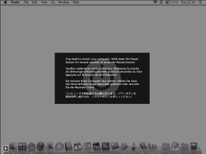

## 受保护内存

受保护内存确保应用程序在自己的内存空间内运行，并防止应用程序超出分配给它们的内存范围。受保护内存还确保如果应用程序崩溃，可以将其终止而不会对其他应用程序产生负面影响。

## 高级内存管理

你Mac中的物理内存由Mac OS X自动管理，并根据需要动态扩展虚拟内存。（虚拟内存使用硬盘上的空间来代替物理内存。）这意味着用户不再需要像在“经典”Mac OS中那样手动为应用程序设置分配内存量。高级内存管理还缓解了曾经影响Mac用户的内存不足问题。

## 抢占式多任务处理

自Mac OS 7（当时称为System 7）以来，每个Mac操作系统都允许同时打开多个应用程序。这种能力被称为多任务处理。在Mac OS X引入之前，Mac电脑使用一种名为“协作式多任务处理”的技术，在切换到下一个应用程序之前，它们会协商哪些应用程序获得Mac的资源以及持续多久。（这种在应用程序之间的切换非常快，以至于在人类看来它们似乎是同时运行的。）但要让协作式多任务工作，任务必须设计为在不需要系统资源时让出资源，而并不是所有人都会遵守规则。

Mac OS X的第一个版本用抢占式多任务处理取代了这种协作方法，它允许特权任务或系统部分中断并在随后恢复其他任务。因此，没有任务可以独占所有资源。抢占式多任务处理是一种更高效的任务管理方法，它让Mac OS X即使在处理器密集型任务期间也能保持响应。

## 对称多处理

对称多多处理（SMP）是多处理器计算机架构的计算术语，其中两个或多个处理器可以连接到单个共享主内存。对于多核处理器（如用于基于Intel的Mac的处理器），SMP架构将单个核心视为独立的处理器。

SMP技术通过将应用程序分配给特定的处理器，或通过同时将应用程序的部分（称为线程）分散到多个处理器之间来利用多个处理器的优势。Mac OS X还经过优化，以利用名为“优化内核资源锁定”的技术，通过允许多个CPU同时访问内核的不同部分，提供了卓越的SMP性能。

Mac OS X 10.5 Leopard引入了多处理器能力，支持多达八个核心（于双四核Mac Pro电脑中）。

### 新功能

Mac OS X 10.6 Snow Leopard得益于其大中央调度（Grand Central Dispatch）技术，在SMP方面取得了巨大进步。该技术将FreeBSD的ULE调度器引入Mac OS X（ULE是`SCHED_ULE`的缩写）。ULE从底层开始就为对称多处理设计，可以为每个处理器、每个线程设置CPU亲性，为多线程应用程序带来了巨大的速度提升。

## Mac OS X 中的图形技术

Mac OS X的视觉实力是传奇性的。苹果操作系统是地球上图形能力最强大的系统之一。Mac OS X利用了周围最顶尖的技术来实现这种视觉优势：Quartz、OpenGL和QuickTime构成了苹果图形能力的三大支柱。

在过去的十年中，硬件性能的一些巨大进展来自于日益强大的显卡。苹果通过两种软件技术利用了这一点：Core Image和Core Animation。这些技术通过将浮点运算单元（FPU）的使用卸载到图形处理器（GPU）来提高性能。

### 新功能

Mac OS X 10.6 Snow Leopard引入了一种名为`OpenCL`的新技术。这把这些显卡的力量推向前了一步，出了视觉特效创作领域，并利用它们在GPU之外创建额外的并行计算。

### Quartz

Quartz是一种名为`Quartz 2D`的二维图形渲染系统，以及一个向显卡发送指令的合成引擎`Quartz Compositor`。它们通常统称为`Quartz`或`Core Graphics`。Quartz的关键特性包括对可携文档格式（PDF）的内置支持；以及实时渲染、合成抗锯齿。它支持多种字体格式，包括TrueType、PostScript Type 1和OpenType（见第22章）。Quartz还支持苹果的ColorSync技术，以便在打印/图形环境中实现的色彩校准（见第21章）。

### OpenGL

Open Graphics Library（OpenGL）于1992年诞生于Silicon Graphics，是一种用于生成2D和3D图形程序的跨平台API（应用程序编程接口）。它由250多个不同函数组成，用于创建三维场景。它被任何需要密集三维图形的应用程序广泛使用（如计算机辅助设计与辅助制造、医学成像、计算机模拟、视频游戏等），它是微软DirectX技术的直接对手。OpenGL的功能随着Mac OS X的每次迭代以及Mac电脑中日益强大的显卡而扩展。你可以在`http://developerapple.com/opengl`找到OpenGL的功能表及通用信息。

### QuickTime

QuickTime是一种跨平台（Mac和Windows PC）媒体制作和发行引擎。它被各种应用程序用于播放和编辑媒体文件。它支持超过50种视频、音频和图像格式。示例包括MOV、ACC、MP3、MPEG-1、JPEG和TIFF。QuickTime拥有插件架构，允许第三方开发者创建额外的组件；这些组件扩展了媒体格式类型的范围。QuickTime还支持视频流，允许观众在通过互联网传输时观看视频或收听音频。

苹果在Mac OS X中带有一个名为`QuickTime Player`的应用程序，用于播放或流传输媒体（见第8章）。

### Aqua

Aqua是Mac OS X GUI的名称；它指的是Mac OS X操作系统的主要视觉主题。正如名称所示，它基于水，具有透明和反射效果，Aqua界面视觉上对Mac硬件也有许多致敬，原始菜单栏的双色调风格配合了青蓝色的iMac，而今天使用的金属感与许多Mac电脑使用的铝材质紧密相关。

从视觉上看，Aqua已经与“经典”操作系统的外观有了巨大的变化，Mac OS X的每一次后续实现都完善了`Aqua`界面Mac OS X环境的视觉主题。

Mac OS X 10.6 Snow Leopard（雪豹）操作系统拥有独特的历史，因此，Apple随着时间的推移构建了多个应用程序环境并将其包含在Mac OS X中，使其能够运行现代软件和旧的遗留应用程序。

应用程序环境由使应用程序运行的各种系统资源、组件和服务组成。Mac OS X拥有许多应用程序环境，包括`Cocoa`、`Carbon`、`Java`、`AppleScript`和`WebObjects`，以及`BSD`和`X11`。

## Cocoa

`Cocoa`是Mac OS X的原生面向对象应用程序环境。在`Cocoa`中开发的应用程序专为Mac OS X设计，不会在任何其他操作系统（包括Mac OS 9）上运行。

`Cocoa`编程环境自动化了应用的许多方面以符合Apple的用户界面标准；因此，`Cocoa`应用程序通常具有与Mac OS X`Aqua`界面一致的独特外观。常见的`Cocoa`应用程序包括`Mail`、`Safari`和`Preview`。

`Cocoa`应用程序充分利用了本章之前介绍的一些Mac OS X Key功能，包括高级内存管理、抢占式多任务和对称多处理。Apple在开发者中推崇`Cocoa`而非`Carbon`，引用现代面向对象的编程技术和快速应用开发工具作为其优势。

### 新功能

在Mac OS X 10.6 Snow Leopard之前，Apple的许多程序（包括`Finder`本身）是用`Carbon`编写的；然而，Apple已为Mac OS X 10.6 Snow Leopard用`Cocoa`完全重写了`Finder`。

## Carbon

`Carbon`是Mac OS X的第二个应用程序环境。`Carbon`提供的巨大优势是开发者可以创建可以在“经典”版Mac OS（8.1和9版本）以及Mac OS X中运行的应用程序。但由于Mac OS X现在已经有十多年的历史，需要`Carbon`运行的现有应用程序非常少。

在Mac OS X中运行时，`Carbon`应用程序利用了Mac OS X的现代功能集，包括`Aqua`界面。这使得人们很难判断一个应用程序是用`Carbon`还是`Cocoa`编写。`Carbon`应用程序的一个缺点是它们在GUI中无法使用64位进程，且无法编译64位的`Carbon`应用程序。

### 提示

要在Mac OS X中判断一个应用程序是用`Cocoa`还是`Carbon`创建的，点击桌面将应用程序窗口置于后台，然后按`Ô`并尝试调整窗口大小。如果是`Cocoa`应用程序，它将留在后台，而`Carbon`应用程序会跳到前台。

## Java

`Java`是最初由Sun Microsystems开发的编程语言。Mac OS X预装了最新版本的`Java`作为应用程序环境（通过软件更新经常为您安装`Java`的更新）。在`Java`中开发的优势是应用程序可以在任何包含兼容`Java`虚拟机的平台上上运行。然而，`Java`开发变得越来越少见，因为通常认为比为竞争对手的跨平台环境开发更耗时；尽管如此，`Java`常用于基于Web的应用程序。Sun在2006年将大部分`Java`推向开源社区。

## BSD 和 X11

`BSD`（Berkeley软件发行版）是一种Unix应用程序环境，通常处理命令行可执行shell脚本、命令行工具和守护进程（在后台运行的程序）。`X11`通过添加一组用于图形应用程序的接口扩展了`BSD`环境，实际上为`BSD`Unix应用程序提供了GUI环境。

## 包与束包

Mac OS X中的`Cocoa`和`Carbon`应用程序通常包含在包（也称为bundles）中。它们在`Finder`中（通常在Applications文件夹中)显示为单个图标，但它们实际上包含了应用程序所需的所有文件和文件夹。因此，你不需要打开应用程序的文件夹（如在Windows中必须那样做）来查找程序本身，你只需要双击包，Mac OS X就会为你找到并加载该程序。

### 注意

你可以通过`Control+点击`或右键点击包并从右键菜单中选择“显示包内容”（见图1.2）。

图1.2

`Control+点击`或右键点击应用程序图标，并从右键菜单中选择“显示包内容”，以查看构成应用程序包的文件和文件夹。

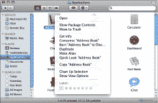

## 框架

Mac OS X框架包含由多个应用程序动态加载和共享的代码。框架的存在减少了共享相同代码的应用程序每个都加载一个独立版本代码的需求。

## 安装 Mac OS X 10.6 Snow Leopard

现在你已经熟悉了Apple最新操作系统底层的某些技术，是时候在你的Apple Mac计算机上安装一个副本了。如果你最近购买了一台全新的Apple Mac，Mac OS X 10.6 Snow Leopard可能已经安装好了，尽管你仍然应该在在本章稍后的部分检查有关软件更新的信息。

然而，许多人将需要从较早版本的Mac OS X升级到Mac OS X 10.6 Snow Leopard。或者，你可能在Mac上没有操作系统（例如由于硬盘崩溃），需要全新安装。

升级或安装Mac OS X是一个相对简单的过程，Apple创建了一个自定义安装程序引导你完成这些步骤。我们很快就会查看这些步骤，但首先你需要确保你的Mac可以运行Mac OS X 10.6 Snow Leopard。

### 检查系统要求

Mac OS X 10.6 Snow Leopard设计旨在充分利用最新一代计算机中的多核心处理器。因此，你需要一台带有Intel处理器的Mac。这包括所有Mac Pro、所有MacBook和MacBook Pro、自2006年起的每一个iMac以及自2006年起的每一个Mac Mini。

### 新功能

基于PowerPC的Mac无法运行Mac OS X 10.6 Snow Leopard，因此这些旧系统请继续使用Mac OS X 10.5 Leopard。

官方系统要求为：

- Intel处理器
- 内部、外部或共享的光驱驱动
- 至少512MB RAM（建议更多）；推荐2GB
- 内置显示器或连接到支持的Apple显示卡


Mac OS X 本身至少需要 9GB 可用磁盘空间，如果安装开发工具则需要 12GB 磁盘空间。你还应该至少留出 10GB 用于安装应用程序、保存文件以及 Mac OS 移动数据的空闲空间。

## 准备安装

在确认你的 Mac 计算机符合 Mac OS X 10.6 Snow Leopard 的系统要求后，你需要为更新做准备。

第一步是确保你计算机的固件是最新的。固件是存储在 Mac 主板上的计算机程序；与应用程序软件一样，它可以被更新。

自 Mac OS X 10.3 Panther 以来，确保软件和固件都是最新的最简单方法是使用内置的软件更新程序。从菜单栏选择 `Apple ⇒ 软件更新`。如果有可用更新，它们将出现在主窗口中；点击安装按钮并输入你的管理员密码。你也可以从 `www.apple.com/downloads` 下载固件更新。

不要中断固件升级；否则可能会对您的 Mac 造成永久性损坏。如果您正在 Mac 笔记本电脑上安装固件更新，请确保将其连接到主电源，以防电池在升级过程中由于电量耗尽。

## 升级前关于应用程序的注意事项

当您进行清洁安装时，必须重新安装所有的应用程序。某些应用程序限制了安装次数，因此您可能会面临无法在“纯净”的 `Mac OS X 10.6 Snow Leopard` 的 `Applications`（应用程序）文件夹中安装这些程序的风险。因此，您可能需要先卸载此类应用程序（在应用程序的安装盘上查找卸载实用程序），因为在升级到 `Mac OS X 10.6 Snow Leopard` 之后，您可能无法再卸载它们。

其他应用程序——尤其是 `QuarkXPress` 和 `Adobe Creative Suite`——使用了一种名为 `activation`（激活）的技术，该技术会跟踪安装次数并在您超过限制时防止进一步安装；但它也允许您在任何位置取消激活，以便在另一个位置释放出新的安装名额。在这种情况下，请确保在在“纯净”的位置安装软件之前，先取消原始安装的激活（您无需实际卸载软件），因为在升级到 `Mac OS X 10.6 Snow Leopard` 之后，您可能无法再次取消激活。

## 为安装设置驱动器

您很可能会在已经包含旧版本 `Mac OS X` 操作系统的硬盘上安装 `Mac OS X 10.6 Snow Leopard`，并用 `Mac OS X 10.6 Snow Leopard` 替换现有的 `Mac OS X`。

不过，您也可以在额外的内部或外部硬盘（或硬盘上的某个分区）上进行清洁安装。这样做的好处是保持您原始的 `Mac OS X` 安装完好。（然后您可以在新旧 Mac 操作系统之间来回启动，直到您确认 `Mac OS X 10.6 Snow Leopard` 中的一切运行正常为止。）

在 `Mac OS X` 中，硬盘使用名为 `Disk Utility`（磁盘工具）的程序进行格式化（见第 8 章）。您可以在 `Applications`（应用程序）文件夹内的 `Utilities`（实用工具）文件夹中找到它；它也在 `Mac OS X 10.6 Snow Leopard` 的安装 DVD 上，并可以在安装过程中使用。要擦除 Mac 的启动磁盘，您必须从另一个磁盘启动，例如 `Mac OS X` 安装 DVD。

`Mac OS X Disk Utility`（磁盘工具）提供了五种格式选项：

- `Mac OS X Extended (Journaled)`
- `Mac OS X Extended`
- `Mac OS X Extended (Case-sensitive, Journaled)`
- `MS-DOS (FAT)`

如果您在 DVD 安装过程中擦除驱动器，可以选择仅使用两个选项来擦除驱动器：`Mac OS X Extended` 和 `Mac OS X Extended (Journaled)`。

我们建议使用 `Mac OS X Extended (Journaled)`。日志记录（Journaling）最初在 `Mac OS X Server 10.2.2` 中引入的项，随后在 `Mac OS X 10.3 Panther` 中引入非服务器版用户。该功能通过保留所有更改的日志（或 `journal`），在意外关机（如断电）时保护文件系统的完整性，以便在需要修复时能够更容易地恢复数据。

`Case-sensitive`（区分大小写）选项（与其对应的项 `Case preserving`，即保留大小写）允许具有相同名称但不同大小写的多个文件存在于同一空间（如文件夹）中。例如，如果您选择了 `Case-sensitive`，名为“dog”、“Dog”和“doG”的文件都可能同时出现在您的桌面上。如果您不选择区分大小写的格式选项，系统将防止在同一空间内存在这些文件，这有助于防止混淆。

## 记录系统设置

在开始安装之前，我们建议您记录当前的网络和 Internet 偏好设置。如果您是从之前的 `Mac OS X` 版本升级的，这些系统偏好应该从您的旧安装传输到新的 `Mac OS X Snow Leopard` 中。然而，为了万一它们没有被保留，记录它们仍然是稳妥的。

选择 `Apple ⇒ System Preferences`（系统偏好）并点击 `Network`（网络）图标按钮打开 `Network` 系统偏好。根据您连接互联网的方法（最可能是 `Ethernet` 或 `AirPort`），您可能需要记录 `AirPort`、`TCP/IP`（传输控制协议/网协议）、`DNS`（域名系统服务）和 `Proxies`（代理）面板中的设置。（要查看这些面板，请点击 `Advanced`（高级）按钮。有关 `Network` 系统偏好的更多信息，请参阅第 12 章。）

> **注意**
>
> 通过拨号连接的旧款 Mac 用户可能还有位于名为 `Internet Connect` 的应用程序中的设置。该应用程序已从 `Mac OS X 10.5 Leopard` 中移除，其设置现在可以在 `Network` 系统偏好中找到。

还要记录 `Sharing`（共享）系统偏好中的任何设置（见第 13 章），特别是如果您在使用诸如 `remote login`（远程登录）或 `Xgrid sharing` 等功能，或者有任何自定义的文件共享设置时。

## 备份您的数据

我们强烈建议在开始升级之前备份您的 Mac 启动硬盘。如果在安装过程中发生意外，您可以使用此备份来恢复当前的操作系统。即使安装没有出错，升级操作系统也可能导致应用程序兼容性问题。在这种情况下，许多用户会退回到之前的操作系统，等待不兼容应用程序的开发者发布更新。

要备份启动硬盘，您需要第二个硬盘。拥有 `Mac Pro` 的用户可以使用额外的内部 `SATA`（串行攻击）硬盘，但大多数用户会选择外部 `USB 2.0`、`FireWire` 或 `eSATA` 硬盘。拥有 `iMac`、`Mac mini` 或 `MacBook` 的用户需要使用外部硬盘。

备份硬盘有多种方法；最常用的是使用 Apple 的 `Time Machine` 备份工具。在第 4 章中有详细介绍。

另一种选择是使用如 Bombich Software 的 `Carbon Cloner` 程序创建硬盘的完整映像。在紧急情况下，您可以从此备份启动（在启动时按住 `Option` 键并选择硬盘作为启动磁盘）。从备份启动后，您可以使用 `Carbon Cloner` 将硬盘从备份拷贝回主硬盘。

> **提示**
>
> 如果您备份了当前的 `Mac OS X` 启动硬盘，然后对其格式化并在“纯净”驱动器上安装 `Mac OS X 10.6 Snow Leopard`，可以使用后文介绍的 `Migration Assistant` 从备份中将帐户、设置和应用程序传输到 `Mac OS X 10.6 Snow Leopard` 驱动器。

## 运行 Mac OS X 安装程序

现在准备好了驱动器、备份了当前版本的 `Mac OS X` 并记录了当前的系统设置，现在终于可以开始安装 `Mac OS X 10.6 Snow Leopard` 了。

首先将安装 DVD 插入您的 Mac。

> **注意**
>
> 如果您计划在 `MacBook Air` 笔记本上安装 `Mac OS X Snow Leopard`，您需要为笔记本连接外部双层 DVD 光驱（如 Apple SuperDrive），或者使用 `Remote Install Mac OS` 工具来“借用”另一台 Mac 的光驱。首先，将 `Mac OS X 10.6 Snow Leopard` 安装 DVD 插入带有光驱的 Mac 或 PC 中。（该计算机必须通过 `AirPort` Wi-Fi 或 `Ethernet` 连接到网络，`MacBook Air` 也是如此。）然后在 Mac 的 `Applications` 文件夹下的 `Utilities` 文件夹中运行 `Remote Install Mac OS` 工具，或者在 PC 的 `Install Assistant` 上选择 `Remote Install Mac OS X` 图标按钮，并按照其说明操作。

要安装 Mac OS X 10.6 Snow Leopard，你必须从 Mac OS X 安装 DVD 启动你的 Mac；这将启动安装助理（参见图 1.3）。你可以通过以下四种方式之一实现：

- 双击桌面上出现的 `Mac OS X Install DVD` 窗口中的 `Install Mac OS X` 图标。点击 `Restart` 按钮并输入你的管理员密码。
- 在启动 Macintosh 时按住 `C` 键。
- 在“启动磁盘”系统偏好设置中，选择 `Mac OS X Install DVD` 图标，并点击 `重新启动`。
- 在启动 Mac 时按住 `Option` 键。你将看到一个蓝色屏幕，显示每个有效启动磁盘的图标。使用鼠标选择 `Mac OS X Install DVD` 图标并按下 `Return`，或使用 `→` 或 `←` 键移动到 `Mac OS X Install DVD` 图标并按下 `Return`。

图 1.3

插入安装 DVD 并重启 Mac，开始 Mac OS X 10.6 Snow Leopard 的安装过程。

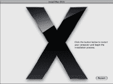

### 运行安装程序

当你的 Mac 启动时，它会启动安装程序，引导你完成在 Mac 上安装 Mac OS X 10.6 Snow Leopard 的过程。在安装开始，你会看到一系列用于不同安装选项的窗口，这些将在后续章节中介绍。

#### 选择语言窗口

Mac OS X 10.6 Snow Leopard 支持多种语言，安装程序本身也提供 18 种语言。选择合适的语言并点击窗口右下角的 `→` 按钮继续。

#### 欢迎窗口

欢迎窗口向你介绍安装过程。你可以点击 `更多信息` 按钮获取 Apple 关于安装的提示。点击 `继续` 继续安装。

请注意，此时你可以访问屏幕顶部的菜单栏，例如访问 `Mac OS X Install DVD` 上的实用程序。你还可以通过 `AirPort` 图标弹出菜单开启无线网络，并通过 `输入源` 图标弹出菜单更改输入语言。

> **注意**
>
> 当你开始安装时，“工具”菜单中可用的工具有：`启动磁盘`（参见第 21 章）、`重置密码`（第 23 章）、`固件密码实用程序`（第 23 章）、`磁盘工具`（第 8 章）、`终端`（第 26 章）、`系统简介`（第 8 章）、`网络实用程序`（第 8 章）以及`从备份恢复系统`（第 4 章）。

#### 许可协议窗口

在你的 Mac 上安装 Mac OS X 10.6 Snow Leopard 之前，你必须点击 `同意` 按钮同意许可协议。

跳过阅读文档本身是很有吸引力的，因为它包含数千个字，且用相当复杂的法律术语编写。然而，我们建议你熟悉许可协议，特别是如果你准备在商业环境中使用 Mac OS X 10.6 Snow Leopard。例如，安装的一个条件是，你只能在单台机器上安装 Mac OS X 10.6 Snow Leopard，除非你拥有家庭装（Family Pack），在这种情况下你可以在多达五台 Mac 上安装。虽然某些限制似乎有些遥不可及（例如与将系统作为恐怖活动一部分相关的限制），但与医院、飞机控制或核设施相关的某些业务限制可能会对你产生影响。

Apple 法务部门非常重视许可协议，显然 Apple 希望你阅读它。你也可以点击 `保存` 来保存协议的副本——尽管如果你正准备进行全新安装，你应该将其保存到外部硬盘上。

#### 选择目标窗口

“选择目标”窗口允许你确定想在何处安装 Mac OS X 10.6 Snow Leopard。所有可用驱动器的图标都会出现在窗口中心。黄色三角形中的感叹号意味着无法在该驱动器上安装操作系统（例如，如果你在 Mac 上连接了 iPod 作为驱动器，你就会看到这种情况）。通常情况下，如果你在 Mac 上已经安装了更高版本的 Mac OS X，或者驱动器未格式化为 Intel Mac 的启动磁盘（称为 `GUID` 分区），你将看到黄色图标。

选择你想要安装 Mac OS X 10.6 Snow Leopard 的驱动器，并点击`选项`按钮。在这里你将找到以下选择：

- **升级 Mac OS X**。如果你从 Mac OS X 10.5 Leopard 迁移到 Mac OS X 10.6 Snow Leopard，可以选择此选项。这将升级你的操作系统，同时保留你所有的系统设置、偏好设置、应用程序、字体和文档。选择此选项的优点是提供了一个从 Mac OS X 10.5 Leopard 迁移到 Mac OS X 10.6 Snow Leopard 的快速方法；缺点是你失去了一个彻底清空 Mac 电脑并开始全新安装的机会。

- **存档并安装**。此选项将你当前 Mac OS X 安装中的所有系统文件移动到名为 `Previous System` 的文件夹中。然后向你的 Mac 上安装一个 Mac OS X 10.6 Snow Leopard 的全新副本。使用此选项后，你的 Mac 将启动到新版本的 Mac OS X，且 `Previous System` 中的文件不能作为启动驱动器。其理念是产生新操作系统的全新安装，同时也包含你可能需要的所有旧文档、偏好设置、字体和其他文件（都存在一个文件夹中）。然后你可以在需要时将它们从 `Previous System` 文件夹拷贝到你当前版本的 Mac OS X 中。选择此选项而不是`删除并安装`是明智的，除非你完全确定不再需要电脑中的任何文件（或对当前电脑有铁板打的备份）。

  一个子选项是`保留用户和网络设置`。选择此选项会将现有的用户账户、用户文件夹和网络设置导入到新系统中。

- **删除并安装**。这是用于全新开始的选项。顾如所示，它会完全擦除你的硬盘并安装一个 Mac OS X 10.6 Snow Leopard 的全新副本。这就像是你买了一台全新的 Mac 一样。显然，只有当你乐意丢失硬盘上的所有内容，或者对所有重要文件和文档有合适的备份时，才选择此选项。

> **注意**
>
> `存档并安装`选项和`删除并安装`选项，随后重新安装你所有偏好的应用程序、字体、重要文档和偏好设置，可以作为一种极端大扫除，带来整洁且更快的计算体验。但在安装 Mac OS X 10.6 Snow Leopard 之前，请务必禁用任何使用激活许可的软件，并卸载任何可能限制你安装新副本的软件——在安装 Mac OS X 10.6 Snow Leopard 之后，你可能无法获得机会，而必须购买新的许可或进行激活。

> `删除并安装`菜单的一个子选项是选择磁盘格式。你的选项有 `Mac OS 扩展（日志式）` 和 `Mac OS 扩展（区分大小写，日志式）`。

> 如前所述，日志记录使你的系统能够防止受到突然断电或系统冻结的影响。区分大小写选项与文件名的大小写有关；选中此选项后，你可以在同一位置拥有多个名称相同但大小写不同的文件。

选择你的安装选项并点击 `确定`。“选择目标”窗口现在会让你知道在你的硬盘上安装 Mac OS X 10.6 Snow Leopard 需要多少空间。点击 `继续` 进入下一步。

#### 安装摘要窗口

“安装摘要”是在你开始实际安装之前看到的最后一个窗口。在这里你有两个选择：你可以点击`安装`按钮（使用默认设置）或点击`自定义`。

默认情况下，Mac OS X 10.6 安装程序会在您的 Mac 上安装有限的打印机驱动程序、额外的字体和语言支持文件，以及 X11（X 窗口系统的实现版本，允许您在 Mac OS X 中运行基于 X11 的应用程序）。它不会安装 DVD 上所有的打印机驱动程序，只安装连接到您的 Mac 且具有对应驱动程序的驱动程序，以及几个流行打印机的驱动程序。它还不会安装 Rosetta 技术（该技术允许为 PowerPC 架构 Mac 开发的应用程序在 Intel 架构 Mac 上运行）。但它会安装字体和语言支持（称为“语言翻译”）文件。

`Customize`（自定义）选项允许您选择安装选项，例如添加驱动程序、取消勾选字体、取消勾选语言文件和或安装 Rosetta。（取消选择任何您认为多余的项目将节省磁盘空间并可能略微提高性能。）

对您的选择满意后，点击 `Install`（安装）按钮。

## 停止 Mac OS X 10.6 雪豹系统的安装

在点击 `Install` 按钮启动安装过程之前，您可以随时通过选择 `Mac OS X Installer ⇒ Quit Mac OS X Installation` 来停止安装。如果您执行此操作，系统会要求您确认是否确实打算退出安装；如果您选择退出，Mac 将在要求您选择启动磁盘后重启。无论您选择哪个磁盘作为启动磁盘，您都可以在 Mac 启动时按住 `Option` 键来选择不同的启动驱动器。您也可以在启动过程中按住鼠标按钮来启动到原始安装系统。（这会自动退出 DVD。）


在安装进行期间，您也可以通过选择`Mac OS X Installer ⇒ Quit Mac OS X Installer`来退出安装过程。不过，这并不建议这样做，因为这会导致您没有一个完全安装好的操作系统。如果您选择了此选项，将收到一条警告消息以及`Restart`（重启）、`Don't Quit`（不退出）或`Select a Startup Disk`（选择启动磁盘）选项。

进程完成后，您将收到消息“恭喜！您已经在电脑上安装了 Mac OS X。”点击`Continue`（继续）按钮，然后点击`Restart`（重启）按钮启动 OS X 10.6 雪豹。

## 检查安装 DVD 窗口

Mac OS X 安装从`Checking Installation DVD`（检查安装 DVD）窗口开始，该窗口会检查您的安装 DVD 上是否存在错误，以防止安装损坏的版本。您可以点击`Skip`（跳过）按钮跳过此检查。

## 安装窗口

出现`Installing`（正在安装）窗口，Mac OS X 10.6 雪豹操作系统从 DVD 安装到您的硬盘。该过程很大程度上是自动化的，大约需要一小时（取决于您的系统速度）。除了观察进度条，您几乎不需要做什么，因此现在可能是阅读一些 Mac OS X 10.6 雪豹底层技术知识的好时机。

## 启动 Mac OS X 10.6 雪豹并设置您的 Mac

安装过程完成后，您的 Mac 将启动。新 Mac 系统的用户以及刚刚执行了全新安装的用户将看到一段简短且时尚的欢迎视频。

随后您会被带到`Welcome`（欢迎）窗口，该窗口将引导您完成 Mac 设置。选择升级到 Mac OS X 10.6 雪豹的用户，以及选择了`Archive and Install with the Preserve Users and Network Settings`（存档并保留用户和网络设置进行安装）选项的用户将直接进入 Mac 桌面。

其他人都可以准备好设置新 Mac，Mac OS X 将通过一系列窗口来帮助您完成这一操作。

### 欢迎窗口

`Welcome`（欢迎）窗口首先要求您选择一个国家或地区；共有六个默认地区：美国、加拿大、英国、澳大利亚、新西兰和爱尔兰。如果您住在这些地区之外，请选择`Show All`（显示所有）复选框；这将弹出一个完整的国家列表。

如果您等待大约 30 秒，Apple 的 VoiceOver 技术和一个大型对话框将会出现。它告诉您可以通过按`F5`键启用 VoiceOver；如果您熟悉 VoiceOver 技术，可以通过按`Escape`（退出）键访问使用 VoiceOver 的指南。VoiceOver 是 Mac OS X 通用辅助（Universal Access）设置的一部分，专为有不同访问需求的人设计，例如听障人士和视障人士。这些技术将在第 6 章中有更深入的介绍。

准备就绪后，点击`Continue`（继续）。

### 键盘窗口

此窗口允许您选择与您的地区匹配的键盘布局。通常会根据您在上一个窗口中选择的地区提供选项；如果该区域与您的键盘布局不符，或者您想要与地区默认布局不同的布局，请点击`Show All`（显示所有）按钮并选择合适的键盘。

### 你已经拥有 Mac 吗？窗口

此窗口对于从旧版 Mac 系统升级的用户，或使用过 Time Machine 或`Carbon Copy Cloner`等程序备份数据的用户非常有用。在此窗口中，您可以启动名为`Migration Assistant`（迁移助理）的程序将系统信息从一台 Mac 传输到另一台。（原始备份源不受此传输的影响。）要运行`Migration Assistant`，当出现“您是否想传输您的信息？”的问题时，请选择前三个选项之一：

- 来自另一台 Mac
- 来自此台 Mac 上的另一个卷
- 来自 Time Machine 备份
- 现在不传输我的信息

**提示**

您可以随时运行`Migration Assistant`程序，而不仅仅是在初始设置期间。您可以在`Applications`（应用程序）文件夹内的`Utilities`（工具）文件夹中找到`Migration Assistant`。

从一个账户传输信息到另一个账户时，您可以传输以下区域的信息：

- 用户
- 网络和其他设置
- 应用程序文件夹
- “启动磁盘名称”上的文件和文件夹

默认情况下，所有四个区域都已勾选，执行此传输将在新系统中重建您的原始 Mac 设置。虽然您可以选择传输单个用户账户，但无法为每个区域选择性地传输内容。（例如，您无法选择从旧安装迁移特定的应用程序；它是要么全传，要么全不。）

某些应用程序在从一台 Mac 迁移到另一台 Mac 后可能无法正常运行。特别是某些软件包含版权保护，会记录其运行的系统，并在移动到不同的计算机时拒绝工作。在这种情况下，您需要重新安装软件。因此，在迁移之前，最好卸载或禁用任何可能有版权或许可保护的应用程序。

来自 iTunes Store 的购买在传输后的计算机上无法运行，因为您需要使用 iTunes Store 详情授权新计算机。对于某些媒体（如音乐购买），您每次只能授权五台机器，因此您可能需要在授权新机器之前取消授权一台 Mac。因此，在迁移设置到新的 Mac OS 之前，请确保在旧 Mac OS 中取消授权 iTunes（见第 9 章）。

#### 从另一台 Mac 传输信息

从另一台 Mac 传输信息需要您使用 FireWire 线连接两台电脑。然后您需要在重启源 Mac（要传输信息的 Mac）的同时按住`T`键。这会将源 Mac 置于目标磁盘模式，实际上将其变成了一个外部硬盘。然后您可以选择要迁移的信息并点击`Transfer`（传输）按钮。（当启用目标磁盘模式时，迁移过程与升级相同。）

#### 从此台 Mac 另一个驱动器传输信息

此选项适用于在 Mac 上安装了多个版本 Mac OS X 的用户。这可以是另一个硬盘，也可以是您 Mac 唯一硬盘上的一个分区（`Partitioning`将单个硬盘拆分为多个部分，每个部分看起来和操作起来都像是一个独立的物理驱动器）。选择您想要从中传输信息的驱动或分区，然后高亮您想要迁移的信息，并点击`Transfer`按钮。（迁移过程与升级过程相同。）

#### 从 Time Machine 备份恢复数据

Time Machine 是一项在 Mac OS X 10.5 Leopard 中首次引入的备份实用，它不仅用于取回丢失的信息，还用于在计算机之间传输系统信息。

如果您计划从驱动器的完整 Time Machine 备份中传输信息，您应该确保包含备份的外部硬盘已连接到您的 Mac。如果您使用了无线网络驱动器（例如 Apple 的 Time Capsule [时间胶囊]，或连接到 Apple AirPort Extreme 基站或其他无线路由器的硬盘），那么您将将需要加入 Wi-Fi 网络。点击`Join`按钮打开“网络助理”，点击`Show Networks`按钮并选择您的网络。如果需要，请输入密码。

当备份驱动器出现在主窗口中时，点击`Continue`选择您想要迁移的信息，然后点击`Transfer`开始迁移过程。（迁移过程与升级过程相同。）

#### 选择无线服务窗口

顾如名，此窗口允许您加入 Wi-Fi 网络（前提是您的 Mac 具备 AirPort 功能，大多数 Mac 均具备）。主窗口中会出现无线网络列表；选择您想要加入的一个并输入密码。然后点击`Continue`。

如果您的计算机未连接到无线网络，您可以点击`Different Network Setup`按钮。这将带您进入一个具有更广泛网络选项的窗口，包括`Cable Modem`、`DSL Modem`和`Local Network (Ethernet)`；`My Computer`选项不连接互联网。如果您选择最后一个选项，将跳过 Apple ID 和注册信息窗口，直接进入`Personalize Your Settings`窗口。

#### 输入您的 Apple ID 窗口

Apple ID 主要用于从 iTunes、iPhoto 和 Apple Store 购买项目和下载免费内容。如果您是 MobileMe 会员（以前称为`.Mac`），只需输入您的名称和密码即可。一个 Apple ID 的示例为`steve@me.com`；您也可以使用`steve@mac.com`变体（它们可以互换）。

如果您没有 Apple ID，请将框留空并点击`Continue`；您可以随时以后创建 Apple ID。Apple ID 的优点包括 Apple MobileMe 服务的 60 天免费试用，在第 15 章中有详细说明。

#### 注册信息窗口

您在此页面中填写的信息将通过互联网自动发送给 Apple。您无法在此页面留任何空白，也没有跳过注册的按钮选项。但是，可以通过按下`Ô+Q`然后选择`Skip`选项跳过注册。如果您想获取更多关于 Apple 收集您的信息的原因及其用途的信息，请点击`Privacy Policy`按钮。

填写注册信息后，点击`Continue`；这将带您进入`A Few More Questions`窗口，该窗口有两个下拉菜单，要求提供有关您将在哪里主要使用此计算机以及最描述您工作的描述。在这里您还会找到`Stay in Touch`复选框；选择此选项意味着 Apple 将向您发送有关新产品、软件更新和新闻性信息的电子邮件。

#### 创建您的账户窗口

在开始使用 Mac 之前，您需要创建一个用户账户。我们将在第 20 章更深入地研究用户账户，但目前只需说您需要添加信息来管理您的 Mac 账户。

您需要输入一个名称和一个短名称。名称应该是您的全名，短名称应该是一个缩写，当需要身份验证时，您会学会欣赏它的价值。您还需要输入密码并通过再次输入来验证它。选择一个易于记忆的密码至关重要，因为没有办法找回您忘记的密码，尽管正如第 20 章解释的，您可以使用安装 DVD 上的`Reset Password`实用程序来设置新密码。最后，您可以输入一个密码提示来唤起记忆。

完成后，点击`Continue`。

#### 为此账户选择图片窗口

设置过程的这部分将照片附带到您的账户上。如果您的 Mac 内置了 iSight 摄像头（或您在 Mac 上连接了较旧的 iSight），您可以快速拍摄一张自己的快照并附接到您的账户。否则（或者如果您比较害羞），您可以从图片库中选择一张照片，这将调出由 Apple 提供的许多照片。在拍摄照片之前，请记住，快照将在整个 Mac OS X 中使用并被 iSight 等程序共享，尽管您可以在以后轻松地更改它。

#### 选择时区窗口

此窗口允许您为 Mac 选择时区。您可以使用地图点击某个地理区域，或者输入附近城市的名称。在做出选择后，点击`Continue`。

#### 设置日期和时间窗口

此窗口允许您设置 Mac 的时钟和日历；输入正确的日期和时间并点击`Continue`。

#### 别忘记注册窗口

如果您跳过了注册过程（通过在注册页面上按下`Ô+Q`并选择`Skip`），系统将再次提示您进行注册。点击`Done`继续。

#### 自动续费 MobileMe 窗口

如果您是 MobileMe 会员并输入了 Apple ID，您可能会看到一个在会员到期时自动续费的选项。如果是，请决定您是否想要自动续费，然后按`Continue`。

#### 感谢窗口

现在您看到一个窗口，显示您的 Mac 已设置好并准备可以使用。屏幕上显示了几个图标，显示根据您的设置可以做的一切。点击`Go`按钮开始使用您的 Mac。

### 运行软件更新

Apple 定期对其 Mac OS X 操作系统以及 Mac X 安装 DVD 上提供的各种应用程序引入更新。在您在 Mac 上安装时，发现 Apple 提供的软件已经过改进，这并不罕见。

**注意**

大多数软件制造商通过其网站提供软件更新，并提供菜单选项（通常在“帮助”菜单中），可以使用其检查其应用程序的最新更新。

Apple 通过`Software Update`程序简化了这一过程（选择`⇒ Software Update`）。第 21 章详细介绍了 Software Update，尽管在完成安装 Mac OS X 10.6 Leopard 后立即运行 Software Update 是明智的（参见图 1.4）。该程序会检查新软件，点击`Install`按钮将通过互联网下载相关更新并进行安装。您可能被要求输入管理员密码，您的 Mac 可能需要重启以执行更新。

图 1.4

Software Update 检查程序的最新版本（包括 Mac OS X 本身的升级）。请确保在安装 Mac OS X 10.6 Snow Leopard 后立即运行它。

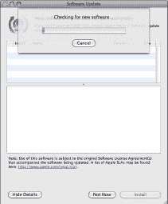

### 总结

Mac OS X 10.6 Snow Leopard 是 Apple 基于 Unix 的操作系统，旨在利用现代多核处理器和高级显卡。它提供抢占式多任务处理、对称多处理、保护内存和高级内存管理，所有这些功能允许运行 Mac 上期待的丰富的应用程序。

Apple 在 Mac OS X 10.6 雪豹版（Snow Leopard）中对操作系统进行了许多面向性能的改进，尽管从上看它变化不大，仍然是目前最易用的操作系统，并保持了客户对 Apple 的风格和外观。

新的 Mac 预装了 Mac OS X，但如果你有一台 Mac 并想要升级到 Mac OS X 10.6 雪豹版，你有几种方法可以实现。你可以覆盖旧的 Mac OS（仅限于 Mac OS X 10.5 豹子版）并保留所有的应用程序和设置。你可以在与旧 Mac OS 相同的驱动器上安装“干净”的 Mac OS X 10.6 雪豹版，并将设置迁移。你可以将 Mac OS X 安装在独立的驱动器上。或者，你可以格式化原始驱动器并在上面安装一个“干净”的 Mac OS X 10.6 雪豹版。

当你开始安装 Mac OS X 10.6 雪豹版时，安装程序将引导你完成所有选项。安装完成后，当你的 Mac 首次启动进入 Mac OS X 10.6 雪豹版时，设置程序也会引导你完成主要的设置和注册选项，包括提供从另一台 Mac、同一台电脑上的另一个 Mac OS X 安装程序或从备份驱动器传输设置和应用程序的选项。

# 第 2 章：探索 Mac OS X 10.6 雪豹版

## 本章内容

- 启动与登录
- 注销与关机
- 发现 Mac OS X 环境
- 使用 Dock
- 理解桌面
- 使用窗口
- 理解常用控件
- 识别图标
- 发现和使用 Finder（Finder）
- 使用手势

本章将向你介绍 Mac OS X 10.6 雪豹版的工作环境。与所有现代操作系统一样，Mac OS X 拥有图形用户界面（`GUI`，读作“gooey”），由窗口、菜单、图标、按钮和各种类型的控件组成。Apple 将这种图形界面称为`Aqua`（水），因为它的主题灵感源于水的透明性和反射性。`Aqua`是极其优雅的界面，易于导航，并能让你快速高效地完成复杂任务。正因如此，Mac OS X 是一个丰富且高效的工作环境。

在本章中，你将发现如何启动并登录你的 Mac；你将学习如何处理任何常见的启动问题，以及注销或关机 Mac 的过程。

接下来，你将巡游 Mac OS X 环境，并学习菜单栏、`Dock`和桌面的基础知识；最后，你将查看如何自定义你的 Mac 以赋予个性化外观，并进行设置以便你按照自己的个人风格进行工作。

在你熟悉了界面后，我们将向你完整展示如何操作文件和文档，特别是使用 Mac OS X 的关键应用程序之一：`Finder`。该应用程序是你用来在 Mac 中进行导航的工具。

到本章结束时，你将熟悉 Mac OS X 工作环境，以及在后续章节中将深入介绍的许多功能。在深入描述工作环境之前，我们从如何启动和登录电脑说起。

## 启动与登录

生活中很少有种声音像 Mac 首次启动时发出的叮咚声那样令人愉悦。这个声音标志着你 Mac 内部的基础硬件元件（硬盘、`CPU` [中央处理器]、内存等）已运行正常。叮咚声之后，Mac 开始检查基础错误，硬件测试随之开始；在确认一切无误后，电脑将操作系统从硬盘加载到内存中。

当然，由于由于是一个流畅的操作系统，Mac OS X 在后台完成了这一切。在电源指示灯亮起后，你会听到叮咚声；然后你会看到一个灰色屏幕，中间有一个较深灰色的 Apple 标志；接着是一个灰色的旋转时钟轮。在经过 10 到 30 秒后，你会看到一个带有箭头形状鼠标指针的蓝色屏幕。最后，取决于你 Mac 的配置，你会看到登录窗口或 Mac OS X 桌面。整个启动过程大约需要 30 到 45 秒，取决于你 Mac 的速度。请注意，在较快的 Mac 上，某些事件可能发生得太快而你无法注意到。

### 启动你的 Mac

你可以通过以下任一方式运行 Mac OS X 10.6 雪豹版的 Mac：

- 按 Mac 上的电源按钮。
- 按某些 Apple Cinema Display LCD 投影器上的电源按钮。请注意，在某些旧型号上，电源按钮可能只是关闭显示器；Apple LED Cinema Display 则没有电源按钮。

**注意**

检查 Mac 是否已经开启并处于睡眠模式。在这种情况下，屏幕是黑色的，很容易被误认为 Mac 已经关机。判断 Mac 是否处于睡眠模式的一种方法是看 Mac 上是否有脉动的灯光。这是一个 Mac 正在睡眠的视觉提示（脉动的灯光旨在唤起打鼾声）。如果是这种情况，点击鼠标或击键盘即可唤醒它。

### 选择启动磁盘

默认情况下，Mac OS X 从你的主磁盘（Mac 内部的硬盘）启动。但它也可以从其他磁盘启动，例如 DVD 和外部硬盘。它甚至可以从网络上的驱动器启动。你可能会从 DVD 启动——例如 Mac OS X 安装盘——来升级你的 Mac OS 版本，或重新安装它。你可能会从包含你正在测试的应用程序或设置配置的外部磁盘启动（这是开发者和 IT 人员可能会做的）。

### 处理启动问题


如果你的 Mac 无法正常或完全启动，请尝试从安装 DVD 启动，并确保启动盘仍然包含其文件夹和文件（例如在断电期间意外被清除了）。你也可以从安装 DVD 运行`磁盘工具`等程序来尝试修复任何磁盘问题，如第 1 章所述。还有第三方修复工具，如`TechTool Pro`（98 美元；www.micromat.com]），它可以允许你在硬盘上创建一个可启动的分区，并在其中运行修复程序。

有两种高级用户可以使用特殊启动模式，以排查无法正常启动的 Mac。一种是单用户模式（启动时按住`Shift+S`），它将引导进入 Mac 的 Unix 核心，你可以在输入 Unix 命令来探索和排除故障（第 26 章有关于使用 Unix 的更多信息）。另一种是详细模式（启动时按住`Shift+V`），它显示所有启动活动列表和任何错误信息，这可能帮助你识别问题（例如损坏的登录项）并删除（如果 Mac 无法从启动器启动，你需要从不同的驱动器删除或修改此类文件）。请注意，如果 Mac 启用了固件密码，单用户模式或详细模式都无法工作（见第 23 章）。

要选择启动磁盘，你有几种选择：

- 在 Mac 叮咚声开始时按住`Option`；屏幕会显示每个可用启动驱动器的图标（此时可以释放 Option）。使用鼠标或按`←`或`→`直到目标磁盘被选中（下方会出现一个`↑`按钮）。然后按 Return 键或点击`↑`按钮进入所选驱动器。

- 在 Mac 叮咚声开始时按住`C`键，从 CD 或 DVD 启动。注意，这仅适用于 Apple 的 SuperDrive。

- 在 Mac 叮咚声开始时按住`D`键，从具有多个内部磁盘的 Mac（如 Mac Pro）从第一个内部磁盘启动。

- 当 Mac 从网络启动并开始启动提示音时，按下并按住`N`键。（必须正确配置并启用网络启动驱动器，且 Mac 必须连接到网络。）

- 当 Mac 的启动提示音开始引导启动 Mac 时，按下并按住`T`键将 Mac 进入目标磁盘模式（Target Disk mode），这可以让通过 FireWire 线缆连接到它的另一台 Mac 将其视为一个外部磁盘。

- 从默认磁盘启动 Mac，然后选择 Ú⇒系统偏好设置，并点击启动按钮。在“启动”系统偏好中，从列表中选择一个启动磁盘，然后点击“重启”。注意，在每次启动 Mac 时，此启动磁盘的选择将一直有效，直到您再次更改“启动”系统偏好。（相比之下，在启动期间按住其中一个按键仅会临时更改一次默认启动磁盘。）

## 登录 Mac OS X

在 Mac 完成启动过程后，将开始登录程序。登录程序本质上是作为一种安全措施向计算机识别您的身份，以确保只有授权使用您的 Mac 的人员才能访问；它还有第二个作用，即激活您的个人工作空间（称为用户账户）。

登录过程是强制性的，尽管它默认是自动的，因此 Mac 会登录到您首次安装 Mac OS X 时创建的主用户账户。因此，每当用户打开 Mac 时，他或她将直接进入桌面并可以开始使用计算机。

### 登录屏幕选项

可以禁用自动登录（第 20 章提供了更多关于设置用户账户和登录选项的详细信息）。如果您禁用了自动登录，Mac 在登录您的用户账户并带您进入桌面之前会要求输入用户名和密码。

您可能会对在办公室或其他公共空间使用的 Mac 禁用自动登录，这样在关机后，除了您之外没有其他人可以使用您的电脑。如果禁用了自动登录，当您启动 Mac 时，您可能会看到两种登录屏幕之一：

- **用户列表**。一种登录屏幕选项提供用户列表，您可以在用户列表中点击您的名称或代表您的图标，然后在随后弹出的字段中输入您的密码。（如果您不小心从列表中选择了错误的用户，可以点击“后退”按钮返回用户列表。）

- **名称和密码**。另一种登录屏幕选项提供一个“用户名称”文本字段和一个“密码”文本字段，您必须输入两者才能登录。

登录屏幕在您禁用自动登录并启动 Mac 时显示；它也会在您重启 Mac、注销 Mac OS X（本章稍后会解释该过程）或通过使用“快速用户切换”（Fast User Switching）切换用户时出现（第 20 章提供了更多关于快速用户切换的详细信息）。

#### 交叉引用

第 20 章涵盖了如何管理您的用户账户，以及如何在同一台 Mac 上创建和管理多个用户账户。

#### 输入密码

如果您输入的用户名或密码错误，登录窗口将从左到右抖动，表示发生了问题。“密码”文本字段也会清空，以便您可以重新输入密码。（注意，“用户名称”文本字段不会自动清空；出于安全考虑，Mac OS X 不会通知用户他们输入了错误的用户名。）如果您按下`Tab`键，将突出显示“用户名称”字段中的文本，以便您可以重新输入用户名。

##### 注意

密码对大小写敏感，因此大写必须与最初设置的密码一致。

## 登录与访问权限

Mac 可以设置多个用户账户，为每个用户提供应用程序和文件的私有空间。

Mac 可以设置多个用户账户，为每个用户提供应用程序和文件的私有空间。

Mac 可以设置多个用户账户，为每个用户提供应用程序和文件的私有空间。

Mac 可以设置多个用户账户，为每个用户提供应用程序和文件的私有空间。

Mac 可以设置多个用户账户，为每个用户提供应用程序和文件的私有空间。

Mac 可以设置多个用户账户，为每个用户提供应用程序和文件的私有空间。

Mac 可以设置多个用户账户，为每个用户提供应用程序和文件的私有空间。

Mac 可以设置多个用户账户，为每个用户提供应用程序和文件的私有空间。

Mac 可以设置多个用户账户，为每个用户提供应用程序和文件的私有空间。

Mac 可以设置多个用户账户，为每个用户提供应用程序和文件的私有空间。

Mac 可以设置多个用户账户，为每个用户提供应用程序和文件的私有空间。

Mac 可以设置多个用户账户，为每个用户提供应用程序和文件的私有空间。

Mac 可以设置多个用户账户，为每个用户提供应用程序和文件的私有空间。

Mac 可以设置多个用户账户，为每个用户提供应用程序和文件的私有空间。

Mac 可以设置多个用户账户，为每个用户提供应用程序和文件的私有空间。

Mac 可以设置多个用户账户，为每个用户提供应用程序和文件的私有空间。

Mac 可以设置多个用户账户，为每个用户提供应用程序和文件的私有空间。

Mac 可以设置多个用户账户，为每个用户提供应用程序和文件的私有空间。

Mac 可以设置多个用户账户，为每个用户提供应用程序和文件的私有空间。

Mac 可以设置多个用户账户，为每个用户提供应用程序和文件的私有空间。

Mac 可以设置多个用户账户，为每个用户提供应用程序和文件的私有空间。

Mac 可以设置多个用户账户，为每个用户提供应用程序和文件的私有空间。

Mac 可以设置多个用户账户，为每个用户提供应用程序和文件的私有空间。

Mac 可以设置多个用户账户，为每个用户提供应用程序和文件的私有空间。

Mac 可以设置多个用户账户，为每个用户提供应用程序和文件的私有空间。

Mac 可以设置多个用户账户，为每个用户提供应用程序和文件的私有空间。

- 当 Mac 设置
- 从 Mac 启动时开始提示音。
- 当 Mac 设置
- 为每个用户提供应用程序和
- 文件的私有空间。

## 关闭机与注销

当您完成使用 Mac 后，你有几个选项：

- 让 Mac 进入休眠。
- 让 Mac 保持开启，直到屏幕保护程序启动，随后通过节能设置使其自动进入休眠。（详情请参见第 21 章。）
- 注销您的账户，以便人们在输入登录密码之前无法访问您的 Mac。
- 启动 Mac，这将注销您的账户并关闭操作系统，然后关闭电源。此选项可以节能并在断电情况下提供安全性。
- 重启 Mac。这不是完成工作的方法，而是通常用于完成某些系统更新的安装或允许计算机在启动时运行自检。

### 警告

如果在未先关闭电脑的情况下切断电源（例如拔掉插头或从笔记本上移除电池），可能会损坏 Mac 上的文件。虽然这种损坏可能不会立即察觉，但损害的积累会导致问题，例如应用程序无法正常工作或文件丢失。

## 让 Mac 休眠（以及唤醒它）

当你一段时间不使用 Mac 时，可以通过让它进入休眠来节省能量。当你想要再次使用 Mac 时，可以快速唤醒它。唤醒 Mac 比关机启动要快得多。

你可以通过任何一种方式让 Mac 进入休眠：

- 如果你是 Mac 笔记本电脑，只需关闭盖子即可。
- 选择 Ú⇒休眠。
- 如果你使用的是带有推出键的 Apple 键盘，按下`Control+推出`。现在可以从弹出的对话框中点击“休眠”选项，或按下`S`键。
- 按下电脑上的电源按钮（如果你的 Apple 显示器有电源按钮，则按下该按钮）。然后点击弹出的对话框中的“休眠”按钮，或按下`S`键。
- 如果你正在使用带有推出键的 Apple 键盘，请按下`Control+Shift+Eject`立即让 Mac 进入睡眠状态。
- 退出你的 Mac，并在出现的登录窗口中点击睡眠图标按钮。
- 选择`Ú⇒系统偏好 (System Preferences)`并进入节能（Energy Saver）系统设置，然后使用`在闲置时进入睡眠 (Put the Computer to Sleep When It Is Inactive For)`滑块设置自动的“进入睡眠”时间。这将使 Mac 在指定时间内未活动后自动进入睡眠状态（这意味着你没有触碰鼠标或键盘，且没有应用程序正在从驱动器读取或写入数据）。

你可以通过以下任何方式唤醒你的 Mac：

- 如果你用的是 Mac 笔记本电脑，只需打开盖子即可。
- 按下键盘上的任意键。为了防止按键将文本插入到活动文档或文本字段中，养成使用`Shift`键作为唤醒键的习惯是明智的。
- 点击或移动鼠标。

## 退出 Mac OS X

完成电脑使用后，你可以退出 Mac OS X。与让 Mac 进入睡眠状态相比，这提供了额外的安全保障，因为它要求人们在开始使用电脑之前输入密码。退出 Mac OS X 也是从一个用户账户切换到另一个账户的方法。

你可以通过选择`Ú⇒退出用户名 (Log Out username)`或按下`Shift+Ô+Q`来退出 Mac OS X。无论哪种方式，都会弹出一个包含两个按钮的对话框：`退出 (Log Out)`和`取消 (Cancel)`。点击`退出`或按下`Return`立即退出，或者等待 60 秒让 Mac 为你执行。点击`取消`继续使用当前用户账户在 Mac 上工作。

当你退出时，Mac OS X 会关闭所有运行中的应用程序，然后显示登录窗口。从那里，选择一个用户账户并输入相应的密码以该用户身份登录。如果你不是想退出而是执行其他操作，也可以点击`睡眠`、`重启`或`关机`图标按钮。

## 关闭 Mac

虽然你可以让 Mac 永久运行或让它进入睡眠，但你可能想在一天结束时将其完全关闭。这可以减少能量消耗，并降低 Mac 因热量积聚或电涌导致损坏的可能性。

你可以通过几种方法关闭 Mac，包括：

- 如果你的键盘上有电源按钮，按下它，然后在确认对话框出现时点击`关机 (Shut Down)`或按下`Enter`。
- 如果你使用的是带有推出键的键盘，按下`Control+Eject`，然后在确认对话框出现时点击`关机`或按下`Enter`。
- 选择`Ú⇒关机 (Shut Down)`。然后在确认对话框出现时点击`关机`或按下`Enter` —— 或者你可以等待 60 秒让 Mac 自动关闭。
- 退出并点击登录窗口中的`关机`图标按钮。

当你执行关机过程时，Mac OS X 会通知所有打开的应用程序退出并继续关闭。如果任何应用程序有未保存的数据，在关机前系统会弹出一个`保存 (Save)`对话窗口。

### 提示

关机时，观察桌面直到屏幕变为空是明智的，因为这能让你知道 Mac 已经实际上关闭。当你关闭 Mac OS X 时，它会首先尝试退出所有活动应用程序，但如果应用程序有未保存的文档，它们可能无法退出。在这种情况下，应用程序会显示对话框询问你是否想要保存未保存的文档，关机过程将被延迟。如果你离开了，等你回来时会发现关机并未完成，然后你必须处理未保存的文档，等待 Mac 关闭并重新启动它以便使用 Mac —— 这一过程可能会非常沮丧。

## 关机还是睡眠？

计算机社区内对于在会话结束时（或一天结束时）应该关机电脑还是简单地让电脑进入睡眠，存在很大争议。这两种方法各有优劣。

完全关闭电脑可以确保它在闲置时不消耗任何能量，这是符合环保的做法（更不用说这是一个财务上的明智举措，因为多年来的待机小时会积累大量的电费）。

如果你使用`睡眠 (Sleep)`模式，确实会消耗一些能量，但比让 Mac 完全开启要少——只要你的睡眠设置（在`节能`系统设置中）被设置为闲置硬盘（请确保选择`在可能时使硬盘 (Put the Hard Disk(s) to Sleep When Possible)`选项）。让硬盘睡眠还可以减少硬盘的磨损。

有些用户声称，启动时进入 Mac 的电流涌对系统组件的影响比持续的微弱电流大。尽管这在 20 世纪 80 年代的第一批电脑上可能，但没有证据表明这对于当今的 Mac 有什么影响。像所有现代电脑一样，它的设计初衷就是为了频繁开关机。

让 Mac 进入睡眠而不是关机的原因之一是，Mac OS X 设计在 Mac 睡眠时运行优化程序，所以如果你每晚都关闭电脑，可能会错过这些优化。

大多数人结合使用 Mac 睡眠和关机，根据离开时间的长短在两者之间选择。这是处理睡眠与关机问题的好方法。

### 注意

还有另一种关闭 Mac 的方法：强制关机。这在系统崩溃且没有其他方法可以关闭或重启 Mac 时非常有用。要使用此方法，只需按住电源键五秒钟。然而，应避免强制关机：未保存的数据将会丢失，并可能损坏系统。

## 重启 Mac

重启 Mac OS X 的次数比其他操作系统（包括之前的 Mac OS）少得多。这是因为 Mac OS X 非常稳定，不需要像 Windows 那样通过重启来清理内存。此外，许多应用程序安装后无需重启。但在安装某些软件更新（如 Apple 的 Mac OS X 软件更新）或某些应用程序时，你仍需要重启。

你可以通过以下方法重启电脑：

- 按下 Mac（或 Apple 显示器）上的电源按钮。当确认对话框出现时，点击`重启 (Restart)`。
- 如果你的键盘上有推出键，按下`Control+Eject`。当确认对话框出现时，点击`重启`。
- 如果你的键盘上有推出键，按下`Control+Ô+Eject`；Mac 将立即重启。
- 退出并点击`重启`图标按钮。
- 选择`Ú⇒重启 (Restart)`。当确认对话框出现时，点击`重启`或按下`Enter` —— 或者只需等待 60 秒让 Mac 自动重启。

在重启过程中，Mac OS X 通知系统中运行的所有应用程序退出。如果应用程序有未保存的更改，它会询问你是否保存更改。只有当所有应用程序退出后，Mac 才会关闭并重新启动。

## 探索 Mac OS X 环境

启动完成后，经过登录流程，你将进入 Mac OS X 桌面，可以开始使用你的电脑了。

桌面是带有图标、文件夹和窗口的屏幕。默认情况下，它右侧只有一个图标，代表 Mac 的内部启动磁盘。（如果您的 Mac 插入了 CD 或 DVD，或者连接了任何外部硬盘或优存驱动器，它们将显示在启动磁盘图标的下方。）在桌面的底部，你会看到 Dock 结栏。这个水平条包含代表应用程序和文件快速快捷方式的图标。屏幕顶部是菜单栏，它会根据当前正在使用的应用程序而发生变化，但默认情况下，它是`Finder`的菜单栏。（`Finder`是您用来管理 Mac 本身的的应用程序，让您能够处理文件和文件夹。）

# 使用菜单

与大多数操作系统一样，Mac OS X 使用菜单为您提供多个命令和功能列表，这些命令和功能可以被程序和整个操作系统使用。菜单占据了屏幕上大量的空间，因此它们通常是隐藏的，只显示一个单一标题（通常用一个单词标记，例如`文件`或`编辑`）；点击此标题会弹出一个命令弹出菜单，例如`新建文档`、`打开`和`保存`。

在 Mac OS X 中，屏幕顶部会出现名为菜单栏的单一菜单。菜单栏中某些项的标题会发生变化，取决于当前选中的应用程序。某些项，如``、`文件`、`编辑`、`窗口`和`帮助`几乎总是出现，因为 Apple 坚持应用程序使用一致的界面，以便用户可以在它们之间轻松切换。

弹出菜单可以出现在不同的区域，包括窗口、侧边栏、对话框和控制面板。除了弹出菜单外，您还可以右键点击鼠标或按住`Control`键并点击鼠标来访问上下文菜单。上下文菜单之所以得此名，是因为它们的内容根据您进行`Control+点击`或右键点击的上下文（区域或项目）而改变。

菜单栏出现在屏幕顶部（见图 2.1），包含与您正在操作的应用程序相关的命令。如果您正在操作桌面，它将显示`Finder`应用程序的菜单选项。

## 图 2.1

在 Mac OS X 中，菜单栏始终出现在桌面的顶部。菜单选项根据您正在操作的程序而变化。

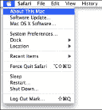

要访问菜单中的选项，您通常使用鼠标控制光标并选择其中一个选项。您可以通过两种方式选择菜单选项：


- **点击并点击**。将鼠标光标移动到菜单标题上并点击鼠标按钮以显示菜单选项列表。现在沿列表向下移动鼠标，高亮您感兴趣的菜单选项。点击该菜单选项以激活它。高亮的选项会闪烁，表示已选择，随后 Mac OS X 将在应用程序中执行该菜单选项设计的任何操作。
- **点击并释放**。将鼠标光标移动到菜单标题上，点击并按住鼠标按钮。在按住鼠标按钮的同时，向下移动到想要选择的菜单选项，并在项目被高亮时释放鼠标按钮。菜单选项会闪烁，应用程序将执行其设计的任何操作。

您所使用的方法很大程度上取决于个人喜好。

某些菜单选项可能会展开以显示更多选项。这些被称为子菜单；子菜单通过菜单选项右侧的小黑色三角形来指示（见图 2.2）。将鼠标光标移动到这些菜单选项之一上，子菜单将向右展开并呈现更多选项。（在某些应用程序中，子菜单可能会向左展开。）将鼠标移动到子菜单中允许您选择这些进一步的选项。子菜单包含进一步的子菜单选项（称为嵌套子菜单）很少见，尽管某些复杂的程序具有嵌套子菜单（`Adobe Dreamweaver CS4` 就是一个例子）。

> **注意**
>
> 导航子菜单时，鼠标光标必须保持在子菜单的范围内；如果它离开了该区域，子菜单将关闭。

## 图 2.2

菜单选项右侧带有小黑色三角形的项会指向子菜单选项。

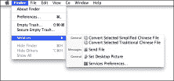

选择菜单选项通常会向程序发出命令，例如 `Mail` 中的`发送新邮件`（在`文件`菜单中找到），这表示您想向某人发送封新电子邮件。或者，您可以使用菜单选项来更改文档中某些状态，例如文字处理程序中的字体大小。通常情况下，您先选择对象（在文字处理程序中通过高亮文本），然后选择菜单选项（如`字体⇒加粗`）来更改它。

选定的菜单选项打开对话框也是很常见的。这些对话框提供了与所选菜单选项相关的进一步选项。

某些菜单选项可能会以浅灰色文本显示（这种视觉效果通常被称为灰色置”），这表示该菜单项目前不可用。常见的例子是，在大多数应用程序中，如果没有打开任何文档，`保存`和`打印`菜单选项将处于置灰状态（因为没有正在处理的文档可以保存或打印）。

在 Mac OS X 中，当您点击菜单标题显示选项列表时，无论您将鼠标移动到哪里，列表都会留在屏幕上。这有助于防止意外的鼠标移动导致菜单烦人地关闭。如果您点击了菜单标题并决定不想选择任何选项，只需点击屏幕上的任何地方（菜单选项之外）即可关闭菜单并继续工作。

> **提示**
>
> 当在菜单选项之间移动时，您可能会注意到某些选项旁边带有符号和字母。这些是键盘快捷键，代表您可以使用组合键代替鼠标来选择菜单选项。

# 理解为什么只有一个菜单栏

屏幕顶部的菜单栏是 Mac OS X 桌面的固定设置，也是 Mac OS X 环境与 Windows 环境之间的关键区别。在 Mac OS X 中，这个单一菜单栏的选项会根据当前激活的程序而变化；在 Windows 环境中，菜单出现在桌面上打开的每个窗口顶部，因此当打开了多个应用程序时，很容易点到错误的菜单，因为每个程序都有自己独立的菜单栏。Mac OS X 中菜单的单一位置是该操作系统被认为比 Windows 友好得多的之一。

## 熟悉菜单栏项目

尽管菜单栏会根据当前激活的应用程序而变化，但菜单栏左侧的几个菜单选项是所有应用程序通用的：``、`文件`、`编辑`、`窗口`和`帮助`。在菜单栏右侧是一些图标菜单，无论突出哪个应用程序，它们都保持不变。其他菜单选项则根据激活的应用程序而异。

### ``（Apple）菜单

菜单栏最左侧是 `` 菜单（称为 Apple 菜单）。此菜单中的选项通常与 Mac 整体相关，以及系统级选项和命令。您可以使用这里的菜单选项获取有关 Mac 的信息、执行软件更新并更改系统偏好；您还可以注销、让电脑睡眠或完全关机。

由于这些 `` 菜单选项无论打开什么应用程序都保持不变，让我们深入查看它们。这些选项包括：

- **关于本机**。选择此菜单选项会弹出一个显示有关 Mac 信息的窗口。它告知您正在运行的是哪个版本的 Mac OS X、处理器速度、Mac 的内存（随机存取存储，即 `RAM`）以及您的启动磁盘。该窗口中还有一个标记为`更多信息`的按钮；点击它将打开`系统报告`实用程序，提供有关计算机各个方面的详细信息。
- **软件更新**。选择此菜单选项将打开“软件更新”应用程序并自动连接到互联网寻找 Mac OS X 以及您的 Mac 上安装的各种 Apple 程序的更新。
- **Mac OS X 软件**。选择此菜单选项将打开您的默认浏览器并导航到 Apple 网站的下载区域（[www.apple.com/downloads](http://www.apple.com/downloads)）。
- **系统设置**。选择此菜单选项将打开“系统设置”应用程序，您可以在其中调整 Mac OS X 环境的各个方面。系统设置将在第 21 章进行详细介绍。
- **Dock**。选择此选项将打开一个子菜单，提供对 `Dock` 的控制（本章稍后会详细介绍）。您可以通过此菜单选项快速调整 `Dock` 的放大效果和位置。
- **位置**。此菜单选项与`网络`系统设置配合使用（该设置允许您为不同的环境设置不同的网络偏好）。通常，笔记本电脑用户可能会将 Mac 连接到家庭网络以及工作网络，并可能根据环境有不同的设置。（网络连接将在第 10 章进行详细介绍。）`位置`菜单选项提供了一个用于选择不同位置的子菜单，以便为您的当前位置激活相应的网络设置。只有当您使用`网络`系统设置了多个网络位置时，此菜单选项才会出现。
- **最近项目**。这个特别实用的菜单选项带您进入包含三个独立区域的子菜单：应用程序、文档和服务器。每个区域都包含您在 Mac 上使用的最后十个相应项目。因此，您将获得最近使用的十个应用程序、打开的文档以及访问过的服务器位置的列表。
- **强制退出**。此菜单选项将弹出`强制退出`对话框，该框显示 Mac 上正在运行的所有应用程序，您可以在此处强制让无响应的应用程序退出。虽然极少需要使用`强制退出`菜单选项，但它可以防止您不得不重启电脑。`强制退出`对话框将在第 7 章进行更详细的介绍。（您也可以按 `Option+⌘+Esc` 打开`强制退出`对话框。）
- **睡眠、重启和关机**。当您想停止手头的工作时，会使用这三个菜单选项。`睡眠`会关闭显示器并将您的电脑进入低功耗模式（点击鼠标或键盘即可唤醒）。`关机`会关闭您的电脑。`重启`会关闭电脑并自动开始启动过程。
- **注销**。最后一个选项标记为`注销 用户名`，例如`注销 Mark`。这用于注销您的会话；您需要重新登录（如本章早些时候）才能再次在 Mac 上开始工作。这种注销选项通常用于工作环境，因为电脑存储了敏感信息，在没有授权用户现场的情况下不应被访问。（在这种情况下，您在离开电脑休息时应该注销。）正如第 20 章所示，它还用于在同一台 Mac 的不同用户账户之间切换。

## 应用程序菜单

在 `` 菜单右侧是应用程序菜单，其标题通常表示当前正在运行的应用程序。由于菜单项目的空间有限（通常只有一两个单词），它并不总是与应用程序的名称完全匹配。例如，`Adobe Photoshop CS4` 的应用程序菜单简单地列为“Photoshop”。此菜单可以作为当前活动应用程序的方便指示，还包含了一份适用于整个应用程序的项目列表。

应用程序菜单中的选项取决于所涉及的应用程序，尽管某些选项在大多数应用程序中是通用的。它们包括：

- **关于**。这通常标记为程序的名称，例如`关于 Safari`；选择此菜单选项将弹出有关您正在运行的应用程序的信息。通常，这些信息限于程序名称、其图标、版本号和一些版权信息。
- **设置**。大多数应用程序都有一组设置，允许您配置和个性化该程序。您通过`设置`菜单选项访问所有应用程序的设置。（您也可以按 `⌘+, [逗号]` 打开当前应用程序的设置。）
- **服务**。`服务`菜单选项将进入一个子菜单，列出 Mac OS X 提供的当前应用程序可用的所有服务。服务将在第 16 章进行详细介绍。
- **隐藏和显示**。这些菜单选项允许您隐藏和显示应用程序。有两个“隐藏”菜单选项和一个“显示”菜单选项：
  - **隐藏 应用程序名称**（例如`隐藏 邮件`）。这通常有快捷键 `⌘+H`；它会隐藏该应用程序及其所有窗口。
  - **隐藏其他**。这通常有快捷键 `Option+⌘+H`；它会隐藏活动应用程序之外的所有应用程序。
  - **显示所有**。此菜单选项将找回所有运行应用程序的所有窗口。

### 交叉引用

我们将在本章稍后部分详细介绍窗口的控制。

- **退出**。`退出`菜单选项（同样，通常写为`退出`后跟应用程序名称，例如`退出 邮件`）关闭程序。您也可以直接按 `⌘+Q`。

## 文件菜单

`文件`菜单包含与活动程序使用的文档（或文件）相关的选项。这在 Mac OS X 环境下使用的大多数程序中都是通用的，尽管少数应用程序和游戏（例如 Mac OS X 包含的`国际象棋`游戏）可能会省略`文件`菜单，因为它们不处理文档。菜单选项包括：

- **新建**。通常`文件`菜单以一系列`新建`菜单选项开头，这些选项通常与启动新文件或文档有关。有时，在`访达`中，它们用于创建新文件夹。在`邮件`中，它们用于创建新的电子邮件。通常，选择`文件⇒新建`的快捷键是 `⌘+N`。
- **打开**。`打开`菜单选项用于加载以前创建并保存的文档。通常还有一个`打开最近`命令，其包含一个该应用程序最近保存的文档列表。偶尔会有其他类型的`打开`命令：例如在`Safari`中，可以找到打开 URL 的命令。通常，选择`文件⇒打开`的快捷键是 `⌘+O`。
- **保存**。在打开选项之后通常是保存文档的选项。通常都有`保存`和`另存为`菜单选项。如果文档尚未保存，`保存`命令将呈灰色，只有`另存为`命令可用（这意味着您需要`另存为`并为文档命名）。通常，选择`文件⇒保存`的快捷键是 `⌘+S`，选择`文件⇒另存为`的快捷键是 `Shift+⌘+S`。
- **打印**。通常在`文件`菜单底部是`打印`菜单选项。它打开`打印`对话框，允许您将文档内容导出到纸张。在 Mac OS 中，还可以可以将文档打印为 `PDF`（便携文档格式）文件，这是一种保留并与其他用户共享的电子打印，或者通过`打印`对话框中的选项将其传真。（打印将在第 17 章进行详细介绍。）通常，选择`文件⇒打印`的快捷键是 `⌘+P`。

## 视图菜单

另一个常见的菜单是`View`（视图），用于控制文档的显示。菜单选项本身因应用程序而异：例如在`iCal`中，你使用`By Day`（按天）、`By Week`（按周）和`By Month`（按月）菜单选项来查看和浏览日历。

## Window 菜单

此菜单允许你控制窗口。顶部的两个常用菜单选项是`Minimize`（最小化到 Dock）和`Zoom`（缩放至桌面全尺寸）。另一个常用选项是`Bring All to Front`（全部置于顶），它会将与应用程序相关的所有窗口带到`Mac OS X`正在使用的其他窗口的最前面。`Window`菜单还列出了其他类型的窗口和面板（通常是带有控件的浮动窗口）。这些内容随应用程序而异。

## Help（帮助）菜单

此菜单允许你访问屏幕上的帮助。顶部是`Search`（搜索）字段，在其中输入内容会显示菜单选项的解释和帮助主题。这些解释与菜单栏中相应的命令相关，你可以使用它们快速定位项目。帮助主题会打开`Help`浏览器，它为`Mac OS X`的每个领域都提供系列建议。关于使用`Mac OS X`内置帮助系统的更多信息在第 5 章中进行了概述。`Search`字段下方通常是一组专用帮助选项。这些选项对应于整个应用程序，或与应用程序相关的特定领域。

## 理解菜单栏图标

菜单栏右侧分布着各种与系统级功能相关的不同图标。这些可能包括：

### Time Machine（时光机）


这个标志性菜单（一个小的逆时针圆形箭头图标）代表`Time Machine`备份实用工具的状态（第 4 章将详细介绍`Time Machine`）。它提供了执行备份、恢复文件和调整偏好设置选项。

### MobileMe 和 iSync


如果你订阅了苹果的`MobileMe`服务（第 15 章中概述），你可以使用这个标志性菜单（其图标是一组弯曲的箭头）同步你所有的`MobileMe`数据并打开`MobileMe`系统偏好设置。该标志性菜单还显示`Mac OS X`的`iSync`工具的状态，正如第 8 章解释的，它可以将`iCal`和`Microsoft Entourage`等应用程序相互之间以及与智能手机等设备进行同步，并有一个`Sync`菜单项来强制同步。

### Volume（音量）


点击此标志性菜单（喇叭图标）会弹出一个垂直滑块，你可以通过它调整 Mac 发出的噪音响度。随着你增大音量，图标会变化，显示更多从喇叭发出的“声波”。你也可以通过`Sound`系统偏好设置（第 21 章描述）调整音量水平，移动`Volume`图标按钮的滑块会相应调整`Sound`系统偏好中的滑块。

### AirPort


`AirPort`是苹果对 Wi-Fi 的术语，如果你在 Mac 中安装了无线网卡，就会出现此图标菜单（除了`Mac Pro`系列外的所有 Mac 都默认安装了`AirPort`卡）。该图标由四个弧组成，类似于雷达显示，亮起的弧数量对应相应无线路由器的信号强度。如果`AirPort`关闭或没有信号，符号将是一个空轮廓（样式类似于棒球场的形状）。你可以使用`AirPort`图标菜单加入本地无线网络、创建无线网络，或访问`Network`系统偏好设置。

### Time（时间）


右侧的下一个常用图标菜单项是时间；默认情况下，它显示为星期的缩写和 24 小时制的时间。点击时间会显示完整日期以及以模拟或数字形式查看时间的选项；你也可以访问`Date & Time`系统偏好设置。

### New Feature（新功能）

你现在可以在菜单栏中同时显示日期和时间。在以前的`Mac OS X`旧版本中，菜单栏显示时间，点击时间则显示日期。在`Date & Time`系统偏好设置的`Clock`面板中的两个新选项——`Show the Day of the Week`（显示星期）和`Show Date`（显示日期）允许你将这些信息添加到菜单栏。第 21 章有关于`Date & Time`系统偏好设置的更多信息。

### User（用户）


如果启用了`Fast User Switching`（快速用户切换），菜单栏右侧会显示此菜单的三变体之一：头像图标、你的完整用户名或你的账户的`Mac`短名。（正如第 20 章解释的，你通过使用`Accounts`系统偏好设置中的`Fast User Switching`选项来设置图标菜单的显示方式。）点击此图标菜单允许你选择不同的用户。你也可以从这里访问系统并切换到另一个账户（这与``菜单中的`Log Out`选项不同）。最后，此图标菜单还提供了对`Accounts`设置的快速访问。

### Bluetooth（蓝牙）


如果在 Mac 上启用了蓝牙，菜单栏中会出现`Bluetooth`图标菜单（一个蓝牙化的蓝牙`图标）。你可以使用它设置设备、让你的 Mac 可被发现、浏览设备并打开`Bluetooth`系统偏好设置。

### Spotlight（聚焦）


屏幕最右侧是`Spotlight`图标菜单（放大镜图标）。点击它会弹出一个搜索框，你可以在其中输入词来搜索磁盘。`Spotlight`是一项渗透`Mac OS X`环境的力量技术，你在这里输入的词可以搜索应用程序、文档、文件夹、电子邮件甚至是你的音乐和视频收藏。第 3 章将详细介绍`Spotlight`。

如果你在“语言与文本”系统偏好设置的“输入源”面板中启用了“键盘与字符查看器”选项，标志性的菜单将以框中星号的图标显示。如果你在“语言与文本”系统偏好设置的“输入源”面板中为 Mac 启用了多个键盘布局（参见第 21 章）——例如加拿大英语和加拿大法语——输入源图标菜单的图标将变为你默认键盘所在国家的国旗，且弹出菜单会增加两组选项。首先，它为你在“语言与文本”系统偏好中启用的每个键盘布局添加一个菜单选项。其次，它添加了“语言与文本”选项，以便快速访问语言与文本系统偏好设置。

## 新功能

“语言与文本”系统偏好是 Mac OS X 10.6 雪豹版中对原“国际”系统偏好的新名称。

## 显示


显示图标菜单（显示器图标）让你能够快速访问 Mac 使用显示器的几项选项。“检测显示器”选项允许 Mac OS X 确定当前连接到机器的显示器类型。（如果你经常更换显示器，这非常有用）。此设置下方是你的 Mac 可用的各种最近使用的屏幕分辨率设置，以及一个“最近项目”子菜单。这允许你决定菜单中出现多少个屏幕分辨率设置（0、3、5 或 10 个）。最后一个选项允许你启动“显示”系统偏好设置。

## 电池状态


如果你在“语言与文本”系统偏好设置的“输入源”面板中启用了“键盘与字符查看器”选项，标志性的菜单将以框中星号的图标显示。

如果你在“语言与文本”系统偏好设置的“输入源”面板中为 Mac 启用了多个键盘布局（参见第 21 章），例如加拿大英语和加拿大法语，输入源图标菜单的图标将变为你默认键盘所在国家的国旗，且弹出菜单会增加两组选项：

1. 它为你在“语言与文本”系统偏好中启用的每个键盘布局添加一个菜单选项。
2. 它添加了“语言与文本”选项，以便快速访问语言与文本系统偏好设置。

## 新功能

“语言与文本”系统偏好是 Mac OS X 10.6 雪豹版中对原“国际”系统偏好的新名称。

## 显示


显示图标菜单（显示器图标）让你能够快速访问 Mac 使用显示器的几项选项。“检测显示器”选项允许 Mac OS X 确定当前连接到机器的显示器类型。（如果你经常更换显示器，这非常有用。）

此设置下方是你的 Mac 可用的各种最近使用的屏幕分辨率设置，以及一个“最近项目”子菜单。这允许你决定菜单中出现多少个屏幕分辨率设置（0、3、5 或 10 个）。最后一个选项允许你启动“显示”系统偏好设置。

## 电池状态


带有电池的 Mac 笔记本电脑用户在菜单栏中也有一个“电池状态”图标菜单（电池图标）。如果你的 Mac 连接了电源适配器，电池符号将包含一个小小的插头图形；如果拔掉电源线，电池将显示一个黑色条，显示电池中剩余的大约电量。（电量低时，条会变成红色。）

点击图标会打开一个菜单，告知你大约还可以持续使用多久 Mac（或者，如果插了电源适配器，则为 Mac 大约需要多久充电）。下方是关于当前由哪种电源源（电池或电源适配器）为你的 Mac 供电的确认信息。虽然此确认信息显示为菜单选项，但你无法选择它。

还有一个名为“显示”的子菜单选项，你可以用它设置图标菜单是仅显示图标、显示图标和剩余电池时间，还是显示图标以及剩余电池容量的百分比。最后一个菜单项将带你进入“节能”系统偏好设置。

## 通用访问状态


通用访问图标菜单（图标为圆内的人形）为 Mac 的所有辅助功能提供了快速开启/关闭选项。这些选项只有在“通用访问”系统偏好设置中启用后才可用。第 6 章提供了有关 Mac OS X 通用访问选项的更多信息。

## 真真


如果你在 Mac 上设置了真真，则会显示真真图标菜单（纸上的电话图标）。你可以接听来电并管理真真状态。第 17 章有更多关于在 Mac 上设置真真服务的信息。

## 调制调器


如果你使用拨号调制调器，可以显示调制调器图标菜单（电话图标）来控制拨号服务。你可以通过图标菜单中的选项，通过电话连接和断开互联网。关于访问互联网的更多信息请见相关章节。

## AppleScript


如果你使用拨号调制调器，可以显示调制调器图标菜单（电话图标）来控制拨号服务。你可以通过图标菜单中的选项，通过电话连接和断开互联网。关于访问互联网的更多信息请见相关章节。

Apple 在其自身的键盘标记上一直不一致；例如，2006 年以来的 MacBook 键盘和 2009 年以来的 Mac 桌面键盘将 Control 键标记为 `Ctrl`，而 2009 年以来的 Mac 键盘在 Command 键上打印 `Cmd` 而不是 `Ú`。

2006 年以来的 MacBook 键盘列出 `Enter` 和 `Return`，而不是使用 `entr` 和 `retr` 符号；并且使用 `Option` 而不是 `%` 符号。

以下是菜单中组合键符号及其对应的指南：

| 符号 | 键 |
| :--- | :--- |
| Ô | Command 键 |
| % | Option 键 |
| $ | Shift 键 |
| # | Control 键 |
| r | Return 键 |
| B | 数字键盘 Enter 键 |
| ^ | 删除键（退格） |
| & | 删除键（向前删除） |
| D | Tab 键 |
| ) | 弹出键（并非所有键盘上都有） |
| ( | Escape 键 |

当你按下键盘快捷键时，菜单栏上的项目会短暂闪烁，表示已选择菜单选项，尽管菜单本身不会展开以显示所调用的具体选项。

### 提示

键盘快捷键可以极大提高你的工作速度，非常值得学习。你可以通过查看键盘系统偏好设置中的“键盘快捷键”面板来发现许多快捷键。

在这里，你不仅可以学习键盘快捷键，还可以像第 21 章所解释的那样创建你自己的快捷键。Apple 在其网站上也提供了一份常用的键盘快捷键列表：[`support.apple.com/kb/HT1343`](http://support.apple.com/kb/HT1343)。

### 使用 Dock

现在你已经熟悉了菜单栏，是时候看看 Mac OS X 的第二个支柱性界面设备——Dock，如图 2.4 所示。

Dock 位于屏幕底部，是常用应用程序、文件和 Mac OS X 功能的容器。Dock 使用了许多视觉效果，包括半透明、反射和放大，因此它展示了 Apple 传奇般的视觉魅力。但不要被它骗了，认为它仅仅是一个视觉噱头。Dock 是一个强大的组织工具，可以将你最重要的项目置于面前，以便立即访问。

#### 图 2.4

Dock 是一个视觉条，用于快速打开和切换应用程序，并可以访问和存储文件及文件夹。


Dock 是一个异常直观的设备，具有多种不同的用途。默认情况下，它是一个用于启动应用程序和访问常用文件及文件夹的水平条。

Dock 被分为两半。一条容易被忽略的由 3D 虚线组成的灰色分割线标记了分界，就像道路上的车道隔离线。左侧用于应用程序，而右侧则用于文档、文件夹和最小化的窗口。可以调整 Dock 的位置和视觉外观，我们将在本书稍后部分介绍。

Dock 包含一组图标，你可以随意地重新排列或删除它们。必须留在 Dock 上的两个图标是左侧的 `Finder` 和右侧的 `Trash`（垃圾桶）图标。默认情况下，以下项目的图标出现在 Dock 上：

- `Finder`：Mac OS X 用于管理电脑上文件和文件夹的主要应用程序。本章稍后将深入描述 `Finder`，但它始终保持打开状态，是 Dock 左侧的固定设置。
- `Dashboard`：访问和管理小组件的控制中心。Dashboard 使用的小型应用程序将在本章稍后介绍，小组件将在第 8 章中介绍。
- `Mail`：Apple 用于发送和接收电子邮件的程序。
- `Safari`：Mac OS X 自带的 Web 浏览器。
- `iChat`：Apple 的即时消息程序。
- `Address Book`：用于存储联系人信息（人和公司）的应用程序。Mac OS X 中的多个应用程序都可以使用存储在 `Address Book` 中的信息。
- `iCal`：Apple 的日历应用程序，用于记录重要的日期和事件，以及一个待办任务管理器。
- `Preview`：用于快速查看文件内容的应用程序。
- `iTunes`：用于存储和播放音频视频文件的应用程序，并管理和同步 iPod 和 iPhone 等其他 Apple 设备。
- `Spaces`：用于组织和在多个桌面环境之间移动的系统偏好设置。
- `Time Machine`：Apple 内置的备份工具。点击图标可以让你恢复意外删除的文档。
- `System Preferences`：让你能够调整 Mac OS X 的各个方面。
- `Applications`：`Applications` 文件夹的别名。
- `Documents`：`Documents` 文件夹的别名。
- `Downloads`：`Downloads` 文件夹的别名。
- `Trash`：包含你已丢弃文件的文件夹。清空 `Trash` 将从 Mac 中永久删除文件。与 `Finder` 一样，`Trash` 图标是 Dock 的固定设置。

将鼠标悬停在 Dock 图标上会显示应用程序、窗口或文档的文本描述。

当你使用应用程序、打开文档和最小化窗口时，图标会被临时添加到 Dock 中。这会让初学者感到困惑，尽管很快就会变成本能。

你可以通过对图标进行 `Control+点击` 或右键点击，然后从上下文菜单中选择 `Keep in Dock`（留在 Dock 中）来将图标留在 Dock 中。

### 新功能

通过 `Control+点击` 或右键点击图标，然后从上下文菜单中选择 `Keep in Dock`（留在 Dock 中）来将图标留在 Dock 中。

### 提示


要快速访问 Dock 项目的选项，长按鼠标上的 Dock 项目几秒钟即可打开上下文菜单。

## 从垃圾桶恢复项目

当你将项目丢进`Trash`时（无论是通过拖动还是通过菜单选项或快捷键删除），你实际上是把它们放入了一个文件夹。所以只要在清空`Trash`之前，就可以从`Trash`中取出项目。有两种方法从`Trash`取出，两种方法都是双击 Dock 中的`Trash`打开它。（你也可以选择它并选择`文件⇒打开`、按下`Command+O`，或右键点击并选择`打开`。）打开垃圾桶文件夹后，你有以下选项：

- 将项目拖到桌面或电脑上的其他位置。这让你可以把它放在任何地方。
- `Control+点击`或右键点击项目并从上下文菜单中选择`Put Back`（还原）。Mac OS X 会记住项目进入`Trash`之前的位置。

### 查看 Dock 的应用程序侧

任何正在使用的应用程序在 Dock 中都有一个图标。当你打开应用程序时，图标会在 Dock 中上下跳动，表示正在加载。然后它会停留在 Dock 中，下方有一个小的蓝白圆圈，表示应用程序正在运行。当你退出应用程序时，图标会从 Dock 中消失（除非它已被添加到 Dock 中，如果是这样图标将保留，但蓝白圆圈会消失）。有三个例外：`Dashboard`、`Spaces`和`Time Machine`图标。点击其中任何一个都会直接进入相应的功能。我们在第 4 章查看`Time Machine`，第 8 章查看`Dashboard`，第 21 章查看`Spaces`。

如前所述，在 Mac OS X 中打开的任何应用程序，其图标都会临时被添加到 Dock（程序坞）中。当应用程序关闭时，该图标就会从 Dock 中消失。

如果你发现自己经常使用某个应用程序，那么在应用程序关闭时将该图标保留在 Dock 中可能会有所帮助。这意味着你可以通过点击图标来快速打开该应用程序。你可以通过两种方式将应用程序项目添加到 Dock 中：

- 找到所需的应用程序（通常位于`Applications`应用程序文件夹中），并将其拖到 Dock 的左侧。请注意，这不会将应用程序从`Applications`文件夹复制到 Dock 中；而是在 Dock 中创建一个指向该应用程序的别名（alias），因此当点击 Dock 中的图标时，它会打开`Applications`文件夹中的该应用程序。
- 找到所需的应用程序并双击它将其打开。这会将其图标临时放置在 Dock 中。现在，在 Dock 中的图标上使用`Control+点击`或`右键点击`，并从弹出菜单中选择`保留在 Dock 中`（Keep in Dock）。现在，当程序关闭时，该图标仍会保留在 Dock 中。（注意：你可以使用此技术将打印机的图标保留在 Dock 中。）

### 访问应用程序上下文菜单

与 Mac OS X 中的大多数项目一样，你可以通过在 Dock 中的图标上进行`Control+点击`或`右键点击`来访问每个应用程序的上下文菜单（参见图 2.5）。请注意，上下文菜单会根据程序是否打开而变化；如果仅显示图标，则会出现以下选项：

- **选项**（Options）。选择此子菜单将显示两个另外的选项：
  - **从 Dock 中移除**（Remove from Dock）。选择此选项会将图标从 Dock 中移除；这实际上等同于将图标拖出 Dock。
  - **在登录时打开**（Open at Login）。选择此选项可确保程序在你启动并登录 Mac 时启动。如果你有一个在启动 Mac 后就会立即使用的程序，这会非常有用。正如第 21 节所解释的，登录项在`Accounts`（账户）系统偏好中设置。
- **在 Finder 中显示**（Show in Finder）。由于图标是存在于`Finder`中的项目的别名，你可以通过此选项快速打开`Finder`窗口并显示原始项目。
- **打开**（Open）。选择此选项将打开该应用程序。

在 Dock 中，打开的应用程序（通过下方蓝白相间的发球识别）可能根据应用程序具有额外的选项。例如，`Mail`有以下选项：`获取新邮件`、`编写新信息`和`编写新笔记`；`Safari`有在已打开浏览器窗口之间切换的选项；`系统偏好设置`拥有所有可用系统偏好的完整列表。

除了自身的自定义选项外，打开的应用程序始终具有以下菜单选项：

- **隐藏**（Hide）。选择此选项会将打开的窗口从桌面移除。当你选择此选项时，它在上下文菜单中的名称将变为`显示`（Show），你可以用它找回应用程序的窗口。
- **退出**（Quit）。选择此选项将退出应用程序。

### 使用 Dock Exposé

Mac OS X 10.6 雪豹系统（Snow Leopard）有一项名为`Dock Exposé`的新 Dock 功能，它可以与 Dock 中的应用程序图标配合。如果你在 Dock 中点击并按应用程序图标，所有与该应用程序相关的文档窗口将使用 Apple 的`Exposé`技术显示在屏幕上。点击应用程序图标会使`Exposé`显示与该应用程序相关的任何窗口。与 Dock 项目相关的活动窗口显示在屏幕上半部分，而最小化的窗口则以略小的图形显示在屏幕下半部分。第 8 章有关于`Exposé`的更多信息。

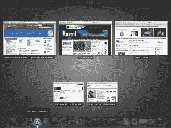

图 2.5

`Control+点击`或`右键点击`Dock 项目会显示带有与 Dock 项目相关的选项的上下文菜单。这些选项取决于 Dock 项目以及它是否有任何相关的窗口。


**提示**（Tip）

在访问应用程序的上下文菜单时按住`Option`键会更改某些选项。`隐藏`选项将变为`隐藏其他`（Hide Others），用于隐藏除选定应用程序之外的所有其他应用程序的窗口；`退出`将变为`强制退出`（Force Quit），可以用它来关闭冻结的应用程序（`强制退出`在第 7 节中解释过）。

鉴于`Finder`是始终打开的，它始终与其他应用程序显示不同的选项。`Finder`提供的上下文菜单选项包括：

- **新建 Finder 窗口**（New Finder Window）。此选项打开一个新窗口，用于浏览你 Mac 上的文件。`Finder`在本章后面将详细解释。你也可以简单地按`Option+N`。
- **新建智能文件夹**（New Smart Folder）。智能文件夹是根据预定义标准收集文件的“智能”文件夹。智能文件夹的创建在第 3 章中解释。你也可以简单地按`Option+Option+N`。
- **查找**（Find）。`查找`选项将打开`Finder`窗口并直接带你进入`Spotlight`搜索区域。你也可以简单地按`Option+F`。
- **前往文件夹**（Go to Folder）。`前往文件夹`命令用于使用路径名（pathname）直接导航到文件夹。`pathname`是所有由`/`字符包围的文件夹名称；例如，`/Library/Documentation`。你也可以简单地按`Shift+Option+G`。
- **连接服务器**（Connect to Server）。此命令用于连接本地和远程服务器。你也可以简单地按`Option+K`。

**提示**（Tip）

如果你在按住`Control`和`Option`键时点击 Dock 中的`Finder`图标（或者你按住`Option`键并右键点击），上下文菜单会添加一个`重新启动`（Relaunch）选项。此选项会强制退出`Finder`并重新启动它，当`Finder`冻结时你可能需要这样做。

### 查看 Dock 的右侧

Dock 的右侧是你放置文档、文件夹和磁盘的地方。当你将文档放置到 Dock 时，点击它将使用默认应用程序打开它。（如有需要。）

你也可以通过`Control+click`或右键点击 Dock 中的图标，并选择`Remove from Dock`（从 Dock 中移除）来移除图标。

## 在 Dock 中移动图标

你可以通过鼠标点击并向左右拖动图标来重新排列 Dock 上的项目。时机非常关键，因为如果你按住鼠标键过长而不移动鼠标，就会弹出右键菜单。当你移动图标时，其他图标会移动以为它腾出空间。请记住，你不能将应用程序和文档/文件夹移动到各自所在的一侧之外。（如果你尝试这样做，图标将滑回原始位置。）由于图标本身并不是文档，因此你无法将文档图标移动到文件夹图标内部。

### 注意事项

在移动文件时要小心，留意图标上是否出现了“云雾”图像。该云雾图像的出现意味着你正准备将图标从 Dock 中移除，这很容易不小心发生。如果你不打算将图标从 Dock 中移除，请按住鼠标键并将图标移回 Dock；然后你就可以松开鼠标键了。（在云雾图形出现时松开鼠标键会将图标从 Dock 中移除。）

## 理解“堆栈”（Stacks）

当你开始向 Dock 添加文件夹或磁盘，并使用它快速检查和访问其内容时，Dock 的强大之处就显而易见了。苹果将此功能称为`Stacks`（堆栈）。

当你将文件夹添加到 Dock 时，它被称为`Stack`（堆栈）。因为该图标是由文件夹中项目的小图像堆叠而成的。点击 Dock 中的图标可以通过以下三种方式之一显示堆叠的内容：**扇形**（fan），以略微弯曲的垂直线形式显示包含的项目；**网格**（grid），在灰色半透明背景上以弹出正方形网格形式显示项目；或者作为**列表**（list），以标准的线性菜单排列方式显示项目。

默认情况下，`Stack`中的项目会根据项目数量自动以扇形或网格模式出现。如果一个`Stack`包含九个或更少项目，它将以扇形显示；如果包含十个或更多项目，它将以网格形式显示。（你可以使用右键菜单中的选项覆盖这些默认设置，并为单个文件夹选择扇形或网格模式。）

当打开`Stack`并显示内容时，你可以点击某个项目来打开它，或拖动项目将其移出`Stack`（包括将其拖动到`Trash`垃圾桶进行删除）。

然而，`Stack`中的项目也有许多操作是无法完成的。你不能通过点击并拖拽来重新排列`Stack`中的项目。（点击项目会立即关闭`Stack`并让项目留在你的鼠标下方。）你不能通过拖动鼠标来选择多个项目——它们必须单独处理。最后，你无法对`Stack`中的项目进行`Control+click`或右键点击来打开右键菜单。

`Stack`的设计目的是快速简单地访问其中包含的项目。如果你想对`Stack`中的项目进行任何复杂的操作，你需要打开该`Stack`所指的原始文件夹。幸运的是，每个`Stack`都包含一个实用的`Open in Finder`（在 Finder 中打开）图标；点击它将直接带你进入`Finder`中包含所有原始项目的文件夹。

### 新功能

Mac OS X 10.6 Snow Leopard（雪豹）在网格模式下使用`Stacks`时有两个新功能。首先，你现在可以滚动文件和文件夹：如果屏幕上可以显示的项目更多，就会出现一个滚动条，你可以使用鼠标（包括滚动条或鼠标的滚轮）来导航项目。其次，你可以导航文件夹：点击`Stack`中的文件夹将在一个新的`Stack`中打开该文件夹的内容，在`Stack`的左上角，你会看到一个包含上一个文件夹名称的“返回”（Back）图标按钮。点击此“返回”按钮将带你回到上一个文件夹的内容。

### 注意

如果你在打开`Stack`时按住`Shift`键，或在`Stack`中`Shift+click`项目，列表将使用慢动作打开或关闭，速度非常慢。这似乎是一个彩蛋，是开发者有时为了好玩而在应用程序中插入的无用或幽默的设计。

## 文件夹的右键菜单选项

如果你对 Dock 上的文件夹或`Stack`进行`Control+click`或右键点击，将看到包含若干选项的右键菜单，这些选项会影响文件夹及其内容的显示方式：

- **Sort by**（排序方式）：文件夹中的项目会自动排序，你无法手动重新排列。默认情况下，它们按名称字母顺序排序，但你可以在此处更改为`Date Added`（添加日期）、`Date Modified`（修改日期）、`Date Created`（创建日期）或`Kind`（类型）。
- **Display As**（显示方式）：此选项与 Dock 图标本身有关，而不是展开的`Stack`。默认情况下，拖动到 Dock 的文件夹显示为`Stacks`，这意味着图标是由其包含的文件的图像组成的。如果文件夹是空的，则显示基本的文件夹图标而不是`Stack`；选择`Folder`（文件夹）选项可确保显示来自`Finder`的图标而不是`Stack`。这在你向 Dock 添加磁盘时非常有用，因为在桌面上显示的是图标，而不是内容不断变化的`Stack`。
- **View Content As**（以此方式查看内容）：此选项影响展开时`Stack`项目的呈现方式。默认情况下，它设置为`Automatic`（自动），这意味着九个或更少项目将以扇形排列垂直展开；十个或更多项目将以网格形式描绘。在 Dock 文件夹图标上进行`Control+click`或右键点击，使用`View Content As`菜单将布局改为`Fan`（扇形）、`Grid`（网格）或`List`（列表）。

在这些选项下方，你会发现之前提到的常用右键菜单项：`Remove from Dock`（从 Dock 移除）、`Show in Finder`（在 Finder 中显示）和`Open`（打开）。对于文件夹，`Show in Finder`和`Open`选项执行相同的操作。

## 最小化窗口到 Dock

Dock 的另一个功能是作为最小化窗口的占位符。你可以点击窗口的黄色最小化按钮、选择`Window⇒Minimize`或按下`Option+M`将窗口最小化到 Dock。最小化的窗口会缩小成带有巧妙“精灵效果”动画的 Dock 图标。Dock 图标本身是窗口的微型版本，通常包含窗口的所有元素。例如，如果窗口是正在播放视频的`QuickTime Player`，那么视频的小图标会在 Dock 中继续播放。（这是向朋友展示 Mac 视觉能力的极佳方法。）点击 Dock 中的最小化窗口将将其恢复到桌面上的原始大小和位置。

### 提示

你可以在 Dock 系统偏好中更改最小化效果；在`Minimize Using`弹出菜单可以选择`Genie Effect`（精灵效果）或`Scale Effect`（缩放效果）。`Genie effect`是默认设置，具有那种精灵进瓶子里的风格。`Scale effect`是一种更直接的、分步骤的快速缩小。（它的存在是因为消耗的资源较少，但现在的 Mac 足够快，任何人都可以精灵效果。）选择`Option⇒System Preferences`然后点击 Dock 图标，或选择`Option⇒Dock⇒Dock Preferences`来打开 Dock 系统偏好。

`Control+click`或右键点击 Dock 中的最小化窗口会弹出右键菜单，提供打开（最大化）最小化窗口或关闭它的选项。如果你选择关闭窗口，系统会提示你保存未保存的数据；如果你尝试退出一个带有未保存数据的最小化窗口的程序，也会出现此提示。

默认情况下，`Dock`位于屏幕底部且尺寸相当大。你可能想更改它的位置、尺寸或以其他方式自定义其外观。

调整`Dock`的所有选项位于`Dock`系统设置中，如第 21 节所示。你也可以通过`Dock`自身的右键菜单来调整`Dock`的许多方面，你可以通过`Control+点击`或右键点击`Dock`上带有分界线的区域来访问该菜单。

**提示**

更改多个`Dock`偏好的的一种快速方法是选择`Dock`，然后选择子菜单中的一个选项：`开启/关闭隐藏`、`开启/关闭放大`、`位于左侧`、`位于右侧`、`位于底部`或`Dock 偏好设置`。

### 调整 Dock 的大小

当由于你向`Dock`中添加或移除项目时，它会向左向右扩展以容纳额外的项目。`Dock`系统设置中的`大小`滑块允许你调整`Dock`中图标的总体大小。图标的总体大小很大程度上取决于你在`Dock`中有多少个图标，但该滑块实际上设置了最大尺寸。

有两种调整`Dock`大小的方法：

- 在`Dock`系统设置中，将`大小`滑块从左向右拖动以找到所需的大小（左侧较小；右侧较大）。如果你在`Dock`中有很多图标，那么你调整`Dock`大小的程度将受到限制。在这种情况下，滑块仍然会移动到最右侧的位置，但`Dock`本身不会变大。
- 将鼠标悬停在垂直分界线上，直到出现`Dock`尺寸调整图标为止（该图标是一条带有上下箭头的白色水平线）。点击并拖动鼠标向上或向左使`Dock`变大；点击并拖动鼠标向下或向右使`Dock`变小。

### 设置 Dock 放大

如果你将`Dock`设置为小于其最大尺寸，则可以使用名为“放大”的视觉效果。这会让鼠标悬停过的`Dock`图标比`Dock`的其他图标变大，就像你正在它上方移动放大镜一样。（图 2.6 显示了这种效果）。

要快速启用放大，选择`Dock⇒开启放大`，或者通过`Control+点击`或右键点击`Dock`中的白色分界线并从右键菜单中选择`开启放大`。（如果已开启放大，菜单选项将标记为`关闭放大`）。或者，勾选`Dock`系统设置中的`放大`选项。你可以使用`放大`滑块来调整 Dock 放大的尺寸。

Dock 放大很大程度上取决于个人选择，许多用户倾向于保持其关闭。放大是一个很棒的视觉效果，可以让你关注鼠标下的图标。然而，它也可能让新学者在图标扩展略微移动时更难以点击所需的图标。尝试这两种风格以发现哪种更适合你。

**图 2.6**

`Dock`放大功能使鼠标下方的图标比周围图标大。这里显示的效果是`大小`滑块的指针位于中间，且`放大`滑块设置为最大。


### 定位和自动隐藏 Dock


默认情况下，`Dock`显示在屏幕底部。然而，你可以将其放置在屏幕的左侧或右侧。

将`Dock`放在屏幕底部的优点是你可以向`Dock`中放入更多图标（或拥有一个稍大的`Dock`），因为屏幕底部比屏幕侧面宽。

此举的另一面是，`Dock`在屏幕底部的定位限制了屏幕上窗口的最大垂直尺寸。考虑到宽屏显示为了水平空间而限制了垂直空间，将`Dock`放置在屏幕侧边可以回收垂直空间，从而使扫描长文档或网站变得更简单。

处理此问题的方法之一是将`Dock`从默认位置移动到屏幕的左侧或右侧。执行此操作，选择`Dock⇒位于左侧`或`Dock⇒位于右侧`，或者通过`Control+点击`或右键点击`Dock`的分界线，并从右键菜单中选择`屏幕位置⇒左侧`或`屏幕位置⇒右侧`。

将`Dock`定位于屏幕左侧或右侧的一个副作用影响是`Dock`的视觉效果略有不同。当`Dock`位于屏幕底部时，它会反射垂直桌面（以及任何附近的窗口）；当它位于窗口的任一侧时，它没有反射效果，因此对比度略高。许多人发现`Dock`的反射效果令人分心，并倾向于在位于屏幕侧面时的高对比度效果。

移动`Dock`的替代方案是在它不需要时让它避开。你可以使用以下方法之一来设置此功能：

- 选择`Dock⇒开启隐藏`。
- `Control+点击`或右键点击`Dock`中的白色分界线，并从右键菜单中选择`开启隐藏`。
- 按`Option+Ô+D`。
- 在`Dock`系统设置中选择`自动隐藏和显示 Dock`选项。

当选中此隐藏选项时，`Dock`在不使用时会自动滑出屏幕。当你把移动到`Dock`隐藏的边缘时，它会自动滑回屏幕，让你像常一样进行选择。这种自动隐藏是利用空间的最佳方式，尽管有些人人希望`Dock`始终显示。

## 设置 Dock 中应用程序的动画

`Dock`系统设置中的最后一个视觉选项是`动画打开应用程序`。这是默认选中的，这意味着点击`Dock`中的应用程序时，它会上下跳动。虽然我们认为这是状态的良好视觉指示，但许多用户觉得这种效果很分心。你可以取消勾选`Dock`系统设置中的`动画打开应用程序`选项来关闭它。如果取消了此选项，启动应用程序时应用程序图标将保持静态。唯一的指示是图标下方的蓝白圆体，它在应用程序加载时会闪烁，在应用程序运行时保持开启。

## 理解桌面

现在你已经熟悉了Mac OS X的两个支柱——菜单栏和`Dock`，是时候将注意力转移到Apple的另一项创新——桌面了。

由于桌面比喻已经使用了很长时间，并在整个计算世界取得了如此广泛的盛誉，大多数用户已经对它非常熟悉了。较年轻的电脑用户可能从未用过没有桌面的电脑，对许多人来说，很难想象一台不使用桌面的电脑。

尽管Mac OS X中使用的桌面基于一种常见的比喻，但它具有许多可能不会立即被发现的特性和功能。

## 了解桌面

从本质上，桌面是屏幕上的背景——位于`Dock`上方和菜单栏下方的开阔空间。默认情况下，每个版本的Mac OS X都有不同的背景，用以标识运行的是哪个版本的Mac OS X。但默认磁盘图标的布局没有变化：启动磁盘出现在桌面的右上角，任何额外的磁盘图标都出现在启动磁盘图标下方。

重要的一点是，尽管桌面是屏幕上的空间，但它也是你用户文件夹（Home folder）内部的一个文件夹，位于`/Users/username/Desktop`。该文件夹中的任何内容在用户用户登录时都会显示在桌面上。而该用户放置在桌面上的任何内容实际上都存放在那个文件夹中。由于不同的用户有不同的用户文件夹，因此桌面是每个用户独有的。（我们将在本章稍后解释Mac OS X的文件夹结构。）

### 注意

尽管磁盘图标出现在桌面上，但它们并没有出现在`/Users/username/Desktop`文件夹内部，甚至不是以别名的形式存在。这些图标出现在桌面上完全是因为Mac OS X将它们放在那里很方便。（它们可以通过Finder的侧边栏访问，如后文所述。）磁盘图标出现在桌面但不在`/Users/username/Desktop`文件夹中的这一事实，是Mac OS所有文件夹都显示其包含项目的规则的一个例外。

## 更改桌面背景

默认情况下，桌面带有名为“极光”（Aurora）的壮丽默认背景。风景（见图 2.7）与推广Mac OS X 10.6雪豹系统的营销材料一致。然而，你可能想更改背景以获得更个性化的计算体验。

你可以将桌面背景更改为任何内容：你可以设置为你选择的任何鲜艳颜色，或者选择功能性的黑色、白色或灰色。此外，Apple还了一系列图像、抽象艺术品和照片。你还可以使用自己的任何照片，互联网上充斥着你可以下载并使用来个性化桌面的桌面图像。

### 图 2.7

Mac OS X的默认桌面以一张迷人的太空风景作为其背景图。注意屏幕右侧的磁盘图标。

```
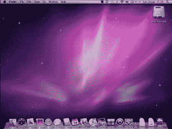
```

要更改桌面背景，你需要打开`Desktop & Screen Saver`系统偏好设置。你可以通过以下任何方法访问此系统偏好设置：

- `Dock`。如果`System Preferences`应用程序图标出现在`Dock`中，你可以点击它打开`System Preferences`。现在点击`Desktop & Screen Saver`图标进入`Desktop & Screen Saver`系统偏好设置，并进入其`Desktop`窗口。
- 菜单栏。选择`Ú⇒System Preferences`。现在点击`Desktop & Screen Saver`图标进入`Desktop & Screen Saver`系统偏好设置，并进入其`Desktop`窗口。
- 上下文菜单。在桌面上`Control+点击`或右键点击（但不要点击桌面中的磁盘或文件夹）以获取上下文菜单，并选择`Change Desktop Background`。这将打开`Desktop & Screen Saver`系统偏好设置的`Desktop`窗口。

图 2.8显示了`Desktop`窗口。（第 21 章解释了如何使用屏幕保护程序窗口。）

### 图 2.8

`Desktop & Screen Saver`系统偏好设置中的`Desktop`窗口显示了当前选择桌面图像的小图和名称，以及选择自定义图像的选项。

```
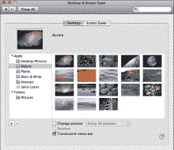
```

在`Desktop`窗口的顶部是当前选择桌面背景图像的小预览图，旁边是图像的名称。如果你添加了自己的图像，还会看到一个弹出的菜单，提供调整图像的选项。

在窗口的左侧，当前桌面图像预览的下方是不同可用图像的库。默认情况下，它有两个部分：`Apple`和`Folders`。如果你安装了Apple的iPhoto，则会出现第三个选项`iPhoto Library`。

你可以通过点击每个部分的展开/收起三角形来显示或隐藏每个部分。右侧是一个画廊，显示了库列表中高亮选中项目可用的选项。按照以下步骤选择新的桌面背景图像：

1. 从库中选择一个选项。
2. 从右侧的预览网格中选择一张图像。

就是这样。你甚至不需要关闭`Desktop & Screen Saver`系统偏好设置，新的桌面背景图像就会生效。（尽管在完成后你应该关闭它以减少屏幕杂乱。）

## 使用 Apple 提供的背景图像

Apple为Mac OS X提供了几种背景图像。以下是可用选项：

- **Apple Images**（苹果图像）。这组背景包含彩色图案。
- **Nature**（自然）。自然系列包含了一系列自然物体的照片。它们的范围从挂在地球叶片上的水滴的极近特写到默认的`Aurora`图像（这与之前的`Aurora`桌面图像不同，之前的已重命名为`Leopard Aurora`）。其他选项包括地球、岩石、园林、斑马纹和宁静的水。
- **Plants**（植物）。主题与Nature相似，Plants集合包含了各种花和其他植物的照片。
- **Black & White**（黑白）。该集合包含一系列没有色彩的迷人风景照片。
- **Abstract**（抽象）。与Apple图像类似，这是一个带有流动的波纹背景集合。这里的图像色彩非常丰富。
- **Solid Colors**（纯色）。这里有十种颜色可供选择。它们在屏幕底部变为较浅的颜色，营造出一种不干扰的微妙效果。

## 使用自己的背景图像

有多种方法可以使用自己的图像作为桌面背景。

一种方法是在库列表中选择图像，使用以下两个选项之一：

- **Pictures Folder**（图片文件夹）。你直接放在用户文件夹中`Pictures`文件夹中的任何照片都会出现在该文件夹中。这是将自定义照片添加到桌面的一种方法。
- **iPhoto Albums**（iPhoto库）。这链接到你的iPhoto库，允许将通过Apple iPhoto图像管理程序导入Mac的个人照片设置为桌面背景。`iPhoto Albums`标签下方列出了用户文件夹中可用iPhoto库。点击库，照片将出现在屏幕右侧。

或者，你可以直接将图像添加到`Desktop & Screen Saver`系统偏好设置的`Desktop`窗口：

1. 确保`Desktop & Screen Saver`的`Desktop`窗口已打开。如果没有，请如前所述打开。
2. 找到包含所需图像的磁盘或文件夹（它也可能在桌面上），将其拖到`Desktop`窗口顶部的当前预览图上。
3. 当你移动图像到小预览图时，文件上方会出现绿色`+`图标，表示它将被添加到库并成为新的背景图像。释放鼠标按钮，该图像将作为你的新背景图像。
4. 新预览图的右侧会弹出一个菜单；使用它来选择背景图像显示方式。共有五个选项：

### 缩放选项

- **适应屏幕 (Fit to Screen)**。这会放大或缩小图像以适应您的屏幕。但如果图像比例与您的显示器比例不匹配，任何间隙将用某种颜色填充，您可以通过弹出菜单右侧的`color-swatch`图标按钮更改该颜色。如果需要，点击它可以打开`Colors`（颜色）面板，并选择不同的填充颜色。
- **填充屏幕 (Fill Screen)**。这会调整图像大小以填充整个桌面。它不像“适应屏幕”那样不会有间隙。如果图像比例与屏幕不匹配，图像的部分可能会超出屏幕范围而不可见。
- **拉伸填充屏幕 (Stretch to Fill Screen)**。这会调整图像大小，并在必要时调整其比例以填充屏幕。此选项可能会导致图像透视失真。
- **居中 (Center)**。这会将图像按原始大小放置在屏幕中央。与“适应屏幕”一样，您可以更改周围出现的填充颜色。
- **平铺 (Tile)**。这按原始大小放置多个图像副本，使这些副本覆盖整个桌面。

### 添加自定义图像

添加自定义图像的第三种方法是让整个文件夹在库列表中可用。然后，您可以像选择Apple提供的图像、`Pictures`文件夹中的图像或`iPhoto`专辑中的图像一样，从这些文件夹中选择图像。

要将图像文件夹添加到`Desktop`（桌面）窗格，请点击库列表底部的`+`图标按钮。这将打开一个`Finder`窗口。在`Finder`窗口中导航，找到包含要添加到列表的图像的文件夹，然后点击`Choose`（选取）按钮。在`iPhoto Albums`部分下方会出现一个名为`Folders`（文件夹）的新部分，其中包含您添加的任何文件夹名称。

### 自动更改桌面图片

如果变化是生活的调味剂，为什么不设置桌面自动更改背景图像呢？在“Desktop & Screen Saver”（桌面与屏幕保护程序）系统偏好设置的桌面窗格中，选择底部的`Change Picture`（更改图片）选项，然后从相邻的弹出菜单中选择间隔。范围从每五秒一次到每天一次；还有在每次启动Mac或从睡眠中唤醒时更改背景图像的选项。

默认情况下，每当背景图像更改时，它都会移动到所选库列表文件夹中的下一个。但是，如果您选择了`Random Order`（随机顺序）选项，Mac OS X将从该库文件夹中随机选择图像。

#### 注意事项

更改桌面背景图像可能很有趣，但也可能会消耗大量的系统资源，特别是当频繁更改时，从而减慢您的Mac速度。它还会分散注意力，从而降低大脑运行速度。

### 选择非透明菜单栏

与Mac OS X全局使用的`Aqua`主题一致，屏幕顶部的菜单栏具有透明背景，可以显示下方桌面的部分内容。对于大多数桌面来说，这不是问题。然而，一些复杂的桌面背景图像可能会让菜单栏难以阅读。如果是这样，或者您只是更倾向于非透明菜单栏提供的清晰视觉界限，您可以在“Desktop & Screen Saver”系统偏好设置的桌面窗格中取消勾选`Translucent Menu Bar`（透明菜单栏）选项，来关闭菜单栏的透明效果。

### 使用窗口

自从GUI在桌面计算中流行以来，窗口比喻一直被用来描述出现在屏幕上的矩形信息面板。窗口是信息的容器。Mac OS X使用了许多种窗口，每个窗口都有特定的功能。

某些窗口包含完整的应用程序，例如`iTunes`；这些被称为`application windows`（应用程序窗口）。其他窗口显示应用程序内的文档，例如`Microsoft Word`；这些被称为`document windows`（文档窗口）。还有一些窗口显示硬盘和文件夹的内容；这些被称为`Finder windows`（Finder窗口）。有些窗口显示图像和电影，或播放音频文件；这些被称为`playback windows`（播放窗口）。

其他窗口会通过您需要采取的消息向您发出提醒；某些窗口则提供了更改、修改和与其他窗口内容交互的选项。这些此类提示和面向选项的窗口有特定的名称：

- **对话框 (Dialog box)**。打开后，在关闭该对话框之前，它不会让您在应用程序内的其他地方进行工作。（但是，您可以在其他应用程序中工作。）它通常包含设置和类似的控件，但也可以提供您必须确认的警报。您通常通过点击`OK`（确定）来应用或确认更改及警告，或点击`Cancel`（取消）来忽略更改或警告以关闭对话框。
- **表格 (Sheet)**。也称为设置表，是一个出现的窗口，用于显示一组与活动对话框相关的额外选项。与对话框一样，在您关闭它之前，它阻止您在活动应用程序的其他窗口中工作。
- **面板 (Panel)**。打开后允许您与其他窗口（如面板或对话框）一起工作的窗口。它通常包含设置和类似的控件。面板没有`OK`或`Cancel`按钮，因此对其选项的更改会立即生效（尽管您通常可以按`Esc`键撤销对选项的最后更改）。`Microsoft Office`和`Adobe Creative Suite`大量使用面板。
- **窗格 (Pane)**。对话框、面板或其他窗口内的一个部分。通常，活动窗格会遮挡窗口中的其他窗格，尽管您可以通过点击标签或按钮轻松地在它们之间切换。然而，窗格也可以是窗口内一个独立的、不同的区域，用于对相似控件进行分组。

简而言之，窗口是丰富且极其多功能的。图 2.9显示了一个示例。

Mac OS X中的大多数窗口都是矩形的，并遵循Apple设定的指南，以确保统一的视觉效果和感受。常见的按钮和元素可以让您缩放、最大化和最小化窗口，让您充分利用桌面空间。

**图 2.9**

Mac OS X环境中常见的几种窗口：显示文本文档的窗口（左上）、对话框（右上）、表格（左下）和面板（右下）

```

```

### 理解窗口控件

窗口可以许多不同的形状和形式，控件也是如此。与菜单一样，Apple开发者遵循关于窗口外观的一系列指南。这些包括使用统一的图形风格，以及常用的按钮和控件表面。某些控件适用于许多窗口类型，而另一些则适用于特定类型。您不会在每个窗口中发现这些共同点；例如，对话框很少有控件表面且无法调整大小，而表格通常没有任何控件。然而，Mac OS X具有统一的视觉效果和感受，大多数文档和应用程序窗口在相同的位置具有相同的按钮和控件。图 2.10显示了`Safari`浏览器窗口，并标记了所有常见的控件和对象：

- **标题栏 (Title bar)**。标题栏出现在窗口顶部，通常显示窗口包含的应用程序或文档名称。点击并拖动标题栏是移动屏幕上窗口的常用方法。双击标题栏会将窗口最小化到`Dock`栏。一组跨许多窗口的亮彩色图标按钮出现在标题栏左侧。它们包括`Close`（红色）、`Minimize`（黄色）和`Zoom`（绿色）。从Microsoft Windows环境迁移过来的用户会发现，这些按钮的功能与`Windows`窗口右上角的`Close`、`Minimize`和`Maximize`按钮相似。

## 窗口控制

- **关闭 (Close)**。`Close`图标按钮是您始终在窗口最左侧看到的红色按钮。当将鼠标悬停在它上方时，中心会出现一个红色的叉号。点击它，窗口就会消失（如果有尚未保存的数据，会弹出一个对话框，询问您是否要保存）。在某些应用程序中，按住`Option`键点击`Close`图标按钮可以强制关闭所有属于该`Window`的窗口。请注意，`Mac OS X`和`Microsoft Windows`之间的一个关键区别是，在`Mac OS X`中关闭应用程序的所有窗口并不会退出程序本身。要退出程序，你需要按照本章前面介绍的方法，使用菜单栏、`Dock`或`Command+Q`快捷键。请注意，你也可以按`Command+W`关闭当前活动窗口，在许多程序中，按`Option+Command+W`会关闭当前活动应用程序中的所有窗口。
- **最小化 (Minimize)**。黄色的`Minimize`图标按钮出现在红色`Close`图标按钮旁边，当将鼠标悬停在它上方时，按钮内部会出现一个减号（–）。点击它，窗口会缩小到`Dock`中。（在`Dock`中点击它，它会在屏幕上的相同位置重新出现。）在许多程序中，你也可以按`Command+M`最小化窗口。


- **缩放（Zoom）**。`Minimize` 右侧的绿色按钮是`Zoom`图标按钮。当将鼠标悬停在这个按钮上方时，会出现一个小小的加号（`+`）。点击`Zoom`图标按钮会根据窗口内容调整窗口大小。缩放后的窗口将占据窗口内容所需的空间，最大可占据整个桌面空间（为可见的 Dock 留出空间）。再次点击`Zoom`图标按钮，它将恢复到之前的尺寸。

**注意**

将`Zoom`图标按钮视为“最大化（Maximize）”按钮是不正确的，因此它并不是`Minimize`图标按钮的极对立面（正如在`Microsoft Windows`中那样所示）。虽然它经常让窗口变为全屏，但它也可以让窗口变小，因为它会将窗口调整为适合当前内容的最佳尺寸。某些窗口的大小由应用程序决定，无法调整大小——在这种情况下，`Zoom`图标按钮会变暗，且当鼠标悬停在其上方时不会出现加号。有少数应用程序不同的方式使用`Zoom`图标按钮。例如，在`iTunes`中点击`Zoom`图标按钮会导致应用程序在全屏窗口和仅显示播放控制及当前播放曲目的的小窗口之间切换。

- **滚动条（Scrollbar）**。滚动条位于窗口的右侧和底部。只有当内容无法放入窗口内时，它们才会出现。滚动条既作为可用内容多于窗口显示内容的指示，也作为导航这些内容的设备。`Mac OS X 10.6 Snow Leopard`中的滚动条由滚动轨道（也称为槽）、滑块和滚动箭头组成。

- **滚动轨道（Scroll track）**。很容易将滚动轨道与滚动条本身混淆，从技术上讲，滚动轨道是滑块后面的空白区域。点击滚动轨道上不包含滑块的区域会让滑块向该方向移动。

- **滑块（Slider）**。滑块作为指示器，显示你当前正在查看窗口内容的哪个部分，以及窗口边缘还有多少内容。滑块还允许你导航这些内容；你可以点击并拖动它来穿过内容。滑块的大小与额外内容量成正比。例如，一个大小是窗口两倍的文档，其滑块的大小只有滚动轨道的一半。如果文档的信息量是四倍，滑块将是滚动轨道的四分之一；滑块越小，窗口边缘的信息就越多。

- **滚动箭头（Scroll arrows）**。你可以使用滚动箭头让滑块沿箭头方向移动（向上、向下或向左、向右）。滚动箭头有两种用法：第一种方法是，单击会让滑块向该方向移动。与点击滚动轨道（会移动整个窗口内容）不同，点击滚动箭头会移动窗口内的单项内容（例如，在`Word`中点击会一次移动一行文档）。第二种方法是，点击并按住滚动箭头可以让你对窗口进行扫描或翻页，类似于回放或快进控制。

- **调整大小控制（Resize control）**。窗口的右下角通常允许你调整窗口大小。如果窗口可以调整大小，该角角将标有三条斜线标记。通过这个角点击并拖动窗口可以调整窗口的大小和比例。

图 2.10

`Mac OS X`具有统一的视觉和操作体验，许多窗口共享一组通用控件。此图突出了你将在许多窗口上找到的控件。

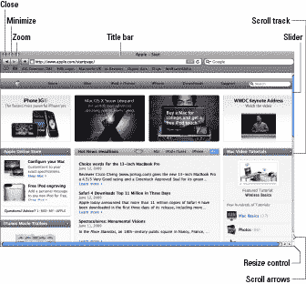

## 组织窗口

`Mac OS X`中使用的大多数窗口遵循一套类似的规则，行为也相似。从这个意义上说，可以组织和安排窗口以适应你的工作需求。虽然某些程序违反了 Apple 的 GUI 指南，对窗口使用了非标准的控件和行为，但大多数窗口都遵循规则并表现相同。

### 在 Finder 中打开项目

让窗口出现在桌面上的最快方法是打开一个项目（如文件夹、文档或应用程序）。例如，双击桌面右上角的硬盘磁盘图标将打开其内容。或者，你可以点击项目并选择`文件⇒打开`、按下`Command+O`，或`Control+点击`项目并在右键菜单中选择`打开`。

### 创建新的 Finder 窗口

Finder 窗口是一个文件夹——默认显示当前用户的个人文件夹。当你桌面上打开了大量的磁盘文件夹时，打开一个新的 Finder 窗口是回到你起点的好方法。通过选择`Finder⇒新窗口`、按下`Command+N`或点击 Dock 中的 Finder 图标来打开 Finder。

### 识别活动和非活动窗口

尽管`Mac OS X`可以同时运行多个窗口，但任何时候只有一个窗口被认为是活动窗口。这就是你正在操作的窗口。`Mac OS X`使用准 3D 层叠效果和阴影来帮助判断哪一个在前面——即活动窗口。判断哪个窗口活动的另一种方法是检查窗口左上角的按钮。活动窗口具有彩色，而非活动窗口为灰色。当窗口非活动时，你通常无法对其内容进行任何更改；某些例外包括`关闭`图标按钮，你可以点击非活动窗口来关闭它。示例参见图 2.11。

图 2.11

`系统偏好`应用程序当前是活动窗口。你可以发现它在其他窗口前面。此外，窗口左侧的按钮色彩鲜艳，且窗口色调比其他窗口略深。

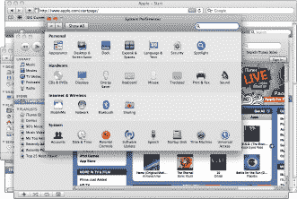

### 切换活动窗口

点击非活动窗口的任何部分（非活动时可更改的窗口项目除外）会使其立即成为活动窗口。然后它会移动到其他窗口前面，其按钮也会亮起。如果活动窗口有任何其他面板或对话框，它们也会变为活动。但该应用程序的其他窗口可能会保持原样，例如文档窗口。

**提示**

如果你想让某个应用程序的所有窗口移动到其他窗口前面，请点击 Dock 中的应用程序图标。

请注意，如果应用程序打开了一个带有对话框的窗口，你可能无法访问该应用程序正在使用的其他窗口，直到你关闭该对话框为止（通过打开与对话框相关的窗口并关闭对话框，通常是点击`OK`接受任何新设置或点击`Cancel`忽略这些更改）。

还有四种更改活动窗口的方法：

- 使用`Finder`的`Window`（窗口）菜单选择所需的窗口；所有打开的窗口都会显示在此菜单中。

- 点击`Dock`中被最小化的窗口以打开它。

- 按下`Option+`或在`Finder`中选择`Window⇒Cycle Through Windows`（窗口⇒循环切换窗口）在不同窗口之间移动。

- 按`Option+Tab`打开应用程序切换器（见第 7 章）并在活动应用程序之间循环；按住`Option`并反复按`Tab`在应用程序之间移动。当你释放`Option`时，选定的应用程序窗口将进入前景。

# 理解窗口内的常用控件

我们目前为止涵盖的控件都与窗口有关。然而，你也会在窗口内部遇到各种控件。这些控件可以以`buttons`（按钮）、`sliders`（滑块）、`check boxes`（复选框）以及许多其他形式存在。虽然软件设计师可以自由开发适用于其应用程序的任何控件，但存在许多标准控件，Apple 为开发者提供了如何在 Mac OS X 中使用这些控件的文档：

### 按钮 (Button)

如其名，`button`是一种在你点击时会触发动作的控件。Apple 的正式术语是`push button`（推送按钮）。按钮有各种形状和大小，可以使用文本或图形标记。带有文本的按钮通常是带有圆角的水平按钮；图形按钮可以是任何形状。（如图 2.12 所示）

### OK 和取消 按钮

这些标准按钮出现在大多数对话框中。点击`OK`按钮将接受相应窗口中的设置，而点击`Cancel`则拒绝你对设置所做的任何更改。有时，你可能会发现按钮标记有所不同：例如，从服务器删除文件时会显示`Delete`而不是`OK`。某些开发者使用`Done`代替`OK`。请注意，如果按钮正在发光或有颜色，按下`Return`等同于点击该按钮。此外，在大多数情况下，按下`Esc`等同于点击`Cancel`。按钮贯穿整个操作系统环境。

### 单选按钮 (Radio button)

当一个操作有多个预定义的设置供选择时，你可能会发现`radio button`选项。它们的命名源于物理收音机，收音机上按下一个按钮会导致其他按钮弹出——一次只能使用一个按钮。在 Mac OS X 中，单选按钮是小的灰色圆圈，选中某个选项时会变为蓝色并在中心有一个黑点。它们可以以水平或垂直方式显示（图 2.13）。

### 复选框 (Check boxes)

另一组设置可能会通过`check box`选项显示。`check box`与`radio button`类似，但它是正方形的，当选中某个选项时，复选框会变成蓝色并在内部有一个小勾选标记。复选框和单选按钮的主要区别在于可以同时选择多个选项。点击复选框进行选择，再次点击即可取消选择。某些复选框还有一种中间状态，标记为水平线（图 2.14）。

### 滑块 (Sliders)

`slider`是一个显示数值范围的`track`（通常是水平方向）。轨道上有一个带有三角形边缘的正方形，称为`thumb`（滑块）。你沿着轨道移动`thumb`以选择滑块两端之间的某个值。有时你使用滑块来选择数值范围，而在其他时候，你使用它们从非数值条件中选择（例如，`Slow`和`Fast`之间的范围）（图 2.15）。

### 步进器控件 (Stepper controls)

也称为小箭头，这些小箭头用于增量增加或减少某个值。点击箭头将按一个预定义的增量调整值。点击并按住其中一个箭头会持续增加值，直到达到其范围的末端。

### 折叠三角形 (Disclosure triangles)

这些设备中的一种是一个小黑色三角形，用于控制窗口中项目显示的详细程度。通常，折叠三角形指向右侧，表示其详情是折叠的（隐藏的）；点击它会将三角形旋转 90 度指向下方，其余信息将展开（显示）（图 2.16）。

### 有序列表 (Ordered lists)

这是一种不那么常用的控件，用于显示项目列表。通常情况下，你可以点击并拖动项目以以不同的顺序排列它们。例如，在“Language & Text”（语言与文本）系统偏好面板中，它可以让你决定语言显示的顺序。有时，有序列表还会使用复选框，允许你开启或关闭列表中的项目（图 2.17）。

### 标签页 (Tabs)

这些控件通常出现在对话框或面板的顶部。当你点击`tab`时，窗口或对话框会显示不同的信息面板。其比喻是一个窗口被分成多个独立的玻璃面板。通过标签页访问的面板通常被称为`tabbed panes`（标签页面板）（图 2.18）。

# 识别图标

菜单、窗口和按钮是构成现代计算机操作系统的某些关键组件。但还有另一件事让 GUI（图形用户界面）变得完整：图标。

图标是代表几乎任何内容的小图片。图标可以代表应用程序、文档（属于特定应用程序的文档）、文件、文件夹和字体。桌面或`Finder`中的几乎所有内容都有关联的图标。

# 在 Mac OS X 中操作对象很大程度上意味着寻找并操作它们各自的图标。双击文档图标可以打开文档；拖动图标即可在`Finder`的各个部分之间移动文档。应用程序图标显示在`Dock`上和`Applications`（应用程序）文件夹中；点击它们可以打开应用程序。由于 Mac OS X 是基于桌面隐喻的 GUI（图形用户界面），图标的基本外观设计旨在视觉化表示它是什么种类型的项目。例如，文件夹被设计成像一个纸质文件夹；文件看起来像一张一角略微折叠的纸张。其他图标在现实世界中没有对应物；应用程序就是一个例子，尽管它们具有共同的视觉风格，使你能够识别它们。

不同版本的 Mac OS X 使用的图标随着时间的发展而演变（图 2.19 显示了`Finder`中图标的示例）。它们通常变得更大、更详尽。与之前操作系统中的图标不同，Mac OS X 中的图标可以缩放至多达 128 × 128 像素的显著尺寸。在某些情况下（例如桌面），你可以决定 Mac OS X 图标显示有多大。在另一些情况下（例如当你使用列视图中的`Finder`时），图标是预设的尺寸。

### 图 2.19

Mac OS X 中的图标很大，并且具有写实的视觉风格。

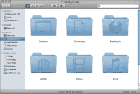

## 识别应用程序图标

应用程序图标可能是 Mac OS X 中使用的种类最异的图标。通常，它们是它们所代表工具的彩色表示。例如，`iTunes`图标是一张带有蓝色音符的 CD 图片。图 2.20 显示了了一些应用程序图标的示例。

### 图 2.20

应用程序图标的示例


## 识别文档图标

在 Mac OS X 中，文档图标被设计成像一张右上角弯曲的纸。图标本身通常包含文档实际内容的视觉预览。看一个文字处理文档的图标，你会发现文档的文本被用于创建该图标。在其他时候，文档图标会显示与其关联的应用程序图标：例如音乐文件经常显示`iTunes`或`QuickTime`图标。图像图标略有不同，因为它们没有弯曲纸张的设计，并且通常显示图像本身的小版本。

## 识别文件夹图标

文件夹是 Mac OS X 中最容易识别的图标之一。这是因为它们的外很少改变。大多数时候，文件夹显示为一个左上角带有扩展标签的蓝色矩形。这种设计让人联起现实生活中用于存储纸质文档的纸质文件夹。有些文件夹以彩色或带有图形或标志的形式出现，有时它们还具有倾斜的视角；这些通常是开发者玩了点趣味的应用程序文件夹。

一些随 Mac OS X 自带的常用文件夹在蓝色矩形上有一个小的“蚀刻”设计。`Applications`（应用程序）文件夹上刻有一个样式化的`A`，`Library`（库）文件夹有一个古典希腊结构的刻痕，`Pictures`（图片）文件夹有一个相机的刻痕，`System`（系统）文件夹有一个字母`X`的刻痕，`Users`（用户）文件夹有一个人头部的刻痕，`Utilities`（实用工具）文件夹有两个交叉工具的刻痕。具有此类刻痕的其他系统文件夹还有每个用户账户的`Desktop`（桌面）、`Documents`（文档）、`Movies`（电影）、`Music`（音乐）、`Public`（公共）和`Sites`（站点）文件夹。

**注意**

当前用户账户的`Home`（用户）文件夹外观完全不同：是一个房屋的彩色图像，而不是文件夹图标。

## 识别卷图标

和文件夹图标一样，卷图标也很容易识别。（卷是驱动器、磁盘和分区的通名称——本质是存储容器。）它们通常被设计成与它们所代表的现实物体相似。因此，内部磁盘图标是设计成像物理硬盘的灰色矩形；外部硬盘图标具有类似的形状，但看起来像外部驱动器，有时带有与驱动器连接类型匹配的符号（`USB` [通用串行总线] 或 `FireWire` 火线）。CD-ROM 和 DVD 驱动器的图标看起来像真实的 CD 和 DVD。网络卷通常显示为透明正方形内独特的蓝色球。图 2.21 显示了卷图标的示例。

### 图 2.21

不同卷图标的示例


## 识别别名图标

别名（Alias）是文档或应用程序——甚至是另一个别名的快捷方式。别名的存在是为了快速访问可能深埋在 Mac OS 文件夹层级结构深处的项目。通过使用别名，你可以快速且通过更少的鼠标点击深入到特定的文件夹或项目。别名与原始项目使用相同的图标，但在左下角有一个小的黑色弯曲箭头，表示它指向另一个项目。

### 图 2.21 （*注：此处原文标题与上图 2.21 重复，可能为原文笔误，翻译保持原样*）

不同卷图标的示例

## 识别受限文件夹

你 Mac 上的某些文件夹或位于网络服务器上的文件夹对特定用户是限制的。如果你在计算机上有多个账户，情况尤为如此：当你使用自己的账户登录时，你无法访问或编辑另一个用户账户中的文件和文件夹，除非该用户为这些项目启用了文件共享（参见第 13 和第 20 章）。

**提示**

如果你的账户具有管理员权限，你可以访问此类受限文件，但每次都需要输入密码。

受限文件和文件夹很容易识别，因为它们在图标右下角有一个红色的禁止进入符号（中间带有白色横杠的红圈）。图 2.22 显示了一个受限文件的示例。

### 图 2.22

带有红色禁止进入符号的文件夹是受限的，除非输入管理员密码，否则无法访问。

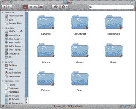

## 别名的问题

别名非常实用，可以从桌面和其他你经常访问的地方快速访问深埋在 Mac OS 文件夹层级结构深处的文件、文件夹和磁盘；或者比你当前所在位置需要更多点击才能到达的内容。

但有时你想获取别名指向的原始项目。要这样做，选择别名并选择`文件⇒显示原项`或按下`Command+R`。或者`Control+点击`或右键点击别名，从上下文菜单中选择“显示原项”。这将打开包含原始项目的 Finder 窗口。

Mac OS 会跟踪别名及其原始文件在 Finder 中的移动情况，因此它们会自动更新。然而，如果原始项目已被删除或移动到已弹出的磁盘，当你尝试打开别名时，Finder 会显示一个警告对话框，告知找不到原始项目。

此对话框为你提供了三个选项。你可以点击`确定`接受警告并在不使用别名的情况下继续；你可以点击`删除别名`按钮将别名移到垃圾桶；你还可以点击`修复别名`按钮，通过`选择新原项`对话框定位丢失的项目（或者从中选择一个你想让别名指向的项目）。

## 发现 Finder

Finder 位于 Mac OS X 的核心，并经常被误认为是 Mac OS。但它是一个与其他任何应用程序都类似的应用程序。由于它无处不在，许多 Mac OS X 用户甚至没有意识到正在使用一个应用程序。

这是可以理解的。毕竟，与其他应用程序不同，你永远不需要启动`Finder`；尽管当`Finder`卡住时可以重新启动它而不影响其他正在运行的程序，但无法停止该程序的运行。`Finder`在你登录时启动，并一直运行直到你注销。像所有应用程序一样，`Finder`有它自己的图标，一个微笑的蓝色脸，永久地显示在`Dock`的最左侧。

`Finder`负责管理`Mac OS X`的桌面和文件结构。通过`Finder`，你可以创建、移动、复制和删除文件夹及文件，并访问磁盘以便在磁盘内部、外部以及磁盘之间创建、移动、复制和删除文件夹及文件。`Finder`还允许你通过四种视图处理这些项目：列表、网格、图标和 Cover Flow（封面流）。第 3 章详细解释了这些视图以及`Finder`的文件夹结构。


与其他应用程序一样，它会生成自己的文档窗口，但只有 `Finder` 的文档窗口——称为 `Finder` 窗口——主要用于浏览文件结构。它们具有独特的元素——左侧的 `Sidebar`（侧边栏）和顶部的 `toolbar`（工具栏）。第 3 章详细解释了它们的工作工作的。

## 重新启动 Finder

`Finder` 是一个应用程序，与其他应用程序一样，它运行在受保护的内存区域。这有助于确保如果 `Finder` 出现问题，你不需要重启整个电脑。

如果某个应用程序在 `Mac OS X` 中无响应，你可以使用 `Force Quit`（强制退出）命令确保 `Mac OS X` 将其关闭（之后可以重新打开）。但是，由于 `Finder` 应该始终运行，`Force Quit` 命令被替换为名为 `Relaunch Finder`（重新启动 Finder）的命令，它强制关闭 `Finder` 然后重新打开它。该命令是 `Finder` 特有的；因此名为 `Relaunch Finder`。

当 `Finder` 无响应时（通常是 `Finder` 窗口和桌面都会停止响应鼠标点击，且鼠标可能会变成旋转图标），你可能需要调用 `Relaunch Finder` 命令。有几种不同的方法可以重新启动 `Finder`：

- 按住 `Control+Option` 并点击 `Dock` 中的 `Finder` 图标。在弹出的右键菜单中选择 `Relaunch`（重新启动）选项。
- 从菜单栏选择 `Ú⇒Force Quit`（强制退出）。在 `Force Quit` 菜单中选择 `Finder` 选项并点击 `Relaunch` 按钮。
- 在键盘上按下 `Control+Option+Esc`。这将打开 `Force Quit Applications`（强制退出应用程序）菜单；选择 `Finder` 选项并点击 `Relaunch`。
- 在 `Terminal`（终端）中，输入命令 `killall Finder`。`Terminal` 将在第 26 章进行详细介绍。
- 打开 `Activity Monitor`（活动监器）应用程序（位于 `Applications` 文件夹内的 `Utilities` 文件夹）。向下滚动列表找到 `Finder` 程序并点击红色的 `Quit Process`（退出进程）按钮。现在点击 `Quit` 按钮（如果未能退出 `Finder`，使用 `Force Quit` 命令）。这将完全退出 `Finder`；点击 `Dock` 中的 `Finder` 图标重新启动 `Finder` 并继续。

当你调用 `Relaunch Finder` 命令时，`Finder` 的菜单栏以及桌面上的所有图标会消失然后重新出现。所有的 `Finder` 窗口都会关闭且不再出现。

由于 `Finder` 被视为一个应用程序，当 `Finder` 无响应时，其他应用程序仍然处于活动状态。你可以在应用程序之间切换、继续工作，甚至保存文件。这是 `Mac OS X` 的核心优势之一。重启 `Mac OS X` 的情况极其罕见，即使在操作系统关键部分无响应时，你也可以继续工作并保存文件。如果系统完全无响应，且之前列出的解决方案均无效，你可以按住电源键十秒钟来完全重启 Mac。

## 理解 Finder 菜单

与任何应用程序一样，`Finder` 有它自己的菜单，带有针对 `Finder` 操作的特定选项。当 `Finder` 是活动应用程序时，`Finder` 的菜单选项会出现在菜单栏上——位于 `Ú` 符号右侧（点击桌面或 `Dock` 中的 `Finder` 图标使 `Finder` 成为活动应用程序）。让我们来看看 `Finder` 特有的菜单。

### Finder 菜单

`Finder` 的应用程序菜单并不意外地被称为 `Finder` 菜单。

- `About Finder`（关于 Finder）。此选项会打开一个对话框，其中有 `Finder` 图标、当前 `Finder` 版本以及一些版权信息。
- `Preferences`（偏好设置）。此选项会弹出一个包含许多可以为 `Finder` 设置偏好的对话框。你也可以按 `Ô+,`（逗号）打开 `Preferences` 对话框。
- `Empty Trash`（清空垃圾桶）。`Trash` 桶位于 `Dock` 的最右侧，包含了你从系统中删除的文件。这些文件一直留在 `Trash` 中（因此可以被恢复），直到你选择此菜单选项。清空 `Trash` 会从 Mac 上永久删除这些项目。
- `Secure Empty Trash`（安全清空垃圾桶）。`Secure Empty Trash` 选项不仅会删除垃圾桶，还会用无意义数字完全覆盖文件，防止任何人使用恢复工具恢复数据。
- `Services`（服务）。此菜单选项允许你选择与 `Finder` 操作相关的服务。第 16 章将深入介绍服务。

### File 菜单

`File`（文件）菜单提供以下选项：

- `New Finder Window`（新建窗口）。选择此选项将打开一个新的 `Finder` 窗口。该窗口允许你浏览卷、文件夹和文件，如第 3 章所述。
- `New Folder`（新建文件夹）。选择此选项将在活动 `Finder` 窗口中创建一个文件夹，如果没有打开 `Finder` 窗口，则在桌面上创建。（你也可以按 `Shift+N`。）
- `New Smart Folder`（新建智能文件夹）。选择此选项将创建一个智能文件夹。智能文件夹是根据预定义标准收集文件的“智能”文件夹。智能文件夹的创建将在第 3 章介绍。（你也可以按 `Option+N`。）
- `New Burn Folder`（新建刻录文件夹）。选择此选项将创建一个文件夹，你可以在其中放入想要刻录到 CD 或 DVD 的文件和文件夹。放入所有要记录的文件后，将刻录光盘放入 Mac 的 `SuperDrive` 并按照提示操作。这就是无需特殊刻录软件即可创建的方法。
- `Open`（打开）。此选项将打开所选的文件或应用程序。如果选择了文件，`Finder` 将启动其数据库认为可以打开文件的应用程序。（你也可以按 `Ô+O`。）
- `Open With`（打开方式）。此选项要求你从子菜单中选择一个想要打开所选文件的应用程序。当普通的 `Open` 选项找不到合适的应用程序时，可以使用它。
- `Print`（打印）。此选项将打印所有选中的文件。（你也可以按 `Ô+P`。）
- `Close Window`（关闭窗口）。此选项将关闭活动的 `Finder` 窗口。（你也可以按 `Ô+W`。）
- `Get Info`（显示信息）。此选项将获取 `Finder` 中高亮项目的信息，如章节后文所述。（你也可以按 `Ô+I`。）
- `Compress`（压缩）。该选项也称为 `Archive`（存档）命令，创建一个选取项目的 Zip 压缩副本。这些文件通常占用空间更小，更容易提供给其他 Mac 和 Windows 用户。
- `Duplicate`（复制）。此命令将创建文件的副本，如章节后文所述。（你也可以按 `Ô+D`。）
- `Make Alias`（制作别名）。此命令为 `Finder` 中的高亮项目创建一个快速访问链接，称为 `alias`（Windows 用户熟悉的此类快捷方式）。别名可用于快速定位和打开深埋在 `Finder` 文件结构中的文件。（你也可以按 `Ô+L`。）

> **提示**
>
> 在 `Finder` 中将项目拖动到新位置时，按住 `Option+Ô`。（你也可以在点击并拖动项目后按住 `Option+Ô` 键，但你必须确保在松开鼠标按钮之前一直按住它们。）这种方法的额外好处是，它可以让你在原始文件不同的位置创建别名（这很有用，因为别名通常与其指向的项目存放在不同的位置）。

- `快速查看 (Quick Look)`。`快速查看` 选项可以显示大多数文件的内容，正如本章稍后部分所述。（你也可以按 `Ô+Y`。）
- `显示原始项目 (Show Original)`。此命令仅在 `Finder` 中高亮显示别名时才有效。它会打开一个 `Finder` 窗口，显示别名所指向的项目。（你也可以按 `Ô+R`。）
- `添加到侧边栏 (Add to Sidebar)`。`侧边栏` 位于 `Finder` 窗口的左侧，提供了对磁盘、文件夹和文件的快速访问。正如第 3 章解释的，此选项将所选项目添加到 `侧边栏` 以便进行此类快速访问。（你也可以按 `Ô+T`。）
- `移到垃圾桶 (Move to Trash)`。此选项将 `Finder` 中高亮显示的任何项目移动到垃圾桶（实际上是删除了它）。（你也可以按 `Ô+Delete`。）
- `弹出 (Eject)`。在 Mac 上移除 CD、DVD、外部磁盘、优存器、服务器卷等之前，你必须先将其弹出。如果不这样做可能会损坏它们的数据。（你也可以按 `Ô+E`。对于 CD 或 DVD，如果你的键盘上有此键，你也可以按 `弹出` 键。）当图标从桌面消失后，即可安全断开、关闭或移除磁盘。
- `刻录 (Burn)`。此选项用于将选项目刻录到可刻录 CD 和 DVD 中。如果 Mac 的 `SuperDrive` 中没有可刻录光盘，将提示你插入刻录光盘。（如果没有选择任何项目，该选项变为 `将桌面刻录到磁盘`。）
- `查找 (Find)`。`查找` 选项打开搜索窗口并将光标置于顶部的 `搜索` 框中，以便你输入搜索词。如果 `Finder` 窗口处于活动状态，此菜单选项将其变为搜索窗口。第 3 章解释了此菜单选项调用的 Spotlight 搜索技术。（你也可以按 `Ô+F`。）
- `标记 (Label)`。你可以通过选择此处的色块之一为 `Finder` 中的任何项目着色。如果项目图标没有使用通用图标，则只有项目名称后的颜色会获得标签颜色；否则，图标和名称都会着色。你可能会对项目着色以便在视觉上进行分类，例如将紧急项目设为橙色或将个人项目设为紫色。

## 编辑菜单 (The Edit menu)

`编辑` 菜单提供了许多你可以用来操作 `Finder` 中项目的选项。选项如下：

- `撤销 (Undo)`。此菜单选项会反转或撤销在 `Finder` 中执行的最后一个任务。（作为辅助，菜单选项会指定撤销操作，例如撤销移动的 `"2009 budget.xls"`。）当你选择 `撤销` 时，菜单选项将变为 `重做`，这让你在实际上消了撤销。（你也可以按 `Ô+Z`。）注意，并非所有操作都可以撤销；在这些情况下，菜单选项将变为 `无法撤销` 并显示为灰色。
- `剪切 (Cut)`。此选项剪切所选项目（包括文本或图形），将它们放入 `剪贴板`（Pasteboard）以便在其他地方粘贴。注意，如果你不粘贴项目，它们就不会被删除。（你也可以按 `Ô+X`。）
- `复制 (Copy)`。此选项将所选项目复制到 `剪贴板` 中以便在其他地方粘贴。（你也可以按 `Ô+C`。）
- `粘贴 (Paste)`。此选项将上次复制或上次剪切的项目粘贴到当前的 `Finder` 窗口中（或者在没有打开 `Finder` 窗口的情况下粘贴到桌面）。（你也可以按 `Ô+V`。）

### 注意 (Note)

`剪贴板` 是 Mac OS X 临时存放桶的名称。你剪切或复制的最后一个项目或一组项目存储在 `剪贴板` 中，以便在其他地方粘贴。下次你剪切或复制项目（包括文本或图形）时，它们会自动从 `剪贴板` 中移除。

- `全选 (Select All)`。此选项选择活动 `Finder` 窗口中的所有项目，或者如果没有活动窗口，则选择桌面上的项目。（你也可以按 `Ô+A`。）
- `显示剪贴板 (Show Clipboard)`。当你使用 `剪切` 或 `复制` 命令时，你正在剪切或复制的项目会被发送到 `剪贴板`。选择 `显示剪贴板` 选项会在 `Finder` 中打开一个窗口，显示 `剪贴板` 中当前的内容。如果上次复制或剪切的项目是文本或图形，窗口将显示文本或图形。如果上次复制或剪切的项目是文件、文件夹或磁盘，则 `剪贴板` 窗口将显示项目名称。
- `特殊字符 (Special Characters)`。此选项打开 `字符面板`（Character Palette），你可以从中选择特殊字符，正如第 22 章解释的。

## 视图菜单 (The View menu)

`视图` 菜单提供了许多你可以用来控制窗口内信息显示方式的命令。提供的命令包括：

- `以图标显示、列表显示、列显示和作为封面流显示 (As Icons, As List, As Columns, and As Cover Flow)`。这些菜单选项更改 `Finder` 窗口中信息的显示方式，正如第 3 章解释的。
- `整理 (Clean Up)`。此选项整理 `Finder` 窗口内的图标，按照 `Finder` 的 `查看选项` 设置将它们排列成整齐的网格（见第 3 章）。如果没有活动窗口，它将整理桌面上的图标。
- `排序方式 (Arrange By)`。`排序方式` 选项允许你根据名称、日期、大小、种类或标签对窗口（或桌面）中的项目进行排序。
- `显示/隐藏路径栏 (Show/Hide Path Bar)`。路径栏出现在 `Finder` 窗口的底部，显示当前位置相对于 `Finder` 其他部分的位置。此选项根据其是否已经可见来显示或隐藏它。
- `显示/隐藏状态栏 (Show/Hide Status Bar)`。状态栏提供有关 `Finder` 窗口内部文件的信息。它只在工具栏（第 3 章）不可见时才可用。此选项根据其是否已经可见来显示或隐藏状态栏。
- `显示/隐藏侧边栏 (Show/Hide Sidebar)`。`侧边栏` 出现在 `Finder` 窗口的左侧，提供了各种卷、位置和常用文件夹的快捷方式。第 3 章有更多关于 `侧边栏` 的信息。
- `显示/隐藏工具栏 (Show/Hide Toolbar)`。工具栏出现在 `Finder` 窗口的顶部，提供了前进和后退导航、视图选项以及搜索文本的文本框，正如第 3 章所述。（你也可以按 `Option+T`。）
- `显示查看选项 (Show View Options)`。此选项打开 `查看选项` 对话框，允许你精调 `Finder` 窗口及其内部项目的外观。查看选项在第 3 章中有所介绍。（你也可以按 `Ô+J`。）

## 前往菜单 (The Go menu)

`前往` 菜单提供了一系列遍历 `Finder` 的选项。选项包括：

- `后退和前进 (Back and Forward)`。在遍历窗口时，你可能会发现返回之前的位置很有用，然后回到你去过的地方——类似于在 Web 浏览器中导航。你也可以按 `Ô[` 后退，按 `Ô]` 前进，或使用 `Finder` 窗口工具栏上的图标按钮。
- `上文件夹 (Enclosing folder)`。当你处于图标视图时，可以通过双击快速进入文件夹。此命令执行反操作，带你离开当前文件夹并进入文件结构中的上级文件夹。（你也可以按 `Ô+↑`。）
- `位置 (Locations)`。`前往` 菜单有七个菜单选项，让你快速移动到标准的 `Finder` 位置（它们通常也在 `Finder` 窗口的 `侧边栏` 中）。其中 `计算机`（`Shift+Ô+C`）可以显示所有连接到 Mac 的磁盘。另一个是 `网络`（`Shift+Ô+CN`），显示所有网络可访问的计算机和卷。两个是当前用户账户的系统文件夹：`个人目录`（`Shift+Ô+H`）和 `桌面`（`Shift+Ô+D`）。两个是所有用户账户共有的文件夹：`应用程序`（`Shift+Ô+A`）和 `实用程序`（`Shift+Ô+U`）。第七是 `iDisk`，它包含子菜单 `我的 iDisk`（`Shift+Ô+I`）、`其他用户的 iDisk` 和 `其他用户的公共文件夹`；第 15 章解释了 `iDisk` 以及其所属的 `MobileMe` 服务。
- `最近文件夹`。`Recent Folders` 子菜单显示最近访问的十个文件夹。这对于快速返回你之前查看过的文件夹非常有用。`Clear Menu` 选项位于子菜单底部，可用于移除列表中的所有项目。
- `前往文件夹`。`Go to Folder` 选项会打开一个对话框，你可以在其中输入想要导航到的文件夹的确切路径。例如，`Documents` 文件夹位于 `/Users/username/Documents`。（注意，你不需要匹配目标文件夹的大小写。）输入路径名后按 `Return` 键，将打开该文件夹的 `Finder` 窗口。（你也可以使用键盘快捷键 `Shift+Ô+G` 打开“前往文件夹”对话框。）熟悉 `Unix` 和 `MS-DOS` 环境的用户对这种文件夹导航形式会很熟悉，但大多数人更倾向于继续使用 `Finder` 窗口进行导航。
- `连接服务器`。此选项打开“Connect to Server”对话框，允许你通过输入服务器地址连接到另一台计算机或服务器。你还可以点击 `Browse` 搜索可用服务器，点击 `+` 图标按钮将服务器添加到 `Favorites` 列表中以便以后快速访问，或点击时钟形状的菜单获取最近访问的服务器列表。（你也可以使用快捷键 `Ô+K` 打开“连接服务器”对话框。）

### 提示

查看和访问可用服务器的一种简单方法是在 `Finder` 窗口的 `Sidebar` 边栏的 `Shared` 部分选择 `All` 项目。

## 窗口菜单

`Window` 菜单包含以下选项：

- `最小化`。此选项将活动 `Finder` 窗口缩小到 `Dock` 的右侧，正如本章早些解释的那样。（你也可以按 `Ô+M`。）
- `缩放`。此选项在 `Finder` 窗口的 `Full Size` 全尺寸与其之前的尺寸之间切换大小。（你可以使用调整大小控件调整窗口尺寸，正如本章早些解释的那样，因此之前的尺寸可以随窗口而异。）
- `循环窗口`。此选项打开下一个已打开的 `Finder` 窗口。每当你选择它时，菜单选项会在打开的窗口列表中向下移动，如果你继续选择，它将从列表顶部重新循环。（你也可以按 `Ô+`。）
- `将全部置于顶层`。此选项将所有 `Finder` 窗口带到最前，位于可能遮挡它们的应用程序和文档窗口之上。此外，所有已打开的 `Finder` 窗口列表出现在菜单底部。

## 帮助菜单


与其他所有应用程序一样，`Help` 菜单包含一个搜索框，你可以用它查找有关 `Finder` 的信息，并快速定位 `Finder` 菜单结构中的项目。`Mac Help` 选项会打开一个带有你可以浏览或搜索的帮助主题的窗口。

## 与项目交互

无论项目的图标是显示在桌面上还是在 `Finder` 中，无论你是以列表视图还是图标视图查看它们，都可以以类似的方式进行交互（`Dock` 中的图标除外，它们的作用略有不同，正如本章之前所述）。

了解如何与 `Finder` 和桌面形式的项目进行交互，是你与 `Mac OS X` 环境交互的基础。（注意，在其他章节中，我们将对此处涵盖的一些领域进行扩展。）

### 选择项目

`Mac OS X` GUI 的美之处在于其简单性，这使得大多数人能够直觉地使用系统。要选择一个项目，只需用鼠标点击图标即可。在 `Mac OS X` 中，你选择的项目会被高亮。项目的图标周围有一个不透明的方框，该框在白色背景下通常呈灰色。伴随图标的文本会被高亮。（默认颜色是蓝色，尽管你可以如第 21 章解释的那样，在 `Appearance` 系统偏好设置更改更改）。

### 使用键盘选择项目

选择项目看起来直觉上是易事，但老练 Mac 用户知道有多种选择项目的方法，这些方法可能非常有用。

其中一种方法是使用方向键从一个图标移动到另一个图标。或者，你可以开始在文件夹中输入项目名称，高亮将随着你的输入跳到相应的项目上。你不需要输入所需项目的完整名称；高亮会根据字母顺序以及你输入的字母在项目之间跳跃。如果你有一个包含很多项目的文件夹，并且知道要找的特定项目，这种方法就特别有用。

你还可以通过按 `Tab` 键按字母顺序移动项目（按 `Shift+Tab` 按反字母顺序移动）。通常情况下，项目是按字母排序的，因此这将带你按顺序在项目之间前后移动。然而，如果你以不同的排序方式（例如按日期、大小、种类或标签）安排了项目，你仍然可以按字母顺序移动项目。注意，在列视图下，按 `Tab` 不起作用。

表 2.1 提供了通过键盘命令选择项目不同方式的方便参考：

| 表 2.1 | 通过键盘命令选择项目 | 键盘字母 | 根据按键得到的项目结果名称 |
| :--- | :--- | :--- | :--- |
|  |  | `↑` 或 `↓` | 当前高亮项目上方或下方的项目。 |
|  |  | `←` 或 `→` | 桌面或图标视图中当前项目左侧或右侧的项目。注意，在列表视图中，左右箭头会展开和收叠文件夹。 |
|  |  | `Tab` | 列表中的下一个字母顺序项目。 |
|  |  | `Shift+Tab` | 列表中的上一个字母顺序项目。 |

### 选择多个项目

点击项目会选中它，同时取消之前的项目。因此，每次只有一个项目被高亮。然而，在 `Mac OS X` 中有很多情况需要选择多个项目（通常是为了移动或删除范围的项目）。有多种选择不同项目的方法，可用方法取决于你在 `Finder` 窗口中选择的视图模式。这里是一些可用方法：

- **Command+点击**。使用 `Ô` 键允许你选择多个项目。按住 `Ô` 键并点击多个项目进行选择（选中项目周围会有高亮）。按住 `Ô` 键也可以取消项目。这种方法在所有 `Finder` 模式和桌面均有效。
- **点击+拖动**。你还可以通过按住鼠标跨过多个项目来选择多个项目。这种方法取决于你所在地。在桌面或图标视图的 `Finder` 窗口中，点击不包含项目的区域并在按住鼠标的同时对角移动。这将创建一个不透明的矩形（称为选择框），松开鼠标时矩形内的任何项目将被选中。在列视图或 `Cover Flow` 视图中，选择拖拽略有不同。你点击图标或其辅助文本周围的空白处，然后移动过你要查看的项目。
- **Shift+点击**。另一种突出范围文件的方法是按住 `Shift` 键并点击范围内的第一个最后一个项目。这将高亮两个点之间的所有项目。这种方法当你需要突出大量项目而无需逐个选择，或无需跨越大区域点击拖动来选择所有所需项目时非常有用。`Shift+点击` 仅在列表、列或 `Cover Flow` 视图中有效。（当你在图标视图或在桌面上操作时，`Shift+点击` 是以 `Ô+点击` 相同的方式选择单个项目。）

### 使用 Quick Look 查看文件内容

正如我们之前提到的，图标有时是实际文档内容的快照，例如照片或电影片段。这是因为 `Mac OS X` 使用了强大的图形渲染技术，并拥有大量的预览技术，可以在不打开文件本身的情况下查看文件内容。该技术实现了名为 `Quick Look`（快速查看）的功能。

如果你选中一个文件并按下空格键，就会打开一个不透明的窗口并显示文件内容。（你也可以 `Control+点击` 或 `右键点击` 项目，并在右键菜单中选择 `Quick Look`。）这适用于几乎你能想象到的任何类型的文件——Word 文档、PDF 文件、图像，甚至是音乐和电影文件——无需打开相应的应用程序。如果你选择另一个项目，你将获得它的 `Quick Look` 预览；要停止预览，请点击预览窗口中的 `Close`（关闭）按钮或按 `Esc`。当你开始使用 `Quick Look` 时，你会怀疑自己以前在没有它的情况下生活的。

### 提示

`Quick Look` 预览窗口的底部是 `Full Screen`（全屏）图标；点击它可以将预览扩展到整个桌面尺寸。当预览处于全屏时，有两个图标可用：`Exit Full Screen`（退出全屏），它返回原始预览大小；以及 `Close`（关闭），它关闭预览。

### 移动和复制项目

在选择几个项目后，你可能想要移动它们（或将它们移动到 `Trash` 垃圾桶进行删除）。要移动文件，你只需使用之前概述的任何方法选择它们，然后点击并将其拖到新位置。该位置可以是桌面（或桌面的其他部分）或 `Finder` 窗口内的另一个位置。你可以将项目拖到 `Finder` 或桌面的空白区域，也可以将它们拖到文件夹的顶部，在这种情况下它们将被放置在文件夹内。

### 提示

如果你在列表视图或图标视图下工作，将选中的项目悬停在文件夹上几秒钟，该文件夹就会打开显示其内容。（Apple 将这种功能称为“弹簧式文件夹”。）这让你在选中项目时能够深入文件夹，从而可以将该项目移动到文件夹层级中深几层的地方。如果你钻得太深或移动到了错误的位置，请将项目拖到文件夹窗口之外，以便重新开始。

你可以通过点击项目的图标或图标下方的标题来拖动项目。在列表视图中，你可以点击并拖动水平线上文件信息的任何部分；在 `Cover Flow` 视图中，你可以拖动项目或水平条的任何部分，也可以拖动 `Cover Flow` 区域中项目的型预览。

当你将项目拖到文件夹时，它周围会被一个深色的不透明区域包围（类似于项目本身高亮的更明显版本）；这表示如果你松开鼠标，该文件夹将是目标区域。当你将项目拖到 `Finder` 窗口中的空白区域时，窗口的边界将用蓝线高亮——这表示如果你松开鼠标，该文件夹就是目标位置。

### 提示

要将项目复制到文件夹而不是移动它，在将项目拖到新位置时按住 `Option` 键。

松开鼠标按钮后，项目将从原始位置移动到新位置。例外情况是你正在将文件从一个卷移动到另一个卷。在这种情况下，文件没有被移动，而是复制到目标位置。当你尝试将文件从一个卷移动到另一个卷时，鼠标指针的图标会变成一个带有加号（`+`）的绿色圆形图像。这表示文件将被复制而不是移动。

### 提示

要将项目移动到另一个卷而不是复制它，在将项目拖到新位置时按住 `Option` 键。

### 替换项目

如果你将项目（文件或文件夹）移动或复制到包含相同名称项目的文件夹中，你将收到一个警告对话框，询问你是否要替换目标文件夹中的文件（参见图 2.23）。这是因为 `Mac OS X` 不允许同一位置存在两个同名项目。通常情况下，两个同名项目的存在意味着同一个项目被复制了。在这种情况下，警告对话框会提示你哪个项目是较新的。如果你点击 `Replace`（替换）按钮，你正在拖的文件将替换所选目标中的文件。

在替换项目之前，你应该小心，因为恢复被你覆盖的项目是非常困难的——事实上，通常是不可能的。你正在替换的项目不会被发送到 `Trash`，而是被完全删除。如果你不确定想保留哪个项目（或者如果你想保留两个文件），可以点击 `Stop`（停止）按钮以防止目标文件中的项目被覆盖。然后你可以查看这些项目看看哪一个不再被需要，或者你可以重命名其中一个项目以确保它们都能妥妥地呆在同一位置。

**图 2.23**

将项目移动或复制到具有相同名称项目的位置会产生此警告。


如果你正在移动或复制多个项目，你可能还有替换所有重复项目或仅替换选中重复项目的选项。在这种情况下，警告对话框现在有三个按钮：`Don't Replace`（不替换）、`Stop`（停止）和 `Replace`（替换），以及一个 `Apply to All`（应用到所有）选项（参见图 2.24）。要替换目标中所有与你移动或复制的项目名称匹配的项目，选择 `Apply to All` 并点击 `Replace`；要保留目标位置的所有原始项目，选择 `Apply to All` 并点击 `Don't Replace`。否则，警告对话框将引导你处理每个移动或复制的具有重复项的项目，你可以点击 `Don't Replace` 或 `Replace`。

### 提示

点击 `Stop` 按钮将停止任何项目的移动或复制，包括那些在目标位置没有重复的项目。

**图 2.24**

将项目选择移动或复制到具有重复项目的位置会产生此警告。你可以选择是否替换单个项目，或者选择 `Apply to All` 选项并点击 `Replace` 或 `Don't Replace` 来处理所有项目。


### 使用撤销移动项目

有时，在移动或替换文件夹或文件后，你觉得原来的状态更好。在这种情况下，你可以通过选择 `Finder` 中的 `编辑 > 撤销` 或按下 `Command+Z` 将项目恢复到原始位置。但如果你替换了项目，撤销命令无法恢复被替换的项目——它彻底消失了。（撤销命令只是将另一个项目移回原始位置。在使用撤销命令后，编辑菜单中的撤销选项会被重做选项取代，如果选择重做，将取消撤销操作。）

撤销命令仅适用于 `Finder` 中的上一次操作，你无法在 `Finder` 中执行多次撤销（就像某些应用程序中那样）。

### 复制项目

有时你需要创建一个相同的副本。可能你想对文件的副本进行更改的同时保留原始，或者将文件从一个地方复制到另一个地方。在此过程中，你通常使用 `Copy`（复制）和 `Duplicate`（拷贝）命令；在这种情况下，这两个命令在效果上是互换的。

要克隆项目，请选择它并在 `Finder` 中选择 `File⇒Duplicate`（文件⇒拷贝）或按下 `Option+D`。或者 `Control+点击` 或右键点击项目，从其右键菜单中选择 `Duplicate`（拷贝）。项目的副本将放置在 `Finder` 中原文件的相同位置；副本的文件末尾会添加“copy”字样。如果选中的项目是文件夹，则该文件夹及其内部所有内容都会被克隆。额外的副本将在文件名末尾添加数字：“copy 2”、“copy 3”等。

复制文件或文件夹的另一种方法是使用 `Copy`（复制）命令配合 `Paste`（粘贴）命令。对于用过文字处理器的人来说，复制和粘贴的概念是非常熟悉的。

使用 `Copy` 和 `Paste` 与 `Duplicate` 的主要区别在于：`Duplicate` 在 `Finder` 的相同位置克隆项目，但会修改其名称；而 `Copy` 和 `Paste` 则以相同的名称克隆项目，但位于 `Finder` 中不同的位置。

要复制项目，请选择所需项目，然后在 `Finder` 中选择 `Edit⇒Copy`（编辑⇒复制）并按下 `Option+C`，或者 `Control+点击` 或右键点击它并从其右键菜单中选择 `Copy`（复制）。现在在 `Finder` 中导航到你想要放置副本的位置，选择 `Edit⇒Paste`（编辑⇒粘贴）、按下 `Option+V`，或 `Control+点击` 或右键点击目标地的空白区域，并在右键菜单中选择 `Paste`（粘贴）。如果你将项目粘贴在原文件的相同位置，`Mac OS X` 会在名称末尾添加一个数字，从 2 开始并在每次后续粘贴时递增。

### 提示

将项目从一个位置复制到另一个位置的快速方法是按住 `Option` 键然后将文件拖动到新位置。当你拖动文件时，指针会变成绿色加号（`+`），表示你正在复制文件。在目标位置释放鼠标以创建副本，然后释放 `Option` 键。

注意，无法在文件夹内部或其某个子文件夹内对文件夹进行复制和粘贴。任何此类尝试都会弹出错误信息。

## 重命名项目

你可以重命名 `Finder` 中的项目，以便更好地满足你的组织需求。例如，你可能想在文件名末尾添加“version 2”以识别它是某事的更新版本，或者你可能只是想重命名一个文件以便更容易识别；例如，将“Picture 2”更改为“Zoe's Birthday Cake”。

更改文件名（以及文件夹名）是你会在 `Mac OS X` 中经常执行的操作。然而，某些文件名最好保持不变。包含文档的文档和文件夹可以随意更改；但是，应用程序文件和系统文件夹应该保持原样。某些重要的文件和文件夹无法更改的（例如，位于主硬盘根目录的大多数文件夹拒绝任何更改尝试）。然而，用户文件夹（Home folder）内的应用程序和系统文件夹是可以更改的——尽管我们建议你不要这样做，以防在故障排除期间需要查找文件。

你可以完全自由地重命名整个卷，例如你的硬盘，事实上，将硬盘重命名为容易记忆的名字通常是明智的。但请注意，重命名硬盘可能会干扰别名（aliases）。

### 提示

在 `Mac OS X` 中，你一次只能重命名一个文件。如果你发现自己经常需要重命名很多文件（例如数字相机创建的文件），可以使用 Mac 自带的 `Automator` 工具创建一个重命名工作流，这样你就可以轻松地批量重命名文件。第 25 节介绍了 `Automator`。如果你不害怕使用 Unix，也可以在 `Terminal`（终端）中使用命令行批量重命名项目，正如第 26 节所解释。

从 Microsoft Windows 迁移的用户无疑会寻找名为“Rename”（重命名）的右键菜单选项。然而，`Mac OS X` 没有类似的右键菜单选项。要重命名项目，你必须使用以下方法之一突出显示其当前名称，按从不推荐到最推荐的顺序排序：

- 点击两次名称。这种方法两次点击之间需要暂停——不要双击项目，因为那会打开它。你先点击项目的名称，暂停一小秒，然后再次点击名称。
- 选择项目并按下 `Return`（回车）键。在这种方法中，你首先选中项目并按下 `Return` 键。这将突出项目中的文本，你就可以对其进行重命名。但要小心：手指一滑或输入的任何其他内容都会替换当前名称。
- 选择项目并点击项目名称。在选择项目后，点击一次它的名称。

如果文件名带有扩展名（如 `.txt`），只有文件名的文件部分会被突出显示，而不是扩展名。这样做是为了防止意外更改文件类型。你应该避免更改文件名扩展名，因为这样做会导致文件在不同的应用程序中打开，或者根本无法打开。

在你突出显示文件名后，可以输入新文本（替换现有文本）或编辑现有的文件名。要编辑现有文本，点击你想要开始编辑文本的位置，或使用 `↑` 和 `←` 键导航到该位置。当文本光标位于所需位置时，使用 `Delete` 和 `Delete &` 键删除不需要的字符并输入新文本——就像你在文字处理器中执行的那样。

### 提示

你甚至可以使用标准快捷键分别粘贴文本、复制和剪切文本，分别为 `Option+V`、`Option+C` 和 `Option+X`。或者你可以使用标准菜单选项：`Edit⇒Paste`（编辑⇒粘贴）、`Edit⇒Copy`（编辑⇒复制）和 `Edit⇒Cut`（编辑⇒剪切）。你还可以使用 `Delete` 和 `Delete &` 键删除选中的文本；此类文本不会保存在剪贴板中。

完成替换文本后，按下 `Return` 或只需点击 `Finder` 其他处即可完成重命名。

如果你在选中文本后决定不想重命名项目，请按 `Esc` 恢复原始名称。如果你更改了名称并想返回原始名称，请使用撤销命令（选择 `Edit⇒Undo` 或按下 `Option+Z`）。请参考表 2.2 重命名文件时使用的键盘命令。

| 表 2.2 | 选择文本的键盘命令 |
| :--- | :--- |
| `↑` | 首次选中时将光标移动到名称开头，之后向上移动一行。 |
| `↓` | 首次选中时将光标移动到名称末尾，之后向下移动一行。 |
| `←` | 首次选中时将光标移动到名称开头，之后向左移动一个字符。 |
| `→` | 首次选中时将光标移动到末尾，之后向右移动一个字符。 |
| `Option+←`, `Option+→` | 向右或向左移动一个单词。 |
| `Shift+←`, `Option+→` | 向右或向左选择更多（或更少）的内容。 |

## 理解命名规范

`Mac OS X` 在重命名文件方面非常灵活。文件名可以长达 255 个字符，并包含想象的大多数字符和符号。尽管如此，Windows 计算机并非如此，它们对富有想象力的文件名并不那么宽容。如果你计划在 Windows 计算机上共享或访问你的文件，你应该遵循以下规范：

- 避免使用特殊字符。避免使用项目符号（•）和货币符号（如欧元符号 €）。还要避免任何奇怪的字符，如无限符号（∞）。这是因为其他操作系统可能无法正确渲染这些符号，从而导致文件无法打开。

### 文件命名指南

- **不要使用冒号。** 不要在字符名称中使用冒号（`:`）。这是因为 `Mac OS X` 内部使用冒号字符来指定通过文件夹结构指定的路径。例如，“文档”（Documents）文件夹位于 `Macintosh HD:Users:username:Documents`。（在实际路径中，`username` 会替换为你的用户账户名称。）在文件名中使用冒号会干扰此文件结构，因此 `Mac OS X` 不允许你在文件名中使用冒号。


- **不要使用斜杠。** 尽管 Mac OS X 禁止你在文件名中使用冒号，但它允许你使用正斜杠（`/`）和反斜杠（`\`）字符。然而，我们强烈建议永远不要在文件名中使用斜杠字符。这是因为 Windows 使用斜杠字符来指示文件结构，就像 Mac OS X 使用冒号一样，因此名称中包含斜杠的 Mac 文件无法在 Windows PC 上运行。

- **请使用常用字符。** 除了 `:`、`/` 和 `\` 之外，通过键盘按键或按住 Shift 键访问的字符都是可以的。所有的字母（无论大写还是小写）都是接受的，数字（`0` 到 `9`）字符以及数字行上的任何符号也是如此。空格、连字符（`–`）、下划线（`_`）和逗号（`,`）也是接受的。

### 注意

文件名中的点（`.`）是可以的，但它们可能会导致一些麻烦：因为文件扩展名位于点之后，如果文件名中有多个点，某些程序无法判断文件名的哪个部分是扩展名，导致切掉名称的一部分（通常是实际的文件扩展名）。这通常在 Mac 和 Windows PC 之间交换文件时才会出现。

## 获取文件信息

除了文件名本身，Mac OS X 还存储了大量关于文件、文件夹和磁盘的信息。这些信息远超桌面上显示的内容。这些信息可能是文件在硬盘上的大小、在文件结构中的位置、创建或修改日期，以及任何 Spotlight 信息。

在某些时刻，你想要仔细查看某些项目的信息，并可能需要更改与项目关联的一些信息。为此，你需要使用 `Info` 窗口（也称为 `Get Info` 窗口，或简称为“显示简介”）。`Info` 窗口显示了 Finder 中显示的文件、文件夹和其他项目的各种信息，非常值得深入了解。

要访问 `Info` 窗口，只需在 Finder 中突出显示某个项目并选择 `File⇒Get Info` 或按下 `Command+I`。你也可以 `Control+点击` 或右键点击项目，并从上下文菜单中选择 `Get Info`。图 2.25 显示了 `Info` 窗口。

`Info` 窗口包含关于项目的几个信息部分。使用折叠三角形可以折叠和展开这些部分。还有一些关于默认打开该文件类型的应用程序的控制，以及关于与其他用户共享文件的控制控件。

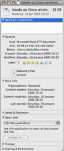

`Info` 窗口各部分的结构如下。

## 图标与摘要

`Info` 窗口的顶部是项目图标的预览，以及项目的文件名、大小和最后修改日期。你可以将图标预览从一个 `Info` 窗口复制并粘贴到另一个窗口中，也可以从几乎任何图形中将图标复制到 `Info` 窗口中。你这样做是为了给喜欢的文件和文件夹设置自定义图标。

## Spotlight 注释

Spotlight 是 Mac OS X 用于搜索整个 Mac OS X 中的文件、文件夹和应用程序数据的技术。你可以在 `Info` 窗口中填充任何你想要的信息，`Spotlight` 会将此信息与文件关联。例如，你可以使用此字段为他们的照片添加姓名；然后当你使用 `Spotlight` 按名称搜索他们时，它会在结果中返回这些图像。`Spotlight` 将第 3 章中详细介绍。

## 通用

`General` 部分包含有关项目的大部分信息。呈现的信息取决于 Finder 中突出显示的项目性质。但文件、文件夹和磁盘都具有以下信息：种类、创建日期、最后修改日期和标签。文件和文件夹还有位置（`Where`）信息，而磁盘还有总容量、可用容量和已用容量信息。

### 注意

标签（label）是可以关联到项目上的颜色，作为根据你自己的标准区分不同项目的方法；你可以在 `Info` 窗口中选择标签颜色，或者选择一个项目并选择 `File`，然后选择菜单中 `Label` 区域的颜色色块。

`General` 部分还有一或两个选项（取决于项目类型），你可以选择或取消选择它们以更改项目状态：

- **共享文件夹。** 当 `Info` 窗口涉及卷或文件夹时，会出现此选项。如果选择了 `Shared Folder` 选项，则该文件夹将对任何具有 `Info` 窗口 `Sharing & Permissions` 部分所示的适当文件共享权限的用户可用。（第 13 章解释了如何共享文件。）

- **文具插垫。** 仅适用于文件，`Stationery Pad` 选项如果被选中，意味着该文件是一个模板，因此如果你打开并保存它，将保存一个副本，而保留原始文件。

- **锁定。** 仅适用于磁盘和文件夹；如果选择了此选项，项目将无法添加、重命名或删除，除非输入管理员密码或在 `Info` 窗口中取消选择 `Locked`。（如果选择了 `Locked`，文件夹或磁盘上会出现锁图标。）注意 `锁定` 状态并不强大：你可以打开文件夹或磁盘中的项目并进行它们。

## 更多信息

`Info` 窗口的 `More Info` 部分提供了有关项目的详细信息。与 `General` 窗口一样，这因项目而异。例如，图像文件具有尺寸、色彩空间、配置文件、Alpha 通道以及最后打开的时间。Word 文档可能具有创建和修改的信息。HTML 文档可能具有 `<title>` 标签信息。音乐文件可能具有艺术家、流派等信息。

## 名称与扩展名

当前文件名出现在 `Name & Extension` 部分，你可以选择名称并更改它。你还可以通过选择或取消选择 `Hide Extension` 选项来隐藏或显示文件名扩展名。

## 打开方式

仅适用于文件，此部分有一个弹出菜单，你可以从中选择在双击文件时自动打开该文件的应用程序。此更改仅影响当前文件，除非你也点击了 `Change All` 按钮，在这种情况下所有该类型的文件都将用弹出菜单指定的新应用程序打开。注意 Mac OS X 会将弹出菜单中的选项限制为与文件类型兼容的选项，但也可能包含不兼容的选项。如果你选择了不兼容的选项，当你双击打开文件时将收到错误消息，告知该文件与应用程序不兼容。

## 预览

`Info` 窗口的 `Preview` 区域显示项目内容的小缩图（如果可用）。对于文件夹和磁盘，预览只是 `Info` 窗口顶部图标的放大版本。对于图形，你通常会看到实际图形。对于电影和音频文件，如果可用你会看到电影海报或专辑封面，如果没有则显示通用图标。如果你将鼠标指针悬停在预览图像上，会出现一个播放按钮。点击它播放文件；按钮将变为停止按钮，你可以点击它停止播放。

# 共享与权限

共享与权限是一个复杂的业务，在第 13 章中会有详细解释。在你设置好谁有权在你的 Mac 上共享文件后，你可以在信息（Info）窗口的此部分更改单个项目的权限。在“共享与权限”（Sharing & Permissions）标签下方，Mac OS X 会显示你对该项目的权限，例如“你只能读取”或“你可以读取和写入”。

通常情况下，项目的创建者是该项目的所有者。该人员可以选择与他人共享文件。但 Mac 的管理员也拥有更改共享权限的权利，无论哪个用户账户处于激活状态。要更改权限，请点击信息窗口右下角的青色锁图标按钮，并输入管理员或所有者的密码。这将允许修改`共享与权限`设置。

首先，从`名称`（Name）列表中选择一个你想要更改权限的名称或组。然后，在`权限`（Privilege）列表的相邻的弹出菜单中选择一个权限级别。根据项目类型，有两个或三个选择：`读与写`（Read & Write）、`只读`（Read Only）和`只写（投放箱）`（Write Only (Drop Box)）。`只写（投放箱）`权限仅适用于磁盘和文件夹。

你可以通过点击 `+` 和 `–` 图标按钮来添加和删除用户，并通过从齿轮图标弹出菜单中选择`应用于包含的项目`（Apply to Enclosed Items）来将你的更改应用于所选磁盘或文件夹内的所有文件夹。（这可能需要几分钟才能完成，请注意。）你还可以从同一个齿轮图标弹出菜单中选择`撤销更改`（Revert Changes）来撤销你的更改。

最后，仅对于非启动磁盘，你可以选择`忽略此卷上的所有权`（Ignore Ownership on This Volume）选项。如果选择了此项，任何用户账户都将被视为磁盘的所有者，从而拥有分配给所有者的所有权限。在`名称`列表中，寻找名称后带有`(我)`（`(Me)`）的用户账户；那就是当前所有者，而这些就是当选择此选项时每个人都能获得的权限——对于一个用于传阅照片（例如，家人的家庭照片）的共享驱动器来说非常方便。如果取消勾选`忽略此卷上的所有权`选项，那么从其用户账户访问驱动器的人将拥有信息窗口中为其特定用户账户设置的访问权限。

# 使用手势

Mac OS X 较新添加的功能之一是名为`多点触`（Multi-Touch）的技术。这项技术适用于手指操作界面设备，特别是 Mac 笔记本电脑上的触控板以及使用触摸屏的 Apple 设备（例如 iPod touch 和 iPhone）。

正如其名，`多点触`允许你使用多个手指与设备交互。这项技术相对较，正在被 Apple 推广。

## 了解哪些 Mac 支持手势

你是否可以使用`多点触`与 Mac OS X 交互，以及你可以使用的哪些`多点触`命令，取决于你拥有的是哪种 Mac。桌面级 Mac，如`iMac`、`Mac Pro`和`Mac mini` 不配备触控板，由于没有购买外接触控板的选项（至少在本书出版时），`多点触`技术不适用于它们。但 Apple 的`MacBook`和`MacBook Pro` 笔记本电脑带有`多点触`触控板，但根据生产时间的不同，能力水平不同。最早支持的模型支持双指输入；2008 年起的所有型号都支持四指输入。

### 新功能

以前，某些`MacBook Pro`和`Mac Air`型号仅支持三指手势，而四指手势仅带有新玻璃触控板的`MacBook`和`MacBook Pro`笔记本电脑用户可用。在 Mac OS X 10.6 雪豹（Snow Leopard）中，这些旧的`MacBook Pro`和`Mac Air`笔记本电脑现在可以使用四指手势了。

### 注意

Apple 直到 2006 年才开始将该技术称为`多点触`，当时可以使用两个以上的手指并执行复杂的动作（如`捏合打开与关闭`）。然而，在此之前，`MacBook`和`MacBook Pro`笔记本电脑的触控板确实支持使用简单的双指手势来执行相当于鼠标右键点击的操作。

确定你拥有多种`多点触`输入水平的方法是选择`系统偏好设置`（System Preferences）并进入`触控板`（Trackpad）系统偏好。在系统偏好的左侧，选项列表分为`单指`（One Finger）、`双指`（Two Fingers）等类别（见图 2.26）。通过查看这些选项，你可以确定哪些`多点触`命令对你可用。Apple 还在系统偏好设置中提供了一些可以访问的短视频，演示了`多点触`手势的工作原理。有关`触控板`系统偏好设置的更多信息，请参阅第 21 章。

### 新功能

Mac OS X 10.6 雪豹将`多点触`手势界面扩展给开发者，使他们能够在自己的应用程序中快速添加对`多点触`的支持。某些应用程序，如`Adobe Create Suite 4`和`Firefox 3.1`已经支持`多点触`（因为开发者已经创建了控制界面），但在 Mac OS X 10.6 雪豹中，许多其他应用程序应该能够支持该功能。

### 图 2.26

`触控板`系统偏好设置是熟悉 Mac 上可用`多点触`选项的极佳方法。


# 使用多个手指控制 Mac OS X

Apple 创建了多种可以在整个操作系统和各种程序使用的`多点触`手势：

- **双指点击**：在触控板上放置两个手指并用拇指点击。这种手势相当于`Control`点击或右键点击。

- **双指滚动**：在触控板上放置两个手指并上下移动。这种手势滚动活动窗口，相当于移动右侧或底部的滚动条。

- **双指旋转**：在触控板上放置两个手指（或食指和拇指）并顺时针或逆时针旋转。这种手势通常适用于在应用程序（如预览和`iPhoto`）中打开的图像。

- **捏合打开与关闭**：此手势用于放大和缩小。在触控板上放置两个手指（通常是拇指和食指）并将它们分开以扩展项目，将它们捏在一起以缩小项目。相同的手势也可以增大桌面上图标的大小。

- **屏幕缩放**：这是另一种双指手势。按住`Control+Option+Ô`，然后在触控板上放置两个手指并向上滚动放大或向下滚动缩小。如果你在的同时移动鼠标，缩放中心会跟随鼠标移动。

- **三指滑动**：这种手势涉及将三个手指放在触控板上并快速向左或向右移动。你通常用它调用返回和前进命令，例如在`Safari` 浏览器中。你也可以用它在`访达`窗口中穿梭文件夹。

- **四指滑动（上下）**：此手势提供了对`Exposé`的`所有窗口`和`显示桌面`功能的访问（参阅第 21 章）。你将四个手指放在触控板上并快速向上或向下滑动。向上滑动四指会显示 Mac OS X 中打开的所有窗口；向下滑动四会将所有窗口移出屏幕边缘以显示桌面。

- **四指滑动（左右）**：此手势允许你在打开的应用程序之间快速切换。将四个手指放在触控板上，并快速向左或向右滑动以打开`应用程序切换器`（它在窗口中心的不透明水平线上显示所有活动应用程序的图标）。使用鼠标选择你想切换的应用程序。（此手势与按下`Ô+Tab`相同。）

熟练使用多点触控可以让你在 Mac 笔记本电脑上的工作速度快得多，而且这个过程通常比使用鼠标更直观。

## 总结

启动 Mac 就像按下电源按钮一样简单，但当你需要时，它也拥有更强大的功能，例如从不同的磁盘启动，以及要求登录以确保只有授权用户才能访问 Mac。这种简单性与强大功能的结合一直延伸到 Mac 的睡眠、重启和关机选项，以及在授权用户之间进行切换。

Mac OS X 的一个关键区别特征是它的图形用户界面（GUI），它为易用性树立了标准。Mac OS X 有四个用户交互的四个主要 GUI 组件：菜单栏、Dock 栏、桌面和 Finder（访达）。它们不仅让你能够个性化 Mac，还能让你对应用程序、文件、文件夹和磁盘的操作与使用获得非凡的控制。菜单栏允许通过鼠标访问应用程序和 Mac OS X 的命令；Dock 栏提供了快速访问应用程序、文档窗口以及文件文件夹；桌面提供了一个简单的起点，你也可以用它放置你喜欢的物品；而 Finder 则允许你浏览并处理文件、文件夹和磁盘。

键盘快捷键和上下文菜单的广泛使用，使得在导航菜单栏效率低下时可以轻松启动操作。此外，Mac 对按钮和对话框等控件的一致使用——加上它将窗口作为应用程序和文档容器的习惯——让你在学习基础知识后，使用 Mac 以及你的 Mac OS 应用程序变得容易得。。然而，Mac OS X 也支持对环境的深度定制，你可以根据自己的工作风格对其进行微调。

Mac OS X 还提供了许多实用的功能，例如快速查看（Quick Look）和显示信息（Get Info），它们能为你正在处理的项目提供额外的上下文信息。它在最近笔记本电脑触摸板上对手指手势的创新使用，将这种复杂的易用性扩展到了全新的界面领域。

## 第 3 章：使用 Finder 和通过 Spotlight 搜索

### 本章内容

- 打开和使用 Finder 窗口
- 文件夹操作
- 理解 Mac OS X 的特殊文件夹
- 磁盘和其他卷的操作
- 使用 Spotlight 查找项目

Mac OS X 包含两个非常强大的工具，使你能够管理和定位存储在 Mac 硬盘上的文件。第一个工具是一个名为 `Finder` 的应用程序，用于在 Mac OS X 中定位、调整和移动文件。由于 `Finder` 应用程序是 Mac OS X 中最常用的工具，我们在第 2 章中将其概述为菜单、按钮和窗口在 Mac OS X 应用程序中如何工作的示例。在本章中，我们将研究 `Finder` 的运行情况以及如何将其投入实践。

我们查看的第二个 Mac OS X 特性称为 `Spotlight`。这项技术首次在 Mac OS X 10.4 Tiger 中引入，彻底改变了人们与 Mac 交互的方式。Spotlight 帮助你以极快的速度发现整个 Mac OS X 中包含的文件、文件夹和信息。

使用 Spotlight 进行搜索可以非常简单，也可以非常复杂。Spotlight 可以按名称搜索文件和文件夹，与传统搜索工具多年来在计算机上的方式类似。它还可以搜索其他属性的组合，例如文件大小、创建者、修改日期和标签颜色。

Spotlight 开始变得智能的地方是它可以搜索文件内容本身。Spotlight 可以查看 Word 文档、`PDF`（便携文档格式）文件，甚至是附加在音乐和图像文件上的元数据。Spotlight 甚至搜索 Mac OS X 内置应用程序中的信息，例如你的电子邮件、联系人和日历事件。你会很快发现，自己转向 Spotlight 不仅是为了寻找丢失的信息，还为了在不深入 `Finder` 的情况下快速访问电子邮件、人员和文档。你甚至只需输入应用程序名称的第一部分并按 `Enter` 即可打开应用程序。

事实上，Spotlight 在查找文件和信息方面非常成功，以至于许多 Mac 用户不再像以前那样仔细用 `Finder` 管理文件了，因为他们知道无论硬盘结构变得多么混乱，Spotlight 都会帮助他们找到正在寻找的任何内容。

虽然组织得良好的 Mac OS X 用户可能会对某些用户电脑上拥挤的虚拟垃圾感到沮丧，但令人欣慰的是，无论用户的组织能力如何，所有用户都将高效地使用 Mac。

无论你的个人工作效率水平如何，Mac OS X 提供的用于管理和查找 Mac 数据的两个工具都是一个强力的组合。在本章中，我们将仔细查看这两个工具的功能。

## 打开和使用 Finder 窗口

你通常通过 `Finder` 窗口来浏览 Mac OS X 中无数文件和文件夹。它是计算机上各种磁盘中包含的文件和文件夹的视觉化表示。它以多种不同的方式呈现信息，有些很直观，有些则更抽象。一个标准的 `Finder` 窗口（见图 3.1）是一个很好的起点。


如果`Finder`是激活状态，你可以通过多种方式打开新的`Finder`窗口：选择`文件`⇒`新建 Finder 窗口`，按下`Command+N`，或者在`Dock`中`Control+点击`或右键点击`Finder`图标，并从上下文菜单中选择“新建 Finder 窗口”（要让`Finder`成为激活应用程序，请点击桌面或点击`Dock`上的`Finder`图标）。新的`Finder`窗口将打开你的`Home`文件夹，除非如本章稍后解释的那样，在`Finder`的“好设置”对话框中更改默认位置。

如果你在桌面上双击磁盘或文件夹的图标，或者点击侧边栏中的项目，其`Finder`窗口就会打开。（如果你选中了多个磁盘/文件夹，双击任何一个都会打开所有它们。）如果你在打开的`Finder`窗口中`Option`-双击文件夹，该文件夹将在独立的`Finder`窗口中打开。同样，在侧边栏中`Option`-点击驱动器或文件夹也会在独立的`Finder`窗口中打开该项目。

你也可以通过点击桌面上的窗口，或者如果它们被最小化到了`Dock`，通过点击它们在`Dock`上的图标来查看打开的`Finder`窗口。

> **提示**：在点击侧边栏中的磁盘或文件夹时按住`Option`，在桌面双击文件夹将关闭当前的`Finder`窗口并打开一个新的。

当你打开`Finder`窗口时，你将看到几个用于浏览 Mac 上的文件、文件夹和卷的区域。Apple 设计`Finder`窗口旨在尽可能直观，你会本能地使用大多数元素。图 3.1 显示了一个`Finder`窗口。

除了这些按钮外，`Finder`窗口由适用于 Mac OS X 大多数窗口的标准按钮组成（`关闭`、`最小化`和`缩放`）；它还带有第 2 章概述的滑块和可拖动区域。然而，`Finder`窗口中还有一些其他窗口中没有的独特项目。

## 使用侧边栏

窗口左侧是`侧边栏`。它包含了 Mac 上常用区域的别名。这些别名分为四个部分，每个部分都有一个切换三角形，可以使用它展开或折叠该区域的选项：`设备`、`共享`、`位置`和`搜索查找`。（只有当你的 Mac 连接到网络上的其他计算机时，`共享`部分才会出现。）

要使用侧边栏中的项目，只需点击其图标即可。例如，在“位置”部分，会出现“音乐”和“电影”文件夹的图标；点击这些图标将直接带你进入访达（Finder）窗口中的这些特定区域。

你可以从 Finder 窗口或桌面上将自己的项目添加别名到侧边栏。只需将项目拖动到侧边栏，或者选择它们并选择`文件⇒添加到侧边栏`或按下`Option+T`；若要从侧边栏移除别名，只需将它们拖出侧边栏，或者`Control+点击`或右键点击它们，并从上下文菜单中选择“从侧边栏移除”。

## 新功能

如果你删除了侧边栏中`设备`、`位置`或`搜索`标题下的所有项目，该标题也会随之消失。如果你将一个属于这些标题之一的项目拖入侧边栏，该标题就会自动重新出现。

你无法为侧边栏添加新的分段，但可以通过 Finder 的“偏好设置”对话框来指定哪些磁盘、共享项目、位置和搜索显示在侧边栏的分段中，本文将在章稍后进行说明。首先，让我们来看一下组成侧边栏的区域：

- **设备**。此部分列出了硬盘（包括内部和外部）、插入的 CD 和 DVD 以及`iDisk`（作为 Apple MobileMe 服务一部分提供的互联网卷）。如果你拥有一台没有内置 DVD 驱动器的 Mac（例如 MacBook Air），你还会看到`远程光驱`选项，它允许你通过网络连接从另一台计算机“借用”光驱器，以便从光盘读取数据并安装程序。（正如第 13 章所示，另一台 Mac 必须在“共享”系统偏好中启用 CD 或 DVD 共享。）

- **共享**。同一局域网上的计算机和共享卷在此列表中。如果你有多个 Mac 连接到网络，你可以远程搜索硬盘，甚至在操作另一台 Mac 的同时控制另一台 Mac 的屏幕。（创建网络以及共享文件和屏幕将在第 13 章详细介绍。）

- **位置**。此部分组织了你硬盘上热门目的的快捷方式。默认区域包括桌面、文档、应用程序和你的个人文件夹。

- **搜索**。此部分包含智能文件夹（本章稍后会详细介绍）。智能文件夹是 Finder 窗口，它根据你指定的 Spotlight 搜索信息显示文件，例如你电脑上所有的 Word 文档，或包含“工作”一词的所有文件。“搜索”部分的默认项目有：今天、昨天、上周、所有图像、所有电影和所有文档。

## 查看标题栏

Finder 窗口的最顶部是标题栏。它显示文件夹、磁盘或其他图标（取决于打开了什么内容）以及在 Finder 窗口中显示内容的文件夹名称。你可以通过拖动标题栏来在桌面上移动窗口。

如果你对标题栏中的图标、文件夹或磁盘名称进行`Option+点击`、`Control+点击`或右键点击，将弹出一个菜单显示文件夹的层级结构，如图 3.2 所示。（文件夹层级结构是“父”文件夹的列表，它追踪了从当前文件夹到包含它的文件夹的路径，一直到最顶层，即卷的根。）点击层级结构中的一个文件夹，即可在 Finder 窗口中显示其内容（它将替换当前显示的 Finder 窗口内容）。

### 提示

如果你`Shift+点击`或`Option+点击`文件夹或磁盘图标，该图标将被选中；然后你可以将该图标拖到其他地方，将文件夹或磁盘的内容复制到你拖到的任何地方。注意，有时`Shift+点击`或`Option+点击`并不会选中图标；如果发生这种情况，请松开键和鼠标并重试。

### 图 3.2

你可以通过对 Finder 窗口顶部的图标或名称进行`Option+点击`、`Control+点击`或右键点击，来发现从当前文件夹或项目到卷根目录的路径——文件夹层级结构。

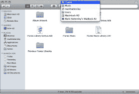

除了标题栏左侧标准的关闭、最小化和缩放图标按钮（见第 2 章）外，标题栏最右侧还有一个`显示/隐藏工具栏`图标按钮。这个胶囊形状的图标按钮控制工具栏和侧边栏的显示。点击它会从根本上改变 Finder 窗口的外观。当隐藏侧边栏和工具栏时，Finder 窗口将具有更简单的样式，某些用户更喜欢这种样式。但代价是，你必须通过 Finder 菜单或学习快捷键来访问工具栏提供的许多选项。

### 提示

你可以通过选择`视图⇒隐藏工具栏`或按下`Option+Option+T`来仅隐藏当前窗口的工具栏。你还可以通过`视图⇒隐藏侧边栏`或按下`Option+Option+S`来仅隐藏当前窗口的侧边栏。

## 调查工具栏

工具栏位于窗口顶部，就在标题栏下方。它包含几个实用的图标按钮，允许你导航 Finder 并访问 Finder 选项，而无需通过 Finder 菜单。你可以更改工具栏上的某些图标按钮以适应自己的用途，尽管其他图标按钮是固定的。

标准的图标按钮有：后退、前进、图标视图、列表视图、列视图、封墙流视图和快速查看。这里还有一个“操作”图标弹出菜单和由 Spotlight 驱动的搜索字段。以下是这些图标控件的功能：

- **后退**。按下`后退`图标按钮（向左三角形图标）将 Finder 窗口带到上一个文件夹或其他项目，或者回到之前的查看模式。

- **前进**。如果你按了`后退`图标按钮，按下`前进`图标按钮（向右箭头图标）将返回你最初查看的项目或查看模式。

- **视图选择器**。这四个图标按钮更改 Finder 呈现内容的方式，即所谓的视图模式：图标、列表、列和封墙流。每个图标都有一个小图形，描述了内容在 Finder 窗口中的显示方式。在不同视图模式下的操作将在本章稍后介绍。

- **快速查看**。点击`快速查看`图标按钮（眼睛图标）允许你快速检查许多文件和文件夹的内容。它的功能与在 Finder 中突出项目并按下空格，或`Control+点击`或右键点击项目并在上下文菜单中选择“快速查看”相同。（第 7 章介绍了快速查看。）

- **操作**。`操作`图标弹出菜单（齿轮图标）提供一组与上下文菜单极其类似的选项，其选项根据 Finder 中选中的内容而变化。

- **搜索字段**。在带有放大镜图标的搜索字段中输入内容，允许你使用 Spotlight 技术搜索文件。通过 Spotlight 搜索将在本章稍后介绍。

你可以通过选择`视图⇒自定义工具栏`或通过`Control+点击`或右键点击工具栏并在上下文菜单中选择“自定义工具栏”来更改工具栏的内容和排列。如图 3.3 所示的自定义工具栏设置表将会出现。

### 图 3.3

你可以通过使用自定义工具栏设置表在 Finder 窗口中添加、移除和重新排列按钮。

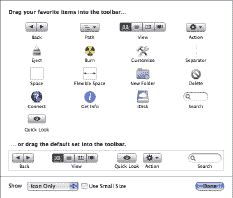

你可以使用自定义工具栏设置表执行以下操作：

## 工具栏管理

- **将你喜爱的项目拖入工具栏。** 从`Customize Toolbar`对话框中点击并拖动任何图标按钮到活动窗口的工具栏即可将其作为收藏。可用项目包括：`Back`、`Path`、`View`、`Action`、`Eject`、`Burn`、`Customize`、`Separator`、`Space`、`Flexible Space`、`New Folder`、`Delete`、`Connect`、`Get Info`、`iDisk`以及`Search`。你可以在工具栏的任何位置添加新项目，其他项目会自动分散以为新按钮留出空间。如果你拖入工具栏的图标按钮超过了物理容纳范围，工具栏右侧会出现一个显示两个向右箭头的图标按钮。点击此按钮将显示一个包含隐藏图标的弹出菜单。对选择满意后，点击`Done`。

- **将默认 set 拖入工具栏。** 默认图标按钮集提供了一组良好的工具选择，且不会让工具栏过于拥挤。如果你决定想恢复默认图标集，可以从`Customize Toolbar`窗口底部将整套设置拖到工具栏。工具栏中当前所有的图标都将被默认集替换。

- **排列图标按钮。** 你可以向左右拖动图标按钮，以重新排列它们在工具栏中的位置。当你移动一个图标按钮时，其他图标会移动以适应它。

- **移除图标按钮。** 要从工具栏中移除图标按钮，请点击并将其拖离开 Finder 窗口。当你拖动它们时，按钮图标上会出现微小的尘云，表示它们即将被移入垃圾桶。释放鼠标，图标按钮将消失在尘云中。

- **更改按钮显示。** `Customize Toolbar`窗口底部有一个弹出菜单，你可以用它调整按钮的外观。如图 3.1 所示，选项有`Icon & Text`、`Icon Only`和`Text Only`。弹出菜单旁边是`Use Small Size`选项；选中它会略微减小图标和文本描述尺寸。

完成后，点击`Done`将更改应用到所有 Finder 窗口。

### 提示

你可以在不打开`Customize Toolbar`设置面板的情况下添加、删除和排列工具栏上的项目。要执行此操作，请按住`Ô`键，然后在任何活动 Finder 窗口中拖动图标来移除或重新排列它们。同样，通过`Ô+拖动`将文件夹、文件甚至卷拖入工具栏。在将项目拖到工具栏时，会出现一个带有`+`图标的绿色圆圈，表示这是一个添加操作。你可能需要在拖动项目前按住`Ô`键一到二秒。当你将项目拖到工具栏的理想位置后，释放鼠标键。

以下你可以从`Customize Toolbar`设置面板向工具栏添加的控件：

- `Path`。此图标弹出菜单显示文件层级结构。选择弹出菜单中的任何文件夹都会在当前 Finder 窗口中打开该文件夹的内容。（此功能与在标题栏中`Ô+点击`项目的图标或名称相同。）

- `Eject`。此图标按钮可断开任何已选的已连接服务器、网络连接的计算机、光光光片或外部磁盘的连接。它还可以从物理上退出（吐出）插入计算机的任何 CD 或 DVD。

- `Burn`。此图标按钮打开`Burn Disc`对话框，引导你完成将选定项目拷贝（“刻录”）到可刻录 CD 或 DVD 的步骤。如果没有插入 CD 或 DVD，系统会要求你插入光盘。

- `Customize`。此图标按钮打开`Customize Toolbar`设置面板。

- `Separator`。此控件在工具栏中放置一条垂直线，作为工具栏上项目之间的视觉分隔符。

- `Space`和`Flexible Space`。使用`Space`和`Flexible Space`控件，你可以分开图标按钮。`Space`控件创建一个与大多数工具栏图标大小相似的方形空间。`Flexible Space`控件会根据 Finder 窗口的宽度扩展或缩小。

- `New Folder`。此图标按钮打开一个新的 Finder 窗口。

- `Delete`。此图标按钮将 Finder 中的任何高亮项目移动到`Trash`。

- `Connect`。此图标按钮打开`Connect to Server`对话框。连接服务器将在第 13 章中概述。

- `Get Info`。此图标按钮打开`Info`窗口，在第 2 章中概述。

- `iDisk`。此图标按钮在 Finder 窗口中显示你的`iDisk`文件夹内容。`iDisk`是 Apple MobileMe 服务的一部分，在第 15 章中概述。

## 查看 Finder 窗口底部

Finder 窗口底部是一个灰色水平条，提供了更多信息和一些有限的控件。虽然 Finder 窗口的底部比工具栏复杂得多，但它仍然有值得关注的区域。

- `File path`。当你向`Search`字段中输入内容时，文件路径出现在 Finder 窗口的底部。从左到右，它显示从硬盘根目录到 Finder 搜索窗口中当前高亮文件的路径（换句话说，即文件夹层级）。双击文件路径中的任何文件夹都会在新的 Finder 窗口中打开。（注意，你不能在 Finder 搜索窗口中使用`Columns`视图模式；它是灰色的。）

  你也可以通过选择`View⇒Show Path Bar`在任何视图模式下于 Finder 底部显示文件路径。选择`View⇒Hide Path Bar`可将其隐藏。

- `Status bar`。Finder 窗口的最底部是状态栏，它呈现有关窗口内容的信息。它通常显示 Finder 窗口中有多少项目以及剩余可用空间。如果你在 Finder 中选中了项目，它会列出总数中的已选项目数。如果你对某个文件夹或项目没有写入权限，状态栏左侧会出现一个像被划掉笔的小图标。

- `Icon size slider`。仅在`Icons`视图模式下可用，状态栏右侧的滑块允许增加或减小当前 Finder 窗口的图标尺寸。（你也可以使用本章稍后介绍的`View Options`控件。）

### 新功能

`size slider`是 Mac OS X 10.6 Snow Leopard 的新功能。

图标视图（Icon view）是 Mac 操作系统中最老的视图模式，可以追溯到 1984 年出的原始 Macintosh 电脑。多年来，图标视图一直在不断更新和改进。正如第 2 章解释的那样，在`Mac OS X 10.6 Snow Leopard`（雪豹）中，图标提供了关于其所代表项目的丰富视觉细节。但在项目名称之外，它们提供的额外信息非常少——除非你通过本章稍后介绍的`Finder`视图选项开启了它，从而显示文件大小和文件夹中的项目数量等基本项目信息。

> **提示**：图标视图的巨大优势是预览图的大小，这让你能够在无需打开图标的情况下了解其内容。在图标视图模式下，你可以使用`Finder`窗口底部状态栏右侧出现的滑块来增大或减小图标的大小。

如果你使用图标视图，很容易导致各种图标杂乱无章。通过选择`查看⇒整理`（`View⇒Clean Up`）让`Finder`整理图标也是一项简单的任务。或者，你也可以在拖动图标时按住`Option`键；这会自动将它们对齐到你在本章稍后介绍的`显示选项`控制中设置的网格上。

> **注意**：图标视图是桌面唯一的可用视图模式。

### 在列表视图中工作

列表视图（List view）强调`Finder`窗口中关于项目的文本信息，将图标降级为不高于文本高度的小元素。背景采用交替的蓝色和白色行，这使得在视觉上更容易区分不同的项目。

如图 3.5 所示，文件夹通过折叠三角形（disclosure triangles）呈现，允许你显示或隐藏其包含的文件或文件夹。文件夹名称左侧向右的折叠三角形意味着它有未显示的内容；向下的折叠三角形意味着其内容正在显示（注意它们也缩进了，以提供类似大纲的嵌套组织结构）。

> **注意**：当你点击折叠三角形展开文件夹时，下次打开该`Finder`窗口时，`Finder`会记住其中的文件夹之前是处于展开的还是折叠的。

> **提示**：如果你在点击文件夹的折叠三角形显示其项目时按住`Option`键，`Finder`会自动展开该文件夹内的第一层子文件夹。

> **提示**：你可以通过按`Option+→`在列表视图（以及 Cover Flow 视图）中展开文件夹；按`Option+←`则折叠已展开的文件夹。

在列表视图中工作的一个关键优势是，你可以钻取文件夹结构，并在同一个`Finder`窗口中选择不同文件夹中的多个项目（通过使用折叠三角形显示所有子文件夹的内容，以便所有内容在`Finder`窗口中均可见）。

在列表视图中工作的另一个关键优势是快速排序信息的能力。如图 3.5 所示，列表视图默认有四列信息：`名称`（`Name`）、`修改日期`（`Date Modified`）、`大小`（`Size`）和`类型`（`Kind`，文件类型）。你可以点击这些列头对内容进行排序；默认情况下，它们“名称”和“类型”按字母顺序（A 到 Z）排序，“修改日期”从新到旧排序，“大小”从大到小排序。如果你再次点击活动列，它将反转排序；注意当点击列头时，活动列头名称右侧的三角形会在向上和向下之间切换。（蓝色高亮的列头是当前正在对窗口内容排序的列。）

### 图 3.5

列表视图下的 Finder 窗口，同时显示展开和折叠的文件夹。

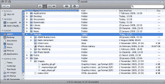

在列表视图中除了按列排序外，你还可以调整列本身。一种调整方法是更改列宽，这非常有用，因为许多项目的标签太长，无法适应在“名称”或“类型”列中，正如带有省略号（…）的截断文本所示。

> **提示**


你可以通过本章稍后介绍的显示选项向列表视图添加列。例如，你可能为`Finder`窗口添加`标签`（Label）列，以便根据你分配给文件的颜色标签对文件进行排序（参见第 2 章）。

按照以下步骤更改列的大小：

1. 高亮列边缘。将鼠标悬停在划分一列和另一列的线线上。你可以判断位置是否正确，因为鼠标指针会从箭头变为带有左右伸出的两个箭头的垂直线。

2. 在该垂直线上点击并按住鼠标按钮。

3. 左右拖动鼠标。

### 提示

如果你只想查看某个不适应列视图的特定项目，则不需要调整列宽。如果你将鼠标悬停在列表视图中标签被截断的项目上，会出现一个浅黄色的框显示全名。按下`Option`键可以加快描述框出现的速度。

你还可以更改`修改日期`、`大小`和`类型`列出现的顺序。要实现这一点，点击列标题并将列向左或右拖动。当你拖动列头时，指针会变为手形工具，并且列将移动的位置会出现该列的灰色预览。释放鼠标按钮，列将移动到新位置，并在滑入到位时重新排列其他列（参见图 3.6）。遗憾的是，你无法移动`名称`列。

### 图 3.6

列表视图有四列信息，你可以用它们对项目的显示排序。除了“名称”列外，其他列都可以重新排列。

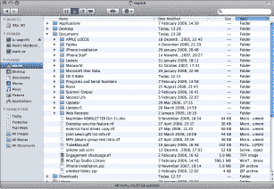

## 列视图

列视图（Column view）首次在`Mac OS X 10.4 Tiger`（虎豹）中正式引入，尽管它的根源于 NeXT 操作系统，并以名为`Greg's Browser`的共享软件形式出现在 Mac 上。

理解并使用`Mac OS X`中的列视图是非常重要的，不仅因为它是导航`Finder`最快的方法之一，还因为当应用程序要求打开或保存项目时，它是对话框中的默认视图。（第 7 章有关于从文档内部打开和保存项目的更多信息。）

列视图的真正优势在于可以轻松回顾通过卷文件夹结构的路径；当你选择文件夹以外的项目时，最后一列还会呈现全面的预览和大量的项目信息。因此，它是许多`Mac OS X`用户的首选视图。缺点是它缺乏列表视图提供的排序选项，并且无法像列表视图那样管理非嵌套文件夹的内容。

当你在列视图中选择一个文件夹时，右侧的列会立即显示该文件夹的内容（包括任何文件夹）。列视图在第一列中显示该文件夹的内容，然后在下一列中显示所选子文件夹的内容，再在下一列……直到没有更多子文件夹可以选择为止。通过这种方式，你可以深入挖掘卷的内容找到你寻找的文件或文件夹，如图 3.7 所示。这使得钻取菜单结构成为可能，并且可以在任何时候返回较早列中找到之前的文件或文件夹。

如果列的数量超过了`Finder`窗口的宽度，新列将继续出现在`Finder`窗口的右侧，而左侧的列会滑出视野。`Finder`窗口底部会出现滚动条，以便你在菜单结构中来回导航。

如果你选择文件夹的别名，`Finder`会显示该别名指向的文件夹内容，同时保持通向别名的文件夹结构完整。当你选择一个文件时，右侧的列会显示该文件的基本信息，以及该项目的大型预览（见图 3.7）。与图标视图一样，你看到的是文件内容的预览还是与文件关联的应用程序图标，取决于文件本身的性质。尽管预览图标相当大，但你可能还想通过第 7 章描述的“快速查看（Quick Look）”功能来获取更大的视觉视图。

对于应用程序，你总是能看到该应用程序使用的图标的大型图片，以及名称、类型（在此情况下为“应用程序”）、大小、应用程序创建（或安装）日期，以及应用程序修改和最后打开的日期；你还可以看到应用程序的版本号。你可以使用标记为`Preview`（预览）文本旁边的折叠三角形来显示或隐藏预览。

### 注意

在列视图中打开和关闭预览适用于你在`Finder`中选择的所有项目，而不仅仅是当前选中的项目。

对于某些文本或图形项目，预览显示的是文件内容而非关联的应用程序。对于大多数文档，你还将看到与应用程序相同的所有信息（版本号除外）。如果你选择了图像，最后一列还会显示图片的尺寸信息，以像素为单位，先水平后垂直。因此，如果你选择了音频或视频文件，你还会获得时长信息。当你选中电影或声音文件时，将鼠标悬停在最后一列的预览上，会显示一个内部带有播放三角形的小白色圆圈。点击此图标按钮即可播放电影或声音文件。

### 图 3.7

列视图下的`Finder`窗口。每列显示一个文件夹的内容，最后一列显示所选文件的信息以及项目内容的预览。

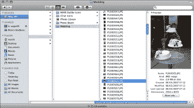

列视图中列的宽度是可以调整的。你可以调整单个列的宽度，也可以统一调整所有列。要调整列宽，请执行以下操作之一：

- 要缩放单列，请点击列分隔符底部的句柄（句柄是一个带有两条垂直线的小正方形图标）并向左或向右拖动。

- 要将所有列调整为统一大小，在拖动句柄时按住`Option`键。所有列都会对齐到正在调整的那一列的大小。当你左右拖动句柄时，所有列都将对齐到相同的大小。

## 在 Cover Flow 视图中工作

Cover Flow 是一项首次出现在`iTunes`中的苹果技术，它已经慢慢渗透到许多许多应用程序中。Cover Flow 是所有视图模式中视觉冲击力最强的一种，提供了一种高度图形化的`Finder`交互方式。Cover Flow 将`Finder`窗口分为两部分，下半部分使用列表视图呈现文件和文件夹，上半部分则以大型图标的形式水平展示项目，你可以对其进行“翻阅”浏览。当前选中的项目在其他项目的中间正对着你，其他项目则以扇形或轮播式的视图排列，如图 3.8 所示。

### 提示

你可以调整窗口 Cover Flow 部分的大小，以获得更大（或更小）的视觉显示。Cover Flow 滚动条下方有一个标有三条小水平白线的句柄。如果你将鼠标悬停在这个句柄上，指针会变成一只手。点击并向上拖动白线以获得更小的 Cover Flow 显示，向下拖动以获得更大的 Cover Flow 显示。

你可以以与使用列表视图（如前面所述）相同的方式导航窗口下半部分。区别在于，当你高亮一个项目时，上半部分会翻到该项目的大型预览。

然而，你也可以使用 Cover Flow 窗口的上半部分来切换文件。你可以通过五种方式与 Cover Flow 窗口交互：

- 使用滚动条。点击并拖动图像正下方的滚动条来滚动当前窗口。

- 使用滚动箭头。滚动条左右各有一个箭头。点击这些箭头每次移动一个项目。

- 点击图像。你可以直接点击 Cover Flow 中的任何视觉图像直接跳转到该图像。通过反复点击当前图像左侧或右侧的图像，你可以浏览 Cover Flow 视图中的所有图像。

- 使用方向键。如果你按下`←`和`→`键，将分别向左右移动 Cover Flow 图像。你还可以使用`↑`和`↓`键上下移动`Finder`窗口下半部分的项目列表；这与分别使用`←`和`→`的效果相同。

- 使用滚轮。如果你为`Mac`连接了 Mighty Mouse 或其他带有滚轮的鼠标，你可以移动鼠标顶部的滚轮来浏览 Cover Flow 窗口中代表的项目。如果滚轮只上下移动，它的作用类似于`↑`和`↓`键。如果滚轮实际上是一个球（如 Mighty Mouse 所示），它可以在多个方向移动，向下或向右移动球会向右浏览 Cover Flow 图像，而向上或向左移动球则会向左浏览 Cover Flow 图像。

### 图 3.8

Cover Flow 视图下的`Finder`窗口分为两部分，下半部分显示项目列表，上半部分提供一个可以“翻阅”的滚动 3D 视图。

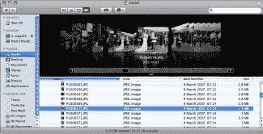

Cover Flow 视图并非没有反对者。许多用户抱怨它牺牲可用性来换取视觉效果。虽然它没有提供其他视图模式中没有的功能，但这种视觉化浏览文件的能力非常好。如果你不喜欢，就不要用它。

### 提示

Cover Flow 与苹果的快速查看技术（见第 7 章）配合得非常好。当你浏览 Cover Flow 中的项目时，按下空格键会让高亮项目放大并显示更大的预览。将 Cover Flow 与快速查看结合使用是浏览文件的极佳方法。

## 调整 Finder 偏好设置

大多数 Finder 偏好设置位于“Finder 设置”对话框中，你可以通过选择`Finder⇒偏好设置`或按下`Option+;`（分号）访问它。该对话框有四个标签页，如图 3.9 所示。

使用`侧边栏`标签页来配置出现在所有 Finder 窗口侧边栏的标准磁盘和文件夹（例如打开磁盘或文件夹时）。选择你想要显示的，取消选择你不想显示的。注意，当 Finder 窗口打开时，你可以将任何磁盘或文件夹拖入其中，这样该磁盘或文件夹就会永久出现在侧边栏。要删除它们，只需每次将它们拖出 Finder 窗口，或者每次`Control+点击`或右键点击并在上下文菜单中选择“从侧边栏移除”。

### 新功能

Mac OS X 10.6 雪豹现在允许你选择`文件⇒添加到侧边栏`或直接按`Option+T`添加选定的磁盘或文件夹。

`通用`标签页提供了若干控制项：

- 在桌面上显示这些项目。选择或取消选择此区域的选项，以控制在可用时始终在桌面上显示内容：硬盘；外部磁盘；CD、DVD 和 iPod；以及连接的服务器。

### Finder 偏好设置

- **新建 Finder 窗口时**。使用此弹出菜单选择打开新的 Finder 窗口时应打开哪个文件夹。（在 Finder 中，选择`文件⇒新建 Finder 窗口`或按键`Command+N`即可打开新的 Finder 窗口。）默认情况下，此选项设置为活动用户账户的个人文件夹。

- **始终在新窗口中打开文件夹**。选择或取消选择此选项，可以使文件夹在新窗口中打开，而不是在当前窗口打开（默认行为）。

- **弹跳文件夹和窗口**。当你将文件或文件夹拖到其他文件夹以将其放入其中时，你通常不确定目标文件夹的具体所在位置。如果选择了“弹跳文件夹和窗口”选项，当你将一个文件或文件夹拖到另一个文件夹或磁盘驱动器上方并悬停时，该文件夹或驱动器会自动打开，你就可以将文件或文件夹放入其中——或者悬停在子文件夹上以打开它。（将悬停的文件或文件夹移出窗口即可关闭它。）因此，你可以在决定将选中的文件夹或文件放入何处之前，探索多个文件夹和驱动器。可以通过`延迟`滑块调整悬停时间。

### 图 3.9

Finder 偏好设置对话框及其四个面板：通用、标签、侧边栏和高级。

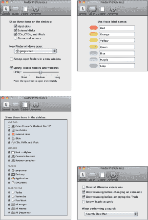

### 标签面板

标签面板非常简单：它显示了你可以应用于文件夹的七种颜色，并允许你更改每个标签的颜色。（你可以通过选择文件夹，然后选择`文件`以及`文件`菜单底部的所需的颜色块来为文件夹应用颜色。）

### 高级面板

高级面板控制文件名扩展名和废纸篓的行为：

- **显示所有文件名扩展名**。文件名扩展名通常是文件名末尾点之后的三个或四个字符的代码，用于识别文件类型。例如，`.tiff`文件是 TIFF 图像文件，而`.doc`或`.docx`文件是 Microsoft Word 文档文件。Mac OS 使用图标告知你文件类型，因此默认情况下它隐藏了不需要的文件扩展名。但如果你希望看到它们，请选择“显示所有文件扩展名”选项。

- **在更改扩展名之前显示警告**。这与文件名扩展名有关。如果你编辑文件名以更改其扩展名，Mac OS X 将询问你是否确定。（通常情况下，你不应该更改文件名扩展名，因为可能会让 Mac OS 和应用程序对文件类型产生困惑，可能让应用程序“认为”它们无法打开该文件。）

- **在清空废纸篓之前显示警告**。当你从废纸篓删除文件和文件夹时（选择`Finder⇒清空废纸篓`、按`Shift+Command+Delete`、或右键点击 Dock 上的废纸篓图标并从上下文菜单中选择`清空废纸篓`），Mac OS 会显示警告询问你是否确定，因为文件删除后将无法恢复。要关闭此警告，请取消选择“在清空废纸篓之前显示警告”选项。

- **安全清空废纸篓**。虽然很难恢复删除的废纸篓项目，但在某些情况下可以使用软件恢复。如果你处理敏感数据，可能不想任何人恢复你删除的文件。要以无法恢复的方式清空废纸篓项目，请选择“安全清空”选项。

- **执行搜索时**。此弹出菜单允许你使用 Mac OS X 的 Spotlight 功能控制 Finder 中默认搜索的内容。有三个选项：`搜索此 Mac`（默认选项）、`搜索包含文件夹`和`使用上一次搜索范围`（使用你上次在 Finder 搜索窗口中设置的任何搜索标准，我们将在本章稍后部分解释）。

### 新功能

`执行搜索时`弹出菜单是 Mac OS X 10.6 雪豹系统（Snow Leopard）引入的新功能。

## 使用 Finder 视图设置

配置 Finder 窗口显示的另一个地方是 Finder 的`查看`菜单。

选择`查看⇒显示显示选项`或按`Command+J`来控制 Finder 窗口如何显示其内容。如果没有选择任何磁盘或文件夹，你将获得一组适用于桌面的有限选项，这与选择磁盘或文件夹时显示的选项不同。请注意，这些设置仅适用于桌面（在未选择磁盘或文件时）或仅适用于选定的磁盘或文件夹。

### 桌面视图设置

对于桌面，你可以使用`图标大小`滑块设置图标大小，并使用`网格间距`滑块设置图标之间的空间。（图 3.10 显示了可用设置）。你还可以通过`字体大小`弹出菜单选择显示在桌面、文件夹或磁盘中的项目文本标签大小，并通过选择`底部`或`右侧`单选按钮确定标签出现的位置。

选择`显示项目信息`选项，使磁盘或文件夹的详细信息（如大小和项目数量）显示在项目名称下方。取消选择`显示图标预览`选项，让 Mac 不再创建图像或文档的缩略图作为图标；相反 Mac 使用创建它的应用程序的图标。

最后，你可以通过`排列方式`弹出菜单控制项目在窗口中的排列方式。你的选项有`无`（将项目留在放置处）、`对齐网格`（将其移动到`网格间距`滑块指定的设置中；此设置仅影响你移动或添加的项目，否则将项目留在原始位置）、`名称`、`修改日期`、`创建日期`、`大小`、`种类`和`标签`。

### 图 3.10

桌面的显示选项。


### 文件夹和磁盘视图设置

当你打开文件夹或磁盘并打开显示选项时，选项将根据你设置的视图——图标视图、列表视图、列视图和流视图——而变化。使用窗口顶部的视图按钮或通过`查看`菜单选择进行设置。

### 图 3.11

文件夹的显示选项取决于激活的视图。从左到右：图标视图、列表视图、列视图和流视图的选项。

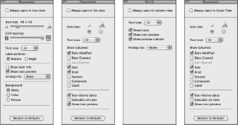

### 注意

如果你点击`用作默认设置`，你应用于当前 Finder 窗口的设置将成为所有之前未自定义窗口的默认设置。

- **图标视图**。你获得了与桌面许多相同的选项：`图标大小`、`网格间距`、`字体大小`、`标签位置`、`显示项目信息`、`显示图标预览`和`排列方式`。但你还获得了为窗口设置背景颜色或图像的选项。

- **列表视图**。你也获得了`字体大小`弹出菜单和`显示图标预览`选项，但这是与桌面视图选项唯一的共同点。在列表视图中，你可以选择两种图标大小，还可以选择在列表中显示哪些列：`修改日期`、`创建日期`、`打开时间`、`大小`、`种类`、`版本`、`备注`和`标签`。选择你想显示的列，取消选择不需要的列。`使用相对日期`选项如果被选中，会将日期列中的今天替换为“今天”，将昨天的日期替换为“昨天”。`计算所有大小`选项如果被选中，将显示文件夹的大小，而不只是文件。（注意此选项可能会减慢窗口信息的显示。）此外，你还获得了`始终以列表视图打开`选项。

- **列视图**。只有几个选项，其中几个是熟悉的：`始终以列视图打开`、`字体大小`、`显示图标预览`和`排列方式`。两个独特的选项是`显示图标`（如果取消选择，则每个项目仅显示文本标签）和`显示预览列`（如果取消选择，则最右侧列不会显示选中文件的快速预览）。

在封面流动视图（Cover Flow view）中，选项与列表视图中的选项完全相同，区别在于`始终在封面流动视图中打开`选项替换了`始终在列表视图中打开`选项。

### 提示

如果你希望所有 Finder 窗口都以其中一种视图模式打开，并使用你为当前 Finder 设置的视图选项，请务必选择`始终在[模式]视图中打开`选项。此选项会将该视图模式及其视图选项设置为默认视图模式（直到你再次更改它）。但请注意，任何你应用过自定义视图设置的 Finder 窗口都不会使用这些新默认设置；你必须通过为此类窗口选择`查看`⇒`显示选项`来手动更改它们。

## 在图标视图中自定义 Finder 窗口

到目前为止，我们已经介绍了如何在 Mac 上全局自定义 Finder 窗口。但你也可以在图标视图中自定义单个 Finder 窗口。

### 排列图标

在图标视图中，文件夹内的所有图标都是手动排列的。这意味着你可以将它们拖到任何你想的地方，并且它们会保持在你放置的位置，即使你关闭 Finder 窗口并在稍后重新打开，Finder 也会记住你最后离开它们的位置。

但手动排列的 Finder 窗口很快就会变得混乱。这就是为什么 Finder 提供了`排列方式`菜单（可在 Finder 的`查看`菜单和右键菜单中使用）。它提供了几个选项，可以帮助你维持更整洁的 Finder 窗口。

`对齐网格`菜单选项仍然允许你手动移动图标，但它能确保图标始终彼此对齐（水平和垂直方向）。你通过本章稍后介绍的显示选项来设置网格。

其他选项会根据其名称自动对图标排序：`名称`、`修改日期`、`创建日期`、`大小`、`种类`或`标签`。当你选择这些选项之一时，它会“清理”Finder 窗口，重新排列图标以便它们对齐网格。

你还可以使用`排列方式`选项让图标在网格内对齐就位，而无需进行排序。要这样做，请确保 Finder 窗口中没有选中任何项目，然后选择`查看`⇒`整理`。如果菜单选项是`整理选定项目`，这意味着选中了一个或多个项目，只有这些项目会被对齐到网格。

### 更改窗口背景

默认情况下，每个 Finder 窗口的背景都是白色的。然而，你可以通过本章之前介绍的显示选项控件来更改图标视图中的背景。有三个选项：

- **白色**。这是默认选项。使用它将 Finder 窗口的背景重置为白色。


- **颜色**。此选项允许你将 Finder 窗口的背景更改为你自定义的任意纯色。当你选择此选项时，右侧会出现一个色块；点击它可打开 Mac OS X 颜色选择器，通过它可以创建任何显示器可以显示的颜色。当你在`颜色选择器`中选择颜色时，Finder 窗口的背景会发生变化，向你展示显示效果。点击`确定`将颜色应用到 Finder 窗口背景。
- **图片**。此选项允许你使用 Mac 上任何支持的图像作为 Finder 窗口的背景。图 3.12 显示了一个使用图像作为背景的 Finder 窗口。当你选择此选项时，右侧会出现一个正方形。将 Mac 或任何连接磁盘或电脑上的图像拖到该正方形上即可使其 Finder 窗口的背景。

### 注意

如果你点击`用作默认值`，当前 Finder 窗口的自定义背景将成为所有 Finder 窗口的默认背景（之前自定义过的窗口除外）。

图 3.12

使用图像作为背景的 Finder 窗口。

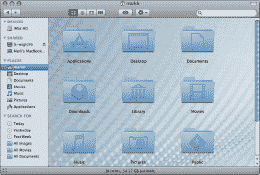

## 使用颜色选择器

本章概述的某些 Finder 外观设置使用了`颜色选择器`，该工具在 Mac OS X 中作为标准工具使用，可用于各种情况，从选择桌面背景到在应用程序中选择文本颜色。

`颜色选择器`左上角有一个小的放大镜图标。点击它会调出`放大镜`工具（一个中间带有十字准的放大镜图标）。在屏幕上移动`放大镜`工具，并点击你想将其颜色添加到`颜色选择器`中的物体。

每个颜色面板的底部有一组白色方框，称为色调板（默认有一行，但你可以向下拖动色调板以添加更多行）。如果你在五个子面板中的任何一个中找到了喜欢的颜色，将其拖到色调板上的某一个方框中，这样将来只需点击色调板上的该位置即可使用该颜色。

`颜色选择器`有五个面板，每个面板都提供自己的颜色选择方法，如图所示。

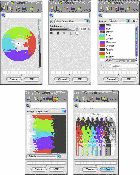

- **色轮**。面板的色轮是基于`RGB`（红、绿、蓝）色彩空间的圆。中心是白色；当你向边缘移动时，三种颜的饱和度越高。圆中心有一个小的正方形点；点击并拖动此点穿过色轮来选取颜色。色轮右侧是亮度滑块；向下移动滑块会使颜色变暗，向上移动则变亮。顶部的矩形区域显示当前选定的颜色。
- **滑块**。此面板提供了四个不同的滑块选项：`灰度`、`RGB`、`CMYK`（青、洋红、黄、黑）以及`HSB`（色相、饱和度、亮度）。左右移动各种滑块可以根据它们代表的色彩空间选择颜色。你也可以通过在右侧框中输入数字来选择颜色。对于想要根据数字代码精确还原颜色（例如来自网站或在 Photoshop 中采样的颜色）的人来说，这些工具非常有用。
- **列表**。此面板允许你从色块列表中选择颜色。有四个色板（或列表）供选择：`色彩`（默认）、`网络安全色`、`蜡笔`和`开发者`。右侧的操作菜单（齿轮图标）允许你创建、重命名和删除色板；你可以从色调板将颜色拖到新色板中。
- **图像**。此面板允许你从图像中选取颜色。默认的图像是 Mac OS X 可用的色彩光谱，但底部的色板弹出菜单允许你添加自定义的任何图像。如果你有一张经常用于颜色选择的图像，这非常有用，但对于一次性目的，使用`放大镜`工具会更快。
- **蜡笔**。此面板提供了一系列蜡笔供选择。与列表面板一样，它提供了一种从预设颜色中快速选择的方法。

## 操作

Mac OS X 自带了一系列名为文件夹操作的 AppleScript，让文件夹不仅存储项目，还能对放入其中的任何项目执行操作。某些文件夹操作更改文件夹内部信息的显示方式，而另一些则执行基础编辑操作（例如将所有图像旋转 90 度）。这些操作可以根据 AppleScript 的要求执行任何操作（AppleScript 在第 25 章中有更详细的介绍）。

### 新功能

Mac OS X 10.6 雪豹稍微更改了管理文件夹操作的过程。`文件夹操作设置`选项现在适用于任何文件夹的右键菜单中；你不再需要作为`更多`菜单的子选项来访问它。对于禁用文件夹操作，已附加文件夹操作的文件夹不再有`禁用文件夹操作`右键菜单选项；相反，你使用`文件夹操作设置`对话框来启用或禁用任何文件夹的文件夹操作。

你可以创建自己的 AppleScripts 来附加到文件夹上，尽管创建这些脚本是 Mac OS X 使用中的高级领域。幸运的是，Apple 提供了几个执行有用功能的脚本。要将操作附加到文件夹，请执行以下操作：

1. `Control+click` 或右键点击磁盘或文件夹以打开上下文菜单，并选择“文件夹操作设置”（Folder Actions Setup）。
2. 从出现的列表中选择一个脚本附加到该文件夹，并点击“附加”（Attach）按钮。或者，按下“取消”（Cancel）按钮并使用第 4 步中的 `+` 图标按钮选择脚本。
3. 在文件夹操作设置对话框的左上方选择“启用文件夹操作”（Enable Folder Actions）选项。
4. 点击文件夹操作设置对话框左下角的 `+` 图标按钮以附加更多脚本。请参图 3.13 文件夹操作设置对话框的示例。
5. 点击“打开”（Open）启动打开对话框，在其中导航到你想要附加操作脚本的文件夹。
6. 在弹出的工作表中，选择你想要附加的 AppleScripts，并点击“附加”（Attach）。（使用 `Shift+click` 项目来选择多个操作。）
7. 文件夹操作设置对话框再次出现，左侧面板列出文件夹，右侧面板列出关联的操作。你可以通过选择和取消选择文件夹和脚本左侧的复选框来开启或关闭文件夹操作。
8. 点击红色的“关闭”（Close）图标按钮完成文件夹操作分配。所选的操作现在对该文件夹生效。

图 3.13

文件夹操作设置对话框允许你将操作脚本操作附加到文件夹。

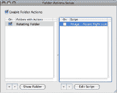

### 使用操作

当操作脚本附加到文件夹时，使用文件夹操作的标准方法是将项目（或多个项目）拖到文件夹中。当项目被放入文件夹时，该操作的 AppleScripts 就会运行并对所选项目执行其操作。（如果脚本不适用于这些项目，则什么都不会发生。）操作会在文件夹内部为结果创建一个名为子文件夹，其名称由脚本决定；例如，如果你使用“图像 – 向右旋转”（Image – Rotate Right）脚本，新的子文件夹将命名为“已旋转的图像”（Rotated Images）。

### 编辑操作

要编辑操作，请打开文件夹操作设置对话框，然后选择你想要编辑的操作文件夹。取消脚本名称左侧的“开启”（On）复选框以停止其运行。选择一个脚本并点击脚本列表下的 `–` 图标按钮以从文件夹操作中完全删除该脚本。点击脚本列表下的 `+` 图标按钮向文件夹操作中添加脚本。

点击脚本列表下的“编辑脚本”（Edit Script）按钮启动 AppleScript 编辑器并在其中打开脚本以便你进行编辑。这也是简单查看脚本底层代码以理解其作用的极佳方法。（第 25 章有更多关于 AppleScript 的信息。）

点击“带有操作的文件夹”（Folders with Actions）列表下的 `+` 图标按钮添加更多可以应用脚本的文件夹。选择一个文件夹并点击 `–` 图标按钮从该文件夹移除文件夹操作。点击“显示文件夹”（Show Folder）按钮在新的 Finder 窗口中打开选定的文件夹。

### 理解 Mac OS X 的特殊文件夹

现在你已经熟悉了 Finder 以及你可以用它做的各种事情，是时候熟悉一下 Mac OS X 环境的主要文件夹结构了。如之前所述，Mac OS X 有许多随着操作系统安装而创建的文件夹。某些包含在你的个人文件夹（Home folder）中，另一些包含在主卷的根目录下并供 Mac OS X 使用。

#### 系统文件夹

在你的桌面上右上角有一个启动磁盘的图标，通常命名为 `Macintosh HD`。（你可以像重命名任何文件夹或磁盘一样重命名它：选中它，然后点击它的名称并更改被选中的文本。）双击磁盘图标将打开启动磁盘上的第一层（称为根层级）文件夹。图 3.14 显示了启动磁盘中的文件夹；默认情况下，它只包含四个文件夹：

- `Applications`（应用程序）。如名所示，此文件夹包含用于各种用途的程序。
- `System`（系统）。此文件夹包含代表 Mac OS X 核心的实际。存储在这里的大多数项目用于让你的 Mac 运行，因此干扰此文件夹通常不是一个好主意。为了防止意外更改，此文件夹不容易被编辑，并且在移动、删除或编辑其中的任何文件之前，系统会要求你提供管理员密码。
- `Library`（库）。Library 文件夹包含一组系统级设置，以及一些帮助 Mac 运行的额外文件。此 Library 文件夹内的设置适用于 Mac 的所有用户，尽管每个用户在个人文件夹内也有自己的 Library 文件夹。
- `Users`（用户）。Mac OS X 中设置的每个用户账户在 Users 文件夹内都有自己的个人文件夹。每个个人文件夹都作为每个用户所有文件和 Mac OS X 设置的中央存储区域，包括 `Desktop`、`Documents`、`Downloads`、`Library`、`Movies`、`Music`、`Pictures`、`Public` 和 `Sites` 文件夹，详表 3.1。

图 3.14

启动磁盘的根层默认只包含四个文件夹：`Applications`、`System`、`Library` 和 `Users`。

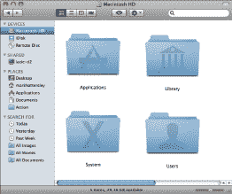

#### 使用个人文件夹

Mac OS X 设计为多用户操作系统，不同的人可以使用它，并拥有自己的个人文件、偏好甚至应用程序。Mac OS X 将每个用户账户的文件隔离在所谓的个人文件夹（Home folder）中，Users 文件夹中每个用户都有一个。这个区域命名得恰当，称为 home。每个用户的个人文件夹都受到其他用户窥探的保护，除非用户如第 13 章和第 20 章所示授予他人访问其文件的权限。当你自定义 Mac OS X 的任何方面时，这些设置会保存在你的个人文件夹的 Library 文件夹中——它们不会应用于其他用户账户。

当你创建或保存文档时，文档默认存储在你个人文件夹的 Documents（文档）文件夹中；当然，你可以在正在保存的应用程序的“另存为”（Save As）对话框中选择不同的位置。

个人文件夹并不命名为 Home。相反，它使用你在首次安装 Mac 时（见第 1 章）或创建用户账户时（见第 20 章）为用户账户设置的用户名。但活动用户账户的个人文件夹有一个房子图标（因此名为 Home），而未活动用户的文件夹则使用标准的文件夹图标。

你可以通过多种方法访问个人文件夹：

- 点击 Finder 侧边栏“位置”（Places）部分中的个人文件夹。（个人文件夹的名称将是你的用户名，而不是“Home”。）
- 在 Finder 中选择“前往→个人”（Go⇒Home）或按下 `Shift+H`。
- 选择“新建 Finder 窗口”（New⇒Finder Window）或按下 `Command+N` 打开一个打开到个人文件夹的新 Finder 窗口（除非你更改了该默认文件夹，如本章较早部分所述）。
- 打开启动磁盘，打开 Users 文件夹，然后打开个人文件夹。

> **注意**：只有当前登录的用户可以访问自己的个人文件夹。这一安全措施确保了用户系统设置和个人文档的私密性。但具有管理员密码的人可以访问任何人的文件夹，如第 20 章所示。

### 表 3.1：个人文件夹包含的文件夹

| 名称 | 内容 |
| :--- | :--- |
| `Applications` | 包含该用户特有的应用程序。 |
| `Desktop` | 包含桌面显示的所有文件和文件夹。注意此处不显示卷图标。 |
| `Documents` | 存储用户创建的各种杂文档。 |
| `Downloads` | 临时存储 Safari 和其他应用程序从网络下载的文件。 |
| `Library`（库） | 包含应用程序偏好设置和其他用户唯一的系统设置。 |
| `Movies`（电影） | Apple 制作软件创建的任何文件的默认位置。也是存储电影文件的好地方。 |
| `Music`（音乐） | iTunes 库的默认位置，也是存放音频文件的好地方。 |
| `Pictures`（图片） | iPhoto 照片库的默认位置，也是存储照片的好地方。 |
| `Public`（公共） | 用于在网络上与其他用户共享文件。第 13 章将更详细地介绍公共文件夹。 |
| `Sites`（站点） | 你想要通过 Mac 在网络或互联网上提供的网站的默认位置。第 14 章解释了此类个人 Web 托管。 |

# 磁盘和其他卷的操作

卷（Volume）是你计算机上固定数量的存储空间。通常，卷意味着一个内部或外部硬盘、可刻录光盘（如 `CD-R` 或 `DVD-R`）或连接的 `USB`（通用串行总线）闪存驱动。`volume`（卷）、`drive`（驱动器）和`disk`（磁盘）这些术语经常通用，但它们存在区别：

- `Volumes`（卷）可以是 Mac 视为独立容器的任何存储容器，包括磁盘、分区和网络文件共享。
- `Drives`（驱动器）包含一个或多个磁盘的物理机制。
- `Disks`（磁盘）是实际存储数据的介质（磁性的，如硬盘和软磁盘；光学的，如 `CDs` 和 `DVDs`；或固态的，如闪存“优盘”驱动器使用的）。
- `Partitions`（分区）是磁盘的区域，以独立磁盘的形式呈现给 Mac OS X。（当你使用 Mac OS X 的 `Disk Utility` 格式化磁盘时，就会创建此类分区，如第 8 章所示。）

### 注意事项

光光介质（如 `CD` 和 `DVD` 驱动器）始终被称为 `discs`（写为字母 c）；基于磁性的驱动器（如内部和外部硬盘）被称为 `disks`（写为字母 k）。固态设备通常也被称为 `disks`（带有 k），尽管各种被称为闪存驱动器、优盘和 `USB keys` 的 `USB` 设备通常不被称为 disks 或 discs。

## 检查驱动器和分区并识别卷

如果你打开 `Finder` 窗口并在侧边栏的 `Devices` 部分选择 `Computer` 选项（寻找 Mac 图标），你将看到你的 Mac 可用的所有卷。通常情况下，你只有一个可用的卷，那就是你的硬盘。然而，如果你插入了光盘、连接了外部硬盘、通过 Apple 的 MobileMe 服务设置了 `iDisk`，或者有了到其他设备的网络连接，这些项目也会出现在 `Devices` 部分。

卷也会出现在桌面上，正如本章稍早之前在 Finder 偏好设置章节中所述的那样。

### 注意事项

你的 Mac 名字可能不是“Computer”。Mac OS X 可能将其命名为类似“你的名字的 Macintosh 型号”的内容，或者你可能重命名了它。要重命名你的 Mac，请进入 `Sharing` 系统偏好设置并更改 `Computer Name` 字段中的文本。（选择 `System Preferences`，或按 `Command+comma`，然后点击 `Sharing` 图标进入 `Sharing` 系统偏好设置。）

还有一些被称为磁盘镜像的文件（文件名扩展名为 `.dmg`），它们可以挂载为虚拟卷。双击 `.dmg` 文件或使用 `Disk Utility` 挂载这些文件，会将它们变成与其他卷运行完全相同的卷。

### 交叉引用

第 8 章提供了更多关于使用 `Disk Utility` 格式化和管理磁盘的信息。第 4 章解释了如何备份磁盘。第 13 章有更多关于文件服务器的信息，而第 15 章有关于使用 `iDisk` 的更多信息。

每种卷在 Mac OS X 中都用独特的图标显示，代表所属的驱动器类型：

- 内部硬盘上的 `Volumes` 显示为灰色图标，看起来类似于实际的内部硬盘。
- 外部硬盘的图标是黄色的，上面有一个代表连接类型（`FireWire` 或 `USB`）的符号。
- 软磁盘、闪存驱动器和其他移动磁盘具有形状像扁平盒的白色图标。
- `iDisk` 由带有 MobileMe 标志的洋红色色盒表示。
- `Network volumes`（网络卷）使用地球仪图标。

## 弹出卷

在将物理设备从计算机移除之前，应该弹出连接到 Mac 的卷。（Mac OS X 有时会将此动作称为收起卷。）因此，在断开服务器卷、外部硬盘和 `USB` 闪存驱动器的连接之前，你应该先从 Mac 上弹出卷。对于光盘和老式软磁盘，弹出它们会向驱动器发送信号，使其物理弹出光片（或磁盘）。

要弹出卷，请使用以下技术之一：

- 仅针对光盘，按下键盘上的 `Eject` 键（如果有的话），如果没有则按 `F12`。如果你的 Mac 连接了两个光驱驱动器，你可以按 `Option+Eject` 弹出第二个驱动器（此方法仅适用于专为 Mac OS X 设计的光驱驱动器）。
- 选择该卷并将其拖到 `Trash`（废垃圾桶）。`Trash` 图标会变为 `Eject` 图标，这样你就知道自己不是在删除卷的内容。
- 选择该卷并选择 `File⇒Eject "volumename"` 或按 `Command+E`。
- `Control+click` 或右键点击卷，从菜单中选择 `Eject "volumename"`。

如果你在移除物理设备之前没有弹出卷，就会出现警告（见图 3.15）。它警告你设备没有被正确收起（弹出），数据可能会丢失或损坏。不太可能对设备造成物理损坏，但可能会因为称为“写入缓存”的技术而丢失数据。Mac OS X 使用这种技术将磁盘的更改存储在一个所谓的临时文件中，然后传输到磁盘。

### 刻录光盘

大多数现代 Mac 都可以向光介质写入数据。这一过程通常被称为刻录（或记录）到磁盘。有很多不同的可刻录介质，包括 `CD-R`、`CD-RW`、`DVD-R`、`DVD+R`、`DVD-RW`、`DVD-RAM` 和 `DVD+-R`。OS X 支持所有这些格式，所以你不需要担心。（例外是蓝光格式，OS X 无法写入，但第三方程序如 Roxio 的 Toast 可以——当然前提你有一个可刻录的蓝光驱动器。）

图 3.15

如果你在物理移除卷之前没有弹出，就会出现此警告。


## 创建刻录文件夹

刻录文件夹是组织你想从 `Finder` 转移到光盘内容的简单方法。刻录文件夹的棒之处在于，当你将内容刻录到光盘后，你仍然拥有该刻录文件夹，因此你可以轻松创建副本、更新它并创建更改版本的副本，而无需重新开始。这对于你想备份一组变化的文档（例如项目文件或家庭相册）非常有用。

要创建刻录文件夹，选择 `File⇒New Burn Folder`。刻录文件夹将出现在激活的 `Finder` 窗口或桌面上（如果没有打开 `Finder` 窗口），如图 3.16 所示。默认情况下，文件夹的名称为 `Burn Folder`，而不是普通文件夹的默认名称 `Untitled`；但就像其他新创建的文件夹一样，名称会被高亮，以便你更改它。

现在，你可以将项目从 `Finder` 拖入刻录文件夹（`burn folder`）。当你将项目拖入刻录文件夹时，原始项目的别名会被存放在其中。（与普通文件夹不同，拖入刻录文件夹的项目将保留在它们的原始位置。）你可以打开刻录文件夹查看其内容，并可以随意删除或重新组织这些文件——就像处理任何文件夹一样。

**提示**

如果你认为你会反复使用某个刻录文件夹，可以将其拖入 `Sidebar`（侧边栏）中，以便随时一键访问，正如本章前面的部分介绍的那样。

当你对内容满意时，可以通过选择刻录文件夹，然后选择 `File⇒Burn "foldername@dp to Disc`（文件⇒刻制“文件夹名”），或者通过 `Control+点击` 或右键点击文件夹并从上下文菜单中选择 `Burn "foldername@dp to Disc` 来刻制光盘。如果你没有向电脑中插入空白光盘，`Mac OS X` 会要求你插入一张后再继续。

**提示**

如果你需要刻制很多光盘，你可能想要修改工具栏（正如本章前面的部分介绍的那样），添加 `Burn`（刻制）图标按钮。然后你只需要选择一个刻录文件夹并点击工具栏上的 `Burn` 图标按钮即可将内容刻制到光盘。

图 3.16

`Mac OS X` 用于在文件记录到光盘之前存储文件的刻录文件夹

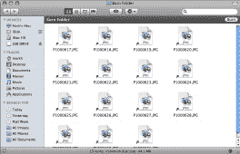

## 使用 `Finder` 刻录

使用刻录文件夹的替代方案是 `Finder` 刻录。这是将项目从 `Finder` 直接拖动到 `Finder` 中挂载的光盘上。

首先，向驱动器插入一张空白光盘。会弹出一个对话框，询问你想执行的操作：`Open Finder`（打开 `Finder`）、`Open iTunes`（打开 `iTunes`）或 `Open Disk Utility`（打开磁盘工具）。在 `Action`（操作）弹出菜单中，选择 `Open Finder` 通知 `Finder` 由它负责记录光盘。然后点击 `OK`。这会在桌面创建一个名为 `Untitled CD`（未命名 CD）或 `Untitled DVD`（未命名 DVD）的文件夹，从本质上说，它就是一个刻录文件夹。

**注意**

对话框有一个 `Eject`（弹出）按钮，你可以立即弹出光盘；如果你不小心插入了空白光盘，这非常方便。还有一个 `Ignore`（忽略）按钮，它告诉 `Finder` 对光盘不做任何操作。这可能是危险的，因为 `Finder` 中不会出现图标，所以你可能会忘记 `SuperDrive` 中有一张光盘，这可能导致有人在不知道里面已经有光盘的情况下强插入一张新光盘，从而损坏 `SuperDrive`。

如果你双击刻录文件夹，它将打开并显示其内容（起初为空）。将文件拖到此文件夹，当你准备好将文件提交到光盘时，点击 `Sidebar`（侧边栏）中的 `Burn` 图标按钮（该图标出现在光盘名称右侧），或使用在使用刻录文件夹章节中描述的刻录命令之一。

### 完成刻制

无论你是创建了自己的刻录文件夹还是使用 `Finder` 刻录，当你告诉 `Mac OS X` 刻制光盘时，会弹出一个警告对话框，要求确认你已准备好刻制。某些光盘只能记录一次，因此此请求可以帮助你避免在准备好之前就损坏光盘。此对话框还包含 `Burn Speed`（刻制速度）弹出菜单，默认设置为 `Maximum`（最高）。你可以选择较慢的速度，如果你发现光盘刻制不正确，这很有用；使用较慢的速度有助于无法以 Mac 提供的速度接收数据的低质量光盘。

在点击确认对话框中的 `Burn`（刻制）后，刻制过程开始，进度条会告诉你进度。`Finder` 遵循此过程：它首先准备数据，然后写入数据，最后验证光盘的状态。当刻制完成后，光盘会自动弹出。

你可以随时通过点击 `Stop`（停止）按钮停止刻制过程。然而，这样做通常会导致光盘无法使用。

## 使用“显示信息”更改磁盘和文件夹权限

如之前所述，你可以与其他用户共享文件夹和磁盘，包括在你的 Mac 上拥有用户账户的用户（见第 20 章）以及被授予对你的 Mac 文件共享访问权限的用户（见第 13 章）。

你可以通过 `Info`（信息）窗口快速启用和更改单个文件夹和磁盘的共享权限。要执行操作，选择 `File⇒Get Info`（文件⇒显示信息）、按下 `Command+I`，或 `Control+点击` 或右键点击项目并从上下文菜单中选择 `Get Info`（显示信息）。你将得到一个如图 3.17 所示的 `Info` 窗口。显示的大部分是磁盘或文件夹的信息，但在窗口底部有几个你可以更改共享设置：

- **Shared Folder**（共享文件夹）：你可以通过选择 `Shared Folder` 选项共享文件夹或磁盘，或通过取消选择来停止共享。

- **Sharing & Permissions**（共享与权限）：你可以在 `Sharing & Permissions` 部分更改谁拥有访问权限。选择 `Name`（名称），然后为该名称选择一个 `Privilege`（权限）；你的选项有 `Read & Write`（读/写）、`Read Only`（只读）和 `Write Only (Drop Box)`（仅写入/存储箱）。你可以使用 `+` 和 `–` 图标按钮添加和删除用户，并通过从 `Action`（操作）图标弹出菜单（齿轮图标）选择 `Apply to Enclosed Items`（应用于包含的项目），将你的更改应用于所选磁盘或文件夹内的所有文件夹。（这可能需要几分钟才能完成，请注意。）你可以通过选择 `Action⇒Revert Changes`（操作⇒撤销更改）来撤销你的更改。

**注意**

如果 `Sharing & Permissions` 设置是灰色的，点击 `Lock`（锁）按钮并输入用户账户密码（如果你的账户有权限更改选项）。

**交叉引用**

第 20 章涵盖了 `Info` 窗口的其他功能。

图 3.17

`Info` 窗口让你获取文件、文件夹或磁盘的详细信息，还可以启用或禁用所选磁盘的共享。


## 使用 Spotlight 查找项目

`Spotlight` 是一个强大的搜索引擎，允许你搜索 Mac 上的信息。使用 `Spotlight` 可以非常简单，也可以非常复杂，取决于你想做什么。

### `Spotlight` 如何工作

`Spotlight` 可以通过名称搜索文件，也可以搜索文件内部的信息，例如嵌入 PDF 文档或文本文件中的文本；它甚至可以搜索从数字相机导入的照片的元数据。由于 `Spotlight` 也集成在 `Mac OS X` 的所有应用程序中，它还可以搜索邮件信息、联系人，甚至是日历。更重要的是，`Spotlight` 可以搜索 `Mac OS X` 项目，包括应用程序和系统偏好设置。`Spotlight` 搜索范围的最新添加内容包括内置字典的定义以及在 `Safari` 中最近访问过的 Web 位置。你甚至可以在 `Spotlight` 中输入基础数学方程进行计算。所有这些功能都可以用于创建更智能的搜索。

此列表并不意味着其他类型的文件被排除在外：Apple 已让 `Spotlight` 具有了扩展性，以便非 Apple 应用程序也能利用该技术。例如，微软为其 `Entourage` 电子邮件程序创建了 `Spotlight` 扩展，使其用户可以在 `Spotlight` 中搜索他们的邮件信息。

尽管你的硬盘上存储着海量信息，但使用 `Spotlight` 是一个非常快速的过程。这是因为在每次搜索时，它并不会去遍历 Mac 上每一个文件的数据和元数据；相反，它会获取所有数据和元数据，并在一个名为 `Spotlight Store` 的数据库中对其保留索引——这非常像书中的索引，但详细得多。每当文件被创建、复制、移动、保存或删除时，`Spotlight Store` 都会根据该文件的新信息进行更新。`Spotlight Store` 在一个名为 `Metadata Store` 的文件中保留与文件相关的所有元数据信息。它还在其 `Content Store` 中保留了你文件内容的索引。

## 什么是元数据？

所有文件都包含某种类型的数据，例如 Word、PDF、InDesign 以及其他包含文本的文档内部文本。图像文件包含了构成图像的一系列位。

但所有文件也包含元数据。元数据的字面意思是“关于数据的数据”。所有文件都具有的一种元数据类型是文件名。文件名并不是实际文件的一部分，而是由 `Finder` 存储的文件属性的一部分。文件大小是另一种通用的元数据类型，文件在 Mac 文件夹层级结构中的位置以及文件类型也是如此。

某些文件具有特定于类型的元数据。例如，图像文件的元数据可能包含来自拍摄图像的相机的信息，如位深、色彩模式（`RGB` 或 `CMYK`）、像素尺寸，甚至是拍摄照片时的位置数据（如果你使用 iPhone 的话）。

`Info` 窗口提供了许多关于文件元数据的信息，尽管文件中包含的元数据可能比 `Info` 窗口显示的更多。（要打开项目的 `Info` 窗口，请选择项目并按 `Ô+I`，或选择 `File⇒Get Info`，或者 `Control+click` 或右键点击项目并从右键菜单中选择 `Get Info`。）

`Info` 窗口中有一个区域允许你添加自己的元数据以便 `Spotlight` 搜索：即 `Spotlight Comments` 框。你在其中输入的任何注释都会附在文件上，`Spotlight` 会自动搜索它们。

**注意**

请注意，`Spotlight` 为每个文件系统维护一个 `Spotlight Store`。该存储是一个名为 `.Spotlight-V100` 的文件夹，隐藏在磁盘的根目录下。如果你连接了另一个存储设备（例如外部 USB 磁盘），`Mac OS X` 会在其根目录下创建一个 `Spotlight Store` 来存储与磁盘相关的信息。`Spotlight` 数据始终随卷移动；这在处理网络卷时至关重要，因为除非索引对你的 Mac 可见，否则 `Spotlight` 无法访问它们。

**注意**

由于 `Spotlight` 必须索引磁盘内容才能找到它们，当你第一次将磁盘连接到 Mac 时，`Spotlight` 处于劣势。给它一些时间——对于大硬盘需要几个小时——在第一次连接时建立索引。首次设置 Mac 时的一个好主是将所有常用的磁盘和网络卷连接到 Mac，并让 `Spotlight` 在夜间或你工作期间对它们进行索引。

## 使用 Spotlight

现在你已经了解 `Spotlight` 是什么，并大致理解了它的工作原理，是时候付诸行动了。在 `Spotlight` 中搜索再不过简单了（至少当你进行简单的文本搜索时）。在最基本的形式下，`Spotlight` 搜索是一个单词，例如应用程序名称、联系人名称，或者你已知名称但不知道其具体位置的文件。

你可以通过三种方式之一执行 `Spotlight` 搜索：

*   通过点击菜单栏中的 `Spotlight` 图标菜单。这会在屏幕右上角打开 `Spotlight` 搜索窗口，你可以在其中输入搜索词，如图 3.18 所示。

*   在大多数应用程序（包括 `Finder`）中按 `Ô+spacebar`。这也会在屏幕右上角打开 `Spotlight` 搜索窗口，你可以在其中输入搜索词。

*   从 `Finder` 窗口中的搜索字段进行。该选项为你的搜索提供了更多选择，我们稍后会进行解释。

### 从菜单栏进行 Spotlight 搜索

从菜单栏运行 `Spotlight` 是简单且通常是最常用的搜索方法——尤其是当你想要执行一个直接、不加杂的搜索时。通常，更复杂的搜索会在 `Finder` 窗口中进行。

**提示**

在 `Mac OS X` 提供的所有快捷键中，`Ô+spacebar` 可能是最需要学习的。这个快速键盘命令让你能够快速进入 `Spotlight` 并搜索内容，而无需手离开键盘。

### 图 3.18

在 `Spotlight` 文本框中输入搜索词以查找 Mac 上的项目。


一旦你开始在搜索字段中输入字母，结果就会出现在下拉面板中（见图 3.19）。结果被分为不同的信息类别。`Top Hit`（最佳结果）位于顶部；这是 `Mac OS X` 认为你最可能寻找的文件。其余信息分为以下类别（不适用于结果的类别不会出现）：

*   `Top Hit`。`Spotlight` 认为你最可能在寻找的项目

*   `Definition`。来自 `Mac OS X` 内置词典和同义词典的文章

*   `Applications`。你可以运行的程序

*   `System Preferences`。来自 `System Preferences` 应用程序的项目

*   `Documents`。Mac 及其连接卷上的文件

*   `Folders`。Mac 及其连接卷上的文件夹

*   `Messages`。`Mail` 中包含的电子邮件

*   `Contacts`。存储在 `Address Book` 中的人物和公司

*   `Events & To-Dos`。你在 `iCal` 中存储任何事件或任务

*   `Images`。存储在 Mac 及其连接卷上的图形文件，以及 `iPhoto`

*   `PDF Documents`。存储在 Mac 及其连接卷上的 PDF 文件

*   `Webpages`。你最近访问过的任何网页

*   `Music`。Mac 及其连接卷上的音频轨道，以及在 `iTunes` 中找到的轨道

*   `Movies`。Mac 及其连接卷上的视频轨道，以及在 `iTunes` 中找到的轨道

*   `Fonts`。你在 Mac 上安装的任何字体

*   `Presentations`。你创建的任何 `Keynote` 演示

结果表中可能还有其他类别；这些是由具有 `Spotlight` 扩展的应用程序创建的。

**提示**

注意，`Spotlight` 在你开始时就开始搜索，如果你犯错了或决定搜索其他内容，只需按 `Backspace` 键删除部分或全部搜索文本。你也可以通过按关闭按钮（圆圈内的 X 图标）清除 `Spotlight` 搜索字段中的文本。

### 图 3.19

一旦你开始输入字母，`Spotlight` 会根据你输入的内容提供建议。

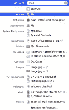

选择项目再不过简单了。只需使用鼠标点击你想要的项目。或者，你也可以使用方向键在项目之间移动，并按 `Return` 键选择你想要的项目。默认情况下，`Top Hit` 被选中，按 `Return` 键将直接进入那里。

当你选择一个项目时，`Spotlight` 会打开所在的文件夹（如果是文件或文件夹），或者在所需的应用程序中打开该项目。

**提示**

`Spotlight` 是启动 `Dock` 或应用程序文件夹的绝佳替代方案。如果你知道要启动的应用程序名称，`Spotlight` 一直将其置于 `Top Hit`。通过 `Ô+spacebar` 快捷键访问 `Spotlight`，任何应用程序只需几键即可触达。

`Spotlight` 结果表除了结果之外，还有两个选项：`显示全部`（位于工作表顶部）和 `Spotlight 偏好设置`（位于工作表底部）：

- 选择 `显示全部`将打开一个 `Finder` 窗口并运行搜索，向你显示完整结果，而不是工作表中显示的选择性结果。然后，你可以使用 `Finder` 窗口中的工具来缩小这些完整结果，我们将在下一节中介绍这些工具。

- 选择 `Spotlight 偏好设置`将打开 `Spotlight` 系统偏好，如第 21 章所解释的那样，你可以控制 `Spotlight` 的搜索范围。

## 在 `Finder` 窗口中进行 Spotlight 搜索

每个 `Finder` 窗口在工具栏右侧也包含其自己的 `Spotlight` 搜索字段。一旦你开始在该字段中输入文本，`Finder` 窗口中显示的文件夹内容就会替换为与 `Spotlight` 搜索相关的内容。窗口还会变为一个 `Finder` 搜索窗口，默认以图标视图显示，并在工具栏下方出现额外的搜索选项，如图 3.20 所示。

当在 `Finder` 窗口中使用 `Spotlight` 时，`Spotlight` 仅搜索文件和文件夹，因此它不会显示最近的网页或电子邮件（例如菜单栏的 `Spotlight` 搜索那样）。与菜单栏的 `Spotlight` 搜索一样，`Finder` 搜索窗口的结果是文件和文件夹的别名，它们仍然保留在原有的位置。

**注意**

`Finder` 窗口中的 `Spotlight` 结果只能在`图标`、`列表`或`封流`视图模式下显示，而不在`列`视图模式。如果你在开始 `Spotlight` 搜索时 `Finder` 窗口处于列视图，它会自动切换到图标视图。

请注意，项目列表会根据项目最近打开的时间自动出现；如果你处于列表或 `封流` 视图，你会看到“最后打开”列被自动高亮。与其他 `Finder` 窗口一样，你可以通过点击“名称”或“种类”列来更改排序。（在列表视图的 `Finder` 窗口中正常显示的其他列不会出现在 `Finder` 搜索窗口中。）

`Spotlight` 在 `Finder` 窗口中提供的结果数量可能是巨大的，因此 `Spotlight` 将结果限制在 10,000 个项目，并在列表底部放置一个蓝色的 `更多`链接（见图 3.21）。点击此链接将打开剩余结果。

图 3.20


在 Spotlight 字段中输入了文本的 `Finder` 窗口。

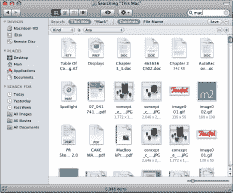

图 3.21

如果 Spotlight 搜索返回了超过 10,000 个结果，则会出现`更多`链接。点击它将加载剩余结果。

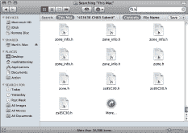

在`Finder`搜索窗口中使用`Spotlight`还提供了几个你可以用来缩小搜索结果的选项。在`Finder`搜索窗口内部、结果上方有两个菜单栏：位置菜单栏和自定义菜单栏。

位置菜单栏由术语`搜索`标识，包含几个按钮，允许你决定搜索何处：

- `这台 Mac`。这是默认选项，选中此选项后，Spotlight 将根据位于你启动卷上的文件返回结果。
- `当前文件夹`。此选项标记为你在 Spotlight 中输入文本时`Finder`窗口正在显示的当前文件夹名称。选择它会将 Spotlight 搜索缩小到该特定文件夹。
- `内容和文件名`。还有两个按钮用于确定搜索内容：是文件内部的内容，还是仅限文件名。
- `保存`。`保存`按钮允许你保存搜索以备日后复用。默认情况下，保存的搜索存储在主文件夹的`Library`文件夹中的`保存的搜索`文件夹中，但你可以选择不同的位置；你还可以选择`添加到侧边栏`选项，将保存的搜索放置在侧边栏的`搜索内容`部分。
- `自定义菜单栏`。要查看自定义菜单栏，你必须点击位置菜单栏右侧的`+`图标按钮。自定义菜单栏允许你通过其左侧的弹出菜单选择额外的搜索条件。根据你在该弹出菜单中选择的选项，将出现其他弹出菜单和文本字段，允许你选择更多选项来精炼搜索。标准选项有：
  - `种类`。这是你正在寻找的项目类型，如`Finder`中“种类”列定义的类型。其相应的弹出选项有`任何`、`应用程序`、`文档`、`文件夹`、`图像`、`电影`、`音乐`、`PDF`、`演示`、`文本`和`其他`（选择`其他`会打开文本字段，允许你输入任何匹配`种类`字段的项目）。
  - `最后打开日期`。这允许你选择文件被应用程序最后打开的日期或日期范围。其相应的弹出菜单有`在范围内`、`精确`、`之前`、`之后`、`今天`、`昨天`、`本周`、`本月`和`今年`。其中某些将打开额外的字段和弹出菜单以精炼其设置；例如，`在范围内`提供了一个输入数值的文本字段和一个用于选择`天`、`周`、`月`或`年`的弹出菜单。
  - `最后修改日期`。提供与`最后打开日期`过滤器相同的选项，但它检查项目最后修改的时间，而不是最后打开的时间。
  - `创建日期`。这检查在指定日期范围内创建的项目。其选项与`最后打开日期`相同。
  - `名称`。这通过名称查找项目。其相应的弹出菜单允许你根据输入的文本选择过滤标准——`匹配`、`包含`、`开头`、`结尾`和`是`。
  - `内容`。这搜索文件内容以匹配输入的文本。
  - `其他`。这打开一个包含 100 多个其他选项的列表。对于你想要出现在自定义菜单栏中的每个选项，选择`菜单`选项，然后点击确定。

在自定义菜单栏的最右侧是`+`和`–`图标按钮；`+`允许你添加另一个条件，而`–`则删除该行的条件。

## 处理 Spotlight 结果

你可以像处理`Finder`中的任何其他项目一样处理出现在`Finder`搜索中的项目。你可以将它们从 Spotlight 窗口拖动到新位置、双击它们在默认应用程序中打开，并将它们拖到 Dock 以创建别名。

如果你`Control+点击`或右键点击项目，将得到一个上下文菜单，允许你打开、复制、用颜色标记、打开所在的文件夹、执行快速查看、打开信息窗口、移到垃圾桶、发送到蓝牙设备以及重命名文件（如果你重命名了它们，它们可能会从列表中消失）。

`Finder`搜索窗口的底部是路径栏，它显示了相对于你主文件夹的项目层级结构。如果`Finder`搜索窗口太窄无法显示每个文件夹的标题，路径将被截断并仅显示文件夹图标；鼠标悬停在这些图标上会显示标题。双击路径栏中的任何文件夹图标将打开一个独立的 Finder 窗口显示该文件夹的内容。

另一种打开项目所在文件夹的方法是选择该项目并选择`文件⇒打开所在的文件夹`或按`Command+R`，或者`Control+点击`或右键点击项目并在上下文菜单中选择`打开所在的文件夹`。

## 布尔搜索

布尔搜索（以英国数学家乔治·布尔命名）是一种通过代数逻辑系统搜索项目的方法。布尔逻辑对任何创建过代码的人来说都是熟悉的，其术语对许多用户也是熟悉的，并可以在 Spotlight 中使用。注意布尔运算符必须全大写。Spotlight 使用的常用布尔运算符如下：

- `AND`。此用于查找包含两个术语的项目。通常你不需要输入这个，因为默认输入两个或多个术语就会查找同时包含这些术语的项目。例如，如果你搜索`apple mac`，Spotlight 会查找同时包含术语`apple`和`mac`的项目。你也可以搜索`apple AND mac`来获得相同的结果。`AND`的用在于当你同时使用其他布尔运算符时。
- `OR`。如果你想查找包含任一搜索术语的项目，可以在两个术语之间放置`OR`。例如，Spotlight 搜索`apple OR mac`会查找包含其中任一术语的项目（或同时包含`Apple`和`Mac`的项目）。
- `NOT`。如果你想查找包含`apple`和`mac`但不包含`fruit`的内容（如果你有任何包含可食用苹果的文件），该怎么办？输入`apple AND mac fruit`即可得到所需的结果。

## 发现智能文件夹

如果你发现自己经常使用同一种搜索工具，可以将`Finder`窗口转换为名为`smart folder`（智能文件夹）的项。这就像普通的文件夹，不同之处在于当你打开该文件夹时，它会自动运行与其关联的`Spotlight`搜索。创建智能文件夹有两种方法：

- 在`Finder`中选择`File⇒New Smart Folder`，或按`Command+Option+N`。这将打开一个新的`Finder`搜索窗口，你可以在其中输入搜索术语。然后可以将其保存。
- 在`Finder`窗口中输入搜索术语并点击`Save`按钮。这将打开一个对话框，让你选择智能文件夹的位置，并有一个复选框设置，让你可以将文件夹添加到`Sidebar`（侧边栏）的搜索区域。

智能文件夹可以通过其紫色颜色和嵌入文件夹图标中的齿轮图标轻松识别。

### 注意

`smart folder`仅仅是一个保存的`Spotlight`搜索；请参考前几个章节了解有关使用`Spotlight`的详细信息。

双击`smart folder`（或在`Sidebar`中选择它）会显示其内容。由于智能文件夹是动态的，其内容会随时间变化，这使其成为跟踪变化内容的好方法，例如本周的文件或具有特定尺寸的文件。

`Mac OS X`自带了几个智能文件夹。你可以在任何`Finder`窗口的`Sidebar`中找到它们。它们有两种基本类型：基于内容的（`All Documents`、`All Movies`和`All Images`）和基于时间的（`Yesterday`、`Today`和`Past Week`）。基于时间的文件夹在`Sidebar`中用时钟图标进行标识。

## 在应用程序中使用 Spotlight

正如我们之前所提到的，`Spotlight`是一个贯穿于整个`Mac OS X`的系统级服务。因此，`Spotlight`服务可用于各种`Mac OS X`应用程序。其中某些应用程序提供独特的功能，允许你搜索该特定应用程序中包含的数据；另一些应用程序则允许你获取应用程序中的数据并对其执行`Spotlight`搜索。

### 使用 Spotlight 上下文菜单

许多苹果应用程序在上下文菜单中都有`Spotlight`区域。例如，如果你使用苹果的`Safari`浏览器，可以突出显示文本并`Control+click`或右键点击它，以获得包含`Search in Spotlight`选项的上下文菜单。选择该选项将打开一个已在搜索字段中输入搜索术语的`Finder`搜索窗口。`Mail`和`TextEdit`等应用程序也具备此功能。

### 注意

这些应用程序还有`Search in Google`上下文菜单选项。它允许你将术语输入`Google`搜索引擎并在网上进行查找。

### 在支持的应用程序中使用 Spotlight

由苹果构建的几个应用程序在其窗口的右上角都有它们自己的`Spotlight`搜索字段。这些搜索字段允许你搜索应用程序内包含的数据，而无需通过`Finder`。它还确保你只搜索适用于该应用程序的数据，而不必筛选其他结果。包含`Spotlight`搜索字段的典型示例有`Mail`、`Address Book`、`iCal`和`Automator`。

### 提示

`Spotlight`的一个绝用法位于`System Preferences`（系统偏好设置）应用程序。在`System Preferences`应用程序窗口的搜索字段中输入功能名称会让整个窗口变暗，并突出显示提供该功能的系统偏好。参见图 3.22 以查看操作效果。

#### 图 3.22

`System Preferences`应用程序窗口中的`Spotlight`搜索字段允许你通过在搜索字段中输入名称来查找项目。

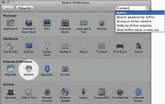

## 总结

在本章中，你学习了如何使用`Finder`窗口来管理和导航 Mac 上的文件，并理解了其提供控制的关键区域：标题栏、工具栏和`Sidebar`。你可以在四种视图模式——`Icons`、`List`、`Columns`和`Cover Flow`之间切换，以导航`Mac OS X`使用的文件结构。

有单独的选项可以自定义`Finder`窗口及其内容的显示：使用`Finder`的`Preferences`对话框、使用视图选项控制以及使用`Customize Toolbar`对话框。视图选项控制默认仅适用于打开的`Finder`窗口（尽管你可以让它们适用于所有`Finder`窗口）；`Preferences`对话框和`Customize Toolbar`对话框中的选项始终适用于所有`Finder`窗口。

`Mac OS`有四个关键文件夹，启动磁盘上的所有文件都存其中：`Applications`、`System`、`Library`和`Users`。`Users`文件夹包含在 Mac 上设置的每个用户账户的 Home 文件夹，这些 Home 文件夹包含每个用户特定的文件、应用程序和设置。

`Finder`启用了几种特殊操作。其中一种是允许`AppleScripts`在文件夹内容更改任何时候自动运行（此功能称为`folder actions`）。另一种是可以使用`Info`窗口启用和禁用磁盘及文件夹的共享。

对于`Finder`来说，磁盘和其他卷本质上只是一种文件夹。但它们也有一些区别。例如，在物理移除或断开卷之前，必须从`Finder`中推出卷；否则可能会丢失数据。`Finder`还允许你创建包含文件和文件夹的刻录文件夹，你可以轻松地将其写入刻录 CD 或 DVD。

由于 Time Machine（时光机）是一个功能高度集成的 Mac OS X 工具，我们在本章的大部分内容将研究如何作为你的备份解决方案。然而，Time Machine 并不是 Mac OS X 用户唯一的可用备份解决方案；我们还会介绍一些替代方案，包括 Apple 的 Backup 程序（作为其 MobileMe 服务的一部分包含在）。

最后，我们将研究如何使用 RAID（独立磁盘冗余阵列）来保护你的数据免受硬盘故障的影响。我们将介绍如何向你的 Mac 安装（或挂载）多个磁盘，以及如何使用`Disk Utility`（磁盘工具）将这些驱动器转换为单一的 RAID 系统，这样即使其中一个硬盘发生故障，也能保持你的数据安全。

## 良好的维护习惯

任何基于磁盘的操作系统都需要一定程度的维护，这既是为了确保其高效运行，也是防止意外情况发生。正如现实世界中使用的任何存储区域一样，碎片会随着时间的推移而积累，随着数据的移动，组织结构也会变得杂乱（在硬盘上，这被称为碎片）。定期执行一些标准操作有助于提供性能和稳定性。

在所有维护操作中，目前最重要的莫过于备份你的数据。我们再如何强调建立一个良好的备份系统是多么至关重要都不为过。一个不备份文件的计算机用户总有一天会自己的轻率而后悔。在大多数时候，你会很幸运，但早晚你都会不小心删除一个文件或遭遇技术故障，并后悔当初没有备份数据。

## 创建备份

备份——顾如其名——是一种在出现问题时发挥作用的后备力量，通常是在你的 Mac 丢失了某些东西时发挥作用。通常，你会在两种不同的情况下使用备份。第一种是文件丢失，可能是由于不小心删除，或者由于损坏而变得无法使用。第二种——一种更严重的用途——是用于灾难恢复。在这种情况下，你的 Mac 本质上是无法使用的。这可能是因为硬盘的物理故障，也可能是因为 Mac OS X 的文件结构发生了严重问题。无论何种情况，你都会庆幸手头有一个备份。

备份让你能够将 Mac 的部分数据回溯到较早的时间点——即那个你还拥有现在已删除的文件的点，或者你硬盘上的数据尚未损坏的点。恰恰如此，Apple 提供了一个名为 Time Machine 的全面备份解决方案。Time Machine 是一个无缝的备份工具，它记录硬盘上进行的更改，并使用 3D 界面让你能够回到过去，以恢复 Mac 上的文件和数据。使用 Time Machine 的优势——除了上述易用性之外——在于它与 Mac OS X 高度集成，并且直接在 Apple 的许多关键应用程序中实现了功能。正因如此，我们在本章的大部分内容中重点关注 Time Machine 的设置和使用。Time Machine 设计用于与外部硬盘配合，但这绝不是唯一的备份解决方案。

## 选择备份介质

由于 Mac 上的数据存储在硬盘上，因此确保你的备份存储在其他处非常有意义。而最明显的地方就是可移动介质。曾几何时，个人电脑用户将几乎所有内容都存储在软磁盘上（首先是 5.25 英角的，然后是较小的 3.5 英寸版本）。

回到现在，软盘已不再是一个实用的选择。Apple 在引入 iMac 时不仅从其计算机系列中移除了软盘，而且磁盘本身的有限容量与现代计算机所存储的数据相比也相形见肘。即使是提供高达 750MB 数据存储的 Zip 磁盘也不再具有实用性（尽管 Zip 的制造商 Iomega 有一种名为 Rev 的类似产品，可以在单个可移动磁盘上提供高达 120GB 的存储；然而，这些磁盘非常昂贵）。

在企业环境中工作的公司通常使用磁带驱动备份大量数据。磁带驱动的工作原理与录像（或早期录音）设备相同，现代磁带可以包含高达 1TB（1024GB）的数据。这些解决方案对于家庭环境来说往往过于昂贵，而且考虑到设置和维护它们的成本（更不用检索数据所需的时间），基于磁带的备份在企业环境中也越来越不再流行。

多年来，使用 CD 和 DVD 驱动器一直是许多人的首选备份解决方案，即使在今天，它仍然是一个值得考虑的选择。然而，DVD 的相对尺寸（单层 [SL] 光盘为 4.7GB；双层 [DL] 光盘为 8.5GB）相当小，特别是与现代硬盘相比。尽管如此，光盘录制的便利性、光驱在 Mac 上的普及以及光介质的相对价格和可用性，使得这种备份方法仍然是许多人的选择——特别是当他们想要永久存储某种特定类型的数据（例如婚礼照片）时。

然而，外部硬盘已成为事实上的首选备份系统。这些硬盘便宜且易于获得。它们本质上基于与你 Mac 启动磁盘相同的硬盘技术，只是被封装在独立的塑料外壳中，通常通过 FireWire 或 USB（通用串行总线）连接到 Mac，也可以通过第三种新兴选项 eSATA（外部串行高级技术接口）连接。

**提示**

如果你使用 USB 磁盘进行备份，请确保它是 USB 2.0 标准而非 USB 1.0 变体。USB 1.0 较慢的传输速度会让备份变得极其缓慢。

当然，如果你拥有一 Mac Pro，你可以在内部安装多四个独立的硬盘，并将其中一个用于备份。

**警告**

也可以对单个硬盘（例如你的启动磁盘）进行分区，并使用第二个分区来存储备份。但这并不特别明智。第二个分区可以为检索已删除或损坏的文件提供备份，但无法提供来自硬盘故障的灾难恢复。这就是为什么，如果你尝试在正在备份的同一磁盘分区上使用 Time Machine，它会反复警告你不要这样做。

## 选择备份软件

如果你决定在外部硬盘上创建备份，有几种应用程序可用：

- `Time Machine`：自从 Apple 引入 `Time Machine`，对快速设置备份解决方案的 Mac OS X 用户都选择了这款简单易用的应用程序，它是随 Mac OS X 免费提供的。本章的大部分内容将讨论设置和使用`Time Machine`。
- `Backup`：Apple MobileMe 服务的订阅者可能研究`Backup`（在本章稍后部分概述）。该应用程序在`Time Machine`之前出现，在许多方面它是一个更原始的备份应用程序。
- `EMC Retrospect`。如果你正在寻找一种比`Time Machine`更高端的解决方案，或者正在为拥有多台电脑的小中企业寻找备份方案，那么 EMC 的`Retrospect`（[`retrospect.com`](http://retrospect.com)）是一个热门选择。该程序提供了大量的自定义选项，并支持多种备份介质。它还是跨平台的，这对于同时运行有`Mac OS X`和`Windows`电脑的网络环境非常有用。


**SuperDuper**。在 Apple 发布`Time Machine`之前，`SuperDuper`（[www.shirt-pocket.com](http://www.shirt-pocket.com)）一直是`Mac OS X`用户的热门选择。尽管它缺乏`Time Machine`那种高度集成的恢复功能，但`SuperDuper`是一个简单的备份工具，其备份到网络驱动器和光盘的能力使其成为仍然值得考虑的选项。

**Carbon Copy Cloner**。另一个在`Mac OS X`用户中流行的解决方案是名为`Carbon Copy Cloner`的程序（[www.bombich.com](http://www.bombich.com)）。该程序并不是创建增量备份（即仅保存自上次备份以来磁盘的更改内容），而是将你的整个硬盘克隆到外部源设备上（通常是另一个硬盘）。目标硬盘必须比你的原始硬盘大，且克隆过程可能非常耗时；然而，它是创建硬盘完整备份的好方法。在发生灾难时，你甚至可以从克隆的硬盘启动 Mac，并使用`Carbon Copy Cloner`从备份中恢复你的常规启动磁盘。

当然，你不一定需要使用软件来创建备份。你可以手动拷贝想要备份的文件。你可以将重要文件拷贝到外部硬盘，也可以将想要备份的文件刻录到光盘中。（将文件记录到可刻录的 CD 或 DVD 的过程在第 3 章中概述。）你还可以使用`Mac OS X`的`Automator`功能创建操作，为在`Finder`中备份文件的过程添加一层智能。通过使用`Automator`，你可以对文件拷贝过程进行调度，并且仅复制发生变化的文件。`Automator`在第 25 章中有更深入的描述。

### 提示

你可以在 [www.apple.com/downloads/macosx/automator/backupfolder.html](http://www.apple.com/downloads/macosx/automator/backupfolder.html) 找到一个备份文件的有用`Automator`函数。

任何备份解决方案固有的问题很大程度上与设置和维护定期备份过程有关。你需要确定备份哪些文件，然后定期将这些文件传输到另一个存储位置，以确保备份有效。执行定期备份是一个耗时且在很大程度上没有回报的过程（当然，直到灾难发生且你需要恢复关键数据为止）。

## 使用 Time Machine 备份文件

到目前为止，我们希望已经在你心中植根了建立备份程序的重要性，以及我们对使用`Time Machine`的建议。

`Time Machine`改变了备份过程的工作方式。`Time Machine`的设计极其易于设置；在运行时几乎是隐形的；得益于一些华丽的视觉效果（它的太空主题背景），它甚至让通常枯燥的文件恢复过程变得充满趣味。

`Time Machine`拥有一些强大的功能，巩固了它作为`Mac OS X`用户首选备份应用的地位。其中最重要的功能是自动停止和恢复功能。如果你移除外部磁盘或拔掉 Mac 电脑（或断开与网络卷的连接），`Time Machine`只会在原地停止，无无大大闹，甚至没有通知；当你重新连接时，`Time Machine`会静静地恢复备份，仿佛什么都没有发生过一样。这太棒了：这意味着你不需要等待备份完成，因此不需要安排备份计划。

`Time Machine`是一个持久的、始终开启的解决方案。你不需要抽空来执行备份。

由于`Time Machine`会不断跟踪你 Mac 上的更改，你可以用它来恢复意外删除的文件和数据。它还是一个卓越的灾难恢复工具；如果你的 Mac 损坏严重到甚至无法使用，只需将`Time Machine`驱动器插入另一台 Mac，就可以恢复整台电脑。

你甚至可以将你的`Mac OS X`版本恢复到一台完全不同的 Mac 上继续工作。这是因为`Time Machine`与一种名为`迁移助理`（Migration Assistant）的`Mac OS X`技术（第 8 章概述）协同工作。因此，如果你设置了一台新 Mac，可以插入你的`Time Machine`驱动器并使用`迁移助理`拷贝所有的文件、程序和设置，像设置原始机器一样设置新电脑。

### 使用外部磁盘进行备份

`Time Machine`的主要要求是你有一个第二个硬盘来存储备份。通常是外部硬盘，尽管那些拥有`Mac Pro`的用户可以使用第二个内部硬盘。使用外部硬盘的优势是你可以带着硬盘走，并相对轻松地将其连接到另一台 Mac。这使得你能够用它将数据从一台 Mac 迁移到另一台。

### 提示

在为`Time Machine`安装第二个硬盘时，确保硬盘比你正在备份的硬盘大是明智的。`Time Machine`使用压缩技术节省空间，但每次增量备份都会增加存储在备份磁盘上的文件大小，因此备份会不断增长。一个明智的做法是购买你能负担得起的最大的外部硬盘，`1TB`的外部硬盘随处可见且价格合理。`Time Machine`会保存备份直到空间耗尽，因此磁盘越大，追溯的时间越远。

### 使用无线备份

对于`MacBook`或其他想要无线备份的 Mac 用户有两种选择（都涉及额外的苹果硬件）。

第一个选择是购买苹果品牌的`AirPort Extreme`路由器并在路由器上连接外部`USB 2.0`硬盘。`Time Machine`可以使用此硬盘来存储备份。请注意，`Mac OS X`仅支持在其`AirPort Extreme`路由器上使用此功能；那些允许连接硬盘的其他`Wi-Fi`路由器用户无法使用此功能。

无线备份的第二个选择是购买名为`Time Capsule`的苹果设备。它本质上是一个内置硬盘的`AirPort Extreme`路由器。`Time Capsule`作为创建无线网络和备份文件的专用中心。虽然投资`Time Capsule`设备没有使用连接到 Mac 上的`USB 2.0`硬盘那么划效益，但它是为一台或多台 Mac 创建备份的一种极其简单的方法。最棒的是，设置`Time Capsule`与设置`Time Machine`一样简单。它们结合构成了一个绝佳的备份组合。

请注意，无线连接比`USB`或`FireWire`连接慢得多，因此你的备份时间更长。你用共享备份磁盘和担心为每台 Mac 布线线的优势，换取了速度较慢和成本较高的缺点。

当 Apple 首次发布`Time Machine`时，它规定你必须使用一个不可启动的磁盘，并且你无法将文件拷贝到正在被`Time Machine`使用的硬盘上。事实上，你可以备份到可启动磁盘，也可以向正在被`Time Machine`使用的备份磁盘写入文件。但我们并不建议你这样做。在这两种情况下，你都将将一些未被备份的文件和数据放在 Time Machine 磁盘上，这会带来意外损坏 Time Machine 备份文件的风险。因此，请使用一个除了存储备份数据外没有其他用途作为你的 Time Machine 磁盘。

# 设置 Time Machine

设置 Time Machine 再简单不过了。你可以在 Time Machine 系统偏好设置中进行设置，可以通过以下任何一种方式访问它：

- 插入一个新驱动器。如果你的 Mac 尚未配置`Time Machine`，那么连接外部硬盘时，`Mac OS X`会提示弹出一个对话框，询问你是否要使用该磁盘进行`Time Machine`备份（见图 4.1）。点击`用作备份磁盘`打开 Time Machine 系统偏好设置。

- 通过系统偏好设置。通过选择`系统偏好设置`并点击`Time Machine`图标来打开`系统偏好设置`。

- 通过菜单栏。如果菜单栏中可用`Time Machine`图标弹出菜单，请从中选择`打开 Time Machine 偏好设置`。

图 4.1

设置 Time Machine 再简单不过了。只需连接外部硬盘就会自动弹出此对话框。

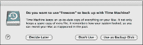

# 配置 Time Machine 备份

Time Machine 系统偏好设置有一个巨大的`开启/关闭`图标开关、`选择磁盘`按钮和`选项`按钮，以及`在菜单栏中显示 Time Machine 状态`选项（见图 4.2）。

如果你在插入新磁盘时点击了`用作备份磁盘`，则`开启/关闭`开关将设置为`开启`，并且所连接的磁盘会被自动选择为 Time Machine 备份磁盘。在这种情况下，你完全可以准备就绪了：`Time Machine`会自动开始将你的主硬盘内容备份到备份磁盘上。坐下，放松一下，你完成了。

当你第一次使用`Time Machine`创建备份时，会打开一个状态窗口来显示备份进度。初始备份可能需要几个小时（如果你通过网络进行备份，则可能更长）。随后的备份是增量的，因此它们只会拷贝自上次备份以来发生变化的文件；因此，首次之后的所有备份都会快得多。

与所有 Time Machine 活动一样，初始备份的设计初衷是不干扰`Mac OS X`的运行，因此你可以最小化 Time Machine 状态窗口（点击黄色的`最小化`图标）并关闭 Time Machine 系统偏好设置（点击红色的`关闭`图标）；现在继续做你的工作吧。

### 提示

Time Machine 的设计旨在无论何种中断都能无缝工作。然而，我们建议你让初始备份在不受干扰的情况下进行。你可以继续使用你的 Mac，但在第一次 Time Machine 备份完成之前，最好不要移除硬盘、断开网络卷的连接或关闭你的 Mac。

# 选择备份磁盘

如果你的 Mac 上连接了两个或多个磁盘，你需要告诉`Mac OS X`要使用哪块磁盘。在 Time Machine 系统偏好设置中点击`选择磁盘`，打开一个设置表，列出`Mac OS X`可访问的所有磁盘（见图 4.3）。选择你想要使用的磁盘并点击`用作备份`。

图 4.2

Time Machine 系统偏好设置允许你开启和关闭备份，并提供调整备份性质的基本选项。

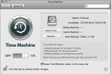

图 4.3

Time Machine 可以备份到`Mac OS X`可访问的大多数磁盘上。

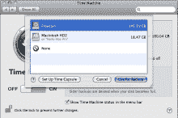

如果你选择的硬盘没有足够的可用空间来存储备份，则会出现 Time Machine 错误对话框（见图 4.4）。此对话框会告知你当前备份所需的大小，以及你所选硬盘上的剩余可用空间量。此对话框有两个选项：你可以点击`确定`，这会取消备份并关闭 Time Machine；或者你可以点击`偏好设置`；从这里你可以点击`选择磁盘`，选择另一个具有更多可用空间的磁盘，或者使用 Time Machine 选项来减少硬盘上备份的数据量。

图 4.4

Time Machine 初始备份需要在外部硬盘上有一定数量的可用空间。如果空间不足，你会收到此警告对话框。

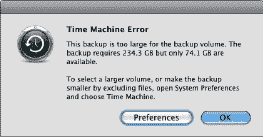

# 设置 Time Machine 选项

当你在 Time Machine 系统偏好设置中点击`选项`按钮时，会出现一个带有控制备份选项的设置表。

Time Machine 选项设置表的主区域允许你设置`Finder`中你不希望让 Time Machine 备份的区域。你的`Mac OS X`卷并非所有部分都是关重要的，减少备份有两个优势：它可以减小备份尺寸，并缩短备份所需的时间。许多类型的文件可能会认为比其他文件不重要；许多用户认为电影和音乐没有照片和文档重要，尽管你自己的优先级可能有所不同。

如果你决定某些磁盘或文件夹不想包含在备份中，可以将它们添加到`要备份的项目`区域。默认情况下，该区域包含 Time 备份卷，但你可以通过两种方式从其他卷中添加项目：

- 拖放：打开一个新的`Finder`窗口并找到你不希望让 Time Machine 包含的文件或文件夹。将其拖入`要备份的项目`窗口。当你将鼠标悬停在窗口上时，会出现一条水平蓝线；松开鼠标将该项目添加到窗口中。

- 点击列表下方的`+`图标按钮。会弹出一个对话框，你可以从中导航到你想要的磁盘、文件夹或文件；选择它并点击`排除`。请注意`显示隐藏项目`选项；选择它会显示出磁盘上通常隐藏的文件和文件夹，例如内部的 Mac OS 系统文件。

### 注意

`要备份的项目`列表中显示的文件夹和文件包含该项目的路径结构，因此当你回到此设置表时，可以清楚地看到这些文件和文件夹的位置。在`+`和`–`图标旁边有一个显示当前备份所需的空间量。

要从`要备份的项目`列表中移除项目，请选择它们并按退格键或点击`–`图标。

`要备份的项目`列表下方会出现两个 Time Machine 选项：

- 使用电池供电备份：此选项出现在 Mac 笔记本电脑用户中，并默认选中。取消此选项将防止 Time Machine 在未通过电源线连接的情况下对 Mac 笔记本进行备份。

- 在删除旧备份后通知：Time Machine 每天、每周和每月进行备份。当硬盘开始变满时，程序会合并旧备份（将天合并为周，周合并为月）。默认情况下，Time Machine 在删除旧备份时会警告你；取消此选项将防止 Time Machine 在删除旧备份时向你警告。

# 使用 Time Capsule 设置 Time Machine

如果你有一个 Apple Time Capsule 设备，可以设置它来与 Time Machine 工作。设置 Time Capsule 的过程与设置 Apple Airport Extreme Wi-Fi 路由器相同。当你首次将 Time Capsule 连接到家庭网络时，AirPort 实用会自动打开，允许你设置 Time Capsule（见图 4.5）。你也可以通过打开 Time Machine 系统偏好设置、点击`选择磁盘`并点击`设置 Time Capsule`来访问 AirPort 实用。

图 4.5

当您将 Time Capsule 连接到家庭网络时，AirPort 实用程序会自动打开。

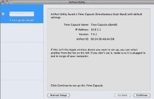

您按照以下步骤设置 Time Capsule：

1. **开启 AirPort**。如果`AirPort`尚未开启，您需要激活它。您可以点击`AirPort`图标弹出菜单并选择`Turn AirPort On`，或者选择`System Preferences`（系统偏好设置），点击`Network`图标，在`Network`系统偏好的列表中选择`AirPort`，然后点击`Turn AirPort On`。

2. **连接网络**。默认情况下，Time Capsule 的名称为`Apple Network`，后跟一个六位的字母数字标识符（例如，`Apple Network a8a4d8`）。在`AirPort`图标弹出菜单中选择此名称，或在`Network`系统偏好设置的`Network Name`弹出菜单中选择该名称。

3. **打开 AirPort 实用程序**。如果网络上连接了新的 Time Capsule，`AirPort Utility`应该自动打开。如果没有，您可以在`Finder`的`Applications`文件夹下的`Utilities`文件夹中找到`AirPort Utility`。

4. **突出显示 Time Machine**。`AirPort Utility`左侧列表中会出现`Time Machine`图标（见图 4.5）。选择它并点击`Continue`（继续）。

5. **输入名称和密码**。您可以通过为 Time Capsule 命名来对其个性化设置（默认使用您的`username`）。您必须输入密码（然后在`Verify Password`文本字段中再次输入相同的密码）来保护您的 Time Capsule 设置。默认情况下，密码将保存到您的`Keychain`（钥匙串）中，因此您在每次更改 Time Capsule 时都不需要输入它（`Keychain`在第 23 章中介绍）。如果您取消勾选`Remember This Password in My Keychain`（在我的钥匙串中记住此密码）选项，每当您想要更改 Time Capsule 时都会提示您输入密码。默认情况下，相同的密码允许您通过`Finder`访问 Time Capsule 磁盘。如果您选择了`Use a Different Password to Secure Disks`（使用不同的密码加密磁盘）选项，可以为磁盘访问设置不同的密码。输入名称和密码后，点击`Continue`。

6. **选择您想对 Time Capsule 执行的操作**。您的 Time Capsule 可能连接到当前的路由器或 DSL 或电缆调制解调器。在这种情况下，您需要告诉它如何与网络交互。您有三个选项可以选择：

   - 我想创建一个新网络。

   - 我想用 Time Capsule 替换现有基站或无线路由器。

   - 我想让 Time Capsule 加入当前网络。

选择相应的选项并点击`Continue`。

7. **更新 Time Capsule**。当您选择了将 Time Capsule 连接到网络的适当设置后，点击`Update`（更新）按钮。会出现一个对话框，警告您 Time Capsule 在更新期间将不可用。更新不应持续超过几分钟，之后`AirPort Utility`将显示祝贺信息（见图 4.6）。点击`Quit`（退出）完成 Time Capsule 的设置。

Time Capsule 设置好后，`Time Machine`就可以备份到它。打开`Time Machine`系统偏好设置，点击`Select Disk`（选择磁盘），选择`Time Capsule`卷并点击`Use for Backup`（用于备份）。系统会提示您输入在 Time Capsule 设置期间输入的密码；输入密码并点击`Connect`（连接）。`Time Machine`开始无线备份您的磁盘卷。

图 4.6


设置好 Time Capsule 后，您将看到此消息，告知您一切已正确设置。

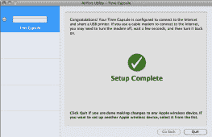

## 将备份移动到更大的磁盘

随着您的 `Time Machine` 备份磁盘变满——是因为您将额外的外部磁盘备份到其中，还是因为备份了 Mac 上日益增多的文件——您可能决定需要更大的磁盘进行备份。这个过程并不像您想象的那么简单。

首先，如果您简单地连接一个新的备份驱动器并在 `Time Machine` 中设置它，该新备份驱动器将不包含之前备份；相反，它将从零开始，复制您当前的所有文件，然后进行增量备份。

您可能认为您需要做的只是连接新磁盘并将旧文件复制或移动到新磁盘，然后将其设为新的 `Time Machine` 备份磁盘。但如果您这样做，`Time Machine` 会忽略那些之前的备份文件并从零开始备份过程，因此您的旧备份再次无法通过 `Time Machine` 访问。

您必须将旧磁盘的内容克隆到新磁盘，这样 `Time Machine` 就会将其视为同一个磁盘。要这样做，首先关闭 `Time Machine`，然后连接新旧备份磁盘。现在打开 Mac OS X 的 `Disk Utility`（磁盘工具）并进入 `Restore`（恢复）面板。`Disk Utility` 窗口左侧是已连接磁盘列表。将旧磁盘的图标拖入 `Source`（源）字段，将新磁盘的图标拖入 `Destination`（目标）字段。然后点击 `Restore`。

在 `Disk Utility` 将旧磁盘克隆到新磁盘后，关闭 `Disk Utility` 并重命名旧磁盘，以免 `Time Machine` 产生混淆。（我们建议在删除旧磁盘内容或重新格式化它之前不要这样做。）开启 `Time Machine`。

## 使用 Time Machine 恢复文件

拥有备份的目的是为了恢复文件，`Time Machine` 让这一过程变得非常直观，令您非常期待。当您恢复文件时，`Time Machine` 浏览器会将桌面变为星空背景和一系列 `Finder` 窗口，见图 4.7。

通常有三个原因想要从之前的时间点检索文件：

- **误删**。您可能将文件移到了废纸篓并清空了废纸篓。如果您在之后的某个时间需要该文件，`Time Machine` 可以帮助您检索。

- **文件损坏**。尽管 Mac OS X 是一个稳定的操作系统，但文件可能会损坏并无法使用。在这种情况下，可以使用 `Time Machine` 检索之前正常的文件实例。

- **版本回滚**。假设您对文件进行了重大修改并了了，但在之后的某个时间想回到文件的早期版本。虽然跟踪更改并撤销不需要的部分通常是更明智的做法，但并非所有应用程序都有此功能，因此 `Time Machine` 可以派上用场。

您可以使用以下方法访问 `Time Machine` 浏览器：

- **使用 Dock 图标**。默认情况下，Mac OS X `Dock` 中有一个 `Time Machine` 图标。点击它打开 `Time Machine`。

- **使用菜单栏图标弹出菜单**。在菜单栏的 `Time Machine` 图标弹出菜单中（如果存在），选择 `Enter Time Machine`。

- **打开应用程序**。`Time Machine` 是一个应用程序，因此位于 `Applications` 文件夹中。双击 `Time Machine` 图标访问该程序。

### 使用 Time Machine 浏览器

默认情况下，访问 `Time Machine` 将桌面替换为星空窗口和一个 `Finder` 窗口。`Finder` 窗口后面是其他 `Finder` 窗口，每个窗口代表一个之前的时间点。初始 `Finder` 窗口代表 Mac 上所有文件的当前状态。您可以以在 Mac OS X 中打开 `Finder` 窗口相同的方式导航 `Finder` 窗口（如第 3 章所述）。您还可以使用 Spotlight 搜索在 `Time Machine` 浏览器显示的 `Finder` 窗口中定位文件。（Spotlight 搜索在第 3 章中也有介绍。）

Time Machine（时光机）浏览器与普通桌面的不同之处在于右侧的垂直时间轴和箭头。鼠标悬停在时间轴上，它会展开，视觉效果类似于缩放模式下的程序坞（Dock）。时间轴上的每条水平线都代表一个不同的时间实例。使用鼠标选择一个时间实例。

图 4.7

Time Machine 界面显示了一个星场，窗口向过去回溯延伸。你使用右侧的控制控件在不同的时间实例之间移动。

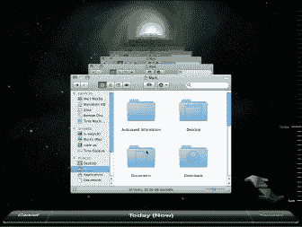

Time Machine 按照以下计划备份文件：

* 过去 24 小时内的每小时备份

* 过去一个月内的每日备份

* 所有之前月份的每周备份

垂直时间轴最底部的线代表现在；每一条向上移动的水平线代表代表上一个时间点（按小时、每周和每月备份移动）。每条线的左侧是该线所代表的时间日期。点击这些线中的任何一条，`Finder` 窗口都会跳转到该时间点（伴随着 Time Machine 浏览器中的窗口翻转到相应窗口的快速显示效果）。随后`Finder` 窗口将显示该时间点 Mac 及其连接磁盘上存在的所有文件。

### 使用 Time Machine 恢复文件

如果你看到想要恢复的文件，在 Time Machine 浏览器的 `Finder` 窗口中高亮该文件并点击 `Restore`（恢复）。`Finder` 窗口将向前翻转到最前面的实例（代表现在的实例），文件将放置在其中并回到其原始位置。

如果恢复的文件存在于当前的 `Finder` 窗口中，会弹出一个带有三个选项的对话框（见图 4.8）：

* **保留原始（Keep Original）**。选择此选项将取消检索，并保留当前 `Finder` 窗口中的文件。

* **保留两者（Keep Both）**。选择此选项将保留过去 `Finder` 窗口中的原始文件，并将其复制到当前 `Finder` 窗口中。（复制后的过去文件名会添加一个数字以区分这两个文件。）

* **替换（Replace）**。选择此选项将删除当前 `Finder` 窗口中的文件，并用从 Time Machine 检索的过去版本替换它。

图 4.8

从 Time Machine 浏览器中过去的 `Finder` 窗口选择一个文件并点击 `Restore` 按钮进行检索。如果相同的文件仍然存在于当前的 `Finder` 窗口中，你会看到此对话框。

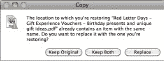

### 搜索更改

就像你可以使用垂直时间轴搜索文件夹一样，你也可以浏览 `Finder` 窗口并寻找更改。点击 Time Machine 浏览器中的 `↑` 图标按钮将向过去回溯，穿过各种保存点，直到 `Finder` 所在位置的某个文件发生变化。这对于你知道文件位置但不知道它在何时被更改或删除的情况非常有用。点击 `↓` 图标按钮将向正正移动，再次停在 `Finder` 窗口中显示的位置发生变化的时间点。

### 退出 Time Machine 浏览器

当你决定完成从 Time Machine 浏览器恢复文件后，可以通过三种方式返回 Mac OS X 主界面：

* 点击 `Cancel`（取消）按钮。

* 按 `Escape` 键。

* 点击 Time Machine 浏览器中最前端窗口中的 `Close` 图标按钮。

### 在应用程序中使用 Time Machine

因为 Time Machine 负责备份和恢复 Mac 上的文件，你可以在 `Finder` 中使用它来恢复 Mac OS X 的任何内容。然而，你也可以用它将某些 Mac OS X 应用程序恢复到之前的状态，例如，如果 `Address Book`（通讯录）联系人在文件同步中损坏，可以恢复它们，或者在 `Mail` 中恢复到旧邮件列表。Time Machine 浏览器支持的应用程序包括：

* `Mail`

* `Address Book`

* `iPhoto` 08 及更高版本

* `GarageBand` 08 及更高版本

要对这些应用程序使用 Time Machine，首先打开应用程序，然后打开 Time Machine 浏览器。你会看到与文件时相同的系列向过去延伸的窗口，你可以以处理文件相同的方式浏览浏览器并恢复过去的应用程序状态。

### 使用 MobileMe 备份保存重要文件

`Backup` 是一个早于 Time Machine 的应用程序，但 Apple 仍为 `MobileMe` 服务的订阅者提供了备份 Mac 文件的选项。（第 15 节有更多关于 `MobileMe` 的信息）。

与 Time Machine 不同，Time Machine 是备份 Mac 磁盘的完整解决方案，而 `Backup` 允许你对特定文件（或文件类型）进行备份，然后安排不同的备份方法。例如，你可以每天将文件备份到外部硬盘，每月备份一次 CD 或 DVD。`Backup` 还允许你将文件保存到 `iDisk`，这是 Apple 作为 `MobileMe` 服务一部分提供的在线存储空间。（第 15 节有更多关于 `iDisk` 的信息）。

你可以为备份文件设置自己的计划，并确定你想要备份的哪些文件或文件夹；你还可以结合 `Spotlight` 使用 `Backup` 工具保存特定类型的文件，而不是特定的文件位置。然而，`Backup` 和 Time Machine 的关键区别在于，`Backup` 要求你确定想要保留的文件和想要使用的备份方法。从这个意义上说，它比 Time Machine 更复杂。

**注意**：在本书出版时，`iDisk` 的默认存储容量为 20GB（尽管 Apple 增加了）。使用 `iDisk` 作为备份位置会迅速消耗空间。`Backup` 仅供 `MobileMe` 订阅者使用，并非默认安装在 OS X 中。`MobileMe` 订阅者可以在 `iDisk` 上的 `Software` 文件夹中找到 `Backup` 的安装文件。

### 创建备份计划

首次启动 `Backup` 时，会弹出一个对话框提示你“选择计划”（图 4.9）。在之后启动 `Backup` 时，可以通过点击 `Backup` 窗口中的 `+` 按钮、选择 `Plan⇒New Plan` 或按 `⌘+N` 创建新的备份计划。创建新备份计划你有五个选项：

* **用户文件夹（Home Folder）**。此选项每天将你的用户文件夹备份到硬盘，每月备份到 CD 或 DVD。

* **个人数据与设置（Personal Data & Settings）**。此选项每天将你的 `Address Book`、`Stickies` 便签、`iCal` 日历、`Safari` 设置和 `Keychain` 设置备份到 `iDisk`。

* **iLife**。此选项每周将 `iLife` 数据（照片、音乐和电影）备份到 CD 或 DVD。

* **iTunes 库**。此选项每月将 `iTunes` 使用的音乐备份到 CD 或 DVD。

* **自定义（Custom）**。选择此选项允许你选择自己的备份计划。

要开始使用 `Backup`，选择一个选项并点击 `Choose Plan`。

### 自定义你的备份计划

为新计划选择模板选项（自定义选项）后，你会看到一个以你选择的选项命名的对话框（见图 4.10）。它打开到 `Back Up` 面板，该面板有两个子面板：

* **备份项目（Backup Items）**。此子面板显示位于 Mac OS X 中（位于 `Finder` 中或特定应用程序内部）将被备份的数据。设置备份的数据总大小显示在面板下方。你可以点击 `+` 图标按钮添加项目；选择项目并点击 `–` 按钮可以从备份列表中移除项目。

- **目的地与计划**。此子窗格显示备份的预期目的地。通常，这是你的硬盘或 `iDisk`。该区域右侧的绿色条显示了目的地上的可用剩余空间。你可以通过点击 `+` 图标按钮添加目的地和计划；选择一个目的地及其计划，然后点击 `–` 图标按钮将其从计划列表中移除。

图 4.9

MobileMe 备份提供了若干预设备份模板，你可以使用它们来自动化备份过程。

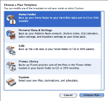

图 4.10

备份对话框显示了你决定备份的项目，以及它们将被添加目的地。

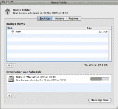

## 向备份中添加项目

出现在“备份项目”子窗格下方的 `+` 和 `–` 图标按钮允许你向备份计划添加或删除项目。如果你点击 `+` 图标按钮，会打开一个名为“选择备份项目”的设置表，该表包含三个子窗格：

- **快速选择**。这些是 Mac OS X 上常见项目的链接，例如`通讯录`、`iTunes 库`和 `Microsoft Word` 文档。它们通常是文件类型或与特定应用程序关联的文件，而不是文件集合。使用复选框选择你想添加到备份计划的项目，然后点击“完成”。

- **文件与文件夹**。此窗格允许你从 Finder（访达）中选择文件和文件夹。窗格下方有两个选项：“包含此文件/文件夹”和“不包含此文件/文件夹”。选择所需的选项并点击“完成”。

- **Spotlight（聚焦搜索）**。此窗格允许你使用 Spotlight 技术并搜索要包含或排除在备份中的项目。在文本字段中输入搜索术语，并使用主窗格定位项目。（注意，备份中使用的 Spotlight 技术比 Finder 中使用的要原始。）完成后，点击“完成”。

## 调整计划和目的地

在备份对话框的“备份”窗格中，点击“目的地与计划”子窗格下方的 `+` 图标按钮，打开一个设置表，其中包含一组用于确定备份位置和备份频率的选项。首先点击“目的地文件夹”以选择备用卷、你用户文件夹中的一个文件夹或你的 `iDisk` 作为备份位置。使用“文件夹”弹出菜单在所选目的地中选择你想要存储备份的文件夹。默认情况下，这是一个名为 `Backups` 的文件夹。

“在以下时间自动备份”选项默认被勾选。其设置允许你为备份设置频率（天、周、月、三个月或六个月）、星期几或日期，以及你希望 Mac OS X 执行备份的确切时间。选择好所需的设置后，点击“确定”。

## 查看历史记录

要打开备份发生的时间记录，请前往备份对话框中的“历史记录”窗格。此窗格显示备份的日期、事件和目的地。选择一个备份并点击“查看详细”按钮以获取更详细的信息。点击“清除历史”按钮从历史记录中删除备份（注意，这不会删除备份本身，只是删除它们在 във窗格中的记录历史记录）。

## 开始备份

当你完成创建备份计划后，点击“立即备份”开始第一次备份。这会打开备份对话框并开始复制文件（见图 4.11）。

**注意**

由备份工具保存的文件被压缩成文件夹中的单个包。在文件夹中，寻找带有橙色雨伞图标且种类描述为 `Full Backup Package`（完整备份包）的文件。

图 4.11

备份对话框会在备份进行时向你显示进度。

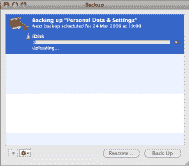

## 从备份恢复文件

要恢复这些文件，请再次使用备份程序。选择你想恢复文件的备份计划，然后点击“恢复”。

## 管理备份中的项目

当你打开备份应用程序时，请注意它的操作图标弹出菜单（齿轮图标）。它提供了以下选项：

- **新建**。类似于 `+` 图标按钮，此选项允许你向备份程序添加新的备份计划。

- **重命名**。此选项允许你重命名选定的备份计划。

- **编辑**。在备份对话框中选择一个计划并选择此选项以调整其设置。

- **移除**。在备份对话框中选择一个计划并选择此选项从备份中移除选定的计划。

- **备份**。当你选择此菜单选项时，选定的备份计划将立即备份它引用的项目，无论其计划如何。到达下一个计划时间点时，它仍会备份。

- **恢复**。选择此选项以恢复高亮选项上次备份中保存的项目。

## 使用 RAID 冗余

RAID（独立磁盘冗余阵列）是一种具有两种不同用途的技术。

首先，它可以使用多个磁盘创建一个单一卷。例如，你可以安装四块 512GB 的硬盘来创建一个提供 2TB 空间的单一卷。这对于服务器空间以及使用大文件的用户特别有用。（例如，高定义视频编辑会占用大量空间。）

你有两种方法使用 RAID 创建共享磁盘。一种是“联合磁盘”，它将文件存储在任何可用的磁盘上，但在 Finder 中呈现为一个磁盘；另一种是“条带化”，它将数据分布在多个磁盘上，以便 Mac 从多个位置同时读取数据（这对视频非常有用）。但风险是如果阵列中的某块磁盘故障，位于该磁盘上的任何文件都会损坏，因为是不完整的。

RAID 的第二个用途是为数据维护一份副本，以防某块磁盘故障——对于作为服务器的 Mac 或其他其他密集型用途来说至关重要。故障的磁盘可以在不丢失数据的情况下进行更换（因为另一个磁盘上仍存在完整的数据）。当安装替换驱动时，数据将从剩余磁盘复制到新磁盘，你可以像以前一样工作。

## 了解 RAID

RAID 是一项对于计算机新手可能难以理解和设置的技术，尽管 Mac OS X 尽力让这项技术变得简单。

首先需要理解的是，你需要一组相同的磁盘来创建 RAID 阵列。通常你需要两到四块相同的硬盘来创建一个阵列，以及两块相同的硬盘来创建一个镜像集。

在写作期间，目前具有多个磁盘空间的 Mac 只有 Mac Pro（它有容纳四个硬盘的槽）和 Apple 的 Xserve 服务器（它有三个内部硬盘的空间）。

| 类型 | 配置 | 说明 |

| :--- | :--- | :--- |

| RAID 0 (条带化) | 一到四块相同的硬盘 | 可以使用多达四块相同的硬盘来创建一个单一卷。卷的大小是所有硬盘空间之和。当数据写入条带化阵列时，它会分段发送到所有驱动器；因此，条带化阵列提供更快的性能。它还提供了比单个硬盘物理尺寸更大的卷。然而，如果任何一个硬盘故障，整个卷都将丢失，因为剩余磁盘上的文件是不完全的。因此，独立的备份系统至关重要。 |


| RAID 1 (镜像) | 两块相同的硬盘 | 使用两块相同的硬盘来创建一个单一卷。卷的大小与其中一块硬盘相同。每块硬盘上的数据在任何时候都保持一致，因此如果其中一块硬盘发生机械故障，另一块可以立即替换它而不会发生任何数据丢失。 |

| 串联 RAID (也称为 JBOD，或“一堆磁盘”) | 一到四块硬盘 | 这是一种类似于 RAID 0（条带化）的 RAID 阵列。然而，它不会将数据跨多个驱动器拆分（条带化），而是将文件完整地存储在它们所在的磁盘上。因此，它没有条带驱动器那样的性能优势，但数据丢失的风险也较小，因为只有故障磁盘上的文件会丢失。 |

| 增强型 JBOD | 一到四块硬盘 | 该格式代表“一堆磁盘”（Just a Bunch of Disks）。从技术上讲它不是阵列；但这种格式可以在不需要重新格式化的情况下将单个硬盘转换为 RAID。如果您订购带有多个硬盘的 Mac Pro，它们将以 JBOD 格式作为独立驱动器提供。这意味着你有多个独立的驱动器，在第一块硬盘上安装了 `Mac OS X`，但 JBOD 格式允许您在无需重新安装 `Mac OS X` 的情况下将驱动器转换为单一的 RAID 阵列。 |

| RAID 0+1 | 四块相同的硬盘 | 如名所示，这种格式使用四块硬盘并结合了 RAID 0 和 RAID 1 的两个特性。前两块硬盘进行条带化以创建一个大小为两块硬盘之和的单一卷。后两块硬盘进行条带化并用于镜像第一组硬盘。 |

| RAID 5 | 三或四块硬盘 | RAID 5 是一种新格式，它使用块级条带和冗余来创建一个具有 RAID 0 某些优势的硬盘，同时实现了 RAID 1 的冗余功能。在这一方面，它类似于 RAID 0+1，但其技术创建了更大的磁盘空间。例如，如果您有四块 1TB 的驱动器，可以使用 RAID 0 创建一个 4TB 的阵列，或者使用 RAID 0+1 创建一个 2TB 的冗余阵列。在 RAID 5 中，您可以创建一个具有冗余功能的 3TB 硬盘。如果任何一个硬盘故障，您都可以更换它们。 |

### 提示

热插拔（Hot swapping）是一个经常与 RAID 相关的术语。它是一个过程，您可以在计算机运行时移除镜像硬盘并插入替换驱动器，而无需关闭计算机（甚至无需中断您的工作）。显然，硬盘故障是罕见事件，因此热插拔功能实际上只需要在时间要求苛刻的工作环境中。Apple `Xserve` 服务器中的硬盘是支持热插拔的，而其 `Mac Pros` 中的硬盘则不支持。

### 安装内部硬盘

如果您拥有一台配备单个硬盘的 Mac Pro，则需要安装额外的硬盘来创建 RAID 卷。在 Mac Pro 中安装额外的硬盘是一个相对简单的过程（至少与许多其他计算机相比）。Mac Pro 包含 `SATA`（串行高级技术连接）`3` Gbps、3.5 英寸、单高（1U）硬盘——即通常销售的 3.5 英寸桌面 `SATA` 驱动器。

您只需要的工具是一个 `Phillips #1` 十字螺丝刀。（带十字形头的那个）。按照以下步骤将硬盘安装到您的 Mac Pro 中：

1. 关闭您的 Mac Pro。
2. 等待五到十分钟。Apple 建议这样做以让内部系统冷却。
3. 拔掉电源线以外的所有外部线缆。
4. 释放身体中的任何静电。您可以通过触摸金属 `PCI`（外围组件互连）插槽的访问盖来实现。另一种常用技术是触摸散热器。专业人士还会投资佩戴防静电手带。
5. 拔掉电源线。
6. 抬起 Mac Pro 后部的插锁。
7. 从 Mac Pro 上取下侧面板。
8. 找到硬盘托位。这些是四个水平排列的金属矩形开口，位于计算机的上半部分。
9. 移除金属支架。第一个硬盘托位（左侧的）通常包含启动磁盘。此磁盘可以更换，但如果您正在添加额外的硬盘，应将其安装在右侧相邻的硬盘托位中。安装非常简单：从托位中拉出金属支架。注意：计算机后部的插锁（第 6 步中使用）必须保持打开状态，否则磁盘将锁定在原位。
10. 插入硬盘。硬盘通过四个金属螺钉固定在支架上。每个支架底部有四个螺钉。您可以用手拆下它们，也可以使用 `Phillips` 螺丝刀。所有硬盘都有四个匹配的螺丝插座。将硬盘放入支架中，并使用螺钉将硬盘固定在支架上。
11. 将支架滑回硬盘托位。用力推入，使连接器插入 Mac Pro 硬盘托位中。不要强推。
12. 装回 Mac Pro 的侧面板。
13. 关上 Mac Pro 后部的插锁，以锁定面板和硬盘。
14. 重新连接所有线缆并启动您的 Mac Pro。

### 安装外部硬盘

当然，并不是每个人都拥有 Mac Pro。幸运的是，这些用户并没有完全被遗弃。有很多可以通过 `FireWire` 和 `USB 2.0` 连接的包含多个硬盘的外部 RAID 硬盘。

某些外部 RAID 硬盘带有硬件 RAID 卡，并为 Mac Pro 设计。它们通常通过 `eSATA` 连接。（参考它们的文档进行设置和操作。）

### 提示

Data Robotics 创建了一种名为 `Drobo` 的有趣设备，它提供了与外部 RAID 硬盘类似的功能，但有一个转折。它并不要求您安装相同的硬盘，`Drobo` 可以接受任何大小的四个硬盘。内置控制器随后使用这些磁盘创建一个约为所有安装磁盘总空间四分三的单一卷。优势是可以移除任何单个硬盘而不会丢失任何数据。您可以拔出一个硬盘并插入一个更大的硬盘，设备将自动增加卷可用存储容量。这项技术引起了广泛关注，它可能指向 RAID 风格存储的未来，即更加用户友好且易于大众使用，同时提供条带化和镜像功能。您可以在 [www.drobo.com](http://www.drobo.com) 找到更多信息。

### 使用 Disk Utility 格式化 RAID 硬盘

当您在 Mac 上安装了多个相同的硬盘时，需要将它们转换为 RAID 集合。您可以使用 `Disk Utility`应用程序来实现。`Disk Utility` 具有广泛的功能，其中许多功能在第 8 章中介绍。本章将介绍其 RAID 功能。

`Disk Utility` 无法通过当前运行 Mac OS X 的卷来创建 RAID 阵列。如果你想用 `Disk Utility` 创建 RAID 阵列，必须从安装 DVD 启动 Mac OS X 并在安装过程中选择 `Disk Utility`（更多信息请参阅第 1 章）。从安装卷创建 RAID 将擦除磁盘上的所有信息，因此你需要从头开始安装 Mac OS X。将 `Time Machine` 与 `Migration Assistant`（如本章早些时候概述）结合，可以让你将所有信息重新拷贝回磁盘。

## 识别磁盘

你的 Mac 可用磁盘将显示在 `Disk Utility` 左侧的列表中，磁盘上的任何卷（如分区）将显示在磁盘下方并有缩进。当你选择一个磁盘或一个卷时，其信息将显示在 `Disk Utility` 窗口的底部。这包括`磁盘描述`、`连接总线和类型`、`连接 ID`、`容量`、`写入状态`、`S.M.A.R.T.（自我监测与报告技术）`状态以及`分区方案方案`。

提示

`Disk Utility` 还可以访问安装在你的 Mac 中的 `SATA` 或 `ATA` 驱动器提供的 `S.M.A.R.T.` 信息。`S.M.A.R.T.` 的目的是提供预测驱动器故障的信息并诊断硬盘的介质和机械结构。当列表中选择磁盘时，磁盘的 `S.M.A.R.T.` 状态显示在 `Disk Utility` 底部。当磁盘运行正常时，`Disk Utility`报告状态为“已验证”。如果红色文字“即将故障”，你应该立即对磁盘进行备份并更换故障磁盘。

## 格式化新磁盘

如果你最近插入了新的硬盘，你可能需要在继续之前对其进行格式化：

1. 选择磁盘。
2. 转到`擦除`窗格。这显示了 `Disk Utility` 中与格式化磁盘相关的所有选项。
3. 选择卷格式。使用`格式` 弹出菜单选择合适的卷格式，正如第 8 章所解释的。通常，你应该选择`Mac OS X 扩展（日志式）`。
4. 为它命名。在`名称`文本字段中为卷指定一个名称。
5. 点击`擦除`。点击`擦除`按钮；然后在弹出的确认对话框中再次点击`擦除`。

## 创建 RAID 阵列

现在你已经准备好了磁盘，是时候将它们转换为单个 RAID 阵列了。在 `Disk Utility` 中，按照以下步骤创建 RAID 阵列（参见图 4.12）：

1. 选择磁盘。在列表中选择一个你想用于该组的磁盘之一，并转到`RAID` 窗格。
2. 为 RAID 命名。在`RAID 组名称`文本字段中为 RAID 组输入一个名称。
3. 选择格式。从`格式`弹出菜单中选择一种卷格式。通常你应该选择`Mac OS X（日志式）`。
4. 选择 RAID 类型。在`RAID 类型`弹出菜单中有三个选项供你选择：`镜像 RAID 组`、`条带型 RAID 组`和`联接 RAID 组`。
5. 添加第一块磁盘。在左侧列表中找到你想包含在 RAID 阵列中的第一个磁盘。将磁盘从列表中拖动到 `Disk Utility` 中心的主窗口中。它将显示为`新成员："diskname"`（`diskname` 之后会出现一个数字，标识它是你 Mac 中的哪块磁盘。（要删除磁盘，只需将其拖出窗口即可。）
6. 添加剩余磁盘。现在，将用于 RAID 的剩余磁盘拖到第一块磁盘下方。每个磁盘将列为`新成员："diskname"`并带有一个标识数字。

提示

你可以通过点击`+` 图标按钮创建额外的 RAID 组。你还可以在主窗口中移动磁盘以重新配置 RAID 组。

7. 选择 RAID 备用或 RAID Slice。选择窗口中的任何磁盘（而非 RAID 组）；`RAID 类型`弹出菜单将变为`磁盘类型`弹出菜单。选择区域，标记为`RAID 类型`的下拉菜单将变为`磁盘类型`，它为每个驱动器提供两个选项：`RAID Slice`和`RAID 备用`。默认情况下，选项设置为`RAID Slice`，这确保了磁盘被作为 RAID 阵列的一部分使用。选择`RAID 备用`表示该磁盘不作为主 RAID 卷的一部分，而是在其他磁盘发生故障时自动使用。当你创建`镜像 RAID 组`时，可以配合第三块驱动器使用此选项。将其设置为`RAID 备用`，以便在驱动器故障时自动替换其他驱动器之一。
8. 选择你的选项。点击`选项`按钮打开设置表，在其中你可以通过`RAID 块大小`弹出菜单选择块大小。（块是硬盘上存储数据的连续区域。你可以将它们想象为构成你文件的等效砖块。较大的块访问速度更快，但存储数据的效率较低。）默认情况下，块大小为`32K`，尽管你的选项有`16K`、`32K`、`64K`、`128K`和`256K`。`Mac OS X`建议你选择与将访问的数据类型匹配的块大小。例如，视频可能会访问大块数据，但数据库将访问较小的块。
9. 决定是否启用自动重建。如果你正在创建`镜像 RAID 组`，选择`自动重建 RAID 组`选项。点击`确定`关闭表单。
10. 创建 RAID。当你准备好设置磁盘时，点击`创建`开始构建 RAID 阵列。`Mac OS X`弹出一个对话框，警告你将擦除（它为你列出的）用于 RAID 阵列的所有磁盘信息。点击`创建`确认你同意擦除磁盘并创建 RAID 阵列。

图 4.12

你使用 `Disk Utility` 将一组磁盘转换为 RAID 阵列。


## 研究 RAID Utility

如果你正在管理`Xserve`服务器，你必须使用名为`RAID 管理`的程序来管理 RAID 系统。然而，购买了硬件 RAID 卡的 Mac 用户还有一个名为`RAID Utility`的工具，位于位于文件夹。该工具提供了比 `Disk Utility`更多的选项，包括创建 RAID 5 卷的功能。

## 总结

在文件被意外删除或损坏的情况下，有一个备份计划是非常关重要的。`Mac OS X`的`Time Machine`工具是一个易用且功能强大的备份恢复工具，每个人都应该使用。

`Time Machine` 自动备份数据到外部硬盘，并提供了关于备份 Mac 上哪些磁盘、以及不备份哪些磁盘、文件夹和文件的选项。Apple 的`Time Capsule` 结合了无线路由器和硬盘，允许一个或多个 Mac 进行无线备份。

如果你需要恢复旧文件和文件夹，`Time Machine` 浏览器允许你浏览包含这些旧项目的 Finder 窗口；你可以告诉 `Time Machine` 将这些旧文件恢复到当前的 Finder 窗口中，从而找回丢失的文件或替换损坏的文件。`Time Machine`还可以恢复某些应用程序的过去设置，如`邮件`和`通讯人`。`Time Machine`还允许你恢复整个卷（例如在磁盘故障时）到另一个磁盘。当配合`Migration Assistant`使用时，它还可以将一个 Mac 的内容恢复到另一个 Mac。

Apple 的`MobileMe` 服务带有一个名为`备份`的工具，允许你安排将用户指定的文件和文件夹备份到你选择的外部磁盘、光盘和在线 `iDisk` 服务。

Mac OS X 提供的 RAID 技术允许你组合多个磁盘，可以对文件进行即时备份，从而让你有一个随时可用的备份磁盘；或者创建一个大型磁盘阵列（或磁盘组），让 Mac 将其视为单个磁盘。组合磁盘的一种形式称为“条带化”（striping），它可以显著提高视频处理和其他高性能需求下的磁盘性能。只有 Mac Pro 和 Xserve 计算机可以在内部安装多个磁盘。对于其他 Mac，你可以使用外部磁盘创建 RAID 阵列，或购买已包含多个磁盘的 RAID 驱动器。在大多数 Mac 上，使用 `Disk Utility` 设置 RAID 阵列；在 Mac Pro 和 Xserve 上使用 `RAID Utility` 以获得额外的 RAID 功能；或者使用第三方 RAID 驱动器或 RAID 卡附带的软件。

# 第 5 章：在 Mac OS X 中获取帮助

## 本章内容

- 帮助查看器（Help Viewer）应用程序
- 在应用程序内部获取帮助
- 在帮助查看器中进行导航
- 理解帮助标签（help tags）
- 使用命令行帮助
- 探索其他帮助途径

当你探索 Mac OS X 时，你会不断遇到操作系统中新颖且令人兴奋的领域。Mac OS X 是一个庞大且复杂的操作系统，迟早每个人都需要帮助。当你遇到陌生的领域时，Mac OS X 提供了多种内置协助方法。

阅读帮助文件的主要方法是通过一个名为 `Help Viewer` 的内置应用程序。帮助查看器提供了大多数基础任务的解释，以及与 Mac OS X 10.6 Snow Leopard（雪豹）相关的文档。你可以用它来学习 Mac OS X 的基础功能并发现如何使用基础硬件，它还作为 Mac OS X 10.6 Snow Leopard 中新功能的展示。

Mac OS X 提供的另一种帮助类型是帮助标签。这些是鼠标悬停在各种 GUI（图形用户界面）元素上时出现的黄色标签，并对该元素提供的功能提供进一步的解释。

另一项帮助服务可以通过 `Terminal` 中的 `man` 页面获取。这些页面概述了在 `Terminal` 应用程序中使用的命令行任务。

除了 Mac OS X 的帮助外，许多应用程序还提供了自己的全面帮助部分。此外，你可以使用互联网作为资源。Apple 通过其网站提供全面的帮助，许多产品制造商也提供全面的在线支持。有一点是肯定的：如果你知道去哪里寻找，很少缺少帮助。在本章中，我们将仔细研究你在学习使用 Mac OS X 中的功能时可以使用的各种选项。

## 帮助查看器应用程序

`Help Viewer` 是你获取 Mac OS X 信息的主要来源，也是获取各种 Apple 应用程序和 Apple 技术（如 `QuickTime X`）中功能信息的来源。除了 Mac OS X 包含的标准帮助外，许多应用程序还包含了专门的帮助部分，这些部分结合 `Help Viewer` 构成了一个更完整的系统，准确代表了你操作系统的内容。

`Help Viewer` 让人联想起网络浏览器（见图 5.1），并且它有一个目录，可以引导你浏览常用项目。通往指定项目更详细信息的链接以蓝色高亮，将鼠标悬停在上面时会出现下划线。与网络浏览器一样，点击链接将带你导航到一个可以详细说明链接中概述的信息的区域。

`Help Viewer` 中的其他链接可以带你进入 Mac OS X 环境中的特定区域（例如系统偏好设置），同时提供有关你需要所做的更改的信息。`Help Viewer` 中的链接还可以带你访问相关的网站，例如 Apple 支持页面。

你可以通过不同的方式访问 `Help Viewer`，但通常，你会通过菜单栏中的 `Help` 选项或点击图标化的帮助按钮（通常显示为带有问号 (?) 的圆圈）来操作。当前激活的应用程序（或点击帮助按钮时出现的应用程序）决定了 `Help Viewer` 中最初显示的内容。当你寻求帮助时，你可能会看到帮助文章列表，或者与你正在工作的 Mac OS X 应用程序、区域相关的单个文章内容。

图 5.1

这里，Mac OS X 中的 `Help Viewer` 显示默认的 Mac 帮助区域。

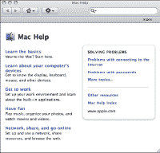

### 访问 Mac 帮助

当你使用 `Finder` 时，可以使用 `Help Viewer` 显示通用帮助主题列表以帮助入门。这是浏览 `Help Viewer` 内可用所有帮助主题的绝佳起点。它还让你看到 Mac OS X 10.6 Snow Leopard 中的新内容，并理解各个点的选项。要访问 `Help Viewer` 中的 Mac 帮助部分，请遵循以下步骤：

1. 切换到 `Finder`。点击任何 `Finder` 窗口、点击 `Dock` 中的 `Finder` 图标，或点击桌面。这将调出菜单栏中的 `Finder` 选项。
2. 选择 `Help⇒Mac Help` 或按下 `Shift+Ô+/`。`Finder` 中的 `Help` 菜单包含一个搜索框和一个唯一的 `Mac Help` 选项（如图 5.2 所示）。点击此选项以打开包含 Mac 帮助部分的 `Help Viewer`。

图 5.2


帮助菜单提供了一个搜索框和一个访问`Help Viewer`的选项。帮助菜单内部的描述告诉你在`Help Viewer`中将显示的内容；在这种情况下，是 Mac 帮助。


**提示**

记忆快捷键`Shift+Ô+/`比`Shift+/`更容易，因为`Shift+/`就是`?`字符。

### 浏览 Mac 帮助

默认 Mac 帮助器中的可用选项如下：

- `基础知识`：此链接带你了解关于入门 Mac OS X 的信息。
- `了解你的设备`：此链接带你了解有关构成计算机的硬件的信息。你将了解到关于显示器、键盘、鼠标和其他设备的信息。
- `开始工作`：此链接向你展示如何设置 Mac OS X 的部分默认应用程序，包括 Mail、通讯、Calendar 和 TextEdit。
- `娱乐`：此链接带你了解关于音乐、照片、电影和视频的信息。
- `网络、共享与在线`：此链接带你了解有关设置网络、共享和网页浏览的信息。

Mac 帮助查看器窗口还包含一个解决问题部分，它提供了针对常见问题的建议。这些包括连接互联网、恢复忘记的密码以及指向更多帮助主题的链接。它还提供了指向其他资源的链接（包括 Apple 支持网站和 Apple 社区网站）。最后一个链接带你进入 Mac 帮助部分所有可用项目的完整索引。Mac 帮助是在桌面上找到大量信息的很好的方法。

### 查看活动应用程序帮助

正如我们之前提到的，Mac OS X 中运行的许多应用程序都提供自己的帮助。你通常以访问 Mac 帮助的方式访问，但它提供了与特定应用程序相关的信息。例如，当通讯录是活动应用程序时，选择`Help⇒Address Book Help`或按下`Shift+Ô+/`将打开`Help Viewer`并显示与通讯录相关的系列主题（如图 5.3 所示）。

图 5.3

帮助查看器显示与特定应用程序相关的帮助主题列表；在这种情况下，是通讯录。

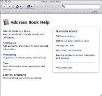

帮助查看器（`Help Viewer`）的工作原理与浏览器非常相似，你通过链接系统进行导航。（这些链接是特定的文本区域，点击它们即可导航到另一个文本区域。）你可以通过颜色识别帮助查看器中的链接，颜色为蓝色（与普通字体的黑色文本不同）。将鼠标光标悬停在链接上，会出现下划线，表示该链接可以点击。用鼠标点击它将离开当前窗口并跳转到与链接相关的文章。点击`学习基础知识`链接（如图 5.1 所示）将带你进入一个名为`学习关于 Mac 的基础知识`的主题列表（如图 5.4 所示）。这又提供了另一组链接列表，你可以通过这些链接查找有关组成你的 Mac 的所有类型设备（键盘、显示器、打印机等）的更具体信息。

图 5.4

Mac 帮助内部的链接用于在不同的帮助文章之间移动。

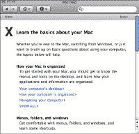

## 使用帮助查看器工具栏导航

与大多数应用程序一样，帮助查看器包含它自己的工具栏（如图 5.5 所示）。然而，将其认为一个独立的应用程序是错误的，因为它在屏幕顶部没有它自己的菜单；相反，它显示的是活动应用程序的菜单。

图 5.5

帮助查看器菜单栏有一系列导航按钮和一个搜索框。


### 导航按钮

你可以使用`Back`（后退）和`Forward`（前进）图标按钮（分别是向左和向右的三角形图标）浏览你之前访问过的窗口。点击`Back`图标按钮将带你回到之前过的页面；点击`Forward`图标按钮将进入你的历史记录。由于通过链接文件进行导航是 Mac 帮助查看器的核心，因此导航图标按钮非常有帮助。

### 主页按钮/弹出菜单

帮助查看器工具栏上的下一个图标控件是`Home`（首页）图标按钮/弹出菜单，显示为一个小房子。点击`Home`图标按钮/弹出菜单会像按钮一样工作，带你回到 Mac 帮助查看器的主内容。如果你点击并按住`Home`图标按钮/弹出菜单，将显示 Mac OS X 可用的帮助选项菜单。通常，它包含所有标准 Mac OS X 应用程序（通讯录、AirPort 实用等）的帮助主题。它还包含指向其他常用 Apple 硬件（如 iPod、iPhone 和 Apple TV）帮助的快速链接。最后，随着你安装应用程序，列表会增长，这些应用程序的帮助链接也会包含在此弹出菜单中。

### 操作按钮

菜单栏中的下一个项目是`Action`（操作）图标弹出菜单（齿轮图标）。它的选项是字体大小的命令（`减小字体`和`增大字体`）、`Find`（查找）命令（快捷键为`Command+F`）以及`Print`（打印）命令。

**注意**

由于帮助查看器用于支持其他应用程序，许多快捷键——例如打印的`Command+P`——在帮助查看器内部不起作用。相反，按下`Command+P`会指示活动应用程序打印。因此，要从帮助查看器打印文章，必须使用其`Action`图标弹出菜单中的`Print`命令。

选择`Find`选项会在菜单栏下方弹出一个搜索框。在此框中输入术语将开始在当前帮助页中搜索。帮助查看器中任何匹配你在文本字段中输入的术语的项都会被高亮（见图 5.6）。它旁边有两个较小的导航箭头——仅适用于搜索的`Forward`和`Back`图标按钮——用于移动到术语的下一个和上一个出现处。点击小的`Close`图标按钮（`X`图标）移除搜索框。

图 5.6

你可以使用`Find`命令（位于`Action`图标弹出菜单中）在当前显示的页面内搜索特定的文本术语。

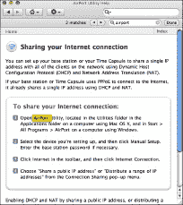

## 查看索引

大多数帮助类别在其主页上都有`Index`（索引）链接。该索引包含与该特定类别相关的所有页面的字母列表（见图 5.7）。你可以在许多与特定主题相关的页面上找到索引链接。它出现在窗口右侧、菜单栏正下灰色水平条中。窗口左侧通常会出现一个`Home`（主页）链接；它带你回到该主题的主页。点击索引将列出主题的字母列表。

## 搜索帮助

通常情况下，你并不是通过从菜单主题的主页或索引来查找帮助，而是通过搜索特定主题的帮助。在 Mac OS X 中搜索帮助有两种方法：

- 从菜单。如果你从菜单中选择`Help`（帮助），你会发现第一个项目是一个名为`Search`（搜索）的蓝色框，带有一个文本字段。
- 从帮助查看器。帮助查看器窗口右上角会出现文本字段。你在这里输入搜索术语来查找特定主题的帮助。

图 5.7

索引包含了与特定帮助相关的所有页面列表。

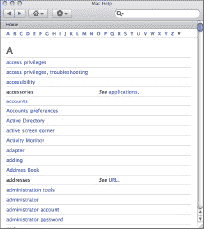

### 从菜单获取帮助

要通过菜单搜索帮助项目，从菜单中选择`Help`并在搜索框中输入。与 Spotlight（见第 3 章）一样，一旦开始输入结果就会出现。菜单中的结果分为两类：

- 菜单项。列出匹配术语的菜单。突出菜单中的项将在帮助查看器中打开（图 5.8）。
- 帮助主题。这是帮助查看器中与术语相关的所有页面列表。从菜单中选择项目以打开信息。

**提示**

学习帮助菜单的一个小技巧是结合`Shift+F`与方向键来搜索菜单项。例如，按下`Shift+F`选择菜单中的`Help`选项，并输入菜单项名称。现在你可以使用方向键遍历菜单并按`Return`选择所需的选项。

图 5.8

当你在菜单中输入术语时，你会发现它显示了菜单项以及可以在帮助查看器中查看的帮助主题。

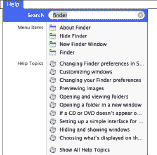

图 5.9

在帮助搜索框中搜索菜单项。

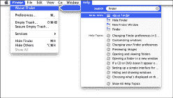

### 在帮助查看器中搜索

另一种搜索信息的方法是打开帮助查看器，通常是在 Finder 菜单中选择帮助和默认帮助菜单选项（例如`Mac Help`）。帮助查看器的上方有一个文本字段（见图 5.10）。输入搜索术语并按`Return`以访问与术语相关的帮助主题列表。每个术语都有帮助页的标题以及该帮助主题将帮助你实现的简要描述。如果描述被截断（以省略号 […] 结尾），将鼠标悬停在描述上将会在黄色框中显示更详细的描述。

图 5.10

你可以通过在窗口右上角的搜索框中输入术语在帮助查看器中搜索帮助主题。

有时，帮助查看器（`Help Viewer`）会访问互联网以检索帮助文章。应用程序在你的 Mac 上仅存储最常用的帮助主题，但提供一个链接到互联网以获取更多细节的索引。如果你点击位于互联网上的帮助文章，帮助查看器会将该信息缓存在 Mac OS X 内部以供以后使用。如果你想在以后阅读同一篇文章，帮助查看器会自动从缓存中显示该文档。然而，帮助查看器还会检查互联网查看文章是否已更新；如果有新版本，则显示新版本。

帮助查看器会在互联网文章可用时将其添加到 Mac 的帮助主题中，因此你的帮助系统会不断扩展和更新。当然，只有当电脑连接到互联网时，帮助查看器才能访问在线文章。

## 使用帮助查看器的快速点击

快速点击是帮助查看器内的链接，可以带你去到帮助查看器内部以及 Mac OS X 的任何地方。你应该清楚链接将带你去向哪里，但某些选项包括：

- 帮助查看器内部另一篇文章的链接。
- 指向应用程序部分的`Open`（打开）链接。这通常位于帮助查看器文章所描述的应用程序部分。
- `More`（更多）链接。这会弹出一个更大的链接列表。
- `Support Articles`（支持文章）链接。这会打开默认浏览器并将你带到 Apple 服务与支持页面。
- `Go to Website`（转到网站）链接。这会打开默认浏览器并将你带到与相关帮助文章相关的网站。请注意，帮助查看器经常显示不可点击的 Web URL 地址（例如，`[www.apple.com](http://www.apple.com)`）。如果帮助查看器中列出了 Web URL 但它不是蓝色字体，点击它将不会打开 Web 浏览器并访问该地址。

### 创建复杂的搜索术语

正如我们之前提到的，在帮助查看器中输入搜索术语是访问特定材料的极佳方法，无需遍历各种链接来寻找你需要的文章。你可以在帮助查看器右上角的字段中输入基础搜索术语。然而，你可能会发现，搜索时使用特殊字符会更有成效；这些字符允许你创建更复杂的搜索术语，从而更有可能找到你正在寻找的精确文章。表 5.1 描述了这些特殊字符。

| 字符 | 含义 | 搜索示例 | 搜索结果 |
| :--- | :--- | :--- | :--- |
| `+` | 与（And） | `desktop + Finder` | 此示例找到同时包含“desktop”和“Finder”的文章。 |
| `\|` | 或（Or） | `desktop \| Finder` | 此示例找到包含“desktop”或“Finder”的文章。 |
| `!` | 不（Not） | `desktop ! Finder` | 此示例找到包含“desktop”但排除“Finder”的文章。 |
| `()` | 分组（Grouping） | `picture + (Finder \| desktop)` | 此示例找到包含“picture”以及“Finder”或“Desktop”的文章。 |

## 理解帮助标签（Help Tags）

帮助标签是帮助的一种形式，可以为 Mac OS X 环境中发现的项目提供扩展信息。许多应用程序允许你通过帮助标签包含的扩展信息，获取有关 GUI 项目（例如按钮和图标）的直接信息。如果 Mac OS X 环境中的某个对象具有帮助标签描述，当你将鼠标悬停在上面几秒钟时，会出现一个黄色框。框内是该项目执行的操作的描述（见图 5.11）。如果没有出现此类框，则该对象没有关联的帮助标签。

**注意**

某些应用程序将这些帮助标签称为工具提示（Tool Tips）。

图 5.11

帮助标签在 Mac OS X 全范围内启用，并提供有关 GUI 中使用项目的快速信息。

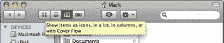

并不是所有对象都有帮助标签。常见的菜单项——如滚动箭头和菜单——没有帮助标签，因为它们被认为是自言自懂的。而且并不是所有的应用程序都提供与 Apple 创建的相同级别的帮助标签功能。帮助标签主要用于自定义按钮和图标，用于描述图标使用的图像代表什么。

**注意**

熟悉 Apple 在 Mac OS 9 及早期版本中提供的气泡帮助（Balloon Help）的用户可能会对帮助标签与气泡帮助功能进行密切比较。气泡帮助是 Mac OS 9 及早期版本中的可选功能，而帮助标签是 Mac OS X 的永久功能。尽管具有永久性，帮助标签并不像气泡帮助那样具有侵入性。

## 使用命令行帮助

Mac OS X 提供的大多数帮助显示在 GUI 中。然而，Mac OS X 拥有一个可以通过`Terminal`访问的综合命令行界面。Mac OS X 的命令行界面有一个集成帮助系统，被称为`man`页面（`man`是 manual 的缩写）。`man`页面提供了一份在线用户手册，包含了`Terminal`中使用的几乎每个命令的信息（见图 5.12）。第 26 章详细涵盖了`Terminal`，并提供了关于`man`命令的更详细信息。

图 5.12

在`Terminal`中使用的`man`命令提供了与各种命令行函数相关的用户手册条目。


## 探索其他帮助途径

许多应用程序向 Mac OS X 帮助系统添加了帮助项目，并提供了参考材料（包括屏幕内容和纸质材料）。此外，你会发现许多应用程序包含了 PDF 格式的文档，通常随程序提供。或者，程序可能包含指向制造商网站的链接，该网站会有关于其程序的信息。通常情况下，如果你打开公司的网站并搜索 Support（支持），你会找到与上述一切相关的信息。互联网是发现额外帮助以及关于 Mac 各方面文章的极资源。请收藏以下网站：

- AppleCare 服务与支持：[`www.apple.com/support`](http://www.apple.com/support)
- AppleCare 知识库：[`kbaseinfo.com`](http://kbaseinfo.com)
- Apple 手册：[`www.apple.com/manuals`](http://www.apple.com/manuals)
- Apple Mac OS X 支持：[`www.apple.com/snowleopard`](http://www.apple.com/snowleopard)
- MacFixIt：[`www.macfixit.com`](http://www.macfixit.com)

图 5.13

典型的公司在线产品支持页面提供了有关产品的额外信息。


## 总结

在本章中，你学习了如何通过 Finder 和大多数应用程序中的帮助菜单，或通过快捷键`Shift+Ô+/`访问 Mac OS X 包含的帮助文章。

在帮助查看器中，你可以搜索与 Mac OS X 或活动应用程序相关的帮助文章，并使用特殊搜索字符缩小选择范围。帮助浏览器还允许你通过类 Web 浏览器的界面遍历帮助查看器，而`Terminal`中的`man`命令允许你访问 Mac Unix 环境中的帮助文章。

## 设置语音识别

## 设置 VoiceOver 实用工具

Mac OS X 从设计之初就旨在为所有人提供有效的服务，包括有特殊需求的人士。听力、视觉受限或无法有效控制键盘或鼠标的人士会发现 Mac OS X 是一个极其高效的操作系统。苹果一直方便各种能力的人访问其系统。

这些功能大多位于 Mac OS X 的“通用辅助”（Universal Access）系统偏好设置中，但 Mac OS X 的声音输入和语音功能（分别位于“声音”和“语音”系统偏好设置中）也极其有用。

视障人士的一项关键支持应用程序——`VoiceOver`实用工具让 Mac OS X 能够读出屏幕上显示的信息。在许多方面，`VoiceOver`实用工具是通用辅助的扩展。该应用程序可以配置为在程序朗读屏幕上的文本时提供用户最易理解的语音。一个很棒的功能是，`VoiceOver`实用工具可以朗读聊天组合，例如笑脸符号`:-)`或`lol`（代表“大声笑出来”）等。你可以自定义`VoiceOver`实用工具，让它为你的个性化文本聊天读出相应的指令。

在本章中，我们将深入研究通用辅助系统偏好设置以及 Mac OS X 中的语音和声音控制；我们还将查看你如何设置`VoiceOver`实用工具来个性化你的体验。

你会发现，无论人们拥有什么能力，Mac OS X 都是一个适合所有人的优秀操作系统。

# 使用通用辅助设置 Mac OS X

如果你对 Mac OS X 有特殊要求，应该从研究通用辅助系统偏好设置开始。打开“系统设置”应用程序（选择`⇒系统设置`）并点击“通用辅助”图标。

通用辅助系统偏好有四个标签页：视觉、听力、键盘以及鼠标与触控板（见图 6.1）。每个标签页都能让你针对各种不同的访问需求设置一组不同的辅助选项。选项如下：

- `视觉`：在此部分中，你可以开启`VoiceOver`技术，并设置自定义的缩放和显示对比度级别。
- `听力`：在此部分中，你可以调整音量并设置屏幕闪烁提醒，以补充通常的音频提醒。
- `键盘`：在此部分中，你可以使用键盘选项激活粘滞键，这允许你逐个字母输入按键组合（例如`Option+O`）；还有辅助键重复选项。
- `鼠标与触控板`：在此部分中，这些选项允许你激活鼠标键。这允许你用键盘代替鼠标。还有控制光标速度、延迟和大小的选项。

图 6.1

通用辅助系统偏好设置允许你选择多种辅助选项。


## 为辅助设备设置访问


注意，通用辅助系统偏好设置中每个面板的底部都有“启用辅助设备的访问”选项。选择该选项可以让第三方设备利用通用辅助的功能。为了运行 GUI AppleScripts，必须勾选此选项。（这些脚本是能够与 Mac OS X 图形界面交互的脚本。）许多旨在帮助他人的应用程序都要求勾选此选项。

如果认为“启用辅助设备的访问”选项仅与改进残障人士访问体验的应用程序有关，那是一个错误。许多普通应用程序都巧妙地利用 GUI AppleScripts 来为所有用户控制屏幕部分。

# 开启视觉辅助

通用辅助偏好设置中的第一个面板是“视觉”，这里所有的选项都与改进 Mac 的视觉性能有关，或者用音频等效物替代视觉信息。可用的技术旨在让视觉能力有限的人能够充分发挥 Mac OS X 的潜力。

## 使用 VoiceOver 听你的 Mac

通用辅助偏好设置中“视觉”面板的第一部分是 VoiceOver。你可以通过两种方式开启 VoiceOver：

- 在视觉面板的 VoiceOver 部分选择“开启”选项。选择“开启”以启用 VoiceOver；选择“关闭”以禁用。
- 按下`Command+F5`。使用此键盘快捷键切换 VoiceOver 的开启。注意，在大多数键盘上，你还需要按住`Fn`键，即按下`Command+Fn+F5`。（如果你在“键盘与快捷键”系统偏好设置的“键盘”面板中选择了“将所有 F1、F2 等键用作标准键”，则不需要额外按住`Fn`。）

你一开启 VoiceOver，就会出现一个带有欢迎消息的对话框（见图 6.2）。VoiceOver 会立即开始播放欢迎消息。该对话框还会询问你是否学习如何使用 VoiceOver。要查看 VoiceOver 教程，请按`空格键`或点击“快速启动教程”。如果你已经熟悉 VoiceOver 技术，可以按`V`或点击“退出”来立即使用系统。

## 自动开启 VoiceOver

敏锐的读者可能注意到开启 VoiceOver 的标准方法存在一个缺陷。它要求你通过视觉导航 Mac OS X 来激活，这对于一个旨在用语音替代视觉信息的系统来说，确实是一个缺陷。

图 6.2

在系统偏好设置中开启 VoiceOver 会显示此对话框。Mac OS X 会读出文本，你可以访问快速启动教程，该教程将带你了解 VoiceOver 的许多方面。


然而，现在有一种技术可以使依赖音频信息的 Mac OS X 用户从开始就能与 Mac 交互。在欢迎视频期间（见第 1 章），如果你等待了 30 秒没有进行操作，会弹出一个对话框告知用户可以通过 F5 键开启 VoiceOver。

## VoiceOver 快速启动

如果你点击 VoiceOver 欢迎消息中的“快速启动教程”按钮，一个简短的教程将向你展示如何通过 VoiceOver 与 Mac 交互（见图 6.3）。你可以使用方向键导航教程（按`→`到教程的下一页；按`←`返回上一页）。你也可以通过点击“继续”和“返回”来导航快速启动教程。

VoiceOver 会朗读快速启动教程每一页显示的信息。你可以在任何时候按`Esc`或点击“退出”离开教程。

## 理解 VoiceOver 键

VoiceOver 键（也称为 VO 键）用于输入 VoiceOver 命令。默认情况下，VO 键是`Control+Option`。通常情况下，你通过按住这两个键并按下另一个键来发布 VoiceOver 命令——就像任何其他快捷键一样。

有大量的 VO 键可用，它们的功能从从读取当前选项目到与 Mac OS X 界面元素交互。你还可以使用它们在屏幕上导航。

### 通用 VoiceOver 键盘命令

VoiceOver 是一个极其复杂的程序，拥有大量的键盘命令。许多命令在快速启动教程中介绍，你可以在“帮助查看”中找到更多。要找到这些命令列表，打开“VoiceOver 实用工具”（在本章稍后介绍）并选择“帮助⇒VoiceOver 命令”。这些命令分为六部分：通用、方向、导航、文本、交互和搜索。

图 6.3

VoiceOver 快速启动教程带你完成在 Mac OS X 上设置和使用 VoiceOver 的过程。


# 使用键盘帮助

按下`Control+Option+K`可调出键盘帮助功能。在键盘帮助模式下，每当你按下一个键时，你都会听到该按键的名字。无法看清键盘以寻找方向的人可以使用此功能来学习键盘。当你按下`VoiceOver`组合键（`Control+Option`）并按下某个键时，该功能会读出相应的命令以及该命令功能的简要描述。

**提示**

大多数键盘（包括所有 Apple 键盘）的一个标准特性是`F`和`J`键上有一个细微的凸起横线。这些设计是为盲打字者设计的，使使用户无需看键盘即可快速定位在键盘上的位置。`F`和`J`键也是视障人士的极佳导航工具。这两个键位于放置食指的位置，其他手指位于相邻按键上。（左手放置的按键是`A`、`S`、`D`和`F`；右手放置的按键是`J`、`K`、`L`和分号键`[;]`。）从这个位置开始，你的手指可以上下移动到达键盘上的任何按键，然后自然回到原位。因此，你无需查看即可导航整个键盘。

## 听取屏幕内容

`VoiceOver`通过大声读出屏幕上通常显示的内容来工作。被读出的屏幕部分会被一个小黑色矩形包围。图 6.4 显示了带有`VoiceOver`矩形的屏幕。`VoiceOver`还会读出当前活动的应用程序、应用程序部分（或`Finder`部分）以及当前轮廓显示的项目。

例如，点击桌面上的主硬盘会导致`VoiceOver`读出以下内容：“Finder，桌面，Macintosh HD，当前选定的卷映像。”

`VoiceOver`还提供其他信息。例如，它会在屏幕保护程序启动时通知你。它还会指导你有哪些导航选项。当你处于带有多个选项的对话框、窗口或面板中时，它会提示你向下点按以选择选项。当你穿过这些选项时，`VoiceOver`会将它们读给听听。

图 6.4

`VoiceOver`用黑色矩形突出屏幕上的某个项目，并大声读出该项目的描述。你可以通过使用`VoiceOver`命令与菜单选项进行交互。


## 使用 VoiceOver 导航

要移动`VoiceOver`光标（包围项目的黑色矩形），请按下`Control+Option`和方向键。`VoiceOver`光标会向该方向移动到水平或垂直线上的下一个项目。当光标包围每个项目时，你会听到每个项目的描述。你通过按下`Control+Option+spacebar`来选择项目，这等同于按下鼠标键。

**新功能**

在`Mac OS X 10.6 雪豹`中，你可以使用新款笔记本电脑的`多点触触控板`来导航 Mac，`VoiceOver`会通过语音提示引导你。当这样使用`多点触触控板`时，触控板的表面代表活动窗口（如桌面、`Finder`窗口或应用程序窗口），因此你的手指操作就像在该窗口内移动鼠标一样。

**注意**

你可以像常一样通过方向键在列表中的项目之间移动，但在按下方向键时按住`VoiceOver`组合键（`Control+Option`）可以带你进入下一节。

### 使用 Dock

要进入`Dock`，请按下`Control+Option+D`。默认情况下，`VoiceOver`光标置在`Dock`中的`Finder`项目周围。要移动到`Dock`中的下一个项目，按下`Control+Option+→`；要回到上一个项目，按下`Control+Option+←`。通过按下`Control+Option+spacebar`选择`Dock`中的项目。

### 使用菜单栏

另一个帮助你上手的快速命令是`Control+Option+M`。这会带你进入菜单栏，你可以使用方向键遍历菜单项，并按下`Control+Ô+spacebar`（或按下`Return`键）来选择菜单项。

### 选择按钮、复选框和滑块

要点击按钮，你通常按下`Control+Option+spacebar`（尽管你也可以按下`Return`键，就像关闭`VoiceOver`时那样）。这适用于选择按钮、复选框和单选按钮。

要打开弹出菜单，你用`VoiceOver`导航到那里并按下`Control+Option+spacebar`，然后使用方向键（`↑`和`↓`）遍历选项；按下`Control+Option+spacebar`选择合适的选项。

要移动滑块，先用`VoiceOver`光标高亮它，然后按下`Control+Option+Shift+↓`开始与其交互。然后你使用方向键（垂直滑块使用`↑`和`↓`；水平滑块使用`←`和`→`）移动滑块。当你移动滑块时，你会听到关于数值的音频反馈（例如与滑块相关的百分比或数字）。

### 在文本字段中输入文本

当你将`VoiceOver`光标移动到文本字段时，字段内当前的任何文本都会被读出。当你向字段中输入字母时，`VoiceOver`会在你输入时读出每个字母。例外是你正在向安全字段（如密码输入框）输入文本时。

## 调整缩放选项

你可以通过多种方式个性化缩放设置。点击`Options`（选项）打开一系列设置（见图 6.5）。

图 6.5

`Zoom`（缩放）选项用于自定义缩放，并可以完全改变工作方式。


### 最大缩放和最小缩放滑块

默认情况下，`Maximum Zoom`（最大缩放）和`Minimum Zoom`（最小缩放）滑块均设置为`0`，每次以一个增量步长放大。然而，每个滑块都可以向上移动至最高`20×`。这些滑块的作用是设置一个放大（最大）或缩小（最小）自动移动到的目标点。因此，如果你将最大滑块设置为`20×`，最小设置为`10×`倍率，点击`Control+Ô+=`放大将直接带你进入`20×`放大倍率；而随后缩小则会带你进入`10×`放大倍率。

### 缩小时显示预览矩形选项

选择`Show Preview Rectangle When Zoomed Out`（缩小时显示预览矩形）选项会在指针周围放置一个矩形框。该正方形显示了当你按下`Control+Ô+=`时将放大的屏幕区域（见图 6.6）。注意，默认情况下缩放区域设置为`0×`倍率，因此不会出现方框。只有当你调整了最大缩放设置时，预览矩形才会显示在屏幕上。

**提示**

缩放不仅适用于需要视觉辅助的人。对于任何想要关注显示器特定区域的人来说，它都是一个非常实用的工具。缩放工具经常被想要演示 Mac OS X 中项特征或功能（如应用程序）的人使用。通过放大屏幕的特定部分，你可以近距离关注该功能，而没有任何其他 GUI 元素的干扰。

### 平滑图像选项

屏幕上的图像由像素组成，像素是微小的正方形。默认情况下，这些像素非常小，以至于构成 Mac OS X 界面的项目看起来平滑且圆润。然而，当你放大时，你会很快看到构成大多数界面项目的锯齿边缘。当选中`Smooth Images`（平滑图像）选项（默认选项）时，有助于在高放大倍率下保持屏幕上的项目更平滑。代价是，放大时项目可能会显得略微模糊。

图 6.6

预览矩形精确显示了放大时 GUI 的哪个部分将填充整个屏幕。


### 缩放跟随键盘焦点选项

当你放大时，缩放级别会自动跟随指针。如果你放大一个文本区域（例如，大型文本框或文字处理文档），你输入的文本可能会超出屏幕边缘。选择`Zoom Follows the Keyboard Focus`（缩放跟随键盘焦点）选项可确保在你打字时缩放跟随光标移动。

### 放大时屏幕图像移动选项

由于放大后的屏幕不再显示整个桌面，你必须在放大的屏幕视图中滚动，以查看界面的不同部分。这种屏幕移动有三种方式：

- **随指针连续移动**：选中此选项后，放大的屏幕会随光标同步移动。当你移动指针时，它独立移动，然后屏幕开始随之移动。这是你可以使用的最自然的缩放模式之一。
- **仅当指针到达边缘时**：选中此选项后，屏幕会围绕光标周围放大，你可以在屏幕的放大部分移动移动指针，而完全不改变视图。如果你将指针移动到屏幕边缘，放大区域将向该方向移动。
- **使指针位于图像中心或靠近中心**：选中此选项后，屏幕以光标为中心进行放大。当你移动指针时，它会保持在屏幕中心，放大的背景环绕它移动。例外是你移动到界面的边缘时，此时是光标移动而不是背景移动。

### 使用修饰键配合滚轮缩放选项

屏幕底部的`Use Scroll Wheel with Modifier Keys to Zoom`（使用修饰键配合滚轮缩放）选项允许你通过使用鼠标上的滚球或滚轮（或在 Mac 笔记本电脑的多触控触控板上使用两个手指指）来放大和缩小。如果你想通过滚球或滚轮放大和缩小，请选择此选项。（注意，默认是选中的。）

该选项旁边有一个文本字段，允许你确定在移动滚球或滚轮（或多触控触控板手势）时需要按下哪个修饰键来实现缩放。默认是`Control`键；但你可以将其更改为任何修饰键组合（`Ô`、`Shift`、`Control`或`Option`）。要更改选项，点击文本字段或按`Tab`直到其高亮；然后按下你想分配的修饰键。

## 调整显示选项

辅助功能系统偏好中`Seeing`（视觉）面板中的后续命令出现在`Display`（显示）部分。它们允许你调整 Mac OS X GUI 的显示方式，并确定更高水平的对比度。调整这些设置可以使某些视障人士更容易阅读内容。可用的选项包括：

- **白底黑字（Black on White）**：这是默认设置，意味着标准显示，即黑为黑，白为白。
- **黑底白字（White on Black）**：这是白底黑字的完全反面，点击此选项将反转所有颜色。
- **使用灰度模式（Use Grayscale）**：选择此选项将移除屏幕上的所有颜色；以单色显示。
- **增强对比度（Enhance Contrast）**：正如名称所示，`Enhance Contrast`滑块使 Mac OS X 的对比度更加明显。颜色之间的柔和过渡被明亮的白色和深色的黑色取代，中间灰色消失了。

重要的是，这些控制并非相互独立；它们可以结合使用产生极佳的效果。例如，你可以创建一个黑底白字的背景，配合灰度设置和高对比度，产生极易读的显示（见图 6.8）。

图 6.7

辅助功能偏好中`Display`区域的`White on Black`设置会反转所有显示的颜色。这使得某些人更容易阅读。


图 6.8

`Display`设置可以组合使用，为 Mac OS X 创建一个完全不同的外观，对于某些人来说这种外观要易读得多。

# 开启听力辅助

辅助功能偏好的第二个窗格是`Hearing`（听力）。点击它查看一些旨在帮助听力有限的人设计的选项。这里的选项少于需要视觉辅助的人的选项。

第一种选项是用屏幕闪烁来代替警报声（见图 6.9）。如果你选择了`在发生警报声时闪烁屏幕`选项，任何声音警报（在`声音`系统偏好设置中指定）都会伴随着屏幕闪烁。屏幕会快速闪烁白色，然后恢复正常，将你的注意力吸引到任何可能的警报上。（你可以点击`闪烁屏幕`来测试闪烁警报。）

第二个选项是`将立体声转为单声道`选项。如果选中，此选项会将左、右扬声器的音频合并为单一信号，发送到所有连接的扬声器和耳机中。这有助于那些单侧耳朵听力不佳、从而错过例如仅从右侧扬声器发出的声音的人。

`听觉`面板中的最后一个设置是`调整音量`按钮，点击它会打开`声音`系统偏好设置。在那里，你可以调整`警报`音量和`输出`音量。（这会影响你的 Mac 输出的所有声音。）

图 6.9

屏幕闪烁警报对听力有限的人非常有用。每当警报发生时，通常的音频噪音都会伴随着屏幕闪烁。（屏幕快速变白，然后恢复正常。）


# 启用键盘辅助

`通用访问`系统偏好设置中的第三个面板是`键盘`。点击它可以发现一系列专为需要协助使用连接到 Mac 的键盘的人而设计的选项。这些选项为那些难以同时按下多个按键的人、难以进行初始按键的人，或难以进行重复按键操作的人提供了帮助。

## 一时按下多个按键

Mac OS X 提供了多种选项，旨在帮助人们克服同时按下多个按键的困难。

`键盘`面板中的第一个选项控制`粘滞键`。如果选择`开启`，此设置将允许你单独按下修饰键（`Shift`、`Control`、`Option`和`⌥`）（一次按一个），并使用它们来创建组合组合。激活`粘滞键`后，你可以先按`⌥`然后按`N`，例如打开一个新的`Finder`窗口，而不是使用按住`⌥`再按`N`的标准方法。

你可以为不同的命令构建修饰键组合；例如，你可以按`⌥`，然后按`Shift`，然后按`N`来创建一个新文件夹。

**提示**

当启用`粘滞键`且你第二次按下修饰键时，你会将其锁定。这意味着你可以反复使用它来执行多个键盘命令。不小心按下的修饰键可以通过第三次按下该键来取消。或者，按下`Escape`键可以取消整个修饰键序列，除非你锁定了按键（在这种情况下，你必须再次按下该按键来解锁）。

`粘滞键`选项下方会出现三个选项：

- `连续按下 Shift 键五次以开启或关闭粘滞键`：如名所示，这允许你通过多次按下`Shift`键来激活或停用`粘滞键`功能。
- `在设置修饰键时发出哔哔声`：默认情况下，Mac OS X 在设置修饰键时会发出细微的点击声，当你第二次按下它进行锁定时，会发出稍微响亮的声音。（取消修饰键时不发出声音。）默认情况下，此声音是激活的。取消勾选此选项将取消音频反馈。


# 在屏幕上显示按下的按键

当你按下修饰键时，屏幕上会显示该按键的小符号（见图 6.10）。单次按下符号会稍微变淡，但在用第二个按键锁定时符号会保持加粗。此选项默认选中。

## 图 6.10

当激活`粘滞键`时，按下修饰键会导致它们的图标出现在桌面上，显示哪个按键当前处于激活状态。


## 误按键

有些人可能会发现误按键导致难以准确输入文本。Mac OS X 的此解决方案是`慢速键`。激活此功能后，按键必须按下并保持一小段时间，Mac OS X 才会识别。如果在规定时间之前释放按键，则该击键将被忽略。

此功能对于发现自己会不小心触碰到错误按键的人来说非常有用。

选择`慢速键`旁边的`开启`选项来启用该功能。现在，当你按下按键时，必须等待听到一个声音（类似于相机快门声），击键才会被识别。延迟小于一秒，但它确实可以防止你快速打字。

在`慢速键`选项下方有三个控制配置：

- `使用点按键声音`。此选项默认选中，当激活`慢速键`时，会有声音提示你按键已被识别。取消勾选此选项将静音相关的噪音。

- `接受延迟`。此滑块决定了在使用`慢速键`时，在按键被识别之前你必须等待多久。将滑块向左移动（标记为`长`）会增加按下按键与输入之间的延迟；将滑块向右移动（标记为`短`）会减少按键按下与输入之间的延迟。

- `设置按键重复`。默认情况下，按住一段时间的键会重复。这是另一个可能给难以快速按下和释放按键的用户带来麻烦的区域。点击`设置按键重复`按钮将带你进入`快捷键`系统偏好中的`键盘`，你可以使用`重复之前的等待时间`滑块来增加延迟（通过将滑块向左移动）。你也可以将滑块完全移至`关闭`位置以取消按键重复功能。在`快捷键`系统偏好设置中，你还可以使用`重复速率`来控制按按键时的频率。

# 启用鼠标辅助

`通用访问`系统偏好设置中最右侧的面板是`鼠标与触摸板`，正如其名，它为难以使用鼠标或触摸板的人提供了多种功能。

## 帮助使用鼠标

难以使用鼠标的用户可以使用键盘来控制鼠标指针。此功能被称为`鼠标键`（见图 6.11）。

要启用鼠标键，请在`鼠标键`部分选择`开启`选项（见图 6.11）。`鼠标键`使用数字键盘来控制鼠标指针。`8` 键向上移动，`4` 键向左移动，`6` 键向右移动，`2` 键向下；中间的 `5` 键表示鼠标点击。注意 `1`、`3`、`7` 和 `9` 键会让鼠标指针对角移动。

笔记本电脑用户或没有独立数字键盘的键盘的用户可以使用 `8`、`K`、`U` 和 `O` 键分别向上、向下、向左和向右，`I` 键作为鼠标点击，`7`、`9`、`J` 和 `L` 键用于对角移动。在某些旧笔记本上，你还可以使用围绕 `K` 的键作为键盘（这些键旁边带有较小的数字）。在这些键盘上，按下 `F6` 激活数字锁定，以便使用这些键作为数字数字键盘。

**注意**

Apple 目前在其流行的 iMac 系列中配备不带数字键盘的键盘，但也可以选择带有数字键盘的大型键盘。如果你可能会使用鼠标键，你可能想为 Mac 获取更大的键盘。

`鼠标键`部分包含以下选项：

- `连续按下 Option 键五次以开启或关闭鼠标键`。此选项允许你无需进入通用访问系统偏好设置即可激活和停用鼠标键。这对于需要将鼠标键与常规键盘输入共享的笔记本用户来说特别有用。

- `初始延迟`。此滑块控制在光标开始移动之前你必须按住相应的鼠标键多久。将滑块向左移动以设置短延迟，向右移动以设置长延迟。

- `最大速度`。当你按住鼠标键时，指针会从初始的慢速加速到相当快速移动。这项技术使你能够执行细微的鼠标移动，也能相当快速地在界面中移动。此滑块允许你设置按住鼠标键时光标移动的速度。将滑块向左移动（`Slow` 设置）以限制指针速度，向右进一步移动（`Fast` 设置）以允许指针在屏幕上快速移动。

- `当鼠标键开启时忽略触控板`。Mac 笔记本电脑用户可能想要启用此设置。选择此项可确保无意触摸触控板不会干扰鼠标的移动。

## 提示

尽管鼠标在计算机世界中无处不在，但不要被误导认为它是与 Mac OS X GUI 交互的唯一物理手段。有很多可以使用鼠标的替代方案。手部活动有限但控制精确的人可能会发现触控板是更合适的替代方案。如果你握握鼠标有困难，轨迹球可能更合适；还有特殊的摇杆可用（顺便说一下，不要与游戏摇杆混淆），可以作为有效的鼠标替代品。Disabled Online（[www.disabledonline.com](http://www.disabledonline.com)）有许多值得查看的替代输入设备。

## 获取查看指针的帮助

“鼠标键”部分的第三个滑块是`Cursor Size`。你可以用它增大鼠标指针的大小，使其更容易查看。默认情况下，滑块设置在最左侧；向右拖动会增大尺寸（见图 6.12）。请注意，此选项会影响文本光标和鼠标指针的大小。

### 图 6.11

激活鼠标键可以让你使用数字键盘上的按钮来代替鼠标。


### 图 6.12

在辅助功能（Universal Access）系统偏好的“鼠标与触控板”窗格中增大指针，可以让鼠标指针（以及文本光标）更容易查看。


# 激活全键盘访问

辅助功能系统偏好“鼠标与键盘”窗格中的最后一个选项与全键盘访问有关。点击`Open Keyboard Preferences`跳转到“键盘与快捷键”系统偏好，其中有键盘访问控制（见图 6.13）。

在“键盘与快捷键”系统偏好“快捷键”窗格底部的“全键盘访问”部分，你有两个选项：

- `仅限文本框和列表`。这是默认选项。当选中此项时，按下 `Tab` 键会在文本字段（文本框）和列表之间移动键盘焦点，但忽略其他选项（例如复选框）。

- `所有控件`。当选中此项时，按下 `Tab` 键会在列表中的所有元素之间移动焦点，包括复选框、单选按钮和推按钮。

### 图 6.13

全键盘访问扩大了 `Tab` 键在列表中之间切换的对象范围。


# 设置语音识别

能够与计算机进行口头交流的想法一直是科幻小说的主角，但最近这个想法已开始从科幻向现实发生重大跨越。

1984 年 Macintosh 发布时，计算机通过向观众大声说话来介绍自己。随着时间的推移，Mac 变得越来越“啰嗦”。

当然，听力比说话要稍微复杂一点。人类语言的广泛性、地区方言、语义变化，当然还有个人的发音差异，对任何语音识别系统都构成了真正的挑战。

但 Apple 随着时间的推移，不断完善语音识别的概念，每个版本的 Mac OS X 都增加了 Mac 理解人们所说话内容的能力。

Mac OS X 内置了一个英语语音识别程序，可以在`Speech`系统偏好中激活。Mac OS X 中的语音识别设计用于识别数百种常用命令。你可以用它来控制界面、切换应用程序，甚至启动 iChat 会话。

## 提示

你无法将 Mac OS X 的语音识别用于通用的转写。如果你想通过口头完全控制你的 Mac，你需要投资一个独立的程序。一个值得查看的程序是 MacSpeech Dictate（$199; [www.macspeech.com](http://www.macspeech.com)）。

## 提示

不仅仅是活动受限的人需要考虑基于语音的输入。语音识别技术对于遭受或担心患 RSI（重复性劳损伤）的人来说特别有用。在键盘上打字或移动鼠标引起的重复细小动作可能会导致 RSI 相关问题。语音识别技术对于预防或适应 RSI 可以是一个巨大的助力。

# 使用麦克风

语音识别需要麦克风。坦率地说，大多数 Mac 用户都是幸运的，因为大多数 Mac 都内置了麦克风。（它随内置的`iSight`摄像头，通常位于屏幕上方。）

MacBook、MacBook Pro、iMac 和 Mac Mini，以及 Apple 制造的一些最新 LED（发光二极管）平板显示器中的内置麦克风都是高质量的，大多数都能用于语音识别。

# 配置语音识别

打开`System Preferences`应用程序（选择`系统设置`）并点击`Speech` 图标进入`Speech` 系统偏好（见图 6.14），然后进入`Speech Recognition` 窗格。要激活语音识别，你需要选择`Speakable Items` 旁边的 `On` 选项。当你这样做时，会出现一个名为 `Speech Feedback` 的圆形窗口，表示语音识别正在运行。你现在可以开启或关闭语音识别，反馈窗口会让你知道 Mac OS X 正在监听。

### 图 6.14

你可以通过`Speech`系统偏好让 Mac OS X 听你的话。（但它并不总是完全按照你的要求执行。）


# 调整语音识别设置

`Speech Recognition` 窗格有两个子窗格：`Settings` 和 `Commands`。`Settings` 子窗格允许你调整与激活语音输入相关的各种选项。如下：

- `麦克风弹出菜单`：有一个弹出菜单，默认列出 `Internal Microphone`。如果你在 Mac 上连接了多个麦克风，可以通过此菜单选择使用哪一个。

- `校准按钮`：在`Microphone`弹出菜单右侧是`Calibrate`按钮；点击它可以打开`Microphone Calibration`对话框（见图 6.15）。

要校准麦克风，你需要自然说话（就像你平时对着 Mac 说话一样）并观察仪表表。当你说话时，仪表会亮起，经过蓝色、绿色区域进入红色区域。说话时，在`Low`和`High`之间移动滑动块，直到仪表表在你说话时保持在绿色区域。你可能会发现，校准仪表表时大声朗读某些内容会更容易。

当你校准好仪表表（使其处于绿色区域）后，开始说出窗口左侧列出的各种项目。当每个命令被识别时，其文本会闪烁。如果 Mac OS X 在识别任何命令时遇到困难，你可能需要再次调整滑动块，直到所有口头命令都能被识别。

## 图 6.15

“麦克风校准”对话框是为语音识别设置麦克风的地方。校准麦克风可以让语音识别更准确地理解你所说的话。


## 更改按键按钮

默认情况下，Mac OS X 上的语音识别通过按住一个按键来开始工作。（默认使用`Esc`键。）点击`Change Key`可以此按键更改为你选择的其他按键。

## 监听方法选项

如果你不想按住按键来激活语音识别，可以选择使用关键词。这种方式的工作原理是：语音识别功能会持续监听你说出一个特定的词。当它听到该词时，会将你之后说的任何话视为命令。默认情况下，关键词是“computer”——大声说“computer”一词即可激活语音识别。因此，要打开 iTunes，你说：“Computer, open iTunes。”

选择`使用关键词持续监听`选项切换到此模式。

在`使用关键词持续监听`选项下方是`关键词是`弹出菜单，包含以下选项：`命令前可选`、`每个命令前均需要`、`上一个命令后 15 秒内需要`以及 `上一个命令后 30 秒内需要`。更改这些设置可以调整关键词相对于命令需要说出的时间。

在`关键词是`弹出菜单下方是一个包含关键词的文本字段。你可以通过在该字段中输入将关键词更改为其他内容。

## 识别后选项

默认情况下，当命令被识别时，Mac OS X 会播放一种名为`Whit`的声音。（听起来像极短的口哨声。）`语音命令确认`选项允许你设置 Mac OS X 大声说出你刚刚说的命令，例如如果你说“Open iTunes”，你的 Mac 会回答“opening iTunes”。这是与电脑交互的一种很酷的方式，尽管最终可能会变得厌烦。

`播放此声音`弹出菜单允许你从一系列音效中选择替换`Whit`。除了`Whit`和`单单击`之外，所有声音与声音系统偏好中的系统警报相同。注意不要选择与你的系统警报相同的音效，因为这会导致混淆。

## 使用语音反馈窗口

当你开启语音识别时，会弹出一个圆形的小窗口。这就是`语音反馈`窗口。在许多方面，这个窗口都是独特的。首先，它没有关联的菜单栏；其次，它没有`最小化`、`关闭`或`缩放`图标按钮；而且它浮于所有其他窗口之上。图 6.16 显示了反馈窗口的几种状态。

### 图 6.16

`语音反馈`窗口指示语音识别何时空闲（左侧），并显示激活它所需的按键；在此情况下为`Esc`。当它等待命令时，麦克风图标会亮起（中间），当它正在听到命令时，两个小箭头指向麦克风图标（右侧）。


## 语音反馈窗口

`语音反馈`窗口提供了关于语音识别的多个视觉提示：

- `注意模式`。反馈窗口的上半部分包含一个老式麦克风图标。该图标指示 Mac 是处于待机状态、积极监听还是正在识别命令。麦克风图标有以下状态：未监听、正在监听和正在听到。

- `未监听`。如果小麦克风图标变灰，说明语音识别当前没有监听命令。

- `正在监听（但未听到）`。如果小麦克风图标变为实黑色，说明它正在积极监听，但当前没有听到命令。

- `听到命令`。如果你看到小箭头向麦克风图标移动，说明语音识别正在听到命令（通常是因为你正在说话）。

- `监听方法`。`语音反馈`窗口的中间部分指示了你如何让电脑从未监听模式切换到监听模式。默认显示`Esc`，表示你必须在说话前按下`Esc`。你可能还会看到激活监听模式时必须说出的单词名称。

- `音量`。`语音反馈`窗口底部有四个颜色的条。这些条测量你声音的音量。在使用过程中，音量与语音识别的成功似乎并没有太大关系（当然，前提是你的声音大足够听到）。一个条表示你说话声音很小；一个蓝色条和一或两个绿色条意味着你说话音量适中；这三条加上一个红色条表示你说话声音很大（可能在喊叫）。Apple 建议说话声音大到让绿色条出现，但不要大到出现红色条。

- `识别`。当语音识别识别出你说的命令时，它会在语音反馈窗口上方显示相应的命令。显示的命令可能并不完全匹配你说的命令，因为语音识别具有灵活性。例如，如果你说“Close window”，反馈窗口会显示“Close Window”。

## 使用语音反馈控制

`语音反馈`窗口底部有一个弹出菜单，由指向下方的小三角形指示（见图 6.17）。点击此菜单会显示两个选项：

- `打开语音窗口`。选择此选项将打开显示所有命令的窗口（见图 6.18）。

- `语音偏好设置`。选择此选项将进入语音偏好设置。

### 图 6.17

点击`语音反馈`窗口底部的三角形菜单将显示这两个选项。


## 最小化语音反馈窗口

如前所述，`语音反馈`窗口有点奇怪，没有`最小化`按钮。然而，你可以通过双击窗口或说命令`Minimize Feedback window`将其最小化到 Dock。图 6.19 显示了一个已最小化到 Dock 的反馈窗口。

在 Dock 中运行时，`语音反馈`窗口继续提供与之前相似的功能。你继续按下`Esc`（或相应的按键或口头命令）来激活语音识别，反馈窗口显示相同的语音识别符号。两个显著区别是：它不再显示识别命令的黄色框，而且由于已最小化，你无法再访问弹出菜单。值得注意的是，由于最小化后尺寸变小，你可能无法清晰地识别不同的反馈状态。

### 图 6.18

`语音命令`窗口显示了可用命令列表。


从程序坞（Dock）打开反馈窗口并将其返回界面主部分非常简单：只需在程序坞中点击它，或者使用`Control+点击`或右键点击它，并在上下文菜单中选择`Open Speech Feedback`（打开语音反馈）。或者，你可以说命令“Open Speech Feedback window”。

### 图 6.19

当在程序坞中最小化时，语音反馈窗口（从右起第二个）会继续提供有关语音识别的信息。


# 调查语音命令窗口

语音命令窗口列出了你最近说过的所有命令及其响应；它还显示了你在当前语境下可以说的命令列表。你可以通过点击语音反馈窗口底部的图标弹出菜单（箭头图标）并选择`Open Speech Commands Window`（打开语音命令窗口）来访问此窗口。恰好，你也可以通过说命令“Open Speech Commands window”来打开该窗口。


语音命令窗口提供的工具使其成为学习如何使用 Mac 语音功能的一个绝佳工具。

你最近说过的命令以**粗体**形式出现在语音命令窗口的顶部，任何响应以纯文本形式显示在下方。窗口的底部显示当前语境下可用的命令。列表按以下类别组织：

*   **当前应用程序 (Current application)**：只有当活动应用程序有自己的可说命令时，此类别才会出现。例如，如果`Mail`是当前活动应用程序，`Commands`菜单中的第一个选项就是`Mail`。
*   **通讯录 (Address Book)**：在此类别中，你可以找到与联系人相关的命令。与`Address Book`一样，这些命令与`Mail`和`iChat`交互。
*   **可说项目 (Speakable Items)**：此类别中的项目无论当前活动的是哪个应用程序都可用。
*   **应用程序切换 (Application Switching)**：此类别中的命令允许你在应用程序之间移动。这里还有用于打开和退出 Mac OS X 使用应用程序的命令。

每个类别都有一个披露三角形，用于隐藏或显示每个类别中包含的各种命令。你可以通过拖动位于两个窗口之间的句柄（识别为中间有一个小灰色滑块[一个拖动句柄]的水平灰色条）来调整语音命令窗口两个部分的大小。正如我们稍后解释的，你还可以向此窗口添加额外的可说命令。

## 指定活动命令

语音命令窗口将命令分组（统称为命令集）。你可以通过前往系统偏好设置中“语音”系统的“语音识别”面板的`Commands`子面板，来选择 Mac OS X 监听哪些命令组（见图 6.20）。

**图 6.20**

可以在系统偏好设置中“语音”系统的“语音识别”面板的`Commands`子面板中识别、激活或停用命令集。


要按组选择命令，请遵循以下步骤：

1. 进入语音系统偏好设置中的`Speech Recognition`面板。
2. 进入`Commands`子面板。
3. 使用`Select a Command Set`（选择命令集）列表中的选项来选择或取消选择命令集。选择选项将激活特定的命令集。请注意，如果你想激活`Front Window`（前台窗口）和`Menu Bar`（菜单栏）命令集，必须在通用访问系统偏好设置中选择`Enable Access for Assistive Devices`（启用辅助设备访问）选项（如本章前面的概述）。
4. 配置全局可说项目。在列表中突出`Global Speakable Items`（全局可说项目）命令集并点击`Configure`（配置）。这将弹出一个带有`Speak Command Names Exactly as Written`（完全按照文字朗读命令名称）选项的对话框（见图 6.21）。如果选中，此选项要求说话者使用命令的准确名称。该选项默认选中，这提高了准确性和系统速度。取消此选项会让 Mac OS X 尝试理解更轻松的语音模式。
5. 点击`OK`继续。

**图 6.21**

当选中该选项时，你必须完全按照书写的内容朗读命令名称。虽然这加快了系统速度，但取消此选项可以让 Mac OS X 识别更多变的语音模式。


## 设置文本转语音选项

文本转语音是对话的另一半，即 Mac 对你说话。计算机语音在近年来取得了飞跃发展，如果你对计算机语音的最后记忆是单调的机器人声音嗡嗡作响，那么你将会有一个惊喜。

你可以通过进入语音偏好面板中的`Text to Speech`面板来研究 Mac OS X 的不同语音选项（见图 6.22）。在这里，你可以指定使用哪种声音、Mac OS X 说话的速度，并定义在什么、何时以及如何说话。你可以确定警报选项，从内置警报列表中进行选择，甚至添加你自己的短语。这里有很大的自定义空间：你可以为警报设置与普通语音不同的声音，并指定时间延迟。甚至还有用于朗读文本以及日期和时间的选项。

**图 6.22**

语音系统偏好设置中的`Text to Speech`面板为调整 Mac OS X 如何与你交流提供了广泛选项。


Mac OS X 10.6 雪豹包含了几种声音。但你应该注意，有些声音比其他的更先进。`Alex`是目前最自然的语音，它是默认语音，且最最清晰。

按照以下步骤更改声音并调整 Mac OS X 说话的速度：

1. 打开`System Preferences`应用程序（选择“系统偏好设置”），点击语音图标，并进入`Text to Speech`面板。
2. 从`System Voice`弹出菜单中选择语音。选择`Show More Voices`（显示更多语音）选项增加语音数量，包括旧的“人类”语音和一些新奇语音。
3. 点击`Play`听听声音像如何。Mac OS X 会从列表中随机选取句子。如果你在句子结束前选择了另一种语音，Mac OS X 将用所需的语音开始另一个句子。点击`Stop`或等待句子结束。
4. 调整语速。通过向右移动`Speaking Rate`滑块来加快语音速度；向左移动则减慢语速。

## 选择文本转语音选项

在`System Voice`弹出菜单下方有几个你可以用来自定义 Mac OS X 如何使用语音的选项。

**图 6.23**

这里是 Mac OS X 的所有声音。`Alex`显然是最自然的，其他大多数声音现在主要具有新奇价值。


### Announce When Alerts Are Displayed 选项

选中`Announce When Alerts Are Displayed`（显示警报时朗读）选项会让 Mac OS X 朗读系统警报。点击`Set Alert Options`弹出额外的对话框（见图 6.24），允许你设置一个独立于系统声音的警报语音。`Delay`滑块允许你在警报出现在屏幕上到 Mac OS X 朗读之间设置 0 到 60 秒的延迟。

**图 6.24**

`Set Alert Options`窗口允许你选择与系统警报相关的特定声音和短语。


`Phrase`弹出菜单允许你选择警报的措辞方式。选项包括：

- **应用名称**。此选项让 Mac OS X 通知你哪个应用程序发送了警报。
- **短语列表中的下一个**。此选项在一组短语中循环。
- **短语列表中的随机项**：此选项会从短语列表中随机选取短语。
- **短语列表**。此选项允许你从短语列表中设置特定的短语。选项有`Alert!`（警报！）、`Attention!`（注意！）、`Excuse Me!`（打扰一下！）和`Pardon Me!`（抱不起！）。
- **编辑短语列表**。此选项会弹出警报短语对话框（见图 6.25）。点击`Add`并输入你想要让 Mac OS X 在警报期间朗出的短语。你可以通过选择并点击`Remove`从列表中移除警报。

**图 6.25**

设置警报短语对话框允许你为 Mac OS X 创建自定义朗读的警报短语。


### 当应用程序需要你关注时通知

选择`Announce When an Application Requires Your Attention`选项，当应用程序需要你的关注时 Mac OS X 会朗读。这与通常的警报同步，即 Dock 栏中的应用程序图标会上下跳动（见第 2 章）。

### 按按键时朗读选定文本

选择`Speak Selected Text When a Key Is Pressed`选项以启用组合键，按下该组合键将会让 Mac OS X 朗读当前高亮的任何文本。点击`Set Key`按钮将出现一个对话框（见图 6.26），要求你输入组合键。按住一个或多个修饰键（`Control`、`Option`、`Shift`和`Ô`），然后按下所需的键以设置命令。例如，你可以选择`Control+Option+S`。现在，当你在 Mac OS X 中高亮一段文本时，按下此组合键会让 Mac OS X 大声读出文本。

**图 6.26**

`Speak Selected Text When a Key Is Pressed`选项允许你设置一个组合键，用于即时朗读 Mac OS X 中高亮的任何文本。


#### 注意

也可以通过某些应用程序支持的 Mac OS X 服务让 Mac OS X 读文本。例如，在`TextEdit`中，你可以对高亮文本进行`Control+点击`或`右键点击`，并从上下文菜单中选择`Speech⇒Start Speaking`让 Mac OS X 读出高亮文本。

### 打开日期与时间偏好按钮

你可以点击`To Have Clock Announce the Time`标签旁的`Open Date & Time Preferences`按钮，让 Mac OS X 朗读日期和时间。点击它将进入日期与时间系统设置。进入`Clock`并选择`Announce the Time`选项。弹出菜单允许你在`On the Hour`（整点）、`On the Half Hour`（每半小时）和`On the Quarter Hour`（每刻）之间进行选择。点击`Customize Voice`选择你希望朗读时间的音频样式。这些选项与之前提到的系统警报选项相同。

### 打开辅助功能偏好按钮

语音系统偏好设置中文本转语音面板的最后一个选项——`Open Universal Access Preferences`按钮——将带你进入通用功能系统设置。在这里，你可以启用`VoiceOver`（如本章前面所述）或——从`Seeing`窗格——点击`Open VoiceOver Utility`按钮以进一步自定义 Mac OS X 的语音设置。在本章的剩余部分中，我们将仔细查看`VoiceOver Utility`。

## 设置 VoiceOver Utility

`VoiceOver Utility`（见图 6.27）在 Mac OS X 中算是一个相当奇特的存在。在许多方面，它是通用功能系统设置（如本章开头所述的）的扩展，但在其他方面，它显然是一个独立的应用程序。

如前所述，`VoiceOver`是一项让 Mac OS X 能够朗读屏幕上任何内容、鼠标指针下方内容或`VoiceOver`光标（一个显示在 GUI 项目上方的正矩形）下方的内容的技术。

`VoiceOver Utility`允许你精调`VoiceOver`的几乎每一个方面，包括它与标点符号交互的程度、它如何导航应用程序和网页、伴随它的视觉效果，甚至包括它如何与盲文显示器交互（如果你的 Mac 连接了此类设备）。

**图 6.27**

VoiceOver Utility 提供了广泛设置，你可以用它们精调`VoiceOver`与 Mac OS X 交互的方式。


#### 调整常规设置

点击左侧列表中的`General`进入`General`窗格。在这里，你可以更改登录时欢迎你的`VoiceOver`消息（见图 6.28）。默认情况下，它会欢迎你使用 Mac OS X 并告知你`VoiceOver`正在运行；它还告诉你可以通过按下`Control+Option+H`获取帮助。你可以将此消息更改为任何内容。

#### 设置 VoiceOver

便携式偏好功能是一种通过外部磁盘携带`VoiceOver`设置的方法。这可能是一个外部硬盘，或者更常见的`USB`（通用串行总线）闪存驱动。要设置便携式偏好，连接外部存储设备并选择`File⇒Set Up Portable Preferences`或按下`Shift+Ô`。在设置表中选择存储设备（见图 6.29）并点击`OK`。

**新功能**

便携式偏好在之前的 Mac OS 版本中被称为`VO-to-Go`。

**图 6.28**

`General`设置允许你在启动`VoiceOver`时进入个性化的欢迎消息。


**图 6.29**

便携式偏好使用外部设备（如`USB`闪存驱动）保存`VoiceOver`设置，以便在连接到其他 Mac 时激活。


#### 允许 AppleScript 控制 VoiceOver

选择`Allow VoiceOver to Be Controlled with AppleScript`选项可以让 AppleScript 控制`VoiceOver`。第 25 章提供了关于如何使用`AppleScript`与 Mac OS X 交互的更多信息。

## 调整详细程度设置

`VoiceOver`本质上非常啰嗦。简单来说，它喜欢多说话。`VoiceOver Utility`允许你精细到粒度级别调整`VoiceOver`的说话程度以及它喜欢说的内容。点击列表中的`Verbosity`选项会出现四个子窗格：`General`、`Text`、`Announcements`和`Hints`。

**新功能**

与之前的 Mac OS 版本相比，`Verbosity`窗对`VoiceOver`设置提供了更大的控制。`General`和`Hints`子窗格是 Mac OS X 10.6 雪豹系统新增的，相应的控件也是如此。

### 常规窗格

`Verbosity`窗的`General`子窗格中是`Default Verbosity`弹出菜单。它默认设置为`High`，也有`Medium`和`Low`设置。点击标记为`Details`的展开三角形可以显示每个设置对应 Mac OS X 各部分的含义。你还可以通过在特定控件的`Verbosity`弹出菜单中选择选项，为不同的 Mac OS 控件设置不同的详细程度；选项有`Low`、`Medium`、`High`和`Custom`。选择`Custom`将弹出一个该控件读出的每个单独项目的设置表（见图 6.30）。

**图 6.30**

你可以精调 Mac OS X 的口才能力。你可以进行全局调整，也可以进行极细的粒度调整。


### 文本窗格

在“详细程度”（Verbosity）面板的“文本”（Text）子面板中有一系列弹出菜单（见图 6.31），允许您在处理文本时调整 VoiceOver 的各个方面。您可以更改文字转语音处理标点、打字、光标位置、文本属性、拼写错误、链接、数字、大写字母、删除文本以及单词分离的方式。每个弹出菜单都有多个选项可供选择。

### 通知（Announcements）子面板

VoiceOver 会宣布 Mac OS X 的各个方面。`详细程度`面板中的`公告`子面板包含一组选项，可以增加公告的次数。这些选项有：

• 鼠标指针进入窗口时公告。
• 按下修饰键时公告。
• 按下大写锁定（Caps Lock）时公告。
• 在表格行间导航时朗读标题。
• 自动朗读对话框中的文本。

该子面板中还有其他几个控件：

• `当 VoiceOver 光标下的状态文本变化时`弹出菜单。选项有`播放音调`(Play Tone）、`朗读文本`(Speak Text）和`不执行操作`(Do Nothing）。
• `当 VoiceOver 光标下的进度指示器变化时`弹出菜单。选项有`播放音调`(Play Tone)、`朗读文本`(Speak Text)和`不执行操作`(Do Nothing)。
• `朗读大小和位置（单位为）`弹出菜单。选项有`英寸`(Inches)、`毫米`(Millimeters)和`像素`(Pixels)。
• `鼠标下方文本朗读延迟`滑块。使用该滑块可以设置 VoiceOver 等待多久朗读鼠标指针下的文本。

### 提示（Hints）面板

VoiceOver 会对 VoiceOver 光标下的项目提供若干提示。`使用 VoiceOver 光标时的项目提示`选项（默认选中）会激活这些提示。`项目具有标签时`弹出菜单允许您从以下选项中选择：`不执行操作`(Do Nothing)、`提示通知`(Speak Notification)和`提示标签`(Speak Tag)。最后一个选项是`朗读提示延迟`滑块，范围从`短`(Short)到`长`(Long)。

### 调整语音（Speech）设置

`VoiceOver 实用工具`对话框中的`语音`面板允许您微调 Mac OS X 使用的语音。点击左侧列表中的`语音`项目以访问设置；有两个子面板：`语音`(Voices)和`发音`(Pronunciation)。

#### 语音（Voices）子面板

`语音`子面板中有几个可用选项：

• `静音语音`(Mute Speech)。此选项允许您禁用语音。
• `默认`(Default)。在这里，您可以设置 Mac OS X 朗读的默认选项。`语音`弹出菜单允许您选择默认语音，同行的字段允许您选择`速率`(rate)、`音调`(pitch)、`音量`(volume)和`语调`(intonation)。点击旁边的三角形获取其他类别的相同选项：`内容`(Content)、`类型`(Type)、`属性`(Attributes)和`VoiceOver 菜单`。

**图 6.31**

`VoiceOver 实用工具`中的`语音`面板允许您微调 Mac OS X 使用的不同语音。


#### 发音（Pronunciation）子面板


`VoiceOver 实用工具`对话框中`语音`面板中的`发音`子面板允许您将特定的文本替换为语音内容（见图 32）。这对于许多构成计算机术语的缩写非常有用（例如，`GUI` 被朗读为“gooey”，表情 `:-)` 被朗读为“smiley”）。

您可以通过点击`替换`列中的文本来更改列表中任何项目的发音。通过点击`+`图标并在相应列中输入详细信息，可以添加新的替换。点击`–`图标可以从列表中移除替换。

### 图 32

VoiceOver 使用替换以不同于视觉外观的方式读取术语和符号。您可以按所需的方式自定义朗读任何文本。


### 调整导航（Navigation）设置

`VoiceOver 实用工具`的`导航`面板允许您调整 VoiceOver 光标在屏幕上的移动方式。可用的控件有：

- `VoiceOver 光标初始位置`弹出菜单。该弹出菜单有两个选项。默认值是`键盘焦点项目`（Keyboard Focused Item），或者您可以选择`窗口中的第一个项目`（First Item in Window）。
- `键盘焦点跟随 VoiceOver 光标`选项。
- `鼠标指针跟随 VoiceOver 光标`选项。
- `VoiceOver 光标跟随鼠标指针`选项。
- `插入点跟随 VoiceOver 光标`选项。
- `VoiceOver 光标跟随插入点`选项。
- `鼠标指针`弹出菜单。该弹出菜单允许您指定鼠标指针与 VoiceOver 光标的交互方式：`忽略 VoiceOver 光标`、`跟随 VoiceOver 光标`或`移动 VoiceOver 光标`。
- `允许光标环绕`选项。如果选中，此选项指定鼠标指针能够移动到屏幕边缘并出现在另一侧。鼠标指针可以水平和垂直地循环环绕。
- `跳过冗余标签`选项。
- `使用 Tab 键时自动交互`选项。

### 调整 Web（Web）设置

您可以使用`Web`面板通过多种方式调整 VoiceOver 与网页（Apple 在`VoiceOver 实用工具`中将其误拼写为“Webpages”）的交互方式：

- `导航网页`选项。您有两个选项：您可以按`DOM 顺序`（DOM Order）（DOM 意味着文档对象模型，网页内部组织的技术标准）导航，它使用网页的布局来确定哪些对象组合在一起；或者您可以使用`分组项目`（Grouping Items），将 VoiceOver 光标从一组信息移动到下一组，例如从段落到段落。
- `加载新网页时`选项。这里有三个选项：`朗读网页摘要`、`将 VoiceOver 光标移动到`和`自动朗读网页`。第三个选项仅在选择了`将 VoiceOver 光标移动到`选项时可用。
- `导航表格时`选项。有两个选项：第一个是对表格内的项目进行分组；第二个是朗读列号和行号。
- `导航图像`弹出菜单。该弹出菜单提供了`从`、`描述`（默认选项）和`始终`的选择。
- `Web 项目包含`弹出菜单。`Web 项目包含`弹出菜单允许您在 Web 选择器中选择多个项目。默认情况下，所有选项都已选中。选项有`标题`、`链接`、`已链接`、`未访问链接`、`自动 Web 区域`、`表单控件`、`Web 区域`、`表格`、`图像`和`帧`。这些选项指示 VoiceOver 在帮助您导航网页时关注哪些类型的 Web 内容。

### 新功能

在加载网页时开始朗读网页是 Mac OS X 10.6 Snow Leopard 的新功能。使用用于其他元素的标准 VoiceOver 命令导航网站上的 HTML 表格也是如此。对 Web 区域以及对 VoiceOver 处理的特定网页属性的控制也是 Mac OS X 10.6 Snow Leopard 的新功能。

- `VoiceOver 光标放大`滑块。此滑块允许您放大 VoiceOver 光标以及其中显示的内容。将滑块向右移动可将其设置为`Large`（大号）设置（见图 6.33），这可以使 VoiceOver 光标对于视力部分的人群非常有用。
- “读取文本”（Reading Text）时的“移动 VoiceOver 光标方式”弹出菜单。此弹出菜单有两个选项：`Sentence`（句子）和`Word`（单词）。默认情况下，VoiceOver 光标按每次读取的每个句子移动，但在这里您可以告诉 VoiceOver 按每个单独单词移动。

### 图 6.33

可以放大 VoiceOver 光标，为当前正在通过口头交流的内容提供更大的视觉视图。


### 字幕面板（Caption Panel）子面板

字幕面板是一个灰色的透明气泡（通常位于屏幕左下角），提供有关 VoiceOver 字幕的信息。图 6.34 显示了字幕面板的示例。此处的几个设置可以控制字幕面板：

- `显示字幕面板（Show Caption Panel）`选项。此选项显示或隐藏字幕面板。默认选中。
- `字幕面板字体大小（Caption Panel Font Size）`滑块。将此滑块向右移动会增大字幕面板中文本的大小。
- `字幕行数（Rows in Caption Panel）`。默认情况下，字幕面板只有一行文本，溢出的文本用省略号（`...`）表示。将此滑块向右移动允许您扩展字幕面板以容纳多达十行文本。
- `字幕面板透明度（Caption Panel Transparency）`滑块。将此滑块向右移动会让字幕面板不透明，从而减少干扰。

### 图 6.34

字幕面板显示与 VoiceOver 光标相关的信息。这些设置允许您增大字幕面板的尺寸或减少其干扰性。


### 盲文面板（Braille Panel）子面板

刷新式盲文显示器可以连接到 Mac，VoiceOver 会自动将屏幕信息发送到该显示器。盲文面板也会在屏幕上显示这些信息（见图 6.35）。此处有几个与盲文面板相关的选项：

- `显示盲文面板（Show Braille Panel）`弹出菜单。这里的选项有`Automatic`（自动）、`On`（开启）和`Off`（关闭）。
- `盲文颜色（Braille Font Color）`弹出菜单。默认为黄色，但此弹出菜单允许您从五种颜色中选择。
- `盲文面板字体大小（Braille Panel Font Size）`滑块。此滑块允许您调整盲文面板字体的大小。将滑块向右移动使其变大，向左移动使其缩小。
- `盲文面板透明度（Braille Panel Transparency）`滑块。将此滑块向右移动会降低盲文面板的不透明度，使其更透明。

### 图 6.35

盲文面板在屏幕上显示发送到盲文显示设备的信息。


### 菜单（Menus）子面板

此子面板中的选项调整 VoiceOver 帮助菜单的显示（运行 VoiceOver 时通过点击 `Control+Option+H` 进入）：

- `VoiceOver 菜单字体大小（VoiceOver Menus Font Size）`滑块。将此滑块向右移动会让 VoiceOver 菜单更大。
- `VoiceOver 菜单透明度（VoiceOver Menus Transparency）`滑块。将此滑块向右移动会增加 VoiceOver 菜单的透明度，使其减少干扰。

## 调整命令器（Commanders）设置

命令器面板允许您将命令映射到数字键盘和键盘。使用它将常用命令（如`前往桌面`、`打开项目选择器`以及打开特定的应用程序）绑定到特定按键。这是一项实用功能，通过将命令分配给单个按键或键组合来简化复杂的命令。

有两个子面板：`NumPad`（数字键盘）和`Keyboard`（键盘）。

### 数字键盘（NumPad）子面板

`NumPad`子面板包含一个映射到数字键盘的命令列表（位于 Apple 扩展键盘右侧的数字键；这些键在 Apple 笔记本电脑和某些 iMac 键盘上不存在）。

您必须选择`启用数字键盘命令（Enable NumPad Commander）`选项来启用映射功能。

子面板中的命令列表显示了当您按下相应的按键时 VoiceOver 执行的命令。VoiceOver 命令不仅适用于普通键盘按键。您可以使用“无修饰键”（No Modifier）弹出菜单选择修饰键选项，查看特定修饰组合的分配：`Command`（`Ô`键）、`Option`、`Control`、`Shift`和`数字键盘零`（数字键盘上的 0 键）。当您选择一个选项时，VoiceOver 命令分配列表将变为使用该特定修饰键的命令。

您还可以用自己的命令替换`NumPad Commander`使用的任何默认命令。列出的每个命令实际上都是弹出菜单（由每个命令右侧的小向下箭头指示）。然后，通过浏览弹出菜单找到所需的替换命令（见图 6.36）。

**注意**

在使用`NumPad Commander`时，无法使用鼠标键（本章节稍早介绍的功能）。

### 图 6.36

您可以将`NumPad Commander`使用的命令调整为可用的多种 VoiceOver 命令之一。


### 键盘（Keyboard）子面板

`Keyboard Commander`的工作方式与`NumPad Commander`非常相似。在子面板顶部选择`启用键盘命令（Enable Keyboard Command）`选项即可启用`Keyboard Commander`（见图 6.37）。

一个区别是键盘命令必须配合修饰键使用。这是因为您在执行常规任务时可能需要修饰键。`Keyboard Commander`仅使用 Mac 上的两个 Option 键之一（通常情况下，Mac OS 不在乎您按下哪个 Option 键；它将其视为相同）。您通过选择选项之一：`左 Option 键（Left Option Key）`和`右 Option 键（Right Option Key）`来选择`Keyboard Commander`使用哪个 Option 键。如果您选择`右 Option 键`，按下右 Option 键将调用 VoiceOver 快捷键，而按下左 Option 键将调用 Mac OS 或应用程序的普通键盘快捷键。

`Keyboard Commander`中的键盘命令比`NumPad Commander`少得多。但您可以使用子面板左下角的`+`按钮添加新的键盘命令。

### 图 6.37

键盘部分允许您将命令映射到键盘上的单个按键上。然后您可以使用左或右 Option 键访问它们。


## 设置盲文

盲文将 VoiceOver 显示的文本转换为触摸可读的形式。Mac OS 有许多可用的盲文设备。如果您将兼容的盲文显示器连接到 Mac，它会被自动检测，您可以在 VoiceOver Utility 的盲文面板中调整其设置。盲文面板有两个子面板：布局（Layout）和显示器（Displays）。

### 布局（Layout）子面板

盲文面板中`Layout`子面板中的可用设置有：

- `盲文显示器（Braille Display）`指示。连接的显示器型号显示在此处。
- `盲文翻译（Braille Translation）`部分。该部分包含某些项目如何转换为盲文的三个选项：
  - `盲文翻译（Braille Translation）`弹出菜单。默认选项为`Apple 美国英语（Apple American English）`。此弹出菜单显示在 Mac OS X 中安装的任何选项。
  - `显示缩写盲文（Show Contracted Braille）`选项。缩写盲文是一组由单个符号表示的约几十个单词，用于快速通信。
  - `使用点 7 和点 8 指示光标（Use Dots 7 and 8 to Indicate Cursor）`选项。
- `状态单元（Status Cells）`部分。该部分有三个控制状态单元如何使用的选项：`显示常规显示状态（Show General Display Status）`、`显示文本样式（Show Text Style）`和`显示扩展文本样式（Show Extended Text Style）`。
- `显示状态位于（Show Status On The）`选项。有两个选项：`左（Left）`和`右（Right）`。

### 显示器（Displays）子面板

连接到你的 Mac 的任何盲文显示器都会列在这里。如果显示器通过 USB 连接，它会自动连接并列出。然而，如果你的盲文显示器通过蓝牙运行，可以使用以下方法进行连接：

1. 确保盲文显示器处于可发现状态。请参阅显示器的说明以了解如何将其设置为可发现模式。
2. 点击`+`图标按钮。
3. 找到设备。弹出的对话框搜索所有可用的蓝牙设备。当盲文显示器出现在列表中时，点击它。
4. 选择`Remember This Device`（记住此设备）选项。如果你希望 Mac OS X 记住该设备以便将来自动重连，请确保选中此选项。
5. 点击`Select`（选择）。

## 新功能

Mac OS X 10.6 雪豹（Snow Leopard）现在允许同时使用多个 USB 盲文阅读器，例如在教室环境中，让多个阅读器显示相同的屏幕内容。此外，雪豹现在还支持蓝牙盲文阅读器（但一次只能有一个处于激活状态）。

## 交叉引用

第 21 章更详细地介绍了蓝牙设备的设置；盲文显示器与其他设备的流程是相同的。

## 总结

辅助功能（Universal Access）让你通过多种方式与 Mac OS X 交互。虽然它主要设计用于帮助视觉、听力或手部障碍的人士，但其中一些交互控制对任何人都有益。

例如，对于视觉障碍的人士，`VoiceOver`技术让用户能够听到屏幕上显示的内容，并控制输出到盲文设备。但它也可以让每个人对警报更加敏感。同样，为听力障碍人士提供的选项为所有人提供了额外的视觉反馈。对键盘和鼠标交互的控制不仅有助于那些使用键盘和鼠标有困难的人，也能帮助打字慢的人。

Apple 的语音技术让 Mac 既能听并执行你的语音命令，还能大声读出报警和用户界面元素。`VoiceOver Utility`（实用工具）让你能够根据准确需求微调`VoiceOver`文本转语音技术。

# 第 7 章：使用应用程序和文档

## 本章内容

- 使用 Mac OS X 应用程序
- 打开应用程序和文档
- 管理多个打开的应用程序
- 创建和移动文档
- 保存文档
- 保存便签纸
- 处理文档内容
- 与其他用户共享文档
- 退出应用程序

现在你已经设置好了 Mac 并熟悉了`Finder`，是时候开始处理应用程序的操作，以及创建、保存和处理文档的日常活动了。

你在 Mac 上工作的大部分时间都是以传统方式进行的：打开应用程序、创建文档、打印和共享它们，并将它们保存以备后用。从这个意义上说，应用程序是工具；文档是你创建和共享的内容。

尽管如此，计算世界正在发生许多快速变化，其中最重要的之一就是所谓的“云计算”。这意味着文档和应用程序存储在在线服务器上，并通过互联网访问。`Google Docs`（`[www.docsgoogle.com]`）和 Apple 的`MobileMe` Web 应用（`[www.me.com]`）是此类服务的典型示例。（关于使用`MobileMe`的更多信息可以参阅第 15 章。）

在本章中，我们将查看 Mac OS X 中提供的不同类型的应用程序。我们将探索如何找到应用程序、打开它们并开始使用它们。Mac OS 包含了大量的应用程序，第 8 章将涵盖了这一点，但当然，计算机的魅力之处在于你可以安装并运行由他人编写的程序。我们将介绍安装应用程序的过程——以及不再需要时将其删除。

Mac OS X 是一个多任务环境，这意味着你可以同时运行多个应用程序（同时在前台和后台）。我们将查看管理多个应用程序以及每个应用程序可能提供的多个窗口的过程。

应用程序和文档是密不可分的，因此在本章中，我们还会解释通过使用`copy`（复制）、`paste`（粘贴）以及`drag and drop`（拖放）等方法编辑文档的基本元素。我们还介绍了创建文档、保存文档以及在使用后退出应用程序的不同方法。

本章涵盖了使用应用程序的通用方法，还包含了适用于大多数（但并非所有）应用程序的特定技术。每个应用程序都是不同的，你安装的应用程序可能有不同的处理方法。第 8 章包含了许多关于与 Mac OS X 自带的每个应用程序操作的信息；你安装的其他应用程序将有自己的文档。

### 备注

应用程序制作和使用者会交替使用几个术语：`software`（软件）、`application`（应用程序及其昵称`app`）、`program`（程序）、`utility`（实用工具）、`tool`（工具）和`solution`（解决方案）。`软件`是在计算机上运行以执行任务的代码的通用术语，无论是以独立应用程序的形式、另一个应用程序的插件，还是操作系统的组件形式。`应用程序`、`app`和`程序`指的是同一事物：你认为的一组相关集合的软件，例如`iTunes`或`Photoshop`。`实用工具`通常指具有一组少量功能的特殊程序，通常设计用于帮助你准备其他任务；例如`Disk Utility`（磁盘工具）和`QuickTime Player`。`工具`更多是一个描述软件的营销术语，尽管人们有时用它来指人们用来产生结果的软件（例如制作电影或建立书籍索引）。`解决方案`纯是软件、硬件以及两者结合的营销术语。请注意，这些术语都不是精确的，所以不用担心尝试区分它们。

## 使用 Mac OS X 应用程序


正如我们在第 1 章中所说的，Mac OS X 10.6 雪豹有多种应用程序环境，包括`Cocoa`、`Carbon`、`Java`和`BSD`（伯利软件发行版）Unix。这种多样性代表了 Macintosh 的历史，并在`BSD`的情况下代表了 Mac OS X 的根源。

在所有这些环境中，`Cocoa`是绝大多数用户体验到的环境，而`Carbon`则日益成为一个遥远的其次。Apple 决定主推一种环境，而`Cocoa`就是它。在本章中，我们主要查看这两种应用程序环境：

* **Cocoa 应用程序**：这些是专为 Mac OS X 设计的程序。Mac OS X 10.6 雪豹整合了`Cocoa`和`Finder`，后者已完全用`Cocoa`重写。`Cocoa`应用程序充分访问 Mac 的 64 位功能以及最新的雪豹`API`。
* **Carbon 应用程序**：通常，这些是为 PowerPC 处理器设计的旧程序。`Carbon`应用程序在 Mac OS X 10.6 雪豹上运行良好，但限于 32 位功能。

### 交叉引用

第 1 章提供了关于 64 位和 32 位应用程序差异的信息。

### 备注

很棒的地方在于，对于用户来说，`Cocoa`和`Carbon`几乎无法区分。在与 Mac OS X 图形用户界面 (GUI) 交互方面，大多数用户可能永远不知道存在不同的应用程序环境。

你可能听说过一个名为`Classic Mode`的旧环境。这个 Mac OS X 环境用于运行早期为 Mac OS 9 设计的程序。`Classic`是一个非常强大的工具，让用户能够从 Mac OS 9 迁移到 Mac OS X，并继续使用大量的软件库。随着时间的推移，`Classic`支持变得不再那么重要，Mac OS X 10.5 Leopard 移除对`Classic`的支持。如果你有任何需要`Classic`的遗留应用程序，你有三个选择：检查是否有相应的程序更新；设置一台基于 PowerPC（而非 Intel）的旧款 Mac，运行 Mac OS 9 或 Mac OS X 10.4 或更早版本（并已安装`Classic`）；第三种选择是使用名为`SheepShaver`的开源应用程序（[`gwenole.beauchesne.info/en/projects/sheepshaver`](http://gwenole.beauchesne.info/en/projects/sheepshaver)），它可以在 Intel Mac 上模拟`Classic`环境，使得某些（并非全部）程序能够运行。

## 发现预装应用程序

Mac OS X 带有大量的预装应用程序。大多数位于`Applications`文件夹中，或者`Applications`内部另一个名为`Utilities`的文件夹中。这些应用程序涵盖了计算的方方面面，从浏览网页、发送接收电子邮件；管理你的音乐、视频和数字照片，到写信等。事实上，即使你不安装系统自带之外的任何应用程序，也可以在 Mac OS X 上获得丰富的计算体验。

## 交叉引用

第 8 章涵盖了随 Mac OS X 10.6 Snow Leopard 捆绑的所有应用程序、工具和小组件。第 16 章涵盖了 Mac OS X 自带的名为“服务”（services）的附加功能。

表 7.1 列出了`Applications`文件夹中的所有应用程序，表 7.2 列出了`Utilities`文件夹中的所有应用程序。

### 表 7.1：Mac OS X 附带的应用程序

| 名称 | 描述 |
| :--- | :--- |
| Address Book | 通讯人管理。 |
| Automator | 自动化重复性任务。 |
| Calculator | 屏幕计算器。 |
| Chess | 一种具有多个难度设置的国际象棋游戏。 |
| Dashboard | 用于在屏幕上显示其他小型应用程序（称为小组件）的应用程序。 |
| Dictionary | 一个全面的字典和同义词浏览器。还包含 Apple 相关术语的完整字典，以及内置对维基百科（在线百科全书）的访问。 |
| DVD Player | 用于播放视频 DVD 的应用程序。 |
| Font Book | 用于预览、添加和管理 Mac OS X 使用字体的应用程序。 |
| Front Row | 一种浏览音乐、电影和照片的全屏显示应用程序。 |
| iCal | 带有内置任务管理器的日历应用程序。 |
| iChat | 一种即时消息（IM）应用程序。用于发送即时文本消息，以及音频视频聊天。 |
| Image Capture | 用于从数字摄像机、iPhone 或 iPod Touch 下载图像，以及从扫描仪导入图像的应用程序。 |
| iTunes | 一个多功能应用程序，用于播放和录制音乐 CD，以及管理数字音乐、音频书籍、播客、电影和电视节目。还用于从 Apple 的 iTunes Store 购买电影、音乐和应用程序。iTunes 还用于将内容从 Mac 同步到 iPod 或 iPhone。 |
| Mail | 电子邮件应用程序。支持多个账户并使用通讯人录中的信息。 |
| Photo Booth | 用于从 Mac 的 iSight 摄像头拍摄快照的程序。带有一系列内置效果，如马赛克、发光和拉伸，以便自定义图片。 |
| Preview | 用于查看各种图形文件和 PDF（便携文档格式）文件的应用程序。还被一系列 Mac OS X 应用程序用于创建打印预览。 |
| QuickTime Player | Apple 用于播放各种视频和音频文件的应用程序。 |
| Safari | 一个 Web 浏览器。 |
| Stickies | 一个创建显示在桌面上的备签的的应用程序。 |
| System Preferences | 提供访问各种控制面板的应用程序，用于调整各种 Mac OS X 偏好设置。 |
| TextEdit | 功能出乎意外的文字处理器。使用 Dictionary 应用程序的信息进行拼写检查和同义词查询。能够打开并保存各种 Microsoft Word 格式的文件。 |
| Time Machine | 一种备份工具。 |

### 表 7.2：Mac OS X 附带的工具

| 名称 | 描述 |
| :--- | :--- |
| Activity Monitor | 显示处理器、系统内存、磁盘活动、磁盘使用情况和网络活动的工具。显示正在运行的进程，并允许用户终止进程。 |
| AppleScript Editor | 用于创建脚本的工具。 |
| AirPort Utility | 用于设置和调整 AirPort 基站或 Time Capsule 设备设置的工具。 |
| Audio MIDI Setup | 用于路由音频和 MIDI 文件的工具，例如音频录制。 |
| Bluetooth File Exchange | 用于在 Mac OS X 与通过蓝牙的设备之间建立连接的工具。 |
| Boot Camp Assistant | 用于在 Mac OS X 旁边的第二个分区上安装 Windows 操作系统的工具。 |
| ColorSync Utility | 用于创建 ColorSync 国际色彩联盟 (ICC) 配置文件的工具。这些配置用于同步连接到 Mac OS X 的不同设备（通常是显示器的打印器）之间的颜色输入和输出。 |
| Console | 用于显示 Mac OS X Unix 日志窗口的工具。该窗口提供了基于系统活动的日志信息。它对于寻求排排除 Mac OS X 活动问题的程序员和系统管理员特别有用。之所以是 Unix 日志，是因为 Mac OS X 后层是一个 Unix 系统。 |
| Digital Color Meter | 提供指针光标下像素点颜色信息的工具。 |
| Directory | 提供访问目录服务的工具，例如查找共享通讯人录或验证文件服务器的访问权限。 |
| Disk Utility | 用于格式化、验证和修复磁盘卷的工具。还用于刻录光盘和创建磁盘映像。 |
| Exposé | 用于临时重新排列 Finder 中显示的所有窗口的工具。用于在应用程序之间快速移动以及快速访问桌面。 |
| Grab | 用于截屏（整个屏幕或单个窗口）并将其保存为图像文件的工具。 |
| Grapher | 用于从方程创建 2D 和 3D 图表的工具。 |
| Java Preferences | 允许用户检查并切换 Mac OS X 安装和使用的不同 Java 版本的工具。 |
| Keychain Access | 用于存储和管理密码、证书、密钥和安全备注的工具；并在整个 Mac OS X 中访问网站、无线网络、卷等。 |
| Migration Assistant | 用于在 Mac Mac 之间传输文件、应用程序和设置的工具。 |
| Network Utility | 与网络和互联网相关的工具集。 |
| Podcast Capture | 用于创建音频或视频播客并通过使用 Mac OS X Server 的 Podcast Producer 进行分发的工具。 |
| RAID Utility | 用于使用 Apple 的 RAID 卡配置和管理来自多个磁盘的阵列的工具。 |
| Spaces | 用于导航多达 16 个虚拟桌面的工具。 |
| System Profiler | 列出 Mac 系统内部硬件并报告其配置情况的工具。它还报告安装了哪些软件。它是了解系统以及追踪问题的非常有用的工具。 |
| Terminal | 用于控制 Mac OS X 底层 Unix 的命令行界面 (CLI)。 |
| VoiceOver Utility | 一种 Mac OS X 用于朗读各种界面元素的文本转语音工具。对视觉能力有限的用户非常有用。 |

## 安装应用程序

正如你所见的，`Mac OS X`自带了海量的预装应用程序。然而，几乎可以肯定的是，在过去或未来的某个时刻，你将会想要安装某些自定义的应用程序。安装额外的应用程序是充分利用计算机的极佳方法，应用程序可以完成无数任务，并创建或设计几乎任何内容。

安装这些其他应用程序相当简单，尽管有几种不同的方法。通常，大多数应用程序都是通过光卷交付的。通常这种光卷是 CD 或 DVD，但越来越多的情况下，它是一个被称为“磁盘镜像”的数字文件（其文件扩展名为`.dmg`，因此有些人将其称为`DMG`文件）。你可以通过互联网下载这些磁盘镜像文件，双击它们即可在桌面上打开一个光卷。在实践中，这种磁盘镜像与光盘（如 CD 或 DVD）没有区别。

通常，在 CD、DVD 或磁盘镜像的根目录或内部，你会找到一个名为`Read Me`（自述文件）或`Installation Instructions`（安装说明）的文本文件。无论你已经为 Mac 安装过多少次程序，在安装新程序之前查看一眼任何安装说明总是值得的。

在 CD、DVD 或磁盘镜像的根目录中，你还会找到安装文件。通常，在你的 Mac 上安装新程序有两种主要方法。第一种方法是目前最常用的，即“拖拽安装法”，即将应用程序从安装光卷拖拽到你的`Applications`（应用程序）文件夹；第二种方法是通过专用的安装程序，它会将适当的文件放置在启动盘的正确位置。

你无法自行选择使用哪种方法；每种应用程序都有由制造商确定的特定安装方法。通常，安装程序文件打开的窗口会显示安装方法（参见图 7.1 和图 7.2）。如果你对正在使用哪种安装方法感到困惑，请阅读任何支持材料或说明书。别担心，如果你不小心双击并打开了一个拖拽安装程序，它通常会直接从 CD 打开并运行；在这种情况下，只需退出该程序并执行拖拽安装即可。

### 通过拖拽方法安装程序

拖拽方法通常用于从下载的磁盘镜像安装应用程序，尽管它正越来越多地用于从可移动介质（CD、DVD 等）安装程序。如果需要拖拽安装，通常会通过窗口中的消息指示。通常，它会显示类似于“将此文件拖到您的硬盘上以安装”的内容（参见图 7.1）。

通常，安装文件包含一个指向`Applications`文件夹的快捷方式别名（alias），以及一个指示（箭头或其他消息），解释了将文件拖到此快捷方式上将安装程序。你可以通过文件夹右下角的小箭头来识别该快捷方式。如果存在这样的快捷方式文件夹，安装应用程序最快的方法是点击并拖动应用程序图标到快捷方式别名上，然后松开鼠标按钮。这将文件直接从磁盘镜像复制到硬盘上的`Applications`文件夹中。

另一种方法是从安装光卷将应用程序图标拖拽到`Finder`（访达）中的`Applications`文件夹中。虽然你可以将应用程序拖动到`Finder`的任何部分，但`Applications`文件夹是最合理的。

双击文件即可打开它。如果你是从互联网下载的该应用程序，会出现一个警告（参见图 7.2）。点击`Open`（打开）运行程序。你只会在第一次安装该应用程序时看到此警告。此警告是一种安全措施，旨在确认你下载了该程序，并确认该应用程序的来源是你可以信任的。（有关`Mac OS X`安全性的更多信息请参见第 23 章。）

拖拽安装的应用程序通常不需要重启 Mac 即可运行。然而，在程序运行之前，可能会被要求输入序列号或被提示输入注册详情。越来越多的程序使用互联网在线激活，请求在线服务器确认它们是合法的、授权的副本。

图 7.1

拖拽安装通常在窗口内有清晰的标记。将应用程序拖到`Applications`文件夹进行安装。


图 7.2

如果应用程序是从互联网下载的，在首次运行时你将看到此消息。


**提示** 如果一个磁盘镜像中有一个应用程序，但没有指向`Applications`文件夹的快捷方式，你需要在`Finder`中找到`Applications`文件夹。快速实现的方法是使用`Finder`窗口侧边栏中的快捷方式，但由于某些原因，磁盘镜像卷打开时没有显示工具栏或侧边栏。如果你点击窗口右上角的`Show Toolbar`（显示工具栏）按钮，工具栏和侧边栏都会出现。现在你只需将文件拖到侧边栏中的`Applications`快捷方式。

### 使用专用安装程序安装

在 Mac 上安装程序的第二种方法更为传统：使用安装应用程序。通常，此安装应用程序文件被称为`Install`（安装）或`Setup`（设置），它会在打开安装光卷时出现（参见图 7.3）。双击文件将运行一个安装程序，该程序会提示你提供各种信息并提供一些选项，然后将必要的文件复制到`Finder`的相应部分。通常，在安装之前，你需要同意软件许可协议并输入相应的序列号。

尽管人们可能将安装程序视为过时的、更传统的安装方式，但它们确实很有用。通常，它们被用于安装由多个程序组成的软件套件（例如 Adobe Creative Suite 和 Microsoft Office）。安装程序通常提供精简安装的方法，只安装你需要的程序，从而避免让硬盘充斥着未使用的程序。

图 7.3

一个包含安装程序的典型光卷；双击文件运行安装过程。


## 移除应用程序

迟早你可能会决定不再需要在 Mac 上保留某个应用程序。它可能只是一个你决定不购买的试用程序，或者你可能意识到不再使用该程序并想要收回它占用的硬盘空间。

从`Mac OS X`移除应用程序没有更简单的了。只需在`Applications`文件夹中找到程序，并将其直接拖到 Dock 上的`Trash`（废纸篓）。在清空废纸篓后（选择 •⇒Empty Trash），该应用程序就会彻底删除。与丢弃任何你不想要的物品一样，在清空废纸篓之前，请确保你不再想使用它。

大多数应用程序会在 Mac 的各个位置放置其他文件。通常，它们会将文件放置在`Library`（库）文件夹中。`Application Support`和`Preferences`（偏好设置）子文件夹是查找删除主应用程序文件后要删除的支持文件的佳位置。这些支持文件通常很小，且仅供应用程序使用，因此将它们留在 Mac 上通常不被认为件坏（至少苹果公司是这样认为的）。你可以找到这些文件并移动到废纸篓，但在确定所有其他程序运行正常之前，小心不要清空废纸篓。

在删除应用程序后于 Library（库）文件夹中保留其支持文件是有理由的：如果你以后决定重新安装该程序，所有的偏好设置将会被保留。

### 注意事项

某些程序（例如 Microsoft Office）还带有卸载程序，可以删除与应用程序相关的所有文件。如果程序有专门的卸载程序，请运行该卸载程序，而不是直接将文件拖到垃圾桶。如果你卸载软件是为了在另一台 Mac 上重新安装它（或安装一个纯净的 Mac OS X），并且该软件使用了激活机制来防止使用盗版拷贝（例如`Adobe Creative Suite`和`QuarkXPress`），请务必在卸载之前取消激活；否则，你可能会在重新安装后无法再次运行该软件。

### 提示

如果你安装了很多程序并喜欢保持系统整洁，你应该安装一个专门用于删除程序安装产生的残留文件的程序。像`AppZapper`（[www.appzapper.com](http://www.appzapper.com)）这样的程序会跟踪应用程序安装的文件，并在删除程序时将它们移除。

## 打开应用程序和文档

当你想要使用某个应用程序时，你会启动或打开该程序。这个过程也被称为启动应用程序。当你打开一个应用程序时，你可以查看或编辑其内容，也可以从零开始创建新内容。

通常，你在应用程序中创建的内容可以保存为文档。例如，你可以打开像`TextEdit`这样的应用程序，并在空白窗口中使用它写一封信；然后你可以将这封信保存为文档。之后，你可以关闭应用程序，关闭 Mac，第二天再回来重新打开该文档继续工作。

打开应用程序和文档有多种方法，而且这者通常是同时发生的（打开文档通常会同时打开相应的应用程序）。在本节中，我们将解释打开应用程序和文档的不同方法。

## 启动应用程序

启动应用程序有许多不同的方法：


## 使用应用程序

- **应用程序文件夹（Applications folder）**。在“应用程序”文件夹中找到程序的图标。双击它以启动应用程序。或者，使用`Control+click`或右键点击图标，并在右键菜单中选择“打开”，或者你可以选择图标并选择“文件⇒打开”或按`Command+O`。

- **Dock 栏**。许多应用程序在 Dock 栏中都有快捷方式（如第 2 章所示，你可以将应用程序快捷方式添加到 Dock 栏）。点击 Dock 栏上的图标启动应用程序，或使用`Control+click`或右键点击它并在右键菜单中选择“打开”。

- **苹果菜单（Apple menu）**。选择`Apple⇒最近项目`并在菜单的“应用程序”部分选择一个项目。

- **Spotlight（聚焦搜索）**。在 Spotlight 搜索中（见第 3 章）输入应用程序名称，从结果列表中选择相应的应用程序。

当应用程序启动时，Dock 栏中通常会出现一个跳动的图标，表示应用程序正在启动。启动完成后，图标会停止跳动。（如果应用程序图标已经在 Dock 栏中，那么当你启动应用程序时，该图标通常会开始跳动。）应用程序图标下方有一个发光的蓝白球体，表示它是一个已打开的应用程序而不是快捷方式。（你可以如第 2 章所示，关闭程序启动时的图标跳动效果。）

## 从访达（Finder）打开项目

在第 2 章中，我们涵盖了如何打开文件和文件夹；你使用相同的方法来打开文档及其相应的应用程序。方法如下：

- 在 Finder 中找到文档并双击它以打开文档。

- 选择文档并选择`文件⇒打开`或按`Command+O`。

- 选择文档并选择`文件⇒打开方式`并选择一个合适的应用程序。使用此方法可以在默认应用程序以外的程序中打开文档（例如在`TextEdit`中打开 Word 文件而不是在`Microsoft Word`中打开）。

- `Control+click`或右键点击文件并在右键菜单中选择“打开”。

- `Control+click`或右键点击文件并在右键菜单中选择“打开方式”，然后从子菜单中选择兼容的应用程序。

- 将文档拖到 Dock 栏中兼容的应用程序图标上。

- 将文档拖到“应用程序”文件夹中兼容的应用程序图标上。

- 点击 Dock 栏中的文档图标，或位于 Dock 栏“堆叠（Stacks）”文件夹内的图标（见第 2 章）。

- 选择`Apple⇒最近项目`并在“最近文档”部分选择一个项目。

如果与该文档关联的默认应用程序尚未打开，它将启动并打开文档，准备好进行工作。如果应用程序已经打开，该应用程序将带到最前台，并在其中打开文档。

如果某个文件没有相应的应用程序（因为 Mac OS X 不认识该文件类型），你会看到一条错误信息，如图 7.4 所示。（我们将在本章稍后介绍如何为文件类型设置默认应用程序。）

打开多个文件类型很容易，即使它们是不同的文件类型。只需选择文档并双击，或使用任一个“打开”命令。如果文档由不同的应用程序处理，则会有多个应用程序启动并打开文档。

**图 7.4**

如果你尝试打开一个没有关联应用程序的文档，你会收到此错误信息。


## 使用“最近项目”菜单选项

你可以通过 Finder 的功能“最近项目”（Recent Items）访问文档和应用程序。选择`Apple⇒最近项目`会显示一个包含三个部分的子菜单：应用程序、文档和服务器。“最近项目”子菜单允许你重新打开最近使用的应用程序或文档，也可以再次访问最近使用的服务器。

例如，假设你最近打开了`iTunes`并退出了程序。与其导航到应用程序文件夹并点击 iTunes 图标启动 iTunes，你可以选择`Apple⇒最近项目⇒iTunes`。（图中显示了最近项目菜单）。

虽然“最近项目”对应用程序很有用，但它对最近访问的文档更为重要。这是因为你的文档不太可能存储在单一位置；它们分布在各个磁盘上。（而且人们倾向于将常用的应用程序添加到 Dock 栏，而不是使用“最近项目”菜单。）

Mac OS X 中的“最近项目”子菜单默认跟踪最近 10 个项目。但你可以将项目数量设置为 5 到 50 之间的任意数量。如第 2 章所示，使用系统偏好设置设置出现在“最近项目”子菜单中的项目数量。


“清除菜单”选项出现在“最近项目”子菜单的底部。选择它将移除“最近项目”菜单中的所有项目，使其留空。这不会影响磁盘上的实际项目，只是将它们从“最近项目”菜单中移除。

### 在应用程序内部打开文档

当你处理文档时，可能会发现自己位于应用程序内部想要打开以前创建的文档。在应用程序内部打开文档的标准方法包括：

- **打开对话框**。选择`文件⇒打开`或按`Command+O`，并使用打开对话框导航到所需文件。高亮文档并点击打开。

- **打开最近菜单**。选择`文件⇒打开最近`并选择应用程序最近使用的文档。（注意，并非所有应用程序都有此菜单选项。）

某些应用程序可能还提供更多打开文档选项。例如，Adobe 应用程序有一个名为“浏览”的菜单选项（`文件⇒浏览`），它会打开一个名为`Bridge`的专用应用程序，用于浏览和打开各种 Adobe 应用程序使用的文档。

从应用程序内部打开文档时，并不限制只能由该应用程序创建的文档。你可以打开该应用程序支持任何文件类型，无论它是使用什么应用程序创建的。文档的文件扩展名（在第 2 章中已解释）会告诉 Mac OS X ——以及相应的应用程序 —— 文档类型。

## 打开对话框

当你在 Mac OS X 应用程序中选择`文件⇒打开`时，你会看到图 7.5 所示的打开对话框。（大多数应用程序也允许你按`Command+O`来打开打开对话框。）打开对话框与 Finder 窗口具有相同的导航控件，并默认显示“列”视图模式。你可以通过对话框左上角的图标按钮在“列”、“图标”、“查看”和“列表”模式之间进行切换。

#### 图 7.5

打开对话框与 Finder 窗口具有相同的导航选项。你在应用程序中使用它来定位和打开文档。


你在打开对话框中的导航方式与在 Finder 窗口中一样，通过硬盘和其他卷的文件夹结构进行浏览。在默认的“列”视图中，每一列显示一个文件夹的内容，点击文件夹就会在右侧的列中打开该文件夹的内容。向左滚动可以查看文件夹层级中更别的文件夹，向右滚动移动到当前选中的文件夹。在“图标”视图中，双击文件夹将带你进入文件夹内部，你可以使用导航按钮或弹出菜单导航回文件夹结构的的上一级。在“列表”视图中，你使用展开三角形（disclosure triangles）来显示文件夹的内容。

打开对话框的左侧是侧边栏，它也包含与 Finder 窗口相同的项目。你可以使用它访问 Mac 上的不同卷和常用区域（如桌面和“文档”文件夹）。你也可以将 Finder 中显示的任何卷或文件夹拖入打开对话框，以进行快速导航。

最初，打开对话框显示两列。你可以通过拖动每个列分隔符底部的句柄来调整列宽。你还可以点击并拖动打开对话框右角的句柄来调整其大小。虽然打开对话框缺少“关闭”和“最小化”图标按钮，但它有一个“缩放”图标按钮，点击它可以最大化打开对话框。你可以通过点击并拖动标题栏来移动对话框。

当你移动打开对话框时，你会发现某些文件显示为黑色文本，而另一些是灰色的。黑色文本表示该应用程序可以打开该文件；灰色文本的文件无法由当前应用程序打开。

**提示**

你也可以在打开对话框中使用 Spotlight（聚焦光搜索）。在对话框右上角的文本字段中输入搜索词，使用 Spotlight 技术在 Mac OS X 中搜索该术语。（第 3 章详细介绍了 Spotlight。）

打开对话框的底部会出现两个按钮：

* `打开`。点击此按钮，应用程序将打开打开对话框中选中的任何文件。

* `取消`。点击此按钮将关闭打开对话框而不打开任何文件。

许多应用程序在打开对话框的底部还提供了一系列自定义选项。例如，Microsoft Word 有两个弹出菜单：`启用`弹出菜单允许你根据文件类型缩小文件选择范围，而`打开`弹出菜单提供三个选项 —— “原始”、“副本”和“只读” —— 能够以其中任何一种模式打开文件。图 7.6 显示了 Word 的打开对话框。

### 设置新的默认应用程序

文档类型根据文档的文件类型链接到特定的应用程序。例如，文本文件可能用 TextEdit（文本编辑）打开，电影文件用 QuickTime 打开，PDF 文件用 Preview（预览）打开。当你安装新应用程序时，它们可能会接这些文档类型。Microsoft Word 可能会决定接某些文本文件类型，Adobe Reader 将接 PDF 文档，依此类推。

Mac OS X 允许你确定双击文档（或选择`打开`命令）时由哪个应用程序打开它。你可以为单个文档更改此设置，也可以为所有共享共同扩展名的文档（如所有 PDF 文档）更改设置。

#### 图 7.6

打开对话框通常除了标准的“打开”和“取消”按钮外还包含其他选项。在 Microsoft Word 中，这些选项允许你根据文件类型缩小文件选择（`启用`弹出菜单），并控制所选文件的打开方式（使用`打开`弹出菜单的“原始”、“副本”和“只读”选项）。


要更改用于打开文档类型的默认应用程序，请在 Finder 中选择一个文档并选择`文件⇒显示简介`，按下`Command+I`，或者`Control+click`或右键点击它并从上下文菜单中选择`显示简介`。这将打开简介窗口（见图 7.7），该内容在第 2 章中有介绍。现在找到简介窗口的`打开方式`区域，查看一个包含当前与该文件关联的应用程序名称的弹出菜单。弹出菜单包含所有可用于打开该类型文件的应用程序列表。从列表中选择一个应用程序选项，该文档将与该应用程序关联，且打开文档将打开该应用程序。如果所需的应用程序未包含在弹出菜单中，选择列表底部的`其他`选项，将打开`其他`设置表（见图 7.8）。`其他`设置表与打开对话框类似，但它列出了“应用程序”文件夹中的项目。（你可以导航到存储在其他 应用程序。）突出你想关联的应用程序并点击“添加”。

`其他`设置表包含`启用`弹出菜单。默认情况下，此菜单中的选项是“推荐应用程序”，选择此选项后你可以选择兼容的应用程序。如果你从此菜单选择“所有应用程序”，你将关联任何应用程序。

#### 图 7.7

你可以使用简介窗口来确定双击文档时默认由哪个应用程序打开。


`打开方式`区域弹出菜单下方有一个`更改所有`按钮。如果你为文档关联了不同的应用程序，点击`更改所有`按钮将更改所有相似文档的设置。因此，如果你选择一个文本文件（即具有`.txt`文件名扩展名的文件），从`打开方式`弹出菜单中选择 Microsoft Word 并点击`更改所有`，Mac OS X Finder 中的所有文本文档现在将用 Microsoft Word 而不是默认应用程序打开。

当你为文档类型关联新应用程序后，该文档的图标会发生。如果你点击`更改所有`，所有相似文档的图标都会改变；它们现在将反映关联的父应用程序。如果你不小心选择了错误的应用程序，很容易修复错误：选择文件，打开简介窗口，并在`打开方式`弹出菜单中选择原始应用程序。菜单第一项将是与文档关联的原始应用程序，后面跟着“默认）”。选择此项始终让你回到起点。

#### 图 7.8

你可以使用`其他`设置表将任何应用程序关联到文档。


## 使用 Quick Look 查看文档

在 Mac OS X 10.5 Leopard 中，Apple 引入了一种名为`Quick Look`（快速查看）的新技术。令人惊讶的是，它让你无需启动任何应用程序即可查看文档内容。要使用`Quick Look`，可以在`Finder`中的任何项目上使用`Control+click`或右键点击，并在上下文菜单中选择`Quick Look`。屏幕中间会出现一个灰色的透明窗口，显示文件的内容。

如果你在`Quick Look`打开时选择另一个文档文件，`Quick Look`窗口内的视图将更改为显示该文档的内容。按空格键关闭`Quick Look`窗口，或点击`Quick Look`窗口左上角的关闭按钮（圆形 X 图标）。图 7.9 显示了显示图像文档的`Quick Look`窗口。

尽管`Quick Look`不启动所选文档的支持性应用程序，但它确实需要在你的 Mac 上安装支持的应用程序。幸运的是，大多数文档可以使用 Mac OS X 自带的`Preview`（预览）和`QuickTime Player`应用程序进行查看。有时，安装某个应用程序可以让`Quick Look`显示该格式文件的内容（针对那些`Preview`或`QuickTime Player`不支持的文档格式）。但并非总是如此：例如，即使你安装了`InDesign`和`Illustrator`，`Adobe InDesign`和`Illustrator`文档仍然在`Quick Look`中显示。

`Quick Look`支持的文件类型数量令人印象深刻。它可以显示文档、电影、音频文件、保存的网页、PDF 文件等。如果文档占据的空间超过了`Quick Look`窗口的范围，侧边会出现滚动条，允许你滚动查看内容。`Quick Look`显示内容的方式与应用程序相同。如果你对音乐曲目使用`Quick Look`，它会显示任何相关的封面图、歌曲标题、艺术家、专辑、曲目长度，并播放该曲目。它甚至有一个进度调节条可以让你在音频中移动。所有这些信息都与`iTunes`中使用的信息相同。

**图 7.9**

`Quick Look`在不打开应用程序的情况下浏览文档内容。


### 提示

访问`Quick Look`最快的方法是在`Finder`中选择一个项目并按空格键。这会弹出一个`Quick Look`窗口，比使用任何菜单选项都要快得多。

## 管理多个打开的应用程序

正如你在第 1 章中学到的，Mac OS X 具有抢占式多任务处理。多任务意味着操作系统可以同时运行多个进程，虽然这很方便，但在当今已经不是新功能了。抢占式部分是在 Mac OS X 中引入的，意味着 Mac OS X 会动态地为各种打开的应用程序分配时间片，这样没有任何应用程序可以占用所有资源。

多任务处理是现代操作系统的核心功能，以至于想象这种功能出现之前的时代可能会令人痛苦。想象一下，如果一个程序在另一个程序开始运行时就会停止运行；例如，如果你在`iTunes`中播放音乐，当你开始在`Word`中工作时，音乐就会停止，而`Mail`只有在你程序打开并处于激活状态时，才能检查新邮件。

但同时运行多个程序的能力可能会让人迷失方向。一次不经意的鼠标点击就会带你从一个程序切换到另一个程序，将它的窗口带到最前面并将正在操作的应用程序置于最后。对于完全的初学者来说，程序似乎完全消失了，让用户困惑于系统是否已经崩溃。当然，现在的大多数计算机用户已经习惯了同时运行多个程序的概念，而 Mac OS X 使这个过程尽可能简单。尽管如此，你必须习惯同时打开多层程序和文档；这些内容可以像你桌子上堆叠在一起的各种纸质文档一样，堆叠在桌面上。

幸运的是，Mac OS X 提供了许多方法在文档和应用程序之间切换。Mac OS X 的功能如`Exposé`和`Spaces`（在第 8 章和第 21 章中介绍）为你提供了一种快速组织和访问 Mac 上文档及应用程序的手段。此外，你还可以快速隐藏已打开的文档并在瞬间将它们取回。

正如我们在第 2 章中提到的，Mac OS X 和 Microsoft Windows 的一个关键区别是，Mac OS X 在任何时候只有一个应用程序可以控制菜单栏。当前控制菜单的应用程序被称为“激活应用程序”，你可以通过查看菜单栏来判断它是哪一个——``旁边的菜单选项就是激活应用程序的名称。如果你点击桌面，此激活应用程序就是`Finder`；当你切换到任何其他应用程序时，菜单栏中的`Finder`名称将变为该应用程序的名称。

## 在应用程序之间切换

正如我们之前提到的，所有打开的应用程序都会在`Dock`中显示图标。当你打开一个应用程序时，可以通过点击`Dock`中的其图标切换到该应用程序，使其成为激活应用程序。这是在打开的应用程序之间切换的最直接、常用的方法。

使用`Dock`并不是在应用程序间移动的唯一方法。你也可以通过点击属于另一个应用程序的任何可见窗口从一个应用程序移动到另一个。你还可以通过点击`Dock`中其最小化的窗口从一个应用程序移动到另一个——假设应用程序已如第 2 章解释的那样最小化。当然，打开新文档会切换到与文档关联的应用程序（如果有必要，如本章前面所述启动它）。

在应用程序之间切换的另一种方法是使用应用程序切换器（见图 7.10）。它以半透明灰色窗口的形式出现在桌面上，上面有每个运行应用程序的图标。以下是使用应用程序切换器的方法：

1. 按`⌘+Tab`。应用程序切换器打开，当前应用程序的图标位于最左侧，并选中列表中的下一个应用程序。

2. 继续按住`⌘`。现在，每按一次`Tab`，选择就会向右移动。你也可以使用`→`和`←`键或鼠标在应用程序之间移动，而不是按`Tab`（但保持按住`⌘`）。

3. 释放`⌘`。当选择了你想切换的应用程序时，释放`⌘`键。被选中图标的应用程序变为激活应用程序。

配备多点触控板的 MacBook 用户可以使用触控板上的四指手势访问应用程序切换器。以下是使用触控板切换应用程序的方法：

1. 将四个手指放在触控板上。现在在不离开触控板的情况下将四个手指向左或向右移动。这将会应用程序切换器。

2. 选择一个应用程序。你可以通过移动触控板来选择应用程序。点击一个图标使其应用程序变为激活。或者，你可以使用`Tab`、`←`和`→`键来选择应用程序。当你决定好激活哪个应用程序时，按`Return`键。


3. 如果您决定不切换到不同的应用程序，按 `Esc` 或直接点击应用程序切换器图标以外的屏幕任何地方。或者重复第一步使用的四指滑动。

图 7.10

应用程序切换器出现在屏幕上，允许您从一个应用程序切换到另一个。


当您通过 `Dock` 中的应用程序图标或使用应用程序切换器从一个应用程序切换到另一个应用程序时，该应用程序关联的所有窗口都会作为一个组移到前面，其中一个窗口处于激活状态（这意味着您可以在其中工作）。例外是那些在 `Dock` 中被最小化的文档窗口；它们会留在 `Dock` 中。但如果某个应用程序的所有文档窗口都最小化在 `Dock` 中，那么当该应用程序移到前面时，其中一个窗口会打开。

如果您通过点击桌面或 `Dock` 中的某一个窗口来切换到某个应用程序，该窗口将与该应用程序一起变为激活状态。当打开了多个应用程序时，不同应用程序的窗口可能会在桌面上堆叠在一起。您可以通过点击 `Dock` 中的应用程序，将该应用程序的所有窗口带到最前面。

### 注意

某些应用程序还具有“将全部置于顶”（Bring All to Front）菜单命令：选择 `窗口` ⇒ `将全部置于顶`。这将与该应用程序关联的所有窗口带到最前面，并将它们全部置于其他应用程序的窗口之上。

## 使用“隐藏”减少窗口混乱

现代计算机可以同时运行许多应用程序，而不会出现明显的性能下降。这当然是件好事，但也意味着许多应用程序窗口开始弄乱您的屏幕。

消除混乱的一种方法是使用“最小化”图标按钮（在第 2 章中介绍）。这会在 `Dock` 中放置一个文档窗口的小图标。然而，还有另一个名为“隐藏”（Hide）的选项。“隐藏”选项与“最小化”命令的区别在于它不在 `Dock` 中放置图标。当您隐藏一个应用程序时，它所有打开的窗口都会从桌面消失，且 `Dock` 中不会放置任何项目。这减少了屏幕混乱，而且如果您在特定应用程序中打开了许多窗口，它还能防止 `Dock` 变得混乱。您可以使用以下任何方法隐藏一个应用程序的所有窗口：

- 按 `Option+H`。
- 从应用程序菜单中选择 `隐藏应用程序名称`（例如 `隐藏 Word`）。
- 在 `Dock` 中的图标上 `Control+点击` 或 `右键点击`，并从上下文菜单中选择 `隐藏`。
- 在桌面的任何地方 `Option+点击`。

与“隐藏”相关的是另一个 Mac OS X 命令——“隐藏其他”（Hide Others）。它的作用与“隐藏”命令完全相反：它保持当前激活的应用程序在屏幕上，但隐藏属于所有其他应用程序的窗口。您可以使用以下任何方法隐藏所有其他应用程序的窗口：

- 按 `Option+Option+H`（注意：此命令适用于 `Finder` 以外的所有应用程序）。
- 从应用程序菜单中选择 `隐藏其他`。
- 在 `Dock` 上的应用程序图标上 `Control+点击` 或 `右键点击` 并按住 `Option` 键；现在从上下文菜单中选择 `隐藏其他`。
- `Option+Option+点击` `Dock` 上的应用程序图标。（如果该应用程序尚未激活，它将变为激活应用程序。）这种技术是切换同时打开了许多窗口的应用程序的极佳方法。

要恢复任何已隐藏窗口的应用程序，请点击它们在 `Dock` 中的图标。您始终可以判断哪些应用程序是打开的，因为应用程序图标下方有一个小的白光白圆。

### 提示

您可以通过 `Option+点击` 桌面来隐藏除 `Finder` 以外的所有应用程序的窗口。您可以通过从激活应用程序的应用程序菜单中选择 `显示全部` 来显示所有应用程序。

## 了解应用程序何时需要您的关注

正如我们所提到的，多任务操作系统的巨大优势之一是，当您运行另一个应用程序时，应用程序可以在后台运行。这对于长时间任务（如视频渲染）非常有用，因为这意味着您可以让一个应用程序在后台运行，同时处理其他事情。

然而，偶尔运行在后台的应用程序需要您的关注。它可能是为了通知您它已完成任务，或者可能有一个对话框需要您的关注；无论何种情况，您最好切换到该应用程序，弄清楚它想要什么并处理它。可能是某个程序正在退出，Mac OS X 正在询问您是否先保存文档，或者 `iCal` 可能正试图通知您某个您设置了提醒的重要事件。

Mac OS X 有一种特殊的吸引您关注的方式（这种方式既有很多拥趸，也有反对者）。当一个应用程序需要您的关注时，它会在 `Dock` 中上下跳动，就像教室里一个兴奋的孩子一样。它跳动一下，在 `Dock` 中停留片刻，然后再次跳动。即使 `Dock` 被最小化了，该图标也会跳得很高，很难被忽略。忽略这个跳动的 `Dock` 图标需要巨大的精力，您最好直接处理这个“早熟”的应用程序，因为通常有一个中断您的正当理由。图 7.11 显示了一个在 `Dock` 中跳动的图标。

图 7.11

如果您看到一个应用程序图标在 `Dock` 中上下跳动（让我们面对现实吧，您不会错过的），这就是 Mac OS X 应用程序需要您关注的信号。


## 创建文档

到为止，我们只查看了处理已存在的文档，但您并不总是要处理已在 Mac 上的文件。早晚，您将需要从头创建某些东西，当这个时间到来时，您需要创建一个新文档。

许多应用程序通过在每次打开程序时都创建一个新文档来帮您省去麻烦；`Microsoft Word` 和 `TextEdit` 就是此类程序的示例。然而，某些应用程序不会自动打开新文档；`Adobe Photoshop` 就是这样一个例子。即使应用程序在您启动程序时默认打开新文档，在某些情况下您运行程序后想要创建一个新文档。某些应用程序可能有其独特的方法，但大多数 Mac OS X 应用程序允许您通过以下方法创建新文档：

- 选择 `文件` ⇒ `新建`。
- 按 `Option+N`。
- 在 `Dock` 中的应用程序图标上 `Control+点击` 或 `右键点击` 并选择 `新建`。

### 创建文档的副本

您还可以通过拷贝 `Finder` 中的现有文件来创建新文档。如果文档包含您想要使用的内容（例如信头），这种方法将特别有用。制作文档副本的最简单方法是在 `Finder` 中选择它，并选择 `文件` ⇒ `复制` 或按 `Option+D`。或者，您可以按住 `Option` 并将文档从桌面或 `Finder` 窗口拖到另一个位置。第 2 章有关于复制文档的更多信息。

在 Mac OS X 中，您也可以使用 `复制` 和 `粘贴` 命令来复制文件。在 `Finder` 中选择项目并选择 `编辑` ⇒ `复制`，然后导航到 `Finder` 的其他部分并选择 `编辑` ⇒ `粘贴项目` 或按 `Option+V`。注意，您不能使用 `剪切` 命令而不是 `复制` 将文档移动到新位置；您只能在新位置放置一个副本。`剪切`、`复制` 和 `粘贴` 命令将在本稍后部分详细介绍。

## 使用信纸（模板）创建文档

如果您有一个经常作为创建其他文档基础的文档，您可以创建一个信纸。大多数应用程序将这些称为模板，但 Apple 在其自己的应用程序中仍将这些称为信纸。当您打开信纸时，预格式化的内容和设置就会出现。例如，您可以有一个包含公司标志、地址、电话号码、电子邮件和基础文本的文本文档，这些都是您预格式化的。这就像从一叠无尽的预印信纸上撕下一页一样，这就是名字的由来。

你可以通过 `Info` 窗口（参见图 7.12）创建信笺纸。按照以下步骤将普通文档转换为信笺纸。

1. 在 `Finder` 中选择你想要用作信笺纸的文件。
2. 选择 `File⇒Get Info`（文件⇒显示信息），按下 `Option+I`，或者 `Control+点击` 或右键点击它并从上下文菜单中选择 `Get Info`。这将如本章早些部分所示打开 `Info` 窗口。
3. 选择 `Stationery Pad`（信笺纸）选项并将其勾选。这会将文档转换为信笺纸。

使用信笺纸与使用普通文档几乎相同。你可以像本章早些概述的那样打开文档。这样做通常会让应用程序在 `Finder` 的相同位置创建该文件的副本（文件名相同，但在末尾添加了“copy”字）。如果应用程序不支持信笺纸，它将像打开普通文件一样打开该文档。在某些情况下，信笺纸文档会在文档窗口中打开并命名为 `Untitled`（未命名），当你在保存文件时，系统会提示你为其命名；这可以防止原始信笺纸被覆盖。

某些应用程序允许你将文档保存为信笺纸或模板。我们将在本章稍后部分讨论保存文档。

图 7.12

你使用 `Finder` 的 `Info` 窗口将普通文档转换为信笺纸。


如果你创建了信笺纸，但在稍后决定想回去进行更改，则需要重新访问该文档的 `Info` 窗口并取消勾选 `Stationery Pad` 复选框。这会将信笺纸恢复为普通文档。你现在可以打开它、编辑并像处理普通文档一样保存它。当你完成更改后，使用 `Info` 窗口将其转换回信笺纸。

## 保存文档

在创建新文档之后或在编辑文档期间，你需要保存你的进度。保存是处理文档至关重要的部分，是将你正在处理的文档（按当前状态）提交到磁盘。如果你在处理文档时没有保存进度，那么每次工作时都必须从头开始创建该文档。当你长时间处理文档时，我们强烈建议你定期保存，以在出现问题时保护你的工作。

确保你正在处理的文档位于当前活动窗口中，通过选择 `File⇒Save`（文件⇒保存）或按下 `Option+S` 来保存进度。`Save` 命令会自动用新内容更新磁盘上的文件。

如果你正在处理一个尚未保存的新文档，选择 `Save` 命令将执行 `Save As`（另存为）命令。这将打开一个对话框（参见图 7.13），允许你为新文档命名并选择位置。然后，文档及其内容将存储在该位置的文件中。

图 7.13

`Save As` 对话框的简单版本允许你为新文档输入名称和位置，并将其保存到你的计算机上。


你可以在稍后使用 `Save As` 命令将当前文档保存为新文件。只需选择 `File⇒Save As`，或者在许多应用程序中，按下 `Shift+Option+S`。这允许你保存对文档所做的更改，而不替换你正在处理的原始文件，例如保留文档的多个版本。

### 注意

注意，`Save As` 对话框的选项和布局可能随应用程序而异，`Open`（打开）对话框也是如此。在某些应用程序中，`Save As` 对话框实际上是附加到当前正在处理的文档窗口上的设置表；在另一些应用程序中，它是可以通过拖动标题栏移动的对话框。

`Save As` 对话框有两种形式：简单版和扩展版。简单版（如图 7.14 所示）允许你为文档命名，并从 `Where`（位置）弹出菜单的预设目标列表中进行选择。你可能还会获得一些关于要保存的文件类型的选项。例如，在 `TextEdit` 中，你可以在 `Rich Text Format`（富文本格式）、`Rich Text Format with Attachments`（带附件的富文本格式）、`Web Page`（网页）、`Web Archive`（网络归档）、`OpenDocumentText`、`Word 2007 Format`（Word 2007 格式）、`Word 2003 Format`（Word 2003 格式）和 `Word 97 Format`（Word 97 格式）之间进行选择。

这种简单版本的 `Save As` 对话框对于大多数用途都是足够的，尽管可能会出现你想为文件选择更详细位置的情况。当这种情况发生时，你需要使用扩展的 `Save As` 对话框。要访问扩展的 `Save As` 对话框，点击 `Save As` 文本字段右侧向下的箭头按钮（参见图 7.14）。注意按钮图标会变为向上的箭头；再次点击它即可访问简单的 `Save As` 对话框。

图 7.14

扩展的 `Save As` 对话框为保存文件提供了更广泛的选项。


扩展的 `Save As` 对话框具有类似于 `Finder` 中的位置浏览器，用于导航文件夹。这允许你选择特定的磁盘并在保存文档。与 `Open` 对话框一样，`Save As` 对话框默认以 `Columns`（列）视图显示文件夹；你可以通过窗口左上角的按钮在 `Icon`（图标）、`List`（列表）和 `Columns` 视图之间切换。

未命名的弹出菜单提供了标准文档，以及可选择的最近位置列表。`Save As` 对话框左侧侧边栏允许你导航设备、卷、位置和智能文件夹。

`Save As` 对话框还有 `Spotlight` 搜索功能。虽然在保存文档时搜索项目意义不大，但你可以使用 `Spotlight` 搜索你已知名称但不知具体位置的文件夹。在搜索框中输入术语，匹配搜索词的文件夹将出现在 `Save As` 对话框中。双击所需的文件夹将其作为保存位置。

扩展 `Save As` 对话框中的另一个选项是在保存文档时创建新文件夹。点击 `New Folder`（新建文件夹）会弹出一个请求文件夹名称的对话框。输入名称并点击 `Create`（创建）。新文件夹将出现在 `Save As` 对话框的保存位置。图 7.15 显示了在扩展视图下用于创建新文件夹的情况。

选择文件位置的另一种方法是从 `Finder` 中将文件夹拖到 `Save As` 对话框。这将保存位置更改为该区域。

### 提示

你可以调整 `Save As` 对话框的大小。如果你在导航 `Save As` 对话框时遇到困难，请拖动对话框右下角的调整大小手。

在选择文件位置之前或之后，你都需要为其命名。在 `Save As` 对话框顶部的文本字段中输入。

### 提示

在使用 `Save As` 对话框可以使用 `Cut`（剪切）、`Copy`（复制）和 `Paste`（粘贴）命令。这种方法允许你在使用另存选项之前，复制（或剪切）文档的一部分作为新文件名；然后将其粘贴到对话框顶部的 `Save As` 字段中。你可以使用 `Edit` 菜单或之前概述的任何快捷键在对话框中剪切和粘贴。

当你为文档选择了名称和位置后，点击 `Save`（保存）。

在某些应用程序中，你可以使用“另存为”对话框将文档指定为信纸页或模板。根据应用程序的不同，将文档保存为模板的能力可能会异。某些应用程序通过“另存为”对话框中的单选按钮或复选框提供此选项；另一些如 `Microsoft Word`，则通过弹出菜单提供。在 `Microsoft Word` 中，菜单选项为 `Word Template (.dotx)`。图显示了 Microsoft Word 的模板选项。


## 关闭文档

当你保存了一个文档且不再想处理它时，可以关闭文档但保持应用程序运行。最简单的方法是点击文档窗口左角的关闭按钮（红色 X 图标）。你也可以选择 `File⇒Close` 或按 `Option+W`。某些应用程序具有“全部关闭”命令，可以通过选择 `File⇒Close All` 或按 `Option+Option+W` 访问。

如果你退出应用程序（如本章稍后所述），其文档窗口也会随之关闭。

如果你关闭了一个包含未保存内容的文档窗口，会出现警报对话框，给你一个保存更改的机会。这在本章稍后关于退出应用程序的部分会有介绍。

## 移动文档

在你创建并保存了一个文档后，你可能决定将其从原始位置移动。在 Mac OS X 中移动文档非常简单：只需在 `Finder` 中找到文件，然后点击并拖动到新位置。你可以将文档拖到 `Finder` 中显示的任何文件夹或卷中；你也可以将其拖到任何 `Finder` 窗口的 `Sidebar`、拖到 `Dock`、到 `Dock` 中显示的任何文件夹、到桌面，或到硬盘的根目录。第 2 章将详细介绍文件的移动操作。

## 处理文档内容

当应用程序处于活动状态且文档窗口显示在屏幕上时，通常可以对其内容进行处理。

无论你是创建新文档还是编辑现有文档，你都可以向文档添加内容、移动现有内容，甚至将内容从一个文档移动到另一个文档。

每个应用程序至少处理一种内容类型，许多应用程序使用自己的内容类型。例如，`Microsoft Word` 处理文本、`FF` 和 Word 文档类型；`Adobe Photoshop` 处理 `Photoshop`、`TIFF`、`JPEG`、`PNG`、`GIF` 等许多文件类型；`iMovie` 处理 `MPEG-4` 视频和 `iMovie` 项目文件类型；依此类推。有关运行在 Mac OS X 上的几乎每个主要应用程序的详细信息，请咨询 Wiley 出版关于它们的优秀书籍。

尽管应用程序处理的文档范围很大并对其有许多特定的控件，但有一些标准技术在许多应用程序中通用，无论创建的数据类型如何以及应用程序如何管理它。一个很好的例子是 `剪切`、`复制` 和 `粘贴` 命令。它们是一个通用的概念，用于在文档中调换内容。例如，在 `Word` 中，你使用它们来移动文档（或到另一个文档）中的文本块，在 `Adobe Photoshop` 中，你使用它们来移动图像的部分。此外，许多程序允许你将内容从文档的一个部分拖到另一部分——或者通过按住 `Option` 键从一个处复制内容并在另一处复制。

## 使用剪切、复制和粘贴

任何计算机用户学习的基础内容之一就是如何执行剪切、复制和粘贴操作。这是一个通用的计算机技术，在许多操作系统中的工作方式相同。事实上，很难想象计算机领域有任何部分比这更具有通用性。基本上，你选择文档的一部分并将其删除（剪切）或将其复制（复制），然后将其插入到其他地方（粘贴）。

选择文档的一部分并选择 `Edit⇒Cut` 或按 `Option+X`（如果你想移动数据），或选择 `Edit⇒Copy` 或按 `Option+C`（如果你想在另一个位置复制数据）。这些操作中的任何一个都会将数据放入 `Clipboard`（剪贴板），这是 Mac OS 内存中用于移动或复制数据的临时存储区域。

现在你已经在 `Clipboard` 中有了内容，可以将其放在其他地方。通常情况下，项目被粘贴在光标所在的位置，尽管粘贴位置可能根据应用程序而不同。选择你想放置数据的位置，并选择 `Edit⇒Paste` 或按 `Option+V`。


粘贴不会从`Clipboard`删除数据，因此你可以在不同的位置多次粘贴相同的数据。数据会一直保存在`Clipboard`中，直到它被新数据覆盖（通常是在你下次使用`剪切`或`复制`命令时）。这意味着你一次只能粘贴一组数据，并且当你剪切或复制另一组数据时，原始数据将从`Clipboard`中移除。所以，如果你想回去再次粘贴第一组数据，你需要找到它并使用`剪切`或`复制`将其再次放入`Clipboard`中。

### 提示

尽管 Mac OS X 仅允许用户一次剪切或复制一个项目，但许多应用程序扩展了`Clipboard`，允许用户粘贴多组不同的数据，而无需反复使用`剪切`或`复制`命令。一个流行的选择是一个名为`PTHPasteboard`的免费程序（[`pth.com/products/pthpasteboard/`](http://pth.com/products/pthpasteboard/)）。某些应用程序（如`Microsoft Office`）也允许在`Clipboard`中存储多个项目，但仅供这些应用程序内部使用。


### 提示

拖放操作在刚开始可能是一个出乎意料难以掌握的技巧。如果你发现自己一直在不断选择新数据而不是拖动数据，可能是你点击并移动得太快了。尝试在移动鼠标之前，先按住鼠标按钮不要移动鼠标，保持片刻。这个停顿会向`Mac OS X`表示你正在执行拖放操作。

## 在两个文档之间使用拖放

你也可以使用拖放将材料从一个文档移动到另一个文档。要实现此操作，首先打开两个文档，并确保它们在屏幕上都是可见的。同时，确保你想要拖入材料的目标位置也是可见的，因为在执行拖放程序期间，很难导航到另一个文档。现在，选择文本、图形或其他源材料，并用鼠标点击它以开始拖放程序。将选中的材料从第一个文档拖动到第二个文档中所需的插入点。

当你拖动时，所选材料的淡化图像会跟随指针移动。当你将指针拖入新窗口时，会出现一个绿色的黄色`+`图标，并且插入点会显示在你释放鼠标按钮时项目将插入所在的位置（见图 7.17）。与文档内部普通的拖放程序不同，数据并没有从一个文档移动到另一个文档，而是被复制了。这相当于你在文档内移动材料时按住了`Option`键一样。唯一的要求是目标文档能够处理你正在拖拽的材料类型。

图 7.17

你可以使用拖放方法在文档之间移动文本、图像和其他数据。


你更倾向于使用拖放编辑还是剪切粘贴命令，在很大程度上取决于个人喜好。大多数人发现自己会使用手头的哪种技术：如果你在使用鼠标，拖放可以让你继续使用鼠标；而如果你在使用键盘，剪切和粘贴可以让你继续使用键盘。

### 提示

拖放编辑不会像复制和粘贴那样清除`Clipboard`（剪贴板）的内容。因此，当`Clipboard`中包含一些重要数据，且你想保留这些数据但仍想移动其他内容时，这是一个很好的方法。你可以对那些“其他内容”使用拖放方法，然后继续粘贴`Clipboard`中的任何内容。

## 使用拖放创建剪辑辑文件（Clippings）

另一种与拖放相关的技术称为“剪辑编辑”（clip editing）。在这种情况下，你使用之前提到的拖放技术，但不是将项目拖动到文档内的另一个位置，而是将其直接拖动到桌面或`Finder`中的其他位置。这会创建一个文件的剪辑版本，其图标与普通文档类似，但左下角有一个卷角，而不是通常的右上角（见图 7.18）。剪辑文件可以包含文本、图片、QuickTime 电影或声音，但单个剪辑文件只能包含一种类型的数据。

当你在`Finder`中打开剪辑文件时，它会出现在自己的窗口中（见图 7.19）。该窗口提供了内容预览，但你无法在剪辑窗口中选择内容。要将剪辑窗口的内容复制到文档中，你只需将剪辑文件本身从`Finder`拖动到文档中。与从文档拖放复制一样，插入点会显示内容将插入的位置。释放鼠标即可插入剪辑文档的内容。

剪辑文件的强大之处在于，它们可以存储在`Mac OS X`上并反复使用。例如，你可以保留一个地址的剪辑文档，并在每次想要插入它时将其拖动到文档中。

图 7.18

从 Text Edit 选取的文本创建的剪辑文件图标


图 7.19

你可以在`Finder`的窗口中查看剪辑文件的内容，但无法选择、复制或调整此窗口内的任何内容。


## 与其他用户共享文档

`Mac OS X`是一个多用户操作系统，因此你正在运行的账户可能与同一台`Mac`上的许多其他账户同时运行。虽然不同的用户共享`Mac OS X`卷和许多系统文件，但每个用户账户的元素（包括个人文档）仅供当前登录的用户使用。设置和管理不同账户的进程将在第 20 章中详细介绍。

当你登录自己的账户时，你无法访问存储在另一个用户的`Mac OS X`部分中的文件，除非他们已如第 13 章解释的那样向你授予了其文件夹的文件共享权限。要访问另一个用户账户中的文件，你需要注销，然后以该用户的身份重新登录。当然，这意味着你将无法访问自己账户中的文档（或从该用户的账户拷贝任何文件到你自己的账户）。

但是，你可以通过`Drop Box`（投递箱）与其他用户共享文件。此标准文件夹每个用户账户都有一个，供其他用户放置文件。前往你主目录下的`Public`文件夹中的`Drop Box`即可获取其他用户放置的文件。你可以将`Drop Box`中的文件复制到磁盘或卷的任何位置。

交叉引用

第 13 章详细介绍了在`Mac OS X`中设置共享的信息，这允许不同机器上的多个用户访问并处理同一文档。

图 7.20

当你将文件移动到另一个用户的`Drop Box`时，会出现此警告消息。


## 退出应用程序

当你完成对某个应用程序的工作后，可以退出它，这会让`Mac OS X`停止运行它。这将释放系统资源，以便`Mac OS X`更高效地运行其他程序。`Mac OS X`提供了多种退出应用程序的方法。某些适用于典型情况，另一些适用于程序停止响应。

## 从应用程序内部退出

`Mac OS X`提供了一种统一的退出应用程序方法：在活动应用程序中选择`文件⇒退出`或按下`Command+Q`。

如果你有任何未保存数据的文档，每个文档都会显示一个警告对话框（见图 7.21）。这与你在保存内容之前尝试关闭文档时显示的对话框相同。你可以点击三个按钮之一：

• 不保存。此选项不在保存文档的情况下退出应用程序。你对文档所做的任何更改将被丢弃。

• 取消。此选项取消退出进程，返回文档窗口。

• 保存。此选项保存文档，然后退出应用程序。

图 7.21

当你退出应用程序时，会询问你是否要保存任何未保存数据的文档。

你也可以通过 Dock 上的图标退出应用程序。在 Dock 中`Control+点击`或右键点击应用程序图标，然后从右键菜单中选择`Quit`（退出）。这种方法对于退出后台运行的应用程序非常有用，因为你不需要先切换到该程序来选择`File⇒Quit`（文件⇒退出）或按下`Command+Q`。

如果在应用程序处于后台时退出它，Dock 上的图标可能会上下跳动。这是为了提醒你它有一个未保存的文档需要你处理。请切换到该应用程序来处理该未保存的文档。

### 提示

退出多个应用程序的快速方法是使用应用程序切换器（在本章前面的部分介绍过）。按下`Command+Tab`调出应用程序切换器。如前所述，选择所需的应用程序，但在松开鼠标按钮之前按下`Q`键。这将退出该应用程序。你现在可以对其他应用程序重复此过程，一个一个地退出它们。完成后，释放`Command`键。

## 通过注销、关机或重启退出

退出所有打开的应用程序的一种方法是结束你的电脑会话。注销、关机或重启你的 Mac（参见第 2 章）会导致所有打开的应用程序退出。对话框会询问你是否确定要退出所有应用程序并注销、重启或关机（视情况而定）。任何带有未保存数据的应用程序都会中断注销、重启或关机过程，并显示警报对话框，你可以在其中决定是否保存未保存的文档。当你处理完所有未保存的文档后，Mac OS X 会退出应用程序，然后继续注销、重启或关机。图 7.22 显示了一个询问你是否想要退出所有应用程序并注销的对话框；Mac OS X 在重启或关机时的操作也类似。

图 7.22

退出所有打开的应用程序的方法之一是注销你的 Mac OS X 会话。


### 使用强制退出命令

虽然这种情况越来越少见，但可能会出现应用程序冻结或对任何输入命令无响应的情况。每当你尝试使用该应用程序时，可能会看到旋转的彩色球，并且从菜单中已无法访问`Quit`命令（或者应用程序对任何退出命令都没有响应）。在这些情况下，你需要使用`Force Quit`（强制退出）命令，这几乎肯定可以退出应用程序并让你继续你的计算会话。你可以通过几种方法强制退出应用程序。

#### 使用强制退出对话框

选择`Apple⇒Force Quit`（⇒强制退出）或按下`Option+Command+Esc`调出强制退出对话框（参见图 7.23）。它显示了所有当前运行的应用程序列表。选择你想要退出的应用程序并点击`Force Quit`。

图 7.23

强制退出对话框可以强制应用程序退出，即使它们没有响应。


#### 使用 Dock

你可以从 Dock 强制退出应用程序。`Control+Option+Command+点击` Dock 中的应用程序图标；现在从右键菜单中选择`Force Quit`。

#### 使用活动监视器

强制退出应用程序的另一种方法是使用名为`Activity Monitor`（活动监视器）的实用程序。它位于“实用”文件夹，该文件夹位于“应用程序”文件夹内（`/Applications/Utilities`）。在 Finder 中，选择`Go⇒Utilities`（前往⇒实用）或按下`Shift+Command+U`快速打开或进入实用文件夹。`Activity Monitor`列出了所有活动进程，包括当前活跃的应用程序（参见图 7.24）。在列表中选择一个应用程序并点击`Quit Process`（退出进程），或者你可以选择`View⇒Quit Process`（查看⇒退出进程）或按下`Option+Command+Q`。

#### 注意

强制退出应用程序会跳过任何保存未保存文档的提示，因此你所做的任何未保存更改都丢失。有时这是不可避免的，但如果你可以先保存文档并以标准方式退出，那是最佳做法。

图 7.24

`Activity Monitor`列出了 Mac OS X 中当前活动的所有进程。这包括所有的应用程序。选择一个进程，然后点击`Quit Process`按钮、按下`Option+Command+Q`或选择`View⇒Quit Process`来强制退出进程。


## 总结

Mac OS X 带有几十个应用程序和实用程序，但你也可以安装其他公司的应用程序来让你的 Mac 执行更多功能。

在本章中，你学习了如何通过 Finder、Dock 以及使用“最近项目”子菜单在 Mac OS X 中打开应用程序。你还学习了如何在 Mac OS X 中安装新应用程序。安装应用程序通常是简单的操作，将应用程序文件从安装卷拖到你的`Applications`文件夹中，但某些应用程序需要你使用安装程序。卸载应用程序通常也很简单，将它们拖到垃圾桶或运行它们的卸载程序。

本章涵盖了用于管理屏幕上应用程序和文档显示的各种技术。其中一种方法是将文档窗口最小化到 Dock，这样它们就不会占用空间但仍然可以访问。另一种方法是使用`Hide`（隐藏）或`Hide Other`（隐藏其他）命令。你还可以使用 Dock 在应用程序之间切换。

这三类工具之间的区别本质上在于复杂性。从技术上讲，这三种类型都是软件程序。然而，应用程序（application）通常是你用来执行与管理计算机本身无关的任务的软件，例如浏览网页或播放 DVD。实用程序（utility）通常是用于管理计算机本身的工具，例如管理色彩描述文件或格式化磁盘驱动器的工具。而小部件（widget）通常是一个非常简单的程序，可以让你快速访问某项功能，例如翻译文本或查看天气信息。

但这些都是人为的划分，Apple 在 Mac OS X 中对某些工具的分类可能与你认为的不同。归根结底，应用程序、实用程序和小组件这些标签真正重要的是你在 Mac 的何处找到这些工具。Mac OS X 分别将它们存储在`Applications`文件夹、`Utilities`文件夹和`Dashboard`（用于小部件）中。这三个位置都包含 Apple 为 Mac OS X 10.6 雪豹系统自带的工具；你也可以添加自己的工具。

### 注意事项

如果你愿意，可以将工具从`Applications`文件夹移动到`Utilities`文件夹，反之亦然。你这样做可能是为了以一种更符合你逻辑的方式来组织工具。只需将它们拖到目标文件夹即可。然而，你不能将小部件移动到这些文件夹，也不能将应用程序或实用程序移动到其中。请注意，移动应用程序或实用程序可能会导致软件更新（Software Update）无法更新它们的问题。

### 交叉引用

Mac OS X 中的第四种内置程序是服务（service）。服务是在应用程序内部可以使用的功能，例如在两种中文格式之间转换文本、Google 搜索文本或截屏。第 16 章解释了如何使用它们。

### 访览应用程序文件夹

`Applications`文件夹拥有最多的预装工具，正如第 7 章详细解释的那样，它是你下载或购买的软件通常安装的地方。进入`Applications`文件夹最简单的方法是打开`Finder`窗口（只需双击`Finder`中的任何磁盘或文件夹图标）；你会在左侧资源列表的`Places`类下看到`Applications`标签。点击它可以显示`Applications`文件夹的内容。你也可以通过打开启动器进入`Applications`文件夹；你会看到一个名为`Applications`的文件夹，双击它即可打开。图 8.1 显示了`Applications`文件夹。

### 提示

如果你删除了 Mac 自带的应用程序（例如在系统崩溃后恢复系统时），你可以从 Mac OS X 10.6 雪豹安装 DVD 重新安装它们。打开 DVD 后，打开`Optional Installs`文件夹，双击`Optional Installs.mpkg`，然后选择`Applications`选项，按`Continue`并按照提示操作。你可以通过展开`Applications`并选择所需的子选项来选择单个应用程序。

### 注意事项

新的 Mac 包含了一份 Apple 的`iLife`软件，包含了`GarageBand`、`iMovie`、`iPhoto`和`iWeb`。（如果你在 Mac 上有旧版本或完全没有版本，最新版本`iLife '09`的价格为 79 美元）。有关`iLife`应用程序的详细信息，请参阅 Guy Hart-Davis 编写的《iLife '09 Portable Genius》，该书由本书的出版商 Wiley Publishing 出版。

### 通讯录

`Address Book`存储了联系人的信息，如姓名、邮寄地址、电话号码和电子邮件。添加联系人非常简单；只需点击`Names`列表下方的`+`按钮，然后如图 8.2 所示填写联系人“卡片”中的字段。使用`Preferences`对话框（选择`Address Book⇒Preferences`或按`Command+,`逗号）来定制你的`Address Book`显示联系人信息的方式，并确定其他偏好。

### 提示

要更改与人物关联的图片，双击姓名左侧的方框。你将得到一个对话框，允许你从 Mac 中选择图像，并对其进行缩放和应用特殊特效。

但这仅仅是个开始。`Address Book`与 Mac OS X 工具协同工作。例如，它与`Mail`电子邮件应用程序的联系人同步，因此当你向任何一个程序中添加联系人时，两个程序都可以使用。它还与`iCal`日历应用程序同步，因此你可以从通讯录中为日历事件选择参与者，甚至向通讯录中的人员发送电子邮件发送日历邀请。

#### 图 8.1

`Applications`文件夹


#### 图 8.2

`Address Book`。左：更新联系人。右：设置偏好。


在`Preferences`对话框的`Accounts`窗格中，你还可以设置`Address Book`与 Apple 的`MobileMe`、Google 的`Gmail`以及 Yahoo 的`Yahoo Mail`服务同步联系人，以及与常用的企业电子邮件、日历和联系人的`Microsoft Exchange 2007`服务器同步。你还可以邀请其他`MobileMe`用户共享你的通讯录，这是维护俱乐部或其他小组联系人列表的方便方法（第 15 章深入介绍了 Apple 的`MobileMe`服务）。你还可以通过选择`File⇒Import`从各种来源导入联系人。最后，`Address Book`可以将联系人导出为`vCard`格式，许多其他应用程序都可以导入该格式，作为通讯录的备份。


第 11 章详细介绍了 `Address Book`，第 19 章涵盖了如何配合 `Microsoft Exchange` 服务器使用 `Address Book`。

## Automator

另一种在 Mac OS X 中自动化工作的方法是使用 `Automator`。`Automator` 与 `AppleScript` 的区别在于它利用了应用程序预定义的工作流。`Automator` 允许你根据意愿组合这些工作流以完成任务。（相比之下，`AppleScript` 中的命令都是独立的步骤，因此组合它们需要更多工作。）第 25 章介绍了 `Automator`。

### 计算器

`Calculator` 实际上是三个计算器——`Basic`、`Scientific` 和 `Programmer`，如图 8.3 所示。通过 `View` 菜单选择你喜欢的那个。其他 `View` 选项包括使用逆波尔表示法（RPN）、设置小数点位数以及显示千位分隔符。还有一个 `Paper Tape`（选择 `Window⇒Show Paper Tape` 或按 `Command+T`），它可以记录你进行的所有计算；你可以通过 `File⇒Print Tape` 或按 `Command+P` 打印此记录。注意，你不需要显示纸带就可以打印。

`Calculator` 应用程序还有一套方便的转换功能，通过 `Convert` 菜单访问。例如，通过选择所需的“从”和“到”测量，你可以将结果从英亩转换为公顷，或从美元转换为欧元。

#### 图 8.3

`Calculator` 的三个界面，从左到右：`Basic`、`Scientific` 和 `Programmer`


### 国际象棋

如果你需要休息并喜欢下象棋，可以使用 `Chess` 应用程序与 Mac OS X 10.6 雪豹系统进行对战。这个人机大战的游戏选项之一是让 Mac 读出它的走法，还可以更改棋盘和棋子的外观。

### Dashboard

`Dashboard`（也可以通过分配给它的快捷键访问，默认为 `F4`）是你访问小部件的地方，小部件是一组快速访问工具。当你打开 `Dashboard` 时，小部件会覆盖在桌面上；要回到原来的状态，只需点击小部件外部或按分配给 `Dashboard` 的快捷键。

我们将在本章稍后的“访览小部件”节中介绍 `Dashboard` 界面和包含的小部件。

## 词典应用

词典应用整合了《新牛津美国英语词典》、《苹果计算机术语词典》、《牛津美国作家同义词词》、《维基百科在线百科以及信息技术术语词典，以及日语字典、日英词典和日语同义词典。（这三个日语字典和信息技术词典默认不显示；可以在词典的设置对话框中开启它们。）

使用词典时，选择你想要查找的词典（或点击`全部`搜索所有词典），然后在搜索框中输入搜索词。图 8.4 显示了一个示例。

### 图 8.4：词典应用及示例结果


## Mac OS X 的应用程序“套件”

Mac OS X 10.6 雪豹版包含了许多应用程序和工具，可能很难看清你到底可以使用哪些功能。因此，在脑海中将其中一些应用程序分组为虚拟“套件”可能会有所帮助。

例如，你可以将 `TextEdit`（文本编辑）、`Dictionary`（词典）、`Address Book`（通讯录）和 `iCal` 视为你的“办公套件”。将 `DVD Player`（DVD 播放器）、`Front Row`、`iTunes` 和 `QuickTime Player` 视为你的“娱乐套件”。将 `Image Capture`（图像捕捉）和 `iSync` 视为你的“文件同步套件”。并将 `Mail`（邮件）、`iChat`、`iCal` 和 `Address Book` 视为你的“协作套件”。

## DVD 播放器

DVD Player 应用程序的功能完全符合你的预期：在你的 Mac 上播放 DVD。Mac OS X 10.6 雪豹版将 `DVD Player` 设置为视频 DVD 的默认播放器，因此当你将 DVD 插入 Mac 的 SuperDrive 时，`DVD Player` 会自动启动。它的控制功能包括设置视频播放的屏幕尺寸、导航到特定章节以及启用内置字幕。还有熟悉的图标控制按钮用于播放、倒回、快进和暂停，以及一个允许你移动到视频任何位置的滑块，如图 8.5 所示。

你可以通过在设置对话框中取消勾选 `Start Playing Disc`（开始播放光片）来设置 `DVD Player` 不自动播放 DVD（选择 `DVD Player⇒Preferences` 或按下 `Command+`, `]`）。你还可以使用 `CDs and DVDs` 系统偏好（见第 21 节）设置不同的程序作为默认播放器。

### 提示

你的 Mac 可以在 HDTV 显示器或电视上播放 DVD，而不仅仅是电脑显示器，分辨率可达 1280 × 1024 dpi。前提是如果你的 HDTV 设备具有电脑输入接口，并且你拥有适用于 Mac 的正确连接线。

请注意，`DVD Player` 不播放蓝光光或 HD DVD，即使你为 Mac 连接了兼容的驱动器也是——至少在 Mac OS X 10.6 雪豹版的初始版本中如此。如果你在 Mac 上运行 Windows（见第 18 节），你可以使用 Windows 的 DVD 播放器在兼容的外部驱动器上播放此类光盘。或者使用第三方程序，例如 Roxio 的 Toast Titanium（99 美元，[www.roxio.com](http://www.roxio.com)），它可以为 Mac OS 添加蓝光支持（当然，如果你有一个蓝光驱动器的话）。

### 图 8.5：DVD Player 的控制按钮类似于手遥控器。


## 字体簿 (Font Book)

从 1984 年第一个版本开始，Mac OS 就支持高质量的字体。`Font Book` 应用程序允许你管理这些字体，你可以选择性地启用或禁用它们，并将它们分组。启用的字体越多，占用的内存越多，因此如果你有很多字体，管理哪些字体被启用有助于保持系统运行快速。第 22 节详细解释了如何使用 `Font Book`。

## Front Row

Apple 深耕音频视频领域并不是秘密，这源于 `iTunes`、`Apple TV` 以及其支持视频的 iPod 和 `iPhone`。`Front Row` 是进入 Mac 以及通过 `iTunes Store` 访问网络音频视频内容的门户，让你可以使用许多 Mac 附带的遥控器观看电影、剧院预告片、电视剧集、相册等。第 9 节详细介绍了该应用程序。

## iCal

使用 Mac 内置的日历应用程序 `iCal` 管理你的行程非常简单。你可以获得所有期的日历功能，如重复事件、可配置的闹钟、待办事项、多个日历（例如将工作和个人事件分开）以及多个日历视图（如日、周、月），此外还有一些酷的附加功能，例如为会议设置时区的功能（如果你跨时区工作将非常方便）以及为日历事件附加文档。

`iCal` 还与其他应用程序（如 `Address Book` 和 `Mail`）集成，因此你可以邀请 `Address Book` 中的人员参加会议，并通过 `Mail` 发送提醒和邀请。`iCal` 还会检查 `Mail` 查看你是否收到了新的会议邀请。在小组环境中，你可以使用名为 `WebDAV`（基于网络的分布式创作与版本控制）的技术连接到网络上的其他日历，以启用多人可以访问的日历服务器。`Availability Panel`（可用性面板，选择 `Window⇒Availability Panel`）可以帮助查看他人是否有空——如果你在使用共享日历。第 11 节详细介绍了如何使用 `iCal`，第 19 节介绍了它如何与 `Microsoft Exchange` 协作。

## iChat

通过内置的即时消息（IM）应用程序 `iChat`，你可以与几乎任何人聊天。`iChat` 支持 `AIM`（AOL 即时消息）、`Google Talk`、`Jabber`、`.Mac` 以及 `MobileMe` 账户。你可以在设置对话框中配置账户（选择 `iChat⇒Preferences`）。你还可以利用 Mac OS 的 `Bonjour` 技术与本地网络的人聊天。`iChat` 功能包括视频会议、保存聊天记录、向移动用户发送短信、支持蓝牙以及与聊天伙伴共享文档。

第 11 节详细介绍了如何使用 `iChat`。

## 图像捕捉 (Image Capture)

很多人使用 Apple 的 `iPhoto` 软件（`iLife` 软件包的一部分）来处理图像，并在那里从数码相机、`iPod` 和扫描仪传输图像。因此，他们往往不知道带有一个 `Image Capture` 应用程序。`Image Capture` 允许你从几乎任何设备导入图像，无论是通过电缆连接 Mac、通过网络还是通过 `蓝牙` 或 `Wi-Fi` 无线连接。（点击 `Image Capture` 窗口左下角的地球图标可以隐藏或显示网络设备。）与 `iPhoto` 不同，`Image Capture` 允许你在将图像导入 Mac 之前查看预览。

`Image Capture` 非常易用。任何支持的设备连接后都会出现在左侧列表中。选择目标设备，`Image Capture` 将显示可以传输到 Mac 的图像。

### 图 8.6：Image Capture 显示从连接的 iPod Touch 可传输图像


`Image Capture` 还可以控制支持通用的 `Twain` 协议的扫描仪。图 8.7 显示了我们一个扫描仪的 `Image Capture` 高级视图。（默认显示简单视图；点击 `Advanced` 查看高级视图。`Advanced` 按钮将变为 `Simple`，再次点击即可返回简单视图。）

你可以通过点击 `Image Capture` 窗口左下角的框中箭头图标按钮，来告诉 `Image Capture` 当支持的设备连接到你的 Mac 时是否自动加载。你将看到一个应用程序列表，例如 `iPhoto` 和 `Image Capture`，以及“无应用程序”选项。为所选设备选择一个你想要启动的程序，或者如果你想每次手动选择使用哪个程序，则可以选择“无应用程序”。

## iSync

尽管 `iPhone` 和 `iPod Touch` 是目前最酷、最实用的手持设备，但它们并非唯一的。`iSync` 允许你从非苹果的 PDA 和智能手机（如 `Palm Treo` 和 `Research in Motion (RIM)` 的 `BlackBerry`，以及来自 `Motorola`、`Nokia` 等许多手机）中同步联系人、日历条目和其他此类信息。它既可以通过 `Bluetooth` 连接进行同步，也可以通过 `USB`（通用串行总线）连接。（你使用 `iTunes` 同步 `iPhones` 和 `iPods`。）图 `8.8` 显示了为 `Motorola Razr` 手机设置的 `iSync`；选项因设备而异，取决于每个设备的能力。

## Mail

苹果的 `Mail` 功能不仅仅是读邮件，尽管它确实可以读邮件。它读取 `RSS`（实时简单分发）源，并允许你设置提醒通知和待办事项，将任何项目同步到 `iCal`。第 `11` 章详细介绍了如何使用 `Mail` 来读取、发送和管理电子邮件。当然，你可以使用像 `Microsoft Entourage` 和 `Mozilla Thunderbird` 这样的电子邮件应用程序，但 `Mail` 同样出色，并能与 `iCal` 和 `通讯录` 等其他苹果应用程序自动集成。

### 图 8.8

`iSync` 允许你在 `Mac` 和一些非苹果手持设备及手机之间同步数据，例如所示的 `Motorola Razr`。


### 新功能

`Mac OS X 10.6 Snow Leopard` 增加了对 `Microsoft Exchange 2007` 的原生支持，这是一种商业领域非常流行的电子邮件、日历和待办事项服务器。这意味着 `Mail`（以及 `通讯录`和 `iCal`）可以轻松地连接到 `Exchange 2007` 服务器（参见第 `11` 和第 `19` 章）。`Mail` 继续支持几乎每个电子邮件服务器使用的 `POP` 和 `IMAP` 协议，包括早期 `Microsoft Exchange`、`IBM Lotus Notes`、`Novell GroupWise` 以及基于 Web 的系统，如 `Google Gmail`、`MSN Hotmail` 和 `Yahoo Mail`。

## Photo Booth

`Mac` 自带一个名为 `iSight` 的摄像头，这对于视频会议和拍照非常方便。你可以使用 `Photo Booth` 来拍摄这些照片，无论你是使用内置的 `iSight` 还是连接到 `Mac` 的其他数字相机。该应用程序非常简单：启动 `Photo Booth`，然后通过屏幕左下角的图标按钮选择三个照片选项：单张照片、快速连续的（连拍）照片系列和视频剪辑。你还可以使用屏幕右下角的控件对照片应用各种效果。

静态照片存储在 Web 友好的 `JPEG` 格式中，而视频剪辑存储在苹果的 `QuickTime Movie` 格式中。你会在 `Mac` 的 `Pictures` 文件夹下的 `Photo Booth` 文件夹中找到图像。你会在 `Photo Booth` 应用程序底部的滑块中看到它们；点击缩略图即可大尺寸显示它。然后你可以点击 `Email` 向某发送图像，点击 `iPhoto` 按钮将图像发送到 `iPhoto` 应用程序（苹果 `iLife` 套件的一部分），点击 `Account Picture` 按钮让当前图像成为你账户显示的图像（例如选择登录身份以及你在 `通讯录` 中的个人卡片），以及点击 `Buddy Picture` 按钮让当前图像成为使用 `iChat` 时显示的图像。摄像头按钮可以再次开启摄像头以便拍摄更多照片。

### 图 8.9

`Photo Booth` 应用程序允许你使用 `iSight` 摄像头拍摄照片或视频剪辑，然后对它们应用效果。


## Preview

很少有应用程序像 `Preview` 一样实用，它是一个你会一直使用的工具——通常甚至不需要思考。`Preview` 允许你打开各种图像文件，因此你可以看到图像是什么，而无需等待像 `Adobe Photoshop` 这样加载缓慢的应用程序打开。更好的是，对于任何没有被其他程序“认领”为自有的图像格式，`Preview` 都会自动启动。（记住，应用程序会将各种文件格式与其关联，因此当你双击文件时，关联的应用程序就会自动启动。）

### 图 8.9

`Preview` 的窗口显示了多个图像文件。


### 打开文件

`Preview` 可以打开什么？有很多：

- `EPS`。封装的 PostScript 格式（Encapsulated PostScript），它帮助了 20 世纪 80 年代中期桌面出版革命的启动。尽管 `Adobe PDF`（便携式文档格式）很大程度上取代了它，但它仍然广泛存在。

- `GIF`。图形交换格式（Graphics Interchange），广泛用于 Web。

- `ICNS`。苹果图标格式，广泛用于 `Mac` 和 `Finder`。

- `JPEG`。摄影师小组格式（Joint Photographers Group），广泛用于 Web，以及 `JPEG-2000` 变体。

- `BMP`。位图格式（Bitmap），广泛用于 Windows。

- `Open EXR`。高清视频图像格式，由 Industrial Light & Magic 创建。

- `PDF`。便携式文档格式（Portable Document Format），用于分发各种文档。

- `Photoshop (.psd)`。Adobe 位图格式，广泛用于艺术家和出版者。

- `PNG`。便携网络图形格式（Portable Network Graphics），大多数浏览器支持。

- `TIFF`。标记图像文件格式（Tagged Image File Format），长期用于出版和照片编辑应用程序。

#### 提示

许多 `Adobe Illustrator` 原生文件实际上是 `EPS` 或 `PDF` 文件，因此你通常可以在 `Preview` 中打开 `.ai` 文件。

#### 新功能

`Preview` 不再打开或保存之前的 Mac OS 支持的 `PICT`、`SGI` 和 `TGA` 格式。但对 `ICNS` 和 `Microsoft Icons` 格式的支持是 Mac OS `10.6` 新的。

#### 捕捉图像

如图 8.10 所示，`Preview` 的功能不仅仅是预览图像。它允许你捕捉计算机屏幕作为图像（选择 `File⇒Take Screen Shot`）、将正在预览的图像通过电子邮件发送（选择 `File⇒Mail Selected Image`）、标记图像以便以后访问（在菜单中），以及从连接的 `iPod`、`iPhone` 或数字相机导入图像（选择 `File⇒Import Image`）。

此外，`Preview` 可以将打开的图像转换为另一种支持的格式（选择 `File⇒Save As` 或按 `Shift+Ô+S`）。注意它可以以所有可以打开的格式保存图像，`EPS` 除外。

#### 新功能

在 `10.6 Snow Leopard` 中，`Preview` 现在可以直接从连接的扫描仪导入文件（选择 `File⇒Import from Scanner`）或 `iPhone` 或 `iPod Touch`（选择 `File⇒Import from devicename`）。此外，`File⇒Take Screen Shot` 菜单命令在之前的 Mac OS 版本中是 `File⇒Grab`。


# 调整图像

`Preview` 允许你使用 `Tools` 菜单中的控件对图像进行各种调整：`Adjust Color`、`Adjust Size`、`Rotate Left`、`Rotate Right`、`Flip Horizontal`、`Flip Vertical`、`Crop`（你必须先用鼠标选择图像才能进行裁剪）以及 `Assign Profile`（为图像应用色彩配置文件，以便在打印时进行正确的色彩转换）。

当你调整颜色时，会出现一个对话框，其中包含各种颜色调整的滑块，包括曝光、对比度、温度、饱和度、色调和锐度。这是 Mac OS X 10.6 雪豹系统引入的新功能，该对话框现在会显示图片的直方图，许多熟悉 Adobe Photoshop 等专业编辑工具的人都会使用它来理解其颜色调整的效果。

# 处理 PDF 文件

如果你经常处理大量的 PDF 文件，可以在“预览”（`Preview`）中对它们进行注释。（点击图像窗口顶部出现的 `标记` 按钮，选择 `查看⇒显示标记工具栏`，或按 `Shift+Ô+A`，然后使用屏幕底部出现的标记工具。）你也可以选择 `工具⇒标记` 并从子菜单中选择所需的注释。这种注释功能意味着你不需要再使用 Adobe 自带的免费 Reader 应用程序来完成此类针对 PDF 文件的工作。（请注意，使用 Reader 或 Acrobat Professional 的用户能够看到你在“预览”中创建的注释。）

PDF 的其他功能还包括重新排列 PDF 文档中的页面顺序、添加和编辑书签，以及在同一个“预览”窗口中打开多个 PDF 文件（只要你同时打开它们即可）。

## 新功能

同时查看多个 PDF 的是 Mac OS X 10.6 雪豹系统的新功能。（在之前的 Mac OS 版本中，你可以在同一个“预览”窗口中打开多个图像，但不是 PDF。）图像窗口顶部的 `标记` 按钮也是新功能。

此外，“预览”现在允许你正确选择多列 PDF 文件中的文本。在此之前，“预览”无法识别出存在分列，因此当你使用鼠标选择文本时，它会跨越多个列选择文本。

# 管理显示选项

“预览”有多个控制控件来管理图像的显示。例如，通过选择 `查看⇒PDF 显示`，你可以获得关于 PDF 文件显示方式的多个子选项，例如连续滚动或双页跨页。

选择 `查看⇒幻灯片` 或按 `Shift+Ô+F` 让“预览”将所有打开的图像创建并播放为幻灯片。

## 图 8.10

“预览”应用程序的功能远不止让你快速打开图像查看外观。它还允许你将图像从一种格式转换为另一种格式。


你也可以通过选择 `查看⇒侧边栏⇒显示/隐藏侧边栏`、点击窗口顶部的侧边栏图标按钮或按 `Shift+Ô+D` 来在“预览”窗口中显示或隐藏侧边栏。侧边栏包含该“预览”窗口中打开的所有内容的缩图。如果你打开了一个 PDF 文件，侧边栏会显示每页的缩图。你可以通过 `查看⇒侧边栏` 子菜单中的选项在缩图、标记和目录视图之间切换。（这些“预览”窗口视图选项在之前的 Mac OS 版本中已经存在，但只能通过侧边栏中的缩图图标弹出菜单访问。该图标弹出菜单在 Mac OS X 10.6 雪豹系统中被侧边栏底部的一行图标按钮取代。）

`查看⇒侧边栏` 子菜单中的“联系簿”选项（你也可以按 `Option+Ô+1`）会在当前“预览”窗口中放置一行或多行图像或页面，类似于 Finder 的网格视图，让你可以在一个窗口内以合理的尺寸查看所有图像。在显示联系簿时，你无法像在缩图视图中那样看到任何页面或图像的全视图。

如果你正在处理计划打印或在另一个设备上显示的图像或 PDF 文件，可以通过选择 `查看⇒使用配置文件进行软校样`，然后从子菜单中选择输出设备的色彩描述，来预览它们在目标打印机或其他设备上的效果。

“查看”菜单还具有用于放大、缩小以及按实际大小显示图像或 PDF 的标准控件。此外，你可以通过选择 `查看⇒自动调整大小` 或按 `Shift+Ô+R` 让“预览”随着窗口大小的变化自动调整显示。“预览”还允许通过 `查看⇒显示图像背景` 或按 `Option+Ô+B` 来切换图像和 PDF 文件的背景显示。（某些图像具有透明或其他背景，“预览”通常会将其转换为白色以改善屏幕显示；此命令允许你关闭该显示转换；实际图像不受影响。）

## 新功能

预览窗口中用于缩图和其他视图的新型按钮、联系簿功能、查看软校样的能力以及自动调整大小，都是 Mac OS X 10.6 雪豹系统的新功能。

# QuickTime 器

QuickTime Player 应用程序的功能正如其名：播放 QuickTime 电影。与“预览”一样，如果没有其他程序与 QuickTime 电影格式（`mov` 文件）关联，QuickTime Player 会自动启动。QuickTime Player 可以打开来自你的计算机或连接的网络服务器的电影文件，以及网络上的电影文件。（第 9 章介绍了 QuickTime Player。）

# Safari

Safari 浏览器可能是 Mac OS X 自带的最常用的应用程序。它是你访问 Web 的门户，其功能与其主要竞争对手 Mozilla Firefox 和 Opera 相当。（选择 Safari 其他程序的人通常是因为他们更喜欢另一个应用程序的用户界面；例如，Safari 在保持书签可用方面并不出色，而 Firefox 则是。而且没有理由不在你的 Mac 上运行多个浏览器。）第 10 章详细介绍了 Safari。

# 便签（Stickies）

很多人痴迷于使用便利签条作为提醒，用它们覆盖工作区域。你也可以使用“便签”应用程序在你的虚拟桌面上同样这样做。启动“便签”后，选择 `文件⇒新建便签` 创建便签。你可以输入、复制或导入文本，使用便签菜单中的控件进行格式设置，甚至可以拖入图形。要为网络内容添加链接，选择 `编辑⇒添加链接`。“窗口”菜单允许你控制便签的显示。你还可以让“便签”对便签进行拼写检查并为你读出来。

# 系统设置

“系统设置”应用程序是你设置 Mac OS X 大部分行为的地方，例如桌面背景、安全设置和时区。第 21 章详细介绍了各种系统设置。

# 文本（TextEdit）

“文本”应用程序是一个轻量级文字处理器，可以在其中编写、编辑、格式化并进行拼写检查。虽然你可能会使用 Microsoft Word 或 Apple iWork Pages 等全功能文字处理器处理报告、传单等，但发现可以在“文本”中完成许多编辑工作，从说明书到信件。当你不需要 Adobe Dreamweaver 等程序的所见即所得和特殊功能时，它也是编辑 Web 页面页面的方便工具。“文本”可以打开纯文本（ASCII）、Microsoft Word 和富文本格式（RTF）文件，还可以保存为纯文本、PDF、RTF、Word 97、Word 2003 XML 和 Word 2007 格式。

> **注意**
>
> 要获得保存为 PDF 或 Word 97 等格式的选项，“文本”文档必须是富文本。选择 `格式⇒制作富文本` 或按 `Shift+Ô+T`。

## TextEdit

在“格式”菜单中，你可以找到用于添加表格和列表（包括项目符号列表和编号列表）的控件，启用自动连字符，以及设置基本文本属性（如字体和大小）。这里还有一个将文件保存为纯文本的控件，这将剔除所有花丽的格式（将文件保存为纯文本文件具有相同的效果）。你还可以应用“样式”，样式是文本属性（如字体和大小）的集合，你可以将其一次性应用于所选文本。TextEdit 窗口顶部设有用于应用段落对齐、列表、样式以及行间和段落间距的控件。你还可以使用文档窗口上方的制表栏来设置制表符和缩进。

这些格式控制控件提供了大多数文档所需的基础功能，尽管 TextEdit 不支持样式应用于整个段落的段落样式；TextEdit 的样式仅应用于所选文本。此外，与 Microsoft Word 等传统文字处理程序中的样式功能不同，当你编辑样式时，TextEdit 的样式不会更新使用该样式的文本。

“编辑”菜单提供了大多数人经常使用的其他编辑功能，例如插入分页符和其他特殊字符的功能；对文档进行拼写和语法检查；插入超链接；自动格式化日期、电话号码和其他类型的数据格式（此功能称为“数据检测器”）；开启和关闭排版破折号和“弯引号”；更改文本大小；甚至可以在从右到左（如欧洲语言）和从左到右（如中东语言）之间更改文本顺序。甚至还有一个让 Mac 朗读你文档文本的控件。

## 新功能

Mac OS X 10.6 雪豹为 TextEdit 增加了一些文本编辑功能。其中之一是 `编辑⇒变换` 菜单命令及其子选项：转为大写、转为小写和首大写（将每个单词的首字母大大写）。另一个是 `编辑⇒替换` 菜单命令中的“文本替换”，它允许启用你在“语言与文本”系统偏好设置的文本窗格中设置的任何文本替换（见第 21 章）。

## 图 8.11

TextEdit 提供了基础——但并非复杂的——文字处理能力。


TextEdit 无法做的是创建和管理段落样式、生成目录和脚注、跟踪修订、添加注释、插入邮件地址、插入并创建嵌入图形和文本框，或其他在 iWork Pages 和 Word 中找到的专业功能。

# Time 机器（Time Machine）

备份文件和应用程序是每个人应该做的事，但只有少数人实际上能定期执行。问题的部分原因在于，备份软件多年来一直都很笨拙。Apple 的 Time Machine 应用在 Mac OS X 10.5 豹子中推出时彻底改变了备份软件，让备份变得既简单又强大。第 4 章详细介绍了如何使用 Time Machine。

# 浏览“实用工具”文件夹

实用工具是你不经常使用的小型程序，通常用于调整 Mac OS 的行为或执行非常特定的功能，例如使用图表（Grapher）实用工具生成并打印图表。让我们来看看 Mac OS X 10.6 雪豹自带的工具。

## 新功能

“目录”实用工具在 Mac OS X 10.6 雪豹中消失了；它的功能会在你在“通讯录”、iCal 或“邮件”中设置 Exchange 2007 账户时进行设置。如果你不使用 Exchange，可以使用“邮件”偏好设置对话框中编写窗格里的 `配置 LDAP` 按钮来设置非 Exchange 目录。

同样在 Mac OS X 10.6 雪豹中消失的还有 ODBC 管理器实用工具，它曾用于 Open 数据库连接的中央管理，这是一种让计算机访问服务器上兼容 ODBC 数据库的标准方法。现在你必须在雪豹中单独安装 ODBC 驱动程序。

## 活动监视器

如果你遇到性能变慢，或者仅仅好奇 Mac 资源的使用情况，请使用“活动监视器”实用工具查看你的 Mac 上正在运行什么，以及运行这些程序所需的 CPU、内存、磁盘、网络和其他资源。你将得到一个运行中的进程列表——这包括应用程序和操作系统任务。你可以通过屏幕顶部的弹出菜单过滤列表，还可以通过顶部的按钮停止某个进程或获取其详细信息。图 8.12 显示了活动监视器。

### 提示

请注意，停止操作系统进程会导致 Mac OS X 不稳定，因此请谨慎操作。更常见的情况是停止可能冻结或正在抢占 Mac 资源的应用程序，尽管通过 `Option+Ô+Esc` 打开“强制退出应用程序”对话框，选择无响应或有问题的应用程序并点击“强制退出”更为简单。

## AirPort 实用工具

AirPort 是 Apple 品牌的 Wi-Fi 无线路由器。而 AirPort 实用工具允许你管理网络上的任何 AirPort，例如设置访问权限、安全级别以及 AirPort 的公共 ID。但此实用工具无法与其他公司的无线路由器配合，尽管你的 Mac 可以连接到它们。

## AppleScript 编辑器

AppleScript 编辑器允许你创建和编辑脚本，这是自动化任务的一种强大方式。你可以编写自己的脚本，或录制操作并将序列存储为脚本。第 25 章详细介绍了 AppleScript。

## 新功能

AppleScript 编辑器（以前称为脚本编辑器）已从 `Applications/AppleScript` 文件夹移动到 `Applications/Utilities` 文件夹。

## 图 8.12

活动监视器实用工具让你查看 Mac 上正在运行的内容以及消耗了哪些资源。


# 音频 MIDI 设置

在 iPod 出现之前，Mac 就一直支持音乐。它支持高质量的音频输入和播放，并支持 MIDI（乐器接口）标准，这让你能够将乐器声音引入并将 Mac 作为调音室。音频 MIDI 设置实用工具允许你管理 Mac 如何处理音频。图 8.13 显示了耳机输出控件。

该工具具有内置的麦克风、线路输入和耳机连接——这是所有 Mac 都支持的。你可以调整量、音质（格式选项）和响度设置。如果你有其他音频设备接入 Mac 或从 Mac 接收音频，请将其接入 Mac，然后点击实用工具对话框右下角的 `+` 按钮。（大多数设备连接线路输入和耳机接口，但某些设备使用 USB、FireWire 或其他连接，因此请查阅设备手册。你可能还需要运行安装程序，将设备的设置选项添加到实用工具的控件中。）如果 Mac 识别了该设备，会将其添加到左侧列表，当你选中该项目时，会在对话框的主窗口中看到可用控件。（使用 `–` 按钮移除选定的设备。使用操作弹出菜单（齿轮图标）进行更多控制，例如将设备设置为 Mac 的默认输入或输出通道。）

## 图 8.13

音频 MIDI 设置实用工具允许你控制音频输入（麦克风、线路输入和乐器）和输出（耳机、扬声器和录制设备）的设置。

# 蓝牙文件交换

如果你通过“浏览应用程序文件夹”章节中提到的 iSync 应用设置了蓝牙设备，请使用蓝牙文件交换实用工具在这些设备上发送或接收文件。

当你启动蓝牙文件交换（Bluetooth File Exchange）时，系统会要求你选择一个文件，然后要求你选择要将其发送到哪个蓝牙设备。如果你想从蓝牙设备下载文件，请点击 `Cancel` 取消，然后选择 `File⇒Browse Device` 文件⇒浏览设备，或按下 `Shift+Ô+O`，选择所需的蓝牙设备并点击 `Browse` 浏览。你将获得文件列表，并从中选择要复制到 Mac 的文件。

## 交叉引用

第 12 节介绍了蓝牙网络的基础知识，第 13 节详细介绍了蓝牙文件共享，第 21 节详细介绍了蓝牙设置。

## 提示

你可以在不启动此实用工具的情况下发送接收文件。相反，可以点击 Apple 栏中的蓝牙图标并选择 `Send File` 发送文件或 `Browse Device` 浏览设备即可。这样做会运行蓝牙文件交换工具。同样的控制功能也存在于该工具的 `File` 文件菜单中。

# Boot Camp 助理（Boot Camp Assistant）

当苹果在 2006 年开始使用 Intel 处理器芯片时，它为 Mac 运行微软 Windows 系统提供了可能，而不仅仅是 Mac OS X。在切换后不久，苹果提供了一个名为 `Boot Camp` 的工具，允许你将 Mac 内部硬盘的部分格式化为 Windows 磁盘，在上面安装 Windows，然后安装驱动程序使 Windows 能够利用 Mac 的硬件。结果是 Mac 可以在 Mac OS X 和 Windows 之间切换，用户可以在启动 Mac 时选择他们想要使用的哪一个。

`Boot Camp Assistant` 实用工具会为你的 Mac 完成设置工作。（你需要提供自己的 Windows 副本。）第 18 节详细介绍了在 Windows 下进行工作的方法。

## 提示

如果你想运行 Mac OS X 或 Windows，Boot Camp 效果很好，但它并不能让你同时运行这两个系统。要实现这一点，你可以使用 `Parallels' Desktop` 或 `EMC VMware's Fusion` 应用程序。这两者都会为 Windows 创建一个虚拟驱动器，你可以从 Mac OS X 运行，并且都能让 Mac 和 Windows 应用程序同时运行并共享文件、硬件和其他 Mac 资源。

# ColorSync 工具（ColorSync Utility）

Mac 的一个显著特征是对图形和出版的支持，这就是为什么 Mac 仍然是用于出版、摄影和电影制作的主导性计算机。在处理视觉媒体时，一个关键问题是确保图像从一个设备传递到另一个设备（例如从相机到扫描仪，再到 Mac、打印机）时颜色正确。每个设备处理颜色的方式不同，因此使用配置文件将设备之间进行映射，并在颜色在设备间传递时进行相应的调整。你使用 `ColorSync Utility` 来调整你所使用的各种设备的这些映射。

`ColorSync Utility` 从分配给每个设备的配置文件（`ICC` 文件，即国际色彩联盟文件）开始。Mac OS X 附带了常用设备的 `ICC` 配置文件，各种设备的安装程序通常会添加它们所需的任何特殊 `ICC` 配置文件。这意味着你通常不需要对 `ICC` 配置文件做任何特殊处理，只需确保你的图像编辑和布局应用程序（如 `Adobe Photoshop`、`Adobe InDesign` 和 `QuarkXPress`）已设置好，知道将哪些配置文件应用到哪些图像，以便它们定义了正确的色彩源。你可以在实用工具的 `Profiles` 配置窗格中查看已安装的配置文件列表。

但如果你想调整这些色彩配置文件，可以使用图 8.14 所示的 `ColorSync Utility`。请务必小心，因为这些更改需要高水平的技术技能，以避免搞乱你的 Mac 呈现的颜色。简单的调整是为你的设备分配不同的配置文件，或者为那些没有安装配置文件的设备分配配置文件。要分配配置文件，转到 `Devices` 设备窗格，点击 `Current Profile` 右侧的三角形图标弹出菜单，并选择 `Other` 导航到新配置文件。（如果你点击配置文件名称右侧的 `Open`，可以查看特定的技术设置。）

如果你非常专业，可以使用 `Filters` 过滤器窗格为所选的配置文件调整并添加色彩调整，并使用 `Calculator` 计算器窗格来计算不同色彩模型中的各种色彩值。（色彩模型描述了不同色彩生产技术的物理能力，例如显示器基于光的像素与打印墨水的对比。）

## 图 8.14

使用 `ColorSync Utility` 调整各种设备对色彩调整的方式。


## 控制台（Console）

在后台，应用程序、实用工具和 Mac OS 之间相互发送消息以通信指令、更改和状态。`Console` 实用工具允许你监控和过滤这些消息。几乎没有人使用 `Console`；它实际上是为支持技术人员排除故障 Mac 的故障，以及为软件开发人员诊断他们创建的程序中的问题设计的。

## 数字色彩测量计（DigitalColor Meter）

`DigitalColor Meter` 实用工具测量发送到你显示器的颜色。你可以选择想要测量的色彩模型，然后移动鼠标指针跨越屏幕。鼠标指针所在位置的测量值将显示；你还可以将其保存为文本或图像。`DigitalColor Meter` 实用工具校准你显示器的色彩准确性。你可以将 Mac“认为”它正在产生的数值与称为色仪（colorimeter）的外部色彩测量设备记录的值进行比较。如果数值不匹配，你就需要运行 `Displays` 控制面板（见第 21 节）或第三方软件来调整 Mac 的色彩设置。

## 磁盘 Utility（Disk Utility）

在苹果随附的 Mac OS X 10.6 雪豹的所有实用工具中，图 8.15 所示的 `Disk Utility` 可能是你使用最频繁的一个。`Disk Utility` 执行几项任务，都与管理磁盘驱动器有关。其功能包括格式化磁盘、检查（验证）和修复磁盘、挂载和卸载磁盘、将磁盘转换为磁盘映像，以及将磁盘映像记录（刻录）到 CD 和 DVD。

注意：挂载意味着让磁盘在 `Finder` 中出现；卸载意味着使其不可见但仍连接（与弹出相比，弹出会断开磁盘，以便你可以拔掉它）。在 `Disk Utility` 左侧的 `Sidebar` 侧边栏中，驱动器靠左显示，而磁盘（对于多磁盘驱动器）以及每个驱动器的分区列在磁盘名称下方缩进。注意，你可能会看到使用卷（volume）一词来代磁盘；卷是任何类型存储容器的通用术语，例如磁盘、分区或网络文件共享。分区是磁盘在 Mac 上作为单一实体出现的部分；它可以是整个磁盘，也可以是其一部分，磁盘可以有多个分区。

### 图 8.15

`Disk Utility` 是你管理磁盘、修复磁盘以及将其映像刻到 CD 和 DVD 的地方。


## 修复和恢复磁盘

`Disk Utility` 最常用的部分是 `First Aid` 急救帮助你你可以在那里检查磁盘的健康状况并尝试修复它。从 `Sidebar` 中选择磁盘（或单独分区），然后点击 `Verify Disk` 检查它，或点击 `Repair Disk` 检查并修复它。你还拥有（至少某些磁盘）验证和修复磁盘权限的选项，权限是 Mac OS 用于确定谁可以访问哪些文件：操作系统、Mac 管理员，以及如果 Mac 设置为多个所有者，则还包括个人用户，如第 20 节所述。

你无法修复当前启动 Mac 时所使用的磁盘。因此，如果 Mac 的内置磁盘（几乎每个人启动时都会使用的磁盘）出现问题，你将需要从 Mac OS X 安装 DVD 启动并在其中运行 `Disk Utility`（磁盘工具），或者从单独的磁盘启动。我们建议你始终为文件准备备份磁盘，并让该磁盘配置为 Mac OS X，以便在标准启动磁盘需要修复时，你可以从该磁盘启动。

## 磁盘工具

`Disk Utility` 带有一系列实用的功能，用于创建和恢复磁盘映像。这意味着你可以制作整个磁盘的副本，将其作为一个单个文件存储在另一个驱动器或可刻录 DVD 上。这是存储驱动器备份并在以后重新安装，或将其传输到另一台 Mac 的方便方法。

要创建映像，选择磁盘、分区或驱动器，然后点击 `Disk Utility` 窗口顶部的 `New Image`（新建映像）图标按钮。（也可以通过选择 `File⇒Open Disk Image` 或按下 `Option+Ô+O` 打开磁盘映像）。要将磁盘映像的内容写入磁盘，转到 `Restore`（恢复）面板并点击 `Image`（映像）以选择源磁盘映像。从左侧列表将你要写入磁盘映像的磁盘拖入 `Destination`（目标）字段。如果你想擦除目标磁盘的内容，启用 `Erase Destination`（擦除目标）选项。点击 `Restore` 开始恢复过程。

### 提示

你可以使用 `Restore` 面板复制磁盘，而无需先为其创建磁盘映像。只需将源磁盘拖入 `Restore` 面板的 `Source`（源）字段，然后将目标磁盘拖入 `Destination` 字段并按照之前描述的恢复说明操作。

### 提示

你可以通过在磁盘列表中选择磁盘或映像，然后点击 `Burn`（刻录）图标按钮将其刻入 CD 或 DVD。

有时，你需要根据目标位置转换磁盘映像。要这样做，通过选择 `File⇒Open Disk Image` 或按下 `Option+Ô+O` 打开磁盘映像，然后点击 `Convert`（转换）图标按钮。在出现的对话框中，你可以选择磁盘映像的新位置、它的映像格式（压缩、只读、读/写或 CD/DVD 主映像）以及它的加密级别（无、128 位或 256 位）。

## 添加、分区和格式化磁盘

当你为 Mac 添加新的硬盘时，必须对其进行格式化，这可以在 `Disk Utility` 中完成。但你可能还想对磁盘进行分区，这意味着将其划分为若干卷，每个卷在 `Finder` 中看起来都像是一个单独的磁盘。`Disk Utility` 也允许你执行此操作。图 8.15 显示了 `Disk Utility` 将一个外部磁盘分区为 Mac 磁盘和一个 Windows 磁盘。磁盘必须至少有一个分区。

添加磁盘时，它会显示在 `Disk Utility` 的侧边栏中。选择它，然后转到 `Partition`（分区）面板设置分区。（使用 `+` 和 `–` 图标按钮来添加和删除分区。你可以在 `Size` 字段中输入每个分区的大小，或简单地向上向下移动分区的底部来更改大小。）

一个关键决定是如何格式化分区。你有四种 Mac OS 扩展格式（在某些较旧的 Mac OS X 中称为 `HFS+`）供选择：标准、日志式、区分大小写和区分大小写日志式。通常情况下，你应该选择 `Mac OS Extended (Journaled)`（Mac OS 扩展（日志式）），因为它会保留所有已更改的列表（即 `journal`），在发生故障时更容易恢复。但日志记录会让你的磁盘运行得较慢，因此如果你经常运行高性能应用程序（如视频渲染工具），可能会出现问题。如果你在磁盘上运行 Linux 或 Unix，区分大小写的选项最为合适，因为这些操作系统会将不同实例中大小写不同的单词视为不同的单词。

### 注意

你不需要对磁盘进行分区即可进行格式化。如果你选择一个磁盘并转到 `Erase`（擦除）面板，你也可以格式化磁盘。在这种情况下，会为整个磁盘创建一个分区。

`MS-DOS (FAT)` 格式化选项会创建一个与 Windows 兼容的磁盘，Mac 也可以读取它。（注意 `FAT` 意味着 `File Access Table`（文件访问表），用于查找文件的 Windows 目录结构名称。）如果你使用 `Boot Camp` 工具在单独分区上安装 Windows，该分区将被格式化为 `MS-DOS`。你可能会创建一个 `MS-DOS` 磁盘作为外部磁盘使用，以便让 `Boot Camp` 分区或 `Parallels` 或 `Fusion` 虚拟机能够访问。（有关在 Mac OS X 上使用 Windows 的更多信息，请参阅第 18 章。）

你可以随时使用 `Erase` 面板擦除（格式化）分区或磁盘。当然，这样做会清除其上的所有数据和应用程序，所以请小心。

### 交叉引用

第 4 章更详细介绍了备份和 `Disk Utility`。

## 使用 RAID

对于服务器和其他需要始终可用信息的关键用途来说，磁盘故障是一个大敌人。如果磁盘本身出现问题，可能会丢失存储在上面的所有数据。使用如 Mac OS X 的 `Time Machine`（时间机器，见第 4 章）等备份工具可以帮助你恢复运行，但你会丢失上次备份后保存的任何数据。`RAID`（独立磁盘冗余阵列）是一种在发生故障时更好地保护你的数据的技术。基本上，`RAID` 将数据写入多个磁盘，因此如果其中一个磁盘故障，信息在其他磁盘上仍然可用。这意味着没有停机时间，因为数据仍然可以访问。（你可以修复或更换损坏的磁盘，但通常可以在不退出 Mac 的情况下完成。）

要创建一个 `RAID` 系统，你需要两个容量相同的磁盘。转到 `RAID` 面板并将磁盘拖入中心区域。在 `RAID Name` 字段中为 `RAID` 组命名，使用 `Volume Format` 菜单指定其格式类型，并在 `RAID Type` 菜单中选择 `Mirrored RAID Set`（镜像 RAID 集）。然后点击 `Create`（创建）。

### 注意

`RAID Type` 菜单中还有两个选项：`Striped RAID`（条带 RAID）和 `Concatenated RAID Set`（拼接 RAID 集）。这两者都不会冗余存储你的数据，因此如果一个磁盘故障，你将丢失所有数据。这些选项旨在将多个物理磁盘组合成一个巨大的“逻辑”磁盘——你本质上是在欺骗 Mac 让它认为多个磁盘只是一个（条带和拼接选项使用不同的技术方法来实现相同的结果）。使用这些 RAID 选项来汇总多个磁盘是可以的，但不要认为这会让你的数据变得更安全。

## Exposé

在较新的 Mac 上通过按下 `F3`（在其他 Mac 上为 `F9`）即可轻松访问 `Exposé` 将所有运行的应用程序和打开的 Finder 窗口展开并适应屏幕，以便你在它们之间轻松切换。只需点击你想去的应用程序或窗口，`Exposé` 就会将其置于其他窗口之上。（第 21 章更详细介绍了 `Exposé & Spaces` 系统偏好。）

### 提示

另一种切换运行中应用程序的方法是按下 `Ô+Tab`。但与 `Exposé` 不同，`Ô+Tab` 不会在 Finder 窗口之间切换。你也可以通过 `Dock` 切换应用程序；如果你最小化了任何 Finder 窗口，它们也会显示在 `Dock` 中（有关使用 Dock 的更多详情请参阅第 2 和第 7 章）。

### 新功能

在 Mac OS X 10.6 雪豹系统中，`Exposé` 集成为 `Dock` 的。如果你有一个打开了多个窗口的应用程序，点击并按住 Dock 中的应用程序图标。`Exposé` 会排列所有窗口，你可以点击其中一个切换到它。第 2 章详细介绍了 `Dock`。

`Exposé` 在之前的 Mac OS X 版本中位于 `Applications`（应用程序）文件夹。在雪豹系统中，它位于 `Utilities`（实用工具）文件夹。

`Grab` 实用工具可以捕捉显示器上显示的任何内容，并将其保存为图像文件。使用 `Capture` 菜单确定要捕捉的内容：整个屏幕、屏幕区域（你用鼠标绘制一个矩形）或选定的窗口。这些在 `Capture` 菜单中分别是 `Screen`、`Selection` 和 `Window` 选项。还有一个名为 `Timed Screen` 的选项，它在屏幕被捕捉之前给你提供十秒的时间来安排显示内容。

屏幕截取后，会弹出一个窗口。你可以通过选择 `File⇒Save` 或按下 `Option+S` 来保存它。系统会要求你提供文件名并选择存储文件的文件夹。注意，截图是以 `TIFF` 文件格式保存的。你也可以通过选择 `Edit⇒Copy` 或按下 `Option+C` 将图像复制到剪贴板，以便粘贴到其他应用程序中。同样，你可以通过选择 `File⇒Print` 或按下 `Option+P` 打印截图。

### 提示

你可以通过选择 `Edit⇒Image Inspector` 或按下 `Option+1` 获取有关屏幕截图的大小和色彩位深的信息。

### 注意

`Grab` 实用工具可能听起来很熟悉。那可能是因为你曾在 `Preview` 应用程序中见过它的选项：在那里选择 `File⇒Grab` 即可启动 `Grab`，这样你就不需要专门去 `Utilities` 文件夹了。

使用 `Grab` 的快速方法是通过键盘快捷键：

- 按下 `Shift+Option+3` 捕捉整个屏幕。
- 按下 `Shift+Option+4`，然后拖动鼠标为你想要捕捉的内容创建一个选择区域（选择框）。如果你在移动鼠标时按住 `Option`，初始鼠标位置将变为选择框的中心。释放 `Option` 即可捕捉选取区域。（按下 `Esc` 取消捕捉。）
- 按下 `Shift+Option+4`，然后按住空格键。随着鼠标的移动，`Grab` 会自动创建一个选择框以适应鼠标经过的任何窗口或对话框。释放空格键即可捕捉选取区域。（按下 `Esc` 取消捕捉。）

## Grapher

如果你是一名科学家、工程师或数学家，你会发现 `Grapher` 实用工具非常有用。它能允许你根据数学公式创建 2D 和 3D 图表。关键在于理解数学，以便能够创建生成图表的公式。`Grapher` 通过包含许多常用方程的示例来帮助。创建图表后，你可以保存图表及其底层方程，并按照选择的 `EPS`、`JPEG`、`PDF` 和 `TIFF` 格式导出图形本身。图 8.16 显示了一个示例图表。

## Java Preferences

`Java Preferences` 实用工具允许你配置 Mac 如何处理 Java 应用程序，这是通过 Web 或浏览器提供功能的一种常用方式（尽管 Java 应用程序也可以直接在 Mac 上运行）。

默认设置适用于大多数人，但如果你想更改它们，可以使用此实用工具进行操作。`General` 窗格列出了已安装的 Java 版本，并允许你确定想要默认运行的版本，适用于应用程序（在 Mac OS 中运行）和 Applet（在你的浏览器中运行）。`适用于 64 位操作系统的 Java 标准版第 6 版 (Java 6 SE 64-bit)` 是 Mac OS X 10.6 雪豹系统中的默认设置，尽管 Apple 可能会随着时间的新 Java 版本的发布对其进行更新。如果你在 Mac 上安装了更新版本的 Sun Microsystems Java，也可以更改该版本偏好。

使用 `Security` 窗格来确定 Java Applet 在在使用后是否保留（速度更快但安全性较低）、删除不需要的文件，以及设置 `Keychain` 设置（在本节的后后部分描述）以存储 Java 应用程序使用的密码。你还可以设置 Java 资源文件（`.jar`）的压缩级别，尽管这更多是为了节省磁盘空间，而不是为了增强安全性。

使用 `Advanced` 窗格设置默认行为，例如何时提示用户接受并允许新的 Java Applet 运行，以及接受什么类型的安全证书。这些设置看起来应该很熟悉，因为大多数浏览器都对它们运行的 Java Applet 提供相同的控制功能。

### 图 8.16

`Grapher` 实用工具允许你将科学方程显示为图表。


## 新功能

尽管 Mac OS X 长期以来包含了让 Java 应用程序和 Applet 运行的 Java 运行时，但 Mac OS X 10.6 雪豹系统引入了一个改进版本。它的运行快得多，因此你的 Mac 可以更好地运行现在 Web 上的许多 Java Applet。你不会在 Mac OS 本身看到任何区别，仅体现在 Java 性能上。

## 钥匙串访问

当你告诉应用程序或 Web 浏览器存储你的密码或登录信息时，它存储在哪里？通常，它存储在 Mac 的 `Keychain` 中，这是一个管理密码和相关安全设置的系统。（这就是为什么你经常被询问是否要在 Mac `Keychain` 中保存密码或访问设置[如数字证书]。你使用 `Keychain Access` 来管理这些保存的密码和相关安全设置。

在 `Keychain Access` 中，你可以指定你希望如何处理密码，如图 8.17 所示。双击屏幕中心列表中你想要想要的条项目，然后转到 `Access Control` 窗格设置选项。这些选项包括允许任何应用程序访问密码、要求在使用存储的密码时进行确认，以及要求用户先输入你的 `Keychain` 主密码。

### 注意

Mac `Keychain` 的美之处在于，你只需要记住一个密码（用于打开 `Keychain`），然后 `Keychain` 就会记住当前应用程序或密码所需的特定密码。`Keychain` 的糟糕之处在于，如果其他人知道那个主密码，他或她就可以访问你所有的密码，例如用于网上银行和在 Amazon.com 等网站购物的密码。因此，当你设置 `Keychain` 时（见第 23 章），请选择一个难以猜测的密码。

### 图 8.17

使用 `Keychain Access` 管理你存储的密码、数字证书和其他访问控制。


## 迁移助理

`Migration Assistant` 实用工具会将应用程序、数据、安全设置和偏好从一台 Mac 移动到另一台 Mac。你通常在获得新 Mac 并想要从旧 Mac 传输一切时使用它。要使用此实用工具，你需要两台 Mac 都处于运行状态，并通过 `FireWire` 线缆或通过局域网 (`LAN`) 以太网连接。（MacBook Air 需要使用 USB 转太网适配器连接到 `LAN`。）如果旧系统具有较旧的 Mac 版本（如 10.5 猫），不要担心：该工具足够智能在新系统上保留 Mac OS X 10.6 雪豹。

在你选择源计算机（想要传输信息的旧电脑）后，实用工具将引导你完成必要的步骤，这些包括重启 Mac。

### 注意


在传输旧 Mac 后，某些应用程序可能需要输入许可证密钥来重新启用以减少软件盗版，因此请确保手头有这些密钥（它们通常在安装盘或随附的手册中）。其他程序（例如来自 Adobe Systems 的）需要在原始计算机上并在新电脑上重新激活；最好在迁移到新 Mac 之前在旧系统上禁用，这样如果出现问题，你就不会持有一个无法实际使用的激活许可证。在某些情况下，你可能需要重新安装应用程序；这通常是因为应用程序使用了 `Migration Assistant` 无法识别的复制保护方案。

## 网络工具

`Network Utility` 提供了一整套工具来监控你的网络。大多数用户不需要使用它，但对于网络管理员或支持技术人员来说，这是一个非常实用的工具。

图 8.18 显示了实用工具的“信息”面板，它显示了 Mac 网络适配器的状态：`IP address`（网络上的网协议格式地址）、`MAC address`（每个设备独有的媒体访问控制标识符）、接口本身的信息以及通过该接口的近期数据流量信息。

你可以通过弹出菜单选择要监控的哪种网络连接（称为网络接口）。大多数 Mac 都有三个内置网络接口：`en0`（以太网口）、`en1`（无线电接收器）和 `fw0`（火线接口/FireWire 接口）。如果你在 Mac 上安装了其他网络接口，例如 3G 无线宽带卡，它们也会显示出来。

### 图 8.18

网络实用工具提供了一系列工具用于检查 Mac 的网络连接以及网络上的其他活动。


### Netstat

此窗格允许你浏览详细的网络设置。检查四个选项之一——网络路由表、协议统计、多播组信息或所有套接字连接的状态——然后点击 `Netstat` 获取结果。请注意，Mac 可能需要几分钟来收集结果。

### Ping

使用 `Ping` 窗格查看网络设备是否有响应。这就像是在网络上“戳”某人以看看他们是否醒着或在线。输入 `IP address` 或 Web 地址（`URL`），然后点击 `Ping`。窗格将显示设备是否对 `ping` 做出响应。

### Lookup

`Lookup` 窗格向网站或其他网络资源请求关于其自身的信息。（你可以使用 `Select Information to Look Up` 弹出菜单来选择你想要的信息。）输入 `IP address` 或 `URL`，然后点击 `Lookup`。

### Traceroute

`Traceroute` 窗格可以发现你的 Mac 与该服务器之间连接经过的所有服务器。当你在浏览器中输入 `IP address` 或 `URL` 并点击 `Trace` 时，互联网会将此请求发送到一组服务器，每台服务器都会将请求交给下一个可用服务器。（某些可能是你自己的服务器。）响应以相同的方式返回，但通常通过不同的路由。你使用 `Traceroute` 查看这些路径，以检查是否存在任何问题服务器，例如那些在延迟流量方面存在困难的服务器。

### Whois

`Whois` 数据库存储每个 Web 地址的所有权信息。因此，如果你想知道是谁拥有某个 Web 域名或是谁在使用特定的 `URL`，请在此窗格中输入并点击 `Whois`。你应该会收到列出所有权信息的响应，包括域名注册商和使用的 Web 主机。如果使用默认的 `whois.internic.net` 数据库没有响应，请尝试弹出菜单中列出的其他数据库，或输入一个你倾向于使用的未列出的数据库。

### Finger

`Finger` 窗格是你可以在此处查询特定 Web 地址上特定用户信息的地方。输入 `username` 和 Web 地址，然后点击 `Finger`。注意，许多服务器会拒绝 `finger` 请求，并用“连接被拒绝”的消息进行响应。

### Port Scan

使用 `Port Scan` 窗格查看特定 `URL` 或 `IP address` 上可用哪些服务（开放状态）。输入 `IP address` 或 `URL` 并点击 `Scan`。例如，如果你在通过 `FTP` 传输文件或访问电子邮件时遇到困难，可以扫描设备的端口以查看相关服务是否可用。在 `FTP` 的情况下，使用 `Port Scan` 应显示 `FTP` 在端口 `21` 是开放的。如果它没有显示为开放，你知道 `FTP` 服务未启用；如果它显示在不同的端口上，你知道它的配置是非标准的，你可能需要从 Mac 调整对它的访问设置，或者在服务器端修复其设置。

### Podcast Capture

Mac OS X 服务器版本带有一个名为 `Podcast Producer` 的应用程序，允许你将音频和视频转换为播客，并通过互联网和 iTunes 分发。Mac 上的 `Podcast Capture` 实用工具允许你使用内置麦克风和 `iSight` 摄像头（以及通过 FireWire 或 USB 连接的设备）录音视频，然后将文件上传到 `Podcast Producer` 转换为播客。除非你在 Mac OS X Server 上运行 `Podcast Producer`，否则 `Podcast Capture` 实用工具将无法工作；你还需要在使用 `Podcast Capture` 实用工具将 Mac 连接到该服务器之前才能为 `Podcast Producer` 捕捉任何音频或视频。

你可以不使用 `Podcast Producer` 和 `Podcast Capture` 直接从 Mac 制作播客，但你必须使用第三方应用程序来实现。

### RAID Utility

`RAID Utility` 仅在你基于 Intel 的 `Apple Xserve` 或 `Mac Pro` 系统安装了 `Apple RAID card` 时有效。你使用该实用工具来配置 `RAID` 设置，就像在本节前面介绍的，在“磁盘工具”中配置非 Apple `RAID` 一样。

### Remote Install Mac OS X

MacBook Air 因其超薄的设计而备受关注，但它之所以如此薄是因为没有 DVD 驱动器。这使得很难在 Air 上安装新版本的 Mac OS X！Apple 两个解决方案：Apple 和其他单独销售的 Air USB DVD 驱动器，以及 `Remote Install Mac OS X` 实用工具，后者允许任何联网的 Mac 或 PC 提供其 CD 或 DVD 驱动器的服务。首先，确保安装 Mac 和 MacBook Air 连接到同一个网络。（你可以使用 Mac 的有线或无线连接。）然后在 Mac 上插入 Mac OS X 安装盘并运行 `Remote Install Mac OS X` 实用工具。按照提示操作，实用工具将通过无线连接在 Air 上安装 Mac OS X。

### Spaces

`Spaces` 允许你对应用程序进行分组，这样即使打开许多程序，桌面也能保持整洁。你设置每个应用程序属于哪些空间，然后当你从一个空间切换到另一个空间时，只有与当前空间相关的应用程序会显示。因此你可以有一个空间属于你的业务程序（如 Microsoft Excel 和 Apple Pages）；第二个空间属于你的创意应用程序（如 Adobe InDesign 和 Apple iPhoto）；第三个空间属于你的通信应用程序（如 Apple Mail）。你希望始终能访问的应用程序（如 Safari 和 TextEdit）将关联到所有空间。

定义空间后，你只需按住 `Control` 并使用方向键在空间之间切换，使用你在 `Exposé & Spaces` 系统偏好设置的快捷键，或使用菜单栏中出现的 `Spaces` 菜单选择所需的空间。

要设置 Spaces，请使用 `Exposé 和 Spaces` 系统偏好，见第 21 节。设置好 Spaces 后，你也可以通过 Control+点击或右点击 Dock 中的应用程序图标，从上下文菜单中选择“将应用程序分配到”。

#### 新功能

在 Dock 中将应用程序分配到空间是 Mac OS X 10.6 雪豹版的新功能。此外，在之前的 Mac OS X 版本中，Spaces 位于“应用程序”文件夹；现在它位于“实用工具”文件夹。

### System Profiler

你可以轻松地使用 `System Profiler` 实用工具检查 Mac 的配置。它提供了有关硬件、网络、软件和系统设置的详细信息。打开实用工具后，从左侧列表选择你想要信息的 Mac 方面，实用工具将在主窗口中显示结果。图 8.19 显示了一个示例。注意，你还可以通过选择 `Ú⇒关于本机 Mac` 并点击“更多信息”来访问此实用工具。

选择 `View⇒Refresh` 或按下 `Option+R` 使系统剖析器（System Profiler）更新信息到当前状态；这对于在打开系统概览期间可能会变化的网络和应用程序信息特别有用。

### 提示

如果显示的信息过于杂乱，可以使用 `View` 菜单中的选项来减少详细程度：选择 `View⇒Mini Profile` 或按下 `Option+1` 获取最少详细信息，选择 `View⇒Basic Profile` 或按下 `Option+2` 获取中等详细详细信息。选择 `View⇒Full Profile` 或按下 `Option+3` 显示所有可能显示的内容。

### 图 8.19

系统剖析器工具显示了关于你 Mac 设置和配置各个方面的惊人量信息。此处显示的是电池和电源详情。


## 终端 (Terminal)

人们很容易忘记 Mac OS X 是 Unix 操作系统的一个版本，它以晦涩的命令而闻名，这些命令必须精确输入才能运行。但 Unix 运行在让 Mac OS 如此易用的图形界面之下，而终端工具是你进入该操作系统该部分的途径。

当你运行终端时，你会得到一个纯文本窗口，你在其中输入命令并查看响应，如图 8.20 所示。第 26 章解释了如何使用 Unix，但关于配置终端，这里有一些值得分享的技巧。

### 图 8.20

终端工具是你进入 Mac OS 以命令驱动的 Unix 基础的门户。


首先，你可以通过偏好设置对话框（选择 `Terminal⇒Preferences` 或按下 `Option+,,`）更改其视觉外观，通过设置窗格中的控件更改颜色方案、字体、文本大小、光标样式、窗口大小等。若要用更快速但不那么详尽的方法更改终端的视觉设置，选择 `Shell⇒Show Inspector` 或按下 `Option+I`，然后在设置窗格中选择所需的外观，如图 8.20 所示。

其次，你可以同时打开多个终端窗口；选择 `Shell⇒New Window⇒appearance name`。或按下 `Option+N` 使用 Basic 外观打开新窗口。能够选择特定的外观对于在视觉上区分终端窗口很有帮助，这样你可以更容易地跟踪每个窗口中正在的操作。此外，你还可以将一组窗口保存为一个组，以后可以一次性重新打开：选择 `Window⇒Save Windows as a Group` 创建该组，选择 `Window⇒Open Window Group` 打开该组。注意，如果你在创建组时启用了 `Use Window Group When Terminal Starts`，那么该组会在启动终端时自动打开。

第三，你可以通过选择 `Shell⇒Export Text As` 或按下 `Option+S` 将终端会话的所有命令和响应保存，以便进行离线查看和存档。

### 新功能

在 Mac OS X 10.6 雪豹系统（Snow Leopard）中，你可以在同一个终端窗口中运行多个终端会话，因此你可以从一个位置切换会话。选择 `Window⇒Split Pane` 或按下 `Option+D` 在终端窗口中为新会话打开一个新的窗格。（你可以根据需要打开任意数量。）要关闭窗格，请确保它是活动窗格，然后选择 `Windows⇒Close Split Pane` 或按下 `Shift+Option+D`。

## 旁白工具 (VoiceOver Utility)

旁白工具是你设置 Mac 在何时以及如何朗读屏幕内容的地方。它是为视觉视障用户设计的。通过该工具，你可以指定几十种条件，例如网页中的内容是否被朗读、是否也显示字幕、标点符号如何被朗读以及其他声音是否静音。图 8.21 显示了该工具。第 6 章详细介绍了旁白功能。

### 注意

必须通过通用访问（Universal Access）系统偏好设置开启旁白，正如第 6 章和第 21 章所述。你可以从系统偏好设置以及从实用程序（Utilities）文件夹访问此工具。

### 图 8.21

旁白工具对如何向视觉视障用户朗读屏幕内容提供了丰富的控制。


## X11

如本节之前提到的，Mac OS X 构建在 Unix 之上，因此支持 Unix X11 窗口系统接口。你使用 X11 工具来运行此类应用程序。第 26 章更详细地涵盖了 X11。

## 游览小组件 (Widgets)

自 Mac OS X 10.4 台虎以来，Mac 用户就可以运行名为小组件的轻量级应用程序。正如本章“浏览应用程序文件夹”部分所述，这些小组件可以通过 Dashboard 应用程序使用，你可以在大多数 Mac 上通过按下 `F4` 轻松打开它。图 8.22 显示了 Dashboard 窗口，它在打开时会覆盖你的整个屏幕。默认情况下，Dashboard 中显示四个小组件：计算器、iCal、天气状况和世界时钟。

### 注意

你可以更改打开和关闭 Dashboard 的快捷键，并使用 Exposé & Spaces 系统偏好设置在你的 Mac 屏幕上设置“热点角”（hot corner）来打开和关闭它，正如第 21 章所述。

## 管理小组件

要向 Dashboard 添加其他小组件，请点击 Dashboard 窗口左下的大型 `+` 图标以获取其他可用小组件的滚动条。只需将你想在打开 Dashboard 时显示的小组件拖入 Dashboard 窗口即可。或者通过点击滚动组件条中的它来打开小组件。无论哪种方式，小组件每次在你打开 Dashboard 时都会出现，直到你显式移除它们。

你可以通过点击小组件左上角的关闭按钮（`X` 图标）从 Dashboard 窗口移除任何小组件。但这些 `X` 图标只有在滚动条可见时出现，这意味着你需要点击底部的巨大图标。因为打开的任何小组件都会留在 Dashboard 窗口中，那里很容易变得杂乱。所以你有时需要打开滚动条来清理 Dashboard。

### 注意

要关闭滚动条并仅显示 Dashboard 窗口，请点击左下方的大 `X`。

你还可以使用 Widgets 组件来移除和添加小组件。要访问它，点击滚动组件条中的 Widgets 按钮或点击 `Manage Widgets` 按钮。（你可以在图 8.22 中看到 Widgets 组件。）

小组件本身通常带有偏好控制。寻找小组件窗口某个角落的 `i` 图标（信息的国际符号）以打开其偏好设置。

## 使用 Mac OS X 自带的小组件

Mac OS X 10.6 雪豹系统带有 21 个来自 Apple 和其他提供者的预装小组件，涵盖了从信息显示到计算器的各种功能。

### 图 8.22

Dashboard 是你访问小组件的地方。此处显示了四个默认小组件，加上用于管理小组件的 Widgets 组件（右下方）和滚动组件条（底部）。


### 通讯簿

通讯簿小组件让你能够快速搜索通讯簿应用程序。输入全部或部分姓名，组件将显示该人的联系信息。你也可以通过使用组件底部的箭头按钮浏览通讯簿条目，但仅在搜索功能找到一个条目后才能这样做。

# 商业（Business）

商业小组件本质上是一个黄页搜索工具。它使用你的邮政编码（即你在注册 Mac 时提供的）来在“目录协助”（Directory Assistance）商家目录中搜索条目；如果你没有特定的搜索名称，它还提供了你可以选择的商家分类。如果你点击结果，将在浏览器中打开“目录协助”网页，显示有关该商的更多详细信息。请注意，此小组件需要活跃的 Internet 连接来获取其显示的数据。

商业小组件的使用起来可能有些不便。例如，没有简单的方法可以在大型结果列表之间导航。而且，类别列表中并不包含许多你通过输入名称可以找到的商家。你可以通过点击小组件左下角的偏好图标，来自定义小组件的搜索设置（邮政编码、包含在结果中的距离以及每页显示的结果数量）。

# 计算器（Calculator）

计算器小组件是一个简单的算术计算器 —— 其功能远不如计算器应用程序。如果你需要频繁使用计算器，最好将计算器应用程序添加到 Dock 栏中以便方便访问。（第 2 章解释了如何管理 Dock 中的项目。）

# 字典（Dictionary）

字典小组件的工作方式与字典应用程序类似，不同之处在于提供的信息比应用程序少。它非常适合快速查询，仅此而已。请注意，你可以使用字典小组件顶部的弹出菜单或箭头图标，在你搜索术语的《牛津新美国英语词典》、《Apple 字典和同义词典结果之间切换；默认显示牛津词典的结果。（字典应用程序中提供的维基百科和日语字典在小组件中不可用。）请记住，此小组件需要活跃的 Internet 连接来获取其显示的数据。

# ESPN

使用 ESPN 小组件获取你选择的运动项目的最新新闻和比分。小组件有“新闻”（News）和“比分”（Scores）标签页，你可以通过“新闻”和“比分”按钮在之间切换。点击标题将在浏览器的 ESPN 网站上打开相关文章。要选择哪种运动的信息显示在 ESPN 小组件中，请使用小组件的偏好。请注意，此小组件需要活跃的 Internet 连接来获取其显示的数据。

# 飞行追踪器（Flight Tracker）


飞行追踪小组件是查找今天在你所选城市之间计划航班以及跟踪特定航班状态的方便方法。图 8.23 显示了小组件中的时间表和跟踪视图。首先在小组件中输入起点和目的地，如果需要，还可以输入特定的航空公司，然后点击“查找航班”（Find Flights）。右侧会出现一个列表；点击所需的航班，然后点击“跟踪航班”（Track Flights）查看其状态。请注意，此小组件需要活跃的 Internet 连接来获取其显示的数据。

## 图 8.23

飞行追踪小组件是搜索航班（左）和跟踪其状态（右）的方便方法。


# Google

Google 小组件非常简单：输入搜索词并按回车键（或点击搜索图标按钮）。浏览器将打开 Google 搜索页面并显示结果。请注意，此小组件需要活跃的 Internet 连接来获取其显示的数据。

# iCal

iCal 小组件提供了 iCal 应用程序信息的非常简单的视图。它显示当前的日期和月份，并允许你使用小组件窗口顶部的箭头按钮在月份之间移动。如果你点击小组件顶部的月份名称，小组件将显示当前月份——这是返回当前月份的快捷方式。

如果你点击左侧当前日期的大数字（或上方日期名称），一个面板会滑出，列出该日的日历事件。如果你再次点击日期数字，小组件将收叠只显示日期；再点击一次，月份视图就会滑回。请注意，你无法查看当前日期以外的任何日的事件。

# iTunes

如果 iTunes 应用程序未运行，iTunes 小组件什么都不做。但如果 iTunes 已打开，它提供了一个快速控制功能，可以播放、暂停、回退和快进你的音乐，以及开启随机播放和重复播放。通过小组件的偏好，你可以选择播放哪个播放列表。

# 电影（Movies）

如果你正在寻找要看的院线电影，这个小组件可以提供帮助。根据你的城市或邮政编码（在其偏好设置中输入），它将显示所有正在上映的电影列表，以及放映场地点和时间，如图 8.24 所示。如果可以通过 Fandango 在线购票，就会出现一个购买按钮。你可以点击“预告片”（Trailer）观看电影预告片（如果有）。请注意，当你首次打开电影小组件时，你会看到看起来是当前电影的海报式广告。点击任何海报进入小组件并查找列表。请注意，此小组件需要活跃的 Internet 连接来获取其显示的数据。

## 图 8.24

电影小组件让你能够看到附近正在上映的电影，以及在哪些电影院及其时间。在某些情况下，你还可以查看预告片并购票。


# 人员（People）

人员小组件允许你在类似于白皮书（White Papers）的工具中搜索人物。请注意，你需要输入城市和州，而且它的数据库中漏掉了许多小城市。坦率地说，它查找人的能力很差，所以你可能不会经常使用它。请注意，此小组件需要活跃的 Internet 连接来获取其显示的数据。

# 滑雪场（Ski Resort）

如果你喜欢滑雪并想了解你喜爱的雪场状况，这个小组件非常适合你。在偏好设置中输入雪场名称，小组件将显示该雪场的雪况和其他状况。请注意，该小组件显示主要的雪场，但可能没有较小雪区的详情。此外，此小组件需要活跃的 Internet 连接来获取其显示的数据。

# 便利签（Stickies）

便利签小组件的工作方式与便利签应用程序非常相似，尽管你只能添加文本、选择便签颜色以及选择笔记字体和大小；它没有便利签应用程序中的那些高级选项。便利签小组件的一个潜在限制是便签只在 Dashboard 窗口打开时出现，因此当你打开小组件时它非常有用。

# 股票（Stocks）

股票小组件让你能够快速查看你喜爱的股票、共同基金和股票指数的情况，显示最新的收盘价以及所选股票、基金或指数的可配置性能图表，如图 8.25 所示。你可以通过小组件的偏好添加和删除条目，还可以设置股票价格变化显示为百分比而非美元。（如果你有 iPhone 或 iPod Touch，你会立即认出这个小组件，因为它在这些设备上的界面几乎相同。）请注意，此小组件需要活跃的 Internet 连接来获取其显示的数据。

# 拼图游戏（Tile Game）

拼图游戏小组件将一张豹图像显示为一系列相邻的正方形或瓷块，然后对其进行洗乱。游戏的目标是弄清楚如何将图像恢复到未还原的版本。点击游戏内部开始随机洗乱，再次点击停止洗乱。然后双击相邻空白块的瓷块，将其移动到该空白块的位置。继续移动瓷块直到你弄出解决方案——（如果你关闭了 Dashboard 但没有从 Dashboard 屏幕移除拼图游戏小组件，你可以从上次的地方继续游戏。）

## 图 8.25

`Stocks` 小组件跟踪股票、共同基金和股票指数的表现。


# 翻译

`Translation` 小组件的功能正如你预期：通过弹出菜单在你选择的两种语言之间翻译单词和短语。可选的翻译语言包括繁中文、简体中文、荷兰语、英语、法语、德语、希腊语、意大利语、日语、韩语、葡萄牙语、俄罗斯语和西班牙语。注意此组件需要连接互联网以获取显示的数据。

输入要翻译的内容并按 `Enter`；结果将会出现。如果你更改了目标语言，新的翻译会自动出现。目标语言左侧有一个图标按钮，可以交换源语言和目标语言；这让你能够轻松地从将英语翻译成法语切换到将法语翻译成英语。

# 单位转换器

世界上存在各种测量系统，随国家或学科而异。`Unit Converter` 小组件方便你在这些测量系统之间进行转换。在这个简单的小组件中，你可以选择想要转换的测量类型：`面积、货币、能量、长度、功率、压力、速度、温度、时间、体积和重量`。在每个类别中，你都会获得一个“源”值和“目标”值的弹出菜单，例如如果你选择 `货币`，会看到想要转换的货币；如果你选择 `长度`，会看到英寸、英尺和米等测量类型。输入“源”值并按 `Enter`；小组件将显示结果。从弹出菜单中更改“目标”值的测量单位，新值会自动出现。图 8.26 显示了示例。注意，对于货币转换，此组件需要连接互联网以获取显示的数据。

## 图 8.26

`Unit Converter` 小组件可以转换 11 类测量值。此处显示的是货币（左）和功率（右）转换的示例。


# 天气

使用 `Weather` 小组件可以快速查看六天的天气预报。它将使用图形显示基础预测（雪、雨、阴天等）以及每天的预计高温。通过小组件的偏选项，你可以更改想要预测天气的城市，并设置小组件同时显示每天的预计低温。注意此组件需要连接互联网以获取显示的数据。

# 网页剪辑

`Web clip`（网页剪辑）是从网页的一部分创建的小组件。启动此小组件只需打开 `Safari` 网页浏览器，你可以在其中选择并保存网页剪辑。（更多详情，请参阅本章关于从其他来源添加组件的章节。）

# 小组件

`Widgets` 小组件允许你管理滚动小组件栏中显示哪些组件。只需取消勾选不想显示的组件，或重新勾选它们使其再次可见即可。如果你添加了非苹果的小组件（在本章的“从其他来源添加组件”章节中描述），你会注意到它们名称右侧有一个红色的 `–` 符号；点击该图标不仅会将小组件从 `Dashboard` 窗口中删除，还会从你的 Mac 中删除。

你还可以使用 `Widgets` 小组件按名称或日期对小组件进行排序。你也可以用它访问 Apple 网站页面，在其中你可以通过浏览器下载额外的小组件：只需点击 `More Widgets`。

# 世界时

`World Clock` 小组件只需显示你在偏选项中选择的任何位置的当前时间。

# 从其他来源添加组件

你可以拥有比 `Mac OS X` 提供的更多的组件。图 8.27 显示了两个此类组件，一个用于 `Fetch FTP` 工具，另一个是从网页创建的。

## 图 8.27

两个不是来自苹果的示例小组件：`Fetch FTP` 小组件（左）和来自 `infoworld.com` 新闻标题的 `Web clip`（右）。


获取额外组件的三种方法：

- **从网络下载组件。** 简单的方法是点击 `Widgets` 小组件中的 `More Widgets`，在你的浏览器中打开 Apple 网站的一个页面，该页面列出了你可以下载到 Mac 的第三方小组件。你也可以通过访问 [`www.apple.com/dashboard`](http://www.apple.com/dashboard) 到那里。你还可以在其他网站找到此类可下载的小组件，例如 [`www.google.com/macwidgets`](http://www.google.com/macwidgets) 和 [`www.widgetsyahoo.com/download`](http://www.widgetsyahoo.com/download)。搜索“Mac widgets”以寻找其他来源。（如果你使用 Apple 的 Safari 浏览器下载组件，Safari 会询问你是否让它为你安装该组件。如果你使用不同的浏览器，双击下载的文件开始安装。）

- **自动安装组件。** 某些应用程序会安装组件——无论是自动安装还是作为选项——以便快速访问其某些功能。例如，Intego 的安全软件会安装一个仪表板组件，以便你可以监控系统安全性，例如防病毒状态。另一个例子是 `Fetch FTP` 工具的安装提供了安装小组件的选项。

- **创建网页剪辑。** 在 `Safari` 中，转到你想作为组件使用的网页，并选择 `File⇒Open in Dashboard`。你会看到一个可以移动到你想转换为组件的页面标记，如图 8.28 所示。完成后点击 `Add`（该按钮出现在 Safari 窗口顶部）。基于 Safari 的组件——被称为 `Web clip`——现在出现在你的 `Dashboard` 窗口中，并可以像其他小组件一样管理。

## 图 8.28

在 `Safari` 中创建网页剪辑，你选择 `File⇒Open in Dashboard`，然后将标记移动到你想转换为组件的部分，然后点击 `Add`。


## 总结

`Mac X 10.6 Snow Leopard` 带有数十应用程序、工具和小组件，它们存储在不同的地方。应用程序和工具之间的区别有些是人为的；应用程序通常更复杂，并用于管理 Mac 本身以外的目的。

组件具有非常特定的功能，因此其能力低于应用程序和工具；此外，它们仅在 `Dashboard` 中可用。当你使用组件时，不能同时使用应用程序和工具；你必须关闭 `Dashboard` 才能使用应用程序和工具。一种被称为 `Web clip` 的特殊组件是你使用 `Safari` 浏览器创建的网页片段。

除了 `Mac OS X` 提供的应用程序、工具和小组件外，你还可以添加自己的，通常是通过购买的（尽管有些是免费的）。

有了 Mac，还需要 CD 播放器、收音机、DVD 播放器或电视吗？Mac OS 成为娱乐中心的能力简直惊叹，这得益于它对音视频格式的支持，以及 Mac 自带的 iTunes 和 `DVD Player` 软件。当然，你可能在客厅里仍然保留一个传统的家庭娱乐中心，但你的 Mac 可以胜任家里其他房间的工作——在宿舍、小公寓和其他住处，只要你为它连接足够大的显示器和良好的扬声器，它就可以成为你的家庭娱乐中心。

众都知道 Apple 用其 iPod 改变了音乐行业。但实际上是 iTunes 让 iPod 革命成为可能。iTunes 不仅仅是 Mac 内置的音乐播放器，还是内置的收音机和播客播放器。它还是你购买并在 Mac 上播放的音乐、电视节目和电影的直接通道。此外，它允许你管理 Mac 和 iPod 上的所有媒体。哦，如果你有 iPhone 或 iPod Touch，它还作为维护日历、电子邮件和移动应用程序秩序的网关。

在详细介绍 Mac 上的音乐和视频之前，有几点你需要记住：

- `MP3` 格式是计算机上最常用的音乐格式，许多程序都可以播放这种格式，包括 iTunes 和 `Safari` 浏览器。iTunes 支持的其他音乐格式还包括 `AAC`（高级音频编码；也称为 `MP4` 音频）、`AIFF`（音频交换文件格式）、Apple Lossless（Apple 无损音频）、Audible 有声书以及 `WAV`（该名称来源于微软在其 Windows 音频格式使用的 `.wav` 文件扩展名）。`AAC` 格式能提供最高质量，因此它是你将音乐 CD 导入 iTunes 制作音乐的最佳选择。

- `MPEG-4`（`MP4`）格式是计算机上最常用的视频格式，iTunes、`Safari` 以及其他随 Mac OS X 10.6 Snow Leopard（雪版狮豹）自带的应用程序都可以处理它。但你还可能遇到许多其他格式，包括 Silverlight、`Flash`（`.flv`）、Windows 电影（`.wma` 和 `.wmv`）和 QuickTime 电影（`.mov`）。iTunes 可以播放 `MPEG-4` 和 `QuickTime Movie` 格式。要播放其他格式，你需要单独的播放实用程序或浏览器插件。当你尝试在浏览器中播放此类文件时，通常会收到一个提示，询问你是否想要下载相关的辅助文件，你应该下载它。对于 Windows 电影文件，你需要免费的 Flip4Mac（[www.telestream.net](http://www.telestream.net)）。

- Apple 更新 iTunes 的进度与更新 Mac OS X 的进度不同，因此当你阅读此内容时，Mac 上运行的 iTunes 版本可能比 Mac OS X 10.6 Snow Leopard 初始包含的 `8.2` 版本新。与本章描述的内容相比，你可能会在你的 iTunes 版本中看到新功能或界面变化。

- 不要盗版音乐或视频。将购买的 CD 导入 iTunes 并在 Mac 和 iPod 上播放是完全合法的。从 iTunes Store 以及其他在线音乐视频网站购买音乐视频是完全合法的。但使用如 Mac the Ripper 等提取软件从朋友的 CD、`BitTorrent` 等未授权的共享网站或从商用 DVD 中复制音乐、视频或其他媒体是不合法的——当你获得此类“免费”媒体时，你正在剥夺制作这些内容的人的钱财，这使他们更难创作出更多作品。

# 使用 iTunes 作为你的音乐库

iTunes 是你 Mac 的音乐枢纽，是你用来管理和播放音乐的应用程序。你会在 iTunes 中花费大量时间，如果你还有互联网连接，它的效果会更好，因为你可以购买音乐并获取显示在 iTunes 音乐库中的专辑封面。

## 设置音乐偏好

在新 Mac 上要做的第一件事是设置 iTunes 的音乐偏好设置。（如果你正在将 Mac OS 升级到 10.6 Snow Leopard，你之前的 iTunes 设置将被保留。）

### 导入设置

首先选择 `iTunes` ⇒ `Preferences`（偏好设置）或按下 `⌘+,`（逗号），然后进入 `General`（通用）面板。在这里你告诉 iTunes 如何从你的音乐 CD 导入音乐文件。使用“插入 CD 时”（When You Insert a CD）弹出菜单来控制向 Mac 插入音乐 CD 时 iTunes 的行为。选项有`显示 CD`（Show CD）、`开始播放`（Begin Playing）、`询问导入 CD`（Ask to Import CD，默认值）、`导入 CD`（Import CD）和`导入 CD 并弹出`（Import CD and Eject）。`显示 CD` 只是在 iTunes 的左侧窗格中显示 CD，但不对其进行任何操作。`开始播放` 会自动播放 CD，如果你想听听朋友的 CD 而不进行非法复制，这非常方便。

**提示**

如果你正在将你的音乐收藏加载到 Mac 中，请从“插入 CD 时”弹出菜单中选择`导入 CD 并弹出`选项，以使导入过程简单快速：当插入 CD 时，iTunes 会自动导入歌曲并在完成后弹出 CD，这样你就知道该换另一张了。一旦你在 Mac 上拥有了音乐收藏，请将选项更改为`询问导入 CD`（这样当你插入新 CD 时，系统会询问你是否将其音乐添加到库中，或者只需插入在 Mac 中就可以在 iTunes 中进行播放）或`显示 CD`（在假设你不想导入或播放它的前提下，什么都不会发生，因为你已经在 Mac 上拥有了该音乐）。

在开始导入音乐文件之前，设置你所需的音频转换设置至关重要，你可以点击 `Preferences` 对话框中 `General` 面板中的“导入设置”（Import Settings）来实现。默认设置对于音乐 CD 是最好的：`AAC 编码` 作为“导入方式”选项，`iTunes Plus` 作为“设置”选项。此选项以高质量的 `AAC` 文件格式导入音乐，iTunes 和 iPod 均可处理，但 `AAC` 格式音乐在许多 MP3 播放器或网页上无法播放。如果你的音乐用于网页或非 Apple 播放器，请在“导入方式”中选择 `MP3` 并在“设置”中选择 `192 Kbps`（以获得 MP3 可的最优质量）。其他选项适用于特殊情况，例如为 Windows 音乐播放器选择 `WAV` 格式（尽管大多数都能处理 MP3）。

在 `Playback`（播放）面板中（如图 9.1 所示），你可以控制 iTunes 如何播放音乐：

- 选择`交叉淡入歌曲 1`（Crossfade Songs）并通过滑块选择交叉淡入时长，以获得音乐重叠的 DJ 效果，即在新歌曲结束时淡入。

- 选择`声音增强 1`（Sound Enhancer）并调整滑块以增强所有歌曲的高音和低音（或降低它们）。使用此设置来补偿扬声器过弱或过强的问题。

- 选择`音量检查`（Sound Check）让 iTunes 控制歌曲音量，以便它们以相同的响度播放。这有助于消除录音中的差异，但请注意这可能会让刻意安静的歌曲播放得太大声，让刻意嘈杂的歌曲播放得太小。

**提示**


要让 iTunes 成为你在浏览器中打开的音频的默认播放器，转到`Preferences`对话框的`Advanced`（高级）面板，点击“使用 iTunes 进行播放”左侧出现的“设置”（Set）按钮。

## 共享设置

iTunes 可以访问其他 Mac 和 Windows PC 上的音乐和其他媒体，也可以让其他人访问你的 Mac 音乐，只要所有计算机都在同一网络并使用 iTunes。使用`Sharing`（共享）面板来控制共享内容。默认选中的“查找共享库”（Look for Shared Libraries）选项会扫描网络上的其他 iTunes 库。任何检测到的库出现在 iTunes 窗口左侧“侧边栏”（Sidebar）的“库”（Library）列表中。

如果你想分享你的音乐和其他媒体，请选择`在我的局域网上共享我的库`选项，然后选择`共享整个库`或`共享选定的播放列表`（然后从列表中选择媒体类型——`音乐`、`播客`、`电影`和/或`电视节目`——以及你想共享的特定音乐播放列表）。你可以通过选择`需要密码`并在相邻的文本字段中输入密码，要求访问你的库时输入密码。如果你使用无线网络且不希望他人接入以访问你的库，或者访客连接到了你的有线网络，此功能非常方便。

## 家长设置

有很多媒体内容你可能不希望孩子访问，也许因为包含淫秽语言或性内容。iTunes 允许你对它展示的媒体应用家长控制；请前往`偏好设置`对话框中的`家长控制`面板。

在`禁用`部分，选择你想要阻止访问的媒体源。选项包括`播客`、`电台`、`iTunes 商店`和`共享库`。

在`分级标准为`弹出菜单中选择你所在国家的分级系统后，在`iTunes 商店`部分，选择你想要限制 iTunes 商店购买的评分类型。选项包括电影、`电视节目`和`游戏`。还有一个`限制显性内容`选项，它适用于所有媒体类型。

为了防止孩子绕过你的 iTunes 家长控制，请点击`家长控制`面板左下角的锁按钮并输入密码。（有关设置用户账户、密码和家长控制的更多详情请参见第 20 章。）

## 导入音乐文件

要让 iTunes 成为你的音乐中心，它需要拥有音乐。除了从在线音乐商店获取外，还有两种方法可以将音乐文件导入 iTunes：

* 如果你的 Mac 上已经有了音乐文件，或者是易于计算机的格式（如磁盘上的`MP3`），请选择`文件⇒添加到库`或按`Command+O`，然后选择包含音乐文件的磁盘或文件夹。iTunes 会将它们复制到它的音乐库文件夹。（任何子文件夹中的音乐也会被复制，任何 iTunes 支持的媒体如图像和视频文件也是如此。）

* 如果你的音乐在音乐 CD（或`DVD`）上，将光盘插入你的 Mac。取决于你在`iTunes 偏好设置`对话框`通用`面板的`插入光盘时`弹出菜单中选择的选项，iTunes 可能会导入光盘的音乐、询问你是否想要导入音乐、播放光盘或仅显示其内容。如果 iTunes 仅播放光盘或显示其内容，你可以点击 iTunes 窗口右下角的`导入光盘`来导入音乐，如图 9.2 所示。（注意 iTunes 如何显示光盘内容；如果未显示，请点击 iTunes 窗口左侧面板`设备`列表中的光盘名称。）

就这些操作了！

### 图 9.2

我们即将从其导入音乐的 CD 内容


## 在线购买音乐

Apple 是第一家让唱片行业同意合法在线销售的独立公司，它的`iTunes 商店`已成为全球最大的在线音乐销售商之一。从 iTunes 商店获取音乐非常简单：点击 iTunes 窗口左侧侧边栏中的`iTunes 商店`，然后按流派或艺术家浏览商店商品，或按艺术家、专辑或歌曲进行搜索。如图 9.3 所示，你可以购买整张专辑或单曲。

**提示**

在 iTunes 商店购买歌曲或专辑之前，只需双击歌曲即可试播放。

如果你没有登录`iTunes 商店`，在实际购买音乐之前，系统会要求你登录。你也可以通过点击`iTunes 商店`中的`登录`或在 iTunes 程序中选择`商店⇒登录`来登录。（如果你没有账户，可以在弹出的登录窗口中创建一个。）登录 iTunes 商店后，iTunes 会记住你的登录信息，并在你每次使用它时自动登录。要退出登录（也许你正在使用朋友的电脑，或者不想让孩子用你的信用卡为音乐付费），请选择`商店⇒退出登录`。

请注意，你从 iTunes 商店购买的音乐可以保存在任意数量的计算机上。但直到 2008 年晚期，你被限制为只能在多达五台计算机（Mac 和 Windows 个人电脑）上保留音乐文件副本以供播放。（这五台电脑的限制仍然适用于所有视频和应用程序。）在 Apple 限制播放数量为五台电脑期间购买的任何音乐文件仍然被限制在五台电脑，除非你在 iTunes 中付费将其升级为无限使用。因此，为了播放此类音乐（以及访问从 iTunes 商店下载的视频和应用程序），你需要通过选择`商店⇒授权计算机`并输入登录信息来向每台计算机授权你的 iTunes 商店账户。要禁用使用你的 iTunes 登录购买的 2008 年晚期之前音乐（以及视频和应用程序）的计算机，请选择`商店⇒取消授权计算机`。（iPod 或 iPhone 不算作计算机，因为 iPod 或 iPhone 的音乐库是“绑定”在特定计算机的库上的，并且只能同步到那一个库中。）

当然，iTunes 商店并不是在线音乐的唯一来源。你可以从其他场所购买音乐，例如`Amazon.com`。这些在线商店通常会将`MP3`文件下载到你的 Mac，甚至进入你的 iTunes 库。对于 iTunes 来说，从那里购买的音乐与从 CD 导入的是一样的。

**提示**

在网格视图中，你可以通过顶部的按钮切换专辑、艺术家、流派和作曲视图。此外，你还可以通过窗口右上角的滑块调整网格视图中专辑封面的大小。

### 图 9.3

在 iTunes 商店中搜索音乐


## 管理你的音乐

当你导入或购买音乐时，iTunes 会按艺术家和专辑自动组织它们；如果你有 Internet 连接，它可以查找相关信息。如果你有 iTunes 商店账户，它还会为你从 CD 或其他来源导入的音乐下载专辑封面。（如果你发现某些专辑封面为空，可以选择`高级⇒获取专辑封面`来检索这些封面。）

### 控制音乐显示

你可以使用 iTunes 的三种视图模式：`列表`、`网格`和`封面 Flow`来轻松浏览你的音乐；使用 iTunes 窗口顶部的图标按钮；或选择`视图⇒列表显示`、`视图⇒网格显示`或`视图⇒封面 Flow 显示`。图 9.4 显示了这些视图。

注意视图中歌曲标题左侧的复选框。当你播放专辑时，任何选中的歌曲都会播放；如果你在所选设备的`摘要`面板中选了`仅同步选中的歌曲和视频`，则任何选中的歌曲将同步到你的 iPod 或 iPhone 上，如图 9.5 所示。

### iTunes 图标控制

iTunes 的许多控件都以图标按钮的形式提供。下图显示了它们的功能。


### 同步 iPod 和 iPhone

当你将 iPod 或 iPhone 连接到 Mac 并打开 iTunes 时，设备将显示在 iTunes 窗口左侧边栏的“设备”列表中，如图 9.5 所示。如果你选择一个设备并点击“同步”，iTunes 会将该设备支持的所有音乐和其他 iTunes 媒体文件复制到设备中，并从该设备中删除已从 iTunes 中删除的任何媒体文件。这就是你保持 iPod 或 iPhone 音乐和其他媒体文件为更新的方法。但一个设备只能与一个 iTunes 副本关联（以防止多媒体盗版）。因此，如果 iTunes 无法识别 iPod 或 iPhone，它会询问你是否想用 iTunes 库的内容替换其所有内容——因此，如果你将 iPod 连接到朋友的 Mac 并点击“是”，你将丢失 iPod 上的所有内容，并将其替换为朋友的 iTunes 库内容。

### 图 9.4

iTunes 的音乐视图模式：封面流转视图（左上角）允许你浏览专辑，列表视图（右上角）显示可按列标题排序的歌曲列表，网格视图（左下角）并排显示专辑封面的。在网格视图中，双击专辑可以查看其歌曲的视图（右下角）。


#### 注意

为了防止音乐（和视频）同步到你的 iPod 或 iPhone，请在所选设备的“摘要”面板中选择`手动管理音乐和视频`。当你同步设备时，不会有音乐、播客或视频文件被复制或删除以反映 iTunes 库的当前状态。你可以在朋友的电脑上更新 iPod 时使用此功能，例如获取 iPod 软件更新，但不会让你的音乐和视频被替换。这在你度假或长时间离开 Mac 期间时可能非常方便。你可能还会用它将 iPhone 或 iPod Touch 同步到工作电脑，以同步日历和其他数据（在“信息”面板中），而在此过程中不会丢失音乐和视频。但请注意，通过“外部”iTunes 同步时，iPhone 或 iPod Touch 的任何应用程序都将从设备上删除——在最初随 Mac OS X 出发的 iTunes 版本中，应用程序没有手动管理选项。

“摘要”面板不是控制同步到你的 iPod 或 iPhone 的唯一面板。其他面板将根据你的设备功能出现，并提供确定具体同步内容的选项。（你的设置将保留，直到你更改它们。）面板可以包括以下任何项：音乐、电影、电视节目、播客、照片、信息和应用程序。连接时，所有 iPod 在 iTunes 中都将显示“音乐”和“播客”面板。连接时，具备视频功能的 iPod 会显示“电影”、“电视节目”和“照片”面板。只有在连接 iPhone 或 iPod Touch 时才会显示“信息”和“应用程序”面板。

#### 提示

如果你在 iPhone 或 iPod 上购买了音乐并想将其传输到授权的计算机，可以通过从“设备名称”选择`文件⇒传输购买项目`来实现。

### 图 9.5

所选设备“摘要”面板中的“选项”部分允许你控制音乐如何同步到 iPod 或 iPhone 上。


## 使用播放列表

播放列表只是歌曲的集合——就像混合音带。iTunes 中有两种播放列表：普通播放列表和智能播放列表。

### 普通播放列表

普通播放列表包含你添加到其中的任何歌曲。要创建播放列表，点击 iTunes 窗口左下角的`+`图标按钮，选择`文件⇒新建播放列表`或按下`Command+N`。iTunes 窗口的中间部分显示一个空列表，iTunes 窗口左侧“播放列表”组底部会出现一个未命名的播放列表名称。点击未命名的播放列表名称以便为其取一个有意义的名字。然后从 iTunes 窗口左侧点击`音乐`来显示你的音乐。将你想添加到播放列表的歌曲拖到播放列表名称上。如果你点击播放列表名称，将看到其中所有的歌曲。你可以在列表中移动它们以控制它们的播放顺序。

### 智能播放列表

智能播放列表是基于规则构建的，因此其内容会根据这些规则自动更改。例如，你可能会创建一个规则，规定仅包含过去 60 天内添加到 iTunes 且不属于合集专辑且评级至少为三星的音乐。这样，你就获得了一个当前喜爱的歌曲播放列表，并且随着你添加音乐和对现有音乐进行评分，它会自动保持更新。

要创建这样的智能播放列表，选择`文件⇒新建智能播放列表`或按下`Option+Command+N`。你将看到图 9.6 所示的对话框，在其中你添加规则及其参数。（图 9.6 中的规则创建了前述的“当前喜爱”播放列表。）点击`确定`保存播放列表后，它将出现在“播放列表”组中；如果需要，点击其名称进行重命名。

#### 注意

智能播放列表由带有齿轮的紫色纸张图标表示，而普通播放列表由带有音符的蓝色纸张图标表示。

#### 提示

你可以通过点击`刻录光片`（iTunes 窗口右下角）或通过`Control+点击`或右键点击播放列表名称并选择`刻录播放列表到磁盘`来为选定的播放列表制作 CD。

### 图 9.6

创建智能播放列表


## 使用 Genius

2008 年，Apple 在 iTunes 中引入了一项名为 Genius 的功能，它根据声音对音乐进行分类并可以相应进行分组。Genius 主要是作为向你推荐可能想购买的音乐的方式，但它也可用于选择播放音乐——将其想象为基于声音的播放列表。例如，如果你正在举办舞蹈派对，你可以在库中选择一首或多首歌曲，然后开启 Genius 以播放相似歌曲，无论它们的类型、专辑或艺术家。当然，此功能可能会导致选择单一（因为它旨在寻找与你的选择相似的音乐），你可能不想将其作为收听模式。

要开启 Genius，选择`商店⇒开启 Genius`。你需要登录 iTunes 账户或创建一个。然后 Genius 会遍历你的所有音乐并为每首歌建立“听起来像”配置文件，然后将这些配置文件与 iTunes Store 进行匹配——在首次开启 Genius 时该过程可能需要一些时间。（Genius 侧栏——通过选择`查看⇒显示/隐藏 Genius 侧栏`或按下`Shift+G`——显示 iTunes 推荐你购买的相似歌曲。）

在 Genius 处理完你的所有音乐后，你可以让 Genius 自动创建智能播放列表。只需选择你想作为“听起来像”主的歌曲，然后点击 iTunes 窗口右下角的 Genius 图标（原子图标）。如果你点击 iTunes 窗口左侧边栏中的 Genius 智能播放列表，就可以听到 Genius 认为是良好匹配的歌曲。

### 评分评分

如果你在列表视图中查看歌曲，将看到一个“评分”列。默认情况下，歌曲没有评分，但你可以为它们分配零到五星的评分。点击歌曲，然后选择`文件⇒评分`以及要分配的星数。现在你可以在列表视图中根据评分对歌曲进行排序，这让你能够根据评分播放音乐——你可能会用它来轻松选择并播放你的高分音乐。

## 播放音乐

在 iTunes 中播放音乐非常简单。从左侧边栏的“库”列表中选择`音乐`，然后使用本节之前介绍的视图控件选择专辑、艺术家、作曲、流派或作曲，以选择你想播放的内容。

你可以通过`Ô+`点击单独选择，或使用`Shift`选择一个范围，来选择多个专辑、作曲、流派或歌曲进行播放。

你可以使用 iTunes 浏览器来缩小音乐选择范围；选择`View⇒Show Browser`或按`Ô+B`来打开图 9.7 所示的视图，在其中你可以按流派、艺术家，然后专辑来缩小选择。

### 提示

要在 iTunes 中快速查找音乐，你可以在 iTunes 窗口右上角的`Search`框中输入术语，然后按`Return`键或点击`Search`图标按钮（放大镜图标）。

音乐按照显示顺序播放，因此如果你使用列表视图，你可以通过标题、艺术家、专辑、流派或评分来控制播放顺序。

或者，你也可以从 iTunes 窗口左侧的`Playlists`列表中选择一个播放列表。

### 注意

如果你没有选择任何音乐，iTunes 将播放你的整个媒体库。

### 图 9.7

iTunes 浏览器允许你缩小对歌曲（以及其他媒体）的选择。


在你选择音乐后，点击 iTunes 窗口左上角的`Play`图标按钮来播放音乐。（或者，对于单曲歌曲，只需双击它。）你可以使用`Rewind`和`Forward`图标按钮在选的歌曲之间来移动。当前正在播放歌曲的信息会出现在 iTunes 窗口的顶部。

### 注意

在`Play`图标按钮附近有一个音量滑块，可以控制 iTunes 播放音乐的响。但此控制不会改变 Mac 的整体音量；你通过使用菜单栏中的音量滑块或使用`Sound`系统偏好（见第 21 章）来控制它。因此，如果 Mac 的音量设置为一半，将 iTunes 的音量滑块调到最大，意味着 iTunes 将以该半数水平播放歌曲（即为 Mac 设置的最大电平）。iTunes 具有独立音量控制的原因是你可以根据正在播放的音乐相对于 Mac 总音量的大小来调整音量。

就像音响系统一样，iTunes 也有让你进行一些混合的控制控件。点击 iTunes 窗口左下角的`Shuffle`图标按钮（看起来像两个交叉的箭头）可以按随机顺序播放选定的音乐。再次点击它可以按原始专辑中曲目的顺序播放音乐。（如果按钮图标是黑色的，则随机播放关闭；如果是蓝色的，则随机播放开启。）你也可以选择`Control⇒Shuffle`通过使用子菜单选项`By Song`、`By Album`和`By Group`来更精确地控制随机如何发生。

你还可以点击`Repeat`图标按钮（其图标由两个形成环形的箭头组成）来循环反复播放选定的项目。（如果按钮图标是黑色的，则`Repeat`未开启；如果是蓝色的，则`Repeat`已开启。如果是蓝色的且左下角出现数字`1`，则`Repeat`会播放你的选择两次——即重复一次——然后停止播放。）通过选择`Control⇒Repeat`也可以获得相同的控件。

### 注意

你还可以使用 Mac OS X 自带的`QuickTime Player`播放各种文件格式的音乐；选择`File⇒Open`或按`Ô+O`来选择所需的音乐文件。然而，你一次只能打开并播放一首歌。此外，你还可以在`Web browser`中从提供文件链接的 Web 页面收听`MP3`文件——这是收听网站上提供的音乐或播客的方便方法。（你无法在 Mac 上打开`MP3`文件并在浏览器中播放。）

## 使用 iTunes 收听播客

播客的核心本质一个音频文件。通常，播客非常像广播节目的一集节目——新闻节目、采访、建议、DJ 当前最喜爱的、喜剧节目等等——你可以在`iPod`、`iPhone`或`Mac`上收听。通常，播客是你订阅的系列的一部分。例如，许多广播节目现在都以播客的形式提供，因此你可以根据自己的方便收听它们。许多 Web 网站也提供自己的播客，通常是其文本内容的有声书。


iTunes 允许你访问和播放播客，并将它们同步到你的 `iPod` 或 `iPhone`。

要访问播客，点击 iTunes 窗口左侧 `Sidebar` 中的 `Podcasts` 选项。会出现一个带有任何播客订阅的窗口。要添加播客订阅，点击 `Podcast Directory` 打开 iTunes Store 并浏览其播客列表。（它们通常是免费的。）你也可以在许多 Web 网站直接将播客添加到 iTunes。寻找 `Subscribe` 或 `iTunes` 按钮；点击这些按钮通常会将播客添加到你的 iTunes 播客列表，无需进一步操作。

在你设置好订阅后，每当你点击 `Podcasts` 时，iTunes 窗口的主部分就会出现它的图标。双击图标可以查看所有可用的单个播客剧集，如图 9.8 所示。与歌曲一样，你可以选择和取消选择它们、播放它们并删除它们。（如果你将单个播客下载到 iTunes 中并想订阅整个系列，只需点击 `Subscribe` 按钮即可。）

你还可以通过点击 `Settings` 来管理订阅，这将打开图 9.8 底部所示的对话框。在这里，你可以设置保留多少集剧集、iTunes 检查的频率。

### 提示

如果你有播客的 URL，快速订阅的方法是选择 `Advanced⇒Subscribe`，将 URL 粘贴到 `Subscribe to Podcast` 对话框中并点击 `OK`。

### 图 9.8

订阅播客的可用剧集，加上（窗口底部）订阅控件


## 收听网络广播

Web 和 `iPods` 可能会很好杀死广播——谁需要听听大多数电台没完没了的闲聊和广告呢——但它们也可能重塑广播。是因为播客是广播适应 Web 的一个例子。但广播也以“直播”形式可用——它的信号不是通过广播传输，而是通过互联网。

在 iTunes 窗口左侧的 `Sidebar` 中，点击 `Radio` 获取流派列表。点击流派左侧的收起三角形。现在双击所需的流即可收听正在播放的内容。就像广播一样！

### 提示

将流拖到 iTunes `Playlists` 列表中以为其添加一个快捷方式，以便以后访问。

当然，你不需要 iTunes 来收听网络广播。你可以在 `Web browser` 中访问任何网络广播“电台”并通过浏览器收听其流。许多常规电台从其 Web 网站提供此类流（寻找类似于“Listen Now”、“Internet Radio”或“Streaming Audio”的链接）；例如，查看 [www.kqed.org/listen](http://www.kqed.org/listen)。

如果你喜欢大学电台多元化的节目，你会对作为音频流提供的丰富大学电台感到满意。此外，一些组织创建了仅限网络广播“电台”，例如 `Shoutcast.com` 和 `AOL Radio`。

## 使用 iTunes 电视节目和电影

iTunes 不仅播放音频。它还可以显示视频，例如你下载到 Mac 或使用 Apple 的 `iMovie` 等工具创建的 MPEG-4 格式的电视节目和电影。在 iTunes 中管理和观看视频的过程与音乐文件非常相似，正如在本章早些讨论过的那样。

## 设置视频偏好

播放视频时几乎不需要设置任何偏好设置。在偏好设置对话框的 `Playback` 窗格中（参见本章稍前的图 9.1），你可以控制视频播放：

- 使用 `Play Movies and TV Shows` 弹出菜单确定电视节目和电影视频的播放位置：在 `Artwork Viewer`、`iTunes Window`、`Separate Window`、`Full Screen` 或 `Full Screen (With Visuals)` 中。请注意，艺术画查看器是 iTunes 窗口 `Sidebar` 底部的小型预览框；你需要点击 `Show Artwork Preview` 图标按钮——即框内有一个向上三角形的图标——才能看到预览框。
- 使用 `Play Music Videos` 弹出菜单来确定音乐视频的播放位置。选项与 `Play Movies and TV Shows` 弹出菜单相同。
- 使用 `Audio Language` 弹出菜单为你的视频选择默认语言。注意，此选项仅在视频支持多语言音频轨道且该视频包含此处所选语言的音频轨道时才生效。（如果不支持，iTunes 将以与 Mac OS X 默认语言匹配的语言播放音频，可在第 21 节介绍的 `Language & Text` 系统偏好设置中进行。）
- 使用 `Subtitle Language` 为视频中的字幕选择默认语言（通常在外语视频中可用）。与 `Audio Language` 弹出菜单一样，如果视频字幕没有此处所选的语言，iTunes 将使用 Mac OS X 的默认语言。
- 如果你希望 iTunes 在同时包含两种格式的文件中播放标准画（SD）视频而非高清（HD）视频，请选择 `Play Videos Using Standard Definition Version`。如果你的 Mac 屏幕较小，无法从 HD 视频的额外细节中受益，可以选择此项。
- 选择 `Show Closed Captioning When Available` 选项，让 iTunes 为具有字幕的视频显示隐藏字幕——旨在帮助听障人士的字幕（尽管很多视频并没有此类字幕）。

## 导入和购买视频

如果你有 MPEG-4（`.mp4`）视频文件——也许是你在 `iMovie` 中创建的家庭电影或从网上下载的视频——选择 `File⇒Add to Library` 或按 `Option+O`，然后选择包含视频文件的磁盘或文件夹。iTunes 会将它们拷贝到其视频库文件夹中。

你也可以从 `iTunes Store` 购买电影和电视节目——其工作方式与本章前面介绍的购买音乐和播客相同。注意，从 iTunes 购买的视频文件扩展名为 `.m4v`。

在这两种情况下，如果你点击 iTunes 窗口左侧 `Library` 列表中的 `TV Shows` 或 `Movies`（视情况而定），视频都会出现在 iTunes 的中心窗口中。

### 注意

Apple 将通过 `iTunes Store` 购买或租赁的视频播放限制在五台电脑上：下载视频的那台以及你任选的其他四台。要选择其他电脑，你需要通过选择 `Store⇒Authorize Computer` 并输入登录信息为你的 `iTunes Store` 账户授权每台电脑。要禁用电脑，选择 `Store⇒Deauthorize Computer`。（iPod 或 iPhone 不算作电脑，因为 iPod 或 iPhone 的视频库“绑定”到特定电脑的库，且只能同步到那一个库。）

## 管理你的视频

iTunes 为视频提供的管理控制很少。就像音乐文件一样，你可以通过 iTunes 窗口顶部的 `View` 图标按钮，或选择 `View⇒As List`、`View⇒As Grid` 或 `View⇒As Cover Flow`，通过三种视图模式——`List`、`Grid` 和 `Cover Flow`——切换视图来帮助你浏览。

## 使用 DVD Player 观看视频

iTunes 无法像播放音乐 CD 那样播放视频 DVD。但 `DVD Player` 可以播放 DVD。当你向 Mac 插入 DVD 时，`DVD Player` 会自动开始全屏播放。按 `Esc` 进入菜单栏和其他控制控件。（你可以通过在 `Preferences` 对话框中取消勾选 `Start Playing Disc` 来设置 `DVD Player` 不自动播放 DVD：选择 `DVD Player⇒Preferences` 或按 `Option+,comma`。）

播放器在一个控制面板中提供了播放控制，如 `Rewind`、`Forward`、`Play`、`Pause` 和 `Stop`，以及音量设置、章节导航、播放速度和隐藏字幕。该面板的设计看起来像实体 DVD 播放器附带的遥控器（所示）。你也可以通过使用菜单栏的各种选项来控制 `DVD Player`；菜单栏比虚拟遥控器多几个选项，例如设置播放窗口大小的能力。


请注意，`DVD Player` 不播放蓝光光盘或高清 DVD，即使你为 Mac 连接了兼容的驱动器——至少在 Mac OS X 10.6 Snow Leopard 的初始版本中如此。

你还可以使用 `iTunes` 浏览器（选择 `View⇒Show Browser` 或按 `Option+B`）根据类型、节目和季节选择你的视频。

你还可以通过在选取设备的 `Summary` 窗格中选择 `Manually Manage Music and Videos` 来控制视频是否同步到连接的 iPhone 或具有视频功能的 iPod 上。与音乐一样，除非选择了 `Manually Manage Music and Videos` 选项，否则视频在同步时会同步到 iPhone 和具有视频功能的 iPod。

但 iTunes 音乐的其他管理功能——播放列表、评分和 Genius——并不适用于视频。

## 播放你的视频

与歌曲和播客一样，在 iTunes 中播放单个视频最简单的方法是双击它。或者选择要观看的视频并点击 `Play` 图标。其他播放控制，如 `Rewind` 和 `Forward`，也可以通过图标使用。然而，你无法像设置音乐那样设置视频随机播放或重复。

### 提示

要全屏观看视频——即使那不是你在 `Preference` 对话框 `Playback` 窗格中设置的播放偏好——点击 iTunes 窗口右中间的 `Full Screen` 图标按钮。

## iPhone 和 iPod Touch 使用 iTunes

虽然 iTunes 通常设计用于管理和播放音乐及视频，它也是 iPhone 和 iPod Touch 其他信息的中央管理器：电子邮件帐户、日历、联系人和 Safari 书签，以及你 iPhone 或 iPod Touch 上的任何移动应用程序。（当然，适用于其他 iPod 的音乐、播客、视频和照片同步控制在 iPhone 和 iPod Touch 上的工作原理相同。）

当你将 iPhone 或 iPod Touch 连接到 Mac，并从 iTunes 窗口左侧 `Sidebar` 中的 `Devices` 列表中选择设备时，会显示 `Summary` 窗格。你还会看到其他窗格的标签列表。`Info` 窗格控制 iTunes 在同步时如何管理 iPhone 或 iPod Touch 上的信息。图 9.9 显示了 `Info` 窗格。

`Info` 窗格提供以下组控制：

- **联系人**：选择 `Address Book Contacts` 选项，然后选择 `All Contacts` 或 `Selected Groups`，以便 Mac `Address Book` 中的联系人与 iPhone 或 iPod Touch `Address Book` 中的联系人保持同步。如果选择了 `Put New Contacts Create on the iPod into This Group` 选项，任何在 iPhone 或 Touch 上添加的联系人都将放入你在相邻弹出菜单中指定的组中。你可能可以使用此选项单独跟踪在使用移动设备时输入的联系人。此外，你还可以通过选择所需的服务并点击 `Configure` 来设置特定的映射，让 iTunes 同步 Yahoo 和 Google 联系人到你的 iPhone 或 iPod Touch。

## 同步选项

- **日历**：选择 `Sync iCal Calendars` 选项，然后选择 `All Calendars` 或 `Selected Calendars`，这样你 Mac 上的 iCal 日历以及 iPhone 或 iPod Touch 上的日历中的安排就会保持同步。（请注意，如果你使用的是 Microsoft Exchange 日历，并希望将其同步到你的 iPhone 或 iPod Touch，你需要在 `iCal` 中创建一个名为 `Entourage` 的日历。）你还可以通过选择 `Do Not Sync Events Older Than __ Days` 来限制日历同步的范围，然后输入你想要限制同步的过去天数。
- **Web 浏览器**：此部分只有一个选项：`Sync Safari Bookmarks`。如果勾选，你 Mac 上 Safari 浏览器中的书签将与 iPhone 或 iPod Touch 上 Safari 浏览器中的书签保持同步。
- **邮件账户**：若要将 Apple `Mail` 应用程序中的邮箱账户信息（不是邮件本身，而是连接和其他设置）与 iPhone 或 iPod Touch `Mail` 应用程序同步，请选择 `Sync Selected Mail Accounts`，然后选择你想要保持同步的账户（如果你在 `Mail` 中设置了多个账户）。
- **高级**：如果你想清除 iPhone 或 iPod Touch 上的信息并用 Mac 上的信息替换，请选择此部分中的选项：`Contacts`、`Calendars`、`Bookmarks` 和/或 `Mail Accounts`。下次同步时，`iTunes` 将删除你 iPhone 或 iPod Touch 上的指定信息，并用 Mac 上的信息替换，而不是将两者同步。请注意，这些选项在同步后会自动取消选择，因此后续同步可以恢复常规同步。

### 图 9.9

控制与 iPhone 和 iPod Touch 同步的信息面板


如果你的 iPhone 或 iPod Touch 运行的是 iPhone OS 3，`Summary` 面板会显示一个额外选项：`Encrypt iPod Backup`。如果勾选，此选项将使用加密技术保护你在 Mac 上的设备备份，即使有人访问了你的 Mac，他或她无法读取备份数据的内容。点击相邻的 `Change Password` 按钮设置解密备份文件所需的密码。

### 交叉引用

有关更多关于使用 `iCal`、`Address Book` 和 `Mail` 的信息，请参见第 11 章。关于可以在 `iTunes` 之外同步到 iPhone 和 iPod Touch 的 `MobileMe` 服务的详情，请参见第 15 章。

### 注意事项

如果你的 iPhone 或 iPod Touch 应用程序此前同步到了另一个 `iTunes` 副本（例如在不同的 Mac 上），则 iPhone 或 iPod Touch 上的所有应用程序都将被删除，并替换为当前 `iTunes` 副本中的程序——就像从“外部” `iTunes` 同步音乐和视频一样。

### 应用程序

还有一个针对 iPhone 和 iPod Touch 的 `iTunes` 面板：`Applications`。它列出了你已同步到 `iTunes` 的移动应用程序列表。如果你选择了 `Sync Applications` 选项，`iTunes` 将根据 Mac 上存储的程序更新你的 iPhone 或 iPod Touch。你可以同步所有应用程序或选定的应用程序；如果你选择了特定的应用程序进行同步，则只有这些程序会在你的 Mac 和移动设备上同时保持最新。

你可以通过点击 `iTunes Sidebar` 侧边栏中 `Library` 列表中的 `Applications` 来管理你的移动应用程序。如图 9.10 所示，会出现一个已安装移动应用程序的网格。（移动应用程序不提供列表或 Cover Flow 视图。）你可以通过点击 `Check for Updates` 来检查任何应用程序是否有可用更新；如果 `iTunes` 检测到可用更新，该选项将变为 `x Updates Available`。无论何种情况，点击它都会打开图 9.11 所示的 `iTunes Store`，你可以从中选择要更新哪些应用程序。下次同步 iPhone 或 iPod Touch 时，更新后的应用程序将传输到设备上。

#### 注意

iPhone 或 iPod Touch 在通过 3G 或 Wi-Fi 无线连接到互联网时也可以检测应用程序更新，你可以从设备上无线安装更新。如果你这样做了，下次将设备同步到 `iTunes` 时，更新将复制到 `iTunes`，使其也保持更新状态。

### 设备面板控制

偏好设置框的 `Devices` 面板有两个针对 iPhone 和 iPod Touch 的特定控件：

- **禁用 iPhone 和 iPods 的自动同步**：通常情况下，当你将 iPhone 或 iPod Touch 同步到 Mac 时，`iTunes` 会备份设备上的任何应用程序、日历条目和其他数据作为安全措施。但这会显著减慢同步速度。选择此选项可禁用自动备份。（此选项上方会显示你同步的每个设备的最近备份列表。你可以选择一个备份并点击 `Delete` 将其删除。）如果你禁用了自动备份，可以在 `iTunes's Sidebar` 侧边栏中 `Control+click` 或右键点击设备，从上下文菜单中选择 `Backup` 进行手动备份——我们建议你偶尔这样做作为安全措施。
- **寻找 iPhone 和 iPod Touch 遥控器**：如果你的设备安装了 `Remote` 应用程序，它可以无线控制 `iTunes`，本质上是将你的 iPhone 或 iPod Touch 变成 Mac 上 `iTunes` 的遥控器。取消选择此选项可以防止这种远程控制功能（例如，派对客人无法偷偷接管你的 `iTunes`）。

### 图 9.10

在 `Library` 列表中选择 `Applications` 项显示已安装的移动应用程序


### 图 9.11

你可以从 `iTunes` 内的 `iTunes Store` 下载 iPhone 或 iPod Touch 应用程序的可用更新


## 使用 iTunes 使用 Apple TV

Apple TV 设备允许你将音频视频传输到音响和电视，这样你无需在 Mac 上听或看。但 Apple TV 可以与你的 Mac 协作，你可以将其媒体内容与 Mac 同步，从而让 Mac 的音乐和视频库可以通过 Apple TV 在音响和电视可用。

设置并连接到家庭网络后，Apple TV 应该会被 `iTunes` 检测到并在 `iTunes Sidebar` 的 `Devices` 列表中显示。像同步 iPod 一样同步它，使用 `Summary` 和其他面板。

你可以在偏好设置框的 `Apple TV` 面板中控制 Apple TV 同步。默认勾选的 `Look for Apple TVs` 会将检测到的 Apple TV 设备添加到你的 `iTunes Devices` 列表中。


你可以点击名称右侧的 `Eject` 图标按钮从 `Devices` 列表中移除 Apple TV，或者在偏好设置框的 `Apple TV` 面板中选择 Apple TV 并点击 `Remove Apple TV`。

如果你不想让 `iTunes` 同步到 Apple TV，请选择 `Disable Automatic Syncing for Apple TVs`。

## 使用 QuickTime Player

`QuickTime Player` 不仅仅可以播放媒体文件；它允许你录制自己的并转换媒体文件以供 `iTunes`、`MobileMe` 和 `YouTube` 使用。但 `QuickTime Player` 并不能替代 `DVD Player` 和 `iTunes`（在本章前面的部分已介绍过）；例如，你无法用它播放 DVD。

Mac OS X 10.6 Snow Leopard（雪豹系统）重新设计了 QuickTime Player 的播放对话框，此外它播放 Web 文件的速度比之前的版本更快，并为视频提供了新的全景播放模式。它现在还包含了以前需要支付 35 美元才能获得的功能（QuickTime Player Pro 应用的形式）：导出电影、从你的 Mac 录制媒体（音频、视频和屏幕记录）以及剪辑媒体文件。最后，Apple 通过其新的 QuickTime X 引擎提升了视频处理速度，因此媒体文件——尤其是 Web 端的文件——加载速度更快，播放时的停顿和质量妥协更少。雪豹版的 QuickTime Player 删除了允许调整屏幕颜色、扬声器设置等的 A/V 控制——你现在必须使用“声音”和“显示”系统偏好来完成这些操作。

## 播放媒体文件

QuickTime Player 最基本的功能是播放支持的自动和视频格式，包括 Apple 的 QuickTime 电影格式 (`.mov`)、MPEG-4 (`.mp4`) 视频格式、MP3 音频格式以及 Apple 的 AAC 音频格式。要在你的 Mac 或连接的驱动器上播放支持的文件，选择 `File⇒⇒Open File` 或按 `Command+O`，然后在打开对话框中选择该文件并点击 `Open`。你也可以通过选择 `File⇒⇒Open URL` 或按 `Command+U` 打开 Web 媒体文件；在出现的对话框中输入 URL，或从 Movie URL 弹出菜单中选择以前打开过的 URL。

在任何一种情况下，你都会得到一个标题栏中显示文件名的播放对话框，如图 9.12 的左侧所示。

点击播放图标按钮播放文件（它会变成暂停图标按钮），点击并按住回退和快进图标按钮即可在文件中进行导航——就像任何屏幕上的播放器一样。你也可以拖动时间条的滑块移动到视频或音频文件中的所需点。对于音频，以及带有音频的视频，你还会在播放窗口左侧看到一个音量滑块。

视频文件的播放对话框有两个额外选项：

- 选项图标弹出菜单（从框中伸出的箭头图标）打开图 9.12 所示的菜单，其中包含为 iTunes、MobileMe 和 YouTube 准备文件的选项，以及剪辑文件的选项（这两项功能将在本章稍后的部分介绍）。

- 屏幕切换图标按钮（相反的箭头图标）在全屏视图和对话框之间切换播放显示。你还可以通过拖动对话框的左下角将对话框调整为任何你尺寸。

### 提示

要查看打开的媒体文件的详情，选择 `Window⇒⇒Show/Hide Media Inspector` 或按 `Command+I`。媒体检查器对话框显示文件位置、格式、每秒帧数 (`fps`)、比特率和大小等信息。

QuickTime Player 在其“视图”菜单中还有视频播放的控制：

- 选择 `View⇒⇒Enter Full Screen` 或按 `Command+F` 切换到全屏视图。

- 选择 `View⇒⇒Actual Size` 或按 `Command+1` 以实际大小查看视频。

- 选择 `View⇒⇒Fit to Screen` 或按 `Command+3` 按比例使视频适应屏幕。

- 如果你正在全屏模式下查看视频，可以选择 `View⇒⇒Fill Screen` 或按 `Command+4` 让视频填充屏幕（如果视频比例与屏幕比例不同，可能会导致视频失真或裁剪），或选择 `View⇒⇒Panoramic` 或按 `Command+5` 让视频填充屏幕高度，如果它们无法无法适应则压缩两侧；然后你可以平移（滚动）视频以解压缩一侧（这将使另一侧压缩得更多），以更改焦点区域。如果你想在标准宽度（4:3 比例）的显示器上全高观看宽屏（16:9 比例）视频，并且能够平移到被裁剪的部分（使用填充屏幕选项无法做到这一点），你就会使用全景选项。

- 选择 `View⇒⇒Increase Size` 或按 `Command=` 放大视频，或选择 `View⇒⇒Decrease Size` 或按 `Command+–` 缩小视频。

- 对于带有语言选项的视频，你可以选择 `View⇒⇒Show Closed Captioning` 或按 `Option+Command+T`，选择 `View⇒⇒Languages` 然后从子菜单中选择可用语言，以及或选择 `View⇒⇒Subtitles⇒On/Off`。

- 对于带有章节的视频，选择 `View⇒⇒Show/Hide Chapters` 或按 `Command+R` 在视频播放对话框中显示章节导航控制。

- 选择 `View⇒⇒Loop` 或按 `Command+L` 让视频循环播放（重复播放）视频。

图 9.12

QuickTime Player 中的视频和音频（左侧）播放对话框。右侧是视频和音频的剪辑控制。


## 编辑媒体文件

你可以使用 QuickTime Player 中的控制按钮编辑媒体文件——本质上是剪切片段或修剪它们。要执行操作，选择 `Edit⇒⇒Trim` 或按 `Command+T`。对于视频文件，你还可以点击选项弹出菜单并选择 `Trim`。时间条会变为剪辑滑块，它显示视频的一系列静态帧和音频的波形。

拖动剪辑滑块的滑块分别从文件的开始或结束进行剪辑。对于音频文件，你还可以选择 `Edit⇒⇒Select But` 或按 `Shift+A` 来排除静音。完成后，选择 `File⇒Save As` 或按 `Shift+S` 保存更改。

## 创建媒体文件

尽管它被称为播放器，但 QuickTime Player 还可以创建媒体文件：电影、声音录制和屏幕记录（屏幕上发生内容的电影）。这三种的操作类似：

- 电影录制：将视频摄像头连接到你的 Mac 或使用内置的 iSight 摄像头。然后选择 `File⇒⇒New Movie Recording` 或按 `Option+N`。电影录制对话框打开。如图 9.13 所示，对话框具有视频音频源、质量级别和目的地的控制；点击选项弹出菜单选择所需的选项。关键控制是录制按钮（大红圈内白色圆形）。点击它开始录制；它会变成停止按钮（大红圈内白色正方形），点击它结束录制并显示播放对话框以便查看刚刚录制的内容。对话框还具有相同的音量设置和屏幕切换按钮。注意，如果没有连接摄像头（或者如果你使用的是笔记本电脑上的 iSight 摄像头，笔记本盖已关闭），电影录制对话框将显示信息“已关闭”。

- 音频录制：选择 `File⇒⇒New Audio Recording` 或按 `Control+Option+N`。音频录制对话框打开。如图 9.13 所示，对话框具有音频源、质量级别和目的地的控制；点击选项弹出菜单选择所需的选项。关键控制是录制按钮（大红圈）。点击它开始录制；它会变成停止按钮，点击它结束录制并显示播放对话框以便收听刚刚录制的内容。对话框具有与播放对话框相同的音量设置。

图 9.13

电影录制对话框（左侧）和音频录制对话框（右侧）。


- 屏幕录制。选择 `File⇒New Screen Recording` 或按下 `Control+Ô+N`。将打开 `Screen Recording` 对话框。该对话框只有两个控件：用于选择音频源、质量级别和录制目的地的 `Choose` 图标弹出菜单，以及一个 `Record` 图标按钮（大红色圆形图标）。点击 `Record` 开始录制；会出现一个设置表单，要求您确认是否要录制屏幕。设置表单指出，您可以点击菜单栏中的 `Stop` 图标按钮或按下 `Control+Ô+Esc` 来结束录制，并出现播放对话框，以便您查看刚刚录制的内容。点击 `Start Recording` 开始屏幕录制，或点击 `Cancel` 则不录制屏幕。

## 导出视频文件

QuickTime Player 让与其他共享视频文件变得简单，例如通过 `iTunes`、`MobileMe Gallery` 和 `YouTube`。使用 `Sharing` 菜单可以按照这三个服务中的任何一个所需的尺寸、分辨率、帧率和格式导出视频文件。您也可以从视频播放对话框的 `Options` 图标弹出菜单中选择这三个导出选项之一。

如果您选择 `iTunes`，弹出的对话框中会有三个选项：`iPhone` 和 `iPod`、`Apple TV` 以及 `Computer`（某些选项可能根据转换视频文件的格式而不可用）。选择其中一个并点击 `Share` 以导出适用于所需播放服务的视频。QuickTime Player 在完成后会将视频文件添加到您的 `iTunes` 库中。

如果您选择 `MobileMe Gallery`，会打开一个对话框，让您提供视频详细以便显示在您的 `MobileMe` 账户的 `Gallery` 窗口中（参见第 15 章），这让您可以通过 Web 与他人共享文件。在 `Title` 字段中输入您想要显示的视频标题，并在 `Description` 字段中输入您想要显示的描述性文本。如果您想让兼容 `iPhone` 和 `iPod Touch` 的视频也能供 `MobileMe` 的移动用户使用，请选择 `Include a Movie Compatible with iPhone and iPod Touch`选项。您可以使用两个 `Access` 选项控制 `MobileMe` 上的视频访问：`Hide Movie on My Gallery Home Page` 和 `Allow Movie to Be Downloaded`。点击 `Share` 导出文件并将其上传到您的 `MobileMe Gallery`。（文件上传到 `MobileMe` 需要连接 Internet。）

如果您选择 `YouTube`，会出现在一个对话框，您可以在其中输入 `YouTube` 用户名和密码；输入这些信息并点击 `Sign In` 开始导出和上传过程。（如果您想让 Mac 记住这些设置，请在点击 `Sign In` 之前选择 `Remember This Password in My Keychain` 选项。）注意，`YouTube` 同时具有 1GB 文件大小限制和 10 分钟时长限制。（文件上传到 `YouTube` 需要连接 Internet。）

### 注意事项

某些视频导出可能需要几分钟才能完成。要监控视频导出的进度，请选择 `Window⇒Show Export Progress` 或按下 `Option+Ô+P`。

## 使用 Front Row

Mac OS X 包含了另一个媒体播放应用程序：Front Row。它本质上是 `iTunes` 的前端，让您可以在全屏模式下播放视频和音频，而完全不会看到标准的 Mac OS Finder（无论它是否在运行）。`Front Row` 的设计旨在让您像控制电视一样控制您的 Mac，因此您可以将 Mac 连接到数字电视或大显示器，并使用 Mac 的红外遥控器进行控制（如果您需要，也可以使用键盘）。

图 9.14 显示了 Front Row 屏幕。使用遥控器或键盘上的 `↑` 和 `↓` 按钮在各个选项之间导航，并点击遥控器的 `Play/Pause` 按钮或按下 Mac 键盘上的 `Return` 键来选择选项。

如果您选择 `Movies`、`TV Shows`、`Music`、`Podcasts` 或 `Photos`，`Front Row` 将显示来自您的 `iTunes` 库的兼容文件列表。导航到所需文件，并按下遥控器上的 `Play/Pause` 或按下 Mac 键盘上的 `Return` 键开始播放。

按下遥控器上的 `Menu` 可返回菜单层级结构中的上一级。当您处于主菜单时，按下 `Menu` 将退出 `Front Row`。（您也可以随时在 Mac 键盘上按下 `Esc` 退出 `Front Row`。）

`Front Row` 的 `Settings` 选项将您带到一个屏幕，您可以在那里开启或关闭屏幕保护程序和程序的特效。程序的 `Sources` 选项向您显示连接到您的 Mac 的哪些媒体源（如果有）；您的 Mac 作为一个源显示。

图 9.14

主 Front Row 屏幕。


## 总结

`iTunes` 是您的 Mac 管理和播放音乐及视频的中央工具。它不仅维护您的媒体文件库，还管理与 `iPODs`、`iPhones` 和 `Apple TV` 等设备的同步同步。此外，它让您能够与其他电脑共享音乐和视频，并访问它们的音乐和视频。

您可以从 CD 导入音乐，将它们转换为可在 `iTunes` 和 `iPODs` 中运行的数字文件——即使在 Web 上也是如此。`iTunes` 还可以导入您可能在 `iMovie` 等程序中创建或从 Web 下载的 MPEG-4 视频文件。您还可以从 `iTunes Store` 购买音乐、电视节目和电影。

`iTunes` 允许您对音乐进行排序和搜索，并创建播放列表——由您组合或根据设定的规则创建的集合。`Genius` 功能让 `iTunes` 创建一个与当前歌曲相似的歌曲播放列表。对于视频，`iTunes` 仅允许您对其进行排序和搜索。

播放音乐时，您拥有从音响中期望的所有控制功能，包括随机和重复。`iTunes` 为视频提供基本的播放控制，如 `Play`、`Pause`、`Rewind` 和 `Forward`，但在 `DVD Player` 应用程序中播放 DVD 时，您可以获得任何物理 DVD 播放器遥控器的完整控制集。

您还可以订阅播并在 `iTunes` 中播放以及同步到 `iPhones` 和 `iPODs`，以便在移动时收听。`iTunes` 对网络广播的支持您可以访问来自数百个传统电台和纯在线广播“电台”的丰富节目。

`iTunes` 还作为 `iPhones'` 和 `iPod Touches'` 非媒体内容的中央管理器，例如联系人、日程、`Safari` 书签和移动应用程序。

`QuickTime Player` 实用程序不仅仅是播放多种视频和音频格式。它允许您剪辑视频和音频文件（例如去除音频中的静音），还可以导出用于 `iTunes`、`MobileMe Gallery` 和 `YouTube` 的视频。

万维网（简称 Web）改变了社会。

Web 创建于 20 世纪 90 年代，其初目的是利用互联网——一个最初为了让军事指挥部门和其他政府实体在核战争后进行通信而创建的全球网络——让研究人员和其他能够以比仅交换文本信息更丰富的方式进行交流。Web 迅速被广泛用于其他用途，例如发送电子邮件、传输文件以及提供实时聊天。欧洲核子研究中心（其法语缩写为 `CERN`）的科学家们创建了一种语言，让人们能够创建包含文本、图像以及指向其他页面和资源的链接的页面。用于创建这些页面的超文本标记语言（`HTML`）和连接用户到这些页面的超文本传输协议（`HTTP`）构成了我们今天所知的 Web 基础。

要访问 Web 页面，你需要使用一种 Web 浏览器，第一个流行的版本是由伊利诺伊大学香槟槟分校发明的，被称为 `Mosaic`。它演变成了流行的 `Netscape Navigator` 浏览器，后来成为了 `Mozilla Firefox` 浏览器的基础。然而，今天，`Microsoft Internet Explorer` 浏览器仍然是 Windows 电脑访问 Web 最流行的方式，因为这些电脑预装了它。苹果公司很快推出了了自己的浏览器 `Safari`。它预装在 `Mac OS` 中，使其成为 Mac 用户最主要的 Web 浏览器。

无论你使用哪种浏览器，Web 也已经比 `CERN` 和 `Mosaic` 最初提供的要复杂得多。你可以把 Web 当作电脑使用，在其中运行应用程序、存储数据，并进行许多操作。而像 `Safari` 这样的浏览器不仅跟上了步伐，而且变成了复杂的应用程序，对许多用户来说，它们是 Mac 上常用的软件。

# 连接互联网

在使用 Web 之前，你必须连接到互联网，因为互联网是访问 Web 页面的全球网络。你从 Mac 连接到互联网取决于几个因素。

第 21 章解释了 `Mac OS 10.6 Snow Leopard` 中设置访问互联网以及你所能的任何本地网络的关键设施：`Network`（网络）系统偏好。但在进入 `Network` 系统偏好之前，你必须了解你用于连接互联网的物理连接方式。

### 使用网络连接设备


在家庭环境中，你可能有一个 `cable modem`（电缆调制解调器）或 `DSL modem`（DSL 调制解调器），它们通过通常所谓的宽带连接将家连接到互联网。你的 Mac 可以通过 `Ethernet`（以太网）线直接接入，或者有一个 `router`（路由器）设备让 Mac 连接到它，然后由它连接到 `cable modem` 或 `DSL modem`。某些电缆和 `DSL`（数字用户线路）调制解调器包含 `router`，因此多台电脑和打印机等其他网络设备都连接到它，从而相互连接并接入互联网。（这些路由器通常有一个标记为 `WAN`（广域网）的端口，用于连接互联网，以及几个标记为 `LAN`（局域网）的端口，用于将你家或办公室内的设备相互连接并接入互联网。）

### 注意

> `Modem` 指调制/解调，这是一种高级说法，指的是一种将模拟声波（如电话线或无线电中的声波）转换成计算机的数字信号并反向转换的设备。虽然 `cable modem` 或 `DSL modem` 被称为 `modem`，但现在它们通常连接到全数字网络，因此不需要进行模拟-数字转换。但“modem”这个名称保留了下来。

### 交叉引用

> 第 13 章解释了如何通过局域网与他人共享文件。

许多人使用一种名为 `dial-up modem`（拨号调制解调器）的旧技术，它使用电话线作为连接互联网的通道。在这种情况下，Mac 拥有调制解调器，可能是作为卡片内置在机箱内部，或者作为小型硬件设备外接，通常连接到 `USB`（通用串行总线）端口。

你的 Mac（以及其他设备）也可能使用名为 `Wi-Fi` 的无线技术（技术上为 `IEEE 802.11a/b/g/n` 标准族）连接到 `cable modem`、`DSL modem`，或者连接到已接入这些解调器的 `router` 或 `wireless access point`（无线接入点）。在某些城市，存在 `DSL` 和电缆调制解调器的替代方案，它使用几种无线技术之一连接到互联网；这些无线设备通常被称为 `wireless broadband routers`（无线宽带路由器），但你的设备可能有不同的名称。

在所有这些情况下，基本设置是互联网服务提供商（如你的电话或电缆公司）提供一个盒子或其他手段连接互联网，而你的 Mac 和其他设备连接到该设备，以便它们通过它访问互联网。

在商业环境中，基本方法是相同的，但在大型机构中，使用更强大的可以处理大量并发连接的 `Internet router` 来代替 `cable modem` 或 `DSL modem`。你的 Mac 和 `Internet router` 之间可能存在更复杂的网络。

为了让 Mac 连接到互联网，你的 `cable modem` 或 `DSL modem`——无论你使用哪种互联网连接设备——必须经过正确设置。步骤因设备和制造商而异，因此请检查你的文档。大多数设备要求启用名为 `DHCP`（动态主机配置协议）的设置，它为你的 Mac 和任何连接到网络的其他设备分配唯一的标识符，以便网络知道如何向每个设备路由出回流量。

### 提示

> 连接到 `DSL modem`、`cable modem`、`wireless access point` 或 `router`（无线或无线）并不意味着你已连接到互联网，它仅意味着你已本地连接。如果你不确定是否有活动的互联网连接，启动 `Network Utility`，进入 `Ping` 窗口，在 `Ping` 字段中输入 `apple.com`（或任何网站的 URL）并点击 `Ping`。如果收到错误信息显示目标不可用（类似信息），说明你未连接到互联网。第 8 章详细介绍了 `Network Utility`。

## 手动设置连接

设置好互联网连接后，你可以让 Mac 连接到该设备。通常，如果你通过 `Ethernet` 线将 Mac 接入 `DSL modem`、`cable modem` 或 `router`，互联网访问将自动完成，这归功于 `DHCP`。在 `Network` 系统偏好中，左侧列表中的 `Ethernet` 项目显示绿点表示已连接，如图 10.1 所示。如果你选择 `Ethernet`，将看到一个如图 10.1 所示的窗口，提供连接详情。

使用 `AirPort`（苹果对 `Wi-Fi` 的命名）连接同样简单：在 `Network` 系统偏好中开启 `AirPort`，你的 Mac 就会看到你的 `wireless access point` 或 `router` 并连接到它。它会要求你输入密码。（如果没有，说明你的无线网络是不安全的，你应该按照制造商说明，在无线接入点或路由器中启用 `WPA`（Wi-Fi 保护访问）或其他可用的安全设置。）

如果有多个可用无线网络——这在家庭环境中很常见，因为邻居可能也有自己的无线网络，信号可能会进入你家中——如果你点击菜单栏上的 `AirPort` 图标，或者在 `Network` 系统偏好中选择 `AirPort` 并打开 `Network Name` 弹出菜单，就会看到网络列表。选择你的无线网络名称（在大多数无线接入点和路由器的设置说明中被称为 `SSID` [服务集标识符]）。再次，`Network` 系统偏好窗口左侧列表中的 `AirPort` 项目在连接活动时会显示绿点，选择 `AirPort` 将显示连接详情面板。

无线网络名称旁边的无线波图标表示其信号强度（波形越多，信号越强）。Mac OS X 10.6 雪豹系统现在可以在 `AirPort` 菜单栏的图标式弹出菜单，以及 `Network` 系统偏好设置中的 `Network Name` 弹出菜单中，显示所有可见无线网络的信号强度。

### 注意

无线网络名称旁边的锁形信号意味着连接到该网络需要密码。

### 图 10.1

`Network` 系统偏好设置是您设置互联网和局域网连接的地方。`Ethernet`（以太网）窗格是默认窗格；使用左侧的连接列表切换到其他窗格。每个网络连接的当前状态也会在该列表中。


对于拨号连接，请转到 `External Modem`（外部调制调器）窗格（点击 `Network` 系统偏好左侧列表中的 `External Modem`），然后在相应的字段中输入您的电话号码、用户名和密码。您可能需要点击 `Advanced`（高级）设置额外的配置信息；请查看您的拨号提供商的说明。设置好调制调器后，点击 `Connect`（连接）建立连接。（或者使用随您的拨号服务提供的独立连接软件，如果有的话。）如果调制调器已连接，`Network` 系统偏好左侧列表中的 `External Modem` 旁会出现一个绿点。

## 在协助下设置连接

如果您不习惯手动设置连接，可以使用 Mac 的 `Network Setup Assistant`（网络设置助理）工具。在 `Network` 系统偏好设置中，点击 `Assist Me`（协助我），然后点击出现对话框中的 `Assistant`（助理）。`Network Setup Assistant` 启动，第一个对话框要求您为连接命名；输入任何对您有意义的内容，例如 `Home DSL` 或 `Wireless Internet`，然后点击 `Continue`（继续）。

### 注意

您需要互联网服务提供商（`ISP`）的连接设置来完成设置。

下一个对话框询问您正尝试设置的连接类型。您有以下选择：

- 我使用 `AirPort` 无线连接到互联网。如果您选择此项并点击 `Continue`，下一个对话框将显示可用无线网络列表；选择您想要连接的那个，在密码字段中输入密码（如果有），并点击 `Continue`。

- 我使用电话调制调器拨打到我的 `ISP`。如果您选择此项并点击 `Continue`，下一个对话框将询问拨号配置信息：帐户名称、密码、`ISP` 的拨号号码、获取外线的号码（例如办公室或酒店中的 9 或 8 号），以及一个选择电话线路上是否开启了呼叫等待服务的选项。点击 `Continue` 进入下一个对话框，该对话框将显示 Mac OS X 检测到的调制调器品牌（您可以通过在未命名弹出菜单中选择不同的型号来更改），然后再次点击 `Continue` 进入确认您设置的对话框。点击 `Continue` 尝试连接。

- 我使用 `DSL` 调制调器连接互联网。如果您选择此项并点击 `Continue`，下一个对话框将告诉您，当您点击 `Continue` 时它将尝试自动连接。如果它无法连接，将出现一个新的对话框，要求您输入 `PPPoE` 设置（基于以太网的点对点协议，最常见的 DSL 连接类型）并点击 `Continue`，或者选择 `More Choices`（更多选择）选项并点击 `Continue`；随后会要求您输入由 `ISP` 提供的 `DHCP` 或静态 IP 地址，您应输入后点击 `Continue`。

- 我使用电缆调制调器连接互联网。如果您选择此项并点击 `Continue`，下一个对话框将告诉您，当您点击 `Continue` 时它将尝试自动连接。如果它无法连接，将出现一个新的对话框，要求您根据 `ISP` 的指定输入 `PPPoE` 设置或 `DHCP` 设置，并点击 `Continue`。

- 我连接我的局域网（`LAN`）。如果您选择此项并点击 `Continue`，下一个对话框将告诉您，当您点击 `Continue` 时它将尝试自动连接。如果它无法连接，将出现一个新的对话框，要求您根据 `ISP` 或网络管理员的指定输入 IP 地址、子网掩码、路由器地址和 `DNS`（域名系统）主机设置并点击 `Continue`。

无论您使用哪种方法，如果连接成功，您将收到一个提示对话框；点击 `Continue` 完成连接。否则，您将收到错误消息，可以点击 `Diagnose`（诊断）运行 `Network Diagnostic Assistant`（网络诊断助理）尝试检测连接失败的原因，或者点击 `OK` 关闭错误消息。（您必须在 `Network` 系统偏好设置中编辑连接设置才能重试。）

## 断开互联网

当您使用电缆或 DSL 调制调器等宽带连接时，只要您的 Mac 在运行，您往往一直保持互联网连接。当这些连接处于空闲时，互联网连接没有负载，因此没有害（除非您按分钟或按小时计费，这对于此类连接很少见）。但由于连接是开启的，黑客可能会尝试侵入您的 Mac，除非您使用所谓的静态 IP 地址将 Mac 直接连接到互联网，这种情况非常罕见。

### 交叉引用

第 23 章解释了如何保护您的 Mac。

如果您使用拨号连接，通常按小时或按分钟计费，因此在不使用互联网时希望断开。以下是断开互联网（以及您连接的任何局域网）的方法：

- **拨号连接。** 如果您使用拨号调制调器，请点击 `Network` 系统偏好设置中的 `External Modem` 窗格，或者在开启了 `Show Modem Status in Menu Bar` 功能的情况下，点击菜单栏中 `Modem` 图标弹出菜单中的 `Disconnect`。

- **Wi-Fi 连接。** 如果您使用 Wi-Fi 连接，请点击 `Network` 系统偏好设置中的 `AirPort` 窗格，或者在开启了 `Show AirPort Status in Menu Bar` 功能的情况下，点击菜单栏中 `AirPort` 图标弹出菜单中的 `Disconnect`。

- **有线连接或蓝牙网络。** 如果您使用有线连接（DSL 调制调器、电缆调制调器、FireWire 或局域网），或者您使用蓝牙网络，请进入 `Network` 系统偏好设置中相应的 `Ethernet`、`FireWire` 或 `Bluetooth` 窗格，并在 `Configure IPv4` 菜单中选择 `Off`。

## 使用 Safari

现在可以使用各种支持互联网的服务，例如电子邮件、即时消息和网页。第 11 章解释了如何使用电子邮件和即时消息，这里我们专注于网页。

Apple 为 Mac OS X 10.6 雪豹提供了最新版本的 Safari 浏览器：`Safari 4`（Mac OS X 10.5 猎豹配备的是 `Safari 3`）。取决于您是否在获取 Mac OS X 10.6 雪豹之前已经在 Mac 上下载了它，`Safari 4` 对您来说可能是新的也可能不是。启动 `Safari` 后，您只需在浏览器窗口顶部的字段中输入 `URL`（统一资源定位符，网页地址的技术名称）即可访问任何网页。图 10.2 显示了 URL `http://zangogroup.com/bookpkg.html` 的结果。

图中还显示了帮助您在网页间移动的导航按钮，以及最顶部的菜单命令和导航按钮下方的书签行。

### 新功能

Mac OS X 10.6 雪豹包含了最新版本的 Safari：`Safari 4`。其新功能包括顶部的标签页栏、书签和 `History`（历史）窗口中的 `Cover Flow` 显示、搜索访问历史记录，以及幻灯片式的 `Top Sites`（常用网站）窗口。

### 图 10.2

Apple Safari 浏览器及其主控件


## 浏览网页

为你每个想要访问的页面输入 URL 是一项大量工作，而且这要求你知道想要访问的每个页面的 URL——这几乎是不可能的情况。这就是为什么 Web 有多种导航机制。输入 URL 只是最基本的方法，它是前往新地点的快速方式。例如，当你听说某个新的苹果产品时，在 URL 字段中输入 [apple.com](http://apple.com) 是非常方便的。

## 使用超链接

当你访问如 Apple 这样的网站时，你会发现超链接，即高亮显示的文本和图像，点击这些内容会打开另一个网页。超链接文本通常显示为蓝色并带有下划线，而超链接图片通常周围会有一个蓝色边框。但超链接的高亮显示可能因页面和网站而异——它们并不一定会被高亮显示。你可以依靠的是当鼠标指针悬停在超链接上时，它会发生变化，如图 10.3 所示。

### 图 10.3

普通鼠标指针（左）和悬停在超链接上时的鼠标指针（右）


## 使用书签

如果你发现自己反复访问某个网页，可以将其加签——意味着将页面保存到一个列表中，然后你可以随时返回并点击所需的页面。若要在 Safari 中将页面保存为书签，请选择 `书签⇒添加书签` 或按下 `Option+D`。

### 提示

书签页面最快的方法是点击 URL 左侧的 `+` 图标按钮。

你会得到一个对话框，要求你为书签命名（默认情况下，书签名称与网页标题相同），并指定添加书签的位置。默认位置是书签栏，即 URL 字段下方的书签列表。但该列表很快就会满，因此你也可以选择 `书签菜单`，将书签添加到书签菜单中。或者你可以选择书签栏中的某个文件夹或保存在书签收藏列表中的文件夹。

在 Safari 中，书签栏显示在 URL 字段下方。如果你看到书签旁边有一个向下的三角形，这意味着它是一个书签栏文件夹，点击箭头会显示该文件夹中所有书签链接的弹出菜单。

你也可以点击 `显示所有书签` 图标按钮（打开书籍图标）查看所有已保存的书签，包括保存在书签栏文件夹外的文件夹。或者选择 `书签⇒显示所有书签` 或按下 `Option+Command+B`。

### 提示

你可以点击书签图标在书签列表和网页之间切换。每次点击都会在两种视图之间切换。

图 10.4 显示了一个正在添加书签的页面；左侧是你点击 `显示所有书签` 图标按钮（打开书籍图标）后获得的书签列表，其中包含了书签列表中各种添加和导入的书签。“收藏”列表让你能够访问存储在书签栏和书签菜单中的条目，还可以访问浏览器历史（之前查看过的页面）、你订阅的任何 RSS 馈（在本章的“在 Safari 中使用 RSS”部分介绍）、你通讯录中的任何 URL，以及保存在 Mac 的 Bonjour 网络列表中的任何 URL（例如打印机；第 12 章解释了 Bonjour 网络）。

注意图 10.4 中 Safari 如何对任何选中的书签以 Cover Flow 风格显示预览。随着时间的推移，Safari 将填充网站图像，因此当你第一次使用 Safari 时，Cover Flow 预览将全部开始为带有 Safari 标志的深色文件夹图标。

### 图 10.4

在 Safari 中添加书签时，你可以将其存储在几个位置之一。左侧是你随时间建立的完整书签列表。右侧是当前所选书签项的预览。


通过点击书签栏中的 `常用网站` 图标按钮（网格图标），你可以查看喜爱的网页的幻灯片式预览——这取决于你访问的频率——你会在 Safari 称为“常用网站”的窗口中获得一组网页预览，如图 10.5 所示。

### 注意

当你处于“常用网站”窗口时，右下角的搜索字段标记为 `搜索历史记录`。输入术语并按下 `回车` 或点击放大镜图标不会搜索 Web，而是会显示你访问过的网页历史。

点击 `编辑` 更改“常用网站”窗口的选择（注意 `搜索历史记录` 字段会消失，被 `小`、`中` 和 `大` 按钮取代）：

- 点击预览上方出现的 `关闭` 图标按钮（`X` 图标）移除该预览。
- 点击 `保留` 图标按钮（图钉图标）将该预览留在原位，而不是稍后用访问次数更多的网站替换它。（如果你点击了保留预览在原位，图钉图标将变为蓝色。）
- 在“常用网站”窗口内拖动预览以重新排序。
- 点击 `小`、`中` 或 `大` 按钮更改预览的大小。

完成后，点击 `完成` 返回常规视图，你可以在点击预览打开网页。

### 图 10.5

在“常用网站”视图中，Safari 根据经常访问的网站构建预览幻灯片；在此编辑模式下，你可以点击保留图标（图钉）来永久保留某些页面。


你可以通过 `文件⇒导出书签` 将 Safari 书签导出为 HTML 文件。你可以将该书签导入其他浏览器（不仅是在 Safari 中，不仅是在 Mac 上），这对于同步家庭和工作电脑的书签非常方便。你还可以通过 `文件⇒导入` 其他浏览器生成的书签列表。


## 使用历史记录

Safari 会跟踪你访问的页面，将其保存在它称为“历史”的地方。你可以通过选择`历史`然后特定的日期来查看在该日期访问的页面。选择`历史⇒显示所有历史`会打开访问历史窗口（其外观与书签窗口相同，如图 10.4 所示）。

### 提示

你可以点击书签窗口收藏列表中的`历史`从书签窗口快速切换到历史窗口。

### 注意

当你处于“常用网站”窗口时 —— true 预期的历史窗口 —— 你可以通过在`搜索历史记录`字段中输入术语并按下`回车`来搜索访问过的网页。

历史菜单的其他选项包括：

- `重新打开上次关闭的窗口`。当你意外关闭窗口并想快速返回时，此选项非常有用。

- `重新打开上次会话的所有窗口`。此选项将打开你上次退出 Safari 时打开的窗口。

- `清除历史记录`。此选项将删除所有历史书签，这样没人知道你浏览过什么（青少年最喜欢的）。

## 使用导航按钮

如 10.2 所示，Safari 工具栏具有图标导航按钮。这些按钮可以帮助你在当前浏览器会话的标签页或窗口中访问的页面之间移动：

- `主页`图标按钮。打开你的主页（在 Safari 偏好对话框通用面板的“主页”字段中设置）；每当你启动 Safari 时，该页面都会自动打开。你也可以选择`历史⇒主页`或按下`Shift+Option+H`进入主页。

- `显示上一页`图标按钮（通常称为“后退”）。回到你访问的上一个页面，让你追溯访问过的页面顺序。你也可以选择`历史⇒后退`或按下`Option+[[`。


- **显示下一页** 图标按钮（通常简单称为“前进”）。移动到你访问过的下一个页面，让你能够重新追溯访问过的页面顺序。（只有在你先退回到之前访问过的上一个页面时，“前进”才有效。）你也可以选择`历史记录⇒前进`或按 `Ô+]`。

- **显示 RSS** 图标按钮。打开当前 Web 页面的 RSS 馈送。如果此页面没有关联 RSS 馈送，则不会出现显示 RSS 图标按钮。

- **重新加载当前页面** 图标按钮（通常简单称为“重新加载”或“刷新”）。重新加载当前页面以确保其内容是新的，你对信息频繁变化的页面可能会这样做，例如包含最新新闻和股票价格的页面。你也可以按`查看⇒重新加载页面`或按 `Ô+R`。

- **搜索字段**。允许你使用 Google 搜索引擎搜索 Web 页面；只需输入词条并按`回车`或点击搜索图标按钮（放大镜图标）。你也可以也选择`编辑⇒查找⇒Google 搜索`或按 `Option+Ô+F`。

# 使用窗口和标签控制

通常情况下，当你打开 Safari 并加载 Web 页面时，它会替换之前加载的任何 Web 页面。但如果你想同时查看多个 Web 页面怎么办？你可以使用两种方法中的一种或两种。

第一方法是为新的 Web 页面打开一个新窗口显示。选择`文件⇒新窗口`或按 `Ô+N`。然后使用`窗口`菜单在窗口之间切换（打开的窗口列在`窗口`菜单的底部）。

要关闭当前窗口，选择`文件⇒关闭窗口`，按 `Shift+Ô+W`，或点击窗口左上角的红色圆圈图标。

第二种方法是在当前窗口中打开一个新的标签页面板（大多数人简单称为“标签页”），用于显示新的 Web 页面。最初，Safari 不显示标签页，只有一个包含单个 Web 页面的窗口。要打开新标签页，选择`文件⇒新标签页`，按 `Ô+T`。这样做会打开一个新的标签页面板，其特征是工具栏下方出现一行类似文件文件夹的标签（如图 10.3 和 10.5 所示）。添加标签页面板还会在标签行右侧添加“添加标签页”图标按钮（+ 图标）。你现在可以点击添加标签页图标按钮添加新的标签页面板（选择`文件⇒新标签页`或按 `Ô+T` 依然有效）。点击标签页以切换到相应的面板。

要关闭标签页面板，将鼠标悬停在其标签页上，直到出现关闭图标按钮（X 图标），如图 10.6 所示；点击标签页中的关闭图标按钮（X 图标）。你也可以选择`文件⇒关闭标签页`或按 `Ô+W`。）在点击关闭图标按钮时按住 `Option`，除带有关闭图标按钮的面板外，所有标签页面板都会关闭。

你可以打开多个窗口，每个窗口可以包含或不包含标签页，取决于你想如何在各种 Web 页面之间移动。Safari 还提供了一系列对标签页面板的控制，所有这些都出现在`窗口`菜单中：

图 10.6

工具栏下方的标签行包含所有打开的标签页面板。此行允许你在同一个浏览器窗口中打开多个 Web 页面。要关闭面板，将鼠标悬停在其标签页上，直到出现关闭图标按钮（X 图标），如这里的第二个标签所示。


-   选择`窗口⇒选择下一个标签页`或按 `Control+Tab`移动到当前窗口中的下一个标签页面板。

-   选择`窗口⇒选择上一个标签页`或按 `Control+Shift+Tab`移动到当前窗口中的上一个标签页面板。

-   选择`窗口⇒将标签移动到新窗口`将标签页面板转换为独立的窗口。

-   选择`窗口⇒合并所有窗口`将所有打开的各个独立标签页面板合并为一个窗口。

你还可以使用快捷键从 Web 页面上的链接快速打开新窗口和标签页面板：

-   `Ô+点击`。在新标签页面板中打开链接，保持当前面板可见。

-   `Shift+Ô+点击`。在新标签页面板中打开链接并切换到该新面板。

-   `Option+Ô+点击`。在新窗口中打开链接，保持当前窗口可见。

-   `Option+Shift+Ô+点击`。在新窗口中打开链接并切换到该新窗口。

正如“设置 Safari 偏好设置”部分介绍，你可以更改这些快捷键，使得 `Ô+点击`和`Shift+Ô+点击` 打开新窗口，而 `Option+Ô+点击`和`Option+Shift+Ô+点击` 打开新标签页。

# 配置 Safari 工具栏

Safari 的工具栏非常精简，没有打印和缩放等功能的控制按钮。除非你添加它们。Safari 允许你自定义工具栏，以添加或删除十多个图标按钮中的任何一个。要这样做，在工具栏上`Control+点击`或右键点击，并从上下文菜单中选择`自定义工具栏`，或选择`查看⇒自定义工具栏`。会出现“自定义工具栏”设置表，如图所示。从表中将所需的按钮拖到工具栏中你想要的位置。（要删除某项，将其从工具栏拖出到表中。你也可以在工具栏中对其进行`Control+点击`或右键点击，并从上下文菜单中选择“移除项目”。）要重置工具栏，将默认设置拖入工具栏。点击完成。

图 10.1 显示了使用自定义工具栏的 Safari 窗口。


## 使用视图

为了更清晰地查看文本和图像，Safari 提供了缩放控制：

-   **放大**。让 Web 页面变大（当文字较小时很有用），放大视图。由于页面内容不再完全适应窗口，你需要滚动更多内容。选择`查看⇒放大`，按 `Ô=`，或点击放大图标按钮（带有 + 号的放大镜）（如果你在工具栏中添加了它）。

-   **缩小**。让 Web 页面变小，缩小视图并让更多内容适应窗口。当然，文字会变小可能难以阅读。选择`查看⇒缩小`，按 `Ô+–`，或点击缩小图标按钮（带有 – 号的放大镜）（如果你在工具栏中添加了它）。

> 提示

如果你选择`查看⇒仅放大字体`，放大和缩小控制将只影响 Web 页面的文本。这可能会导致 Web 页面布局变得奇怪，但它更符合作者的意图，并且比缩放所有内容所需的滚动更少。你也可以选择`查看⇒实际大小`或按 `Ô+0` 以默认大小查看 Web 页面。

## 使用共享控制

当你访问 Web 页面时，通常想告诉别人该页面，或者打印一份以便日后参考或给他人看。Safari 有几种控制可以帮助实现：

-   按 `Ô+P` 将当前页面打印到你选择的打印机。你也可以点击工具栏中的“打印页面”图标按钮（简单称为“打印”）（如果你在工具栏中添加了它）打印当前页面。

-   选择`文件⇒邮件此页面内容`或按 `Ô+I` 通过 Apple Mail 将 Web 页面作为 HTML 附件发送给其他人。

-   选择`文件⇒邮件此页面链接`或按 `Shift+Ô+I` 通过 Apple Mail 将当前页面 URL 发送给其他人。

## 使用界面控制

Safari 提供对屏幕显示内容的控制：

-   你可以通过`显示/隐藏书签栏`或按 `Shift+Ô+B` 来隐藏或显示书签栏。

-   你可以通过`显示/隐藏工具栏`或按 `Shift+Ô+\` 来隐藏或显示工具栏。

-   你可以通过`显示/隐藏状态栏`或按 `Ô+/` 来隐藏或显示状态栏。当你将鼠标悬停在链接上时，状态栏会显示页面目标名称。

# 使用特殊控制功能

Safari 还有许多其他难以归类但通常非常有用的控制功能：

- Safari 的 `popup blocker`（弹出窗口拦截）可以消除许多在查看网页时，广告试图干扰你的视野而弹出的烦人窗口。选择`Safari⇒阻止弹出窗口`或按 `Shift+Ô+K` 来切换弹出窗口拦截。（如果菜单项左侧有勾选标记，则已开启弹出窗口拦截。）
- Safari 可以将当前网页保存到 Mac 的一个文件中；选择`文件⇒另存为`或按 `Ô+S`。在弹出的对话框中你有两个保存选项：`Web Archive`（网页归档），它将 HTML 页面以及该页面上的图形保存到你选择的文件夹；以及 `Page Source`（页面源代码），仅将 HTML 页面保存到你选择的文件夹。决定好保存内容和位置后，点击`保存`。
- `Downloads`（下载）对话框（选择`窗口⇒下载`或按 `Option+Ô+L`）显示所有最近下载的文件，这样你可以在 Finder 中找到它们，恢复任何暂停的下载，查看当前正在下载的状态（并停止任何不想继续下载的项），以及清除最近下载列表。
- `page search box`（页面搜索框）（选择`编辑⇒查找⇒查找`或按 `Ô+F`）会在网页正上方打开`Find`横栏，以便你在该页面上搜索文本。在 `Find` 横栏的搜索字段中输入文本并按 `Return` 键或点击`Search`图标按钮（放大镜图标）。使用 `Find` 横栏中的`后退`和`前进`图标按钮来搜索该页面上搜索词的其他出现位置。点击`完成`关闭它，选择`编辑⇒查找⇒隐藏查找横栏`，或按 `Shift+Ô+F`。你可以通过选择`编辑⇒查找⇒使用选取进行查找`或按 `Ô+E` 来快速搜索页面上选中的任何文本。
- 如果你想查看当前页面使用的 HTML 代码，例如帮助你为自己的某个页面重新创建内容，选择`查看⇒显示网页源码`或按 `Option+Ô+U` 打开一个显示 HTML 代码的新窗口。
- `Open in Dashboard`（在调度中心中打开）控制功能（选择`文件⇒在调度中心中打开`）允许你选择网页的任何部分作为模块存储在 Mac 的调度中心作为小部件（见第 8 章），这样你以后可以在调度中心只打开网页的该部分。例如，如果你想保存新闻页面上的比分框，并在调度中心只查看那个比分框。
- `Auto Fill`（自动填充）控制功能（选择`编辑⇒自动填充表单`或按 `Shift+Ô+A`）会查看网页上的任何表单，并根据你的`通讯录`或之前填写过的表单填充任何能找到的合适内容。
- `Report a Bug`（报告问题）控制功能（选择`Safari⇒向 Apple 报告问题）打开一个表单，你可以在其中向 Apple 报告当前网页上的错误。

# 使用搜索引擎

Safari 浏览器使用 `Google` 搜索引擎来查找网络上的内容。Google 是目前最流行的搜索引擎，但并不是唯一的一个。如果你想在 Safari 中使用 Google 以外的搜索引擎，你需要亲自访问它们的网页。替代搜索引擎包括 Ask（[www.ask.com]）、微软 Bing（[www.bing.com]）和雅雅虎（[www.search.yahoo.com]）。

Google 还提供了一系列特殊搜索工具，这些无法通过 Safari 中的 Google 搜索框获得，你可能想在 `[www.google.com/advanced_search]` 中探索，包括新闻、代码和书籍的工具，以及根据各种标准缩小搜索范围的选项。

## 设置 Safari 偏好

为 Safari 设置许多偏好。以下是关键设置。要进入`偏好`对话框，选择`Safari⇒偏好`或按 `Ô+,`（逗号）。

图 10.7 显示的`通用`面板和`安全`面板包含许多关键偏好。

## `通用`面板的选项有：

- **Default Web Browser**（默认网页浏览器）。此弹出菜单决定了当你点击另一个程序中的超链接时默认打开哪个浏览器。如果你在 Mac 上安装了其他浏览器，它们将显示在弹出菜单的选项中。Safari 是默认选择。
- **New Windows Open With**（新窗口打开方式）。此弹出菜单允许你选择在新窗口中显示的内容：主页（默认）、无内容、与当前窗口相同的页面、书签窗口或你选择的标签页文件夹（这将打开其中的所有标签页）。
- **New Tabs Open With**（新标签页打开方式）。此弹出菜单允许你选择在新标签页中显示的内容：主页、无内容（默认）、与当前标签页相同的页面（如果没有打开标签页，则为窗口）或书签窗口。
- **Home Page**（主页）。如果你想为浏览器设置主页，在此字段输入。点击`设为当前页面`将其设置为主页。删除该条目则无主页。
- **Remove History Items**（移除历史记录）。此弹出菜单允许你指定访问过的项目在`历史`菜单和列表中保留多长时间。你的选项有`一天后`、`一周后`（默认）、`两周后`、`一个月后`、`一年后`和`手动`（这意味着它们将保留直到你选择`Safari⇒清除缓存`或按 `Option+Ô+E`）。为了防止 Safari 跟踪你的网页访问，请选择`Safari⇒隐私浏览`；如果此菜单项左侧出现勾选标记，则已开启。
- **Save Downloaded Files To**（下载文件到）。此弹出菜单决定下载文件的存储位置。默认选项是`下载`文件夹；你也可以选择`其他`来指定不同的文件夹。
- **Remove List Items**（移除列表项目）。此弹出菜单控制下载列表留在对话框中的时间：`手动`（默认）、`退出 Safari 时`以及`下载成功后`。
- **Open "Safe" Files After Downloading**（下载后打开“安全”文件）。此选项如果开启，会让 Mac 自动打开文件。Safari 会尝试判断哪些是安全的，以减少病毒或其他恶意软件安装到你的 Mac 的概率（见第 23 章）。但风险仍然存在，这就是我们建议不要选择此选项的原因，让每次都由决定。
- **Open Links from Applications**（应用程序链接）。此选项允许你选择其他程序中的链接如何在 Safari 中打开：在新窗口或在新标签页（如果没有打开窗口，即使选择了新标签页也会打开新窗口）。

图 10.7 `偏好`对话框的`通用`面板（左））和`安全`面板（右）。

## `安全`面板的选项有：

- **Fraudulent Sites**（欺诈网站）。此选项如果开启，当你访问看似诈骗的网站时会显示警告。例如，如果一个链接声称是 [www.apple.com] 但指向另一个网站，Safari 将显示警告。一种常见的窃取用户身份的手段（钓鱼，是发送伪装来自银行或信用卡机构的电子邮件，要求他们点击链接更新信息。链接文本看起来像合法的 URL，但实际超链接指向另一个网站，小偷希望你输入所有的账户信息，以便他盗取你的账户资金。此功能尝试检测此类钓鱼活动。（有关保护免受身份盗取的更多信息，请参见第 23 章。）此选项默认选中。
- **Web Content**（网页内容）。这里的四个选项决定了 Safari 对常用网页内容采取的动作。如果开启，`启用插件`允许如 `Flash` 和 `Adobe Reader` 等插件在 Safari 中运行。如果开启，`启用 Java`允许基于 Java 的 Web 应用程序在 Safari 中运行。如果开启，`启用 JavaScript`允许 JavaScript 在网页中运行（JavaScript 通常用于为网页提供特殊功能，例如识别你是注册用户）。如果开启，`阻止弹出窗口`可以防止网页自行打开新窗口（勾选此选项等同于选择`Safari⇒阻止弹出窗口`或按 `Shift+Ô+K`）。所有四个选项均默认开启。

## Safari 偏

-   **接受 Cookie（Accept Cookies）**。这里的三个选项决定了 Safari 如何处理 Cookie。Cookie 是网页放置在你的 Mac 上的小型文件，用于存储你的名称或帐户状态等信息。选择`始终（Always）`选项存储所有 Cookie。选择`从不（Never）`选项阻止存储所有 Cookie。（如果阻止 Cookie，许多网页将无法工作。）选择`仅来自我访问过的网站（Only from Sites I Visit）`（默认）选项允许来自你访问网页的 Cookie，但不允许这些网页可能链接到的其他页面（例如营销人员和广告主的网站）。点击`显示 Cookie（Show Cookies）`查看 Mac 上存储了哪些 Cookie；你可以从出现的列表中删除你不想要保留的 Cookie。

-   **数据库存储（Database Storage）**。此弹出菜单决定了在提示你允许更多存储之前，可以在 Mac 上存储多少网页数据库内容。选项有 `1MB`、`5MB`（默认值）、`10MB`、`50MB`、`100MB`、`500MB`和`无（None）`。点击`显示数据库（Show Databases）`显示 Mac 上存储的任何网页数据库；你可以从出现的列表中删除任何不需要的数据库。

-   **从安全网站发送非安全表单前询问（Ask Before Sending a Non-Secure Form from a Secure Web Site）**。如果勾选，此选项会导致当安全网页（URL 以 `https://` 开头的网页）向不安全的网页（URL 以 `http://` 开头的网页）发送数据时，Safari 显示警告。这种情况可能意味着网站被黑客入侵了，或者仅仅是网页设计疏忽。

如图 10.8 所示，`外观（Appearance）`和`高级（Advanced）`面板控制与显示相关的偏好设置。

### 外观面板

`外观`面板的选项有：

-   **标准字体（Standard Font）**。此区域显示用于普通正文的当前字体。你可以通过点击`选择（Select）`并选择不同的字体和/或大小来更改它。

-   **等宽字体（Fixed-Width Font）**。此区域显示用于显示代码片段和其他此类打字机样式内容的当前字体。你可以通过点击`选择（Select）`并选择不同的字体和/或大小来更改它。

-   **打开页面时显示图像（Display Images When Page Opens）**。如果勾选，此选项将显示网页上的图像。取消勾选此选项将不显示图像（这可以极大加快页面加载速度，对拨号上网用户非常有帮助）。

-   **默认编码（Default Encoding）**。此弹出菜单为网页设置语言和字符集默认值，以防网页没有说明它使用什么语言字符。（网页指定的任何语言编码都将覆盖此弹出菜单的设置。）如果你打开一个未指定语言且与你的`默认编码`设置不匹配的网页（它看起来会是一堆乱码），你可以通过选择`查看⇒文本编码（View⇒Text Encoding）`然后选择你认为的语言编码为该页面选择编码。

图 10.8
Safari 偏好设置对话框的`外观`面板（左）和`高级`面板（右）


### 高级面板

`高级`面板的选项有：

-   **通用访问（Universal Access）**。在此部分中，选择`从不使用小于的字体（Never Use Font Sizes Smaller Than）`选项并在相邻的弹出菜单中选择一个大小，以防止字体以比选择更小的尺寸显示。这有助于在设计师选择极小字体时仍保持页面的可读性，但可能会导致某些页面的文本换行错误，甚至与其他文本重叠，特别是当你选择较大的字体大小作为最小值时。如果你超过 40 岁，你可能希望勾选此选项，它是默认勾选的，尽管尺寸可能比默认的 9 大。

在`通用访问`部分，还可以选择`按 Tab 键高亮网页上的每个项目（Press Tab to Highlight Each Item on a Webpage）`，以便能够按 `Tab` 键在网页项目之间移动。通常情况下，你需要按 `Option+Tab` 来执行此操作，但对于患关节炎或其他身体残疾的人来说这可能很难。

-   **样式表（Style Sheet）**。如果你想在所有网页上应用你自己的样式表（字体、颜色、大小等），选择`其他（Other）`然后选择你想使用的 `CSS`（层联样式表）文件。否则，将其保持为默认的`未选择（None Selected）`。

-   **代理（Proxies）**。如果你想打开`网络（Network）`系统偏好设置中的`代理`面板以更改你的 Mac 访问 `Gopher` 等特殊网页服务的方式，请点击`更改设置`。只有熟悉网络协议的高级用户应该调整这些设置。

-   **在菜单栏中显示开发（Develop Menu）**。如果勾选此选项，会在 Safari 的菜单栏中添加`开发（Develop）`菜单。`开发`菜单具有各种选项，可以帮助网页开发者找到其在 Safari 中预览的网页错误，并允许开发者在测试页面时开启或关闭各种功能。

如图 10.9 所示，`书签（Bookmarks）`和`标签页（Tabs）`面板提供了对 Safari 中访问网页的控制。

### 书签面板

`书签`面板的选项有：

-   **书签栏（Bookmarks Bar）**。使用此处的三个选项来决定`常用站点（Top Sites）`图标按钮（网格图标）是否出现在工具栏中，以及 Bonjour 网络链接和/或来自你通讯录的网页是否显示在书签栏中。默认勾选`包含常用站点（Include Top Sites）`，而未勾选`包含 Bonjour（Include Bonjour）`和`包含通讯录（Include Address Book）`。

-   **书签菜单（Bookmarks Menu）**。使用此处的三个选项来决定书签栏、`Bonjour`和`通讯录（Address Book）`URL 是否出现在`书签`菜单中。默认选择了书签栏，`书签栏`菜单选项会列出书签栏中的所有 URL。

-   **收藏（Collections）**。使用此处的两个选项来决定出现在书签窗口`收藏`列表中的内容。默认选择了`通讯录`和`Bonjour`。

-   **使用 MobileMe 同步书签（Synchronize Bookmarks Using MobileMe）**。如果勾选，此选项将此 Mac 的书签与共享相同 MobileMe 账户的 Mac 同步。点击`MobileMe` 打开 MobileMe 系统设置。（第 15 章详细介绍了 MobileMe。）

图 10.9
Safari 偏好设置对话框的`书签`面板（左）和`标签页`面板（右）


### 标签页面板

`标签页`面板有以下选项：

-   **Ô+点击在新标签页中打开链接（Ô+Click Opens Link in a New Tab）**。如果勾选（默认值），`Option+点击`或`Shift+点击`链接将在新标签页中打开。如果取消勾选，这些操作将在新窗口中打开。此选项也会影响在新窗口打开链接的快捷键。如果勾选，`Option+点击`和`Option+Shift+`打开新窗口；如果取消勾选，它们将打开新标签页。

-   **打开新标签页或窗口时激活（When a New Tab or Window Opens, Make It Active）**。如果勾选此选项，浏览器会自动切换到新的标签页或窗口。默认未勾选此选项，因此新窗口和标签将在后台打开，保持当前窗口或面板可见。

-   **在关闭多个标签页或窗口之前确认（Confirm Before Closing Multiple Tabs or Windows）**。如果勾选（默认值），当你一次关闭多个窗口或标签页时，Safari 会显示警告。例如，当你关闭一个窗口时，其所有标签都会随之关闭，因此当勾选此选项时，Safari 会询问你是否真的只想关闭窗口的活动标签页（换句话，如果你误点击了窗口的关闭按钮而不是标签的按钮）。同样，当你一次关闭所有打开的窗口时（通过按 `Option+W`），Safari 会询问你是否真的只想关闭当前窗口（换句话，如果你误按了 `Option` 键）。

最后两个偏好设置对话框面板相互独立，尽管它们都如图 10.10 所示：`自动填充（AutoFill）`和`RSS`。

自动填充窗格有一组名为“自动填充 Web 表单”的选项。这三个选项如果被选中，将决定 Safari 从何处查找数据来填充 Web 表单：通讯录、你在 Safari 中用于 Web 网页的用户名和密码，以及你之前在 Safari 中填写过的表单。如果你点击“通讯录”选项旁边的“编辑”，将启动通讯录应用程序，以便你编辑其中的联系人（请参见第 11 章）。在另外两种情况下，你可以通过点击选项旁边的“编辑”按钮来移除特定条目。

### 图 10.10
Safari 设置对话框中的自动填充窗格（左））和 RSS 窗格（右）。


RSS 窗格具有以下选项（RSS 将在本章的下一节介绍）：

- **默认 RSS 阅读器。** 此弹出菜单决定了自动使用什么程序来打开和显示 RSS 馈。Safari 是默认选项，尽管你可以选择 Mail 或其他 Web 浏览器、具备 RSS 能力的邮件应用程序，或你已经在 Mac 上安装的独立 RSS 阅读器程序。
- **自动更新文章位于。** 这里有两个选项：书签栏和书签菜单。Safari 会自动更新位于所选位置已书签的任何 RSS 馈。
- **检查更新。** 此弹出菜单决定了 Safari 检查 RSS 馈是否已更新的频率：每 30 分钟、每小时、每天或从不。如果你选择“从不”，则必须手动打开 RSS 馈，例如通过它的书签。
- **将文章标记为已读。** 此弹出菜单决定了 Safari 如何知道你已查看 RSS 馈条目：查看 RSS 页面后（默认）或点击它们后。第一个选项假设仅仅看到条目列表即视为已读；第二个选项则要求你在 RSS 条目被计为已读之前，必须实际点击该链接。
- **高亮显示未读文章。** 如果选中，未读过的文章将以粗体显示。默认情况下，此选项未勾选。
- **移除文章。** 此弹出菜单决定了 RSS 馈条目在馈列表中保留多久。Safari 根据你选择的选项来删除条目：一天后、一周后（默认）、两周后、一个月后或从不。点击“立即移除”删除所有 RSS 馈条目，无论是否已读。

## 在 Safari 中使用 RSS

RSS 代表“真正简单分发”（Really Simple Syndication），是一种将内容直接发送到浏览器、电子邮件程序或独立 RSS 阅读器程序的方法。Web 浏览器允许你寻找内容，而 RSS 则将内容带给你，当特定的 RSS 馈添加了新内容时，它会出现在你的 RSS 文章列表中。

像 Safari 这样的 Web 浏览器可以订阅 RSS 馈，将它们本质视为通过书签打开的 Web 网页。当你访问提供 RSS 馈的 Web 网页时，寻找 RSS 图标或“订阅”字样。像打开任何 Web 网页一样打开 RSS 页面。然后选择书签⇒添加书签或按下 `Command+D` 书签此 RSS 馈。图 10.11 显示了书签一个 RSS 馈。

**提示**
Safari 4 可以检测 Web 网页是否关联了 RSS 馈。如果它找到了此类 RSS 馈，URL 字段右侧会出现一个蓝色的 RSS 图标；点击它即可在 Safari 中打开该 RSS 馈。

与 Web 网页一样（参见本章前面的“使用书签”部分），你可以将书签放置在书签栏、书签菜单或文件夹中。但是，与 Web 网页书签不同，你还可以选择 Mail 作为书签选项，如果选中，则会让 Apple Mail 订阅该 RSS 馈。（Safari 和 Mail 都可以订阅同一个馈。）

**交叉引用**
第 11 章涵盖了如何使用 Mail 读取 RSS 馈。

当你添加一个 RSS 馈时，“所有 RSS 馈”选项会出现在书签窗口的“收藏夹”列表中，此外，“所有 RSS 馈”现在也会出现在书签菜单中，以便你快速访问所有 RSS 馈列表。你可以从“所有 RSS 馈”列表或从你书签该馈的位置（例如书签栏）来访问 RSS 馈。如果你也将该 RSS 馈书签到了 Mail，你也可以在那里看到馈的条目，如图 10.12 所示。

根据 Safari 设置对话框中 RSS 窗格的设置（参见上一节），Safari 将保持你书签的 RSS 馈条目为最新状态。

### 图 10.11
将 RSS 馈添加到 Safari 与书签化 Web 网页没有区别。


### 图 10.12
在 Apple Mail 中查看 RSS 馈。


## 使用其他浏览器

Safari 随 Mac OS X 10.6 雪豹系统发布，但它并不是你 Mac 上唯一的可用浏览器。它可能不是最适合你的那个。另外两个值得考虑的主流浏览器是 Mozilla Firefox ([www.mozilla.com](http://www.mozilla.com)) 和 Opera ([www.opera.com](http://www.opera.com))。你可以在 Mac 上拥有多个浏览器，甚至同时运行它们，所以这不是一个非此即一的选择。

为什么你会考虑使用 Safari 以外浏览器？最大的原因是：

- **安全性。** 根据安全专家的说法，Safari 是安全性最低流行的浏览器之一。Firefox 和 Opera 更安全，对钓鱼和其他客攻击有更好的保护。此外，Firefox 和 Opera 都允许你设置启动密码（在 Firefox 设置对话框的“安全性”面板和 Opera 设置对话框的“高级”面板中），这样别人就无法启动 Firefox 或 Opera 并连接你启用自动填充的所有账号。
- **用户界面。** Safari 处理书签的方式可能很尴尬：你需要将书签分组到文件夹（这需要更多规划），或者打开书签窗口（这会占据整个屏幕）。许多人更喜欢 Firefox 和 Opera 提供的书签侧边栏，让书签既可访问又不占用空间。而且 Firefox 和 Opera 对 Web 网页内容有更多控制权，例如 Firefox 单独管理插件的能力以及 Opera 静音网页音频的偏好。

图 10.13 显示了 Firefox 中图 10.2 的 Web 网页，而图 10.14 显示了 Opera 中相同的网页内容。

### 图 10.13
Mozilla Firefox 浏览器。


### 图 10.14
Opera 浏览器。


Mac OS X 10.6 Snow Leopard 预装了苹果的 Safari 浏览器，因此它是许多 Mac 用户的默认浏览器。与所有浏览器一样，Safari 允许你输入 URL 来访问特定的 Web 地址，还可以使用页面上的超链接跳转到其他页面，并使用书签将收藏页面保存到列表中，稍后点击列表即可直接访问。Safari 还允许你查看 Web 访问历史，因此你可以返回最近访问过的网页。书签菜单、菜单栏和页面都提供了访问书签页面和访问历史的通道。此外还有工具栏按钮，允许你在当前浏览器会话中访问过的页面之间来回导航。

Safari 可以在标签页或独立窗口（或两者结合）中显示网页。它提供了多种控制选项来创建、删除以及管理标签页和窗口。在 Safari 中，你可以打印并通过电子邮件发送网页给他人，还可以将网页保存到你的 Mac 上，并查看你所看网页中使用的 HTML 源代码。如果你是网页开发者，可选的 `Developer` 菜单提供了检查代码错误以及为了测试开启或关闭各种控制的选项。

Safari 允许你在正在访问的网页上搜索文本，还可以使用 Google 搜索引擎在 Web 的其他页面查找信息。如果你不想使用 Google 搜索引擎，也可以直接跳转到其他搜索引擎。

Safari 的许多偏好设置允许你设置安全选项，例如阻止弹出窗口并防止某些潜在危险的 Web 技术在你的浏览器中运行。`Preferences` 对话框还允许你建立用户界面标准，例如网页的默认字体、字体大小和语言，以及新标签页和窗口的默认打开方式。

Safari 可以读取 RSS 馈，并将其标记为书签以便日后访问。它还提供了 RSS 馈条目是否自动更新的控制，以及更新的频率和内容的保留方式。你不仅可以在 Safari 中书签 RSS 馈，还可以在 Apple Mail 中设置，以防你更倾向于在那里阅读 RSS 馈。

Mac 用户对于 Safari 有两个主要替代方案：Mozilla Firefox 和 Opera。两者都具有更好的安全控制功能，许多人更喜欢它们在屏幕侧边显示书签列表的能力，而不是仅仅依赖菜单或会遮挡正在查看的网页的书签窗口。在 Mac OS X 中，你可以安装并运行多个浏览器，因此可以根据喜好任意组合 Safari、Firefox、Opera 以及其他浏览器。

# 第 11 章：协作与通信

### 本章内容
- 准备邮件账户和偏好设置
- 将电子邮件账户迁移到 Mail
- 在旅途中访问邮件
- 处理电子邮件账户和文件夹
- 编写、发送和读取电子邮件消息
- 从 Mail 访问 RSS 馈
- 在 Mail 中访问备录和待办事项
- 设置 iChat
- 进行文本、音频、视频和屏幕共享聊天会话
- 设置和使用通讯录（Address Book）
- 设置和使用 iCal
- 在 iCal 中协调邀请和小组日历

正如访问 Web 是 Mac 的主要用途之一，这也是苹果对其诸如 `Safari` 等 Web 应用以及 `iTunes` 和 `MobileMe` 等基于 Web 的技术投入巨大精力的原因一样，与他人交流也是人们使用 Mac 的关键原因——这同样是苹果的应用的关键领域。

通信是人类的一种基本活动。人们喜欢互相交流。各种新技术改变了我们的交流方式——电子邮件、在线聊天板、即时消息、如 `Twitter` 之类的 Feed、如 `Facebook` 之类的社交网络网站等——但不变的是，我们仍然在交流，只是距离比以前任何时候都更远了。

协作——共同工作——使人们能够成就许多伟事，将技能、直觉和体力劳动结合在一起，以及聚在一起产生的能量。如果你无法通信，就无法协作，因此 Mac 的通信能力至关重要。其他功能（如文件共享）允许你在此通信基础上完成实际工作。

Mac OS X 10.6 Snow Leopard 提供的两个核心通信应用程序是 `Mail` 和 `iChat`。`Mail` 是苹果的电子邮件客户端，允许你发送和接收电子邮件。`iChat` 是苹果的即时消息客户端，允许你发送即时消息，无论对方身在何处都能与其实时聊天。

另外两个 Mac OS 应用补充了 `Mail` 和 `iChat`，帮助你管理协作：`Address Book`（通讯录）存储你的联系信息，`iCal` 跟踪会议、预约、截止日期和其他此类项目。两者都可以在工作组中共享。

**交叉引用**
第 8 章涵盖 `iTunes`，第 10 章涵盖 `Safari`，第 15 章涵盖 `MobileMe`。第 13 章涵盖了与他人共享文件。

# 设置苹果的 Mail

简单来说，苹果的 `Mail` 应用是世界级的。大多数人可以将其作为常规电子邮件客户端，而不是使用诸如 `Microsoft Entourage` 或 `Mozilla Thunderbird` 等独立程序。你可以管理多个电子邮件账户，让你的邮件自动排序，甚至在你的邮件列表中访问 RSS（简单信息范围聚合）馈。

但在执行任何这些操作之前，你需要设置 `Mail`。如果你已将 Mac 升级到 Mac OS X 10.6 Snow Leopard，你现有的 `Mail` 账户将在 Snow Leopard 版本的 `Mail` 中为你就绪。如果你有一台新 Mac，你需要设置你的 `Mail` 账户。无论哪种，你都可以从其他程序导入现有的电子邮件账户，以便在 `Mail` 中可用。

**新功能**
`Mail`（以及 `iCal` 和 `Address Book`）现在原生支持企业常用的 `Microsoft Exchange 2007` 电子邮件，使用微软的 ActiveSync 技术，使电子邮件、日历和联系人在之间立即更新。第 19 章将介绍如何充分利用这种新的 ActiveSync 支持并与 `Exchange` 工作。

## 设置新的电子邮件账户

如果你在 `Mail` 中没有设置电子邮件账户，程序会在首次运行时引导你完成一系列步骤来设置电子邮件账户。

如果你已经设置了电子邮件账户（例如你已将 Mac 升级到 Mac OS X 10.6 Snow Leopard）并想添加额外账户，首先选择 `File⇒Add Account`。

无论是创建第一个电子邮件账户还是添加新账户，过程都是相同的：在出现的对话框中，输入你希望别人收到你的邮件时在“发件人”字段中显示的名称，以及你的电子邮件地址和该账户的密码。点击 `Continue`。

`Mail` 尝试自动连接到电子邮件服务器。如果无法连接，它将显示如图 11.1 所示的对话框，你需要在其中选择服务器类型（`Account Type` 菜单）和服务器地址（`Incoming Mail Server` 字段），然后输入该账户的用户名和密码。（`Description` 字段是可选的，在 `Mail` 中提供描述以帮助你记住账户用途，例如“工作”、“家庭”或“购物地址”）。有三种服务器类型：

图 11.1

如果 `Mail` 无法根据你的电子邮件地址连接到电子邮件服务器，它会在此对话框中要求你提供连接详情。


- `POP`，代表 Post Office Protocol（邮局协议）。这是最常见的服务器账户类型。请注意，默认情况下，`POP` 假设你只有一台计算机访问电子邮件，因此它会将邮件下载到你的 Mac 上，然后从你的电子邮件服务器上删除这些邮件——这意味着如果你稍后从不同的计算机检查电子邮件时，这些邮件将无法再次被访问。你可以更改这一默认设置，我们将在本章后尾的“账户偏好设置”部分进行说明。`POP` 通常是 `Gmail` 和 `Hotmail` 等免费电子邮件服务使用的电子邮件服务器类型，也是你在大多数 Web 托管主机上设置的电子邮件账户，以及来自你的互联网服务提供商（如你的电缆公司或电话公司）的电子邮件账户使用的类型。

### 提示
典型的 `POP` 服务器地址采用 `pop.domain` 或 `mail.domain` 形式，例如 [popapple.com](http://popapple.com) 或 [mailapple.com](http://mailapple.com)。有时，它只是域名名，例如 [apple.com](http://apple.com)。如果这些都不不起作用，请检查你的文档或咨询你的 IT 支持人员。

- `IMAP`，代表 Internet Mail Access Protocol（互联网邮件访问协议）。这种服务器类型较常见，但它让你更容易从几台计算机使用电子邮件，因为默认将邮件保留在服务器上，因此当你从不同的计算机访问电子邮件时，邮件仍然在那里。通常情况下，企业会为他们的员工设置 `IMAP` 电子邮件访问。请注意，`IMAP` 是 `Microsoft Exchange 2003` 及早期版本使用的标准，允许 Mac 用户既可以在公司网络内，也可以通过他们所谓的 `Outlook Web Access (OWA)` 连接在互联网上访问邮件。

### 提示
典型的 `IMAP` 服务器地址采用 `mail.domain` 形式，例如 [mailapple.com](http://mailapple.com)。有时，它只是域名名，例如 [apple.com](http://apple.com)。对于 `Exchange 2003` 及早期版本，形式通常是 `owa.domain`，例如 [owaapple.com](http://owaapple.com)。如果这些都不不起作用，请检查你的文档或咨询你的 IT 支持人员。

- `Exchange 2007`。这种服务器类型是 `Mac OS X 10.6 Snow Leopard` 新引入的——它使用 Microsoft 的 `ActiveSync` 技术直接连接 `Microsoft Exchange 2007` 服务器（但不包括早期版本）。如果你选择 `Exchange 2007` 作为服务器类型，你将获得两个额外选项：`地址簿`和 `iCal 日历`。选择其中一个或两者，可以让 `Exchange 2007` 将你的 Mac 联系人和/或日程表与你工作时使用的 `Exchange` 地址簿和日历同步，这样你就有了一套主记录。请注意，`Exchange` 将所有邮件、日历条目和联系人都保留在服务器上，因此你可以从登录的任何计算机上随时访问它们。

### 交叉引用
第 19 章将更详细地介绍如何配合 `Exchange` 使用邮件功能。

点击 `继续`。`Mail` 尝试用你的新设置连接到服务器。如果无法连接，请让你的技术支持人员告诉你正确的设置并重试。如果你想在获得正确设置后再重新尝试，请点击 `取消`。

在设置电子邮件账户时，你可能会收到错误消息，要求你验证你正在连接的服务器的身份，如图 11.2 所示。这通常发生在你使用 Web 托管主机时（即允许你在其服务器上设置网站和电子邮件地址的公司）。在这种情况下，Web 托管机的实际域名将与你的电子邮件服务器域名不相同，`Mail` 注意到了这种差异。由于提供虚假域名是身份窃取者的常用手段，`Mail` 要求你验证你连接的是正确的服务器，而不是骗犯的服务器（骗子希望获取你的用户名和密码，以便随后在其他地方访问你的信息）。你可以通过点击 `显示证书` 查看详情，正如我们在图 11.2 中做的那样。如果你确定服务器是合法的，点击 `连接`；否则，点击 `取消` 并通过你的技术支持或文档验证服务器信息。（如果你在这台 Mac 上为该服务器设置了多个电子邮件账户，请选择 `始终信任` 选项，这样就不会再提示这种不匹配问题了。）

`Mail` 建立连接后，它会向你请求设置以便发送电子邮件。通常，Web 托管主机或企业用于发送邮件和接收邮件使用的是不同的服务器。以下是发件邮件配置的选项：

- **发件服务器**。这是接收 `Mail` 中的邮件并将其发送到互联网以递送给收件人的服务器。典型的发件服务器使用一种名为 `SMTP`（简单邮件传输协议）的技术，因此，服务器地址通常采用 `smtp.domain` 形式，例如 [smtpapple.com](http://smtpapple.com)。有时，它是 `mail.domain` 或仅为域名，例如 [maildomain.com](http://maildomain.com) 或 [apple.com](http://apple.com)。对于 `Exchange 2003` 及早期版本，形式通常是 `owa.domain`，例如 [owaapple.com](http://owaapple.com)。如果这些都不不起作用，请检查你的文档或咨询你的 IT 支持人员。

- **仅使用此服务器**。如果你希望所有发邮件都通过同一服务器，请选择此选项。否则，你可以为每个电子邮件账户指定单独的服务器。如果你在 Mac 上有工作和个人账户，你可能希望个人邮件通过自己的服务器，而不是通过公司服务器（在那里可能会被监控）。或者你的公司可能要求所有邮件都通过其服务器以确保你不是在发送垃圾邮件。

- **身份验证**。如果发件服务器要求你进行身份验证——证明你是你是，请选择此选项。然后在相应的字段中输入你的用户名和密码。（注意，身份用户名和密码可能与你检查邮件时的不同。）

- **描述**。在此可选字段中输入简短描述以帮助你记住该服务器，例如家里、Joe 的家或办公室。

点击 `继续`；`Mail` 尝试建立连接。它可能会打开一个新的对话框要求你启用发邮件安全。如果你的互联网服务提供商 (ISP) 或 Web 托管主机需要此类安全性，请选择 `使用安全套层 (SSL)` 选项，然后从 `身份验证` 弹出菜单选择相应的选项：`无`、`密码`、`Kerberos 5 (GSSAPI，通用安全服务应用程序接口)`、`NTLM`（Windows LAN 管理器）以及 `MD5`（消息摘要算法 5）挑战响应。你的技术支持或文档应告诉你使用哪种选项。点击 `继续`，然后检查下一个对话框中的设置。如果设置正确，点击 `创建`。（如果你想立即连接，请先选择 `在线账户` 选项。）

图 11.2

如果 `Mail` 发现你的电子邮件账户服务器名称与声称托管你邮件的服务器名称不匹配，它会提供此警告。这种不匹配可能是无害的，例如当你使用 Web 托管主机提供电子邮件服务器时；也可能表明有人试图欺骗你以收集你的用户名和密码。


### 旅行期间发送电子邮件

你在酒店、朋友或亲戚、带有 Wi-Fi 热点的咖啡馆或其他临时地点。你尝试发送电子邮件，但一直收到“无法连接”的错误消息。然而，当你在从家里或办公室发送邮件时又是正常的。罪魁祸首是什么？

由于垃圾邮件发送者每年通过他人的电子邮件服务器发送数十亿封邮件，以使他们的诈骗信息看起来像是来自合法来源，越来越多的互联网服务提供商（ISP）和 Web 主机开始不允许陌生人使用他们的服务器。例如，当你使用由电缆公司提供的电子邮件地址，并在家里通过你电缆服务的宽带连接发送消息时，你的电缆公司会看到你正在从其网络内部发送消息，且你的出站服务器位于同一网络上，因此它允许你的消息通过。但当你的朋友来拜访并尝试发送电子邮件时，她的电脑使用的是（例如）她手机公司的出站电子邮件服务器。手机公司看到她尝试通过其服务器发送消息，但注意到她并没有通过该手机公司的宽带连接连接，因此阻止了她的消息进入其服务器。

对于发送合法电子邮件这一问题，没有统一的答案。但很可能以下方法之一会有效。请咨询你的 ISP 或 Web 主机，查看他们在使用何种方法让你在旅行期间发送电子邮件。

- 使用身份验证输入你的用户名和密码，可以在你的电子邮件账户中，也可以在 Mail 提示时输入。如果邮件中附带了有效的身份验证，某些 ISP 会接受来自外部网络的电子邮件。如果用户名和密码未被接受，请尝试选择 SSL 作为身份验证方法。此外，尝试在发送前检查你的电子邮件，然后尝试发送；某些 Web 主机允许你在阅读过电子邮件（并建立了合法连接）后，在一段时间内（例如在建立初始连接后的 45 分钟内）从远程位置发送邮件。

- 在 Mail 中根据你所在位置的设置设置一个出站服务器。（朋友可能会让你使用她的设置，但酒店或其他商务场所提供此类设置的可能很小。）你的 ISP 也可能有一个专门供客户旅行时使用的独立出站邮件服务器地址，因此请咨询他们。要添加服务器，选择 `Mail⇒Preferences` 或按 `Ô+,`（逗号），进入 `Accounts`（账户）窗格，并从左侧列表中选择你的账户，如左图所示。在 `Outgoing Mail Server (SMTP)` 弹出菜单中，选择 `Edit SMTP Server List`。在弹出的窗口中点击 `+` 图标按钮添加新的出站服务器，如图右侧所示。双击 `Description`（描述）列以为新的出站服务器设置命名，双击 `Server Name`（服务器名称）列以提供其服务器地址。进入 `Advanced`（高级）窗格并为出站服务器选择相应的选项。完成后点击 `OK`。现在你已回到 `Accounts` 窗格。使用 `Outgoing Mail Server (SMTP)` 弹出菜单选择新的出站服务器来发送你的电子邮件。使用 `Mail` 偏好中的 `Accounts` 窗格根据需要将在出站服务器之间切换。


- 修改出站端口以绕过某些酒店和其他设施设置的限制。有时，问题不在于你的 ISP，而在于你工作所在地所属的 ISP。某些 ISP 会阻止标准的 SMTP 端口（`25` 和 `587`）。你可以尝试通过将 SMTP 端口更改为 `465` 来绕过此限制。要这样做，进入 `Preferences` 对话框的 `Accounts` 窗格，并在 `Outgoing Mail Server` 弹出菜单中选择 `Edit Server List`。在弹出的子对话框中，进入 `Advanced` 窗格，选择 `Use Custom Port`（使用自定义端口），并输入 `465`。点击 `OK`，然后关闭 `Preferences` 对话框。当你回到家或工作地点时，重复这些步骤，但选择 `Use Default Ports`（使用默认端口）。

## 导入现有电子邮件账户

如果你已经在另一个 Apple Mail 副本（例如此台 Mac 上的不同用户账户或旧用户账户的文件夹中）或其他电子邮件程序中设置了电子邮件账户，可以通过选择 `File⇒Import Mailboxes` 将账户及其电子邮件消息导入到 Mail 中。在出现的 `Import` 对话框中（见图 11.3），选择你想要从中导入的电子邮件程序，并点击 `Continue`。对于大多数选项，`Mail` 会打开一个对话框，要求你定位邮箱箱文件夹，然后点击 `Continue` 将设置和邮件传输到 `Mail`。对于 `Entourage`，它会启动 `Entourage` 然后导入设置和电子邮件消息。导入完成后，点击 `Done`。

## 设置 Mail 的偏好设置

你可以在 Apple Mail 中配置许多设置，以管理整体偏好设置（如字体和邮箱箱布局）以及特定邮箱箱的设置（如如何存储电子邮件、检查电子邮件的频率等）。要访问这些偏好设置，选择 `Mail⇒Preferences` 或按 `Ô+,`（逗号）。

图 11.3

在导入电子邮件账户时，`Mail` 会询问该账户与哪个程序关联，以便知道如何导入其设置和消息。


### 通用偏好设置

图 11.4 所示的 `General` 窗格包含各种设置：

- **Default Email Reader**（默认电子邮件阅读器）。选择当你点击 Web 或其他应用程序上的邮件链接时应自动启动的电子邮件程序。默认是 `Mail`，但如果你安装了其他电子邮件程序，它们也会出现在菜单中。

- **Default Email Reader**（默认电子邮件阅读器）。选择当你点击 Web 或应用程序上的邮件链接时应自动启动的电子邮件程序。无论你的默认电子邮件程序是什么，你都可以在需要时启动它们。

- **Check for New Messages**（检查新邮件）。选择你希望 `Mail` 检查新消息的频率。选项有 `Manually`（手动）、`Every Minute`（每分钟）、`Every 5 Minutes`（每 5 分钟，默认）、`Every 15 Minutes`（每 15 分钟）、`Every 30 Minutes`（每 30 分钟）以及 `Every Hour`（每小时）。如果你选择 `Manually`，你必须选择 `Mailbox⇒Get Mail` 或按 `Shift+N` 来检查所有账户。

- **New Message Sound**（新消息声音）。默认情况下，Mail 在检测到新消息时会播放新消息声音。你可以在此弹出菜单中将声音更改为标准声音、选择自己的声音（选择 `Add/Remove`），或关闭音频通知（选择 `None`）。

`Play Sounds for Other Mail Actions`（其他邮件操作播放声音），如果你希望 Mail 提供音频反馈（例如发送消息时），请勾选此选项。

图 11.4

Mail 中的通用偏好设置


- **Dock Unread Count**（Dock 未读计数）。选择你希望 Dock 中的 Mail 图标显示未读消息数量的方式。`Inbox Only`（仅收件箱）选项仅显示主邮箱箱的消息计数，这是账户默认存放的位置。（你可以更改其位置，见本章后面的“处理电子邮件”部分。）`All Accounts`（所有账户）选项显示所有账户的计数，无论是否在主邮箱箱，以及 `Draft` 文件夹中的任何消息和 `Trash` 文件夹中的未读消息，但不包括 `Junk Mail` 文件夹中的未读消息。`None` 禁用 Dock 中的新消息显示。

- **Add Invitations to iCal**（将邀请添加到 iCal）。如果你收到带有附件（`.ics` 文件）的邀请邮件，在此弹出菜单中选择 `Automatically`（默认）将把该项目添加到你的 iCal 日历中。（如果你在电子邮件中接受邀请，它将在 iCal 中显示为预约；如果你对邀请未采取行动，邀请本身出现在 iCal 中，你可以在那里接受或拒绝。）如果你选择 `Never`，则不会将其添加到 iCal。

- **Downloads Folder**（下载文件夹）。此选项决定了当你保存消息附件时将其下载到哪个位置。默认是下载文件夹，但你可以通过选择 `Other` 并导航到所需的文件夹来使用替代位置。

- **删除未编辑的下载内容**。此选项决定 `Mail` 何何时删除你尚未保存到 Mac 或尚未修改过的附件（例如，通过在 `Mail` 中编辑消息并保存）。选项有`当 Mail 退出时`、`删除消息后`（默认值）和`从不删除`。
- **如果发送邮件服务器不可用**。默认选项为`显示备用服务器列表`，这会让 `Mail` 在有其他发送邮件服务器可用时要求你选择一个不同的发送服务器（有关设置这些备用服务器的详细信息，请参阅侧边栏“旅行时发送电子邮件”）。你的其他选项是`自动尝试稍后发送`。
- **搜索邮箱箱时，包含来自的的结果**。此选项决定了你在 `Mail` 中跨所有电子邮件账户进行搜索时，搜索功能查找的位置。你可以选择`废纸`、`垃圾邮件`和`加密邮件`选项中的任意或全部。
- **MobileMe**。如果你有 `MobileMe` 账户，点击此按钮可以打开 `MobileMe` 系统偏好，以便多台 Mac 之间同步邮件和其他信息。第 15 章将深入介绍 `MobileMe`。

## 账户偏好

在图 11.5 所示的`账户`窗格中，你可以在设置好后配置电子邮件账户。左侧是现有账户列表；选择你想修改的账户。然后查看三个子窗格。

### 图 11.5
`Mail` 中的`账户`偏好窗格。左侧显示的是`邮箱行为`子窗格；右侧显示的是`高级`子窗格。


### 注意

在`账户`窗格中进行更改并关闭`偏好设置`对话框后，`Mail` 会询问你是保存更改还是取消。对其他窗格所做的更改会自动保存，但对账户的更改不会自动保存，因为意外更改可能会导致 `Mail` 无法正确访问这些账户。

`账户信息`子窗格是你可以在此修改账户的基本默认设置，例如电子邮件地址、在发送的消息中显示的名称、此账户的`描述`、入站和出站邮件服务器，以及账户的用户名和密码（如果有）。侧边栏“旅行时发送电子邮件”解释了如何设置出站邮件服务器，并显示了此子窗格。

`邮箱行为`窗格用于设置在你的 Mac 上如何保留邮件，以及如何处理笔记。有以下可用设置：

- **草稿**。仅对 IMAP 账户可用；选择`在服务器上存储草稿消息`选项，可以将草稿消息（你正在编写并已保存但尚未发送的消息）保留在服务器上，而不是 Mac 的本地文件夹中。但请注意，IMAP 服务器处理此功能的性能并不可靠，因此消息可能会丢失，因为它们没有如预期那样存储在服务器上。
- **笔记**。选择`在收件箱中存储笔记`选项，让 `Mail` 跟踪你在 `Microsoft Exchange` 等服务设置的笔记和待办事项。
- **已发送**。在`删除已发送的消息时`弹出菜单中，选择你希望何时（或是否）让 `Mail` 从你的 Mac 上删除已发送的消息。你的选项有`从不`（默认值）、`一天前`、`一周前`、`一个月前`和`退出 Mail`（在你退出 `Mail` 后立即执行）。删除消息可以节省磁盘空间，但也意味着当你需要时可能找不到旧消息。
对于 IMAP 和 `Exchange 2007` 账户，你还获得了`在服务器上存储已发送消息`选项；如果选中，你发送的所有电子邮件都将存储在 IMAP 服务器上，因此可以从任何计算机或 iPhone 访问。
- **垃圾邮件**。在`删除垃圾邮件时`弹出菜单中，选择你希望何时（或是否）让 `Mail` 从你的 Mac 上删除已发送的消息。你的选项与`删除已发送消息时`相同。由于没有理由保留垃圾邮件，默认值是`仅保留一周`（这样你就可以有一小段时间来检查它们，以防合法邮件被意外标记为垃圾邮件）。
对于 IMAP 和 `Exchange 2007` 账户，你还获得了`在服务器上存储垃圾邮件`选项；如果选中，所有被标记为垃圾邮件的电子邮件都将存储在服务器上，因此可以从任何计算机或 iPhone 访问。
- **废纸**。如果你在使用 POP 或 IMAP 账户，如果你希望至少保留删除的消息（以便恢复任何意外删除的消息），请选择`将删除的消息移动到废纸箱`。如果取消选择此选项，消息在从收件箱删除时将会被永久删除。
对于 POP 和 IMAP 账户，如果你选择了`将删除的消息移动到废纸箱`选项，你可以使用`永久删除删除的消息时`弹出菜单来选择何时永久删除它们，其选项与`删除已发送消息时`弹出菜单相同。（`永久删除删除的消息时`弹出菜单也适用于 `Exchange 2007` 账户，尽管这些账户无法使用`将删除的消息移动到废纸箱`选项。）
如果你在使用 IMAP 或 `Exchange 2007` 账户，你拥有`在服务器上存储已删除的消息`选项，当消息从你的 Mac 删除时，它将保留在服务器上，以便你可以从任何计算机或 iPhone 访问。

### 高级窗格

`高级`窗格控制 `Mail` 如何与你的电子邮件服务器交互：

- **启用此账户**。选择此选项可让 `Mail` 连接到账户服务器以检查该账户的新邮件并发送邮件。如果账户被禁用，它将从邮箱列表中消失。
- **自动检查新邮件时包含**。选择此选项可让 `Mail` 按你在`通用`设置窗格中设置的时间检查新邮件。如果取消选择，你必须通过选择`邮箱⇒获取新邮件`并选择该账户来手动检查新邮件。
- **检索后从服务器删除副本**。此选项仅适用于 POP 账户，决定了阅读后在服务器上保留多久。我们建议你选择`一周后`，这样如果你有多个计算机检查电子邮件，它们都有机会在消息从服务器删除之前下载。弹出菜单中的选项有`立即`、`一天后`、`一周后`、一个一个月后`和`移动到收件箱时`。点击`立即`删除存储在电子邮件服务器上的所有消息，例如为容量不足的服务器腾空间。
`移动到收件箱时`选项（检索后从服务器删除副本）对于你只有一个检查电子邮件的 Mac 并创建文件夹来分类消息非常有用；如果选择了此选项且你移动了消息，它将从电子邮件服务器删除，假设是因为你已经阅读了并且不再需要副本。但如果你有邮件过滤规则（在本章的“处理电子邮件”部分介绍），它们通常会将邮件移动到指定的文件夹，即使你实际上还没有阅读，该操作也会从电子邮件服务器删除该消息。
- **跳过大于 KB 的消息时提示**。此选项仅适用于 POP 账户，会让 `Mail` 询问是否下载大于你在此指定的大小的消息（包括任何附件）。这在你使用慢连接（无论是在主位置还是旅行期间）时非常方便。
- **离线查看保留消息副本**。此弹出菜单适用于 IMAP 和 `Exchange 2007` 账户，决定哪些消息被复制到你的本地文件夹中，以便你在未连接到服务器时阅读它们。选项有`所有消息及其附件`（默认值）、`所有消息但省略附件`、`仅已读消息`和`不保留任何消息副本`。
- **IMAP 路径前缀**。此字段仅对 IMAP 账户可用，在此处输入网络管理员提供的服务器地址以确保正确连接到 IMAP 服务器。除非收到此类地址，否则请留空。

### 设置

- **根路径 (Root Path)**。此字段仅适用于 Exchange 2007 帐户，您在此处输入由网络管理员提供的服务器地址，以确保与 Exchange 2007 服务器的正常连接。除非收到此类地址，否则请留空。
- **端口 (Port)**。此选项很少需要更改。邮件会自动使用标准端口——电子邮件服务器用于处理特定请求（如检查邮件或发送邮件）的地址。有时，网络管理员会使用非标准端口来阻止黑客；在这种，请在此处输入正确的端口号。
- **使用 SSL (Use SSL)**。选择此选项为此账户启用 SSL 身份验证。请注意，如果您对不支持 SSL 的电子邮件服务器选择了此选项，可能无法连接。相反，某些服务器要求您启用 SSL 才能连接。如果已启用 SSL，请通过 `Authentication` 弹出菜单为您的服务器选择合适的身份验证方法。
- **身份验证 (Authentication)**。使用此弹出菜单（仅适用于 IMAP 帐户）选择 IMAP 服务器的身份验证方法：`Password`（默认值）、`MDS Challenge-Response`、`NTLM` 或 `Kerberos Version 5 (GSSAPI)`。
- **如果服务器支持则使用 Idle 命令 (Use Idle Command If the Server Supports It)**。此选项仅适用于 IMAP 帐户，启用所谓的“推送消息”。这让 IMAP 服务器能够主动向您发送新邮件，而无需等待您点击 Mail 中的 `Get Mail` 按钮检索邮件，或等待您的计划邮件检查间隔。

## 垃圾邮件偏好

今天发送的所有电子邮件中超过一半是垃圾邮件、未经请求的广告或诈骗，通常与（真实或虚假的）业务、药物、假期、健康保险、色情等有关。您可以在垃圾邮件面板中选择 `Enable Junk Mail Filtering` （如图 11.6 所示），减少实际进入收件箱的垃圾邮件数量。

如果启用了垃圾邮件过滤，您具有以下选项：

- **垃圾邮件到达时 (When Junk Mail Arrives)**。选择您希望 Mail 如何处理其判定为垃圾的邮件：`标记为垃圾邮件但保留在收件箱 (Mark as Junk Mail but Leave It in My Inbox)`、`移动到垃圾邮件箱 (Move It to the Junk Mailbox)`（默认值）或`执行自定义操作 (Perform Custom Actions)`（这将启用 `Advanced` 按钮）。
- **以下类型的消息不受垃圾邮件过滤限制 (The Following Types of Messages Are Exempt from Junk Mail Filtering)**。选择从不视为垃圾邮件的邮件类型：`发件人在我的通讯录中 (Sender of Message Is in My Address Book)`、`发件人是我之前的收件人 (Sender of Message Is in My Previous Recipients)`（您以前收到过其邮件且未标记为垃圾邮件的人），以及`邮件使用我的全名投递 (Message Is Addressed Using My Full Name)`（此类邮件通常来自在通讯录中有您全名的人，因为他曾回复过您的其中一封邮件，这降低了其作为垃圾邮件发送者向随机邮件地址发送邮件的概率）。

图 11.6
Mail 中的垃圾邮件偏好面板（左）以及您创建自己的垃圾过滤规则的表单（右）


> **提示**
> 要查看并编辑“之前的收件人”列表中的人员，请选择 `Window⇒Previous Recipients`。

- **信任由互联网服务提供商设置的垃圾头 (Trust Junk Mail Headers Set by My Internet Service Provider)**。选择此选项（默认值），将您的 ISP 或 Web 托管标记为垃圾的任何消息视为垃圾邮件。取消此选项的唯一理由是您的 ISP 或 Web 托管标记垃圾邮件过于激进，导致许多合法邮件被标记并重定向到 Mail 中的垃圾文件夹。
- **在应用我的规则之前过滤垃圾邮件 (Filter Junk Mail Before Applying My Rules)**。此选项默认选中，在应用您设置的任何过滤规则之前过滤掉垃圾邮件（参见本章的“处理电子邮件”部分）。
- **重置 (Reset)**。点击此按钮将垃圾邮件设置重置为 Mail 推荐的默认值。
- **高级 (Advanced)**。点击此按钮指定如何处理潜在垃圾邮件的更多规则。（要使此按钮可点击，您必须在此面板中将 `垃圾邮件到达时` 的选项设置为 `执行自定义操作`）。在出现的表单中，您设置了一系列检测可能的垃圾邮件的规则。这些规则的工作方式与本章稍后“规则偏好”部分解释的消息过滤规则完全相同。

## 字体与颜色偏好

在图 11.7 所示的字体与颜色面板中，您可以自定义邮件文本外观。要更改 Mail 中消息和其他文本的字体和大小，请点击您想要更改的文本类型右侧出现的 `Select` 按钮：`邮箱字体 (Mailbox font)`（查看器左侧的邮箱列表）、`消息列表字体 (Message List Font)`已选收件箱的消息列表）、`消息字体 (Message Font)`消息内部的文本）、`注释字体 (Note Font)`用于注释中文本的字体）以及`等宽字体 (Fixed-Width Font)`用于纯文本[未格式]消息或使用如 `<code>` 等标签的 HTML [Web 化]消息的字体）。要对非 HTML 消息使用等宽字体，您必须选择 `对纯文本消息使用等宽字体 (Used Fixed-Width Font for Plain Text Messages)`选项。

图 11.7
Mail 设置对话框中的字体与颜色面板（左）和查看面板（右）


选择 `引用文本颜色 (Color Quoted Text)` 选项，然后为消息中引用文本的三个缩进级别选择所需的颜色。引用文本是回复中保留的原始消息，整个线程都可以在消息中查看（因此您不需要寻找之前的邮件来记住写过的内容）。

## 查看偏好

图 11.7 所示的查看面板控制各种细节在消息中及针对消息的显示：

- **显示标头详情 (Show Header Detail)**。此弹出菜单允许您决定收到的邮件中显示哪些标头。默认选项为`默认 (Default)`，显示每条消息的`发件人`、`主题`、`日期`、`收件人`、`抄送`和附件信息。`无 (None)` 选项隐藏所有标头选择`自定义` 选择您想要显示的信息。
- **显示在线好友状态 (Show Online Buddy Status)**。此选项默认选中，会在您的消息列表中添加“好友可用性”列（用气泡图标标记），如果发送给您邮件的好友在线，则在该好友发送的任何邮件旁边的好友可用性处会出现一个图标。好友是您在 iChat 中添加并在通讯录中为其输入了即时消息（聊天）信息的人。
- **用粗体显示未读消息 (Display Unread Messages with Bold Font)**。此选项默认选中，会对收件箱列表中的任何消息加粗，让您知道尚未阅读。
- **在 HTML 消息中显示远程图像 (Display Remote Images in HTML Messages)**。此选项默认选中，显示邮件内部链接的任何图像。要查看图像，您需要连接到网络。
- **使用智能地址 (Use Smart Addresses)**。此选项默认选中，如果消息包含名称或您的通讯录中有该名称，则在消息的收件人、发件人、抄送或密送字段中显示发件人姓名。（如果未知，则显示电子邮件地址）。如果取消此选项，将在这些字段中同时显示发件人姓名（已知）和电子邮件地址。
- **使用颜色高亮相关消息 (Highlight Related Messages Using Color)**。此选项默认未选中，用颜色背景高亮收件箱列表中与当前选中消息相关的消息。（点击颜色块更改该高亮颜色）。Mail 通过查看收件人和消息标头来确定相关消息，因此结果的准确性可能会有所不同。

## 编写偏好

图 11.8 所示的编写面板控制新消息和回复消息的格式化、地址和路由：

# 图 11.8

邮件偏好对话框中的“撰写”窗格


在“撰写”部分，你有三个选项：

- **邮件格式 (Message Format)**。选择`富文本`(Rich Text)（默认值）或`纯文本`(Plain Text)。`富文本`选项以 Web 的 HTML 格式对电子邮件进行格式化，因此加粗、缩进和字体等格式会随文本传输，以便收件者在他们端看到相同的格式（当然，如果他们的电子邮件应用程序支持此类格式，如今大多数应用程序都是支持的）。`纯文本`选项会移除所有格式。
- **检查拼写 (Check Spelling)**。你的选择有`在输入时`(As I Type)、`发送时`(When I Send) 和`从不`(Never)。如果你选择`在输入时`，Mail 将使用红色虚线下划线指示可能的拼写错误；如果你选择`发送时`，它会提醒你任何拼写错误，并让你在发送消息之前有机会进行修正。
- **自动抄给自己 (Automatically Myself)**。如果你选择此选项，Mail 将对你发送的所有消息 `Cc`抄送）或 `Bcc`（密送）你自己，取决于你在弹出菜单中选择的哪个选项。请注意，收件者在消息头中看不到你对消息 `Bcc` 的任何地址。他们将看到你 `Cc` 消息的任何人员。

在“地址”部分，你有五个选项：

- **自动补全地址 (Automatically Complete Addresses)**。如果选中，此选项将告诉 Mail 在你在新邮件或回复邮件的`收件人`、`抄送`或`密送`字段中输入名称时，查找潜在的收件人。当你输入时，它会在你的通讯录、以前发送或接收的电子邮件，以及（如果你使用了它）你的 `LDAP`（轻量级目录访问协议）目录中查找包含到目前为止已输入字符的名称。（`LDAP` 被某些业务网络用于存储员工信息，例如共享公司地址录。要使用 `LDAP`，你必须先点击 `LDAP` 按钮，然后在出现的表格中添加你想要检查地址的每个 `LDAP` 服务器。点击 `+` 图标按钮添加 `LDAP` 服务器，然后输入其 `LDAP` 设置；你需要从你的网络管理员处获取这些设置。你可以配置多个 `LDAP` 服务器进行检查。）
- **发送到群组时，显示所有成员地址 (When Sending to a Group, Show All Member Addresses)**。Mail 可以访问在通讯录中设置的群组，正如本章后面“使用通讯录”部分所解释的。如果选择了此选项，当你向群组发送消息时，每个群组成员的名字或地址都会出现在消息的`收件人`、`抄送`和`密送`字段中。
- **标记不以...结尾的地址 (Mark Addresses Not Ending With)**。此选项使所有收件人显示为红色，除非他们的电子邮件地址以相邻字段中指定的域名结尾。例如，如果你在字段中输入 `@apple.com`，新邮件和回复邮件的`发件人`、`收件人`、`抄送`和`密送`字段中任何不以 `@apple.com` 结尾的地址将变为红色，而 `apple.com` 收件人将显示为黑色。要输入多个域名，请用逗号分隔，例如 `@apple.com`, `@infoworld.com`。例如，你可以使用此功能快速判断你何时正在向组织之外的人发送电子邮件。
- **从...发送新邮件 (Send New Messages From)**。此弹出菜单允许你为发送的电子邮件选择“发件人”账户。默认值是`所选邮箱的账户`(Account of Selected Mailbox)，这意味着如果有多个邮箱，当前邮箱就是发送消息的地方（例如，你最终从接收消息的同一个账户进行回复）。你也可以选择 Mail 中设置的任何账户，因此无论它们发送到哪个账户，所有消息都来自那一个电子邮件地址。
- **在...创建备注和待办事项 (Create Notes and To Dos In)**。此弹出菜单允许你定义在 Mail 中存储备注和待办事项。默认选项是`所选邮箱的账户`(Account of Selected Mailbox)，这会将任何备注或待办事项添加到当前邮箱（如果它支持这些项目；通常只有 `Exchange` 和 `MobileMe` 账户支持）。你也可以选择支持此类项目的账户或`我的 Mac`(On My Mac)，后者会将它们存储在 `iCal` 中。

“回复”部分控制回复消息的格式（包括转发给其他人的）：

- **与原始消息使用相同的邮件格式 (Use the Same Message Format as the Original Message)**。如果选中，如果原始消息是 `HTML`（富文本），则回复将是 `HTML`；如果原始消息是纯文本，则回复将是纯文本。如果取消选择此选项（默认值），回复将采用你在`邮件格式`弹出菜单中选择的任何格式。
- **引用原始消息的文本 (Quote the Text of the Original Message)**。此选项默认选中，会在你的回复中包含原始消息。
- **增加引用层级 (Increase Quote Level)**。此选项默认选中，会使当前回复成为引用的顶层，这意味着被回复的文本相对于回复缩进了一个层。消息中的此之前的每次回复都会进一步缩进一层，较旧的回复部分缩进更深，有助于保持回复历史的清晰。（因此，原始消息缩进最深。）
- **在回复或转发中引用文本时 (When Quoting Text in Replies or Forwards)**。有两个选项：`包含原始消息全文`(Include All of the Original Message Text) 和`如果有，则包含所选文本；否则包含全部文本`(Include Selected Text If Any; Otherwise Include All Text)。如果你选择后者，并在回复时选择了原始消息的一部分，则只有该部分会被包含在回复中。

# 签名

签名设置

邮件偏好对话框中的“签名”窗格


在图 11.9 所示的签名面板中，你可以为你发送的消息添加签名。这些签名通常包含你的姓名和名片式信息，如公司、电话。它也可以包含格言或其他个性化文本。

你可以创建多个签名并应用于每个账户。要开始，点击 `+` 图标按钮。中间列会出现一个新签名，命名为 `Signature #1`。（下一个是 `Signature #2`，依此类推。）双击名称可以进行更改。然后在右侧字段中输入签名文本。你可以通过选择文本并从`格式`菜单中选择所需的格式来进行格式化。选项包括字体、颜色、缩进和对齐。如果你选择`始终匹配默认字体`选项，签名将忽略此处应用的的字体，但保留其他格式。

在创建签名后，将其关联到电子邮件账户。选择面板左侧列表中的`所有签名`，中间列显示所有定义的签名。将每个签名拖到你想使用该签名的账户上，然后释放鼠标。（你可以为一个账户关联多个签名。）

下一步是启用每个账户的签名。选择一个账户；与其相关的签名。面板底部的`选择签名`弹出菜单也会激活。默认设置为`无`，这意味着不使用签名。从弹出菜单中选择所需的签名，或选择`随机`或`按顺序`让 Mail 为你选择签名。（如果一个账户只有一个签名，除了`无`之外的所有选项都会使用该唯一签名。）要要删除与账户关联的签名，选择该账户；中间列仅显示该账户的签名。选择要删除的签名，然后点击 `–` 图标按钮。

提示

通常，签名位于消息的最底部。如果你选择了`将签名放在引用文本上方`选项，当你回复或转发消息时，签名将出现在原始消息的任何引用文本之前。（这假设你在撰写窗格中选择了`引用原始消息的文本`选项。）

要编辑签名，请在使用该签名的任何账户或从“All Signatures”（所有签名）账户中选择它，然后在右侧字段进行修改；所有对应的实例都会同步更新。

### 规则偏好

Mail 允许你设置过滤规则，并在加载新邮件时应用这些规则（你也可以将这些规则应用于现有邮件）。设置规则的典型理由是为了管理大量的电子邮件。如果你在收件箱中创建了文件夹（例如工作中的个人项目），你可以设置规则，根据主题或发件人自动将消息移动到特定文件夹。其他控制包括删除消息和将其标记为已读。

图 11.10 显示了`Rules”（规则）窗格。列出了所有现有规则，勾选了`Active”（激活）选项的规则将自动应用于收到的邮件。要删除规则，从列表中选择它并点击`Delete”（删除）。要复制规则，从列表中选择它并点击`Duplicate”（复制）。要编辑规则，从列表中选择它并点击`Edit”（编辑）。要添加规则，点击`Add Rule”（添加规则）。

**提示**
在列表中拖动规则以更改它们的执行顺序。最顶部的规则首先运行，然后是第二条规则，依此类推。

在添加或编辑规则时，会弹出一个窗口，让你选择筛选邮件的标准（Mail 称为`conditions`，条件）以及你想要对符合这些标准的邮件执行的操作。如图 11.10 所示，每个规则可以包含多个标准，也可以包含多个操作。

图 11.10
`Rules`规则）窗格（左侧）以及用于创建和编辑规则时出现的窗口（右侧）


**注意**
如果你使用了多个标准，请务必从`If __ of the Following Conditions Are Met”（满足以下任一条件）弹出菜单中选择`Any”（任一）或`All”（全部）。如果你选择`Any`，只需符合其中一个标准即可应用规则；如果你选择`All`，则你设置的每一个标准都必须符合才能应用规则。

第一步是为`Rule`规则）命名，这在`Description`描述）字段中完成。然后设置标准。从最右侧的弹出菜单中选择标准。共有 26 个标准可以选择，例如`To`收件人、`Subject`主题、`Date Sent`发送日期、`Sender Is Not in My Address Book`发件人不在我的通讯录中、`Message Content`邮件内容和`Priority Is High`优先级高。

如果所选标准有选项，请从出现的相邻弹出菜单中选择。如果标准是基于文本（例如匹配发件人名称的一部分），在相邻字段中输入该文本。对于每个标准，这些相邻弹出菜单和文本字段仅在需要时出现。例如，如果你选择`Date Sent`发送日期，会弹出一个带有两个选项的菜单：`Is Less Than`小于）和`Is Greater Than`大于）。选择相应的选项，然后在出现的`Days Old`天数）字段中输入数字。如果你选择`Is Less Than`并输入`10`，规则将找到过去 10 天内接收的所有邮件。

设置好标准后，你就可以设置应用于符合标准邮件的操作。共有 13 种操作，包括`Move Message`移动邮件、`Delete`删除、`Forward Message`转发邮件、`Mark as Read`标记为已读和`Run AppleScript`运行 AppleScript。

点击`+`图标按钮添加标准。选择一个标准并点击`–`图标按钮将其删除。如果所选操作有额外选项，操作旁边会出现包含这些选项的弹出菜单。有一个操作值得注意：`Stop Evaluating Rules`停止评估规则。如果你选择此操作，`Rules`窗格中位于此规则之后的任何规则将不会执行。

点击`OK`保存规则，或点击`Cancel`取消不保存。

### 管理电子邮件账户和邮箱箱

设置好电子邮件账户后，你就可以发送和接收电子邮件了。但首先，请花几分钟了解如何管理你的电子邮件账户以及包含消息的邮箱箱，以免被 Mail 中必然汇集的海量消息搞得无措。如果你在 Mail 中设置了多个电子邮件账户，知道如何管理这些账户对于保持井井不紊至关重要。

某些管理控制位于`Mail Preferences`Mail 偏好设置对话框中，包括哪些账户处于激活状态（`Accounts`账户窗格）、默认从哪个账户发送邮件（`Composing`撰写窗格）、每个账户关联哪个签名（`Signatures`签名窗格）以及如何过滤邮件（`Rules`规则窗格）。请参阅本章“设置 Mail 偏好设置”部分关于这些部分的详细信息。

账户管理以及邮箱箱管理都在`Message Viewer`消息查看器中进行，如图 11.11 所示。`Sidebar`侧边栏列出了活动电子邮件账户的列表，通过一系列图标指示每个账户的状态。

图 11.11
每个活动账户的邮件都存储在`Message Viewer`窗口左侧`Inbox`收件箱列表内的邮箱箱文件夹中。同时也列出了其他邮箱箱文件夹。


**注意**
Apple Mail 使用`account`账户和`mailbox`邮箱箱这两个术语。从技术上讲，`mailbox`是一个用于存储邮件、RSS 馈、笔记和待办事项的文件夹。而`account`账户是某个电子邮件地址的一组连接设置以及与地址相关的邮件。Mail 使用`mailbox`一词来指代存储在你的 Mac 上的邮件、RSS 和笔记文件夹，以及与账户相关的邮件。因此，删除账户的`mailbox`邮箱箱不会删除该账户——你必须在`Preferences`偏好设置对话框的`Accounts`账户窗格中执行（如“账户偏好设置”部分所述）。

### 理解邮箱箱文件夹

所有电子邮件账户都显示为`Inbox`收件箱内的文件夹。`Inbox`包含了所有活动账户的邮箱箱，这意味着它们连接到电子邮件服务器收发邮件。正如我们后面所解释，你可以创建存储在 Mac 本地的额外邮箱箱；这些会出现在`On My`我的帐户列表中。

**提示**
Mail 中的`Sidebar`侧边栏是可以重新排序的，因此你可以将它们拖到所需位置，按你喜欢的顺序安排账户和收件箱。

如果账户邮箱箱有文件夹，会在邮箱箱名称左侧看到一个展开三角形；点击它可以展开文件夹列表（你可以看到 11.11 中对`On My`列表执行了的操作）。

账户右侧的椭圆形显示该账户或文件夹中的未读邮件数量。注意，草稿邮件——即尚未发送的邮件——被视为新邮件。

`Mailboxes`邮箱箱列表中除了`Inbox`之外，还有几个标准文件夹：`Drafts`草稿、`Sent`已发送、`Trash`垃圾箱和`Junk`垃圾。这四个文件夹包含来自所有账户的邮件。你可以通过选择`Mail⇒Go To`，然后从子菜单中选择所需的文件夹来切换到这些文件夹。

`Inbox`文件夹还会收集来自所有账户的所有邮件；若只想查看特定账户的邮件，请从`Inbox`账户列表中点击该账户（如果没有显示，点击`Inbox`左侧的向右三角形以展开列表）。

如图 11.12 所示，这五个文件夹中的邮件列表显示了邮件关联哪个账户。这意味着你有一个地方可以存储草稿（未发送）邮件、垃圾邮件、已发送邮件和删除的邮件（在`Trash`文件夹中）。如果你想按账户查看这些文件夹的邮件，点击邮件列表中的`Mailbox`列标题，让 Mail 按账户（邮箱箱）名称对邮件。（你可以通过显示的任何列对邮件排序。）

图 11.12
`Drafts`、`Sent`、`Trash`和`Junk`文件夹包含来自所有电子邮件账户的邮件，因此每封邮件的账户显示在`Mailbox`列中。

在账户列表中，椭圆内的 `~` 符号表示该账户处于离线状态，这意味着 `Mail` 不会为该账户检查邮件。当你知道服务器宕机或未连接到互联网（例如在飞机上工作）时，可以将账户设置为离线状态，这样就不会收到连接错误信息。要将账户设置为离线，在 `收件箱` 列表中`Control+点击`或右键点击其名称，然后在右键菜单中选择`将“账户”设为离线`(Take "account" Offline)。要将其恢复在线（以便其发送和接收邮件），`Control+点击`或右键点击其名称，并选择`将“账户”设为在线`(Take "account" Online)。

### 提示
要快速将所有账户设置为在线或离线，请选择`邮箱⇒将所有账户在线`(Mailbox⇒Take All Accounts Online）或`邮箱⇒将所有账户离线`(Mailbox⇒Take All Accounts Offline）。你 也可以通过选择`邮箱⇒在线状态`(Mailbox⇒Online Status）并从子菜单中选择所需的账户，来将任何单个账户设置为离线或在线。子菜单是切换开关，因此如果账户当前处于离线状态，菜单会显示`将“账户”设为在线`；如果账户当前已在线，菜单会显示`将“账户”设为离线`。

请注意，将账户设置为在线或离线，与在`Mail`偏好设置对话框的`账户`窗格的`高级`子窗格中启用或禁用不同（参见本章前面的“账户偏好设置”部分）。如果账户已启用，它将显示在`邮箱`列表中；如果它被禁用，则不会显示。

你还可以删除账户。在`收件箱`中选择该账户，然后选择`邮箱⇒删除邮箱箱`(Mailbox⇒Delete Mailbox)或`Control+点击`或右键点击该账户并在右键菜单中选择`删除邮箱箱`(Delete Mailbox)。这会从 `Mail` 中删除该账户及其所有相关邮件。

### 使用智能邮箱箱
你很可能收到大量邮件，并且设置了各种文件夹来存储与特定项目或任务相关的邮件——无论是 PTA 的志愿者工作、假期计划，还是办公室的一个项目。你可以使用规则（参见本章前面的“规则偏好设置”部分）让 `Mail` 自动将符合特定标准的邮件放入文件夹中。这让你可以将所有主题包含项目相关关键词的邮件以及所有来自特定人员的邮件放在一个文件夹中。使用规则是为项目分类邮件的极佳方法。

但还有另一种方法：智能邮箱箱。智能邮箱箱本质上是一种特殊的规则。它的特殊之处何在？有两点：

* 所有符合标准的邮件都会被放在信息查看器左侧账户列表中的文件夹中。随后，左侧列中会出现一个名为`智能邮箱箱`(Smart Mailboxes) 的新类别，列出你设置的所有智能邮箱箱。
* 智能邮箱箱不会从其所属的账户或账户中的文件夹中移除邮件。智能邮箱箱实际上是一个视图，无论这些邮件存储在 `Mail` 的何处，它都能将所有这些邮件聚集在一起。（就像 iTunes 中的播放列表一样……）这意味着你可以同时使用智能邮箱箱和规则，而且当你删除一个智能邮箱箱时，不会影响其账户和文件夹中的邮件。

要创建一个智能邮箱箱，请选择`邮箱⇒新建智能邮箱箱`(Mailbox⇒New Smart Mailbox)。你会得到一个如图 11.13 所示的对话框。它的工作方式与你用于创建规则的对话框非常相似（见图 11.10）。你从弹出菜单中选择标准，并添加适用于该标准的任何参数。点击 `+` 图标按钮添加额外标准。你还可以使用`符合以下条件中的任一项`(Contains __ That Match __ of the Following Conditions) 中的第二个弹出菜单，选择你希望智能邮箱箱应用`所有`(All)还是`任意`(Any)标准。但智能邮箱箱的几个控件与创建规则的控件有所不同：

* 在`符合以下条件中的任一项`的第一个弹出菜单中，你可以让智能邮箱箱包含邮件或备注和待办事项列表，但不能两者兼有。
* 要确定智能邮箱箱是否包含发送到`垃圾桶`或`已发送`文件夹的邮件，你需要勾选`包含垃圾箱中的邮件`(Include Messages from Trash)和`包含已发送中的邮件`(Include Messages from Sent)选项。

点击`确定`保存智能邮箱箱，它将出现在信息查看器的左侧列。

你可以通过在账户列表中`Control-点击`或右键点击智能邮箱箱，然后在右键菜单中选择`编辑智能邮箱箱`(Edit Smart Mailbox)来编辑它；或者选择智能邮箱箱并选择`邮箱⇒编辑智能邮箱箱`(Mailbox⇒Edit Smart Mailbox)。你可以通过在账户列表中`Control-点击`或右键点击智能邮箱箱，然后在右键菜单中选择`复制智能邮箱箱`(Duplicate Smart Mailbox)来复制智能邮箱箱（将其作为新箱的模板）；或者选择智能邮箱箱并选择`邮箱⇒复制智能邮箱箱`(Mailbox⇒Duplicate Smart Mailbox)。你可以通过上述两种方式选择`删除邮箱箱`(Delete Mailbox)来删除智能邮箱箱。（删除智能邮箱箱不会删除 `Mail` 中的邮件或备注项目。）

相关功能是智能邮箱箱文件夹，你通过选择`邮箱⇒新建智能邮箱箱文件夹`(Mailbox⇒New Smart Mailbox Folder)来创建它。给它命名并点击`确定`。该文件夹将出现在信息查看器左侧列的`智能邮箱箱`下。智能邮箱箱文件夹只是一个用于包含智能邮箱箱的文件夹（只需将其拖入其中）。例如，如果你是一个负责多个委员会的 PTA 志愿者，你可能会创建一个名为`PTA`的智能邮箱箱文件夹，然后为每个委员会在该文件夹内存储一个独立的智能邮箱箱，这样你就可以将每个委员会的邮件或备注项目分开。

图 11.13
设置智能邮箱箱的标准


### 维护邮箱箱
`Mail` 提供了若干对账户和邮箱箱进行维护的额外控件。除非另有说明，否则你可以从`邮箱`菜单访问这些控件、通过`Control-点击`或右键点击账户或邮箱箱并在菜单中选择，或者点击左侧列底部的`操作`图标菜单（齿轮图标）。

* 你可以通过选择`邮箱⇒获取所有新邮件`(Mailbox⇒Get All New Mail)、按下`Shift+N`或点击工具栏上的`获取邮件`来强制 `Mail` 查找新邮件。或者通过选择`邮箱⇒获取新邮件`(Mailbox⇒Get New Mail)并从子菜单中选择特定账户来获取新邮件。
* 如果你使用`Microsoft Exchange` 作为邮件服务器，可以通过选择`邮箱⇒同步“账户”`(Mailbox⇒Synchronize "account") 将 Mac 上的内容与 Exchange 服务器上的内容进行同步。（只有 Exchange 账户会显示在菜单中。）Exchange 会定期自动与 `Mail` 同步，因此只有在你想要常规计划之外进行同步时才选择此选项。
* 选择`删除项目`(Erase Deleted Items) 可强制 `Mail` 在偏好设置对话框中`账户`窗格的`邮箱箱行为`子窗格中设置的时间之前从垃圾桶中永久删除邮件（参见本章前面的“账户偏好设置”部分）——或者你设置了 `Mail` 不要定期自动删除垃圾桶中的邮件。如果你从`邮箱`菜单选择此选项，可以在子菜单中选择删除垃圾桶中的所有邮件，或仅删除特定账户的邮件。如果你通过右键菜单选择此选项，则仅删除该账户的邮件。
* 选择`删除垃圾邮件`(Erase Junk Mail) 可强制 `Mail` 在偏好设置对话框中`账户`窗格的`邮箱箱行为`子窗格中设置的时间之前从垃圾邮件文件夹中永久删除邮件——或者你设置了 `Mail` 不要定期自动删除垃圾邮件中的邮件。如果你从`邮箱`菜单选择此选项或按下`Option+J`，可以在子菜单中选择删除垃圾邮件文件夹中的所有邮件，或仅删除特定账户的邮件。如果你通过右键菜单选择此选项，则仅删除该账户的邮件。

- 选择 `Archive Mailbox`（归档邮箱）将所有消息保存到你的 Mac 或连接的本地或网络驱动器上。这样你可以从服务器和/或 Mac 的 Mail 文件夹中删除消息以节省存储空间，同时如果以后需要，仍可以在存档中访问这些消息。
- 选择 `Edit "account"`（编辑“账户”）以打开 Mail 设置对话框中的帐户窗格（参见本章前面的“帐户设置”部分）。
- 选择 `Rename Mailbox`（重命名邮箱）来更改邮箱的名称。请注意，你不能更改账户邮箱的名称，只能更改本地邮箱箱（在信息查看器左侧列的“我的 Mac”部分列出的邮箱箱）以及账户邮箱内的文件夹。
- 选择 `Use This Mailbox For`（将此邮箱用于，仅在“邮箱”菜单中可用）可以让 Mail 使用你创建的本地文件夹（在“我的 Mac”部分）作为子菜单中选择的草稿、已发送、垃圾箱或垃圾邮件邮箱，而不是使用默认文件夹。
- 选择 `Rebuild`（重建，仅在“邮箱”菜单中可用）以清理存储在你的 Mac 上的邮箱文件夹。这样做可以使邮箱响应更快，例如在选择消息时。但请注意，如果你更改了 Exchange 账户的垃圾邮件、已发送等的默认文件夹，这些更改将会丢失，并将改用默认文件夹。
- 从从账户邮箱的上下文菜单中，选择 `Get Account Info`（获取账户信息）如图 11.14 所示查看账户的服务器状态。你可以通过 `Account Info` 对话框中的弹出菜单切换到另一个账户。对话框的显示取决于账户类型。`Account Info` 对话框有几个窗格：
    - `Quota Limits`（限制，仅限 IMAP 和 Exchange 账户）。显示服务器上存储的内容以及是否超过了电子邮件管理员设置的限制。
    - `Messages on Server`（服务器上的消息，仅限 POP 账户）。显示存储在电子邮件服务器上的所有消息，并允许从服务器删除选定的消息。使用 `Show Messages`（显示消息）弹出菜单，你可以查看 POP（邮局协议）服务器上的所有消息、已下载到 Mac 的消息以及已从 Mac 移除但仍留在服务器上的消息。
    - `Mailbox Behaviors`（邮箱行为）。提供访问设置对话框帐户窗格中 `Mailbox Behaviors` 子窗格的权限。
    - `Subscription List`（订阅列表，仅限 Exchange 账户）。显示从 Exchange 服务器订阅的所有 RSS 和新闻组订阅，并允许你管理这些订阅。
    - `Summary`（摘要）。提供你的账户设置的摘要。

图 11.14
电子邮件账户的账户信息对话框


## 处理邮件

在大多数时候，当你使用 Mail 时，你是在处理单条电子邮件消息，阅读它们、回复它们或撰写新邮件。图 11.15 显示了你拥有的每个电子邮件账户可用的消息列表，以及你可能设置的帮助管理这些消息的文件夹。

### 阅读消息

默认情况下，Mail 按照接收顺序列出消息，最近的消息位于底部，所有未读消息均以加粗字体显示。你可以通过点击消息列表中的任何列（例如发件者或主题）来更改排序顺序。当你点击某一列进行排序时，列名左侧会出现一个三角形。如果它指向下方，则该列按字母倒序（Z 到 A）或按时间倒序（最新优先）排序；如果它指向上方，则该列按字母顺序（A 到 Z）或时间顺序（最早优先）排序。请注意，对于 `Subject`（主题）列，Mail 会忽略主题中指示回复和转发消息的 `Re:` 和 `Fwd:` 前缀，因此所有主题相同的消息将保留在一起（而不是无论主题如何将所有回复和转发归为一组）。

你可以通过 `Control+点击` 或右键点击列行，并从上下文菜单中选择所需的列（并取消选择不需要的列）来更改显示的列，如图 11.15 所示。`Sort By`（排序方式）菜单选项与点击列进行排序具有相同的效果。或者，你可以选择 `View⇒Columns`（查看⇒列）或 `View⇒Sort By`（查看⇒排序方式）来更改显示的列和默认排序顺序。

图 11.15
邮箱的消息列表


你可以通过在工具栏搜索字段中输入术语并按 `Return` 或点击搜索图标按钮（放大镜图标）来搜索消息。如图 11.16 所示，当你在 Mail 中搜索时，你会在消息列表上方获得一组控件来缩小搜索范围——与在 `Finder` 中搜索时获得的选项类似。你可以选择特定的邮箱或 `All Mailboxes`（所有邮箱），并将搜索缩小到 `Entire Message`（整条消息）、`From`（发件人）、`To`（收件人）或 `Subject`（主题）。你还可以点击 `Save`（保存）保存搜索以备后用；这将根据你的搜索创建一个智能邮箱。

> 提示
> 你可以通过 `File⇒New Viewer Window`（文件⇒新建查看器窗口）或按 `Option+Ô+N` 打开多个消息查看器窗口。你这样做是为了快速在不同的邮箱之间切换。

> 提示
> 要将消息的发件人添加到 Mac 的通讯录中，请选择 `Add Sender to Address Book`（将发件人添加到通讯录）或选择 `Shift+Ô+Y`。

图 11.16
消息列表上方的 Mail 搜索选项


当你点击消息列表中的消息时，你可以在下方的预览窗格中看到部分内容。如果你双击消息，将打开一个窗口，如图 11.17 所示。它显示发件人、主题、发送日期、收件人以及任何附件。

在消息窗口的工具栏中，你可以点击 `Delete` 删除消息、点击 `Junk` 将其标记为垃圾邮件、点击 `Print` 打印，或通过点击 `Reply`、`Reply All` 或 `Forward` 将其发送给其他人（将在本章稍后的部分详细说明）。

Mail 为你阅读的消息中的附件提供了特殊控件：
- 它在消息头中显示了多少文件。
- 点击相邻的 `Save` 按钮将附件保存到你的 Mac。如果你点击并按住鼠标按钮，`Save` 按钮将作为弹出菜单，允许你选择特定的附件。
- 点击 `Quick Look`（快速查看）在快速查看窗口中查看附件。如果有多个附件，将预览第一个附件。按住 `Option` 将 `Quick Look` 按钮更改为 `Slideshow`，然后在单个快速查看窗口中预览附件。
- 如果你点击列表左侧的展开三角形，你可以看到每个附件的图标，如图 11.17 所示。你可以双击图标来打开它。例如，双击日历邀请（`.ics` 文件）将将其添加到 `iCal`。

使用称为数据检测的技术，Mail 会扫描你的消息中的日期（包括相对日期如“明天”）、时间、姓名、电话号码和其他联系信息。当你将鼠标悬停在此类信息上时，它将显示为弹出菜单。点击弹出菜单可以获取相关选项，例如 `Create New Contact`（新建联系人）、`Add to Existing Contact`（添加到现有联系人）、`Create New iCal Event`（新建 iCal 事件）或 `Look up Date in iCal`（在 iCal 中查找日期）。

图 11.17
展开了附件的打开消息


## 新功能

在 Mac OS X 10.6 Snow Leopard 中，Mail 可以自动识别航班号，并在航班号上提供弹出菜单，直接带你进入 Dashboard 的飞行跟踪小组件（见第 8 章）以获取当前的航班信息。

## 撰写邮件

要向某人发送消息，请点击工具栏中的 `New Message`，选择 `File⇒New Message`，或按下 `Ô+N`。将出现 `New Message` 对框，如图 11.17 所示。

### 填写收件人

在 `To` 字段中，输入您想要发送消息的人的电子邮件地址。在输入时，`Mail` 会显示您的 `Address Book`（通讯录）中您之前发送过消息的人员列表，或者是公司服务器地址簿中的人员；请直接选择所需的电子邮件地址，而不是继续输入。在多个电子邮件地址之间输入逗号，即可向多个人发送消息。

**提示**

向 `To`、`Cc` 和 `Bcc` 字段中添加收件者的简单方法是：点击所需的字段，然后点击工具栏中的 `Address Book`。这将打开 `Addresses`（地址）面板，您可以从这里点击某人来插入其电子邮件地址。（您也可以通过选择 `Window⇒Address Panel` 或按下 `Option+Ô+A` 来打开此面板）。请注意，`Addresses` 面板包含 Mac 通讯录中任何具有电子邮件地址的联系人。

### Mail 的消息指示器

在消息列表的最左侧，`Mail` 放置了指示消息状态的图标。蓝色圆圈表示未读消息。指向左侧的圆形箭头表示您已回复的消息，而指向右侧的直箭头表示您已转发的消息；点击箭头可打开回复或转发的消息。

如果您启用了 `Flags`（标记）列（用旗标图标标记），会看到另外三个图标指示器：`!!` 表示高优先级消息（由发送者确定），`!` 表示普通优先级消息（由发送者确定），`–` 表示低优先级消息（同样由发送者确定），旗标表示您已标记的消息（以便以后快速查找），金色的邮件包表示标记为垃圾邮件的消息。

图 11.15 显示了所有图标，但 `!` 除外。

`Mail` 还在于消息列表中使用排版效果来帮助您快速浏览电子邮件。**粗体**消息尚未阅读读，而**金色**消息则被标记为垃圾邮件。

您还可以在 `Cc` 字段中输入地址，这会将消息复制给该字段中的人员（`Cc` 的意思是“抄送”，源于过去秘书使用复写纸制作备忘录副本，并在备忘录中注明谁收到了抄送）。如图 11.18 所示，您可以使用菜单图标弹出菜单添加一个 `Bcc` 字段，并在其中向收件者密抄（`Bcc` 原意为“密抄”）消息。任何收到消息的人都能看到 `To` 和 `Cc` 字段中的地址，但看不到 `Bcc` 字段中的收件人（自身除外）。

**提示**

要删除收件人，将文本光标放在名称后并按下 `Backspace`。

在 `Subject`（主题）字段中，为您的消息输入主题或描述。如果您留空 `Subject`，当您发送消息时，`Mail` 会询问您是否确定要在没有主题的情况下发送该消息。

### 输入消息正文

在对话框的主区域输入您的消息。如果您已将账户设置为为发送富文本电子邮件（如本章前面的“撰写偏好”部分所解释的那样），您可以使用 `Format` 菜单中的选项来格式化文本。选择文本，然后从 `Format` 菜单中选择所需的字体、颜色、对齐方式等。您也可以点击工具栏中的 `Fonts` 和 `Colors` 按钮来选择字体和颜色。

**注意**

要更改您的拼写和语法设置、应用大小写转换或调整文本替换，您必须先创建一个新消息。否则，这些选项将显示为灰色不可用。

图 11.18

新消息对话框


`Mail` 还为您提供了对文本的控制，例如拼写检查和自动替换。选择 `Edit⇒Spelling and Grammar`，然后选择所需的子菜单选项。

需要设置的关键子菜单选项是 `Check Spelling`（检查拼写），它有选择：`When Typing`（打字时）、`Before Sending`（发送前）和 `Never`（从）。如果您选择 `When Typing`，潜在错误将用红色虚下线标出。如果您选择 `Before Sending`，将出现 `Spelling and Grammar` 对话框，其中会建议替代词供您选择，您可以在其中输入自己的纠正后的文本，或者告诉 `Mail` 忽略拼写。（您可以在撰写消息的任何时候通过选择 `Edit⇒Spelling and Grammar⇒Show Spelling and Grammar` 或按下 `Ô+: [colon].` 来查看 `Spelling and Grammar` 对话框）。

另外三个子菜单选项是：

* `Check Document Now`（立即检查文档，按下 `Ô+; [semicolon]`），将立即检查消息的拼写。
* `Check Grammar with Spelling`（带拼写检查语法），将检查消息的语法及其拼写。（如果此选项左侧出现勾选，则表示已启用）。注意，潜在的语法错误通过绿色虚下线指示。
* `Correct Spelling Automatically`（自动纠正拼写），让 `Mail` 在您输入时纠正检测到的任何拼写错误。（如果此选项左侧出现勾选，则已启用）。谨慎使用此选项：`Mail` 可能会纠正它不认识的单词，即使这些单词实际上是正确的。

`Mail` 还有更改所选文本大小写的控制。选择 `Edit⇒Transformations` 然后选择所需的选项：`Make Upper Case`（大写）、`Make Lower Case`（小写）和 `Capitalize`（首字母大写）。

您还可以让 `Mail` 在您输入时自动替换文本。要执行操作，选择 `Edit⇒Substitutions`，然后选择您想要自动替换的子选项：`Smart Quotes`（将引号替换为弯引号）、`Smart Dashes`（将两个连续的连字符替换为破折号）以及 `Smart Links`（将网页和电子邮件转换为可点击的链接）。注意，如果子选项左侧有勾选，则表示已启用。

当您选择 `Edit⇒Substitutions` 时，还有三个其他子选项：

* `Smart Copy/Paste`，确保在在单词间粘贴文本时根据需要添加或删除空格。
* `Text Replacement`，启用在语言与文本偏好设置设置的任何替换。
* `Show/Hide Substitutions`，显示或隐藏如图 11.19 所示的替换对话框。此对话框允许您开启或关闭各种替换设置，并通过点击 Text 按钮访问文本面板。

**新功能**

转换和替换控制是 Mac OS 10.6 雪豹版本的新功能。

图 11.19

替换对话框


### 使用其他邮件撰写控制

要将一个或多个文件作为附件添加消息，请点击工具栏中的 `Attach`，选择 `File⇒Attach Files` 或按下 `Shift+Ô+A`。如果有如果有电子邮件帐户，可以使用 `From` 弹出菜单选择由哪个帐户发送消息。同样，如果您设置了多个发邮件服务器（参见本章前面的“账户偏好设置”部分），可以从相邻的弹出菜单选择使用哪种发邮件服务器。您还可以使用 `Signature` 弹出菜单为消息选择何种签名（参见本章前面的“签名偏好设置”部分）。

根据您在“菜单”弹出菜单中启用了哪些选项，新消息对话框中可能存在额外的控件：

* `Bcc` 字段允许您密抄收件人，这样其他收件人就不知道他们收到了消息。您也可以通过选择 `View⇒Bcc Address Field` 或按下 `Option+Ô+B` 来显示此字段。

- `回复至`（Reply To）字段允许你输入一个电子邮件地址，所有对此消息的回复都将发送到该地址，而不是你的电子邮箱地址。（例如，助理在代表老板发送消息时可以使用此字段。）你也可以通过选择`查看⇒回复至地址字段`或按下`Option+Ô+R`来显示此字段。

- `优先级`（Priority）弹出菜单允许你选择消息的优先级级别：低、普通和高。根据收件者邮件客户端的不同，优先级可能会以图标形式显示在他们的消息列表列表中（如果你启用了`标记`（Flags）列，`Mail` 就会这样做）、为消息应用颜色，或使用其他高亮方式。你也可以通过选择`信息⇒标记`（Mark）并从子菜单中选择所需的级别来设置优先级。

Mail 允许你为消息应用精美的格式；点击`显示信纸`（Show Stationery），并在输入消息文本区域上方出现的预览区域选择选项。请注意，这些消息使用了嵌入图像和字体，这些内容在收件者的邮件程序上可能无法显示。

工具栏上还有一个`照片浏览器`（Photo Browser）按钮。点击它可以查看存储在 `iPhoto` 或 `Photo Booth` 中的照片。将照片拖到`收件人`、`抄送`、`密送`或`回复至`字段中的姓名上即可将其附加到消息中。使用兼容邮件程序的人在阅读消息时会在这些字段看到照片。

## 发送和保存消息

当你准备好发送消息时，点击工具栏中的`发送`（Send），选择`信息⇒发送`，或按下`Shift+Ô+D`。如果你想保存消息稍后处理，点击工具栏中的`保存为草稿`（Save as Draft），这会将消息存储在`草稿`（Drafts）文件夹中。请注意，点击`保存为草稿`不会关闭`新信息`窗口，因此你可以继续编写消息并再次点击`保存为草稿`来更新`草稿`文件夹中的内容。点击`新信息`对话框中的`关闭`按钮（`X` 图标）可以在不发送消息的情况下关闭消息。

## 回复、转发和重定向消息

有多种方法可以发送你从他人收到的消息，无论是在消息列表中选择了消息还是打开了消息。`回复`（Reply）会向发送消息给你的个人发送响应，`全部回复`（Reply All）向任何接收过该消息的人发送响应，`转发`（Forward）将消息发送给你选择的任何人。在这三种情况下，你都可以输入自己的消息，并编辑包含的原始消息。你还可以通过在`收件人`、`抄送`和`密送`字段中添加或删除电子邮件地址来更改接收回复或转发消息的对象。

### 引用

要设置回复或转发中包含原始消息的哪些，请使用`Mail` `偏好`（Preferences）对话框中`编写`（Composing）面板中的选项，正如本章较早“编写偏好”部分解释的那样。

通过点击工具栏中的`回复`、选择`信息⇒回复`或按下`Ô+R`来回复消息。要回复所有收件者，点击`全部回复`、选择`信息⇒全部回复`或按下`Shift+Ô+R`。如果发送者在你的 `iChat` 好人列表中（参见本章稍后的“使用 iChat”部分），你可以通过选择`信息⇒用 iChat 回复`或按下`Shift+Ô+I`通过 `iChat` 发送即时消息回复。

要将消息转发给其他人，点击工具栏中的`转发`、选择`信息⇒转发`或按下`Shift+Ô+F`。选择`信息⇒作为附件转发`将把电子邮件作为附件发送在另一封邮件中；请注意，并非所有邮件程序都能打开该附件。

你还可以通过选择`信息⇒重定向`（Redirect）或按下`Shift+Ô+E`将消息重定向到另一个电子邮件帐户。转发和重定向的区别在于，转发显示消息是由你发送的，而重定向显示消息是由原始发送者（而不是你）发送的。

### 提示

如果你收到垃圾邮件发送者或你不想收到邮件的人，考虑选择`信息⇒退回`（Bounce）或按下`Shift+Ô+B`。这将向发送者发送回复，说明你的电子邮件账户不存在；通常，垃圾邮件软件、通讯和广告发送软件以及个人在收到你的退回回复后会从他们的邮件列表中移除你的电子邮件账户。

## 删除、移动和标记垃圾邮件

你可以选择一或多封邮件（`Ô+点击`每封邮件以选择多封），并通过点击工具栏中的`删除`（Delete）按钮删除所有邮件，或通过点击工具栏中的`垃圾邮件`（Junk）将其发送到`垃圾邮件`文件夹。（如果你在`垃圾邮件`文件夹中，可以通过点击工具栏中的`不是垃圾邮件`（Not Junk）按钮将消息标记为非垃圾；消息将移回`收件箱`。）

要将消息移动到文件夹，只需将其拖到`消息查看器`左列中的目标文件夹中。或者从消息列表中选择它并选择`信息⇒移动到`（Move To），然后从子菜单中选择所需的文件夹。你也可以在拖动消息到文件夹时按住 `Option`，或只需选择`信息⇒拷贝到`（Copy To）然后从子菜单中选择所需的文件夹来复制消息。要创建文件夹，选择你想在该邮箱或文件夹中创建，然后点击消息查看器左列下的`+`图标弹出菜单，并从菜单中选择`新建邮箱`（New Mailbox）。

### 引用

你可以设置规则，自动移动、复制、删除、转发或标记符合你设定标准的消息为垃圾邮件，正如本章较早“规则偏好”部分解释的那样。你可以通过选择`信息⇒应用规则`（Apply Rules）或按下`Option+Ô+L`对所选消息应用规则。

### 在 Mail 中使用 RSS 订阅

RSS 订阅源是获取体育比分、新闻标题或其他频繁更新的信息的简单方法。当你订阅此类订阅源时，`Mail` 会定期检查是否有新条目，并将其存储在 RSS 列表中。你订阅的每个 RSS 订阅源都会在此列表中显示；点击订阅名称即可获取消息列表。你可以像阅读电子邮件消息一样阅读条目。

你可以删除、标记为垃圾邮件或打印 RSS 条目。你还可以清除删除的项目、将其标记为已读、归档订阅、从 RSS 列表中删除订阅，或者通过 `Control+点击`或右键点击 RSS 订阅名称并从上下文菜单中选择所需的选项，或者点击消息查看器左列底部的`操作`图标弹出菜单（齿轮图标）并从菜单中选择所需的选项来手动更新订阅。

### 引用

你可以在 `Mail` 和/或 Safari 中查看 RSS 条目。第 10 章解释了如何在 Safari 中订阅和查看 RSS 订阅源。

要向 `Mail` 添加订阅源，点击`+`图标按钮并选择`添加 RSS 订阅`（Add RSS Feeds）。出现图 11.20 所示的对话框。在这里你可以选择在 Safari 中订阅的 RSS 订阅，或手动输入订阅 URL。

图 11.20

向 Mail 添加 RSS 订阅的窗口


`偏好`对话框（选择`Mail⇒偏好`或按下`Ô+, [逗号`）的`RSS`面板中有三组 RSS 选项：

- 默认 RSS 阅读器。选择在订阅 RSS 订阅时自动将 RSS 订阅添加到哪个阅读器。选择 `Mail`、`Safari`或`选择`以选择已安装的读取 RSS 订阅的应用程序。

- 检查更新。选择你希望 `Mail` 更新其显示的 RSS 订阅的频率：每 30 分钟、每小时或每天。

- 移除文章。选择 RSS 条目从 `Mail` 中删除的方式：手动、一天后、一周后、两周后、一个月后或一年后。

## 在 Mail 中处理备忘录和待办事项

你可以通过点击工具栏中的 `Note`、选择 `File⇒New Note` 或按下 `Control+Ô+N` 在邮件中添加笔记。输入你的文本，使用 `Fonts` 和 `Colors` 按钮或 `Format` 菜单按需要对其进行格式设置，使用 `Attach` 按钮添加任何附件，然后点击 `Done` 保存笔记。你还可以通过点击 `Send` 将笔记发送给其他人，这将使用 `Notes` 信纸和你在笔记中输入的所有内容创建一条新的电子邮件消息。

要创建一个待办事项，请点击工具栏中的 `To Do`，选择 `File⇒New To Do` 或按下 `Option+Ô+Y`。图 11.21 显示了正在创建的待办事项。（如果你正在输入笔记，可以通过点击笔记工具栏中的 `To Do` 将其转换为待办事项。）

### 图 11.21
创建待办事项


要为待办事项设置截止日期，点击出现的向右箭头图标以打开 `To Do Options` 列表。选择 `Due Date` 选项，按 `Tab` 在日期字段之间移动文本光标，并调整月、日、年。要设置提醒闹钟，点击 `Alarm` 并从弹出菜单中选择选项。要设置优先级，选择 `Priority` 选项，然后从出现的弹出菜单中选择优先级。从 `Calendar` 右侧的弹出菜单中选择日历，以便将待办事项添加到其中。

**注意**
待办事项保存在 `iCal` 中，或者如果你选择了 `Exchange` 电子邮件账户或 `Entourage` 作为日历，则保存在 `Exchange` 中。

你创建的任何待办事项都会显示在 `Message Viewer` 左侧列的 `Reminders` 部分。笔记与待办事项分开显示。此外，笔记和待办事项都根据它们创建的账户列出：`On My Mac`（意味着在 `iCal` 中）或特定的 `Exchange` 电子邮件账户。笔记和待办事项出现在消息列表中，你可以在那里阅读和删除它们。

**注意**
在创建待办事项时要删除它，请点击鼠标悬停在待办事项上时出现的 `Close` 按钮（`X` 图标）。否则，从 `Message Viewer` 中删除它。笔记只能从 Message Viewer 中删除。

### 使用 iChat
电子邮件是发送长消息或向多人发送消息极极方法，但对于两个人之间的快速消息可能很繁琐。即时通讯（也称为聊天）是一种通过计算机使用文本与他人“对话”的更简单、快速的方式。为了帮助你聊天，`Mac OS X 10.6 Snow Leopard` 带有 `iChat` 应用程序。

### 设置 iChat
通过 `iChat`，你可以与拥有 `Apple MobileMe/Mac.com` 地址、`AOL Instant Messenger (AIM)`、`GoogleTalk` 和 `Jabber` 账户的人，以及你本地网络上的其他人聊天（使用 Apple 所称为的 `Bonjour` 技术）。

在 `Preferences` 对话框的 Accounts 格中告诉 `iChat` 你拥有哪些账户，如图 11.22 所示。（选择 `iChat⇒Preferences` 或按下 `Ô+, [逗号]` 打开 `Preferences` 对话框。）点击 `+` 图标按钮选择服务，然后提供该账户的登录信息。如果你有多个账户，请为每个账户添加登录信息。

**注意**
你必须在与你想聊天的人相同的服务上拥有账户。`iChat` 无法连接不同聊天服务的用户。

### 图 11.22
`iChat` `Preferences` 对话框中的 Accounts 格


对于每个账户，你有三个子面板可以设置：

- **Account Information（账户信息）**：此子面板允许启用账户、在 `iChat` 启动时自动登录此账户、让你聊天的新好友自动添加到你的好友列表，并且——如果聊天服务允许——允许同时多次登录，以便你可以同时进行多次聊天。
- **Security（安全）**：此子面板允许阻止他人看到你的账户空闲，确定你的隐私级别（谁可以看到你的账户已登录），以及——对于支持此功能的服务——加密聊天消息。
- **Server Settings（服务器设置）**：如果你的网络阻止标准的聊天会话，你可能通过在此子面板中输入代理服务器设置来绕过它。请咨询你的网络管理员。

在 `Messages` 格中，你可以设置聊天文本的视觉显示，设置键盘快捷键以便在另一个应用程序工作时切换到 `iChat`，自动保存聊天记录，并选择将所有聊天收集在一个窗口中，而不是将每个聊天保持在自己的窗口中。

在 `Alerts` 格中，你告诉 `iChat` 如何对各种事件向你提醒，例如登录、好友变为可用、发送消息、接收聊天邀请或接收传输给你的文件。你的提醒选项包括选择声音、让 `iChat` 图标在 `Dock` 中跳动、运行 `AppleScript` 或播读消息。

`Audio/Video` 格允许你选择外部摄像头（如果已连接）和麦克风（包括蓝牙耳机）用于音频和视频聊天。你还可以限制聊天对网络带宽的占用、在视频连接时打开 `iChat`，以及在受邀进入多人聊天时播放铃声。

## 与人聊天
在聊天之前，你必须有可以聊天的人。你可以通过点击 `To Do` 设置方便聊天的好友。通过选择 `Buddies⇒Add` 或按下 `Ô+A` 添加好友。在出现的对话框中输入他们的聊天地址。如果你有多个聊天账户，选择你想要聊的账户。你还可以选择你发起的聊天类型：文本、音频、视频、屏幕共享。点击 `OK` 发送邀请。如果对方接受你的邀请，聊天窗口就会打开。人们也可以同样向你发起聊天；点击 `Accept` 与他们聊天，或点击 `Block` 防止他们与你聊天。

**注意**
如果你有多个聊天账户，或者想与本地网络的人使用 `Bonjour` 聊天，你可以为任何聊天账户打开聊天窗口。

**注意**
如果你无法聊天，只需退出 `iChat`，这样在好友聊天窗口中显示为不可用。或者你可以从名字下方的弹出菜单中选择离开状态。

如果你想与不在好友列表的人聊天，选择 `File⇒New Chat` 或按下 `Ô+N`，然后输入他们的聊天地址。如果你有多个聊天账户，选择你想要聊的账户。

### 图 11.23
发起聊天（此处为给使用 AIM 服务的人）


当你与他人建立聊天连接后，对话框会在窗口顶部展开，如图 11.24 所示。在底部的窗口中输入你的文本并按回车发送。如果你想附加各种笑脸类型的图标——称为表情符号——可以从文本输入字段右侧的弹出菜单中选择。你也可以选择 `Edit⇒Insert Smiley` 并从子菜单中选择所需的图标。

### 图 11.24
与他人聊天（此处为与本地网络的人聊天）通过文本（左侧）和视频（右侧）


除了文字聊天外，你还可以点击聊天窗口底部的`开始语音通话`(Start an Audio Chat）图标按钮（电话图标）来发起语音聊天。双方都需要听到对话的方式（例如使用耳机或扬声器）以及被听到的方式（例如使用麦克风）才能参与聊天。（耳机可以同时满足这两个需求）。参与者还需要在`iChat`的`偏好设置`对话框中配置`音频/视频`面板以使用这些设备。连接建立后，只需开始说话即可。请注意，音频质量可能低于电话连接。

同样，点击`开始视频通话`(Start a Video Chat）图标按钮（电影摄像机图标）即可开始视频聊天，如图 11.24 所示。双方都需要外接摄像头或内置的 `iSight` 摄像头，并设置好麦克风、耳机或扬声器或耳机。没有摄像头的参与者仍然可以加入聊天，只能访问音频部分。

视频聊的另一种形式是 Apple 所说的 `iChat Theater`。它允许你在视频窗口中共享来自 `iPhoto` 的照片辑或任何类型的文件。

启动“剧院”会话的一种方法是选择`文件⇒与 iChat Theater 共享 iPhoto`来共享选定的 `iPhoto` 相册，并选择`文件⇒与 iChat Theater 共享文件`来共享选的文件。无论哪种方式，点击`共享`来设置“剧院”。然后邀请某人进行视频聊天。你正在聊天的人会在其视频聊天窗口中看到由你控制的幻灯片。

你也可以先邀请某人进行视频聊天，当对方连接后，点击视频聊天窗口底部的 `+` 图标按钮，然后选择`与 iChat Theater 共享 iPhoto`或`与 iChat Theater 共享文件`，选择所需的 `iPhoto` 相册或文件，并点击`共享`。

### 新功能

`Mac OS X 10.6 雪豹`(Snow Leopard) 的 `iChat` 看起来与之前的版本相同，但 Apple 对其底层进行了调整，使其能够使用以前版本三分之一的带宽来处理视频，因此互联网连接较慢的用户现在可以使用视频聊天。`iChat` 现在还可以自动处理更多类型的网络路由器，克服了用户在以前版本中遇到的连接困难。而且“剧院”聊天现在可以以 640x480 像素的分辨率运行。

### 使用屏幕和文件共享

你可以通过 `iChat` 共享屏幕。点击聊天窗口底部的`开始屏幕共享`(Start Screen Sharing)图标按钮（两个圆矩形图标）启动屏幕共享会话。该按钮会打开一个带有两个选项的弹出菜单：一个是邀请对方与你共享屏幕，另一个是接受你的共享屏幕。对方将收到一个对话框，询问其是否同意屏幕共享聊天。该人可以接受邀请、阻止你或向你发送文本回复。如果屏幕共享被接受，屏幕共享窗口将在查看共享屏幕的 Mac 上打开。其他人也可以以相同的方式与你发起屏幕共享聊天。

你可以通过选择`联系人⇒发送文件`(Buddies⇒Send File)或在聊天的文本字段中按 `Option+Ô+F`向正在聊天的人发送文件。选择所需的文件并点击`发送`。你也可以只需通过将文件拖入 `iChat`窗口底部的文本框来发送文件。无论哪种方式，当你在文本框中按`Return`键时，文件将随你的文本消息一起发送。别人也可以同样的方式向你发送文件。

### 新功能

你现在可以使用 `Mac OS X` 的`快速查看`(Quick Look)功能在打开通过 `iChat` 发送给你的文件之前预览内容。第 2 章详细介绍了 `快速查看`。

### 交叉引用

第 13 章更深入介绍了文件共享和屏幕共享。

### 使用通讯录和 iCal

跟踪联系人、备注、待办事项和会议是协作的重要部分，这就是为什么 `Mac OS X 10.6 雪豹`配备了`通讯录`和`iCal`应用程序来帮助你跟踪这些项目。

#### 使用通讯录

图 11.25 所示的`通讯录`是一个简单的应用程序，可以存储你提供的任何详细信息的联系人。

#### 添加和编辑卡片

要添加人员（即创建通讯录卡片），选择`文件⇒新建`、按 `Ô+N`，或点击通讯录窗口中`名称`列底部的 `+` 图标按钮。会出现一个卡片表，你在其中输入人的姓名、联系信息和任何备注。不想填写的字段留空即可。

图 11.25

显示卡片的通讯录


要将照片或其他图像与该卡片关联，将图像文件拖到卡片中有人物剪影的正方形上。或选择卡片并选择`卡片⇒选择自定义图像`或按 `Option+Ô+I`。（要从卡片中删除图像，请选择卡片并选择`卡片⇒清除自定义图像`。）

**提示**：`通讯录`假设新联系人是人，但如果是一家公司，请选择`公司`选项；这将名称字段更改为公司名称。你以后可以通过编辑卡片时选择`公司`来将卡片从公司改为人员。或者在编辑卡片时选择`公司`或通过`卡片⇒标记为公司`或按 `Ô+\`来将卡片从公司改为人员。某些电子邮件地址或电话号码等字段是弹出菜单，允许你选择联系人类型，例如家庭邮箱或工作电话。如果条目旁边出现绿色圆圈带加号，点击它可以添加相同类型的联系人，例如工作邮箱。你可以通过`卡片⇒添加字段`为卡片添加字段选项。

**提示**：要编辑现有的联系人，在联系列表中选择它，然后点击通讯录窗口的`编辑`，选择`编辑⇒编辑卡片`或按 `Ô+L`。点击要编辑的字段并更改信息。完成后再次点击`编辑`。

#### 使用分组

你可以将联系人分组，以便向组发送电子邮件，组内每个人都能收到。要创建分组，选择`文件⇒新建分组`、按 `Shift+Ô+N`，或点击通讯录窗口`组`列底部的 `+` 图标菜单并选择`新建分组`。名为“未命名组”的组出现在`组`列中；将其更改名称，然后将`名称`列的联系人拖入该组进行添加。

你还可以创建智能组，它们会根据你选择的标准自动更新。首先通过`文件⇒新建智能组`创建智能组。为智能组命名，然后从第一个弹出菜单中选择第一个判断标准，例如`卡片`或`名称`。在第二个弹出菜单中设置条件，例如`包含`或`已设置`意味着该字段信息）。在相邻的文本字段中添加条件的文本。通过点击条件末尾的 `+` 图标按钮添加条件。通过选择条件并点击 `–` 按钮删除它们。完成后点击`确定`。

#### 管理卡片和分组

要删除单个联系人（卡片）或分组，请选择它们然后选择`编辑⇒删除卡片`或`编辑⇒删除分组`。要重命名分组，只需点击组列表中的名称；你也可以选择它并选择`编辑⇒重命名分组`。

其他可用的卡片管理选项如下（注意应选择一个或多个卡片）：

• 要查找卡片，在`搜索`字段中输入搜索文本并按`Return`或点击`搜索`图标按钮（放大镜图标）。

- 要向联系人发送更新后的卡片电子邮件，请选择您想要发送更新的组和/或个人，然后选择`文件⇒发送更新`。
- 如果您为某人有多张卡片，请选择它们并选择`卡片⇒合并所选卡片`或按 `Shift+Ô+\`。
- 您可以通过选择`卡片⇒查找重复项`来查找重复卡片。
- 要将卡片标记为自己的，请选择它并选择`卡片⇒设此为我的卡片`。

# 设置通讯录偏好

要设置通讯录偏好，请选择`通讯录⇒偏好`或按 `Ô+,`（逗号）。共有五个窗格：

### 新功能
以前版本通讯录中的 `LDAP` 和 `共享`窗格已合并到新的 `帐户`窗格中。

- **通用**。在此处您可以设置卡片显示为 `lastname`（姓）、`firstname`（名）或 `firstname lastname`（名）。您还可以选择卡片的排序方式：按名或按姓。在`地址格式`弹出菜单中，选择卡片地址应格式化的国家。您还可以通过从`字体大小`弹出菜单中选择`小`、`中`或`大`来更改文本大小。
- **帐户**。通讯录可以与`CardDAV 通讯录服务器`（运行在`Mac OS X Server`上）、`Microsoft Exchange 2007`服务器、`LDAP`服务器`Google`帐户或`Yahoo`帐户同步。如果您使用这些服务器的任何一个，请点击`帐户`窗格左下角的`+`图标，选择支持的服务器并完成其登录信息。

所有的 Mac 都有一个`我的 Mac`帐户，如果选中它，它会在`帐户`窗格中显示两个子窗格：`帐户信息`和`共享`。在`帐户信息`子窗格中，您可以指定通讯录应与`MobileMe`、`Yahoo`和/或`Google`帐户同步。在`共享`子窗格中，您可以按照第 155 节的说明与`MobileMe`用户设置共享。您可以通过选择`文件⇒订阅通讯录`或按 `Ô+U`来订阅他人共享的通讯录。

如果您有`LDAP`或`CardDAV`帐户，则只有`帐户信息`子窗格，在其中您可以指定由网络管理员提供的帐户和服务器访问信息。如果您有`Exchange 2007`帐户，您可以在`帐户信息`子窗格中指定帐户信息，并在`服务器设置`子窗格中指定服务器信息。

### 新功能
对`Exchange 2007`的支持是`Mac OS X 10.6 雪豹系统`的新功能。请参阅第 19 节有关使用通讯录配合`Microsoft Exchange`服务器和`Microsoft Entourage`电子邮件程序的详细信息。

- **模板**。如果您发现自己不断地为卡片添加相同的字段，可以通过在此窗格的`添加字段`弹出菜单中选择这些字段，将它们永久地添加到所有卡片中。弹出菜单中勾选的字段将被添加；未勾选的字段不会在卡片中。要从卡片中移除已添加的字段，请选择它使其勾选标记消失。
- **电话**。在此处，您可以从六种常用习惯中设置您偏好的电话号码显示方式；您也可以创建自己的。
- **vCard**。在此处，您可以设置通讯录生成的`vCards`格式，并控制是否包含备注和照片。`vCard`是跨应用程序交换联系信息的标准，这些设置告诉通讯录如何与兼容`vCard`的应用程序交换卡片数据。如果您不想共享您的个人卡片，请务必选择`启用私密`卡片选项。

# 使用 iCal

`iCal`是`Mac OS X 10.6 雪豹系统`的日历应用程序。图 11.26 显示了它的月视图。您可以使用`视图`菜单将视图更改为`日`、`周`或`月`，或者只需点击工具栏上的`日`、`周`或`月`。为了一眼看到当前月份，无论主窗口选择何种视图，请点击`日历`列下方的`查看`或`隐藏最小日历`按钮（日历图标），或选择`视图⇒显示/隐藏最小日历`。

图 11.26
显示月视图的`iCal`应用程序


您可以通过点击`iCal`窗口右下角的`视图`或`隐藏待事项`图标按钮（图钉图标）来显示或隐藏右侧的`待事项`列，或选择`视图⇒显示/隐藏待事项列表`或按 `Option+Ô+T`。

# 使用 iCal 帐户

尽管当您使用`iCal`时它看起来像单个日历，但事实是`iCal`可以包含多个日历。您可以像下一节说明的那样创建本地日历，还可以创建帐户让`iCal`与`CalDAV`、`Google`、`Yahoo`和`Microsoft Exchange 2007`帐户配合。

要向`iCal`添加帐户，请前往`偏好`对话框的`帐户`窗格（选择`iCal⇒偏好`或按 `Ô+;`（逗号）），并点击左列底部的`+`图标。会出现`添加帐户`表，如图 11.27 所示。让`帐户类型`弹出菜单保持默认设置，点击左列底部的`+`图标。出现`添加帐户`表，如图 11.27 所示。让`帐户类型`弹出菜单设置为`自动`，输入您想要同步的帐户电子邮件地址和密码。`iCal`将尝试自动确定其设置。您可以从`帐户类型`弹出菜单中选择之一——`CalDAV`（`iCal`服务器）、`Exchange 2007`、`Google`或`Yahoo`——并完成帐户信息。然后点击创建。该帐户将与任何同步日历一起显示在侧边栏中。

该帐户将同步服务器日历。

### 新功能
对`Exchange 2007`、`Google`和`Yahoo`日历的支持是`Mac OS X 10.6 雪豹系统`的新功能。

图 11.27
向`iCal`添加帐户以同步服务器日历


# 管理日历

注意 11.26 中侧边栏的日历列表。您可以通过在`日历`列中勾选或取消勾选在主日历窗口中显示或隐藏它们。`首页`和`工作`是默认的，而`Entourage`是由`Entourage`自动添加的以与该应用程序同步。同样，对于图形，`Mail`添加了`IMAP`日历以与`Microsoft Exchange`服务器同步。因此，各种日历决定了它们是否与其他应用程序同步——以及与哪些应用程序。待事项列表也是由`Mail`作为`Exchange 2007`帐户的一部分添加的。

注意
`Entourage 2004`不与`iCal`同步备注和待事项，但`Exchange 2007`可以。

交叉引用
参阅第 19 节有关使用`iCal`配合`Microsoft Exchange`服务器和`Microsoft Entourage`电子邮件程序的详细信息。

您可以通过点击`日历`列下方的`+`图标并为新日历命名来添加自己的本地日历。您也可以选择`文件⇒新建日历⇒我的 Mac`来添加本地日历。

要向`Exchange`或`IMAP`帐户添加日历（如果您在`Mail`中设置了一个），请点击并按住`日历`列下方的`+`图标，然后从弹出菜单中选择帐户。您也可以选择`文件⇒新建日历⇒帐户`来向`Exchange`或`IMAP`帐户添加日历。

提示
要添加他人创建的日历（例如带有联邦节假日或月相的日历），选择`日历⇒查找共享日历`。您的网络浏览器将打开，显示可下载的此类日历页面（有些免费，有些收费）。

您还可以通过选择`文件⇒新建日历组`或按 `Shift+Ô+N`来添加日历组。将日历拖入组，这样您就可以一次显示或隐藏它们。要命名或重命名该组，请点击它然后输入（新）名称。

处理事件

向日历中添加预约或会议等事件非常简单：从 `Calendars`（日历）列中选择所需的日历，然后在你想要添加事件的日期或时间段上按`Control+点击` 或`右键点击`，并从上下文菜单中选择 `New Event`（新建事件）。现在输入事件内容。要编辑事件，请点击它。要查看事件选项（无论是添加还是编辑）的详细视图，双击它即可显示图 11.28 所示的展开表单。如果你没有看到完整表单，点击短表单上的 `Edit`（编辑）即可获取它。

### 图 11.28：填写事件详情


填写相关字段：事件标题（默认标记为 `New Event`）、`Location`（地点）、`URL` 和 `Note`（备注）。如果事件持续全天（例如生日），请选择 `All-Day`（全天）。否则，使用 `From`（开始）和 `To`（结束）字段选择开始和结束日期日期。`Time Zone`（时区）弹出菜单默认为当前的时区，但你可以在此处选择其他时区。使用 `Calendar`弹出菜单选择将事件放入哪个日历。

**提示**
正如第 21 章所解释，你可以在 Mac 的 `Time & Date`（时间与日期）系统偏好设置中为所有应用程序设置当前时区。若仅更改 iCal 的时区（例如旅行时），点击 iCal 窗口右上角的当前时区弹出菜单，并选择新时区。如果所需的时区不在列表中，选择 `Other`（其他）打开对话框，你可以在该对话框中点击世界地图或从列表中选择新时区。

在 `Repeat`（重复）弹出菜单中，你可以将事件设置为周期性事件：`Every Day`（每天）、`Every Week`（每周）、`Every Month`（每月）、`Every Year`（每年）或 `Custom`（自定义），后者允许你选择多个日期（例如每周的周二和周四），或特定日期（例如每月的 17 号或每月的第三个周三）。在 `Alarm`（提醒）弹出菜单中，你可以设置提醒——声音、电子邮件或弹出警报——或者在指定的事件之前的一段时间打开一个文件。

点击 `Add File`（添加文件）为事件附加文件。

你可以通过点击 `Attendees`（参与者）字段来添加参与者；当你开始输入名称时，会显示来自 `Address Book`（通讯录）和 `Mail`（邮件）的匹配项菜单供你选择；在名称之间输入制 键分隔。添加参与者后，你可以点击它获取选项列表，例如向该人员发送事件邮件、将该人员标记为可选参与者以及编辑该参与者。

如果你添加了参与者，右下角的按钮显示为 `Send`（发送）；点击它向他们中的每一个人发送事件邀请。如果你在之后添加了参与者，按钮名称将变为 `Update`（更新），因此仅会邀请新的参与者。如果没有添加任何参与者，按钮显示为 `Done`（完成）。在所有三种情况下，点击该按钮都会保存事件。

若要在 `Attendees` 字段之外邀请某人参加事件，对其进行`Control+点击` 或`右键点击`并选择 `Send Event`（发送事件）。`Mail` 应用程序将打开并附带一个 `.ics` 日历邀请。添加地址并输入你想写的任何消息，然后通过电子邮件发送邀请。

如果你有来自 Exchange（`.ics` 格式）的未处理日历邀请（通过 `Entourage` 还是 `Mail`），它们将出现在 iCal 窗口中 `Calendars` 列下方，如图 11.26 所示。你可以拒绝、接受或临时接受（`Maybe` 选项）预约。你可以通过点击 `View`（查看）或 `Hide Notifications`（隐藏通知）图标按钮（信封图标）或选择 `View⇒Show/Hide Notifications`（查看⇒显示/隐藏通知）来查看或隐藏此 `Notifications`（通知）窗口。

## 操作待事项

要创建待事项，选择 `File⇒New To Do`（文件⇒新建待事项）或按 `Option+K`。或者对 `To Do Items`（待事项）列进行`Control+点击` 或`右键点击`，从上下文菜单中选择 `New To Do`（新建待事项）。如果 `To Do Items` 列可见，点击 `View` 或 `Hide To Do Items` 图标按钮（大头针图标），选择 `View⇒Show To Do List`（查看⇒显示待事项列表），或按 `Option+Option+T`。）

输入待事项的文本。要提供更多细节，双击待事项以打开与图 11.28 所示相似的对话框。待事项的选项有：

*   `Completed`（已完成）。完成任务后选择此选项。
*   `Priority`（优先级）。在 `Priority` 弹出菜单中设置优先级。
*   `Due Date`（截止日期）。如果待事项有截止日期，请选择此选项，然后设置日期。
*   `Alarm`（提醒）。使用此弹出菜单在截止日期之前的指定间隔发出警报。
*   `Calendar`（日历）。使用此弹出菜单选择待事项关联到哪个日历。
*   `URL`。在 `URL` 字段中输入 URL，例如 Web 上的相关文档。
*   `Note`（备注）。如有需要，在 `Note` 字段中添加备注。

**注意**
要编辑现有的待事项，只需双击它。

你可以通过选择 `To Do Items` 弹出菜单来对 `To Do Items` 列进行排序；选项有 `Sort by Due date`（按日期排序）、`Sort by Priority`（按优先级排序）、`Sort by Title`（按标题排序）、`Sort by Calendar`（按日历排序）以及 `Manually`（手动排序）。如果 `Hide Items After Calendar`（日历过期后隐藏项目）被勾选（此选项允许你拖动待事项以任何你想要的顺序排序），仅显示未过截止日期的待事项；否则，显示所有项目。在 `To Do Items` 列中显示所有已完成的项目；否则，仅显示未完成的项目。如果 `Show Completed Items`（显示已完成项目）被勾选，`To Do Items` 列中将显示所有项目。

你可以通过 `Control+点击` 或 `右键点击`待事项来获取上下文菜单。选项有 `Cut`（剪切）、`Copy`（复制）、`Paste`（粘贴，如果已剪切或复制）、`Duplicate`（复制）、`Select All`（全选）、`Get Info`（获取信息）。你还可以通过选择 `Sort By` 对它们进行排序，通过选择 `Priority` 更改项目的优先级，通过选择 `Calendar` 更改项目所属的日历，通过选择 `Mail` 邮件项目。

## 浏览日历

除了在“使用 iCal”部分介绍的更改视图外，你还可以通过多种方式浏览日历。点击工具栏上的左箭头，选择 `View⇒Previous`（查看⇒上一个）或按 `Option+←` 返回一天、一周或一个月（取决于当前视图），点击右箭头，选择 `View⇒Next`（查看⇒下一个）或按 `Option+→` 进入一天、一周或一个月。点击工具栏上的 `Today`，选择 `View⇒Go to Today`（查看⇒跳转到今天）或按 `Option+T` 跳转到今天。选择 `View⇒Go to Date`（查看⇒跳转到日期）或按 `Shift+Option+T` 输入特定日期。

在 `Search`字段中输入文本按回车或点击放大镜查找包含特定文本的事件或待事项。

浏览日历时，双击事件或待事项以获取其基本详情。你可以点击 `Edit`（编辑）更改项目并点击 `Done`（完成）关闭详情。

已发布的日历在“日历”列的右侧会有一个无线波图标（该图标看起来有点像 AirPort 栏图标）。你可以通过在“日历”列中选择该日历，然后选择 `日历⇒发送发布电子邮件` 来向他人发送电子邮件并提供其 URL，这将打开 `Mail` 并将日历 URL 输入到邮件正文中。要取消发布日历，请在“日历”列中选择它，然后选择 `日历⇒取消发布`。

你可以通过选择 `日历⇒订阅` 并输入日历 URL 来订阅已发布的日历。

# 设置 iCal 偏好

iCal 在“设置”对话框中只有几个偏好，你可以通过选择 `iCal⇒设置` 或按下 `Command+,`（逗号）来访问它。图 11.29 显示了设置对话框的“通用”和“高级”面板。

在“通用”面板中，你有以下选项：

- **每周显示天数**。此弹出菜单允许你选择每周显示的天数：`7` 或 `5`。
- **每周开始日**。此弹出菜单允许你选择 `iCal` 中显示的周的第一天。
- **周视图中的滚动步长**。此弹出菜单有两个选项：`天` 和`周`。如果你选择`天`，点击工具栏中的三角形按钮将使日历显示一次移动一天；如果你选择`周`，它将使日历显示一次移动一周。
- **一天开始时间**。此弹出菜单允许你设置在 `iCal` 周视图和日视图顶部出现的时间。（显示中较早的时间会显示为灰色。）
- **一天结束时间**。此弹出菜单允许你设置指示工作日结束的时间。（显示中较晚的时间会显示为灰色。）
- **一次显示多少小时**。此弹出菜单决定了在日视图和周视图中屏幕上显示的的小数。
- **在月视图中显示事件时间**。如果勾选此选项，该选项将在你在月视图查看日历时显示事件时间；注意，这可能难以阅读。
- **显示生日日历**。如果勾选此选项，它将在“日历”列中添加一个名为“生日”的日历。
- **为所有新事件和邀请添加默认警报**。如果勾选此选项，你可以输入分钟数，将在该时间间隔内为每个新事件设置警报。
- **使用 MobileMe 同步 iCal 与其他计算机设备**。如果勾选此选项，该选项允许 `iCal` 通过你的 `MobileMe` 账户与其他设备同步，正如第 15 章解释的那样。点击 `MobileMe` 按钮设置 `MobileMe`。

### 图 11.29
`iCal` 设置对话框的“通用”面板（左侧）；“高级”面板（右侧）


高级面板具有以下选项：

- **开启时区支持**。此选项默认选中，允许你为 `iCal` 设置独立的时区，例如旅行时，正如本章之前关于处理事件的章节所述。
- **隐藏日历中日期之后到期的待办事项**。此选项默认选中，仅显示在当前日历视图（日、周或月）范围内的待办事项。
- **在完成 __ 天后隐藏待办事项**。此选项默认选中，在指定天数过后隐藏已完成的待办事项；`7` 是默认设置。
- **在通过 __ 天后删除事件**。如果勾选此选项，该选项将在指定天数后自动从你的日历中删除事件；`30` 是默认值。
- **在通过 __ 天后删除待办事项**。如果勾选此选项，该选项将在指定天数后自动从你的日历中删除待办事项；`30` 是默认值。
- **关闭所有警报**。如果勾选此选项，该选项将禁用所有警报。
- **在单独窗口中打开事件**。如果勾选此选项，将为你打开的每个事件打开新窗口；否则，打开事件将关闭之前打开的事件。
- **发送事件更改前询问**。此选项默认选中，当事件发生更改时会显示警告，询问你是否要用新信息更新参与者。如果事件没有选择参与者，则不显示此警报。
- **自动从邮件检索邀请**。此选项默认选中，自动检测 `Mail` 中的日历邀请，并询问你在 `iCal` 中接受或拒绝它们。
- **清除参与者缓存**。如果点击此按钮，将从你的 Mac 参与者列表中删除来自服务器安排的日历事件的任何参与者的姓名和地址（无论是来自 `iCal` 服务器、`Exchange` 还是 `MobileMe`）。它不会删除事件中的参与者，但会从你开始在事件中输入参与者姓名时出现的潜在匹配列表中删除它们。

## 总结

Mac OS X 有两个专注于通信的主要协作应用程序（`Mail` 和 `iChat`），以及两个帮助管理你协作活动的应用程序（`通讯录` 和 `iCal`）。你可以从其他电子邮件程序以及之前的版本的 `Mail` 导入你的设置和电子邮件消息。

Apple 的 `Mail` 是一个功能完备的电子邮件应用程序，可与所有常见的电子邮件系统工作，包括基于 Web 的服务（如 Google Gmail）、Web 托管主机通常提供的基于 `POP` 的服务，以及企业中常见的基于 `IMAP` 和 `Microsoft Exchange` 的电子邮件服务。Mac OS X 10.6 雪豹原生支持 Microsoft 的 `ActiveSync` 技术，允许在 `Exchange` 服务器与 `Mail`、`iCal` 和 `通讯录` 之间同步电子邮件、订阅源、联系人、待办事项和日程项目。`Mail` 提供了丰富的控制，用于检查、组织和过滤消息。`Mail` 的智能文件夹功能允许你创建符合任何标准的文件夹，而无需移动原始消息。

在创建和发送电子邮件时，你可以添加附件、应用模板并自动附加默认签名，还可以控制在回复或转发时原始消息被引用的方式。在回复电子邮件时，如果发送者是你的聊天好友，你可以选择通过 `iChat` 而不是 `Mail` 进行回复。

`Mail` 可以像邮件消息一样显示 RSS 订阅，并让你管理你的 RSS 订阅。你还可以在 `Safari` 中查看和管理 RSS 订阅。

对于 `IMAP` 和 `Exchange` 账户，`Mail` 显示待办事项和备注。这些项目也会同步到 `iCal`。

`iChat` 即时消息服务支持多种流行的 IM 服务，包括 `AOL 即时消息`、`GoogleTalk`、`Jabber` 和 `MobileMe`，以及局域网上的任何 Mac。你可以设置联系人列表，包含经常聊天的人的联系信息，方便建立聊天连接，但陌生人也可以请求与你聊天（如果你知道他们的即时消息地址，也可以请求与陌生人聊天）。

`iChat` 不仅支持文本聊天，还支持语音聊天（本质是网络电话）、视频聊天（视频会议）以及屏幕共享聊天（你可以观察或控制对方的屏幕，或者让他们控制你的屏幕）。你可以在文本聊天中包含文件以便与好友交换文件。

`通讯录`允许你管理联系人，并与 `Mail`、`iChat` 和 `iCal` 配合，方便填写和联系`通讯录`中列出。`通讯录` 可以与 `Exchange 2007`、`Google` 和 `Yahoo` 账户同步。

`iCal` 允许你创建和跟踪预约、待办事项和会议，并通过电子邮件通知邀请他人。它支持通过电子邮件发送 `.ics` 邀请；接收者可以在 `Mail` 或 `iCal` 中接受邀请，并向发送者发送确认。

除了与他人同步邀请外，你还可以在 `iCal` 中设置共享日历，并通过 Web 或本地网络访问。此外，`iCal` 还可以与 `Exchange 2007`、`Google` 和 `Yahoo` 账户同步日历。

## 第 12 章：设置网络

## 本章内容
- 什么是什么是本地网络
- 连接网络元素
- 配置有线和无线网络连接
- 理解网络地址
- 直接将两台 Mac 连接在一起

资深 Mac 用户知道，Apple 几乎发明了网络。诚然，在 Mac 出现之前计算机网络就已经存在，但早期的 Mac 是第一批普通人可以相互连接的个人电脑。不需要任何 IT 领域的“大祭司”。为了实现这一点，Apple 发明了一种名为 `AppleTalk` 的技术，允许你通过电缆将 Mac 彼此连接以进行通信，以及一种名为 `Apple 档案传输协议 (AFP)` 的技术，允许它们交换文件。这确实是具有革命性的。

快进到 25 年后的今天，网络已经不再稀奇。即使在家里，一个由几台电脑和一两个打印机组成的网络也并不少见。世界已经追上了 Mac 的脚步。嗯，大部分如此。Mac OS X 通过连接多种网络（而不仅仅是 Apple 自己的标准）始终领先一步。因此，Mac 可以轻松地融入各种网络环境，而大多数 PC 则不能。

在实践中，这意味着你可以轻松地建立一个仅限 Mac 的本地网络、连接到 Windows 网络、通过蓝牙设备在你的 Mac 周围创建一个微型网络，并且——噢，是的——连接到使用无处不在的 `Internet Protocol` 的所有类型的计算机。

本章介绍了如何设置本地网络，这种网络没有专用服务器来为所有人提供应用程序、文件存储和其他中央资源。在这种情况下，每台电脑既充当服务器又是客户端，向他人提供信息并直接从他们那里获取信息，这被称为点对点网络。

### 注意事项
如果你正在设置一个使用专用服务器的网络，那么你工作在所谓的“客户端/服务器（client/server）”环境中。（服务器提供并管理对中央存储信息以及客户端所用资源的访问，这意味着你的 Mac、PC 和网络连接打印机的访问权限）。本章不涵盖专用服务器的设置，因为这需要对你所使用的特定服务器具备专业技能（通常为 `Linux`、`Mac OS X Server`、`Unix` 或 `Windows Server`）。在客户端/服务器环境中，Mac 使用你在该服务器上指定的任何协议进行连接：Apple 的 `AFP` 或 Windows 的 `SMB (Server Message Block)`。在将 Mac 设置为专用服务器的客户端时，只需按照本章说明为 `AFP` 以及第 18 章中说明为 `SMB` 启用网络功能，并按照第 13 章说明设置文件共享，即可准备好进行连接。

那么什么是本地网络？从技术上讲，它是由少于十个设备连接到服务器的小网络，通常被称为 `LAN`（本地局域网）。但实际的定义（也是本章使用的定义）是由几到十几台计算机和设备组成的网络，它们没有中央服务器。相反，每个系统都被设置为“为”（交付）其数据给其他人，这种设置比传统的“一个服务器，多个客户端”的客户端/服务器网络方法更像是一种协作式、点对点的设置，在后者中所有内容都要经过那个中央服务器。

### 警告
加入网络可能会让你的 Mac 面临严重危险，例如数据盗取和病毒。请务必按照第 23 章的说明，使用 Mac OS 的安全控制措施来降低此类风险。

### 创建物理网络
在你的 Mac 和其他设备能够通信之前，你首先需要在物理上连接它们，以便进行通信。实现这一点有两种方法：

- 通过电缆（`Ethernet` 或 `FireWire`）或无线连接直接将两台 Mac 连接在一起。
- 使用 `Ethernet` 电缆或无线连接（或两者兼顾），通过 `router`、`switch` 或 `hub` 连接多台计算机和其他设备。如果你正在使用 `router`，它还可以连接到 Internet，为所有设备提供 Internet 访问权限以及相互访问权限。这是最常见的联网方式。

图 12.1 显示了三种最常见的配置：直接连接、家庭网络和办公室网络。

### 注意事项
`router` 可以连接多个网络，包括内部网络（如你的 `LAN`）和外部网络（如 `Internet`）。`switch`（在无线设备上称为访问点）连接本地网络内的设备，将流量路由到目标设备。`hub` 连接本地网络内的设备并将所有数据发送给所有设备，让每台设备判断哪些数据是发给它的。因此，家庭网络使用 `routers`，而办公室网络可能混合使用 `routers` 和 `switches`。（它们现在很少使用 hubs，因为其数据传输效率低下。）

### 交叉引用
第 10 章解释了如何将你的 Mac 或其所在的网络连接到 `Internet`，包括 `router` 配置和通过拨号调制解调器连接的细节。

### 图 12.1
三种典型的网络设置：直接连接（顶部）、家庭（中间）和办公室（底部）


### 有线连接
几乎每台 Mac 都配有一个 `Ethernet (RJ-45)` 端口，允许你插入标准的 `Ethernet` 电缆。例外是 `MacBook Air`，它需要一个 `USB-to-Ethernet` 适配器来连接 `Ethernet` 电缆。过去四年制造的每个 Mac 都支持最快的 `Ethernet` 形式，被称为千兆以太网，因为它以每秒 1 吉比特（1 Gbps）的速度传输数据，大约是每秒 1.25 亿字符。要获得该速度，你的网络电缆以及你的路由器、交换机或集 需要支持该速度。否则，你将获得较慢的速度，例如以前的 100 Mbps（每秒 100 兆比特）或古老的 10 Mbps。不要太担心速度：100 Mbps 及以上即可。并记住，这些速率是最大速率；实际速度约为速率的三分之一到一半。

### 注意事项
如果你想通过 `Ethernet` 直接连接两台 Mac，可能需要一种特殊的 `Ethernet` 形式，称为交叉线。它看起来像普通的 `Ethernet` 电缆，但内部线路顺序不同，以提供直接连接。如果你的 Mac 是在 2002 年之前制造的，可能需要交叉线来实现 Mac 之间的直接连接；如果是 2002 年或以后制造的，通常可以使用普通线或交叉线进行直接连接。

你还可以通过 `FireWire` 电缆将两台（仅限两台）Mac 连接在一起。`FireWire` 电缆有三种接口类型：`6-pin 400 Mbps`、`4-pin 400 Mbps` 和 `800 Mbps`。每种类型的接口都可以插入 Mac 上对应的接口类型。大多数 Mac 拥有 `6-pin 400 Mbps` 接口（称为 `IEEE 1394a` 或 `alpha`）。较新的 Mac 拥有 `800 Mbps` 接口（称为 `IEEE 1394b` 或 `beta`）；2003 年以后的许多 Mac 同时拥有两者，而某些 2009 年制造的 Mac（如 `MacBooks`）只有 `800 Mbps` 接口。没有 Mac 拥有 `4-pin 400 Mbps` 接口，它通常用于数字摄像机和移动硬盘。尽管接口和插件类型不同，你可以购买适配器来连接带有 `FireWire` 接口的 Mac。例如，`FireWire 800` 接口可以通过适配器支持旧的 `6-pin` 和 `4-pin` `FireWire 400` 接口。

### 无线连接

MacBooks 和大多数桌面级 Mac 都内置了无线网络；例外包括 Mac Pro 系列和许多 Power Mac 型，这些型号你需要购买 Wi-Fi 适配器。（Apple 将这种无线网络技术称为 AirPort，但大多数人称其为 802.11a/b/g/n 或 Wi-Fi。）Wi-Fi 分四类：802.11b，运行速度最高 11 Mbps；802.11a，运行速度最高 54 Mbps，但使用的无线频段与其他 Wi-Fi 版本不同，因此兼容性较；802.11g，运行速度最高 54 Mbps；以及 802.11n，运行速度最高 100 Mbps。在实践中，你会获得最高速度的三分之一到五分之一。在没有障碍的情况下，Wi-Fi 连接的距离可达约 300 英尺——金属和其他密集材料会削弱甚至阻塞信号，从而缩短范围。

### 注意
在大多数路由器上，无线网络中最慢的设备会让所有其他设备以相同的速度运行。一些最近无线路由器可以隔离此类较慢设备，这样它们就不会拖慢其余设备。

另一种无线网络形式是蓝牙，过去五年内制造的大多数 Mac 都支持。蓝牙是一种短距离无线技术（通常耳机和手机限制在约 3 英尺，打印机和 Mac 等其他设备限制在 10 英尺），也是一种相当慢的技术（1 Mbps 到 3 Mbps）。蓝牙通常用于将耳机、手机和 PDA 连接到 Mac。

## 为 Mac 设置本地网络
物理（包括无线）连接就绪后，你需要配置 Mac 以跨网络进行通信。你可以在“网络”系统偏好设置中进行操作，如图 12.2 所示。

### 图 12.2
激活了以太网连接的“网络”系统偏好设置


“网络”系统偏好的左侧显示了不同的可能的网络连接。激活的状态有一个绿点和“已连接”信息；未激活的状态有一个红点，并根据情况显示“已关闭”或“未配置”信息；而设置为激活但未连接的状态有一个黄点和“未连接”信息——换句话说，就是出现问题的连接。

点击左侧列表中的某个连接，即可在窗格主部分查看状态详情，如图 12.2 中的以太网连接所示。你也可以通过点击窗格主部分的“高级”按钮来更改网络连接设置，这会打开一个配置面板。图 12.3 显示了以太网连接的配置面板。

### 图 12.3
“网络”系统偏好设置中的以太网设置面板


### 提示
如果你不太熟悉网络，尝试点击“网络”系统偏好设置中的`协助我`按钮，让 Mac 以友好的问答方式引导你完成设置。

### 提示
如果你在多个地方使用 Mac，可以为每个地方存储单独的设置。在“网络”系统偏好设置的位位置弹出菜单中，选择`编辑位置`来创建一个新集合，为其命名并点击`完成`。（可以使用操作图标型弹出菜单[齿轮图标]来重命名或复制现有位置。）使用“位置”弹出菜单切换到不同的集合。不过，大多数情况下，`自动`运行得良好，它会尽可能为你确定网络设置。

### 设置以太网连接
要使以太网连接工作，你的 Mac 必须有一个 IP 协议（IP）地址，这是你 Mac 的唯一标识，让其他 Mac 和网络设备将其与与之连接的其他设备区分来。

如果你正在使用路由器或交换机，很可能它使用了名为动态主机配置协议（DHCP）的技术，该技术会为每个连接的设备分配 IP 地址（因此你不需要担心这个）。如果不是，你需要为 Mac 分配自己的 IP 地址，该地址在你的网络中必须是唯一的。

当在“网络”系统偏好设置中选择以太网连接，`配置 IPv4`弹出菜单通常被设置为`使用 DHCP`，这告诉 Mac 每次连接时都从路由器或交换机获取 IP 地址。选择`DHCP` 会自动填充`IP 地址`、`子网掩码`和`路由器`（路由器的 IP 地址，以便 Mac 知道去哪里查找自己的 IP 地址）信息。它通常还会填充用于将 Mac 连接到互联网的`DNS`（域名系统）服务器和`搜索域`信息。如果你需要为 Mac 分配固定地址但想让路由器管理其余设置，可能选择`使用手动地址的 DHCP`。

其他 IPv4 菜单选项有：

*   `使用 BootP`。你的路由器可能使用与 DHCP 不同的 IP 分配技术，称为引导协议（BootP）。如果是这样，请选择此选项。
*   `手动`。你必须手动输入 IP 地址、子网掩码、路由器、DNS 服务器和搜索域信息。请咨询你的网络管理员以获取正确设置。
*   `关闭`。这将关闭 Mac 上的以太网连接。
*   `创建 PPPoE 服务`。某些基于 DSL 的互联网服务提供商使用名为点对点协议（PPPoE）的技术来连接互联网。如果你的 Mac 直接连接到 DSL 服务而不是通过路由器，选择此选项并填写互联网服务提供商（ISP）提供的信息。如果你在 Mac 上设置了 PPPoE，你就处于本地网络中。通常，你只需要选择`DHCP` 就可以进入网络。但你的网络可能需要其他设置，你可以通过点击`高级`来打开设置表。对于以太网，该表有六个设置面板：

*   `TCP/IP`。此面板具有与主网络系统偏好设置相同的 IPv4 菜单。（TCP 代表传输控制协议，负责处理网络内 IP 地址的管理。）如果你的 Mac 无法连接到 IP 地址，点击`续租 DHCP `；有时其他设备获取了 Mac 先前的地址，而 Mac 没有意识到正在竞争该旧地址；点击`续租 DHCP `会强制路由器为你分配 IP 地址。仅在网络管理员要求时才输入`DHCP  ID`；某些网络在存在多个 DHCP 服务器或阻止未经授权的用户获取地址时使用。你还可以告诉 Mac 自动或手动设置 IPv6 地址，或者关闭此功能。
*   `DNS`。在此面板中，你可以添加 DNS 服务器地址和搜索域。通常，路由器会为你填充，但如果你没有使用 DHCP 或 BootP（例如在旅行时），你可以添加自己的。点击“DNS 服务器”列底部的 `+` 按钮添加 DNS 地址，点击“搜索域”列底部的 `+` 按钮添加搜索域。要删除条目，选择它并点击列底部的 `–` 按钮。
*   `WINS`。如果你在基于 Windows 的网络上，为你的 Mac 输入一个 ID（如果那里没有自动），选择或输入 Windows 网络名称，并添加任何 Windows 服务器（点击 `+` 按钮）。你的网络管理员应提供这些设置。

# 网络设置

## 802.1x
IEEE `802.1x` 是一种用于验证用户身份是否与其所称相符的标准，有助于防止窥探者进入网络。如果您的网络配置为使用 `802.1x`，请点击 `+` 图标按钮添加三种 `802.1x` 方法中的一种或多种——用户配置、登录窗口配置和系统配置——然后提供您的用户名和密码，从列表中选择合适的身份验证选项，如果您的网络使用身份验证证书，请点击 `Configure Trust`（配置信任）来加载证书。您的网络管理员应提供这些设置。

### 代理服务器
您的网络可能会为您处理某些 Internet 或网络服务，例如 Web 访问和 FTP 文件传输。如果是这样，请选择这些代理服务器并输入它们的网络地址（长文本字段中）和端口号（冒号后的短字段中）；如果需要密码，请选择 `Proxy Server Requires Password`（代理服务器需要密码）并填写 `Username`（用户名）和 `Password`（密码）字段。

这两个选项有所不同：`Auto Proxy Discovery`（自动代理发现）让 Mac 自行查找代理服务器，而 `Automatic Proxy Configuration`（自动代理配置）则要求您输入一个文件的 IP 地址，该文件将为您配置所有设置。选择 `Exclude Simple Hostnames`（排除简单主机名）选项以跳过对于看似是本地服务的代理服务器；通常，这样做有助于无线连接看到您本地网络上其原本可能看不见的资源。此外，在 `Bypass proxy Settings for these Hosts & Domains`（为这些主机和域绕代理设置）字段中，输入与您的 Mac 在同一本地网络中的任何主机和域名，以减少访问本地内容时流出并通过代理服务器的网络流量。最后，选择 `Use Passive FTP Mode (PASV)`（使用被动 FTP 模式）选项，以便即使您的 Mac 受防火墙保护，也能允许文件传输协议连接（见第 13 章）。

### 以太网
此面板控制您的以太网端口的功能。通常情况下，您将 `Configure`（配置）弹出菜单设置为 `Automatically`（自动），以便 Mac OS 替您处理其余部分。但如果您将其更改为 `Manually`（手动），您可以在 `Speed`（速度）弹出菜单中选择网络速度，在 `Duplex`（双工）弹出菜单中选择流控制类型，并在 `MTU` 弹出菜单中选择与其他设备“会话”之间的延迟。（如果您的 Mac “说话”得太快，其他设备可能无法“理解”它。`MTU`，即最大传输单元，的设置控制着“说话”速度。）您的网络管理员应提供任何此类设置。

## 新功能
以太网配置面板（以及 AirPort 面板）已删除了 AppleTalk 面板。在过去的十年里，Apple 一直缓慢将 AppleTalk 的功能——为每台 Mac 提供唯一 ID 并发现其他网络资源——移动到标准的 IP 服务中，以及用于连接打印机和其他外围设备的 Bonjour 技术中。在 Mac OS X 10.6 猎豹系统（Snow Leopard）中，这一过渡已经完成，AppleTalk 不再被需要。所以现在它已经消失了。

## 注意
您想要连接到网络的其他设备将具有与 Mac OS X 网络偏好设置类似的设置，尽管它们可能没有那么详尽。此外，在某些情况下，您通过在浏览器中输入其 IP 地址来配置设备以获取配置界面，而在另一些情况下，您可能可以使用其设置界面提供的可用设置，而在另一些情况下，您可能需要通过 USB 线将它们连接到 Mac 并在 Mac 上为它们运行设置实用程序。

## 理解 IP 地址
IP 地址由四组数字组成，称为段，格式为 `xxx.xxx.xxx.xxx`。在本地网络中，您使用四个范围的地址，称为私有 IP 地址：`10.0.0.0` 到 `10.255.255.255`、`172.16.0.0` 到 `172.31.255.255` 以及 `192.168.0.0` 到 `192.168.255.255`。网络内的任何数字只能由设备使用，尽管不同网络上的设备使用相同的数字是可以的。（注意，任何 IP 地址段中允许的最大数字是 `255`，而不是 `999`。）

大多数面向家庭的路由器都预配置为使用地址 `192.168.0.1`、`192.168.1.1` 或 `192.168.2.1`，因此连接到本地网络的设备被分配了分别以 `192.168.0.`、`192.168.1.` 或 `192.168.2.` 开头的私有地址。但您可以将该路由器地址更改为这些支持范围内的任何内容。

子网掩码帮助路由器管理跨越多个互通网络的流量，因为它指示了 IP 地址的哪些部分必须相同，以便设备位于同一网络中：`255.255.255.0` 意味着 IP 地址的前三段必须相同（`255` 意味着“必须匹配”，“0` 意味着“不需要匹配”）——因此，IP 为 `172.28.5.15` 和 `172.28.5.75` 的设备将处于同一网络，但地址为 `172.30.5.16` 的设备或地址为 `172.28.74.9` 的设备则不是，因为前三段并没有像子网掩码规定的那样匹配。

其他 IP 地址——称为公有 IP 地址——被分配给 Web 和 Internet 资源，例如 Web 站点，并且在 Internet 上是唯一的。当您注册域名（如 applecom）时，域名注册商会查找它。您的 ISP 通常提供自己的 DNS 服务器，路由器会查找这些别名。

## 设置 Wi-Fi 连接
对于无线（AirPort）网络，网络偏好设置的主面板更为简单：有一个 `Network Name`（网络名称）弹出菜单，您可以在其中选择要连接的无线网络、点击 `Turn AirPort Off` 关闭无线网络，并选择 `Show AirPort in Menu Bar`（在菜单栏中显示 AirPort 状态）而无需打开网络偏好设置。如果选了 `Ask to Join New Networks`（询问加入新网络）选项，当 Mac 检测到新网络时将显示窗口询问您是否加入。

点击 `Advanced`（高级）按钮，可以获得一个带有七个面板的设置表。六个面板与以太网相同：`TCP/IP`、`DNS`、`WINS`、`802.1x`、`Proxies` 和 `Ethernet`。

唯一的特殊面板（见图 12.4）用于 AirPort 的无线配置，它可以让您保存和管理与各种无线网络的连接（Mac OS 将这些保存连接称为首选网络）。点击 `+` 按钮添加 Wi-Fi 连接。如果您知道无线网络的名称或 `SSID`（服务集标识符），将其输入 `Network Name` 字段中，或点击 `Show Networks` 让 Mac 查找可用网络以便您选择一个。使用 `Security`（安全）弹出菜单选择无线网络的安全协议，然后在显示的字段中输入密码。如果选择了 `Show Password`（显示密码）选项，您可以在输入时看到密码；否则会看到一系列圆点（•）。点击 `Add`（添加）添加新的 Wi-Fi 连接。您还有 `Remember This Network`（记住此网络）选项；如果选中，下次看到该网络且您未连接到不同的 Wi-Fi 网络时，Mac 会自动连接。

您还可以在此面板管理 Wi-Fi 连接：
- 选择连接并点击 `–` 按钮将其删除。
- 选择连接并点击 `Edit` 按钮（铅笔图标）编辑其设置。
- 拖动 Wi-Fi 连接名称重新排序；Mac 将连接到列表中位于最顶部的无线网络。

- `选择此计算机已加入过的任何网络`选项默认被选中，它会在您登录时自动将 Wi-Fi 网络添加到首选网络列表中，包括它们的密码，这样将来您就可以自动连接。
- `注销时断开网络连接`选项如果被选中，当您以当前用户身份注销时，将断开任何 Wi-Fi 连接，因此下次登录的用户必须建立新的 Wi-Fi 连接。（当关闭或重启 Mac 时，Wi-Fi 连接将始终被断开。）
- `需要管理员权限控制 AirPort`选项如果被选中，则要求用户输入管理员密码才能控制无线连接（这样孩子们在没有你许可的情况下就无法登录 Wi-Fi 热点）。

### 图 12.4
网络系统偏好中的 AirPort 设置面板


### 设置蓝牙网络

设置蓝牙联网的原理与以太网和 Wi-Fi 网络相同。但实际过程更为复杂，因为有许多种蓝牙设备，它们的功能各异。（请务必阅读每个设备的文档，了解其功能以及如何设置。）而且蓝牙技术使用一种称为“配对”的概念，这意味着设备被配置为与其他特定设备协作。因此，你必须首先对 Mac 和蓝牙设备进行配对，它们才能进行通信。你不会获得像以太网和 Wi-Fi 那样的自动连接。

### 交叉引用

本书的多个部分涵盖了蓝牙的许多方面。第 8 章介绍了用于在 Mac 和连接蓝牙的设备之间同步数据的 `iSync` 应用程序。第 21 章涵盖了如何使用`蓝牙系统偏好`来告诉 Mac 哪些蓝牙设备可以连接到它。第 13 章介绍了`蓝牙文件交换`实用程序，它可以允许你与蓝牙设备共享文件。

在 Mac OS X 中，你可以在两个地方设置蓝牙网络：`蓝牙系统偏好`和`网络系统偏好`。第 21 章涵盖了如何使用`蓝牙系统偏好`将蓝牙设备配对到 Mac。本章介绍了如何使用蓝牙构建设备本地网络，而不仅仅是用于配对连接。

通过 Mac OS X 10.6 数字雪豹版，你可以创建一个所谓的 `Bluetooth PAN`（个人局域网）。这使您的 Mac 能够通过蓝牙连接通过兼容的手机连接到互联网。（手机通过其 `3G` 无射电连接互联网。）本质上，手机充当了 Mac 和其他蓝牙设备的路由器。但有一个陷阱：手机必须支持 `PAN 网络接入点`技术。在`蓝牙系统偏好`中，每个设备都在其名称下方显示其支持的功能，因此你可以非常快速地检查是否支持 PAN。

如果你的手机支持 `Bluetooth PAN`，你可以在`网络系统偏好`中通过选择`Bluetooth PAN`连接来配置它。选项与以太网连接相同。

#### 提示
如果 `Bluetooth PAN` 没有显示为`网络系统偏好`中的连接，请点击连接列表下方的`+` 图标按钮，然后从`接口`弹出菜单中选择 `Bluetooth PAN`，为连接命名，并点击`创建`。

#### 注意
你还可以将蓝牙作为 Mac 的调制解调器，使其获得互联网访问。这不会创建一个局域网，但可以让 Mac 访问互联网。选择`Bluetooth`（不是 `Bluetooth PAN`）连接，输入蓝牙电话的号码、账户名和密码。你可能需要点击`高级`来设置调制解调器的配置（在`调制解调器`面板中）和/或管理互联网连接的`点对点协议`配置（在`PPP`面板中）。

## 直接连接 Mac

有时，你不需要建立整个网络，只需要一种方法在所谓的`ad hoc 网络`中在两台 Mac 之间直接交换文件和其他服务。有四种方法。在所有情况下，在建立网络连接后，你都应该能够像第 13 章解释的那样共享文件。

### 以太网直连
你可以通过`以太网`连接将两台 Mac 直接连接。（正如本章前面提到的，你可能需要使用交叉以太网线来实现此。）连接后，进入每台 Mac 的`网络系统偏好`，选择`以太网`连接，并为它们分配手动 IP 地址。前三段对于双方都应该是相同的，而最后一段应该是唯一的。例如，你可以使用 `192.168.1.101` 和 `192.168.1.102`。

### 火线直连
如果你有一条`FireWire`线，用用它连接两台 Mac。连接后，进入每台 Mac 的`网络系统偏好`，选择`FireWire`连接，并为它们分配手动 IP 地址。前三段对于双方都应该是相同的，而最后一段应该是唯一的。例如，你可以使用 `192.168.1.101` 和 `192.168.1.102`。

### Wi-Fi 直连
当没有无线路由器或接入点时，你可以使用`Wi-Fi`连接两台 Mac；相反，你将其中一台 Mac 设置为接入点。在其中一台 Mac 上，进入`网络系统偏好`，选择`AirPort`连接，并点击`开启 AirPort`。在`网络名称`弹出菜单中，选择`创建网络`。显示如图 12.5 所示的对话框。如果你想需要密码，选择`需要密码`选项并输入一个。点击`确定`启动此 ad hoc 网络。

其他 Mac 连接到任何无线路由器或接入点一样连接到这台 Mac：从`AirPort`菜单栏或`网络`列表中选择它。

#### 注意
在创建 ad hoc 网络时，你可能需要在`通道`弹出菜单中更改分配给 ad hoc 网络的无线通道，如果其他无线网络使用默认通道`11`）。

### 图 12.5
创建 ad hoc 网络


### 蓝牙直连
如果两台 Mac 都有蓝牙，你可以用它建立直接连接。

首先，在 Mac Mac 上`蓝牙偏好`（见第 21 章）启用蓝牙发现模式，并在`共享系统偏好`中打开`蓝牙共享`（见第 13 章）。

在另一台 Mac 上，进入`蓝牙系统偏好`并点击`+` 图标按钮搜索蓝牙设备（如果询问，选择`任何设备`作为设备类型）。当第二台 Mac 找到第一台 Mac 时，在设备列表中选择第一台 Mac 的名称并点击`继续`。在第一台 Mac 上，会出现一个对话框要求你输入在第二台 Mac 上输入的相同数字。输入任意数字并按`回车`。你将收到连接确认，并可以点击`退出`结束设置。

## 总结
- Macintosh 是第一台让网络变得简单的计算机，今天它提供了最丰富的内置网络支持，使得 Mac 能够轻松加入 Mac 和 Windows 网络。
- 计算机和其他设备的网络通常通过电缆连接到路由器或其他中央设备来创建，也可以使用无线连接来代替电缆。
-`网络系统偏好`是你配置 Mac 参与网络的地方，提供其唯一标识（其 IP 地址）并指定帮助其访问互联网以及本地服务器、计算机和设备的其他设置。

你可以使用交叉以太网线或火线线将两台 Mac 直接连接以交换文件。在何种情况下，你都需要为每台 Mac 设置手动 IP 地址。你还可以将 Mac 设置为无线路由器，以便其他 Mac 通过无线方式连接到它，并可以使用蓝牙启用一台 Mac 无线连接到另一台 Mac。

# 第 13 章：共享文件和其他资源

## 本章内容
- 设置共享偏好
- 向其他用户提供并从他们获取文件
- 向蓝牙设备发送和接收文件
- 观察和控制其他 Mac
- 访问其他 Mac 的 DVD 驱动器、打印机、扫描仪和 Internet 连接

如果你需要与其他人合作——谁又不是如此呢？——你将会共享文件，可能还有其他资源。当然，你可以通过电子邮件、文件服务器（包括第 15 章解释的 Apple MobileMe 等基于互联网的服务，以及第 14 章解释的 FTP [文件传输协议] 服务器器）或各种媒体（如 CD-R [可刻录光盘] 和闪存器）来交换文件。但 Mac OS 也能让你轻松地直接共享文件和其他资源，让你访问他人的 Mac，并允许他们访问你的 Mac。

这种直接共享自第一台 Mac 出售后不久一直是 Mac 的标志。从那时起，Apple 扩展了功能，你可以控制其他 Mac 并共享 Mac 直接连接的资源，如打印机和 Internet 连接。

直接共享的关键在于能够通过同一个本地有线或无线网络（见第 12 章）或通过 Internet（见第 15 章）访问彼此的 Mac。你还可以通过蓝牙系统偏好设置与蓝牙设备的共享，正如第 21 章所说明。如果你启用了这种访问，实际共享将变得简单。（有关与 Windows 用户共享文件的详细信息，请参见第 18 章。）

但请注意：开放你的 Mac 进行共享可能会让你成为坏人的目标，请务必按照第 23 章所述保护好你的 Mac。

## 启用文件和其他共享
即使你的 Mac 已连接到网络或 Internet，除非设置了共享，否则别人无法共享它的文件和资源。而且，任何想要和你连接进行共享的人都必须在自己的 Mac 上启用共享。

只有两个地方可以设置共享：`共享`（Sharing）系统偏好和 `MobileMe` 系统偏好。

### 设置共享系统偏好
图 13.1 所示的 `共享` 系统偏好是你完成大部分设置工作的地方。系统偏好左侧列表中出现了十二种共享控制：DVD 或 CD 共享、屏幕共享、文件共享、打印机共享、扫描仪共享、Web 共享、远程登录、远程管理、远程 Apple 事件、Xgrid 共享、Internet 共享和蓝牙共享。

图 13.1
共享系统偏好的屏幕共享面板


以下是每个面板配置的内容，按照它们在共享系统偏好列表中出现的顺序排序：

- **DVD 或 CD 共享**。如果选中，此选项将允许其他用户访问你 Mac 上加载的任何 DVD 或 CD。唯一的配置设置是“在允许他人使用我的 DVD 驱动器之前询问”选项。
- **屏幕共享**。如果选中，此选项将允许其他用户看到你屏幕上的内容。你可以选择允许所有用户查看你的屏幕，或使用“允许访问用于”控件指定特定用户。如果点击“计算机设置”按钮，将显示一个带有两个额外选项的表格：一个允许任何人请求权限控制（而不仅仅是观察）屏幕，另一个允许通过 `VNC`（虚拟网络计算）远程控制应用程序连接的远程用户在输入你在此处指定的密码后控制屏幕。请注意，如果启用了“远程管理”，它将接管屏幕共享并禁用“屏幕共享”面板中的选项。图 13.1 显示了面板。
- **文件共享**。如果选中，此选项将允许人们与你的 Mac 共享文件。你可以在“共享文件夹”窗口中指定要共享的文件夹；点击 `+` 图标按钮添加共享文件夹，点击 `–` 图标按钮移除已选的共享文件夹。然后你可以在“用户”窗口中指定哪些用户可以共享所选的共享文件夹，以及对该用户允许的共享程度——`读与写`、`只读`和`仅写（投递箱）`。（你可以使用熟悉的 `+` 和 `–` 图标按钮添加和删除用户）。图 13.2 显示了面板。

> **提示**
> 你还可以通过选择该磁盘或文件夹并按下 `Command+I` 打开“简介”窗口来启用磁盘或文件夹的文件共享。选择“共享文件夹”将该磁盘或文件夹添加到`共享`系统偏好“文件共享”面板的“共享文件夹”窗口中。执行此操作时，`共享`系统偏好不需要处于活动状态，但你需要打开“文件共享”面板，以便更改通过“简介”窗口变为可共享的任何磁盘或文件夹的共享权限。

图 13.2
共享系统偏好的文件共享面板


#### 共享文件存储在哪里？
当你允许某人向你的 `Drop Box`（投递箱）放入文件时——通过提供 `仅写（投递箱）`文件共享权限——这些文件到底在哪里呢？它们在你 `Public` 文件夹内的 `Drop Box` 文件夹中，而它在你的 `Home` 文件夹内。路径为 `/Users/username/Public/Drop Box`

那么 `Public` 文件夹是干什么用的？存储在 `Public` 文件夹中的任何文件，任何你授予了`只读`或`读与写`文件共享权限的其他用户都可以访问。请注意，如果你 Mac 上的任何用户设置了文件共享，任何可以访问 Mac 的（无论是登录 Mac 的用户还是通过网络访问 Mac 的用户）都可以看到所有用户的 `Public` 文件夹的内容。

- **打印机共享**。如果选中，此选项将允许人们使用连接到你 Mac 的打印机。这是与网络上的其他用户共享非网络打印机的极佳方法。面板左侧会显示可用打印机列表。如果你在`打印与传真`系统偏好中启用了打印机的共享，它将在这里被选中；否则，在此处选择它以启用共享。选择一个共享打印机，并使用熟悉的 `+` 和 `–` 图标按钮从右侧窗口添加或删除用户。你可以给每个用户授予两种权限之一：`可以打印`和`无访问`。（请注意，如果你想配置打印机，可以点击“打开打印偏好”按钮作为快捷方式。）
- **扫描仪共享**。如果选中，此选项将允许人们使用连接到你 Mac 的扫描仪。它的工作方式与`打印机共享`面板类似。
  > **新功能**
  > 扫描仪共享是 Mac OS X 10.6 Snow Leopard 的新功能。
- **Web 共享**。如果选中，此选项将允许网络上的用户看到你放在每个用户 `Home` 文件夹中 `Sites` 文件夹中的 Web 页面，以及存储在 `/Library/WebServer/Documents` 文件夹中的 Web 页面。Web 没有配置设置：它只有开启或关闭。（第 14 章详细解释了 Web 共享。）
- **远程登录**。如果选中，此选项将允许网络上的其他用户通过使用 `Terminal` 接管你的 Mac（见第 26 章）。你可以通过“允许访问用于”控件选择这些用户。请注意，`远程登录`面板还会告诉你这些远程用户通过 `Terminal` 登录时所需的 Unix 命令。

- **远程管理**。如果选中此选项，允许其他用户通过在他们的屏幕上看到你的屏幕来接管你的 Mac，然后使用他们的鼠标和键盘远程运行你的 Mac。你可以通过 `允许访问`（Allow For Access）控制选择这些用户。对于每个用户，你可以通过点击`选项`（Options）精确设置他们可以控制的内容，这将打开如图 13.3 所示的选项面板：`观察、控制、被观察时显示、生成报告、打开和退出应用程序、更改设置、删除和替换项目、启动文本聊天或发送消息、重启并关机`以及`拷贝项目`。点击`电脑设置`按钮将显示一个带有四个额外选项的面板：一个允许任何人请求许可以控制（而不仅仅是观察）屏幕；另一个允许通过 `VNC` 远程控制应用程序连接的远程用户在输入你在此处指定的密码后控制屏幕；一个在你的菜单栏中放置远程状态指示器，这样当有人在远程管理你的 Mac 时，你就能看到视觉指示；以及一组四个文本字段，允许你添加关于计算机的描述，这些描述将包含在任何生成的报告中（通常由你的 Mac 管理员设置）。

### 注意
如果启用了`远程管理`，人们可以使用 Mac 上的`屏幕共享`实用程序来控制或观察你的 Mac，正如本章后面部分提到的。要对你的 Mac 进行完全远程管理（例如安装软件、进行实时故障排除以及生成 Mac 的活动报告），他们必须拥有 `Apple Remote Desktop` 软件，这是一项单独购买的软件。

#### 图 13.3
共享系统偏好设置中远程管理面板中用于远程控制共享的选项


- **远程 Apple 事件**。如果选中此选项，允许你的 Mac 接受来自其他 Mac 的命令和其他信息，通常用于应用程序之间的协作。点击`选项`打开一个面板，在其中你可以为此类提交的事件设置密码，并启用 `Mac OS 9` 中生成的 `Apple Events`。你可以通过`允许访问`控制选择这些用户。（注意，这种共享并不常见，所以你应该有一个特定的理由才开启它。）

- **Xgrid 共享**。如果选中此选项，允许你的 Mac 与其他 Mac 共享处理能力，即所谓的网格计算：每台 Mac 执行一个任务——计算的一部分——然后将所有结果合并，这有助于加速处理并利用了大多数 PC 在大部分时间里处于空闲状态的事实。在`Xgrid 共享`面板中，使用`身份验证`弹出菜单通过密码或单点登录证书（或不授权）控制对你的 Mac 的访问。点击`配置`打开一个面板，在其中设置你的 Mac 应该接受哪些控制器（分配 `Xgrid` 任务的系统）的任务，以及你的 Mac 是否应该随时接受任务或仅在空闲时接受任务。

- **互联网共享**。如果选中此选项，允许网络上的其他用户通过你的 Mac 访问互联网。使用`从以下共享连接`弹出菜单确定你的 Mac 必须使用哪个网络连接来共享其互联网：`AirPort、以太网、FireWire`或`蓝牙`。使用`通过以下电脑使用`选项确定其他用户的 Mac 必须使用哪些网络连接来连接到你的 Mac。注意，你可以让 Mac 充当无线路由器，这样其他电脑就可以直接连接到它，即使你们没有共同连接的无线网络。选择`AirPort 选项`将打开一个面板，在其中设置这些用户通过无线连接到 Mac 必须使用的密码。

- **蓝牙共享**。选择此选项以与其他启用`蓝牙`的设备启用文件共享。你可以通过使用此面板中的几个选项精确控制可以共享什么内容以及与谁共享。`接收项目时`弹出菜单允许你的 Mac 接受并保存收到的文件、接受并打开它们、询问你如何处理它们，以及不接受（`从不允许`）文件。选择`需要配对`选项强制另一个设备与你的 Mac 进行“配对”，正如本章前面蓝牙系统偏好设置部分解释的那样。使用`接收项目文件夹`弹出菜单选择这些收到的文件存放的位置。`当其他设备浏览时`弹出菜单允许 Mac 在每当蓝牙设备尝试浏览你的 Mac 文件以查看你拥有什么内容时，自动拒绝或允许——或询问你该如何做。你也可以要求浏览时进行配对，并设置用户可以浏览哪个其他文件夹（请注意，仅一个）。如果你想设置你的蓝牙偏好设置，点击`蓝牙偏好设置`跳转到蓝牙系统偏好设置。图 13.4 显示了此面板。

#### 图 13.4
共享系统偏好设置中的蓝牙共享面板


### 设置 MobileMe 系统偏好设置
如果你订阅了 Apple 的`MobileMe` 服务，你可以设置文件共享（通过 `iDisk` 实用程序让你将文件放置在 Web 上供他人访问）以及使用`回到我的 Mac`功能（该功能通过互联网连接工作，而不仅仅是本地网络）进行屏幕共享和远程控制。

第 15 章解释了如何使用 `MobileMe` 服务和 `iDisk` 实用程序。要启用`回到我的 Mac`，打开`MobileMe` 系统偏好设置并进入`回到我的 Mac`面板。点击`启动`开启此功能。所有共享 `MobileMe` 账户且开启了此功能的计算机都可以相互共享屏幕并允许远程控制。

如果蓝牙图标位于菜单栏中，点击其菜单中的 `Send File` 来选择您想要传输的文件，然后点击 `Send` 弹出图 13.7 所示的对话框。您也可以 `Control+click` 或右键点击某个项目，并在右键菜单中选择 `Send File`。（否则，请在蓝牙系统偏好中启用此图标菜单。或使用 `Bluetooth File Exchange` 实用工具。）选择您想要发送文件到的设备，然后点击 `Send` 传输文件。文件将被放置在该设备设置的接收文件的任何位置。

要从蓝牙设备获取文件，从蓝牙图标弹出菜单中选择 `Browse Device`，选择该设备，从中选择您想要的文件，并点击 `Get`。（您也可以点击 `Send` 选择要发送到设备的文件。）

### 交叉引用
请参阅第 21 章了解有关连接蓝牙设备的详细信息。

### 图 13.7
向蓝牙设备发送文件（左）；浏览蓝牙设备以获取或发送文件（右）


### 共享屏幕
当按照在本章前面的“与其他 Mac 共享文件”部分所述连接到一台 Mac 时，您可以通过点击 `Share Screen`（见图 13.5）启动 `Screen Sharing` 实用工具来共享该 Mac 的屏幕。如果该 Mac 启用了屏幕共享，您可以连接到它以查看其屏幕，甚至根据该 Mac `Sharing` 系统偏好中 `Screen Sharing` 格中的设置来控制它。根据这些设置，您可能会被要求输入密码，或者您尝试观察的人可能会收到对话框，询问他们是否允许您访问。您也可以同样的方式让人们共享您的屏幕。

#### 提示
访问屏幕共享的另一种方法是通过您的浏览器。在 URL 字段中输入 `vnc://ip_address`（将 `ip_address` 替换为 Mac 的实际 IP 地址，例如 `192.168.1.2`）。浏览器随后启动 Mac 的 `Screen Sharing` 实用工具（或者可能会要求您选择它或您可能安装的其他 VNC 实用工具，然后使用选定的应用程序）。您也可以通过双击文件夹 `/System/Library/CoreServices/Screen Sharing` 直接运行 `Screen Sharing`。

当 `Screen Sharing` 尝试连接到其他 Mac 时，您将看到一个状态对话框，如图 13.8 所示。您还可以通过选择 `Screen Sharing⇒Preferences` 或按下 `Ô+, (逗号)` 来更改 `Screen Sharing` 的偏好，如图所示。有三组设置：

*   当查看大屏幕的电脑时。您可以选择缩小窗口以适应您的屏幕（`Scale to Fit Available Space` 选项），或滚动另一台 Mac 的屏幕（`Show Full Size` 选项）。
*   当控制电脑时。您可以选择 `Encrypt Passwords and Keystrokes Only (Faster)` 或 `Encrypt All Network Data (More Secure)`。
*   当显示远程屏幕时。您可以选择 `Adapt Quality to Network Connections (Faster)` 或 `Show the Screen at Full Quality (More Detailed)`。

### 图 13.8
`Screen Sharing` 实用工具的 `Preferences` 对话框显示在左侧。`Screen Sharing` 尝试建立连接时的状态窗口显示在右侧。


屏幕共享连接建立后，`Screen Sharing` 实用工具将打开，如图 13.9 所示。如果您有控制该 Mac 的权限，您的鼠标移动、点击以及键盘输入将让您拥有与物理置于那台 Mac 面前相同的能力。如果您只能观察，您将看到另一个用户正在进行的一切。

### 图 13.9
共享另一个用户的屏幕


### 共享其他资源
如果您在 `Sharing` 系统偏好中启用了其他类型的共享，通常可以像它们是您的 Mac 本地设备一样访问它们，并使用您用于连接到 Mac 的设备的相同方法：

*   CD 和 DVD。另一台 Mac 共享的 DVD 驱动器应该出现在任何 `Finder` 窗口侧边栏的 `Devices` 部分，就像直接连接到您的 Mac 的驱动器一样。
*   打印机。当您在 `Printers & Fax` 系统偏好中点击 `+` 图标按钮添加打印机时，另一台 Mac 共享的打印机将显示在 `Default` 窗中（见第 17 章）。
*   扫描仪。另一台 Mac 共享的扫描仪将作为设备出现在您 Mac 上的 `Image Capture` 实用工具中。
*   互联网。通过 `Ethernet`、`FireWire`、`Wi-Fi` 或 `Bluetooth` 连接到您的 Mac 的 Mac 不需要在其端进行任何操作即可访问互联网。但如果其他人通过它大量使用互联网，您的 Mac 可能会变慢。
*   网页。连接到您的 Mac 的其他 Mac 可以通过浏览器访问其 `Sites` 文件夹中的网页，如第 14 章所述。

## 总结
如果您的 Mac 可以本地网络被其他 Mac 访问，您可以设置通过 `Ethernet`、`FireWire`、`Wi-Fi` 和 `Bluetooth` 连接共享文件，还可以供与您共享 MobileMe 账户的用户通过互联网共享文件。您可以通过相同的连接与其他用户共享文件。

您还可以将您的 DVD 驱动器、连接的打印机、连接的扫描仪和互联网连接共享给提供共享访问权限的用户。Mac OS X 还允许您通过其 `Screen Sharing` 实用工具观察和控制其他 Mac。

Mac OS X 内置了一个 Web 服务器，即开源的 Apache 服务器软件，绝大多数网站（无论商业还是非商业）都在使用它。但你在 Mac 上使用它时，并不需要学习 `Apache`；Mac OS X 10.6 雪雪豹（Snow Leopard）已经为你承担了所有的幕后工作。

你可以在 Mac 上托管两种类型的网站：个人网站和公共网站。你的 Mac 的每个用户都可以在其主文件夹下的 `Sites` 文件夹中拥有自己的个人网站。此外还有一个公共文件夹 —— `/Library/WebServer/Documents/` —— 你可以作为主网站使用。

要让本地网络上的其他人能够访问这些网站中的任何或全部网站，请将你的网站文件放在相应的文件夹中。然后，通过启动“共享”（Sharing）系统偏好设置并在左侧共享服务列表中选择“网络共享”（Web Sharing）标签右侧的选项来开启 Mac 的网络共享。如果你点击 `Web Sharing`，将打开“网络共享”面板，并显示你的本地网络用户在浏览器中访问你的网站时需要输入的 IP 地址，如图 14.1 所示。

### 注意事项
请注意，如果你的 Mac 上有多个用户，并且其中一个用户在自己的账户中开启了网络共享，则所有账户都将开启网络共享。

公共网站的 IP 地址（用户需要输入该地址以访问网站）与你的 Mac 地址相同，后面紧跟着文件夹指示符（`/`），例如 `192.168.1.190/`。个人网站的 IP 地址以该主 IP 地址开头，然后加上用户名，例如 `192.168.1.190/~galen/`。

### 图 14.1
共享系统偏好设置中的网络共享面板


## 网页基础知识
当然，你需要在你的网站中提供网页，以便人们能够看到它们。你可以在各种应用程序中创建网页：例如，Microsoft Word 和 Apple iWork Pages 可以将文件保存为 HTML 格式；此外还有专业的网站创建应用，如 Adobe Dreamweaver（[www.adobe.com](http://www.adobe.com)）和 Karelia Software 的 Sandvox（[www.karelia.com](http://www.karelia.com)）。

网站的主页应命名为 `index.htm` 或 `index.html`（哪一个均可）。如果用户在不带文件名的情况下输入 URL，例如 `192.168.1.190/~galen/`，只要该页面存在于文件夹中，`Apache` 服务器就会自动交付 `index.html` 或 `index.htm`。如果你不使用这个文件名，用户必须输入完整的 URL 才能进入该页面，例如 `192.168.1.190/~galen/books.html`。

该文件夹包含许多预置的索引页，如图所示。它们的名称均以 `index.html.` 开头，并加上其编写时使用的语言代码，例如代表法语的 `fr` 和代表葡萄牙语的 `pt`。（`index.html.en` 文件是英文的，如果你没有在该目录下创建自己的 `index.htm` 或 `index.html` 文件，那么在开启网络共享的情况下，当人们在浏览器中输入你 Mac 的 URL 时，会自动看到预置的英文页面。）


## 从你的 Mac 提供 FTP 访问
文件传输协议（`FTP`）是一种让人们在与其他计算机之间上传和下载文件的 Internet 标准。在本地网络中，Mac 内置的文件共享（参见第 13 章）是交换文件的更好选择，但如果你正在与非 Mac 用户协作，你可能想要启用 `FTP` 访问，以便他们与你交换文件。

要在你的 Mac 上启用 `FTP`，请进入共享系统偏好设置的“文件共享”（File Sharing）面板，如图 14.2 所示。点击“选项”（Options）打开设置表并选择“使用 FTP 共享文件和文件夹”（Share Files and Folders Using FTP）。用户可以使用 `FTP` 应用程序连接到你的 Mac，例如 Fetch Softworks 的 `Fetch`（[www.fetchsoftworks.com](http://www.fetchsoftworks.com)）和 Panic Software 的 `Transmit`（[www.panic.com](http://www.panic.com)）。

用户连接到你的 Mac 需要 Mac 的 IP 地址、账户名和密码。这意味着你至少需要设置一个“仅共享”（Sharing Only）用户账户，以便人们通过 `FTP` 与你的 Mac 交换文件。（第 20 章解释了如何创建这些“仅共享”账户。）你不需要为每个想要启用 `FTP` 访问的用户都创建一个账户，只需要一个你将其用户名和密码发给所有此类用户的账户即可。

在共享系统偏好设置的“文件共享”面板中，点击“共享文件夹”（Shared Folders）列表下方的 `+` 图标按钮添加你想通过 `FTP` 提供的文件夹。选择要通过 `FTP` 共享的文件夹，然后在“用户”（Users）列表中为“仅共享”账户赋予所需的文件交换权限：`读与写`(Read & Write，下载和上传）、`只读`(Read Only，从你的 Mac 下载）或`投放箱`(Drop Box）。

有一种名为安全 FTP（`SFTP`）的 FTP 类型，因为它使用了加密而更加安全。Mac OS X 通过其 Unix 安全外壳（`SSH`）功能支持 `SFTP`。第 26 章提供了关于 `SSH` 的更多信息。要使用 `SFTP`，你需要启用“远程登录”并告诉人们使用通过 `SSH` 的 SFTP 客户端。由于使用 `SFTP` 需要更多的技术知识和特殊软件，强制要求使用它可能并不实际。此外，由于处理其加密功能所需的计算开销，`SFTP` 比普通的 FTP 慢。

## 总结

Mac 可以作为任何连接到你 Mac 的计算机的 Web 和 FTP 服务器，无论该计算机是在局域网内还是通过互联网。

尽管从技术上讲，Mac 可以托管可通过互联网访问的网站并提供一个中央 FTP 文件交换位置，但安全和性能问题使得这成为一个不理想的选择。但在网络内部，供组织或家庭中的其他用户访问，内置的 Web 和 FTP 服务器功能是非常用的。

Mac OS 允许每个用户账户都拥有自己的个人网站，此外你还可以设置一个通用的网站。个人网站的网页和相关材料存储在每个用户的 `Sites` 文件夹中，而通用网站的文件存储在 `/Library/WebServer/Documents/`。

Mac OS X 的 FTP 功能与 Mac 的文件共享类似，不同之处用户可以使用 FTP 软件或 Web 浏览器的 FTP 功能代替（或补充）标准的 Mac 文件共享。此外，非 Mac 用户可以通过 FTP 访问文件交换。但 Mac 的 FTP 服务在传输过程中损坏文件，因此你可能希望使用商业级 FTP 服务器软件或外部 FTP 服务器（例如来自你的 Web 托管或 Apple 的 MobileMe 服务）。

## 第 15 章：使用 MobileMe

## 本章内容

* MobileMe 能为你做什么
* 在你的 Mac、iPhone 和 Windows PC 上设置 MobileMe
* 管理 MobileMe 的 Web 设置
* 跨设备同步数据
* 通过 iDisk 提供文件
* 与其他 Mac 共享文件并远程控制
* 使用 MobileMe 的 Web 

当你配合多台计算机工作时，很容易在日历和通讯录中获得不一致的信息。而且很容易忘记将文件从一台电脑复制到另一台，例如从你的桌面 Mac 复制到你的 MacBook。（Windows PC 也可以参与其中。）加入 iPhone 或 iPod Touch 后，保持一切同步和可访问可能变得是不可能的。

如果这是你经历的困扰，你可能想使用 Apple 每年 99 美元的 MobileMe 服务（家庭包为 149 美元，包含一个主账户和四个额外的家庭成员，共享相同的在线存储空间）。Mac OS X 10.6 雪豹和 iPhone OS 均对其提供了内置支持。

MobileMe 有多个组件可以帮助你自动同步信息，并提供其他连接优势：

* **同步服务。** 该服务本身确保你指定的计算机和设备上的日历、联系人、备注、Safari 书签和电子邮件保持更新。它还可以跨多台 Mac 同步基础的 Mac 设置，例如仪表板小组件、Dock 项目、钥匙串（保存的密码）和系统偏好；以及 Mail 设置，如签名、智能邮箱和邮件过滤规则。
* **MobileMe Web 网页应用程序。** 这些程序允许你通过 Web 浏览器管理你的电子邮件、联系人和日历，因此即使你身边没有开启了 MobileMe 的 Mac、PC 或 iPhone，你仍然可以保持联系并进行控制。
* **iDisk 服务。** 该服务提供了一个基于 Web 的虚拟硬盘，你可以向其中上传文件，使其不仅对你可见，而且对你授予权限的任何人可见。因此，你可以轻松与他人共享文件，并在互联网上拥有一个文件文件夹，你可以从任何连接互联网的 Mac 或 PC 访问其中的选文件。
* **Gallery Web 应用程序。** 此应用程序允许你创建可以与朋友家人共享的照片库。你可以通过多种方式向其上传照片，包括通过 Apple iPhoto '09 或 Apple Aperture 2 中的 `Publish to Gallery`（发布到图库）功能。朋友也可以通过 Web 或电子邮件添加自己的照片。
* **MobileMe 电子邮件地址。** 你可以使用此地址作为支持标准电子邮件连接协议 `POP3`（邮局协议 3）或 `IMAP`（互联网消息访问协议）的任何计算机或设备上的个人或业务电子邮件。
* **Back to My Mac（回到我的 Mac）服务。** 该服务通过网络或互联网连接 Mac，以便你可以远程控制它们，例如从家里连接到工作的 Mac，或者通过查看你在 Mac 上的操作并在必要时接管，来帮助住在外地的亲戚解决其电脑上的问题。

### 注意事项
> 在 Apple 增强其功能以支持 iPhone 之前，MobileMe 以不同的名称可用：`.Mac`。

MobileMe 服务独立于 Mac OS X 10.6 雪豹，尽管 Mac OS X 自带了支持。这意味着 Apple 在下一个 Mac OS X 新版本发布之前可能会更改 MobileMe 的功能和操作。因此，这里的某些说明在未来可能无效，尽管它们在本书出版时是正确的。如果 Apple 确实更改了 MobileMe 的运行方式，你可以预计它将为 Mac OS X 提供免费更新以包含这些更改。

### 设置 MobileMe

使用 MobileMe 的第一步是设置账户。你可以从 Mac 的 Mobile Me 系统偏好设置中通过点击 `Learn More`（了解更多）来操作，这会打开一个 Web 页面，让你注册 60 天试用账户。你需要互联网连接和有效的信用卡来注册。

在你注册 MobileMe 后，需要在每台使用它的 Mac 上登录。你可以在每台 Mac 上相同的 MobileMe 系统偏好设置，填写 `Member Name`（用户名）和 `Password`（密码）并点击 `Sign In`（登录）（在想要同步的每个 Mac 上使用相同的凭据）。图 15.1 显示系统偏好设置。

### 交叉引用
第 21 章详细介绍了系统偏好设置，包括 MobileMe 系统偏好设置。

### 注意
如果你的 MobileMe 账户过期，存储在 MobileMe 上的所有数据将被删除。任何位于你 Mac 上的数据将保留。

图 15.1
MobileMe 系统偏好设置是你初始注册并在之后登录的地方。


设置

在 Mac 上登录后，你会看到四个面板：`Account`、`Sync`、`iDisk` 和 `Back to My Mac`。`Account` 面板显示你的当前设置，例如 MobileMe 订阅的有效期以及你剩余的文件和电子邮件存储空间。如果你点击 `Account Details`（账户详情），将打开一个 Web 页面，允许你管理账户设置，如密码、信用卡信息和时区。图 15.2 显示该页面的密码面板。

`Sync` 面板是你开启或关闭同步、决定同步哪些信息、查看哪些计算机上次同步的时间，以及决定是否将某台计算机从同步账户中移除的地方。图 15.3 显示 `Sync` 面板。

`iDisk` 面板更为简单，显示已使用多少文件存储空间，同时允许你启用公共文件夹（如果需要，可以为其分配密码）并让 MobileMe 在此计算机上自动保留一份 `iDisk` 文件夹的本地副本，以便在你没有连接互联网时仍可以使用其信息。

`Back to My Mac` 面板允许你开启或关闭使用此 MobileMe 账户的其他 Mac 控制这台 Mac 的功能。（第 21 章详细介绍了 `Sync`、`iDisk` 和 `Back to My Mac` 面板的每个设置。）

# 图 15.2

MobileMe 网站允许你管理账户信息，例如账单信息和密码。（此处显示了密码面板。）


# 图 15.3

MobileMe 系统偏好设置中的“同步”（Sync）面板允许你具体控制同步的内容以及同步的频率。


除了在多台 Mac、Windows PC、iPod Touch 和/或 iPhone 之间同步你自己的信息外，你还可以使用 MobileMe 与其他 MobileMe 用户同步联系人信息。（抱歉，日历共享没有同等功能。）其秘诀是在你 Mac 的“通讯录”中启用与其它 MobileMe 用户的共享。要执行此操作，请遵循本章节稍后侧边栏中“与他人共享联系人”的说明。

## Web 端设置

如前所述，你需要访问 Web 端来管理你的 MobileMe 账户设置，例如账单信息和密码（见图 15.2）。你可以通过点击 MobileMe 系统偏好设置中“账户”面板中的 `Account Details`，或者简单地通过 Web 浏览器访问 [me.com](http://me.com) 来进入那里。

### 提示

如果你登录了 MobileMe 账户但没有看到账户设置——也许你是为了使用如 `Mail` 等 Web 工具而登录的——你可以点击屏幕顶部人头剪影形状的按钮进入账户选项。在提示时输入你的密码。

登录后，你将获得各种账户选项，如图 15.2 左侧的列表所示：

* `Summary`（摘要）面板。显示你的订阅何时到期以及你已使用了多少存储。你可以点击 `Settings` 跳到 `Storage Settings`（存储设置）面板。点击 `Options` 跳到 `Account Options`（账户选项）面板。
* `Personal Info`（个人信息）面板。允许你更改姓名、首选语言、时区和备用电子邮件地址，并开启或关闭来自 Apple 的与 MobileMe 的营销通知。
* `Account Options`（账户选项）面板。允许你将试用账户转换为付费账户、注销账户或续订账户。
* `Billing Info`（账单信息）账户。允许你更新信用卡信息以及指定卡片的账单地址。
* `Password Settings`（密码设置）账户。允许你更新密码以及在忘记密码时用于验证身份的密密问题。
* `Storage Settings`（存储设置）面板。允许你确定你的 20GB MobileMe 在线存储中有多少分配给电子邮件和文件。默认情况下，每个分配 10GB。要更改默认值，请从 `Mail` 弹出菜单中为你的在线电子邮件存储选择一个新值。MobileMe 将剩余的 20GB 分配给你的在线文件存储。
* `Personal Domain`（个人域名）面板。允许将你拥有的 Web 域名——例如 [ilovemymac.com](http://ilovemymac.com)——连接到 Apple 的 `iWeb` （它是 Apple 独立销售的 `iLife '08` 或 `iLife '09` 软件的一部分）。这允许你在 `iWeb` 中创建和更新你的网站，并让更改自动上传到网站。该网站由 MobileMe 服务托管（存储并公开提供）。请注意，网站占的空间会计入你的文件存储限制。
* `Secure Certificates`（安全证书）面板。如图 15.4 所示，该面板允许在 Mac 丢失或被盗时切断对 `Back to My Mac` 和安全 `iChat` 会话的访问（见第 11 章）。撤销安全证书意味着你设置了 MobileMe 账户的各种计算机将无法使用 `Back to My Mac` 或加入你的安全 `iChat` 会话。

### 提示

在撤销证书后，你应该立即更改密码，这样拥有丢失或被盗 Mac 的人就无法直接从那台 Mac 登录你的 MobileMe 账户、获取密码并先把你锁在外面。在你撤销证书并更改密码后，使用 `Secure Certificates` 面板中的说明生成新的安全证书，然后让所有 MobileMe 账户用户更新密码，在 MobileMe 系统偏好设置中关闭 Mac 上的 `Back to My Mac`，然后再开启。这样做可以让他们——且仅限他们——获得新的证书。

# 图 15.4

Web 上的 MobileMe 选项允许你在 Mac 丢失或被盗时撤销 `Back to My Mac` 和安全 `iChat` 会话的安全证书。


## iPhone 上的设置

你不会在 iPhone（或 iPod Touch）的主屏幕上找到 MobileMe 图标，但这并不意味着设备无法成为 MobileMe 共享环境。当你在 iPhone 上设置 MobileMe 电子邮件账户时，你也会获得日历和联系人的同步。以下是步骤：

1. 点击 `Settings` 按钮，然后点击 `Mail`、`Contacts`、`Calendars` 选项。
2. 点击 `Add Account`，然后从支持的电子邮件列表中点击 `MobileMe`。
3. 通过输入 `Name`、`Address`、`Password` 和可选的 `Description` 字段完成设置。请注意 `Address` 字段需要你的 MobileMe 用户名；它会自动添加 `@me.com`。然后保存。
4. 在出现的面板中（见图 15.5）设置你想在 iPhone 和其他计算机之间同步的内容。完成后点击完成。

你可以随时通过点击 `Mail`、`Contacts`、`Calendars` 中的 MobileMe 账户来更改这些设置。

# 图 15.5

添加 MobileMe 账户后，你可以选择同步哪些 MobileMe 数据。


## Windows PC 设置

要使用 MobileMe 让 Windows PC 的数据与 Mac 和/或 iPhone 同步，你需要运行 Windows XP 或 Vista（Windows 7 也可以，因为它是 Vista 的版本），以及 `iTunes 8.01` 或更高版本和 MobileMe 控制面板（可以在 [www.apple.com/pc.html](http://www.apple.com/pc.html) 找到链接）。安装 MobileMe Preferences 控制面板（控制面板是系统设置的 Windows 版本）后，可以使用你的用户名和密码登录 MobileMe。

### 提示

要找到 MobileMe Preferences 控制面板，在 Vista 中选择 `开始⇒控制面板⇒网络和 Internet`，在 XP 中选择 `开始⇒控制面板⇒网络和 Internet 连接`，然后双击 `MobileMe` 图标。如果你在任何版本的 Windows 中启用了经典模式，只需选择 `开始⇒控制面板` 然后双击 `MobileMe` 图标。最后，如果你运行的是经典开始菜单的 XP，选择 `开始⇒设置⇒控制面板` 然后双击 `MobileMe` 图标。（注意，在滚动查看更多可用控制面板之前，MobileMe 图标可能在控制面板中不可见。）你将在控制面板中看到三个面板，如图 15.6 所示：

* `Account`（账户）。该面板提供的控制功能与 Mac 系统偏好设置中的账户面板相同。
* `Sync`（同步）。该面板与 Mac 上的同步面板类似，不同之处是你只能共享三种类型的内容：联系人、日历和书签。与 Mac 版本不同，你可以为每项选择要同步的应用程序。选项取决于你安装了哪些，但联系人的典型选择包括 `Google Contacts`、`Yahoo Address Book`、Windows Contacts（Vista）或 Windows Address Book（XP 上）以及 `Outlook`。对于日历，唯一的选项是 `Outlook`。对于书签，支持的浏览器有 `Internet Explorer` 和 `Safari`（但不包括 `Chrome`、`Firefox` 或 `Opera`）。

注意

只有在您正确配置了 Outlook 连接到 Exchange 服务器后，Outlook 选项才会显示。如果 MobileMe 检测到您正在运行 Outlook 但无法连接到 Exchange，MobileMe 将要求您输入 Outlook 登录信息。在 MobileMe 成功连接 Outlook 后，即使您的 PC 上没有运行 Outlook 也可以进行同步。

`Show in System Tray`（在系统托中显示）选项相当于 Mac 的 `Show Status in the Menu Bar`（在菜单栏显示状态）选项——它会在 Windows 系统托中放置一个 MobileMe 的快速访问图标，系统托是开始栏中一键启动图标的集合。Windows 特有的选项是 `Warn When More than % of the Computer's Data Will Change`（当计算机数据变化超过 % 时警告）。如果选中此项，当 MobileMe 替换超过指定比例的信息时您将收到提醒。Mac 没有此选项，因为它会自动检测重大变化并在本章下一节介绍的冲突解决对话框中显示它们。

*   `iDisk`：此面板具有与 Mac MobileMe 系统偏好相同的选项。

### 图 15.6
Windows 中 MobileMe 偏好设置面板的同步（Sync）面板。


### 同步数据
如果您在 Mac、Windows PC 和/或 iPhone 上设置了同步，MobileMe 将根据您选择的设置和计划保持设备同步。（如果您在 MobileMe 系统偏好的同步面板中选择了 `Automatically`，假设设备已连接到互联网，同步通常会在 15 分钟内发生。）

大多数情况下，您只需设置同步选项并让 MobileMe 处理即可。当然，MobileMe 会偶尔发现您的不同设备之间存在冲突数据。在这种情况下，您会看到图 15.7 所示的冲突解决对话框。该对话框显示 MobileMe 信息和来自 Mac 的信息，并要求您选择哪一个是正确的。点击 `Review Now` 逐一检查冲突，然后点击正确的数据。如果有下一个冲突，点击 `Next` 继续处理下一个冲突，完成后点击 `Done`。随后您将收到一个提醒（也如图 15.7 所示），允许您根据自己的选择更新 MobileMe（点击 `Sync Now`）、等待下一次计划同步（点击 `Sync Later`）或取消冲突解决（点击 `Cancel`）。

#### 注意
当您同步到 MobileMe 时，请注意 Mac 也会尝试与您通过 `iSync`（见第 8 章）设置的任何设备同步，例如您的非苹果手机或 PDA。这些设备不受 MobileMe 同步设置的影响，而是直接同步到您的 `iCal`、`Mail` 和 `Address Book`，取决于它们是否支持。

### 图 15.7
如果 MobileMe 同步检测到信息不一致，它将要求您解决冲突。


### 如果您正在使用 iPhone
Mac 使用 iTunes 作为常规同步工具，在通过 USB 线缆连接的 Mac 和 iPhone（或 iPod Touch）之间同步日历、联系人和书签。MobileMe 消除了对这种物理连接以及使用 iTunes 作为同步机制的需求，因此您可以通过 Wi-Fi 或 3G 连接更新 iPhone。

### 警 caution
当您首次在 iPhone 上同步 MobileMe 账户时，iPhone 上所有的联系人和日历信息都将被删除，并替换为存储在基于互联网的 MobileMe 账户主数据中的信息。因此，为了避免永久丢失这些数据，您应该先同步 iPhone 和 Mac，然后将 Mac 同步到 MobileMe，以便主数据拥有所有这些信息。这样当 MobileMe 替换 iPhone 数据时，您就知道它将放回原始 iPhone 上的所有数据，以及从其他计算机同步的其它数据。

#### 交叉引用
第 19 章解释了如何在 Mac 上使用 Microsoft Exchange。第 11 章展示了如何设置 Mac OS X 自带的 `Mail` 应用程序以访问电子邮件服务器。在 iPhone 上，请遵循上一节中设置 MobileMe 账户的说明，但点击 Microsoft Exchange 而不是 MobileMe。

### 与他人共享联系人
除了在自己的电脑和设备之间同步数据外，您还可以将 Mac 通讯录（Address Book）中的联系人共享给其他 MobileMe 用户，并让他们共享您的通讯录联系人。您甚至可以让他们编辑您的联系人。

要设置联系人共享，启动 `Address Book` 并进入偏好设置对话框中的 `Sharing` 面板（选择 `Address Book⇒Preferences` 或按 `Command+, [逗号]`）。选择 `Share Your Address Book`，然后点击 `+` 图标按钮以与您选择的 MobileMe 用户共享。人们必须拥有一个 MobileMe 账户（即以 `@me.com` 结尾的电子邮件地址），`OK` 按钮才会激活，这样您就可以将他们添加到列表中。确保对您希望其能够更新联系人的每个用户选择 `Allow Editing` 选项。

要访问另一个 MobileMe 用户的通讯录，启动 `Address Book` 并选择 `File⇒Subscribe to Address Book`，然后输入该人的 MobileMe 电子邮件地址并点击 `OK`。任何想要访问您的共享通讯录的人必须在他们的 Mac 上执行相同的操作。

### 如果您也使用 Exchange
如果您在工作中使用 Microsoft Exchange 服务器（在 Mac 上使用 `Entourage`，在 Windows PC 上使用 `Outlook`），并在 MobileMe 处理个人和家庭信息，请注意同步可能无法符合预期。

这是因为显示在 `iCal` 中 `Entourage` 日历的日历项目不会通过 MobileMe 同步。此外，Entourage 以外的其他日历项目都不会同步。注意电子邮件也是独立处理的，因此它们也会单独更新。第 19 章详细介绍了如何处理 Exchange。

### 使用 iDisk 通过互联网访问文件
iDisk 是所谓云服务的示例——利用互联网作为数据存储库和运行应用程序的虚拟计算机，通过任何计算机的互联网连接进行访问。

在按照之前的方法设置好 MobileMe 账户后，您的 iDisk 存储文件夹可以直接从 Mac 和浏览器（在任何计算机上）访问。

### 在 Mac 上使用 iDisk
在 Mac 上，当您打开文件夹或驱动器时，会在 Finder 窗口的设备列表中看到 `iDisk`。点击 `iDisk` 切换。图 15.8 显示了一个正在向 iDisk 窗口复制的文件。

### 图 15.8
您可以像访问其他文件夹一样从 Finder 访问 iDisk。


### 图 15.9
可以通过 Finder 的 Go 菜单连接您的 iDisk 文件夹以及他人的 iDisk 文件夹。


由于 `iDisk` 通过互联网将您的文件存储在 Apple 的服务器上，因此在 `iDisk` 之间来复制文件可能会很慢——比跨磁盘驱动器甚至在本地网络上的驱动器之间复制文件慢得多。由于这种缓慢性，我们建议您在尝试打开任何所需文件之前，先将其复制到您的 Mac 上；因为通过互联网打开文件并保存随后的更改可能会缓慢得令人痛苦。

## 通过浏览器使用 iDisk

访问 `iDisk` 的另一种方式是通过浏览器。访问您的 `iDisk` 文件夹最快的方法是访问 Web 地址 [www.me.com/idisk](http://www.me.com/idisk)。（如果你不在电脑前，请在地址地址末尾输入您的用户名。）或者，您可以访问 [www.me.com](http://www.me.com)，登录您的 `MobileMe` 账户，并点击窗口顶部的文件夹图标进入 `iDisk` 文件夹。图 15.10 显示了 `iDisk` 的网页。

尽管浏览器中的 `iDisk` 看起来和 Mac 上的 `iDisk` 一一样，但它的工作方式并不相同。虽然你可以在 `iDisk` 的文件夹之间拖动文件，但你无法通过将文件从 Mac 拖到 `iDisk` 文件夹来上传文件。同样，也无法通过将文件从 `iDisk` 文件夹拖到 Mac 来下载文件。相反，你必须使用 `Upload`（上传）和 `Download`（下载）图标按钮。

当你点击带有圆形向上箭头的 `Upload` 按钮时，会出现一个对话框，在其中选择你想上传的文件（抱歉，不支持文件夹）。点击 `Choose`，然后选择要上传的文件，并点击 `Select`。文件将上传到你在浏览器中选中的任何 `iDisk` 文件夹中。

当你在 Web 浏览器的 `iDisk` 文件夹中选择文件并点击显示为收件箱上方的向下箭头的 `Download` 按钮时，`iDisk` 会首先将它们压缩成一个 `Zip` 文件，然后将其下载到 `Downloads` 文件夹。（你可以在 `Dock` 中看到 `Downloads` 文件夹，也可以在 `Home` 文件夹中看到它。）如果你选择一个或多个文件夹，`iDisk` 会执行相同的压缩操作。如果你只选择一个文件进行下载，它不会对该文件进行压缩；如果该文件是图像，它会在下载完成后自动在“预览”中打开它。

除了 `Download` 按钮外，当你在 Web 浏览器的 `iDisk` 文件夹中选择文件时，`iDisk` 还提供 `Share File`（共享文件）按钮。点击此按钮允许你通过发送带有链接的电子邮件与其他共享大文件，他们可以通过该链接下载文件。它还有一个对共享文件进行密码保护的选项。

### 图 15.10
当你通过 Web 浏览器访问 `iDisk` 时（所示），你需要使用 `Download` 和 `Upload` 图标按钮在与 Mac 之间传输文件。


Web 版 `iDisk` 还为文件和文件夹提供了一些额外控制，你可以通过 `List of Actions`（操作列表）图标弹出菜单（齿轮图标）访问这些。这些选项一目了然：`New Folder`（新建文件夹）、`Rename`（重命名）、`Duplicate`（复制）、`Delete`（删除）、`Compress`（压缩）、`Decompress Archive`（解压存档）和 `Preferences`（偏好）。只有一个偏好，即开启简单 `iDisk` 文件夹的选项，这将隐藏 Mac OS、`iLife` 和 `MobileMe` 使用的文件夹：`Backup`、`Library`、`Sites`、`Software` 和 `Web`。

还有一个 `Delete` 图标按钮（红色斜线圈图标），允许你快速删除选定的文件夹和文件。

`Public`（公共）文件夹是你存放希望公开访问的文件的地方。（正如本章早些提到的，你可以在 `MobileMe` 系统偏好的 `iDisk` 窗格中对此公共文件夹进行密码保护。）要让人们从 Web 访问此公共文件夹，他们需要在浏览器中访问 [publicme.com/username](http://publicme.com/username)，将 username 替换为你的 `MobileMe` 账户名。

当人们访问你的公共文件夹时，他们会看到一个如图 15.11 所示的窗口，其中列出了所有公共文件。可用的控制取决于你在 `MobileMe` 系统偏好的 `iDisk` 窗格中是允许了 `Read Only`（只读）访问还是 `Read and Write`（读写）访问，这在第 21 章关于 `MobileMe` 系统偏好的章节中有描述。

如果你将公共文件夹设置为 `Read Only`，用户只能选择所需文件进行下载，并点击文件名最右侧的向下箭头图标将副本传输到他或她的计算机上。注意，他或她一次只能下载一个文件。

如果公共文件夹设置为 `Read and Write`，则可以使用其他选项，包括删除选定文件的能力（使用斜线圈图标按钮）、一次上传一个个人文件（通过点击 `Upload`）以及创建新文件夹（通过点击 `New Folder`）。`iDisk Home` 按钮允许用户从任何子文件夹返回主文件夹。

### 图 15.11
一个公共 `iDisk` 文件夹


## 使用 Back to My Mac 进行远程控制

`Back to My Mac` 功能可以让远程控制变得变得非常简单。如果它能工作，你可以以此远程控制你的计算机或从那里获取文件。其思路是，你可以输入你的 `MobileMe` 用户名和密码，访问另一台你拥有的或家庭成员的 Mac。

可用的 Mac 会出现在 `Finder` 窗口的 `Sharing` 区域中，并获得访问其文件或控制它的选项（`Screen Sharing` ）。`Back to My Mac` 与 Mac 内置的文件共享功能相似，不同之处在于不需要相同的权限设置。而且它通过共享提供了远程控制功能，否则你将需要单独的控制应用程序。

但是——这是一个很大的但是——`Back to My Mac` 往往无法工作。它对两台 Mac 之间的连接类型非常挑剔，要求相关的路由器允许发起 Mac 的控制请求通过，而不是将其拦截为潜在危险。（如果你可以调整路由设置，你会启用 `UPnP` 和 `NAT-PMP`（如果可用）。但不能保证这样做就能让你的 `Back to My Mac` 会话正常。）所以你可能会发现，即使你的 Mac 技术上可以运行 `Back to My Mac`，它仍然无效。相反，当你尝试连接时会在几分钟后收到错误消息。

如果你确实建立了连接，你看到的是远程 Mac 列在 `Finder` 窗口的 `Sharing` 区域中，窗口顶部有两个按钮，如图 15.12 所示：`Share Screen` 和 `Connect As`。（如果要求输入用户名和密码，请执行；这将由另一台 Mac 的者设置，并且与你的 `MobileMe` 账户用户名和密码不同。）连接建立后——这可能需要几分钟——你应该看到远程 Mac 磁盘的内容，就像查看任何磁盘的内容一样。你可以在该远程 Mac 上移动、复制、删除和创建文件和文件夹，也可以像处理任何磁盘一样与其之间传输文件。

### 图 15.12
通过 `Back to My Mac` 可用的远程 Mac 将出现在 `Finder` 窗口的 `Sharing` 区域中。连接后，其内容将就像是连接到你 Mac 的另一个驱动一样出现。

取决于另一台 Mac 设置“共享”系统偏好中的屏幕共享面板（参见第 13 章和第 21 章），会被要求输入用户名和密码、被要求向对方请求远程控制其 Mac，或者两者兼有。图 15.13 显示了询问你想如何操作的对话框；它还显示了当你请求权限时远程用户收到的提示。连接后，你可以根据“共享”系统偏好中建立的偏好来观察并处理计算机的文件和应用程序，正如第 13 和第 21 章所示。图 15.14 显示一台 Mac 共享另一台 Mac 的屏幕。

### 图 15.13
顶部是控制器尝试连接到另一台 Mac 时可能获得的对话框。底部是有人尝试控制被控 Mac 时用户可能收到的警告。


### 图 15.14
通过“回到我的 Mac”共享远程 Mac 的屏幕


### 在 Web 上运行 MobileMe 
当你通过浏览器访问 MobileMe 时，你可以使用的的应用程序比本章之前介绍的 iDisk 更多。你还可以处理日历、联系人、电子邮件和照片库。图 15.15 和 15.16 显示了这些 Web 应用程序中的两个。

正如“联系人”应用程序的工作方式类似于 Mac 的通讯录，“日历”应用程序也类似于 Mac 的 iCal。“邮件”应用程序仅适用于你的 MobileMe 电子邮件账户，而 Mac 的“邮件”应用程序支持多个电子邮件账户。

“照片”应用程序允许你创建由 GIF、JPEG 和 PNG 图像组成的相册，并能够与 iPhoto 以及你的 iPhone 同步，还可以设置他人是否可以添加自己的照片或下载。每个相册都有唯一的 Web 地址（如图 15.16 所示），你可以将其与他人分享，以便他们浏览并可能为你的相册做出贡献。

### 图 15.15
MobileMe 的 Web 端日历应用程序


### 图 15.16
MobileMe 的 Web 端照片应用程序


## 总结
通过 MobileMe 订阅，你可以设置跨 Mac 的各种信息的自动同步，包括日历条目、电子邮件、联系人、系统偏好设置、邮件规则及相关设置、Safari 书签和 Dock 设置。iPhone、iPod Touch 和 Windows PC 也可以同步其中的部分信息。

MobileMe 还提供了一个名为 iDisk 的功能，允许你将文件存储在互联网上，以便任何具有用户名和密码的计算机访问。你可以在单独的文件夹中向公众开放某些文件。

Mobile 的“回到我的 Mac”组件允许你访问文件，甚至控制登录相同 MobileMe 账户的远程 Mac 屏幕——连接两端的网络配置可能会阻止“回到我的 Mac”工作。

MobileMe 的 Web 应用程序让你能够直接从 Web 管理你的日历、联系人、MobileMe 电子邮件和照片库。

# 第三部分：使用 Mac OS X 工作

## 本部分
- 第 16 章：使用服务
- 第 17 章：打印与传真
- 第 18 章：与 Windows 集成
- 第 19 章：与 Microsoft Exchange 工作

## 第 16 章：使用服务
## 本章
- 理解什么是服务
- 服务的上下文相关性
- 可用的常用服务
- 服务偏好选项

Mac OS X 10.6 雪豹版附带的软件之多令人惊叹。第 8 章详细介绍了数十个应用程序、实用工具和小组件。但 Mac OS X 中还有另一类软件：被称为“服务”的辅助应用程序。

服务可以是针对特定应用程序的，也可以是通用的（意味着适用于多个应用程序）。任何时候可用的服务取决于正在运行哪个应用程序（包括 `Finder`）。Apple 在 Mac OS X 中包含了一系列服务，单个应用程序也可以添加自己的服务（例如，`Opera` 和 `Skype` 都是），其中某些服务其他应用程序也可以使用（取决于它们如何设计）。

要查找哪些可用服务，请从应用程序的菜单中选择`服务`。例如，选择 `Finder⇒服务`、`Pages⇒服务` 或 `Excel⇒服务`。

### 理解服务的可用性
服务的显示是基于内容的——不仅取决于正在运行的应用程序，还取决于所选的内容。例如，`iWork Pages` 只有在选中文本时才会显示“在字典中查找”、“新建便签签”、“发送所选内容”和“在 Google 中搜索”菜单选项。而 `Numbers` 和 `Keynote` 在高亮文本时都会显示“在字典中查找”、“新建便签签”、“截取全屏”、“截取屏幕区域”、“录屏屏幕”、“发送所选内容”和“在 Google 中搜索”。

### 图 16.1
`Finder` 中可用的服务：`在字典中查找”、“新建便签签”、“发送所选内容”、“打开”、“显示在访达中显示简介”和“在 Google 中搜索”。


### 图 16.2
`Safari` 针对中文网站的可用服务；注意中文字转换选项。


#### 新功能
Mac OS X 10.6 雪豹版新增的功能是，Mac OS 根据其设计运行的应用程序对可用服务进行分类，如图 16.1 所示。这使得服务列表不会充斥着无关的选项（这在之前的 Mac OS 版本中可能会发生）。

#### 新功能
同样新的还有`服务偏好`菜单选项，它可以让你控制哪些服务出现在`服务`菜单中，正如本章稍后解释的。

### 常用服务导览
虽然服务是上下文相关的，因此你可能不会遇到所有服务，但 Mac OS X 提供了 37 种常用服务，分为七组。

**提示**
如果你对应用程序中的选文本或其他元素执行 `Control+点击` 或右键点击，也可以使用某些服务。这些服务将显示在上下文菜单的底部。

#### 开发服务
`服务`子菜单的`开发`组中可能会出现五个服务。它们的功能如下：
- `创建服务`：此选项允许你通过 `Automator` 从一系列操作创建服务。
- `创建工作流`：此选项允许你创建一个 `Automator` 工作流。（有关 `Automator` 的更多信息请参见第 25 章。）
- `获取 AppleScript 结果`：此选项将选中文作为 `AppleScript` 运行并将任何结果作为文本呈现。（有关 `AppleScript` 的更多信息请参见第 25 章。）
- `新建 AppleScript`：此选项启动`AppleScript 编辑器`并将选中文置其中。
- `运行 Apple AppleScript`：此选项在`AppleScript 编辑器`中运行选中文。

#### 文件和文件夹服务
`服务`子菜单的`文件和文件夹`组中可能会出现五个服务。它们的功能如下：
- `在文本编辑中打开选定文件`：此选项用 `TextEdit` 打开选的文件。
- `设置文件夹操作`：此选项允许你设置一系列文件夹操作（参见第 3 章）。
- `打开`：此选项打开“打开”对话框。
- `在访达中显示`：此选项打开选定文件所在的文件夹（如果你选取了别名，这非常有用）。
- `显示简介`：此选项显示“显示简介”窗口，如图 16.3 所示。（第 2 章详细介绍了“显示简介”）。
- `发送文件到蓝牙设备`：此选项将选定文件发送到你选择的可用蓝牙设备（如果有）。

#### 互联网服务
`互联网`组中只有一个选项：
- `打开 URL`：如果你选择了一个 Web 地址（一个 `URL`），`打开 URL` 服务将在你的默认 Web 浏览器中打开它。

### 图 16.3

显示信息服务为每个选中的项目打开一个`Get Info`窗口。


## 消息服务

有四个默认的面向消息的服务。它们具有的功能如下：

- 从选定内容创建新备录。此服务根据选中的文本在 Apple 的 `Mail`程序中（见第 11 章）创建一个备录。
- 发送文件。此服务通过 Apple 的 `Mail`程序将文件发送到你选择的目的地。
- 发送选定内容。此服务打开 `Mail`并将选中的文本放在正文中。如果没有选择文本，该服务将仅打开 `Mail`。请注意，`Send Selection` 服务不会像你预期的那样向消息附加你可能选的任何文件。
- 发送到。如果你选择了一个电子邮件地址，此服务将打开 `Mail` 并向该地址发送电子邮件。

## 图片服务

图片组中有五个选项。这些选项的功能如下：

- 截取全屏。正如你预期的，此选项会拍摄整个屏幕的图像。
- 使用计时器截取屏幕。此选项在截取整个屏幕之前为你提供十秒的延迟，因此你可以移动鼠标、启动进程或进行任何其他想要被截取的最后活动。
- 从屏幕截取选定区域。此选项允许你使用鼠标画出一个你想要截取的矩形区域。
- 导入图像。此选项允许你将图像导入到当前应用程序。
- 设置桌面图片。此选项将当前选中的图像设置为桌面的背景图像。

### 注意
`Capture Full Screen`、`Capture Screen Using Timer` 和 `Capture Selection from Screen` 选项均运行第 8 章介绍的 `Grab` 工具，该工具会将你的屏幕图像保存为 `PNG` 文件。

### 提示
你可以随时按下 `Shift+Ô+3` 来截取全屏，并随时按下 `Shift+Ô+4` 来截取屏幕区域。按下 `Shift+Ô+4` 然后按空格键将得到一个相机图标，你点击该窗口即可仅截取该窗口。

## 缺失的服务

以前版本的 Mac OS X 具有某些服务在 Mac OS X 10.6 雪中豹中不可用。但它们的功能仍然存在，尽管是通过其他手段实现的。

例如，运行标准 Mac OS X 组件（如 `Finder`、`Font Book`、`Preview` 和 `TextEdit`）的服务已经消失。

拼写检查功能仍然可以在 Apple 应用程序（如 `Mail`、`Pages`、`Script Editor` 和 `TextEdit`）中通过标准菜单使用，但无法通过“服务”子菜单使用。

以及启动和停止文本转语音（见第 6 章）的服务通过键盘快捷键处理。

## 搜索服务

搜索组中有三个选项。它们的功能如下：

- 在字典中查找。此选项打开 `Dictionary`应用程序（见第 8 章）并查找选定文本中的第一个单词，显示找到的任何结果。图 16.4 显示了一个示例结果。

图 16.4
如果你使用 `Look Up in Dictionary` 服务，`Dictionary`将显示查找选定文本中第一个单词的结果。


- 使用 Google 搜索。正如你预期的，选择 `Search in Google` 会打开 `Safari` 网页浏览器到 Google 搜索页面并搜索所选文本，以便你能够立即看到结果。
- Spotlight。此选项在你的 Mac 以及 `Address Book` 和 `Mail` 等与 Spotlight 兼容的应用程序中搜索选定的文本；第 3 章详细介绍了 Spotlight。

## 文本服务

内置服务中数量最多的是“文本”分组。它们的功能如下：

- 添加到 iTunes 作为朗读轨道。此选项将文本转换为音频文件并添加到你的 `iTunes` 库中。
- 转换选定的简体中文文件和转换选定的繁体中文文件。这两个中文选项不是将选中的文本文件翻译成英文，而是在两种中文（简体和繁体）之间进行转换。如果选中的文件文本是繁体中文，你将获得将其转换为简体的选项。如果选中的文件文本是简体中文，你将获得将其转换为繁体的选项。
- 转换选定的简体中文文本和转换选定的繁体中文文本。这两个中文选项不是将选中的文本翻译成英文，而是在两种中文（简体和繁体）之间进行转换。如果选中的文本是繁体中文，你将获得将其转换为简体的选项。如果选中的文本是简体中文，你将获得将其转换为繁体的选项。图 16.5 显示了繁体文本转换为简体文本的示例。你可以看到最右侧五个汉字的变化最大，尽管其他字也发生了变化。

图 16.5
顶部是繁体中文编写的标题，底部是相同的简体中文编写的标题，这归功于 `Convert Selected Traditional Chinese Text` 服务。


- 从文本创建字体集。此选项根据选定文本中使用的字体创建一个字体集。
- 从文本创建字体库。此选项根据选定文本中使用的字体创建一个字体库。
- 创建新邮件备录。此选项在 `Mail` 中创建一个包含选定文本的新备录。第 11 章详细介绍了 `Mail` 应用程序。
- 创建新便签备录。此选项在屏幕上创建一个包含选定文本的新备录。第 8 章详细介绍了 `Stickies` 应用程序。（如果你在 `Finder` 中使用 `Make Sticky Note` 服务，例如突出文件名，它将创建一个备录但不包含选定文本。）
- 选定内容的 TextEdit 窗口。此选项在 `TextEdit` 中打开一个包含选定文本的新窗口。
- 在 Google Maps 中显示地址。此选项将在 `Safari` 中打开 `Google Maps` 并显示所在的位置。
- 摘要。此选项将文本总结为更简洁的版本。

## 修改服务偏好设置

如果你从服务子菜单中选择“服务偏好设置”，将打开“偏好设置”中的“键盘与快捷键”面板，如 16.6 所示。尽管面板名为“快捷键”，但如果你点击左侧列表中的“服务”选项，就可以控制哪些服务显示在服务子菜单中。

在“服务”面板中，来自 Mac OS 和各个应用程序的可用服务都会显示，并按显示在服务子菜单中的分类进行分组。点击切换三角形展开分类的选项列表。选择你想在服务子菜单中显示的选项，并取消你不想显示的选项。

### 注意
即使你选择了服务子菜单选项，它也只会在适用于该服务的应用程序中显示。

图 16.6
“偏好设置”中“键盘与快捷键”面板的“服务”面板用于确定哪些服务在服务子菜单中可。。


## 总结

Mac OS X 10.6 雪中豹自带 37 种服务，可以在 `Finder` 和应用程序菜单中的“服务”菜单选项可用。默认服务分为七类：开发、文件和文件夹、互联网、消息、图片、搜索和文本。服务的显示是基于上下文的，取决于你从哪个应用程序调用它以及选择了什么内容。当你在应用程序内 `Control+点击`或右键点击文本时，某些服务也是可用的。

你可以在“键盘与键盘快捷键”系统偏好设置的“快捷键”子面板中，控制哪些服务是可。

## 第 17 章：打印与传真

## 本章内容
- 如何向 Mac 添加打印机
- 管理打印机的选项
- 应用程序打印对话框中的设置
- 针对特定打印任务的打印队列选项
- 传真调制解器的配置与使用

在电子文档时代，打印文档仍然占有一席之地。当你需要打印文档或向某人发送传真副本时，你需要确保 Mac 已经针对你拥有的打印机和传真调制解器进行了正确配置。

Mac OS X `10.6 Snow Leopard` 通过共同的系统偏好设置管理打印和传真：`Print & Fax`，如图 17.1 所示。请注意，除非你连接了传真调制解器，否则不会出现传真选项；Mac 不像 Windows PC 那样内置传真调制解器。

你可以为 Mac 配置多台打印机和传真机。有时你会将多个设备连接到 Mac，有时你会在不同地点使用不同的打印机和传真机并希望让 Mac 为其做好就绪，有时两种情况同时存在。当已配置的打印机或传真机可用时，Mac 会识别它，但你必须先将其连接，才能对其进行设置。

### 设置打印机
你可以通过多种方式将打印机连接到 Mac，取决于打印机的功能。这些包括使用 USB、FireWire、有线网络（`Ethernet`）、无线网络（`Wi-Fi`）和蓝牙无线连接。如果你的打印机使用任何无线或以太网设置，请参考其说明书查看如何设置以便 Mac 看到它，例如，对于以太网或 Wi-Fi 打印机指定其 IP 地址，或者对于蓝牙打印机将其设置为可发现状态。通过 USB 或 FireWire 线直接连接到 Mac 的打印机通常不需要在打印机本身进行任何特殊设置。

你的打印机可能带有安装光盘或从网上下载安装软件的说明。你通常需要在连接打印机之前运行此软件，以拷贝 Mac 与你的打印机正常工作运行所需的驱动程序。但在某些情况下，你需要在连接打印机后运行此软件。同样，请检查你的打印机设置说明。

Mac OS X 还自带了常见的佳能（Canon）、爱普（Epson）、惠尔-惠普（Hewlett-Packard）和其他打印机的驱动程序，因此你的 Mac 可能已经安装了正确的驱动程序。

### 新功能
Mac OS X `10.6 Snow Leopard` 不再像之前的版本那样在安装操作系统时安装包含的所有打印机驱动程序。相反，它会安装在该 Mac 上之前使用的任何打印机（如果你是从之前的版本升级）或它检测到的打印机（如果你是在硬盘上首次安装 Mac OS X）。这节省了磁盘空间。如果你以后添加了打印机并拥有了互联网连接，Mac OS X `10.6 Snow Leopard` 将检查 Apple 是否有相应的驱动程序，如果有，将自动为你下载。你也可以通过双击 `Optional Installs` 文件夹中的 `Optional Installs.mpkg` 从 Mac OS X 安装 DVD 手动安装打印机驱动程序。展开 `Printer Drivers` 选项，同时选择 `Printer Drivers of Many Popular Printers` 和 `Printer Drivers of Many Other Printers`；然后点击“继续”并按照提示操作。

### 新功能
正如 Mac OS X `10.6 Snow Leopard` 现在会自动从互联网下载新打印机的驱动程序一样，它现在也会自动更新你的打印机驱动程序——只要你连接了互联网。

为了进一步增加困扰，这些设置程序中的某些将为你处理整个设置工作，完成后完成后你会在 `Print & Fax` 系统偏好设置中看到打印机。另一些只安装驱动程序，并要求你自己完成设置，如下文所示。

#### 图 17.1
`Print & Fax` 系统偏好设置


## 添加打印机
在你知道何时（甚至是否）安装特定打印机的软件后，就可以开始了。连接你的打印机，打开 `Print & Fax` 系统偏好设置，点击窗口左下角的 `+` 图标按钮。会出现图 17.2 所示的对话框，在 `Default` 格中显示检测到的打印机列表。

如果你的新打印机在列表中，选择它以查看设置。你通常可以编辑它的 `Name` 和 `Location` 信息；`Location` 字段通常在办公室中说明打印机位于建筑的哪个部分。如果你的 Mac 有正确的驱动程序，它会显示在 `Print Using` 下拉菜单中。如果你想覆盖该选择，或者如果没有出现驱动程序，选择 `Select a Driver to Use` 来选择已安装在 Mac 上的驱动程序。然后会出现一个列表供你选择。如果你的 Mac 没有正确的驱动程序，选择 `Other` 从 Mac 上或连接到 Mac 的磁盘或文件夹中选择。完成后点击 `Add`。你的打印机现在已准备就绪。

#### 图 17.2
当你告诉 Mac 添加新打印机时，Mac 会自动检测它识别的打印机。


如果你的新打印机不在列表中，转到 `IP`、`Windows` 和 `Bluetooth` 格尝试寻找它。

- 例如，如果你知道打印机是蓝牙打印机，请前往 `Bluetooth` 格，它将扫描范围内的（通常可达 20 英尺）的蓝牙设备并设置为可发现。
- 对于通过 `Ethernet` 或 `Wi-Fi` 网络连接的打印机，使用 `IP` 格。大多数此类打印机使用 `Internet Printing Protocol`，因此从 `Protocol` 下拉菜单中选择它。异常包括许多惠尔-惠普打印机，它们改用 `HPDirect`。第三种协议选项 `Line Printer Daemon` 已不再常见。无论协议是什么，都输入打印机的 IP 地址，如图 17.3 所示。Mac OS 将尝试为它寻找正确的驱动程序；如果它找不到驱动程序或选择了错误的驱动程序，请更改 `Print Using` 下拉菜单中的设置。仅当你的打印机文档或网络管理员告诉你 `Queue` 信息应该是什么时，才更改 `Queue` 字段。
- 如果你正在通过本地共享网络连接打印机，请使用 `Windows` 格。
- 点击 `More Printers` 打开一个单独对话框，该对话框允许你安装 `Epson IP` 和 `Epson FireWire` 打印机；对于 `Epson IP`，你需要提供打印机的网络地址。

在所有情况下，你都可以根据自己的喜好更改 `Name` 和 `Location` 字段。完成后点击 `Add`。

**提示**：要删除不再使用的打印机，请在 `Print & Fax` 系统偏好设置中选择它，然后点击打印机列表下方的 `–` 图标。

**提示**：如果你有多台打印机（例如在办公室里），可以通过池化来帮助分配负载。池化将多台打印机视为一台打印机，Mac 会自动决定将任务发送到哪里。要创建打印池，在 `Print & Fax` 系统偏好设置中选择打印机（点击第一台，然后 `+` 点击其他）。现在点击 `Create Printer Pool` 并为池命名。如果你在 `Print` 对话框的 `Printer` 下拉菜单中选择该池名称，Mac 将自动选择使用哪台打印机。你也可以对传真调制解器这样做。

#### 图 17.3
为 Mac OS 未自动检测的打印机输入网络地址


## 管理打印机
如果你连接了多个打印机，可以使用 `Default Printer` 下拉菜单选择你希望作为默认打印机。你也可以使用 `Default Paper Size` 下拉菜单设置默认纸张大小。

### 要让本地网络上的其他用户可以使用打印机，请从打印机列表中选择打印机，然后选择`与此网络上的其他用户共享打印机`选项。（你通常共享本地打印机，例如通过`USB` 线缆连接到一台 Mac 的打印机；网络打印机已经与网络上的所有人共享了。）注意，你的 Mac 必须在`共享`系统偏好设置中启用`打印共享`，如图 17.4 所示。如果未启用`打印共享`，你会在`打印与传真`系统偏好设置中看到警告；点击`设置权限`跳转到`共享`系统偏好设置以打开`打印共享`，然后选择要共享的打印机。你可以为不同的用户设置单独控制，每个用户有两个选项：`可以打印`和`无访问`。

#### 注意
如果你想让打印机可供共享，则不能处于关机或睡眠状态。

图 17.4
`共享`系统偏好设置中的打印共享面板


点击`选项与供应`按钮会打开一个对话框，允许你更改`名称`和`位置`字段（在`通用`面板中）、更改打印机驱动程序（在`驱动程序`面板中），并检查墨水或碳粉及纸张供应水平（在`供应水平`面板中）。供应水平仅对能向 Mac 通信此类信息的打印机显示。对于提供实用程序的打印机，`通用`面板还会显示`打开打印实用程序`按钮，用于执行清洁打印头和更改墨水饱和度等操作。

#### 提示
管理打印机的另一种方法是通过`Web 浏览器`，前提是你拥有管理员权限（这意味着你有管理员账户的用户名和密码）。输入`http://localhost:631/admin`作为 URL 以获取 Mac 基于 Unix 的打印机管理工具。点击`管理打印机`配置你的打印机；其控制选项实际上与`打印与传真`系统偏好设置以及打印队列中的相同，但在这里所有的选项都集中在一个地方。

### 使用打印机
使用打印机通常很简单：从你要打印的应用程序中选择`文件⇒打印`或按`Command+P`。有时，应用程序的工具栏中也可能有一个图标打印按钮。在你选好打印作业的任何选项并点击打印后，Mac 会在后台与打印机协作，你可以继续工作了。

#### 提示
打印文档的一种非常简单的方法是将其文件拖到桌面上的打印机图标上，或拖入`Finder`窗口。要在这些位置任何一处获取打印机图标，请打开`打印与传真`系统偏好设置，选择所需的打印机或传真机（包括打印池和传真池），然后将其拖到所需位置：桌面或打开的`Finder`窗口中。若要将其添加到程序坞（Dock）中，在打印时`Control+点击`或：右键点击`打印机图标，并在右键菜单中选择`保留在程序坞中`。你可以将打印机图标放在多个位置。双击打印机图标会打开其打印队列。同样的技巧也适用于传真调制调器。（打印和传真队列将在在本章后面的部分介绍。）

#### 打印对话框
当你打印时，会弹出一个`打印`对话框，如图 17.5 所示。大多数应用程序的基本布局是相同的，尽管你可能会看到一些细微的布局和视觉差异。

左侧通常是你正在打印内容的预览，并带有用于浏览每页预览的控制选项。右上角通常是选择使用哪种打印机、打印多少页、这些页的份数以及是否打印装订和/或双面的控制选项。

对话框中间右侧的未命名弹出菜单包含更多控制选项，选择这些选项会更改对话框右下角的设置。标准的弹出菜单选项有：

*   `布局`。允许你在单页纸上打印多个缩略图（你页面的较小版本）、在打印的页面上添加边框、启用双面打印并翻转页面输出。
*   `色彩匹配`。允许你对输出应用色彩描述，以帮助其尽可能准确地再现。
*   `纸张处理`。允许你选择打印所有页面、偶数页或奇数页；从正面到背面打印或从背面到正面打印；以及缩放页面以适应纸张大小。
*   `纸张进纸`。允许你选择打印时使用哪个纸盒，包括对第一页使用不同的纸盒（例如用于信纸）。
*   `封页`。允许在文档之前或之后打印封页，甚至填写账单代码。
*   `调度器`。允许你设置打印文档的时间（例如将大型打印作业保留到下班后）。
*   `摘要`。允许你在一个地方查看所有设置。

#### 注意
未命名的弹出菜单可能会显示比此处列出的更多的选项。大多数选项是由打印机驱动程序安装的，以提供其特定功能。许多应用程序还会为其提供的任何特殊打印功能添加自己的菜单选项。

最后一个选项是`打印`对话框左下角的`PDF`弹出菜单。它的选择包括从你的文档创建`PDF`文件、传真或通过电子邮件发送该`PDF`、在`预览`应用程序中打开`PDF`预览，以及将`PDF`保存到特定文件夹（如`iPhoto`和`Web 收据`）。`PDF`弹出菜单中的`编辑“``选项允许你隐藏其中一些选项。

#### 注意
`打印`对话框中的`PDF`选项可能会显示比此处列出的更多选项。大多数选项由打印机驱动程序安装，以提供其特定功能。如果你使用了 Acrobat 标准或专业软件，这些选项将无法产生高质量的结果。在`打印`弹出菜单中，你会看到它列为打印机。

图 17.5
应用程序的`打印`对话框


### 管理打印队列
点击打印后，Mac 为打印机创建需要的数据，通常将其存储在硬盘上直到打印机接受，这一过程称为入印。当 Mac 正在入印作业时，你可以对其进行控制，例如暂停作业或取消作业。当你打印时，打印机图标会出现在程序坞（Dock）中；`Control+点击`或右键点击它以查看可用选项，如图 17.6 所示。关键选项是打印机名称、`暂停打印`和`打印设置`。选择`暂停打印`将暂停打印；该选项将变为`恢复打印`。选择`打印设置`将打开你在`打印与传真`系统偏好设置中点击`选项与供应`时得到的`通用`面板。

从右键菜单中选择打印机名称——或直接点击程序坞中的打印机图标——会打开图 17.7 所示的打印队列。打印队列显示所有正在处理或等待发送的打印作业的状态。你可以选择列出的任何打印作业并点击`删除`结束其输出或点击`保留`暂停它。其他打印作业不受影响。点击`暂停打印`将暂停所有打印作业，即使当前没有正在处理的任务；点击后按钮变为`恢复打印`。

打印队列还有几个实用的菜单选项。`打印机`菜单的选项包括`自定义工具栏`（更改显示的按钮）、`设为默认`（将当前打印机设置为默认打印机）、`打印测试页`以及`网络诊断`。某些多功能设备可能显示`打开扫描实用程序`选项。`作业`菜单允许你保留、删除和获取打印作业的详细信息，你也可以通过打印队列的按钮执行这些操作；但它还有非常有用的`显示已完成作业`和`显示所有人的作业`，分别为你提供完整的打印历史以及查看各种打印作业来源的方法。

打印完成后，打印机可能会留在 Dock 中，且其打印队列会保持打开状态。如果你不想让打印队列保持打开状态，可以 `Control+click` 或右键点击该图标以获取上下文菜单，然后在该菜单中选择 `Auto Quit`（自动退出）。如果选了 `Auto Quit`，打印队列将关闭任何已完成的打印任务。打印任务完成后，打印机图标也会从 Dock 中移除。若要让打印机图标永久留在 Dock 中，请选择 `Keep in Dock`（保留在 Dock 中）。

### 图 17.6
Dock 中打印机的上下文菜单选项


### 图 17.7
所选打印机的打印队列允许你管理单个打印任务以及打印机本身。


## 设置和使用传真调制解调器

你在 `Print & Fax`（打印与传真）系统偏好中设置传真调制解调器的方法与本章之前介绍打印机的方法相同，区别在于：进入 `Fax`（传真）面板查看连接了哪些传真调制解调器。选择要使用的传真调制解调器并点击 `Add`（添加），如图 17.8 所示。添加后，传真调制解调器将显示在 `Print & Fax` 系统偏好中，你可以在此处设置其属性，如图 17.9 所示。设置如下：

* 在 `Fax Number`（传真号码）字段中，输入你用于发送传真的电话号码。（这是一项联邦要求，旨在减少垃圾传真。）
* 选择 `Show Fax Status in Menu Bar`（在菜单栏中显示传真状态）选项，可以在菜单栏中获得一个电话图标，显示任何正在发送或接收的传真状态，并允许取消。
* 选择 `Share This Fax with Other Users on the Network`（与网络上的其他用户共享此传真）选项，允许其他 Mac 用户通过你的 Mac 传真调制解调器发送传真。
* 点击 `Receive Options`（接收选项）打开图 17.10 所示的对话框，在此处设置 Mac 传真调制解调器如何以及如何处理传入的传真。你可以开启或关闭接收（注意，Mac 必须开启并连接电话线才能接收传真），还可以设置传真调制解调器回答前等待的响铃次数，以及对传入传真的处理方式：保存到你指定的文件夹、打印到你指定的打印机，和/或者通过电子邮件发送你指定的电子邮件地址。

### 注意
当你将传真调制解调器连接到 Mac 时，可能会在 `Network`（网络）系统偏好中看到提示，显示外部调制调器未配置。不用担心，这不会影响你使用该调制调器进行传真。`Network` 系统偏好将传真调制解调器视为拨号调制调器，因此期望你填写拨号及相关信息，以便使用该调制调器连接互联网服务。如果你不使用拨号上网服务，则不需要配置外部调制调器。

`Print & Fax` 系统偏好中的 `Open Fax Queue`（打开传真队列）按钮会打开一个与图 17.7 所示打印队列窗口相同的窗口，但显示的是传真任务而非打印任务。你拥有相同的选项来删除和保留单个传真任务，以及暂停或恢复传真调制解调器。

### 提示
Mac OS X 10.6 雪豹在发现新打印机时安装的默认打印机驱动程序通常不包含提供传真和/扫描功能的多功能打印机的传真调制调器或扫描仪驱动程序。因此，请确保安装多功能打印机自带光盘驱动，或前往制造商网站下载适用于 Mac 的驱动程序。

### 图 17.8
在 `Print & Fax` 系统偏好中添加传真调制解调器时的 `Fax` 面板


### 图 17.9
选中传真调制解调器时的 `Print & Fax` 系统偏好


### 图 17.10
传真调制解调器的 `Receive Options`（接收选项）对话框


设置好传真调制解调器后，使用起来非常简单：从任何可以打印的应用程序中选择 `File⇒Print`（文件⇒打印）或按下 `Command+P` 获取 `Print`（打印）对话框。在 `Printer` 弹出菜单中选择传真调制解调器，如图 17.11 所示，并填写传真信息，例如要发送的传真号码以及 `Print` 对话框右下角的封面信息。准备好发送传真后，点击 `Fax`（传真）。

### 图 17.11
选择传真文档而非打印文档时的 `Print` 对话框


### 注意
与打印机一样，当你传真时，传真调制调器会出现在 Dock 中（参见图 17.6 中打印机图标右侧的图标）。对于传真图标，你拥有与打印机图标相同的控制功能。

## 总结
Mac OS 允许你连接一个或多个打印机和传真设备（或传真机），以便你打印或传真文档。你通常可以通过 USB、FireWire、以太网或 Wi-Fi 连接打印机和传真设备。虽然 Mac OS 预装了某些打印机的驱动程序并可以自动设置，但对于传真设备，你必须安装制造商提供的驱动程序。

---

## 第 18 章：与 Windows 集成

### 本章
* 处理 Windows 文件和媒体
* 在 Mac OS 和 Windows 上使用字体
* 设置网络文件共享
* 使用基于互联网的文件共享方法
* 使用 Boot Camp 在你的 Mac 上安装 Windows
* 使用 Parallels Desktop 和 VMware Fusion 在你的 Mac 上运行 Windows

毫无疑问，Mac 是特别的。许多人认为它是开发以来最好的个人电脑，这很大程度上归功于 Mac OS。但尽管 Mac 确实独特且卓越，但在计算领域它也只是少数人的选择。大多数人使用 Microsoft Windows —— Windows XP、Windows Vista，或者在本本书出版后不久的 Windows 7。对于 Mac 用户来说，处理 Windows 是现实。而 Mac OS X 10.6 雪豹有助于你在留在奢华的 Mac 岛屿的同时，轻松地与更广泛的 Windows 世界交互。

Mac OS 在许多层面上与 Windows 集成。它支持 Windows 磁盘格式，例如用于 CD 和硬盘的格式。它可以与 Windows 网络协作。它甚至可以运行 Windows，因此可以运行没有 Mac 版本的 Windows 程序。

对于 Mac 用户来说，问题不是“我能与 Windows 集成吗？”，而是“我应该如何与 Windows 集成？”。这个问题没有标准答案，因为它取决于你的具体情况。但通常有两个基础的集成水平决定了你如何与 Windows 集成：

- 如果你主要需要与 Windows 用户共享文件，你会发现 Mac 支持大多数常见的 Windows 文件格式。此外，许多标准的 Windows 程序（如 `Microsoft Office`）在 Mac 上也是可用的，而且大多数 Mac 专用的程序通常可以导出为 Windows 友好的格式。因此，你通常可以直接打开从 Windows 用户那里获得的文件，而他们也可以打开你提供给他们的文件。通常，你可以通过电子邮件或服务器交换文件，但由于你的 Mac 可以读取和写入 Windows 磁盘，你也可以通过这种方式交换文件。

- 如果你需要运行 Mac 上无法提供的 Windows 程序，这是因为你属于一个基于 Windows 的公司或工作组的一员，那么你很幸运了。任何基于 Intel 芯片的 Mac 实际上都可以运行 `Windows XP`、`Vista` 或 `7`。`Mac OS` 自带了使其能够运行 `Windows` 的软件（你需要自己购买 `Windows`），因此你可以根据需要随时在 `Windows` 和 `Mac OS` 之间启动，同时无论运行哪种操作系统，都可以访问 Mac 上的所有文件。两个廉价的程序（`EMC VMware's Fusion` 和 `Parallels' Desktop`）可以让你同时运行 `Windows` 和 `Mac OS`，因此无需重启 Mac 即可在一个操作系统切换到另一个操作系统。

现在我们将向你展示这一切是如何工作的。

## 使用 Windows 文件

与 Windows 集成最基本的方法是通过共享文件。`Mac OS` 通过驱动器、网络和电子邮件轻松地实现这一点。

在 `Windows` 和 `Mac OS X` 上都有版本的软件几乎对两个系统都使用相同的文件格式，因此交换文件轻而易举。`Microsoft Office`、`Adobe Creative Suite` 和 `FileMaker Pro` 只是几个例子。许多媒体格式在平台之间也是相同的，例如 `MP3` 文件、`QuickTime Movies` 和 `MPEG-4` 视频，以及 `EPS`、`GIF`、`JPEG`、`PNG` 和 `TIFF` 图形格式。

对于跨平台的文件格式，你通常可以依靠 `DataViz` 的 Mac 版 `MacLinkPlus` 或 Windows 版 `Conversions Plus` 软件（[`www.dataviz.com`](http://www.dataviz.com)）将其转换为支持的格式。如果你想在 Mac 上播放 `Windows Media Files`，来自 Telestream 的免费 `Flip4Mac Player`（[`www.telestream.com`](http://www.telestream.com)）可以很好地完成工作；对于播放之外的编辑和处理 `WMV` 文件，Telestream 还提供了 `WMV Player Pro`。

不过，在开始与 Windows 用户共享文件之前，你需要注意一些问题。

### 处理文件名和文件名扩展名

`Windows` 和 `Mac` 之间明显的区别是文件命名规范，但随着十年前 `Mac OS X` 的出现，这种差异已不再那么大。为了实现跨平台兼容，请将文件名限制在 250 个字符以内（包括文件扩展名），始终使用文件扩展名，并且不要使用以下字符作为文件名的一部分： `:` `/` `|` `.` `*` `"` `<` `>` `?` `/` `\` 这些限制符合 `Mac OS X` 标准，但 `Windows` 用户需要做出一些妥协：

- 他们无法使用 `Windows` 255 个字符的全文件名长度（Mac 上的最大是 250 个）。

- 他们不能在文件名中使用 `:` `/` `|` `.` `*` `"` `<` `>` `?` `/` `\` 字符，因为 `Mac OS` 不支持它们，尽管 `Windows` 支持除 `:` 外的所有字符。

尽管 `Mac OS X` 支持长达 250 个字符的文件，但如果 Windows 文件名超过 31 个字符，且你使用 `AppleTalk` 网络协议连接 Mac 和 PC，在复制 Windows 文件到 Mac 时可能会遇到困难。这是因为某些实现这些跨平台连接的程序存在限制，它们对所有文件强制执行 `Mac OS X` 之前的文件名规范。测试你的软件是否将你限制在 31 个字符很容易：只需传输文件，看软件是否缩短了名称或拒绝传输文件。无论何种情况，都该升级你的网络软件或从 `AppleTalk` 切换到如 `IP`（互联网协议）之类的协议了。事实上，在 `Mac OS X 10.6 Snow Leopard` 中，你无法再使用 `AppleTalk` 了。

`Windows` 和 `Mac OS X` 都使用文件名扩展名来识别文件类型。例如，一个 `Microsoft Word` 文件的文件名扩展名为 `.doc` 或 `.docx`（取决于版本），一个 `TIFF` 文件的扩展名为 `.tif` 或 `.tiff`（某些应用程序偏于其中一种，但能“看到”两者），一个 `iWork Pages` 文件的扩展名为 `.pages`，一个 `MP3` 音乐文件的扩展名为 `.mp3`。

但文件名扩展名通常在 `Finder` 中不显示给用户，因此你可能不知道自己正在处理什么类型的文件。以下是让文件名扩展名可见的方法：

- **Mac OS X**。选择 `Finder`⇒`偏好设置`或按 `⌘+`（逗号）。在`偏好设置`对话框中，选择`高级`选项卡，勾选`显示所有文件名扩展名`。

- **Windows XP**。选择`工具`⇒`文件夹选项`。在`文件夹选项`对话框中，切换到`查看`选项卡，取消勾选`隐藏已知文件类型的扩展名`。

- **Windows Vista 或 Windows 7**。选择`开始`⇒`计算机`，然后选择`组织`⇒`搜索`。在`搜索`对话框中，切换到`查看`选项卡，勾选`显示文件类型扩展名`。

## 跨平台使用字体

目前常用的三种字体格式：`TrueType`（扩展名为 `.ttf`）、`PostScript Type 1`（每个字体有两个文件，`.pfb` 和 `.pfm`）以及 `OpenType`（`.otf`）。`Mac OS X` 原生支持所有格式，`Windows XP`、`Vista` 和 `7` 也是。

如果你在 `Windows` 和 `Mac` 上使用相同的字体，就可以获得相同的字符，即使 `Windows` 和 `Mac` 程序无法显示字体中的所有字符。这样跨平台的文件就能正常显示。

但如果你在 Mac 上安装字体的 Mac 版本，而在 PC 上安装 Windows 版本——这在 `PostScript` 字体中很常见，但在 `TrueType` 和 `OpenType` 字体中也会出现——你可能会发现特殊字符（重音字母、外语字符、数学符号等）并不总是匹配，某些字符在 `Windows` 上显示而在 `Mac` 上没有（反之亦然）。即使字符相同，它们的大小和间距可能略有不同，导致文本从一个平台移动到另一个平台时占据的空间发生变化。

请注意，`PostScript Type 1` 字体的开发者 `Adobe Systems` 从 1999 年开始淘汰该格式，因此现在很难买新的 `PostScript Type 1` 字体。然而，用户往往不会将其旧的 `PostScript` 字体替换为 `Apple`、`Adobe` 和 `Microsoft` 共同采用的 `OpenType` 格式，因此你很有可能会遇到 `PostScript Type 1` 字体。毕竟，升级你的字体库可能花费数千美元。（`TrueType` 字体格式由 `Apple` 开发，`Microsoft` 很快加入并使用它，因此它也非常常用。）

因此，尽可能选择 `TrueType` 和 `OpenType` 字体，并在你的所有 Mac 和 PC 上使用相同的字体文件，而不仅仅是字体相同。

使用驱动器和媒体

# Mac OS X 无需任何操作即可读取 Windows CD、DVD 和硬盘。这些驱动器会在访达（Finder）中像其他驱动器一样显示出来，你可以像使用 Mac 驱动器一样使用它们：根据需要复制、删除、重命名和创建文件。如果你使用其他类型的外部驱动器，如软盘驱动器、内存卡或优盘，Mac 几乎总是直接支持；有时你可能需要安装硬件制造商提供的 Mac OS 驱动程序。

当你使用 Mac OS 自带的`Disk Utility`（参见第 8 章）格式化硬盘时，你可以选择将其格式化为 `MS-DOS (FAT)` 驱动器，这使其可以在任何 Wind


`tell application "Finder"`

```
activate

set the bounds of the first Finder window to {128, 74, 671, 479}

set the current view of the first Finder window to icon view

set the icon size of the icon view options of the first Finder window to 32

select the first item of the first Finder window

end tell
```

点击脚本窗口中的 `Compile` 按钮来检查脚本是否存在拼写错误。如果 `AppleScript Editor` 报告了错误，请仔细对比脚本窗口中输入的语句与书中的相同语句。特别注意拼写、标点符号、漏掉的单词和空格。

当你点击 `Compile` 时，`AppleScript Editor` 会格式化你的脚本，它在编译脚本的同时通过不同的字体样式显示不同类型的术语，从而更改文本格式。在你点击 `Compile` 后，你输入的语句可能从 `Courier` 字体更改为 `Verdana` 字体。`AppleScript Editor` 通常将未编译的文本格式化为 10 号 `Courier`。大多数其他单词（包括来自脚本扩展和应用程序字典的命令）通常格式化为普通的 10 号 `Verdana`。`Verdana` 10 号加粗通常表示原生词汇。图 25.2 显示了 `AppleScript Editor` 如何格式化你输入的脚本。

### 图 25.2
点击 `Compile` 按钮检查脚本错误并对其进行可读性格式化。


在运行此脚本之前，返回 `Finder` 并确保显示了一个 Finder 窗口。如果你真的想看到脚本运行，请将前面的 Finder 窗口设置为列表视图并调整窗口使其非常小。

设置好环境后，切换回 `AppleScript Editor` 并点击窗口中的 `Run`。AppleScript 会逐条执行每个脚本语句。脚本运行结束后，Finder 窗口应该是标准大小并设置为图标视图。按字母顺序排列的项目项目将被选中。

再次切换到 `AppleScript Editor` 并检查脚本。你会发现脚本是相当易懂的。它可能不是流利的英语，但在阅读时，许多命令看起来是合理的。

## 分析脚本

在查看了上一个示例中编写的脚本后，你可能会惊讶地发现 AppleScript 并不了解 Finder 的任何操作。尽管你录制的脚本包含了设置 Finder 窗口位置、大小、视图以及选择其中某一个项目的命令，但 AppleScript 并不认识这些或其他任何 Finder 操作。事实上，AppleScript 仅知道如何执行以下六种命令：

- Copy (复制)
- Count (计数)
- Error (错误)
- Get (获取)
- Run (运行)
- Set (设置)

AppleScript 从 `Finder` 中学习移动和调整窗口大小。更通地说，AppleScript 从脚本控制的应用程序中学习脚本中的命令。该应用程序拥有一个与其协作工作的 AppleScript 命令字典。该字典定义了每个命令的语法。AppleScript 从计算机上的脚本扩展文件中学习更多命令。每个脚本扩展文件都包含一个补充 AppleScript 命令字典。

## 学习应用程序命令和对象

查看你创建的示例脚本。第一条语句是：

```applescript
tell application "Finder"
```

对于 AppleScript 来说，这条语句意味着“开始对名为 `Finder` 的应用程序操作”。当 AppleScript 看到 `tell application` 语句时，它会查找指定应用程序的字典，并确定该应用程序理解哪些命令。例如，通过查看 `Finder` 的字典，AppleScript 学习到 `Finder` 理解 `select` 命令。字典还会告诉 AppleScript 该应用程序知晓如何处理哪些对象，例如文件和窗口。此外，应用程序的字典还会告诉 AppleScript 如何将你在脚本中编写的词汇和短语编译成应用程序能够理解的 Apple 事件代码。

在通过 `tell application` 语句确定了要向哪个应用程序发送事件消息后，AppleScript 会编译剩余语句以确定要发送哪些 Apple 事件消息。AppleScript 会根据应用程序的字典，逐条将它在脚本中遇到的每条语句翻译成 Apple 事件消息。当脚本运行时，这些 Apple 事件消息会被发送到 `tell` 语句中指定的应用程序。该应用程序接收消息并根据 Apple 事件采取相应的行动。

当 AppleScript 在你的脚本末尾遇到 `end tell` 语句时，它将停止使用该应用程序字典。

复杂的脚本可能包含多个指向不同可脚本应用程序的 `tell application` 语句。在每情况下，AppleScript 都会开始使用 `tell application` 语句指定的应用程序字典，使用该字典编译后续语句，并在遇到下一个 `end tell` 语句时停止使用该字典。由于 AppleScript 从应用程序本身获取关于其命令和对象的所有信息，你永远不需要担心控制新的应用程序。只要该应用程序拥有字典，AppleScript 就能与其协作。

## 检查字典

正如 AppleScript 可以从字典获取有关应用程序命令和对象的信息一样，你也可以这样做。使用 AppleScript Editor，你可以显示应用程序的 AppleScript 字典，以查看应用程序理解哪些命令以及这些命令适用于哪些对象。你还可以查看脚本扩展文件（scripting addition files）的字典。

#### 显示窗口

在 AppleScript Editor 中，选择 `File⇒Open Dictionary` 或按下 `Shift+Ô+O`。会弹出一个对话框，列出所有可脚本应用程序和脚本扩展。在列表中选择一个应用程序或脚本扩展文件并点击 `Open`。AppleScript Editor 会为你你选择的应用程序或脚本扩展显示一个字典窗口，如图 25.3 所示。

图 25.3

AppleScript 字典为可脚本应用程序或脚本扩展文件定义了命令和对象的集合。


提示：在 `Open Dictionary` 对话框中，你可以选择多个想要显示字典的应用程序和脚本扩展（每个在单独窗口中显示）。要选择列表中的相邻项目，请拖动或 `Shift+click` 这些项目。要选择不相邻的项目，请 `Ô+click` 每个你想选择的项目。

#### 查看字典窗口

窗口顶部按层级显示了你可以使用的命令。左侧窗格是相关命令组（称为 suites，套件）的列表。它们旁边带有一个带有 `S` 的方框。当你点击一个 suite 时，它包含的命令会出现在中间窗格中。命令用一个带有字母 `c` 的正方形表示。点击命令会显示其包含的元素和属性（分别用 `e` 和 `p` 表示）。动词（verbs）用蓝色正方形表示，名词（nouns）用紫色正方形表示；元素（elements）用橙色正方形表示，属性（properties）用紫色表示。在三窗格视图下方，你将看到命令完整解释。命令以**粗体**显示，对象以*斜体*显示。AppleScript Editor 将相关的命令和对象分组为 suite，并以**粗体**显示 suite 的名称。编写脚本时，你不需要担心 suite。

命令的描述简要解释了该命令的作用并定义了它的语法。在语法定义中，**粗体单词**是你必须完全按照字面意思输入的命令词。正体文本单词代表你提供的信息，例如供命令处理的值或对象。语法定义中包围在括号内的任何部分都是可选的。

对象的描述非常简要地描述了该对象并可能列出以下内容：

- **复数形式 (Plural Form)**：说明如何集体指代多个对象。例如，你可以指代一个特定的窗口或所有窗口。
- **元素 (Elements)**：列出可以属于该对象的项目。在脚本中，你会引用 `object` 的 `item`。例如，你可以将 `Sites` 文件夹中名为 `index.html` 的文件称为 `file "index.html" of folder "Sites"`。
- **属性 (Properties)**：列出对象的属性。每个属性都有一个名称（以**粗体**显示）和一个值（用正体文本描述）。脚本可以获取和设置属性值，但被标记为 `[r/o]`（意味着只读）的属性无法更改。

## 保存脚本

在 AppleScript Editor 中，你可以通过选择 `File⇒Save` 或按下 `Ô+S`，或者选择 `File⇒Save As` 或按下 `Shift+Ô+S` 来保存脚本。当你选择这些命令之一时，AppleScript Editor 会显示 Save 对话框。（对于已打开且之前保存过的脚本选择 `Save`，对话框不会出现）。在对话框中，你可以为保存的脚本选择几种不同的文件格式。五个选项是 `Script`、`Application`、`Script Bundle`、`Application Bundle` 和 `Text`。

当你保存新脚本或脚本副本时，通过从 `Save` 对话框中的 `Format` 下拉菜单选择格式来指定文件格式。AppleScript Editor 可以以此格式保存：

- **Script/Script Bundle**：将脚本保存为 Apple 代码而非纯文本。你可以用 AppleScript Editor 打开并运行它。在 10.4 Tiger 之前的 Mac OS 版本中，你通过 Script Runner 和带有脚本菜单的应用程序运行编译脚本。在 Mac OS 10.4 Tiger 及更高版本中，Mac OS 管理脚本的运行。你可以将脚本保存为 `Run Only`，这样它们无法编辑，只能运行。
- **Application/Application Bundle**：将脚本保存为应用程序，带有图标。打开图标（例如双击）将运行脚本。当你选择应用程序格式时，`Save` 对话框底部会出现以下三个选项：
    - `Run Only`：脚本应用程序无法编辑，只能运行。
    - `Stay Open`：使应用程序在脚本运行结束后保持打开。如果关闭此选项，应用程序在运行脚本后会自动退出。
    - `Show Startup Screen`：打开应用程序时显示识别窗口。启动界面确认用户想要运行脚本。
- **Text**：将脚本保存为纯文本文档。你可以在 AppleScript Editor、文字处理程序以及许多其他应用程序中打开它。虽然是一种更具可移植性的格式，但它不如其他格式高效，因为脚本在运行之前必须在 AppleScript Editor 中编译。

将脚本保存为 Mac OS 束（bundles）是一项实用的功能。Mac OS X 的应用程序是包（package 的另一种说法），尽管它们显示为单个项目或应用程序，但实际上是运行所需的文件和资源的集合（Apple 将这种应用程序打包方式称为 Cocoa 应用程序）。

如果你 `Control+click` 或右键点击 Cocoa 应用程序，可以通过右键菜单中的 `Show Package Contents`（显示包内容）来查看应用程序包内部。你将看到构成应用程序内容的所有必要文件和文件夹。应用程序包允许开发者通过拖放来安装应用程序，而无需使用将文件散布到你电脑各个位置的安装程序。当你将脚本保存为脚本包（Script Bundle）或应用程序包（Application Bundle）时，它会从你的脚本创建一个类似的包，你可以 `Control+click` 或右键点击保存的文档，并像查看任何 Cocoa 应用程序一样查看包的内容。

## 交叉引用

如果你对包及其使用方法感兴趣，请访问线上的 AppleScript 开发者在线文档：[`developer.apple.com/documentation/AppleScript/`](http://developer.apple.com/documentation/AppleScript/)。访问此文档需要注册 Apple Developer Connection (ADC)；你可以在 [`developer.apple.com/index.html`](http://developer.apple.com/index.html) Find 有关 ADC 的信息并进行注册。

## 创建更复杂的脚本

你现在已经知道如何使用 AppleScript 编辑器创建一个简单的 AppleScript 脚本。然而，这种脚本的价值有限。一个没有充分利用 AppleScript 语言功能的简单脚本并不算智能。

在更多情况下，你会使用 AppleScript 创建更复杂的脚本。本节将解释如何快速创建一个完整的脚本，并使用生成的自定义实用程序增强应用程序的功能。

#### 创建一个 Finder 程序

你的 Mac OS X 磁盘上满了特殊的文件夹，但当有人给你发送文件时，由你来决定该文件属于哪个位置。例如，你必须将 TIFF 和 JPEG 文件归类到 Pictures（图片）文件夹，将 QuickTime 文件归类到 Movies（电影）文件夹，将 MP3 文件存到 Music（音乐）文件夹。你还需要分类并存放字体、声音等。Finder 并不能帮助你完成这些任何一项分类工作。

然而，你可以编写一个简单的脚本来识别特定类型的文件，并使用 Finder 将文件移动到你想要存放的文件夹。目标文件夹可以是任何你有权限更改的文件夹。这包括你主目录中的所有文件夹。如果你以具有管理员权限的用户登录，目标文件夹还可以包括主 Library（库）文件夹中的文件夹。

## 开始脚本

要在 AppleScript 编辑器中开始编写新脚本，选择 `File⇒New Script`（文件⇒新建脚本）或按下 `Command+N`，然后在新脚本窗口的脚本编辑区域输入以下语句：

```swift
choose file
```

此命令为脚本用户提供了一种指定要移动文件的方法。`choose file` 命令会显示一个选择文件的对话框。该命令是预装在 Mac OS X 中的脚本扩展程序的一部分。该脚本扩展程序的名称为 `Standard Additions`（标准附加）。

##### 提示

你可以通过选择 `AppleScript Editor⇒Preferences`（AppleScript 编辑器⇒设置）或按下 `Command+,`（逗号）然后进入 `Formatting`（格式）面板来更改 AppleScript 编辑器的文本格式。会出现一个列出 AppleScript 命令各种组件及其组件文本格式的对话框。你可以通过在对话框中选择任何组件，然后从 `Font`（字体）和 `Style`（样式）菜单中选择不同的格式来更改组件的格式。

## 查看脚本结果

脚本尚未完成，但你现在就可以运行它来查看目前为止输入的这条语句的结果。点击 `Run`（运行）按当前状态运行脚本。当 AppleScript 执行 `choose file` 语句时，它会显示一个选择文件的对话框。继续选择任何文件并点击 `Choose`（选取）。因为没有更多的脚本语句，AppleScript 会停止脚本。

AppleScript 在结果窗口中向你显示最后一个脚本操作的结果。如果此窗口未打开，选择 `View⇒Show Result`（视图⇒显示结果）或按下 `Command+3`。结果窗口包含单词 `alias` 以及通过你的文件夹到达你所选文件的路径。这种措辞并不意味着该文件是一个别名文件（alias file）。在脚本的上下文中，`alias` 的含义与文件路径相同。图 25.4 显示结果窗口的示例。

图 25.4
AppleScript 编辑器的结果面板显示了运行脚本的结果。


## 使用变量

`choose file` 语句的结果被称为文件规范（file specification），或 `file spec`。`file spec` 告诉 Mac OS X 确切的何处找到文件或文件夹。你在脚本稍后需要这个 file spec，因此必须将其放入变量中，变量是信息的容器。你可以将数据放入变量中，并在脚本运行结束之前的任何时候检索它。变量中的数据被称为变量的值。你可以在脚本执行过程中向其中放入新数据来更改变量的值。

在脚本的下一行，输入以下语句：

```swift
copy the result to thisFile
```


此语句将`choose file`语句的结果放在名为`thisFile`的变量中。在任何需要知道所选文件 file spec 的后续脚本语句中都可以包含`thisFile`变量。当 AppleScript 看到变量名时，它会使用变量的当前值。在这种情况下，变量`thisFile`的值是你从第一条语句获得的 file spec。

当你运行脚本时，你会发现`copy`命令并没有改变脚本的结果（如结果窗口中所示）。因为结果只是被复制到变量中，所以结果没有变化。

##### 脚本语句的大小写

你可能注意到`thisFile`变量中的大写字母`F`，并想知道输入 AppleScript 语句时大小写是否重要。通常，你可以以任何让语句更易读的方式进行大写。许多 AppleScript 作者遵循一种约定，大变量名中第一个单词以外的每个单词，因此`thisFile`。这种做法有助于你区分变量与语句中的其他术语（后者通常是小写的）。

## 获取文件信息

最终，你创建的脚本根据文件类型决定移动所选文件。在 Mac OS X 中，文件的类型可能由文件名末尾的扩展名（后缀）或被称为文件类型的隐藏四字母代码指示。因此，脚本需要确定所选文件的名称和类型。你可以使用`Standard Additions`脚本扩展程序的另一个命令来获取这些信息。（Standard Additions 预装在 Mac OS X 中。）从脚本的第三行开始输入以下语句：

```swift
copy the info for thisFile to fileInfo

copy the name extension of the fileInfo to nameExtension

copy the file type of the fileInfo to fileType
```

这些语句中的第一条使用`info for`命令获取所选文件的信息记录，现在由变量`thisFile`指定。第一条语句还将整个信息记录复制到名为`fileInfo`的变量中。

AppleScript 中的记录（record）是结构化数据集合。记录中的每个数据项都有一个名称和一个值。AppleScript 语句可以使用类似于`item of record`的短语通过名称引用记录的特定项。这就是之前列出的后两个语句中使用的措辞。

为了测试目前为止脚本，请运行它，选择一个文件并查看结果。结果窗口包含了你所选文件的四字母文件类型，以文本形式显示。图 25.5 显示了目前为止完整的示例脚本。

图 25.5

`info for command`的`StandardAdditions`字典显示了命令返回的内容。


## 使用括号

你可能会注意到，当 AppleScript 编译示例脚本时（在运行脚本或检查其语法时发生），AppleScript 会在`info for thisFile`周围添加括号，但在其他语句中不添加。AppleScript 会对返回值的命令添加括号，而任何`info for command`都是如此。然而，AppleScript 不会在语句末尾的命令周围添加括号，例如示例脚本第一语句中的`choose file`命令。AppleScript 也不会对引用属性的元素添加括号，例如示例脚本中`fileInfo`的`name extension`。

括号将命令的元素组合在一起。你可以在语句中为你想要分组的元素输入自己的括号。括号使复杂的 AppleScript 语句更易读。它们还可能影响语句的结果，因为 AppleScript 在评估语句的其他元素之前，会先评估括号内的元素。

## 与应用程序交互

对于脚本的下部分，你需要添加语句将所选文件移动到它所属的文件夹。脚本可以使用应用程序——Finder——来移动文件。添加以下语句让 AppleScript 开始使用 Finder：

```
tell application “Finder”
```

在 AppleScript 遇到此语句后，它就知道了 Finder 的 AppleScript 字典中的所有命令和对象。这意味着后续的语句将使用 Finder 理解的命令和对象。AppleScript 通过 Apple 事件消息将这些命令和对象发送给 Finder。脚本尚未包含任何针对 Finder 的语句，但我们接下来会添加。稍后我们添加一个`end tell`语句让 AppleScript 停止使用 Finder。

### 条件执行脚本语句

在创建复杂脚本时，你可能希望赋予脚本根据你指定的因素决定执行什么操作。AppleScript 与所有编程语言一样，允许你包含一系列条件语句，简称为条件。每个条件都以`if`语句开始，该语句定义了要评估的条件。`if`语句后面跟着一个或多个其他语句，只有当条件为真时才会执行这些语句。条件以`end if`语句结束。在 AppleScript 中，简单的条件看起来如下：

```
if the fileType is “MooV” or the nameExtension is “mov” then

move thisFile to folder “Movies” of home

end if
```

在这个示例中，`if`语句包含一个双部分条件。条件的第一部分确定`fileType`变量当前值是否为`MooV`（这是 QuickTime 电影文件的四字母文件类型）。条件的第二部分确定文件名是否以`mov`结尾（这是 QuickTime 电影文件的扩展名）。如果条件的任何部分为真，AppleScript 就会执行包含的`move`语句。如果两部分均为假，AppleScript 将跳过包含的`move`语句并继续执行`end if`语句之后的语句。记住，由于脚本早前的`tell application`语句，AppleScript 会将`move`命令发送给 Finder。

**注意**

AppleScript 将文件名和扩展名之间的点（period）视为分隔符。对于 AppleScript 而言，点并不是扩展名或文件名的一部分。

你可以根据需要在此示例脚本中包含尽可能多的条件。在每个条件中，使用不同类型文件的四字符文件类型和相应的文件名扩展名，并指定你希望 AppleScript 将该类型的文件移动到的文件夹路径。输入多个条件的一种快速方法是：选择一个条件（从`if`语句到`end if`语句），复制它，粘贴到脚本末尾，并更改相关信息。你可以对每个想要包含的条件重复此操作。

### 查找文件夹路径

如果你不知道文件夹的完整路径，可以使用脚本来获取此信息。在 AppleScript 编辑器中打开新窗口，并在脚本编辑区域输入以下命令：

```
choose folder
```

运行脚本并选择一个文件夹。结果是你所选文件夹的文件路径规范（file spec）。你可以从结果窗口复制文本并将其粘贴到任何脚本中。

你可能会发现路径规范在每个文件夹名称后都有冒号。AppleScript 在路径规范中使用冒号是为了与 Mac OS 9 及更早版本兼容。在 AppleScript 之外，Mac OS X 通常遵循 Unix 和 Internet 的习惯，在每个文件夹名称后放置斜杠。

你可以通过在第二行使用`choose folder`命令代替硬编码的文件夹路径，让之前的脚本变得更有趣：

```
if the fileType is “MooV” or the nameExtension is “mov” then

move thisFile to choose folder

end if
```

这会询问用户在移动后将文件放在哪里。

### 查找文件类型

你可能不知道想要移动的文件的类型。例如，你可能知道要把字体文件放在你的 Fonts 文件夹中，但你可能不知道字体文件的四字母文件类型是`FFIL`。要制作一个报告文件类型的脚本，请将以下三行脚本复制到新的 AppleScript 编辑窗口：

```
choose file

copy the result to thisFile

copy the file type of the info for thisFile to fileType
```

运行这三行脚本并选择一个你需要学习的文件。如果结果窗口不可见，选择查看→显示结果或按下`Command+3`。脚本的结果是文件的类型。你可以将结果窗口的结果复制并粘贴到任何脚本的条件语句中。如果你选择了一个没有文件类型的文件，会发生两种情况之一：结果窗口显示空值（引号之间为空），或者 AppleScript 报错，说无法获取文件类型。

## 拆分长语句

当你输入一个长语句时，AppleScript 编辑器永远不会自动拆分它（像文字处理器那样）。长句子会自动换到窗口宽度。记住，每一行都是语句，回车符分隔行，而折行仅在视觉上结束行，而不改变语句。为了提高可读性，你可以通过`Option+Return`手动拆分长语句。（但是，不要在引用字符串中间拆分语句。）AppleScript 显示一个特殊符号（`¬`）来指示手动折行。这是一个示例：

```
if the fileType is “JPEG” or ¬

the nameExtension is “jpg” or ¬

the nameExtension is “jpeg” then

move thisFile to folder “Pictures” of home

end if
```

在这个示例中，第一个语句（从`if`到`then`）占了三行，因为它有两个手动折行。

### 结束对应用程序的使用

在最后一个针对 Finder 的语句之后，需要一个语句让 AppleScript 停止使用该应用程序。在脚本末尾输入以下语句：

```
end tell
```

该语句不包含要停止使用的应用程序名称，因为 AppleScript 会自动将`end tell`语句与最近的`tell`语句配对。脚本中的后续语句无法使用该应用程序的命令和对象。

现在是重新检查脚本语法的好时机。如果你最近尝试过编译，你会收到一条关于缺少结束`tell`语句的错误信息。点击“立即编译”，在 AppleScript 编译脚本后，你会看到 AppleScript 编辑器整对齐了语句，使脚本的结构更加清晰。如果 AppleScript 在编译你的脚本时遇到任何错误，AppleScript 编辑器逐一向你提示。

### 尝试你的脚本

创建新脚本后，你必须运行并彻底测试它。要测试根据类型移动文件的脚本，请按照以下步骤操作：

1. 运行你的脚本。
2. 当对话框出现时，选择一个你的脚本应该识别但不在目标文件夹中的类型文件，然后点击“选取”。
3. 切换到`Finder`，确保你选择的文件实际上已从源文件夹移动到目标文件夹。
4. 重复测试，选择另一种脚本应该识别的类型文件。

图 25.6 显示了一个包含四个条件语句的脚本示例，该脚本可以根据文件类型或文件名扩展名移动所选文件。

图 25.6

此脚本使用条件语句来确定放置文件的位置。


### 创建拖放式脚本应用程序

虽然你创建的示例脚本很有用，但如果将其作为一个在桌面上带有图标的应用程序将更有用。这样，你就可以将想要分类的文件拖入文件夹，并将它们丢在应用程序图标上。这将导致应用程序运行并将文件移动到相应的文件夹中。你就不需要每次想将文件分类到文件夹时都打开 AppleScript 编辑器，而且你可以一次处理多个文件。应用程序对这种类型的拖放 Apple 事件有响应，AppleScript 脚本也可以。

你已经知道 AppleScript 可以将脚本保存为应用程序。通过少量的额外工作，你可以创建一个具有拖放功能的应用程序，这样你只需将文件拖到它上即可进行选择。

#### 获取被拖入的文件

请记住，当你向`Finder`窗口中的应用程序上拖入一组图标时，`Finder`会向该应用程序发送一个`Open Documents`（打开文档）消息，其中包含了你拖到图标上的文件列表。此消息会发送给所有应用程序，甚至是你自己用 AppleScript 创建的应用程序。

你需要告诉脚本拦截该事件消息，并检索拖到应用程序图标上的项目列表。在脚本开头放置以下语句，并删除我们之前添加的`choose file`（选取文件）行：

```applescript
on open itemList
```

现在在脚本末尾输入以下语句：

```applescript
end open
```

此`on open`语句允许脚本拦截`Open Documents`事件消息，并将消息的文件列表放入名为`itemList`的变量中。`end open`语句帮助 AppleScript 知道在接收到`open`消息时执行哪些语句。`on open`和`end open`语句之间的任何语句都会在脚本接收到`Open Documents`事件消息时执行。

选择“文件⇒另存为”保存脚本。在“另存为”对话框的“文件格式”弹出菜单中，选择“应用程序”选项。（你可能想将脚本保存到桌面上，至少是为了实验目的。）如果你切换到`Finder`并查看你刚刚创建的应用程序图标，你会发现图标包含一个箭头，这表示该图标代表一个拖放式应用程序。应用程序具有这种图标是因为它的脚本包含一个`on open`语句。

#### 处理被拖入的文件

在进行一些更多更改之前，脚本将无法完全运行。按照目前的脚本，它将文件列表放在一个变量中，但没有对该信息做任何操作。如果你现在向应用程序拖入几个文件，脚本仍然会显示对话框要求你选择一个文件，然后退出，无所事事。

首先，你需要消除从对话框中获取要处理文件的脚本语句。删除现在脚本的第二和第三行（以`choose`和`copy`单词开头的行），并替换为以下内容：

```applescript
repeat with x from 1 to the number of items in the itemList

copy item x of the itemList to thisFile
```

在`end tell`和`end open`语句（脚本的最后两行）之间，输入以下语句：

```applescript
end repeat
```


图 25.7 显示了用于拖放操作后的完整示例脚本。

**图 25.7**

此脚本应用程序处理在其图标上的项目。


保存脚本以使更改生效，然后切换回`Finder`。你现在有了一个拖放式应用程序，可以将特定类型的文件移动到特定文件夹。

## 使用重复循环

在修改后的脚本中，AppleScript 会根据`repeat`语句中指定的次数反复执行`repeat`和`end repeat`语句之间的语句。这种安排被称为重复循环（repeat loop）。当 AppleScript 第一次执行`repeat`语句时，它会根据`from 1`的指定将变量`x`设置为`1`。然后，AppleScript 会按顺序执行语句，直到遇到`end repeat`语句。

在重复循环的第一条语句中，变量`x`决定了从变量`itemList`复制到变量`thisFile`的文件规范。重复循环中的其余语句继承自脚本的上一个版本。

当 AppleScript 遇到`end repeat`语句时，它会返回到`repeat`语句，将变量`x`加`1`，并将`x`的新值与拖到图标上的项目数量（由`number of items in the itemList`指定）进行比较。如果这两个值不相等，AppleScript 将再次执行循环。如果两个值相等，则最后执行一次这些语句，然后 AppleScript 将到紧跟在`end repeat`之后的语句。这就是`end open`语句。

### 扩展脚本

每当你想要应用程序处理另一种类型的文件时，在 AppleScript 编辑器中打开脚本应用程序，添加一个涵盖该类型文件的条件，并保存脚本。

以拖放形式存在的脚本现在如果双击它，将不再正常工作。你可以通过在`end open`语句末尾放置原始脚本的副本来恢复此功能。

> **提示**
> 你不能通过双击脚本应用程序来编辑它，因为这样做会导致应用程序运行。要在 AppleScript 编辑器中打开脚本应用程序，请选择`文件⇒打开`或将应用程序拖到 AppleScript 图标上。

## 借用脚本

制作脚本的一种简单方法是修改与你需求相似的现有脚本。你只需在`Finder`中复制脚本文件，打开副本并进行修改。你可以对已保存为应用程序、编译脚本或文本文件的脚本执行此操作。（你无法打开保存为仅运行脚本的脚本。）

Apple 开发了许多脚本，可以作为你脚本的起点或模型。你可以在`Applications`文件夹下的`Example Scripts`文件夹中找到一些脚本。另一个寻找之处是`Library`文件夹下的`Scripts`文件夹。Apple 官方网站也有一些 ([www.apple.com/applescript](http://www.apple.com/applescript))。查看该网站的“Learn”（学习）和“Explore”（探索）区域。

当你建立了一系列经常运行的脚本后，你肯定不想在每次运行脚本时都切换到`AppleScript Editor`。这正是为什么 Mac OS X 从 10.2 Jaguar 版本起就包含了一个脚本菜单（Script menu，显示为一个样化的 S 图标），它取代了 Mac OS X 10.1 Puma 及更早版本中的 Script Runner 应用程序。

脚本菜单位于 Mac 屏幕顶部工具栏中。你可以通过从脚本菜单中选择脚本来运行列出的任何脚本。要激活脚本菜单，请从`/Applications/Utilities`文件夹运行`AppleScript Editor`应用程序，通过选择`AppleScript Editor⇒Preferences`或按下`Ô+, (逗号)`打开`Preferences`对话框，进入`General`选项卡，选择`Show Script Menu in Menu bar`，然后关闭`Preferences`对话框。（如果你发现了更偏好的第三方编辑器，也可以在`AppleScript Editor Preference`对话框的`General`选项卡中更改默认编辑器。）

## 新功能

Mac OS X 10.6 Snow Leopard 删除了早期版本 Mac OS X 中的`AppleScript Utility`。它的功能现在位于`AppleScript Editor`的`Preferences`对话框中。

## 跨网络链接程序

你已经看到 AppleScript 如何自动化你自己电脑上的任务。从 Mac OS X 10.1 Puma 开始，AppleScript 就可以通过发送 Apple 事件消息来打开网络上其他 Mac 应用程序。因此，你可以使用 AppleScript 控制别人电脑上的应用程序。当然，反之亦然：其他人也可以使用 AppleScript 控制你电脑上的应用程序。

通过跨网络发送和接收 Apple 事件消息来共享程序被称为程序链接（program linking）。出于考虑，程序链接通常是禁用的。你想要用 AppleScript 控制的电脑必须设置为允许远程 Apple 事件。同样，你也必须将电脑设置为允许远程 Apple 事件。

从 10.1 Puma 开始的每个 Mac OS X 版本都使用`TCP/IP`（传输控制协议/网协议）在网络上发送和接收 Apple 事件消息。因此，Mac OS X 可以通过互联网以及局域网发送和接收 Apple 事件消息。任何版本的 Mac OS X 都不能像 Mac OS 9 及早版本那样使用`AppleTalk`协议在远程网络上发送或接收 Apple 事件。（第 12 章解释了网络协议。）

### 允许远程 Apple 事件

如果你想让 Mac OS X 电脑接收来自远程电脑的 Apple 事件，必须将其设置为允许远程 Apple 事件。首先，打开`Sharing`系统偏好设置并进入`Remote Apple Events`面板。选择`Remote Apple Events`标签左侧的选择框以启用 Apple 事件。你可以通过选择`Only These Users`然后点击`+`图标按钮添加允许的用户，从而将 Apple 事件的执行限制为特定用户，如图 25.8 所示。

#### 注意事项

`All Users`选项可能会为黑客控制你的 Mac 提供入口，从而损害 Mac 的安全性。如果你必须使用此选项，请谨慎使用，并确保在不需要时将其关闭。最好使用`Only These Users`选项来限制你信任的人访问你的 Mac。

#### 新功能

Mac OS 9 已经消失近十年了，所以现在遇到 Mac OS 9 用户的机会非常小。Mac OS X 10.5 Leopard 删除了运行 Mac OS 9 的功能，而现在的 Mac OS X 10.6 Snow Leopard 在其远程 Apple 事件中取消了对 Mac OS 9 的支持。因此，Mac OS 9 用户无法通过 Apple 事件访问你 Mac 的应用程序和系统功能。这就是为什么`Sharing`系统偏好设置中的`Remote Apple Events`面板删除了`Options`按钮。

**图 25.8**

通过`Sharing`系统偏好设置中的`Remote Apple Events`面板设置 Mac OS X 接收远程 Apple 事件。


## 跨网络脚本

使用 AppleScript 跨网络运行程序的工作量与编写在同一台电脑上使用程序的脚本并没有多多少。例如，以下脚本向 IP 地址为`192.168.1.203`的电脑上的`Finder`发送命令：

```
set remoteMachine to machine "eppc://192.168.203"
tell application "Finder" of remoteMachine
    using terms from application "Finder"
        activate
        open the trash
    end using terms from
end tell
```


示例脚本首先将变量`remoteMachine`的值设置为远程电脑的 URL。远程 Apple 事件的 URL 以`eppc://`开头，随后是远程电脑的 IP 地址或`DNS`（域名系统服务）名称。（前缀`eppc`代表事件程序间通信。）从 Mac OS X 10.3 Panther 开始，脚本中还可以通过其`Bonjour`名称（当你连接到另一台 Mac 时在`Finder`窗口共享列表中看到的名称）调用 Mac，因此不需要 URL。

示例脚本的第二个语句指定了应用程序（此处为`Finder`），并使用变量`remoteMachine`来识别远程电脑。

`tell application...end tell`块内部是另一个由`using terms from`和`end using terms from`语句括起来块。当 AppleScript 遇到`using terms from`语句时，它将使用指定应用程序的脚本字典编译后续语句，但不会将生成的 Apple 事件发送给该应用程序。`using terms from`块中的 Apple 事件将发送到外层`tell application`块中指定的应用程序。在示例脚本中，AppleScript 使用本地电脑（你的电脑）上`Finder`的脚本字典编译`activate`和`open the trash`语句，但会将生成的 Apple 事件发送到远程电脑上的`Finder`。

当你运行发送远程 Apple 事件的脚本时，AppleScript 必须连接到远程应用程序。在此之前，AppleScript 会显示一个对话框，你必须输入远程电脑上用户账户的名称和密码。如果连接成功，脚本将继续。此时，示例脚本应该导致远程电脑的`Finder`变为活动应用程序，并在`Finder`窗口中打开`Trash`。

如果你再次运行脚本，就不需要经过身份验证过程。当 AppleScript 连接到特定远程电脑上的应用程序后，你每次想发送 Apple 事件时都不需要经过验证对话框。

## AppleScript Studio

你已经看到 AppleScript 是一种非常强大的脚本语言，你现在应该有了一些如何让自己的生活更加自动化的想法。尽管 AppleScript 被誉为脚本语言，但实际上它也是一种编程语言。Apple 知晓这一点，并在开发者工具中内置了为你的 AppleScript 轻松创建应用程序级前端的方法。

通过`AppleScript Studio`配合`AppleScript Editor`使用，你可以构建具有图标、菜单以及与完整应用程序相关的所有界面元素的应用程序。`AppleScript Studio`已整合进 Apple 的`Xcode`和`Interface Builder`开发工具，并作为开发者工具 CD 免费包含在 Mac OS X 10.6 Snow Leopard 中。

# 使用 Automator 实现自动化

你已经看到使用 AppleScript 是一种极其强大的工具，可以通过创建自己的应用程序并简单清晰地编写重复任务脚本来让生活变得更容易。在 Mac OS X 10.4 Tiger 中，Apple 引入了一个更简单的工具来自动化你的生活：`Automator`。`Automator`类似于 AppleScript 语言的视觉类比。你不需要使用自然语言伪语句构建脚本，而是可以通过将命令拖放到 Apple 称为`workflow`（工作流）的内容中来告诉程序做什么。

Automator 有一个非常基础窗口界面，如图 25.9 所示。它包含三个基本部分：一个类似于 Finder 窗口的分窗格区域（你可以在其中从应用程序列表中选择），右侧是一个描述面板，底部是工作流面板。左上角的框架包含三个窗格：一个按应用程序或名称对操作进行分组，一个用于存储你的应用程序“库”，另一个用于存储每个应用程序可用的操作。这三个窗格的右侧是一个框架，用于为当前选中的操作提供描述。底部的窗格是你的工作区——你从左侧拖入操作到这里来构建你的工作流。

`Library`（库）窗格包含可用的操作和工作流，你可以将它们拖到右侧框架，以创建新的工作流来自动化你的生活。在这个示例中，你从创建一个 PDF 开始。首先，让 Automator 帮助你选择文件。点击`Library`窗格中的`Files and Folders`库以显示`Finder`的可用操作。点击并拖动列表中的`Find Finder Items`操作到工作区窗格。你可以使用此操作预定义一个特定的搜索，就像你在`Finder`中使用`find`函数一样。在名称字段中输入`.png`。

### Note
你可以将文本字段留空，点击操作底部`Options`按钮，并选择`Show this action when the workflow runs`（工作流运行时显示此操作）。这样当你运行工作流时，系统会提示你指定搜索参数。或者，你可以使用`Finder`库中的其他文件选择操作获取文件，例如`Get Selected Items From Finder`，它允许你手动选择任何想要的文件，然后运行工作流。

#### 图 25.9
Automator 界面具有分窗应用程序选择器、描述面板和底部的工作区。


接下来，将`Open Files`操作拖到工作区。你会看到该操作出现在你已经放置的操作正下方：`Find Finder Items`。注意，`Find Files In Finder`操作底部有一个小白色三角形，它与正下方操作`Open Files`的灰色部分紧密衔接。这种图形化表示意味着：上一个操作的输出将传递给正下方的操作，在本例中，输出是一串找到的文件。你刚刚创建的工作流会在你的电脑中搜索 PNG 文件，并在找到后使用你系统上用于 JPEG 文件的默认应用程序（通常是`Preview`）打开它们。这对于你的目的并不特别有用，因此你从工作流中删除`Open Files`操作。

你可以通过多种方法从工作流中删除操作，这些方法你现在应该已经熟悉。首先，你可以点击每个操作右上角的灰色`X`；或者，你可以点击并拖动一个操作移出工作区。你也可以选择一个操作并按键盘上的`Delete`键。由于你可能不想为包含“John”字样的 PNG 文件创建 PDF 联系人表，你应该使用这些方法之一清除工作区中的操作并重新开始。

通过从`Finder Library`拖入`Ask for Finder Items`操作重新开始，然后在`Start At`弹出菜单中选择`Desktop`，并在`Type`弹出菜单中选择`Folders`。如果你想一次选择多个文件夹，请确保通过`Allow Multiple Selections`（允许多次选择）选项指定可以进行多次选择，如图 25.10 所示；否则，在运行时你只能在对话框中选择一个文件夹。

#### 图 25.10
通过告诉 Automator 在运行时选择文件，准备制作幻灯片。


接下来，你可以使用`CoreImage`进行一些图像处理来让事情变得有趣。从`Photo`操作中拖入`Apply Quartz Composition Filter to Images`。Apple 已尽可能地防止意外情况发生。由于`Quartz Composition Filter`会对原始文件进行更改，因此将操作拖到工作流中的动作会触发 Automator 询问你是否想添加一个它程序“怀疑”你想要的操作；在这种情况下，即在应用过滤器操作之前为你的文件创建一个副本。

选择添加`copy`操作，并在生成的操作中指定你希望在工作流运行时选择放置重复文件的位置的位置。在图 25.11 中，你可以看到`copy`操作勾选了运行时选项，但过滤器没有。在`Apply Quartz Composition Filter`窗格的弹出菜单中选择`Sepia`（深褐色）来制作旧式的联系人表。

仍在`Photo`操作库中，选择`New PDF Contact Sheet`并将其拖到过滤器操作之后。配置纸张大小和列数等选项。

#### 图 25.11
你可以使用`Apply Quartz Composition Filter`操作让你的图片看起来像旧照片。


你刚刚创建了一个可以反复使用的联系人表制作工作流。然而，为了复用该工作流，你需要保存工作区。类似于 AppleScript 脚本，工作区有两种保存形式：保存为应用程序或作为工作流文档。与 AppleScript 脚本一样，应用程序无法在 Automator 内部直接编辑，而工作流无法在 Automator 之外运行。

另一种使用 Automator 工作流的巧妙方法是创建插件。通过选择`File⇒Save As`，你可以将工作流作为 Finder 等应用程序的上下文菜单项。

## 记录操作

Mac OS X Snow Leopard 允许你记录操作以构建工作流并创建 Automator 操作。这一添加让 Automator 变得更加简单。请注意，Automator 记录的是鼠标移动和按键次数，并按顺序回放，因此它的记录功能不如使用应用程序内置的工作流操作那样优雅。但是，如果应用程序开发者没有提供构建工作流所需的界面，或者你想执行更复杂的操作，这可能是实现目标的一种简单方法。

### Note
要使用此录制功能，必须在通用系统设置中启用辅助设备（见第 6 章）。如果你没有启用辅助设备并尝试记录操作，Automator 会提示你启用。

要开始记录操作，点击 Automator 主窗口中的`Record`按钮。开始你想要记录的过程。完成记录一组按键后，返回 Automator 并点击`Stop`按钮。你记录的按键和鼠标移动将组合在一个新的操作中，你可以对其进行编辑。

## 总结

AppleScript 通过向应用程序发送 Apple 事件消息让应用程序执行任务。AppleScript 是一种为普通用户设计的编程语言，但也为高级用户和程序员提供了足够的动力。

使用 AppleScript 编辑器创建、编辑和运行 AppleScript 脚本。AppleScript 编辑还可以将脚本变为应用程序。Apple 开发了许多脚本，你可以将其作为自己脚本的起点或模型。

许多 AppleScript 术语来自脚本所控制的应用程序。AppleScript 术语也来自名为脚本程序的文件。AppleScript 编辑器可以显示应用程序的 AppleScript 字典，以查看应用程序或脚本程序理解哪些命令，以及这些命令处理哪些对象。

你可以以三种格式保存脚本：文本、编译后的脚本或应用程序。

你可以在新的 AppleScript 编辑器窗口中输入 AppleScript 语句，通过`Compile`按钮检查语法错误，并运行脚本进行测试。你的脚本可以使用`copy`语句来设置变量的值。要开始控制应用程序，你需要使用`tell application`语句。匹配的`end tell`语句将停止对应用程序的控制。通过`if`语句，你可以让 AppleScript 在满足特定条件时执行某些操作。重复循环会反复执行一组语句。要创建一个支持拖放的脚本应用程序，你需要包含一个`on open`语句和一个匹配的`end open`语句。

无论当前哪个应用程序处于激活状态，你都可以使用`Script`菜单来运行编译后的脚本。AppleScript 可以在设置为允许远程 Apple 事件的计算机上，通过网络或互联网控制应用程序。

Automator 是 AppleScript 的图形化界面，它虽然不能提供与 AppleScript 相同的细粒度控制，但对于普通人来说要简单得多。你可以将 Automator 文档保存为插件，以扩展支持 Automator 的其他程序的实用性，或者将其保存为独立应用程序供他人使用。

## 第 26 章：利用 Unix

作者：Timothy R. Butler

## 本章内容
- Unix 简介
- 使用 Unix Shell
- 编写脚本和调度程序
- 编译和安装 Unix 软件

表面上看，Mac OS X 提供了一个友好且由图形驱动的界面，该界面很大程度上汲取了其 1990 年代前身—— Mac OS Classic 的灵感。传统上，这种图形用户界面（GUI）是你与 Mac 交互的唯一方式。这种情况在 2000 年 Mac OS X 的引入而改变了。在它看似温和的外表下，Mac OS X 源自一个长期稳定且强大的操作系统谱系，被称为`Unix`，它非常能够胜任复杂的服务器操作，远超普通桌面计算机的能力。

很少有桌面用户渴望将自己的电脑变成服务器，但即使在今天以 GUI 为导向的环境，`Unix`的用途也远于此。正如在本章中所看到的，你可以使用许多传统的`Unix`工具处理日常任务。

## Unix 简介

为了理解`Unix`的价值，首先了解`Unix`源自何会有帮助。`Unix`的遗产可以追溯到远比 1983 年至 2001 年间运行大多数 Mac 的 Mac OS Classic 操作系统，或运行大多数 PC 的微软 Windows 操作系统要久远得多。虽然直到最近，普通计算机用户对`Unix`仍不无所知，但它的历史可以追溯到普通人甚至无法拥有电脑的时代。正因为有了这些丰富的底蕴，它提供了一套一致且功能强大的工具集，即使是现代用户也能从中受益。

### 传奇的开始

Mac OS X 底层的`Unix`操作系统根源可以追溯到 20 世纪 60 年代后 AT&T（当时称为美国电话和电报公司）贝尔实验室。`Unix`诞生于几个有趣但并不成功的研究项目，起初几乎是贝尔实验室程序员`Ken Thompson`和`Dennis Richie`的一种爱好，但从 1969 年开始开始展现出作为有用产品的迹象。

在接下来的十年里，`Unix`被提供给加利福尼亚大学伯克利分校，该校创建了它的变体，被称为`BSD`（伯克利软件发行版）。这开启了一种区分，这种区分某种程度上延续到今天，即后来被称为`System V`（AT&T 的`Unix`）和`BSD`家族的`Unix`。拥有`Unix`开发许可的各种商业开发者从这些分支中的一个创建了衍生品。

这往往会导致困惑，因为市场上并没有一种名为`Unix`的单一产品供人们购买。相反，多种产品（如`Sun Solaris`和`IBM AIX`）被称为`Unix`。

### GNU/Linux 的兴起

在创建后的 40 年里，该系统已经从巨大的主机演变为最微小的 PDA（个人数字助理）。在 fact 而不知情的情况下，你家里或办公室里可能有很多`Unix`或类`Unix`设备。该系统最广为人知的代表是`GNU/Linux`（它在技术上仅是“类 Unix”），运行在许多桌面电脑、上网本（一种新型廉价笔记本电脑）、手机甚至——很有可能——你有线电视公司提供的数字视频录机上。

`GNU/Linux`的出现主要源于两个项目。1991 年，一位名为`Linus Torvalds`的大学学生发布了一个新的操作系统内核——操作系统的核心部分——被称为`Linux`。大约十年前，`Richard Stallman`创立了`GNU 项目`，创建一个完整、免费且开源的`Unix`克隆版本。虽然该项目在 90 年代初已实现了许多目标，但它的内核项目进展缓慢（即使现在它仍处于实验性阶段）。`Torvalds`意识到使用`GNU`工具来完善他初出生的操作系统的益处，因此这些工具很快与他的内核结合在一起。这创建了被称为`GNU/Linux`的系统，通常简称为“Linux”。

这种结合很快演变成一种现象，在 20 世纪 90 年代后期引起了极大关注，成为微软对桌面和轻级服务器计算机统治地位的最严重威胁。虽然`Torvalds`和`自由软件基金会`的程序员们的目标都是创建某种非常像`Unix`的东西，但`Linux`是独立于`Unix`编写的，并且从未经历过代价昂贵的`Unix`认证过程。

### NeXT 的一步

然而，与`GNU/Linux`不同，Mac OS X 不仅从`Unix`中汲取灵感，还汲取了其编程遗产。Mac OS X 特有的`Unix`风格是通过苹果公司在 90 年代中期收购`NeXT Computer`引入苹果的。这次收购最著名的就是让苹果的创始人兼现任首席执行官`Steve Jobs`回到了公司。`NeXT`是`Jobs`在在 80 年代中期被逐出苹果后创立的，产生了一个名为`NeXTStep`的`BSD`衍生品。苹果曾致力于开发 Mac OS Classic 的替代品，但曾多次失败。在接管苹果后，`Jobs`决定再次尝试，这次以`Unix`类型的技术为基础。

在`Jobs`的领导下，Mac OS X 开始进展，它从`FreeBSD`项目和其他类 Unix 系统的开源项目中引入了更新的代码。虽然 Mac OS X 与`FreeBSD`有某种渊源——事实上，`FreeBSD 项目`的创始人之一`Jordan Hubbard`被引入 Mac OS X 开发团队——但说 Mac OS X 是基于`FreeBSD`的是不准确的。Mac OS X 的核心系统`Darwin`依然追溯到`NeXT`，在某些方面它实际上是`FreeBSD`的先驱。

## 如今 Mac OS X 与 Unix 的关系

在 Mac OS X 10.5 Leopard 之前，苹果的操作系统被正确地称为类 Unix 操作系统，类似于`FreeBSD`和`GNU/Linux`，因为尽管它拥有`Unix`血统，但并没有通过开放小组（Open Group）的“单一 Unix 规范”（Single Unix Specification）认证，而这是产品被正式称为`Unix`的必要条件。对于 Intel 系统的 Mac OS X 10.5 Leopard，苹果完全符合这些标准，因此 Mac OS X 现在被正确地称为`Unix`操作系统。

由于`Linux`的流行，讽刺的是，许多用户对`Unix`功能的期望更多地受到类 Unix`Linux`的影响，而非任何认证的`Unix`。因此，虽然 Mac OS X 的早期版本偏好`BSD`软件，但来自`自由软件基金会`和其他主要 Linux 相关开发者的软件越来越多地出现在 Mac OS X 中，以缩小差异。

GNU/Linux 与 BSD 的融合，结合 Mac OS X 自身的独特传承以及 Unix 认证，使得 Apple 的操作系统成为了 Unix 历史的补锦。在许多方面，它受益于这种传承中的精髓部分。被引入 Mac OS X 的许多 Unix 命令和函数已经经过了数十年的测试，虽然这可能让它们有时看起来很奇特且令人生畏，但只要具备一点相关知识，它们很快就会成为强大的工具，能够为你节省大量时间。

## 回到命令行界面

尽管你每当使用 Mac OS X 时都能从 Unix 的稳定性中获益，但为了访问系统管理员多年来通过 Unix 享有的许多传统强大功能，你需要回到大多数人与过去时代的计算机联系在一起的命令行界面（CLI）。对于大多数记忆中可能还记得 CLI 的人来说，它很可能是以前 PC 启动时显示的`MS-`命令提示符，看起来像这样：

```


C:\>

```
你可以在该提示符之后输入命令，然后按 `Return`（回车）告诉计算机执行这些命令。虽然该命令行被理地认为是过时的，并且早已消失在微软 Windows 的掩护之后，但你仍然可以在 Windows 中访问该命令行的后代（在 Windows 经典模式下选择`开始⇒程序⇒辅助工具⇒命令提示符`，在标准 Windows 模式下选择`开始⇒所有程序⇒辅助工具⇒命令提示符`）。与 Windows 不同，Apple 的 Mac 传统并没有 CLI；但在 Apple 发布完全重构 Unix 基础的 Mac OS X 后，Mac 拥有了 CLI。

与旧的 DOS CLI 不同，你不应该将现代 Unix CLI 视为被你大部分时间使用的点点式 GUI 所取代的过时工具，而应将其视为一种高级工具，它为你提供了更快的方法来执行许多任务——尤其是经常重复的任务。

正如之前讨论过的，尽管 Unix 有许多变体，Unix 命令行也有许多变体，它被称为`shell`（壳）。Mac OS X 的早期版本默认使用`tcsh`壳（如 FreeBSD 中），但从 Mac OS X 10.3 Panther（猎豹）开始，较新的版本使用了通常用于 GNU/Linux 的`Bash`壳。`Bash`是 Bourne-Again Shell 的伪缩写，由 GNU 项目创建，旨在提供旧 Unix Bourne Shell 的许多功能。

## 使用终端工作

在 Mac OS X 上开始使用 Unix CLI 的第一步是启动 Apple 的`Terminal`（终端）程序。你可以在 Mac 应用程序文件夹的`Utilities`子文件夹中找到`Terminal`。`Terminal`可以执行各种任务，但它最功能是访问 Unix`shell`。当你启动`Terminal`时，它显示如图 26.1 所示。

图 26.1
Mac OS X 的终端应用程序启动时看起来相对简单。


### 终端基础

当你启动`Terminal`时，你看到的是一个运行中的`Bash`壳提示符。就像 Safari 浏览器一样，`Terminal`允许你打开多个窗口和标签窗格，以便你同时执行多个任务。你通过`Shell`菜单打开新窗口和窗格；每个窗口或窗格都有一个运行其中的`Bash`独立副本；例如，你可以在使用另一个窗格创建文档时复制文件。`Terminal`的`Preferences`（偏好）对话框（选择`Terminal⇒Preferences`或按`Command+,`[逗号]）允许你通过主题和键盘调整进行额外的自定义，正如第 21 章所解释的。图 26.2 显示了自定义`Terminal`的一种方法。

### 新功能

在 Mac OS X 10.6 Snow Leopard（雪豹）中，你可以在同一个`Terminal`窗口中运行多个`Terminal`会话，以便从一个位置在会话切换。选择`Window⇒Split Pane`或按`Command+D`在`Terminal`窗口为新会话打开新窗格。（你可以打开任意数量的窗格。）要关闭窗格，请确保它是活动窗格，然后选择`Window⇒Close Split Pane`或按`Shift+Command+D`。

图 26.2
使用主题自定义并显示有多个窗格的 Mac OS X 终端


### 如何更改壳

如果你想使用`Bash`以外的壳，你可以这样做。打开`Preferences`对话框（选择`Terminal⇒Preferences`或按`Command+,`[逗号]）并进入`Startup`面板。在`Shells Open With`区域选择`Command (Complete Path)`选项，并确保下方的文本字段包含`/bin/shellname`，例如`tcsh`的`/bin/tcsh`或`Bash`的`/bin/bash`。退出并重启`Terminal`使更改生效。

如果你使用`tcsh`，注意命令提示符与`Bash`命令提示符略有不同：

* `Bash`: `prospero:~Documents tbutler$`
* `tcsh`: `[prospero:~/Documents] tbutler%`

提示符是你开始输入之前已经存在的。它看起来像这样：

```
prospero:~ tbutler$
```

在这个示例中，`prospero`是共享系统偏好设置赋予 Mac 的名称（见第 13 章），`~`（波浪号）表示你在用户目录下。最后，`tbutler`是登录的用户。如果你进入 Documents 文件夹，提示符看起来像这样：

```
prospero:Documents tbutler$
```

注意，其他部分没变，波浪号被`Documents`取替了，表示你移动到了 Documents 文件夹。

大多数时候，你可以忽略提示符本身。当你输入命令时，输入的内容位于提示符之后。

## 远程访问

`Terminal`是远程连接其他系统（包括其他 Mac）的理想方式。虽然 shell 的远程访问功能传统上通过输入命令，但你可以通过`Shell⇒New Connection`来利用它。弹出的对话框显示了各种远程访问服务。当你点击某个服务时，服务器列将利用 Apple 的 Bonjour 网络协议列出它可以连接的计算机。如果目标计算机不在列表中，可以在对话框底部的文本字段中输入该系统的域名或 IP 地址。点击`Connect`会话。

对于大多数用途，使用 Secure Shell (`SSH`) 服务是最好的。它提供了一个类似于你在本地系统中看到的 shell 环境，只是这个 shell 运行在远程系统。

提示
你可以在 Mac 上启用 SSH，以便远程访问这些 Mac。要在想要远程访问的系统上启用 SSH，选择`Apple⇒System Preferences`，点击`Sharing`图标打开共享系统偏好，并选择`Remote Login`。大多数 GNU/Linux 系统默认开启 SSH。

## 从 Shell 中获取信息

Shell 是一个极其强大的工具，但要用好它，你需要掌握其背后的一些基本概念。有助于在 shell 中进出信息的两个关键概念是控制 shell 的特殊字符和 shell 脚本。

### 常见特殊字符

shell 识别许多用于各种用途的有用特殊字符。你可以使用这些符号对 shell 执行许多强大的操作。例如，星号（`*`）被称为通配符。就像扑牌游戏中的同名牌（大王牌）一样，通配符可以代表任何内容。告诉 shell 显示名为`*`的文件将显示所有文件；告诉它显示`*.doc`的文件将显示所有扩展名为`.doc`的文件。

波浪号（`~`）在处理文件名时也非常好用。与大多数现代操作系统一样，Mac OS X 为每个用户提供一个主目录（Home folder）。例如，用户 Jenny Doe 在 Mac 的启动磁盘上可能有一个命名为`/Users/jdoe`的主目录。当 Jenny 登录时，访达（Finder）默认打开的就是这个文件夹，其中包含了“文档”（Documents）和“图片”（Pictures）等子文件夹。在 Unix 中，你可以使用波浪号（`~`）来简写主目录。系统会将此解释为等同于输入该文件夹的完整路径。

也许最实用的两个高级符号是不不等号，你可能在以前数学课那些可怕的日子里对它们记忆最深（分别为`<`和`>`）。当以命令的形式使用时，数学方程中包含“较小”值的一侧（例如，看起来被指向的那侧）会“接收”另一侧的任何内容。正如在本章稍后解释的，这可以用于向程序输入信息。例如，`<`左侧的任何内容接收来自`<`右侧的内容，而`>`右侧的任何内容接收来自`>`左侧的内容。

### 注意
每当你看到一个字母前面有一个插入符号（`^`）时，该约定表示 Control 键加上指示的字母的组合；即，`^c`意味着按下`Control+C`。你不需要实际输入插入符号本身。（注意，在终端的文档和偏好设置框中，为了与标准的 Windows 和 Unix PC 键盘习惯保持一致，Control 键被称为`Ctrl`。）

与 Mac 上的其他程序一样，运行在 shell 中的程序有时也会出差错。用于处理这类问题的两个特殊字符通常表示为`^c`和`^z`（你分别输入`Control+C`和`Control+Z`）。这些击键会发送所谓的“信号”（signals），这两个命令分别类比“退出”（Quit）和“强制退出”（Force Quit）。虽然最好是通过程序直接提供的任何方式来终止程序（或让其完成操作并自动结束），但如果由于某种原因你需要加速其终止，`^c`是一个很好的方法。如果程序拒绝通过`^c`结束，你可以退而求助于`^z`，它会强制退出大多数程序。

### 警示
正如在 Mac 的 GUI 环境中运行应用程序时选择“强制退出”或按下`Option+Option+Esc`一样，如果程序有未保存的数据，使用`^c`和`^z`命令可能会导致数据丢失。

另一个关键特殊字符是美元符号（`$`）。美元符号不会为你产生钱，但它确实让你调用变量。变量就像临时存放信息的箱子；引用变量名等同于引用存储在变量中的任何值。Bash shell 会自动提供多种变量（例如`$PATH`和`$HOME`）。你也可以创建变量，正如我们在本章稍后所演示的那样。

在所有符号兵库中，最实用的特殊字符之一是反斜杠（`\`），它通常被称为转义字符。在大多数情况下，反斜杠的作用是影响 Bash 处理其后续字母的方式。这很有帮助，例如，如果你想将美元符号当作普通的符号使用，而不是作为表示变量的符号。例如，要在 Bash 中输入“I have $20.00”这个短语，你需要输入

```
I have \$20.00
```

如果你正常地输入该短语（如 I have $20.00），Bash 会将`$2`解释为一个变量，而该短语会被解释为 I have 0.00。

你可以使用反斜杠来调用其他特殊字符。例如，如果你想创建一个包含回车符的变量，在 Bash 提示符下按下 Return 键是无效的，因为 Bash 会将按下 Return 键解释为你正在执行命令。相反，你可以输入`\r`在文本字符串中输入一个实际的回车符。这类符号在编写 shell 脚本时特别有用。

### 编写 shell 脚本
如果你经常定期使用一组命令，脚本可以节省大量时间。Mac OS X 的大部分内容可以使用 AppleScript 和 Automator 进行脚本化（或其他自动化），这将在第 25 章中介绍。在 Bash 中编写脚本实现了类似的目标；Bash 脚本与长期使用电脑的用户从微软 MS-DOS 中记忆的批处理脚本（`.bat`文件）也非常相似。

简单来说，一个 Bash shell 脚本本质上是一个文本文档，每行包含一个 Bash 命令。在运行时，这种简单的 shell 脚本的作用就恰好像你亲手站在那里并逐个输入所有这些命令一样。例如，如果你经常将桌面上所有的 Word 文档移动到`Documents/Word`文件夹，将 Excel 文档移动到`Documents/Spreadsheets`文件夹，你就可以编写这样一个简单的脚本。与其需要逐个选择这些文件并移动它们，shell 脚本允许你只需通过在任何文本编辑器（如 TextEdit）创建的文本文件中输入正确的命令即可实现整个过程自动化。

### 提示
你可以单独或组合使用后续章节涵盖的所有命令来创建 Bash shell 脚本。我们将在章末解释如何编写 shell 脚本。

虽然不是强制，但 shell 脚本通常具有`.sh`文件扩展名，例如`myscript.sh`。

值得注意的是，Unix shell 可以使用多种编程语言编写，而不仅仅是 Bash 包含的内置命令。你甚至可以使用其他 shell 的命令。例如，即使你继续使用 Bash shell，你也可以编写 C Shell (`csh`) 脚本。你还可以使用 Mac OS X 自带的其他脚本语言，如 Perl，一种因易于操作文件而深受 Unix 管理员喜爱的脚本语言。你甚至可以使用 Bash 脚本通过其他语言运行其他脚本。正如你所见，脚本既强大又灵活。

### 学习基础 Unix
在像 Mac OS X 的 Quartz 这样的 GUI 界面中，你不需要输入命令。相反，你使用鼠标来操作项目。但在幕后，这些基于鼠标的操作会调用命令。例如，如果你想检查电子邮件，可以点击 Mac OS Dock 栏上的邮件图标（邮票图标），或者导航到应用程序文件夹并双击邮件应用程序，然后邮件就启动了。或者你也可以使用终端移动到应用程序文件夹 (`cd /Applications`) 然后打开邮件应用 (`open Mail.app`)。GUI 和 CLI 方法不同，但结果是相同的。

#### 理解 Unix 命令语法
在使用像 Bash 这样的 CLI 系统时，注意大多数 Unix 命令都遵循特定的输入命令方式，被称为命令语法。

Unix 命令语法通常涉及输入一个命令（通常是程序名），然后跟上指定该命令如何执行的参数。这些参数非常重要，因为许多 Unix 命令与常见的 GUI 程序不同，它们在启动后寻求进一步的用户输入（对比 Mail，它保持开启状态并有各种按钮，你可以在启动后点击发送进一步命令）。在输入命令后，你必须按下 Return（在 Unix 帮助文档中通常被称为 Enter，在 PC 键盘上标记为如此）来执行命令，就像在对话框中点击 OK 确认选择一样。例如，要通过命令行查看文件，输入`ls`。

注意
在本章中，涵盖命令时，我们假设你知道在命令末尾或一系列命令的每行末尾按下 Return 键。

输入`ls`并按下 Return 键后，你会看到当前文件夹中的文件。但如果你只想查看 Word 文档，可以添加最简单的参数形式，即直接处理文件的参数：

```
ls *.doc
```

此命令告诉`ls`命令仅显示以`.doc`扩展结尾的文件，这是大多数 Microsoft Word 版本通用的格式。如果你还想以详细列表而不是多列的形式显示结果，可以添加另一个参数：

```
ls –l *.doc
```


许多命令可能有几十个甚至上百个不同的参数和参数组合。虽然某些参数在不同程序之间是通用的，但这些组合可能并不直观；因此，你需要阅读特定命令的文档以充分利用其功能。

## 阅读帮助页（man pages）

`man` 页（`user manual pages` 的缩写）是关于如何使用特定命令的相对简短的文档来源。它们在学习相关命令的语法时非常有帮助。你通过使用`man`命令来访问这些帮助页。`man`本身的语法简单就是程序名称`man`，后面跟着你想要阅读的程序名称。例如，`man ls`提供了`ls`命令的帮助页。

典型的`man`页分为几个部分，如图 26.3 所示。顶部是页眉（`header`），显示命令名称和它所属的手手册章节。页眉之后是一个章节，提供了命令的简要摘要、该命令可用参数的概括以及描述。在关于命令的一两段解释之后，通常是详尽的（或近乎详尽的）参数列表。随后通常是一个示例章节。最后，有时也是最有用的是`See Also`（另参）章节，它通常可以引导你找到适用于特定任务的相关且更合适的命令。

图 26.3

在终端（`Terminal`）中加载的`man`页


### 作为普通用户登录和注销

当你打开终端时，系统会自动以你的 Mac OS X 用户账户登录。这允许你作为一个普通非管理员用户，查看、编辑和删除相同的文件，并运行与在 Mac OS X 图形界面（`GUI`）中执行相同的程序。要注销 shell 会话（`shell session`），最常见的方法是直接关闭终端窗口（点击窗口的关闭图标或选择 `Shell`⇒关闭窗口），或者如果你正在使用多个窗格，可以关闭单个标签页（点击窗格标签页上的关闭图标或选择 `Shell`⇒关闭标签页）。

### 注意
如果你打开了多个标签页窗格，可以通过按下 `Opt+W` 关闭当前的一个，并通过按下 `Shift+Opt+W` 关闭整个窗口（以及所有窗格）。如果你只打开了一个窗格，按下 `Opt+W` 将关闭整个窗口。

然而，有时你可能想以不同用户的身份工作。例如，如果家庭成员共用一台电脑，可能存在一个名为 John Smith 的账户和另一个名为 Guinevere Smith 的账户。如果名为 John 的用户想要“变成”Guinevere，以便处理她的文件或为她执行其他任务，他没有必要注销或使用快速用户切换来调出另一个账户（见第 20 章）。相反，John 只需要使用`su`命令，并将另一个用户的用户名作为参数即可。

### 注意
如果用户名包含空格，例如是一个正式的全名（例如，是 Guinevere Smith 而不是 GuinevereSmith），则在输入命令时必须用引号（`"`）括起用户名。另注意，在使用终端时，使用账户的短名（见第 20 章，如`jsmith`和`gsmith`）更为常见。

因此，如果 John Smith 想要登录 Guinevere Smith 的账户，他只需输入`su "Guinevere Smith" –`并按回车。在他输入 Guinevere 的密码后，shell 会重新出现，此时是以 Guinevere 的身份而非 John 的身份登录的。这让他能够像登录 Guinevere Mac 一样运行命令，并拥有她的文件夹和数据的权限。在 John 完成了以 Guinevere 身份执行的所有需要的工作后，可以使用`exit`命令注销。输入该命令后，他将返回到第一个 shell（在本例中，即 John 的 shell）。

### 注意
在`su "Guinevere Smith" –`示例中，注意 "Guinevere Smith" 之后的连字符。该连字符告诉`su`启动新 shell 就像是 Guinevere 本身启动它一样。对于大多数情况，这是最实用的操作。但有时你可能想以另一个用户的身份操作，但又想处理当前文件夹中的文件。要做到这一点，你需要在命令中省掉连字符，例如`su "Guinevere Smith"`。注意，只有当当前目录是当前用户和你尝试登录的用户账户都有权限查看的目录时，不带连字符的命令才能按预期工作。

## 执行命令并作为超级用户登录

对于大多数用途，使用`su`来断言别人的权限就足够了；然而，你偶尔可能需要管理员权限来执行命令。在传统上，Unix 系统通过登录到所谓的`root`用户（也称为超级用户）来允许这种访问。然而，Mac OS X 以及其他一些较近的 Unix 变体（如 Ubuntu Linux）默认已弃用了 root 用户。取而代之的是，如果你的 Mac OS X 用户账户已被设置为管理员账户，你可以使用`sudo`命令来实现以前由独立的超级用户账户拥有的权限。例如，如果你想查看另一个用户的文件，可以输入：

```bash
sudo ls /Users/otheruser
```

此命令会提示密码，就像 Mac OS X 在执行安装等任务前请求你的密码一样。

### 交叉引用
第 20 章解释了如何创建不同类型的账户以及设置它们的权限。

虽然某些用户选择启用 root 账户以获得完整的 shell，而不是不断地使用 sudo 命令运行管理任务，但有更简单的方法。Bash shell 本身是一个可以运行的程序（你可以在其中运行多个 shell），它同样可以被 sudo 运行。这样运行 Bash 意味着你所做的一切都拥有超级用户权限。你也可以使用`su`来运行一个真正的 root shell，而不仅仅是具有权限的 shell。注意，使用`su`时（不同于 sudo），Bash 将`/var/root`视为当前用户的家目录。

### 提示
`sudo`有五分钟的超时时间，之后需要你再次输入密码以重新获得权限。为了避免每五分钟输入一次密码，可以使用`sudo`或`su`。这应该谨慎使用；开启 root shell 允许任何访问系统的人对其进行任何操作。

请记住，在`sudo`下运行的任何程序都可以删除、更改或查看系统上的几乎所有文件。这意味着在运行 sudo 提供的超级模式时必须极其谨慎。Unix 的安全措施很少，这意味着你可以在不收到任何警告的情况下删除或修改关键系统文件，导致系统无法启动。在运行 sudo 命令之前你应该考虑——谨慎使用它们将为你避免很多麻烦。同样，如果你在 sudo 下运行 Bash，在离开 Mac 时不应进入该 shell。

## 管理文件和目录

在 shell 中最常见的任务之一是文件管理，包括查找、复制和移动文件。你可以通过 Bash 非常简单地完成这些任务。

### 移动文件夹

管理文件的第一步是进入包含你想要管理的文件的文件夹。如前所述，当你启动一个新的 Bash 终端时，通常会从你的主目录（`Home folder`）开始。你可以通过使用`pwd`命令获取当前打开文件夹的完整路径。这将返回类似下面的响应：`/Users/tbutler/Documents/Assignments`。

你可以将此路径复制并粘贴到终端中的另一个命令中，甚至可以将其粘贴到 Finder 窗口的“前往文件夹”对话框中（选择“前往”⇒“前往文件夹”或按下`Shift+Ô+G`）来打开同一个文件夹。

要更改目录，可以使用更改目录命令（`Change Directory`）`cd`。在不带任何参数的情况下输入`cd`将带你回到当前用户的主目录。通常，你想进入某个特定的文件夹，可以通过输入这样的命令来实现：

```bash
cd /usr/bin
```

此命令将用户移动到`/usr/bin`文件夹。

如果你想进入当前用户的`Documents`文件夹，我们建议使用波浪号`~`作为主目录的简写：

```bash
cd ~/Documents
```

这等同于输入

```bash
cd /Users/tbutler/Documents
```

你也可以轻松地使用`cd`从子文件夹移动到其父文件夹。要做到这一点，只需输入

```bash
cd ..
```

### 查看文件夹内容

如果你没有查看这些文件夹内内容的方法，那么在文件夹之间移动就没多大的帮助。要查看文件夹内容的列表，请使用`ls`命令。不带任何参数输入该命令将返回文件夹中所有非隐藏文件的多列列表。添加`-a`参数会显示文件夹中的所有文件，包括隐藏文件。你可能经常想在查看列表的同时看到有关文件的基本信息——例如修改日期和文件大小，就像 Finder 的详细列表视图所示的那样。要这样做，输入`ls –lh`（省略`h`将以字节为单位显示文件大小，而不是通常更有用的兆字节和千字节）。

你也可以在其他参数之后输入文件夹的路径，使用`ls`命令查看当前文件夹以外的文件夹。例如，

```bash
ls –lh /usr/bin
```

这将以详细列表显示`/usr/bin`的内容。

### 复制和移动文件

到此时，你可能已经注意到许多 Unix 命令都遵循通用语法`command /path/of/files`。复制和移动文件的命令也是如此；然而，它们增加了一个小转折：包含了第二个路径，用于指定将文件或文件复制或移动到何。移动和复制文件的两个命令分别是`mv`和`cp`。在大多数情况下，移动命令非常简单。考虑：

```bash
mv ~/Documents/Important\ Word\ Document.doc ~/Desktop/
```

此命令将文件`Important Word Document.doc`从用户的 Documents 文件夹移动到用户的桌面。（空格前的`\`是转义字符，告诉 Bash 将空格处理为文件名中的空格，而不是 shell 命令和变量的分隔符。）

`mv`命令默认情况下是递归的，这意味着如果你移动一个文件夹，它会自动将该文件夹及其所有内容一并带走并定位。相反，`cp`默认是非递归的，要求`cp`复制文件夹（而不是文件）会导致错误。因此，如果你想复制整个文件夹，就必须在命令中添加`-r`开关。该开关告诉命令进行递归复制。例如：

```bash
cp –r ~/Documents/Movies/* ~/Movies/
```

此命令将位于第一个位置的任何文件（包括文件夹）移动到第二个位置（用户主目录下的 Movies 文件夹）。

**注意**
许多 Apple 文件类型实际上并不是普通文件，而是带有特殊结尾扩展名的文件夹。Mac OS X 应用程序和 iMovie 项目就是两个例子。虽然 Finder 显示这些内容就像单个文件一样，但 Bash 和其他 Unix 应用程序将这些“包”（`packages`）视为包含一组文件的文件夹。这意味着在复制它们时，你需要使用`-r`标志，就像复制其他文件夹时一样。

与 Finder 中一样，移动文件和复制文件的主要区别在于：复制文件会导致该文件在两个地方存在，而移动它则是将文件重新定位到新目的地。

### 获取磁盘和文件系统统计信息

Unix shell 是一种极其有用且强大的方式，可以了解系统各个部分的运行情况。通过 shell 命令，你可以获取有关挂载卷的详细信息，查看磁盘空间被何占用等。

#### 发现有关挂载卷的信息

你可以使用`df`命令查看当前挂载的卷并找出它们的空满程度。不带任何参数使用此命令将显示所有挂载的卷，包括外部硬盘、Mac 光驱器中的任何 CD 或 DVD、`USB`（通用串行总线）闪存驱动器以及网络共享。与`ls`一样，`df`命令需要`-h`参数告诉它使用人类友好的兆字节和千字节作为磁盘大小和使用量。输入`df –h`会产生如下结果：

```bash
Filesystem Size Used Avail Capacity Mounted on
/dev/disk0s3 699Gi 343Gi 355Gi 50% /
devfs 115Ki 115Ki 0Bi 100% /dev
fdesc 1.0Ki 1.0Ki 0Bi 100% /dev
...
```

*注：原文中 df 的示例输出存在多处重复和混乱，此处按格式保留了其核心结构。*

```bash
Filesystem Size Used Avail Capacity Mounted on
/dev/disk0s3 699Gi 343Gi 355Gi 50% /
devfs 115Ki 115Ki 0Bi 100% /dev
fdesc 1.0Ki 1.0Ki 0Bi 100% /dev
...
```

**提示**
你可能经常只想显示标准卷，你可以通过输入`df –lg`实现。

#### 查找空间占用情况

与其仅仅知道空间被占用，不如知道磁盘的哪些部分被占用，这正是`du`命令大显身手的地方。磁盘使用命令可以查看你的整个硬盘或指定的文件夹，并显示空间流向何处。不带任何参数运行时，它从当前文件夹开始，并报告每个子文件夹使用的空间。与其他命令一样，添加`-h`参数会将大小转换为方便的千字节和兆字节。

通常情况下，如果不加限制，`du`提供的信息过多到无法使用。你可以通过使用`-d`（深度）参数来快速解决这个问题；该参数后跟着`du`命令应该显示的多少层级子文件夹。通常设置深度为 1 是最好的，它仅仅会显示当前文件夹下的子文件夹及其大小，而不是列出每个文件夹。

标准输入（`STDIN`）是你通过遵循本章已经建议的步骤而一直在使用的一个功能。在最基础的可视形式下，`STDIN`是 Unix 命令行应用程序查找你在键盘上输入了什么的地方。除非你打算从事更高级的编程，否则深入了解`STDIN`并不是必须的。

### 注意事项
在特定的应用程序中，`STDIN`往往会变得更有用。例如，如果你正在使用`MySQL`数据库及其相应的命令行应用程序，向系统输入整个数据库数据的一种快速方法是获取一个 SQL 文本文件，并使用`STDIN`将其导入（`dump`）到程序中。使用命令`mysql --d roundtable < gawain.sql`会将`gawain.sql`文件中的所有 SQL 命令发送到`roundtable`数据库。

对于大多数用户来说，标准输出（`STDOUT`）要有用得多。使用之前提到的不等号符号（`<`和`>`），你可以快速地将信息保存到文件中。在最简单的情况下，你可以用它从几行文本创建一个文本文件。例如：

```bash
echo "Hello World" > hello.txt
```

此命令创建（或覆盖）一个名为`hello.txt`的文件，内容为“Hello World”。如果你双写不等号符号（`>>`），它则会将“Hello World”追加到文件的末尾。

在实践中，当你试图处理命令输出的大量信息时，这非常有用。例如，如果你使用`du`列出系统上的每个文件夹及其占用空间，你可能会轻易地得到数百页的输出。你可以通过将输出发送到文本文件来处理这种情况，稍后可以在终端（`Terminal`）或 TextEdit、Microsoft Word 等其他程序中读取。要这样做，你使用`STDOUT`将`du`的输出发送到文件：

```bash
du –h / > directoryreport.txt
```

此命令将`du`的结果输出到名为`directoryreport.txt`的文件中。你可能想在文件名之外再指定一个输出文件夹——这也是一个足够简单的过程；要将`directoryreport.txt`保存到主目录（`Home`），你只需要输入：

```bash
du –h / > ~/directoryreport.txt
```

有时你可能想立即查看信息，但在硬盘主目录下运行像`du –h`的命令产生的内容太多，无法完全显示在屏幕上。这就是 shell 的管道符（`|`）变得非常有用的地方。管道符和不等号一样，允许你操纵与程序输出的交互。最简单的例子是让像`du`这样的程序每次填满屏幕时暂停输出，这样你就可以随时上下移动结果列表。例如：

```bash
du –h / | less
```


通过在命令末尾添加 `| less`，你可以使用键盘上的箭头键在命令生成的结果中上下移动。`less` 命令还提供了许多实用的更高级命令，这些命令是效仿 Unix `vi` 文本编辑器的。例如，如果你想在输出中进行搜索，当输出出现时，你只需要输入一个正斜杠（`/`），后跟你想查找的文本即可。例如，输入 `/sangreal` 会在输出中搜索 `sangreal`。

## 编辑文本文件

你可能想要执行的最常见任务之一是编辑文本文件。你已经看到如何通过 `STDOUT` 进行基础的文本操作，但如果你想执行一些像使用 TextEdit 那样更正常的文本编辑功能怎么办？

许多 Unix 初学者被他们最近的“Unix 大师”为这项任务所提供的答案吓跑了。通常的建议是使用 `vi` 文本编辑器，诚然，这是一个很强大的选择，因为几乎每个 Unix 系统都安装了一个副本并准备就绪。不幸的是，`vi` 也很晦涩，对于任何没有花费大量时间学习它的人来说都似乎违背直觉。

另一个文本编辑器选项是 `GNU Emacs`。这个编辑器确实尝试在程序内部提供一些有用建议来引导用户，但学习它也可能令人望畏。对于大多数项目来说，它大材小用了：它是少数可以胜任从简单文本编辑到作为 Web 浏览器和电子邮件客户端的文本编辑器之一。

日常使用的更好选择是 `Nano`，它是 GNU 项目对 `Pico` 的复制，这是一个极其简单的文本编辑器。与 `vi` 和 `Emacs` 一样，`Nano` 可用于大多数 Unix 系统，包括 Mac OS X 10.6 Snow Leopard。（早期 Mac OS X 版本没有 `Nano`，但你通常可以为它们获取 `Pico`。）

要用 `Nano` 编辑文本文件，只需在 shell 提示符处输入 `nano filename.txt`，例如 `nano lemorte.txt`。此命令启动 `Nano` 并打开文件 `lemorte.txt`。不带文件名将启动 `Nano` 并打开一个新的空文件。`Nano` 通过将所有主要命令始终放在屏幕底部来保持其低门槛的学习曲线。例如，要保存（“WriteOut”）文件，只需按 `Control+O`（在 `Nano` 中显示为 `^O`）。屏幕底部的状态栏提示你确认要保存的文件名。要退出，按 `Control+X`。你通过使用键盘上的箭头键来控制编辑光标。

### 提示

`Nano` 有一个基础剪贴板，独立于 Mac OS X 的剪贴板，用于剪切和粘贴。要剪切文本，反复按 `Control+K`。只要你保持这种速度，它每次剪切一行并进入 `Nano` 剪贴板。要粘贴，只需按 `Control+U`。

此命令防止任何符合组或世界类别的用户读取 `bookofquests.doc` 文件。值得注意的是，等号（`=`）会强制使组的权限符合所传递的内容，而不仅仅是增加或减少权限。

通常情况下，权限也可以用数字表示。例如，`a=rwx`（例如，赋予每个人执行任何操作的权限）可以用数字表示为 `777`。这源于代表每个用户允许执行的操作的数字相加（见表 26.1）。要在此视图下使用 `chmod`，你只需用数字组合代替之前使用的字母即可：

```bash
chmod 777 bookofquests.doc
```

| 表 26.1 | 权限概览 |
| 符号权限（基于字母） | 数字权限 | 在 `ls` 中的表示方式 | 结果 |
| :--- | :--- | :--- | :--- |
| `a=rwx` | `777` | `–rwxrwxrwx` | 所有用户都可以读取、写入和执行该文件。 |
| `a=rw` | `666` | `–rw–rw–rw–` | 所有用户都可以读取和写入该文件。 |
| `a=r` | `444` | `–r––r––r––` | 所有用户都可以读取该文件。 |
| `a=w` | `333` | `––w––w––w–` | 所有用户都可以写入该文件。 |
| `a=e` | `111` | `–––x––x––x` | 所有用户都可以执行该文件。 |
| `u=rwx, go=rx` | `755` | `–rwxr–xr–x` | 所有者可以读取、写入和执行该文件；其他可以读取和执行该文件。 |
| `u=rw, go=r` | `644` | `–rw–r––r––` | 所有者可以读取和写入该文件；其他可以读取该文件。 |

很多时候，一次性对多个文件应用权限是有用的。递归（`–r`）参数在 `chmod` 中的作用方式与 `cp` 相似。使用它会将给定的权限应用于当前文件夹或任何子文件夹中匹配模式的每个文件。例如：

```bash
chmod –r 644 *.doc
```

此命令使得当前文件夹（以及任何子文件夹）中的每个 Word 文档都可以被当前用户读写，并被所有用户读取。

# 高级 Unix 题

Unix 中发生的许多操作都在后台进行。花时间理解这些 Unix 功能可以帮助你更高效地控制系统。

## 使用环境变量和 shell 变量

在 Unix 中，系统使用的许多设置存储在所谓的变量中。可以通过编辑各种配置文件来永久设置变量，但通常根据需要进行临时编辑，或者面向只读使用。

你最经常需要使用的变量是 `$PATH` 变量。`$PATH` 指定了 Bash 在你输入命令时查找的位置；任何位于 `$PATH` 列表列出的文件夹中的程序都可以通过只需输入其文件名来加载。（例如，你只需输入 `nano` 即可启动 `/usr/bin/nano`，因为 `/usr/bin/` 包含在 `$PATH` 中。）

### 提示

当尝试运行位于当前文件夹的程序时，如果当前文件夹不在 `$PATH` 中，只需在程序名称前加上 `./`。因此，如果程序名为 `quest`，请输入 `./quest`。

你可以通过输入 `export VARIABLENAME=value` 来修改变量。要更改 `$PATH`，你可以输入 `export PATH=/home/guinevere/bin/`。注意，在 `$PATH` 的情况下，此命令可能是一个坏主意，因为它会在剩余会话期间从路径中移除其他重要的命令位置。处理路径更好的方法是将 `$PATH` 本身包含在体内，这样其他路径就会被保留：

```bash
export PATH=$PATH:/home/guinevere/bin/
```

### 注意

路径使用冒号（`:`）而不是逗号（`,`）来分隔多个条目。查看示例 `export PATH=$PATH:/home/guinevere/bin/`，其中冒号分隔了 `$PATH`（现有条目）和新添加的路径。

要查看变量，使用 `echo` 命令很有帮助。`echo` 命令只需打印传递给它的内容；如果你输入 `echo $PATH`，它会返回类似的内容：

```bash
/sw/bin:/sw/sbin:/usr/bin:/bin:/usr/sbin:/sbin:/usr/local/bin:/usr/X11/bin:/usr/X11R6/bin
```

还有许多其他有用的变量。`$EDITOR` 变量特别有用，因为许多程序查看它来确定在需要编辑文件时使用何种文本编辑器。正如下一节所示，这变得相关。

### 交叉引用

变量在本章稍后关于编写 shell 脚本的部分中会有更详细的介绍。

## 任务调度

在 Mac OS X（以及 Unix）中，许多进程在后台不断运行，而另一些被安排在启动时或定期运行。传统上，Unix 以多种方式启动程序。在启动期间，系统运行 `init`，它在将系统交给用户之前启动大多数核心系统后台进程（称为守护进程 daemon）。通常启动的守护进程之一是 `crond`（Cron 守护进程，简称 Cron）。Cron 是 Unix 系统管理员用于系统维护和其他有用任务的最喜爱的工具之一：你向它提供程序应该何时运行的信息——每月一次、每年一次，或每天下午 2:48 运行。

### 使用 Cron

要使用 Cron，你需要编辑或创建一个 `crontab` 文件。查看是否已经存在可以输入命令 `crontab -l`。进入新的 crontab 可以 `crontab -e`。

### 提示

在运行编辑 crontab 文件的命令之前设置 `EDITOR` 变量是一个很好的主意。这确保使用的是你选择的编辑器——Nano 是一个很好的选择——而不是默认的 vi。设置设置输入 `export EDITOR=nano`。

Cron 使用相对直接的格式对于调度项：分钟、小时、日期、月份和星期，随后是命令（使用标准 shell 语法）。例如，一行可能如下：

```bash
1 2 * * * rm /tmp/*
```

此命令每天早上 2 点运行并删除 (`rm`) `/tmp/` 文件夹中的所有文件。

### 警告

在 crontab 中运行如 `rm` 的命令可能是危险的。在将其插入 crontab 之前，手动测试命令总是好的。不这样做可能会导致灾难性的结果。

| 表 26.2 | Cron 命令分解 |
| 分钟 | 小时 | 日期 | 月份 | 星期 | 结果 |
| :--- | :--- | :--- | :--- | :--- | :--- |
| `*` | `*` | `*` | `*` | `*` | 每分钟运行命令。 |
| `*/3` | `*` | `*` | `*` | `*` | 每三分钟运行一次命令。 |
| `1` | `0` | `*` | `*` | `*` | 每天 00:01 运行命令。 |
| `1` | `0` | `1` | `1` | `*` | 在 1 月 1 日 00:01 运行命令。 |
| `*` | `*` | `*` | `*` | `0` | 周日的每分钟运行命令。 |

注意，你可以通过运行 `sudo crontab -e` 来实现系统级的 crontab 命令——而不是作为当前用户运行的 crontab。由 Cron 启动的程序受限于其运行所属用户类型的权限，因此，如果你运行的命令在没有 `sudo` 的情况下无法正常运行，请确保将其添加到系统级 crontab 中，而不是用户 crontab 中。

### 提示

Cron 的限制在于它预期 Mac 在程序应该运行的时间是开启的。这在通常 24/7 运行的服务器上是一个很好的假设，但如果 Mac 经常休眠或关机，可能会导致问题。解决此问题的办法是每天多次间接通过脚本运行命令，并在脚本中检查其在当天是否已执行过。

## 使用 Launchd

本节开头提到的动词是“传统上”。Apple 现在建议管理员使用其随 Mac OS X 10.4 Tiger 引入的较新的 `Launchd` 系统，而不是 `Cron`。`Launchd` 不仅取代了 `Cron`，还取代了 `Init` 以及其他几种传统的程序启动功能，并将它们全部整合到一个大大的程序包中。尽管如此，Mac OS X 10.6 Snow Leopard 继续支持使用 `Cron`，而且 `Cron` 比创建一个基于时间的 `Launchd` “代理（agent）”要简单得多。

`Launchd` 通过将各种启动程序合并到一个系统中简化了整个系统，同时还解决了 `Cron` 的一个主要弱点：当 Mac 关机时预设事件调度问题。在 `Launchd` 代理本应系统关闭时运行的情况下，`Launchd` 会在 Mac 启动后的第一个可用机会运行它。

如果你想使用 `Launchd`，Apple 发布了一个类似于 `crontab` 条目的代理程序模板（你可以在代码 26.1 中看到）。代码 26.2 显示了每两小时删除某些文件的处理过程可能的样子。

### 代码 26.1

Apple 的定时 `Launchd` plist 文件

```xml
<?xml version="1.0" encoding="UTF-8"?>
<!DOCTYPE plist PUBLIC –//Apple Computer//DTD PLIST 1.0//EN
http://www.apple.com/DTDs/PropertyList–1.0.dtd >
<plist version="1.0">
<dict>
<key>Label</key>
<string>com.example.happybirthday</string>
<key>ProgramArguments</key>
<array>
<string>happybirthday</string>
</array>
<key>OnDemand</key>
<false/>
<key>StartCalendarInterval</key>
<dict>
<key>Hour</key>
<integer>00</integer>
<key>Minute</key>
<integer>00</integer>
<key>Month</key>
<integer>7</integer>
<key>Day</key>
<integer>11</integer>
<key>Weekday</key>
<integer>0</integer>
</dict>
</dict>
</plist>
```

### 代码 26.2

一个删除 `/tmp/junk/*` 的定时 `Launchd` plist 文件

```xml
<?xml version="1.0" encoding="UTF-8"?>
<!DOCTYPE plist PUBLIC –//Apple Computer//DTD PLIST 1.0//EN
http://www.apple.com/DTDs/PropertyList–1.0.dtd >
<plist version="1.0">
<dict>
<key>Label</key>
<string>com.example.deletetmp</string>
<key>ProgramArguments</key>
<array>
<string>rm</string>
<string>–r</string>
<string>/tmp/junk/*</string>
</array>
<key>OnDemand</key>
<false/>
<key>StartCalendarInterval</key>
<dict>
<key>Hour</key>
<integer>2</integer>
<key>Minute</key>
<integer>1</integer>
</dict>
</dict>
</plist>
```


在代码 26.2 中，你可以看到它与`crontab`文件的几处不同。首先，运行程序的命令被拆分成由`<string>`和`</string>`包围的独立行。这些每行字符串都代表命令的一个片段——每当在`Bash`中输入命令时本有空格的地方（或者如在本节早些部分包含在`crontab`文件中那样的），都必须开始一个新的字符串行。

请注意，与代码 26.1 相比，代码 26.2 中指定的时间元素是小时和分钟。在`Launchd` plist 文件中省略规格等同于在`crontab`文件中使用通配符。

创建`Launchd` plist 文件后，请在文本编辑器中以`.plist`扩展名保存它。如果被激活的程序应作为你的用户身份运行，你应该将其放在主用户文件夹下的`Library/LaunchAgents`中；如果它应以管理员权限运行，则应将其放在启动磁盘的`/Library/LaunchAgents`下。

**提示**

虽然通过命令行向`Cron`添加计划任务相当直观，但操作`Launchd`要复杂得多。使用像 Peter Borg 的 Lingon（[`tuppis.com/lingon/`](http://tuppis.com/lingon/)）这样的 GUI 工具对于利用该系统非常有帮助。

## X 窗口系统

在 Mac 世界中，人们自然地认为操作系统的 GUI 是整个操作系统。你们中用过 PC 的人（尤其是 Windows 95 之前的 PC 用户）会记得，PC 通常由运行在`DOS`之上的 Windows（或其他图形界面）组成。事实上，这种安排与今天 Mac OS X 的 GUI（称为`Quartz`）运行在 Unix 之上的方式并无异，尽管它对用户是隐藏的。但在 Mac 上运行 Unix 时，还有另一种 GUI 选择：`X 窗口系统`。

你可以引导 Mac OS X 进入所谓的单用户模式，该模式提供了操作系统的传统的 Unix 文本界面启动。（要使用单用户模式，在启动 Mac 时，按住`Command+S`直到你看到 Unix 命令提示符。）除了作为系统恢复的有用模式外，这也是 Mac OS X 实际上是由若干独立组件组成的一个有用演示。

在 Quartz 驱动的 Mac OS X 出现之前，`X 窗口系统`（简称`X`，读作“ex”）是 Unix 和类 Unix 系统中最占主导地位的图形环境。

**注意**

与 Mac OS X 的 Quartz 或 Windows GUI 不同，X 是极简的。基本元素如标题栏、剪贴板等是由额外的层提供的，这些层通常被称为管理器和工具包。默认情况下，Apple 提供了一个名为`QuartzWM`的管理器，它为 X 应用程序提供标准的 Mac 标题栏。然而，如果你想运行许多窗口系统应用，你可能需要从`Fink`下载桌面环境（参见本章后面关于安装`Fink`的部分）。Unix 上流行的桌面环境包括`GNOME`和`KDE`。`GNOME`和`KDE`都为许多基础应用程序（如 Mac 自带的）提供了管理器以及其他应用程序的基础设施。例如，Ubuntu 和 Red Hat Enterprise Linux 默认进入`GNOME`。

要在 Mac OS X 上启动 X1，你可以双击应用程序文件夹工具子文件夹中的其应用程序图标。片刻后，它会启动`XTerm`的副本，这是默认的终端应用程序。`XTerm`与本章使用的 Terminal 应用程序非常相似，但缺少标签页等功能。它确实有一些很棒的补充，例如可以使用鼠标控制某些文本模式应用程序。

如果你编译或安装图形化 Unix 应用程序，通常最简单的启动方法是在`XTerm`或`Terminal`（我们建议使用`Terminal`）中输入相应的命令。你也可以通过选择应用程序⇒自定义将喜欢的应用程序添加到 X 中。

X11 的简单性具有欺骗性。与 Quartz 不同，X11 由两个部分组成：客户端和服务器（大致类比于 Web 浏览器和 Web 服务器）。在某些企业环境中，网络上可能已经运行了一个 X 服务器。你的系统管理员需要在那台服务器上为你提供一个账户，以便你访问它。

图 26.4
加载了几个基础 X 程序的 X11


## 编写 Shell 脚本

编写 shell 是利用 Unix 力量的最佳方式之一。正如你在 shell 介绍中所观察到的，shell 脚本大致类似于 Automator 操作或 AppleScript 脚本（见第 25 章）。

## 脚本基础

Shell 脚本本质上是简单的微型程序。虽然你可以通过`Perl`这样强大的脚本语言来实现对 Unix 函数更高级的控制，但 shell 脚本对于执行重复性任务非常有用，否则这些任务需要不断地输入相同的命令。

例如，假设你有一个每周运行一次并创建一个名为`1`的全数据文件夹的程序。保留一个月内之前周的文件夹可能是很有用的，你可以通过本章之前介绍的命令手动完成。但通过 shell 脚本，你可以使用一个基础的 shell 脚本来自动化这些命令，如代码 26.3 所示。

代码 26.3
一个简单的 shell 脚本

```bash
#!/bin/sh

#重命名文件夹，将其数字加 1。

mv 5 6

mv 4 5

mv 3 4

mv 2 3

mv 1 2

#删除旧文件夹。

rm 6
```

这个简单的示例脚本由三个元素组成：shebang、注释和代码。

### Shebang

第一行（`#!/bin/sh`）被称为 shebang。这一行告诉 shell 它正在处理的是什么类型的脚本。在特定情况下，它指出脚本的解释器（即将命令转换为动作的程序）是`/bin/sh`——即`Bash`。如果程序是用`Perl`编写的，则会使用 Perl shebang，即`#!/usr/bin/perl`。当脚本运行时，`Bash`会抓取这一行并运行脚本。

**注意**

如果你编写的脚本旨在各种系统（而不仅仅是 Mac OS X）上运行，那么使用`#!/bin/bash` shebang 行比传统的`#!/bin/sh`可能更明智。考虑到现在领先的 GNU/Linux 发行版之一`Ubuntu Linux`已开始倾向于使用名为`Dash`的 shell 而非`Bash`，这一点尤其重要。如果不使用`#!/bin/bash` shebang 行，一旦脚本依赖`Bash`的任何独特特性，运行脚本就会出现问题。

### 注释

第二类行与 shebang 行一样，以`#`（称为哈希或数字符号）开头。这些行被称为注释，解释器会忽略它们。如你所见，这些行是对代码所作用的纯英文解释，供人们阅读以更好地理解代码。这些行是可选的，但它们让生活变得更容易——尤其是当你处理更复杂的代码时。

### 代码

虽然代码 26.3 中的示例是一个相对简单的`Bash` shell 命令字符串，但那实际上就是全部的代码。虽然某些命令在脚本之外很少有意义——例如`echo`命令，它会打印你输入给它的文本——但几乎所有的`Bash` shell 脚本中的命令在 shell 提示符下也可以使用。

## 高级脚本

如果你想象将本章已涵盖的各种命令组合成像代码 26.3 那样的简单脚本，那么 shell 脚本有多用已经显而易见了。然而，其局限性也很快变得明显。这就是为什么几个高级脚本函数值得注意。

### 条件语句

“编程”的标志可能是条件语句。条件语句通常被称为“if-then-else”（如果-那么-否则），这整洁地总结了它们使用的基本结构。

一个简单的示例检查某个文件是否存在，然后报告结果。例如，假设你想让示例脚本仅在名为`6`的文件夹不存在时才运行（以避免旧文件与新文件的冲突）。代码 26.4 显示了那可能是什么样子。

代码 26.4
一个条件脚本

```bash
#!/bin/sh

if [ –a ~/sangreal ]

then

echo "It has been found!"

else

echo "It has not been found."

fi
```

在这个示例中，程序检查当前用户主目录中是否存在名为`sangreal`的文件。以`if`和`then`开头的行是设置条件的部分。条件本身在`if`之后的方括号中指定。在这种情况下，条件使用了`-a`选项，称为运算符（见表 26.3 的一些关键运算符），告诉`Bash`随后的文本是一个需要检查存在性的文件。

| 表格 26.3 | 用于条件脚本的有用运算符 |
| 运算符 | 结果为真如果 |
| :--- | :--- |
| `-a filename` | 文件名存在 |
| `-f filename` | 文件名是存在的普通文件 |
| `-d filename` | 文件名是存在的目录 |
| `-o filename` | 文件名由当前用户所有 |

在执行第一个`echo`命令行（如果 Mac 成功找到`sangreal`则运行）之后，可选的`else`语句在找不到文件时给`Bash`提供了其他可以做的。`fi`是“if”的反过来，是`Bash`一种幽默的方式表示条件语句已结束。

这在实践中有什么用？回想代码 26.3 是一个将一系列文件夹向上移动以轮备份的小脚本。然而，该脚本做了一个危险的假设：在脚本运行之前没有名为`6`的文件夹。特别是由于脚本最终会删除该文件夹，如果该文件夹不是脚本预期的那个，可能会发生糟糕的事情。脚本的修改版本防止了这个问题，如你在代码 26.5 所示。

**注意**

每个脚本编写者都会遇到这样的时刻：由于漏掉了保护措施，部分或全部宝贵数据掉进了天空中的大垃圾桶。几乎总是建议使用条件和其他合理的保护措施，除非你确定脚本是在一个完全控制的环境中运行（这是一个非常罕见的情况）。

代码 26.5
一个更安全的脚本

```bash
#!/bin/sh

#检查文件夹 6 是否已存在。

if [ –a 6 ]

then

quit

fi

#重命名文件夹，将其数字加 1。

mv 5 6

mv 4 5

mv 3 4

mv 2 3

mv 1 2

#删除旧文件夹。

rm 6
```

如代码 26.5 的修订脚本所示，在脚本的最开始添加了一个小的条件部分。通常在这种情况下，最简单的方法是在发现（危险的）条件为真时直接使用`quit`命令终止进程。这保持了脚本简单易懂。然而，你可以使用完整的`if-then-else`条件，类似于代码 26.4，并将后续所有命令放在该条件内。这主要取决于对以后可读性的判断以及脚本确切需要。

### 变量

在编程时，即使使用基础脚本语言，最有用的元素之一也是变量。你已经遇到过影响 Unix 工作环境的环境变量，但在编程时变量的值变得更加清晰。变量是指向附加内容的占位符名称。从某种意义上说，它们是一个；正如“白宫”经常被用来指代总统及其政府，“王室”被用来指代女王及其权威一样，变量通常是更大内容的缩写。代码 26.6 显示了变量简单用法。

```bash
#!/bin/bash

CROWN="Her Majesty, the Queen of England"

WHITEHOUSE="the President of the United States of America"

ROUNDTABLE="King Arthur and His Knights"

echo "The monarch of England is $CROWN and the leader of the U.S. is $WHITEHOUSE; but Camelot was controlled by $ROUNDTABLE."
```

在代码 26.6 的示例中，shebang 之后的前三行定义了变量`$CROWN`、`$WHITEHOUSE`和`$ROUNDTABLE`。接下来的`echo`命令引用了这三个变量中的每一个。当`Bash`解释脚本时，会将每个变量替换为它们所代表的内容。输出结果如下：

英国君主是英国女王陛下，美国领导人是美利坚合众国总统；但卡梅洛是由亚瑟王和他的骑士们控制的。

### 提示

变量通常在变量名前面带上一个美元符号（`$`），但在`Bash` shell 脚本中定义变量时，应该省略美元符号。

### 参数变量

变量可以用于各种功能。对于创建可重用的 shell 脚本来说，最有帮助的可能是返回传递给脚本参数的变量。与其他 Unix 命令行应用程序类似，shell 脚本可以接受参数。这些参数出现在一系列变量中，其中`$1`等于传递给程序的第一个单词，`$2`等于第二个单词，依此类推。`$@`是一个特殊变量，提供传递给脚本的全部参数。

这可能非常有用，例如，你想创建一个小型程序来接收任何文件，将当前日期添加到文件名中，然后将其移动到名为`processed`的文件夹。正如代码 26.7 所示，除了 shebang 行外，你只需要使用一行代码就能实现这一目标。

#### 代码 26.7
datemove.sh: 一个简单的文件移动器

```bash
#!/bin/bash

mv $1 processed/`date "+%Y.%m.%d"`–$1
```

你只需通过输入`datemove.sh filename`即可激活此命令。此脚本中有一个值得注意的技巧：注意在`date`命令周围使用的是反引号（`` ` ``）而不是标准的单引号（`'`）。这告诉`Bash`执行反引号内的命令并使用该命令的输出——这与变量`$1`转换为用户输入的密码的方式相似。

### 安装额外软件

传统上，Mac OS X 基础 Unix 子系统的部分是可选安装的。如果你有操作`Mac OS X 10.3 Panther`或更早版本的经验，或者遇到引用这些版本的文档，你经常会看到安装 BSD 子系统的引用。现在它已作为 Mac OS 的一部分默认安装，`Mac OS X`的`X11`也是如此。不过，你可以添加其他软件包来极大地扩展`Mac OS X`中 Unix 的功能。

## 安装 Xcode

苹果的`Xcode`集成开发环境（IDE）似乎主要让那些计划进行严肃软件开发的人感兴趣。虽然事实如此，它也包含了诸如 GNU C 编译器 (`gcc`) 等程序，这些程序对于安装你可能使用的许多 Unix 程序至关重要。以下是安装`Xcode`的方法：

1. 插入`Mac OS X 10.6 Snow Leopard` DVD。`Xcode` IDE 包含在 DVD 的可选安装部分。（你也可以访问`http://developerapple.com`下载最新版本的`Xcode`。）
2. 启动安装程序。当光盘的 Finder 窗口打开时，双击`Optional Installs`，然后双击`Xcode Tools`，最后双击`Xcode.mpkg`。
3. 按照安装程序的提示操作。安装程序要求你接受苹果的许可协议，然后引导你完成`Xcode`的安装。

完成`Xcode`安装后，你的 Mac 现在就可以准备安装以源码形式分发的 Unix 软件——无论是直接安装还是通过`Fink`（参见本章后面关于`Fink`的章节）。

### 编译第三方软件

许多 Unix 软件程序以源码形式（程序员用于创建它们的代码）发布，以便它们能够在存在的各种形式的 Unix 和类 Unix 操作系统上运行。例如，虽然你的计算机产生的最终编译后的程序只在`Mac OS X`上运行，但在源码形式下，它可以被编译运行在`GNU/Linux`变体（如`Ubuntu`、`Sun Solaris`、`IBM AIX`等）上。

幸运的是，虽然编译源码听起来令人畏惧，但在大多数情况下，它实际上是一个相对简单的任务。首先，你需要打开一个`Terminal`窗口。

接下来，导航到你下载程序的文件夹。它可能是以 Gzipped Tarball 归档包（带有扩展名`.tar.gz`或`.tgz`）的形式提供的，这是一个用 Gzip 压缩过的 tar 归档包。与将文件压缩并合并成方便包的 Zip 文件不同，`tar`只将文件合并成一个包；因此`tar`文件在打包后通常会被“gzipped”。默认情况下，`Safari`会激活提取器并解压 tar 包，但`Mac OS X`只有在 Finder 中双击文件时才会从 tar 归档包本身中提取文件。

根据文件的状态，你可以发出两个命令之一继续：

- **解压并提取文件。** 如果你在`Safari`中开启了自动启动“安全”下载（见第 10 章），你需要对文件执行两个任务。因为这两个任务通常是结合的，`tar`可以为你处理两者。
  ```bash
  tar –xzf filearchive.tar.gz
  ```
  在此示例中，`tar`从`filearchive.tar.gz`中移除 Gzip 压缩并从生成的`filearchive.tar`中提取文件。

- **提取文件。** 如果`Safari`为你解压了归档包，你将得到一个名为`filearchive.tar`的文件。这需要稍微修改`tar`命令：
  ```bash
  tar –xf filearchive.tar
  ```


通常，如果归档名为 `filearchive.tar.gz`，当前文件夹中会出现一个名为 `filearchive` 的子文件夹。你可以进入该文件夹。通常，一个 Unix 源码文件夹包含许多标准文件，如 `README`、`INSTALL` 和 `configure`。在大多数情况下，你只需输入 `./configure` 来运行配置程序。这会启动一个搜索过程，确保你的 Mac 拥有编译代码所需的所有软件。通常，你可以忽略该过程的内容，除非它报告了错误信息。

配置程序结束后，如果它已完成对任何问题的报告，输入 `make`。根据程序的复杂性，这可能需要一些时间来完成——从几分钟到几小时不等。

最后，当该过程完成后，你需要安装程序。通过使用 `sudo make install` 命令来实现。需要 `sudo` 来完成安装，因为就像普通的安装一样，Unix 程序通常安装在需要管理员权限的地方。

#### 代码 26.8
典型的软件编译和安装过程

```bash
tar -xzf percival-2.9.3.tar.gz
cd percival-2.9.3
./configure
make
sudo make install
```

新程序通常安装在 `/usr/local/bin/` 下，这意味着你可以通过输入程序名称来运行新程序，就像标准 Unix 命令一样。例如，如果程序文件名为 `percular`，你现在只需输入 `percular` 即可运行它。

### 使用第三方安装工具

为了给 Mac 添加功能，逐个寻找并制作各种 Unix 程序可能非常耗时，特别是当程序很复杂时。许多软件程序都有所谓的依赖项。依赖项是库（专门为其他程序设计的软件）或新程序运行所需访问的完整程序。

毫不夸张地说，某些程序可能会产生多层依赖项。我们曾尝试安装软件，结果导致了依赖项的依赖项的安装。这不言而喻，是一个麻烦的问题。

### 解决依赖问题

各种 Unix 和类 Unix 操作系统对处理这种潜在的"麻烦问题"采取了不同的方法。这些方法通常将成百上千个程序分组为软件包，包中包含了描述和机器可读的依赖列表，以便自动处理依赖关系网，无需用户操心。FreeBSD 采用了被称为 `Ports` 的方案；`Ports` 系统通过一个名为 MacPorts 的项目供 Mac OS X 使用。

最为人知的软件包管理工具两个源自 Linux 世界。红帽（Red Hat）的 Linux 发行版（最初名为 Red Hat Linux，现在分为 Red Hat Enterprise Linux 和 Fedora）使用一种名为 `RPM` 软件包管理器的工具。由于红帽产品的广受欢迎，以及大量其他在尝试克隆和适配红帽 Linux 时采用 `RPM` 的其他 GNU/Linux 变体，该软件包管理工具可能是最广为人知的。它仍然被 Red Hat Enterprise Linux、相关的 Fedora Core Linux 发行版、Mandriva Linux、CentOS 以及其他各种发行版使用。

在开发红帽包管理器的同时，Debian 的开发者创建了 Debian 软件包系统，通常被称为 `dpkg`。该系统在表面上与 `RPM` 非常相似，尽管 Debian 系统在与一个名为 `APT`（高级软件包工具）的程序结合后，获得了用户的赞誉。`APT` 因成为第一个在互联网上通过自动依赖解析轻松安装 Linux 软件包的工具而闻名。该系统现在除了 Debian GNU/Linux 外还用于 Ubuntu 和 Xandros。

Fink 项目在第一个版本的 Mac OS X 发布之前就开始了；Fink 的目标是为 Mac OS X 提供类似于 `RPM` 和 Debian 软件包对 Unix 所提供的类型的功能。Fink 构建在 `dpkg` 和 `APT` 之上，为在 Mac 上安装 Unix 软件创建了一种方便且大部分自动化的方法。近十年后，Fink 维护着包含近 10,000 个软件包的仓库。

## 安装 Fink

安装 Fink 是一个简单的过程，与安装其他 Mac OS X 软件的过程极其相似。

要安装 Fink，你需要从 `[www.finkproject.org/download/](http://www.finkproject.org/download/)` 下载 Fink 安装程序。下载最新的 Fink 二进制安装程序；我们还建议你从 `[finkcommander.sourceforge.net](http://finkcommander.sourceforge.net)` 获取一份 `FinkCommander`。`FinkCommander` 为 Fink 提供了一个易于使用的 GUI 界面，使得安装 Unix 软件变得像点点鼠标一样简单。图 26.5 显示了 `FinkCommander` 的运行情况。

### 交叉引用

第 7 章提供了有关在 Mac OS X 中安装程序的更多信息。

## 使用 Fink 安装软件

启动 `FinkCommander` 后，你应该做的第一件事是获取最新的软件包描述。要做到这一点，选择 `Binary⇒Update Descriptions`（二进制⇒更新描述）。你还应该选择 `Source⇒Selfupdate`（源⇒自更新）。在这两个过程中，你可能会遇到关于 Fink 主命令行程序的某个问题的提示（显示在窗口的下半部分）。通常情况下，使用默认答案回答对话框是最佳选择，除非你知道不同的答案更合适。

### 图 26.5

FinkCommander 提示用户问题（显示在下方窗格中）


要安装一个软件程序，你只需从列表中选择一个，并在工具栏的 `Install from Binary`（从二进制安装）和 `Install from Source`（从源安装）功能之间选择。在大多数情况下，使用 `Install from Binary` 函数即可，这会让生活更简单并更快地安装软件。

像 iTunes 和许多常用的 Mac OS X 应用程序一样，工具栏右侧有一个搜索框。你可以用它搜索软件包的描述或名称来找到你想要安装的软件。例如，要找到 Elinks 浏览器，只需输入 `elinks`，相关的软件包就会立即显示在下方。

你也可以从命令行轻松地控制 Fink。该项目的系统由两个关键命令行程序组成。在 `FinkCommander` 中点击"Install from Source"时，后台会使用 `fink` 工具。输入 `sudo fink install elinks` 会编译并安装 Elinks 及其任何所需的依赖项。要通过命令行更新 Fink 本身，输入 `sudo fink selfupdate`。对于来自二进制包的安装，整个 Debian 软件包系统及其卓越的 `apt-get` 前端也是可用的。二进制安装的命令与之前的非常相似：`sudo apt-get install elinks`。与 `fink` 源包数据库一样，在执行新安装之前应该更新 `apt-get` 数据库；你可以通过输入 `sudo apt-get update` 来更新它。

使用 `fink` 或 `apt-get` 安装的包也很容易移除。要移除 Elinks，只需输入 `sudo apt-get remove elinks`

> 注意
> Fink 区分了稳定包和不稳定包。默认是使用稳定包，即项目确信为稳定且使用上完全安全的包。然而，稳定组中的许多程序都相对陈旧，因此切换到使用不稳定包选择更有意义。在 `FinkCommander` 中切换到不稳定包，选择 `FinkCommander⇒Preferences`（偏好），并进入 Fink 窗格。选择 `Use Unstable Packages`（使用不稳定包）选项并点击 OK。你想要从源安装不稳定包。

## 在互联网上使用命令行

互联网在很大程度上源于 Unix，当你通过任何设备访问互联网时，它的痕迹无处不在。微软 Windows 网络代码也来源于 BSD。有趣的是，第一个浏览器是为 NextStep 编写的，它是 Mac OS X 的前身。虽然今天互联网与图形丰富的 Web 2.0 应用联系在一起，似乎与 Unix 命令行无关，但命令行实际上精于许多互联网相关的任务。

> 提示
> 以下许多应用程序未包含在基础 Mac OS X 安装中。请参考关于使用 Fink 安装 `Lynx`、`Elinks`、`NcFTP` 或 `Wget` 的章节。

## 使用 Lynx 和 Links 浏览

网页浏览并不是图形丰富的体验。对于许多用户来说，网页最初是在文本环境中体验的，经常使用 `Lynx`。最近出现了一个名为 `Links` 的浏览器家族，它提供了趋于 `Lynx` 的许多优点而几乎没有缺点。图 26.6 显示了 Safari 以及两个 Unix 浏览器：`Lynx` 和 `Elinks`。

### Lynx

`Lynx` 是一个相对原始的浏览器，可以显示基础文本网页，但几乎不支持其他内容。导航 `Lynx` 就像导航 `Nano`。默认情况下，你通过使用简单的命令 `lynx` 启动 `Lynx`；但你也可以提供 URL 作为参数来启动特定网站的 `Lynx`。要访问地址框进入另一个网站，按下 `G` 键；然后你可以输入地址并按回车加载。

像 `Nano` 一样，你通过方向键导航页面，这会在超链接（或 Web 表单）之间跳转。在 `Lynx` 中显示的网页不包含任何表格，因此页面看起来大不相同。然而，如果网页设计者编写得巧妙，网站将从原始页面左侧的内容开始，向下移动页面将缓慢逐列地浏览网站。按下空格键可以向下移动屏幕。

要点击链接或在 Web 表单的文本框中输入文本，按下回车键。`Lynx` 提供有用的信息，并在底部的状态栏中提示你更多信息；该栏呈蓝色以便识别。要退出 `Lynx`，按下 `Q` 键（退出），然后按下 `Y` 键（是）。

作为 Lynx 局限性带来的一个好处，当你查看那些带有烦人的 JavaScript、在有用（或令人讨厌）的内容之间穿插闪烁图片的侵入性页面时，Lynx 会非常有用。它基于文本的特性也使其在缓慢的拨号或蜂窝网络连接上运行非常快。然而，总的来说，Web 的发展已经超出了 Lynx 易于日常使用的程度。

### 提示
Lynx 的另一个优点是拥有丰富的命令行参数。例如，Lynx 可以将请求页的内容推送到 `STDOUT`，这非常适合使用另一个命令（如 `Grep`）进行后处理。例如，输入 `lynx --dump http://www.ofb.biz` 会将该页面作为纯文本输出，并用脚注标明页面链接的 URL。使用 `-source` 代替 `--dump` 则输出该页面的原始 HTML 源代码。

### Links

在一个并不完全利于将其与 Lynx 区分开的命名决策中，Lynx 的主要替代品是 `Links`。这个同音词 `Links` 浏览器提供了与 Lynx 类似的快速、文本驱动的浏览体验，但它也可以显示表格、运行某些 JavaScript 并以其他方式与现代 Web 网站交互。

名为 `Elinks` 的 `Links` 变体可以通过 `Fink` 获取，安装后你可以在终端中输入 `elinks` 来运行它。与 Lynx 类似，输入 `elinks http://www.apple.com` 会让 `Elinks` 从该页面开始。

你通过按下 `G` 键来访问 `Links` 中的地址框，就像在 `Lynx` 中一样。与 Lynx 不同，你可以通过按下 `Esc` 键访问菜单来访问 `Links` 的大部分功能。你通过终端中的键盘导航所有菜单和 Web 页面。虽然在标准的 Mac OS X 终端应用程序中不支持，但在另一个终端程序（如 `XTerm`，它在开始启动 `X11` 时默认启动）中使用 `Elinks` 时，`Elinks` 实际上会像普通 Web 浏览器一样响应鼠标操作。

你可以通过 `File` 菜单关闭 `Elinks`，或者按下 `Q` 在弹出的对话框中点击"Yes"。

### 图 26.6

Safari（背景）、Lynx（中间）和 Elinks（前景）尝试渲染同一个 Web 页面。


### 使用 NcFTP 传输文件

使用 `FTP`（文件传输协议）与远程服务器（如 Web 托管服务器）交换文件通常很有用。虽然 `Finder` 可以浏览 FTP 站点，但它只能查看——不能编辑——它连接的服务器。相反，`NcFTP` 允许你向远程 FTP 服务器上传和下载文件。要启动 `NcFTP`，只需输入命令 `ncftp`。这会将你带入一个 `NcFTP` shell，它让人联想起 `Bash`。

要连接到服务器，你使用 `open` 命令。例如，如果你想连接到 Apple 的 FTP 服务器，输入：

```bash
open ftp.apple.com
```

这将匿名登录 Apple 的 FTP 服务器。许多 FTP 服务器允许匿名登录，允许你像访问 Web 网站一样进行 FTP 浏览。然而，如果你想向 FTP 服务器上传文件，通常必须使用用户名和密码登录。为了让 `NcFTP` 知道你需要使用用户名和密码登录，你需要使用 `-u` 选项。例如，假设你在 Apple 的服务器上有一个 FTP 账户，登录操作如下：

```bash
open -usteve ftp.apple.com
```

片刻之后，`NcFTP` 会提示输入密码。

你在 FTP 服务器上执行的许多任务，其方法与你在 `Bash` 中处理这些任务的方式完全相同。使用 `cd` 切换文件夹、使用 `pwd` 查找当前路径以及使用 `ls` 查看文件夹内容等操作均有效。需要注意的是，使用编辑器和其他命令进行查看和编辑文件的操作是不支持的。相反，你分别使用 `put` 和 `get` 来上传和下载文件。要下载文件，你只需输入 `get filename`，其中 `filename` 是你想下载的文件名。这会将文件下载到你启动 `NcFTP` 时所在的文件夹中。可选地，你可以提供本地路径或完整文件名，以便 `NcFTP` 将文件存放在不同的位置。例如：

```bash
get sangreal.txt ~/completedquests/galahad.txt
```


这将下载`sangreal.txt`并将其放在当前用户 Home 目录下的`completedquests`子文件夹中，命名为`galahad.txt`。`put`命令的工作原理与`get`完全相反；它从本地 Mac 获取指定的第一个文件名并上传到 FTP 服务器。除非你指定第二个文件名，否则`put`会将文件放在服务器上的当前文件夹中。

## 更安全的 FTP 替代方案

在本章开头，我们查看了通过安全 Shell（`SSH`）进行的远程访问。除了提供对远程系统 shell 的访问外，`SSH`还可以执行类似于`NcFTP`或其他 FTP 客户端中执行的文件传输。然而，SSH 文件传输受益于高级加密，且只要你拥有对想要上传的服务器的 SSH 访问权限，它通常更容易执行。

与 FTP 不同，你不需要在执行复制之前启动单独的 SSH 客户端。相反，SSH 文件传输直接从`Bash`使用`scp`命令。`scp`命令的语法经常与`cp`命令类似。只要你拥有对想要上传的服务器的 SSH 访问权限，SSH 文件传输受益于高级加密，且通常更容易执行。

与 FTP 不同，你不需要在执行复制之前启动单独的 SSH 客户端。相反，SSH 文件传输直接从`Bash`使用`scp`命令。`scp`命令的语法经常与`cp`命令类似。只要你拥有对想要上传的服务器的 SSH 访问权限，SSH 文件传输受益于高级加密，且通常更容易执行。

（注：此处原文中存在段落重复，已根据指令要求不重复输出）

当你想在 Mac 上处理图像时，脑海中浮现出的通常是 Adobe Photoshop。Photoshop 提供了一套强大而优雅的工具，可以处理几乎任何与图像的任务。Adobe 自己的 Photoshop Elements 以及诸如 Pixelmator 等较新的产品，旨在让这种灵活性变得更加价格亲民且易于获取。然而，在 Unix 类应用程序领域中，有两个替代方案以最极具吸引力的价格出现了：免费。

无论是 GIMP（GNU 图像处理程序）还是 CinePaint，都不应该仅仅因为它们没有昂贵的价格标签而被视为二等应用程序。正如你在本章中看到的许多 Unix 软件一样，这些产品之所以是免费，是因为它们在很大程度上是由专注的志愿者团队开发的，这些志愿者热衷于分享代码以创建更好的软件。在许多方面，GIMP 已经成为 Photoshop 最接近竞争对手的软件，而 CinePaint —— 虽然在胶片修饰方面的侧重点有些冷门 —— 但也因曾被用于多部好莱大片而闻名遐迩。

将这些应用程序放在一起讨论是恰，因为它们具有共同的起源。CinePaint 原名为 Film Gimp，是`GIMP`的一个分支（即基于另一个项目代码的分离产）。这两个项目已经产生了一些分歧，FilmGimp 基于非常老旧的`Gimp` `1.0.x`代码库，但大部分界面仍然保持相似，足以在这些应用程序之间切换时避免产生巨大的学习曲线。

## 获取应用程序

`GIMP`和 CinePaint 都可以通过之前概述的说明从 Fink 获取，它们各自的包被称为`gimp2`和`cinepaint`。为了获得最佳效果，我们建议你启用 Fink 的“不稳定”（unstable）系统，这样可以使用较新的`GIMP 2`而不是现在已经过时的`GIMP 1`。

**提示**

虽然 Fink 可以安装`GIMP`，但 Aaron Voisine 创建了一个名为`Gimp.app`的项目，它像传统的 Mac OS X 应用程序一样对`GIMP`进行封装，避免了从命令行手动启动的需求。最新版本的`Gimp.app`是原生 Quartz 应用程序，这意味着它们不需要 X11 即可运行。大多数情况下，我们建议你使用`Gimp.app`而不是通过 Fink 编译`GIMP`。你可以在`http://gimp-app.sourceforge.net`找到`Gimp.app`。

## 使用 GIMP 调整图像

如果你通过 Fink 编译了`GIMP`，请打开 X11 后进入终端并输入命令`gimp–2.6`。如果你使用的是`Gimp.app`，双击`Gimp.app`应用程序图标，就像双击任何普通的 Mac OS X 程序一样。

如图 26.7 所示，`GIMP`的用户界面受到 Adobe Photoshop 的启发。它由几个关键元素组成，其中主要是工具箱（Toolbox）窗口（等同于 Photoshop 的工具面板）。由于`GIMP`还没有专门为 Mac OS X 设计的界面，主菜单出现在主文档窗口中（启动时为空），而不是在 Mac OS 菜单栏上。工具箱提供了访问你可能想要用于图像处理的所有画笔和其他工具的通道。

从工具箱中，你可以绘画、绘图、采样颜色等。工具箱的下部分还包含当前工具的设置。例如，在文本模式下，它包含更改字体、对齐方式等设置。

第二个浮动面板（类似于 Apple iWork 中的检查器）包含了此类实用功能，如图层管理和可用的撤销操作视觉列表。该面板还连接着另一个面板，用于管理画笔、纹理和渐变。

基础图像调整所需的许多功能都位于“颜色”（Colors）菜单下。该菜单具有调整色彩平衡、亮度、对比度等工具。它还有一个“自动”（auto）功能子菜单，让程序尝试自行修复问题。对于图像更复杂的更改，`GIMP`在“滤镜”（Filters）菜单下提供系列滤波器，其中许多与 Photoshop 中包含的类似。

#### 图 26.7
打开了多个图像的 GIMP


`GIMP`还具有一些非常有趣的自动图像创建功能。在“文件⇒新建”子菜单下，有创建各种自定义按钮和 Logo 的功能，对于 Web 设计和轻级桌面出版非常方便。

**提示**

`GIMP`默认将项目文件保存为名为`XCF`的格式。如果你计划只在`GIMP`中处理该文件，这运行良好，但它无法在 Photoshop 或其他主要的图像编辑器中打开，CinePaint 除外（见下一节）。因此，对于需要在程序之间移动的项目，选择另一种格式（例如 Photoshop 的`PSD`格式）通常是明智的。当然，用于 的最终项目应该保存为`PNG`或`JPEG`等格式，但请保留一份原始`XCF`副本，以防将来需要编辑。

## 使用 CinePaint 修饰胶片

你在 CinePaint 中完成基本任务的方式与`GIMP`几乎相同。CinePaint 的主要优势在于它更强大的 16 位图像编辑能力（专为专业胶片修饰设计）以及帧管理器（Frame Manager）。

帧管理器的设计初衷是让胶片辑师可以获取一个按顺序编号的胶片帧文件夹（可能是从 35mm 胶片扫描而来的），加载它们，并快速在帧与帧之间移动甚至按顺序播放。

要加载帧管理器（见图 26.8），请在 Cinepaint 工具箱中选择“文件⇒打开”。出现的文件选择框看起来有些陌生——文件夹位于左列，文件位于右列。要返回上级目录，你可以使用两列顶部的文件夹弹出菜单，或者点击目录中的`..`按钮。接下来，找到存储顺序图像集的文件夹，并选择其中一张图像打开。

当加载该图像后，在图像窗口中（而不是工具箱中）选择“文件⇒帧管理器”并点击“创建”。帧管理器窗口加载后仅包含一张图像。在帧管理器窗口中选择“存储⇒添加”，这会打开“新选项”对话框。在这里，你可以选择加载多少帧图像——以及这些图像是取自你原始图像序列的前面还是后面。点击“确定”加载图像。

#### 图 26.8
打开了帧管理器的 CinePaint


## 总结

Unix 操作系统提供了一种强大且成熟的方式，可以完成你用计算机想的任何任务。对于 Mac OS X 来说，许多 Unix 功能与传统 Mac 形式提供的的功能并行；然而，只有直接接入 Mac 的 Unix 核心，才能完成某些功能，或者更高效地完成它们。随着 Fink 的加入，Unix 还变通了成千上万成熟、强大的应用程序之门，以执行各种任务。尽管 Unix 起初看起来令人生畏畏，但学习其细微之处的回报是巨大的。

## 术语表

**AAC（高级音频编码）**
一种创建数字音乐文件的标准，它是 iTunes 音乐的默认格式，质量比更常用的 MP3 格式更高。

## 绝对路径

一种指定单个目录精确位置的路径。绝对路径从根目录（一个斜杠`/`）开始，穿过 Unix 文件系统，止于所需的目录或文件，并对经过的每个目录命名。每个经过的目录都有一个名称，并用斜杠分隔。`/Users/galen/Documents`是用户 Galen 的 Documents 文件夹的绝对路径。与相对路径相比。

## 活跃应用程序

在前景中显示的应用程序。如果`iTunes`是活跃应用程序，它的名称将以粗体显示在菜单栏中，紧邻``（苹果）菜单的右侧。

## ActiveSync

微软的一种技术，通过其`Outlook`和`Entourage`应用程序，使其 Exchange 服务器与计算机之间的电子邮件、联系人和日历保持持续同步状态。Mac OS X 10.6 雪豹系统（以及 iPhone OS）包含了`ActiveSync`，允许苹果的`Mail`、`iCal`和`Address Book`也能自动同步到 Exchange 服务器。

## 适配器

一种让具有不同连接器标准的设备相互连接的设备。

## admin

参见管理员账户。

## 管理员账户

这种类型的 Mac OS X 用户账户赋予用户访问系统资源的权限，包括修改系统偏好设置、创建和编辑其他用户账户以及安装应用程序。在首次设置 Mac OS X 时，创建的用户是管理员。

## 采用所有权

当删除 Mac OS X 用户账户时，其内容可以传输到现有的管理员账户。此时被称为`admin`正在采用前一个用户文件的所有权。

## 高级内存管理

此 Mac OS X 功能能够根据需要自动且动态地为应用程序和进程分配并处理物理 RAM 和虚拟内存分配。

## AirPort

苹果对其 IEEE 802.11 无线网络标准族实现的命名，俗称为 Wi-Fi。参见`IEEE 802.11a`、`802.11b`、`802.11g`和`802.11n`。

## AirPort 基站

苹果的一种无线路由器，可将配备 802.11 的电脑（Mac 或或其他）和其他设备（如打印机和硬盘）连接到它，允许它们相互连接并到互联网网关。Extreme 和 Express 版本还可以无线共享连接的 USB 打印机，而`Time Capsule`模型包含一个用于无线数据备份的磁盘。

## 别名

也称为快捷方式，别名是一个可以动态定位其目标文件或文件夹的指针文件。（你可以用它从桌桌面放置一个指向深埋在 Mac 文件夹层级深处的文件的指针，以便于访问。）如果原始文件或别名被移动到同一卷上的不同位置，路径都不会丢失。在 Mac 文件系统中，每个文件都有一个唯一的标识符，即使文件已移动也可以追溯到。

## 抗锯齿

一种技术，当使用计算机屏幕较低的分率显示时，它使文本和图形看起来更平滑。通过对原本锯齿状的线条进行阴影处理和混合，欺骗眼睛使其看到更整洁的图像。

## Apache

在每一份 Mac OS X 和 Mac OS X Server 中都提供的开源 Web 服务器。`Apache`是互联网上最广泛使用的 Web 服务器（驱动了超过三分之二的网站）。运行在多种平台上，包括基于 Unix 的服务器和 Windows 服务器。

## API

参见应用程序编程接口。

## AppleCare 知识库

位于`[www.apple.com/support]`，知识库是苹果官方的基于 Web 的库，包含了有关其产品使用和支持的文章和信息。

## 苹果文件协议 (AFP)

Mac 的内置技术，允许 Mac 通过网络连接共享文件。

## 苹果菜单

位于屏幕左上角，此菜单包含影响整个 Mac 的命令，无论你当时正在运行什么应用程序。示例功能包括更改`Dock`设置、更新 Mac OS 以及关闭 Mac。

## AppleScript

一种 Mac 专用的脚本语言，用于自动执行任务和自定义应用程序功能，以及创建独立的运行器小程序（applets）。该语言高度基于英语（比大多数脚本语言更如此），使其易于学习和理解。每一份 Mac OS X 均包含`AppleScript`。允许你为其功能创建`AppleScripts`的应用程序被称为可脚本的（scriptable）。

## 应用程序小程序

一种通常基于 Java 或 AppleScript 的微型应用程序程序。Java 运行程序通常嵌入在网页中（如互联网搜索引擎），而 AppleScript 通常被集成在较大的应用程序中以执行特定功能；例如，在苹果的 DVD 播放器应用程序中，你可以使用脚本菜单运行一个`AppleScript`来访问电影中的特定时间点。

## AppleTalk

由苹果创建的一种网络协议，追溯到 Macintosh 早期（20 世纪 80 年代中期）。Mac OS X 10.6 雪豹系统移除了 Mac OS 中`AppleTalk`的最后痕迹，转而依赖更高效的协议，如`TCP/IP`和`Bonjour`。

## 应用程序

一种软件程序，例如`Adobe Photoshop`、`Finder`、`iTunes`、`Microsoft Word`、`Safari`和`TextEdit`。

## 应用程序编程接口 (API)

应用程序或操作系统供其他应用程序和系统组件使用的的方法。例如，可以调用`QuickTime API`为应用程序添加电影和声音功能。

## 应用程序文件夹

Mac 上安装的所有应用程序的默认位置。应用程序不必放置在此文件夹中，但将它们保留在这里是一个好主意，既可以让你以后轻松地找到它们，也可以以防其软件更新功能要求它们在该文件夹中。

## Aqua

苹果对其图形用户界面外观和感受的命名，将 Mac OS X 与 Microsoft Windows 等竞争对手区分开来。脉动的 OK 按钮、写实的图标，以及窗口最小化到`Dock`时发生的华丽精灵特效（Genie effect）都是`Aqua`的示例。

## 存档

一个包含文件和文件夹的单个压缩文件。这些存档通常占用空间更小，使其对于电子邮件和备份存储更高效。`StuffIt`和`Zip`格式是 Mac 常见的存档格式，`Zip`格式在 Mac OS X 中原生支持。

## 参数

传递给命令行上 Unix 命令的信息。参数通常是文件名或目录名。例如，在命令`% chown mark:staff /Users/mark/Documents`中，参数是 Documents 文件夹的文件路径 (`mark:staff/users/mark/`）。

## ASCII（美国信息交换标准代码）

几乎所有调制解器计算机使用的最基本的字符集。`ASCII`使用 0 到 127 代码表示大小写字母、标点符号、空格和数字。增强 ASCII 版本使用 0 到 255 代码来支持更广泛的字符，但`ASCII`在很大程度上已被`Unicode`和`ISO/IEC 10646 Universal 字符集 (UCS)`标准取代。Mac OS X 使用`Unicode`和`UCS`，两者都支持原始的`ASCII`代码。

## 身份验证

验证某人确实是他所声称的身份的过程。在 Mac OS X 下，当你在登录界面输入正确的密码时，你正在接受身份验证，然后才允许登录系统。

## Automator

Mac OS X 工具，用于创建工作流以自动执行兼容 Automator 应用程序中的功能，并保存这些工作流以便以后重复使用。

## 自动滚动

当你将项目拖到窗口边缘时，Mac OS X 会自动为你滚动工作空间，而不是要求你手动点击窗口的滚动箭头或先拖动滚动条来显示窗口外的工作空间。

## 后台程序 (background program)

一种在运行时，通常对 Mac 用户不可见的程序。启动“活动监视器”实用程序可以看到示例。`iChat Agent`就是其中一个示例。该进程在后台运行，即使`iChat`尚未打开，它也可以让用户登录即时消息服务。

## 回到我的 Mac (Back to My Mac)

`MobileMe`服务中的一项功能，允许通过互联网从另一台 Mac 远程访问你的 Mac。

## 备份 (backup)

备份是文件和其他数据的副本，旨在帮助从数据丢失中恢复。这种数据丢失可能由于硬件故障、损坏、病毒、自然灾害、盗窃和人为错误而引起。备份可以是简单的复制到磁盘或 CD 上的文件集合，也可以是通过如`EMC`的`Retrospect`或`Mac OS X`自带的`Time Machine`等程序自动存储在硬盘或网络文件服务器上的 Mac 文件和系统偏好的完整副本。

## 二进制 (binary)

计算机使用的数字系统，即二进制，与人类使用的十进制不同。在二进制中，只有两个数字选择：1 或 0。单个二进制数字被称为`bit`（位）。

## 二进制文件 (binary file)

一种压缩和编码的文件，通常带有`.bin`文件扩展名。`MacBinary`文件经过编码，使得其中包含的数据存储在其他操作系统（如`Microsoft Windows`）上并可以无问题地来回传输。`Mac OS X`可以解码这些文件；只需双击即可。

## BinHex

一种用于下载和传输的二进制文件编码和压缩方法。`BinHex`文件具有`.hqx`文件扩展名，是接收 Macintosh 软件下载常用格式。`Mac OS X`可以解码这些文件；只需双击即可。

## 位 (bit)

二进制数字（binary digit）的缩写。`bit`是信息存储的最小单位，一个一或一个零、是或否、开或关、真或假。

## 位深 (bit depth)

表示屏幕上可用颜色数量所需的比特数。例如，能够显示数千种颜色的屏幕位深设置为`16`位（`2¹⁶`支持多达`65,536`种颜色）。

## 位图字体 (bitmap font)

等同于等宽字体。

## 蓝牙 (Bluetooth)

一种大多数 Mac 都支持的短距离无线网络标准，通常用于将耳机、耳机、手机和其他设备连接到 Mac。

## 蓝光 (Blu-ray)

一种新的高容量光盘标准。虽然`Mac OS X 10.6 雪豹版`并不原生支持，但通过`Roxio`的`Toast`等程序可以让 Mac 使用蓝光驱动器。

## Bonjour (数字源)

一种需要零配置的 Apple 网络技术。连接并打开设备，你的 Mac 就能看到并使用它。由于它是 Apple 的标准，非 Apple 设备（以及一些非常旧的 Apple 设备）可能不支持该技术。注意，Apple 也为微软的`Windows`操作系统提供了`Bonjour`软件；该软件可以在`[http://support.apple.com/downloads/Bonjour_for_Windows]`获取。

## 书签 (bookmark)

Web 浏览器中保存的超链接，让你将来可以轻松点击该链接访问其网页。例如，如果你在使用`Safari`时，想保存 Macworld 网站（`[www.macworld.com]`）以备将来查看，可以选择`书签 ⇒ 添加书签`来保存该位置，将来只需点击书签即可进入网站，而无需每次重新输入`[www.macworld.com]`。

## 启动 (boot)

开启 Mac 并加载、启动操作系统的行为。也称为 bootup 或 startup。

## 启动营 (Boot Camp)

Apple 的一项技术，允许`Mac OS X`创建一个独立的磁盘分区，你可以在带有 Intel 处理器的 Mac 上运行`Microsoft Windows`。你可以在 Mac OS 和 Windows 之间切换启动，但在`Boot Camp`下无法同时运行两者。使用虚拟机技术，如`EMC VMware`的`Fusion`和`Parallels'` `Desktop`等应用程序，可以让你同时运行`Mac OS X`和`Windows`。

## 启动启动过程

参见`boot`。

## 桥接 (bridge)

用于在两种不同类型的网络或网络硬件之间传输流量的硬件。当`AirPort 基站`将信息从有线以太网络路由到无线网络时，它就是一个桥接。

## 浏览器 (browser)

参见`Web browser`。

## BSD (Berkeley 软件发行)

Unix 有许多不同的版本或“口味”，包括名为`Linux`、`Solaris`和`AIX`的发行版。`BSD`是由加州大学伯克利分校发布的 Unix 口味的统称。`Mac OS X`就是基于这一版本。

## BSD 子系统 (BSD subsystem)

与`Mach 内核`一起构 Apple 自己的 Unix 口味，称为`Darwin`。Apple 在`Darwin`之上放置了专用框架（如`Carbon`、`Cocoa`和`QuickTime`）以及它的`Aqua`用户界面，形成了`Mac OS X`。

## 漏洞 (bug)

软件（如程序）或硬件（如打印机）中的错误，会导致非预期的行为，通常导致功能故障。一个著名的漏洞是“千千年虫”，由于大多数软件中编码了两位数年份的限制，该漏洞导致许多计算机（Mac 除外）极易回溯到 1900 年而非 2000 年。更新或补丁（patches）通常用于修复漏洞。

## 内置内存 (built-in memory)

Apple 对安装在 Mac 内部的`RAM`（随机存储器）的术语。

## 包 (bundle)

软件包的另一种说法。

## 刻录 (burn)

当信息记录到 CD 或 DVD 时，该光盘被称为刻录。该术语源于使用激光束加热光敏层的方式。

## 烧屏 (burn-in)

1. 影响`CRT`监器的现象，即在图像变化后，不变的屏幕痕迹仍然可见。现在的电脑屏幕不再受烧屏影响。2. 让新设备或硬件升级的 Mac 运行几个小时，以确保系统运行正常。

## 按钮 (button)

一种点击即可触发动作的显示控件。（Apple 对这种控件的正式名称是 push button。）按钮上的标签指示按钮执行的操作。标签可以是文本或图标。带有文本的按钮通常是圆矩形。带有图标的按钮可以是任何形状。

## 字节 (byte)

一个字节由八位组成。`byte`是 Mac 识别的最小存储单位。字节通常以数千（`KB`）、百万（`MB`）、十亿（`GB`）和万亿（`TB`）为单位衡量。

## Carbon

Apple 的一项技术，允许开发者创建可以在`Mac OS 9`和`Mac OS X`中运行的应用程序，在两个系统中看起来都是“原生”应用程序。鉴于`Mac OS 9`已经停止支持多年，很少有开发者仍在创建`Carbon`应用。

## 卡总线 (CardBus)

一种多年来 Apple 笔记本电脑使用的`PCMCIA`扩展卡标准。已被`ExpressCard`标准取代。参见`ExpressCard`和`PCMCIA`。

## 区分大小写 (case-sensitive)

区分大小写意味着字母的大小写很重要。`Mac OS X`中的密码是区分大小写的。在某些情况下（例如屏幕保护程序密码窗口），对话框会提示你是否按下了`Caps Lock`键，从而缓解了在确定密码正确却无意中输入了全大写的挫败感。

## 字符 (character)

字母、数字或符号的文字表示。单个字符可以是字母`W`或一个感叹号。也称为`glyph`。

## `check box`（复选框）

这种用户界面选项允许您激活或取消某个设置，该设置由应用程序或操作系统提供。复选框有三种不同的状态：空白、勾选或虚线。勾选表示已选择该设置；空白表示设置未被选中；在复选框带有显示子复选框的披露三角形的情况下，如果某些子复选框已勾选而另一些未勾选，则显示虚线。将此选项与单选按钮进行比较。

## `Classic`（经典模式）

Mac OS 8 和 Mac OS 9 操作系统的应用程序环境。该术语用于设计在这些这些 Mac OS X 应用程序中运行的程序。与早期的 Mac OS X 版本不同，Mac OS X 10.6 不支持经典模式应用程序。

## `clean installation`（纯净安装）

Mac OS X 安装的一种类型，其中安装了一个全新的、完整的系统副本，并将原始的`System`文件夹保持不变并移动到启动磁盘根目录下的`Previous Systems`文件夹中。提供保留用户文件夹的选项。

## `CLI`

参见命令行界面。

## `click-through`（穿透点击）

直接与非活动窗口中的项目进行交互的能力。例如，你可以在大多数非活动的 Aqua 窗口中操作`Close`（关闭）、`Minimize`（最小）和`Zoom`（缩）按钮。

## `client`（客户端）

一种向服务器请求并接收信息服务的程序（或运行程序的计算机）。

## `clipping file`（剪贴文件）

由`Finder`创建的文件，用于存放从文档拖到`Desktop`或`Finder`窗口的材料。

## `closed network`（加密网络）

一种需要你输入名称才能连接的 Wi-Fi 网络。此类网络不会显示在 Mac OS 的可用网络列表中，其本质目的是对所有不知道该网络存在的人隐藏它。

## `Cocoa`

专门为 Mac OS X 开发的应用程序。Cocoa 应用程序与旧的 Macintosh 操作系统（如 Mac OS 9）不兼容。Cocoa 应用程序利用 Mac OS X 的所有现代操作系统特性，例如高级内存、抢占式多任务处理、多处理器和 Aqua 界面。

## `codec`（编解码器）

一种工具——软件、硬件或两者兼具——它可以压缩数据以减少更少的存储空间，并将压缩后的数据解压回原始格式以便播放或其他使用。编解码器通常用于音频和视频文件。

## `collated`（校对）

打印文档多个副本的过程，使每份副本的所有页面都按正确的顺序排列。

## `color depth`（色彩深度）

参见位深。

## `color picker`（颜色选择器）

在该面板中，你可以通过点击颜色轮内部或点击颜色色块或其他形式的预选颜色值来指定自定义颜色。

## `ColorSync`

Apple 的技术，确保图形从应用程序移动到屏幕再到打印机时色彩的准确还原。

## `column view`（列视图）

`Finder`窗口中文件和文件夹的视图，其中每个文件夹的内容都显示在自己的列中，提供了磁盘内容的水平层级结构。

## `⌘`（Command 键）

用于从键盘调用 Mac OS 和应用程序功能的按键。例如，`⌘+A`用于全选，而`⌘+Q`用于退出应用程序。它通常与其他修饰键（如 Option、Shift 和 Control）组合使用。

## `command-line interface`（命令行界面）

一种仅通过键盘与操作系统交互的方法。Mac 使用`Terminal`（终端）应用程序来接受命令行。

## `comment`（注释）

带有数字符号或井号（`#`）的 AppleScript 行或 Unix 命令行，在任何情况下都意味着该行是描述性的而不是要执行的命令。

## `compile`（编译）

将编程语言的人类读文本（如 C 语言或任何变体）转换为 Mac 可以执行的命令代码。在 AppleScript 中，编译会检查脚本是否符合 AppleScript 语法，例如是否使用了括号。

## `compression algorithm`（压缩算法）

一种压缩数据的方法，使其适应更小的空间并更快传输。每种压缩算法通常对一种类型的数据效果最好，例如照片、视频或电影以及计算机生成的动画。压缩算法的三个特征决定了它的压缩有效性：压缩率、对原始数据的保真度以及速度。

## `compression ratio`（压缩率）

表示压缩程度，通过原始源数据的大小除以压缩数据的大小计算。较大的压缩率意味着压缩得越高，并且通常（尽管并非总是）会导致压缩数据的质量损失。

## `conditional`（条件判断）

一种编程命令，通过评估条件（作为条件的一部分陈述）来确定是否应该执行另一个命令或一组命令。（也称为条件语句。）

## `connector`（连接器）

电缆的一部分，通常是插头，插入设备的接口中。

## `contextual menu`（上下文菜单）

上下文菜单列出了与你`Control+点击`或右键点击的项目相关的命令。

## `Control`（控制 键）

Mac 上的修饰键，既用于应用程序和系统快捷键，也用于打开上下文菜单（当按住`Control`键按下鼠标按钮时）。应用程序菜单使用符号`^`表示此按键。

## `cooperative multitasking`（协作式多任务）

经典模式应用程序使用的一种多任务方案，其中多个应用程序在经典环境中打开，并自愿地轮流使用经典环境的处理时间。当每个经典应用程序处于空闲时，协作式多任务允许其他经典应用程序使用处理器。与 Mac OS X 的抢占式多任务进行比较。

## `Core Location`（核心位置）

`Core Location`是一种利用已知的 WiFi 热点三角定位你当前位置的技术。在 Mac OS X 10.6 Snow Leopard（雪豹）中，它被用于自动确定所在时区并相应调整时。

## `Cover Flow view`（封面流视图）

`Finder`窗口中文件和文件夹的视图，其中文件和文件夹表示为一系列专辑封面图标，你可以通过`→`和`←`键进行“翻阅”。此视图基于 iTunes 中流行的封面流视图，用于通过专辑封面查找音乐。

## `CPU`（中央处理器）

计算机中处理操作系统、驱动程序和应用程序运行指令的关键组件。它是一个包含数百万电路的硅芯片。

## `CPU core`（CPU 核心）

现代 CPU 包含多个独立的处理引擎，称为核心，就像独立的 CPU 一样。多核 CPU 方法允许计算机在提供更多处理能力的同时，消耗更少的能量、成本更低且占用空间比多个独立的 CPU 小。

## `crack`（破解）

一种绕过程序安全性的手段。

## `crop markers`（裁剪标记）

iMovie HD 中指示所选电影部分开始和结束的小三角形。

## `crossover cable`（交叉线）

电缆一端插头内部线序反转的电缆。大多数 2002 年之前的 Mac 都需要这种电缆来实现直接连接网络。

## `custom installation`（自定义安装）

你可以选择性安装 Mac OS X 软件包组件的过程。

## `daisy-chaining`（链链连接）

将一个外设或网络设备连接到另一个设备的过程，将它们链接以便共享数据。这通常通过以太网集线器来实现扩展以太网网络：将一个集线器连接到另一个，以 own 支持更多的连接。相同的技术也用于 FireWire 和 SCSI 设备，将一个连接到下一个，最终连接到单个 Mac，然后 Mac 可以访问所有设备。

## `Darwin`

开源社区与 Apple 的合作项目。Darwin 项目的主要目标是构建工业级的基于 Unix 的操作系统内核，与目前为止的 Mac OS 版本相比，提供更好的稳定性和性能。

## `Dashboard`（调度中心）

Mac OS X 的窗口，其中包含活动的小组件以及激活和禁用小组件的控件。

## `dead keys`（死键）

在与`Option`键组合并按正确顺序时生成带重音字符的键。例如，在美式键盘上输入`Option+E`然后输入`O`会生成`Ó`。

## `desktop`（桌面）

启动 Mac OS 后的默认屏幕，显示所有连接的驱动器以及你放置在桌面上的任何文件夹或文件。它既可以作为导航 磁盘、文件夹和文件的起点，也可以作为存放经常使用的文件、文件夹或其别名的方便位置。

## `device`（设备）

连接到计算机的硬件，无论是内部还是外部。示例包括键盘、扫描仪和磁盘。

## `device driver`（设备驱动程序）

控制设备（如打印机或扫描仪）的软件。驱动程序包含充分使用该设备所需的数据。

## `DHCP`（动态主机配置协议）

一种网络服务，其中主机设备（如路由器）动态为客户端计算机分配网络信息（如`TCP/IP`地址），以便其访问其他网络服务。

## `dialog box`（对话框）

一个可以移动的窗口，显示你可以设置或选择的选项；当对话框打开时，通常会阻止你访问应用程序中的其他控件。对话框通常有一个接受更改的按钮和另一个取消更改的按钮。这两个按钮都会关闭对话框。

## `digital signature`（数字签名）

与其手写签名类似，数字签名用于识别证明签署文档准确性和真实性的人。数字签名通常涉及附加到文件或包含在文件中的代码，该代码通过互联网或网络上的独立认证代码数据库进行验证。

## `DIMM`（双直列内存模块）

`DIMM`（dual in-line memory module）是一种小型电路板，包含台式式 Mac 标准格式的内存。`SO-DIMM`（小外型双直列内存模块）是笔记本版本。

## `directory`（目录）

文件夹的另一个名称。

## `Directory Services`（目录服务）

目录服务提供一个汇总的用户列表，可以通过多个网络服务或服务器共享用于身份验证。目录服务本身不提供用户列表数据，而是描述如何设置它们并启用数据通信。

## `disclosure triangle`（展开三角形）

一种用户界面控件，用于控制你在窗口中看到的详细信息量。当窗口显示最少详细信息时，点击展开三角形会显示更多细节，并可能自动放大窗口以容纳这些（这被称为展开选项）。再次点击同一个三角形会隐藏细节，并可能自动缩小窗口以适应（这被称为折叠选项）。

## `disk cache`（磁盘缓存）

通过在内存的专用部分中存储最近使用的磁盘信息来提高系统性能。在内存中访问信息比在磁盘上访问信息要快。

## `disk image`（磁盘映像）

一个文件，当使用`Disk Utility`（磁盘工具）或类似工具挂载时，它会出现在桌面上，就像一个可移动磁盘一样。

## `display mirroring`（显示镜像）

参见视频镜像。

## `DisplayPort`（显示端口）

一种视频显示连接的新兴标准，正成为新款 Mac 的标准。

## `DNS`（域名系统）

一种将域名解析为 IP 地址并反之亦然的服务。

## `Dock`（程序坞）

Mac OS X 的应用程序快速访问启动器，同时也用于访问垃圾桶、下载文件夹和已打开的文件。

## `domain name`（域名）

URL 中标识互联网位置所有者的部分。域名的格式为`companyname.com`、`organizationname.net`、`schoolname.edu`、`militaryunitname.mil`、`governmentagencyname.gov`等。

## `dongle`（加密狗）

一种硬件适配器或设备，通常插入插槽，要么从插槽中伸出，要么通过插入插槽的短线悬挂下来。

## `double-click speed`（双击速度）

你必须点击鼠标按钮的频率，以便 Mac OS X 将连续两次点击视为单个事件。

## `download`（下载）

从另一台计算机或服务器接收软件或其他文件的过程，无论通过互联网还是局域网。

## `dpi`（每英寸点数）

衡量组成打印图像的光点精细程度的指标。每英寸点数越多意味着点越小，点越小意味着打印越精细（越不粗）。

## `drag`（拖动）

在按住鼠标键的同时移动鼠标；这会移动或拖动选中的对象。

## `drag-and-drop editing`（拖放编辑）

通过将选中的文本、图形或其他材料拖到同一窗口内的另一个位置、另一个窗口或桌面上来复制或移动它们。某些应用程序不支持拖放编辑。

## `drag-and-drop open`（拖放打开）

将文档拖到`Finder`（访达）或 Dock 中的兼容应用程序上；当你松开鼠标键时，应用程序将启动（如果尚未运行）并打开文档。

## `drop box`（投放箱）

位于用户`Public`（公共）文件夹内的共享文件夹，其他用户可以在其中放置项目（启用点对点文件共享时），但只有文件夹所有者可以看到它们。

## `drop-down menu`（下拉菜单）

参见菜单。

## `DSL`（数字用户线路）

一种使用标准电话布线的互联网接入服务。它通常作为电话服务的附加提供，但也可以在没有电话服务的情况下提供。

## `duplex`（双面打印）

一种自动在页面双面打印的方法。

## `DVI`（数字视频接口）

许多 Mac 上使用的视频显示连接标准。较新的`DisplayPort`技术已开始在新款 Mac 上取代 DVI。

## `dynamic IP address`（动态 IP 地址）

参见 DHCP。

## `dynamic RAM allocation`（动态内存分配）

一种操作系统技术，允许 Mac OS 根据需要响应应用程序对更多或更少内存的请求。

## `Easter egg`（彩蛋）

一种未说明的“功能”，通常由程序员在发行者不知情的情况下隐藏在应用程序内部。彩蛋可能是隐藏的消息或制作人员名单。你可以通过执行组合键和鼠标点击来发现它。

## `enclosing folder`（所属文件夹）

文件（或文件夹）所在的文件夹。

## `encryption`（加密）

对文件或消息中的数据进行加密的过程，使没有正确密钥的人无法理解。

## `escape character`（转义字符）

在编程语言和命令行界面中用于指示下一个字符被字面使用，而不是解释为通配符或其他特殊字符。在 Unix 中使用反斜杠`\`作为转义字符，某些语言使用其他字符。

## `Ethernet`（以太网）

一种用于连接有线网络计算机和其他设备的高速标准。大多数 Mac、许多打印机甚至某些磁盘驱动器都有以太网端口。

## `event message`（事件消息）

一种进程间通信手段。应用程序可以相互发送事件消息。当应用程序接收到事件消息时，它根据消息内容采取行动。这种行动可以是执行特定命令，也可以获取某些数据进行处理后将结果返回给发送消息的程序。

## `Exchange`

微软用于管理电子邮件、联系人和日历的服务器软件。该服务器软件通常用于企业，现在在 Mac OS X 10.6 雪豹中获得原生支持。

## `Exposé`（调度中心）

Apple 的一种窗口管理功能，旨在让用户轻松访问所有打开的应用程序、窗口或桌面。

## `ExpressCard`（快速卡）

一种插入笔记本电脑插的硬件设备连接标准。ExpressCard 标准取代了 CardBus 标准；CardBus 设备无法在 ExpressCard 插槽中使用，反之亦然，除非使用特殊的适配器。

## `extension`（扩展名）

参见文件名扩展名。

## `filename extension`（文件名扩展名）

文件名的最后部分，通常是点后面的三四个字母。扩展名有助于标识文件的类型。

## `file server`（文件服务器）

运行程序以使其可为网络上的其他计算机集中提供文件的计算机。

## `file sharing` 文件共享

一种让你能够与网络中连接到你电脑的人共享文件的技术。Mac OS X 使用`Apple Filing Protocol`，但也支持用于文件共享的`Windows' SMB`协议。

## `file system` 文件系统

一种在卷上组织数据的方法。Mac OS X 对其硬盘使用`HFS+`或`UFS`文件系统，对 DVD 使用`UDF`，对 CD-ROM 则使用`HFS`或`ISO 9660`。

## `file type` 文件类型

一种与文件关联的四字母代码，用于识别文件内容的通用特征，如纯文本、格式化文本、图片或声音。这曾用于 Mac OS 9 及更早的 Mac 操作系统；Mac OS X 则使用文件名扩展名来实现此项识别。

## `FileVault`

一种安全的备存储方法，可自动加密你用户文件夹的内容。

## `filter` 滤镜

一种一种对图像应用特殊特效的技术，例如对`QuickTime`电影应用视觉效果。

## `Finder`

核心系统应用程序，允许用户通过图形化方式与操作系统交互，例如打开文件夹和使用窗口。

## `firewall` 防火墙

一种设备或软件，在你的 Mac 与局域网或互联网上的其他电脑及设备之间设置阻隔层。防火墙旨在阻止未经授权的用户和程序进入，也可防止本地用户访问未经授权的服务或与外部共享未经授权的数据。

## `FireWire` 火线

是 Apple 对`IEEE 1394`设备连接标准的命名，通常用于外部存储驱动器和摄像机。参见`IEEE 1394`。

## `firmware` 固件

存储在设备上的低级程序，告诉计算机（或设备）的硬件如何运行。

## `fixed-size font` 固定尺寸字体

一种字体格式，包含一种字体大小下每个字母、数字和符号的精确图像。固定尺寸字体被称为`bitmap fonts`，因为每幅图像都精确地映射到用于显示或打印每个字符的像素（或`bits`）。此类字体在 Mac OS X 中很少使用。

## `folder-action script` 文件夹动作脚本

一种附加到文件夹上的`AppleScript`脚本，使其能够监控并响应用户在`Finder`中对该文件夹的操作。

## `font` 字体

一组具有共同且一致设计的字符，例如`Helvetica Bold`或`Apple Gothic`。

## `font family` 字体族

一个单一字体的不同样式变体（如粗体、斜体和正体）集合。许多字体提供四种基本样式：正体、粗体、斜体和粗斜体。某些字体族包含更多样式，如细体、中等、黑色和紧凑。

## `Fonts folder` 字体文件夹

Mac OS X 有多个`Fonts`文件夹，每个文件夹都可以存放固定尺寸的、`PostScript Type 1`、`OpenType`和`TrueType`字体。存储在`/System/Fonts`中的字体供 Mac OS、所有应用程序和所有用户使用；此处应保留由 Mac OS X 安装的字体。存储在`/System/Library/Fonts`中的字体同样供 Mac OS、所有应用程序和所有用户使用。存储在`/System/Users/username/Library/Fonts`中的字体仅在该特定用户账户活动时供 Mac OS 和应用程序使用。

## `fps (frames per second)` 每秒帧数

一种衡量胶映电影播放流畅程度的指标。每秒帧数越高，播放越流畅。在讨论基于媒体的帧率时会使用此测量。

## `frame` 帧

一系列静态图像中的一张静态图像，当它们按顺序显示时，会产生运动的幻觉。

## `frame rate` 帧率

每秒内显示的帧数。美国和其他使用`NTSC`广播标准的国家电视帧率为`30 fps`，而使用`PAL`或`SECAM`标准的国家为`25 fps`。标准电影帧率为`24 fps`。另见`fps`。

## `frameworks` 框架

Mac OS X 框架包含在应用程序间共享的动态加载代码。框架减轻了使用相同代码的应用程序同时加载多个相同代码副本的需求。

## `freeware` 免费软件

一种主要通过互联网和人与人分发的软件。大多数免费软件仍由其创建者拥有版权。你可以使用它并把它给别人，但不能出售。另见`shareware`。

## `FTP (File Transfer Protocol)` 文件传输协议

一种互联网和其他`TCP/IP`网络用于在电脑之间传输文件的数据通信协议。

## `FTP site` FTP 站点

位于`FTP`服务器上可供下载的文件集合。

## `full motion` 全运动视频

以`24`到`30 fps`的帧率显示视频。人眼在`12`到`18 fps`的帧率下感知相当流畅的运动。另见`fps`和`frame rate`。

## `gamma` 伽马

色彩强度与其亮度之间的关系。

## `gamma correction` 伽马校正

一种补偿人眼在黑暗区域感知到的细节丢失的方法。

## `Genie effect` 精灵特效

一种在将应用程序最小化或最大化到离开`Dock`时使用的视觉效果，程序看起来像精灵进入或离开瓶子一样扩张或收缩。Mac OS X 还提供`Scale`缩放效果。

## `Genius` 智能

一种在`iTunes`中使用的技术，通过分析音乐模式来确定哪些音乐是相似的。旨在帮助创建相似音乐的播放列表，并在用户购买特定歌曲时提供他们可能也购买的相似音乐建议。

## `gestures` 手势

一种用户界面技术，你使用一个或多个手指跨越 Mac 的`Multi-Touch trackpad`（2008 年起在 MacBook 上可用）或在`iPhone`或`iPod Touch`上控制设备。手势示例包括捏合、滑动、旋转、触摸和拖拽。参见`Multi-Touch trackpad`。

## `glyph` 字形

字体中的一个字符，如字母、标点或符号。

## `GPU (graphics processing unit)` 图形处理器

一种位于电脑主板或显卡上的处理芯片，旨在将游戏和电影等视频传输到屏幕。Mac OS X 10.6 Snow Leopard 的`OpenCL`技术允许在`GPU`空闲时将其用于非图形操作，从而加速应用程序性能。

## `Grand Central Dispatch` 中央调度

一种 Mac OS X 10.6 的新技术，它自动将应用程序内的任务分配到每个 CPU 核心上，比之前的 Mac 版本处理更快。

## `group` 组

一种同时向多个用户分配权限（如访问权限）的方法，使其具有相同的访问级别，并可以通过更改组设置来更改所有人的权限。

## `guest` 客客

一个没有名称和密码的用户。

## `guest account` 客客账户

一种你可以为 Mac 设置的账户，为访客（如保姆或孩子的朋友）提供对 Mac 文件和应用程序的有限访问。

## `GUI (graphical user interface)` 图形用户界面

一种通过操作显示上的图形对象（如窗口、菜单和图标）来交互并控制计算机的方法。另见`command-line interface`。

## `H.264` H.264

一种 Apple 用于压缩和播放视频的标准。也称为`MPEG-4 Part 10`和`MPEG-4 AVC`。另见`MPEG-4`和`codec`。

## `hack` 黑客行为

一种富有资源或非常规的编程尝试。该词也经常用作对临时修复或低级技术人员的贬义词。

## `hacker` 黑客

1\. 喜欢钻研计算机技术尤其是计算机软件代码的人。有些黑客创建新软件，并使现有硬件实现制造商未打算的功能，但许多黑客会对现有软件进行未经授权的更改。2\. 通过互联网或其他网络连接恶意入侵安全系统的人。

## `handler` 处理器程序

一组命名的 AppleScript 命令，你可以在脚本的其他地方通过命名该处理程序来执行它，而不是在脚本的不同部分重复整组命令。这有时也称为子程序。

## 辅助程序 (helper application)

一种处理在互联网上遇到的特定类型媒体或其他数据的程序。示例包括 Adobe Adobe Reader 和 Adobe Flash 辅助程序，它们分别允许浏览器打开 PDF 文件和播放 Flash 文件。

## 帮助标签 (help tag)

Mac OS X 应用程序中鼠标指针下所指对象的简短描述。该描述出现在对象附近的一个黄色小框中。在面板和对话框中使用时，这些也被称为工具提示 (Tool Tips)。

## HFS (分层文件系统)

一种为硬硬盘和 CD-ROM 设计的文件格式，现在在 Mac OS 上仅用于 CD-ROM 驱动器。另请参见 ISO 9660。

## HFS+ (扩展版分层文件系统)

一种为大容量硬硬盘设计的扩展文件格式，是 Mac OS X 磁盘驱动器的标准格式。在 Mac OS X 的“磁盘工具”中，HFS+ 格式被称为“Mac OS 扩展格式”。

## 主目录文件夹 (Home folder)

用户存储所有个人文件的文件夹；每个用户账户都有自己的主目录文件夹，位于`/Users`中。Mac OS X 系统还在用户主目录文件夹的 Library（库）文件夹中为用户保留设置。

## 主页 (Home page)

网站的主页，当 Web 浏览器首次打开一个网站且没有指定特定页面（如`[www.apple.com]`）时显示的页面。

## 热点 (hot spots)

1. 对于网络而言，热点是公共场所内具有 Wi-Fi 无线接入访问的区域。 2. 在 QuickTime VR 中，热点是全景中的某些位置，点击它可以跳转到全景中的另一个场景或 QuickTime VR 对象。

## 集线器 (hub)

以太网网络中的一种将从连接到集线器任意`RJ-45`端口的设备信号传递给连接到集线器的所有其他设备的设备；现代网络中很少使用，因为它们不像交换机和路由器那样智能地管理流量。集线器也可以指通过单一连接提供多个 USB 或 FireWire（火线）端口的设备。

## HTML (超文本标记语言)

用于创建 Web 页面以控制其外观和功能的语言。

## 超链接 (hyperlink)

网页或文档（如 PDF 文件或 Word 文件）中的文本或图形，点击后可以在互联网或本地网络上打开新页面或资源。超链接文本通常带有下划线并显示为蓝色，而超链接图形周围通常有蓝色边框。无论它们是否有此类高亮显示，当鼠标指针经过超链接元素时，指针会从箭头图标变为手形图标。

## 图标 (icon)

代表程序、文档、文件夹或磁盘等实体的小型图片。图标在文件夹中表示文件类型和内容，并用于应用程序的用户用户界面元素（如按钮）。

## 图标视图 (icon view)

Finder（访达）窗口中文件和文件夹的查看方式，其中每个文件夹的内容以图标网格的形式显示。

## iDisk

MobileMe 服务中的一项服务，提供通过互联网访问的远程存储功能。

## IEEE 802.11a, 802.11b, 802.11g, 802.11n

一组无线网络标准，包括`802.11b`（最旧），其数据传输速度可达 11 Mbps；`802.11a`和`802.11g`（次旧），两者的运行速度均可达 54 Mbps；以及`802.11n`（最新），其运行速度可达 108 Mbps。Apple 的 AirPort 基站使用`802.11b`技术，而其 AirPort Extreme 基站根据制造时间使用`802.11g`或`802.11n`技术。每个 Mac 型号也根据其制造时间支持特定的标准。每个标准都支持其之前的所有标准，因此旧设备始终总可以在新设备上运行；唯一的例外是`802.11a`，它使用的射频谱与其他标准不同，因此只能与兼容`802.11a`的设备配合。

## IEEE 802.1x

一种用于以太网和 Wi-Fi 网络的认证标准，用于验证用户的凭据在登录过程中未被破解。

## IEEE 1394

一种用于高容量设备串行连接的标准，通常用于外部硬盘和数字相机。`IEEE 1394a`又称为 FireWire 400（火线 400），有两个版本：许多 Mac 使用的 8 脚版本和 6 脚版本（缺乏向设备传输电源的能力，需要适配器才能连接到 Mac）。从 2008 年开始，Mac 开始出厂更快的`IEEE 1394b`技术，被称为 FireWire 800（火线 800）。

## iMac

Apple 的系列一体机 Mac 电脑。

## IMAP (互联网消息访问协议)

一种允许访问电子邮件服务器的协议，通常由 Microsoft Exchange、IBM Lotus Notes 和 Novell GroupWise 等企业电子邮件服务器使用，以便用户在公司网络之外工作时能够访问电子邮件。

## 入站端口映射 (inbound port mapping)

一种方案，将从互联网进入本地网络的针对特定服务（如 Web 服务器）的所有请求重定向到本地网络上的特定计算机。

## 继承权限 (inherited permissions)

从父文件夹继承到子文件夹及其内部所有文件的权限。

## 初始化 (initialization)

创建空白磁盘目录的过程。其效果与格式化磁盘相同，尽管删除的只是文件目录而非文件本身。（由于没有了目录，Mac OS X 和应用程序将找不到这些文件，因此它们看起来也像被删除了。）

## 插入点 (insertion point)

文本窗口或字段中闪烁的垂直线，指示在开始打字时文本插入的位置。

## 安装 (installation)

将新版本或更新版本的软件放入磁盘的过程。

## 互联网 (Internet)

一个提供电子邮件、Web 页面、新闻、文件存储和检索以及服务的全球网络。

## 互联网网关 (Internet gateway)

路由器设备，允许本地网络上的所有计算机连接到互联网。

## 互联网服务提供商 (ISP)

一通过电话线、电缆或其他技术提供互联网接入服务的公司。

## 解释型 (interpreted)

Unix Shell 和 Perl 等脚本语言使用的技术，在遇到命令时执行，而不是预先将其转换为机器指令。

## 进程间通信 (interprocess communication)

允许程序相互发送请求消息并接收请求结果的技术。Mac OS X 有多种进程间通信形式，一种是 Apple 事件，它是 AppleScript 的基础。

## IP 地址 (IP address)

在 IPv4 中是一个 32 位二进制数，例如`192.168.0.1`，用于唯一标识网络上的计算机或其他设备。IPv6 是其 128 位继者。

## iPhone

Apple 的集成电话、Web、电子邮件、联系人管理、媒体播放、游戏和应用程序启动功能的移动设备。没有电话和摄像头的功能称为 iPod Touch。

## iPod

Apple 的音乐和视频播放设备系列。

## ISDN (综合数字业务)

一种主要用于企业的电话技术，允许通过远距离进行中速网络传输。

## ISO 9660

国际标准组织针对 CD-ROM 的格式标准。Mac OS X 可以读写 ISO 9660 格式的 CD，但其原生 CD 格式是 HFS。（Windows PC 使用 ISO 9660 作为默认 CD 格式。）另请参见 HFS。

## ISO/IEC 10646 字符集 (UCS)

参见 UCS。

## iSync

Apple 在应用程序和设备之间同步数据的技术，例如在智能手机和 iCal 之间。

## 插座 (jack)

用于插入电缆的接口。

## Java

一种由 Sun Systems 开发的编程语言。Java 是平台独立的，只要可用并安装了 Java 虚拟机软件，其应用程序就可以在任何平台上运行。（Mac OS X 预装了 Java 虚拟机。）

## JavaScript

一种通常用于 Web 页面的脚本语言，用于提供 HTML 不支持的功能。

## `kernel` 内核

是 Mac OS X 的核心。`kernel`为操作系统的所有其他元素提供服务。另请参见`Mach 3.0 Microkernel`。

## `kernel panic` 内核恐慌

当 Mac OS X 遇到无法恢复的严重错误时，它会暂停所有操作并显示黑屏，提示你关闭 Mac 并重启；这被称为内核恐慌。（Windows 用户无疑熟悉 PC 的等效错误，即蓝屏。）

## `kerning` 字体间距调整

通过调整特定字母对之间的间距，使单词内部的间距看起来保持一致。

## `keychain` 钥匙串

这种技术允许你存储网络连接、文件服务器、某些类型的安全网站以及加密文件的密码和短语。`Keychain Access`（钥匙串访问）工具让你管理 Mac OS X 的`keychain`。

## `label` 标签

在`Finder`中对文件、文件夹和磁盘进行颜色标记的方法。八种标签类型中的每种都有自己的颜色和标题。

## `LAN`（局域网）

另请参见`local network`。

## `landscape` 横向

宽度大于高度的页面或图像方向。

## `launch` 启动

启动应用程序的行为。

## `LDAP`（轻量级目录访问协议）

一种软件协议，允许定位网络上的个人、组以及文件或设备等其他资源。

## `Library folder` 库文件夹

包含 Mac OS X 的资源和偏好设置。Mac OS X 中有多个库文件夹：`/Library`是 Mac OS X 使用的核心库，不应进行修改；`/System/Library`存储你或应用程序安装的供所有用户使用的额外功能；`/Users/username/Library`存储你或应用程序仅针对该用户安装的额外功能。

## `ligature` 合字

由两个合并的字符组成的字形。例如，`f`和`i`可以合并形成`fi`合字。

## `link` 链接

另请参见`hyperlink`。

## `list view` 列表视图

`Finder`窗口显示文件和文件夹的视图，每个文件夹的内容以列表形式显示。文件夹有一个展开三角形，点击后会展开列表以包含该文件夹的内容。

## `little arrows` 小箭头

步进控制器（stepper controls）的非正式称呼。

## `localhost` 本地

当前 Mac 的通用网络地址（通常与 IP 地址`127.0.0.1`相同），在 Unix 或网络测试工具中使用，表示当前 Mac 无论其被路由器或其他设备分配了什么 IP 或网络地址（因此，在排排除网络问题时非常有用）。

## `localization` 本地化

开发一种软件，其对话框、屏幕、菜单和其他屏幕元素使用软件销售地区所使用的的语言。

## `local network` 局域网

一组相互连接以共享信息和服务的计算机系统，位于位置的的，例如办公室、家里、学校或校园。与`WAN`比较。

## `log in` 登录

输入用户名和密码以开始与 Mac OS X 或另一个安全资源（如网络连接）会话的过程。

## `log out` 退出

退出当前用户设置并将 Mac OS X 系统或其他安全资源返回到登录界面的命令。

## `loop` 循环

重复某条命令、电影、歌曲或整个播放列表。

## `lossless` 无损

一种压缩算法，能够生成与未压缩原始数据完全相同的数据。

## `LPR`（远程行打印）打印机

包含一种协议的打印机，允许其通过`TCP/IP`接收打印任务。

## `.Mac`

另请参见`MobileMe`。

## `MacBinary` Mac 二进制

一种将 Mac OS X 之前的文件中的特殊信息编码为适合在网上传输的文件格式的方案。

## `MacBook`

苹果对其笔记本电脑的命名。`MacBook Pro`是另一系列性能更强的`MacBooks`。`MacBook Air`是一种非常薄、轻便的 MacBook 型号。

## `Mach 3.0 Microkernel`

开发于卡内基·梅隆大学的`Mach 3.0 Microkernel`与`BSD`（伯尔克利软件发行版）Unix 有紧密的历史。`Mach`为 Mac OS X 提供了保护内存架构、抢占式多任务处理和对称多处理的功能。

## `Mac Mini`

苹果的一个不带内置显示器的小型电脑系列。

## `Mac OS Extended` Mac 扩展格式

另请参见`HFS+`。

## `Mac Pro`

苹果的一系列大型塔式 Mac 机，通常用于高端、性能密集型任务。

## `mail account` 邮件帐户

配置设置，提供电子邮件客户端应用程序（如 Apple 的`Mail`）从服务器访问特定用户的电子邮件的功能。

## `mailbox` 邮箱箱

在 Apple 的`Mail`中，一组通常与特定邮件帐户相关的消息和文件夹，但也可以包含其他邮件帐户的内容，例如设置智能邮箱箱时。

## `malware` 恶意软件

旨在造成危害的软件。常见类型包括木马病毒、病毒和蠕虫。

## `man pages` 帮助页

部分 Mac OS X Unix 命令（实际上是 Unix 程序）以及其他 Unix 组件的文档。

## `marquee` 漫选框

当你按住并点击鼠标按钮，然后拖动鼠标时出现的矩形选择区域。释放鼠标按钮以完成选择。

## `maximize` 最大化

扩展已折叠为`Dock`中图标或应用程序窗口标题栏的对话框或应用程序窗口的行为。与`minimize`（最小化）比较。

## `memory protection` 内存保护

一种操作系统技术，使一个运行中的应用程序无法读取和写入另一个运行中的应用程序的内存空间。内存保护有助于应用程序以更少的崩溃运行。

## `menu` 菜单

通常可以从下拉菜单访问的命令列表，点击菜单标签会显示该列表。

## `menu bar` 菜单栏

Mac OS X 屏幕顶部的一行，以`Ú`开始，随后是当前应用程序的菜单，并提供 Mac OS X 和应用程序提供的图标菜单。`Ú`始终可用，而应用程序菜单根据当前程序而变化。

## `Microsoft ActiveSync`

另请参见`ActiveSync`。

## `Microsoft Exchange`

另请参见`Exchange`。

## `MIDI`（音乐数字接口）

1983 年由音乐行业的几个电子制造商开发，MIDI 是一种允许设备在表演环境中工作的数据传输协议。MIDI 不传输音乐；它传输关于音符及其特征的信息，以便 MIDI 设备重建音乐。

## `minimize` 最小化

将对话框或应用程序窗口折叠为`Dock`中图标或应用程序窗口标题栏的行为。与`maximize`（最大化）比较。

## `MobileMe`

Apple 的服务，为用户提供电子邮件帐户、基于网络的存储、在多个设备和用户之间共享和同步日历和联系录数据，以及通过 Back to Mac 技术远程控制其他 Mac 的功能。MobileMe 服务以前被称为`.Mac`。

## `modem` 调制解调器

连接计算机到电话系统的设备。它将发送计算机的数字信息转换为模拟格式声音通过电话线路传输，并将电话线路的声音转换为数字信息供接收计算机使用。（调制 一词是调制/解调器的缩写。）该术语也非正式用于使用数字技术（如电缆、DSL 和 ISDN“调制调器”）连接计算机的设备，这些设备不执行数字/模拟转换。

## `modem script` 脚本

由启动和停止特定类型调制调器远程访问连接所需的调制调器命令组成的软件。

## `modifier key` 修饰键

Mac 键盘上用于访问应用程序快捷键、特殊字符或其他特殊功能的键；通常与其他按键或鼠标点击组合使用。

## `motherboard` 主板

计算机的主电路板。

## `mount` 连接并访问磁盘或其他卷的内容

已连接（且已供电）的内部和外部磁盘（磁盘、DVD、CD 等）的挂载是自动的，并且每次启动计算机或将此类磁盘连接到 Mac 时都会发生。

## `MOV`

Apple 基于 QuickTime 的格式，用于组织、存储和交换时间相关数据。

## `movie`

任何随时间变化的时间相关数据，如视频、声音、动画和图表。

## `MP3`

一种数字音乐文件标准，广泛广泛，但提供的质量低于 iTunes 中使用的标准`AAC`格式。

## `MPEG-4` (`MP4`)

一种在 Mac、Windows 和互联网上通用的数字视频文件标准。

## `multicore`

参见 CPU 核心。

## `multimedia`

一种在计算机上演示的将文本或图形与视频、动画和/或声音相结合的演示文。

## `multitasking`

同时打开并执行多个程序的能力。

## `multithreading`

一种操作系统技术，允许应用程序中的任务共享处理器资源。

## `Multi-Touch trackpad`

Apple 的触控板技术，使触控板能够同时检测多个位置的移动和压力，允许使用多个手指移动来执行可以控制 Mac 的复杂触摸手势。参见手势。

## `navigate`

通过打开磁盘和文件夹，直到打开包含你所需项目的那个；从一个 Web 页面跳转到另一个。

## `network`

相互连接的、单独控制的计算机、打印机和其他设备的集合；以及用于连接这些设备的硬件、软件和协议。网络允许连接的设备交换消息和其他信息。

## `network adapter`

一种为没有内置端口的设备提供网络端口的设备。一种称为`network interface card` (`NIC`)，插入 Mac 的`CardBus`、`ExpressCard`或`PCI`槽中。另一种类型称为`network adapter`（适配器）或 dongle，连接到`USB`接口。

## `network administrator`

负责设置和维护集中文件服务器和/或其他网络服务员。

## `networking protocol`

参见协议。

## `network interface card` (`NIC`)

参见`network adapter`。

## `network location`

所有各种网络系统偏好设置的特定排列，这些设置可以同时生效（例如，通过从`Ú ⇒ Location`中选择）。

## `network name`

参见`SSID`。

## `network time servers`

网络或互联网上提供当天当前时间的计算机。

## `newsgroup`

互联网上与特定主题相关的人和消息集合。

## `NFS` (`Network File System`)

Unix 个人文件共享等等物。`NFS`允许用户在远程计算机上查看和存储文件。

## `object`

一种信息——例如单词、段落、音频、图像和字符——应用程序知道如何处理这些。应用程序的`AppleScript`字典列出了它在脚本控制下可以处理的对象类型。

## `ODBC` (`Open Database Connectivity`)

Mac OS X 使用的一种标准，允许应用程序连接到外部数据库。

## `OpenCL` (`Open Computing Language`)

Mac OS X `10.6 Snow Leopard`的一项新技术，允许应用程序在 Mac 的`GPU`闲置时使用它来加速处理。

## `OpenGL` (`Open Graphics Library`)

一种三维图形渲染的行业标准。它提供了一个标准的图形`API`，软件和硬件制造商可以在通用标准上跨平台构建 3-D 应用程序和硬件。

## `open source`

通常指作为公共协作开发并免费提供的软件。

## `OpenType`

一种字体标准，提供了非常广泛的字符范围，包括上下文变体。`OpenType`标准基于`PostScript Type 1`和`TrueType`字体标准的混合体。

## `operating system`

控制计算机系统基本运行的软件。也称为系统软件。

## `option`

在面板、对话框和其他用户界面元素中，一种可选择的控件，用于启用或禁用特定属性或功能。最常见的选项类型是复选框和单选按钮；其他形式包括滑块和步进器控件。

## `Option`

Mac 上经常使用的修饰键，在应用程序的菜单中用符号`%`表示。

## `original item`

别名指向的文件、文件夹或磁盘，当你打开该别名时会打开该项目。

## `orphaned alias`

丢失与其原始项目链接的别名（因此，Mac OS X 无法找到它）。

## `outline font`

字字体字形由曲线和直线勾勒轮廓，可以平滑地放大或缩小到任何尺寸，然后在打印期间填充精细的点。示例轮廓字体格式有`PostScript Type 1`、`TrueType`和`OpenType`。

## `owner`

可以为文件或文件夹分配访问权限的用户。

## `package`

被`Finder`显示为单个应用程序文件的文件夹。`Finder`通常会隐藏包内部的文件，因此使用户无法更改它们。`package`也是相关文件的逻辑分组，例如构组成传真软件的所有项目，或`QuickTime`的所有部分。有时称为 bundle（包）。

## `palette`

参见`panel`。

## `pane`

一个 Aqua `GUI`元素，由单个窗口内的单独屏幕组成。在许多对话框和面板中，一次只有一个`pane`是可见的；你通过按钮、弹出菜单或标签页在它们之间切换。`Panes`可能包含自己的`panes`。

## `panel`

一个包含控件或工具的辅助窗口，通常浮在应用程序常规窗口之上。`Panels`也称为`palettes`。参见`dialog box`和`sheet`。

## `parental controls`

可应用于账户的一系列限制，例如防止儿童访问 X  Web 页面或每天使用 Mac 的时长超过。

## `partition`

硬盘的可识别逻辑划分。有时称为`volume`。也指硬盘划分为几个较小的卷，每个卷都被视为磁盘。

## `passphrase`

类似于密码，但通常由多个单词组成。（密码或短语越大，越难以猜测或发现。）

## `password`

为了访问互联网或本地网络上的信息或服务必须准确输入的组合。

## `path`

通过指定必须打开的文件夹来编写文件或文件夹位置的方法。最外层文件夹名称，每个文件夹名称后跟一个斜杠 (`/`)。参见绝对路径和相对路径。

## `PCMCIA` (`Personal Computer Memory Card International Association`)

在称为`Cardbus`的小因子版本中，是笔记本电脑中常见的硬件接口。信用卡大小的设备可以轻松插入和取出笔记本以扩展功能。也参见`ExpressCard`。

## `PDF` (`Portable Document Format`)

由 Adobe Systems 开发的平台无关文件格式。由于电子传输方法的日益被接受，`PDF`文件经常取代打印文档。

## `peer-to-peer file sharing`

一种允许计算机访问位于其他计算机上的文件和文件夹，而不是中央文件服务器上的技术。与服务器-客户端文件共享相比，它更便宜且易于配置。

## `peripheral`

通常从外部连接到计算机的设备，而不是安装内部，如打印机、扫描仪、外部磁盘驱动器和数字相机。

## `Perl`

一种通常用于 Web 页面提供 HTML 不支持的功能脚本语言。

## `permissions`

参见 privileges。

## `PHP`

一种通常用于 Web 页面提供 HTML 不支持的功能脚本语言。它最初代表 Personal Home Page，但现在没有意义。

## `Ping`

一种用于验证和校验感知 IP 的网络设备连接状态的辅助工具。

## `pipe`（管道）

一种将一个 Unix 命令的输出重定向到下一个 Unix 命令输入的方法。在 Unix 命令行中使用竖线符号（`|`）表示。

## `pixel`（像素）

图像元素（picture element）的缩写，像素是显示器可以显示的最小点。

## `pixel depth`（像素深度）

参见位深（bit depth）。

## `playhead`（播放头）

一个跟踪正在显示的电影帧的标记，指示当前帧相对于于电影开始和结束的位置。

## `playlist`（播放列表）

按特定顺序排列的歌曲集。

## `plug`（插头）

插入插座（如插）的连接器或电缆的末端。

## `plug-ins`（插件）

与应用程序配合以扩展其功能的软件。例如，Firefox 浏览器应用程序的插件可以集成 FTP 服务并访问用于创建当前查看页面的相关文件。

## `podcast`（播客）

一组音频文件，通常用于提供一系列广播节目或其他类广播节目节目。播客通常通过`iTunes`发送，也可以作为`RSS`馈送和从网页发送。

## `pooling`（轮询）

一种让 Mac 从多个打印机或传真机中选择的技术，以尽量减少发送延迟。

## `POP`（接入点，point of presence）

通过互联网服务提供商访问互联网的电话号码。

## `POP`（邮局协议，Post Office Protocol）

从服务器访问电子邮件的标准。它是目前最常用的电子邮件协议，特别是对于由`MobileMe`、`Gmail`和`Yahoo Mail`等提供的消费级电子邮件账户。相比`IMAP`和`Exchange`协议，它支持多个设备访问同一个电子邮件账户的能力较弱。

## `popup menu`（弹出菜单）

参见菜单。

## `port`（端口）

1. 在网络偏好设置中提到的，端口是连接到数据网络的某种物理连接形式。2. 插座（jack）的同义词。

## `portrait`（纵向）

一种高大于宽的页面或图像方向。

## `PostScript`

Adobe 的一种语言，用于将表示文本和形状的数学方程转换为像素和点，分别用于在显示器上显示项目和在打印机上打印项目。

## `PostScript printers`（PostScript 打印机）

解释 Adobe 开发的`PostScript`语言以创建打印面的打印机。通常用于需要精确准确打印的环境。

## `PostScript Type 1 font`（PostScript Type 1 字体）

符合`PostScript`页描述语言规范的轮廓字体。`PostScript`字体可以平滑地缩放到任何大小、旋转，并沿曲线路径布局。与`TrueType`和`OpenType`相比。

## `PPD`（PostScript 打印机描述）

一个包含`PostScript`打印机可选功能的文件，例如其分辨率和纸盒配置。

## `PPP`（点点协议，Point-to-Point Protocol）

计算机设备通过拨号连接进行通信的行业标准。

## `PPPoE`（基于以太网的点点协议）

在以太网上的`PPP`的实现，用于想要管理用户访问或计量用户使用情况的 ISP，例如`DSL`（数字用户线路）连接。

## `PRAM`（参数内存）

一种少量的电池供电内存，用于存储系统设置，如时间和日期。

## `preemptive multitasking`（抢式多任务）

一种按重要性顺序对处理器任务进行优先级排序的技术。抢式多任务允许 Mac 同时处理多个任务。这种更有效地管理处理器任务的方法让 Mac 即使在执行最耗处理器的任务期间也能保持响应能力。

## `primary script`（主脚本）

系统对话框和菜单使用的语言脚本系统。如果你正在一台设置为英语的计算机上工作，`Roman`就是你的主脚本；你的次要脚本可以是任何已安装的语言脚本，例如日语。

## `printer driver`（打印机驱动程序）

为特定类型的打印机准备页面并与其通信的软件。

## `print job`（打印作业）

发送到特定类型打印机的页面描述文件。也称为打印请求或暂存区文件。

## `print request`（打印请求）

参见打印作业。

## `print server`（打印服务器）

管理网络上一个或多个共享打印机的设备或软件。

## `private IP address`（私有 IP 地址）

用于本地网络的 IP 地址。与公有 IP 地址相比。

## `privileges`（权限）

权限为调节用户访问 Mac OS X 内的文件、文件夹和应用程序提供了控制机制。

## `process`（进程）

计算机上当前运行的程序中的程序或线程（任务）。

## `processor`（处理器）

参见`CPU`和`GPU`。

## `program`（程序）

一组指导计算机执行特定任务的代码。也称为应用程序。

## `program linking`（程序链接）

通过在网络上发送和接收事件消息来共享程序的过程。

## `protected memory`（保护内存）

这种技术将应用程序隔离在各自的内存空间中。如果应用程序崩溃，可以终止该程序而不对其他运行的应用程序产生负面影响，也不需要重启计算机。

## `protocol`（协议）

计算机系统之间交换数据的规则集。

## `proxy icon`（代理图标）

Finder 窗口标题旁的小图标。它代表当前显示在窗口中的内容的文件夹。你可以将代理图标拖到任何文件夹、卷宗或废垃圾桶。

## `proxy server`（代理服务器）

在用户工作站和互联网之间充当中介的设备。当请求互联网内容时，请求将传递给`proxy server`。代理服务器代表客户端执行操作并将请求转发到互联网。然后，它将获取的响应中传给用户。

## `public IP address`（公有 IP 地址）

用于互联网的 IP 地址。与私有 IP 地址相比。

## `push button`（按钮）

Apple 对按钮的正式名称。

## `Quartz`（Quartz）

一种强大的二维渲染系统。Quartz 内置支持`PDF`、即时渲染、合成和抗锯齿。它支持多种字体格式，包括`TrueType`、`Postscript 1`和`OpenType`。Quartz 支持 Apple 的 ColorSync 色彩管理技术，确保打印/图形环境中的色彩一致准确。

## `Quick Look`

Mac OS X 允许你在 Finder 中预览许多类型文件的内容，而无需打开应用程序。

## `QuickTime`

Apple 的专有多媒体制作和发行引擎。QuickTime 既是一种格式，也是一组应用程序。Mac OS X 10.6 Snow Leopard 使用性能优化的版本`QuickTime X`。

## `radio buttons`（单选按钮）

一种界面控件，可以在一组中选择一个设置。它们类似于汽车收音机上的预设站。参见选项。

## `RAID`（磁盘阵列）

将多个硬盘视为一个磁盘的一系列标准。一种 RAID 配置创建主磁盘的自动备份，而其他配置将数据存储在多个磁盘上，以减少任何一个磁盘硬件故障的影响。

## `RAM`（随机访问内存）

1.计算机用于加载应用程序、数据和其他活动信息的高速、快速重写的内存空间。2. 提供随机访问内存能力的内存芯片常用标签。在 Mac 上，特定的内存芯片被称为`DIMMs`或`SO-DIMMs`，取决于你的 Mac 类型。

## `RAM disk`（内存磁盘）

被预留作极快速硬盘使用的内存。

## `raster image`（光栅图像）

由显示器或打印机的离散点行组成的图像。与矢量图像相比。

## `record`（记录）

AppleScript（或其他编程语言）中的结构化数据集合，其中每个数据项都有名称和值。

## `regular expression`（正则表达式）

一种表示字符串或字符串各种排列的简便方法。用于 Unix 命令行。

## 相对路径 relative path

不以斜杠字符开头的路径，因此被认为从当前目录开始。

## 远程安装 remote installation

通过网络从另一台 Mac 在 Mac 上安装 Mac OS 或应用程序的过程。这对于没有 DVD 驱动器的 MacBook Air 是必须的，但对于希望从一台主系统集中管理所有用户 Mac 软件安装的企业来说也很有用。

## Rendezvous（会面）

Apple `Bonjour`技术的原始名称。

## 重复循环 repeat loop

一种以`Repeat`命令开始并以`End Repeat`命令结束的 AppleScript 命令安排。AppleScript 会按照`Repeat`命令指定的次数执行`Repeat`和`End Repeat`命令之间的命令。

## 分辨率 resolution

1\. 显示器或打印机的水平和垂直像素容量，以像素为单位。2\. 显示器、扫描仪或打印机每英寸像素数；数字越高，意味着每英寸的数据越多，渲染越准确。3. 显示或打印图像的感知平滑度。

## 解析别名 resolve an alias

Mac OS X 运行的以查找由别名代表的原始项目的操作。

## 资源 resources

供 Mac OS X、应用程序和其他软件使用的文本、菜单、图标、图片和图案等信息。也指计算机的处理能力、内存和磁盘空间。

## 右键点击 right-click

在多按钮鼠标或能够检测你按下的是单键哪一侧的 Apple Mighty Mouse 上按下鼠标右侧按键。在 Mac OS X 中，右键点击会为右键点击的任何对象打开上下文菜单（如果有可用菜单的话）。对于无法检测右键点击的单键鼠标，你可以通过`Control+click`该对象来打开其上下文菜单。

## 刻录 rip

将音频 CD 上的轨道（通常是`MP3`或`AAC`格式）转换为存储在计算机或其他设备上的文件。

## RIP（光栅图像处理器）（raster image processor）

将 PostScript 代码转换为由行点组成的图像的软件。

## ROM（只读内存）（read-only memory）

不可可编辑的信息，通常位于硬件设备内部，通常用于提供有关设备的行为规范。与`RAM`比较。

## 根 root

1. 拥有计算机上所有文件夹和文件控制权的用户账户名称，包括通常禁止访问的`/System`文件夹的内容。2\. 文件系统的顶级目录。

## 根级别 root level

磁盘的主层级，即你打开磁盘图标时看到的内容。

## Rosetta（转译）

Apple 的技术，允许基于 Intel CPU 的 Mac 运行为 Apple 先使用的 PowerPC CPU 设计的应用程序。在 Mac OS X 10.6 雪豹中，当你对 Mac OS X 进行全新安装时，不再默认安装`Rosetta`。

## 路由器 router

一种管理计算机之间以及计算机与互联网和其他设备之间信息传输的网络设备。与集线器或桥接器不同，路由器只向目标接收者发送信息，而不是将信息广播给所有设备让它们判断是否是发给自己的。这使得路由器管理网络流量方面比桥接器或集线器高效得多。另见 Internet 网关。

## Samba

Microsoft `SMB`协议的开源版本。Mac OS X 使用 Samba 与 Windows PC 进行文件共享。

## 缩放效果 Scale effect

当应用程序最小化或最大化到`Dock`时所使用的视觉效果，它似乎以一系列快速的步骤扩展或缩小。Mac OS X 还提供`Genie`（精灵）效果。

## 屏幕保护程序 screen saver

最初设计用于在计算机空闲时在显示器上显示不断变化的图像，以防止显示器烧屏。虽然现代显示器没有烧屏问题，但屏幕保护程序作为一种个性化计算机或指示用户已离开一段时间的方法而仍然流行。

## 脚本 script

1\. 计算机程序可以直接执行的一组命令，通常作为现有应用程序的辅助，而无需编译成独立的软件应用程序。脚本语言包括`AppleScript`、`JavaScript`、`Perl`和`PHP`。2\. 执行特定任务的`AppleScript`命令集合。3. 语言脚本系统（language script system）的简称，是一种定义编写方法（垂直或水平，从左到右或从右到左）的软件。语言脚本还为文本排序、分词以及日期、时间和数字的格式化提供了规则。

## 可脚本应用程序 scriptable application

可以被`AppleScript`命令控制的应用程序。

## 脚本程序 script applet

保存为程序程序（小型应用程序）的`AppleScript`脚本。

## 脚本扩展 scripting additions

为`AppleScript`语言添加命令的插件。

## 脚本记录 script recording

`AppleScript`观察你如何操作应用程序并自动编写相应脚本的过程。

## 滚动轨道 scroll track

滚动条中的区域，你通过移动滚动滑块来导航窗口。

## 滚动列表 scrolling list

这种用户界面技术在带有相邻滚动条的框中显示值列表。点击列表中的项目即可选中它。你可能可以通过点击每个所需项目时按下`Shift`或`Ô`来选择多个项目。

## 擦屏 scrub

通过拖动播放头快速地向前或向后穿过电影。

## 搜索路径 search path

在 Mac OS X 系统内对资源进行的有序搜索。

## 安全文件传输 Secure FTP (SFTP)

`FTP`协议的一种变，通过加密传输来确保信息在传输过程中保持安全。见`FTP`。

## 选择框 selection rectangle

一个虚线框，你可以在项目周围移动它以选中所有项目。

## 服务 service

从应用程序菜单中的“服务”子菜单可用，服务是一种功能（通常用于简单需求），可以在大多数应用程序中使用。Mac OS X 提供的服务包括繁简中文之间的翻译器、屏幕截取工具以及朗读所选文本的工具。应用程序可以安装自己的服务。

## 服务器 server

按需向客户端提供信息或服务的软件或设备。

## 设置表 settings sheet

见`sheet`。

## 共享文件夹 shared folder

本地用户账户共享文件的地方。

## 共享软件 shareware

在互联网上分发并在人之间进行试用的软件。如果你决定继续使用，则需要付费。另见免费软件。

## 表 sheet

一个包含附加选项的用户界面元素，它适用于并附加到另一个窗口（通常是对话框），确保你不会丢失选项所所属的窗口。也称为设置表。

## 外壳 shell

Unix 操作系统中解释命令行的部分。

## 切换键 Shift

Mac 上常用的修饰键，在应用程序菜单中用符号 Ò 表示。其主要用途是产生大写字母。

## 侧边栏 Sidebar

位于所有 Finder 窗口的左侧，包含已载卷和常用文件夹的快捷方式。

## 单用户模式 single-user mode

在系统启动过程中，在启动声音后按下并按住`Ô+S`进入。单用户模式直接进入命令行，在重启之前不会出现图形界面。此模式通常用于故障排除。

## 睡眠模式 sleep

Mac OS 可用的一种模式，它不会关闭 Mac，但会暂停大部分操作以节省电源，同时保持 Mac 能够快速激活。它被视为关机和重启的替代方案，后者都更耗时。注意睡眠笔记本电脑会消耗电力，因此未连接电源的笔记本电脑在睡眠模式下最终会耗尽电池。

## 滑块 slider

一个由轨道组成的显示控件，轨道显示值或大小的范围，滑块本身（也称为滑块）指示当前设置。你可以通过拖动滑块来更改设置。

## slot（插槽）

用于插入兼容设备或磁盘的开口。例如，笔记本电脑通常有一个用于插入硬件设备的`ExpressCard`插槽，而大多数 Mac 都有一个可以插入`CD`或`DVD`的插槽。

## smart folder（智能文件夹）

一种通过在`Finder`中设置一系列规则来确定内容的文件夹；这些规则允许你自动管理文件夹的内容。智能文件夹包含原始文件和文件夹的别名，因此原始文件和文件夹在它们的正常位置也可用。

## smart mailbox（智能邮箱箱）

通过在 Apple `Mail`中设置一系列规则创建的邮箱箱；这些规则允许你自动管理电子邮件。智能邮箱箱包含原始电子邮件的别名，因此原始电子邮件在原始邮箱箱中也可用。

## smart playlist（智能播放列表）

通过在`iTunes`中设置一系列规则创建的播放列表；这些规则允许你自动管理音乐和其他媒体文件，并将不断更新的播放列表传输到你的`iPod`或`iPhone`上，例如你最近没有听过的音乐。智能播放列表包含原始文件的别名，因此原始文件在原始播放列表和专辑中也可用。

## SMB (Server Message Block，服务器消息块)

用于启用点对点文件共享的 Windows 协议。Mac OS X 使用`Samba`的开源版本在 Mac 和 Windows 电脑之间提供文件共享。

## smoothing（平滑）

见抗锯齿。

## SMTP (Simple Mail Transfer Protocol，简单邮件传输协议)

通常用于通过服务器向接收者发送电子邮件的协议。

## SO-DIMM

见`DIMM`。

## software（软件）

一个或多个由代码指令组成的程序，用于计算机执行任务。也称为应用程序，但软件是一个更广泛的术语，包含了实用程序、小组件、脚本和其他所有形式的编码指令。

## soundtrack（配乐）

电影的可听部分。

## splat

Unix 术语，指井号符号（`#`）。

## spool file（池文件）

见`print job`（打印作业）。

## spooling（假性打印）

打印驱动程序的一种操作，驱动程序将页面描述保存在一个文件中（称为`spool file`）中以便稍后打印。

## Spotlight（聚焦搜索）

Mac OS X 用于索引和搜索`Finder`中可用所有内容的技术。在`Finder`窗口中，Spotlight 技术允许你使用用户配置的查询按文件名、文件属性和文件内容进行搜索。

## SSH (Secure Shell，安全外壳)

用于安全访问远程计算机的协议。

## SSID (Service Set Identifier，服务集标识符)

无线访问点或路由器广播的名称，用于向 Wi-Fi 设备标识自身，使其知道可以连接。Mac OS X 将此称为网络名称。

## SSL (Secure Socket Layer，安全套接层)

一种通过加密数据来保护网络或 Internet 连接上数据的技术。某些网页使用`SSL`来保护表单中如信用卡号等敏感数据，某些电子邮件服务器使用`SSL`来保护密码和电子邮件。

## Stack（堆栈）

Mac OS X `Dock`中的一个用户界面元素，当你将鼠标悬停在其上方时，它会将`Downloads`、`Documents`和其他文件夹的内容以文档堆的形式呈现。

## standard input（标准输入）

Unix 命令的源，默认情况下是键盘。

## standard output（标准输出）

Unix 命令结果的目的地，默认情况下是`Terminal`窗口。

## startup（启动）

见`boot`。

## startup disk（启动磁盘）

计算机开始运行所需软件的磁盘。

## static IP address（静态 IP 地址）

在开始 Internet 会话或计算机启动时不会更改的 IP 地址。

## stationery pad（文稿页）

包含预设格式和内容的模板文档。也称为模板。

## status bar（状态栏）

`Finder`窗口顶部的一个条带，显示包含当前显示文件夹的卷上有多少可用空间。

## stepper controls（步进器控件）

包含三角形箭头的图标化按钮；这些控件允许你增量地增加或降低某个值。点击步进器控件或按下键盘上相应的箭头键会每次更改一个增量。点击并按住步进器控件或按住键盘上相应的箭头键会持续更改值，直到达到范围的末端。这些非正式地被称为“小箭头”。

## streaming media（流媒体）

电影、音频和其他面向时间的媒体文件，设计用于在下载时通过 Internet 播放，而不是在完全下载后才能播放。

## stuffed file（StuffIt 文件）

使用 Smith Micro 公司的`StuffIt`文件格式压缩的文件（或一组文件）。另见`Zip file`（Zip 文件）。

## submenu（子菜单）

从从另一个菜单侧面弹出的二级菜单。当你点击一个右侧带有右三角形图标的菜单项时，会出现子菜单。子菜单有时被称为层次结构菜单。

## subnet mask（子网掩码）

用于识别网络段的 32 位二进制数。

## subpane（子面板）

见`pane`。

## suite（套件）

在`AppleScript`中，一组相关的命令和其他项。

## SuperDrive（光驱）

Apple 对刻录 DVD 驱动器的名称。不同的 Mac 型号其`SuperDrive`具有不同功能，取决于特定 Mac 型号设计时可用的技术，例如对双层记录的支持。

## superuser（超级用户）

见`root`。

## switch（开关）

1. 以太网网络上的中央设备，将连接到它的任何设备的信号传递给连接到它的任何其他设备。见`hub`（集线器）、`Internet gateway`（网络网关）和`router`（路由器）。
2. 你作为 Unix 命令一部分指定的选项。

## symbolic link（符号链接）

包含文件或文件夹所在精确信息的代表性文件。

## symmetric multiprocessing（对称多处理）

通过将应用程序分配给特定的处理器或通过将应用程序的任务同时分发给多个处理器，允许操作系统利用两个处理器的技术。

## system administrator（系统管理员）

拥有知识和权限更改影响计算机基本运行设置的人员。

## system file（系统文件）

包含声音、键盘布局和脚本系统，以及 Classic 环境的基础 Mac OS 9 软件。

## System folder（系统文件夹）

包含 Mac OS 组件的文件夹。

## system preference（系统偏好）

用于控制 Mac OS 或 Mac 硬件特定方面配置的控件。选择`System Preferences`以访问设置系统偏好的`System Preferences`应用程序。

## system software（系统软件）

控制计算机基本活动的软件。也称为操作系统。

## tabbed pane（标签面板）

通过点击标签来访问的面板的名称。另见`pane`。

## tasks（任务）

应用程序、脚本或实用程序执行特定目的的功能，例如发送文件到打印机或打开窗口。

## TCP/IP（传输控制协议/网协议）

Internet 的基础通信协议。

## Telnet

允许远程用户通过 TCP/IP 与 Mac OS X 命令行交互的应用程序，假设他们被授权这样做。

## Terminal（终端）

允许本地用户与 Mac OS X 命令行交互的应用程序。

## template（模板）

Mac OS X 称为文稿页的常用名称。

## text behavior（文本行为）

特定语言中用于字母排序、大小写和区分单词的规则。

## thread（线程）

1. 新闻组中关于同一主题的消息串。
2. 应用程序中执行的单个任务；该术语通常指可以与其他任务同时运行的任务。

## 3G

指第三代移动通信技术，能够通过蜂窝网络提供 Web 访问和电子邮件。许多标准符合`3G`标准，包括`CDMA2000 1XRTT`、`EVDO`、`EDGE`以及`HSDPA`，每家运营商根据自己的选择支持哪种。iPhone 支持`3G`的`EDGE`和`HSDPA`版本；MacBook 的`3G`卡支持其所属蜂窝运营商使用的任何`3G`技术。

## `thumb`

滑块控制条的可移动部分，用于指示当前设置。

## `Time Capsule`

一种 Apple 硬件设备，作为 Wi-Fi 路由器和备份驱动器，多台 Mac 可以无线向其备份数据。

## `Time Machine`

Apple 的实用程序，包含在 Mac OS X 中，可实现 Mac 应用程序和数据的备份，并允许在意外删除、文件损坏或其他错误时轻松恢复已备份的数据。

## `title bar`

`Finder`窗口或文档窗口的顶行，分别指示文件夹或文档的名称。

## `toolbar`

`Finder`窗口中紧接`title bar`下方的顶部区域，通过图标按钮访问各种选项，以及访问 Spotlight 搜索字段。

## `Tool Tips`

参见帮助标签（help tag）。

## `track`

电影的一个通道，包含视频、声音、字幕文本、`MIDI`数据、时间码或其他时间相关数据。

## `tracking`

整个文档或文本选择范围内字母之间的整体间距。间距松散的文本单词中的字符之间有额外空间。间距紧凑的文本字符则挤在一起。

## `tracking speed`

拖动鼠标时指针移动的速率。

## `trackpad handwriting`

Mac OS X 10.6 雪豹版引入的新技术，允许你通过在多点触控板`trackpad`上用手指描画来输入中文字符。

## `Trash`

Mac OS 用于存放删除项目的文件夹。可以通过`Dock`访问，你可以将项目从`Trash`中拖出以取消删除。在清空`Trash`（清倒垃圾桶）后，如果没有特殊软件，这些项目将无法恢复的。

## `translator`

一种将你的文档从一种文件格式转换为另一种文件格式的程序，例如将`PICT`图形转换为`GIF`图形。

## `Trojan horse`

伪装成有用软件（如实用程序或游戏）的破坏性软件。对比病毒和蠕虫；参见恶意软件（malware）。

## `trough`

参见滚动轨道（scroll track）。

## `TrueType`

内置于 Mac OS X（以及 Microsoft Windows）的轮廓字体技术。`TrueType`字体可以平滑缩放到屏幕上的任何尺寸或任何类型的打印机。参见`PostScript Type 1 font`和`OpenType`。

## `Type 1 font`

参见`PostScript Type 1 font`。

## `UCS`

正称为`ISO/IEC 10646 通用字符集`标准，由国际标准组织和国际电工委员会联合发布的标准，定义了任何语言的字符如何被操作系统和应用程序编码和解释。Mac OS X 使用此标准以及类似的`Unicode`标准来提供字体字符访问。

## `UDF (Universal Disk Format)`

普通 DVD 的格式化标准。可刻制的 CD 也可以使用此标准进行格式化。参见`Blu-ray`。

## `UFS (Unix File System)`

Mac OS X 中`HFS+`文件系统格式的替代方案。

## `Unicode`

一种用于任何语言字符编码的标准，Mac OS X 使用它访问并渲染来自世界各地的超过 100,000 个字符。`Unicode`与 Mac OS X 支持的`UCS`标准相似。

## `Universal Access`

Apple 对辅助技术的术语，旨在帮助听力、视觉和身体残障人士使用 Mac。

## `universal binary`

一种 Mac 应用程序格式，使其能够原生运行在基于 PowerPC 和基于 Intel 的 Mac 上。

## `Unix`

一种复杂且强大的操作系统，其`TCP/IP`网络协议是互联网的基础。`Unix`这个名字实际上是一个双关语（pun）：它是贝尔实验室一种的名为`Multics`（多路复用信息计算系统）的多用户分时共享主机操作系统的单用户衍生版本。它的创建是为了让研究人员可以在比的主机更便宜的计算机上玩太空大战游戏，而不是在他们管理的主机上玩。

## `unmount`

从桌面上移除磁盘图标并使磁盘内容不可用。

## `upload`

从一一台电脑发送文件到另一台电脑的过程。

## `URL (Uniform Resource Locator)`

互联网地址。它可以是 Web 页面的地址、`FTP`站点上的文件或你可以在互联网上访问的任何内容。

## `Usenet`

一种全球性的公告板系统，人们可以在上面发布消息并就感兴趣的话题加入讨论。

## `user`

1. 使用电脑的人。2. 能够使用唯一用户名和密码登录你电脑的人。

## `user account`

可为使用特定 Mac 的每个个人设置的权限集。每个账户可以有不同的配置，提供对不同文件夹和应用程序的访问。每个用户都有一个`Home`文件夹，其应用程序和数据与其他用户的数据分开存储。

## `user group`

一种为使用电脑的人提供信息和帮助的组织。要查询附近用户组的名称和电话，请检查 Apple 网页（`[www.apple.com/find.html](http://www.apple.com/find.html)`）。

## `username`

可用于登录 Mac OS X 系统、应用程序或网络服务的名称。

## `user preferences`

用户配置应用程序和系统软件行为的唯一设置。

## `Utilities folder`

`Applications`文件夹中的一个文件夹，包含 Apple 自带的实用程序。你也可以在这里存放其他公司的实用程序。

## `variable`

脚本中信息的容器。你可以将数据放入变量中然后在脚本的其他地方使用它。

## `vector image`

一种由数学公式定义的线条和形状组成的计算机艺术。与位图不同，矢量艺术不受有限的点组成，因此可以缩放到任何尺寸而不损失质量。参见`PostScript`。

## `verbose mode`

这种启动模式用于调试，在启动过程中以文本格式显示所有系统活动。在启动时按住`Shift+V`进入详细模式。

## `video mirroring`

在连接到计算机的两个显示器上复制屏幕镜像。

## `virtual machine`

一个打开后看起来是完整的磁盘文件，包含操作系统、应用程序和文件。虚拟机用于在 Mac 上运行`Java`程序，以及通过`EMC VMware Fusion`和`Parallels Desktop`应用程序运行 Windows。

## `virtual memory`

Mac OS X 通过将硬盘部分视为内置内存而提供的额外内存。

## `virus`

设计用于通过非法附在合法软件上来自我传播的软件。某些病毒会执行恶意操作，例如擦除你的硬盘。即使是看似无害的病毒也会干扰 Mac 的正常运行。对比木洛马（Trojan horse）和蠕虫（worm）。

## `VNC (virtual network computing)`

一种协议，允许通过网络或互联网远程访问和管理另一台计算机。Mac OS X 在其`Back to My Mac`和屏幕共享实用程序使用了`VNC`。

## `VoiceOver`

Apple 的技术，为视觉障碍人士读取文本和用户界面元素，帮助他们使用 Mac。

## `volume`

磁盘或磁盘的一部分，计算机将其视为独立的存储设备。每个卷在桌面上都可以有一个图标。参见`partition`（分区）。

## `WAN (wide-area network)`

通常是一个由两个或多个`LAN`组成的网络，`WAN`是跨越较大区域的网络。

## `Web browser`

一种用于显示和交互互联网上 Web 页面的程序。

## `Web page`（网页）

Web 用于显示信息的基本单元（包括文本、图片、动画、音频和视频片段）。网页还可以包含指向同一页或或其他网页（位于在相同或不同的 Web 服务器上）的超链接。

## `Web server`（Web 服务器）

计算机或运行在计算机上的程序，用于向 Web 浏览器提供并递送网页及相关文件。

## `Web spot`（Web 热点）

Apple 的技术，能够自动识别网页的各个部分（例如单独的故事），旨在帮助视障人士使用`VoiceOver`工具浏览页面。

## `white point`（白点）

一种决定颜色看起来是暖色（偏红）还是冷色（偏蓝）的设置。以开尔文度衡量，暖白点的温度比冷白点低。

## `white space`（空白区域）

空格、制表符或换行符的任意组合；换句话说，即任何空白字符。

## `widgets`（小组件）

运行在 Mac OS X Dashboard 中的轻量级实用程序。某些小组件随 Mac OS X 及各种应用程序提供，但`Safari`浏览器也可以从网页片段创建小组件。

## `Wi-Fi`

计算机行业对`IEEE 802.11`系列无线网络标准的营销名称。

## `wildcard`（通配符）

正则表达式中表示字符字符范围的字符。例如，星号`*`代表任何单个字符。

## `workflow`（工作流）

可以由 Mac OS X 的`Automator`工具记录并重复的一系列步骤。

## `worm`（蠕虫）

像病毒一样复制但不附加到其他软件的程序。它可能是无害的也可能是恶意的。对比木马和病毒；另参见恶意软件。

## `WPA (Wi-Fi Protected Access)`

一种旨在保护 Wi-Fi 网络访问和传输安全的的安全标准。

## `write-protect`（写保护）

一种锁定磁盘的过程，使其无法被擦除、更改名称、向其复制文件或从从中复制，或无法将其包含的文件或文件夹移动到桌面或废纸。

## `X11`

`X11`为 BSD Unix 应用程序提供图形用户界面（GUI）环境。

## `Xgrid`

一种允许你的 Mac 与其他 Mac 分享处理能力的技术，即网格计算。

## `XNU`

Darwin 操作系统的核心是由 NeXT 后后由 Apple 开发的`XNU`（X is not Unix）内核。

## `Zip file`（Zip 文件）

使用 Mac OS X 的`Archive`命令压缩的文件（或一组文件）。Mac OS X 在你双击 Zip 文件时会打开它。Windows 和 Unix 系统也使用`WinZip`和`gzip`应用程序创建 Zip 文件。

