# C 语言制作 8 位街机游戏：8bitworkshop 丛书

- 27.2 消除闪烁 . . . . . . . . . . . . . . . . . . 185
- 27.4 裁剪 (Clipping) . . . . . . . . . . . . . . . . . . . . . . 189
- 29.1 SWAVE 系统 . . . . . . . . . . . . . . . . . . 194
- 30.1 安装 8 位工具 . . . . . . . . . . . . . . . . . . 197
- 30.3 音效工具 . . . . . . . . . . . . . . . . . . . . . . . 201
- 30.5 艺术 . . . . . . . . . . . . . . . . . . . . . . 201
- 31.1 分发 . . . . . . . . . . . . . . . . . . . . . . 203

- 前言 . . . . . . . . . . . . . . . . . . . . . . . . . . . . . . . . . . . . .
- 为什么在 8 位平台上使用 C . . . . . . . . . . . . . . . . . . . . . . . . . . . . .

这是一个很好的问题，因为这并不总是个明智之举。例如，在 Atari 2600 上使用 C 是不行的，因为可用的 RAM/ROM 空间非常小，且对时序要求很高。（你可以用 C 编写一些时间关键的例程，尽管效率会较低。）

在过去，程序员经常会在打印出来的代码上用笔修改，然后把一大叠纸交给别人输入到原始的行编辑器中，甚至打出打孔片喂给 PDP 汇编器。还有人会跳过工具，直接向模拟器注入机器码，这在召唤命运导致停电并丢失所有工作。

然而，我们拥有现代编译器技术作为支持，在本书中我们将使用一种名为 SDCC（Small Device C Compiler）的优秀开源编译器，它支持 Z80 芯片并具有许多巧妙的优化。它不像手写汇编快，但编写起来容易得多。你仍然会体会到让 8 位游戏编程充满挑战的局限性。

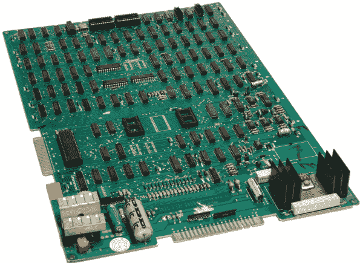

图 1：Galaxian 街机系统板（照片由 Dennis van Zuijlekom，CC BY-SA 2.0）

## 1 CPU 基础

注意：如果你已经熟悉 8 位 CPU，或者读过我的上一本书《为 Atari 2600 制作游戏》，你可以安全地跳到下一章。

## 1.1 位、字节与二进制

所有数字计算机都运行在位（bits）和字节（bytes）的基础上。让我们来回顾一下关于它们的一些知识。

位（bit）是一个二进制值——它可以是 0 (zero) 或是 1 (one)。我们也可以称之为关闭/开启，或者假/真。重要的是，它只能是两个值之一。

字节（byte）是八（8）个位的有序序列。数字 8 并没有特别之处；它只是一个方便的标准——就像铁轨的相当于两匹马的宽度。如果一台计算机主要处理字节，我们就说它具有 8 位架构。

我们可以用二进制表示法创建字节的书面表示，只需从左到右列出位，例如：`%00011011`。我们可以通过删除前导零来缩短字节表示法，得到 `%11011`。`%` 表示二进制数，我们将在书中贯使用这种表示法。

字节中的八位不仅仅是独立的 0 和 1；它们还可以表示数字。我们为每一位分配值然后将它们相加。最低位（LSB），即最右边的位（我们的索引从 0 开始，即位 0），值为 1。左侧的每个位置，值按 2 的次方增加，直到达到最高位（MSB），即最左边的位（位 7），其值为 128。

以下是整个字节的值：

| 位数 | 7 | 6 | 5 | 4 | 3 | 2 | 1 | 0 |
| :--- | :--- | :--- | :--- | :--- | :--- | :--- | :--- | :--- |
| 数值 | 128 | 64 | 32 | 16 | 8 | 4 | 2 | 1 |

让我们将示例字节 `%11011` 与这些值对齐：

| 位数 | 7 | 6 | 5 | 4 | 3 | 2 | 1 | 0 |
| :--- | :--- | :--- | :--- | :--- | :--- | :--- | :--- | :--- |
| 数值 | 128 | 64 | 32 | 16 | 8 | 4 | 2 | 1 |
| 我们的字节 | 0 | 0 | 0 | 1 | 1 | 0 | 1 | 1 |
| 位*值 | | | | | 16 | | 2 | 1 |

当我们把所有位相加时，我们得到 16 + 8 + 2 + 1 = 27。

一个 N 位的二进制数有 2^N 种唯一组合，因此一个 8 位数可以表示 256 个不同的值，包括零。

## 1.2 十进制表示法

二进制表示法可能很繁琐，因此通常使用十六进制表示法（或 16 进制）来表示字节。我们将字节分为两个 4 位部分，称为“半字节”（nibbles）。我们将每个半字节视为一个从 0 到 15 的独立值，如下：

| 位数 | 7 | 6 | 5 | 4 | 3 | 2 | 1 | 0 |
| :--- | :--- | :--- | :--- | :--- | :--- | :--- | :--- | :--- |
| 数值 | 8 | 4 | 2 | 1 | 8 | 4 | 2 | 1 |

然后，我们将每个 4 位半字节的值转换为一个符号——0-9 保持为 0 到 9，但 10-15 变为 A 到 F。

## 1.3 有符号字节与无符号字节

让我们转换二进制数 `%11011`，看看它在十六进制中如何表示：

| 位数 | 7 | 6 | 5 | 4 | 3 | 2 | 1 | 0 |
| :--- | :--- | :--- | :--- | :--- | :--- | :--- | :--- | :--- |
| 数值 | 8 | 4 | 2 | 1 | 8 | 4 | 2 | 1 |
| 我们的字节 | 0 | 0 | 0 | 1 | 1 | 0 | 1 | 1 |
| 位*值 | | | 1 | | 8 | | | 1 |
| 十进制值 | | | 1 | | | 11 | | |
| 十六进制值 | | | 1 | | | | B | |

我们从上面的表中看到，十进制数 27（二进制表示为 `%11011`）在十六进制格式下变为 `0x1b`。

> `$` 前缀表示十六进制数。在 C 语言中，你会看到十六进制数带有“0x”前缀，例如 `0x1b` 或 `0xAA`。我们将在书中交替使用这两种表示法。

关于字节的最后一点：我们已经描述了它们如何被解释为 0 到 255 之间的任何值，或者一个无符号值。我们也可以将其解释为负或有符号的数量。

这需要一种被称为“补码算术”的技巧。如果高位为 1（换句话说，如果无符号值为 128 或更大），我们将该值视为负值，就好像我们从中减了 256：

```
0-127 ($00-$FF):    正
128-255 ($80-$FF):  负 (值 - 256)
```

注意，字节中没有任何标识其为有符号——这完全取决于你如何解释它，正如我们后面看到的。

## 1.4 整数溢出与算术

由于我们在 8 位 CPU 中处理的数字非常小，整数溢出是我们必须经常处理的问题。

当你两个两个数字时，CPU 的加法就像你手动操作一样，但是用二进制的。每个二进制位都相加，如果你需要进位 1（这只在加位 1 和 1 时发生），你就将其进位到下一位。例如：

| 位数 | 7 | 6 | 5 | 4 | 3 | 2 | 1 | 0 |
| :--- | :--- | :--- | :--- | :--- | :--- | :--- | :--- | :--- |
| 字节 A + | 1 | 0 | 1 | 0 | 0 | 1 | 0 | 1 |
| 字节 B + | 1 | 0 | 1 | 1 | 0 | 1 | 1 | 0 |
| 进位 | 1 | 1 | | | | | | |
| = | | 0 | 1 | 0 | 1 | 1 | 0 | 1 |

表 1.1：两个字节的进位二进制加法

那个额外的进位怎么了？字节中只有 8 位，加法的结果被截断为 8 位。我们也称之为*整数溢出*。进位保留在 CPU 的进位标志（Carry flag）中，可以用于未来的计算或直接丢弃。

无符号字节只能表示 0 到 255 的值……

## 1.6 CPU 指令

“写入内存。”再次，总线设备查看地址总线和写信号，决定它们应该监听还是忽略它。

“假设一个内存芯片做出响应——该内存芯片将从数据总线上读取 8 位值，并将其存储在地址 `$1234` 对应的内存中。CPU 在写入操作时不会得到响应；它只是假设一切运行良好。”

到目前为止，我们看到的示例 CPU 指令都是用一种人类可读的语言，即汇编语言。CPU 并不精通这种语言，但它理解一种被称为机器码的紧凑代码。一个名为汇编器的程序会将人类可读的汇编代码转换生成机器码。例如：

```
1d      a, (#x1234)      -> 3A 34 12
```

这条汇编指令翻译为三个字节的机器码：`$3A`、`$34` 和 `$12`。`$3A` 是操作码，决定了指令和寻址模式。`$34` 和 `$12` 是操作数的一部分，在这种情况下，操作数是一个跨越两个字节的 16 位数。

> 你会注意到，当我们把 16 位值 `$1234` 分分为字节时，`$34` 在前，`$12` 在后——这是因为我们的 CPU 是小端处理器，期望先处理多字节数字的低位部分。

> 低位字节（LSB）也称为低字节，而高位字节（MSB）也称为高字节。

## Z80 CPU

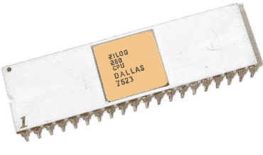

在 20 世纪 70 年的大部分时间里，CPU 对于街机游戏来说仍然昂贵，每台成本高达数百美元。因此，许多早期街机游戏是在没有 CPU 的情况下构建的——只有自定义电路。例如，雅达（Atari）最初的《Pong》游戏包含了 66 片接线在定制 PCB（打印电路板）上的微芯片。这些组件实现了整个游戏逻辑、视频信号和声音。

当时，英特尔 8080 CPU 的每台成本约为 100 美元，竞争对手急于进入市场。费德里科·法金（Federico Faggin）从英特尔离职创立了 Zilog 并开发了 Z80 CPU，它是 8080 的增强版。它被用作许多家用电脑、视频游戏机以及投币式街机游戏（这本书的主题！）的基础。

与廉得多的 MOS 6502 相比，Z80 更加强大且复杂。它拥有多得寄存器——与 6502 的五个 8 位寄存器相比，它有 7 个 16 位寄存器和 4 个备用寄存器。它可以进行 16 位加减法，而这在 6502 上必须通过单独的 8 位指令完成。它还具有块内存、I/O 和搜索指令，可以使用单条指令对多个值进行操作。

6502 将内存和 I/O 设备都映射到单一的 64k 空间中，而 Z80 将两者分离开。`IN` 和 `OUT` 指令执行输入和输出，而像 `LD` 这样的指令执行内存操作。尽管如此，一些系统设计师仍选择忽略 I/O 指令，并将所有内容都映射到内存空间。

Z80 的原始时钟频率为 2.5 MHz，看起来比 6502 的 1 MHz 快得多——但 Z80 的指令周期至少是 6502 的两倍，因此时钟的增加并没有看起来那么显著。

## 2.1 寄存器

Z80 有八个 16 位寄存器，每个寄存器由一对字母标识。每个寄存器对都有自己的“个性”，对应于它能使用的 CPU 指令类型：

- `AF` - 这对的 8 位寄存器通常被分开处理。`A` 寄存器是累加器，被许多指令使用。`F` 是标志寄存器，其位根据指令执行的结果进行清零和设置。
- `BC` - 通用 16 位寄存器。只能从 `A` 寄存器加载/存储内存到内存。
- `DE` - 另一个通用 16 位寄存器。
- `HL` - 有利于 16 位算术运算，也可以使用任何 8 位寄存器进行读写操作。

上述每个寄存器的 8 位组件都可以被单独寻址；例如，`B` 是 `BC` 寄存器的低字节（最低位字节）。

`$1_5 1_4 1_3 1_2 1_1 0_9 0_8 0_7 0_6 0_5 0_4 0_3 0_2 0_1 0_0$`（位位置）

主寄存器

| A | Flags | AF (累加器和标志) |
|---|---|---|
| B | | BC |
| D | | E |
| H | L | HL (间接地址) |

备用寄存器

| A' | Flags' | AF' (累加器和标志) |
|---|---|---|
| B' | C' | BC' |
| D' | E' | DE' |
| H' | L' | HL' (间接地址) |

索引寄存器

| IX | | Index X |
|---|---|---|
| IY | | Index Y |
| SP | | 栈指针 |

其他寄存器

| | I | 中断向量 |
|---|---|---|
| | R | 刷新计数 |

程序计数器

| | PC | 程序计数器 |

状态寄存器

| Z - H - M - P - N | | Flags |


其他 16 位寄存器如下：

**PC - 程序计数器**。它持有当前执行指令的地址。

**SP - 栈指针**。它持有栈顶的地址，用于 `PUSH` 和 `POP` 操作，以及 `CALL` 和 `RET`。

**IX - 索引寄存器**。用于寻址模式 `(IX+register)`。

**IY - 另一个索引寄存器**。它用于存储内存地址。

## 2.2 读取内存

## 2.3 标志位与分支

分支指令也适用于编写循环。假设我们想从 0 计数到 99，并将每个值顺序写入一个 I/O 端口：

```
char i;
for (i=0; i<100; i++) {
    output_port = i;
}
```

编译后的输出使用了 `LD` 和 `INC` 指令，以及通过 `OUT` 指令写入 I/O 端口。`SUB` 和 `JR` 指令负责实现循环：

```
_write_loop:
    ld d,#0x00
repeat:
    ld a,d
    out (_output_port),a    ;写入端口
    inc
    ld a,d
    sub a,#0x64            ;为 (d-100)设置标志
    jr C,repeat            ; 如果进位标志设置，重复
    ret
```

循环变量保存在 D 器中。当它小于 `0x64`（十进制100）时，`SUB` 指令将设置进位标志（Carry flag）。只要进位标志被设置，后续 `JR C,<label>` 指令就会将控制传回 `repeat` 标签。因此，只要 D 小于 100，循环就会重复。

## 2.4 栈

Z80 还有一个堆栈指针（SP），它通常在程序启动时设置，指向 RAM 中的某处。栈有许多用途，如存储临时值、传递函数参数，并在函数被调用时保存返回地址。

| 程序 ROM | 地址 |
| :--- | :--- |
| | $0000 |
| | $3FFF |
| 数据段 | $4000 $4xxxx |
| 栈 | $47FF |
| 初始 SP | $4800 |

图 2.3：Z80 内存映射示例

`PUSH` 指令将一个 16 位寄存器推入栈中。这会使 SP 减 2，然后将寄存器值写入 SP 所指向的地址。

（我们说栈是向下增长的，因为在推入项目时，内存地址会减小。）

`POP` 指令恢复上一次 `PUSH` 的内容。它将 SP 处的 16 位值读入寄存器，然后将 SP 加 2。

在调用函数时，`CALL` 指令将当前的程序计数（Program Counter）推入栈中。C 编译器还在栈中保留许多其他内容，包括局部变量和函数参数。所有这些内容被称为函数的栈帧（stack frame）。

让我们写一个带有一个 16 位参数的函数，将其加到当前分数上：

```
void add_score(int amount) {
  score += amount;
}
```

如果我们使用语句 `add_score(100)` 调用此函数，这段代码将执行以下调用：

```
ld    #0x0064
push  hl          ; 推入参数 = 100
call _add_score
pop   af          ; 弹出参数
```

调用者将 100 加载到 HL 中，将其推入栈，然后调用 `add_score`。在这个 C 编译器中，调用者负责清理栈，因此在 `CALL` 返回后，它会执行一次 `POP` 来丢弃推入的值。

## 2.5 逻辑运算

“逻辑”指令合并两个操作数的位，并对每个位执行位（逻辑）操作：

| 指令 | 运算 | 说明 |
| :--- | :--- | :--- |
| AND | A & B | 如果 A 和 B 都设置，则设置该位。 |
| OR | A \| B | 如果 A 或 B（或两者）设置，则设置该位。 |
| XOR | A ~ B | 如果 A 或 B 其中一个设置但不同时都设置，则设置该位（异或）。 |

例如，让我们将一个字节变量与常量 `$1F` 进行 AND 运算：

```
xpos &= 0x1f;
```

对于 AND，如果 A 和 B 都设置，则设置该位。


对于 AND，如果 A 和 B 都设置，则设置该位。例如，让我们将一个字节变量与常量 $1F 进行 AND 运算：

```
xpos &= 0x1f;
```

对于 AND，如果 A 和 B 都设置，则设置该位。例如，让我们将一个字节变量与常量 $1F 进行 AND 运算：

```
xpos &= 0x1f;
```

对于 AND，如果 A 和 B 都设置，则设置该位。例如，让我们将一个字节变量与常量 $1F 进行 AND 运算：

```
xpos &= 0x1f;
```

对于 AND，如果 A 和 B 都设置，则设置该位。例如，让我们将一个字节变量与常量 $1F 进行 AND 运算：

```
xpos &= 0x1f;
```

对于 AND，如果 A 和 B 都设置，则设置该位。例如，让我们将一个字节变量与常量 $1F 进行 AND 运算：

```
xpos &= 0x1f;
```

对于 AND，如果 A 和 B 都设置，则设置该位。例如，让我们将一个字节变量与常量 $1F 进行 AND 运算：

```
xpos &= 0x1f;
```

对于 AND，如果 A 和 B 都设置，则设置该位。例如，让我们将一个字节变量与常量 $1F 进行 AND 运算：

```
xpos &= 0x1f;
```

对于 AND，如果 A 和 B 都设置，则设置该位。例如，让我们将一个字节变量与常量 $1F 进行 AND 运算：

```
xpos &= 0x1f;
```

## 3.3. 链接器

现在我们调用 `*_printf` 函数，它会执行其逻辑并返回。它将一个返回值存放在栈上，我们在 C 代码中忽略了它——但编译器知道它在那儿，所以它执行了一个 `pop` 操作将其移除：

```
0004 CD ?? ?? [17] 60 call _printf
0007 F1 [10] 61 pop af
```

现在我们到达了 `main` 函数的末尾，并通过 `ret` 指令返回：

```
0008 C9 [10] 62 ret 这里的 __str_0 标签在哪里定义的？
```

还有一点我们忘记了——编译器在函数紧随之后定义了它，并定义了我们的 "HELLO WORLD" 字符串的字节，如下：

```
0009 63 __str_0:
0009 48 45 4C 4C 4F 20 64 .ascii "HELLO WORLD"
57 4F 52 4C 44 0014 00 45 .db 0x00
```

注意字符串末尾的 `0x00`；这被称为空终止字符串或 C 风格字符串。C 函数通常能识别出零表示字符串的结束。遗憾的是，这意味着你不能将零值作为字符串的一部分，但那通常不会出现在文本数据中。

## 3.3 链接器

汇编器会吐出另一组文件，最重要的是我们 C 源文件的对应的目标代码。它包含了 Z80 机器码的字节，加上一些帮助链接器的额外内容。因此，目标代码是可重定位的，意味着它可以在内存中的任何位置运行。链接器运行后，所有代码将固定在一个特定的位置。

> ¹在像 UNIX 这样的系统上，这将控制权返回给命令行提示符。在街机游戏中，你可能会在 `main()` 中无限循环。

链接器的工作是输出一个 CPU 可以可以直接执行的 ROM 就绪代码映像。它通过将你编译的目标文件与外部库结合，并对指向的未解析地址进行修复（fixups），使其指向正确的最终内存位置。

注意我们有两个未解析的地址，`___str_0` 和 `_printf`。第一个标识符是内部引用，链接器可以轻松解析：

```
0000 21 09 00 [10] 58 ld hl,#__str_0
```

第二个标识符 `_printf` 是一个外部库函数。链接器必须在外部文件（随编译器一起包含）中查找该标识符，并将函数包含在最终映像中，以及它所依赖的所有函数。有时这可能是大量的代码！

这里是我们应用了所有修复后的最终代码列表：

```
0000 56 _main::
0000 21 09 00 [10] 58 ld hl,#__str_0
0003 E5 [11] 59 push hl
0004 41 00 [17] 60 call _printf
0007 F1 [10] 61 pop af
0008 C9 [10] 62 ret
0009 63 ___str_0:
0009 48 45 2A 4C 4F 20 64 .ascii "HELLO WORLD"
57 4F 52 4C 44
0014 00 65 .db 0x00
```

你甚至可能在没有意识的情况下引入外部函数。例如，Z280 没有乘法或除法指令，因此 C 编译器使用了外部库例程。任何浮点操作也是如此。

## 3.4 ROM 映像

最终的 ROM 映像只是汇编器输出的字节序列。在 Z80 上，ROM 映像通常加载在地址 0，因为那是 CPU 在重位后开始执行代码的地方。

> 注意：此示例无法运行（目前！）

这个示例在我们的 Z80 IDE 中无法直接运行，因为我们的系统比你标准的 C 编译器要精简一些。我们需要添加一些额外内容：

- 标准 I/O 函数：虽然 `printf` 定义在标准库中，但对于它使用的用于输出字符的 `putchar` 函数，那里并没有相应的定义。我们必须为目标平台上的特定显示设备定义 `putchar`。

- 栈指针初始化：当 CPU 被重位时，它会将程序计数器 (PC) 寄存器设置为 0。这对应于我们 `main` 函数的开头，所以它将立即开始执行。有一个小问题：栈指针 (SP) 寄存器尚未设置，所以当我们向栈中推入/弹出值时，CPU 可能不会指向有效的 RAM 区域。这就是为什么大多数 C 编译器不从 `main` 开始，而是先运行一个入口例程来设置环境。我们将在未来的章节中描述。

## 一些 C 示例

在我们开始制作街机游戏之前，让我们过一下更多的 C 代码示例。

```
type name;
type name = initializer;

声明一个类型为 type、名为 name 的变量，可选初始化其值。
```

当你声明变量时，会在内存中为它预留空间。在这里我们声明了两个类型为 `char` 的变量（这是一种 8 位整数类型），并初始化了其中一个：

```
char a;
char b = 'A';
```

这些是全局变量，因为它们定义在函数之外。

```c
int x;
int y = 10;
```

在函数内部定义变量是局部变量，它们在函数执行期间有效。

```c
void func() {
  int z = 5;
}
```

注意我们在函数内部声明了变量。这使其成为一个局部变量，临时在栈上占用空间。我们只能在这个函数内部访问它。

```c
void func() {
  int i;
}
```

```c
while (condition) statement;
如果 condition 为真，则执行 statement。
```

```c
while (x > 0) {
  x--;
}
```

```c
return expression;
退出函数，并返回 expression 作为结果。
```

```c
int add(int a, int b) {
  return a + b;
}
```

```c
byte did_hit_high_score() {
  if (score > high_score) {
    high_score = score;
    return 1;
  } else {
    return 0;
  }
}
```

```c
if (expr) statement1 else statement2;
如果 expr 为真（非零），则执行 statement1。否则执行 statement2。
```

```c
if (lives == 0) {
  end_game();
} else {
  do_something();
}
```

```
for (init; condition; increment)
```

首先求值 `init`。然后当 `condition` 为真时循环，重复执行 `statement` 和 `increment`。

```c
for (int i = 0; i < 10; i++) {
}
```

假设我们想从 0 计数到 99，并对每个数字调用 `display_number`：

```c
void display_100_numbers() {
  int i;
  for (i=0; i<100; i++) {
    display_number(i);
  }
}
```

在本章中，我们将讨论用于开发和测试游戏代码的工具。这些工具构成了我们的交互式开发环境，或者说 IDE。

要启动 IDE，请在网络浏览器中访问 `http://8bitworkshop.com/`。为了获得最佳效果，请使用最新版本的 Google Chrome、Mozilla Firefox 或 Apple Safari。

该 IDE 支持书中涵盖的所有街机平台。要在平台之间切换，请点击页面左上角的 Menu（菜单），从 Platform（平台）菜单中选择一个，如图 5.2 所示。

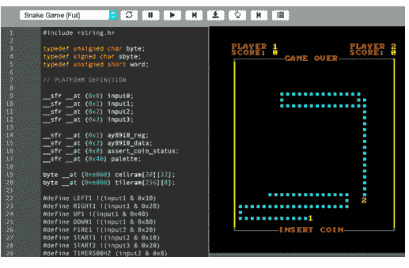

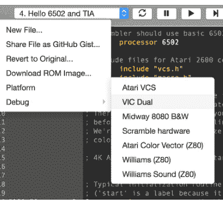

IDE 包含了几个示例程序。在菜单图标右侧，你可以访问下拉菜单，该菜单允许你选择要加载的文件，如图 5.3 所示。

你可以随意地编辑这些文件——所有更改都会持久化在浏览器本地存储中，如果你关闭标签页并回来，它们仍然在那里。要重置并完全清除你的更改，请从菜单中选择 **Reset to Original**（还原原始）。

要从头开始，请从菜单中选择 **New File**（新建文件）。输入新文件的名称，C 源文件通常使用 `.c` 扩展名。（你也可以使用 `.asm` 扩展名编写 Z80 汇器代码。）

| 最小示例 |

|---|

| 本地文件 ---- |

| -----共享 ----- |

| 章节 ---------- |

| ✓ 最小示例 |

| Hello World |

| 图形测试 |

| 音频测试 |

| 贪蛇游戏 (原型)|

| 贪蛇游戏 (完整版)|

| 音乐示例 |

要与其他分享文件，请从菜单中选择 Share File as GitHub Gist。这将文件上传到 GitHub 服务，然后显示一个你可以复制到剪贴板的链接。将此链接发送给其他人，他们就可以查看并运行你的源代码，并根据需要进行自己的本地更改。

IDE 包含每个每个街机平台的模拟器，它在模拟机器上运行代码。要控制游戏，首先点击模拟器屏幕以获取焦点。键盘命令随游戏而异，但通常如下：

- 方向键 - 移动

- 空格键 - 射击

- 5 - 投币

- 1 - 开始游戏 (单人)

- 2 - 开始游戏 (双人)

另一个工具是 C 编译器。我们使用的是 SDCC，它也运行在网络浏览器中，并配有一个基于网页的文本编辑器。每当你对代码进行更改时，IDE 都会将其编译并将最终的 ROM 镜像发送到模拟器，让你几乎立即看到代码更改。

最后一个工具是一个简单的调试器，允许你逐步执行机器码指令、查看内存并启动和停止程序。屏幕顶部的按钮执行若干项调试功能：


- Reset (重置)：硬重置模拟器，然后单步到第一条指令。

- Pause (暂停)：停止模拟器。

- Run (运行)：暂停后恢复模拟器。

- Step (单步)：执行下一条 CPU 指令，然后中断。

- Run To (运行到)：在当前行（光标所在行）设置“断点”。当执行到达该指令时，模拟器将停止。

## 5.1. 调试窗口

- Step Out of Subroutine (跳出子程序)：运行直到当前子程序返回，然后中断。

- Step Backwards (后退)：后退单条 CPU 指令。


- Show Disassembly (显示汇编)：显示 C 源文件的编译汇编列表。

- Show Memory (显示内存)：显示内存浏览器（见图 5.4）。

- Show Profile (显示分析)：显示每行源代码的分析信息。

每当 IDE 遇到断点或单步执行时，屏幕右下角会出现调试窗口。它显示了 CPU 的内部状态，包括所有寄存器和标志位。

```
PC 0098 -Z-H-V--
SP E7F7 IR 0070
IX 0000 IY E417
AF 0054 BC 0807
DE E400 HL E7F9
```

> 注意：IDE 正在活跃开发中，可能与我们描述的有所。源代码可在 `https://github.com/sehugg/8bitworkshop` 获取。

```
E3E0 0A 05 02 01 80 40 20 10 08 04 42 21 90 48 24 92 _cellram
E3F0 49 A4 D2 69 34 1A 0D 46 23 11 08 04 82 41 A0 D0 _cellram
E400 0F 17 02 00 00 31 FE 60 09 0B 08 00 00 32 FE 00 _players
E410 01 _atatstract
E410 09 _frames_per_move
E410 00 EF AD DE FD 9D credits
```

图 5.4：内存浏览器

## 6

1976 年，Lane Hauck 感到心心不焉。他在 Gremlin Industries 一忙弹球机和类似 Play Ball 和 Trapshoot 这种“墙壁游戏”，并希望层进入视频游戏业务。

他一直在研究一种名为 Blockade 的游戏，该游戏在屏幕上显示一个箭头。可以通过按键在四个方向上移动，并留下痕迹。玩家的目标是避开自己的痕迹和其他人的痕迹。在游戏发布后，Lane 的游戏很快被其他人克隆——即 Midway 的作品。

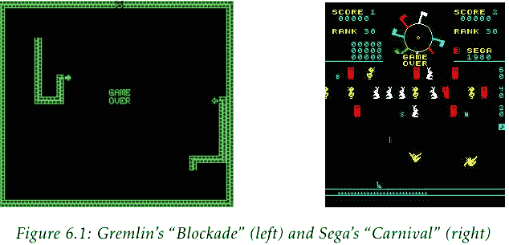

## 6.2 内存映射

后来，该公司创建了基于 6502 处理器的 VIC-2。其内存映射如下：

| 起始 | 结束 | 描述 |

|---|---|---|

| $0000 | $3FFF | ROM (16KB) |

| $4000 | $7FFF | RAM (16KB) |

| $8000 | $BFFF | I/O 和 RAM |

| $C000 | $FFFF | RAM (4KB) |

## 6.4 颜色

```c
const byte font8x[0x100] = {
  0x00,0x00,0x00,0x00,0x00,0x00,0x00,0x00}, { 0x7e,0x81, ...
};
```

如果我们将此数组的两个维度相乘，得到 $100 * 8 = 800$ 字节。这与精灵 RAM（tile RAM）空间的大小相同，正是我们想要的。

注意，我们使用 `const` 关键字定义了 `font8x` 数组，告诉编译器将其存储在 ROM 中。如果我们省略 `const`，它会被存储两次 ——一次在 ROM 中，一次在 RAM 中，浪费空间（比我们拥有的空间还要！）

```c
sizeof(expr)
返回表达式以字节为单位的大小。
```

在程序开始时，我们通过 `memcpy` 函数将字体图形从 ROM 拷贝到 RAM：

```c
memcpy(tileram, font8x, sizeof(font8x));
```

`memcpy` 接受三个参数：目标指针、源指针和要拷贝的字节数。（嘿，什么是“指针”？别担心，我们稍后会解释。）

VIC Dual 引入了调色板（palette）的概念。调色板定义了数值到颜色的映射。

在 VIC Dual 中，每个调色板有八条目，每个条目定义了单元格的背景和前景颜色。只有八种颜色：

| # | 位 | 颜色 |

|---|---|---|

| 0 | 0 | ... | 黑色 |

| 1 | .R | 红色 |

| 2 | .G | 绿色 |

| 3 | .GR | 黄色 |

| 4 | B.. | 蓝色 |

| 5 | B.R | 品红色 |

| 6 | BG | 青色 |

| 7 | BGR | 白色 |

为了决定单元格使用调色板中的条目，视频生成器查看单元格值的高三位。这为我们提供了八个不同的字节范围，对应八种颜色：

| 起始 | 结束 | 调色板索引 |

|---|---|---|

| $00 | $1F | 0 |

| $20 | $3F | 1 |

| $40 | $5F | 2 |

| $60 | $7F | 3 |

| $80 | $9F | 4 |

| $A0 | $BF | 5 |

| $C0 | $DF | 6 |

| $E0 | $FF | 7 |

不幸的是，这意味着每个单元格都被锁定在一个特定的调色板条目。后续系统允许我们为单个单元格分配不同的调色板，但这种设计相对原始。

该系统总共有四个调色板，切换到不同的调色板可以向 I/O 端口 $40 ：

```c
__sfr __at (0x40) palette; // I/O 端口 $40
```

我们在这里使用了两个关键字：`__sfr` 表示 I/O 端口，`__at` 定义 I/O 地址（在此例中 `0x40`）。

## 6.5 类型别名 (Typedefs)

你可以像操作其他变量一样写入调色板：

```c
palette = 1; // 设置调色板 1
```

调色板切换立即发生；视频生成器从该点开始使用新调色板。这可以用于闪烁屏幕的酷“照明”效果。

调色板数据包含在一个 32 字节的 PROM（可编程只读存储器）中，我们在模拟器 ROM 中将其映射到地址 $4000。示例一个：

```c
#define PE (fg, bg) ((fg)<5) | ((bg)<1)
```


```c
const byte _at (0x4000) color_prom[32] = {
PE(7,0), PE(3,0), PE(1,0), PE(3,0), PE(6,0), PE(2,0), PE(2,0), PE(6,0),
PE(1,0), PE(2,0), PE(3,0), PE(4,0), PE(5,0), PE(6,0), PE(7,0), PE(0,7),
PE(7,0), PE(7,0), PE(7,0), PE(7,0), PE(3,0), PE(3,0), PE(3,0), PE(3,0),
PE(7,0), PE(7,0), PE(7,0), PE(7,0), PE(7,0), PE(7,0), PE(7,0), PE(7,0),
};
```

每个调色板条目包含 5-7 前景颜色和 1-3 位背景颜色。为了帮助将位正确放置，我们定义了一个预处理器宏 `PE(fg, bg)` 在编译时构建每个调色板条目。（那个宏很复杂，但你可能在之前见过 `|`（位或）。`<<` 表示“左移” —— 我们将在后面的章节介绍。）

```c
typedef type name;
```

将 `name` 定义为 `type` 的别名。所有 C 编译器都有内置类型来表示整数。`char` 类型通常是 8 位宽，但其他类型取决于编译器。

## 6.6 一个 main 函数

我们的编译器描述了如下类型：

| C 类型 | 别名 | 位 | 最小值 | 最大值 |
|---|---|---|---|---|
| `unsigned char` | `byte` | 8 | 0 | 255 |
| `signed char` | `sbyte` | 8 | -128 | 127 |
| `unsigned int` | `word` | 16 | 0 | 65535 |
| `int`, `short` | - | 16 | -32768 | 32767 |
| `long` | - | 32 | -2147483648 | 2147483647 |
| `float` | - | 32 | -³⁸ | ³⁸ |

`typedef` 关键字定义了类型的同义词（或别名），这样你每次使用时不需要写出整个类型。输入 `signed` 和 `unsigned` 有点麻烦，所以在我们的示例程序中，我们使用 `typedef` 语句为我们创建别名：

```c
typedef unsigned char byte; // byte = 8 位无符号
typedef unsigned char sbyte; // sbyte = 8 位符号
typedef unsigned short word; // word = 16 位无符号
typedef enum { false, true } bool; // 布尔枚举（0 或 1）
```

类型定义在前，标识符在后。例如，变为 `unsigned char` 的别名。（我们将在下一章讨论枚举，只需说 `false` = 0，`true` = 1。）

> 在 8bitworkshop.com 查看：选择 VIC Dual 平台，然后选择 Minimal 文件。

这个示例 `main` 函数执行以下操作：

1. 将调色板索引设置为 1
2. 用 `%FE` 字节（二进制 `11111110`）填充精灵 RAM
3. 遍历 0 到 31 的所有 X 和 Y 坐标，每行设置不同的颜色
4. 进入无限循环（停止程序）。

## 6.6 一个 main 函数

首先声明两个局部变量 `x` 和 `y`：

```c
void main() {
  byte x, y;
```

然后设置调色板索引：

```c
  palette = 1;
```

用 `%FE` 字节（二进制 `11111110`）填充精灵 RAM：

```c
  for (y = 0; y < 32; y++) {
    tileram[y] = 0xFE;
  }
```

遍历 0 到 31 的所有 X 和 Y 坐标，每行设置不同的颜色：

```c
  for (y = 0; y < 32; y++) {
    for (x = 0; x < 32; x++) {
        // 在处设置颜色
    }
  }
```

进入无限循环（停止程序）：

```c
  while (1);
}
```

## 6.7 例 (Routines)

如果我们不想直接处理单元格数组，可以写一些读写的 C 函数：

```c
void putchar(byte x, byte y, byte value) {
  cellram[x][y] = value;
}
```

```c
byte getchar(byte x, byte y) {
  return cellram[x][y];
}
```

或者使用库例清除整个屏幕：

```c
void clrscr() {
  memset(cellram, 0, sizeof(cellram));
}
```

向屏幕写入字符字符串也同样简单：

```c
void putstring(byte x, byte y, const char* string) {
    while (*string) {
        putchar(x++, y, *string++);
    }
}
```

## 6.8 控制器

VIC Dual 游戏的控制器方案有所不同，但我们基于 Carnival 为我们的模拟器选择了一个。它具有单一左右摇杆和按钮；我们添加了上下方向。

控制器输入通过 CPU 的 I/O 端口进入；游戏使用了其中四个：

- `sfr_at (0x0) input0;`
- `sfr_at (0x1) input1;`
- `sfr_at (0x2) input2;`
- `sfr_at (0x3) input3;`

当开关关闭时（即按下按钮或移动摇杆），特定输入端口中的特定位会发生变化。“高电触发”意味着关闭开关（移动摇杆）会将位从 0 变为 1，“低电触发”意味着它从 1 变为 0。

我们可以使用位与运算符（`&`）来测试这些开关。我们将控制器输入与位掩码结合，位掩码仅设置了一个位 —— 即我们想要测试的位。如果控制器输入也具有该位，与运算的结果将是非零，即真（C 将所有非零值视为“真”）。在这里我们使用二进制表示法作为位掩码的值：

```c
if (input1 & 0b00001000) { /* 向左移动 */ }
```

对于单个位，直接使用十六进制表示法通常更容易：

```c
if (input1 & 0x10) { /* move left */ }
```

```c
!expr
如果 expr 结果为真，则返回 0。否则，返回 1。
```

Carnival 中所有的开关除硬币检测器外，都是低电平有效的，因此我们使用布尔取反运算符对它们进行反反：

```c
if (!input1 & 0x10) { /* move left */ }
```

很容易编写 C 预处理器宏来为所有的摇杆方向、按钮和硬币检测器编写表达式：

```c
#define LEFT1 !(input1 & 0x10)
#define RIGHT1 !(input1 & 0x20)
#define UP1 !(input1 & 0x40)
#define DOWN1 !(input1 & 0x80)
#define FIRE1 !(input2 & 0x20)
#define COIN1 !(input3 & 0x8)
#define START1 !(input2 & 0x10)
#define START2 !(input3 & 0x20)
```

然后我们可以像这样使用它们：

```c
if (LEFT1) { /* move left */ }
```

VIC Dual 中的硬币检测器是一个特殊且有趣的案例。它连接到 CPU 复位线，因此当检测到硬币时，CPU 也会被重位。这意味着程序必须重新开始，但内存不会清空。我们可以利用这一点在主函数之后增加 `credits` 变量：

```c
if (COIN1) { // 是否检测到硬币？
credits++; // 加分
} else {
  test_ram(); // 没有硬币，重置 RAM
}
```

如果我们在重位后没有检测到硬币，我们就假设机器刚刚通了电，因此我们清空所有 RAM 并继续我们的初始化程序。（大多数游戏机在初始启动时有一个诊断测试程序。）

## 6.9 Z80 入口例程

通常，C 程序从内置的入口例程开始（在系统中称为 `crt0`），该程序设置一些寄存器和内存，然后调用 `main()` 函数。

我们的嵌入式 Z80 系统没有内置的入口函数，因此我们必须编写自己的——我们将将其命名为 `start`：

```c
void main(); // 我们稍后定义 main()

void start() {
  __asm
    LD SP,#e800  ; 设置栈指针
    DI             ; 禁用中断
  __endasm
    main();
}
```

首先，我们声明了 `main()` 函数；稍后我们会定义它（填充内容）。然后我们定义 `start()` 函数，它包含一些内联汇编，由 `__asm` 和 `__endam` 关键字包围。这一功能允许我们将汇编代码与 C 代码混合。在这里，它将栈指针设置为通用 RAM 的末端 (`$e800`) 并禁用了在 Vic Dual 平台上不使用的中断。

`start()` 必须是我们定义的第一个函数，因为作为入口点，它需要从地址 `0x0` 开始，这是 CPU 在重位后会跳转的地址。它做的最后一件事是调用 `main()` 函数，我们将其定义为程序的正式开始。

## Siege 游戏（围攻）

我们现在要为 VIC Dual 平台编写一个完整的游戏。作为灵感来源，我们将使用它早期的成功作品之一《Blockade》（贪吃蛇），这是一款多年来被复制多次的游戏。

游戏有两个玩家，他们可以在四个方位方向之一移动，且不会停止。每个玩家都会在身后留下痕迹，目标是让另一个玩家撞到你的痕迹或他们自己的痕迹。生存下来的玩家得一分，游戏一直持续直到其中一个玩家达到分数。

本着懒惰命名的伟大精神，我们将直接查阅词典并将此游戏命名为 Siege。我们将首先回顾游戏的一个简单版本，它缺少计分和硬币检测功能。

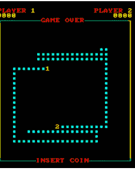

图 7.1：我们本章的游戏，“Siege”

要在 8bitworkshop.com 上查看它：选择 VIC Dual 平台，然后选择 Siege Game (prototype) 文件。

## 7.1 数据结构

在开始编写游戏时，我们通常不仅考虑要写什么代码，还会考虑哪种数据结构能最好表示游戏世界的状态。

```c
struct { field definitions ... }
声明一个具有给定字段定义的结构体类型。
```

对于 Siege，我们需要为每个玩家跟踪很多东西——他们的 X 和 Y 坐标、移动方向等。我们使用 `typedef` 定义一个结构体类型（称为 `Player`），它持有玩家的所有属性：

```c
typedef struct {
    byte x;                 // x 坐标
    byte y;                 // y 坐标
    byte dir;               // 方向 (0-3)
    char head_attr;         // 用于绘制玩家的字符
    char tail_attr;        // 用于绘制痕迹的字符
    char collided;          // 是否碰撞？如果是则为1
} Player;
```

`typedef` 只是定义了一个类型，并没有声明变量。现在我们已经 `typedef` 了我们的结构体 `Player`，我们可以声明一个数组来表示两个玩家。

```c
Player players[2];      // 玩家结构体
```

## 7.2 Main 函数

你也可以一步定义并声明结构体，而无需使用 `typedef`：

```c
struct {
  byte x;
  byte y;
} players[2];
```

通常最好使用 `typedef`，因为它允许你方便地进行指针操作，我们将利用这一点。

> 关于 C 代码的说明：在书中除了 `byte` 和 `word` 等原生类型外，所有用户定义的类型都大写。POSIX 标准对自己的类型使用后缀，但对用户定义的类型没有说明。无论如何，假设它还没有这样做。

现在我们来到程序的末尾，在那里定义 `main` 函数：

```c
void main() {
  palette = 0;
  memcpy(players, font, sizeof(font));
  draw_playfield();
  while (1) {
    init_game();
    play_round();
  }
}
```

（为什么 `main` 函数在末尾？因为每个函数必须先定义，等等。）我们做的第一件事是将调色板设置为 0，这给了我们漂亮的黄色/青色混合。

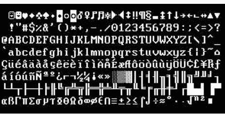

图 7.2：Code Page 0 字体

当我们把位图数据 `memcpy` 到 RAM 时，8x8 单元定义在 `const` 数组中——每个条目 8 字节，如下：

```c
const byte BOX_CHARS[256][8] = {
  { 0x00, 0x00, 0x00, 0x00, 0x00, 0x00, 0x00 }, // 单元 0
  { 0x7e, 0x91, 0xa5, 0xb1, 0x95, 0x81, 0x7e }, // 单元 1
  ...
};
```

我们在这里选择的单元集来自 Code Page 0，包含了有符号——见图 7.2。在开始游戏之前，我们通过 `draw_playfield` 设置屏幕，它的边界在 (0,0) 和 (27,29)：

```c
void draw_playfield() {
  draw_box(0,0,27,29, BOX_CHARS);
}
```

将 `x` 加 1。如果这个值用于表达式中，它将在增加后进行评估。我们还需要定义 `draw_box`：

```c
void draw_box(byte x, byte y, byte x2, byte y2, const char chars[]) {
  byte x1 = x;
  // 先绘制角
  putchar(x, y, chars[2]);
  putchar(x2, y, chars[3]);
  putchar(x, y2, chars[0]);
  putchar(x2, y2, chars[1]);
  // 绘制上/下边
  while(++x < x2) {
    putchar(x, y, chars[5]);
    putchar(x2, y2, chars[4]);
  }
  // 绘制左/右边
  while (++y < y2) {
    putchar(x1, y, chars[6]);
    putchar(x2, y, chars[7]);
  }
}
```

`BOX_CHARS` 数组定义了用于箱子角和边的单元字符。我们将将其作为 `chars` 参数传递给 `draw_box`，你可以制作不同类型的箱。`init_game` 函数设置了之前定义的 `Player` 对象：

```c
void init_game() {
  memset(players, 0, sizeof(players));
  players[0].head_attr = CHAR('1');
  players[1].head_attr = CHAR('2');
  players[0].tail_attr = 254;
  players[1].tail_attr = 254;
}
```

我们使用 `memset` 将整个 `players` 数组置零，这是将玩家对象的所有字段设置为零的简单方法。然后我们设置想要非零的字段，例如 `head_attr` 和 `tail_attr` 字段。玩家 1 的头像将是“1”，玩家 2 将是“2”。（我们的游戏宇宙非常字面！）

我们需要一个函数来玩一“轮”游戏，意味着其中一个玩家撞到东西。我们定义 `play_round`：

```c
void play_round() {
  reset_players();
  clrscr();
  draw_playfield();
  while (1) { // 无限循环
    make_move();
    // 如果任何玩家碰撞到东西，退出循环
    if (players[0].collided || players[1].collided) break;
  }
  flash_colliders();
}
```

注意 `while (1)` 循环。`while` 关键字只要括号内的条件评估为真就会一直循环。它的条件只是 1，意味着它将永远循环。幸运的是，我们有 `break` 关键字，它可以立即退出当前循环。所以当任何玩家碰撞到东西时，我们退出循环：

```c
if (players[0].collided || players[1].collided) break;
```

## 7.2. 主函数

```c
typedef enum { D_RIGHT, D_DOWN, D_LEFT, D_UP } Direction;
```

这在实际上定义了以下常量：

```
D_RIGHT = 0
D_DOWN = 1
D_LEFT = 2
D_UP = 3
```

> C 语言风格注释：常量值和宏定义通常使用全大写字母。别担心，我们不是在对你大喊！

游戏的核心是 `make_move()` 函数：


```
void make_move() {
  byte i;
  // 延迟并读取控制输入
  for (i=0; i<FRAMES_PER_MOVE; i++) {
    human_control(0);
    wait_for_vsync();
  }
  // 决定电脑玩家的移动
  ai_control(1);
  // 移动第 2 个玩家
  move_player(1);
  // 移动第 1 个玩家
  move_player(0);
}
```

`human_control` 和 `ai_control` 函数决定了玩家在下一次移动时将向哪个方向移动，而 `move_player` 函数负责移动他们并检查碰撞。

我们为什么要循环 `FRAMES_PER_MOVE` 次？这是一个控制游戏速度的延迟循环。每次迭代调用 `wait_for_vsync`（在上一节中描述）会等待直到新帧的开始。因此，每次迭代会暂停最多 1/60 秒。

由于我们在延迟循环中也调用了 `human_control`，因为我们想检测这段时间内发生的控制输入。每隔 0.0167 秒检查一次对于即使是操作最快的摇杆控高手来说也足够频繁了。该函数非常简单：

```
void human_control(byte p) {
  Direction dir = 0xff;
  if (LEFT1) dir = D_LEFT;
  if (RIGHT1) dir = D_RIGHT;
  if (UP1) dir = D_UP;
  if (DOWN1) dir = D_DOWN;
  // 不让玩家反向
  if (dir != 0xff && dir != (players[p].dir ^ 2)) {
    players[p].dir = dir;
  }
}
```

我们声明了一个 `Direction` 类型的局部变量，首先将其设置为 `0xFF` 作为“无变化”的指示器（我们可以这样做，因为编译器将枚举类型处理为整数类型）。然后，我们使用之前定义的 `LEFT1`/`RIGHT1`/`UP1`/`DOWN1` 宏来检查每个摇杆的方向输入。

我们不希望玩家掉头反向移动，否则他们会立即撞击到自己的痕迹。如果我们正在向左移动，我们就想防止玩家向右移动。

这就是 `players[p].dir ^ 2` 表达式用用场。`^` 运算符是按位异或（XOR），它根据另一个操作数设置的位来翻转一个操作数的位。回到我们的方向常量，让我们看看它们的二进制表示以及它们如何响应异或操作：

```
D_RIGHT = %00 ^ %10 = %10
D_DOWN = %01 ^ %10 = %11
D_LEFT = %10 ^ %10 = %00
D_UP = %11 ^ %10 = %01
```

翻转第二位实际上给了我们反向的方向，然后我们可以检查它以确保我们不会向那个方向移动。

`move_player` 函数擦除玩家（用痕迹字符替换它）并沿当前方向移动一个方格。我们还想检查玩家是否与他们自己的痕迹或另一个玩家的痕迹发生了碰撞。

我们已经将两条痕迹都绘制到了屏幕上，所以我们只需要检查玩家所在的网格中是否有任何空白字符（我们使用 `getchar` 函数进行检查），如果是，我们就设置碰撞标记。只有在这种情况下……

*(注：原文后续部分似乎存在逻辑重复或断码的片段，已根据提供的原文内容进行对应翻译)*

# 9

## 可编程声音发生器

从第一款《太空作战》（Computer Space）在点唱机展会上亮相以来，视频游戏就有声音。在早期的街机游戏设计中，声板通常是每个游戏单独定制的，包含了可以从主 CPU 板上触发的各种声音电路。由于声音是硬接线的，除了“开始”和有时的“停止”外，通常几乎没有控制。

即使在 20 世纪 70 年代中期，当 CPU 变得廉到可以用于视频游戏中，设计人员仍然使用离散电路进行声音发生。这些电路通常利用无处不在的 555 定时芯片输出简单的振荡信号，有时通过电阻电容滤波器和/或包络进行修改。例如，雅达利的《Pong》可以产生不同的声音——反弹（短 246 Hz 脉冲）、得分（长 246 Hz 脉冲）和击中（短 491 Hz 脉冲）。

随着视频游戏和电子小用设备市场的增长，芯片制造商开发了可以在单个芯片中产生各种噪声的集成电路。最早的之一是德州仪的 SN76477 “复杂声音发生器”，它可以被描述为一个基本上是模拟的单声合成器。

SN76477 并不是可编程的，而是由外部电容和电阻控制，有时需要其他 IC 来产生更复杂的噪声。数据手册描述了示例电路

### 9.1. AY-3-8910 PSG

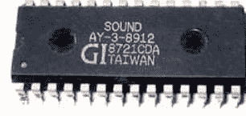

图 9.1：AY-3-8912 芯片，28 引脚 DIP 封装

例如“鸟鸣”、“带哨声的蒸汽火车”以及“赛车发动机/碰撞”。在 8 位时代之后，这种芯片深受 DIY 合成器爱好者的喜爱，直到 2008 年它仍在生产。

随着微处理器变得越来越便宜，个人电脑革命的正式开始，显然噪声发生器应该由软件控制，而不是由硬编码电路。可编程声音发生器（PSG）芯片将实现这一功能，在不需要额外组件的情况下产生各种声音。输出完全由一组由 CPU 编程的寄存器决定。

### 9.1 The AY-3-8910 PSG

General Instrument AY-3-8910 是一种在 1978 年设计的流行 PSG。它旨在与该公司的 CP1600 CPU（用于 Intellivision 游戏机）配对，其变体被用于接下来的十年及以后许多街机游戏、弹球机、游戏机和家用电脑中。事实上，直到 2010 年，仍在使用兼容声音芯片的老虎机在生产中！

AY-3-8910 有三个主声道（音调发生器）和一个噪声通道。每个声道可以通过将基准频率除以一个 12 位值，从 4095 种不同的音高中选择一个音调。噪声源可以设置为 32 种不同的周期（频率）之一。

AY-3-8910 具有 16 个 8 位寄存器来控制其输出。（某些寄存器的某些位未未使用，且某些寄存器控制 GPIO 端口，我们在这里不会介绍。）

### 9.1. The AY-3-8910 PSG

| 寄存器编号 | 位 76543210 | 说明 |
|---|---|---|
| R0 R1 | XXXXX XXXX | 通道 A 音调周期（低位） ..... 通道 A 音调周期（高位） |
| R2 R3 | XXXXX XXXX | 通道 B 音调周期（低位） 通道 B 音调周期（高位） |
| R4 R5 | XXXXX XXXX | 通道 C 音调周期（低位） 通道 C 音调周期（高位） |
| R6 | ......XXXXX | 噪声周期控制 |
| R7 | ......BCA | 通道启用（音调） 通道启用（噪声） |
| R8 R9 R10 | ...EVVV ...EVVV | 通道 A 启用、音量（低位） 通道 B 启用、音量 通道 C 启用、音量 |
| R11 R12 | XXXXXXXX | 包络 | 包络周期（低位） 包络周期（高位） |
| R13 | ...CALH | 包络形状（持续，保持） |


编程 AY-3-8910 通常涉及两个步骤：选择寄存器，设置值。例如，我们连接芯片，使得端口 1 选择寄存器，端口 2 设置值。使用 `_sfr` 关键字，我们可以在 C 中定义这些端口：

```c
__sfr __at (0x1) ay8910_reg;
__sfr __at (0x2) ay8910_data;
```

我们还可以定义一个方便函数来设置特定寄存器的值：

```c
inline void set8910(byte reg, byte data) {
    ay8910_reg = reg;
    ay8910_data = data;
}
```

为了演示，让我们创建一个在一个通道上播放音调的函数：

在一个通道上，通过设置低/高音调周期寄存器来选择所需的频率。通道的音调频率由该公式定义：

Frequency = \frac{Clock}{16*TonePeriod}

在大多数设计中，时钟频率为 3.57945 MHz。周期 0 是无效的（数据手册甚至没有说会什么，但那时候的人知道不要除以零！）

你也可以这样重排公式：

TonePeriod = \frac{Clock}{16*Frequency}

使用我们的 `set8910` 函数，可以这样设置音调周期（假设 period 是 16 位变量）：

```c
set8910(channel+2+0, period & 0xff); // 低位
set8910(channel+2+1, period >> 8); // 高位
```

# 10

二进制编码十进制 (BCD)

目前为止，我们只处理了以二进制编码的字节——它们表示从 0 到 255 的无符号值。现在，我们将使用二进制编码十进制或称 BCD 值。

BCD 用一种更符合人类阅读的格式表示数字。字节被一分为两半，变成两个 4 位的“半字节”（nibbles），每个半字节包含一个 0 到 9 的十进制数字。在这种方案下，十六进制的值与十进制表示法相同。例如，$00 到 $09 是相同的，但 10 被存储为 $10，11 存储为 $11，一直到 $99。

早期的计算机使用 BCD 表示来进行数字计算，大型机也使用它们来处理财务数据。它们在 8 位世界中仍然非常有用，最主要是因为它们更容易渲染到屏幕上。我们不需要除以 10 来转换为十进制数字，因为十进制数字已经是表示的一部分了。

要从 BCD 字节中提取两个数字，我们只需要向右移 4 位来分离第一个数字（高位半字节），并通过二进制第二个数字（低位半字节）进行掩码操作：

```
void bcd2digits(byte bcd) {
  char digit1 = '0' + (bcd >> 4);
  char digit2 = '0' + (bcd & 0xf);
}
```

在 C 语言中，我们可能会发现 16 位的 BCD 数字非常方便，它们总共 4 个十进制数字。这里有一个函数，通过位移和掩码每个数字，将所有 4 个数字渲染到屏幕上指定的 X/Y 位置：

```
void draw_bcd_word(byte x, byte y, word bcd) {
    byte j;
    x += 3;
    for (j=0; j<4; j++) {
        putchar(x, y, CHAR('0'+(bcd & 0xf)));
        x--;
        bcd >>= 4;
    }
}
```

我们可以用纯 C 语言编写一个 BCD 加法程序，但更高效的方法是使用 Z80 的 DAA 指令——它将任何标准二进制加法的结果转换为 BCD 结果。最终的函数看起来像这样：

```
word bcd_add(word a, word b) {
    a; b; // 避免“未使用的变量”警告
asm
    ld  hl,#4
    add hl,sp
    ld  iy,#2
    add iy,sp
    ld  a,1 (iy)    ; 加载 a (lo)
    add a,(hl)      ; 加 b (lo)
    daa             ; 转换为BCD
    ld  c,a
    ld  a,1 (iy)    ; 加载 a (hi)
    inc hl
    adc a,(hl)      ; 加 b (hi) + 进位
    daa
    ld  b,a
    ld  l,c
    ld  h,b          ; 结果在HL寄存器中
endasm
}
```

（这段代码是如何写的：编写简单的 16 位加法函数的 C 代码，获取汇编输出，并在两个 ADD 和 ADC 指令之后添加 DAA 指令。我喜欢这种计划达成的感觉！）

早些时候我们承诺过讨论指针，现在我们来了！那么什么是指针？这个问题有一个简单的答案，但要真正理解它们，你必须看到它们的工作。。让我们开始吧：

## 11.1 指针是一个带类型的内存地址

指针只是一个带有一个类型的内存位置。在内部，它是一个 16 位数字，因为 Z80 使用 16 位的地址。

`type* name`

声明一个指向 `type` 类型对象的指针。

我们通过在类型后加上一个 `*` 来声明指针。因此，一个名为 `ptr` 的字节指针声明方式如下：

```c
byte* ptr;
```

你可以像给其他变量赋值一样给指针赋值——底层只是 16 位的值。事实上，你可以直接将它们设置为内存地址：

```
byte* ptr = (byte*)0x4800;
```

`(byte*)` 是一个类型转换，它将数字转换为指针。

## 11.2 指针是对另一个变量的引用

通常，你不想直接设置指针的地址，而是想将其设置为另一个变量的地址。你可以使用 `&` 运算符创建任何对象的指针。

```c
&x
返回指向 x 的指针。
```

在例示例中，我们首先将 x 设置为 10。然后我们声明一个指针并将其设置为 x 的地址。然后通过指针，我们将 x 设置为 20：

```c
byte x = 10;
byte* ptr = &x;
*ptr = 20;
```

注意最后一行，`*ptr = 20`。`*` 意味着我们正在解引用指针——换句话说，我们不再将其视为指针，而是将其视为指针另一端的对象。

> *x

> 解引用指针 x（反转 `&` 运算符）。

指针在处理数组时，指针特别有用，因为你可以计算一次指向特定数组索引的指针，并将其用于多次操作。

## 11.3 指针是一个字符串

在我们的“Hello World”章节，我们打印了一个字符串：

```c
printf("HELLO WORLD"); // 输出某些文本
```

然而，我们传递给 `printf` 函数的是一个指针。我们可以这样重写代码：

```c
char* text = "HELLO WORLD"; // 字符串的指针
printf(text);
```

在 C 语言中，字符串只是指向一个字符数组的指针，通常由零字节（或空终止符）结束。我们也可以这样重写代码：

```c
char text[12] =
{'H','E','L','L','O ','W','O','R','L','D',0};
printf(text);
```

等一下，`text[12]` 不是定义了一个数组吗？我们是如何将其传递给接受指针参数的 `printf` 的？C 编译器会将数组转换为指针，传递数组第一个元素的地址。

## 11.4 指针是一个数组 ... 如此

指针和数组有很多共同点，并且通常可以互换使用。例如，这个：

```
void putstring(byte x, byte y) {
    byte i;
    x += 3;
    for (j=0; j<4; j++) {
        putchar(x, y, CHAR('0'+(bcd & 0xf)));
        x--;
        bcd >>= 4;
    }
}
```

注意最后一行，`*ptr = 20`。`*` 意味着我们正在解引用指针——换句话说，我们不再将其视为指针，而是将其视为指针另一端的对象。

`src` 指针指向位图数据，该数据紧跟在宽度和高度字节之后。现在我们循环遍历位图数据，将其拷贝到屏幕上：

```
for (j=0; j<h; j++) {
  for (i=0; i<w; i++) {
    *dest++ = *src++;
  }
  dest += 32-w;
}
```

在内部循环结束时，我们已经复制了当前扫描行的所有字节。我们在 `dest` 指针上加上 `32 – w`，这将我们移动到下一扫描行（我们已经复制了 `w` 个字节，所以我们从 `32`——即扫描行的长度——中减去它）。

注意，我们的精灵函数没有执行任何裁剪（clipping）——也就是说，它们不会检查精灵的边界是否超出了视频帧，这样做将覆盖帧缓冲区之外的内存区域。

## 12.4 绘制 vs. 擦除 vs. 异或

通过细小的变化，我们也可以擦除精灵——只需将内层循环替换为此表达式：

```
*dest++ = 0;
```

我们不再从位图中拷贝字节，而是直接将它们都设置为 0。

到目前为止，绘制/擦除方法的一个问题是它会在所有精灵周围留下难陋的黑色矩形。每个精灵都会覆盖之前绘制的任何内容，包括其他精灵和背景。

解决此问题的方法之一是使用异或（XOR）绘制。正如我们在第2章中简单介绍过的，异或是一种位操作，根据以下规则结合源像素和目标像素：

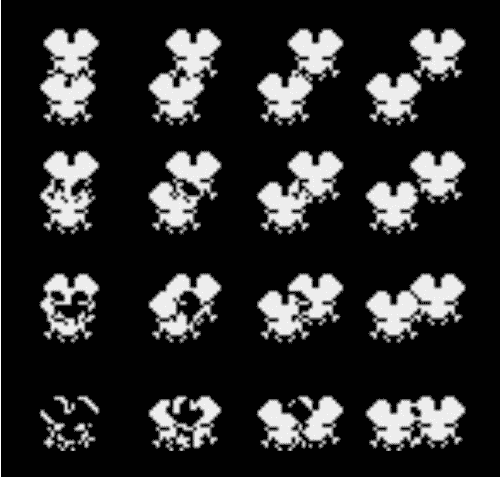

图12.3：使用异或绘制的重叠精灵

| 源 | 目的 | 结果 |
| --- | --- | --- |
| 0 | 0 | 0 |
| 1 | 0 | 1 |
| 0 | 1 | 1 |
| 1 | 1 | 0 |

异出的第一个神奇属性是它不会抹除目标矩形中的所有内容。绘制空白像素将保持现有像素不变。

第二个神奇属性是使用异或两次绘制相同的内容会完全擦除该内容，恢复它可能遮挡的任何东西。因此，你只需要一个函数来同时绘制和擦除精灵。

这种方法的缺点是，如果一个对象与另一个重叠，两个对象中的任何白色像素都会变成黑色像素。这是为了可逆性而付出的代价。

## 12.5 绘制文本

将我们的程序改为使用 XOR 非常，只需使用 `^` 运算符：

```
*dest++ ^= *src++;
```

文本与精灵非常相似；我们只需要将字体位图保存在二维数组中，如下：

```
#define LOCHAR 0x20
#define HCHAR 0x5e
#define CHAR(ch) ((ch)-LOCHAR)

const byte font[HCHAR-LOCHAR+1][8] = {
    {0x00,0x00,0x00,0x00,0x00,0x00,0x00,0x00}, {0x00,0x00, ...
}
```


宏`LOCHAR`定义了字体数组中的第一个字符，这里设置为 32 —— 这是可打印字符的起点（32 == 空格）。程序员只需使用`LOCHAR`和`HCHAR`之间的字符。`CHAR`宏通过减去`LOCHAR`将字符转换为字体索引。

`draw_char`函数看起来和精灵函数非常像，只是我们硬编码了宽度和高度，并将`x`乘以 8 以模拟字符单元的网格：

```
void draw_char(char ch, byte x, byte y) {
    byte i;
    byte* dest = &widem[x*8][y];
    const byte* src = &font8x[CHAR(ch)][];
    for (i=0; i<8; i++) {
        *dest ^= *src;
        dest += 32;
    }
    src += 1;
}
```

## 12.6 像素级精灵位移

Midway 8080 板板还包含了一个芯片，富士通 MB14241，这可以被认为是包含在视频游戏中的第一个 GPU（图形处理器）。

它的操作相当简单：它有一个内部 16 位寄存器，CPU 可以设置它，它会返回该寄存器内任何位偏移处的移位 8 位量。由于 8080 没有桶形位器（即每条指令只能移动一位），这允许精灵轻松地绘制在任何 X 坐标上，而不仅仅是 8 像素间隔。然而，并不是所有游戏都使用了该芯片。

每当写入`bitshift_value`寄存器时，16 位寄存器就会右移 8 位，为存入高 8 位的新位留出空间：

```
XXXXXXXXYYYYYYY
------->
new byte old byte
```

从`bitshift_read`读取返回的是该 16 位寄存器的 8 位窗口，该窗口根据`bitshift_offset`中设置的位数进行位移：

```
XXXXXXXXYYYYYYY
<---> offset = 5
new byte old byte
```

变量使用`__sfr`声明为 I/O 端口：

- `__sfr __at (0x2) bitshift_offset;`

- `__sfr __at (0x4) bitshift_value;`

- `__sfr __at (0x3) bitshift_read;`

`volatile`关键字告诉编译器变量可能会意外改变，不要对其进行优化。由于 8080 没有桶形位器，我们需要手动处理位移。

```
void draw_char(char ch, byte x, byte y) {
    byte i;
    byte* dest = &widem[x*8][y];
    const byte* src = &font8x[CHAR(ch)][];
    for (i=0; i<8; i++) {
        *dest ^= *src;
        dest += 32;
    }
    src += 1;
}
```

注意，我们的精灵函数没有执行任何裁剪（clipping）——也就是说，它们不会检查精灵的边界是否超出了视频帧，这样做将覆盖帧缓冲区之外的内存区域。

## 12.7 看门狗

看门狗是一个内部计时器，用于防止错误代码导致程序死机。你必须经常“喂”它——如果不是，它就会重置游戏。

```
__sfr __at (0x6) watchdog_strobe;
#define WATCHDOG 0;
```

## 13. 游戏：星际大战

现在我们理解了 Midway 8080 硬件，我们将创建一个名为“星际大战”的小游戏。你控制屏幕底部的一只船，并射击从上方的敌人。

## 13.1 游戏数据

首先，我们有一组全局变量用于记录：

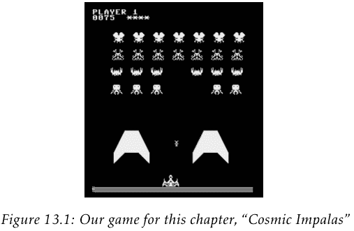

```
byte attract; // 吸引模式？0 否，1 是
byte credits; // 投币数
byte player; // 当前玩家索引（0 或 1）

word score; // 当前分数
byte lives; // 生命值

#define MAXLIVES 5 // 显示的最大生命值
```

每帧更新阵型中的所有敌人是非常困难的，因此我们每帧只更新一个。变量`entity_index`用来跟踪正在更新的是哪个实体：

```c
byte enemy_index;
```

```c
type name:N;
定义一个位域；这是一种在结构体中仅占用 N 位的类型。

位域通常需要额外的 CPU 指令来解码这些位，因此它们并不总是被使用。如果你需要位级别的控制，直接使用位操作来处理字节中的标志位也是可以的，尽管可读性可能略低。
```

阵型一次只会向一个方向移动：要么向左、向右或向下移动一行。`MarchMode`结构体处理了这些情况：

```c
typedef struct {
 right:1; // 0 = 左, 1 = 右
 down:1; // 0 = 左/右, 1 = 向下
} MarchMode;
```

`MarchMode this_mode, next_mode;`

## 13.2 游戏循环

```c
p->name
索引指针 p 指向结构体的字段名。
```

为了处理`Enemy`结构体，我们经常传递它们的指针。我们可以使用`->`运算符访问结构体的字段。它的工作原理与`.`运算符完全一样，但是针对指针的。例如，为了绘制敌人，我们可能会调用此函数：

```c
void draw_enemy(Enemy* e) {
 draw_sprite(e->shape, e->x, e->y);
}
```

如果没有`->`，我们就必须使用`*`解解运算符运算符：

```c
draw_sprite((*e).shape, (*e).x, (*e).y); // 真讨厌
```

当我们开始一个关卡时，我们绘制场景：

```c
void draw_playfield() {
byte i;
// 将屏幕清为黑色
clrscr();
// 绘制得分和生命数
draw_string("PLAYER 1", 0, 31);
draw_score(0);
draw_lives(0);
// 在底部绘制三条水平线
for (i=0; i<224; i++) {
videm[i][0] = 0x55;
// 在屏幕左右绘制地堡
draw_bunker(30, 40, 15, 15, 20);
draw_bunker(140, 40, 15, 15, 20)
}
}
```

我们的主循环看起来像这样：

```c
player_x = 96; // 设置玩家水平位置
bullet.y = 0; // 关闭玩家子
bomb.y = 0; // 关闭敌人炸弹
frame = 0; // 帧计数器清零
// 循环直到玩家被毁，
// 或者直到敌人耗尽
while (player_x != 0xff && num_enemies) {
move_player(); // 移动玩家船，发射
if (bullet.y) {
move_bullet(); // 移动玩家子，检查碰撞
}
update_next_enemy(); // 移动阵型中的单个敌人
if (frame & 1) { // 每奇数帧运行
if (bomb.y == 0) {
drop_bomb(); // 敌人掉炸弹
} else {
move_bomb(); // 敌人移动炸弹，检查碰撞
}
}
watchdog_strobe = 0; // 喂看门狗
frame++;
}
```

`update_next_enemy`一次移动一个敌人，因此更新整个 28 个敌人的阵型大约需要一秒。随着敌人的销毁，敌人列表会缩小，这使得敌人阵型移动得更快！

```c
void update_next_enemy() {
    Enemy* e;
    // 如果移动了最后一个敌人，从头开始
    if (enemy_index >= num_enemies) {
        enemy_index = 0;
        // SDCC 中不能将结构体赋值给结构体（真遗憾！）
        memcopy(e-this->mode, &next_mode, sizeof(this->mode));
    }

    // 擦除当前敌人
    e = &enemies[enemy_index];
    clear_sprite(e->shape, e->x, e->y);
    // 正在向下移动？
    if (this->mode.down) {
        // 如果离地面太近，结束游戏
        if (--e->y < 5) {
            destroy_player();
            lives = 0;
        }
        next_mode.down = 0; // 停止向下移动
    } else {
        // 敌人向右移动？
        if (this->mode.right) {
            e->x += 2;
            if (e->x >= 200) {
                next_mode.down = 1; // 向下
                next_mode.right = 0; // 之后，向右移动
            }
        } else {
            // 敌人向左移动
            if (e->x == 0) {
                next_mode.down = 1; // 向下
                next_mode.right = 1; // 之后，向右移动
            }
        }
    }
    // 现在既然移动了，再次绘制它
    draw_sprite(e->shape, e->x, e->y);
    enemy_index++; // 到下一个敌人
}
```

85

在`move_player`中，我们读取玩家输入并决定向左还是向右移动玩家。我们使用`xor_sprite`擦除旧位置，再次绘制新位置。如果擦除精灵后有任何残留像素，我们就检查是否发生了碰撞，调用`check_bullet_hit`来遍历敌人列表。

```c
void move_player() {
    if (attract) {
// 敌人炸弹
        if (bomb.y == 0) {
            drop_bomb(); // 敌人掉炸弹
        } else {
            move_bomb(); // 敌人移动炸弹，检查碰撞
        }
    }
} // 喂看门狗
frame++;
}
```

## 13.3 碰撞检测

在我们的游戏中，我们将碰撞检测放在了两个地方。第一个是检查子弹是否击中东西的程序：

```c
void move_bullet() {
    byte leftover = xor_sprite(bullet_bitmap, bullet_x,
        bullet_y); // 擦除
    // 我们命中，还是子弹离开了顶部
    屏幕？
    if (leftover || bullet_y > 26) {
        clear_sprite(bullet_bitmap, bullet_x, bullet_y);
        check_bullet_hit(bullet_x, bullet_y+2); // 查找命中
        bullet_y = 0; // 移除子弹
    } else {
        // 向上移动子弹
        bullet_y++;
        xor_sprite(bullet_bitmap, bullet_x, bullet_y); // 绘制
    }
}
```

注意`xor_sprite`的用法——我们异或精灵以擦除旧位置，再次绘制新位置。如果擦除精灵后有任何残留像素，我们就检查是否发生了碰撞，调用`check_bullet_hit`来遍历敌人列表。当敌人被命中时，我们通过`delete_enemy`将其从敌人数组中删除：

```c
void delete_enemy(Enemy* e) {
// 擦除敌人
clear_sprite(e->shape, e->x, e->y);
// 移动列表切片
memmove(e, e+1, sizeof(Enemy)*(MAX_ENEMIES-1-(e-enemies)));
num_enemies--;
}
```

上面的`memmove`表达式很绕。我们的目标是移动删除项之后的所有数组项。这张图希望能够让它更清晰：

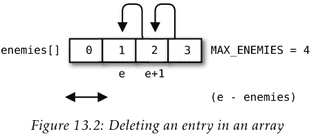

表达式`(e - enemies)`是另一个指针算术用。它是将指针`e`转换回数组索引的方法。此外，我们使用`memmove`函数而不是`memcpy`，因为我们的源和目标范围重叠了。

## 13.4. 爆炸动画

第二个检查碰撞的函数是`move_bomb`，它负责检测炸弹是否击中了某个物体：

```c
void move_bomb() {
  // 在旧位置擦除炸弹
  byte leftover = xor_sprite(bomb_bitmap, bomb_x, bomb_y);
  if (bomb_y < 2) { // 炸弹击中
    bomb_y = 0;
  } else if (leftover) { // 有剩余像素
    erase_sprite(bomb_bitmap, bomb_x, bomb_y); // 擦除掩体
    if (bomb_y == 2) {
      destroy_player(); // 击中玩家
    }
    bomb_y = 0; // 移除炸弹
  } else {
    bomb_y--; // 炸弹向下移动重绘
    xor_sprite(bomb_bitmap, bomb_x, bomb_y);
  }
}
```

这个程序与`move_bullet`非常相似，但方向相反。

只有当炸弹的 Y 位置恰好为 2 时检测到碰撞，炸弹才会击中玩家的飞船。任何更高的位置都是击中地面。（这是一个非常“不可靠”的测试，但它有效。如果炸弹精灵图高度超过 8 像素，可能就失效了——原因留给读者自己思考！）

制作玩家爆炸（或我们称之为“de-rez”，即消解）动画的程序挺酷的。我们要假装玩家飞船瞬间传送消失了，并大量使用 XOR 运算：

```c
void destroy_player() {
  // 使用 XOR 制作消解图案（第1次）
  xor_player.derez();
  // 对玩家飞船进行 XOR，将其擦除
  xor_sprite(player_bitmap, player_x, 1);
  // 再次使用 XOR 擦除消解图案（第2次）
  xor_player.derez();
  // 移除玩家，减少生命
  player.x = 0xff;
  lives--;
}
```

`xor_player_derez`函数在玩家的矩形区域内通过 XOR 写入随机点，从精灵图底部开始，向上处理到 32 像素的高度。作为随机性来源，我们定义了一个从地址 $0 开始的数组——这恰好是 ROM 中的代码字节，对于我们的目的来说足够随机了！

```c
void xor_player_derez() {
    byte i,j;
    byte x = player_x+13;
    byte y = 8;
    byte* rand = 0; // ROM 起始
    for (j=1; j<=0x1f; j++) {
        for (i=0; i<50; i++) {
            // 获取 x/y 坐标的下一个“随机”值
            char xx = x + (*rand++ & 0x1f) - 15;
            char yy = y + (*rand++ & j); // 用 j 掩码 y
            xor_pixel(xx, yy); // 绘制像素
        }
    }
}
```

`xor_pixel`程序也很简单。我们将它设为内联（inline），可以节省几个字节的代码：

```c
inline void xor_pixel(byte x, byte y) {
    // 在扫描行内查找字节 (y / 8)
    byte* dest = &vidmem[x][y>>3];
    // 按 (y % 8) 移位
    *dest ^= 1 << (y & 7);
}
```

## 14. 中断

## 14.1 中断

Z80 可以接收中断，中断是外部信号，告诉 CPU 停止当前工作并执行特定的代码程序。

每个平台都有其自己的生成和处理中断的方法。在 Midway 8080 平台上，有两种不同的中断：一个在视频生成器到达扫描行 96（帧的 1/3 处）时，另一个在扫描行 224（帧结束处）触发。

Z80 有三种不同的响应中断信号的方式；本平台使用模式 0 中断。工作原理如下：当 Z80 接收到中断信号时，它从数据总线上读取单条指令——由信号设备放置在该处——并执行该指令。

Midway 8080 平台产生 RST $08 和 RST $10 指令，因此我们必须确保有两个中断程序，一个从地址 $08 开始，另一个从 $10 开始。

我们的 C 编译器的棘手之处在于它与汇编器不同，它不允许我们为程序设置特定地址。但只要稍留心，我们可以编写程序让它们对齐到正确的位置。

在 C 中，我们首先用特殊关键字声明中断处理程序，以及我们的主函数：

```c
void scanline96() __interrupt;
void scanline224() __interrupt;
void main();
```

现在，我们必须仔细编写函数，使其符合此内存映射：

| 地址 | 描述 |


## 13.4. 爆炸动画

第二个检查碰撞的函数是`move_bomb`，它负责检测炸弹是否击中了某个物体：

```c
void move_bomb() {
  // 在旧位置擦除炸弹
  byte leftover = xor_sprite(bomb_bitmap, bomb_x, bomb_y);
  if (bomb_y < 2) { // 炸弹击中
    bomb_y = 0;
  } else if (leftover) { // 有剩余像素
    erase_sprite(bomb_bitmap, bomb_x, bomb_y); // 擦除掩体
    if (bomb_y == 2) {
      destroy_player(); // 击中玩家
    }
    bomb_y = 0; // 移除炸弹
  } else {
    bomb_y--; // 炸弹向下移动重绘
    xor_sprite(bomb_bitmap, bomb_x, bomb_y);
  }
}
```

这个程序与`move_bullet`非常相似，但方向相反。

只有当炸弹的 Y 位置恰好为 2 时检测到碰撞，炸弹才会击中玩家的飞船。任何更高的位置都是击中地面。（这是一个非常“不可靠”的测试，但它有效。如果炸弹精灵图高度超过 8 像素，可能就失效了——原因留给读者自己思考！）

制作玩家爆炸（或我们称之为“de-rez”，即消解）动画的程序挺酷的。我们要假装玩家飞船瞬间传送消失了，并大量使用 XOR 运算：

```c
void destroy_player() {
  // 使用 XOR 制作消解图案（第1次）
  xor_player.derez();
  // 对玩家飞船进行 XOR，将其擦除
  xor_sprite(player_bitmap, player_x, 1);
  // 再次使用 XOR 擦除消解图案（第2次）
  xor_player.derez();
  // 移除玩家，减少生命
  player.x = 0xff;
  lives--;
}
```

`xor_player_derez`函数在玩家的矩形区域内通过 XOR 写入随机点，从精灵图底部开始，向上处理到 32 像素的高度。作为随机性来源，我们定义了一个从地址 $0 开始的数组——这恰好是 ROM 中的代码字节，对于我们的目的来说足够随机了！

```c
void xor_player_derez() {
    byte i,j;
    byte x = player_x+13;
    byte y = 8;
    byte* rand = 0; // ROM 起始
    for (j=1; j<=0x1f; j++) {
        for (i=0; i<50; i++) {
            // 获取 x/y 坐标的下一个“随机”值
            char xx = x + (*rand++ & 0x1f) - 15;
            char yy = y + (*rand++ & j); // 用 j 掩码 y
            xor_pixel(xx, yy); // 绘制像素
        }
    }
}
```

`xor_pixel`程序也很简单。我们将它设为内联（inline），可以节省几个字节的代码：

```c
inline void xor_pixel(byte x, byte y) {
    // 在扫描行内查找字节 (y / 8)
    byte* dest = &vidmem[x][y>>3];
    // 按 (y % 8) 移位
    *dest ^= 1 << (y & 7);
}
```

## 14. 中断

## 14.1 中断

Z80 可以接收中断，中断是外部信号，告诉 CPU 停止当前工作并执行特定的代码程序。

每个平台都有其自己的生成和处理中断的方法。在 Midway 8080 平台上，有两种不同的中断：一个在视频生成器到达扫描行 96（帧的 1/3 处）时，另一个在扫描行 224（帧结束处）触发。

Z80 有三种不同的响应中断信号的方式；本平台使用模式 0 中断。工作原理如下：当 Z80 接收到中断信号时，它从数据总线上读取单条指令——由信号设备放置在该处——并执行该指令。

Midway 8080 平台产生 RST $08 和 RST $10 指令，因此我们必须确保有两个中断程序，一个从地址 $08 开始，另一个从 $10 开始。

我们的 C 编译器的棘手之处在于，它与汇编器不同，并不允许我们为程序设置特定地址。但只要稍留心，我们可以编写程序让它们对齐到正确的位置。

在 C 中，我们首先用特殊关键字声明中断处理程序，以及我们的主函数：

```c
void scanline96() __interrupt;
void scanline224() __interrupt;
void main();
```

现在我们必须仔细编写函数，使其符合此内存映射：

| 地址 | 描述 |
| :--- | :--- |
| $0000 | 启动程序 |
| $0008 | 扫描行 96 的中断入口点 |
| $0010 | 扫描行 224 的中断入口点 |

首先，我们编写启动程序，使用一些内联汇编（如第 6 章所述）来设置栈指针并使用 EI 指令开启中断：

```c
void start() {
  // 使用内联汇编设置栈指针并使用 EI 指令开启中断
}
```

## 15. 随机性

大多数游戏都需要生成随机数。可能游戏需要一个行为不可预测的敌人，或者要求游戏元素出现在屏幕的随机位置。这通常通过使用伪随机数生成器（PRNG）来实现。这种算法从一个被称为种子的数字开始，对其进行复杂的修改以生成连续的随机数。

如果设计正确，PRNG 将循环在一个巨大的范围内，这些值不会重复，或者在数万次迭代后才重复。这被称为 PRNG 的周期。

## 15.1 伽罗瓦 (Galois) LFSR

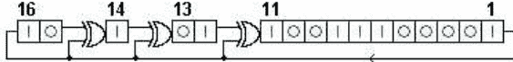

图 15.1：16 位伽罗瓦 LFSR

伽罗瓦 LFSR 可能是实现起来最简单的 LFSR 变体。下面的程序产生 $2^{16} - 1$ (65535) 个值——除零以外的所有 16 位位值。

```c
word fssr = 1;

word rand() {
  byte lsb = fssr & 1;
  lfsr >>= 1;
  if (lsb) fssr ^= 0xd400;
  return fssr;
}
```

由于伽罗瓦 LFSR 在一半的时间里只是执行简单的移位操作，你可能需要至少迭代两次才能获得看起来合理的随机值。因为极大 LFSR 的周期是奇数，你可以迭代两次仍然能获得全范围的值。

许多 LFSR 也是可逆的，即序列可以反向运行。上述 LFSR 的反向操作使用了常量 $a801$（上一个常量左移 1 位）：

```c
word rev_rand() {
  byte lsb = (lfsr & 0x8000) != 0;
  lfsr <<= 1;
  if (lsb) fssr ^= 0xa801;
  return fssr;
}
```

另一个廉价的伪随机数来源是直接从 ROM 中的代码中读取字节。机器指令的随机性质对于某些应用已经足够了，例如噪声的视频或音频信号。我们在第 13 章中使用这种技术来绘制随机点阵。

## 15.2 熵 (Entropy)

如果你发现你的随机数太容易预测了，可以为你的 PRNG 添加熵。这是一种不确定性来源，让你的随机数流变得更加不可预测。

一些良好的熵源：

- 玩家的控制输入
- 硬件时钟或硬件 PRNG
- VSYNC 等待循环中的计数器

这是一个通过结合 LFSR 值与控制器输入来添加熵的简单示例。由于我们的伽罗瓦生成器不喜欢值 0，当我们发现它时将其纠正为 1：

```c
function add_entropy() {
  lfsr ^= input1;
  if ((lfsr)) lfsr = 1;
}
```

虽然这会让你的 RNG 更具不可预测性，但它并不一定使其变得不可重复！如果熵的添加导致 LFSR 回到之前的值，它将再次发射相同的序列。但我们是在玩游戏，而不是生成加密密钥。实验可能会告诉你是哪些方法有效，哪些无效。

## 16. 初始化内存

## 16.1 已初始化 vs 未初始化 vs 常量 (Const)

考虑以下变量：

```c
int uninit_value;
const const_value = 0x123;
int init_value = 0x7f;
```

这三行都声明了整数，但编译器对每个变量处理方式不同，并将它们放在不同的段中（我们的汇编器将它们称为 _areas_，但 segment 更加常用）。

第一个是 _未初始化声明_：

```c
int uninit_value;
```

这被放置于我们的 _DATA 段_，未初始值存储在 RAM 中。它们在启动时不会被设置为任何特定值——在我们的模拟器中，它们最初会被设置为零。

汇编器这样定义我们的变量：

| 地址 | 指令 |
| :--- | :--- |
| 2000 | 28 .area _DATA |
| 2000 | 29 _uninit_value:: |


| | 30 .ds 2 |

这在 `_DATA` 段中为 `uninit_value` 分配了两个字节。

下一个声明是常量值：

```c
const int const_value = 0x123;
```

### 16.1 已初始化 vs 未初始化 vs 常量

`const` 关键字表示该值不能被更改——它是常量。编译器将将其放置在 `_CODE` 段并为其分配一个值：

```asm
57 .area _CODE
0000 58 _const_value:
0000 41 01 59 .dw #0x0123
```

最后一行是已初始化声明，它在启动时被分配一个值，从那时起可以被更改：

```c
int init_value = 0x7f;
```

这个变量将被放置在 `_INITIALIZED` 段。它和 `_DATA` 段一样存储在 RAM 中，但正如下面看到的，它在启动时会被初始化。首先，在 `_INITIALIZED` 段中分配了两个字节：

```asm
34 .area _INITIALIZED
2002 35 _init_value:
0002 36 .ds 2
```

实际的值 (`0x007f`) 被放在 `_INITIALIZER` 段：

```asm
60 .area _INITIALIZER
0002 61 __xinit__init_value:
0002 7B 00 62 .dw #0x007f
```

## 16.2 初始化内存

在我们基础的示例中，我们省略了初始化内存的程序。

```asm
57 .area _CODE
0000 58 _const_value:
0000 41 01 59 .dw #0x0123
```

## 16.3 字符串 (Strings) vs. 数组 (Arrays)

两者相似，但并不相同。考虑以下两个：

```c
const char* DIGITS = "0123456789";
```

```c
const char DIGARRAY[10] = {
  '0','1','2','3','4','5','6','7','8','9';
};
```

乍一看，字符串 `DIGITS` 和数组 `DIGARRAY` 相似，但字符串有结尾而数组不是。字符串 `DIGITS` 是一个指针，而数组 `DIGARRAY` 是内存块。如果你想把字符串当作数组，可以使用索引：

```c
char c = DIGITS[i];
```

如果你想把数组当作字符串，必须使用指针：

```c
char* s = DIGARRAY;
```

字符串 `DIGITS` 更灵活，它可以传递给期望指针的函数。

## 17 宇宙大战 (Galaxian)

## 17.1 历史

Namco 的第一个游戏是 Gee Bee，一种弹球风格的游戏。Galaxian 是他们的续作，灵感源自最近发布的《太空侵略者》以及《星球大战》。

Galaxian 硬件推向了 1979 年视频设计的极限。其核心是一个频率为 3.07 MHz 的 Z80 CPU。图形系统具有彩色图形和多色精灵（当时还没有“精灵”这个术语，所以设计师们称之为“印章”）。

设计师们为 King & Balloon 使用了相同的 PCB（印制电路板），也用于传奇续作 Galaga。其他公司获得了视频硬件许可制作像《Scramble》和《Frogger》这样的游戏。

## 17.2 内存映射

我们为模拟器选择了 Scramble 的内存映射——它与 Galaxian（小行星入侵）类似，并作为许多其他游戏的基础：

| 起始 | 结束 | 描述 | 读写 |
|---|---|---|---|
| $0000 | $3FFF | ROM | 读 |
| $4000 | $47FF | 程序 RAM | 读写 |
| $4800 | $4BFF | 显存 RAM | 写入 |
| $4C00 | $4FFF | 显存 RAM (镜像) | 写入 |
| $5000 | $50FF | 对象 RAM | 写入 |
| $6801 | | 开启中断 | 写入 |
| $6803 | | 开启蓝色背景 | 写入 |
| $6804 | | 开启星空 | 写入 |
| $7000 | | 看门狗定时器 | 读 |
| $8100 | | 输入 0 | 读 |
| $8101 | | 输入 1 | 读 |
| $8102 | | 输入 2 | 读 |

表 17.1: Scramble 内存映射

Galaxian 的硬件与此相似，仅有以下变化：

| 起始 | 结束 | 描述 | 读写 |
|---|---|---|---|
| $6000 | | 输入 0 | 读 |
| $6800 | | 输入 1 | 读 |
| $7000 | | 输入 2 | 读 |
| $7800 | | 看门狗定时器 | 读 |
| $7001 | | 开启中断 | 写入 |
| $7004 | | 开启星空 | 写入 |

表 17.2: Galaxian 内存映射

瓦片映射定义为一个 32x32 的字节数组，在此定义为变量 `vram`：

```
byte __at (0x4800) vram[32][32]; // 32x32 单元格
```

每个字节选择 256 个可用瓦片中的一个。

### 17.2. 内存映射

竖屏

[29][0]

[2][0]

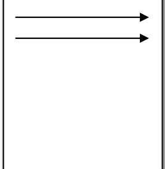

[29][31]

[2][31]

横屏

[2][0]

[2][31]

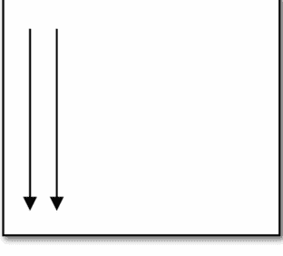

[29][0]

[29][31]

图 17.2: Galaxian 显存布局

某些瓦片是在屏幕之外的。在竖屏模式下，最左侧的两个列和最右侧的两个列是隐藏的。如果你想隐藏精灵（sprites）或导弹，可以将它们放置在这个区域。

显存的另一部分是“对象 RAM”，具有更复杂的结构。我们将使用 C 结构体数组来定义每个部分。

首先，我们定义列寄存器。共有 32 列，每列有一个滚动字节和一个属性字节（总共 64 字节）：

```
struct {
  byte scroll; // 列滚动位置
  byte attrib; // 列属性（颜色组）
   __at (0x5000) vcolumns[32];
}
```

（在竖屏模式下，这些列旋转了 90 度，它们实际上是水平行。但我们仍然称它们为列。）

`scroll` 字节将整列瓦片按指定的像素数向右移动，并将剩余部分到另一侧。参考图 17.2，并注意四个瓦片（32 像素）将始终部分或完全被隐藏。

`attrib` 字节控制该列使用的颜色。调色板配置为 8 组，每组 4 种颜色。类似于 VIC Dual 系统，它包含在 PROM 中，我们将其映射到 `$5000`：

```c
// 调色板条目（红 0-7, 绿 0-7, 蓝 0-3）
#define PE(r,g,b) ((r)|((g<<3))|((b<<6))
```

```c
const char __at (0x5000) palette[32] = {
  0,PE(0,0,0),PE(0,0,0),PE(6,6,3),
  0,PE(7,1,1),PE(0,0,3),PE(7,7,3),
  ..
};
```

每个调色板条目包含一个字节，映射到 RGB 值如下：

8 个精灵使用 4 字节的对象 RAM：

```c
struct {
    byte xpos; // x 位置
    byte code; // 瓦片索引
    byte color; // 颜色索引
    byte ypos; // y 位置
} __at (0x5040) vprites[8];
```

`xpos` 和 `ypos` 定义了精灵的 X 和 Y 坐标。适用于竖屏——X 从左到右，Y 从上到下。可见性规则与瓦片相同，`X = 0` 和 `X = 255` 均在屏幕外。

`code` 字节选择精灵使用的瓦片。精灵是 16x16 的，因此使用 8x8 的瓦片，通过图 17.3 中的偏移量选择。

`color` 字节从 8 组中选择精灵的调色板，类似于处理瓦片的方式。导弹或子弹的定义类似于精灵，它们只有 X 和 Y 坐标：

```c
struct {
    byte unused1;
    byte xpos; // x 位置
    byte unused2;
    byte ypos; // y 位置（反转）
} __at (0x5060) vmissiles[8];
```

图 17.3: Galaxian 布局

Y 坐标是反的，取决于硬件的偏移量。在 Scramble 硬件上，`Y = 240` 是顶部，`Y = 0` 是底部。

## 17.3 其他地址

`enable_irq` 开关可以设置为 1，视频硬件每帧产生一次非掩器中断（NMI）。中断处理程序位于 ROM 中的 `$6801` 处。我们将在第 18 章向你展示如何编写中断处理器。

```c
byte __at (0x6801) enable_irq;
```

`enable_stars` 开关设置为 1 时会显示闪烁星空！这些是由实际 PCB 上的电路生成的。

```c
byte __at (0x6804) enable_stars;
```

该系统还有一个看门狗定时器，必须每 8 帧读取一次（8/60 = 0.13 秒）。这是在 C 中实现此的一种简单方法：

```c
watchdog++;
```

最后，是用于摇杆、按钮、 DIP 开关的输入锁：

```c
byte __at (0x8100) input0;
byte __at (0x8101) input1;
byte __at (0x8102) input2;
```

```c
#define LEFT1 (input0 & 0x20)
#define RIGHT1 (input0 & 0x10)
#define UP1 (input0 & 0x01)
#define DOWN1 (input2 & 0x40)
#define FIRE1 (input0 & 0x08)
#define BOMB1 (input0 & 0x02)
#define COIN1 (input0 & 0x80)
#define COIN2 (input0 & 0x40)
#define START1 (input1 & 0x80)
#define START2 (input1 & 0x40)
```

## 17.4 图形 ROM

在实际街机游戏中，瓦片图形数据存储在独立的 ROM 中。在模拟器中，它们被附加在程序 ROM 的末尾——因此我们期望在某个偏移量 `$4000` 处。使用 SDCC 中的 `at` 关键字很容易实现：

```c
const char __at (0x4000) tilerom[0x1000] = {
  ..
};
```

ROM 中的 256 个瓦片的排列方式与 VIC Dual 系统中的相同，但有两个独立的位平面。每个平面中的位组合以为每个像素产生 4 位颜色。

调色板位于可编程读读存储器（PROM）中。模拟器期望地址 `$5000` 处的数据：

```c
const char __at (0x5000) color_prom[32] = {
  ..
  32 字节 ...
};
```

## 17.5 音频

Galaxian 有一个独立的 PCB，带有基于 555 定时器和其他计数器的离散电路。后续的游戏（如 Scramble）通常有一个音频 CPU，通常是另一个 Z80。主 CPU 通过可编程外设接口（如 Intel 8255）与音频 CPU 通信。

为了简单起见，我们将有两个 AY-3-8910 PSG 通过 I/O 端口直接连接主 CPU。它们的连接方式与 VIC Dual 音端口类似。

# 游戏：Solarian

我们要再做一个游戏了！我们称它为 Solarian（因为我们的敌人局限于太阳系内，而不是来自其他星系之类的……）

> 要在 8bitworkshop.com 上查看：选择 Scramble Hardware 平台，然后选择 Solarian Game 文件。

在 Solarian 中，敌人将处于两种主要状态之一：阵型中或在飞行。对于阵型中的敌人，其位置将通过它们在数组中的位置来确定，如图 18.1 所示。

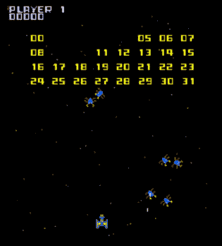

图 18.1：阵型敌人的数组索引

因此，我们每个 `FormationEnemy` 只需要一个字节即可告诉我们它是否存在以及绘制何种形状：

```c
typedef struct {
    byte shape; // 形状代码
} FormationEnemy;
```

攻击型敌的状态更为复杂。它们具有任意的 X 和 Y 坐标，可以在多个方向飞行。我们还想追踪它们的原始阵型索引，以便它们返回原始位置。`AttackingEnemy` 结构体看起来如下：

```c
// 长度应该是 2 的幂次方
def struct {
    byte index; // 阵型索引
    byte shape; // 形状代码
    word x; // X 位置 (* 256)
    word y; // Y 位置 (* 256)
    byte dir; // 方向 (0-31)
    byte returning; // 1 = 返回阵型
} AttackingEnemy;
```

`AttackingEnemy attackers[MAX_ATTACKERS];`

`unused` 字段用于填充结构体，使其长度恰好为 8 字节。通常情况下，旨在用于数组的结构体其长度为 2 的幂次方是最好的。（我们将在第 20 章中讨论这一点。）

你可能会问，既然我们的屏幕坐标高达 255，为什么 X 和 Y 坐标是 16 位的（`word` 类型）而不是 8 位的？这将被处理为 16 位的定点值。这意味着我们将值中的某些位视为小数。在这种情况下，我们认为整个低字节是其整数值的 1/256。这就像是在 16 位值的每个 8 位之间、两个字节之间放置了一个不可见的小数点：

```
Hi Byte Lo Byte
------
NNNNNNNN.ffff
```

## 18.1 绘制瓦片 (Tiles) 与精灵 (Sprites)

要将整数转换为定点值，我们只需向左移 8 位，这等同于乘以 256：

```c
xx = x << 8;
```

同样，我们可以通过右移 8 位来提取定点值的整数部分：

```c
x = xx >> 8;
```

我们的 C 编译器足够智能，知道当你将一个 16 位的值位移 8 位时，你只需要加载该值的高字节即可。因此，位移 8 位完全不需要任何额外时间。

如果我们需要小数值，只需提取低字节，可能可以使用位位掩码：

```c
xfrac = fpx & 0xff;      // 使用位掩码
xfrac = (byte)fpx;     // 同样
```

Galax 硬件一次只支持 8 个精灵，但我们希望在屏幕上有几十个敌人。硬件对此提供了一个聪明的解决方案：仅使用背景瓦片绘制阵型中的敌人，仅在敌人飞行时才使用精灵。

由于硬件支持列滚动（当屏幕旋转时，翻译为水平行的滚动），我们可以移动整行敌人从左向右。

我们可以让它足够无缝，以至于玩家不会注意到敌人何时从瓦片切换到精灵。

```c
void draw_row(byte row) {
    byte i;
    byte y = 4 + row * 2; // 计算行位置
    // 设置调色板项
    columns[y].attrib = 0x2;
    // 滚动位置（全局变量）
    columns[y].scroll = formation_offset_x;
    // 遍历所有敌人
    for (i=0; i<ENEMIES_PER_ROW; i++) {
        byte x = i * 3; // 行内位置
        byte shape = formation[1 + row+ENEMIES_PER_ROW].shape;
        // 此空间是否有敌人？
        if (shape) {
            putchar(x, y, BLANK); // 左侧
            putchar(x+1, y, shape-2); // 右侧
        } else {
            putchar(x, y, shape); // 左侧
            putchar(x+1, y, BLANK); // 右侧
        }
    }
}
```

为了节省 CPU 周期，我们逐行绘制阵型，每帧一行。阵型会左右缓慢移动，玩家不会注意到单行在移动。即使是玩家也可以用瓦片绘制——2x2 瓦片为我们提供了 16x16 的像素形状：

```c
columns[29].attrib = 1;
columns[30].attrib = 1;
vram[30][29] = 0x60;
vram[31][29] = 0x62;
vram[30][30] = 0x61;
vram[31][30] = 0x63;
```

## 18.2 攻击！

`get_attacker_x` 和 `get_attacker_y` 根据阵型索引计算精灵的 X 和 Y 坐标。这只需要找到行和列，然后进行乘法和加法：

```c
byte get_attacker_x(byte formation_index) {
    byte column = (formation_index % ENEMIES_PER_ROW)
    return FORMATION.XSPACE+column + formation.offset_x;
}
```

```c
byte get_attacker_y(byte formation_index) {
    byte row = formation_index / ENEMIES_PER_ROW;
    return FORMATION.YSPACE+row;
}
```


`$x \pmod y$` 计算除法的余数。在 8 位平台上，除非 `$y$` 是 2 的幂，否则这是一个缓慢的操作。


## 18.3 方向与三角函数

为了能够向任何方向飞行，我们需要跟踪旋转标志。沿向量移动 `$X, Y$` 单位，浮点运算开销很大，因此我们将使用查找表。我们的查找表有 32 个值，对应每个角度：

```c
#define FLIPX 0x40
#define FLIPY 0x80
#define FLIPXY 0xc0

const byte DIR_TO_CODE[32] = {
    0, 1, 2, 3, 4, 5, 6,
    6|FLIPXY, 5|FLIPXY, 4|FLIPXY, 3|FLIPXY, 2|FLIPXY,
    1|FLIPXY, 0|FLIPXY,
    0|FLIPX, 1|FLIPX, 2|FLIPX, 3|FLIPX, 4|FLIPX, 5|FLIPX,
    6|FLIPX, 6|FLIPX,
    6|FLIPXY, 5|FLIPXY, 4|FLIPXY, 3|FLIPXY, 2|FLIPXY,
    1|FLIPY, 0|FLIPXY
}; // 注意：我们只有 7 个旋转位图，而不是 8 个
```

我们的 `$sin$` 和 `$cos$` 例程变得简单：

```c
signed char isin(byte dir) {
    return SINTBL[dir & 31];
}

signed char icos(byte dir) {
    return SINTBL[(dir + 16) & 31];
}
```

`$X := X + isin(dir) * D;$`

`$Y := Y + icos(dir) * D;$`

## 18.4 外星人行为

我们希望让外星人在攻击时表现出某种不可预测的行为——冲下屏幕，然后转向侧面，一边移动一边投弹。通过少量实验，只需观察外星人的位置即可轻松实现。当它在屏幕上半部分时，我们进行旋转。当它到达下半部分时，我们开始投弹。根据它是在屏幕的左侧还是右侧来决定旋转方向。

```c
// 将定点转换为整数
byte x = a->xx >> 8;
byte y = a->yy >> 8;
// 如果在屏幕上半部分，旋转敌人
// 但在玩家爆炸后不要发射导弹
if (y < 128 || player.exploding) {
    // 屏幕左半部分？
    if (x < 112) {
        a->dir++; //顺时针旋转
    } else {
        a->dir--; // 反时针旋转
    }
} else {
    // 在屏幕下半部分
    // 发射导弹，如果槽位可用
    if (missiles[i].ypos == 0) {
        missiles[i].ypos = 245-y;
        missiles[i].xpos = x+8;
        missiles[i].dy = -2; // 速度
    }
}
```

## 18.5. 返回阵型

我们希望外星人可以使用相同的基于方向的算法平滑地回到它们在阵型中的先前位置，但这非常棘手。因此我们将采取捷径，在外星人返回时使用不同的移动模式（我们将此标志位标记为 `returning`）。

在 `move_attackers` 函数中，我们根据这个标志位选择另外两个函数之一：

```c
if (a->returning)
    return_attacker(a);   // 返回阵型
else
    fly_attacker(a);      // 飞行
```

在 `fly_attacker` 中，我们检查外星人是否绕过了屏幕底部，如果是，则设置 `returning` 标志位：

```c
if ((a->yy >> 8) == 0) { // 从定点转换
    a->returning = 1;
}
```

在 `return_attacker` 中，我们缓慢地将外星人降至位置，将其 X 坐标精确设置为所需位置，并缓慢向下移动 Y 坐标。我们还旋转外星人，使其看起来像是正在翻转进入它的空间：

```c
void return_attacker(AttackingEnemy* a) {
    byte fi = a->index-1;
    byte destx = get_attacker_x(fi);
    byte desty = get_attacker_y(fi);
    byte ydist = desty - (a->yy >> 8); // 到槽位的距离
    // 是否已到达阵型槽位？
    if (ydist == 0) {
        // 转换回阵型敌人
        formation[fi].shape = a->shape;
        a->index = 0; // 禁用攻击者
    } else {
        // 接近槽位，设置位置和旋转
        a->dir = (ydist + 16) & 31;
        a->x = destx << 8;
        a->yy += 128;
    }
}
```

## 18.6. 导弹

当外星人到达目标 Y 坐标时，我们将其转换回阵型敌人——它将不再是一个精灵（sprite），但将再次作为一对背景瓷砖绘制。

绘制导弹是简单的，因为它们在硬件中像精灵一样作为独立的图形实体受支持。我们无法从对象 RAM 段读取数据，因此我们必须定义自己的“影子”数组：

```c
typedef struct {
    signed char dx; // X 轴变化
    byte xpos;      // X 坐标
    signed char dy; // Y 轴变化
    byte ypos;      // Y 坐标
} Missile;

Missile missiles[8];
```

我们将使用 `dy` 作为导弹的 Y 位置（速度和方向）。导弹的 Y 坐标与精灵相反，因此位置 0 是屏幕底部。我们使用 0 来表示导弹槽位是“可用的”，因为它也处于非活动状态。

以下是每帧移动导弹的例程：

```c
void move_missiles() {
    byte i;
    for (i=0; i<8; i++) {
        if (missiles[i].ypos) {
            // 移动导弹，并检查是否撞击屏幕顶部
            missiles[i].ypos += missiles[i].dy;
            if ((byte)missiles[i].ypos < 4) {
                missiles[i].xpos = 0xff; // 隐藏非活动
                missiles[i].ypos = 0;
            }
        }
    }
    // 将所有“影子导弹”拷贝到视频内存
    memcpy(missiles, missiles, sizeof(missiles));
}
```

## 18.7. 爆炸外星人

我们使用 `memcpy` 将“影子导弹”数组拷贝到对象 RAM。我们设置 `Missile` 结构体，使其与对象 RAM 中的相同，但我们使用了那两个未使用的字节。

由于导弹的速度各异，当它距离底部 4 个像素时，我们会隐藏导弹（向上飞行的导弹会绕到底部，然后被隐藏）。

> `(type)` 表达式

> 将表达式转换为类型 `type`。这是给编译器的信号，将表达式视为给定的类型。如果不允许类型转换，编译器将产生错误。

注意以下表达式：

`((byte)missiles[i].ypos < 4)`

注意表达式开头的 `(byte)`。这被称为类型转换。在我们的导弹结构体中，`ypos` 字段是无符号的，而 `dy`是有符号的。在 C语言中，这会导致加法结果。由于有符号字节的范围仅为 -128 到 127，在屏幕中间就会导致有符号字节溢出！我们在比较之前将此表达式转换为 `byte`，以便获得 0-255 的范围，并利用整数溢出的特性。（我们将在第 20 章中详细讨论这一点。）

我们预留了一个专门的精灵用于爆炸的外星人，当外星人爆炸时，我们在任何需要的地方激活它：

```c
void blowup_at(byte x, byte y) {
    vsprites[6].color = 1; // 色调
    vsprites[6].code = 28; // 爆炸
    vsprites[6].xpos = x;
    vsprites[6].ypos = y;
}
// ... 此省略重复的赋值代码 ...
```

## 18.8. 游戏音效

我们使用局部变量在屏幕上设置一个大声音：

```c
void set_sounds() {
    // 音效逻辑
}
```

在 AY-3-8910 上播放音乐只是在正确的时间设置正确的频率的问题（所有的音乐不都是如此吗？）

> 要想在 8bitworkshop.com 上查看：选择 VIC Dual 平台，然后选择 Music Player 文件。

## 19.1 击中准确的音符

首先，我们需要创建一个表格，将音符映射到它们对应的周期寄存器值（period register values）。如果我们把标准 88 键钢琴上的第一个键记为 1，那么音符的频率由以下方程给出：

`$F_{A4} = \frac{2(\text{note}-49)}{12}$`

A4 是中音 C 之上音符 A 的频率，通常被称为 A4 或 A440，因为它的标准频率是 440 Hz。

由于音调周期寄存器（Tone Period register）只能存储整数值，我们无法获得完全音准的音音符。随着音高的升高，调准误差会迅速增加，因为整数除数越来越接近零。

然而，我们可以为 A4 选择一个值，以最小化特定音高范围内的调准误差。通常情况下，我们必须牺牲高频的精度来获得更准确的低频。对比下面的两张图，可以看到选择 A4 = 440.5 如何让音符 49 及以下的音更准确：

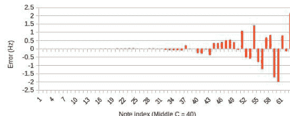

注 19.1：440.0 Hz 下的音频误差

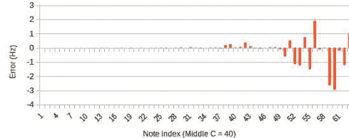

图 19.2：440.5 Hz 下的音频误差

我们提供了一个 Python 脚本 `mknotes.py`（见第 30 章），它可以为给定的音符范围计算最佳 A4 值，然后生成包含所有音符周期器值的 C 数组。它的第一个参数是需要优化的最高音，第二个参数是要输出的音符数量。例如：

```python
mknotes.py 49 64
```

## 19.2 编写乐谱

现在我们只需要按顺序列出想要播放的音符，对吧？

```c
const byte music_score_all_at_once[] = {
  0x2c, 0x0d, 0x2e, 0x2f, 0x2e, 0x2c, 0x12 ...
};
```

别急！我们还需要知道每个音符或每组音符之间经过了多久。如果高位被设置，我们将该字节解码为持续时间。当遇到持续时间字节时，我们会暂停给定的视频帧数（即 `duration/60` 秒），同时保持正在播放的音符不变。

```c
const byte music_score[] = {
0x2c, // 音符 44
0x81, // 持续 1
0x0d, // 音符 13
0x8d, // 持续 13
0x2e, // 音符 46
0x2f, // 音符 47
0x86, // 持续 6
};
```

AY-38910 PSG 只有 3 个通道，所以当有 3 个音在播放时，我们只能尝试播放第 4 个音，我们要么忽略它，要么选择一个正在播放的音来中断它。

## 19.3 随节奏摇动

首先，我们需要追踪三个 PSG 声道。目前，我们只需要跟踪每个声道的音量：

```c
struct {
  byte volume;
} voice[3];
```

每一帧都会调用 `play_music` 来更新 PSG 值。首先它设置每个通道的音量，每帧递减一次以产生“拨奏音”（pizzicato）效果：

```c
void play_music() {
  byte ch;
  byte enable = 0; // 通道启用标志
  byte free = 0; // 空闲通道
  byte chmask = 1; // 当前通道的启用标志
  for (ch=0; ch<3; ch++) {
    if (voice[ch]).volume -- {
      set89910(AY_ENV_VOL_A+ch, voice[ch].volume--);
      enable |= chmask; // 启用通道
    } else {
      freech = ch; // 此通道是空闲
      chmask <<= 1; // 下一个通道的启用标志
    }
  }
}
```

`enable` 变量跟踪正在播放的通道，我们将用它设置启用寄存器：

```c
set8910(AY_ENABLE, ~enable); // 设置通道标志
```

每当我们看到空闲通道时还会更新 `refresh`，这样当我们播放新音时，就知道该用哪个通道。

下一步是播放新音。如果 `cur.duration` 为零，我们从音乐数据中获取下一个字节。如果它的高位被设置，我们更新 `cur.duration`。否则，它是一个音符值，我们在 `note.table` 中查找其值并设置对应通道的 Tone Period，同时在 `voice` 数组中设置新的音量：

```c
if (music_ptr) {
    ch = freech; // 第一个空闲通道
    while (cur.duration == 0) {
        note = next_music_byte(); // 获取下一个音乐字节
        if (note & 0x80) { // 高位设置 = 音符
            int period = note_table[note & 63]; // 设置音高
            set8910(AY_PITCH_LO+ch*2, period & 0xff);
            voice[ch].volume = 15; // 设置音量
            ch = ch - 1; // 使用下一个通道
        } else {
            if (note == 0xff) { // 歌曲结束
                music_ptr = NULL;
            }
            cur_duration = note & 63; // 设置持续时间
        }
    }
    cur_duration--;
}
condition ? expr1 : expr2; // 如果 condition 为真执行 expr1，否则执行 expr2。
```

## 19.4 创作音乐

但音乐数据来自哪里？我们创建了一个 Python 脚本 `midi2song.py`（见第 30 章），可以将 MIDI 文件转换为数组。首先传递文件名：

```bash
$ python midi2song.py morning.mid

<midi file 'morning.mid' 1, tracks, 26 messages>

Track 0: (5)

Track 1: (5)

Track 2: (4)

Track 3: (2)

Track 4: (3)
```

你可能会看到一个轨道或多个轨道。括号中的数字是每个轨道使用的 MIDI 通道。转换文件时传递逗号分隔的通道列表。例如，我们可能想转换通道 1、2 和3：

```bash
$ python midi2song.py morning.mid 1,2,3
```

脚本将解析 MIDI 文件并输出一个可以复制到源文件的数组。你还可以传递第三个参数，按所需的半音偏移 MIDI 音符（负值为降）。

## 19.5 需要文件吗？

Mutopia Project (mutopia.org) 有从乐谱转换而来的公共领域 MIDI 文件。Scott Joplin 作品非常适合游戏。

## 19.6 Scramble/Frogger 声板

这些游戏使用带有独立 Z80 CPU 和 AY-3810 PSG 的独立声板¹

| 起始 | 结束 | 描述 |
| :--- | :--- | :--- |
| `$0000` | `$3FFF` | 程序 ROM |
| `$4000` | `$43FF` | RAM |
| `$6000` | `$FFFF` | 滤波器网络（未模拟） |
| I/O Port | | 描述 |
| `$10` | | PSG 1: 读写寄存器 0-15 |
| `$20` | | PSG 1: 选择寄存器 0-15 |
| `$40` | | PSG 2: 读写寄存器 0-15 |
| `$80` | | PSG 2: 选择寄存器 0-15 |

**表 19.1：Scramble/Frogger 声板内存映射**

PSG 2 寄存器 14 保存来自主 CPU 的命令。当此值变化时，会触发 RST 0x38 中断。

PSG 2 寄存器 15 是一个 1398.2 Hz 时器。在硬件中有一个复杂的序列，但在模拟器中，它简单地在 0 和 255 之间切换。

¹8bitworkshop IDE 对 soundkonami 平台的声板有一些初步支持，尽管我们不支持与游戏同步运行。

## 20 整数与你

这里有几个让你的整数心情愉快的小技巧。你会更快乐，你的整数也会感谢你。

## 20.1 2 的幂

出于许多原因，计算机（以及计算机程序员）非常喜欢处理 2 的幂。这是自然现象，因为长度为 N 位的二进制数可以存储 `$2^N$` 个不同的值。大多数 C 编译器在处理 2 的幂时也知道二进制数的特性。例如，我们可以通过将位左移一位将数字乘以 2：


`x <<= 1;` // 等于 `x *= 2`

左移 N 位等于乘以 $2^N$：

```c
x <<= 2; // 等于 x *= 4
x <<= 3; // 等于 x *= 8
```

我们也可以通过右移在某种程度上除以 2 的幂：

```c
x >>= 1; // 等于 x /= 2
x >>= 2; // 等于 x /= 4
```

我们之所以说“某种”，是因为舍入。对于无符号数，右移除法会将数字向零取整：

| 二进制 | 十进制 |
| :--- | :--- |
| 00001010 | 9 |
| 00000101 | 5 |
| 00000010 | 2 |
| 00000001 | 1 |
| 00000000 | 0 |

对于有符号数，右移操作使用符号扩展，在移位期间保持高位完整，从而使负数保持为负数：

| 二进制 | 十进制（补码） |
| :--- | :--- |
| 11110111 | -9 |
| 11110101 | -5 |
| 11111101 | -3 |
| 11111110 | -2 |
| 11111111 | -1 |

## 20.2 无符号比较

考虑以下情况：你有一条从坐标 $a$ 开始、宽度为 $w$ 的水平线。你需要判断点 $x$ 是否与该线相交。

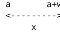

看起来非常简单，对吧？这里有一种你可以实现它的方法：

```c
char in_range(byte x, byte a, byte w) {
    return x >= a && x <= a+w;
}
```

你也可以这样写：

```c
char in_range(byte x, byte a, byte w) {
    return x-a >= 0 && x-a <= w;
}
```

这两种方法都有效，但并不是最优的。这是由于 C 语言的整数转换规则导致的。8 位值在进行加或减运算时，整数提升（integer promotion）会先将它们转换为 16 位值。Z80 并没有 16 位的加法、减法或比较指令——因此编译后的代码会更大。

以下方法只需要一次比较，且完全对 8 位值操作：

```c
char in_range(byte x, byte a, byte w) {
    return (byte)(x-a) <= w;
}
```

注意，我们在比较之前将 `(x-a)` 强制转换为 `byte`（即无符号字符 `char`）。由于所有值都是 8 位数值，没有必要提升到 16 位。因此，生成的代码要小得多。

## Atari 矢量硬件

## 21.1 历史

矢量游戏的历史始于 PDP-1 计算机和由 Steve Russell 在麻省理工学院（MIT）于 1962 年开发的名为《Spacewar!》的游戏。PDP-1 的 Type 30 CRT 甚至比街机矢量显示器还要原始，它只能绘制单个点，不能画线。另一位 MIT 学生 Larry Rosenthal 使用自制的 CPU 和带画线的矢量显示 CRT 重新制作了这个游戏。Cinematronics 公司购买了这项技术，并在 1978 年以《Space Wars》名发布了该游戏。

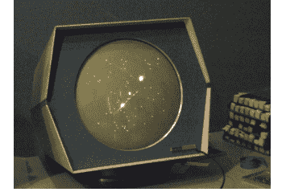

Atari 最初对 Rosenthal 的技术并不感兴趣，但明年，他们发布了一个名为《Lunar Lander》的矢量游戏。它的灵感来源于一个早期的 DEC 用于推广其矢量图形终端的 Demo——而该 Demo 本身灵感来自一个用早期解释语言 FOCAL 编写的文本模拟器（LEM）。

《Spacewar!》随后启发了热门游戏《Asteroids（小行星入侵）》。Atari 的 Ed Logg 对飞船使用了相同的 Basic 控制方案，包括跳跃空间键。

## 21.2 矢量显示器的工作原理

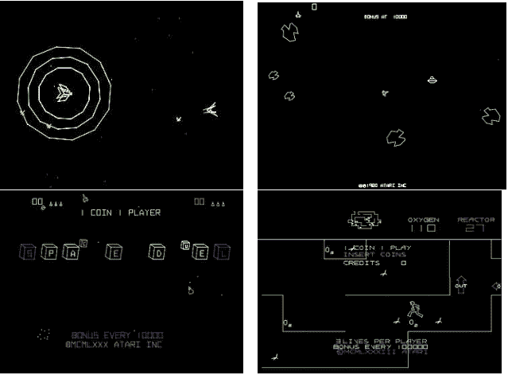

图 21.2：Cinematronics 的《Star Castle》，以及 Atari 的《Asteroids Deluxe》、《Space Duel》和《Major Havoc》。

后来，Atari 为充满色彩的《Tempest》开发了 RGB 彩色矢量技术，并为《Space Wars》的街机版开发了 3D 线框图图形。

独特的 Vectrex 游戏主机将黑白画面带入了客厅，但到 1985 年它就停产了。街机运营商也厌倦了繁琐且昂贵的矢量显示器，此后没有再生产新的矢量游戏了.¹

绝大多数街机显示器是光栅扫描式的——它们像电视机一样以规律模式在整个帧上扫描电子束。矢量显示器（或当时被称为“随机扫描”）可以将电子束导向屏幕上的任何位置。

> ¹2015 年，68 Crew 发布了 VEC9，这是一款使用旧版《Asteroids》矢量显示器的独特街机游戏。

它可以在黑色背景上绘制精确的线条和亮点，就像示波器的显示一样。

矢量显示器以难搞和容易出问题著称。如果电子束静止太久，荧光可能会“烧屏”并在屏幕上留下一个点——有时甚至直接烧穿玻璃。

早期黑白 Atari 游戏中的矢量显示器由一种称为数字矢量生成器（DVG）的自定义电路控制。该电路是一个原始处理器，从内存中获取指令并将其转换为在矢量显示器上画线的信号。

CPU 在 RAM 的一个特殊区域填充 DVG 指令（有些也位于 ROM 中，作为子程序使用），并告诉 DVG 开始绘图。当 DVG 完成后，它准备好处理下一组指令。

模拟矢量生成器（AVG）在后来的彩色游戏中取代了 DVG，增加了颜色支持、额外的缩放效果并稍微简化了矢量指令。AVG 是我们模拟彩色游戏时将使用的模型。

## 21.3 模拟矢量生成器 (AVG)

像 CPU 一样，AVG 获取操作码并将其解码以确定下一步执行什么操作。AVG 处理的是 16 位字，而不是 8 位字节。高 3-4 位决定操作类型。其余位是参数。（一个指令 VCTR 需要一个额外的字。）

AVG 指令列表如下：

| 指令 | 说明 | 格式 (字) |
| :--- | :--- | :--- |
| VCTR | 从当前光束位置画到相对位置，该位置由相对于当前位置的 X 偏移和 Y 偏移定义。Y 偏移是 12 位有符号数值，因此范围可以从 -$1000 (-2096) 到 $FFF (4095)。实际长度取决于屏幕。 | 00YYYYY |
| HALT | 停止 | 00000 |
| SVEC | 绘制相对矢量 | 01YYYYY |
| STAT | 新颜色 | 01100 |
| SCAL | 新缩放 | 0111LL |
| CNTR | 置中 | 110000 |
| JSRL | 跳转到子程序 | 10AAAA |
| RTSL | 返回子程序 | 110000 |
| JMPL | 跳转到地址 | 11AAAAAA |

> （注：原文 AVG 表格部分存在严重的逻辑混乱和重复描述，翻译已尽可能保留原始格式结构）

## 21.4 Z80 内存映射

Atari 矢量游戏使用 6502 CPU，并且不同的游戏有不同的内存映射。

> 为了在模拟器上进行 C 语言编程，我们将创建一个假设的 Z80 架构。我们需要对原始的 6502 硬件进行微调。

> 我们还将把 AVG 的 ROM 替换为 RAM 以方便编程，总共 16KB 可寻址 AVG RAM。

| 起始 | 结束 | 描述 | 读写 |
| :--- | :--- | :--- | :--- |
| $0000 | $7FFF | 程序 ROM | 读 |
| $8000 | $8003 | 按钮输入 | 读 |
| $8000 | $800F | POKEY 1 | 写 |
| $8010 | $801F | POKEY 2 | 写 |
| $8100 | $810F | 乘法框 | 读写 |
| $8840 | | AVG 运行直到停止 | 写 |
| $8880 | | AVG 重置 | 写 |
| $A000 | $DFFF | AVG ROM | 读 |
| $E000 | $FFFF | 通用 RAM | 读写 |

## 21.5 AVG C 常程

> 在 8bitworkshop.com 上查看：选择 Atari Color Vector (Z80) 平台，然后选择 Vector Fonts 文件。

首先，我们声明 AVG 在地址 $A000 处使用的 4096 个 16 位字：

```c
word _at(0xA000) dvgram[0x1000];
```

我们的库将顺序地向此数组写入 16 位字，因此我们需要一个数组索引：

```c
int dwgwrofs; // DVG 缓冲区的写入偏移量
```

当我们想要写入一帧新的 AVG 数据时，我们使用 `dvgreset` 重置此索引：

```c
inline void dvgreset() {
  dwgwrofs = 0;
}
```

我们调用 `dvgwrite` 向数组写入一个字：

```c
void dvgwrite(word w) {
  dvgram[dwgwrofs++] = w;
}
```

现在我们定义一个写入每种类型操作码的函数。那些没有参数的非常简单：

```c
inline void RTSL() {
  dvgwrite(0xC000);
}
```

```c
inline void CNTR() {
  dvgwrite(0x8000);
}
```

```c
inline void HALT() {
  dvgwrite(0x2000);
}
```

只有单个参数的操作码仍然非常简单，我们只需要将参数与操作码位进行或（OR）运算即可：

```c
inline void JSRL(word offset) {
  dvgwrite(0xa000 | offset);
}
```

```c
inline void JMPL(word offset) {
  dvgwrite(0xe000 | offset);
}
```

```c
inline void SCAL(word scale) {
  dvgwrite(0x7000 | scale);
}
```

其他带有多个参数的操作码非常复杂，涉及大量的移位和使用 AND (&) 运算符进行的掩码操作：

```c
enum {
  BLACK, BLUE, GREEN, CYAN, RED, MAGENTA, YELLOW, WHITE
} Color;
```

```c
inline void STAT(byte rgb, byte intens) {
  dvgwrite(0x6000 | ((intens & 0xf)<<4) | (rgb & 7));
}
```

```c
inline void VCTR(int dx, int dy, byte bright) {
  dvgwrite((dy & 0x1fff) | ((bright&7) << 13) | (dx & 0xffff));
}
```

```c
inline void SVEC(signed char dx, signed char dy, byte bright) {
  dvgwrite(0x4000 | (dx & 0x1f) | ((bright&7)<<5) | ((dy & 0x1f)<<8));
}
```

我们甚至还有一个用于启用“闪烁”效果的函数：

```c
inline void STAT_sparkle(byte intens) {
  dvgwrite(0x6800 | ((intens & 0xf)<<4));
}
```

启动 AVG 并执行列表中的指令，我们调用 `dvgstart`：

```c
byte __at(0x8840) _dvgstart;
inline void dvgstart() {
  _dvgstart = 0;
}
```

> 在我们的模拟器中，我们并不监听 AVG 的 HALT 信号——我们假设所有向量都是瞬间绘制的。

在实际硬件上，你可能会在 AVG 运行时进行一些非常重要的计算，然后等待 HALT 信号后再处理下一批向量。更好的做法是，你可以在两个 AVG 缓冲区之间切换，在绘制其中一个时填充另一个。

## 22 3D 向量

第一批 3D 街机游戏于 1976 年问世——世嘉的 *Fonz* 展示了在道路上行驶的摩托车的第三人视角，而雅达利的 *Night Driver* 则显示了夜晚道路标记的极简主义第一人视角。

在 1980 年的 SIGGRAPH 会上，波音员工 Loren Carpenter 演示了一部名为 *Vol Libre* 的短片，它描绘了计算机生成的分形景观的飞越过程——后来被重新用于《星际迷航：可汗之战》中的“创世纪星球”序列。（Loren 后来共同创立了 Pixar。）这在当时是顶尖技术，这样一部只有两分钟的电影需要巨大的计算资源。

与此同时，游戏中的实时 3D 图形刚刚起步。家用电脑正在运行 subLOGIC 的《飞行模拟器》。雅达利的 *Battlezone* 和 *Red Baron* 以其 3D 矢量图形技术在街机中引起了波澜。

> 在 8bitworkshop.com 上查看：选择 Atari Color Vector (Z80) 平台，然后选择 3D Transformations 文件。

## 22.1 3D 类型

我们没有浮点硬件（我们可以在软件中模拟它，但速度会慢到无法游玩），因此我们对所有内容都使用定点整数类型。


我们用 X、Y 和 Z 值定义 3D 坐标，并且既需要 8 位也 16 位的 3D 向量（即坐标——数学意义上的向量，而不是矢量图形意义上的向量）：

```c
typedef struct {
  sbyte x,y,z;
} Vector8; // 8 位有符号 XYZ 向量
```

```c
typedef struct {
  int x,y,z;
} Vector16; // 16 位有符号 XYZ 向量
```

## 22.4 变换

要使用矩阵旋转 3D 坐标，我们使用以下函数：

```c
void vec_transform2(Vector16* dest, const Vector8* v,
    const Matrix* m) {
    dest->x = v->x*m->m[0][0] + v->y*m->m[0][1] + v->z*m->m[0][2];
    dest->y = v->x*m->m[1][0] + v->y*m->m[1][1] + v->z*m->m[1][2];
    dest->z = v->x*m->m[2][0] + v->y*m->m[2][1] + v->z*m->m[2][2];
}
```

我们只使用从 -86 到 86 之间的 3D 坐标值。为什么？为了避免计算时发生溢出。对于 3D 变换，我们为每个坐标计算三个乘法之和。我们的矩阵系数高达 127，因此 86 是我们的矩阵中允许的最大值，直到它们溢出 16 位有符号整数（127*86*3 = 32766 < 32767）。

我们的变换函数是一个相当缓慢且臃肿的程序。我们可以使用自定义的仿真数学硬件做得更好，我们将在接下来描述它。

## 22.5 Mult 法盒 (Mult Box)

6502 CPU 没有乘法或除法指令，这些必须通过软件程序进行模拟——这非常慢。

为了加速 3D 计算，Atari 矢量游戏（从《战场》和《红男爵》开始）使用了一种名为“Math Box”的自定义电路，该电路围绕四个 AMD 2901 位切片处理器构建.¹¹ 它能够执行 16 位乘法，除法的速度比 Z80 CPU 快得多。

Cinematronics 游戏也使用了这些芯片。

> ¹¹Cinematronics 中的硬件布线 CPU

我们的模拟器没有精确模拟 Math Box，但它有一个类似的东西，我们将其设计得易于使用。我们称之为“Mult Box”，它具有以下地址：

| 地址 | 描述 |
| :--- | :--- |
| $8100-$8101 | 16 位和 |
| $8102 | 8 位被乘数 A |
| $8103 | 8 位被乘数 B |
| $8104-$8105 | 16 位除数 (sum / A) |
| $810F | 计算 sum += A * B (脉冲) |

要进行乘积之和，首先将 $8100 处的 16 位值设置为 0。对于每个乘积，将 $8102 设置为第一个被乘数，将 $8103 设置为第二个被乘数，然后触发 $810F。乘法将开始，乘积将加到 16 位和中。完成后，读取 $8100 处的 16 位和。

Mult Box 也可以进行除法。在我们更新 sum 之前，它会计算 16 位除数 sum/A 并将其存储在 $8104。

使用 Mult Box，我们的变换如下：

```c
inline void mul16(byte a, sbyte b) {
    mathbox_arg1 = a;
    mathbox_arg2 = b;
    mathbox_go_mul=0; // mathbox_sum += a * b
}
```

```c
void vec_mat_transform(Vector16* dest, const Vector8* v, const Matrix* m) {
    byte i;
    // 拷贝一个指向目标向量第一个元素的指针，
    // 以及一个指向矩阵第一个元素的指针。
    int* result = &dest->x;
```


```
const signed char* mval = &m->m[0][0];

// 遍历所有 3 个矢量元素 (x, y, z)

for (i=0; i<3; i++) {

    mathbox_sum = 0; // 将和重置为0

    mul16(*mval++, v->x);

    mul16(*mval++, v->y);

    mul16(*mval++, v->z);

    *result++ = mathbox_sum; // 获取最终和，存储

}

}
```

## 游戏：拥挤轨道 (Crowded Orbit)

现在我们将利用学到的关于矢量图形和 3D 变换的知识制作一个真正的游戏。你是一个非常拥挤轨道上飞船的船长，你必须通过发射来清除太空垃圾，并避免被它们撞碎。

> 在 8bitworkshop.com 上查看：选择 Atari Color Vector (Z80) 平台，然后选择 Space Game 文件。

## 23.1 形状预渲染 (Shape Prerendering)

绘制单个矢量需要大量的 CPU 时间，特别是当涉及旋转和 3D 变换时，因此我们将通过预渲染来提高速度。

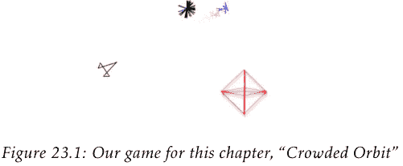

在大多数矢量游戏中，预渲染是由“真实”计算机离线完成并刻录到 ROM 中的。预渲染软件可以非常先进，例如执行隐藏线消除，而我们将在在这里这样做。

(注：原文后续部分存在大量重复，此处已按逻辑流进行整合。)

## 23.4 移动 Actor

每个 Actor（实体）都有自己的颜色和强度：

```
STAT(a->color, a->intensity);
```

现在我们根据 Actor 的当前角度绘制形状。`angshift` 成员根据预渲染的形状数量来设置——例如，对于 32 个形状，`angshift` 设置为 3 (256 >> 3 == 32)。然后，简单地从 `shapes` 数组中提取正确形状的地址并输出 JSRL（跳转到子程序）操作码：

```
JSRL(a->shapes[a->angle >> a->angshift]);
```

我们的游戏遵循惯性定律——运动中的物体将保持运动，直到施加外力为止。我们在 `velx` 和 `vely` 中保留 Actor 的当前定点速度，并通过向每个组件加上速度来更新位置：

```c
void move_actor(Actor* a) {

  a->xx += a->velx;

  a->yy += a->vely;

}
```

`xx` 和 `yy` 是整数，因此它们会在 $7FFF (32767)$ 和 $-8000 (-32768)$ 之间循环。

要给玩家飞船施加推力，我们计算飞船角度的正弦和余弦，然后将它们加到玩家的速度：

```c
void thrust_ship() {

  sbyte sin = isin(curship->angle);

  sbyte cos = icos(curship->angle);

  curship->velx += sin>>3; // 除以 8

  curship->vely += cos>>3; // 除以 8

}
```

此外，玩家飞船具有摩擦力，因此在释放推力后最终会漂移停止。这同时也给了它一个最大速度。我们对每个速度组件施加与自身正比的反力：

```c
int apply_friction(int vel) {

    int delta = vel >> 8;      // 除以 256

    if (delta == 0 && vel > 0) // 确保力不为零

        delta++;

    return vel - delta;      // 去力

}
```

我们确保只要速度组件不为零，任何轴上的力就不为零，这样飞船最终会停止。这可能导致飞船在停止时于沿 X 轴或 Y 轴滑动，因为通常一个组件会在另一个组件之前清零。

## 23.5 使用 malloc() 分配内存

到目前，我们将游戏对象存储在全局内存的固定大小数组中。对于这个游戏，我们将 Actor 存储在动态内存（即堆）中，并通过一种链链表的数据结构来访问它们。

首先，让我们谈谈内存分配。我们见过两种类型的分配：静态分配（全局变量）和栈分配（局部变量）。对于这两种类型，编译器都负责分配和释放——对于全局变量，它们只是在内存中被预留了一个位置。

我们可以使用 `malloc` 在堆中分配固定数量的字节，传递对象的大小：

```c
malloc(sizeof(Actor))
```

`malloc` 函数返回指向分配内存块的指针，如果由于堆空间不足导致失败，则返回 `NULL`。要使用返回的指针，我们可以这样操作：

```c
Actor* a = (Actor*) malloc(sizeof(Actor));
```

## 23.6 链表

```c
struct Actor

first_actor -> struct Actor* next -> NULL
```

图 23.2：链表数据结构

`(Actor*)` 表达式是一个类型转换——它将无类型 `(void*)` 指针转换为类型 `(Actor*)` 指针，因为我们打算将分配的内存作为 `Actor` 结构体。

当我们不再需要分配的内存时，只需对 `malloc` 返回的指针调用 `free`：

```
free(a);
```

在使用 `malloc` 和 `free` 时，有几个需要注意的坑：

- **内存耗尽**：C 库分配有限部分的内存，称为堆。在我们的系统中，这是声明全局变量后剩余的 RAM。由于栈位于 RAM 的顶端，你可能会在耗尽内存之前遇到栈损坏。
- **悬空指针**：你可能在仍有指向该对象的指针时 `free()` 掉该对象。这通常会导致问题，特别是当被释放的对象空间被其他对象重用时。

如果我们有一个动态增长和收缩的对象列表，我们可能想要使用链表。

链表是由指针链接的对象链。每个对象指向序列中的下一个对象，最后一个对象指向 `NULL`。（`NULL` 指针是一个表示“没有指向任何项”的特殊值，它它通常是值 0。确保你没有想要指向地址 `0x0` 的内容！）

要遍历链表中的所有对象：从指向第一个对象的指针开始（该指针是单独保留的），然后沿着每个对象中的“next” 指针移动，直到得到一个 `NULL`。你将访问列表中的每个对象。

例如，我们可以将此应用到所有 Actor：

```c
Actor a = first_actor;

while (a != NULL) {

    draw(a);

    a = a->next;

}
```

（注：OCR 文本在 while 循环中是碎片化的，我根据标准的 C 模式和提供的片段重构了逻辑）

## 23.9 碰撞检测

如果硬件能检测两个向量何时交叉就太好了。遗憾的是，它做不到。因此我们仍然必须在软件中完成所有工作。

我们不会逐个向量进行操作，而是对 actor（实体）之间进行测试。我们必须遍历每一对可能碰撞的 actor，比较它们的位置以查看它们是否重叠。

碰撞检测程序通常使用一个简单的测试来判断对象是否应该视为移动，然后再进行更复杂的测试。边界框（Bounding box）测试是一种常用测试，因为它的计算非常简单。这会在每个 actor 周围放置一个大的矩形，只有当两个 actor 的边界框相交时，我们才会对它们进行进一步的碰撞测试。

我们在碰撞检测器中使用半径测试，因为我们所有的移动物体都是（大约）圆形的。规则是：如果一对对象中心之间的距离小于它们半径之和，则假设它们发生了碰撞。

我们如何计算距离？如果你还记得三角函数，直角三角形边边的长度公式为 $\sqrt{x^2+y^2}$。我们将其与我们的最小碰撞距离 *mindist* 进行比较。

然而，平方根的计算需要大量的 CPU 周期。相反，我们将对两项进行平方：我们将使用平方距离 $(x^2+y^2)$ 并与 *mindist* 进行比较。

由于乘法在我们的 8 位 CPU 上是昂贵的，我们在计算距离之前会进行一次初始测试，使用*曼哈顿距离*（Manhattan distance）——它只是 $(x+y)$。这个值始终大于或等于实际距离，因此可以用它来过滤候选对象。

每个 actor 还有一个 *collision_flags* 字段，我们可以根据类型来过滤候选对象。例如，玩家飞船设置一个标志，玩家导弹设置一个标志，障碍物设置一个标志。我们传递正在寻找的标志集，程序只会考虑与具有任何匹配标志的对象发生碰撞。

我们的主碰撞程序看起来像这样：

```c
if ((a->collision_flags & flags) && a->removed) {

    byte dx = abs(x1 - (a->xx >> 8)); // abs(x1-x2)

    byte dy = abs(y1 - (a->yy >> 8)); // abs(y1-y2)

    if (dx+dy < mindist) { // 检查曼哈顿距离

        word dist2 = get_distance_squared(dx, dy);

        if (dist2 < mindist2) { // d^2 < mindist^2

            if (fn) fn(act1, a); // 调用命中函数

                count++; // 增加命中计数

        }

    }

}
```

`get_distance_squared` 函数使用我们的硬件乘法器计算 (x² + y²)：

```c
inline word get_distance_squared(byte dx, byte dy) {

    textbox_sum = 0;

    mul6(dx,dx);

    mul6(dy,dy);

    return textbox_sum; // dx^2 + dy^2

}
```

注意，我们首先将坐标从 16 位固定点转换为 8 位整数（即右移 8 位），这样在相乘时就不会发生溢出。

## 23.10 主循环

首先，我们用 0x20 (HALT) 操作码填充 DVG RAM，以防我们搞砸了什么导致 DVG 进入死循环状态：

```c
memset(dvgram, 0x20, sizeof(dvgram)); // HALTs
```

现在，我们制作缓存形状。我们将 DVG 写入偏移量设置为 $0x800 并调用程序：

```c
dvgwrofs = 0x800;

make_cached_font();

make_cached_shapes();
```

然后我们创建游戏对象、障碍物和玩家飞船：

```c
create_obstacles(5);

new.player_ship();
```

现在我们的主游戏循环开始了。我们将循环，直到 actor 列表中只剩下一个 actor，这意味着我们清理了所有障碍物，只剩下玩家飞船（并且没有了子弹、导弹等）：

```c
while (!just_one_actor.left()) {
```

这个函数非常简单：

```c
byte_just_one_actor.left() {

    return first_actor && first_actor->next == NULL;

}
```

该函数还演示了 C 中逻辑运算符（如 && ||）的短路求值。逻辑表达式从左到右求值，如果左部分为假，则右部分将完全不会求值。这就是为什么我们在左侧检查 `first_actor` —— 为了防止右侧因评估空指针而导致程序崩溃（在 Z80 上不会崩溃，因为没有内存保护，但你会得到一个无意义的结果）。

在我们的主循环中，我们首先重置 DVG 写入指针以开始一个新的向量程序。然后调用 `control_player` 读取玩家输入并控制飞船，然后调用 `draw_and_update_actors` 来绘制、移动并处理所有的 actor：

```c
dvgreset();

control_player();

draw_and_update_actors();
```

现在我们执行 CNTR 使向量束居中：

```c
CNTR();
```

在等待 DVG 期间，我们调用任何启动：

```c
dvgstart();
```

在等待 DVG 期间，我们更新任何：

```c
remove_actors();
```

由于我们的循环小于一帧，我们增加：

```c
frame++;
```

由于我们的循环小于一帧，我们检查：

```c
while (frame & 0x3) {
```

由于我们的循环小于一帧，我们设置：

```c
watchdog = 0;
```

## 24 POKEY 芯片

POKEY（POtentiometer and KEYboard）接口出现在 Atari VCS/2600 上，由 Doug Neubauer 设计，他创作了 Star Raiders。Atari 制造了三个版本：单核、双核和四核。除了发出声音，它还可以读取杆、处理串口通信并生成随机数。

!img/bbb76aa345981663faffe7a93b60_177_0.png)图 24.1：POKEY（由 CC-SA 3.0）

## 24.1 内存映射

| 偏移 | 名称 | 描述 |
|---|---|---|
| $00 | AUDF1 | 通道 1 频率 |
| $01 | AUDC1 | 通道 1 控制 |
| $02 | AUDF2 | 通道 2 频率 |
| $03 | AUDC2 | 通道 2 控制 |
| $04 | AUDF3 | 通道 3 频率 |
| $05 | AUDC3 | 通道 3 控制 |
| $06 | AUDF4 | 通道 4 频率 |
| $07 | AUDC4 | 通道 4 控制 |
| $08 | AUDCTL | 音控制 |
| $0A | RANDOM | 随机数（只读） |

## 24.2 AUDCTL 位图

AUDCTL 寄存器配置 POKEY 的全局设置：

| 位 | 描述 |
|---|---|
| 0 | 时钟基准（0=64 kHz, 1=15 kHz） |
| 1 | 通道 2/4 高通滤波器 |
| 2 | 通道 1/3 高通滤波器 |
| 3 | 同步通道 4/3 |
| 4 | 同步通道 2/1 |
| 5 | 通道 3 时钟 1.79 MHz |
| 6 | 通道 1 时钟 1.79 MHz |
| 7 | 使用 9 位多段计数器 |

## 24.3 AUDUCx 位图

4 个通道中的每个通道都有自己的 AUDC 寄存器。AUDC 寄存器的低四字节设置了通道的 4 位音量。

## 24.4 设置 AUDF 频率

高位四位选择多项式，该多项式控制输出波形。

| 十进制 | 位 # 76543210 | 说明 | 周期 |
|---|---|---|--|
| XV | ....XXXX | 音量 (0-15, 0=关闭) | 噪声 |
| 0x | | 0000.... | 17位多项式 * 5位多项式 | 31 |
| 2x | 0010.... | 5位多项式 | 31 |
| 4x | 0100.... | 4位多项式 * 5位多项式 | 31 |
| 6x | 0110.... | 5位多项式 | 31 |
| 8x | 1000.... | 17位多项式 | 噪声 |
| Ax | 1010.... | 纯音 | 2 |
| Cx | 1100.... | 4位多项式 | 15 |
| 1x | xxx1.... | 波形模式 | |

在使用纯音时，每个通道的输出频率取决于 AUDCTL 中设置的位：

| 频率 | 条件 |
|---|--|
| 64 kHz | AUDCTL 位 0 清零 |
| 15 kHz | AUDCTL 位 0 置位 |
| 1.79 MHz | AUDCTL 位 6 置位 (ch1) 或位 5 (ch3) |

每个多项式的周期粗约决定了音调的可听频率，周期越小频率越高。

当 Fclock 为 64000 Hz 或 15000 Hz 时，输出频率 Fout 由此方程给出：

```
Frequency = \frac{Clock}{PolyPeriod \cdot (AUDF + 4)}
```

当使用 1.79 MHz 时钟时：

```
Frequency = \frac{1790000}{PolyPeriod \cdot (AUDF + 1)}
```

如果通道 1 和 2 同步（使用 AUDCTL 位 4），则两个通道的输出频率均为：

$Frequency = \frac{Clock}{PolyPeriod \cdot (AUDF2 \cdot 256 + AUDF1 + 7)}$

如果通道 3 和 4 同步，则输出频率为：

$Frequency = \frac{Clock}{PolyPeriod \cdot (AUDF4 \cdot 256 + AUDF3 + 7)}$

## 24.5 POKEY 音乐

通过使用两个 POKEY 并将对通道都设置为 16 位模式，你可以播放高精度的音乐音。这种技术类似于第 19 章中的技术。

> 要在 8bitworkshop.com 查看：选择 Atari Color Vector (Z80) 平台，然后选择 POKEY Music 文件。

## 其他 C语言主题

我们还没有涵盖几个高级 C 语言，所以我们在这里讨论它们。

## 25.1 联合体 (Unions)

在接下来的章节中，你可能会在类型定义中看到以下内容：

```
union {

    struct { sbyte dx,dy; } laser; // 激光方向

    struct { byte exploding; } enemy; // 敌人爆炸

}
```


这被称为联合体类型，它与结构体相似，区别在于它的字段在内存中不是连续的，而是所有字段在内存中重叠。这为互不共存的字段节省了空间。

在上面的示例中，激光有方向，敌人会爆炸，但我们不需要同时具备这两个属性的对象。因此，我们为每个对象类型定义一个结构体，并将它们都放在一个联合体中。

并没有检查机制来判断你是否正确使用了联合体，例如，你可以向激光结构体写入数据并从敌人结构体读取数据。但你可能不应该这样做。

## 25.2 大数

你可以使用`float`类型定义一个浮点值：

```
float floatval = 123.45;
```

它们被存储为 IEEE 单精度浮点数，占用 4 字节内存，范围从 $-10^{38}$ 到 $10^{38}$。它们只有 23 位精度，且在 8 位平台上计算非常慢，因此对 8 位游戏来说并不是很有用处。

`long`类型定义了一个 4 字节（32 位）整数类型，范围可以从 0 到 $2^{32} - 1$（无符号）。书中的所有示例在 16 位数字上运行良好良好——它们更快且占用的内存更少。

## 25.3 高级循环处理

我们在第 7 章中涵盖了退出循环的`break`关键字。还有一个`continue`关键字，它可以重启循环。它可以用于`for`和`while`语句。例如：

```
for (i=0; i<100; i++) {

  // 敌人正在睡觉?) 忽略它们

  if (enemy[i].is_sleeping) continue;

    ... 处理剩余的能量

}
```

还有一个`goto`语句，可以跳转到程序中其他地方定义的标签。这对于跳出多个嵌套循环非常有用，例如：

```
for (i=0; i<10; i++) {

  for (j=0; j<10; j++) {

    if (grid[i][j]) goto breakout; // 跳出循环

  }

// 只有在没有跳出循环时才执行此处

not_found();

breakout: // 这是一个标签

// continue
```

## 25.4 运算符优先级

学生们学习加法与乘法的优先级——例如，乘法的优先级高于加法，$1+2*3 = 1+(2*3)$。

C 有大量的优先级规则，通常通过出错来学习。还有运算符结合性，它决定表达式是从右到左还是从左到右分组。这里有一个几乎完整的运算符列表，优先级最高，最低在底部：

| 运算符 | 结合性 |
|---|---|
| 原始运算符 | 从左到右 |
| 一元运算符 | 从右到左 |
| `f()`, `a.b`, `x++`, `(type)` | 从左到右 |
| `*` `/` `%` 乘/除/取模 | 从左到右 |
| `+` `-` 加/减 | 从左到右 |
| `<<` 移位 | 从左到右 |
| `<` `<=` 关系运算符 | 从左到右 |
| `==` `!=` 等于/不等 | 从左到右 |
| `&` 位与运算符 | 从左到右 |
| `&&` `\|\|` 逻辑运算符 | 从左到右 |
| `?` 条件运算符 | 从右到左 |
| `=` `+=` 赋值 | 从右到左 |
| `,` 逗号 | 从左到右 |

一些通用提示：

- 使用时，使用括号。
- 当位操作与比较混合时要格外小心，$a \& b == 1$ 被解析为 $a \& (b == 1)$，这可能是你想要的。

## 26 硬件

### 26.1 历史

Eugene Jarvis 离开惠普为 Atari 制作弹机游戏，然后 Williams Electronics 聘佣他制作弹机游戏。他使用 Motorola 6800 CPU 通过 8 位数模转换器 (DAC) 制作奇怪的声音。

为 Williams 第一款视频游戏《Defender》设计的硬件团队设计了一种优雅的架构，将大部分权力（和责任）留给了软件开发者。《Defender》使用了缓冲区——类似于 Spaceaders，但是是全色的。缓冲区是 304 x 256 像素，每个像素 4 位（16 色色），占用 36 KB 内存——在 1980 年这很大。16 种颜色可以从 256 色 RGB 调色板中选择。


## 26.2 内存映射

由于任何硬件加速，Defender 的开发者通过稀疏视觉效果和巧妙技巧实现了闪电速度。对于《Joust》和《Robotron》等游戏，Greg Wegner 创建了一个自定义绘制器 (blitter)。这是一个强大的 4 MHz 副处理器，可以以当时惊人的速度向缓冲区绘制精灵和矩形——每秒移动近 1 MB 数据。《Robotron》拥有大量的精灵。被称为“特殊芯片”，成对工作，每个芯片处理 4 位（一个像素）。

Defender 是最早使用 Motorola 6809 CPU 的视频游戏之一。许多 Williams 游戏编写在 Motorola EXorciser 上，这是一种可以汇编 6800 和 6809 程序的早期桌面计算机。

> 我们适配模拟器以 Z80 运行 Williams 架构。它以 4 MHz 运行 CPU，这是 1981 年 Z80 芯片上可提供的速度。

| 起始 | 结束 | 说明 | 读写 |
|---|---|---|---|
| $0000 | $97FF | 分页切换（视频 RAM，程序 ROM） | r/w |
| $9800 | $BFFF | 通用 RAM | r/w |
| $C000 | $C00F | 视频调色板 | 写入 |
| $C804 | $C807 | 控制输入 | 读 |
| $C80C | $C80F | 控制输入 | 读 |
| $C900 | $C9FF | 分页选择 | 写入 |
| $CA00 | $CA07 | 位绘制器 | 写入 |
| $CB00 | | 视频计数器 | 读 |
| $CBFF | | 看门狗 | 写入 |
| $CC00 | $CFFF | NVRAM（诊断，高分） | r/w |
| $D000 | $FFFF | ROM | 读 |

## 26.3 分页 RAM/ROM

视频缓冲区太大，导致 16 位地址空间中留给 ROM 访问的空间不多。因此，RAM 和 ROM 通过分页切换在 $0000-$97FF 共存。写入始终进入 RAM，但读取取决于 $C900 处分页位的值来自 RAM 或 ROM。

读取视频内存并不频繁，但对于缓冲区之间的拷贝和某些检测程序有用。

## 26.4 视频缓冲区

> 要在 8bitworkshop.com 查看：选择 Williams (Z80) 平台，然后选择 Graphics Test 文件。

Williams 游戏的缓冲区是不典型的；虽然显示器是水平安装的¹，因此扫描线是水平的，但内存中连续的字节在屏幕上向下排列。

每个字节包含两个像素——左侧高四位，右侧低四位。每个 4 位像素映射到 16 色调色板。

它在 C 中定义为 152 x 256 的字节数组：

```
byte __at (0x0) vidmem[152][256];
```

在一个字节中写入两个像素非常简单：

```
vidmem[x][y] = 0x77;
```

¹除了 Joust 2。

## 26.5. 调色板

| | $0000 | | $0100 | | $0200 | |
|---|---|---|---|---|---|---|
| +00 | 7654 | 3210 | 7654 | 3210 | 7654 | 3210 |
| 01 | 7654 | 3210 | 7654 | 3210 | 7654 | 3210 |
| 02 | 7654 | 3210 | 7654 | 3210 | 7654 | 3210 |
| 03 | 7654 | 3210 | 7654 | 3210 | 7654 | 3210 |
| 04 | 7654 | 3210 | 7654 | 3210 | 7654 | 3210 |
| 05 | 7654 | 3210 | 7654 | 3210 | 7654 | 3210 |
| 06 | 7654 | 3210 | 7654 | 3210 | 7654 | 3210 |
| 07 | 7654 | 3210 | 7654 | 3210 | 7654 | 3210 |

图 26.2：Williams 帧缓冲区像素布局

如果颜色是分开提供的，可以通过位掩码（bit-masking）来实现：

```
byte pixels = 0;

pixels |= (left_color << 4); // 设置左像素

pixels |= (right_color & 0xf); // 设置右像素

vidmem[x][y] = pixels; // 写入视频内存
```

由于分页切换（bank-switching），在不影响相邻像素的情况下设置屏幕上单个像素要复杂得多。你必须将函数位于上层 ROM 段，以便安全地从帧缓冲区读取。直接使用位混合芯片（bit blender chip）对此会简单得多，我们稍后会解释。

## 26.5 调色板

16 个调色板条目中的每一个都包含一个字节，映射到 RGB 值如下：

```
Bit 76543210

Color BBGGGRRR
```

它们存储在从地址 $C000 开始的 16 字节数组中：

```
byte __at (0xc000) palette[16];
```

你可以通过位移和掩码操作将独立的红、绿、蓝值（每个值为 0-255）转换为调色板条目：

```
inline void set_palette_rgb(byte i, byte red, byte green, byte

blue) {

  byte n = 0;

  n |= red >> 5;

  n |= (green >> 2) & 0x38;

  n |= blue & 0x0c;

  pal[i] = n;

}
```

作为一个内联函数，如果所有参数都是常量，它不会占用多少代码。为了使其更简单，你可以传递一个字（word），其中每个数字是一个 RGB 分量（所有数字均为 0-7，但蓝色为 0-3）：

```
inline void set_palette(byte i, word rgb) {

  byte n = 0;

  n |= (rgb >> 8) & 0x77;

  n |= (rgb >> 1) & 0x38;

  n |= (rgb << 6) & 0x0c;

  palette[i] = n;

}
```

```
set_palette(0, 0x00); // 黑色

set_palette(1, 0x70); // 红色

set_palette(2, 0x73); // 白色
```

你甚至可以使用宏——格式与第 17 章描述的调色板条目相同：

```
#define PE(r,g,b) ((r)|((g)<<3)|((b)<<6))
```

## 26.6 Blitter (拷贝)

要使用 blitter，必须先设置所有的寄存器，最后写入标志寄存器。这会向 blitter 发送“开始”信号。CPU 停止，blitter 执行任务，然后释放 CPU。

以下是执行拷贝（blit）的基本流程：

1. 设置要拷贝矩形的宽度和高度。每个值都是一个字节，因此限制为 255。硬件中有一个特殊技巧，使得高度为 255 时可以处理整个屏幕的高度。
2. Williams 硬件中也有一个 bug，会反转宽度和高度寄存器。我们保留了这个 bug，因此在设置宽度时，你需要设置为 `width^4`。
3. 设置源地址 (`sstart`)，告诉 blitter 从哪里拷贝。对于精灵图（sprites），这可能指向 ROM 中的一个数组。
4. 设置目标地址 (`dstart`)，告诉 blitter 拷贝到哪里。通常是帧缓冲区中的某处。
5. 如果设置了 `SOLID` 标志，设置填充颜色。由于每个字节代表两个像素，此值代表相邻像素的颜色，便于绘制垂直图案。
6. 设置相应的标志，这也会启动 blitter。共有八个标志：
    - `SRCSCREEN`：如果源是帧缓冲区。从 ROM 拷贝精灵图时，应不设置此标志——blitter 将按行主序（row-major）读取字节。
    - `DSTSCREEN`：如果目标是帧缓冲区。从屏幕拷贝时，通常应设置此标志，否则 blitter 将顺序写入像素，由于视频缓冲区布局，会在屏幕上产生模糊（对特殊特效有用！）。
    - `SYNC`：也称为慢速标志。在进行 RAM 到 RAM 的传输时必须设置，否则视频信号发生器和 blitter 芯片会发生冲突（技术上称为“总线竞争”）并损坏数据。

## 26.6 Blitter

- `FGONLY`：仅前景。如果设置，不写入值为 0 的像素。这便于实现透明。
- `SOLID`：在写入内存之前，blitter 用固定颜色（双像素字节）替换数据。配合透明使用可绘制文本或单色精灵。
- `RSHIFT`：如果设置，将源数据右移一个像素。由于每个字节持有两个像素（每个 4 位），这对于从奇数坐标开始绘制矩形非常有用。
- `EVENONLY`：仅绘制偶数坐标的像素（每个字节的高 4 位）。可用于绘制单个像素。
- `ODDONLY`：仅绘制奇数坐标的像素（每个字节的低 4 位）。

```
blitter flags

#define SRCREEN 0x1

#define DSTSCREEN 0x2

#define SYNC 0x4

#define FGONLY 0x8

#define SOLID 0x10

#define RSHIFT 0x20

#define EVENONLY 0x40

#define ODDONLY 0x80
```

```
struct {

    byte flags;     // 标志和“开始”信号

    byte solid;     // 填充颜色（两个半字节）

    word start;     // 源地址

    word start;      // 目标地址

    byte width;     // 矩形宽度

    byte height;    // 矩形高度

} __at (0xca00) blitter;
```

为了方便使用，我们写了一些执行 blitter 操作的函数。第一个是用填充颜色填充矩形的函数：

```
// x1: 0-151

// y1: 0-255

inline void blit_solid(byte x1, byte y1, byte w, byte h, byte color) {

  blitter.width = w*4;

  blitter.height = h*4;

  blitter.start = (x1<<1)+y1*256; // 已交换

  blitter.solid = color;

  blitter.flags = DSTSCREEN|SOLID;

}
```

对于这些大多数函数，我们的 X 坐标是字节对齐的，即范围从 0 到 155，并处理偶数像素。这在某些情况下是可以接受的折中；在其他情况下，你需要完整的 X 坐标范围。6809 CPU 默认具有大端序，意味着最高字节在前。Z80 是小端序，而我们的模拟器使用字节顺序，因此在写入 blitter 寄存器 `sstart` 和 `dstart` 之前我们需要交换两个字节。对于前面的函数，我们通过这种方式实现这一点。

对于其他情况，我们可以通过这种方式来使用透明度调色板：

```
inline void set_palette_rgb(byte i, byte red, byte green, byte

blue) {

  byte n = 0;

  n |= red >> 5;

  n |= (green >> 2) & 0x38;

  n |= blue & 0x0c;

  pal[i] = n;

}
```

## 26.7. 像素边界拷贝

要使用 blitter 在屏幕上放置单个像素，只需使用 `SOLID` 标志并将宽度和高度设置为 1，并将颜色索引放入颜色的两个半字节中：

```
void blitter_pixel(word xx, byte y, byte color) {

  blitter.width = 1*4;

  blitter.height = 1*4;

  blitter.start = (xx>>1)+y*256; // 已交换

  blitter.solid = color;

  (xx&1) ? SOLID|ODDONLY : EVENLY;

}
```

注意我们传递的是一个 16 位字作为 X 坐标，我们可以处理从 0 到 303 的单个 X 坐标。根据 X 的第一位是否设置，设置 `EVENLY` 或 `ODDONLY` 标志。

要在像素边界绘制精灵图，你可以使用 `RSHIFT` 标志进行类似的操作。它将所有内容向右移动一个像素。我们可以传递一个 16 位的值给 `x`，并使用第 0 位决定是否使用该标志：

```
inline void draw_sprite2(const byte* data, word x, byte y) {

  blitter.width = data[0]*4;

  blitter.height = data[1]*4;

  blitter.start = swapw(word)(data+2);

  blitter.dstart = (x>>1)+ y*256; // 将 X 除以 2

  blitter.flags = (x&1) ? DSTCRE|FGONLY|RSHIFT: DSTCRE|FGONLY;

}
```

`rom_select` 开关在设置为 1 时从 ROM 读取，否则从 RAM（帧缓冲区）读取：

```
byte __at (0xc900) rom_select;
```

`video_counter` 是一个只读位置，返回 CRT 电子束的近似当前扫描行位置（其值的低二位始终为 0）：

```
byte __at (0xcb00) video_counter;
```


如果 CPU 中启用了中断，则每帧会产生四次中断——分别在扫描行 0、60、188 和 252 处。

看门狗（watchdog）需要每 8 帧至少写入一次精确的值 `0x39` 来重置，否则 CPU 将复位：

```
byte __at (0xcbff) watchdog_0x39;
```

此外还有 1024 字节的非易失性 RAM，用于写入高分等信息：

```
byte __at (0xc00) nvram[0x400];
```

## 26.9 何时不该使用 memset

在 Williams 平台上，我们遇到了第 17 章中使用 `memset` 时遇到的相同问题。我们的内存分页模式设置为从 ROM 读取，而该例程会尽职地将 ROM 中的字节拷贝到屏幕上——导致左侧出现垃圾字节。

相反，请使用 blitter（图形加速器）来清除屏幕（高度值 255 被 blitter 解释为 256，因此整个屏幕会被填充）：

```
void clscr() {
  blit_solid(0, 0, 0, 152, 255, 0x00);
}
```

Williams 游戏，尤其是《Robotron: 2084》，以其高精灵数量和复杂的视频效果而闻名。

尽管 blitter 帮助完成了将字节移动到帧缓冲器的重量工作，但要制作出一个以 60 Hz 动画数十个对象的响应式游戏，仍需大量工作。

> 在 8bitworkshop.com 查看：选择 Williams (Z80) 平台，然后选择 Raster Paranoia Game 文件。

## 27.1 跟踪对象

我们的游戏有若干个不同的链表来跟踪不同类型的对象：

- `player_list` - 仅包含玩家以及玩家射击时产生的激光。这些是“快”对象，每帧更新一次。
- `fast_list` - 所有其他“快”对象。
- `slow_lists` - “慢”对象每 4 帧才更新一次。这为我们节省了一些 CPU 时间，可以用于其他用途。我们有 4 个独立的列表并在它们之间循环切换。
- `effects_list` - 爆炸的对象会移动。每帧更新一次。

## 27.2 消除闪烁

`obstacle_list` - 完全不移动的对象。

- `free_list` - 一个空闲 Actor 槽列表，可用于生成对象。

每个列表都是双向链表。不是每个节点只指向下一个节点，我们的节点指向上一个和后一个节点：

```
struct Actor* next;              // 列表中的下一个
struct Actor** prevptr;     // 指向我们的指针
```

我们的“前一个”实际上是指向一个指针，而不是直接指向 Actor 对象。我们这样做是因为列表中的第一个对象没有前一个对象——我们让第一个对象的 `prevptr` 指向列表的头指针。这使得在不知道对象包含在哪个列表中时，也能轻松移除对象。

```
void add_actor(Actor* list, Actor* a) {
  // 如果不是第一个对象，
  // 重写现有列表头部的 prevptr
  if (*list) (*list)->prevptr = &a->next;
  // next 指针指向列表原先头部
  a->next = *list;
  // prev 指针指向列表头指针
  a->prevptr = list;
  // 更新头指针
  list = a;
}
```

```
void remove_actor(Actor* list, Actor* a) {
  // 如果不是列表末尾，
  // 重写对象的 prevptr 以跳过 a
  if (a->next) a->next->prevptr = a->prevptr;
  // 重写前一个指针以跳过 a
  *a->prevptr = a->next;
}
```

当视频生成器在扫描对象部分绘制或删除时，可能会出现撕裂（tearing）。

```
struct Actor { Actor* next; Actor** prev };
first_actor -> NULL
```

图 27.1：双向链表

为了防止这种情况，我们分别刷新屏幕的上半部分，使用 `video_counter` 确保它们当前未被绘制：

```
new_frame(); // 重启 effects 列表
// 等待光束到达上半部分
// （加上精灵最大高度 16 像素）
while (video_counter < 0x90) effects_next();
// 绘制下半部分
while (video_counter >= 0x90) effects_next();
// 绘制上半
```

当我们等待 `video_counter` 到达目标范围时，我们运行 `effects_next()` 来绘制爆炸等效果。如果时间不够，我们会在下一帧处理。`update_screen_section` 函数绘制位于上半部分或下半部分的各种列表：

```
void update_actors(Actor* a) {
  while (a) {
    if (a->y < 0x80) { // 布尔判断
      update_actor(a); // 更新对象
    }
    a = a->next; // 下一个对象
  }
}

void update_screen_section(byte section) {
  g_section = section; // 设置全局变量
  update_actors(player_list);
  update_actors(fast_list);
  update_actors(slow_lists);
}
```

## 27.3 碰撞检测

当大量物体在飞行时，检测碰撞在 CPU 时间上是非常昂贵的，我们只在需要时运行碰撞检测。`test_collision` 程序遍历列表，使用我们在第 2 章中学的边界盒（bounding box）：

```
// 假设有 test_x 和 test_y
Actor* test_collisions(Actor* a) {
  while (a) {
    if ((byte)(test_x - a->y + 16) < 32 &&
        (byte)(test_x - a->x + 16) < 32 &&
        test_pixels(a)) {
        return a; // 发现碰撞！
    }
    a = a->next;
  }
  return NULL; // 未碰撞
}
```

通过边界盒测试的对象进入 `test_pixels` 函数进行像素级碰撞检测。我们通过计算每个精灵两个矩形的交集开始：

```
byte x1 = maxbyte(test_actor->x, a->x);
byte y1 = maxbyte(test_actor->y, a->y);
byte x2 = minbyte(test_actor->x + test_actor->shape[0],
    a->x + a->shape[0]);
byte y2 = minbyte(test_actor->y + test_actor->shape[1],
    a->y + a->shape[1]);
if (x2 <= x1 || y2 <= y1) return false;
```

![img/bbb7f6aa3459811663faffe7a93b60_199_0.png)

图 27.2：两个精灵边界盒的交集

如果交集为空，我们继续进行像素测试。我们只想测试交集内的像素，因此我们通过复杂的数学计算找到每个 Actor 像素数据的左上角。从那时起，只需遍历每个像素并查看是否有像素碰撞：

```
// 指向每个 Actor 像素数据的左上角指针
p1 = &test_actor->shape[2*(y1-test_actor->y) * test_actor->shape[0]];
p1 += (x1 - test_actor->x) >> 1;
p2 = &a->shape[2*(y1-a->y) * a->shape[0]];
p2 += (x1 - a->x) >> 1;
// 遍历交集矩形的每个像素
for (y=y1; y<y2; y++) {
    for (x=x1; x<x2; x++) {
        if (p1[x] && p2[x]) return true; // 像素碰撞
    }
    // 移动到像素数据的下一行
    p1 += test_actor->shape[0];
    p2 += a->shape[0];
}
return false; // 无像素碰撞
```

碰撞程序不检查 RAM，只使用存储在 ROM 中的精灵表。

注意一个字节包含两个像素，所以即使像素设置在一个精灵中，而右侧像素设置在另一个中，我们也能检测到碰撞。这对于我们的目的足够了！

## 27.4 裁剪

blitter 不执行裁剪（除了 Sinistar，其硬件支持一个可选的裁剪窗口），因此你可以放心地写出屏幕边界。从底部写入会将精灵环绕到顶部，偏移一个像素。然而，从右侧写入可能会消耗掉你大量的全局变量。

裁剪的正确实现涉及精灵矩形与屏幕矩形的交集，并且只绘制交集内的像素——类似于我们在像素碰撞测试中所做的。

更简单的解决方案是：永远不要超出屏幕边缘！在某些地方（如爆炸渲染 `draw_sprite_strided`）中，我们特意禁止写入地址 `$9000`，以防万一。

## 27.5 用 8 位应付

我们的屏幕宽度为 304 像素，但单个字节只能覆盖 256 个值。我们希望像素精确以实现流畅动画，同时也想要良好的性能。折中方案是什么？

![img/bbb7f6aa3459811663faffe7a93b60_200_0.png)

# 游程编码 (Run-Length Encoding)

> 在 8bitworkshop.com 上查看：选择 Williams (Z80) 平台，然后选择 RLE Bitmap 文件。

Williams 硬件能够绘制非常大的位图。你的限制仅在于 ROM 的大小，它只能容纳一个未压缩的全屏大小位图。除非你有一些花哨的分页切换硬件，否则你可能需要使用数据压缩。

大多数现代数据压缩方法（如在 JPEG 图像或 ZIP 文件中常见的方法）需要大量的内存和/或 CPU 时间，但早期的方法仍然运行良好。游程编码 (RLE) 是一种压缩具有长序列相同字节的数据的简单方法。纯色位图通常与 RLE 压缩效果良好。

RLE 将数据划分为长度有限的数据包。数据包的第一个字节通常给出包的长度和类型——在我们的方案中，高位决定类型。一个“游程”（run）包输出一串相同的字节——例如，这个数据包生成字节 `$A5` 的 7 个副本（第一个字节是 `$87`，因为高位被设置了）：

```
87 A5
```

一个“拷贝”（copy）包只是逐字复制数据包中的字节。例如，这个数据包输输出数字 1 到 5：

```
05 01 02 03 04 05
```

由于我们正在绘制图像，我们将每个字节转换为像素，并以光栅模式（从左到右，然后从上到）绘制到屏幕上。

将位图转换为 RLE 格式是复杂的，因为计算世界很大程度上转向了更好的压缩技术。Truevision TGA 格式支持 RLE 编码，ImageMagick 等程序可以转换为此格式。如果你将数据重新打包为每像素 4 位，可能会更高效。

```c
void draw_tga(const byte* tgadata, byte cenx, byte ceny) {
  const TGAHeader* hdr = (TGAHeader*) tgadata;
  const byte* src = hdr->data;
  byte* dest = &viddmem(cenx-hdr->width/4)[ceny-hdr->height/2];
  byte i,j,lastbyte;
  // set palette from TGA
  for (i=0; i<8; i++) {
    byte pal = 0;
    pal |= (hdr->palette[i].r >> 5);
    pal |= (hdr->palette[i].g >> 2) & 0x38;
    pal |= (hdr->palette[i].b) & 0xc0;
    palette[i] = pal;
  }
  // iterate over height of image
  for (j=0; j<hdr->height; j++) {
    byte* start = dest;
    i = 0;
    lastbyte = dest;
    // iterate over width of image
    while (i<hdr->width) {
      byte count = *src++;
      byte rle = count & 0x80; // RLE has bit set
      byte color = 0;
      if (rle) {
        color = *src++; // fetch RLE byte
        count &= 0x7f; // discard hi bit
        do {
          if (!rle) {
            color = *src++; // no RLE, fetch raw data
            if ((i&1)==0) {
            *dest = lastbyte = (color << 4); // even byte
          } else {
            *dest = lastbyte | color; // odd byte
            dest += 256; // move right two pixels
          }
          i++;
        } while (count--);
      }
      dest = start+1; // next scanline
      watchdog0x39 = 0x39; // watchdog reset
}
```

图 28.1：RLE 编码的 TGA 位图显示程序

你在 Williams 游戏中听到的多数声音来自 Eugene Jarvis，他在制作弹球游戏时开发了“Gwave”声音系统。实际上，我是在 Williams 板板上开始工作的。在这款游戏中，内存只有 512 字节用于所有程序和数据。正是这种极端的内存压力激发了 Gwave 波表合成器。通过在 64 字节中存储波形（正弦、方波、三角波等），然后存储一个 10-20 字节的频率表，声音可以通过几个字节来表征……我惊讶地发现，最出色的声音往往是通过输入随机数创建的。

Williams 板板拥有自己的 Motorola 6800 CPU，连接到 8 位 DAC（数字模模拟转换器）。CPU 通过改变 DAC 的输出来塑造波形。CPU 的定时决定了声音的音色和频率。

# 29.1 SWAVE 系统

> 在 8bitworkshop.com 上查看：选择 Williams Sound (Z80) 平台，然后选择 Wavetable Synth 文件。

我们将用 C 语言制作我们原始的波表合成器。波表只是一个幅值数组，我们通过不同的频率循环遍历它来产生音调。波表负责声音的纹理，或者更准确地说，是它的频谱。

## 导入资源

编写游戏需要大量的资源，如位图、字体和乐谱。在过去，这些都是通过在网格纸上绘制像素并手动构建字节列表完成的。幸运的是，我们现在有了更好的工具可以使用（尽管老方法非常直观！）。

8bitworkshop IDE 主要侧重于代码，因此我们将图形编辑留给更适合它的工具。我们还编写了一些自己的转换工具，这会让让工作变得更简单。

## 30.1 安装 8bitworkshop 工具

8bitworkshop 工具需要 Python 2.x 和 ImageMagick。在下载工具本身之前，你可能需要先准备好环境。我们为 Ubuntu Linux 和 Windows 10 提供了操作说明。

### 在 Ubuntu Linux 上安装 8BitWorkshop 工具

1. 首先，安装 `python`、`python-pip` 和 ImageMagick：

```bash
$ sudo apt update
$ sudo apt install python-pip imagemagick
```

2. 如果你计划转换 MIDI 文件，你需要 `mido` 包。你可以使用 `pip` 命令安装它：

```bash
$ sudo pip install mido
```

3. 接下来，下载工具：

```bash
$ wget http://8bitworkshop.com/release/8bitworkshop-tools.tgz
```

4. 解压工具：

```bash
$ tar -xzvf 8bitworkshop-tools.tgz
```

5. 工具将解压到 `8bitworkshop-tools` 目录。输入以下命令进入目录并列出内容：

```bash
$ cd 8bitworkshop-tools && ls
```

6. 要查看工具的示例用法，进入每个目录并运行 `make`；例如：

```bash
$ cd williams && make
```


### 在 Windows 上安装 8BitWorkshop 工具

Windows 10 提供了一个基于 Linux 的子系统（运行 Ubuntu），你可以从中下载并使用 8bitworkshop 工具。

1. 打开“设置”，选择“更新和安全”，选择“开发人员”，启用“开发模式”单选按钮。
2. 在出现提示时，选择“是”。
3. 安装完成后，打开“控制面板”，选择“程序”，并在“程序和功能”下，选择“启用或关闭 Windows 功能”。
4. 向滚动到“适用于 Linux 的子系统 (Beta)”，勾选复选框，然后点击“确定”。
5. 你会被提示重启电脑。重启并在重启，在搜索框中输入 `bash`，Bash 就会打开。你需要等待几分钟让它完成安装和解包。
6. 在提示时，为你的系统 Linux 账户输入新的用户名和密码。
7. 安装 python 和 ImageMagick：

```bash
$ sudo apt install python python-pip imagemagick
```

8. 如果你计划转换 MIDI 文件，安装 `mido`：

```bash
$ sudo pip install mido
```

9. 默认情况下，当你第一次连接到 Windows 的 Linux 子系统时，你会处于 `System32` 目录。我们不想把工具放在那里，所以让我们回到主目录：

```bash
$ cd ~/
```

10. 接下来，下载工具：

```bash
$ wget http://8bitworkshop.com/release/8bitworkshop-tools.tgz
```

11. 解压工具：

```bash
$ tar -xzvf 8bitworkshop-tools.tgz
```

12. 工具将解压到 `8bitworkshop-tools` 目录。输入以下命令进入目录并列出内容：

```bash
$ cd 8bitworkshop-tools && ls
```

13. 要查看工具的示例用法，进入每个目录并运行 `make`；例如：

```bash
$ cd williams && make
```

### 在 Mac OS 上安装 8BitWorkshop 工具

MacOS 默认安装了 Python，但你可能需要安装 ImageMagick，如果你计划编辑 MIDI 文件，还需要安装 `mido`。要安装 ImageMagick，如果你的系统中尚未安装 MacPorts，你可能需要先下载它。（你也可以使用 Homebrew.）

1. 安装 Xcode。关于针对你的 MacOS 版本的完整说明，请参阅 https://guide.macports.org/#installing.xcode。
2. 下载并安装 MacPorts 二进制文件。每个 MacOS 版本的二进制文件链接可在 https://www.macports.org/install.php 处获得。
3. 安装 ImageMagick：

```bash
$ sudo port install ImageMagick
```

4. 如果你计划转换 MIDI 文件，安装 `mido`：

```bash
$ sudo pip install mido
```

5. 接下来，下载工具：

```bash
$ wget http://8bitworkshop.com/release/8bitworkshop-tools.tgz
```

6. 解压工具：

```bash
$ tar -xzvf 8bitworkshop-tools.tgz
```

7. 工具将解压到 `8bitworkshop-tools` 目录。输入以下命令进入目录并列出内容：

```bash
$ cd 8bitworkshop-tools && ls
```

8. 要查看工具的示例用法，进入每个目录并运行 `make`；例如：

```bash
$ cd williams && make
```

## 30.2 图形工具

- `parsedf8.py` - 将位图分布格式 (BDF) 字体文件转换为用于基于块的图形。BDF 字体。
- `parsedf8.py` - 将 BDF 字体转换为用于基于块的图形。
- `pbm_to_c.py` - 将 PBM 转换为 C。
- `pcx2will.py` - 将 PCX 转换为 Williams。
- `mknotes.py` - 寻找频率。
- `midi2song.py` - 将 MIDI 转换为歌曲。

## 30.3 音频工具

- `mknotes.py` - 寻找频率。
- `midi2song.py` - 将 MIDI 转换为歌曲。

## 30.4 第三方工具

你可能会发现这些工具很有用：
- `Gimp` - 图形编辑器。
- `8bitworkshop` - 像素编辑器。
- `Turaco` - 较旧版本。
- `Aseprite` - 像素编辑器。

## 30.5 免费艺术

你可以在 https://opengameart.org/ 找到素材。

## 30.6 离线使用 8bitworkshop

你也可以离线使用 8bitworkshop。下载最新的版本。

## 31 分发你的游戏

当你为设计、开发和调优你的游戏花费了大量精力后，是时候把它们分享给世界了！

在 8bitworkshop IDE 中，选择“Share File”菜单来生成分享链接。

### 31.1 生成 ROM 文件

对于某些平台，你也可以在 MAME 等模拟器上运行你的游戏。对于非 Z80 平台，你需要在汇编中开发游戏 —— 这超出了本书范围。

| 平台 | 8bitworkshop ID | MAME 驱动 | 语言 |
| :--- | :--- | :--- | :--- |
| VIC Dual | carnival | carnival | C/Z80 |
| Galaxian | galaxian | galaxian | C/Z80 |
| Scramble | scramble | scramble | C/Z80 |
| Atari B&W Vector | vector | asteroid | 6502 |
| Atari Color Vector | color | widow | 6502 |
| Williams | williams | robotron | 6809 |

### 31.2 在实际硬件上运行

选择“Download ROM”项下载你编译的游戏镜像。

要将其转换为 MAME 存档，首先进入我们在30章下载的 8bitworkshop-tools 目录，对应目标平台：

```bash
$ cd vicdual
$ python rom_carnival.py [你的镜像]
```

```bash
$ cd scramble
$ python rom_scramble.py [你的镜像]
```

这会将你的 ROM 镜像拆分为独立的 ROM 文件，生成一个用于 MAME 的 ZIP 包。你可以从命令行启动 MAME，使用 `-rompath` 设置来告诉它 ZIP 文件的位置，例如：

```bash
wine mame64.exe -window -rompath ~/8bitworkshop-tools/scramble/
```

它会提示“校验和错误” —— 这是好事，意味着它找到了你的自定义 ROM 文件。记住，音板在 8bitworkshop 模拟器中并没有被真实还原，除非你付出了额外努力，否则可能没有声音。

如果你足够幸运拥有一台运行良好的街机，你（理论上）可以用自己的游戏替换它的 ROM。这同样超出了本书的范围，但我们将介绍一些可能性。

最直接的方法是获取一个 EPROM 擦除器和一个 EPROM 编程器，烧录自己的 EPROM，并替换街机 PCB 上的。你通常可以用一个 EPROM 替换所有的 ROM（在 http://cambridgearcade.dyndns.org/ 有几台机器的说明）。

## 31.2. 在实际硬件上运行

另一种可能性是将树莓派（或快速的微控制器）连接到 PCB 的地址线和数据线上，并编写一个程序通过树莓派的 GPIO 端口向总线“位带带（bit-bang）”数据。这种方法在 Atari 2600 卡上已经取得了一些成功。

如果你知道如何为 FPGA 板编程，理论上你可以替换 RAM、ROM、CPU、音频和视频生成逻辑。或者直接编写一个软件模拟器来实现同样的功能。又干脆找一台运行 AdvanceMame 的 PC 并把它塞进游戏机机箱（看看会发生什么结果……？）

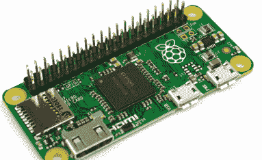

图 31.1：树莓派 Zero，一台仅需 5 美元的微型电脑，其性能是书序中所示 Galax 游戏机板的 1000 倍（由 Gareth Halffree 拍摄，CC BY-SA 2.0）

# 附录 A：故障排除

## 程序员错误

编程是困难的。用 C 语言更难。在基于 Web 的 IDE 和不靠谱的调试支持下用 C 语言？简直疯了！:) 总之，这里是一些常见的错误情况：

### 忘记设置栈指针

如果你发现程序启动后不久就崩溃，你可能只是忘记在入口例（entry routine）中设置栈指针了！请参见第 6 章。

### 忘记初始化数据

如果你发现全局变量为 0 或不是你预期的值，你可能忘记在入口例中设置初始化数据段了！请参见第 16 章。

### 在数组边界外写入

C 语言没有数组边界检查，因此如果你告诉它写入，它会乐意地写入数组之外的内存。这很容易覆盖你在 RAM 中的变量。确保你检查了数组访问，特别是在绘制精灵（sprites）时。

C 有许多运算符优先级规则，这可能会令人困惑。疑问时，请使用括号。你可能还需要将表达式强制转换为有符号或无符号值——参见第 20 章。

### 无限链表或损坏的对象

在使用链表时正确处理指针是棘手的。确保在对通过 `malloc()` 分配的对象调用 `free()` 后不再保留该对象的指针。考虑一下是否更倾向于使用简单的数据结构，例如数组。

## 编译器异常

SDCC 编译器截至 2017 年仍在活跃开发中，但有时你会发现编译器 Bug（当你读到这里时，某些 Bug 可能已经修复了！）

### 文件 ... 行号 '1018' 中的非致命编译器内部问题：未找到定义

以下代码生成了这一晦涩的错误信息：

```
const byte* e = "HELLO";

while (*e >= 0) { // 条件永远成立
  *e++;
}
```


问题在于`e`是一个字节指针，它是`unsigned char`的类型别名，因此表达式`*e >= 0`永远为真。这导致错过了循环归纳优化器并产生令人困惑的消息。解决方案是移除该错误的表达式，或者更改它使其不再永远为真。

### 内联函数并不总是有效

如果你发现使用`inline`关键字与不使用它的行为不同，你可能发现了编译器中的一个 Bug。

### char 默认无符号符号

SDCC 默认将`char`类型设为无符号。与其说是 Bug，不如说是与大多数 C 编译器的偏差。在示例代码中，除了符号位不重要的情况下，我们使用了`byte`和`sbyte`。

# 参考文献

- [1] Zilog Z80. https://en.wikipedia.org/wiki/Zilog_Z80.
- [2] Kevin Smith. The Ultimate (So-Far) History of Gremlin Industries. http://allincolorfora.blogspot.com/2015/09/the-ultimate-so-far-history-of-gremlin-25.html.
- [3] Dr. H. Holden. ATARI PONG E CIRCUIT ANALYSIS & LAWN TENNIS: BUILDING A DIGITAL VIDEO GAME WITH 74 SERIES TTL IC's. http://www.pong-story.com/.
- [4] General Instrument. AY-38910 Data Sheet. http://map.grauw.nl/resources/sound/generalinstrument_ay-38910.pdf.
- [5] The Dot Eaters. Gun Fight and Nutting Associates - Hired Guns. http://thedoteaters.com/?bitstory=gun-fight-and-nutting-associates.
- [6] Simon Parkin. The Space Invader. The New Yorker, 2013.
- [7] Tristan Doncaster. Replay: The History of Video Games. 2010.
- [8] shmuplactions. Galaga 30th Anniversary Developer Interview. http://shmuplactions.com/galaga/.
- [9] Bill Paul. The History of Cinematronics, Inc. http://zonn.com/Cinematronics/history.htm.
- [10] Jed Margolin. The Secret Life of XY Monitors. http://www.jmargolin.com/xy/xymon.htm.
- [11] Interview with Eugene Jarvis. http://www.firepinball.com/downloads/Eugene_Jarvis_Interview.pdf.
- [12] I got to meet Eugene Jarvis and Sam Dicker! https://my-cool-projects.blogspot.com/2014/07/i-got-to-meet-eene-jarvis-and-sam.html.
- [13] Sean Riddle. Blitter Information. http://seanriddle.com/blitter.html.
- [14] Larry De. Retro Gamer, (80), 2013. Some content is licensed under Creative license: https://creativecommons.org/licenses/

# 索引

- 8-bit architecture, 1
- 8-bitworkshop.com, 38
- address bus, 6
- addressing mode, 7, 12
- Analog Vector Generator, 147
- areas, 105
- array initializer, 160
- indexing, 45
- assembler, 7
- assembly language, 22
- assembly listing, 21
- assets, 211
- base, 16, 2
- BCD, 71
- big-endian, 192
- binary notation, 1
- binary-coded decimal, 71
- bit, 1
- bit blitter, 186
- bit field, 89
- bit fields, 89
- bitmask, 47, 60
- bitplanes, 116
- bitwise operators, 31
- boolean inversion, 48
- bounding box, 173, 20
- branch, 14
- byte, 1
- compiler, 35
- case, 158
- cells, 38
- clipping, 80
- clock cycle, 5
- color palette, 41
- const, 105
- constant folding, 70
- CPU clock, 5
- dangling pointers, 169
- data bus, 5
- data segment, 27
- data structures, 88
- debugger, 35
- declaration, 21
- dereferencing, 74
- Digital Vector Generator, 147
- double-linked list, 198
- dynamic memory, 168
- empty statement, 46
- emulator, 35, 78
- entropy, 103
- entry routine, 25
- exclusive-or, 58
- fixed-point, 120
- fixups, 24
- flags, 13
- floating-point, 182
- frame buffer, 77
- function, 20
- function call, 21
- Function pointers, 171
- function signature, 171
- function type, 171
- games
- Asteroids, 145, 146
- Asteroids Deluxe, 177
- Battlezone, 155, 161, 177
- Blockade, 37, 51
- Carnival, 38, 47, 48
- Checkmate, 37
- Computer Space, 65
- Crazy Kong, 110
- Defender, 185
- Donkey Kong, vi, 110
- Flight Simulator, 155
- Fonz, 255
- Frogger, vi, 109
- Galaga, 109
- Galaxian, vi, 109, 110, 116
- Gee Bee, 109
- Gun Fight, 77
- Head On, 38
- Joust, 186
- King & Balloon, 109
- Lazer Ball, 207
- LEM, 145
- Lunar Lander, vi, 145
- Night Driver, 155
- Pac-Man, vi, 38
- Play Ball, 37
- Pong, 65
- Red Baron, 155, 161
- Robotron, 186
- Robotron: 2084, 186, 197
- Safari, 38
- Scramble, 109–111, 114, 116
- Siege, 51, 52
- Sinistar, 202
- Solarian, 119
- Space Invaders, vi, vi, 77, 78, 109, 185
- Space Wars, 145
- Spacewar, 145
- Star Raiders, 177
- Star Wars, vi, 109, 146
- Tempest, vi, 146
- trapshoot, 37
- Tron, 37
- VEC, 146
- global namespace, 165
- global variables, 27, 168
- GPU, 83
- grows downward, 16
- header files, 20
- heap, 168, 169
- hexadecimal notation, 2
- hidden line removal, 164
- IDE, 33
- debugging, 36
- identifier, 21
- identity matrix, 157
- incomplete type, 171
- index register, 11
- initialized, 106
- initializers, 160
- inline assembly, 49, 98
- integer conversion rules, 143
- integer overflow, 4
- integer promotion, 143
- interrupts, 97
- mode 0, 97
- mode 2, 132
- jump, 14
- library function, 24
- line comment, 21
- linear-feedback shift register, 101
- Galois, 101
- linked list, 168, 169
- linked lists, 197
- little-endian, 7, 192
- local variable, 29
- local variables, 45, 168
- logical operators, 31
- period, 101
- perical interface, 210
- PIA, 210
- pipeline, 19
- pixel-accurate collision test, 200
- platforms, vi
- pointer, 73, 79
- pointer arithmetic, 76, 94
- preprocessor, 20
- preprocessor directive, 20
- rerendering, 163
- primitive types, 43
- Program Counter, 11
- PROM, 43, 113, 218
- pseudorandom generator, 101
- machine code, 7
- macro definitions, 20
- macro expansion, 20
- main(), 45
- main() function, 44
- MAME, 217
- Manhattan distance, 173
- memory allocation, 168
- memset, 117
- memset(), 45
- modulus, 4, 124
- multi-line comments, 22
- radius test, 173
- raster scan, 146
- registers, 5, 10
- relational operator, 23
- relocatable, 21
- return type, 21
- Running out of memory, 169
- namespaces, 165
- nibbles, 2
- null terminator, 23
- screen scale, 166
- seed, 101
- segments, 105
- short-circuit evaluation, 31, 175

栈指针 (Stack Pointer), 11
标准库 (standard library), 45
静态分配 (static allocation), 168
结构体 (struct), 52
结构体初始化器 (struct initializer), 170
结构体初始化 (struct initializers), 160
switch语句 (switch statement), 158

标签空间 (tag namespace), 165
撕裂伪影 (tearing artifacts), 198
瓦片 (tiles), 38
截断的 (truncated), 4
补码 (two’s complement), 3
类型转换 (type cast), 73, 130, 169
typedef, 43

未初始化的 (uninitialized), 105
联合体 (union), 181
循环展开 (unrolling the loop), 209
无符号 (unsigned), 3
无符号比较 (unsigned comparisons), 200
无类型 (untyped), 169
用户定义类型 (user-defined types), 43

变量 (variable), 27
向量监控 (vector monitor), 146
顶点 (vertices), 159
易变性 (volatile), 83

看门狗 (watchdog), 85
波形表 (wavetable), 208
线框模型 (wireframe models), 159

Z80

逻辑操作 (logical operations), 17
移位操作 (shift operations), 61
