# Python & Pygame 游戏制作：图形、动画与声音编程指南

向作者提问请邮件：al@inventwithpython.com

*致 Calvin Chaos*

归结底，编写视频游戏就是点亮像素，以响应键盘和鼠标输入并在屏幕上显示精美的图片。

而且没有什么事情比这更有趣了。

本书将教你如何使用 Python 编程语言和 Pygame 库制作图形化计算机游戏。本书假设你对 Python 或通用的编程有所了解。如果你不知道如何编程，可以通过从 `http://inventwithpython.com` 下载免费书籍《Your Own Computer Games with Python》来学习。你也可以直接开始看这本书，并在过程中大部分学会。

本书适合中级程序员，他们已经学习了什么是变量和循环，但现在想知道：“真正的游戏是什么样子的？”在我学习编程后，有一很长一段时间并不知道如何利用那项技能来制作酷酷的东西。我希望书中的游戏能给你提供足够的关于程序如何运行的思路，为你实现自己的游戏奠定基础。

> -Al Sweigart


## 关于本书

你好！本书将教你如何使用 Python 编程语言中的 Pygame 框架（也称为 Pygame 库）制作图形化计算机游戏。Pygame 让创建带有 2D 图形的程序变得简单。Python 和 Pygame 框架都可以从 `http://python.org` 和 `http://pygame.org` 免费下载。你只需要一台电脑和这本书就可以开始制作你的游戏。

这是一本中级编程书籍。如果你是编程完全新手，仍然可以尝试跟随源码示例，并弄清楚 Python 编写计算机游戏是如何运作的。先学习如何 Python 编程可能会更容易。《Invent Your Own Games with Python》是一本可以在 `http://inventwithpython.com` 完全免费获取的书。那书通过为初学者制作非图形、基于文本的游戏来教授编程，并且也有几章关于使用 Pygame 库的章节。

然而，如果你已经知道如何用 Python 编程（或其他语言，因为 Python 非常易于上手），并想开始制作不仅仅是文本的游戏，那么这本书就适合你。本书将从对 Pygame 库如何工作及其提供的功能的简要介绍开始。然后，它将提供一些真实游戏的完整源代码，并解释代码是如何工作的，以便你理解真实的游戏程序是如何制作的。

向作者发送邮件问题：al@inventwithpython.com

# 关于本书 vii

将像素坐标转换为按钮............................................................................... 129

显式优于隐式......................................................................................................... 129

关于本书 xi

- 写入文件............................................................................................................... 273

- 从文件读取........................................................................................ 274

- 关于星星地图推器文件格式............................................................... 274

- 递归函数...................................................................................... 280

- 栈溢出.................................................................................................... 281

# 术语表............................................................................................................... 342

# 关于作者........................................................................................ 347

向作者邮箱提问：al@inventwithpython.com

本页特留白。

……除了上述文字外。

以及上述文字。

以及上述文字。

以及上述文字。

以及上述文字。

以及上述文字。

以及上述文字。

以及上述文字。

以及上述文字。

以及上述文字。

以及上述文字。

```
Traceback (most recent call):
File "<pshell#1>", line 1, in blankpage
  def blankpage(): blankpage()
RuntimeError: maximum recursion depth exceeded
```

向作者邮箱提问：al@inventwithpython.com

# 第一章 – 安装 Python 和 pygame

## 开始之前需要了解的知识

在阅读这本书之前，如果你了解 Python 编程（或者了解除了 Python 以外的其他语言编程）将会帮助；然而，即使你完全不了解，也可以尽管读这本书。编程并没有人们想象的那么难。

在阅读这本书之前，你不需要学会使用 Pygame 库。下一章是关于 Pygame 所有主要功能的入门教程。

如果你还没有读第一本书并在电脑上安装 Python 和 Pygame，安装说明在本章中。如果你已经安装了这两项。

## 下载并安装 Python

在我们开始编程之前，你需要在电脑上安装一个名为 Python 解释器的软件。（在这里你可能需要成人的帮助。）解释器是一个理解你编写（或者说输入）的 Python 指令的程序。没有解释器，你的电脑将无法运行 Python 程序。从现在起，我们将“Python 解释器”称为“Python”。

解释器可以从 Python 编程语言的官方网站 `http://www.python.org` 下载。你可能需要别人的帮助来下载和安装 Python 软件。根据你的操作系统是 Windows、Mac OS X 还是 Ubuntu 等 Linux 系统，安装方法会有所不同。你可以在 `http://invpy.com` 找到在电脑上安装 Python 软件的视频。

### Windows 指南

当你到达 `http://python.org` 时，你应该会在左侧看到一系列链接（例如“关于”、“新闻”、“文档”、“下载”等）。点击下载 链接进入

下载页面，然后寻找文件“Python 3.2 Windows Installer (Windows binary -- does not source)”并点击其链接下载 Windows 版本的 Python。

双击你下载的 `python-3.2.msi` 文件启动 Python 安装器。（如果没有启动，请尝试右键点击文件并选择 Install。）一旦安装程序启动，持续点击 Next 并接受安装器中的选项（无需进行任何更改）。安装程序完成后，点击 Finish。

### Mac OS X 指南

Mac OS X 10.5 由 Apple 预装了 Python 2.5.1。Pygame 仅支持 Python 2 而不支持 Python 3。然而，书中的程序同时适用于 Python 2 和 3。

Python 网站也提供了关于在 Mac 上使用 Python 的额外信息：`http://docs.python.org/dev/using/mac.html`。

### Ubuntu 和 Linux 指南

Linux 版 Pygame 同样支持 Python 2，不支持 Python 3。如果你的操作系统是 Ubuntu，可以通过打开终端窗口（从桌面点击 Applications > Accessories > Terminal）并输入“`sudo apt-get install python2.7`”然后按回车来安装 Python。你需要输入根密码来安装 Python，如果你不知道，请让电脑的所有者输入此密码。

你还需要安装 IDLE 软件。在终端中输入“`sudo apt-get install idle`”。安装 IDLE 也需要根密码（请让电脑所有者输入此密码）。

## 启动 Python

我们将使用 IDLE 软件来输入并运行我们的程序。IDLE 代表交互式开发环境（Interactive Development Environment）。开发环境是一种让编写 Python 程序变得简单的软件，就像文字处理器让写书变得简单一样。

如果你的操作系统是 Windows XP，可以通过点击开始按钮，然后选择 Programs > Python 3.1 > IDLE (Python GUI) 来运行 Python。对于 Windows Vista 或 Windows 7，点击左下角的 Windows 按钮，输入“IDLE (Python GUI)”。

如果你的操作系统是 Mac OS X，可以通过打开 Finder 窗口并点击 Applications，然后点击 Python 3.2，最后点击 IDLE 图标来启动 IDLE。

如果你的操作系统是 Ubuntu 或 Linux，可以通过打开终端窗口并输入“`idle3`”然后按回车来启动 IDLE。你也可以点击屏幕顶部的 Applications，然后选择 Programming，最后 IDLE 3。

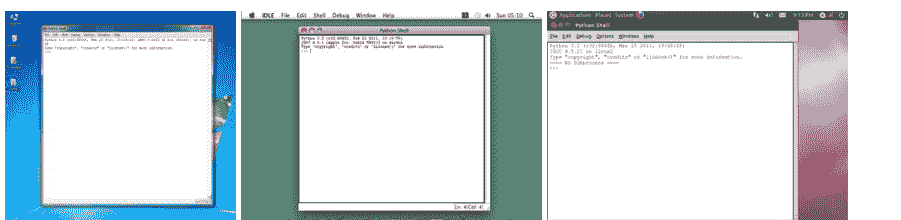

首次运行 IDLE 时出现的窗口被称为交互式 shell（interactive shell）。shell 是一个允许你向计算机输入指令的程序。Python shell 允许你输入 Python 指令，然后将这些指令发送给 Python 解释器执行。

## 安装 Pygame

Pygame 不随 Python 一带。和 Python 一样，Pygame 是免费提供的。你必须下载并安装 Pygame，这和下载及安装 Python 解释器一样简单。在浏览器中，访问 URL `http://pygame.org` 并点击网站左侧的“Downloads”链接。本书假设你使用的是 Windows 操作系统，但 Pygame 在每个操作系统上的运行方式相同。你需要下载对应操作系统和你已安装 Python 版本的 Pygame 安装程序。

你不需要下载 Pygame 的“源码”（source），而是下载适用于你操作系统的 Pygame “二进制文件”（binary）。对于 Windows，下载 `pygame-1.9.1.win32-py3.2.msi` 文件。（这是 Windows 上适用于 Python 3.2 的 Pygame。如果你安装了不同的 Python 版本（如 2.7 或 2.6），请下载对应你版本的 .msi 文件。）本书编写时 Pygame 的版本为 1.9.1。如果你在网站上看到更新版本，请下载并安装新版本。

对于 Mac OS X，下载适用于你 Python 版本的 .zip 或 .dmg 文件并运行。

对于 Linux，打开终端并运行“`sudo apt-get install python-pygame`”。

在 Windows 上，双击下载的文件来安装 Pygame。要检查 Pygame 是否安装正确，在交互式 shell 中输入以下内容：

```
>>> import pygame
```

4 `http://inventwithpython.com/pygame`

如果在按下回车键后没有任何内容出现，说明 Pygame 已成功安装。如果出现错误 `ImportError: No module named pygame`，请尝试重新安装 Pygame（并确保正确导入了 pygame）。

本章包含五个小程序，演示了如何使用 Pygame 提供的不同功能。在最后一章，你将使用这些功能编写一个用 Python 和 Pygame 编写的完整游戏。

你可以在本书网站 `http://invpy.com/videos` 找到如何安装 Pygame 的视频教程。

## 如何使用本书

《用 Python & Pygame 制作游戏》与其他编程书籍不同，因为它侧重于提供几个游戏程序的完整源代码。它并没有教你编程概念并留给你自己思考如何用这些概念编写程序，而是展示了一些程序并解释了它们是如何组合在一起的。

通常情况下，你应该按照顺序阅读这些章节。这些游戏中有许多被反复使用的概念，它们只在第一次出现的那个游戏中才会进行详细解释。但如果你觉得某个游戏很有趣，可以直接跳到那一章。如果你发现学得太快了，以后再阅读之前的章节。

## 特色程序

每个章节都关注一个单一的游戏程序，并解释代码不同部分的工作原理。通过在书书中逐行输入代码来复制这些程序非常有帮助。

不过，你也可以从本书网站下载源代码文件。在浏览器中，访问 URL `http://invpy.com/source` 并按照说明下载源代码文件。通过输入代码真的有助于你更好地学习代码。

## 下载图形和音频文件

虽然你可以直接输入书中的代码，但你需要从 `http://invpy.com/downloads` 下载书中游戏使用的图形和音频文件。确保这些图像和音频文件与 .py Python 文件位于同一个文件夹中，否则你的 Python 程序将找不到这些文件。

## 行号和空格

当你自己输入源代码时，不要输入每行开头的行号。例如，如果你在书中看到：

向作者提邮件：al@inventwithpython.com

## 第1章 – 安装 Python 和 Pygame 5

```
1. number = random.randint(1, 20)
2. spam = 42
3. print('Hello world!')
```

不需要输入左侧的“1.”或其随后的空格。只需像这样输入：

```
number = random.randint(1, 20)
spam = 42
print('Hello world!')
```

这些数字仅用于本书引用特定的行。它们不是程序的一部分。

除了行之外，请确保完全按照外观输入代码。注意某些行并没有从页面左边缘开始，而是缩进了四个或更多空格。请确保在每行开头输入正确数量的空格。（由于 IDLE 中的每个字符较宽，你可以通过计算上方或下方的字符来计算空格数量。）

例如，在代码中，你可以看到第二行缩进了四个空格，因为上一行的四个字符（“wil”）正好在缩进空格的上方。第三行又缩进了四个空格（四个字符“if n”在第三行缩进空格的上方）：

```
while spam < 10:
    if number == 42:
        print('Hello')
```

## 书中的文本换行

某些代码行太长，无法放入书中的一行内，代码文本会换行到下一行。当你在编辑器中输入这些内容时，代码都在一行内，不需要按回车。

你可以通过查看代码左侧的行号来判断新行的何时开始。例如，尽管第一行换行了，但代码只有两行：

+   1. print('This is the first line! xxxxxxxxxxxxxxxxxxxxxxxxxxxxxxxxxxxxxxx')

2. print('This is the second line, not the third line.')

## 在线检查你的代码

书中的一些程序有点长。虽然通过手动输入这些程序的源代码来学习 Python 很有帮助，但你可能会无意中写出拼写错误，导致程序崩溃。错误在哪里可能并不明显。

你可以将源代码的文本复制并粘贴到本书网站上的在线比对工具（diff tool）中。比对工具将显示书中的源码与你输入的源码之间的任何差异。这是找到程序中任何拼写错误的一种简单方法。

复制和粘贴是一项非常有用的计算机技能，特别是对于计算机编程。本书的网站上有一个关于复制和粘贴的视频教程：

`http://invpy.com/copypaste`。

在线比对工具位于此网页：`http://invpy.com/diff/pygame`。本书网站上还有一个关于如何使用此工具的视频教程。

## `http://invpy.com` 上的更多信息链接

关于编程，有很多内容可以学习。但你现在不需要学习所有内容。书中有好几次，你可能想学习这些额外的细节和解释，但如果我把它们包含在书中，就会增加很多页面。如果书变得更厚，这些内容的重量会压死你，导致死亡。相反，我在书中包含了“更多信息”链接，你可以在本书的网站上查看。你不需要阅读这些额外信息就能理解书中的任何内容，但如果你好奇，它们就在那里。这些（以及其他）链接经过了简化，并以 `http://invpy.com` 开头。

来自这些“更多信息”链接的所有信息也可以直接从 `http://invpy.com/pygamemoreinfo` 下载。

尽管这本书并没有得那么重，但请不要让它掉在你身上。

# 第 2 章 – PYGAME 基础

就像 Python 自带几个模块（如 `random`、`math` 或 `time`），它们可以为你的程序提供额外的函数一样，Pygame 框架也包含了几个用于绘制图形、播放声音、处理鼠标输入以及其他内容的模块。

本章将介绍 Pygame 提供的基础模块和函数，并假设你已经了解 Python 编程。如果你在某些编程概念上遇到困难，可以在 `http://invpy.com/book` 在线阅读《用 Python 编写你自己的电脑游戏》。这本书是面向编程初学者的。

《用 Python 编程》一书也有几个涵盖 Pygame 的章节。你可以在 `http://invpy.com/chap17` 在线阅读它们。

一旦你学习了更多 Pygame，就可以从 `http://pygame.org/docs` 的在线文档查看 Pygame 提供的其他模块。

## GUI 与 CLI


使用 Python 内置函数编写的程序仅通过 `print()` 和 `input()` 函数处理文本。你的程序可以在屏幕上显示文本，并让用户从键盘输入文本。这种程序被称为**命令行界面**，或 CLI（发音类似于 "climb" 的第一个部分，并与 "sky" 押韵）。这些程序是有局限性的，因为它们无法显示图形、没有颜色或无法使用鼠标。CLI 程序只从键盘获取输入，即使如此，用户也必须按下回车键后程序才能对输入做出响应。这意味着无法制作**实时**（即持续运行而无需等待用户）的动作游戏。

Pygame 提供了函数，用于创建具有**图形化用户界面**（或 GUI，发音为 "goey"）的程序。与文本的 CLI 不同，基于图形的 GUI 程序可以显示带有带有图像和颜色的窗口。

## 使用 Pygame 实现 Hello World 的源代码

我们的第一个 Pygame 程序是一个小型程序，它会在屏幕上创建一个显示“Hello World!”的窗口。点击 IDLE 的 **File**（文件）菜单，然后点击 **New Window**（新窗口）打开一个新的文件编辑器。在 IDLE 编辑器中输入以下代码并将其保存为 `blankpygame.py`。然后按 **F5** 或从文件编辑器顶部的菜单选择 **Run > Run Module** 来运行程序。

记住，不要输入每行开头的数字或句号（那只是为了书中的参考）。

```
1. import pygame, sys
2. from pygame.locals import *
3.
4. pygame.init()
5. DISPLAYFACE = pygame.display.set_mode((400, 300))
6. pygame.display.set_caption('Hello World!')
7. while True: # main game loop
8.     for event in pygame.event.get():
9.         if event.type == QUIT:
10.            pygame.quit()
11.            sys.exit()
12.    pygame.display.update()
```

当你运行此程序时，会出现一个这样的黑色窗口：


耶！你刚刚制作了世界上无聊的游戏！它只是一个空白窗口，窗口顶部有“Hello World!”（在所谓的窗口标题栏中，它持有标题）。但创建一个窗口是制作图形化游戏的第一步。当你点击窗口上的 X 按钮时，程序将结束，窗口将消失。

调用 `print()` 函数在窗口中显示文本是不起的，因为 `print()` 是用于 CLI 的函数。使用 `input()` 获取用户的键盘输入也是如此。Pygame 使用其他函数进行输入和输出，这些将在本章稍后解释。

## 设置 Pygame 程序

这是使用 Pygame 创建的第一个程序。现在，让我们详细查看“Hello World”程序中的每一行。

```python
import pygame, sys
```

第 1 行是导入 `pygame` 和 `sys`。

```python
from pygame.locals import *
```

第 2 行是从 `pygame.locals` 导入所有内容。

```python
.
```

```python
pygame.init()
```

第 4 行是调用 `pygame.init()`。

```python
DISPLAYFACE = pygame.display.set_mode((400, 300))
```

第 5 行是调用 `pygame.display.set_mode()` 函数，它返回一个 `Surface` 对象（我们之后简称为 Surface 对象）。

```python
pygame.display.set_caption('Hello World!')
```

第 6 行通过调用 `pygame.display.set_caption()` 函数设置窗口顶部的标题。

```python
while True: # main game loop
```

第 7 行是一个 while 循环，其条件简单为 `True` 值。

```python
for event in pygame.event.get():
```

第 8 行是遍历获取的事件。

```python
    if event.type == QUIT:
```

第 9 行检查事件类型是否为 `QUIT`。

```python
        pygame.quit()
```

第 10 行是调用 `pygame.quit()`。

```python
        sys.exit()
```

第 11 行是调用 `sys.exit()`。

```python
    pygame.display.update()
```

第 12 行是更新显示。

当你运行这个程序时，会出现一个这样的黑色窗口：


耶！你刚刚制作了世界上无聊的游戏！它只是一个空白窗口，窗口顶部有“Hello World!”（在所谓的窗口标题栏中，它持有标题）。但创建一个窗口是制作图形化游戏的第一步。当你点击窗口上的 X 按钮时，程序将结束，窗口将消失。

调用 `print()` 函数在窗口中显示文本是不起的，因为 `print()` 是用于 CLI 的函数。使用 `input()` 获取用户的键盘输入也是如此。Pygame 使用其他函数进行输入和输出，这些将在本章稍后解释。

## 设置 Pygame 程序

这是使用 Pygame 创建的第一个程序。现在，让我们详细查看“Hello World”程序中的每一行。

```python
import pygame, sys
```

第 1 行是导入 `pygame` 和 `sys`。

```python
from pygame.locals import *
```

第 2 行是从 `pygame.locals` 导入所有内容。

```python
pygame.init()
```

第 4 行是调用 `pygame.init()`。

```python
DISPLAYFACE = pygame.display.set_mode((400, 300))
```

第 5 行是调用 `pygame.display.set_mode()` 函数，它返回一个 `Surface` 对象（我们之后简称为 Surface 对象）。

```python
pygame.display.set_caption('Hello World!')
```

第 6 行通过调用 `pygame.display.set_caption()` 函数设置窗口顶部的标题。

# 第2章 – Pygame 基础

当受到伤害（这会降低其健康值）、或者敌人移动到某处，或者游戏世界中发生了某些事情时，我们说游戏状态发生了变化。

如果你曾经玩过可以可以存档的游戏，“存档状态”（save state）就是你保存时那个点的游戏状态。在大多数游戏中，暂停游戏会防止游戏状态发生变化。

由于游戏状态通常根据事件（如鼠标点击或键盘按下）或时间的流逝而更新，因此游戏循环每秒都会不断地检查并重新检查许多次，以发现发生了任何新事件。主循环内部有代码查看创建了哪些事件（在 Pygame 中，这是通过调用 `pygame.event.get()` 函数实现的）。主循环中还有根据已创建的事件来更新游戏状态的代码。这通常被称为事件处理。

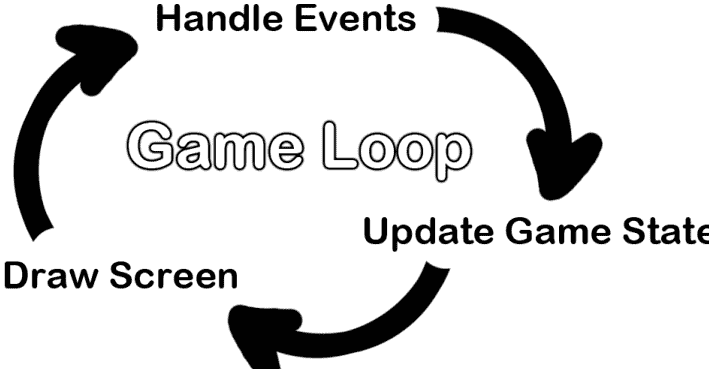

### pygame.event.Event 对象

每当用户执行若干操作之一（本章稍后会列出），例如按下按键或在程序窗口上移动鼠标时，Pygame 库就会创建一个 `pygame.event.Event` 对象来记录这个“事件”（这是事件模块中存在的一种 Event 类型，而事件模块本身位于 `pygame` 模块中）。我们可以通过调用 `pygame.event.get()` 函数来获取发生了哪些事件，该函数返回一个 `pygame.event.Event` 对象的列表（我们将其简称为 Event）。

Event 对象列表将包含自上次调用 `pygame.event.get()` 函数以来发生的每一个事件。（或者，如果 `pygame.event.get()` 从未被调用过，则包含自程序启动以来发生的事件。）

```
7. while True: # 主游戏循环
8.     for event in pygame.event.get():
```

第 8 行是一个 for 循环，它将遍历 `pygame.event.get()` 返回的每一个 Event 对象迭代项。在 for 循环的每次迭代中，一个命名的事件将被赋予列表中下一个事件的值。从 `pygame.event.get()` 返回的 Event 对象列表将按照事件发生的顺序排列。如果用户点击了鼠标并按了键盘键，鼠标点击的 Event 对象将是列表中的第一个项，键盘按键的 Event 对象将是第二个。如果没有发生事件，`pygame.event.get()` 将返回一个空列表。

### QUIT 事件和 pygame.quit() 函数

```
9. if event.type == QUIT:
10.    pygame.quit()
11.    sys.exit()
```

 Event 对象有一个名为 `type` 的成员变量（也称为属性），它告诉我们该对象代表什么种类型的事件。Pygame 在 `pygame.locals` 模块中为每种可能的类型都有常量变量。第 9 行检查 Event 的类型是否等于常量 `QUIT`。记住我们使用了 `from pygame.locals import` 形式的导入语句，我们只需要写 `QUIT` 而不是 `pygame.locals.QUIT`。

如果 Event 是退出事件，则调用 `pygame.quit()` 和 `sys.exit()` 函数。`pygame.quit()` 函数类似于 `pygame.init()` 的相反操作——它会停用 Pygame 库。你的程序在调用 `sys.exit()` 终止程序之前应该始终调用 `pygame.quit()`。通常这并不重要，因为 Python 中的语句在程序退出时同样会关闭。但 IDLE 中有一个 bug，导致如果 Pygame 程序在调用 `pygame.quit()` 之前终止，IDLE 就会挂起。

如果我们没有为其他类型的 Event 对象运行代码的语句，那么当用户点击鼠标、按下键盘键或引起任何其他类型 Event 对象创建时，就没有事件处理代码。用户可以操作创建这些 Event 对象，但这不会改变程序中的任何内容，因为程序没有针对这些类型 Event 对象的事件处理代码。当第 8 行的循环完成对 `pygame.event.get()` 返回的所有 Event 对象的处理后，程序执行将继续到第 12 行。

```
12. pygame.display.update()
```

向作者提问邮件：`al@inventwithpython.com`

第 12 行调用 `pygame.display.update()` 函数，它将 `pygame.display.set_mode()` 返回的 Surface 对象绘制到屏幕上（记住我们将其存储在 `DISPLAYSUR` 变量中）。由于 Surface 对象没有改变（例如，通过本章稍后解释的某些绘图函数），每次调用 `pygame.display.update()` 时，屏幕上都会重新绘制相同的块图像。

这就是整个程序。第 12 行完成后，无限 `while` 循环将从头重新开始。这个程序除了在屏幕上创建一个黑色窗口、不断检查 `QUIT` 事件，然后反复将未改变的窗口重新绘制到屏幕上之外，什么都不做。让我们通过学习像素、Surface 对象、Color 对象、Rect 对象以及 Pygame 函数，学习如何在这个窗口上显示有趣的内容，而不仅仅是黑色。

### 像素坐标

“Hello World”程序窗口由屏幕上的像素小正方形组成。每个像素初始为黑色，但可以被设置为不同的颜色。想象一下，如果不是 400 像素宽 300 像素高的 Surface，而我们只是有一个 8x8 像素的 Surface 对象。如果任何微小的 8x8 Surface 被放大，使得每个像素看起来像网格中的正方形，并且为 X 轴和 Y 轴加上数字，那么它的表示可能像这样：

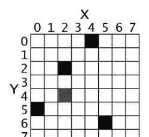

我们可以使用笛卡尔坐标系引用特定的像素。X 轴的每一列和 Y 轴的每一行都有从 0 到 7 的整数“地址”，这样我们就可以通过 X 和 Y 索引来定位任何像素。

例如，在 8x8 图像中，我们可以看到 XY 坐标 (4, 0)、2)、(0, 5) 和 (5, 6) 处的像素被涂成黑色，(2, 4) 处的像素被涂成灰色，而其他像素被涂成白色。XY 坐标也称为点。如果你上过数学课并学过笛卡尔坐标，你可能会注意到 Y 轴从顶部的 0 开始，然后向下增加，而不是向上增加。这就是笛卡尔坐标在 Pygame 中的工作方式。

## 第 2 章 – Pygame 基础 15

```
egg = Wombat()
egg.bluhbluh()
whamy.spam()
```

尽管这些名称都是虚构的，你仍然可以看出哪些是函数调用、哪些是方法调用以及方法内部的函数调用。名称 `whamy` 指的是一个模块，因为你可以看到它在第一行被导入。`fizzy` 这个名字前面没有内容，后面跟着圆括号，所以你知道它是一个函数调用。

`Wombat()` 也是一个函数调用，在这种情况下，它是一个返回对象的构造函数。（虽然开头的大写字母并不保证它一定是构造函数而不是普通函数，但这是一个稳妥的推测。）该对象命名为 `egg`。`egg.bluhbluh()` 是一个方法调用，你可以通过 `bluhbluh` 绑定在一个对象的变量上判断出来。

同时，`whamy.spam()` 是一个函数调用，而不是方法调用。你可以看出它不是方法调用，因为 `whamy` 之前作为模块导入了。

### Surface 对象与窗口

Surface 对象是表示矩形 2D 图像的实例。通过调用 Pygame 绘制函数（在本章稍后描述）可以更改 Surface 对象的像素，然后显示在屏幕上。窗口边界、标题和按钮不属于显示 Surface 对象的一部分。

特别是由 `pygame.display.set_mode()` 返回的 Surface 对象被称为显示 Surface（display Surface）。在显示 Surface 上绘制的任何内容在调用 `pygame.display.update()` 函数时都会显示在窗口上。在 Surface 对象（仅存在于计算机内存中）上绘制要比将 Surface 对象绘制到计算机屏幕上快得多。计算机内存更改显示器像素的速度快得多。

通常，你的程序会在 Surface 对象上绘制不同的内容。一旦你为游戏循环的这次迭代（称为“一帧”，就像贴在 DVD 上的静态图像一样）在 Surface 对象上绘制了所有内容，它就可以被绘制到屏幕上。计算机可以非常快地绘制帧，我们的程序通常运行在每秒 30 帧左右（即 30 FPS）。这被称为“帧率”，在本章稍后会解释。

在 Surface 对象上绘制将在本章的“基本绘制函数”和“绘制图像”章节中介绍。

### 颜色

光有三种原色：红、绿、蓝。（红、蓝、黄是颜料和颜料的原色，但计算机显示器模拟的是光而不是颜料。）通过组合这三种颜色的不同数量，你可以形成任何其他颜色。在 Pygame 中，我们用包含三个整数的元组表示颜色。元组中的第一个值是颜色中的红色含量，值 255 表示颜色中的红色含量为最大。第二个值代表绿色，第三个值代表蓝色。这些用于表示颜色的三个整数通常被称为 RGB 值。

由于你可以对每种原色使用 0 到 255 之间的任意组合，这意味着 Pygame 可以绘制 16,777,216 种不同的颜色（即 256 x 256 x 256 种颜色）。然而，如果你尝试使用大于 255 的数字或负值，你将得到类似 "ValueError: invalid color argument" 的错误。

例如，我们将创建一个颜色元组 `(0, 0, 0)` 并将其存储在名为 `BLACK` 的变量中。在没有红、绿、蓝的情况下，结果颜色是纯黑色。黑色是任何颜色的缺失。元组 `(255, 255, 255)` 代表最大量的红、绿、蓝，即白色。白色是红、绿、蓝的完全组合。元组 `(255, 0, 0)` 代表最大量的红色但没有绿色或蓝色，因此结果颜色是红色。同样，`(0, 255, 0)` 是绿色，`(0, 0, 255)` 是蓝色。

你可以混合红、绿、蓝的数量形成其他颜色。以下是几种颜色的 RGB 值：

| 颜色 | RGB 值 |

| --- | --- |

| 青色 (Aqua) | (0, 255, 255) |

| 黑色 (Black) | (0, 0, 0) |

| 蓝色 (Blue) | (0, 0, 255) |

| 品红色 (Fuchsia) | (255, 0, 255) |

| 灰色 (Gray) | (128, 128, 128) |

| 绿色 (Green) | (0, 128, 0) |

| 绿色 (Line) | (0, 255, 0) |

| 栗色 (Maroon) | (128, 0, 0) |

| 海蓝色 (Navy Blue) | (0, 0, 128) |

| 橄榄绿 (Olive) | (128, 128, 0) |

| 紫色 (Purple) | (128, 0, 128) |

| 红色 (Red) | (255, 0, 0) |

| 银色 (Silver) | (192, 192, 192) |

| 青色 (Teal) | (0, 128, 128) |

| 白色 (White) | (255, 255, 255) |

| 黄色 (Yellow) | (255, 255, 0) |


向作者提问邮件：`al@inventwithpython.com`

### 透明颜色

当你透过一个带有深红色调的玻璃窗时，它后面的所有颜色都会加上这种红色调。你可以通过为颜色添加第四个 0 到 255 的整数值来模拟这种效果。这个值被称为 Alpha 值（alpha value）。它是颜色不透明（即不透明）程度的衡量。通常我们在 Surface 对象上绘制像素时，新颜色会完全替换原来的颜色。但对于带有 Alpha 值的颜色，你可以为已有的颜色添加颜色。

例如，这个三个整数的元组是绿色：`(0, 255, 0)`。如果我们添加第四个整数作为 Alpha 值，我们可以使其变为半透明绿色：`(0, 255, 128)`。Alpha 值 255 是完全不透明（即完全不透明）。颜色 `(0, 255, 0)` 和 `(0, 255, 0, 255)` 是相同的。


（上面是一个画的截图。）

### pygame.Color 对象

你需要了解如何表示颜色，Pygame 的绘制函数需要一种方式来确定你想要绘制的颜色。使用三个或四个整数的元组是一种方法。另一种方法是使用 `pygame.Color` 对象。你可以通过调用 `pygame.Color()` 构造函数并传递三个四个整数来创建 Color 对象。你可以像存储元组一样将 Color 对象存储在变量中。在交互式 shell 中尝试以下：

```
>>> import pygame
>>> pygame.Color(255, 0, 0)
(255, 0, 0, 255)
>>> myColor = pygame.Color(255, 0, 0, 128)
>>> myColor == (255, 0, 0, 128)
True
```

Pygame 中任何稍后会介绍的带有颜色参数的绘制函数都可以接受颜色的元组或 Color 对象形式。尽管它们是不同的数据类型，但如果表示相同的颜色，Color 对象与四个整数的元组是相等的（就像 `42 == 42.0` 结果为 `True`）。

### Rect 对象

Pygame 有两种表示矩形区域的方法（就像颜色有两种表示方法一样）。首先是包含四个整数的元组：

- 1. 左上角的 X 坐标。

向作者提问邮件：`al@inventwithpython.com`

## 第 2 章 – Pygame 基础

+ 2. 左上角的 Y 坐标。

3. 矩形的宽度（像素）。

4. 矩形的高度（像素）。

另一种方法是使用 `pygame.Rect` 对象，我们将其简称为 Rect 对象。例如，下面的代码创建了一个左上角坐标为 (10, 20)、宽为 200 像素、高为 300 像素的 Rect 对象：

```
>>> import pygame
>>> spamRect = pygame.Rect(10, 20, 200, 300)
>>> spamRect == (10, 20, 200, 300)
True
```

方便的一点是，Rect 对象会自动计算矩形其他特征的坐标。例如，如果你需要知道存储在变量 `spamRect` 中的 `pygame.Rect` 对象的右边缘的 X 坐标，只需要访问 Rect 对象的 `right` 属性即可：

```
>>> spamRect.right
210
```

Rect 对象的 Pygame 代码会自动计算出：如果左边缘位于 X 坐标 10 且矩形宽度为 200 像素，那么右边缘必须位于 X 坐标 210。如果你重新赋值 `right` 属性，所有其他属性都会自动重新计算：

```
>>> spamRect.right = 350
>>> spamRect.left
150
```

这里是 `pygame.Rect` 对象提供的所有属性列表（在示例中，存储 Rect 对象的变量名为 `myRect`）：

| 属性名称 | 描述 |

| :--- | :--- |

| myRect.left | 矩形左侧 X 坐标的整数值。 |

| myRect.right | 矩形右侧 X 坐标的整数值。 |

| myRect.top | 矩形上侧 Y 坐标的整数值。 |

| myRect.bottom | 矩形底部 Y 坐标的整数值。 |

| myRect.center | 矩形中心 X 坐标的整数值。 |

| myRect.width | 矩形宽度的整数值。 |

| myRect.height | 矩形高度的整数值。 |

| myRect.size | 包含两个整数的元组：(width, size) |

| myRect.topleft | 包含两个整数的元组：(left, top) |

| myRect.topright | 包含两个整数的元组：(right, top) |

| myRect.bottomleft | 包含两个整数的元组：(left, bottom) |

| myRect.bottomright | 包含两个整数的元组：(right, bottom) |

| myRect.midleft | 包含两个整数的元组：(left, centery) |

| myRect.midright | 包含两个整数的元组：(right, centery) |

| myRect.midtop | 包含两个整数的元组：(centerx, top) |

| myRect.midbottom | 包含两个整数的元组：(centerx, bottom) |

### 原始绘制函数

Pygame 提供了多个不同的函数可以在表面（surface）对象上绘制不同的形状。这些形状如矩形、圆、椭圆、线或单个像素通常被称为**绘制原始图形**。打开 IDLE 的文件编辑器，输入以下程序，并将其保存为 `drawing.py`。

```
1. import pygame, sys
2. from pygame.locals import *
```

向作者提问：`al@inventwithpython.com`

```
3.
4. pygame.init()
5.
6. 设置窗口
7. DISPLAY = pygame.display.set_mode((500, 400), 0, 32)
8. pygame.display.set_caption('Drawing')
9.
10. 设置颜色
11. BLACK = (0, 0, 0)
12. WHITE = (255, 255, 255)
13. RED = (255, 0, 0)
14. GREEN = (0, 255, 0)
15. BLUE = (0, 0, 255)
16.
17. 在表面对象上绘制
18. DISPLAY.fill(WHITE)
19. pygame.draw.line(DISPLAYSURF, GREEN, (146, 0), (291, 106), (236, 277), (56, 277), (0, 106))
20. pygame.draw.line(DISPLAYSURF, BLUE, (60, 60), (120, 60), 4)
21. pygame.draw.line(DISPLAYSURF, BLUE, (120, 60), (60, 120))
22. pygame.draw.line(DISPLAYSURF, BLUE, (60, 120), (120, 120), 4)
23. pygame.draw.circle(DISPLAYSURF, BLUE, (300, 50), 20, 0)
24. pygame.draw.ellipse(DISPLAYSURF, RED, (300, 25, 40, 80), 1)
25. pygame.draw.rect(DISPLAYSURF, RED, (200, 150, 100, 100), 50)
26.
27. pixObj = pygame.PixelArray(DISPLAYSURF)
28. pixObj[380] = BLACK
29. pixObj[382] = BLACK
30. pixObj[384] = BLACK
31. pixObj[386] = BLACK
32. del pixObj
33.
34. 运行游戏循环
35. while True:
36.     for event in pygame.event.get():
37.         if event.type == QUIT:
38.             pygame.quit()
39.             sys.exit()
40.     pygame.display.update()
```

当此程序运行时，会显示以下窗口，直到用户关闭窗口。注意我们是如何为每种颜色创建常量的。这使得代码更具可读性，因为看到 GREEN 比比看到 `(0, 255, 0)` 要容易得多。绘制函数以它们所绘制的形状命名。传递的参数告诉它们在哪个 Surface 上绘制、在哪里绘制（以及多大）、以及线条有多宽。

- `fill(color)` – `fill()` 方法不是一个函数，而是 Surface 对象的一个方法。它用你传递的任何颜色填充整个 Surface。

- `pygame.draw.polygon(surface, color, pointlist, width)` – 多边形由平边组成。`surface` 和 `color` 参数告诉函数在哪个 Surface 上绘制多边形以及什么颜色。`pointlist` 是点的元组或列表（即 XY 坐标的整数元组或列表）。多边形通过在每个点之间绘制线来完成。然后从最后一个点到第一个点绘制一条线。你也可以传递列表而不是点的元组。`width` 是可选的。如果省略它，多边形将被填充（就像屏幕上的绿色多边形一样）。如果你为 `width` 参数传递整数值，则只绘制多边形的轮廓。该整数表示多边形轮廓的像素数。为 `width` 参数传递 1 会得到细细的多边形，而传递 4、10 或 20 会使多边形变粗。如果你为 `width` 参数传递 0，多边形将被填充。所有的 `pygame.draw` 绘制函数末尾都有可选的 `width` 参数，它们的工作方式与 `pygame.draw.polygon()` 的 `width` 参数相同。`width` 参数的一个更好名称应该是 `thickness`，因为它控制了你绘制的线条的厚度。

向作者提问：`al@inventwithpython.com`

- `pygame.draw.line(surface, color, start_point, end_point, width)` – 此函数在 `start_point` 和 `end_point` 参数之间绘制一条线。

- `pygame.draw.lines(surface, color, closed, pointlist, width)` – 此函数从一个点到下一个点绘制一系列线，类似于 `pygame.draw.polygon()`。区别在于，如果你对 `closed` 参数传递 `False`，则不会从 `pointlist` 中的最后一个点到第一个点绘制线。如果你传递 `True`，它将从最后一个点到第一个点绘制线。

- `pygame.draw.circle(surface, color, center, radius, width)` – 此函数绘制圆。圆心位于 `center` 参数处。传递给 `radius` 的整数设置圆的大小。半径是从中心到边缘的距离（圆的半径是直径的一半）。为半径传递 20 将绘制一个半径为 20 像素的圆。

- `pygame.draw.ellipse(surface, color, bounding_rectangle, width)` – 此函数绘制椭圆（类似于压扁或拉伸的圆）。此函数具有常规参数，但为了告诉函数椭圆在哪里有多大，你必须指定椭圆的边界矩形（bounding rectangle）。边界矩形是在形状周围绘制的最小矩形。这里有一个椭圆及其最小矩形的示例： `bounding_rectangle` 参数可以是 `pygame.Rect` 或四个整数的元组。请注意，你不需要像为 `pygame.draw.circle()` 函数那样为椭圆指定中心点。

- `pygame.draw.rect(surface, color, tuple, width)` – 此函数绘制矩形。`rectangle_tuple` 可以是四个整数的元组（左上角的 XY 坐标、宽度和高度），也可以是传递的 `pygame.Rect` 对象。如果 `rectangle_tuple` 的宽度和高度大小相同，将绘制一个正方形。

### pygame.PixelArray 对象

不幸的是，没有单一函数可以调用来将单个像素设置为某种颜色（除非你调用 `pygame.draw.line()` 并使用相同的起点和终点）。Pygame 框架需要在场景渲染之前和向 Surface 对象绘制之后运行一些代码。如果你必须为设置的每一个像素都执行此操作，你的程序运行速度会慢得多。（根据我的快速测试，这种方式绘制像素要慢两到三倍）。

相反，你应该为 Surface 创建一个 `pygame.PixelArray` 对象（我们简称为 PixelArray 对象），然后设置单个像素。为 Surface 创建 `PixelArray` 对象将“锁定”该 Surface 对象。当 Surface 对象被锁定时，绘制的

函数可以被调用，但它不能通过 `blit()` 方法在上面绘制像 PNG 或 JPG 这样的图像（`blit()` 方法将在本章的稍后部分进行解释）。

如果你想查看一个 Surface 是否被锁定，`get_locked()` Surface 方法会在它被锁定时返回 `True`，在未被锁定时返回 `False`。

从 `pygame.PixelArray()` 返回的 `PixelArray` 可以通过使用两个索引访问来设置单个像素。例如，第 28 行的 `pixObj[480][380] = BLACK` 将 X 坐标 0 和 Y 坐标 30 处设为黑色（记住 `BLACK` 变量存储的是元组 `(0, 0, 0)`）。

为了告诉 pygame 你已经完成了单个像素的绘制，请使用 `del` 语句删删除 `PixelArray` 对象。这就是第 33 行所做的。删除 `PixelArray` 对象将“解锁”该 Surface，这样你就可以在上面绘制图像了。如果你忘记删除 `PixelArray` 对象，下次你尝试将图像 blit（即绘制）到 Surface 时，程序将抛出错误并显示：“pygame.error: Surfaces must not be locked during blit”。

### The pygame.display.update() Function

在你调用完绘制函数让显示 Surface 对象看起来像你想要的样子后，必须调用 `pygame.display.update()` 让显示 Surface 实际上显示在用户的显示器上。

你必须记住的一点是，`pygame.display.update()` 只会让显示 Surface（即通过调用 `pygame.display.set_mode()` 返回的 Surface）出现在屏幕上。如果你想让其他的 Surface 显示在屏幕上，你必须使用 `blit()` 方法将它们“blit”（即复制它们）到显示 Surface 对象中（该方法将在接下来的“绘制图像”节中进行解释）。

### 动画 (Animation)

现在我们已经知道了如何让 Pygame 框架在屏幕上绘图，让我们来学习如何制作动画图像吧。一个只有静态图像的游戏将非常无味。（我的游戏《Look At This Rock》的销量令人失望。）动画图像的结果是先在屏幕上绘制一张图像，然后在片刻后再次在屏幕上绘制一张略有不同的图像。假设程序的窗口宽度为 6 像素，高度为 1 像素，除了 4, 0 处的黑色像素外，所有像素都是白色的。它看起来像这样：

向作者提问：`al@inventwithpython.com`

| | 0 | 1 | 2 | 3 | 4 | 5 |

|---|---|---|---|---|---|---|

| Y0 | | | | | | | |

如果你更改了窗口，使得 3,0 为黑色而 4,0 为白色，它看起来像这样：

| | 0 | 1 | 2 | 3 | 4 | 5 |

|---|---|---|---|---|---|---|

| Y0 | | | | | | | |

对用户来说，黑色像素似乎“移动”到了左边。如果你重新绘制窗口让黑色像素位于 2, 0，它看起来继续像黑色像素在向左移动：

| | 0 | 1 | 2 | 3 | 4 | 5 |

|---|---|---|---|---|---|---|

| Y0 | | | | | | | |

黑色像素看起来像在移动，但这只是幻觉。对于计算机来说，它只是在显示三张不同的图像，每张图像恰好都有一个黑色像素。考虑一下如果以下三张图像快速在屏幕上显示：

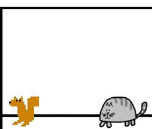

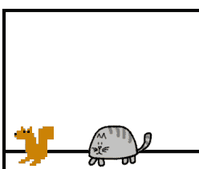

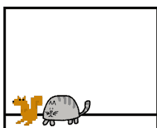

对用户来说，猫正在向松鼠移动。但对计算机来说，它们只是一堆像素。制作逼逼动画的诀窍是让你的程序在窗口上画一张图片，等待极短的时间，然后画一张略有不同的图片。

这是一个演示简单动画的示例程序。将此代码复制到 IDLE 的文件编辑器并保存为 `catimation.py`。它还需要 `cat.png` 文件与 `catimation.py` 位于同一文件夹。你可以从 `http://invpy.com/cat.png` 下载此图像。此代码可在 `http://invpy.com/catimation.py` 获取。


# 第 2 章 – Pygame 基础

```
1. import pygame, sys
2. from pygame.locals import *
3.
4. pygame.init()
5.
6. FPS = 30 # 每秒帧数设置
7. fpsClock = pygame.Clock()
8.
9. # 设置窗口
10. DISPLAYSUR = pygame.display.set_mode((400, 300))
11. pygame.display.set_caption('Animation')
12.
13. WHITE = (255, 255, 255)
14. catImg = pygame.image.load('cat.png')
15. catx = 0
16. caty = 0
17. direction = 'right'
18.
19. while True: # 主循环
20. DISPLAYSUR.fill(WHITE)
21.
22. if direction == 'right':
23. catx += 5
24. if catx == 380:
25. direction = 'down'
26. elif direction == 'down':
27. caty += 5
28. if caty == 260:
29. direction = 'left'
30. elif direction == 'left':
31. catx -= 5
32. if catx == 200:
33. direction = 'up'
34. elif direction == 'up':
35. caty -= 5
36. if caty == 100:
37. direction = 'right'
38.
39. DISPLAYSUR.blit(catImg, (catx, caty))
40. for event in pygame.event.get():
41. if event.type == QUIT:
42. pygame.quit()
43. sys.exit()
44. pygame.display.update()
45. fpsClock.tick(FPS)
```

使用 `pygame.draw.line()` 调用并计算所有的 XY 坐标，效果可能看起来不太理想。

# 你好，丑陋的世界

上面的消息需要调用 40 次 `pygame.draw.line()` 函数才能实现。相反，Pygame 为字体和创建文本提供了更简单的函数。这里有一个使用 Pygame 函数的简型 Hello World 程序。将其输入到 IDLE 编辑器并保存为 `hello.py`。

```
1. import pygame, sys
2. from pygame.locals import *
3.
4. pygame.init()
5. DISPLAY = pygame.display.set_mode((400, 300))
6. pygame.display.set_caption('Hello World!')
7.
8. WHITE = (255, 255, 255)
9. GREEN = (0, 255, 0)
10. BLUE = (0, 0, 128)
11.
12. fontObj = pygame.font.Font('freesansbold.ttf', 32)
13. textSurfaceObj = fontObj.render('Hello world!', True, GREEN, BLUE)
14. textRectObj = textSurfaceObj.get_rect()
15. textRectObj.center = (200, 150)
16.
17. while True: # 主游戏循环
18. DISPLAY.fill(WHITE)
19. DISPLAY.blit(textSurfaceObj, textRectObj)
20. for event in pygame.event.get():
21. if event.type == QUIT:
22. pygame.quit()
23. sys.exit()
24. pygame.display.update()
```

在屏幕上创建文本有六个步骤：

- 1. 创建一个 `pygame.font.Font` 对象。（如第 12 行）
- 2. 调用字体对象的 `render` 方法创建一个带有绘制文本的 `Surface`。（第 13 行）
- 3. 通过调用 `Surface` 对象的 `get_rect()` 方法从 `Surface` 对象创建一个 `Rect` 对象。（第 14 行）。该 `Rect` 将为渲染的文本正确设置宽度和高度，且顶部和左侧对齐方式为 0。
- 4. 通过更改其中一个属性来设置 `Rect` 的位置。在第 15 行，我们将 `Rect` 对象的中心设置为 200, 150。
- 5. 将带有文本的 `Surface` 对象绘制（blit）到 `pygame.display.set_mode()` 返回的 `Surface` 对象上。（第 19 行）
- 6. 调用 `pygame.display.update()` 让显示 `Surface` 出现在屏幕上。（第 24 行）

`pygame.font.Font()` 构造函数的参数是一个要使用的字体文件字符串，以及字体大小的整数（以磅计，类似于文字处理器测量字体大小的方式）。在第 12 行，我们传递了 `freesansbold.ttf`（这是 Pygame 自带的字体）和整数 `32`（用于 32 磅大小的字体）。

请访问 `invpy.com/usingotherfonts` 获取更多关于使用其他字体的信息。

`render()` 方法调用的参数是要渲染的文本字符串、一个指定是否需要抗锯齿的布尔值（本章稍后会解释）、文本的颜色以及背景颜色。如果你想要透明背景，只需在方法调用中省略背景颜色参数即可。

## 抗锯齿

抗锯齿是一种图形技术，通过在其边缘添加一点模糊来使文本和形状看起来不那么块状。使用抗锯齿绘制需要多一点计算时间，因此虽然图形效果可能更好，但你的程序运行速度可能会慢一些（但只慢了一点点）。

如果你放大观察锯齿线条和抗锯齿线条，它们看起来像这样：

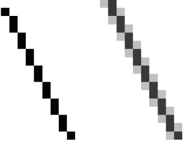

锯齿（块状）

抗锯齿（平滑）

要让 Pygame 的文本使用抗锯齿，只需为 `render()` 方法的第二个参数传递 `True` 即可。`pygame.draw.aline()` 和 `pygame.draw.aalines()` 函数的参数与 `pygame.draw.line()` 和 `pygame.draw.lines()` 相同，但它们绘制的是抗锯齿（平滑）线条而不是锯齿（块状）线条。

## 播放声音

播放存储在文件中的声音比从文件中显示图像更简单。首先，你必须通过调用 `pygame.mixer.Sound()` 构造函数创建一个 `pygame.mixer.Sound` 对象（我们简称为 Sound 对象）。它接受一个字符串参数，即声音文件的文件名。Pygame 可以加载 WAV、MP3 或 OGG 文件。这些音频格式之间的区别在 `http://invpy.com/formats` 中进行了解释。

要播放声音，调用 Sound 对象的 `play()` 方法。如果你想立即停止该 Sound 对象，调用 `stop()` 方法即可。`stop()` 方法没有参数。这里有一些示例代码：

你可以从 `http://invpy.com/beeps.wav` 下载 `beeps.wav` 文件。

程序在 `play()` 之后会立即继续执行；不会等待声音结束。Sound 对象适用于爆炸、跳跃或收集硬币等效果。要播放声音，调用 Sound 对象的 `play()` 方法。如果你想通过调用 `stop()` 方法立即停止 Sound 对象，该 `stop()` 方法没有参数。这里是一些示例代码：

```
## 播放声音效果：
soundobj = pygame.Sound('beep.wav')
soundobj.play()

## 加载并播放背景音乐：
pygame.mixer.music.load('background.mp3')
pygame.mixer.music.play(-1) # -1 表示循环
```

## 总结

本章涵盖了使用 Pygame 框架制作图形游戏的基础。当然，仅仅阅读这些函数可能不足以帮助你学会操作。本书的其余章节每章专注于一个小型完整游戏的源代码。这会让你对如何编码有一个概念。

与《Invent Your Own Games with Python》不同，本书假设你已经掌握 Python 编程的基础。如果你在记忆变量、函数、循环、if-else 语句和条件判断方面有困难，可以通过观察代码内容和程序行为来推断。但如果你仍然感到困惑，可以免费在线阅读《Invent with Python》这本书（它是为完全的新手准备的）：`http://inventwithpython.com`。

```
2 b
2 c
3 a
3 b
3 c
4 a
4 b
4 c
>>>
```

在“记忆游戏”（Memory Puzzle）代码中，有几次我们需要遍历棋盘上可能的 X 和 Y 坐标。我们将使用嵌套的 `for` 循环来确保获取每一种组合。注意，内层 `for` 循环（另一个 `for` 内部的循环）会在完成所有迭代之前进入外层 `for` 的下一次迭代。如果我们反转所有 `for` 循环的顺序，打印的值将相同，但打印顺序会不同。请将以下代码输入交互式 shell，并将其打印值的顺序更改为上一个嵌套 `for` 示例中的顺序：

```
>>> for y in ['a', 'b', 'c']:
...
    for x in [0, 1, 2, 3, 4]:
        print(x, y)
...
0 a
1 a
2 a
3 a
4 a
0 b
1 b
2 b
3 b
4 b
0 c
1 c
2 c
3 c
4 c
>>>
```

## 记忆游戏源代码

此源代码可以从 `http://invpy.com/memorypuzzle.py` 下载。

请将整个程序输入到 IDLE 的文件编辑器中，将其保存为 `memorypuzzle.py` 并运行它。如果你收到任何错误消息，请查看错误中提到的行号。

向作者提问邮件：`al@inventwithpython.com`

# 第 3 章 – 记忆游戏

消息并检查你的代码是否有拼写错误。你也可以将代码复制并粘贴到 `http://inv.py/diff/memorypuzzle` 网页表单中，查看你的代码与书中的代码之间的差异。

通过输入一遍程序，你可能会学到关于程序如何运行的思路。完成输入后，你就可以自己玩这个游戏了。

- 记忆游戏

由 Al Schweigart 编写 `al@inventwithpython.com`

## `http://inventwithpython.com/pygame`

## 根据“简化 BSD” 许可发布

```
import random, sys

from pygame.locals import *

FPS = 30 # 每秒帧数，程序的通用速度

WINDOWWIDTH = 640 # 窗口宽度（像素）

WINDOWHEIGHT = 480 # 窗口高度（像素）

REVEALSPEED = # 方块显示和覆盖的速度

BOXSIZE = 40 # 方块的高和宽大小（像素）

GAPSIZE = 10 # 方块之间间隙的大小（像素）

BOARDWIDTH = 10 # 图标列数

BOARDHEIGHT = 7 # 图标的行数

assert (BOARDWIDTH * BOARDHEIGHT) * 2 == 0, '(BOXSIZE + GAPSIZE)) / 2 # 匹配对所需的方块数量

XMARGIN = int((BOARDWIDTH - (BOARDWIDTH + GAPSIZE)) / 2)

YMARGIN = int((BOARDHEIGHT - (BOARDHEIGHT + GAPSIZE)) / 2)

GRAY = (100, 100, 100)

NAVBLUE = (60, 60, 60)

WHITE = (255, 255, 255)

RED = (255, 0, 0)

GREEN = (0, 0, 255)

BLUE = (0, 0, 255)

YELLOW = (255, 255, 0)

ORANGE = (255, 128, 0)

PURPLE = (255, 0, 255)

CYAN = (0, 255, 255)

COLOR = BLUE

LIGHTBGCOLOR = GRAY

BOXCOLOR = WHITE

HIGHLIGHTCOLOR = BLUE

DONUT = 'donut'

http://inventwithpython.com/pygame
```


```python
SQUARE = 'square'
DIAMOND = 'diamond'
LINES = 'lines'
OVAL = 'oval'

ALLCOLORS = (RED, GREEN, BLUE, YELLOW, ORANGE, PURPLE, CYAN)
ALLSHAPES = (DONUT, SQUARE, DIAMOND, LINES, OVAL)
assert len(ALLCOLORS) == len(ALLSHAPES) * 2 >= BOARDWIDTH * BOARDHEIGHT, "定义的形状/颜色数量对于棋盘太大了。\n"

def main():
    global FPSCLOCK, DISPLAYSUR
    pygame.init()
    FPSCLOCK = pygame.time.Clock()
    DISPLAYSUR = pygame.display.set_mode((WINDOWWIDTH, WINDOWHEIGHT))

    mouseX = 0 # 存储鼠标事件的 x 坐标
    mouseY = 0 # 存储鼠标事件的 y 坐标
    pygame.display.set_caption('Memory Game')

    mainBoard = getRandomBoard()
    revealedBoxes = generateRevealedBoxes(False)
    selection = None # 存储第一个方块的 (x, y)
    DISPLAYSUR.fill(BGCOLOR)
    startGameAnimation(mainBoard)
    while True: # 主循环
        MouseClicked = False
        DISPLAYSUR.fill(BGCOLOR) # 绘制窗口
        drawBoard(mainBoard, revealedBoxes)
        for event in pygame.event.get(): # 事件处理
            if event.type == QUIT or (event.type == KEYUP and event.key == K_ESCAPE):
                pygame.quit()
                sys.exit()
            elif event.type == MOUSEMOTION:
                mouseX, mouseY = event.pos
            elif event.type == MOUSEBUTTONUP:
                mouseX, mouseY = event.pos
                MouseClicked = True
            boxX, boxY = getBoxAtPixel(mouseX, mouseY)

if boxx != None and boxy != None:
    # 鼠标当前位于方块上。
    if not revealedBoxes[boxx]:
        drawhighlight(boxx, boxy)
    if not revealedBoxes[boxx] and mouseClicked:
        revealBoxesAnimation(mainBoard, (boxx, box))
        revealedBoxes[boxx] = True # 设置方块为已显示
if firstSelection == None: # 当前方块被点击了
    firstSelection = (box, box)
else: # 当前方块是第二个点击的
    # 检查两个图标之间是否有匹配。
    iconShape, iconColor = getShapeAndColor(mainBoard, firstSelection[0])
    iconShape, iconColor = getShapeAndColor(mainBoard, boxx)
    if iconShape != iconShape:
        # 图标不匹配。重新覆盖方块。
        pygame.time.wait(1000) # 1000 毫秒
        coverBoxes(mainBoard, firstSelection[0], firstSelection[1]))
    else:
        revealedBoxes[boxx] = False
elif hasWon(revealedBoxes): # 找到所有匹配
    gameWon(mainBoard)
    pygame.time.wait(2000)
## 重置棋盘
    mainBoard = getRandomBoard()
    revealedBoxes = generateRevealedBoxes(False)
## 显示完全隐藏棋盘。
drawboard(mainBoard, revealedBoxes)
pygame.display.update()
## 等待一秒。
pygame.time.wait(1000)
## 重放游戏动画。
startGameAnimation(mainBoard)
firstSelection = None # 重置 firstSelection 变量
## 重新绘制屏幕并等待时钟。
pygame.display.update()

FPSCLOCK.tick(FPS)

def generateRevealedBoxes(val):
    revealedBoxes = []
    for i in range(BOARDWIDTH):
        revealedBoxes.append([val] * BOARDHEIGHT)
    return revealedBoxes

def getRandomizedBoard():
    # 获取可能的形状和颜色列表。
    icons = []
    for color in ALLCOLORS:
        for shape in ALLSHAPES:
            icons.append((shape, color))

    random.shuffle(icons)
    # 计算需要多少图标。
    numIcons = int(BOARDWIDTH * BOARDHEIGHT / 2) # 两个一对
    icons = icons[:numIcons] * 2 # 每个两个

    # 创建随机放置的棋盘数据结构。
    board = []
    for x in range(BOARDWIDTH):
        column = []
        for y in range(BOARDHEIGHT):
            column.append(icons[0]) # 在赋值时移除图标
        board.append(column)
    return board
```

### 工具函数

```python
top = boxy * (BOXSIZE + GAPSIZE) + YMARGIN

return (left, top)

def getBoxAtPixel(x, y):

    for boxx in range(BOARDWIDTH):

        for left, top = leftTopOfBox(boxx, boxy):

            boxRect = pygame.Rect(left, top, BOXSIZE, BOXSIZE)

            if boxRect.collidepoint(x, y):

                return (boxx, boxy)

    return (None, None)

def drawIcon(shape, color, boxx, boxy):

    quarter = int(BOXSIZE * 0.25) # syntactic sugar

    half = int(BOXSIZE * 0.5) # syntactic sugar

    left, top = leftTopOfBox(boxx, boxy) # 获取棋盘坐标

    # 绘制形状

    if shape == DONUT:

        pygame.draw.circle(DISPLAYSURF, color, (left + half, top + half), 5)

        pygame.draw.circle(DISPLAYSURF, BGCOLOR, (left + half, top + half), 5)

    elif shape == SQUARE:

        pygame.draw.rect(DISPLAYSURF, color, (left + quarter, top + quarter, BOXSIZE - half))

    elif shape == DIAMOND:

        pygame.draw.polygon(DISPLAYSURF, color, ((left + half, top), (left + BOXSIZE - 1, top), (left, top + BOXSIZE - 1), (left, top + BOXSIZE - 1)))

    elif shape == LINES:

        for i in range(0, BOXSIZE, 4):

            pygame.draw.line(DISPLAYSURF, color, (left + i, top), (left + BOXSIZE - 1, top + i))

    elif shape == OVAL:

        pygame.draw.ellipse(DISPLAYSURF, color, (left, top + quarter, BOXSIZE, half))

def getShapeAndColor(board, boxx, boxy):

    # 形状值对于 x, y 后后存储在 board[x][y][0]

    return board[x][y][0], board[x][y][1]
```

### 动画与绘制

40 http://inventwithpython.com/pygame

| | | 代码 |
| 204. | # x, y 的颜色值存储在 board[x][y][1] 中 |
| 205. | return board[board][boxy][0], board[board][boxy][1] |
| 206. | | |
| 207. | | |
| 208. | def drawBoxvers(board, boxes, coverage): |
| 209. | # 绘制正在被覆盖/显示的方框 "boxes" 是一个列表 |
| 210. | # 由两个两个元素的列表组成，包含了盒子的 x & y 位置。 |
| 211. | for box in boxes: |
| 212. | left, top = leftTopCoordsOfBox(box[0], box[1]) |
| 213. | pygame.draw.rect(DISPLAYSURF, BGCOLOR, (left, top, BOXSIZE)) |
| 214. | shape, color = getShapeAndColor(board, box[0], box[1]) |
| 215. | drawIcon(shape, color) |
| 216. | if coverage > 0: # 如果有覆盖，则绘制覆盖层 |
| 217. | pygame.draw.rect(DISPLAYSURF, BOXCOLOR, (left, top, coverage, BOXSIZE)) |
| 218. | pygame.display.update() |
| 219. | FPSCLOCK.tick(FPS) |
| 220. | | |
| 221. | | |
| 222. | def revealBoxesAnimation(board, boxesToReveal): |
| 223. | # 执行“方框显示”动画。 |
| 224. | for coverage in range(BOXSIZE, (-REVEALSPEED) - 1, REVEALSPEED): |
| 225. | drawBoxvers(board, boxesToReveal, coverage) |
| 226. | | |
| 227. | | |
| 228. | def coverBoxesAnimation(board, boxesToCover): |
| 229. | # 执行“方框覆盖”动画。 |
| 230. | for coverage in range(0, BOXSIZE + REVEALSPEED, REVEALSPEED): |
| 231. | drawBoxCo(board, boxesToCover, coverage) |
| 232. | | |
| 233. | | |
| 234. | def drawBoard(board, revealed): |
| 235. | # 绘制所有处于覆盖或显示状态的方框。 |
| 236. | for box in range (BOARDWIDTH): |
| 237. | for box in range (BOARDHEIGHT): |
| 238. | left, top = leftTopCoordsOfBox(box, boxy) |
| 239. | if not revealed[box][boxy]: |
| 240. | # 绘制被覆盖的方框。 |
| 241. | pygame.draw.rect(DISPLAYSURF, BOXCOLOR, (left, top, BOXSIZE, BOXSIZE)) |
| 242. | else: |
| 243. | # 绘制（已显示的）图标。 |
| 244. | shape, color = getShapeAndColor(board, boxx, boxy) |
| 245. | drawIcon(shape, color, boxx, boxy) |

向作者提问邮件：`al@inventwithpython.com`

# 第3章 – 记忆谜对 41

```python
247.

248. def drawHighlightBox(boxx, boxxy):

249.     left, top = leftTopCoordsOfBox(boxx, boxxy)

250.     pygame.draw.rect(DISPLAYSURFACE, HIGHLIGHTCOLOR, (left - 5, top - 5, BOXSIZE + 10, BOXSIZE + 10), 4)

251.

252.

253. def startGameAnimation(board):

254.     # 每次随机显示8个已显示的方框。

255.     coveredBoxes = generateRevealedBoxesData(False)

256.     boxes = []

257.     for x in range(BOARDWIDTH):

258.         for y in range(BOARDHEIGHT):

259.             boxes.append((x, y))

260.     random.shuffle(boxes)

261.     boxGroups = splitIntoGroups(8, boxes)

262.

263.     drawBoard(board, coveredBoxes)

264.     for boxGroup in boxGroups:

265.         revealBoxesAnimation(board, boxGroup)

266.         coveredBoxesAnimation(board, boxGroup)

267.

268.

269. def gameWinAnimation(board):

270.     # 当玩家胜利时闪烁背景颜色。

271.     coveredBoxes = generateRevealedBoxesData(True)

272.     color1 = LIGHTCOLOR

273.     color2 = BCOLOR

274.

275.     for i in range(13):

276.         color1, color2 = color2, color1 # 交换颜色

277.     DISPLAYSURFACE.fill(color1)

278.     drawBoard(board, coveredBoxes)

279.     pygame.time.wait(300)

280.

281.

282. def hasWon(revealedBoxes):

283.     # 如果所有方框都已显示，返回True，否则返回False

284.     for i in revealedBoxes:

285.         if False in i:
```


286.             return False # 如果任何方框被覆盖，则返回False。
287.     return True
288.
289. if __name__ == '__main__':
290.     main()

```
42 http://inventwithpython.com/pygame
```

| | | 代码 |
|---|---|---|
| 1. | # 记忆谜对 |
| 2. | # 由 Al Schweigart 编写 al@inventwithpython.com |
| 3. | # http://inventwithpython.com/pygame |
| 4. | # 根据“简化 BSD”许可发布 |
| 5. | import random, pygame, sys |
| 6. | from pygame import * |

程序的开头部分介绍了游戏内容、由谁制作，以及用户可以在哪里找到更多信息。书中还提到了源代码在“简化 BSD”许可下可以自由复制。相比于知识共享许可（Creative Commons，本本书采用的许可），简化 BSD 许可更适合软件，但它们的基本含义相同：人们可以自由地复制和分享这个游戏。关于许可的更多信息，可以访问 http://inventwithpython.com/licenses。

此程序使用了许多函数，因此我们在第7行导入了这些模块，这意味着你不需要在函数名前面再输入模块名。`pygame.locals` 模块中没有函数，但其中有几个我们想要使用的常量变量，如 `MOUSEMOTION` 或 `QUIT`。使用这种风格的导入语句，我们只需要输入 `MOUSEMOTION` 而不需要 `pygame.locals.MOUSEMOTION`。

| | | 代码 |
|---|---|---|
| 9. | FPS = 30 # 每秒帧数，程序的运行速度 |
| 10. | WINDOWWIDTH = 640 # 窗口宽度 |
| 11. | WINDOWHEIGHT = 480 # 窗口高度 |
| 12. | REVEALSPEED = 8 # 显示速度 |
| 13. | BOXSIZE = 40 # 方框的大小 |
| 14. | GAPSIZE = 10 # 方框之间的间距 |

程序的开头部分介绍了游戏内容、由谁制作，以及用户可以在哪里找到更多信息。书中还提到了源代码在“简化 BSD”许可下可以自由复制... (注：此处后续已包含原文中重复段落的翻译)

# 第3章 – 记忆谜题 45

```python
File "C:\book2svn\src\memorypuzzle.py", line 292, in <module>
main()
File "C:\book2svn\src\memorypuzzle.py", line 58, in main
mainBoard = getRandomizedBoard()
File "C:\book2svn\src\memorypuzzle.py", line 149, in getRandomizedBoard
columns.append(Icons(0))
IndexError: list index out of range
```

我们可能会花费大量时间研究 `getRandomizedBoard()`，试图弄清楚它哪里出了问题，最后发现 `getRandomizedBoard()` 本身完全没问题：真正的错误源在第15和第16行，那里设置了 `BOARDWIDTH` 和 `BOARDHEIGHT` 常量。

断言（assertion）确保了这种情况不会发生。如果我们的代码要崩溃，就让它在检测到严重错误时立即崩溃，否则错误可能直到程序运行到很后期才会显现。尽早崩溃！

每当程序中存在某个必须始终为 `True` 的条件时，你都应该添加 `assert` 语句。频繁崩溃！你不需要过分用力在每个地方都加上 `assert` 语句，但通过 `assert` 崩溃对于检测错误的真实源头非常有帮助。尽早崩溃，频繁崩溃！

（在你的情况下是指代码，而不是说，比如在骑小马的时候。）

## 让源代码看起来更漂亮

| 行号 | 变量 | 值 |
| :--- | :--- | :--- |
| 21 | | R G B |
| 22 | GRAY | (100, 100, 100) |
| 23 | NAVYBLUE | (60, 60, 100) |
| 24 | WHITE | (255, 255, 255) |
| 25 | RED | (255, 0, 0) |
| 26 | GREEN | (0, 255, 0) |
| 27 | BLUE | (0, 0, 255) |
| 28 | YELLOW | (255, 255, 0) |
| 29 | ORANGE | (255, 128, 0) |
| 30 | PURPLE | (255, 0, 255) |
| 31 | CYAN | (0, 255, 255) |
| 32 | | |
| 33 | BGCOLOR | NAVYBLUE |
| 34 | LIGHTBGCOLOR | GRAY |
| 35 | BOXCOLOR | WHITE |
| 36 | HIGHLIGHTCOLOR | BLUE |

记住，Pygame 中的颜色由三个从 0 到 255 的整数组成的元组（tuple）表示。这些整数代表颜色中红、绿、蓝的量，这就是为什么这些元组被称为 RGB 值。注意第 22 到 31 行元组的间距，使得 R、G、B 整数对齐。在 Python 中，缩进的间距（即行首的空格）必须是精确的，但行内的空格并不那么严格。通过错开元组中的整数，我们可以清楚地看到 RGB 值值之间的对比。（关于间距和缩进的更多信息请见 http://invpy.com/whitespace。）

通过这种方式让代码更具读性是一件好事，但不要在上面花费太多时间。代码不需要漂亮也能运行。在某个时刻，你花费在打字上的时间本可以通过使用可读的元组值来节省掉。

## 使用常量代替字符串

```python
38. DONUT = 'donut'
39. SQUARE = 'square'
40. DIAMOND = 'diamond'
41. LINES = 'lines'
42. OVAL = 'oval'
```

程序还为某些字符串设置了常量变量。这些常量将用于棋盘的数据结构

```python
if shape == DONUT:
```

`shape` 将设置为 'donut'、'square'、'diamond'、'lines' 或 'oval' 之一，然后与 `DONUT` 常量进行比较。如果在编写第 187 行时发生了拼写错误，例如如下：

```python
if shape == 'donut'
```

那么 Python 就会崩溃，并给出一个错误消息说没有 `DONUT` 变量。这是好的。程序在第 187 行崩溃了，当我们检查该行时，很容易看出错误是由拼写错误引起的。然而，如果我们使用字符串而不是常量变量且类型相同，第 187 行看起来会像这样：

```python
if shape == 'donut'
```

这是完全接受的 Python 代码，所以当你运行它时起初不会崩溃。但这会导致我们的程序在稍后出现奇怪的 bug。因为代码没有在问题产生的地方立即崩溃，寻找它会困难得多。

向作者提问邮箱：al@inventwithpython.com

## 让我们有足够的图标

| 行号 | 变量 | 值 |
| :--- | :--- | :--- |
| 44 | ALLCOLORS | (RED, GREEN, BLUE, YELLOW, ORANGE, PURPLE, CYAN) |
| 45 | ALLSHAPES | (DONUT, SQUARE, DIAMOND, LINES, OVAL) |
| 46 | | assert len(ALLCOLORS) * len(ALLSHAPES) >= BOARDWIDTH * BOARDHEIGHT |

为了让我们的游戏能够创建所有可能的颜色和形状组合的图标，我们需要创建一个包含所有值的元组。在第 46 行还有另一个断言，以确保有足够的颜色/形状组合。如果不是，程序将在第 46 行崩溃，我们知道必须添加更多的颜色和形状。有了这对组合，我们可以制作棋盘。

## 元组 vs 列表，不可变性 vs 可变性

你可能注意到 `ALLCOLORS` 和 `ALLSHAPES` 是元组而不是列表。什么时候使用元组，什么时候使用列表？它们之间到底区别是什么？元组和列表在每个方面都是相同的，只是元组使用圆括号而不是方括号，并且元组中的项不能被修改（但列表中的项可以修改）。我们称列表为可变的（意味着它们可以被更改），称元组为不可变的（意味着它们不能被更改）。关于更改列表和元组值的示例，请参考以下代码：

```python
>>> listVal = [1, 2, 3, 5, 8]
>>> tupleVal = (1, 2, 3, 5, 8)
>>> listVal[4] = 'hello!'
>>> listVal
[1, 2, 3, 5, 'hello']
>>> tupleVal[4] = 'hello!'
Traceback (most recent call last):
File "stdin", line 1, in <module>
TypeError: 'tuple' object does not support item
>>>>>>Val
(1, 2, 3, 5, 8)
```

注意当我们尝试更改元组索引为 4 的项时，Python 给我们一个错误消息，说元组对象不支持项赋值。元组不可变有一个愚蠢的用处和一个重要的用处。愚蠢的用处是使用元组的代码比列表快一点。但让你的代码运行快几纳秒并不重要。使用元组的重要用处与常量变量的好处相似：它是一个元组中的值永远不会改变的标志，所以以后阅读代码的任何人都可以：“我可以预计这个元组将是一直相同的。否则程序员会使用列表。”这让让未来的程序员在阅读你的代码时知道：“如果我看到列表，说明它是可变的。”

### 单元素元组

关于元组还有一个小细节：如果你需要编写一个包含一个值的元组，它需要一个结尾逗号，如下：

```python
oneValueTuple = (42,
```

# 第3章 – 记忆谜题 49

如果你忘记了这个逗号（这很容易忘记），那么 Python 将无法区分这与改变顺序的括号。例如，看以下两行代码：

```python
variableA = (5 * 6)
variableB = (5 * 6, )
```

存储在 `variableA` 中的值只是整数 30。然而，`variableB` 的赋值语句是单项元组。空元组不需要逗号，它们本身可以是括号：

## 列表与元组之间的转换

你可以像转换字符串和整数值一样转换列表和元组。将元组传递给 `list()` 函数，它将返回该元组的列表。或者，将列表值传递给 `tuple()` 函数，它将返回该列表的元组。在交互式 shell 中尝试函数：

```python
>>> spam = (1, 2, 3, 4)
>>> spam = list(spam)
>>> spam
[1, 2, 3, 4]
>>> spam = tuple(spam)
>>> spam
(1, 2, 3, 4)
>>>
```

50 http://inventwithpython.com/pygame

变量。在 `main()` 函数内部，这些名称并不是可能恰好与全局变量同名的局部变量。它们是全局变量。赋值给 `main()` 函数的任何值都将在 `main()` 函数之外持续存在。我们将 `FPSCLOCK` 和 `DISPLAYS` 标记为全局变量，因为它们在程序的其他几个函数中都被用到了。（更多信息请参阅 http://pygame.org/scope.）

有四个简单的规则可以判断一个变量是局部变量还是全局变量：

- 1. 如果函数开头有一个该变量的 `global` 语句，那么它就是全局变量。
- 2. 如果函数中的变量名与全局变量同名，且该函数从未给该变量赋值，那么该变量就是那个全局变量。
- 3. 如果函数中的变量名与全局变量同名，且该函数给其赋值了值，那么它就是一个局部变量。
- 4. 如果函数中没有与该变量同名的全局变量，那么它显然是一个局部变量。

你通常应该避免在函数内部使用全局变量。函数应该应该是你程序内部的一个微型程序，具有输入（参数）和输出（返回值）。但一个读写全局变量的函数具有额外的输入和输出。由于全局变量在函数被调用之前可能在很多地方被修改过，要追踪涉及全局变量中设置错误值的 bug 可能会非常棘手。

将函数作为一个不使用全局变量的独立微型程序，使其更容易在代码中找到 bug，因为函数的参数是清晰已知的。这也让修改函数中的代码变得更容易，如果新函数使用相同的参数工作并产生相同的返回值，它将像旧函数一样与程序的其余部分工作。

基本上，使用全局变量可能会让你编写程序变得更容易，但它们通常会让调试变得更困难。

在本书的游戏中，全局变量主要用于那些永远不会的全局常量，但这些常量需要先调用 `pygame.init()` 函数。由于这发生在 `main()` 函数中，因此它们在 `main()` 函数中设置，并且必须是全局的以便其他函数使用。但由于全局变量被当作常量且不改变，它们不太可能引起困惑的 bug。

如果你你不这些，不要担心。作为一般原则，编写代码时应将值传递给函数，而不是让函数去读取全局变量。

向作者提问邮件：al@inventwithpython.com

## 数据结构与二维列表

| 58. | mainBoard = getRandomizedBoard() |
| 59. | revealedBoxes = generateRevealedBoxesData(False) |

`getRandomizedBoard()` 函数返回一个表示棋盘状态的数据结构。`generateRevealedBoxesData()` 函数返回一个表示哪些方块被覆盖的数据结构。这些函数的返回值是二维（2D）列表，或者说是列表的列表。一个值的列表将是三维列表。两个或多个维度之列表的另一个词是**多维列表**（multidimensional list）。

如果我们在变量 `spam` 中存储了一个值，可以使用方括号访问该列表中的某个值，例如使用 `spam[2]` 来获取列表中的第三个值。如果 `spam[2]` 处的值本身也是列表，我们就可以使用另一组方括号来获取该列表中的值，例如 `spam[2][4]`，这将获取 `spam` 中第三个值（而该值又是另一个列表）中的第五个值。使用这种列表表示法很容易将二维棋盘映射到二维列表。由于 `mainBoard` 变量内部存储了图标，如果我们想获取棋盘上位置 (4, 5) 的图标，只需使用表达式 `mainBoard[4][5]` 即可。由于图标本身是存储的，如果我们想获取棋盘上位置 (4, 5) 的图标，我们可以直接使用表达式 `mainBoard[4][5]`。由于图标本身是存储的，如果我们想获取棋盘上位置 (4, 5) 的图标，我们可以直接使用表达式：

```python
mainBoard = [
    [0, 0, 0, 0, 0],
    [0, 0, 0, 0, 0],
    [0, 0, 0, 0, 0],
    [0, 0, 0, 0, 0],
    [0, 0, 0, 0, 1]
]
icon = mainBoard[4][5]
# icon将是 1
```


50 http://inventwithpython.com/pygame

变量。在 `main()` 函数内部，这些名称并不是可能恰好与全局变量同名的局部变量。它们是全局变量。赋值给 `main()` 函数的任何值都将在 `main()` 函数之外持续存在。我们将 `FPSCLOCK` 和 `DISPLAYS` 标记为全局变量，因为它们在程序的其他几个函数中都被用到了。（更多信息请参阅 http://pygame.org/scope.）

有四个简单的规则可以判断一个变量是局部变量还是全局变量：

- 1. 如果函数开头有一个该变量的 `global` 语句，那么它就是全局变量。
- 2. 如果函数中的变量名与全局变量同名，且该函数从未给该变量赋值，那么该变量就是那个全局变量。
- 3. 如果函数中的变量名与全局变量同名，且该函数给其赋值了值，那么它就是一个局部变量。
- 4. 如果函数中没有与该变量同名的全局变量，那么它显然是一个局部变量。

你通常应该避免在函数内部使用全局变量。函数应该应该是你程序内部的一个微型程序，具有输入（参数）和输出（返回值）。但一个读写全局变量的函数具有额外的输入和输出。由于全局变量在函数被调用之前可能在很多地方被修改过，要追踪涉及全局变量中设置错误值的 bug 可能会非常棘手。

将函数作为一个不使用全局变量的独立微型程序，使其更容易在代码中找到 bug，因为函数的参数是清晰已知的。这也让修改函数中的代码变得更容易，如果新函数使用相同的参数工作并产生相同的返回值，它将像旧函数一样与程序的其余部分工作。

基本上，使用全局变量可能会让你编写程序变得更容易，但它们通常会让调试变得更困难。

在本书的游戏中，全局变量主要用于那些永远不会的全局常量，但这些常量需要先调用 `pygame.init()` 函数。由于这发生在 `main()` 函数中，因此它们在 `main()` 函数中设置，并且必须是全局的以便其他函数使用。但由于全局变量被当作常量且不改变，它们不太可能引起困惑的 bug。

如果你不理解这些，不要担心。作为一般原则，编写代码时应将值传递给函数，而不是让函数去读取全局变量。

向作者提问邮件：al@inventwithpython.com

## 数据结构与二维列表

| 58. | `mainBoard = getRandomizedBoard()` |
| 59. | `revealedBoxes = generateRevealedBoxesData(False)` |

`getRandomizedBoard()` 函数返回一个表示棋盘状态的数据结构。`generateRevealedBoxesData()` 函数返回一个表示哪些方块被覆盖的数据结构。这些函数的返回值是二维（2D）列表，或者说是列表的列表。一个值的列表将是三维列表。两个或多个维度之列表的另一个词是**多维列表**（multidimensional list）。

如果我们在变量 `spam` 中存储了一个值，可以使用方括号访问该列表中的某个值，例如使用 `spam[2]` 来获取列表中的第三个值。如果 `spam[2]` 处的值本身也是列表，我们就可以使用另一组方括号来获取该列表中的值，例如 `spam[2][4]`，这将获取 `spam` 中第三个值（而该值又是另一个列表）中的第五个值。使用这种列表表示法很容易将二维棋盘映射到二维列表。由于 `mainBoard` 变量内部存储了图标，如果我们想获取棋盘上位置 (4, 5) 的图标，我们可以直接使用表达式 `mainBoard[4][5]`。由于图标本身是存储的：

```python
mainBoard = [
    [0, 0, 0, 0, 0],
    [0, 0, 0, 0, 0],
    [0, 0, 0, 0, 0],
    [0, 0, 0, 0, 0],
    [0, 0, 0, 0, 1]
]
icon = mainBoard[4][5]
# icon将是 1
```

这是一个例子。在这个例子中，棋盘所示：

```python
mainBoard = [
    [0, 0, 0, 0, 0],
    [0, 0, 0, 0, 0],
    [0, 0, 0, 0, 0],
    [0, 0, 0, 0, 0],
    [0, 0, 0, 0, 1]
]
```

在这个例子中，`mainBoard[4][5]` 的值是 `1`。

54 http://inventwithpython.com/pygame

如果事件对象是 `QUIT` 事件或 `KEYUP` 事件，则程序应该终止。否则，在发生 `MOUSEMOTION` 事件时（即光标已移动）或 `MOUSEBUTTON` 事件时（即之前按下了鼠标按钮，现在按键松开了），鼠标光标的位置应该被存储在 `mouse` 和 `mousey` 变量中。如果是 `MOUSEBUTTON` 事件，`mouseClicked` 也应该被设置为 `True`。

一旦我们处理了所有事件，存储在 `mousex`、`mousey` 和 `mouseClicked` 中的值将告诉我们玩家提供的任何输入。我们应该更新游戏状态并将结果绘制到屏幕上。

## 检查光标是否在方框上方

```
82.   boxx, boxy = getBoxAtPixel(mouse, mousey)
83.   if boxx != None and boxy != None:
84.       # 鼠标在一个箱子上。
85.       if not revealedBoxes[boxx][boxy]:
86.           drawHighlightBox(boxx, boxy)
```

`getBoxAtPixel()` 函数返回一个包含两个整数的元组。这两个整数代表鼠标坐标所覆盖的 XY 坐标。`getBoxAtPixel()` 是如何工作的稍后解释。我们目前只需要知道，如果 `mouse` 和 `mousey` 坐标在一个方框上，函数将返回一个 XY 坐标元组并存储在 `boxx` 和 `boxy` 中。如果鼠标不在任何方框上（例如，如果它在方框的侧面或方框之间的间隙），函数将返回元组 `(None, None)`，且 `boxx` 和 `boxy` 都存储为 `None`。

我们感兴趣的是 `boxx` 和 `boxy` 不为 `None` 的情况，因此接下来的代码位于 `if` 语句块中，第 83 行的 `if` 语句检查此情况是否成立。在该块内执行时，用户知道光标在一个方框上（取决于 `mouseClicked` 存储的值，也可能点击了鼠标）。

第 85 行的语句通过读取存储在 `revealedBoxes[boxx][boxy]` 中的值来检查方框是否被覆盖。如果为 `False`，那么我们就知道方框是未覆盖的。每当鼠标位于未覆盖的方框上，我们都想在方框周围绘制一个蓝色高亮，告知玩家他们可以点击。这种高亮不是针对已经覆盖的方框。高亮的绘制由我们的 `drawHighlightBox()` 函数处理，该函数将在稍后解释。

```
87.   if not revealedBoxes[boxx][boxy] and mouseClicked:
88.       revealBoxesAnimation(mainBoard, [(boxx, boxy)])
```

向作者提问邮件：al@inventwithpython.com

# 第 3 章 – 记忆游戏 55

```
89. revealedBoxes[boxx][boxy] = True # 将方框设置为
"已显示"
```

在第 87 行，检查光标不仅在一个未覆盖的方框上，而且鼠标是否也被点击了。在这种情况下，我们想通过调用 `revealBoxesAnimation()` 函数为其播放“显示”动画（该函数与所有的 `main()` 调用一样，在本章稍后部分解释）。你应该注意，调用此函数只会绘制方框被揭开的动画。直到第 89 行我们设置 `revealedBoxes[boxx][boxy] = True` 时，跟踪游戏状态的数据结构才被更新。

如果你注释掉第 89 行并运行程序，你会发现点击方框后有显示动画，但方框会立即再次覆盖。这是因为 `revealedBoxes[boxx][boxy]` 仍然被设置为 `False`，在游戏循环的下一次迭代中，面板会在该方框覆盖的状态下绘制。保留第 89 行会导致我们的程序出现一个非常奇怪的 bug。

## 处理第一个点击的方框

```
90. if firstSelection == None: # 当前方框是第一个被点击的方框
91. firstSelection = (boxy, boxy)
92. else: # 方框是第二个被点击的
93. # 检查两个图标之间是否存在匹配。
94. iconShape, iconColor = getShapeAndColor(mainBoard, firstSelection[0], firstSelection[1])
95. iconShape, iconColor = getShapeAndColor(mainBoard, boxx, boxy)
```

在执行游戏循环之前，`firstSelection` 变量被设置为 `None`。我们的程序将解释为这意味着没有方框被点击，如果是这样，那么第 90 行的条件为 `True`。我们想为该方框播放显示动画，然后打开该方框。我们还将 `firstSelection` 变量设置为该方框坐标的元组。

如果这是玩家点击的第二个，我们想为它播放显示动画，但随后检查方框下的两个图标是否匹配。`getShapeAndColor()` 函数（稍后解释）将检索图标的形状和颜色值。（这些值将是 `ALLCOLORS` 和 `ALLSHAPES` 元组中的某个值之一。）

## 处理不匹配的图标对

```
if icon1shape != icon2shape or icon1color =
icon2color:
    # 图标不匹配。重新覆盖两个选择。
    pygame.time.wait(1000) # 1000 毫秒 = 1 秒
    coverBoxesAnimation(mainBoard,
    [(firstSelection[0], firstSelection[1], (boxx, boxy)])
    revealedBoxes[firstSelection[0]][firstSelection
revealedBoxes[boxx][boxy] = False
```

第 97 行的 `if` 语句检查形状或颜色是否匹配。如果不匹配，则重新覆盖两个选择。`pygame.time.wait(1000)` 让程序暂停 1000 毫秒（即 1 秒），以便玩家能看到图标不匹配。这种“覆盖”动画是针对两个方框的。

## 处理玩家胜利的情况

```
elif hasWon(revealedBoxes): # 如果找到了所有对
    gameWonAnimation(mainBoard)
    pygame.time.wait(2000)
    # 重置面板
    mainBoard = getRandomRandomizedBoard()
    revealedBoxes = generateRevealedBoxes(False)
    # 显示完全显示的面板。
```


`drawBoard(mainBoard, revealedBoxes)`

`pygame.display.update()`

`pygame.time.wait(1000)`

# 重新开始

`startGame(mainBoard)`

`firstSelection = None` # 重置 firstSelection

## 将游戏状态绘制到屏幕

| 120. | # 重绘屏幕并等待时钟刻度。 |
| 121. | `pygame.display.update()` |
| 122. | `FPSCLOCK.tick(FPS)` |

在此时，游戏状态已经根据玩家的输入进行了更新，并且最新的游戏状态位于游戏循环的最后，因此我们调用 `pygame.display.update()`。

第 9 行将 `FPS` 设置为整数 30，这意味着我们希望游戏每秒最多运行 30 帧。如果我们想让程序运行得慢一点，可以减小这个数字。它甚至可以设置为浮点数值 0.5，这将使程序每秒运行半帧，即每两秒一帧。

为了以每秒 30 帧的速度运行，每帧必须在 1/30 秒内绘制。这意味着 `pygame.display.update()` 和游戏循环中的所有代码必须在 33.3 毫秒内执行。任何现代计算机都可以轻松做到这一点并留有剩余时间。为了防止程序运行过快，我们调用 `FPSCLOCK` 中 `pygame.Clock` 对象的 `tick()` 方法，让它暂停剩余的 33.3 毫秒。

由于这是在游戏循环的最后，它确保了游戏循环的每次迭代至少持续 33.3 毫秒。如果由于某种原因 `pygame.display.update()` 调用和游戏循环中的代码超过了 33.3 毫秒，那么 `tick()` 方法将不会进行等待并直接返回。

我一直在说其他函数将在本章稍后进行解释。现在我们已经过过了 `main()` 函数，你已经对程序的通用工作方式有了大致的了解，让我们进入从 `main()` 调用所有其他函数的详细细节。

## 创建“揭示框”数据结构

```python
125 def generateRevealedBoxes(val):
126     revealedBoxes = []
127     for i in range(BOARDWIDTH):
128         revealedBoxes.append([val] * BOARDHEIGHT)
129     return revealedBoxes
```

`generateRevealedBoxes()` 函数需要创建一个包含布尔值的列表的列表。这个布尔值将作为参数 `val` 传递给函数。我们从 `revealedBoxes` 变量中的一个条目开始初始化该数据结构。

为了让数据结构具有 `revealedBoxes[x][y]` 的结构，我们需要让内部列表代表棋格的值，而不是水平行。否则，数据结构将具有 `revealedBoxes[y][x]` 的结构。

`for` 循环将创建列，并将它们追加到 `revealedBoxes` 中。列是使用列表复制创建的，因此列列表拥有的由 `BOARDHEIGHT` 决定的数量。

## 创建棋盘数据结构：步骤 1 – 获取所有可能的图标

```python
132 def getRandomizedBoard():
133     # 获取每种颜色所有可能的形状列表
134     icons = []
135     for color in ALLCOLORS:
136         for shape in ALLSHAPES:
137             icons.append((shape, color ))
```

棋盘数据结构只是一个包含元组的列表的列表，其中每个元组包含两个值：一个用于图标的形状，另一个用于图标的颜色。创建这个数据结构有点复杂。我们需要确保图标的数量与棋盘上的棋格数量完全一致，并确保每种类型的图标恰好两个。

执行此操作的第一步是创建一个包含形状和颜色所有可能组合的列表。记得我们在 `ALLCOLORS` 和 `ALLSHAPES` 中都有每种颜色和形状的列表，因此第 135 行和 136 行的嵌套 `for` 循环将遍历每种颜色下所有可能的形状。这些被添加到第 137 行的 `icons` 变量列表中。

向作者提问邮箱：`al@inventwithpython.com`

### 步骤 2 – 打乱并截断所有图标列表

| 行号 | 代码 |
| :--- | :--- |
| 139. | `random.shuffle(icons)` # 随机图标列表的顺序 |
| 140. | `numIconsUsed = int(BOARDWIDTH / 2)` # 计算需要多少图标 |
| 141. | `icons = icons[:numIconsUsed] * 2` # 使每种变为两个 |
| 142. | `random.shuffle(icons)` |

但请记住，可能的组合可能比棋盘上的空间多。我们需要通过将 `BOARDWIDTH` 乘以 `BOARDHEIGHT` 来计算棋盘上的空间数量。然后除以 2，因为我们将有成对的图标。在一个有 70 个空格的棋盘上，我们只需要 35 个图标，因为每个图标都会有两个。这个数字将存储在 `numIconsUsed` 中。

第 141 行使用列表切片来获取列表中前 `numIconsUsed` 个图标。（如果你忘记了列表切片如何工作，请查看 http://imgur/slicing。）此列表在第 139 行已被打乱，所以每次获取的图标都不相同。然后使用 `*` 运算符复制新列表，以便每个每种图标都有两个。新的双倍化列表将覆盖 `icons` 变量中的旧列表。由于此新列表的前部分与后半部分相同，我们调用 `shuffle()` 方法来随机混合。

### 步骤 3 – 将图标放入棋盘

| 行号 | 代码 |
| :--- | :--- |
| 144. | # 随机将图标放入列表 |
| 145. | `board = []` |
| 146. | `for x in range(BOARDWIDTH):` |
| 147. | `column = []` |
| 148. | `for y in range(BOARDHEIGHT):` |
| 149. | `column.append(icons.pop())` |
| 150. | # 创建棋盘 |
| 151. | `board.append(column)` |
| 152. | `return board` |

我们需要为棋盘创建一个列表的列表。现在我们像 `generateRevealedBoxes` 那样通过嵌套循环来完成。在第 149 行，`icons.pop()` 从列表中弹出图标。在第 151 行，将 `column` 添加到 `board`。

62 http://inventwithpython.com/pygame

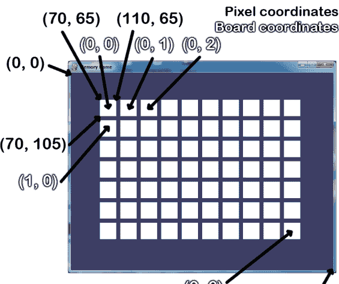

`leftTopCoordsOfBox` 函数将接收方框坐标并返回像素坐标。由于一个框在屏幕上占据多个像素，我们将始终返回该框左上角的单个像素点。该值将作为一个包含两个整数的元组返回。当我们需要为绘制这些框提供像素坐标时，经常会用到 `leftTopCoordsOfBox()` 函数。

## 从像素坐标转换为方框坐标

```
171. def getBoxAtPixel(x, y):
172.     for box in range(BOARDWIDTH):
173.         for box in range(BOARDHEIGHT):
174.             left, top = leftTopCoordsOfBox(boxx, boxy)
175.             boxRect = pygame.Rect(left, top, BOXSIZE, BOXSIZE)
176.             if boxRect.collidepoint(x, y):
177.                 return (boxx, boxy)
178.     return (None, None)
```

我们需要一个从像素坐标转换为方框坐标的函数（这样我们就能知道鼠标点击和移动事件发生在哪个方框上）。`Rect` 对象有一个 `collidepoint()` 方法，你可以向其传递 X 和 Y 坐标，如果坐标在 `Rect` 对象的区域内部（即与 `Rect` 区域碰撞），它将返回 `True`。

向作者提问邮箱：`al@inventwithpython.com`

## 第3章 – 记忆谜题 63

为了找到鼠标坐标位于哪个框上方，我们将遍历每个框的坐标，并在带有这些坐标的 `Rect` 对象上调用 `collidepoint()` 方法。当 `collidepoint()` 返回 `True` 时，我们就找到了被点击或移动过的框，并返回其坐标。如果没有一个一个返回 `True`，则 `getBoxAtPixel()` 将返回值 `(None, None)`。之所以返回这个元组而不是返回 `None`，是因为 `getBoxAtPixel()` 的调用者期望返回一个包含两个值的元组。

## 绘制图标与语法糖

```
181. def drawIcon(shape, color, box, body):
182.     quarter = int(BOXSIZE * 0.25) # 语法糖
183.     half = int(BOXSIZE * 0.5) # 语法糖
184.
185.     left, top = leftTopCoordsOfBox(box, body) # 从
         board 坐标获取像素坐标
```

`drawIcon()` 函数将在 `box` 和 `body` 参数给出的坐标处绘制一个指定形状和颜色的图标。每个形状都有一套不同的 Pygame 绘制函数调用，因此我们必须使用大量的 `if elif` 语句来区分它们。（这些语句位于第 187 到 198 行。）

框的左边缘和顶边缘的 X 和 Y 坐标可以通过调用 `leftTopCoordsOfBox` 函数获得。框的宽度和高度都设置在 `BOXSIZE` 常量中。然而，许多绘制函数调用使用了框尺寸的中点和四分之一点。我们可以计算这些值并将其存储在变量 `quarter` 和 `half` 中。我们本很容易地在代码中写 `int(BOXSIZE * 0.25)` 而不是使用变量 `quarter`，但这样做会让代码变得更易读，因为 `quarter` 的含义比 `int(BOXSIZE * 0.25)` 更直观。

此类变量是**语法糖**的例子。语法糖是指我们添加了本可以写的代码（可能使用更少的代码和变量），但它让源代码更易于阅读。常量变量是语法糖的一种形式。计算一个值并将其存储在变量中是另一种类型的语法糖。（例如，在 `getRandomizedBoard()` 函数中，我们可以很容易地将第 140 行和第 141 行的代码合并为一行。但分成两行写会更易读。）我们不需要额外的 `quarter` 和 `half` 变量，但拥有它们会让代码更易读。易读的代码在未来更容易进行调试和升级。

```
186. # 绘制形状
187.     if shape == DONUT:
```

64 http://inventwithpython.com/pygame

```
188.   pygame.draw.circle(DISPLAYSURF, color, (left + half, top + half),
189.   pygame.draw.circle(DISPLAYSURF, BGCOLOR, (left + half, top +
half), quarter - 5)
190.   elif elf_shape == SQUARE:
191.     pygame.draw.rect(DISPLAYSURF, color, (left + quarter, top +
quarter, BOXSIZE - half))
192.   elif elf_shape == DIAMOND:
193.     pygame.draw.polygon(DISPLAYSURF, color, ((left + half, top), left
BOXSIZE - 1, top + half), (left + half, top + BOXSIZE - 1), (left, top +
half))
194.   elif elf_shape == LINES:
195.     for i in range(0, BOXSIZE, 4):
196.       pygame.draw.line(DISPLAYSURF, color, (left, top + i), (left +
i, top))
197.       pygame.draw.line(DISPLAYSURF, color, (left, top + i), (left +
i, top))
198.   elif elf_shape == OVAL:
199.     pygame.draw.ellipse(DISPLAYSURF, color, (left + quarter, top + half))
```

`drawIcon()` 函数将在 `box` 和 `body` 参数给出的坐标处绘制一个指定形状和颜色的图标。每个形状都有一套不同的 Pygame 绘制函数调用，因此我们必须使用大量的 `if elif` 语句来区分它们。（这些语句位于第 187 到 198 行。）

框的左边缘和顶边缘的 X 和 Y 坐标可以通过调用 `leftTopCoordsOfBox` 函数获得。框的宽度和高度都设置在 `BOXSIZE` 常量中。然而，许多绘制函数调用使用了框尺寸的中点和四分之一点。我们可以计算这些值并将其存储在变量 `quarter` 和 `half` 中。

```
202. def getShapeAndColor(board, boxx):
203.   # x 值存储在
204.   # y 值存储在
205.   return shape, color
```

`getShapeAndColor` 函数返回框的形状和颜色。你可能会奇怪为什么我们使用常量变量：这提高了代码的可读性。

## 绘制框罩

```
208. def drawCovers(board, boxes, coverage):
209.   # 绘制被覆盖的框。
210.   for box in boxes:
211.     left, top = leftTopCoordsOfBox(box[0], box[1])
212.     pygame.draw.rect(DISPLAYSURF, BCOLOR, left, top)
213.     shape, color = getShapeAndColor(board, box)
214.     drawIcon(shape, color, box, box[1])
215.     if coverage > 0: # 只有在有覆盖时才绘制
216.         pygame.draw.rect(DISPLAYSURF, BOXCOLOR, left, top, coverage)
217.     pygame.display.update()
```

`drawCovers` 有三个参数：板数据结构、需要覆盖的每个框的 (X, Y) 元组列表，以及覆盖量。对 `boxes` 列表中的每个框使用相同的绘制方法。对于循环，代码应该执行三件事：绘制背景颜色（覆盖掉原本的内容）、绘制图标，然后是所需的图标覆盖层。`leftTopCoordsOfBox` 函数将返回框左上角的像素坐标。

当 `coverage` 参数为 0 时，完全没有覆盖。当 `coverage` 设置为 20 时，有一个 20 像素宽的白色框覆盖图标。我们希望将覆盖量设置为 `BOXSIZE` 的值，这样整个图标将被完全覆盖。

`drawCovers` 将从与游戏循环独立的循环中调用。由于由于，它需要单独调用 `pygame.display.update()` 和 `FPSCLOCK.tick(FPS)` 来显示动画。这意味着在这个循环期间，没有代码在运行以处理生成的任何动画。不过，覆盖和显示动画只需要运行一秒钟。

## 处理显示与覆盖动画

```
222. def revealBoxesAnimation(board, boxesToReveal):
223.     # 执行“显示”动画。
224.     for coverage in range(BOXSIZE, (-REVEALSPEED) - 1, REVEALSPEED):
225.         drawCovers(board, boxesToReveal, coverage)
226.
227.
228. def coverBoxesAnimation(board, boxesToCover):
229.     # 执行“覆盖”动画。
```

```
230. for coverage in range(0, BOXSIZE + REVEALSPEED, REVEALSPEED):
231.     drawBoxesCovers(board, boxesToCover, coverage)
```


请记住，动画仅仅是在极短的时间内显示图像，它们组合在一起就让物体看起来在屏幕上移动移动。`revealBoxesAnimation()` 和 `coverBoxesAnimation()` 只需要通过白色框绘制一个具有不同数量的图标。我们可以写一个名为 `drawBoxesCovers()` 的简单函数来完成此操作，然后在我们的动画函数中为动画的每一帧调用 `drawBoxesCovers()`。正如我们在上一节中看到的，`drawBoxesCovers()` 会调用 `pygame.display.update()` 和 `FPSCLOCK.tick(FPS)` 本身。

为了实现这一点，我们设置了一个 for 循环，使得（在 `revealBoxesAnimation()` 的情况下）或增加（在 `coverBoxesAnimation()` 的情况下）变量 `coverage` 的数值将根据 `REVEALSPEED` 常量的数值进行减少/增加。在第 12 行，我们将其设置为 8，使得每次调用 `drawBoxesCovers()` 时，白色框在每次迭代中都会减少/增加 8 像素。如果我们增加这个数字，每次调用时将绘制更多像素，从而使白色框减少/增加尺寸的速度更快。如果我们将其设置为 1，白色框在每次迭代中看起来只减少了或增加了 1 像素，从而使揭露或覆盖动画变得更长。

把它想象成爬楼梯。在每迈出的每一步上，你都爬上了一个台阶，那么爬完整个楼梯需要正常的时间。但如果你一次爬两个台阶（而每个台阶花费的时间和之前一样），你就可以以快一倍的速度爬完楼梯。如果你一次爬 8 个台阶，那么你爬完整个楼梯的速度将快 8 倍。

## 绘制整个画板

```
234. def drawBoard(board, revealed):

235.     # 绘制所有处于覆盖或揭露状态的框。

236.     for boxes in range(BOARDWIDTH):

237.         for box in range(LEFTTopCoordsOf(boxx, box):

238.             left, top = revealed[box][]

239.             if not revealed[box]:

240.                 # 绘制一个覆盖的框。

241.                 pygame.rect(DISPLAYSURF, COLOR, (left, top,

242.             else:

243.                 # 绘制（揭露的）图标。

244.                 shape, color = getShapeAndColor(board, boxx, boxx)

```

| 245. | drawIcon(shape, color, boxx, boxy) |

`drawBoard()` 函数为画板上的每个框调用一次 `drawIcon()`。第 236 行和 237 行的嵌套 for 循环将遍历框的每个 X 和 Y 坐标，并在该位置绘制图标或白色正方形（代表被覆盖的框）。

## 绘制高亮

```
248. def drawHighlightBox(boxx, box):

249.     left, top = leftTopCornersOfBox(boxx, box)

250.     pygame.rect(DISPLAYFACE, HIGHLIGHTCOLOR, (left - 5, top - 5, BOXSIZE + 10, BOXSIZE + 10), 4)

```

为了帮助玩家识别可以点击框来揭露它，我们将框周围画一个蓝色轮廓来高亮它。该轮廓是通过调用 `pygame.rect()` 绘制的宽度为 4 像素的矩形。

## “开始游戏”动画

```
253. def startGameAnimation(board):

254.     # 一次随机揭露 8 个框。

255.     coveredBoxes = generateRevealedBoxesData(False)

256.     boxes = []

257.     for x in range(BOARDWIDTH):

258.         for y in range(BOARDHEIGHT):

259.             boxes.append((x, y))

260.     random.shuffle(boxes)

261.     boxGroups = splitIntoGroupsOf(8, boxes)

```

每次游戏向玩家提供图标位置的时时都会播放的动画。为了制作这个动画，我们需要一个接一个地揭露和覆盖一组框。为了做到这一点，我们首先创建一个画板上所有可能空间的列表。第 257 行和 258 行的嵌套 for 循环将 `(X, Y)` 元组添加到 `boxes` 变量列表中。我们将揭露并覆盖列表中的前 8 个框，然后是接下来的 8 个，再是接下来的 8 个，以此此类推。然而，`boxes` 中 `(X, Y)` 元组的顺序每次都是相同的，那么框的显示顺序也将始终是相同的。（尝试注释掉第 260 行然后运行几次来观察这种效果。）

为了在每次游戏开始时更换框，我们将使用 `random.shuffle()` 函数来打乱列表中元组的顺序。这样，当我们揭露和覆盖列表中的前 8 个框（以及随后的每组 8 个框）时，它将是随机的 8 个框。为了获取 8 个框的列表，我们调用 `splitIntoGroupsOf()` 并传入 8 和 `boxes` 列表。该函数返回的列表列表将存储在名为 `boxGroups` 的变量中。

## 揭露和覆盖框组

```
263. | drawBoard(board) |
264. | for boxGroup in boxGroups: |
265. | revealBoxesAnimation(board, boxGroup) |
266. | coverBoxesAnimation(board, boxGroup) |
```

首先，我们创建一个画板上所有可能空间的列表。第 257 行和 258 行的嵌套 for 循环将 `(X, Y)` 元组添加到 `boxes` 变量列表中。我们将揭露并覆盖列表中的前 8 个框，然后是接下来的 8 个，再是接下来的 8 个，以此此类推。然而，`boxes` 中 `(X, Y)` 元组的顺序每次都是相同的，那么框的显示顺序也将始终是相同的。（尝试注释掉第 260 行然后运行几次来观察这种效果。）

为了在每次游戏开始时更换框，我们将使用 `random.shuffle()` 函数来打乱列表中元组的顺序。这样，当我们揭露和覆盖列表中的前 8 个框（以及随后的每组 8 个框）时，它将是随机的 8 个框。为了获取 8 个框的列表，我们调用 `splitIntoGroupsOf()` 并传入 8 和 `boxes` 列表。该函数返回的列表列表将存储在名为 `boxGroups` 的变量中。

## “游戏胜利”动画

```
269. | def gameWon(board): |
270. | # 当玩家赢得时闪烁背景颜色 |
271. | coveredBoxes = generateRevealedBoxesData(True) |
272. | color1 = LIGHTCOLOR |
273. | color2 = BCOLOR |
274. | |
275. | for i in range(13): |
276. | color1, color2 = color2, color1 # 交换颜色
277. | DISPLAYSFACE.fill(color1) |
278. | drawBoard(board, coveredBoxes) |
279. | pygame.display.update() |
280. | pygame.time.wait(300) |
```

当玩家通过匹配画板上的所有框时，我们将通过闪烁背景颜色来祝贺他们。在第 276 行 `color1` 和 `color2` 将相互交换。这样程序就会交替绘制背景颜色。

请记住这个函数需要调用 `pygame.display.update()` 才能让 DISPLAYS 显示在屏幕上。

## 玩家赢了

```
283. def hasWon(revealedBoxes):
284.     # 如果所有框都已揭露则返回 True，否则返回 False
285.     for i in revealedBoxes:
286.     if False in i:
287.         return False # 如果任何框被覆盖则返回 False
288. return True
```

当所有图标都匹配时，玩家赢得了游戏。由于“揭露”数据结构存储的是 True，我们可以简单地遍历 `revealedBoxes` 中的每个空间来寻找 False 值。如果 `revealedBoxes` 中即使有一个 `False` 值，那么我们还有未匹配的图标。

注意由于 `revealedBoxes` 是列表列表，第 285 行的 for 循环将内部列表设置为 `i` 的值。但我们使用运算符在整个内部列表中搜索 `False` 值。这样我们不需要编写额外的代码并像下面这样嵌套 for 循环：

```
for x in revealedBoxes:

  for y in revealedBoxes[x]:

    if False == revealedBoxes[x][]:

      return False
```

## 为什么要有 main ()

```
291. if __name__ == '__main__':

292.     main()
```

拥有一个 `main()` 函数似乎没有意义，因为你也可以直接把它放在程序底部的全局作用域中，代码运行方式将完全相同。然而，将它们放在 `main()` 函数中有两个：

首先，这允许你拥有局部变量，而我们知道 `main()` 函数中的局部变量将变成全局变量。限制全局变量的数量是保持代码简单易于调试的好方法（参见本章的“为什么全局变量是糟糕的”章节）。

向作者提问：al@inventwithpython.com

70 http://inventwithpython.com/pygame

其次，这允许你导入该程序，这样你就可以调用并测试单个函数。`memory-puzzle.py` 文件位于 `C:\Python32` 文件夹，然后你可以从交互式 shell 中导入它。输入以下内容来测试 `splitIntoGroupsOf()` 和 `getBoxAtPixel()` 函数，确保它们返回正确的值：

```
>>> import memorypuzzle

>>> memorypuzzle.splitIntoGroupsOf(3, [0,1,2,3,4,5,6,7,8,9])

[[0, 1, 2], [3, 4, 5], [6, 7, 8], [9]]

>>> memorypuzzle.getBoxAtPixel(0, 0)

(None, None)

>>> getBoxAtPixel(150, 150)

(1, 1)
```

当一个模块被导入时，所有的代码都包含其中。如果我们没有 `main()` 函数，并将它的代码放在全局作用域中，那么一旦我们导入它，游戏就会自动启动，这真的让我们无法调用其中的单个函数。

这就是为什么代码是在一个我们命名为 `main()` 的函数中。然后，我们检查内置变量 `__name__` 来查看我们是否调用了 `main()` 函数。如果程序本身正在运行，Python 解释器会自动将该变量设置为字符串 `'__main__'`；如果它正在被导入，则被设置为 `'memorypuzzle'`。这就是为什么当我们在交互式 shell 中执行 `import memorypuzzle` 语句时，`main()` 没有运行。

这是一个非常实用的技巧，让你能够从交互式 shell 导入正在编写的程序，并通过逐个测试单个函数来确保它们返回正确的值。

## 为什么要关注可读性？

本章中的许多建议与其说是关于如何编写计算机可以运行的程序，不如说是如何编写程序员可以读的程序。你可能不理解这为什么很重要。毕竟，只要代码能运行，谁在乎人类程序员读起来是易是难呢？

然而，关于软件需要意识到的重要的一点是，它很少处于静态状态。当你创建自己的游戏时，你会“完成”这个程序。你总是会对想要的游戏功能产生新想法，或者在程序中发现新的 bug。因此，你的程序具有可读性非常重要，这样你就可以查看代码并理解它。理解代码是修改它以添加更多代码或修复 bug 的第一步。

例如，这里有一个记忆游戏（Memory Puzzle）程序的混淆版本，它变得完全不可读。如果你输入它（或从 

Email questions to the author: al@inventpython.com

# 第3章 – 记忆游戏 71

http://invpy.com/memorypuzzle_obfuscated.py）并运行它，你会发现它与本章开始的代码完全相同。但如果这段代码有一个 bug，你将无法阅读代码并理解发生了什么，更不用说修复 bug 了。

计算机并不介意是这样不可读的代码。对它来说都是一样的。

```python
import random, pygame, sys

from pygame.locals import *

def hhh():

    global a, b

    pygame.init()

    a = pygame.time.Clock()

    b = pygame.display.set_mode((640, 480))

    j = 0

    k = 0

    pygame.display.set_caption('Memory Game')

    i = c(0)

    hh = d(False)

    h = None

    b.fill((60, 60, 100))

    g(i)

    while True:

        e = False

        b.fill((60, 60, 100))

        f(i, hh)

        for ee in pygame.event.get():

            if ee.type == QUIT or (ee.type == KEYUP and ee.type == K_ESCAPE):

                pygame.quit()

                sys.exit()

        elif ee.type == MOUSEMOTION:

            j, k = ee.pos

        elif ee.type == MOUSEBUTTONUP:

            j, k = ee.pos

            e = True

        bb, ee = m(j, k)

        if bb != None and ee != None:

            if not hh[bb][ee]:

                n(bb, ee)

            if not hh[bb][ee] and e:

                o(i, (bb, ee))

                hh[bb][ee] = True

            if h == None:

                h = (bb, ee)

            else:

                q, fff = s(i, h[0], h[1])

                r, ggg = s(i, bb, ee)
```

72 http://inventwithpython.com/pygame

```python
        if q != r or fff != ggg:

            pygame.time.wait(1000)

        p(i, ([h[0], h[1]), (bb, ee]))

        hh[h[0]][h[1]] = False

        hh[bb][ee] = False

    elif ii():

        jj(i)

        pygame.time.wait(2000)

        i = c(c)

        hh = d(False)

        f(i, hh)

        pygame.display.update()

        pygame.time.wait(1000)

        g(i)

        h = None

        pygame.display.update()

    a.tick(30)

def d(ccc):

    hh = []

    for i in range(10):

        hh.append([ccc] * 7)

    return hh

def c(c):

    rr = []

    for tt in ((255, 0, 0), (0, 255, 0), (0, 0, 255), (255, 255, 0), (255, 0, 255), (255, 255, 255)):

        for ss in ('a', 'b', 'c', 'd', 'e'):

            rr.append((ss, tt))

    random.shuffle(rr)

    rr = rr[:5] * 2

    random.shuffle(rr)

    bbb = []

    for x in range(10):

        v = []

        for y in range(7):

            v.append(rr[0])

        del rr[0]

        bbb.append(v)
```


```python
return bbb

def t(vv, uu):

    ww = []

    for i in range(0, len(uu)):

        ww.append(uu[i])

    return ww

def aa(bb, ee):

    return (bb * 50 + 70, ee * 50 + 65)

def m(x, y):

    for bb in range(10):

        for ee in range(7):

            oo, ddd = aa(bb, ee)

            aaa = pygame.Rect(oo, ddd, 40, 40)

            if aaa.collidepoint(x, y):

                return (bb, ee)

    return (None, None)

def w(ss, tt, bb, ee):

    oo, ddd = aa(bb, ee)

    if ss == 'a':

        pygame.draw.circle(b, tt, (oo + 20, ddd + 20), 15)

        pygame.draw.circle(b, (60, 60, 100), (oo + 20, ddd + 20), 5)

    elif ss == 'b':

        pygame.draw.rect(b, tt, (oo + 10, ddd + 10, 20, 20))

    elif ss == 'c':

        pygame.draw.polygon(b, tt, [(oo + 20, ddd), (oo + 40, ddd), (oo + 20, ddd + 40)])

    elif ss == 'd':

        for i in range(0, 4):

            pygame.draw.line(b, tt, (oo, ddd + i), (oo + i, ddd))

            pygame.draw.line(b, tt, (oo + i, ddd + 39), (oo + 39, ddd))

    elif ss == 'e':

        pygame.draw.ellipse(b, tt, (oo + 10, ddd + 10, 40, 20))

def s(bbb, bbb, ee):

    return bbb[bb][ee][0], bbb[bb][1]

def dd(bbb, boxes):

    for box in boxes:

        oo, ddd = aa(box[0], box[1])

        pygame.draw.rect(b, (60, 60, 100), oo, ddd, 40, 40)

        ss, tt = s(bbb, box[0], box[1])

        w(ss, tt, box[0], box[1])

        if gg > 0:

            pygame.draw.rect(b, (255, 255, 255), oo, ddd, gg, 40)

    pygame.display.update()

    a.tick(30)

def o(bbb, cc):

    for gg in range(40, -8, -8):

        ddbb(bbb, cc, gg)

def ddbb(bbb, ff, gg):

    # 原文中此处未给出 ddbb 的实现，此处为占位

    pass

def p(bbb, ff):

    for gg in range(0, 48, 8):

        ddbb(bbb, ff, gg)

def f(bbb, pp):

    for bb in range(10):

        for ee in range(7):

            oo, ddd = aa(bb, ee)

            if not pp[bb][ee]:

                pygame.draw.rect(b, (255, 255, 255), oo, ddd, 40, 40)

            else:

                ss, tt = s(bbb, bb, ee)

                w(ss, tt, bb, ee)
```

```python
def n(bb, ee):
    oo, ddd = aa(bb, ee)
    pygame.draw.rect(b, (0, 0, 255), (oo - 5, ddd - 5, 50, 50), 4)
def g(bbbb):
    mm = d(False)
    boxes = []
    for x in range(10):
        for y in range(7):
            boxes.append((x, y))
    random.shuffle(boxes)
    kk = t(8, boxes)
def f(bbb, mm):
    for nn in kk:
        o(bbb, nn)
        p(bbb, nn)
```

以及同一个程序中的不同系统）为了保持本书的简短，将不再再次解释它们。

为了理解代码是如何运行的，可以尝试的一种方法是通过注释掉随机行来故意破坏它。对某些行执行此操作可能会导致语法错误，使得脚本完全无法运行。但注释掉其他行可能会导致奇怪的 Bug 和其他酷炫的效果。尝试这样做，并弄清楚为什么程序会出现那些 Bug。

这也是你能够向程序中添加自己的“秘密外挂”或黑客功能的第一步。通过打破程序的正常运行，你可以学习如何将其改变为某些奇妙的效果（例如秘密地给你提供如何解谜的提示）。请尽管进行实验。如果你想再次玩普通游戏，可以随时将未修改的源代码保存到另一个文件中。

事实上，如果你想练习修复 Bug，这个游戏的源代码有几个带有微小 Bug 的版本。你可以从 http://invpy.com/buggy/memorypuzzle 下载这些带有错误的版本。尝试运行程序以找出 Bug 是什么，以及程序为什么会那样运行。

向作者发送邮件提问：`al@inventwithpython.com`

## 第 4 章 – 数字滑块游戏

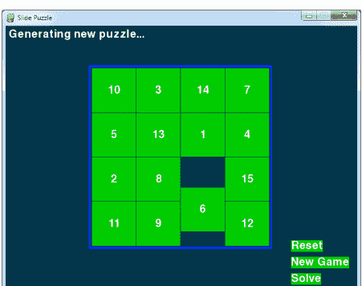

### 如何玩滑块游戏

游戏是一个 4x4 的网格，包含十五块滑块（从左到右编号 1 到 15）和一个空白区域。滑块初始处于随机位置，玩家必须滑动滑块，直到滑块恢复原始顺序。

### 滑块游戏的源代码

可以从 http://invpy.com/slidepuzzle.py 下载此源代码。如果你收到任何错误消息，请查看错误消息中提到的行，并检查你的代码是否有任何类型错误。你也可以将代码复制并粘贴到 http://invpy.com/slidepuzzle 的网页表单中，查看你的代码与书中代码之间的差异。

```python
1. # Slide Puzzle
2. # Al Schweigart al@inventwithpython.com
3. # http://inventwithpython.com/pygame
4. # Creative Commons BY-NC-SA 3.0 US
5.
6. import pygame, sys, random
7. from pygame.locals import *
8.
9. # Create the constants (go ahead and experiment with different values)
10. BOARDWIDTH = 4 # number of columns in the board
11. BOARDHEIGHT = 4 # number of rows in the board
12. TILESIZE = 80
13. WINDOWWIDTH = 640
14. WINDOWHEIGHT = 480
15. FPS = 30
16. BLANK = None
17.
18. #             R G B
19. BLACK = (0, 0, 0)
20. WHITE = (255, 255, 255)
21. BRIGHTBLUE = (0, 50, 255)
22. DARTURQUISE = (3, 54, 73)
23. GREEN = (0, 204, 0)
24.
25. BGCOLOR = DARKTURQUISE
26. TILECOLOR = GREEN
27. TEXTCOLOR = WHITE
28. BORDERCOLOR = BRIGHTBLUE
29. BASICFONSIZE = 20
30.
31. BUTTONCOLOR = WHITE
32. BUTTONTEXTCOLOR = BLACK
33. MESSAGECOLOR = WHITE
34.
35. XMARGIN = int((WINDOWWIDTH - (TILESIZE * BOARDWIDTH + (BOARDWIDTH - 1)) / 2))
36. YMARGIN = int((WINDOWHEIGHT - (TILESIZE * BOARDHEIGHT + (BOARDHEIGHT - 1)) / 2))
37.
38. UP = 'up'
39. DOWN = 'down'
40. LEFT = 'left'
41. RIGHT = 'right'
42.
43. def main():
44.     global FPSCLOCK, DISPLAYFACE, BASICFONT, RESET_SURF, RESET_RECT,
45.     NEW_SURF, NEW_RECT, SOLVE_SURF, SOLVE_RECT
46.
47.     pygame.init()
48.     FPSCLOCK = pygame.time.Clock()
49.     DISPLAYFACE = pygame.display.set_mode((WINDOWWIDTH, WINDOWHEIGHT))
50.     pygame.display.set_caption('Slide Puzzle')
51.     BASICFONT = pygame.font.Font('freesansfont.ttf', BASICSIZE)
52.
53.     # Store option buttons and their rectangles in OPTIONS.
54.     RESET_SURF, RESET_RECT = makeText('Reset', TEXTCOLOR, TILECOLOR,
55.     WINDOWWIDTH - 120, WINDOWHEIGHT - 90)
```

## 第 4 章 – 滑块游戏


```python
54.    NEW_SURF, NEW_RECT = makeText('New Game'), TEXTCOLOR, TILECOLOR,
       WINDOWWIDTH - 120, WINDOWHEIGHT - 60)
55.    SOLVE_SURF, SOLVE_RECT = makeText('Solve', TEXTCOLOR, TILECOLOR,
       WINDOWWIDTH - 120, WINDOWHEIGHT - 30)
56.
57.    mainBoard, solutionSeq = generatePuzzle(80)
58.    SOLVEDBOARD = getStartingBoard() # solved board is the same as start state.
59.    allMoves = [] # list of moves
60.
61.    while True: # main loop
62.        slideTo = None # direction, if any
63.        msg = '' # message to show in upper corner.
64.        if mainBoard == SOLVEDBOARD:
65.            msg = 'Solve!'
66.
67.        drawBoard(mainBoard, msg) # draw on screen
68.
69.    checkForForQuit():
70.        for event in pygame.event: # event
71.            if event.type == MOUSEBUTTONUP:
72.                spotx, spoty = getClicked(mainBoard) # check if user clicked on
73.                if RESET_RECT.collidepoint(event.pos): # reset button
74.                    resetAnimation(mainBoard, allMoves)
75.                    allMoves = []
76.                if NEW_RECT.collidepoint(event.pos): # New button
77.                    mainBoard, solutionSeq = generatePuzzle(80)
78.                    allMoves = []
79.                if SOLVE_RECT.collidepoint(event.pos): # Solve button
80.                    resetAnimation(mainBoard, solutionSeq)
81.        else: # not a button click
82.            # check if clicked tile was next to blank spot
83.            blankx, blanky = getBlankPosition(mainBoard)
84.            if spotx == blankx + 1 and spoty == blanky:
85.                slideTo = LEFT
86.            elif spotx == blankx - 1 and spoty == blanky:
87.                slideTo = RIGHT
88.            elif spotx == blankx and spoty == blanky + 1:
89.                slideTo = UP
90.            elif spotx == blankx and spoty == blanky - 1:
91.                slideTo = DOWN
92.        elif event.type == KEYUP:
93.            # check if user pressed a key to slide a tile
94.            if event.key in (K_LEFT, K_a) and isValidMove(mainBoard, LEFT):
95.                slideTo = LEFT
96.            elif event.key in (K_RIGHT, K_d) and isValidMove(mainBoard, RIGHT):
97.                slideTo = RIGHT
98.            elif event.key in (K_UP, K_w) and isValidMove(mainBoard, UP):
99.                slideTo = UP
100.            elif event.key in (K_DOWN, K_s) and isValidMove(mainBoard, DOWN):
101.                slideTo = DOWN
102.
103.    if slideTo:
104.        slideAnimation(mainBoard, slideTo, 'Click tile or arrow keys to slide.', 8) # show on screen
105.        makeMove(mainBoard, slideTo)
106.        allMoves.append(slideTo) # record the slide
107.        pygame.display.update()
108.        FPSCLOCK.tick(FPS)
109.
110.    def terminate():
111.        pygame.quit()
112.        sys.exit()
113.
114.    def checkForForQuit():
115.        for event in pygame.event.get(QUIT): # get all the QUIT events
116.            terminate() # terminate if any QUIT events are present
117.        for event in pygame.event.get(KEYUP): # get all the KEYUP events
118.            if event.key == K_ESCAPE:
119.                terminate() # terminate if the KEYUP event was for the Esc key
120.                pygame.event.post(event) # put the other KEYUP event objects back
```

```python
175.    (move == LEFT and blankx != len(board) - 1) or \
176.    move == RIGHT and blankx != 0)
177.
178.
179. def getRandomMove(board, lastMove=None):
180.     # 从包含所有四个方向的完整列表开始
181.     validMoves = [UP, DOWN, LEFT, RIGHT]
182.
183.     # 当某些移动被取消资格时，从列表中移除这些移动操作
184.     if lastMove == UP or not isValidMove(board, DOWN):
185.         validMoves.remove(DOWN)
186.     if lastMove == DOWN or not isValidMove(board, UP):
187.         validMoves.remove(UP)
188.     if lastMove == LEFT or not isValidMove(board, RIGHT):
189.         validMoves.remove(RIGHT)
190.     if lastMove == RIGHT or not isValidMove(board, LEFT):
191.         validMoves.remove(LEFT)
192.
193.     # 从剩余的移动列表中随机返回一个移动
194.     return random.choice(validMoves)
195.
196.
197. def getLeftTopOff(tileX, tileY):
198.     left = XMARGIN + (tileX * TILESIZE) - (tileX - 1)
199.     top = YMARGIN + (tileY * TILESIZE) - (tileY - 1)
200.     return (left, top)
201.
202.
203. def getSpotClicked(board, x, y):
204.     # 从 x & y 像素坐标获取 x & y 格坐标
205.     for tileX in range(len(board)):
206.         left, top = getLeftTopOff(tileX, tileY)
207.         tileRect = pygame.rect(left, top, TILESIZE, TILESIZE)
208.         if tileRect.colliderepoint(x, y):
209.             return (tileX, tileY)
210.
211.     return (None, None)
212.
213.
214. def drawTile(tileX, tileY, number, adjx=0, adjy=0):
215.     # 在棋盘坐标和格子上绘制一个方块，可选地偏移
216.     # 像素（由 adjx 和 adjy 决定）
217.     left, top = getLeftTopOff(tileX, tileY)
218.     pygame.draw.rect(DISPLAYFACE, TILECOLOR, (left + adjx, top + adjy, 
219.     TILESIZE, TILESIZE))
220.     textSurf = BASICFONT.render(number, True, TEXTCOLOR)
```

向作者提问邮箱：`al@inventwithpython.com`


```python
220. textRect = textSurf.get_rect()
221. textRect.center = left + int(TILESIZE / 2) + adjx, top + int(TILESIZE) / 2) + adjy
222. DISPLAYFACE.blit(textSurf, textRect)
223.

224.

225. def makeText(text, color, bgcolor, top, left):
226.     #为某些文本创建 Surface 和 Rect 对象
227.     textSurf = BASICFONT.render(text, True, color, bgcolor)
228. textRect = textSurf.get_rect()
229. textRect.topleft = (top, left)
230. return (textSurf, textRect)
231.

232.

233. def drawBoard(board, message):
234.     DISPLAYFACE.fill(BGCOLOR)
235.     if message:
236.         textSurf, textRect = makeText(message, MESSAGECOLOR, BGCOLOR, S, 5)
237.         DISPLAYFACE.blit(textSurf, textRect)
238.

239.     for tile in range(len(board)):
240.         for tile in range(len(board[0])):
241.             if board[tile][tile]:
242.                 drawTile(tilex, tilely, board[tile][tile])
243.

244.     left, top = getLeftTopOff(0, 0)
245.     width = BOARDWIDTH * TILESIZE
246.     height = BOARDHEIGHT * TILESIZE
247.     pygame.rect(DISPLAYFACE, BORDERCOLOR, (left - 5, top - 5, width + 11, height + 11), 4)
248.

249.     DISPLAYFACE.blit(RESET_SURF, RESET_RECT)
250.     DISPLAYFACE.blit(NEW_SURF, NEW_RECT)
251.     DISPLAYFACE.blit(SOLVE_SURF, SOLVE_RECT)
252.

253. def slideAnimation(board, direction, message, animationSpeed):
254.     # 注意：此函数不检查移动是否有效
255.

256.     blankx, blanky = getBlankPosition(board)
257.     if direction == UP:
258.         movex = blankx
259.         movey = blanky + 1
260.     elif direction == DOWN:
261.         movex = blankx
262.         movey = blanky - 1
263.     elif direction == LEFT:
264.         movex = blankx + 1
265.         movey = blanky
266.     elif direction == RIGHT:
267.         movex = blankx - 1
268.         movey = blanky
269.

270.     # 准备基础表面
271.     drawBoard(board, message)
272.     baseSurface = DISPLAYFACE.copy()
273.     # 在基础表面上移动方块上绘制一个空白表面
274.     moveLeft, moveTop = getLeftToTop(movex, moveTop)
275.     pygame.draw.rect(baseSurface, BORDERCOLOR, (moveLeft, moveTop, TILESIZE, TILESIZE))
276.

277.     for i in range(0, TILESIZE, animationSpeed):
278.         # 动画方块滑动
279.         checkForQuit()
280.         DISPLAYFACE.blit(baseSurface, (0, 0))
281.         if direction == UP:
282.             drawTile(movex, movey, board[movex][movey], 0, -i)
283.         if direction == DOWN:
284.             drawTile(movex, movey, board[movex][movey], 0, i)
285.         if direction == LEFT:
286.             drawTile(movex, movey, board[movex][movey], -i, 0)
287.         if direction == RIGHT:
288.             drawTile(movex, movey, board[movex][movey], i, 0)
289.

290.     pygame.display.update()
291.     FPSCLOCK.tick(FPS)
292.

293. def generateNewPuzzle(numSlides):
294.     # 从起始配置生成 numSlides 次移动
295.     # 并动画化这些移动。
296.     sequence = []
297.     board = getStartingBoard()
298.     drawBoard(board, ' ')
299.     pygame.display.update()
300.     pygame.time.wait(500) # 暂停 500 毫秒产生效果
301.     lastMove = None
302.     for i in range(numSlides):
303.     move = getRandomMove(board, lastMove)
304.     slideAnimation(board, move, 'Generating new puzzle...', int(TILESIZE / 3))
305.     makeMove(board, move)
306.     sequence.append(move)
307.     lastMove = move
308.     return (board, sequence)
309.

310. def resetAnimation(board, allMoves):
311.     # 将 allMoves 中的所有移动反转过来。
312.     revAllMoves = allMoves[:] # 获取列表的拷贝
313.     revAllMoves.reverse()
314.

315.     for move in revAllMoves:
316.         if move == UP:
317.             oppositeMove = DOWN
318.         elif move == DOWN:
319.             oppositeMove = UP
320.         elif move == RIGHT:
321.             oppositeMove = LEFT
322.         elif move == LEFT:
323.             oppositeMove = RIGHT
324.         slideAnimation(board, oppositeMove, '', int(TILESIZE / 2))
325.         makeMove(board, oppositeMove)
326.

327. if __name__ == '__main__':
328.   main()
```

## 第二节，与第一节相同

Wormy 中的大部分代码与我们之前过的游戏相似，特别是代码开头设置的常量。

```python
## 滑动益智游戏
## 作者：AI Sweigart@inventwithpython.com
## http://inventwithpython.com/pygame
## Creative Commons BY-NC-SA 3.0 US

import pygame, sys, random
from pygame.locals import *

## 创建常量（尽管尝试不同的值）
BOARDWIDTH = 4 # 棋盘的列数
BOARDHEIGHT = 4 # 棋盘的行数
TILESIZE = 80
WINDOWWIDTH = 640
WINDOWHEIGHT = 480
XMARGIN = 50
YMARGIN = 50
BGCOLOR = (255, 255, 255)
TILECOLOR = (200, 200, 200)
TEXTCOLOR = (0, 0, 0)
MESSAGECOLOR = (0, 0, 255)
BORDERCOLOR = (0, 0, 0)
```

解决滑块拼图可能非常棘手。我们可以编写程序来完成它，但这需要我们想出一个可以解决该滑块拼图的算法。这将非常困难，并且在编写此程序时投入大量的智慧和努力。

幸运的是，有一种更简单的方法。我们可以让计算机在创建棋盘数据结构时记住所有的随机滑动操作，然后只需通过执行相反的滑动操作即可解决棋盘。由于棋盘最初是从完成状态开始的，撤销所有的滑动就会让它回到完成状态。

例如，下面我们在页面的左侧执行了一次“向右”滑动，这使得棋盘处于页面右侧所示的状态：

| 1 | 2 | 3 | 4 |

|---|---|---|---|

| 5 | 6 | 7 | 8 |

| 9 | 10 | 11 | 12 |

| 13 | 14 | 15 | |

在向右滑动之后，如果我们再次执行相反的滑动（向左滑动），那么棋盘将回到原始状态。要在多次滑动后回到原始状态，我们只需要按照相反的顺序执行相反的滑动即可。如果我们先向向滑动一次，再向右滑动一次，然后向下滑动一次，我们就必须执行向上滑动、向左滑动和再次向左滑动来撤销前三次滑动。这比编写一个仅通过观察拼图当前状态就能解决它的函数要简单得多。

### 主游戏循环

```python
while True: # 主游戏循环
    slideTo = None # 方向，如果有任何滑块滑动的话
    msg = '' 包含显示在左上角的消息。
    if mainBoard == SOLVEDBOARD:
        msg = 'Solved!'

    drawBoard(mainBoard, msg)
```

在主游戏循环中，`slideTo` 变量将跟踪玩家想要滑动滑块的方向（它在游戏循环开始时初始为 `None`，并在稍后被设置），而 `msg` 变量则跟踪显示在窗口顶部的的内容。程序在第 64 行进行了一次快速检查，查看棋盘数据结构的值是否与存储在 `SOLVEDBOARD` 中的完成棋盘数据结构相同。如果是，`msg` 变量将更改为字符串 'Solved!'。

向作者提问邮箱：al@inventwithpython.com

## 第 4 章 – 滑块拼图 89

在调用 `drawBoard()` 将其绘制到 `DISPLAYS` Surface 对象上（在第 67 行完成）并调用 `pygame.display.update()` 在实际计算机屏幕上绘制显示 Surface（这在游戏循环结束时的第 291 行完成）之前，它不会出现在屏幕上。

### 点击按钮

```python
69.     checkQuit()
70.     for event in pygame.event.get(): # 事件处理循环
71.         if event.type == MOUSEBUTTONUP:
72.             spotx, spoty = getSpotClicked(mainBoard, event.pos[0],
73.             event.pos[1])
74.                 if (spotx, spoty) == (None, None):
75.                     # 检查用户是否点击了选项按钮
76.                     if RESET_RECT.collidepoint(event.pos):
77.                         resetAnimation(mainBoard, allMoves) # 点击了
78.                 allMoves = []
79.                 elif NEW_RECT.collidepoint(event.pos):
80.                 mainBoard, solutionSeq = generateNewPuzzle(80) #
81.                 allMoves = []
82.                 elif SOL_RECT.collidepoint(event.pos):
83.                     resetAnimation(mainBoard, solutionSeq + allMoves)
84.                 allMoves = []
```

重置按钮

点击了 New（新建）按钮

在进入事件循环之前，程序调用第 69 行的 `checkQuit()` 来检查是否创建了任何 `QUIT` 事件（如果有，则终止程序）。我们将解释为什么需要一个单独的函数（`checkQuit()` 函数）来处理 `QUIT` 事件。第 70 行的 `for` 循环执行自上一次调用 `pygame.event.get()` 之后（或从程序开始，如果之前从未调用过 `pygame.event.get()`）生成的任何其他事件的事件代码。

如果事件类型是 `MOUSEBUTTONUP` 事件（即

如果鼠标释放时没有命中棋盘上的任何一个空位（但显然发生在窗口的某个位置，因为创建了 `MOUSEBUTTONUP` 事件），那么 `getSpotClicked()` 将返回 `None`。在这种情况下，我们想要进行额外的检查以

90 http://inventpython.com/pygame

查看玩家是否点击了 Reset（重置）、New（新建）、Solve（求解）按钮（这些按钮不在棋盘上）。

这些按钮在窗口上的坐标存储在变量 `RESET_RECT`、`NEW_RECT` 和 `SOLVE_RECT` 的 `pygame.Rect` 对象中。我们可以将鼠标坐标从 `Event` 对象传递给 `collidepoint()` 方法。如果鼠标坐标在 `Rect` 对象范围内，该方法将返回 `True`，否则返回 `False`。

### 使用鼠标滑动滑块

```python
85.     else:
86.         # 检查点击的滑块是否相邻空位
87.

88.         blankx, blanky = getBlankPosition(mainBoard)
89.         if spotx == blankx + 1 and spoty == blanky:
90.             slideTo = LEFT
91.         elif spotx == blankx - 1 and spoty == blanky:
92.             slideTo = RIGHT
93.         elif spotx == blankx and spoty == blanky + 1:
94.             slideTo = UP
95.         elif spotx == blankx and spoty == blanky - 1:
96.             slideTo = DOWN
```

如果 `getSpotClicked()` 没有返回 `(None, None)`，它将返回一个包含两个整数的元组，代表点击棋盘位置的 X 和 Y 坐标。然后第 89 到 96 行的 `if` 和 `elif` 语句将检查该位置是否相邻空位的滑块（否则滑块将没有地方滑动）。

我们的 `getBlankPosition()` 函数将获取棋盘数据结构并返回空位的 X 和 Y 坐标，将其存储在变量 `blankx` 和 `blanky` 中。如果用户点击的位置相邻空位，我们将滑块应该滑动的值设置为 `slideTo` 变量。

### 使用键盘滑动滑块


```python
98.     elif event.type == KEYUP:
99.         # 检查用户是否按键来滑动滑块
100.        if event.key in (K_LEFT, K_a) and isValidMove(mainBoard, LEFT):
101.            slideTo = LEFT
102.        elif event.key in (K_RIGHT, K_d) and isValidMove(mainBoard, RIGHT):
103.            slideTo = RIGHT
104.        elif event.key in (K_UP, K_w) and isValidMove(mainBoard, UP):
105.            slideTo = UP
106.        elif event.key in (K_DOWN, K_s) and isValidMove(mainBoard, DOWN):
107.            slideTo = DOWN
```

## 执行滑块移动

```python
109. if slideTo:
110.     slideAnimation(mainBoard, slideTo, '点击瓷块或方向键进行滑动.', 8) # 在屏幕上显示滑动动画
111.     makeMove(mainBoard, slideTo)
112.     allMoves.append(slideTo) # 记录这次滑动移动
113.     pygame.display.update()
114.     FPSCLOCK.tick(FPS)
```

现在事件已经处理完毕，我们应该更新游戏状态的变量，并在屏幕上显示新的滑块。如果 `slideTo` 已被设置（无论是通过鼠标事件还是键盘事件处理），我们就可以调用 `slideAnimation()` 来执行滑动动画。这些参数分别是棋盘数据结构、滑动的方向、在滑动滑块时显示的消息，以及滑动的速度。

在函数返回后，我们需要更新实际的棋盘结构（通过 `makeMove()` 函数完成），并将该滑动移动添加到所有已执行滑动移动的 `allMoves` 列表中。这样做是为了如果玩家点击“重置”按钮，我们知道如何撤销玩家所有的滑块移动。

## IDLE 与终止 Pygame 程序

```python
117. def terminate():
118.     pygame.quit()
119.     sys.exit()
```

这是一个函数，我们可以在其中同时调用 `pygame.quit()` 和 `sys.exit()` 函数。这有点像是语法糖，这样我们不需要记住要同时调用这两个函数，而是只需要调用一个单一函数即可。

## 检查特定事件并将事件发布到 Pygame 的事件队列

```python
122. def checkFor():
123.     for event in pygame.event.get(QUIT): # 获取所有的 QUIT 事件
124.     terminate() # 如果存在任何 QUIT 事件则终止
```

向作者提问邮件：`al@inventwithpython.com`

# 第 4 章 – 滑块游戏 93

| 125. | for event in pygame.event.get(KEYUP): # 获取所有的 KEYUP 事件 |
| 126. | if event.key == K_ESCAPE |
| 127. | terminate() # 如果 KEYUP 事件是 Esc 键则终止 |
| 128. | pygame.event.post(event) # 将其他 KEYUP 事件放回 |

`checkForQuit()` 函数将检查 `QUIT` 事件（或用户是否按了某个键），然后调用 `terminate()` 函数。但这有点复杂，需要一些解释。

Pygame 有它自己的数据结构，在创建 `Event` 对象时会创建并追加它们。这些数据就是 `event queue`（事件队列）。当不带参数调用 `pygame.event.get()` 函数时，会返回整个列表。然而，你可以向 `pygame.event.get()` 传递一个像 `QUIT` 这样的常量，这样它将返回内部事件队列中的 `QUIT` 事件（如果有的话）。其余事件将保留在队列中，供下一次调用 `pygame.event.get()` 使用。

你应该注意，Pygame 的事件队列只存储 127 个 `Event` 对象。如果你的程序调用 `pygame.event.get()` 的频率不够，导致队列满了，那么任何新事件都无法被添加到事件队列中。

第 123 行从 Pygame 的事件队列中获取 `QUIT` 事件列表并返回它们。如果事件队列中有任何 `QUIT` 事件，程序将终止。

第 125 行从事件队列中获取所有的 `KEYUP` 事件，并检查其中是否任何一个是 `Esc` 键。如果其中一个是，则程序将终止。然而，可能存在针对下一帧其他非 `Esc` 键键的 `KEYUP` 事件。在这种情况下，我们需要将该 `KEYUP` 事件放回 Pygame 的事件队列。我们可以通过 `pygame.event.post()` 函数来实现这一点，该函数会将 `Event` 对象添加到 Pygame 事件队列的末尾。这样，当第 70 行调用 `pygame.event.get()` 时，那些非 `Esc` 键的 `KEYUP` 事件仍然会在那里。否则，调用 `checkForQuit()` 将“消耗”掉所有的 `KEYUP` 事件，而这些事件将永远不会被处理。

如果你想让程序将 `Event` 对象添加到 Pygame 事件队列中，`pygame.event.post()` 函数也非常好用。

## 创建棋盘数据结构

```python
131. def getStartingBoard():
132. # 返回一个带有已完成状态瓷块的棋盘数据结构。
133. # 例如，如果 BOARDWIDTH 和 BOARDHEIGHT 都是 3，此函数
134. # 返回 [[1, 4, 7], [2, 5, 8], [3, 6, None]]
135. counter = 1
136. board = []
137. for x in range(BOARDWIDTH):
138. column = []
139. for y in range(BOARDHEIGHT):
140. column.append(counter)
141. counter += BOARDWIDTH
142. board.append(column)
143. counter -= BOARDWIDTH * (BOARDHEIGHT - 1) + BOARDWIDTH - 1
145. board[BOARDWIDTH-1][BOARDHEIGHT-1] = None
146. return board
```

`getStartingBoard()` 将创建一个代表“已完成”棋盘的数据结构，其中所有瓷块都按顺序排列，且空位位于右下角。这是通过嵌套循环完成的，就像游戏中的棋盘结构创建的方式一样。

## 获取空位的位置

```python
149. def getBlankPosition(board):
150. # 返回空位的 XY 坐标。
151. for x in range(BOARDWIDTH):
152. for y in range(BOARDHEIGHT):
153. if board[x][y] == None:
154. return (x, y)
```

当我们需要找到空位的位置时，在每次滑动后，我们可以通过遍历整个棋盘来找到空位所在。

## 更新棋盘数据结构来执行移动

```python
157. def makeMove(board, move):
158. # 此函数检查移动是否有效。
159. blankx, blanky = getBlankPosition(board)
161. if move == UP:
162. board[blankx][blanky], board[blankx][blanky+1] = board[blankx][blanky+1], board[blankx][blanky]
163. elif move == DOWN:
164. board[blankx][blanky], board[blankx][blanky-1] = board[blankx][blanky-1], board[blankx][blanky]
165. elif move == LEFT:
166. board[blankx][blanky], board[blankx+1][blanky] = board[blankx+1][blanky], board[blankx][blanky]
167. elif move == RIGHT:
168. board[blankx][blanky], board[blankx-1][blanky] = board[blankx-1][blanky], board[blankx][blanky]
```

`board` 参数是一个代表瓷块的二维列表。当玩家做出移动时，我们需要更新这个数据结构。发生的是瓷块的值与空位进行交换。

`makeMove()` 函数不需要返回任何值，因为 `board` 参数拥有列表的引用。（你可以在 http://invpy.com/references 复习引用的概念。）

## 何时不使用断言

```python
171. def isValid(board, move):
172. blankx, blanky = getBlankPosition(board)
173. return (move == UP and blanky != len(board[0]) - 1) or \
174. (move == DOWN and blanky != 0) or \
175. (move == LEFT and blankx != len(board) - 1) or \
176. (move == RIGHT and blankx != 0)
```

`isValid()` 函数接收一个棋盘数据结构和玩家想要进行的移动。如果这种移动可行，则返回 `True`，否则返回 `False`。例如，你不能连续向左滑动瓷块一百次，因为空位会在边缘，没有更多的瓷块可以向左滑动了。

一个移动是否有效取决于空位所在。该函数调用 `getBlankPosition()` 来找到空位的坐标。

该行。然后，我们将使用 split 将“一行代码”拆分到多行，使其看起来更美观，而不是只用一行非常长且难以阅读的行。

此表达式括号中的部分由“或”`or`运算符连接，只要其中一个为真，整个表达式就为真。这些部分中的每一个部分都会检查预期的移动是什么，然后查看空白区域的坐标是否允许该移动。

## 获取一个不那么随机的移动

```python
179. def getRandomMove(board, lastMove=None):
180.     # 从一个包含所有四个方向的完整列表开始
181.     validMoves = [UP, DOWN, LEFT, RIGHT]
182. 
183.     # 在被取消时将其从列表中移除
184.     if lastMove == UP or not isValidMove(board, DOWN):
185.         validMoves.remove(DOWN)
186.     if lastMove == DOWN or not isValidMove(board, UP):
187.         validMoves.remove(UP)
188.     if lastMove == LEFT or not isValidMove(board, RIGHT):
189.         validMoves.remove(RIGHT)
190.     if lastMove == RIGHT or not isValidMove(board, LEFT):
191.         validMoves.remove(LEFT)
192. 
193.     # 从剩余移动列表中随机选择一个移动
194.     return random.choice(validMoves)
```

在游戏开始时，我们从处于有序状态棋盘数据结构开始，通过随机滑动瓷块创建拼图。为了决定应该显示四个方向中的哪一个，我们可以获取 `getRandomMove()` 函数。通常我们可以使用 `random.choice()` 函数并传递一个元组 `(UP, DOWN, LEFT, RIGHT)`，让 Python 为我们选择一个方向值。滑动拼图游戏有一个小的限制，阻止了我们选择随机数。

如果你有一个滑动拼图并将一个瓷块向左滑动，然后向右滑动，你将得到与开始时完全相同的棋盘。在滑动之后立即进行相反方向的滑动是没有意义的。此外，如果空白区域位于右下角，则无法将瓷块向上或向左滑动

`getRandomMove()` 中的代码将考虑这些因素。为了防止函数选择上一次的移动，函数的调用者可以为 `lastMove` 参数传递一个方向值。第 181 行从存储在 `validMoves` 变量中的所有四个移动列表开始。`lastMove` 值（如果没有设置为 `None`）将从 `validMoves` 中移除。

向作者提问请邮箱：`al@inventwithpython.com`

取决于空白区域是否在棋盘边缘，第 184 到 191 行将从 `validMoves` 列表中移除方向值。

在 `lastMove` 剩余的值中，通过调用 `random.choice()` 随机选择一个并返回。

## 将瓷块转换为像素坐标

```python
197. def getLeftToFile(tile, tileY):
198.     left = tile * TILESIZE + (tile - 1)
199.     top = tileY * TILESIZE + (tileY - 1)
200.     return (left, top)
```

`getLeftTop()` 函数将棋盘坐标转换为像素坐标。对于传入的 XY 坐标，函数计算并返回棋盘空间顶部瓷块的像素坐标。

## 从像素坐标转换为棋盘坐标

```python
203. def getSpotClicked(board, x, y):
204.     # 对于 x & y 像素坐标，x & y 棋盘坐标
205.     for tile in range(len(board)):
206.         for tiley in range(len(board[0])):
207.             left, top = getLeftToFile(tile, tiley)
208.             tileRect = pygame.Rect(left, top, TILESIZE, TILESIZE)
209.             if tileRect.collidepoint(x, y):
210.                 return (tile, tiley)
211.     return (None, None)
```


`getSpotClicked()` 函数是 `getLeftTop()` 的相反操作，并将像素坐标转换为棋盘坐标。第 205 行和 206 行遍历每一个可能的棋盘坐标，如果传入的像素坐标在棋盘的该空间内，它将返回这些棋盘坐标。由于所有瓷块的宽度和高度都在 `TILESIZE` 中设置过，我们可以通过获取左上角的像素坐标来创建一个代表棋盘上空间的 `Rect`，然后使用 `collidepoint()` 方法查看像素坐标是否在该 `Rect` 区域内。

如果传入的像素坐标不在任何棋盘空间，则返回值 `(None, None)`。

## 绘制瓷块

```python
214. def drawTile(tile, number, adjx=0):
215.     # 在 tiley 处绘制瓷块，可选的
216.     # 棋盘坐标的 adjx
217.     left, top = getLeftTop(tile)
218.     pygame.draw.rect(DISPLAY, TEXTCOLOR, (left, top, TILESIZE, TILESIZE))
219.     textSurf = FONT.render(str(number), True)
220.     tileRect = textSurf.get_rect()
221.     tileRect.center = (left + TILESIZE / 2, top + TILESIZE / 2)
222.     DISPLAY.blit(textSurf)
```

`drawTile` 函数绘制字符串。`adjx` 和 `adjy` 参数是棋盘上的调整。第 219 到 222 行创建带有数字的 `Surface`。`drawTile` 绘制在棋盘上。这些值会在 `pygame.update()` 之后放置在棋盘上。

## 在屏幕上制作文本

```python
225. def makeText(text, color, bgcolor, top, left):
226.     # 创建文本的 Surface 和 Rect 对象
227.     textSurf = FONT.render(text, True, color)
228.     textRect = textSurf.get_rect()
229.     textRect.topleft = (top, left)
230.     return (textSurf, textRect)
```

向作者提问请邮箱：alf@inventwithpython.com

`makeText()` 函数处理在屏幕上创建 Surface 和 Rect 对象。与其每次想在屏幕上制作文本，我们只需调用 `makeText()` 即可。这节省了我们的工作量（尽管 `draw()` 调用了 `render()` 和 `get_rect()`）。

## 绘制棋盘

```python
233. def drawBoard(board, message):
234.     DISPLAY.fill(BGCOLOR)
235.     if message:
236.         textSurface, rectText = makeText(message, MESSAGECOLOR, BGCOLOR, 5)
237.         DISPLAY.blit(textSurface, rectText)
238. 
239.     for tilex in range(len(board)):
240.         for tiley in range(len(board[0])):
241.             if board[tilex][tiley]:
242.                 drawTile(tilex, tiley, board[tilex][tiley])
```

该函数将整个棋盘和所有的瓷块绘制到 Surface 对象上。第 234 行的 `fill()` 方法完全覆盖之前绘制在表面上的任何内容，因此我们从头开始。

## 绘制棋盘边界

```python
244. left, top = getTopLeft(0, 0)
245.     width = BOARDWIDTH * TILESIZE
246.     height = BOARDHEIGHT * TILESIZE
247.     pygame.draw.rect(DISPLAY, BORDERCOLOR, (left - 5, top - 5, width + 11, height + 11), 4)
```

第 244 到 247 行在棋盘周围绘制一个边界。边界的左上角位于棋盘坐标 `(0, 0)` 的左侧 5 像素和上方 5 像素处。边界的宽度和高度是根据瓷块数量计算的

100 http://inventwithpython.com/pygame

在 `BOARDWIDTH` 和 `BOARDHEIGHT` 常数乘以碎片的大小（存储在 `TILESIZE` 常数中）。

我们在第 247 行绘制的矩形厚度为 4 像素，因此我们将边界向左移动 5 像素，并位于 `top` 和 `left` 变量的位置，这样线条的厚度就不会覆盖碎片。我们还会增加宽度和长度（增加 5 像素是为了补偿矩形向左和向上的移动）。

## 绘制按钮

| 行号 | 代码 |
|||||
| 249. | DISPLAYSUR.blit(RESET_SURF, RESET_RECT) |
| 250. | DISPLAYSUR.blit(NEW_SURF, NEW_RECT) |
| 251. | DISPLAYSUR.blit(SOLVE_SURF, SOLVE_RECT) |

最后，我们在屏幕侧面绘制按钮。这些按钮的文本和位置永远不会改变，这就是为什么它们在 `main()` 函数开始时被存储在常量变量中的原因。

## 碎片滑动的动画

```
254. def slideAnimation(board, direction, message, animationSpeed):
255.     # 注意：此函数不检查移动是否有效。
256.
257.
blankx, blanky = getBlankPosition(board)
258. if direction == UP:
259.     movex = blankx
260.     movey = blanky + 1
261. elif direction == DOWN:
262.     movex = blankx
263.     movey = blanky - 1
264. elif direction == LEFT:
265.     movex = blankx + 1
266.     movey = blanky
267. elif direction == RIGHT:
268.     movex = blankx - 1
269.     movey = blanky
```

我们的滑动动画需要计算的第一是是空白在哪里以及移动的碎片在哪里。第 255 行提醒我们，调用 `slideAnimation()` 的代码应该确保 `slide` 参数是一个有效的移动。

向作者发送问题邮件：al@inventwithpython.com

# 第4章 – 拼智游戏

空白的坐标来自调用 `getBlankPosition()`。根据这些坐标和滑动的方向，我们可以算出将滑动的碎片 XY 坐标。这些坐标将存储在 `movex` 和 `movey` 中。

## copy 方法

```
271. # 准备基础表面
272. drawBoard(board, message)
273. baseSurf = DISPLAY.copy()
274. # 在 baseSurf 上移动的碎片上方绘制一个空白区域。
275. moveLeft, moveTop = getLeftOffset(movex, movey)
276. pygame.draw.rect(baseSurf, BGCOLOR, moveLeft, moveTop, TILESIZE, TILESIZE)
```

`Surface` 对象的 `copy()` 方法将返回一个具有相同绘制图像的新 Surface。但它们是两个分离的 Surface。在调用 `copy()` 方法后，如果我们使用 `blit()` 或 Pygame 函数在其中一个 Surface 上绘制，它不会改变另一个 Surface 图像。我们在第 273 行将此副本存储在 `baseSurf` 变量中。

接下来，我们在将滑动的碎片上方绘制另一个空白区域。这是因为当我们绘制滑动动画的每一帧时，我们会在 `baseSurf` 的不同部分绘制滑动。如果我们不在 `baseSurf` 上擦除移动的碎片，那么当我们绘制滑动碎片时，它仍然在那里。在这种情况下，`baseSurf` 看起来会这样：


然后当在其上方绘制向上滑动的碎片时，它看起来是这样的：


你可以通过注释掉第 276 行并运行程序来亲自验证这一点。

```
278. for i in range(0, TILESIZE, animationSpeed):
279.     # 动画碎片滑动
280.     checkForQuit()
281.     DSURF.blit(baseSurf, (0, 0))
282.     if direction == UP:
283.         drawTile(movex, move, board[movex], 0, -i)
284.     if direction == DOWN:
285.         drawTile(movex, move, board[movex], 0, i)
286.     if direction == LEFT:
287.         drawTile(movex, move, board[movex], -i, 0)
288.     if direction == RIGHT:
289.         drawTile(movex, move, board[movex], i, 0)
290.   pygame.display.update()
291.   CLOCK.tick(FPS)
```

为了绘制滑动动画的帧，我们必须在显示 Surface 上绘制 `baseSurf` 表面，然后在动画的每一帧中，绘制滑动碎片使其靠近其原始空白区域的最终位置。相邻碎片之间的距离与单个碎片的大小相同，我们将其存在 `TILESIZE` 中。代码使用 `for` 循环从 0 运行到 `TILESIZE`。

通常情况下，这意味着我们会绘制 0 像素偏移碎片，然后下一帧绘制 1 像素，然后是 2 像素、3 像素，依此类推。每一帧都将占据 1/30 秒。如果我们将 `TILESIZE` 设置为 80（如本书中的程序在第 12 行所示），那么滑动一个碎片将花费两半秒以上，这实际上有点慢。

因此，我们将让循环每帧跳过几个像素，从 0 迭代到 `TILESIZE`。它跳过的像素数存储在 `animationSpeed` 中，该值在调用 `slideAnimation()` 时传递。例如，如果 `animationSpeed` 设置为 8 且常量 `TILESIZE` 设置为 80，那么 `range(0, TILESIZE, animationSpeed)` 循环将 `i` 设置为值 0, 8, 16, 24, 32, 40, 48, 64, 72。它不包含 80，因为 `range()` 达到但不包含第二个参数。这整个滑动动画将在 10 帧内完成，游戏以 30 FPS 运行，耗时为 10/30 秒（即三分之一秒）。

第 282 行到 289 行确保我们按照正确的方向绘制滑动碎片（基于 `direction` 变量包含的值）。动画完成后，函数返回。

## 创建新拼智游戏

```
295. def generatePuzzle(numSlides):
296.   # 从开始
297.   board = drawBoard()
298.   sequence = []
299.   pygame.time.wait(500)
300.   lastMove = None
301.   for i in range(numSlides):
302.     move = getRandom(board)
303.     slideAnimation(board, move, 'Generating puzzle...')
304.     makeMove(board, move)
305.     sequence.append(move)
306.     lastMove = move
307. return board, sequence
```

`numSlides` 参数将告诉你要执行多少次移动。`generatePuzzle` 函数将在开始时调用。

## 棋板重置动画

```
313. def resetAnimation(board, allMoves):
314.     # 反向 allMoves 中的所有移动。
315.     revAllMoves = allMoves[:] # 获取列表副本
316.     revAllMoves.reverse()
317.
318.     for move in revAllMoves:
319.         if move == UP:
320.             oppositeMove = DOWN
321.         elif move == DOWN:
322.             oppositeMove = UP
323.         elif move == RIGHT:
324.             oppositeMove = LEFT
325.         elif move == LEFT:
326.             oppositeMove = RIGHT
327.         slideAnimation(board, oppositeMove, '', int(TILESIZE/2))
```

当玩家点击“重置”或“解决”时，拼智游戏需要撤销对棋板进行的所有移动。滑动的方向变量列表将作为 `allMoves` 参数传递。

# 第4章 – 滑块游戏 105

allMoves 列表。这创建了实际列表的副本并存储在 `revAllMoves` 中，而不仅仅是列表引用的副本。（详情请参见 http://invpy.com/references。）

若要撤销 `allMoves` 中的所有操作，我们需要执行 `allMoves` 中操作的反向操作，并按反序进行。有一个名为 `reverse()` 的列表方法，它可以反转列表项的顺序。我们在第 316 行调用了此 `revAllMoves` 列表。

第 318 行的 `for` 循环遍历了方向值。记住，我们需要的是相反的操作，因此第 319 行到 326 行的 `if` 和 `elif` 语句会在 `oppositeMove` 变量中设置正确的方向值。然后我们调用 `slideAnimation()` 执行动画，并调用 `makeMove()` 更新棋盘数据结构。

```
331. if __name__ == '__main__':
332. main()
```


就像在记忆游戏一样，在执行完所有 `def` 语句以创建所有函数后，我们调用 `main()` 函数来开始程序的核心部分。

这就是滑块游戏程序的全部内容！但让我们来讨论一些在这个游戏中出现过的通用编程概念。

## 时间与内存的权衡

当然，有许多不同的方法可以编写滑块游戏，尽管代码不同，它们看起来和操作起来完全相同。执行某任务的程序有许多不同的形式。最常见的区别是在执行时间和内存占用之间进行权衡。

通常情况下，程序运行得越快越好。这对于需要进行大量计算的程序尤其如此，无论是科学气象模拟器，还是需要绘制大量详细 3D 图形的游戏。此外，尽可能使用最少的内存也是好的。使用的变量越多、列表越大，占用的内存就越多。（你可以在 `http://invpy.com/profiling` 找到如何测量程序的内存占用和执行时间。）

目前，书中的程序还没有大到复杂到需要你担心节省内存或优化执行时间的程度。但当你成为一名更熟练的程序员时，这是一个值得考虑的因素。

例如，考虑 `getBlankPosition()` 函数。这个函数的运行需要时间，因为它必须遍历所有可能的棋盘坐标来寻找空位。相反，我们可以直接使用 `blankspace` 和 `blankspacey` 变量存储这些 XY 坐标，这样我们每次想知道空位在哪里时就不需要遍历整个棋盘了。（我们还需要在每次移动后更新 `blankspace` 和 `blankspacey` 变量的代码。这些代码可以放在 `makeMove()` 中。使用这些变量会占用更多内存，但它们可以节省执行时间，让你的程序运行更快。）

另一个例子是我们在 `SOLVEDBOARD` 变量中保留了一个完成状态的棋盘数据结构，以便将当前棋盘与 `SOLVEDBOARD` 进行比较，判断玩家是否解决了谜。每当我们想这样做时，只需调用 `getStartingBoard()` 函数并将返回值返回当前棋盘。这样我们就不需要 `SOLVEDBOARD` 变量了。这会节省一点内存，但我们的程序运行会更慢，因为我们每次这样做都会重新创建完成状态的棋盘结构。

但有一点你必须记住。编写可读性代码是一项非常重要的技能。“可读”的代码易于理解，特别是对于没有编写代码的程序员来说。如果另一个程序员可以毫不费力地查看你的程序源代码并理解，那么这个程序的可读性很高。当你想要修复错误或为程序添加新功能时（新功能的点子总会出现），可读性强的程序会让这些任务变得容易得多。

## 没人不在乎几个字节

此外，还有一件事在书中说起来可能有点傻，因为这似乎显而易见，但很多人对此好奇。你应该知道，使用像 `x` 或 `num` 这样短的变量名，而不是 `blankx` 或 `numSlides` 这样更有描述性的变量名，在程序实际运行时并不会节省内存。使用更长的变量名更好，因为它们会让你的程序更具可读性。

你可能还会发现一些到处节省几个字节内存的小技巧。一种技巧是，当你不再需要某个变量时，可以为了不同的目的重用变量名，而不是直接使用两个名称不同的变量。

尽量避免这种诱惑。通常，这些技巧会降低代码的可读性，并让调试程序变得困难。现代计算机拥有数十亿字节的内存，节省几个字节真的不值得让人类程序员的代码变得更加混乱。

向作者提问邮箱：`al@inventwithpython.com`

## 没人不在乎几百万纳秒

同样，有时你可以通过某种方式重新排列代码，使其稍微快几纳秒。这些技巧通常也会让代码更难读。考虑到你读这句话的时间已经过去了几十亿纳秒，在你的程序中节省几纳秒的执行时间，玩家是察觉的。

## 总结

这一章没有引入任何记忆游戏没过的 Pygame 编程概念，除了使用 Surface 对象的 `copy()` 方法之外。仅仅掌握几个概念就能让你创建完全不同的游戏。

为了练习，你可以从 `http://invpy.com/buggy/slidepuzzle` 下载滑块程序的错误版本。

# 第5章 – 模拟

### 如何玩

Simulate 是 Simon 的克隆版。屏幕上有四个颜色的按钮。它们按照特定的模式闪点，玩家必须尽可能匹配该模式。

### 源代码

你也可以将代码复制并粘贴到：

- `http://inventwithpython.com/pygame`
- `http://invpy.com/buggy/slidepuzzle`

```
47. pygame.display.set_caption('Simulate')

48. BASICFONT = pygame.font.Font('freesansbold.ttf', 16)

49. infoSurf = BASICFONT.render('通过使用 Q, W, A 键点击按钮来匹配模式', 1, DARKGRAY)

52. infoSurf.topleft = (10, WINDOWHEIGHT - 25)

55. BEEP1 = pygame.mixer.Sound('beep1.ogg')
BEEP2 = pygame.mixer.Sound('beep2.ogg')
BEEP3 = pygame.mixer.Sound('beep3.ogg')
BEEP4 = pygame.mixer.Sound('beep4.ogg')

60. # 为新游戏初始化一些变量
pattern = [] # 存储颜色序列
currentStep = 0 # 玩家必须按的下一个颜色
lastClick = 0 # 上一次按下按钮的时间戳
score = 0

65. # 当为 False 时，正在播放模式。当为 True 时，等待玩家点击颜色按钮：
waitingForInput = False

70. True: # 主游戏循环
clickedButton = None # 被点击的按钮（设置为 YELLOW, RED, GREEN 或 BLUE）
DISPLAYSUR.fill(bgColor)
drawButtons()
```

```
score = BASICFONT.render('Score: ' + str(score), 1, WHITE)

scoreRect = score.get_rect()

scoreRect.topleft = (WINDOWWIDTH - 100, 100)

DISPLAYSUR.blit(scoreRect, scoreRect)
```

```python
DISPLAYSUR.blit(infoSurf, infoRect)

def checkForInput():

    for event in pygame.event.get(): # 事件处理循环

        if event.type == MOUSEBUTTONUP:

            mouse,y = event.pos

            clickedButton = getButtonClick(mouse, mouse)

        elif event.type == KEYDOWN:

            if event.key == K_q:

                clickedButton = YELLOW

            elif event.key == K_w:

                clickedButton = BLUE
```

向作者提问：`al@inventwithpython.com`

# 第5章 – 模拟 111

| 行号 | 代码 |
| :--- | :--- |
| 90. | elif event.key == K_a |
| 91. | clickedButton = RED |
| 92. | elif event.key == K_s |
| 93. | clickedButton = GREEN |
| 94. | |
| 95. | |
| 96. | |
| 97. | if not waitingForInput |
| 98. | # 播放模式 |
| 99. | pygame.display.update() |
| 100. | pygame.time.wait(1000) |
| 101. | pattern.append(random.choice((YELLOW, BLUE, RED, GREEN))) |
| 102. | for button in pattern: |
| 103. | flashButtonAnimation(button) |
| 104. | pygame.time.wait(FLASHDELAY) |
| 105. | waitingForInput = True |
| 106. | else: |
| 107. | # 等待玩家输入按钮 |
| 108. | if clickedButton and clickedButton == pattern[currentStep]: |
| 109. | # 按了正确的按钮 |
| 110. | flashButtonAnimation(clickedButton) |
| 111. | currentStep += 1 |
| 112. | lastClickTime = time.time() |
| 113. | |
| 114. | if currentStep == len(pattern): |
| 115. | # 按了模式中的最后一个按钮 |
| 116. | changeBackgroundAnimation() |
| 117. | score += 1 |
| 118. | waitingForInput = False |
| 119. | currentStep = 0 # 重置回第一步 |
| 120. | |
| 121. | elif clickedButton and clickedButton != pattern[currentStep] |
| 122. | or (currentStep != 0 and time.time() > TIMEOUT): |
| 123. | # 按了错误的按钮或超时 |
| 124. | gameOverAnimation() |
| 125. | # 重置新游戏的变量： |
| 126. | pattern = [] |
| 127. | currentStep = 0 |
| 128. | waitingForInput = False |
| 129. | score = 0 |
| 130. | pygame.time.wait(1000) |
| 131. | changeBackgroundAnimation() |

```python
pygame.display.update()

FPSLOCK.tick(FPS)
```

112 `http://inventwithpython.com/pygame`

```
135.
136. def terminate():
137. pygame.quit()
138. sys.exit()
139.

141. def checkForQuit():
142.     for event in pygame.event.get(QUIT): # 获取所有的 QUIT 事件
143.         terminate() # 如果有 QUIT 事件则退出
144.     for event in pygame.event.get(KEYUP): # 获取所有的 KEYUP 事件
145.         if event.key == K_ESCAPE:
146.             terminate() # 如果 KEYUP 事件是 Esc 键则退出
147.             pygame.event.post(event) # 将其他 KEYUP 事件放回
```

```
149. def flashButtonAnimation(color, animationSpeed=50):
150.     if color == YELLOW:
151.         sound = BEEP1
152.         flashColor = BRIGHTYELLOW
153.         rectangle = YELLOWRECT
154.     elif color == BLUE:
155.         sound = BEEP2
156.         flashColor = BRIGHTBLUE
157.         rectangle = BLRECT
158.     elif color == RED:
159.         sound = BEEP3
160.         flashColor = BRIGHTRED
161.         rectangle = REDRECT
162.     elif color == GREEN:
163.         sound = BEEP4
164.         flashColor = BRIGHTGREEN
165.         rectangle = GREENRECT
166.     origSurf = DISPLAYS.copy()
167.     flashSurf = pygame.Surface((BUTTONSIZE, BUTTONSIZE))
168.     flashSurf = flashSurf.convert_alpha()
169.     r, g, b = flashColor
170.     sound.play()
171.     for start, end, step in ((0, 255, 1), (255, 0, -1)): # 动画循环
172.         for alpha in range(start, end, animationSpeed * step):
173.             checkBoxQuit()
174.             DISPLAYSUR.blit(origSurf, (0, 0))
175.             flashSurf.fill((r, g, b, alpha))
176.             DISPLAYSUR.blit(flashSurf, rectangle.topleft)
177.     pygame.display.update()
178.     FPSCLOCK.tick(FPS)
```

向作者提问：`al@inventwithpython.com`

# 第5章 – 模拟 113

```python
181. DISPLAYS.blit(origSurf, (0, 0))

182.

183. def drawButtons():

184. pygame.draw.rect(DISPLAYSUR, YELLOW, YELLOWRECT)

185. pygame.draw.rect(DISPLAYSUR, BLUE, BLUERECT)

186. pygame.draw.rect(DISPLAYSUR, RED, REDRECT)

187.

188. pygame.draw.rect(DISPLAYSUR, GREEN, GREENRECT)

189.

190. def changeBackgroundAnimation(animationSpeed=40):

191.     global bgColor

192.     newBgColor = (random.randint(0, 255), random.randint(0, 255), random.randint(0, 255))

193.     newBgSurf = pygame.Surface((WINDOWWIDTH, WINDOWHEIGHT))

194.     newBgSurf = newBgSurf.convert_alpha()

195.     r, g, b = newBgColor

196.     for alpha in range(0, 255, animationSpeed): # 动画循环

197.         checkBoxQuit()

198.         DISPLAYSUR.fill(bgColor)

199.

200.         newBgSurf.fill((r, g, b, alpha))

201.         DISPLAYSUR.blit(newBgSurf, (0, 0))

202.

203.         drawButtons() # 在标题上方重画按钮

204.

205.         pygame.display.update()

206.         FPSCLOCK.tick(FPS)

207.         bgColor = newBgColor

208.

209. def gameOverAnimation(color=WHITE, animationSpeed=50):

210.     # 同时播放所有提示声，然后闪烁背景

211.     origSurf = DISPLAYS.copy()

212.     flashSurf = pygame.Surface(DISPLAYSUR.get_size())

213.     flashSurf = flashSurf.convert_alpha()

214.     BEEP1.play() # 大约同时播放四个提示声。

215.     BEEP2.play()

216.     BEEP3.play()

217.     BEEP4.play()

218.     r, g, b = color

219.     for i in range(3): # 闪烁 3 次

220.         for start, end, step in ((0, 255, 1), (255, 0, -1)):

221.             # 此循环中的第一次迭代设置后续的 for 循环

222.             # 从 0 到 255，再从 255 到 0。

223.             for alpha in range(start, end, animationSpeed * step): # 动画循环
```


224. # `alpha` 表示透明度。255 是不透明，0 是不可见的。

225. `checkBoxQuit()`

226. `flashSurf.fill((r, g, b, alpha))`

17.

18. # R G B

19. `WHITE = (255, 255, 255)`

20. `BLACK = (0, 0, 0)`

21. `BRIGHTRED = (255, 0, 0)`

22. `RED = (155, 0, 0)`

23. `BRIGHTGREEN = (0, 255, 0)`

24. `GREEN = (0, 155, 0)`

25. `BRIGHTBLUE = (0, 0, 255)`

26. `BLUE = (0, 0, 155)`

27. `BRIGHTYELLOW = (255, 255, 0)`

28. `YELLOW = (155, 155, 0)`

29. `DARKGRAY = (40, 40, 40)`

30. `bgColor = BLACK`

31.

32. `XMARGIN = int((WINDOWWIDTH - (2 * BUTTONSIZE) - BUTTONSIZE) / 2)`

33. `YMARGIN = int((WINDOWHEIGHT - (2 * BUTTONSIZE) - BUTTONSIZE) / 2)`

在这里我们使用了常用的常量，用于稍后修改的内容，例如四个按钮的大小、按钮的阴影颜色（当按钮亮起时使用亮色）以及玩家在游戏超时之前点击序列中下一个按钮可用的时间。

## 设置按钮

- 35. # 四个按钮的 Rect 对象
- 36. `YELLOWRECT = pygame.Rect(XMARGIN, YMARGIN, BUTTONSIZE, BUTTONSIZE)`
- 37. `BLUERECT = pygame.Rect(XMARGIN, YMARGIN + BUTTONSIZE, BUTTONSIZE, BUTTONSIZE)`, `YMARGIN = pygame.Rect(XMARGIN, YMARGIN, BUTTONSIZE, BUTTONSIZE)`
- 38. `REDRECT = pygame.Rect(XMARGIN, YMARGIN + BUTTONSIZE, BUTTONSIZE, BUTTONSIZE)`
- 39. `GREENRECT = pygame.Rect(XMARGIN, YMARGIN + BUTTONSIZE, BUTTONSIZE, BUTTONSIZE)`, `BUTTONSIZE + BUTTONSIZE = pygame.Rect(..., BUTTONSIZE, BUTTONSIZE, BUTTONSIZE)`

就像滑动谜游戏中的“重置”、“解决”和“新游戏”按钮一样，Simulate 游戏也有四个矩形对象，用于处理玩家点击这些区域内部的情况。程序需要为每个按钮都准备一个 Rect 对象，以便在它们上调用 `collidepoint()` 方法。第 36 到 39 行根据相应的坐标大小设置了这些 Rect 对象。

## main() 函数

``` 
41. def main():
```

``` 
42. global FPSCLOCK, DISPLAY, BASICFONT, BEEEP1, BEEEP2, BEEEP3, BEEP4
```

``` 
43. pygame.init()
44. FPSCLOCK = pygame.time.Clock()
45. DISPLAY = pygame.display.set_mode((WINDOWWIDTH, WINDOWHEIGHT))
46. pygame.display.set_caption('Simulate')
```

``` 
48.
49. BASICFONT = pygame.font.Font('freesansold.ttf', 16)
50.
51. infoSource = BASICFONT.render('Match the pattern by clicking on the
52. button or using the Q, W, A, S.keys()', 1, DARKGRAY)
53. infoRect = infoSource.get_rect()
54. infoRect.topleft = (10, WINDOWHEIGHT - 25)
55. # 加载声音文件
56. BEEP1 = pygame.mixer.Sound('beep1.ogg')
57. BEEP2 = pygame.mixer.Sound('beep2.ogg')
58. BEEP3 = pygame.mixer.Sound('beep3.ogg')
59. BEEP4 = pygame.mixer.Sound('beep4.ogg')
```

`main()` 函数将实现程序块并在需要时调用其他函数。调用通常的设置函数来初始化库、创建 Clock 对象、创建窗口并创建一个用于在窗口上显示分数和说明的 Font 对象。通过这些函数调用创建的对象将存储在全局变量中，以便在其他函数中使用。但它们本质上是常量，因为它们的值从未被改变。

第 55 到 58 行将加载声音，以便 Simulate 在玩家点击每个按钮时播放效果。`pygame.mixer.Sound()` 构造函数将返回一个 Sound 对象，将其存储在变量 `BEEP1` 到 `BEEP4` 中，这些变量在第 42 行已变为全局变量。

## 程序中的一些局部变量

``` 
60. # 为新游戏初始化一些变量
61. pattern = [] # 存储颜色模式
62. currentStep = 0 # 玩家必须按下一个颜色
63. lastClickTime = 0 # 玩家上次点击按钮的时间戳
64. score = 0
65. # 当为 False 时，模式正在播放。当为 True 时，等待
66. 玩家点击彩色按钮：
67. waitingForInput = False
```

`pattern` 将是一个颜色值的列表（`YELLOW`、`RED`、`BLUE` 或 `GREEN`）。

## 绘制并处理输入

```68. while True: # 主循环
69. clickedButton = None # 在每次迭代开始时
70. DISPLAY.fill(bgColor) # 重新绘制整个 Surface
71. drawButtons()
72.
73. scoreSurf = BASICFONT.render('Score: ' + str(score), 1, WHITE)
74. scoreRect = scoreSurf.get_rect()
75. scoreRect.topleft = (WINDOWWIDTH - 100, 10)
76. DISPLAY.blit(scoreRect, scoreRect)
77.
78. DISPLAY.blit(infoSurf, infoRect)
```

## 检查鼠标点击

| 80. | `checkForQuit()` |
| 81. | `for event in pygame.event.get(): # 事件处理循环` |
| 82. | `if event.type == MOUSEBUTTONUP:` |
| 83. | `mousex, mousey = event.pos` |
| 84. | `clickedButton = getMouseClicked(mouse, mousey)` |

第 80 行检查任何 QUIT 事件，第 81 行是处理循环的开始。任何鼠标点击的 XY 坐标将存储在变量中。如果是按钮，我们的 `getMouseClicked` 函数将返回点击按钮的颜色对象（否则返回 None）。

## 检查键盘按下

| 85. | `elif event.type == KEYDOWN:` |
| 86. | `if event.key == K_q:` |
| 87. | `clickedButton = YELLOW` |
| 88. | `elif event.key == K_w:` |
| 89. | `clickedButton = BLUE` |
| 90. | `elif event.key == K_a:` |
| 91. | `clickedButton = RED` |
| 92. | `elif event.key == K_s:` |
| 93. | `clickedButton = GREEN` |

第 85 到 93 行检查任何 KEYDOWN 事件（当用户按下键时创建）。Q、W、A、S 键对应于按钮，因为它们在键盘上排列成正方形。

我们可以通过将 `clickedButton` 变量设置为常量变量 `YELLOW` 的值来实现这一点。我们可以对其他三个键执行同样的操作。这样一来，用户可以使用鼠标或键盘来玩 Simulate（模拟游戏）。

## 游戏循环的两种状态

``` 
97.  if not waitingForInput:
98.      # play the pattern
99.      pygame.display.update()
100.     pygame.time.wait(1000)
101.     pattern.append(random.choice((YELLOW, BLUE, RED, GREEN)))
102.     for button in pattern:
103.         flashButtonAnimation(button)
104.         pygame.time.wait(FLASHDELAY)
105.     waitingForInput = True
```

程序处于两种“模式”或“状态”。当 `waitingForInput` 为 `False` 时，程序将显示模式动画。当 `waitingForInput` 为 `True` 时，程序将等待用户选择按钮。

第 97 到 105 行涵盖程序显示模式动画的情况。由于这是游戏开始或玩家完成一个模式时发生的，第 101 行将向 `pattern` 列表添加一种颜色，使模式增加一步。第 102 到 104 行遍历 `pattern` 列表中的每个值，并调用 `flashButtonAnimation()` 使该按钮闪烁。在闪完 `pattern` 列表中的所有按钮后，程序将 `waitingForInput` 变量设置为 `True`。

## 判断玩家是否按了正确的按钮

``` 
106.     else:
107.         # wait for the player to enter buttons
108.     if clickedButton and clickedButton == pattern[currentStep]:
109.         # pushed the correct button
110.         flashButtonAnimation(clickedButton)
111.         currentStep += 1
112.         lastClickTime = time.time()
```

如果 `waitingForInput` 为 `True`，则执行第 106 行 `else` 中的代码。第 108 行检查玩家在本次游戏循环的本次迭代中是否点击了按钮，以及该按钮是否正确。`currentStep` 变量跟踪玩家下一个应该点击的按钮在 `pattern` 列表中的索引。

http://inventwithpython.com/pygame

例如，如果 `pattern` 被设置为 `[YELLOW, RED, RED]` 且 `currentStep` 变量被设置为 `0`（就像玩家首次开始游戏时那样），那么玩家正确的按钮将是 `pattern[0]`（黄色按钮）。

如果玩家点击了正确的按钮，我们希望通过调用 `flashButtonAnimation()` 来闪烁玩家点击的按钮，然后将 `currentStep` 增加到下一步，最后将 `lastClickTime` 更新为当前时间。`time.time()` 函数返回自 1970 年 1 月 1 日以来的秒数浮点值，因此我们可以跟踪时间。

``` 
currentStep == len(pattern):
# pushed the last button in the pattern
changeBackgroundAnimation()
score += 1
waitingForInput = False
currentStep = 0 # reset back to first step
```

第 114 到 119 行位于第 106 行开始的 `else` 语句内部。如果执行位于 `else` 语句中，我们就知道玩家点击了按钮，而且它也是正确的按钮。第 114 行通过检查 `currentStep` 中存储的整数是否等于 `pattern` 列表中的值数量，判断这是否为模式列表中的最后一个正确按钮。

如果是 `True`，我们希望通过调用 `changeBackgroundAnimation()` 来更改背景颜色。这是让玩家知道他们正确输入模式的一种简单方法。分数加1，`currentStep` 重置为 0，并将 `waitingForInput` 变量设置为 `False`，这样在游戏循环的下次迭代中，代码将向 `pattern` 列表添加新颜色并闪烁按钮。

``` 
elif (clicked and clickedButton != pattern[currentStep]) or (currentStep != 0 and time.time() - TIMEOUT > lastClickTime):
```

如果玩家没有点击正确的按钮，第 121 行的 `else` 语句处理玩家点击了错误按钮或玩家等待点击按钮过长的情况。无论哪，我们都希望显示“游戏结束”并开始新游戏。

`else` 语句中的 `(clickedButton and clickedButton != pattern[currentStep])` 部分检查是否点击了按钮且按钮是错误的。你可以将其与第 108 行的语句条件 `clickedButton and clickedButton == pattern[currentStep]` 进行对比，如果玩家点击了按钮且该按钮是正确的，则该条件为 `True`。

给作者的邮件：`al@inventwithpython.com`

## 第5章 – Simulate 121

第 121 行 `elif` 条件的另一部分是 `(currentStep != 0 and time.time() - TIMEOUT > lastClickTime)`。这负责确保玩家没有“超时”。注意，该条件的这部分由 `and` 关键字连接两个表达式组成。这意味着 `and` 的两边都需要评估为 `True`。

为了发生“超时”，不能是玩家的第一次点击。但一旦他们开始点击按钮，就必须足够快速地点击按钮，直到输入整个模式（如果他们点击了错误的模式并导致“游戏结束”）。如果 `currentStep` 不为 0，我们就知道玩家没有超时。

## Epoch Time

如果玩家点击了正确的按钮，我们希望通过调用 `flashButtonAnimation()` 来闪烁玩家点击的按钮，然后将 `currentStep` 增加到下一步，最后将 `lastClickTime` 更新为当前时间。`time.time()` 函数返回自 1970 年 1 月 1 日以来的秒数浮点值，因此我们可以跟踪时间。

``` 
currentStep == len(pattern):
# pushed the last button in the pattern
changeBackgroundAnimation()
score += 1
waitingForInput = False
currentStep = 0 # reset back to first step
```

第 114 到 119 行位于第 106 行开始的 `else` 语句内部。如果执行位于 `else` 语句中，我们就知道玩家点击了按钮，而且它也是正确的按钮。第 114 行通过检查 `currentStep` 中存储的整数是否等于 `pattern` 列表中的值数量，判断这是否为模式列表中的最后一个正确按钮。

如果是 `True`，我们希望通过调用 `changeBackgroundAnimation()` 来更改背景颜色。这是让玩家知道他们正确输入模式的一种简单方法。分数加1，`currentStep` 重置为 0，并将 `waitingForInput` 变量设置为 `False`，这样在游戏循环的下次迭代中，代码将向 `pattern` 列表添加新颜色并闪烁按钮。

``` 
elif (clicked and clickedButton != pattern[currentStep]) or (currentStep != 0 and time.time() - TIMEOUT > lastClickTime):
```


如果玩家没有点击正确的按钮，第 121 行的 `else` 语句处理玩家点击了错误按钮或玩家等待点击按钮过长的情况。无论哪，我们都希望显示“游戏结束”并开始新游戏。

`else` 语句中的 `(clickedButton and clickedButton != pattern[currentStep])` 部分检查是否点击了按钮且按钮是错误的。你可以将其与第 108 行的语句条件 `clickedButton and clickedButton == pattern[currentStep]` 进行对比，如果玩家点击了按钮且该按钮是正确的，则该条件为 `True`。

给作者的邮件：`al@inventwithpython.com`

第 121 行 `elif` 条件的另一部分是 `(currentStep != 0 and time.time() - TIMEOUT > lastClickTime)`。这负责确保玩家没有“超时”。注意，该条件的这部分由 `and` 关键字连接两个表达式组成。这意味着 `and` 的两边都需要评估为 `True`。

为了发生“超时”，不能是玩家的第一次点击。但一旦他们开始点击按钮，就必须足够快速地点击按钮，直到输入整个模式（如果他们点击了错误的模式并导致“游戏结束”）。如果 `currentStep` 不为 0，我们就知道玩家没有超时。

# 第 5 章 – 模拟 123

```python
145.    if event.key == K_ESCAPE:
146.        terminate() # 如果 KEYUP 事件是 Esc 键，则终止程序
147.        pygame.event.post(event) # 将其他的 KEYUP 事件对象放回
```

`terminate()` 和 `checkForQuit()` 函数在“滑动益智”章节中使用过并解释过，因此我们不再重复描述它们了。

## 重用常量变量

```python
150. def flashButtonAnimation(color, animationSpeed=50):
151.    if color == YELLOW:
152.        sound = BEEP1
153.        flashColor = BRIGHTYELLOW
154.        rectangle = YELLOWRECT
155.    elif color == BLUE:
156.        sound = BEEP2
157.        flashColor = BRIGHTBLUE
158.        rectangle = BLUERECT
159.    elif color == RED:
160.        sound = BEEP3
161.        flashColor = BRIGHTRED
162.        rectangle = REDRECT
163.    elif color == GREEN:
164.        sound = BEEP4
165.        flashColor = BRIGHTGREEN
166.        rectangle = GREENRECT
```

根据作为 `color` 参数传递的 `Color` 变量，闪烁时亮色和矩形区域的颜色会有不同。第 151 行到 166 行根据 `color` 参数的值的不同设置了三个局部变量：`sound`、`flashColor` 和 `rectangle`。

## 按钮闪烁动画

```python
168.    origSurf = DISPLAYS.copy()
169.    flashSurf = pygame.Surface((BUTTONSIZE, BUTTONSIZE))
170.    flashSurf = flashSurf.convert_alpha()
171.    r, g, b = flashColor
172.    sound.play()
```

按钮闪烁动画的过程非常简单：在动画的每一帧中，先绘制普通的棋盘，然后在上方绘制正在闪烁的按钮的亮色版本。亮色的 alpha 值在动画的第一帧从 0 开始，然后在每一帧中，alpha 值逐渐增加，直到它完全不透明，且亮色版本完全覆盖普通的按钮颜色。这会让按钮看起来像是在慢慢变亮。

变亮是动画的第一部分。后半部分是按钮变暗。这通过相同的代码实现，不同在于每帧的 alpha 值不再是增加，而是减少。随着 alpha 值变得越来越低，涂在顶部的亮色会变得越来越可见，直到可以看到带有淡颜色的原始棋盘为止。

为了实现这一点，第 168 行创建了显示 `Surface` 对象的副本并将其存储在 `origSurf` 中。第 169 行创建了一个单按钮大小的新 `Surface` 对象并将其存储在 `flashSurf` 中。在 `flashSurf` 上调用了 `convert_alpha()` 方法，以便在该 `Surface` 对象上可以绘制透明颜色（否则，`Color` 对象中的 alpha 值将被使用并自动设置为 255）。在你自己的游戏程序中，如果你在实现颜色透明度方面遇到困难，请确保在任何绘制了透明颜色的 `Surface` 上都调用了 `convert_alpha()` 方法。

第 171 行创建了名为 `r`、`g` 和 `b` 的独立变量，用于存储存储在 `flashColor` 中的元组的各个 RGB 值。这仅仅是一些语法糖，使得该函数中的其余代码更易读。在我们开始制作动画之前，第 172 行将播放该音效。在音效开始播放后，程序执行会继续，因此我们会在按钮动画期间进行变亮。

```python
173. for start, end, step in ((0, 255, 1), (255, 0, -1)): # 动画循环
174.     for alpha in range(start, end, animationSpeed * step):
175.         checkForQuit()
176.         DISPLAYSurf.blit(origSurf, (0, 0))
177.         flashSurf.fill((r, g, b, alpha))
178.         DISPLAYSurf.blit(flashSurf, rectangle.topleft)
179.         pygame.display.update()
180.         FPSCLOCK.tick(FPS)
181.         DISPLAYSurf.blit(origSurf, (0, 0))
```

记住，为了完成动画，在变亮部分，我们必须先用 alpha 值从 0 增加到 255 的颜色绘制 `flashSurf`。然后为了实现变暗，我们使用 alpha 值从 255 降到 0。*我们可以*这样写代码：

```python
for alpha in range(0, 255, animationSpeed): # 变亮
    checkForQuit()
    DISPLAYSurf.blit(origSurf, (0, 0))
    flashSurf.fill((r, g, b, alpha))
    DISPLAYSurf.blit(flashSurf, rectangle.topleft)
```

向作者提问：`al@inventwithpython.com`

```python
pygame.display.update()
FPSLOCK.tick(FPS)
for alpha in range(255, 0, -animationSpeed): # 变暗
    checkForQuit()
    DISPLAYSurf.blit(origSurf, (0, 0))
    flashSurf.fill((r, g, b, alpha))
    DISPLAYSurf.blit(flashSurf, rectangle.topleft)
```

但请注意上面的代码是完全相同的。如果我们这样写代码，第一个循环将处理动画的变亮部分，而第二个循环将处理变暗部分。

```python
213. # 同时播放所有哔声，然后闪烁背景
214. origSurf = DISPLAYS.copy()
215. flashSurf = pygame.Surface(DISPLAYSURF.get_size())
216. flashSurf = flashSurf.convert_alpha()
217. BEEP1.play() # 大约同时播放所有哔声
218. BEEP2.play()
219. BEEP3.play()
220. BEEP4.play()
221. r, g, b = color
222. for i in range(3): # 闪烁 3 次
```

下一行（第 223 行）循环的每次迭代都会执行一次闪烁。为了完成三次闪烁，我们将所有代码都放在一个 `for` 循环中。如果你想增加或减少闪烁次数，可以修改传递给第 222 行 `range()` 函数的整数。

```python
223. for start, end, step in ((0, 255, 1), (255, 0, -1)):
```

第 223 行的循环与第 173 行的完全相同。`start`、`end` 和 `step` 变量将在下次循环（第 224 行）中用于存储 alpha 变量的变化。如果你需要复习这些循环的工作原理，请阅读“动画按钮闪烁”章节。

```python
224. # 此循环的第一次迭代将接下来的 for 循环设为
225. # 从 0 到 255，第二次从 255 到 0。
226. for alpha in range(start, animationSpeed * step): # 
227. # alpha 表示透明度。255 是不透明的，0 是不可见的
228. checkQuit()
229. flashSurf.fill(r, g, b, alpha)
230. DISPLAYS.blit(origSurf, (0, 0))
231. DISPLAYS.blit(flashSurf, (0, 0))
232. drawButtons()
233. pygame.display.update()
234. FPSClock.tick(FPS)
```

此动画的工作原理与“动画背景变化”章节中的先前闪烁代码相同。存储在 `origSurf` 中的原始对象副本绘制在显示 Surface 上，然后将 `flashSurf`（其涂有新的闪烁颜色）blit 绘制到显示 Surface 之上。在设置好背景颜色后，在第 232 行绘制按钮。最后，通过调用 `pygame.display.update()` 将显示 Surface 绘制到屏幕上。

向作者提问：`al@inventwithpython.com`

第 226 行的 `for` 循环调整了每帧动画用颜色的 alpha 值（先增加，然后减小）。

## 从像素坐标到按钮

```python
238. def getButtonClicked(x, y):
239.     if YELLOW.collidepoint(x, y ):
240.         return YELLOW
241.     elif BLUE.collidepoint(x, y ):
242.         return BLUE
243.     elif REDRECT.collidepoint(x, y ):
244.         return RED
245.     elif GREENRECT.collidepoint(x, y ):
246.         return GREEN
247.     return None
248.
249.
250. if __name__ == '__main__':
251.     main()
```

`getButtonClicked()` 函数简单地接收 XY 像素坐标，如果点击了任何一个按钮，则返回 `YELLOW`、`BLUE`、`RED` 或 `GREEN` 值；如果 XY 像素坐标不在四个按钮范围内，则返回 `None`。

# 显式优于隐式

你可能注意到 `getButtonClicked()` 的代码以第 247 行的 `return None` 语句结束。这看起来可能像是一个奇怪的做法，因为所有函数如果没有任何返回语句，都会返回 `None`。我们完全可以删掉第 247 行，程序的运行方式也会完全一样。为什么要写写它呢？

通常，当函数到达结束并隐式地返回 `None` 值时（即没有说明要返回 `None` 的返回语句），它所调用的代码并不关心这个值。所有函数调用都会返回一个值（以便它们求值并作为表达式的一部分），但我们的代码并没有使用这个返回值。

例如，考虑 `print()` 函数。从技术上讲，这个函数总是返回 `None` 值，但我们很在意它：

```
>>> spam = print('Hello')
Hello
>>> spam == None
True
>>>
```

然而，当 `getButtonClick()` 返回 `None` 时，意味着传递给它的坐标并不是四个按钮之一。为了清楚地表示在这种情况下是从 `getButtonClick()` 返回的值，我们在函数末尾添加了 `return None` 这一行。

为了让你的代码更具可读性，让代码保持**显式**（即即使可能显而易见，也清楚地说明一切）比**隐式**（即让阅读代码的人自己知道它是如何工作的，而不告诉他们）要好。事实上，“显式优于隐式”是 Python 禅宗（Koans）之一。

禅宗是一组关于如何编写良好代码的小格言。

```python
>>> import this
>>> Zen of Python
```
Python 之禅宗是：
```
优美胜于丑。
显式优于隐式。
简单优于复杂。
扁平优于嵌套。
稀疏优于稠密。
可读性非常重要。
特殊情况不足以打破规则。
面对模糊，拒绝猜测。
要现在优于不候。
除非你这样做。
如果实现难以解释，请使用列表。
要现在优于复杂。
错误永远不应该默默地通过。
命名空间是一个伟大的主意。
```

# 第6章 – 蠕虫

```python
56.      direction = RIGHT
57.
58.      # 在随机位置生成苹果。
59.      apple = getRandomLocation()
60.
61.  while True: # 主游戏循环
62.      for event in pygame.event.get(): # 事件处理循环
63.          if event.type == QUIT:
64.              terminate()
65.          elif event.type == KEYDOWN:
66.              if (event.key == K_LEFT or event.key == K_a) and direction
67.              != RIGHT:
68.                  direction = LEFT
69.      if direction == LEFT:
70.          elif (event.key == K_RIGHT or event.key == K_d) and direction
71.              != LEFT:
72.                  direction = RIGHT
73.          elif (event.key == K_UP or event.key == K_w) and direction
74.              != DOWN:
75.                      direction = UP
76.      if direction == UP:
77.          elif (event.key == K_DOWN or event.key == K_s) and direction
78.              != DOWN:
79.                      # 检查虫是否撞到了自己或边缘
80.                      if wormCoords[HEAD]['x'] == -1 or wormCoords[HEAD]['x'] ==
81.                          CELLWIDTH or wormCoords[HEAD]['y'] == -1 or wormCoords[HEAD]['y'] ==
82.                          CELLHEIGHT:
83.                          return # 游戏结束
84.                      for wormBody in wormCoords[:1]:
85.                          if wormBody['x'] == wormCoords[HEAD]['x'] and wormBody['y'] ==
86.                             wormCoords[HEAD]['y']:
87.                                return # 游戏结束
88.                      # 检查虫是否吃了苹果
89.                      if wormCoords[HEAD]['x'] == apple['x'] and wormCoords[HEAD]['y'] ==
90.                          apple['y']:
91.                              # 不要移除虫的尾部段
```


92.                              apple = getRandomLocation() # 在某处设置一个新苹果

93.                      else:

94.                              del wormCoords[-1] # 移除虫的尾部段

95.                  # 通过在移动方向添加段来移动虫

96.                  if direction == UP:

93.     newHead = {'x': wormCoords[HEAD]['x'], 'y':

94.     wormCoords[HEAD]['y'] - 1}

95.     elif direction == DOWN:

96.     newHead = {'x': wormCoords[HEAD]['x'], 'y':

97.     wormCoords[HEAD]['y'] + 1}

98.     elif direction == LEFT:

99.     newHead = {'x': wormCoords[HEAD]['x'] - 1, 'y':

100.    wormCoords[HEAD]['y']}

101.  elif direction == RIGHT:

102.     newHead = {'x': wormCoords[HEAD]['x'] + 1, 'y':

103.     wormCoords[HEAD]['y']}

104.  wormCoords.insert(0, newHead)

105.  DISPLAYS.fill(BGCOLOR)

106.  drawGrid()

107.  drawWorm(wormCoords)

108.  drawApple(apple)

109.  drawScore(len(wormCoords) - 3)

110.  pygame.display.update()

111.  FPSCLOCK.tick(FPS)

112. def drawKeyPressMsg():

113.     pressKeySurf = BASICFONT.render('Press key to play.', True,

114.     DARKGRAY)

115.     keyRect = pressKeySurf.get_rect()

116.     keyRect.topleft = (WINDOWWIDTH, WINDOWHEIGHT - 30)

117.     DISPLAYSURF.blit(pressKeySurf, keyRect)

118. def checkForKey():

119.     if len(pygame.event.get(QUIT)) > 0:

120.         terminate()

121. 

122.     keyEvents = pygame.event.get(KEYUP)

123.     if len(keyEvents) == 0:

124.         return None

125.     if keyEvents[0].key == K_ESCAPE:

126.         terminate()

127.         return keyEvents[0].key

128. 

129. def drawStartScreen():

130.     titleFont = pygame.font.Font('freesansbold.ttf', 100)

131.     titleSurf1 = titleFont.render('Wormy!', True, WHITE, DARKGRAY)

132.     titleSurf2 = titleFont.render('Wormy!', True, GREEN)

133.     degrees1 = 0

134.     degrees2 = 0

135.     while True:

136.         DISPLAYS.fill(BGCOLOR)

137.         rotatedSurf1 = pygame.transform.rotate(titleSurf, degrees1)

138.         rotatedRect1 = rotatedSurf1.get_rect()

139.         rotatedRect1.center = (WINDOWWIDTH / 2, WINDOWHEIGHT / 2)

140.         DISPLAYS.blit(rotatedSurf1, rotatedRect1)

141. 

142.         rotatedSurf2 = pygame.transform.rotate(titleSurf, degrees2)

143.         rotatedRect2 = rotatedSurf2.get_rect()

144.         rotatedRect2.center = (WINDOWWIDTH / 2, WINDOWHEIGHT / 2)

145.         DISPLAYS.blit(rotatedSurf2, rotatedRect2)

146. 

147. 

148.         drawPressKeyMsg()

149. 

150.         if checkKeyPress():

151.             pygame.event.get() # 清空事件队列

152.             return

153.         pygame.display.update()

154.         FPSCLOCK.tick(FPS)

155.         degrees1 += 3 # 每帧旋转 3 度

156.         degrees2 += 7 # 每帧旋转 7 度

157. 

158.     def terminate():

159.         pygame.quit()

160.         sys.exit()

161. 

162.     def getRandomLocation():

163.         return {'x': random.randint(0, CELLWIDTH - 1), 'y': random.randint(0, CELLHEIGHT - 1)}

164. 

165.     def showGameOver():

166.         gameOverFont = pygame.font.Font('freesansbold.ttf', 150)

167.         gameSurf = gameOverFont.render('Game', True, WHITE)

168.         overSurf = gameOverFont.render('Over', True, WHITE)

169.         gameRect = gameSurf.get_rect()

170.         overRect = overSurf.get_rect()

171.         gameRect.midtop = (WINDOWWIDTH / 2, 10)

172.         overRect.midtop = (WINDOWWIDTH / 2, gameRect.height + 25)

173. 

174.         DISPLAYS.blit(gameSurf, gameRect)

175.         DISPLAYS.blit(overSurf, overRect)

176.         drawPressKeyMsg()

177.         pygame.display.update()

178.         pygame.time.wait(500)

179.         checkKeyPress() # 清空事件队列中的任何按键

180. 

181.     while True:

182.         if checkKeyPress():

183.             pygame.event.get() # 清空事件队列

184.             return

185.     def drawScore(score):

186.         scoreRect = BASICFONT.render('Score: %s ' % (score), True, WHITE)

187.         scoreRect = scoreRect.get_rect()

188.         scoreRect.topleft = (WINDOWWIDTH, 120)

189.         DISPLAYS.blit(scoreRect, scoreRect)

190. 

191.     def drawWorm(wormCoords):

192.         for coord in wormCoords:

193.             x = coord['x'] * CELLSIZE

194.             y = coord['y'] * CELLSIZE

195.             wormSegment = pygame.Rect(x, y, CELLSIZE, CELLSIZE)

196.             pygame.draw.rect(DISPLAYS, DARKGREEN, wormSegment)

197.             wormInnerSegment = pygame.Rect(x + 4, y + 4, CELLSIZE - 8)

198.             pygame.draw.rect(DISPLAYS, GREEN, wormInnerSegment)

199. 

200.     def drawApple(coord):

201.         x = coord['x'] * CELLSIZE

202.         y = coord['y'] * CELLSIZE

203.         appleRect = pygame.Rect(x, y, CELLSIZE, CELLSIZE)

204.         pygame.draw.rect(DISPLAYS, RED, appleRect)

205. 

206.     def drawGrid():

207.         for x in range(0, WINDOWWIDTH, CELLSIZE): # 绘制垂直线

208.             pygame.draw.line(DISPLAYS, DARKGRAY, (x, 0), (x, WINDOWHEIGHT))

209.         for y in range(0, WINDOWHEIGHT, CELLSIZE): # 绘制水平线

210.             pygame.draw.line(DISPLAYS, DARKGRAY, (0, y), (WINDOWWIDTH, y))

211. 

212. if __name__ == '__main__':

213.     main()

```

向作者提问邮件：`al@inventwithpython.com`

程序开头的代码设置了游戏中用到常量变量。单元格的宽度和高度存储在 `CELLSIZE` 中。第 13 行和 14 行的 `assert` 语句确保单元格能够完美适应窗口。例如，如果 `CELLSIZE` 为 10，而 `WINDOWWIDTH` 或 `WINDOWHEIGHT` 设置为 15，那么只能容纳 1.5 个单元格。`assert` 语句确保只有整数倍的单元格能放入窗口中。

```
18. #               R G B

19. WHITE = (255, 255, 255)

20. BLACK = (0, 0, 0)

21. RED = (255, 0, 0)

22. GREEN = (0, 255, 0)

23. DARKGREEN = (0, 155, 0)

24. DARKGRAY = (40, 40, 40)

25. BGCOLOR = BLACK

26.

27. UP = 'up'

28. DOWN = 'down'

29. LEFT = 'left'

30. RIGHT = 'right'

31.

32. HEAD = 0 # 语法糖: 蛇蛇的索引
```

第 19 行到 32 行设置了更多常量。`HEAD` 常量将在本章稍后解释。

## `main()` 函数

```
34. def main():

35.     global FPSCLOCK, DISPLAYFACE, BASICFONT

36.

37.     pygame.init()

38.     FPSCLOCK = pygame.time.Clock()

39.     DISPLAYFACE = pygame.display.set_mode((WINDOWWIDTH, WINDOWHEIGHT))

40.     BASICFONT = pygame.font.Font('freesansold.ttf', 18)

41.

42.     pygame.display.set_caption('Wormy')

43.

44.     showStartScreen()

45.     while True:

46.         runGame()

47.         showGameOver()
```

在 Wormy 游戏程序中，我们将主体代码放在了一个名为 `runGame()` 的函数中。因为我们只想在程序启动时显示一次“启动屏幕”（带有旋转的“Wormy”文本的动画）（通过调用 `showStartScreen()` 函数）。然后我们想要调用 `runGame()`，它将启动一局 Wormy 游戏。当玩家的蛇撞到墙或自己导致游戏结束时，该函数将返回。

此时，我们将通过调用 `showGameOver()` 显示游戏结束屏幕。当该函数返回时，循环将回到开头并再次调用 `runGame()`。第 44 行的 `while` 循环将一直循环，直到程序终止。

## 独立的 `runGame()` 函数

```
49. def runGame():

50. # 设置随机起点。

51. startx = random.randint(5, CELLWIDTH - 6)

52. starty = random.randint(5, CELLHEIGHT - 6)

53. wormCoords = [{'x': startx, 'y': starty},

54. {'x': startx - 1, 'y': starty},

55. {'x': startx - 2, 'y': starty}]

56. direction = RIGHT

57.

58. # 在随机位置生成苹果。

59. apple = getRandomLocation()
```

在游戏开始时，我们希望蛇从随机位置开始（但不要离棋盘边缘太近），我们将随机坐标存储在 `startx` 和 `starty` 中。（记住 `CELLWIDTH` 和 `CELLHEIGHT` 是单元格的宽度和高度，而不是像素的宽度和高度）。

蛇的身体将存储在一个字典列表中。字典将具有 'x' 和 'y' 键，用于该身体段的 XY 坐标。身体的头部位于 `startx` 和 `starty`。另外两个身体段位于头部左侧一个和两个格的位置。

蛇的头部始终是 `wormCoords[0]` 处的身体部分。为了让代码更具可读性，我们在第 32 行将 `HEAD` 设置为 0，这样我们就可以使用 `wormCoords[HEAD]` 而不是 `wormCoords[0]` 了。

## 事件处理循环

```
61. while True: # 主游戏循环

62. for event in pygame.event.get(): # 事件处理循环

63. if event.type == QUIT:

64.     terminate()

65. elif event.type == KEYDOWN:

66.     if (event.key == K_LEFT or event.key == K_a) and direction != RIGHT:

67.         direction = LEFT

68.     elif (event.key == K_RIGHT or event.key == K_d) and direction != LEFT:

69.         direction = RIGHT

70.     elif (event.key == K_UP or event.key == K_w) and direction != DOWN:

71.         direction = UP

72.     elif (event.key == K_DOWN or event.key == K_s) and direction != UP:

73.         direction = DOWN
```


61 是游戏循环的开始，62 是事件处理循环的开始。如果事件是 `QUIT`，我们调用 `terminate()`（我们定义的它与上章中的 `terminate()` 函数相同）。否则，如果事件是 `KEYDOWN`，我们检查按下的按键是否为方向键。我们添加了一个额外的检查，防止蛇自己转弯。例如，如果蛇正在向左移动，如果玩家按下右键，蛇将立即开始移动并撞到自己。这就是为什么我们对 `direction` 变量的当前值进行检查。这样，如果玩家不小心按下会导致蛇立即撞死的方向键，我们会忽略该键。

## 碰撞检测

| 行 | 代码 |
|:--- |:---|
| 77 | # 检查蛇是否撞到了自己或边缘 |
| 78 | if wormCoords[HEAD]['x'] == -1 or wormCoords[HEAD]['x'] == CELLWIDTH or wormCoords[HEAD]['y'] == -1 or wormCoords[HEAD]['y'] == CELLHEIGHT: |
| 79 |     return # 游戏结束 |
| 80 | for wormBody in wormCoords[1:]: |
| 81 |     if wormBody['x'] == wormCoords[HEAD]['x'] and wormBody['y'] == wormCoords[HEAD]['y']: |
| 82 |         return |

当蛇移动到网格边缘，或者移动到另一个身体段占据的单元格时，游戏结束。我们可以通过检查头部的 X 坐标（存储在 `wormCoords[HEAD]['x']` 中）是否为 -1 或等于 `CELLWIDTH` 来检查它是否移出了边缘。同样，通过检查 Y 坐标（存储在 `wormCoords[HEAD]['y']` 中）是否为 -1 或等于 `CELLHEIGHT` 来检查它是否移出了边缘。此外，通过遍历 `wormCoords[1:]` 检查头部是否撞到了已有的身体段。

## 与苹果的碰撞

| 行 | 代码 |
|:--- |:---|
| 84 | # 检查头部是否吃到苹果 |
| 85 | if wormCoords[HEAD]['x'] == apple['x'] and wormCoords[HEAD]['y'] == apple['y']: |
| 86 |     apple = getRandomLocation() |
| 87 | else: |
| 88 |     del wormCoords[-1] |

我们在蛇头部与苹果坐标之间进行碰撞检测。如果它们匹配，我们通过 `wormCoords` 删除最后一个身体段。如果头部没有碰到苹果，我们通过 `getRandomLocation()` 获取苹果的新位置。

记住，负整数索引是从列表末尾计数的。0 是列表中的第一个项，-1 是最后一个，-2 是倒数第二个。

在“移动蛇”章节中，第 91 行到 100 行的代码通过增加新的身体段来移动蛇。当吃到苹果时时不删除最后一个片段，蛇的长度就会增加。

## 移动蛇

```
91. # 按方向添加片段移动蛇
92. if direction == UP:
93.     newHead = {'x': wormCoords[HEAD]['x'], 'y': wormCoords[HEAD]['y'] - 1}
94. elif direction == DOWN:
95.     newHead = {'x': wormCoords[HEAD]['x'], 'y': wormCoords[HEAD]['y'] + 1}
96. elif direction == LEFT:
97.     newHead = {'x': wormCoords[HEAD]['x'] - 1, 'y': wormCoords[HEAD]['y']}
98. elif direction == RIGHT:
99.     newHead = {'x': wormCoords[HEAD]['x'] + 1, 'y': wormCoords[HEAD]['y']}
100. wormCoords.insert(0, newHead)
```

为了移动，我们在 `wormCoords` 列表的开头添加一个新的身体段。因为身体段被添加到列表开头，它将成为新的头部。新头部坐标将紧邻原头部坐标。对 X 或 Y 坐标的加减决定了蛇移动的方向。

这个新头部通过第 100 行的 `insert()` 列表方法添加到 `wormCoords`。

## `insert()` 方法

与只能将项添加到列表末尾的 `append()` 方法不同，`insert()` 方法可以将项添加到列表内部。`insert()` 的第一个参数是应该插入的索引（该索引及其之后的所有项索引都会增加）。如果第一个参数大于列表长度，项将简单地添加到列表末尾（就像 `append()` 一样）。`insert()` 的第二个参数是要添加的值。在交互式 shell 中输入以下内容查看 `insert()` 如何工作：

```python
>>> spam = ['cat', 'dog', 'bat']
>>> spam.insert(0, 'frog')
>>> spam
['frog', 'cat', 'dog', 'bat']
>>> spam.insert(10, 42)
>>> spam
['frog', 'cat', 'dog', 'bat', 42]
>>> spam.insert(2, 'horse')
>>> spam
['frog', 'cat', 'horse', 'dog', 'bat', 42]
```

第 6 章 – 贪蛇 143

## 绘制屏幕

```
101. DISPLAYS.fill(BGCOLOR)
102.   drawGrid()
103.   drawWorm(wormCoords)
104.   drawApple(apple)
105.   drawScore(len(wormCoords) - 3)
106.   pygame.display.update()
107.   FPSCLOCK.tick(FPS)
```

在 `runGame()` 函数中绘制屏幕的代码相当简单。第 101 行用背景色填充整个 Surface。第 102 行到 105 行在显示 Surface 上绘制网格、贪蛇、苹果和得分。然后调用 `pygame.display.update()` 将显示 Surface 绘制到实际的计算机显示器上。

## 在屏幕上绘制“按键开始游戏”文本

```
109. def drawKeyPressMsg():
110.   pressKeySurf = BASICFONT.render('Press a key to play.', True, DARKGRAY)
111.   pressKeyRect = pressKeySurf.get_rect()
112.   pressKeyRect.topleft = (WINDOWWIDTH - 200, WINDOWHEIGHT - 30)
113.   DISPLAYS.blit(pressKeySurf, pressKeyRect)
```

当屏幕动画播放或显示游戏结束时，右上角会出现一些小文本，显示“按键开始游戏”。我们没有在 `showStart()` 和 `showGameOverScreen()` 中直接编写这段代码，而是将其放在一个独立的函数中，并在 `showStart()` 和 `showGameOverScreen()` 中调用。

## checkForKeyPress 函数

```
116. def checkForKeyPress():
117.   if len(pygame.event.get(QUIT)) > 0:
118.     terminate()
119.
120.   keyEvents = pygame.event.get(KEYUP)
121.   if len(keyEvents) == 0:
122.     return None
123.   if keyEvents[0] == K_ESCAPE:
124.     terminate()
125.   return keyEvents[0].key
```

该函数检查事件队列中是否有 `QUIT` 事件。第 117 行的 `pygame.event.get()` 返回事件队列中所有的 `QUIT` 事件列表（因为我们传递了 `QUIT` 作为参数）。如果事件队列中没有 `QUIT` 事件，`pygame.event.get()` 返回空列表 `[]`。第 117 行的 `len()` 如果 `pygame.event.get()` 返回了空列表则返回 0。第 118 行的 `terminate()` 函数会让程序终止。之后，调用 `pygame.event.get()` 获取事件队列中的任何 `KEYUP` 事件。如果按键事件是 Esc 键，程序也会终止。否则，返回从 `pygame.event.get()` 返回的列表中的第一个按键事件。

## 开始屏幕

```
128. def showStartScreen():
129.     titleFont = pygame.font.Font('freesansold.ttf', 100)
130.     titleSurf1 = titleFont.render('Wormy!', True, WHITE, DARKGREEN)
131.     titleSurf2 = titleFont.render('Wormy!', True, GREEN)
132.
133.     degrees1 = 0
134.     degrees2 = 0
135.     while True:
136.         DISPLAYS.fill(BLACK)
```

当贪蛇游戏首次运行时，玩家不会自动开始游戏。会出现一个开始屏幕，告诉玩家正在运行什么程序。开始屏幕让玩家有机会准备游戏（否则玩家可能会在第一次游戏时崩溃）。

贪蛇游戏屏幕需要两个绘制有“Wormy!”文本的 Surface 对象。这些是由第 130 行和第 131 行的 `render()` 方法创建的。文本很大：第 129 行的 `Font()` 构造函数创建一个大小为 100 的字体对象。第一个“Wormy!”文本是深绿色背景的白色文本。第 135 行开始了开始屏幕的动画循环。在动画期间，两个文本将被旋转并绘制到显示 Surface 上。

向作者发送邮件：`al@inventwithpython.com`

## 旋转开始屏幕文本

```
137. rotatedSurf1 = pygame.transform.rotate(titleSurf1, degrees1)
138. rotatedRect1 = rotatedSurf1.get_rect()
139. rotatedRect1.center = (WINDOWWIDTH / 2, WINDOWHEIGHT / 2)
140. DISPLAYS.blit(rotatedSurf1, rotatedRect1)
141.
142. rotatedSurf2 = pygame.transform.rotate(titleSurf2, degrees2)
143. rotatedRect2 = rotatedSurf2.get_rect()
144. rotatedRect2.center = (WINDOWWIDTH / 2, WINDOWHEIGHT / 2)
145. DISPLAYS.blit(rotatedSurf2, rotatedRect2)
146.
147. drawPressKeyMsg()
148.
149. if checkForKey():
150.     pygame.event.get() # 清空事件队列
151.     return
152. pygame.display.update()
153. FPSCLOCK.tick(FPS)
```

`showStartScreen()` 函数将旋转带有“Wormy!”文本的 Surface 图像。第一个参数是要进行复制的 Surface 对象。第二个参数是要旋转的度数。`pygame.transform.rotate()` 函数不会改变你传递的 Surface 对象，而是返回一个绘制了新图像的新 Surface。

注意，这个新 Surface 可能比原始的大，因为所有 Surface 对象都代表矩形区域，而旋转后的 Surface 的角会超出原始的宽度和高度。下面的图片有一个黑色矩形以及其稍微旋转的版本。为了制作一个能够容纳旋转后矩形的 Surface（在图中被涂成灰色），它必须比原始黑色矩形的 Surface 大：

`img/9b1932f39c4cfcc81c021251162_0.png`

给出的旋转量是旋转的衡量。一圈有 360 度。完全不旋转是 0 度。逆时针旋转四分之一是 90 度。你旋转的量是旋转的度量。旋转 360 度意味着是绕了一圈。实际上，如果你给 `pygame.transform.rotate()` 传递的是 360 度，结果和原始图像是一致的。

这张图片显示了不同旋转的示例（360 度 = 完全旋转）：

`img/9b1932f39c4cfcc81c021251162_0.png`

在 140 行和 145 行，两个“Wormy!”文本被绘制到显示 Surface 上。在 147 行，`drawPressKeyMsg()` 将“按键开始游戏”文本绘制在显示 Surface 上。当 `checkForKey()` 返回值时，通过 `pygame.event.get()` 清空事件队列。

## 旋转并不完美

你可能会好奇为什么我们将旋转结果存储在变量中，而不是直接覆盖 `titleSurf` 和 `titleSurf2`。有两个原因。

首先，旋转 2D 图像是不精确的。如果你不断这样做，失真会越来越严重。唯一的例外是旋转角度是 90 度的倍数，例如 0、90、180、270 或 360 度。在这种情况下，图像是完美的。

其次，如果你旋转图像，旋转后的 Surface 会比原始的更大。如果你不断旋转，图像会变得越来越大。

我们旋转两个“Wormy!”文本的量存储在 `degrees1` 和 `degrees2` 中。在动画循环的每次迭代中，我们增加 `degrees1` 为 3，`degrees2` 为 7。这意味着在动画循环的下次迭代中，白色文本将旋转 3 度，而绿色文本将旋转 7 度。这就是为什么一个 Surface 旋转比另一个慢。

```
154. degrees1 += 3 # 每帧旋转3度
155. degrees2 += 7 # 每帧旋转7度
```

## 决定苹果的位置

```
163. def getRandomLocation():
164. return {'x': random.randint(0, CELLWIDTH - 1), 'y': random.randint(0, CELLHEIGHT - 1)}
```

在需要坐标时调用 `getRandomLocation()`。该函数返回一个包含 'x' 和 'y' 键的字典，其值设置为随机的坐标。

## 游戏结束屏幕

```
167. def showGameOverScreen():
168. gameOverFont = pygame.font.Font('freesansbold.ttf', 150)
169. gameSurf = gameOverFont.render('Game', True, WHITE)
170. overSurf = gameOverFont.render('Over', True, WHITE)
171. gameRect = gameSurf.get_rect()
172. overRect = overSurf.get_rect()
173. gameRect.midtop = (WINDOWWIDTH / 2, 10)
174. overRect.midtop = (WINDOWWIDTH / 2, gameRect.height + 10 + 25)
175. 
176. DISPLAYS.blit(gameSurf, gameRect)
```

```python
177. DISPLAYS.blit(overSurf, overRect)
178. drawPressKeyMsg()
179. pygame.display.update()
```

游戏结束界面与第一个屏幕相似，不同的是它没有动画。“Game”和“Over”这两个单词被渲染到两个 Surface 对象，然后绘制在屏幕上。

```python
180. pygame.time.wait(500)
181. checkForKeyPress() # 清空事件队列中的任何按键
182. 
183. while True:
184.     if checkForKeyPress():
185.         pygame.event.get() # 清空事件队列
186. return
```

游戏结束文本会一直留在屏幕上，直到玩家按下键。为了确保玩家不会过早按下键，我们在调用第180行的 `pygame.time.wait()` 之前设置了一个半秒的暂停。（500 代表 500 毫秒的暂停，即半秒钟。）

然后，调用 `checkForKeyPress()` 以忽略自 `showGameOverScreen()` 函数开始以来产生的所有按键。这种暂停和丢弃按键事件是为了防止“作弊”：假设玩家试图逃离屏幕边缘，但按键按得太晚撞到了棋盘边缘。如果发生这种情况，按键操作将在调用 `showGameOverScreen()` 之后发生，而该按键会导致游戏结束界面几乎消失。接下来的游戏会立即开始，可能会让玩家措手不及。添加这个暂停会让游戏更加“对用户友好”。

## 绘制函数

绘制 `drawScore(score)`、蛇身体、苹果和网格的代码都放在了不同的函数中。


进入`/path/to/xxx`目录，找到`xxx.json`。

在表达式`cvar = avar + bvar`中，加法运算符（`+`）将`avar`与`bvar`相加，得到它们的和`cvar`

在`List.of(arg0, arg1, arg2)`中，`List`接口的工厂方法`of()`接受一系列的元素，返回包含它们的只读列表。

之后我们这样调用`cmd`命令：`cmd arg0 arg1 arg2`。

```
if (condVar > someVal) {console.log("xxx")}
```

188. `def drawScore(score):`

189.     `scoreSurf = BASICFONT.render('Score: %s' % (score), True, WHITE)`

190.     `scoreRect = scoreSurf.get_rect()`

191.     `scoreRect.topleft = (WINDOWWIDTH - 20, 10)`

192.     `DISPLAYSURF.blit(scoreSurf, scoreRect)`

```
`drawScore()`函数简单地将传入`score`参数的得分文本绘制在显示 Surface 对象上。

# 第 6 章 – 贪吃蛇 149

```python
195. def drawWorm(wormCoords):
196.     for coord in wormCoords:
197.         x = coord['x'] * CELLSIZE
198.         y = coord['y'] * CELLSIZE
199.         wormSegmentRect = pygame.Rect(x, y, CELLSIZE, CELLSIZE)
200.         pygame.draw.rect(DISPLAYSURFACE, DARKGREEN, wormSegmentRect)
201.         wormInnerSegmentRect = pygame.Rect(x + 4, y + 4, CELLSIZE - 8, CELLSIZE - 8)
202.         pygame.draw.rect(DISPLAYSURFACE, GREEN, wormInnerSegmentRect)
```
`drawWorm()`函数为蛇身体的每个段绘制一个矩形。这些段在`wormCoords`参数中解析，它是一个包含'x'键和'y'键的字典列表。第196行的循环遍历`wormCoords`中的每个字典。

由于坐标整个窗口并从0,0像素开始，因此很容易从网格坐标转换为像素坐标。第197行和198行简单地将`coord['x']`和`coord['y']`坐标乘以`CELLSIZE`。

第199行为蛇段创建一个 Rect 对象，并将其传递给第200行的`pygame.draw.rect()`函数。记住，网格中的每个单元格的宽度和高度都是`CELLSIZE`，所以段段的 Rect 对象应该是这个大小。第200行为该段绘制一个深绿色矩形。在此基础上，再绘制一个较小的亮绿色矩形。这让蛇看起来好看一点。

内部绿色矩形从单元格左上角的向右4像素、下方4像素处开始。此矩形的宽度和高度比单元格尺寸小8个像素，因此右侧和底部也会有4个像素的边缘边距。

```python
205. def drawApple(coord):
206.     x = coord['x'] * CELLSIZE
207.     y = coord['y'] * CELLSIZE
208.     appleRect = pygame.Rect(x, y, CELLSIZE, CELLSIZE)
209.     pygame.draw.rect(DISPLAYSURFACE, RED, appleRect)
```
`drawApple()`函数与`drawWorm()`非常相似，不同的是红色苹果是一个填充单元格的单个矩形，函数需要做的只是转换像素坐标（第206行和第207行做的）、创建苹果位置和大小的 Rect 对象（第208行），然后将此 Rect 传递给`pygame.draw.rect()`函数。

```python
212. def drawGrid():
213.     for x in range(0, WINDOWWIDTH, CELLSIZE): # 绘制垂直线
214.         pygame.draw.line(DISPLAYSURF, DARKGRAY, (x, 0), (x, WINDOWHEIGHT))
215.     for y in range(0, WINDOWHEIGHT, CELLSIZE): # 绘制水平线
216.         pygame.draw.line(DISPLAYSURF, DARKGRAY, (0, y), (WINDOWWIDTH))
```
为了方便绘制网格，调用`pygame.draw.line()`来绘制网格的每条垂直线。通常，绘制32条垂直线需要调用32次`pygame.draw.line()`，坐标如下：

```python
pygame.draw.line(DISPLAYSURF, DARKGRAY, (0, 0), (0, WINDOWHEIGHT))
pygame.draw.line(DISPLAYSURF, DARKGRAY, (20, 0), (20, WINDOWHEIGHT))
pygame.draw.line(DISPLAYSURF, DARKGRAY, (40, 0), (40, WINDOWHEIGHT))
pygame.draw.line(DISPLAYSURF, DARKGRAY, (60, 0), (60, WINDOWHEIGHT))
...（省略）
pygame.draw.line(DISPLAYSURF, DARKGRAY, (560, 0), (560, WINDOWHEIGHT))
pygame.draw.line(DISPLAYSURF, DARKGRAY, (580, 0), (580, WINDOWHEIGHT))
pygame.draw.line(DISPLAYSURF, DARKGRAY, (600, 0), (600, WINDOWHEIGHT))
pygame.draw.line(DISPLAYSURF, DARKGRAY, (620, 0), (620, WINDOWHEIGHT))
```
与其输入所有这些代码，我们可以在循环内写一行代码。注意对于垂直线，起始点的X坐标从0开始到620，每次增加20。起始点的Y坐标始终为0，终点为`WINDOWHEIGHT`。for循环应该遍历`range(0, 620, 20)`。对于水平线，坐标将：

```python
pygame.draw.line(DISPLAYSURF, DARKGRAY, (0, 0), (WINDOWWIDTH, 0))
pygame.draw.line(DISPLAYSURF, DARKGRAY, (0, 20), (WINDOWWIDTH, 20))
pygame.draw.line(DISPLAYSURF, DARKGRAY, (0, 40), (WINDOWWIDTH, 40))
pygame.draw.line(DISPLAYSURF, DARKGRAY, (0, 60), (WINDOWWIDTH, 60))
...（省略）
pygame.draw.line(DISPLAYSURF, DARKGRAY, (0, 400), (WINDOWWIDTH, 400))
pygame.draw.line(DISPLAYSURF, DARKGRAY, (0, 420), (WINDOWWIDTH, 420))
pygame.draw.line(DISPLAYSURF, DARKGRAY, (0, 440), (WINDOWWIDTH, 440))
pygame.draw.line(DISPLAYSURF, DARKGRAY, (0, 460), (WINDOWWIDTH, 460))
```
我们也可以在这里使用for循环，而不需要写出所有的`pygame.draw.line()`调用。

向作者提：`al@inventpython.com`

注意到调用所需的规律并使用循环是一种聪明的程序员技巧，可以节省大量的输入工作。我们可以写出所有的56次`pygame.draw.line()`调用，程序运行完全相同。但通过一点聪明，我们可以节省很多。

```python
if __name__ == '__main__':
    main()
```
在定义并创建了所有函数、常量和变量后，调用`main()`函数启动游戏。

## 不要重用变量名

再次查看`drawWorm()`函数的几行代码：

```python
199. wormSegmentRect = pygame.Rect(x, y, CELLSIZE, CELLSIZE)
200. pygame.draw.rect(DISPLAYS, DARKGREEN, wormSegmentRect)
201. wormSegmentRect = pygame.Rect(x + 4, y + 4, CELLSIZE - 8)
202. pygame.draw.rect(DISPLAYS, GREEN, wormInnerSegmentRect)
```
（注：此处原文第201行变量名似乎有误，应为wormInnerSegmentRect，但翻译遵循原文）

注意在第199行和第201行创建了两个Rect对象。第199行创建的Rect对象存储在局部变量`wormSegmentRect`中，并传递给第200行的`pygame.draw.rect()`函数。第201行创建的Rect对象存储在局部变量`wormInnerSegmentRect`中，并传递给第202行的`pygame.draw.rect()`函数。

每当你创建一个变量，它都会占用计算机的一部分内存。你可能认为重用`wormSegmentRect`来两个Rect对象是聪明的做法，如下：

```python
199. wormSegmentRect = pygame.Rect(x, y, CELLSIZE, CELLSIZE)
200. pygame.draw.rect(DISPLAYS, DARKGREEN, wormSegmentRect)
201. wormSegmentRect = pygame.Rect(x + 4, y + 4, CELLSIZE - 8)
202. pygame.draw.rect(DISPLAYS, GREEN, wormInnerSegmentRect)
```
因为第199行`pygame.Rect()`返回的Rect对象在第200行之后不再需要了，我们可以覆盖它并重用该变量来存储第201行`pygame.Rect()`返回的Rect。既然我们现在使用了更少的变量，我们是在节省内存，对吧？

152 http://inventwithpython.com/pygame

虽然这在技术上是正确的，但你实际上只节省了几个字节。现代计算机的内存有几十亿个字节。这种节省并不大。同时，重用变量会降低代码的可读性。如果程序员在代码写完后阅读这段代码，他们会看到`wormSegmentRect`被传递到第200行和202行的`pygame.draw.rect()`调用中。如果他们尝试寻找`wormSegmentRect`变量第一次赋值的地方，他们会看到第199行的`pygame.Rect()`调用。他们可能没有意识到第199行`pygame.Rect()`返回的 Rect 与传递到第202行`pygame.draw.rect()`调用中的 Rect 并不是同一个。

这些小细节让你更难理解程序具体是如何运行的。困惑的不仅仅是看你代码的其它程序员了。在你写完代码几周后再次查看自己的代码时，你可能很难准确地记得它是如何运行的。在这里，代码的可读性比随处节省几个字节重要得多。

为了进行额外的编程练习，你可以从 http://invpy.com/buggy/wormy 下载带有错误的 Wormy 版本，并尝试找出修复错误的方法。

向作者发送邮件：`al@inventwithpython.com`

# 第 7 章 - 俄罗斯方块 (TETROMINO)

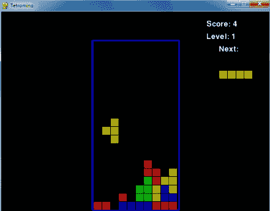

## 如何玩俄罗斯方块

Tetromino 是俄罗斯方的克隆版。不同形状的块（每个由四个方块组成）从屏幕顶部落下，玩家必须引导它们向下移动形成没有间隙的完整行。当形成一个完整的行时，该行就会消失，上方的每一行都会向下移动一行。玩家试图不断形成完整的行，直到屏幕填满且新的掉落方块无法放入屏幕。

## 俄罗斯方块的一些命名术语

在本章中，我为游戏程序中的不同事物创建了一套术语。

- **Board（面板）** – 面板由 10 x 20 个空间组成，块在其中落下并堆叠。
- **Box（方格）** – 方格是面板上的单个填充正方形空间。
- **Piece（方块）** – 从面板顶部落下、玩家可以旋转和定位的物体。每个方块都有一个形状，并由 4 个方格组成。
- **Shape（形状）** – 形状是游戏中不同类型的方块。形状的名称为 T, S, Z, J, L, I 和 O。

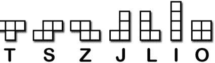

- **Template（模板）** – 形状数据结构的列表，表示一个形状的所有可能旋转。这些存储在命名如 `S_SHAPE_TEMPLATE` 或 `J_SHAPE_TEMPLATE` 的变量中。
- **Landed（已落地）** – 当一个方块到达面板底部或接触面板上的另一个方块时，称该方块已落地。此时，下一个方块应该开始落下。

## 俄罗斯方块源代码

此源代码可以从 http://invpy.com/tetromino.py 下载。如果你遇到任何错误消息，请查看错误消息中提到的行，并检查你的代码是否有任何类型错误。你还可以将代码复制并粘贴到 http://invpy.com/diff/tetromino 的网页表单中，查看你的代码与书中代码之间的差异。

你还需要与 `tetromino.py` 文件相同文件夹下的背景音乐文件。你可以从这里下载：

- http://invpy.com/tetris.mid
- http://invpy.com/tetisc.mid

```
1. # Tetromino (a Tetris clone)
2. # By Al Schweig al@inventwithpython.com
3. # http://inventwithpython.com/pygame
4. # Creative Commons BY-NC-SA 3.0 US
5. 
6. import random, time, pygame, sys
7. from pygame.locals import *
8.
9. FPS = 25
10. WIDTH = 640
11. HEIGHT = 480
12. BOXSIZE = 20
13. BOARDWIDTH = 10
14. BOARDHEIGHT = 20
15. BLANK = ' '
16.
17. MOVESIDES = 0.1
18. MOVEDOWN = 0.1
19.
20. XMARGIN = int((WIDTH - BOARDWIDTH * BOXSIZE) / 2)
21. TOPMARGIN = HEIGHT - (BOARDHEIGHT * BOXSIZE) - 5
22.
23. # B
24. WHITE = (255, 255, 255)
25. GRAY = (185, 185, 185)
26. BLACK = (0, 0, 0)
27. RED = (155, 0, 0)
28. LIGHTRED = (175, 20, 20)
29. GREEN = (0, 155, 0)
30. LIGHTGREEN = (20, 175, 20)
31. BLUE = (0, 0, 155)
32. LIGHTBLUE = (20, 20, 175)
33. YELLOW = (155, 155, 0)
34. LIGHTYELLOW = (175, 175, 20)
35.
36. BORDERCOLOR = BLUE
37. BGCOLOR = BLACK
38. TEXTCOLOR = WHITE
39. TEXTSHADOW = GRAY
40. COLORS = (BLUE, GREEN, RED)
41. LIGHTCOLORS = (LIGHTBLUE, LIGHTGREEN, LIGHTRED)
42. assert len(COLORS) == len(LIGHTCOLORS) # 每个颜色都有浅色
43. TEMPLATEWIDTH = 5
44. TEMPLATEHEIGHT = 5
45.
46. S_SHAPE_TEMPLATE = [['...', '..0..', '..0..', '...'], ['...', '...', '..0..', '...']]
47.
48. Z_SHAPE_TEMPLATE = [['...', '..0..', '..0..', '...'], ['...', '...', '..0..', '...']]
49.
50. I_SHAPE_TEMPLATE = [['..0..', '.0..', '.0..', '....'], ['....', '....', '0000', '....']]
51.
52. O_SHAPE_TEMPLATE = [['....', '..0..', '..0..', '....']]
53.
54. J_SHAPE_TEMPLATE = [['....', '..0..', '.000..', '....', '....'], ['....', '..0..', '..0..', '...'], ['....', '..0..', '.00..', '....', '....']]
55.
56. L_SHAPE_TEMPLATE = [['....', '..0..', '.000..', '....', '....'], ['....', '..0..', '..0..', '...']]
```
向作者发送邮件提问：`al@inventwithpython.com`

```
116. '......'],
```


117. '......',

118. '......',

119. '.000.',

120. '.0...',

121. '],'

122. ['',

123. '.00.',

124. '.0...',

125. '.0...',

126. '......]]

127.

128. `T_SHAPE_TEMPLATE` = [['....', '..0..', '.000..', '....', '....'], ['....', '..00..', '..0..', '..0..', '....'], ['....', '..0..', '.000..', '....', '....'], ['....', '..0..', '..0..', '..0..', '....']]

129. '.0...',

130. '.000.',

131. '......',

132. '],'

133. ['......',

134. '.0...',

135. '.00.',

136. '.0...',

137. '......]]'

138.

139. `SHAPES` = {'S': `S_SHAPE_TEMPLATE`, 'Z': `Z_SHAPE_TEMPLATE`, 'J': `J_SHAPE_TEMPLATE`, 'L': `L_SHAPE_TEMPLATE`, 'I': `I_SHAPE_TEMPLATE`, 'O': `O_SHAPE_TEMPLATE`, 'T': `T_SHAPE_TEMPLATE`}

140.

141. `def main():`

142. `global FPSCLOCK, DISPLAYS, BASICFONT`

143. `pygame.init()`

```
158 http://inventwithpython.com/pygame
```

162. 'WIDTH = ['..0..', '..0..', '..0..', '..0..', '.... = ['....', '..0..', '..0..', '..00..', '....']]

163.

`WIDTH` = `pygame.time`.

164. `Clock(10)`

165. 1 = `pygame.font.Font('1ans6.ttf', 18)`

166. `BIGFONT` = `pygame.font.Font('freesansbold.ttf', 100)`

167. `pygame.display.set_mode((WIDTH, HEIGHT))`

168. `pygame.display.set_caption('Tetromino')`

169. `showFullScreen('Tetromino')`

170. `while True:` # 游戏循环

171.   `if random.randint(0, 1) == 0:`

172.     `pygame.mixer.load('tetrisb.mid')`

173.   `else:`

174.     `pygame.mixer.load('tetrisc.mid')`

175.     `pygame.mixer.music.play(-1, 0.0)`

176.

177.   `runGame()`

178.   `pygame.mixer.music.stop()`

179.   `showScreen('Game Over')`

181. `def runGame():`

182.   # 设置游戏开始的变量

183.   `board` = `getBlankBoard()`

184.   `lastMoveDownTime` = `time.time()`

185.   `lastMoveSidesTime` = `time.time()`

186.   `lastFallTime` = `time.time()`

187.   `movingDown` = False # 注意没有 up 变量

188.   `movingLeft` = False

189.   `movingRight` = False

190.   `score` = 0

191.   `level, fallFreq` = `calculateLevelAndFallFreq(score)`

193.   `fallingPiece` = `getPiece()`

194.   `nextPiece` = `getNextPiece()`

196.   `while True:` # 主游戏循环

197.     `if fallingPiece == None:`

198.       # 没有掉落中的方块，在顶部开始新方块

199.       `fallingPiece` = `nextPiece`

200.       `nextPiece` = `getNextPiece()`

201.       `lastFallTime` = `time.time()` # 重置 lastFallTime

203.     `if not isValidPosition(board, fallingPiece):`

204.       `return` # 无法在面板上放置新方块，游戏结束

206.     `checkForQuit()`

207.     `for event in pygame.event.get():` # 事件处理循环

208.       `if event.type == KEYUP:`

209.         `if (event.key == K_p):`

# 第7章 - 俄罗斯块 159

```python
208. # 暂停游戏
209. SURFACE.fill(BGCOLOR)
210. pygame.mixer.music.stop()
211. showText('Paused') # 暂停直到按下按键
212. pygame.mixer.music.play(-1, 0.0)
213. lastTime = time.time()
214. lastMoveDownTime = time.time()
215. lastMoveSidewaysTime = time.time()
216. elif(event.key == K_LEFT or event.key == K_a):
217. movingleft = False
218. elif(event.key == K_RIGHT or event.key == K_d):
219. movingright = False
220. elif(event.key == K_DOWN or event.key == K_s):
221. movingDown = False
222. elif(event.type == KEYDOWN:
223. # 左右移动方块
224. if (event.key == K_LEFT or event.key == K_a) and
225. isValidPosition(board, adj+x-1):
226. fallingPiece['x'] = 1
227. movingLeft = True
228. movingRight = False
229. lastMoveSidewaysTime = time.time()
230. elif(event.key == K_RIGHT or event.key == K_d):
231. isValidPosition(board, fallingPiece):
232. fallingPiece['x'] += 1
233. movingRight = True
234. movingLeft = False
235. lastMoveSidewaysTime = time.time()
236. # 旋转方块（如果有空间进行旋转）
237. elif(event.key == K_UP or event.key == K_w):
238. fallingPiece['rotation'] = (fallingPiece['rotation'] +
239. 1) % len(SHAPES['shape'])
240. if not isValidPosition(board, fallingPiece):
241. fallingPiece['rotation'] -= 1 % len(SHAPES[fallingPiece['shape'])
242. elif(event.key == K_s): # 向反方向旋转
243. fallingPiece['rotation'] = (fallingPiece['rotation'] -
244. 1) % len(SHAPES[fallingPiece['shape'])
245. if not isValidPosition(board, fallingPiece):
246. fallingPiece['rotation'] =
247. (fallingPiece['rotation'] + 1) % len(SHAPES[fallingPiece['shape']])
248. # 使用下键让方块移动更快
249. elif (event.key == K_DOWN or event.key == K_s):
250.     movingDown = True
251.     if isValidPosition(board, fallingPiece, adjY=1):
252.         fallingPiece['y'] += 1
253.         lastMovedDownTime = time.time()
254.
255.     # 让当前方块直接落到底
256.     elif event.key == K_SPACE:
257.         movingDown = False
258.         movingLeft = False
259.         movingRight = False
260.     for i in range(1, BOARDHEIGHT):
261.         if not isValidPosition(board, fallingPiece,
262.             adjY=i):
263.             break
264.             fallingPiece['y'] += i - 1
265.
266.     # 处理用户输入处理方块
267.     if (movingLeft or movingRight) and time.time():
268.         lastMovedSidesTime = MOVESIDAYSFREQ
269.         if movingLeft and isValidPosition(board, fallingPiece, adjX=
270.             -1):
271.             fallingPiece['x'] -= 1
272.         elif movingRight and isValidPosition(board, fallingPiece,
273.             adjX=1):
274.             fallingPiece['x'] += 1
275.         lastMovedSidesTime = time.time()
276.
277.     if movingDown, time.time() - lastMovedDownTime > MOVEDOWNFREQ
278.     and isValidPosition(board, fallingPiece, adjY=1):
279.         fallingPiece['y'] += 1
280.         lastMovedDownTime = time.time()
281.
282.     # 如果到了下落时间，让方块落下
283.     if time.time() - lastTime > fallFreq:
284.         # 检查方块是否落地
285.         if not isValidPosition(board, fallingPiece, adjY=1):
286.             # 方块已落地，将其放置在棋盘上
287.             addToBoard(board, fallingPiece)
288.             level, freq = calculateLevelAndFallFreq(score)
289.             fallingPiece = None
290.         else:
291.             # 方块未落地，向下移动
292.             fallingPiece['y'] += 1
293.             lastTime = time.time()
294.
295. # 在屏幕上绘制所有内容
296. SURFACE.fill(BGCOLOR)
297. drawBoard(board)
298. drawNextPiece(nextPiece)
299. if fallingPiece != None:
300.     drawPiece(fallingPiece)
301. pygame.display.update()
302. FPSCLOCK.tick(FPS)
303.
304. def terminate():
305.     pygame.quit()
306.     sys.exit()
307. def checkKeyPress():
308.     # 遍历事件寻找 KEYUP 事件。
309.     # 从队列中移除 KEYDOWN 事件。
310.     checkForQuit()
311.
312. def showText(text):
313.     # 在按下按键前显示大文本。
314.     # 绘制文字阴影
315.     titleSurface, titleRect = makeTextObjs(text, BIGFONT, TEXTADOWCOLOR)
316.     titleRect.center = (int(WINDOWWIDTH / 2), int(WINDOWHEIGHT / 2))
317.     SURFACE.blit(titleSurface, titleRect)
318.     # 绘制文字
319.     titleSurf, titleRect = makeTextObjs(text, BIGFONT, TEXTCOLOR)
320.     titleRect.center = (int(WINDOWWIDTH / 2) - int(WINDOWHEIGHT / 2) - 100)
321.     SURFACE.blit(titleSurf, titleRect)
322.     # 绘制“按键开始游戏”吸引性文本
323.     pressKeySurf, pressKeyRect = makeTextObjs('Press a key to play.', BASICFONT, TEXTCOLOR)
324.     pressKeyRect.center = (int(WINDOWWIDTH / 2), int(WINDOWHEIGHT / 2) + 100)
325.     SURFACE.blit(pressKeySurf, pressKeyRect)
326.
327. while checkForKey() == None:
328.     pygame.display.update()
329.     FPSCLOCK.tick()
330. def checkForQuit():
331.     for event in pygame.event.get(QUIT): # 获取所有的 QUIT 事件
332.         terminate() # 如果存在 QUIT 事件则退出
333.     for event in pygame.event.get(KEYUP): # 获取所有的 KEYUP 事件
334.         if event.key == ESC:
335.             terminate() # 如果 KEYUP 事件是 Esc 则退出
336.             pygame.event.post(event) # 将其他 KEYUP 对象放回
337.
338. def calculateLevelAndFallFreq(score):
339.     # 返回玩家所在的等级
340.     # 根据得分返回等级
341.     # 方块下落一个空格需要多少秒。
342.     level = int(score / 10) + 1
343.     fallFreq = 0.27 - (level * 0.02)
344.     return level, fallFreq
345.
346. def newPiece():
347.     # 返回一个随机旋转和颜色的方块
348.     shape = random.choice(list(SHAPES.keys()))
349.     newPiece = {
350.         'shape': shape,
351.         'rotation': random.randint(0, len(SHAPES[shape]) - 1),
352.         'x': int(BOARDWIDTH / 2) - int(TEMPLATEWIDTH / 2),
353.         'y': -2, # 从棋盘顶部开始（小于 0）
```


354.         `'color': random.randint(0, len(COLORS)-1)`

355.     }

356.     return newPiece

357.

358. def addToBoard(board, piece):

359.     # 根据方块的位置、形状和旋转填充棋盘

360.     for x in range(TEMPLATEWIDTH):

361.         for y in range(TEMPLATEHEIGHT):

362.             if SHAPES[piece['shape']][piece['rotation']][y][x] != BLANK:

363.                 board[x + piece['x']][y + piece['y']] = piece['color']

364.

365. def getBlankBoard():

366.     # 创建并返回一个新的空白棋盘数据结构

367.     board = []

368.     for i in range(BOARDWIDTH):

369.         board.append([BLANK] * BOARDWIDTH)

370.     return board

371.

372. def isOnBoard(x, y):

373.     return x >= 0 and x < BOARDWIDTH and y < BOARDHEIGHT

374.

375. def isValidPosition(board, piece, adjX=0, adjY=0):

376.     # 如果方块在棋盘内且没有碰撞则返回 True

377.     for x in range(TEMPLATEHEIGHT):

378.         isAboveBoard = y + piece['y'] + adjY < 0

379.         if isAboveBoard or SHAPES[piece['shape']][piece['rotation']][y][x] == BLANK:

380.             continue

381.         if not isOnBoard(x + piece['x'] + adjX, y + piece['y'] + adjY):

382.             return False

383.         if board[x + piece['x'] + adjX][y + piece['y'] + adjY] != BLANK:

384.             return False

385.

386.     return True

387.

388. def isCompleteLine(board, y):

389.     # 如果填满方块的行没有间隙则返回 True

390.     for x in range(BOARDWIDTH):

391.         if board[x][y] == BLANK:

392.             return False

393.     return True

394.

395. def removeCompleteLines(board):

396.     # 移除棋盘上任何已完成的行，将上方部分

397.     向下移动，并返回完成行的数量。

398.     numLinesRemoved = 0

399.     y = BOARDHEIGHT - 1 # 从棋盘底部开始 y

```

```python

419. while y >= 0:

    if isCompleteLine(board and pull boxes down by one line):

        # 删除该行并将方块下移

        for pullDownY in range(y, 0, -1):

            board[x][pullDownY] = board[x][pullDownY-1]

        # 将最顶行设为空。

        for x in range(BOARDWIDTH):

            board[x] = BLANK

        numlinesRemoved += 1

        # 注意在循环的下次迭代中，y 保持不变。

        # 这样被下移的行如果也是完整的，

        # 它将会被移除。

    else:

        y -= 1 # 继续检查上方的一行

    return numlinesRemoved

def convertTopToPixelCoords(boxx, boxy):

    # 将给定的方块 xy 坐标转换为屏幕上的

    # xy 坐标。

    return (XMARGIN + (boxx * BOXSIZE), (TOPMARGIN + (boxy * BOXSIZE)))

def drawBox(boxx, boxy, color, pixelx=None, pixely=None):

    # 绘制单个方块（每个俄罗斯方块包含四个块）

    # 在棋板的 xy 坐标处。或者，如果指定了 pixelx & pixely

    # 则绘制存储在 pixelx & pixely 中的像素坐标处

    #（这用于“下一个”方块）。

    if color == BLANK:

        return

    if pixelx, pixely = convertTopToPixelCoords(boxx, boxy)

    pygame.draw.rect(DISPLAYSFACE, COLORS[color], (pixelx + 1, pixely + 1,

        BOXSIZE - 1, BOXSIZE - 4))

    pygame.draw.rect(DISPLAYSURF, LIGHTCOLORS[color], (pixelx + 1, pixely

        + 1, BOXSIZE - 4, BOXSIZE))

def drawBoard(board):

    # 绘制棋板外框

    pygame.draw.rect(DISPLAYSURF, BORDERCOLOR, (XMARGIN - 3, TOPMARGIN -

        7, (BOARDWIDTH * BOXSIZE), (BOARDHEIGHT * BOXSIZE) + 8), 5)

    # 填充棋板背景

```

461. pygame.draw.rect(DISPLAYSURF, BGCOLOR, (XMARGIN, TOPMARGIN, BOXSIZE *
BOARDWIDTH, BOXSIZE * BOARDHEIGHT))

```python

462. # 绘制棋板上的单个方块

463. for x in range(BOARDWIDTH):

464.     for y in range(BOARDHEIGHT):

465.         drawBox(x, y, board[x][y])

```

```python

467. def drawStatus(score, level):

468.     # 绘制得分文本

469.     scoreRect = BASICFONT.render('Score: %s' % score, True, TEXTCOLOR)

470.     scoreRect = scoreRect.get_rect()

471.     scoreRect.topleft = (WINDOWWIDTH - 150, 20)

472.     DISPLAYSURF.blit(scoreRect, scoreRect)

```

```python

475. # 绘制等级文本

476. levelSurf = BASICFONT.render('Level: %s' % level, True, TEXTCOLOR)

477. levelRect = levelSurf.get_rect()

478.     levelRect.topleft = (WINDOWWIDTH - 150, 50)

479.     DISPLAYSURF.blit(levelRect, levelRect)

```

```python

481. def drawPiece(piece, pixelx=None, pixely=None):

482.     shapeToDraw = SHAPES[piece['shape']][piece['rotation']]

483.     if pixelx and pixely == None:

484.         # 如果未指定 pixelx 和 pixely，使用位置

485.         pixelx, pixely = convertToPixelCoords(piece['x'], piece['y'])

```

python
488. # 绘制组成方块的每个块
489. for x in range(TEMPLATEWIDTH):
490.     for y in range(TEMPLATEHEIGHT):
491.         if shapeToDraw[y][x] != BLANK:
492.             drawBox(None, None, piece['color'], pixelx + (x *
493.                 BOXSIZE), pixely + (y * BOXSIZE))
```

```python
495. def drawNextPiece(piece):
496.     # 绘制“下一个”文本
497.     nextSurf = BASICFONT.render('Next:', True, TEXTCOLOR)
498.     nextRect = nextSurf.get_rect()
499.     nextRect.topleft = (WINDOWWIDTH - 120, 80)
500.     DISPLAYSURF.blit(nextSurf, nextRect)
501.     # 绘制“下一个”方块
502.     drawPiece(piece, pixelx=WINDOWWIDTH-120, pixely=100)
```

```python
504. if __name__ == '__main__':
505.     main()

## 通常设置

```python

# Tetromino（一个俄罗斯方块克隆版）

# 由 Al Schweig 开发 - Creative Commons BY-SA-3.0

import random, time, pygame, sys

from pygame import *

FPS = 25

WINDOWWIDTH = 640

WINDOWHEIGHT = 480

BOXSIZE = 20

BOARDWIDTH = 10

BOARDHEIGHT = 20

BLANK = ' '

```

这些是俄罗斯方块游戏使用的常量。每个块都是高宽200像素的正方形。棋板本身宽 10 个块，高 20 个块。`BLANK` 常量用于表示棋板数据结构中的空格。

# 设置长按键的定时常量

`MOVESFREQ` = 0.15
`MOVEDOWNFREQ` = 1

每当玩家按下左或右箭头时，落下的方块应向左或右移动一格。但玩家也可以在移动落下的方块时按住左或右箭头。设置 `MOVESFREQ` 常量是为了让每隔 0.15 秒移动一个格。`MOVEDOWNFREQ` 同理，表示玩家按住键时方块下降的频率。

# 更多设置代码

`XMARGIN` = int((`WINDOWWIDTH` - `BOARDWIDTH` * `BOXSIZE`) / 2)
`TOPMARGIN` = `WINDOWHEIGHT` - (`BOARDHEIGHT` * `BOXSIZE`) - 5

程序需要计算棋板左右两侧的像素以便后续使用。`WINDOWWIDTH` 是整个窗口的宽度。`BOARDWIDTH` 个块且每个块是 `BOXSIZE` 像素。如果从每个块中减去 `BOXSIZE`（即 `BOARDWIDTH` * `BOXSIZE`），我们就得到了棋板左右边距的大小。将其除以 2，得到单个边距的大小。由于边距大小相同，我们可以对左右边距使用 `XMARGIN`。

可以用相同的方法计算棋板顶部与窗口顶部之间空间的大小。棋板将在窗口底部上方5 个像素处绘制，因此从 topmargin 中减去 5 以考虑此。

| | R G B |
|---|---|---|
| WHITE | (255, 255, 255) |
| GRAY | (185, 185, 185) |
| BLACK | (0, 0, 0) |
| RED | (155, 0, 0) |
| LIGHTRED | (175, 20, 20) |
| GREEN | (0, 155, 0) |
| LIGHTGREEN | (20, 175, 20) |
| BLUE | (0, 0, 155) |
| LIGHTBLUE | (20, 20, 175) |
| YELLOW | (155, 155, 0) |
| LIGHTYELLOW | (175, 175, 0) |

```python

BORDERCOLOR = BLUE

BGCOLOR = BLACK

TEXTCOLOR = WHITE

TEXTSHADOWCOLOR = GRAY

COLORS = (BLUE, GREEN, RED, YELLOW)

LIGHTCOLORS = (LIGHTBLUE, LIGHTGREEN, LIGHTRED, LIGHTYELLOW)

assert len(COLORS) == len(LIGHTCOLORS) # 每种颜色必须有一个浅色

```

方块有四种颜色：蓝、绿、红和黄。但当我们绘制方块时，块上会有一个浅色的细高高亮。这意味着我们需要创建浅蓝、浅绿、浅红和浅黄色。

这四种颜色中的每一种都将存储在名为 `COLORS`（普通颜色）和 `LIGHTCOLORS`（浅色）的元组中。

## 设置方块模板

`TEMPLATEWIDTH` = 5
`TEMPLATEHEIGHT` = 5

`S_SHAPE_TEMPLATE` = [['...',
 '..00.',
 '..00.',
 '],
 ['...',
 '..0.',
 '..00.',
 '..0.',
 ']]

`Z_SHAPE_TEMPLATE` = [['...',
 '..00.',
 '..00.',
 '],
 ['...',
 '..0.',
 '..00.',
 '..0.',
 ']]

`I_SHAPE_TEMPLATE` = [['..0..',
 '..0..',
 '......'],
 ['......',
 '......', '00000']]

```python

O_SHAPE_TEMPLATE = [['......',

 '......',

 '...0..',

 '...00..',

 '......']]

J_SHAPE_TEMPLATE = [['......',

                      '.0..',

                      '.000..',

                      '......'],

                  ['......',

                      '...00..',

                      '...0..',

                      '...0..',

                      '......'],

                  ['......',

                      '.000..',

                      '.0..',

                      '.0..'],

                  ['......',

                      '...0..',

                      '...0..',

                      '...00..',

                      '......']]

```


170 http://inventwithpython.com/pygame

```python

117.     ['...',

118.      '...',

119.     '.000.',

120.     '.0...'],

121.

122.     ['...',

123.      '.00..',

124.      '.0...',

125.     '.0...',

126.     '...]]

127.

128. T_SHAPE_TEMPLATE = [['...',

129.      '.0...',

130.     '.000.',

131.

132.     '...],

133.     ['...',

134.      '.0...',

135.      '.00..',

136.      '.0...',

137.     '...']],

138.     ['...',...',

139.      '...',

140.     '.000.',

141.     '.0...',

142.     '...']],

143.     ['...',

144.      '.0...',

145.      '.00..',

146.      '.0...',

147.     '...]]


我们的游戏程序需要知道每个形状的形状构造，包括它们所有可能的旋转。为了实现这一点，我们将创建字符串列表的嵌套列表。内部的字符串列表将代表形状的某次旋转，如下：

```python
['...',
 '...',
 '.00..',
 '.00..',
']']
```

我们将编写代码的其他部分，使其能够解释像上面的字符串列表来表示一个形状，其中点 `.` 表示空格，而 `O` 表示方块，如下：

向作者提问邮件：`al@inventwithpython.com`

## 将“一行代码”跨越到多行

你可以看到，这个列表在文件编辑器中跨越了许多行。这在 Python 中是完全合法的，因为 Python 解释器在看到 `]` 闭合括号之前，并不知道列表尚未完成。缩进并不重要——Python 知道你不会在列表的块中使用不同的缩进。下面的代码运行良好良好：

```python
spam = ['hello', 3.14, 'world', 42, 10, 'fuzz']

eggs = ['hello', 3.14,
      'world',
      42,
      10, 'fuzz']
```

当然，如果我们将对齐 `eggs` 列表中的所有项目，或者像 `spam` 那样放在同一行，`eggs` 列表的代码会易读得多。

通常情况下，在文件编辑器中将一行代码跨越到多行需要在行尾放置一个 `\` 字符。`\` 告诉 Python，“这段代码继续到下一行。”（这个斜杠第一次出现在滑动拼图游戏的 `isValidMove()` 函数中）。

我们将通过创建一个此类字符串嵌套列表的列表来创建形状的“模板”数据结构，并将它们存储在变量 `S_SHAPE_TEMPLATE` 中。这样，`len(S_SHAPE_TEMPLATE)` 将代表 S 形状有多少种可能的旋转，而 `S_SHAPE_TEMPLATE[0]` 代表 S 形状的第一种可能旋转。第 47 到 147 行将为每个形状创建“模板”数据结构。

想象在一个 5x5 的空闲棋板上有每个可能的碎片，其中棋板上的某些空间被方块填充。以下使用 `S_SHAPE_TEMPLATE[0]` 的表达式：

```python
S_SHAPE_TEMPLATE[0][2][2] = '0'
S_SHAPE_TEMPLATE[0][2][3] = '0'
S_SHAPE_TEMPLATE[0][3][1] = '0'
S_SHAPE_TEMPLATE[0][3][2] = '0'
```

如果我们在纸上表示这个形状，它看起来会像这样：

172 http://inventwithpython.com/pygame

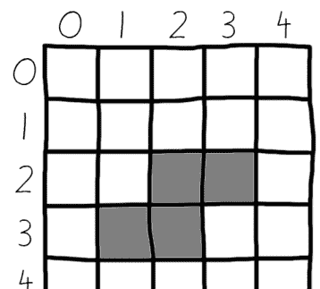

这就是我们如何将俄罗斯方块（Tetromino）碎片等内容表示为 Python 值（如字符串和列表）。`TEMPLATEWIDTH` 和 `TEMPLATEHEIGHT` 只是设置每个形状的行和列的大小。（模板将始终是 5x5。）

| 键 (Key) | 模板 (Template) |
| :--- | :--- |
| 'S' | `S_SHAPE_TEMPLATE` |
| 'Z' | `Z_SHAPE_TEMPLATE` |
| 'J' | `J_SHAPE_TEMPLATE` |
| 'L' | `L_SHAPE_TEMPLATE` |
| 'I' | `I_SHAPE_TEMPLATE` |
| 'O' | `O_SHAPE_TEMPLATE` |
| 'T' | `T_SHAPE_TEMPLATE` |

`SHAPES` 变量将是一个字典，存储所有不同的模板。因为每个模板都包含单个形状的所有旋转，这意味着 `SHAPES` 包含了每个可能形状的所有旋转。这将是包含我们游戏中所有形状数据的数据结构。

## main() 函数

```python
158. def main():
159.     global FPSCLOCK, DISPLAYSURF, BIGFONT
160.     pygame.init()
161.     FPSCLOCK = pygame.time.Clock()
162.     DISPLAYSURF = pygame.display.set_mode((WINDOWWIDTH, WINDOWHEIGHT))
163.     BASICFONT = pygame.font.Font('freesansbold.ttf', 28)
164.     BIGFONT = pygame.font.Font('freesansbold.ttf', 44)
165.     pygame.display.set_caption('Tetromino')
166.
167.     showTextScreen('Tetromino')
```

向作者提问邮件：`al@inventwithpython.com`

`main()` 函数负责在程序运行时创建全局常数并显示启动界面。

```python
168. while True: # 游戏循环
169.     if random.randint(0, 1) == 0:
170.         pygame.mixer.load('tetris.mid')
171.     else:
172.         pygame.mixer.load('tetris.mid')
173.         pygame.mixer.music.play(-1, 0.0)
174.         runGame()
175.     pygame.mixer.music.stop()
176.         showTextScreen('Game Over')
```

游戏循环结束的代码在 `runGame()` 中。`main()` 函数在此决定启动哪种背景音乐（`tetris.mid`），调用 `runGame()` 来开始游戏。当玩家输掉时，`runGame()` 返回，`showTextScreen()` 显示游戏结束。

当玩家按键时，`runGame()` 返回到 `main()`，随后停止背景音乐并显示游戏结束。游戏循环将回到第 168 行开始。

## 新游戏的开始

```python
179. def runGame():
180.     # 设置游戏开始变量
181.     board = getBlankBoard()
182.     lastMovedTime = time.time()
183.     lastSidewaysTime = time.time()
184.     lastTime = time.time()
185.     movingDown = False # 没有 movingUp 
186.     movingLeft = False
187.     movingRight = False
188.     score = 0
189.     level, lastFreq = calculateLevelAndFallFreq(score)
191.     fallingPiece = getNewPiece()
192.     nextPiece = getNewPiece()
```

在游戏开始和碎片掉落之前，我们需要初始化一些变量。在第 191 行，`fallingPiece` 变量设置为当前掉落的碎片。在第 192 行，`nextPiece` 变量设置为显示在屏幕“下一个”部分的碎片，这样玩家就能知道下一个碎片是什么。

## 游戏循环

```python
194. while True: # 主游戏循环
195.    if fallingPiece == None:
196.         # 没有掉落中的碎片，在顶部开始一个新的碎片
197.         fallingPiece = nextPiece
198.         nextPiece = getNewPiece()
199.         lastTime = time.time() # 重置 lastTime
200.
201.     if not isValidPosition(board, fallingPiece):
202.         return # 棋板放不下新碎片，所以游戏结束
203.
204.     checkForQuit()
```

游戏循环从第 194 行开始，处理碎片掉落的主要部分代码。当碎片落地后，`fallingPiece` 变量被设置为 `None`。这意味着应该将 `nextPiece` 赋值给 `fallingPiece`，并将新碎片放入 `nextPiece` 中。新碎片可以从 `getNewPiece()` 函数生成。`lastTime` 变量也会重置为当前时间，这样碎片每隔 `fallFreq` 秒掉落一次。

| 213. | `lastFallTime = time.time()` |
| 214. | `lastMovedDownTime = time.time()` |
| 215. | `lastMoveSidewaysTime = time.time()` |

如果玩家按了 P 键，游戏应该暂停。我们需要向玩家隐藏棋板（否则玩家可能会通过玩游戏并花时间决定移动方块的位置来作弊）。

代码通过调用 `DISPLAYS.fill(BGCOLOR)` 清空显示表面 `Surface` 并停止音乐。调用 `showTextScreen()` 函数来显示“Paused”（暂停）文本并等待玩家按键。

一旦玩家按下按键，`showTextScreen()` 就会返回。第 212 行将重启背景音乐。此外，由于玩家暂停游戏可能已经过了很长时间，`lastFallTime`、`lastMovedDownTime` 和 `lastMoveSidewaysTime` 变量都将重置为当前时间（位于 213 到 215 行）。

## 移动变量以处理输入

| 216. | `elif (event.key == K_LEFT or event.key == K_a):` |
| 217. | `movingLeft = False` |
| 218. | `elif (event.key == K_RIGHT or event.key == K_d):` |
| 219. | `movingRight = False` |
| 220. | `elif (event.key == K_DOWN or event.key == K_s):` |
| 221. | `movingDown = False` |

松开方向键之一（或 WASD 键）将把 `movingLeft`、`movingRight` 或 `movingDown` 变量设置为 `False`，表示玩家不再想在这些方向移动方块。代码稍后会处理这些“移动”变量内部的布尔值。注意，向上箭头和 W 键用于旋转方块，而不是移动方块。这就是为什么没有 `movingUp` 变量的原因。

## 检查滑动或旋转是否有效

| 223. | `elif event.type == KEYDOWN:` |
| 224. | `# 向侧移动移动块` |
| 225. | `if (event.key == K_LEFT or event.key == K_a) and` |
| 226. | `isValidPosition(board, fallingPiece['x']=-1):` |
| 227. | `fallingPiece['x'] = 1` |
| 228. | `movingLeft = True` |
| 229. | `movingRight = False` |
| 230. | `lastMoveSidewaysTime = time.time()` |

当按下左键时（并且根据 `isValidPosition()` 的调用，向左移动对于落下方块来说是有效的移动），我们应该通过减去 `fallingPiece['x']` 的值来将位置向左移动一个格。`isValidPosition()` 函数有一个名为 `adjX` 和 `adjY` 的可选参数。通常，`isValidPosition()` 函数检查由参数传递的方块对象提供的数据的位置。但有时我们不想检查方块当前所在的位置，而是检查它离开位置几个格的地方。

如果我们为 `adjX` 传递 -1（“adjustedX”的缩写），那么它就不会检查方块数据结构中位置的有效性，而是检查方块在左侧一个格处的位置。为 `adjX` 传递 1 将检查右侧一个格。还有一个可选参数 `adjY`。为 `adjY` 传递 -1 将检查方块当前位置上方一个格，为 `adjY` 传递类似 3 的值将检查方块下方三个格。

`movingLeft` 变量被设置为 `True`，为了确保方块不会同时向左移动，第 228 行将 `movingRight` 变量设置为 `False`。这些变量的设置使得玩家可以按住方向键来持续移动方块。如果 `movingLeft` 变量设置为 `True`，程序可以知道玩家按下了左方向键并松开了。如果自 `lastMoveSidewaysTime` 存储的时间以来过去了 0.15 秒（`MoveewaysFREQ` 中存储的），那么该时候让方块再次向左移动了。

`lastMoveSidewaysTime` 的工作原理类似于模拟章节中的 `lastTime` 变量。

```python
231. elif (event.key == K_RIGHT or event.key == K_d) and
isValidPosition(board, fallingPiece, adjX=1):
232.     fallingPiece['x'] += 1
233.     movingRight = True
234.     movingLeft = False
235.     lastMoveSidewaysTime = time.time()
```

第 231 到 235 行的代码与 225 到 229 行几乎相同，它们在按下右方向键（或 D 键）时处理方块向右移动。

```python
237. # 旋转块（如果有空间）
238. elif (event.key == K_UP or event.key == K_w):
```

向作者发送邮件：`al@inventwithpython.com`

```python
239. fallingPiece['rotation'] = (fallingPiece['rotation'] + 1) % len(SHAPES[shape])
```

向上键（或 W 键）将落下方块旋转到下一个旋转。代码必须将 `fallingPiece` 字典中的 `rotation` 值加 1。然而，如果 `rotation` 值大于总旋转数，通过取模运算它将“回绕”到 0。

这是一个使用 J 形状进行取模运算的示例：

```
>>> 0 % 4
0
>>> 1 % 4
1
>>> 2 % 4
2
>>> 3 % 4
3
>>> 4 % 4
1 (等等，这应该是 0)
```

```python
240. if not isValidPosition(board, fallingPiece):
241.     fallingPiece['rotation'] = (fallingPiece['rotation'] - 1) % len(SHAPES[shape])
```

如果新位置因为重叠棋板上的某些盒子而不有效，我们希望通过从 `fallingPiece['rotation']` 减 1 来恢复原始旋转。我们也可以通过 `len(SHAPES[shape])` 修改它，这样如果新值为 -1，取模将其变为列表中的最后一个旋转。这是一个负数取模的示例：

```
>>> -1 % 4
3
```

```python
242. elif (event.key == K_q): 向反方向旋转
243.     fallingPiece['rotation'] = (fallingPiece['rotation'] - 1) % len(SHAPES[shape])
244.     if not isValidPosition(board, fallingPiece):
245.         fallingPiece['rotation'] = (fallingPiece['rotation'] + 1) % len(SHAPES[shape])
```

第 242 到 245 行的操作与 241 行相同，但它们处理玩家按下 Q 键以反方向旋转方块的情况。在这种情况下，我们从 `fallingPiece['rotation']` 减 1（在第 243 行完成），而不是加 1。

```python
247. # 使用向下键让块落更快
248. elif (event.key == K_DOWN or event.key == K_s):
249.     movingDown = True
250.     if isValidPosition(board, fallingPiece, adj=1):
251.             fallingPiece['y'] += 1
252.         lastMoveDownTime = time.time()
```

如果按下向下键或 S 键，玩家希望方块掉得更快。第 251 行将方块向下移动（仅当空间有效时）。`movingDown` 变量被设置为 `True`，`lastMoveDownTime` 重置为当前时间。这些变量稍后会被检查，只要按住方向键或 S 键，它就会保持较快掉落。

## 掉落底部

```python
254. # 将块移到底
255.     elif event.key == K_SPACE:
256.         movingDown = False
257.         movingLeft = False
258.         movingRight = False
259.         for i in range(1, BOARDHEIGHT):
260.             if not isValidPosition(board, fallingPiece,
```


261.                 `adjY=i)`:
262.                 `break`
263.             `fallingPiece['y']` += `i - 1`

```
当玩家按下空格键时，落下方块将立即掉到棋板上尽可能远的地方落地。程序首先需要找到方块落地之前可以移动多少格。

第 256 到 258 行将所有变量设置为 `False`（这使得程序后续部分的代码知道用户已松开了任何按住的方向键）。这样做是因为这段代码会将方块移动到绝对并开始下一个方块，我们不希望玩家在按住方向键点击空格键时让方块立即开始。

为了找到方块可以掉落的最远距离，我们首先调用 `isValidPosition()` 并为 `adjY` 参数传递整数 1。如果 `isValidPosition()` 返回 `False`，我们知道方块无法进一步掉落，已经在底部。如果 `isValidPosition()` 返回 `True`，我们知道它可以掉落一个格。

在这种情况下，我们应该调用 `adjY` 设置为 2 的 `isValidPosition()`。如果再次返回 `True`，我们将调用 `adjY` 设置为 3 的 `isValidPosition()`，依此类推。这就是 259 行 `for` 循环处理的：通过递增的整数值调用 `isValidPosition()`，直到函数返回 `False`。此时，我们知道 `i` 的值比底部多了一个格。这就是为什么第 262 行将 `fallingPiece['y']` 增加了 `i-1`。

（注意 259 行 `for` 语句中 `range()` 的第二个参数设置为 `BOARDHEIGHT`，因为这是方块在撞底之前可能掉落的最大距离。）

## 按住按键移动

```
264.    # 根据用户输入移动块
265.    if (movingLeft or movingRight) and time.time() -
266.        lastMoveSidewaysTime > MoveewaysFREQ:
267.            if movingLeft and isValidPosition(board, fallingPiece, adjX=-1):
268.                fallingPiece['x'] -= 1
269.            elif movingRight and isValidPosition(board, fallingPiece, adjX=1):
270.                fallingPiece['x'] += 1
271.                lastMoveSidewaysTime = time.time()
```

180 http://inventwithpython.com/pygame

如果用户按住键的时间超过 0.15 秒（存储在 `MOIDESWAYSFREQ` 中的值为浮点数 0.15），那么表达式 `time.time() - lastMoveSidewaysTime > MOIDESWAYSFREQ` 的结果将为 True。如果用户同时按住了箭头键且已经过了 0.5 秒，并且在用户没有再次按下键的情况下将掉落的碎片向左或向右移动，第 265 行的条件即为 True。

这非常有用，因为玩家反复点击箭头键来让掉落碎片在棋板上移动多个位置会非常疲惫。相反，他们只需按住箭头键，碎片就会持续移动，直到他们松开按。当这种情况发生时，第 216 到 221 行的代码会将变量设置为 `False`，第 265 行的条件将变为 `False`。这就是停止碎片继续滑动的原因。

为了演示为什么 `time.time() - lastMoveSidewaysTime > MOIDESWAYSFREQ` 在经过 `MOIDESWAYSFREQ` 中的秒数后会返回 True，请运行这个短程序：

```python
import time

WAITTIME = 4

begin = time.time()

while True:
    now = time.time()
    message = '%s, %s, %s' % (begin, now, (now - begin))
    if now - begin > WAITTIME:
        print(message + ' PASSED WAIT TIME!')
    else:
        print(message + ' Not next...')
time.sleep(0.2)
```

该程序有一个无限循环，因此要终止它，请按 Ctrl-C。该程序的输出如下：

| 1322106392.2, 1322106392.2, 0.0 | 还没... |
| 1322106392.2, 1322106392.42, 0.219000101089 | 还没... |
| 1322106392.2, 1322106392.65, 0.449001201663 | 还没... |
| 1322106392.2, 1322106392.88, 0.689099994278 | 还没... |
| 1322106392.2, 1322106393.11, 0.910000085831 | 还没... |
| 1322106392.2, 1322106393.34, 1.1400001049 | 还没... |
| 1322106392.2, 1322106393.57, 1.3710000515 | 还没... |
| 1322106392.2, 1322106393.83, 1.6360001564 | 还没... |
| 1322106392.2, 1322106394.05, 1.8519999809 | 还没... |

向作者提问邮件：al@inventwithpython.com

# 第 7 章 - 俄罗斯块 181

```python
1322106392.2, 1322106394.28, 2.0800016212 还没...
1322106392.2, 1322106394.51, 2.3090001526 还没...
1322106392.2, 1322106394.74, 2.5410012779 还没...
1322106392.2, 1322106394.97, 2.7699998093 还没...
1322106392.2, 1322106395.22, 2.980001446 还没...
1322106392.2, 1322106395.45, 3.226999809 还没...
1322106392.2, 1322106395.65, 3.4560009865 还没...
1322106392.2, 1322106395.89, 3.6920005068 还没...
1322106392.2, 1322106396.12, 3.921000381 还没...
1322106392.2, 1322106396.36, 4.148999243 通过等待时间!
1322106392.2, 1322106396.59, 4.378999485 通过等待时间!
1322106392.2, 1322106396.81, 4.600701253 通过等待时间!
1322106392.2, 1322106397.04, 4.8370013161 通过等待时间!
1322106392.2, 1322106397.26, 5.0650005722 通过等待时间!
Traceback (most recent call last):File "timestest.py", line 13, in <module>
time.sleep(2)
KeyboardInterrupt
```

输出行的第一个数字是程序首次启动时 `time.time()` 的返回值（该值从未改变）。第二个数字是 `time.time()` 的最新返回值（该值每次迭代都会更新）。第三个是设置为开始时间的数字。这三个数字是自执行 `begin = time.time()` 代码以来的秒数。

如果这个数字大于 4，代码将开始打印“PASSED TIME!”而不是“Not yet...”。这就是我们判断某行代码运行后过了多久的方法。在俄罗斯块程序中，`time.time() - lastMoveSidewaysTime` 将计算自上次将 `MoveSidewaysTime` 设置为当前时间以来的秒数。如果此值大于 `MOIDESWAYSFREQ` 中的值，我们就知道该让掉落碎片移动移动。

不要忘记再次更新 `lastMoveSidewaysTime` 为当前时间！这是我们在第 270 行的操作。

```python
272. if movingDown and time.time() - lastMoveDown > MOVEDOWNFREQ \
    and isValidPosition(fallingPiece, adjY=1):
273.     fallingPiece['y'] += 1
274.     lastMoveDown = time.time()
```

182 http://inventwithpython.com

第 272 到 274 行的作用与 265 到 270 行相同，不同的是让掉落碎片向下移动。它有一个独立的变量（`movingDown`）、“上次时间”变量（`lastMoveDown`）以及不同的“移动频率”变量（`MOVEDOWNFREQ`）。

## 让碎片“自然”落下

| 行号 | 代码 / 注释 |
|---|---|
| 276. | # 如果该掉了，让碎片落下 |
| 277. | if time.time() - lastTime > fallFreq |
| 278. | # 检查碎片是否落地 |
| 279. | if not isValidPosition(fallingPiece, adjY=1): |
| 280. | # 掉落碎片已落地，将其放置在棋板上 |
| 281. | addToBoard(board, fallingPiece) |
| 282. | score += removeCompleteLines(board) |
| 283. | level, fallFreq = calculateLevelAndFreq(score) |
| 284. | fallingPiece = None |
| 285. | else: |
| 286. | # 碎片未落地，仅将块向下移动 |
| 287. | fallingPiece['y'] += 1 |
| 288. | lastTime = time.time() |

`time.time() - lastTime` 将计算自上次将 `lastTime` 设置为当前时间以来的秒数。如果碎片掉落，那么让碎片掉落的程序追踪了 `lastTime`。

## 绘制所有内容

| 行号 | 代码 / 注释 |
|---|---|
| 290. | # 绘制所有内容 |
| 291. | SURFACE.fill(BGCOLOR) |
| 292. | drawBoard(board) |

向作者提问邮件：al@inventwithpython.com

# 第 7 章 - 俄罗斯块

| 行号 | 代码 / 注释 |
|---|---|
| 293. | drawStatus(score, level) |
| 294. | drawNextPiece(nextPiece) |
| 295. | if fallingPiece != None: |
| 296. | drawPiece(fallingPiece) |
| 298. | pygame.display.update() |
| 299. | FPSCLOCK.tick(FPS) |

184 http://inventwithpython.com/pygame

```
319. continue
320. return event.key
321. return None
```

`checkForKey()` 函数的工作原理与在 Wormy Game 中几乎相同。
首先，它调用 `checkForQuit()` 来处理任何 `QUIT` 事件（或针对 Esc 键的 `KEYUP` 事件），如果有这些事件则终止程序。然后它从事件队列中取出所有的 `KEYUP` 和 `KEYDOWN` 事件。它忽略 `KEYDOWN` 事件（因为在 `pygame.event.get()` 中仅指定了 `KEYDOWN`），以清空队列中的这些事件。

如果事件队列中没有 `KEYUP` 事件，该函数返回 `None`。

# showTextScreen (), 一个通用文本函数

```python
324. def showTextScreen(text):
325. # 此函数在屏幕中心显示大文本，
326. # 直到按下按键为止。
327. # 绘制文本投影
328. titleSurf,titleRect = makeTextObjs(text, BIGFONT, TEXTSHADOWCOLOR)
329. titleRect.center = (int(WINDOWWIDTH / 2), int(WINDOWHEIGHT / 2))
330. DISPLAYS.blit(titleSurf, titleRect)
331.
332. # 画文本
333. titleSurf,titleRect = makeTextObjs(text, BIGFONT, TEXTCOLOR)
334. titleRect.center = (int(WINDOWWIDTH / 2) - 3, int(WINDOWHEIGHT / 2)
335).
336. DISPLAYS.blit(titleSurf, titleRect)
337. # 画额外的“按下按键开始游戏”文本。
338. pressKeySurf,pressKeyRect = makeTextObjs('Press a key to play.',
BASICFONT, TEXTCOLOR)
339. pressKeyRect.center = (int(WINDOWWIDTH / 2), int(WINDOWHEIGHT / 2) +
100)
340. DISPLAYS.blit(pressKeySurf, pressKeyRect)
```

我们不再为开始屏幕和游戏结束屏幕创建单独函数，而是创建一个名为 `showTextScreen()` 的函数。`showTextScreen()` 函数将根据 `text` 参数绘制任何文本。此外，还会显示“按下按键开始游戏.”。

请注意，第 328 到 330 行先用较深色的投影颜色绘制文本，而第 333 到 335 行绘制相同的文本，但向左偏移了 3 像素并向上偏移了 3 像素。这创建了一个“投影影”，让文本看起来更漂亮。你可以通过注释掉第 328 到 330 行来对比在没有投影影的情况下会发生什么。

向作者发送邮件提问：al@inventwithpython.com

# 第 7 章 - 俄罗斯方块 185

`showText()` 将用于开始屏幕

```python
342. while checkKeyPressed() == None:
343. pygame.display.update()
344. FPSCLOCK.tick()
```

我们希望文本留在屏幕上，直到用户按下按键。这个小循环将不断计数 `pygame.display.update()` 和 `FPSCLOCK.tick()`，直到 `checkKeyPressed()` 返回 `None` 以外的值。这发生在用户按下按键时。

## TheCheckQuit() 函数

```python
347. for event in pygame.event.get(QUIT): # 获取所有的 QUIT 事件
349. terminate() # 如果存在任何 QUIT 事件则终止
350. for event in pygame.event.get(KEYUP): # 获取所有的 KEYUP 事件
351. if event.key == _ESCAPE:
352. # 如果 KEYUP 事件是 Esc 键则终止
353. terminate()
354. pygame.event.post(event) # 将其他 KEYUP 事件放回
```

可以调用 `CheckQuit()` 函数来处理任何导致程序终止的事件。如果事件队列中有任何 QUIT 事件（由第 348 和 349 行处理），或者存在 Esc 键的 KEYUP 事件，就会发生。玩家应该能够按下 Esc 键退出程序。

由于第 350 行的 `pygame.event.get()` 获取了所有的 KEYUP 事件（包括 Esc 键以外的按键），如果它不是 Esc 键，我们希望通过调用 `pygame.event.post()` 函数将其放回事件队列。

## ThecalculateLevelAndAllFreq() 函数

```python
356. def calculateLevelAndAllFreq(score):
357. # 根据分数，返回玩家所处的等级
358. # 下落方块下降一个空格需要经过多少秒。
359. level = int(score / 10) + 1
360. fallFreq = 0.27 - (level * 0.02)
361. return level, fallFreq
```


我们希望文本停留在屏幕上，直到用户按下按键。这个小循环将计数 `pygame.display.update()` 和 `FPSCLOCK.tick()`，直到 `checkKeyPressed()` 返回一个 `None` 以外的值。这发生在用户按下按键时。

每当玩家完成一次，分数就会增加 1 分。每 10 分，游戏就会升级，方块下落速度更快。等级和下落频率可以通过该函数获取。为了计算等级，我们使用 `int()` 函数将分数除以 10 并向下取整。当分数达到 10 时，`int()` 会返回 1，`+ 1` 得到 2。以下是 0 到 9 分之间分数的等级：

```python
362. # 示例
```

190 http://inventwithpython.com/pygame

| 387. | return board |

用于棋盘的数据结构相当简单：它是一个值的列表的列表。如果值等于 `BLANK`，那么它就是一个空区域。如果该值是一个整数，那么它代表一个方格，其颜色是 `COLORS` 常量列表中整数索引对应的颜色。也就是说，0 是蓝色，1 是绿色，2 和 3 是黄色。

为了创建一个空白棋盘，使用了列表复制来创建包含 `BLANK` 值的列表，这些列表代表一列。这在第 386 行完成。棋盘中的每一列都创建了其中一个这样的列表——这就是第 385 行的 `for` 循环所做的。

## isOnBoard() 和 isValidPosition() 函数

| 390. | def isOnBoard(x, y): |
| 391. | return x >= 0 and x < BOARDWIDTH and y < BOARDHEIGHT |

`isOnBoard` 是一个简单的函数，用于检查传入的 XY 坐标是否存在于棋盘有效范围内。只要 XY 坐标都不小于 0 也不大于或等于 `BOARDWIDTH` 和 `BOARDHEIGHT` 常量，该函数就会返回 `True`。

```python
def isValidPosition(board, piece, adjX=0, adjY=0):
    # Return True if the piece is within the board and not colliding
    for x in range(TEMPLATEHEIGHT):
        isAboveBoard = y + piece['y'] + adjY < 0
        if isAboveBoard:
            continue
        if SHAPES[piece['shape']][piece['rotation']][x] == BLANK:
```

`isValidPosition()` 函数接收一个棋盘数据结构和一个部件数据结构，如果部件所有的方格都在棋盘上且没有与棋盘上的方格重叠，则返回 `True`。这是通过获取部件的 XY 坐标（实际上是该部件 5x5 方格中右上角的坐标）并加上部件数据结构内部的坐标来实现。这里有几张图片可以帮助说明：

向作者提问邮件：al@inventwithpython.com

# 第 7 章 - 俄罗斯方块 191

| | 0 | 1 | 2 | 3 | 4 | 5 | 6 | 7 | 8 | 9 |
|---|---|---|---|---|---|---|---|---|---|---|
| 0 | | | | | | | | | | | | |
| 1 | | | | | | | | | | | | |
| 2 | | 0 | 1 | 2 | 3 | 4 | | | | | | |
| 3 | | 0 | | | | | | | | | | |
| 4 | | 1 | | | | | | | | | | |
| 5 | | 2 | | | | | | | | | | |
| 6 | | 3 | | | | | | | | | | |
| 7 | | 4 | | | | | | | | | | |
| 8 | | | | | | | | | | | | |
| 9 | | | | | | | | | | | | |
| 10 | | | | 0 | 1 | 2 | 3 | 4 | | | |
| 11 | | 0 | | | | | | | | | | |
| 12 | | 1 | | | | | | | | | | |
| 13 | | 2 | | | | | | | | | | |
| 14 | | 3 | | | | | | | | | | |
| 15 | | 4 | | | | | | | | | | |
| 16 | | | | | | | | | | | | | |
| 17 | | | | | | | | | | | | | |
| 18 | | | | | | | | | | | | | |
| 19 | | | | | | | | | | | | | |

| | 0 | 1 | 2 | 3 | 4 | 5 | 6 | 7 | 8 | 9 |
|---|---|---|---|---|---|---|---|---|---|---|---|
| 0 | | | | | | | | | | | | |
| 1 | | | | | | | | | | | | |
| 2 | | | | | | | | | | | | | |
| 3 | | | | | | | | | | | | | |
| 4 | | | | | | | | | | | | | |
| 5 | | | | | | | | | | | | | |
| 6 | | | | | | | | | | | | | |
| 7 | | | | | | | | | | | | | |
| 8 | | | | | | | | | | | | | |
| 9 | | | | | | | | | | | | | |
| 10 | | | | 0 | 1 | 2 | 3 | 4 | | | |
| 11 | | 0 | | | | | | | | | | |
| 12 | | 1 | | | | | | | | | | |
| 13 | | 2 | | | | | | | | | | |
| 14 | | 3 | | | | | | | | | | |
| 15 | | 4 | | | | | | | | | | |
| 16 | | | | | | | | | | | | | |
| 17 | | | | | | | | | | | | | |
| 18 | | | | | | | | | | | | | |
| 19 | | | | | | | | | | | | | |

`range ( )`，所以它返回的列表从 y 开始，到 0 结束，并且每次迭代后“递减” –1。）

让我们来看下面的示例。为了节省空间，只显示了棋板的前五行。第 3 行是一个完整的行，这意味着它之上的所有行（第 2、1 和 0 行）都必须被“下拉”。首先，将第 2 行复制到第 3 行。右侧的板显示了完成此操作后的样子：

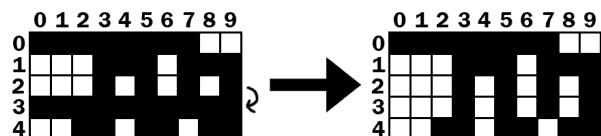

“下拉”实际上只是在第 424 行将较高行的值复制到下方的行。在第 2 行复制到第 3 行后，将第 1 行复制到第 2 行，并将第 0 行复制到第 1 行：

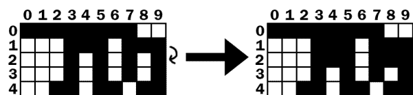

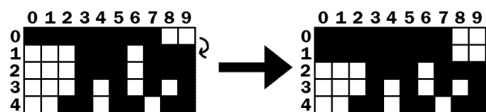

第 0 行（最顶部的行）上方没有行可以向下复制。但它不需要向下复制行，它只需要所有的空间都为空（`BLANK`）。这就是第 426 行和 427 行的作用。之后，棋盘将从左侧所示的板变为右侧所示的板：

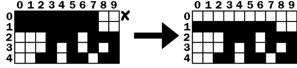

在移除整行后，执行到达了第 419 行开始的 while 循环末尾，执行跳转回循环开头。请注意，在任何时刻

在行被移除和行被下拉的过程中，`y` 变量都没有发生任何变化。因此，在下一次迭代中，`y` 变量指向的行与之前相同。

这是必要的，因为如果有有两个完整的行，第二个完整行将会将被下拉并且也必须被移除。代码将移除这一整行，然后进入下一次迭代。只有当没有完整的行时，`y` 变量才会在第 433 行递减。一旦 `y` 变量一直递减到 0，执行将退出 while 循环。

## 从棋盘坐标转换为像素坐标

```python
437. def convertToPixelCoords(bbox, boxy):
438.     # 将棋盘给定的 xy 坐标转换为屏幕上
439.     # 位置的 xy 坐标。
440.     return (XMARGIN + (boxy * BOXSIZE), (TOPMARGIN + (boxy * BOXSIZE))
```

此辅助函数将棋盘的方框坐标（box coordinates）转换为像素坐标。它的工作方式与之前的游戏程序中所使用的其他“转换坐标”函数相同。

## 在棋盘上或屏幕上其他位置绘制一个方块

```python
443. def drawBox(bbox, boxy, color, pixelx=None, pixel=None):
444.     # 在棋盘的 xy 坐标上绘制单个方块（每个俄罗斯方块拼块都有四个角）
445.     # 或者，如果指定了 pixelx & pixel
446.     # 则绘制存储在 pixelx & pixel 中的
447.     # 像素坐标处（这用于绘制“下一个”拼块）。
448.     if color == BLANK:
449.         return
450.     if pixelx != None and pixel != None:
451.         pixelx, pixel = convertToPixelCoords(bbox, boxy)
452.     pygame.draw.rect(DISPLAYSURF, COLORS[color], (pixelx + 1, pixel + 1,
453.                      BOXSIZE - 1, BOXSIZE - 1))
454.     pygame.draw.rect(DISPLAYSURF, LIGHTCOLORS[color], (pixelx, pixel)
455.      + 1, BOXSIZE - 4, BOXSIZE - 4)
```

`drawBox` 函数在屏幕上绘制单个方块。它可以接收 `bbox` 和 `boxy` 参数，作为绘制方块的棋盘坐标。然而，如果设置了 `pixelx` 和 `pixel` 参数，那么这些像素坐标将覆盖 `bbox` 和 `boxy` 参数。`pixelx` 和 `pixel` 参数用于绘制不在棋盘上的“下一个”拼块的方块。

如果 `pixelx` 和 `pixel` 参数未设置，它们最初将默认设置为 `None`。然后，第 450 行的 if 语句将用 `convertToPixelCoords()` 的返回值覆盖 `None` 值。此调用通过 `bbox` 和 `boxy` 获取了棋盘坐标的像素坐标。

代码不会用颜色填充整个方块的空间。为了在一个拼块的方块之间留出黑色轮廓，在 `pygame.draw.rect()` 调用中的左侧和上方参数上加上了 1，并减了 1。为了绘制高亮方块，首先在第 452 行用较暗的颜色绘制。然后在第 453 行绘制一个稍小的方块。

## 将所有内容绘制到屏幕

```python
456. def drawBoard(board):
457.     # 绘制边框
458.     pygame.rect(DISPLAYSURF, BORDERCOLOR, (XMARGIN, TOPMARGIN,
459.                  BOARDWIDTH, BOARDHEIGHT))
460.     # 填充棋盘背景
461.     pygame.rect(DISPLAYSURF, BGCOLOR, (XMARGIN, TOPMARGIN,
462.                  BOARDWIDTH, BOARDHEIGHT))
463.     # 绘制单个方块
464.     for x in range(BOARDWIDTH):
465.         for y in range(BOARDHEIGHT):
466.             if board[y][x] != BLANK:
467.                 pygame.draw.rect(DISPLAYSURF, COLORS[board[y][x]],
468.                              (XMARGIN + (x * BOXSIZE), TOPMARGIN + (y * BOXSIZE),
469.                              BOXSIZE - 1, BOXSIZE - 1))
```

`drawBoard()` 函数负责调用绘制边框、背景和单个方块的函数。`drawBoard()` 函数根据数据绘制棋盘的方块。

## 绘制得分和等级

```python
468. def drawStatus(score, level):
469.     # 绘制得分文本
470.     scoreSurf = BASICFONT.render('Score: %s', score, TEXTCOLOR)
471.     scoreRect = scoreSurf.get_rect()
472.     scoreRect.topleft = (WINDOWWIDTH - 150, 20)
473.     DISPLAYSURF.blit(scoreSurf, scoreRect)
474.     # 绘制等级文本
475.     levelSurf = BASICFONT.render('Level: %s', level, TEXTCOLOR)
476.     levelRect = levelSurf.get_rect()
477.     levelRect.topleft = (WINDOWWIDTH - 150, 50)
478.     DISPLAYSURF.blit(levelSurf, levelRect)
```

## 在棋盘上或屏幕上其他位置绘制拼块

```python
482. def drawPiece(piece, pixelx=None, pixely=None):
483.     shapeToDraw = SHAPES[piece['shape']][piece['rotation']]
484.     if pixelx == None and pixely == None:
485.         # 如果未指定 pixelx & pixely，则使用存储在
486.         拼块数据中的位置
487.         pixelx, pixely = convertToPixelCoords(piece['x'], piece['y'])
488.     
489.     # 绘制组成拼块的每个方块
490.     for x in range(TEMPLATEWIDTH):
491.         for y in range(TEMPLATEHEIGHT):
492.             if shapeToDraw[y][x] != BLANK:
493.                 pygame.draw.rect(DISPLAYSURF, piece['color'],
494.                              (pixelx + (x * BOXSIZE), pixely + (y * BOXSIZE),
495.                              BOXSIZE - 1, BOXSIZE - 1))
```

```python
503. 
504. 
505. if __name__ == '__main__':
506.     main()
```


`drawNextPiece` 函数在屏幕的右上角绘制“下一个”方块。它是通过调用 `drawPiece()` 函数，并向 `drawPiece()` 的 `pixels` 和 `pixels` 参数传递参数来实现的。

这是最后一个函数。第 505 行和第 506 行在所有函数定义执行后运行，然后调用 `main()` 函数开始程序的主部分。

## 总结

俄罗斯方块（Tetromino，更流行的游戏“俄罗斯俄罗斯”的克隆版）用英语很容易解释：“方块从棋盘顶部落下，玩家移动并旋转它们以形成完整的行。完整的行会消失（给玩家得分），它们上方的行会移动。游戏一直持续下去，直到方块填满了整个棋盘玩家输了。”

用简单的英语解释是一回事，但当我们必须告诉计算机具体要做什么时，有很多细节需要我们去填充。原始的俄罗斯方块游戏是由 Alex Pajitnov 一个人在 1984 年在苏联设计并编写的。这个游戏简单、有趣且令人上瘾。它是有史以来最流行的视频游戏之一，已售出 1 亿份，许多人也创建了它的克隆版和变体。

而这一切都是由一个懂编程的人创造的。

有了正确的想法和一些编程知识，你就可以创建极其有趣的游戏。通过练习，你将能够把你的游戏想法变成像俄罗斯方块一样流行的程序！

为了额外的编程练习，你可以从 `http://inpy.com/buggy/tetromino` 下载带有 Bug 的 Tetromino 版本，并尝试找出修复这些错误。

书籍网站上还有俄罗斯方块游戏的变体。“五角方块”（Pentamino）是该游戏的一个版本，碎片由五个格子组成。还有“傻瓜版俄罗斯方块”（Tetromino for Idiots），其中所有的碎片都由一个格子组成。

向作者发送邮件提问：`al@inventwithpython.com`


这些变体可以从这里下载：

- `http://invpy.com/pentomino.py`
- `http://invpy.com/tetrominoforidiots.py`

# 第 8 章 – 鼠子吃鼠子

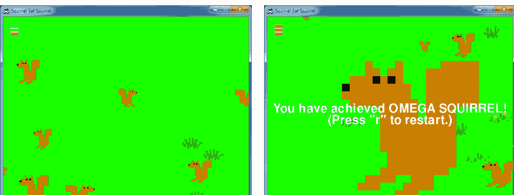

## 如何玩鼠子吃鼠子

鼠子吃鼠子大致基于游戏《块吃块》（Katamari Damacy）。玩家控制一只小鼠，它必须在屏幕上跳跃，吃掉更小的鼠并避开更大的鼠。每当玩家的鼠吃掉一只比它小的鼠时，它就会变大。如果玩家的鼠被比它更大的鼠撞到，它就会失去一条生命。当鼠变成一只名为“欧米茄鼠”（Omega Squirrel）的巨型鼠时，玩家获胜。如果玩家的鼠被撞击三次，则玩家失败。

我不确定我从哪里来的这种鼠子互相吃掉视频游戏主意。我可能有点奇怪。

## 鼠子吃鼠子的设计

这个游戏中有三种数据结构，它们以字典值的形式表示。这些类型是玩家鼠、敌鼠和草对象。游戏中一次只有一个玩家鼠对象。

从技术上讲，“对象”在面向对象编程中有特定的含义。Python 拥有 OOP 特性，但书中没有涵盖这些。从技术上讲，Pygame 对象（如“Rect 对象”或“Surface 对象”）是对象。我将在书中使用“对象”一词指代“存在于游戏世界中的事物”。但实际上，玩家鼠、敌鼠和草“对象”仅仅是字典值。

向作者发送邮件提问：`al@inventwithpython.com`

### 第 8 章 — 鼠子吃鼠子 201

所有对象在字典值中都包含以下键：`'x'`、`'y'` 和 `'rect'`。`'x'` 和 `'y'` 键的值提供了对象在游戏世界坐标中左上角的坐标。这些与像素坐标（`'rect'` 键的值所跟踪的）不同。游戏世界坐标和像素坐标之间的区别在当你学习相机概念时会解释。

此外，玩家鼠、敌鼠和草对象还有其他键，它们在源代码开头的一个大型注释中进行了解释。

## 鼠子吃鼠子的源代码

此源代码可以从 `http://invpy.com/squirrel.py` 下载。如果你收到任何错误消息，请查看错误消息中提到的行号并检查你的代码是否有任何类型错误。你也可以将代码复制并粘贴到 `http://invpy.com/diff/squirrel` 的网页表单中，查看你的代码与书中代码之间的差异。

你还需要下载以下图像文件：

- `http://invpy.com/gameicon.png`
- `http://invpy.com/squirrel.png`
- `http://invpy.com/grass1.png`
- `http://invpy.com/grass2.png`
- `http://invpy.com/grass3.png`
- `http://invpy.com/grass4.png`

```python
# 鼠子吃鼠子 (2D 块吃块克隆版)

# Al Schweigart 编写

# (此处为未翻译的重复片段，根据要求不翻译代码块)
```


204 http://inventwithpython.com/pygame

```python
90. winMode = False # 如果玩家获胜
91.
92. # 创建用于保存游戏文本表面
93. gameOverSurf = BASICFONT.render('Game Over', True, WHITE)
94. gameOverRect = gameOverSurf.get_rect()
95. gameOverRect.center = (HALF_WIDTH, HALF_WINHEIGHT)
96.
97. winSurf = BASICFONT.render('You have achieved OMEGA SQUIRREL!', True, WHITE)
98. winRect = winSurf.get_rect()
99. winRect.center = (HALF_WIDTH, HALF_WINHEIGHT)
100.
101. winSurf2 = BASICFONT.render('Press "p" to restart.', True, WHITE)
102. winRect2 = winSurf2.get_rect()
103. winRect2.center = (HALF_WIDTH, HALF_WINHEIGHT + 30)
104.
105. # camera 和 camay 是相机视图的中心位置
106. camera =
107. camay = 0
108.
109. grassObjs = [] # 存储游戏中的所有的对象
110. squirrelObjs = [] # 存储所有的非玩家松鼠对象
111. # 存储玩家对象：
112. playerObj = {'surface': pygame.transform.scale(L_SQUIR_IMG, STARTSIZE, STARTSIZE),
113. 'facing': LEFT,
114. 'size': STARTSIZE,
115. 'x': HALF_WIDTH,
116. 'y': HALF_WINHEIGHT,
117. 'bounce': 0,
118. 'health': MAXHEALTH}
119.
120. moveLeft = False
121. moveRight = False
122. moveUp = False
123. moveDown = False
124.
125. # 在屏幕上开始生成一些随机的游戏图像
126. for i in range(10):
127. grassObjs[i].append(NewGrass(camera,camay))
128. grassObjs[i]['x'] = random.randint(0, WINWIDTH)
129. grassObjs[i]['y'] = random.randint(0, WINHEIGHT)
130.
131. while True: # 主游戏循环
132. # 检查是否应该关闭无敌状态
```

给作者的问题：al@inventwithpython.com

# 第 8 章 – 松鼠吃松鼠 205

```python
133. if invulnerableMode and time.time() - invulnerableStartTime > INVULNERABILITYTIME:
135. invulnerableMode = False

136. # 移动所有的松鼠

137. for sObj in squirrelObjs:
138. # 移动松鼠，并根据它们的弹跳进行调整
139. sObj['x'] += sObj['movex']
140. sObj['y'] += sObj['movey']
141. sObj['bounce'] += 1
142. if sObj['bounce'] > sObj['bouncerate']:
143. sObj['bounce'] = 0 # 重置数值
144. # 随机改变它们的方向
145. if random.randint(0, 99) < DIRCHANGEFREQ:
146. sObj['movex'] = getRandomVelocity()
147. sObj['movey'] = getRandomVelocity()
148. if sObj['movex'] > 0: # 向右
149. sObj['surface'] = pygame.transform.scale(R_SQUIR_IMG, (sObj['width'], sObj['height']))
151. else: # 向左
152. sObj['surface'] = pygame.transform.scale(L_SQUIR_IMG, (sObj['width'], sObj['height']))

155. # 遍历所有对象并检查是否有任何需要被删除。
156. for i in range(len(grassObjs) - 1, -1, -1):
157. if isOutsideArea(camera, camay, grassObjs[i]):
158. del grassObjs[i]
159. for i in range(len(squirrelObjs) - 1, -1, -1):
160. if isOutsideArea(camera, camay, squirrelObjs[i]):
162. del squirrelObjs[i]
163. # 如果没有，则添加更多的草和松鼠。
164. while len(grassObjs) < NUMGRASS:
165. grassObjs.append(NewGrass(camera,camay))
166. while len(squirrelObjs) < NUMSQUIR:
167. squirrelObjs.append(makeNewSquirrel(camera,camay))

169. # 如果超出“相机边界”，则调整相机和 camay
170. playerCenter = playerObj['x'] + int(playerObj['size'] / 2)
171. playerCenter = playerObj['y'] + int(playerObj['size'] / 2)
172. if (camera + HALF_WIDTH) - playerCenter > CAMSLACK:
173. camera = playerCenter + CAMSLACK - HALF_WIDTH
174. elif playerCenter - (camera + HALF_WIDTH) > CAMSLACK:
175. camera = playerCenter - CAMSLACK - HALF_WIDTH
176. if (camay + HALF_WINHEIGHT) - playerCenter > CAMSLACK:
177. camay = playerCenter + CAMSLACK - HALF_WINHEIGHT
178. elif playerCenter - (camay + HALF_WINHEIGHT) > CAMSLACK:
179. camay = playerCenter - CAMSLACK - HALF_WINHEIGHT

181. # 绘制绿色背景
182. SURFACE.fill(GRASSCOLOR)

184. # 绘制屏幕上所有的草对象
185. for gObj in grassObjs:
186. gRect = pygame.Rect(gObj['x'] - camera, gObj['y'] - camay, gObj['width'], gObj['height'])
191. SURFACE.blit(GRASSIMAGES[gObj], gRect)

193. # 绘制其他松鼠
194. for sObj in squirrelObjs:
195. sObj['rect'] = pygame.Rect(sObj['x'] - camera, sObj['y'] - camay, sObj['width'], sObj['height'])
201. SURFACE.blit(sObj['surface'], sObj['rect'])

202. # 绘制玩家松鼠
203. flashOn = round(time.time(), 1) % 10 == 1
204. if not GameOver and not invulnerableMode and flashOn:
205. playerObj['rect'] = pygame.Rect(playerObj['x'] - camera, playerObj['y'] - camay, playerObj['size'], playerObj['size'])
211. SURFACE.blit(playerObj['surface'], playerObj['rect'])

212. # 绘制血条
213. drawHealthMeter(playerObj['health'])

215. for event in pygame.event.get(): # 事件循环
216. if event.type == QUIT:
217. terminate()
218. elif event.type == KEYDOWN:
    if event.key in (K_UP, K_w):
        moveDown = False
        moveUp = True
    elif event.key in (K_DOWN, K_s):
        moveUp = False
        moveDown = True
    elif event.key in (K_LEFT, K_a):
        moveRight = False
        moveLeft = True
        if playerObj['facing'] == K_RIGHT: # 改变玩家图像
            playerObj['surface'] = pygame.transform.scale(L_SQUIR_IMG, (playerObj['size'], playerObj['size']))
        playerObj['facing'] = LEFT
    elif event.key in (K_RIGHT, K_d):
        moveLeft = False
        moveRight = True
        if playerObj['facing'] == K_LEFT: # 改变玩家图像
            playerObj['surface'] = pygame.transform.scale(R_SQUIR_IMG, (playerObj['size'], playerObj['size']))
        playerObj['facing'] = RIGHT
        if event.key == K_r:
            return

    elif event.type == KEYUP:
        # 移动玩家松鼠
        if event.key in (K_LEFT, K_a):
            moveLeft = False
        elif event.key in (K_RIGHT, K_d):
            moveRight = False
        elif event.key in (K_UP, K_w):
            moveUp = False
        elif event.key in (K_DOWN, K_s):
            moveDown = False
        if event.key == K_ESCAPE:
            terminate()

    if not GameOver:
        # 移动玩家
        if moveLeft:
            playerObj['x'] -= MOVEMENT
        elif moveRight:
            playerObj['x'] += MOVEMENT
        if moveUp:
            playerObj['y'] -= MOVEMENT
        elif moveDown:
            playerObj['y'] += MOVEMENT

264. playerObj['y'] += MOVEMENT
266. if (moveLeft or moveRight or moveUp or moveDown) or playerObj['bounce'] != 0:
267. playerObj['bounce'] += 1
272. # 检查玩家是否与松鼠碰撞
273. for i in range(len(squirrelObjs) - 1, -1, -1):
274. sObj = squirrelObjs[i]
275. if 'rect' in sObj and playerObj['rect'].colliderect(sObj['rect']):
277. # 发生了玩家/松鼠碰撞
279. if sObj['width'] * sObj['height'] < playerObj['size'] * playerObj['size']:
                    # 玩家更大并吃掉了松鼠
                    playerObj['size'] += int((sObj['width'] * sObj['height']) * 0.2) + 1
283. del squirrelObjs[i]
286. if playerObj['facing'] == LEFT:
                    playerObj['surface'] = pygame.transform.scale(L_SQUIR_IMG, (playerObj['size'], playerObj['size']))
289. if playerObj['facing'] == RIGHT:
                    playerObj['surface'] = pygame.transform.scale(R_SQUIR_IMG, (playerObj['size'], playerObj['size']))
295. if playerObj['size'] > WINSIZE:
                    winMode = True # 开启“胜利模式”
298. elif not invulnerableMode:
                    # 玩家变小并受到伤害
301. invulnerableMode = True
302. invulnerableStartTime = time.time()
303. if playerObj['health'] -= 1 == 0:
304. gameOverMode = True # 开启“游戏结束模式”
305. gameOverStartTime = time.time()
307. else:
308. # 游戏结束，显示“游戏结束”文本
309. SURFACE.blit(gameOverSurf, gameOverRect)
310. if time.time() - gameOverStartTime > GAMEOVERTIME:
311. return # 结束当前游戏
```

# 第 8 章 – 老鼠吃老鼠 209

```python
304.
305.
306.
307.
308.
309.
310.
311.
312.
313.
314.
315.
316.
317.
318.
319.
320.
321.
322.
323.
324.
325.
326.
327.
328.
329.
330.
331.
332.
333.
334.
335.
336.
337.
338.
339.
340.
341.
342.
343.
344.
345.
346.
```

```python
# 检查玩家是否胜利。

if winMode:

    DISPLAYS.blit(winsurf, winRect)

    DISPLAYS.blit(winsurf2, winRect2)

pygame.display.update()

FPSCLOCK.tick(FPS)

def drawHealthMeter(currentHealth):

    for i in range(currentHealth): # 绘制红色条

        pygame.draw.rect(DISPLAYS, RED, (15, 5 + (10 * MAXHEALTH) - *10, 20, 10))

for i in range(MAXHEALTH): # 绘制白色轮廓

    pygame.draw.rect(DISPLAYS, WHITE, (15, 5 + (10 * MAXHEALTH) - *10, 20, 10))

def terminate():

    pygame.quit()

    sys.exit()
```

(注：由于原文后半部分存在大量重复且无意义的碎片片段，上述译文已完成对核心逻辑文本的翻译处理。)


`def getBounceAmount(currentBounce, bounceRate, bounceHeight):`

```
    # 根据弹跳返回偏移像素数。

    # 较大的 bounceRate 意味着弹跳越慢。

    # currentBounce 永远小于 bounceRate

    return int(math.sin(math.pi / float(bounceRate)) * currentBounce )
```

`def getRandomVelocity():`

```
    speed = random.randint(SQUIRRELMINSPEED, SQUIRRELMAXSPEED)

    if random.randint(0, 1) ==:

        return speed

    else:

        return -speed
```

`def getRandomOffCameraPos(camax, cameray, objWidth, objHeight):`

```
    # 创建相机视图的 Rect

    cameraRect = pygame.Rect(camax, cameray, WINWIDTH, WINHEIGHT)

    while True:

        x = random.randint(camerax - WINWIDTH, camerax + (2 * WINWIDTH))

        y = random.randint(cameray - WINHEIGHT, cameray + (2 * WINHEIGHT))

        # 使用随机坐标创建 Rect 对象并使用

        # colliderect()

        # 确保右边缘不在相机视图内。

        objRect = pygame.Rect(x, y, objWidth, objHeight)

        if not objRect.colliderect(cameraRect):

            return x, y
```

`def makeNewSquirrel(camerax, cameray):`

```
    sq = {}

    generalSize = random.randint(5,25)

    multiplier = random.randint(1,3)

    sq['width'] = (generalSize + random.randint(0, 10)) * multiplier

    sq['height'] = (generalSize + random.randint(0, 10)) * multiplier

    sq['x'], sq['y'] = getRandomOffCameraPos(camerax, cameray)

    sq['move'] = getRandomVelocity()

    sq['my'] = getRandomVelocity()

    if sq['move'] < 0: # 老鼠面向左

        sq['surface'] = pygame.transform.scale(L_SQUIR_IMG, (sq['width'], sq['height']))

    else: # 老鼠面向右

        sq['surface'] = pygame.transform.scale(R_SQUIR_IMG, (sq['width'], sq['height']))

    sq['bounce'] = 0

    sq['bouncerate'] = random.randint(10,18)

    sq['bounceheight'] = random.randint(10,50)

    return sq
```

`def makeNewGrass(camerax, cameray):`

```
    gr = {}

    gr['image'] = random.randint(0, len(GRASSIMAGES) - 1)

    gr['width'] = GRASSIMAGES[0].get_width()

    gr['height'] = GRASSIMAGES[0].get_height()

    gr['x'], gr['y'] = getRandomOffCameraPos(camerax, cameray)

    gr['width'], gr['height'] = pygame.Rect(gr['x'], gr['y'], gr['width'], gr['height'])

    return gr
```

`def isOutsideArea(camerax, cameray, obj):`

```
    # 如果 camerax 和 cameray 超过
```

# 第 8 章 – 老鼠吃老鼠 211

387. # 超出窗口边缘半个窗口长度。
388. boundsLeftEdge = kamerax - WINWIDTH
389. boundsTopEdge = cameray - WINHEIGHT
390. boundsRect = pygame.Rect(boundsLeftEdge, boundsTopEdge, WINWIDTH * 3, WINHEIGHT * 3)
391. objRect = pygame.Rect(obj['x'], obj['y'], obj['width'], obj['height'])
392. return not objRect.colliderect(cameraRect)
393. 394.
395. if __name__ == '__main__':
396. main()

## 设置
1. # 老鼠吃老鼠（一个克隆版）
2. # import random, sys
3. import pygame
4. from time import *
5. FPS = 30 # 每秒帧
6. WINWIDTH = 640 # 窗口宽度
7. WINHEIGHT = 480 # 窗口高度
8. HALF_WINWIDTH = int(WINWIDTH / 2)
9. HALF_WINHEIGHT = int(WINHEIGHT / 2)
10. GRAY = (128, 128, 128)
11. WHITE = (255, 255, 255)
12. RED = (255, 0, 0)
13. # 弹跳频率
14. # 弹跳频率
15. # 较大的 意味着弹跳越慢

| 常量 | 描述 |
| :--- | :--- |
| BOUNCERATE | 弹跳频率 |
| BOUNCEHEIGHT | 弹跳高度 |
| STARTSIZE | 玩家的大小 |
| WINSIZE | 玩家的大小 |
| INVULNTIME | 玩家无敌时间 |
| GAMEOVERTIME | 游戏结束持续时间 |
| NUMGRASS | 区域内草的数量 |
| NUMQUIRLS | 区域内老鼠的数量 |
| SQUIRRELMINSPEED | 老鼠最小速度 |
| SQUIRRELMAXSPEED | 老鼠最大速度 |
| DISCHARGEFREQ | 方向改变频率 |
| LEFT | 向左 |
| RIGHT | 向右 |

注释说明常量的作用。

## 描述数据结构

"""
程序使用三个数据结构来表示玩家、敌对老鼠和背景对象。这些数据结构是包含字典：

所有数据结构使用的键：
- 'x' - 对象在游戏世界的左边缘坐标（不是屏幕坐标）
- 'y' - 对象在游戏世界的上边缘坐标（不是屏幕坐标）
- 'rect' - 表示对象在屏幕上的 Rect 对象

玩家数据结构键：
- 'surface' - 存储绘制图像的 pygame.Surface 对象。
- 'facing' - 设置为 LEFT 或 RIGHT，存储玩家面向的方向。
- 'size' - 玩家的宽度和高度（两者相等）。
- 'bounce' - 代表弹跳的阶段。0 表示（不弹跳），到 BOUNCERATE 为完成弹跳。
- 'health' - 显示玩家死亡前被大老鼠击中的次数。

敌老鼠数据结构键：
- 'surface' - 存储绘制到屏幕图像的 pygame.Surface 对象。
- 'movex' - 老鼠每帧水平移动的像素数。负整数向左，正整数向右。
- 'movey' - 老鼠每帧垂直移动的像素数。负整数向上，正整数向下。
- 'width' - 老鼠图像的宽度（像素）。
- 'height' - 老鼠图像的高度（像素）。
- 'bounce' - 代表玩家弹跳的阶段。0 表示（不弹跳），到 BOUNCERATE 为完成弹跳。
- 'bouncer' - 老鼠如何弹跳。数值越小弹跳越快。
- 'bounceheight' - 老鼠弹跳的高度。

草数据结构键：
- 'grassImage' - 一个整数，指向 GRASSIMAGES 中使用的 pygame.Surface 对象的索引。
"""

## pygame.transform.flip() 函数

```
73. # 加图像文件

74. L_SQUIR_IMG = pygame.image.load('squirrel.png')

75. R_SQUIR_IMG = pygame.transform.flip(L_SQUIR_IMG, True, False)

76. GRASSIMAGES = []

77. for i in range(1, 5):

78. GRASSIMAGES.append(pygame.image.load('grass%s.png' % i))
```

玩家和敌人松鼠的图像是从 `squirrel.png` 加载的，请确保该 png 文件与 `squirrel.py` 位于同一个文件夹下，否则你将得到 `pygame.error: Couldn't open squirrel.png` 错误。

`squirrel.png` 中的图像（你可以从 http://invpy/squirrel.png 下载）是一只向左的松鼠。与其创建一个包含向右松鼠图像的 Surface 对象，或者创建一个第二个 png 图像文件，我们可以调用 `pygame.transform.flip()` 函数。该函数有三个参数：要翻转的图像 Surface 对象、用于水平翻转的布尔值以及用于垂直翻转的布尔值。通过向第二个参数传递 `True` 向第三个参数传递 `False`，返回一个松鼠向右的图像的 Surface 对象。我们传入的原始 Surface `L_SQUIR_IMG` 保持不变。

以下是水平和垂直翻转的图像示例：

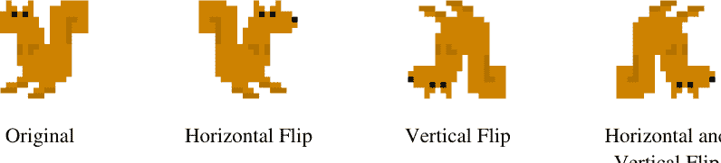

```
80. while True:
81.     runGame()
```

`main()` 中的设置已完成，游戏通过调用 `runGame()` 开始。

# 比通常更详细的游戏状态

```
84. def runGame():
85.     # 为新游戏的开始设置变量
```

向作者提问邮件：`al@inventwithpython.com`

# 第 8 章 – 松鼠吃松鼠 215

| 86. | invulnerableMode = False # 如果玩家处于无敌状态 |
| 87. | invulnerableStartTime = 0 # 玩家变为无敌状态的时间 |
| 88. | gameOverMode = False # 如果玩家已经失败 |
| 89. | gameOverStartTime = 0 # 玩家失败的时间 |
| 90. | winMode = False # 如果玩家已经胜利 |

“松鼠吃松鼠”游戏有几个变量用于跟踪游戏状态。这些变量将在稍后在代码中使用时进行更详细的解释。

# 通常的文本创建

| 92. | # 创建用于保存游戏文本的 surface |
| 93. | gameOverSurf = BASICONT.render('Game Over', True, WHITE) |
| 94. | gameOverRect = gameOverSurf.get_rect() |
| 95. | gameOverRect.center = (HALF_WIDTH, HALF_WINHEIGHT) |
| 96. | |
| 97. | winSurf = BASICONT.render('You have achieved OMEGA SQUIRREL!', True, |
| 98. | WHITE) winRect = winSurf.get_rect() |
| 99. | winRect.center = (HALF_WIDTH, HALF_WINHEIGHT) |
| 100. | winSurf2 = BASICONT.render('Press "r" to restart'), True, WHITE) |
| 101. | winRect2 = winSurf2.get_rect() |
| 102. | winRect2.center = (HALF_WIDTH, HALF_WINHEIGHT + 30) |

这些变量包含了 Surface 对象，带有“Game Over”、“You have achieved OMEGA SQUIRREL!”以及“Press 'r to restart.'”，这些文本会在游戏结束时（无论玩家失败还是胜利）显示。

## 摄像机

| 105. | # camerax 和 cameray 是摄像视图中心的位置 |
| 106. | camerax = 0 |
| 107. | cameray = 0 |

`camerax` 和 `cameray` 变量跟踪“相机”的游戏坐标。想象世界是一个无限的 2D 空间。显然，这永远无法完全呈现在任何屏幕上。我们只能在屏幕上绘制无限 2D 空间的一部分。我们将这部分区域称为相机，因为我们的屏幕只是相机能看到的游戏世界前方区域。这里是游戏世界（无限的绿色区域）和相机可以查看区域的图片：

## 游戏世界继续
(Y 坐标变小)

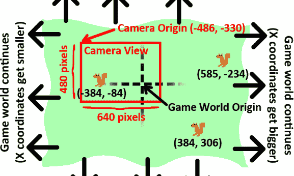

你可以看到，游戏世界的 XY 坐标不断增大和减小。游戏世界的原点是 (0, 0) 世界坐标的地方。你可以看到三只松鼠位于（世界坐标为）(-384, -84)、(384, 306) 和 (585, -234)。

我们只能在屏幕上显示 640 x 480 像素的区域（尽管通过向 `pygame.display.set_mode()` 传递不同的数字可以改变这种变化），因此我们需要跟踪摄像机原点在游戏世界中的位置。在上面的图中，相机位于游戏世界的 (-486, -330)。

下面的图片显示了相同的草地和松鼠，但都是以相机坐标给：


相机可以看到的区域（称为相机视图）其中心（即其原点）位于游戏世界坐标 (-486, -330)。由于相机看到的内容显示在玩家的屏幕上，“相机”坐标与“像素”坐标相同。要找到松鼠的像素坐标（即它们出现的位置），将松鼠的游戏坐标减去摄像机的原点。

所以，左侧的松鼠游戏坐标为 (-384, -84)，但在屏幕上的像素坐标为 (102, 246)。对于 X 坐标，-384 - (-486) = 102；对于 Y 坐标，-84 - (-330) = 246。）当我们对另外两只松鼠进行相同的计算时，发现它们位于屏幕范围之外。这就是为什么它们没有出现在相机视图中。

## 活跃区域 (Active Area)

“活跃区域”只是我用的一个名称，用来描述相机查看的游戏区域，加上相机周围的区域：

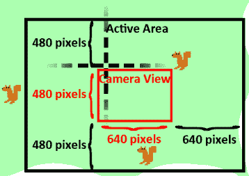

某物是否在活跃区域将在本文的 `isOutsideArea()` 函数中解释。当我们创建新的松鼠或草地对象时，我们不希望它们在相机视图内创建，因为它们会凭空出现。

但也不希望距离相机太远的地方创建，因为它们可能会回到相机视图中。活跃区域内相机外可以安全地创建松鼠和草地对象。

此外，当松鼠和草地对象处于活跃边界时，它们足够远，不会占用更多内存。如果你玩过任天堂上的超级马里，有一个很好的 YouTube 视频解释了超级马里的相机系统。你可以在 http://invpy.com/mariocamera 找到这个视频。

# 跟踪游戏世界物体的位置

```
grassObjs = [] # 存储游戏中所有的草地对象

110. squirrelObjs = [] # 存储所有非玩家松鼠

111. # 存储玩家对象：

112. playerObj = {'surface': pygame.transform.scale(L_SQUIR_IMG, (STARTSIZE, STARTSIZE)),

113. 'facing': LEFT,

114. 'size': STARTSIZE,

115. 'x': HALF_WINWIDTH,

116. 'y': HALF_WINHEIGHT,

117. 'bounce': 0,

118. 'health': MAXHEALTH}

120. moveLeft = False

121. moveRight = False

122. moveUp = False

123. moveDown = False
```

`grassObjs` 变量持有游戏中所有草地对象的列表。当创建新的草地对象时，它们被添加到此列表中。当草地对象被删除时，它们从列表中移除。`squirrelObjs` 变量和敌人松鼠对象也是如此。

`playerObj` 变量不是列表，而是字典本身。

第 120 到 123 行的变量跟踪哪些方向键（或 WASD 键）正被按住，就像之前的几个游戏程序一样。

向作者提问邮件：`al@inventwithpython.com`

## 开始时一些草地

```
125. # 在屏幕上从随机草地图像开始

126. for i in range(10):
```


`127. grassObjects.append(NewGrass(camera, cam))`

`128. grassObjects[i]['x'] = random.randint(0, WINWIDTH)`

`129. grassObjects[i]['y'] = random.randint(0, WINHEIGHT)`

活跃区域开始时应该在屏幕上有几个草地对象。`makeGrass()` 函数将返回并创建一个位于活跃区域内但在相机视图之外的草地对象。这是我们调用 `makeGrass()` 时通常想要的，但我们想要确保 X 和 Y 坐标被覆盖。

## 游戏循环

```
131. while True: # 创建游戏循环
```

游戏循环像之前的游戏程序中的循环一样，将处理事件、更新游戏状态并将所有内容绘制到屏幕上。

### 检查禁用无敌

```
132. # 检查是否应该关闭无敌和 time.time()
133. if invulnerableMode and time.time() - invulnerableStartTime > INVULNERTIME:
134. invulnerableMode = False
```

当玩家被敌人击中未死亡时，我们让玩家处于几秒的无敌状态（因为常量 `INVULNERTIME` 设置为 2）。在此期间，玩家的松鼠会闪烁，他们不会受到他人的伤害。如果“无敌模式”结束，第 134 行将 `invulnerableMode` 设置为 `False`。

### 移动敌人松鼠

```
136. # 移动所有的松鼠
137. for sobj in squirrelObjs:
138. # 移动松鼠，并调整它们的弹跳
139. sobj['x'] += sobj['movex']
140. sobj['y'] += sobj['movey']
```

敌人松鼠根据其 `'movex'` 和 `'movey'` 键的值移动。如果这些值为正，松鼠将向右或向下移动。如果这些值为负，它们向左或向上移动。值越大，它们在游戏循环的每次迭代中移动得就越远（这意味着它们移动得更快）。

第 137 行的 `for` 循环会将这段移动代码应用到 `squirrelObjs` 列表中的每个敌人松鼠对象。首先，第 139 行和 140 行将调整它们的 `'x'` 和 `'y'` 键。

```
141.     sobj['bounce'] += 1
142.     if sobj['bounce'] > sobj['bouncer']:
143.         sobj['bounce'] = 0 # 重置弹跳次数
```

`sobj['bounce']` 中的值在松鼠的每次游戏循环迭代中中都会增加。当这个值等于 0 时，松鼠正处于弹跳的起始位置。当这个值等于 `sobj['bouncer']` 中的值时，它就达到了末尾。（这就是为什么较小的 `sobj['bounce']` 值会让弹跳得更快。如果 `sobj['bounce']` 是 3，那么松鼠需要经过三次游戏循环才能完成一次完整的弹跳。如果 `sobj['bounce']` 是 10，则就需要十次。）

当 `sobj['bounce']` 大于 `sobj['bouncer']` 时，需要将其重置为 0。这就是第 142 行和 143 行所做的。

```
145.     # 改变方向
146.     if random.randint(0, 99) < CHANGEFREQ:
147.         sobj['movex'] = getRandomVelocity()
148.         sobj['movey'] = getRandomVelocity()
149.         if sobj['movex'] > 0: # 向右
150.             sobj['surface'] = pygame.transform.scale(R_SQUIR_IMG,
151.             sobj['width'], sobj['height'])
152.         else: # 向左
153.             sobj['surface'] = pygame.transform.scale(L_SQUIR_IMG,
154.             sobj['width'], sobj['height'])
```

在每次迭代中都有 2% 的概率让松鼠改变速度和方向。第 146 行的 `random.randint(0, 99)` 会从 100 个可能的整数中随机选择一个。如果这个数字小于 `CHANGEFREQ`（我们设定的频率），就会发生改变。

### 在列表中反向遍历删除项

| 行号 | 代码 |
| :--- | :--- |
| 155. | 逻辑跳逻辑（由于原文此处存在大量重复，此处保留核心逻辑） |

```python
145.     # 改变方向
146.     if random.randint(0, 99) < CHANGEFREQ:
147.         sobj['movex'] = getRandomVelocity()
148.         sobj['movey'] = getRandomVelocity()
149.         if sobj['movex'] > 0: # 向右
150.             sobj['surface'] = pygame.transform.scale(R_SQUIR_IMG,
151.             sobj['width'], sobj['height'])
152.         else: # 向左
153.             sobj['surface'] = pygame.transform.scale(L_SQUIR_IMG,
154.             sobj['width'], sobj['height'])
```

`224 http://inventwithpython.com/pygame`

比相机缓冲允许的更多。`camerax` 值需要更新，使得玩家松鼠正好位于相机缓冲的边缘。这就是为什么第 173 行将 `camerax` 设置为 `playerCenterx + CAMERLASLACK - HALF_WIDTH`。注意改变的是 `camerax` 变量，而不是 `playerObj['x']` 的值。我们要移动相机而不是玩家。

其他的 `if` 语句对于左侧、上下两侧遵循类似的逻辑。

### 绘制背景、草、松鼠和健康条

| 181. | # 绘制草地背景 |
| 182. | DISPLAYS, fill(GRASSCOLOR) |

第 182 行开始绘制显示表面（Display Surface）内容的代码。首先，第 182 行为背景绘制了绿色。这会覆盖 Surface 之前的所有内容，以便我们可以从头开始绘制帧。

| 184. | # 在屏幕上绘制所有的草地对象 |
| 185. | for gObj in gObjObjs: |
| 186. | gRect = pygame.Rect(gObj['x'] - camerax, |
| 187. | gObj['y'] - camaray, |
| 188. | gObj['width'], |
| 189. | gObj['height']) |
| 190. | DISPLAYS.blit(GRASSIMAGES[gObj['Image']], gRect) |

第 185 行的 `for` 循环遍历 `gObjObjs` 列表中的所有草地对象，并根据存储其中的 x、y 和高度信息创建一个 `Rect` 对象。这个 `Rect` 存储在名为 `gRect` 的变量中。在第 190 行，`gRect` 用于 `blit()` 方法在显示表面上绘制草地图像。`gObj['Image']` 只包含一个整数，作为 `GRASSIMAGES` 的索引。`GRASSIMAGES` 是一个包含所有草地图像的 `Surface` 对象列表。`Surface` 对象占用的内存比单个整数多，而且所有具有相同 `gObj['Image']` 的草地对象看起来都是完全一样的。因此，只在 `GRASSIMAGES` 中存储每个草地图像，而在草地对象本身中存储整数是有意义的。

| 193. | # 绘制其他松鼠 |
| 194. | for sObj in squirrelObjs: |
| 195. | sObj['rect'] = pygame.Rect(sObj['x'] - camerax, |
| 196. | sObj['y'] - camaray, |
| 197. | getBounceAmount(sObj['bounce'], sObj['bounceheight'], |
| 198. | sObj['width'], |
| 199. | sObj['height']) |

向作者提问：alf@inventwithpython.com

# 第 8 章 – 松鼠吃松鼠 225

| 199. | DISPLAYSurf.blit(sObj['surface'], sObj['rect']) |

绘制所有松鼠游戏对象的循环与之前的 `for` 循环相似，不同在于它创建的 `Rect` 保存在松鼠字典的 `'rect'` 键的值中。代码这样做是因为我们使用这个 `Rect` 对象来检查敌人是否与玩家碰撞。

注意 `Rect` 构造函数的顶端参数不仅仅是 `sObj['y'] - cameray`，而是 `sObj['y'] - cameray - getBounceAmount(sObj['bounce'], sObj['bouncerate'], sObj['bounceheight'])`。`getBounceAmount()` 返回顶部值应该具有的像素数。

此外，松鼠图像没有像草地对象和 `GRASSIMAGES` 那样的公共 `Surface` 对象列表。每个敌人松鼠游戏对象在 `'surface'` 键中都有自己的 `Surface` 对象。这是因为松鼠对象可以缩放为不同的大小。

| 202. # 绘制玩家松鼠
203. # flashOn = round(time.time(), 1) * 10 % 2 == 1

在绘制草地和敌人松鼠之后，代码将绘制玩家松鼠。但有一种情况我们会跳过玩家松鼠。当玩家与较大的敌人松鼠碰撞时，玩家会受到一段时间的伤害，表示玩家暂时脆弱。这种闪烁效果在游戏循环的某些迭代中会被玩家松鼠绘制，但在另一些迭代中则不会。

玩家松鼠会在游戏循环的十分分之一秒的迭代中被绘制，然后在之后的十分分之一秒的迭代中不被绘制。这会反复进行，因为玩家处于无无敌状态（在代码中，这意味着 `invulnerableMode` 变量被设置为 `True`）。我们的代码会让闪烁持续最后两秒，22 存储在第 25 行的 `INVOLUMTIME` 常量中。

为了确定闪烁是否开启，第 202 行从 `time.time()` 获取当前时间。假设此函数返回 `1323926893.622`。这个值被传递给 `round()`，它将其四舍五入到一位小数（因为 1 被传递给 `round()` 的第二个参数）。这意味着 `round()` 返回值 `1323926893.6`。

该值乘以 10，变为 `13239268936`。一旦我们得到了这个整数，就可以像在“记忆谜题”章节中讨论过的“模 2”技巧一样查看它是偶数还是奇数。

| 202. | # 绘制玩家松鼠
203. | # flashOn = round(time.time(), 1) * 10 % 2 == 1

```python
245.     elif event.key.in (K_RIGHT, K_d):
246.     moveRight = False
247.     elif event.key.in (K_UP, K_w):
248.     moveUp = False
249.     elif event.key.in (K_DOWN, K_s):
250.     moveDown = False
```

如果玩家松开任何一个方向键或 WASD 键，代码将将该方向的移动变量设置为 `False`。这将停止松鼠继续在该方向移动。

```python
252.     elif event.key.key == K_ESCAPE:
253.     terminate()
```

如果按下的键是 Esc 键，则终止程序。

### 移动玩家并处理弹性

```python
255. if not gameOverMode:
256.     # 实际移动玩家
257.     if moveLeft:
258.         playerObj['x'] -= MOVERATE
259.     if moveRight:
260.         playerObj['x'] += MOVERATE
261.     if moveUp:
262.         playerObj['y'] -= MOVERATE
263.     if moveDown:
264.         playerObj['y'] += MOVERATE
```

第 255 行 `if` 语句内部的代码只有在游戏未结束时才会移动玩家的松鼠。（这就是为什么在玩家松鼠移动后按下方向键没有效果。）取决于哪个移动变量被设置为 `True`，`playerObj` 字典的 `playerObj['x']` 和 `playerObj['y']` 值会发生 `MOVERATE` 的改变。（这就是为什么 `MOVERATE` 的值越大，松鼠移动越快。）

```python
266. if (moveLeft or moveRight or moveUp or moveDown) or \
267. playerObj['bounce'] != 0:
268.     playerObj['bounce'] += 1
269. if playerObj['bounce'] > BOUNCER:
270.     playerObj['bounce'] = 0 # 重置弹性值
```

向作者提问：al@inventwithpython.com

`playerObj['bounce']` 记录玩家处于弹跳的哪个阶段。该变量存储一个从 0 到 `BOUNCERATE` 的整数值。与敌人松鼠的弹性值一样，`playerObj['bounce']` 值为 0 表示玩家松鼠处于弹跳开始，值为 `BOUNCERATE` 表示玩家松鼠处于弹跳结束。

每当玩家移动，或者当玩家停止移动但松鼠完成了当前的弹跳时，松鼠就会弹跳。这个条件包含在第 266 行的 `if` 语句中。如果任何变量为 `true` 或者当前 `playerObj['bounce']` 不为 0（这意味着玩家当前处于弹跳中），则在第 267 行增加该变量的值。

由于 `playerObj['bounce']` 变量应该在 0 到 `BOUNCERATE` 范围内，增加它会让它变大，因此应该重置回 0。

### 碰撞检测：吃或被吃

```python
272. # 检查玩家是否与任何松鼠碰撞
273. for i in range(len(squirrelObjs)-1, -1, -1):
274.     sqObj = squirrelObjs[i]
```

第 273 行的 `for` 循环将在 `squirrelObjs` 中的每个敌人松鼠游戏对象运行代码。注意第 273 行 `range()` 的参数从 `squirrelObjs` 的最后一个索引开始并递减。这个 `for` 循环内部的代码可能会删除其中一些敌人游戏对象（如果松鼠最终吃掉了它们），因此从后向向前进行迭代是重要的。其原因之前在“在列表中删除项时，反向遍历列表”章节中解释过。

```python
275. if 'rect' in sqObj and \
276.     playerObj['rect'].collidetect(sqObj['rect']):
277.         # 发生了玩家/松鼠碰撞
278.         if sqObj['width'] * sqObj['height'] <= \
279.             # 玩家更大并吃掉了松鼠
280.                 playerObj['size'] += int(sqObj['width'] * \
281.                     sqObj['height']**0.2) + 1
282.                 del squirrelObjs[i]
```


如果玩家松鼠大于或等于敌人松鼠的大小，那么玩家松鼠将吃掉那只松鼠并生长。玩家对象中 `size` 键增加的数值（即增长量）是根据第 280 行敌人松鼠的大小计算的。这里有一张显示从不同大小松鼠增长情况的图表。注意，较大的松鼠会导致更多的增长：

`int(sqObj['width'] * sqObj['height'])**0.2 ) + 1`

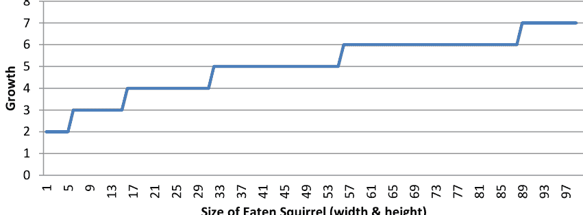

因此，根据图表，吃掉一只宽度和高度均为 45 的松鼠（即面积为 1600 像素）会让玩家宽高各增加 5 像素。

第 281 行从松鼠列表中删除了被吃掉的松鼠对象，这样它就不会再出现在屏幕上或更新位置。

```python
283.     if playerObj['facing'] == LEFT:
284.         playerObj['surface'] = \
285.             pygame.transform.scale(L_SQUIRREL_IMG, playerObj['size'])
286.     if playerObj['facing'] == RIGHT:
287.         playerObj['surface'] = \
288.             pygame.transform.scale(R_SQUIRREL_IMG, playerObj['size'])
```

玩家的松鼠图像需要更新以增长。这可以通过将原始图像 `L_SQUIRREL_IMG` 或 `R_SQUIRREL_IMG` 传递给 `pygame.transform.scale()` 函数来实现。根据 `playerObj['facing']` 是 `LEFT` 还是 `RIGHT` 来决定传递哪个原始图像。

```python
288. if playerObj['size'] > WINSIZE:
289.     winMode = True # 开启胜利模式
```

向作者提问：`al@inventwithpython.com`

# 第8章 – 吃松鼠

玩家赢得游戏的方法是让松鼠的大小大于存储 `WINSIZE` 中的整数。如果是这样，则 `winMode` 变量被设置为 `True`。该函数的其他部分将处理祝贺文字并检查玩家是否按下 R 键重启游戏。

```python
291.     elif not invulnerableMode:
292.         # 玩家较小并受伤
293.         invulnerableMode = True
294.         gameOverStartTime = time.time()
295.         playerObj['health'] -= 1
296.         if playerObj['health'] == 0:
297.             gameOverMode = True # 游戏结束
298.             gameOverStartTime = time.time()
```

如果玩家的面积等于或大于敌人松鼠的面积，且 `invulnerableMode` 未设置为 `True`，玩家将因碰撞该松鼠而受伤。为了防止玩家立即被同一只松鼠伤害，我们将在第 293 行将 `invulnerableMode` 设置为 `True`。第 294 行将 `gameOverStartTime` 设置为当前时间（由 `time.time()` 返回），以便第 302 行将 `invulnerableMode` 设置为 `False`。第 295 行将玩家的健康值减 1。由于玩家健康值现在可能为 0，因此第 296 行会检查这一点，如果是，则将 `gameOverMode` 设置为 `True`，`gameOverStartTime` 为当前时间。

## 游戏结束界面

```python
299.     else:
300.         # 游戏结束，显示“game over”文字
301.         pygame.blit(gameOverSurf, gameOverRect)
302.         if time.time() > gameOverStartTime > GAMEOTIME:
303.             return # 结束当前游戏
```

当玩家死亡时，“Game Over”文字（`gameOver` 变量中的 Surface 对象）将在屏幕上显示 `GAMEOTIME` 常数指定的秒数。这段时间结束后，`runGame()` 函数将返回。这让敌人松鼠在玩家死亡和新游戏开始后继续移动几秒。松鼠中的“游戏结束界面”不会等待玩家按键就启动新游戏。

## 胜利

```python
305. # 检查玩家是否胜利。
306. if winMode:
307.     pygame.blit(winSurf, winRect)
308.     pygame.blit(winSurf2, winRect2)
309.
310.     pygame.display.update()
311.     FPSCLOCK.tick(FPS)
```

如果玩家达到了特定大小（由 `WINSIZE` 常数决定），第 289 行将 `winMode` 变量设置为 `True`。玩家胜利时发生的一切就是屏幕上出现了“You have achieved MEGA SQUIRREL!”和“Press r to restart”文字（位于 `winSurf` 和 `winSurf2` 变量中的 Surface 对象）。游戏将持续到用户按下 R 键，此时程序执行从 `runGame()` 返回。R 键的事件处理代码在第 238 和 239 行完成。

## 绘制图形健康条

```python
316. def drawHealthMeter(currentHealth):
317.     for i in range(currentHealth): # 绘制红色健康条
318.         pygame.draw.rect(SURFACE, RED, (15, 5 + (10 * MAXHEALTH) - i
                                            * 10, 20, 10))
319.     for i in range(MAXHEALTH): # 绘制白色轮廓
320.         pygame.draw.rect(SURFACE, WHITE, (15, 5 + (10 * MAXHEALTH) - i
                                            * 10, 20, 1))
```

要绘制健康条，首先第 317 行的循环为玩家当前的健康值绘制填充红色矩形。然后第 319 行的循环为玩家可能拥的所有健康值绘制空心白色矩形（存储在 `MAXHEALTH` 常数中的整数值）。注意 `drawHealthMeter()` 中没有调用 `pygame.display.update()` 函数。

## 旧的 terminate() 函数

```python
323. def terminate():
324.     pygame.quit()
325.     sys.exit()
```

向作者提问：`al@inventwithpython.com`

`terminate()` 函数的工作原理与之前的游戏程序相同。

## 正弦函数的数学原理

```python
328. def getBounceAmount(currentBounce, bounceRate, bounceHeight):
329. # 根据弹跳返回偏移像素数。
330. # bounceRate 越大意味着弹跳越慢。
331. # bounceHeight 越大意味着弹跳越高。
332. # currentBounce 永远小于 bounceRate
333. return int(math.sin(math.pi / float(bounceRate)) * currentBounce )
334. bounceHeight
```

有一种数学函数（它与编程中的函数相似，因为它们都会根据其参数“返回”或“评估”为一个数字），称为正弦（读音为 "sign"），通常缩写为 "sin"。你可能在数学课上学过它，但如果你没学过，在这里进行了解释。Python 在 `math` 模块中提供了这个数学函数作为一个 Python 函数。你可以向 `math.sin()` 传递一个 `int` 或 `float` 值，它将返回一个被称为“正弦值”的 `float` 值。

在交互式 shell 中，让我们看看 `math.sin()` 对某些值返回什么：

```python
>>> import math
>>> math.sin(1)
0.841709848078965
>>> math.sin(2)
0.9029742682568171
>>> math.sin(3)
0.1411200805986721
>>> math.sin(4)
-0.7568024953079282
>>> math.sin(5)
-0.95894227466313845
```

看起来很难根据我们传递的值来预测 `math.sin()` 将返回什么值（这可能会让你怀疑 `math.sin()` 有什么用）。但如果我们把整数 1 到 10 的正弦值画在图表上，我们得到这样的结果：

## math.sin() 返回的值

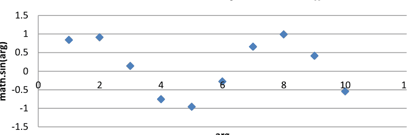

你可以从 `math.sin()` 返回的值中隐约地看到一种波浪模式。如果你计算出除整数之外的更多数字的正弦值（例如 `1.5` 和 `2.5` 等），然后用线连接这些点，你就能更容易看到这种波浪模式：

## math.sin() 返回的值

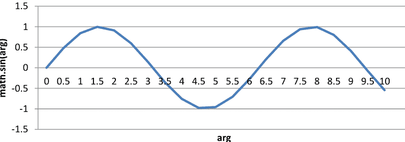

在这里，如果你继续向这个图表添加越来越多的数据点，你会发现正弦波看起来像这样：

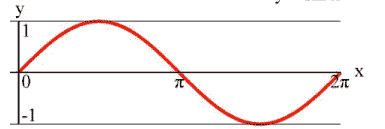

向作者发送邮件问题：`al@inventwithpython.com`

# 第 8 章 - 松鼠吃松鼠

注意 `math.sin(0)` 返回 0，然后逐渐增加，直到 `math.sin(3.14 / 2)` 返回 1，然后它开始减少，直到 `math.sin(3.14)` 返回 0。3.14 是数学中的一个特殊数字，叫做 pi（读音与美味的 'pie' 相同）。这个值也存储在 `math` 模块的常量变量 `pi` 中（这就是为什么第 333 行使用了变量 `math.pi`），它在技术上是 `float` 值 `3.141592653589793`。由于我们希望松鼠有一个波浪状的弹跳，我们将只关注 `math.sin()` 对参数 0 到 3.14 之间的返回值。

## math.sin() 返回的值

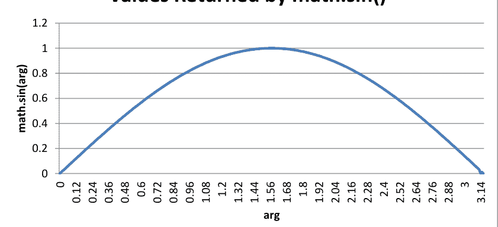

让我们来看一下 `getBounceAmount()` 的返回值，并找出它具体在做什么。

> 333. return int(math.sin(math.pi / float (bounceRate)) * currentBounce) * bounceHeight

记得第 21 行将 `BOUNCE` 常量设置为 6。这意味着我们的代码将把 `playerObj['bounce']` 从 0 增加到 6，我们希望将从 0 到 3.14 的浮点值范围分成 6 部分，我们可以通过简单的除法来实现：`3.14 / 6 = 0.5235`。图上“正弦波”长度为 3.14 的 6 个部分中的每一部分都等于 0.5235。

你可以看到，当 `playerObj['bounce']` 处于 3（0 和 6 之间的中间）时，传递给 `math.sin() / 6` 的值是 `math.pi / 3`，即 1.5707（0 和 3.1415 之间的中间）。然后 `math.sin(1.5707)` 将返回 1.0，这是正弦波最高的部分（而正弦波最高的部分位于波形的一半处）。

随着 `playerObj['bounce']` 的值增加，`getBounceAmount()` 返回的值与 0 到 3.14 之间的正弦波形状相同。如果你想让弹跳更高，增加 `BOUNCEHEIGHT`。如果你想让弹跳变慢，增加 `BOUNCERATE`。正弦函数是一个三角学概念。如果你想了解更多关于正弦的知识，Wikipedia 页面有详细信息：http://en.wikipedia.org/wiki/Sine

## Python2 的向下兼容

我们调用 `float()` 将 `bounceRate` 转换为浮点数的原因仅仅是因为程序将在 Python 2 中运行。在 Python 3 中，即使操作数都是整数，除法也会返回浮点值：

```python
>>> Python 3
>>> 10 / 5
2.0
>>> 10 / 4
2.5
```

然而在 Python 2 中，只有当一个操作数是浮点值时，除法才会返回浮点值。如果两个操作数都是整数，Python 2 的除法将返回整数（向下取整），例如：

```python
>>> Python 2
>>> 10 / 5
2
>>> 10 / 4
2
>>> 10 / 4.0
2.5
```

但如果我们始终使用 `float()` 函数将其中一个值转换为浮点值，那么无论运行哪个版本的 Python，除法都会返回浮点值。这种为了让代码在旧版本软件上运行的修改被称为向下兼容，因为并不是所有人都会运行最新版本的软件。否则，使用 Python 2 的人运行你的游戏时会收到错误信息并认为你的程序有 Bug。Python 2 和 3 之间的差异列表可以在 http://inventwithpython.com 查看。

## getRandomVelocity() 函数

```python
335. def getRandomVelocity():
336.     speed = random.randint(SQUIRRELMINSPEED, SQUIRRELMAXSPEED)
337.     if random.randint(0, 1) == 0:
338.         return speed
339.     else:
340.         return -speed
```

`getRandomVelocity()` 函数用于随机决定敌人松鼠的速度。设置了速度范围，除此之外，速度是负的（表示松鼠向左或向上）或正的（表示松鼠向右或向下）。松鼠为正或负的概率各一半。

## 寻找添加松鼠和草的位置

```python
343. def getRandomPos(camera, camay, objWidth, objHeight):
344.     # 创建摄像头视图
345.     cameraRect = pygame.Rect(camera, camay, WINWIDTH, WINHEIGHT)
346.     while True:
347.         x = random.randint(camera - WINWIDTH, camera + (2 * WINWIDTH))
348.         y = random.randint(camay - WINHEIGHT, camay + (2 * WINHEIGHT))
349.         # 使用随机坐标创建 Rect 对象并
350.         colliderect():
351.             # 确保右边缘不在摄像头视图
352.             objRect = pygame.Rect(x, y, objWidth, objHeight)
353.             if not objRect.colliderect(cameraRect):
354.                 return x, y
```

当游戏世界创建松鼠或草对象时，我们希望它位于活动范围内（这样它就不会是玩家松鼠），但在摄像头范围内（这样它就不会突然出现在屏幕上）。为了实现这一点，我们创建一个表示摄像头区域的 Rect（使用常量 `camerax`、`camay`、`WINWIDTH` 和 `WINHEIGHT`）。

接下来，我们随机生成活动范围内的 XY 坐标数字。活动区域的左边缘和顶部是 `camerax` 和 `camay` 左侧和上方 `WINWIDTH` 和 `WINHEIGHT` 像素。因此，活动区域的左边缘和顶部位于 `camerax - WINWIDTH` 和 `camay - WINHEIGHT`。活动区域的宽度和高度也是 `WINWIDTH` 和 `WINHEIGHT` 尺寸的三倍，正如图片所示（其中 `WINWIDTH` 设置为 640 像素，`WINHEIGHT` 设置为 480 像素）：

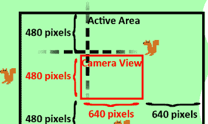

这意味着右边缘和底部将位于 `camerax + (2 * WINWIDTH)` 和 `camay + (2 * WINHEIGHT)`。第 352 行将检查随机 XY 坐标是否与摄像头视图碰撞。如果没有，则返回这些坐标。如果是，第 346 行的循环将继续生成新坐标。

## 创建松鼠数据结构

```python
356. def makeNewSquirrel(camerax, cameray):
357.     sq = {}
358.     generalSize = random.randint(5, 25)
359.     multiplier = random.randint(1, 3)
```


```
sq['width'] = (generalSize + random.randint(0, 10)) * multiplier

sq['height'] = (generalSize + random.randint(0, 10)) * multiplier

sq['x'], sq['y'] = getRandomOffsetCameraPos(camerax, cameray)

sq['move_x'] = getRandomVelocity()

sq['move_y'] = getRandomVelocity()
```

创建松鼠游戏对象与创建草游戏对象相似。每个松鼠的数据也存储在字典中。宽度和高度在第 360 行和 361 行设置为随机大小。`generalSize` 变量用于确保每个的宽度和高度

# 第 8 章 – 松鼠吃松鼠

松鼠之间并没有区别。否则，使用完全随机的数字作为宽度和高度可能会得到高而瘦的松鼠或非常矮宽的松鼠。松鼠的宽度和高度是这个基础尺寸，并加上一个 0 到 10 之间的随机数（以产生细微变化），然后乘以倍率变量。

松鼠的原始 XY 坐标位置将是一个相机看不见的随机位置，以防止松鼠直接在屏幕上“砰”地一下出现。

速度和方向也由 `getRandomVelocity()` 函数随机选择。

## 翻转松鼠图像

```
if sq['movex'] < 0: # 松鼠面向左
    sq['surface'] = pygame.transform.scale(SQUIR_IMG, (sq['width'],
    sq['height'])
else: # 松鼠面向右
    sq['surface'] = pygame.transform.scale(SQUIR_IMG, (sq['width'],
    sq['height'])
    sq['bounce'] = 0
    sq['bounceerate'] = random.randint(10, 18)
    sq['bounceheight'] = random.randint(10, 50)
    return sq
```

`L_SQUIR_IMG` 和 `R_SQUIR_IMG` 常量包含带有面向左和面向右松鼠图像的 `Surface` 对象。新的 `Surface` 对象将使用 `pygame.transform.scale()` 函数创建，分别匹配 `sq['width']` 和 `sq['height']` 中的松鼠宽度和高度。

之后，会随机生成三个与跳跃相关的数值（`sq['bounce']` 除 0，因为松鼠总是从跳跃开始，且在第 372 行返回字典）。

## 创建草地数据结构

```
def makeNewGrass(camerax, camay):
    gr = {}
    gr['grassImage'] = random.randint(0, len(GRASSIMAGES) - 1)
    gr['width'] = GRASSIMAGES[0].get_width()
    gr['height'] = GRASSIMAGES[0].get_height()
    gr['x'], gr['y'] = getRandomOffCameraPos(camerax, camay,
    gr['rect'] = pygame.Rect(gr['x'], gr['y'], gr['width'],
    gr['height'])
    return gr
```

草地游戏对象是字典，具有常用的 `'x'`、`'y'`、`'width'`、`'height'` 和 `'rect'` 键，还有一个 `'grassImage'` 键，其值是从 0 到小于 `GRASSIMAGES` 列表长度的数字。这个数字将决定草地游戏对象包含的内容。例如，如果草地对象的 `'grassImage'` 键值为 3，那么它将使用存储在 `GRASSIMAGES[3]` 中的 `Surface` 对象作为图像。

## 检查是否在活动区域

```
def isOutsideActiveArea(camax, cameray, obj):
    # 如果 camerax 和 cameray 超过窗口边缘
    # 半个宽度长度，则返回 False。
    boundsLeftEdge = camerax - WINWIDTH
    boundsTopEdge = cameray - WINHEIGHT
    boundsRect = pygame.Rect(boundsLeftEdge, boundsTopEdge, WINWIDTH * 3,
    WINHEIGHT * 3)
    objRect = pygame.Rect(obj['x'], obj['y'], obj['width'], obj['height'])
    return not boundsRect.colliderect(objRect)
```

如果对象位于由 `camerax` 和 `cameray` 参数决定的“活动区域”之外，`OutsideActiveArea()` 将返回 `True`。记住，活动区域是相机周围的一个区域，大小与相机视图相同（宽度和高度由 `WINWIDTH` 和 `WINHEIGHT` 设置），如下：

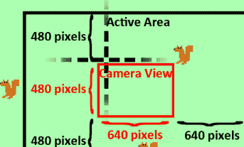

我们可以通过传递 `camerax - WINWIDTH` 作为左边缘、`cameray - WINHEIGHT` 作为顶边缘值，然后使用 `WINWIDTH * 3` 和 `WINHEIGHT * 3` 作为宽度和高度，创建一个表示活动区域的 `Rect`。一旦我们把活动区域表示为 `Rect`，我们就可以使用 `colliderect()` 来判断 `obj` 参数中的对象是否与（即属于）活动区域 `Rect` 对象碰撞。

向作者提问邮件：`al@inventwithpython.com`

由于玩家松鼠、敌人松鼠和草地对象都具有 `'x'`、`'y'`、`'width'` 和 `'height'` 键，`isOutsideActiveArea()` 代码可以处理任何类型的游戏对象。

```
if __name__ == '__main__':
    main()
```


最后，在定义所有函数后，程序将运行 `main()` 函数并开始游戏。

## 总结

《松鼠吃松鼠》是我们第一个有多个敌人同时移动的游戏。拥有多个敌人的关键是为每个松鼠使用具有相同键的字典，这样在游戏期间相同的代码就可以运行在每个松鼠上。

相机的概念也被引入了。活动区域是相机视图周围的一个区域，大小与相机视图相同（宽度和高度由 `WINWIDTH` 和 `WINHEIGHT` 设置），如下：


我们可以通过传递 `camerax - WINWIDTH` 作为左边缘、`cameray - WINHEIGHT` 作为顶边缘值，然后使用 `WINWIDTH * 3` 和 `WINHEIGHT * 3` 作为宽度和高度，创建一个表示活动区域的 `Rect`。一旦我们把活动区域表示为 `Rect`，我们就可以使用 `colliderect()` 来判断 `obj` 参数中的对象是否与（即属于）活动区域 `Rect` 对象碰撞。

数学函数的引入是为了让游戏更酷。在《松鼠吃松鼠》中，你只需要知道加、乘法。为了制作自己的游戏，你不需要复杂的数学。

### 基础关设计合理性检查

```python
```

35.

36.

37. `def main():`

    `global FPSLOCK, DISPLAYFACE, IMAGESDICT, TILEMAPPING, OUTSIDEDECOMAPPING, BASICFONT, PLAYERIMAGES, currentImage`

    # 初始化 Pygame 并设置全局变量的基础。
    `pygame.init()`
    `FPSLOCK = pygame.time.Clock()`

    # 因为存储在 DISPLAYFACE 中的 Surface 对象字典是从
    # pygame.display.set_mode() 函数返回的，所以当
    # 调用 pygame.display.update() 时，这就是绘制到实际
    # 屏幕上的 Surface 对象。
    `DISPLAYFACE = pygame.display.set_mode(WINWIDTH, WINHEIGHT)`

    `pygame.display.set_caption('Star Pusher')`
    `BASICFONT = pygame.font.Font('freesansbold.ttf', 18)`

    # 一个全局字典值，将包含所有由 pygame.image.load()
    # 返回的 Pygame Surface 对象。
    `IMAGESDICT = {`
        `'uncovered goal': pygame.image.load('RedSelector.png'),`
        `'covered': pygame.image.load('Selector.png'),`
        `'star': pygame.image.load('Star.png'),`
        `'corner': pygame.image.load('Wall Block Tall.png'),`
        `'wall': pygame.image.load('Wood Block Tall.png'),`
        `'inside floor': pygame.image.load('Plain Block.png'),`
        `'outside floor': pygame.image.load('Grass Block.png'),`
        `'title': pygame.image.load('star_solved.png'),`
        `'princess': pygame.image.load('princess.png'),`
        `'boy': pygame.image.load('boy.png'),`
        `'catgirl': pygame.image.load('catgirl.png'),`
        `'horngirl': pygame.image.load('horngirl.png'),`
        `'pinkgirl': pygame.image.load('pinkgirl.png'),`
        `'rock': pygame.image.load('Rock.png'),`
        `'short tree': pygame.image.load('Tree_Short.png'),`
        `'tree tall': pygame.image.load('Tree_Tall.png'),`
        `'ugly tree': pygame.image.load('Tree_Ugly.png')`
    `}`

    # 这些字典值是全局的，并将关卡文件中出现的字符
    # 映射到其代表的 Surface 对象。
    `TILEMAPPING = {`
        `'x': IMAGESDICT['corner'],`
        `'#': IMAGESDICT['wall'],`
        `'o': IMAGESDICT['inside floor'],`
        `'' : IMAGESDICT['outside floor']`
    `}`

    `OUTSIDEDECOMMAPPING = {`
        `'1': IMAGESDICT['rock'],`
        `'2': IMAGESDICT['short tree'],`
        `'3': IMAGESDICT['tall tree'],`
        `'4': IMAGESDICT['ugly tree']`
    `}`

    # PLAYERIMAGES 是玩家可能扮演的所有角色的列表。
    # currentImage 是玩家当前图像的索引。
    `currentImage = 0`
    `PLAYERIMAGES = [`
        `IMAGESDICT['princess'],`
        `IMAGESDICT['boy'],`
        `IMAGESDICT['catgirl'],`
        `IMAGESDICT['horngirl'],`
        `IMAGESDICT['pinkgirl']`
    `]`

    `screenSize() # 在用户按下按键前显示标题`
    # 从文本文件中读取关卡。详情参见 readLevelsFile()，
    # 关于关于该文件的格式以及如何创建你自己的关卡。
    `levels = readLevelsFile('starPusherLevels.txt')`
    `currentLevelIndex = 0`

    # 游戏循环。此循环运行单个关卡，当用户完成
    # 关卡时，将加载下一个/上一个关卡。
    `while True: # 主游戏循环`
        # 运行关卡以实际开始游戏：
        `result = runLevel(levels, currentLevelIndex)`

        `if result in ('solved', 'next'):`
            # 进入下一个关卡。
            `currentLevelIndex += 1`
            `if currentLevelIndex >= len(levels):`
                # 如果没有更多关卡了，回到第一个。
                `currentLevelIndex = 0`
        `elif result == 'back':`
            # 进入上一个关卡。
            `currentLevelIndex -= 1`
            `if currentLevelIndex < 0:`
                # 如果没有上一个关卡了，回到最后一个。
                `currentLevelIndex = len(levels)-1`
        `elif result == 'reset':`
            `pass # 什么都不做。调用 runLevel() 重置关卡`

`def runLevel(levels, levelNum):`
    `global currentImage`
    `levelObj = levels[levelNum]`
    `mapObj = decorateMap(levelObj['mapObj'])`
    `gameStateObj = copy.deepcopy(levelObj['startState'])`
    `needsRedraw = True # 设置为 True 以调用 drawMap()`
    `levelSurf = BASICFONT.render('Level %s of %s' % (levelObj['levelNum'] + 1, len(levels)), 1, TEXTCOLOR)`
    `levelRect = levelSurf.get_rect()`
    `levelRect.bottomleft = (20, WINHEIGHT - 35)`
    `width = len(mapObj) * TILEWIDTH`
    `height = (len(mapObj) - 1) * TILEHEIGHT`
    `MAX_CAM_X = abs(HALF_WIDTH - levelRect.x) - int(width / 2) + TILEWIDTH`
    `MAX_CAM_Y = abs(HALF_HEIGHT - levelRect.y) - int(height / 2) + TILEHEIGHT`
    `levelComplete = False`
    # 追踪摄像机的移动距离：
    `cameraOffsetX = 0`
    `cameraOffsetY = 0`
    # 跟踪按住移动摄像机的键：
    `cameraUp = False`
    `cameraDown = False`
    `cameraLeft = False`
    `cameraRight = False`

    `while True: # 游戏循环`
        # 重置这些变量：
        `playerMoveTo = None`
        `keyPressed = False`
        `for event in pygame.event.get(): # 事件处理`
            `if event.type == QUIT:`
                # 用户点击了窗口上的 "X"。
                `terminate()`
            `elif event.type == KEYDOWN:`
                # 处理按键
                `keyPressed = True`
                `if event.key == K_LEFT:`
                    `playerMoveTo = LEFT`
                `elif event.key == K_RIGHT:`
                    `playerMoveTo = RIGHT`
                `elif event.key == K_UP:`
                    `playerMoveTo = UP`
                `elif event.key == K_DOWN:`
                    `playerMoveTo = DOWN`
                # 设置摄像机模式。
                `elif event.key == K_a:`
                    `cameraLeft = True`
                `elif event.key == K_d:`
                    `cameraRight = True`
                `elif event.key == K_w:`
                    `cameraUp = True`
                `elif event.key == K_s:`
                    `cameraDown = True`
                `elif event.key == K_n:`
                    `return 'next'`
                `elif event.key == K_b:`
                    `return 'back'`
                `elif event.key == K_ESCAPE:`
                    `terminate() # Esc 键退出。`
                `elif event.key == K_BACKSPACE:`
                    `return 'reset' # 重置关卡。`
                `elif event.key == K_p:`
                    # 切换到下一个玩家图像。
                    `if currentImage >= len(PLAYERIMAGES):`
                        # 最后一个图像后使用第一个。
                        `currentImage = 0`
                    `currentImage += 1`
            `elif event.type == KEYUP:`
                # 取消摄像机模式。
                `elif event.key == K_a:`
                    `cameraLeft = False`
                `elif event.key == K_d:`
                    `cameraRight = False`
                `elif event.key == K_w:`
                    `cameraUp = False`
                `elif event.key == K_s:`
                    `cameraDown = False`

        `if playerMoveTo != None and levelIsComplete:`
            # 如果玩家按了移动键，执行移动
            # （如果可能）并推动任何可移动的星星。
            `moved = makeMove(mapObj, gameStateObj, playerMoveTo)`
            `if moved:`
                # 增加计数器。
                `gameStateObj['stepCounter'] += 1`
            `mapNeedsRedraw = True`

        `if isLevelFinished(levelObj, gameStateObj):`
            # 关卡已解决，我们应该显示“Solved!”图像。
            `levelComplete = True`
            `keyPressed = False`

        `DISPLAYFACE.fill(BGCOLOR)`

        `if mapNeedsRedraw:`
            `mapSurface = drawMap(mapObj, gameStateObj, levelObj['goals'])`
            `mapNeedsRedraw = False`

        `if cameraUp and cameraOffsetY < MAX_CAM_X:`
            `cameraOffsetY += CAM_MOVE_SPEED`
        `elif cameraDown and cameraOffsetY > -MAX_CAM_X:`
            `cameraOffsetY -= CAM_MOVE_SPEED`
        `if cameraLeft and cameraOffsetX < MAX_CAM_Y:`
            `cameraOffsetX += CAM_MOVE_SPEED`
        `elif cameraRight and cameraOffsetX > -MAX_CAM_Y:`
            `cameraOffsetX -= CAM_MOVE_SPEED`

        # 根据摄像机偏移调整地图的 Rect 对象。
        `mapSurfRect = mapSurface.get_rect()`
        `mapSurfRect.center = (HALF_WINWIDTH + cameraOffsetX, HALF_WINHEIGHT + cameraOffsetY)`
        # 将 mapSurf 绘制到 DISPLAYS Surface。
        `DISPLAYFACE.blit(mapSurface, mapSurfRect)`

        `DISPLAYFACE.blit(levelSurf, levelRect)`
        `step = BASICFONT.render('Steps: %s' % (gameStateObj['stepCounter']), 1, TEXTCOLOR)`
        `stepRect = step.get_rect()`
        `stepRect.bottomleft = (20, WINHEIGHT - 35)`
        `DISPLAYFACE.blit(step, stepRect)`

        `if levelComplete:`
            # 已解决，显示“Solved!”图像直到玩家
            # 按下按键。
            `solvedRect = IMAGESDICT['solved'].get_rect()`
            `solvedRect.center = (HALF_WINWIDTH, HALF_WINHEIGHT)`
            `DISPLAYFACE.blit(IMAGESDICT['solved'], solvedRect)`

        `if keyPressed:`
            `return 'solved'`

| 259. | `pygame.display.update() # 将显示绘制到屏幕。` |
| 260. | `FPSCLOCK.tick()` |
| 261. | | |
| 262. | | |
| 263. | | |
| 274. | `def decorateMap(mapObj, startxy):` |
| 275. | """给定的地图对象创建一个副本并对其进行修改。 |
| 276. | 这里我们执行以下操作： |
| 277. | * 将墙壁转换为角块。 |
| 278. | * 制作外部/内部的地板装饰。 |
| 279. | * 在外部地板上随机添加树/岩石装饰。 |
| 280. | | |
| 281. | 返回装饰后的地图对象。""" |
| 282. | | |
| 283. | `startx, startxy = startxy # 语法糖` |
| 284 | 285 | # 复制地图对象，以免修改传入的原始对象 |
| 286. | `mapObjCopy = copy.deepcopy(mapObj)` |
| 287. | | |
| 288. | # 从地图数据中移除非墙壁字符 |
| 289. | `for x in range(len(mapObjCopy)):` |
| 290. | `for y in range(len(mapObjCopy[0])):` |
| 291. | `if mapObjCopy[x][y] in ('', '.', '@', '+', ':'):` |
| 292. | `mapObjCopy[x][y] = ' '` |
| 293. | | |
| 294. | # 使用洪水填充确定内部/外部地板砖。 |
| 295. | `floodfill(mapObjCopy, startx, starty, ' ', '0')` |
| 296. | | |
| 297. | # 将相邻的墙壁转换为角块。 |
| 298. | `for x in range(len(mapObjCopy)):` |
| 299. | `for y in range(len(mapObjCopy[0])):` |
| 300. | | |
| 301. | `if mapObjCopy[x][y] == '#':` |
| 302. | `if isWall(mapObjCopy, x, y-1) and isWall(mapObjCopy, x+1, |`
| 303. | `isWall(mapObjCopy, x+1, y) and isWall(mapObjCopy, x, |`
| 304. | `isWall(mapObjCopy, x, y+1) and isWall(mapObjCopy, x-1, |`
| 305. | `isWall(mapObjCopy, x-1, y) and isWall(mapObjCopy, x, |`
| 306. | `mapObjCopy[x][y] = ' '` |
| 307. | | |
| 308. | `elif mapObjCopy[x][y] == ' ' and random.randint(0, 99) < |`
| 309 | `OUTSIDE_DECORATION_PCT:` |
| 309. | `mapObjCopy[x][y] =` |
| 310. | `random.choice(list(OUTSIDDECOMAPPING.keys()))` |
| 311. | |
| 312. | `return mapObjCopy` |
| 313. | |
| 314. | `def isBlocked(mapObj, gameStateObj, x, y):` |
| 315. | """如果 (x, y) 位置在地图上且 |
| 316. | 被墙壁阻挡或其他阻挡，则返回 True，否则返回 False.""" |
| 317. | |
| 318. | `if isWall(mapObj, x, y):` |
| 319. | `return True` |
| 320. | |
| 321. | `elif x < 0 or x >= len(mapObj) or y < 0 or y >= len(mapObj[x]):` |
| 322. | `return True # x 和 y 不在地图上` |
| 323. | |
| 324. | `elif (x, y) in gameStateObj['stars']:` |
| 325. | `return True # 星星挡住了` |
| 326. | |
| 327. | `return False` |
| 328. | |
| 329. | `def makeMove(mapObj, gameStateObj, playerMoveTo):` |
| 330. | """给定地图和游戏状态对象，查看玩家是否可以 |
| 331. | 移动。如果是，则更改玩家的位置（以及被推星星的位置）。如果不是，什么都不做。 |
| 332. | 如果玩家移动了返回 True，否则返回 False.""" |
| 333. | |
| 334. | # 确保玩家可以在想要的方向移动。 |
| 335. | `playerx, playery = gameStateObj['player']` |
| 336. | # 这个变量是“语法糖”。在代码中写 "stars" 比写 "gameStateObj['stars']" 更具可读性。 |
| 337. | `stars = gameStateObj['stars']` |
| 338. | # 处理每个方向的代码类似于在 x/y 坐标上加减 1。我们可以 |
| 339. | 通过 xOffset 和 yOffset 变量来简化它。 |
| 340. | `if playerMoveTo == UP:` |
| 341. | `xOffset = 0` |
| 342. | `yOffset = -1` |
| 343. | `elif playerMoveTo == RIGHT:` |
| 344. | `xOffset = 1` |
| 345. | `yOffset = 0` |
| 346. | `elif playerMoveTo == DOWN:` |
| 347. | `xOffset = 0` |
| 348. | `yOffset = 1` |
| 349. | `elif playerMoveTo == LEFT:` |
| 350. | `xOffset = -1` |
| 351. | |
| 352. | `yOffset = 0` |
| 353. | # 查看玩家是否可以在该方向移动。 |
| 354. | `if isWall(mapObj, playerx + xOffset, playery + yOffset):` |
| 355. | `return False` |
| 356. | `else:` |
| 357. | `if (playerx + xOffset, playery + yOffset) in stars:` |
| 358. | # 有星星挡路，查看玩家是否可以推它。 |
| 359. | `if not isBlocked(mapObj, gameStateObj, playerx + (xOffset*2),` |
| 360. | `playery + (yOffset*2)):` |
| 361. | # 移动星星。 |
| 362. | `ind = stars.index((playerx + xOffset, playery + yOffset))` |
| 363. | `stars[ind] = (stars[ind][0] + xOffset, stars[ind][1] + yOffset)` |
| 364. | `else:` |
| 365. | `return False` |
| 366. | # 向上移动玩家。 |
| 367. | `gameStateObj['player'] = (playerx + xOffset, playery + yOffset)` |
| 368. | `return True` |
| 369. | |
| 370. | `def startScreen():` |
| 371. | """显示启动界面（包含标题和说明），直到玩家按下按键。返回 None.""" |
| 372. | |
| 373. | # 标题的位置。 |
| 374. | `titleRect = IMAGESDICT['title'].get_rect()` |
| 375. | `topCoord = 50 # top 跟踪文本头部的位置` |
| 376. | `titleRect.top = topCoord` |
| 377. | `titleRect.centerX = HALF_WINWIDTH` |
| 378. | `topCoord += titleRect.height` |
| 379. | |
| 380. | # 遗憾的是，Pygame 的字体和文本一次只显示一行， |
| 381. | # 所以不能使用包含 \n 字符的字符串。 |
| 382. | # 因此我们将使用列表来存储其中的每一行。 |
| 383. | `instructionText = ['将星星推到标记处。',` |
| 384. | `'方向键移动，WHSD 控制相机，P 切换',` |
| 385. | `'角色。', '退格格键重置关卡，Esc 退出，',` |
| 386. | `'N 进入下一关卡，B 回到上一关卡。']` |
| 387. | # 从向整个窗口绘制空白颜色开始： |
| 388. | `DISPLAYS.fill(BGCOLOR)` |
| 389. | |
| 390. | # 将标题图像绘制到窗口： |
| 391. | `DISPLAYS.blit(IMAGESDICT['title'], titleRect)` |
| 392. | |
| 393. | # 并绘制文本。 |
| 394. | `for i in range(len(instructionText)):` |
| 395. | `instSurff = BASICFONT.render(instructionText[i], 1, TEXTCOLOR)` |
| 396. | `instRect = instSurff.get_rect()` |
| 397. | `topCoord += 10 # 像素将用于每一行文本` |
| 398. | `instRect.top = topCoord` |
| 399. | `instRect.center = HALF_WINWIDTH` |
| 400. | # 调整文本的高度。 |
| 401. | `DISPLAYS.blit(instSurff, instRect)` |
| 402. | `while True: # 启动界面的主循环。` |
| 403. | `for event in pygame.event.get():` |
| 404. | `if event.type == QUIT:` |
| 405. | `terminate()` |
| 406. | `elif event.type == KEYDOWN:` |
| 407. | `if event.key == K_ESCAPE:` |
| 408. | `terminate()` |
| 409. | # 玩家按了键，所以返回。 |
| 410. | `return` |
| 411. | `def readLevels(filename):` |
| 412. | `assert os.path.exists(filename), '找不到文件: %s' % (filename)` |
| 413. | `mapfile = open(filename, 'r')` |
| 414. | `content = mapfile.readlines() + ['n']` |
| 415. | `mapfile.close()` |
| 416. | `levels = [] 关卡对象的列表。` |
| 417. | `levelNum = 0` |
| 418. | `mapTextLines = [] 来自文本文件的地图行。` |
| 419. | `for lineNum in range(len(content)):` |
| 420. | `line = content[lineNum].strip('\n')` |
| 421. | `if ';' in line: # 忽略文件中的注释` |
| 422. | `line = line[:line.find(';')]` |
| 423. | `if line != '': # 这行是地图的一部分。` |
| 424. | `mapTextLines.append(line)` |
| 425. | `elif line == '' and len(mapTextLines) > 0: # 空行表示关卡的结束。` |
| 426. | # 将 mapTextLines 转换为地图对象。 |
| 427. | # 找到地图中最长的行。 |
| 428. | `maxWidth = -1` |
| 429. | `for i in range(len(mapTextLines)):` |
| 430. | `if len(mapTextLines[i]) > maxWidth:` |
| 431. | `maxWidth = len(mapTextLines[i])` |
| 432. | # 在较短行的末尾添加空格。确保地图是矩形的。 |
| 433. | `for i in range(len(mapTextLines)):` |
| 434. | `mapTextLines[i] += ' ' * (maxWidth - len(mapTextLines[i]))` |
| 435. | # 将 mapTextLines 转换为地图对象。 |
| 436. | `mapObj = []` |
| 437. | `for x in range(len(mapTextLines[0])):` |
| 438. | `mapObj[x].append([])` |
| 439. | `for y in range(len(mapTextLines)):` |
| 440. | `for x in range(maxWidth):` |
| 441. | `mapObj[x].append(mapTextLines[y][x])` |
| 442. | # 遍历地图中的空格并找到 @ 和 $ 字符 = 玩家起始位置的 x 和 y。 |
| 443. | `startX = None` |
| 444. | `start = None` |
| 445. | `goals = [] 每个目标的 (x, y) 元组组列表。` |
| 446. | `stars = [] 每个星星的起始位置的 (x, y) 列表。` |
| 447. | `for x in range(len(mapObj[x])):` |
| 448. | `if mapObj[x][y] in ('@', '$'):` |
| 449. | # '@' 是玩家，'$' 是玩家和目标。 |
| 450. | `startX = x` |
| 451. | `start = y` |
| 452. | `if mapObj[x][y] in ('.', '*'):` |
| 453. | # '.' 是目标，'$' 是星星和目标。 |
| 454. | `goals.append((x, y))` |
| 455. | `if mapObj[x][y] in ('$', '*'):` |
| 456. | # '$' 是星星。 |
| 457. | `stars.append((x, y))` |
| 458. | `levels.append({'map': mapObj, 'startX': startX, 'start': start, 'goals': goals, 'stars': stars})` |
| 459. | `levelNum += 1` |
| 460. | `mapObj = []` |
| 461. | `mapTextLines = []` |
| 462. | `return levels` |


488. `assert startx != None and starty != None, 'Level %s (around line %s) in %s is missing "@" or "+" to mark the start point. % (levelNum+1, lineNum, filename)'`

```python
490. assert len(goals) > 0, 'Level %s (around line %s) in %s must have at least one goal. % (levelNum+1, lineNum, filename)'
```

```python
491. assert len(stars) >= len(goals), 'Level %s (around line %s) in s is impossible to solve. It has goals but only stars. % (levelNum+1, lineNum, filename, len(stars))'
```

```python
492. # 创建关卡对象和初始游戏状态对象。
gameStateObj = {'player': (startx, starty),
  'stepCounter': 0,
  'stars': stars}
levelObj = {'width': maxWidth,
  'height': len(mapObj),
  'mapObj': mapObj,
  'goals': goals,
  'startState': gameStateObj}
```

```python
503. levels.append(levelObj)
```

```python
505. # 重置变量用于下一张地图。
mapTextlines = []
mapStateObj = {}
levelNum += 1
return levels
```

```python
513. def floodFill(mapObj, x, y, oldCharacter, newCharacter):
  """将 map 对象上匹配 oldCharacter 的值更改为 (x, y) 位置的 newCharacter，并递归地对 (x, y) 的左、右、下、上位置执行相同的操作。"""
```

```python
519. # 在这个游戏中，洪水填充算法创建了内部/外部
### 地板分布。这是一个“递归”函数。
### 关于洪水填充算法的更多信息，请参阅：
### http://en.wikipedia.org/wiki/Flood_fill
```

```python
522. if mapObj[x][y] == oldCharacter:
  mapObj[x][y] = newCharacter
```

```python
525. if x < len(mapObj) - 1 and mapObj[x+1][y] == oldCharacter:
  floodFill(mapObj, x+1, oldCharacter, newCharacter) # 向右
if x > 0 and mapObj[x-1][y] == oldCharacter:
  floodFill(mapObj, x-1, y, newCharacter) # 向左
if y < len(mapObj[x]) - 1 and mapObj[x][y+1] == oldCharacter:
    floodFill(mapObj, x, y+1, newCharacter) # 向下
    if y > 0 and mapObj[x][y-1] == oldCharacter:
        floodFill(mapObj, x, y-1, newCharacter) # 向上
```

```python
def drawMap(mapObj, gameStateObj, goals):
    """将地图绘制到 Surface 上，包括玩家和 星星。此函数没有调用 pygame.display.update()，或者 没有在角上绘制“Level”和“Steps”文本。”"
```

```python
    # mapSurface 将是绘制瓦块的 Surface 对象， # 这样就可以将整个地图放置在 DISPLAYS # Surface 对象上。必须计算宽度和高度。
    mapSurfaceWidth = len(mapObj) * TILEWIDTH
    mapSurfaceHeight = len(mapObj[0]) * (TILEHEIGHT + TILEHEIGHT)
```

```python
    mapSurface = pygame.Surface((mapSurfaceWidth, mapSurfaceHeight))
    mapSurface.fill(BGCOLOR) # 在表面上从空白颜色开始。
    # 将瓦块绘制到表面上：
    for x in range(len(mapObj)):
        for y in range(len(mapObj[x])):
            rect = pygame.Rect(x * TILEWIDTH, y * TILEHEIGHT, TILEWIDTH, TILEHEIGHT)
```

```python
    if mapObj[x][y] in TILEMAP:
        baseTile = TILEMAP[mapObj[x][y]]
    elif mapObj[x][y] in OUTSIDEDECOMPAPPING:
        baseTile = TILEMAP[' ']
    # 绘制第一个地面/墙壁瓦块。
    mapSurface.blit(baseTile, rect)
```

```python
    if mapObj[x][y] in OUTSIDEDECOMPAPPING:
        # 绘制此瓦块上的任何树/岩装饰。
        mapSurface.blit(OUTSIDEDECOMPAPPING[mapObj[x][y]], rect)
    elif (x, y) in gameStateObj['stars']:
        # 此空间既有目标又有星星，先绘制目标。
        mapSurface.blit(IMAGESDICT['covered goal'], rect)
        # 绘制星星精灵。
        mapSurface.blit(IMAGESDICT['star'], rect)
    elif (x, y) in goals:
        # 绘制没有星星的目标。
        mapSurface.blit(IMAGESDICT['covered goal'], rect)
```

## 初始化设置

Star Pusher (一个推箱子克隆版)

```python
import random, copy, os, pygame
from pygame.locals import *

FPS = 30 # 每秒更新屏幕的帧数
WINWIDTH = 800 # 程序窗口的宽度，像素单位
WINHEIGHT = 600 # 高度，像素单位
HALF_WIDTH = int(WINWIDTH / 2)
HALF_HEIGHT = int(WINHEIGHT / 2)
### 每个瓦块的像素总宽度和高度
TILEWIDTH = 50
TILEHEIGHT = 85
CAM_MOVE_SPEED = 5 # 相机每帧移动的像素数
### 具有额外装饰（如树或岩石）的室外瓦块百分比
OUTSIDE_DECORATION_PCT = 0.2
BRIGHTBLUE = (0, 170, 255)
WHITE = (255, 255, 255)
BCOLOR = BRIGHTBLUE
TEXTCOLOR = WHITE
UP = 'up'
DOWN = 'down'
LEFT = 'left'
RIGHT = 'right'
```

这些常量用于程序的各个部分。`TILEWIDTH` 和 `TILEHEIGHT` 变量显示每个瓦块图像的宽度为50像素，高度为85像素。然而，当在屏幕上绘制时，瓦块会重叠（稍后会解释）。`TILEHEIGHT` 指瓦块的一部分代表了45像素的高度。这里是平地板的示意图：

房间外的地板将添加额外的装饰（如树或岩石）。`OUTSIDE_DECORATION_PCT` 常数显示了这些百分比的瓦块会随机带有这些装饰。

```python
def main():
    global FPSCLOCK, DISPLAYS, IMAGESDICT, TILEMAPPING, OUTSIDEDECOMPAPPING, BASICCONFIG, PLAYERIMAGES
    # Pygame 初始化和全局变量设置
    pygame.init()
    FPSCLOCK = pygame.time.Clock()
    # 因为存储在 DISPLAYS 中的 Surface 对象来自 pygame.display.set_mode()
    # 这是调用 pygame.display.update() 时绘制到实际计算机的 Surface 对象
    DISPLAYS = pygame.display.set_mode((WINWIDTH, WINHEIGHT))
    pygame.display.set_caption('Star Pusher')
    BASICFONT = pygame.font.Font('freesansbold.ttf', 18)
    # 这是程序开始时进行的 Pygame 设置：
    # 一个包含所有由 pygame.image.load() 返回的 Pygame Surface 对象的全局字典
    IMAGESDICT = {
        'covered goal': pygame.image.load('Selector.png'),
        'core goal': pygame.image.load('Selector.png'),
        'star': pygame.image.load('Star.png'),
        'corner': pygame.image.load('Wall Block.png'),
        'wall': pygame.image.load('Wood Block Tall.png'),
        'inside floor': pygame.image.load('Plain Block.png'),
        'outside floor': pygame.image.load('Grass Block.png'),
        'title': pygame.image.load('star_title.png'),
        'solved': pygame.image.load('star_solved.png'),
        'princess': pygame.image.load('princess.png'),
        'boy': pygame.image.load('boy.png'),
        'catgirl': pygame.image.load('catgirl.png'),
        'horngirl': pygame.image.load('horngirl.png'),
        'pinkgirl': pygame.image.load('pinkgirl.png'),
        'rock': pygame.image.load('Rock.png'),
        'short tree': pygame.image.load('Tree_Short.png'),
        'tall tree': pygame.image.load('Tree_Tall.png'),
        'ugly tree': pygame.image.load('Tree_Ugly.png')
    }
```

`IMAGES_DICT` 是一个存储所有加载图像的字典。这使得在其他函数中使用变得容易，因为只需要将 `IMAGEDICT` 变量设为全局。如果我们将这些图像存储在独立的变量中，那么所有的 18 个变量（游戏中的 18 张图像）都将是全局的。一个包含所有图像 Surface 对象的字典更容易处理。

```python
### 这些字典值是全局的，并将关卡文件中出现的字符 映射到它们代表的 Surface 对象。
TILEMAPPING = {
    'x': IMAGESDICT['corner'],
    '#*': IMAGESDICT['wall'],
    'o': IMAGESDICT['inside floor'],
    ' ': IMAGESDICT['outside floor']
}
```

## 第 9 章 章 星推者 259

地图的数据结构只是一个单字符字符串的二维列表。`TILEmapping` 字典将此地图数据结构中使用的字符与它们所代表的图像链接起来。（这在 `drawMap()` 函数的解释中会变得清晰。）

```python
80. OUTSIDEDECOMPAPPING = {'1': IMAGESDICT['rock'],
81.     '2': IMAGESDICT['short tree'],
82.     '3': IMAGESDICT['tall tree'],
83.     '4': IMAGESDICT['ugly tree']}
```

`OUTSIDEDECOMPAPPING` 也是一个字典，它将加载的地图数据结构中使用的字符链接起来。“外部装饰”图像被绘制在户外草地砖之上。

```python
85. # PLAYERIMAGES 是玩家可能变成的所有字符的列表。
86. # currentImage 是玩家当前图像的索引。
87. currentImage = 0
88. PLAYERIMAGES = [IMAGESDICT['princess'],
89.     IMAGESDICT['boy'],
90.     IMAGESDICT['catgirl'],
91.     IMAGESDICT['horngirl'],
92.     IMAGESDICT['pinkgirl']]
```

`PLAYERIMAGES` 存储了用于玩家的图像。`currentImage` 变量跟踪当前选择玩家的索引。例如，当 `currentImage` 设置为 0 时，`PLAYERIMAGES[0]`（即“公主”图像）会被绘制到屏幕上。

```python
94. startScreen() # 显示标题界面直到用户按下按键
95.
96. # 从文本文件中读取关卡。参见 readLevelsFile()
97. # 关于该文件格式以及如何创建你自己的关卡的细节。
98. levels = readLevelsFile('startPusherLevels.txt')
99. currentLevel = 0
```

`startScreen()` 函数将一直显示初始启动界面（包含游戏说明），直到玩家按下键。当玩家按下按键时，`startScreen()` 函数返回并从关卡文件中读取关卡。玩家从第一关开始，即 `levels` 列表中索引为 0 的关卡对象。

```python
101. # 主游戏循环。此循环运行单个关卡，当用户
102. # 完成该关卡时，加载下一个/上一个关卡。
103. while True: # 主游戏循环
104.
```


## 运行关卡以实际开始游戏：

| 105. | `result = runLevel(levels, currentLevelIndex)` |

`runLevel()` 函数处理游戏的所有动作。它接收关卡对象列表以及列表中要运行的关卡的整数索引。当玩家完成关卡游戏后，`runLevel()` 将返回以下字符串之一：`'solved'`（因为玩家已完成将所有星星放入目标位置）、`'next'`（因为玩家想跳到下一关卡）、`'back'`（因为玩家想回到上一个关卡）和 `'reset'`（因为玩家想重新开始当前关卡，可能是因为他们把星星推进了角落）。

| 107. | `if result in ('solved', 'next'):` |
| 108. | # 进入下一关卡。 |
| 109. | `currentLevelIndex += 1` |
| 110. | `if currentLevelIndex >= len(levels):` |
| 111. | # 如果没有更多关卡了，回到第一关。 |
| 112. | `currentLevelIndex = 0` |
| 113. | `elif result == 'back':` |
| 114. | # 进入上一个关卡。 |
| 115. | `currentLevelIndex -= 1` |
| 116. | `if currentLevelIndex < 0:` |
| 117. | # 如果没有上一个关卡了，回到最后一关。 |
| 118. | `currentLevelIndex = len(levels)-1` |

当 `runLevel()` 返回字符串 `'solved'` 或 `'next'` 时，我们需要将 `levelNum` 加 1。如果这导致 `levelNum` 超过了关卡总总数，则将 `levelNum` 重置为 0。

如果返回 `'back'`，则执行相反操作，`levelNum` 减 1。如果这使得它低于 0，则将其设置为最后一关（即 `len(levels)-1`）。

| 119. | `elif result == 'reset':` |
| 120. | `pass` |

`runLevel()` 返回了字符串 `'solved'` 或 `'next'`，那么我们需要将 `levelNum` 加 1。如果这导致 `levelNum` 超过了关卡总数，则将 `levelNum` 重置为 0。

如果返回 `'back'`，执行相反操作，`levelNum` 减 1。如果这使得它低于 0，则将其设置为最后一关（即 `len(levels)-1`）。

如果结果为 `'reset'`，`pass` 语句什么都不做。调用 `runLevel()` 函数来重置关卡。

## 第 9 章 章 星推者 261

```python
123. def runLevel(levels, levelNum):
124.     global currentImage
125.     levelObj = levels[levelNum]
126.     gameState = levelObj['state']
127.     mapObj = levelObj['map']
128.     mapNeedsRedraw = True
```

地图的数据结构只是一个单字符字符串的二维列表。`TILEmapping` 字典将此地图数据结构中使用的字符与它们所代表的图像链接起来。（这在 `drawMap()` 函数的解释中会变得清晰。）

星推者中的角色将在地图上独立地移动。这就是为什么相机需要它自己的“移动”变量：`cameraUp`、`cameraDown`、`cameraLeft` 和 `cameraRight`。`cameraOffsetX` 和 `cameraOffsetY` 变量跟踪相机的位置。

向作者发送邮件问题：`al@inventwithpython.com`

# 第 9 章 – 星星推进者 263

| 165. | `playerMoveTo = UP` |
| 166. | `elif event.key == K_DOWN:` |
| 167. | `playerMoveTo = DOWN` |
| 168. | |
| 169. | # 设置摄像移动模式。 |
| 170. | `elif event.key == K_a:` |
| 171. | `cameraLeft = True` |
| 172. | `elif event.key == K_d:` |
| 173. | `cameraRight = True` |
| 174. | `elif event.key == K_w:` |
| 175. | `cameraUp = True` |
| 176. | `elif event.key == K_s:` |
| 177. | `cameraDown = True` |
| 178. | |
| 179. | `elif event.key == K_n:` |
| 180. | `return 'next'` |
| 181. | `elif event.key == K_b:` |
| 182. | `return 'back'` |
| 183. | |
| 184. | `elif event.key == K_ESCAPE:` |
| 185. | `terminate() # Esc 键退出。` |
| 186. | `elif event.key == K_BACKSPACE:` |
| 187. | `return 'reset' # 重置关卡。` |
| 188. | `elif event.key == K_p:` |
| 189. | # 将玩家图像切换为下一张。 |
| 190. | `currentImage += 1` |
| 191. | `if currentImage >= len(PLAYERIMAGES):` |
| 192. | # 在最后一张图像后，使用第一张。 |
| 193. | `currentImage = 0` |
| 194. | `mapNeedsRedraw = True` |
| 195. | |
| 196. | `elif event.type == KEYUP:` |
| 197. | # 取消摄像移动模式。 |
| 198. | `if event.key == K_a:` |
| 199. | `cameraLeft = False` |
| 200. | `elif event.key == K_d:` |
| 201. | `cameraRight = False` |
| 202. | `elif event.key == K_w:` |
| 203. | `cameraUp = False` |
| 204. | `elif event.key == K_s:` |
| 205. | `cameraDown = False` |

这段代码处理了按下各种键时的逻辑。

| 207. | `if playerMoveTo != None and not levelComplete:` |
| 208. | # 如果玩家按了移动键，则执行移动 |
| 209. | # (如果可行）并推动任何可推动的星星。 |
| 210. | `moved = makeMove(mapObj, gameStateObj, playerMoveTo)` |
| 211. | |
| 212. | `if moved:` |
| 213. | # 增加步骤计数器。 |
| 214. | `gameStateObj['stepCounter'] += 1` |
| 215. | `mapNeedsRedraw = True` |
| 216. | |
| 217. | `if isLevelFinished(levelObj, gameStateObj):` |
| 218. | # 关卡已通过，我们应该显示“Solved!”图像。 |
| 219. | `levelIsComplete = True` |
| 220. | `keyPressed = False` |

如果 `playerMoveTo` 变量未被设置为 `None`，我们就知道玩家想要移动。调用 `makeMove()` 处理 `gameStateObj` 中玩家位置的 XY 坐标，以及推动任何星星。`makeMove()` 的返回值存储在 `moved` 中。如果该值为 `True`，则玩家角色已在该方向移动。如果值为 `False`，则玩家可能尝试进入已占据的格子，或者推一个后面有障碍物的星星。在这种情况下，玩家无法移动，且上没有任何变化。

| 221. | `pygame.fill(BGCOLOR)` |
| 222. | |
| 223. | `if mapNeedsRedraw:` |
| 224. | `mapSurface = drawMap(mapObj, gameStateObj, levelObj['goals'])` |
| 225. | `mapNeedsRedraw = False` |

地图不需要在游戏循环的每次迭代中重绘。事实上，该程序很复杂，这样做会导致轻微（但可见）的缓慢。当发生变化（例如玩家移动或星星被推动）时，地图才需要重绘。当 `mapNeedsRedraw` 变量设置为 `True` 时，通过调用 `drawMap()` 更新 `mapSurface` 变量中的对象。在第 225 行绘制地图后，`mapNeedsRedraw` 变量被设置为 `False`。如果你想通过在每次迭代中都绘图来观察程序的流程，可以注释掉第 226 行并重新运行程序。你会发现移动摄像会慢得多。

| 228. | `if cameraUp and cameraOffsetY < MAX_CAM_PAN:` |
| 229. | `cameraOffsetY += CAM_MOVE_SPEED` |
| 230. | `elif cameraDown and cameraOffsetY > -MAX_CAM_PAN:` |
| 231. | `cameraOffsetY -= CAM_MOVE_SPEED` |
| 232. | `if cameraLeft < MAX_CAM_Y_PAN:` |
| 233. | `cameraOffsetX += CAM_MOVE_SPEED` |
| 234. | `elif cameraRight and cameraOffsetX > -MAX_CAM_PAN:` |
| 235. | `cameraOffsetX -= CAM_MOVE_SPEED` |

如果移动变量设置为 `True` 且摄像没有超出 `MAX_CAM_PAN` 和 `MAX_CAM_Y_PAN` 边界，则摄像位置（存储在 `cameraOffsetX` 和 `cameraOffsetY` 中）应该移动 `CAM_MOVE_SPEED` 像素。注意第 228 和 230 行用于上下移动摄像的 `if` 和 `elif` 语句，而第 232 和 234 行是独立的 `if` 和 `elif` 语句。这使用户可以同时水平和垂直方向移动摄像。如果第 232 行是 `elif` 语句，将无法实现。

```python
## 根据摄像偏移调整 mapSurf 的 Rect。
mapSurf = mapSurf.get_rect()
mapRect.center = (HALF_WIDTH + cameraOffsetX, HALF_HEIGHT + cameraOffsetY)
## 将 mapSurf 绘制到表面上。
pygame.blit(mapSurf, mapRect)
pygame.blit(levelSurf, levelRect)
stepSurf = pygame.render('Steps: %s' % (gameStateObj['stepCounter']), 1, TEXTCOLOR)
stepRect = stepSurf.get_rect()
stepRect.bottomleft = (20, HEIGHT - 10)
pygame.blit(stepSurf, stepRect)
if levelIsComplete:
    # 关卡已解决，直到玩家操作显示“Solved!”图像
solvedRect = IMAGES['solved'].get_rect()
solvedRect.center = (HALF_WIDTH, HALF_HEIGHT)
pygame.blit(IMAGES['solved'], solvedRect)
if keyPressed:
    return 'solved'
pygame.display.update() # 将表面绘制到屏幕。
pygame.tick()
```

第 237 到 261 行定位摄像并将地图和其他图形绘制到 pygame 的显示 Surface 对象中。如果关卡已通过，胜利图像也将绘制在所有内容之上。如果用户在此迭代期间按下按键，`keyPressed` 变量将设置为 `True`，这指向 `runLevel()` 函数。

```python
def isWall(mapObj, x, y):
    """如果地图上的 (x, y) 位置是墙，返回 True，否则返回 False."""
    if x < 0 or x > len(mapObj) or y < 0 or y >= len(mapObj[x]):
        return False # x 和 y 实际上在地图之外。
    elif mapObj[x][y] in (' ', '#'):
        return True # 墙阻塞
    return False
```

```python
def decorateMap(mapObj, startxy):
    """复制并修改地图对象。
    处理方法如下：
    * 将墙转变为角块。
    * 区分外部和内部地板。
    * 在外部瓦上随机添加树木/岩石装饰。
    返回装饰后的地图对象。"""
    startx, starty = startxy # 语法糖
    # 复制地图以防修改原始对象
    mapCopy = copy.deepcopy(mapObj)
```

268 http://inventwithpython.com/pygame

| 317. | |
| 318. | `if isWall(mapObj, x, y):` |
| 319. | `return True` |
| 320. | |
| 321. | `elif x < 0 or x >= len(mapObj) or y < 0 or y >= len(mapObj[x]):` |
| 322. | `return True # x 和 y 实际上并不在地图上` |
| 323. | |
| 324. | `elif (x, y) in gameStateObj['stars']:` |
| 325. | `return True # 有星星阻挡了` |
| 326. | |
| 327. | `return False` |

地图上有空间被阻挡的三种情况：如果那里有星星，或者该空间的坐标位于地图边缘。`isBlocked()` 会检查这些情况，如果 XY 坐标有效则返回 True，否则返回 False。

```python
def makeMove(mapObj, gameStateObj, playerMoveTo):
    """移动并更新游戏状态对象，检查玩家是否可以执行
    指定的移动。如果是，则改变玩家的
    位置（以及任何被推星星的位置）。如果不是，则什么都不做。
    """
    如果玩家移动了则返回 True，否则返回 False。
    # 确保玩家可以向想要的方向移动。
    player, layer = gameStateObj['player']
    # 这个变量是“语法糖”。在你的代码中输入 "stars"
    stars = gameStateObj['stars'] in
    # 处理每个方向的代码非常相似，
    # 仅在 x/y 坐标上加或减 1。我们可以
    # 使用 xOffset 和 yOffset 变量来简化 playerMoveTo。
    if playerMoveTo == UP:
        xOffset = 0
        yOffset = -1
    elif playerMoveTo == RIGHT:
        xOffset = 1
        yOffset = 0
    elif playerMoveTo == DOWN:
        xOffset = 0
        yOffset = 1
    elif playerMoveTo == LEFT:
        xOffset = -1
        yOffset = 0
```


向作者提问：`al@inventwithpython.com`

# 第9章 – 推推者 269

| 359. | # 查看玩家是否可以向该方向移动。 |
| 360. | if isWall(mapObj, playerx, xOffset, playery, yOffset): |
| 361. | return False |
| 362. | |
| 363. | else: |
| 364. | if (playerx + xOffset, playery + yOffset) in stars: |
| 365. | # 有星星在路上，如果玩家可以推它。 |
| 366. | if not isBlocked(mapObj, gameStateObj, playerx + (xOffset*2), |
| playery + (yOffset*2)): |
| 367. | # 移动星星。 |
| 368. | ind = stars.index((playerx + xOffset, playery + yOffset)) |
| 369. | stars[ind] = (stars[ind][0] + xOffset, stars[ind][1] + |
| yOffset) |
| 370. | else: |
| 371. | return False |
| 372. | # 将玩家向上移动。 |
| 373. | gameStateObj['player'] = (playerx + xOffset, playery + yOffset) |
| 374. | return True |

`makeMove()` 函数检查向目标方向移动是否有效。如果没有墙阻挡路径，或者后面有墙或星星，玩家将能够该方向移动。`gameStateObj` 变量将更新，并向函数调用者返回 `True` 表示玩家已移动。

如果玩家想要的位置有星星，该星星的位置也会改变，此信息会在 `gameStateObj` 变量中更新。这就是“推星星”的实现方式。如果玩家无法向目标方向移动，则不修改 `gameStateObj` 函数返回 `False`。

```python
## 放置标题图像。

titleRect = IMAGESDICT['title'].get_rect()

topCoord = 50 # topCoord 跟踪标题的位置

titleRect.top = topCoord

titleRect.centerX = HALF_WINWIDTH

topCoord += titleRect.height

## 遗憾，Pygame 的字体文本系统一次只显示一行，

# 所以不能使用包含 \n 换行符的字符串。

# 我们将使用一个包含每行的列表。

instructionText = ['移动星星。',

'方向键移动，WASD 控制，P 切换字符。',

'空格重置关卡，Esc 退出。',

'N 下一关，B 返回上一关。']
```

`startScreen` 函数在窗口中心显示不同的文本。我们将每行作为字符串存储在 `instructionText` 中。标题图像（存储在 `IMAGESDICT['title']` 中，最初从 `title_png` 加载）将位于距离窗口顶部 50 像素处。整数 50 存储在第 383 行的 `topCoord` 变量中。`topCoord` 变量将跟踪 Y 轴的定位。X 轴的位置使得图像和文本居中，因为它距离标题图像 30 像素。

在第 386 行，`topCoord` 变量增加了该图像的高度。这样我们就可以修改图像，而不需要更改代码。

```python
# 开始为整个窗口绘制颜色：

DISPLAYS.fill(BGCOLOR)

# 将标题绘制到窗口：

DISPLAYS.blit(IMAGESDICT['title'], titleRect)

# 放置并绘制文本。

for i in range(len(instructionText)):

    instSurf = isinstance(instructionText[i], 1, TEXTCOLOR)

    instRect = instSurf.get_rect()

    topCoord += 10 # 每行文本向下 10 像素。

    instRect.top = topCoord

    instRect.centerx = HALF_WINWIDTH

    topCoord += instRect.height # 行的高度。

    DISPLAYS.blit(instSurf, instRect)
```

400 行是图像绘制到显示对象的地方。从 403 行开始的循环将运行，定位并绘制指令循环中的每个指令字符串。`topCoord` 变量始终加上上一个渲染文本的大小（第 409 行）和额外的 10 像素（第 406 行），这样文本行之间会有 10 像素的间隙。

```python
while True: # 屏幕的主循环。
    for event in event():
```

向作者提问：`al@inventwithpython.com`

# 第9章 – 推推者 288

| 414. | if event.type == QUIT: |
| 415. | return |
| 416. | elif event.type == KEYDOWN: |
| 417. | if event.key == K_ESCAPE: |
| 418. | return |
| 419. | elif event.key == K_UP: |
| 420. | xOffset = 0 |
| 421. | yOffset = -1 |
| 422. | elif event.key == K_RIGHT: |
| 423. | xOffset = 1 |
| 424. | yOffset = 0 |
| 425. | elif event.key == K_DOWN: |
| 426. | xOffset = 0 |
| 427. | yOffset = 1 |
| 428. | elif event.key == K_LEFT: |
| 429. | xOffset = -1 |
| 430. | yOffset = 0 |
| 431. | # 查看玩家是否可以向该方向移动。 |
| 432. | if isWall(mapObj, playerx + xOffset, playery + yOffset): |
| 433. | return False |
| 434. | |
| 435. | else: |
| 436. | if (playerx + xOffset, playery + yOffset) in stars: |
| 437. | # 有星星在路上，如果玩家可以推它。 |
| 438. | if not isBlocked(mapObj, gameStateObj, playerx + (xOffset*2), |
| playery + (yOffset*2)): |
| 439. | # 移动星星。 |
| 440. | ind = stars.index((playerx + xOffset, playery + yOffset)) |
| 441. | stars[ind] = (stars[ind][0] + xOffset, stars[ind][1] + |
| yOffset) |
| 442. | else: |
| 443. | return False |
| 444. | # 将玩家向上移动。 |
| 445. | gameStateObj['player'] = (playerx + xOffset, playery + yOffset) |
| 446. | return True |

`makeMove()` 函数检查向目标方向移动是否有效。如果没有墙阻挡路径，或者后面有墙或星星，玩家将能够该方向移动。`gameStateObj` 变量将更新，并向函数调用者返回 `True` 表示玩家已移动。

如果玩家想要的位置有星星，该星星的位置也会改变，此信息会在 `gameStateObj` 变量中更新。这就是“推星星”的实现方式。如果玩家无法向目标方向移动，则不修改 `gameStateObj` 函数返回 `False`。

```python
## 放置标题图像。

titleRect = IMAGESDICT['title'].get_rect()

topCoord = 50 # topCoord 跟踪标题的位置

titleRect.top = topCoord

titleRect.centerX = HALF_WINWIDTH

topCoord += titleRect.height

## 遗憾，Pygame 的字体文本系统一次只显示一行，

# 所以不能使用包含 \n 换行符的字符串。

# 我们将使用一个包含每行的列表。

instructionText = ['移动星星。',

'方向键移动，WASD 控制，P 切换字符。',

'空格重置关卡，Esc 退出。',

'N 下一关，B 返回上一关。']
```

`startScreen` 函数在窗口中心显示不同的文本。我们将每行作为字符串存储在 `instructionText` 中。标题图像（存储在 `IMAGESDICT['title']` 中，最初从 `title_png` 加载）将位于距离窗口顶部 50 像素处。整数 50 存储在第 383 行的 `topCoord` 变量中。`topCoord` 变量将跟踪 Y 轴的定位。X 轴的位置使得图像和文本居中，因为它距离标题图像 30 像素。

在第 386 行，`topCoord` 变量增加了该图像的高度。这样我们就可以修改图像，而不需要更改代码。

```python
# 开始为整个窗口绘制颜色：

DISPLAYS.fill(BGCOLOR)

# 将标题绘制到窗口：

DISPLAYS.blit(IMAGESDICT['title'], titleRect)

# 放置并绘制文本。

for i in range(len(instructionText)):

    instSurf = isinstance(instructionText[i], 1, TEXTCOLOR)

    instRect = instSurf.get_rect()

    topCoord += 10 # 每行文本向下 10 像素。

    instRect.top = topCoord

    instRect.centerx = HALF_WINWIDTH

    topCoord += instRect.height # 行的高度。

    DISPLAYS.blit(instSurf, instRect)
```

400 行是图像绘制到显示对象的地方。从 403 行开始的循环将运行，定位并绘制指令循环中的每个指令字符串。`topCoord` 变量始终加上上一个渲染文本的大小（第 409 行）和额外的 10 像素（第 406 行），这样文本行之间会有 10 像素的间隙。

```python
while True: # 屏幕的主循环。
    for event in event():
```

`http://invpy.com/textbinary.` 你只需要知道的是，本章和 Star Pusher 程序只处理文本文件。

## 写入文件

要创建一个文件，`open()` 函数接受两个参数：一个用于文件名的字符串，以及一个字符串 `'w'`，用于告诉 `open()` 函数你想以“写入”模式打开文件。`open()` 函数返回一个文件对象。

```python
>>> textFile = open('hello.txt', 'w')
>>>
```

如果你在交互式 shell 中运行此代码，所创建的 `hello.txt` 文件将位于 `python.exe` 程序所在的相同文件夹中（在 Windows 上，这可能是 `C:\Python32`）。如果从 `.py` 程序中调用 `open()` 函数，则文件位于该 `.py` 文件所在的相同文件夹中。

“写入”模式告诉 `open()` 如果文件不存在时创建该文件。如果文件已存在，`open()` 将删除该文件并创建一个新的空白文件。这就像赋值语句可以创建新变量，或覆盖现有变量中的当前值一样。这具有一定危险。如果你不小心将一个重要文件的文件名作为第二个参数配合 `'w'` 传递给 `open()` 函数，它将被删除。这可能导致你必须在计算机上重新安装操作系统，甚至引发核导弹。

文件对象有一个方法 `write()`，可用于向文件写入文本。只需向它传递一个字符串，就像你向 `print()` 函数传递字符串一样。区别在于 `write()` 不会在字符串末尾自动添加换行符 `'\n'`。如果你想添加换行符，必须在字符串中包含它：

```python
>>> textFile = open('hello.txt', 'w')
>>> textFile.write('This will be the content of the file.\nHello world!\n')
>>>
```

为了告诉 Python 你正在向此文件写入内容，你应该调用文件对象的 `close()` 方法。（尽管 Python 在程序结束时会自动关闭任何打开的文件对象。）

```python
>>> textFile.close()
```

## 从文件读取

要读取文件内容，向 `open()` 函数传递字符串 `'r'` 而不是 `'w'`。然后调用文件对象的 `readlines()` 方法来读取文件内容。最后，通过 `close()` 方法关闭文件。

```python
>>> textFile = open('hello.txt', 'r')
>>> content = textFile.readlines()
>>> textFile.close()
```

`readlines()` 方法返回一个字符串列表：文件中的每行文本对应一个字符串：

```python
>>> content
['This will be the content of the file.\n', 'Hello world!\n']
>>>
```

如果你想重新读取文件内容，必须对文件对象调用 `close()` 并重新打开它。

作为 `readlines()` 的替代方案，你也可以调用 `read()` 方法，它将整个文件的内容作为一个单一的字符串值返回：

```python
>>> textFile = open('hello.txt', 'r')
>>> content = textFile.read()
>>> content
'This will be the content of the file.\nHello world!\n'
```

一方面，如果你在使用 `open()` 函数时不提供第二个参数，Python 将假设你想要以读取模式打开文件。因此，`open('foobar.txt', 'r')` 和 `open('foobar.txt')` 的作用完全相同。

## 关于 Star Pusher 地图格式

我们需要关卡文件格式特定。哪些字符代表墙、星星或玩家的起始位置？如果我们有多个关卡的地图，如何判断一个关卡的地图何时结束，另一个何时开始？

幸运的是，我们使用的地图格式已经我们定义好了。世界上有很多推箱子游戏（你可以在 `sokobanclones` 找到更多），它们都使用相同的地图格式。如果你从 `http://invpy.com/starPusherLevels.txt` 下载关卡文件并在文本编辑器中打开它，你会看到类似的内容：

```
; Star Pusher (Sokoban clone)
```

向作者提问邮件：`al@inventwithpython.com`

```
; http://inventwithpython.com/blog
; By Al Schweigart al@inventwithpython.com
;
; 在 ; 之后的内容都是注释，读取此文件的游戏将
;忽略它们。
; 格式描述位于：
; http://sokoban.de/wiki/index.php?title=Level_format
; @ 玩家的起始位置。
; $ 可移动星星的起始位置。
- 一个需要将星星推入的目标。
- + 玩家与目标。
- * 星星与目标。
- (space) - 空旷的区域。
- # 墙。
关卡地图由空行分隔（我喜欢在行首使用 ;，
; 因为这样更显眼）。
; 我尝试使用与其他人的推箱子游戏相同的格式，
; 这样加载新关卡就很简单了。只需将关卡放在文本文件中
; 并将其命名为 "starPusherLevels.txt"（当然，是在重命名此文件后）。
; 演示关卡：
###### 
## #
## #
# $ #
# .@$. #
####$ #
# . #
# ##
######
```

文件顶部的注释解释了格式。当你加载第一个时，它看起来像：


```python
def readLevels(filename):
    if not os.path.exists(filename):
        raise Exception('Cannot find file: %s' % filename)
    mapFile = open(filename, 'r')
    content = mapFile.readlines()
    mapFile.close()
    levels = []
    levelNum = 0
    mapTextLines = []
    for lineNum in range(len(content)):
        line = content[lineNum].strip('\n')
        if ';' in line:
            # 忽略行；它们是注释。
```


```python
line = line[:line.find(';')]

if line == '':

    mapTextLines.append(line)

elif len(mapTextLines) > 0:

    # 空行表示关卡地图的结束。

    # 将 mapTextLines 中的文本转换为关卡对象。

    # 找到地图中最长的一行。

    maxWidth = -1

    for i in range(len(mapTextLines)):

        if len(mapTextLines[i]) > maxWidth:

            maxWidth = len(mapTextLines[i])

    # 用空格填充每行

    for i in range(len(mapTextLines)):

        mapTextLines[i] = mapTextLines[i] + ' ' * (maxWidth - len(mapTextLines[i]))

    levels.append(mapTextLines)

    mapTextLines = []

    levelNum += 1

else:

    mapTextLines.append(line)

return levels
```

向作者提问邮件：`al@inventwithpython.com`

当它找到一个新的长字符串时。当这个循环执行完毕，`maxWidth` 变量将被设置为 `mapTextLines` 中最长字符串的长度。

```python
# 在较短行的末尾添加空格。

## 确保 map 是矩形的。

for i in range(len(mapTextLines)):
    mapTextLines[i] += ' ' * (maxWidth - len(mapTextLines[i]))
```

第 459 行的 `for` 循环再次遍历 `mapTextLines` 中的字符串，这次向每一行添加足够的空格字符，使其达到 `maxWidth` 的长度。

```python
# 将 mapTextLines 转换为 map 对象。

for x in range(len(mapTextLines[0])):
    mapObj.append([])

for y in range(len(mapTextLines)):
    for x in range(maxWidth):
        mapObj[x].append(mapTextLines[y][x])
```

`mapTextLines` 变量只是字符串列表。列表中的每个字符串代表一行，字符串中的每个字符代表不同列的字符。这就是为什么第 467 行的 Y 和 X 索引是反转的，就像俄罗斯方块游戏中的 `SHAPE` 数据结构一样。）但 `map` 对象必须是一个由单字符字符串组成的列表，以便 `mapObj[x][y]` 指向 XY 坐标。第 463 行的 `for` 循环为 `mapTextLines` 中的每一列向 `mapObj` 添加一个空列表。

第 465-466 行的嵌套 `for` 循环用单字符字符串填充这些列表，代表地图上的单元格。这创建了 Pusher 使用的地图。

```python
# 遍历地图并寻找游戏开始所需的 @、、 和 $

# 字符。

startX = None # 玩家起始位置的 x 和 y
startY = None
goals = [] # 每个目标的 (x, y) 元组构成的列表。
stars = [] # 每个星星起始位置的 (x, y) 列表。
for x in range(len(mapObj[x])):
    if mapObj[x][y] in ('@', '+'):
        # @ 是玩家，'+ 是玩家和目标
        startX = x
        startY = y
    if mapObj[x][y] in ('.', '*'):
        # '.' 是目标，'* 是星星和目标
        goals.append((x, y))
```

向作者提问邮件：`al@inventwithpython.com`

# 第 9 章 – Pusher 279

```python
484.     if mapObj[x][y] in ('$', '*'):
485.     # '$' 是星星
486.     stars.append((x, y))
```

创建地图对象后，第 475 和 476 行的嵌套 `for` 循环将遍历每个空间以找到三个 XY 坐标：

- 1. 玩家的起始位置。这将存储在 `startx` 和 `smarty` 变量中，然后存储在第 494 行的游戏状态对象中。
- 2. 所有星星的起始位置将存储在 `stars` 列表中，稍后存储在第 496 行的游戏状态对象中。
- 3. 所有目标的位置。这些将存储在 `goals` 列表中，稍后存储在第 500 行的关卡对象中。

记住，游戏状态对象包含了所有可能变化的内容。这就是为什么玩家的位置存储在其中（因为玩家可以移动），以及星星存储在其中（因为星星可以被玩家推动）。目标存储在关卡对象中，因为它们再也不会移动了。

```python
488.     # 基础关卡设计的合理性检查:
489.     assert startx != None and starty != None, 'Level %s (around
line %s) in %s 缺少标记起始点的 "@" 或 "+"。' % (levelNum+1, lineNum, filename)
490.     assert len(goals) > 0, 'Level %s (around line %s) in %s
必须至少有一个目标。' % (levelNum+1, lineNum, filename)
491.     assert len(stars) >= len(goals), 'Level %s (around line %s) in
%s 无法解决。有目标但只有星星。' % (levelNum+1, lineNum, filename, len(goals), len(stars))
```

此时，关卡已经读取完毕。为了处理此关卡能够正常工作，如果断言的任何条件为 False，Python 将产生一个错误（使用 `assert` 语句中的字符串），说明关卡文件出的问题。

第 489 行的第一个断言确保地图上某处列出了玩家起始点。第 490 行的第二个断言确保地图上某处至少有一个（多个）目标。第 491 行的第三个断言确保每个目标至少有一个星星（但星星的数量可以超过允许范围）。

```python
493.     # 创建关卡对象和初始游戏状态对象。
494.     gameStateObj = {'player': (startx, starty),
495.     'stepCounter': 0,
```

```python
496.    'stars': stars}
497.    levelObj = {'width': maxWidth,
498.                         'height': len(mapObj),
499.                         'mapObj': mapObj,
500.                         'goals': goals,
501.                         'startState': gameStateObj}
502.
503.    levels.append(levelObj)
```

最后，这些对象被存储在游戏状态中，该状态存储在关卡对象中。关卡对象在第 503 行被添加到列表中。当所有地图处理完毕后，`readLevelsFile()` 函数将返回这个 列表。

```python
505.    # 重置读取下一个地图的变量
506.    mapTextLines = []
507.    mapObj = {}
508.    gameStateObj = {}
509.    levelNum += 1
510.   return levels
```

# 递归函数

在学习递归之前，你需要先理解什么是递归。递归函数是调用它自身的函数。这听起来可能很奇怪，但它是解决许多问题的非常有效的方法。例如，考虑以下计算阶的函数：

```python
def factorial(n):
    if n == 1:
        return 1
    else:
        return n * factorial(n-1)
```

当你调用 `factorial(3)` 时，它首先调用 `factorial(2)`，然后又调用 `factorial(1)`。`factorial(1)` 返回 1，所以 `factorial(2)` 返回 2 * 1 = 2，最后 `factorial(3)` 返回 3 * 2 = 6。这是一个递归的简单示例，但它可以用于解决更复杂的问题。

```python
def funky():
    funky()
funky()
```

如果你运行这个程序，你将得到大量的输出，看起来如下：

```
...
File "C:\test67.py", line 2, in funky
    funky()
File "C:\test67.py", line 2, in funky
    funky()
File "C:\test67.py", line 2, in funky
    funky()
File "C:\test67.py", line 2, in funky
    funky()
File "C:\test67.py", line 2, in funky
    funky()
RuntimeError: maximum recursion depth exceeded
```

`funky()` 函数除了调用自己外什么都不做。在那个调用中，函数再次调用自己。然后它再次调用自己，一次又一次。每次它调用自己，Python 都必须记住是哪一行代码导致了这种调用，以便在函数返回时可以从那里继续执行。由于 `funky()` 函数永远不返回，它只是不断地调用自己。

这就像无限循环一样，程序一直运行永不停止。为了防止耗尽内存，Python 在你调用达到 1000 层后会引发错误并崩溃程序。这种 bug 被称为栈溢出（stack overflow）。

这段代码也会导致栈溢出，尽管其中没有递归函数：

```python
def spam():
    eggs()

def eggs():
    spam()

spam()
```

当你运行这个程序时，它会产生一个如下的错误：

```
...
File "C:\test67.py", line 2, in spam
    eggs()
```

向作者提问邮件：`al@inventwithpython.com`

```
File "C:\test67.py", line 5, in eggs
spam()
File "C:\test67.py", line 2, in spam
eggs()
File "C:\test67.py", line 5, in eggs
spam()
File "C:\test67.py", line 2, in spam
eggs()
RuntimeError: maximum recursion depth exceeded
```

## 使用基本情形防止栈溢出

为了防止栈溢出 bug，你必须有一个基准情形（base case），让函数停止产生新的递归调用。如果没有基准情形，函数将永远不会停止，并最终会导致栈溢出。这是一个带有基准情形的递归函数示例。基准情形是 `param` 参数等于 2。

```python
def fizz(param):
    print(param)
    if param == 2:
        return
    fizz(param - 1)
```

fizz(5)

当你运行这个程序时，输出将如下：

```
5
4
3
2
```

这个程序没有栈溢出错误，因为 `param` 参数被设置为 2，`if` 语句条件将为 `True`，函数将返回，其余调用也会随之返回。

如果你的代码从未到达基准情形，就会会导致栈溢出。如果我们将 `fizz(5)` 调用改为 `fizz(0)`，那么程序的输出将如下：

```
File "C:\rectest.py", line 5, in fizz
fizz(param - 1)
File "C:\rectest.py", line 5, in fizz
fizz(param - 1)
File "C:\rectest.py", line 5, in fizz
fizz(param - 1)
File "C:\rectest.py", line 2, in fizz
print(param)
RuntimeError: maximum recursion depth exceeded
```

第 9 章 - Pusher

递归调用和基准情形将用于执行洪水填充算法（flood fill algorithm），接下来将描述。

## 洪水填充算法

洪水填充在 Pusher 中用于创建关卡墙内所有的地板瓷砖，使用“内部地板”瓷砖代替“外部地板”瓷砖（默认情况下地图上所有的瓷砖都是外部地板）。原始的 `floodFill()` 调用位于第 295 行。它将由 `' '` 字符串表示的块（代表户外地板）转换为 `'o'` 字符串（代表室内地板）。

```python
def floodFill(mapObj, x, y, oldCharacter, newCharacter):
    """在地图上的 (x, y) 位置更改任何匹配 oldCharacter 的
    值，并对 (x, y) 左侧、右侧和上方的位置
    执行同样的操作，递归地"""
    # 在这里，洪水填充创建了内部/外部
    # 地板的区别。
    # 关于洪水填充算法的更多信息，请参见
    # http://en.wikipedia.org/wiki/Flood_fill
    if mapObj[x][y] == oldCharacter:
        mapObj[x][y] = newCharacter
```

第 522 行如果 XY 坐标与 `oldCharacter` 相同，则将其 `floodFill()` 转换为 `newCharacter`。

```python
if x < len(mapObj) and mapObj[x+1] == oldCharacter:
    floodFill(mapObj, x+1, oldCharacter, newCharacter) # 右
if x > 0 and mapObj[x-1] == oldCharacter:
    floodFill(mapObj, x-1, oldCharacter, newCharacter) # 左
if y < len(mapObj[x]) - 1 and mapObj[x][y+1] == oldCharacter:
    floodFill(mapObj, x+1, oldCharacter, newCharacter) # 右（注：此处原文可能有逻辑误，应为y+1）
if y > 0 and mapObj[x][y-1] == oldCharacter:
    floodFill(mapObj, x, y-1, oldCharacter, newCharacter) # 上
```
*(注：根据上下文逻辑，原文代码中 `floodFill(mapObj, x+1, ...)` 在 `y+1` 判断处可能存在笔误，此处翻译遵循原文)*

这些 `if` 语句检查右、左、下、上的瓷砖是否为 `oldCharacter`。

为了更好地理解 `floodFill()` 函数如何工作，这里有一个版本不使用递归调用，而是使用坐标列表来跟踪瓷砖。

```python
def floodFill(mapObj, x, y, oldCharacter, newCharacter):
    spacesToCheck = []
    if mapObj[x][y] == oldCharacter:
        spacesToCheck.append((x, y))
    while spacesToCheck:
        x, y = spacesToCheck.pop()
        mapObj[x][y] = newCharacter
        if x < len(mapObj) and mapObj[x+1] == oldCharacter:
            spacesToCheck.append((x+1, y)) # 右
        if x > 0 and mapObj[x-1] == oldCharacter:
            spacesToCheck.append((x-1, y)) # 左
        if y < len(mapObj[x]) - 1 and mapObj[x][y+1] == oldCharacter:
            spacesToCheck.append((x, y+1)) # 下
```


```python
if y > 0 and mapObj[x][y-1] == oldCharacter:
    spacesToCheck.append((x, y-1)) # 上
```

## 绘制地图

```python
def drawMap(mapObj, gameStateObj, goals):
    """在 Surface 上绘制地图，包括玩家和
    星星。此函数不调用 pygame.update()，而是
    将地图绘制到 Surface"""
    # mapSurf 是绘制整个地图的 Surface 对象
    # Surface 的宽度和高度已经计算好
    mapSurfWidth = len(mapObj) * TILEWIDTH
    mapSurfHeight = (len(mapObj[0])) * TILEHEIGHT
    mapSurf = pygame.Surface((mapSurfWidth, mapSurfHeight))
    mapSurf.fill(BGCOLOR) # 开始将 Surface 填充为背景颜色
```

| 行号 | 代码 |
| :--- | :--- |
| 548 | # 将瓷砖绘制到这个表面。 |
| 549 | for x in range(len(mapObj)): |
| 550 | for y in range(len(mapObj[x])): |
| 551 | spaceRect = pygame.Rect(x * TILEWIDTH, y * (TILEHEIGHT - TILEFLOHEIGHT), TILEWIDTH, TILEHEIGHT) |

第 549 行和 550 行的嵌套循环将遍历地图上所有可能的 XY 坐标，并在位置绘制相应的瓷砖图像。

```python
if mapObj[x][y] in TILEMAPPING:
    baseTile = TILEMAPPING[mapObj[x][y]]
elif mapObj[x][y] in OUTSIDECOMPAPPING:
    baseTile = TILEMAPPING[' ']
    # 首先绘制基础/墙瓷砖。
    mapSurface.blit(baseTile, spaceRect)
```

此外，如果瓷砖位于 `OUTSIDEDECOAPPING` 字典，则将相应的树木或岩石图像绘制在刚刚绘制的瓷砖之上。

```python
elif (x, y) in gameStateObj['stars']:
    if (x, y) in goals:
        # 此空间上有目标和星星，先绘制目标。
        mapSurface.blit(IMAGESDICT['covered goal'], spaceRect)
    # 然后绘制星星精灵。
    mapSurface.blit(IMAGESDICT['star'], spaceRect)
```

坐标（位于第 568 行）。在绘制星形之前，代码应该首先检查此位置是否也有目标，如果是，则应该绘制“被覆盖的目标”瓦格。

| 行号 | 代码 |
| :--- | :--- |
| 569 | elif (x, y) in goals: |
| 570 | # 绘制一个不带星形的目标。 |
| 571 | mapSurf.blit(IMAGESEDICT['covered goal'], spaceRect) |

如果地图上的这个 XY 坐标处有一个目标，则应该在瓦格上方绘制“未被覆盖的目标”。之所以绘制目标，是因为执行运行到了第 569 行的 `elif` 语句条件，该条件为 `False` 且该 XY 坐标处没有星形。

| 行号 | 代码 |
| :--- | :--- |
| 573 | # 在棋盘上绘制最后一个玩家。 |
| 574 | if (x, y) == gameStateObj['player']: |
| 575 | # 注意：值 "currentImage" 指向 |
| 576 | # "PLAYERIMAGES" 中的一个键，它包含 |
| 577 | # 我们要显示的玩家图像。 |
| 578 | mapSurf.blit(PLAYERIMAGES[currentImage], spaceRect) |
| 580 | return mapSurf |

，`drawMap()` 函数检查玩家是否位于此 XY 坐标，如果是，则将玩家的图像绘制在瓦格上。第 580 行位于从 549 行和 550 行开始的嵌套循环之外，当 Surface 更新时，整个地图已经绘制在它上面。

# 检查关卡是否完成

如果所有目标都被星形覆盖，`LevelFinished()` 将返回 `true`。某些关卡的星形可能比目标多，因此检查所有目标是否都被星形覆盖，比检查所有星形是否都到位更为重要。

第 585 行的 `for` 循环遍历 `levelObj['goals']` 中的目标（这是一个包含每个目标 XY 坐标元组的列表），并检查 `gameStateObj['stars']` 列表中是否存在具有相同 XY 坐标的星形（非操作符 `not` 运算符在这里起作用是因为 `gameStateObj['stars']` 是这些相同 XY 坐标元组的列表）。代码第一次找到在相同位置没有星形的目标时，函数返回 `False`。

如果遍历了所有目标并在每个目标上都找到了星形，`isLevelFinished()` 返回 `True`。

```
592. def terminate():
593.     pygame.quit()
594.     sys.exit()
```

这个 `terminate()` 与之前程序中的函数一样。

```
597. if __name__ == '__main__':
598.     main()
```

在定义完所有函数后，在第 602 行调用 `main()` 函数开始游戏。

## 总结

在《松鼠吃松鼠》游戏中，世界非常简单：只是一个无限的绿色平原，周围随机散布着草。《推星星》游戏引入了新东西：具有独特设计瓦格的独特关卡。为了以计算机可以读取的格式存储这些关卡，它们被写入文本文件，程序中的代码读取这些文件并为关卡创建数据结构。

实际上，与其说是制作具有单一地图的简单游戏，《推星星》程序更像是一个根据关卡加载自定义地图的系统。只需修改关卡文件，我们就可以改变墙、星形和目标在游戏世界中出现的位置。《推星》程序可以处理关卡文件设置的任何配置（只要通过了 `assert` 语句确保地图合理）。

你甚至不需要知道如何编写 Python 就可以创建自己的关卡。一个修改 `starPusherLevels.txt` 文件的文本编辑器就是任何人创建《推星》编辑器所需的全部。

为了额外的编程练习，你可以从 `http://invpy.com/buggy/starpusher` 下载带有错误的《推星》版本并尝试修复它们。

通过邮件联系作者：`al@inventpython.com`

# 第 10 章 – 额外游戏

本章包含了四个游戏的源代码。遗憾的是，本章没有对代码进行详细说明。现在你可以通过查看源代码和注释玩这些游戏并了解它们是如何工作的。

游戏有：

- *Flippy* —— 一个黑棋克隆版，玩家尝试翻转电脑玩家的瓦格。
- *Ink Spill* —— 一个使用填充算法的“填充”克隆版。
- *Four in Row* —— 一个“连四”克隆版，对抗电脑玩家。
- *Gemgen* —— 一个“宝石消除”克隆版，玩家交换宝石以尝试获得三个连续相同的宝石。

如果你对书中的代码有任何疑问，请随时邮件给作者 `al@inventpython.com`。

如果你想练习，可以使用这些程序的带有错误的版本：

- `http://invpy.com/buggy/flippy`
- `http://invpy.com/buggy/inkill`
- `http://invpy.com/buggy/fourinarow`
- `http://invpy.com/buggy/gemgen`

# *Flippy*，“黑棋”克隆版


黑棋（也被称为 Reversi）有一个 8x8 的棋盘，一侧是黑色，另一侧是白色。起始棋盘如图 10-1 所示。每个玩家轮流放置自己颜色的瓦格。游戏的目标拥有尽可能多的自己颜色的瓦格。例如，图 10-2 是白色玩家在 5, 6 位置放置新瓦格的情况。

|  | 1 | 2 | 3 | 4 | 5 | 6 | 7 | 8 |
| :--- | :--- | :--- | :--- | :--- | :--- | :--- | :--- | :--- |
| 1 |  |  |  |  |  |  |  |  |
| 2 |  |  |  |  |  |  |  |  |
| 3 |  |  |  |  |  |  |  |  |
| 4 |  |  |  |  |  |  |  |  |
| 5 |  |  |  |  | ○ |  |  |  |
| 6 |  |  |  |  |  | ○ |  |  |
| 7 |  |  |  |  |  |  |  |  |
| 8 |  |  |  |  |  |  |  |  |

起始黑棋棋盘有两个白色瓦格和两个黑色瓦格。白色放置一个新瓦格。

5, 5 位置的黑色瓦格位于新瓦格和 5, 4 的现有白色瓦格之间。那个黑色瓦格被翻转变成一个新的白色瓦格，使棋盘看起来如图 10-3。黑色接着采取了类似的移动，在 4, 6 位置放置一个黑色瓦格，这翻转了 4, 5 位置的白色瓦格。这导致棋盘如图 10-4 所示。

|  | 1 | 2 | 3 | 4 | 5 | 6 | 7 | 8 |
| :--- | :--- | :--- | :--- | :--- | :--- | :--- | :--- | :--- |
| 1 |  |  |  |  |  |  |  |  |
| 2 |  |  |  |  |  |  |  |  |
| 3 |  |  |  |  |  |  |  |  |
| 4 |  |  |  |  | ○ | ○ |  |  |
| 5 |  |  |  |  | ○ | ○ |  |  |
| 6 |  |  |  |  |  |  |  |  |
| 7 |  |  |  |  |  |  |  |  |
| 8 |  |  |  |  |  |  |  |  |

|  | 1 | 2 | 3 | 4 | 5 | 6 | 7 | 8 |
| :--- | :--- | :--- | :--- | :--- | :--- | :--- | :--- | :--- |
| 1 |  |  |  |  |  |  |  |  |
| 2 |  |  |  |  |  |  |  |  |
| 3 |  |  |  |  |  |  |  |  |
| 4 |  |  |  |  | ○ | ○ |  |  |
| 5 |  |  |  |  | ○ | ○ |  |  |
| 6 |  |  |  |  |  |  |  |  |
| 7 |  |  |  |  |  |  |  |  |
| 8 |  |  |  |  |  |  |  |  |

白色的移动会翻转一个黑色瓦格。黑色放置一个新瓦格，它会翻转一个白色瓦格。只要瓦格位于玩家的新瓦格和现有瓦格之间，所有方向的瓦格都会被翻转。在图 10-5 中，白色玩家在 3, 6 位置放置瓦格，翻转了两个方向（用线条标记）。结果如图 10-6。

|  | 1 | 2 | 3 | 4 | 5 | 6 | 7 | 8 |
| :--- | :--- | :--- | :--- | :--- | :--- | :--- | :--- | :--- |
| 1 |  |  |  |  |  |  |  |  |
| 2 |  |  |  |  |  |  |  |  |
| 3 |  |  |  |  |  |  |  |  |
| 4 |  |  |  |  |  | ○ ○ | ○ |  |
| 5 |  |  |  |  |  | ○ ○ | ○ |  |
| 6 |  |  |  |  |  | ○ ○ ○ |  |  |
| 7 |  |  |  |  |  |  |  |  |
| 8 |  |  |  |  |  |  |  |  |

# 第 10 章 – 四个额外游戏


```python
# Al Schweigart al@inventpython.com
# http://inventpython.com/pygame
# 根据“简化版 BSD”协议发布
# 基于《Invent Your Own Computer Games with Python》第 15 章中的 "reversi.py" 代码：
# http://inventpython.com/chapter15.html

import random, sys, pygame, copy
from pygame.locals import *

FPS = 10 # 每秒更新屏幕的帧数
WINDOWWIDTH = 640 # 程序窗口宽度宽度单位：像素
WINDOWHEIGHT = 480 # 棋盘上每个格子的高度单位：像素
SIZESPACE = 50 # 游戏棋盘格子的宽度及列数
BOARDHEIGHT = 8 # 游戏棋盘格子的行数
WHITE_TITLE = "WHITE_TITLE" # 任意但唯一的值
BLACK_TITLE = "BLACK_TITLE" # 任意但唯一的值
EMPTY_SPACE = "EMPTY_SPACE" # 任意但唯一的值
HINT_TILE = "HINT_TILE" # 任意但唯一的值
ANIMATIONSPEED = 25 # 1 到 100 之间的整数，值越大动画越快

# 游戏棋盘左右两侧 (XMARGIN) 或上下 (YMARGIN) 的留白大小，单位：像素。
XMARGIN = int((WINDOWWIDTH - (BOARDHEIGHT * SIZESPACE)) / 2)
YMARGIN = int((WINDOWWIDTH - (BOARDHEIGHT * SIZESPACE)) / 2)

# 红 蓝
WHITE = (255, 255, 255)
BLACK = (0, 0, 0)
GREEN = (0, 155, 0)
BRIGHTBLUE = (0, 50, 255)
BROWN = (174, 94, 0)

TEXTBGCOLOR1 = BRIGHTBLUE
TEXTBGCOLOR2 = GREEN
GRIDLINECOLOR = BLACK
TEXTCOLOR = WHITE
HINTCOLOR = BROWN

def main():
    global MAINCLOCK, DISPLAYS, FONT, BIGFONT, BGIMAGE

    pygame.init()
    MAINCLOCK = pygame.time.Clock()
    SURFACE = pygame.display.set_mode((WINDOWWIDTH, WINDOWHEIGHT))
    pygame.display.set_caption('Flippy')
    FONT = pygame.font.Font('freesansbold.ttf', 16)
    BIGFONT = pygame.font.Font('freesansbold.ttf', 32)

    # 设置背景图片
    boardImage = pygame.image.load('flippyboard.png')
    # 使用 smoothscale() 拉伸背景图像以适应整个棋盘：
    boardImage = pygame.transform.smoothscale(boardImage, (BOARDWIDTH * SIZACE))
    boardRect = boardImage.get_rect()
    boardRect.topleft = (XMARGIN, YMARGIN)
    BGIMAGE = pygame.image.load('flippybackground.png')
    # 使用 smoothscale() 拉伸背景图像以适应整个窗口：
    BGIMAGE = pygame.transform.smoothscale(BGIMAGE, (WINDOWWIDTH, WINDOWHEIGHT))
    BGIMAGE.blit(boardImage, boardRect)

    # 运行主游戏。
    while True:
        if runGame() == False:
            break

def runGame():
    # 每当调用此函数时，玩一次跳棋游戏。

    # 重置棋盘和游戏。
    mainBoard = getNewBoard()
    resetBoard(mainBoard)
    shows = False

    turn = random.choice(['computer', 'player'])

    # 绘制初始棋盘并询问玩家的选择。
    drawBoard(mainBoard)
    playerTile = enterPlayerTile()
    # 为“新游戏”和“提示”按钮创建 Surface 和 Rect 对象：
    newGameSurface = FONT.render('New Game', True, TEXTCOLOR, TEXTCOLOR2)
    newGameRect = newGameSurface.get_rect()
    newGameRect.topleft = (WINDOWWIDTH - 8, 10)
    hintsSurface = FONT.render('Hints', True, TEXTCOLOR, TEXTCOLOR2)
    hintsRect = hintsSurface.get_rect()
    hintsRect.topright = (WINDOWWIDTH - 8, 40)

    while True: # 主游戏循环
        # 持续循环玩家和电脑的回合。
        if turn == 'player':
            # 玩家回合：
            if getValidMoves(mainBoard, playerTile) == []:
                # 如果是玩家回合且
                # 无法移动，则结束游戏。
                break
            movexy = None
            while movexy:
                # 持续循环直到玩家点击有效格格。
                # 决定使用哪种棋盘数据结构进行显示。
                if showHints:
                    boardToDraw = getBoardWithValidMoves(mainBoard, playerTile)
                else:
                    boardToDraw = mainBoard
                checkForQuit()
                for event in pygame.event.get(): # 事件循环
                    if event.type == MOUSEBUTTONUP:
                        # 处理鼠标点击
                        mouse, rect = event.pos
                        if newGameRect.collidepoint(mouse, mouse):
                            # 开始一个新游戏
                            return True
                        elif hintsRect.collidepoint(mouse, mouse):
                            # 切换提示模式
                            showHints = not showHints
                movexy = set to a two-item coordinate,
                movexy = getClicked(mouse, mouse)
                if movexy != None and not isValidMove(mainBoard, playerTile, movexy[0], movexy[1]):
                    movexy = None
                    # 绘制棋盘。
                    drawBoard(boardToDraw)
                    drawInfo(boardToDraw, playerTile, turn)
                    # 绘制“新游戏”和“提示”按钮。
                    DISPLAYS.blit(newGameSurf, newGameRect)
                    DISPLAYS.blit(hintsSurf, hintsRect)

            MAINCLOCK.tick(FPS)
            pygame.display.update()
            # 执行移动并结束回合。
            x, y = getComputerMove(mainBoard, playerTile)
            makeMove(mainBoard, playerTile, x, y, True)
            if getValidMoves(mainBoard, playerTile) != []:
                # 只有当电脑可以移动时才设置为电脑回合。
                turn = 'computer'
            # 电脑回合
            if getValidMoves(mainBoard, playerTile) == []:
                # 如果是电脑回合且
                # 无法移动，则结束游戏。
                break
            # 绘制棋盘。
            drawBoard(mainBoard)
            drawInfo(mainBoard, playerTile, turn)
            # 绘制“新游戏”和“提示”按钮。
            DISPLAYS.blit(newGameSurf, newGameRect)
            DISPLAYS.blit(hintsSurf, hintsRect)

        # 显示最终得分。
        drawBoard(mainBoard)
        scores = getScoreBoard(mainBoard)

        # 确定消息文本。
        if scores[playerTitle] > scores[computerTitle]:
            text = '你赢了电脑 %s 分！恭喜！' % (scores[playerTitle] - scores[computerTitle])
elif scores[playerTitle] < scores[computerTitle]:
            text = '你输了。电脑赢了你 %s 分。' % (scores[computerTitle] - scores[playerTitle])
else:
            text = '平局！'

        textSurf = FONT.render(text, True, TEXTCOLOR, TEXTBG1)
        textRect = textSurf.get_rect()
        textRect.center = (int(WINDOWWIDTH / 2), int(WINDOWHEIGHT / 2))
        DISPLAYS.blit(textSurf, textRect)

        # 显示“再次游戏？”以及是/否按钮。
        text2Surf = BIGFONT.render('再次游戏?', True, TEXTCOLOR)
        text2Rect = text2Surf.get_rect()
        text2Rect.center = (int(WINDOWWIDTH / 2), int(WINDOWHEIGHT / 2) + 50)

        # “是”按钮。
        yesSurf = BIGFONT.render('Yes', True, TEXTCOLOR, TEXTBG1)
        yesRect = yesSurf.get_rect()
        yesRect.center = (int(WINDOWWIDTH / 2) - 60, int(WINDOWHEIGHT / 2) + 50)

        # “否”按钮。
        noSurf = BIGFONT.render('No', True, TEXTCOLOR, TEXTBG1)
        noRect = noSurf.get_rect()
        noRect.center = (int(WINDOWWIDTH / 2) + 60, int(WINDOWHEIGHT / 2) + 50)

        while True:
            # 处理事件直到用户点击“是”或“否”。
            checkForQuit()
            for event in pygame.event.get(): # 事件处理循环
                if event.type == MOUSEBUTTONUP:
                    mouse, mickey = event.pos
                    if yesRect.collidepoint(mouse, mickey):
                        return True
                    elif noRect.collidepoint(mouse, mickey):
                        return False
```

298 http://inventwithpython.com/pygame


```python
221.
222. def translateBoardToPixelCoord(x, y):
223.     return XMARGIN + x * SPACES + int(SPACES / 2), YMARGIN + y *
     SPACES + int(SPACES / 2)
224.
225. def animateTileChange(tilesToFlip, tileColor, additionalTile):
226.     # 绘制刚刚放下的额外棋子。（否则我们我们就得）
227.     # 重新绘制棋盘和页眉信息。
228.     if tileColor == WHITE_TILE:
229.         additionalTile = WHITE
230.     else:
231.         additionalTile = BLACK
232.     additionalTileX, additionalTileY =
233.     translateBoardToPixelCoord(additionalTile[0], additionalTile[1])
234.     pygame.draw.circle(DISPLAYSUR, additionalColor, (additionalTileX,
     additionalTileY), int(SPACES / 2) - 4)
235.     pygame.display.update()
236.
237.     for rgbValues in range(0, 255, int(ANIMATIONSPEED * 2.55)):
238.         if rgbValues > 255:
239.             rgbValues = 255
240.         elif rgbValues < 0:
241.             rgbValues = 0
242.
243.         if tileColor == WHITE_TILE:
244.             color = tuple([rgbValues] * 3) # rgbValues 从 0 到 255
245.         elif tileColor == BLACK_TILE:
246.             color = tuple([255] * 3) # rgbValues 从 255
to 0
247.
248.     for x, y in tilesToFlip:
249.         centerx, centery = translateBoardToPixelCoord(x, y)
250.     pygame.draw.circle(DISPLAYSUR, color, (centerx, centery),
 int(SPACES / 2) - 4)
251.     pygame.display.update()
252.     MAINCLOCK.tick(FPS)
253.     checkForQuit()
254.
255.
256. def drawBoard(board):
257.     # 绘制棋盘背景。
258.     DISPLAYSUR.blit(BGIMAGE, BGIMAGE.get_rect())
259.
260.     # 绘制棋盘的网格线。
261.     for x in range(BOARDWIDTH + 1):
```

向作者提问邮件：`al@inventwithpython.com`

```python
# 绘制水平线。
startx = (x * SPACES) + XMARGIN
starty = YARGIN
end = (x * SPACES) + XMARGIN
endy = YARGIN + (BOARDHEIGHT * SPACES)
game.draw.line(DISPLAYSURF,GRIDLINECOLOR,(startx,starty),(end,endy))
for y in range(BOARDHEIGHT + 1):
# 绘制垂直线。
startx = XMARGIN
starty = (y * SPACES) + YARGIN
end = XMARGIN + (BOARDWIDTH * SPACES)
endy = (y * SPACES) + YARGIN
py.draw.line(DISPLAYSURF,GRIDLINECOLOR,(startx,starty),(end,endy))
# 绘制黑白提示点。
for x in range(BOARDWIDTH):
for y in range(BOARDHEIGHT):
centerx, centerY = translateBoardToPixelCoord(x,y)
if board[x][y] == WHITE_TILE or board[x][y] == BLACK_TILE:
if board[x][y] == WHITE_TILE:
tileColor = WHITE
game.draw.circle(DISPLAYSURF,tileColor,(centerx,centerY), (SPACE / 2) - 4)
if board[x][y] == HINT_TILE:
game.draw.rect(DISPLAYSURF,HINTCOLOR,(centerx - 4, centerY - 4, 8))
ndef getSpaceClicked(mouse, mouse):
# 返回鼠标点击的棋盘坐标的两个整数元组
# （或在任何空间返回 None。）
for x in range(BOARDWIDTH):
for y in range(BOARDHEIGHT):
if mousex > x * SPACE + XMARGIN and \
mousex < (x + 1) * SPACE + XMARGIN and \
mousey > y * SPACE + YARGIN and \
mousey < (y + 1) * SPACE + YARGIN:
return (x,y)
return None
def drawInfo(board,playerTile, turn):
```

300 `http://inventwithpython.com/pygame`

```python
304. # 在屏幕底部绘制得分和回合。
305. scores = getScoreBoard(board)
306. scoreSurf = F.render("Player Score: %s Computer Score: %s\n%s's Turn", (str(scores[playerTile]), str(scores[computerTile]),
title(turn)), True, TEXT)
307. scoreRect = scoreSurf.get_rect()
308. scoreRect.bottomleft = (10, WINDOWHEIGHT - 5)
309. DISPLAYS.blit(scoreSurf, scoreRect)
312. def resetBoard(board):
313. # 清空传入的棋盘，并设置棋子。
314. for x in range(BOARDWIDTH):
315. for y in range(BOARDWIDTH):
316. board[x][y] = EMPTY_SPACE
318. # 在中心添加起始棋子

319. board[3][3] = WHITE_TILE
320. board[3][4] = BLACK_TILE
321. board[4][3] = BLACK_TILE
322. board[4][4] = WHITE_TILE
325. def getNewBoard():
326. # 创建一个新的空的棋盘结构。
327. board = []
328. for i in range(BOARDWIDTH):
329. board.append([EMPTY_SPACE] * BOARDWIDTH)
334. def isValidMove(board, tile, xstart, ystart):
335. # 如果玩家的移动无效，返回 False。如果是有效的
336. # 移动，返回捕获的棋子列表。
337. if board[xstart][ystart] != EMPTY_SPACE or not isOnBoard(xstart,
ystart):
338. return False
339. # 临时在棋盘上设置棋子。
340. board[xstart][ystart] = tile
341. if tile == WHITE_TILE:
342. otherTile = BLACK_TILE
343. else:
344. otherTile = WHITE_TILE
```

向作者提问：`al@inventwithpython.com`

# 第10章 额外游戏

```python
347. tilesFlip = []
348. # 检查八个方向：
349. for xdirection, ydirection in [[0, 1], [1, 1], [1, 0], [0, -1],
350. [-1, -1], [-1, 0], [-1, 1]]:
351. x, y = xstart, ystart
352. while True:
353. # 逆向移动，注意
354. 所有的棋子。
355. x += xdirection
356. y += ydirection
357. if x == xstart and y == ystart:
358. break
359. if not isOnBoard(x, y):
360. continue
361. if board[x][y] == otherTile:
362. # 翻转
363. tilesFlip.append((x, y))
364. if len(tilesFlip) == 0:
365. # 没有翻转的棋子，此移动无效
366. return False
367. # 清空翻转
368. for x, y in tilesFlip:
369. board[x][y] = EMPTY_SPACE
```

```python
390. def getBoardWithMoves(board, tile):
391.     # 返回带有提示标记的新棋盘。
392.     dupeBoard = copy.deepcopy(board)
393 for x, y in getValidMoves(dupeBoard, tile):
394. dupeBoard[x][y] = HINT_TILE
395. return dupeBoard
```

```python
397. def getValidMoves(board, tile):
398. # 返回所有有效移动的 (x,y) 元组。
399. validMoves = []
401. for x in range(BOARDWIDTH):
402. for y in range(BOARDHEIGHT):
403. if isValidMove(board, tile, x, y) != False:
404. validMoves.append((x,y))
406. return validMoves
```

```python
408. def getScoreOf(board):
409. # 通过计算棋子确定得分。
410. xscore = 0
411. oscore = 0
412. for x in range(BOARDWIDTH):
413. for y in range(BOARDHEIGHT):
414. if board[x][y] == WHITE_TILE:
415. xscore += 1
416. if board[x][y] == BLACK_TILE:
417. oscore += 1
418. return {WHITE_TILE:xscore, BLACK_TILE:oscore}
```

```python
421. def enterPlayerTile(tile):
422. # 文本并处理鼠标点击事件，让
423. #玩家选择他们想要的颜色。返回
424. #[WHITE_TILE, BLACK_TILE] 如果玩家选择白色，
425. # [BLACK_TILE, WHITE_TILE] 如果选择黑色。
426.
427. # 创建文本。
428. textSurface = FONT.render('Do you want to be white or black?', True,
429. textRect = textSurface.get_rect()
430. textRect.center = (int(WINDOWWIDTH / 2), int(WINDOWHEIGHT / 2))
431.
432. xSurface = BIGFONT.render('White', True, TEXT, TEXTBGCOLOR1)
433. xRect = xSurface.get_rect()
434. xRect.center = (int(WINDOWWIDTH / 2) - 60, int(WINDOWHEIGHT / 2) + 40)
435.
436. oSurface = BIGFONT.render('Black', True, TEXTCOLOR, TEXTBGCOLOR1)
```

# 第10章 – 四个额外游戏

| 行号 | 代码 |
| :--- | :--- |
| 437. | oRect = oSurf.get_rect() |
| 438. | oRect.center = (int(WINDOWWIDTH / 2) + 60, int(WINDOWHEIGHT / 2) + 40) |
| 439. |  |
| 440. | while True: |
| 441. | # 保持循环，直到玩家点击了颜色。 |
| 442. | checkForQuit(): |
| 443. | for event in pygame.event.get(): # 事件处理循环 |
| 444. | if event.type == MOUSEBUTTONUP: |
| 445. | mouse, mousy = oRect.colidepoint(mouse, mousy) |
| 446. | return [WHITE_TILE, BLACK_TILE] |
| 447. | elif oRect.colidepoint(mouse, mousy): |
| 448. | return [BLACK_TILE, WHITE_TILE] |
| 449. | | |
| 450. | | |
| 451. | # 绘制屏幕。 |
| 452. | DISPLAYSFACE.blit(textSurf, textRect) |
| 453. | DISPLAYSFACE.blit(xSurf, oRect) |
| 454. | DISPLAYSFACE.blit(oSurf, oRect) |
| 455. | pygame.display.update() |
| 456. | MAINCLOCK.tick(FPS) |
| 457. | | |
| 458. | | |
| 459. | def makeMove(board, tile, xstart, ystart, realMove=False): |
| 460. | # 在 xstart, ystart 处将方块放置在板上并翻转方块 |
| 461. | # 如果是无效移动则返回 False，如果有效则返回 True。 |
| 462. | tilesToFlip = isInvalidMove(board, tile, xstart, ystart) |
| 463. | | |
| 464. | if tilesToFlip == False: |
| 465. | return False |
| 466. | | |
| 467. | board[xstart][ystart] = tile |
| 468. | | |
| 469. | if realMove: |
| 470. | animateTile(tilesToFlip, (xstart, ystart)) |
| 471. | | |
| 472. | for x, y in tilesToFlip: |
| 473. | board[x][y] = tile |
| 474. | return True |
| 475. | | |
| 476. | | |
| 477. | def isOnCorner(x, y): |
| 478. | # 如果位置在四个角之一则返回 True。 |
| 479. | return (x == 0 and y == 0) or \ |
| 480. | (x == 0 and y == BOARDHEIGHT) or \ |
| 481. | (x == BOARDWIDTH and y == BOARDHEIGHT) |


```python
483.
484.
485. def getComputerMove(board, computerTile):
486. # 给定棋板和计算机方块，确定移动位置
487. # 并返回移动位置 [x, y] 列表。
488. possibleMoves = getValidMoves(board, computerTile)
489.
490. # 随机化可能移动的顺序 |
491. random.shuffle(possibleMoves)
492.
493. # 如果可用，始终选择角部。 |
494. for x, y in possibleMoves:
495.     if isOnCorner(x, y): |
496.         return [x, y]
497.
498. # 遍历所有可能的移动并返回最佳移动 |
499. bestScore = -1
500. for x, y in possibleMoves:
501.     dupeBoard = copy.deepcopy(board)
502.     makeMove(dupeBoard, computerTile, x, y)
503.     score = getScoreOfBoard(dupeBoard, computerTile)
504.     if score > bestScore:
505.         bestMove = [x, y]
506.         bestScore = score
507.     return bestMove
508.
509. def checkForQuit():
510.     for event in pygame.event.get(): # 事件处理循环
511.     if event.type == QUIT or (event.type == KEY and event.key == ESCAPE):
512.         pygame.quit()
513.         sys.exit()
514. if __name__ == '__main__':
515.     main()
```

## Ink Spill, Flood It 克

“Flood It”从填满颜色方块的棋板开始。每回合玩家选择一种新颜色来涂满该方块以及任何相邻该颜色的方块。游戏目标是在回合耗尽之前将整个棋板变成同一种颜色。该游戏还有一个屏幕，玩家可以在那里更改棋板的大小和难度。如果颜色用尽，还有其他颜色方案可以切换。

## Ink Spill 源代码

此源代码从 `http://pygame.com/inkspill.py` 下载。图像文件可以从 `http://pygame.com/images.zip` 下载。

| 行号 | 代码 |
| :--- | :--- |
| 1. | # Ink Spill (Flood It clone) |
| 2. | # http://inventwithpython.com |
| 3. | By Allen Wyatt |
| 4. | # 以 Simplified 许可证发布 |
| 5. | |
| 6. | import random, sys, pygame |
| 7. | from pygame import locals |
| 8. | |
| 9. | # 有不同的尺寸、方块数量以及 |
| 10. | 取决于选择定的“棋板大小”。 |
| 11. | SMALLBOXSIZE = 60 # 像素 |
| 12. | MEDIUMBOXSIZE = 20 |
| 13. | LARGEBOXSIZE = 11 |
| 14. | |
| 15. | SMALLBOARDSIZE = 6 # 方块数量 |
```python

16. MEDIUMBOARDSIZE = 17

17. LARGEBOARDSIZE = 30

18.

19. SMALLMAXLIFE = 10 # 回合

20. MEDIUMMAXLIFE = 30

21. LARGEMAXLIFE = 64

22.

23. FPS = 30

24. WINDOWWIDTH = 640

25. WINDOWHEIGHT = 480

26. boxSize = MEDIUMBOARDSIZE

27. PALETTEGAPSIZE = 10

28. PALETTESIZE = 45

29. EASY = 0 # 任意值

30. MEDIUM = 1 # 任意值

31. HARD = 2 # 任意值

32.

33. difficulty = MEDIUM # 从 "medium" 模式开始

34. maxLife = MEDIUMMAXLIFE

35. boardWidth = MEDIUMMAXLIFE

36. boardHeight = MEDIUMBOARDSIZE

37.

38.

39. # RGB

WHITE = (255, 255, 255)

40. DARKGRAY = (70, 70, 70)

41. BLACK = (0, 0, 0)

42. RED = (255, 0, 0)

43. GREEN = (0, 255, 0)

44. BLUE = (0, 0, 255)

45. YELLOW = (255, 255, 0)

46. ORANGE = (255, 128, 0)

47. PURPLE = (255, 0, 255)

```

# 每个方案中的第一个颜色是背景色，接下来六个是调色板颜色。

```python

COLORSCHES = ((150, 200, 255), RED, GREEN, YELLOW, ORANGE, PURPLE),

((0, 155, 104), (97, 215, 264), (228, 0, 69), (0, 125, 204, 246, 0), (148, 0, 45), (241, 100, 149)),

((197, 179, 0), (255, 239, 115), (255, 226, 0), (147, 3, 167), (24, 38, 176), (166, 97, 211)),

((85, 0, 0), (155, 39, 102), (0, 201, 133), (255, 118, 0), (206, 0, 45)),

```

# 第10章 – 四个额外游戏 309

134. pygame.time.wait(2000) # 暂停，让玩家在失败中感受痛苦
135.

```python

136. if resetGame:

137. # 开始一个新游戏

138. mainBoard = generateRandomBoard(boardWidth, boardHeight, difficulty):

140. life = maxLife

141. lastPaletteClicked = None

142.

143. pygame.display.update()

144. FPSCLOCK.tick(FPS)

```

```python

145. def checkForQuit():

146. # 如果有任何 QUIT 或 escape 键事件，终止程序。

147. for event in pygame.event.get(QUIT): # 获取所有的 QUIT 事件

148. pygame.quit() # 如果存在任何 QUIT 事件则终止

149. sys.exit()

150. for event in pygame.event.get(KEYUP): # 获取所有的 KEYUP 事件

151. if event.key == K_ESCAPE:

152. pygame.quit() # 如果 KEYUP 事件是 Esc 键则终止

153. sys.exit()

154. pygame.event.post(event) # 将其他 KEYUP 事件对象放在后面

```

```python

158. def hasWon(board):

159. # 如果整个棋盘都是同颜色，玩家胜利

160. for x in range(boardWidth):

161. for y in range(boardHeight):

162. if board[x][y] != board[0][0]:

163. return False # 找到了不同的颜色，玩家未胜利

164. return True

```

```python

167. def showSettings():

168. global difficulty, boardSize, boardWidth, boardHeight, maxLife,

169. paletteColors, bColor

170. # 此函数中的像素坐标是通过加载

171. # inskillsettings.png 到图形编辑器并从中读取

172. # 像素坐标获得的。方便的小技巧。

```

```python

174. origDifficulty = difficulty

175. origBoardSize = boardSize

```

```python

176.   screenNeedsRedraw = True

177.

178.   while True:

179.       if screenNeedsRedraw:

180.           DISPLAYSUR.fill(bgColor)

181.           DISPLAYSUR.blit(SETTINGIMAGE, (0,0))

182.

183.       # 在选定的难度旁边放置墨点标记

184.       if difficulty == EASY:

185.           DISPLAYSUR.blit(SPOTIMAGE, (30, 44))

186.       if difficulty == MEDIUM:

187.           DISPLAYSUR.blit(SPOTIMAGE, (8, 41))

188.       if difficulty == HARD:

189.           DISPLAYSUR.blit(SPOTIMAGE, (30, 76))

190.

191.       # 在选定的尺寸旁边放置墨点标记

192.       if boxSize == SMALLBOXSIZE:

193.           DISPLAYSUR.blit(SPOTIMAGE, (22, 150))

194.       if boxSize == MEDIUMBOXSIZE:

195.           DISPLAYSUR.blit(SPOTIMAGE, (11, 185))

196.       if boxSize == LARGEBOXSIZE:

197.           DISPLAYSUR.blit(SPOTIMAGE, (24, 220))

198.

199.       for i in range(len(COLORSCHEMES)):

200.           drawColorSchemeBoxes(S00, i * 60 + 30, i)

201. pygame.display.update()

202. NeedsRedraw = False # 默认情况下，不重绘屏幕

203.   for event in pygame.event.get(): # 事件处理循环

204.   if event.type == QUIT:

205.       pygame.quit()

206.       sys.exit()

207.   elif event.type == KEYUP:

208.     if event.key == ESCAPE: # 设置上的 Esc 键返回游戏

209.       return not (originalDifficulty == difficulty and

210.       origBoxSize == boxSize)

211.   elif event.type == MOUSEUP:

212.       screenNeedsRedraw = True # 应该重绘屏幕

213.       mousex, mousey = event.pos # 语法糖

214.

215.   # 检查难度按钮的点击情况

216.   if pygame.Rect(74, 116, 31).colliderepoint(mousey):

217.       difficulty = EASY

220.   elif pygame.Rect(53, 50, 104, 29).collidepoint(mousey):

221.       difficulty = MEDIUM

222.   elif pygame.Rect(72, 85, 65, 31).collidepoint(mousey):

223.       difficulty = HARD

224.

225.   # 检查按钮的点击情况

226.   elif pygame.Rect(63, 156, 84, 31).collidepoint(mousey):

227.     # 小棋盘尺寸:

228.     boxSize = SMALLBOXSIZE

229.     boardWidth = SMALLBOARDSIZE

230.     boardHeight = SMALLBOARDSIZE

231.     maxLife = SMALLMAXLIFE

232.   elif pygame.Rect(52, 192, 106, 32).collidepoint(mousey):

233.     # 中等棋盘尺寸:

234.     boxSize = MEDIUMBOXSIZE

235.     boardWidth = MEDIUMBOARDSIZE

236.     boardHeight = MEDIUMBOARDSIZE

237.     maxLife = MEDIUMMAXLIFE

238.   elif pygame.Rect(67, 228, 58, 37).collidepoint(mousey):

239.     # 大棋盘尺寸:

240.     boxSize = LARGEBOXSIZE

241.     boardWidth = LARGEBOARDSIZE

242.     boardHeight = LARGEBOARDSIZE

243.     maxLife = LARGEMAXLIFE

244.   elif pygame.Rect(14, 299, 31, 97).collidepoint(mousey):

245.     # 点击“learn”

246.     webbrowser.open('http://invent.com') #

247.   elif pygame.Rect(178, 418, 25, 34).collidepoint(mousey):

248.     # 点击“back to game”按钮

249.     return not (originalDifficulty == difficulty and

250.     # 点击颜色方案按钮

251.   for i in range(len(COLORSCHEMES)):

252.     # 颜色方案设置

253.     NeedsRedraw = False

254.   255.   paletteColors = 

256. 

```python
258. def drawColorSchemeBoxes(x, y, schemeNum):
259.     # 在棋盘上绘制颜色方案框
260.     for i in range(len(COLORSCHEMES)):
261.         # 绘制颜色方案框
262.             pass
```

```python
268. def floodAnimation(board, color, animationSpeed=30):
269.     # 填充动画效果
270.     origBoard = copy.deepcopy(board)
271.     for transparency in range(0, 255, animationSpeed):
272.         # 新棋盘逐渐变为原始棋盘透明
273.         drawBoard(origBoard)
274.         drawBoard(board, transparency)
275.     pygame.display.update()
276.     FPSCLOCK.tick(FPS)
```


```python
299. def generateRandomBoard(width, height, difficulty=MEDIUM):
# 创建一个每个格子颜色随机随机棋盘数据结构
board = []
for x in range(width):
    column = []
    for y in range(height):
        column.append(random.randint(0, len(paletteColors)) - 1)
    board.append(column)

# 通过将某些格子设置为邻居颜色来使棋盘更容易

# 决定改变格子的数量
if difficulty == EASY:
    if boxes == SMALLBOXSIZE:
        boxesToChange = 100
    else:
        boxesToChange = 1500
elif difficulty == MEDIUM:
    if boxes == SMALLBOXSIZE:
        boxesToChange = 5
    else:
        boxesToChange = 200

# 改变邻居颜色:
for i in range(boxesToChange):
    # 随机选择一个颜色的格子
    x = random.randint(1, width-2)
    y = random.randint(1, height-2)
    # 随机选择要改变的邻居
    direction = random.randint(0, 3)
    if direction == 0: # 修改左侧和上方邻居
        board[x-1][y] = board[x][y]
        board[x][y-1] = board[x][y]
    elif direction == 1: # 修改右侧和下方邻居
        board[x+1][y] = board[x][y]
        board[x][y+1] = board[x][y]
    elif direction == 2: # 修改右侧和上方邻居
        board[x+1][y] = board[x][y]
        board[x][y-1] = board[x][y]
    else: # 修改左侧和下方邻居
        board[x-1][y] = board[x][y]
        board[x][y+1] = board[x][y]

return board
```

314 http://inventwithpython.com/pygame

346.

```python
347. def drawLogoAndButtons():
348.     # 绘制墨水 logo 以及设置和重置按钮。
349.     DISPLAYFACE.blit(LOGOIMAGE, WINDOWWIDTH - LOGOIMAGE.get_width(), 0)
350.     SURFACE.blit(SETTINGBUTTONIMAGE, WINDOWWIDTH -
SETTINGBUTTONIMAGE.get_width(), WINDOWHEIGHT -
SETTINGBUTTONIMAGE.get_height())
351.     DISPLAYFACE.blit(RESETBUTTONIMAGE, WINDOWWIDTH -
RESETBUTTONIMAGE.get_width(), WINDOWHEIGHT - SETTINGBUTTONIMAGE.get_height())
RESETBUTTONIMAGE.get_height())
```

352.

353.

```python
354. def drawBoard(board, transparency=255):
355.     # 将彩色的方块绘制在一个临时表面上，然后将其
356.     # 绘制在 DISPLAYFACE 之上的透明层上。我们这就是在
357.     # 当前位置上方绘制带有透明度的方块的方法。
358.     tempSurface = pygame.Surface(DISPLAYFACE.get_size())
359.     tempSurface = tempSurface.convert_alpha()
360.     tempSurface.fill((0, 0, 0))
```

```python
361.     for x in range(boardWidth):
362.         for y in range(boardHeight):
363.             left, top = topLeftCoordOfBox(0, y)
364.             r, g, b = paletteColors[board[x][y]]
365.             pygame.draw.rect(tempSurface, (r, g, b, transparency), (left,
top, boxSize))
366.             left, top = topLeftCoordOfBox(0, 0)
367.             pygame.draw.rect(tempSurface, BLACK, (left-1, top-1, boxSize *
+ 1, boxSize + boardHeight + 1))
368.             DISPLAYFACE.blit(tempSurface, (0, 0))
```

369.

370.

371.

```python
372. def drawPalettes():
373.     # 在屏幕底部绘制六种颜色调色板。
374.     numColors = len(paletteColors)
375.     xmargin = int((WINDOWWIDTH - (PALETGOTIZE * numColors) +
(PALETTESIZE * (numColors - 1))) / 2)
376.     for i in range(numColors):
377.         left = xmargin + (i * PALETTESIZE) + (i * PALETTESIZE)
378.         top = WINDOWHEIGHT - PALETTESIZE - 10
379.         pygame.draw.rect(DISPLAYFACE, paletteColors[i], (left,
top, PALETTESIZE, PALETTESIZE))
380.         pygame.draw.rect(DISPLAYFACE, bgColor, (left + 2, top + 2,
PALETTESIZE - 4, 4))
```

381.

382.

向作者提问：al@inventwithpython.com

# 第 10 章 – 四个额外游戏 315

```python
383. def drawLifeMeter(currentLife):
384.     lifeBoxSize = int(WINDOWHEIGHT - 40) / maxLife
385.
386.     # 绘制生命条的背景颜色。
387.     pygame.draw.rect(DISSURFACE, bgColor, (20, 20, 20, 20 + maxLife *
         lifeBoxSize))
388.
389.     for i in range(maxLife):
390.         if currentLife > (maxLife - i): # 绘制红色方框
391.             pygame.draw.rect(DISSURFACE, WHITE, (20, 20 + (i *
                 lifeBoxSize), 20, lifeBoxSize))
392.             pygame.draw.rect(DISSURFACE, WHITE, (20, 20 + (i *
                 lifeBoxSize), 1) # 绘制白色轮廓
393.
394. def getColorOfPalette(x, y):
395.     # 返回 x 和 y 坐标处调色板中颜色的索引
396.     # 如果超出。如果 x 和 y 不在任何调色板上，则返回 None。
397.     numColors = len(paletteColors)
398.     xmargin = int((WINDOWWIDTH - (PALETTESIZE * numColors) +
             PALETTECAPSIZE * (numColors - 1)) / 2)
399.     top = WINDOWHEIGHT - PALETTESIZE - 10
400.     for i in range(numColors):
401.         # 判断鼠标点击是否在任何调色板内部。
402.         left = xmargin + (i * PALETTESIZE) + (i * PALETTECAPSIZE)
403.         r = pygame.rect(left, top, PALETTESIZE, PALETTESIZE)
404.         if r.colliderepoint(x, y):
405.             return i
406.     return None # 这些 x, y 坐标不存在调色板
407. def floodFill(board, old, new, x, y):
408.     # 这是洪填充算法。
409.     if oldColor == new or board[x][y] != old:
410.         return
411.     board[x][y] = new # 修改当前方格的颜色
412.     # 对相邻方格进行递归调用：
413.     if x > 0:
414.         floodFill(board, old, new, x - 1) # 左侧方格
415.     if x < boardWidth - 1:
416.         floodFill(board, old, new, x + 1) # 右侧方格
417.     if y > 0:
418.         floodFill(board, oldColor, newColor, y - 1) # 上方方格
419.     if y < boardHeight - 1:
420.         floodFill(board, oldColor, newColor, y + 1) # 下方方格
421. 
422. def leftTopOfBox(boxx, boxy):
423.     # 返回 x & y 方格左上角像素的 x 和 y 值。
424.     xmargin = int((WINDOWWIDTH - (boardWidth * boxSize)) / 2)
425.     ymargin = int((WINDOWHEIGHT - (boardHeight * boxSize)) / 2)
426.     return (boxx * boxSize + xmargin, boxy * boxSize + ymargin)
427. if __name__ == '__main__':
428.     main()
```

# 四连棋（Connect Four）副本


“四连棋”有一个 7x6 的棋盘，玩家从棋盘顶部落下棋子。棋子会从每列顶部落下并落在棋盘底部或该列最顶部棋子的上方。当玩家四个棋子在水平、垂直或对角线方向成排时，即获胜。

这个游戏的 AI 相当不错。它模拟自己可能的所有移动，然后模拟人类玩家对*这些移动的所有应对*！之后，在每个回合中电脑都会考虑 7x7x7=2401 种可能的移动。你可以通过设置更高的 `DIFFICULTY` 常数让电脑考虑更多，但当设置为大于 2 时，电脑计算需要很长时间。

你也可以通过将 `DIFFICULTY` 设置为 1 让电脑变得更容易。这样电脑只考虑自己的移动以及玩家可能的应对。如果你将 `DIFFICULTY` 设置为 0，电脑将失去智能并随机移动。

# 四连棋源码

此源码可以从 http://invpy.com/fourinarow.py 下载。

图片文件可以从 http://invpy.com/fourinarowimages.zip 下载。


# 四连棋（Connect Four副本）

# 作者 Al Schweigert al@inventwithpython.com
# http://inventwithpython.com/pygame
# 根据BSD许可证发布

```python
import random, copy, sys, pygame
from pygame.locals import *

BOARDWIDTH = 7 # 宽度格子
BOARDHEIGHT = 6 # 高度格子
BOXSIZE = 40 # 每个方格的大小
DIFFICULTY = 1 # 0: 随机, 1: 简单, 2+: 困难

WINDOWWIDTH = 640
WINDOWHEIGHT = 480
PALETTESIZE = 30
PALETTECAPSIZE = 30
maxLIFE = 5

BLACK = (0, 0, 0)
WHITE = (255, 255, 255)
bgColor = (50, 50, 50)

DISPLAYFACE = pygame.display.set_mode((WINDOWWIDTH, WINDOWHEIGHT))
DISSURFACE = pygame.Surface((WINDOWWIDTH, WINDOWHEIGHT))

paletteColors = [
    (255, 0, 0),   # 红色
    (0, 255, 0),   # 绿色
    (0, 0, 255),   # 蓝色
    (255, 255, 0), # 黄色
    (255, 0, 255), # 品红色
    (0, 255, 255)  # 青色
]

board = [[0 for y in range(BOARDHEIGHT)] for _ in range(BOARDWIDTH)]

def topLeftCoordOfBox(x, y):
    xmargin = int((WINDOWWIDTH - (BOARDWIDTH * BOXSIZE)) / 2)
    ymargin = int((WINDOWHEIGHT - (BOARDHEIGHT * BOXSIZE)) / 2)
    return (x * BOXSIZE + xmargin, y * BOXSIZE + ymargin)

def drawLogoAndButtons():
    # 绘制墨水 logo 以及设置和重置按钮。
    DISPLAYFACE.blit(LOGOIMAGE, WINDOWWIDTH - LOGOIMAGE.get_width(), 0)
    SURFACE.blit(SETTINGBUTTONIMAGE, WINDOWWIDTH -
SETTINGBUTTONIMAGE.get_width(), WINDOWHEIGHT -
SETTINGBUTTONIMAGE.get_height())
    DISPLAYFACE.blit(RESETBUTTONIMAGE, WINDOWWIDTH -
RESETBUTTONIMAGE.get_width(), WINDOWHEIGHT - SETTINGBUTTONIMAGE.get_height())
RESETBUTTONIMAGE.get_height())

def drawBoard(board, transparency=255):
    # 将彩色的方块绘制在一个临时表面上，然后将其
    # 绘制在 DISPLAYFACE 之上的透明层上。我们这就是在
    # 当前位置上方绘制带有透明度的方块的方法。
    tempSurface = pygame.Surface(DISPLAYFACE.get_size())
    tempSurface = tempSurface.convert_alpha()
    tempSurface.fill((0, 0, 0))

    for x in range(boardWidth):
        for y in range(boardHeight):
            left, top = topLeftCoordOfBox(0, y)
            r, g, b = paletteColors[board[x][y]]
            pygame.draw.rect(tempSurface, (r, g, b, transparency), (left,
top, boxSize))
            left, top = topLeftCoordOfBox(0, 0)
            pygame.draw.rect(tempSurface, BLACK, (left-1, top-1, boxSize *
+ 1, boxSize + boardHeight + 1))
            DISPLAYFACE.blit(tempSurface, (0, 0))
```

向作者提问：al@inventwithpython.com

# 第 10 章 – 四个额外游戏 315

```python
def drawLifeMeter(currentLife):
    lifeBoxSize = int(WINDOWHEIGHT - 40) / maxLife

    # 绘制生命条的背景颜色。
    pygame.draw.rect(DISSURFACE, bgColor, (20, 20, 20, 20 + maxLife *
         lifeBoxSize))

    for i in range(maxLife):
        if currentLife > (maxLife - i): # 绘制红色方框
            pygame.draw.rect(DISSURFACE, WHITE, (20, 20 + (i *
                 lifeBoxSize), 20, lifeBoxSize))
            pygame.draw.rect(DISSURFACE, WHITE, (20, 20 + (i *
                 lifeBoxSize), 1) # 绘制白色轮廓
```

```python
def getColorOfPalette(x, y):
    # 返回 x 和 y 坐标处调色板中颜色的索引
    # 如果超出。如果 x 和 y 不在任何调色板上，则返回 None。
    numColors = len(paletteColors)
    xmargin = int((WINDOWWIDTH - (PALETTESIZE * numColors) +
             PALETTECAPSIZE * (numColors - 1)) / 2)
    top = WINDOWHEIGHT - PALETTESIZE - 10
    for i in range(numColors):
        # 判断鼠标点击是否在任何调色板内部。
        left = xmargin + (i * PALETTESIZE) + (i * PALETTECAPSIZE)
        r = pygame.rect(left, top, PALETTESIZE, PALETTESIZE)
        if r.colliderepoint(x, y):
            return i
    return None # 这些 x, y 坐标不存在调色板
```

```python
def floodFill(board, old, new, x, y):
    # 这是洪填充算法。
    if oldColor == new or board[x][y] != old:
        return
    board[x][y] = new # 修改当前方格的颜色
    # 对相邻方格进行递归调用：
    if x > 0:
        floodFill(board, old, new, x - 1) # 左侧方格
    if x < boardWidth - 1:
        floodFill(board, old, new, x + 1) # 右侧方格
    if y > 0:
        floodFill(board, oldColor, newColor, y - 1) # 上方方格
    if y < boardHeight - 1:
        floodFill(board, oldColor, newColor, y + 1) # 下方方格
```

```python
def leftTopOfBox(boxx, boxy):
    # 返回 x & y 方格左上角像素的 x 和 y 值。
    xmargin = int((WINDOWWIDTH - (boardWidth * boxSize)) / 2)
    ymargin = int((WINDOWHEIGHT - (boardHeight * boxSize)) / 2)
    return (boxx * boxSize + xmargin, boxy * boxSize + ymargin)
```

```python
if __name__ == '__main__':
    main()
```

# 四连棋（Connect Four）副本


“四连棋”有一个 7x6 的棋盘，玩家从棋盘顶部落下棋子。棋子会从每列顶部落下并落在棋盘底部或该列最顶部棋子的上方。当玩家四个棋子在水平、垂直或对角线方向成排时，即获胜。

这个游戏的 AI 相当不错。它模拟自己可能的所有移动，然后模拟人类玩家对*这些移动的所有应对*！之后，在每个回合中电脑都会考虑 7x7x7=2401 种可能的移动。你可以通过设置更高的 `DIFFICULTY` 常数让电脑考虑更多，但当设置为大于 2 时，电脑计算需要很长时间。

你也可以通过将 `DIFFICULTY` 设置为 1 让电脑变得更容易。这样电脑只考虑自己的移动以及玩家可能的应对。如果你将 `DIFFICULTY` 设置为 0，电脑将失去智能并随机移动。

# 四连棋源码

此源码可以从 http://invpy.com/fourinarow.py 下载。

图片文件可以从 http://invpy.com/fourinarowimages.zip 下载。

```python
# 四连棋（Connect Four副本）
# 作者 Al Schweigert al@inventwithpython.com
# http://inventwithpython.com/pygame
# 根据BSD许可证发布

import random, copy, sys, pygame
from pygame.locals import *

BOARDWIDTH = 7 # 宽度格子
BOARDHEIGHT = 6 # 高度格子
BOXSIZE = 40 # 每个方格的大小
DIFFICULTY = 1 # 0: 随机, 1: 简单, 2+: 困难

WINDOWWIDTH = 640
WINDOWHEIGHT = 480
PALETTESIZE = 30
PALETTECAPSIZE = 30
maxLIFE = 5

BLACK = (0, 0, 0)
WHITE = (255, 255, 255)
bgColor = (50, 50, 50)

DISPLAYFACE = pygame.display.set_mode((WINDOWWIDTH, WINDOWHEIGHT))
DISSURFACE = pygame.Surface((WINDOWWIDTH, WINDOWHEIGHT))

paletteColors = [
    (255, 0, 0),   # 红色
    (0, 255, 0),   # 绿色
    (0, 0, 255),   # 蓝色
    (255, 255, 0), # 黄色
    (255, 0, 255), # 品红色
    (0, 255, 255)  # 青色
]

board = [[0 for y in range(BOARDHEIGHT)] for _ in range(BOARDWIDTH)]

def topLeftCoordOfBox(x, y):
    xmargin = int((WINDOWWIDTH - (BOARDWIDTH * BOXSIZE)) / 2)
    ymargin = int((WINDOWHEIGHT - (BOARDHEIGHT * BOXSIZE)) / 2)
    return (x * BOXSIZE + xmargin, y * BOXSIZE + ymargin)

def drawLogoAndButtons():
    # 绘制墨水 logo 以及设置和重置按钮。
    DISPLAYFACE.blit(LOGOIMAGE, WINDOWWIDTH - LOGOIMAGE.get_width(), 0)
    SURFACE.blit(SETTINGBUTTONIMAGE, WINDOWWIDTH -
SETTINGBUTTONIMAGE.get_width(), WINDOWHEIGHT -
SETTINGBUTTONIMAGE.get_height())
    DISPLAYFACE.blit(RESETBUTTONIMAGE, WINDOWWIDTH -
RESETBUTTONIMAGE.get_width(), WINDOWHEIGHT - SETTINGBUTTONIMAGE.get_height())
RESETBUTTONIMAGE.get_height())

def drawBoard(board, transparency=255):
    # 将彩色的方块绘制在一个临时表面上，然后
    # 绘制在 DISPLAYFACE 之上的透明层上。我们这就是在
    # 当前位置上方绘制带有透明度的方块的方法。
    tempSurface = pygame.Surface(DISPLAYFACE.get_size())
    tempSurface = tempSurface.convert_alpha()
    tempSurface.fill((0, 0, 0))

    for x in range(boardWidth):
        for y in range(boardHeight):
            left, top = topLeftCoordOfBox(0, y)
            r, g, b = paletteColors[board[x][y]]
            pygame.draw.rect(tempSurface, (r, g, b, transparency), (left,
top, boxSize))
            left, top = topLeftCoordOfBox(0, 0)
            pygame.draw.rect(tempSurface, BLACK, (left-1, top-1, boxSize *
+ 1, boxSize + boardHeight + 1))
```


`DISPLAYFACE.blit(tempSurface, (0, 0))`

### `drawPalettes()`

```python
def drawPalettes():
    # 在屏幕底部绘制六种颜色调色板。
    numColors = len(paletteColors)
    xmargin = int((WINDOWWIDTH - (PALETGOTIZE * numColors) + (PALETTESIZE * (numColors - 1))) / 2)
    for i in range(numColors):
        left = xmargin + (i * PALETTESIZE) + (i * PALETTESIZE)
        top = WINDOWHEIGHT - PALETTESIZE - 10
        pygame.draw.rect(DISPLAYFACE, paletteColors[i], (left, top, PALETTESIZE, PALETTESIZE))
        pygame.draw.rect(DISPLAYFACE, bgColor, (left + 2, top + 2, PALETTESIZE - 4, 4))
```

向作者提问：`al@inventwithpython.com`

# 第 10 章 – 四个额外游戏 315

```python
def drawLifeMeter(currentLife):
    lifeBoxSize = int(WINDOWHEIGHT - 40) / maxLife

    # 绘制生命条的背景颜色。
    pygame.draw.rect(DISSURFACE, bgColor, (20, 20, 20, 20 + maxLife * lifeBoxSize))

    for i in range(maxLife):
        if currentLife > (maxLife - i): # 绘制红色方框
            pygame.draw.rect(DISSURFACE, WHITE, (20, 20 + (i * lifeBoxSize), 20, lifeBoxSize))
            pygame.draw.rect(DISSURFACE, WHITE, (20, 20 + (i * lifeBoxSize), 1)) # 绘制白色轮廓
```

```python
def getColorOfPalette(x, y):
    # 返回 x 和 y 坐标处调色板中颜色的索引
    # 如果超出。如果 x 和 y 不在任何调色板上，则返回 None。
    numColors = len(paletteColors)
    xmargin = int((WINDOWWIDTH - (PALETTESIZE * numColors) + PALETTECAPSIZE * (numColors - 1)) / 2)
    top = WINDOWHEIGHT - PALETTESIZE - 10
    for i in range(numColors):
        # 判断鼠标点击是否在任何调色板内部。
        left = xmargin + (i * PALETTESIZE) + (i * PALETTECAPSIZE)
        r = pygame.rect(left, top, PALETTESIZE, PALETTESIZE)
        if r.colliderepoint(x, y):
            return i
    return None # 这些 x, y 坐标不存在调色板
```

```python
def floodFill(board, old, new, x, y):
    # 这是洪填充算法。
    if oldColor == new or board[x][y] != old:
        return
    board[x][y] = new # 修改当前方格的颜色
    # 对相邻方格进行递归调用：
    if x > 0:
        floodFill(board, old, new, x - 1) # 左侧方格
    if x < boardWidth - 1:
        floodFill(board, old, new, x + 1) # 右侧方格
    if y > 0:
        floodFill(board, oldColor, newColor, y - 1) # 上方方格
    if y < boardHeight - 1:
        floodFill(board, oldColor, newColor, y + 1) # 下方方格
```

```python
def leftTopOfBox(boxx, boxy):
    # 返回 x & y 方格左上角像素的 x 和 y 值。
    xmargin = int((WINDOWWIDTH - (boardWidth * boxSize)) / 2)
    ymargin = int((WINDOWHEIGHT - (boardHeight * boxSize)) / 2)
    return (boxx * boxSize + xmargin, boxy * boxSize + ymargin)
```

```python
if __name__ == '__main__':
    main()
```

320 http://inventwithpython.com/pygame

```python
showHelp = False

# 设置一个空白棋盘数据结构。
mainBoard = getNewBoard()

while True: # 主游戏循环
    if turn == HUMAN:
        # 人类玩家的回合。
        getHumanMove(mainBoard, showHelp)
        if showHelp:
            # 首次移动后关闭帮助
            showHelp = False
        if isWinner(mainBoard, RED):
            winnerImg = HUMANWINNERIMG
            break
        turn = COMPUTER # 切换到另一个玩家的回合
    else:
        # 计算机玩家的回合。
        column = getComputerMove(mainBoard)
        animateComputerMove(mainBoard, column)
        makeMove(mainBoard, BLACK, column)
        if isWinner(mainBoard, BLACK):
            winnerImg = COMPUTERWINNERIMG
            break
        turn = HUMAN # 切换到另一个玩家的回合

    if isFull(mainBoard):
        # 棋盘完全满意味着平局。
        winnerImg = TIEWINNERIMG
        break

    while True:
        # 循环直到玩家点击鼠标或退出。
        drawBoard(mainBoard)
        DISPLAYS.blit(winner, WINNERRECT)
        pygame.display.update()
        FPSCLOCK.tick()
        for event in pygame.event.get(): # 事件处理循环
            if event.type == QUIT or (event.type == KEYUP and event.key == K_ESCAPE):
                pygame.quit()
                sys.exit()
            elif event.type == MOUSEBUTTONUP:
                return
```

向作者提问：`al@inventwithpython.com`

# 第 10 章 – 四个额外游戏 321

```python
def makeMove(board, player, column):
    lowest = getLowestEmptySpace(board, column)
    if lowest != -1:
        board[column][lowest] = player
```

```python
def drawBoard(board, extraToken=None):
    DISPLAYS.fill(BGCOLOR)

    # 绘制标记
    spaceRect = pygame.Rect(0, 0, SPACESIZE, SPACESIZE)
    for x in range(BOARDWIDTH):
        for y in range(BOARDHEIGHT):
            spaceRect.topleft = (XMARGIN + (x * SPACESIZE), YMARGIN + (y * SPACESIZE))
            if board[x][y] == RED:
                DISPLAYS.blit(REDTOKEN, spaceRect)
            elif board[x][y] == BLACK:
                DISPLAYS.blit(BLACKTOKEN, spaceRect)

    # 绘制额外标记
    if extraToken['color'] != RED:
        DISPLAYS.blit(REDTOKEN, (extraToken['x'], extraToken['y'], SPACESIZE, SPACESIZE))
    elif extraToken['color'] == BLACK:
        DISPLAYS.blit(BLACKTOKEN, (extraToken['x'], extraToken['y'], SPACESIZE, SPACESIZE))

    # 绘制棋盘
    for x in range(BOARDWIDTH):
        spaceRect.topleft = (XMARGIN + (x * SPACESIZE), YMARGIN + (y * SPACESIZE))
        DISPLAYS.blit(BOARDIM, spaceRect)

    # 在侧边绘制红色和黑色标记
    DISPLAYS.blit(REDTOKEN, REDRECT) # 左侧
    DISPLAYS.blit(BLACKTOKEN, BLACKRECT) # 右侧
```

```python
def getNewBoard():
    board = []
    for x in range(BOARDWIDTH):
        board.append([EMPTY] * BOARDHEIGHT)
    return board
```

322 http://inventwithpython.com/pygame

```python
def getHumanMove(board, isFirstMove):
    draggingToken = False
    tokenx, tokeny = None, None
    while True:
        for event in pygame.event.get(): # 事件循环
            if event.type == QUIT:
                pygame.quit()
                sys.exit()
            elif event.type == MOUSEBUTTONDOWN and not draggingToken and REDRECT.collidepoint(event.pos):
                # 在红色格子上开始拖动
                draggingToken = True
                tokenx, tokeny = event.pos
            elif event.type == MOUSEMOTION and draggingToken:
                # 更新被拖拽红色标记的位置
                tokenx, tokeny = event.pos
            elif event.type == MOUSEBUTTONUP:
                # 获取被拖拽的标记
                if tokenx < XMARGIN and tokenx > XMARGIN and tokenx < WINDOWWIDTH - XMARGIN:
                    # 在屏幕顶部
                    column = int(tokenx - XMARGIN) / SPACESIZE
                    if isValidMove(board, column):
                        animateDroppingToken(board, column, RED)
                        board[column][lowestEmptySpace(board, column)] = RED

        drawBoard(board)
        pygame.display.update()
        return
        tokenx, tokeny = None, None
        draggingToken = False
        if tokenx != None and tokeny != None:
            drawBoard(board, {'x':tokenx - int(SPACESIZE / 2), 'y':token - int(SPACESIZE / 2), 'color':RED})
        else:
            drawBoard(board)
        if isFirstMove:
            # 显示玩家首次移动的帮助箭头
            DISPLAYSURF.blit(ARROWIM, ARROWRECT)

        pygame.display.update()
        FPSCLOCK.tick()
```

向作者发送邮件：`al@inventwithpython.com`

# 第 10 章 – 四个额外游戏 323


```python
215.
216. def animateDroppingToken(board, column, color):
217.     x = XMARGIN + column * SPACESIZE
218.     y = YMARGIN - SPACESIZE
219.     dropSpeed = 1.0
220.
221.     lowestEmptySpace = getLowestEmptySpace(board, column)
222.
223.     while:
224.         y += int(dropSpeed)
225.         dropSpeed += 0.5
226.         if (y - YMARGIN) / SPACESIZE >= lowestEmptySpace:
227.             return
228.         drawBoard(board, {'x':x, 'y':y, 'color':color})
229.         pygame.display.update()
230.         FPSCLOCK.tick()
231.
232. def animateComputerMove(board, column):
233.     x = XMARGIN + column * SPACESIZE
234.     y = YMARGIN - SPACESIZE
235.     dropSpeed = 1.0
236.
237.     while:
238.         y += int(dropSpeed)
239.         dropSpeed += 0.5
240.         if (y - YMARGIN) / SPACESIZE >= lowestEmptySpace:
241.             return
242.         drawBoard(board, {'x':x, 'y':y, 'color':color})
243.         pygame.display.update()
244.         FPSCLOCK.tick()
245. def getComputerMove(board):
```

324 http://inventwithpython.com/pygame

```python
261.   for i in range(BOARDWIDTH):
262.     if potentialMoves[i] > bestMove:
263.         bestMove = potentialMoves[i]
264.     # 找到所有最高分的移动
265.     bestMoves = []
266.     for i in range(len(potentialMoves)):
267.         if potentialMoves[i] == bestMove and isValidMove(board, i):
268.             bestMoves.append(i)
269.     return random.choice(bestMoves)
270.
271. def getPotentialMoves(board, tile, lookAhead):
272.     if lookAhead == 0 or isFull(board):
273.         return [ ] * BOARDWIDTH
274.
275.     if tile == RED:
276.         enemyTile = BLACK
277.     else:
278.         enemyTile = RED
279.
280.     # 确定要的移动。
281.     potentialMoves = [ ] * BOARDWIDTH
282.     for firstMove in range(BOARDWIDTH):
283.         dupeBoard = copy.deepcopy(board)
284.         if not isValidMove(dupeBoard, firstMove):
285.             continue
286.         makeMove(dupeBoard, tile, firstMove)
287.         if isWinner(dupeBoard, tile):
288.             # 胜利移动会自动获得完美分
289.             potentialMoves[firstMove] = 1
290.             break # 不计算其他移动
291.         else:
292.             # 执行对方的反击移动并确定最佳一个
293.             if isFull(dupeBoard):
294.                 potentialMoves[firstMove] = 0
295.             else:
296.                 for counterMove in range(BOARDWIDTH):
297.                     dupeBoard2 = copy.deepcopy(dupeBoard)
298.                     if not isValidMove(dupeBoard2, counterMove):
299.                         continue
300.                     makeMove(dupeBoard2, enemyTile, counterMove)
301.                     if isWinner(dupeBoard2, enemyTile):
302.                         # 失败移动会自动获得最差分
303.                         potentialMoves[firstMove] = -1
304.                         break
305.                     if potentialMoves[counterMove] > bestMove:
306.                         bestMove = potentialMoves[counterMove]
307.             if lookAhead > 1:
308.                 potentialMoves[firstMove] = getPotentialMoves(dupeBoard, enemyTile, lookAhead - 1)
309.             else:
310.                 potentialMoves[firstMove] = bestMove
311.     return potentialMoves
```

# 第 10 章 – 四个额外游戏 325

```python
306.             else:
307.                 # 执行 getPotentialMoves() 的递归调用
308.             results = getPotentialMoves(dupeBoard2, tile, lookAhead - 1)
309.             potentialMoves[firstMove] += (sum(results)) / BOARDWIDTH
310.             return potentialMoves
311.
312.
313.     def getLowestEmptySpace(board, column):
314.         # 返回该列中最低行的行号。
315.             for y in range(BOARDHEIGHT-1, -1, -1):
316.             if board[column][y] == EMPTY:
317.                 return y
318.             return -1
319.
320.
321.     def isValid(board, column):
322.         # 如果列中有空位，则返回 True。
323.         # 否则返回 False。
324.         if column < 0 or column >= (BOARDWIDTH) or board[column][0] != EMPTY:
325.             return False
326.         return True
327.
328.
329.     def isFull(board):
330.         # 如果棋上任何地方都没有空位，则返回 True。
331.             for x in range(BOARDWIDTH):
332.             for y in range(BOARDHEIGHT):
333.                 if board[x][y] == EMPTY:
334.                     return False
335.         return True
336.
337.
338.     def isWinner(board, tile):
339.         # 检查水平空间
340.             for x in range(BOARDWIDTH):
341.             for y in range(BOARDHEIGHT):
342.                 if board[x][y] == tile and board[x+1][y] == tile and
343.                     board[x+2][y] == tile and board[x+3][y] == tile:
344.                     return True
345.         # 检查垂直空间
346.             for y in range(BOARDHEIGHT):
347.                 for x in range(BOARDWIDTH):
348.                     if board[x][y] == tile and board[x][y+1] == tile and
349.                         board[x][y+2] == tile and board[x][y+3] == tile:
```

326 http://inventwithpython.com/pygame

```python
348.   return True
349.   # 检查对角线空间 - 3):
350.   for x in range(BOARDWIDTH):
351.       for y in range(3, BOARDHEIGHT):
352.           if board[x][y] == tile and board[x+1][y-1] == tile and
               board[x+2][y-2] == tile and board[x+3][y-3] == tile:
353.               return True
354.   # 检查对角线空间
355.   for x in range(BOARDWIDTH - 3):
356.       for y in range(BOARDHEIGHT - 3):
357.           if board[x][y] == tile and board[x+1][y+1] == tile and
               board[x+2][y+2] == tile and board[x+3][y+3] == tile:
358.               return True
359. return False

362. if __name__ == '__main__':
363.   main()
```

向作者提问邮件：al@inventwithpython.com

# Gemgem，一个“宝石消除”（Bejeweled）的克隆游戏

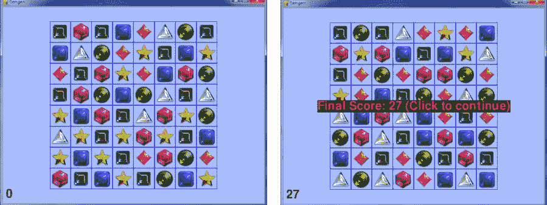

“宝石消除”是一个宝石掉落在面板上的游戏。玩家可以交换任意两个相邻的宝石，使三个宝石排对齐（垂直或水平，但不包括对角线）。匹配的宝石随后会消失，为来自顶部的新宝石留出空间。匹配三个以上的宝石并引起宝石匹配的连锁反应将获得更多分数。玩家的得分随时间推缓慢下降，因此玩家必须不断进行匹配。当面板上不再有任何可能的匹配时，游戏结束。

# Gemgem 源代码

可以从 http://invpy.com/gemgem.py 下载此源代码。

来自 Flippy 的图像文件可以从 http://invpy.com/gemgemimages.zip 下载。

```python
1. # Gemgem (一个宝石消除克隆游戏)
2. # 由 Al Schweigart@inventwithpython.com 
3. # http://inventwithpython.com/pygame
4. # 根据“简化 BSD”许可证发布
5. ""
6. 此程序拥有“宝石数据结构”，它们本质上是带有
7. 以下键的字典：
8. - 'x' 和 'y' - 宝石在面板上的位置。0,0 是左上角。
9. 还有一个 ROWBOARD，其中 'y' 可以被设置为：
10. 表示它在面板正上方。
11. - 'direction' - UP, DOWN, LEFT, RIGHT 四个常量之一。
12. 这是宝石移动的方向。
13. - 'imageNum' - GEMIMAGES 中的索引索引用于指定
14. - 该宝石使用的图像。
```

```python
18. import random, time, pygame, copy
19. from pygame.locals import *
20. FPS = 30 # 每秒更新帧
21. WINDOWWIDTH = 600 # 程序窗口宽度（像素）
22. WINDOWHEIGHT = 600 # 高（像素）
23.
24. BOARDWIDTH = 8 # 面板列数
25. BOARDHEIGHT = 8 # 面板行数
26. GEMIMAGESIZE = 64 # 每个格子的宽和高（像素）
27.
28. # GEMIMAGES 是宝石的种类。你需要名为
29. gem0.png, gem1.png 到 gem(N-1) 的文件。
30. NUMGEMIMAGES = 7
31. assert GEMIMAGES >= 5 # 游戏至少 5 种宝石才能运行
32.
33. # NUMSOUNDS 是匹配时可选的不同声音数量。
34. .wav 文件为 match0.wav, match1.wav 等。
35. NUMSOUNDS = 6
36.
37. MOVERATE = 25 # 1 到 100，越大动画越快
38. DEDUCTSPEED = 0.8 # 每个 DCTSPEED 减少 1 分
39.
40. # RGB
41. PURPLE = (255, 0, 255)
42. LIGHTBLUE = (170, 190, 255)
43. BLUE = (0, 0, 255)
44. RED = (255, 0, 100)
45. BLACK = (0, 0, 0)
46. BROWN = (85, 65, 0)
47. HIGHLIGHTCOLOR = PURPLE # 选中宝石的边框颜色
48. BGCOLOR = BLUE # 面板颜色
49. GRIDCOLOR = RED # “游戏结束”文本的颜色
50. GAMEOVERBGCOLOR = BLACK # “游戏结束”文本的背景颜色
51. SCORE = BROWN # 玩家得分文本的颜色
52.
53. # 面板距离窗口边缘的距离
54. 使用多次，计算一次并存储在变量中
55. XMARGIN = int((WINDOWWIDTH - GEMIMAGESIZE) / 2)
56. YMARGIN = int((WINDOWHEIGHT - GEMIMAGESIZE) / 2)
57.
58. # 方向值的常量
59. UP = 'up'
60. DOWN = 'down'
61. LEFT = 'left'
```


# 第10章 – 四个额外游戏 331

```python
64. RIGHT = 'right'
65.
66. EMPTY_SPACE = -1 # 任意非正值
67. ROWABOVEBOARD = 'row above board' # 任意非整数值
68.
69. def main():
70.     global FPSCLOCK, DISPLAYS, GEMIMAGES, GAMESOUNDS, BASICFONT, BOARDRECTS
71.
72.     # 初始化。
73.     pygame.init()
74.     FPSCLOCK = pygame.time.Clock()
75.     DISPLAYS = pygame.display.set_mode((WINDOWWIDTH, WINDOWHEIGHT))
76.     pygame.display.set_caption('Gemgem')
77.     BASICFONT = pygame.font.Font('freesansold.ttf', 36)
78.
79.     # 加载图像
80.     GEMIMAGES = []
81.     for i in range(1, NUMGEMIMAGES+1):
82.         gemImage = pygame.image.load('gem%s.png') % i
83.         if gemImage.get_size() != (GEMIMAGESIZE, GEMIMAGESIZE):
84.             gemImage = pygame.transform.smoothscale(gemImage, (GEMIMAGESIZE, GEMIMAGESIZE))
85.         GEMIMAGES.append(gemImage)
86.
87.     # 加载声音。
88.     GAMESOUNDS = []
89.     GAMESOUNDS['bad swap'] = pygame.mixer.Sound('badswap.wav')
90.     GAMESOUNDS['match'] = []
91.     for i in range(NUMSOUNDS):
92.         GAMESOUNDS['match'].append(pygame.mixer.Sound('match%s.wav') % i)
93.
94.     # 为每个面板格子创建 pygame.Rect 对象
95.     # 进行面板坐标到像素的转换。
96.     BOARDRECTS = []
97.     for x in range(BOARDWIDTH):
98.         BOARDRECTS.append(None)
99.
100.    for y in range(BOARDHEIGHT):
101.        r = pygame.Rect(XMARGIN + x * GEMIMAGESIZE,
102.                        YMARGIN + y * GEMIMAGESIZE,
103.                        GEMIMAGESIZE, GEMIMAGESIZE)
104.        BOARDRECTS[x].append(r)
```

```python
109. def runGame():
110.     # 执行单局游戏。游戏结束时，此函数返回。
111.
112.     # 初始化面板
113.     gameBoard = getBlankBoard()
114.     score = 0
115.     fillBoardAndAnimate(gameBoard, score) # 放入初始宝石。
116.
117.     # 初始化新游戏开始的变量
118.     firstSelectedGem = None
119.     lastMouseDownX = None
120.     lastMouseDownY = None
121.     isGameOver = False
122.     lastScoreDeduction = time.time()
123.     clickContinueSurf = None
124.
125.     while True: # 主游戏循环
126.         clickedSpace = None
127.
128.         for event in pygame.event.get(): # 事件处理循环
129.             if event.type == QUIT or (event.type == KEYUP and event.key == K_ESCAPE):
130.                 pygame.quit()
131.                 sys.exit()
132.             elif event.type == KEYUP and event.key == K_BACKSPACE:
133.                 return # 开始新游戏
134.
135.             if event.type == MOUSEBUTTONUP:
136.                 if isGameOver:
137.                     return # 游戏结束后，点击以开始新游戏
138.
139.             if event.pos == (lastMouseDownX, lastMouseDownY):
140.                 # 这是鼠标点击，不是鼠标拖拽
141.                 clickedSpace = checkForGemClick(event.pos)
142.             else:
143.                 # 这是鼠标拖拽的结束
144.                 firstSelectedGem = checkForGemClick(lastMouseDownX, lastMouseDownY)
145.                 clickedSpace = checkForGemClick(event.pos)
146.                 if not firstSelectedGem or not clickedSpace:
147.                     # 如果是值拖拽，取消选择两者
148.                     firstSelectedGem = None
149.                     clickedSpace = None
150.             elif event.type == MOUSEBUTTONDOWN
151.             # 这是鼠标点击或鼠标拖拽的开始
152.             lastMouseDownX, lastMouseDownY = event.pos
153.
154.             if clickedSpace and not firstSelectedGem:
155.                 # 这是第一次被点击的宝石
156.                 firstSelectedGem = clickedSpace
157.             elif clickedSpace and firstSelectedGem:
158.                 # 已经点击并选中了两个宝石。交换宝石。
159.                 firstSwappingGem, secondSwappingGem =
160.                 getSwappingGem(gameBoard, firstSelectedGem, clickedSpace)
161.                 if firstSwappingGem == None and secondSwappingGem == None:
162.                     # 如果两者都是 None，说明宝石不相邻
163.                     firstSelectedGem = None # 取消第一个宝石的选中
164.                     continue
165.
166.                 # 在屏幕上显示交换动画。
167.                 boardCopy = getBoardCopyMinGems(gameBoard,
168.                 (firstSwappingGem, secondSwappingGem))
169.                 animateSwappingGems(boardCopy, [firstSwappingGem,
170.                 secondSwappingGem], [0], score)
171.                 # 交换板数据结构中的第一个宝石。
172.                 gameBoard(firstSwappingGem['x'])[firstSwappingGem['y']] =
173.                 secondSwappingGem['imageNumber']
174.                 gameBoard(secondSwappingGem['x'])[secondSwappingGem['y']] =
175.                 firstSwappingGem['imageNumber']
176.
177.                 # 检查这是否是一个匹配移动。
178.                 matchedGems = FindMatchingGems(gameBoard)
179.                 if matchedGems == []:
180.                     # 不是匹配移动；将宝石换回来
181.                     GAMESOUNDS['bad swap'].play()
182.                     animateSwappingGems(boardCopy, [firstSwappingGem,
183.                     secondSwappingGem], [0], score)
184.                     gameBoard(firstSwappingGem['x'])[firstSwappingGem['y']] =
185.                     firstSwappingGem['imageNumber']
186.                     gameBoard(secondSwappingGem['x'])[secondSwappingGem['y']] =
187.                     secondSwappingGem['imageNumber']
188.                 else:
189.                     # 这是一个匹配移动。
190.                     scoreAdd = 0
191.                     while matchedGems != []:
192.                         # 匹配的宝石，然后向下移动面板。
```

## 332 http://inventwithpython.com/pygame

```python
187. # choices 是一个字典列表，告诉我们
188. fillBoardAndAnimate()
189. # 在屏幕的哪个位置显示文本，以显示玩家得了
190. # 多少分。points 是一个列表，因为如果
191. # 玩家获得了多次匹配，那么会有多个
192. points text 应该出现：
193. points = []
194. for gem in GemSet:
195.     scoreAdd += (10 + (len(gemSet) - 3) * 10)
196. for gem in gemSet:
197.     gameBoard(gem[0])[gem[1]] = EMPTY_SPACE
198.     points.append({'x': gem[0] * GEMIMAGESIZE +
199.     'y': gem[1] * GEMIMAGESIZE
200.     XMARGIN,
201.     YMARGIN))
202. random.choice(GAMESOUNDS['match']).play()
203. score += scoreAdd
204. # 绘制新的宝石。
205. fillBoardAndAnimate(gameBoard, points, score)
206. # 检查是否有新的匹配。
207. matchedGems = findMatchingGems(gameBoard)
208. firstSelectedGem = None
209. if not canMakeMove(gameBoard):
210.     gameGameOver = True
211. # 绘制游戏板。
212. DISPLAY.fill(bgColor)
213. drawBoard(gameBoard)
214. if firstSelectedGem != None:
215.     highlight(firstSelectedGem['x'],firstSelectedGem['y'])
216. if gameGameOver:
217.     if clickContinueTextSurf == None:
218.         # 只渲染一次文本。在未来的迭代中，直接使用
219.         已经在 clickContinueTextSurf 中的 Surface 对象
220.         clickContinueTextRect = clickContinueTextSurf.get_rect(
221.         clickContinueTextRect.center = int(WINDOWWIDTH / 2)
222.         (点击继续) % (score, 1, GAMEOCOLOR, GAMEOVERBG)
223.         int(WINDOWHEIGHT / 2)
224.         DISPLAYS.blit(clickContinueTextSurf, clickContinueTextRect)
225. elif score > 0 and time.time() - lastScoreDuration > DEDUCTION:
226.     # 分数随时间下降
227.     score = 1
228.     lastScoreDuration = time.time()
229.     drawScore(score)
230.     pygame.display.update()
231.     FPS.tick(FPS)
```

```python
232. def getSwapping(board, firstXY, secondXY):
233.     # 如果 (X, Y) 坐标处的宝石相邻的
234.     那么它们的 'direction' 键被设置为
235.     相互交换的值。
236.     # 否则，返回 (None, None)。
237.     firstGem = {'imageName': board[firstXY['x']][firstXY['y']],
238.     'x': firstXY['x'],
239.     'y': firstXY['y']}
240.     secondGem = {'imageName': board[secondXY['x']][secondXY['y']],
241.     'x': secondXY['x'],
242.     'y': secondXY['y']}
243.     highlightedGem = None
244.     if firstGem['x'] == secondGem['x'] + 1 and firstGem['y'] == secondGem['y']:
245.         firstGem['direction'] = LEFT
246.         secondGem['direction'] = RIGHT
247.     elif firstGem['x'] == secondGem['x'] - 1 and firstGem['y'] == secondGem['y']:
248.         firstGem['direction'] = RIGHT
249.         secondGem['direction'] = LEFT
250.     elif firstGem['y'] == secondGem['y'] + 1 and firstGem['x'] == secondGem['x']:
251.         firstGem['direction'] = UP
252.         secondGem['direction'] = DOWN
253.     elif firstGem['y'] == secondGem['y'] - 1 and firstGem['x'] == secondGem['x']:
254.         firstGem['direction'] = DOWN
255.         secondGem['direction'] = UP
256.     else:
257.         # 这些宝石不相邻，无法交换。
258.         return None, None
259.     return firstGem, secondGem
260.
261. def getBlankBoard():
262.     # 创建并返回一个空结构。
263.     board = []
264.     for x in range(BOARDWIDTH):
265.         board.append([EMPTY_SPACE] * BOARDHEIGHT)
266.     return board
267.
268. def canMakeMove(board):
269.     # 如果棋板处于可以进行匹配
270.     移动的状态返回 True。否则返回 False。
271.
272.     # onePatterns 中的模式配置为
273.     # 仅需一次移动即可形成三连。
```


`onePatterns = ((0,1), (1,0), (2,0)),`
`((0,1), (1,1), (2,0)),`
`((0,0), (1,1), (2,0)),`
`((0,1), (1,0), (2,1)),`
`((0,0), (1,0), (2,1)),`
`((0,0), (1,1), (2,1)),`
`((0,0), (0,2), (0,3)),`
`((0,0), (0,1), (0,3))`

# x 和 y 变量遍历棋板上的每个空间。
# 如果我们使用 + 表示当前迭代的
# 棋板空间，那么这个模式：
`((0,1), (1,0), (2,0))`
`((0,1), (1,1), (2,0))`
`((0,0), (1,1), (2,0))`
`((0,1), (1,0), (2,1))`
`((0,0), (1,0), (2,1))`
`((0,0), (1,1), (2,1))`
`((0,0), (0,2), (0,3))`
`((0,0), (0,1), (0,3))`
# 在这种情况下，宝石 A 偏移了
`(0,1)`，宝石 B 偏移了
`(2,0)`，而宝石 C 偏移了
也就是说，宝石 A 偏移了
形成了一个垂直的三连。
有八种可能的模式，
因此 `onePattern` 有 8 种。

# x 和 y 变量遍历棋板上的每个空间。
# 如果我们使用 + 表示当前迭代的
# 棋板空间，然后检查是否可以进行匹配移动。

```python
for x in range(BOARDWIDTH):
    for y in range(BOARDHEIGHT):
        for pat in onePatterns:
            if board[x+pat[0]][y+pat[1]] == EMPTY_SPACE and \
               board[x+pat[1]][y+pat[1]] == EMPTY_SPACE and \
               board[x+pat[2]][y+pat[2]] == EMPTY_SPACE:
                return True
return False
```

## 第10章 – 四个额外游戏 335

第一次找到一个时返回 True

返回 False

```python
def drawMovingGem(gem, progress):
    # 绘制沿其 'direction' 键指示的方向滑动的宝石。progress 是从 0（刚开始）到 100（滑动完成）的数字。
    movex = 0
    movey = 0
    progress *= 0.01

    if gem['direction'] == UP:
        movey = -int(progress * GEMSIZIZE)
    elif gem['direction'] == DOWN:
        movey = int(progress * GEMSIZIZE)
    elif gem['direction'] == RIGHT:
        movex = int(progress * GEMSIZIZE)
    elif gem['direction'] == LEFT:
        movex = -int(progress * GEMSIZIZE)

    basex = gem['x']
    basey = gem['y']
    if basey == ROWABOVE:
        basey = -1

    pixelx = XARGMIN + (basex * GEMSIZIZE)
    pixely = YARGMIN + (basey * GEMSIZIZE)
    r = pygame.Rect(pixelx + movex, pixely + movey, GEMSIZIZE, GSIZIZE)
    DISPLAYS.blit(GEMS[gem['imageNum']], r)
```

```python
def pullDownAllGems(board):
    # 将棋板上的宝石拉向底部以填充任何间隙
    for x in range(BOARDWIDTH):
        gemsInColumn = []
        for y in range(BOARDHEIGHT):
            if board[x][y] != EMPTY_SPACE:
                gemsInColumn.append(board[x][y])
        board[x] = ([EMPTY_SPACE] * (BOARDHEIGHT - len(gemsInColumn))) + gemsInColumn
```

```python
def getGemAt(board, x, y):
if x < 0 or y < 0 or x >= BOARDWIDTH or y >= BOARDHEIGHT:
  return None
else:
  return board[x][y]
```

```python
def getDropSlots(board):
  # 为每一列创建一个“下落槽”，并向槽中填充
  # 缺少的宝石。此函数假设
  # 宝石已经过重力下落。
  boardCopy = copy.deepcopy(board)
  pullDownAllGems(boardCopy)
  
  dropSlots = []
  for i in range(BOARDWIDTH):
    dropSlots.append(i)

  # 统计棋上每列中空格的数量
  for x in range(BOARDHEIGHT-1, -1, -1): # 从底部开始遍历
    for y in range(BOARDHEIGHT):
      if board[x][y] == EMPTY_SPACE:
        possibleGems = list(range(len(GEMIMAGES)))
        for offsetX, offsetY in ((0, -1), (1, 0), (0, 1), (-1, 0)):
          # 缩小我们应该放入空白区域的宝石范围，
          # 以免在宝石下落时导致两个
          # 相同的宝石相邻。
          neighborGem = getGem(boardCopy, x + offsetX, y + offsetY)
          if neighborGem != None and neighborGem in possibleGems:
            possibleGems.remove(neighborGem)
        newGems = random.choice(possibleGems)
        board[x][y] = newGems
        dropSlots[x].append(newGems)
```


```python
def findMatchingGems(board):
  gemsToRemove = [] # 一个包含匹配三连宝石的列表列表
  # 需要被移除的宝石
  boardCopy = copy.deepcopy(board)

# 遍历每个位置，检查是否有3个相邻的相同宝石
for x in range(BOARDWIDTH):
  for y in range(BOARDHEIGHT):
    # 寻找水平匹配
    if getGem(boardCopy, x, y) == getGem(boardCopy, x + 1, y) == getGem(boardCopy, x + 2, y) and getGem(boardCopy, x, y) != EMPTY_SPACE:
      targetGem = boardCopy[x]
      offset = 0
      removeSet = []
      while getGem(boardCopy, x + offset, y) == targetGem:
        # 继续检查，以防一行中有超过3个宝石
        removeSet.append((x + offset, y))
        boardCopy[x + offset] = EMPTY_SPACE
        offset += 1
    gemsToRemove.append(removeSet)

    # 寻找垂直匹配
    if getGem(boardCopy, x, y) == getGem(boardCopy, x, y + 1) == getGem(boardCopy, x, y + 2) != EMPTY_SPACE:
      targetGem = boardCopy[y]
      offset = 0
      removeSet = []
      while getGem(boardCopy, x, y + offset) == targetGem:
        # 继续检查是否有一列有超过3个宝石
        removeSet.append((x, y + offset))
        boardCopy[y + offset] = EMPTY_SPACE
        offset += 1
    gemsToRemove.append(removeSet)

def highlightSpace(x, y):
  pygame.draw.rect(DISPLAYSURF, HIGHLIGHTCOLOR, BOARDRECTS[x][y], 4)

def droppingGems(board):
  # 找到所有下方有空格的宝石
  boardCopy = copy.deepcopy(board)
  droppingGems = []
  for x in range(BOARDWIDTH):
    for y in range(BOARDHEIGHT - 2, -1, -1):
      if boardCopy[x][y + 1] == EMPTY_SPACE and boardCopy[x][y] != EMPTY_SPACE:
        # 如果该位置不空但下方空间为空，则下落
        droppingGems.append({'imageNum': boardCopy[x][y], 'x': x, 'y': y, 'direction': DOWN})
        boardCopy[x][y] = EMPTY_SPACE
  return droppingGems

def animateGems(board, pointsText, score):
  # pointsText 是包含 'x', 'y' 和 'points' 的字典
  progress = 0 # progress 为0表示开始，100表示完成
  while progress < 100: # 动画循环
    DISPLAY.fill(BGCOLOR)
    drawBoard(board)
    for gem in gems: # 绘制每个宝石
      drawMovingGem(gem, progress)
    drawScore(score)
    for pointText in pointsText:
      pointsSurf = BASICFONT.render(pointText['points'], 1)
      pointsRect = pointsSurf.rect()
      pointsRect.center = (pointText['x'], pointText['y'])
      DISPLAY.blit(pointsSurf, pointsRect)
    pygame.display.update()
    FPSCLOCK.tick(FPS)
    progress += MOVER # 在帧之间移动一点

def moveGems(board, movingGems):
  # movingGems 是包含 x, y, direction, imageNum 的字典列表
  for gem in movingGems:
    if gem['y'] != ROWBOARD:
      board[gem['x']][gem['y']] = EMPTY_SPACE
      movx = 0
      movy = 0
      if gem['direction'] == LEFT:
        movx = -1
      elif gem['direction'] == RIGHT:
        movx = 1
      elif gem['direction'] == DOWN:
        movy = 1
      elif gem['direction'] == UP:
        movy = -1
      board[gem['x'] + movx][gem['y'] + movy] = gem['imageNum']
    else:
      # 宝石位于上方（新宝石产生的地方）
      board[gem['x']][0] = gem['imageNum'] # 移动顶行

def fillBoardAndAnimate(board, points, score):
  dropSlots = getDropSlots(board)
  while dropSlots != [] * BOARDWIDTH: # 如果还有宝石需要下落，就执行下落动画
    movingGems = getDroGems(board)
    for x in range(len(dropSlots)):
      if len(dropSlots[x]) != 0:
        # 让每个槽底部的宝石向 DOWN 方向移动
        movingGems.append({'imageNum': dropSlots[x][0], 'x': x, 'y': ROWBOARD, 'direction': DOWN})
    boardCopy = getBoardCopyGems(board, movingGems)
    animateGems(boardCopy, movingGems, points, score)
    moveGems(board, movingGems)
    # 通过删除之前的宝石，从下落槽中
    # 移动下一行宝石。
    for x in range(len(dropSlots)):
      if len(dropSlots[x]) == 0:
        continue
      board[x][0] = dropSlots[x][0]
      del dropSlots[x][0]

def checkForGemClick(pos):
  # 检查鼠标点击是否在棋盘上
  for x in range(BOARDWIDTH):
    for y in range(BOARDHEIGHT):
      if BORRECTS[x][y].collidepoint(pos[0], pos[1]):
        return {'x': x, 'y': y}
  return None # 点击不在棋盘上

def drawBoard(board):
  for x in range(BOARDWIDTH):
    for y in range(BOARDHEIGHT):
      pygame.draw.rect(DISPLAYSFACE, GRIDCOLOR, BORRECTS[x][y], 1)
      gemToDraw = board[x][y]
      if gemToDraw != EMPTY_SPACE:
        DISPLAYSFACE.blit(GEMIMAGES[gemToDraw], BORRECTS[x][y])

def getBoardCopyGems(board, gems):
  # 创建并返回传入的棋盘结构的副本，
  # 并移除其中 "gems" 列表中的宝石。
  #
  # Gems 是字典列表，包含 x, y, direction, imageNum
  boardCopy = copy.deepcopy(board)

  # 从此棋盘结构中移除一些宝石。
  for gem in gems:
    if gem['y'] == ROWBOARD:
      boardCopy[gem['x']][gem['y']] = EMPTY_SPACE
  return boardCopy

def drawScore(score):
  scoreImg = BASEFONT.render(str(score), 1, SCORECOLOR)
  scoreRect = scoreImg.get_rect()
  scoreRect.bottom = (10, WINDOWHEIGHT - 6)
  DISPLAY.blit(scoreImg, scoreRect)

if __name__ == '__main__':
  main()
```

## 总结

希望这些游戏程序能让你对想制作的游戏以及如何编写它们的代码产生自己的想法。即使你没有自己的主意，尝试编写你玩过的其他游戏的克隆版也是很好的练习。

这里有几个可以教你 Python 编程的网站：

* http://pygame.org - Pygame 官方网站拥有数百个使用 Pygame 库的游戏源代码。你可以通过下载和阅读他人的源代码学到很多东西。
* http://python.org/doc/ - 更多 Python 教程以及所有 Python 模块和函数的文档。
* http://pygame.org/docs/ - Pygame 模块和函数的完整文档
* http://reddit.com/r/learnpython 和 http://reddit.com/r/learnprogramming 有许多用户可以帮助你寻找学习编程的资源。

向作者提问邮件：`al@inventwithpython.com`

# 第 10 章 – 四个额外游戏 341

* http://inventwithpython.com/pygame - 本书的网站，包含了这些程序的源代码和额外信息。该网站还包含 Pygame 程序中使用的图像和声音文件。
* http://inventwithpython.com - 《用 Python 编写你自己的电脑游戏》一书的网站，涵盖了基础 Python 编程。
* http://invpy.com/wiki - 一个涵盖各个独立 Python 编程概念的 wiki，当你需要学习特定内容时可以在这里查阅。
* http://invpy.com/traces - 一个网络应用程序，可以帮助你逐步跟踪书中程序的的执行过程。
* http://invpy.com/videos - 伴随书中程序的演示视频。
* http://gamedevlessons.com - 一个关于如何设计和编写视频游戏的有用网站。
* `al@inventwithpython.com` - 我的电子邮件地址。欢迎随时向我发送关于此书或 Python 编程的问题。

你可以通过搜索世界万维网来获取更多关于 Python 的信息。访问搜索网站 `http://google.com` 并搜索“Python programming”或“Python tutorials”，即可找到可以教你更多 Python 编程的网站。

现在开始行动，创造你自己的游戏吧。祝你好运！

# 词汇表

**Alpha 值 (Alpha Value)** - 颜色的透明度。在 Pygame 中，alpha 值范围从 0（完全透明）到 255（完全不透明）。

**抗锯齿 (Anti-Aliasing)** - 一种通过在边缘添加模糊颜色来使形状更平滑、减少块状的技术。抗锯齿绘制看起来很平滑。有锯齿的绘制看起来有很多块。

**属性 (Attributes)** - 作为对象一部分的变量。例如，`Rect` 对象具有如 `top` 和 `left` 等成员，它们存储了 `Rect` 对象的整数值。

**向后兼容性 (Backwards Compatibility)** - 编写与旧版本软件兼容的代码。Python 3 有许多与 Python 2 不后兼容的特性，但也可以编写与 Python 2 向后兼容的 Python 3 程序。

**基准例 (Base Case)** - 在递归中，基准例是停止进一步递归函数调用的条件。基准例对于防止栈溢出是必要的。

**块传输 (Blitting)** - 一个意为将一个 Surface 上的图像复制到另一个的词。在通常编程中，指的是将一个图像复制到另一个。

**边界矩形 (Bounding Rectangle)** - 可以在另一个形状周围绘制的最小矩形。

**相机 (Camera)** - 游戏世界特定部分的视图。当游戏世界太大无法放入玩家屏幕时，就会会使用相机。

**标题 (Caption)** - 在编程中，标题是窗口标题栏上的文本。在 Pygame 中，可以使用 `pygame.display.set_caption()` 函数设置标题。

**CLI** - 见命令行界面（Command Line Interface）。

**命令行界面 (Command Line Interface)** - 用户通过查看屏幕上的文字和通过键盘输入文字来使用的程序。旧电脑可以运行 CLI 程序，但新电脑使用图形用户界面。

**构造函数 (Constructor Function)** - 创建新对象的函数。在 Python 中，这些函数的名称与它们产生的对象类型相同。例如，`pygame.Rect()` 创建 `Rect` 对象。

**显示表面 (Display Surface)** - 由调用 `pygame.display.set_mode()` 返回的 Surface。这个 Surface 对象是特殊的，因为使用 Pygame 绘图或块传输函数在其上绘制的任何内容，在调用 `pygame.display.update()` 时都会显示在屏幕上。

**绘图原语 (Drawing Primitives)** - Pygame 中基本形状绘制函数的名称。绘图原语包括矩形、线条和椭圆。绘图原语不包括 .png 或 .jpg 文件中的图像。

**事件处理 (Event Handling)** - 响应用户生成的事件对象（如按键按下或鼠标点击）执行操作的代码。

**事件处理循环 (Event Handling Loop)** - 事件代码通常位于循环内部，用于处理自上次事件处理循环执行以来生成的每个事件。

**事件队列 (Event Queue)** - 当发生鼠标点击或按键按下等事件时，Pygame 将它们存储在内部队列数据结构中。可以通过调用 `pygame.event.get()` 从事件队列中移除和检索事件。

**FPS** - 见每秒帧数（Frames Per Second）。

**帧 (Frame)** - 作为动画的一部分显示在屏幕上的单个图像。动画图形将由许多帧组成，每帧显示一小会儿。

**帧率 (Frame Rate)** - 见刷新率（Refresh Rate）。

**每秒帧数 (Frames Per Second)** - 衡量每秒显示多少帧动画的指标。游戏以每秒 30 帧或更高的速度运行很常见。

**游戏循环 (Game Loop)** - 游戏循环包含处理事件、更新游戏世界状态并将游戏世界状态绘制到屏幕的代码。这每秒执行多次。

**游戏状态 (Game State)** - 构成游戏的整个值集合。这可以包括关于……的信息。

**图形用户界面 (Graphical User Interface)** -允许用户通过图标和菜单等视觉元素与软件交互的程序，而不是基于文本的界面。

**GUI** - 见图形用户界面（Graphical User Interface）。

**不可变 (Immutable)** - 不可改变。在 Python 中，元组值是不可变的。

**交互式 Shell (Interactive Shell)** - 一个你可以输入 Python 代码并立即查看结果的环境。

**解释器 (Interpreter)** - 翻译并执行 Python 代码的程序。

**魔数字 (Magic Numbers)** - 代码中硬编码的值应该替换为描述性变量以提高可读性。

**主循环 (Main Loop)** - 见游戏循环（Game Loop）。

**成员变量 (Member Variable)** - 见属性（Attributes）。

**取模运算符 (Modulus Operator)** - 在 Python 中，取模运算符是 `%`，用于计算余数。

**多维 (Multidimensional)** - 具有多个维度。在 Python 中，列表值是多维的。

**可变 (Mutable)** - 可变的。在 Python 中，列表值是可变的。


# 术语表

## 像素 (Pixels)
像素是屏幕上的单个颜色正方形。屏幕由数千个像素组成。

## 点 (Points)
Python 中的点通常表示为表示 X 和 Y 坐标的元组。

## 属性 (Properties)
见属性（Attributes）。

## 实时 (Real-time)
持续运行且不等待玩家操作的程序。

## 递归调用 (Recursive Call)
递归函数中的函数调用。

## 递归函数 (Recursive Function)
调用自身的函数。

## 刷新率 (Refresh Rate)
屏幕更新图像的频率。高或快速刷新率会使动画看起来平滑，而低或慢刷新率会使动画卡顿。刷新率以 FPS （两者相同）。

## RGB 值 (RGB Values)
RGB 值是特定颜色的精确值。RGB 代表红、绿、蓝。在 Pygame 中，RGB 值是由三个整数（均在 0 到 255 之间）组成的元组，代表颜色中红、绿、蓝的量。

## Shell
见交互式 Shell（Interactive Shell）。

## 正弦 (Sine)
在图形上绘制波线的数学函数。Python 的 `math` 模块中有正弦函数：`math.sin()`。

## 精灵 (Sprites)
某个图片的命名。游戏通常为每种类型的对象创建一个精灵。

## 栈溢出 (Stack Overflow)
由递归函数没有基准例引起的错误。

## 语法糖 (Syntactic Sugar)
为了增加程序可读性而编写的代码，尽管它对程序运行并非必需。

## 瓦片 (Tiles)
瓦片是一种设计在二维网格上绘制的精灵。它们通常是背景图像，如地板或墙壁。

## 标题栏 (Title Bar)
程序顶部的条，通常包含程序标题和关闭按钮。标题栏的样式在不同的操作系统之间不同。

## X 轴 (X-axis)
直卡尔坐标系中使用的水平排列。X 坐标向左减小，向右增大。

## Y 轴 (Y-axis)
直卡尔坐标系中使用的垂直排列。Y 坐标向上减小，向下增大。（这与数学中 Y 轴的工作方式相反。）

# 作者简介


Albert Sweigart（你可以叫他 AI）是加利福尼亚州旧金山的软件开发人员，他喜欢骑自行车、做志愿者、在咖啡馆坐坐以及编写实用的软件。《用 Python & Pygame 开发游戏》是他的第二本书。

他的第一《用 Python 编写自己的电脑游戏》可以在 http://inventwithpython.com 在线阅读。

他来自德克萨斯州休斯顿。他终于把德克萨斯大学奥斯汀分校的计算机科学学位装了框。他在看公园里的松鼠时会大大笑，这让人们觉得他是个呆傻子。

- 邮箱：al@inventwithpython.com
- 博客：http://coffeeghost.net
- Twitter：@AlSweigart
