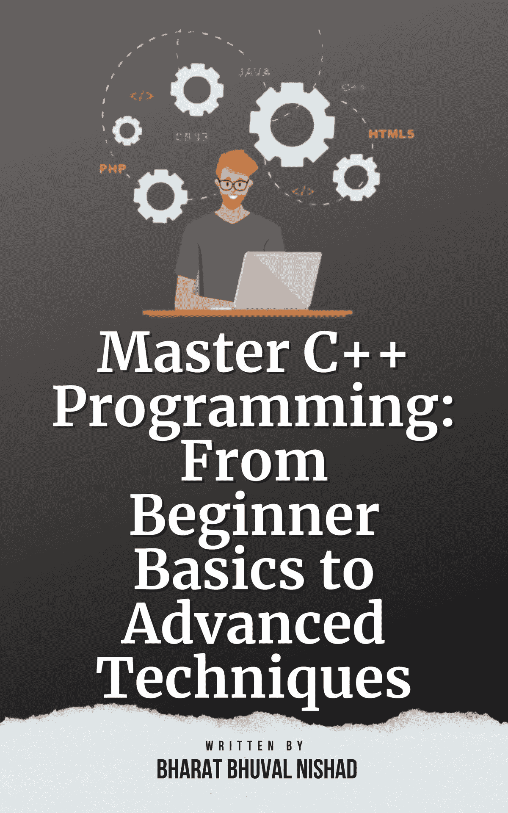

# C++编程大师：从初学者基础到高级技巧

## 关于
通过《精通 C++ 编程：从基础到高级技巧》释放 C++ 的全部潜力。本权威指南专为有志的程序员、资深开发者以及任何渴望深入理解这种最强大且多功能的编程语言之一的人而设计。

在这本全面的书中，你将发现：

* **基础技能**：从实理解 C++ 基础开始你的旅程。学习语法、数据类型、控制结构和基础编程概念的核心内容，这些为更高级的主题奠定了基础。
* **面向对象编程**：使用 C++ 深入研究面向对象编程（`OOP`）的核心原理。探索类、对象、继承、多态和封装，并学习如何使用 `OOP` 原则设计健壮、可扩展的应用程序。
* **高级特性**：通过高级 C++ 特性和技术扩展你的知识。掌握模板、异常处理、文件 I/O 和标准模板库（`STL`），以编写更高效、灵活的代码。
* **性能优化**：洞察如何优化 C++ 代码的性能。学习内存管理策略、高效算法和分析工具，这些工具将帮助你编写高性能的应用程序。
* **现实应用**：通过实际示例和项目将你的技能应用于真实场景。从开发复杂算法到创建应用程序，本书提供了实操练习和案例研究，以强化你的学习。
* **最佳实践与技巧**：发现编写清洁、可维护且高效的 C++ 代码的行业最佳实践和专家技巧。了解常见的陷阱以及如何避免它们，以确保你的代码既可靠高效。
* **更新且全面的内容**：紧跟最新的 C++ 标准和实践。本书涵盖了近期 C++ 版本中的新功能和增强，确保你跟上现代 C++ 开发的步伐。
* **额外资源**：访问一系列补充材料，包括在线资源、代码示例和练习，旨在加深你的理解并提升你的编程技能。

无论你是编程初学者，还是希望增强现有的 C++ 知识，《精通 C++ 编程》都提供了一种掌握该语言的结构化且详细的方法。凭借其清晰的解释、实践练习和专家见解，本书将是你成为精通 C++ 程序员的路线图。

通过《精通 C++ 编程：从基础到高级技巧》转变你的编程技能，将你的 C++ 专业知识提升新水平。从今天开始你的旅程，释放世界上强大的编程语言之一的全部潜力！

## 引言
你好，欢迎来到《C++ 精通：从入门到高级》课程。话不多说，让我们开始这节课。现在让我们讨论一下这门课程。这门课程适用于完全初学者，或者如果你正在准备面试，或者你是一个想要提高 C++ 技能的职场人士，这门课程都适合你，因为我们将从最基础的内容开始，比如什么是计算机、计算机架构和 `CPU`，一直到 `STL`、模板、`lambda`、多线程等高级概念。

这是计算机基础课程的第一部分。在这一节中，我们将讨论计算机的基础知识，并尝试将从计算机基础到编程的各个联系起来。对于完全初学者来说，这一部分是必修的。因此，请务确保你充分理解这一部分，因为它将为你奠定坚实的计算机基础。现在，让我们来看看这一节的思维导图。这就是我们将遵循的计算机基础学习思维导图。

我们将从什么是计算机开始。之后，我们将学习计算机架构。接下来，我们将看到硬件，它是计算机最重要的组件。然后是 `C.P.U`。之后是计算机语言，最后我们将看到操作系统或 BIOS，所以有很多东西要学，并且要学会实践。让我们开始这一节吧。

## 什么是计算机？

在本节课程中，我们将学习计算机。现在让我问你们一个问题：什么是计算机？现在，当我问这个问题时，你们中的很多人可能在想计算机是一台纤薄、时尚的笔记本电脑或台式机，但事实并非如此。计算机是一种执行计算的设备。计算意味着运算。因此，计算机是一种存储和处理数据并执行计算的设备。

现在，所有能够存储和处理数据的设备都称为计算机。无论我们谈论的是计算器、移动平板电脑、你的智能电视、你的智能手表等等……我们所有的计算机。我知道你们中很多人可能在想，我用笔记本电脑或旁边的电脑看电影、玩游戏或浏览网页，那么我是如何使用计算机的计算能力的呢？亲爱的学生们，这是因为我们计算机的计算能力已经内置在这些应用程序中了。

这些应用程序通过在计算机上执行某种计算来运行，而这些计算是由处理组件完成的。这个处理器就是执行所有这些计算的。在这些计算的帮助下，所有的应用程序得以运行。所以我我希望这节课是相当清晰且有趣的。

## 计算机架构

在本节课程中，我们将学习计算机架构。让我们从定义开始。计算机架构的正式定义是：它是描述计算机系统功能、组织和实现的规则和方法的集合。现在，让我们通过一个例子来理解这个定义。让我们以房子为例。这就是一栋房子的架构。这栋房子有车库、客厅、卧室、休息室、厕所、厨房等许多。这些都是房子的各种组件。

每个组件都有某些功能，并以某种方式组织在一起。我们不能把车库放在房子的顶上。你知道的，在二楼造车库是没有意义的。对吧。同样，在计算机系统中，我们有各种组件，如输入设备、输出设备、`CPU`、内存和硬盘。所有这些组件都有各种功能，并以某种方式实现，以便它们能够正常运行和协调以执行特定的任务。现在，让我们看到更多关于计算机架构的内容。

让我们从输入设备开始。输入设备用于向计算机提供输入。用户控制着输入设备。像`键盘`和`鼠标`这样的输入设备用于由用户提供输入。你可以通过这个例子来理解，比如你想运行某个应用程序。这时你通过`鼠标`双击它，程序就会开始运行。现在，如果程序要求你输入某些登录凭据，你就通过`键盘`输入那些登录凭据。

所以，你再次提供了输入。下一个组件是输出设备。用于向用户产生输出的设备被称为输出设备，如`显示器`和`打印机`。很简单，对吧？接下来的组件是内存，这里的内存指的是 `ram`，`ram` 意味着随机存存储器。我们将在接后的课程中查看它的细节。目前，`RAM`是一种用于临时存储设备的内存，以便中央处理器或 `CPU` 能够轻松访问它来计算或处理这些文件。

现在，这个 `RAM` 有各种尺寸，如 `4 GB`、`8 GB` 和 `16 GB`。尺寸越大，你在这个内存中存储的程序、进程或文件就越多。接下来是 `C.P.U`。即中央处理器。它处理数据。`RAM` 中的可用数据被 `CPU` 处理器提取并进行处理。你可以参考 `CPU` 的例子，比如 `i3`、`i5` 和 `i7`。显然，`CPU` 有两个部分。`ALU` 是一个算术逻辑单元，而另一个是控制单元。

首先，让我们看看这里。`ALU` 用于执行算术或逻辑操作，如加、减、乘、除、小于、大于所有这些操作实际上都是由 `CPU` 中的 `ALU` 执行的。现在，我们系统中的第二个组件是控制单元，顾名思，它控制各种操作。它控制或引导进程的操作执行。这意味着它直接处理当前需要处理的指令。

第二点是，它控制 `CPU` 和其他资源之间的数据流，这意味着它控制了进入 `CPU` 进行处理的数据流。以及已经处理过并需要放回内存的数据由控制单元控制。这意味着它也是一个资源管理器。所以我希望这个计算机架构的概念，以及各种组件如何运作对你来说是清晰的。在接后的课程中，我们将学习 `CPU` 和 `RAM`。

# RAM - 随机存存储器

在本节课程中，我们将学习它们。即随机存存储器。当我们谈论计算机架构时，“内存”位于这里。它靠近中央处理器。现在问题出现了，它为什么要靠近中央处理器呢？情况是，假设你有一个文件在硬盘里。你知道的，这个硬盘是一个光驱器。像这样，它有一个从我们的磁盘读取数据的点。这种光驱器的问题在于它们非常慢，但你的处理器的速度远快于它的读取能力。

所以问题在于，处理器能够非常快速地处理数据，但硬盘无法以那种速度提供数据。它无法匹配处理速度。因此，我们需要一种中间内存，一种离处理器更近的内存，并且以比硬盘快得多的速度为处理器提供数据。此时 `RAM` 的出现就派了用场`Ram` 从硬盘中提取文件并加载到 `ram` 中，并在处理器需要处理该文件时告知它。

这种从 `RAM` 提取文件的过程比我们直接从硬盘提取要快得多。这就是我们创建它们的原因。现在，让我们看看计算机的内存看起来是什么样子的。`ram` 看起来是这样的。这是 `RAM` 的物理外观。但在内部或逻辑上，`RAM` 是这样的。它是一个可以让你存储数据的内存地址集合。所以这就是一个内存地址。这是另一个内存地址。以这种方式，取决于你“朋友”的大小，会有很多内存地址。

### RAM - 随机访问存储器

如果你的内存不够用，那么它的内存地址就比 `16` 位的 `RAM` 少。现在在这些内存地址上，你可以像这个文件放入你的数据，然后加载到 `ram` 中的数据会被放入这些不同的内存块中。因此，根据文件的大小，可能会占用不同数量的内存块。`1 MB`的文件占用的空间或内存块较少，而`20 MB`或更大的文件会占用更多。

现在，接下来，假设你想运行一个位于硬盘上的程序，为了运行它，你需要双击它。于是，你将双击这个程序。然后该程序将加载到 `lab` 中。我们知道为什么需要将程序加载到 `RAM` 中，因为这样处理器就可以更快地对其进行处理或计算。所以当程序被加载到 `RAM` 时，它就会被处理。这是你需要记住的最重要的一点：处于学习状态的程序在加载到 `ram` 时，它就会变成一个进程。所以你的程序将加载到 `ram` 中。它看起来可能是这样。它会占用一些内存。

假设它占用了从 `10` 到 `100` 的内存地址。不，你的控制单元会逐个将这些地址上的数据提取到 `ACLU` 进行处理，处理后，它会将数据返回 `red`。这样，控制单元就会提取内存中的数据块并交给 `alien` 进行处理。它可以获取任何数据，意味着它可以访问任何内存地址块。这就是为什么它被称为 `random`（随机）。它可以随机访问任何内存块。假设正在运行的进程想要执行某个任务，比如它想与网络通信，想发送一些数据包。

为了完成这项任务，假设内存地址 `72` 处存储有一个命令或指令。那么控制单元将访问该内存块，获取该数据并放入 `end use` 进行处理。处理后，它会将其放回。这样，控制单元就会访问或随机访问你的 `land` 来执行计算。不，我认为你已经理解了这个概念，即需要 `random access memory`（随机访问存储器），这是我过的最重要的概念。

很多学生在这方面很落后，所以我希望你理解它。好了，现在我们已经看到了为什么我们需要 `RAM` 以及为什么它被称为 `random access memory`。现在，让我们来看看关于 `RAM` 的更多几个概念。

### RAM 的特性

第一点用于存储当前正由 `C.P.U` 处理的数据，这是我们已经过的，它存储需要由 `CPU` 处理的数据。第二点是 `RAM` 具有易失性。这意味着什么？意味着 `RAM` 不是数据的永久存储。

当没有电源时，`RAM` 会丢失数据。这是因为 `RAM` 由 `-` 组成，它们需要持续的电来保持存储在其中的数据。这就是为什么 `crime` 是易失性的。如果你关闭笔记本电脑或台式电脑，你将无法访问之前运行的数据或程序。这是因为 `crime` 是易失性的。它需要持续的电。否则，`RAM` 中的电容器将失去电荷，其数据也将丢失。

### RAM 的类型

接下来，我们有两种类型的数据，即 `data`，让我们先看 `data`。`data` 是动态的，与计算机时钟是异步的。你的计算机或处理器按时钟周期运行，这意味着它会为运行在你计算机上的每个进程分配特定的时间。现在，这种异步意味着，如果处理器不能与 `Iran` 良好协调，它就无法与 `rain` 协调。那么处理器在 `ramp` 上为了获取数据和存数据而进行的读写操作将会很慢。

但在同步动态的情况下，它与计算机时钟同步。这意味着如果处理器与 `Iran` 良好工作，它将以良好的协调方式工作。那么读写操作将得到驱动并变得更快。所以它会更快。这就是为什么我们现在使用它作为 `data`。

### 虚拟内存

下一点是在硬盘上创建一个作为 `virtual memory`（虚拟内存）的 `webspace`。它的 `virtual memory` 是 `physical memory`（物理内存）的替代品。这个 `physical memory` 本身什么。但是，这句话的意思是什么？让我们通过这张图来理解，这句话意味着我们在 `hard` 上创建了一些 `virtual memory`。这就是我们正在创建的 `virtual memory`。而这个 `virtual memory` 充当了真实的 `physical memory` 的替代品。当我们这样做时，为什么要从 `days` 中留出一些可以供使用的空间呢？

这是因为你的计算机有时会内存不足。假设你正在 `windows` 上运行 `Windows 10`，同时你还在运行一个浏览器。单是 `Windows 10` 就能占用你朋友的照片。而这个浏览器，假设我们下载了你朋友中的一个。但你只有四个朋友。但是你怎么可能在 `FUJIMURA` 上运行大约 `5 GB` 的数据呢，你不觉得这里有猫端吗？猫端在于我们正在留出一些可以供使用的空间。

所以处理器是实际上执行计算的实体。这就是为什么我们的城市中至少需要一个处理器，以便我们进行计算。以前，我们通常有一个处理器，但现在我们有多个处理器。我们也可以看到它们，因为核心是 CPU 的处理单元。你可以这样理解：CPU 是一间房子，而房子里面的人就是核心或处理器。所以，房子里的人越多，他们就越能管理好自己。

同样，CPU 内部越多的或多个核心能够执行更多的计算。对。现在，下一项是带有双核的 CPU，因为因为它被称为双核（dual core），你一定听过这个词，双核意味着 CPU 内部有两个核心。两个核心意味着 CPU 有两个处理单元，它们将并行计算任务并让我们的 CPU 运行更快。

同样，我看到人们在手机通话时，这被称为四核 CPU，对吧？现在，接下来的项叫做核心（core），它是 CPU 内部的一个处理单元，实际上它在执行计算。现在，这个核心是一个物理组件，物理组件意味着我们可以触摸它。我们可以感觉到它。但是线程（thread）是在核心内部的，所以这是 CPU 内部的核心，而这是核心内部的线程。这种逻辑组件意味着我们无法触摸它。这是一个假设性的概念。

所以这个线程实际上是核心的一个逻辑部分，它执行每一条命令并产生输出。现在，你可能会想这可能需要什么。让我给你举个例子。假设你正在运行一个浏览器。这就是浏览器。我们知道处于运行状态的程序是一个进程（process）。所以这个浏览器正在运行，因此它就是一个进程。不，在这个浏览器内部，我们正在浏览 YouTube。所以这就是 YouTube 视频播放。在这里你可以找到推荐视频。

所以，一个线程有助于运行或播放这个视频，而另一个线程则能够显示推荐视频。因此，线程无非一个微处理器单元。它们被用于在处理中引入并行性，以便我们在单个进程中执行多个任务，这为了方便理解。让我给你一个生活中的例子，这样你就能理解 CPU、核心和线程了。假设有一个工厂。这就是工厂。这个工厂无非 CPU。

你可以将其与工厂内部的 CPU 联系起来。我们有不同的层级，这些层级就是核心，它们实际上在工厂里执行任务。杠杆的手被固定住，我们可以说它实际上在执行或执行当前给出的每一条命令。下一项是缓存（caches）。这些是 CPU 中可用的小内存池。你知道为什么我们在你内部需要一些内存吗？我们已经拥有它们了。

这是因为最频繁使用的数据存储在这些缓存中。所以这个 `L1 cache` 是最小的。请注意，内存越小，速度就越快，因为我们知道内存无非内存地址的集合。如果我们内存地址的数量较少，那么内存查找时间就会减少。但如果我们有更大的内存，比如 `RAM`，那么查找时间可能会增加。而在硬盘的情况下，查找时间甚至更长。

这就是为什么 CPU 有它自己的缓存，它们的尺寸较小，存储了最频繁使用的数据。现在我们看到 `L1` 更小，`L2` 比它大。所以目标应该是首先检查 `L1`，如果没找到，它就会检查 `L2`，如果那里也没有找到，它就会去主内存（RAM）。这里有一个概念叫做 `cache`（缓存），意味着如果我们在 `cache` 中找到了正在查找的项，就称为“缓存命中”（cache hit），或者如果我们找不到正在查找的项目，就称为“缓存未命中”（cache miss）。对吧。所以我希望通过这些，计算机运行方式的整体图像对你来说就很清晰了。

## 计算机语言

在本次课程中，我们将学习计算机语言，请不要误解为编程语言，那是不同的。我们将在接下来的讲座中讨论它。计算机语言是计算机能够理解的语言，是计算机听的和说的语言。那就是二进制语言，计算机理解 0 和 1。现在，你可能会想，通过计算机你只理解 0 和 1。为了找到这个问题的答案，我们需要回顾组件（即电子元件）开发时的历史。

现在，让我们举一个例子来理解这个，这可以是开启的或关闭的，只有两种可能的状态。它可以是开启状态，也可以是关闭状态。所以，其中一个状态的状态由 0 表示。同样，在计算机中也是如此，然后会有流动。那么我们就看到 1。如果没有电流，我们就会看到 0。这就是为什么在计算机开发时，0 和 1 被视为计算机语言的原因。对吧。

但在冲突中存在冲突。你说的是不同的语言，而计算机说的是二进制语言。现在问题出现了，这两个组件将如何相互通信？为了与计算机通信，我们有一个操作系统。在操作系统的帮助下，我们可以间接地与计算机硬件通信。是操作系统成为了我们和计算机之间的中间人。现在，在下一次讲座中，我们将详细介绍操作系统以及它的样子。所以我希望你已经理解了计算机语言的含义和原因。

## 操作系统

在本次课程中，我们将学习操作系统。让我们开始。我们已经看到操作系统帮助你在不需要了解计算机语言的情况下与计算机通信。这意味着即使不知道 0 和 1 或二进制语言，你仍然能够与计算机通信并执行你的任务，知道这是可能的。这是通过操作系统的帮助实现的。让我们通过这个例子来理解。

假设这里是你。我们坐在这里使用操作系统，假设你双击硬盘里的 `Firefox`。所以这就是程序，一个在桌面上处于休眠状态的程序。这个程序是 Firefox。你不想上网吗？这就是为什么你双击这个程序。当你双击时，这个程序将加载到主内存中。正如我们所知，当程序处于运行状态时，它被称为进程。

现在，如果我们谈论操作系统的例子，我们有 `MapQuest`、`Windows`，我们有很多选项如 `RedHat`、`Ubuntu` 等。现在，像 `chrome`、`word`、`游戏` 等应用程序需要一些环境来学习和执行任务。所以这个环境是由操作系统提供的，以便这些应用程序能够顺利运行。对吧。这也是一个操作系统。而且，操作系统还提供驱动程序。

那么什么是驱动程序呢？假设你在电脑上安装了一个显卡。现在，除非你为它安装了驱动程序，否则操作系统将无法使用该显卡。所以 `Driver` 无非针对硬件的一组指令，由硬件供应商提供。有时驱动程序是通，比如键盘和鼠标。所以这些鼠标键盘的驱动程序都预装在操作系统中了。

因此，你不需要手动安装它们。但如果你正在使用特定厂商的特定硬件（例如显卡），那么你需要安装驱动程序，即该显卡的特定驱动程序。这样操作系统就能与驱动程序通信，而驱动程序再与特定硬件通信。现在，让我们通过一个例子来理解这一点。假设你想玩一个游戏，于是你双击游戏。现在，假设这个游戏是专门为显卡设计的。

为了玩这个游戏，你需要有一块显卡。在这种情况下，首先操作系统会启动游戏。它会将文件加载到内存，随后操作系统会寻找该硬件的特定驱动程序。如果没有找到驱动程序，操作系统会弹出消息，说明该游戏无法运行。如果找到了驱动程序，操作系统将与驱动程序通信以运行游戏，驱动程序将与相应的硬件通信。通过这样，硬件得到了利用。

所以让我们记录一下所学内容，看看操作系统的各种功能。操作系统有助于**进程管理**。它管理正在运行的进程。此外，操作系统还帮助**内存管理**；它为需要执行的进程提供内存。同样，如果进程已完成执行，操作的任务也是回收分配给它的资源。现在，操作系统的下一个任务是**文件管理**。

它将管理文件，如存储文件、检索文件中的文件名、共享文件、保护存储在硬盘内部的文件。对。此外，操作系统还帮助**设备管理**。它将管理所有连接到计算机的设备，键盘、鼠标、打印机等，对吧。所以它会跟踪所有设备。最重要的是，操作系统还为存储在计算机上的数据和信息提供**安全性**。通过这些，你对操作系统的为什么、是什么和如何做的概念应该已经非常清晰了。

现在，最后让我们把计算机基础的知识融入脑海。我们首先学到什么是计算机？计算机是一种通过执行计算来存储和处理数据的设备，如顶配笔记本电脑、移动平板电脑、计算器以及我们所有的电脑。

接下来是，在计算机架构中，我们看到了什么是输入设备？CPU 是什么？我们有一个运算和逻辑单元。在接下来的几天里，我们将看到控制单元。我们看到它是随机存存储器（RAM）。接下来，我们还看到了输出设备，如显示器、打印机。之后，我们了解了它们。RAM 用于存储当前 CPU 正在处理的数据。RAM 本质上是易失性的。此外，这是因为 RAM 由电容器组成，因此我们需要持续提供电流来存储数据。

不，RAM 有两种类型。而且数据是异步的，数据是与计算机时钟同步的，对吧？此外，我们看到的虚拟内存是硬盘上的一个空间，它是物理内存的替代。它是一种虚拟内存，之后我们看到了 CPU。在 CPU 中，我们看到 CPU 无非是中央处理单元，它处理指令，我们看到在 CPU 中，有处理器以及所有实际处理指令的代码，它是关键组件。

接下来，我们看到了**线程**，它是代码的逻辑部分，并执行每一条命令，对吧？接下来，我们看到了两个缓存 L1 和 L2。L1 的尺寸比 L2 小。因此，L1 的速度比以往任何时候都快，如果在缓存中找到数据，我们就看到缓存命中（cache hit）。如果没找到数据，我们就看到缓存未命中（cache miss），对吧？接下来，我们看到了什么是计算机语言。计算机语言是计算机能理解的语言，比如二进制语言。

我们可以通过操作系统、应用程序和编译器来与计算机进行通信。此外，在接下来的课程中，我们将看到如何通过编译器与计算机通信。最后，我们看到了操作系统。操作系统帮助我们在甚至不知道如何说那种语言的情况下与计算机通信。

此外， IT 提供者在用户和计算机硬件之间提供接口。完全正确。操作系统通过进程管理、内存管理、文件管理、设备管理和安全管理运行。操作系统的示例可以是 Mac、Windows、Red Hat、Linux 等。通过这些，我希望计算机的基础知识已经非常清晰且完美。

### 什么是通用编程？

现在在这一部分，我们将开始一个非常重要且显而易见的问题：什么是编程？为了理解这一点，我们将采用一个非常简单的例子。即我们如何泡咖啡。为了泡咖啡，我们肯定会遵循一些步骤、指令或程序。这些步骤是什么？第一步是煮牛奶。我们将加热牛奶直到变热。接下来，我们将通过向杯中加糖来准备杯子。

之后，我们将在杯中加入 1 或 2 茶匙咖啡。接下来，我们将热牛奶倒入杯中。最后，我们将搅拌咖啡直到咖啡完全溶解。好，我们就可以享受咖啡了。这些就是我们准备咖啡时要执行的步骤或指令。现在，同样，假设我想执行另一个任务。我想加两个数字，2 加 3，并且我想在计算机上执行这个任务。现在，假设这台是计算机。

现在要执行加法，我必须向计算机提供指令。因此我将提供指令。这种向计算机提供指令的过程被称为编程。而这些指令是用某种语言编写的。可以是 C、C++、Java、Python。任何语言都可以。通过我们将要学习的各种语言，我们向计算机提供指令来执行任务。现在，让我们形式化这个定义。

所以编程向计算机提供指令以执行特定任务的过程。这就是编程。所以我希望编程部分对你来说已经清晰了。现在下一个问题是为什么要编程？我们需要编程做什么？编程允许我们利用计算机的力量来解决问题。例如，假设我们有这台计算机。它只是坐在这里的硬件。现在，如果我们想要执行某项任务，执行某个任务。与其由我自己完成那个任务，我可以做的是将该任务分解为指令。

通过通过编程使用任何语言（如 C++ 或 Python）。在编写这些指令后，我可以将这些指令交给计算机，让它代表我执行该任务。那个任务可以是任何内容。可以是简单的计算，也可以是像基因组测序这样复杂的任务。如果我们自己完成这些任务，肯定会花费大量时间。所以我们做的是，使用编程语言创建指令，并将其交给计算机让它为我们解决。

在本讲座中，我们将讨论 `C++` 的优势，以及学习这门流行的 `C++` 编程语言后我们将获得的其他益处。让我们不再多言，直接开始本课程。

#### 1. 多功能
学习 `C++` 的第一个优势是它是一种多功能的编程语言。多功能意味着它可以用于广泛的领域，例如：
- 系统编程
- 游戏开发
- 嵌入式系统
- 科学计算

#### 系统编程 vs 应用程序软件
在深入系统编程之前，我们需要了解软件有两种类型：
1. **系统软件**：示例包括驱动程序。当你将优盘盘或键盘插入 `USB` 端口时，这些都是硬件组件。每当你插入它们时，计算机都会检测到它们以便你使用。这是由于驱动程序的作用。同样，如果你购买了打印机或扫描仪，你需要安装软件来帮助打印或将设备连接到计算机。
2. **应用程序软件**：示例包括 `MySQL`、`MS PowerPoint` 和 PDF 阅读器。

通过 `C++`，我们进行系统编程，意味着我们开发系统软件。在系统软件开发方面，`C++` 占据着举足轻重的地位。

#### 为什么 C++ 用于系统编程？
这是因为 `C++` 接近硬件。考虑以下层次结构：
- 硬件（底部）
- 汇编语言
- 低级语言
- 高级语言（顶部）

接近硬件的语言（如汇编语言）比高级语言更快。虽然 `C++` 属于高级语言类别，但与 `Python` 或 `Java` 等语言相比，它的位置较低。因此，它比这些语言更快。

#### 游戏开发
`C++` 被广泛游戏开发。我们有两个主要的引擎：
- **Unity**：使用 `C-sharp`（与 `C++` 类似，由微软开发）。
- **虚幻引擎 (Unreal Engine)**：使用 `C++`。
学习了 `C++`，就可以上手游戏开发。

#### 嵌入式系统
`C++` 在这里是“王者”。涉及到嵌入式编程时，`C++` 没有竞争对手，因为它接近硬件。在嵌入式系统中，我们纯粹在硬件上工作并需要运行速度快；`C++` 最适合这种工作。

#### 科学计算
我们还使用 `C++` 来解决科学计算中复杂的数学问题。

#### 2. 性能
如所述，`C++` 接近硬件，这允许底层的内存操作并提供高性能。这使得它非常适合需要密集计算的资源密集型任务。

**总结**：由于接近硬件，`C++` 允许底层内存操作并提供高性能，使其适用于资源密集型任务。

#### 3. 面对象编程 (OOP)
`C++` 支持 `OOP` 原则，这有助于你设计模块化、可维护和可重用的代码。
如果你在团队中使用不支持 `OOP` 的语言工作，你就无法以模块化的方式（逐模块地）开发代码。这使得在团队成员之间分配任务变得困难，每个人负责不同的功能，这些功能会被组合成单一的功能。

**总结**：`C++` 支持 `OOP` 原则，有助于设计模块化、可维护和可重用的代码。

#### 4. 兼容性
`C++` 被广泛使用并支持不同的平台和操作系统。这使其成为跨平台开发的一项宝贵技能。我们可以为任何操作系统或平台创建应用程序。

**总结**：`C++` 被广泛使用并支持不同的平台和 `OS`，使其成为跨平台开发的一项宝贵技能。

#### 5. 标准库
`C++` 提供了一个健壮的标准库，其中包含了各种数据结构、算法和函数。
- **数据结构**：对数据进行结构化使处理变得更容易。
- 这些库已经由 `C++` 开发者创建好了；我们只需要导入它们，从而节省了精力和。例如，如果我们需要排序元素，不需要编写逻辑；只需使用现有的函数即可。

**总结**：`C++` 提供了健壮的标准库。

标准库。它包含了各种数据结构、算法和函数，可以节省你的时间和精力的。我们可以以排序举例；我们将在数据结构部分详细介绍所有这些内容。`STL` 框架。这是一个包含许多库的框架，可以帮助你开发 GUI 应用程序。是的，在课程结束时，我们还会查看 `Qt`。

现在让我们聊聊 `C++` 的其他优势。

### 教育基础
学习 `C++` 将为编程概念、语法编写提供提供坚实的基础，并使以后学习其他编程语言变得容易。因此，通过学习 `C++`，你不会只局限于 `C++`；所有的基础知识在其他地方同样适用。

### 社区与资源
`C++` 有一个庞大且活跃的社区可以帮助你的学习之旅。因此，每当你遇到任何错误或问题时，网上一定有充足的支持和资源可用。

### 可迁移技能
通过学习 `C++` 获得的技能，例如解决问题和面向对象编程概念（我们将在 `OOP` 部分讨论的 `OOP` 概念），所有这些概念都可以迁移到其他编程语言中。通过学习 `C++`，你学习其他编程语言的历程将变得非常非常简单。

### 高需求技能
`C++` 的魅力永远不会消失。正如我们在系统编程中讨论的，它被广泛用于嵌入式系统中创建智能设备和 `IoT`。它被广泛且大量使用。此外，在游戏开发中，无论我们谈论 `Unreal Engine` 还是 `Unity Engine`，`C++` 都在那里。此外，如果你想创建开发项目，仍然可以使用这些 `Unity` 和 `Unreal` 游戏引擎，并在 `C++` 的帮助下创建这些产品。

所以我希望通过这次讲座，让你 100% 清楚我们为什么要学习 `C++`。我希望你在整个讲座过程中保持热情，因为我们在旅程中将创建和开发各种项目。所以我希望这次讲座对你来说非常清楚。感谢观看。

## 什么是编译器和 IDE

现在在接这些节座中，我们将讨论什么是编译器、为什么我们需要编译器，以及编译器如何帮助 `C++` 编程？之后，我们将讨论 `IDE`，即集成开发环境。现在，让我们直接开始节座，不再多说废话。

让我们通过一个例子来理解编译器。假设你正在前往一个非英语国家国家，比如中国或俄罗斯。当你到达这个国家的机场时，你会发现一个我们称为移民官员的人。现在，这个人向你问了一些问题，而你无法听懂。这是一个挑战，对吧？你可能会处于恐慌状态，但这时救星出现了：这位移民官员拿出一个设备，对着它说了一些话，然后展示给你看。基本上，他正在使用一种语言翻译器。

工作原理：移民官员将用他的语言说话，假设是俄语。他提供输入，而这个翻译器生成英语输出。从这个例子中，我们了解到，如果没有这个语言翻译器，移民官员和旅行者都无法互相理解。同样，如果我们想给计算机发送某些指令，我们可以使用编译器。

工作原理：假设你用你的母语言（比如英语）编写代码或指令，并将这些代码或指令交给编译器。现在，这个编译器会将代码或指令转换为机器码。我们知道机器理解 0 和 1。

### 编译器的正式定义
编译器的正式定义是：它是一个系统工具，将用 `C++` 编程语言编写的人类读代码转换为可以在计算机上直接执行的机器码。

通过此，我希望编译器是什么以及我们为什么需要编译器对你来说已经清楚了。现在让我们聊 `IDE`（集成开发环境）。

## 什么是 IDE？

在深入研究 `IDE` 的确切含义之前，让我们来看一个非常简单的例子。我们一定在家里见过这种工具箱。它为我们的各种杂务家居活动提供了所有基本工具，比如拧螺丝或修理花园里坏掉的栅栏。工具箱里的所有工具都是随手可用的。同样，在编程中，我们也使用 `IDE`，它是一个集成开发环境，提供了所有必要的工具，使我们的开发过程顺畅且高效。它提供了开发人员顺利、高效地创建软件所需的所有工具。

### IDE 中的工具
1. **代码编辑器**：你有一个特殊的区域，可以在其中编写代码，就像你在写一个故事一样。
2. **错误检查器**：当我们编写代码时，`IDE` 会检查错误并对可能不太对的地方画下划线。这就像有一个朋友在你写故事时帮助你发现拼写错误一样。
3. **自动建议建议**：`IDE` 还会在你编写代码时通过建议各种关键词来帮助你。
4. **构建与运行**：一旦你准备好代码，`IDE` 就可以神奇地将你的 `C++` 代码转换为计算机能理解的程序。我们知道这在编译器的帮助下发生；它也有一个编译器。
5. **修复错误**：有时你的程序可能运行得并不完美。`IDE` 通过建议修复方法来帮助你找到问题可能所在。
6. **输出**：当你的程序准备好后，`IDE` 向你展示你的程序的样子。

如果这些事情现在听起来没意义请不要担心；这完全正常。我们将在接下来的节座中使用这些工具。我希望这次关于编译器和 `IDEs` 的讲座对你来说非常清楚。

## 为什么选择 C++？

假设我们想要开发软件。每当我们开发软件时，并不是像写文章那样连续地写完并开发。我们需要识别许多不同的特性，并将软件拆分为各种特性和功能点，例如 `feature one`、`feature two`、`feature three` 等。假设我们分配了 `feature one`；那么开发者 `D1` 将负责这个特性，开发者 `D2` 将负责下一个，之后我们可以将它们合并为一个功能。

通过这种方式，我们在软件中创建了各种功能。但挑战在于，起初将软件拆分为如 `feature one` 和 `feature two` 这样的特性，稍后再将这些特性结合在一起是非常困难的。在 `C` 语言中很难做到。`C++` 的开发者识别出了这个问题，并在 `C++` 中引入了一个新概念，即 `OOP`。他们引入了一种全新的编程方式，一种基本上编写代码的新方法。

在 `OOP` 的帮助下，开发这些特性并在以后将它们组合变得更容易了。我们将在 `OOP` 部分讨论 `OOP` 的细节。但目前，我们可以得出结论：在 `OOP` 的帮助下，我们能够编写模块化的代码。我们可以一个模块模块地创建或编写代码，随后将这些模块组合成功能。

## 第二个挑战：数据结构

第二个挑战是，在 `C` 语言中我们必须从零开始编写一切。每当我们创建软件时，都会使用各种数据结构。数据结构无非我们存储数据的方式。根据我们的需求和要求，我们必须使用那些数据结构。但在 `C` 语言中，我们没有这些东西；我们必须从零创建它们并为一切编写逻辑。

在 `C++` 中，开发者添加了一个名为 `STL`（标准模板库）的丰富库，它包含了软件行业中高度使用的所有数据结构以及排序、搜索等算法。这类算法和数据结构已经被添加到 `C++` 中，我们可以直接使用它们。这就像“即插即用”，它让开发者的生活变得简单得多。从这两点来看，我们可以得出结论：`C++` 的开发者试图让软件开发者的生活变得轻松。

## C++ 的正式定义

让我们来看看 `C++` 的正式定义以及它是谁开发的。`C++` 由 Bjarne Stroustrup 及其团队于 1980 年在贝尔实验室（Bell Labs）创建并开发。基本上，`C++` 是对传统旧 `C` 编程语言的扩展，增加了各种高级特性，如面向对象编程 (`OOP`）和 `STL`（标准模板库），其中包含了各种让开发者生活变得超级简单的的数据结构和算法。

接下来，`C++` 是一门高级语言，它是为了通用编程而开发的。正如我所说，它的开发是为了让开发者的生活变得简单。我们将在下一张幻灯片查看什么是高级语言。此外，`C++` 是一种编译语言。我希望这段介绍能清晰地解释 `C++` 是什么以及它为什么出现。

## 高级语言 vs 低级语言

让我们看看为什么 `C++` 被称为高级语言。在此之前，我们需要了解低级语言，如果不理解低级语言，我们就无法理解为什么 `C++` 是一门高级语言。

让我给你们展示一个低级语言的例子。我不确定你们有多少人做过微处理器编程，所以让我们举个简单的例子：假设我们想执行操作 `3 + 6 - 5`。为了通过低级语言完成这一操作，我将使用 `assembly`（汇编）语言。

在低级语言中我们需要做的第一件事是将数据存储到寄存器中。`R1` 和 `R2` 是寄存器，是我们可以存储数据的内存块。假设我将 `3` 存储在 `R1`，将 `6` 存储在 `R2`。现在，我们要对 `R1` 和 `R2` 执行加法并将结果存储在 `R0` 中。它会执行 `3 + 6`并将结果存在 `R0`。接着，它会对 `R0` 执行减法；它将减去 `5` 并再次将结果存在 `R0`。`9 - 5 = 4`。这就是我们进行低级编程的方式。

你可以理解这有多困难。如果你想为这个简单的程序创建一个复杂的软件，我们已经写了七八行代码。你可以想象在低级语言中开发复杂软件会有多困难。然而，低级语言的优点是它可以给你完全的控制权，而且它是快速的，因为我们直接与内存和寄存器交互。与高级语言相比，它快得多。

另一方面，高级语言如何执行这个操作呢？它会简单地创建一个变量。现在不用担心代码；我们只需要理解基本的区别。目前，我们只是简单地创建一个变量 `x`。变量只是我们存储数据的地方。我们正在执行一个像 `3 + 6 - 5` 的简单操作并将结果存储到 `x` 中。你可以看到这有多简单。痛点在于我们无法控制想将其存储在哪里，但如果我们正在开发复杂软件，这完全没有问题。这就是高级语言的优势：它为开发者消除了复杂性。

## 编译 vs 解释

让我们回想一下：高级语言相对更容易编写，但在低级语言的情况下，它有些困难。在高级语言中，我们对想要存储数据的哪个寄存器或内存没有完全控制权，但在低级语言中，我们拥有完全的控制权。下一点是，由于我们提供了抽象，高级语言比低级语言慢。

现在，正如我们讨论过的，`C++` 是一种编译语言。让我们看看为什么 `C++` 被称为编译语言。在此之前，我们需要理解语言分为两种：编译语言和解释语言。我们先以解释语言为例：`Python` 是一门解释语言。假设我们已经把一些 Python 代码写在了 `some.py` 中，而这无非我们的解释器。

两者之间的主要区别在于，当这些代码被交给编译器时……

整个代码会被一次性转换为 0 和 1。但对于 Python 代码或任何解释型语言，它将逐行读取，每一行都将被转换为 0 和 1 并执行。然后它会选取第二行，并以此类运行。现在，这两种方法的缺点是什么？这两种方法之间有什么区别？区别在于，解释器是逐行读取，速度会慢一点；而在编译器的情况下，由于整个代码会被读取并转换，速度会更快。

因此，通过这些，我希望我们讨论的关于什么是 C++ 的这些点：C++ 是一门高级语言，专为通用编程而开发的，旨在为开发者提供便利。而且 C++ 是一种编译型语言。所以我希望这几点对你来说都非常清楚。这里还有一个请求，如果你喜欢我们的教学方式，请不要为我们评分。感谢观看本课程，下节课见。

## C++ 编程中的重要术语

在这一节中，我们将讨论 C++ 中的一些重要术语。这些是 C++ 中高频使用的重要术语。现在让我们看看我们在重要术语中将遵循的思维图。首先，我们将什么是标识符（identifiers）。接下来，我们将学习什么是关键字（keywords）。之后，我们将学习数据类型、它们的替代方案以及数据类型在 C++ 中的意义。接下来，我们将学习变量（variables）。最后，我们将讨论运算符（operators）。C++ 中存在哪些各种运算符？所以有很多东西要学，并且要学会实践。让我们开始吧。

### 27 节录

在这一节课中，我们还将讨论标识符，那么标识符是做什么的呢？让我给你举个例子。你可以看到这是一张船的照片，你可以根据他的装扮识别他为厨师（chef），对吧？同样，这是一张医生的照片，对吧？你根据他们的装扮识别了他们，对吧。这就是为什么你称一个为医生，称另一个为警长。这些就是分别用于标识它们的名字。对吧。现在让我们看看这如何与 C++ 相关。在 C++ 中，标识符是用来用于标识变量、函数、类、模块或任何用户定义项目的名称。

在上一节课中，我们讨论了变量，并且创建了一个名为 `age` 的变量。那么 `age` 是什么？`age` 无非是一个用于标识变量的标识符。同样，你可以使用自己的标识符来标识你的变量、函数、类和模块。这些内容将在本课程后面进行讨论，但由于你已经了解了变量，所以你可以很容易联系起来，对吧？此外，标识符以字母开头，可以是大写也可以是小写。

如果我给你举每个变量的例子，每个变量都是以小字母 a 开头的，对吧？同样，你可以在你的程序中创建许多标识符，它们可以从大字母开始，也可以从小字母开始。这些是 C++ 开发者创建的规则，你在创建变量、函数、类或模块时需要遵循这些规则。如果你违反了这些规则，编译器就会报错。同样，你的起始字母也可以理解为：你可以创建一个以下划线开头的变量。对吧。

但请注意，你不能在变量的开头使用数字。但在之后可以使用任何字符，无论是数字、下划线、大字母还是小字母。但你不能使用标点符号，比如美元符号 `$` 和百分号 `%`，对吧？如果你在标识符中使用这些标点符号，编译器就会拦截它。现在让我们看看标识符的正确示例。第一个是 `read`。它是完全正确的，因为它是从小字母 `r` 开头的。对吧。所以它是正确的。

现在是 `v123`。这也是正确的，因为它是从小字母开头，我们使用了数字，但不是在开头。这就是为什么它排在后面。`_underscore` 是因为下划线允许在开头，对吧。让我们来看几个错误标识符的示例。第一个是错误的，因为我们不能在标识符中使用标点符号。对吧。接下来，这个也是错误的。之后，我们有 `123B`。这是错误的，因为我们不能在标识符的开头使用数字。所以我希望这个标识符的概念非常清楚且优秀。

## C++ 编程语言中的关键字

在这一节课中，我们将讨论关键字。C++ 中的关键字是什么？为了解释这一点，让我给你举个例子，你可以看到这是一张森林保护区（forest reserve）的照片。什么是森林保护区？它是长鹿、老虎、狮子、大象和其他野生动物的家。那么，我有一个问题要问你。问题是：你可以利用森林保护区的土地来建造家庭办公室或其他任何地方吗？不，你不能使用森林保护区的土地，因为那是为野生动物预留的。对吧。所以你可能在想这如何与 C++ 相关。

好的，亲爱的学生们，C++ 中有一些预留词，比如 `new`、`dist` 等，而且有很多。对吧。但你可以使用它们来创建标识符吗？在之前的课程中我们见过标识符，但被标识的。我的问题是：你可以使用它们来创建你的标识符吗？不，你不能使用它们，因为这些是被 C++ 预留的词。每个词都有特殊的含义，对吧。这些预留词被称为关键字（keywords）。对吧。那么这节课的收获是什么？收获就是这些词不能用于标识符名称。对吧。所以我希望关键字的概念对你来说非常清楚。

### 29 节录

大家好，在这一节课中，我们将学习数据类型。当我们谈论学习 C++ 时，这是最重要的概念之一。所以请仔细理解这节课。为了理解数据类型，让我给你举个例子。我们生活在数据的世界中，无论我们使用日历还是时钟的时间，或者我们谈论朋友、亲戚或同事的名字。此外，当我们设置或控制房间温度，或者我们尝试通过电话号码给朋友打电话，甚至当我们观察一些复杂的数据，比如股市。

所以我们随时都会遇到不同类型的数据。我们已经看到有不同类型的数据。因此，为了在软件中处理这些数据，我们需要对数据进行特征化，并将数据分为不同的类型。所以数据类型无非是将数据分类为不同的单元，以便现在存储和处理这些广泛的数据，C++ 为我们提供了基础数据类型。这些是 C++ 提供的基础数据类型。现在让我们一个一个查看它们。

第一个是布尔型（Boolean）。它用关键字 `bool` 表示。它可以在其中存储 `true` 或 `false` 值，对吧，而且布尔数据类型的大小是一个字节，即 8 位。这些布尔类型的大小取决于我们所使用的编译器。无论我们使用的是 16 位、32 位还是 64 位编译器。所以可能会根据编译器的类型而异。我显示的值是针对 16 位的。但编译器。这些是遵循标准教科书的标准。在那之后，我们有一个字符类型（character type）。

## C++ 语言中的数据类型

我们使用的关键字是 `char`。`char` 用于存储单个字符，比如小种子、小写字母和大写字母，它的大小就像台北的一口食物。它在内存中也会占用 8 位（bits），对吧？

现在，第三种是 `int`，我们使用的关键字是 `int`，它用于存储整数值，如 `1056`，整数的大小是两个字节（bytes）。对。

接下来是浮点数。我们使用的关键字是 `float`。如果我给你一个例子，比如 `10.6001`，它是用来存储小数值的。对吧。它本身在内存中占用四个字节。

接下来，我们有双精度浮点数。关键字是 `double`。`double` 的示例可以是 `9.11119`。`double` 的大小是八字节。现在你可能在想，`float` 和 `double` 之间有什么区别？`float` 是单精度，而 `double` 是双精度，这意味着我们的精度变成了两倍。所以为了获得准确的结果，我们使用 `double` 双精度。如果你使用单精度浮点数，你的结果可能会出现偏差。

如果我给你一个例子来展示 `float` 和 `double` 之间的区别，假设我想对两个小数 `0.0001` 进行加法。现在如果我通过这个浮点数进行加法，我得到的结果将是 `0.00`。对吧。但如果我执行相同的操作，我会得到更精确的结果，即 `0.00002`。这就是 `double` 和 `float` 之间的区别。

此外，在 `float` 中，我们也会使用 `F` 来表示浮点数，但在赋值时是不需要表示的。对吧。你需要记住所有数据类型及其大小，因为在编写程序时，你需要知道什么数据需要存储在什么类型中，比如工资会存储在浮点数中，年龄存储在 `int` 中，名字存储在 `char` 中。对吧。所以我希望这节课对你来说非常清晰。

在这节课中，我们将看到更多关于数据类型。在上一节课中，我们已经看了 `Boolean`、`char`、`float` 和 `double`，对吧，但我们还没有谈论这个。简单来说就是空值。当我们在某处写 `void` 时，它仅仅意味着空。所以它不像其他数据类型那样占用内存中的任何空间，对吧。现在，让我们看看不同数据类型的范围。首先，从整数开始，我们已经知道 `integer` 的大小是两个字节，整数的范围是从负 `32768` 到 `32767`。

现在你可能在想，我们是如何得到这个范围的？让我给你一个例子，让我们知道 `integer` 占用两个字节。这是前 8 位，这是后 8 位，总共 16 位。对吧。这第一位被称为最高位（MSB），最后一位被称为最低位（LSB）。现在，这个“最高”和“最低”有效位的意义是什么？因为意味着我们留出第一位来表示相同的值。`1` 表示负。

如果在这个第一位上放置 `1`，则意味着这个数是负数。同样，如果在这个第一位上放置 `0`，那么意味着这个数是正数。对吧。那么在留出这个最高位后，还剩下 15 位？对吧。在每个位置上我们都可以放置 `0` 或 `1`。对吧。那么我们用这 15 位可以生成的范围是多少？那就是 $2^{15}$，即 `32768`。这就是我的范围目标。从 `-32768` 到 `32767`。

对，类似的 `float` 也有一个范围，从负 $3.4 \times 10^{-38}$ 到 $3.4 \times 10^{38}$。谈到 `doubles`，我们有八字节。对吧。这就是为什么范围变成了从负 $1.7 \times 10^{-308}$ 到 $1.7 \times 10^{308}$。你可以通过一个简单的技巧来记住它，即 `1.7`。如果你把它乘以 `2`，它就会变成 `3.4`，`30` 变成 `308`。对吧。

虽然没必要这样学习，但你必须理解正在发生什么以及是如何发生的。我们已经看了 `Integer`、`float`、`double`。接下来，让我们看看字符（characters）的范围。它的大小是一个字节，意味着 8 位，其中一位留给符号。所以我们必须计算 $2⁷$，即 `128`。所以范围是从 `-128` 到 `127`。最后，`Boolean` 没有任何范围，因为只有两种可能：第一是 `true`（真），第二是 `false`（假）。只有这两种可能。所以我希望数据类型的概念对你来说非常清晰。

## C++ 语言中的变量

在这节课中，我们将学习变量。变量是任何编程语言中最重要的的话题之一，无论我们说的是 `C++`、`Python`、`JavaScript`、`Java`，任何编程语言的变量都是任何编程语言的核心概念或关键特征。所以让我们通过一个例子来理解它。假设你去了蔬菜店，挑选了一些蔬菜，然后想：不需要袋子，我可以直接手提。

好，所以你带着这些蔬菜回了。现在会发生什么？用手提这些蔬菜会非常有挑战性，很难管理。对吧。在这种情况下，蔬菜卖家会为你提供一个子，这样你就可以轻松地携带这些蔬菜了。这样管理非常容易。对吧？同样，变量就像这样的袋子，用于在其中存储数据。

现在，在接下来的课程中，我们将看到发生了什么，我们以前是如何管理数据的，以及变量如何帮助我们管理数据。很好。好的。正如我们讨论的，变量是用于存储我们数据的容器，对吧？在这里有不同类型的数据可以存储在变量中，比如 `Boolean`。所以这是一个 `Boolean` 变量。这就是我们创建变量的方式。数据类型。我们要存储的数据类型变量名。

通过赋值运算符，我们将值赋予这个变量。稍后我们将看到这个值是如何存储在这个变量中的。但目前，这就是我们创建变量数据类型。变量名。通过赋值运算符，我们将分配合适的值。同样，我们也可以通过变量在其中存储 `character`、`integer`、`float`、`double` 值。就像我们把不同类型的蔬菜放在篮子或袋子里一样。对吧？所以说变量是一个名字。这就是名字。

这就是名字，对吧？所以变量是一个与值关联的名字。所以粉丝与这个值关联。同样，性别与这个值关联，`male` 或 `female`。年龄与一个合适的整数值关联。同样还有高工资。所以变量实际上是一个与值关联的名字。一个与值关联的名字。而且那个值是可以改变的。对吧？所以如果我想放，比如我想把这个 `45` 替换成 `50`，我可以这样做。这就是为什么说值是可以改变的。很好。好的。所以我们在之前中已经看过了。

变量与值相关联。现在让我们它是它是运作的。这是一个非常重要的问题。让我们来看一个例子。这里我们有一个整数型变量 `age`，并将其初始化为 `45`。现在让我们看看这个值在后台实际上是如何存储在变量中的。这里我们有主内存，而这个 `age` 变量指向这个内存地址。假设这个内存地址是 `2000`，其中存储了相应的值。正如我们所知，一个字节等于 8 位（byte）。所以每个内存地址占用一个字节。这就是为什么给这个变量分配了两个内存地址。

一个字节在这里，另一个字节在那里。在每个内存地址上我们都有 8 位（bits）。对吧。8 位。通过这样，我们的 `45` 将以 0 和 1 的形式存储在这些内存地址中。现在，重要的是，这个名称将指向存储实际值的内存地址。现在，我再告诉你们一件事，过去是如何操作的，你们很多人可能知道，如果你处理过微处理器，假设这是微处理器的内存地址块，那么如果你想对两个值进行加法操作，你必须手动地以 0 和 1 的形式将值存储到内存地址中，比如 `0110`。然后你还要告诉它，好的，执行加法操作并将结果存储到这个内存块中。现在请理解这些编程语言为你提供了什么。你不需要去每个内存地址存储值并执行各种计算。对吧。

你只需要将值提供给变量，或者我们将在本课程后半部分讨论的任何数据结构即可。然后你就可以直接对这些值执行操作。这非常简单。你不需要担心在哪里需要存储，在哪里需要处理，以及在哪里需要将结果存回。在编程语言的帮助下，这些复杂性被了，而变量和数据结构就是这种特性的最佳例子。

所以我希望你们能理解或感受到变量在任何编程语言中的重要性。酷酷。现在让我们看看变量的另一个重要点，即变量作用域（variable scope）。好的，基本上有两种作用域：局部（local）和全局（global）。在局部范围内，我们可以说，如果我们在一个块（block）内部创建一个变量，那么这个变量的作用域将仅在该块内部，这是一个非常重要的概念。如果你尝试在这个块之外的任何地方使用这个变量，你就无法访问它，因为它在块外部是不可知的。对吧。

另一方面，如果我们不在任何块中创建变量，而是在我们包括头文件在的地方创建变量，那么该变量具有全局作用域，这意味着你可以在代码的任何地方使用该变量。现在，我再告诉你们一件事，在面向对象编程章节，我会告诉你们使用这种方法的缺点。

现在你可能在想，好的，我可以创建越来越多的全局变量，然后我可以在任何地方使用它们。但我也会告诉你们它的局限性。基本上我们什么时候应该创建全局变量以及为什么我们应该尽量避免创建全局变量。所以，同学们，我希望这节课对你们来说非常清楚，如果你还没有评分的话，我请求你留下评价。这真的激励了我们为你们创造更有用的内容。谢谢。

## C++ 程序中的用户输入与输出

在本节课中，我们将学习用户输入，那么为什么我们需要用户输入呢？让我们通过一个例子来看这个问题。这是我们的程序。当我们的程序运行时，它有时需要来自用户的某些输入，就像你在网站上填写申请表，在上面填写你的姓名、ID 等等。在，你正在为网站提供输入。同样，程序也需要你的输入。现在让我们看看提供用户输入的机制。假设你想从键盘获取输入，那么你将在对象中使用 `cin`。

`cin` 对象负责获取输入。它会从键盘获取输入并将其放在右侧的变量中。即这个变量。所以它会从这个键盘获取输入并将其放在变量 `rate` 中。通过这个提取运算符（extraction operator），我们正在从这个键盘或输入设备提取输入。这就是为什么我们使用提取运算符并最终将值放在变量中。对吧。所以我希望这个获取用户输入的概念对你来说非常清晰。极了。类似地，让我们看看如何向控制台输出。

假设在这个变量中存储了一些数据。之后，你将使用插入运算符（insertion operator）从这个变量将某些内容插入到流对象（stream object）中。这个对象是什么？这个对象无非连接到你计算机显示设备（显示器）的流（stream）。它将从这个变量中获取数据并显示在控制控制台中。所以这个对象会将变量的内容定向到右侧，即将该变量传递给左侧的对象。即这个对象 `cout`。而这个 `cout` 对象是用于在屏幕或控制台上显示你的信息的路径。

对吧。这就是在这种运算符和变量名中编写输出代码的语法。你已经看到了如何获取用户输入以及如何显示输出。让我们来看一个简单的例子来理解它。这是我们的 `main` 函数，我们在这个块内部写了一些语句，现在我们正在创建一个整数类型的变量。我们将在后面的部分查看变量。但现在，考虑它将存储你的信息或数据。现在，我们将通过这个 `cout` 打印一条消息：`enter your age`。

在这里我们提示用户输入年龄。所以当用户输入他的年龄时，它将存储在这个变量中，即 `age`。在接下来的语句中它将显示输出 `age`。它将显示回控制台。现在让我们进入 Visual Studio 查看实际演示。所以首先，我们将创建一个整数类型的变量来存储用户的年龄。现在，我们将要求用户 `enter your`，并通过 `cin` 获取输入并将用户输入存储到 `age` 变量中。

在控制台上显示这条消息后，用户将开始输入他们的年龄，因此 `cin` 将从那个控制台获取年龄并存储在内部。现在就非常了。之后，我们将打印年龄。`Your age is.` 我们刚刚存储在这个 `age` 变量中。现在让我们运行这个程序。在这里你可以看到它正在询问并是，所以我输入 `34` 并按下回车。然后 `cin` 将获取数值并将其存储到这个 `age` 变量中，之后该语句被执行，`your age is thirty four`，`thirty four` 通过 `cout` 的帮助打印在控制台上。

现在，让我给你们解释几点。让我设置一些断点。对吧，通过这个断点的帮助，我们可以在任何点停止编译器的执行。现在让我们再次运行这个程序。所以你可以看到红圈内部有一个黄色箭头。这意味着你的编译器停留在这里。它由于这个断点而停在这里了。这里需要注意的是，`age` 变量正在存储某些随机值，比如负八、五、八、九等等。这个随机值是什么？这无非是一个垃圾值（garbage value）。

为什么会存储这个垃圾值？这是因为我们在创建变量时没有对其进行初始化，所以我们可以用这个等于零的文本初始化这个变量。这意味着当这个变量被创建时，它会在内存中存储一个已知值，而不是存储某个随机或垃圾值。现在，让我们看看，它是否存储了零。让我再读一遍。你可以看到这里每个变量现在都存储了零值。所以我希望这个获取输入和显示输出的概念对你来说是非常清晰的。

## C++ 编程语言中的运算符

在这节课程中，我们将学习运算符，为了理解运算符，让我给你举一个例子。在上一节课程中，我们已经看到变量是什么，本质上是内存位置的引用，实际数据以 0 和 1 的形式存储在该位置中。没错。所以，如果我们想对存储在内存中的这些数据执行某些操作，我们就会使用运算符，以便更好地理解。让我给你举一个例子。在这里，我们存储了一门学科的成绩，标记为 marks1，这个变量是整数类型，并被初始化为 90。

同样地，我们创建了下一个变量 `Mark2` 来存储第二门学科的成绩。没错。这一个也是整数类型。而且这个变量现在被初始化为值 39。我们想对这些数据执行某些操作。该操作是计算百分比。现在计算百分比的公式非常简单。将 marks1 除以总分 200，然后执行操作并存储结果。

我们创建了另一个变量 `percentage`，因为在计算百分比时，我们可能会遇到小数值。因此，我们创建了一个浮点型变量 `percentage`。之后，我们计算 `marks1 加上 marks2，除以总分 200`，并将结果存回 `percentage` 变量中。现在让我问你一个问题：在这个陈述中，使用了多少个运算符？你的选项是二、三和四。所以正确答案是一、二、三，即乘法，以及四。这一个也是运算符，即赋值运算符。

我们将看到其中的每一个一个。在接下来的课程中，我们将详细查看每一个一个。但现在，我们已经看到这个语句中总共有四个运算符。没错。通过这四个运算符，我们对变量 `marks1` 和 `marks2` 执行了操作。最后，我们在 `percentage` 变量中得到了结果。现在让我们总结一下这节课的收获是什么？收获就是运算符被用于对变量所引的值执行操作。

在变量所引的值上，这些值的意义是什么？因此，通过变量我们知道变量是指向存储某些数据的内存位置。所以我们正在对变量所引的值（即这些数据）执行操作。没错。所以我希望运算符的概念对你来说是非常清晰的。

### C++ 编程语言中的算术运算符

在这节课程中，我们将学习运算符的分类，我们将看到各种类型的运算符。没错。首先，让我们从算术运算符开始。这些是最简单的运算符。让我们从这个开始。第一个是运算符 `+`。它用于两个两个值。简单，对吧？同样，我们有减法运算符 `-` 或减去。它用于从一个值中减去另一个值。没错。接下来是乘法运算符 `*`。它用于求两个数的乘积，比如 `X` 乘以 `Y`。同样地，我们有除法运算符 `/`。

现在是模运算符 `%`。它用于寻找余数。例如如果我们做 `4 模 3`，意味着我们正在寻找 `4` 除以 `3` 的余数，这将得到 1 作为余数。现在我们下一个运算符是递增运算符。递增意味着加 1，比如 `X 加 1`。现在有两种递增。第一个是前递增，第二个是后递增。现在让我们来看看。让我们先理解前递增。

### 前递增
通过这个例子，正如其名所示，前递增意味着我们先递增，然后赋值。假设 `X` 中存储了 `3`，所以我们首先进行递增，没错。我们会先递增，然后 `X` 的值将变成 4。没错。然后我们通过等等运算符 `=` 为其赋值。这将为 `Y` 赋值值。现在 `Y` 的值变成了 4。没错。

### 后递增
但在后递增的情况下，情况非常不同。正如其名所示，后递增意味着我们在赋值之后进行递增。这就是为什么它被称为后递增。这意味着我们先给 `Y` 赋值，然后增加该值。所以我们首先赋值值 `3`，然后将 `X` 的值增加到 `4`。你已经看到了两种情况。在第一种情况下，即三递增，`Y` 的值是 4。但在后递增的情况下，`Y` 的值是 `3`。没错。所以我希望你理解前递增和后递增的概念。

### 递减运算符
下一个运算符是递减运算符 `--`。它用于从值中减去 1，就像递增运算符一样。这也包含递增和递减。现在让我们一个一个查看每一个。现在假设 `X` 中存储了值 `3`。现在你会告诉我我们使用的是后递减运算符，即 `--`。那么这个的输出是什么，存储在 `Y` 中的值是多少。因为它是后递减，所以先存储值，然后进行递减。

现在，同样地，让我们看看前递减的例子。在这里 `X` 的值是 `3`。现在你会告诉我 `X` 和 `Y` 的最终值是多少。由于它是递减，我们会先递减。所以我们将 `X` 的值从 `3` 减少，然后存储该值。这是第二个任务，所以 `2` 将被存储在。所以我希望算术运算符是清晰易懂。

### C++ 编程语言中的赋值运算符

在上一节课程中，我们已经通过例子看到了算术运算。现在在这节课程中，我们将学习下一个运算符，即赋值运算符。这些是 `C++` 中可用的赋值运算符。没错。第一个是等号 `=`。它非常简单，它将右侧的值赋值给左侧的变量。现在，下一个运算符是加赋值 `+=` 来理解这个。让我给你举一个例子。现在这个例子是 `X = X + five`。它增加了 `X` 的值并存回。结果只能由 `X` 执行。现在通过这个运算符，我们可以简化这个语句，我们可以像这样写相同的语句。两者都表示该语句的简写形式。你可以使用其中任何一个。输出将保持相同。没错。现在下一个运算符是减赋值 `-=`。我们可以取一个例子如 `X -= five`。这等于 `X = X 减去 5`。现在，下一个运算符是乘赋值 `*=`。我们可以取一个例子如 `X *= five`。

这与 `X` 等于两个 `X` 并等于五是一样的。没错。我希望你理解了这一点，因为它非常简单。没错。接下来，我们有除等于二。我们可以取 `X 除等于五` 这样的例子。这与 `X` 等于两个 `X` 除以五是一样的。最后，我们还有取模等于二。我们可以取的例子是 `X 取模等于八`。没错。这与 `X` 等于两个 `X` 取模 8 是一样的。这将通过将存储在 `X` 中的值除以 5 来计算余数，并将余数存回 `X` 中并完成操作。没错。所以我希望这个赋值运算符非常清晰且优秀。

### C++ 编程语言中的逻辑运算符

在接下来的学习中，第三类运算符是逻辑运算符。那么这些逻辑运算符是什么呢？第一个是 `and`，它是逻辑运算符。我们可以通过这个例子来理解它，即 `X 小于五`。假设 `X` 的值为 3。现在我们来比较一下。3 小于 5。这是真的，对吧？这是真的。不是。接着是，3 小于 10。这也是真的。

所以，这个 `and` 运算符在两个语句都为真时将返回 `true`，这意味着如果第一个语句为真且第二个语句也真，如果其中任何一个为假，它将返回 `false`。否则，如果它们都是真的，就像这里一样，在这种情况下它将返回 `True`。只有这样，没问题。如果你还没有 100% 的理解，我们将在代码中使用这些运算符，所以你会逐渐学会这些运算符。没错。

下一个运算符是逻辑 `or`。它的意思是什么？这个运算符的意思是：如果语句中的任何一个为真，它将返回 `true`，例如当第一个语句为真而第二个语句为假时，它将返回 `true`。但在逻辑 `and` 的情况下，它要求两个语句都真。没错，但在逻辑上，任何一个语句为真就可以让输出为真，对吧？你也可以取 `false` 作为例子。

这也会返回 `true`，因为这个语句是真的的，所以至少有一个是真的。这就是为什么我们也会返回 `true`。但在这种情况下，如果两个语句都是假的，它将返回 `false`，对吧？所以我希望这你来说也是清晰的。现在下一个运算符是 `not`。它会反转结果。假设，如果你把这个 `not` 放在真的语句前面，那么这个语句将变成 `false`。没错。因为它会反转输出。同样，如果语句是假的并且放置了 `not` 运算符，它将返回假的反转，即 `true`。所以我希望这些运算符对你来说是很清晰的，吧？

### C++ 编程语言中的比较运算符

在上一节课程中，我们已经看了逻辑运算符。在这一节课中，我们将看到下一个运算符，即比较运算符。正如名称所示，这些运算符将比较两个实体。让我们来看看比较运算符。第一个是 `double equals`。让我用一个例子向你解释这个运算符。可以说 `四等于四` 吗？是的，我可以说，因为两个值相等，意味着我正在比较这个值和那个值。如果两个值匹配，我将返回 `true`。

否则，我将返回 `false`，对吧？这里还有一点需要注意，请不要将这个 `double equals` 运算符与 `equals` 运算符混淆。`equals` 运算符是赋值运算符，它会将右侧的值赋给左侧。但这个 `double equals` 运算符将比较左侧的值与右侧的值。现在下一个是 `not equal to`。没错，你猜对了，它是它的反转。在这里我们是在检查 `elections 是否等于 oranges`，但在这里我们是在检查 `elections 是否不等于 oranges`。所以如果它们不等于，它将返回 `true`。否则它将返回 `false`。现在下一个运算符是 `greater than`，它将比较左侧的值和右侧的值，例如，如果左侧的值大于右侧，它将返回 `true`。否则，它将返回 `false`。没错。接下来是 `less than` 运算符，它将比较左侧的值和值，对吧？所以如果右侧的值大于左侧，它将返回 `true`。否则，它将返回 `false`。不，我有一个问题问你。

问题是，这里我们使用了 `greater than` 运算符，这里我们使用了 `less than` 运算符，而 `elegies` 和 `oddities` 的值……我明白了。那么告诉我，这些语句的输出是什么？输出将是一个错误，因为它们无法比较相同的值。所以这些运算符，`greater than` 和 `less than` 在这些值相等的情况下会失败。为了解决这个问题，我们有了 `greater than equal to` 和 `less than equal to`。现在我用 `greater than equal to` 和 `less than equal to` 替换了 `greater than` 和 `less than`。现在你告诉我，在这种情况下输出是什么？完全正确。两个语句的输出都将是 `true`。所以我希望这些比较运算符清晰且优秀。

## C++ 中的常量

在这一节课中，我们将学习 C++ 中的常量。这是一个非常有趣的话题，让我们不要废话直接开始吧。好的，让我们取一个例子来理解它。假设有两个保险箱。一个是 `first`，另一个是 `second`。不，第一个保险箱是打开的。第二个保险箱实际上是锁定的。所以在第一个保险箱，假设你放入了一些物品。因为它是打开的，它可以被改变。

但第二个保险箱是锁定的，一旦你放入物品就无法更改。所以当你创建一个普通变量时，你基本上可以更改数据。但如果你创建一个常量变量，你就无法修改数据。这就是常量变量的特性。现在让我们来看看它的正式定义。常量是 C++ 中一旦初始化后就不能修改的变量名称。假设你创建了一个变量 `equals 20`。这是一个普通变量。你可以继续用某个值初始化它。这完全没问题，但如果你通过编写 `const` 关键字创建一个常量变量，一旦你初始化它，你就无法修改它，如果你尝试修改它，它会报错。好的，这就是 C++ 中的常量。让我们取一个例子来理解它。好的，这是程序，这是我们的主函数块。现在在这里我们创建了两个变量 `temp1` 和 `temp2`。

所以 `temp1` 是普通变量，而 `temp2` 是常量变量。好的。请注意，在创建变量时这个 `const` 关键字非常重要。它表示你正在创建一个值不能更改的常量变量。现在如果你尝试初始化普通变量，那是完全没问题的，它会正常工作。但如果你尝试将某些数据放入常量变量中，它会报错。那么关键点是什么？第一，一旦初始化，就无法修改。第二点是，你只能从这里读取，所以如果你尝试读取数据，它会打印 20 或你会得到该值。但如果你尝试修改它，那是不可接受的。好的，所以我希望这些对你来说已经很清楚了。让我们继续。好的，这是内存图的引用。这里有不同的块。现在让我们来看看。这个块是由约束构建的。一个变量。正如我们所知，它只能被读取。但在普通变量的情况下，我们可以读取和写入，但所以这里有一个非常重要的点。

关键在于，常量条件并不是应用在内存层面的，而是在编译器层面的。所以，这种你基本上无法写入常量变量的限制是在编译器层面适用的，但在内存层面，你可以继续进行修改。所以是的，这是一个很大的漏洞，如果你拥有内存的访问权限，你基本上也可以修改一个约束或变量。

很酷的内容，对吧？现在，下一点是，是的，我们可以在内存层面修改，但无法在编译器层面添加。明白了。那么，这样做的好处是什么？它有助于防止数据的意外修改吗？假设你正在编写软件，假设你有一些不希望被意外修改的变量或数据。在这种情况下，你会创建这些变量，或者修改这些普通变量并转换为常量变量，这样它们就不会被修改了。

### 在 Visual Studio 中的实际演示

好了，让我们进入 Visual Studio 来查看该内容的实际演示。现在，在 Visual Studio 中，我们来编写一个常量变量的程序。首先，我们创建一个整数类型的普通变量，并用某个值初始化。现在，我们使用 `const` 关键字创建一个常量变量，类型相同为 `int`，并将其初始化为稍后会知道的值。让我们尝试用 `100` 来修改这个值。然后再尝试将这个值修改为 `200`，如果你注意到这里的话。

你可以看到该表达式是可修改的。这意味着编译器不允许我们修改这个变量。好的。让我们把它们结合起来，并尝试打印这些变量，我们有 `vat1` 和 `vat`。让我们运行程序来查看输出。好的，我们可以看到 `vat1` 被修改了。而由于我们完全无法修改这个 `vat`，它只是简单地打印存储在 `vat` 中的值。通过这一点，我希望这个概念对你来说已经清楚了。感谢观看本节课程，我们下节见。

## 结论

在本节课程中，我们将在本节中讨论过的重要术语的学习内容记在脑海中。

### 标识符
我们第一次学习的是标识符。标识符无非用于标识变量、函数、你或任何其他自定义内容的名称。对。这就被称为标识符。接下来，我们看到它们可以大写字母或小写字母开头，也可以以下划线开头后跟字母或数字。对。接下来，我们了解到 `C++` 不允许使用标点符号，如果你在标识符中使用这些字符，编译器将抛出错误。

### 关键字
我们讨论了关键字，关键字无非是 `C++` 中的保留字。这些是你不能在程序中作为标识符使用的单词。例如 `int` 表示整数，`const` 表示常量，对吧。

### 数据类型
接下来，我们看到了数据类型，数据类型定义数据的类型，即我们拥有什么类型的数据。它们可以是 `boolean`、`character`、`integer`、`float` 或 `double`。对。我们还看到了它们在内存所需的空间。`boolean` 占用一个字节内存。`character` 也占用一个字节，`integer` 四个字节，`float` 四字节，`double` 八字节。我们还看到了范围以及如何计算范围，对吧？

### 变量
接下来，我们看到了什么是变量。变量无非是用于存储数据的容器。此外，我们还看到变量无非是对存储实际数据的内存的引用。

### 运算符
最后我们看到了运算符。我们共有四种运算符。
1. 第一种是算术运算符，如 `+`、`-`、`*`、`/`、`++` 和 `--`。
2. 紧接着是赋值运算符，如 `=`、`+=`、`-=` 等。
3. 还有逻辑运算符，如 `&&`、`||` 和 `!`，对吧？
4. 最后我们看到了比较运算符。它用于比较值。它根据比较结果返回 `true` 或 `false`。

所以我希望我们在本节中讨论的 `C++` 的重要性已经非常了。
