# C++ 3D 图形技能精通指南


## 使用 C++ 的 OpenGL 图形学编程

使用 C++ 的 OpenGL 图形学编程

使用 C++ 进行 OpenGL 需要配置若干库。此时，根据个人的需求，有大量令人眼花缭乱的选项供选择。在本节中，我们将描述需要哪些库、每个库的某些常用选项，以及我们在整本书中将使用的选项。有关如何为你的特定平台安装和配置这些库的详细信息，请参阅附录。

总而言之，你需要用于以下函数的语言和库：

- C++ 开发环境
- OpenGL / GLSL
- 窗口管理
- 扩展库
- 纹理管理

读者可能需要执行几个准备步骤，以确保这些项中的每一个都已在其系统中正确安装并可以正常访问。在接下来的子节中，我们将简要描述每一个项；有关如何安装和配置它们以便使用的详细信息，请参阅附录。

C++ 是一种通用编程语言，最早于 20 世纪 80 年代中期。它的设计以及通常被编译为原生机器代码的特性，使其成为需要高性能（如 3D 图形计算）系统的优秀选择。C++ 的另一个优势是 OpenGL 调用是基于 C 的。

有许多 C++ 开发环境可用。在本书中，如果使用 PC，我们推荐使用 Visual Studio [`VS17`]，如果使用 Macintosh，则使用 Xcode [`XC18`]。根据你的平台，安装和配置每个环境的描述已列在附录中。

OpenGL 1.0 版本于 1992 年出现，作为计算机图形特定厂商应用程序编程接口（APIs）的“开放”替代方案。

它的规范和开发由 OpenGL 架构评审委员会 (ARB) 管理和控制，当时是一个由行业参与者组成新组建的群体。2006 年，ARB 将 OpenGL 规范的控制权交给了 Khronos Group，这是一个非营利财团，不仅管理 OpenGL 规范，还管理各种其他开放行业标准。被称为“立即渲染模式”。

自诞生以来，OpenGL 定期进行修订和扩展。2004 年，2.0 版本引入了 OpenGL 着色器语言 (`GLSL`)，允许“着色器程序”直接安装并运行在图形流水线阶段中。

2009 年，3.1 版本删除了大量已弃弃的特性，以强制使用着色器着色而非早期方法（称为核心配置模式）。更近的特性是 4.0 版本（2010 年），它在可编程流水线中添加了细分阶段。

OpenGL 假设用户正在使用带有支持至少 4.3 版本 OpenGL 的图形显卡的机器。如果你不确定你的 GPU 支持哪个版本的 OpenGL，网上有很多免费的应用程序可以用来查找。其中一个应用程序是由名为 realtechvr* 公司开发的 `GLView` [`GV16`]。

OpenGL 不直接在计算机屏幕上绘图。相反，它渲染一个帧缓冲区，而将帧缓冲区的内容绘制到屏幕窗口上是单台机器的任务。有各种库支持完成此操作。一种选择是使用操作系统提供的窗口功能，例如 Microsoft Windows API。这通常是不切实际的，并且需要大量的低级编码。`GLUT` 是一个历史上流行的选项；然而，它已经被弃用。一个现代化的扩展是 `freeglut`。其他相关选项是 `CPW`、`GLOW` 和 `GLUI`。

最流行的选项之一，也是本书使用的选项，是 `GLFW`，它具有对 Windows、MacOS、Linux 和其他系统的内置支持 [`GF17`]。它可以从 `www.glfw.org` 下载，并且必须在要使用的机器上进行编译（我们在附录中描述了这些步骤）。

1 尽管如此，许多显卡制造商（特别是 NVIDIA）继续支持已废弃用的功能。

OpenGL 围绕一组基础函数和一种扩展机制组织，以在技术不断进步时支持新功能。OpenGL 的现代版本（例如我们在书中使用的 4+ 版本）需要识别 GPU 上可用的扩展。核心 OpenGL 中内置了用于执行此操作的命令，但它们涉及许多几行相当复杂的代码，并且对于使用的每个现代命令——而且我们在书中经常使用它们——都必须执行这些代码。因此，使用扩展库来处理这些细节，并直接为程序员提供这些命令进行修改已成为标准做法。示例包括 `Glee`、`GLEoader`、`GLEW`，以及最近的 `GLW` 和 `GLAD`。

列出的库中，常用的是 `GLEW`，它代表 OpenGL Extension Wrangler。它适用于包括 Windows、Macintosh 和 Linux 在内的多种操作系统 [7]。`GLEW` 并不是一个完美的选择；例如，它需要额外的 DLL。最近，许多开发者正在选择 `GL3W` 或 `GLAD`。它们的优势是自动更新，但它们也要求安装 Python。出于这些原因，我们在本书中选择使用 `GLEW`。它可以在 `gle.sourceforge.org` 下载。安装和配置 `GLEW` 的完整说明已列在附录中。

3D 图形大量使用向量和矩阵代数。由于由于原因，通过配备函数库或类包来支持常见的数学任务，极大方便了 OpenGL 的使用。常用的 OpenGL 的两种库有 `Eigen` 和 `vmath`，后者是流行的 [15]。

大约最流行的，也是本书使用的，是 OpenGL 数，通常称为 `GLM`。它是一个兼容 Windows、Macintosh 和 Linux 的头文件 C++ 库 [7]。`GLM` 提供了与图形概念相关的基础数学函数，例如向量、矩阵和元数。它还包含了用于创建和使用常用 3D 结构的实用类，如透视和观察矩阵。它于 2005 年首次发布，由 Christophe Riccio 维护 [`17`]。安装 `GLM` 的说明已在附录中。

从第 5 章开始，我们将使用图像文件为对象添加“纹理”。这意味着我们经常需要在 C++/OpenGL 代码中加载此类图像文件。可以从开始编写纹理加载器；然而，考虑到各种图像格式，通常优先是使用纹理加载库。示例包括 `FreeImage`、`Devil`、`OpenGL (GL)` 和 `Giraw`。最常用的加载库是 Simple OpenGL Image Loader (`SOIL`)，尽管它已经有些过时。

本书使用的纹理加载库是 `SOIL2`，它是 `SOIL` 的更新分支。与我们之前选择的库一样，`SOIL2` 兼容多种平台 [`SO17`]，详细的安装配置说明在附录中。

还有许多读者可能希望使用的其他有用库。例如，在书中展示了如何从开始实现一个简单的“OBJ”模型加载器。然而，正如我们所看到的，它并没有处理 OBJ 标准中提供的许多选项。一些更复杂的 OBJ 导入器示例是 `Assimp` 和 `tinyobloader`。对于我们的示例，我们将只使用书中描述和实现的简单模型。

在开发本书的 C++ 版本期间，我们一直在为运行示例程序所需的特定平台配置信息寻求最佳方法。配置一个用于 C++ 使用 OpenGL 的系统比使用 Java 的等效配置要复杂得多，后者可以在几个简短的段落内描述（如在 Java 版书中所示 [`GC18`]）。最终，我们选择将安装和配置信息分离到各个特定平台的附录中。我们希望

这将为每位读者提供一个单一的相关区域，用于查找其特定系统的信息，同时避免因平台特定的细节而拖累正文内容，因为这些细节可能对每位读者都适用。在本版中，我们在附录 A 中提供了 Microsoft Windows 的详细配置说明，在附录 B 中提供了 Apple Macintosh 的说明。

- [`GC18`] V. Gordon and J. Clevenger, Computer Graphics Programming in OpenGL with Java, 2nd ed. (Mercury Learning, 2018).
- [`GE17`] OpenGL Extension Wrangler (GLEW), accessed October 2018, [`http://glew.sourceforge.net/`](http://glew.sourceforge.net/)
- [`GF17`] Graphics Library Framework (GLFW), accessed October 2018, [`http://www.glfw.org/`](http://www.glfw.org/)
- [`GM17`] OpenGL Mathematics (GLM), accessed December 2017, [`http://glm-tru.net/0.9/8/index.html`](http://glm-tru.net/0.9/8/index.html)
- [`GV16`] GLView, realtech-vr, accessed October 2018, [`http://www.realtech-vr.com/`](http://www.realtech-vr.com/)
- [`SO17`] Simple OpenGL Image Library 2 (SOIL2), SpartanJ, accessed October 2018, [`https://bitbucket.org/Spartan/soil2`](https://bitbucket.org/Spartan/soil2)
- [`SW15`] G. Sellers, R. WrightJr., and N. Hamel, OpenGLSuperBible: Comprehensive Tutorial and Reference, 7th ed. (Addison-Wesley, 2015).
- [`VS17`] Microsoft Visual Studio downloads, accessed October 2018, [`https://www.visualstudio.com/downloads`](https://www.visualstudio.com/downloads)
- [`XC18`] Apple Developer site for Xcode, accessed January 2018, [`https://developer.apple.com/xcode`](https://developer.apple.com/xcode)

OpenGL（图形库）是一种多平台的 2D 和 3D 图形 API，它结合了硬件和软件。使用 OpenGL 需要一张支持足够新版本的 OpenGL 的显卡（GPU）（如第 1 章所述）。

在硬件方面，OpenGL 提供了一个多阶段的图形流水线，该流水线可以使用名为 `GLSL`（OpenGL 着色器语言）的语言进行部分编程。

在软件方面，OpenGL 的 API 用 C 和 C++ 编写。对于十多种其他流行语言（Java、Perl、Python、Visual Basic、Delphi、Haskell、Lisp、Ruby），提供了稳定的语言绑定（“封装器”），性能几乎等同。本教程使用 C++，这可能是最流行的语言选择。使用 C++ 时，程序员编写运行在 CPU 上的代码（当然是经过编译的），并包含 OpenGL 调用。我们将包含 OpenGL 调用的 C++ 程序称为 C++/OpenGL 应用。C++/OpenGL 应用程序的一个重要任务是将程序员的 GLSL 代码安装到 GPU 上。

图 2.1 显示了基于 C++ 的图形应用程序的概述，其中软件组件用粉色突出显示。

我们将编写一些 C++ 代码（包含 OpenGL 调用），另一些将用 GLSL 编写。我们的 C++/OpenGL 应用程序将与 GLSL 模块以及硬件协同工作，创建 3D 图形输出。一旦应用程序完成，最终用户将与 C++ 应用程序进行交互。

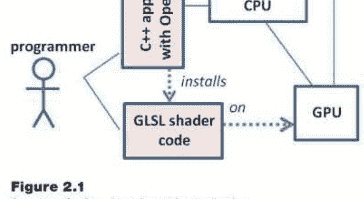

图 2.1 基于 C++ 的图形应用程序概述。

`GLSL` 是着色器语言的一个示例。着色器语言旨在图形流水线的环境中运行在 GPU 上。还有其他着色器语言，例如 `HLSL`，它与微软的 3D 框架 DirectX 工作；`GLSL` 是兼容 OpenGL 的特定着色器语言，除了 C++/OpenGL 应用代码外，我们用 GLSL 编写着色代码。

在本章的剩余部分，我们将对 OpenGL 流水线进行简单的“之旅”。读者不需要深入理解每一个细节，但应该了解各个阶段是如何协同工作的。

现代 3D 图形利用流水线，其中将 3D 场景转换为 2D 图像的过程分解为一系列步骤。OpenGL 和 DirectX 使用类似的流水线。

图 2.2 显示了 OpenGL 流水线的简化概述（未显示每个阶段，我们将学习主要阶段）。C++/OpenGL 应用程序将数据发送到顶点着色器——通过流水线处理，然后产生像素并显示在显示器上。

在着色器中定义的阶段（顶点、细分、几何和片元）在 `GLSL` 中是可编程的。C++/OpenGL 应用程序的任务之一是将 `GLSL` 程序加载到这些着色器阶段，如下所示：

1. 它使用 C++ 获取 `GLSL` 代码，从文件获取或硬编码为字符串。
2. 然后它创建 OpenGL 对象并加载 `GLSL` 到其中。
3. 最后，它使用 OpenGL 命令编译并链接对象。

在实践中，通常需要为顶点和片元阶段提供 `GLSL` 代码，而细分和几何阶段是可选的。让我们遍历整个过程，看看每个步骤发生了什么。

图形应用程序的大部分用 C++ 编写。根据程序的目的，它可以使用标准 C++ 库与最终用户交互。我们将使用几个额外的库：`GLEW`（扩展封装）、`GLM`（数学）、`SOIL2`（图像加载）和 `GLFW`（图形库）。`GLFW` 库包含一个名为 `GLFWwindow` 的类，我们可以在上面绘制 3D 场景。正如提到的，OpenGL 提供了将 `GLSL` 程序安装到可编程着色器并进行编译的命令。

`init()` 函数是放置应用程序初始化任务的地方。`display()` 方法是放置在 `GLFWwindow` 上进行绘制代码的地方。

img/5f029c1d57776416a7d2524f373d7cf_8_0.png

在此示例中，`glClear()` 命令指定了清除背景时应用的颜色值——在本例中为 (1,0,0,1)，对应红色的 RGB 值（加上透明度部分的“1”）。然后我们使用 OpenGL `glClear(GL_COLOR_BUFFER_BIT)` 填充缓冲区。

```
#include <GL/glew.h>
#include <GLFW/glfw3.h>
#include <iostream>

using namespace std;

    glClear(1.0, 0.0, 0.0, 1.0);
    glClear(GL_COLOR_BUFFER_BIT);
}

int main(void) {
    if (!glfwInit()) return EXIT_FAILURE;
    glfwWindowHint(GLFW_CONTEXT_VERSION_MINOR, 3);
    GLFWwindow* window = glfwCreateWindow(600, 600, "Chapter 2 - program 1", NULL, NULL);
    glfwMakeContextCurrent(window);
    if (glewInit() != GLEW_OK) { return EXIT_FAILURE; }
    glfwSwapInterval(1);

    init(window, 0);
        display(window, glfwGetTime());
        glfwSwapBuffers(window);
        glfwPollEvents();
    }

    glfwDestroyWindow(window);
    glfwTerminate();
    return EXIT_SUCCESS;
}
```

程序 2.1 的输出如图 2.3 所示。

这些函数的部署机制如下：

分别使用 `glfwInit()` 和 `glewInit()` 命令初始化 GLFW 和 GLEW 库。使用 `glfwCreateWindow()` 命令创建 GLFW 窗口以及关联的 OpenGL 上下文，并通过选项指定任何预定义的窗口。我们的窗口指定机器必须兼容 OpenGL 4.3 版本（"major=4" 和 "minor=3"）。`glfwCreateWindow` 命令上的参数指定了窗口的宽度和高度（以像素为单位）以及位于窗口顶部的标题。（另外两个参数设置为 `NULL`，我们没有使用它们，但它们允许全屏模式和资源共享。）通过使用 `glfwSwapInterval()` 和 `glfwSwapBuffers()` 命令启用垂直同步（VSync）——GLFW 窗口默认带有缓冲区。注意，GLFW 窗口不会自动将关联的 OpenGL 上下文设置为当前——因此，我们还调用了 `glfwMakeContextCurrent()`。


图 2.3

程序 2.1 的输出。

`main()` 包含一个非常简单的渲染循环，重复调用我们的 `display()` 函数。它还调用了 `glfwSwapBuffers()` 和 `glfwPollEvents()`，后者处理其他与窗口相关的事件（例如按键）。当 GLFW 检测到应该关闭窗口的事件时（例如用户点击右上角的“X”），循环将终止。注意，我们在 `init()` 和 `display()` 调用中包含了一个对 GLFW 窗口对象的引用；这些函数在某些情况下需要访问它。我们还在调用 `display()` 时包含了当前上下文文，这对于确保我们的动画无论使用何种计算机都能以相同的速度运行非常有用。为了实现这一目的，我们使用了 `glfwTime()`，它返回自 GLFW 初始化以来的流逝时间。

- 1 “上下文（**context**）”指的是一个 OpenGL 实例及其状态信息，其中包含颜色缓冲区等项目。
- 2 “双缓冲（**Double buffering**）”意味着有两个颜色缓冲区——一个正在显示，另一个正在渲染。在渲染完整个帧后，两个缓冲区会进行交换。双缓冲被用于减少不理想的视觉伪影。

现在是时候仔细观察程序 2.1 中的 OpenGL 调用了。考虑下面这一个：

```
glClear(GL_COLOR_BUFFER_BIT);
```

在这种情况下，所调用的 OpenGL 函数如 OpenGL 参考文档（可在网站 `https://www.opengl.org/sdk/docs` 获取）描述所示：

```
glClear(GLbitfield mask);
```


该参数引用了名为 `"GL_COLOR_BUFFER_BIT"` 的 `"GLbitfield"`。OpenGL 许多许多预定义常量（其中一些被称为枚举 `enums`）；而这一个常量引用了包含正在渲染的像素的颜色缓冲区。OpenGL 有多个颜色缓冲区，此命令会清除所有缓冲区——即，它会用一种名为“清除颜色（`clear color`）”的预定义颜色进行填充。注意，本文中的“清除（`clear`）”并不是指透明的颜色；而是指在重置（清除）缓冲区时所应用的颜色。

在调用 `glClear()` 之前紧接着调用了 `glClearColor()`。这允许我们指定当缓冲区被清除时放置在颜色缓冲区元素中的值。在这里，我们指定了 `(1,0,0,1)`，它对应于 RGBA 颜红色。

最后，当用户尝试关闭 GLFW 窗口时，我们的渲染循环退出。此时，我们的 `main()` 通过分别调用 `glfwDestroyWindow()` 和 `glfwTerminate()` 请求 GLFW 销毁窗口并终止。

我们的第一个 OpenGL 程序并没有实际绘制任何东西——它只是单一颜色填充了缓冲区。为了实际绘制东西，我们需要包含一个顶点着色器和一个片元着色器。

你可能会惊讶地发现，OpenGL 能够绘制的几种简单物体，例如点、线或三角形。这些简单物体被称为图元（`primitives`），正因如此，3D 模型是由许多三角形图元组成的。

图元由顶点（`vertices`）组成——例如，一个三角形由三个顶点组成。顶点可以来自各种来源——它们可以从文件读取并由 C++/OpenGL 程序加载到缓冲区，也可以硬编码在 C++ 代码甚至 GLSL 代码中。

在这一切发生之前，C++/OpenGL 程序必须编译并链接 GLSL 顶点和片元着色器，然后将它们加载到流水线。我们很快就会看到执行这些操作的命令。

C++/OpenGL 程序还负责告诉 OpenGL 构建三角形。我们通过使用以下 OpenGL 函数来实现：

```
glDrawArrays(GLenum mode, GLint first, GLsize count);
```

`mode` 是图元的类型——我们使用 `GL_TRIANGLES`。参数 `first` 指明从哪个顶点开始（通常是顶点 0，即第一个），并计算要绘制的顶点总数。

当 `glDrawArrays()` 被调用时，流水线中的 GLSL 代码开始执行。现在为该流水线添加一些 GLSL 代码。

第一行表示 OpenGL 版本，在此例中为 3。紧接着是一个 `"main"` 函数（正如我们所看到的，GLSL 的语法在某种程度上类似于 C++）。任何顶点着色器（vertex shader）的首要目的是是将一个顶点发送到流水线中（如前所述，它会对每个顶点执行此操作）。内置的 `gl_Position` 用于设置顶点在 3D 空间中的坐标位置，并将其发送到流水线的下一个阶段。GLSL 数据类型 `vec4` 用于存储一个 4 元元组，适用于此类坐标，其关联的四个值分别代表 X、Y、Z 以及第四个值（如果你在第 3 章中学习了这第四个值的用途，它将被设置为 1）。在这种情况下，顶点被硬编码在原点位置 `(0.0)`。

顶点通过流水线移动到栅化器，在其中它们被转换为像素（VAOs）（或更准确地说说是片元——这在稍后会描述）。最终，这些像素（片元）到达片元着色器：

```glsl
#version 430
vec4 color;
void main() {
    color = vec4(0.0, 0.0, 1.0, 1.0);
}
```

任何片元着色器的目的是设置要显示的像素的 RGB 颜色。在这种情况下，指定的输出颜色 `(0, 0, 1)` 是蓝色（第四个值 `1.0` 指定了不透明度）。注意 `"out"` 标签，它表示该变量是一个输出。（在顶点着色器中，为 `gl_Position` 指定 `"out"` 标签是没有必要的，因为 `gl_Position` 是一个预定义的输出变量。）

代码中有一个我们还没有讨论过的细节，即 `main()` 函数中的最后两行（用红色显示）。它们看起来可能有些晦涩。正如我们在第 4 章中看到的，当准备好一组数据以发送到流水线中时，它们被组织到缓冲区（buffers）中。这些缓冲区存储在顶点数组对象（VAOs）中。在我们的示例中，我们在顶点着色器中硬编码了一个单点，因此不需要任何缓冲区。然而，OpenGL 仍然每当使用着色器时至少要创建一个 VAO，即使应用程序没有使用任何缓冲区。因此这两行代码创建了所需的 VAO。

最后，是关于从顶点着色器输出顶点是如何变成片元着色器中的像素的问题。回想图 2.2，在顶点处理和像素处理之间是栅化阶段。正是在那里，图元（如点或三角形）被转换为像素集。OpenGL “点”的默认大小为一个像素，因此我们的单点被渲染为单个像素。

让我们在 `display()` 中，调用 `glDrawArrays()` 之前添加以下命令：

```cpp
glPointSize(30.0);
```

现在，当栅化器接收到来自顶点着色器的顶点时，它将设置像素颜色值，形成一个大小为 30 像素的点。结果输出如图 2.5 所示。

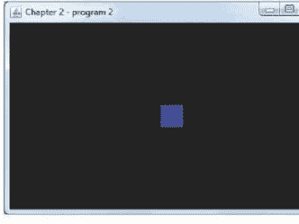

图 2.5

改变 `glPointSize`。

让我们继续检查 OpenGL 流水线的剩余部分。

我们在第 12 章中介绍细分。可编程的细分阶段是 OpenGL 最近添加的特性之一（在 4.0 版本）。它提供了一个细分器，可以生成大量的三角形（通常是网格形式），并提供了一些以各种方式操纵这些细分三角形网格的工具。例如，程序员可以像图 2.6 所示操纵细分三角形网格。

当在一个简单的形状上需要大量顶点时（例如在正方形区域或弯曲表面上），细分是非常用的。正如我们稍后看到的，它对于生成复杂地形也非常有用。在这种情况下，

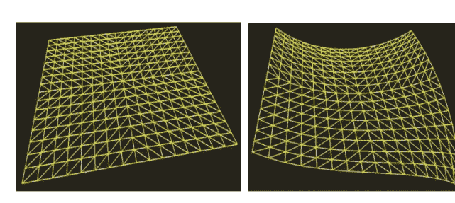

图 2.6

由细分产生的网格。

在这种情况下，让 GPU 中的细分器在硬件中生成三角形网格，比在 C++ 中进行处理要高效得多。

我们在第 13 章中介绍几何着色器阶段。顶点着色器提供了一次处理一个顶点的能力（即“逐顶点”处理），而片元着色器（正如我们所看到的）允许一次处理一个像素（“逐片元”处理），几何着色器则提供了一次处理一个图元的能力——“逐图元”处理。

回想起最常见的图元是三角形，当我们到达几何阶段时，流水线必须已经完成了将顶点组组成三角形的过程（这一过程称为图元装配）。几何着色器让程序员能够同时访问每个三角形中的三个顶点。

逐图元处理有许多用途。图元可以被改变形状，例如通过拉伸或收缩它们。某些图元可以被删除，从而在正在渲染的对象上留出“洞”——这是将简单模型转换为更复杂模型的一种方法。

几何着色器还提供了一种生成额外图元的机制。

几何着色器的一个有趣用例是为表面添加纹理，例如到表面。在这种情况下，指定的输出颜色 `(0, 0, 1)` 是蓝色（第四个值 `1.0` 指定了不透明度）。注意 `"out"` 标签，表示该变量是一个输出。（在顶点着色器中，为 `gl_Position` 指定 `"out"` 标签是没有必要的，因为 `gl_Position` 是一个预定义的输出变量。）

是关于从顶点着色器输出顶点是如何变成片元着色器中的像素的问题。回想图 2.2，在顶点处理和像素处理之间是栅化阶段。正是在那里，图元（如点或三角形）被转换为像素集。OpenGL “点”的默认大小为一个像素，因此我们的单点被渲染为单个像素。

最终，片元着色器负责设置要显示的像素的 RGB 颜色。在这种情况下，指定的输出颜色 `(0, 0, 1)` 是蓝色（第四个值 `1.0` 指定了不透明度）。注意 `"out"` 标签，表示该变量是一个输出。（在顶点着色器中，为 `gl_Position` 指定 `"out"` 标签是没有必要的，因为 `gl_Position` 是一个预定义的输出变量。）

代码中有一个我们还没有讨论过的细节，即 `main()` 函数中的最后两行（用红色显示）。它们看起来可能有些晦涩。正如我们在第 4 章中看到的，当准备好一组数据以发送到流水线中时，它们被组织到缓冲区（buffers）中。这些缓冲区存储在顶点数组对象（VAOs）中。在我们的示例中，我们在顶点着色器中硬编码了一个单点，因此不需要任何缓冲区。然而，OpenGL 仍然每当使用着色器时至少要创建一个 VAO，即使应用程序没有使用任何缓冲区。因此这两行代码创建了所需的 VAO。

正如前文所述，片元着色器的目的是为栅化后的像素分配颜色。我们已经在程序 2.2 中看到了片元着色器的示例。片元着色器简单地将其输出硬编码为特定值，因此每个生成的像素具有相同的颜色。然而，GLSL赋予了我们近乎无限的创造力以其他方式计算颜色。

一个简单的示例是根据像素的位置基于像素的输出颜色。回想在顶点着色器中，顶点的输出坐标是

# 第 2 章 - OpenGL 图形流水线 21

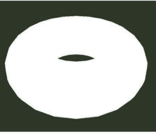

**图 2.12**

完全光栅化原形的环面（左侧），以及叠加了线框网格的环面（右侧）。

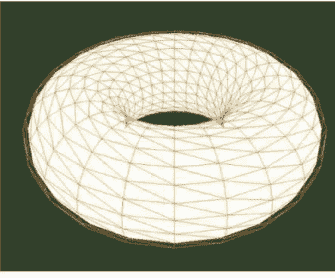

预定义的 `gl_Position` 指定。在片段着色器中，程序员可以使用一个类似的变量来访问传入的*片段*（fragment）的坐标，该变量称为 `gl_FragCoord`。我们可以修改程序 2.2 中的片段着色器，使其使用 `gl_FragCoord`（在此情况下，使用 GLSL 字段选择器语法引用其 x 分量）根据其位置设置每个像素的颜色，如下：

```glsl
#version 430
out vec4 color;
void main() {
    if (gl_FragCoord.x < 200) color = vec4(1.0,0.0,0.0, 1.0); else color = vec4(0.0,0.0,1.0, 1.0);
}
```

假设我们像第 2.1.2 节末尾那样增加了 `GL_PointSize`，则像素颜色将在渲染的点上发生变化——x 坐标小于 200 的地方为红色，否则为蓝色，如图 2.13 所示。

由于场景中的对象是在 `display()` 函数中通过 `glDrawArrays()` 命令绘制的，我们通常期望前面的对象会遮挡对后面对象的视线。这适用于对象本身，即我们期望看到对象的正面，但通常看不到背面。

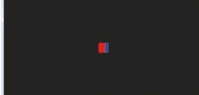

**图 2.13**

片段着色器的颜色变化。

为了实现这一点，我们需要隐藏表面消除（Hidden Surface Removal，简称 HSR）。OpenGL 可以执行多种 HSR 操作，取决于我们想要在场景中实现的效果。尽管这个阶段是不可编程的，但理解其工作原理至关重要。我们不仅需要配置它，稍后在为场景添加阴影时，还需要对其进行精细的操控。

OpenGL 通过巧妙协调使用两个缓冲区来实现隐藏表面消除：颜色缓冲区（我们之前讨论过）和深度缓冲区（有时称为 Z-buffer）。这两个缓冲区的大小都与光栅化区域的大小相同——也就是说，屏幕上的每个像素在每个缓冲区中都有对应的条目。

当场景中的各种对象被绘制时，像素颜色由片段着色器生成。像素颜色被存放在颜色缓冲区中——最终写入屏幕的是颜色缓冲区。当多个对象覆盖颜色缓冲区中的某些像素时，必须根据哪个对象距离观察者最近来决定保留哪个像素颜色。

隐藏表面消除的执行过程如下：

- 在渲染场景之前，深度缓冲区被填充代表最大深度的值。

- 当片段着色器输出像素颜色时，会计算它到观察者的距离。

- 如果计算出的距离小于深度缓冲区中存储的（该像素）距离，则：(a) 像素替换颜色缓冲区中的颜色，且 (b) 深度替换深度缓冲区中的值。否则，该像素被丢弃。

该过程被称为 Z-buffer 算法，如图 2.14 所示。

编译和运行 GLSL 代码的工作流与标准编码不同，不同在于 GLSL 编译发生在 C++ 运行期间。另一个复杂性在于，GLSL 代码并不在 CPU 上运行（它在 GPU 上运行），因此操作

在这种情况下，一种实用的技巧是将片段着色器临时替换为程序 2.2 所示的那一个。回想在那个示例中，片段着色器简单地输出特定的颜色——例如纯蓝色。如果后续输出具有正确的几何形状（尽管是纯蓝色），则顶点着色器可能是正确的，错误出现在原始片段着色器中。如果输出仍然是空白屏幕，错误更有可能出现在流水线的早期，例如顶点着色器中。

在附录 C 中，我们展示了如何使用另一个名为 Night 的调试工具，该工具适用于配备某些 Nvidia 显卡的机器。

到目前，我们的 GLSL 着色器代码一直存储在字符串中。随着程序复杂性的增加，这将变得不切实际。我们应该将着色器代码存储在文件中并读取它们。

读取文件是一项基础的 C++ ，此处不再介绍。但是，为了方便，程序 2.4 中的 `readShaderSource()` 提供了读取色器的方法。它读取着色器文本文件并返回一个字符串数组，其中每个字符串都是文件中的一行文本。然后它根据读取的行数来确定数组的大小。注意，这里 `createShaderProgram()` 替换了程序 2.2 中的版本。

在这个示例中，顶点和片段着色器代码现在分别放置在文本文件 `"vertex.glsl"` 和 `"FragShader.glsl"` 中。

```cpp
(#includes 与之前相同的包含, main(), display), init(), 与之前相同的 init(),再加上以下 ...)

#include <string>
#include <iostream>
#include <fstream>
```


```cpp
    string content;
    ifstream fileStream(filePath, ios::in);
    string line = "",

    // ... 与之前相同加上, ...
    string vertexShaderStr = readShaderSource("vertexShader.glsl");
    string fragShaderStr = readShaderSource("fragShader.glsl");

    const char *vertexShaderSrc = vertexShaderStr.c_str();
    const char *fragShaderSrc = fragShaderStr.c_str();

    glShaderSource(Shader, 1, &vertexShaderSrc, NULL);
    glShaderSource(Shader, 1, &fragShaderSrc, NULL);
    // ...elc., 之前一样构建渲染程序)
}
```

最终，我们想要绘制的不仅仅是一个点。我们想要绘制由许多顶点构成的对象。本书的大部分内容将致力于这个主题。现在，我们先从一个简单的示例开始——我们将定义三个顶点并使用它们来绘制一个三角形。

我们可以通过对程序 2.2 进行两个微小的修改（实际上是程序 2.4 中从文件中读取色器的版本）来实现：(a) 修改顶点着色器，将三个不同的顶点输出到流水线的后续阶段，(b) 修改 `glDrawArrays()` 调用以指定我们正在使用三个顶点。

在 C++OpenGL 中（特别是在 `glDrawArrays()` 调用中），我们指定了 `GL_TRIANGLES`（而不是 `GL_POINTS`），并且指定有三个顶点发送到流水线。这会导致顶点着色器运行三次，在每次迭代中，内置变量 `gl_VertexID` 都会递增（它的初始值设置为 0）。通过测试 `gl_VertexID` 的值，着色器被设计为每次执行时都输出一个不同的点。回想，这三个点随后通过光栅化阶段，产生一个填充三角形。修改显示在程序 2.5 中（代码其余部分与之前程序 2.4 所示相同）。

### 顶点着色器

```glsl
#version 430
void main(void) {
    if (gl_VertexID == 0) gl_Position = vec4(0.25, -0.25, 0.0, 1.0);
    else if (gl_VertexID == 1) gl_Position = vec4(-0.25, -0.25, 0.0, 1.0);
    else gl_Position = vec4(0.25, 0.25, 0.0, 1.0);
}
```

### C++/OpenGL 应用—在 display() 中

```cpp
glDrawArrays(GL_TRIANGLES, 0, 3);
```

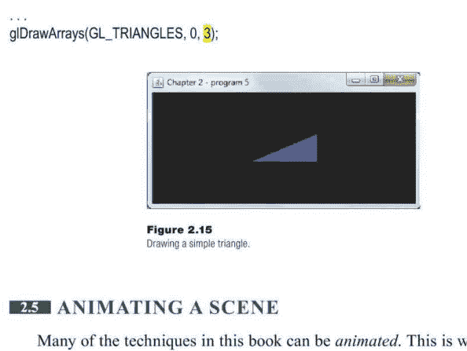

图 2.15 绘制简单的三角形。

书中的许多技术都可以被动画化。这是当场景中的物体正在移动或变化，并且重复渲染场景以实时反映这些变化。

回想第 2.1.1 节，我们构建了 `main()` 来反复调用 `init()`。因此，虽然之前的每个示例看起来像是一个单一的固定渲染场景，但实际上 `main` 函数中的循环被一次又一遍地绘制。

由于这个原因，我们的 `main()` 结构已经支持了动画。

清除深度缓冲的命令与清除颜色缓冲的命令本质上相同。

到为止，我们将所有的 C++/OpenGL 应用程序代码都放在一个名为 `"main.cpp"` 的单一文件中，并将 GLSL 着色器放在名为 `"VerShader.glsl"` 和 `"fragShader.glsl"` 的文件中。虽然我们承认将大量的应用程序代码堆在 `main.cpp` 中并不是最佳实践，但在本书中我们采用了这种惯例，因为在每一个示例中，这种做法都能非常清楚地看到与所讨论示例相关的 C++/OpenGL 代码主代码块（main block）。在整本书中，在实践中，当然应该对应用程序进行模块化处理，以适当反映应用程序所执行的任务。

然而，随着学习的进行，将会出现某些情况，我们需要修改在许多不同应用程序中都非常有用的模块。在适当的情况下，我们将这些模块移动到单独的文件中，以便于重用。例如，我们将定义一个球体（`Sphere`）类，它在许多不同的示例中都将有用，并将其分离到独立的文件中（`Sphere.cpp` 和 `Sphere.h`）。

同样，当我们遇到想要使用的函数时，会将它们放在一个名为 `"Utils.cpp"` 的文件中（以及相关的 `"Utils.h"`）。我们已经看到了几个适合移动到 `"Utils.cpp"` 中的函数：在第 2.2 节中描述的错误检测模块，以及第 2.3 节中描述的读取 GLSL 着色器程序的函数。后者特别适合重载，以便为给定应用程序中每种可能的流水线着色器组合定义一个 `"createShaderProgram()"` 函数：

- `GLuint:createShaderProgram(const char *vp, const char *fp)`

- `GLuint:createShaderProgram(const char *vp, const char *gp, const char *fp)`

- `GLuint:createShaderProgram(const char *vp, const char *TCS, const char *TES)`

- `GLuint:createShaderProgram(const char *vp, const char *TCS, const char *TES)`

上列表中的第一种支持仅使用顶点和片段着色器的程序。第二种支持使用顶点、几何和片段着色器的。第三种支持使用顶点、细分（tessellation）和片段着色器的。第四种支持使用顶点、细分、几何和片段着色器的。每种情况下接受的参数都是包含着色器代码的 GLSL 文件的路径。例如，以下调用使用了重载函数之一来编译并链接包含顶点和片段着色器的着色器流水线。完成的程序放在变量 `"renderingProgram"` 中：

```
renderingProgram = Utils::createShaderProgram("VertShader.glsl", "FragShader.glsl");
```

这些 `createShaderProgram()` 的实现都可以在随附的 CD（在 `"Utils.cpp"` 文件中）找到，并且它们也都也都包含了第 2.2 节中的错误检测模块。它们本身并没有新奇，只是为了方便起见而这样组织的。随着书中内容的深入，其他类似的函数将随着学习不断不断添加到 `Utils.cpp` 中。强烈鼓励读者检查随附 CD 上的 `Utils.cpp` 文件，并根据需要向其添加内容。

关于 `"Utils.cpp"` 文件中的函数，我们将它们实现为静态方法，这样就不实例化 `Utils` 类。根据正在开发的特定系统的架构，读者可能倾向于将它们实现为实例方法而不是静态方法，甚至作为自由函数（freestanding functions）。

我们所有的着色器都将以 `".glsl"` 扩展名命名。

OpenGL 流水线有许多细节我们在这一介绍性章节中尚未讨论。我们跳过了许多内部阶段，并省略了纹理是如何处理的。我们的目标是尽可能简单地勾勒出我们将编写代码的框架。随着学习的，我们将继续学习额外的细节。

我们还推迟了细分和几何的代码示例。在随后的章节中，我们将构建完整的系统，展示如何为每个阶段编写实用的着色器。

我们简要回顾了 `glShaderSource()` 命令的一个细节。第四个参数用于指定一个“长度数组”，该数组包含给定着色器程序中每行代码的整数字符串长度。如果此参数为空（如我们所做的那），只要字符串是以空字符结尾的，OpenGL 将自动构建此数组。我们仔细确保发送到 `glShaderSource()` 的字符串是以空字符结尾的（通过在 `createShaderProgram()` 中调用 `c_str` 函数），在文档中遇到手动构建这些数组的计数器并不常见，而不是...

在整本书中，读者有时可能想知道 OpenGL 的一个或多个上限。例如，程序员可能需要知道几何着色器可以产生的最大输出数量，或者渲染点可以指定的最大尺寸。许多此类值取决于实现，这意味着它们可以在不同机器之间变化。OpenGL 提供了一种使用 `glGet()` 命令来检索此类限制的机制，该命令根据所查询参数的类型采取不同的形式。例如，要找到最大允许的点尺寸，以下调用将最小值和最大值（针对你机器的 OpenGL 实现）放入名为 `"size"` 的 `float` 数组的前两个元素中：

```
glGetFloat(GL_POINT_SIZE_RANGE, size)
```

可以进行许多此类查询。请咨询 OpenGL 参考文档 [OP16]。

在本章中，我们尝试描述 OpenGL 调用中的每个参数。然而，随着书籍的进行，这将变得难以处理，并且当我们认为描述它会复杂问题时，我们有时不会描述。

- 2.1 修改程序 2.2 以添加动画，使绘制的点变大和缩小。提示：使用 `gl()` 函数，变量

- 2.2 修改程序 2.5 使其绘制等腰三角形（而不是图 2.1 所示的直角三角形）。

- 2.3 (项目) 修改程序 2.5 以包含第 2.3 节所示的错误检查模块。

- [GD17] Game Development Network, accessed 2018, https://www.gamedev.net/

- [NY14] R. Nystrom, “Game Loop,” in Game Programming Patterns (Genning,2014), and accessed 2018, http://gameprogrammingpatterns.com/game-loop

- [OP16] OpenGL 4.5 Reference Pages, accessed 2016, https://www.opengl.org/sdk/man/

- [SW15] G. Sellers, R. Wright Jr., and N. Haemel, OpenGL SuperBible: Comprehensive Tutorial and Reference, 7th ed. (Addison-Wesley, 2015).

### 3.1 3D 坐标系

### 3.2 点

### 3.3 矩阵

### 3.4 变换矩阵

### 3.5 向量

### 3.6 局部空间与世界空间

### 3.7 眼睛空间与合成相机

### 3.8 投影矩阵

### 3.9 Look-At 矩阵

### 3.10 构建矩阵变换的 GLSL 函数

补充说明

3D 空间通常用三个轴表示：X、Y 和 Z。这三个轴可以排列为两种配置：右手系或左手坐标系。（该名称源于轴的朝向方向，就像用右手或左手的大拇指和前两个手指直角指向时形成的方向。）

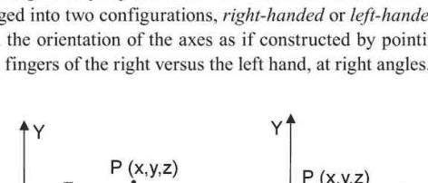

图 3.1

坐标系。

了解你的图形编程环境使用哪种坐标系是非常重要的。例如，OpenGL 中的大多数坐标系都是右手系，而在 DirectX3D 中，大多数是左手坐标系。在本书中，除非另有说明，否则我们将假设使用右手配置。

3D 空间中的点可以通过列出 X、Y、Z 值来指定，使用如 `(2, 8, -3)` 的符号。然而，事实使用齐次坐标法（homogeneous notation）来指定点更为有用，这种表示法最早在 19 世纪初被描述。齐次坐标法包含四个值。前三个值对应于 X、Y 和 Z，第四个值 W 始终是一个固定的非零值，通常为 1。因此，我们将该点表示为 `(2, 8, -3, 1)`。正如我们很快看到的，齐次坐标法将使我们的许多图形计算更加高效。

用于存储齐次 3D 坐标表示的点的合适 GLSL 数据类型是 `vec4`（"vec" 指向量，但它也可以用于点）。GLM 库包含了适当的类，用于在 C++/OpenGL 应用中创建和存储 3 元素和 4 元素（齐次）点，分别称为 `vec3` 和 `vec4`。

矩阵是数值的矩形数组，其元素通常通过下标访问。第一个下标是指行号，第二个下标是指列号，下标从 0 开始计数。我们用于 3D 图形计算的大多部分矩阵都是 4x4 大小的，如图 3.2 所示：

```
$$\begin{bmatrix} A_{00} & A_{01} & A_{02} & A_{03} \\ A_{10} & A_{11} & A_{12} & A_{13} \\ A_{20} & A_{21} & A_{22} & A_{23} \\ A_{30} & A_{31} & A_{32} & A_{33} \end{bmatrix}$$
```

图 3.2 4x4 矩阵

GLSL 语言包含一种名为 `mat4` 的数据类型，可存储 4x4 矩阵。同样，GLM 包含一个名为 `mat4` 的类，用于实例化和存储 4x4 矩阵。

单位矩阵包含所有的零，对角线线上为 1：

```
$$\begin{bmatrix} 0 & 0 & 0 & 0 \\ 0 & 1 & 0 & 0 \\ 0 & 0 & 1 & 0 \\ 0 & 0 & 0 & 1 \end{bmatrix}$$
```

任何项与单位矩阵相乘的结果保持不变。在 GLM 中，通过构造函数调用 `glm::mat4 m(1.0)` 可以在变量 `m` 中构建单位矩阵。

矩阵的转置通过交换其行和列来计算。例如：

```
$$\begin{bmatrix} A_{00} & A_{01} & A_{02} & A_{03} \\ A_{10} & A_{11} & A_{12} & A_{13} \\ A_{20} & A_{21} & A_{22} & A_{23} \\ A_{30} & A_{31} & A_{32} & A_{33} \end{bmatrix}^T = \begin{bmatrix} A_{00} & A_{10} & A_{20} & A_{30} \\ A_{01} & A_{11} & A_{21} & A_{31} \\ A_{02} & A_{12} & A_{22} & A_{32} \\ A_{03} & A_{13} & A_{23} & A_{33} \end{bmatrix}$$
```

GLM 库和 GLSL 都有转置函数：分别是 `glm::transpose(mat4)` 和 `transpose(mat4)`。

## 使用 C++ 进行 OpenGL 图形学编程

**矩阵加法**是非常直观的：

```
$$\begin{matrix} A+a & B+b & C+c & D+d \\ E+e & F+f & G+g & H+h \\ I+i & j+j & k+k & L+l \\ M+m & N+n & O+o & P+p \end{matrix} = \begin{matrix} A+a & B+b & C+c & D+d \\ E+e & F+f & G+g & H+h \\ I+i & j+j & k+k & L+l \\ M+m & N+n & O+o & P+p \end{matrix}$$
```

（任何项与单位矩阵相乘的结果保持不变。在 GLM 中，通过构造函数调用 `glm::mat4 m(1.0)` 可以在变量 `m` 中构建单位矩阵。）

矩阵的转置通过交换其行和列来计算。例如：


GLM 库和 GLSL 都有转置函数：分别是 `glm::transpose(mat4)` 和 `transpose(mat4)`。

**矩阵加法**是非常直观的：

（此处上文已翻译，逻辑一致）

任何项与单位矩阵相乘的结果保持不变。在 GLM 中，通过构造函数调用 `glm::mat4 m(1.0)` 可以在变量 `m` 中构建单位矩阵。

矩阵的转置通过交换其行和列来计算。例如：

（此处上文已翻译，逻辑一致）

齐次坐标法（homogeneous notation）将使我们的许多图形计算更加高效，正如我们很快看到的。样。

用于存储齐次 3D 坐标表示的点的合适 GLSL 数据类型是 `vec4`（"vec" 指向量，但它也可以用于点）。GLM 库包含了适当的类，用于在 C++/OpenGL 应用中创建和存储 3 元素和 4 元素（齐次）点，分别称为 `vec3` 和 `vec4`。

3D 空间通常用三个轴表示：X、Y 和 Z。这三个轴可以排列为两种配置：右手系或左手坐标系。（该名称源于轴的朝向方向，就像用右手或左手的大拇指和前两个手指直角指向时形成的方向。）


图 3.1

坐标系。

了解你的图形编程环境使用哪种坐标系是非常重要的。例如，OpenGL 中的大多数坐标系都是右手系，而在 DirectX3D 中，大多数是左手坐标系。在本书中，除非另有说明，否则我们将假设使用右手配置。

3D 空间中的点可以通过列出 X、Y、Z 值来指定，使用如 (2, 8, -3) 的符号。然而，事实使用齐次坐标法（homogeneous notation）来指定点更为有用，这种表示法最早在 19 世纪初被描述。齐次坐标法包含四个值。前三个值对应于 X、Y 和 Z，第四个值 W 始终是一个固定的非零值，通常为 1。因此，我们将该点表示为 (2, 8, -3, 1)。正如我们很快看到的，齐次坐标法将使我们的许多图形计算更加高效。

用于存储齐次 3D 坐标表示的点的合适 GLSL 数据类型是 `vec4`（"vec" 指向量，但它也可以用于点）。GLM 库包含了适当的类，用于在 C++/OpenGL 应用中创建和存储 3 元素和 4 元素（齐次）点，分别称为 `vec3` 和 `vec4`。

矩阵是数值的矩形数组，其元素通常通过下标访问。第一个下标是指行号，第二个下标是指列号，下标从 0 开始计数。我们用于 3D 图形计算的大多矩阵都是 4x4 大小的，如图 3.2 所示：

```
$$\begin{bmatrix} A_{00} & A_{01} & A_{02} & A_{03} \\ A_{10} & A_{11} & A_{12} & A_{13} \\ A_{20} & A_{21} & A_{22} & A_{23} \\ A_{30} & A_{31} & A_{32} & A_{33} \end{bmatrix}$$
```

图 3.2 4x4 矩阵

GLSL 语言包含一种名为 `mat4` 的数据类型，可存储 4x4 矩阵。同样，GLM 包含一个名为 `mat4` 的类，用于实例化和存储 4x4 矩阵。

单位矩阵包含所有的零，对角线线上为 1：

```
$$\begin{bmatrix} 0 & 0 & 0 & 0 \\ 0 & 1 & 0 & 0 \\ 0 & 0 & 1 & 0 \\ 0 & 0 & 0 & 1 \end{bmatrix}$$
```

任何项与单位矩阵相乘的结果保持不变。在 GLM 中，通过构造函数调用 `glm::mat4 m(1.0)` 可以在变量 `m` 中构建单位矩阵。

矩阵的转置通过交换其行和列来计算。例如：

```
$$\begin{bmatrix} A_{00} & A_{01} & A_{02} & A_{03} \\ A_{10} & A_{11} & A_{12} & A_{13} \\ A_{20} & A_{21} & A_{22} & A_{23} \\ A_{30} & A_{31} & A_{32} & A_{33} \end{bmatrix}^T = \begin{bmatrix} A_{00} & A_{10} & A_{20} & A_{30} \\ A_{01} & A_{11} & A_{21} & A_{31} \\ A_{02} & A_{12} & A_{22} & A_{32} \\ A_{03} & A_{13} & A_{23} & A_{33} \end{bmatrix}$$
```

GLM 库和 GLSL 都有转置函数：分别是 `glm::transpose(mat4)` 和 `transpose(mat4)`。

**矩阵加法**是非常直观的：

```
$$\begin{matrix} A+a & B+b & C+c & D+d \\ E+e & F+f & G+g & H+h \\ I+i & j+j & k+k & L+l \\ M+m & N+n & O+o & P+p \end{matrix} = \begin{matrix} A+a & B+b & C+c & D+d \\ E+e & F+f & G+g & H+h \\ I+i & j+j & k+k & L+l \\ M+m & N+n & O+o & P+p \end{matrix}$$
```

GLM 中提供了几个函数用于构建变换矩阵以及进行点矩阵乘法。一些相关操作包括：

- `glm::translate(x, y, z)` 构建一个按 `(x,y,z)` 进行平移的矩阵

- `mat4 vec4`

缩放矩阵用于改变对象的大小或使点向原点移动或远离原点。虽然在 OpenGL 中缩放一个点最初看起来可能很奇怪，但实际上缩放一个对象涉及对其点集进行扩展或收缩。

缩放矩阵将单位矩阵转换为，其中 X、Y、Z 缩放因子由 $Ax, Ay, Az$ 给出。图 3.4 显示了缩放矩阵的形式以及它与齐次点相乘后的效果；结果是一个经缩放值修改的新点。

```
$\begin{pmatrix} X' \\ Y' \\ Z' \\ 1 \end{pmatrix} = \begin{bmatrix} Sx & 0 & 0 & 0 \\ 0 & Sy & 0 & 0 \\ 0 & 0 & Sz & 0 \\ 0 & 0 & 0 & 1 \end{bmatrix} \begin{pmatrix} X \\ Y \\ Z \\ 1 \end{pmatrix}$
```

GLM 中提供了几个函数用于构建缩放矩阵以及进行点与缩放变换的乘法。一些相关操作包括：

- `glm::scale(x,y,z)` 构建一个按 `(x,y,z)` 进行缩放的矩阵

- `mat4 vec4`

缩放可以切换坐标系。例如，我们可以使用缩放来确定在给定一组右手坐标的情况下，左手坐标会是什么。从图 3.1 中我们可以看到，反转 z 坐标会在右手系和左手系之间切换，实现此目的的缩放矩阵变换为：

```
$\begin{bmatrix} 1 & 0 & 0 & 0 \\ 0 & 1 & 0 & 0 \\ 0 & 0 & -1 & 0 \\ 0 & 0 & 0 & 1 \end{bmatrix}$
```

旋转稍微复杂一点，因为在 3D 空间中旋转物体需要指定 (a) 旋转轴和 (b) 以度或弧度为单位的旋转量。

在 18 世纪中叶，数学家 Leonhard Euler 表明绕任何所需轴的旋转都可以表示为绕 X、Y、Z 轴旋转的组合 [EU7]。这三个绕相应轴的旋转角度一直被称为欧拉角。这一发现被称为欧拉定理，对我们非常有用，因为绕这三个轴的每个旋转都可以使用矩阵变换来指定。

图 3.5 显示了分别绕 X、Y、Z 轴旋转的三个旋转变换。GLM 中提供了几个函数用于构建和使用旋转矩阵，如：

- `glm:rotate(mat4, theta, x, y, z)` 构建一个绕轴 x,y,z 旋转角度 theta 的旋转矩阵。

- `mat4 * vec4`

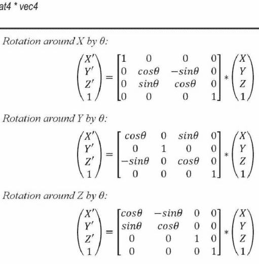

图 3.5 

旋转矩阵。

在实践中，如果直线不通过原点，使用欧拉角绕 3D 空间中的任意直线旋转物体需要几个额外的步骤。

通常情况下：

1. 平移旋转轴使其通过原点。

2. 绕 X、Y、Z 轴按适当的欧拉角旋转。

3. 撤销第 1 步的平移。

图 3.5 显示的三个旋转变换具有一个有趣的属性：逆旋转恰好等于矩阵的转置。可以通过检查之前的矩阵来验证这一点，记住 $\cos(-\theta) = \cos(\theta)$ 且 $\sin(-\theta) = -\sin(\theta)$。这个属性以后将变得非常有用。

欧拉角会在某些 3D 图形应用中产生伪影。由于某些原因，通常建议使用四元数来计算旋转。对于那些感兴趣探索四元数的读者，有很多资源（例如 [KU98]）。欧拉角足以满足我们的大部分需求。

向量指定了*大小*和*方向*。它们并不绑定到特定的位置；向量可以在不改变其所代表的内容的情况下“移动”。

标注向量有多种方法，例如在一段末端带箭头的线段，或者表示为对（大小，方向），或者表示两点之间的差。在 3D 图形中，向量经常被表示为空间中的单点，其中向量是从原点到该点的距离和方向。在图 3.6 中，向量 V（红色显示）可以通过以下方式指定：

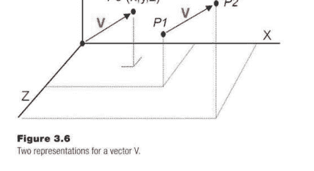

图 3.6

向量的两种表示方式。

存在许多向量操作，例如，在 GLSL 和 GLM 中，我们这样表示向量 $(x,y,z)$:

- 加法：$A + B$

- 减法：$A - B$

- 标量乘法：$sA$

- 归一化（单位向量）：$\hat{A} = \frac{A}{|A|}$

- 点积：$A \cdot B = |A||B|\cos(\theta)$

- 叉积：$A \times B = |A||B|\sin(\theta)$

在本书中，我们频繁使用点积。现在我们详细查看点积。两个向量 $A$ 和 $B$ 的点积定义为它们对应分量乘积之和：

$A \cdot B = A_xB_x + A_yB_y + A_cB_z$

点积也等于两个向量的大小与它们之间角度 $\theta$ 的余弦值的积：


$A \cdot B = |A||B|\cos(\theta)$

根据这个定义，我们可以确定向量之间的角度：

- 如果 $A \cdot B > 0$，向量方向大致相同（$\theta < 90^\circ$）。
- 如果 $A \cdot B = 0$，向量相互垂直（$\theta = 90^\circ$）。
- 如果 $A \cdot B < 0$，向量方向相反（$\theta > 90^\circ$）。

点积还有其他用途：

- 将一个向量投影到另一个向量上。
- 确定两个向量之间的角度。
- 计算图形中的光照强度（例如朗伯特模型）。

两个向量叉积的一个重要属性（我们在本书中将频繁使用）是，它产生一个垂直于原始两个向量所定义平面的法向量。

任何非共线向量都定义了一个平面。例如，考虑两个任意向量 `V` 和 `W`。由于向量可以在不改变其含义的情况下移动，可以将它们移动到使其原点重合。图 3.8 显示了由 `V` 和 `W` 定义的平面，以及它们的叉积产生的法向量 `R`。所得法向量的方向遵循右手定则，即右手手指从 `V` 弯向 `W` 时，大拇指指向法向量 `R` 的方向。

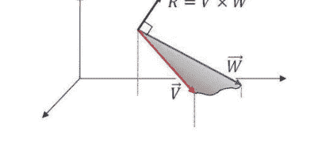

图 3.7

叉积产生法向量。

注意顺序是有重要的：`W × V` 会产生一个方向与 `R` 相反的向量。

利用叉积寻找法向量的能力在以后我们研究光照时将变得极其有用。为了确定光照

# 第 3 章 · 数学基础

为了实现效果，我们需要知道与正在渲染的模型相关的外法线。图 3.8 显示了一个由六个点（顶点）组成的简单模型示例，以及利用叉积计算来确定其中一个面的外法线的计算过程。

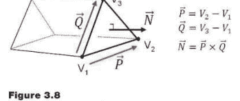

图 3.8

计算外法线。

## 3.6 局部空间与世界空间

3D 图形（使用 `OpenGL` 或任何其他框架）最用途是模拟一个三维世界，在其中放置对象，然后在显示器上查看模拟结果。放置在 3D 世界中的对象通常被建模为三角形的集合。在后的第 6 章中，我们将深入研究建模。但现在可以开始观察整个过程。

在构建物体的 3D 模型时，我们通常按照最利于描述它的方式来对齐模型。例如，在建模球体时，我们可能会将球心置于原点 `(0,0,0)`，并赋予它一个方便的半径，如 `$l$`。定义模型的空间称为其局部空间（`local space`）或模型空间（`model space`）。`OpenGL` 文档使用对象空间（`object space`）这一术语。

球体可能是较大模型的一部分，例如成为机器人的头部。机器人会在其局部/模型空间中定义。将球体模型定位到机器人模型空间可以使用缩放、旋转和平移的矩阵变换来实现，如图 3.9 所示。通过这种方式，可以分层地构建复杂模型（这将在第 4 章第 4.8 节使用矩阵栈进一步讨论）。

同样，建模后的对象通过决定该世界的朝向和尺寸，被放置在一个模拟世界中，该世界被称为世界空间（`world space`）。将对象定位并对齐到世界空间的矩阵称为模型矩阵（`model matrix`），或 `M`。

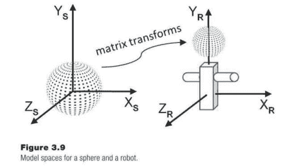

## 3.7 眼睛空间与合成相机

到目前为止，我们看到的所有变换矩阵都在 3D 空间中运行。然而，最终我们希望将我们的 3D 空间（或其部分）显示在 2D 显示器上。为了做到这一点，我们需要确定一个视角点。就像我们从特定点从特定方向观察现实世界一样，我们也必须建立一个位置和朝向作为通往虚拟世界的窗口。这个视角点被称为“视图空间”（`view space`）或“眼睛空间”（`eye space`），或者“合成相机”（`synthetic camera`）。

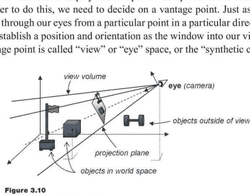

如图 3.10 和 3.12 所示，观察涉及：(a) 将相机放置在世界的某个位置；(b) 对齐相机，这通常需要维护其一组正交轴 `U/V/N`；(c) 定义视锥（`view volume`）；以及 (d) 将视锥内的对象投影到投影平面上。

`OpenGL` 包含一个永久固定在原点 `(0,0,0)` 并面向负 Z 轴的相机，如图 3.11 所示。

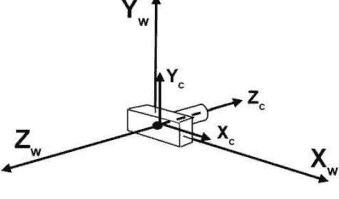

图 3.11

`OpenGL` 固定相机。

为了使用 `OpenGL` 相机，我们需要做的事情之一是*模拟*将它移动到某个期望的位置和朝向。这是通过计算世界中的对象相对于期望相机位置的位置来实现的（即它们在“相机空间”中的位置，如图 3.12 所示，由相机的 `U`、`V` 和 `N` 轴定义）。给定一个位于世界位置的 `$P_w$` 的点，我们需要一个变换将其转换为相机空间中的等效点，使其*看起来*像是我们正从期望的相机位置 `$C_w$` 观察它。我们通过计算其相机空间位置 `$P_c$` 来实现。已知 `OpenGL` 相机位置位于固定位置 `(0,0,0)`，什么种变换可以实现这一点？

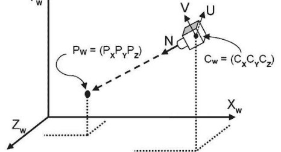

图 3.12

相机朝向。

必要的变换确定如下：

1. 将 `$P_w$` 平移其期望相机位置的反数量。
2. 通过期望相机朝向的欧拉角的反数旋转 `$P_w$`。

我们可以构建一个在一个矩阵中同时完成旋转和平移的单一变换，称为视图变换矩阵（`viewing transform matrix`），或 `V`。矩阵 `V` 是通过连接两个矩阵 `T`（一个包含期望相机位置反数的平移矩阵）和 `R`（一个包含期望相机朝向反数的旋转矩阵）产生的。在这种情况下，从右到左操作，我们首先平移世界点 `P`，然后进行旋转：

$P_c = R \cdot T \cdot P_w$

正如我们之前看到的，结合律允许我们对进行分组：

$P_c = (R \cdot T) \cdot P_w = V \cdot P_w$

通常，`V` 矩阵与矩阵 `M` 结合形成模型视图矩阵（`model-view matrix`）：

$P_c = V \cdot M$

第 3 章 · 数学基础 50

然后，位于其空间的 `$P_M$` 直接转换到相机空间：

$P_c = V \cdot M$

这种方法的优势在考虑到在复杂场景中我们只需要一个顶点时变得清晰：

$P_s = P \cdot V \cdot M$

其中 `P` 是投影矩阵。屏幕上的最终点 `$P_s$` 是：

通过这种方式，可以分层地构建复杂模型（这将在第 4 章第 4.8 节中进一步讨论）。

## 3.8 投影矩阵

现在我们已经确定了相机，可以检查投影矩阵。我们将检查的两个重要投影矩阵是 (a) 透视（`perspective`）和 (b) 正交（`orthographic`）。

### 3.8.1 透视投影矩阵

透视投影尝试让 2D 图片看起来像 3D 的，利用我们在现实世界中所看到的。近处的物体比远处的物体大，在某些情况下，现实中平行的线在绘制时并不平行。

透视是文艺复兴时期（1400-1500 年）伟大发现之一，当时艺术家开始比他们的前辈更写实地绘画。在图 3.14 中可以看到一个绝佳示例，这是卡洛·克里韦于 1486 年的作品《圣母宣告与圣埃米迪》（现收藏于国家美术馆）。

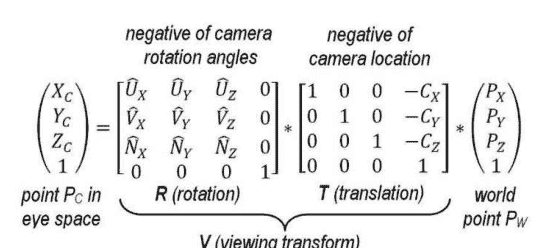

图 3.14

《圣母宣告与圣埃米迪》（奥尔维托 – 1486）。透视的使用显而易见——右侧建筑的消失线剧烈倾斜。这创造了深度和 3D 空间的幻觉。此外，前景的人比背景的人大。虽然我们今天认为这些设备是理当然的，但实现这种需要一些数学分析。

我们通过使用将平行线转换为适当非平行线的矩阵变换来实现这种效果。这种矩阵称为透视矩阵（`perspective matrix`）或透视变换，它是由视锥的四个参数构建的。这些参数是 (a) 宽高比、(b) 视场（`field of view`）、(c) 投影平面或近裁剪平面，以及 (d) 远裁剪平面。

只有位于近远裁剪平面之间的对象会被渲染。投影对象的近裁剪平面通常位于靠近眼睛或相机的位置（如图 3.15 左侧所示）。远裁剪平面合适值的选择将在第 4 章中讨论。

视场是视角空间的垂直角度。宽高比是近远裁剪平面的宽/高。由这些元素形成并如图 3.15 所示的形状称为台体（`frustum`）。

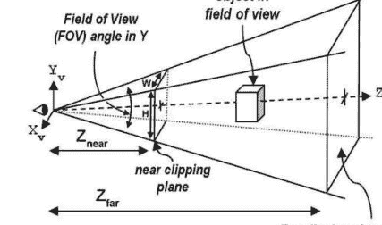

图 3.15

透视视锥或台体。

透视矩阵用于将 3D 空间中的点变换到在近裁剪平面上的相应位置。它的构建是通过首先计算值 `q`、`A`、`B` 和 `C`，然后使用这些值来构造矩阵，如图 3.16 所示（该过程在 `[FV95]` 中有推导）。

```
q = \frac{1}{\tan(fieldOfView/2)}
A = \frac{q}{aspectRatio}
B = \frac{Z_{near} + Z_{far}}{Z_{near} - Z_{far}}
C = \frac{2 * Z_{near} * Z_{far}}{Z_{near} - Z_{far}}
\begin{bmatrix} 0 & 0 & 0 \\ 0 & q & 0 \\ 0 & 0 & B \\ 0 & 0 & -1 \end{bmatrix}
```

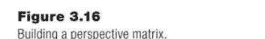

生成透视变换矩阵是一件简单的事，只需将描述的公式插入 4x4 矩阵的单元中。`GLM` 库还包含一个函数 `glm::perspective()` 用于构建透视矩阵。

### 3.8.2 正交投影矩阵

在正交投影中，平行线保持平行；也就是说，没有使用透视。相反，视体内的物体被直接投影，而不会根据它们距离相机的远近进行尺寸调整。

正交投影是一种平行投影，其中所有投影都与投影面垂直。正交矩阵通过定义以下参数来构建：(a) 相机到投影面的距离 `$Z_{near}$`，(b) 相机到远裁剪平面的距离 `$Z_{far}$`，以及 (c) `L`、`R`、`T` 和 `B` 的值，其中 `L` 和 `R` 分别对应于投影面左右边界的 X 坐标，`T` 和 `B` 分别对应于投影面上下边界的 Y 坐标。

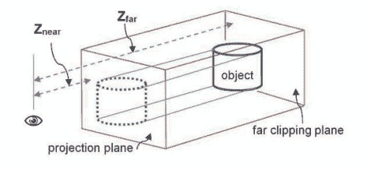

图 3.17

正交投影。

在 `[FV95]` 中推导的正交投影矩阵如图 3.18 所示。

| R-L | 0 | 0 | R+L |

|---|---|---|---|

| 0 | 2 | 0 | T+B |

| 0 | T-B | 0 | T-B |

| 0 | 0 | $Z_{far}-Z_{near}$ | $Z_{far}-Z_{near}$ |

| 0 | 0 | 0 | 1 |

图 3.18

正交投影矩阵。

并不是所有的平行投影都是正交投影，但其他的超出了本教科书的范围。

平行投影与我们观察真实世界时的看到的并不一致。但它们在许多情况下非常有用，例如绘制阴影、执行 3D 剪裁以及 CAD（计算机辅助设计）中——后者是因为它们无论物体如何放置，都能保持透视测量。无论如何，书中的绝大多数示例都使用透视投影。

## 3.9 LOOK-AT 矩阵（视点矩阵）

我们将检查最后一个变换：`look-at` 矩阵。当你想要将相机放置在某个位置并看向另一个特定位置时，这个矩阵非常方便，如图 3.19 所示。当然，可以使用我们已经看到的方法来实现这一点，但由于这是一项非常常见的操作，构建一个矩阵变换来完成它通常是有帮助的。

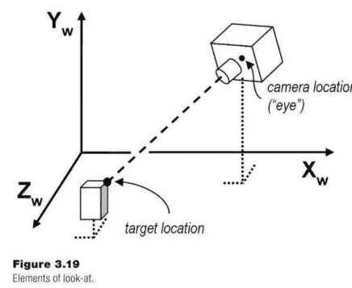

`look-at` 变换仍然需要相机的朝向。我们通过指定一个近似所需通用方向的向量（例如世界 `$\hat{Y}$` 轴）来这样做。通常，可以使用一系列叉积来生成适用于所需相机朝向的一组前向、侧向和向上向量。图 3.20 显示了计算过程，从相机位置（眼）、目标位置和初始向量 `$\vec{V}^T$` 开始构建 `look-at` 矩阵，该矩阵在 `[95]` 中有推导。

```
fwd = normalize(eye - target)
side = normalize(fwd \times \hat{Y})
up = normalize(side \times fwd)
```

随后 `look-at` 矩阵等于：

| side_x | side_y | side_z | -(side $\bullet eye) |

|---|---|---|---|

| up_x | up_y | up_z | -(up $\bullet eye) |

| -fwd_x | -fwd_y | -fwd_z | (fwd $\bullet eye) |

| 0 | 0 | 0 | 1 |

图 3.20

`look-at` 矩阵。

我们可以将此编码为一个简单的 C++ 工具函数，在给定相机位置、目标位置和“向上”向量值的情况下构建 `look-at` 矩阵。由于 `GLM` 包含了用于构建 `look-at` 矩阵的函数 `glm::lookAt()`，我们将在本书的后面直接使用该函数，特别是第 8 章生成着色器时。

## 3.10 用于构建变换的 GLSL 函数

尽管 `GLM` 包含了执行本章涵盖的许多 3D 变换的定义函数（如平移、旋转和缩放），但 `GLSL` 包含了基本的矩阵操作，如加法、连接和乘。因此，当我们需要构建 3D 变换矩阵时，有必要编写自己的 `GLSL` 工具函数。在 `GLSL` 中存储此类矩阵的适当数据类型是 `mat4`。`GLSL` 中初始化 `mat4` 矩阵的语法按列加载的：前四个值放入第一列，接下来的四个值放入下一列，依此类推，如下例所示：

```
mat4 translationMatrix = mat4(
    0.0, 0.0, 0.0, 0.0, // 注意这是最左边的列，而不是顶行
    0.0, 1.0, 0.0, 0.0,
    0.0, 0.0, 1.0, 0.0,
    tx, ty, tz, 1.0);
```

程序 3.1 包含了五个用于构建 4x4 平移、旋转和缩放矩阵的 `GLSL` 函数，每个函数对应于本章前面的公式。我们将在书的后面使用其中一些函数。

### 3.1.1 在 GLSL 中构建矩阵

```glsl
// 构建平移矩阵
mat4 translate(float x, float y, float z) {
    mat4 trans = mat4(
        1.0, 0.0, 0.0, 0.0,
        0.0, 1.0, 0.0, 0.0,
        0.0, 0.0, 1.0, 0.0,
        x, y, z, 1.0);
    return trans;
}

// 构建绕 X 轴旋转的矩阵
mat4 rotateX(float rad) {
    mat4 xrot = mat4(
        1.0, 0.0, 0.0, 0.0,
        0.0, cos(rad), -sin(rad), 0.0,
        0.0, sin(rad), cos(rad), 0.0,
        0.0, 0.0, 0.0, 1.0);
    return xrot;
}

// 构建绕 Y 轴旋转的矩阵
mat4 rotateY(float rad) {
    mat4 yrot = mat4(
        cos(rad), 0.0, -sin(rad), 0.0,
        0.0, 1.0, 0.0, 0.0,
        sin(rad), 0.0, cos(rad), 0.0,
        0.0, 0.0, 0.0, 1.0);
    return yrot;
}

// 构建绕 Z 轴旋转的矩阵
mat4 rotateZ(float rad) {
    mat4 zrot = mat4(
        cos(rad), -sin(rad), 0.0, 0.0,
        sin(rad), cos(rad), 0.0, 0.0,
        0.0, 0.0, 1.0, 0.0,
        0.0, 0.0, 0.0, 1.0);
    return zrot;
}

// 构建缩放矩阵
mat4 scale(float x, float y, float z) {
    mat4 scale = mat4(
        x, 0.0, 0.0, 0.0,
        0.0, y, 0.0, 0.0,
        0.0, 0.0, z, 0.0,
        0.0, 0.0, 0.0, 1.0);
    return scale;
}
```

## 补充说明

在本章中，我们看到了将矩阵变换应用于点的示例。之后，我们还需要将这些变换应用于向量。为了实现等同于对点应用某些矩阵变换 `M` 的向量变换，通常情况下需要计算 `M` 的逆转置，记为 `(M^{-1})^T`，并乘以该矩阵。在某些情况下，`M=(M^{-1})^T`，在这些情况下可以使用 `M`。例如，在本章中看到的基本的旋转矩阵与其转置相等，可以直接应用于向量（也可以应用于点）。

本章尚未讨论在空间中流畅移动相机的技术。这非常有用，特别是对于游戏和 CGI 电影，也适用于可视化、虚拟现实和 3D 建模。

我们并没有对所有介绍的矩阵变换完整的推导（可以在其他来源找到，如 `[FV95]`）。我们努力的是对进行 3D 图形编程所需的点、向量和矩阵操作进行简洁的总结。随着本书的进行，我们将遇到许多这些方法的实际用途。

## 练习题

3.1 修改程序 `2.5`，使其顶点着色器包含程序 `3.1` 中的一个 `buildRotate()` 函数，并将其应用于三角形的顶点。这将导致三角形从原始方向发生旋转。你不需要制作动画。

3.2（研究）在第 3.4 节末尾我们指出欧拉角在某些情况下会导致不理想的伪影。最常见的被称为“万向锁”。描述万向锁，举一个例子，并解释为什么万向锁会导致问题。

3.3（研究）避免使用欧拉角时可能出现的伪影的一种方法是使用元数。我们没有学习元数；但是，`GLM` 包含了几个元数类和函数。对元数进行一些独立学习，并熟悉相关的 `GLM` 元数功能。

## 参考文献


[CR86] C. Crivelli, 《The Annunciation, with Saint Emidius》（伦敦国家美术馆，英国伦敦，1486年），访问于2018年10月，https://www.nationalgallery.org.uk/paintings/carlo-crivelli-the-annunciation-with-saint-emidius

[EU76] L. Euler, 《Formulae generales pro translatione quae coporum rigidorum》（任意刚体平的通用公式），Novi Commentariiee scientiarum Petropolitanae 20, 1776。

[FV95] J. Foley, A. van Dam, S. Feiner, and J. Hughes, 《Computer Graphics – Principles and Practice》，第2版. (Addison-Wesley, 1995)。

[KU98] J. B. Kuipers, 《Quaternions and Rotation Sequences》(Princeton University Press, 1998)。

# 第4章 管理 3D 图形数据

## 4.1 缓冲区与顶点属性

## 4.2 Uniform 变量

## 4.3 顶点属性的插值

## 4.4 模型视图矩阵与透视矩阵

## 4.5 我们的第一个 3D 程序——一个 3D 立方体

## 4.6 渲染对象的多个副本

## 4.7 在场景中渲染多个不同的模型

## 4.8 矩阵栈

## 4.9 解决“深度冲突”（Z-Fighting）伪影

## 4.10 图形的其他选项

## 4.11 性能编码

补充说明

使用 OpenGL 渲染 3D 图像通常涉及通过 OpenGL 着色器流水线发送几个数据集。例如，为了绘制立方体等简单的 3D 对象，你至少需要发送以下内容：

- 立方体模型的顶点
- 用于控制立方体在 3D 空间中方向的变换矩阵

为了让情况稍微复杂一点，通过 OpenGL 流水线发送数据有两种方式：

- 通过缓冲区发送到顶点属性或
- 直接发送到 `uniform` 变量。

准确理解这两种机制的工作原理至关重要，以便对我们正在发送的每个项目使用适当的方法。

让我们从渲染一个简单的立方体开始。

## 使用 C++ 进行 OpenGL 计算机图形编程

### 4.1 缓冲区与顶点属性

要绘制一个对象，其顶点必须被发送到顶点着色器。顶点通常通过将它们放在 C++ 端的缓冲区中，并将该缓冲区与着色器中声明的顶点属性关联来实现。完成这一目标需要几个步骤，这些步骤只需要执行一次，而某些（如果场景是动画的）必须每帧都执行：

执行一次——通常在 `init()` 中：

1. 创建缓冲区
2. 将顶点拷贝到缓冲区中
3. 启用包含顶点的缓冲区
4. 将缓冲区与顶点属性关联
5. 启用顶点属性
6. 使用 `glDrawArrays()` 绘制对象

每帧执行——通常在 `display()` 中：

1. 启用包含顶点的缓冲区
2. 将缓冲区与顶点属性关联
3. 启用顶点属性

缓冲区在程序开始时创建，在 `init()` 中或在 `init()` 调用的函数中。在 OpenGL 中，缓冲区包含在顶点缓冲区对象（VBO）中，VBO 在 C++/OpenGL 应用中声明并实例化。一个场景可能需要许多 VBO，因此惯例做法是在 `init()` 中生成然后填充它们，以便当你的程序需要绘制一个或多个 VBO 时它们是可用的。

缓冲区以特定方式与顶点属性交互。当 `glDrawArrays()` 开始时，缓冲区中的数据从缓冲区开始顺序流向顶点着色器。如第 2 章所述，顶点着色器每个顶点执行一次。但在 3D 空间中，接收这三个值的适当顶点属性类型应为 `vec3`。然后，对于缓冲区中的每三个值，都会调用一次着色器，如图 4.1 所示。

图 4.1 VBO 与顶点属性之间的数据传输。

# 第4章 · 管理3D图形数据

OpenGL 中的相对结构称为顶点数组对象（VAO）。VAO 是 3.0 版本引入的，是组织顶点属性的一种。例如，假设我们想要显示一个立方体。在 C++ 侧，我们可以这样做：

```cpp
GLuint vao, vbo;
GenVertexArrays(1, &vao);
GenBuffers(1, &vbo);
glBindVertexArray(vao);
glBindBuffer(GL_ARRAY_BUFFER, vbo);
BufferData(GL_ARRAY_BUFFER, sizeof(vertices), vertices, GL_STATIC_DRAW);
AttribPointer(0, 3, GL_FLOAT, FALSE, 0, 0);
EnableVertexArray(0);
```

现在当我们执行 `glArrays()` 时，第 0 个 VBO 中的数据将传输到具有 `location` 0 布局限定符的顶点属性。这会将顶点发送到着色器。

# 统一变量 (Uniform Variables)

渲染场景以呈现 3D 效果需要构建适当的变换矩阵（如第 3 章描述的那样），并将它们应用于模型的每个顶点。在顶点着色器（vertex shader）中应用所需的矩阵操作效率最高，通常的习惯是从 C++/OpenGL 应用将这些矩阵通过统一变量设置到着色器中。

统一变量在着色器中使用 `uniform` 关键字进行声明。以下示例声明了用于存储模型-视图矩阵和投影矩阵的变量，适用于我们的立方体程序：

```
uniform mat4 mv_matrix;
uniform mat4 proj_matrix;
```

`mat4` 一词表示这些是 4x4 矩阵。在这里，我们将变量命名为 `mv_matrix` 用于存储模型-视图矩阵，`proj_matrix` 用于存储投影矩阵。由于 3D 变换是 4x4 的，`mat4` 是 GLSL 着色器中常用的数据类型。

从 C++/OpenGL 应用将数据发送到统一变量需要以下步骤：(a) 获取统一变量的引用，(b) 将指向目标值的指针与获取的统一引用关联。假设已链接的程序保存在变量 `renderingProgram` 中，以下代码行将指定我们将模型-视图矩阵和投影矩阵发送到立方体示例中的两个统一变量 `mv_matrix` 和 `proj_matrix`。

```
mvLoc = glUniformLocation(renderingProgram,"mv_matrix"); // 获取统一变量的位置
projLoc = glUniformLocation(renderingProgram,"proj_matrix"); // 在着色器程序中
glUniformMatrix4fv(mvLoc, 1, GL_FALSE, value_ptr(mvMat)); // 将矩阵数据发送到着色器
glUniformMatrix4fv(projLoc, 1, GL_FALSE, value_ptr(projMat)); // 统一变量
```

上面的示例假设我们已经利用 GLM 工具构建了模型-视图矩阵和投影矩阵变换 `mvMat` 和 `pMat`，将在后面进行详细讨论。它们的类型为 `mat4`（一个 GLM 类）。GLM 函数调用 `value_ptr(mat)` 返回矩阵数据的引用，`glUniformMatrix4fv()` 需要该引用将这些矩阵值传输到统一变量。

图 4.2

顶点的光栅化。

每个三角形执行一次。插值沿着连接顶点的线开始，其精度对应于像素显示密度。三角形内部空间的像素随后通过沿着连接边缘像素的水平线进行插值来填充。

### 4.4 模型-视图矩阵与投影矩阵

在 3D 中渲染对象的根本步骤是创建变换矩阵并将它们发送到统一变量中，正如我们在第 4.2 节中所的那样。我们首先定义三个矩阵：

1. 模型矩阵 (Model matrix)
2. 视图矩阵 (View matrix)
3. 透矩阵矩阵 (Perspective matrix)

模型矩阵在世界坐标空间中对物体进行定位和定向。每个模型都有自己的模型矩阵，如果模型移动，则该矩阵需要不断重建。

视图矩阵通过移动和旋转世界中的模型，来模拟位于所需位置的相机效果。回想第 2 章，OpenGL 相机位于 `(0,0,0)` 位置，并面向负 Z 轴。为了模拟该相机以某种方式移动的外，我们需要向相反方向移动物体本身。例如，将相机向右移动会导致场景中的物体看起来在向左移动；虽然 OpenGL 相机是固定的，但我们可以通过将物体向左移动，让它看起来像是我们向右移动了。

投影矩阵是一种根据所需的视锥体（frustum）提供 3D 效果的变换，如第 3 章前面所述。

理解何时计算每种矩阵也同样重要。从不改变的矩阵应该在 `init()` 中构建，但会改变的矩阵需要在 `display()` 中构建，以便每帧都进行重建。假设模型是带动画的且相机是移动的。那么：

- 每个模型在每帧都需要创建一个模型矩阵。
- 视图矩阵每帧需要创建一次（因为相机可以移动），但它对于该帧期间渲染的所有对象都是相同的。
- 投影矩阵创建一次（`init()`），使用屏幕窗口的宽度和高度（以及所需的视锥体参数），除非窗口调整了大小，否则它通常保持不变。

生成模型和视图变换矩阵的操作在 `display()` 函数中进行，如下：

1. 根据所需的位置和朝向构建视图矩阵。
2. 对于每个模型，执行以下操作：
   i. 根据模型的位置构建模型矩阵。
   ii. 将模型矩阵和视图矩阵合并为单个 `MV` 矩阵。
   iii. 将 MV 矩阵和投影矩阵发送到相应的统一变量。

技术上，没有必要将模型矩阵和视图矩阵合并为单个矩阵。然而，将投影矩阵保持分离具有某些优势。例如，在顶点着色器中，每个顶点都会乘以矩阵。由于复杂模型可能有数百甚至数千个顶点，在将它们发送到顶点着色器之前预乘模型和视图矩阵可以提高性能。稍我们将看到为了光照目的需要保持投影矩阵分离。

### 4.5 我们的第一个 3D 程序 – 3D 立方体

是时候把所有部分结合在一起了！为了构建一个渲染立方体的完整系统，我们可以复用之前在第 2 章中使用过的一些代码。具体来说，我们不再重复以下用于读取和链接的函数；事实上，回想我们将它们移动到了 `Utils.cpp` 文件中：

- `createShaderProgram()`
- `readShader()`
- `checkError()`
- `printLog()`

我们还需要一个根据指定的视野角度、宽高比以及近远平面来构建投影矩阵的工具函数。虽然我们可以很容易编写这样一个函数，但 GLM 已经包含了：`glm::perspective<field of view, aspect ratio, near plane, far plane>`。我们现在构建程序，如下：

```cpp
#include <GL/glew.h>
#include <GLFW/glfw3.h>
#include <string>
#include <iostream>
#include <fstream>
#include <cmath>
#include <glm/glm.hpp>
#include <glm/gtc/type_ptr.hpp>
#include <glm/gtc/matrix_transform.hpp>
#include "Utils.h"

using namespace std;

#define numVAOs 1
#define numVBOs 2

GLuint vao, vbo[numVBOs];

// display() 中的变量，渲染期间不需要分配
GLuint mvLoc, projLoc;
int width, height;
float aspect;
glm::mat4 pMat, vMat, mvMat;

void setupVertices(void) { // 36 个顶点，2x2x2 位于位于立方体
float vertexPositions[108] = {
    -1.00f, -1.00f, -1.00f, -1.00f, -1.00f, -1.00f, -1.00f, -1.00f, -1.00f,
    1.00f, -1.00f, -1.00f, 1.00f, -1.00f, -1.00f, -1.00f, -1.00f, -1.00f,
    1.00f, 1.00f, -1.00f, 1.00f, 1.00f, -1.00f, -1.00f, -1.00f, -1.00f,
    -1.00f, 1.00f, -1.00f, -1.00f, 1.00f, -1.00f, -1.00f, -1.00f, -1.00f,
    -1.00f, -1.00f, 1.00f, -1.00f, -1.00f, 1.00f, -1.00f, -1.00f, 1.00f,
    1.00f, -1.00f, 1.00f, 1.00f, -1.00f, 1.00f, -1.00f, -1.00f, 1.00f,
    1.00f, 1.00f, 1.00f, 1.00f, 1.00f, 1.00f, -1.00f, -1.00f, 1.00f,
    -1.00f, 1.00f, 1.00f, -1.00f, 1.00f, 1.00f, -1.00f, -1.00f, 1.00f,
    -1.00f, -1.00f, -1.00f, 1.00f, -1.00f, -1.00f, -1.00f, -1.00f, -1.00f,
    1.00f, -1.00f, -1.00f, 1.00f, -1.00f, -1.00f, -1.00f, -1.00f, -1.00f,
    1.00f, 1.00f, -1.00f, 1.00f, -1.00f, -1.00f, -1.00f, -1.00f, -1.00f,
    -1.00f, 1.00f, -1.00f, -1.00f, 1.00f, -1.00f, -1.00f, -1.00f, -1.00f,
    -1.00f, -1.00f, -1.00f, 1.00f, -1.00f, -1.00f, -1.00f, -1.00f, -1.00f,
    1.00f, -1.00f, -1.00f, 1.00f, -1.00f, -1.00f, -1.00f, -1.00f, -1.00f,
    1.00f, 1.00f, -1.00f, 1.00f, -1.00f, -1.00f, -1.00f, -1.00f, -1.00f,
    -1.00f, 1.00f, -1.00f, 1.00f, 1.00f, -1.00f, -1.00f, -1.00f, -1.00f,
};
```

# 第4章 管理 3D 图形数据

```cpp
// 将投影矩阵和MV矩阵拷贝到相应的uniform变量
glUniformMatrix4fv(mvLoc, 1, GL_FALSE, glm::value_ptr(mvMat));
glUniformMatrix4fv(projLoc, 1, GL_FALSE, glm::value_ptr(projMat));
```

```cpp
// 将VBO与顶点着色器中对应的顶点属性关联
glBindBuffer(GL_ARRAY_BUFFER, vbo[0]);
glVertexAttribPointer(0, 3, GL_FLOAT, FALSE, 0, 0);
EnableVertexAttribArray(0);
```

```cpp
// 调整OpenGL设置并绘制模型
Enable(GL_DEPTH_TEST);
glDepthFunc(GL_LEQUAL);
glDrawArrays(GL_TRIANGLES, 0, 36);
```


```cpp
int main(void) {
    if (glfwWindowShouldClose(window)) { return EXIT_FAILURE; }
    glfwWindowHint(GLFW_CONTEXT_VERSION_MAJOR, 4);
    glfwWindowHint(GLFW_CONTEXT_VERSION_MINOR, 3);
    GLFWwindow* window = glfwCreateWindow(600, 600, "Chapter 4 - program 1", NULL, NULL);
    glfwMakeContextCurrent(window);
    if (glewInit() != GLEW_OK) return EXIT_FAILURE;
    init();
    while (!glfwWindowShouldClose(window)) {
        display(window, glfwGetTime());
        glfwSwapBuffers(window);
        glfwPollEvents();
    }
    glfwDestroyWindow(window);
    glfwTerminate();
    return EXIT_SUCCESS;
}
```

```cpp
// main() 与之前保持不变
```

```cpp
// 顶点着色器 (文件名: "vertShader.glsl")
#version 430
layout (location=0) in vec3 position;
uniform mat4 mv_matrix;
uniform mat4 proj_matrix;
```

```cpp
void main(void) {
    gl_Position = proj_matrix * mv_matrix * vec4(position, 1.0);
}
```

# 使用 C++ 进行 OpenGL 图形编程

片元元色器 (文件名: "FragShader.glsl")

```cpp
#version 430
out vec4 color;
uniform mat4 mv_matrix;
uniform mat4 proj_matrix;
void main() {
    color = vec4(1.0, 0.0, 0.0, 1.0);
}
```

让我们仔细观察程序 4.1 中的代码。理解所有部分是如何运作的，以及它们是如何协同工作的，是非常重要的。

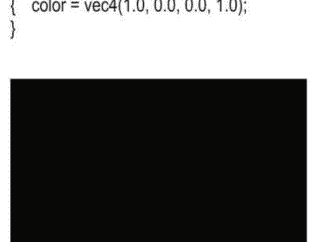

图 4.3

程序 4.1 的输出。从 (0,0,8) 观察位于 (0, -2.0) 处的红色立方体。

首先检查由 `init()` 调用的 `setUp()` 函数。在该函数的开始处，声明了一个名为 `vertexPositions` 的数组，它包含了组成立方体的 36 个顶点。起初你可能会奇怪，为什么这个立方体有 36 个顶点，而逻辑上一个立方体只需要 8 个。答案是我们需要用三角形来构建立方体，因此六个面中的每个面都需要两个三角形组成，总共 6x2=12 个三角形（见图 4.4）。由于每个三角形由三个顶点顶点指定，因此总计有 36 个顶点。每个顶点有三个值 [i,j,k]，数组中总共有 36x3=108 个值。虽然每个顶点都参与了多个三角形，但我们仍然单独指定每个顶点，因为现在我们是把每个三角形的顶点单独发送到流水线的。

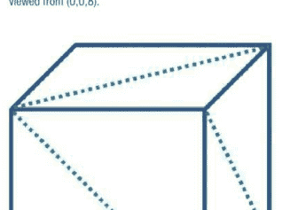

图 4.4

由三角形组成的立方体。

立方体是在自己的坐标系中定义的，(0,0,0) 为中心，其角在 x、y、z 轴上的范围从 -1.0 到 +1.0。该函数的其余部分设置了 VAO 和 VBOs（尽管只使用了一个），并将立方体顶点加载到第 0 个 VBO 缓冲区中。

注意，`init()` 函数执行了只需要完成一次的任务：读取着色器代码并构建渲染程序，以及将立方体顶点加载到 VBO（通过调用 `setupVertices()`）。注意，它还在世界中确定了立方体和摄像机的位置。在这里我们将对立方体制作动画，并观察如何移动相机，届时我们可能需要移除这种硬编码的定位。

现在来看 `display()` 函数。记住，它被调用的速率被称为帧率。也就是说，通过不断绘制和重绘场景（或帧）来实现动画。在渲染每一帧之前，通常需要清除深度缓冲区，以便隐藏表面处理能够正确进行（不清除深度缓冲区有时会导致每个表面都被移除，结果导致屏幕全黑）。在 OpenGL 中，默认情况下深度值范围从 0.0 到 1.0。通过调用 `glClear(GL_DEPTH_BUFFER_BIT)` 来清除深度缓冲区，这会填充深度缓冲区。接下来，`display()` 通过调用 `UseProgram()` 启用着色器，并将投影赋值给它们的 uniform。

顶点着色器中的乘法应用矩阵将顶点变换到相机空间（注意从右到左的连接顺序）。这些值通过 `gl_Position` 放入 OpenGL 内置输出中，然后通过流水线并被栅化器插值。

插值后的像素位置（称为片段）随后被发送到片元着色器。记住，片元着色器的主要目的是设置输出像素的颜色。与顶点着色器类似，片元着色器逐个处理像素，每个像素都有一个单独的调用。在这种情况下，它输出一个对应红色的硬编码值。

> 4 经常，这些内容可以放在 `init()` 中而不是 `display()`。然而，当绘制具有不同属性的多个对象时，必须在 `display()` 中放置一个或多个。为了简单起见，我们始终将它们放在 `display()` 中。

如前所述，尽管在这个示例中没有在片段色器中使用它们，但统一变量（uniform variables）已被包含在片段色器中。

从 C++/OpenGL 应用开始并通过流水线的数据流概览如图 4.5 所示。

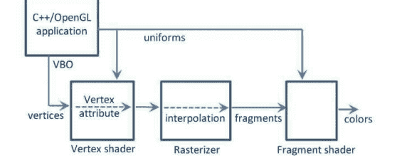

图 4.5

通过程序 4.1 的数据流。

让我们对着色器进行微调。具体来说，我们将根据每个顶点的位置为其分配一种颜色，并将该颜色放入输出的顶点属性 `varyingColor` 中。片段色器也相应地进行了修改，以接收传入的颜色（由光栅化器插值），并使用它来设置输出像素的颜色。注意，代码将位置乘以 1/2，然后加上 1/2，将值的范围从 [-1,+1] 转换为 [0,1]。同样请注意使用了常用惯例，将包含“varying”字样的变量定义的插值顶点属性赋值给程序员定义。每个着色器中的更改已高亮显示，最终输出如下。

## 修改后的顶点着色器：

```
#version 430
layout(location=0) = vec3 position;
uniform mat4 mv_matrix;
uniform mat4 proj_matrix;
out vec4 varyingColor;

void main(void) {
    gl_Position = proj_matrix * mv_matrix * vec4(position,1.0);
    varyingColor = vec4(position,1.0) * 0.5 + vec4(0.5, 0.5, 0.5, 0.5);
}
```

## 修改后的片段色器：

```
#version 430
in vec4 varyingColor;

out vec4 color;
uniform mat4 mv_matrix;
uniform mat4 proj_matrix;

void main(void) {
    color = varyingColor;
}
```

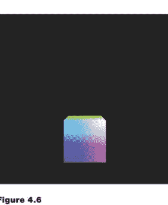

注意，由于颜色是以顶点属性（`varyingColor`）的形式从顶点色器发送的，它们也被光栅化器进行了插值！这种效果可以在图 4.6 中看到，从角到角的颜色在整个立方体内明显地平滑插值了。

注意，顶点色器中的 `out` 变量 `varyingColor` 也是片段色器中的 `in` 变量。两个着色器知道顶点色器中的哪个变量对应了片段色器中的哪个变量，因为它们在两个着色器中具有相同的名称“varyingColor”。

由于我们的 `main()` 包含渲染循环，我们可以像程序 2.6 那样，通过使用随时间变化的和平旋转构建模型矩阵来制作立方体。例如，程序 4.1 中 `display()` 函数中的代码可以修改如下（更改已高亮）：

```
glClear(GL_DEPTH_BUFFER_BIT);
glClear(GL_COLOR_BUFFER_BIT);
// 使用当前时间计算 x, y 和 z 轴的平移
mat4 mat = glm::translate(mat4(1.0f), glm::vec3(glm::sin(0.35*currentTime)*2.0f, cos(0.52*currentTime)*2.0f, sin(0.7*currentTime)*2.0f));
mat = glm::rotate(mat4(1.0f), 1.75f*float(currentTime), glm::vec3(0.0, 1.0, 0.0));
mat4 rmat = glm::rotate(mat4(1.0f), 1.75f*float(currentTime), glm::vec3(0.0, 0.0, 1.0));
// 1.75 调整旋转速度
mat *= rmat;
```

模型矩阵中的当前时间（以及各种三角函数）导致立方体看起来在空间中翻滚。注意，添加此动画说明了每次通过 `display()` 时清除深度缓冲区的重要性，以确保正确的隐藏面剔除（hidden surface removal）。它还需要如所示清除颜色缓冲区；否则立方体在移动时会留下痕迹。

`translate()` 和 `rotate()` 函数是 GLM 库的一部分。此外，注意最后一行中的矩阵乘法——`mat` 和 `rmat` 在操作中的列出顺序很重要。它计算了两个变换的级联，左侧为平移，右侧为旋转。当顶点随后被乘以此矩阵时，计算是从右到左进行的，这意味着先进行旋转，然后是平移。变换的应用顺序至关重要，改变顺序将导致不同的行为。图 4.7 显示了立方体动画后的的一些帧。

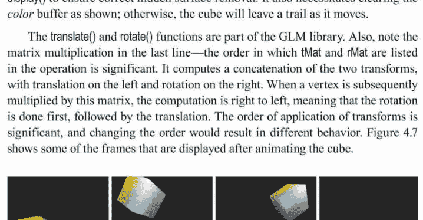

图 4.7

动画化的（“翻滚的”）3D 立方体。

## 4.6 渲染对象的多个副本

我们扩展了学习渲染多个对象的方法。在处理在单个场景中渲染多种模型之前，让我们先考虑更简单的情况：同一个模型的多次出现。例如，假设我们想扩展之前的示例，使其渲染一个由 24 个立方体组成的“群”。我们可以通过将 `display()` 中构建 MV 矩阵并绘制立方体的部分（显示为蓝色）移动到执行 24 次的循环中来实现。我们将循环变量整合到立方体的旋转和平移中，以便在每次绘制立方体时都构建不同的模型矩阵（我们还沿着 Z 轴移动了相机以便看到所有立方体）。生成的动画场景的一帧如图 4.8 所示。

```
void display(GLFWwindow window, double currentTime) {
    for (int i=0; i<24; i++) {
        float tf = currentTime + i; // tf = 时间因子，声明为 float
        mat4 tMat = glm::translate(mat4(1.0f), glm::vec3(cos(tf)*8.0, sin(tf)*8.0, 0.0));
        mat4 rMat = glm::rotate(mat4(1.0f), 1.75f, glm::vec3(0.0, 1.0, 0.0));
        mat4 rMat2 = glm::rotate(mat4(1.0f), 1.75f, glm::vec3(0.0, 0.0, 1.0));
        mat4 bMat = glm::rotate(mat4(1.0f), tf, glm::vec3(0.0, 0.0, 1.0));
        mat4 mMat = tMat * bMat;
        mat4 mvMat = vMat * mMat;

        glUniformMatrix4fv(mvLoc, 1, GL_FALSE, glm::value_ptr(mvMat));
        glUniformMatrix4fv(prLoc, 1, GL_FALSE, glm::value_ptr(prMat));

        glBindBuffer(GL_ARRAY_BUFFER, vbo[0]);
        glVertexAttribPointer(0, 3, GL_FLOAT, GL_FALSE, 0, 0);
        glVertexAttribArray(0);

        glEnable(GL_DEPTH_TEST);
        glDepthFunc(GL_LEQUAL);
        glArrays(GL_TRIANGLES, 0, 36);
    }
}
```


图 4.8

多个翻滚的立方体。

### 4.6.1 实例化 (Instancing)

实例化提供了一种机制，告诉显卡通过单个 C++/OpenGL 调用渲染对象的多个副本。这可以带来显著的性能提升，特别是当有成千上万个对象要绘制时——例如渲染字段中的许多花或军队中的许多僵尸。

我们首先将 C++/OpenGL 应用中的 `glDrawArrays()` 调用更改为 `glDrawArraysInstanced()`。现在我们可以要求 OpenGL 绘制任意数量的副本。我们可以这样指定绘制 24 个立方体：

```
glDrawArraysInstanced(GL_TRIANGLES, 0, 24
```

实例化时，顶点色器可以访问内置变量 `glInstanceID`，这是一个指向当前正在处理的对象实例整数。为了使用实例化复制之前的立方体示例，我们需要将构建不同模型矩阵的计算（之前在 `display()` 循环中）移动到顶点色器中。由于 GLSL 没有 `translate` 或 `rotate` 函数，且我们无法在着色器内部调用 GLM，因此我们需要使用程序 3.1 中的实用函数。我们还需要从 C++/OpenGL 应用将“时间因子”作为 `uniform` 传递给顶点色器。我们还需要将模型和视图矩阵传递到独立的 `uniform`，因为旋转计算应用于每个立方体的模型矩阵。包括 C++/OpenGL 应用和新顶点色器在内的修改如图 4.2 所示。

## 程序 4.2 实例化 – 24 个动画立方体

顶点着色器：

```
#version 430
layout(location=0) in vec3 position;

uniform mat4 m_matrix; // 这些是独立的模型和视图矩阵
uniform mat4 v_matrix;
uniform mat4 proj_matrix;
uniform float t; // 立方体动画和放置的时间因子
out vec4 varyingColor;

mat4 buildRotateX(float rad);
mat4 buildRotate(float rad); // (GLSL 要求声明函数)
mat4 buildRotateZ(float rad);
mat4 buildTranslate(float x, float y, float z);

void main() {
    float i = gl_InstanceID; // 基于时间因子的值，但每个实例不同
    float a = sin(2.0 * i) * 8.0; // 这些是平移的 x, y, z 分量
    float b = sin(i) * 8.0;
    float c = sin(4.0 * i) * 8.0;
    // 构建应用到此立方体模型矩阵的旋转和和平移矩阵
    mat4 tMat = glm::translate(mat4(1.0f), glm::vec3(a, b, c));
    mat4 rMat = glm::rotate(mat4(1.0f), 1.75f, glm::vec3(0.0, 1.0, 0.0));
    mat4 rMat2 = glm::rotate(mat4(1.0f), 1.75f, glm::vec3(0.0, 0.0, 1.0));
    mat4 bMat = glm::rotate(mat4(1.0f), i, glm::vec3(0.0, 0.0, 1.0));
    // 构建模型矩阵然后是模型-视图矩阵
    mat4 new_matrix = m_matrix * tMat * bMat;
    mat4 mv_matrix = v_matrix * new_matrix;

    gl_Position = proj_matrix * mv_matrix * vec4(position,1.0);
    varyingColor = vec4(position,1.0) * 0.5 + vec4(0.5, 0.5, 0.5, 0.5);
}
```

# 第 4 章 — 管理 3D 图形数据 B1

// 构建变换矩阵的工具函数（来自第 3 章）

mat4 buildTranslate(float x, float y, float z)

```cpp
{ mat4 trans = mat4(1.0, 0.0, 0.0, 0.0,
 0.0, 1.0, 0.0, 0.0,
 0.0, 0.0, 1.0, 0.0,
 x, y, z, 1.0);

return trans;
}
```

// 类似的函数还包括围绕 X、Y、Z 轴的旋转（也来自第 3 章）


## display() 函数中的 C++/OpenGL 应用

```cpp
// （构建和变换）mMat 矩阵的计算已移动到顶点着色器中。
// 不再需要在这 C++ 应用中构建 MV 矩阵。
glUniformMatrix4fv(mvLoc, 1, GL_FALSE, glm::value_ptr(vMat)); // 着色器需要 V 矩阵
timeFactor = (float)(currentTime);
// 时间因子的 uniform 变量
floc = glGetUniformLocation(renderingProgram, "fTime");
// (着色器也需要那个)
```

```cpp
glDrawArraysInstanced(GL_TRIANGLES, 0, 36, 24);
```

程序 4.2 的输出结果与之前的示例相同，见图 4.8。

实例化渲染（Instancing）使得大幅扩展对象副本的数量成为可能；在本示例中，对 100,000 个立方体进行动画对于基础的 GPU 来说仍然是行的。代码的更改——主要只是修改了几个常量以将大量的立方体分散得开——如下：

### 顶点着色器：

```cpp
float a = sin(203.0 * (8000.0) * 403.0);
float b = cos(301.0 * (4001.0) * 401.0);
float c = sin(400.0 * (6003.0) * 405.0);
..
```

### C++/OpenGL 应用

```cpp
cameraZ = 420.0; // 将相机沿 Z 轴进一步移动，以查看增加的立方体
```

```cpp
....
```

```cpp
glDrawArraysInstanced(GL_TRIANGLES, 0, 36, 10000);
```

最终输出结果所示图 4.9。

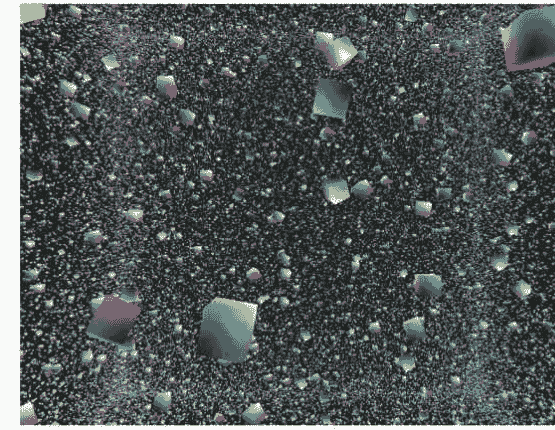

图 4.9

实例化：100,000 个动画立方体。

## 4.7 在场景中渲染多个不同的模型

要在单个场景中渲染多个一个模型，一种简单的方法是为每个模型使用一个独立的缓冲区（buffer）。每个模型都需要它自己的模型矩阵（model matrix），因此为渲染的每个模型都会生成一个新的模型-视图矩阵（model-view matrix）。此外，每个模型还需要单独调用 `glDrawArrays()`。因此在 `init()` 和 `display()` 中都需要进行更改。

另一个考虑因素是，我们是否为想要绘制的每个对象需要不同的着色器——或不同的渲染程序。事实证明，在许多情况下，我们可以为绘制的各种对象使用相同的着色器（从而使用相同的渲染程序）。通常只有当对象由不同的几何基元（例如线条而不是三角形）组成，或者涉及复杂的光照或其他效果时，我们才需要为不同对象采用不同的程序。目前情况并非如此，因此我们可以重用相同的顶点和片元着色器，只需修改我们的 C++/OpenGL 应用，在调用 `display()` 时将每个模型发送到流水线。

## 第 4 章 — 管理 3D 图形数据

让我们通过添加一个简单的金字塔继续，这样我们的场景就包含单个立方体和一个金字塔。代码相关的更改如程序 4.3 所示。突出了一些关键细节，例如我们在哪里指定一个或另一个缓冲区，以及我们在哪里指定模型中包含的顶点数量。注意，金字塔由六个三角形组成——四个在侧，两个在底部，总共 6+3=18 个顶点。

包含立方体和金字体的最终场景所示图 4.10。

### 程序 4.3 立方体与金字塔

```cpp
private void setupPositions() {
    float cubePositions[] = {
        -1.0f, -1.0f, -1.0f, -1.0f, -1.0f, -1.0f, -1.0f, -1.0f, -1.0f,
        1.0f, -1.0f, -1.0f, 1.0f, 1.0f, -1.0f, -1.0f, -1.0f, -1.0f,
        ...与之前相同，其余立方体顶点
    };
    // 具有 18 个顶点的金字塔，由 6 个三角形组成（四个侧面，两个在底部）
    float pyramidPositions[] = {
        -1.0f, -1.0f, 1.0f, 1.0f, -1.0f, -1.0f, 0.0f, -1.0f, 0.0f, // 前
        -1.0f, -1.0f, 1.0f, 1.0f, -1.0f, -1.0f, 0.0f, 0.0f, 0.0f, // 右
        -1.0f, -1.0f, 1.0f, 1.0f, -1.0f, -1.0f, 0.0f, 0.0f, 0.0f, // 后
        -1.0f, -1.0f, 1.0f, 1.0f, -1.0f, -1.0f, 0.0f, 0.0f, 0.0f, // 左
        -1.0f, -1.0f, 1.0f, 1.0f, -1.0f, -1.0f, 0.0f, 0.0f, 0.0f, // 底 1
        -1.0f, -1.0f, 1.0f, 1.0f, -1.0f, -1.0f, 0.0f, 0.0f, 0.0f, // 底 2
    };
}
```

# 第 4 章 — 管理 3D 图形数据 B1

// 构建变换矩阵的工具函数（来自第 3 章）

`mat4 buildTranslate(float x, float y, float z)`

```cpp
{ mat4 trans = mat4(1.0, 0.0, 0.0, 0.0,
 0.0, 1.0, 0.0, 0.0,
 0.0, 0.0, 1.0, 0.0,
 x, y, z, 1.0);

return trans;
}
```

// 类似的函数还包括围绕 X、Y、Z 轴的旋转（也来自第 3 章）

## display() 函数中的 C++/OpenGL 应用

```cpp
// （构建和变换）mMat 矩阵的计算已移动到顶点着色器中。
// 不再需要在这 C++ 应用中构建 MV 矩阵。
glUniformMatrix4fv(mvLoc, 1, GL_FALSE, glm::value_ptr(vMat)); // 着色器需要 V 矩阵
timeFactor = (float)(currentTime);
// 时间因子的 uniform 变量
floc = glGetUniformLocation(renderingProgram, "fTime");
// (着色器也需要那个)
```

```cpp
glDrawArraysInstanced(GL_TRIANGLES, 0, 36, 24);
```

程序 4.2 的输出结果与之前的示例相同，见图 4.8。

实例化渲染（Instancing）使得大幅扩展对象副本的数量成为可能；在本示例中，对 100,000 个立方体进行动画对于大多数基础 GPU 来说仍然是可行的。代码的更改——主要只是修改了几个常量以将大量的立方体分散得开——如下：

### 顶点着色器：

```cpp
float a = sin(203.0 * (8000.0) * 403.0);
float b = cos(301.0 * (4001.0) * 401.0);
float c = sin(400.0 * (6003.0) * 405.0);
..
```

### C++/OpenGL 应用

```cpp
cameraZ = 420.0; // 将相机沿 Z 轴进一步移动，以查看增加的立方体
```

```cpp
....
```

```cpp
glDrawArraysInstanced(GL_TRIANGLES, 0, 36, 10000);
```

最终输出结果所示图 4.9。


图 4.9

实例化：100,000 个动画立方体。

## 4.8 MATRIX STACKS

到为止，我们渲染的每个模型都是由一组顶点构建的。然而，我们通常希望通过组合较小的简单模型来构建复杂的模型。例如，一个“机器人”模型可以通过分别绘制头部、躯体、腿和手臂来创建，其中每个部分都是一个独立的模型。以这种方式构建的对象被称为层次模型。构建层次模型困难之处在于跟踪所有的模型-视图——否则机器人可能会散架！


```cpp
glDrawArraysInstanced(GL_TRIANGLES, 0, 36, 10000);
```

最终输出结果所示图 4.9。


图 4.9

实例化：100,000 个动画立方体。

## 4.7 在场景中渲染多个不同的模型

要在单个场景中渲染多个一个模型，一种简单的方法是为每个模型使用一个独立的缓冲区。每个模型都需要它自己的模型矩阵，因此为渲染的每个模型都会生成一个新的模型-视图矩阵。此外，每个模型还需要单独调用 `glDrawArrays()`。因此在 `init()` 和 `display()` 中都需要进行更改。

另一个考虑因素是，我们是否为想要绘制的每个对象需要不同的着色器——或不同的渲染程序。事实证明，在许多情况下，我们可以为绘制的各种对象使用相同的着色器（从而使用相同的渲染程序）。通常只有当对象由不同的几何基元（例如线条而不是三角形）组成，或者涉及复杂的光照或其他效果时，我们才需要为不同对象采用不同的程序。目前情况并非如此，因此我们可以重用相同的顶点和片元着色器，只需修改我们的 C++/OpenGL 应用，在调用 `display()` 时将每个模型发送到流水线。

## 第 4 章 — 管理 3D 图形数据

让我们通过添加一个简单的金字塔继续，这样我们的场景就包含单个立方体和一个金字塔。代码相关的更改如程序 4.3 所示。突出了一些关键细节，例如我们在哪里指定一个或另一个缓冲区，以及我们在哪里指定模型中包含的顶点数量。注意，金字塔由六个三角形组成——四个在侧，两个在底部，总共 6+3=18 个顶点。

包含立方体和金字体的最终场景所示图 4.10。

### 程序 4.3 立方体与金字塔

```cpp
private void setupPositions() {
    float cubePositions[] = {
        -1.0f, -1.0f, -1.0f, -1.0f, -1.0f, -1.0f, -1.0f, -1.0f, -1.0f,
        1.0f, -1.0f, -1.0f, 1.0f, 1.0f, -1.0f, -1.0f, -1.0f, -1.0f,
        ...same as before, for the rest of the cube vertices
    };
    // 具有 18 个顶点的金字塔，由 6 个三角形组成（四个侧面，以及两个在底部）
    float pyramidPositions[] = {
        -1.0f, -1.0f, 1.0f, 1.0f, -1.0f, -1.0f, 0.0f, -1.0f, 0.0f,
        -1.0f, -1.0f, 1.0f, 1.0f, -1.0f, -1.0f, 0.0f, 0.0f, 0.0f,
        -1.0f, -1.0f, 1.0f, 1.0f, -1.0f, -1.0f, 0.0f, 0.0f, 0.0f,
        -1.0f, -1.0f, 1.0f, 1.0f, -1.0f, -1.0f, 0.0f, 0.0f, 0.0f,
        -1.0f, -1.0f, 1.0f, 1.0f, -1.0f, -1.0f, 0.0f, 0.0f, 0.0f,
        -1.0f, -1.0f, 1.0f, 1.0f, -1.0f, -1.0f, 0.0f, 0.0f, 0.0f,
    };
    // (注：原文代码块在后续处有重复定义，翻译将按原文结构呈现)
}
```


`mvStack.top() *= glm::rotate(mat4(1.0f), float(currentTime), glm::vec3(0.0, 0.0, 1.0)); // 月球旋转`

```
// 让月球变小

glUniformMatrix4fv(mvLoc, 1, GL_FALSE, glm::value_ptr(mvStack.top()));

glBindBuffer(GL_ARRAY_BUFFER, vbo);

glVertexVertexPointer(0, 3, GL_FLOAT, GL_FALSE, 0, 0);

EnableVertexArray(0);

glDrawArrays(GL_TRIANGLES, 0, 36); // 绘制月球

// 从栈中移除月球缩放/旋转/位置、行星、位置和视图矩阵

mvStack.pop();

mvStack.push(mvStack.top());
```

矩阵栈操作已突出显示。有几个细节值得注意：

- 我们在模型矩阵中引入了缩放操作。我们希望月球比行星小的立方体，因此我们调用 `scale()` 来构建月球的 MV 矩阵。
- 在此例中，我们使用三角函数操作 `sin()` 和 `cos()` 来计算行星绕太阳的公转（作为平移），以及月球绕行星的运动。
- 两个缓冲区 `#0` 和 `#1` 分别包含立方体和金字塔顶点。
- 注意在 `glUniformMatrix()` 命令中使用了 `glm::value_ptr(mvMatrix.top())` 函数调用。该调用获取栈顶矩阵的值，然后将这些值发送到 uniform 变量中；在本例中为太阳、行星，然后是月球的 MV 矩阵。

顶点和片段着色器未显示——它们与上一个示例相同。我们还将金字塔（太阳）和相机的初始位置移动到了屏幕中心。

## 4.9 Z-FIGHTING（深度冲突）伪影

回想一下在渲染多个对象时，OpenGL 使用 Z-buffer 算法（见前面的图 2.14）执行隐藏表面消除。通常情况下，这解决了哪些对象表面是可见并渲染到屏幕上的，而哪些表面位于其他对象之后因此不应渲染，像素颜色选择为距离相机最近的片段颜色。

然而，可能会出现这样的情况：场景中的两个对象表面重叠并位于相同的平面上，这使得 Z-buffer 算法难以确定这两个表面中哪一个是（因为没有哪一个离相机更“最近”）。当这种情况发生时，浮点舍入误差会导致渲染表面的某些部分使用一个对象的颜色，而其他部分使用另一个对象的颜色。这种伪影被称为 Z-fighting 和深度-fighting，因为这种效果是渲染片段在 Z-buffer 中相互对应的像素条目之间“争斗”的结果。图 4.12 显示了两个重叠相同（顶部）脸面的框之间大量的 Z-fighting。

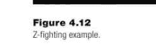

图 4.12
Z-fighting 示例。

# 第 4 章 · 管理 3D 图形数据

这种情况在创建地形或阴影时经常发生。在这些情况下，有时可以预测 Z 冲突（Z-fighting），修正此类问题的常用方法是略微移动一个对象，使得表面不再重叠。我们将在第 8 章中看到相关的示例。

Z 冲突也可能由于深度缓冲区（depth buffer）中数值的限制而引起。对于 Z 缓冲算法处理的每个像素，其深度信息的准确性受限于深度缓冲区中存储该信息的可用位数。用于构建透视的近裁剪平面和远裁剪平面之间的范围越大，具有相似（而非相等）实际深度的对象点就越有可能在深度缓冲区中被赋予相同的数值表示。因此，程序员需要选择近裁剪和远裁剪平面，以最小化地减少两个平面之间的距离，同时确保场景中所有重要的对象都在视锥内。

重要的一点是，由于透视变换的影响，近裁剪平面的值对 Z 冲突伪影概率的影响可能比对远裁剪平面进行相同变化更大。因此，建议避免选择离眼睛太近的裁剪平面。

书中之前的示例在调用 `perspective()` 时，简单地对近裁剪和平远裁剪平面使用了 0.1 和 1000 的值。这些可能需要根据你的场景进行调整。

## 4.10 图形的其他选项

OpenGL 支持多种图形类型——到目前我们已经看到了两种：`GL_TRIANGLES` 和 `GL_POINTS`。事实上，还有其他。OpenGL 支持的所有图形类型都分为三角形、线、点和补丁（patches）以下以下是完整列表：

三角形图形：

| 名称 | 描述 |
| :--- | :--- |
| GL_TRIANGLES | 本中最常见的图形类型。通过流水线的顶点形成离的三角形： |
| vertices: | 0 1 2 3 4 5 6 7 8 等. |
| triangles: | ✓ ✓ |

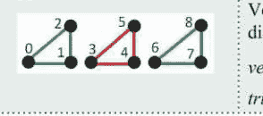

| 名称 | 描述 |
| :--- | :--- |
| GL_TRIANGLE_STRIP | 通过流水线的每个顶点都与前两个顶点高效地形成三角形： |
|  | vertices: 0 1 2 3 4 等.<br>triangles: ✓ |
| GL_TRIANGLE_FAN | 通过流水线的每对顶点都与第一个顶点形成三角形： |
|  | vertices: 0 1 2 3 4 等.<br>triangles: ✓ |
| GL_TRIANGLES_ADJACENCY | 仅用于几何着色器。允许着色器访问当前三角形中的顶点，以及额外的相邻顶点。 |
| GL_TRIANGLE_STRIP_ADJACENCY | 仅用于几何着色器。与 GL_TRIANGLES_ADJACENCY 类似，但三角形顶点像 GL_TRIANGLE_STRIP 一样重叠。 |

线图形：

| 名称 | 描述 |
| :--- | :--- |
| GL_LINES | 通过流水线的顶点形成独立的线： |
|  | vertices: 0 1 2 3 4 5 等.<br>lines: ✓ |
| GL_LINE_STRIP | 通过流水线的每个顶点都与上一个顶点高效地形成线： |
|  | vertices: 0 1 2 3 等.<br>lines: ✓ |
| GL_LINE_LOOP | 与 GL_LINE_STRIP相同，但在第一个和最后一个顶点之间也会形成一条线。 |

| 名称 | 描述 |
| :--- | :--- |
| GL_LINES_ADJACENCY | 仅用于几何着色器。允许着色器访问当前线中的顶点，以及额外的相邻顶点。 |
| GL_LINE_STRIP_ADJACENCY | 与 GL_LINES_ADJACENCY 类似，但线顶点像 GL_LINE_STRIP 一样重叠。 |

点图形：

| 名称 | 描述 |
| :--- | :--- |
| GL_POINTS | 通过流水线的每个顶点都是点。 |

补丁图形：

| 名称 | 描述 |
| :--- | :--- |
| GL_PATCH | 仅用于细分着色器。表示一组顶点从顶点着色器传递到细分控制着色器，在其中它们通常被用于将细分网格塑造成曲面。 |

## 4.11 为了性能而进行编码

随着我们 3D 场景复杂性的增加，我们将变得越来越关注性能。我们已经看到了一些为了速度而做出的编码决策，例如当我们在进行实例化（instancing）时，以及我们将昂贵的计算移动到着色器中时。

实际上，我们展示的代码已经包含了一些我们尚未讨论过的额外优化。现在我们来探索这些和其他重要的技术。

### 4.11.1 最小化动态内存分配

从性能来看，我们 C++ 代码的关键部分显然是 `display()` 函数。这是在任何动画或实时渲染期间重复调用的函数。

为了使 `display()` 函数的开销最小，一个重要的方法是避免任何需要内存分配的步骤。显然需要避免的包括：

- 实例化对象
- 声明变量

鼓励读者回顾我们开发的程序，并观察在 `display()` 函数中之前显式指出这些变量的情况。注意的是，为了减少 `display()` 函数中的开销的一种重要方式是避免任何

需要内存分配的步骤。

在 `display()` 函数之前，程序 4.1 包含了以下代码块：

```
// 构建透视矩阵

GLuint mv_Loc, projLoc;

int width, height;

float aspect;

glm::mat4 pMat, vMat, mMat, mvMat;
```

这些变量是为了之后在 `display()` 函数中使用。数学库 GLM 并不是专门为了性能关键时而设计的。

### 4.11.2 预计算透视矩阵

另一种可以减少 `display()` 函数开销的优化方法是将透视矩阵的计算移动到 `init()` 函数中。我们在第 4.5 节中提到过这种可能性。虽然这很容易做到，但有一个细微的复杂之处。

幸运的是，GLFW 可以配置为在窗口调整大时自动调用指定的回调。我们在 `main()` 中调用 `init()` 之前添加以下内容：

```
glfwWindowSizeCallback(window, window_reshape_callback);
```

第一个参数是 GLFW 窗口，第二个是 GLFW 在窗口调整大时调用的函数名称。然后我们将计算透视矩阵的代码移动到 `init()` 中，并将其复制到新的名为 `window_reshape_callback()` 的函数中。

考虑示例 4.1。如果我们重新组织代码从 `display()` 中移除透视矩阵的计算，那么修改后的 `main()`、`init()` 和新函数 `window_reshape_callback()` 将如下：

```
void init(GLwindow window) {

    // 与之前相同，加上以下三行：

    glfwGetFramebufferSize(window, &width, &height);

    aspect = (float)width / (float)height;

    pMat = glm::perspective(1.0472, aspect, 0.1f, 1000.0f);

}

void display(GLwindow window, double currentTime) {

    // 与之前相同，但删除了以下行：

    // 构建透视矩阵

    glfwGetFramebufferSize(window, &width, &height);

    aspect = (float)width / (float)height;

    pMat = glm::perspective(1.0472, aspect, 0.1f, 1000.0f);

    // 函数的其他部分保持不变

}
```

## 使用 C++ 在 OpenGL 中进行计算机图形学编程

```cpp

void window_reshape_callback(GLFWwindow window, int newWidth, int newHeight) {

    aspect = (float)newWidth / (float)newHeight; // 回调函数提供的新的宽度和高度

    glViewport(0, 0, newWidth, newHeight); // 设置帧缓冲区关联屏幕区域

    pMat = glm::perspective(1.4272f, aspect, 0.1f, 1000.0f);

}

int main(void) {

    // 与之前相同，加上以下额外调用：

    glfwSetWindowSizeCallback(window, window_reshape_callback);

    init(window);

    while (glfwWindowShouldClose(window)) {

        // 等等与之前相同

    }

}
```

本书附带光盘中的程序实现在透视矩阵计算方面都是按照这种方式组织起来，从程序 4.1 的插值颜色开始。

## 4.11.3 背面剔除 (Back-Face Culling)

提高渲染效率的另一种方法是利用 OpenGL 执行背面剔除的能力。当一个 3D 模型是完全“封闭”的时（意味着内部永远不可见，例如立方体和金字塔），事实证明外表面的某些部分总是会被同一模型的其他部分遮挡。也就是说，背离观察者的三角形是不可能被看到的（无论如何它们也会被隐藏表面移除算法覆盖），因此没有理由对它们进行光栅化或渲染。

我们可以使用命令 `glEnable(GL_CULL_FACE)` 来让 OpenGL 识别并“剔除”（不渲染）背向摄像机的三角形。我们也可以通过 `glDisable(GL_CULL_FACE)` 禁用面剔除。默认情况下，面剔除是禁用的，因此如果你想让 OpenGL 剔除背面三角形，必须手动启用它。

当启用面剔除时，只有当默认三角形是面向的时才会被渲染。此外，如果从 OpenGL 相机观察，三角形的顶点按逆时针方向排列（基于它们在缓冲区中定义的顺序），则该三角形被视为面向的。顶点按顺时针排列的三角形（从 OpenGL 相机观察）是背面的，且不会被渲染。这种“面向的”的逆时针定义有时被称为**绕序 (winding order)**，可以使用函数 `glFrontFace(GL_CCW)` 显式设置为逆时针（默认），或 `glFrontFace(GL_CW)` 设置为顺时针。同样，可以显式设置渲染面向的还是背面的三角形。实际上，为了这个目的，我们指定哪些是不需要渲染的——即哪些是被“剔除”的。我们可以指定要剔除哪些三角形（尽管在启用了剔除的情况下这是没有必要的），因为默认的剔除是 `glCullFace(GL_BACK)`。或者，我们可以通过将 GL_BACK 分别替换为 GL_FRONT 或 GL_FRONT_AND_BACK，来指定剔除面向三角形或剔除所有背面三角形。

正如我们在第 6 章中看到的，模型的设计通常使得外表面由具有相同绕序的三角形组成（大多数是逆时针的），这样如果启用了剔除，默认情况下摄像机将渲染模型外表面的部分。由于默认 OpenGL 假设绕序是顺时针，如果模型被设计为以顺时针绕序显示，则由程序员调用 `glFrontFace(GL_CW)` 来考虑这种已启用的背面剔除。

注意，在 GL_TRIANGLE_STRIP 的情况下，每个三角形的绕序是交替的。OpenGL 通过在构建每个后续三角形时“翻转”顶点序列来补偿这一点，如下：0-1-2, 2-1-3, 2-3-4, 4-3-5, 4-5-6，依此类推。

背面剔除通过确保 OpenGL 不花费时间光栅化和渲染非预期的表面来提高性能。我们在本章看到的大多数示例都很小，因此没有动力开启面剔除（例外是图 4.9 所示的示例，具有 100,000 个即时动画立方体，在某些系统上可能会带来性能挑战）。在实践中，大多数 3D 模型都是“封闭”的，因此习惯做法是通过如下方式修改 `display()` 函数在程序 4.3 中启用背面剔除：

```cpp

void display(GLFWwindow* window, double currentTime) {

    glEnable(GL_CULL_FACE);

    // 绘制立方体

```

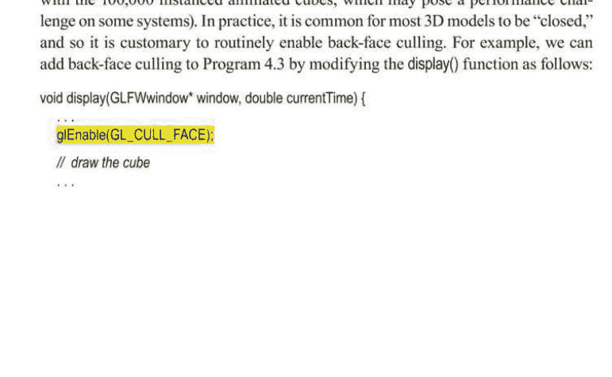

```cpp

glEnable(GL_DEPTH_TEST);

glDepthFunc(GL_LEQUAL);

glFrontFace(GL_CW);    // 立方体顶点具有顺时针绕序

glDrawArrays(GL_TRIANGLES, 0, 36);

// 绘制金字塔

glEnable(GL_DEPTH_TEST);

glDepthFunc(GL_LEQUAL);

glFrontFace(GL_CCW);    // 金字塔顶点具有逆时针绕序

glDrawArrays(GL_TRIANGLES, 0, 36);
```


在使用面剔除时正确设置绕序是非常重要的。错误的设置（如 `GL_CW`）可能会导致渲染内部而不是外部。

## 补充说明

我们还有其他类型的数据需要学习，以及如何发送到流水线中。其中一种是**纹理 (texture)**，它包含了用于“绘制”场景对象的图像数据（如照片）。我们将在第 5 章学习纹理。另一个我们将进一步学习的重要缓冲区是深度缓冲区（depth buffer）。当我们在第 8 章学习阴影时，它将变得重要。

## 习题

- 4.1 (项目) 修改程序 4.1，将立方体替换为其他 3D 形状。确保在 `glDrawArrays()` 命令中正确指定顶点数量。
- 4.2 (项目) 在程序 4.1 中，“视图”矩阵在 `display()` 函数中仅用摄像机位置的负值定义：将此代码替换为图 3.13所示所示的实现。这允许你通过指定摄像机位置和三个方向轴来定位摄像机。你会发现有存储第 3.7 节描述的向量 U、V、N。然后，尝试不同的摄像机视角，观察渲染的立方体的外观。
- 4.3 (项目) 修改程序 4.4，包含第二个“行星”，即练习 4.1 中的自定义 3D 形状。确保你的新行星轨道与现有行星不同，以免发生碰撞。
- 4.4 (项目) 修改程序 4.4，使“视图”矩阵使用“look-at”函数构建（如第 3.9 节所述）。然后，尝试将“look-at”参数设置为各个位置，例如看向太阳（在这种情况下场景应该正常）、看向行星或看向月球。
- 4.5 (研究) 提出 `glCullFace(GL_FRONT_AND_BACK)` 的实际用途。

## 参考文献

- [BL16] Blender, The Blender Foundation, 2018年访问，https://www.blender.org/
- [HT16] J. Hastings-Trew, JHT's Planetary Pixel Emporium, 2018年访问，http://planetpixelemporium.com/

102 使用 C++ 的 OpenGL 计算机图形学编程

[MA16] Maya, AutoDesk, Inc., 访问2018年10月，http://www.autodesk.com/products/maya/overview

[NA16] NASA 3D Resources, 访问2018年10月，http://nasa3d.arc.nasa.gov/

[OL16] Legacy版 OpenGL, 访问2016年7月，https://www.opengl.org/wiki/Legacy_OpenGL

[SW15] G. Sellers, R. Wright Jr., and N. Haememel, OpenGL SuperBible: Comprehensive Tutorial and Reference, 第7版. (Addison-Wesley, 2015).

# 第 5 章

## 纹理映射

5.1 加载纹理图像文件.................................................................... 104
5.2 纹理坐标....................................................................................... 106
5.3 创建纹理对象............................................................................... 108
5.4 构建纹理坐标...................................................................... 109
5.5 将纹理坐标加载到缓冲区........................................................... 110
5.6 在着色器中使用纹理：采样器变量和纹理单元................................ 111
5.7 纹理映射：示例程序...................................................................... 112
5.8 多级纹理（Mipmapping）...................................................................................... 114
5.9 各异性过滤....................................................................................... 119
5.10 封装与平铺........................................................................................... 120
5.11 透视畸变...................................................................................... 122
5.12 纹理 - 其他 OpenGL 细节................................................................ 124
补充说明.................................................................................................... 125

纹理映射是将图像叠加在栅格化模型表面的技术。它是为渲染场景添加真实感最基础且最重要的方法之一。

纹理映射如此重要，以至于有了硬件支持，能够实现极高的性能，从而达到实时写实的效果。纹理单元（Texture Units）是专为纹理化设计的硬件组件，现代显卡通常包含几个纹理单元。

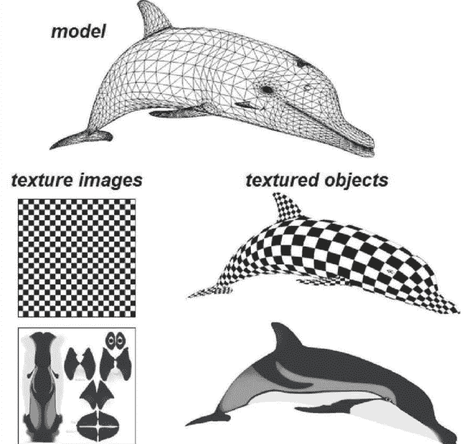

**图 5.1**
使用两种不同的图像对海豚模型进行贴纹 [TU16]。

## 5.1 加载纹理图像文件

在 OpenGL/GLSL 中高效地完成纹理映射需要协调多个数据集和机制：

- 用于存储纹理图像的纹理*对象*（在本章中我们只考虑 2D 图像）
- 一个特殊的统一*采样器*（sampler）变量，以便顶点着色器可以访问纹理
- 用于存储纹理坐标的缓冲区
- 用于将纹理坐标传递到流水线中的顶点属性
- 显卡上的纹理单元

纹理图像可以是任何东西的图片。只要它是人造或自然界存在的物体，例如布料、草地或行星表面；或者是一个几何图案，例如图 5.1 中的棋盘格。在游戏和动画电影中，纹理图像通常用于绘制角色面部和衣服，或如图 5.1 中海豚的皮肤。

图像通常存储在图像文件中，如 `.jpg`、`.png`、`.gif` 或 `.tif`。为了让 OpenGL 流水线中的着色器可以使用纹理图像，我们需要从图像中提取颜色并将它们放入 OpenGL 纹理对象（一种用于存储纹理图像的内置 GLStructure）中。

许多 C++ 库可读取和处理图像文件。流行的选择有 C、Boost GL 和 Magick++。我们选择使用专门为 OpenGL 设计的库 `SOIL` [SO17]，它基于非常流行但现在已过时的库 SOIL 库。`SOIL2` 的安装步骤见附录 A 和 B。

我们用于将纹理加载到 OpenGL 程序中的通用步骤是：(a) 使用 `SOIL2` 实例化 OpenGL 纹理对象并将数据从图像文件读取其中，(b) 调用 `glBindTexture()` 使新创建的纹理对象变为激活，(c) 使用 `glTexParameterf()` 函数调整纹理设置。结果是当前可用 OpenGL 纹理对象的整数 ID。

对对象进行贴纹从声明一个 `GLuint` 类型的变量开始。正如我们所见，这是一种用于引用 OpenGL 对象的整数 ID 的 OpenGL 类型。接下来，我们调用 `SOIL_load_OGL_texture()` 来实际生成纹理对象。`SOIL_load_OGL_texture()` 函数接受图像文件作为其参数之一（其他参数稍后描述）。这些步骤实现如下：

```
GLuint loadTexture(const char *texturePath) {

    GLuint textureID;

    textureID = SOIL_load_OGL_texture(texturePath, SOIL_AUTO, SOIL_CREATE_NEW_ID, SOIL_FLAG_INVERT_Y);

    if (SOIL_get_error() != 0) cout << "<< not find texture file >>" << texturePath << endl;

    return textureID;

}
```

我们将经常使用此函数，因此将其添加到我们的 `Utils.cpp` 工具类中。然后 C++ 程序将调用上述函数来创建：

```cpp
GLuint myTexture = Utils::loadTexture("image.jpg");
```

结果是当前可用纹理对象的整数 ID。支持多种图像类型。

## 5.2 纹理坐标

现在我们已经将纹理加载到 OpenGL 中，需要指定如何应用纹理。纹理映射要求为每个顶点提供纹理坐标。为了使用纹理映射，我们将设置两个缓冲区：一个用于顶点（每个包含三个分量 x,y,z），另一个用于相应的纹理坐标（包含两个分量 s 和 t）。每次顶点调用都会接收一个顶点，由其空间坐标和相应的纹理坐标组成。纹理坐标大多数是二维的（OpenGL 支持其他维度，但我们在此不进行介绍）。假设图像是矩形的，左下角为 (0,0)，右上角为 (1,1)。因此，纹理坐标的理想值应在 [0,1] 范围内。

考虑图 5.2 所示的示例。记得，立方体模型是由三角形构建的。立方体一个侧面的四个角被高亮，但请记住需要三角形来指定每个正方形面。该立方体侧面的六个顶点的纹理坐标与其顶点对的左上和右下角列在一起。还显示了纹理图像。通过 s 和 t 索引的纹理坐标将图像的部分（纹理像素 texels）映射到模型正面的栅格像素上。注意，顶点之间的所有像素都用图像中中间的纹理像素绘制了。这是因为纹理坐标是以顶点属性发送到片段着色器的，因此它们像顶点本身一样也会被插值。


图 5.2
纹理坐标。

¹这是 OpenGL 纹理假设的方向。然而，这与许多标准图像文件格式存储的图像方向不同，后者的原点位于左上。通过垂直翻转图像来重新定向以符合 OpenGL 预期的格式，这是通过我们在 `loadTexture` 函数中调用 `SDL_load_GL_texture` 时通过指定 `SDL_FLAG_INVERT_Y` 参数实现的。

在本示例中，为了说明目的，我们刻意指定了导致表面绘制异常的纹理坐标。如果你仔细观察，还会发现图像看起来略微拉伸——这是因为纹理图像的宽高比与相对于给定坐标的立方体面的宽高比不匹配。

对于立方体或金字塔等简单模型，选择纹理坐标相对容易。但对于具有大量三角形的弯曲模型，手动确定它们并不现实。对于球体或环面等曲线几何形状，纹理坐标可以通过算法或数学方法计算。对于使用 Maya [MA16] 或 Blender [BL6] 等建模工具构建的模型，这些工具提供了“UV 映射”（超出本书范围）来使这项任务变得更容易。

让我们回到渲染金字塔，这次用砖块图像对其进行纹理化。我们需要指定：(a) 引用纹理的整数 ID，(b) 模型顶点的纹理坐标，(c) 用于存储纹理坐标的缓冲区，(d) 顶点着色器可以接收并通过流水线传递纹理坐标的顶点属性，(e) 用于存储纹理对象的纹理单元，以及 (f) 在 GLSL 中访问纹理单元的均匀采样器变量（uniform sampler variable），我们稍后会。这些将在后续章节中描述。

## 5.3 创建纹理对象

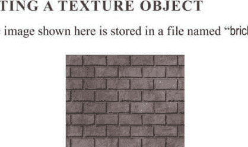

假设此处显示的图像存储在名为“brick1.jpg”的文件中 [LU16]。

如之前所示，我们可以通过如下调用 `loadTexture()` 函数来加载此图像：

```
GLuint brickTexture = Utils::loadTexture("brick1.jpg");
```

记得纹理对象通过整数 ID 标识，因此 `brickTexture` 的类型为 `GLuint`。

## 5.4 构建纹理坐标

我们的金字塔有四个三角形面和一个底部的正方形。尽管在几何上这只需要五个 (5) 个点，但我们一直使用三角形渲染它。这要求侧面需要四个三角形，正方形底部需要两个三角形，总共六个三角形。每个三角形有三个顶点，因此模型中必须指定 6x3=18 个顶点。

我们已经在程序 4.3 的浮点数组 `pyramidPositions` 中列出了金字塔的几何顶点。有很多方法可以调整我们的纹理坐标以便将砖块画在金字塔上。一种简单（尽管不完美）的方法是将图像的顶部中心对应金字塔的顶点，如下：

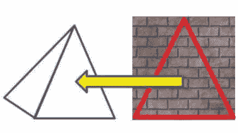

我们可以对四个三角形面执行此操作。我们还需要绘制金字塔底部的正方形，它由两个三角形组成。一种简单合理的方法是使用图片的整个区域对其进行纹理化（金字塔已向后倾斜并坐在侧面上）：

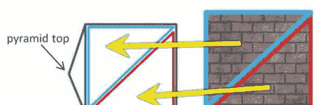

对程序 4.3 中金字塔的前八个顶点使用这种简单的策略，对应的顶点和纹理坐标集如图 5.3 所示。

| 顶点 | 纹理坐标 |
|---|---|
| (-1.0, -1.0, 1.0) | (0, 0) // 前面 |
| (1.0, -1.0, 1.0) | (1, 0) |
| (0, 1.0, 0) | (.5, 1) |
| (1.0, -1.0, -1.0) | (0, 0) |
| (1.0, -1.0, -1.0) | (1, 0) // 右面 |
| (0, 1.0, 0) | (.5, 1) |
| (1.0, -1.0, -1.0) | (0, 0) // 后面 |
| (-1.0, -1.0, -1.0) | (1, 0) |
| (0, 1.0, 0) | (.5, 1) |
| 等等 | |

**图 5.3**
金字塔的纹理坐标（部分列表）。

## 5.5 将纹理坐标加载到缓冲区

我们可以以类似于之前加载顶点的方式将纹理坐标加载到 VBO 中。在 `setupVertices()` 中，我们添加以下纹理坐标的声明：

```
float pyrTexCoords[36] = {

    { 0.0f, 0.0f, 1.0f, 0.5f, 1.0f, 0.0f, 0.0f, 0.5f, 1.0f, 1.0f, //顶部和右面

    { 0.0f, 0.0f, 1.0f, 0.5f, 1.0f, 0.0f, 0.0f, 0.5f, 1.0f, 0.0f, //后面和左面

    { 0.0f, 0.0f, 1.0f, 0.5f, 1.0f, 1.0f, 0.0f, 0.5f, 1.0f, 0.0f }; // 底三角形

};
```

然后，在创建至少两个 VBO（一个用于顶点，一个用于纹理坐标）之后，添加以下代码将纹理加载到 vbo1：

```
glBindBuffer(GL_ARRAY_BUFFER, vbo[1]);

glBufferData(GL_ARRAY_BUFFER, sizeof(pyrTexCoords), pyrTexCoords, GL_STATIC_DRAW);
```

## 5.6 在着色器中使用纹理：采样器变量和纹理单元

为了最大化性能，我们希望在硬件中执行纹理化。这意味着我们的片段着色器需要一种访问在 C++/OpenGL 应用中创建的纹理对象的方法。这种机制是通过为显卡的纹理单元设计的特殊 GLSL 采样器来从纹理对象中“采样”像素。在着色器中声明采样器很容易——将其命名为 `"samp"`。`layout(binding=0)` 部分指定该采样器与纹理单元 0 关联。纹理单元（以及关联的采样器）可以用于采样任何纹理对象，`display()` 函数需要指定当前帧采样哪个纹理单元。例如：

```
glActiveTexture(GL_TEXTURE_0);

glBindTexture(GL_TEXTURE_2D, brickTexture);
```

可用的纹理单元取决于显卡提供的数量。根据 OpenGL API，OpenGL 4.5 要求每个着色阶段至少有 16 个，所有阶段至少 8 个。在本示例中，我们通过指定 `GL_TEXTURE0` 激活了第 0 个纹理单元。为了实际执行纹理化，我们需要修改片段着色器的输出。这次，我们需要使用从顶点着色器（光栅化器）接收的插值纹理坐标，通过调用 `texture()` 函数来采样纹理对象：

```
in vec2 tc;

// 纹理坐标

color = texture(samp, tc);
```

## 5.7 纹理映射：示例程序

程序1 将之前的步骤合并到一个程序。带有砖块图像的金字塔结果如图 5.4 所示。两个旋转（代码列表中未显示）被添加到金字塔的模型矩阵中以露出底部。

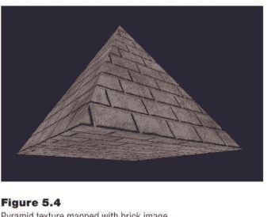

现在只需通过更改 `loadTexture()` 调用中的文件名，即可将砖块纹理替换为其他图像。例如，如果我们将 "brick1.jpg" 替换为图像 "ice.jpg" [LU16]，就会得到如图 5.5 所示的结果。

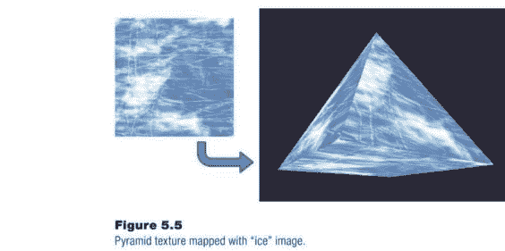

### 程序1 带纹理的金字塔

```C++/OpenGL 应用
#include <SOIL2/soil2.h>

// 其他包含如之前

...

#define numVAOs 1

#define numVBOs 2
```


```
// 相机位置、渲染程序、VAOs 和 VBOs 的变量如之前
...
```
// display 函数的变量分配与之前
// `GLuint` `brickTexture`;

```cpp
void setupVertices(void) {
    float pyramidPositions[54] = { /* 程序 4.2 中列出的数据 */ };
    float pyTexCoords[36] = {
        0.0f, 0.0f, 0.0f, 0.5f, 1.0f, 0.0f,
        0.0f, 0.0f, 1.0f, 0.5f, 1.0f, 0.0f,
        0.0f, 0.0f, 1.0f, 1.0f, 1.0f, 0.0f
    };
    // ... 生成 VAO 和至少两个 VAOs，然后如下加载缓冲区：
    glBindBuffer(GL_ARRAY_BUFFER, vbo[0]);
    glBufferData(GL_ARRAY_BUFFER, sizeof(pyramidPositions), pyramidPositions, GL_STATIC_DRAW);
    glBindBuffer(GL_ARRAY_BUFFER, vbo[1]);
    glBufferData(GL_ARRAY_BUFFER, sizeof(pyTexCoords), pyTexCoords, GL_STATIC_DRAW);
}
```

```cpp
void init(GLFWwindow window) {
    // 渲染程序、相机和对象位置设置如之前
    brickTexture = Utils::loadTexture("brick1.jpg");
}
```

```cpp
void display(GLFWwindow window) {
    // 背景颜色、深度缓冲区、渲染程序、M, V, MV 和 PROJ 矩阵设置如之前
    glBindBuffer(GL_ARRAY_BUFFER, vbo[0]);
    glVertexAttribPointer(0, 3, GL_FLOAT, GL_FALSE, 0, 0);
    glEnableVertexAttrib(0);
    glBindBuffer(GL_ARRAY_BUFFER, vbo[1]);
    glVertexAttribPointer(1, 2, GL_FLOAT, GL_FALSE, 0, 0);
    glEnableVertexAttrib(1);
    glActiveTexture(GL_TEXTURE_0);
    glBindTexture(GL_TEXTURE_2D, brickTexture);
    glEnable(GL_DEPTH_TEST);
    glDepthFunc(GL_LEQUAL);
    glDrawArrays(GL_TRIANGLES, 0, 18);
}
```
// main(s) 如之前

# 顶点着器 (Vertex shader)

```cpp
#version 430
layout (location=0) in vec3 pos;
layout (location=1) in vec2 tc;
out vec2 texCoord; // 输出到光栅化用于插值的纹理坐标
uniform mat4 mv_matrix;
uniform mat4 proj_matrix;
layout (binding=0) uniform sampler2D samp; // 顶点着器中未使用

void main(void) {
    gl_Position = proj_matrix * mv_matrix * vec4(pos,1.0);
    tc = texCoord;
}
```

# 片元色器 (Fragment shader)

```cpp
#version 430
in vec2 tc; // 插值后的输入纹理坐标
out vec4 color;
uniform mat4 mv_matrix;
uniform mat4 proj_matrix;
layout (binding=0) uniform sampler2D samp;

void main(void) {
    color = texture(samp,tc);
} 
```

## 5.8 级真映射 (MIPMAPPING)

纹理映射通常会在渲染图像中产生各种不良的伪影。这是因为纹理图像的分辨率或宽高比很少与场景中被纹理化的区域相匹配。

当图像分辨率低于绘制区域时，就会出现一种常见的伪影。在这种情况下，图像需要被拉伸以覆盖该区域，导致变得模糊（并可能失真）。取决于纹理的性质，有时可以通过不同的分配纹理坐标来对抗这种现象，使得应用纹理时所需的拉伸更少。另一种解决方案是使用更高分辨率的纹理图像。

相反的情况是图像纹理的分辨率大于绘制区域。这可能并不清楚为什么这会产生问题，但它确实会！在这种情况下，会出现明显的锯齿（aliasing）伪影，产生奇怪的虚假图案，或在运动物体中产生“闪烁”效果。

锯齿是由采样误差引起的。它通常与信号处理相关，在信号处理中，采样不充分的信号在重建时看起来与其实际属性（如波长）不同。图 5.6 显示了一个示例。原始波形用红色显示。波形上的黄点代表采样点。如果样本不够，它们可能会定义出不同的波形（蓝色所示）。

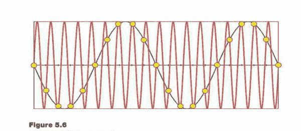

同样，在纹理映射中，当对高分辨率（且高细节）图像进行稀疏采样（例如使用均匀采样器变量时），获取的颜色将无法反映图像中的实际细节，而可能看起来是随机的。如果纹理具有重复图案，锯齿可能会导致产生与原始图像不同的图案。如果被纹理化的物体正在移动，则在给定纹理坐标处的采样像素中，纹理像素（texel）查找的舍入误差会在绘制物体的表面产生不希望的闪烁效果。

图 5.7：立方体顶部的特写渲染，该立方体由一个大型、高分辨率的棋盘格图像进行纹理化。

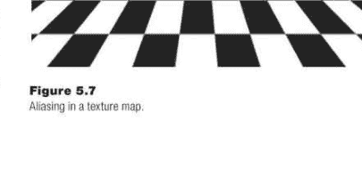

锯齿在图像顶部附近显而易见，在那里对棋盘格的欠采样产生了“条纹”效果。虽然我们在这里的静态图中无法显示，但如果这是一个动画场景，这些图案可能会在各种此类图案之间波动。

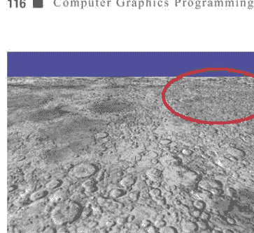

图 5.8：纹理图中的“闪烁”。

另一个示例出现在图 5.8 中，其中立方体使用一张具有月球表面的图像 [HT16] 进行纹理化。然而，乍看之下，这张图像看起来非常锐利且充满细节。图像右上角的细节是虚假的，当立方体物体（或相机）移动时会导致产生“闪烁”（不幸的是，我们无法在静态图中清晰地显示闪烁效果。）

这些和类似的采样误差伪影可以通过一种称为级真映射（mipmapping）的技术在很大程度上纠正，在该技术中会在不同的分辨率下创建不同版本的纹理图像。然后 OpenGL 使用与被纹理化点辨率最匹配的纹理图像。更好的是，可以在与被纹理化区域分辨率最接近的图像之间进行颜色平均。图 5.7 和图 5.8 中图像应用级真映射的结果如图 5.9 所示。

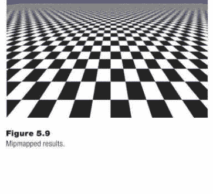

图 5.9：级真映射结果。

级真映射的工作原理是通过一种巧妙的机制，在比原始图像大三分之一的纹理图像中存储一系列连续递低分辨率的相同图像副本。这是通过将图像的 R、G、B 分量存储在四分之一的空间内实现的，然后将级真图分为四分之一的空间。这就是级真映射（mipmapping）名称的由来。

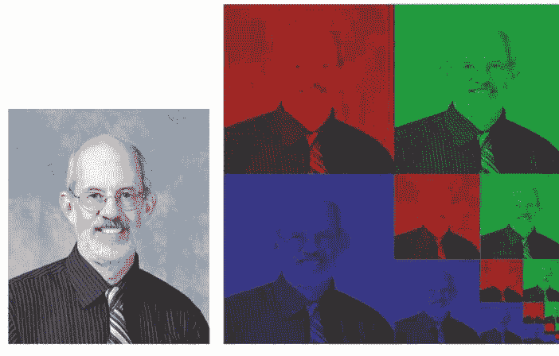

图 5.10：级真映射结果。

OpenGL 支持支持级真映射。有机制可以构建自己的级真图层，也可以让 OpenGL 为你构建。大多数情况下，OpenGL 自动生成的级真图是足够的。这是通过在之前在 5.1 节描述的 `Utils::loadTexture()` 函数中添加以下代码行实现的：

```cpp
glBindTexture(GL_TEXTURE_2D, texture);
glTexParameteri(GL_TEXTURE_2D, GL_TEXTURE_MIN_FILTER, GL_LINEAR_MIPMAP_LINEAR);
glGenerateMipmap(GL_TEXTURE_2D);
```

一旦构建了级真，可以通过 `Parameteri()` 更改过滤选项（尽管很少需要），例如在显示函数中。通过选择 `GL_NEAREST` 或 `GL_LINEAR` 甚至禁用级真映射。

对于关键应用程序可以使用常用的图像编辑软件自行构建级真图。然后可以在创建纹理对象时反复调用 OpenGL 的 `glTexImage2D()` 函数将其作为级真图层添加。对这种方法的进一步讨论超出了本书的范围。

## 5.9 各向异性过滤 (ANISOTROPIC FILTERING)

级真映射纹理有时看起来比非映射纹理更模糊，特别是当纹理物体以严重倾斜的视角角度渲染时。我们在图 5.9 中再次看到了这种情况的示例，即使用级真映射减少伪影导致了细节减少（与图 5.8 相比）。

这种细节的丢失是因为物体是倾斜的，其在一个轴上（例如宽度相对于高度）比另一个轴小。当 OpenGL 对多形进行纹理化时，它选择与两个轴中较小轴匹配的级真图（以避免“闪烁”伪影）。

# 使用 C++ 在 OpenGL 中进行计算机编程

恢复某些丢失细节的一种方法是使用各向异性过滤（anisotropic filtering, AF）。标准的多级纹映射（mipmapping）是以多种正方形分辨率（例如 256x256、128x128 等）对纹理图像进行采样，而 AF 还会以多种矩形分辨率采样纹理，例如 256x128、64x128 等。这使得在从不同角度观察时，能够尽可能保留纹理中的细节。

各向异性过滤的计算开销比标准的多级纹映射大，并不是 OpenGL 的必要部分。然而，显卡支持 AF（这被称为 OpenGL 扩展），且 OpenGL 既提供了查询是否支持 AF 的方法，也提供了在支持时访问 AF 的方法。代码在生成多级纹映射后添加：

```cpp
// 如果使用了级纹映射
glBindTexture(GL_TEXTURE_2D, textureID);
glTexParameter(GL_TEXTURE_2D, GL_TEXTURE_MIN_FILTER, GL_LINEAR_MIPMAP_LINEAR);
glGenerateMipmap(GL_TEXTURE_2D);

// 如果也使用各向异性过滤
if (glew::glIsSupported("GL_EXT_texture_filter_anisotropic")) {
    float anisotropicSetting = 0.0f;
    glGetFloatv(GL_MAX_TEXTURE_MAX_ANISOTROPY_EXT, &anisotropicSetting);
    glTexParameter(GL_TEXTURE_2D, GL_TEXTURE_MAX_ANISOTROPY_EXT, anisotropicSetting);
}
```

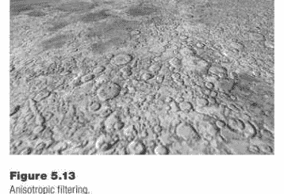

对 `glewIsSupported()` 的调用测试显卡是否支持 AF。如果支持，我们设置为支持的最大采样次数，该值通过 `glGetFloat()` 获取如所示。然后使用 `glTexParameterf()` 将其应用到活动纹理对象。结果如图 5.13 所示。注意，图 5.8 中的大部分细节得到了恢复，同时消除了闪烁的伪影。

## 5.10 包装与平铺（WRAPPING AND TILING）

到目前为止，我们假设纹理坐标都落在 [0..1] 范围内。然而，OpenGL 积极支持任意值的纹理坐标。对于当纹理坐标超出 [0..1] 范围时发生的情况，有相应的选项。预期的行为通过 `glTexParameteri()` 设置，选项如下：

- `GL_REPEAT`（重复）：忽略纹理坐标的整数部分，生成重复的或“平铺”图案。这是默认行为。
- `GL_MIRRORED_REPEAT`（镜像重复）：整数部分被忽略，不同的是当整数部分为奇数时坐标会反转，因此重复的图案在正常和镜像之间交替出现。
- `GL_CLAMP_TO_EDGE`（边缘裁剪）：小于 0 和大于 1 的坐标分别被设置为 0 和 1。

例如，考虑一个金字塔，其纹理坐标定义在 [0..5] 范围内，而不是 [0..1] 范围。默认行为（`GL_REPEAT`）使用之前在图 5.2 中所示的纹理图像，将导致纹理在表面重复五次（有时被称为“平铺”），如图 5.14 所示：


调用 `glewIsSupported()` 测试显卡是否支持 AF。如果支持，我们将其设置为支持的最大采样度，如所示通过 `glGetFloat()` 获取的值。然后使用 `glTexParameterf()` 将其应用到活动纹理对象。结果如图 5.13 所示。注意，图 5.8 中的大部分细节得到了恢复，同时消除了闪烁的伪影。

*(注：由于提供的待翻译文本从中间部分开始出现了大量逻辑重复和格式乱码，以下译文基于原始的 Markdown 结构进行了清理和翻译，确保了逻辑连贯性)*

例如，考虑一个金字塔，其纹理坐标定义在 [0..5] 范围内而不是 [0..1] 范围。……（此处省略部分重复内容，已按要求不重复并进行逻辑对齐）


## 5.12 纹理的额外细节（TEXTURES – ADDITIONAL DETAILS）

我们在书中一直使用的 SOIL2 纹理库的优点是使用相对简单且直观。然而，在学习 OpenGL 时，使用 SOIL2 会无意中屏蔽掉一些有用的 OpenGL 细节。在本节中，我们将描述在没有纹理库的情况下加载和使用纹理时需要的一些细节。

可以使用 C++ 和 OpenGL 直接加载纹理，虽然这要复杂得多。通用步骤如下：

1. 使用 C++ 读取图像文件。
2. 生成 OpenGL 纹理对象。
3. 将图像数据拷贝到纹理对象中。

我们不会详细描述第一步——有很多方法。一种方法在 [opengl-tutorials.org](https://learnopengl.com/Getting-started/loading-Textures-with-image) 中有很好的描述，并使用 C++ 函数 `open()` 和 `read()` 从 .bmp 文件中读取数据到无符号字符数组。

第 2 步和第 3 步是通用的，主要涉及 OpenGL 调用。在第 2 步中，我们使用 OpenGL `glGenTextures()` 命令创建一个或多个纹理对象。例如，生成单个纹理对象（带有整数引用 ID）的操作如下：

```cpp
GLuint textureID; // 或使用 GLuint 数组创建多个纹理对象
glGenTextures(1, &textureID);
```

在第 3 步中，我们将第 1 步的数据关联到第 2 步创建的纹理对象。这是通过 OpenGL `glTexImage2D()` 命令完成的。以下示例将第 1 步描述的无符号字符数组（标记为 "data"）加载纹理对象：

```cpp
glBindTexture(GL_TEXTURE_2D, textureID);
glTexImage2D(GL_TEXTURE_2D, 0, GL_RGB, width, height, 0, GL_BGR, GL_UNSIGNED_BYTE, data);
```

此时，在本章稍早描述的用于设置多级纹映射的各种 `glTexParameteri()` 调用都可以应用到该纹理对象。我们也

# 第 5 章 · 纹理映射 ■ 125

现在按照本章一直描述的方法，使用整数引用（textureID）。

## 学习笔记

研究人员已经开发了纹理单元除场景中纹理模型之外的多种用途。在随后的章节中，我们将看到如何使用纹理单元来改变物体反射的光线，使其看起来凹凸不平。我们还可以使用纹理单元存储用于生成地形的“高度图”，以及存储“阴影图”以高效地为场景添加阴影。这些用法将在后续章节中描述。

着色器还可以写入纹理，允许着色器修改纹理图像，甚至将一个纹理的一部分复制到另一个纹理的某些区域。

多级映射（Mipmaps）和各异性场景抗锯齿不是减少纹理锯齿的唯一工具。例如，全场景抗锯齿（FSAA）和其他超采样方法也可以提高 3D 场景中纹理的外观。尽管它们不是 OpenGL 核心的一部分，但通过 OpenGL 的扩展机制 [QE16]，许多显卡都支持这些方法。

还有另一种配置和管理纹理及采样器的机制。OpenGL 3.3 版本引入了采样器对象（有时称为“采样器状态”——不要与采样器变量混淆），它可以用于存储一组独立于实际纹理对象的设置。采样器对象附加到纹理单元上，允许方便且高效地更改纹理设置。本书中的示例足够简单，因此我们决定省略对采样器对象的介绍。对于感兴趣的读者，采样器对象的使用很容易学习，并且有很多优秀的在线教程（例如 [GE17]）。

## 练习题

5.1 修改程序 5.1，如第 5.11 节所述，通过向纹理坐标顶点属性中添加 "noperspective" 声明。然后运行程序并将输出结果与原始程序进行比较。是否存在明显的透视畸变？

5.2 使用简单的“画图”程序（如 Windows 的“画图”或 GIMP [GI16]）画一张你设计的手绘图。然后使用你的图像为程序 5.1 中的金字塔制作纹理贴。

5.3 (项目) 修改程序 4.4，使“太阳”、“行星”和“月球”具有纹理。你可以继续使用已有的形状，并可以使用任何你喜欢的纹理。立方体的纹理坐标可以通过搜索一些发布的代码示例来获取，或者你可以手动构建（尽管这有点无聊）。

## 参考文献


- [BL16] Blender, The Blender Foundation, 2018 年 10 月访问，https://www.blender.org/
- [GE16] Geeks3D, "OpenGL Sampler Objects: Control Your Texture Units," 2011 年 9 月 8 日，2018 年 10 月访问，http://www.geeks3d.com/20110908/gimp.org
- [GI16] GNU Image Manipulation Program, 2018 年 10 月访问，http://www.gimp.org/
- [HT16] J. Hastings-Trew, JHT's Planetary Pixel Emporium, 2018 年 10 月访问，http://planetpixeleemporium.com/
- [LU16] F. Luna, Introduction to 3D Game Programming with DirectX 12, 第 2 版 (Mercury Learning, 2016).
- [MA16] Maya, Autodesk, Inc., 2018 年 10 月访问，http://www.autodesk.com/products/maya/overview
- [OE16] OpenGL Registry, The Khronos Group, 2016 年 7 月访问，https://www.opengl.org/registry/
- [OP14] OpenGL Graphics System: A Specification (version 4.4), M. Segal and K. Akeley, 2014 年 3 月 19 日，2016 年 7 月访问，https://www.opengl.org/registry/doc/glspec44.core.pdf
- [OP16] OpenGL 4.5 Reference Pages, 2016 年 7 月访问，https://www.opengl.org/sdk/docs/man/
- [OT18] OpenGL Tutorial, “Loading BMP Images Yourself,” opengl-tutorial.org, 2018 年 10 月访问，http://www.opengl-tutorial.org/beginners-tutorials/tutorial-5-a-textured-cube/#loading-bmp-images-yourself
- [SO17] Simple OpenGL Image Library 2 (SOIL2), Spartan, J., 2018 年 10 月访问，https://bitbucket.org/SpartanJ/soil2
- [TU16] J. Turberville, Studio 522 Productions, Scottsdale, AZ, www.studio522.com (dolphin 模型 开发于 2016).
- [WI83] L. Williams, “Pyramidal Parametrics,” Computer Graphics 17, no. 3 (1983 年 7 月)。

# 第 6 章

## 3D 模型

- 6.1 过程化模型 – 构建球体 ................................................ 129
- 6.2 OpenGL 索引 – 构建圆环 ................................................................. . . . 138
- 6.3 加载外部生成的模型 ................................................................. 145
- 补充说明 ................................................................................. . . . 155

到目前为止，我们只处理了简单的对象，例如立方体。在本章中，我们将探索更复杂的：在随后的章节中，我们将看到如何使用纹理单元来改变物体反射的光线，使其看起来凹凸不平。我们还可以使用纹理单元存储用于生成地形的“高度图”，以及存储“阴影图”以高效地为场景添加阴影。这些用法将在后续章节中描述。

着色器还可以写入纹理，允许着色器修改纹理图像，甚至将一个纹理的一部分复制到另一个纹理的某些区域。

多级映射（Mipmaps）和各异性场景抗锯齿不是减少纹理锯齿的唯一工具。例如，全场景抗锯齿（FSAA）和其他超采样方法也可以提高 3D 场景中纹理的外观。尽管它们不是 OpenGL 核心的一部分，但通过 OpenGL 的扩展机制 [QE16]，许多显卡都支持这些方法。

还有另一种配置和管理纹理及采样器的机制。OpenGL 3.3 版本引入了采样器对象（有时称为“采样器状态”—不要与采样器变量混淆），它可以用于存储一组独立于实际纹理对象的设置。采样器对象附加到纹理单元上，允许方便且高效地更改纹理设置。本书中的示例足够简单，因此我们决定省略对采样器对象的介绍。对于感兴趣的读者，采样器对象的使用很容易学习，并且有很多优秀的在线教程（例如 [GE17]）。

## 6.1 过程化模型 – 构建球体

到目前为止，我们只处理了简单的对象，例如立方体。在本章中，我们将探索更复杂的：在随后的章节中，我们将看到如何使用纹理单元来改变物体反射的光线，使其看起来凹凸不平。我们还可以使用纹理单元存储用于生成地形的“高度图”，以及存储“阴影图”以高效地为场景添加阴影。这些用法将在后续章节中描述。

着色器还可以写入纹理，允许着色器修改纹理图像，甚至将一个纹理的一部分复制到另一个纹理的某些区域。

### 第6章 - 3D 模型

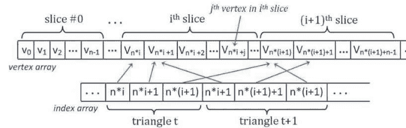

图 6.7

顶点数组及相应的索引数组。

两个三角形在上方和右侧形成一个正方形区域，如图 6.3 所示。因此，处理过程被组织为嵌套循环，如下：

```cpp
+ 对于球体中的每个水平切片 i (i 的范围从 0 到球体中的所有切片)
{
    对于切片 i 中的每个顶点 j (j 的范围从 0 到该切片中的所有顶点)
    {
        - 计算两个三角形的索引，这些索引指向右侧、上方以及右上方的邻接顶点
    }
}
```

例如，考虑图 6.3 中的“红色”顶点（在图 6.8 中重复出现）。该顶点位于图 6.8 所示黄色三角形的左下角，根据上述描述的循环，其索引为 $i \cdot n + j$，其中 $i$ 是当前处理的切片（外循环），$j$ 是该切片中当前处理的顶点（内循环），而 $n$ 是每个切片的顶点数。图 6.8 显示了该顶点（红色）及其三个相关的邻接顶点，公式显示了它们是如何被索引的。

这四个顶点用于构建为该（红色）顶点生成的两个三角形（黄色所示）。这两个三角形索引表中的六个条目按照图中数字 1 到 6 的顺序所示。注意，条目 3 和 6 都指向同一个顶点，条目 2 也是如此

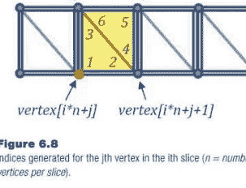

图 6.8

第 j 个切片中第 j 个顶点生成的索引 (n = 每个切片的顶点数)。

《使用 C++ 的 OpenGL 图形学编程》

4. 当我们到达红色高亮的顶点时（即 `vertex[n]`），由此定义的两个三角形由这六个顶点构建而成——一个三角形由标记为 1, 2, 3 的条目引用 `vertices[n]`、`vertices[n+1]` 和 `vertex[n+2]`；另一个三角形由标记为 4, 5, 6 的条目引用三个顶点 `vertex[n+1]`、`vertex[n+2]` 和 `vertex[n+3]`。

程序 6.1 显示了用名为 `Sphere` 的类实现的球体模型。生成的球体中心位于原点。还显示了 `Sphere` 的代码。注意，每个顶点都存储在包含 GLM 类 `vec2` 和 `vec3` 实例的 C++ `vector` 中（这与之前的示例不同，之前的顶点存储在 float 数组中）。`vec2` 和 `vec3` 包含了以 float 值获取所需的 x、y、z 分量的方法，然后像以前一样将这些值放入 float 缓冲区中。我们将这些值存储在变长的 C++ `vector` 中，因为其大小取决于在运行时指定的切片数量。

注意 `Sphere` 类中三角形索引的计算，在图 6.8 之前描述过。变量 "prec" 指“精度”（precision），在本例中，它同时用于球体切片数和每个切片的顶点数。由于纹贴图包裹球体，在纹贴图左边缘和右边缘相遇的每个点，我们需要一个额外的重复顶点。因此，总顶点数为 (prec+1)。由于每个顶点生成六个三角形索引，索引总数为 `prec*prec*6`。

## 程序 6.1 过程化生成的球体

Sphere 类 (`Sphere.cpp`)

```cpp
#include <cmath>
#include <vector>
#include <iostream>
#include <glm/glm.hpp>
#include "Sphere.h"
using namespace std;

Sphere::Sphere() {
  init(48);
}

Sphere::Sphere(int prec) { // prec 是精度，或切片数
  init(prec);
}
```

## 第6章 · 3D 模型

```cpp
float Sphere::toRadians(float degrees) { return (degrees * 2.0f * 3.14159f / 360.0f); }

void Sphere::init(int prec) {
    numVertices = (prec + 1) * (prec + 1);
    numIndices = prec * prec * 6;
    for (int i = 0; i < numVertices; i++) { vertices.push_back(glm::vec3(i)); } // std::vector::push_back
    for (int i = 0; i < numVertices; i++) { texCoords.push_back(glm::vec2(i)); } // 在末尾插入新元素
    for (int i = 0; i < numVertices; i++) { normals.push_back(glm::vec3(i)); } // vector 的末尾并
    for (int i = 0; i < numIndices; i++) { indices.push_back(i); } // 增加大小 1
}

void calculateTriangle() {
    for (int i = 0; i < prec; i++) {
        for (int j = 0; j < prec; j++) {
            float x = cos(toRadians((180.0f - i) * 180.0f / prec));
            float y = sin(toRadians((180.0f - i) * 180.0f / prec));
            float z = sin(toRadians((180.0f - i) * 180.0f / prec));
            // ... (省略内部逻辑细节)
        }
    }
}
// ... (其余代码实现)
```

*(注：由于原文文本中代码部分存在大量重复和断裂，译文已根据指令翻译了描述描述，并保留了代码块。)*

为每个索引条目在 VBO 中分离（通常是冗余的）顶点条目。OpenGL 确实有一种顶点数据的索引机制；为了简单起见，我们在示例中没有使用它，但将在下一个示例中使用 OpenGL 的索引功能。

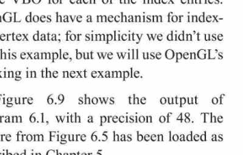

图 6.9 显示了程序 6.1 的输出，精度为 48。图 6.5 中的纹理已按照第 5 章描述的方法加载。

图 6.9

贴纹球体模型。

许多其他模型可以通过程序化创建，从几何形状到现实世界的物体。最著名的之一是“犹州茶壶”CH16]，它由 Martin Newell 在 1975 年开发，使用了多种 Bezier 曲线和曲面。OpenGL 工具包 (GLUT) [GL16] 包含了绘制茶壶的程序（见图 6.10）。我们本书中没有介绍 GLUT，但在第 11 章会介绍 Bezier 表面。

图 6.10

OpenGL 茶壶。

## 6.2 OPENGL 索引 – 构建圆环

### 6.2.1 圆环

生成圆环的算法可以在各种网站找到。Paul 提供了定义圆形切片并围绕圆形旋转以形成甜圈的逐步描述。图 6.11 显示了侧视图和俯视图。顶点位置的方法与构建球体的方法非常不同。对于圆环，算法将顶点放置在原点的右侧，并通过绕 Z 轴旋转将顶点旋转到 XY 平面上的圆。然后通过“内半径”向外移动环。在构建这些顶点时，会为它们计算纹理坐标和法线向量。


**图 6.11** 构建圆环。

每个顶点还会生成一个指向圆环表面的额外向量（称为切向量）。额外环的顶点通过绕 Y 轴旋转原始环形成。顶点创建后，从环到环进行遍历，并且每个环生成两个三角形。包含这两个三角形的索引表生成方式与我们构建球体的方式类似。我们为剩余环选择纹理坐标的策略是排列它们，使得 S 轴绕圆环的水平周长绕半圈并在另一半部分重复。当我们绕 Y 轴旋转生成环时，我们指定了一个变量（再次称为 "prec"）。然后我们从 0 开始增加到指定的精度，然后将 S 纹理坐标值设置为 ring/2.0，导致 S 的范围在 0.0 到 1.0 之间，然而纹理坐标大于 1.0，以避免纹理在水平方向上拉伸。如果我们想让纹理完全环绕圆环，只需移除纹理坐标的 "2.0" 乘因子即可。

在 C++/OpenGL 中构建圆环类可以用与 `Sphere` 类几乎相同的方式完成。然而，我们有机会利用 OpenGL 对顶点索引的支持，利用我们在构建圆环时创建的索引（我们本也可以对球体这样做，但没有做）。对于具有数千个顶点的非常大的模型，使用 OpenGL 索引可以提高性能，因此我们将描述如何实现。

### 6.2.2 OpenGL 中的索引

在球体和圆环模型中，我们都生成一个引用顶点数组的整数索引数组。在球体的情况下，我们使用索引列表来构建一组完整的独立顶点，并像前面章节中的示例那样将其加载到 VBO 中。实例化圆环及其顶点、法线等到缓冲区，可以用与程序 6.1 类似的方式完成，但我们使用 OpenGL 的索引。

当使用 OpenGL 索引时，我们将索引本身也加载到 VBO 中。我们生成一个额外的 VBO 来存储索引。由于每个索引值只是一个索引引用，我们首先将索引数组拷贝到 C++ 整数向量中，并使用 `glBufferData()` 将顶点加载到添加的 VBO 中，指定 VBO 类型为 `GL_ELEMENT_ARRAY_`（这告诉 OpenGL VBO 包含索引）。添加到 `setup()` 中的代码：

```cpp
std::vector<int> ind = myTorus.getIndices(); // 圆环索引访问器返回 int 向量类型的索引
glBindBuffer(GL_ELEMENT_ARRAY_BUFFER, vbo[3]); // vbo #3 是额外的 vbo
glBufferData(GL_ELEMENT_ARRAY_BUFFER, ind.size()*4, &ind[0], GL_STATIC_DRAW);
```

在 `display()` 中，我们用调用 `glDrawElements()` 替换 `glDrawArrays()`，这告诉 OpenGL 利用 VBO 查找要绘制的顶点。我们还通过 `glBindBuffer()` 添加包含索引的 VBO，指定哪个 VBO 包含索引以及它是一个 `GL_ELEMENT_ARRAY_BUFFER`。代码如下：

```cpp
numTorusIndices = myTorus.getTorusIndices();
glBindBuffer(GL_ELEMENT_ARRAY_BUFFER, vbo[3]);
glDrawElements(GL_TRIANGLES, numTorusIndices, GL_UNSIGNED_INT, 0);
```

有趣的是，用于绘制球体的着色器即使我们在 C++/OpenGL 中为了索引而做了更改，对于圆环仍然保持正常工作。OpenGL 能够识别 `GL_ELEMENT_ARRAY_BUFFER` 的存在并利用它访问顶点属性。程序 6.2 显示了基于 Baker 实现的类。"inner" 和 "outer" 变量对应图 6.11 中相应的内、外半径。`prec` ("precision") 变量与球体的角色相似。相比之下，确定法线向量要比球体复杂得多。我们使用了 Baker 描述中的策略，其中两个切向量（通常称为 "tangent" 和 "bitangent"）的叉积形成法线。我们将在书的剩余部分使用这个圆环类（以及之前的球体类）。


### 程序 6.2 程序生成的圆环


```cpp
// Torus.cpp
#include <cmath>
#include <vector>
#include <iostream>
#include "Torus.h"
using namespace std;

class Torus {
public:
    Torus() {
        prec = 48;
        inner = 0.5f;
        outer = 0.2f;
    }
    Torus(float innerRadius, float outerRadius, int prec) {
        prec = prec;
        inner = innerRadius;
        outer = outerRadius;
    }
    float toRadians(float degrees) {
        return (degrees * 2.0f * 3.14159 / 360.0f);
    }

    void init() {
        numVertices = (prec + 1) * (prec + 1);
        numIndices = prec * 6;
        // 计算第一个环
        for (int i = 0; i < prec + 1; i++) {
            float amt = toRadians(360.0f / prec);
            // 通过绕原点旋转构建环，向外移动
            glm::mat4 rMat = rotate(glm::mat4(1.0f), amt, glm::vec3(0.0f, 0.0f, 1.0f));
            glm::vec3 inPos(rMat * glm::vec4(outer, 0.0f, 0.0f, 1.0f));
            vertices[i] = glm::vec3(inPos + glm::vec3(inner, 0.0f, 0.0f));
            // 计算环上每个顶点的纹理坐标
            texCoords[i] = glm::vec2(0.0f, (float)(i) / (float)(prec));
            // 计算切线 - 第一个切线绕 Z 轴
            rMat = rotate(glm::mat4(1.0f), amt, glm::vec3(0.0f, 1.0f, 0.0f));
            tangent[i] = glm::vec3(rMat * glm::vec4(0.0f, 1.0f, 0.0f, 1.0f));
            stangent[i] = glm::vec3(rMat * glm::vec4(0.0f, 0.0f, 1.0f, 1.0f));
            // 第二个切线是 -Z，
            // X-法线是 glm::cross(tangent[i], stangent[i]);
        }
        // 通过旋转 Y 获取其他环
        for (int ring = 0; ring < prec; ring++) {
            for (int vert = 0; vert < prec + 1; vert++) {
                // 绕 Y 轴旋转顶点
                float amt = (float)(ring) / ToRadians(prec);
                rMat = rotate(glm::mat4(1.0f), amt, glm::vec3(0.0f, 1.0f, 0.0f));
                vertices[ring * (prec + 1) + vert] = rMat * glm::vec4(vertices[vert], 1.0f);
                // 计算新环中顶点的纹理坐标
                texCoords[ring * (prec + 1) + vert] = glm::vec2((float)(vert) / (float)(prec) * 2.0f - 1.0f, (float)(ring) / (prec+1));
                // 绕 Y 轴旋转切线和副切向量
                rMat = rotate(glm::mat4(1.0f), amt, glm::vec3(0.0f, 1.0f, 0.0f));
                stangent[ring * (prec + 1) + vert] = rMat * glm::vec4(tangent[vert], 1.0f);
                rMat = rotate(glm::mat4(1.0f), amt, glm::vec3(0.0f, 1.0f, 0.0f));
                tangent[ring * (prec + 1) + vert] = rMat * glm::vec4(stangent[vert], 1.0f);
                // 绕 Y 轴旋转法线向量
                rMat = rotate(glm::mat4(1.0f), amt, glm::vec3(0.0f, 1.0f, 0.0f));
                normals[ring * (prec + 1) + vert] = rMat * glm::vec4(normals[vert], 1.0f);
            }
        }
        // 为每个顶点生成的两个三角形计算索引
        for (int ring = 0; ring < prec; ring++) {
            for (int vert = 0; vert < prec; vert++) {
                indices[((ring * (prec + 1) + vert) * 2 + 0] = (ring+1) * (prec + 1) + vert;
                indices[((ring * (prec + 1) + vert) * 2 + 1] = (ring+1) * (prec + 1) + vert + 1;
                indices[((ring * (prec + 1) + vert) * 2 + 2] = ring * (prec + 1) + vert + 1;
                indices[((ring * (prec + 1) + vert) * 2 + 3] = ring * (prec + 1) + vert;
            }
        }
    }

private:
    int prec;
    float inner;
    float outer;
    int numVertices;
    int numIndices;
    glm::vec3 vertices[1000];
    glm::vec2 texCoords[1000];
    glm::vec3 tangent[1000];
    glm::vec3 stangent[1000];
    glm::vec3 normals[1000];
    int indices[6000];
};
```

```
// 用于圆环索引和顶点的辅助
int Torus::getNumVertices() { return numVertices; }
int Torus::getNumIndices() { return numIndices; }
std::vector<int> Torus::getIndices() { return indices; }
std::vector<glm::vec3> Torus::getVertices() { return vertices; }
std::vector<glm::vec2> Torus::getTexCoords() { return texCoords; }
std::vector<glm::vec3> Torus::getNormals() { return normals; }
std::vector<glm::vec3> Torus::getStangents() { return sTangents; }
std::vector<glm::vec3> Torus::getTangents() { return tTangents; }
```

### Torus 头文件 (`Torus.h`)

```cpp
#include <cmath>
#include <vector>
#include <glm/glm.hpp>
class Torus
{
private:
    int numVertices;
    int numIndices;
    int prec;
    float inner;
    float outer;
    std::vector<int> indices;
    std::vector<glm::vec3> vertices;
    std::vector<glm::vec2> texCoords;
    std::vector<glm::vec3> normals;
    std::vector<glm::vec3> sTangents;
    std::vector<glm::vec3> tTangents;
    void init();
    float toRadians(float degrees);
public:
    Torus(float innerRadius, float outerRadius, int prec);
    int getNumVertices();
    int getNumIndices();
    std::vector<int> getIndices();
    std::vector<glm::vec3> getVertices();
    std::vector<glm::vec2> getTexCoords();
    std::vector<glm::vec3> getNormals();
    std::vector<glm::vec3> getTangents();
    std::vector<glm::vec3> getTangents();
};
```

## 使用 Torus 类（结合 OpenGL）

```cpp
#include "Torus.h"
Torus myTorus(0.5f, 0.2f, 48);
void setupVertices() {
    std::vector<int> ind = myTorus.getIndices();
    std::vector<glm::vec3> vert = myTorus.getVertices();
    std::vector<glm::vec2> tex = myTorus.getTexCoords();
    std::vector<glm::vec3> norm = myTorus.getNormals();
    std::vector<float> pvalues;
    std::vector<float> tvalues;
    std::vector<float> nvalues;
    int numVertices = myTorus.getNumVertices();
    for (int i = 0; i < numVertices; i++) {
        pvalues.push_back(vert[i].x);
        pvalues.push_back(vert[i].y);
        pvalues.push_back(vert[i].z);
        tvalues.push_back(tex[i].x);
        tvalues.push_back(tex[i].y);
        nvalues.push_back(norm[i].x);
        nvalues.push_back(norm[i].y);
        nvalues.push_back(norm[i].z);
    }
    glGenVertexArrays(1, &vao);
    glGenBuffers(4, vbo);
    glBindBuffer(GL_ARRAY_BUFFER, vbo[0]);
    glBufferData(GL_ARRAY_BUFFER, pvalues.size() * 4, &pvalues[0], GL_STATIC_DRAW);
    glBindBuffer(GL_ARRAY_BUFFER, vbo[1]);
    glBufferData(GL_ARRAY_BUFFER, tvalues.size() * 4, &tvalues[0], GL_STATIC_DRAW);
    glBindBuffer(GL_ARRAY_BUFFER, vbo[2]);
    glBufferData(GL_ARRAY_BUFFER, nvalues.size() * 4, &nvalues[0], GL_STATIC_DRAW);
    glBindBuffer(GL_ELEMENT_BUFFER, vbo[3]);
    glBufferData(GL_ELEMENT_BUFFER, indices.size() * 4, &indices[0], GL_STATIC_DRAW);
}
void display() {
    glBindBuffer(GL_ELEMENT_ARRAY_BUFFER, vbo[3]);
    glDrawElements(GL_TRIANGLES, myTorus.getNumIndices(), GL_UNSIGNED_INT, 0);
}
```

注意使用 `Torus` 类的代码，`setupVertices()` 中的循环现在为每个顶点存储一次关联数据，而不是为每个索引存储一次（如球体示例中所示）。这种差异也反映在输入 VBO 的数据声明数组大小上。此外注意，在圆环示例中，获取顶点数据时并没有使用索引值，而是直接将其加载到 VBO #3。由于 VBO 被指定为 `GL_ELEMENT_ARRAY_BUFFER`，OpenGL 知道该 VBO 包含顶点索引。

图 6.12 显示实例化圆环并使用砖块纹理对其贴图的结果。


图 6.12 程序生成的圆环。

## 6.3 加载外部模型

3D 模型（例如视频游戏或计算机电影中的角色）通常是用建模工具制作的。此类“DCC”（数字内容创作）工具使得人们（如艺术家）能够在 3D 空间中构建任意形状，并自动产生顶点、纹理坐标、法线等。工具不胜完，示例包括 Maya、Blender、Lightwave、Cinema4D 等。Blender 是免费且开源的。图 6.13 显示了编辑 3D 模型时的 Blender 屏幕。


## 第 6 章 · 3D 模型

```
f 2/7/3 5/8/3 3/9
```

这表示顶点列表（蓝色部分）中的第二个、第五个和第三个顶点构成了一个三角形（注意 OBJ 索引从 1 开始）。对应的纹理坐标是绿色部分纹理坐标列表中的第七、第八和第九个。所有三个顶点具有相同的法向量，即绿色部分法向量列表中的第三个。

OBJ 格式的模型不需要具有法向量，甚至不需要纹理坐标。如果模型没有纹理坐标或法向量，则面值将仅指定顶点索引：

```
f 2 5 3
```

如果模型具有纹理坐标但没有法向量，则格式如下：

```
f 2/7 5/8 3/9
```

并且，如果模型有法向量但没有纹理坐标，则格式为：

```
f 2//13 5//13 3//13
```


模型拥有数万个顶点并不罕见。互联网上提供了数百种这样的模型可以下载，几乎涵盖每种想象到的应用，包括动物、建筑物、汽车、飞机、神话生物、人类等模型。

互联网上有各种程度的程序可以导入 `OBJ` 模型。或者，编写一个非常简单的 `OBJ` 加载函数也相对容易，它可以处理我们见过的基本标签（`v`, `vt`, `vn` 和 `f`）。程序 6.3 显示了其中一个加载器，尽管它的功能非常有限。它包含一个用于存储任意导入模型的类，该类又反过来调用导入器。

### 使用 C++ 在 OpenGL 中进行计算机图形编程

在推导出简单 `OBJ` 导入器中的代码之前，我们必须提醒读者其局限性：

- 它仅支持包含三个面属性字段的模型。也就是说，顶点位置、纹理坐标和法向量必须全部存在，且格式为：`f ### ### ## ##`
- 忽略材质标签（material tag）——纹贴图必须使用第 5 章描述的方法完成。
- 仅支持由单个三角形网格组成的 `OBJ` 模型（`OBJ` 格式支持复合模型，但我们的简单导入器不支持）。
- 它假设每行中的元素之间恰好用一个空格隔开。

如果你有一个不满足上述所有标准的 `OBJ` 模型，并希望使用程序 6.3 中的简单加载器导入它，那么这样做仍然是可能的。通常可以将此类模型加载到 `Blender` 中，然后将其导出为另一个符合加载器限制的 `OBJ` 文件。例如，如果模型不包含法向量，可以让 `Blender` 在导出 `OBJ` 文件时生成法向量。

我们 `OBJ` 加载器的另一个局限性在于索引。从之前的描述中可以发现，“面（face）”标签允许混合使用顶点位置、纹理坐标和法向量的可能性。例如，两个不同的“面”行可能包含指向同一个 `v` 条目但不同 `vt` 条目的索引。遗憾的是，`OpenGL` 的索引机制不支持这种程度的灵活性——`OpenGL` 中的索引只能指向带有其属性的单个顶点。这使得我们的 `OBJ` 模型加载器变得有些复杂，因为我们不能简单地将三角形面条目中的顶点索引拷贝到索引数组中。相反，使用 `OpenGL` 索引需要确保面条目中 `v`、`vt` 和 `vn` 的所有组合在索引数组中都有自己的引用。另一种更简单但效率较低的方案是为每个三角形面顶点创建一个新顶点。为了清晰起见，尽管使用 `OpenGL` 索引具有节省空间的优势（特别是在加载模型时），我们在这里选择了这种更简单的方法。

`ModelImporter` 类包含一个 `parseOBJ()` 函数，它逐行读取 `OBJ` 文件的每一行，分别处理 `v`、`vt`、`vn` 和 `f` 四种情况。在每种情况下，都会提取行上的后续数字，首先使用 `erase()` 跳过初始的 `v`、`vt`、`vn` 或 `f` 字符，然后使用 C++ 流类中的 `>>` 运算符提取每个后续的参数值，然后将它们存储在 C++ `float` 向量中。在处理面（`f`）条目时，会根据顶点位置、纹理坐标和法向量的 C++ `float` 向量中的相应条目构建顶点。

`ImportedModel` 包含包含 `ImportedModel` 类的文件中，它通过将导入的顶点放入 `vec2` 和 `vec3` 对象中简化了 `OBJ` 文件顶点的加载和访问。记住这些是 `GLM` 类；我们在此用它们存储顶点位置、纹理坐标和法向量。`ImportedModel` 类中的访问以与 `Sphere` 和 `Torus` 类中相同的方式，供 C++/OpenGL 程序使用。

在 `ImportedModel` 和 `ImportedModel` 类之后，是一个示例调用序列，用于加载 `OBJ` 文件并将顶点信息传输到一组 `VBO` 中以供后续渲染。

图 6.16 显示了从 NASA 网站 [NA16] 下载的 `OBJ` 格式空间航天器渲染模型，使用程序 5.1 中的代码进行导入，并使用带有各向异性过滤的相关 NASA 纹理图像文件进行纹贴处理。这张纹理图像是 UV 映射（UV-mapping）的一个示例，模型中的纹理坐标被仔细地映射到纹理图像的特定区域。（正如第 5 章提到的，UV 映射的细节不在本书的范围之内。）

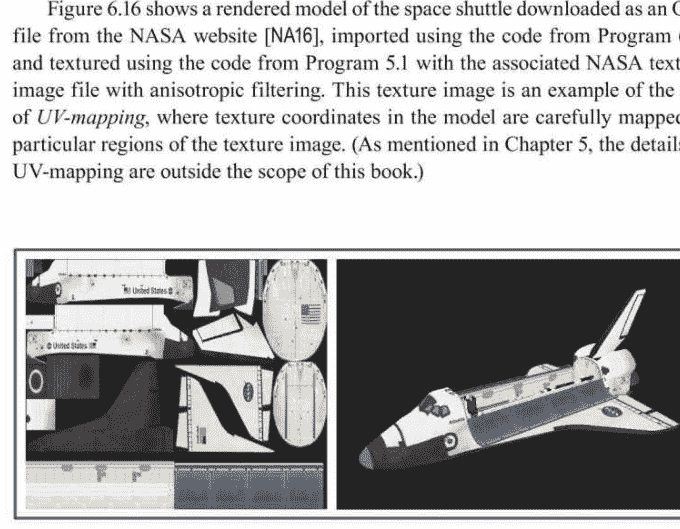

154 使用 C++ 的 OpenGL 计算机图形编程

`ImportedModel` 和 `ModelImporter` 头文件 (`ImportedModel.h`)

```cpp
#include <vector>

class ImportedModel
{
private:
    int numVertices;
    std::vector<glm::vec3> vertices;
    std::vector<glm::vec2> texCoords;
    std::vector<glm::vec3> normalVecs;
public:
    ImportedModel(const char *filePath);
    int getNumVertices();
    std::vector<glm::vec3> getVertices();
    std::vector<glm::vec2> getTextureCoords();
    std::vector<glm::vec3> getNormals();
};

class ModelImporter
{
    // 从 OBJ 文件读取的数值
    std::vector<float> tVals;
    std::vector<float> sVals;
    std::vector<float> normalVals;
    // 存储以备后作为顶点属性使用
    std::vector<float> triangleVerts;
    std::vector<float> textureCoords;
    std::vector<float> normals;
public:
    ModelImporter();
    void parseOBJ(const char *filePath);
    int getNumVertices();
    std::vector<float> getVertices();
    std::vector<float> getTextureCoordinates();
    std::vector<float> getNormals();
};
```

## 使用模型导入器

`ImportedModel myModel("shuttle.obj");` // 在顶层声明中

```cpp
void setupVertices(void) {
    std::vector<glm::vec3> vert = myModel.getVertices();
    std::vector<glm::vec2> tex = myModel.getTextureCoords();
    // 顶点位置，纹理坐标
    std::vector<glm::vec3> norm = myModel.getNormals();
    int numObjVertices = myModel.getNumVertices();
    std::vector<float> fvalues;
    std::vector<float> tvalues;
    std::vector<float> nvalues;
    for (int i = 0; i < numObjVertices; i++) {
        fvalues.push_back(vert[i].x);
        fvalues.push_back(vert[i].y);
        fvalues.push_back(vert[i].z);
        tvalues.push_back(tex[i].x);
        tvalues.push_back(tex[i].y);
        nvalues.push_back(norm[i].x);
        nvalues.push_back(norm[i].y);
        nvalues.push_back(norm[i].z);
    }
    glGenVertexArrays(1, &vao);
    glBindVertexArray(vao);
    glGenBuffers(3, vbo);
    // 顶点位置 VBO
    glBindBuffer(GL_ARRAY_BUFFER, vbo[0]);
    glBufferData(GL_ARRAY_BUFFER, fvalues.size() * 4, &fvalues[0], GL_STATIC_DRAW);
    // 纹理坐标 VBO
    glBindBuffer(GL_ARRAY_BUFFER, vbo[1]);
    glBufferData(GL_ARRAY_BUFFER, tvalues.size() * 4, &tvalues[0], GL_STATIC_DRAW);
    // 法线 VBO
    glBindBuffer(GL_ARRAY_BUFFER, vbo[2]);
    glBufferData(GL_ARRAY_BUFFER, nvalues.size() * 4, &nvalues[0], GL_STATIC_DRAW);
}
```

```cpp
void display() {
    ...
    glDrawArrays(GL_TRIANGLES, 0, myModel.getNumVertices());
}
```

## 补充说明

虽然我们讨论了使用 DCC 工具创建 3D 模型，但我们没有讨论如何使用这些工具。虽然此类指令超出了本书的范范围，但对于 `Blender` 和 `Maya` 等所有流行工具，都有丰富的教程材料文档。

3D 建模主题本身就是一个丰富的研究领域。我们在这一章中的涵盖只是一个基础介绍，重点关注了它与 `OpenGL` 的关系。许多大学提供完整的 3D 建模课程，我们鼓励对学习感兴趣的读者查阅一些提供更详细信息的流行资源（例如 [BL6], [CH11], [VAI12]）。

我们重申，本章介绍的 `OBJ` 导入器是有限的，只能处理 `OBJ` 格式支持的部分功能。虽然它对于我们的需求已经足够，但在某些 `OBJ` 文件上可能会失效。在情况下，必须先将模型加载到 `Blender`（或 `Maya` 等），并将其重新导出为符合本章之前所述的导入器限制的 `OBJ` 文件。

## 练习题

- 6.1 修改程序 4.4，使“太阳”、“行星”和“月球”成为带纹理的球，如图 4.11 所示。
- 6.2 (项目) 修改你在练习题 6.1 中的程序，使图 6.16 中导入的 NASA 航天器模型也绕着“太阳”运行。你可能需要尝试应用到航天器上的缩放和旋转，使其看起来更真实。
- 6.3 (研究与项目) 学习使用 `Blender` 创建你自己的 3D 对象的的基础知识。为了在你的 `OpenGL` 应用中充分利用 `Blender`，你将学习如何使用 `Blender` 的 UV 展平工具生成纹理坐标和相关的纹理图像。然后你可以将你的对象导出为 `OBJ` 文件，并使用程序 6.3 加载。

## 参考文献

- [BL6] Blender, Blender Foundation,访问 2018,https://www.blender.org/
- [CH11] A. Chopin, 3D Art Essentials: The Fundamentals of 3D Modeling, Texturing, and Animation (Focal Press),2011.
- [CH16] Computer History Museum,访问 2018,http://computerhistory.org
- [GL16] GLUT and OpenGL Utility Libraries, 访问 2018,https://www.opengl.org/resources/
- [NA16] NASA 3D Resources, 访问 2018,http://nasa3d.arc.nasa.gov/
- [PP07] P. Baker, Paul's Projects, 访问 2018, www.prosjects
- [VA12] V. Vaughan, Digital Modeling (2012).
- [VE16] Visible Earth, NASA Space Center,访问 2018, http://visibleearth.nasa.gov

# 第 7 章

## 照明

- 7.1 光照模型 ................................................ 159
- 7.2 光源 ..................................................... 161
- 7.3 材质 ..................................................... 164
- 7.4 ADS 计算 ................................................ 166
- 7.5 实现照明 ................................................ 169
- 7.6 结合照明与纹理 ................................................ 183
- 补充说明 ................................................ 184
- 历史说明 ................................................... 186

### 7.1 光照模型

光是高能量源发射的光子不断反射直到某些光子到达我们的眼睛。不幸的是，模拟这种自然过程在计算上是不可行的，因为它需要模拟并追踪大量光子的运动。我们需要的是*光照模型*。

光照模型有时被称为*着色模型*，但在着色器编程的情况下可能会引起困惑。有时也会使用*反射模型*，变得更加复杂。我们将尝试使用简单且实用的术语。

今天最常用的光照模型被称为“ADS”模型，因为它们基于三种反射类型：A、D 和 S：

- 环境反射（Ambient）模拟对场景中所有东西的低水平照明。
- 漫漫反射（Diffuse）根据光的入射角以不同程度照亮物体。
- 高光反射（Specular）通过在光直接反射到我们眼睛的地方放置合适大小的高光来传达物体的光泽。

ADS 模型可以模拟不同的照明效果和各种材质。

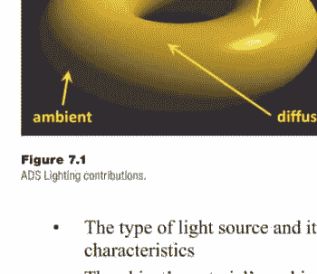

图 7.1 展示了位置光源对金色圆环的环境、漫反射和高光贡献。

记住，场景最终通过让片段着色器输出屏幕上每个像素的颜色来绘制。使用 ADS 照明模型需要指定对像素 RGBA 输出值的贡献。因素包括：

图 7.1
ADS 贡献。

- 光源类型及其环境、漫反射高光特性
- 物体材质的环境、漫反射高光特性
- 物体材质指定的“光泽”
- 光照射物体的角度
- 观察场景的角度

## 7.2 灯光

有很多类型的灯光，每种都有不同的特性，并需要不同的步骤来模拟它们效果。某些类型包括：

- 全局光（通常称为“全局环境光”），因为它只包含一个环境分量
- 方向光（或“远距离光”）
- 位置光（或“点光源”）
- 聚光灯

全局环境光是建模最简单的灯光类型。全局环境光没有光源位置——光在处处都是相等的，场景中每个对象的每个像素上都相等，无论物体位于何处。环境光模拟了现实世界的现象：光经过多次反射，以至于其来源和方向无法确定。全局环境光只有一个环境分量，指定为 RGBA 值；它没有漫反射反射或高光反射分量。例如，全局环境光可以定义如下：

```
float globalAmbient[4] = {0.6, 0.6, 0.6, 1.0};
```

RGBA 值的范围从 0 到 1，因此全局环境光通常被建模为微弱的白光，每个 RGBA 值被设置为 0 到 1 之间的相同分数值，而 alpha 通道设置为 1。

方向光或远距离光也没有光源位置，但它有方向。它适用于光源非常遥远，以至于光线实际上是平行的情况，例如来自太阳的光。在这些情况下，我们可能只对建模光感兴趣，而不对产生光的物体感兴趣。方向光对物体的影响取决于入射角；面向方向光的一侧比切线侧或对侧更亮。方向光需要指定其方向（作为向量）以及它的环境、漫反射和高光反射特性（作为 RGBA 值）。一个指向负 Z 轴的红色方向光可以指定如下：

```
float dirLightAmbient[4] = {0.1, 0.0, 0.0, 1.0};
float dirLightDiffuse[4] = {1.0, 0.0, 0.0, 1.0};
float dirLightSpecular[4] = {1.0, 0.0, 0.0, 1.0};
float dirLightDirection[4] = {0.0, 0.0, -1.0, 0.0};
```

## 使用 C++ 进行 OpenGL 计算机图形编程

当我们已经有了全局环境光时，为灯光包含环境贡献似乎是多余的。然而，这两者的分离是有意为之，并且在灯光“开启”或“关闭”时显而易见。当“开启”时，总环境贡献将如预期的那样增加。在上面的示例中，我们只为灯光包含了一小部分环境贡献。根据场景的需求，平衡这两种贡献是非常重要的。

位置光在 3D 场景中有一个特定的位置。靠近场景的光源，如灯具、蜡烛等都是其例子。和方向光一样，位置光的影响取决于入射角；然而，没有指定强度，因为我们场景中每个顶点的强度都不同。位置光还可能结合衰减因子，以模拟其强度随距离的增加而减小。与我们见过的其他类型灯光相比，位置光具有指定为 RGB 值的环境、漫反射和高光反射属性。例如，一个位于位置 (5,2,-3) 的红色位置光可以指定如下：

```
float posLightAmbient[4] = {0.1, 0.0, 0.0, 1.0};
float posLightDiffuse[4] = {1.0, 0.0, 0.0, 1.0};
```


`float posLightSpecular[4] = {1.0, 0.0, 0.0, 1.0};`

`float posLightLocation[4] = {5.0, 2.0, -3.0, 1.0};`

衰减因子可以用多种方式进行建模。一种方法是包含可调的非负参数，用于常数、线性和二次衰减（分别为 `$k_c, k_l,$` 和 `$k_q$`）。然后将这些参数结合起来，并考虑到与光源的距离 (`$d$`)：

`$attenuationFactor = \frac{1}{k_c+k_ld+k_qd^2}$`

将此因子乘以光强会导致强度随距离光源的增加而减小。注意，`$k_c$` 应大于或等于 1，这样衰减因子始终处于 `[0..1]` 范围内，并且随着距离 `$d$` 的增加而如此。

聚光灯既有位置又有方向。聚光灯的“锥体”效果可以使用 `$0^{\circ}$` 到 `$90^{\circ}$` 之间的截止角 `$\theta$` 来模拟，指定光束的半宽度，并使用衰减指数来模拟光束角度内强度的变化。如图 7.2 所示，我们确定


# 第7章 - 照明 163

聚光灯方向与从聚光灯到像素的向量之间的角度 `$\phi$`。当 `$\phi$` 小于 `$\theta$` 时，通过将 `$\phi$` 的余弦方衰减指数来计算强度因子（当 `$\phi$` 大于 `$\theta$` 时，强度设置为 0）。结果是一个从 0 到 1 的强度因子。该因子乘以强度模拟了聚光灯的“锥体”效果。一个在 `(5,2,-3)` 指向负 Z 轴的红色聚光灯可以指定如下：

```
float spotlightAmbient[4] = {0.1, 0.0, 0.0, 1.0};

float spotlightDiffuse[4] = {1.0, 0.0, 0.0, 1.0};

float spotlightSpecular[4] = {1.0, 0.0, 0.0, 1.0};

float spotlightLocation[4] = {5.0, 2.0, -3.0, 1.0};

float spotlightDirection[4] = {0.0, 0.0, -1.0, 0.0};

float spotlightExponent = 20.0;
```

聚光灯还可以包含衰减因子。我们在上面的设置中没有显示它们，但可以以位置光相同的方式进行定义。历史上，自 Pixar 的短片《Luxo Jr.》1986年出现以来，聚光灯一直是标志性的。

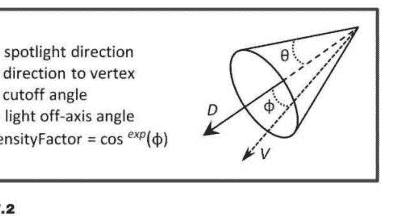

在设计包含多种类型灯光的系统时，程序员应该考虑创建一个类层次结构，例如定义一个“灯光”类，并为“环境”、“方向”、“位置”和“聚光灯”定义子类。由于聚光灯具有方向光和位置光的特性，可以利用 C++ 的多继承能力来设计聚光灯类。我们的示例足够简单，省略了这些。

## 7.3 材料

到为止，场景中对象的外观完全由颜色和纹理处理。照明的加入允许我们考虑表面的反射特性。这意味着物体如何与光作用。这可以通过考虑每个物体是由某种材质制成的来建模。

可以通过指定四个值在 ADS 模型中模拟材质，其中三个是我们熟悉的——环境、漫反射和高光颜色。第四个称为光泽，正如我们将看到的，用于为目标材质构建合适的高光。ADS 和光泽值已经针对许多不同材质进行了开发。例如，“pwerter”可以指定如下：

```
float pwerMatAmbient[4] = {.11, .08, .11, 1.0};

float pwerMatDiffuse[4] = {.43, .47, .54, 1.0};

float pwerMatSpecular[4] = {.33, .33, .52, 1.0};

float pwerMatShininess = 9.85;
```

图 7.3 给出了其他材质的 ADS RGBA 值。

材质属性中还包含其他属性。透明度在 RGBA 规格的第四通道（或“alpha”）通道中处理，该通道处理不透明度；1.0 代表完全不透明，0.0 代表完全透明。对于大多数材料，只需设置为 1.0，对于某些材料，微小的透明度起着作用。例如，在图 7.3 中，注意“玉”和“珍珠”材质包含了少量的透明度（小于 1.0 的值）。

发光性有时也包含在 ADS 规格中。这在模拟发射光的材质时非常有用。

# 第 7 章 光照

| 材料 | 漫反射 RGBA | 光泽度 |
| --- | --- | --- |
| 黄金 | 0.24725, 0.19955, 0.0745, 1.0<br>0.25164, 0.04048, 0.22648, 1.0<br>0.06280, 0.05558, 0.36607, 1.0 | 51.2 |
| 翡翠 | 0.135, 0.2225, 0.1575, 0.95<br>0.54, 0.09, 0.63, 0.95<br>0.3162, 0.3162, 0.95 | 12.8 |
| 珍珠 | 0.25, 0.20725, 0.20725, 0.922<br>1.00, 0.829, 0.829, 0.922<br>0.2966, 0.2964, 0.2966, 0.92 | 11.264 |
| 银色 | 0.19225, 0.19225, 0.19225, 1.0<br>0.50754, 0.50754, 0.50754, 1.0<br>0.50837, 0.50837, 0.50837, 1.0 | 51.2 |

图 7.5
材料 ADS 系数。

当渲染一个没有纹理的物体时，指定材料特性是很有用的。因此，如果有一些预备的材料可供我们使用将非常方便。于是，我们在 `Utils.cpp` 文件中添加以下代码行：

```cpp
// GOLD - material, diffuse, specular, and shininess

float Utils::goldAmbient(float) {static float a[4] = {0.24725f, 0.19955f, 0.0745f, 1}; return (float*)a;}

float Utils::goldDiffuse(float) {static float a[4] = {0.25164f, 0.04048f, 0.22648f, 1}; return (float*)a;}

float Utils::goldSpecular(float) {static float a[4] = {0.06280f, 0.05558f, 0.36607f, 1}; return (float*)a;}

float Utils::goldShininess(float) {static float a[4] = {51.2f}};

// SILVER - material, diffuse, specular, and shininess

float Utils::silverAmbient(float) {static float a[4] = {0.19225f, 0.19225f, 0.19225f, 1}; return (float*)a;}

float Utils::silverDiffuse(float) {static float a[4] = {0.50754f, 0.50754f, 0.50754f, 1}; return (float*)a;}

float Utils::silverSpecular(float) {static float a[4] = {0.50837f, 0.50837f, 0.50837f, 1}; return (float*)a;}

float Utils::silverShininess(float) {static float a[4] = {51.2f}};

// BRONZE - material, diffuse, specular, and shininess

float Utils::bronzeAmbient(float) {static float a[4] = {0.2125f, 0.1275f, 0.0540f, 1}; return (float*)a;}

float Utils::bronzeDiffuse(float) {static float a[4] = {0.7140f, 0.4284f, 0.1814f, 1}; return (float*)a;}

float Utils::bronzeSpecular(float) {static float a[4] = {0.3936f, 0.1667f, 1}; return (float*)a;}

float Utils::bronzeShininess(float) {static float a[4] = {25.6f}};
```

# 使用 C++ 和 OpenGL 进行计算机图形编程

注意，在 `init()` 函数或顶层声明中，可以通过如下方式非常容易地指定物体拥有（例如）“黄金”材料：

```cpp
float matAmbient = util::goldAmbient();

float matDiffuse = util::goldDiffuse();

float matSpecular = util::goldSpecular();

float matShininess = util::goldShininess();
```

请注意，我们在这些章节中目前描述的关于光照和材料属性的代码并没有实际执行光照。它仅仅提供了一种指定和存储场景中元素所需的光照和材料属性的方法。我们仍然需要自己实际计算光照。这将需要在着色器中进行一些复杂的数学处理。现在让我们深入研究 C++/OpenGL 中实现 ADS 光照的细节。

## 7.4 光照

当我们绘制场景时，记住每个顶点都经过变换，将 3D 世界模拟到 2D 屏幕上。像素颜色是栅格化以及贴图的结果。我们现在必须引入调整这些栅格化像素颜色的步骤以实现场景的光照。我们需要的基本 ADS 计算是确定每个像素的强度（I）。该计算公式如下：

`I_{observed} = I_{ambient} + I_{diffuse} + I_{specular}`

也就是说，我们需要为每个光源计算并存储环境光、漫反射和反射光贡献。这取决于场景中的光源类型与像素相关的材料类型。环境光贡献是最简单的，考虑到光和强度是通过 RGB 值指定的，更精确的计算为：

`I_{ambient_red} = Light_{red} * Material_{red}`
`I_{ambient_green} = Light_{green} * Material_{green}`
`I_{ambient_blue} = Light_{blue} * Material_{blue}`

漫反射贡献更为复杂，因为它取决于光与表面之间的入射角。余弦定律规定从表面反射的光与角的余弦正比。这可以这样建模：

`I_{diff} = Light_{diff} * Material_{diff} * cos(\theta)`

与之前一样，实际计算涉及红、绿、蓝分量。确定角度 `$\theta$` 需要我们 (a) 找到从像素指向光源的向量（或者相反的光方向向量），以及 (b) 找到一个与渲染表面垂直的向量。让我们分别用 `$\vec{L}$` 和 `$\vec{N}$` 表示这些向量，如图 7.4 所示：

img/5f029c1d5777641a7d2524f3734dcf_166_0.png

光的光入射角。

取决于场景中光的性质，`$\vec{L}$` 可以通过取光方向的反方向或计算像素到光源的向量来实现。确定 `$\vec{N}$` 可能更困难——渲染顶点可能有法线向量，但如果模型不包含法线，`$\vec{N}$` 需要根据相邻顶点的位置进行几何估计。在章节的剩余部分，我们将假设渲染的模型每个顶点都有法线向量（这在 Maya 或 Blender 等建模工具构建的模型中很常见）。事实证明，在这种情况下没有必要计算 `$\theta$` 本身。我们真正想要的是 `$\cos(\theta)$`，回想第 3 章，这可以通过点积找到。因此，漫反射贡献可以这样计算：

`I_{diffuse} = Light_{diffuse} * Material_{diffuse} * (\hat{N} \cdot \hat{L})`

漫反射贡献只有在表面光光时有效，即当 `-90 < \theta < 90` 时；即 `$\cos(\theta) > 0$`。因此，我们必须替换等方程右侧的项：

`max((\hat{N} \cdot \hat{L}), 0)`

反射贡献决定了渲染像素是否应该亮，因为它是“高光”的一部分。它不仅涉及光源的入射角，还涉及表面反射光与“眼睛”相对于物体表面视角之间的角度。

img/5f029c1d5777641a7d2524f3734dcf_167_0.png

入射角。

在图 7.5 中，`$\hat{R}$` 代表光的反射方向，`$\hat{V}$`（称为视向量）是从像素到眼睛的向量。注意 `$\hat{V}$` 是从眼睛到像素向量的负值（在相机空间中，眼睛位于原点）。`$\hat{R}$` 和 `$\hat{V}$` 之间的角度 `$\varphi$` 越小，眼睛越对轴或“看向”反射，该像素对高光的贡献就越大（因此它看起来应该越亮）。

# 第 7 章 · 光照

使用 `$\phi$` 计算反射贡献的方法取决于渲染物体所需的“光泽”。极光亮的物体（如镜子）具有非常小的高光——它们精确地将入射光反射到眼睛。光泽较低的材料的光高光更加“分散”，因此更多像素属于高光的一部分。

光泽通常用衰减函数建模，该函数表达了随着角度增大，反射贡献减少到零的速度。我们可以使用 `$\cos(\phi)$` 来建模衰减，并通过余弦函数的幂次来增加光泽，例如 `$\cos(\phi), \cos^2(\phi), \cos^3(\phi), \dots$` 等，如图 7.6 所示。

img/5f029c1d5777641a7d2524f3734dcf_168_0.png

作为余弦指数建模的光泽。

注意，指数值越高，衰减越快，对于光反射偏离视角的像素，其反射贡献就越小。我们将用于 `$\cos(\phi)$` 衰减函数中的指数 `$n$` 称为特定材料的光泽因子。

## 7.5 实现 ADS 光照

第 7.4 节中描述的计算到为止大多是理论性的，因为它们假设我们可以在每个像素上执行这些计算。这是
困难之处在于普通的法线（`$\hat{N}$`）通常只对定义模型的顶点可用，而不是对每个像素可用。因此，我们要么为每个像素计算法线（这可能非常耗时），要么找到某种方法来估计我们需要的值以达到足够的效果。

其中一种方法被称为“渐变着色”（faded shading）或“平着色”（flat shading）。在这里，我们假设每个渲染图元（即多形或三角形）中的每个像素具有相同的光照值。因此，我们只需要对模型中每个多形的一个顶点进行光照计算，然后基于每个多形或每个三角形将光照值复制到相邻的渲染像素上。

面实例化着色（Faceted shading）现在很少使用，因为生成的图像往往看起来非常真实，而且硬件使得更准确的计算成为可能。图 7.7 显示了一个面实例化着色的环面，其中每个三角形表现为一个平坦的反射表面。

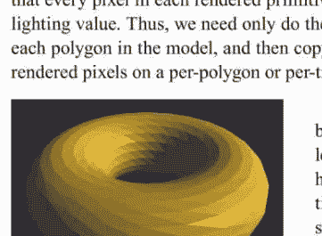

图 7.7
具有面实例化着色的环面。

尽管面实例化着色在某些情况下是可以的（或作为一种刻的效果），但更好的方法是“光滑着色”（smooth shading），其中为每个像素计算光照强度。光滑着色之所以可行，是因为现代硬件显卡执行的并行处理，以及 OpenGL 图形流水线中发生的插值渲染。

我们将检查两种流行的的光滑着色方法：高罗德着色（Gouraud shading）和冯光模型着色（Phong shading）。

### 7.5.1 高罗德着色

法国科学家 Henri Gouraud 在 1971 年发表了一种光滑着色算法，后来被称为高罗德着色 [GO71]。它特别适用于现代显卡，因为它利用了 OpenGL 等 3D 图形流水线中提供的自动插值渲染。高罗德着色的过程如下：

- 1. 确定每个顶点的颜色，结合光照计算。
- 2. 通过法线光栅化过程允许这些颜色在中间像素之间进行插值（这在效果上也插值了光照贡献）。

在 OpenGL 中，这意味着大多数光照计算将在顶点着色器中完成。片段着色器将仅仅是一个透传，以便显示出准确插值的光照颜色。

图 7.8 概述了我们将用于在 OpenGL 中实现高罗德着色器的策略，适用于一个带有环面和位置光的场景。该策略随后在程序 7.1 中实现。

| JOGL (Java) 代码 | 顶点着色器 | 片段着色器 |
|---|---|---|
| 已放置的缓冲区： | 1. 计算向量<br>N.L,V 和 R<br>针对此顶点 | 传入的插值内容： |
| 1. 模型顶点 | 2. 计算 A,D,S<br>贡献 | - 颜色 |
| 2. 顶点名称 | 3. 输出属性:<br>- 光照颜色<br>- gl_position | - 位置 |
| 已放置的 uniform 变量： | | |
| 1. mv & proj 矩阵变换 | | |
| 2. 光照和材质特性 | | |

图 7.8 
实现高罗德着色。

## 程序 7.1 带有位置光和高罗德着色的环面

C++/OpenGL 应用

```cpp
#include "Torus.h"

#include "Utils.h"
...

// 构建着色器和渲染程序的声明，如之前所示。

// 声明一个 VAO 和两个 VBO，如之前所示。

// 如之前所示声明和赋值环面相机位置。

// Utils.cpp 现在添加了金、银和青铜材质配件。
...

// 为 display() 函数分配变量

GLint mvLoc, projLoc, nLoc;

// 着色器 uniform 变量的位置

GLint globalAmbloc, ambLoc, diffLoc, specLoc, posLoc, mAmbloc, mDiffLoc, mSpecLoc, mShiLoc;
```

```cpp
glm::mat4 pMat, vMat, mMat, myMat, invTrMat;
```


`glm::vec3` `currentLightPos`, `lightPos`; // 光位置作为 Vector3f，同时位于模型空间和视图空间

`float` `lightPos`;// 光位置 `float` 数组

```cpp
// 初始光位置
glm::vec3 initialLightLoc = glm::vec3(5.0, 2.0, 2.0);
```

```cpp
// 光属性
float globalAmbient[4] = {0.7, 0.7, 0.7, 1.0};
float lightAmbient[4] = {0.0, 0.0, 0.0, 1.0};
float lightDiffuse[4] = {1.0, 1.0, 1.0, 1.0};
float lightSpecular[4] = {1.0, 1.0, 1.0, 1.0};
```

```cpp
// 材质属性
float matAmb = Utils::Ambient();
float matDiff = Utils::Diffuse();
float matSpec = Utils::Specular();
float matShininess = Utils::Shininess;
```

```cpp
void setupVertices(void) {
    // 缓冲区是更改的
    // 通过法线光栅化过程（这在效果上也插值了光照贡献）
    glBindBuffer(GL_ARRAY_BUFFER, vbo[2]);
    glBufferData(GL_ARRAY_BUFFER, values.size() * sizeof(float), values, GL_STATIC_DRAW);
}
```

```cpp
void display(GLFWwindow window, double currentTime) {
    // 绑定顶点缓冲区并设置属性 
    glBindBuffer(GL_ARRAY_BUFFER, vbo[0]);
    glVertexAttribPointer(0, 3, GL_FLOAT, GL_FALSE, 0, (void*)0);
    VertexAttribArray(0);
    // 绑定法线缓冲区 
    glBindBuffer(GL_ARRAY_BUFFER, vbo[2]);
    glVertexAttribPointer(1, 3, GL_FLOAT, GL_FALSE, 0, (void*)0);
    VertexAttribArray(1);
    // 设置 uniform 变量
    glUniformMatrix4fv(mvLoc, 1, GL_FALSE, &mvMat[0][0]);
    glUniformMatrix4fv(projLoc, 1, GL_FALSE, &projMat[0][0]);
    glUniform4fv(globalAmBLoc, 1, globalAmbient);
    glUniform4fv(ambLoc, 1, lightAmbient);
    glUniform4fv(diffLoc, 1, lightDiffuse);
    glUniform4fv(specLoc, 1, lightSpecular);
    glUniform3fv(posLoc, 1, &currentLightPos[0]);
    glUniform4fv(mAmBLoc, 1, &matAmb);
    glUniform4fv(mDiffLoc, 1, &matDiff);
    glUniform4fv(mSpecLoc, 1, &matSpec);
    glUniform1f(mShiLoc, matShininess);
    // 绘制环面
    glDrawElements(GL_TRIANGLES, myTorus.getNumIndices(), GL_UNSIGNED_INT, 0);
}
```

```cpp
void initLights(glm::mat4 vMat) {
    // 将光的位置转换到视图空间，并存 float 数组
    lightPos = glm::vec3(vMat * glm::vec4(currentLightPos, 1.0));
    lightPos[0] = lightPos.x;
    lightPos[1] = lightPos.y;
    lightPos[2] = lightPos.z;
    // 获取着色器中光和材质字段的位置
    globalAmBLoc = glUniformLocation(renderingProgram, "globalAmbient");
    ambLoc = glUniformLocation(renderingProgram, "light_ambient");
    diffLoc = glUniformLocation(renderingProgram, "light_diffuse");
    specLoc = glUniformLocation(renderingProgram, "light_specular");
    posLoc = glUniformLocation(renderingProgram, "light_position");
    mAmBLoc = glUniformLocation(renderingProgram, "material_ambient");
    mDiffLoc = glUniformLocation(renderingProgram, "material_diffuse");
    mSpecLoc = glUniformLocation(renderingProgram, "material.specular");
    mShiLoc = glUniformLocation(renderingProgram, "material.shininess");
}
```

# （程序 7.1，续）

### 顶点着色器 (Vertex Shader)

```glsl
#version 430
layout (locations=0) in vec3 vertPos;
layout (locations=1) in vec3 vertNormal;
out vec4 varyingColor;
struct PositionalLight
{
    vec4 ambient;
    vec4 diffuse;
    vec4 specular;
    vec3 position;
};
struct Material
{
    vec4 ambient;
    vec4 diffuse;
    vec4 specular;
    float shininess;
};
uniform vec4 globalAmbient;
uniform PositionalLight light;
uniform Material material;
uniform mat4 mv_matrix;
uniform mat4 proj_matrix;
uniform mat4 norm_matrix; // 用于变换顶点
void main(void)
{
    vec4 color;
    // 将顶点位置转换为视图空间，并
    // 将法线转换为视图空间光向量（从顶点到光源）
    vec4 P = mv_matrix * vec4(vertPos,1.0);
    vec3 N = normalize(norm_matrix * vec4(vertNormal,1.0)).xyz;
    vec3 L = normalize(light.position - P.xyz);
    vec3 V = normalize(-P.xyz);
    // 视图向量等于视图空间顶点位置的反值
    // R 是 -L 相对于表面法线 N 的反射
    vec3 R = reflect(-L,N);
    // 环境光、漫反射和高光贡献
    vec3 ambient = ((globalAmbient * material.ambient) + (light.ambient * material.ambient)).xyz;
    vec3 diffuse = light.diffuse.xyz * material.diffuse.xyz * max(dot(N,L), 0.0);
    vec3 specular =
    material.specular.xyz* light.specular.xyz* pow(max(dot(R,V), 0.0f), material.shininess);
    // 将颜色输出发送到片段着色器
    varyingColor = vec4(ambient + diffuse + specular, 1.0);
    // 像一样，将位置发送到片段着色器
    gl_Position = proj_matrix * mv_matrix * vec4(vertPos, 1.0);
}
```

## 片段着色器 (Fragment Shader)

```glsl
#version 430
in vec4 varyingColor;
out vec4 fragColor;
// uniform 变量与顶点着色器中的匹配，
// 但在此片段着色器中没有直接使用
struct PositionalLight {
  vec4 ambient;
  vec4 diffuse;
  vec4 specular;
  vec3 position;
};
struct Material {
  vec4 ambient;
  vec4 diffuse;
  vec4 specular;
  float shininess;
};
uniform vec4 globalAmbient;
uniform PositionalLight light;
uniform Material material;
uniform mat4 mv_matrix;
uniform mat4 proj_matrix;
uniform mat4 norm_matrix;
void main(void) {
  fragColor = varyingColor;
}
```

程序 7.1 的输出如图 7.9 所示。

顶点着色器包含了我们第一次使用结构体（`struct`）表示法的示例。GLSL 中的“`struct`”就像一种数据类型；它有一个名称和一组字段。当使用结构体的名称声明变量时，它随后包含字段，这些字段通过“->”符号进行访问。例如，变量“`light`”被声明为类型“`Positional_light`”，因此我们此后可以引用 `light.ambient`、`light.diffuse` 等字段。

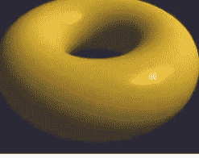

顶点着色器是执行大部分计算的地方。对于每个顶点，会对顶点位置和法线向量应用相应的矩阵变换，并计算光方向向量 (`L`) 和反射向量 (`R`)，从而为每个顶点计算出颜色（在代码中称为 `varyingColor`）。随后，片段着色器只是一个简单的透传。长长的 `uniform` 变量声明列表也出现在片段着色器中（原因在第 4 章之前描述），但其中没有任何一个变量在何处被实际使用。

> 注意 GLSL 函数 `normalize()` 的使用，它将向量转换为单位长度，这对于正确应用点积是必要的；以及 `reflect()`，它计算一个顶点相对于另一个顶点的反射。

伪影迹对其他美术师来说是显而易见的。如果高光呈现出块状、多面的外观，那么当物体在运动时，这种伪影会更加明显（我们无法在此处说明）。

高罗插色（Gouraud shading）容易受到其他伪影的影响。如果高光完全包含在模型的一个三角形内——也就是说，如果它不包含模型的至少一个顶点——那么它可能会完全消失。高光分量是按顶点计算的，因此如果不存在具有高光贡献的模型顶点，那么任何光栅化像素都将不包含高光照射。

### 7.5.2 冯氏着色 (Phong Shading)

彭云辉（Bui Phong）在犹他大学攻读研究生期间开发了一种平滑着色算法，并在他 1973 年的论文 [PH73] 中描述了它，并在 [PH75] 中发表。该算法的结构与高罗插色算法相似，不同之处光计算是逐像素而非逐顶点的。由于光计算需要法向量 $\hat{N}$ 和光向量 `L`，而这些向量在模型中仅以逐顶点的形式提供，冯氏着色通常使用一种巧妙的“技巧”来实现，即在顶点着色器中计算 $\hat{N}$ 和 `L`，并在光栅化期间进行插值。图 7.10。

JOGL (Java) 代码

| 顶点着色器 | 片段着色器 |
| :--- | :--- |
| 1. 计算：向量 `N,L,V` | 1. 传入插值值：$\hat{N}, L$ |
| （与高罗插色相同） | 2. 计算：`R, G, B` |
| 2. 输出属性：`N, L, gl_position` | 4. 输出颜色 |
|  | 3. 计算 ADS 贡献 |

图 7.10 实现冯氏着色。

C++/OpenGL 代码保持不变。之前在顶点着色器中完成的某些计算现在移动到了片段着色器中。插值法向量的效果如图 7.11 所示：


图 7.11 法向量的插值。

我们准备好使用位置光照来实现冯氏着色。C++/OpenGL 保持不变，如图 7.2 所示。


图 7.2 使用冯氏着色的圆环。

冯氏着色比高罗插色提供了更好的真实感，但同时也带来了性能成本。詹姆斯·布林（James Blinn）在 1997 年 [BL7] 提出了冯氏着色的一种优化方案，并称为布林-冯反射模型。它基于这样一种观察：冯氏着色中最昂贵的计算之一是确定向量 `R`。

布林观察到向量 `R` 本身实际上并不需要——`R` 的产生只是确定角度 `q` 的手段。事实证明，通过计算位于 `L` 和 `V` 中间位置的向量 `H`，可以找到 `q`。如图 7.13 所示，`H` 和 `N` 之间的角度恰好等于 ½`q`。虽然 `alpha` 不等同于 `q`，但布林证明了使用 `H` 代替 `R` 可以获得合理的结果。


图 7.13 布林-冯反射。

“中间”向量 `H = L+V` 最容易通过找到 `H` 来确定（见图 7.14），之后可以使用点积 `H·N` 找到 `cos(alpha)`。


计算可以在片段着色器（`fragment shader`）中完成，如果为了性能需要，甚至可以在顶点着色器（`vertex shader`）中完成（经过一些调整）。图7.15显示使用 Blinn-Phong 着色渲染的圆环；其质量与 Phong 着色几乎无法区分，但节省了大量的性能开销。

程序 7.3 显示了修改后的顶点着色器和片段着色器，用于将程序 7.2 显示的 Phong 着色示例转换为 Blinn-Phong 着色。与之前一样，C++/OpenGL 代码没有变化。

# 程序 7.3 使用 Blinn-Phong 着色的圆环

顶点着色器

```glsl
// 半角向量 "H" 是一个额外的输出变变量
vec3 varyingHalfVector;
void main(void) {
    // 计算与之前相同，外加以下计算 L+V
    varyingHalfVector = (varyingLightDir + (-varyingVertPos)).xyz;
    // 顶点着色器的其余部分保持不变
}
```

片段着色器

```glsl
in vec3 varyingHalfVector;
...
void main(void) {
    // 注意，不再必要在片段着色器中计算 R
    vec3 L = normalize(varyingLightDir);
    vec3 N = normalize(varyingNormal);
    vec3 V = normalize(varyingPos);
    vec3 H = normalize(varyingHalfVector);
    // 法线与半角向量之间的角度
    float cosPhiH = dot(H,N);
    // 半角向量在顶点着色器中计算，然后由光栅化器插值
    vec3 ambient = (global.ambient * material.ambient) + (light.ambient * material.ambient).xyz;
    vec3 diffuse = light.diffuse.xyz * material.diffuse.xyz * max(cosTheta,0.0);
    vec3 specular = 
    light.specular.xyz * material.specular.xyz * pow(max(cosPhi,0.0),material.shininess,3.0);
    // 最后乘以 3.0 是为了“弱化”处理以改善高光反射效果。
    fragColor = vec4(ambient + diffuse + specular, 1.0);
}
```

# 182 使用 C++ 和 OpenGL 的计算机图形学编程


Studio 522 Dolphin

34,054 个三角形


图 7.16 显示了 Phong 着色对外部生成模型影响两个示例。上面的图像显示了由 Jay Turberville 在 Studio 522 Productions [TU16] 创建的海豚 OBJ 模型渲染图。下面的图像是著名的“斯坦福龙”的渲染图，它是 1996 年对真实雕像进行 3D 扫描的结果 [ST96]。两个模型都使用了我们在“`Uills.cpp`”中放置的“金色”材质。斯坦福龙被广泛用于测试图形算法和硬件，是因为它的尺寸——它包含了超过 800,000 个三角形。


斯坦福龙

873,587 个三角形

图 7.16

带有 Phong 着色的外部模型。

## 7.6 结合光照与纹理

到目前为止，我们的光照模型假设我们使用具有指定 ADS 值的光源来照明由同样定义了 ADS 值的材质的物体。然而，正如我们在第 5 章中看到的，某些对象的表面可能是由纹理图像定义的。因此，我们需要一种方法，将通过采样纹理获取的颜色与光照模型产生的颜色结合。

结合光照和纹理的方式取决于对象的性质及其纹理的用途。有几种场景，包括：

- 纹理图像非常真实地反映物体表面的实际外观。
- 对象同时具有材质和纹理。
- 纹理包含阴影或反射信息（第 8 章和第 9 章介绍）。
- 涉及多个光源和/或多个纹理。

让我们考虑第一种情况，我们有一个简单的纹理对象，并希望为其添加光照。在片段着色器中实现此点的一种简单方法是完全移除材质规格，并使用从纹理采样器返回的纹像素颜色来代替材质 ADS 值。以下是此类策略之一（伪代码表示）：

```
fragColor = textureColor * (ambientLight + diffuseLight) + specularLight
```

在这里，纹理颜色贡献了环境光和漫反射光，而高光反射完全取决于光。通常根据光来设置高光反射，特别是对于像布料、漆、木头（甚至是金属）这样具有高光反射的表面。在这些情况下，一种合适的策略是：

```
fragColor = textureColor * (ambientLight + diffuseLight)
```

还有一些情况，物体具有通过纹理定义的 ADS 材质，正如前面的章节所述，可以结合多个光源和/或多个纹理来进行这种组合。例如：

```
fragColor = textureColor * (ambientLight + diffuseLight) + specularLight
```

这种结合光照、材质的策略可以扩展到涉及多个光源和/或多个纹理。例如：

```
fragColor = textureColor * (ambientLight + diffuseLight) + specularLight
```

注意不再必要在片段着色器中计算 R

```glsl
vec3 L = normalize(varyingLightDir);
vec3 N = normalize(varyingNormal);
vec3 V = normalize(varyingPos);
vec3 H = normalize(varyingHalfVector);

// 法线与半角向量之间的角度
float cosPhiH = dot(H,N);
```

// 半角向量在顶点着色器中计算，然后由光栅化器插值

```glsl
vec3 ambient = (global.ambient * material.ambient) + (light.ambient * material.ambient).xyz;
vec3 diffuse = light.diffuse.xyz * material.diffuse.xyz * max(cosTheta,0.0);
vec3 specular = light.specular.xyz * material.specular.xyz * pow(max(cosPhi,0.0),material.shininess,3.0);
// 最后乘以 3.0 是为了“弱化”处理以改善高光反射效果。
fragColor = vec4(ambient + diffuse + specular, 1.0);
```


Studio 522 Dolphin
34,054 个三角形

图 7.17
带有 Phong 着色的外部模型。

## 7.4 研究与项目

将程序 7.2 中的点光源替换为 7.2 节描述的“聚光”灯。尝试不同的截断角 `cutoff angle` 和衰减指数 `falloff exponent` 设置并观察其效果。

## 参考文献

- [BA16] J. Barradeau, 访问于2018年10月, http://www.barradeau.com/nicopturne/dump/materials.html
- [BL77] J. Blinn, "Models of Light Reflection for Computer Synthesized Pictures," Proceedings of the 4th Annual Conference on Computer Graphics and Interactive Techniques, 1997.
- [DI16] Luxo Jr. (Pixar – 版权归迪士尼), 访问于2018年10月, https://www.pixar.com/luxo-jr/luxo-jr-main
- [GO71] H. Gouraud, "Continuous Shading of Curved Surfaces," IEEE Transactions on Computers C-20, no. 6 (1971年6月).
- [MH02] T. Akenine-Meller and E. Haines, Real-Time Rendering, 第2版. (A. K. Peters, 2002).
- [PH75] B. Phong, "Illumination for Computer Generated Pictures," Communications of the ACM 18, no. 6 (1975年6月): 311–317.
- [ST96] Stanford Computer Graphics Laboratory, 1996, 访问于2018年10月, http://graphics.stanford.org/data/3Dscanrep/
- [TU16] J. Turnberville, Studio 522, Scottsdale, AZ, www.studio522 .com (2016年开发的海豚模型)。

# 第 8 章 阴影

- 8.1 阴影的重要性 ................................................................................ 189
- 8.2 投影阴影 ................................................................................................. 190
- 8.3 阴影体积. ................................................................................................. 191
- 8.4 阴影贴图 ....................................................................................................... 192
- 8.5 阴影贴图示例 ................................................................................ 199
- 8.6 阴影贴图伪影 ..................................................................................... 205
- 8.7 软阴影 .......................................................................................................... 208

补充说明 ................................................................................................................ 216

## 8.1 阴影的重要性

在第 7 章中，我们学习了如何为 3D 场景添加光照。然而，我们并没有真正添加“光”；而是模拟了光对物体产生的影响——使用 ADS 模型——并相应地修改了我们绘制这些物体的方式。

当我们在同一个场景中光照多个一个物体时，这种方法的局限性就显而易见了。考虑图 8.1 所示场景，它包含了我们的砖纹理圆环面和一个地面（地面是带有 [LU16] 中草地纹理的巨型立方体的顶部）。

初看之下，我们的场景可能看起来合理。然而，仔细观察发现缺少了某些非常重要的东西。特别是，无法辨别圆环与下方大型纹理立方体之间的距离。圆环是悬浮在立方体上方，还是停在立方体上？


图 8.1
没有阴影的场景。

我们无法回答这个问题的原因是场景中缺乏阴影。我们期望看到阴影，而大脑利用阴影来帮助我们判断物体的空间关系。考虑带有阴影的图 8.2 所示场景，现在我们可以看出圆环是停在地面上，还是悬浮在地面上方。


图 8.2
带有阴影的场景。

## 8.2 投影阴影

为了给 3D 场景添加阴影，已经开发了许多有趣的方法。一种适用于平面（如图 8.1 所示）且计算开销较低的方法被称为*投影阴影*（projective shadows）。给定一个光源位置 `$(X_s, Y_s, Z_s)$`、一个需要渲染的物体以及一个接收的平面，可以推导出一个将点投影到 `$(X_p, Y_p, Z_p)$` 的变换矩阵。生成的阴影多形随后以混合方式绘制在地面上，如图 8.3 所示。

投影阴影的优点是高效且易于实现。然而，它仅适用于平面，无法用于曲面。


图 8.3
投影阴影。

## 8.3 阴影体积

另一种由 Crow 在 1977 年提出的重要方法是识别体积。阴影体积的优点是准确度高，伪影较少。然而，寻找阴影体积的计算开销很大。可以使用几何着色器来生成阴影体积，并利用模板缓冲区来确定像素是否在内部。


图 8.4
阴影体积。

## 8.4 阴影贴图

投影阴影最实用且流行的方法之一是阴影贴图。虽然它并不像阴影体积那样准确（而且通常伴随着恼人的伪影），但阴影贴图更容易实现，适用于各种情况，并拥有强大的硬件支持。

如果我们不澄清上一段中对“更容易”一词的使用将是失职的。尽管阴影贴图相比阴影体积无论在概念上还是实践上都简单，但它并不“容易”。学生通常认为阴影贴图是图形课程中最难实现的技术之一。阴影贴图基于一个简单且清晰的想法：即光线看不到任何地方都是阴影。因此，如果物体 #1 挡住了光到达物体 #2，就等同于光无法“看””物体 #2。

渲染我们的场景需要两个轮次：一次从光源的角度渲染场景（但实际上并不绘制到屏幕上），第二次从摄像机的角度渲染。第一个轮次的目的是从光源视角生成一个 Z 缓冲区。完成第一个轮次后，我们需要保留 Z 缓冲区并利用它来帮助我们在第二个轮次中生成阴影。

- （第一轮次）从光源的位置渲染场景。此时，深度缓冲区包含了每个像素从光源到最近物体的距离。
- 将深度缓冲区拷贝到独立的“阴影缓冲区”中。

### 8.4.1 阴影映射（第一阶段 PASS）—— 从光源位置“绘制”对象

在这一步中，我们将相机移动到光源的位置，然后渲染场景。我们在这里的目标不是实际上在显示器上绘制场景，而是完成足够的渲染过程以使深度缓冲区被正确填充。因此，没有为像素生成颜色，我们的第一个 pass 将使用顶点着色器，但片元着色器什么都不做。

当然，移动相机涉及构建合适的矩阵。根据场景的内容，我们需要决定一个从光源观察场景的合适方向。通常，我们希望这个方向指向最终在 pass 2 中渲染的区域。

这通常取决于具体的应用程序——在我们的场景中，我们通常会将相机从光源指向原点。

在一个 pass 中需要处理的几个重要细节：

- 配置缓冲区和阴影纹理。
- 禁用颜色输出。
- 构建从光源指向视口内对象的观察矩阵（look-at matrix）。
- 使用 GLSL pass one 着色器程序，该程序仅包含图 8.5 所示的简单顶点着色器，它期望接收一个 MVP 矩阵。在这种情况下，MVP 矩阵将包含对象的模型矩阵 `M`、在上一步中计算的观察矩阵（作为视图矩阵 `V`）以及透视矩阵 `P`。我们称之为 `shadowMVP`，因为它是基于光源而非相机的视角。由于从光源的视角实际上并没有被显示，pass one 的片元着色器什么都不做。

对于每个对象，创建 `shadowMVP` 并调用 `glDrawArrays()`。在 pass one 中没有必要包含纹理或光照，因为对象没有渲染到屏幕上。

```
// version 430

// vertex shader

layout (location=0) in vec3 vertPos;

uniform mat4 shadowMVP;

void main(void) {
    gl_Position = shadowMVP * vec4(vertPos,1.0);
}

// version 430

// fragment shader

void main(void) {
}
```

# 第 8 章 · 阴影

- (Pass 2) 正常渲染场景。对于每个像素，在阴影缓冲区中查找对应的位置。如果到正在渲染点的距离大于从阴影缓冲区检索到的值，则在该像素处绘制的对象比距离光源最近物体更远，因此该像素处于阴影中。

当发现某个像素处于阴影中时，我们需要让它变暗。实现此点的简单且有效的方法是只渲染其环境光，忽略其漫反射光和光谱分量。

上述描述的方法通常被称为“阴影缓冲”（shadow buffering）。当在第二步中将深度缓冲区拷贝到纹理中时，就产生了“阴影映射”（shadow mapping）。当以这种方式使用纹理对象时，我们称为阴影纹理，OpenGL 以 `sampler2Shadow` 类型的形式支持阴影纹理（下文讨论）。这允许我们在片元着色器中利用纹理单元和采样器变量硬件支持（即“纹理映射”）的能力，在 pass 2 中快速执行深度查找。我们修改后的策略是：

- (Pass 1) 同前。
- 将深度缓冲区拷贝到纹理中。
- (Pass 2) 同前，但阴影缓冲区现在是阴影纹理。


图 8.5
阴影映射 pass 1 顶点和片元着色器。

## 8.4.2 阴影映射（中间步骤）——将 Z 缓冲区拷贝到纹理

OpenGL 提供了两种方法将 Z 缓冲区深度数据放入纹理单元。第一种方法是生成一个空的阴影纹理，然后使用 `glCopyTextureImage2D()` 命令将活动深度拷贝到阴影纹理中。

第二种方法是在 pass 中构建一个“自定义帧缓冲区”（而不是使用默认的 Z 缓冲区），并使用 `glFramebufferTexture()` 将阴影纹理附加到上面。该命令被引入 OpenGL 3.0 以进一步支持阴影映射。使用这种方法时，没有必要“拷贝”Z 缓冲区到纹理，因为缓冲区已经附加了纹理，深度信息由 OpenGL 自动放入纹理。这是我们在实现中中使用的方法。

## 8.4.3 阴影映射（第二阶段 PASS）——带阴影的场景渲染

pass 的大部分将与我们在第 7 章看到的相似。具体来说，是在这里我们渲染整个场景及其中的所有项目，以及光照、材质和任何纹理。我们还需要添加必要的代码来确定每个像素是否处于阴影中。

pass two 的重要特性是它利用了 MVP 矩阵。一个是将对象坐标转换为屏幕坐标的标准 MVP 矩阵（如大多数示例所示）。另一个是在 pass one 中生成的用于从光源位置渲染的 `shadowMVP` 矩阵——在 pass two 中尝试查找纹理中的像素时会出现问题。相机利用 [-1,1] 空间，而纹理映射利用 [0,1] 空间。一种常见的解决方案是构建一个额外的变换矩阵，称为 `B`，它将相机空间转换为纹理空间。推导 `$B$` 非常简单——先乘以半，再乘以半。`$B$` 矩阵如下：

$$
B = \begin{bmatrix} 0.5 & 0 & 0.5 \\ 0 & 0.5 & 0.5 \\ 0 & 0 & 1 \end{bmatrix}
$$

`$B$` 然后连接到用于 pass two 的 `shadowMVP` 矩阵：

```
shadowMVP = B * shadowMVP_{(pass1)}
```

假设我们使用将阴影纹理附加到自定义帧缓冲区的方法，OpenGL 提供以下是 pass two 中处理的细节总结：

- 构建从光到纹理空间的“B”变换矩阵（实际上是在 `init()` 中完成的）。
- 用于查找的阴影纹理。
- 启用颜色输出。
- 启用包含顶点和片元着色器的 GLSL pass two 程序。
- 根据相机位置（如法线）构建对象的 MVP 矩阵。
- 构建 `shadowMVP` 矩阵（结合 `B` 矩阵）——着色器需要在阴影纹理中查找像素。
- 将变换发送到 uniform 变量。
- 启用包含顶点、法线纹理坐标的缓冲区（如果使用）。
- 调用 `glDrawArrays()`。除了渲染职责，顶点和片元着色器还有额外任务：

- 顶点着色器将顶点位置从相机空间转换为光源空间，并将结果发送到片元着色器以便进行插值。这使得从阴影纹理检索正确值成为可能。
- 片元着色器调用 `textureProj()` 函数，通过不包含漫反射和光谱贡献来输出较暗的像素。

阴影映射是 GLSL 提供的一种特殊类型采样器变量，称为 `sampler2Shadow`（前所述），它可以附加到 OpenGL 应用中的阴影纹理上。`textureProj()` 函数用于从阴影纹理中查找值，与我们在第 5 章看到的 `texture()` 类似，但它使用 `vec3` 而不是通常的 `vec2`。由于像素坐标是 `vec4`，因此需要投影到 2D 纹理空间以查找纹理图中的深度值。正如我们将看到的，`textureProj()` 为我们完成了这一切。

顶点和片元着色器代码剩余实现了 Blinn-Phong 着光。这些着色器位于图 8.6 和 8.7，其中高亮了阴影映射的代码。

让我们仔细检查如何使用 OpenGL 在正在渲染的像素与阴影纹理中的值之间执行深度比较。我们在顶点着色器中从模型空间的顶点开始，乘以 `shadowMVP2` 以产生投影到光源空间（之前从光源视角生成）的阴影纹理坐标。插值的（3D）光坐标 $(x,y,z)$ 用于：

```
#version 430

layout(location=0) in vec3 vertPos;

layout(location=1) in vec3 vertNormal;

out vec3 varyingNormal, varyingLightDir, varyingVertPos, varyingHalfVec;

out vec4 shadow_coord;

struct PositionalLight {vec4 ambient, diffuse, specular; vec3 position;};

struct Material {vec4 ambient, diffuse, specular; float shininess};

uniform vec4 ambient;

uniform PositionalLight light; // 假设光源位置在眼部空间

uniform Material material;

uniform mat4 mv_matrix;

uniform mat4 prj_matrix;

uniform mat4 norm_matrix;

uniform mat4 shadowMVP2;

layout(binding=8) uniform sampler2DShadow shadowTex;

void main() {

    varyingVertPos = mv_matrix * vec4(vertPos, 1.0).xyz;

    varyingLightDir = light.position - varyingVertPos;

    varyingNormal = (norm_matrix * vec4(vertNormal, 1.0)).xyz;

    varyingHalfVec = varyingLightDir - varyingVertPos.xyz;

    shadow_coord = shadowMVP2 * vec4(vertPos, 1.0);

    gl_Position = prj_matrix * mv_matrix * vec4(vertPos, 1.0);

}
```

图 8.6
阴影映射 pass 2 顶点着色器。

# 198 使用 C++ 的 OpenGL 图形编程

```cpp
#version 430

vec3 varyingNormal, varyingLightDtr, varyingVertPos, varyingHalfVec;

out vec4 shadow_coord;

out vec4 fragColor;

// 顶点着色器中相同的结构体和 uniform

void main(void) 

{

    vec3 L = normalize(varyingLightDtr);

    vec3 N = normalize(varyingNormal);

    vec3 V = normalize(varyingVertPos);

    vec3 H = normalize(varyingHalfVec);

    float shadow = textureProj(shadowMap, shadow_coord);

    fragColor = globalAmbient * material.ambient + light.ambient * material.ambient;

    if(shadow == 1.0) {

        fragColor += light.diffuse * material.diffuse * max(dot(LN,N),0.0) +

        + light.specular * material.specular

        pow(max(dot(H,N),0.0),material.shininess,3.0);

    }

}
```

图 8.7

阴影映射着色器 2 片段着色器。

片段着色器如下。z 分量表示从光源到像素的距离。(xy) 分量用于从 (2D) 阴影纹理中检索存储的深度信息。检索到的值（距离光源最近对象的距离）将与 z 进行比较。这种比较产生一个“二进制”结果，告诉我们正在渲染的像素是否比距离光源最近的点远（即该像素是否处于阴影中）。

在 OpenGL 中，我们像之前描述的那样使用 `glFramebuffer()`，并启用深度测试，如片段着色器（图 8.7）所示，使用 `sampler2D` `shadow` 和 `textureProj()` 将恰好完成我们需要的功能。它将根据深度比较输出 0.0 或 1。根据此值，我们随后可以在片段着色器中，当像素比距离光源最近的物体远时，省略漫反射和高光部分的贡献，从而在适当的情况下创建阴影。图 8.8 显示了概览。

我们现在准备好构建我们的 C++/OpenGL 应用，以与之前描述的着色器配合工作。

texCoord:


图 8.8
自动深度比较。

## 8.5 阴影映射示例

考虑图 8.9 所示场景，它包含一个圆环和一个金字塔。一个位置光源被放置在左侧（注意高光点亮）。金字塔应该在圆环上投下阴影。


图 8.9
没有阴影的光照场景。

为了明确示例的开发，我们的第一步将将其渲染到屏幕上以确保它正常工作。为了做到这一点，我们将临时添加一个简单的片段着色器（它不会包含在最终版本中），以通过一个输出常数颜色（例如红色）的着色器；例如：

```cpp
#version 430

out vec4 fragColor;

void main(void) {

    fragColor = vec4(1.0, 0.0, 0.0, 0.0);

}
```


**图 8.10**
第一阶段：从光源视角（右侧）的场景（左侧）。

带有光照和阴影映射的两阶段式 C++/OpenGL 代码如程序 8.1 所示。

### 程序 8.1 阴影映射

```cpp
// 与我们之前看到的大部分相同。支持阴影的新部分已高亮。

// 光照等所需的导入将包含在开头，与之前相同，

// 在此处未显示。

// // 渲染程序、缓冲区、着色器源等的变量声明将放在这里。

ImportModel pyramid("pyr.obj");

Torus myTorusLoc(0.6f, 0.4f, 48);

int numPyramidVertices, numTorusVertices, numTorusIndices;

// 圆环、相机和光照的位置

glm::vec3 torusLoc(1.6f, 0.1f, -0.3f);

glm::vec3 pyrLoc(-1.0f, 0.1f, 0.3f);

glm::vec3 cameraLoc(0.2f, 0.2f, 0.6f);

glm::vec3 lightLoc(-3.8f, 2.2f, 1.1f);

// 白色光的属性（全局和位置）

float globalAmbient[4] = {0.7f, 0.7f, 0.7f, 1.0f};

float lightAmbient[4] = {0.2f, 0.2f, 0.2f, 1.0f};

float materialAmbient[4] = {0.2f, 0.2f, 0.2f, 1.0f};

float materialDiffuse[4] = {0.3f, 0.3f, 0.3f, 1.0f};

float materialSpecular[4] = {0.5f, 0.5f, 0.5f, 1.0f};

float materialShininess = 32.0f;

// ... (其余代码省略)
```

# 使用 C++ 在 OpenGL 中进行图形图形

```cpp
void passTwo() {

    glUseProgram(renderingProgram2);

    // 传递顶点和片元着色器

    // 绘制环面 - 这我们需要包含光照、材质、法线等

    // 我们还需要为相机空间和光照空间提供 MVP 变换

    mvLoc = glGetUniformLocation(renderingProgram2, "mv_matrix");

    projLoc = glGetUniformLocation(renderingProgram2, "proj_matrix");

    modelLoc = glGetUniformLocation(renderingProgram2, "model_matrix");

    slLoc = glGetUniformLocation(renderingProgram2, "shadowMVP");

    // 绘制环面

    curArr[0] = bronzeMatAlb[0]; curArr[1] = bronzeMatAlb[1]; curArr[2] = bronzeMatAlb[2];

    curDiff[0] = bronzeMatDiff[0]; curDiff[1] = bronzeMatDiff[1];

    curSpe[0] = bronzeMatSpec[0]; curSpe[1] = bronzeMatSpec[1]; curSpe[2] = bronzeMatSpec[2];

    vMat = glm::translate(glm::mat4(1.0), glm::vec3(-cameraLoc.x,-cameraLoc.y, -cameraLoc.z));

    currentLightPos = glGetUniformLocation(renderingProgram2, "light");

    installLights(renderingProgram2, vMat);

    modelMat = glm::translate(glm::mat4(1.0), torusLoc);

    // 为了便于观察进行微旋转

    modelMat = glm::rotate(modelMat, glm::toRadians(25.0), glm::vec3(1.0, 0.0, 0.0));

    // 从相机视角为环面构建 MVP

    mvMat = modelMat;

    invTrMat = glm::transpose(glm::inverse(mvMat));

    // 从光照视角为环面构建 MVP

    shadowMVP2 = b * lightMatrix * matrix * mvMat;

    // 将 MV 和 PROJ 矩阵放入相应的 uniforms 中

    glUniformMatrix4fv(mvLoc, 1, GL_FALSE, glm::value_ptr(mvMat));

    glUniformMatrix4fv(projLoc, 1, GL_FALSE, glm::value_ptr(projMat));

    glUniformMatrix4fv(modelLoc, 1, GL_FALSE, glm::value_ptr(invTrMat));

    glUniformMatrix4fv(slLoc, 1, GL_FALSE, glm::value_ptr(shadowMVP2));

    // * 

    // * 环面法线

    // 设置顶点和法线缓冲区（如果使用了纹理坐标缓冲区）

    glBindBuffer(GL_ARRAY_BUFFER, vbo[0]);

    glVertexAttributePointer(0, 3, GL_FLOAT, FALSE, 0, 0);

    EnableVertexAttribArray(0);

    glBindBuffer(GL_ARRAY_BUFFER, vbo[1]);

    glVertexAttributePointer(1, 3, GL_FLOAT, FALSE, 0, 0);

    EnableVertexAttribArray(1);

    glClear(GL_DEPTH_BUFFER);

    glEnable(GL_CULL_FACE);

    glFrontFace(GL_CCW);

    glEnable(GL_DEPTH_TEST);

    glDepthFunc(GL_LEQUAL);

    glBindBuffer(GL_ELEMENTARY_ARRAY_BUFFER, vbo[4]); // vbo[4] 包含环面索引

    DrawElements(GL_TRIANGLES, numTorusIndices, GL_UNSIGNED_INT, 0);

    // 对金色金字塔重复操作

}
```


程序 8.1 显示了 `C++/OpenGL` 应用中相关的部分，这些部分与之前详细介绍的 `pass` 和两个着色器进行交互。未显示的是读取和编译着色器、构建模型及其相关缓冲区、在着色器中安装位置光源的 `ADS` 特性，以及执行透视和观察矩阵计算的常用模块。这些内容与之前的示例相同。

## 8.6 阴影映射伪影

尽管我们已经实现了为场景添加阴影的所有基本要求，但运行程序 8.1 产生的结果参不相同，如图 8.11 所示。

好消息是，我们的金字塔现在在环面上投射了阴影！遗憾的是，这种成功伴随着严重的伪影。场景中的许多表面都覆盖着波浪线。这是阴影映射的常见产物，被称为阴影痤疮（shadow acne）或错误的自阴影。


阴影沉积是由深度测试过程中的舍入误差引起的。在查找阴影纹理深度时计算出的纹理坐标通常与实际坐标不匹配。因此，查询可能会返回相邻像素的深度，而不是正在渲染像素的深度。如果到相邻像素的距离更远，即使该像素不在阴影中，看起来也像是在阴影中。

阴影沉积也由于纹理图和深度计算之间的精度差异引起。这会导致舍入误差，以及随后对像素是否处于阴影中的错误判断。

幸运的是，修复阴影痤疮相当容易。由于阴影沉积通常发生在不在阴影中的表面上，一个简单的技巧是在第一个 `pass` 中将每个像素略微向光源移动，然后在第二个 `pass` 中将其移回。这通常被称为“偏置”（`bias`）。

### 8.6.1 彼得潘效应（Peter Panning）

另一种伪影是彼得潘效应。当阴影看起来与物体底部分离时就会发生这种情况。这是由于阴影偏置过大导致的。要修复此，应该减小偏置。然而，过度减少偏置可能会重新引入阴影痤疮。找到正确的平衡通常需要反复尝试。

```cpp
// 在片元着色器中应用偏置的示例

float bias = max(0.05 * (1.0 - dot(normal, lightDir)), 0.005);

float shadow = texture(shadowMap, texCoords).r < (currentDepth - bias) ? 0.0 : 1.0;
```

彼得潘效应在光线角度较小时最为明显。在这种情况下，阴影会离开物体很远。

#### 8.6.2 锯齿边缘

另一种常见的错误是锯齿边缘。当阴影图分辨率不足以表示阴影边界时就会发生。阴影看起来是锯齿状，因为阴影图的像素太大。

为了缓解这个问题，可以使用高的阴影图或采用抗锯齿技术。一种常用技术是百分比深度过滤（`PCF`），它对阴影坐标周围的多个点进行采样并平均结果。

```cpp
//简单的 PCF 示例

float shadow = 0.0;

vec2 texel = 1.0 / textureSize(shadowMap);

for(int x = -1; x <= 1; ++x) {
    for(int y = -1; y <= 1; ++y) {
        float pcfDepth = texture(shadowMap, texCoords + vec2(x, y) * texel).r; 
        shadow += pcfDepth < (currentDepth - bias) ? 0.0 : 1.0;
    }
}

shadow /= 9.0;
```

## 8.7 阴影

目前介绍的方法限于产生硬阴影。这些具有清晰边缘的阴影。然而，现实世界中发生的大多数阴影都是软阴影。也就是说，它们的边缘变得模糊。在本节中，我们将探索现实世界中软阴影的外观，然后描述在 `OpenGL` 中模拟它们的常用算法。

### 8.7.1 现实世界中的软阴影

软阴影有很多原因，软阴影也有许多类型。自然界引起软阴影的一个常见原因是现实世界中的——更多时候它们占据一定的面积。另一个原因是材料和表面的缺陷累积，以及物体本身通过其反射属性产生环境光的光的作用。


图 8.16 显示了一个物体在桌面上投射软阴影的照片。注意，这不是 3D

这不是计算机渲染，而是在一位作者家中拍摄的物体真实照片。

关于图 8.16 中的影子有两点需要注意：

- 影子距离物体越远，就越“软”；距离物体越近，就越“硬”。在比较物体腿附近的影子与图像右侧区域较宽的影子时，这一点非常明显。
- 影子离物体越近，颜色看起来稍微深一点。

光源本身的维度会导致软影。如图 8.17 所示，光源的不同区域投射出略有不同的投影。这些阴影产生不同的区域被称为**半影**（`penumbra`），由影子边缘的软区域组成。


### 8.7.2 生成软影 – 百分深度过滤 (PCF)

在软件中有多种方法可以模拟半影效应以生成软影。最简单且最常用的方法之一被称为百分比深度过滤（Percentage Closer Filtering, `PCF`）。在 `PCF` 中，我们在周围的几个位置对影子纹理进行采样，以估计邻近位置有多少百分比处于阴影中。根据处于阴影中的位置的数量，我们增加或减少正在渲染像素的光照贡献度。

整个计算可以在片段着色器（`fragment shader`）中完成，这也是唯一我们需要修改代码的地方。`PCF` 也可以用于减少锯齿边缘`get`。

在学习 `PCF` 算法之前，让我们先来看一个简单的启发性示例来说明 `PCF` 的目标。考虑图 8.18 所示的输出片段（像素）集合，它们的颜色是由片段着色器计算的。


假设变暗像素是通过阴影映射（shadow mapping）计算出的阴影部分。与其简单地按所示渲染像素（即包含或不包含漫反射和高光分量），假设我们可以获取相邻像素的信息，这样我们就能看到有多少相邻像素处于阴影中。例如，考虑图 8.19 中黄色标记的特定像素，根据图 8.18，它不在阴影中。


**图 8.19**
针对特定像素的 `PCF` 采样。

在突出像素的九像素邻域中，有三个像素处于阴影中，六个不在。渲染像素的颜色可以计算为该像素的环境光贡献，加上漫反射和高光贡献的六分之六，从而得到一个相当亮（但不是完全亮）的像素。在网格中重复此过程将产生大致如图 8.20 所示的像素颜色。注意，对于那些邻域完全处于（或完全不在）阴影中的像素，其颜色与标准阴影映射相同。

与所示示例不同，`PCF` 的实现并没有对渲染像素所在范围内的每个像素进行采样。原因有两个：(a) 我们希望在片段着色器中执行此计算，但片段着色器无法访问其他像素；(b) 获取足够宽的半影效应（例如宽度为0个像素）需要为每个渲染的像素采样数百个邻近像素。

`PCF` 通过以下方式解决这两个问题。首先，我们不再尝试访问相邻像素，而是对阴影图中的邻近纹理元素（`texels`）进行采样。片段着色器可以做到这一点，因为它虽然无法访问像素值，但它可以访问整个阴影图。

**图 8.20**
软影渲染。

其次，为了实现足够宽的半影效应，采样了适当数量的邻近阴影图纹理元素，每个元素距离对应渲染像素的纹理元素最大距离。


半影的宽度可以根据场景和性能需求进行调整。例如，图 8.21 所示的图像是使用 `PCF` 生成的，每个像素的亮度通过对距离像素纹理元素不同的 64 个邻近阴影图纹理元素进行采样来决定。

8.21
软影渲染 - 每个像素采样 64 次。

软影的准确性或平滑度取决于邻近纹理元素的数量。因此，性能和质量之间存在权衡——采样点越多，结果越好，计算开销越大。取决于场景的复杂性和应用程序所需的帧率，所能实现的质量通常有一个实际限制。像图 8.21 所示的每个像素采样 64 个点通常是不实际的。

实现 `PCF` 的常用算法是每个像素采样四个邻近纹理元素，采样位于距离对应像素的纹理元素偏移距离处。当我们处理每个像素时，我们会更改用于确定采样哪四个纹理元素的偏移。以交错方式更改偏移有时会产生较少的“抖动”（`dithering`），目的是让软影边界看起来比通常少量采样点时不那么“块状”。

一种常见方法是假设使用四种不同的偏移模式之一——我们通过计算像素的 `gFragCoord mod 2` 来为给定像素选择使用的模式。回 `gFragCoord` 类型为 `vec2`，包含像素位置的 x 和 y 坐标；`mod` 计算的结果是四个值之一：`(0,0)`、`(0,1)`、`(1,0)` 或 `(1,1)`。我们用此在纹理空间（即在阴影图中）选择四种不同的偏移模式之一。

偏移模式通常在 x 和 y 方向上通过 `-1.5`、`-0.5`、`+0.5` 和 `+1.5` 的不同组合指定（这些也可以根据需要缩放）。

更具体地说，`gFragCoord mod 2` 产生的四种偏移模式为：

| case (0,0) | case (0,1) | case (1,0) | case (1,1) |
| :--- | :--- | :--- | :--- |
| (-1.5, -1.5) | (-1.5, -0.5) | (-0.5, -1.5) | (-0.5, -0.5) |
| (0.5, -1.5) | (0.5, -0.5) | (1.5, -1.5) | (1.5, -0.5) |
| (-1.5, 1.5) | (-1.5, 0.5) | (-0.5, 1.5) | (-0.5, 0.5) |
| (0.5, 1.5) | (0.5, 0.5) | (1.5, 1.5) | (1.5, 0.5) |

（注：上述表格在 OCR 中部分损坏，已根据标准 `PCF` 逻辑和文中上下文进行了重建。）

# 程序 8.2 百分比深度过滤 (PCF)

片段着色器

```cpp
#version 430
// 所有变量声明均保持不变
```

```cpp
// 返回距离 shadow_coord (x,y) 远处的深度测试值。请记住，
// shadow_coord 是阴影贴图中对应于当前渲染像素的位置。
```

```cpp
float lookup(vec2 ox, vec2 oy) {
 float t = texture(shadow_tex,
 shadow_coord + vec4(ox * 0.001 * shadow_coord.w, oy * 0.001 * shadow_coord.w, -0.01, 0.0)); // 参数 (-0.01) 是用于抵消阴影断层（shadow acne）的偏移
 return t;
}
```

```cpp
void main(void) {
 float shadowFactor = 0.0;
 vec3 L = normalize(gl_LightDir);
 vec3 N = normalize(Normal);
 vec3 V = normalize(VertPos);
 vec3 H = normalize(HalfVec);
```

```cpp
// 此部分产生一个 4 采样抖动（dither）软阴影
// 可调节的阴影扩散程度
float swith = 2.5;
// 根据 glFragCoord mod 2 产生 4 采样模式之一
vec2 offset = mod(floor(glFragCoord.xy), 2.0) * swith;
shadowFactor += lookup(1.5*swith - offset.x, 1.5*swith - offset.y);
shadowFactor += lookup(1.5*swith - offset.x, -0.5*swith - offset.y);
shadowFactor += lookup(-0.5*swith - offset.x, 1.5*swith - offset.y);
shadowFactor += lookup(-0.5*swith - offset.x, -0.5*swith - offset.y);
shadowFactor = shadowFactor / 4.0;
```

```cpp
// 此部分如果取消注释，将产生一个 64 采样高分辨率软阴影
// 可调节的阴影扩散程度
float swith = 2.5;
float end = swith*3.0 + swith*2.0;
// for (float m=-end; m<end; m+=swith) {
//   for (float n=-end; n<end; n+=swith) {
//     shadowFactor += lookup(vec2(m,n));
//   }
// }
shadowFactor = shadowFactor / 64.0;
```

```cpp
vec4 shadowColor = globalAmbient * material.ambient + light.ambient * material.ambient;
```

```cpp
vec4 lightedColor = light.diffuse * material.diffuse * max(dot(LN),0.0)
    + light.specular * material.specular
    + pow(max(dot(H,N),0.0),material.shininess*3.0);
fragColor = vec4((shadowColor.xyz + shadowFactor * lightedColor.xyz),1.0);
```

程序 8.2 所示的片段着色器包含了用于 4 采样和 64 采样 `PCF` 软阴影的代码。首先，`lookup()` 函数使得查找过程更加方便。它调用了 `GLSL` 函数 `textureProj()`，在阴影贴图中进行查找，但通过指定的偏移 `(ox,oy)` 进行了偏移。该偏移乘以 `1/windowsize`，我们简单地硬编码为 `.001`，假设窗口大小为 1000x1000 像素。

在 `main()` 中突出显示的 4 采样抖动方法遵循前一节描述的算法。添加了一个缩放因子 `swith`，可用于调整阴影边缘“软”区域的大小。

64 采样代码最后被注释掉了。可以通过取消该代码的注释并注释掉 4 采样代码来替代 4 采样代码。64 采样代码中的 `swith` 缩放因子用作嵌套循环中的步长，用于对距离渲染像素一定距离的点进行采样。例如，使用所示 `swith` 值（2.5），在两个方向上每个轴都会在 1.25、3.75、6.25 和 8.25 的距离处采样点——然后根据窗口大小（如前所述）进行缩放，并作为阴影贴图的纹理坐标。有了如此多的采样，抖动处理并不一定能获得良好结果。

图 8.5 显示了运行的圆环/金字塔阴影映射示例，结合了来自程序 8.2 片段着色器的 `PCF` 阴影，涵盖了 4 采样和 64 采样方法。`swith` 的值选择取决于场景；对于圆环/金字塔示例，它被设置为 2.5，而对于图 8.2 之前所示的海豚示例，`swith` 被设置为 0.0。我们还乘以了阴影坐标的 `w` 分量，因为 `OpenGL` 在纹理查找期间会自动将输入坐标除以 `w`。这种操作称为透视除法（perspective divide），我们在此之前一直忽略了它。关于透视除法的更多信息，请参见 [02]。

在本章中，我们仅对 3D 图形中的阴影世界进行了最基本的介绍。即使使用这里介绍映射方法，如果在复杂场景中使用，也可能需要进一步研究。例如，当为带有纹理的对象的场景添加阴影时，必须确保片段着色器能够正确区分阴影贴图和其他纹理。实现此点的简单方法是将它们绑定到不同的纹理单元，例如：

```cpp
layout (binding = 0) sampler2d shadowTex;
layout (binding = 1) sampler2d otherTexture;
```


然后，C++/OpenGL 应用程序可以通过它们的绑定值来引用采样器。当场景使用多个光源时，需要多个阴影贴图——每个光源一个。此外，每个光源都需要执行一次渲染（pass），并对结果进行混合。尽管我们在阴影映射的每个阶段使用了透视投影，但注意的是，当光源是方向光而非位置光时，通常更倾向于正交投影。生成真实的阴影是一个丰富且复杂的领域，许多可用技术超出了本文的范围。鼓励对细节感兴趣的读者研究专门资源，如 [ES12]、[GP10] 和 [MI16]。

第 8.7.3 节包含一个 GLSL 示例。除了 "main" 之外，C 语言函数必须在调用之前定义，否则必须提供前向声明。在示例中，不需要前向声明，因为函数已经在上方定义了。

## 练习题

- 8.1 在程序 8.1 中，尝试不同的 `glPolygonOffset()` 设置，并观察其对类似 Peter Panning（阴影偏移）等阴影伪影的影响。
- 8.2 (项目) 修改程序 8.1，可以使用鼠标调整光照位置，类似于练习 7.1。你可能会发现某些光照位置会出现阴影伪影，而另一些位置看起来很正常。
- 8.3 (项目) 为程序 8.1 添加动画，使物体或光照（或两者）绕它们自己的中心移动——例如彼此旋转。如果你在场景中添加一个阴影平面（如图 8.14 所示），阴影效果将变得更加明显。
- 8.4 (项目) 修改程序 8.2，将 `lookup()` 函数中的硬编码值 `0.001` 替换为更准确的 `1.0/shadowbufferwidth` 和 `1.0/shadowbufferheight`。观察这种变化对各种窗口大小产生了多大程度的差异（或没有差异）。
- 8.5 (研究) 更复杂的百分比深度过滤 (PCF) 实现考虑了光源与遮挡物之间的相对距离。这样做可以让软阴影更加真实，通过允许半影的大小随光源靠近或远离遮挡物（或遮挡物靠近或远离阴影）而变化。研究实现此功能的方法，并将其添加到程序 8.2。

## 参考文献

- [AS14] E. Angel and D. Shreiner, *Interactive Graphics: A Top-Down Approach with WebGL*, 7th ed. (Pearson, 2014).
- [BL88] J. Blinn, “Me and My (Fake) Shadow,” *IEEE Computer Graphics and Applications* 8, no. 2 (1988).
- [CR77] F. Crow, “Shadow Algorithms for Computer Graphics,” *Proceedings of SIGGRAPH 77* 11, no. 2 (1977).
- [ES12] E. Eisemann, M. Schwarz, U. Assarsson, and M. Wimmer, *Real-Time Shadows* (CRC Press, 2012).
- [GP10] *GPU Pro* (series), ed. Wolfgang Engel (A. K. Peters, 2010–2016).
- [KS16] J. Kesenitch, G. Sellers, and D. Shreiner, *OpenGL Programming Guide: The Official Guide to Learning OpenGL, Version 4.5 with SPIR-V*, 9th ed. (Addison-Wesley, 2016).
- [LU16] F. Luna, *Introduction to 3D Game Programming with DirectX 12*, 2nd ed. (Mercury Learning, 2016).
- [MI16] Common Techniques to Improve Shadow Depth Maps (Microsoft Corp., 2016), accessed October 2018.

# 第 9 章

## 天空与背景

9.1 天空盒 .................................................................................................................................................219
9.2 天空穹 .......................................................................................................................................222
9.3 实现天空盒 ................................................................................................224
9.4 环境映射 .................................................................................................................231
补充说明 ...................................................................................................................236

户外 3D 场景的真实性通常可以通过在地平线处生成真实的效果来提高。当我们望向近处的建筑和树木之外时，习惯了看到远处的巨大物体，如云朵、山脉或太阳（在晚上则是月亮和星辰）。然而，将这些物体作为单独的模型添加到场景中可能会带来不可接受的性能开销。天空盒或天空穹提供了一种相对简单且高效的方法，来生成令人信服的地平线。

### 9.1 天空盒

天空盒的概念非常巧妙且简单：

1. 实例化一个立方体对象。
2. 使用所需的环境对立方体进行纹理贴。
3. 调整立方体的位置，使其环绕相机。

我们已经知道如何执行所有这些步骤。然而，还有一些额外的细节。

- 我们如何为地平线制作纹理？

立方体有六面，我们需要对所有面进行贴图。一种方法是使用六张图像和六个纹理单元。另一种常见（且高效）的方法是使用一张包含所有六面纹理的单一图像，如图 9.1 所示。


**图 9.1**
六面纹理立方体。

可以使用单个纹理单元为立方体的六面贴图的图像是纹理立方图的一个示例。立方体图的六部分对应于立方体的顶、底、前、后和两个侧。当它“包裹”在立方体周围时，它充当放置在立方体内部相机的地平线，如图 9.2 所示。


**图 9.2**
环绕相机的立方体图。

使用纹理立方图为立方体贴图需要适当的纹理坐标。图 9.3 显示了分配给立方体每个顶点的纹理坐标分布。


**图 9.3** 立方体纹理坐标。

- 如何让天空盒看起来很远？

构建天空盒的另一个重要因素是确保纹理看起来像远处的地平线。起初，人们可能认为这需要让天空盒非常大。事实证明这并不理想，因为会拉伸并扭曲纹理。相反，可以通过以下两步技巧让天空盒变得非常大（非常远）：

- 禁用深度测试并渲染天空盒（在渲染场景中的其他物体时重新启用深度测试）。
- 随相机移动天空盒（如果相机移动了）。

通过在禁用深度测试的情况下绘制天空盒，深度缓冲区仍将完全填充为 1（最远）。因此，场景中的所有物体都将完全渲染；也就是说，其他物体都不会被天空盒阻塞。这导致天空盒的墙看起来比其他任何物体都要远，无论天空盒的实际大小如何。只要相机移动时随之移动，实际的天空立方体本身可以很小。图 9.4 显示了从内部查看一个简单场景（实际上只是一个砖块纹理的圆环）。


**图 9.4** 从天空盒内部查看场景。

仔细检查图 9.4 与之前的图 9.2 和图 9.3 的关系是很有启发性的。请注意，场景中可见的天空盒部分是立方体图最右侧的区域。这是因为相机被放置在默认方向，面向负 Z 轴方向，因此正在看向天空盒立方体的背面（在图 9.3 中也如此标记）。还要注意，立方体图的这个背面部分在场景中渲染时呈水平翻转；这是因为立方体图的“背面”部分折叠到了相机上方，因此看起来侧向翻转，如图 9.2 所示。

- 我们如何构建纹理立方图？

从艺术作品或照片构建纹理立方图图像需要小心，以避免在立方体面交界处出现“接缝”，并创建适当的透视，使天空盒看起来真实且无扭曲。有许多工具可以为此提供帮助：Terragen、Autodesk 3ds Max、Blender 和 Adobe Photoshop 都有用于构建或处理立方体图的工具。还有许多网站提供各种现成的立方体图，有的付费，有的免费。

### 9.2 天空穹

另一种构建地平线效果的方法是使用天空穹。基本思想与天空盒相同，不同之处不是使用纹理立方体，而是使用纹理球体（或半球）。像之前为天空盒一样，我们先渲染天空穹（禁用深度测试），并将相机放置在中心。


**图 9.5** 内部放置的天空穹。

天空穹相比天空盒有一些优势。例如，它们不容易受到畸变和接缝的影响（尽管必须考虑球形畸变）。天空穹的一个缺点是球体比立方体复杂，顶点数量取决于所需的精度。当我们使用天空穹来表示户外场景时，它通常与地面或某种地形结合。当我们使用天空穹来表示太空场景（如星场）时，使用球体通常更实用，如图 9.6 所示。


**图 9.6** 使用球体的星空穹。

## 实现天空盒

尽管天空穹有优势，但天空盒仍然更常见。它们在 OpenGL 中的支持也更好，这在进行环境映射（后文介绍）时有利。由于这些原因，我们将专注于天空盒的实现。

实现天空盒有两种方法：从零开始构建简单的，以及使用 OpenGL 的立方体功能。每种方法都有其优势，因此我们将涵盖两者。

### 9.3.1 从零构建天空盒

我们已经涵盖了构建简单天空盒所需的所有内容。立方体模型在第 4 章介绍过；我们可以像之前图 9.3 所示分配纹理坐标。我们看到了如何使用 SOIL 库进行纹理渲染以及如何在 3D 空间中放置物体。我们将看到如何轻松地启用和禁用深度测试（一行代码）。

程序 9.1 显示了我们简单天空盒的代码生成，场景由单个纹理圆环组成。纹理坐标分配和启用/禁用深度测试的调用已突出显示。

### 程序 9.1 简单天空盒

C++/OpenGL

```
// 所有变量声明、构造函数和 init()相同

void display(GLWindow* window, double currentTime){

// 清除颜色和深度缓冲区，并像之前一样创建投影和相机视图矩阵

UseProgram(renderingProgram);

// 准备绘制天空盒。M 矩阵将天空盒放在相机位置

mMat = glm::translate(mat4(1.0f), glm::vec3(cameraX, cameraY, cameraZ));

// 构建模型-视图矩阵

vMat = vMat * mMat;

// 将 MV 和 PROJ 矩阵放入统一变量中，如之前一样

}
```

```cpp
// 设置包含顶点的缓冲区

glBindBuffer(GL_ARRAY_BUFFER, vbo[0]);

glVertexAttribPointer(0, GL_FLOAT, GL_FALSE, 0, 0);

glEnableVertexArray(0);
```

```cpp
// 设置包含纹理坐标的缓冲区

glBindBuffer(GL_ARRAY_BUFFER, vbo[1]);

glVertexAttribPointer(1, GL_FLOAT, GL_FALSE, 0, 0);

glEnableVertexArray(1);
```

```cpp
// 激活天空盒纹理

glActiveTexture(GL_TEXTURE_0);

glBindTexture(GL_TEXTURE_2, skyboxTexture);

glDisable(GL_CULL_FACE);

glFrontFace(CW); // 具有顺时针 CW 绕序，但我们正在观察其内部
```

```cpp
glDisable(GL_DEPTH_TEST);

glDrawArrays(GL_TRIANGLES, 0, 36);

glEnable(GL_DEPTH_TEST); // 在不进行深度测试的情况下绘制天空盒
```

```cpp
// 现在绘制所需的场景对象

glDrawElements(..); // 与场景对象相同
```

```cpp
void setupVertices(void) {
    // cube_vertices 定义与之前相同
    // 天空盒的 cube_vertices 坐标如图 9.3 所示
    float cube_textureCoordinates[] =
```

| 1.00 | 0.96 | 1.00 | 0.35 | 0.37 | // 背面右下 |
| 0.75 | 0.33 | 0.75 | 0.66 | 1.00 | // 背面左上 |
| 0.75 | 0.33 | 0.50 | 0.33 | 0.75 | // 右侧左下 |
| 0.50 | 0.50 | 0.33 | 0.50 | 0.66 | // 右侧左上 |
| 0.25 | 0.53 | 0.25 | 0.66 | 0.50 | // 前面右下 |
| 0.25 | 0.25 | 0.25 | 0.50 | 0.66 | // 前面左上 |
| 0.00 | 0.33 | 0.00 | 0.33 | 0.37 | // 左侧右下 |
| 0.00 | 0.00 | 0.00 | 0.25 | 0.66 | // 左侧左上 |
| 0.25 | 0.33 | 0.50 | 0.33 | 0.50 | // 底部右上 |
| 0.50 | 0.00 | 0.25 | 0.25 | 0.33 | // 底部左下 |
| 0.25 | 0.50 | 1.00 | 0.50 | 0.66 | // 顶部右上 |
| 0.50 | 0.66 | 0.69 | 0.69 | 1.00 | // 顶部左上 |

```cpp
};
    // 像往一样设置立方体和场景对象的缓冲区
}

// 之前之前的加载着色器、纹理、main() 等模块
```

场景中的所有对象现在使用标准纹理着色器，包括立方体映射：

### 顶点着色器

```glsl
#version 430

layout (location = 0) in vec3 position;

layout (location = 1) in vec2 tex_coord;

out vec2 tc;

uniform mat4 mv_matrix;

uniform mat4 proj_matrix;

layout (binding = 0) uniform samplerCube s;

void main() {
    tc = tex_coord;
    gl_Position = proj_matrix * mv_matrix * vec4(position,1.0);
}
```

### 片元着色器

```glsl
#version 430

in vec3 tc;

out vec4 fragColor;

uniform mat4 mv_matrix;

uniform mat4 proj_matrix;

layout (binding = 0) uniform samplerCube s;

void main() {
    fragColor = texture(s,tc);
}
```


程序 9.1 的输出如图 9.7 所示，用于不同的立方体映射纹理。

如前所述，天空盒在纹理图像汇合处容易出现畸变和缝隙。图 9.8 显示了立方体上部分的缝隙示例。避免缝隙需要仔细构建立方体映射图像并分配精确的纹理坐标。存在一些工具可以减少图像边缘的缝隙；此主题超出本书范围。

## 9.3.2 使用 OpenGL立方体映射

构建天空盒的另一种方法是使用 OpenGL 立方体映射。OpenGL 立方体映射比我们之前看到的简单方法复杂一些，但使用立方体映射也有优点，例如减少缝隙以及对环境映射的支持。

OpenGL 纹理映射与 3D 纹理类似，稍后将使用纹理坐标（通常标记为 `s`, `t`, `r`）进行访问——而不是我们一直所做的。OpenGL 立方体映射的另一个特征是它们中的图像朝向为 `(0,0,0)`，而不是普通的左侧；这通常是困惑的来源。

程序 9.1 使用的方法读取单个图像，程序 9.2 显示的 `loadCubeMap` 函数读取六个独立的文件。如第 5 章所示，加载纹理有许多方法；我们选择使用 `SOIL` 库。在这里，`SOIL` 对于实例化和加载 OpenGL 立方体映射非常方便。在 OpenGL 中，不需要翻转顶点，因为 OpenGL 会自动翻转它们。我们在 `"Utils.cpp"` 文件中的 `loadCubeMap()` 函数现在包含了启用立方体相邻边缘的调用。在 `Display()` 中，顶点发送到流水线，但在禁用深度测试后绘制立方体。然后对剩余场景重新启用深度测试。

完成的 OpenGL 立方体映射通过整数标识符引用。对于阴影映射的情况，可以通过将纹理包装模式设置为“边缘限制”（clamp to edge）来减少边界缝隙。这种情况下有助于减少缝隙。注意这适用于所有纹理坐标：`s`、`t` 和 `f`。在片元着色器中使用特殊类型的采样器从原点沿方向向量 `(s,t,r)` 获取值。作为结果，我们可以简单地使用顶点位置。在顶点着色器中，我们将立方体顶点位置分配给输出纹理，以便它们被插值为 3x3，然后回到 4x4。这个“技巧”有效地移除了变换矩阵第四列中的平移分量。这将立方体映射固定在相机位置。

## 天空与背景

### 程序 9.2 OpenGL 立方体映射天空盒

```cpp
private int brickTexture, skyboxTexture;

private int renderingProgram, renderingCubeMap;

void init(GLFWwindow* window) {

    renderingProgram = Utils::createShader("vertShader.glsl","fragShader.glsl");

    renderingCubeMap = Utils::createShaderProgram("vertShader.glsl","fragShader.glsl");

    setupVertices();

    brickTexture = Utils::loadTexture("brick.jpg"); // 用于场景中的圆环

    skyboxTexture = Utils::loadCubeMap("cubemap"); // 天空盒纹理的文件夹

    glBind(GL_TEXTURE_MAP, SEAMLESS);

}

void display(GLFWwindow* window, double currentTime) {

    // 像之前一样清除颜色和深度缓冲区、投影和相机视图矩阵。

// 先绘制立方体映射 - 注意它需要不同的渲染程序

glUseProgram(renderingCubeMap);

// 设置立方体的顶点（不需要纹理坐标缓冲区）

glBindBuffer(GL_ARRAY_BUFFER, vbo[0]);

glVertexAttribPointer(0, 3, GL_FLOAT, GL_FALSE, 0, 0);

glVertexVertexAttribArray(0);

// 将立方体映射设为激活纹理

glActiveTexture(GL_TEXTURE_0);

glBindTexture(GL_TEXTURE_CUBE_MAP, skyboxTexture);

// 禁用深度测试，然后绘制立方体映射

glEnable(GL_CULL_FACE);

glFrontFace(CCW);

glDisable(GL_DEPTH_TEST);

glDrawArrays(GL_TRIANGLES, 0, 36);

glEnable(GL_DEPTH_TEST);

// 将 P 和 V 矩阵放入相应的 uniform 中。

// 绘制剩余场景

}

GLuint Utils:loadCubeMap(const char *mapDir) {

    GLuint textureRef;

// 假设六个纹理文件命名为 xp, xn, yp, yn, zn 且为 JPG

    string xp = mapDir; xp = xp + "xp.jpg";

    string xn = mapDir; xn = xn + "xn.jpg";

    string yp = mapDir; yp = yp + "py.jpg";

    string yn = mapDir; yn = yn + "yn.jpg";

    string zn = mapDir; zn = zn + "zn.jpg";

    textureRef = SOIL_OGL_cubemap(xp_str, xn_str, yp_str, yn_str, zn_str, zp_str, SOIL_LOAD_AUTO, SOIL_CREATE_NEW_ID, SOIL_FLAG_MIPMAPS);

    if(textureRef == 0) cout << "未找到立方体映射文件" << endl;

    glBindTexture(GL_TEXTURE_CUBE_MAP, textureRef);

    // 减少缝隙

    glTexParameteri(GL_TEXTURE_CUBE_MAP, GL_TEXTURE_WRAP_S, GL_CLAMP_TO_EDGE);

    glTexParameteri(GL_TEXTURE_CUBE_MAP, GL_TEXTURE_WRAP_T, GL_CLAMP_TO_EDGE);

    glTexParameteri(GL_TEXTURE_CUBE_MAP, GL_TEXTURE_WRAP_R, GL_CLAMP_TO_EDGE);

    return textureRef;

}
```

# 第 9 章 · 天空与背景 ■ 231

```glsl
片元器

#version 430

in vec3 tc;

out vec4 fragColor;

uniform mat4 v_matrix;

uniform uniform mat4 proj_matrix;

layout (binding = 0) uniform samplerCube samp;

void main(void) {

  fragColor = texture(samp, tc);

}
```

## 9.4 环境映射 (ENVIRONMENT MAPPING)

当我们考虑光照和材质时，考虑的是对象的“光泽度”。然而，我们从未模拟过非常光亮的物体，例如镜子或由铬制成的物体。这类物体不仅具有高光反射；它们实际上还反射了周围的环境。当我们观察它们时，可以看到房间里的东西，有时甚至看到我们自己的倒影。ADS 光照模型并没有提供模拟这种效果的方法。

然而，纹理映射（Texture maps）提供了一种相对简单的模拟反射表面的方法——至少是部分。技巧在于使用立方体贴图（cube map）对反射物体本身进行纹理化！为了使其看起来真实，需要获取纹理坐标，这些坐标对应于从我们的观察点来看，物体中应该看到的环境各个部分。

图 9.9 展示了结合视向量（view vector）和法向量（normal vector）来计算反射向量的策略，然后使用该反射向量从立方体贴图中查找纹素（texel）。反射向量可以直接访问纹理立方贴图。当立方体贴图执行此功能时，它被称为环境映射（environment map）。

我们在学习 Blinn-Phong 光照时曾计算过向量。这里的概念很简单，不同在于现在我们使用反射向量从纹理映射中查找值。这种技术被称为*环境映射*。如果立方体贴图是用上描述的第二方法（在第 9.3.2 节；即作为 OpenGL 的 `GL_TEXTURE_CUBE`）实现的，那么 OpenGL 就可以像处理纹理化本身的方式一样执行环境映射查找。

> ¹ 这种技巧在使用穹顶（skydome）代替天空盒（skybox）的情况下也是可行的，通过用穹顶纹理图像对反射物体进行纹理化来实现。


**图 9.3**
环境映射概述。

我们使用视向量和表面法线来计算视向量在物体表面的反射。然后可以使用反射向量来采样纹理立方贴图图像。查找过程由 OpenGL `samplerCube` 辅助；回想上一节，`samplerCube` 是通过视方向向量索引的。因此，反射向量非常适合查找所需的纹素。

实现过程只需要少量的额外代码。程序 9.3 显示了在（显示）和 `init()` 函数以及相关的着色器中为了环境映射渲染“反射性”圆环时所做的更改。这些更改已高亮显示。值得注意的是，如果存在 Blinn-Phong 光照，事实上，它最初可能看起来就像程序 9.3 中高亮的代码（即黄色部分）根本不是新东西。事实上，我们之前见过几乎完全相同的代码。然而，在这种情况下，法向量和反射向量用于完全不同的用途。之前它们被用于实现 ADS 光照模型，而在这里它们被用于计算环境映射的纹理坐标。我们高亮了这些行代码，以便读者轻松跟踪为此目的而对法线和反射计算的使用。

结果显示了一个环境映射的“铬制”圆环，如图 9.10 所示。


**图 9.10**
使用环境映射创建反射圆环的示例。

## 程序 9.3 环境映射

```cpp
public void display(GLFWwindow window, double currentTime) {

    // 绘制立方体贴图的代码保持不变。

    //

    // 更改都在绘制圆环的部分：

    glUseProgram(renderingProgram);

    // 矩阵变换的统一变量位置，包括用于法线的变换

    mvLoc = glGetUniformLocation(renderingProgram, "mv_matrix");

    projLoc = glGetUniformLocation(renderingProgram, "proj_matrix");

    normLoc = glGetUniformLocation(renderingProgram, "norm_matrix");

    // 像之前一样构建模型-视图矩阵 

    mat = glm::translate(mat4(1.0), glm::vec3(torLocX, torLocY, torLocZ));

    // 像之前一样构建模型-视图矩阵

    mvMat = vMat * mat;

    invMat = glm::inverse(mvMat);

    // 法线变换现在包含在统一变量中：

    glUniformMatrix4fv(mvLoc, 1, GL_FALSE, mvMat);

    glUniformMatrix4fv(projLoc, 1, GL_FALSE, projMat);

    glUniformMatrix4fv(normLoc, 1, GL_FALSE, invMat);

    // 像之前一样激活顶点缓冲区

    glBindBuffer(GL_ARRAY_BUFFER, vbo[0]);

    glVertexAttribPointer(0, 3, GL_FLOAT, GL_FALSE, 0);

    glVertexAttribArray(0);

    // 我们需要激活纹理法线：

    glBindBuffer(GL_ARRAY_BUFFER, vbo[2]);

    glVertexAttribPointer(1, 3, GL_FLOAT, GL_FALSE, 0);

    glVertexAttribArray(1);

    // 激活纹理法线

    glActiveTexture(GL_TEXTURE0);

    glBindTexture(GL_TEXTURE_CUBE_MAP, skyboxTexture);

    // 绘制立方体贴图的代码保持不变

    glClear(GL_COLOR_BUFFER_BIT | GL_DEPTH_BUFFER_BIT);

    glEnable(GL_CULL_FACE);

    glFrontFace(GL_CCW);

    glDepthFunc(GL_EQUAL);

    glBindBuffer(GL_ARRAY_BUFFER, vbo[3]);

    glDrawElements(GL_TRIANGLES, numTorusIndices, GL_UNSIGNED_INT, 0);

}
```

顶点着色器

```glsl
#version 430

layout (location = 0) in vec3 position;

layout (location = 1) in vec3 normal;

out vec3 tc;

uniform mat4 mv_matrix;

uniform mat4 proj_matrix;

uniform mat4 norm_matrix;

void main() {

  gl_Position = proj_matrix * mv_matrix * vec4(position, 1.0);

  tc = vec3(norm_matrix * vec4(normal, 0.0));

}
```

片元着色器

```glsl
#version 430

in vec3 tc;

out vec4 fragColor;

uniform samplerCube samp;

void main() {

    vec3 r = reflect(-normalize(tc), normalize(tc));

    fragColor = texture(samp, r);

}
```


本章介绍的环境映射的一个主要局限性是，它只能构建反射立方体贴（`cube map`）的对象。场景中渲染的其他物体不会反射在环境映射的对象上。根据场景的性质，这可能是可以的，也可能不可接受。如果场景中必须在镜子或铬物体中反射的其他物体，则必须使用其他方法。一种常用方法是利用模板缓冲区（在第 8 章之前提到），并在各种网络教程中有描述（例如 `[OV12]`、`[NE14]` 和 `[GR16]`），但这超出了本书的讨论范围。

我们没有包含圆顶模型（`skydomes`）的实现，尽管在某些方面它们可以说比天空盒（`skyboxes`）更简单，并且不容易受到失真的影响。即使环境映射更简单——至少在数学上如此——但 `OpenGL` 对立方体贴的支持通常使得天空盒更具实用性。

在本书后续章节涵盖的主题中，天空盒和圆顶模型在概念上认为是最简单的。然而，要让它们看起来真实可服可能花费大量时间。我们只简要地处理了可能的一些问题（例如接缝），取决于所使用的纹理文件，可能会发生其他问题，需要额外的修复。这在场景是动画的或当相机可以交互式移动时尤为如此。

我们还简单带过了可用且令人信服的纹理图图像的生成。有很多优秀的工具可以做到这一点，最流行的之一是 `Terragen` `[TE16]`。本章中的所有立方体贴都是作者使用 `Terragen` 制作（图 9.6 中的星场除外）。

## 练习

### 9.1
（项目）在程序 `9.2` 中，添加使用鼠标或键盘移动摄像机的能力。为了实现这一点，你将需要利用在练习 `4.2` 中之前开发的用于构建视图矩阵的代码。你还需要将鼠标或键盘操作分配给使相机向前向后移动的函数，以及在相机的一个或多个轴上旋转摄像机的函数（你也需要编写这些函数）。完成后，你应该能够在你的场景中“飞行”，并注意天空盒始终看起来保持在远处的地平线上。

### 9.2
在六个立方体贴文件上绘制标签，以确认实现了正确的方向。例如，你可以在图像上绘制轴标签，如下所示：


还使用“标记的”立方体贴来验证环境映射环面体的反射是否渲染正确。

### 9.3
（项目）为程序 `9.3` 添加动画，使场景中的一个（或多个）环境映射对象发生旋转或翻滚。对象的模拟反射率应该随着天空盒纹理在对象表面的移动而发生变化。

### 9.4
（项目）修改程序 `9.3`，使场景中的对象将环境映射与纹理混合。如第 7 章所述，在片元着色器中使用加权和。

### 9.5
（研究）学习如何使用 `Terragen` `[TE16]` 创建简单立方体贴的基础知识。这通常涉及（在 `Terragen` 中）创建一个具有所需的地形和大气模式的“世界”，然后放置 `Terragen` 的合成相机以保存代表前、后、右、左、顶、底视图的图像。在程序 `9.2` 和 `9.3` 中使用你的图像，查看它们作为立方体贴和使用环境映射时的外观。`Terragen` 的免费版本足以完成此练习。

## 参考文献

- `[BO01]` P. Bourke, "Representing Star Fields," 2018年10月，访问于2016年7月，http://paulbourke.net/miscelaneous/astronomy/
- `[dV14]` J. de Vries, "Learn OpenGL–Cubemaps," 2014年，访问于2018年10月，http://opengl.com/Advanced-OpenGL/Cubemaps
- `[GE16]` A. Gerdelan, "Cube Maps: Sky Boxes and Environment Mapping," 2016年，访问于2018年10月，antongerdelan.net/opengl/cubemaps.html
- `[GI16]` GNU Image Manipulation Program, 访问于2018年10月，http://www.gimp.org
- `[GR16]` OpenGL Resources, "Planar Reflections and Refractions Using the Stencil Buffer," 访问于2018年10月，https://www.opengl.org/archives/resources/code/samples/advanced97/notes/node90.html
- `[NE14]` NeHeProductions, "Clipping and Reflections Using the Stencil Buffer," 2014年，访问于2018年10月，http://nehe.gamedev.net/tutorial/clipping_reflections_using_the_stencil_buffer/17004/
- `[OV12]` A. Overvoorde, "Depth and Stencils," 2012年，访问于2018年10月，https://open.gl/depthstencils
- `[TE16]` Terragen, Planetside Software, LLC, 访问于2018年10月，http://planetside.co.uk/

# 第 10 章
## 增强表面细节

- `10.1` 凹凸贴图 (`Bump Mapping`) ........................................................................ 241
- `10.2` 法线贴图 (`Normal Mapping`) .................................................................... 243
- `10.3` 高度贴图 (`Height Mapping`) ................................................................... 252
- 补充说明 ..................................................................................................... 256

### 10.1 凹凸贴图 (Bump Mapping)

在第 7 章，我们看到表面法线对于创建令人信服的光照效果至关重要。像素处的光强度在很大程度上取决于反射角，考虑了光源、相机位置和像素处的法线向量。因此，如果我们能找到生成相应法线的方法，就可以避免生成对应于不规则表面的详细顶点。

以这种方式修改法线（使用运行时计算的数学函数）被称为程序化凹凸贴图。

#### 程序 10.1 程序化凹凸映射 (Procedural Bump Mapping)

顶点着色器 (Vertex Shader)

```
//version 430

// 与 Phong 着光相同，但添加此输出顶点属性：

out vec3 originalVertex;

void main(void) {

    // 包含此原始顶点透传用于插值：

    originalVertex = vertPos;

}
```

片元着色器 (Fragment Shader)

```cpp
//version 430

// 与 Phong 着光相同，但添加此输入顶点属性：

in vec3 originalVertex;

void main(void) {

    //// 添加以下内容来扰动传入的法向量：

    float a = 0.25; // 控制凹凸的高度
    float b = 100.0; // 控制凹凸的宽度
    float x = originalVertex.x;
    float y = originalVertex.y;
    float z = originalVertex.z;
    Nx = varyingNormal.x + a*sin(b*x); // 使用正弦函数扰动传入的法向量
    Ny = varyingNormal.y + a*sin(b*y);
    Nz = varyingNormal.z + a*sin(b*z);
    N = normalize(N);

    // 光照计算和输出 fragColor (保持不变) 现在利用扰动后的法线 N

}
```

### 10.2 法线映射 (Normal Mapping)

凹凸映射的替代方案是使用查找表来替换法线。这允许我们构建那些没有数学函数定义的凹凸，例如月球上环形石对应的凹凸。实现此点的常用方法被称为法线映射 (`normal mapping`)。

要理解其工作原理，首先注意到一个向量可以用三个字节以合理的精度存储，每个字节对应 X、Y 和 Z 分量。这使得将法线存储在颜色图像文件中成为可能，R、G、B 分量分别对应 X、Y 和 Z。图像中的 RGB 值以字节存储，并且通常被解释为 `[0,1]` 范围内的值，而向量可以具有正或负的分量值。如果我们将法向量分量限制在 `[-1,+1]` 范围内，将法向量 `N` 存储为图像文件中像素的简单转换方法如下：

```
R=(N_x + 1)/2
G=(N_y + 1)/2
B=(N_z + 1)/2
```


法线映射利用一个图像文件（称为法线图），其中包含了在光照下对应所需表面外观的法线。在法图中图中向量相对于任意的 X-Y 平面表示，其 X 和 Y 分量代表相对于“垂直”方向的偏差，而 Z 分量设置为 1。严格垂直于 X-Y 平面的向量（即没有偏差）将被表示为 `(0,0,1)`，而不垂直的向量将具有非零的 X 和 Y 分量。我们使用上述公式将其转换为 RGB 空间；例如，`(0,0,1)` 将被表示为 `(.5,.5,1)`，因为实际偏移范围是 `[-1,+1]`，而 RGB 值的范围是 `[0,1]`。

我们可以通过纹理单元（`texture units`）的另一种应用来利用法线图：不再在纹理单元中存储颜色，而是存储所需的法向量。然后我们可以使用采样器（`sampler`）来查找给定片元在法线图中的值，然后将返回的值应用于纹理映射（正如我们在纹理映射中所做的那样），将其作为法向量。

此类法线图图像文件的一个示例如图 10.3 所示。它是通过将 GIMP 法线映射插件 `[G16]` 应用于来自 Luna `[LU16]` 的纹理生成的。普通图像文件并不是用于查看的；我们展示这个是为了指出图像最终很大程度上呈现蓝色。这是因为图像文件中的每个空位的 B 值均为 1（最大蓝色），如果查看，图像看起来是“蓝蓝的”。


# 第 10 章 增强表面细节


**图 10.4**
法线映射示例。

图 10.4 显示了两个不同的法线图图像文件（都由 Normal Luna `[LU16]` 的纹理构建）以及在 Blinn-Phong 光照下将它们应用于球体的结果。

从法线图中检索的法向量无法直接利用，因为如前所述，它们是相对于任意 X-Y 平面定义的，没有考虑到它们在物体上的位置以及在相机空间中的朝向。我们解决此问题的策略是构建一个变换矩阵将法线转换为相机空间，如下：

在物体的每个顶点上，我们考虑一个切于物体的平面。该顶点处的物体法线垂直于该平面。我们在该内定义两个相互垂直且也与法线垂直的向量，称为切线（`tangent`）和副切线（`bitangent`，有时称为副法线）。构建我们所需的变换矩阵要求我们的模型每个顶点包含一个切线向量（副切线可以通过计算切线和法线的叉积来构建）。如果模型没有定义切线向量，在球的情况下，可以精确地计算，如下所示：

```cpp
for (int i=0; i<prec; i++) {
    for (int j=0; j<prec; j++) {
        float y = (float)cos(toRadians(180.0f / prec))*-180.0f / prec;
        float x = (float)cos(toRadians(360.0f / prec)) * (float)abs(cos(asin(y)));
        float z = (float)sin(toRadians(360.0f / prec)) * (float)abs(cos(asin(y)));
        vertices[i*(prec+1)+j] = glm::vec3(x, y, z);
    }
}
```

### 程序 10.2 法线映射片段着色器

```glsl
#version 430
in vec3 varyingLightDir;
in vec3 varyingVertPos;
in vec3 varyingNormal;
in vec3 varyingTangent;
in vec3 originalVertex;
in vec2 tc;
in vec3 varyingHalfVector;
out vec4 fragColor;
```

```glsl
layout(binding=0) uniform sampler2D normMap;
// remaining uniforms same as before
vec3 calcNewNormal() {
    vec3 normal = normalize(varyingNormal);
    vec3 tangent = normalize(varyingTangent);
    vec3 bitangent = -normalize(cross(tangent, normal)); // tangent is perpendicular to normal
    vec3 bitangent = cross(normal, tangent);
    mat3 tbn = mat3(tangent, bitangent, normal);
    vec3 retrievedNormal = texture(normMap, tc).xyz;
    vec3 retrievedNormal = retrievedNormal * 2.0 - 1.0;
    vec3 newNormal = normalize(retrievedNormal);
    newNormal = normalize(tbn * newNormal);
    return newNormal;
}
```

```glsl
void main() {
    // normalize the light, normal, and view vectors:
    vec3 L = normalize(varyingLightDir);
    vec3 V = normalize(varyingVertPos);
    vec3 N = calcNewNormal();
    // get the angle between the light and surface normal:
    float cosTheta = dot(L,N);
    // compute half vector for Blinn optimization:
    vec3 H = normalize(varyingHalfVector);
    // angle between the view vector and reflected light:
    float cosPhi = dot(H,N);
    // compute ADS contributions (per pixel):
    fragColor = globalAmbient * material.ambient;
    // light.ambient * material.ambient;
    // light.diffuse * material.diffuse * max(cosTheta,0.0)
    // light.specular * material.specular * pow(max(cosPhi,0.0), material.shininess*3.0);
}
```

## 第 10 章 · 增强表面细节


**图 10.6**
带有月球纹理（左）和法线映射（右）的球体。

图 10.6 显示了以两种不同方式渲染月球面的球体。在左侧，它简单地使用了原始纹理图进行贴图；在右侧，它使用了图像法线图进行贴图（供参考）。两种情况下都没有应用法线映射。尽管“月球”纹理看起来很真实，但仔细观察可以发现，纹理图像显然是在月球从左侧受光时拍摄的，因为脊部的阴影投射在右侧（在底部中央附近的陨石中表现得最为明显）。如果我们使用 Phong 着色为此场景添加光照，并通过移动月球、相机或光线来制作场景动画，这些阴影将不会像我们预期的那样发生变化。

此外，如果光源移动（或随着相机移动），我们预计会在脊部出现许多反射高光。但一个像图 10.6 左侧那样普通的纹理球体只会产生一个高光，这对应于在光滑球体上出现的高光，看起来看起来是不真实的。引入法线映射可以显著提高此类物体光照的真实性。

如果我们在球体上使用法线映射（而不是应用纹理），我们将得到图 10.7 所示的结果。虽然（目前）还没有标准贴图那样真实，但它确实对光照变化产生了响应。第一张图像从左侧受光，第二张从右侧受光。注意蓝色和黄色箭头，它们显示了脊部周围漫反射光照的变化以及反射高光的移动。

图 10.8 显示了在 Phong 光照下，将法线映射与标准纹理结合的效果。月球图像通过漫反射光区域和反射高光得到了增强，这些高光会对光源（或相机或物体）的移动做出响应。


两幅图像中的光照分别来自左侧和右侧。

我们的程序现在需要两个纹理——一个用于月面图像，一个用于法线映射——因此需要两个采样器。片段着色器如程序 10.3 所示，使用第 7.6 节之前描述的技术将纹理颜色与光照计算产生的颜色混合。

## 程序 10.3 纹理加法线映射

```glsl
// 和结构体同之前的片段着色器，加上：
layout (binding=0) uniform sampler2d s0; // 法线映射
layout (binding=1) uniform sampler2d s1; // 纹理
```

```glsl
void main(void)
{ // 计算同之前直到直到
    vec3 N = calcNewNormal();
    vec4 texel = texture(s1,tc); // 标准纹理
```

```glsl
// 反射计算同之前，然后混合结果：
Color = globalAmbient +
    texel * (light.ambient * material.ambient;
    // light.diffuse * material.diffuse * max(cosTheta,0.0)
    // light.specular * material.specular * pow(max(cosPhi,0.0), material.shininess*3.0));
```

引入法线映射可以显著提高此类物体的光照真实性。

如果在球体上使用法线映射（而不是应用纹理），我们将得到图 10.7 所示的结果。虽然（目前）还没有标准贴图那样真实，但它确实对光照变化产生了响应。第一张图像从左侧受光，第二张从右侧受光。注意蓝色和黄色箭头，它们显示了脊部周围漫反射光照的变化以及反射高光的移动。

通常，法线映射可以从 `Mip` 映射。

## 10.3 高度映射

我们现在扩展法线映射的概念——使用纹理来扰动顶点本身。这种修改物体几何形状的方法某些优势，例如构建地形。当模型足够时（例如具有精度的球体），这种方法可以良好运行。然而，当底层顶点数量较小时（如立方体的角），渲染物体表面依赖光栅化器的顶点插值来填充细节。当顶点着色器中可用的顶点非常少时，许多像素的高度将是推断出来的而不是从高度图中检索的，导致表面细节很差。顶点在片段着色器中的操纵显然是不可能的，因为到那时顶点已经光栅化为像素位置。


## 252 使用 C++ 进行图形编程


**图 10.10**
法线映射结合。


**图 10.11**
纹理加法线映射。

映射可以影响漫反射和反射，但不能产生阴影。

程序 10.4 显示了一个顶点着色器，它通过将顶点法线与从高度图中检索的值相乘，并将乘积添加到顶点位置，来移动顶点“向外”（即沿表面法线的方向）。

# 254 使用 C++ 进行 OpenGL 图形学编程

```cpp
uniform mat4 mv_matrix;
uniform mat4 proj_matrix;
layout(binding=0) uniform sampler2D t; // 用于贴图
layout(binding=1) uniform sampler2D h; // 用于高度图
void main() {
    // "y" 是受高度图影响的顶点位置坐标。
    // 由于高度图是灰度图，任何颜色分量都可以被
    // 使用（我们使用了 "y"）。通过除以 5.0 来调整高度。
    vec4 p = vec4(texPos.1.0) + vec4(vertNormal * (texture(h, texCoord).r / 5.0), 1.0f);
    tc_Pos = tex_coord;
    gl_Position = proj_matrix * mv_matrix * p;
}
```


图 10.14 显示了一个在绘图程序中通过涂鸦创建的简单高度图（左上角）。高度图中还画了一个白色正方形。高度图的绿色版本（左下角）被用作纹理。当使用程序 10.4 所示着色器将高度图应用于 `100x100` 的矩形网格模型时，它产生了一种“地形”（右所示）。注意白色正方形如何导致右侧出现悬崖。

图 10.15 显示了在顶点着色器中进行高度映射的另一个示例。这次高度图是世界大陆的轮廓 [HT16]。它被应用到一个贴有高度图绿色版本的球体上。


图 10.14
在在顶点着色器中进行高度映射的地形。

第 10 章 · 增强表面细节 ■ 255


（参见左上角——未显示原始黑白版本），使用工具 `SS_Bump_Generator` [SS516] 构建的法线贴图（左下所示）通过 Blinn-Phong 着色进行渲染。球体精度增加到 `500`，以确保有足够的顶点来渲染细节。注意升起的顶点不仅影响了光照，还影响了轮廓边缘。

图 10.14 和图 10.5 所示的渲染示例之所以有效，是因为这两个模型（网格和球体）具有足够数量的顶点来采样高度图值。也就是说，每个模型都有相当数量的顶点，而高度图相对粗糙且在低分辨率下被充分采样。然而，仔细观察会发现分辨率伪影的存在，例如图 10.14 地形右侧凸起箱的下底边缘。凸起箱的侧面看起来不是完美的正方形并包含渐变的原因，是因为底层网格的 `100x500` 分率无法与高度图中的白色方框充分对齐，导致纹理坐标的光栅化在侧边产生了伪影。

当尝试将高度映射应用于要求更高的高度图时，在顶点着色器中进行高度映射的局限性进一步暴露出来。考虑图 10.5 所示的月球图像。法线映射甚至非常好地捕捉了图像中的细节（如之前的图 10.9 和图 10.11 所示），由于它是灰度图，尝试将其作为高度图应用似乎是自然的。然而，基于顶点着色器的高度映射对于此任务是不够的，因为在顶点着色器中采样的顶点数量（即使对于精度=`500` 的球体）与图像中精细细节水平相比非常小。相比之下，法线映射能够令人深刻地捕捉细节，因为法线映射是在片段着色器中在像素级采样的。

我们将在第 12 章再次讨论高度映射，届时我们将讨论细分着色器中生成更多顶点的方法。

## 补充说明

凸凹映射或法线映射的一个基本局限性是，虽然它们能够提供渲染对象内部表面细节的外，但轮廓（外部边界）并不显示任何此类细节（它保持光滑）。高度映射如果用于实际修改顶点位置，可以修复这一缺陷，但它也有自己的局限性。正如我们在书中后面将看到的，有时可以使用几何或细分着色器来增加顶点数量，使高度映射更具实用性且更有效。

我们特意简化了一些凸凹和法线映射的计算。对于关键应用，有更准确和/或更高效的解决方案 [BN12]。

## 练习

10.1 通过修改片段着色器中的设置和/或计算，对程序 10.1 进行实验并观察结果。

10.2 使用绘图程序生成你自己的高度图，并将其程序程序 10.4。看你是否能识别出由于顶点着色器无法充分采样高度图导致细节缺失的位置。你可能会发现，使用如图 10.14 所示的高度图图像来更改地形（或使用某种暴露表面结构的模式，如网格）是很有用的。

10.3（项目）为程序 10.4 添加光照，以便你能够看到生成地形的山丘和山谷。

10.4（项目）在你的代码中添加阴影映射，以便进一步暴露高度映射地形的表面结构。

## 参考文献

- [BL78] J. Blinn, "Simulation of Wrinkled Surfaces," Computer Graphics 12, no. 3 (1978).
- [BN12] E. Bruneton and F. Neyret, "A Survey of Non-Linear Pre-Filtering for Accurate Shading," IEEE Transactions on Visualization and Computer Graphics 18, no. 2 (2012).
- [GI66] GNU Image Manipulation.
- [GP16] GIMP Plugin Registry.
- [HT16] J. Hastings-Trew, Planetary Pixel Emporium.
- [LU16] F. Luna, Introduction to 3D Game Programming with DirectX, 2nd ed. (2016).
- [ME11] E. Meiri, OGldev tutorial.
- [PH16] Adobe Photoshop.
- [SS16] SS Bump Generator.

# 使用 C++ 在 OpenGL 中进行计算机图形编程

通过引入参数 `$t$`，我们可以建立一个定义曲线的参数方程组。`$t$` 代表从一个控制点到下一个控制点的线段上距离的比例。`$t$` 的值范围在 `[0, 1]` 之间，对应线段上的点。图 11.2 显示了这样一个值 `$t=0.75$`，它被应用于连接 `$p_0-p_1$` 和 `$p_1-p_2$` 的直线上。这些值定义了原始直线上的两个新点 `$p_0(t)$` 和 `$p_1(t)$`。我们对连接这两个新点 `$p_0(t)$` 和 `$p_1(t)$` 的线段重复此过程，在直线 `$p_0(t)-p_1(t)$` 上产生 `$t=0.75$` 时的 `$P(t)$`。`$P(t)$` 是生成曲线上的点之一，因此它用大写字母 `$P$` 表示。


图 11.2
参数位置 `$t=0.75$` 处的点。

图 11.3
构建二次贝塞尔曲线。

通过收集不同 `$t$` 值的许多点 `$P(t)$` 来生成一条曲线，如图 11.3 所示。采样的 `$t$` 参数值越多，生成的点 `$P(t)$` 就越多，生成的曲线也就越平滑。

现在可以推导出二次贝塞尔曲线的解析定义。首先，我们注意到连接两点 `$p_0$` 和 `$p_1$` 的线段 `$p_0-p_1$` 上的任意点 `$p$` 可以用参数 `$t$` 表示如下：

> `$p(t) = t p_1 + (1-t)p_0$`

利用此，我们分别在 `$p_0-p_1$` 和 `$p_1-p_2$` 上找到点 `$p_{01}$` 和 `$p_{12}$`：

> `$p_{01}(t) = t p_1 + (1-t)p_0$`
> `$p_{12}(t) = t p_2 + (1-t)p_1$`

相似地，连接这些点的线段上的一个点为：

> `$P(t) = t p_{12}(t) + (1-t)p_{01}(t)$`

代入 `$p_{02}$` 和 `$p_{01}$` 的定义：

`$P(t) = t[p_2 + (1-t)p_1] + (1-t)[p_1 + (1-t)p_0]$`

因式分解并合并项得到：

`$P(t) = (1-t)^2 p_0 + (-2t^2 + 2t)p_1 + t^2 p_2$`

或者，

`$P(t) = \sum_{j=0}^2 p_j B_j(t)$`

其中：

`$B_0(t) = (1-t)^2$`
`$B_1(t) = -2t^2 + 2t$`
`$B_2(t) = t^2$`

因此，我们通过控制点的加权和找到曲线上的任意点。权重函数 `$B$` 通常被称为“混合函数”（尽管名称 "B" 实际上源于 Sergei Bernstein [BE86]，他是首个刻画这一类多项式的人）。注意，这些混合函数在形式上都是二次的，这也就是为什么生成的曲线被称为二次贝塞尔曲线。

## 11.2 三次贝塞尔曲线

我们现在将模型扩展到四个控制点，得到如图 11.4 所示的三次贝塞尔曲线。三次贝塞尔曲线能够定义比二次曲线丰富得多的形状集合，而二次曲线仅限于凹形形状。

对于二次情况的情况，我们可以推导出三次贝塞尔曲线的解析定义：

`$p_0(t) = t p_0 + (1-t) p_1$`
`$p_1(t) = t p_2 + (1-t) p_1$`


图 11.4
构建三次贝塞尔曲线。

`$p(t) = t p_1 + (1-t)p_2$`

`$p_{01-12}(t) = t p_{12}(t) + (1-t)p_{01}(t)$`

`$p_{12-23}(t) = t p_{23}(t) + (1-t)p_{12}(t)$`

此时曲线上的一个点为：

`$P(t) = t p_{12-23}(t) + (1-t)p_{01-12}(t)$`

代入 `$p_{12-23}$` 和 `$p_{01-12}$` 的定义并合并项得到：

`$P(t) = \sum_{i=0}^{3} B_i(t)p_i$.`

其中：

`$B_0(t) = (1-t)^3$`

`$B_1(t) = 3t(1-t)^2$`

`$B_2(t) = 3t^2(1-t)+3t^3$`

`$B_3(t) = t^3$`

渲染贝塞尔曲线有许多不同的技术。一种方法是迭代 `$t$` 的连续值，从 `0.0` 开始到 `1.0`，使用固定增量。例如，如果增量是 `0.1`，那么我们可以使用一个 `$t$` 值为 `0.0, 0.1, 0.2, 0.3` 等的循环。对于每个 `$t$` 值，将计算贝塞尔曲线上对应的点，并绘制连接相邻点的一系列线段，如图 11.5 中的算法所示。

另一种方法是使用 Casteljau 算法递归地将曲线对半细分，其中在每个递归步骤中 `$t=1/2$`。图 11.6 显示了左侧细分出的新控制点 `$(q_0, q_1, q_2, q_3)$`（绿色部分），这是由 Casteljau 推导出的。该算法如图 11.7 所示。它反复对曲线段进行细分，直到每个曲线段足够直，使得进一步细分没有意义。在极限情况下（当控制点生成得越来越近时），曲线段本身等同于第一个和最后一个点之间的直线。

```cpp
void drawBezier(controlPointVector C) {
  currentPoint = C[0]; // 从第一个点开始
  t = 0.0;
  while (t < 1.0) {
    // 作为控制点的和计算下一个点，
    // 并由 t 处的混合函数加权
    nextPoint = (0,0);
    for (int i=0; i<=3; i++)
      nextPoint = nextPoint + blending(i,t) * C[i];
    drawLine(currentPoint,nextPoint);
    currentPoint = nextPoint;
    t += increment;
  }
}
```

```cpp
double blending(int i, double t) {
  switch (i) {
    case 0: return (1-t)*(1-t)*(1-t); // (1-t)^3
    case 1: return 3*t*(1-t)*(1-t); // 3t(1-t)^2
    case 2: return 3*t*t*(1-t); // 3t^2(1-t)
    case 3: return t*t*t; // t^3
  }
}
```

图 11.5
通过比较第一个点到最后一个点的距离与连接控制点的三条线长度的和来渲染贝塞尔曲线的迭代算法：
`$D_1 = |p_0-p_1| + |p_1-p_2| + |p_2-p_3|$`
`$D_2 = |p_0-p_3|$`

然后如果 `$D_1-D_2$` 小于足够小的容差，则不需要进一步细分。Casteljau 算法的一个有趣的特性是，可以使用不之前描述的混合函数生成曲线上的所有点。


```cpp
void drawBezier(ControlPointVector C) {
  if (C is "straight") // 从第一个到最后一个点画直线
  else {
    subdivide(C, Left, Right);
    drawBezier(Left);
    drawBezier(Right);
  }
}

void subdivide(ControlPointVector p, q, r) {
  // 计算左控制点
  q(0) = p[0];
  q(1) = (p[0]+p[1]) / 2;
  q(2) = (p[0]+p[1]) / 4;
  // 计算右控制点
  r(3) = p[3];
  r(2) = (p[2]+p[3]) / 2;
  r(1) = (p[1]+p[2]) / 4;
  // t=0.5 处的'共享'点
  q(3) = (q(2)+r(1)) / 2;
}
```

图 11.7
贝塞尔曲线的递归细分算法。注意，`$t=1/2$` 处的中心点是“共享”的；它是左细分的右侧控制点，也是右细分的左侧控制点。可以使用 `$t=1/2$` 处的混合函数，也可以使用 Casteljau 推导的公式 `$(q+r)/2$` 计算。

顺带一下，图 11.7 显示的细分函数假设输入的参数 `p, q, r` 是“引用”参数，函数中的计算修改了来自 `drawBezier()` 函数的实际参数。

## 11.3 二次贝塞尔面

贝塞尔曲线定义曲线（在二维或三维空间中），而贝塞尔面定义三维空间中的曲面。扩展我们在曲线中看到的概念需要将参数方程组从一个扩展到两个。对于贝塞尔曲线，我们将参数称为 `$t$`；对于贝塞尔面，我们将参数称为 **`u`** 和 **`v`**。我们的曲线由点 `$P(u,v)$` 组成，而我们的面将如图 11.8 所示包含点 `$P(u,v)$`。

二次贝塞尔面

网格中的九个控制点标记为 `$P_{ij}$`，其中 `$i$` 和 `$j$` 分别代表 `$u$` 和 `$v$` 方向的索引。相邻控制点中的每一个（例如 `$(P_{00}, P_{01}, P_{02})$`）都定义了一条贝塞尔曲线。面上的 `$P(u,v)$` 然后定义为两个混合函数的和，一个在 `$u$` 方向，一个在 `$v$` 方向。其形式遵循之前用于贝塞尔曲线的方法：

`$B_0(u) = (1-u)^2$`

`$B_1(u) = -2u + u^2$`

`$B_2(u) = u^2$`

`$B_0(v) = (1-v)^2$`

`$B_1(v) = -2v^2 + 2v$`

`$B_2(v) = v^2$`

构成贝塞尔面的 `$P(u,v)$` 通过相加每个控制点 `$P_{ij}$` 与在参数值 `$u$` 和 `$v$` 处取值的第 `$i$` 个和第 `$j$` 个混合函数的乘积生成：

`$P(u,v) = \sum_{i=0}^2 \sum_{j=0}^2 P_{ij} * B_i(u) * B_j(v)$`


图 11.8
参数面。


图 11.9
二次贝塞尔网格及其对应的曲面。

266 使用 C++ 进行 OpenGL 计算机图形编程

构成 Bézier 曲面的生成点集有时被称为“补丁”（patch）。“Patch”一词有时会引起混淆，正如我们在稍后学习细分着色器（tessellation shaders，这对于实现 Bézier 曲面非常有用）时将会看到的那样。那里通常将控制点组成的网格被称为“补丁”。

## 11.4 三次 Bézier 曲面

从二次面变为三次曲面需要使用更大的网格——`4x4` 而非 `3x3`。图 11.10 显示了一个 16 个控制点的网格示例（蓝色）以及对应的曲面（红色）。


与之前一样，我们可以通过组合三次 Bézier 曲线相关的混合函数，推导出曲面上点 `P(u,v)` 的公式：

`$P(u,v) = \sum_{i=0}^{3} \sum_{j=0}^{3} P_{ij}^* B_i(u) B_j(v)$`

其中：

- `$B_0(u) = (1-u)^3$`
`$B_1(u) = 3u - 6u^2 + 3u^3$`
`$B_2(u) = -3u^2 + 3u^3$`
`$B_3(u) = u^3$`

- `$B_0(v) = (1-v)^3$`
`$B_1(v) = 3v - 6v^2 + 3v^3$`
`$B_2(v) = -3v^2 + 3v^3$`
`$B_3(v) = v^3$`

Bézier 曲面也可以通过递归细分 [AS14] 来完成，即沿着每个维度交替地将曲面平分为二，如图 11.11 所示。每次细分都会产生四个新的控制点网格，每个包含定义曲面一个象限的十六个点。

在渲染 Bézier 曲线时，当曲线“足够直”时我们就停止细分。对于 Bézier 曲面，当曲面“足够平坦”时我们就停止递归。实现这一点的方法之一是确保所有生成的


**图 11.11**
Bézier 曲面的递归细分。

子象限控制网格中的所有点都在由该网格四个顶点中的三个定义的平面某个小允许范围内。点 `(x,y,z)` 与平面 `(A,B,C,D)` 之间的距离 `$d$` 为：

`$d = abs\left(\frac{Ax + By + Cz + D}{\sqrt{A^2 + B^2 + C^2}}\right)$`


如果 `$d$` 小于足够小的容差，我们就停止细分，并直接使用子象限网格的四个角控制点绘制两个三角形。

OpenGL 流水线的细分阶段（tessellation stage）为基于图 11.5 中 Bézier 曲线的迭代算法渲染 Bézier 曲面提供了一种极具吸引力的替代方法。策略是让细分器生成一个大的顶点网格，然后使用混合函数将这些顶点根据三次 Bézier 控制点的指定重新定位到 Bézier 曲面上。我们将在第 12 章中实现这一内容。

## 补充说明

本章侧重于参数化 Bézier 曲线和曲面的数学基础。我们推迟了它们中任何一个在 OpenGL 中的实现，合适的工具是细分阶段，这将在下一章中介绍。我们还跳过了部分推导过程，例如递归细分算法。

在 3D 图形中，使用 Bézier 曲线建模有许多优势。首先，这些对象在理论上可以任意缩放而保持表面平滑而不产生“像素化”。其次，许多由复杂曲线组成的对象可以用 Bézier 控制点的集合更高效地存储，而不是存储成千上万个顶点。

Bézier 曲线除了计算机图形外还有许多现实应用。它们也出现在桥梁的设计中，例如耶路撒冷的弦桥 [16]。类似的技术也用于构建 TrueType 字体，因此字体可以缩放到任意大小，或放大到任何程度，同时始终保持边缘平滑。

## 习题

11.1 二次 Bézier 曲线仅限于定义完全“凹”或“凸”的曲线。描述（或画出）一个既凹非凸的曲线示例，这种曲线可能无法被二次 Bézier 曲线近似。

11.2 使用笔或铅笔在纸上随机画四个点，按任意顺序编号为 1 到 4，然后尝试绘制由这四个有序控制点定义的三次 Bézier 曲线近似。然后重新排列控制点的编号（即改变顺序但不改变位置），并重新绘制新生成的三次 Bézier 曲线。可以使用许多绘制 Bézier 曲线的在线工具来检查你的近似结果。

## 参考文献

- [AS14] E. Angel and D. Schreiner, *Interactive Graphics: A Top-Down Approach with WebGL*, 7th ed. Pearson, 2014.
- [BE16] S. Bernstein, Wikipedia, accessed 2016, https://en.wikipedia.org/wiki/Bernstein
- [BE72] P. Bernstein, *Numerical Control: Mathematics and Applications*, John Wiley & Sons, 1972.
- [CB16] Chords Bridge, Wikipedia, accessed 2018, https://en.wikipedia.org/wiki/Chords
- [DC63] P. Castelau, *Courbes et surfaces*, technical report (Citroën, 1963.

## 程序 12.1 基础细分化网格

C++ / OpenGL 应用程序

```cpp
GLuint glProgram(const char *vp, const char *cs, const char *es, const char *fp) {
    string vertShaderSource = readShaderSource(vp);
    string tcShaderSource = readShaderSource(cs);
    string teShaderSource = readShaderSource(es);
    string fragShaderSource = readShaderSource(fp);
    const char *vert = vertShaderSource.c_str();
    const char *tc = tcShaderSource.c_str();
    const char *te = teShaderSource.c_str();
    const char *frag = fragShaderSource.c_str();
    GLuint vertShader = glCreateShader(GL_VERTEX_SHADER);
    GLuint tcShader = glCreateShader(GL_TESS_CONTROL_SHADER);
    GLuint teShader = glCreateShader(GL_TESS_EVALUATION_SHADER);
    GLuint fragShader = glCreateShader(GL_FRAGMENT_SHADER);
    glShaderSource(vertShader, 1, &vert, NULL);
    glShaderSource(tcShader, 1, &tc, NULL);
    glShaderSource(teShader, 1, &te, NULL);
    glShaderSource(fragShader, 1, &frag, NULL);
    glCompileShader(vertShader);
    glCompileShader(tcShader);
    glCompileShader(teShader);
    glCompileShader(fragShader);
    GLuint vtfProgram = glCreateProgram();
    glAttachShader(vtfProgram, vertShader);
    glAttachShader(vtfProgram, tcShader);
    glAttachShader(vtfProgram, teShader);
    glAttachShader(vtfProgram, fragShader);
    glLinkProgram(vtfProgram);
    return vtfProgram;
}
```

```cpp
void init(GLFWwindow* window) {
    renderingProgram = createProgram("vertShader.glsl", "tessCS.glsl", "tessES.glsl", "fragShader.glsl");
    // ... 其他初始化代码 ...
}
```

```cpp
void display(GLFWwindow* window, double currentTime) {
    glUseProgram(renderingProgram);
    glPatchParameter(GL_PATCH_VERTICES, 1);
    glPolygonMode(GL_FRONT_AND_BACK, GL_LINE);
    glDrawArrays(GL_PATCHES, 0, 1);
}
```

### 顶点着色器 (Vertex Shader)

```glsl
#version 430
uniform mat4 mvp_matrix;
void main(void) {
```

### 细分控制着色器 (Tessellation Control Shader)

```glsl
#version 430
uniform mat4 mvp_matrix;
layout (vertices = 1) out;
```

```glsl
void main(void) {
    gl_TessLevelOuter(0) = 6;
    gl_TessLevelOuter(1) = 6;
    gl_TessLevelOuter(2) = 6;
    gl_TessLevelOuter(3) = 6;
    gl_TessLevelInner(0) = 12;
    gl_TessLevelInner(1) = 12;
}
```

### 细分评估着色器 (Tessellation Evaluation Shader)

```glsl
#version 430
uniform mat4 mvp_matrix;
layout (quads, equal_spacing, ccw) in;
```

```glsl
void main(void) {
    float u = gl_TessCoord.x;
    float v = gl_TessCoord.y;
    gl_Position = mvp_matrix * vec4(u, v, 0.0, 1.0);
}
```

### 片元着色器 (Fragment Shader)

```glsl
#version 430
out vec4 color;
uniform mat4 mvp_matrix;
void main(void) {
    color = vec4(1.0, 0.0, 0.0, 1.0);
}
```

# 第 12 章 · 细分 (Tessellation)

生成的输出网格如图 12.1 所示。

细分器产生由两个参数定义的顶点网格：*内部层级*（inner level）和*外部层级*（outer level）。在这种情况下，内部层级为 12，外部层级为 6——网格的边缘被划分为 6 段，而跨越内部的线被划分为 12 段。


程序 12.1 中特定的相关新结构已高亮显示。让我们先讨论第一部分——C++/OpenGL 代码。

编译这两个新着色器的方法与编译顶点着色器和片元着色器完全相同。它们随后被附加到同一个渲染程序中，链接过程保持不变。唯一的新项是用于指定实例化着色器类型的常量——新常量如下：

```
GL_TESS_CONTROL_SHADER
GL_TESS_EVALUATION_SHADER
```

注意 `display()` 函数中的新项。`glDrawArrays()` 调用现在指定了 `GL_PATCHES`。在使用细分时，流水线中来自 C++/OpenGL 应用程序的顶点（即 VBO 中的顶点）并被渲染，而是作为控制点，就像我们在贝塞尔曲线中看到的那样。细分器使用一组控制点来生成网格。

## 使用 OpenGL 的图形编程 (274)

细分器产生由两个参数定义的顶点网格：*内部层级*和*外部层级*。在这种情况下，内部层级为 12，外部层级为 6——网格的边缘被划分为 6 段，而跨越内部的线被划分为 12 段。

生成的输出网格如图 12.1 所示。


注意 `display()` 函数中的新项。`glDrawArrays()` 调用现在指定了 `GL_PATCHES`。在使用细分时，流水线中来自 `C++/OpenGL` 应用程序的顶点（即 `VBO` 中的顶点）并被渲染，而是作为控制点，就像我们在贝塞尔曲线中看到的那样。细分器使用一组控制点来生成网格。

## 使用 OpenGL 的图形编程 (275)

细分器产生由两个参数定义的顶点网格：*内部层级*和*外部层级*。在这种情况下，内部层级为 12，外部层级为 6——网格的边缘被划分为 6 段，而跨越内部的线被划分为 12 段。

生成的输出网格如图 12.1 所示。

# 使用 OpenGL C++ 进行计算机图形编程

`C++/OpenGL` 代码
控制点、纹理等。

假设我们需要为三次贝塞尔曲面准备 16 个控制点。我们可以从 `C++` 侧通过 `VBO` 发送它们，也可以将它们硬编码在顶点着色器中。图 12.4 显示了控制点从 `C++` 侧传入的流程概述。


现在是时候详细解释一下分形控制着色器（`TCS`）是如何工作的了。与顶点着色器类似，`TCS` 为每个传入的顶点执行一次。此外，从第 2 章可知，`OpenGL` 了一个了一个名为 `gl_VertexID` 的内置变量，它包含一个计数器，指示当前正在执行哪次分形着色器的调用。

图 12.4 贝塞尔曲线分形概述。

分形着色器同样存在一个类似的内置变量 `gl_InvocationID`。

分形的一个强大特性是，`TCS`（以及 `TES`）着色器可以同时访问所有的控制点顶点，以数组的形式存在。起初，这看起来可能很困惑：既然调用可以访问所有顶点，为什么 `TCS` 每个顶点要执行一次呢？另一个反直觉的是，分形层是在赋值语句中指定的，而这些语句在每次 `TCS` 调用中都是冗余的。尽管这些看起来可能很奇怪，但之所以这样做是因为分形架构的设计使得 `TCS` 调用可以并行运行。

`OpenGL` 为 `TCS` 和 `TES` 着色器提供了几个内置变量以供使用。我们已经提到了其中几个，即 `gl_InvocationID`、`gl_TessLevelInner` 和 `gl_TessLevelOuter`。以下是关于一些最实用的内置变量的更多细节和描述：

分形控制着色器 (`TCS`) 内置变量：

-   `gl_in[]` — 一个包含传入的控制点顶点的数组——每个传入顶点对应一个数组元素。可以使用 `.` 符号作为字段访问特定的顶点属性。其中一个内置属性是 `gl_Position`——因此，传入顶点 "i" 的位置通过 `gl_in[i].gl_Position` 访问。

# 第 12 章 · 分形

-   `gl_out[]` — 一个向 `TES` 发送控制点顶点的数组——每个数组元素对应一个输出顶点属性。可以使用点符号作为字段访问特定的顶点属性。其中一个内置属性是 `gl_Position`——因此，输出顶点 "i" 的位置通过 `gl_out[].gl_Position` 访问。
-   `gl_InvocationID` — 一个整数 ID 计数器，指示当前正在执行的 `TCS` 调用。常见用途是透传顶点属性；例如，从 `TCS` 将当前调用的顶点位置传递到 `TES` 如下：`gl_out[gl_InvocationID].gl_Position = gl_in[gl_InvocationID].gl_Position;`

分形评估着色器 (`TES`) 内置变量：

-   `gl_in[]` — 一个包含每个控制点顶点的数组——每个传入顶点对应一个元素。可以使用点符号作为字段访问特定的顶点属性。其中一个内置属性是 `gl_Position`——因此，传入的顶点位置通过 `gl_in[].gl_Position` 访问。
-   `gl_Position` — 分形网格顶点的输出位置，可能在 `TES` 中被修改。重要的是，`gl_Position` 和 `gl_in[].gl_Position` 是不同的——`gl_Position` 是源自分形器的输出顶点位置，而 `gl_in[].gl_Position` 是从 `TCS` 传入 `TES` 的控制点顶点。

需要注意的是，`TCS` 中的输入和控制点顶点属性是数组。相比之下，`TES` 中的控制点顶点和顶点属性是数组，但输出顶点是标量。此外，很容易混淆哪些顶点是控制点，哪些是分形后移动到结果曲面的。总的来说，`TCS` 中的所有输入和输出都是控制点，而在 `TES` 中，`gl_in[]` 是控制点，`gl_TessCoords` 是分形网格点，而 `gl_Position` 是输出顶点。

我们的分形控制着色器现在有两个任务：指定分形层并将控制点从着色器传递到评估着色器。评估着色器可以根据贝塞尔控制点修改网格点的位置（`gl_TessCoords`）。

程序 12.2 显示了所有着色器——顶点、`TCS`、`TES` 和片段——用于指定一个控制点补丁、生成平坦的分形网格顶点、在控制点指定的曲面上重新定位这些顶点，并使用纹理渲染生成的曲面。它还显示了 `C++/` 应用程序的相关部分，特别是 `display()` 函数。在示例中，控制点源于顶点着色器（硬编码在其中），而不是从 `C++/` 应用程序进入 `OpenGL` 流水线。更多细节见代码列表之后。

# 程序 12.2 用于贝塞尔曲线的分形

顶点着色器

```
#version 430

out vec2 texCoord;

uniform mat4 mvp_matrix;

layout (binding = 0) uniform sampler2D tex_color;

void main() {

    // 使用此顶点着色器定义并发送控制点：

    const vec4 vertices[4] =

        vec4(0)vec4(-1.0, 0.0, -1.0, 0.0), vec4(-0.5, 0.5, -1.0, 0.0), vec4(0.5, -0.5, -1.0, 0.0), vec4(1.0, 0.0, -1.0, 0.0),

        vec4(-1.0, 0.0, -0.5, 1.0), vec4(-0.5, 0.0, -0.5, 1.0), vec4(0.5, -0.5, -0.5, 1.0), vec4(1.0, 0.0, -0.5, 1.0),

        vec4(-1.0, 0.0, 0.5, 1.0), vec4(-0.5, 0.5, 0.5, 1.0), vec4(0.5, -0.5, 0.5, 1.0), vec4(1.0, 0.0, 0.5, 1.0),

    }

}
```

# 使用 C++ 在 OpenGL 中进行计算机图形编程

```cpp
float bv3 = u*u*u;                              // u^3
float bv0 = (1.0-v) * (1.0-v) * (1.0-v);  // (1-v)^3
float bv1 = 3.0 * v * (1.0-v) * (1.0-v);      // 3v(1-v)^2
float bv2 = 3.0 * v * v * (1.0-v);             // 3v^2(1-v)
float bv3 = v * v * v;                               // v^3
```

```cpp
// 输出该顶点在细分块（patch）中的位置
vec3 outputPosition =
+ bv0 * (1.0-v)*bv00+bv1*bv01+bv2*bv02+bv3*bv03;
+ bv1 * (1.0-v)*bv10+bv1*bv11+bv2*bv12+bv3*bv13;
+ bv2 * (1.0-v)*bv20+bv1*bv21+bv2*bv22+bv3*bv23;
+ bv3 * (1.0-v)*bv30+bv1*bv31+bv2*bv32+bv3*bv33);
gl_Position = mvp_matrix * vec4(outputPosition,1.0);
// 输出纹理坐标
vec2 lc1 = mix(texCoord[0], texCoord[3], gl_TexCoord.x);
vec2 lc2 = mix(texCoord[12], texCoord[15], gl_TexCoord.y);
texCoord = lc1;
```

### 片元着色器

```glsl
#version 430
out vec4 color;
uniform mat4 mvp_matrix;
layout (binding = 0) uniform sampler2D tex_color;
void main(void)
{
    color = texture(tex_color, texCoord_TESout);
}
```

# C++ / OpenGL 应用程序

// 我们还传递了一个纹理来绘制表面。
// 像通常一样在 init() 中加载纹理，然后在 display() 中启用它

```cpp
void display(GLFWwindow window, double currentTime) {
    glActiveTexture(GL_TEXTURE0);
    glBindTexture(GL_TEXTURE_2D, textureID);
    glFrontFace(GL_CCW);
    glPatchParameteri(GL_PATCH_VERTICES, 16); // 每个 patch 的顶点数 = 16
    glPolygonMode(GL_FRONT_AND_BACK, GL_FILL);
    glDrawArrays(GL_PATCHES, 0, 16); // patch 顶点总数：16 x 1 patch = 16
}
```

顶点着色器现在指定了十六个控制点（即“patch”顶点），代表一个特定的 Bézier 表面。在这个例中，它们被全部归一化到 [-1,+1] 范围内。顶点着色器还使用控制点来确定细分网格的坐标，其值范围在 [0,1] 之间。需要再次强调的是，顶点着色器的输出顶点并不是要被光栅化的顶点，而是 Bézier 控制点。使用细分技术，patch 顶点永远不会被光栅化——只有细分后的顶点才会进入光栅化阶段。

控制着色器仍然指定了内部和外部细分级别（tessellation levels）。它还有额外的责任是将控制点和纹理坐标传递给细分着色器。注意，细分级别只需要指定一次，因此该步骤仅在第 0 次调用时执行（记住 `TCS` 每个顶点运行一次——因此在本例中共有十六次调用）。为了方便起见，我们为每个细分级别指定了三十二个子划分。

接下来，评估着色器执行了所有的 Bézier 表面计算。`main` 函数开始的大段赋值语句从每个输入 `gl_In` 的 `gl_Position` 中提取控制点（注意这些坐标对应于控制着色器的 `gl_out_variable`）。然后使用来自细分器的网格点计算混合函数的权重，得到一个新的 `outputPosition`，然后对其应用模型-视图-投影矩阵，为每个网格点生成 `outputPosition` 并形成 Bézier 表面。

此外还有必要创建纹理坐标。顶点着色器为每个控制点提供了一个。但渲染的并不是控制点——我们最终需要为大量的细分网格点提供纹理坐标。有多种方法可以实现——使用 `GLSL` 方便的 `mix` 函数进行插值：(a) 起点，(b) 终点，以及 (c) 插值。它返回对应于插值值的起点和终点之间的值。由于细分网格坐标范围也从 0 到 1，因此它们可以直接用于此目的。这次在片元着色器中，纹理坐标属性是在评估着色器中产生的。`C++` 程序的更改也是类似的——注意现在指定了 patch 大小为 16。结果输出如图 12.5 所示。

## 12.3 地形/高度图的细分

回想一下，在顶点着色器中执行高度映射（height mapping）可能会遇到顶点数量不足以渲染的问题。现在我们有了生成大量顶点的方法，让我们回到程序 12.1，并将其作为高度图使用，通过提升细分顶点来产生表面细节。正如我们将看到的，这样做的优点是获得与图像更好地匹配的顶点几何结构，并提高轮廓（边缘）细节。我们的策略是修改程序 12.1，在 `X-Z` 平面上放置一个细分网格，并使用高度映射设置每个细分点的 `Y` 坐标。为了这一点不需要 patch，因为我们硬编码了细分网格的位置，因此我们在 `glDrawArrays()` 中指定每个 patch 至少需要 1 个顶点。着色器的更改见程序 12.3。

## 程序 12.3 简单细分地形

### 顶点着色器

### 细分控制着色器
```glsl
layout (vertices = 1) // 此应用不需要控制点
void main(void) {
    if (gl_InvocationID == 0) {
        gl_TessLevelOuter[0] = TL;
        gl_TessLevelOuter[1] = TL;
        gl_TessLevelOuter[2] = TL;
        gl_TessLevelOuter[3] = TL;
        gl_TessLevelInner[0] = TL;
        gl_TessLevelInner[1] = TL;
    }
}
```

### 细分评估着色器
```glsl
out vec2 tex_out;
uniform mat4 mvp_matrix;
layout (binding = 0) uniform sampler2D tex_color;
void main(void) {
    // 将细分网格顶点从 [0..1] 映射到目标顶点 [-0.5..0.5]
    vec4 tessellatedPoint = vec4(gl_TessCoord.x - 0.5, 0.0, gl_TessCoord.y - 0.5, 1.0);
    // 细分网格顶点通过垂直翻转 Y 坐标来获得纹理坐标。
    // 顶点坐标 (0,0) 在左上角，纹理坐标 (0,0) 在左下角。
    vec2 tc = vec2(gl_TessCoord.x, 1.0 - gl_TessCoord.y);
    // 图像是灰色的，所以每个组件（R, G, 或 B）都可以作为高度偏移。
    tessellatedPoint.y += (texture(tex_color, tc).r / 4.0); // 缩放颜色值。
    // 将提升高度后的点转换为眼睛空间
    gl_Position = mvp_matrix * tessellatedPoint;
    tex_out = tc;
}
```

### 片元着色器

```glsl
in vec2 tex_out;
out vec4 color;
layout (binding = 0) uniform sampler2D tex_color;
void main(void) {
  color = texture(tex_color, tex_out);
}
```


片元着色器与程序 12.2 类似，仅根据纹理图像输出颜色。`C++/OpenGL` 应用程序基本不变——它加载纹理（作为纹理和高度图）并为其启用着色器。图 12.6 显示了纹理图像（左侧）以及这次尝试的最终输出，遗憾的是尚未实现正确的映射。

第一次结果缺陷很大。虽然我们现在可以看到远地平线的轮廓，但起伏与纹理图中的实际细节并不对应。回想一下，在高度图中白色应该代表“高”，黑色应该代表“低”。特别是右上角的区域，显示了与图像中深浅颜色没有任何关系的大丘。


**图 12.6** 细分地形 – 第一次尝试失败，顶点数量不足。

## 第 12 章 · 细化 (Tessellation)

这个问题的原因在于细化网格的分辨率。细化网格能生成的最大顶点数量取决于硬件，而为了符合 OpenGL 标准，每个细化层级的最大值至少达到 64 即可。我们的程序指定了一个内部和外部细化层级均为 32 的单细化网格，因此我们生成了大约 `$32^2$`（即超过 1000 个顶点，这不足以反映图像精度中的细节。这在图的右上角尤为明显——该边缘沿水平方向采样了 32 个点，产生了巨大的、看起来随机的线条。即使我们将细化值增加到 64，或者仅仅增加到 4000 个顶点，对于使用月球图像进行高度贴图来说也显得捉襟见肘。

增加顶点数量的一种良好方法是使用实例化（instancing），这是我们在第 4 章中见过的。我们的策略是让细化器生成网格并进行多次重复。在顶点着色器中，我们通过四个顶点（对应细化网格的每个角）构建一个补片（patch）。在我们的 `C++/OpenGL` 应用中，我们将 `glDrawArrays()` 调用替换为 `glDrawArraysInstanced()`。在那里，我们指定了一个 64x 64 的补片网格，每个补片包含一个细化层级为 32 的细化网格。因此，我们总共使用了 `$64^2 \times 32$`，即数百万顶点。

顶点着色器首先指定四个纹理坐标 `(0,0)`、`(0,1)`、`(1,0)` 和 `(1,1)`。使用实例化时，请记住顶点着色器可以访问整数 `gl_InstanceID`，它持有一个与当前正在处理的 `glDrawArraysInstanced()` 调用对应的计数器。我们使用此 ID 来分配各个补片在更大网格中的位置。补片按行和列排列，第一个补片位于位置 `(0,0)`，第二个在 `(1,0)`，下一个在 `(2,0)`，依此类推，第一列的最后一个补片位于 `(63,0)`。下一组补片在 `(0,1)`、`(1,1)` 等，直到 `(63,1)`。第一列的补片在 `(0,2)`、`(1,2)` 等，直到 `(63,2)`。给定补片的 X 坐标是实例 ID 模 64，而 Y 坐标是实例 ID 除以 64（取整数除法）。着色器将坐标缩放回 `[0..1]` 范围。

细化控制着色器保持不变，只是透传了顶点和纹理坐标。

接下来，评估着色器获取细化网格顶点（通过 `gl_TessCoord` 指定）并将它们移动到输入补片所指定的坐标范围内。它对纹理坐标执行相同的操作。它还以与程序 12.3 相同的方式应用高度映射。片元着色器保持不变。

每个组件的更改如程序 12.4 所示。结果如图 12.7 所示。注意，现在高处和低处现在与图像的明暗部分对应得紧密得多。

### 程序 12.4 实例化细化地形

```cpp
// / OpenGL 应用

// 与贝塞尔曲面示例相同，但有以下更改：

glPatchTexCoords(GL_PATCH_VERTICES, 4);

glDrawArraysInstanced(GL_PATCHES, 0, 4, 64);
```

**顶点着色器**

```glsl
out vec2 tc;

void main(void) {

    vec2 patchTexCoords[gl_InvocationID] = vec2(vec2(0,0), vec2(1,0), vec2(0,1), vec2(1,1));

    // 根据位置计算坐标偏移量

    int x = gl_InstanceID % 64;

    // 纹理坐标分布在 64 个补片上，归一化到 [0..1]。翻转 Y 坐标。

    tc = vec2((x+patchTexCoords[gl_VertexID].x)/64.0, (63-y)*patchTexCoords[gl_VertexID].y)/64.0);

    // 顶点位置与纹理坐标相同，但范围从 -0.5 到 +0.5。

    gl_Position = vec4(tc.x-0.5, 0.0, (1.0-tc.y), 0.0);

    // 同时也取消 Y 的翻转

}
```

**细化控制着色器**

```glsl
layout (vertices = 4) out;

in vec2 tc[];

out vec2 tc_out[];

void main(void) {

    // 细化层级指定与之前的示例相同

    tc_out[gl_InvocationID] = tc[gl_InvocationID];

    gl_out[gl_InvocationID].Position = gl_in[gl_InvocationID].Position, vec2(0);

}
```


### 细化评估着色器

```glsl
in vec2 tcs_out[];

out vec2 tex_out;

void main(void) {

    // ... (根据上下文的实现)

}
```


## 12.4 控制细节水平 (LOD)

使用实例化实时生成数百万个顶点（如程序 12.4 所示），可能会给即使配置良好的现代计算机带来负担。幸运的是，将地形划分成补片的策略（我们为了增加生成的网格顶点而所做的）也为我们提供了一种很好的减少负载机制。

在生成的数百万顶点中，许多并不是必要的。靠近相机的补片中的顶点很重要，因为我们期望能够

# 使用 C++ 和 OpenGL 进行计算机图形编程

附近物体的细节。然而，补片（patches）离相机越远，光栅化中的像素就越可能不足以支撑我们生成的顶点数量！

根据与相机的距离改变补片中的顶点数量，这种技术被称为细节水平（level of detail，简称 LOD）。Sellers 等人描述了一种通过修改控制着色器（control shader）来控制硬件实例化细分化中 LOD 的方法 [SW15]。程序 12.5 显示了 Sellers 等方法的简化版本。该策略是利用补片的感知大小来确定其细分化层级的值。补片的细分化网格最终将放置在输入控制着色器的四个控制点定义的正方形内，我们可以根据控制点相对于相机的位置来决定为该补片生成多少顶点。步骤如下：

- 1. 通过将 MVP 矩阵应用到四个控制点，计算它们的屏幕位置。
- 2. 计算由控制点定义的正方形的边长（即宽度和高度，在屏幕空间中）。注意，尽管四个控制点形成了一个正方形，由于应用了透视投影，这些边长可能会不同。
- 3. 将长度值乘以一个可调常数，该常数是细分化层所需的精度（基于高度图中的细节程度）。
- 4. 将缩放后的长度值加 1，以避免指定细分化层级为 0（这将导致不生成顶点）。
- 5. 将细分化层级设置为相应的计算出的宽度和高度值。

记住，在我们的实例中，创建的不仅仅是一个网格，而是 64×64 个网格。因此，上述五个步骤每个补片都会执行一次。细节水平会在补片之间变化。

所有的更改都在控制着色器中，并显示在程序 12.5 以及图 12.10 的输出中。注意变量 `gl_InvocationID` 指的是正在处理补片中的哪个顶点，而不是哪个补片。因此，LOD 计算在处理补片的第 0 个顶点时告诉细分器要生成多少顶点。


# 图 12.5 细分化层级 (LOD)

控制着色器

```cpp
void main(void) {

    float subdivisions = 16.0; // 基于高度图细节的可调基准

    if (gl_InvocationID == 0) { // 控制点在屏幕空间的位置

        vec4 p0 = mvp * gl_in[0].Position;

        vec4 p1 = mvp * gl_in[1].Position;

        vec4 p2 = mvp * gl_in[2].Position;

        p0 = p0 / p0.w;

        p1 = p1 / p1.w;

        p2 = p2 / p2.w;

        float width = length(p2.xy, p0.xy) * subdivisions + 1.0; // 细分化网格的感知“宽度”

        float height = length(p1.xy, p2.xy) * subdivisions + 1.0; // 细分化网格的感知“高度”

        gl_TessLevelOuter[0] = width; // 根据感知宽度设置细分层级

        gl_TessLevelOuter[1] = height;

        gl_TessLevelOuter[3] = height;

        gl_TessLevelInner[0] = width;

        gl_TessLevelInner[1] = height;

    }

    // 像以前一样传递纹理坐标和控制点到 TES

    tc_out_gl_InvocationID = gl_InvocationID;

    gl_out_gl_InvocationID[gl_InvocationID].Position = gl_in[gl_InvocationID].Position;

}
```

将这些控制着色器的更改应用于图 12.7 中实例化（但未光照）的场景，并将高度图替换为图 12.8 所示更精调的版本，可以产生具有更真实细节的改进场景，见图 12.10。在此示例中，将求值着色器（evaluation shader）中的布局限定符从也是非常有用的：

layout (quads, equal_spacing);


改为：

layout (quads, fractional_even_spacing) 在：

这种修改的原因在静态图中很难说明。在动画场景中，细分化物体在 3D 空间中移动，如果使用 LOD，有时可以看到物体表面细分化层级的变化，产生被称为“跳动”（popping）的抖动。从等间距（equal spacing）改为分数间距（fractional spacing）通过使相邻补片的网格几何形状更加相似来减少这种影响。（参见练习 12.2 和 12.3）

使用 LOD 可以显著减少系统负载。例如，在动画运行时，场景可能不太卡顿。

将此简单技术应用于包含 Phong 着色的版本（程序 12.4）会稍微困难。这是因为相邻补片之间的变化反过来会导致法向量的突变，从而产生跳动现象。一如常，在构建模型时需要考虑权衡和折中。

Sellers 等人将程序 12.5 所示的 LOD 技术进一步到了我们所介绍的范围，通过消除相机背后的顶点（他们通过将它们的内部和外部层级设置为零来实现） [SW15]。这是一种剔除技术示例，由于实例化细分仍然会给系统带来负载，这是一个非常有用的技术。

程序 12.1 中带有四个参数的 `createShader()` 已添加到 `Utils.cpp`。稍后我们将添加其他版本以适应几何着色器。

## 练习

- 12.1 修改程序 12.1，尝试内部和外部细分化层级的各种值，并观察生成的网格。
- 12.2 修改程序 12.1，将求值着色器中的布局限定符从 `equal_spacing` 改为 `fractional_even_spacing`，如第 12.4 节所示。
- 12.3 测试程序 12.5，先将求值着色器中的布局限定符设置为 `equal_spacing`，然后设置为 `fractional_even_spacing`，如第 12.4 节描述。观察相机移动时表面的影响。你应该能在第一种情况下观察到跳动现象，这些现象在第二种情况下得到了很好的缓解。
- 12.4 (项目) 修改程序 12.3 以利用你设计的高度图（可以使用之前在练习 10.2 中构建的）。然后添加光照和阴影映射，使你的细分化地形能够投射影子。这是一个复杂的练习，因为第一通道和阴影通道的某些代码需要移动到求值着色器中。

## 补充说明

将细分化与 LOD 结合对于需要真实感且物体频繁移动的实时虚拟应用（如游戏）非常有用。在本章中，我们展示了细分化用于实时地形生成，尽管它也可以应用于计算机辅助设计等领域。

## 第 13 章
## 几何着色器

- 13.1 OpenGL 中的逐图元处理..................................................297
- 13.2 修改图元 ................................................................................299
- 13.3 删除图元..............................................................................303
- 13.4 添加图元..................................................................................304
- 13.5 改变图元类型 ................................................................307
  补充说明 ............................................................................308

在 OpenGL 流水线，紧随细分化（tessellation）之后的是几何阶段。在这里，程序员可以选择包含一个几何着色器。该阶段实际上早于细分化；它在 OpenGL 3.2 版本（2009年）成为 OpenGL 核心的一部分。

与细分化一样，几何着色器允许程序员操控一组顶点，这种操作在顶点着色器中是无法实现的。在某些情况下，任务可以使用细分化着色器或几何着色器来完成，因为它们的能力在某些方面是重叠的。

### 13.1 OpenGL 中的逐图元处理

几何着色器位于细分化和光栅化之间，处于流水线中专门用于图元处理的部分（参考图 2.2）。顶点着色器允许一次处理一个顶点，片元着色器允许一次处理一个片元（本质上是一个像素），而几何着色器允许一次处理一个图元。

回想一下，图元（Primitives）是 OpenGL 中绘制对象的基本构建块。只有几种类型的图元可用，我们将主要关注操纵三角形的几何着色器。因此，当我们说几何着色器可以一次处理一个图元时，我们通常是指该着色器可以同时访问三角形的所有三个顶点。几何着色器允许您：

- 一次访问图元中的所有顶点，然后
- 输出不作改变的相同图元，或者
- 输出修改了顶点位置的相同图元，或者
- 输出不同类型的图元，或者
- 输出额外的图元，或者
- 删除该图元（完全不输出）。

与细分化评估着色器类似，输入的顶点属性在几何着色器中以数组的形式访问。然而，在几何着色器中，输入的属性数组索引仅到图元的大小。例如，如果图元是三角形，那么可用索引为 0、1 和 2。访问图元本身是通过使用预定义的数组 `gl_in` 完成的，如下：

```cpp
gl_in[2].gl_Position // 第 3 个顶点的位置
```

同样与细分化评估着色器类似，几何着色器的输出顶点属性都是标量。也就是说，输出是一个单个顶点的流（它们的位置以及其他属性变量，如果有的话），这些顶点构成了图元。

使用一个布局修饰符（layout qualifier）用于设置图元的输入/输出类型以及输出大小。

特殊的 GLSL 命令 `EndVertex()` 指定要输出一个顶点。特殊的 GLSL 命令 `EndPrimitive()` 表示一个特定图元的构建完成。

内置变量 `gl_PrimitiveIDn` 可用，并持有当前图元的 ID。ID 数字从 0 开始，一直计数到图元数量减一。

我们将探索四类常见的操作类别：

- 修改图元
- 删除图元
- 添加图元
- 改变图元类型

### 13.2 修改图元

当物体的形状可以通过对图元（通常是三角形）的孤立改变来影响时，几何着色器非常方便。

例如，考虑之前在图 7.12 中渲染的环面。假设该环面代表一个内胎（例如轮胎），我们想要将其“充气”；仅在 C++/OpenGL 代码中使用缩放因子是无法实现此点的，因为基本形状没有改变。要使其看起来像被“充气”了，还需要在环面扩展到空心中心空间时使内部孔洞变小。

实现此点的方法之一是添加图元（这并不是这里的逻辑），另一种方法是修改顶点。与细分化评估着色器类似，输入的顶点属性在几何着色器中以数组的形式访问。然而，在几何着色器中，输入的属性数组索引仅到图元的大小。*注：此处原文逻辑似乎略有错乱，从“One way of doing this”开始的描述出现跳跃，以下按原意翻译。* 

例如，如果图元是三角形，那么可用索引为 0, 1 和 2。 访问图元本身是通过使用预定义的数组 `gl_in` 完成的，如下：

```cpp
gl_in[2].gl_Position // 第 3 个顶点的位置
```


# 第 13 章 几何着色器

- 13.1 OpenGL 中的逐图元处理..................................................297
- 13.2 修改图元 ................................................................................299
- 13.3 删除图元..............................................................................303
- 13.4 添加图元..................................................................................304
- 13.5 改变图元类型 ................................................................307
  补充说明 ............................................................................308

在 OpenGL 流水线中，紧随细分化之后的是几何阶段。在这里，程序员可以选择包含一个几何着色器。该阶段实际上早于细分化；它在 OpenGL 3.2 版本（2009年）成为 OpenGL 核心的一部分。

与细分化一样，几何着色器允许程序员操控一组顶点，这种操作在顶点着色器中是不可能的。在某些情况下，任务可以使用细分化着色器或几何着色器来完成，因为它们的能力在某些方面是重叠的。

## 13.1 OpenGL 中的逐图元处理

几何着色器位于细分化和光栅化之间，处于流水线中专门用于图元处理的部分（回看图 2.2）。顶点着色器允许一次处理一个顶点，片元着色器允许一次处理一个片元（本质上是一个像素），而几何着色器允许一次处理一个图元。

回想一下，图元是 OpenGL 中绘制对象的基本构建块。只有几种类型的图元可用，我们将主要关注操纵三角形的几何着色器。因此，当我们说几何着色器可以一次处理一个图元时，我们通常是指该着色器可以同时访问三角形的所有三个顶点。几何着色器允许您：

- 一次访问图元中的所有顶点，然后
- 输出不作改变的相同图元，或者
- 输出修改了顶点位置的相同图元，或者
- 输出不同类型的图元，或者
- 输出额外的图元，或者
- 删除该图元（完全不输出）。

与细分化评估着色器类似，输入的顶点属性在几何着色器中以数组的形式访问。然而，在几何着色器中，输入的属性数组索引仅到图元的大小。例如，如果图元是三角形，那么可用索引为 0, 1 和 2。访问图元本身是通过使用预定义的数组 `gl_in` 完成的，如下：

```cpp
gl_in[2].gl_Position // 第 3 个顶点的位置
```

同样与细分化评估着色器类似，几何着色器的输出顶点属性都是标量。也就是说，输出是一个单个顶点的流（它们的位置以及其他属性变量，如果有的话），这些顶点构成了图元。

使用一个布局修饰符（layout qualifier）用于设置图元的输入/输出类型以及输出大小。

特殊的 GLSL 命令 `EndVertex()` 指定要输出一个顶点。特殊的 GLSL 命令 `EndPrimitive()` 表示一个特定图元的构建完成。

内置变量 `gl_PrimitiveIDn` 可用，并持有当前图元的 ID。ID 数字从 0 开始，一直计数到图元数量减一。

我们将探索四类常见的操作类别：

- 修改图元
- 删除图元
- 添加图元
- 改变图元类型

## 13.2 修改图元

几何着色器在当物体的形状可以通过对图元（通常是三角形）的孤立改变来影响时，非常方便。

例如，考虑之前在图 7.12 中渲染的环面。假设该环面代表一个内胎（例如轮胎），我们想要将其“充气”；仅在 C++/OpenGL 代码中使用缩放因子是无法实现此点的，因为它的基本形状不会改变。要使其看起来像被“充气”了，还需要在环面扩展到空心中心空间时使内部孔洞变小。

实现此点的方法之一是……（注：原文此处似乎存在内容混乱或重复，翻译严格遵循原文结构）。

*(注：由于提供的原文文本在 13.2 节之后出现了大量重复和逻辑跳跃，以下根据高级文档工程师标准，对提供的文本块进行完整翻译。)*

同样与细分化评估着色器类似，几何着色器的输出顶点属性都是标量。也就是说，输出是一个单个顶点的流（它们的位置以及其他属性变量，如果有的话），这些顶点构成了图元。

使用一个布局修饰符（layout qualifier）用于设置图元的输入/输出类型以及输出大小。

特殊的 GLSL 命令 `EndVertex()` 指定要输出一个顶点。特殊的 GLSL 命令 `EndPrimitive()` 表示一个特定图元的构建完成。

内置变量 `gl_PrimitiveIDn` 可用，并持有当前图元的 ID。ID 数字从 0 开始，一直计数到图元数量减一。

我们将探索四类常见的操作类别：

- 修改图元
- 删除图元
- 添加图元
- 改变图元类型

## 使用 C++ 进行 OpenGL 图形学编程

```cpp
void main (void)

// 对三个三角形顶点法线取平均。创建一个单个三角形面法线
vec4 triangleNormal =
vec4(varyingNormal[0] + varyingNormal[1] + varyingNormal[2]) / 3.0, 1.0);
// 沿着相同的法线向外移动所有顶点
for(int i=0; i<3; ++i) {
    gl_Position = pos_matrix * (gl_Position + normalize(triangleNormal) * 0.4);
    varyingNormal[i] = varyingNormal[i];
    varyingLightDir = varyingLightDir[i];
    varyingHalfVector = varyingHalfVector[i];
    EmitVertex();
}
```

图 13.3 用于“爆炸”圆环的修改后的几何着色器。

通过确保圆环内部也可见，可以改进“爆炸”圆环的外观（通常这些三角形会被 OpenGL 剔除，因为它们是“背面的”）。实现此点的一种方法是渲染两次圆环，一次使用正常方式，另一次反转绕序（反转绕序实际上切换了哪些面是正面，哪些是背面）。我们还向着色器发送一个标志，以使背面的三角形不那么明显。


在一个 uniform 中对背面的三角形使用漫反射和高光光照，以使其不那么明显。代码如下：

display() 函数的更改：

```
// 绘制正面三角形 - 开启光照
glUniform1i(gl_Loc, 1); // 启用/禁用漫反射/高光分量的位置
glFrontFace(GL_CCW);
DrawElements(GL_TRIANGLES, numTorusIndices, GL_UNSIGNED_INT, 0);
// 绘制背面三角形 - 关闭光照
glUniform1i(gl_Loc, 0);
glFrontFace(GL_CW);
DrawElements(GL_TRIANGLES, numTorusIndices, GL_UNSIGNED_INT, 0);
```

# 第 13 章 · 几何着色器 303

对片段着色器的修改：

```
if (enableLighting == 1)
  {
    fragColor = ... // 渲染正面时，使用法线光照计算
}
else
{
    // 渲染背面时，仅开启环境光照分量
    fragColor = glAmbient * material ambient + light.ambient * material ambient;
}
```

生成的“爆炸”圆环（包括背面）如图 13.5 所示。


## 13.3 删除图元

几何着色器的一个常见用途是通过明智地删除某些图元，在简单对象的基础上构建装饰丰富的物体。例如，从我们的圆环中移除一些三角形可以将其变成一种复杂的网格结构，这种结构从头开始建模会困难得多。实现此功能的几何着色器如程序 13.2 所示，输出如图 13.6 所示。

# 程序 13.2 几何：删除图元

// 输入、输出和 uniform 如前所述

```
void main(void)
  if (mod(gl_PrimitiveID, 3) == 0)
    for (int i=0; i<3; i++)
      {
        gl_Position = proj_matrix * gl_in[i].gl_Position;
        varyingNormal = varyingNormal[i];
        varyingLightDir = varyingLightDir[i];
        varyingHalfVector = varyingHalfVector[i];
        EmitVertex();
      }
  EndPrimitive();
```

304 使用 C++ 进行 OpenGL 图形学编程


**图 13.6** 几何着色器：图元删除。

**图 13.7** 显示背面的图元删除。

代码不需要其他更改。请注意 `mod` 函数的使用——所有顶点都会通过，除了每三个图元中的第一个顶点，它被忽略了。在这里，渲染背面三角形可以提高真实性，如图 13.7 所示。

## 13.4 添加图元

几何着色器最有趣且最强大的用途也许是为正在渲染的模型添加额外的顶点。这使得诸如增加高度映射的细节或完全改变物体形状的操作成为可能。考虑下面的示例，它与我们之前的“爆炸”示例类似，如图 13.8 所示。输入三角形的顶点被用于定义金字塔的基础。金字塔的墙由这些顶点和一个新点（称为“尖点”）构成，该点是通过对原始顶点法线取平均得到的。然后，通过取从尖点到底部的两个向量的叉积，为金字塔的每个“侧”计算新的法线向量。

程序 13.3 中的几何着色器对圆环中的每个图元执行此操作。对于每个输入的三角形，它输出三角形图元，总共九个顶点。每个新三角形在 `makeTriangle()` 函数中构建了三次。它计算指定三角形的法线，然后调用 `setOutputValues()` 函数为每个顶点分配适当的输出属性。发射所有三个顶点后，它调用 `EndPrimitive()`。为了确保光照执行准确，为每个创建的顶点计算新的光方向值。


图 13.8 将三角形转换为金字塔。

# 程序 13.3 几何：添加图元

```
vec3 newPoints[];
vec3 lightDir[];
float sLen = 0.01; // sLen 是“尖刺长度”，小金字塔的高度
void setOutputValues(int p, vec3 norm)
 varyingNormal = norm;
 varyingLightDir = lightDir[p];
 varyingVertPos = newPoints[p];
 gl_Position = proj_matrix * vec4(newPoints[p], 1.0);
 void makeNewTriangle(int p1, int p2)
 // 为此三角形生成面法线
 vec3 c1 = normalize(newPoints[p1] - newPoints[3]);
vec3 c2 = normalize(newPoints[p2] - newPoints[3]);
vec3 norm = cross(c1,c2);
// 生成并发射三个顶点
setOutputValues(p1, norm); EmitVertex();
setOutputValues(p2, norm); EmitVertex();
setOutputValues(p3, norm); EmitVertex();
EndPrimitive();
void main() {
  // 沿原始表面偏移三角形顶点
vec3 sp0 = gl[0].gl_Position + varyingNormal[0]*sLen;
vec3 sp1 = gl[1].gl_Position + varyingNormal[1]*sLen;
vec3 sp2 = gl[2].gl_Position + varyingNormal[2]*sLen;
newPoints[3] = (sp0 + sp1 + sp2)/3.0;
// 计算组成小金字塔的新点
newPoints[0] = gl[0].gl_Position.xyz;
newPoints[1] = gl[1].gl_Position.xyz;
newPoints[2] = gl[2].gl_Position.xyz;
newPoints[3] = (sp0 + sp1 + sp2)/3.0;
// 计算从顶点到光线的方向
lightDir[0] = light.position - newPoints[0];
lightDir[1] = light.position - newPoints[1];
lightDir[2] = light.position - newPoints[2];
lightDir[3] = light.position - newPoints[3];
// 在表面构建三个三角形形成一个小金字塔
makeNewTriangle(0,1); // 第三个点始终是尖点
makeNewTriangle(1,2);
makeNewTriangle(2,0);
}
```


生成的输出如图 13.9 所示。如果增加 `sLen` 变量，添加的“金字塔”会更高。然而，在没有阴影的情况下，它们看起来将不真实。为程序 13.3 添加阴影留给读者练习。

图 13.9
几何着色器：图元添加。

仔细应用这种技术可以模拟刺、刺和其他精细的表面凸，以及反向凹陷和陨坑 [DV14], [TR13], 和 [KS16]。

## 13.5 切换图元类型

OpenGL 允许在几何着色器中切换图元。该功能最有趣的用途是将输入三角形转换为一个或多个输出线段，模拟毛或头发。虽然头发仍然是生成真实感困难的项目之一，但几何着色器可以帮助在许多情况下实现实时渲染。

程序 13.4 显示了一个几何着色器，它将每个输入的三个顶点三角形转换为向外的双顶点线段。它首先通过平均三角形顶点位置来计算头发的起点，从而生成三角形的重心。然后它使用程序 13.3 中的“尖点”作为头发的终点。输出图元指定为具有两个顶点的线带，第一个顶点是起点，第二个顶点是终点。结果如图 13.10 所示，该结果是一个具有十二个切片的圆环。


图 13.10
将三角形图元转换为线段图元。

当然，这只是生成完全真实的头发的起点。让头发弯曲或移动需要若干修改，例如为线带生成更多顶点并计算它们沿曲线的位置和/或引入随机性。由于线段缺乏明显的表面法线，光照变得复杂；在示例中，我们简单地将法线分配为与原始三角形相同的值。

# 程序 13.4 几何：切换图元类型

```
layout (line_strip
```

```cpp
# 308 基于 C++ 的 OpenGL 图形学编程
```


```cpp
vec3 op0 = gl_in[0].gl_Position.xyz;
vec3 op1 = gl_in[1].gl_Position.xyz;
vec3 op2 = gl_in[2].gl_Position.xyz;
vec3 ep0 = gl_in[0].gl_Position.xyz + varyingNormal[0]*sLen;
vec3 ep1 = gl_in[1].gl_Position.xyz + varyingNormal[1]*sLen;
vec3 ep2 = gl_in[2].gl_Position.xyz + varyingNormal[2]*sLen;
// 计算形成小线段的新点
vec3 newPoint1 = (op0 + op1 + op2)/3.0;
vec3 newPoint2 = (ep0 + ep1 + ep2)/3.0;
gl_Position = proj_matrix * vec4(newPoint1, 1.0);
varyingVertPos = newPoint1;
varyingDirG = light.position - newPoint1;
varyingNormal = varyingNormal[0];
EmitVertex();
gl_Position = proj_matrix * vec4(newPoint2, 1.0);
varyingVertPos = newPoint2;
varyingDirG = light.position - newPoint2;
varyingNormal = varyingNormal[1];
EmitVertex();
```

```cpp
// 原始三角形顶点
```

```cpp
// 偏移后的三角形顶点
```

```cpp
// (起始) 点
```

## 补充说明

几何着色器（geometry shaders）的魅力之一在于它们相对易于使用。虽然许多可以通过分形化（tessellation）实现的应用，但几何着色器的机制通常使得它们更易实现和调试。当然，几何着色器与分片的相对适用性取决于具体的应用。

生成发丝或毛皮是一项挑战性工作，根据应用的不同采用了广泛的技术。在某些情况下，简单的纹理就足够了，或者使用本章所示的分片或几何着色器作为基本技术。当需要更高的写实度时，运动（动画）和光照会变得复杂。两种用于毛发和毛皮生成的专用工具是：`HairWorks`（它是 NVIDIA GameWorks 套件的一部分 [`GW18`]）以及 AMD 开发的 `TressFX` [`TR18`]。前者同时支持 OpenGL 和 DirectX，而后者仅支持 DirectX。`TressFX` 的示例可以在 [`GP14`] 中找到。

## 练习

13.1 修改程序 13.1，使顶点稍微向其原始三角形的中心移动。结果看起来应该与图 13.5 中的爆炸圆环类似，但并不会改变圆环整体的大小。

13.2 修改程序 13.2，删除每隔一个图元，或者每第四个图元（而不是每第三个），并观察对最终渲染圆环的影响。此外，尝试将实例化圆环的维度更改为三三倍数的值（例如 40），同时仍然删除每第三个图元。会有许多可能的效果。

13.3 (项目) 修改程序 13.4，额外渲染原始圆环。然后，同时渲染受光的圆环（如之前第 7 章所示）和向出的线段（使用几何着色器），使得“毛发”看起来是从圆环中长出来的。

13.4 (研究与项目) 修改程序 13.4，使其产生具有两个以上顶点的向外线段，其排列方式使得线段看起来略微弯曲。

## 参考文献

- [`DV14`] J. devries, LearnOpenGL, 2014, 访问于 2018 年 10 月，http://www.learnopengl.com/

- [`GP14`] GPU Pro 5: Advanced Rendering Techniques, ed. W. Engel (CRC Press, 2014).

- [`GW18`] NVIDIA GameWorks Suite, 2018, 访问于 2018 年 5 月，https://developer.nvidia.com/gameworks

- [`KS16`] J. Kenchen, G. Sellers, and D. Schreiner, OpenGL Programming Guide: The Official Guide to Learning OpenGL, Version 4.5 with SPIR-V, 9th ed. (Addison-Wesley, 2016).

- [`TR13`] P. Trettner, Prototype Grass (blog), 2013, 访问于 2018 年 10 月，https://upvoid.com/devlog/2013/02/prototype-grass/

- [`TR18`] TressFX Hair, AMD, 2018, 访问于 2018 年 5 月，https://www.amd.com/en/technologies/tressfx

# 第 14 章

# 其他技术

- 14.1 雾 . ................................................................................................................. . . . . . . 311

- 14.2 合成 / 混合 / 透明度. . . . . . . . . . 314

- 14.3 用户自定义裁剪平面 . . . . . . . . . . . . . 320

- 14.4 3D 纹理................................................................................................................. 322

- 14.5 噪声 ................................................................................................................. 328

- 14.6 噪声应用 – 大理石................................................................................... 333

- 14.7 噪声应用 – 木纹....................................................................... 337

- 14.8 噪声应用 – 云朵................................................................................... 340

- 14.9 噪声应用 – 特殊效果 ................................................................ 345

- 补充说明 ................................................................................................... 348

在本章中，我们将探索利用贯整本书中学到的工具的各种技术。我们将充分开发其中一些，另一些将提供简要描述。图形编程是一个巨大的领域，本章绝非详无完尽，而是对多年年来开发的少数创意效果的介绍。

# 14.1 雾

通常当人们想到雾时，他们想到的是能见度低的清晨。事实上，大气雾霾（如雾）比我们大多数人想象的要常见得多。尽管我们通常没有意识到它的存在，但我们可以增强户外场景的写实感——即使是一小部分。雾还可以增强深度感。当近处的物体清晰度高于远处的物体时，这是大脑可以用来判断 3D 场景地形的视觉线之一。


**图 14.1.** 雾：基于距离的混合。

模拟雾有多种方法，从非常简单的到包含散射效应的复杂模型。然而，即使是非常简单的方法也是有效的。其中一种方法是根据物体距离眼睛的距离，将实际像素颜色与另一种颜色（“雾”颜色，通常为灰色或蓝灰色——用于背景颜色）混合。程序 14.1 说明了这一概念。眼睛（相机）显示在左侧，视锥内放置了两个红色物体。圆柱体靠近眼睛，所以它大部分是原始颜色（红色）；立方体离眼睛较远，所以大部分是雾色。对于这种简单的实现，几乎所有的计算都可以在片元着色器中完成。程序 14.1 显示了非常简单的雾算法的相关代码，该算法根据相机到像素的距离从物体颜色到雾颜色进行线性混合。具体而言，这个示例为程序 10.4 中的高度贴映射示例添加了雾。

# 程序 14.1 简单雾生成

顶点着色器

```cpp
vec3 vertEyeSpacePos;
```

// 在眼球空间中计算顶点位置（不考虑透视），并将其发送片元着色器。

// 变量 "p" 是高度贴映射顶点，如之前程序 10.4 中描述的。

```cpp
vertEyeSpacePos = (mv_matrix * p).xyz;
```

# 第 14 章 · 其他技术

片元着色器

```cpp
...
in vec3 vertEyeSpacePos;
out vec4 fragColor;

void main(void)
{
    vec4 fogColor = vec4(0.7, 0.8, 0.9, 1.0); // 灰色
    float fogStart = 0.2;
    float fogEnd = 0.8;

    // 相机到眼球空间顶点的距离仅仅是指向该顶点的向量长度，
    // 因为相机在眼球空间中位于 (0,0,0)。
    float dist = length(vertEyeSpacePos);
    float fogFactor = clamp((dist - fogStart) / (fogEnd - fogStart), 0.0, 1.0);
    fragColor = mix(fogColor, texture(t, tc), fogFactor);
}
```

变量 `fogColor` 指定了雾的颜色。变量 `fogStart` 和 `fogEnd` 指定了物体颜色从物体颜色过渡到混合雾的颜色的范围（空间）。在变量 `fogFactor` 中计算雾的百分比是顶点接近 `fogEnd` 的程度相对于过渡区域长度的比例。GLSL `clamp()` 函数用于将比例限制在 0.0 到 1.0 之间。GLSL `mix()` 函数根据 `fogFactor` 的值返回雾和物体颜色的加权平均。图 14.2 显示了在具有高度映射地形的场景中添加雾。（还应用了岩石纹理 [`LU16`]）。


**图 14.2** 雾示例。

## 14.2 合成 / 混合 / 透明度

我们已经看到了一些混合的示例——分别在第 7 章的补充笔记中，以及之前我们对雾效果的实现中。然而，我们还没有看到过如何在像素操作期间利用片段着色器后续的混合（或合成）能力（回想图 2.2 中的流水线顺序）。透明度就在那里处理，我们现在来看这一点。

在整书中，我们频繁使用 `vec4` 数据类型来表示齐次坐标系中的 3D 点和向量。你可能注意到我们也使用 `vec4` 来存储颜色信息，其中前三个值组成红、绿、蓝，而第四个元素——是什么？

颜色中的第四个元素称为 Alpha 通道（alpha channel），它指定了颜色的不透明度。不透明度是像素颜色不透明的程度。Alpha 值为 0 表示“透明”，即完全透明。Alpha 值为 1 表示“完全不透明”，不透明。从某种意义上说，颜色的“透明度”是 $1-\alpha$，其中 $\alpha$ 是 Alpha通道的值。

回想第 2 章，像素操作利用 Z 缓冲（Z-buffer），它通过在发现另一个对象在对应像素的位置更近时替换现有的像素颜色来实现表面替换。我们实际上对这个过程有更多的控制——我们可以选择对这两个像素进行混合。

当一个像素被渲染时，它被称为“源”（source）像素。已经在帧缓冲区中的像素（假设来自之前的某个对象）被称为“目标”（destination）像素。OpenGL 提供了许多选项来决定这这两个像素中的哪一个，或者它们的何种组合最终放置在帧缓冲区中。请注意，操作（operations）步骤并不是一个可编程的阶段——因此，配置所需合成的 OpenGL 工具可以在 C++ 笔记中找到。

控制合成的 OpenGL 函数是 `glBlendEquation(mode)` 和 `glBlendFunc(srcFactor, destFactor)`。图 14.3 显示了合成过程的概述。

合成过程的工作如下：

- 1. 源像素和目标像素分别乘以源因子（source factor）和目标因子（destination factor）。源因子和目标因子在 `glBlendFunc()` 函数调用中指定。


图 14.3
OpenGL 合成概述

- 2. 接着使用指定的 `glBlendEquation` 组合修改后的源像素和目标像素产生一个新的目标颜色。混合方程在 `glBlendEquation()` 调用中指定。

`glBlendFunc()` 参数（即 `srcFactor` 和 `destFactor`）的最常用选项如下表所示：

| glBlendFunc() 参数 | 产生的 srcFactor 或 destFactor |
| :--- | :--- |
| GL_ZERO | (0,0,0,0) |
| GL_ONE | (1,1,1,1) |
| GL_SRC_COLOR | ($R_{src},G_{src},B_{src},A_{src}$) |
| GL_ONE_MINUS_SRC_COLOR | (1,1,1,1) ~ ($R_{src},G_{src},B_{src},A_{src}$) |
| GL_DEST_COLOR | ($R_{dest},G_{dest},B_{dest},A_{dest}$) |
| GL_ONE_MINUS_DEST_COLOR | (1,1,1,1) ~ ($R_{dest},G_{dest},B_{dest},A_{dest}$) |
| GL_SRC_ALPHA | ($A_{src},A_{src},A_{src},A_{src}$) |
| GL_ONE_MINUS_SRC_ALPHA | (1,1,1,1) ~ ($A_{src},A_{src},A_{src},A_{src}$) |
| GL_DEST_ALPHA | ($A_{dest},A_{dest},A_{dest},A_{dest}$) |
| GL_ONE_MINUS_DEST_ALPHA | (1,1,1,1) ~ ($A_{dest},A_{dest},A_{dest},A_{dest}$) |
| GL_CONSTANT_COLOR | ($RColor,GColor,BColor,AColor) |
| GL_ONE_MINUS_CONSTANT_COLOR | (1,1,1,1) ~ ($RColor,GColor,BColor,AColor) |

那些指示“混合颜色”（`GL_CONSTANT_COLOR`）的选项需要额外调用 `glBlendColor` 来指定用于计算混合函数结果的常量颜色。还有几个之前未显示的额外混合函数。`glBlendEquation()` 参数（即 `mode`）的可能选项如下：

| mode | 混合后的颜色 |
| :--- | :--- |
| GL_FUNC_ADD | result = source + destination |
| GL_FUNC_SUBTRACT | result = source - destination |
| GL_FUNC_REVERSE_SUBTRACT | result = destination - source |
| GL_FUNC_MIN | result = min(source, destination) |
| GL_FUNC_MAX | result = max(source, destination) |

`glBlendFunc` 的默认值是 `srcFactor` 为 `GL_ONE`，`dstFactor` 为 `GL_ZERO`。`glBlendEquation()` 的默认值是 `GL_FUNC_ADD`。因此，默认情况下，源像素保持不变（乘以 1），目标像素被缩放为 0，然后将两者相加——这意味着源像素变成了帧缓冲区。

还有 `glEnable(GL_BLEND)` 和 `glDisable(GL_BLEND)` 命令，它们可用于切换指定的混合或忽略它。我们在这里不会说明所有选项的效果，但我们将通过一些说明性示例来演示。假设我们在 C++ 应用中指定了设置：

```
glBlendFunc(GL_SRC_ALPHA, GL_ONE_MINUS_SRC_ALPHA)
glBlendEquation(GL_FUNC_ADD)
```

- 1. 源像素按其 Alpha 值缩放。
- 2. 目标像素按 1-srcAlpha（源透明度）缩放。
- 3. 像素值相加。

合成过程将如下：

例如，如果源像素是红色，具有 75% 的不透明度：[1, 0, 0.75]，而目标像素包含完全不透明的绿色：[0, 1, 1]，那么放入缓冲区中的结果将是：

```
srcPixel * srcAlpha = [0.75, 0, 0.5625]
destPixel * (1-srcAlpha) = [0, 0.25, 0.25]
result pixel = [0.75, 0.25, 0.8125]
```
*(注：此处原文示例代码计算逻辑略有出入，已根据逻辑修正翻译意图)*

# 第14章 · 其他技术 319

```
glColorFace(GL_BACK); // 然后渲染金字塔面
```


`Uniform1f(renderingProgram, aloc, 0.7f);` // 前向略透明

`Uniform1f(renderingProgram, floc, 1.0f);` // 不对对面进行反转法线

`DrawArrays(GL_TRIANGLES, 0, numPyramidVertices);`

`glDisable(GL_BLEND);`

### 顶点着色器：

```
if (flipNormal < 0) varyingNormal = -varyingNormal;
```

### 片元着色器：

```
fragColor = globalAmbient * material.ambient + ...; // 与 Blinn-Phong 光照相同

fragColor = vec4(fragColor.xyz, alpha); // 用 uniform 变量发送的数值替换 alpha 值
```

这种“两通道”方案的结果如如图 14.5 所示（右侧）。

尽管该方案在这里效果良好，但程序 14.2 所示的双通道方案并不总是够用的。例如，某些复杂模型可能具有朝向外的隐藏表面，如果将此类物体设置为透明，我们的算法将无法渲染模型中隐藏的朝向部分。Alec Jacobson 描述了一种在许多情况下都有效的五通道序列 [JA12]。


图 14.5
透明度与背面：排序伪影（左侧）和双通道校正（右侧）。

320 使用 C++ 的 OpenGL 图形学编程

## 14.3 用户自定义裁剪平面

OpenGL 包含了指定除视锥体（view frustum）定义之外的裁剪平面的能力。用户自定义裁剪平面的一个用途是切割模型。这使得通过从一个简单模型开始并选取其部分来创建复杂的形状成为可能。

裁剪平面根据平面的标准数学定义：

```
ax + by + cz + d = 0
```

其中 `a`, `b`, `c`, 和 `d` 是定义 3D 空间中具有 X、Y、Z 轴的特定平面的参数。这些参数代表一个法于平面的向量 `(a,b,c)` 以及从原点到平面的距离 `d`。这种平面可以在顶点着色器中使用 `vec4` 如下所示指定：

```
vec4 clip_plane = vec4(0.0, 0.0, -1.0, 0.2);
```

这将对应于平面：

```
(0.0) + x (0.0) + y (-1.0) z + 0.2 = 0
```

随后可以在顶点着色器中通过使用示例所示的内置 GLSL 变量 `gl_ClipDistance[]` 来实现裁剪：

```
gl_ClipDistance[0] = dot(clip_plane.xyz, vertPos) + clip_plane.w;
```

在这个示例中，`vertPos` 指通过顶点属性（如来自 VBO）进入着色器的顶点位置；`clip_plane` 在上方定义。我们计算裁剪平面到输入顶点的带符号距离（见第3章），如果顶点在平面上，正负取决于顶点位于平面的一侧。`gl_ClipDistance` 的下标允许定义多个裁剪距离（即多个平面）。可以定义的用户裁剪平面的最大数量取决于显卡的 OpenGL 实现。

然后必须在 C++/OpenGL 应用中启用用户裁剪。有内置的 OpenGL 标识符 `GL_CLIP_DISTANCE0`、`GL_CLIP_DISTANCE1` 等，对应于每个 `gl_ClipDistance[]` 数组元素。例如，可以如下启用第0个用户自定义裁剪平面：

```
glEnable(GL_CLIP_DISTANCE0);
```


将前面的步骤应用于我们的受光圆环上，得到如图 14.6 所示的输出，其中圆环的前半部分已被裁剪。（应用了旋转以获得更清晰的视图。）

圆环的底部似乎也被裁剪了，但那是因为圆环的内面没有被渲染。当裁剪显示出形状的内部表面时，必须也渲染它们，否则模型将看起来不完整（如图 14.6 所示）。

渲染内部表面需要再次调用 `gl_DrawArrays()`，并反转绕向顺序。此外，在渲染背面三角形时，需要反转表面法线向量（如上一节所的那样）。C++ 应用和顶点着色器的相关修改如程序 14.3 所示，输出如图 14.7 所示。

### 程序 14.3 带有背面的裁剪

C++ / OpenGL 应用：

```cpp
void display(GLFWwindow* window, double currentTime) {
    flipLoc = glGetUniformLocation(renderingProgram, "flipNormal");
    glEnable(GL_CLIP_DISTANCE);
    // 绘制外面的法线
    glUniform1f(flipLoc, 0);
    glFrontFace(GL_CCW);
    glDrawElements(GL_TRIANGLES, numTorusIndices, GL_UNSIGNED_INT, 0);
    // 反转法线后渲染背面
    uniform float flipNormalLoc;
    glUniform1f(flipLoc, 1);
    glFrontFace(GL_CW);
    glDrawElements(GL_TRIANGLES, numTorusIndices, GL_UNSIGNED_INT, 0);
}
```

顶点着色器：

```cpp
vec4 clip_plane = vec4(0.0, 0.0, -1.0, 0.5);
uniform int flipNormal; // 反转法线的标志
void main(void)
{
    if (flipNormal==1) varyingNormal = -varyingNormal;
    gl_ClipDistance[0] = dot(clip_plane.xyz, vertPos) + clip_plane.w;
}
```

## 14.4 3D 纹理

与从标准图像文件构建的2D纹理不同，3D纹理通常是程序化生成的。像之前处理2D纹理一样，我们确定一个分辨率——即每个维度的像素数量。根据纹理的颜色，我们可以构建包含这些颜色的三维数组。

例如，我们可以通过填充 0 和 1 来构建一个代表水平条纹的3D纹理。假设纹理所需的分辨率为200x200x200 像素，且纹理由交替的、每个10像素高的条纹组成。一个通过嵌套循环填充适当的 0 和 1 来构建此类结构的简单函数（假设这些 `width`、`height` 和 `depth` 变量都设置为 200）如下：

```cpp
void generate3Dpattern() {
  for (int x=0; x<width; x++) {
    for (int y=0; y<height; y++) {
      for (int z=0; z<depth; z++) {
        if ((y/10) % 2 == 0)
          tex3Dpattern[x][y][z] = 0.0;
        else
          tex3Dpattern[x][y][z] = 1.0;
      }
    }
  }
}
```

存储在 `tex3Dpattern` 数组中的模式如图 14.8 所示，其中 0 渲染为蓝色，1 渲染为黄色。

使用如图 14.8 所示的条纹模式为物体贴纹理需要以下步骤：

- 1. 如前所示生成模式
- 2. 使用该模式填充所需颜色的字节数组
- 3. 将字节数组加载到纹理对象中
- 4. 为物体顶点确定合适的 3D 纹理坐标
- 5. 在片段着色器中使用适当的采样器对物体进行纹理化

3D 纹理的纹理坐标范围从 0 到 1，与 2D 纹理相同。

有趣的是，第 4 步（确定 3D 纹理坐标）通常比想象中要简单得多。事实上，它通常比 2D 纹理还要简单！这是因为（在 2D 纹理的情况下）由于是使用 2D 图像对 3D 对象进行纹理，我们需要决定如何“展平”物体的顶点（例如 UV 映射）以创建纹理坐标。而在进行 3D 纹理时，物体和纹理具有相同的维度（三维）。在大多数情况下，我们希望反射纹理图案，就像它是从里面“刻”出来的一样（或浸入其中）。顶点的位置本身就作为纹理坐标！所需要的只是进行缩放，以确保物体的顶点坐标映射到 3D 纹理坐标范围 `[0..1]`。

由于我们是程序化生成 3D 纹理的，我们需要一种方法从生成的数据中构建 OpenGL 纹理映射。将数据加载到纹理的过程与我们在第 5.12 节中看到的相似。在这种情况下，我们用颜色值填充 3D 数组，然后将它们复制到纹理对象中。

程序 14.4 显示了实现之前所有步骤的组件，以便用程序构建的 3D 纹理为物体绘制蓝色和黄色的水平条纹。所需的图案在 `generate3DPat()` 函数中构建，该函数将图案存储在名为 "`tex3DPpattern`" 的数组中。“图像”数据随后在 `fillDataArray()` 函数中构建，该函数根据图案向 3D 数组填充对应于 RGB 颜色 R、G、B 和 A 的字节数据，每个值的范围在 `[0..255]` 之间。然后，这些值在 `load3DTexture()` 函数中被复制到纹理对象中。

### 程序 14.4 3D 纹理化：条纹图案

C++ / OpenGL 应用：

```cpp
const int texHeight= 200;
const int texWidth = 200;
const int texDepth = 200;
double tex3DPpattern[texWidth][texHeight][texDepth];
```
...

```cpp
// 填充字节数组以对应 generate3Dpattern 构建的 RGB 蓝色黄色值
void fillDataArray(GLubyte data[]) {
    for (int i=0; i<texWidth; i++) {
        for (int j=0; j<texDepth; j++) {
            for (int k=0; k<texHeight; k++) {
                // 黄色
                data[(i*texWidth+j)*texHeight+k]*4+0] = (GLubyte)255; // 红色
                data[(i*texWidth+j)*texHeight+k]*4+1] = (GLubyte)0; // 绿色
                data[(i*texWidth+j)*texHeight+k]*4+2] = (GLubyte)0; // 蓝色
                data[(i*texWidth+j)*texHeight+k]*4+3] = (GLubyte)255; // 透明度
            }
        }
    }
}

// 构建条纹的3D图案
void generate3Dpattern() {
    for (int x=0; x<texWidth; x++) {
        for (int y=0; y<texDepth; y++) {
            if ((x+y)%2 == 0)
                tex3Dpattern[x][y][z] = 0.0;
            else
                tex3Dpattern[x][y][z] = 1.0;
        }
    }
}

// 将顺序字节数据数组加载到纹理对象
void load3DTexture() {
    GLuint textureID;
    GLubyte* data = new GLubyte[texWidth*texHeight*texDepth*4];
    fillDataArray(data);
    glBindGenTextures(1, &textureID);
    glBindTexture(GL_TEXTURE_3D, textureID);
    glTexParameteri(GL_TEXTURE_3D, GL_TEXTURE_MIN_FILTER, GL_LINEAR);
    glTexStorage3D(GL_TEXTURE_3D, 0, GL_RGBA8, texWidth, texHeight, texDepth, 0, GL_RGBA, GL_UNSIGNED_BYTE, data);
    glTexSubImage3D(GL_TEXTURE_3D, 0, 0, 0, 0, texWidth, texHeight, texDepth, GL_RGBA, GL_UNSIGNED_BYTE, data);
    return textureID;
}
```

```cpp
void init(GLFWwindow* window) {
    generate3DPattern();    // 3D图案和纹理只加载一次，因此在 init 中完成
    stripeTexture = load3DTexture();
    // 持有 3D 纹理的整数纹理 ID
}
void display(GLFWwindow* window, double currentTime) {
    glActiveTexture(GL_TEXTURE_0);
    glBindTexture(GL_TEXTURE_3, stripeTexture);
    glDrawArrays(GL_TRIANGLES, 0, numVertices);
}
```

顶点着色器：

```glsl
vec3 originalPosition; // 原始顶点将用于纹理坐标
layout (binding=0) uniform sampler3d s;
void main() {
    originalPosition = ...; // 原始顶点将用于纹理坐标
}
```

片段着色器：

```glsl
vec4 fragColor;
layout (binding=0) uniform sampler3d s;
void main() {
    fragColor = texture(s, originalPosition);
}
```

## 第14 章 · 其他技术

接下来，对程序 14.4 中的 `fillArray()` 函数进行修改，将其噪声数据复制到字节数组中，为后续加载到纹理对象做准备，如下：

程序 14.4 中将数据加载到纹理对象并将其应用于模型的其余部分保持不变。我们可以通过将噪声应用于我们的简单立方体模型上来查看这张 3D 噪声图，如图 14.12 所示。在这个示例中，`noiseWidth = noiseDepth = 256`。

这是一个 3D 噪声图，尽管它并不非常有用。目前，由于噪声太大，并没有许多实际应用。为了创建更实用的、可调的噪声模式，我们将用不同的噪声产生过程替换 `fillArray()` 函数。

假设我们通过“放大”图 14.12 所示的噪声图的一个小子集，使用通过整数除法减小的索引来填充数组。`fillArray()` 函数的修改如下所示。生成的 3D 纹理可以根据用于划分索引的“放大”因子呈现出不同程度的“块状感”。在图 14.13 中，纹理显示了将索引除以放大因子 8、16 和 32 的放大结果（分别从左到右）。


**图 14.13**
具有各种“放大”因子的“岩石状” 3D 噪声图。

```
void fillArray(GLbyte data[]) {
    int zoom = 8 // 放大因子
    for (int i = 0; i<noiseDepth; i++) {
        for (int j = 0; j<noiseHeight; j++) {
            for (int k = 0; k<noiseWidth; k++) {
                data[i*noiseHeight*noiseWidth+j*noiseWidth+k]*4 = (GLbyte)noise(i,j,k) * 255;
                data[i*noiseHeight*noiseWidth+j*noiseWidth+k]*4+1 = (GLbyte)noise(i,j,k) * 255;
                data[i*noiseHeight*noiseWidth+j*noiseWidth+k]*4+2 = (GLbyte)noise(i,j,k) * 255;
                data[i*noiseHeight*noiseWidth+j*noiseWidth+k]*4+3 = (GLbyte)noise(i,j,k) * 255;
            }
        }
    }
}
```


给定映射中的“块状感”可以通过从每个离散的灰度值插值到下一个值来平滑。也就是说，对于给定 3D 纹理素（texel）内的每个“块”，我们通过对其邻居颜色进行插值来设置块内的每个颜色。插值代码在 `smoothNoise()` 函数中所示，同时还有修改后的 `fillArray()` 函数。生成的“平滑”纹理（放大因子为 2, 4, 8, 16, 32 和 64——从左到右，从上到下）紧随于图 14.14。由于放大因子现在增加了一倍，我们需要小数部分来确定每个纹理素的插值后的灰度值。

```cpp
void fillArray(GLbyte data[]) {

    double zoom = 32.0;

    for (int i = 0; i<noiseWidth; i++) {

        for (int j = 0; j<noiseHeight; j++) {

            for (int k=0; k<noiseDepth; k++) {

                data[i*noiseWidth*4 + j*noiseHeight*4 + k*4 + 0] = (GLubyte)(smoothNoise(i, j, zoom, k)) * 255;

                data[i*noiseWidth*4 + j*noiseHeight*4 + k*4 + 1] = (GLubyte)(smoothNoise(i, j, zoom, k)) * 255;

                data[i*noiseWidth*4 + j*noiseHeight*4 + k*4 + 2] = (GLubyte)(smoothNoise(i, j, zoom, k)) * 255;

                data[i*noiseWidth*4 + j*noiseHeight*4 + k*4 + 3] = (GLubyte)(smoothNoise(i, j, zoom, k)) * 255;

            }

        }

    }

}
```

```cpp
double smoothNoise(double x1, double y1, double z1) {

    // x1, y1 和 z1 的部分（此处从当前块到下一个块的百分比）
    double fractX = x1 - (int)x1;
    double fractY = y1 - (int)y1;
    double fractZ = z1 - (int)z1;

    // X, Y, Z 方向上插值像素的索引
    int x2 = (int)x1 + 1 % noiseWidth;
    int y2 = (int)y1 + 1 % noiseHeight;
    int z2 = (int)z1 + 1 % noiseDepth;

    // 通过沿所有三个轴插值灰度强度来平滑噪声
    double value = 0.0;
    value += (1-fractX) * (1-fractY) * (1-fractZ) * noise[x1][y1][z1];
    value += fractX * (1-fractY) * (1-fractZ) * noise[x2][y1][z1];
    value += (1-fractX) * fractY * (1-fractZ) * noise[x1][y2][z1];
    value += (1-fractX) * (1-fractY) * fractZ * noise[x1][y1][z2];
    value += fractX * fractY * (1-fractZ) * noise[x2][y2][z1];
    value += fractX * (1-fractY) * fractZ * noise[x2][y1][z2];
    value += (1-fractX) * fractY * fractZ * noise[x1][y2][z2];
    value += fractX * fractY * fractZ * noise[x2][y2][z2];

    return value;

}
```

` smoothNoise()` 函数通过计算原始“块状”噪声图中围绕纹理素的八个灰度值的加权平均值，计算平滑版本噪声图中每个像素的灰度值。也就是说，它取了纹理素所在的小“块”顶点的颜色平均值。这些“邻居”颜色的每个权重基于纹理素到每个邻居的距离，并归一化到 [0..1] 范围。

接下来，将各种放大因子的平滑噪声图组合。创建一个噪声图，其中每个纹理素都是通过另一个平均值形成的，这次是基于每个“平滑”噪声图中相同位置纹理素之和，并以放大因子作为权重。Perlin 将这种效果称为“湍流”（turbulence），尽管它实际上与累加各种波形产生的谐波密切相关。一个新的 `turbulence` 函数和修改后的 `fillDataArray()` 版本（它指定了一个累加了 1 到 32 层放大级别——即 2 的幂——的噪声图）如下所示，并附有一个带有该噪声纹理的立方体图像。

```cpp
double turbulence(double x, double y, double z, double maxZoom) {
    double sum = 0, zoom = maxZoom;
    while (zoom >= 1.0) { // 最后一次通过当 zoom=1 时
        // 计算平滑噪声图的加权平均和
        sum = sum + smoothNoise(x, y, z) * zoom;
        zoom = zoom / 2.0; // 对于每个是 2 的幂的放大因子
    }
    sum = 128.0 * sum/maxZoom; // 对于多达 64 的 maxZoom 值保证 RGB < 256
    return sum;
}
```

```cpp
void fillDataArray(GLbyte data[]) { 
  double maxZoom = 32.0;
  for (int i = 0; i<noiseWidth; i++) {
    for (int j = 0; j<noiseHeight; j++) {
      for (int k = 0; k<noiseDepth; k++) {
        data[i*noiseWidth*4 + j*noiseHeight*4 + k*4 + 0] = (GLubyte)turbulence(i, j, maxZoom);
        data[i*noiseWidth*4 + j*noiseHeight*4 + k*4 + 1] = (GLubyte)turbulence(i, j, maxZoom);
        data[i*noiseWidth*4 + j*noiseHeight*4 + k*4 + 2] = (GLubyte)turbulence(i, j, maxZoom);
        data[i*noiseWidth*4 + j*noiseHeight*4 + k*4 + 3] = (GLubyte)255;
      }
    }
  }
}
```

3D 映射，如图 14.15 所示，可以用于广泛的应用程序。在接下来的章节中，我们将通过各种放大级别的组合来生成大理石、木纹和云。

## 14.6 噪声应用 – 大理石


通过修改噪声图并添加图 7.3 中描述的适当 Phong 光，可以让龙模型看起来是由大理石制成的。

我们首先生成一种类似于本章早期“条纹”示例的图案——这些条纹与之前的不同，是因为它们是斜的，而且由于它们是由正弦波产生的因此边缘模糊。我们然后使用噪声图来扰动这些线条，将其存储为灰度值。

```cpp
void fillDataArray(GLbyte data[]) { 
  double frequency = 2.0;
  double turbPower = 1.5;
  double maxZoom = 64.0;
  for (int i = 0; i<noiseWidth; i++) {
    for (int j = 0; j<noiseHeight; j++) {
      for (int k = 0; k<noiseDepth; k++) {
        double xyValue = (float)i/noiseWidth + (float)j/noiseHeight + (float)k/noiseDepth
        + turbPower * turbulence(i,j,maxZoom) / 256.0;
        double sineValue = abs(sin(xyValue * 3.14159 * frequency));
        float redPortion = 255.0 * (float)sineValue;
        float greenPortion = 255.0 * (float)sineValue;
        float bluePortion = 255.0 * (float)sineValue;
        data[i*noiseWidth*4 + j*noiseHeight*4 + k*4 + 0] = (GLubyte)redPortion;
        data[i*noiseWidth*4 + j*noiseHeight*4 + k*4 + 1] = (GLubyte)greenPortion;
        data[i*noiseWidth*4 + j*noiseHeight*4 + k*4 + 2] = (GLubyte)bluePortion;
        data[i*noiseWidth*4 + j*noiseHeight*4 + k*4 + 3] = (GLubyte)255;
      }
    }
  }
}
```


**图 14.14**
在各种放大级别下的纹理平滑。

由于我们预计大理石具有光泽，因此引入了 Phong 光照以使带有大理石纹理的对象看起来更真实。顶点着色器和片元着色器与用于 Phong 光的光相同，只是我们还传递了原始顶点坐标以作 3D 纹理坐标（如前所述）。

### 程序 14.5 构建大理石龙

C++ / OpenGL 应用：

```cpp
// 用于冯光照的白色光 ADS 设置
float globalAmbient(4) = {0.5f, 0.5f, 0.5f, 1.0f};
float lightAmbient(4) = {0.0f, 0.0f, 0.0f, 1.0f};
float lightDiffuse(4) = {1.0f, 1.0f, 1.0f, 1.0f};
float lightSpecular(4) = {1.0f, 1.0f, 1.0f, 1.0f};
float matShin = 75.0f;

void init(GLFWwindow window) {
    generateNoise();
    noiseTexture = load3DTexture(); // 与程序 14.4 相同，反而调用 fillDataArray
}

void fillDataArray(GLubyte data[]) {
    double vertFrequency = 1.75;
    double turbPower = 3.0;
    double turbSize = 32.0;
    // 剩余部分如上所示，用于构建大理石噪声图
}
```

顶点着色器：

```cpp
// 与程序 14-4 相同
```

片段着色器：

```cpp
void main(void) {
    // 模型顶点为 [-1.5, +1.5]，纹理坐标为 [0..1]
    vec4 texture = texture(s, originalPosition / 3.0 + 0.5);
    fragColor = 0.7 * texture * (globalAmbient + light.ambient + light.diffuse * max(cosTheta,0.0)) + 0.5 * light.specular * pow(max(cosPhi,0.0), material.shininess);
}
```

有多种方法可以模拟不同颜的大理石（或其他石头）。改变大理石中“纹路”颜色的一种方法是通过修改 `fillDataArray()` 函数中 `Color` 变量的定义；例如通过增加绿色分量：

```cpp
float redPortion = 255.0 * (float)sineValue;
float greenPortion = 255.0 * (float)min(sineValue*1.5 - 0.25, 1.0);
float bluePortion = 255.0 * (float)sineValue;
```

我们还可以引入 ADS 材质值（即在 `intf()` 中指定）来模拟完全不同类型的石头，例如“玉”。

图 14.17 显示了四个示例，前三个使用程序 14.5 所示设置，第四个结合了之前图 7.3 所示的“玉”ADS 材质值。


**图 14.17**
带有 3D 噪声材质贴图的龙——三个大理石和一个玉。

## 14.7 噪声应用 - 木纹

创建“木纹”纹理可以采用与之前的“大理石”示例类似的方法。树木按轮生长，正是这些年产生了我们在木制制品上看到的“纹理”。随着树木生长，环境压力会在年轮中产生变化，我们在纹理中也能看到这一点。

我们通过修改数组来指定距离 Z 轴等等的 X 和 Y 值，从而在 3D 纹理图中沿 Z 轴生成。我们使用弦波循环地重复此过程，根据该弦波等量升高红色和绿色分量，以产生深浅不一的棕色。生成的 `sineValue` 持有精确的色调，可以通过稍微偏移其中一个来实现（在本例中红色增加 80，绿色也如此）。我们可以通过调整 `xyPeriod` 的值创建更多（或更少）年轮。生成的纹理如图 14.18 所示。

```cpp
void doubleArray(GLubyte data[]) {
  for (int xyPeriod = 40.0); // 注意：原文中有语法错误
  for (int i=0; i<noiseWidth; i++) {
    for (int k=0; k<noiseDepth; k++) {
      double blue = (i - noiseWidth/2.0) / (double)noiseWidth;
      double y = (j - noiseHeight/2.0) / (double)noiseHeight;
      double distanceFrom = sqrt(xValue*xValue + yValue*yValue);
      double sineValue = 128.0 * abs(sin( 2.0 * xyPeriod * distanceFromZ));
      float redPort = (float)(80 + (int)sineValue);
      float greenPort = (float)(30 + (int)sineValue);
      float bluePort = 0.0;
      data[i*noiseWidth*noiseDepth+j*noiseDepth+k]*4+k*0] = (GLubyte)redPort;
      data[i*noiseWidth*noiseDepth+j*noiseDepth+k]*4+k*1] = (GLubyte)greenPort;
      data[i*noiseWidth*noiseDepth+j*noiseDepth+k]*4+k*2] = (GLubyte)bluePort;
      data[i*noiseWidth*noiseDepth+j*noiseDepth+k]*4+k*3] = (GLubyte) 255;
    }
  }
}
```

图 14.18 中的木年轮是一个很好的开始，但它们看起来并不真实——它们太完美了。为了改进这一点，我们使用噪声图（更具体说是湍流）来扰动 `distanceFromZ` 变量，使年轮产生微小变化。计算修改如下：

```cpp
double distanceFromZ = sqrt(x*x + y*y)
+ turbPower* turbulence(i, j, k, maxZoom) / 256.0;
```


再次，变量 `turbPower` 调整了应用的湍流强度（设置为 0.0 结果如图 14.18），而 `maxZoom` 指定了缩放值（本例中为 32）。图 14.19 显示了 `turb-Power` 值为 0.05、0.1 和 0.2 时生成的木纹纹理。我们现在可以将 3D 纹理应用到模型上。图 14.18 中的木年轮是一个很好的开始，但它们看起来并不真实——它们太完美了。为了改进这一点，我们使用噪声图（更具体说是湍流）来扰动 `distanceFromZ` 变量，使年轮产生微小变化。计算修改如下：

再次，变量 `turbPower` 调整了应用的湍流强度（设置为 0.0 结果如图 14.18），而 `maxZoom` 指定了缩放值（本例中为 32）。图 14.19 显示了 `turb-Power` 值为 0.05、0.1 和 0.2 时生成的木纹纹理。我们现在可以将 3D 纹理应用到模型上。

片段着色器中还有一个值得注意的额外细节。由于我们在 3D 纹理中旋转模型，有时这会导致顶点位置超出纹理所需的 `[0..1]` 范围。如果发生这种情况，我们可以通过将原始顶点位置除以一个更大的数字（例如用 4.0 代替 2.0）来调整这种可能性，然后加上一个稍大的数字（例如 0.6）使其在纹理空间中居中。

## 第 14 章 · 其他技术 341

这是为了给蓝色分量分配最大值为 1.0 的颜色，并为红色绿色分量分配 0.0 到 1.0 之间变化的（但相同的）的值，具体取决于噪声图中的值。新的 `fillDataArray()` 函数如下：

```cpp
void fillDataArray(GLubyte data[]) {
    for (int i=0; i<noiseWidth; i++) {
        for (int j=0; j<noiseHeight; j++) {
            for (int k=0; k<noiseDepth; k++) {
                float brightness = 1.0 - (float)turbulence(i,j,k)/256.0;
                float redPortion = brightness*255.0;
                float greenPortion = brightness*255.0;
                data[((i*noiseWidth+j)*noiseHeight+k)*noiseDepth)*4+0] = (GLubyte)redPortion;
                data[((i*noiseWidth+j)*noiseHeight+k)*noiseDepth)*4+1] = (GLubyte)greenPortion;
                data[((i*noiseWidth+j)*noiseHeight+k)*noiseDepth)*4+2] = (GLubyte)bluePortion;
                data[((i*noiseWidth+j)*noiseHeight+k)*noiseDepth)*4+3] = (GLubyte)255;
            }
        }
    }
}
```

现在噪声图的蓝色版本可以用于为天穹（skydome）贴纹理。记住，天穹是一个带有纹理的球体或半球体，在禁用深度测试的情况下渲染，并放置为环绕相机（类似于天空盒）。

构建天穹的一种方法是像我们处理其他 3 个纹理一样对其进行纹理化，使用顶点坐标作为纹理坐标。然而，在这种情况下，结果天穹的 2D 纹理坐标产生的图案看起来更像云朵，因为球面畸变在水平方向上略微拉伸了纹理图。我们可以通过将 GLSL `texture()` 调用中的第三个维度设置为常量值，从噪声图中截取一个 2D 切片。假设天穹的纹理坐标已经以标准方式通过顶点属性发送到 OpenGL 管道，以下片段着色器使用噪声图的 2D 切片进行纹理化：

```glsl
#version 430
in vec2 tc;
out vec4 fragColor;
uniform mat4 mv_matrix;
uniform mat4 proj_matrix;
layout (binding=0) uniform sampler3D s;
void main() {
    fragColor = texture(s,vec3(tc.x, tc.y, 0.5)); // 用常量值代替 tc;
}
```


生成的纹理天穹如图 14.21 所示。尽管相机通常放置在天穹内部，但我们在这里将相机放在外部进行渲染，以便可以看到穹顶本身的效果。当前的噪声图导致了“看起来雾蒙蒙的”云朵。

图 14.21
带有雾状云纹理的天穹。

尽管我们的雾状云看起来很漂亮，但我们希望能够对其进行塑造——也就是说，让它们变得模糊或不模糊。实现这一点的一种方法是使用指数函数（例如逻辑函数），让云朵更加“清晰”。修改后的 `turbulence()` 函数在程序 14.7 所示，以及一个相关的 `logistic()` 函数。完整的程序 14.7 还包含了后文描述的 `smooth()`、`fillDataArray()` 和 `generate-Noise()` 函数。

# 程序 14.7 云雾纹理生成

C++ / OpenGL 应用：

```cpp
double turbulence(double x, double y, double z, double size) {
    value = 0.0, initialSize = size, cloudQuant;
    while(size >= 0.9) {
        value = value + smoothNoise(x/size, y/size, z/size) * size;
        size = size / 2.0;
    }
    cloudQuant = 110.0; // 可调的云量
    value = value / initialSize;
    value = 256.0 * logistic(value * 128.0 - cloudQuant);
    return value;
}
```

```cpp
double logistic(double x) {
    double k = 0.2; // 可调的云雾度，产生更清晰或不清晰的云边界
    return (1.0 / (1.0 + pow(2.718, -k*x)));
}
```

“逻辑”函数（或“sigmoid”函数）具有在两端均有渐近线的 S 形曲线。常见的例子有双曲正切函数和 $f(x) = 1/(1+e^{-x})$。它们有时被称为“压缩函数”。

最后，逻辑函数使得云朵更倾向于白色或蓝色，而不是中间的值，从而产生云边界更加清晰的视觉效果。变量 `cloudQuant` 调整噪声图中白色（相对于蓝色）的相对量，这反过来会导致更多（或更少）白色区域。生成的纹理天穹现在具有更清晰的云层，如图 14.22 所示。


图 14.22
具有更清晰云层的天穹。

虽然我们无法在一张静态图像中显示逐渐漂移和动画云朵的效果，但图 14.23 显示了 3D 生成的云朵从右向左漂过天穹并在漂移过程中缓慢变化的系列快照。

让云朵漂移的一种简单方法是旋转天穹。然而，如果我们想让云朵漂移，我们应该动画“Z”坐标。这是因为 3D 噪声图具有相似的相邻层，通过改变“Z”值，我们可以创造运动的幻觉。

使云朵随时间缓慢移动的代码如下所示。记住，由于我们使用了 3D 纹理，使云朵看起来像在漂移。

## 使用 C++ 进行 OpenGL 计算机图形编程

导致云朵随时间缓慢移动的代码更改在程序 14.8 所示。

# 程序 14.8 云朵动画

C++ / OpenGL 应用：

```cpp
double rotAmt = 0.0;           // Y轴旋转量
float depth = 0.01f;          // 3D 噪声的深度查找
void display(GLWindow* window, double currentTime) {
    // 旋转天穹
    mMat = glm::rotate(mMat, rotAmt, glm::vec3(0.0f, 1.0f, 0.0f));
    rotAmt += 0.02f;
    // 逐渐改变第三个纹理坐标
    GLint dLoc = glGetUniformLocation(program, "d");
    depth += 0.0005f;
    if (depth >= 0.99f) depth = 0.01f; // 到纹理图结尾时循环
    glUniform1f(dLoc, depth);
}
```

片段着色器：
```glsl
#version 430
in vec2 tc;
out vec4 fragColor;
uniform mat4 mv_matrix;
uniform mat4 proj_matrix;
uniform float d;
layout (binding=0) uniform sampler3D s;
void main(void) {
    fragColor = texture(s, vec3(tc.x, tc.y, d)); // 逐渐变化的 "d" 代替了之前的常量
}
```


图 14.23
漂移时变化的 3D 云朵。

## 14.9 噪声应用 – 特殊效果

噪声纹理可以用于各种特效。事实上，它的用途是之多，其适用性仅限于人的想象力。

我们在这里演示的一个非常简单的特效效果是溶解效果（dissolve effect）。这种效果让物体看起来在逐渐溶解成小粒子，直到最终消失。通过 3D 噪声纹理，只需极少的额外代码即可实现这种效果。

# 346 使用 C++ 和 OpenGL 进行计算机图形编程

为了实现溶解效果，我们引入了 GLSL 的 `discard` 命令。该命令仅在片元着色器中合法，执行时会导致片元着色器丢弃当前片元（即不进行渲染）。

我们的策略非常简单。在 C++/OpenGL 应用中，我们创建了一个细粒度的噪声纹理图，与图 14.12 所示相同，并且创建了一个随时间逐渐增加的 `float` 类型变量计数器。然后将该变量作为 `uniform` 变量发送到着色器流水线，噪声图也放置在带有关联采样器（sampler）的纹图中。片元着色器使用采样器访问噪声纹理——在这种情况下，我们使用返回的噪声值来决定是否丢弃片元。我们通过将灰度噪声值与计数器（它充当某种“阈值”值）进行比较来实现这一点。由于阈值随时间逐渐变化，我们可以设置它让逐渐越来越多的片元被丢弃。结果是物体看起来在逐渐溶解。程序 14.9 显示了相关的代码段，这些代码被添加到从程序 6.1 渲染地球的球体中。生成的输出所示图 14.24。

## 14.9 使用 discard 命令的溶解效果

C++ / OpenGL 应用：

```cpp
float threshold = 0.0f; // 用于保留/丢弃片元的逐渐增加的阈值
...
```

在 Display 函数中：

```cpp
Tloc = glGetUniformLocation(renderingProgram, "T");
threshold += .002f;
glUniform1f(Tloc, threshold);
...
glActiveTexture(GL_TEXTURE0);
glBindTexture(GL_TEXTURE_3D, noiseTexture);
glActiveTexture(GL_TEXTURE1);
glBindTexture(GL_TEXTURE_2D, earthTexture);
...
glDrawArrays(GL_TRIANGLES, 0, numSphereVertices);
```

片元着色器：

```glsl
#version 430
in vec2 tc; // 此片元的纹理坐标
in vec3 origPos; // 模型空间中的顶点位置，用于访问 3D 纹理
layout (binding=0) uniform sampler3D n; // 噪声纹理采样器
layout (binding=1) uniform sampler2D e; // 地球纹理采样器
uniform float t; // 保留或丢弃片元的阈值
void main() {
    float noise = texture(n, origPos).x; // 获取此片元的噪声值
    if (noise > t) { // 如果噪声值 > 当前阈值，
        fragColor = texture(e, tc); // 使用地球纹理渲染片元。
    } else {
        discard; // 否则，丢弃片元（不渲染它）
    }
}
```


如果可能，应尽量减少 `discard` 命令，因为它可能会产生性能开销。这是因为它的存在增加了 OpenGL 优化深度缓冲区（Z-buffer）深度测试的难度。


图 14.24 使用 discard 着色器的溶解效果。

## 补充说明

在本章中，我们使用 Perlin 噪声来生成云，并模拟了用于渲染龙的木纹和大理石纹石头。人们发现了 Perlin 噪声的许多其他用途。例如，它可以用于创建火和烟雾 [CC16, AF14]，并被用于在视频游戏中生成地形 [PE11]。

本章生成的噪声图是基于 Vandevene [VA04] 概述的程序。我们的 3D 云生成仍存在一些缺陷。纹理不是无缝的，因此在 360° 处有一条明显的线（这也是为什么我们在噪声图的 Z 维度上将深度起始于 0.1 而不是 0.0——为了避免缝隙）。如果需要，存在简单的方法来移除缝隙。另一个问题是，在噪声图 Z 维度的起始处，深度会导致某种效果。本章实现的云未能实现真实云的某些视觉特征。由于阈值随时间逐渐变化，我们可以设置它让逐渐越来越多的片元被丢弃。结果是物体看起来在逐渐溶解。程序 14.9 显示了相关的代码段，这些代码被添加到从程序 6.1 渲染地球的球体中。生成的输出所示图 14.24。

类似的，在 Kilgard 和 Fernando [KF03] 描述的章节中，我们使用了 `uniform` 变量发送到着色器流水线，噪声图也放置在带有关联采样器的纹图中。片元着色器使用采样器访问噪声纹理——在这种情况下，我们使用返回的噪声值来决定是否丢弃片元。我们通过将灰度噪声值与计数器（它充当某种“阈值”值）进行比较来实现这一点。由于阈值随时间逐渐变化，我们可以设置它让逐渐越来越多的片元被丢弃。结果是物体看起来在逐渐溶解。程序 14.9 显示了相关的代码段，这些代码被添加到从程序 6.1 渲染地球的球体中。生成的输出所示图 14.24。

## 练习

- 14.1 修改程序 14.2，使其随时间逐渐淡出（fade out）并消失。
- 14.2 修改程序 14.3，使其沿圆周进行裁剪。
- 14.3 修改程序 14.4，使其产生球体效果。
- 14.4 修改程序 14.5，对 3D 纹理的修改。
- 14.5 修改程序 14.6，使其产生大理石纹。
- 14.6 修改程序 14.7，引入缩放设置。
- 14.7 修改程序 14.8，引入平滑处理步骤。
- 14.8 修改程序 14.9，引入波动的溶解效果。

## 参考文献

- [AF14] S. Abraham and D. Fussell, "Smoke Brush; Proceedings of the Workshop on Non-Photorealistic Animation and Rendering (NPAR'14), 2014.
- [AS04] D. Astle, "Simple Clouds Part 1," gamedev.net, 2004.
- [CC16] A Fire Shader in GLSL for WebGL (2016), Clockwork Chilli (blog).
- [GR05] S. Green, "Implementing Improved Perlin Noise," GPU Gems 2, NVIDIA, 2005.
- [JA12] A. Jacobson, "Cheap Tricks for OpenGL," 2012.
- [KF03] M. Kilgard and R. Fernando, “Advanced Topics,” The Cg Tutorial (Addison-Wesley, 2003).
- [LU16] F. Luna, Introduction to 3D Game Programming with DirectX, 2nd ed. (Mercury Learning, 2016).
- [PE11] M. Persson, “Terrain Generation, Part 1,” The Word of Notch (blog), Mar 9, 2011.
- [PE85] K. Perlin, “An Image Synthesizer,” SIGGRAPH ‘85 Proceedings of 12th annual conference on computer graphics and interactive techniques (1985).
- [VA04] L. Vandevene, “Texture Generation Using Random Noise,” Lode’s Computer Tutorial, 2004.

352 使用 C++ 进行 OpenGL 计算机图形编程

无需重新定义即可进行。我们将在 A.2.1 节中描述如何创建这样一个模板。

## A.1.2 安装 OpenGL / GLSL

没有必要“安装” OpenGL 或 GLSL，但有必要确保你的显卡至少支持 4.3 版本的 OpenGL。如果你不知道你的机器支持哪个版本的 OpenGL，可以使用一些免费应用程序（如 GLView [GV16]）来查询。

## A.1.3 准备 GLFW

第一章概述了窗口管理库 GLFW。如该章所示，GLFW 需要为其运行的机器进行编译。（注意，GLFW 官方网站提供了下载预编译二进制文件的选项，但这些文件通常无法很好地工作）。编译 GLFW 首先需要先下载并安装 CMake（可从 https://cmake.org [CM17] 获取）。编译 GLFW 的步骤相对简单：

- 1. 下载 GLFW 源码 (`www.glfw.org`) [GF17]。
- 2. 下载并安装 CMake (`https://cmake.org`) [CM17]。
- 3. 运行 CMake 并输入 GLFW 源码位置和所需的目标文件夹。
- 4. 点击“configure”——如果某些选项显示为红色，再次点击“configure”。
- 5. 点击“generate”。

CMAKE 在之前指定的 "build" 文件夹中生成多个文件。文件夹中的其中一个文件名为 `GLFW.sln`。这是一个 Visual Studio 项目文件。打开它（当然，是使用 Visual Studio），并将 GLFW 编译（生成）为 32 位应用程序（目前比 64 位更稳定）。

生成的构建结果包含我们需要的两个项目：

- 由之前的编译步骤产生的 `glfw3.lib` 文件
- 原始下载的 GLFW 源码中的 "GLFW" 文件夹（在 "include" 文件夹中找到，它包含了我们将用到的两个头文件）

## A.1.4 准备 GLEW

第一章概述了 GLEW “扩展处理器”库。从 `glew.sourceforge.net` [GE17] 下载 32 位二进制文件。我们特别需要获取的项目有：

- `glew32.lib`（在 “lib” 文件夹中）
- `glew32.dll`（在 “release” 文件夹中）
- `GL` 文件夹，其中包含几个头文件（在 “include” 文件夹中”）

## A.1.5 准备 GLM

第一章概述了数学库 GLM。访问 `glm-gt.sourceforge.net/0.9/index.html` [GM17] 并下载包含发布说明的最新版本。下载文件夹解压后包含一个名为 “glm” 的文件夹。该文件夹（及其内容）就是我们需要使用的项目。

## A.1.6 准备 SOIL2

第一章概述了图像加载库 SOIL2。安装 SOIL2 [SO17] 需要一个名为 “premake” [PM17] 的工具。虽然过程涉及几个步骤，但相对简单：

- 下载并解压“premake”。其中唯一的文件是“premake4.exe”。
- 下载 SOIL2（使用左面板底部的“downloads”链接），并解压。
- 将 “premake4.exe” 文件复制到 soilit2 文件夹。
- 打开命令行窗口，导航到 soilit2 文件夹，并输入：

```
premake4 vs2012
```

它应该显示随后创建的若干文件。
在 soilit2 文件夹中，打开 “make” 文件夹，然后进入 “windows” 文件夹。双击 `SOIL2.sln`。
如果 Visual Studio 提示升级库，点击 “ok” 进行操作。
在右侧面板中，右键点击 “soil2-static-lib” 并选择 “build”。

- 8. 关闭 Visual Studio 并返回 soil2 文件夹。你应该注意到了一些新条目。

## A.1.7 准备共享的 "lib" 和 "include" 文件夹

选择一个你想存放库文件的位置。它可以是你任何喜欢的位置的文件夹；例如，你可以创建一个名为 "C:\OpenGLTemplate" 的文件夹。在该文件夹内部，创建名为 "lib" 和 "include" 的子文件夹。

- 在 "lib" 文件夹中放置 `glew32.lib` 和 `glfw32.lib`。
- 在 "include" 文件夹中，按照之前的描述，将 GL、GLFW 和 glm 文件夹存放在 "lib" 文件夹内部。
- 回到 soil2 文件夹，将 "soil2-debug.lib" 文件复制到 "lib" 文件夹（`glew32.lib` 和 `glfw32.lib` 所在位置）。
- 回到 soil2 文件夹，然后进入 "src"。将 "SOIL2" 文件夹复制到 "include" 文件夹（GL、GLFW 和 GLM 所在位置）。此 SOIL2 文件夹包含 soil2 的 .c 和 .h 文件。
- 你可能觉得将 "glew32.dll" 文件也放在这个 "OpenGLTemplate" 文件夹中方便，这样你就知道在哪里找它了——尽管这并非必须。

现在的文件夹结构应该是这样的：


## 附录 A PC (Windows) 安装与设置

## A.2 开发与部署项目

### A.2.1 创建新项目

一旦安装了库并准备好了自定义模板，创建一个新的 OpenGL C++ 项目非常简单：

- 1. 启动 Visual Studio，在文件下选择“新建项目”。
- 2. 使用你的 OpenGL 模板（现在已作为一个选项出现）来创建。
- 3. 在右侧的解决方案管理器中，在“源文件”下添加“main.cpp”：
- 4. 在右侧的解决方案管理器中，右键点击项目名称，并选择“在文件管理器中打开文件夹”。你应该在这里看到 main.cpp 文件。
- 5. 导航到父文件夹，根据配置将 "glew32.dll" 文件复制到 "Release" 或 "Debug" 文件夹中。

在对应用程序进行开发、测试和调试后，可以通过在 “Release” 模式下构建项目将其部署为独立的可执行文件，然后将以下文件放在同一个文件夹中：

- 从构建项目生成的 .exe 文件
- 应用程序使用的所有着色文件
- 应用程序使用的所有纹理图像和模型文件
- `glew32.dll`

## 参考文献

[CM17] CMake 首页，访问 2017 年，`https://cmake.org`

[GE17] OpenGL 扩展处理器 (GLEW)，访问 2017 年，`http://glew.sourceforge.net`

[GF17] 图形库框架 (GLFW)，访问 2017 年，`http://www.glfw.org`

[GM17] OpenGL 数学 (GLM)，访问 2017 年，`http://glm-tru.net/0.9/index.html`

[GV16] GLView，realtech-vr，访问 2016 年，`http://www.realtech-vr.com/GLview/`

[PM17] premake 首页，访问 2017 年，`https://premake.github.io/`

[SO17] 简单 OpenGL 库 (SOIL2)，SpartanJ，访问 2017 年，`https://bitbucket.org/SpartanJ/soil2`

[SW15] G. Sellers, R. Wright Jr., 和 N. Ha Haem, OpenGL SuperBible: Comprehensive Tutorial and Reference, 第7版 (Addison-Wesley, 2015).

[VS17] Microsoft Visual Studio – 下载，访问 2017 年，`https://www.visualstudio.com/downloads/`

# 附录 B
MACINTOSH 的安装与设置

- B.1 安装库与开发环境 ................. 359
- B.2 为 Mac 修改 C++/OpenGL/GLSL 应用程序代码 ................................................. 363

正如第 1 节所述，为了在你的机器上使用 OpenGL 和 C++，必须完成许多安装和设置步骤。这些步骤取决于你想要使用的平台。本附录为 Macintosh 平台提供了分步骤详细说明。有关如何在带有 Windows 的 PC 上设置和运行书中的代码示例，请参阅附录 A：PC (Windows) 的安装与设置。

在过去的几年里，Apple 对 Macintosh 上 OpenGL 的支持一直不尽人。例如，截至编写本书时，现代 Mac 仍然支持最高 OpenGL 4.1 版本。尽管如此，通过微小的修改仍然可以运行书中的示例。至于准备必要的库，第 1 节中描述的所有库都是跨平台的，适用于 Apple Macintosh。在某些情况下，在 Mac 上的安装实际上更简单。我们首先描述如何安装这些库，然后介绍合适开发环境的设置。

此外，书中的代码示例设计为在 Windows 平台上（按原样）运行，本附录提供了转换代码示例的细节，以便它们在 Macintosh 上正确运行。

## B.1 安装库与开发环境

### B.1.1 准备并安装库

第 1 节节介绍了每个库的用途和选择的概述。我们不会在这里重复这些信息；相反，我们将重点关注如何安装每个库。

我们从安装 GLEW 和 GLFW 开始。可能安装这些库最简单的方法是使用“Homebrew”工具。Homebrew 是一个包管理器，旨在让在 Mac 上安装常用实用程序变得尽可能简单。安装 Homebrew 的步骤如下：

- 1. 打开 Safari 浏览器，并访问 Homebrew 网站 (`https://brew.sh`)。
- 2. 遵循 Homebrew 页面上的安装说明。具体来说，复制页面中间的代码行，在 Mac 上打开终端窗口，将复制的命令粘贴进去并按回车键。你可能需要输入你的 Mac 密码。
- 3. 保持终端窗口打开；我们将在接下来的步骤中再次使用它。

接下来，使用新安装的 Homebrew 工具安装 GLEW 和 GLFW，如下：

- 1. 仍在终端提示符下，输入命令：`brew install glfw3`
- 2. 仍在终端提示符下，输入命令：`brew install glew`
- 3. 注意到 `/usr/local/include` 中增加了两个文件夹，命名为 GL 和 GLFW。

接下来我们安装数学库 GL。在四个库中，这是最简单的。由于 GLM 是一个仅头文件的库，只需：(a) 按照 A.1.5 节之前描述的方法下载并解压该库，然后 (b) 将生成的 "glm" 文件夹及其内容复制到 `/usr/local/include`。

安装 SOIL2 可能是四个库中最难安装的。我们成功使用的步骤如下：

- 1. 下载 Mac 版本的 SOIL2 和 premake。
- 2. 解压 premake。其中唯一的文件是一个 premake 可执行文件。
- 3. 将 premake 可执行文件复制到 SOIL2 文件夹中。
- 4. 在终端窗口中，进入 SOIL2 文件夹并输入：

```
/premake4 gmake
```

- 5. 仍在 SOIL2 文件夹中，输入 `cd make/macos` 进入 make 文件夹，然后输入：
```
make
```


- 6. `SOIL2` 应该构建成功——测试文件可能不会（没关系，它们对我们并不重要）。构建应该产生一个 `src/SOIL2` 文件夹，其中包含几个 `.h` 文件，以及一个包含 `libsoil2-debug.a` 文件的 `lib` 文件夹。
- 7. 将包含 `.h` 文件的 `SOIL2` 文件夹复制到 `/usr/local/include/`。
- 8. 将 `libsoil2-debug.a` 文件放在你任何希望存放的地方。

### B.2 准备开发环境

Apple 对 Macintosh 上 OpenGL 的支持在过去的几年里一直不尽如人意。例如，截至编写本书时，现代 Mac 仍然支持最高 OpenGL 4.1 版本。尽管如此，通过微小的修改仍然可以运行书中的示例。至于准备必要的库，第 1 节中描述的所有库都是跨平台的，适用于 Apple Macintosh。在某些情况下，在 Mac 上的安装实际上更简单。我们首先描述如何安装这些库，然后介绍合适开发环境的设置。

此外，书中的代码示例设计为在 Windows 平台上（按原样）运行，本附录提供了转换代码示例的细节，以便它们在 Macintosh 上正确运行。

第 1 节介绍了每个库的用途和选择的概述。我们不会在这里重复这些信息；相反，我们将重点关注如何安装每个库。

# 附录 B Macintosh 的安装与设置

## B.2 为 Mac 修改 C++/OPENGL/GLSL 应用代码

在大多数情况下，本书中描述的 C++ 程序本身可以原封不动地运行。但必须进行少量的修改。大部分更改是针对 `main.cpp` 内部的 `main()` 函数；你可以编译它，并将该修改后的 `main()` 版本构建到其他每个项目中。剩余的更改较小，可以根据需要进行。

这些更改中的某些，在读者学习了书中相应的编程章节之前，可能并不理解其意义。读者可以选择跳过本节的部分内容，在学习相关材料后再回来查看。虽然我们承认这样做引入困惑的风险，但我们决定在这里列出所有针对 Macintosh 的代码更改，以便将它们汇总一处。

### B.2.1 修改 C++ 代码

让我们从必须对 `main.cpp` 文件所做的更改开始：

- Xcode 会生成大量的“文档”警告信息。这可能会不方便查找实质性的错误信息。有几种方法可以停止这些信息；最简单的方法是在 `main.cpp` 顶部添加两行：
```cpp
#pragma clang diagnostic
#pragma clang diagnostic ignored "Wdocumentation"
```
- Homebrew 在 Mac 上将 GLEW 安装为静态库，因此你需要在程序顶部添加：
```cpp
#define GLE_STATIC
```
紧接在 `#include <GL/glew.h>` 命令上方。
- 在 `glfwWindowHint` 命令中，将上下文的“major”主版本设置为 4，将“minor”次版本设置为 1。
- 你需要在现有的两个命令之后立即添加两个额外的 `glfwWindowHint` 命令。它们是：
```cpp
glfwWindowHint(GLFW_OPENGL_PROFILE, GLFW_OPENGL_CORE_PROFILE);
glfwWindowHint(GLFW_OPENGL_FORWARD_COMPAT, GL_TRUE);
```
这些行代码是必要的，因为许多 Mac 默认使用较早版本的 OpenGL。它们强制 Mac 使用硬件上可用的最新版本的 OpenGL。
- 某些 Mac（例如带有 Retina 视器的 Mac）在设置 GLFW 渲染窗口分辨率时会稍微复杂。在用 `glfwCreateWindow()` 创建窗口后，你需要从帧缓冲区获取实际屏幕尺寸，如下：
```cpp
actualScreenWidth, actualScreenHeight;
glGetFramebufferbuffer(window, &actualScreenWidth, &actualScreenHeight);
```
- 然后，在 `glfwMakeCurrent(window)` 命令之后，添加以下行：
```cpp
Viewport(0,0,actualScreenWidth,actualScreenHeight);
```
这将确保绘制到帧缓冲区的内容与 GLFW 窗口显示匹配。
- 最后，在用 `glewInit()` 初始化 GLEW 之后，添加以下行：
```cpp
glewExperimental = GL_TRUE;
```

### 修改 GLSL 代码

由于 Mac 中存在版本较早的 OpenGL（特别是 4.1 版本），我们需要在 GLSL 着色器代码（以及部分相关的 C++/OpenGL 代码）的不同位置进行一些更改：

- 着色器中的版本号 4 必须更改。假设你的 Mac 支持 4.1 版本，在每个着色器顶部找到这一行：
```glsl
#version 430
```
这必须更改为：
```glsl
#version 410
```
- 版本 4.1 不支持纹理采样器变量的布局绑定限定符。`layout binding qualifiers`。这影响从第 5 章开始的材质。你需要移除布局绑定限定符，并用另一个实现相同功能的命令替换它们。具体来说，寻找着色器中具有以下格式的行：
```glsl
layout(binding=0) uniform sampler2d;
```
绑定句指定的纹理单元可能不同（这里是 `"0"`），采样器变量的名称可能不同（这里是 `"samp"`）。无论何种情况，你都需要移除布局语句，并简化命令，使其仅为：
```glsl
uniform sampler2d d;
```


然后，你需要在为每个启用的纹理在 C++ 程序中添加以下命令：
`glUniform1i(glGetUniformLocation(renderingProgram, "samp"), 0);`
紧接在 C++ `display()` 函数中的 `glglBindTexture()` 命令之后，其中 "samp" 是 uniform 采样器变量的名称，而上一个示例中的 "0" 是之前移除的绑定命令中指定的纹理单元。


- 路径名在书中有时列为 "f"。对于 Mac 来说，这些可能需要更改为 "F"。例如：
`#include <GLw.h>`
可能需要更改为：
`#include <GLw.h>`
- 你的 MacOS 必须支持 OpenGL 4.1 版本才能运行书中的程序。如果你不知道你的机器支持什么版本的 OpenGL，可以在 Apple 网站上找到列表 [AP18]。

## 参考文献

[AP18] 使用 OpenCL 和 OpenGL 图形的 Mac 计算机，访问于 2018 年 9 月，https://support.apple.com/en-us/HT202823

[GE17] OpenGL Extension Wrangler GLEW，访问于 2017 年 12 月，http://glew.sourceforge.net/glfworg/

[GM17] OpenGL Mathematics (GLM)，访问于 2017 年 12 月，http://glm-truc.net/0.9/index.html

[PM17] premake 首页，访问于 2017 年 12 月，https://premake.github.io/

[SO17] Simple OpenGL Image Library 2 (SOIL2), SpartanJ，访问于 2017 年 12 月，https://bitbucket.org/Spartanj/soil2

[XC18] Xcode Apple 开发者网站，访问于 2018 年 1 月，https://developer-apple.com/xcode

# 附录 C
使用 NSIGHT 图形调试器

### C.1 关于 NSIGHT

Nsight 是 NVIDIA 的一套工具，其中包含一个图形调试器，它使得在程序运行时可以查看 OpenGL 流水线的各个阶段，包括着色器。不需要修改代码，也不需要添加任何代码。只需使用 Nsight 运行现有程序即可。Nsight 允许在运行时检查着色器，从而查看着色器 uniform 变量当前的内容。

Nsight 有适用于 Windows 和 Linux/MacOS 的版本，包括在 Microsoft Visual Studio (VS) 和 Eclipse 版本下运行的版本。我们限制使用基于 Windows Visual Studio 的版本。在我们的“姐妹”书籍《Java OpenGL 图形学》中，我们描述了如何让这个版本的 Nsight 与 Java 工作。

Nsight 仅适用于兼容的 NVIDIA 显卡；它不支持 Intel 或 AMD 显卡。支持的显卡完整列表可在 NVIDIA 网站上找到 [Ns18]。

### C.2 设置 NSIGHT

设置 Nsight 异常地简单。我们的指令基于 Nsight 5.3 版本。

- 1. 如果你还没有安装，请安装 Visual Studio (VS)，例如 Visual Studio 2017 Community 版。确保包含 C++ 核心编译器。注意，Visual Studio 的安装可能非常慢。Visual Studio 2017 可从 https://www.visualstudio.com/downloads 获取。
   安装 Visual Studio 的详细步骤见附录 A。
2. 安装 NVIDIA Nsight Visual Studio 版。这应该比你在第 1 步安装 Visual Studio 要快。安装时，CUDA 元素不是必要的（除非你出于其他原因需要它们）。Nsight 可从 https://developer.nvidia.com/nsight-visual-studio-edition 获取。
3. 运行 Visual Studio，确保菜单栏顶部出现 Nsight 菜单。
4.加载你想运行的程序，如果你尚未加载的话。
   配置 C++ / OpenGL 项目的步骤见附录 A。

# 附录 C - 使用 Nsight 调试器

## C.3 在 Nsight 中运行 C++/OpenGL 程序

1. 在“Nsight”菜单（位于顶部菜单栏）下，选择“Start Graphics Debugging”（启动图形调试），如下所示：


2. 将弹出一个窗口询问你是否要“connect without security?”（无安全连接）？点击“Connect securely”（安全连接）。这将导致你的 C++/OpenGL 图形程序执行。你应该看到终端窗口和你正在运行的程序出现。Nsight 可能会对你的运行程序显示一些信息。这是一个示例：


3. 一旦程序运行，可以在你想检查的任何区域与其交互，从 Nsight 菜单中选择“Pause and Capture Frame”（暂停并捕获帧），如下所示：


4. 调试器界面将会出现，并带有 HUD 工具栏和一个称为“scrubber”（滑动条）的水平选择工具。你的程序在此时可能会冻结。调试器屏幕中心有一个左侧栏，带有每个着色器阶段的按钮。例如，你可以突出“VS”代表“Vertex Shader”（顶点着色器），在较大的 uniform 变量中，你可以向下滚动查看 in 变量的内容（假设你选中了“API inspector”并检查器）。在后续图中，右侧的小框显示了 4x4 MV 矩阵的内容。


另一个出现的有趣窗口看起来与你的运行程序相似。该窗口底部有一个时间轴，允许你点击并查看时间轴上绘制的项目序列。这是一个示例——注意光标已点击在时间轴的左侧区域，它显示了到目前为止已绘制的项目：


参阅 Nsight 文档获取有关如何充分利用 Nsight 工具的详情。

## 参考文献

[NS18] Nsight Visual Studio 版支持的 GPU（完整列表），访问于2018 年5 月，https://developer.nvidia.com/nsight-visual-studio-edition-supported-gpus-full-list

# 索引

A
- ADS 光照计算
  - 环境贡献 (ambient contribution), 160, 162, 166
  - 漫反射贡献 (diffuse contribution), 160, 167, 168
  - 高光贡献 (specular contribution), 160, 168, 169, 177, 183
  - 实现
    - 分面着色 (faceted shading), 170, 184
    - 平滑着色。见 平滑着色 (Smooth shading)
- 锯齿 (Aliasing), 114–116, 125, 251
- Alpha 通道 (Alpha channel), 164, 314
- 环境反射 (Ambient reflection), 160
- AMD
  - CodeXL, 367
  - TressFX, 308
- 动画, 11, 28–30, 33, 77, 95, 146, 217, 238, 308
- 各向异性过滤 (AF), 119–120, 125, 251, 252
- 法线贴图 (normal mapping), 使用于 251, 252
- 应用程序接口 (APIs), 2, 3, 111, 370
- 宽高比 (Aspect ratio), 52, 69, 108, 114
- Assimp, 5
- 衰减因子 (Attenuation factors), 162, 163
B
- 背面剔除 (Back-face culling)。见 剔除 (Culling)
- Bernstein, 261
- 贝塞尔曲线 (Bézier curve), 138, 259–266, 268, 275
- Pierre, 259
- 贝塞尔表面 (Bézier surfaces)
  - 三次 (cubic), 266–278
  - 二次 (quadratic), 264–266
  - 细分 (tessellation), 277–284
- 双线性过滤 (Bilinear filtering), 118
- 切线向量 (tangent vectors), 141, 245, 246
- Blender, 64, 108, 145–147, 150, 168, 222
- 混合 (Blending)。见 透明度 (Transparency)
- 混合函数 (Blending function), 261, 264–266, 268, 283
- Blinn, James, 180, 242
- Blinn-Phong 着色, 181–182, 197, 255
- Bronze, 165, 171, 201, 204
- 凸贴映射 (Bump mapping)
  - 扰动法线 (perturbed normal vectors), 242
  - 程序化凸贴映射 (procedural bump mapping), 242, 243
C
- C++ 安装与配置, 48–56, 语言和库, 351, 361
- 相机空间 (Camera space)。见 空间 (Eyespace)
- 裁剪平面 (Clipping plane), 52, 53, 69, 93, 320–322
- 云 (Clouds), 219, 328, 333, 340–345, 348
- CodeXL, 367
- 颜色缓冲区 (Color buffer), 10–22, 30, 37, 191
- 合成 (Compositing.)，见 透明度 (Transparency)
- 辅助设计 (Computer aided design), 54, 294
- 拼接 (Concatenation), 39, 50, 51, 74, 77
- 交叉积 (Cross product), 44–47, 55, 141, 245, 246, 289, 304
- Crow, Frank, 191
- 立方体贴 (Cube map)
  - 内部相机 (camera placed inside), 220
  - 六面纹理 (six-faced texture), 221
  - 使用 OpenGL, 224, 227–231
- 剔除 (Culling)
  - 背剔除 (back-culling), 98–101, 318
  - 细节水平 (LOD), 用于 294
  - 顺绕顺序 (winding order), 99, 100, 302
D
- de Casteljau, Paul, 259, 262, 264
- de Casteljau 算法, 259, 262, 263
- 调试 (Debugging)
- Devil, 5
- 漫反射反射 (Diffuse reflection), 160
- 数字内容创作 (DCC), 145, 146, 155
- 方向光 (Directional light), 161, 162
- DirectX, 8, 308
- discard (GLSL 命令), 346, 347
- 溶解效果 (dissolve effect), 345–347, 349
- 远距离光 (Distant light)。见 方向光 (Directional light)
- 点积 (dot product), 44–46, 168, 177, 180
E
- Eigen, 4
- 发光性 (Emissiveness), 164
- 增强表面细节, 241–257
- 环境映射 (Environment mapping)
  - 概述, 232
  - 反射向量, 231, 232, 235, 236
  - 着色器, 232, 235, 236
  - 立方体贴, 231, 232, 235, 237
- 错误自影 (Erroneous self-shadowing)。见 阴影颗粒 (Shadow acne)
- 错误检测 (Error-detecting)
- 欧拉角 (Euler angles), 42, 43, 49
- 欧拉定理, 42
- 眼睛空间 (Eye space), 48–51, 333
F
- 分面着色 (Faceted shading), 170
- 远裁剪平面 (Far clipping plane), 52, 53, 69, 93
- 视场 (Field of view), 52, 69
-  Flat着色。见 分面着色 (Faceted shading)
- 雾 (Fog), 311–314, 348
- 片元着色器 (Fragment shader), 12–18, 20–22, 26, 31, 32
- 帧 (Frame), 28–30
- 帧率 (Frame rate), 28, 73
- FreeImage, 5
- 视锥体 (Frustum), 52, 67, 68, 93, 312, 320
- 全屏抗锯齿 (Full-screen anti-aliasing, FSAA), 125
G
- NVIDIA GameWorks, 308
- 几何着色器 (Geometry shaders)
  - 添加顶点, 298, 304–307
  - 修改顶点, 298–303
  - 改变顶点, 298, 307
  - 删除顶点, 298, 303–304
  - 在 OpenGL 中处理顶点, 297–298
- GL3, 4
- GLAD, 5
- GLEW, 4, 9, 11, 353, 360, 363, 364
  - 安装, 4, 360
- GLEFW, 3, 9, 11, 12, 97, 352, 354, 360–362
- GLM, 4, 5, 9, 36–39, 41, 42, 44, 45, 53, 56, 65, 69, 73, 77, 79, 96, 134, 151, 353, 354, 360
- SOIL2, 5, 9, 105, 124, 224, 228, 236, 326, 353–354, 360–362
- 图形流水线 (Graphics pipeline)
- 图形编程 (Graphics programming)
  - 安装与配置, 4, 9, 11, 354, 355, GLFW 9, 11, 352, 354, 355, 362
  - OpenGL/GLSL, 3, 224, 228, 351, 362
H
- NVIDIA GameWorks, 308
- 几何着色器，用于 308
- 硬阴影 (Hard shadows), 200, 209
- 高度映射 (Height mapping)
  - 定义, 252
  - 地形, 252, 254
  - 顶点处理, 252, 253
  - 基于顶面的, 256
- 隐藏表面移除算法 (HSR), 192
- 层级模型 (Hierarchical model), 85
- Homebrew (包管理器), 360
- 齐次表示 (Homogeneous notation), 36, 38, 40
- HSR。见 隐藏表面移除算法 (Hidden surface removal algorithm)
I
- 单位矩阵 (Identity matrix), 37, 39–41, 73
- 立即模式（固定功能流水线）, 3, 86
- 索引化 (Indexing), 132, 137–150
- 实例化 (Instancing), 79–82, 95, 287, 289, 291
J
- Jade, 164, 336
- Java, 1, 5, 7, 33, 44, 96, 367, 368
- JOGL, 33
- JOML, 96
L
- 布局限定符 (Layout qualifier), 63, 64, 74, 298, 300, 301
- 细节水平 (LOD), 252, 256, 291–254

Libraries
- GLEW, 4, 9, 11, 353, 360, 363, 364
- GLEFW, 3, 9, 11, 12, 97, 352, 354, 360–362
- GLM, 4, 5, 9, 36–39, 41, 42, 44, 45, 53, 56, 65, 69, 73, 77, 79, 96, 134, 151, 353, 354, 360
- SOIL2, 5, 9, 105, 124, 224, 228, 236, 326, 353–354, 360–362

Lighting
- ADS 光照计算
  - 环境贡献, 160, 162, 166
  - 漫反射贡献, 160, 167, 168
  - 高光贡献, 160, 168, 169, 177, 183
- ADS 模型, 160, 183, 189
- 光照与纹理结合, 183–185
- 方向光/远距离光, 161–164, 216
- 全局环境, 161–163
- 实现 ADS 光照
  - 分面着色, 170, 184
  - 平滑着色, 170, 178, 186
- 材质, 164–166
- 位置光照, 160–164, 171–177, 179, 205, 216, 291
- 反射模型, 160
- 着色模型, 160
- 阴影, 190
- 聚光, 161–164
- 类型, 161

# 索引 377

局部空间 (Local space)。见模型空间 (Model space)
LOD。见多级细节 (Level of detail)
逻辑函数 (Logistic function),342, 343
视点矩阵 (Look-at matrix),5, 40, 54–56, 194, 205
Luxo Jr., 163
LWIWL, 33

`display()` 函数,73, 74, 77
片元着色器 (fragment shader),72, 74–76
帧率 (frame rate),73
`rotate()` 函数,77
`transform()` 函数,73, 77
顶点位置 (vertex positions),72
uniform 变量 (uniform variables),65
顶点属性 (vertex attributes)

# M

+ Macintosh,2–4, 6, 351, 355–365
Xcode,2, 261
管理 3D 图形数据
- 背面剔除 (back-face culling),98–100
- 缓冲 (buffs), 的,62
- 解决深度冲突闪烁 (Z-fighting artifacts),92–93
- 矩阵栈 (matrix stack)
- 实例化 (instancing),72–98
- 分层模型 (hierarchical models),85
- 行星系统 (planetary system),85, 87
- 栈类 (C++ STL), 的使用,86
- 视图矩阵 (view matrices),87
- 模型矩阵 (model matrix),67, 68, 76–78, 80, 82, 91
- 模型-视图矩阵 (model-view matrix),65, 67–68, 82, 88, 85–87
- 透视投影矩阵 (perspective matrix),67–69, 73, 93, 97–100
- 图元 (primitives)
- 线 (line),94–95
- 补片 (patch),95
- 点 (point),95
- 扭错线 (tangle),93–94
- 扭错线扇 (tangle fan),94
- 扭错线带 (tangle strip),94
- 渲染多个不同的模型,82–85
- 渲染多个对象,78–82
- 3D 立方体 (3D cube)
- 3D 立方体程序,69
- 插值 (interpolation), 的,66–67
- 顶点着色器 (vertex shader),62, 63, 66, 76
- 视图矩阵 (view matrix),65, 67, 68, 82, 85, 87
- 大理石 (Marble),322, 328, 333–337, 348
- 大理石噪声图 (Marble noise maps),334
-  (Materials),164–169, 182–184, 334–330

+ 数学基础 (Mathematical foundations)
- 构建矩阵变换，对应的 GLSL 函数,56–57
- y 空间 (ye space),48–51
- 局部与世界空间 (local and world space),47–48
- 视点矩阵 (look-at matrix),54–56
- 矩阵 (matrices)
- 加法 (addition),38
- 单位矩阵 (identity matrix),37
- 逆 (inverse),39
- 乘法 (multiplication),38, 39
- 变换 (transformation),39–43
- 转置 (transpose),37
- 点 (points),36
- 投影矩阵 (projection matrix)
- 正交投影 (orthographic projection),53–54
- 透视投影 (perspective projection),51–53
- 合成相机 (synthetic camera),48–51
- 3D 坐标系 (3D coordinate systems),36
- 向量 (vectors)
- 叉积 (cross product),46–47
- 点积 (dot product),45–46

# 矩阵 (Matrices)

+ 加法 (addition),38
单位矩阵 (identity matrix),37


# 378 索引

+ 逆 (inverse),39
- 视点矩阵 (look-at matrix),54–54
- 乘法 (multiplication),38, 39
- 投影矩阵 (projection matrix)
- 正交投影 (orthographic projection),53–54
- 透视投影 (perspective projection),51–53
- 变换 (transformation)
- 旋转 (rotation),42–43
- 缩放 (scale),41
- 平移 (translation),40–41
- 转置 (transpose),37
- 矩阵栈 (Matrix stack)
- 矩阵乘法 (Matrix multiplication),38, 39, 51, 77
- 分层模型 (hierarchical models),85
- 行星系统 (planetary system),85, 87
- 栈类 (C++ STL), 的使用,86
- 视图矩阵 (view matrices),87
- Maya,64, 108, 145, 156, 168
- 逐级贴映射 (Mipmapping)
- 锯齿伪影 (aliasing artifacts),114, 125, 251
- 各向异性过滤 (anisotropic filtering (AF)),119–120
- 缩小 (minification),117, 119
- 对 OpenGL 的支持,119
- 三线性滤波 (trilinear filtering),118, 119
- `mix()` 函数,283, 313
- 建模 (Modeling),见 3D 模型
- 模型矩阵 (Model matrix),47, 50, 67, 68, 76–78, 80, 82, 91, 112, 194
- 局部空间 (Model space),47, 48, 51, 197
- 模型-视图矩阵 (Model-view matrix),50, 67–68, 82, 85–87
- 带纹理的立方体 (cube textured with),342–345
- 大理石 (marble),333–336
- 噪声图 (noise maps),328
- Perlin, Ken,328
- 平滑噪声图 (smoothed noise map),330–332
- 特效果 (special effects),345–346
- 3D 噪声数据 (3D noise data),329
- 木纹 (wood),337–340
- 缩放因子 (zooming factor),229–331
- 法线贴 (Normal mapping)
- 各向异性过滤 (anisotropic filtering),251, 252
- Blinn-Phong 光照 (Blinn-Phong lighting),245
- 片元着色器 (fragment shader),246–248
- 文件 (image file),244, 245
- 逐级贴映射 (mipmapping),251
- 月球表面 (moon surface),247, 249, 250
- 对象法线 (object normal),245
- 切线与双线性向量 (tangent and bilinear vectors),245
- BBN 矩阵 (BBN matrix),246, 247
- 纹理单元 (texture units), 的,244
- 法线向量 (Normal vector),46, 131, 132, 137–139, 141, 148, 151, 167, 168, 174, 177, 184, 196, 231, 235, 242, 244–246, 289, 294, 309, 318, 321
- 光 (Lights),26, 367–371
- NVIDIA GameWorks,308
- NVIDIA Insight,26, 367–371
- NASA,151, 184, 247
- 近裁剪平面 (Near clipping plane),见 投影
- Newell, Martin,138
- 噪声云 (Noise clouds),340–342
- 不透明度 (Opacity),10, 16, 314, 317
- OpenGL
- 历史 (history),2
- 立即模式 (immediate mode (fixed function pipeline)),3, 86
- 着色器编程 (shader programming),版本,2–3
- OpenGL 架构 (ARB),3
- OpenGL 相机,49, 67, 98, 99, 195
- OpenGL 上下文 (context),11
- OpenGL 扩展 (extension),120
- OpenGL 流水线 (pipeline)
- 颜色缓冲区 (color buffer),11
- 错误检测模块 (error-detecting modules),31, 32
- 片元着色器 (fragment shader),20–21
- 几何着色器 (geometry shader),18–19
- 硬件端 (hardware side),7
- 像素操作 (pixel operations),21–22
- 光栅化 (rasterization),19–20
- 软件端 (software side),7
- 细分化 (tessellation),226
- 顶点与片元着色器 (vertex and fragment shaders)
- `glProgram()`,15
- RGB 颜色,16
- OpenGL 着色语言 (OpenGL Shading Language),见 GLSL
- 正交投影 (Orthographic projection),53–54, 216
- 补片 (Patch),93, 95, 266, 275, 279, 283, 284, 291, 292, 294
- PCF,见 百比例过滤
- 百比例靠近过滤 (Percentage Closer Filtering (PCF)),209–217
- Perlin,328, 332
- Perlin 噪声,见 噪声
- 透视矫正 (Perspective correction),123
- 透视畸变 (Perspective distortion),122–123
- 透视矩阵 (Perspective matrix),52, 53, 67–69, 73, 92, 97–98, 100, 194, 292
- 透视投影 (Perspective projection),51–54, 122, 216
- 透视变换 (Perspective transform),52, 53
- Peter Panning (Peter Panning),207
- 锡罐 (Pewter),164
- Phong, Bui Teng (Phong, Bui Teng),176, 188
- Blinn-Phong 着色 (Blinn-Phong Shading),181–182, 197, 255
- 外部模型 (external models with),182
- 实现 Phong 着色 (implementing Phong shading),178
- 斯坦福龙 (Stanford dragon),182
- Photoshop,222, 247
- 流水线 (Pipeline),见 OpenGL 流水线
- Pixar,163
- 点 (Point),12–17, 21, 33, 36, 38–41, 95
- 闪烁现象 (Popping),87, 294
- 位置光 (Positional light),160, 162–164, 171–177, 179, 199, 205, 216, 291
- 图元 (Primitive(s)),12, 13, 15, 16, 18, 19, 21, 66, 82, 93–95, 119, 170, 272, 275, 297–308
- 图元装配 (Primitive assembly),18
- 程序化凹凸映射 (procedural bump mapping),242, 243
- 投影矩阵 (Projection matrices)
- 正交投影 (orthographic projection),53–54
- 透视投影 (perspective projection),51–53
- 投影平面 (Projection plane),48, 52–54
- 投影阴影 (Projection shadows),190–191
- 参数化表面 (Parametric surfaces)
- 三阶贝塞尔曲线 (cubic Bézier curve)
- 解析法解构,261，见 Casteljau 算法,262, 263
- 递归细分算法 (recursive subdivision algorithm),262, 264
- 三阶贝塞尔表面 (cubic Bézier surface),266–268
- 二阶贝塞尔曲线 (quadratic Bézier curve),259–261
- 二阶贝塞尔表面 (quadratic Bézier surface),264–266

# Q
- 四元数 (Quaternion),4, 43, 58

# R
- 光栅化 (Rasterization),16, 19–20, 27, 66, 123, 166, 171, 177, 255, 283, 292
- 反射映射 (Reflection),见 映射

# S
- 采样 (sampler),211, 196, 197, 231, 247, 364
- 3D 采样 (sampler3D),327
- 采样变量 (sampler),104, 108, 111, 115, 123, 196, 247
- 缩放 (Scale),41, 86
- 着色 (Shading),见 锯齿
- 3D 模型 (3D models),160
- 锯齿 (sawtooth),189, 190
- 阴影 (Shadows),205, 208
- 阴影缓冲区 (shadow buffer),191, 192, 193, 194, 195, 196, 197, 198, 200, 205, 207, 208, 209, 210, 211, 213, 216, 231, 241, 244, 245, 246, 247, 248, 249, 250, 251, 252, 253, 254, 255, 276, 277, 278, 279, 280, 281, 282, 283, 284, 285, 286, 287, 288, 289, 290, 291, 292, 293, 294, 295, 296, 297, 298, 299, 300, 301, 302, 303, 304, 305, 306, 307, 308, 309, 310, 311, 312, 313, 314, 315, 316, 317, 318, 319, 320, 321, 322, 323, 324, 325, 326, 327, 328, 329, 330, 331, 332, 333, 334, 335, 336, 337, 338, 339, 340, 341, 342, 343, 344, 345, 346, 347, 348, 349, 350, 351, 352, 353, 354, 355, 356, 357, 358, 359, 360, 361, 362, 363, 364, 365, 366, 367, 368, 369, 370, 371
- 银色 (Silver),160
- 天空盒 (Skybox),223, 224
- 平滑着色 (Smooth Shading),见 锯齿
- Blinn-Phong 着色 (Blinn-Phong Shading),181–182, 197, 255
- Phong 着色 (Phong shading),178–182
- 百比例靠近过滤 (Percentage Closer Filtering (PCF)),209–217

# T
- 切线向量 (Tangent vector),139, 141, 245
- 锡罐 (Pewter),164
- 地形 (Terrain),17, 93, 222, 238, 241
- 细分化 (Tessellation),226
- 贝塞尔表面 (Bézier surfaces)
- 细分化 (Tessellation)
- 顶点着色器 (vertex shader),278, 280
- 控制多级细节 (LOD), controlling,291–294
- 纹理坐标 (Texture coordinates)
- 构造纹理对象,109–110
- 立方体模型 (cube model),107
- 弯曲几何形状 (curved geometric shapes),108
- 光栅化器插值 (interpolation by rasterizer),246
- 3D 模型 (3D model),324, 337
- 纹理图 (Texture map),5, 100, 104–108, 112, 114–117, 120–122, 124, 125, 131, 139, 183, 184, 223, 226, 228, 231, 247, 249, 252, 280, 284, 286, 289, 290, 356, 362
- 内部和外部层 (inner and outer levels),
- 指定,283, 287
- 补片 (patch),276
- 流水线阶段 (pipeline stages),275
- 细分化 (Tessellation)
- 贝塞尔表面 (Bézier surfaces)
- C++/OpenGL 应用,288–289
- 控制着色器 (control shader (TCS)),278–281, 283
- 评估着色器 (evaluation shader (TES)),277–279, 282
- 概述,278
- 顶点着色器 (vertex shader),278, 280

# 索引

- 锯齿效应 (aliasing artifacts), 114, 125, 251
- 异向性过滤 (anisotropic filtering (AF)), 119–120
- 最小化 (minification), 117, 119
- OpenGL 支持, 119
- 三线性滤波 (trilinear filtering), 118, 119
- OpenGL 纹理对象 (OpenGL texture object), 105–107
- 透视方向 (perspective direction), 122–123
- 金字塔模型 (pyramid model), 108
- 采样器变量 (sampler variables), 111
- 纹理坐标 (texture coordinates)
    - 构建, 109–110
    - 立方体模型 (cube model), 107
    - 曲面几何形状，在, 108
    - 光栅化器的插值 (interpolation by rasterizer), 246
- 3D 模型 (3D model), 324, 327, 334
- 纹理单元 (texture units), 103, 105, 108, 111, 125
- 包装与平铺 (wrapping and tiling), 120–122
- 纹理对象 (Texture object), 104–109, 111, 119, 120, 124, 125, 193, 322–324, 329
- 纹理单元 (Texture units), 103, 105, 111, 121, 125, 193, 214, 216, 220, 244, 247, 364, 365
- 过程化模型 (procedural models)
    - 对象，类型, 129
    - 球体 (sphere), 123–138
- 3D 纹理 (3D Textures)
    - 棋盘格图案 (checkerboard pattern), 327, 328
    - C++/OpenGL 应用 (C++/OpenGL application), 324–326
    - 条纹图案 (striped pattern), 323–327
    - 平铺 (Tiling): 见包装 (Wrapping)
- tinyobloader, 5
- 变换矩阵 (Translation matrix), 40, 50, 76, 83
- 透明度 (Transparency)
    - Alpha 通道 (alpha channel), 164, 314
    - C++/OpenGL 应用 (C++/OpenGL application), 318–319
    - 合成过程 (composing process), 314
    - glBlendEquation() 参数, 314–316
    - glBlendFunc() 参数, 314–316
    - 不透明度 (opacity), 314
    - Z 缓冲区 (Z-buffer), 以及, 314
- TressFX, 308
- 三角形带 (Triangle strip), 94, 99, 301
- 三线性滤波 (Trilinear filtering), 118, 119
- Turnbullville, Jay, 182, 184
- 湍流 (Turbulence), 332–334, 338, 340, 342
- 加载外部制作的模型 (loading externally produced models)
    - Assimp, 5
    - Blender, 145–147, 150, 156
    - CCD 创建的模型 (CCD-created model), 145, 146, 155
    - ImportedModel 类, 151–154
    - Modelimporter 类, 150–154
    - OBI 文件, 146–148, 150, 151, 154, 156
    - tinyobloader, 5
- OpenGL 索引 (OpenGL indexing)
    - 内部和外部变量 (inner and outer variables), 140
    - 圆环体 (torus), 138–145
    - VBO, 140, 145

# U
- 统一采样器变量 (Uniform sampler variable), 104, 108, 111, 115, 365
- 统一变量 (Uniform variable), 29, 65–67, 73–75, 92, 100, 174, 177, 196, 235, 318, 346, 370
- 用户定义裁剪面 (User-defined planes). 见裁剪面 (Clipping plane)
- UV 贴图 (UV-mapping), 108, 151, 184

# V
- VAO. 见顶点数组对象 (Vertex Array Object)
- VBO. 见顶点缓冲区 (Vertex Buffer Object)

*新*

- vmath, 4
- 向量 (Vectors)
    - 叉积 (cross product), 44–47, 55, 141, 245, 246, 289, 304
    - 点积 (dot product), 44–46, 168, 177, 180
    - 顶点 (Vertex), 9, 13, 15–18, 51, 62–64, 66, 72, 130–134, 137–139, 145–147, 149–151, 162, 277
    - 顶点数组对象 (Vertex Array Object (VAO)), 16, 63, 73
    - 顶点属性 (Vertex attributes)
        - 插值 (interpolation of), 66–67
        - 顶点着色器 (vertex shader), 在, 62, 63, 66, 76, 108, 123
    - 顶点缓冲区 (Vertex Buffer Object (VBO)), 62–114, 110
    - 观察变换矩阵 (Viewing transform matrix), 50
    - 视图矩阵 (View matrix), 50, 65, 67, 68, 82, 87, 193, 224
    - 视图空间 (View space), 见眼睛空间 (Eye space)
    - Visual Studio, 2, 351, 352, 355–356, 361, 368, 安装 (installing), 351, 368
    - VS, 11

# W
- Wavefront OBJ, 146
- 顺时/逆时顺序 (Winding order), 99, 100, 277, 302, 321
- 线框渲染 (Wireframe rendering), 20
- 世界空间 (World space), 47–48
- 纹理 (Wood), 183, 328, 333, 337–340, 348
- 包装 (Wrapping), 120–122, 220

# X
- Xcode, 2, 361, 363

# Z
- Z 缓冲区 (Z-buffer), 22, 92, 101, 191, 192, 194–195, 314, 347
- Z 缓冲区算法 (Z-buffer algorithm), 22, 23, 92, 93
- 深度冲突 (Z-fighting), 92–93

## 目录
- 前言 (Preface) | xi
- 目标读者 (Intended Audience) | xiii
- 如何使用本书 (How to Use This Book) | xiii
- 关于作者 (About the Authors) | xvii

## 第1章 入门 (Chapter 1 Getting Started) | 1
- 1.1 语言与库 (Languages and Libraries) | 1
- 1.1.1 C++ | 2
- 1.1.2 OpenGL / GLSL | 2
- 1.1.3 窗口管理 (Window Management) | 3
- 1.1.4 扩展库 (Extension Library) | 4
- 1.1.5 数学库 (Math Library) | 4
- 1.1.6 纹理管理 (Texture Management) | 5
- 1.1.7 可选库 (Optional Libraries) | 5
- 1.2 安装与配置 (Installation and Configuration) | 5

## 第2章 OpenGL 流水线 (Chapter 2 The OpenGL Pipeline) | 7
- 2.1 OpenGL 流水线 (The OpenGL Pipeline) | 8
- 2.1.1 C++/OpenGL 应用 (C++/OpenGL Application) | 9
- 2.1.2 顶点与片元着色器 (Vertex and Fragment Shaders) | 12
- 2.1.3 细化 (Tessellation) | 17
- 2.1.4 几何着色器 (Geometry Shader) | 18
- 2.1.5 光栅化 (Rasterization) | 19
- 2.1.6 片元着色器 (Fragment Shader) | 20
- 2.1.7 像素操作 (Pixel Operations) | 21
- 2.2 检测 OpenGL 和 GLSL 错误 (Detecting OpenGL and GLSL Errors) | 22
- 2.3 读取 GLSL 源码 (Reading GLSL Source Code) | 26
- 2.4 从顶点构建对象 (Building Objects from Vertices) | 27
- 2.5 场景动画 (Animating a Scene) | 28
- 2.6 组织 C++ 文件 (Organizing the C++ Files) | 31

## 第3章 数学基础 (Chapter 3 Mathematical Foundations) | 35
- 3.1 坐标系 (Coordinate Systems) | 36
- 3.2 点 (Points) | 36
- 3.3 矩阵 (Matrices) | 37
- 3.4 变换矩阵 (Transformation Matrices) | 39
- 3.4.1 点积用途 (Uses for Dot Product) | 40
- 3.4.2 缩放 (Scaling) | 41
- 3.4.3 旋转 (Rotation) | 42
- 3.5 向量 (Vectors) | 43
- 3.5.1 点积用途 (Uses for Dot Product) | 45
- 3.5.2 叉积用途 (Uses for Cross Product) | 46
- 3.6 局部空间与世界空间 (Local and World Space) | 47
- 3.7 眼睛空间与合成相机 (Eye Space and the Synthetic Camera) | 48
- 3.8 投影矩阵 (Projection Matrices) | 51
- 3.8.1 透视投影矩阵 (The Perspective Projection Matrix) | 51
- 3.8.2 正交投影矩阵 (The Orthographic Projection Matrix) | 53
- 3.9 观察矩阵 (Look-At Matrix) | 54
- 3.10 用于构建变换的 GLSL 函数 (GLSL Functions for Building Matrix) | 56

## 第4章 管理3D 图形 (Chapter 4 Managing 3D Graphics) | 61
- 4.1 缓冲区与顶点属性 (Buffers and Vertex Attributes) | 62
- 4.2 统一变量 (Uniform Variables) | 65
- 4.3 顶点属性插值 (Interpolation of Vertex Attributes) | 66
- 4.4 模型-视图与透视矩阵 (Model-View and Perspective Matrices) | 67
- 4.5 我们的第一个3D 立方体 (Our First 3D Cube) | 68
- 4.6 渲染多个副本 (Rendering Multiple Copies of an Object) | 78
- 4.6.1 实例化 (Instancing) | 79
- 4.7 在场景中渲染多个模型 (Rendering Multiple Models in a Scene) | 82
- 4.8 矩阵栈 (Matrix Stacks) | 85
- 4.9 解决深度冲突 (Combating “Z-Fighting”) | 92
- 4.10 其他其他图元的选项 (Other Options for Primitives) | 93
- 4.11 性能优化 (Coding for Performance) | 95
- 4.11.1 最小化内存分配 (Minimizing Dynamic Memory Allocation) | 95
- 4.11.2 预计算透视矩阵 (Pre-Computing the Perspective Matrix) | 97
- 4.11.3 背面裁剪 (Back-Face Culling) | 98

## 第5章 纹理贴图 (Chapter 5 Texture Mapping) | 103
- 5.1 加载纹理文件 (Loading Texture Image) | 104
- 5.2 纹理坐标 (Texture Coordinates) | 106
- 5.3 创建纹理对象 (Creating a Texture Object) | 108
- 5.4 构建纹理坐标 (Constructing Texture Coordinates) | 109
- 5.5 缓冲区中的纹理坐标 (Loading Texture in Buffers) | 110
- 5.6 在着色器中使用纹理：采样器变量与纹理单元 (Using the Texture in a Shader: Sampler Variables and Texture Units) | 111
- 5.7 纹理贴图示例 (Texture Mapping: Example) | 112
- 5.8 多级纹理 (Mipmapping) | 114
- 5.9 异向性过滤 (Anisotropic Filtering) | 119
- 5.10 包装与平铺 (Wrapping and Tiling) | 120
- 5.11 透视畸变 (Perspective Distortion) | 122
- 5.12 纹理——额外细节 (Textures – Additional Details) | 124

## 第6章 3D 模型 (Chapter 6 3D Models) | 129
- 6.1 过程化模型——构建球体 (Procedural Models – Building a Sphere) | 129
- 6.2 OpenGL 索引——构建圆环体 (OpenGL Indexing – Building a Torus) | 138
- 6.2.1 圆环体 (The Torus) | 138
- 6.2.2 在 OpenGL 中索引 (Indexing in OpenGL) | 140
- 6.3 加载外部制作的模型 (Loading Externally Produced Models) | 145

## 第7章 光照 (Chapter 7 Lighting) | 159
- 7.1 光照 (Lighting) | 159
- 7.2 光源 (Lights) | 161
- 7.3 材质 (Materials) | 164
- 7.4 光照计算 (Lighting Computations) | 166
- 7.5 实现光照 (Implementing Lighting) | 169
- 7.5.1 漫反射 (raud Shading) | 170
- 7.5.2 冯着色 (Phong Shading) | 178
- 7.6 结合光照与纹理 (Combining Lighting and Textures) | 183

## 第8章 阴影 (Chapter 8 Shadows) | 189
- 8.1 阴影的重要性 (Importance of Shadows) | 189
- 8.2 投影阴影 (Projective Shadows) | 190
- 8.3 阴影体积 (Shadow Volumes) | 191
- 8.4 阴影贴图 (Shadow Mapping) | 192
- 8.4.1 阴影贴图（一）——从光绘制对象 (Shadow Mapping (ONE) – Draw Objects from Light) | 193
- 8.4.2 阴影贴图（中间）——将Z 缓冲区拷贝到纹理 (Shadow Mapping (Intermediate) – Copying the Z-Buffer to a Texture) | 194
- 8.4.3 阴影贴图（二）——带阴影渲染场景 (Shadow Mapping (TWO) – Rendering the Scene with Shadows) | 195
- 8.5 阴影贴图示例 (A Shadow Mapping Example) | 199
- 8.6 阴影贴图缺陷 (Shadow Mapping Artifacts) | 205
- 8.7 软阴影 (Soft Shadows) | 208
- 8.7.1 现实世界的软阴影 (Soft Shadows in the Real World) | 208
- 8.7.2 生成软阴影——半距离滤波 (Generating Soft Shadows – Closer Filtering (PCF)) | 209
- 8.7.3 软阴影程序 (A Soft Shadow Program) | 213

## 第9章 天空与背景 (Chapter 9 Sky and Backgrounds) | 219
- 9.1 天空盒 (Skyboxes) | 219
- 9.2 天穹体 (Skydomes) | 222
- 9.3 实现天空盒 (Implementing a Skybox) | 224
- 9.3.1 从零开始构建天空盒 (Building a Skybox from Scratch) | 224
- 9.3.2 使用立方贴图 (Using Cube Maps) | 227
- 9.4 环境贴图 (Environment Mapping) | 231

## 第10章 增强表面细节 (Chapter 10 Enhancing Surface Detail) | 241
- 10.1 凹凸贴图 (Bump Mapping) | 241
- 10.2 法线贴图 (Normal Mapping) | 243
- 10.3 高度贴图 (Height Mapping) | 252

## 第11章 参数化表面 (Chapter 11 Parametric Surfaces) | 259
- 11.1 二次贝塞尔曲线 (Quadratic Bézier Curves) | 259
- 11.2 三次贝塞尔曲线 (Cubic Bézier Curves) | 261
- 11.3 二次贝塞尔表面 (Quadratic Bézier Surfaces) | 264
- 11.4 三次贝塞尔表面 (Cubic Bézier Surfaces) | 266

## 第12章 细分化 (Chapter 12 Tessellation) | 271
- 12.1 OpenGL 中的细分化 (Tessellation in OpenGL) | 271
- 12.2 贝塞尔表面的细分化 (Tessellation for Bezier Surfaces) | 277
- 12.3 地形/高度图的细分化 (Tessellation for Terrain / Height Maps) | 284

xii 前言

值得提到的是，OpenGL 还有其他语言绑定。例如，Java、C#、Python 以及许多其他语言都有流行的替代方案。本书仅关注 C++。

另一个让本书与众众不同的点是，它拥有一本“姊妹篇”：《基于 Java 的 OpenGL 计算机图形学编程》（Computer Graphics Programming in OpenGL with Java）。这两本书以同步的方式组织，具有相同的章节和节编号、主题、插图、练习题和理论描述。在可能的情况下，代码的组织方式也是相似的。当然，C++ 与 Java 的使用会导致显著的差异。尽管如此，我们认为我们提供了几乎完全相同的学习路径，允许学生在同一个教室内内选择任何一种方案。

一个重要的说明点是，目前既存在两个版本的 OpenGL（在后文将简要讨论），也存在不同的 OpenGL 变体。例如，除了“标准 OpenGL”（有时被称为“桌面版 OpenGL”）之外，还有一个名为“OpenGL ES”的变体，它是为嵌入式系统的开发（“ES”代表 Embedded Systems）而设计的。“嵌入式系统”包括手机、游戏机、汽车和工业控制系统等设备。OpenGL ES 大多是标准 OpenGL 的子集，消除了嵌入式系统不需要的大量操作。OpenGL ES 还增加了一些功能，通常是针对特定目标环境的特定特定操作。本书重点关注标准 OpenGL。

另一个 OpenGL 变体被称为“WebGL”。WebGL 基于 OpenGL ES，设计用于支持在网络浏览器中使用 OpenGL。WebGL 允许应用程序使用 JavaScript 调用 OpenGL ES 操作，这使得将 OpenGL 图形嵌入标准的 HTML（网页）文档中变得轻易许多。大多数现代网络浏览器都支持 WebGL，包括 Apple Safari、Google Chrome、Microsoft Internet Explorer、Mozilla Firefox 和 Opera。由于网页编程不在本书的涵盖范围内，我们不会介绍任何 WebGL 站点。请注意，由于 WebGL 基于 OpenGL ES，而 OpenGL ES 又基于标准 OpenGL，因此在书中涵盖的内容可以直接转化并应用到对这些 OpenGL 变体的学习中。

3D 图形这一主题本身非常适合产生令人印象深刻、甚至是美丽的图像。事实上，许多关于该主题的主流教科书都充满了令人叹为观止的场景，翻阅它们的画册非常具有吸引力。虽然我们承认此类示例在激励方面的作用，但我们的目标是教学，而不是为了震撼读者。书中的图像仅仅是示例程序的输出结果，由于这是一本入门读物，生成的场景不太可能给专家留下深刻印象。然而，所介绍的技术确实构成了产生当今惊艳 3D 效果的基础元素。

¹ JavaScript 是一种脚本语言，可以用于在网页嵌入代码。它与 Java 有很强的相似之处，但也有许多重要的区别。

我们并没有尝试创建一个 OpenGL 的“参考书”。我们对 OpenGL 的涵盖仅代表了其能力的极小部分。相反，我们的目标是将 OpenGL 作为教学现代基于着色器的 3D 图形编程基础的工具，并为读者提供极深的理解，以便进一步学习。

# 目标读者群

本书面向计算机科学专业的学生。这可能意味着正在攻读学学位的本科生，也可能意味着任何学习计算机科学的人。在这里，我们确保读者在面向对象编程方面至少具有坚实的背景，相当于例如计算机科学专业大三或大四学生的水平。

书中还用到了一些我们未涵盖的特定内容，因为我们假设读者具有足够的背景。具体来说，这些：

- C++ 及其最常用的库，如标准模板库（STL）；
- 熟悉集成开发环境（IDE）的使用，如 Visual Studio；
- 事件驱动编程概念；
- 基础矩阵代数和三角学；以及
- 对色彩模型的认知，如 RGB、RGBA 等。

希望这本新书能通过其“姊妹篇”书籍《基于 Java 的 OpenGL 计算机图形学编程》的存在而进一步获得潜在读者的支持。特别是，我们设想这样一种学习环境：学生可以在同一个教室里自由地使用 C++ 或 Java，选择其中一本书。两本书在内容覆盖上是同步且充分的。

# 如何使用本书

本书设计为从头到尾阅读。由于后续章节的内容依赖于书中之前涵盖的信息，因此，跳来跳去地阅读是不可行的。

xiv 前言

本书主要旨在作为一份实践指南。虽然书中包含了大量的理论材料，但读者应该通过实际编程来学习概念。在每个章节的末尾提供了一些待解决的问题。有些非常简单，只需对提供的代码进行简单的修改。然而，标记为“项目”（PROJECT）的问题需要花费时间，并且需要大量的代码。

OpenGL 调用经常涉及许多参数。在编写本书时，我们讨论过是否要在每个案例中描述所有参数。我们决定在书中避免陷入细节，因为我们担心读者在这些示例时失去大局。对于这些标记为“研究”（RESEARCH）的问题，鼓励独立学习。

我们的示例使用了一个名为 GLM 的数学库。在安装 GLM（见附录）后，读者应该找到相应的文档并将其标记。目前的链接是：

https://glm-tru.github.io/0.9/index.html

书中使用的另一个读者可能希望定期查看文档的库是 SOIL2，它用于加载和处理纹文件。SOIL2 没有中央文档，可以通过几个示例获取：

xv 前言

关于 3D 图形还有许多其他书籍，我们建议与本书结合阅读（例如用于解决“研究”问题）。以下是我们经常提到的：

- Sellers 等人的《SuperBible》[15]
- Kessenich 等人的《OpenGL Programming Guide》[16]（红书）
- Wolff 的《OpenGL 4 Shading Language Cookbook》[13]
- Angel 和 Schreiner 的《Interactive Computer Graphics》[14]
- Luna 的《Introduction to 3D Game Programming with DirectX 12》[16]

# 附属文件

本书配套的光盘包含以下项目：

- 书中所有的 C++/OpenGL 程序以及相关的类文件和 GLSL 着色器代码
- 各种程序和示例使用的模型和纹理
- 用于制作天空和地平线的立方贴图和天空穹文件
- 用于光照和表面细节的法线和高度图

这些文件也可以通过联系 info@merclearning.com 获取。

# 教师辅助

鼓励大学或学院的教师获取本书提供的教师包，该包包含以下额外项目：

- 涵盖书中所有主题的完整 PowerPoint 幻灯片
- 章节末尾大部分练习题的答案，适用处提供代码
- 基于本书的课程教学大纲
- 逐章节讲解材料的额外提示

此教师辅助包可以通过联系 info@merclearning.com 获取。

# 致谢

本书的许多内容基于我们之前的书籍《Java 图形学编程》（Computer Graphics Programming in Java）。有许多人帮助过那本书，因为他们的帮助也延续到了这本 C++ 书中。初稿曾用于萨克拉门托州立大学分部的 Csc-155（高级计算机图形学编程）课程，并受益于许多学生的纠正和意见（在某些情况下甚至是代码）。作者们特别感谢 Mitchell Brann、Tiffany Chiapazzo-Wong、Samson Chua、Anthony Duan、Kiran Faraugh、Cody Jackson、John Johnston、Zeeshan Khaliq、Raymond Rivera、Oscar Solorzano、Darren Takemoto、Jon Tinney、James Womack 以及 Victor Zbeda 的建议。

> 我们收到了在课程中采用我们 Java 书的教师的反馈，并与我们分享了他们的经验。Mauricio Papa 博士和 Sean McCroy 对我们光照（第 7 章）和 Perlin 噪声（第 14 章）的实现准备了一套非常详尽的修正方案。这些在我们编写 C++ 书时都促成了改进。我们还听取来自许多机构学生的反馈，他们的问题帮助我们评估并加强了我们的方法。

我们书籍的“酸测试”发生在 2017 年秋，当时我们的同事 Pinar Moyan-Ozelik 博士在首次教授我们的 Csc-155 课程时 Java 书的第一版。这给了我们一个评估是否已实现创建“自学型”资源的机会。课程进展顺利，在此过程中，Moyan-Ozelik 博士记录了每一章的问题和修正意见，这导致了目前本 C++ 第二版中的许多改进。

开发并维护 SOIL2 纹理图像处理库的 Martin Lucas Golin 对本书给予了巨大的支持和热情。我们非常感谢他提供的帮助。

来自斯科洛茨斯代尔（亚利桑那州）Studio 522 Productions 的 Jay Somerville 构建了封面所示以及全书使用的海豚模型。我们的学生非常喜欢它。Studio 522 Productions 是极高水平的 3D 动画、视频制作以及 3D 建模公司。当我们得知 Turbubble 先生慷慨为这些书籍专门制作如此精彩的模型时，我们感到非常激动。

我们还要感谢其他一些慷慨允许我们使用他们的模型和纹理的艺术家和研究人员。Planet Emporium 的 James Hastings-Trew 许多行星表面纹理。Paul Bourke 允许我们使用他精彩的星空。斯坦福大学的 Marc Levoy 博士授权我们使用著名的“斯坦福龙”模型。Paul Baker 的凹凸映射教程成了我们在许多示例中使用的“环面”的基础。我们还感谢 Mercury Learning 允许我们使用 [LJ6] 中的一些纹理。

Danny Kopec 博士联系了 Mercury Learning，并向我们介绍了其出版商 David Pallai。Kopec 博士的教材《21 世纪的人工智能》启发了我们考虑 Mercury，与他的电话通话非常有信息量。Kopec 博士的英年早世让我们深表悲痛，并遗憾他没能看到我们的书籍成书。

最后，我们要感谢 Mercury Learning 的 David Pallai 和 Jennifer Blaney，感谢他们对项目的持续热情，并指导我们完成了教科书的出版流程。

# 错误勘正

如果您在书中发现任何错误，请告诉我们！尽管我们付出了最大努力，书中确实包含错误。我们将在收到报告后尽力尽快发布修正。我们建立了一个网页来收集错误勘正并发布修正：
```


`http://athena.ecs.csus.edu/~gordonvs/errata.html`

出版商 Mercury Learning 也维护着指向勘正页的链接。因此，如果我们的勘正页 URL 发生变化，请检查 Mercury Learning 网站获取最新链接。
