# 精通 C# 8.0：通过代码示例掌握 C# 技能


作者：Joydip Kanjilal


## 献给

我的父母

Shri Amal Kanjilal 先生和 Smt. Rama Kanjilal 女

## 关于作者

Joydip Kanjilal 是 ASP.NET 的微软最有价值专家 (MVP)，一名演讲者以及多本书和文章的作者。他连续在 2007、2008、2009、2010、2011 和 2012 年获得了备受殊荣的 MVP 奖。

Joydip 在 IT 领域拥有 20 多年的行业经验，在微软 .NET 及其相关技术领域拥有 16 年以上的经验。他曾被选为 Fortnite MSDN 特色开发者并多次获得社区积分奖。

他编写了多本书和 500 多篇文章。他写的许多关于 ASP.NET 的文章已在微软官方网站上刊登过。

Joydip 编写了以下书籍：

- Entity Framework Tutorial 第2版 (Packt Publishing)
- ASP.NET Web API (Packt Publishing)
- Visual Studio Six in One (Wrox Publishers)
- ASP.NET 4.0 Programming (Mc-Graw Hill Publishing)
- Entity Framework Tutorial (Packt Publishing)
- Pro Sync Framework (APRESS)
- Sams Teach Yourself ASP.NET Ajax in 24 Hours (Sams Publishing)
- ASP.NET Data Presentation Controls Essentials (Packt)

Joydip 还审阅了多本书。他曾是班加罗尔著名的 Spark IT 2010 活动和受人尊敬的 Dr. Dobb's Conference 2014 的演讲者。他曾担任 Dr. Dobb's Journal Jolt Awards 的评审。Joydip 是 SSWUG 虚拟会议的定期演讲者。他现在的博客是：https://www.infowerorld.com/blog/microsoft-coder/

## 审稿员

Anand Narayanaswamy 是一位住在 Thiruvananthapuram 的自由作家和评论员。他曾在领先的印刷杂志和在线门户网站发表过文章和评论。Anand 曾担任 ASPAlliance 的首席技术编辑。他是 2002 年至 2011 年微软 MVP 奖获得者。他目前是 Windows Insider MVP，也是著名的 ASPInsiders 组的成员。

Anand 还为 Packt、Sams Publishing、Addison-Wesley 等出版社担任技术编辑和审稿员。Anand 还为 Packt Publishing 写了《Community Server Quickly》。Anand 还为 Digit Magazine 和 Manorama Year Book 贡献内容。

Anand 在 Unacademy 教教，并运营自己的博客 Netans 和 Learnxpress。Anand 在社交媒体上非常活跃，可以通过 Twitter 的 @visualanand 或 Instagram 的 @netastech 与他联系。

在空闲时间，Anand 过去经常深入研究不仅是新设备还有旧设备。他的抽屉里堆了一大堆功能手机，包括最新的设备和配件。

## 感谢

首先，我想感谢我的父母，Shri Amal Kanjilal 先生和 Smt. Rama Kanjilal 女。我特别感谢 BPB Publications 给我写这本书的机会。我特别感谢 Naraywamy 提供的宝贵反馈。我也感谢我的家人的支持和鼓励。最后，感谢 BPB Publications 的所有人在本书写作过程中的指导。

## 前言

C# 是目前最流行的语言之一。从 2000 年发布 C# 1.0 以来，该语言经历了飞速的发展。它是一种语法简洁的强大多用途语言。在本书写作，C# 8.0 刚刚发布。这是一本精通 C# 的简洁指南。本书分为 15 章。每章目标的简要描述如下：

- 第 1 章介绍了 .NET Framework 的概念。本章提供了用于构建健壮、可扩展和移植程序的平台讨论。
- 第 2 章介绍了如何开始使用 Visual Studio。
- 第 3 章介绍了 OOP 的基础概念。
- 第 4 章讨论了 OOP 的高级概念。
- 第 5 章讨论了 C# 中的属性和索引及其编程。
- 第 6 章探讨了 LINQ 概念以及如何使用 LINQ 对数据源进行查询。
- 第 7 章讨论了泛型和泛型集合以及如何使用它们。
- 第 8 章讨论了委托、Lambda 表达式和扩展方法。
- 第 9 章讨论了异步和并行编程。
- 第 10 章关注多线程概念以及如何在 C# 中处理多线程。
- 第 11 章讨论了序列化及其类型，以及如何在 C# 中处理文件。
- 第 12 章讨论了 C# 编程语言的高级概念。
- 第 13 章讨论了 C# 8.0 的新功能。
- 第 14 章是本书的最后一章，介绍了如何使用 Visual Studio 2019 IDE。

## 下载代码包和彩色图片

请点击链接下载本书的代码包和彩色图片：

http://rebrand.ly/3fb19

## 错误列表

我们对 BPB Publications 的工作非常自豪，并遵循最佳实践以确保内容的准确性，为订阅者提供沉浸式的阅读体验。读者是我们的镜子，我们利用他们的反馈来反映并改进出版过程中可能出现的任何人为错误。为了帮助我们联系可能因意外错误遇到困难的读者，请通过以下邮箱与我们联系：

errata@bpbonline.com

---

# 第一章

## Microsoft .NET 生态系统

Microsoft .NET Framework 是一个用于构建健壮、可扩展和可移植应用程序的开发者平台。Microsoft .NET Framework 的第一个版本于 2002 年 2 月发布，从那时起经历了巨大的飞跃。本书将从 Microsoft .NET Framework 开始讨论。

由于 C# 程序将利用 .NET Framework，因此充分了解底层平台是什么以及其组件如何工作对于构建高效的应用程序至关重要。本章讨论了与 Microsoft .NET Framework 相关的概念、组件、内存管理等。为了成为一名熟练的 C# 程序员，必须理解 .NET 的内部机制。在下一章开始学习 C# 之前，让我们对 Microsoft .NET Framework 进行一个简单的概述。

## 结构

在本章中，我们将讨论以下点：

- Microsoft .NET 简介
- 通用语言运行时 (CLR)
- 框架类库 (BCL)
- 通用语言规范 (CLS)
- 通用类型系统 (Common Type System)
- 通用中间语言 (Common Intermediate Language)
- Microsoft .NET Framework 的组件
- 垃圾回收 (Garbage collection)
- 动态语言运行时 (Dynamic Language Runtime)

## 目标

阅读完本章后，读者将能够：

- 理解 .NET Framework 的组件
- 学习 .NET 中的垃圾回收器如何工作
- 理解为什么需要通用中间语言
- 理解动态语言运行时

## Microsoft .NET 简介

.NET Framework 是由微软创建的一种流行的软件开发平台。它已经存在了很久，可以用于构建 Windows 应用程序、Web 服务端以及基于 Web 的应用程序。.NET Framework 主要运行在 Windows 上。然而，如果你还需要在 Linux 或 Mac 上构建并运行你的应用程序，你可以使用 .NET Core，它是一个轻量级框架。.NET Core 是一个适用于 Windows、Linux 和 macOS 操作系统的免费、模块化、开源框架。它是 .NET Framework 的平台无关的继承者，根据 MIT 许可证发布。

.NET Framework 提供了以下优势：

- 可移植性
- 跨语言集成
- 互操作性
- 基类库
- 安全性

## .NET Framework 的演进

图 1.1 展示了 .NET Framework 从 2.0 版本的演进。

## Microsoft .NET 生态系统


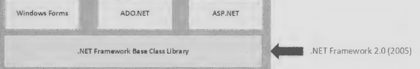


> 图 1.1：多年来 .NET 的演进

注意，图 1.1 只显示了到 .NET Framework 4.5 的演进。.NET Framework 4.5 之后的 .NET Framework 主要版本及其特性如下：

- .NET Framework 4.6：此版本在加密、ADO.NET、WPF、分析 (profiling)、NGen 和 Windows Workflow Foundation (WWF) 中引入了新功能和增强。
- .NET Framework 4.7：此版本在基类、网络、ASP.NET、Windows Communication Foundation (WCF)、Windows Forms 和 Windows Presentation Foundation (WPF) 中引入了新功能和增强。
- .NET Framework 4.8：此版本在基类、WCF、WPF 和通用语言运行时 (CLR) 领域引入了新功能和增强。

## 通用语言运行时

通用语言运行时 (CLR) 是一个运行时引擎，负责执行你的程序、代码验证、类型安全、内存分配、垃圾回收、安全等许多功能。它提供了若干服务，包括：

- 即时编译 (Just-in-time compilation)
- 垃圾回收
- 代码访问安全
- 内存管理
- 代码验证

图 1.2 展示了 .NET Framework 的组件。

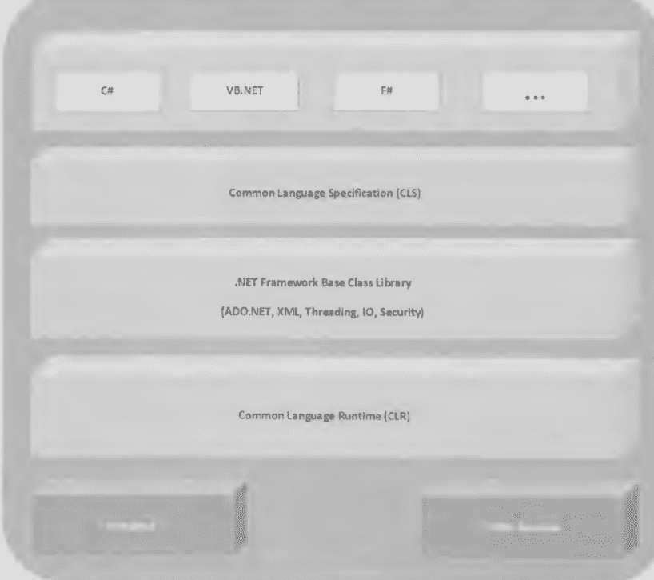

> 图 1.2：.NET Framework 的组件

## 通用中间语言

通用中间语言 (CIL)，以前称为微软中间语言 (MSIL)，是一种平台无关的语言，由 .NET 环境生成。在运行时，CIL 被即时编译器 (JIT) 转换为特定的机器码。图 1.3 显示了这一过程：


> 图 1.3

## 动态语言运行时

CLR 提供了动态类型系统、垃圾回收等许多服务，动态语言运行时 (DLR) 运行在它们之上。这些包括：

- 动态类型
- 动态分发
- 代码生成

图 1.4 展示了 CLR 和 DLR 之间的关系：

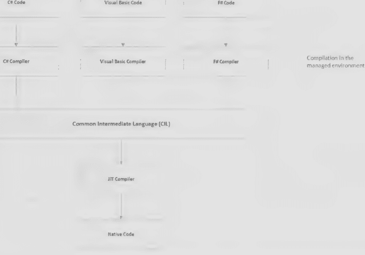

> 图 1.4：动态语言运行时

DLR 是在 .NET 4.0 中首次引入的。稍后我们将学习它。

## 类库

.NET 类库 (FCL) 是一组由 .NET 提供的可重用类、接口和其他类型的综合集合。

FCL 提供的服务包括：

- 文件处理
- 数据库访问
- XML

## 类型系统

通用类型系统 (CTS) 定义了类型在 .NET 中的表示方式。它支持两种类型。

### 值类型和引用类型

CTS 值类型存储在栈上，而引用类型存储在托管堆中。请参考图 1.5 以更好地理解：

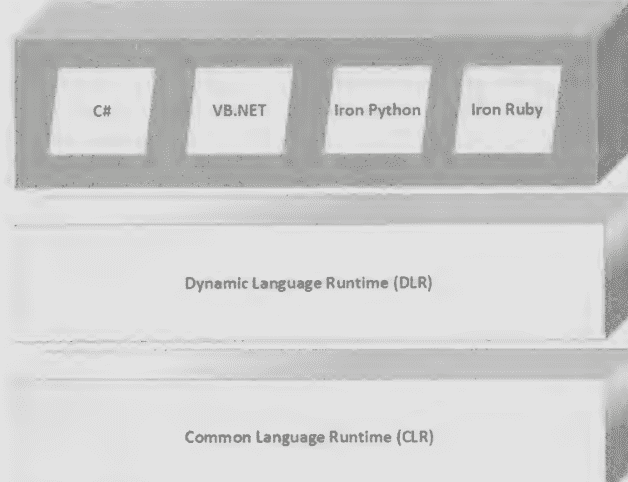

> 图 1.5：类型系统

以下是 .NET 中的值类型列表：

- `bool`
- `byte`
- `decimal`
- `enum`
- `float`
- `int`
- `long`
- `short`
- `uint`
- `ulong`
- `ushort`

以下是 .NET 中的引用类型列表：

- `class`
- `interface`
- `delegate`
- `object`
- `strings`

## 托管代码和非托管代码

托管代码在 CLR 的上下文中运行并由其管理。相反，非托管代码运行在 CLR 之外，因此其安全性不受验证。

## 即时编译器

用 C# 或 VB.NET 编写的程序生成中间语言代码，也称为 IL 代码。JIT 编译器负责在运行时将 IL 代码编译为机器码。图 1.6 展示了 CLR 的执行模型。

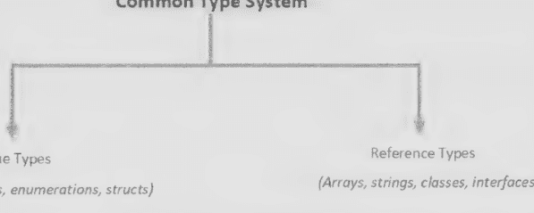

机器码由主机操作系统在 CPU 和其他资源的帮助下执行。

## 垃圾回收

垃圾回收 (GC) 是 .NET 提供的一种功能，用于自动管理内存。它会清理未使用的对象，即不再使用的对象。这里的“垃圾”一词指的是不再需要的对象。

堆内存分为两个部分：小对象堆 (SOH) 和大对象堆 (LOH)。让我们先讨论 GC 如何在 SOH 中工作。参考图 1.7：

.NET 采用分代模型来存储对象。在该模型中，垃圾回收堆（小对象堆的一部分）被划分为三个不同的区域：第 0 代、第 1 代和第 2 代。对象首次创建时被放在第 0 代。如果第 0 代的对象存活了第 0 代回收，它们会被提升到第 1 代。同样，当第 1 代的对象存活了第 1 代回收时，它们会被提升到第 2 代。

图 1.8 展示了这三个代：

| 第 2 代 |
| :--- |
| 第 1 代 |
| 第 0 代 |

> 图 1.8：GC 的三个代

需要注意的是，GC（垃圾回收）在低代数中的执行频率远高于高代数。在第 1 代中存活 GC 清理的对象将提升到第 2 代。虽然位于第 0 代的对象被称为短命对象，但第 2 代中的对象被视为旧对象。

存储在 LOH（大对象堆）中的对象不会经过代传递（即第 0、1 或 2 代）。LOH 是托管内存中的一个特殊区域，用于存储大于 85KB 的对象。

`System.GC` 类代表了 .NET 中的 GC。该类包含多个方法和属性。该类的重要成员包括：

- `GC.Collect`：此方法用于强制对一个或多个代进行垃圾回收。如果你传递了要收集的代数，它将只收集该代。如果没有向此方法传递代数参数，则将收集所有代。
- `GC.GetTotalMemory`：此方法返回分配给托管内存的总字节数。
- `GC.KeepAlive`：此方法用于延长对象的生命周期。
- `GC.SupressFinalize`：此方法用于抑制作为参数传递给它的对象的终结化。
- `GC.GetGeneration`：此方法接受对象的引用并返回该对象所在的代数。
- `GC.MaxGeneration`：此方法用于返回已安装的 CLR 版本支持的最大代数。

## 安全性

安全性是任何应用程序中的一个重要方面，其核心是保护应用程序中的资产免受未经授权用户的访问。基本上，.NET 支持两种类型的安全。这些包括：

- 基于角色的安全
- 代码访问安全

图 1.9 展示了不同类型的安全性：

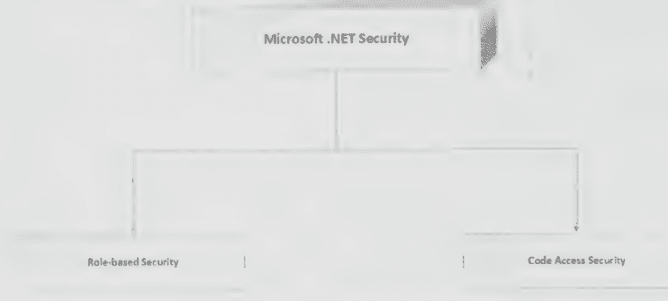

> 图 1.9：.NET 安全

### 基于角色的安全

基于角色的安全是一种安全机制，根据用户的访问权限为已身份验证的用户提供应用程序资源的访问权限。要在 .NET 应用程序中实施安全性，你需要对用户进行身份验证，并对其有访问权限的资源进行授权。换句话说，对于实现 .NET 应用程序的安全而言，身份验证和授权是关键概念。

在 .NET 应用程序中实施基于角色的安全非常简单。.NET 对基于角色的安全的支持也是灵活且可扩展的。为了确保与代码访问安全的一致，.NET 中的基于角色的安全包含了 `System.Security.Permissions.PrincipalPermission` 对象，可以利用这些对象以与处理代码访问安全相同的方式执行授权。

### 代码访问安全

代码访问安全 (CAS) 是 .NET 的沙箱。它是 .NET 的一种安全机制，用于 CLR 限制不受信任代码执行特权操作。CAS 适用于托管应用程序。

## 结论

本章讨论了 .NET 的内部机制。在下一章中，我们将开始探索。

## 问题

1. .NET Framework 和 .NET Core 有什么区别？
2. .NET 的组件有哪些？
3. 什么是垃圾回收？


# 第 2 章 开始 C#

C# 8.0 具有许多新特性。这将改变你编写代码的方式。

## 结构

在这一章中，我们将学习：

- 结构
- 类
- 关键字
- 运算符
- 循环
- 数组

## 目标

阅读本章后，读者将能够：

- 构建控制应用程序
- 构建类库

## 构建控制应用程序

在本节中，我们将研究如何使用 Visual Studio 构建控制应用程序。

1. 启动 `Visual Studio 2019`。
2. 点击 **文件 | 新 | 项目** 创建新项目。
3. 在创建项目对话框中，选择控制应用 (.NET Framework) 并点击下一步，如图 2.1 所示：

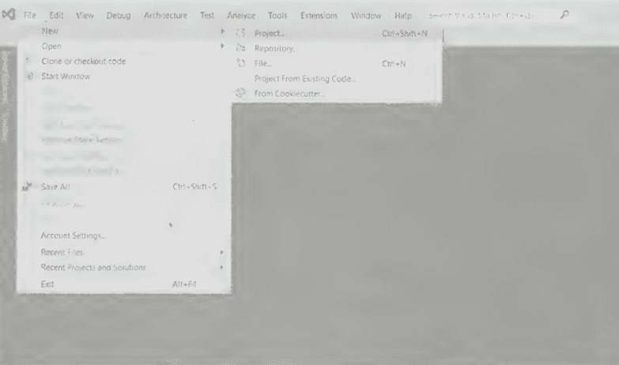

图 2.1

4. 在配置新项目对话框中，指定项目的名称。
5. 从下拉菜单选择你想要使用的 .NET Framework 版本，如图 2.2 所示：

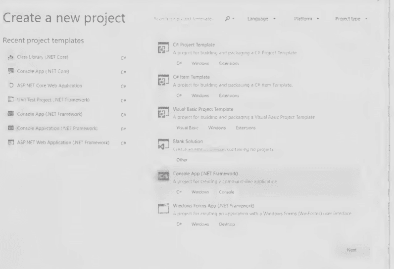

图 2.2

6. 点击创建制作项目。

在刚刚创建的控制应用程序中，你会发现一个名为 `Program` 的类。用以下代码替换类中的空 `Main` 方法，以利用 `Console` 类的静态方法：

```csharp
static void Main(string[] args)
{
    Console.WriteLine("Hello World!");
    Console.Read();
}
```

为了方便起见，完整的代码如下。注意程序包含了 `System` 命名空间：

```csharp
using System;

namespace Chapter_2
{
    class Program
    {
        static void Main(string[] args)
        {
            Console.WriteLine("Hello World!");
            Console.Read();
        }
    }
}
```

当你执行上述程序时，控制台将显示 Hello World! 文本，如图 2.4 所示：


图 2.4

## 构建类库

类库是另一种项目类型。它允许你定义可以在其他项目中调用的类型和方法。你可以利用类库进行代码复用。我们将演示如何构建一个包含文本信息的类库。

为了简单起见，让我们从上节提到的代码构建类库。要在 `Visual Studio 2019` 中构建类库，请遵循以下步骤：

1. 启动 `Visual Studio 2019` IDE。
2. 点击 **文件 | 新 | 项目...** 创建新项目。
3. 在创建新项目对话框中，选择类库 (.NET Framework) 作为项目模板并点击下一步，如下截图所示：

## 添加新项目

最近的项目模板

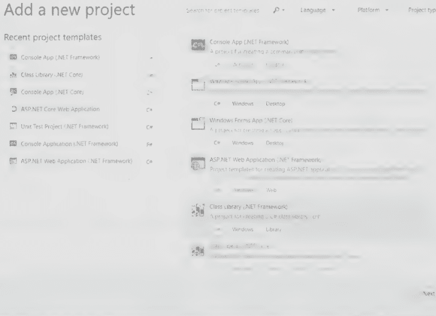

4. 在配置新项目对话框中，指定类库名称为 `Chapter_2_ClassLib`。
5. 指定类库项目的位置。
6. 选择 .NET Framework 版本并点击下一步。
7. 点击创建制作项目。

在类库项目中，创建一个名为 `TextManager.cs` 的新 .cs 文件并在其中编写以下代码：

```csharp
public class TextManager
{
    public string GetDisplayMessage()
    {
        return "Hello World!";
    }
}
```

图 2.5

下一步是构建解决方案。如果构建成功，将类库项目包含在我们在前面的节中创建的控制台应用程序项目中。要执行此操作，请遵循以下步骤：

- 在解决方案管理器（`Solution Explorer`）窗口中选择控制台应用程序项目：

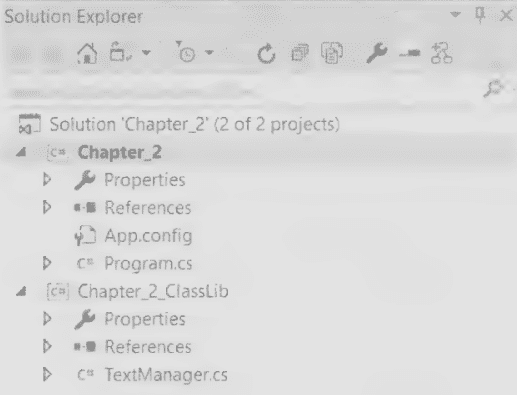

图 2.6

- 右键点击并选择 **添加 | 引用...**
- 选择该项目并点击确定。

一旦成功添加了库的引用，你可以展开项目的引用（`References`）以找到该库，如图 2.7 所示：

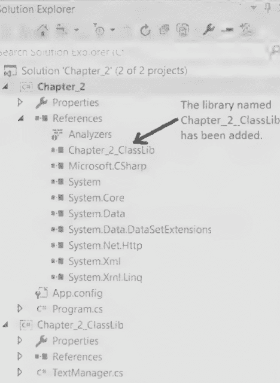

图 2.7

你现在可以将库包含在程序中，并像下面的代码段所示调用 `TextManager` 类的 `GetDisplayMessage` 方法：

```csharp
static void Main(string[] args)
{
    TextManager textManager = new TextManager();
    Console.WriteLine(textManager.GetDisplayMessage());
    Console.Read();
}
```

## 关键字

C# 中的关键字是具有特殊含义的保留字。你不能使用关键字作为类、接口或变量名。你可以通过此链接获取 C# 的所有关键字：https://bit.ly/2mcjtQ6

C# 中的修饰符关键字包括：

- `abstract`
- `async`
- `const`
- `event`
- `extern`
- `override`
- `partial`
- `readonly`
- `sealed`
- `static`
- `unsafe`
- `virtual`
- `volatile`

可以应用于类、方法或属性的访问修饰符关键字包括：

- `public`
- `private`
- `internal`
- `protected`

## 结构（Constructs）

C# 编程语言支持两种类型的条件结构。这些结构包括：`if...else` 和 `switch...case`。`if...else` 结构用于在表达式满足时执行代码。下面提供的代码段说明了如何使用 `if...else` 结构：

```csharp
bool isValid = true;

if (isValid)
{
    Console.WriteLine("The value of the variable isValid is true.");
}
else
{
    Console.WriteLine("The value of the variable isValid is false.");
}
```

下面提供的代码段展示了如何利用 `if...else` 结构判断数字是偶数还是奇数，并在控制台窗口显示相应的消息：

```csharp
static void Main(string[] args)
{
    Console.WriteLine("Enter a number: ");
    int number = Convert.ToInt32(Console.ReadLine());

    if ((number % 2) == 0)
    {
        Console.WriteLine("{0} is an even number", number);
    }
    else
    {
        Console.WriteLine("{0} is an odd number", number);
    }

    Console.Read();
}
```

参考上面的程序。语句 `Convert.ToInt32(Console.ReadLine());` 将用户输入转换为 32 位整数。`Console.ReadLine` 从控制台读取一行文本 - 它会等待用户输入。

## 开始使用 C#

当你执行之前的程序时，输出将如下所示：


图 2.8

`switch...case` 块是一种用于存在多个待评估条件的结构。与 `if...else` 一样，它可以用于在给定表达式满足时执行代码。以下是 C# 中 `switch...case` 块的语法：

```csharp
switch(expression)
{
    case <value1>:
        // some code
        break;
    case <value2>:
        // some code
        break;
    case <value3>:
        // some code
        break;
    case <valueN>:
        // some code
        break;
    default:
        // some code
        break;
}
```

## 循环

循环结构是一个被重复执行的代码块，直到给定条件为真。循环通常包含三个部分。这些部分包括：初始化部分、重新初始化部分和条件部分。下面提供的代码段展示了如何使用 `for` 循环显示从 1 到 10 的数字：

```csharp
static void Main(string[] args)
{
    for(int i=1; i<=10; i++)
    {
        Console.WriteLine(i);
    }

    Console.Read();
}
```

下面提供的代码段说明了如何使用 `while` 循环编写相同的代码：

```csharp
int i = 1;
while (i <= 10)
{
    Console.WriteLine(i);
    i++;
}
```

你也可以像下面所示编写 `while` 循环。注意这里使用了后增运算符：

```csharp
int i = 0;
while (i <= 10)
{
    Console.WriteLine(i);
    i++;
}
```

并且，这里是使用 `do...while` 循环来表示相同的代码：

```csharp
int i = 1;
do
{
    Console.WriteLine(i);
    i++;
} while (i <= 10);
```

`break` 语句可以提前终止循环。下面提供的代码段说明了如何实现这一点：

```csharp
static void Main(string[] args)
{
    for(int i=1; i<=10; i++)
    {
        if (i > 5) break;
        Console.WriteLine(i);
    }

    Console.Read();
}
```

这里是使用 `while` 循环实现相同的方法：

```csharp
int i = 1;
while (i <= 10) {
    if (i > 5) break;
    Console.WriteLine(i);
    i++;
}
```

并且，这里是在 `do...while` 循环中使用 `break` 语句：

```csharp
int i = 1;
do
{
    if (i > 5) break;
    Console.WriteLine(i++);
} while (i <= 10);
```

## 运算符

运算符是对变量和值执行操作的符号。C# 中有几种类型的运算符：

- 算术运算符
- 关系运算符
- 逻辑运算符
- 位运算符
- 赋值运算符
- 增减运算符
- 三元运算符

一元运算符作用于单个操作数。示例包括：

- `++`
- `--`
- `!`
- `-`

二元运算符作用于两个操作数。示例包括：

- `+`
- `-`
- `*`
- `/`
- `%`

关系运算符用于比较两个值。示例包括：

- `==`
- `!=`
- `>`
- `<`
- `>=`
- `<=`

逻辑运算符用于组合布尔表达式。示例包括：

- `&&`
- `||`
- `!`

赋值运算符用于变量赋值。

## 值类型和引用类型

值类型直接将数据存储在栈中。C# 中常见的值类型包括：

- `bool`
- `byte`
- `char`
- `decimal`
- `double`
- `enum`
- `float`
- `int`
- `long`
- `sbyte`
- `short`
- `uint`
- `ulong`
- `ushort`

引用类型存储指向数据的引用，数据存储在堆中。常见的引用类型包括：

- `class`
- `delegate`
- `interface`
- `dynamic`
- `string`
- `struct`

## C# 入门

`datatype[] arrayName;`

下面的代码片段展示了如何定义一个整数数组：

```csharp
int[] numbers = new int[10];
```

下面的代码片段展示了如何操作数组。此示例演示了如何定义一个整数数组，在其中存储整数，然后在控制窗口中显示它们：

```csharp
static void Main(string[] args)
{
    int[] numbers = new int[10];

    for (int index = 0; index < 10; index++)
        numbers[index] = index + 1;

    for (int index = 0; index < 10; index++)
        Console.WriteLine(numbers[index]);

    Console.Read();
}
```

当运行上述程序时，输出看起来如下：


图 2.9

你也可以将一个数组复制到另一个数组。当你这样做时，原始数组和复制后的数组都指向同一个内存位置。因此，其中任何一个数组的任何更改都会反映在另一个数组中。下面的代码片段说明了如何将一个数组复制到另一个数组：

```csharp
int[] source = new int[] { 1, 2, 3, 4, 5 };
int[] target = source;
```

## 多维数组

C# 中的数组可以有多个维度。例如，以下代码片段可以创建一个包含 5 行 5 列的二维数组：

```csharp
int[,] array = new int[5, 5];
```

下面的代码片段说明了如何初始化一个二维整数数组：

```csharp
int[,] twoDimensionalArray = new int[,] { { 0, 1 }, { 2, 3 }, { 4, 5 }, { 6, 7 }, { 8, 9 } };
```

列出的代码说明了你如何创建一个二维数组并显示其值：

```csharp
class Program
{
    static void Main()
    {
        int[][] arr = new int[2][];

        arr[0] = new int[5] { 1, 3, 5, 7, 9 };
        arr[1] = new int[5] { 2, 4, 6, 8, 10 };

        for (int i = 0; i < arr.Length; i++)
        {
            for (int j = 0; j < arr[i].Length; j++)
            {
                Console.Write("{0}", arr[i][j]);
                Console.Write("\t");
            }
        }

        Console.WriteLine("");
        Console.Read();
    }
}
```

## 交错数组（Jagged array）

交错数组是 C# 中的另一种数组。由于交错数组被定义为其元素也是数组的数组，因此也被称为数组的数组。考虑以下具有 5 个元素的数组：

```csharp
int[][] jaggedArray = new int[5][];
```

以下是你可以初始化交错数组元素的方法：

```csharp
jaggedArray[0] = new int[3];
jaggedArray[1] = new int[5];
jaggedArray[2] = new int[4];
jaggedArray[3] = new int[5];
jaggedArray[4] = new int[3];
```

## 结论

C# 编程语言在流行度方面取得了飞速的发展。在本章中，我们检查了 C# 中的编程结构。在接下来的两个章节中，我们将研究如何使用 C# 进行面向对象的编程。

## 问题

1. `while` 循环、`do...while` 循环和 `for` 循环之间有什么区别？
2. 什么是运算符？运算符有哪些类型？
3. 值类型和引用类型之间有什么区别？
4. 结构体（`struct`）和类（`class`）有什么不同？
5. 什么是数组？在 C# 中如何定义数组？
6. 什么是同质数据类型？
7. 什么是二维数组？如何定义一个二维数组？
8. 什么是交错数组？

## 访问修饰符

访问修饰符是可以应用于类或类成员的访问级别。因此，你可以为类、属性、变量、类内部的对象甚至类方法设置访问修饰符。此类访问级别被用于控制对类或其成员的访问。在本节中，我们将学习如何使用访问修饰符。


# 类中的访问修饰符

类中的访问修饰符用于控制类的访问级别。类可以具有 `public`（公共）、`private`（私有）或 `protected`（保护）访问级别。如果类的访问级别为 `public`，则可以从同一个程序集内部或程序集外部访问。参考下面的代码片段，它显示了一个访问修饰符标记为 `public` 的类：

```csharp
public class MyClass
{
    // 类的成员
}
```

由于 `MyClass` 是 `public` 的，你可以在相同或任何其他程序集中扩展该类或创建它的实例。同样，如果类成员的访问修饰符标记为 `public`，你可以通过同一个程序集内或引用了该类所在程序集的程序集中的类实例来访问该成员。下面的代码片段显示了一个具有 `public` 成员的类：

```csharp
public class MyClass
{
    public int x;
}
```

如上面的代码片段所示，由于类 `MyClass` 的成员是 `public`，你可以通过类的实例访问该 `public` 成员。

如果类的访问级别为 `private`，则无法从程序外部扩展或访问该类。该规则同样适用于类成员，也就是说，如果一个类是 `private` 的，它对该类的子类是不可见的，但可以通过同类的 `public` 方法进行访问。

下面的 `MyClass` 类被标记为 `private` 访问修饰符：

```csharp
private class MyClass
{
    // 类的成员
}
```

现在，如果你尝试创建此类的实例，将出现编译错误，提示为：“类 MyClass 由于其保护级别而不可访问”。`private` 类既不能被实例化，也不能被继承。使用 `private` 类的一个良好例子是出于安全考虑想要隐藏类的内部细节。下面的代码片段说明了一个典型的用例，其中可以使用 `private` 类来封装节点的实现：

```csharp
public class DoubleLinkedList
{
    // 从这里可以访问 Node 类
    Node prevNode = new Node();
    Node nextNode = new Node();

    private class Node
    {
        // Node 类的成员
    }
}
```

换句话说，你可以利用 `private` 访问修饰符出于安全考虑隐藏实现细节。如果类的访问级别标记为 `protected`，则该类可以被其子类扩展，但不能从外部实例化。

还有两个访问修饰符可以应用于类成员：`protected internal` 和 `private protected`。注意，你不能对类应用 `protected internal` 或 `private protected` 访问修饰符。

如果类成员使用 `protected internal` 访问修饰符标记，则可以从该成员定义所在的程序集内部，或者从另一个程序集中扩展了该类的类内部访问该成员。下面的代码片段说明了类中的 `protected internal` 成员：

```csharp
public class Base
{
    protected internal int number = 0;
}

public class Derived : Base
{
    public void ResetValue()
    {
        number = 0;
    }
}
```

`Base` 类的 `protected internal` 成员可以从同一程序集中的 `Derived` 类访问，也可以通过派生类型的实例从另一个程序集访问。这里是类的 `protected internal` 成员的另一个例子——这次成员是一个方法：

```csharp
public class MyClass
{
    protected internal int x;
    protected internal void Display()
    {
        Console.WriteLine("The value of x is: " + x);
    }
}
```

如果类成员的访问修饰符标记为 `private protected`，则只能通过定义该成员的同一程序集中的代码或同一程序集中扩展该类的类来访问该成员。下面的代码片段说明了如何从派生类访问基类的 `private protected` 成员：

```csharp
public class Base
{
    private protected int number = 0;
}

public class Derived : Base
{
    public void ResetValue()
    {
        number = 0;
    }
}
```

你也可以为类的方法指定 `protected` 访问修饰符。下面的代码片段说明了这一点。`Derived` 类中的 `ResetValue` 方法使用 `private protected` 访问修饰符标记：

```csharp
public class Base
{
    private protected int number = 0;
}

public class Derived : Base
{
    private protected void ResetValue()
    {
        number = 0;
    }
}
```

注意，对于 `public`、`private` 或 `protected` 访问修饰符，相同的规则适用于类及其成员（成员数据或成员函数或方法）。

# C# 中的构造函数

类由成员数据或数据成员以及成员函数组成。类的成员函数也称为方法。构造函数是类的一种特殊方法，包含用于初始化类数据成员的代码。与其他方法不同，构造函数不能返回任何值。构造函数的名称与类名相同，并在类实例化时自动被调用。然而，并不是所有构造函数的行为都相同。随着本章的进行，我们将学习更多内容。

## 构造函数的语法

构造函数的语法格式如下：

```csharp
[modifier] name (parameters)
{
    // 构造函数代码
}
```

构造函数可以是以下修饰符之一：

- `public`
- `protected`
- `internal`
- `private`
- `extern`

我们将在本章后面详细介绍这些修饰符。

构造函数分为两种类型：静态（`static`）和非静态（`non-static`）。静态构造函数称为类构造函数，在首次访问静态成员时调用。非静态构造函数称为实例化构造函数，每次实例化类时调用。静态构造函数在实例化构造函数之前调用。让我们通过每个示例来理解这一切。

## 实例化构造函数或非静态构造函数

非静态或实例化构造函数用于初始化类的非静态成员。此类构造函数也称为类型构造函数或类型初始化器。注意，类中可以有多个签名不同的实例化构造函数。这种特性被称为构造函数重载。我们将在本章学习更多关于构造函数重载的知识。类的默认构造函数也是实例化构造函数。

### 默认构造函数

任何类至少应该有一个构造函数。如果你没有为类定义构造函数，C# 会自动提供一个。此构造被称为默认构造函数。类的默认构造函数不接受参数。类中只有一个默认构造函数。在使用 `new` 运算符创建实例且不传递参数时，会调用默认构造函数。下面的示例说明了如何使用默认构造函数：

```csharp
class MyClass
{
    public int x;
    public int y;

    public MyClass()
    {
        x = 0;
        y = 0;
    }
}

class Program
{
    static void Main(string[] args)
    {
        MyClass myClass = new MyClass();
        Console.WriteLine("x = " + myClass.x);
        Console.WriteLine("y = " + myClass.y);
        Console.Read();
    }
}
```

参考前面的代码示例。`MyClass` 类的数据成员已在默认构造函数中初始化。`Console.WriteLine` 语句将在控制台中为整数变量 `x` 和 `y` 打印 0：


图 3.2

## 静态构造函数或类构造函数

构造函数也可以是静态的。与实例构造函数不同，静态构造函数在应用程序生命周期内仅会被调用一次。考虑下面包含静态构造函数的类。参考下文的代码片段：

```csharp
class MyClass
{
    public static int x;
    public static int y;

    static MyClass()
    {
        x = 0;
        y = 0;
    }
}
```

注意在声明变量 `x` 和 `y` 时使用的 `static` 关键字。静态构造函数只能访问静态成员。这是因为类的静态成员在内存中的加载顺序早于实例成员。下面的代码片段说明了如何在控制台中打印类 `MyClass` 静态成员的值。注意在引用静态成员 `x` 和 `y` 时使用的类名：

```csharp
class Program
{
    static void Main(string[] args)
    {
        MyClass myClass = new MyClass();
        Console.WriteLine("x = " + MyClass.x);
        Console.WriteLine("y = " + MyClass.y);
        Console.Read();
    }
}
```

静态构造函数在实例构造函数之前被调用。提供的代码片段说明了这一点：

```csharp
class MyClass
{
    static MyClass()
    {
        Console.WriteLine("Static constructor");
    }
    public MyClass()
    {
        Console.WriteLine("Default constructor");
    }
}

static void Main(string[] args)
{
    MyClass myClass = new MyClass();
    Console.Read();
}
```

当执行上述程序时，控制台中会打印文本 `Static constructor`，随后下一行打印 `Default constructor`。

与静态方法类似，类的静态构造函数只能访问类的静态成员。考虑下方的代码，它描述了一个具有两个实例成员的类：

```csharp
class MyClass
{
    public int x;
    public int y;

    static MyClass()
    {
        x = 0;
        y = 0;
    }
}
```

上述代码无法编译，因为在类 `MyClass` 的静态构造函数内部无法访问实例成员 `x` 和 `y`。

这里需要注意的另一点是，静态构造函数在程序或应用程序域的寿命内只会被调用一次。让我们通过示例来理解这一点。考虑下面的代码，它展示了一个具有两个静态属性的静态类：

```csharp
class MyStaticClass
{
    public static string EditText { get; set; }
    static MyStaticClass()
    {
        Console.WriteLine("Static Constructor executed.");
    }
    public static int MyInteger
    {
        get; set;
    }
}
```

你可以使用下面的代码访问该类的静态属性：

```csharp
static void Main(string[] args)
{
    MyStaticClass.EditText = "Hello World";
    MyStaticClass.MyInteger = 10;
    Console.Read();
}
```

当你运行此程序时，控制台中将显示如下消息：

```text
Static Constructor executed.
```

这是因为即使如上述代码片段所示在 `Main` 方法中访问了两个静态属性，静态构造函数也只会被调用一次。注意如果你在类中有一个静态构造函数，但只有实例成员，那么在类实例化时，静态构造函数只会被调用一次。考虑下面的 `MyClass` 类：

```csharp
class MyClass
{
    static MyClass()
    {
        Console.WriteLine("Static Constructor executed.");
    }
}
```

你可以像下面的代码片段所示创建该类的实例：

```csharp
static void Main(string[] args)
{
    MyClass myClass1 = new MyClass();
    MyClass myClass2 = new MyClass();
    Console.Read();
}
```

当你运行此程序时，控制台中将显示一条消息，因为无论为类创建了多少个实例，静态构造函数只会被调用一次：消息将是：

```text
Static Constructor executed.
```

## 构造函数重载

构造函数可以接受一个或多个参数。构造函数的参数写法方式与方法相同。不接受任何参数的构造函数是默认构造函数。你可以在类中拥有多个构造函数，每个构造函数的签名都不同。这些被称为重载构造函数。重载构造函数允许类的成员以多种方式进行初始化。

应该指出的是，重载构造函数在方法签名（参数的类型和顺序）上应当不同。构造函数不能仅仅通过不同的访问修饰符来重载。

下面的代码片段说明了构造函数重载：

```csharp
class MyClass
{
    public MyClass()
    {
        // 默认构造函数
    }
    public MyClass(int x)
    {
        // 带一个参数的构造函数
    }
    public MyClass(int x, int y)
    {
        // 带两个参数的构造函数
    }
}
```

`MyClass` 类中有三个构造函数。其中一个是默认构造函数。另外两个是带参数的构造函数，但它们的签名不同。

## 构造函数链

这指的是从一个构造函数调用另一个构造函数的能力。如果子类构造函数需要调用基类构造函数，必须使用 `base`（参数）。如果对另一个构造函数的位于同一个类中，则使用 `this`（参数）。需要注意的是，构造函数链仅由非静态构造函数支持。下面的代码片段说明了构造函数链：

```csharp
class Base
{
    public Base(int x)
    {
        // ...
    }
}

class Derived : Base
{
    public Derived() : base(0)
    {
        // ...
    }
    public Derived(int x) : base(x)
    {
        // ...
    }
}
```

# 访问修饰符

构造函数可以带有修饰符。构造函数的修饰符有 `public`、`protected`、`internal`、`private` 或 `extern`。`public` 修饰符应用于构造函数，以便在创建实例时自动调用。下面的代码片段说明了如何为类显式默认构造函数：

```csharp
class MyClass
{
    public MyClass()
    {
        Console.WriteLine("Default constructor");
    }
}
```

私有构造函数用于防止类被扩展或继承。因此，如果你在类中有私有构造函数，你无法创建实例，也无法扩展该类。参考下面的代码片段：

```csharp
public class MyClass
{
    private MyClass()
    {
        // 这是一个私有构造函数
    }
}
```

由于你在 `MyClass` 类中有一个私有构造函数，你无法创建该类的实例也无法对其创建子类。

类的保护构造函数允许类被继承但不可被实例化。下面的代码片段说明了如何使用保护构造函数：

```csharp
public class Base
{
    protected Base()
    {
        Console.WriteLine("Protected constructor in the Base class called.");
    }
}

public class Derived : Base
{
    public Derived()
    {
        Console.WriteLine("Default constructor in the Derived class called.");
    }
}
```

注意 `Base` 类中的保护构造函数。你可以使用以下语句创建 `Derived` 类的实例：

```csharp
Derived derived = new Derived();
```

基本上，构造函数是按照继承的顺序执行的。让我们通过一个示例来理解。考虑以下两个类，即 `Base`（基类）和 `Derived`（派生类）：

```csharp
public class Base
{
    public Base()
    {
        Console.WriteLine("Base class constructor");
    }
}

public class Derived : Base
{
    public Derived()
    {
        Console.WriteLine("Derived class constructor");
    }
}
```

现在，假设我们像下面的代码片段所示实例化 `Derived` 类：


```csharp
static void Main(string[] args)
{
  Derived derived = new Derived();
  Console.Read();
}
```

当执行这段代码时，控制台中将显示消息 `Base class constructor`，随后是消息 `Derived class constructor`。基类构造函数始终在派生类构造函数之前调用。派生类构造函数可以使用构造函数链调用基类构造函数。我们在本章之前看到过这一点。这里是继承类中构造函数链的另一个示例：

```csharp
public class Base
{
  public Base(int x)
  {
    Console.WriteLine("Base class constructor");
  }
}

public class Derived : Base
{
  public Derived() : base(0)
  {
    Console.WriteLine("Derived class constructor");
  }
}
```

在这个示例中，`Derived` 类有一个默认构造函数。它将默认值 `0` 传递给 `Base` 类的参数化构造函数。

## 析构函数

析构函数是类的方法，其名称与类名相同，并以 `~` 符号开头。当析构函数所属类的对象被毁时，运行时会自动调用析构函数。请注意，析构函数只能用于类，你不能为结构体（`struct`）拥有析构函数。程序退出时会自动调用析构函数。析构函数不能重载，它们既不能接受参数也没有修饰符。当你为类定义析构函数时，该析构函数会隐式调用实例的 `finalize` 方法。然而，这里有一点是，无法保证类的析构函数会被调用——类析构函数的执行取决于类实例何时变为垃圾回收。换句话说，析构函数是由运行时调用的，你对其没有控制权。

需要注意的是，虽然构造函数是按照继承的顺序调用的，但析构函数是按照继承的反向顺序调用的。让我们通过一个示例来理解这一点。参考下面的代码片段：

```csharp
public class Base
{
  public Base()
  {
    Console.WriteLine("Base class constructor");
  }

  ~Base()
  {
    Console.WriteLine("Base class destructor");
  }
}

public class Derived : Base
{
  public Derived()
  {
    Console.WriteLine("Derived class constructor");
  }

  ~Derived()
  {
    Console.WriteLine("Derived class destructor");
  }
}
```

你可以像下面的代码片段所示创建一个 `Derived` 类的实例：

```csharp
static void Main(string[] args)
{
  Derived derived = new Derived();
  Console.Read();
}
```

当你执行之前的代码段时，输出将如下：

```text
Base class constructor
Derived class constructor
Derived class destructor
Base class destructor
```

所以，虽然构造函数是按照继承的顺序执行的，但析构函数是按照继承的反向顺序执行的。让我们通过另一个示例来理解构造函数和析构函数的执行顺序。考虑下面的代码，它说明了三个类：类 `A`、类 `B` 和类 `C`。类 `A` 被类 `B` 扩展，类 `C` 继承类 `B`，形成了一个多级链：

```csharp
class A
{
  public A()
  {
    System.Console.WriteLine("A's constructor is called");
  }

  ~A()
  {
    System.Console.WriteLine("A's destructor is called");
  }
}

class B : A
{
  public B()
  {
    System.Console.WriteLine("B's constructor is called");
  }

  ~B()
  {
    System.Console.WriteLine("B's destructor is called");
  }
}

class C : B
{
  public C()
  {
    System.Console.WriteLine("C's constructor is called");
  }

  ~C()
  {
    System.Console.WriteLine("C's destructor is called");
  }
}
```

之前的代码描述了多级继承类。我们将在另一章中学习更多关于多级继承的知识。用于实例化类 `C` 的代码如下：

```csharp
static void Main(string[] args)
{
  C obj = new C();
}
```

当你执行此程序时，输出将如下：

```text
A's constructor is called
B's constructor is called
C's constructor is called
C's destructor is called
B's destructor is called
A's destructor is called
```

显而易见，虽然构造函数是按照继承的顺序执行的，但析构函数是按照继承的反向顺序执行的。

## 结构体中的构造函数

与类一样，结构体（`struct`）也可以拥有构造函数。然而存在某些局限性。例如，结构体不能拥有显式的无参数构造函数。因此，下面的代码将无法编译：

```csharp
struct MyStruct
{
  public MyStruct()
  {
  }
}
```

# 面向对象编程 - 第二部分

在上一章中，我们学习了面向对象编程（OOP）及其优势。我们还对类、对象以及结构体有了理解。在本章中我们将涵盖 OOP 的属性。

## 结构

在本章中，我们将讨论以下点：

- 关联（Association）
- 聚合（Aggregation）
- 组合（Composition）
- 泛化（Generalization）
- 依赖（Dependency）
- 封装（Encapsulation）
- 继承（Inheritance）
- 多态（Polymorphism）
- 抽象（Abstraction）

## 目标

阅读本章后读者将：

- 理解关联。
- 理解聚合和组合的区别。
- 理解泛化和继承。
- 学习继承的类型及其目的。
- 理解封装和抽象的区别。
- 理解多态以及多态的类型。

## 关联

在 OOP 中，关联、聚合和组合术语用于表示对象之间的关系。在关联中，对象拥有自己的生命周期且没有所有者。关联表示对象之间的使用关系。关联关系可以是一对一、一对多、多对一或多对多。这被称为基数。关联关系可以是单向或双向的。组合和聚合是关联的特殊形式。

关联关系的示例是学生与老师之间的关系。学生和老师之间的关系没有所有者，双方都是独立的。更准确地说，当一个类与另一个类有使用关系但没有任何所有权时，这种关系被称为关联。

下面的代码片段说明了两个类之间关联关系的结构化表示：

```csharp
public class Association
{
  public void someMethod(SomeClass someObj)
  {
    someObj.DoSomeWork();
  }
}
```


箭头表示导航方向。如果线两端都有箭头，则这种关联被称为双向关联。

## 聚合 (Aggregation)

如果两个对象之间存在关联关系，其中一个对象对另一个拥有所有权，则这种关系被称为聚合。聚合是关联的一种特殊形式，也称为弱关联。它是两个类之间的一种单向“拥有”（has-a）关系。然而，尽管存在所有权，但即使你删除了一个对象，另一个仍然存在。换句话说，在聚合关系中，两个实体都将独立生存——删除其中一个不会影响另一个。

聚合关系的一个例子是图书馆和学生之间的关系。虽然图书馆包含了作为其成员的学生，但学生在没有图书馆的情况下也可以存在。下面提供的代码片段说明了如何通过编程方式描述聚合关系：

```java
public class Library
{
  private List<Student> members; // 此处描述了聚合关系

  public Library()
  {
    members = new List<Student>();
  }
}

class Student
{
  int rollNo;
  private string firstName;
  private string lastName;
  private string standard;
  private string section;
  // Student 类的其他成员
}
```

## 组合 (Composition)

组合是聚合的一种特殊类型，其中一个对象包含另一个对象，且如果容器对象被删除，被包含的对象就不能存在。因此，如果组合关系中有两个对象，它们之间存在强烈的生命周期依赖关系。聚合表示的是 `has-a`（拥有）关系，而组合表示的是 `part-of`（部分）关系，用于表示一个类是另一个类的一部分。

`has-a` 关系用于表示一个类的实例包含另一个类或同类实例的引用。`has-a` 关系的一个很好的例子是图书馆和学生之间的关系。学生可以在没有图书馆的情况下存在，因此这是聚合关系的一个例子。`part-of`（部分）关系的一个例子是图书馆和书之间的关系。如果没有书，图书馆就不存在了。注意，组合或 `part-of` 关系更具限制性——被组合的对象（此例中的房间）在没有另一个对象的情况下无法存在。在用图表示组合或聚合时，必须指定方向。该方向用于指定哪个对象包含了被组合的对象。

因此，组合是强关联，而聚合是弱关联。被组合对象的寿命依赖于父对象。图 4.3 显示了关联、聚合和组合之间是如何相互相关的。

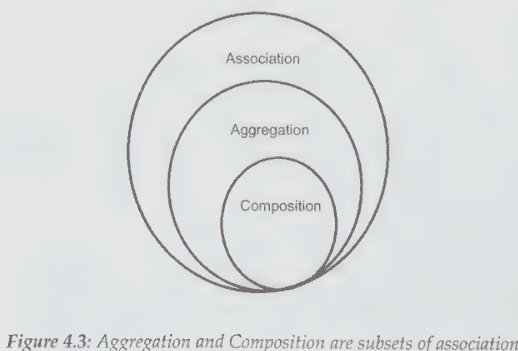

组合关系的一个例子是建筑和房间之间的关系。建筑包含房间，如果建筑被毁，房间就不能存在。下面提供的代码片段说明了建筑和房间之间的组合关系：

```java
public class Building
{
  private List<Room> rooms; // 一栋建筑由几个房间组成

  public Building()
  {
    rooms = new List<Room>();
  }
}

class Room
{
  int floor;
  string flatNo;
}
```

图 4.4 显示了组合的 UML 表示法。


## 泛化 (Generalization)

泛化定义为提取两个或多个类的通用功能的过程，然后将它们合并为一个泛化类（也称为基类或超类）。这些共享功能可以是属性、属性或方法的形式。

泛化表示一种 `is-a`（是一种）关系。`is-a` 关系用于描述子类是其基类的一部分。超类提取了扩展超类的类的特征（属性和方法），并将它们合并成单一单元——超类。因此，超类是扩展该超类的类的泛化。

例如，考虑人（`Person`）与学生（`Student`）之间的关系，以及人与老师（`Teacher`）之间的关系。老师也是人。因此，人与学生之间、人与老师之间存在泛化关系。泛化通常被称为继承。然而，它们并不是等同的。泛化被定义为将两个或多个类的共享特征（属性、关联或方法）合并为一个泛化类的过程。相反，继承是扩展一个或多个类以创建子类的过程。我们将在本章后面学习更多关于继承的知识。

特化（Specialization）是泛化的反向过程。它是从现有类创建子类的过程。泛化关系存在于以下类型：

- 未分类的类
- 实现类
- 接口

我们将在本章后面的“继承”节中学习更多关于此的内容。图 4.5 显示了泛化的 UML 表示法。


## 实现 (Realization)

实现是抽象的一种特殊形式，其中一个实体代表合约，另一个代表实现。实现的 UML 表示法如图 4.6 所示。


## 依赖 (Dependency)

依赖定义为一种关系，其中一个类依赖另一个类来实现其功能。如果供应商类发生变化，客户端类也可能需要变化。

## 多态 (Polymorphism)

多态是面向对象编程（OOP）的核心概念之一。多态的目标是允许使用相同的接口访问不同对象。多态一词源于两个希腊语，`poly` 表示“多个”，`morphos` 表示“形式”。

多态基本上有两种：

- 静态多态或编译时多态
- 动态多态或运行时多态

## 静态多态或编译时多态

方法重载是静态多态的一个例子。在方法重载中，类中多个同名但签名不同的方法。下面的 `SimpleCalculator` 类演示了重载方法。在这个类中，`Add` 方法被重载了。

```java
public class SimpleCalculator
{
  public int Add(int x, int y)
  {
    return x + y;
  }

  public int Add(int x, int y, int z)
  {
    return x + y + z;
  }
}
```

构造函数重载也是静态多态的一个例子。你可能需要利用构造函数重载，以便以各种方式初始化类的实例。在构造函数重载中，一个类有多个构造函数，每个构造函数的签名不同。图 4.8 中的代码片段显示了一个具有多个构造函数的类，演示了构造函数重载：


前述代码示例中的 `MyClass` 类有两个构造函数——默认构造函数和参数构造函数。在 `Main()` 方法中创建了两个 `MyClass` 实例：一个名为 `obj1`，另一个名为 `obj2`。当创建实例 `obj1` 时，调用默认构造函数。由于默认构造函数内部没有任何代码，变量 `x` 的值保持不变。当创建实例 `obj2` 时，将 `10` 作为参数传递给单参数构造函数。在这种情况下，变量 `x` 的值变为 `10`。因此，当执行此代码时，`obj1` 的 `x` 值显示为 `0`，`obj2` 的显示为 `10`。

## 动态或运行时多态

动态或运行时多态可以通过方法重写（method overriding）来实现。这种类型的多态通常被称为晚绑定。在动态多态中，编译器并不知道要在一个实例上调用哪种方法——这些信息仅在运行时才可用。方法重写允许你使用基类引用调用同一继承层级中不同类的方法。方法重写与方法重载（method overloading）在多个方面都有其不同之处。在方法重写中，你通常在基类和派生类中拥有相同的签名。这些方法的签名是——完全相同的——它们的区别仅在于实现方式。派生类重写了基类的方法。让我们通过一个示例来理解这一点。考虑两个类 `Base` 和 `Derived`，如下代码段所示：

```csharp
class Base
{
  public virtual void SomeMethod(int someParameter)
  {
    Console.WriteLine("SomeMethod of the Base class called. The value of the parameter passed is: " + someParameter);
  }
}

class Derived : Base
{
  public override void SomeMethod(int anotherParameter)
  {
    Console.WriteLine("SomeMethod of the Derived class called. The value of the parameter passed is: " + anotherParameter);
  }
}
```

`Base` 类包含一个名为 `SomeMethod` 的虚拟方法。该方法在名为 `Derived` 的类中被重写。基类和派生类中的方法签名是相同的。请注意在 `Base` 类的方法签名中使用了 `virtual` 关键字。在基类中声明为 `virtual` 的方法在派生类中应使用 `override` 关键字进行标记以实现方法重写。如果没有此关键字，基类的方法版本将被隐藏，编译器将标记警告。

给出的代码段演示了如何使用 `Base` 类的引用创建 `Derived` 类的实例，然后调用 `SomeMethod()` 方法：

```csharp
Base b = new Derived();
b.SomeMethod(10);
```

当执行上述代码时，控制台将显示如下消息：


SomeMethod of the Derived class called. The value of the parameter passed is: 10

## 封装

封装是将类的数据和成员函数组合成单个单元的过程。封装将类的数据和操作该类内部数据的方法绑定在同一个单一单元中。封装通常用于从外部世界隐藏对象的内部表示或状态。换句话说，封装（也称为**信息隐藏**）是从外部世界隐藏对象内部细节的过程。因此，封装有助于保护你的数据免受误用。

在 C# 中，有不同类型的修饰符用于封装数据和成员函数（或方法）。这些包括了：`public`、`private`、`internal`、`protected` 和 `protected internal`。

## 访问修饰符“public”

`public` 访问修饰符允许从程序的任何其他地方访问类的成员。请参考下方的 `Employee` 类：

```csharp
class Employee
{
    public double basic;
    public double allowance;

    public void DisplaySalary()
    {
        Console.WriteLine("The salary is: " + (basic + allowance));
    }
}
```

在 `Employee` 类中，你有两个数据成员，即 `basic` 和 `allowance`。由于这些数据成员具有 `public` 访问修饰符，它们也可以从类外部访问。给出的代码段演示了你如何在 `Main` 方法中实例化此类并为该类的数据成员赋值：

```csharp
static void Main(string[] args)
{
    Employee employee = new Employee();
    employee.basic = 1000;
    employee.allowance = 200;
    employee.DisplaySalary();
    Console.Read();
}
```

当执行上述代码时，控制台将显示如下消息：

```
The salary is: 1200
```

## 访问修饰符“private”

`private` 访问修饰符限制类的成员只能在类内部访问。让我们通过一个示例来理解这一点。考虑 `Employee` 类：

```csharp
class Employee
{
    private double basic;
    private double allowance;

    public void DisplaySalary()
    {
        Console.WriteLine("The salary is: " + (basic + allowance));
    }
}
```

如果你尝试在类外部访问 `basic` 或 `allowance`，编译器将报错。

## 访问修饰符“protected”

`protected` 访问修饰符允许在类及其派生类内部访问成员。你不能从类外部访问 `protected` 成员。下代码展示了两个类，即 `Employee` 和 `SalesEmployee`：

```csharp
class Employee
{
    protected double basic;
    protected double allowance;
}

class SalesEmployee : Employee
{
    public void Initialize(double basic, double allowance)
    {
        this.basic = basic;
        this.allowance = allowance;
    }
    public void Display()
    {
        Console.WriteLine("The salary is: " + (basic + allowance));
    }
}
```

`Employee` 类包含两个标记为 `protected` 关键字的数据成员。`SalesEmployee` 类继承自 `Employee` 类并包含 `Initialize` 和 `Display` 方法。应该注意的是，由于 `Employee` 类的成员使用了 `protected` 关键字，你不能通过 `Employee` 类的实例访问它们。相反，你可以创建一个 `SalesEmployee` 类的实例并调用其方法，如下代码段所示：

```csharp
SalesEmployee employee = new SalesEmployee();
employee.Initialize(1000, 200);
employee.Display();
```

## 访问修饰符“internal”

当使用 `internal` 访问修饰符声明类成员时，成员只能在同一个程序集内部访问，也就是说，该成员无法在声明它的程序集外部被访问。

给出的代码段演示了一个名为 `Employee` 的类，它包含两个数据成员——它们都使用了 `internal` 访问修饰符：

```csharp
class Employee
{
    internal double basic;
    internal double allowance;

    public void SetValues(double basic, double allowance)
    {
        this.basic = basic;
        this.allowance = allowance;
    }

    public void DisplaySalary()
    {
        Console.WriteLine("The salary is: " + (basic + allowance));
    }
}
```

注意在声明数据成员 `basic` 和 `allowance` 时使用的 `internal` 关键字。如下代码段所示，你可以从类外部访问这两个数据成员：

```csharp
Employee employee = new Employee();
employee.basic = 1000;
employee.allowance = 200;
```

注意，这两个数据成员的访问权限仅限于当前程序集（assembly），也就是说你无法从另一个程序集访问它们。

## 访问修饰符 "protected internal"

如果类的成员使用 `protected internal` 访问限定符声明，则该成员的访问被限于包含它的类、程序集以及声明该成员类的派生类。

提供的代码段展示了一个名为 `Employee` 的类，它具有 `protected internal` 成员——它有两个方法——每个方法都标记了 `protected internal` 关键字。

```csharp
class Employee
{
    internal double basic;
    internal double allowance;

    protected internal void SetValues(double basic, double allowance)
    {
        this.basic = basic;
        this.allowance = allowance;
    }

    protected internal void DisplaySalary()
    {
        Console.WriteLine("The salary is: " + (basic + allowance));
    }
}
```

`SalesEmployee` 类如下面的代码所示扩展了 `Employee` 类：

```csharp
class SalesEmployee : Employee
{
    public void Initialize(double basic, double allowance)
    {
        this.SetValues(basic, allowance);
    }

    public void Display()
    {
        this.DisplaySalary();
    }

    //Other members
}
```

`SalesEmployee` 类包含两个方法，即 `Initialize` 和 `Display`。前者调用了基类的 `SetValues` 方法，后者在内部调用了基类的 `DisplaySalary` 方法。

你现在可以创建一个 `SalesEmployee` 类的实例，并如下面的代码所示调用 `Initialize` 和 `Display` 方法：

```csharp
SalesEmployee employee = new SalesEmployee();
employee.Initialize(1000, 200);
employee.Display();
```

需要注意的是，如果 `SalesEmployee` 类在另一个程序集中，则你将无法访问 `Employee` 类的 `protected internal` 成员。

## 访问修饰符 “private protected”

如果类的成员使用 `private protected` 修饰符声明，则对成员的访问仅限于包含它的类或同一程序集内派自该类的类。`private protected` 访问修饰符自 C# 7.2 起可用。

## 抽象

抽象由 Richard Gabriel 定义为识别具有系统性变化的共同模式的过程；抽象代表这种共同模式，并提供了一种指定使用何种变体的方法。抽象是隐藏对象非本质细节的过程，抽象是用于向用户显示对象相关细节的机制。封装用于将类的成员（即数据和方法）绑定在单个单元内部，以不允许从单元外部直接访问这些成员。注意，面向对象分析与设计 (OOAD) 中的抽象与 C# 中的抽象类无关。

抽象的一个例子是汽车刹车的工作原理。你可以踩踏板使其工作，但你并不知道它内部是如何运作的。

抽象和封装是面向对象编程（OOP）中两个互补的概念。前者关注对象的可观测行为，而封装则促进了信息隐藏，从而向外部世界隐藏对象的秘密。更准确地说，一方面，抽象用于向用户显示对象的相关细节并隐藏其不必要的细节；另一方面，封装用于将对象的数据和函数组合在单个单元内部，导致单元的内容与外部世界隔离。

## 继承

继承是通过扩展现有类来创建子类的能力。子类被称为派生类或子类，而创建子类的类也称为基类或父类。子类重用、扩展或修改父类的行为。继承可以有几种类型，包括：

- 单级继承
- 多级继承
- 多重继承
- 层次继承
- 混合继承

C# 只支持单级和多级继承。

## 单级继承

在单级继承中，一个基类被一个派生类扩展。这如图 4.9 所示：


图 4.9：单级继承

提供的代码段展示了如何实现单级继承：

```csharp
class Base
{
    //Base 类的成员
}

class Derived : Base
{
    //Derived 类的成员
}
```

## 多级继承

在多级继承中，你拥有一个以上层级的继承，即类 A 被类 B 扩展，而类 B 又被类 C 扩展。这如图 4.10 所示：

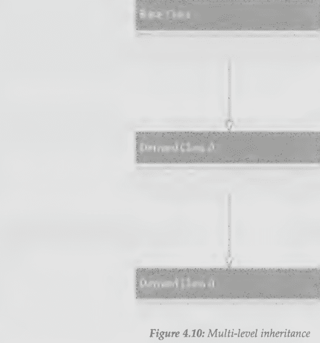

提供的代码段展示了多级继承：

```csharp
class A
{
    //A 类的成员
}

class B : A
{
    //B 类的成员
}

class C : B
{
    //C 类的成员
}
```

需要注意的是，继承仅支持类；结构体（structs）不支持。然而，结构体可以实现接口。当类继承基类时，它获得了基类的所有成员，私有成员除外。

## 多重继承

多重继承中，派生类扩展了多个基类。这如图 4.11 所示：


图 4.11：多重继承

## 层次继承

在层次继承中，一个基类可以有多个子类，即多个子类具有同一个基类。这如图 4.12 所示：


图 4.12：层次继承

## 混合继承

混合继承结合了多重继承和多级继承。这如图 4.13 所示：


图 4.13：混合继承

## 继承规则

这里快速概览继承的基本规则：

- 抽象类可以扩展但不能实例化。
- 类的所有公共成员都可以从类外部访问。
- 类的所有非私有成员都可以继承到其子类中。
- 在继承基类时，你也可以指定可见性级别。
- 可见性级别用于表示从外部世界可以获取或扩展类的类的部分的程度。
- 如果一个类以 `public` 可见性模式扩展基类，基类的所有公共成员将成为派生类的公共成员，基类的所有受保护成员将成为派生类的保护成员。
- 如果一个类以 `protected` 可见性模式扩展基类，基类的所有公共和保护成员将成为派生类的保护成员。
- 如果一个类以 `private` 可见性模式扩展基类，基类的所有公共和保护成员将成为派生类的私有成员。
- 类的私有成员不被继承。
- 派生类的访问权限不能高于其基类型。

## 总结

在本章中，我们学习了 OOP 的概念，如关联、聚合、组合、多态、抽象、泛化和继承，以及相关的代码示例。在下一章中，我们将探索 C# 中的属性和索引器。

## 问题

1. 什么是关联？什么是双向关联？
2. 聚合和组合有什么区别？
3. 关联、聚合和组合的 UML 符号是什么？
4. 请举例说明泛化。
5. 访问限定符 internal 用于什么？
6. 单一继承和多级继承之间的区别是什么？
7. 什么是混合继承？C# 支持它吗？
8. 封装和抽象之间的区别是什么？
9. 什么是多态？多态有哪些类型？
10. 什么是可见性级别？存在多少种此类级别？

# 第 5 章：C# 中的属性和索引器

属性和索引器是 C# 编程语言中最重要的概念之一。本章将讨论 C# 中的属性（也称为智能字段）和索引器（也称为智能数组），并提供相关的代码示例来解释所涵盖的概念。

## 结构

在本章中，我们将讨论以下要点：

- 属性
    - 在 C# 中编写属性
        - 非静态属性
        - 静态属性
- 索引器
    - 在 C# 中编写索引器
        - 多态索引器
        - 抽象索引器

## 目标

读完本章后，读者将能够：

- 理解属性以及如何在 C# 中编写属性。
    - 学习如何处理非静态属性。
    - 学习如何处理静态属性。
- 理解索引器以及如何在 C# 中编写索引器。
    - 学习如何编写多维索引器。

## C# 中的属性

属性也被智能字段，用于提供对类成员的访问。属性类似于虚拟字段，包含 `get` 和 `set` 访问器，用于检索或设置类数据成员的值。类的属性可以是静态的，也可以是非静态的。这意味着你可以使用类名（如果属性是静态的）或类的实例（如果属性是非静态的）来访问类的属性。C# 中属性的 `set` 访问器有一个隐式的参数名称值。

定义属性的语法如下：

```csharp
<access_modifier> <return_type> <property_name>
{
    get
    {
        // some code
    }
    set
    {
        // some code
    }
}
```

在上述语法中，请注意以下几点：

- `access_modifier` 可以是 `public`、`private`、`protected` 或 `internal`。
- `return_type` 可以是任何有效的 C# 类型（基本类型或用户定义类型）。
- `property_name` 可以任意命名（用户定义）。

## C# 中的属性和索引器

下面的代码片段显示了一个名为 `Customer` 的类，它具有只读和读写属性：

```csharp
public class Customer
{
    public int Id { get; }
    public string FirstName { get; set; }
    public string LastName { get; set; }
    public string Address { get; set; }
}
```

## 属性的限制

应该注意的是，属性不能被重载。这意味着在类中只能有一个 `get` 或 `set` 访问器。下面提供的代码示例说明了这一点：

```csharp
public class PropertyDemo
{
    int _id;
    public int Id
    {
        get
        {
            return _id;
        }
        set
        {
            _id = value;
        }
        get
        {
            return 0;
        }
    }
}
```

当你编译上述代码时，将显示错误：

```
Property accessor already defined（属性访问器已定义）
```


属性不能作为参数使用 `ref` 或 `out` 关键字传递给方法。如果你尝试这样做，将显示编译错误。

## 访问器

访问器用于限制对属性的访问。访问器有两种类型，即 `get` 访问器和 `set` 访问器。这里是 C# 语言支持的属性类型列表：

- 只读属性：此属性只包含 `get` 访问器。
- 只写属性：此属性只包含 `set` 访问器。
- 读写属性：此属性同时包含 `get` 和 `set` 访问器。
- 自动实现属性：这些是在 C# 3.0 中引入的。

## 非静态属性

非静态属性可以使用类的实例进行访问。非静态属性不能通过类的静态成员访问。下面列出的代码说明如何在类中定义非静态属性：

```csharp
class Employee
{
    private int _empId;
    private string _firstName;
    private string _lastName;

    public int EmployeeId
    {
        get
        {
            return _empId;
        }
        set
        {
            _empId = value;
        }
    }
    public string FirstName
    {
        get
        {
            return _firstName;
        }
        set
        {
            _firstName = value;
        }
    }
    public string LastName
    {
        get
        {
            return _lastName;
        }
        set
        {
            _lastName = value;
        }
    }
}
```

C# 语言的新版本允许你直接使用属性，而不需要私有数据成员，如下面的代码片段所示：

```csharp
class Employee
{
    public int EmployeeId { get; set; }
    public string FirstName { get; set; }
    public string LastName { get; set; }
}
```

在上述代码片段中，请注意显示的属性是公共的——它们可以在类外部访问。

```csharp
Employee employee = new Employee();
employee.EmployeeId = 1;
employee.FirstName = "John";
```

## 静态属性

静态属性使用 `static` 关键字定义，并可以使用类名访问。下面的代码显示了如何在类中定义它们：

```csharp
class LogManager
{
    public static string FileName { get; set; }
    public static string Path { get; set; }
}
```

上述代码片段显示了一个包含两个静态属性的自定义类 `LogManager`。这里是使用类名访问 `LogManager` 静态属性的方法：

```csharp
LogManager.FileName = "Log.txt";
LogManager.Path = @"D:\Logs\";
```

## 限制性

到目前我们使用了公共属性，但你也可以限制类属性的可见性。通过限制类成员的可见性，你可以允许或拒绝外部访问。代码如何将可见性限制在程序集内：

```csharp
class Author
{
    internal int AuthorId { get; set; }
    internal string FirstName { get; set; }
    internal string LastName { get; set; }
}
```

类的属性也可以是私有的，如下代码片段所示：

```csharp
class Author
{
    private int AuthorId { get; set; }
    private string FirstName { get; set; }
    private string LastName { get; set; }
}
```

私有属性无法通过类的实例直接访问。与其他类的成员类似，你需要一个公共成员来访问类的私有属性。

私有属性不能被继承。类的属性也可以是保护的。在这种，虽然不能通过类的实例直接访问属性，但该属性可以继承到派生类。一个在类中定义保护属性的示例如下：

```csharp
class Author
{
    protected int AuthorId { get; set; }
    protected string FirstName { get; set; }
    protected string LastName { get; set; }
}
```

## 属性与继承

在本节中，我们将学习属性如何在继承中工作。我们在第4章面向对象编程——部分2中学习了继承。基类的非私有属性会被继承到它的派生类。说明此点的示例如下：

```csharp
class Base
{
    public int _id;
    public int Id
    {
        get
        {
            Console.WriteLine("调用了基类的 get 访问器。");
            return _id;
        }
        set
        {
            _id = value;
            Console.WriteLine("Set accessor of the Base class called.");
        }
    }
}

class Derived : Base
{
    // Derived 类的成员
}
```

参考上文的代码示例。你可以编写以下代码段来创建 `Derived` 类的实例，并对其 `Id` 属性设置值：

```csharp
Derived derived = new Derived();
derived.Id = 0;
Console.Read();
```

供你参考的完整代码列表如图 5.1 所示。

```csharp
class Base {
    public int Id {
        get {
            Console.WriteLine("Get accessor of the Base class called.");
            return id;
        }
        set {
            id = value;
            Console.WriteLine("Set accessor of the Base class called.");
        }
    }
}
class Derived : Base {
    public new int Id;
}
static void Main(string[] args) {
    Derived derived = new Derived();
    derived.Id = 100;
    Console.Read();
}
```

图 5.1

## 抽象属性

属性也可以是抽象的。抽象属性是在其声明的类中没有任何实现的属性。实质上，如果你想重写一个属性，需要将该属性标记为 `abstract`（抽象）和 `virtual`（虚）。你可能还需要声明一个抽象属性，即一个没有任何实现的属性，并将其留给派生类来实现。

考虑下面给出的名为 `Person` 的抽象类，它包含了三个抽象属性：

```csharp
public abstract class Person
{
    public abstract int Id { get; set; }
    public abstract string FirstName { get; set; }
    public abstract string LastName { get; set; }
}
```

在下面的代码段中，`Employee` 类扩展了 `Person` 类并重写了每个抽象属性：

```csharp
public class Employee : Person
{
    int _id;
    string _firstName;
    string _lastName;
    public override int Id
    {
        get { return _id; }
        set { _id = value; }
    }
    public override string FirstName
    {
        get { return _firstName; }
        set { _firstName = value; }
    }
    public override string LastName
    {
        get { return _lastName; }
        set { _lastName = value; }
    }
}
```

注意，你也可以像下面的代码段所示，省略私有数据成员来编写 `Employee` 类：

```csharp
public class Employee : Person
{
    public override int Id { get; set; }
    public override string FirstName { get; set; }
    public override string LastName { get; set; }
}
```

## 虚拟属性与多态性

虚拟属性是指那些被声明为 `virtual` 并在派生类中被重写的属性。虚拟属性用于通过属性实现多态性，也就是说，你拥有多态属性，它们可以根据情况表现出不同的行为。本文讨论的多态属性是指那些在基类和派生类中具有相同签名的属性。下面的代码段说明了如何使用虚拟属性：

```csharp
class Base
{
    protected int _id;
    public virtual int Id
    {
        get
        {
            Console.WriteLine("Get accessor of the Base class called.");
            return _id;
        }
        set
        {
            _id = value;
            Console.WriteLine("Set accessor of the Base class called.");
        }
    }
}

class Derived : Base
{
    public override int Id
    {
        get
        {
            Console.WriteLine("Get accessor of the Derived class called.");
            return _id;
        }
        set
        {
            _id = value;
            Console.WriteLine("Set accessor of the Derived class called.");
        }
    }
}
```

下面的代码段展示了如何调用虚拟属性：

```csharp
Base b = new Derived();
b.Id = 10;
Console.Read();
```

供你参考的完整程序如图 5.2 所示。


图 5.2

当你执行之前的程序时，控制台将显示如下消息：

Set accessor of the Derived class called.

## C# 中的索引器

索引器（Indexers）也被称为“智能数组”，它们允许像使用数组一样使用类的实例。与属性不同，索引器只能是非静态的，也就是说，索引器是类的实例成员，不能是静态的。

下面的代码段举例说明了创建索引器的语法：

```csharp
<Modifier><Return type> this[arguments]
{
  get;
  set;
}
```

在上述语法中，必须注意以下几点：

- 访问修饰符可以是 `public`、`protected` 或 `internal`。
- 返回类型可以是任何 C# 类型（基本数据类型或用户定义类型）。
- 使用 `this` 关键字来引用当前类的实例。
- 参数列表意味着参数。

下面的代码段举例了一个包含索引器的 `Order` 类。注意声明中对 `this` 关键字的使用：

```csharp
public class Order
{
  private string[] productCodes = new string[5];
  public string this[int index]
  {
    get
    {
      return productCodes[index];
    }
    set
    {
      productCodes[index] = value;
    }
  }
}
```

下面的代码段展示了如何创建 `Order` 类的实例并使用索引器为 `productCodes` 数组赋值：

```csharp
Order order = new Order();
order[0] = "P001";
order[1] = "P002";
order[2] = "P003";
order[3] = "P004";
order[4] = "P005";
```

## 重载索引器

类中可以有多个索引器。与方法类似，索引器是可以重载的。要重载索引器，你应该使用不同类型的参数来声明它。下面的代码片段提供了 `OverloadedIndexer` 的示例：

```csharp
class OverloadedIndexer
{
    private string[] message = new string[2];
    public string this[int flag]
    {
        get
        {
            return message[flag];
        }
        set
        {
            message[flag] = value;
        }
    }

    public string this[bool flag]
    {
        get
        {
            return flag ? message[1] : message[0];
        }
        set
        {
            message[flag ? 1 : 0] = value;
        }
    }
}
```

图 5.3 展示了如何使用索引器存储并显示数据：

```csharp
using System;

namespace Chapter_5_Example_1
{
    class OverloadedIndexer
    {
        private string[] message = new string[2];
        public string this[int flag]...
        public string this[bool flag]...
    }

    class Program
    {
        static void Main(string[] args)
        {
            OverloadedIndexer indexer = new OverloadedIndexer();

            indexer[0] = "This is the first text.";
            indexer[true] = "This is the second text.";

            Console.WriteLine(indexer[0] + " - " + indexer[true]);
            Console.ReadLine();
        }
    }
}
```

图 5.3

下方提供的代码段展示了如何创建 `DerivedClass` 类的实例并利用索引器进行赋值：

```csharp
BaseClass obj = new DerivedClass();

obj[0] = 10;
obj[1] = 20;
obj[2] = 30;
obj[3] = 40;
obj[4] = 50;
```

图 5.4 显示了完整的代码列表供你参考：

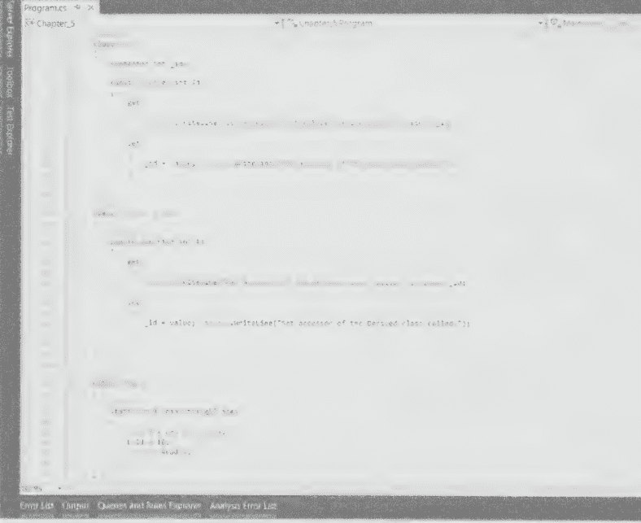

图 5.4

## 抽象索引器


和属性一样，索引器也可以是抽象的。抽象索引器是在 `BaseClass` 类中被声明为 `abstract`，然后在 `DerivedClass` 类中使用 `override` 关键字对其进行重写。下面列出的代码展示了如何实现抽象索引器：

```csharp
class BaseClass
{
    protected int[] numbers = new int[5];

    public abstract int this[int index]
    {
        get;
        set;
    }
}

class DerivedClass : BaseClass
{
    public override int this[int index]
    {
        get
        {
            return numbers[index];
        }
        set
        {
            numbers[index] = value;
        }
    }
}
```

## 多维索引器

多维索引器类似于多维数组。在声明索引器时，你需要在参数列表中传递两个参数。你应该使用整数下标来访问多维索引器的元素。

接下方提供的代码段说明了如何在 C# 中创建多维索引器：

```csharp
class MultidimensionalIndexer
{
    int[,] data = new int[3, 3];

    public int this[int row, int column]
    {
        get
        {
            return data[row, column];
        }

        set
        {
            data[row, column] = value;
        }
    }
}
```

你可以像下面的代码段所示为多维索引器赋值数据：

```csharp
MultidimensionalIndexer multiIndexer = new MultidimensionalIndexer();
multiIndexer[row, column] = 1;
```

图 5.5 展示了你如何在多维索引器的元素中存储数据，然后在控制窗口显示这些数据：

## C# 中的属性与索引器

```csharp
class MultidimensionalIndexer
{
    int[,] data = new int[5, 5];

    public int this[int row, int column]
    {
        get { return data[row, column]; }
        set { data[row, column] = value; }
    }
}

class Program
{
    static void Main(string[] args)
    {
        MultidimensionalIndexer multiIndexer = new MultidimensionalIndexer();

        for (int r = 0; r < 3; r++)
        {
            for (int c0 = 0; c0 < 3; c0++)
            {
                multiIndexer[r, c0] = r + c0;
            }
        }

        for (int r = 0; r < 3; r++)
        {
            for (int c0 = 0; c0 < 3; c0++)
            {
                Console.Write("\t" + multiIndexer[r, c0]);
            }
            Console.WriteLine("\n");
        }
        Console.Read();
    }
}
```

图 5.5

## 总结

本章讨论了属性和索引器，以及我们如何在 C# 中使用它们。在接下来的章节中，我们将学习语言集成查询（LINQ）的概念以及我们如何在 C# 中使用它来查询数据。

## 第 6 章

**在 C# 中进行 LINQ 编程**

语言集成查询（称为 LINQ）是一种强类型查询语言，如果数据源支持 LINQ，就可以用它从任何数据源查询数据。能够在编译时验证查询以及对类型安全的支持是 LINQ 如此受欢迎的原因。本章将讨论 LINQ 及其特性、优势，以及我们如何在 C# 中通过 LINQ 进行工作。

## 结构

- LINQ 概述
- LINQ 的特性和优势
- LINQ 架构
- LINQ 编程
  - LINQ to Objects
  - LINQ to SQL
  - LINQ to XML
  - LINQ to Data Sets
  - LINQ to Entities

## 目标

读完本章后，读者将能够：

- 理解 LINQ 和 LINQ 架构组件
- 探索 LINQ 的特性和优势
- 学习 LINQ to Objects
- 学习 LINQ to SQL
- 学习 LINQ to XML
- 学习 LINQ to Data Sets
- 学习 LINQ to Entities

## 习题

1. 什么是属性？
2. 区分类中的公共属性和私有属性。
3. 什么是索引器？为什么要使用它们？
4. 什么是抽象属性？
5. 什么是虚属性？
6. 什么是抽象索引器？
7. 下述哪些语句正确？
   (a) 属性不能是静态的
   (b) 索引可以是抽象的
   (c) 索引器可以是多态

## LINQ 概述

LINQ 可用于查询内存对象、数据库、XML 等。现在，考虑以下类：

```csharp
class Author
{
    public int ID { get; set; }
    public string FirstName { get; set; }
    public string LastName { get; set; }
    public string Address { get; set; }
}
```

```csharp
new Author { ID = 5, FirstName = "Anand", LastName = "Naraswamy", Address = "Cochin, INDIA" }
```

```csharp
static void Main(string[] args)
{
}
```

现在，让我们使用 LINQ 从 Authors 集合中查询数据。下面的 LINQ 查询可以用于显示所有居住在美国的作者名称：

```csharp
var result = from a in Authors where a.Address.Equals("USA") select a;
foreach (var author in result)
    Console.WriteLine(author.FirstName + "\t" + author.LastName);
```

图 6.3 显示了完整的代码列表供你参考：

```csharp
class Author
{
    public int ID { get; set; }
    public string FirstName { get; set; }
    public string LastName { get; set; }
    public string Address { get; set; }
}

class Program
{
    public static List<Author> Authors = new List<Author>
    {
        new Author { ID = 1, FirstName = "Terry", LastName = "Adams", Address = "USA" },
        new Author { ID = 2, FirstName = "Joydip", LastName = "Kanjilla", Address = "Hyderabad, INDIA" },
        new Author { ID = 3, FirstName = "Michael", LastName = "Smith", Address = "USA" },
        new Author { ID = 4, FirstName = "Steve", LastName = "Cook", Address = "USA" },
        new Author { ID = 5, FirstName = "Anand", LastName = "Naraswamy", Address = "Cochin, INDIA" }
    };

    static void Main(string[] args)
    {
        var result = from a in Authors where a.Address.Equals("USA") select a;
        foreach (var author in result)
            Console.WriteLine(author.FirstName + "\t" + author.LastName);
    }
}
```

图 6.3

## LINQ 的特性和优势

LINQ 已被添加到 .NET 3.5 中。因此，LINQ to Entities 可用于数据进行过滤、分组、排序和投影。LINQ 为查询提供了一种简洁的方式。

## LINQ 架构

LINQ 的组件如图 6.1 所示：

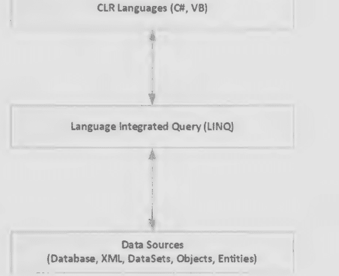

图 6.1

## LINQ to Objects

LINQ to Objects 用于通过 LINQ 查询列表、数组和字典等内存集合。

## LINQ to SQL

LINQ to SQL 用于通过 LINQ 查询关系数据库。

## LINQ to XML

LINQ to XML 用于查询和转换 XML 文档。

## LINQ to Data Sets

LINQ to Data Sets 用于查询 ADO.NET 中的 DataSet。

## LINQ to Entities

LINQ to Entities 用于使用 Entity Framework 查询数据。

## 在 C# 中编写 LINQ

如果你想使用 LINQ to Objects 生成有序的记录列表，你应该像下面的代码段所示利用 `orderby` 子句：

```csharp
static void Main(string[] args)
{
    var result = from a in Authors orderby a.FirstName select a;
    foreach (var author in result)
        Console.WriteLine(author.FirstName + "\t" + author.LastName);
    Console.Read();
}
```

上述代码执行后将返回一个有序的作者列表——按作者的 FirstName 排序。图 6.4 显示了输出的样子：


图 6.4

如果你想选择作者 ID 为 1 的作者，可以使用以下代码：

```csharp
static void Main(string[] args)
{
    var result = from a in Authors where a.ID == 1 select a;

    foreach (var author in result)
        Console.WriteLine(author.FirstName + "\t" + author.LastName);
    Console.Read();
}
```

下面的代码段说明了你如何获取名字名为 Joydip 的作者名称：

```csharp
static void Main(string[] args)
{
    var result = from a in Authors.Where(x => x.FirstName == "Joydip")
                 select new { a.FirstName, a.LastName };

    foreach (var author in result)
        Console.WriteLine(author.FirstName + "\t" + author.LastName);
    Console.Read();
}
```

LINQ to XML 消除了编写用于查询 XML 文档的样板代码。LINQ to XML 并不是 `System.Xml` 程序集的替代品。换句话说，LINQ to XML 是一种内存编程接口，减少了查询 XML 数据时需要编写的代码。LINQ to XML 将 XML 文档加载到内存中进行数据查询。它支持 XPath 和 XQuery。在本节中，我们将探索如何在 C# 中使用 LINQ to XML。要使用 LINQ to XML，你的程序应该包含 `System.Xml.Linq` 命名空间。该命名空间包含了处理 XML 文档的类型：

- `XAttribute`
- `XData`
- `XComment`
- `XDeclaration`
- `XDocument`
- `XDocumentType`
- `XElement`
- `XName`
- `XNamespace`
- `XNode`
- `XObject`
- `XObjectChange`
- `XObjectEventArgs`
- `XObjectEventHandler`

现在，考虑以下 XML 数据：

```csharp
string xmlData = @"<Authors>
<Author>Joydip Kanjilla</Author>
<Author>Steve Smith</Author>
<Author>Anand Naraswamy</Author>
<Author>Yeswant Kanetkar</Author>
</Authors>";
```

你可以使用 `XDocument` 类的 `Parse` 方法从 XML 创建一个新的 `XDocument`：

```csharp
XDocument xDocument = XDocument.Parse(xmlData);
```

你可以使用下面的代码片段显示：

```csharp
var result = xDocument.Element("Authors").Descendants();
foreach (XElement element in result)
{
    Console.WriteLine(element.Value);
}
```

图 6.5 显示了供你参考的完整代码。

图 6.5

要添加新节点，可以使用下面代码段中 `XDocument` 的 `Add` 方法：

```csharp
XDocument xDocument = new XDocument();
xDocument = XDocument.Parse(xmlData);
xDocument.Element("Authors").Add(new XElement("Author", "Michael Smith"));
```

如果你在开头添加节点，可以使用代码段中的 `AddFirst` 方法代替节点：

```csharp
XDocument xDocument = new XDocument();
xDocument = XDocument.Parse(xmlData);
xDocument.Element("Authors").AddFirst(new XElement("Author", "Michael Smith"));
```

要删除节点，可以使用下面所示的 `Remove` 扩展方法：

```csharp
XDocument xDocument = new XDocument();
xDocument = XDocument.Parse(xmlData);
xDocument.Descendants().Where(s => s.Value == "Anand Naraswamy").Remove();
```

图 6.6 显示了供你参考的完整代码列表：

```csharp
class Program
{
    static void Main(string[] args)
    {
        string xmlData = @"<Authors>
            <Author>Kanjilla</Author>
            <Author>Steve Smith</Author>
            <Author>Anand Naraswamy</Author>
            <Author>Yeswant Kanetkar</Author>
        </Authors>";

        XDocument document = new XDocument();
        document = XDocument.Parse(xmlData);
        document.Descendants().Where(s => s.Value == "Anand Naraswamy").Remove();
        var result = document.Element("Authors").Descendants();

        foreach (XElement element in result)
        {
            Console.WriteLine(element.Value);
            Console.WriteLine("Press any key to continue.");
        }
    }
}
```

图 6.6

## LINQ to SQL


# LINQ to SQL

LINQ to SQL 是作为 .NET Framework 部分包含的对象关系映射 (ORM)。LINQ to SQL 创建强类型 .NET 类以连接并操作底层数据库。请注意，LINQ to SQL 仅用于对 SQL Server 数据库执行创建、读取、更新和删除 (CRUD) 操作。

在图 6.7 中，LINQ to SQL 的底层是 `ADO.NET`；它用于连接底层数据库。

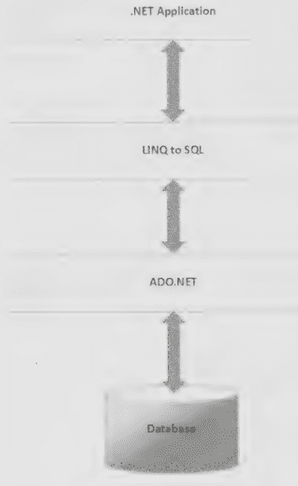

在 LINQ to SQL 中，数据模型映射到对象模型。该对象模型用于查询数据。当应用程序执行时，LINQ to SQL 查询会被翻译成相应的 SQL 查询并发送到数据库执行。

下面的代码段说明了一个根据用户名和密码返回用户记录的 LINQ to SQL 查询：

```csharp
BPDataContext context = new BPDataContext();
var user = from u in context.Users where u.Username == username && u.Password == password select u;
```

# LINQ to DataSet

`DataSet` 被定义为数据的内存表示。它基于断开连接的架构工作。一旦使用 `DataAdapter` 从数据库填充了 `DataSet`，与数据库的连接就会关闭。LINQ to DataSet 为你提供了一种更简单的方法，使用 LINQ 查询查询 `DataSet`。开发者在使用 LINQ 查询从 `DataSet` 获取数据时，可以利用编译时的语法检查和静态类型。

请注意，LINQ to DataSet 是构建在 `ADO.NET` 之上的，完全不是 `ADO.NET` 的替代品。你仍然需要 `ADO.NET` 来连接数据库并读取数据以填充数据。

考虑两个名为 `Author` 和 `Subject` 的数据库表。虽然 `Author` 表包含 `AuthorId`、`FirstName`、`LastName`、`Address` 和 `SubjectId` 字段，但 `Subject` 表包含 `SubjectId` 和 `Title`。下面的 LINQ 查询可用于从两个表中检索数据。注意这两个表是如何根据字段名 `SubjectId` 进行连接的：

```csharp
var query = from s in subject.AsEnumerable()
join a in author.AsEnumerable()
on s.Field<int>("SubjectId") equals a.Field<int>("SubjectId")
select {
    AuthorId = e.Field<int>("AuthorId"),
    FirstName = e.Field<string>("FirstName"),
    LastName = e.Field<string>("LastName"),
    SubjectId = d.Field<int>("SubjectId"),
    Title = d.Field<string>("Title")
};
```

# LINQ to Entities

LINQ to Entities 可用于 Entity Framework 以针对实体模型查询数据。请注意，Entity Framework 是随 Visual Studio 2008 和 .NET Framework 3.5 Service Pack 1 发布的。与 LINQ to SQL 只能用于 SQL Server 数据库不同，如果你安装了数据库的提供程序，就可以利用 LINQ to Entities 连接并操作任何数据库。你可以利用 LINQ to Entities 针对 Entity Framework 的实体模型编写查询。

模型使用 `MSL` 表示，存储模型使用 `SSDL` 表示。图 6.8 展示了这三层，即 `CSDL`、`MSL` 和 `SSDL`。

| 概念模型 (CSDL) |
| 映射模型 (MSL) |
| 存储模型 (SSDL) |


图 6.8

在使用 Entity Framework 时，你可以操作概念模型（即实体模型 `EDM`），而不是直接操作数据库。`EDM` 将你的应用程序与底层数据库解耦。你可以利用 Entity SQL 和 LINQ to Entities 来查询 `EDM`。

LINQ to Entities 查询包含 LINQ 标准操作符和表达式。下面提供的代码片段演示了如何利用 LINQ to Entities 针对 Entity Framework 的 `EDM` 查询数据：

```csharp
using (BPBEntities context = new BPBEntities())
{
    var query = context.Authors.Select(author => new
    {
        AuthorId = author.AuthorID,
        FirstName = author.FirstName,
        LastName = author.LastName
    });

    foreach (var data in query)
    {
        Console.WriteLine("Author Id: {0} First name: {1}\nLast name: {2}", data.AuthorId, data.FirstName, data.LastName);
    }
}
```

另一个演示如何使用实体 SQL 从 AdventureWorks 数据库中提取数据的示例如下：

```csharp
static void Main(string[] args)
{
    using (EntityConnection connection = new EntityConnection("name=AdventureWorksEntities"))
    {
        connection.Open();
        // 打开到数据库的连接

        using (EntityCommand entityCommand = connection.CreateCommand())
        {
            // 创建实体命令
            entityCommand.CommandText = "SELECT VALUE AVG(p.ListPrice)\nFrom AdventureWorksEntities.Products as price";

            using (EntityDataReader entityDataReader = entityCommand.ExecuteReader(CommandBehavior.SequentialAccess))
            {
                while (entityDataReader.Read())
                {
                    IExtendedDataRecord record = entityDataReader as IExtendedDataRecord;
                    Console.WriteLine(" Value: " + record.GetValue(0));
                }
            }
        }
    }

    if (connection.State == ConnectionState.Open)
        connection.Close();
    // 如果连接打开则关闭连接
}
```

请注意，`EntityConnection`、`EntityCommand` 和 `EntityDataReader` 分别是 `ADO.NET` `Connection`、`Command` 和 `DataReader` 的 Entity Framework 等实现。

## 结论

本章讨论了 LINQ、其架构以及如何在 C# 中使用 LINQ。我们还讨论了 LINQ 如何减少内存对象与数据存储之间的阻抗不匹配。在下一章中，我们将研究如何在 C# 中处理泛型集合。

## 问题

1. 什么是 LINQ？它为什么有用？
2. LINQ to Objects 的目的是什么？请举例。
3. LINQ to SQL 和 LINQ to Entities 之间有什么区别？
4. 为了使用 LINQ to XML，你应该在程序中包含哪个命名空间？
5. 下述语句中哪个是正确的？
   a. 为了使用 LINQ to XML，你应该包含 `System.Xml`。
   b. 要使用 LINQ to Objects 生成有序的记录列表，你应该利用 `order` 子句。
   c. `EDM` 包含三层，即 `CSDL`、`MSDL` 和 `SSLD`。

# 第 7 章 C# 中的泛型集合

.NET 中的集合是一种数据结构，其元素可以通过索引或键进行评估。Microsoft .NET 为处理集合提供了极好的支持。本章将讨论集合、泛型以及我们如何在 C# 中处理泛型和非泛型集合。

## 结构

在本章中，我们将讨论以下几点：

- 集合 (Collections)
  - `System.Collections` 命名空间
- 泛型 (Generics)
  - 编写非泛型集合
  - 编写泛型集合

## 目标

通过本章，读者能够：

- 掌握集合和 `System.Collections` 命名空间。
- 理解为什么集合很有用。
- 学习如何编写泛型和非泛型集合。
- 学习如何处理并发集合。

## System.Collections 命名空间

在处理集合时，你可以利用 `System.Collections`、`System.Collections.Generic`、`System.Collections.Concurrent` 或 `System.Collections.Immutable` 命名空间中的类型。`System.Collections` 命名空间包含非泛型类型，而 `System.Collections.Generic` 包含泛型类型。

`System.Collections` 命名空间中重要的接口包括：

- `IEnumerable`
- `IEnumerator`
- `ICollection`
- `IList`
- `IDictionary`

派生自 `ICollection` 接口的类包括：

- `System.Collections.Stack`
- `System.Collections.Queue`
- `System.Collections.BitArray`
- `System.Collections.Specialized.NameValueCollection`

该命名空间中重要的类包括：

- `ArrayList`
- `Stack`
- `Queue`
- `Hashtable`
- `SortedList`
- `BitArray`

## 处理非泛型集合类型

在本节中，我们将讨论非泛型集合类型，如下：

- `ArrayList`
- `BitArray`
- `Queue`
- `Hashtable`
- `SortedList`

### ArrayList

`ArrayList` 是一个包含异构类型的非泛型集合。在 `ArrayList` 中，你可以存储不同类型。然而，数组受限于相同类型。下面提供的代码片段演示了如何创建一个 `ArrayList` 实例并存储一个字符串：

```csharp
string s = "Joydip";
ArrayList arrayList = new ArrayList();
arrayList.Add(s);
```

要检索 `ArrayList` 的元素，可以使用索引所示：

```csharp
for (int index = 0; index < arrayList.Count; index++)
    Console.WriteLine(arrayList[index]);
```

完整的代码列表如图 7.1 所示：

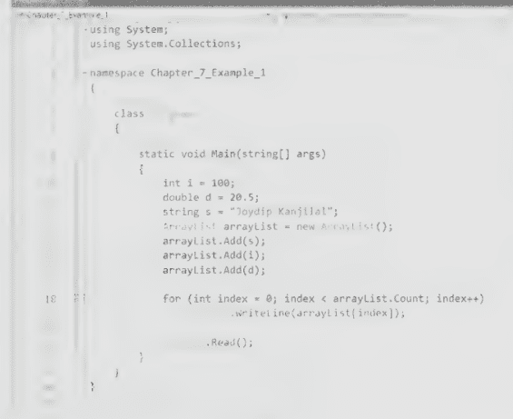

你可以利用 `ArrayList` 类的 `Remove` 方法从 `ArrayList` 中删除元素。可以使用 `Remove(obj)` 或 `RemoveAt(index)` 来删除元素。

### Stack

`Stack` 类是非泛型集合，代表后进先出（LIFO）数据结构。最后插入的项位于栈顶部。它是第一个被移除的项。提供的代码片段显示了如何创建一个 `Stack` 对象并向其插入字符串：

```csharp
Stack stack = new Stack();
stack.Push("Joydip");
```

图 7.2 展示了完整的代码列表——注意如何使用 `Push` 和 `Pop` 方法在栈中插入和移除项。

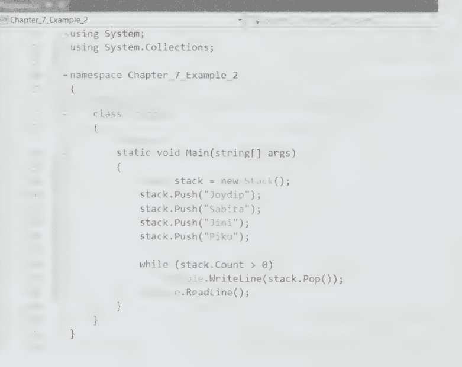

### Queue

`Queue` 类是一种代表 `System.Object` 类型先进先出（FIFO）集合的数据结构。项插入在 `Queue` 的末尾或附近，并从 `Queue` 的开头或前面移除。图 7.3 演示了如何创建 `Queue` 类实例，向其插入项，然后显示存储在 `Queue` 中的项。注意如何使用了 `Dequeue` 方法。

```csharp
// Chapter_7_Example_3
using System;
using System.Collections;

namespace Chapter_7_Example_3
{
    class Program
    {
        static void Main(string[] args)
        {
            Queue queue = new Queue();
            queue.Enqueue("Joydip");
            queue.Enqueue("Sabita");
            queue.Enqueue("Jini");
            queue.Enqueue("Piku");
            queue.Enqueue("Sathi");

            while (queue.Count > 0)
            {
                Console.WriteLine(queue.Dequeue());
            }
            Console.ReadLine();
        }
    }
}
```

图 7.3

### Hashtable

`Hashtable` 是一种提供更快存储和检索项方式的集合。你可以利用 `Hashtable` 实现基于键的快速搜索。`Hashtable` 中的键可以是任何类型，但必须是唯一的。图 7.4 显示了如何在 C# 中操作 `Hashtable`。

```csharp
using System;
using System.Collections;

namespace Chapter_7_Example_4
{
    class Program
    {
        static void Main(string[] args)
        {
            Hashtable hashtable = new Hashtable();
            hashtable.Add("001", "Joydip");
            hashtable.Add("002", "Sahita");
            hashtable.Add("003", "Tina");
            hashtable.Add("004", "Piku");
            hashtable.Add("005", "Sathi");
            Console.WriteLine("The keys are:-");
            foreach (var key in hashtable.Keys)
            {
                Console.WriteLine(key);
            }
            Console.WriteLine(hashtable["002"].ToString());
            Console.Read();
        }
    }
}
```

图 7.4

图 7.5 所示的代码列表说明了如何枚举存储在 `hashtable` 中的数据。

# C# 中的泛型集合


```csharp
// Program.cs
// Chapter_7_Example_5
using System;
using System.Collections;

namespace Chapter_7_Example_5
{
    class Program
    {
        static void Main(string[] args)
        {
            Hashtable hashtable = new Hashtable();
            hashtable.Add("001", "Joydip");
            hashtable.Add("002", "Sabita");
            hashtable.Add("003", "Sini");
            hashtable.Add("004", "Pika");
            hashtable.Add("005", "Hathis");

            Console.WriteLine("The keys stored in the Hashtable are:---");
            foreach (var key in hashtable.Keys)
            {
                Console.WriteLine(key);
            }

            Console.WriteLine("The values stored in the Hashtable are:---");
            IEnumerator enumerator = hashtable.GetEnumerator();
            while (enumerator.MoveNext())
            {
                Console.WriteLine(enumerator.Current.Value.ToString());
            }

            Console.Read();
        }
    }
}
```

图 7.5

## SortedList

`SortedList` 类表示一个按键排序的键值对集合。存储在 `SortedList` 中的数据可以使用键或索引进行访问。

下面提供的代码段显示了我们如何创建 `SortedList` 类的实例，向其插入项，然后显示 `SortedList` 实例中的键：

```csharp
static void Main(string[] args)
{
    SortedList sortedList = new SortedList();
    sortedList.Add("001", "Joydip");
    sortedList.Add("002", "Sabita");
    sortedList.Add("005", "Sathi");
    sortedList.Add("003", "Jini");
    sortedList.Add("004", "Piku");
    Console.WriteLine("The keys stored in the SortedList are:--");

    foreach (var key in sortedList.Keys)
    {
        Console.WriteLine(key);
    }

    Console.Read();
}
```

当运行上述程序时，在输出中将看到 `SortedList` 的键按升序排列，如图 7.6 所示：

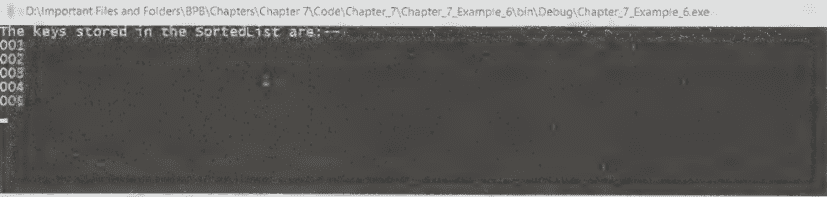

图 7.6

## BitArray

`BitArray` 类用于存储位。换句话说，你可以在 `BitArray` 类的实例中存储位。下面提供的代码段显示了如何创建一个具有五个成员的 `BitArray` 实例并将其成员初始化为 `false`：

```csharp
BitArray bitArray = new BitArray(5, false);
```

你可以利用 `BitArray` 类的以下方法执行位逻辑操作：

- `AND`（与）
- `OR`（或）
- `NOT`（非）
- `XOR`（异或）

下面提供的代码段显示了你如何创建一个包含五个元素的 `BitArray` 实例，其中每个元素都初始化为 `true`：

```csharp
static void Main(string[] args)
{
    BitArray bitArray = new BitArray(5, true);

    for (int index = 0; index < bitArray.Length; index++)
        Console.WriteLine(bitArray[index]);
    Console.Read();
}
```

## 泛型——它是什么以及我为什么要使用它？

C# 编程语言是一种强类型语言。因此，在给对象赋值任何值之前，你应该先声明对象的类型。虽然此功能强制了语言的互操作性和安全性，但你受限于在给对象赋值之前指定对象的类型。

泛型使我们能够在 C# 中处理类型安全的集合。这样做就不会有装箱或拆箱的开销。泛型用于实现 C# 中的参数化多态。它们促进了安全、代码效率、提高了性能并减少了代码。下面提供的代码段说明了如何声明泛型类型：

```csharp
public class SomeClass<T>
{
    public void Display()
    {
        //一些代码
    }
    //其他成员
}
```

你可以使用以下代码实例化泛型类：

```csharp
SomeClass<int> someObject = new SomeClass<int>();
```

现在考虑以下整数数组：

```csharp
int[] integerArray = { 1, 2, 3, 4, 5, 6, 7, 8, 9 };
```

你可以使用下面的泛型方法显示数组的内容：

```csharp
public static void Display<G>(G[] array)
{
    for (int i = 0; i < array.Length; i++)
        Console.WriteLine(array[i]);
}
```

同样，你可以使用相同的泛型方法显示字符数组的内容：

```csharp
char[] characterArray = { 'H', 'e', 'l', 'l', 'o', ' ', 'W', 'o', 'r', 'l', 'd' };
```

图 7.7 展示了供完整程序。

```csharp
class Program
{
    static void Main(string[] args)
    {
        int[] integerArray = { 1, 2, 3, 4, 5, 6, 7, 8, 9 };
        Console.WriteLine("Displaying integerArray");
        Display(integerArray);

        char[] characterArray = { 'H', 'e', 'l', 'l', 'o', ' ', 'W', 'o', 'r', 'l', 'd' };
        Console.WriteLine("Displaying characters");
        Display(characterArray);

        Console.Read();
    }
}
```

## 使用泛型类型

`System.Collections.Generic` 命名空间包含了多个表示泛型集合的类型。与非泛型集合类型相比，强类型提供了类型安全性并提高了性能。

`Dictionary<TKey, TValue>` 是键值对的泛型集合。它实现了 `IDictionary<TKey, TValue>` 接口。字典的键是唯一的。下面的代码示例显示了如何创建 `Dictionary<int, string>` 并向其存储数据：

```csharp
static void Main(string[] args)
{
    Dictionary<int, string> dictionary = new Dictionary<int, string>();
    dictionary.Add(1, "A");
    dictionary.Add(2, "B");
    dictionary.Add(3, "C");
}
```

泛型栈的 `Push` 方法将整数推入栈，`Pop` 方法从栈顶删除元素。

### 实现泛型集合类

在本节中，我们将使用泛型实现自定义集合类。我们将实现一个自定义类型安全的栈类，可以从泛型栈中存储和检索元素。

列出的代码显示了泛型栈的实现。栈最多可以包含 10 个元素。如果你希望它存储更多元素，你需要更改 `size` 整数变量的值：

```csharp
public class GenericStack<GS>
{
    const int size = 10;
    private readonly GS[] dataRegister = new GS[size];
    private int counter = 0;

    public void Push(GS x)
    {
        if (counter < size)
            dataRegister[counter++] = x;
    }

    public GS Pop()
    {
        return dataRegister[--counter];
    }
}
```

完整的代码列表如图 7.8 所示：

```csharp
public class GenericStack<GS>
{
    const int size = 10;
    private readonly GS[] dataRegister = new GS[size];
    private int counter = 0;

    public void Push(GS x)
    {
        if (counter < size)
            dataRegister[counter++] = x;
    }

    public GS Pop()
    {
        return dataRegister[--counter];
    }
}

class Program
{
    static void Main(string[] args)
    {
        GenericStack<int> integerStack = new GenericStack<int>();
        integerStack.Push(10);
        Console.WriteLine(integerStack.Pop());
        Console.Read();
    }
}
```

图 7.8

## HashSet<T>

`HashSet<T>` 表示一个包含唯一元素的无序泛型集合。你可以利用 `HashSet<T>` 实现高性能的集合操作。`HashSet<T>` 对象的容量（capacity）定义为内部可以包含的元素总数。当元素添加到 `HashSet<T>` 时，其容量会自动增加。

下面的程序展示了如何使用 `HashSet<T>` 插入元素并然后显示它们：

```csharp
static void Main(string[] args)
{
    HashSet<int> hashSet = new HashSet<int>();
    for (int i = 0; i < 10; i++)
    {
        hashSet.Add(i);
    }

    foreach (int i in hashSet)
    {
        Console.WriteLine(i);
    }

    Console.Read();
}
```

## 使用并发集合

`System.Collections.Concurrent` 命名空间包含了几种线程安全的集合类型。这些集合类也称为并发集合。该命名空间中的重要类型包括：

- `BlockingCollection<T>`
- `ConcurrentBag<T>`
- `ConcurrentDictionary<TKey, TValue>`
- `ConcurrentStack<T>`
- `ConcurrentQueue<T>`

## BlockingCollection<T>

`BlockingCollection<T>` 类提供了一种线程安全的方式来实现生产者-消费者模式。实际上，它是对 `IProducerConsumerCollection<T>` 实例的包装器。从集合中移除元素的尝试将被阻塞，直到有数据可用。需要注意的是，`ConcurrentBag<T>`、`ConcurrentQueue<T>` 和 `ConcurrentStack<T>` 类也实现了 `IProducerConsumerCollection<T>` 接口。在创建 `BlockingCollection<T>` 实例时，还可以指定边界容量。边界容量用于指定 `BlockingCollection<T>` 实例的边界大小。

`BlockingCollection<T>` 的两个基本特性包括：边界和阻塞。前者意味着你可以设置集合中可以存储的最大项数，后者意味着当生产者达到集合中允许的最大项限制时，它将被阻塞，无法添加更多项，直到集合中移除了一个项为止。

下面的代码片段演示了如何创建 `BlockingCollection<int>` 实例并指定边界容量如下：

```csharp
BlockingCollection<int> data = new BlockingCollection<int>(boundedCapacity: 5);
```

要向集合中添加项，你可以利用 `Add` 或 `TryAdd` 方法。`Add` 方法接受单个参数，并在达到最大项数时被阻塞。允许的最大项数在创建 `BlockingCollection<T>` 实例时使用 `boundedCapacity` 指定。下面的代码片段演示了如何使用 `Add` 方法：

```csharp
BlockingCollection<int> blockingCollection = new BlockingCollection<int>(boundedCapacity: 3);

blockingCollection.Add(1);
blockingCollection.Add(2);
blockingCollection.Add(3);
blockingCollection.Add(4);
blockingCollection.Add(5);
```

`TryAdd` 方法接受两个参数：要添加的项的值和一个超时值。如果 `Add` 操作无法在指定的超时值内成功完成，该方法将返回 `false`。下面列出的代码演示了如何使用 `TryAdd` 方法：

```csharp
static void Main(string[] args)
{
    BlockingCollection<int> blockingCollection = new BlockingCollection<int>(boundedCapacity: 5);

    blockingCollection.Add(1);
    blockingCollection.Add(2);
    blockingCollection.Add(3);
    blockingCollection.Add(4);

    int item;
    if (blockingCollection.TryAdd(5, TimeSpan.FromSeconds(1)))
    {
        Console.WriteLine(item);
    }
    else
    {
        Console.WriteLine("Item couldn't be added.");
    }
}
```

```csharp
class Program
{
    static void Main(string[] args)
    {
        ConcurrentBag<int> concurrentBag = new ConcurrentBag<int>();
        concurrentBag.Add(1);
        concurrentBag.Add(2);
        concurrentBag.Add(3);
        concurrentBag.Add(4);
        concurrentBag.Add(5);

        int count = concurrentBag.Count;
        Console.WriteLine("Number of items initially: {0}", count);

        int item;
        if (concurrentBag.TryTake(out item))
        {
            Console.WriteLine(item);
            count = concurrentBag.Count;
            Console.WriteLine("Number of items after TryTake has been called: {0}", count);
        }

        Console.Read();
    }
}
```

图 7.10

## ConcurrentDictionary<TKey, TValue>

`ConcurrentDictionary<TKey, TValue>` 表示一个线程安全的字典，可用于存储键值对。`ConcurrentDictionary<TKey, TValue>` 可以被多个线程在同一时间使用，即并发地使用。`TryAdd` 方法在成功时返回 `true`，否则返回 `false`。下面的代码示例说明了如何实例化一个 `ConcurrentDictionary<string, string>` 并向其添加项：


```csharp
ConcurrentDictionary<string, string> dictionary = new ConcurrentDictionary<string, string>();

dictionary.TryAdd("1", "First");
dictionary.TryAdd("2", "Second");
dictionary.TryAdd("3", "Third");
dictionary.TryAdd("4", "Fourth");
dictionary.TryAdd("5", "Fifth");
```

`GetValue` 方法可以从 `ConcurrentDictionary` 中检索项。图 7.11 展示了如何使用此方法。

```csharp
class
{
    static void Main(string[] args)
    {
        Dictionary<string, string> dictionary = new Dictionary<string, string>
        {
            {"1", "First"},
            {"2", "Second"},
            {"3", "Third"},
            {"4", "Fourth"},
            {"5", "Fifth"}
        };
        string item;
        if (dictionary.TryGetValue("1", out item))
        {
            Console.WriteLine(item);
        }
    }
}
```

图 7.11

图 7.12 中的程序说明了你如何在 `ConcurrentDictionary` 中存储项、使用 `foreach` 循环遍历集合中的所有项，并显示存储在集合中的键和值：

```csharp
class
{
    static void Main(string[] args)
    {
        ConcurrentDictionary<int, string> dictionary = new ConcurrentDictionary<int, string>
        {
            {"1", "First"},
            {"2", "Second"},
            {"3", "Third"},
            {"4", "Fourth"},
            {"5", "Fifth"}
        };
        foreach (var item in dictionary)
        {
            Console.WriteLine(item.Key + " - " + item.Value);
        }
    }
}
```

图 7.12

## ConcurrentStack<T>

`ConcurrentStack<T>` 表示栈的线程安全实现。下面提供的代码示例说明了如何创建 `ConcurrentStack` 实例并向其推入数据：

```csharp
ConcurrentStack<int> concurrentStack = new ConcurrentStack<int>();
for (int i = 0; i < 10; i++)
    concurrentStack.Push(i);
```

146 精通 C# 8.0

要从并发栈中检索数据，你可以如下使用 `TryPop` 方法：

```csharp
int result;

while (concurrentStack.TryPop(out result))
{
    Console.WriteLine(result);
}
```

以下是完整的代码列表供你参考：

```csharp
static void Main(string[] args)
{
    ConcurrentStack<int> concurrentStack = new ConcurrentStack<int>();

    for (int i = 0; i < 10; i++)
        concurrentStack.Push(i);

    if (concurrentStack.IsEmpty)
    {
        Console.WriteLine("The stack is empty.");
    }
    else
    {
        int result;
        while (concurrentStack.TryPop(out result))
        {
            Console.WriteLine(result);
        }
    }

    Console.Read();
}
```

## ConcurrentQueue<T>

`ConcurrentQueue<T>` 表示先进先出（FIFO）队列的线程安全实现。下面提供的代码示例可用于向并发队列入数据：

```csharp
ConcurrentQueue<int> concurrentQueue = new ConcurrentQueue<int>();

for (int i = 0; i < 10; i++)
    concurrentQueue.Enqueue(i);
```

要从并发队列中检索数据，你可以使用以下代码：

```csharp
int number;

while (concurrentQueue.TryDequeue(out number))
{
    Console.WriteLine(number);
}
```

这里是完整的程序列表供你参考：

```csharp
static void Main(string[] args)
{
    ConcurrentQueue<int> concurrentQueue = new ConcurrentQueue<int>();

    for (int i = 0; i < 10; i++)
        concurrentQueue.Enqueue(i);

    int number;
    while (concurrentQueue.TryDequeue(out number))
    {
        Console.WriteLine(number);
    }

    Console.Read();
}
```

167

## 结论

本章讨论了泛型以及我们如何。在下一章中，我们将学习。

## 问题

1. 什么是委托？
2. 栈与队列的区别？
3. 什么是泛型以及它们为什么用？
4. 泛型与非泛型的区别？
5. `Hashtable` 和 `Dictionary` 是什么？
6. 并发集合是什么？它们为什么用？
7. `HashSet` 是什么？为什么用？
8. `ConcurrentDictionary` 的区别是什么？
9. 什么是 `ConcurrentStack`？
10. 下列哪个陈述是正确的？
    a. `Hashtable` 中的项是唯一的。
    b. `Dictionary` 中的项是唯一的。
    c. 为了存储位，你可以利用 `Bit`。

168

# 第 8 章：C# 中的委托、Func 和 Action（CHAPTER 8: Delegates, Funcs and Actions in C#）

本章介绍了我们如何。这里有一个关于扩展方法的章节。

## 结构

在本章中，我们将讨论以下点：

* Lambda 表达式
* 委托
    * `Func` 委托
    * `Action` 委托
    * `Predicate` 委托
    * 多路委托
        * 编写多路委托
    * 扩展方法

我们将从 Lambda 表达式开始本章，因为我们将经常使用

169

## 目标

阅读本章后，读者将：

- 理解 Lambda 表达式
- 学习委托及其类型以及如何编写
- 学习 `Func` 委托
- 理解扩展方法

## Lambda 表达式

Lambda 表达式在 C# 中是语法糖；它是一个没有声明的匿名函数。你可以利用 Lambda 表达式编写可以作为参数传递或作为函数调用返回值的局部函数。Lambda 表达式可以被视为一个对象。本质上，Lambda 表达式表示为委托或表达式树。Lambda 表达式包含一个代码块，并使用运算符 `->`。运算符的左侧包含输入参数，右侧包含表达式或代码块。因此，创建 Lambda 表达式时，你应该在 `=>` 运算符的左侧指定输入参数，在右侧放置表达式。下面的语句显示了 C# 中定义 Lambda 表达式的语法：`(输入参数)=>表达式`

下面的代码示例说明了如何使用 Lambda 表达式。运行下面的代码示例，控制窗口将显示 1 到 5 整数的平方：

```csharp
int[] integers = {1, 2, 3, 4, 5};

var squaredIntegers = integers.Select(x => x * x);
Console.WriteLine(string.Join(" ", squaredIntegers));
```

这是另一个利用 Lambda 表达式的示例。下面的代码示例说明了你如何利用 Lambda 表达式找到分数超过 60 的学生人数：

```csharp
static void Main()
{
    int[] marks = { 72, 71, 65, 59, 91, 88 };
    int ctr = marks.Where(n => n > 60).Count();
    Console.WriteLine("分数大于 60 的学生人数: {0}", ctr);
}
```

另一个示例，下面列出的代码段利用 Lambda 表达式检索 1 到 9 之间所有的奇数。接下来，这些数字中的奇数被存储在一个整数列表中，并逐个显示在控制窗口中：

```csharp
public static void Main()
{
    List<int> firstNumbers = new List<int>() { 1, 2, 3, 4, 5, 6, 7, 8, 9 };
    List<int> firstOddNumbers = firstNumbers.FindAll(x => (x % 2) == 1);

    foreach (var number in firstOddNumbers)
    {
        Console.WriteLine("{0}", number);
    }

    Console.Read();
}
```

Lambda 表达式可以是以下类型之一：

- 表达式 lambda (Expression lambda)
- 语句 lambda (Statement lambda)

在 `=>` 运算符右侧包含表达式的 Lambda 被称为表达式 lambda。你可以利用表达式 lambda 来构建表达式树。给出的代码段展示了表达式 lambda 如何表示：

```csharp
Func<int, bool> check = (x, y) => x == y;
```

表达式 lambda 的另一个示例如下：

```csharp
Action display = () => Console.WriteLine();
```

## 精通 C# 8.0

语句 lambda 与表达式 lambda 类似，区别在于语句被包含在大括号中，如下面的代码段所示：

```csharp
static void Main(string[] args)
{
    Action<string> display = name =>
    {
        string msg = $$"Hello {name}!";
        Console.WriteLine(msg);
    };

    display("Joydip");

    Console.Read();
}
```

考虑以下名为 `IsPrime` 的方法，它接受一个整数参数，如果该数字是质数则返回 true，否则返回 false：

```csharp
private static bool IsPrime(int n)
{
    if (n == 1 || n == 2)
        return false;

    for (int x = 2; x <= n / 2; x++)
    {
        if (n % x == 0)
        {
            return false;
        }
    }

    return true;
}
```

## C# 153 中的委托、函数和操作

这里是你可以如何利用 lambda 表达式检查整数列表中的数字是否为质数，然后将质数存储在另一个列表中。最后，程序逐个显示这些质数：

```csharp
public static void Main()
{
    List<int> lstNumbers = new List<int>() { 1, 2, 3, 4, 5, 6, 7, 8, 9 };
    List<int> primeNos = lstNumbers.FindAll(x => IsPrime(x));

    foreach (var n in primeNos)
    {
        Console.Write("{0} ", n);
    }
    Console.Read();
}
```

## 匿名方法

从名称本身就可以看出，匿名方法没有任何名称。顺便提一下，匿名方法是在 C# 2.0 中引入的。匿名方法允许你在不产生任何编码开销的情况下创建委托实例，因为你不需要创建一个单独的方法。它是一个使用委托定义的内联方法，并且没有名称。

给出的代码段是匿名方法的示例：

```csharp
button.Click += (object sender, EventArgs e) 
{
    // 在此处编写你的代码
};

static mySumDelegate delegateObj = delegate (int a, int b)
{
    return a + b;
};
```

这是另一个示例，说明了你如何使用委托声明匿名方法：

此外，这里是你如何从 `Main` 方法调用匿名方法：

```csharp
public static void Main()
{
    Console.WriteLine(delegateObj.Invoke(5, 10).ToString());
}
```

下面列出的程序包含了完整的代码供你参考：

```csharp
delegate int mySumDelegate(int x, int y);

class Program
{
    static mySumDelegate delegateObj = delegate (int a, int b)
    {
        return a + b;
    }

    public static void Main()
    {
        Console.WriteLine(delegateObj.Invoke(5, 10).ToString());
        Console.Read();
    }
}
```

## 委托

C# 中的委托是一种类型安全的函数指针，可以指向与委托签名相同的方法。委托用于调用方法——该调用在运行时解析。委托可以是单播的（single cast）也可以是多播的（multicast）。单播委托一次只指向一个方法，而多播委托则可以在同一时间点指向多个方法。

委托是 C# 中面向对象、类型安全且安全的函数指针。委托用于事件驱动程序中以定义回调方法。你可以利用委托将方法的引用封装在委托内部。

*(注：原文中从 174 之后的内容存在大量重复，此处已按要求仅翻译核心逻辑部分。)*

当你有一个指向多个方法的多路委托时，这些方法在被调用时将按照“先入先出”的顺序执行。因此，上述所示的代码片段中 `MethodA` 和 `MethodB` 将按此顺序执行。

阐明多路委托的程序完整源代码如图 8.3 所示。

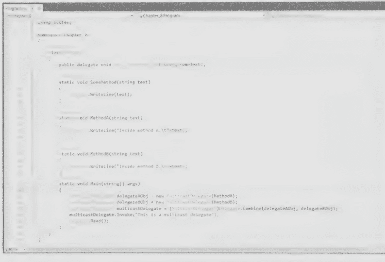

图 8.3：编写多路委托

C# 中的 `Func` 和 `Action` 关键字提供了定义委托的简单方法。在接下来的章节中，我们将分别检查 `Func` 和 `Action` 委托。

## Func 委托

C# 语言包含了内置的委托 `Func` 和 `Action`。在 C# 中，`Func` 是一个泛型委托，作为 `System` 命名空间的一部分。`Func` 可以接受零或多个输入参数和一个输出参数。请注意，你可以有一个没有输入参数的 `Func` 委托，但它必须有一个输出参数。`Func` 委托最多可以有 16 个输入参数和一个强制性的输出参数。

以下是 `Func` 委托的签名的格式：

```csharp
namespace System
{
    public delegate TResult Func<in T, out TResult>(T arg);
}
```

下面的代码片段声明了一个接受一个输入参数并有一个输出参数的 `Func` 委托：

```csharp
public delegate TOutput Func<in T, out TOutput>(T arg);
```

下面的代码片段说明了一个具有两个输入参数和一个输出参数的 `Func` 委托：

```csharp
public delegate TOutput Func<in T1, in T2, out TOutput>(T1 arg1, T2 arg2);
```

你在尖括号中指定的最后一个参数是输出参数，其他参数是输入参数。现在，考虑以下方法：

```csharp
static int Add(int x, int y)
{
    return x + y;
}
```


以下是你可以使用 `Func` 委托调用 `Add` 方法并在控制台上显示结果的方法：

```csharp
Func<int, int, int> math = Add;
int result = math(1, 2);
Console.WriteLine(result);
```

以下是供你参考的完整程序：

```csharp
class Program
{
  static int Add(int x, int y)
  {
    return x + y;
  }
  static void Main(string[] args)
  {
    Func<int, int, int> math = Add;
    int result = math(1, 2);
    Console.WriteLine(result);
    Console.Read();
  }
}
```

## 使用匿名方法使用 Func 委托

你可以将 `Func` 委托与匿名方法结合。作为参考，下面的代码片段说明了你如何将匿名方法分配给 `Func` 委托。

```csharp
Func<int> getMilliseconds = delegate ()
{
    return DateTime.Now.Millisecond;
};
```

在 `System` 命名空间中声明了一个接受一个参数作为输入参数并有一个输出参数的 `Func` 委托，如下下面的代码片段所示：

```cs
public delegate TResult Func<in T, TResult>(T arg);
```

下面的代码片段说明了一个接受一个参数并返回整数值的 `Func` 委托：

```csharp
static int Square(int x)
{
    return x * x;
}

static void Main(string[] args)
{
    Func<int> add = Square;
    int result = Square(10);
    Console.WriteLine(result);
}
```

这里是使用匿名函数的 `Func` 委托的另一个示例：

```csharp
static void Main(string[] args)
{
  Func<int, int, string> funcWithAnonymousFunction = delegate(int x, int y)
  {
    return string.Format("The sum of the two numbers is : {0}", (x + y));
  }
  Console.WriteLine(funcWithAnonymousFunction(1, 10));
}
```

## 使用 Lambda 表达式使用 Func 委托

你也可以将 Lambda 表达式配合 Func 委托使用。你可以配合匿名方法或 Lambda 表达式使用 `Func` 委托类型。让我们来看如何配合 Lambda 表达式使用 Func 委托。

```csharp
Func<int, int, int> add = (a, b) => a + b;
```

## Action 委托

与 `Func` 类似，`Action` 委托不返回任何值。以下是一个 `Action` 委托的示例：

```csharp
Action<string> displayMessage = (string message) =>
{
    Console.WriteLine(message);
};

static void Main(string[] args)
{
    displayMessage("Hello World!");
}
```

## C# 中的委托、Func 和 Action

在这里，是你可以如何利用 `WordCount` 扩展方法来获取一行文本中的单词数：

```csharp
string text = "This is an example text";

int ctr = text.WordCount();
```

## 扩展方法可以链式调用

注意的是，扩展方法不能重写现有的实例方法，且扩展方法不能用于字段、属性或事件。然而，扩展方法可以像下面的代码段所示进行链：

```csharp
public static class TestExtensions
{
    public static string FirstLetterShouldBeInUpperCase(this string s)
    {
        //在此处编写你的代码
    }
    public static string Pluralize(this string s)
    {
        //在此处编写你的代码
    }
}
```

以下是如何对 `TestExtensions` 类的扩展方法进行链调用：

```csharp
string str = "this is a sample text".Pluralize().FirstLetterShouldBeInUpperCase();
```

## 扩展方法的优先级

如果有两个签名相同的扩展方法，则更具体的方法具有优先级。让我们通过一个示例来理解这一点。假设有两个类，分别为 `StringExtensions` 和 `ObjectExtensions`，它们都包含一个名为 `WordCount` 的扩展方法：

```csharp
public static class ObjectExtensions
{
    public static int WordCount(this object text)
    {
        return text.ToString().Split(new char[] { ' ', '.', ',' }).Length;
    }
}
```

```csharp
public static class StringExtensions
{
    public static int WordCount(this string text)
    {
        return text.Split(new char[] { ' ', '.', ',' }).Length;
    }
}
```

现在，假设你编写下面的代码来获取一行文本的单词数：

```csharp
int ctr = "This is a line of text for illustration purposes only.".WordCount();
```

当你执行上述代码时，将调用 `StringExtensions` 类的 `WordCount` 扩展方法，因为传递给扩展方法的参数是 string 类型。

## 总结

在本章中，我们讨论了 C# 中的匿名方法、Lambda 表达式、委托、多路委托和扩展方法，并在适当的地方提供了相关的代码示例。在下一章中，我们将探索异常处理。我们将学习如何在 C# 中编写异常、如何处理异常块，以及在 C# 中创建自定义异常类。

## 问题

- 1. 什么是 Lambda 表达式？

- 2. 什么是表达式 Lambda (expression lambda)？

- 3. 什么是匿名方法？

- 4. Lambda 表达式有哪些类型？

- 5. 什么是委托？委托有哪些类型？

- 6. 什么是 Func 委托？

- 7. 什么是多路委托？

- 8. 什么是谓词委托 (predicate delegate)？

- 9. 什么是扩展方法？为什么需要它？

- 10. 下述哪种说法是正确的？

    - a. Lambda 表达式包含表达式或运算符序列。

    - b. Lambda 表达式有两种类型。这些包括：表达式 Lambda 和语句 Lambda。

    - c. 委托不是类型安全的。

    - d. C# 语言包含了内置的委托 `Func` 和 `Action`。

    - e. 你不能将 Func 委托与 Lambda 表达式一起使用。

# C# 中的异常处理

异常是应用程序在执行过程中发生的运行时错误。如果代码中没有妥善处理异常，应用程序将意外终止。本章讨论了异常、如何在 C# 中处理异常处理，以及为了充分利用异常而应该遵循的最佳实践。

## 结构

在本章中，我们将讨论以下几点：

- 异常处理概念

- 异常块

  - 使用异常进行编程

  - 抛出异常

  - 实现异常类

  - 捕获异常

  - 最佳实践

我们将从异常的概念开始本章。在后续章节中，我们将深入：

## 目标

阅读本章后，读者将能够：

- 理解异常概念

- 理解异常类

- 学习如何处理异常

- 理解异常块

- 创建自定义异常

- 最佳实践

## 异常

异常是应用程序在执行过程中发生的运行时错误。如果你的代码中没有妥善处理异常，应用程序将意外终止。本章讨论了异常、如何在 C# 中处理异常处理，以及为了充分利用异常而应该遵循的最佳实践。事实上，异常是在程序执行期间发生的事件，它会中断程序的正常流。异常是一个包含错误信息的对象。

## 异常类层级

异常的基类是 `System.Exception`。图 9.1 显示了层级结构：


图 9.1

.NET 中常见的异常包括：

- `ArithmeticException`
- `FormatException`
- `DivideByZeroException`
- `IndexOutOfRangeException`
- `NotSupportedException`
- `NullReferenceException`
- `OutOfMemoryException`
- `ObjectDisposedException`
- `SqlException`
- `IOException`
- `InvalidCastException`
- `StackOverflowException`

## 异常关键字 try, catch, finally 和 throw

为了处理异常，你可以利用常用的异常块。在 C# 中你有：

- `try`：包含可能抛出异常的代码块。
- `catch`：用于捕获 `try` 块抛出的异常。
- `finally`：用于编写清理代码。
- `throw`：用于创建新的异常。

当异常发生时，运行时会搜索匹配的 `catch` 块。如果找到了，就会执行 `catch` 块中的代码。如果没有找到，运行时将抛出错误并终止程序。`finally` 块无论是否发生异常都会执行。

让我们通过一个示例来理解这一切。参考下面的代码列表：

```csharp
static void Main(string[] args)
{
    try
    {
        int i = 10, j = 0;
        int z = i / j;
    }
    catch (Exception ex)
    {
        Console.WriteLine("Error occurred " + ex.Message);
    }
    Console.Read();
}
```

注意，`try` 块中抛出了异常，因为尝试除以零。`catch` 块用于处理异常并在控制窗口中显示异常消息。当你运行此程序时，控制窗口将显示文本：

Error occurred: Attempted to divide by zero.

另一个示例显示了如何使用 `finally` 块清理资源。`SqlConnection` 类用于在 ADO.NET 连接数据库：

```csharp
SqlConnection connection;

try {
  /*在此处编写使用连接字符串连接数据库的代码 */
  connection.Open();
}
catch (Exception ex) {
  //在此处编写处理异常的代码
}
finally {
  connection.Close(); //清理资源的代码应该写在 finally 块中
}
```

在 `finally` 块中对连接实例调用 `Close` 方法。由于 `finally` 块保证会被执行，你可以在其中执行清理操作。

```csharp
static void Main(string[] args)
{
    int i = 10, j = 0;
    try
    {
        int z = i / j;
    }
    catch (Exception ex)
    {
        Console.WriteLine("Error occurred: " + ex.Message);
    }
    finally
    {
        Console.WriteLine("Inside Main()");
    }
}
```

当你执行上述程序时，控制台窗口将显示一条消息：

Error occurred: Attempted to divide by zero.

Inside Main()

注意，`finally` 块中的代码在 `catch` 块执行后执行。到目前为止良好。现在我们将 `j` 的值改为 10 并再次运行程序。以下是 `j` 值为 10 的修改后的程序：

```csharp
static void Main(string[] args)
{
    int i = 10, j = 10;
    try
    {
        int z = i / j;
    }
    catch (Exception ex)
    {
        Console.WriteLine("Error occurred: " + ex.Message);
    }
    finally
    {
        Console.WriteLine("Inside Main()");
    }
}
```

当你执行上述程序时，控制台窗口将显示一条消息：

Inside Main()

注意，这次没有发生异常，但 `finally` 块仍然被执行。

## 抛出异常

`throw` 关键字用于抛出异常。异常对象反过来包含发生错误信息。一旦抛出异常，运行时将搜索匹配的 `catch` 块来处理该异常。如果找到匹配的 `catch` 块，则会执行它；否则将显示错误消息并终止应用程序。下面的代码段说明了如何使用 `throw` 关键字来抛出异常：

```csharp
try
{
    throw new Exception("Throwing exceptions this way, is expensive.");
}
catch (Exception ex)
{
    Console.WriteLine(ex.Message);
}
```

注意如何使用 `throw` 关键字在 `try` 块内部抛出一个异常实例。抛出的异常在 `catch` 块中被处理，并在控制台窗口中显示文本消息。

当你执行程序时，将显示以下消息：

Throwing exceptions this way, is expensive.

如果你使用前面所示的代码抛出异常，堆栈跟踪（stack trace）信息将会丢失。在这种情况下，会创建并抛出一个新的异常实例。如果你想在抛出异常时保留堆栈跟踪信息，你应该使用图 9.2 所示的 `throw` 语句：

```csharp
static void Method_A() {
    try {
        Console.WriteLine("Inside method A");
        Method_B();
    }
    catch (Exception ex) {
        Console.WriteLine(ex.Message);
    }
}
static void Method_B() {
    try {
        int i = 10, j = 0, int z = i / j;
        Console.WriteLine("Inside method B");
    }
    catch (Exception ex) {
        throw;
    }
}
static void Main(string[] args) {
    Method_A();
    Console.Read();
}
```

图 9.2

在图 9.2 中，代码列表中显示了三个静态方法。它们包括：`Method_A()`、`Method_B()` 和 `Main` 方法。`Method_A()` 方法调用了 `Method_B()`。在 `Method_B()` 方法内部，由于尝试除以零，因此抛出了异常。该异常在 `Method_B()` 方法中没有被处理。

相反，它使用 `throw` 语句沿调用层次向上传播。在这里，`throw` 语句没有抛出新的异常实例，而是传播到调用者方法，即 `Method_A()`。`Method_A()` 是从 `Main()` 方法调用的。当你执行前面的程序时，控制台窗口将显示一条消息：

Inside method A

Attempted to divide by zero.

注意，`Method_B()` 方法内部的 `Inside method B` 语句没有显示。这是因为一旦引发异常，其后的语句就不会执行。相反，如果存在匹配的 `catch` 块，控制将进入该块。如果你想也打印 `Inside method B` 语句，你需要将 `Console.WriteLine` 语句移动到图 9.3 所示的异常发生点之前：

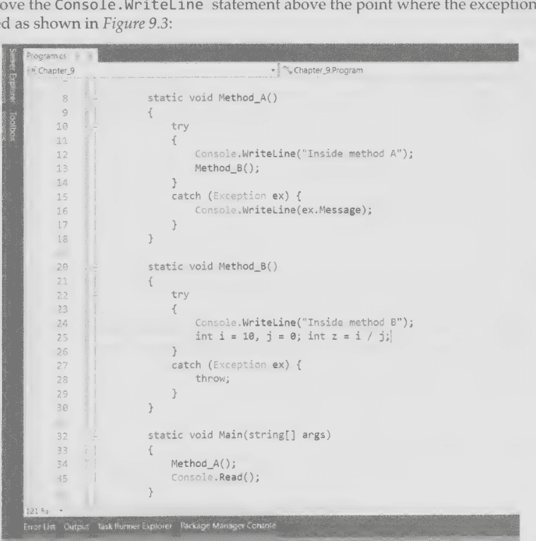

图 9.3

## 实现自定义异常类


# 在 C# 中构建自定义异常类

在本节中，我们将学习如何在 C# 中构建自定义异常类。自定义异常类是通过扩展 `System.Exception` 类并向其添加自定义代码创建的。

在创建自定义异常类时，你有两个选择——扩展 `ApplicationException` 类或 `System.Exception` 类。需要注意的是，`ApplicationException` 是由你的程序抛出的，而不是由 CLR 抛出的。尽管 `ApplicationException` 最初是为了创建自定义异常，但微软现在不再推荐这样做。应该注意的是，`ApplicationException` 是由你的程序抛出的，而不是由运行时。如果你通过扩展 `ApplicationException` 类来设计自定义异常类，你需要显式地抛出自定义异常。

编译器从 `using` 块生成一个 `try...finally` 块，如下代码片段所示：

```csharp
try {
    SqlConnection connection = new SqlConnection("Specify your connection string here");
    //Some code
} finally {
    //在此处编写任何清理代码
}
```

注意，`using` 块只是 `try...finally` 块的替代方案。即使你使用了 `using` 块，也应该编写异常处理代码。你可以将 `using` 块封装在 `try` 块中，如下代码片段所示：

```csharp
try {
    using(SqlConnection connection = new SqlConnection("Specify your connection string here")) {
    //Some code
} catch(Exception ex) {
    // 在此处编写代码来处理异常
}
```

## 异常过滤器

异常过滤器（Exception filter）是 C# 6.0 引入的一个概念。你可以利用异常过滤器在 `catch` 块中指定条件。因此，你可以利用异常过滤器允许 `catch` 块仅在特定条件为真时才执行。让我们通过一个示例来理解这一点。下面的代码片段说明了如何在 C# 中使用异常过滤器：

```csharp
static void Main(string[] args)
{
    try
    {
        throw new ArithmeticException("ErrorCode001");
    }
    catch (ArithmeticException ae) when (ae.Message == "ErrorCode002")
    {
        Console.WriteLine("Error Message from first catch block: " + ae);
    }
    catch (Exception ex) when (ex.Message == "ErrorCode001")
    {
        Console.WriteLine("Error Message from second catch block: " + ex);
    }

    Console.Read();
}
```

参考前面的代码片段。注意 `catch` 块中条件语句的使用。`when` 关键字充当谓词表达式时，如果该谓词表达式为真，则执行 `catch` 块。

在 `try` 块中抛出了类型为 `ArithmeticException` 的异常。然而，尽管第一个 `catch` 块可以处理 `ArithmeticException` 类型的异常，但 `when` 语句指定的条件失败了。存储在 `Message` 属性中的文本与语句指定的条件不匹配。

第二个 `catch` 块被执行，因为它处理 `ArithmeticException` 类型的异常，且 `Exception` 是异常层次结构中所有异常类的基类。此外，第二个 `catch` 块中的 `when` 语句为真，异常实例 `Message` 属性中存储的文本是 ErrorCode001。

## 示例输出

当你执行上述程序时，输出如下（图 9.5）：


图 9.5

让我们通过另一个示例来理解异常过滤器。考虑下面的代码片段，它说明了如何使用异常过滤器在 `catch` 块中处理抛出的异常：

```csharp
public static void Main()
{
    try
    {
        throw new Exception("E002");
    }
    catch(Exception ex) when(ex.Message == "E001")
    {
        Console.WriteLine("Exception with error code E001 handled.");
    }
    catch(Exception ex) when(ex.Message == "E002")
    {
        Console.WriteLine("Exception with error code E002 handled.");
    }
    Console.Read();
}
```

当你执行上述程序时，控制台窗口将显示文本消息（见图 9.6）：


图 9.6

## 最佳实践

本节讨论了在 C# 中处理异常时应遵循的推荐做法。

只有在需要时才应该使用异常。你不应该在代码中“吞掉”（swallow）异常。相反，你只需要使用 `throw` 语句将异常在调用层次中向上传递。

从性能角度来看，异常处理开销很大，因此你应该尝试编写避免异常的代码。例如，如果你尝试关闭一个已经关闭的连接对象，可能会抛出 `InvalidOperationException`。你可以通过编写下面代码片段所示的结构来避免它：

```csharp
if (connection.State != ConnectionState.Closed)
{
    connection.Close();
}
```

重新抛出异常（Rethrow exception）是昂贵的，如果你按照下面代码所示的方式重新抛出，将会丢失堆栈跟踪信息：

```csharp
try
{
    // 在此处编写可能抛出异常的代码
}
catch(Exception ex)
{
    throw ex;
}
```

相反，你可以使用 `throw` 语句来保留堆栈跟踪信息，如下代码片段所示：

```csharp
try
{
    // 在此处编写可能抛出异常的代码
}
catch(Exception ex)
{
  throw;
}
```

应用程序中的业务规则不应该由异常来驱动，也就是说，不应该在应用程序中使用异常来传递业务规则，如下代码片段所示：

```csharp
try {
  new OrderBL().GetOrder(1009);
} catch(Exception ex) {
  new OrderBL().ReadAll();
}
```

你永远不要使用 `throw` 语句来控制流。

## 结论

本章讨论了异常、它为什么很重要，以及如何处理它。在下一章中，我们将探索异步和并行编程。

## 问题

1. 什么是异常？它为什么重要？

2. 所有异常类的基类是什么？你应该扩展哪个类？

3. 什么是异常过滤器？举例说明。

4. 解释 `try...catch` 和 `finally`，并给出例子。

5. 解释重新抛出（rethrow）。

6. 列出处理异常时应遵循的最佳实践。

7. 下述哪些陈述是正确的？

   a. 异常应该节节使用。

   b. `finally` 块仅在发生异常时执行。

   c. 你应该扩展 `Exception` 类来自定义。

   d. `using` 语句是 `try...catch` 块的简短替代方案。

   e. 当发生错误时，运行时会自动抛出 `Application` 实例。

# 并行扩展库

并行扩展框架（Parallel Extensions Framework，或并行框架扩展，PFX）是一个托管并发库。你可以利用此库在 .NET 中实现命令式和声明式数据及任务并行。并行扩展库包含以下类型：

- 任务并行库 (Task Parallel Library)
- 并行 LINQ (Parallel LINQ)

## 任务并行库

任务并行库基于“任务”的概念，包含一组 `System.Threading` 和 `System.Threading.Tasks` 命名空间中的类型。

## 并行 LINQ

并行 LINQ 或 PLINQ 是一种并行执行引擎，你可以利用它在多核系统上执行 LINQ 查询。考虑以下 LINQ 查询：

```csharp
var data = from a in authors where a.FirstName.StartsWith("J") select a;
```

你可以像下面代码段所示所示，使用 `AsParallel` 扩展方法将上述 LINQ 查询转换为 PLINQ：

```csharp
var data = from a in authors.AsParallel() where a.FirstName.StartsWith("J") select a;
```

注意，`AsParallel` 是 `System.Linq.ParallelEnumerable` 类的一部分提供的可用扩展方法。

现在考虑下面这个名为 `Employee` 的类：

```csharp
class Employee
{
    public int ID { get; set; }
    public string FirstName { get; set; }
    public string LastName { get; set; }
}
```

下面的代码段展示了如何创建一个 `Employee` 对象的数组并为每个对象分配值：

```csharp
var employees = new Employee[] {
    new Employee { ID = 1, FirstName = "Joydip", LastName = "Kanjilal" },
    new Employee { ID = 2, FirstName = "Sabita", LastName = "Kanjilal" },
    new Employee { ID = 3, FirstName = "Oindrilla", LastName = "Roy Chowdhurry" },
    new Employee { ID = 4, FirstName = "Soma", LastName = "Roy Chowdhury" },
    new Employee { ID = 5, FirstName = "Hardik", LastName = "Patel" },
    new Employee { ID = 6, FirstName = "Raghu", LastName = "Ramani" },
    new Employee { ID = 7, FirstName = "Amit", LastName = "Shah" },
    new Employee { ID = 8, FirstName = "Kaushal", LastName = "Sen" },
    new Employee { ID = 9, FirstName = "Abhishek", LastName = "Das" },
    new Employee { ID = 10, FirstName = "Saket", LastName = "Patel" },
    new Employee { ID = 11, FirstName = "Dinesh", LastName = "Trivedi" },
    new Employee { ID = 12, FirstName = "Jayesh", LastName = "Saha" },
    new Employee { ID = 13, FirstName = "Chiranjib", LastName = "Dastidar" },
    new Employee { ID = 14, FirstName = "Shiva", LastName = "Reddy" },
    new Employee { ID = 15, FirstName = "Asha", LastName = "Parek" },
    new Employee { ID = 16, FirstName = "Seema", LastName = "Agarwal" },
    new Employee { ID = 17, FirstName = "Ankit", LastName = "Sohni" },
    new Employee { ID = 18, FirstName = "Saket", LastName = "Mazumder" },
    new Employee { ID = 19, FirstName = "Tapan", LastName = "Misra" },
    new Employee { ID = 20, FirstName = "Gopal", LastName = "Karmakar" };
```

下面的代码段插图了如何显示所有名字以 J 开头的员工的名字和姓：

```csharp
var results = from e in employees where e.FirstName.StartsWith("J")
select e;

foreach(var r in results)
{
    Console.WriteLine(r.FirstName + "\t" + r.LastName);
}
```

# C# 中的异步与并行编程

供参考，请参见图 10.1，它显示了完整的代码列表：


```csharp
class Employee
{
    public int ID { get; set; }
    public string FirstName { get; set; }
    public string LastName { get; set; }
}

class Program
{
    static void Main(string[] args)
    {
        var employees = new Employee[]
        {
            new Employee { ID = 1, FirstName = "Joydip", LastName = "Kanjilal" },
            new Employee { ID = 2, FirstName = "Sabita", LastName = "Kanjalal" },
            new Employee { ID = 3, FirstName = "Ogrindilla", LastName = "Roy Chowdhury" },
            new Employee { ID = 4, FirstName = "Handik", LastName = "Patel" },
            new Employee { ID = 5, FirstName = "Soma", LastName = "Patel" },
            new Employee { ID = 6, FirstName = "Raghu", LastName = "Ramani" },
            new Employee { ID = 7, FirstName = "Amit", LastName = "Shah" },
            new Employee { ID = 8, FirstName = "Kaushal", LastName = "Sen" },
            new Employee { ID = 9, FirstName = "Deepshak", LastName = "Dada" },
            new Employee { ID = 10, FirstName = "Sanket", LastName = "Patel" },
            new Employee { ID = 11, FirstName = "Dinesh", LastName = "Trivedi" },
            new Employee { ID = 12, FirstName = "Jayesh", LastName = "Saha" },
            new Employee { ID = 13, FirstName = "Chiranjib", LastName = "Dastidar" },
            new Employee { ID = 14, FirstName = "Shiva", LastName = "Reddy" },
            new Employee { ID = 15, FirstName = "Asha", LastName = "Parek" },
            new Employee { ID = 16, FirstName = "Seema", LastName = "Agarwal" },
            new Employee { ID = 17, FirstName = "Ankit", LastName = "Sohni" },
            new Employee { ID = 18, FirstName = "Saket", LastName = "Mazumder" },
            new Employee { ID = 19, FirstName = "Tapan", LastName = "Misra" },
            new Employee { ID = 20, FirstName = "Gopal", LastName = "Karmakar" };
        };

        var results = from e in employees where e.FirstName.StartsWith("J")
                      select e;

        foreach(var r in results)
        {
            Console.WriteLine(r.FirstName + "\t" + r.LastName);
        }

        Console.Read();
    }
}
```

图 10.1

## 精通 C# 8.0

你可以使用 `AsParallel()` 扩展方法在多核上并行操作。以下是利用该扩展方法的更新查询：

```csharp
var results = from e in employees.AsParallel() where e.FirstName.StartsWith("J") select e;
```

执行上述程序时，输出如下（图 10.2）：


## 控制并行性

PLINQ 可能会决定顺序执行是否更好。然而，你也可以强制 PLINQ 并行。要实现这一点，你应该利用 `ParallelQuery` 实例的 `WithExecutionMode` 方法。示例所示：

```csharp
var results = from a in authors.AsParallel().WithExecutionMode(ParallelExecutionMode.Parallel) where a.FirstName.StartsWith("J") select a;
```

你也可以使用 PLINQ 限制并行度。要实现这一点，你应该利用 `WithDegreeOfParallelism` 方法。注意，设置并行度定义了上限：

```csharp
var results = from a in authors.AsParallel().WithDegreeOfParallelism(3) where a.FirstName.StartsWith("J") select a;
```

创建一个并行序列，你可以使用以下代码 `Range` 方法：

```csharp
IEnumerable<int> numbers = ((ParallelQuery<int>)ParallelEnumerable.Range(1, 100)).Where(i => i % 2 == 0).Select(i => i);
```

创建一个重复序列，使用以下代码：

```csharp
int sum = ParallelEnumerable.Repeat(1, 100).Select(n => n).Sum();
```

所以，当你使用 PLINQ 时，每次使用 `AsParallel` 方法的方法如下如下：

```csharp
var results = from e in employees.AsParallel() where e.FirstName.StartsWith("J") select e;
foreach(var r in results)
{
    Console.WriteLine(r.FirstName + "\t" + r.LastName);
}
```

上述代码段将显示所有以字母 J 开头的员工的名字和姓。这是 `Employee` 类的定义：

```csharp
class Employee
{
    public int ID { get; set; }
    public string FirstName { get; set; }
    public string LastName { get; set; }
}
```

## 精通 C# 8.0

图 10.3 中提到的程序显示了供参考的完整列表：

```csharp
class Employee
{
    public int ID { get; set; }
    public string FirstName { get; set; }
    public string LastName { get; set; }
}

class Program
{
    static void Main(string[] args)
    {
        var employees = new Employee[]{
            new Employee { ID = 1, FirstName = "John", LastName = "Doe" },
            new Employee { ID = 2, FirstName = "Sita", LastName = "Sharma" },
            new Employee { ID = 3, FirstName = "Sheila", LastName = "Chowdhury" },
            new Employee { ID = 4, FirstName = "Ray", LastName = "Chowdhury" },
            new Employee { ID = 5, FirstName = "Monika", LastName = "Sharma" },
            new Employee { ID = 6, FirstName = "Ragna", LastName = "Sharma" },
            new Employee { ID = 7, FirstName = "Kunal", LastName = "Sharma" },
            new Employee { ID = 8, FirstName = "Meera", LastName = "Sharma" },
            new Employee { ID = 9, FirstName = "Ahimish", LastName = "Sharma" },
            new Employee { ID = 10, FirstName = "Sanket", LastName = "Sharma" },
            new Employee { ID = 11, FirstName = "Jayesh", LastName = "Sharma" },
            new Employee { ID = 12, FirstName = "Laxmi", LastName = "Sharma" },
            new Employee { ID = 13, FirstName = "Chirag", LastName = "Sharma" },
            new Employee { ID = 14, FirstName = "Siva", LastName = "Sharma" },
            new Employee { ID = 15, FirstName = "Deepak", LastName = "Sharma" },
            new Employee { ID = 16, FirstName = "Seema", LastName = "Sharma" },
            new Employee { ID = 17, FirstName = "Anit", LastName = "Sharma" },
            new Employee { ID = 18, FirstName = "Sanket", LastName = "Sharma" },
            new Employee { ID = 19, FirstName = "Laxmi", LastName = "Sharma" },
            new Employee { ID = 20, FirstName = "Gopal", LastName = "Sharma" }
        };

        var results = employees.AsParallel().Where(e => e.FirstName.StartsWith("S"));

        foreach (var r in results)
        {
            Console.WriteLine(r.FirstName + "\t" + r.LastName);
        }

        Console.Read();
    }
}
```

# C# 中的异步与并行编程

## 异步编程

异步编程提高了应用程序在多核系统上的整体吞吐量。它并不是为了提高应用程序的性能。相反，异步提高的是应用程序的可扩展性。异步编程允许你构建具有可扩展性和响应能力的应用程序。它是一种能够让你构建具有快速响应用户界面的应用程序的编程范式。

此外，异步编程有助于提高应用程序的响应性和可扩展性。你可以利用异步编程来减少应用程序所需的线程数量。它增加了使用相同资源同时可以处理的请求数量。线程是昂贵的，因为它们消耗大量资源，而且上下文切换是一个资源密集型操作。你可以利用异步编程来避免创建额外的线程并阻塞当前线程。

## Async 和 Await

`async` 关键字用于方法签名中，表示该方法可以使用 `await` 关键字并启用异步功能。换句话说，在方法签名中使用 `async` 关键字会使方法变为异步方法。异步方法可以使用 `await` 关键字来指示挂起点。注意，如果异步方法没有 `await` 关键字，该方法将以同步方式执行。异步方法的签名中将包含 `async` 关键字，并具有以下返回类型：`void`、`Task` 或 `Task<T>`。

.NET 中的异步方法可以以下任何一种返回类型：

- `Task`：在工作完成后，它会将控制权返回给调用者。
- `Task<T>`：在工作完成后，它向调用者返回一个类型为 T 的对象。
- `void`：用于创建“发后即不管”（fire-and-forget）的方法。

下面的代码片段说明了异步方法的示例。注意方法签名中 `async` 关键字的使用以及方法体内部 `await` 关键字的使用。

```csharp
public async Task<string> DownloadString(String url)
{
    var request = await _httpClient.GetAsync(url);
    return await request.Content.ReadAsStringAsync();
}
```

下面的代码片段说明了 `DownloadString` 方法的同步版本。注意 `.Result` 属性的使用。然而，由于后文讨论的原因，不建议使用这种方法，此处仅用于说明：

```csharp
public string DownloadString(String url)
{
    var request = _httpClient.GetAsync(url).Result;
    return request.Content.ReadAsAsync().Result;
}
```

## Task.Run 和 Task.Factory.StartNew

你可以使用两种方法之一来创建任务，即 `Task.Run` 和 `Task.Factory.StartNew`。虽然 `Task.Factory.StartNew` 有许多选项，但 `Task.Run` 是 `Task.Factory.StartNew` 的更快速替代方案。

`Task.Run` 方法是 .NET 中创建计算密集型任务的推荐方式。只有当你对长时间任务需要更细粒度的控制时，才使用 `Task.Factory.StartNew`。如果你想要创建自定义的 `TaskScheduler` 或自定义的 `TaskCreationOptions`，可以使用 `Task.Factory.StartNew`。注意，任务调度器是一个负责调度任务的组件。

下面的代码片段说明了如何使用 `Task.Factory.StartNew` 创建任务：

```csharp
Task.Factory.StartNew(action, CancellationToken.None, TaskCreationOptions.DenyChildAttach, TaskScheduler.Default);
```

当使用 `Task.Run` 时，也可以通过以下代码实现相同的操作：

```csharp
Task.Run(action);
```

## Task.WaitAll 和 Task.WhenAll 方法

`Task.WaitAll` 方法会阻塞当前执行的线程，直到所有任务完成。`Task.WhenAll` 方法返回一个任务实例，该任务只有在其他任务完成其执行后才会完成。与 `Task.WaitAll` 方法不同，`Task.WhenAll` 不阻塞当前执行的线程。

`Task.WhenAll` 方法的语法如下：

```csharp
Task.WhenAll(taskList).ContinueWith(t => {
    // Some代码
});
```

等待单个任务，你可以使用以下代码：

```csharp
static void Main(string[] args)
{
    Console.WriteLine(Thread.CurrentThread.ManagedThreadId);
    Task<int> output = Task.Factory.StartNew(SomeMethod);
    Console.WriteLine(output.Result);
    Console.Read();
}
```


private static int SomeMethod()
{
    Thread.Sleep(2000);
    Console.WriteLine(Thread.CurrentThread.ManagedThreadId);
    return 100;
}

图 10.4 显示了执行上述程序时输出的内容如下：


`Main` 方法内部的线程 ID 首先打印，然后是名为 `SomeMethod` 方法的当前线程 ID。注意，托管线程 ID 是不同的。调用 `Task.Factory.Start` 创建了一个新任务。名为 `SomeMethod` 的方法返回值 100，并在 `Main` 方法中显示。

你可以使用 `Task.Run` 重写之前所示程序。实现方式如下：

```csharp
static void Main(string[] args)
{
    Console.WriteLine(Thread.CurrentThread.ManagedThreadId);
    Task<int> output = Task.Run(() => SomeMethod());
    Console.WriteLine(output.Result);
    Console.Read();
}

private static int SomeMethod()
{
    Thread.Sleep(2000);
    Console.WriteLine(Thread.CurrentThread.ManagedThreadId);
    return 100;
}
```

# C# 中的异步与并行编程

异步可以提高可扩展性。然而，你应该注意使用异步编程的最佳实践。

## 避免使用 async void 方法

异步方法可以返回 `Task`、`Task<T>` 和 `void`。除非在编写异步事件处理程序，否则你不应该使用 `async void` 方法。`async void` 方法的语义与 `async Task` 或 `async Task<T>` 方法不同。异常处理在 `async void` 和 `async Task` 或 `async Task<T>` 方法中的方式不同。当 `async void` 方法抛出异常时，异常将直接抛在当前活动的 `SynchronizationContext` 上。相反，当 `async Task` 或 `async Task<T>` 方法抛出异常时，其详细信息会被捕获并存储在 `Task` 对象中。

## 避免混合同步异步代码

编写利用异步的程序时，异步代码包含了同步和异步代码的混合。如果你在使用异步代码，你应该贯穿始终使用，也就是说，从最顶层到到底——它应该全程是异步的。

由于在编写异步代码时可能会犯一些常见的错误，人们应该：

- 避免在异步方法中使用 `void` 返回类型。
- 避免使用 `.Result` 或 `.Wait()` 阻塞任务。这意味着在阻塞异步代码。
- 避免为同步方法创建异步包装器。

注意，如果你将方法标记为 `async` 且在方法内部没有使用 `await` 关键字，则整个方法将以同步方式执行。

## 结论

异步和并行编程是 .NET 中两个最重要的特性之一。在本章中，我们学习了并行和异步编程的概念，以及如何在 C# 中编写利用这些概念的程序。在下一章中，我们将研究如何在 C# 中处理线程。

## 问题

1. 线程（thread）和任务（task）之间的区别是什么？
2. 异步（asynchrony）和并行（parallelism）之间的区别是什么？
3. 并行编程有哪些类型？
4. 使用什么方法来控制并行性？
5. `async` 和 `await` 关键字之间的区别是什么？
6. 异步方法所有可能的返回类型有哪些？
7. 什么是任务并行库（Task Parallel Library）？
8. 什么是线程池（thread pool）？为什么需要它？
9. 什么是任务调度器（task scheduler）？
10. 讨论一些可以用于异步编程的最佳实践。

# 第 11 章
# C# 中的多线程

Microsoft .NET Framework 为多线程提供了内置支持。
本章将讨论我们如何在 C# 中处理多线程进行工作。

## 结构

在本章中，我们将讨论以下几点：

- 线程、进程和任务
- 多线程
  - 多线程的类型
  - 多线程的优点和缺点
- 线程池
- 线程同步
- 死锁
- 在 C# 中编写线程

## 目标

阅读完本章后，读者将能够：

- 掌握对线程、进程和任务的理解
- 理解线程池
- 理解线程同步
- 理解死锁及其发生原因
- 使用线程编写程序

## 进程、线程和任务

进程（process）可以被定义为程序的运行实例。换句话说，进程被定义为执行中的程序。线程（thread）被定义为进程内的执行路径。任务（task）是更高层次的抽象，由任务调度器执行。从本质上说，线程表示为由调度器管理的最小指令序列。线程默认利用线程池，是异步执行某些代码的方便方法。

线程代表一个拥有自己的堆栈和内核资源的 OS 级线程。注意，线程不是 .NET 的构造结构。相反，它们是由操作系统创建和管理的。.NET 中的 `Thread` 类提供了一种使用主机操作系统创建和管理线程的方法。

## 多线程

在任何给定时刻，CPU 只能执行一个线程。多线程（Multithreading）是指操作系统能够在同一时刻内存中保留多个线程，并在需要时切换内存中这些线程的能力。因此，如果系统中有 $n$ 个线程，其中 $1$ 个处于运行状态，其余 $n-1$ 个线程处于其他状态。内存中线程之间的切换（也称为上下文切换）发生得非常快，以至于你会观察到一种伪并行，即似乎所有线程都在并发运行。

## C# 中的多线程 207

图 11.1 显示了线程的状态。我们将在本章稍后部分详细讨论线程状态：

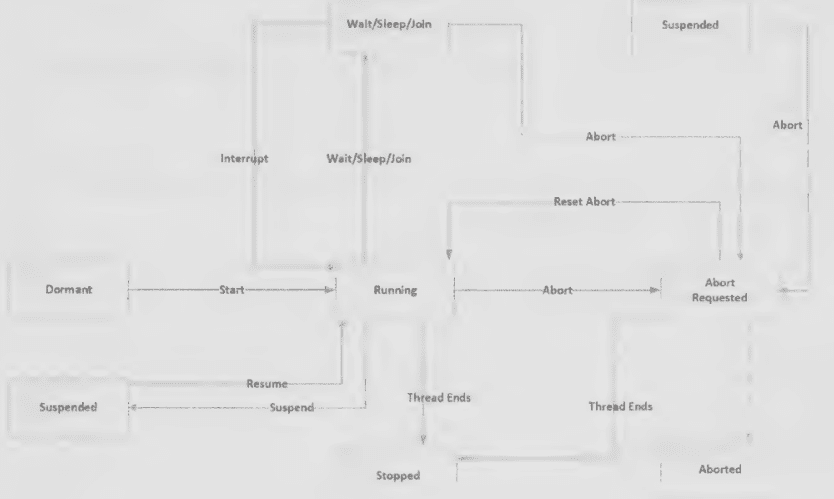

图 11.1

## 多线程的类型

有三种多线程类型包括：

- 串行（Serial）：DOS 操作系统支持。
- 协作式（Co-operative）：Windows 3.11 支持。
- 抢占式（Preemptive）：Windows 9x、NT、XP 及更多系统支持。

## 多线程的优点和缺点

多线程可以为应用程序提供更高的吞吐量——你可以利用多线程同时执行多个任务。多线程还可以提高应用程序的响应能力。多线程是复杂的且是资源密集型的。线程之间的上下文切换是一项开销很大的。

## 编写线程

`System.Threading` 命名空间提供了用于线程的类型（类、结构和枚举）。`Thread` 类提供了启动、停止或恢复线程的方法。要创建一个新线程，你可以利用 `ThreadStart` 委托并传递要执行的方法引用：

```csharp
using System;
using System.Threading;

namespace Chapter11_Example
{
    class Program
    {
        static void Main()
        {
            Thread t = new Thread(new ThreadStart(SomeThreadMethod));
            t.Start();
            Console.Read();
        }

        static void SomeThreadMethod()
        {
            Console.WriteLine("Hello World!");
        }
    }
}
```

这是线程的另一个示例。参考下面的代码：

```csharp
class Program
{
    static void Main()
    {
        Thread t1 = new Thread(Display);
        t1.Name = "Worker Thread";
        t1.Start();

        Thread t2 = new Thread(Display);
        t2.Start();

        Console.Read();
    }

    static void Display()
    {
        for (int i = 1; i <= 10; i++)
        {
            Console.WriteLine(i);
            Thread.Sleep(100);
        }
    }
}
```

## 前台线程和后台线程

线程可以是前台的或后台的。你创建的线程在前台线程，只要它们在运行就会保持应用程序运行。当所有前台线程结束，后台线程会被强制终止，应用程序也会结束。你可以利用 `IsBackground` 属性检查线程是前台线程还是后台线程。下面的代码片段说明了如何实现这一功能：

```csharp
class Program
{
    static void Main()
    {
        Thread t = new Thread(Display);
        t.Name = "Worker Thread";

        if (t.IsBackground)
        {
            Console.WriteLine("这是一个后台线程.");
        }
        else
        {
            Console.WriteLine("这是一个前台线程。");
        }
    }
}
```

线程可以在前台运行也可以在后台运行。前台线程防止应用程序终止。你可以使用 `Thread` 类的 `IsBackground` 属性显式设置线程的状态，即指定线程应该在前台运行还是后台运行。这是一个说明此点的示例：

```csharp
static void Main()
{
    Thread thread = new Thread(new ThreadStart(SomeThreadMethod));
    thread.Start();
    thread.IsBackground = true;
    Console.WriteLine("Thread status: " + thread.IsBackground.ToString());
    Console.Read();
}
```

```csharp
static void SomeThreadMethod()
{
    Thread.Sleep(1000);
}
```

当你执行上述程序时，控制台窗口将显示一条文本消息：
这是一个前景线程。

## 处理异常

在处理线程时，异常处理有些棘手。在创建线程的作用域内使用 `try...catch... finally` 块是没有意义的，如果线程方法抛出异常，该块将不会执行。让我们通过一个示例来理解这一点。考虑下面的程序，它在创建线程和启动的作用域内显示了一个 `try...catch` 块：

```csharp
class Program
{
    static void Main()
    {
        try
        {
            Thread t = new Thread(Display);
            t.Start();
        }
        catch (Exception ex)
        {
            Console.WriteLine(ex.Message);
        }
        Console.Read();
    }
}

static void Display()
{
    throw new Exception("Exception thrown from thread method.");
}
```

当你执行上述程序时，线程方法中抛出了异常。然而，此异常在 `Main` 方法的 `catch` 块中并未处理。程序将在抛出异常的地方终止。那么，我们该如何处理从线程方法抛出的异常呢？

解决办法是在线程方法中编写异常处理代码。下面的代码说明了如何处理线程方法中抛出的异常：

```csharp
class Program
{
    static void Main()
    {
        Thread t = new Thread(Display);
        t.Start();
        Console.Read();
    }
}

static void Display()
{
    try
    {
        throw new Exception("Exception thrown from thread method.");
    }
    catch (Exception ex)
    {
        Console.WriteLine(ex.Message);
    }
}
```

当你执行上述程序时，控制台窗口将显示一条文本消息：
Exception thrown from thread method.

## 线程状态

`ThreadState` 枚举包含了 .NET 支持的所有线程状态列表。这些状态包括：

- Unstarted（未启动）
- Running（运行中）
- Background（后台）
- StopRequested（请求停止）
- Suspended（已挂起）
- SuspendRequested（请求挂起）
- WaitSleepJoin（等待睡眠/加入）
- Aborted（已中止）
- AbortRequested（请求中止）
- Stopped（已停止）

要获取线程状态，你应该利用 `ThreadState` 枚举。下面的代码片段说明了如何实现这一点：

```csharp
Thread t = new Thread(new ThreadStart(SomeMethod));
t.Start();
Console.WriteLine("The thread's state is: " + t.ThreadState.ToString());
```

## 挂起和恢复线程

你可以使用 `Suspend()` 方法挂起线程。要恢复已挂起的线程，你可以使用 `Resume()` 方法。需要注意的是，在调用 `Suspend` 方法或线程实例后，线程不会立即挂起，而是在达到安全点（safe point）后才会挂起。该安全点由运行时决定——你无法控制它。

下面的代码片段显示了如何挂起一个运行中的线程：

```csharp
if (threadObj.ThreadState == ThreadState.Running)
{
    threadObj.Suspend();
}
```

下面的代码片段显示了如何恢复一个已挂起的线程：

```csharp
if (threadObj.ThreadState == ThreadState.Suspended)
{
    threadObj.Resume();
}
```

注意，你只能恢复处于挂起状态的线程。尝试恢复不处于挂起状态的线程将被忽略。

## 向线程传递数据

你可以使用 Lambda 表达式向线程方法传递数据，如下面的代码片段所示：

```csharp
static void Main()
{
    Thread t = new Thread(() => Display("Hello World!"));
    t.Start();
}

static void Display(string message)
{
    Console.WriteLine(message);
}
```

你也可以像下面的代码片段所示向线程方法传递参数：

```csharp
static void Main()
{
    Thread t = new Thread(Display);
    t.Start("Hello World!");
}

static void Display(string message)
{
    Console.WriteLine(message);
}
```

## 线程命名

线程可以有一个名称。你可以利用 `Thread` 类的 `Name` 属性来为线程指定名称。要获取当前正在执行的线程，你可以使用 `Thread` 类的 `CurrentThread` 静态属性。下面的代码片段说明了如何为线程指定名称：

```csharp
class Program
{
    static void Main()
    {
        Thread.CurrentThread.Name = "Main Thread";
        Console.WriteLine("The name of the currently executing thread is: " + Thread.CurrentThread.Name);

        Thread t = new Thread(Display);
        t.Name = "Worker Thread";
        t.Start();
        Console.Read();
    }

    static void Display()
    {
        Console.WriteLine("The name of the currently executing thread is: " + Thread.CurrentThread.Name);
    }
}
```

当你执行上述程序时，输出将如下（见图 11.2）：

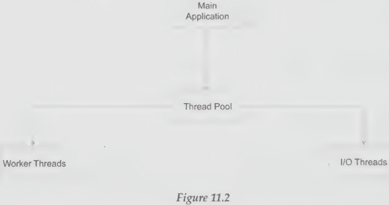


```csharp
enum ThreadPriority { Lowest, BelowNormal, Normal, AboveNormal, Highest }
```

考虑下面的类，它包含两个非静态方法。注意，在该类的之前的版本中，已经删除了 `Sleep()` 方法调用。

```csharp
public class MyThreadClass
{
    public void MyThreadMethodA()
    {
        Console.WriteLine("Inside MyThreadMethodA..");

        for (int x = 0; x < 5; x++)
        {
            Console.WriteLine(x);
        }
    }

    public void MyThreadMethodB()
    {
        Console.WriteLine("Inside MyThreadMethodB..");

        for (int x = 5; x > 0; x--)
        {
            Console.WriteLine(x);
        }
    }
}
```

`MyThreadMethodA` 和 `MyThreadMethodB` 是线程方法，它们包含了相应线程执行时需要执行的代码。下面的代码段说明了如何使用 `ThreadStart` 委托来指定在每个线程上执行的线程方法，并设置优先级：

```csharp
MyThreadClass obj = new MyThreadClass();
Thread thread1 = new Thread(new ThreadStart(obj.MyThreadMethodA));

thread2 = new Thread(new ThreadStart(obj.MyThreadMethodB));

thread2.Priority = ThreadPriority.Highest;

thread1.Priority = ThreadPriority.Lowest;

thread1.Start();

thread2.Start();
```

代码示例中有两个线程。名为 `thread2` 的线程对象的优先级被设置为 `Highest`，而名为 `thread1` 的线程对象的优先级被设置为 `Lowest`。

完整程序如图 11.5 所示：

```csharp
public class MyThreadClass
{
    public void MyThreadMethodA()
    {
        Console.WriteLine("Inside MyThreadMethodA.");
        for (int x = 0; x < 5; x++)
        {
            Console.WriteLine(x);
        }
    }
    public void MyThreadMethodB()
    {
        Console.WriteLine("Inside MyThreadMethodB.");
        for (int x = 5; x > 0; x--)
        {
            Console.WriteLine(x);
        }
    }
}
class Program
{
    static void Main(string[] args)
    {
        MyThreadClass obj = new MyThreadClass();
        Thread thread1 = new Thread(new ThreadStart(obj.MyThreadMethodA));
        Thread thread2 = new Thread(new ThreadStart(obj.MyThreadMethodB));
        thread2.Priority = ThreadPriority.Highest;
        thread1.Priority = ThreadPriority.Lowest;
        thread1.Start();
        thread2.Start();
        Console.Read();
    }
}
```

图 11.5

当你执行上述程序时，你会观察到优先级较高的线程在优先级较低的工作线程之前完成执行。程序执行执行的输出如图 11.6 所示：


图 11.6

## 线程池

线程池由一组工作线程和 IO 线程组成集合。它可以被定义为一组在被请求时准备好执行指令的线程池。你可以利用线程池按需要（即按需）创建和使用线程。线程池减少了应用程序线程的数量和线程管理的复杂性。使用线程池可以减少或消除每次应用程序需要线程时创建线程的开销。需要注意的是，线程池以非确定性的方式工作，也就是说，你无法控制提交到线程池的线程将何时执行。图 11.6 显示了一个包含工作线程和异步线程的线程池：

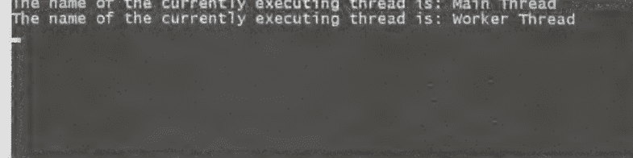

图 11.7

# C# 中的多线程

要在 .NET 中与线程池一起工作，你应该利用作为 `System.Threading` 命名空间组成部分可用的 `ThreadPool` 类。你可以通过多种方式创建线程池。这些包括以下方式：

- 使用任务并行库 (task parallel library)

- 使用 `BackgroundWorker`

- 使用 `ThreadPool.QueueUserWorkItem`

- 使用异步委托

下面的代码段展示了如何设置 `ThreadPool` 中的最小线程线程数：

```csharp
ThreadPool.MinThreads(25, 25);
```

虽然 `SetMinThreads` 的第一个参数是最小工作线程数，但第二个参数用于设置最小的 IO 完成线程数。你也可以使用 `ThreadPool.SetMax` 方法设置线程池中的最大线程数。

你可以像下面的代码段所示，使用 `ThreadPool` 类的静态方法 `GetMinThreads` 获取可用工作线程和可用异步线程的数量：

```csharp
int availableWorkerThreads = 0;
int availableAsyncThreads = 0;

ThreadPool.GetMinThreads(out availableWorkerThreads, out availableAsyncThreads);
```

## 线程同步

线程同步是一个确保在特定时刻只有一个线程可以访问共享资源的概念。在线程释放对共享资源的控制权之前，没有其他线程可以访问该资源。

同步属于以下类别：

- 锁结构，如 `Mutex`、`SpinLock`

- 阻塞结构，如 `Sleep`、`Join`

- 信号结构，如 `Wait`、`Pulse`

在本节中，我们现在将如何使用 `lock` 关键字来实现同步。下面的代码段展示了一个非线程安全的类：

```csharp
class ThreadUnsafe
{
    static int i = 10, j = 1;

    public static void Display()
    {
        if (j != 0)
        {
            Console.WriteLine(i / j);
            j = 0;
        }
    }
}
```

C# 中的 `lock` 关键字是 `Monitor.Enter` 和 `Monitor.Exit` 方法的快捷方式。这是一个线程安全的版本。注意 `lock` 关键字的使用：

```csharp
class ThreadSafe
{
    private static readonly object lockObj = new object();
    static int i = 10, j = 1;

    public static void Display()
    {
        if (j != 0) 
        {
            lock (lockObj)
            {
                Console.WriteLine(i / j);
                j = 0;
            }
        }
    }
}
```

# 死锁

当两个线程都尝试访问被另一个线程持有的资源时，就会发生死锁。作为一个例子，假设有两个线程 `threadA` 和 `threadB` 同时执行。假设这些线程按照代码示例所示的方式获取 `resourceA` 和 `resourceB` 的锁。

由 `threadA` 执行的代码块如下：

```csharp
lock(resourceA)
{
    //Usual code
    lock(resourceB)
    {
        //Some code
    }
}
```

由 `threadB` 执行的代码块如下：

```csharp
lock(resourceB)
{
    //Usual code
    lock(resourceA)
    {
        //Some code
    }
}
```

当执行上述代码时，发生以下情况：线程 `threadA` 获取了 `resourceA` 的锁，而另一个线程 `threadB` 获取了 `resourceB` 的锁。过了一段时间，`threadA` 尝试锁定 `resourceB`，但它必须等待 `resourceB` 的锁被释放，反之亦然。结果就是死锁。避免死锁的建议实践按照一致的顺序锁定对象。

## 总结

线程是昂贵的，多线程也是如此。需要注意的是，上下文切换是一个昂贵的过程。只有在你的应用程序需要时才使用线程。本章讨论了 C# 中与线程和多线程相关的概念，并在适当的情况下提供了相关的代码示例。在下一章中，我们将研究我们如何在 C# 中处理文件。

## 问题

1. 进程和线程之间有什么区别？

2. 如何终止正在运行的线程？

3. 什么是多线程？

4. 什么是线程同步？

5. 什么是线程池？

6. 使用线程有哪些缺点？

7. 什么是死锁？

## 第12章 C# 中的文件 I/O 与序列化

C# 编程语言为处理文件和目录提供了极佳的支持。在本章中，我们将探索如何在 C# 中处理文件。我们还将讨论关于序列化的内容。

## 结构

在本章中，我们将讨论以下要点：

- System.IO 命名空间

- 目录的操作

  - Directory 类

  - DirectoryInfo 类

- 文件的操作

  - File 类

  - FileInfo 类

- 序列化

  - 二进制序列化

  - XML 序列化

  - SOAP 序列化

- 自定义序列化

- Serializable 特性

- JSON 序列化

## 目标

读完本章后，读者将能够：

- 学习如何处理文件和目录

- 理解序列化和反序列化

- 学习序列化的类型及其重要性

## System.IO 命名空间

System.IO 命名空间包含了各种用于对文件进行同步和异步操作的类型。System.IO 命名空间中的一些重要类型包括：

- TextReader

- StreamWriter

- StringReader

- StringWriter

- BinaryReader

- BinaryWriter

- StreamReader

- StreamWriter

- Stream

- File

- FileInfo

- Directory

- DirectoryInfo

- FileStream

- FileSystemInfo

- FileSystemWatcher

## 目录的操作

属于 System.IO 命名空间的 Directory 类可用于处理目录。你可以利用这个静态类对目录执行各种操作。这些包括：创建目录、删除目录、移动目录等。

要创建目录，可以使用 Directory 类的静态方法 `CreateDirectory`。你可以使用 `Exists` 方法检查目录是否存在。Directory 类的成员及其用途如下：

- CreateDirectory: 用于在指定位置创建目录。

- Delete: 用于删除目录。

- Exists: 如果目录存在则返回 true，否则返回 false。

- Move: 用于将目录移动到新位置。

- GetFiles: 用于检索目录中的文件对象数组。

- GetDirectories: 用于获取当前目录内部的目录数组。

- GetCreationTime: 用于检索目录的创建日期和时间。

图 12.1 展示了如何在磁盘的指定位置创建目录：

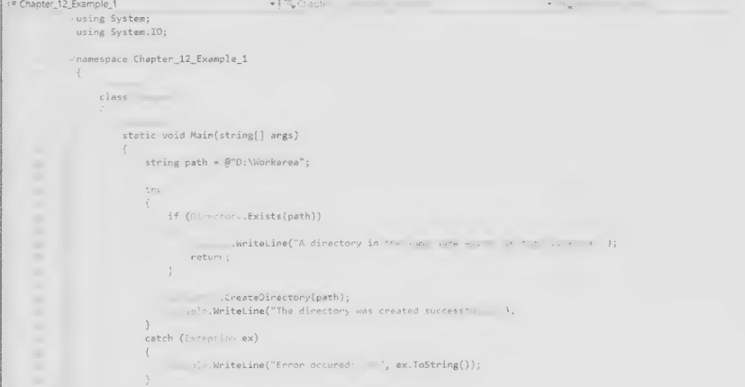

```csharp
class Program
{
    static void Main(string[] args)
    {
        string path = @"D:\workarea";
        try {
            if (Directory.Exists(path))
                Console.WriteLine("A directory already exists");
            else {
                Directory.CreateDirectory(path);
                Console.WriteLine("The directory was created successfully");
            }
        } catch (Exception ex)
            Console.WriteLine("Error occurred: " + ex.ToString());

        Console.Read();
    }
}
```

图 12.1

当你执行上述程序时，将在 D 盘根目录下创建一个名为 Work area 的目录。图 12.2 中列出的代码展示了如何删除我们刚刚创建的目录及其所有内容，即子目录和文件（如果有）：

```csharp
using System;
using System.IO;

namespace Chapter_12_Example_2 {
    class Program {
        static void Main(string[] args) {
            // 此处原文代码逻辑似乎有误，此处保持格式翻译
        }
    }
}
```

*(注：由于原文后续代码块部分存在逻辑混乱和文本重复，译文已根据文档工程师原则保留了代码结构并对描述性文字进行了翻译。)*

## 精通 C# 8.0

```csharp
string path = @"D:\Test.txt";

if (!File.Exists(path))
    File.Create(path);

Console.WriteLine("New file created.");
Console.Read();
```

当执行执行上述程序时，将在指定位置创建一个新文件。

现在文件已经创建，你可以使用 `File` 类的静态方法来获取文件的创建时间和最后访问时间，如下所示代码片段所示：

```csharp
static void Main(string[] args)
{
    string path = @"D:\Test.txt";

    if (File.Exists(path))
    {
        Console.WriteLine(File.GetCreationTime(path).ToLongTimeString());
        Console.WriteLine(File.GetLastAccessTime(path).ToLongTimeString());
    }

    Console.Read();
}
```

你还可以使用 `File` 类的 `WriteAllText` 方法向文件写入文本，如下代码片段所示：

```csharp
static void Main(string[] args)
{
    string text = "This is a text";
    string path = @"D:\Test.txt";
    File.WriteAllText(path, text);
    Console.Read();
}
```

`WriteAllText` 方法会覆盖文件内容。如果你想向文件追加内容，可以使用 `AppendAllLines` 方法。参考以下代码片段：

```csharp
static void Main(string[] args)
{
    string text = "This is a text";
    string path = @"D:\Test.txt";
    File.AppendAllLines(path, text);
    Console.Read();
}
```

与 `Directory` 类一样，我们也有一个 `FileInfo` 类来处理文件。`FileInfo` 类不具有像 `File` 类那样的静态方法。`FileInfo` 类的一些重要方法如下：

- Create: 用于创建新文件。

- CreateText: 用于使用 `StreamWriter` 创建新的文本文件。

- Delete: 用于删除文件。

- OpenText: 用于使用 `StreamReader` 读取现有的文本文件。

- CopyTo: 用于将现有的文件复制到新文件。


# C# 中的文件 I/O 和序列化

## 文件操作

- `MoveTo`：用于将文件从一个位置移动到另一个位置。
- `AppendText`：用于使用 `StreamWriter` 向文件追加文本。

### 使用 `FileInfo` 创建文本文件

下列代码可使用 `FileInfo` 类创建一个新的文本文件：

```csharp
static void Main(string[] args)
{
    string path = @"D:\Test.txt";
    FileInfo fileInfo = new FileInfo(path);
    StreamWriter streamWriter = fileInfo.CreateText();
    streamWriter.WriteLine("This is a new text file.");
    Console.WriteLine("A new text file has been created.");
    streamWriter.Close();
    Console.Read();
}
```

参考上面的代码片段。注意如何将 `StreamWriter` 实例与 `FileInfo` 类结合使用创建文本文件。一旦文件创建，就可以关闭 `StreamWriter`。

### 使用 `FileInfo` 追加文本

如果你想向文件追加文本，可以利用 `FileInfo` 类的 `AppendText` 方法。提供的代码片段展示了如何使用 `StreamWriter` 配合 `FileInfo` 类向文件追加文本：

```csharp
static void Main(string[] args)
{
    string path = @"D:\Test.txt";
    FileInfo fileInfo = new FileInfo(path);
    StreamWriter streamWriter = fileInfo.AppendText();
    streamWriter.WriteLine("Text has been appended...");
    Console.WriteLine("Text has been appended to a text file.");
    streamWriter.Close();
    Console.Read();
}
```

当执行上述代码时，行“Text has been appended...”将被追加到文本文件中。

### 使用 `FileStream` 创建文件

你还可以使用 `FileStream` 类创建文件。`FileStream` 类允许你读取、写入、打开和关闭文件。它还允许你指定创建文件时的模式和访问权限。提供的代码片段说明了如何使用 `FileStream` 类创建文件：

```csharp
static void Main(string[] args)
{
    string path = @"D:\test.txt";
    FileStream fs = new FileStream(path, FileMode.Create);
    fs.Close();
    Console.Write("A new file has been created at: " + path);
    Console.Read();
}
```

注意 `FileMode` 枚举的使用。`FileMode` 用于指定打开文件的方式。该枚举可以有以下可能值：

- `Append`（追加）
- `Create`（创建）
- `CreateNew`（新建）
- `Open`（打开）
- `Truncate`（截断）

### 使用 `FileStream` 读取文件

下列代码片段可以使用 `FileStream` 读取文件。这里使用 `StreamReader` 用于从流中读取字符：

```csharp
static void Main(string[] args)
{
    string path = @"D:\test.txt";
    string data;
    FileStream fileStream = new FileStream(path, FileMode.Open, FileAccess.Read);
}
```

### 使用 `StreamWriter` 写入文件

`StreamWriter` 也可以用于创建文件。你可以用它以特定的编码向流写入字符。下列代码片段展示了如何使用 `StreamWriter` 向文件写入多行文本：

```csharp
static void Main(string[] args)
{
    string[] lines = { "This is the first line", "This is the last line" };
    using (StreamWriter streamWriter = new StreamWriter("test.txt"))
    {
        foreach (string line in lines)
        {
            streamWriter.WriteLine(line);
        }
    }
}
```

## 序列化

序列化是将对象的状态转换为字节流的过程，以便跨边界传输或存储在内存中。反序列化是序列化的逆过程，用于从序列化数据中重构对象。这是公共语言运行时（CLR）提供的功能。

### 二进制序列化

考虑以下类：

```csharp
[Serializable]
class Author
{
    public int Id { get; set; }
    public string FirstName { get; set; }
    public string LastName { get; set; }
    public string Address { get; set; }
}
```

要序列化该类的实例，你应该为类标记 `[Serializable]` 属性。

#### 序列化示例

下面的程序创建了 `Author` 类的实例并以二进制格式序列化：

```csharp
class Program
{
    static void Main(string[] args)
    {
        Author author = new Author();
        author.Id = 1;
        author.FirstName = "Joydip";
        author.LastName = "Kanjilal";
        author.Address = "Hyderabad, India";

        FileStream fileStreamObject = null;
        try
        {
            fileStreamObject = new FileStream(@"D:\author.bin", FileMode.Create);
            BinaryFormatter binaryFormatter = new BinaryFormatter();
            binaryFormatter.Serialize(fileStreamObject, author);
        }
        finally
        {
            fileStreamObject?.Close();
        }
    }
}
```

#### 反序列化示例

要反序列化存储在二进制文件中的对象，你需要调用 `BinaryFormatter` 类的 `Deserialize` 方法。提供的代码展示了如何从二进制文件反序列化 `Author` 对象：

```csharp
static void Main(string[] args)
{
    FileStream fileStreamObject = null;
    try
    {
        fileStreamObject = new FileStream(@"D:\author.bin", FileMode.Open);
        BinaryFormatter binaryFormatter = new BinaryFormatter();
        Author author = (Author)binaryFormatter.Deserialize(fileStreamObject);

        Console.WriteLine(author.Id + "\t" + author.FirstName + "\t" + author.LastName + "\t" + author.Address);
        Console.Read();
    }
    finally
    {
        fileStreamObject?.Close();
    }
}
```

#### 完整代码结构示例 (图 12.7)

图 12.7 显示了供你参考的完整代码。在这里，序列化和反序列化的代码现在已结构化在相应的方法中：

```csharp
[Serializable]
class Author
{
    public int Id { get; set; }
    public string FirstName { get; set; }
    public string LastName { get; set; }
    public string Address { get; set; }
}

class Serialization
{
    static void Serialize(Author author)
    {
        FileStream fileStreamObject = null;
        try
        {
            fileStreamObject = new FileStream(@"D:\author.bin", FileMode.Create);
            BinaryFormatter formatter = new BinaryFormatter();
            formatter.Serialize(fileStreamObject, author);
        }
        finally
        {
            fileStreamObject?.Close();
        }
    }

    static Author Deserialize()
    {
        FileStream fileStreamObject = null;
        try
        {
            fileStreamObject = new FileStream(@"D:\author.bin", FileMode.Open);
            BinaryFormatter formatter = new BinaryFormatter();
            return (Author)formatter.Deserialize(fileStreamObject);
        }
        finally
        {
            fileStreamObject?.Close();
        }
    }

    static void Main(string[] args)
    {
        Author author = new Author();
        author.Id = 1;
        author.FirstName = "Joydeep";
        author.LastName = "Kanjilal";
        author.Address = "Hyderabad, India";

        Serialize(author);
        author = Deserialize();

        Console.WriteLine(author.Id + "\t" + author.FirstName + "\t" + author.LastName + "\t" + author.Address);
        Console.Read();
    }
}
```

二进制序列化速度很快，可以用于序列化整个实例。你可以利用二进制序列化来序列化复杂对象。然而，缺点是序列化的数据不是人类可读的格式，因此你无法知道序列化了什么。

### XML 序列化

XML 序列化比二进制序列化慢，用于将类的公共成员序列化到 XML 流中。XML 序列化提供跨平台支持并且基于文本。下面提供的代码演示了如何利用 XML 序列化来序列化之前创建的 `Author` 类实例：

```csharp
public static void Serialize(Author author, string filename)
{
    XmlSerializer serializer = null;
    FileStream stream = null;
    try
    {
        serializer = new XmlSerializer(typeof(Author));
        stream = new FileStream(filename, FileMode.Create);
        serializer.Serialize(stream, author);
    }
    finally
    {
        stream?.Close();
    }
}
```

要反序列化 `Author` 类实例，我们可以使用以下代码：

```csharp
public static Author Deserialize(string filename)
{
    XmlSerializer serializer = null;
    FileStream stream = null;
    try
    {
        serializer = new XmlSerializer(typeof(Author));
        stream = new FileStream(filename, FileMode.Open);
        return (Author)serializer.Deserialize(stream);
    }
    finally
    {
        stream?.Close();
    }
}
```

#### 完整代码示例 (图 12.8)

图 12.8 显示了供你参考的完整代码：

```csharp
class Author
{
    public int Id { get; set; }
    public string FirstName { get; set; }
    public string LastName { get; set; }
    public string Address { get; set; }
}

class Serialization
{
    public static void Serialize(Author author, string filename)
    {
        XmlSerializer serializer = null;
        FileStream stream = null;
        try
        {
            serializer = new XmlSerializer(typeof(Author));
            stream = new FileStream(filename, FileMode.Create);
            serializer.Serialize(stream, author);
        }
        finally
        {
            stream?.Close();
        }
    }

    public static Author Deserialize(string filename)
    {
        XmlSerializer serializer = null;
        FileStream stream = null;
        try
        {
            serializer = new XmlSerializer(typeof(Author));
            stream = new FileStream(filename, FileMode.Open);
            return (Author)serializer.Deserialize(stream);
        }
        finally
        {
            stream?.Close();
        }
    }

    public static void Main(string[] args)
    {
        Author author = new Author();
        author.Id = 1;
        author.FirstName = "John";
        author.LastName = "Doe";
        author.Address = "Hyderabad, India";

        Serialize(author, "author.serialized");
        author = Deserialize("author.serialized");

        Console.WriteLine("Id: " + author.Id + " FirstName: " + author.FirstName + " LastName: " + author.LastName + " Address: " + author.Address);
        Console.Read();
    }
}
```


## SOAP 序列化

SOAP（Simple Object Protocol 的缩写）是一种用于在系统之间交换结构化信息的 XML 消息协议。SOAP 序列化是异构架构的良好选择。换句话说，由于 SOAP 独立平台和语言，你可以使用 SOAP 序列化在不同的系统之间交换信息。

# C# 251 中的文件 I/O 与序列化

```csharp
string jsonData = JsonConvert.SerializeObject(author);

Console.Write(jsonData);

Console.Read();
```

一旦实例被序列化，如果需要，你可以将将其反序列化回原始类型，如下代码段所示：

```csharp
Author newObj = JsonConvert.DeserializeObject<Author>(jsonData);

Console.WriteLine("Id: {0} {1}\taddress: {2}", newObj.Id, newObj.FirstName, newObj.LastName, newObj.Address);
```

## 结论

本章讨论了 C# 中的文件和 I/O。我们还探索了序列化及其目的、序列化的类型以及如何使用 C# 进行数据的序列化反序列化。在下一章节中，我们将探索 C# 的一些高级概念。

## 问题

1. `Directory` 类和 `DirectoryInfo` 类之间有什么区别？
2. `File` 类和 `FileInfo` 类之间有什么区别？
3. 什么是序列化？序列化的类型有哪些？
4. `NonSerialized` 属性的作用是什么？
5. 如何将实例序列化为 JSON 格式？

# 第 13 章 C# 高级概念

本章讨论了 C# 编程语言的一些高级概念。

## 结构

在本章中，我们将讨论以下几点：

- 元组 (Tuples)
- 模式匹配 (Pattern matching)
- 局部函数 (Local functions)
- 可空类型和不可空引用类型
- 不安全代码 (Unsafe code)
- 预处理器指令
- 正则表达式
- 动态语言运行时 (Dynamic Language Runtime)
- 属性 (Attributes)
- 反射 (Reflection)

## 目标

阅读本章后，读者将学习 C# 的高级概念，包括元组、模式匹配、局部函数、可空类型和不可空引用类型、不安全代码、预处理器指令、正则表达式以及动态语言运行时。还将学习如何在 C# 程序中应用这些高级概念。

## 元组 (Tuples)

元组是一种用于表示一组同构或异构数据的数据结构。它是不可变的、固定大小数据的有序序列。元组的大小在创建后是固定的。元组的属性无法更改，因为它们从创建开始就是只读的。你可以使用元组在一个“伞”内存储多个不同数据类型的值。

注意，元组有八项的限制。如果你想存储更多项，应该使用嵌套元组。C# 中的 `Tuple` 类本质上是静态的，并利用工厂设计模式来创建元组实例。

`Tuple` 类的重载和静态 `Create` 方法如下：

```csharp
Create<T1>(T1) - 用于创建 1 元元组
```

```csharp
Create<T1, T2>(T1, T2) - 用于创建 2 元元组
```

```csharp
Create<T1, T2, T3>(T1, T2, T3) - 用于创建 3 元元组
```

```csharp
Create<T1, T2, T3, T4>(T1, T2, T3, T4) - 用于创建 4 元元组
```

```csharp
Create<T1, T2, T3, T4, T5>(T1, T2, T3, T4, T5) - 用于创建 5 元元组
```

```csharp
Create<T1, T2, T3, T4, T5, T6>(T1, T2, T3, T4, T5, T6) - 用于创建 6 元元组
```

```csharp
Create<T1, T2, T3, T4, T5, T6, T7>(T1, T2, T3, T4, T5, T6, T7) - 用于创建 7 元元组
```

下面的代码段创建了一个包含三个不同类型项目的元组：
`Tuple<int, string, DateTime> tuple = Tuple.Create(1, "Joydip", new DateTime(1970, 1, 1));`

下面的代码列表插图了如何创建一个元组、向其分配数据并显示元组属性的值：

```csharp
static void PrintData(string str, int i)
{
    Console.WriteLine("{0} {1}", str, i);
}

static void Main(string[] args)
{
    Tuple<string, int> tuple = new Tuple<string, int>("This is a string.", 10);
    PrintData(tuple.Item1, tuple.Item2);
}
```

下面的代码段插图了如何创建一个包含超过八个元素的元组：

```csharp
var lstAuthors = new List<Tuple<int, string, string>>(
    Tuple.Create(1, "Joydip", "India"),
    Tuple.Create(2, "Anaraswamy", "India"),
    Tuple.Create(3, "Steve Smith", "USA"),
    Tuple.Create(4, "Davin", "USA"),
    Tuple.Create(5, "Michalle", "USA")
);
```

现在，考虑以下创建元组列表的代码：你可以使用以下代码来显示你创建的列表中作者的名字：

```csharp
foreach (Tuple<int, string, string> tuple in lstAuthors)
{
    Console.WriteLine(tuple.Item2);
}
```

## 模式匹配 (Pattern matching)

模式匹配是在 C# 7.0 中引入的。你可以对任何数据类型使用模式匹配。下面的代码段插图了模式匹配如何工作：

```csharp
object obj = "This is a test";

if (obj is str)
{
    Console.WriteLine(str);
}
```

模式匹配也可以用于自定义类型，让我们查看下面的代码：

```csharp
public class Employee
{
    public int Id { get; set; }
    public string FirstName { get; set; }
    public string LastName { get; set; }
    public string Address { get; set; }
}

public class PartTimeEmployee
{
    public double Hourly { get; set; }
}

public class FullTimeEmployee
{
    public double Salary { get; set; }
}
```

模式匹配可以用于实例化这些类：

```csharp
PartTimeEmployee partTimeEmployee = new PartTimeEmployee();
partTimeEmployee.Hourly = 20;

FullTimeEmployee fullTimeEmployee = new FullTimeEmployee();
fullTimeEmployee.Salary = 50000;
```

现在检查类型：

```csharp
if (partTimeEmployee is PartTimeEmployee p)
{
    Console.WriteLine(p.Hourly);
}

if (fullTimeEmployee is FullTimeEmployee f)
{
    Console.WriteLine(f.Salary);
}
```

## 局部函数 (Local functions)

在 C# 中，局部函数允许你在另一个方法内部定义方法。它们通常只使用一次。下面的代码段插图了如何使用局部函数：

```csharp
static void Main(string[] args)
{
    int Sum(int x, int y)
    {
        return x + y;
    }

    Console.WriteLine(Sum(10, 20));
}
```

## 可空类型和不可空引用类型 (Nullable types and non-nullable reference types)

引用类型默认是可空的，但 `int` 等值类型不是。可空值类型在 C# 2.0 中首次引入。可空类型包含两个成员：`HasValue` 和 `Value`。前者表示可空类型是否有值的布尔类型，后者包含可空类型内部的数据。下面的代码段插图了如何使用 `HasValue`：

```csharp
static void Main(string[] args)
{
    int? x = 10;

    if (x.HasValue)
    {
        Console.WriteLine("The variable contains non-nullable value.");
    }
    else
    {
        Console.WriteLine("The variable contains null value.");
    }

    Console.Read();
}
```

当你运行上述程序时，控制台会显示“The variable contains non-nullable value.”现在给整数变量赋值 `null` 看看会发生什么。下面的代码段插图了如何给整数变量赋值 `null`：

```csharp
static void Main(string[] args)
{
    int? x = null;

    if (x.HasValue)
    {
        Console.WriteLine("The variable contains non-nullable value.");
    }
    else
    {
        Console.WriteLine("The variable contains null value.");
    }

    Console.Read();
}
```

当你运行上述程序时，控制台会显示“The variable contains null value.”

## 不安全代码 (Unsafe code)

不安全代码是在通用语言运行时 (CLR) 之外执行的代码。你可以使用指针调用原生函数。注意，指针被定义为包含内存地址的变量，也就是说它包含另一个变量的地址。在 C# 中与不受托管代码交互，你需要利用 `unsafe` 关键字。为了使用 `unsafe`，你应该勾选 Build | Allow unsafe code 勾选框，如图 13.1 所示。

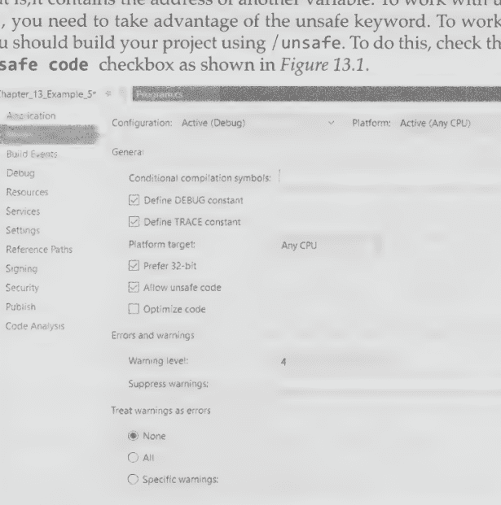

下方提供的代码段说明了你如何在 C# 中使用 `unsafe` 关键字来显示变量的内存地址：

```csharp
unsafe
{
    int i = 1;
    int* ptr = &i;
    Console.WriteLine("The value of the variable i is : " + i);
    Console.WriteLine("The memory address of the variable i is : " + (int)ptr);
}
```

当执行执行上述程序时，输出结果所示（图 13.2）：


图 13.2

## 预处理器指令

C# 中的预处理器指令用于向预处理器提供指令，以便在实际编译之前对信息进行预处理。C# 中的预处理器指令及其用例如下：

- `#define`: 用于定义一个符号。
- `#undef`: 用于取消定义一个符号。
- `#if`: 用于测试一个符号或多个符号。
- `#else`: 用于创建复合条件指令。
- `#endif`: 用于指定条件指令的结束。
- `#error`: 用于从代码的特定位置生成用户定义的错误。
- `#warning`: 用于从代码的特定位置生成编译器警告。
- `#region`: 用于指定一个代码块，你可以根据需要对其进行展开或折叠。
- `#endregion`: 用于标记 `#region` 块的结束。

接下来的代码段说明了如何使用 `#define`：

```csharp
#define Version_8

using System;

namespace Chapter_13_Example_6
{
    class Program
    {
        static void Main(string[] args)
        {
            if (Version_8)
                Console.WriteLine("Write code here that uses C# 8.0");
            else
                Console.WriteLine("Write code here the uses C# 7.0");
        }
    }
}
```

由于你可能经常希望让代码的特定部分仅在调试模式下执行，以下是实现方法：

```csharp
#if DEBUG
Console.WriteLine("Debug version");
#endif
```

## 正则表达式

正则表达式被定义为可以与给定文本匹配的模式。一个模式由一个或多个字符字面量、构造或面量组成。你可以利用 C# 中的 `Regex` 类来编写正则表达式。在 C# 中处理正则表达式时，你应该在程序中包含 `System.Text` 命名空间。图 13.3 中的程序说明了如何使用正则表达式。

```csharp
class Program
{
    static void Main(string[] args)
    {
        string number = "9";

        if (IsInteger(number))
        {
            Console.WriteLine("The input type is an integer");
        }

        Console.Read();
    }

    public static bool IsInteger(string str)
    {
        Regex pattern = new Regex("^[0-9]*$");
        return !pattern.IsMatch(str);
    }
}
```

图 13.3

当你执行执行图 13.3 所示程序时，控制台窗口将显示消息“The input type is an integer”。图 13.4 中提到的程序使用正则表达式来检查给定输入是否为文本，即输入是否包含字符。

```csharp
class Program
{
    static void Main(string[] args)
    {
        string text = "A";

        if (IsAlpha(text))
            Console.WriteLine("The input is text");
        else
            Console.WriteLine("The input is not text");
    }
}
```

当你执行图 13.4 中提到的程序时，控制台窗口将显示“The input is text”。如图 13.5 所示的程序中，将输入指定为数字：

```csharp
class Program
{
    static void Main(string[] args)
    {
        string text = "5";

        if (IsAlpha(text))
            Console.WriteLine("The input is text");
        else
            Console.WriteLine("The input is not text");

        Console.Read();
    }

    public static bool IsAlpha(string str)
    {
        Regex pattern = new Regex("^[0-9]*$");
        return !pattern.IsMatch(str);
    }
}
```


## 动态运行时

动态语言运行时 (DLR) 是 .NET 4.0 引入的一项功能，允许动态语言与静态类型语言协作。DLR 通过以下方式利用动态语言：

- Expression
- JavaScript
- IronPython
- IronRuby
- COM

接下来的代码段说明了动态如何使用动态：

```csharp
dynamic excel = "Application";
```

## 属性

属性是一种在程序集中嵌入元数据的特性。本质上，属性是在运行时添加声明信息的对象。属性可以应用于任何内容：

- 程序集
- 类
- 委托
- 枚举
- 字段
- 接口
- 属性
- 结构体

## 预属性

.NET 有三个定义的属性。它们如下：

- `AttributeUsage`
- `Conditional`
- `Obsolete`

### AttributeUsage

`AttributeUsage` 用于指定属性的使用方式。接下来的代码段说明了如何使用 `AttributeUsage`：

```csharp
[AttributeUsage(AttributeTargets.Class | AttributeTargets.Method, Allow = true)]
```

### Conditional

`Conditional` 属性用于指定一个条件。该条件的执行取决于预处理标识符。以下是将 `ConditionalAttribute` 应用于方法的方法：

```csharp
public sealed class ConditionalAttributeAttribute : Attribute { }

[Conditional("DEBUG")]
public static void DisplayMessage(string message)
{
    Console.WriteLine(message);
}
```

### Obsolete

`Obsolete` 属性用于标记代码过时。

## 示例

现在，考虑图 13.9 所示的程序，其中使用了名为 `PROD` 的条件属性。

```csharp
// Chapter.13_Example_9
#define PROD
using System;
using System.Diagnostics;

namespace Chapter_13_Example_9
{
    class Program
    {
        [Conditional("PROD")]
        public static void DisplayMessage(string message)
        {
            Console.WriteLine(message);
        }

        static void Main()
        {
            DisplayMessage("This text should be displayed in PROD mode..");
        }
    }
}
```

```csharp
class Program
{
    [Conditional("PROD")]
    public static void DisplayMessage(string message)
    {
        Console.WriteLine(message);
    }

    static void Main()
    {
        DisplayMessage("This text should be displayed in PROD mode.");
        Console.Read();
    }
}
```

图 13.10

## 过用 (Obsolete)

`Obsolete` 属性用于将程序实体（类、方法、属性、字段、委托等）标记为过用，也就是说由于其已被弃用而不应再使用。考虑以下程序：

```csharp
class Program
{
    [ObsoleteAttribute]
    public static void MethodA()
    {
        Console.WriteLine("MethodA has been called.");
    }

    [ObsoleteAttribute("This method has been deprecated. Use the method NewMethod() instead.")]
    public static void MethodB()
    {
        Console.WriteLine("MethodB has been called.");
    }

    [ObsoleteAttribute("This method has been deprecated. Use the method MethodMethod()", true)]
    public static void MethodC()
    {
        Console.WriteLine("MethodB has been called.");
    }

    public static void NewMethod()
    {
        Console.WriteLine("You have called MethodNew.");
    }

    public static void Main()
    {
        MethodA();
        MethodB();
        MethodC();
        Console.Read();
    }
}
```

当您编译上述程序时，错误列表将如图 13.11 所示。

| 错误列表 | | | | | | | | | | |
|---|---|---|---|---|---|---|---|---|---|---|
| 错误源 | 说明 | 行 | 悬挂点... | | | | | | |
| | Chapter,13 | Programs | 34 Active | | | | | | |
| | Chapter,13 | Programs | 32 Active | | | | | | |
| | Chapter,13 | Programs | 33 Active | | | | | | | |

图 13.11

## 自定义属性 (Custom attributes)

自定义或用户定义的属性通过扩展 `System.Attribute` 类创建，如下所示：

```csharp
using System;

public class MethodInfo : Attribute
{
}
```

您可以利用 `AttributeUsage` 属性来指定自定义属性可以应用的位置：

```csharp
[AttributeUsage(AttributeTargets.Class | AttributeTargets.Constructor |
AttributeTargets.Field | AttributeTargets.Method |
AttributeTargets.Property, AllowMultiple = true)]
```

```csharp
using System;

public class CustomAttribute : Attribute
{
}
```

或者，您也可以指定 `AttributeTargets.All` 以确保自定义属性可以随处使用：

```csharp
[AttributeUsage(AttributeTargets.All)]
```

```csharp
using System;

public class MethodInfo : Attribute
{
}
```

您可以利用 `AttributeUsage` 属性来指定自定义属性可以应用的位置。下面的代码列显示了一个简单的自定义属性：

```csharp
[AttributeUsage(AttributeTargets.Class | AttributeTargets.Constructor | AttributeTargets.Field | AttributeTargets.Method | AttributeTargets.Property, AllowMultiple = true)]
public class MethodInfo : System.Attribute
{
    public MethodInfo(int methodId, string developer, string remarks)
    {
        MethodId = methodId;
        Developer = developer;
        Remarks = remarks;
    }

    public int MethodId { get; set; }
    public string Developer { get; set; }
    public string Remarks { get; set; }
}
```

以下是自定义属性的应用方式：

```csharp
[MethodInfo(1, "Joydip Kanjilal", "This is a test message")]
public class Logger
{
    public void LogFile(string message) { }
}
```

在下一节中，我们将检查如何利用反射来读取应用到 `Logger` 类上的属性。

## 反射 (Reflection)

C# 中的反射类似于 C++ 的运行时类型信息 (RTTI)。它是一项允许您在程序执行期间（即运行时）检查和检索类型元数据的功能。`System.Reflection` 命名空间定义了以下类型：

- `Assembly`（程序集）
- `Enum`（枚举）
- `MethodInfo`（方法信息）
- `ConstructorInfo`（构造函数信息）
- `MemberInfo`（成员信息）
- `ParameterInfo`（参数信息）
- `Type`（类型）
- `FieldInfo`（字段信息）
- `EventInfo`（事件信息）
- `PropertyInfo`（属性信息）

现在，考虑以下类：

```csharp
public class Author
{
    public int Id { get; set; }
    public string FirstName { get; set; }
    public string LastName { get; set; }
    public string Address { get; set; }
}
```

以下是您如何利用反射检索 `Author` 类的属性名称：

```csharp
class Program
{
    static void Main(string[] args)
    {
        Type type = typeof(Author);
        PropertyInfo[] propertyInfo = type.GetProperties();
        foreach (PropertyInfo p in propertyInfo)
        {
            Console.WriteLine(p.Name);
        }
        Console.Read();
    }
}
```

要利用反射从我们在之前的节中创建的 `Logger` 类中读取元数据，程序应该是：

```csharp
static void Main(string[] args)
{
    Type type = typeof(Logger);
    object[] attributes = type.GetCustomAttributes(true);
    foreach (object attribute in attributes)
    {
        MethodInfo info = (MethodInfo)attribute;
        Console.WriteLine("MethodId: {0}, Developer: {1}, Remarks: {2}", info.MethodId, info.Developer, info.Remarks);
    }
}
```

注意，如果你正在使用 .NET Core 3.0 的预览版本，则需要第 5 步。如果你安装了 .NET Core 3.0 的正式版本，则完全不需要此步。接下来，在解决方案管理器中选择该项目。

7. 右键点击并选择“属性”。或者，选择项目并同时按下 `Alt` 和 `Enter` 键。

8. 在“属性”窗口中，点击“生成”，然后点击如图 14.2 所示的“高级”按钮。

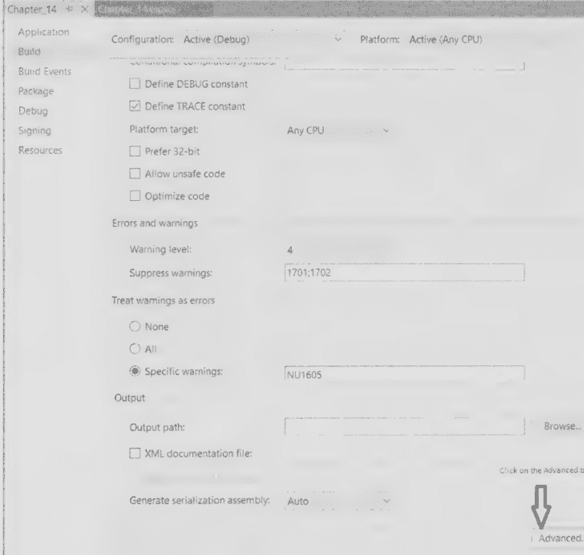

图 14.2：启动高级设置对话框

## 9. 在弹出的高级设置窗口中，如图 14.3 所示，选择 C# 8.0 (beta)。

| 应用 | 配置 (活动调试) | 平台：活动 (Any CPU) |
|---|---|---|
| 生成 | | |
| 生成事件 | [x] 定义 DEBUG 常量 | |
| 包 | [x] 定义 TRACE 常量 | |
| 调试 | | Any CPU |
| 签名 | [ ] 优先使用 32 位 | |
| 资源 | [ ] 允许不安全代码 | |
| | [ ] 优化代码 | 高级生成设置 ? X |
| 错误和警告 | | C# 支持的最新子版本 (默认) |
| 警告级别: | C# 支持的最新子版本 (默认) | C# 支持的最新子版本 (最新) |
| | [x] 检查算术溢出 | 不支持的 C# 版本预览 (预览) |
| 将警告视为错误 | | C#1 |
| 调试信息 | C#2 |
| 文件对齐: | C#3 |
| 库基地址: | C#4 |
| | C#5 |
| | C#6 |
| | C#7 |
| | C#8 |
| 输出路径 | | |
| [ ] XML 文档文件 | 自从... |

图 14.3：指定 C# 8.0 为项目的编程语言

好了，你所做的就这些了。你现在可以开始使用 C# 8.0 进行编程了。在接下来的章节中，我们将研究 C# 8 的显著特性。

## 默认接口成员

如果你还记得的话，接口就像 C++ 中的纯抽象类。它是一个契约，只能包含成员声明。在 C# 8.0 之前，你不能在接口中拥有成员定义。随着 C# 8.0，情况发生了变化。你现在可以为你的接口成员提供实现。让我们通过一个示例来理解这一点。下面的代码段显示了如何为接口成员定义实现。`ILogger` 接口包含一个名为 `Initialize` 具有默认实现的方法。

```csharp
interface ILogger
{
    void Initialize()
    {
        Console.WriteLine("Working with C# 8!");
    }
}
```

注意：上述代码在之前的 C# 版本中无法运行，但在 C# 8.0 中是完全允许。

## 可空引用类型

C# 编程语言支持两种类型的变量：基本类型和引用类型。基本类型包括 `char`、`int` 和 `double`。基本类型不能接受 `null`。引用类型是我们创建的类的实例对象。引用类型的内存分配在托管堆中。C# 2.0 引入了值类型的可空版本，你可以拥有可空 `char`、可空 `int` 和可空 `double`。引用类型默认可以为 `null`。但这可能在你的应用程序中引入可空引用问题。这里正是可空引用类型大显身场的地方。

在 C# 8.0 中，`string` 对象是非可空引用类型。在 C# 8.0 中，你也可以创建可空引用类型。下面的代码段说明了如何创建可空引用类型：

```csharp
string? nullableString = null;
```

考虑下面返回可空字符串的方法，它是可空引用类型：

```csharp
public static int GetLength(string? bar)
{
    if (string.IsNullOrEmpty(bar))
    {
        return 0;
    }
    return bar.Length;
}
```

你可以像代码所示调用上述方法：

```csharp
static void Main(string[] args)
{
    string? nullableText = null;
    Console.WriteLine(nullableText);
    int length = GetLength(nullableText);
    Console.WriteLine(length);
}
```

记住空引用异常吗？如果使用可空引用类型，可以避免这个问题。空合并赋值允许你对值进行赋值：

```csharp
string? nullableObj = null;
nullableObj ??= "default";
```

## 只读成员

C# 8.0 引入了只读成员。下面的代码段说明了如何使用只读成员：

```csharp
public struct Rectangle
{
```


# 静态局部函数

局部函数在 C# 7.0 中引入。你可以在方法内部定义局部函数。在 C# 8.0 中，你也可以定义静态局部函数。如下：

```csharp
public void OuterFunction(int x)
{
    Console.WriteLine("Outer Function");
    static void InnerFunction(int y)
    {
        Console.WriteLine("Inner Function");
    }
}
```

这是另一个显示如何使用静态局部函数的示例：

```csharp
int AddNumbers()
{
    int a = 10;
    int b = 20;
    return Sum(a, b);
    static int Sum(int x, int y)
    {
        return x + y;
    }
}
```

# 异步流

对异步流的支持是 C# 8.0 添加的一个很棒的特性，可以异步生成多个值。`IAsyncEnumerable` 接口允许你生成结果：

```csharp
public async IAsyncEnumerable<int> GetNumbers()
{
    for (int i = 0; i < 10; i++)
    {
        await Task.Delay(10);
        yield return i;
    }
}
```

# 精通 C# 8.0

这些接口属于 `System.Generic`。类似于 `IDisposable`，你还有 `IAsyncDisposable`：

```csharp
public interface IAsyncDisposable
{
    ValueTask DisposeAsync();
}
```

方法要返回异步流需要满足以下条件：

- 方法声明中具有 `async` 修饰符。
- 方法返回 `IAsyncEnumerable<T>`。
- 方法包含一个或多个 `yield return` 语句。

# 模式匹配增强

C# 8.0 中的模式匹配得到了增强。你现在可以在 switch 表达式中使用模式匹配。由于 C# 8 引入了递归模式——即模式表达式的输出是另一个模式——你现在可以在 C# 8 中利用位置模式匹配、属性匹配、递归模式和元组匹配。

C# 8.0 允许通过利用元组模式、位置模式和属性模式编写复杂的模式匹配表达式。

## 元组模式

元组模式用于在模式匹配表达式中匹配多个值，如下代码所示：

```csharp
switch (LogTarget.File, LogLevel.Info)
{
    case IsVerbose = false:
        break;
    case (LogTarget.File, LogLevel.Warning):
    {
        IsVerbose = false;
        break;
    }
    case (LogTarget.File, LogLevel.Error):
    {
        IsVerbose = true;
        break;
    }
    default:
        throw new InvalidOperationException();
}
```

## 位置模式

位置模式包含与元组模式非常相似的语法，用于检查对象的属性并使用这些属性来构建模式：如下代码段所示：

```csharp
if (log is LogManager(LogTarget.File, LogLevel.Error))
{
    // 如果 LogTarget 是 LogTarget.File
    // 且 LogLevel 是 LogLevel.Error，则执行代码
}
```

`LogManager` 类型应该具有以下 `Deconstruct` 方法：

```csharp
public void Deconstruct(out LogTarget logTarget, out LogLevel logLevel)
```

```csharp
damage = Damage;
durability = Durability;
}
```

## 属性模式

属性模式可以用于匹配被检查对象的属性，如下所示代码段所示：

```csharp
if (log is LogManager(LogTarget: LogTarget.File, LogLevel: Log.Error))
{
    // 在此处编写你的代码
}
```

# 使用 C# 声明

在 C# 8.0 中，`using` 语句具有了新功能。你可以使用 `using` 语句来指定可释放模式。你还可以向语言中添加 `using` 声明。请参考以下代码片段，它说明了你可以如何使用 `using` 语句：

```csharp
using (var repository = new AuthorRepository())
{
    // 在此处编写你的代码
}
```

在上面的代码示例中，`AuthorRepository` 是一个可释放类型，也就是说 `AuthorRepository` 类实现了 `IDisposable` 接口。在 C# 8.0 中，你可以编写以下代码代替：

```csharp
using var repository = new AuthorRepository();
```

考虑以下代码片段：

```csharp
string fileName = "Specify the file name here";
using (var fileStream1 = new FileStream(fileName, FileMode.Open))
{
    // 一些代码
}
using (var fileStream2 = new FileStream(fileName, FileMode.Open))
{
    // 一些代码
}
```

在 C# 8.0 中，你可以将相同的代码重写为：

```csharp
using var fileStream1 = new FileStream(fileName, FileMode.Open);
using var fileStream2 = new FileStream(fileName, FileMode.Open);
// 一些代码
// 释放对象的代码
```

# 记录类型

记录类型是 C# 8.0 中引入的一个新功能。它们允许你创建轻量级类。代码片段说明了如何定义记录类型：

```csharp
public class Order
{
    int _id;
    public Order(int Id)
    {
        _id = Id;
    }
    public Order With(int Id = 1) => new Order(Id);
}
```

# 可释放 ref 结构体

可释放 ref struct 是 C# 8.0 中的另一个有趣的新功能。请注意 `ref struct` 是在 C# 7.2 中首次引入的。考虑以下程序，我们有一个实现了 `IDisposable` 接口的 `ref struct`：

```csharp
class Program
{
    static void Main(string[] args)
    {
        Console.WriteLine("Hello World!");
    }
}
```

```csharp
ref struct Author : IDisposable
{
    public void Dispose()
    {
    }
}
```

当你编译上面的程序时，你会观察到编译错误，Error CS8343 'Author': ref structs 无法实现接口，如图 14.4 所示。

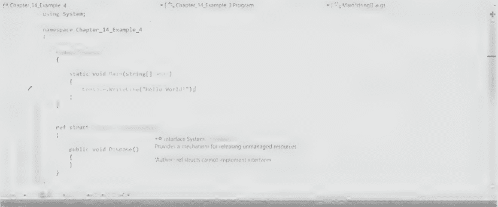

从 C# 8.0 开始，`ref struct` 可以在不需要实现 `IDisposable` 接口的情况下被释放。你只需要向 `ref struct` 中添加一个 `Dispose` 方法。这将确保结构体的实例被 `using` 语句消耗，如图 14.5 中提到的代码所示。

```csharp
class Program
{
    static void Main(string[] args)
    {
        using (var author = new Author())
        {
        }
    }
}

ref struct Author
{
    public void Dispose()
    {
    }
}
```

图 14.5

# 总结

C# 编程语言自首次发布以来发生了巨大变化。它的最新版本 C# 8.0 引入了许多新且令人兴奋的功能。通过本书，我们学习 C# 的之旅结束了。在本书的下一个也是最后一个章节中，我们将研究如何使用 Visual Studio 2019 使用 C# 构建控制台应用程序。

# 问题

1. 请用示例解释空引用类型。
2. 什么是记录类型？
3. 请用示例解释模式匹配。
4. 请用示例解释可释放 ref 结构。
5. 什么是静态局部函数？请用代码示例进行解释。
6. C# 8.0 中空合并赋值特性的目的是什么？
7. 什么是异步流？
8. 什么是 ref 结构？请用代码示例进行解释。

# 第 15 章 Visual Studio 2019 入门

这是本书的最后一个章节。在这一章中，我们将研究如何使用 Visual Studio 2019 在 C# 中创建项目。

在本章中，我们将讨论以下几点：

- Visual Studio 的不同版本
- 安装 Visual Studio 2019
- 在 Visual Studio 2019 中创建控制台应用程序

## Visual Studio 2019 的不同版本

在编写时，微软刚刚发布了 Visual Studio 2019。请注意 Visual Studio 2019 有三个版本可用，包括：

- Community（社区版）：该版本是免费的，可供学生、专业人士和开源贡献者使用。
- Professional（专业版）：该版本为个人开发者和小团队设计。
- Enterprise（企业版）：该版本供大团队使用，前提他们有 Visual Studio 订阅。

## 安装 Visual Studio 2019

如果你的系统中没有安装 Visual Studio 2019，你可以从 `https://visualstudio.microsoft.com/downloads/` 下载。见图 1。

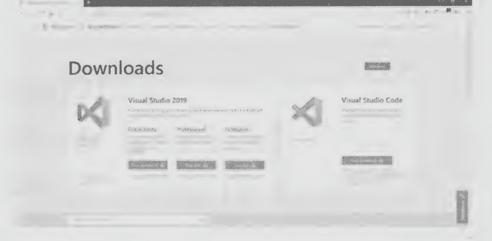
图 1：Visual Studio 下载页面

一旦 Visual Studio 2019 下载完成，你就可以运行安装程序安装 Visual Studio 2019。安装程序加载后，你将看到一个选择要安装组件的界面。


图 2：选择要安装的组件

如果你需要更新 Visual Studio 2019 安装，可以再次运行安装程序并点击 Visual Studio 2019 面板中的更新按钮。点击更新按钮后，下载和安装将开始，如图 3 所示。


图 3：更新 Visual Studio 2019 安装

注意，如果有任何待处理的更新，它们将被下载并安装。

## Visual Studio 2019

当你启动 Visual Studio 2019 时，初始界面如下：


图 4：启动 Visual Studio 2019

一旦初始界面加载，你将看到一个创建新项目或克隆现有项目的界面。尽管如此，你还会获得打开项目的选项。之前创建的项目将出现在左侧面板中。如图 5 所示，由于到为止还没有创建任何项目，左侧面板是空的。


图 5：Visual Studio 2019 入门

如果你想直接启动 Visual Studio IDE，可以点击**跳过代码**。Visual Studio IDE 将如图 6 所示启动。


图 6：Visual Studio 2019 IDE

## 在 Visual Studio 2019 中创建项目

要在 Visual Studio 2019 中创建项目，请按照以下步骤操作：

1. 点击菜单中的“文件 | 新建 | 项目...”，如图 7 所示。


图 7：在 Visual Studio 2019 中创建项目

2. 在“创建新项目”对话框中，你可以指定使用的项目类型。

3. 选择“控制台应用程序 (.NET Framework)”作为项目模板并点击“下一步”，如图 8 所示。

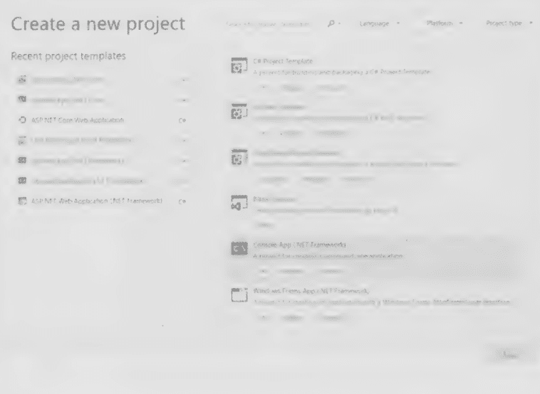
图 8：创建新项目窗口

4. 在“配置新项目”窗口中，指定你想要创建的项目名称和路径。

5. 从屏幕底部的下拉列表中选择你想要使用的 .NET Framework 版本。如图 9 所示。

## 配置你的新项目


6. 点击“创建”开始新项目。

一旦你的控制台应用程序项目创建完成，你就可以开始使用 C# 进行编程了。请注意，本书中一直使用的是控制台应用程序项目。

## 在 Visual Studio 2019 中编写 Hello World 应用程序

在本节中，我们将研究如何在 Visual Studio 2019 中构建 Hello World 应用程序。当你创建一个新的控制台应用程序项目时，项目中默认会创建一个名为 `Program.cs` 的文件。你将在 `Program.cs` 文件中看到 `Program` 类。还有一个空的 `Main` 方法。`Main` 方法是所有控制台应用程序的入口。接下来，将 `Main` 方法替换为以下代码：

```csharp
static void Main(string[] args)
{
    Console.WriteLine("Hello World!");
    Console.Read();
}
```


要执行程序，按下 `F5` 键或点击**开始**（Start）。如图 10 所示。


图 10：执行控制台应用程序

一旦应用程序启动，它会自动编译（如果之前编译过则会重新编译），文本 **Hello World!** 将显示在控制台窗口中，如**图 11**所示所示


图 11：运行中的 Hello World 控制台应用程序！

注意，要使用 C# 8，你的系统中应该运行着 `.NET Core 3.0`。
如果你的系统中没有安装，可以从 `https://dotnet.microsoft.com/download/dotnet-core/3.0` 下载副本。

## 进一步学习参考

- `https://docs.microsoft.com/en-us/dotnet/csharp/language-reference/keywords/`
- `https://docs.microsoft.com/en-us/dotnet/csharp/programming-guide/`
- `https://docs.microsoft.com/en-us/dotnet/csharp/tutorials/`
- `https://www.infoworld.com/blog/microsoft-coder/`

## 索引

# 符号

- 2 维整数数组
- 创建 32
- 初始化 32
- 值，显示 32
- `.NET Core 3.0 SDK`
- 引用链接 278
- `.NET Framework`
  - 关于 2
  - 优势 2
  - 演变 2, 3
- `.NET Framework 4.6` 3
- `.NET Framework 4.7` 3
- `.NET Framework 4.8` 3
- 访问器，类型
  - `get` 访问器 88
  - `set` 访问器 88
- 访问修饰符 40, 51-53
- `action` 委托
  - 关于 161
  - 使用，配合匿名方法 162
- `Add` 方法
  - 调用，配合 `func` 委托 159
- 聚合 63
- 匿名方法
  - 关于 153, 154
  - `action` 委托，使用 162
  - `func` 委托，使用 160
  - `predicate` 委托，使用 163

# A

- 抽象索引器
  - 关于 104
  - 实现 105
- 抽象化 77
- 抽象属性 94-96
- 访问修饰符关键字 23
- 访问器 88
- 数组
  - 关于 30
  - 锯齿数组 33
- 多维数组 32
- 语法 31
- `ArrayList` 127
- 数组数组 33
- 整数数组
  - 定义 31
  - 关联 62
- 异步方法
  - 返回类型，在 `.NET` 中 197
- 异步编程
  - 关于 196, 197
- `async` 关键字 197
- `await` 关键字 197
- `Task.Factory.StartNew` 方法 198
- `Task.Run` 方法 198
- `Task.WaitAll` 方法 198-201
- `Task.WhenAll` 方法 198-201
- 阻塞 139
- 边界 139
- `BlockingCollection<T>` 138-141
- 箱体 30
- `break` 语句
  - 使用 27
- 使用，在 `do...while` 循环中 27
- 使用，在 `while` 循环中 27
- 特性
  - 关于 266
  - 自定义特性 271, 272
  - 预定义特性 266
- `AttributeUsage` 266
- `await` 关键字 197

# C

- C#
  - 启用，使用不带私有数据成员属性 89
  - 索引器 98
  - 属性 86
- C# 8
  - 关于 278-280
  - 在 Visual Studio 2019 中启用 275
- 回调方法 155
- 类
  - 关于 36
  - 访问修饰符 40
  - 数据成员 39
  - 定义 30
  - 私有内部成员 41, 42
  - 公有成员 40
  - 保护访问修饰符 43
  - 语法，定义 38
  - 基类 65
  - 构造函数 44-49
  - 声明
  - 语法 37
  - 源自 `ICollection` 接口 126
  - 库
  - B
- 后台线程 210
- 双向关联 63
- 二进制运算符 28
- 二进制序列化 241-244
- `BitArray`
  - 关于 132
  - 方法，执行
  - 位逻辑操作 132
- `BlockingCollection`，特性
  - 构造函数 44-49
  - 类
  - 构建 132
  - 代码访问 (CAS) 12
  - 代码列表 119
- 公共中间语言 (CIL)
  - 关于 3, 4, 30, 240, 259
  - 服务 4
- 公共语言运行时 (CLR)
  - 关于 50, 51
  - 在继承的类中 54
  - 构造函数重载 44, 50
  - 类型
  - 非静态构造函数 44
  - 静态构造函数 44
  - 结构 23-25
- 创建增改查 (CRUD) 119
- 自定义特性 271, 272
- 自定义异常类
  - 捕获 180
  - 实现 178
  - 抛出 179, 180
- 并发集合
  - `BlockingCollection<T>` 138-141
  - `ConcurrentBag<T>` 142
  - `ConcurrentQueue<T>` 147
  - `ConcurrentStack` 146
- 通用类型系统 (CTS)
  - 关于 7
- 即时 (JIT) 编译器 8
  - 管理代码 8
  - 引用类型 7
  - 非托管代码 8
  - 值类型 7
  - 编译时多态 67, 68
- 组合 64, 65

# D

- 显示方法 224
- 可释放 `ref` 287, 288
- `do...while` 循环 27
- 动态运行时 (DLR)
  - 关于 5, 6, 264
  - 绑定器，使用 265
  - 动态多态 69
- 扩展方法
  - 关于 163
  - 链式 165
  - 优先级 165, 166
  - 使用 164
- 写入，针对整数 164
- 文件
  - 使用 235-240
- `finally` 块
  - 执行 173, 174
- 先后出 (FIFO) 129
- 前台线程 210
- `for` 循环
  - 使用 26
- 框架类库 (FCL)
  - 关于 6
  - 服务 6
- `func` 委托
  - 关于 158, 159
  - 用于调用方法 159
  - 使用，配合匿名方法 160
  - 使用，配合 lambda 表达式 161

# E

- 封装 70
- 内部访问修饰符 74
- 私有访问修饰符 71, 72
- 私有保护访问修饰符 76
- 保护访问修饰符 73
- 保护内部访问修饰符 75, 76
- 公有访问修饰符 70, 71
- 实体数据模型 (EDM) 121
  - 关于 170
  - 最佳实践 185, 186
- 自定义异常类
  - 实现 178
  - 抛出 175-177
- 异常块
  - 关于 172
  - `catch` 块 172
  - `finally` 块 172
  - `throw` 语句 172
  - `try` 块 172
- 异常类层次结构 170
  - 在 `.NET` 中 171
- 异常过滤器 182-184
- 异常处理 211-213
- 异常关键字
  - 关于 172, 173
- 异常，抛出 175-177
- `finally` 块，执行 173-175
- 表达式 lambda

# G

- 垃圾回收 (GC)
  - 关于 9-11
  - 安全 11
- 泛化
  - 关于 65, 66
  - 类型 66
- 泛集合类
  - `HashSet<T>` 137
  - 实现 136
- 泛集合类型
  - 字典 135
  - 使用 135
- 泛型 133, 134

# H

- `HashSet<T>` 137
- `Hashtable`
  - 关于 129
- 存储的数据，枚举 130
- 在 C# 中工作 130
- Hello World 应用程序
  - 在 Visual Studio 2019 中编写 297, 298
- Hello World 控制台应用程序
  - 构建 16-19
- 层次级继承 80
- 混合继承 81

# I

- `IAsyncDisposable` 284
- `if...else` 结构
  - 关于 23
  - 语法 23, 24
- 索引器
  - 抽象索引器 104
  - 在 C# 中 98
  - 继承 102
  - 多维索引器 105, 106
  - 重载索引器 100
  - 多态 102, 104
  - 语法，创建 99
  - `this` 关键字，使用 99
  - 用于显示数据 101
  - 用于存储数据 101
- 信息隐藏 70
- 继承
  - 关于 53, 54, 66, 77
  - 属性，工作 92, 93
- 规则 82
- 继承
  - 层次级继承 80
  - 混合继承 81
  - 多级继承 78, 79
  - 多重继承 80
  - 单一继承 78
- 实例构造函数
  - 关于 44
- 默认构造函数 44
- 接口成员 280, 281
- 中间语言 (IL) 代码 8
- 内部访问修饰符 74

# J

- JavaScript 对象表示 (JSON) 250
  - JSON 反序列化 250, 251
  - JSON 序列化 251
- 即时 (JIT) 编译器 5, 8

# K

- 关键字
  - 关于 23
- 引用链接 23

# L

- lambda 表达式
  - 关于 150-153
  - 匿名方法 153
  - `func` 委托，使用 161
  - `predicate` 委托，使用 163
  - 语法，在 C# 中定义 150
- 类型 151
- 大对象堆 (LOH) 10
- 后进出 (LIFO) 128
- 晚绑定 69
- LINQ
  - 优势 110
  - 特性 110
  - 概述 110
- LINQ 架构
  - 关于 111, 121
  - 组件 111
- 到 DataSet 120
- 到实体 121-124
- 到对象 112-116
- 到 SQL 119-121
- 到 XML 116, 118

# M

- 局部函数 257
- 循环 26
- 循环，章节
- 条件章节 26
- 初始化章节 26
- 重初始化章节 26
- 队列 129
- `SortedList` 131, 132
- 栈 128
- 使用 126
- 非可空引用类型 257-259
- 非静态构造函数 44
- 非静态属性
  - 关于 88
  - 在类中定义 88

# N

- 命名空间
  - 类 126
  - 类型 116, 117
- 非泛型集合类型
  - `ArrayList` 127
  - `BitArray` 132
  - `Hashtable` 129, 130

# O

- 对象
  - 关于 36
  - 行为 36
  - 创建 30
  - 标识 36
  - 状态 36
- 面对象分析设计 (OOAD) 77
- 面对象编程 (OOP)
  - 关于 35, 36
  - 优点 36
- 对象关系映射 (ORM) 119
- 过用特性 269, 270
- 运算符重载 28
- 运算符 28
- 运算符，类型
  - 关于 28
  - 赋值运算符 28
  - 二进制运算符 28
  - 比较运算符 28
  - 三元运算符 28
  - 一元运算符 28
- 重载索引器 100

# P

- 并行扩展库
  - 关于 191
- 并行性，控制 194, 195
- 并行 LINQ 191-193
- 任务并行库 191
- 并行性
  - 控制 194, 195
- 并行 LINQ 192
- 并行编程
  - 关于 190
  - 数据并行 190
  - 任务并行 190
- 模式匹配
  - 增强 284
  - 位置模式 285
  - 属性模式 286
  - 元组模式 285
  - 在 C# 8 中使用 284
- 多态性
  - 关于 67
  - 编译时多态 67, 68
  - 动态多态 69
  - 实现，
    - 虚拟属性 96, 98
  - 运行时多态 69
  - 静态多态 67, 68
- 位置模式 285
- 预定义特性
  - `AttributeUsage` 66
  - 条件特性 267, 268
  - 过用特性 269, 270
- 谓词委托
  - 关于 162
  - 定义 162
  - 使用匿名方法 163
  - 使用 lambda 表达式使用 163
- 预处理器指令
  - 关于 260, 261
  - 在 C# 中的用法 260
- 私有访问修饰符 71, 72
- 私有保护访问修饰符 76
- 过程 206
- 属性
  - 关于 88
  - 抽象属性 94-96
  - 访问器 88
  - 在 C# 中 86
  - 非静态属性 88
  - 限制 87
  - 静态属性 91
  - 语法 86
  - 语法，定义 86
  - 用于分配数据 90
  - 虚拟属性，用于实现多态性 96, 98
  - 在继承中的工作 92, 93
- 属性，类型
  - 自动实现属性 88
  - 读写属性 88
  - 只读属性 88
  - 只写属性 88
- 保护访问修饰符 73
- 保护内部访问修饰符 75, 76
- 公共访问修饰符 70, 71

# Q

- 队列 129

# R

- 只读成员 282
- 实现 66
- 记录类型 287
- 引用类型
  - 关于 7, 28
  - `.NET` 框架中的列表 88
- 反射 273-275
- 正则表达式
  - 关于 261
  - 用法 262
  - 角色安全 12
- 运行时多态 69
- 运行时类型信息 (RTTI) 273

# S

- 安全类型，垃圾收集 (GC)
  - 关于 11
  - 代码访问安全 (CAS) 12
  - 角色安全 12
- 可序列化特性 249
- 序列化 关于 240
  - 二进制序列化 241-244
  - 自定义序列化 250, 251
  - JSON 反序列化 250, 251
  - 可序列化特性 249
  - SOAP 序列化 247, 248
  - XML 序列化 245
  - 简单访问协议 (SOAP) 247
- `Simula` 36
- 单一继承 78
- 小对象堆 (SOH) 10
- 智能数组 98
- 智能字段 86
- SOAP 序列化 247, 248
- `SortedList` 131, 132
- 栈 128
- `StackTrace` 170
- lambda 语句 152
- 静态构造函数 44-49
- 静态局部函数 282
- 示例 283
- 静态多态 67, 68
- 静态属性 91
- 可见性，限制 91, 92
- 结构 关于 29
- 构造函数 58, 59
- 在 C# 中定义 29
- 超类 65
- `switch`
  - 关于 25
  - 语法 25
- `System.Collections` 命名空间 关于 126
- 并发集合 138
- 泛型集合类，实现 136
- 泛型类型，工作 135
- 泛型 133, 134
- 接口 126
- 非泛型集合类型，工作 126
- `.NET` 框架中的 `System.GC` 类 11
- `System.GC` 类，方法和属性
  - `GC.Collect` 11
  - `GC.GetGeneration` 11
  - `GC.GetTotalMemory` 11
  - `GC.KeepAlive` 11
  - `GC.MaxGeneration` 11
  - `GC.SuppressFinalize` 11
- `System.IO` 命名空间 关于 230
- 类型 230
- `System.Reflection` 命名空间类型，定义 273

# T

- 任务 关于 206
- 线程 190
- `Task.Factory.StartNew` 方法 198
- 任务并行 190
- `Task.Run` 方法 198
- `Task.WaitAll` 方法 198-200
- `Task.WhenAll` 方法 198-200
- 三元运算符 28
- `TextManager.cs` 文件 20
- 线程
  - 后台线程 210
  - 数据，传递 214
  - 异常处理 211-213
  - 前台线程 210
  - `join` 方法 216-218
  - 命名 215
  - 优先级 219-221
  - 编程 207-209
  - 恢复 214
  - `sleep` 方法，使用 216
  - 状态 213
  - 挂 214
  - 终止 190
- 线程方法示例 209
- 线程池
  - 关于 222, 223
  - 创建 223
- 线程同步 223-225
- `TryPeek` 方法 143
- `TryTake` 144
- 元组模式 285
- 元组
  - 关于 254-257
- 创建 255

# V

- 值类型
  - 关于 7, 28
  - C# 中的列表 28
- `.NET` 框架中的列表 7
- 虚拟属性
  - 用于实现多态性 96, 98
- Visual Studio 2019
  - Hello World
    - 应用程序，编写 297, 298
    - 初始化 293, 294
    - 安装 292, 293
    - 项目，创建 295-297
  - 引用链接 292
- Visual Studio 2019，版本
  - 关于 291
  - 社区版 291
  - 企业版 291
  - 专业版 291

# W

- `while` loop 26
- Windows Presentation Foundation (WPF) 3
- Windows Workflow Foundation (WWF) 3

# X

- XML 序列化 245

# U

- 一元运算符 224
- 装箱 30
- 非托管代码 8
- 安全代码 259, 260
- `using` 语句
  - 异常过滤器 183, 184
  - 异常过滤器 182
  - `using` 181, 182

美国制造
Middletown, DE
2019年11月23日


## 精通 C# 8.0

### 描述

书籍从介绍 `.NET` 框架的概念开始。然后讨论了 OOP，并探索了如何在 C# 中使用 OOP。关于 OOP 有两个章节：第一章涵盖面向对象编程 (OOP) 的基础；第二章阐述了 OOP 的高级概念以及如何在 C# 中实现它们。

接下来，书籍讨论了语言集成查询 (LINQ) 以及如何在 C# 中使用它，随后讨论了多线程、异步和并行编程概念，并配有相关的代码示例来说明所涵盖的概念。泛型、集合、泛型集合、委托和 lambda 表达式在该部分也有涉及。

### 你将学到

通过本书，读者将掌握 C# 编程语言的概念，并能够使用 C# 构建高性能、可扩展且健壮的应用程序。

在书籍的最后部分，简要讨论了序列化、文件 I/O 以及如何在 C# 中使用它们。增加了一个关于 C# 8.0 的章节以突出其新特性……还有一个附录章节讨论了如何开始使用 Visual Studio 2019。

### 主要特性

- 包含大量的代码示例
- 精通 C# 的详尽指南
- 讨论了 OOP 原则
- 针对 C# 初级到高级读者
- 提供了最新特性（包括 C# 8.0）的见解
- 涵盖了 Visual Studio 2019

### 适用人群

本书适用于希望从事 `.NET` 职业的人士，以及想要掌握 C# 编程语言概念的专业人士。由于本书面向 C# 初级到高级读者，具备基础 C# 知识将会有帮助。
