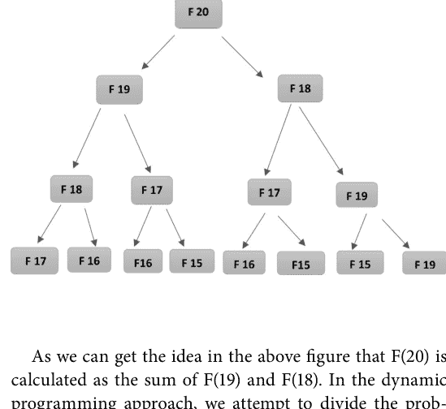

# 精通 C#：初学者指南


## 第8章 ■ 动态规划与反射 257

### 动态语言与静态语言的优势 259

- 递归 vs. 动态规划 263
- 递归 vs. 迭代 263
- 动态规划的方法 263
- 自顶向下方法 263
- 优势 264
- 自底向上方法 266
- 关键点 266

### C# 中的动态规划 266

- 如何使用 Dynamic 267
- Dynamic 与方法的重载 272
- 结论 274

### 理解反射 275

- 在 C# 中定义反射 275
- 一个简单的用例 276
- 为什么我们应该使用 Dynamic 类型 284
- Dynamic vs. 反射 285
- Var vs. Object vs. Dynamic 287
  - Var 关键字 288
  - Object 关键字 288
  - Dynamic 关键字 289

## 评价， 291

## 索引， 299

## 关于编辑

**Sufyan bin Uzayr** 是一位作家、程序员和企业家，在行业内拥有超过十年的经验。他过去曾撰写过多本涵盖广泛主题的书籍，从历史到计算机/IT。

Sufyan 是 Parakozm 的董事，Parakozm 是一家专注于教育科技解决方案的跨国 IT 公司。他还运营着 Zeba Academy，这是一个专注于 STEM 领域的在线学习和教学平台。

Sufyan 精通多种技术，如 JavaScript、Dart、WordPress、Drupal、Linux 和 Python。他拥有多个学位，包括管理、IT、文学和政治科学。

Sufyan 是一位数字游民，将时间分配在四个国家之间。他曾在全球各地的大学和教育机构生活和任教。Sufyan 对技术、政治、文学、历史和体育有着浓厚的兴趣，在业余时间，他喜欢向年轻学生教授编程和英语。

了解更多请访问 sufyanism.com。


Taylor & Francis

Taylor & Francis Group

http://taylorandfrancis.com

## 精通 C# 编程语言——初学者指南

## 本章内容

- 什么是 C#？
- C# 的基本介绍
- C# 的演变

在这个数字化转型的快速发展世界里，几乎每个人都可以访问互联网和智能手机。互联网的使用主要是浏览网站和各种移动应用。有趣的是，你可能数不清自己每天使用多少个应用。无论是最广泛使用的微博应用如 Twitter、流媒体服务如 Netflix、消息应用如 WhatsApp，代码都构成了所有事物的基础。今天互联网上有超过 17 亿个网站，所有这些都由某种编程语言驱动。它在行业和研究中不断演进，因为系统和应用在不断变化。编程是创建软件、应用程序和网站的过程。它是一种人工语言，可用于控制机器，特别是计算机或其他设备如手机的行为。我们已经知道，计算机或其他类似技术无法自行思考；它们需要用户提供有序的指令集来知道该做什么。所以编程在这里发挥作用。它用于促进关于组织和操纵信息以及精确表达算法的沟通。它的语言与大多数其他形式的人类表达完全不同，因为它们需要更高的精确度和完整性。

这种语言被称为“代码”。你在计算机和互联网上使用的大多数资源都是用代码制作的。学习这种编码很简单。你只需要一些想法和合适的工具。编码一个应用涉及拍照、设计应用、测试它并发布它。没有比今天更好的开发应用的理想时间了。令人惊讶的是，一旦你的应用登陆 Google Play 和 App Store，你就拥有了巨大的市场。如果你是移动应用开发世界的新手，但热切地想以某种方式自己参与其中，本书是一份详细的指南，将帮助学习者开始 C# 编程。它首先谈论基础知识，然后转向实践练习，帮助读者快速获得所需的知识。

## C# 编程语言简介

C# 是一种通用、高级且面向对象的编程语言，发音为“C sharp”，由 Microsoft 创建，运行于 .NET Framework 上。C# 源自 C 家族，其语言接近其他流行语言如 C++ 和 Java。第一个版本于 2002 年发布。最新版本 C# 8 于 2019 年 9 月发布。C# 已被 ECMA 和 ISO 认可为标准。C# 专门为通用语言基础结构 Common Language Infrastructure CLI 设计。它是描述可执行代码及其运行环境的标准的。C# 最初被称为 C-like Object-Oriented Language COOL，但更改了名称以避免商标问题。由于 C# 是在 Microsoft 的 .NET Framework 计划中形成的，它提供了各种集成开发环境 IDE 来顺利运行 C# 程序。

虽然 C# 可以被各种程序员更好地使用，但语言用户群的大部分由偏爱 Microsoft 平台的人组成。

## 什么是 C#

C# 发音为“C-sharp” 是 Microsoft 的一种基于对象的编程语言，重点在于将 C++ 的计算能力与 Visual Basic 的编程简易性相结合。C# 基于 C++，并包含与 Java 相似的功能。它是 C 和 C++ 的混合体。C# 通常用于后端服务、Windows 应用、网站开发和游戏开发。

C# 安排为与 Microsoft 的 .NET 平台一起工作。Microsoft 的主要目标是促进通过网络交换信息和服务，并让开发人员构建高度可移植的应用。C# 通过使用可扩展标记语言 XML 和简单对象访问协议 SOAP 使编程变得顺畅，这允许访问编程对象或方法而无需程序员为每个步骤编写额外代码。这是一件相当有趣的事情。你知道一件事吗？程序员可以在此基础上构建现有代码，而不是反复重复它。C# 预计会使新产品和服务的上市更快、成本更低。C# 程序在 .NET 和一个名为通用语言运行时的虚拟执行系统 CLR 上运行，并包含许多类库。CLR 是 Microsoft 对 CLI 的实现，这是一个国际标准。CLI 是创建执行和开发环境的平台，在这些环境中语言和库可以持续协同工作。

用 C# 编写的源代码被编译为符合 CLI 规范的中间语言 IL。IL 代码及其资源，如位图和字符串，被保存在一个通常以 .dll 结尾的程序集中。一个包包含一个清单，提供有关程序集的类型、流派和文化的信息。

当 C# 程序运行时，程序集被加载到 CLR 中。CLR 执行即时 JIT 编译，将 IL 代码更改为本地机器指令。CLR 提供与自动垃圾回收、异常处理和资源管理相关的其他服务。由 CLR 执行的代码有时被称为“托管代码”，与“非托管代码”相对，后者被编译为选择特定平台的本地机器语言。

语言互操作性是 .NET 的关键特性。C# 编译器产生的 IL 代码符合通用类型规范 CTS。从 C# 生成的 IL 代码可以轻松与从 .NET 版本的 F#、Visual Basic、C++ 或任何超过 20 种其他 CTS 兼容语言生成的代码交互。单个程序集可能包含用不同 .NET 语言编写的不同模块，并且类型可以相互引用，就好像它们是用同一种、唯一的语言编写的一样。

除了运行时服务外，.NET 还包含全面的库。这些库支持许多不同类型的负载。它们被组织成命名空间，为从文件输入输出到字符串操作、XML 解析、Web 应用框架和 Windows Forms 控件等一切提供广泛的适当功能。典型的 C# 应用大量利用 .NET 类库来处理日常的“管道”任务。

## 为什么 C# 重要

作为初学者，学习 C# 非常简单；要了解 C#，你至少应该对编写代码有一个基本的概念，即使


你还没有构建出自己的第一个应用或程序。与更复杂的语言相比，C# 的学习曲线相对较低。

对于具有中高级编码经验的开发者来说，C# 是一个绝佳的选择。尽管专家们承认这门语言的复杂度处于合理水平，但他们也一致认为它相对容易掌握并能高效运用。一旦你接触 C# 并花时间掌握其要领，就能预期从新手快速进阶为专家。

这是因为 C# 是一门一流语言，意味着它相对容易理解和编写，因此对初学者来说是很棒的选择，对专家而言也是便捷之选。除了可读性之外，C# 还能自动化处理那些需要大量时间却收效甚微的复杂任务。

这门编程语言还是静态类型的，这意味着错误会在应用上线之前就被发现。这让你能够轻松检测出技术栈中那些原本几乎难以察觉的细微缺陷。

## C# 的历史

2000 年，微软发布了 C# 的初始版本，作为 .NET Framework 的一部分。当时 VB.NET 也是一种替代方案，但 VB.NET 沿用了标准的 Microsoft Visual Basic 语法，而 C# 则更接近 Java，属于 C 风格语言。C# 最初被命名为“Cool”。微软意识到自己正在开发一门与 C++ 非常相似的语言，因此他们想表明这门新语言比 C++ 高一个层次。C# 是微软开发并推向市场的一门新语言。起初，微软还改进并部署了 Active Server Pages（ASP）语言。

这门语言现在被称为 Classic ASP，其支持已经停止。ASP 让程序员能够生成类似 VB 的脚本，从而创建动态网页。这类网页继续运行在老旧的使用 Windows 的 Internet Information Services（IIS）服务器上。部分 Linux 服务提供商也支持 Classic ASP，但它通常是一种非标准的网页创建方式。

20 世纪 90 年代末，微软决定打造一门能与 Java 激烈竞争的语言。在那个时期，Java 是最常见的语言，其 popularity 日益上升。Classic ASP 自有其用武之地，但制作该产品所需的软件是付费应用。Java 被用于开发 Web 应用，并在熟悉 C 和 C++ 的开发者中颇受欢迎。微软没有将新语言命名为 C++，而是决定使用 C#（读作 C sharp），这个名称来源于乐理中“音符升半音”的记号。C# 团队持续创新，不断添加新的特定功能。

本章介绍 C# 语言重要版本的历史，因为该团队正专注于显著的创新，并不断为这门语言增添出色的功能。

- C# 1.0 版本。
- C# 1.2 版本。
- C# 2.0 版本。
- C# 3.0 版本。
- C# 4.0 版本。

最重要的是，当 IEnumerator 实现 IDisposable 时，生成的代码在 foreach 循环中会调用 Dispose 方法。

### C# 2.0 版本

随着 Visual Studio 2005（此前代号为 Whidbey）的发布，C# 携众多创新回归。C# 语言已成功升级到 2.0 版本，并带来了若干语言扩展。除了泛型类型之外，C# 语言还引入了其他令人兴奋的特性，例如迭代器、分部类、匿名方法、分部类型和可空值类型。

C# 2.0 的其他特性主要是在已有功能的基础上追加能力：

- Getter/setter 独立可访问性。
- 方法组转换（委托）。
- 静态类。
- 委托推断。

虽然 C# 最初可能只是一门普通的面向对象语言，但 2.0 版本彻底改变了这一点。一旦他们完全掌控了这些特性，便着手解决一些复杂的开发者痛点，而且是以一种意义重大的方式去解决的。

### C# 3.0 版本

C# 3.0 作为 .NET 3.5 版本的一部分发布。该版本明确添加的许多特性都用于支持语言集成查询（LINQ）。

新增特性列表：

- LINQ。
- Lambda 表达式。
- 扩展方法。
- 匿名类型。
- 隐式类型变量。
- 对象和集合初始化器。
- 自动实现的属性。
- 表达式树。

回过头来看，上述许多特性似乎既不可避免又密不可分。它们在战略上相互契合。人们普遍认为，C# 这一版本的杀手级特性是查询表达式，也就是广为人知的语言集成查询（LINQ）。

更细致的看法则是将表达式树、Lambda 表达式和匿名类型视为 LINQ 的基础。但无论如何，C# 3.0 引入了令人叹为观止的概念。C# 3.0 已开始为将 C# 转变为混合型面向对象/函数式语言奠定基础。重要的是，你现在可以编写类似 SQL 的声明式查询来对集合等对象执行操作。

### C# 4.0 版本

微软于 2010 年 4 月随 Visual Studio 2010 发布了这一版本的 C#。Mono C# 编译器在 2010 年 10 月随 Mono 2.8 发布时完全支持了该新版本。这一版本确实引入了一些有趣的新特性：

- 动态绑定。
- 命名/可选参数。
- 泛型协变与逆变。
- 嵌入式互操作类型。

C# 语言的新版本带来了一种新类型：dynamic。一旦变量被声明为 dynamic 类型，对这些值的操作不会在编译时完成或验证，而是完全在运行时进行。这也被称为鸭子类型。

嵌入式互操作类型缓解了为应用程序创建 COM 互操作程序集的部署难题。泛型协变和逆变让你在运用泛型时拥有更强大的能力，但它们有点学术化，可能最受框架和类库作者的青睐。命名参数和可选参数让你能减少许多方法重载，并提供便利。但这些特性都算不上彻底改变编程范式的变革。

### C# 5.0 版本

随 Visual Studio 2012 发布的 C# 5.0 是一个高度聚焦的语言版本。该版本几乎所有的开发精力都投入到了另一个颠覆性的语言概念上：用于异步编程的 async 和 await 模型。以下是主要特性列表：

- 异步方法。
- 调用方信息特性。

Async 特性引入了两个关键字：async 和 await，让你能够像编写同步代码一样，更快、更直观地编写异步代码。在 C# 5.0 之前，编写异步代码需要定义回调（也称为 continuation）来捕获异步过程完成之后要执行的操作。这会让你的代码以及异常处理等其他常规任务变得复杂。调用方信息可以帮你进行跟踪、调试和创建诊断工具。它还能帮助你避免在许多方法中为了同一目的而重复编写代码，例如日志记录和跟踪。

### C# 6.0 版本

借助 3.0 和 5.0 版本，C# 在面向对象语言中增添了重大而卓越的新特性。而在随 Visual Studio 2015 发布的 6.0 版本中，C# 没有推出统治级的杀手特性，而是发布了大量较小的特性，使 C# 编程更高效。C# 6.0 版本包含许多能提升开发者生产力的关键元素。以下是其中一部分：

- using static。
- 异常筛选器。
- 自动属性初始化器。
- 表达式体成员。
- 空传播运算符。
- 字符串插值。
- nameof 运算符。
- 索引初始化器。
- 在 catch/finally 块中使用 await。
- 仅 getter 属性的默认值。

这些特性本身都各有趣味。但如果把它们放在一起看，你会发现一个有趣的模式。在这个版本中，C# 消除了语言中的样板代码，使代码更简洁、更易读。因此，对于喜欢简洁、干净代码的人来说，这个语言版本是一场巨大的胜利。

### C# 7.0 版本

随着 Visual Studio 2017（2017 年 3 月 7 日）的发布，我们迎来了 C# 的新版本——C# 7.0。其中有许多令人兴奋的新特性，在现有特性之上很好地进行了构建。

以下是 C# 新特性概览：

- out 变量。
- 模式匹配。
- 元组。
- 解构。
- 弃元。
- 局部函数。
- 二进制文本。
- 数字分隔符。


所有这些功能都为开发者提供了非凡的新能力，并让他们有机会编写比以往更简洁的代码。其中一个亮点是缩减变量声明以配合 `out` 关键字使用，并允许通过元组返回多个值。

但 C# 正被应用于越来越广泛的场景。.NET Core 现在面向任何操作系统，并坚定地瞄准云和可移植性。这些新能力确实占据了语言设计者的思想和时间，他们不断推出新功能。

## C# 版本 7.1

C# 7.1 于 2017 年 8 月发布，是 Visual Studio 2017 的 15.3 更新的一部分。C# 7.1 中最引人注目的新功能是能够拥有异步 Main 方法。随着 C# 7.0，我们开始看到 C# 的小版本发布，从 7.1 版本开始。这标志着 C# 发布节奏的加快。此版本的新语言功能包括：

- 异步 Main 方法，
- 默认字面量表达式，
- 推断元组元素名称，以及
- 泛型类型参数的模式匹配。

C# 7.1 还添加了语言版本选择配置元素，以及新的编译器行为。

## C# 版本 7.2

C# 7.2 为 C# 添加了更多次要的语言功能。这些功能包括：

## C# 版本 8.0

C# 8.0 是第一个明确面向 .NET Core 的主要 C# 版本。一些功能依赖于新的 CLR 能力，另一些则依赖于仅在 .NET Core 中添加的库类型。C# 8.0 为 C# 语言添加了以下规范和增强：

- 默认接口方法。
- 可空引用类型。
- 模式匹配增强。
- 异步流/异步可释放对象。
- using 声明。
- 插值逐字字符串的增强。
- 空合并赋值。
- 静态局部函数。
- 索引和范围。
- 非托管构造类型。
- 只读成员。

可空引用类型可能是 C# 8.0 中最重要的特性。它引入了一项可配置的更改，即引用类型默认为不可为空，但可以通过可空修饰符显式允许为空。当然，新功能列表并不仅限于此。其他更突出的功能包括对数据和模式匹配改进的支持。后者提供了一种简洁的语法：

- 类定义或类属性。
- 语句。
- 注释。

编写 C# 程序时需要记住几件事。C# 程序区分大小写，这意味着“string”和“String”是不同的。你在程序中编写的所有语句都应该以分号（即“;”）结尾。分号明确地告诉程序当前语句行已经结束。

## USING 关键字

using 关键字非常重要，用于处理任何用于执行命名空间的对象。它主要用于引入命名空间。由于命名空间是类的集合，每个类都有自己的功能，我们可以使用该关键字来实现已导入命名空间中的各种功能。

## 命名空间

命名空间是相似类和对象的逻辑分组。其目的是将不同组的项彼此分开。这允许程序员在一个命名空间中定义一个类，在另一个命名空间中定义另一个类，而不会产生任何问题。

假设我们要创建两个命名空间：“fruits”和“colors”。这两个命名空间都可以有一个“Orange”类，而不会相互干扰。创建命名空间的方法是输入 namespace 关键字，后跟命名空间的名称。例如，命名空间 ConsoleApplication。

## 类

定义类类似于定义数据类型的蓝图。数据不是通过风格来描述的，而是作为一个重要的实体来组织。

例如，如果我们有一个名为“Fruit”的类，我们可以在其中创建许多相关对象，例如芒果、苹果、葡萄等。因此，Fruit 类将包含具有其他属性（如颜色、气味、味道、可食用性等）的不同对象。这些条目和属性中的每一个都将成为类的一部分。

与上述示例类似，诸如 C# 之类的面向对象编程语言也在内部定义了不同的属性，即字段、方法、构造函数、事件等。类内部的对象包括可以执行的操作的定义。对象是类的实例，方法或变量是类的成员。总之，类使你能够通过组合不同的技术、事件和对象种类来创建独特的对象。

定义类的方法是在类名前面加上关键字“class”。一对花括号决定类的主体。

```
class program1
{
    //body of the class
}
```

## 访问修饰符

它定义对象的可访问性，并且非常重要。所有 C# 组件都有一个访问级别，可以使用访问修饰符来控制，以限制对类内部成员对象的访问。

为了定义对象的可访问级别，我们必须使用 C# 语言提供的关键字之一来声明它，即 Public、Private、Protected 和 Internal。访问修饰符通过在上述类或方法之前使用上述关键字之一来表示。

示例：

```
public class program //Set the access modifier to public.
{
}
```

## 方法

方法是一组协同工作以完成某项任务的语句。每个 C# 应用程序中至少有一个包含一个 Main 方法的类。

它包含以下定义。它以访问修饰符声明开始，然后是返回类型，接着我们定义方法名，在圆括号内我们指定参数。

```
{Access Modifiers} {return type definition}
Method Name({parameter})
public static void Main(String[] args){
}
```

方法定义后，可以在花括号内编写命令或语句。参数可以在方法名之后的圆括号中传递。

这些参数在调用具有特定参数的方法时很有帮助。在上面的示例中，我们只传递了一个参数“args”，其参数类型为字符串数组。

## 构造函数

构造函数是特殊的类方法，每当创建特定类型的实例时都会自动调用。构造函数的主要优点是它可以初始化类的私有字段。一个类可以有多个构造函数，并且不需要任何返回类型。

一个类中只允许有一个静态构造函数，并且它不能带参数。构造函数通过使用任意访问修饰符，然后使用创建它的类名来声明。例如，构造函数定义如下所示。

```
class program1
{
    public program1() { //This is a constructor
    }
}
```

## 数据类型

数据类型几乎在所有编程语言中都有使用。数据类型告诉编译器变量将保存什么类型的值。C# 有若干内置数据类型，例如 String、Integer、Float、Boolean 等。每种数据类型都有自己可保存值的定义集。

数据类型用于声明变量，方法是在变量前面加上数据类型关键字。

```
class program1
{
    static void Main(string[] args)
    {
        string stringValue = "Hello";
        int integerValue = 10;
        float floatValue = 13.2f;
        bool booleanValue = false;
    }
}
```

## 花括号

花括号定义程序块中任何逻辑语句的开始和结束。花括号并不限于 C# 语言，在 Java、C++ 等其他几种语言中也有。你可以看到我们第一个“Hello World”代码用它来将多行代码包裹在一起。它为编译器标记逻辑语句的起点和终点。

任何逻辑实体，如命名空间、类、方法、条件语句、循环等，都应该用花括号括起来，以便为编译器标记语句的开始和结束。为了更好地理解 C# 程序的整体结构，下面是最简单的 C# 程序：

```
/* C# Program Structure - Example */
using System;
namespace HelloEveryoneApp
{
    class HelloEveryoneClass
    {
        static void Main(string[] args)
        {
```


```
/* this is first program in C#
language */
    Console.WriteLine("Hello Everyone");
    Console.ReadKey();
}
}
```

当上面的代码被编译并执行时，它会产生以下输出：

- Hello Everyone

以下是上述 C# 程序的解释：

- **/* C# Program Structure - Example program */:** C# 编译器忽略此行；这是程序中的注释。
- **using System;:** using 关键字将 system 命名空间包含在 C# 程序中。
- **namespace HelloEveryoneApp:** 这是命名空间声明。它只是一个类的集合。HelloEveryoneApp 命名空间包含名为 HelloEveryoneClass 的类。在这里，类 HelloEveryoneClass 包含你的 C# 程序使用的数据和方法定义。
- **static void Main(string[] args):** 此行定义了 Main 方法，它是所有 C# 程序的入口点。
- ***/:** C# 编译器也忽略此行；这也是程序中的注释。
- **Console.WriteLine("Hello Everyone");**: 这与 Main 方法的行为相同。这里的 **WriteLine()** 是 Console 类的方法，该类定义在 system 命名空间中。此语句导致消息 **“Hello Everyone”** 显示在输出屏幕上。
- **Console.ReadKey();**: 这是为 VS.NET 用户准备的。此语句使 C# 程序等待按键，并防止程序从 Visual Studio .NET 启动时输出屏幕突然关闭。

要使用 Visual Studio.NET (VS.NET) 编译和运行上述 C# 程序，请按照以下步骤操作：

- open visual studio
- on the menu bar
- choose FILE -> NEW -> PROJECT
- choose visual C# from templates
- choose windows
- choose console application
- specify a name for your project
- Click OK

处理完上述步骤后，你在解决方案资源管理器中的新项目就创建好了。现在只需在代码编辑器中编写上述代码。编写代码后，要

运行你的 C# 程序，只需按 F5 键或单击 RUN 按钮来执行项目。执行此操作后，将出现一个命令提示符窗口，其中包含行 Hello World。

## Building Blocks of C#

## IN THIS CHAPTER

- > Building Blocks of C#
- > Understanding the CLI
- > Methods and Operators

我们在上一章学习了 C# 编程的基本概念，现在我们将研究 C# 的构建块。

## MEMBERS

类的成员有两种类型。

- 1. **Static members:** 静态成员属于类。
- 2. **Instance members:** 实例成员与对象（类的实例）相关联。

以下是类可以包含的成员种类的概要：

- **Fields:** 与类相关的变量。
- **Types:** 由类声明的嵌套类型。
- **Properties:** 与读取和写入类的命名属性相关的操作。
- **Constants:** 与类关联的常量值。
- **Indexers:** 与像数组一样索引类的实例相关的操作。
- **Events:** 类可以创建的通知。
- **Operators:** 由类辅助的转换和表达式运算符。
- **Constructors:** 需要初始化类的实例或类本身的操作。
- **Methods:** 类可以简单执行的操作。
- **Finalizers:** 在类的实例永久删除之前采取的操作。

## Accessibility

每个类成员都有关联的可访问性，它控制可以访问该成员的程序文本区域。

可能的六种可访问性形式可总结如下：

- 1. **Protected:** 访问仅限于此类或从此类派生的类。
- 2. **Private protected:** 访问仅限于此类或在同一程序集中从此类型派生的类。
- 3. **Protected internal:** 访问仅限于此类、从此类派生的类或在同一程序集中的类。
- 4. **Public:** 访问不受限制。
- 5. **Private:** 访问仅限于此类。
- 6. **Internal:** 访问仅限于当前程序集。

## Fields

字段是与类或类的实例相关的变量。

用 static 修饰符声明的字段说明了一个静态字段。它精确地标识一个存储位置。无论创建多少个类的实例，都不是问题。静态字段只有一个副本。

未用 static 修饰符声明的字段明确定义了一个实例字段。类的每个实例都包含该类所有实例字段的单独副本。

## Methods

方法是一个成员，它引入了对象或类可以执行的一个计算或操作。静态方法通过类获取，而实例方法通过类的实例获取。

方法可能有一组参数，其中包括提供给该技术的值或变量引用。方法有一个返回类型，它描述了方法计算并返回的值的类型。如果方法不返回值，则其返回类型无效。

像类型一样，方法也可能有多个参数，对于这些参数，必须在调用方法时强调类型参数。与类型不同，类型参数可以从方法调用的参数中推断出来，无需给出。

方法在声明该方法的类中的签名必须是唯一的。方法的签名始终包括方法名、类型参数的数量、修饰符、参数的数量和类型。方法的签名不包含返回类型。

## Parameters

参数通常用于向方法传递值或变量引用。方法的参数从调用时指定的参数中获得其确切值。有四种参数类型：

- 1. Value parameters.
- 2. Reference parameters.
- 3. Output parameters.
- 4. Parameter arrays.

## Method Body and Local Variables

方法体突出了在每次调用方法时应执行的语句。

可以在方法体中声明特定于方法调用的变量。它称为局部变量。局部变量声明指定变量名、类型名以及可能的初始值。

## Static and Instance Methods

静态方法是一种用 static 修饰符声明的方法。它只能直接访问静态成员，不能操作特定实例。

实例方法是一种未用 static 修饰符声明的方法。它在特定实例上运行，可以轻松获取静态和实例成员。调用实例方法的示例可以像这样访问。这是在静态方法中引用 this 的错误。

## Method Overloading

由于方法重载，同一个类中的不同方法只要其签名不同就可以具有相同的名称。编译器使用重载解析来查找在编译重载方法调用时要调用的确切方法。重载解析找到最适合参数的方法。如果找不到单一的最佳匹配，则会报告错误。

以下示例表明重载解析生效。UsageExample 方法中每个调用的注释调用了哪个方法。

```
MethodOverloadingExample
{
    static void F() => Console.WriteLine("F()");
    static void F(object x) => Console.WriteLine("F(object)");
    static void F(int x) => Console.WriteLine("F(int)");
    static void F(double x) => Console.WriteLine("F(double)");
    static void F<T>(T x) => Console.WriteLine("F<T>(T)");
    static void F(double x, double y) => Console.WriteLine("F(double, double)");

    public static void UsageExample()
    {
        F();                // Invokes F()
        F(1);               // Invokes F(int)
        F(1.0);             // Invokes F(double)
        F("abc");           // Invokes F<string>(string)
        F((double)1);       // Invokes F(double)
        F((object)1);       // Invokes F(object)
        F<int>(1);          // Invokes F<int>(int)
        F(1, 1);            // Invokes F(double, double)
    }
}
```

上面的示例明确表明，通过强制转换相同的参数类型和类型参数，总可以选择特定方法。


## 其他函数成员

包含可执行代码的成员统称为类的函数成员。

## 构造函数

C# 支持实例构造函数和静态构造函数。

- **实例构造函数：** 实现初始化类实例所需操作的成员。
- **静态构造函数：** 在类首次加载时执行初始化类本身所需操作的成员。

构造函数像方法一样声明，没有返回类型且名称与包含的类相同。如果构造函数声明包含 static 修饰符，则声明的是静态构造函数。否则，声明的是实例构造函数。

实例构造函数可以重载并且可以有可选参数。例如，`MyList<T>` 类声明了一个带有一个可选 `int` 参数的实例构造函数。实例构造函数使用 `new` 运算符调用。以下语句使用 `MyList` 类的构造函数，分别带和不带可选参数，分配了两个 `MyList<string>` 实例。

```
MyList<string> list1 = new MyList<string>();
MyList<string> list2 = new MyList<string>(10);
```

实例构造函数不像其他成员那样被继承。除了类中声明的构造函数外，类中没有实例构造函数。如果一个类没有实例构造函数，则默认使用一个无参数的空构造函数。

### 事件

事件是允许类或对象提供通知的成员。事件像字段一样声明，只是声明中包含 event 关键字，并且类型必须是委托类型。

### 运算符

为类实例提供特定表达式运算符含义的成员称为运算符。可指定运算符的三种类型是：一元运算符、二元运算符和转换运算符。所有运算符都应声明为 public 和 static。

## 析构函数

析构函数是实现关闭类实例所需操作的类成员。通常，析构函数用于释放非托管资源。析构函数不能有参数，不能有访问修饰符，也不能被调用。例如，析构函数在垃圾回收期间会自动调用。

### 表达式

表达式由操作数和运算符构成。表达式的运算符指示对操作数应用哪些操作。运算符的示例包括 `+`、`-`、`*`、 `/` 和 `new`。操作数的示例包括字面量、字段、局部变量和表达式。

### 语句

程序的动作使用语句表达。C# 支持不同种类的语句，其中一些是基于嵌入语句定义的。

## 理解 CLI

通用语言运行时 (CLR) 代码使用基于通用语言基础结构 (CLI) 的标准通用类型系统 (CTS)。CLI 是微软 .NET 平台的一部分，预计将成为 ECMA 标准。CLI 包括 CTS 和通用语言规范 (CLS)。

CLI 是微软创建的规范，解释了可执行代码和运行时环境。简单来说，这使我们能够在众多机器上使用各种高级编程语言，而无需重写代码。

.NET Framework、.NET Core 和 Mono 是 CLI 的一些实现（图示）。

CLI 可分为四个主要组件。

### 通用类型系统

CTS 负责为同时使用两种或多种语言奠定框架。它定义了如何在任何 .NET 语言的源代码中声明和管理类型，在 CLR 中你的字节码或可移植可执行文件被转换为机器代码。它还提供了面向对象编程 (OOP) 模型，使不同高级语言的执行成为可能。它定义了必须遵循的指令，以便其他语言能够通信并提供原始数据类型库。

### 通用语言规范

CLS 是任何语言要被视为 .NET 兼容必须满足的一组要求。它是一组规则和 CTS 类型的子集。消除指针和多重继承是其示例。

### 元数据

元数据提供了有关程序集中指定的所有类和类成员的信息。

### 虚拟执行系统

虚拟执行系统 (VES) 加载并运行与 CLI 兼容的程序。

CLI 的优势如下：

- 定义一致的编程模型。例如，.NET 程序在语法上与 C#.NET 或 VB.NET 相似，并且在访问和获取数据时遵循相同的关键步骤。
- 管理员可以通过限制数据访问并确保用户身份验证来定义和强化安全性。
- 实现 HTTP、传输控制协议/互联网协议 (TCP/IP)、简单对象访问协议 (SOAP) 和可扩展标记语言 (XML) 等协议，提供技术兼容性并增加安全层。
- 允许用户使用元数据分离应用程序表示逻辑和业务逻辑，以提高可维护性和可移植性。为了说得更清楚，CLI 是一组用于虚拟操作系统 (OS) 的规范，该操作系统仅为 CLR。

## .NET Framework

.NET Framework 是为 Windows 提供各种服务的托管执行环境，供其运行的应用程序使用。.NET Framework 有两个主要组件。

### CLR

它是 .NET Framework 的主要和虚拟机组件。.NET Framework 中的运行时环境运行代码并通过提供各种服务使开发过程更轻松，例如远程处理、线程管理、类型安全、内存管理、健壮性等。它负责控制 .NET 程序的执行，而不考虑任何 .NET 编程语言。它还允许代码执行：以运行时为目标的代码明确称为托管代码，而不以运行时为目标的代码称为非托管代码。

### 框架类库 (FCL)

可与 CLR 结合使用的可重用、面向对象的类库和方法等的集合。它也称为程序集。它类似于 C/C++ 中的头文件和 Java 中的包。安装 .NET Framework 就是将 CLR 和 FCL 安装到系统中。

### 应用模型

在 .NET Framework 中创建软件应用程序的通用应用模型包括以下内容：

- **ADO.NET：** 这始终用于创建与数据库交互的应用程序，例如 Microsoft SQL Server 和 Oracle。
- **ASP.NET：** 此模型用于构建可在浏览器上运行的基于 Web 的应用程序。
- **WinForms：** 此模型用于构建部署在终端用户设备上的基于窗体的应用程序。

.NET Framework 为运行的应用程序提供的一些好处如下：

- **内存管理：** 在许多编程语言中，程序员负责分配和释放内存并管理对象生命周期。CLR 代表 .NET Framework 应用程序提供各种服务。
- **通用类型系统：** 在传统编程语言中，基本类型由编译器定义，使跨语言兼容变得复杂。在 .NET Framework 中，基本类型由 .NET Framework 类型系统确定，并且对专门针对 .NET Framework 的所有语言都是通用的。
- **广泛的类库：** 程序员可以使用 .NET FCL 中 readily 可用的类型和成员集合，而不是编写大量代码来处理常见的低级编程操作。
- **开发框架和技术：** .NET Framework 包含特定于应用程序开发领域的库，例如面向服务应用程序的 Windows Communication Foundation、用于


web 应用、用于数据访问的 ADO.NET，以及用于 Windows 桌面应用程序的 Windows Presentation Foundation。

## 为什么公司使用 .NET？

语言互操作性。专门针对 .NET Framework 的语言编译器会发布一种称为通用中间语言（CIL）的中间代码，而该代码又会在运行时由 CLR 编译。这样，用一种语言编写的例程可供其他语言使用，程序员可以用自己偏好的语言开发应用。

- **版本兼容性：** 使用特定版本的 .NET Framework 创建的应用可在更高版本上无需修改即可运行。
- **并行执行：** .NET Framework 允许我们通过让不同版本的 CLR 存在于同一台计算机上来解决版本冲突。这意味着多个版本的应用程序可以简单共存，并且应用程序可以在其开发时使用的 .NET Framework 版本上运行。并行执行会影响 .NET Framework 版本组。
- **多目标：** 通过实现 .NET Standard，开发人员构建了可在该标准版本支持的多个 .NET Framework 平台上运行的类库。例如，针对 .NET Standard 2.0 的库可被针对 .NET Framework 4.6.1、.NET Core 2.0 和 UWP 10.0.16299 的程序使用。
- **可靠性：** 自 2002 年发布以来，.NET 已被用于创建和运行数千个应用程序。尽管创建了新颖且先进的版本，但早期版本仍提供可靠的性能。
- **可移植性：** .NET Framework 允许应用程序在任何 Windows 平台上运行。它还提供跨平台功能，让开发人员创建可在其他操作系统上运行的程序。第三方可以使用符合规范的语言在各种平台上创建兼容的框架实现。
- **与遗留系统集成：** .NET Framework 可以与 XML 等遗留系统顺畅集成。它可以快速编写和处理任何文件格式，使其成为具有多种用途的灵活系统。

## 用户的 .NET Framework

如果您不创建 .NET Framework 应用但使用它们，则无需对 .NET Framework 或其操作有具体的了解。在大多数情况下，框架对用户完全透明。

如果 Windows 是您的操作系统，.NET Framework 可能已安装在您的计算机上。不仅如此，如果您安装需要 .NET Framework 的应用程序，应用程序的安装程序本身可能会在您的计算机上安装框架的特定版本。在某些情况下，您可能会看到一个对话框要求您安装 .NET Framework。如果您刚刚尝试运行应用程序时此对话框弹出，并且您的计算机具有互联网连接，您可以访问一个网页来安装缺失的 .NET Framework 版本。

通常，您不应卸载已安装在机器上的 .NET Framework 版本，原因有两个：

如果您使用依赖特定 .NET Framework 版本的应用程序，删除该版本后它可能会停止工作。

某些版本的 .NET Framework 是对早期版本的原位更新。例如，.NET Framework 3.5 是对版本 2.0 的原位更新，而 .NET Framework 4.8 则更新了 4 到 4.7.2 版本。

在 Windows 8 上，如果您选择删除 .NET Framework，请始终使用控制面板中的程序和功能来卸载它。切勿手动删除 .NET Framework 的某个版本。在 Windows 8 及更高版本中，.NET Framework 是操作系统组件，无法独立卸载。

多个版本的 .NET Framework 可以同时共存于一台计算机上。这意味着您无需在安装新版本之前卸载旧版本。

如果您的操作系统上尚未安装，则安装您的应用程序将要使用的 .NET Framework 版本。新版本是 .NET Framework 4.8。它已安装在 2019 年 5 月 10 日更新及之后的 Windows 上，现在可供早期 Windows 操作系统下载。还会发布非计划的 .NET Framework 包，这意味着它们会在常规或计划的发布周期之外按滚动方式发布。

选择并安装开发环境以开发您的应用程序，这有助于您选择的编程

## 开发人员在使用 .NET 时可以使用哪些语言？

.NET Framework 是一个多语言框架，允许在受支持的编程语言之间进行互操作。该框架支持以下编程语言：

- **C#：** 这是一种高级面向对象的语言，提供垃圾回收、版本类型安全、可扩展性支持和其他提高生产力的功能。它易于使用，可以帮助您在开发应用程序时节省时间。
- **F#：** 这是一种跨平台的开源语言，具有出色的面向对象功能。它是 .NET 的主要函数式编程语言。
- **Visual Basic：** 它是一种用于开发面向对象应用程序的简单语言。它提供类型安全并使用简单的语法。

开发人员可以使用托管 C++、IronPython、Visual COBOL、IronRuby 以及 Visual Studio 语言中发现的许多其他语言在 .NET 中进行编码。

要创建 .NET 应用程序或组件，请执行以下步骤：

- 安装将用于执行您的应用程序的 .NET Framework 版本。
- 选择您将用于构建项目的 .NET Framework 语言。C#、F#、C++、Visual Basic 和 IronRuby 都是选项。
- 选择并安装开发环境以允许您构建兼容的应用程序。Microsoft Visual Studio 是 .NET Framework 的 IDE。

## .NET 中的程序集

程序集是 .NET Framework 使用的主要构建块。应用程序使用 .NET Framework。它是 CLR 可以简单执行的已编译代码。它是为协同工作而创建的资源和类型的集合，用于构建功能逻辑基础。它可以根据我们选择的项目是 DLL 还是 exe。您可以在 .NET Core 和 .NET Framework 中从一个或多个源代码文件创建程序集。在 .NET Framework 中，程序集可以包含一个或多个模块。这使得大型项目可以设计为让其他开发人员在不同的源代码文件或模块上工作，这些模块被合并以构建单个程序集。程序集本质上是 .NET Framework 应用程序的构建块。元数据与 Microsoft 中间语言（MSIL）一起创建，并在编译时放置在程序集清单中。元数据和 MSIL 都封装在可移植可执行文件（PE）文件中。程序集清单包含有关其自身的信息。此信息称为程序集清单，它包括有关类型、引用、成员以及运行时执行所需的所有其他数据的信息。

您创建的每个程序集都包含一个或多个程序文件和一个清单。进程程序集（EXE）和

库程序集是两种软件文件（DLL）。每个程序集只能有一个输入点（DllMain、WinMain 或 Main）。

程序集有两种类型：

1. **共享程序集：** 可以在多个项目中使用的程序集称为共享程序集。这些通常被引入到全局程序集缓存（GAC）中。建立在 GAC 中的程序集可供该机器上的所有 .NET 应用程序使用。
2. **私有程序集：** 它是一个仅由单个应用程序使用的程序集。想象一下，我们现在有一个项目，其中提到了一个 DLL，因此当我们开发该特定项目时，该 DLL 将被复制到我们项目的 bin 文件夹中。该 DLL 在我们的项目中成为私有程序集。通常，专为特定项目而设的 DLL 是私有程序集。

卫星程序集和共享程序集是 .NET 中的其他类型的程序集。

## GAC

GAC 代表全局程序集缓存，通常用于存储应由其他不同应用程序使用的程序集。

所有安装了 CLR 的计算机都需要有一个 GAC，其位置可以在“ C:\Windows\assembly ”下看到


An assembly reference list is, in essence, a list of all external dependencies, such as .dlls or other files. Assembly references include references to both global and private objects. Global objects are accessible to all other applications. In .NET Core, global objects are coupled with a particular .NET Core runtime. In .NET Framework, global objects are housed in the GAC. System.IO.dll is a perfect example of an assembly in the GAC. Private objects must be in a directory level at or below the directory in which your app is installed.

## What Are the Benefits of Using Assemblies?

Assemblies are mainly introduced to sort out the problems of versioning, DLL conflicts, and simplifying deployment. Most end users have experienced versioning or deployment issues when installing a new version or a new application of an existing one. There are many circumstances where you install a new application only to find an existing one stopped working, and the system cannot recover from that. Many developers spent much of their time maintaining the registry entries consistency to activate a COM class. All this frustration happens because of versioning issues that occur with component-based applications.

### Versioning Problems

Two versioning problems occur with WIN32 applications. The versioning rules are enforced by the OS and are not between the pieces of an application. Backward compatibility between the new part of code and the old one is the current way of versioning, and this is almost impossible to maintain in most applications. Besides that, only a single version of an application is admitted and executed on a computer at any given point in time. The second issue is that there is no way to maintain consistency between components created together and the current present group at run time.

### DLL Conflicts

As a result of the above two versioning problems, DLL conflicts do emerge. When installing a new application, an existing one may break because the new one installed a new version of a component or a DLL that is not fully backward compatible enough with the previous one.

### The Solution

To sort out the above problems, Microsoft introduced a sophisticated way in its Windows 2000 platform. Windows 2000 provides you the capacity to place DLL files used by your application in the same directory as your application’s exe file to ensure use of the correct version designed for use. Besides that, Windows 2000 locks files that exist in the System32 directory to prevent their replacement when newer applications are installed, and this prevents the DLLs used by existing applications from being replaced and so averts the crashing of existing applications.

The .NET framework established assemblies as an evolution toward the complete solution of versioning problems and DLL conflicts. Assemblies, by their core design, allow developers to specify version rules between components, offer the infrastructure required to impose these rules, and enable different versions of the part to be run side by side simultaneously.

Taylor & Francis  
Taylor & Francis Group  
http://taylorandfrancis.com

## Data Types and Operators

## IN THIS CHAPTER

- Basic Data Types
- Variables
- Constants
- Reference Types and Value Types
- Arrays and Operators

In the previous chapter, we have covered the building blocks of C#, the .NET Frameworks, and Assemblies in .NET, and now we will discuss Data Types and Variables. A desktop application, scripted in any programming language, comprises three elements: data, operations on data, and the logic that determines the operations. Therefore, manipulating the data (i.e., holding and operating on it) is at the core of a typical computer program. Variables store the data, and the operations are made by using operators. A data type is a classification of data that tells the compiler or interpreter how the programmer intends to use the data. A data type stands for the type of data that a variable is able to store, such as integer, floating, character, etc.

There are three kinds of Data Types in C#.

| Types | Data Type |
| --- | --- |
| Value Data Type | Short, int, char, float, double, etc. |
| Reference Data Type | String, class, objects, and interface |
| Pointer Data Type | Pointers |

### VALUE DATA TYPE

The value data types are integer-based and floating-point based. C# language supports both signed and unsigned literals.

There are two types of value data types in C# language:

- **Predefined Data Types:** includes values like Integer, Boolean, Float
- **User-defined Data Types:** consists of Structure and Enumerations

The memory size of data types may vary from 32-bit or 64-bit operating systems.

Let’s take a look at the value data types size, given according to 32 bit OS:¹

| Data Type | Size | Range |
| --- | --- | --- |
| char | 1 byte | -128 to 127 |
| Signed char | 1 byte | -128 to 127 |
| Unsigned char | 1 byte | 0 to 255 |
| Short | 2 byte | -32,768 to 32,767 |
| Signed short | 2 byte | -32,768 to 32,767 |
| Unsigned short | 2 byte | 0 to 65,535 |
| Int | 4 byte | -2,147,483,648 to 2,147,483,647 |
| Signed int | 4 byte | -2,147,483,648 to 2,147,483,647 |
| Unsigned int | 4 byte | 0 to 4,294,967,295 |
| Long | 8 byte | -9,223,372,036,854,775,808 to 9,223,372,036,854,775,807 |
| Signed long | 8 byte | -9,223,372,036,854,775,808 to 9,223,372,036,854,775,807 |
| Unsigned long | 8 byte | 0 to 18,446,744,073,709,551,615 |
| Float | 4 byte | 1.5 * 10^-45 to 3.4 * 10^38, 7-digit precision |
| Double | 8 byte | 5.0 * 10^-324 to 1.7 * 10^308, 15-digit precision |
| Decimal | 16 byte | at least -7.9 * 10^28 to 7.9 * 10^28, with at least 28-digit precision |

### REFERENCE DATA TYPE

These particular data types do not include the real data stored in a variable, but they have a certain reference to the variables. Thus, in case the data is edited by one of the variables, the next variable will immediately reflect this modification in value.

There are two kinds of reference data types in the C# language.

- **Predefined Types:** such as objects, string.
- **User-defined Types:** such as classes, interface.

### Pointer Data Type

The pointer in the C# language is a variable, and it is also known as a locator or indicator that indicates an address of a value.

### Operators

Operators are the basic foundation of any programming language.² Thus the functionality of the C# language is insufficient without the use of operators. Operators let us perform different types of operations on operands. In C#, operators can be categorized according to their different functionality:

- Arithmetic operators.
- Relational operators.
- Logical operators.
- Bitwise operators.
- Assignment operators.
- Conditional operator.

In C#, operators can also be categorized based upon the number of operands:

- **Unary operator:** Operator that picks one operand to perform the operation.
- **Binary operator:** Operator that picks two operands to perform the operation.
- **Ternary operator:** Operator that picks three operands to perform the operation.

We will look into the details of different operators in the last part of this chapter.

### BASIC DATA TYPES IN C#

The C# language brings with it a set of basic data types. These data types are always used to build values that are applied within an application. Let’s dive into the basic data types out there in C#. For every example, we will modify just the main function in our Program.cs file.

#### Integer

An Integer data type is always used to operate with numbers. And when we say numbers, we specifically mean the whole numbers such as 20, 30, or 40. Additionally, in C# the datatype is marked by the Int32 keyword. Let us look at an example of how this data type can be used. In our example, we will declare an Int32 variable called num.

```csharp
using System;
using System.Collections.Generic;
using System.Linq;
using System.Text;
using System.Threading.Tasks;
namespace DemoApplication
{
    class Program
    {
        static void Main(string[] args)
        {
            Int32 num=30;
            Console.Write(num);
            Console.ReadKey();
        }
    }
}
```

- **Code explanation:** The above Int32 data type is set to include an Integer variable called num. The variable is then given a value of 30. As for the console, make sure you add the `Console.Write` function, which is used to output the number to the console.

#### Double

A double data type is great to operate with decimals. Similar to the above data type, the numbers should be the real numbers like 20.21, 30.32, or 40.43. This particular datatype is marked by the keyword “Double.” To illustrate with an example:

```csharp
using System;
using System.Collections.Generic;
using System.Linq;
using System.Text;
using System.Threading.Tasks;
```


```
namespace DemoApplication
{
    class Program
    {
        static void Main(string[] args)
        {
            double num=30.33;
            Console.Write(num);
            Console.ReadKey();
        }
    }
}
```

- **代码解释：** double 数据类型用于声明一个名为 num 的 double 类型变量。随后，该变量被赋值为 30.33。

至于控制台，你需要包含用于在控制台上显示该数字的函数。

## 布尔类型

布尔数据类型主要用于处理 true 和 false 这类布尔值。该数据类型由 Boolean 关键字标识。让我们通过以下示例看看如何使用这种数据类型：

```
using System;
using System.Collections.Generic;
using System.Linq;
using System.Text;
using System.Threading.Tasks;
namespace DemoApplication
{
    class Program
{
    static void Main(string[] args)
    {
        Boolean status=true;
        Console.Write(status);
        Console.ReadKey();
    }
}
}
```

- **代码解释：** Boolean 数据类型专门定义了一个名为“status”的布尔变量。然后给该变量赋值为 true/false。最后，不要忘记控制台输出。

## 字符串类型

String 数据类型用于管理字符串值。该数据类型由关键字“String”标识。为了演示这种数据类型，我们将使用一个名为“message”的 String 变量：

```
using System;
using System.Collections.Generic;
using System.Linq;
using System.Text;
using System.Threading.Tasks;
namespace DemoApplication
{
    class program
    {
        static void Main(string[] args)
        {
            String message="Hello";
Console.Write(message);
Console.ReadKey();
}
}
}
```

- **代码解释：** String 数据类型用于声明一个名为 message 的字符串变量。该变量随后被赋值为“Hello”。

## 变量

变量是内存位置的名称，对变量执行的所有操作都会影响该内存位置。在 C# 中，所有变量必须在使用前声明。变量被视为程序中的基本存储单元。变量中提供的值可以在程序执行期间修改。

变量类型：

- 局部变量。
- 实例变量或非静态变量。
- 静态变量或类变量。
- 常量变量。
- 只读变量。

### 局部变量

在块、方法或构造函数内部声明的变量称为局部变量。

这些变量在进入块时创建，在退出块或函数调用返回时销毁。

这些变量的作用域仅限声明该变量的块内。这意味着只能在该块内访问这些变量。

```
// C# program to demonstrate
// the local variables
using System;
class StudentDetails
{
            // Method
    public void StudentAge()
    {
                // local variable age
        int age = 0;
        age = age + 10;
        Console.WriteLine("Student age is
: " + age);
    }
    // Main Method
    public static void Main(String[] args)
    {
            // Creating object
        StudentDetails obj = new
StudentDetails();

            // calling the function
        obj.StudentAge();
    }
}
```

- **输出：** Student age is: 10.

从上述程序可以看出，变量“age”是一个属于 `StudentAge()` 函数的局部变量。如果你尝试在 `StudentAge()` 函数之外使用变量 age，编译器将会报错：

```
// C# program to demonstrate the error
// due to using the local variable
// outside its scope
using System;
class StudentDetails {
    // Method
    public void StudentAge()
    {
        // local variable age
        int age = 0;
        age = age + 10;
    }
    // Main Method
    public static void Main(String[] args)
    {
        // using local variable age outside
        it's scope
        Console.WriteLine("Student age is
: " + age);
    }
}
```

- **错误：** 当前上下文中不存在名称“age”。

### 实例变量或非静态变量

实例变量或非静态变量是在类中声明但位于任何方法、构造函数或块之外的变量。由于实例变量在类中声明，因此这些变量在创建类的对象时创建，并在对象被销毁时移除。此外，你可以对这些变量使用访问修饰符。为了举例说明：

```
// C# program to illustrate the
// Instance variables
using System;
class Marks {
    // These variables are instance
variables.
    // These variables are in a class and
    // are not inside any function
    int engMarks;
    int mathsMarks;
    int phyMarks;
    // Main Method
    public static void Main(String[]
args)
    {

        // first object
        Marks obj1 = new Marks();
        obj1.engMarks = 90;
        obj1.mathsMarks = 80;
        obj1.phyMarks = 93;

        // second object
        Marks obj2 = new Marks();
        obj2.engMarks = 95;
        obj2.mathsMarks = 70;
        obj2.phyMarks = 90;

// displaying marks for first
object
    Console.WriteLine("Marks for first object:");
    Console.WriteLine(obj1.engMarks);
    Console.WriteLine(obj1.mathsMarks);
    Console.WriteLine(obj1.phyMarks);

    // displaying marks for second
object
    Console.WriteLine("Marks for second object:");
    Console.WriteLine(obj2.engMarks);
    Console.WriteLine(obj2.mathsMarks);
    Console.WriteLine(obj2.phyMarks);
}
}
```

- **输出：** 第一个对象的分值：
  - 90
  - 80
  - 93

第二个对象的分值：
  - 95
  - 70
  - 90

在上述程序中，变量 engMarks、mathsMarks 和 phyMarks 是基本的实例变量。如上面的示例所示，当有多个对象时，每个对象都应该拥有自己的实例变量副本。从上面的输出可以明显看出，每个对象都有自己的一份实例变量副本。

### 静态变量或类变量

静态变量或类变量是使用 static 修饰符声明的变量。这些变量的声明方式与实例变量相同，唯一的区别是静态变量在类中、任何方法构造函数或块之外使用 static 关键字。

与实例变量不同，无论创建多少对象，每个类只能有一份静态变量副本。此外，静态变量在程序执行开始时创建，并在执行结束时自动销毁。

要访问静态变量，无需创建该类的对象，直接按如下方式访问变量即可：

```
class_name.variable_name;
```

```
// C# program to illustrate
// the static variables
using System;
class Emp {
    // static variable salary
    static double salary;
    static String name = "Aks";

    // Main Method
    public static void Main(String[] args)
    {
        // accessing static variable
        // without object
Emp.salary = 100000;
Console.WriteLine(Emp.name + "'s
average salary:"
            + Emp.salary);
}
}
```

- **输出：** Aks 的平均薪资：100000

非静态变量的初始化与实例创建和构造函数调用相关，因此非静态变量也可以通过构造函数来初始化。我们不会通过构造函数来初始化静态变量，因为每次构造函数调用时，它都会用新值覆盖现有值。

## 实例变量与静态变量的区别

每个对象都有自己的实例变量副本，而无论创建多少对象，每个类只能有一份静态变量副本。

使用一个对象对实例变量所做的更改不会反映到其他对象中，因为每个对象都有自己的一份实例变量副本。对于静态变量，更改会反映到其他对象中，因为静态变量对于类的所有对象是共享的。

我们可以通过对象引用来访问实例变量，而静态变量可以直接使用类名来访问。

我们可以通过对象引用来访问实例变量，而静态变量可以直接使用类名来访问。


在类的生命周期中，静态变量有且仅有一次初始化；而实例变量如果没有创建实例则初始化 0 次，如果创建了 n 个实例则初始化 n 次。

静态变量和实例变量的语法如下：

```
class Example
{
    static int a; // static variable
    int b;        // instance variable
}
```

## 常量变量

如果你看到一个使用关键字“const”声明的变量，那么它就是一个常量变量，并且一旦声明后就不能再被编辑，因此只能在声明时进行初始化。为了展示常量变量的用法：

```
// C# program to illustrate the
// constant variable
using System;
class Program
{
    // instance variable
    int a = 10;

    // static variable
    static int b = 20;

    // constant variable
    const float max = 50;

    // Main Method
    public static void Main()
    {
        // creating object
        Program obj = new Program();

        // displaying result
        Console.WriteLine("The value of a is = " + obj.a);
        Console.WriteLine("The value of b is = " + Program.b);
        Console.WriteLine("The value of max is = " + Program.max);
    }
}
```

- a 的值是 = 10。
- b 的值是 = 20。
- max 的值是 = 50。

常量变量的行为与静态变量类似，即在类的生命周期中有且仅有一次初始化，并且访问或初始化不需要类的实例。

静态变量和常量变量之间的区别在于，静态变量可以被修改，而常量变量一旦声明就不能被修改。

下面的程序将显示错误，因为在声明常量变量时没有提供值。

```
// C# program to illustrate the
// constant variables
using System;
class Program
{
    // constant variable max
    // but no value is provided
    const float max;

    // Main Method
    public static void Main()
    {
        // creating object
        Program obj = new Program();

        // it will give error
        Console.WriteLine("The value of max is = " + Program.max);
    }
}
```

- **错误：** prog.cs(8,17): error CS0145: A const field requires a value to be provided.

## 只读变量

如果一个变量使用 readonly 关键字标记，那么它就是只读变量，这些变量在初始化之后不能像常量那样被优化。

并不需要在声明时初始化只读变量，也可以在

你会在框架本身中找到许多常量，例如在 Math 类中，其中定义了圆周率（3.14）的常量：

但当然，你应该学习如何声明一些我们自己的常量。常量可以在方法的作用域内定义，方式如下：

```
static void Main(string[] args)
{
    const int TheAnswerToLife = 42;
    Console.WriteLine("The answer to life, the universe and everything: " +
        TheAnswerToLife);
}
```

然而，大多数常量是在类级别声明的，这样它们可以被所有类方法甚至类外部访问（当然，不能被修改），具体取决于可见性。常量将充当类的静态成员，这意味着你无需实例化该类即可访问它。考虑到这一点，让我们尝试一个完整的示例，其中定义了两个常量——一个私有常量和一个公共常量：

```
using System;

namespace Constants
{
    class Program
    {
        static void Main(string[] args)
        {
            Console.WriteLine("The fake answer to life: " + SomeClass.TheFakeAnswerToLife);
            Console.WriteLine("The real answer to life: " + SomeClass.GetAnswer());
        }
    }

    class SomeClass
    {
        private const int TheAnswerToLife = 42;
        public const int TheFakeAnswerToLife = 43;

        public static int GetAnswer()
        {
            return TheAnswerToLife;
        }
    }
}
```

请注意，我定义了一个包含两个常量的类（SomeClass）。第一个是私有的，因此只能从类本身访问，而另一个是公共的。因此，在我们的主程序代码中，我以不同的方式访问这两个常量——首先直接访问，因为假的答案是公开的；其次借助 GetAnswer() 方法访问。

## 哪些类型可以用作常量？

由于常量必须立即声明并且以后不能更改，因此你分配给常量的值必须是常量表达式。编译器必须已经在编译时计算该值。这意味着数字、布尔值和字符串可以很好地用作常量，而例如 DateTime 对象不能用作常量。

由于编译器需要立即知道该值，这也意味着在设置值时会有一些限制。例如，以下是可以做的完美示例：

```
const int a = 10;
const float b = a * 2.5f;
const string s1 = "Hello, world!";
const string s2 = s1 + " How are you?";
```

另一方面，你不能使用方法调用或非常量类成员的结果，因为它们不是常量表达式。让我们讨论一些不能做的示例：

```
// NOT possible:
const int a = Math.Cos(4) * 2;
// Possible:
const string s1 = "Hello, world!";
// NOT possible:
const string s2 = s1.Substring(0, 6) + " Universe";
```

区别在于，编译器在处理你的代码时预期能知道什么，例如数字、字符串和其他常量，而不是为了获取值而必须执行什么。

## 常量的替代方案：只读字段

如果你正在寻找一个限制稍宽松的类常量版本，你可能想看看 readonly 关键字。它在方法级别不可用。不过，它可以在类级别使用，定义一个只能在声明期间或类的构造函数方法执行期间修改的字段。因此，一旦对象可供使用，只读字段将永远具有相同的值，并且用户无法修改。让我们尝试一下：

```
class SomeClass
{
    private readonly DateTime rightNow;
    public readonly DateTime later = DateTime.Now.AddHours(2);

    public SomeClass()
    {
        this.rightNow = DateTime.Now;
    }
}
```

所以，我们有两个只读字段：第一个是私有的，第二个是公共的（通常我们会用属性来做这件事，但请耐心听我说）。第一个在声明时没有值（与常量不同，只读字段可以这样），而另一个会立即初始化。你还会注意到，我们使用 DateTime 类作为数据类型，并为其分配了一个非常量值。换句话说，我们做了很多用常量无法做到的事情，这使得只读字段成为常量的绝佳替代方案。

请注意，我们在 SomeClass 类的构造函数中如何为 rightNow 字段赋值。如前所述，这是给只读字段赋值的最后机会。之后，无论你是在定义类内部的方法中还是在外部，如果给只读字段赋值，都会出现编译错误。

## 引用类型和值类型

C# 中的数据类型有两种不同的种类：值类型和引用类型。为了理解它们的区别，思考一下 C# 中空间是如何分配的会有所帮助。每当调用一个方法时，执行该方法所需的空间从称为调用栈的数据结构中分配。方法的空间包含其局部变量，包括参数，但也有像 out 或 ref 参数这样的例外。

值类型有两种：

1. 结构体
2. 枚举

通常，结构体包含数值类型，如 int、double 和 char。

因为值类型完全存储在变量中，所以每当为值类型的变量分配值时，整个值都应该写入该变量。因此，出于性能原因，值类型应该非常小。

对于引用类型，值不会直接保存到分配给变量的空间中。相反，变量保存一个引用，它就像一个地址，变量的值可以确定地在那里找到。当使用 new 表达式创建引用类型时，该实例的空间从称为堆的大型数据结构中分配（堆与用于实现优先级队列的堆无关）。

堆基本上代表一个大的可用内存池，可以随时从中分配不同大小的空间。它比栈更复杂且效率更低。当从堆中为引用类型分配空间时，该空间的引用会保存在变量中。


较大数据类型更有效地实现为引用类型，因为对引用类型变量的赋值只需要写入一个引用，而不需要写入整个数据值。

同时，存在三种引用类型：

- 1. 类
- 2. 接口
- 3. 委托

委托用于表示单个方法，且超出本课程的范围。

引用类型变量不需要引用任何数据值。在这种情况下，它们存储一个 null 值（值类型的变量不能存储 null）。任何尝试访问 null 的方法、属性或其他成员，或对其应用索引的操作都将导致 NullReferenceException。

类或结构体的字段存储方式取决于字段是值类型还是引用类型。如果是值类型，则值直接存储在字段中，无论该字段属于从栈还是堆分配的对象。如果是引用类型，则存储 null 或指向从堆分配的对象的引用。

值类型和引用类型之间的区别可以用以下代码示例说明：

```
private int[] DoSomething(int i, int j)
{
    Point a = new Point(i, j);
    Point b = a;
    a.X = i + j;
    int[] c = new int[10];
```
```
int[] d = c;
c[0] = b.X;
return d;
}
```

假设此方法按如下方式调用：

```
int[] values = DoSomething(1, 2);
```

该方法包含六个局部变量：i、j、a、b、c 和 d。int 是一个结构体，因此是值类型。Point 是一个结构体（因此是值类型），包含公共的 int 属性 X 和 Y，每个属性都可以读取或修改。int[]  however  however 是一个引用类型。这六个变量的空间都从栈分配，而两个点的空间包括为每个点存储两个 int 字段的空间。分别传递给 i 和 j 的值 1 和 2 直接存储在这些变量中。

## ARRAYS AND OPERATORS

数组可以定义为项目的集合，例如字符串。你可以将其应用于将项目收集到一个组中，并对它们执行各种操作，如排序。此外，框架内的多种方法也作用于数组，以使其能够接受一系列项目而不仅仅是一个。仅此一点就使得了解一些关于数组的知识变得很重要。

数组的初始化方式与变量类似，在数据类型后加上 [] 括号，如下所示：

```
string[] names;
```

你需要实例化数组才能使用它，方法如下：

```
string[] names = new string[2];
```

数字（2）是数组的大小，即我们可以放入其中的项目数。将项目放入数组也非常简单：

```
names[0] = "John Smith";
```

从数组中获取数据的最常见方法是遍历它并对每个值执行某种操作。让我们使用之前的数组来做一个实际示例：

```
using System;
using System.Collections;
namespace ConsoleApplication1
{
    class Program
    {
    static void Main(string[] args)
    {
        string[] names = new string[2];
        names[0] = "John Doe";
        names[1] = "Jane Doe";
        foreach(string s in names)
        Console.WriteLine(s);
        Console.ReadLine();
    }
    }
}
```

我们使用 foreach 循环，因为这是最简单的方法，但当然也可以使用其他类型的循环代替。for 循环对于数组也很适用，例如当你需要计数每个项目时，如下所示：

```
for(int i = 0; i < names.Length; i++)
Console.WriteLine("Item number " + i + ": "
+ names[i]);
```

我们使用数组的 Length 属性来查看循环应迭代多少次，然后使用计数器（i）输出我们在过程中的位置，以及从数组中获取项目。就像我们使用一个数字，即所谓的索引器，将项目放入数组一样，我们也可以使用它再次取出特定项目。

你可以使用数组对一系列值进行排序，而且非常简单。数组类包含许多用于操作数组的智能方法。此示例使用数字而不是字符串，只是为了尝试其他内容，但同样也可以是字符串。我想向你展示另一种填充数组的方法，如果你有一组小的、预定义好的项目想要放入数组中，这种方法会容易得多。看一下：

```
int[] numbers = new int[5] { 4, 3, 8, 0, 5 };
```

通过一行代码，我们创建了一个大小为 5 的数组，并用 5 个整数填充它。通过这种方式填充数组，你会获得额外的优势，因为编译器会检查并确保你不会向数组中插入过多的项目。尝试再添加一个数字——你会看到编译器通知潜在的错误。

我们迄今为止使用的数组只有一维。然而，C# 数组也可以是多维的，有时被称为数组中的数组。多维数组在 C# 中有两种类型：矩形数组和锯齿数组。区别在于矩形数组的所有维度必须具有相同的大小，因此得名矩形。锯齿数组的维度可以具有不同的大小。

## OPERATORS

运算符是一个符号，用于指示编译器完成特定的数学或逻辑操作。C# 具有广泛的内置运算符，并提供以下类型的运算符：

- - 算术运算符
- - 关系运算符
- - 逻辑运算符
- - 赋值运算符
- - 杂项运算符
- - 按位运算符

### Arithmetic Operators

算术运算符让程序对数值执行一般的代数运算。

C# 编程语言中有五个基本运算符可用。

- 1. 加法（符号 "+"）：执行操作数的加法。
- 2. 减法（符号 "-"）：执行操作数的减法。
- 3. **除法（符号 "/"）**：执行操作数的除法。
- 4. **乘法（符号 "*"）**：对操作数执行乘法。
- 5. **取模（符号 "%"）**：返回整数除法后的余数。

示例如下所示：

```
int a = 10;
int b = 5;
int result;
result = a + b;
result = a - b;
result = a * b;
result = a / b;
result = a % b;
```

- - 第一个操作的结果将为 15，即两个整数的求和。
- - 第二个操作的结果将为 5，即两个整数的减法。
- - 第三个操作的结果将为 50，即两个整数之间的乘法。
- - 第四个操作的结果将为 2，即两个整数相除的输出。
- - 第五个操作的结果将为 0，因为两个给定整数相除后不会有余数。

你必须记住，操作的结果将取决于用于存储结果的数据类型。

因此，如果两个整数值的除法返回一个浮点值，而结果被指定给一个整数变量，则小数部分会因数据类型不同而丢失。

取模运算符与其他运算符不同，它返回整数相除后的余数值。也就是说，如果我们用 6 除 20，则除法运算符将返回 3（商），而取模运算符将返回 2，即除法的余数。

除了上述五个定义好的运算符外，C# 还提供两个特殊的运算符，可将变量的值增加或减少 1。

它们是：

- 1. **自增运算符：** 用符号“++”表示
- 2. **自减运算符：** 用符号“--”表示

这些运算符可以与变量一起前缀或后缀使用以进行操作。

### **Example:**

```
int a = 10;
int b = 5;
int increment;
int decrement;
increment = a++;
decrement = b--;
```

在上述示例中，increment 的答案将为 11，即 a 的值将增加 1。而


## 逻辑运算符

逻辑运算符用于执行逻辑操作。逻辑运算符处理布尔表达式并返回布尔值。逻辑运算符与条件运算符一起用于循环和决策语句中。

逻辑运算符及其用法。

- 逻辑与运算符
  **符号：** "&&"
  
  当两个值都为 true 时，与运算符返回 true。如果任一值为 false，则返回 false。
  
  例如，A && B 如果 A 和 B 都为 true 则返回 true，如果任一或两者为 false 则返回 false。

- 逻辑或运算符
  **符号：** "||"
  
  如果任一条件/操作数为 true，逻辑或运算符返回 true。当两个操作数都为 false 时，返回 false。
  
  例如，A || B 如果 A 或 B 的值为 true 则返回 true。如果 A 和 B 都为 false，则返回 false。

- 逻辑非运算符
  **符号：** "!"

## 赋值运算符

赋值运算符用于为变量赋值。它们通常用于算术运算符之前。

让我们看看 C# 提供的赋值运算符：

- **等于（“=”）：** 它是最简单的赋值运算符之一。它将一个操作数的值赋给另一个操作数。例如，右侧操作数的值赋给左侧操作数。
  - **示例：** a = b

- **加等于赋值运算符：** 顾名思义，它是加号“+”和等号“=”的组合。它写作“+=”，将右侧操作数加到左侧操作数，并将最终值存储在左侧操作数中。
  - **示例：** a += b 表示 (a = a + b)

- **减等于赋值运算符：** 类似于加等于，它从左侧操作数中减去右侧操作数的值，然后将值赋给左侧操作数。
  - **示例：** a -= b 表示 (a = a - b)

- **除等于赋值运算符：** 它将右侧操作数的值除以左侧操作数，然后将结果存储在左侧操作数中。
  - **示例：** a /= b 表示 (a = a / b)

- **乘等于赋值运算符：** 它将右侧操作数的值乘以左侧操作数，然后将结果存储在左侧操作数中。
  - **示例：** a *= b 表示 (a = a * b)

- **模等于赋值运算符：** 它计算左右操作数的模，并将值存储在左侧操作数中。
  - **示例：** a %= b 表示 (a = a % b)

下面给出一个程序以更清晰地说明：

```
int a = 10;
int b = 5;
a += b;            //1
Console.WriteLine(a);
a -= b;            //2
Console.WriteLine(a);
a /= b;            //3
Console.WriteLine(a);
a *= b;            //4
Console.WriteLine(a);
a %= b;            //5
Console.WriteLine(a);
```

- **输出：**
  第一个值将返回 15，即 a = a + b。
  第二个运算符将返回 10，即 a = a - b。
  第三个运算符将返回 2，即 a = a / b。
  第四个运算符将返回 50，即 a = a * b。
  第五个运算符将返回 0，即 a = a % b。

值得提及的其他运算符包括：

| 运算符 | 描述 | 示例 |
|---|---|---|
| Sizeof() | 返回指定变量的大小 | Sizeof(a)，其中 a 为整数将返回 4 |
| & | 返回变量的地址 | &a; 返回变量的实际地址 |
| * | 指向变量的指针 | *a: |
| ?: | 条件表达式 | 如果条件为真？则取 x 值：否则取 Y 值 |

用一个示例来说明：

```
/*A C Program for Misc. Operators*/
#include <stdio.h>
int main()
{
int num1 = 4;
short num2;
double num3;
int* ptr;

/* example of sizeof operator */
printf("Line 1 - Size of variable num1 = %d\n", sizeof(num1) );
printf("Line 2 - Size of variable num2 = %d\n", sizeof(num2) );
printf("Line 3 - Size of variable num3= %d\n", sizeof(num3) );
```

```
/* example of & and * operators */
ptr = &num1; /* 'ptr' now contains the address of 'num1'*/
printf("Value of num1 is %d\n", num1);
printf("*ptr is %d.\n", *ptr);

/* example of ternary operator */
num1 = 10;
num2 = (num1 == 1)? 20: 30;
printf( "Value of num2 is %d\n", num2 );
num2 = (num1 == 10)? 20: 30;
printf( "Value of num2 is %d\n", num2 );
return 0;
}
```

- **输出：**
  - num1 的值是 4。
  - *ptr 的值是 4。
  - num2 的值是 30。
  - num2 的值是 20。

## 探索用户定义类型

## 本章目录

- 类与对象
- 结构体
- 枚举
- 命名空间

在本章中，我们将学习如何使用类、结构体和枚举来创建自定义用户类型。我们将探讨类中的字段、属性、方法、索引器和构造函数是什么。我们将研究 C# 中的访问修饰符，并学习如何使用它们来定义类型和成员的可见性。

类是相似类型对象的逻辑集合。它是 C# 中最基本的类型之一。它是一种数据结构，由方法、函数和字段组成。它定义了动态实例，即需要为类创建的对象。

编程语言中的对象与现实世界中的对象几乎相似。面向对象编程是一种思想，其中程序使用一组类和对象来设计，以简化程序开发和维护。

## 类与对象

C# 中的类由关键字 class 定义，后面跟着类的标识符（名称）以及不同代码块中的数据成员和方法。

C# 中的类可以包含以下元素：

- **字段：** 特定类型的成员变量。
- **属性：** 这些是特定类型的元素，通过在类字段中提取和记录时提供额外的数据管理来扩展字段的功能。
- **方法：** 它们设计用于操作数据。

我们将给出一个 C# 类的示例，其中包含所列的元素。Cat 类模拟现实世界中的对象“猫”，并具有精确的名称和颜色属性。给定的类定义了几个方法、字段和属性。让我们看看该类的定义。

```
public class Cat
{
    // Field name
    private string name;
    // Field color
    private string color;
    public string Name
    {
        // Getter of the property "Name."
        get
        {
            return this.name;
        }
        // Setter of the property "Name"
        set
        {
            this.name = value;
        }
    }
    public string Color
    {
        // Getter of the property "Color"
        get
        {
            return this.color;
        }
        // Setter of the property "Color"
        set
        {
            this.color = value;
        }
    }
    // Default constructor
    public Cat()
    {
        this.name = "Unnamed";
        this.color = "gray";
    }
```

```
```csharp
// Constructor with parameters
public Cat (string name, string color)
{
    this.name = name;
    this.color = color;
}

// Method SayMiau
public void SayMiau()
{
    Console.WriteLine("Cat {0} said:\nMiauuuuu!", name);
}
}
```
```

示例 Cat 类解释了属性 name 和 color，这两个属性将值保存在隐藏的（私有）字段 name 和 color 中。不仅如此，为了创建 Cat 类的实例，还定义了两个构造函数，分别带参数和不带参数，以及类的方法 SayMiau()。在示例类定义之后，我们现在可以按如下方式使用它：

```
```csharp
static void Main()
{
    Cat firstCat = new Cat();
    firstCat.Name = "Tony";
    firstCat.SayMiau();

    Cat secondCat = new Cat("Pepy", "red");
    secondCat.SayMiau();
    Console.WriteLine("Cat {0} is {1}.",
        secondCat.Name, secondCat.Color);
}
```
```

如果我们运行该示例，将得到以下输出：

- Cat Tony said: Miauuuuuu!
- Cat Pepy said: Miauuuuuu!
- Cat Pepy is Red.

我们看到了一个清晰的类定义和使用示例，在“创建和使用对象”一节中，我们将详细解释如何创建对象、如何访问其属性以及如何调用其方法，这将帮助我们理解该示例的工作原理。

## 系统类

调用 System.Console 类的 Console.WriteLine(...) 方法是 C# 中系统类用法的一个示例。我们可以将系统类定义为标准库中定义的类，用于使用 C#（或其他编程语言）构建应用程序。它们可以在 .NET 应用程序（尤其是用 C# 编写的应用程序）中使用。例如，String、Math 和 Environment 等类。

我们可能已经知道，.NET Framework SDK 附带了一组编程语言（如 C# 和 VB.NET）、编译器和标准类库，提供了数千个系统类，用于完成编程中最常见的任务，如文本处理、基于控制台的输入/输出、集合类、网络、并行执行、数据库访问、数据处理，以及开发基于 Web 的图形用户界面（GUI）和移动应用程序。


了解类中逻辑实现被封装（隐藏）在类内部至关重要。对于程序员来说，重要的是它们做什么，而不是它们如何做，因此，出于这个原因，类的很大一部分不是公开可访问的（public）。对于系统类而言，实现有时对程序员来说完全不可访问。因此，建立了新的抽象层，这是在 OOP 中的基本原则之一。

## 创建和使用对象

让我们专注于在程序中创建和使用对象，这通常使用已经定义良好的类以及来自 .NET Framework 的系统类来完成。

在程序实现期间从预先定义的类创建对象是通过 new 运算符完成的。新创建的对象通常被分配给与对象类类型一致的变量。我们要注意，在此分配中，对象不会被复制，而只是在变量中记录对新创建对象的引用（其在内存中的地址）。下面是一个简单的示例，说明其工作原理：

```
Cat someCat = new Cat();
```

变量 someCat 的类型为 Cat，我们为其赋予类 Cat 的新实例。变量 someCat 保留在栈中，而其值（类 Cat 的实例）保留在托管堆中。

现在，我们将采用上述示例的略有不同变体，在其中我们在创建对象时设置参数：

```
Cat someCat = new Cat("Jack", "brown");
```

在这种情况下，我们希望对象 someCat 代表一只名字为“Jack”且为棕色的猫。我们通过在类名后括号中写上“Jack”和“brown”这两个词来表示这一点。

使用 new 运算符创建对象时，会发生两件事：为此对象分配内存，并初始化其数据成员。初始化由一个称为构造函数的唯一方法执行。在上面的示例中，初始化参数实际上是该类的构造函数的参数。

由于类 Cat 的成员变量 name 和 color 是引用类型（String 类），它们也记录在动态内存（堆）中，而在对象本身中则保存它们的引用（地址/指针）。

## 释放对象

在 C# 中使用对象的本质特征是无需手动拆除它们并释放它们占用的内存。这是因为嵌入在 .NET CLR 中的内存清理系统（垃圾回收器）会代替我们处理释放未使用的对象。程序在特定时刻没有引用的对象会被本能地释放，它们占用的内存也被释放。这样，许多潜在的错误和问题就得到了控制。如果我们想手动释放特定对象，我们必须销毁对它的引用，例如这样：

```
someCat = null;
```

## 访问对象的字段

运算符 .（点）放置在对象名称和字段（或属性）名称之间，用于访问给定对象的字段和属性。¹ 如果我们在同一类的某个方法体中访问该类的字段或属性，则不需要该运算符。

我们可以访问字段和属性以从中提取数据或分配新数据。在属性中，访问方式与字段相同——C# 赋予了我们这种能力。关键字 get 和 set 在属性的定义中实现了这一点，它们分别执行属性值的提取和新值的赋值。在上面给出的类 Cat 的描述中，属性为 Name 和 Color。

### 访问对象的内存和属性——示例

我们将给出一个使用对象属性的示例，并使用上面已解释的类 Cat。我们创建一个类 Cat 的实例 myCat，并将 "James" 分配给属性 Name。之后，我们在标准输出上打印一个格式化的字符串，其中包含我们猫的名字。你可以看到示例的实现：

```
class CatManipulating
{
    static void Main()
    {
        Cat myCat = new Cat();
```

> ¹ Svetlin Nakov and Team,(2013),Fundamentals of Computer Programming with C#, *creating and using objects*

```
myCat.Name = "James";
Console.WriteLine("The name of my cat is {0}.",
    myCat.Name);
}
}
```

## 调用对象的方法

调用给定对象的方法是通过调用运算符 () 并借助运算符 .（点）完成的。只有在方法在同一类的另一个方法体中被调用时，点运算符才不是强制性的。调用方法是通过其名称后跟 () 或 (<parameters>) 来执行的，后者用于在提供一些参数的情况下。

现在是提到类的方法具有访问修饰符 private、public 或 protected 的时刻，可以用它们来限制调用它们的可能性。目前，知道访问修饰符 public 不对调用方法引入任何限制就足够了，即使其公开可用。

## 调用对象的方法——示例

我们将补充我们已经提供的示例，我们调用类 Cat 的方法 SayMiau。结果如下：

```
class CatManipulating
{
    static void Main()
    {
        Cat myCat = new Cat();
```

与方法一样，编译器在创建对象时根据给定的参数组自动选择适当的构造函数。我们使用最佳匹配原则。

## 调用构造函数——示例

让我们再次回顾类 Cat 的定义，特别是该类的两个构造函数：

```
public class Cat
{
    // Field name
    private string name;
    // Field color
    private string color;
    ...
    // Parameterless constructor
    public Cat()
    {
        this.name = "Unnamed";
        this.color = "gray";
    }
    // Constructor with parameters
    public Cat (string name, string color)
    {
        this.name = name;
        this.color = color;
    }
}
```

我们将使用这些构造函数来展示有参数和无参数构造函数的用法。对于这样定义的类 Cat，我们将通过两个构造函数中的每一个创建其实例。其中一个对象将是一个普通的

未定义猫，另一个是我们棕色的猫 Jack。之后，我们将为每只猫执行方法 SayMiau 并分析结果。源代码如下：

```
class CatManipulating
{
    static void Main()
    {

Cat someCat = new Cat();
        someCat.SayMiau();
        Console.WriteLine("The color of
cat {0} is {1}.",
            someCat.Name, someCat.Color);

        Cat someCat = new Cat("Jack",
"brown");
        someCat.SayMiau();
        Console.WriteLine("The color of
cat {0} is {1}.",
            someCat.Name, someCat.Color);
    }
}
```

作为程序执行的結果，以下文本打印在标准输出上：

- Cat Unnamed said: Miauuuuuu!
- The color of Cat Unnamed is gray.
- Cat Jack said: Miauuuuuu!
- The color of Cat Johnny is brown.
- Static Fields and Methods.

我们到目前为止考虑的数据成员实现对象的状态并且直接与特定的类相关。在 OOP 中，特殊类别的字段和方法与数据类型（类）相关联，而不是与特定的实例（对象）相关联。我们称它们为静态成员，因为它们独立于具体对象。此外，它们可以在无需创建定义它们的类的实例的情况下使用。它们可以是字段、方法和构造函数。让我们简要考虑 C# 中的静态成员。

在给定类中定义的静态字段或方法使用关键字 static 定义，该关键字放置在字段的类型或方法返回值的类型之前。定义静态构造函数时，单词 static 放置在构造函数名称之前。

## 何时使用静态字段和方法

要找到这个问题的答案，我们必须理解静态和非静态成员之间的区别。我们将详细考虑它是什么。

我们已经解释了两种类型成员之间的主要区别。让我们将类重新表述为对象的类别，将对象表述为该类别的代表。然后静态成员反映类别本身的状态和行为，而非静态成员代表该特定类别的各个代表的状态和行为。

现在，我们将特别注意静态和非静态字段的初始化。我们已经知道，非静态字段在创建其实例时通过调用类的构造函数进行初始化——要么在构造函数体内部，要么在外部。然而，


静态字段的初始化不能在创建类的对象时执行，因为即使没有创建类的实例，也可以使用它们。

## 静态字段与方法——示例

我们打算给出的示例解决以下简单问题：我们需要一个方法，该方法返回的值比上一次调用该方法时返回的值大 1。我们选择第一次返回的值为 0。当然，这个方法会生成自然数序列。在实践中，类似的功能被明确使用，例如，用于对象的统一编号。现在，我们将看看如何使用面向对象编程（OOP）的手段来实现这一点。

假设该方法名为 NextValue()，定义在一个名为 Sequence 的类中。该类有一个 int 类型的字段 currentValue，它保存着该方法最后返回的值。我们希望在该方法体中连续执行以下两个操作：字段值递增，并将其新值作为结果返回。显然，该方法返回的值不依赖于 Sequence 类的具体实例。因此，该方法和字段都是静态的。你现在可以看到所描述的类的实现：

```
public class Sequence
{
    // Static field, holding the current sequence value
    private static int currentValue = 0;
    // Intentionally deny instantiation of this class
    private Sequence()
    {
    }
    // Static method for taking the next sequence value
    public static int NextValue()
    {
        currentValue++;
        return currentValue;
    }
}
```

## 结构体

结构体（Structure）是不同变量的集合，其中包含各种类型的变量，如 Int、Float、Char。C# 语言也有一种数据类型，它包含了 int、float 和 character 等其他所有数据类型。用户主要将数据类型定义为结构体，这使我们能够创建一种数据类型，它可以保存 int 值、float 值或字符值。

结构体是一种用户自定义数据类型，用于创建单个变量，从而可以声明 int、float 或字符类型的值。结构体就像一个容器，它保存所有其他变量及其不同的值和不同的长度。

始终记住，结构体的成员是借助（点）.运算符来访问的；或者如果我们想要访问结构体的一个变量，那么我们必须使用.（点）运算符。要声明结构体，我们可以使用以下语法：

```
struct sta
{
    char name[10],lastname[10];
    int age;
    float height;
}
```

结构体也是用户自定义数据类型，但数组和结构体之间的主要区别在于：数组的所有组成部分都是相同类型，而在结构体中，所有组成部分可以是不同的数据类型。

### 带方法的结构体

C# 结构体也可以包含静态或非静态成员。但静态方法只能访问其他静态成员，并且不能通过结构体的对象来调用。它们只能通过结构体名称来访问。下面通过一个例子来说明。

```
/*Structs with Methods/Function*/
using System;
struct str
{
    int a,b;
    public void get()
    {
        Console.WriteLine("Enter a No.");
        a = Int32.Parse(Console.ReadLine());
        b = Int32.Parse(Console.ReadLine());
    }
    public void show()
    {
        int c = a + b;
        Console.WriteLine("Sum = " + c);
    }
}
```

² https://programming-incsharp.blogspot.com/2014/04/structures-and-enumerations.html, Blogspot

```
class ABC
{
    public static void Main()
    {
        str obj = new str();
        obj.get();
        obj.show();
    }
}
```

### 结构体与构造函数

C# 结构体可以声明构造函数，但构造函数必须带有特定参数。默认构造函数（不带任何参数的构造函数）可用于将结构体字段初始化为其默认值。结构体内的参数化构造函数也可以重载。

```
/*Structs and Constructors */
using System;
struct str
{
    int a,b;
    public str()
    //Error, we can’t use default structure of constructor
        a = 100;
        b = 200;
    }
    public void show()
    {
        int c = a + b;
        Console.WriteLine("Sum="+c);
    }
}
```

```csharp
class student
{
    public static void Main()
    {
        str obj = new str();
        obj.show();
    }
}
```

### 嵌套结构体

我们可以声明嵌套结构体，即将结构体默认放置在另一个结构体内部。下面的代码片段说明了这一点：

```csharp
/* Nested Structure */
using System;
struct student
{
    public String name, last;
}
struct Marks      //Nested Structure
{
    public student s;
    public int math, sci;
}

class nest
{
    public static void Main()
    {
        Marks m;
        m.s.name = "Pardeep";
        m.s.last = "Kumar";
```

```
m.math = 75;
m.sci = 70;

Console.WriteLine("Name = "+m.s.name);
Console.WriteLine("Last Name = "+m.s.last);
Console.WriteLine("Math Marks = "+m.math);
Console.WriteLine("Science = "+m.sci);
}
}
```

在 C# 中使用结构体非常容易。下面的编程示例将向你展示如何在 C# 编程中创建和使用结构体：

```
using System;
using System.Collections.Generic;
using System.Linq;
using System.Text;

namespace Structure_Statements
{
    class Program
    {
        // creating three different
        variables in a single structure
        struct book
        {
            public string book_name;
            public int price;
            public string category;
        }
    }
```

```csharp
static void Main(string[] args)
{
    //Creating two book type variable
    book language, database;

    // Storing value in language variable
    Console.Write("Enter book name:\t");
    language.bookname = Console.ReadLine();
    Console.Write("Enter book price:\t");
    language.price = Convert.ToInt32(Console.ReadLine());
    Console.Write("Enter book category:\t");
    language.category = Console.ReadLine();

    //Storing value in database variable
    Console.Write("\n\nEnter book name:\t");
    database.bookname = Console.ReadLine();
    Console.Write("Enter book price:\t");
    database.price = Convert.ToInt32(Console.ReadLine());
    Console.Write("Enter book category:\t");
```

```
database.category = Console.ReadLine();

    //Displaying value of language variable
Console.Write("\n\n=================");
    Console.Write("\n\t\tLanguage\n");

Console.Write("=================\n\n");
    Console.Write("Book Name:\t{0}", language.bookname);
    Console.Write("\nBook Price:\t{0}", language.price);
    Console.Write("\nBook Category:\t{0}", language.category);

Console.Write("\n\n=================\n");

Console.Write("\t\tDatabase\n");

Console.Write("=================\n");
    Console.Write("Book Name:\t{0}", database.bookname);
    Console.Write("\nBook Price:\t{0}", database.price);
    Console.Write("\nBook Category:\t{0}", database.category);

        Console.ReadLine();
    }
}
```

- **输出：**
  - 输入书名：C Sharp。
  - 输入书价：34。
  - 输入图书类别：面向对象编程。
  - 输入书名：SQL Server。
  - 输入书价：23。
  - 输入图书类别：数据库编程。

- **语言：**
  - 输入书名：C Sharp。
  - 输入书价：34。
  - 输入图书类别：面向对象编程。

- **数据库：**
  - 输入书名：SQL Server。
  - 输入书价：23。
  - 输入图书类别：数据库编程。

在上面的示例中，我们创建了一个名为 book 的结构体，它包含三个变量：book_name、price、category。可以通过创建 book 结构体的对象来访问这些变量。

## 枚举

枚举（enum）是 C# 中的另一种值类型数据类型，主要用于为整型常量提供名称或字符串值，使代码易于阅读和操作。枚举的主要目的是定义我们自己的数据类型（枚举数据类型）。枚举使用 enum 关键字直接在命名空间、类或结构体内部声明。


{
    // following are the data members
    jan,
    feb,
    mar,
    apr,
    may
}
class Program {
    // Main Method
    static void Main(string[] args)
    {
        // getting the integer values of
        data members..
        Console.WriteLine("The value of jan in month " +
            "enum is " +
            (int)month.jan);
        Console.WriteLine("The value of feb in month " +
            "enum is " +
            (int)month.feb);
        Console.WriteLine("The value of mar in month " +
            "enum is " +
            (int)month.mar);
        Console.WriteLine("The value of apr in month " +
            "enum is " +
            (int)month.apr);
        Console.WriteLine("The value of may in month " +
"enum is " +
(int)month.may);
}
}
}

- **Output:**
  - The value of jan in month enum is 0.
  - The value of feb in month enum is 1.
  - The value of mar in month enum is 2.
  - The value of apr in month enum is 3.
  - The value of may in month enum is 4.

As discussed above, that the default value of the first enum member is set to 0, and it increases by 1 for the further data members of enum. However, the user can also change these default value:

```
enum days {
    day1 = 1,
    day2 = day1 + 1,
    day3 = day1 + 2
.
.
}
```

In the above example, day1 is assigned value ‘1’ by the user, day2 will be assigned value ‘2’ and similar is the case with day3 member. So you have to just change the value of the first data member of enum, further data members of enums will increase by 1 than the previous one automatically.

if the data member of enum member has not been initialized, then its value is set according to rules stated below:

- If it is the first member, then its value is set to 0 otherwise.
- It set out the value which is obtained by adding 1 to the previous value of enum data member.

To demonstrate with an example:

```
enum random {
A,
B,
C = 6;
D
}
```

Here, A is set to 0 by default, B will be incremented to 1. However, as C is initialized with 6 so the value of D will be 7.

To demonstrate the initialization of enum data member with user define values and some particular case of initialization:

```
// C# program to illustrate the enum
// data member Initialisation
using System;
namespace ConsoleApplication3 {
// enum declaration
enum days {
    // enum data members
```

```
Monday,
Tuesday,
Wednesday,
Thursday,
Friday,
Saturday,
Sunday
}
// enum declaration
enum color {
    // enum data members
    Red,
    Yellow,
    Blue,
        // assigning value yellow(1) + 5
    Green = Yellow + 5,
    Brown,
    // assigning value yellow(1) + 5
    Green = Yellow + 5,
    Brown,
        // assigning value Green(6) + 3
    Black = Green + 3
}
class Program {
    // Main Method
    static void Main(string[] args)
    {
        Console.WriteLine("Demonstrating
    the difference "+
                          "between Special
Initialisation" +
                          " cases and non-
initialisation cases\n\n");
        // first of all non-initialized enum
        // 'days' will be displayed
```

```
// as mentioned already, the first
// member is initialized to 0
// hence the output will numbers
// from 0 1 2 3 4 5 6

Console.WriteLine("Value of Monday is " +
    (int)days.monday);
Console.WriteLine("Value of Tuesday is " +
    (int)days.tuesday);
Console.WriteLine("Value of Wednesday is " +
    (int)days.wednesday);
Console.WriteLine("Value of Thursday is " +
Console.WriteLine("Value of Friday is " +
    (int)days.friday);
Console.WriteLine("Value of Saturday is " +
    (int)days.saturday);
Console.WriteLine("Value of Sunday is " +
    (int)days.sunday);
// Now the use of special
initialisation
// cases is demostrated as expected
Red
    // will be assigned 0 value
similarly
    // yellow will be 1 and blue will
be 2
```

```
// however, green will be assigned the
// value 1+5=6 similarly is the case
// with brown and black
Console.WriteLine("\\nColor Enum");
Console.WriteLine("Value of Red Color is " + (int)color.Red);
Console.WriteLine("Value of Yellow Color is " + (int)color.Yellow);
Console.WriteLine("Value of Blue Color is " + (int)color.Blue);
Console.WriteLine("Value of Green Color is " + (int)color.Green);
Console.WriteLine("Value of Brown Color is " + (int)color.Brown);
Console.WriteLine("Value of Black Color is " + (int)color.Black);
}
}
```

- **Output:**
  - Value of Monday is 0.
  - Value of Tuesday is 1.
  - Value of Wednesday is 2.
  - Value of Thursday is 3.
  - Value of Friday is 4.
  - Value of Saturday is 5.
  - Value of Sunday is 6.

- **Color Enum:**
  - Value of Red Color is 0.
  - Value of Yellow Color is 1.
  - Value of Blue Color is 2.
  - Value of Green Color is 6.
  - Value of Brown Color is 7.
  - Value of Black Color is 9.

## NAMESPACES

Namespaces are used to organize the classes.[^5] They are great to manage the scope of methods and classes. To put it simply, you can say that it provides a way to keep one set of names (like class names) different from other sets of names. The most important advantage of using namespace is that the class names declared in one namespace will not clash with the same class names displayed in another namespace. It is also referred to as a named group of classes having common features. The items of a namespace can be namespaces, interfaces, structures, and delegates.

In order to define a namespace in C#, we will use the namespace keyword followed by the name of the namespace and curly braces containing the body of the namespace as follows:

```
namespace name_of_namespace {
// Namespace (Nested Namespaces)
// Classes
// Interfaces
// Structures
// Delegates
}
```

> [^5]: https://www.geeksforgeeks.org/c-sharp-namespaces/, geeksforgeeks

## For example

```
// defining the namespace name1
namespace name1
{
    // C1 is the class in the namespace name1
    class C1
    {
        // class code
    }
}
```

Please keep in mind that the members of a namespace are accessed by using dot(.) operator. Its respective namespace fully knows a class in C#:

```
[namespace_name].[member_name]
```

At the same time, remember that two classes with the same name can be created inside two different namespaces in a single program. Inside a namespace, no two classes can have the same name.

In C#, the full name of the class starts from its namespace name followed by dot(.) operator and the class name, which is termed as the fully qualified name of the class. For example:

```
// C# program to illustrate the
// use of namespaces
// namespace declaration
```

```
// Class declaration
class Newsco_2
{

    // Main Method
    public static void Main(String []args)
    {
        // calling the display method of
        // class Newsco_1 by using two dot
        // operator as one is use to access
        // the class of first namespace
and
        // another is use to access the
        // static method of class Newsco_1.
        // Termed as fully qualified name
        first.Newsco_1.display();
    }
}
```

The output would then be the following:

- Hello Newsco!

It is not actually practical to call the function or class (or any other members of a namespace) every time by using its fully qualified name. In the above example, System.Console.WriteLine("Hello Newsco!"); and first.Newsco_1.display(); are the fully qualified name. So C# uses a keyword “using” which helps the user to avoid writing fully qualified names every other time. The user has to add the namespace name

at the starting of the program, and then he can easily omit using fully qualified names. To demonstrate:

```
// predefined namespace name
using System;
// user-defined namespace name
using name1
// namespace having subnamespace
using System.Collections.Generic;
```

Program:

```
// C# program to illustrate the
// use of using keyword
// predefined namespace
using System;
// user-defined namespace
using first;
    // namespace declaration
namespace first {
    // name_1 namespace members
    // i.e. class
    class Newsco_1
    {
                // function of class
Geeks_1
    public static void display()
    {
        // No need to write fully
qualified name


```csharp
// as we have used "using System"
Console.WriteLine("Hello Newsco!");
}
}
} // ending of first namespace
// Class declaration
class Newsco_2
{
    // Main Method
    public static void Main(String []args)
    {
        // calling the display method of
        // class Newsco_1 by using only one
        // dot operator as display is the
        // static method of class Newsco_1
        Newsco_1.display();
    }
}
```

The final output is:

+   - Hello Newsco!

## Nested Namespaces

As an alternative, you can define a namespace into another namespace which is referred to as the nested namespace. In order to access the members of the nested namespace, user has to use the dot(.) operator.

For instance, Generic is the nested namespace in the collections namespace as System.Collections.Generic and has the following syntax:

```
namespace name_of_namespace_1
{
    // Member declarations & definitions
    namespace name_of_namespace_2
    {
        // Member declarations & definitions
    .
    .
    }
}
```

Program:

```
// C# program to illustrate use of
// nested namespace
using System;
// You can also use
// using Main_name.Nest_name;
// to avoid the use of fully
// qualified name
// main namespace
namespace Main_name
{
    // nested namespace
    namespace Nest_name
    {
        // class within nested namespace
```

## Object-Oriented
Programming in C#

## IN THIS CHAPTER

- What is OOP
- Implementation of OOP
- Encapsulation and Inheritance

We have explored user-defined types in the last chapter and now will discuss Object-oriented programming (OOP) in C#. It is a kind of programming structure where programs are arranged around objects as an alternative to action and logic. This is a design that uses a different set of programming languages, such as C#. Understanding OOP concepts can help decide how we should design an application and what language to use.

Everything in OOP is put together as self-sustainable “objects.” An object is a combination of functions, variables, and data that performs a set of related activities. When the object performs those activities, it defines the object’s behavior. furthermore, an object is an instance of a class.

OOP provides several advantages over the other programming models like:

- The precise and clear modular approach for programs offers easy understanding and maintenance.
- Classes and objects built in the project can be used across the project.
- The modular approach lets different modules exist independently, thereby allowing several other developers to work on different modules together OOP systems can be easily upgraded from small to large systems.
- Multiple instances of objects coexist without any kind of interference.
- It can be possible to map the objects in the problem domain to those in the program.
- By using inheritance, we can definitely eliminate redundant code and extend the use of existing classes.
- Message passing techniques are used for communication between objects which would, in essence, makes the interface descriptions with external systems much more uncomplicated.

- The data-centered design approach help us to capture more details of the model in an implementable form.
- It is effortless to partition the work into a project based on objects.
- The principle of data hiding allow the programmer build secure programs that the code cannot invade in other parts of the program.

## WHAT IS OOP

As we discussed above, OOP is a programming model that run on a principle that spin around objects rather than action or logic. It enables the users to create objects based on the requirement and then create methods to operate upon those objects.

Working on these objects to get the desired result is ultimately the goal of OOP.

## Basic Principles Concept in C# Programming

- Abstraction.
- Polymorphism.
- Encapsulation.
- Inheritance.

The abstraction gives you focus on what the exact object does instead of how it does and is the process of hiding the working style of an object and showing the information of an object understandably. Polymorphism is the process of using an operator or run in different ways for different

## Objects

Objects are fundamental building blocks of a C# OOP program. An object is a combination of methods and data. The data and the methods are called members of an object. In an OOP program, we develop objects. These objects communicate together through methods. Each Object can send messages, receive messages, and process data.

For creating an object, there are two steps. First, we define a class. A class is actually a template for an object. It is a design that elaborates the state and behavior that the objects of the class all share. A class can be used to create as many objects. Objects made at runtime from a class are called instances of that particular Class.

For example, a “Car” usually has common elements such as Car color, engine, mileage, etc. In OOP terminology, these would be called a Class Properties or Attributes of a Bike object. Here is an example of an Object:

```
public class Car
{
    //This is the class that include
all properties and behavior of an object

    //here are some properties of class
Car
    public string color;
    public string engine;
    public int mileage;
    //here is some behavior of class
Car
    public string GetColor()
```

```
```csharp
{
    return "red";
}
public int GetMileage()
{
    return 24;
}
}
```
```

Now, to access Car class, we need to create the object of the Car class and then access its Methods and objects:

```
```csharp
//It is also considered as an "Instance of a Car Class"
Car objCar = new Car ();
//Accessing Car class methods
objCar.GetColor();
objCar.GetMileage();
```
```

## Method

Methods are a kind of function defined interior the body of a class. They are used to carry out operations with the attributes of your objects. Methods bring modularity to your programs.

Methods are important in the encapsulation concept of the OOP paradigm as it is clearly explained through an example that we might have a Connect() method in your AccessDatabase class. We need not be aware of how precisely the method Connect() attach to the database. We are only aware that it is used to connect to a database. This is crucial in dividing responsibilities in programming, particularly in large applications.

Objects group state and behavior, and methods represent the behavioral part of the objects:

```
using System;
public class Circle
{
    private int radius;
    public void SetRadius(int radius)
    {
        this.radius = radius;
    }
    public double Area()
    {
        return this.radius * this.radius * Math.PI;
    }
}
public class Methods
{
    static void Main()
    {
        Circle c = new Circle();
        c.SetRadius(5);
        Console.WriteLine(c.Area());
    }
}
```

We have a Circle class in the code example. We define two methods.

1. **private int radius:** We have one member field. It is the radius of the circle. The private keyword is an access specifier. It explains that the variable is restricted to the outside world. If we want to modify this variable

from the outside, we should use the publicly available SetRadius() method. This way, we protect our data.

## 2. public void SetRadius(int radius)

```
{
    this.radius = radius;
}
```

This is the SetRadius() method. This variable is a particular variable which we use to access the member fields from methods. This.radius is an instance variable, while the radius is a local variable, it is valid only inside the SetRadius() method:

```
Circle c = new Circle();
c.SetRadius(5);
```

We make an instance of the Circle class and fix its radius by calling the SetRadius() method on the Object of the circle. We have to use the dot operator to call the method here:

```
public double Area()
{
    return this.radius * this.radius *
Math.PI;
}
```

The Area() method returns the area of a circle.

## Encapsulation

Encapsulation is the process of enclosing or keeping one or more items within a single physical or logical package. In OOP methodology, it stops access to implementation details.


封装是通过使用访问说明符来实现的。访问说明符决定了类成员的作用域和可见性。可用的访问说明符有 public、protected、private 和 internal。

### 如何实现封装

我们可以通过使用 private 访问修饰符来实现封装，如下面的示例方法所示。

```csharp
private string GetEngineMakeFormula()
{
    private string formula = "a*b";
    return formula;
}
```

### 示例——封装

```csharp
public class Car
{
    public int mileage = 65;
    public string color = "Black";
    private string formula = "a*b";

    //Its public - so accessible outside class
    public int GetMileage()
    {
        return mileage;
    }
    //Its public - so accessible outside class
    public string GetColor()
    {
```

## 抽象类

在 C# 中，借助抽象类可以实现抽象。抽象类是借助 abstract 关键字声明的。

在 C# 中，不允许创建抽象类的对象。换句话说，不能直接使用 new 运算符实例化抽象类。

包含 abstract 关键字且其部分方法（并非所有方法都是抽象方法）的类称为抽象基类。而包含 abstract 关键字且其所有方法都是抽象方法的类则称为纯抽象基类。

不允许在抽象类外部声明抽象方法。不允许将抽象类声明为密封类。

例如，我们继续以“汽车”为例，我们无法直接接触活塞，而是通过启动按钮来运行活塞。试想，如果汽车制造商允许直接接触活塞，那么控制活塞的动作将非常困难。这就是汽车供应商将其内部实现与外部接口分开的原因。

```csharp
public class Car
{
    public int mileage = 24;
    public string color = "Black";
    private string formula = "a*b";
    //Its public - so accessible outside class
```

```csharp
public static void Main(string[] args)
{
    Car objCar = new Car();
    Console.WriteLine("Car mileage is : " + objCar.GetMileage()); // accessible outside "Car"

    Console.WriteLine("Car color is : " + objCar.GetColor()); //accessible outside "Car"
    //we can’t call this method as it is inaccessible outside "Car"
    //objCar.GetEngineMakeFormula(); //commented because we can’t access it
    Console.WriteLine("Car color is : " + objCar.DisplayMakeFormula()); // accessible outside
    Console.Read();
}
```

从上面的代码可以看出，必要的方法和属性通过 public 访问修饰符公开，不必要的方法和属性通过 private 访问修饰符隐藏。这样，我们就能在代码或 Web 应用中实现抽象。

## 继承

继承是一种利用已定义的类来创建新类的方式。新形成的类称为派生类；被继承的类称为基类。继承的重要优点是代码复用和降低程序的复杂度。派生类（子类）可以重写或扩展基类（父类）的功能。下面举例说明：

```csharp
using System;
public class Being
{
    public Being()
    {
        Console.WriteLine("Being is created");
    }
}

public class Human: Being
{
    public Human()
    {
        Console.WriteLine("Human is created");
    }
}

public class Inheritance
{
static void Main()
    {
        new Human();
    }
}
```

在这个程序中，我们有两个类：基类 Being 和派生类 Human。派生类继承自基类：

- `public class Human: Being`

在 C# 中，我们使用冒号 (:) 运算符来创建继承关系：

- `new Human();`

我们实例化派生类 Human。

上述继承代码的输出将是：

- Being 已创建
- Human 已创建

可以看到两个构造函数都被调用了。首先调用基类的构造函数，然后调用派生类的构造函数。

## 多态

多态可以描述为针对不同的数据输入，以多种方式应用运算符或函数。

实际上，多态意味着如果类 B 继承自类 A，它不必继承类 A 的所有内容；也就是说，它可以以不同的方式完成类 A 的某些功能。

多态还代表着为派生类重新定义方法的能力。绑定有两种类型。运行时多态的一个示例是：

```csharp
using System;
public abstract class Shape
{
    protected int x;
    protected int y;
    public abstract int Area();
}
public class Rectangle : Shape
{
    public Rectangle(int x, int y)
    {
        this.x = x;
        this.y = y;
    }
    public override int Area()
    {
    }
}
public class Square: Shape
{
    public Square(int x)
    {
        this.x = x;
    }
    public override int Area()
    {
        return this.x * this.x;
    }
}
public class Polymorphism
{
    static void Main()
    {
        Shape[] shapes = { new Square(5),
            new Rectangle(9, 4), new
            Square(12) };
        foreach (Shape shape in shapes)
        {
            Console.WriteLine(shape.Area());
        }
    }
}
```

在以上程序中，我们有一个抽象类 Shape。这个类演变为两个派生类：Rectangle 和 Square。两者都提供了各自对 Area() 方法的实现：

```csharp
public override int Area()
{
    return this.x * this.y;
}
...
public override int Area()
{
    return this.x * this.x;
}
```

Rectangle 和 Square 类都有它们自己对 Area() 方法的实现。

```csharp
Shape[] shapes = { new Square(5),
    new Rectangle(9, 4), new Square(12) };
```

我们创建了一个包含三个 Shape 对象的数组。

```csharp
foreach (Shape shape in shapes)
{
    Console.WriteLine(shape.Area());
}
```

你将需要遍历每个 shape 并对其调用 Area() 方法。编译器会为每个 shape 返回最适合的方法。这定义了多态的本质。

## 面向对象编程的实现

面向对象编程（OOP）的核心思想是在一个单元中包含数据和管理数据的方法；这样的单元称为对象。所有 OOP 语言都提供了有助于实现面向对象模型的机制——封装、继承、多态和可重用性。

### 封装

封装将代码及其管理的数据组合在一起，确保两者安全。封装是一种保护工具，可防止代码和数据被容器外部的其他代码篡改。

## 继承

继承是一个对象接收另一个对象属性的过程。当你需要升级现有类型的功能时，继承最为有用。例如，所有 .NET 类都继承自 System.Object 类，因此类既可以拥有新功能，也可以使用现有对象的类函数和特性。

## 多态

多态是一种允许一个接口用于通用操作类的特性。这个概念有时被定义为“一个接口，多种操作”。具体操作由具体情况的性质决定。

### 可重用性

一旦类被编写并调试完成，就可以与其他程序员共享，用于他们自己的程序。这就是所谓的可重用性。程序员可以使用现有类，并在不进行优化的情况下，根据需要添加额外的功能。

这个简单的单类控制台“Hello world”程序阐明了许多基本概念：

```csharp
using System;
namespace oops
{
    //class definition
    public class SimpleHelloWorld
    {
        //Entry point of the program
        static void Main(string [] args)
        {
            //print Hello world"
```


```
Console.WriteLine("Hello\nWorld!");
    }
  }
}
```

第1行，一条 using 指令向编译器表明，该源文件引用的是在 System 命名空间中声明的类和构造。第6行中的 public 关键字显示了该程序对其他应用程序或组件的可访问性范围。

在第7行，我们看到左花括号（“{”），它表示 SimpleHelloWorld 类主体的开始。属于类的所有内容，如字段、属性和方法，都出现在左右花括号之间的类主体中。Main() 方法中的 static 关键字表明，此方法无需实例化该类即可调用。

## 编译程序

可以将 C# 程序编译为程序集或模块。如果程序包含一个带有 Main() 方法的类，则可以直接编译为程序集。该文件带有“.exe”扩展名。没有 main() 方法的程序可以编译为模块，如下所示：

```
csc/target:module "program_name"
```

然后，你可以通过按 F9 或直接对源文件运行 C# 命令行编译器（csc.exe）来编译此程序，如下所示：

```
csc oops.cs
```

## *类和对象*

类可以视为特殊类型的模板，你可以从中创建对象。每个对象都有自己的数据以及操作和访问这些数据的方法。类定义了该类的每个对象可以包含的数据和功能。

类声明由类头和类主体组成。类头包含修饰符、属性和 class 关键字。类主体封装了类的成员，即数据成员和成员函数。类声明的语法如下：

- Attributes accessibility modifiers class identifier: baselist {body}

属性可以给类带来额外的上下文，就像形容词一样。下表列出了可访问性关键字：

| 关键字 | 描述 |
|---|---|
| Public | 公共类在当前程序集和引用程序集中可见。 |
| Private | 仅在当前类内可见。 |
| Protected | 在当前类和派生类内可见。 |
| Internal | 在包含程序集内可见。 |
| Internal protected | 在包含程序集内以及当前类的派生类中可见。 |

此外，你可以使用修饰符来细化类的声明。下表定义的所有修饰符列表如下：

| 修饰符 | 描述 |
|---|---|
| Sealed | 类不能被派生类继承。 |
| Static | 类仅包含静态成员。 |
| Unsafe | 该类具有某些不安全构造，如指针。 |
| Abstract | 如果类是抽象的，则不创建该类的实例。 |

## 多个类声明

有时需要在单个命名空间中声明多个类。因此，无需向解决方案中添加单独的类。相反，你可以将新类引入现有的 program.cs 或其他文件中，如下所示。

```
using System;
namespace oops
{
    class Program
    {
        public void MainFunction()
        {
            Console.WriteLine("Main class");
        }
        static void Main(string[] args)
```

```csharp
{
    //main class instance
    Program obj = new Program();
    obj.MainFunction();

    //other class instance
    demo dObj=new demo();
    dObj.addition();
}
}

class demo
{
    int x = 10;
    int y = 20;
    int z;

    public void addition()
    {
        z = x + y;
        Console.WriteLine("other class in Namespace");
        Console.WriteLine(z);
    }
}
}
```

在这里，在此示例中，我们在第12行的 program.cs 文件中创建了一个额外的类“demo”。然后，在第6到11行的 Main() 入口中，我们实例化了 demo 类以及 program 类。

## 分部类

通常，一个类会占用一个文件。但是，当多个开发人员需要访问同一个类时，将该类放在多个文件中会很有帮助。partial 关键字允许一个类跨多个源文件。编译时，分部类型的元素将被收集到一个程序集中。

定义分部类有一些规则，如下所示：

- 分部类型必须具有相同的可访问性。
- “partial”关键字位于每个分部类型之前。
- 如果分部类型是 sealed 或省略，则整个类将是 abstract。

在下面的示例中，我们包含两个文件：partial-Part1.cs 和 partialPart2.cs，并在两个类中都声明了一个分部类 partialclassDemo。

```
partialPart1.cs
using System;
namespace oops
{
    public partial class partialclassDemo
    {
        public void method1()
        {
            Console.WriteLine("method from
part1 class");
        }
    }
}
```

> [6] https://www.c-sharpcorner.com/UploadFile/84c85b/object-oriented-programming-using-C-Sharp-net/, C-sharpcorner

```csharp
partialPart2.cs
using System;
namespace oops
{
    public partial class partialclassDemo
    {
        public void method2()
        {
            Console.WriteLine("method from
part2 class");
        }
    }
}
```

最后，我们在 program.cs 文件中创建 partialclassDemo 的实例，如下所示：

```csharp
Program.cs
using System;
namespace oops
{
    class Program
    {
        static void Main(string[] args)
        {
            //partial class instance
            partialclassDemo obj = new
partialclassDemo();
            obj.method1();
            obj.method2();
        }
    }
}
```

## 静态类

静态类是使用“static”关键字声明的。如果类声明为静态，则编译器永远不会创建该类的实例。所有成员字段、属性和函数都应声明为静态，并通过类名直接访问，而不是通过类实例对象访问。用一个示例来说明：

```
using System;
namespace oops
{
    static class staticDemo
    {
        //static fields
        static int x = 10, Y;
        //static method
        static void calcute()
        {
            y = x * x;
            Console.WriteLine(y);
        }
        static void Main(string[] args)
        {
            //function calling directly
            staticDemo.calcute();
        }
    }
}
```

## 构造函数和析构函数

构造函数是一种用于初始化字段的特殊函数。构造函数与类同名。实例构造函数使用 new 运算符调用，并且不能像其他成员函数那样调用。关于构造函数，你需要了解一些重要规则：

- 没有构造函数的类具有一个隐式构造函数，称为默认构造函数，它是无参数的。
- 公共构造函数允许在当前程序集或引用程序集中创建对象。
- 只允许在构造函数上使用 extern 修饰符。
- 构造函数返回 void，但没有显式声明的返回类型。
- 构造函数可以有零个或多个参数。
- 类可以有多个构造函数，可以是默认、参数化或两者的形式。

下面的示例展示了一个 customer 类的构造函数：

```
using System;
namespace oops
{
    class customer
    {
        // Member Variables
        public string Name;
```

```
//constructor for initializing
fields
    public customer(string fname,
string lname)
    {
        Name= fname +" "+ lname;
    }
    //method for displaying customer
records
    public void AppendData()
    {
        Console.WriteLine(Name);
    }
    //Entry point
    static void Main(string[] args)
    {
        // object instantiation
        customer obj = new
customer("Barack", "Obama");

        //Method calling
        obj.AppendData();
    }
}
}
```

一旦执行 new 语句，就会调用默认构造函数。

## 静态构造函数

创建静态构造函数是为了初始化静态字段。静态构造函数不会随着 new 语句同时调用。它们在类首次被访问时调用。


被引用时。同时，静态构造函数存在以下一些限制：

- 静态构造函数没有参数。
- 静态构造函数不能被重载。
- 静态构造函数不指定可访问性。

在下面的示例中，customer 类有一个初始化静态字段的静态构造函数，当该类在第 26 行的 Main() 中被引用时，这个构造函数会被调用，如下所示。

```
using System;
namespace oops
{
    class customer
    {
        // Member Variables
        static private int x;
        //constructor for static initializing fields
        static customer()
        {
            x = 10;
        }
        //method for get static field
        static public void getData()
        {
            Console.WriteLine(x);
        }
        //Entry point
        static void Main(string[] args)
        {
            //static Method calling
            customer.getData();
        }
    }
}
```

## 析构函数

析构函数方法的目的是清除未使用的对象和资源。析构函数不会在垃圾回收期间被调用。与构造函数类似，析构函数与类同名，只是析构函数以波浪号（~）作为前缀。析构函数有以下一些限制：

- 析构函数没有参数。
- 析构函数不能被重载。
- 析构函数不会被继承。
- 析构函数可能导致性能和效率问题。

下面是一个析构函数和 dispose 方法的实现。首先，我们通过构造函数初始化字段，对这些数据进行一些计算，并将其发送到控制台。但在第 9 行，我们引入了

```
y = 0;
}
//destructor
~customer()
{
    Dispose();
}
//Entry point
static void Main(string[] args)
{
    //instance created
    customer obj = new customer();

    obj.getData();
}
}
```

## 函数重载

函数重载在同一个类中运行同一函数的多个实现。重载方法具有相同的名称，但不同的具体签名。参数的数量、参数的类型或两者都不应相同。函数不能仅基于不同的返回类型进行重载：

```
using System;
namespace oops
{
    class funOverload
    {
        public string name;

        //overloaded functions
        public void setName(string last)
        {
            name = last;
        }

        public void setName(string first,
        string last)
        {
            name = first + " " + last;
        }

        public void setName(string first,
        string middle, string last)
        {
            name = first + " " + middle +
        " " + last;
        }

        //Entry point
        static void Main(string[] args)
        {
            funOverload obj = new funOverload();

            obj.setName("barack");
            obj.setName("barack ","obama ");
            obj.setName("barack ","hussein","obama");
        }
    }
}
```

在第 3、4 和 5 行，我们定义了三个同名但参数不同的方法。在 Main() 中，你创建类的实例并通过 obj 在第 7、8 和 9 行调用 setName() 函数，然后 IntelliSense 会自动显示重载签名。

## 虚方法

通过将基类函数声明为 virtual，你可以允许该函数在任何派生类中被重写。虚函数背后的思想是根据需要在派生类中重新定义基类方法的实现。如果某个方法在基类中是虚方法，那么我们需要在派生类中给出 override 关键字。成员字段和静态函数都不能声明为 virtual。下面用一个示例来演示：

```
using System;
namespace oops
{
    class myBase
    {
        //virtual function
        public virtual void VirtualMethod()
        {
            Console.WriteLine("virtual method defined in the base class");
        }
    }

    class myDerived : myBase
    {
        // redefining the implementation of base class method
        public override void VirtualMethod()
        {
            Console.WriteLine("virtual method defined in the Derived class");
        }
    }
    class virtualClass
    {
        static void Main(string[] args)
        {
            // class instance
            new myDerived().VirtualMethod();
            Console.ReadKey();
        }
    }
}
```

## 隐藏方法

如果在基类和派生类中都声明了具有相同签名的方法，但这些方法分别没有声明为 virtual 和 override，则称派生类版本隐藏了基类版本。在大多数情况下，你需要重写方法而不是隐藏它们。否则，.NET 会自动生成警告。

在下面的示例中，我们在 myBase 类中定义了一个 VirtualMethod()，但未在派生类中重写它，因此在这种情况下，编译器将生成警告。编译器会认为你在隐藏基类方法。因此，要解决该问题，如果在派生类方法中加上 new 关键字，则编译器将选择最具派生性的版本方法：

```
using System;
namespace oops
{
    class myBase
    {
        //virtual function
        public virtual void VirtualMethod()
        {
            Console.WriteLine("virtual method defined in the base class");
        }
    }

    class myDerived : myBase
    {
        // hiding the implementation of base class method
        public new void VirtualMethod()
        {
            Console.WriteLine("virtual method defined in the Derived class");

            //still access the base class method
            base.VirtualMethod();
        }
    }
    class virtualClass
    {
        static void Main(string[] args)
        {
            // class instance
            new myDerived().VirtualMethod();
            Console.ReadKey();
        }
    }
}
```

## 抽象类

C# 允许使用 abstract 关键字声明类和函数。你不能创建抽象类的实例。抽象成员有自己的签名，但没有函数体，并且它们应在任何非抽象派生类中被重写。抽象类主要用于继承。成员函数、属性和索引器可以是抽象的。具有一个或多个抽象成员的类也必须是抽象的。但是，静态成员不能是抽象的。

在下面的示例中，我们声明了一个抽象类 Employees，其中包含一个没有实现的方法 displayData()。然后我们在派生类中实现 displayData() 的方法体。这里需要提到的一点是，我们必须在该抽象方法的派生类中使用 override 关键字作为前缀。¹¹

```
using System;
namespace oops
{
    //abstract class
    public abstract class Employees
```

这些类不可扩展，因此在这种情况下，这些类被标记为 sealed：

```
using System;
namespace oops
{
    sealed class SealedClass
    {
        void myfunv();
    }

    public class test : SealedClass // wrong. will give a compilation error
    {
    }
}
```

## 接口

接口是一组必须在派生类中实现的相关函数。接口与抽象类相似。首先，两种类型都必须被继承；其次，你不能创建其中任何一种的实例。尽管有以下几点不同：

- 抽象类可以包含一些实现，但接口不能。
- 接口只能继承其他接口，但抽象类可以继承其他类和接口。
- 抽象类可以包含构造函数和析构函数，但接口不能。
- 抽象类包含字段，但接口不包含。

```
static void Main(string[] args)
{
    test obj = new test();
    obj.methodA();
    obj.methodB();
}
}
```

## 封装与继承

封装被定义为将数据包装在单个单元下。它是将代码及其操作的数据缝合在一起的机制。换句话说，封装是一个保护盾，阻止此盾外的代码访问数据。

从技术上讲，在封装中，类的变量或数据对其他任何类隐藏，只能通过声明它们的类的成员函数来获取。

封装可以通过以下方式实现：将类中的所有变量声明为 private，并使用类中的 C# 属性来设置和获取变量值。例如：

```
// C# program to illustrate encapsulation
using System;

public class DemoEncap {

    // private variables declared
    // these can only be accessed by
    // public methods of class
```


private String studentName;
private int studentAge;

// using accessors to get and
// set the value of studentName
public String Name
{
    get
    {
        return studentName;
    }

    set
    {
        studentName = value;
    }
}

// using accessors to get and
// set the value of studentAge
public int Age
{
    get
    {
        return studentAge;
    }

    set
    {
        studentAge = value;
    }
}

```csharp
}

}

// Driver Class
class GFG {

    // Main Method
    static public void Main()
    {

        // creating object
        DemoEncap obj = new DemoEncap();

        // calls set accessor of the
        // property Name,
        // and pass "Ankita" as value of the
        // standard field 'value'
        obj.Name = "Ankita";

        // calls set accessor of the
        // property Age,
        // and pass "21" as value of the
        // standard field 'value'
        obj.Age = 21;

        // Displaying values of the
        // variables
        Console.WriteLine("Name: " + obj.
        Name);
        Console.WriteLine("Age: " + obj.
        Age);
    }
}
```

- **输出：**
  - Name: Ankita
  - Age: 21

在上面的程序中，DemoEncap 类是封装好的，因为变量被声明为私有。为了访问这些私有变量，我们使用了 Name 和 Age 访问器，它们包含 get 和 set 方法，用于获取和设置私有字段的值。访问器被定义为 public，以便它们可以在其他类中访问。

## 封装的优势

- **数据隐藏：** 用户将无法了解类的内部实现。用户不会看到类是如何将值存储在变量中的。
- **灵活性提高：** 你可以根据需求将类的变量设置为只读或只写。如果我们希望变量只读，那么只需要在代码中使用 Get 访问器。如果我们希望变量只写，那么只需要使用 Set 访问器。
- **可重用性：** 封装还提高了可重用性，并且易于根据新需求进行更改。
- **测试代码更容易：** 封装后的代码易于进行单元测试。

## 继承

我们之前已经讨论过继承，并将其描述为一个类获取另一个类所有属性的过程。具体来说，有两个类分别称为基类和派生类。基类充当父类，我们希望将这个类的属性或方法继承到另一个类中。

派生类被视为子类，它被激活以继承基类或父类的属性和方法。它允许重复使用相同的代码，而不必每次都重新定义相同的属性。

## C# 中的继承类型

C# 中有不同类型的继承：

- 1. **单级继承：** 在单级继承中，只有一个基类和一个派生类。这意味着子类将继承父类的属性并使用它们。例如：

```
class BaseClass
{
public void hello()
{
Console.WriteLine("Parent’s Hello
Method");
}
}
class ChildClass : BaseClass
{
```

```
public void World()
{
Console.WriteLine("Child’s World
Method");
}
}
```

2. **多级继承：** 在这种类型的继承中，只有一个基类，但有多个派生类。如果一个类是使用另一个派生类创建的，则称为多级继承。示例：

```
class BaseClass
{
public void hello()
{
Console.WriteLine("Parent’s Hello
Method");
}
}
class ChildClass : BaseClass
{
public void World()
{
Console.WriteLine("Child’s World
Method");
}
}
class SecondChildClass : ChildClass
{
public void Hi()
{
}
}
```

3. **多重继承：** 在这种类型的继承中，可以借助多个接口来实现，而不是借助类。简单来说，C# 不支持多重继承，但如果你想要实现它，那么只能借助接口来实现。例如：

- Interface A {}
- Interface B {}
- Class C: A, B {}

4. **分层继承：** 在这种类型的继承中，有一个父类，其他派生类继承同一个父类来实现这种继承。为了说明：

```
class BaseClass
{
    public void hello()
    {
        Console.WriteLine("Parent’s Hello Method");
    }
}
class ChildClass : BaseClass
{
    public void World()
    {
        Console.WriteLine("Child’s World Method");
    }
}
```

```
}
class SecondChildClass : BaseClass
{
public void Hi()
{
}
}
```

## C# 中继承的优势

以下是继承的主要优势：

- 它减少了代码冗余。
- 它还减小了源代码和文件的大小。
- 它有助于为代码提供可扩展性。
- 代码易于管理，因为它被划分为基类和子类。
- 当基类成员被派生类继承时，私有成员不会在派生类中被访问。
- 它不支持多重继承，但可以通过接口实现。
- 它有助于实现多态性，多态性允许一个对象表示多种类型。

以下是继承的基本特性：

- 继承可用于防止类的直接实例化，为此使用了 abstract 关键字。
- 基类的成员可以在派生类中访问，但私有成员除外。
- 基类的成员可以在派生类中继承，但构造函数和析构函数除外。
- 在 C# 中，基类的虚方法需要在派生类中使用 override 关键字。
- 在 C# 中，可以使用 sealed 关键字声明类以防止继承。
- 如果需要在派生类中以相同的名称和签名隐藏继承的成员，那么该方法需要使用 new 关键字定义。

## 为什么使用继承以及它如何使工作更轻松？

它使工作变得轻松，因为它有助于避免方法调用时混淆哪个类的方法正在被调用。它提高了代码的可重用性，并以更少的源代码行数使文件更轻量。这使得代码不那么冗余，并且在不同类中使用时更加灵活。它保持了程序的结构，有助于轻松阅读代码。

## 结论

总而言之，继承是所有基于 OOP 的语言（包括 C#）中使用最广泛的 OOP 概念。它帮助开发者完成许多事情，并使代码更具可读性和易理解性。

多态性是另一个伟大的概念，只能借助继承来实现。这两个概念携手并进，解决了许多问题。

继承需要非常小心地使用，因为如果数据成员没有被正确使用并且为其分配了内存，那么它会影响应用程序的性能。同时，在编程或开发应用程序时会使用不同级别的继承。它可以用于任何类型的应用程序，如基于 Web 或基于桌面的应用程序。通常取决于开发者如何使用以及在何处使用继承，因为它提供了很大的灵活性、特性，并有助于实现特定的代码目标。

## C# 中的泛型

## 本章内容

- 什么是泛型
- 泛型类型和方法
- 泛型中的协变与逆变

在上一章中，我们已经介绍了面向对象编程（OOP）及其实现，现在我们将讨论泛型及其类型和方法。“泛型”一词的意思是“未确定的”。简而言之，它是一种表示元素的通用形式。在快速变化的软件世界中，泛型解决方案显然是当下的需要。我们需要的是一个全面的解决方案，能够在不修改解决方案的情况下，简单地解决多个性质相似的问题。


同样地，在代码开发过程中，我们可能会以相同的方式遇到多种数据类型。例如，代码中有一堆字符串。我们可以利用列表的内置功能对其执行某些操作。不仅如此，代码中还有一个整数列表，我们可以完全自由地使用内置列表功能来运行操作。

那么，设想一下，如果我们需要实现一个用户自定义的功能，并且它需要能兼容并适用于所有基本数据类型和用户自定义数据类型。因此，我们需要开发一个类似于 List（C# 集合中自带的那种）的泛型类，并且它应包含与列表相同的方法（Add、AddRange、Where 等）。这些方法还必须能与新类所支持的相同数据类型集合一起工作。

那么，如何创建一个在运行时指定数据类型并执行其中方法的用户自定义类呢？C# 提供了一项名为泛型（Generics）的功能，为我们解答了这个问题。

## 什么是泛型

泛型是一种允许用户使用占位符定义类和方法的类。泛型是在 C# 语言 2.0 版本中引入的。使用泛型的基本思想是让类型（Integer、String 等，以及用户自定义类型）成为类、方法和接口的参数。集合的一个主要限制是缺乏编译时类型检查。这实际上意味着你可以将任何对象放入集合中，因为 C# 编程语言中的所有类都派生自 object 基类。这实际上损害了类型安全性，并与 C# 作为一种类型安全语言的基本定义相矛盾。不仅如此，使用集合还会以隐式和显式类型转换的形式带来显著的性能开销，而这是向集合添加对象或从集合检索对象所必需的。

为了彻底解决类型安全问题，.NET 框架提供了泛型来创建具有类型占位符的结构、类、方法和接口。泛型通常用于为引用类型和值类型创建类型安全的集合。.NET 框架在 System.Collections.Generic 命名空间中提供了大量的接口和类来实现泛型集合。

### 泛型的特性

泛型是一种可以在很多方面增强程序的技术，例如：

- 它允许你提高代码性能、代码复用性和类型安全性。
- 你可以创建自己的泛型方法、类、接口和委托。
- 你可以创建泛型集合类。.NET Framework 类库在 System.Collections.Generic 命名空间中包含许多新的泛型集合类。
- 你可以在运行时获取泛型数据类型中使用的类型信息。

与传统非泛型类型相比，泛型类型有以下一些重要特征，使其显得特别：

- 类型安全。
- 性能。
- 二进制代码复用。

### 类型安全

泛型最重要的特性之一是类型安全。对于非泛型的 ArrayList 类，如果使用对象，任何类型都可以添加到集合中，这有时会导致严重问题。下面的示例展示了将字符串、整数和一个对象添加到 ArrayList 类型的集合中：

```cs
ArrayList obj = new ArrayList();
obj.Add(50);
obj.Add("Dog");
obj.Add(new TestClass());
```

现在，如果该集合通过 foreach 语句以整数元素进行遍历，编译器会接受这段代码，但由于集合中的所有元素并非都是整数，运行时就会发生异常：

```cs
foreach(int i in obj)
{
    Console.WriteLine(i);
}
```

编程中的经验法则是，错误应该尽早被发现。对于泛型类 `Test<T>`，泛型类型 T 定义了允许的类型。通过 `Test<int>` 的定义，只能将整数类型添加到集合中。编译器不会编译以下代码，因为 Add() 方法包含无效参数：

```cs
Test<int> obj = new Test<int>();
obj.Add(50);
obj.Add("Dog");        // compiler error
obj.Add(new TestClass());   // compiler error
```

### 性能

泛型的另一个关键特性是性能。使用非泛型集合类处理值类型时，一旦值类型被转换为引用类型，通常会产生装箱和拆箱的开销。

在下一个示例中，ArrayList 类存储对象，而 Add() 方法以整数参数被调用。因此，整数会被装箱。当使用 foreach 语句从 ArrayList 读取值时，就会发生拆箱：¹

```cs
ArrayList obj = new ArrayList();
obj.Add(50);      // boxing - convert value type to reference type
int x = (int)obj[0]; // unboxing
foreach(int i in obj)
{
    Console.WriteLine(i);   // unboxing
}
```

泛型比其他集合（如 ArrayList）更快。

与其使用对象，不如将 `TestClass<T>` 类的泛型类型定义为 int，这样编译器动态生成的类内部就会使用 int 类型。因此，装箱和拆箱不再发生，如下所示：

```cs
TestClass<int> obj = new TestClass<int>();
obj.Add(50);      // No boxing
int x = obj[0]; // No unboxing
foreach(int i in obj)
{
    Console.WriteLine(i);      // No unboxing
}
```

### 二进制代码复用

泛型提供了一种源代码复用。一个泛型类可以被定义一次，并用许多不同的类型进行实例化。泛型可以在一种支持 CLR 的语言中定义，并从另一种 .NET 语言中使用。下面的 `TestClass<T>` 分别使用 int 和 string 类型实例化：

```cs
TestClass<int> obj = new TestClass<int>();
obj.Add(50);

TestClass<string> obj1 = new
TestClass<string>();
obj1.Add("hello");
```

### 泛型方法

虽然大多数开发者通常会使用基类库中已有的泛型类型，但你当然也可以构建自己的泛型成员和自定义泛型类型。

这个示例的主要目标是构建一个交换（swap）方法，它可以通过单一类型参数对任何可能的数据类型（基于值或基于引用）进行操作。由于交换算法的性质，传入的参数将通过 ref 关键字以引用方式传递：

```cs
using System;
using System.Collections.Generic;

namespace GenericApp
{
    class Program
    {
        // Generic method
        static void Swap<T>(ref T a, ref T b)
        {
            T temp;
            temp = a;
            a = b;
            b = temp;
        }
        static void Main(string[] args)
        {
            // Swap of two integers.
            int a = 40, b = 60;
            Console.WriteLine("Before swap: {0}, {1}", a, b);
            Swap<int>(ref a, ref b);
            Console.WriteLine("After swap: {0}, {1}", a, b);
            Console.ReadLine();
        }
    }
}
```

### 泛型类和方法

C# 也有并非针对特定类型设计，而是可以用于任何常规类型的类和方法。

我们通常使用 `<>` 尖括号来实现这一目的。假设我们用 `<T>` 设置了一个类或方法，并在方法或类内部对 `T` 执行各种操作。当我们在调用时加上整数类型——`<int>`，那么在编译期间，类或方法内部的 `T` 就会被替换为 int。让我们在这里看看泛型类：

```cs
using System;
class Generic<T>
{
    private T genericVariable;
    public Generic(T genericValue)
    {
        this.genericVariable = genericValue;
    }
    public void Display()
    {
        Console.WriteLine(this.genericVariable);
    }
}
class Test
{
    static void Main(string[] args)
```

```cs
{
    this.genericVariable = genericValue;
}
public void Display()
{
    Console.WriteLine(this.genericVariable);
}
```

让我们再看一个示例：

```cs
using System;
class Generic<T, U>
{
    public T GenericVariableFirst
    {
        get;
        set;
    }
    public U GenericVariableSecond
    {
        get;
        set;
    }
}
class Test
{
    static void Main(string[] args)
    {
        Generic<int, string> g = new Generic<int, string>();
        g.GenericVariableFirst = 10;
        g.GenericVariableSecond = "abc";
        Console.WriteLine(g.GenericVariableFirst);
```


```
Console.WriteLine(g.GenericVariableSecond);
}
}
10
abc
```

在本例中，我们定义了一个类 `Generic<T, U>`。同时，在创建对象时，我们将 T 设置为 `int`，将 U 设置为 `string`——`Generic<int, string> g`。

## C# 约束

我们在上述示例中使用了占位符 `T`，该占位符可以是任意类型。在 C# 中，我们还可以使用 `where` 关键字约束占位符的类型。假设我们定义了一个类：

```csharp
class ClassName<T> where T: class
```

在这种情况下，`T` 只能是引用类型，例如类、字符串等。如果我们尝试使用其他类型，就会遇到错误。这里的 `where T: class` 中的 `class` 表示 `T` 可以是引用类型。让我们看看下面表格中列出的其他约束类型。

| 约束 | 说明 |
|---|---|
| class | 必须是引用类型 |
| struct | 必须是值类型 |
| new() | 必须具有公共的无参构造函数 |
| BaseClassName | 必须派生自 BaseClassName 类 |
| InterfaceName | 必须实现 InterfaceName 接口。 |
| U | 必须是提供给 U 的参数，或派生自该参数。 |

现在，让我们用下面的示例来说明这些类型：

```csharp
using System;
class Generic<T> where T: class
{
    public T GenericVariable
    {
        get;
        set;
    }
}
class Test
{
    static void Main(string[] args)
    {
        Generic<int> g = new Generic<int>();
        g.GenericVariable = 10;
        Console.WriteLine(g.GenericVariable);
    }
}
```

在上面的示例中，我们使用 `class` 约束了占位符只能接受引用类型，然后尝试使用整数创建该占位符的对象。由于 `int` 是值类型，我们在编译代码时遇到了错误。

让我们尝试使用引用类型。

```csharp
using System;
class Generic<T> where T: class
{
    public T GenericVariable
    {
        get;
        set;
    }
}

class Test
{
    static void Main(string[] args)
    {
        Generic<string> g = new Generic<string>();

        g.GenericVariable = "CodesDope";

        Console.WriteLine(g.GenericVariable);
    }
}
```

在本例中，我们尝试了字符串，它是一种引用类型，因此代码编译成功。

## C# 多重约束

我们也可以有多个约束。让我们看一个示例：

```csharp
using System;
class Generic<T, U> where T: class where U: struct
{
    public T GenericVariableFirst
    {
        get;
        set;
    }
}

class Test
{
    static void Main(string[] args)
    {
        Derived d = new Derived();
    }
}
```

在本例中，我们创建了一个子类 `Derived`，并在派生它时传入了 `int`：类 `Derived : Generic<int>`。

## 泛型类型和方法

泛型类型和方法在视觉上容易区分，因为它们的名称后面总是带有尖括号（`<` 和 `>`）。其中包含一个以逗号分隔的参数列表。这里与方法的参数/实参区分方式相同：声明指定了一个参数列表。当你决定应用该方法或类型时，你为这些参数提供实参。因此，`List<T>` 定义了一个类型参数 T，而 `List<int>` 则为该参数提供了类型实参 `int`。

只要符合 C# 中标识符的常规约束，类型参数可以任意命名。当只有一个参数时，通常（但并非普遍）约定使用 T。对于多参数泛型，你往往会看到更具描述性的名称。

### 泛型类型

类、接口和结构体都可以是泛型。结构体和接口的语法类似：类型名称后面紧跟类型参数列表。定义一个泛型类：

```csharp
public class NamedContainer<T>
{
    public NamedContainer(T item, string name)
    {
        Item = item;
        Name = name;
    }

    public T Item { get; }
    public string Name { get; }
}
```

在类的内部，我们可以像通常看到类型名称那样，在任意位置使用类型参数 T。在此示例中，我们将其用作构造函数参数的类型，也用作 Item 属性的类型。我们也可以定义类型为 T 的字段。

上述示例中的类，和任何泛型类型一样，定义的并不是一个完整的类型。泛型类型声明本身是不完整的，这意味着必须填入类型参数才能生成完整的类型。当提供类型实参时，结果有时被称为构造类型。

你可以像使用普通类型一样，在任何地方使用构造的泛型类型。例如，你可以将它们用作方法参数和返回值、字段或属性的类型。你甚至可以将一个构造类型用作另一个泛型类型的类型实参。

```csharp
// ...其中 a 和 b 来自 Example。
var namedInts = new List<NamedContainer<int>>() { a, b };
var namedNamedItem = new NamedContainer<NamedContainer<int>>(a, "Wrapped");
```

我们提供给 `NamedContainer<T>` 的每个不同类型实参都会构造一个不同的类型。这基本上意味着 `NamedContainer<int>` 是与 `NamedContainer<string>` 不同的类型。这就是为什么示例的最后一行将 `NamedContainer<int>` 用作另一个 `NamedContainer` 的类型实参时不会产生冲突。

由于每组不同的类型实参都对应一个不同的类型，因此在大多数情况下，同一个泛型类型的不同形式之间并不存在隐含的兼容性。你无法将 `NamedContainer<int>` 转换为 `NamedContainer<string>` 类型的变量，反之亦然。这两种类型无法兼容是合理的，因为 `int` 和 `string` 是完全不同的类型。

那么如果我们使用 object 作为类型实参呢？对象变量中几乎可以存放任何内容。如果一个方法的参数类型是 object，那么传入字符串是可以接受的，因此你可能期望接收 `NamedContainer<object>` 的方法与 `NamedContainer<string>` 兼容。这是行不通的，但一些泛型类型（特别是接口和委托）可以声明它们需要这种兼容关系。支持这种关系的机制（称为协变和逆变）与类型系统的继承机制密切相关。

类型参数的数量构成了泛型类型标识的一部分。这使得引入多个同名类型成为可能，只要它们的类型参数不同。这意味着你可以定义一个泛型类，比如 `Operation<T>`，然后再定义另一个类 `Operation<T1, T2>`，还可以有 `Operation<T1, T2, T3>`，依此类推，所有这些类都可以在同一个命名空间中存在而不会产生歧义。使用这些类型时，从实参的数量就能清楚地知道所指的是哪个类型——例如，`Operation<int>` 使用第一个，而 `Operation<string, double>` 使用第二个。按照同样的模式，一个非泛型的 `Operation` 类与同名的泛型类型是完全不同的。

我的 `NamedContainer<T>` 示例不会对其实参类型 T 的实例进行任何操作——它从不调用 T 的任何方法，也不使用 T 的任何属性或其他成员。它所做的只是接受一个 T 作为构造函数参数，然后将其保存起来以备日后检索。.NET 类库中的许多泛型类型也是如此——我们提到过一些集合类，它们都是同一主题的变体，即包含数据以供日后检索。原因很简单：泛型类可能会处理任何类型，因此它无法对其类型实参做太多假设。不过，你可以进行更改，并为你的类型实参指定约束。

### 约束

C# 允许你声明类型实参必须满足特定的要求。例如，假设你希望能够按需创建该类型的新实例。示例展示了一个提供延迟构造的简单类——它通过一个静态属性提供实例。但它直到你第一次读取该属性时才尝试构造该实例。下面的示例展示了如何创建参数化类型的新实例：

```csharp
public static class Deferred<T>
    where T : new()
{
    private static T _instance;

    public static T Instance
    {
        get
        {
            if (_instance == null)
            {
                _instance = new T();
            }
            return _instance;
        }
    }
}
```

要使用这个类，你需要构造一个与 T 所代表的类型相对应的实例。get 访问器使用了 new 关键字。由于它没有传递任何参数，因此要求 T 提供一个无参构造函数。但并非所有类型都有无参构造函数，因此如果我们尝试使用一个没有合适构造函数的类型作为 `Deferred<T>` 的实参，编译器必然会拒绝。约束位于类左花括号之前，以 `where`


keyword. 上例中的 new() 约束规定 T 必须提供一个无参数构造函数。

## 类型约束

你可以将类型参数的约束限定为匹配特定类型。例如，你可以用它来要求参数类型实现某个接口。让我们来看一下这种语法：

```
using System;
using System.Collections.Generic;

public class GenericComparer<T> : IComparer<T>
    where T : IComparable<T>
{
    public int Compare(T x, T y)
    {
        return x.CompareTo(y);
    }
}
```

在描述它如何利用类型约束之前，让我们先简要说明此示例的目的。此类充当 .NET 中两种值比较风格之间的桥梁。某些数据类型有自己的比较逻辑，但有时将比较作为在其类中实现的独立函数会更有用。这两种风格由 `IComparable<T>` 和 `IComparer<T>` 接口表示，它们都是类库的一部分。该接口定义了单个 Compare 方法，该方法接受两个参数，如果第一个

编译器会抱怨我们没有实现 `IComparer<T>` 接口的 Compare 方法。上面的示例有一个 Compare 方法，但其签名是错误的——第一个参数应该是 T。

```
public class GenericComparer<T> : IComparer<T>
{
    public int Compare(T x, T y)
    {
        return x.CompareTo(y);
    }
}
```

这也无法编译，因为编译器找不到我们试图使用的 CompareTo 方法。示例中对 T 的约束使编译器能够知道该方法到底是什么。

类型约束不一定是接口。你可以使用任何类型。例如，你可以约束某个参数始终派生自特定的基类。此外，你还可以将一个参数的约束定义为另一个类型参数：

```
public class Foo<T1, T2>
    where T1 : T2
...
```

类型约束非常具体——它们要求特殊的继承关系或特定接口的实现。然而，你可以定义稍微不那么具体的约束。

## 引用类型约束

基本上，你可以将类型参数约束为引用类型。你只需把关键字 `class` 放在类型名称的位置即可。如果你在 C# 8.0 中使用，并且处于启用的可空注释上下文中，则此注释的含义会发生变化：它要求类型参数为不可空引用类型。如果你还指定了 `class?` 约束，则类型参数可以是可空或不可空引用类型。标准语法：

```
public class Bar<T>
    where T : class
...
```

此约束禁止使用 `int`、`double` 或任何 `struct` 等值类型作为类型参数。它的存在使你的代码能够执行三件原本不可能完成的事情。首先，这意味着你可以添加代码来测试相关类型的变量是否为空。其次，你可以将其用作 `as` 运算符的目标类型。这只是第一个特性的变体——`as` 关键字需要引用类型，因为它可能产生空结果。

引用类型约束允许的第三个特性是能够使用某些其他泛型类型。对于泛型代码来说，将其类型参数之一作为另一个泛型类型的参数通常很有用。如果该其他类型指定了约束，你就需要对自己的类型参数施加相同的约束。因此，如果某些其他类型指定了 `class` 约束，这可能需要你以相同的方式约束其中一个参数。

当然，这就引出了为什么你使用的类型首先需要约束的问题。原因

与你的真实对象相同的接口，但第三方库可以生成它们。其中一个这样的库称为 Moq，这就是上面示例中 `Mock<T>` 类的来源。它能够为任何接口或任何非密封类生成一个假实现。它默认会为所有成员提供空实现，如果需要，你可以配置更有趣的行为。

此外，Moq 在运行时生成一个类型，如果 T 是接口，则生成的类型将实现它，而如果 T 是类，则生成的类型将派生自它。

简单来说，如果你想将自己的类型参数之一用作指定了约束的泛型的类型参数，你需要在自己的类型参数上指定相同的约束。

## 值类型约束

正如你可以将类型参数约束为引用类型一样，你也可以将其约束为值类型。上面的示例显示，其语法与引用类型约束类似，但使用 `struct` 关键字。让我们看一个要求值类型的约束的示例：

```
public class Quux<T>
    where T : struct
...
```

在此之前，我们只在自定义值类型的上下文中看到过 `struct` 关键字，但尽管看起来如此，此约束允许任何内置的数值类型，例如 `int`，以及自定义结构体。

.NET 的 `Nullable<T>` 类型施加了此约束。此类型存在的唯一原因是为原本无法保存空值的类型提供可空性。因此，只对值类型使用它才有意义——引用类型变量已经可以在不需要此包装器的情况下设置为 null。值类型约束阻止你对不必要的类型使用 `Nullable<T>`。

## 值类型和非托管约束

你也可以指定 `unmanaged` 作为约束，这要求类型参数为值类型，并且不包含引用。这不仅意味着该类型的所有字段都必须是值类型，而且每个字段的类型也必须只包含值类型字段，依此类推。在实践中，这意味着所有实际数据必须是固定集合的内置类型之一或枚举类型。这主要是因为符合 `unmanaged` 约束的类型可以安全高效地传递给非托管代码。

## notnull 约束

C# 8.0 引入了一种新的约束类型 `notnull`，如果启用可空引用类型功能则可用。如果这样做，则允许值类型或不可空引用类型。

## 其他特殊类型约束

有时将类型参数约束为其中一种类型会很方便。这没有独特的技巧：你只需使用类型约束即可。所有委托类型都派生自 `System.Delegate`，所有枚举类型都派生自 `System.Enum`。因此，你可以编写一个类型约束，要求类型参数派生自其中之一：⁵

```
public class RequireDelegate<T>
    where T : Delegate
{
}
```

```
public class RequireEnum<T>
    where T : Enum
{
}
```

## 多个约束

如果你想为单个类型参数施加多个约束，只需将它们放在列表中即可。然而，有一些排序限制：如果有引用或值类型约束，`class` 或 `struct` 关键字必须在列表中排在第一位。如果存在 `new()` 约束，它必须是最后一个：

```
public class Spong<T>
    where T : IEnumerable<T>, IDisposable, new()
...
```

当你的类型具有多个类型参数时，你为每个想要约束的类型参数添加一个子句。

## 类型推断

C# 编译器经常用于推断泛型方法的类型参数。泛型方法类型参数推断的标准示例如下所示：

```
int[] values = { 1, 2, 3 };
int last = GetLast(values);
```

当提供这种看似普通的函数调用时，如果没有可用的非泛型同名方法，编译器将开始查找其他泛型方法。

尽管如此，随着更复杂的案例，其变得更加复杂。C# 规范大约有六页专门用于类型推断算法。尽管如此，它都是为了支持一个目的：让你在类型参数冗余时省略它们。顺便说一下，类型推断始终在编译时运行，因此它基于方法参数的静态类型。

大量使用泛型的 API 明确列出每种类型的参数会使代码很难记住，因此通常依赖于类型推断。而且，如果你使用匿名类型，类型参数推断就变得必要了，因为不可能显式提供类型参数。

## 泛型中的协变和逆变

协变和逆变是指能够使用比最初指定的更派生的类型（更具体）或更少派生的类型（更不具体）。泛型类型参数支持协变和逆变，以在分配和使用泛型类型时提供更大的灵活性。


协变类型参数允许你进行看起来很像普通多态性的赋值，如以下代码所示：

```
IEnumerable<Derived> d = new List<Derived>();
IEnumerable<Base> b = d;
```

List<T> 类实现了 IEnumerable<T> 接口，因此 List<Derived>（在 Visual Basic 中为 List(Of Derived)）实现了 IEnumerable<Derived>。其余部分由协变类型参数完成。

另一方面，逆变看起来有些违反直觉。下面的示例创建了一个类型为 Action<Base>（在 Visual Basic 中为 Action(Of Base)）的委托，然后将该委托赋值给一个类型为 Action<Derived> 的变量：

```
Action<Base> b = (target) => { Console.WriteLine(target.GetType().Name); };
Action<Derived> d = b;
d(new Derived());
```

这看起来可能有点反直觉，但这是可编译且可运行的类型安全代码。Lambda 表达式与它被赋值给的委托匹配，因此它定义了一个接受类型为 Base 的参数且没有返回值的方法。生成的委托可以赋值给类型为 Action<Derived> 的变量，因为 Action<T> 委托的类型参数 T 是逆变的。这段代码之所以类型安全，是因为 T 指定了一个参数类型。当类型为 Action<Base> 的委托像类型为 Action<Derived> 的委托一样被调用时，其参数必须是 Derived 类型。由于方法的参数类型是 Base，因此该参数总能安全地传递给底层方法。

一般来说，协变类型参数可以用作委托的返回类型，而逆变类型参数可以看作参数类型。

基本上，协变和逆变统称为变体。未被设置为协变或逆变的泛型类型参数称为不变。以下是关于公共语言运行时中变体的事实摘要：

-   变体类型参数仅限于泛型接口和泛型委托类型。
-   泛型接口或泛型委托类型可以同时具有协变和逆变类型参数。
-   变体仅适用于引用类型；如果为变体类型参数指定值类型，则该类型参数对于生成的构造类型是不变的。
-   变体不适用于委托组合。也就是说，给定类型为 Action<Derived> 和 Action<Base>（在 Visual Basic 中为 Action(Of Derived) 和 Action(Of Base)）的两个委托，你不能将第二个委托与第一个组合，尽管结果会是类型安全的。
-   变体允许将第二个委托赋值给类型为 Action<Derived> 的变量，但委托只有在类型完全匹配时才能组合。

现在让我们看下面的示例来详细说明协变类型参数。该示例定义了两个类型：Base 有一个名为 PrintBases 的静态方法，该方法接受一个 IEnumerable<Base>（在 Visual Basic 中为 IEnumerable(Of Base)）并打印各个元素。Derived 继承自 Base。该示例创建了一个空的 List<Derived>（在 Visual Basic 中为 List(Of Derived)），并演示了该类型无需强制转换即可传递给 PrintBases 并赋值给类型为 IEnumerable<Base> 的变量。List<T> 实现了 IEnumerable<T>，后者只有一个协变类型参数：

```
using System;
using System.Collections.Generic;

class Base
{
    public static void PrintBases(IEnumerable<Base> bases)
    {
        foreach (Base b in bases)
        {
            Console.WriteLine(b);
        }
    }
}

class Derived : Base
{
    public static void Main()
    {
        List<Derived> dlist = new List<Derived>();
        Derived.PrintBases(dlist);
        IEnumerable<Base> bIEnum = dlist;
    }
}
```

### 具有逆变类型参数的泛型接口

多个泛型接口具有逆变类型参数，例如：IComparer<T>、IComparable<T> 和 IEqualityComparer<T>。这些接口只有逆变类型参数，因此在这些接口的成员中，类型参数仅用作参数类型。

为了解释如何使用逆变类型参数，我们来看下面的示例。该示例定义了一个抽象（在 Visual Basic 中为 MustInherit）Shape 类，其中包含一个 Area 属性。它还定义了一个实现 IComparer<Shape>（在 Visual Basic 中为 IComparer(Of Shape)）的 ShapeAreaComparer 类。IComparer<T>.Compare 方法的实现基于 Area 属性的值，因此 ShapeAreaComparer 可用于按面积对 Shape 对象进行排序。

你还可以观察 Circle 类如何继承 Shape 并重写 Area。该示例创建了一个 Circle 对象的 SortedSet<T>，使用的构造函数接受一个 IComparer<Circle>（在 Visual Basic 中为 IComparer(Of Circle)）。但是，示例没有传递 IComparer<Circle>，而是传递了一个实现 IComparer<Shape> 的 ShapeAreaComparer 对象。当代码要求使用更派生类型（Circle）的比较器时，示例可以传递较不派生类型（Shape）的比较器，因为 IComparer<T> 泛型接口的类型参数是逆变的。

同时，方法的参数类型（Shape）比正在传递的类型（Circle）的派生程度更低，因此该调用是类型安全的。逆变使 ShapeAreaComparer 能够对任何派生自 Shape 的单一类型集合，以及对派生自 Shape 的多种类型组成的混合集合进行排序。

```
using System;
using System.Collections.Generic;

abstract class Shape
{
    public virtual double Area { get { return 0; } }
}

class Circle : Shape
{
    private double r;
    public Circle(double radius) { r = radius; }
    public double Radius { get { return r; } }
    public override double Area { get { return Math.PI * r * r; } }
}

class ShapeAreaComparer : System.Collections.Generic.IComparer<Shape>
{
    int IComparer<Shape>.Compare(Shape a, Shape b)
    {
        if (a == null) return b == null ? 0 : -1;
}
```

## C# 中的函数式编程与 Lambda 表达式

## 本章内容

-   函数式编程
-   Lambda 表达式
-   LINQ

在前一章中，我们已经介绍了泛型及其方法，现在我们将讨论函数式编程。函数式编程及其概念对软件行业和数据驱动应用程序变得越来越重要。但是，要利用函数式编程的优势，我们不必使用像 Haskell 这样严格的函数式语言。

C# 通过委托来支持高阶函数。这意味着我们可以接受函数作为参数，或者返回函数。换句话说，函数在 C# 中是一等公民，这意味着我们可以像函数式语言一样，以函数式方式来组织程序。

函数式编程的历史比计算机还要悠久。它基本上源自数学逻辑（lambda 演算）。在函数式编程中，我们使用函数进行编程，函数不会改变或修改任何内容。它们将输入映射到输出。

### 函数式编程

函数式编程是一种编程范式，在这种范式中，开发者试图将所有内容绑定到纯数学函数风格中。程序员设法构建函数并将函数发送给计算机后，就轮到计算机来执行任务了。通常，计算机的角色是求值函数中的表达式并返回结果。我们可以把计算机想象成一个计算器，因为它会分析函数中的表达式，并以打印格式将结果呈现给用户。计算器会对一个函数进行求值，该函数由作为参数传入的变量和构成函数体的表达式组成。它们的值会替换表达式中的变量。我们可以使用代数运算符给出简单表达式和复合表达式。由于没有赋值的表达式永远不会改变值，子表达式只需求值一次。

假设函数中有表达式 3 + 5。计算机在彻底求值后会立即返回 8 作为结果。然而，这只是计算机对表达式求值方式的一个简单示例。程序员可以通过在函数内创建复杂的定义和表达式来提升计算机的能力。计算机不仅可以求值简单表达式，还可以求值复杂计算，而且表达式是一种声明式编程风格。它主要关注的是解决什么，而不是命令式风格中那种精确指导如何解决的方式。它使用表达式而不是语句。表达式会通过求值来产生值，而语句则通过执行来为变量赋值。

### 函数式编程的优势¹

-   纯函数使我们的代码更容易推理。

    帮助我们对一段代码有更好理解的最重要方法之一，是知道变化的来源在哪里。这很关键，因为如果我们确切知道一段代码做什么和不做什么，那么我们就可以更有把握地修改代码。这种代码清晰度还能带来另一个好处，那就是当我们需要查找系统中的问题或进行调试时。

-   测试纯函数更容易。


在纯函数中，不会有隐藏状态或对外部世界的任何依赖。这一事实会使测试变得容易得多，因为我们不必担心模拟依赖项或其他黑客手段来为测试准备功能。

- 以函数式风格编写的程序调试更顺畅。

编写使程序更清晰的纯函数也有助于调试。如果我们确信一个函数的作用是什么，那么我们要做的就是查看传入的参数是什么，并跟踪该值以查看出了什么问题。

- 声明式方法使代码更容易理解。

在面向对象的编程风格中，我们有直接更改和操作值的语句。这种编程风格被称为命令式编程。但还有另一种风格称为声明式编程。在这种风格中，我们不是直接更改程序，而是编写执行特定功能的小块功能，并且做得非常好。以一种可以与单独的值一起使用的方式，我们将这些函数组合起来。因此，我们只是宣布需要做什么，而不是直接将所有必要的计算累积在一个地方。这最终会导致更易读的代码，并使我们能够专注于解决实际的业务问题。

- 方法签名诚实。

这个概念意味着纯函数的方法签名是经过深思熟虑的。通常在非函数式代码中，我们会遇到没有返回值或参数却做某事的方法。通过查看签名，我们不知道此函数的输入和输出是什么以及它做什么。此外，方法名称也不是此方面的可靠信息来源。因此，我们唯一的办法就是阅读整个函数。

但在纯函数中，仅通过查看其签名，我们就能立即获得有关函数做什么的大量信息。有时这就是我们需要了解的有关函数的全部信息，而且比非纯函数更清晰、更快。

函数式编程是 C# 中的一种编程范式，始终与面向对象编程结合使用。C# 允许你使用面向对象概念进行命令式编程，但它也使用声明式编程。² 在声明式编程中，你使用更具描述性的方式来定义需要做什么，而不是如何执行操作，正如我们前面讨论的那样。例如，假设你想要找到价格小于 20 按标题排序的前 10 本书。在函数式编程中，你可以定义如下内容：

```
books.Where(price<20).OrderBy(title).
Take(10);
```

在这里，你只需指定需要选择价格小于 20 的书籍，按标题排序，并取前十本。正如你所见，你没有指定如何执行此操作——只有需要做什么。

函数式编程中的基本概念是函数。在函数式编程中，我们必须像对待其他对象一样创建函数，操作它们，将它们传递给其他函数等。因此，我们需要更多的自由，因为函数不仅仅是类的组成部分——它们应该是独立的对象。在 C# 中，你可以将函数对象用作任何其他对象类型。

## 函数类型

函数对象必须具有某种类型。在 C# 中，我们可以定义通用函数或强类型委托。委托可以被视为函数原型的定义，其中方法签名被定义。委托类型的“实例对象”是指向函数的指针（静态方法、类方法），其原型与委托定义匹配。以下代码中显示了委托定义的示例：

```
delegate double MyFunction(double x);
```

此委托定义了一个函数的原型，该函数具有一个 double 参数并以 double 值返回结果。请注意，只有类型才重要；方法及其参数的实际名称是任意的。此委托类型匹配多个三角函数、指数、 polynomial、 对数和其他函数。例如，你可以简单地定义一个引用某些数学函数的函数变量，通过函数变量执行它，并将结果放在另一个变量中。以下列表中显示了一个示例：

```
MyFunction f = Math.Sin;
double y = f(4); //y=sin(4)
f = Math.Exp;
y = f(4);
//y=exp(4)
```

除了严格类型的委托之外，你肯定可以使用通用函数类型 Func<T1, T2, T3, …, Tn, TResult>，其中 T1、T2、T3、…、Tn 是参数的类型（如果函数有参数），Result 是返回类型。以下列表中显示了一个与前一个代码等效的示例：

```
Func<double, double> f = Math.Sin;
double y = f(4); //y=sin(4)
f = Math.Exp;
y = f(4);
//y=exp(4)
```

你可以定义自己的命名委托或使用通用类型。除了 Func 之外，你还有两个类似的通用类型：

- `Predicate<T1, T2, T3, …, Tn>` 表示返回 true/false 值的函数——相当于 `Func<T1, T2, T3, …, Tn, bool>`
- `Action<T1, T2, T3, …, Tn>` 表示不返回任何值的过程——相当于 `Func<T1, T2, T3, …, Tn, void>`

谓词是一个函数，它接受一些参数并返回 true 或 false 值。在下面的示例中，显示了一个接收字符串参数的谓词函数。此函数的 value 被设置为 String.IsNullOrEmpty。此函数接受一个字符串参数并返回有关此字符串是否为空或空的信息——因此，它匹配 Predicate<string> 类型：

```
Predicate<string> isEmptyString = String.
IsNullOrEmpty;
if (isEmptyString("Test"))
{
    throw new Exception("'Test' cannot be empty");
}
```

操作可以定义为可以执行的程序。它们接受一些参数但不返回任何内容。在下面的示例中，显示了一个接受字符串参数的操作，它指向标准的 Console.WriteLine 方法：

```
Action<string> println = Console.WriteLine;
println("Test");
```

当使用参数调用操作引用时，调用会被转发到 Console.WriteLine 方法。当你使用 Action 类型时，你只需要定义输入参数列表，因为没有结果。在此示例中，Action<string> 等同于 Func<string, void>。

一旦你定义了函数对象，你就可以像前面的列表中所示的那样将它们分配给其他现有函数或其他函数变量。也可以将它们作为标准变量传递给其他函数。如果你想为函数分配一个值，你有以下几种可能性：

- 将函数对象指向引用某个现有方法名称。
- 使用 lambda 表达式或委托创建匿名函数并将其分配给函数对象。
- 创建函数表达式，在其中你可以添加或减去一个函数并将这种多播委托分配给函数对象

以下列表中详细说明了一些为函数分配值的示例：

```
Func<double, double> f1 = Math.Sin;
Func<double, double> f2 = Math.Exp;
double y = f1(4) + f2(5); // y=sin(4) + exp(5)
f2 = f1;
y = f2(9);               // y=sin(9)
```

在这种情况下，方法被引用为 ClassName.MethodName。除了现有函数之外，你还可以动态创建函数并将它们分配给变量。在这种情况下，你可以使用匿名委托或 lambda 表达式。以下列表中显示了一个示例：

```
Func<double, double> f = delegate(double x) { return 3*x+1; };
double y = f(4); // y=13
f = x => 3*x+1;
y = f(5);
//y=16
```

在此代码中，我们分配了一个接受 double 参数 x 并返回 double 值 3*x+1 的委托。由于此动态创建的函数与 Func<double, double> 匹配，因此可以分配给函数变量。在第三行，分配了等效的 lambda 表达式。正如你所见，lambda 表达式与函数相同：它只是以参数 => 返回表达式格式表示的函数。在下表中，显示了一些 lambda 表达式及其等效的委托：

| Lambda expression | Delegate |
|---|---|
| `() => 3` | `delegate(){ return 3; }` |
| `() => DateTime.Now` | `delegate(){ return DateTime.Now; };` |
| `(x) => x+1` | `delegate(int x){ return x+1; }` |
| `x => Math.Log(x+1)-1` | `delegate(int x){ return Math.Log(x+1)-1; }` |
| `(x, y) => x+y` | `delegate(int x, int y){ return x+y;}` |
| `(x, y) => x+y` | `delegate(string x, string y){ return x+y;}` |

Lambda 表达式必须具有参数名称定义的部分——如果 lambda 表达式没有参数，则应放置空括号 ()。如果参数列表中只有一个参数，则不需要括号。在 => 符号之后，你需要放置将被返回的表达式。


当需要创建自己的新函数时，能够构建自己的函数可能会很有用。例如，你可以创建一些不属于 Math 类、但又必须使用的数学函数。其中一些函数如下：

```
asinh(x) = log(x + sqrt(x^2 + 1))
acosh(x) = log(x + sqrt(x^2 - 1))
atanh(x) = (log(1+x) - log(1-x))/2
```

## 函数运算

你还可以在表达式中对函数（委托）进行加法或减法运算。如果添加两个函数值，当调用所得到的函数变量时，两个函数都会被执行。这就是所谓的多播委托。你也可以从多播委托中移除某些函数。在下面的示例中，我们添加了两个与 `Action<string>` 类型匹配的函数：

```
static void Hello(string s)
{
System.Console.WriteLine("Hello, {0}!", s);
}
static void Goodbye(string s)
{
System.Console.WriteLine("Goodbye, {0}!", s);
}
```

这些方法接受一个字符串参数，并且不返回任何内容。下面的代码演示了如何应用委托运算来操作多播委托：

```
Action<string> action = Console.WriteLine;
Action<string> hello = Hello;
Action<string> goodbye = Goodbye;
action += Hello;
action += (x) => { Console.WriteLine(" Greeting {0} from lambda expression", x); };
action("First");  // called WriteLine, Hello, and lambda expression

action -= hello;
action("Second"); // called WriteLine, and lambda expression

action = Console.WriteLine + goodbye
    + delegate(string x) {
Console.WriteLine("  Greeting {0} from delegate", x);
    };
action("Third");  // called WriteLine, Goodbye, and delegate

(action - Goodbye)("Fourth"); // called WriteLine and delegate
```

首先，我们创建了三个委托，分别指向函数 WriteLine、Hello 和 Goodbye。然后，我们将函数 Hello 和新的 lambda 表达式添加到第一个委托上。运算符 `+=` 用于附加将由多播委托调用的新函数。最终，它会

创建一个多播委托，一旦被调用，就会依次调用这三个函数。最后，你会看到如何创建表达式并执行它。在最后一条语句中，表达式 `action – goodbye` 的结果是一个在 action 中不含 Goodbye 函数的函数组合。

## C# 函数式编程

现在，我们可以继续看一些函数式编程的示例。函数可以作为参数传递，这一事实使我们能够构建非常通用的结构。例如，假设你想创建一个泛型函数，用来统计数组中满足某些条件的对象数量。下面的例子展示了这个函数的实现方式：

```
public static int Count<T>(T[] arr,
Predicate<T> condition)
{
    int counter = 0;
    for (int i = 0; i < arr.Length; i++)
        if (condition(arr[i]))

counter++;
    return counter;
}
```

在这个函数中，我们统计数组中满足条件的元素数量。决定条件是否满足的代码并不是硬编码在函数中的，而是作为参数（谓词）传入。这个函数

可以用在各种场景中，例如统计书名超过十个字符的图书数量、价格低于二十的图书数量，或者统计数组中的负数个数。

此外，你还可以使用函数式编程来替换一些标准的 C# 结构。一个典型的例子是使用下面代码块中展示的 using 块：

```
using (obj)
{
obj.DoAction();
}
```

using 块用于可释放对象。在 using 块内，你可以操作该对象、调用某些方法等。当 using 块结束时，该对象会被直接释放。或者，你也可以不直接使用 using 块，而是创建自己的函数来封装要应用于该对象的操作：

```
public static void Use<T>(this T obj,
Action<T> action) where T : IDisposable
{
    using (obj)
    {
action(obj);
    }
}
```

## 高阶函数

将函数作为普通对象使用，使我们可以把它们用作其他函数的参数和返回值。管理其他函数的函数被称为高阶函数。

在使用 LINQ 库时，高阶函数非常常见。例如，如果你想使用某个函数将一个序列转换为新的序列，你会使用类似 Select LINQ 函数的方法：

```
// Apply a function f T1 -> T2 to each
element of data using a List
public static IEnumerable<T2> MySelect<T1,
T2>(this IEnumerable<T1> data, Func<T1,
T2> f)
{
    List<T2> retVal= new List<T2>();
    foreach (T1 x in data) retVal.
Add(f(x));
    return retVal;
}
```

在这个示例中，函数遍历列表，将函数 f 应用于每个元素，把结果放入新列表，然后返回这个集合。通过修改函数 f，你可以使用同一个泛型高阶函数对原始序列进行各种变换。

## 异步函数

函数的重要特性之一是它们可以异步调用，这意味着你可以启动一个函数，继续其他工作，然后在需要结果时等待函数结束。C# 中的每个函数对象都有以下方法：

- **BeginInvoke**：启动函数执行，但不会等待函数完成。
- **IsCompleted**：检查执行是否已完成。
- **EndInvoke**：阻塞当前线程的执行，直到函数完成为止。

下面是一个异步执行函数的示例：

```
Func<int, int, int> f = Klass.SlowFunction;
//Start execution
IAsyncResult async = f.BeginInvoke(5, 3,
null, null); //calls function with
arguments (5,3)
//Check is function completed
if(async.IsCompleted) {
    int result = f.EndInvoke(async);
}
//Finally - demand result
int sum = f.EndInvoke(async);
```

在这个示例中，变量 f 提供了一个对某个计算两数之和的慢速函数的引用。你也可以分别启动调用并传入参数，检查计算是否完成，再显式地获取结果。下面代码块中展示了这类函数的一个示例：

```
public class Klass{
    public static int SlowFunction(int x,
int y){
Thread.Sleep(10000);

return x+y;
    }
}
```

## 带回调的异步函数

在前面的示例中，你已经看到参数被传递给函数，但还有一些额外的参数被设置为 null。这些参数是：

- 回调函数，当函数完成时会被调用。
- 一些会被传递给回调函数的对象。

这样，你就不需要显式检查函数是否已执行——只需传入一个回调函数，它会在函数执行完成时被调用。下面代码演示了一个带回调的调用示例：

```
Func<int, int, int> f = Klass.SlowFunction;
//Start execution
f.BeginInvoke(5, 3, async =>
{
    string arguments = (string)async.AsyncState;
    var ar = (AsyncResult)async;
    var fn = (Func<int, int, int>)ar.AsyncDelegate;
```

> https://hownot2code.com/2016/12/14/functional-programming-in-csharp/
hownot2code

```
int result
    = fn.EndInvoke(async);

Console.WriteLine("f({0}) = {1}",
    arguments, result);

"5,3"
);
```

回调函数（在本例中是 lambda 表达式）接收一个参数 async，其中包含有关异步调用的信息。当你将 lambda 表达式的参数转换为 AsyncResults 时，可以找到原始函数并调用其 EndInvoke 方法。最后，你可以在控制台窗口中将其打印出来。

此外，无需在主代码中显式检查函数是否已完成——只需让它知道函数完成时应该做什么。

## 元组

元组是动态形成所需数据结构的一种绝佳方式。你可以通过将一组属于元组的字段传递给 Tuple 来创建元组。下面展示了一个使用元组的函数示例：

```
Random rnd = new Random();
Tuple<double, double> CreateRandomPoint()
{
    var x = rnd.NextDouble() * 10;
    var y = rnd.NextDouble() * 10;
    return Tuple.Create(x, y);
}
```

该函数会在 10x10 的区域内创建一个随机的 2D 点。


Tuples can also be used when you want to set generic functions that use structured data. If you want to create a predicate that determines whether a 2D point is placed within a circle with radius 1, you will use something like the following code:

```
Predicate<Tuple<double, double>> isInCircle;
isInCircle = t => (t.Item1*t.Item1+t.Item2*t.Item2 < 1 );
```

Here, you have a function that takes a tuple with two double items and decides whether the coordinates are in the circle. You can access any field in the tuple using properties Item1, Item2, etc.

Tuples can also be applied when you want to create a data structure without creating a predefined class. Tuples can be used in the same code where you are using dynamic or anonymous objects, but one advantage of tuples is that you can use them as parameters or return values.

Now, let’s review more complex example – suppose you have represented information about company as tuples of type Tuple<int, string, bool, int> where the first item is ID, second is the name of the company, third is a flag that marks the tuple as branch, and the last item is the ID of the head office. This is very common if you create some kind of query like SELECT id, name, isOffice, parentOfficeID and where you put each column in a separate dimension of the tuple. Now, we will create a function that takes a tuple and creates a new branch office tuple:

> ⁹ https://hownot2code.com/2016/12/14/functional-programming-in-csharp/, hownot2code

```
```csharp
Tuple<int, string, bool, int?>
CreateBranchOffice(Tuple<int, string, bool, int?> company){
    var branch = Tuple.Create(1, company.Item2, company.Item3, null);
    Console.WriteLine(company);
    branch = Tuple.Create(10*company.Item1+1, company.Item2 +
                          " Office", true, company.Item1);
    Console.WriteLine(t);
    var office = new { ID = branch.Item1,
        Name = branch.Item2,
        IsOffice = branch.Item3,
        ParentID = company.Item4 };
    return branch;
}
```
```

In this example, the function agrees on the company and creates a branch office. Both company and branch offices are represented as tuples with four items. Also, in this code, an anonymous object office with properties ID, Name, IsOffice, and ParentID is added, which is equivalent to tuple (this object is just created but not used anywhere). In this statement, you can see how easy it is to convert tuples to actual objects. The office object is an anonymous object; its class is not known by name outside of the function body. Therefore, you cannot define the return type of the function. If you want to return some dynamic structure instead of tuple, you would have to start a separate class instead of an anonymous class, or you will need to set the return type as dynamic, but in that case, you will lose information about the structure of the returned object.

## Closures

When we are discussing functions, we should talk about the scope of variables. In the standard functions, we have the following types of variables:

- Arguments that are passed to the function.
- Local variables that are defined and used inside the function body. They are smashed straightaway when function finishes.
- Global variables that are defined out of the function and referenced in the function body. These variables live even when the function ends.

If you need to develop a delegate or lambda expression, you should use arguments and local variables, and reference them outside the delegate. Example is shown in the following listing:

```
int val = 0;
Func<int, int> add = delegate(int delta) {
val+=delta; return val; };
val = 10;
var x = add(5);
// val = 15, x = 15
var y = add(7);
// val = 22, y = 22
```

Here, we have developed one delegate that adds the value of the parameter to the variable val that is defined outside the delegate.

Now, what will be the result if variable val is a local variable in the higher-order function that returns this delegate? An example of that kind of function is shown here:

```
static Func<int, int> ReturnClosureFunction()
{
    int val = 0;
    Func<int, int> add = delegate(int delta) { val += delta; return val; };
    val = 10;
    return add;
}
```

And with the calling code:

```
Func<int, int> add = ReturnClosureFunction();
var x = add(5);
var y = add(7);
```

This might be an issue because local variable val dies when ReturnClosureFunction is finished, but the delegate is returned and still lives in the calling code. If the delegate references the outside variable, it will be bound to the delegate as long as it lives in any scope. This means that the calling code above will set the values 15 in the variable x and 22 in the variable y. If a delegate references some variable outside his scope, this variable will act as a property of the function object and become a part of the function whenever the function is called.

## LAMBDA EXPRESSION

The term “Lambda expression” has derived from “lambda” calculus which in turn is a mathematical term for defining functions. Here is an example of a lambda expression –

y ⇒ y * y

The above expression sets a parameter named y, and that value of y is squared. However, it is not possible to execute a lambda expression in this form. An example of a lambda expression in C# is shown below:¹¹

```
using System;
using System.Collections.Generic;
using System.Linq;
using System.Text;

namespace lambdaexample {
    class Program {

        delegate int del(int i);
        static void Main(string[] args) {

            del myDelegate = y => y * y;
            int j = myDelegate(5);

            Console.WriteLine(j);

            Console.ReadLine();
        }
    }
}
VB
Module Module1
    Private Delegate Function del(ByVal i As Integer) As Integer
```

> ¹¹ https://www.tutorialspoint.com/linq/linq_lambda_expressions.htm, Tutorialspoint

```
Sub Main(ByVal args As String())

    Dim myDelegate As del = Function(y)
Y * Y
    Dim j As Integer = myDelegate(5)

Console.WriteLine(j)
Console.ReadLine()
End Module
```

Once the above code of C# or VB is compiled and executed, it produces the following result:
25

## Async Lambdas

The lambda expression created by combining asynchronous processing with the async keyword is known as async lambdas. Below is an example of async lambda:

```
Func<Task<string>> getWordAsync = async () => "hello";
```

A lambda expression within a query operator is examined by the same upon demand. It continually operated on each of the components in the input sequence and not the whole sequence. In the below example, the developer has used the “Where” operator to reclaim the odd values from the given list by using a lambda expression:

```
//Get the average of the odd Fibonacci
numbers in the series...
using System;
using System.Collections.Generic;
using System.Linq;
using System.Text;

namespace lambdaexample {
    class Program {
        static void Main(string[] args) {

            int[] fibNum = { 1, 1, 2, 3, 5,
8, 13, 21, 34 };
            double averageValue = fibNum.Where(num => num % 2 == 1).Average();

            Console.WriteLine(averageValue);

            Console.ReadLine();
        }
    }
}
VB
Module Module1

    Sub Main()

        Dim fibNum As Integer() = {1, 1, 2,
3, 5, 8, 13, 21, 34}
        Dim averageValue As Double = fibNum.Where(Function(num) num Mod 2 = 1).Average()

        Console.WriteLine(averageValue)
        Console.ReadLine()
    End Module
```

When the above code is executed, it shall deliver the following result –

- 7.33333333333333

In C#, type inference is used in different situations and that too without specifying the types explicitly. However, in a lambda expression, type inference will work only when each type has been specified as the compiler must be satisfied. Let’s consider the following example:

```
delegate int Transformer (int i);
```

Here, the compiler uses the type inference to draw upon the fact that x is an integer, and this is done by calling the parameter type of the Transformer.

## Variable Scope in Lambda Expression

There are certain rules applied for using the variable scope in a lambda expression, like variables that are initiated within a lambda expression are not meant to be visible in an outer method. There is also a rule that a captured variable is not to be removed unless the delegate referencing the same becomes eligible for removal too. Moreover, there is a rule that prohibits a return statement within a lambda expression to cause the return of an enclosing method. Here is an example to demonstrate variable scope in the lambda expression.[^13]

> [^13]: https://www.tutorialspoint.com/linq/linq_lambda_expressions.htm, Tutorialspoint


```csharp
using System;
using System.Collections.Generic;
using System.Linq;
using System.Text;

namespace lambdaexample {
    class Program {
        delegate bool D();
        delegate bool D2(int i);

        class Test {
            D del;
            D2 del2;

            public void TestMethod(int input) {
                int j = 0;
                // Initialize the delegates
                // with lambda expressions.
                // Note access to 2 outer
                // variables.
                // del will be invoked within
                // this method.
                del = () => { j = 10; return j > input; };

                // del2 will be invoked after
                // TestMethod goes out of scope.
                del2 = (x) => { return x == j; };

                // Demonstrate value of j:
                // The delegate has not been
                // invoked yet.
                Console.WriteLine("j = {0}", j);        //
                // Invoke the delegate.
                bool boolResult = del();
                Console.WriteLine("j = {0}. b = {1}", j, boolResult);
            }
            static void Main() {
                Test test = new Test();

                test.TestMethod(5);
                // Prove that del2 still has a
                // copy of
                // local variable j from
                // TestMethod.
                bool result = test.del2(10);

                Console.WriteLine(result);
                Console.ReadKey();
            }
        }
}
```

编译上述代码后，它会显示以下结果：

- j = 0
- j = 10. b = True
- True

## 语句 Lambda

还存在语句 lambda，它们包含两条或三条语句，但不包含在表达式树的构造中。在语句 lambda 中必须插入一个 return 语句。语句 lambda 的基本语法是：

```
(params) => {statements}
```

语句 lambda 示例

```csharp
using System.Collections.Generic;
using System.Linq;
using System.Text;
using System.Linq.Expressions;
namespace lambdaexample {
    class Program {
        static void Main(string[] args) {
            int[] source = new[] { 3, 8, 4, 6, 1, 7, 9, 2, 4, 8 };

            foreach (int i in source.Where(x =>
            {

                if (x <= 3)
                    return true;
                else if (x >= 7)
                    return true;
                return false;
            })
            )

                Console.WriteLine(i);
                Console.ReadLine();
        }
    }
}
```

当上述代码完全实现后，会产生以下结果：

- 3
- 8
- 1
- 7
- 9
- 2
- 8

Lambda 表达式在基于方法的 LINQ 查询中用作参数，并且与匿名方法一样，绝不允许出现在像 `is` 或 `as` 这样的运算符的左侧。¹⁵ 虽然 Lambda 表达式与匿名方法有多处相似，但绝不仅限于用作委托。

## LINQ

语言集成查询（LINQ）是一组技术的名称，这些技术基于将查询功能直接集成到 C# 语言中。LINQ 为对象（LINQ to Objects）、关系数据库（LINQ to SQL）和 XML（LINQ to XML）提供一致的查询体验。

## LINQ 的优势包括以下几点：

- 由于 LINQ 已融入 C# 语言，它提供了语法高亮和 IntelliSense。这些特性使生成准确查询更容易，并在设计时发现错误。
- 因为 LINQ 查询已集成到 C# 语言中，你可以比编写旧式查询更快地编写代码。
- 查询集成到 C# 语言中，还使得可以通过集成调试器轻松地逐步执行查询。
- LINQ 的层次结构特性使你可以轻松查看表之间的关系，从而更容易快速编写联接多个表的查询。
- LINQ 的统一基础允许你在查询多个数据源时使用单一的 LINQ 语法。这将使你能够更快地掌握新技术。
- 因为 LINQ 是可扩展的，你可以利用 LINQ 知识使新类型的数据源可查询。
- 在创建或发现新的 LINQ 提供程序之后，你可以利用 LINQ 知识快速了解如何针对这些新数据源编写查询。
- 因为 LINQ 是可组合的，你可以在单个查询或一系列相关查询中快速联接多个数据源。
- LINQ 的转换特性使将一种类型的数据转换为另一种类型变得容易。例如，你可以使用 LINQ 快速将 SQL 数据转换为 XML 数据。
- LINQ 通过添加查询表达式来扩展语言，这些表达式类似于 SQL 语句。LINQ 查询表达式可用于方便地从数组、可枚举类、XML 文档、关系数据库和第三方数据源中提取和处理数据。
- 查询表达式可用于查询和转换任何支持 LINQ 的数据源中的数据。

如上所述，LINQ 允许我们在 C# 中查询和操作对象组。它通过两种方式实现：一种看起来很像 SQL 查询的查询语法，以及一种由一组方法调用组成的 API 语法。以下是一个查询语法的示例：

```csharp
List<int> myNumbers = new List<int> { 1, 2, 3, 4, 5, 6, 7, 8 };
var evenNumbers = from x in myNumbers
where x % 2 == 0
select x; //Get all even numbers
foreach(var num in evenNumbers)
```

- **select 子句。** select 关键字指向要选择对象的哪些部分。它可以包含整个对象，或仅包含特定属性。

下面是一个使用自定义类的稍微复杂的查询：

```csharp
public class User
{
    public string FirstName { get; set; }
    public string LastName { get; set; }
    public int BirthYear { get; set; }
}
var users = new List<User>()
{
    new User()
    {
        FirstName = "Terrance",
        LastName = "Johnson",
        BirthYear = 2005
    },
    new User()
    {
        FirstName = "John",
        LastName = "Smith",
        BirthYear = 1966
    },
    new User()
    {
        FirstName = "Eva",
        LastName = "Birch",
        BirthYear = 2002
    }
};
//Get the full combined name for people born in 1990 or later
var fullNames = from x in users
where x.BirthYear >= 1990
select new { x.FirstName, x.LastName };
```

这展示了一个投影示例：我们可以使用 LINQ 选择类型的属性，而不必选择整个实例，得到的集合仅包含我们决定的属性，而不是整个对象。

## 筛选

除了使用 where 子句之外，还有许多方法可以筛选查询结果。例如，我们可能只需要返回的第一项。为此，我们必须使用 => 运算符（即“goes to”运算符）来定义一个条件，记录必须满足该条件才会被选中。

```csharp
var first = users.First(); //First element in the collection
//First element that matches a condition
var firstWithCondition = users.First(x => x.BirthYear > 2001);
```

```csharp
orderby x.BirthYear descending, x.FirstName descending
select x;
```

## 聚合

当处理数值集合时，LINQ 提供了几种聚合方法，如 Sum()、Min()、Max()、Count() 和 Average()。每个方法都可以选择在 Where() 子句之后使用：

```csharp
var numbers = new List<int> {1, 2, 3, 4, 5, 6, 7, 8, 9, 10};
Console.WriteLine("Sum: " + numbers.Sum());
//55
Console.WriteLine("Min: " + numbers.Where(x=> x >= 2).Min()); //2
Console.WriteLine("Max: " + numbers.Where(x => x < 7).Max()); //6
//Returns the number of elements: 10
Console.WriteLine("Count: " + numbers.Count());
//Returns the average of numbers whose value is > 3. Result: 7
Console.WriteLine("Average: " + numbers.Where(x => x > 3).Average());
```

## 方法链

LINQ API 语法的优点在于，我们可以链式调用方法，从而生成简洁、易读的代码，即使是复杂的查询也不例外。

例如，假设我们有一个用户集合，我们需要获取所有组合用户名（名 + 姓），并按名字的字母顺序排序，其中名字的首字母为


last name starts with J and the birth year is between 2000 and 2015. The resulting LINQ method calls look like this:

```
var resultUsers = moreUsers.Where(x =>
    x.LastName[0] == 'J'
        && x.BirthYear >= 2000
        && x.BirthYear <= 2015)
        .OrderBy(x => x.FirstName)
        .Select(x => x.FirstName + " " + x.LastName);
```

When using LINQ, the return type of a query is often of type `IEnumerable<T>`. This is a generic interface that collections use to be enumerable, which means they can create an iterator over the collection, which can return elements within it.

However, sometimes what we really want is a full-blown collection. For these times, LINQ includes methods that will convert `IEnumerable<T>` to a concrete collection, such as a `List<T>` or an array:

```
var numbers = new List<int> {1, 2, 3, 4, 5, 6, 7, 8, 9};
var evenNumbers = numbers.Where(x => x % 2 == 0);
List<int> list = evenNumbers.ToList();
int[] array = evenNumbers.ToArray();
```

## Existence Operations

LINQ is also great to run checks for the existence of objects in a collection that match given conditions. For example,

## Intersection

An intersection is the group of objects that appear in both two lists:

```
var intersectionList1 = new List<int> {1, 2, 3, 4, 5, 6, 7, 8, 9};
var intersectionList2 = new List<int> {2, 4, 6, 8, 10, 12, 14};
var intersection = intersectionList1.Intersect(intersectionList2);
//{2, 4, 6, 8}
```

## Union

A union is the combined list of unique objects from two separate lists. An item which appears in both lists will only be listed in the union object once:

```
var unionList1 = new List<int> {5, 7, 3, 2, 9, 8};
var unionList2 = new List<int> {9, 4, 6, 1, 5};
var union = unionList1.Union(unionList2);
//{5, 7, 3, 2, 9, 8, 4, 6, 1}
```

## Except

There is also the LINQ method `Except()`, which produces the elements that are in the first set, but not in the second set:

```
var exceptList1 = new List<int> {1, 2, 3, 4, 5, 6, 7, 8, 9};
var exceptList2 = new List<int> {7, 2, 8, 5, 0, 10, 3};
var except = exceptList1.Except(exceptList2); //{ 1, 4, 6, 9}
```

```
{
    ID = 3,
    Title = "Title 3",
    AuthorName = "Author 1",
    YearOfPublication = 2017
},
new Book()
{
    ID = 4,
    Title = "Title 4",
    AuthorName = "Author 3",
    YearOfPublication = 1999
},
new Book()
{
    ID = 5,
    Title = "Title 5",
    AuthorName = "Author 4",
    YearOfPublication = 2017
},
};
```

One query we might want to run is this query using a group by query. A group by query has the following format:

```
var results = from collectionVar in collectionName
              group collectionVar by collectionVar.PropertyName
              into varGroupName
              orderby varGroupName.Key //orderby is optional
              select new {
                  Key = varGroupName.Key,
                  Objects = varGroupName.ToList()
              };
```

Using this format, our query to get all books in order by publishing year looks like this:

```
List<Book> books = SomeOtherClass.GetBooks();
var results = from b in books
              group b by b.YearOfPublication into g
              orderby g.Key
              select new { Year = g.Key, Books = g.ToList() };
```

We could then use a nested foreach loop to output all the books:

```
foreach (var result in results)
{
    Console.WriteLine("Books published in " + result.Year.ToString());

    var yearBooks = result.Books;
    foreach (var book in yearBooks)
    {
        Console.WriteLine(book.Title + " by " + book.AuthorName);
    }
}
```

## Dynamic Programming and Reflection

## IN THIS CHAPTER

- What is Dynamic Programming
- Understanding Reflection
- Using the Dynamic Type

We have covered Functional Programming and Lambda in C# in the previous chapter, and now we will discuss Dynamic Programming and Reflection. Static languages and dynamic languages are the two primary types of software development languages. The fundamental difference between a dynamic and a static language is how it operates its types or doesn’t.

Static languages (statically typed languages) revolve around the very concept of statically typed variables. In dynamic languages, the variable Type doesn’t have to be defined straight away. In other words, variables are settled during “compile time” in a static language, and during “runtime” in a dynamic language.

Then what does this mean?

In a static language, a variable is given its Type when the project is compiled, and it remains fixed that way during the whole execution of the application. A variable can alter its Type several times in a dynamic language while the application is already running.

Below are examples of static and dynamic languages:

- There are significant languages in both of these categories.

| Static | Dynamic |
| --- | --- |
| C | JavaScript |
| Java | Perl |
| C# | Python |
| C++ | PHP |
| F# | Ruby |
| Go | Objective-C |

### Advantages of Dynamic and Static Languages

Dynamic languages, while being slower, are much simpler to write. And you can write them quickly without thinking about which Type to use or how to initialize them.

This comes at the price of identifying more bugs in runtime due to the interpreter failing to determine a variable’s Type. At the same time, such code seems to be simple to read and is smaller overall, so the bugs generally have less space to hide in.

On the other hand, static languages are generally considered quicker because they settle their types during the compilation phase. This helps enhance the application’s performance and optimization.

Apart from being fast, static languages are also quick to fail. You are able to find bugs even before the application starts, as the compiler checks. This means fewer bugs once the application is up and running.

Any language is significant in the right hands, and knowing any language to its core and utilizing its outstanding characteristics is the key to making great applications. Dynamic programming is an optimization approach that changes a complex problem into a sequence of more straightforward problems; its essential characteristic is the multistage nature of the optimization procedure. Dynamic programming gives a general framework for analyzing many problem types. Various optimization techniques can be adopted within this framework to sort out particular aspects of a more general formulation. Commonly, creativity is required before we can recognize that a specific problem can be cast effectively as a dynamic program. Often, subtle insights are necessary to restructure the formulation so that it can be solved effectively.

The definition of dynamic programming elaborates that it is a technique for sorting out a complex problem by breaking it into a collection of simpler subproblems, solving each subproblem just once, and then storing their solutions to prevent recurring computations.

So now understand this approach by an example.

Contemplate an example of the Fibonacci series. We have provided you with the Fibonacci series below:

- 0, 1, 1, 2, 3, 5, 8, 13, 21, 34, 55, 89, 144, ...

We can simply understand that the numbers in the above series are not calculated arbitrarily. Mathematically, we could simply write each of the terms that we have described using a formula:

- F(n) = F(n-1) + F(n-2),

With the base values F(0) = 0, and F(1) = 1. To calculate the other numbers, we adhere to the above relationship.

An example is F(2), which is the sum of F(0) and F(1), equal to 1.

So how could we calculate F(20) here?

The F(20) term here will be calculated using the formula for the nth term of the Fibonacci series. The below figure elaborates how F(20) is calculated.



As we can see in the above figure, F(20) is calculated as the sum of F(19) and F(18). In the dynamic programming approach, we attempt to divide the problem into smaller subproblems. We are adhering to this approach in the above case, where F(20) is divided into similar subproblems, i.e., F(19) and F(18). If we recall the definition of dynamic programming, it says the same subproblem must not be computed more than once. But, in the above case, the subproblem is calculated two times. In the example, F(18) is calculated twice; similarly, F(17) is also calculated twice. However, this technique is beneficial as it solves similar subproblems. Still, we need to be cautious while storing the results, because if we are not particular about keeping the result that we have computed once, then it can lead to wastage of resources.


计算结果以数组的形式保存，作为上述问题的解法。因此开始时，我们计算 F(16) 和 F(17) 并将其值保存在数组中。F(18) 通过求 F(17) 和 F(16) 的和来计算，这两个值都保存在数组中。F(18) 的计算值被存储在数组中。F(19) 的值使用 F(18) 和 F(17) 的和计算，它们的数值都保存在数组中。F(19) 的计算值被存储在数组中。F(20) 的值可以通过将 F(19) 和 F(18) 的值相加来计算，且 F(19) 和 F(18) 的值都保存在数组中。最终计算出的 F(20) 值被保存在数组中。动态规划方法是如何工作的？下面是动态规划遵循的步骤：

- 它将复杂问题拆分为更简单的子问题。
- 它发现这些子问题的最优解。
- 它存储子问题的结果（记忆化）。我们对得到的子问题结果进行存储的过程称为记忆化。
- 它重复使用它们，以便同一个子问题不会被计算多次。
- 最后，计算复杂问题的结果。

以上五个步骤是动态规划的基本步骤。动态规划适用于具有以下属性的问题：

那些同时具有重叠子问题和最优子结构的的问题。最优子结构意味着优化问题的解

表格法。这里，记忆化与缓存和递归之和相同。递归实际上是用于调用函数，而缓存是用于存储中间结果。

## Advantages

- 提出想法并实现它非常简单。
- 它只在需要时才解决子问题。
- 它易于调试。

让我们现在通过一个例子来认识动态规划。

```
int fib(int n)
{

if(n<0)

error;
    if(n==0)
    return 0;
    if(n==1)
    return 1;
    sum = fib(n-1) + fib(n-2);
}
```

在上述代码中，我们使用了递归方法来计算斐波那契数列。当 ‘n’ 的值增大时，函数调用会同时增加，计算量也会上升。在这种情况下，时间复杂度呈指数增长，变为 2n。

解决这类问题的方案之一是使用动态规划方法。不是反复创建递归树，我们将能够重用已计算的值。如果我们尝试使用动态规划方法，时间复杂度将为 O(n)。

当我们在斐波那契数列的实现中采用动态规划方法时，代码将如下所示：

```
static int count = 0;
int fib(int n)
{
if(memo[n]!= NULL)
return memo[n];
count++;

if(n<0)

error;
    if(n==0)
    return 0;
    if(n==1)
return 1;
sum = fib(n-1) + fib(n-2);
memo[n] = sum;
}
```

在我们提出的代码中，我们使用了记忆化技术将结果存储在数组中以便再次使用值。这也被称为自顶向下策略，我们从顶部开始，逐步向下处理子问题。

## Bottom-Up Approach

自底向上方法是一种可用于实现动态规划的技术。它利用表格化技术来实现动态规划方法。它解决同类问题，但也消除了递归。如果我们消除递归，就不会有栈溢出问题，也没有递归函数的开销。在这种表格化技术中，我们可以解决问题的同时将结果存储在矩阵中。

自底向上是用于避免递归从而节省内存空间的方法。自底向上算法从开头开始，而递归算法从末尾开始并向后工作。在自底向上方法中，我们从基本情况开始以求出最终答案，因为我们已经知道斐波那契数列的基本情况是 0 和 1。由于自底向上方法从基本情况开始，我们将从 0 和 1 开始。

## *Key Points*

- 我们先解决为解决较大子问题所需的所有较小子问题，然后使用较小的子问题转向更重要的问题。
- 我们使用 for 循环处理子问题。
- 表格化或表格填充方法是自底向上方法的另一个名称。

## DYNAMIC PROGRAMMING IN C#

C# 4.0 使用动态语言运行时（DLR）库引入了一种灵活且声明式的编程风格。

这种风格被称为动态编程。² 程序员现在可以使用“Dynamic”关键字（新的静态类型）来创建类型化对象或占位符。这些动态类型对象绕过了编译时类型检查。这就是为什么这些占位符的类型直到运行时才知道。在 .NET Framework 4.0 架构中，DLR 建立在通用语言运行时（CLR）之上，以支持 Python 和 Ruby 等动态编程语言的动态性。

## How to Use Dynamic

首先，我们需要向你展示一段来自动态类型声明的代码片段。你必须声明一个静态类型为 dynamic 的变量。如上所述，dynamic 是类型化对象或占位符（类似于 Visual Basic 中的 var），它指示编译器对象类型将在运行时动态解析。

```
dynamic objdynamic = "Dynamic Programming Sample";
dynamic objstring = objdynamic;
dynamic objint = 1;
dynamic objlist = new List<int> { 1, 2, 3 };
```

在上面的示例中，“objstring”对象的类型在运行时将为 System.String。你也可以将任何方法的返回值赋给动态对象。以下代码片段说明了这一点：

```
static void Main ( string[] args )
{
```

> ² CodeGuru staff (2010), Dynamic programming using C# 4.0 and Microsoft visual studio, Codeguru

```
```csharp
dynamic objdynamic = GetDynamicObject();
}
public static int GetDynamicObject ()
{
int i = 3;
int j = 4;
return i+j;
}
```
```

现在让我们向你展示在使用动态静态类型时可能发生的 RuntimeBinding-Exception 的几个例子。

```
```csharp
dynamic dynullvalue = null;
dynamic objtype = dynullvalue.GetType ( );
```
```

上述代码在编译时可以工作，但在运行时会抛出异常，因为第二个语句试图访问空引用的类型。动态对象不能对空引用执行对象绑定。

```
```csharp
dynamic objdynamic = "Dynamic Programming Sample";
int i = objdynamic;
```
```

上述代码将在运行时给出隐式转换错误（字符串不能转换为整数）。动态在属性或方法不存在时也会给出运行时异常。以下代码片段将因相同原因抛出 RuntimeBindingException。

```
```csharp
dynamic objdynamic = "Dynamic Programming Sample";
```
```

```
int i = objdynamic.Intvalue;  // Property
doesn't exists
int j = objdynamic.GetIntValue ( ); //
Method doesn't exists
```

现在让我们向你展示一个使用 dynamic 关键字的可行示例。为创建示例 C# 编程控制台应用程序，我使用了 Microsoft Visual Studio 2010 Ultimate Edition 和 .NET Framework 4.0。首先，我创建了一个名为 CurrencyConvert() 的货币转换类，其中包含 1 个方法。ConvertCurrency() 方法使用转换因子将源货币转换为目标货币类型。以下是 CurrencyConvert 类的代码片段。

```
public class CurrencyConversionService :
ICurrencyConversionService
public double ConvertCurrency ( string
from currency, the string to currency,
double amount )
{

if ( fromcurrency.Length <=0 || tocurrency.
Length <= 0 )

return 0;

if ( amount <=0 )
return 0;
switch ( from currency )
{

case "INR":
```

```
if ( tocurrency.Trim ( ).ToString ( ) ==
"USD" )
                    return amount *
0.0214938;

if ( tocurrency.Trim ( ).ToString ( ) ==
"EUR" )
                    return amount *
0.0175683;

if ( tocurrency.Trim ( ).ToString ( ) ==
"GBP" )
                    return amount *
0.0145759;
                    break;

case "USD":
                    if ( tocurrency.
Trim ( ).ToString ( ) == "INR" )
                    return amount *
45.67;
if ( tocurrency.Trim ( ).ToString ( ) ==
"EUR" )
                    return amount *
0.817748;

if ( tocurrency.Trim ( ).ToString ( ) ==
"GBP" )
                    return amount *
0.678214;
break;

case "GBP":
```


if ( tocurrency.Trim ( ).ToString ( ) ==
"INR" )

							return amount *
68.5929;

if ( tocurrency.Trim ( ).ToString ( ) ==
"EUR" )

							return amount *
1.20610;

if ( tocurrency.Trim ( ).ToString ( ) ==
"USD" )

							return amount *
1.47431;

break;
default:
return 0
}

return 0;
		}
	}

接下来，我们编写了 `main()` 方法来演示静态 `CurrencyConvert` 类和动态对象是如何工作的。如果你传入相同的输入参数，两种情况会得到相同的转换值。`main()` 方法的代码示例如下：

```
class Program
{
	static void Main ( string[] args )
{
CurrencyConvert objConverter = GetConverter( );

Console.WriteLine(
objConverter.ConvertCurrency ( "USD",
"INR", 50 ));

Console.Read ( );

// Dynamic

dynamic dyobjConverter = GetConverter ( );

Console.WriteLine ( dyobjConverter.
ConvertCurrency ( "USD", "INR", 50 ) );

Console.ReadLine ( );
}

public static CurrencyConvert GetConverter ( )
{

CurrencyConvert objConverter = new
CurrencyConvert ( );

return objConverter;
}
}
```

## 动态与方法重载

在重载方法中，运行时根据输入参数的数据类型决定必须调用哪些函数。我们开发了一个计算器类，其中包含两个重载版本的 `add` 函数，以展示动态对象的运行时解析。以下是我计算器类中的一段示例代码。

```
class Calculator
{
public double Add ( int i, double j )
{
return i+j;
}
public double Add ( int i, int j )
{
return System.Convert.ToDouble( i+j );
}
```

接下来，我们在 `main()` 方法中编写了以下代码部分，以动态调用 `add` 方法。

```
static void Main ( string[] args )
{
Calculator objcal = new Calculator ( );
dynamic myDynamic = GetIntValue ( );
dynamic myDynamic1 = GetDoubleValue ( );
Console.WriteLine( objcal.Add ( myDynamic, myDynamic1 ) );
Console.ReadLine ( );
dynamic myDynamic2 = GetIntValue ( );
dynamic myDynamic3 = GetIntValue ( );
Console.WriteLine ( objcal.Add ( myDynamic2, myDynamic3 ) );
Console.ReadLine ( );
}

public static int GetIntValue ( )
{
    return 10;
}

public static double GetDoubleValue ( )
{
    return 10.25;
}
```

第一次调用 `objcal.Add (myDynamic, myDynamic1)` 方法。由于动态输入参数类型分别是整数和双精度浮点数，因此会调用计算器类中 `Add (int i, double j)` 这个重载方法。类似地，`objcal` 第二次调用 `Add` 函数时，`Add (myDynamic2, myDynamic3)` 会由表达式 `Add (int I int j)` 调用计算器类中与输入参数数据类型匹配的重载方法。

## 结论

现在，开发人员可以使用动态类型进行互操作调用。你也可以使用 `dynamic` 调用 COM 对象的函数。`dynamic` 关键字可以用来替换你之前编写过的复杂的反射代码，但它也有一些缺点。例如，我们不能调用扩展方法或匿名函数。

## 理解反射

反射是指托管代码能够读取其元数据来识别程序集。它允许代码检查同一系统中的其他代码。详细来说，Java 的静态类型系统并不支持对不符合已知接口的对象调用“doSomething”方法。但通过反射，你的代码可以查看该对象，并判断它是否有“doSomething”方法。此外，如果需要，你还可以调用它。

使用 C# 中的反射，你可以动态地创建类型的实例，并将该类型缝合到现有对象上。此外，你可以从当前对象获取 `Type` 并访问其属性。当你在代码中使用特性时，反射会为你提供访问权限，因为它会提供描述模块、类型和程序集的 `Type` 对象。

## 在 C# 中定义反射

为了了解反射，你需要知道一些关于模块、类型和成员的基础知识：

- 程序集包含模块。
- 模块包含类型。
- 类型包含成员。

当你需要检查程序集的内容时，你必须使用反射，因为你可以通过查看 Visual Studio 编辑器的 IntelliSense 中对象前的“.”来获取该对象的所有成员。

当程序从程序集中提取元数据，然后使用这些元数据来修改自身行为或通知用户时，程序就是在镜像自身。你可以将反射比作 C++ 的 RTTI（运行时类型信息），只不过它的功能非常强大。当你编写一个想要使用反射的 C# 程序时，你可以使用 `TypeOf` 运算符或 `GetType()` 方法来获取对象的 `Type`。

## 一个简单的用例

反射还可以创建称为类型浏览器的应用程序，允许用户选择类型，然后读取提供的数据。这个示例演示了如何使用静态方法 `GetType` 来确定变量的类型：

```
// Using GetType to obtain type
information:
int i = 42;
System.Type type = i.GetType();
System.Console.WriteLine(type);
```

上面的示例将得到以下输出：

- System.Int32
- C# 中反射的示例
- 在 C# 中实现反射需要两步过程。
- 首先获取“type”对象，
- 使用 `Type` 浏览成员，如“属性”和“方法”。

这就是你必须从系统程序集创建 `DateTime` 类实例的方式：

```
// create instance of class DateTime
DateTime dateTime = (DateTime)Activator.
CreateInstance(typeof(DateTime));
```

要访问 Test.dll 程序集中的示例类 `Calculator`，`Calculator` 类必须按以下方式定义：

```
namespace Test
{
    public class Calculator
    {
        public Calculator() { ... }
        private double _number;
        public double Number { get { ... }
        set { ... } }
        public void Clear() { ... }
        private void DoClear() { ... }
        public double Add(double number) {
        ... }
        public static double Pi { ... }
        public static double GetPi() { ...
    }
    }
}
```

然后，你将能够使用反射加载 Test.dll 程序集：

```
// dynamically load an assembly from file
Test.dll
Assembly testAssembly = Assembly.
LoadFile(@"c:\Test.dll");
```

创建计算器类的实例：

```
// get type of class Calculator from just loaded assembly
Type calcType = testAssembly.GetType("Test.Calculator");
//create instance of class Calculator
object calcInstance = Activator.CreateInstance(calcType);
```

并获取其成员（以下示例详细说明了获取公共 `double Number` 属性的值）：

```
// get info about the property: public double Number
PropertyInfo numberPropertyInfo = calcType.GetProperty("Number");
//get value of property: public double Number
double value = (double)numberPropertyInfo.GetValue(calcInstance, null);
//set value of property: public double Number
numberPropertyInfo.SetValue(calcInstance, 10.0, null);
```

## C# 中反射的工作原理

反射的关键类是 `System.Type` 类，它是一个抽象类，表示公共类型系统（CTS）中的一种类型。¹ 每当你使用这个类时，你都可以查找模块和命名空间中使用的类型，并确定给定类型是引用类型还是值类型。你可以分析相应的元数据表来查看以下项目：

> ¹ Alexandra Altvater (2017)，《C# 如何与代码示例配合使用》，Stacky

- **字段。**
- **属性。**
- **方法。**
- **事件。**

还可以通过反射实现后期绑定。详细来说，你无法在编译时知道要加载哪个程序集。在这种情况下，你可以让用户在运行时输入程序集名称和类型，以便应用程序加载相应的程序集。使用 `System.Reflection.Assembly` 类型，你可以使用三个静态类型直接加载程序集：

1. LoadFrom。
2. LoadFrom。
3. LoadWithPartialName。

当你认为程序集是逻辑上的 DLL 或 EXE，而清单是程序集的全面概述时，那么 CTS 的可移植可执行（PE）文件具有 .dll 或 .exe 扩展名就是合理的。PE 文件中主要是元数据，其中包含多种类型的表：

- 方法定义表。
- 字段定义表。
- 类型定义表。


当你分析这些表格时，可以检索程序集的属性和类型。

## C# 中反射的使用

正如我们在此提到的，C# 中反射的使用非常多：

- 使用 Module 获取模块中定义的所有全局和非全局方法。
- 使用 MethodInfo 查看参数、名称、返回类型、访问修饰符和实现细节。
- 使用 EventInfo 确定事件处理程序数据类型、名称、声明类型和自定义属性。
- 使用 PropertyInfo 获取属性的声明类型、反射类型、数据类型、名称和可写状态，或获取和设置属性值。
- 使用 CustomAttributeData 确定自定义属性的信息或在不创建更多实例的情况下查看属性。
- 反射的其他用途包括构建符号表以确定要持久化的字段，并通过序列化。
- 使用 ConstructorInfo 获取构造函数参数、访问修饰符和实现细节的数据。
- 使用 Assembly 加载程序集清单中列出的模块。

代码可以编译，但我们在运行应用程序时会得到一个异常：

RuntimeBinderException 是你在处理动态类型时最常看到的异常。正如异常消息所述，我们不能对字符串类型的变量使用 `++` 运算符。这意味着动态类型表现得像我们最后赋给它的类型一样。

再举一个例子来收尾。我们有一个类为我们提供某个日志实现的一个实例：

```csharp
public class Logger
{
    public void LogInfo(string message)
    {
        Console.WriteLine($"INFO: {message}");
    }

    public void LogWarning(string message)
    {
        Console.WriteLine($"WARNING: {message}");
    }

    public void LogError(string message)
    {
        Console.WriteLine($"ERROR: {message}");
    }
}

public class LoggerFactory
{
    public static Logger GetLogger()
    {
        return new Logger();
    }
}
```

```csharp
dynamic logger = LoggerFactory.GetLogger();
logger.LogInfo("Hi");
logger.LogWarning("You are going to enter a time warp");
logger.LogError("System is malfunctioning");
logger.LogTrace("Communication lost");
```

当我们考虑编译器时，一切都很舒适。⁴ 但再次，我们会得到 RuntimeBinderException，因为 LogTrace 方法未定义。

## DLR 简要概述

DLR，即动态语言运行时，使得动态类型在 C# 这种静态类型语言中易于使用。DLR 为 CLR 附加了一组服务来执行动态工作。

正如我们所见，DLR 为 CLR 已有的功能添加的服务包括调用站点缓存、表达式树和动态对象互操作性。

### 调用站点缓存

DLR 提供了一种缓存先前调用操作的方式，以实现操作执行的最大效率。动态调用站点是你可以在动态对象上使用 `a.b()` 和 `a+b` 操作的地方。DLR 缓存执行这些操作时使用的对象类型并将它们存储在缓存中。如果再次执行类似的操作，DLR 可以从该缓存中检索信息。

### 表达式树

表达式树构成了一种树状数据结构中的代码，其中每个节点都是一个表达式，例如方法调用或二元操作。DLR 已将 LINQ 表达式树扩展为包含赋值、控制流和其他语言建模节点。

### 动态对象互操作性

为了实现与其他语言的互操作性并使作者能够实现动态库，DLR 提供了一组用于此目的的类和接口：`IDynamicMetaObjectProvider`、`ExpandoObject`、`DynamicMetaObject` 和 `DynamicObject`。

DLR 的优点是：

- 简化动态语言向 .NET 的移植。
- 允许静态语言中的动态特性。
- 增强库的共享以及静态语言和动态语言之间的通信。
- 快速分派和调用（使用缓存）。

总之，DLR 使动态类型按我们所知的那样工作，如果没有它及其提供的机制，我们将无法使用动态类型。

## 为什么我们应该使用动态类型

到目前为止，你可能已经瞥见了你可以在哪里使用动态类型。但让我们深入探讨一些常见的场景，在这些场景中，动态类型可能增强我们的应用程序，并确保我们作为开发者的生活更舒适一些。

首先，让我们明确一点，dynamic 并不是一个神奇的解决方案。我们不应该仅仅因为我们能用就去使用它。

虽然它有其优点，但由于动态类型的特性，我们在编写代码时更难处理动态对象，因为我们没有 IntelliSense。如果我们需要在各处实现动态类型，我们可能正在使用错误类型的语言。动态语言最适合这类情况。

那么典型的应用动态类型的案例是什么：

- 与其他类型的动态语言通信
- 简化 API 调用的响应，当我们不熟悉应期望什么类型的对象时（或我们不在乎）

好吧，让我们看看一些动态实际应用的具体例子。

## 动态 vs. 反射

反射是一种从抽象的 `System.Object` 获取类型的机制，并在不知道该对象具体类型的情况下调用其成员。

例如，让我们看看典型的反射流程是什么样的：

```csharp
EmployeeFactory employeeFactory = GetEmployeeFactory();
object firstEmployee = employeeFactory.GetFirstEmployee();
Type firstEmployeeType = firstEmployee.GetType();
object workStatusObject = firstEmployeeType.InvokeMember(
    "GetWorkStatus",
    BindingFlags.InvokeMethod,
    null,
    firstEmployee,
    null);
WorkStatus workStatus = Enum.Parse<WorkStatus>(workStatusObject.ToString());
Console.WriteLine(workStatus);
```

虽然对于其目的来说非常复杂和冗长，但这段代码检索了员工的工作状态。所有这些代码都是为了调用单个方法而编写的。

因为我们的 `EmployeeFactory` 类以通用的 `System.Object` 类型返回员工，所以情况就是这样。`System.Object` 是所有其他类的基类，如果我们不知道应预期什么类型的对象，我们可以使用它。

要调用 `System.Object` 的方法，我们必须首先确定它是什么类型的对象。我们通过调用 `object.GetType()` 方法来做到这一点。然后，使用 `InvokeMember()` 方法，我们将能够在 `firstEmployee` 对象上执行 `GetWorkStatus` 函数。

经过一些枚举解析后，我们终于可以确定 `firstEmployee` 的工作状态。

看起来有点复杂，但它有效。

现在让我们看看使用动态时同一个示例是什么样的：

```csharp
EmployeeFactory employeeFactory = GetEmployeeFactory();
dynamic firstEmployee = employeeFactory.GetFirstEmployee();
WorkStatus workStatus = firstEmployee.GetWorkStatus();
Console.WriteLine(workStatus);
```

嗯，看起来容易得多，也更易读。类型和方法名不必被视为字符串。

作为动态与反射斗争的结果，我们将得到：

- 更简洁、更易读的代码。
- 由于动态类型缓存而获得良好的性能。
- 代码中没有硬编码的字符串。
- 更简单的实现。

此示例仅用于说明目的。反射和动态都必须谨慎使用，而不仅仅是“因为我们能”。 

两者都可能降低应用程序的性能并引入本可以通过正确实现静态机制和抽象来避免的错误。

## Var vs. Object vs. Dynamic

如果你是 C# 世界的初学者，你可能仍在试图区分这三个主要关键字。

### Var 关键字

`var` 用于在方法作用域中隐式为变量指定类型。变量是强类型的，但编译器在运行时决定它将是什么类型。我们甚至可以通过悬停在 `var` 关键字上注意到类型。

```csharp
var imNumber = 10; // 隐式类型变量
int exNumber = 10; // 显式类型变量
```

我们认为 `var` 增强了代码的可读性，并且应该使用它，因为通常我们不需要显式键入变量，尤其是当类型很复杂时。

例如，`Dictionary<string, IEnumerable<Employee>>` 或更复杂的东西。变量的类型在运行时无法更改。

### Object 关键字

`object` 是 `System.Object` 的别名。`System.Object` 是 C# 中的基类。C# 中的每个类都派生自 `System.Object`，我们可以利用这一事实来创建更通用的代码库。我们将通过 `object` 类型在运行时获得我们正在处理的对象的具体类型。同时，我们可以使用 `System.Object` 实现几乎任何方面的抽象，但有时我们受限于使用反射来实现目标，这并不理想。

如果你想使用分配给 `System.Object` 变量的类型，我们需要先显式将其强制转换。例如：

```csharp
object testObj = 10;
testObj = (int)testObj + 10;
```


## 动态关键字

Dynamic 是一种对象类型，但它绕过了编译器的类型检查。我们可以给 dynamic 变量赋予任何东西，而不必为编译器或类型感到困惑。它使用 DLR 的功能，DLR 是 CLR 的扩展。虽然绕过编译器检查很简单，但如果使用不当，可能会导致意外的行为。我们不需要在显式尝试不同操作之前对 dynamics 进行强制转换。

```csharp
dynamic testDynamic = 10;
testDynamic = testDynamic + 25;
```

RuntimeBinderException 是我们在执行时可能遇到的异常，如果 dynamic 类型无法处理我们在不支持该操作的类型的操作。

简单来说，想象你试图对一个静态类型做某事，而该静态类型并未实现该行为。

比如尝试递增一个字符串。或对一个整数调用 .Split()。

这并不容易，而且我们必须注意一些问题。例如，对一个已被赋值为 ICollection 的 dynamic 对象调用 Count()：

```csharp
public static void
ExamplePrintCount(ICollection collection)
{
    dynamic d = collection;
    Console.WriteLine("Static typing: {0}",
        collection.Count);
    Console.WriteLine("Dynamic typing: {0}",
        d.Count);
}
```

如果我们运行此示例并传入一个 int 数组：

```csharp
ExamplePrintCount(new int[20]);
```

你对结果有什么想法？

假设你猜测第一个 Console.WriteLine() 会输出 20，而第二个会得到 RuntimeBinderException，你猜对了。

本书中，但就目前而言，你可以将面向对象语言视为具有属性并能够执行操作的语言。本书通过一个真实世界的示例涵盖了面向对象编程的概念。然后你将深入到高级概念，如泛型和集合，并熟悉对象和 LINQ。接近尾声时，你将使用应用程序组件工作，这些组件说明了本书中解释的所有概念。

本书采用独特且实用的方法向绝对初学者教授 C#。它首先教授你基本的基础知识，并通过以实践方式介绍语言的重要特性和细微差别，让你熟悉 C# 编程，帮助你流畅地掌握概念。

我们将从检查 C# 中的原始类型和变量开始——它们是什么以及如何使用它们。首先，我们将回顾所有数据类型——整数类型、实数浮点类型、布尔类型、字符类型、字符串和对象类型。我们将继续讨论变量、它们的特征、如何声明它们、如何为它们赋值以及变量初始化是什么。熟悉 C# 中数据类型的两个主要类别——值类型和引用类型也很重要。我们还将讨论字面量，它们是什么以及有哪些种类。

在了解语言基础知识后，你需要花一些时间学习数组，作为对同一类型元素序列进行操作的一种手段。本书解释了它们是什么以及如何声明、创建和实例化数组以访问其元素。你将能够检查一维和多维数组，并学习遍历数组的各种方法，从标准输入读取和向标准输出写入。在此过程中，将提供许多可作为示例的练习，这些练习可使用数组解决，只是为了向你展示这些工具有多么有用。

此外，你将详细了解编程中的子程序，在 C# 中称为方法。我们将描述何时以及为何使用方法；展示方法如何声明以及方法签名是什么。你将学习如何创建自定义方法以及如何随后使用参数和处理方法时的一些既定实践来调用它。同样，所有这些都将以详细解释的示例为后盾。

回到面向对象编程的原则，请准备好深入研究类继承、接口实现、数据和行为抽象、数据封装和隐藏实现细节、多态性和虚方法等概念。更不用说内聚性和耦合性原则了。我们还将简要概述面向对象建模以及基于特定技术问题的对象模型创建。

你还将接触到 C# 的一些更复杂的功能。更具体地说，我们将特别关注如何使用 lambda 表达式和 LINQ 对集合进行查询的说明。本书详细解释了如何使用扩展方法向已创建的类添加功能。我们将熟悉匿名类型并简要描述其性质和用途。此外，我们还将回顾 lambda 表达式并在实践中展示大多数内置 lambda 函数的工作方式。

本书还包括一个关于流行的 .NET 技术语言集成查询（LINQ）的章节，该技术允许对数组、列表和其他对象执行各种查询（例如搜索、排序、求和和其他分组操作）。它是有意放在后面，在数据结构和算法复杂性等基本章节之后。原因在于，优秀的程序员应该知道在排序列表或根据条件在数组中搜索时会发生什么，以及这些操作需要多少次操作。如果应用 LINQ，就不明显给定查询是如何操作的以及花费了多少时间。LINQ 是一种非常强大且广泛使用的技术，但必须在你对编程基础和主要算法非常熟悉之后再掌握。否则，你冒着学习编写低效代码的风险，而不理解其工作原理以及后台运行了多少次操作。

作为初学者，无需担心，因为学习 C# 非常简单。然而，要了解 C#，你至少应该对编写代码有一个基本概念，即使你尚未构建第一个应用程序或程序。与更复杂的语言相比，C# 的学习曲线相对较低。

如果你正在寻找在行业中开始职业生涯，尝试查看程序员的职位招聘网站，你就会亲眼看到对 C# 和 .NET 专家需求非常高。对 PHP、C++ 和其他技术专家的需求远低于对 C# 和 Java 工程师的需求。与此同时，对于优秀的经验丰富的程序员来说，他们使用的语言意义不大，因为他们懂得编程。无论任务需要什么语言和技术，他们都能迅速掌握。因此，你的目标不仅仅是学习 C#，而是获得对编程的理解。在你掌握编程基础并学会算法化思考后，当你熟悉其他编程语言时，你会发现它们与 C# 有多少共同点，以及学习它们会多么容易。

编程建立在几乎多年来从未改变的原则之上，而本书教授的就是这些原则。你应该意识到，编程的本质是通过不同层面对计算机工作进行控制。这是通过程序员的“命令”和“指令”，也称为编程指令来实现的。“编程”意味着通过指令序列来协调计算机的工作，以实现某种结果。这些命令以书面形式给出，并由计算机（分别由操作系统、CPU 和外围设备）隐式遵循。因此，“编程”意味着能够编写多个指令序列，以组织计算机的工作以实现结果。这些指令序列被称为“计算机程序”或“脚本”。

为实现或完成某项工作，或获得特定结果的一系列步骤称为算法。这就是编程与算法的关系。

简单来说，编程涉及通过一系列步骤描述你希望计算机做什么。而程序员就是创建这些指令的专业人士，这些指令控制计算机。这些指令


被称为程序。程序有很多种，它们是用不同的编程语言开发出来的。每种语言都面向不同层次上的计算机控制。有些语言面向机器级（最低层）——例如汇编语言。另一些语言在系统级（与操作系统交互）最有用，比如 C。还有一些用于创建应用程序的高级语言，包括 C#、Java、C++、PHP、Visual Basic、Python、Ruby、Perl、JavaScript 等。当程序员使用 C# 时，他是在高层发出指令，就像工厂里的总执行官一样。以 C# 编写的程序形式给出的指令，几乎可以直接或通过操作系统访问和控制所有计算机资源。

本书旨在教你编程基础知识之外，还教你正确的算法思维，以及在编程中使用基本数据结构。数据结构和算法是程序员最重要的基础技能。如果你对它们有很好的理解，那么精通任何软件技术、开发工具、框架或 API 都不会有困难。这正是最严肃的软件公司招聘员工时所依赖的能力。谷歌和微软等大公司的求职面试就证明了这一点，这些面试完全依赖算法思维以及对所有基本数据结构和算法的掌握。

C# 对于具有中高级编码经验的开发者来说是一个绝佳选择。虽然专家们承认该语言具有一定的合理复杂度，但他们也确认它相当直接易懂，使得

然后你可能会成功，也可能不会，你会再试一次，直到你最终意识到你已经学会了它。记住，学习是一步一步、连续不断地进行的，需要付出大量努力并持之以恒。

在给出了这些声明之后，人们可以得出结论：C# 是一门很棒的语言，而且它的新特性非常具有原创性，必定会在开发者和 IT 学习社区中找到自己的位置。因此，如果你想为这些具有巨大增长潜力的运动贡献力量，现在就是开始的好时机。很多事物尚未完全定型，许多服务仍待创造，而你自己的一个小型个人项目可能会极大地帮助语言社区发展和成长。你现在已经掌握了开始创作所需的全部信息。

## 索引

### A

- 抽象类，138–140, 165–166
- 可访问性，28–29
- Action\<Base\>，207
- Action\<Derived\>，207–208
- Active Server Pages (ASP) 语言，7
- Add() 方法，183
- 算术运算符，80–83
- 数组和运算符，77–80
- ASP 语言，参见 Active Server Pages 语言
- 程序集清单，46–47
- 赋值运算符，84–88
- 异步函数，227–229
  - 带回调，229–230
- 异步 lambda，236–238
- 特性，130

### B

- 基类，141
- BeginInvoke，227
- 二进制代码复用，184
- 二元运算符，55
- 布尔数据类型，57–58
- 布尔表达式，84
- 自底向上方法，266
- C# 的构建基块，27
  - .NET 中的程序集，44
  - 程序集清单，46–47
  - DLL 冲突，48
  - 全局程序集缓存 (GAC)，45–46
  - 解决方案，48–49
  - 版本控制问题，47–48
  - 公共语言基础结构 (CLI)，35
    - 公共语言规范，36
    - 公共类型系统，35
    - 元数据，36
    - 虚拟执行系统 (VES)，36
  - .NET Framework，37
    - 公共语言运行时 (CLR)，37
    - 框架类库 (FCL)，37–44
  - 成员，27
    - 可访问性，28–29
    - 构造函数，33–34
    - 事件，34
    - 表达式，34
    - 字段，29
    - 终结器，34
    - 函数成员，33
    - 实例方法，31
    - 方法体和局部变量，30–31
    - 方法重载，31–32
    - 方法，29–30
    - 运算符，34
    - 参数，30
    - 语句，35
    - 静态方法，31

### C

- Calculator 类，277
- 回调函数，230
- 回调，带回调的异步函数，229–230
- 调用点缓存，283
- CIL，参见公共中间语言
- 类，20, 89, 130, 131
  - 访问修饰符，20–21
- 类和对象，90, 149–150
  - 访问对象的字段，96
  - 访问对象的内存和属性，96–97
  - 调用对象的方法，97–98
  - 创建和使用对象，94–95
  - 释放对象，95
  - 系统类，93–94
- 类变量，64–65
- CLI，参见公共语言基础结构
- 类 C 面向对象语言 (COOL)，3
- 闭包，233
- CLR，参见公共语言运行时
- CLS，参见公共语言规范
- 公共中间语言 (CIL)，39
- 公共语言基础结构 (CLI)，35
  - 公共语言规范，36
  - 公共类型系统，35
  - 元数据，36
  - 虚拟执行系统 (VES)，36
- 公共语言运行时 (CLR)，4, 35, 37, 267
- 公共语言规范 (CLS)，35
- 公共类型规范 (CTS)，5
- 公共类型系统 (CTS)，35, 278
- 编译时多态，143
- 编译 C# 程序，148
  - 抽象类，165–166
  - 类和对象，149–150
  - 构造函数和析构函数，154–156
  - 析构函数，158–160
  - 函数重载，160–162
  - 隐藏方法，163–165
  - 接口，167–169
  - 多个类声明，150–151
  - 分部类，151–153
  - 密封类，166–167
  - 静态类，154
  - 静态构造函数，156–158
  - 虚方法，162–163
- Connect() 方法，133
- Console.WriteLine 方法，220
- 常量，70
  - 替代方案，73–74
  - 用作常量的类型，72–73
- 常量变量，66–68
- 约束，196–198
- 构造函数，22, 33–34, 98
  - 和析构函数，154–156
  - 带参数的构造函数，98
  - 调用构造函数，99–101
  - 静态字段和方法，101–103
- ConvertCurrency() 方法，269
- COOL，参见类 C 面向对象语言
- 泛型中的协变和逆变，206
  - 具有逆变类型参数的泛型接口，210–212
- CTS，参见公共类型规范；公共类型系统
- 花括号，23–26

### D

- 数据类型，22–23, 51
  - 数组和运算符，77–80
  - 布尔，57–58
  - 常量，70
    - 常量的替代方案，73–74
    - 用作常量的类型，72–73
  - 双精度，56–57
  - 整数，55–56
  - 引用数据类型，53
  - 运算符，54–55
  - 指针数据类型，54
  - 引用类型和值类型，75–77
  - 字符串，58–59
  - 值数据类型，52–53
  - 变量，59
    - 常量变量，66–68
    - 实例变量与静态变量之间的区别，65–66
    - 实例变量或非静态变量，61–64
    - 局部变量，59–61
    - 只读变量，68–70
    - 静态变量或类变量，64–65
- DemoEncap，172
- 派生类，141
- 析构函数，158–160
- displayData()，165
- Dispose() 方法，159
- DLR 库，参见动态语言运行时库
- “doSomething” 方法，275
- .NET CLR 系统，95
- .NET Framework，37, 93, 94, 291
  - .NET Framework 中的程序集，44
    - 程序集清单，46–47
    - DLL 冲突，48
    - 全局程序集缓存 (GAC)，45–46
    - 解决方案，48–49
    - 版本控制问题，47–48

### E

- 表达式树，284
- 可扩展标记语言 (XML)，4

### F

- FCL，参见框架类库
- 字段，29
- 终结器，34
- First() 方法，248
- FirstOrDefault()，248
- 框架类库 (FCL)，37
  - 应用模型，37–39
  - 面向用户的 .NET Framework，40–42
  - 要点，42
  - 语言互操作性，39–40
  - 作为多语言框架，43–44
- 函数式编程，214
  - 异步函数，227–229
  - 带回调的异步函数，229–230
  - 优点，215–218
  - C# 函数式编程，225–226
  - 闭包，233
  - 函数运算，223–225
  - 函数类型，218–223
  - 高阶函数，226–227
  - 元组，230–232
- 函数重载，160–162

### G

- GAC，参见全局程序集缓存
- 泛型类和泛型方法，186–189
- 泛型方法，185–186
- 泛型，179, 180
  - C# 约束，189–191
  - C# 多重约束，191–193
  - 特征，181
    - 二进制代码复用，184
    - 性能，183–184
    - 类型安全，182–183
  - 泛型中的协变和逆变，206
    - 具有逆变类型参数的泛型接口，210–212
  - 泛型类和泛型方法，186–189
  - 泛型方法，185–186
  - 泛型类型，193–196
    - 约束，196–198
    - 多重约束，205
    - not null 约束，204
    - 引用类型约束，201–203
    - 特殊类型约束，204–205
    - 类型约束，198–200
    - 类型推断，206
    - 值类型约束，203
    - 带有非托管约束的值类型，204
- 全局程序集缓存 (GAC)，45–46


## H

图形用户界面（GUI），297

GUI，参见图形用户界面

HelloEveryoneApp，24

隐藏方法，163–165

分层继承，175–177

高阶函数，226–227

C# 的历史，6
版本 1.0，8
版本 1.2，8–9
版本 2.0，9
版本 3.0，9–10
版本 4.0，10–11
版本 5.0，11–12
版本 6.0，12–13
版本 7.0，13–14
版本 7.1，14
版本 7.2，14–15
版本 7.3，15
版本 8.0，16–17
版本 9.0，17–18

## I

IComparable<T> 接口，198–199, 210

IComparer<T> 接口，198–200, 210

IDE，参见集成开发环境

IIS，参见 Internet 信息服务

IL，参见中间语言

继承，140–142, 146–147, 173
优点，176–177
分层继承，175–177
它如何简化工作，177
多级继承，174
多重继承，175
单级继承，173–174
类型，173–176

实例方法，31

实例变量
和非静态变量，61–64
和静态变量，65–66

整数数据类型，55–56

集成开发环境（IDE），3, 42

接口，167–169

中间语言（IL），4

Internet 信息服务（IIS），7

IsCompleted，228

## J

JIT 编译，参见即时编译

即时（JIT）编译，5

## K

关键字，using，19

## L

Lambda 表达式，222, 230, 234
异步 lambda，236–238
语句 lambda，240–242
其中变量的作用域，238–240
语言集成查询（LINQ），9, 10, 242, 292, 293, 294
优点，243–245
聚合，250
去重，248–250
存在性操作，251
排除，253
分组，254–256
交集，253
并集，253
过滤，247–248
方法链，250–251
命名空间，245–247
语言互操作性，39–40
LINQ，参见语言集成查询
局部变量，59–61
逻辑运算符，84

## M

主用户，103
类的成员，27
可访问性，28–29
构造函数，33–34
事件，34
表达式，34
字段，29
终结器，34
函数成员，33
实例方法，31
方法体和局部变量，30–31
方法重载，31–32
方法，29–30
运算符，34
参数，30
语句，35
静态方法，31
元数据，36
方法，21–22, 29–30, 130, 133–135
方法体和局部变量，30–31
方法重载，31–32
Microsoft 中间语言（MSIL），44
MSIL，参见 Microsoft 中间语言
多级继承，174
多个类声明，150–151
多个约束，205
多重继承，175

## N

命名空间，19, 118
嵌套命名空间，123–125
嵌套命名空间，123–125
嵌套结构体，106–110
NextValue()，102
非静态变量，61–64
非空约束，204
Nullable<T> 类型，203–204

## O

object.GetType() 方法，287
object 关键字，288

面向对象编程（OOP），35, 127
C# 编程中的基本原理概念，129–130
封装，优点，172
实现，146
编译 C# 程序，148–169
封装，146
继承，146–147
多态，147
可重用性，147–148
继承，173
优点，176–177
它如何简化工作，177
类型，173–176
结构，130
抽象类，138–140
类，131
封装，135–137
继承，140–142
方法，133–135
对象，132–133
多态，142–146
对象，130, 132–133
OOP，参见面向对象编程
运算符，34, 54–55, 80
算术运算符，80–83
关系运算符，83
赋值运算符，84–88
逻辑运算符，84

## P

参数，30
partialclassDemo，152
分部类，151–153
PE 文件，参见可移植可执行文件
指针数据类型，54
多态，142–147, 207
可移植可执行（PE）文件，44, 279
预定义数据类型，52
private int radius，134–135
public void SetRadius(int radius)，135

## R

只读变量，68–70
递归与动态规划，263
动态规划的方法，263
递归与迭代，263
引用数据类型，53
运算符，54–55
指针数据类型，54
引用类型约束，75–77, 201–203
反射，275
在 C# 中定义反射，275–276
与动态（dynamic）的区别，286
用例，276–278
在 C# 中如何工作，278
反射的用途 C#，280
关系运算符，83
赋值运算符，84–88
逻辑运算符，84

嵌套结构体，106–110

结构体和构造函数，105–106

带方法的结构体，104–105

局部变量，59–61

只读变量，68–70

静态变量/类变量，64–65

Lambda 表达式中变量的作用域，238–240

var 关键字，288

var 与 object 与 dynamic，288

VB.NET，6

VES，参见虚拟执行系统

虚拟执行系统（VES），36

虚拟方法，162–163

## V

值数据类型，52–53, 75–77

值类型约束，203

非托管约束，值类型与，204

变量，59

常量变量，66–68

实例变量和静态变量的区别，65–66

实例变量/非静态变量，61–64

## X

XML，参见可扩展标记语言

