# 精通 C++：编程初学者指南

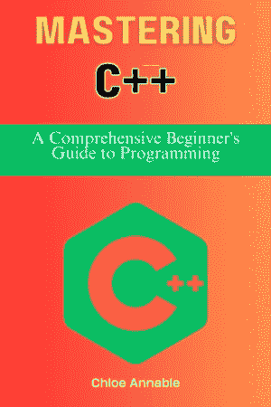

## 引言

本书适合对后端编程感兴趣的初学者程序员。尽管 C++ 有时被描绘为过去的产物，但这种语言仍然与我们并肩存在，并持续支持着我们今天使用的一些顶级技术——更不用说它在游戏世界的巨大影响了。它的强大和多功能使其持续成为我们时代最重要的语言之一。它永远不会消失，学习它将开宽我们的视野。因为开销很小，C++ 经常被数据的后端语言。Spotify、Adobe 和 Amazon 等公司使用 C++ 支持它们的后端，你很快就会知道为什么。许多强大的游戏引擎允许程序员从零构建游戏并有效地渲染内容。Unity 和 Unreal Engine 就是运行在 C++ 之上的游戏引擎示例。C++ 是一种美丽且高效的语言，因为它与硬件的性能比例极佳。这就是为什么学习者热爱它的原因。

在书中，我们将涵盖以下主题：

- 编程术语与原理
- 配置 C++ 环境
- 入门：语法、类型与变量
- C++ 的威力：操作、循环、Switch 与决策
- 创建自定义函数

你还可以在书末找到一个实用的词汇表，这样当你遇到困难时就可以把这本书作为参考。

# 第一章：配置 C++ 开发环境

从最基础的来说，编程是用代码编写一系列机器可以理解的指令列表。代码的结果是可执行文件。这些文件带有扩展名，告诉编译器使用的是什么语言。这些扩展名是你经常在文件末看到的后缀，如`.js`、`.cpp`或`.hpp`。

要编写代码并保存可执行文件，你需要：

1. 一个文本编辑器：这将允许你编写和编辑代码。
2. 一个语言编译器：该程序将你编写的代码翻译成你的计算机可以理解并遵循的机器语言。

所有的编程语言都像这样，但 HTML、CSS 和 JavaScript 除外——这些程序由浏览器（`.html`）解释并执行。这意味着像 JavaScript 这样的浏览器语言是基于软件的，而 C++ 是经过编译直接在你的机器上运行的，而不是在软件环境中。这意味着 C++ 是一种汇编语言。汇编语言是低级编程语言，需要编译器才能在机器上运行（Lithmee, 2018）。在这种语境下，“低级”一词并不带有负面含义；它是一种描述性的，意味着这种语言更接近机器，或者与机器仅一步之遥。

正如你可能猜到的，C++ 是一种可以在几乎任何地方运行的通用语言。这意味着可以通过几种不同的方式进行汇编和编译。这在很大程度上取决于你的操作系统以及你正在使用的创建工具。

我们的 C++ 练习将在在线 IDE 上进行编译。IDE 代表集成开发环境（Integrated Development Environment），用于编辑和编译代码。你觉得这个描述听起来熟悉吗？是的，IDE 是文本编辑器的一个示例，但与纯文本编辑器不同，它具有对编程过程关重要的额外功能。IDE 可以执行编译代码、调试代码、高亮代码、警告你语法错误等操作。

| 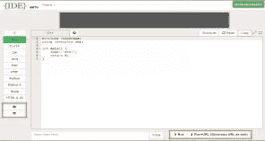 |
| --- |
| GeeksforGeeks IDE：基于 Web 的程序编译器。此 IDE 可以在[`ide.geeksforgeeks.org/`](https://ide.geeksforgeeks.org/) [https://ide.geeksforgeeks.org/] 找到，并支持多种编程语言。我们将专注于 C++。此 IDE 有许多编码工具：标签页工作区、一个输入框和一个代码管理器。该代码管理器包含了左侧高亮的两个按钮。这些代码管理器按钮允许你作为带有相应扩展名的文件下载和上传代码。此 IDE 还允许你运行并生成一个保存结果的 URL。我们将使用这些生成的 URL 来管理我们的课程。 |

专注于编程的 IDE 环境内部始终包含一个文本编辑器和一个编译器。非 IDE 环境则将编译器和纯文本编辑器分开。在非 IDE 设置中，文本编辑器充当编程接口；这简单意味着文本编辑器将是你修改代码的地方。

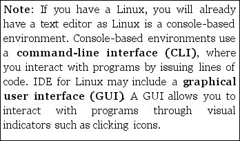

在寻找文本编辑器时，你需要一个具有语法高亮和缩进功能的编辑器，因为所有编程语言都遵循其特定的语法规则。这是因为你希望能够轻松地阅读自己的代码，也希望合作者也能读懂代码。这些文本编辑器通过提高可读性来提供帮助。这一点尤为重要，因为编码不再是也从来不是一项单独完成的任务。现实中不存在电影里那种独行的天才。

Github 和 Pastebin 是启用了语法高亮插件的代码聚合平台。Github 允许你在他们的网站上托管整个项目，而 Pastebin 仅允许代码片段。在这些平台上，你可以用各种语言保存代码。

它们对程序员来说非常有用，因为它们允许程序员共享代码、协作、测试等。学习如何将项目部署到 Github 是编程中最重要的事情之一，因为它已经变得非常标准化。因此，维护一个 Github 档案也变得很重要，因为它包含了你正在进行、曾经进行过的项目以及你的活动（Peshev, 2017）。对于潜在的雇主或合作者来说，这些信息是无价的。

| 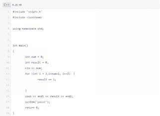 |
| --- |
| C++ 代码语法示例 | 这是一个开启了语法高亮的 Pastebin 截图。[A](https://www.zotero.org/google-docs/?MBrR1L)[“C++ Code,” 2015)](https://www.zotero.org/google-docs/?MBrR1L) [A](https://www.zotero.org/google-docs/?MBrR1L) 。语法高亮和制表间距有助于让代码更易理解。所有带有语法高亮的文本编辑器都会使用这种方案：库显示绿色，函数、数据类型和数据显示蓝色。字符串将显示为红色。 |

当你在本地工作时，无法立即获得这些便利。如果你使用的是 Windows，在系统上找到的文本编辑器是记事本（Notepad）。Wordpad 是另一个具有更多 GUI 特性的编辑器。当你打开这些程序时，你会注意到它们是多么单调和无聊。它们像 Word 但更糟，因为如果编写高效、优雅的代码对我们来说很重要，那么它们就不应该是简单的文字处理程序。它们类文字处理器的特性使得它们更适合在里面写字而不是代码，尽管你也可以在里面写代码。

| 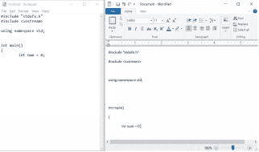 |
| --- |
| Windows 记事本工具与 Wordpad 工具的并排对比 | 这是一个包含 Windows 两个内置工具的截图，左侧是记事本，右侧是 Wordpad。Wordpad 具有更多微软套件的 GUI 特性，这些特性你可能更加熟悉，包括位于高亮“文件”选项卡上方的微软快速访问栏。相比之下，记事本非常简陋。与文字处理器不同，这这两个工具都允许你以不同的文件扩展名保存。然而，Wordpad 比记事本更像文字处理器，它以富文本格式（`.rtf`）保存文件。如果你使用富文本格式以外的扩展名进行保存，Wordpad 会警告你将丢失格式。 |

记事本和 Wordpad 的独特之处在于它们可以以多种扩展名保存文件，而文字处理器则不能。文件扩展名很重要，因为它们告诉编译器如何解释文件中编写的内容，从而让机器拥有一组它可以理解并执行的指令。尽管有这些能力，这两个程序缺乏语法高亮等关键的编辑器功能。你可能认为这没什么大碍，但代码根据其出现的方式和时间意味着不同的含义，因此高亮有助于区分它们的身份。所以，如果一切都是黑白色的，你就必须费力去判断某段代码指的是什么。听起来很复杂，但一旦你开始编程，这就会变得显而易见且必要。Notepad++（不要与 Notepad 混淆）具有高亮功能，但你必须激活它们：

| 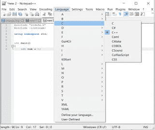 |
| --- |
| Notepad++ 的 C++ 截图 | 这说明了如何通过进入语言（Language）> "C" 并导航到 C++ 来启用语言语法。Notepad++ 仅适用于 Windows 平台（等）。 |

Bluefish 是一个更高级的编辑器，带有更多功能（“Bluefish Editor: Features”等）。与 Notepad++ 不同，Bluefish 在 Windows 之外的多个平台上可用。但我不会向初学者推荐 Bluefish，因为它有很多功能会让完全的新手无所适措。如果你是编程新手，可以尝试一下；你会发现它具有许多 IDE 文本编辑典型功能。一旦进入文本编辑器，你就必须选择一个编译器。现在让我向你展示如何在 Windows、Linux 和 Mac 三个平台上设置你的本地环境。

## Windows IDE 安装与设置

你只需要安装一个 IDE。只需记住它内部包含一个文本编辑器和一个编译器。Code::Blocks 是一个为 C++ 制作的有用开源 IDE，可以轻松适配各种编译器，包括微软的 Visual C++。安装 Code::Blocks 非常简单。你只需要访问他们的下载页面[`www.codeblocks.org/downloads/26`](http://www.codeblocks.org/downloads/26) [http://www.codeblocks.org/downloads/26] 并选择最新版本。

| 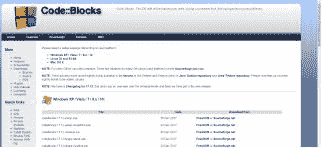 |
| --- |
| Code::Blocks 下载页面 | 截至本文写作，Code::Blocks 有适用于 Windows 和 Linux 发行版的 20.03 版本。页面还包含有助于安装的说明。 |

一旦安装了程序，你就准备好了。你可以用它编写 C++ 程序。要做到这一点，你必须遵循三个步骤：创建文件、生成程序和运行程序。

创建新文件稍微复杂一点。你需要执行操作：

1. 转到`File`（文件）>`New`（新建）。
2. 选择`Create an empty file`（创建空文件）并输入你的代码。
3. 使用`.cpp`扩展名保存文件。

不用说，在运行程序之前必须生成它。你可以通过进入菜单中的`Build`（生成）>`Build and Run`（生成并运行）来实现。

| 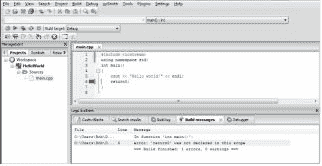 |
| --- |
| Code::Blocks 中 "Hello World" 的截图。此程序显示构建消息中出现了一个错误。`Code::Blocks` 高亮显示了第 6 行的错误。根据你之前章节介绍的 C++ 语法，你应该知道如何修复代码。我们该如何修复代码呢？提示：数据和函数应该显示为蓝色。 |

顺便说一下，对于它允许你完成的工作量来说，这个程序非常轻量。`Code::Blocks` 适用于 Windows 和 Linux，但没有 Mac 版本。

## Mac Xcode IDE 安装与设置

对于 Mac，你需要获取`Xcode`。它是一个针对 macOS 的免费 IDE 软件开发全套件。你可以在 Mac App Store 获取它。`Xcode` 支持`Java`、`Python`和`Ruby`等多种其他语言。

它旨在为 macOS 操作系统开发软件；这包括适用于 AppleTV 的 iOS、适用于 Apple Watch 的`watchOS`以及适用于 iPad 平板的`iPadOS`（“Xcode 9 新功能”等）。`Xcode` 为不同的 macOS 平台提供了多种软件开发工具包（`SDKs`），帮助程序员通过 Apple 的专有编程方案进行开发。`SDKs` 是由硬件和软件供应商提供的工具集，用于开发特定平台的应用程序（“Xcode 9 新功能”等）。`SDKs` 允许开发者完全集成到开发社区中，例如 Apple 或 Android 社区。

Mac 使用专有的编译器，这些编译器只能在`Xcode`中运行，因此如果你在 Mac 上，你除了使用`Xcode`进行`C++`开发外没有其他选择。你可以通过此链接下载并安装`Xcode`：

[Xcode](https://apps.apple.com/us/app/xcode/id497799835?mt=12) [https://apps.apple.com/us/app/xcode/id497799835?mt=12]

文件下载并安装完成后，打开`Xcode`并点击“Create a New Xcode Project”（新建 Xcode 项目）图标。然后在初始窗口中选择“New Project”（新项目）。

| 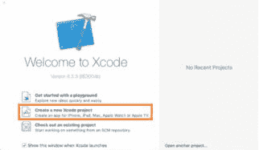 |
| --- |
| Xcode 初始界面：选择新项目。这些截图展示的是`Xcode` 8.3.3 版本（Patel, 2017）。因此，我们的示例可能与更更新的版本有所不同。截至本文编写时，最新版本是 A12.1，主要包含了对各种 macOS 平台 SDK 的更新（“Xcode”等）。尽管存在这些差异，这些截图仍将帮助你在更当前版本中定位。我们的指令仍然产生结果。 |

完成此操作后，会弹出一个提示窗口要求你选择模板。此窗口将引导你完成剩余设置。选择 macOS 部分并进入 Application（应用程序）部分；在那里选择 Command Line Tool（命令行工具）。它看起来像这样：

| 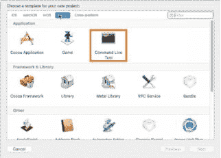 |
| --- |
| 1. 项目选择屏幕：macOS > Application > Command Line Tool。`Xcode` 有许多内置代码工具用于在各种 Apple 平台上运行程序。因此，为了运行测试程序，你必须选择 macOS 才能运行你的程序。此外，为了访问`C++`所需的汇编语言开发，你需要使用`Xcode`的命令行。该命令行还可以处理 Objective-C 和`C`语言。 |

选择模板后，指南将提供命令行工具的选项。在这里你可以命名项目、添加你的组织、使用标识符（identifier）并选择编程语言。

| 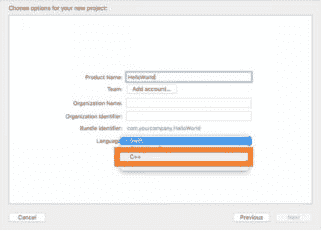 |
| --- |
| 2. 命令行工具选项：Language > Select C++。`Xcode` 的命令行可以处理像 Swift 这样的 Apple 专有。该程序可以与基于 C 的语言编译器一起运行。默认选择 Swift。 |

在同一个窗口中，你将被添加一个组织。记住`Xcode`的命令行是专有 macOS 操作系统的模板，因此标识符用于在 Apple 中为你的程序创建一个唯一的标识符：开发者网站和云容器，通往 App Store 的门户。这将你的应用流式传输到专有的 macOS 框架中。

|  |
| --- |
| 3. 命令行工具选项：Identifier > "cpp"。标识符是一种命名规范，帮助程序员将项目集成到 Apple 的软件开发方案中。在这里，我们使用 "cpp" 作为我们的标识符，生成`cpp.HelloWorld`作为我们的标识符。一旦我们指定了它，指南允许我们进入下一步。 |

现在，将你的项目保存到选择的目录中。在左侧面板中，`Xcode` 将打开该文件。你必须选择`main.cpp`以在`Xcode`中访问你程序的全局`C++`文件。如果你愿意，可以将`.cpp`文件上传到目录并编辑它们。

|  |
| --- |
| 3. Xcode 命令行工具："main.cpp"。此截图展示了 IDE 风格的`Xcode`命令行工具工作空间。它在文本编辑器中打开了 （Patel, 2017）。 |

你写了一些代码并想要运行它，选择 product（产品）并点击 Run（运行）。你也可以通过选择按钮来运行并构建程序。

|  |
| --- |
| 4. Xcode 命令行工具："Hello World" 构建与运行。与`Code::Blocks`类似，你也必须构建并运行程序。此截图还展示了 "Hello World" 的结果和返回值（Patel, 2017）。 |

如果你是一个认为自己将与 Apple 设备工作的程序员，在`Xcode`中工作和练习是一项很好的投资。例如，Apple 拥有健康的市场份额，提供广泛的消费品和服务，如流媒体服务和设备。尽管如此，你应该记住`C++`主要用作服务端语言。大多数服务端编程都在 Linux 机器上完成。

## Linux 编译器安装与设置

由于 Linux 是一个使用控制界面的操作系统，对于初学者或习惯了 Windows 或 Mac 的人来说可能会很奇怪。这是因为用户通常习惯了 GUI（图形用户界面）。Linux 的 GUI 化允许释放更多的计算能力用于编程——因为 GUI 需要一定的计算能力来生成和维护。这就是为什么许多服务器和其他编程环境使用控制界面。此外，许多环境使用 Linux 发行版。

Linux 发行版（distro）是一种基于 Linux 内核软件集合以及用于安装额外软件的包管理系统的操作系统。

以下是安装和初始化编译器的指令。这将适用于 Ubuntu，一种流行的初学者 Linux 发行版。在你使用的任何 Linux 发行版中，这些安装过程都是相似的。

注意：有许多 Linux 发行版提供用户喜爱的基于 GUI 的桌面体验。其中大多数是开源的并可以免费下载和安装。你可以探索这些发行版并创建控制界面进行练习。一个值得考虑的免费发行版是 CentOS，它基于 Red Hat 用于服务器管理。红帽企业级 Linux（RHEL）用于许多服务器管理设置，并且不是免费。然而，CentOS 使用了它的许多组件，是准备在 Red Hat 环境工作的极佳发行版。

在本示例中，我们将使用 Linux 上的 GNU 编译器集合（GCC）。GNU 编译器是一个基于 Linux 的编译器，支持 C++ 以及其他各种语言，如 Fortran、`ada`和 Java（“GCC 7 Release Series—Changes, New Features, and Prefixes—GNU Project—Free Software Foundation (FSF)”等）。要安装 GNU GCC，请遵循以下步骤：

### 1. 在控制台中，输入以下命令

首先通过输入此命令检查机器是否已经安装了版本：

```bash
gcc -v
```

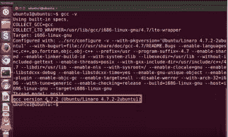

#### 1. 在 Ubuntu 控制台中检查 GNU GCC


你应该检查系统是否有`GCC`副本。此截图显示了一个已安装`GCC`的系统。在使用命令后，如果你的系统中没有`GCC`副本，将缺少这一行。如果有副本，它将有一行类似的内容。很可能你的版本会更近。

以下命令将在你的系统中安装`GCC`：

```bash
sudo apt-get update
sudo apt-get install gcc
```

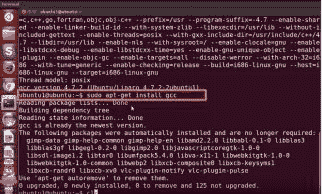

## 1. 在 Ubuntu 控制台中安装 GNU GCC

在截图中，GNU GCC 已经存在。如果系统中不存在 GNU GCC，运行高亮命令将在你的系统上安装 GNU GCC（Patel, 2014）。控制台将提示你输入“Y”来开始安装。你还将获得包管理功能，例如终端可以你过时或不需要的包。它还会建议让你的系统更高效的命令。这解释了 Linux 为什么在程序员中如此受欢迎；尽管它允许他们轻松地排除故障，给予他们更多控制权，并且与 GUI 相比更容易导航。这是因为程序员更有可能记住一行代码，而不是某物在 GUI 中的位置。

以下命令将安装编译并最终运行 C++ 所需的所有库：

```bash
sudo apt-get install build-essential
```

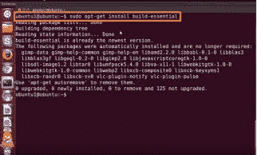

## 2. 在 Ubuntu 中安装 GNU GCC

此截图显示了一个安装了`build-essential`库并输入高亮命令的系统。与安装 GCC 类似，在使用命令并在发现系统中没有`build-essential`副本后，它会提示你安装“Y”，然后终端将安装库。

## 3. 使用以下命令检查安装

```bash
g++ --version
```

如果一切顺利，它将告诉你安装了哪个版本的 GCC。由于 Linux 有内置的文本编辑器，你将需要使用以下命令访问文本编辑器的 GUI：

```bash
gedit
```

你可以自由地按照你的意愿编写程序。记住以`.cpp`扩展名保存程序，以便它们能被正确编译。

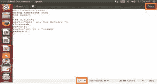

`gedit` Ubuntu 此截图显示了 Linux 的内置文本编辑器`gedit`，`gedit`是一种 Linux 编程文本编辑器工具，具有针对多种编程语言的语法高亮和标签页功能。确保从高亮的下拉菜单中选择“C++”。你可以通过点击“保存”按钮在 GUI 中保存你的程序文件。确保列出你保存文件的目录，因为你必须将编译器指向该目录以编译和运行代码。

要测试并运行你的代码，你必须遵循这些指令：

## 4. 终端进入文件目录

要做到这一点，请使用此命令。重复进入目录直到显示`.cpp`文件：

```bash
ls
```

## 5. 编译并测试程序文件

使用这些命令进行操作：

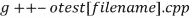

如果有任何错误，此命令将告诉你哪一行包含错误，就像你从 IDE 中预期的那样样。然后你可以通过`gedit [filename.cpp]`打开程序文件并修复代码行。

## 6. 运行程序文件

编译器将创建一个名为`test`的可执行文件来运行程序。你可以通过在终端输入`./test`来执行它。

```bash
./test
```

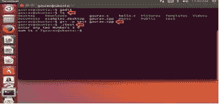

在 Ubuntu 中测试、编译和运行`.cpp`文件 此截图显示了终端测试、编译和运行在`gedit`中编写的示例代码（运行 AC、Linux C++ 程序、Ubuntu 16.04（初学者 Ubuntu 教程）等）。

Linux 发行版是详细的基于控制台的系统，大多数系统可以通过终端处理任何语言的编程。学习在 Linux 环境中工作是有益的，因为它让你接触到服务器端编程。

注意：在 CentOS 上安装 GCC 和进行编译的过程类似。要进行安装，你仅需使用`!!`。此命令会自动安装所需的库。编写、编译、测试和运行程序的步骤都是相同的。

创建你自己的编程环境有助于你应对在线编程空间无法提供的真实世界场景。在本书中，我们将使用在线 AIDE。这是因为每个人都拥有相同的学习环境，并具有标准化的输出和界面。这简化了事情。

# 第 2 章：C++ 基础、编程原理

编程语言与其他任何人类语言一样：它们有自己的结构、语法和规则。仅仅知道另一种语言的词汇是不够的。了解如何使用它们以及它们在该语言中如何运作，是在该语言中进行有效交流不可或缺的一部分。编程语言的功能也是如此，但它们关注的通信是人与机器之间的相互帮助。虽然机器至少在今天永远不会像我们一样聪明和能干，但有很多东西它们可以理解并以我们无法想象的效率进行操作。所有的编程都是指令集。这些指令可以是规则，可以是你想让机器执行的动作，或者是其他东西。但这一切通信之所以可能，是因为我们遵循了编程语言的规则。

编程规则（或语法）是一系列用于界定的符号，用于通信程序的各个方面，例如函数和变量。语法对于编译器来说很重要，因为它告诉编译器应该向机器发出哪些指令。

在我们开始之前，值得记住几点。与`Python`或其他高级编程语言不同，C++ 并不那么容易类似于人类语言。像 JS、Python 和 C# 等高级语言设计成这样是为了让它们易于阅读和管理。C++ 尽管如此，但它更易被机器理解，恰恰是因为它不那么抽象。这就是为什么在处理 C++ 工作时，你只需要一个编译器和一个文本编辑器，而像 Python 这样的语言需要安装它们的环境。

## 编程原理

C++ 有许多方法可以完成相同的任务。就像人类语言一样，有许多方式表达相同的意思，但某些方式适用于特定的场合，而另一些则不然。C++ 也是如此；某些方法非常好，因为它们减少了程序的开销。许多开发者会希望这样，因为提高了整个应用程序的性能，这就是编程的第一条原则：用尽可能少的函数完成任务。不要让事情变得比需要的更复杂。在大多数情况下，这意味着以节约的方式使用循环或`switch`语句。

实现此点的最好方法是首先理解问题的本质以及如何最好实现解决方案。换句话说，你需要编写一个算法——一组你想让机器遵循以解决问题的指令。

你的设计应该从你想让程序做的事情开始。这也将包括你的算法，或者至少是算法将解决的问题。算法总是看起来像这样：

1. 输入：适用时传入的数据
2. 处理：对数据执行的操作以及变量的
3. 输出：结果或你想执行的动作

这是一个显示"Hello"的 C++ 程序详细示例：

```cpp
#include <iostream>
using namespace std;

int main() {
}
```

其结构如下：

1. 调用输入输出的头文件
2. 调用执行执行的`main()`函数
3. 打印"Hello"
4. 终止一个指示机器状态的语句

我们可以看到 C++ 需要执行所需的库。尽管很简单，但这个算法说明了开发者如何获取任务并将其翻译成代码。在下一章中，我们将使用这个算法来编写程序。正如你在示例中注意到的那样，这里有注释。包含注释是一个良好的习惯，这样人们就知道每行代码的作用。

## C++ 语法概述

我们讨论过语法对编译器的重要性，但理解语言的语法同样重要，因为它允许你调试代码。就像人类语言一样，如果你了解一种语言的规则，当你出错时可以很容易纠正。调试是发现并移除代码中错误和异常的过程，也称为“bug”。

IDE 具有可以高亮代码错误位置的调试工具，但这些功能并不总是可靠。例如，缺少分号来结束一行代码是一个常见错误，但调试器会高亮`.h`文件中的错误，而不是`.cpp`文件中发生错误的地方。大多数调试器并不智能到可以检测到缺失，并且当未结束的行违反库中的规则时，抛出编译器给出的详细错误。

这个“Hello World”程序在 GeeksforGeeks IDE 中展示了一个缺失分号的“Hello World”程序截图。你会立即注意到，该 IDE 对 C++ 的语法高亮与我们在上一节中探索的编程环境不同。语法会随平台而变化。这就是我们为什么要使用 GeeksforGeeks IDE 来标准化流程的原因。在我们选择的 IDE 中，分号没有被高亮。然而，该 IDE 可以通过识别和标记缺失的分号来弥补这一点，如截图所示。你可以访问其生成的 URL 来练习和探索此程序：[`ide.geeksforgeeks.org/mzbuPP46Sl`](https://ide.geeksforgeeks.org/mzbuPP46Sl)。

当代码较小时时，很容易看出这一点，但当处理较大的项目时，任务可能会变得困难。我听过有些程序员花费一周或更长时间来尝试寻找或修复代码中的某一行，结果发现它只是一个非常微小的错误，比如漏掉字母或大小写不匹配。为了让调试更简单，建议将代码拆分为更小的模块（“什么是调试？”，n.d.）。通过这种方式，可以发现并轻松处理许多错误。

让我们来看“Hello World”程序并详细学习它的语法。虽然语法高亮在不同平台之间可能有所不同，但代码的这些方面在所有平台上都是一致高亮的。

**注释**：如 AI 所说，这些是编译器将忽略的代码行。它们用于注释代码，并为其他程序员留下有帮助的解释。这非常棒，因为通常我们在编写代码时会与他人协作。建议你在你的算法中留下注释，以便他人理解。在大多数平台中，注释会被高亮为绿色。注释总是以`//`开头。

**头文件库**：以`#`开头的行被编译器用于调用库函数。这些行非常重要，因此它们出现在每个程序中。在“Hello World”示例中，我们调用了一个用于管理字符串的库。这些代码行在不同平台上以不同的颜色高亮。在 GeeksforGeeks 中，颜色是紫色。

**语句**：语句用指令描述代码行的开始，编译器会识别这些指令。这包括如`using`或`return`这样的声明。它们在不同平台上的高亮方式也不同。在 GeeksforGeeks 中高亮为紫色。

**函数**：这是封装指令的代码。它可以接收输入并输出结果。每个函数的写法如下：函数名后面跟着大括号`{}`。大括号内的任何内容都是将执行的指令集。在我们的示例中，`main()`是初始化输出“Hello World”指令的函数。在`.cpp`程序中，`int main()`必须出现。

**数据**：这些是变量和其他类型的数据语句。在 IDE 中，它们被高亮为蓝色。


GeeksforGeeks IDE 中的“Hello World”程序与其文章中嵌入代码的对比。这张截图展示了“Hello World”程序的成功运行。右侧的两张截图展示了相同代码的“亮色模式”和“深色模式”视图。这些视图更加详细，高亮了注释、语句和数据。

“Hello World”是每种编程语言的入门项目；其目的是向学习者展示程序的基本语法以及函数的工作原理。随着你学习越多的语言，你将编写许多“Hello World”程序。在上一节中，我们用它来探索算法、语法和 C++ 编程环境等主题。在本节中，我们将更进一步：对代码进行操作。

C++ 使用来自`iostream`库的`cout`对象。对象是计算机用于管理数据的实体。在我们的示例中，`cout`被配合`<<`运算符告诉编译器打印“Hello World”。不要惊慌；我们将在后面的章节中讨论操作符和对象。现在，理解编译器将`cout`读取为特定的特定指令就足够了，因为该指令定义在我们声明的`iostream`库中。

现在，让我们通过更改输出内容来看查看“Hello World”和`cout`对象。在这里找到原始代码，以便将其作为参考：[`ide.geeksforgeeks.org/eA8ZMEKiDO`](https://ide.geeksforgeeks.org/eA8ZMEKiDO)。

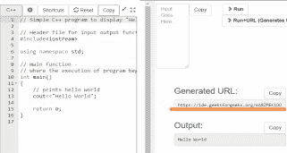

GeeksforGeeks IDE 中的“Hello World”程序。此截图是在分屏模式下成功运行“Hello World”的界面。当我们开始使用 IDE 进行编码练习时，请注意输入框和输出框。虽然此程序没有输入，但当输出区域下程序提示时，你会将数据输入到标记为“Input Goes Here...”的顶部框中。你可以在这里保存的 IDE 中访问此程序：[`ide.geeksforgeeks.org/eA8ZMEKiDO`](https://ide.geeksforgeeks.org/eA8ZMEKiDO)。你也可以在索引中查看代码的副本。

## 使用`cout`

`cout`对象使用`<<`运算符来打印值和文本，我们可以根据需要使用任意数量的它。使用浏览器中的 IDE，将代码更改为打印：

```cpp
Hello World
I am learning C++
```

如下所示：

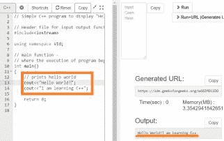

添加`cout`对象。此截图是在分屏模式下成功运行我们编辑后的“Hello World”程序的界面。虽然程序运行没有任何错误，但它没有产生我们想要的结果。观察输出发现，打印的文本缺少换行。我们必须指示编译器添加换行以获得预期的结果。添加行可以通过多种方式实现：我们可以在字符串内部添加分隔符，或者使用来自`iostream`库的另一个操作符对象。

## 使用转义序列

尽管可能想在`cout`中编写字符串并换行，这是行不通的。它会破坏代码并导致无法运行。不相信我的话？试试看！你可以通过转义序列来添加换行。转义序列用于许多需要在字符串和字符流中引入特殊字符的场景。它也可以添加行，如下所示：

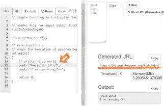

使用字符串内转义序列来分隔和处理输出。使用，我们能够获得预期的输出。

当你查看代码时，可以看到使用了双重引号。因此，如果你想在字符串中添加双引号，将必须使用转义序列，以便编译器知道它不是代码的一部分，从而避免不可预见的错误或漏洞。这就是转义序列重要原因。以下是可以使用它们的许多实例列表（转义序列—Cppreference.com.）：

- `\'`：单单引号
- `\"`：双引号
- `\n`：换行符
- `\?`：问号
- `\\`：反斜杠
- `\t`：制表符
- `\r`：回车
- `\a`：水平制表符
- `\v`：垂直制表符

注意：如果你决定尝试不同的转义序列作为文本分隔符，请务必只使用显示的那些。在另一个 URL 处有一个保存你的工作以便稍后返回的按钮。要返回我们的练习，你可以使用我们保存的 IDE 工作空间 URL（[`ide.geeksforgeeks.org/PsgSHE4h`](https://ide.geeksforgeeks.org/PsgSHE4h)）。你也可以在索引中访问此代码。

## 使用`endl`：输入输出操作符

正如我们所说，编程语言像人类一样灵活。你可以用多种方式表达一条指令，结束字符串也不例外。转义序列和`endl`区别在于`endl`会刷新并刷新用于存储字符串的缓冲区。程序员使用`endl`在打印大量文本后清理内存。你可以看到这在内存管理很有用。`endl`是输入输出操作符的一个示例。输入输出操作符是允许使用`<<`运算符或`>>`运算符控制输入输出流的函数（输入输出操作符—Cppreference.com.,.d.）。

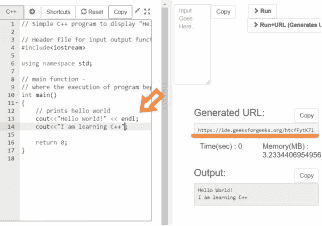

使用输入输出操作符来分隔和处理输出。此截图是在分屏模式下成功运行我们编辑后的“Hello World”程序的界面。使用，我们能够获得预期的输出。在如此小的程序中，很难看到使用操作符的影响。操作符在调用函数中使用时才会产生差异。你可以在此 URL 访问代码：[`ide.geeksforgeeks.org/htcfFytK71`](https://ide.geeksforgeeks.org/htcfFytK71)。

## 更多输入输出操作符

就像转义序列一样，还有许多输入输出操作符可以让程序员对数据类型或字符串有更多控制。当我们讨论数据类型和类结构时，其中许多将变得意义。以下是其中一些（输入输出操作符—Cppreference.com.,.d.）：

- `setw`：设置字段宽度
- `fixed`：使用定点表示法
- `setprecision`：设置小数位数
- `left`：输出向左对齐
- `right`：输出向右对齐
- `hex`：以十六进制显示数字
- `oct`：以八进制显示数字
- `dec`：以十进制显示数字

“`A A`：对于数学输出，`A`控制是否使用前缀来指示数值进制”


“`A A`”：符号用于表示非负数。

“`A A`”：控制特定输出格式中大写字母的使用。

“`A A`”。

“`A A`”：刷新输出流。

“`A A`”和刷新输出流。

“`A A`”：接收作为货币值的输入。

“`A A`”：格式化并输出货币值。

“`A A`”：根据指定的格式接收作为日期/时间值的输入。

“`A A`”：根据指定的格式接收作为日期/时间值的输入。

注意：回想我们关于 C++11 和 C++14 的讨论，大多数编程 IDE 都使用 C++11 作为默认版本。`get/put...`函数都存在于 C++11 中。如果你在使用这些操纵符时遇到错误，请检查你的设置是否在使用 C++11。此外，`A A`是仅限 C++14 的操纵符。该操纵符允许你插入和提取带有空格的引号字符串 [A](https://www.zotero.org/google-docs/?6OhBz2)[(](https://www.zotero.org/google-docs/?6OhBz2) [A](https://www.zotero.org/google-docs/?6OhBz2)[“](https://www.zotero.org/google-docs/?6OhBz2) [A](https://www.zotero.org/google-docs/?6OhBz2)[Input/output Manipulators—Cppreference.com，“ In n.d.](https://www.zotero.org/google-docs/?6OhBz2) [A](https://www.zotero.org/google-docs/?6OhBz2) 。

## 省略命名空间

我们已经讨论过使用`using namespace`语句。我们说过它有助于全局声明字符串，但对于像“Hello World”这样的小程序来说，这并不那么重要。对于使用多个函数的较大型程序，使用该语句单独声明每个字符串是一个良好的做法。这可以节省编译器的内存空间，否则你会发现编译器被不必要地阻塞，必须加载整个字符串命名空间库来打印代码。单独声明每个字符串可能会让你的代码更冗长，但它会减少编译开销并聚焦你的指令。`std`命名空间包含多个对象和定义，这使得计算机难以找到操作和定义字符串的适当方法。当你有会被多个程序调用的函数时，命名空间约定非常重要。因此，不必要地将其放在那里可能会导致你的函数定义不当，并引起它们之间的识别错误。

让我们通过从代码中移除`using namespace`来让我们的代码更高效。

| 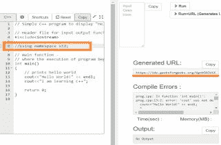 A |
| --- |

| 测试稳定性：使用注释移除“using namespace”。此截图是在删除了``之后，“Hello World”程序的失败测试运行。你可以通过以下 URL 访问此保存的 IDE 空间：[`ide.geeksforgeeks.org/VgobOAOdiX`](https://ide.geeksforgeeks.org/VgobOAOdiX)。“注释掉”代码行是测试代码稳定性的非常高效的方法。你可以删除双正斜线来移除注释并随时恢复代码行。这允许你在不破坏代码的情况下进行测试。一旦你完成测试，删除任何不需要的代码行是一个良好的做法。在测试期间，你始终可以使用上面的 URL 返回到此保存的实例。你也可以访问原始代码。 |
| --- |

当你移除`using namespace`时，会发生以下情况：

```cpp
int main() {
    cout << "Hello World" << endl;
}
```

```cpp
int main() {
    std::cout << "Hello World" << std::endl;
}
```

```cpp
int main() {
    using std::cout;
    cout << "Hello World" << endl;
}
```

```cpp
int main() {
    using std::cout;
    std::cout << "Hello World" << std::endl;
}
```

```cpp
int main() {
    using std::endl;
    cout << "Hello World" << std::endl;
}
```

```cpp
int main() {
    using std::endl;
    std::cout << "Hello World" << endl;
}
```

```cpp
int main() {
    using std::cout;
    using std::endl;
    cout << "Hello World" << endl;
}
```

仔细观察，编译器告诉我们需要将它们声明为：

| 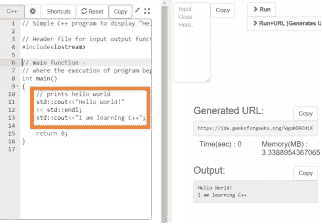 A |
| --- |

| 声明对象和操纵符。此截图是在删除了``之后，“Hello World”程序的成功测试运行。一旦成功声明了对象和操纵符，该行被移除。如果你想练习，可以使用这个[`ide.geeksforgeeks.org/VgobOAOdiX`](https://ide.geeksforgeeks.org/VgobOAOdiX)。 |
| --- |

## 变量

变量是任何编程语言中最重要的方面之一。编程语言的函数和其他操作通常对变量进行操作。正如我们所说的，并不是所有程序都需要输入或输出，但所有程序都会有一些正在处理的变量，否则就无事可做了。

函数的结果始终是状态改变。状态改变是指机器从一个决策或操作阶段变为另一个阶段。这个术语曾用于描述旧大型机计算机中的操作，但我们仍然在计算机中使用它来描述程序的工作原理。在我们的示例中，IDE 在程序运行之前从初始化的主状态开始。然后它切换状态以执行输出命令。

状态改变经常在低级语言中被讨论，因为它们接近机器语言。低级语言也被编译语言，因为它们被编译成机器语言。这与 Python 等高级语言形成对比。如果你还记得，我们讨论过由于内置库的存在，高级语言不需要声明带有其数据类型的变量。例如，Python 使用 Python 环境来识别变量及其数据类型。而在 C++ 中，变量和数据类型必须声明。数据类型告诉编译器如何处理数据。当你考虑到数学中的向量时，数据类型就更有意义；与表示数量的整数不同，向量告诉我们空间的尺寸和方向。因此，向量是与整数不同的数据类型。这类属性用于 Photoshop 等软件中以帮助渲染。

注意：基于向量的图像可以在不丢失图像质量的情况下进行。这是因为`.jpeg`或`.png`等文件将图像的像素位置作为整数存储在网格上。`.svg`或`.pdf`等矢量文件使用向量来描述它们的像素分配。因此，当图像放大时，向量会指示颜色如何扩展，而普通图像文件则不会。这就是在处理非矢量图像文件时导致像素化和失真的原因。

## 输入与输出：声明变量

在上节中，我们在学习如何使用`cout`时声明了一些内容。在本节中，我们将查看数据类型的示例以及如何声明它们。以下是变量声明示例及其含义（“C++ Variables”，n.d.）。请记住，变量本质上存储的是类型的数据：

- “``”是“integer”的缩写，存储不带小数的整数。该关键字包括正整数和负整数。
- “``”：存储带小数的数字，包括正数和负数。
- “``”是“character”的缩写，无论大小写都存储单个字符。`Char`值用单引号括。
- “``”：存储文本，例如我们的“Hello World”示例。`String`值用双引号括。
- “``”是“Boolean”的缩写，存储两个状态的值：`true`或`false`。正如之前过的，这些值可以表示为“0/1”或“false/true”。

在下一节中，我们将详细讨论它们。现在让我们来看这些示例。要创建一个变量，你必须在`=`操作符之后分配值。它们的语法如下：

```cpp
datatype name = value;
```

注意：每个``在你的函数内部必须是唯一的。否则将会导致错误。现在让我们创建一个名为`myNum`、数据类型为`int`、值为`10`的变量，然后让我们的程序打印出来。


声明`int`数字。此截图是“myNum”程序的成功测试。你可以通过以下 URL 访问保存的 IDE 工作空间：[`ide.geeksforge.org/t4P6qCVkg`](https://ide.geeksforgeeks.org/t4P6qCVkg)（注意：文本中的 URL 似乎是一个占位符）。根据最佳实践，此代码没有包含``。你应该练习使用命名空间成功实现相同的代码。记得你可以使用 URL 将工作空间重置为成功状态。

我们在代码中有了示例。让我们使用右上角的输入框，让程序接收输入并对其进行操作。我们可以通过编写接收两个数字并将它们相加的程序来实现。为了做到这一点，我们必须声明两个变量来存储程序的输入以便程序进行操作。我们将声明多个变量：

1. 两个名为`x`和`y`的`int`变量。
2. 一个名为`sum`的`int`变量。

我们还可以让程序提示用户给出输入。注意：在我们的 IDE 中，你必须在运行程序之前输入。每个输入应该占一行。


输入汇总并打印结果。此截图是“Summing”程序的成功测试。你可以通过以下 URL 访问保存的 IDE 工作空间。此练习必须针对我们 IDE 的输入系统进行修改。因此，我们包含了额外的``行来确认我们的输入。根据最佳实践，此代码没有包含``。你应该练习使用命名空间成功实现相同的代码。记得你可以使用 URL 将工作空间重置为成功状态。

## 数据类型

数据类型指定了存储在变量中的信息的大小和类型。每个类型都有自己的关键字和关联的大小（“C++ Data Types”，n.d.）：

- “``”是“integer”的缩写，存储整数。大小为 4 字节。
- “``”：存储带 7 位小数的数字。大小为 4 字节。
- “``”：存储带 15 位小数的数字。大小为 8 字节。
- “``”是“character”的缩写，无论大小写都存储单个字符。大小为 1 字节。
- “``”是“Boolean”的缩写，存储具有`true`或`false`状态的值。大小为 1 字节。

注意：我曾大量地使用过这种特殊的数据类型`string`。`String`值的大小各不相同。因此，它们在`iostream`库中被处理，以便为文本处理提供更灵活的活性。我们将在下一节回到字符串并讨论一些高级主题。

这些大小对数据处理至关重要。例如，当你将`int`配合`float`或`double`使用，所有这些数字都会转换为`int`。这是因为编译器使用`4`字节来计算整数，而没有为小数分配空间。程序仍然运行，但你的计算结果将是不准确。让我们通过修改程序并查看结果来进一步探索这一点。我们将使用一个常用的小数`(pi)`。它将测试`float`和`double`的极限。

| 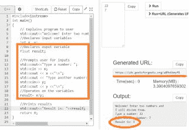 |
| --- |

| 将`Int`与`Float`或`Double`使用。此截图显示我们修改后的程序成功测试，该程序计算了未修改以存储小数的数值。结果是结果缺失了小数部分。 |
| --- |

为了得到我们想要的结果，最好的办法是更改变量数据类型。使用`float`数据类型与使用`double`数据类型会有不同吗？我们可以预期不同的结果吗？记住你可以通过使用`URL`返回工作区的成功状态来重置。

| 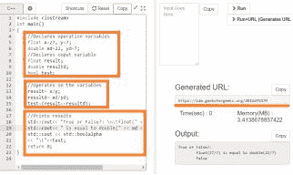 |
| --- |

| 比较`Float`和`Double`。此截图显示我们修改后的程序成功测试，我们删除了输入语句并排列了数据类型。我们强烈建议你使用此 URL 分配的之前的程序自己创建此程序：[`ide.geeksforgeeks.org/a8Mw6tmyf8`](https://ide.geeksforgeeks.org/a8Mw6tmyf8)。这个练习将让你练习我们之前讨论过的一些编码主题，包括： |
| --- |

1. “``”数据类型关键字。
2. “``”输入输出操纵符。

它还将让你获得一些逻辑运算符的经验。我们将在下一章详细讨论逻辑运算符。一旦你操作了程序，打开一个新窗口，并将其与上方截图的成功运行进行比较。你可以在此 URL 找到带有成功运行的保存 IDE 工作区：[`ide.geeksforgeeks.org/dNIUdYtN7M`](https://ide.geeksforgeeks.org/dNIUdYtN7M)。

## C++ 的力量：高级字符串

我们将讨论的另一个数据类型是字符串。字符串是计算机科学中最流行的数据类型之一；它们是字符序列。将它们想象成句子可能会有用，但并不是每个句子都代表一个字符串。我们已经看到它们在“Hello World”应用程序中是如何工作的。字符串是一个独立的数据类型，有它们自己的库。为了操作和使用它们，程序需要适当的`<string>`库。库具有允许程序操作字符串的方法和特性。

### 操作：字符串拼接（String Concatenation）

字符串拼接是将不同的字符串组合成一个字符串。它是组合字符串。这是程序最常见的功能之一。例如，当你在网站上输入姓名并切换到另一个页面，屏幕问候你“Hello, [your_name]!”时，程序就使用了拼接来实现这一点。它将“Hello,”与你的名字以及“!”结合了一起。

在 C++ 中，字符串拼接通过`+`运算符完成。让我们通过创建一个打印带有问候语的输入字符串的程序来观察此操作。为了使其工作，我们必须包含`<string>`库，它包含了处理字符串所需的对象和语句。打开我们一直在使用的 IDE 的新实例并按照以下步骤操作：

1. 除了``库。
2. 省略``。
3. 移除``中的当前代码。
4. 声明并设置变量``。
5. 声明并计算`` `+`运算符。
6. 输出结果为“Hello John.”

它看起来应该这样：

|  |
| --- |

| 字符串拼接。此截图是我们字符串拼接程序的成功测试。我们鼓励你在另一个窗口中打开此程序并将其与你的程序进行比较。你可以在此 URL 访问成功运行：[`ide.geeksforgeeks.org/B7XerpI9OE`](https://ide.geeksforgeeks.org/B7XerpI9OE)。注意：务必对你的代码进行注释。你可以简写指令并将它们作为即兴算法来注释你的代码。这将帮助你保持程序有序。 |
| --- |

通常，在论坛中，拼接的文本输入保持尽可能小，格式由程序完成。在示例中，我们必须手动在“Hello”和“John”之后添加空格，但程序会自动添加空格。现在你已经看到`+`运算符是如何工作的，你可能会如何添加空格呢？看看通过玩弄编辑器中的代码，你是否能搞定它。如果事情一团糟，你随时可以点击 URL 返回到我们成功的 IDE 工作区。


注意：`+` 运算符既用于数字加法也用于字符串拼接。尝试使用该运算符将字符串和数字相加将产生错误。你可以使用上一节的修改后的程序自行进行测试。你还可以在此 URL 检查该程序的成功运行，该程序展示了如何将数字转换为字符串：https://ide.geeksforgeeks.org/glPmslDwF7。取消注释以尝试添加数字和字符串，以便亲眼看到错误。该错误非常长且详细，因为它在`<iostream>`和`<string>`库之间存在冲突。

## 字符串对象：`Length()` 属性

我们从现实经验中知道字符串像任何事物一样，有不同的大小。这与我们目前探索的其他数据类型不同。C++ 使这成为可能，因为它将字符串构造为带有属性的对象。C++ 在 `Length()` 属性下定义字符串长度，正如你在对象预期那样。要访问长度，字符串必须绑定到变量，并且你必须使用 `.` 语法。

```cpp
string_name.length()
```

回到我们的程序并获取 `fullName` 的长度。我们需要通过添加上述语法的新行和另一行输出来修改代码，如下所示：

| 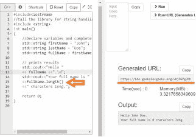 A |
| --- |
| `Print fullName.Length()` |

这张截图是我们修改后的字符串拼接程序的成功测试运行。我们鼓励你通过此 URL 修改程序：[A](https://ide.geeksforgeeks.org/B7XErpI9OE)[`ide.geeksforgeeks.org/B7XErpI9OE`](https://ide.geeksforgeeks.org/B7XErpI9OE) [A](https://ide.geeksforgeeks.org/B7XErpI9OE)。一旦你修改了程序，可以在另一个窗口中打开它并与此成功测试运行进行比较。你可以通过以下 URL 访问此保存的 IDE 窗口：[A](https://ide.geeksforgeeks.org/xbjO6Pg3Nh)[`ide.geeksforgeeks.org/xbjO6Pg3Nh`](https://ide.geeksforgeeks.org/xbjO6Pg3Nh) [A](https://ide.geeksforgeeks.org/xbjO6Pg3Nh)。

## 字符串索引与数组

回想我们关于对象的对话。向量数组也是一种特殊的数学现象，具有其特殊的属性。数组是对象的有序排列——通常是行、列或矩阵——每个对象都有其特定的位置。字符串存储在由字符组成的数组中。因此，字符串数组是字符的有序排列，字符串中的每个字符都有其自己的索引位置。使用 `[]` 访问数组以查找数组中的任何字符或其他项。字符串索引从 `[0]` 开始。让我们通过修改程序使其打印出 `fullName` 的第 3 个字符来观察这一操作。

注意：请记住索引从 `[0]` 开始。因此，字符串数组中的第 3 个字符位于 `[2]`，而不是 3。

我们将使用以下语法来实现此：

```cpp
fullName[x]
```

`x` 代表我们想要打印的字符的索引。记得也要修改输出内容以正确打印字母。你还需要使用像这样的转义序列：

| 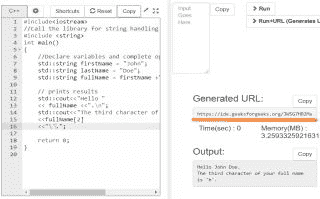 A |
| --- |
| `Access fullName StringArray` |

这张截图是我们修改后的字符串属性程序的成功测试运行。我们鼓励你通过此 URL 修改程序：[A](https://ide.geeksforgeeks.org/xbjO6Pg3Nh)[`ide.geeksforgeeks.org/xbjO6Pg3Nh`](https://ide.geeksforgeeks.org/xbjO6Pg3Nh) [A](https://ide.geeksforgeeks.org/xbjO6Pg3Nh)。一旦你修改了程序，可以在另一个窗口中打开它并与此成功测试运行进行比较。你可以通过以下 URL 访问此保存的 IDE 窗口：[A](https://ide.geeksforgeeks.org/JWSG7HB2Ms)[`ide.geeksforgeeks.org/JWSG7HB2Ms`](https://ide.geeksforgeeks.org/JWSG7HB2Ms) [A](https://ide.geeksforgeeks.org/JWSG7HB2Ms)。

在我们的示例中，我们非常依赖输出能力，但正如我所提到的，程序员还使用其他字符串处理能力从不同来源获取字段内容。这些是对象和 `getline()` 函数。

## `Cin` 和 `getline()` 函数

在上一章节的示例中，我们使用了 `cin`。像 `out` 一样，`cin` 是 `<iostream>` 库中的一个对象，允许程序使用 `>>` 运算符接收输入。像 `out` 一样，`cin` 对象必须定义 `std` 类型。让我们修改拼接程序，使其接收 "John" 的输入。如果你喜欢，也可以使用你的名字。你需要遵循这些指令：

1. 导航到拼接程序：[A](https://ide.geeksforgeeks.org/B7XErpI9OE)[`ide.geeksforgeeks.org/B7XErpI9OE`](https://ide.geeksforgeeks.org/B7XErpI9OE) [A](https://ide.geeksforgeeks.org/B7XErpI9OE)。
2. 声明变量。
3. 提示用户输入姓名。
4. 使用以下代码段计算操作：

```text

```

5. 打印结果。

如果你发现自己卡住了，它应该是这样的：

| 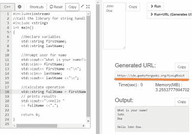 A |
| --- |
| `String Concatenation with cin` |

这张截图是我们使用 ![Image0082.jpg] 修改后的字符串拼接程序的成功测试运行。虽然程序无错误完成，但我们没有得到预期的结果。如果你的程序在修改后出现错误或没有类似的结果，我们鼓励你使用我们的成功运行来排查你的工作区。

与你的程序比较。你可以通过此 URL 访问成功运行：[A](https://ide.geeksforgeeks.org/KyuLgBoic)[`ide.geeksforgeeks.org/KyuLgBoic`](https://ide.geeksforgeeks.org/KyuLgBoic) [A](https://ide.geeksforgeeks.org/KyuLgBoic)。

注意：确保你的代码。

正如我所提到的，程序员还使用其他字符串处理能力从不同来源获取字段内容。程序只在用户分别输入姓和名时工作。但大多数人的姓名存储为单个字符串。让我们修改程序，使其在用户输入完整姓名时进行欢迎。你需要遵循以下步骤：

1. 如果尚未操作，或者你需要重置工作区，转到之前的：[A](https://ide.geeksforgeeks.org/B7XErpI9OE)[`ide.geeksforgeeks.org/B7XErpI9OE`](https://ide.geeksforgeeks.org/B7XErpI9OE) [A](https://ide.geeksforgeeks.org/B7XErpI9OE)。
2. 仅声明 ![Image0083.jpg] 变量。
3. 使用 ![Image0082.jpg] 提示用户输入完整姓名。
4. 使用 ![Image0084.jpg] 欢迎用户。

|  A |
| --- |
| `String Termination with cin` |

这张截图是我们使用 ![Image0082.jpg] 修改后的字符串拼接程序的成功测试运行。虽然程序无错误完成，但我们没有得到预期的结果。如果你的程序在修改后出现错误或没有类似的结果，我们鼓励你使用我们的成功运行来排查你的工作区。在另一个窗口中打开此成功运行并与你的程序比较。

你已经见证了典型的 `cin` 行为。当 `cin` 遇到空格时，它将其视为字符串终止符并停止。这就是为什么 " Doe" 没有被添加到输出中。为了让它读取包含空格的完整字符串，我们必须使用 `<string>` 库中的 `getline()` 函数；它提取输入中的所有字符并将其转换为字符串数组。

在本章中，我们做了很多工作。我们查看了一些特殊函数、对象访问、文本处理程序和操作符。我们将在接下来的章节中详细介绍它们。我希望你已经看到了操作符在引导数据和实现程序功能方面的作用。在接下来的章节中，我们将研究操作符以及它们如何赋予程序决策能力。

# 第 4 章：C++ 中的操作

我们讨论了 `C++` 主要是一种后端、服务器端语言，适用于控制服务器和其他用于交付内容的决策类实用程序。在上一章中，我们通过查看字符串，了解了 `C++` 处理数据的简易方式。在其中，我们看到了操作扮演的核心作用。操作允许我们控制程序中的循环和决策。更好地理解操作允许我们为程序添加更多功能。功能是程序员如何使用语言的方法和特性来实现目的。我们已经看到了这些字符串处理方法是如何工作的，但更好的做法是在允许我们实现特定目的（如内容管理）的语境中使用这些特性。

注意：`操作数`（Operand）描述了操作的值或变量。`操作符`（Operator）描述了指示正在执行的操作类型的符号。以下是 `C++`（以及其他）中的操作符列表。

此表根据 (1) 每次接受多少操作数以及 (2) 它们执行的操作类型列出了操作符。它们分为三类：

- 一元操作符：每次只接受 1 个操作数。
- 二元操作符：每次只接受 2 个操作数。
- 三元操作符：接受多个操作数，或带有多个条件的操作符。

在本章中，我们将查看 5 种操作符及其功能。

注意：操作符具有优先级，就像数学方程一样。例如，用于调用函数的括号优先级高于加法或减法。然而，你应该尝试保持代码行尽可能简单。这使得你的程序更容易编辑和调试。拥有整洁、不复杂的代码可以避免错误。

## 二元操作符

二元操作符是 `C++` 中发现的大多数操作。它们包含了 6 种操作符中的 5 种。这使得它们成为完美的起点。正如名称所示，二进制操作符比较两个操作数。它们对于决策和控制开关非常完美。

## 算术操作符

它们是所有操作符中最常见、最易理解的，因为即使在编程之外我们也经常使用它们，由于它们主要是数学性的。我们用它们来执行数学运算。

注意：在字符串拼接示例中，用于拼接的 `images/Image00087.jpg` 并不是算术函数。相反，它是 `images/Image00088.jpg` 库的一个函数，负责处理拼接。

此类中的大多数操作符都需要两个操作数。唯一的异常是一元的 `++` 和 `--` 操作符，我们它们在循环内增加或减少。二元操作符如下 (Jaggi, 2015a)：

- `images/Image00087.jpg`：加法，将两个操作数相加。
- `images/Image00089.jpg`：减法，从一个操作数中减去另一个操作数。
- `images/Image00090.jpg`：乘法，将两个操作数相乘。
- `images/Image00091.jpg`：除法，将第一个操作数除以第二个操作数。
- `images/Image00092.jpg`：模运算，返回第一个操作数除以第二个操作数后的余数。

让我们编写一个程序来演示这 5 种操作。

1. 声明两个变量 `images/Image00093.jpg`。
2. 声明一个变量 `images/Image00094.jpg`。
3. 打印变量 `images/Image00095.jpg`。
4. 加 `images/Image00096.jpg` 并打印结果。
5. 减 `images/Image00097.jpg` 并打印结果。
6. 乘 `images/Image00097.jpg` 并打印结果。
7. 除 `images/Image00097.jpg` 并打印结果。
8. 计算 `images/Image0096.jpg` 的余数并打印结果。

如下所示：

```text
![images/Image0098.jpg]
```

### 算术程序

此截图是所有算术功能的程序成功运行。你可以在索引中访问原始代码的副本。

如果你遇到错误，我鼓励你使用我们的工作空间来对比代码。在这里找到它：

[`www.geeksforgeeks.org/vDc7f5EQ`](https://www.geeksforgeeks.org/vDc7f5EQ)

“A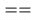 A”：`Equal` 等于运算符用于检查两个给定的操作数是否相等。如果操作数相等，它返回布尔值 `true`；否则，返回 `false`。

“A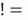 A”：`Not-Equal` 不等于运算符，也检查两个给定的操作数是否相等。然而，如果操作数不等，该运算符返回布尔值 `true`；如果操作数相等，则返回 `false`。

“A A”：`Greater-than` 大于运算符，检查左操作数是否大于右操作数。如果是，该运算符返回布尔值 `true`。否则，它返回 `false`。

“A A”：`Less-than` 小于运算符，检查左操作数是否小于右操作数。如果是，该运算符返回布尔值 `true`。否则，它返回布尔值 `false`。

“A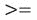 A”：`Greater-than or equal-to` 大于等于运算符，检查左操作数是否大于等于右操作数。如果是，该运算符返回布尔值 `true`。否则，它返回布尔值 `false`。

“A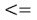 A”：`Less-than or equal-to` 小于等于运算符，检查左操作数是否小于等于右操作数。如果是，该运算符返回布尔值 `true`。否则，它返回 `false`。

正如处理算术运算符一样，让我们创建一个演示关系运算符的程序，我们将在代码中使用条件 `if()` 语句。`if()` 语句在满足指定条件时执行其大括号内的代码。如果条件不满足，它将执行 `else {}` 语句中的代码。`else` 没有用于检查的条件；它在 `if()` 中的指定条件不满足时执行。条件语句始终使用关系运算符来测试条件。

注意：`if()` 和 `else` 语句对大小写敏感。"if" 和 "else" 必须全小写。此外，虽然 `if()` 可以在没有 `else` 的情况下执行，但如果条件为假，缺少 `else` 语句会导致错误。`else` 语句也不能在没有 `if()` 的情况下实现。我们将在后面的章节详细描述 `if()...else` 语句。

要创建我们的程序，必须遵循以下步骤：

1. 使用此 URL 打开并编辑算术程序：

   [`ide.geeksforgeeks.org/vDcCH7f5EQ`](https://ide.geeksforgeeks.org/vDcCH7f5EQ)

2. 使用算术程序中相同的变量。确保清理代码中任何不需要的变量。
3. 打印程序的说明。
4. 测试 `` 并打印结果：
   1. 创建一个 `if` 语句，在大于时打印结果。
   2. 创建一个嵌套的 `else` 语句，在为假时打印结果。

注意：针对所有可能的情况测试每个 ``。对于我们的简单程序，每个语句只有两种可能。

1. 测试 `` 并打印结果。
2. 测试 `` 并打印结果。
3. 测试 `` 并打印结果。
4. 测试 `` 并打印结果。
5. 测试 `` 并打印结果。

| 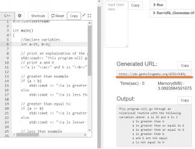 | 关系例程序 | 这显示了关系例程序的成功运行，显示了所有功能。 |
| --- | --- | --- |

如果你没有得到类似的结果，请查看我们这里的代码：[`ide.geeksforgeeks.org/dFD3cEk85y`](https://ide.geeksforgeeks.org/dFD3cEk85y)。对比并找出你错在哪里。这样的练习将使你具备调试技能。也请花时间欣赏并理解代码。

## 逻辑运算符

逻辑运算符为关系运算符增加了更多复杂性。这些运算符类似于人类关于“与”或“或”的想法。它们还具有切换关系运算符含义的属性。逻辑运算符与关系运算符结合使用，组合两个或多个条件来描述约束。它们让我们能够通过条件捕捉更多并执行更多操作。有三个逻辑运算符（aggi, 215b）：

- `&&`：AND 运算符在两个条件都满足时返回布尔值 `true`，在不满足时返回 `false`。
- `||`：OR 运算符在一个（或两个）条件满足时返回布尔值 `true`，在没有任何一个条件满足时返回 `false`。
- `!`：NOT 运算符在所考虑的条件不满足时返回布尔值 `true`。如果其中一个条件为真，它返回布尔值 `false`。

逻辑运算符在机器中广泛广泛。想象银行安全系统中的 `NOT` 运算符。假设锁上的门为 `0 [false]`，未锁的门为 `1`。因为银行应该保持安全，我们的默认值为 `0`。这被称为故障关闭系统，因为如果出现问题门将关闭（默认值）。所有信号都由 `NOT` 信号控制：如果没有发生什么，门应该保持锁态；如果发生抢劫，它们也应该保持锁态。但在火灾期间，这些门应该打开，因此故障关闭的 `NOT` 信号将返回 `true` 打开门。

让我们通过构建逻辑程序来探索逻辑运算符。遵循以下指令：

1. 使用此 URL 打开并编辑关系程序：


[`ide.geeksforgeeks.org/dFD3cEk85y`](https://ide.geeksforgeeks.org/dFD3cEk85y)

2. 编辑这些额外变量以测试逻辑运算符：

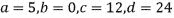

3. 打印程序的说明。

4. 测试 `if(a>b && c==d)` 并打印结果：

   1. 创建一个 `if` 语句，在大于时打印结果。
   2. 创建一个嵌套的 `else` 语句，在为假时打印结果。

5. 测试 `(a>b || c==d)` 并打印结果。

6. 测试 `(!b)` 并打印结果。

7. 清理代码中任何不必要的行。

| 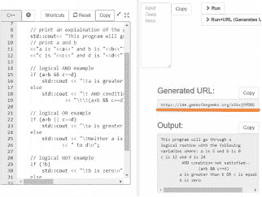 |

## 逻辑例程序

这是一个显示所有逻辑函数示例的程序运行截图。你可以通过此 URL 访问工作空间：

[A](https://ide.geeksforgeeks.org/x9ixjUYDBG)[https://ide.geeksforgeeks.org/x9ixjUYDBG] [A](https://ide.geeksforgeeks.org/x9ixjUYDBG)。

如你所见，仅通过一条语句很难打印“AND”函数。

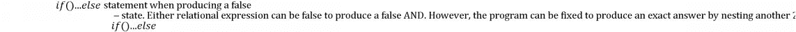

修改这个练习题，创建一个能够更好地解释自己的程序！

提示：你只需要一条额外的语句。

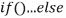

你可以通过此 URL 与我们的作业进行对比：

[A](https://ide.geeksforgeeks.org/nh8yYV9Kjy)[https://ide.geeksforgeeks.org/nh8yYV9Kjy] [A](https://ide.geeksforgeeks.org/nh8yYV9Kjy)。

## 它是应该是这样的

让我们暂时离开例行程序，探索一下我们使用逻辑运算符的其他方法。逻辑运算符基于机器逻辑，特别是逻辑门。逻辑门是具有一个或多个输入和一个输出的电子电路。逻辑门的功能与逻辑运算符相同。

“AND”门只有在所有输入都为“1”时才通过“1”；“OR”门在接收到任何一个输入为“1”时通过“1”；“NOT”门在接收输入为“0”时通过“1”。逻辑门可以控制电路中的数据流，就像我们的逻辑操作与条件语句结合时一样。这在逻辑运算符中被称为“条件短路”（conditional short-circuit）。

AND 和 OR 运算符具有短路特性。回想当两个关系运算符在条件上为真时，逻辑 AND 如何返回一个 `true` 布尔值。此外，关系运算符按照它们在条件语句中出现的顺序进行求值——如果第一个为假，则第二个将不会被评估，因此产生短路。

OR 运算符的处理方式不同。只需要一个关系运算符返回 `true`，它就会通过一个 `true` 布尔值。因此，如果第一个关系运算符返回 `true`，它就不会检查下一个。

这非常有用，因为我们可以为程序提供更复杂的指令，告诉它在什么情况下如何运行。OR 和 AND 是短路的对立面。让我们利用这一点编写一个程序，告诉我们何时 AND 和 OR 发生了短路。遵循以下指令：

1. 打开一个新的 IDE 工作空间。
2. 声明两个变量：

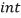

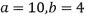

3. 打印程序的解释：

   - 该程序将测试 OR 或 AND 门在等于 `b` 时是否短路。
   - 打印 `a` 和 `b` 的当前值。

4. 声明并计算两个变量：

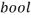

```cpp
resAND = ((a == b) && std::cout << "OR circuit Ashorted")
resOR = ((a == b) || std::cout << "AND circuit Ashorted")
```

它应该是这样的：

| 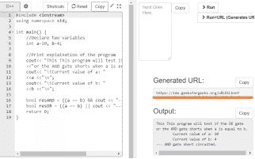 |

### 短路检测程序

此截图是我们的短路检测程序的成功运行。利用我们对逻辑 AND、逻辑 OR 以及它们之间关系的知识，我们能够开发出检测短路的方法。你可以通过此 URL 访问工作空间：

[A](https://ide.geeksforgeeks.org/uBLGtLbnnY)[https://ide.geeksforgeeks.org/uBLGtLbnnY] [A](https://ide.geeksforgeeks.org/uBLGtLbnnY)。

尝试 `` 的不同值，看看是否能触发不同的“电路”。

考虑一个短路检测程序。我们在现实世界中会如何使用它？我曾提到过这类系统。问题是：如果条件不匹配，我们该如何使用密码？逻辑运算符为机器如何决策提供了很好的思路。逻辑运算符被用于各种库中。到为止，我们使用的是小型程序，但在 YouTube、外卖等环境中的大型程序需要使用位运算符来实现这一点。

## 位运算符

在电路层面，机器使用 AND 和 OR 门进行通信。这让它们在单个位级别具有决策能力。换句话说，它们是操作于二进制数字的逻辑运算符。

要使用它们，你需要了解二进制。人类使用十进制数字（也称为十制）来概念化数字。例如，像 543 这样的数字被理解为五百、三十十和四个。在十进制中，它看起来像这样：

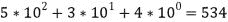

在二进制中，同一个数字看起来像这样：`0b100010110` —— `0b` 只是让我们理解它是二进制。所有的二进制数字都以位流的形式呈现，位处于两种状态：`1` 或 `0`。就像十进制一样，数字的位置决定了它的值。534 的示例显示了一个 10 位的二进制数。仔细观察 534 位流，我们可以看到第 2、3、4 和第 10 位是开启的（从右向左），而其他所有位都是关闭的。在 2 基中，我们这样计算这个……（正文继续）。

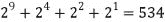

对于人类来说，计算这些并不容易，但这就是计算机以数据流进行通信的方式。它们更擅长识别和计数这些数字，就像人类处理十进制数字一样简单。因此，使用运行在计算机原生层级运行的位运算符可以提高速度和性能 [Killian, 2012]，因为这跳过了将目标性编程转换为机器语言的翻译。这就是为什么你会发现位运算经常用于竞争性编程中。以下是 C++ 位运算符的列表（<Bitwise Operators in C/C++, 2014）：

- “&”：位逻辑 `AND`（与）接收两个数字（操作数），并对这两个数字流中的每一个位执行 `AND` 运算。如果两者都为 1，则 `AND` 流的结果为 1。
- “”：位逻辑 `OR`（或）接收两个数字（操作数），并对这两个数字流中的每一个位执行 `OR` 运算。如果其中任一个为 1，则 `OR` 流的结果为 1。
- “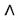”：位逻辑 `XOR`（异或）接收两个数字作为操作数，并对这两个数字流中的每一个位执行 `XOR` 运算。如果两个位不同，则 `XOR` 的结果为 1。
- “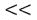”：`Left Shift`（左移）运算符接收两个数字并将第一个操作数的位向左移动。第二个操作数用于确定移动位数。
- “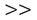”：`Right Shift`（右移）运算符接收两个数字并将第一个操作数的位向右移动。第二个操作数用于确定移动位数。
- “”：位逻辑 `NOT`（非）运算符接收一个数字并切换所有位的状态（1 变 0，0 变 1）。

> 注意：机器使用寄存器和缓冲区来存储用于计算的位。寄存器就是一个存储数组，每个位在数组中都有自己的位置。如果你将这些数据流看作一个数组，将有助于你理解任何位运算符，特别是移位运算符。

让我们写一个位运算例程程序。首先，我们需要创建一个位寄存器并研究位流。这需要 `<bitset>` 库中的 `bitset<x>()` 函数。它允许你打印长度为 `<x>` 的二进制流。按照以下说明操作：

1. 打开一个新的 IDE C++ 工作空间。
2. 除了 `` 库外还需要。
3. 声明操作数变量及其值。

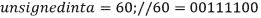

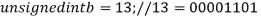

4. 为计算声明寄存器 `c`。

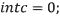

5. 打印操作数值及其对应的寄存器：

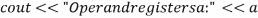


> 注意：由于所有数字都小于 255，我们将整个练习中使用 `` 类型的位流。

6. 为 `` 计算位逻辑 `AND`。


7. 打印结果和寄存器。


> 注意：由于我们正在使用位函数，使用 `` 来结束换行会更好。此函数会清除缓冲区并防止溢出。这会让程序运行稍微慢一点，但能确保我们的寄存器是干净的。速度上的差异可以通过位函数来补偿。

8. 为 `` 计算位逻辑 `OR`。


9. 打印值和寄存器。


10. 为 `` 计算位逻辑 `XOR`。


11. 打印值和寄存器。


12. 为 `` 计算位逻辑 `NOT`。


13. 打印值和寄存器。


14. 为 `` 打印寄存器。


15. 打印操作数值。


16. 为 `` 计算位逻辑 `Left Shift`。


17. 打印结果和寄存器。


18. 为 `` 计算位逻辑 `Right Shift`。


19. 打印结果和寄存器。


“`A` A 运算符。该运算符将右侧变量的值相乘并将结果保存到左侧变量中。

`A` 无需使用单独的算术运算符。

> 注意：还有位运算原子赋值操作：“``”。我们目前将重点关注算术原子函数。

让我们创建一个赋值运算符程序，来看看这些赋值操作是如何工作的。按照以下步骤操作：

1. 打开一个新的 AIDE 工作空间。
2. 声明并初始化我们的变量 `int A=10;`。
3. 打印程序的说明和初始值。

> 注意：在编写打印程序时，务必让它们易于阅读！确保你的程序能够自我解释。

4. 原子性地加 10 并打印结果。
5. 从我们的变量中原子性减去 10 并打印结果。
6. 原子性地乘以 10 并打印结果。
7. 原子性地将我们的变量除以 10 并打印结果。

显示如下：

| `` |

| 赋值程序 此截图是我们的赋值例程序的成功运行。该程序具有顺序输出，这意味着每条指令都会影响下一条指令的结果。这意味着如果我们更改应用于 `A` 的原子操作顺序，输出将会有不同。若要充分研究它，可以通过此 URL 在我们保存的工作区中访问：[A](https://ide.geeksforgeeks.org/Fbc63b0u1E)](https://ide.geeksforgeeks.org/Fbc63b0u1E) [A](https://ide.geeksforgeeks.org/Fbc63b0u1E) |

这些二进制赋值运算符将赋值和算术函数结合。它们在控制循环和条件语句时也运行良好。原子赋值运算符与一元算术运算符密切相关。两者都经常用于控制循环。让我们来看一下一元操作。

## 一元操作

在讨论一元操作之前，让我们看看使用它们的代码。

| `` |

| 带有一元运算符的 while 循环 此截图是一个简单的 while 循环，它打印计数器的值，`` 将导致错误，因为 while 循环无法推进。我们将在下一个 [A](https://docs.google.com/document/d/1rfTukE008PScFE0mgrN2m-UKMEAv4Y8VYrXHB3BjvOU/edit) [决策章节](https://docs.google.com/document/d/1rfTukE008PScFE0mgrN2m-UKMEAv4Y8VYrXHB3BjvOU/edit) [A](https://docs.google.com/document/d/1rfTukE008PScFE0mgrN2m-UKMEAv4Y8VYrXHB3BjvOU/edit) 中详细讨论循环。若要充分研究它，可以通过此 URL 在我们保存的工作区中访问：[A](https://ide.geeksforgeeks.org/MgMUtZdlpb)](https://ide.geeksforgeeks.org/MgMUtZdlpb)](https://ide.geeksforgeeks.org/MgMUtZdlpb) |

`i=i+1` 等于 `i++`。使用一元形式可以使代码更整洁，因为它排除了 `+` 算术运算符和 `=` 赋值运算符。我们也可以使用原子加运算符来完成代码：`i+=1` 等于 `i++`。但类似的格式将需要编译器存储并操作额外的操作数。一元运算符的作用是通过仅有一个操作数来简化代码。记住，一元运算符是那些使用一个操作数的运算符。以下是一元运算符的其他一些示例（Kumar, 2017）：

- “``”：增运算符，用于将整数的值增加 1。它可以在立即增加值，也可以在表达式之后增加。
- “``”：减运算符，用于将整数的值减少 1。与增运算符类似，它可以立即减少值，也可以在表达式之后减少。
- “``”：一元负号，用于改变变量的符号。它可以使负整数变为正整数。例如，``：地址运算符，用于指向变量的地址。

| `` |

| 带有后置和前置的一元运算符 此截图是我们的赋值程序。程序在缓冲区上操作并在计算时存储值。对比缓冲区，后置操作延迟值；前置操作立即更改值。 |

除此之外，我们还有 `sizeof()` 运算符。它看起来像一个函数，但被归类为运算符。它返回对象的大小。回想我们讨论过的流通常被分成字节组。一个字节是一个单 8 位流，可以表示 255 个数字。在我们的位运算程序中，我们的寄存器长度为 1 字节，这是因为我们处理的是小于 255 的数字。

|  | 数组大小报告程序 |

这张截图是我们的数组大小报告程序。我们鼓励你将你的结果与我们的进行比较。为了完整学习，可以通过此 URL 访问我们保存的工作空间：

[A](https://ide.geeksforgeeks.org/HwpcLYB4P0) [https://ide.geeksforgeeks.org/HwpcLYB4P0)。


这是一个关于两个一元运算符的很好的例子：`sizeof()` 和地址指针 `&`。我们用于打印数组的 `for(){}` 循环被称为 `copy` 构造函数调用。`Constructor` 拷贝调用由一个带有索引变量的 `for(){}` 循环、一个 `offsetof` 运算符以及一个带有索引的容器对象组成。`copy` 构造函数通过使用 `offsetof` 指针自动推导出 `[size of arr]` 并打印其内容，从而设置 `[0]: arr[the size of arr]`。简单来说，`copy` 构造函数使用 `offsetof` 来减小程序的大小。

`sizeof()` 运算符是一个客观操作，它使用单个操作数，即 `arr` 数组对象。它们都有优缺点。`sizeof()` 运算符使用一个操作数，在没有晦涩内存寄存器的情况下更容易识别。该调用组合必须使用额外的对象 `(` 来打印数组，但可以使用更少的增量运算符完成。我们将在下一章更详细地讨论 C++ 的循环和决策功能。现在，让我们关注三元运算符。

## 三元运算符

C++ 只有一个三元运算符。三元运算符，也称为条件运算符，接受 3 个或更多操作数——它们是基于布尔逻辑的运算符。结果始终取决于第一个表达式是否为真：如果是，则将评估第二个；如果第一个表达式为假，则将评估第三个表达式。

如果你记得我们在关系程序例程中的 `if...else` 语句，它包含三个部分：函数评估的初始表达式、当初始表达式为真时评估的表达式，以及当初始表达式不为真时评估的 `else` 语句。条件运算符的组件与 `if...else` 语句相同，它们只是更紧凑。

让我们编写一个程序来阐明这些相似之处：

1. 打开一个新的 IDE C++ 工作空间。
2. 要使用条件运算符，你必须调用 `` 库。
3. 打印条件运算符的解释。

该程序将使用两种方法选取最大的值：条件运算符和 `` 语句。我们期望结果为 5。

1. 声明变量并执行条件运算符：

```cpp
int arsize=sizeof(arr)/sizeof(arr[0]);
```

2. 打印 `` `` 的解释，然后打印 2。

然后打印 5。

|  | 条件操作演示 |
|---|---|

这张截图是我们的条件操作演示。这个程序没有实际功能。但是，对于我们的目的来说，它确实展示了条件运算符与 `` 语句之间的相似结构。

为了完整学习，我们建议通过此 URL 访问我们保存的工作空间的副本：

[A](https://ide.geeksforgeeks.org/9kJBAqt) [https://ide.geeksforgeeks.org/9kJBAqt] [`ide.geeksforgeeks.org/9kJBAqt`。

在本章中，我们查看了 3 类运算符：一元、二元三元。正如你所见，这些运算符允许程序员应用 C++ 的强大特性。例如，二元运算符允许机器通过更改函数做出逻辑决策、计算值并控制过程。一元函数有助于收缩和简化复杂的代码。三元运算符允许代码更加简洁。它们都是 C++ 中决策和切换的核心。

# 第 5 章：决策

我们将讨论决策函数；这些函数类似于 `if-else` 循环。编程在很大程度上依赖于决策，而决策是由涉及我们见过的运算符的逻辑表达式提供的。决策是指根据程序员所选的标准做出判断的能力。

在我们的大小练习中，我们在构造函数中使用 `for` 循环来填充数组，并打印所有索引。一元运算符 `offsetof` 配合 `auto` 数据类型允许在不使用额外的 `for` 循环的情况下实现 `for` 循环。如果你从未有过自己初始化和实现循环的经验，拷贝的简单性并不明显。

## 循环

程序员花费大量时间通过脚本和例程自动执行单调、重复的任务。允许脚本和例程实现这一点的是循环。正如名称所示，只要满足特定条件，循环就会重复相同的指令。

循环通常用于通过索引（如数组和向量）遍历聚合对象。例如，你可能会写一个循环，不断搜索数组直到找到特定项目。循环有两种类型：入口控制循环和退出控制循环。

在我们的一元算术示例中，我们有一个带有 `counter` 的 `while` 循环。`counter` 是一个任意变量，配合一元运算符用于递增指定的表达式。它是入口控制循环的示例——在执行代码之前测试条件。

让我们将该示例修改为 `while` 循环以探索它的组件。我们将用它打印 10 次 `"Hello World"`。遵循以下指令：

1. 打开以下 IDE C++ 工作空间：[A](https://ide.geeksforgeeks.org/MgMUtZdlpb) [https://ide.geeksforgeeks.org/MgMUtZdlpb] `ide.geeksforgeeks.org/MgMUtZdlpb`。
2. 打印程序的解释。该程序将编号并打印 10 行：
   1. 将条件测试改为 `![Image00177.jpg]`。
   2. 带编号地打印 10 次 `"Hello World"`。

|  | While 循环演示 |
|---|---|

这张截图是我们的 `while` 循环演示。你可以通过此 URL 访问我们保存的工作空间的副本：[A](https://ide.geeksforgeeks.org/9kJBAqt) [https://ide.geeksforgeeks.org/9kJBAqt]。

此程序展示了增量计数器是如何工作的。为了让循环运行，数字必须从 `1` 开始而不是 `0`。大多数人习惯了数字这种工作方式。为了实现这一点，我们将计数器初始化为 `1`。然而，如果我们把条件设置为 `10`，它将带给我们 `9` 次。若要输出 `10` 次，我们必须将数字增加到 `11`。

控制循环的另一个示例是 `for()` 函数；它需要三个表达式作为输入：

1. 一个初始化表达式，用于声明数据类型和变量。该变量可以是计数器，也可以是索引变量。
2. 一个产生布尔值的测试表达式。`` 如果条件为真，则 `for` 循环将继续循环其指定的代码块。
3. 一个更新表达式，用于增加计数器或索引变量。

让我们通过编写一个与 `while()` 循环示例类似的程序来观察它们是如何工作的。遵循以下指令：

1. 打开以下 AIDE C++ 工作空间：[A](https://ide.geeksforgeeks.org/0WjOL6TSh4)。
2. 打印程序的说明：此程序将编号并打印 10 行“Hello World”。
3. 实现 `for()` 循环：``。
4. 带有行号打印 10 次“Hello World”。
5. 清理数据中任何不需要的代码和注释。

|  | For 循环演示 |
|---|---|

此截图是我们的 `for` 循环演示。你可以通过此 URL 访问我们保存的工作空间的副本：[A](https://ide.geeksforgeeks.org/Dj2gyW02av)。

**注意：** 确保你已经清理了代码中不必要的行并更新了注释。虽然这不会影响你代码的性能，但可能会让你团队中必须实现你代码的其他程序员感到困惑。你看到这里有错误吗？

现在我们已经知道了 `for()` 循环是如何工作以及如何构建的，让我们来看看我们之前使用的拷贝构造函数。用于 `for` 拷贝构造函数调用的表达式为：

``

“e”是索引变量，“arr”是变量数组。我们看到 `for()` 循环需要三个表达式才能工作：初始化、测试表达式和更新表达式。

拷贝构造函数有一个初始化函数 `(const auto& e)`。当你仔细观察时，你会发现这个表达式也可以用作测试表达式，因为 `&` 是一个取地址运算符，指向 `e`，而 `e` 代表 `arr` 数组中的 `indices`。`:` 是一个进入类的运算符。它允许容器 `arr` 的属性传递给变量 `e`。`for()` 循环将一直打印 `e` 直到 `arr` 的末尾。

拷贝构造函数的调用适用于容器大小未知且你想打印出所有项目的情况。`for()` 循环从一开始就定义了必须发生的迭代次数，而拷贝构造函数的调用则取决于容器的大小。`while()` 循环最适用于条件可能随时变化且你希望迭代停止的情况。`do...while()` 循环适用于可能会影响测试的情况。

`do...while()` 循环是退出控制的，这意味着代码会一直执行直到满足某个条件。在检查测试之前，代码至少执行一次。回想那个安全示例。门总是故障关闭的，除非发生火灾否则会接收信号。以下是 `do...while` 循环的样式：

``

``

只要未到火灾，门就会保持关闭。`do...while()` 循环对于任何故障关闭系统都有用。其他应用包括服务器中的数据修正，当检测到错误时运行修正程序。

让我们修改第一个 `while` 循环程序。遵循以下指令：

1. 打开以下 AIDE C++ 工作空间：[A](https://ide.geeksforgeeks.org/0WjOL6TSh4)。
2. 初始化计数器为 ``。
3. 实现 `do` 块。
4. 设置 ``。
5. 清理数据中任何不需要的代码和注释。
6. 检查结果 ``。

| Do While 循环演示 | 展示退出控制循环 |
|---|---|

此截图是我们的 `do` 循环演示。你应该注意到，尽管 `` 代码块被执行了。这是因为该循环是退出控制循环：条件在代码块执行后进行测试。代码具有执行的潜力。你可以通过此 URL 访问我们保存的工作空间的副本：[A](https://ide.geeksforgeeks.org/t6zc2Wj7)。

1. 看看尽管条件为假，消息是如何打印的。你可以将其应用于流中的数据修正。任何错误检测服务，因为数据流并发送了传输请求。`do...while()` 循环将允许数据流持续到检测到错误。这些是 YouTube 在服务器缓冲区使用的类型程序。这展示了它们在控制数据方面的有用性。对于单一切换，我们将使用 `if()`...`else`。

## `if()`...`else`

到目前为止，我们在示例中使用了 `if()`...`else` 函数。它们易于理解，且结构也非常直观。`if()`...`else` 语句测试条件，并根据结果执行一个代码块或另一个。它们是两个独立语句的组合。

你可以单独执行 `if()` 函数，但编译器期望一个 `else` 语句。`else` 语句包含随 `if()` 表达式的代码。没有 `if()` 语句，`else` 语句永远无法执行。

`else if()` 语句指定了另一个要测试的条件。它创建了一个嵌套 `if-else` 语句的链。如果你正在测试很多条件，最好使用 `switch`，我们将在下一节讨论。让我们制作第一个嵌套的 `if-else` 语句。

此程序将遍历从 2 到 4 的数字列表，并使用两种方法选取最大的数字：条件运算符和嵌套 `if-else` 语句。``

我们期望结果为 4。

实现一个嵌套 `if-else` 语句。

`` 然后打印 2。

`` 然后打印 3。

`` 打印 4。

|  A |
|---|
| 嵌套 If-Else 演示 |

这是我们嵌套 `if-else` 演示的截图。与我们的其他演示一样，这个程序没有实际功能。然而，出于我们的目的，这是实现和理解 `` 的极佳练习。它仍然每个语句都需要代码块。代码块也应该与条件对应，以便创建一个满足既定目的的功能性程序。

你可以通过此 URL 访问我们保存的工作区副本：[A](https://ide.geeksforgeeks.org/89MlNvRWYU) `ide.geeksforgeeks.org/89MlNvRWYU` [A](https://ide.geeksforgeeks.org/89MlNvRWYU)。

让我们进一步检查这个练习。嵌套 `if-else` 可以分为两个部分：包含条件和执行代码的 `if()` 和 `else-if()` 语句。你注意到代码块在逻辑上遵循了程序的状态目标，即找到最大的数字。

在我们可能会更改条件语句的情况下，按升顺序打印数字是有意义的。`if()` 语句中的条件以及它们包含的代码块的排列方式，允许程序流向答案。例如，`if (2 > 3)` 被硬编码为下一个嵌套语句。该结构遵循了刻意添加的嵌套条件运算符。

## 嵌套三元 If-Else 运算符

在上一章中，我们讨论了条件运算符，即测试条件并根据结果执行表达式的三元运算符。我们说它使用的结构类似于 `if()...else` 语句但更简洁。例如，`if()` 语句测试条件并根据测试结果执行两个代码块之一。`if()…else` 语句可以嵌套，条件运算符也可以嵌套。

让我们比较一下两者的结构。遵循以下步骤参与（“嵌套三元运算符”，2018 年）：

1. 如果你关闭了嵌套 `if-else` 演示，请通过此 URL 打开已保存的 IDE C++ 工作区，其中有我们的程序：[`ide.geeksforgeeks.org/89MlNvRWYU`](https://ide.geeksforgeeks.org/89MlNvRWYU)。
2. 打印程序的说明：
   1. 此程序将遍历从 2 到 4 的数字列表，并使用两种方法选取最大的数字：条件运算符和嵌套 `if-else` 语句。``
   2. 我们期望结果为 4。
      1. 添加关于嵌套 `if-else` 的打印通知。
      2. 打印条件语句的通知。
      3. 添加条件运算符代码：声明变量并执行条件运算符。

         `int A = A2 > A3 ? A2 : A3 > A4 ? A3 : A4;`

      4. 清理代码中不必要的行并纠正任何注释。

|  A |
|---|
| 嵌套 If-Else 与嵌套三元运算符比较 |

这张截图是我们修改后的嵌套 `if-else` 演示。我们通过实现嵌套三元运算符来修改演示，以便并排比较。正如你可能经历的那样，三元运算符更容易实现，使用的语句更少。

你可以通过此 URL 访问我们保存的工作区副本：[A](https://ide.geeksforgeeks.org/BdfgWVg8uc) `ide.geeksforgeeks.org/BdfgWVg8uc` [A](https://ide.geeksforgeeks.org/BdfgWVg8uc)。

让我们谈谈我们刚刚所做的操作。在之前的讨论中，我们将嵌套 `if-else` 分解为它的组件和结果。在“2”和“3”是任意值的情况下，`if-else` 语句必须列出所有可能的结果。

要查看嵌套 `if-else` 如何与三元运算符结合，这里是语法：

``

``

变量用于打印嵌套 `if-else` 的结果。当第一个表达式为假时执行第二个表达式，它对应于 `else if()`。

## `switch`

正如我们所说，程序员需要高效、易懂的代码。这让你和大家的工作变得更容易。`switch` 语句适用于我们需要处理多个表达式的情况。`switch` 语句提供了分支语句，根据一个变量执行不同的代码块。以下是语法：

```cpp

```

``

```cpp
{
    
    
    
}
```


注意：`switch` 只能针对情况（`cases`）评估整数。要添加条件组件，你必须通过操作更改变量。该运算符必须产生一个整数。

让我们创建一个 `switch` 演示来练习 `switch` 的组件：

1. 打开一个新的 IDE C++ 工作区。
2. 初始化变量。


3. 打印程序的说明。


4. 为 `case 1` 打印 `"Choice is 1"`。
5. 为 `case 2` 打印 `"Choice is 2"`。
6. 为 `case 3` 打印 `"Choice is 3"`。
7. 为 `default` 打印 `"Program Exit"`。

|  A |
|---|

## Switch 演示

这是一个关于我们的 `switch` 演示的截图。你可以使用此 URL 访问我们已保存的工作区的副本：[这里](https://ide.geeksforgeeks.org/dSehFXULz5)。我们强烈建议使用此演示将我们之前的练习题之一转换为 `switch`。我们的一个关系例程程序是一个极佳的候选。它有 6 个 `if()`.. `else` 语句！这产生了 12 种不同的场景。你如何将这个程序转换为 `switch` 呢？提示：考虑使用输入函数为每个关系例程创建一个菜单。你可以在此 URL 自行学习关系例程：[这里](https://ide.geeksforgeeks.org/dFD3cEk85y)。

现在我们已经了解了决策函数以及它们是如何工作的，让我们转到函数以及它们在编程中的作用上。

# 第 6 章：创建函数

我们讨论过算法是理解问题和规划代码如何工作以修复问题的方法。算法接收输入，执行操作，然后给出一个会导致状态更改的结果。函数是一段你可以多次调用的代码，而无需再次编写代码。代码通常是执行所需任务并具有高重用性的内容。函数由头部和体组成。以下是函数的语法格式：


```cpp
{
```


```cpp
}
```


正如你所看到的，与其他任何编程语言一样，C++ 基本上是一系列函数、语句和运算符，中间夹杂着对象和其他数据存储元素。我们目前为止写的所有内容都使用了 `main()` 函数，其语法与上面的类似。所以函数对你来说并不是新鲜的。

每个函数必须返回一个数据类型，就像 `main()` 函数返回 `int` 0 一样。如果函数没有这样做，则使用 `(void)` 作为返回类型。正如你可能猜到的那样，`return` 语句是结束函数的语句。

函数接收的输入被称为参数或实参。并不是所有函数都会像我们在 `main()` 中那样接收输入；无论如何，你仍然可以将参数传递给函数以便其运行。这就是库将对象传递给 `main()` 的方式。

## 创建并调用函数

要开始调用函数，你必须在 `main()` 之前对其进行声明和定义。这是因为 C++ 是顺序执行的。C++ 实践优先，函数也具有优先级。这就是为什么你必须在 `main()` 之前声明它们以便你可以调用它们。它们也被这样命名，因为它们让代码更有组织。一旦声明了函数，我们可以在 `main()` 任何地方定义它。

让我们写一个简单的打印函数，以便更好地理解它们。遵循以下指令：

1. 打开一个新的 IDE C++ 工作区。
2. 声明你的函数：`void myFunction();`
3. 在 `main()` 中调用你的函数：`myFunction();`
4. 在 `main()` 之外定义你的函数：


| 让我们写一个简单的打印函数，以便更好地理解它们。遵循以下指令：<br>1. 打开一个新的 IDE C++ 工作区<br>2. 声明你的函数：`void myFunction();`<br>3. 在 `main()` 中调用你的函数：`myFunction();`<br>4. 在 `main()` 之外定义你的函数 |
| --- |
|  |

使用此 URL 访问我们已保存工作区的副本：[这里](https://ide.geeksforgeeks.org/b9iSDihApZ)。如果你想进行更多练习，我们建议使用此练习作为模板，将我们过去的练习题之一转换为函数！考虑我们使用  的练习即可。

分离声明和定义属于良好的编程实践。它让你知道代码中哪些定义的函数是可以调用的。定义放在底部。现在让我们关注参数传递。

## 参数传递

函数是传递给编译器的脚本。为了完成任务并发挥作用，函数需要输入。提醒一下，这些输入被称为实参或参数。程序员描述参数出现的地方。传递定义函数的参数被称为实参。例如，如果你有一个函数 `Sum(x, y)`，当 `main()` 传递 2 和 3 时，这些参数就是实参。相反，`x` 和 `y` 是形参，因为它们是绑定的变量。这适用于所有传递的实参。

向函数传递参数有两种：

- 值传递：实参的值被复制并存储在函数的形参中。`main()` 中的任何更改都不会影响实参。
- 引用传递：实参和形参引用相同的内存。因此，`main()` 函数内部的任何更改都会影响实参。

让我们通过编写代码来练习参数传递。遵循以下指令：

1. 打开一个新的 IDE C++ 工作区。
2. 声明你的函数：`int max(int Ax, int Ay)`
3. 在 `main()` 中调用你的函数。
4. 初始化两个实际变量：

   

   初始化变量并调用函数：`int a = max(a, b);`
5. 打印结果。
6. 结束 `main()`。
7. 在 `main()` 之外定义你的函数：此函数应该使用 `if()` 语句检查 `Ax` 是否大于 `Ay`。如果 `Ax` 大于 `Ay`，则返回 `Ax`。否则，返回 `Ay`。


### 带参数的函数

这是我们函数演示截图。你可以使用此 URL 访问我们已保存工作区的副本：[这里](https://ide.geeksforgeeks.org/NnsZczhX15)。如果你想进行更多练习，我们建议使用此练习作为模板，将我们过去的练习题之一转换为函数！考虑我们使用  的练习并向它传递参数。

在第一个示例中，我们使用了值传递的方法。`main(a, b)` 中使用的变量与 `max()`、`max(x, y)` 中使用的变量位于不同的位置。你可以看到，在规模较大的程序中，当 `main()` 中可能进行多项复杂的计算时，这种方法非常有用。传递值是优的，因为可以确保实际变量在函数被再次调用之前一直保持存在。

使用引用来传递参数有其自身的优势，特别是在较大的程序中。使用引用传递核心值可以提高程序运行速度并使其保持灵敏。用于自动化函数编写的脚本更有可能使用引用来传递参数，因为自动化过程可能会重复且快速地发生。这些特性是基于引用的结构的卖点。现在让我们把转移到代码的压缩和优化上。

## 函数重载

所有定义的对象和类必须具有唯一的名称。你不能运行两个同名变量的程序，否则会抛出错误。你之前在处理例程和演示时可能已经见过这种情况，特别是当我们需要修改程序时。所以请记住：重复声明两次的变量会导致错误。

但奇怪的是，只要参数不同，多个函数可以与其他函数具有相同的名称。这只在函数返回不同数据类型的情况下允许。鉴于此，重载一个函数以返回多个数据类型更好。这就是所谓的函数重载；程序员通过组合函数来接收多种数据类型的过程。为什么呢？因为它简化并整合了代码。看看下面的代码（C++ 函数重载）：

|  |
| --- |
| 没有函数重载的程序：你可以通过此 URL 访问我们保存的工作区副本：[A](https://ide.geeksforgeeks.org/qkpHhZsqq5)。函数在文件顶部声明并定义，以便我们更好地观察它们。你将使用这个文件来亲自自己的函数重载。记住，如果你的代码在编辑过程中损坏，可以随时返回此工作区。 |

上面的程序声明了两个执行相似计算的独立函数。在大型程序中，这是对资源的浪费且效率低下的。它使得代码编辑变得困难，因为在较大的程序中，其中一个函数不太可能出现在同一个位置。为了提高效率，我们应该将这些函数整合到一个名称下，并“堆叠”数据类型。你可以这样做：

1. 通过以下 URL 打开已保存的 IDE 工作区：[A](https://ide.geeksforgeeks.org/qkpHhZsqq5)
2. 将 `double plusFuncouble...` 改为 `double plusFunc...`
3. 用 `double plusDouble...` 替换 `double plusFunc...`

|  |
| --- |
| 函数重载程序：你可以通过此 URL 访问我们保存的工作区副本：[A](https://ide.geeksforgeeks.org/qkpHhZsqq5)。我们将函数保留在文件顶部以便于编辑。这个重载练习需要几分钟的更改才能生效。使用我们的工作区来对比你可能遇到的任何错误。记住，如果你的代码损坏，可以随时返回原始工作区。你可以通过此 URL 访问原始工作区：[A](https://ide.geeksforgeeks.org/qkpHhZsqq5)。 |

当你整合相似的函数时，你就清理了代码。这很重要，特别是当你需要调试代码时，因为当发生错误时，编译器可能会指向函数。编译器之所以这样做是因为在 C++ 中它指向了多个库。整合和重载函数可以确保你的编译器引用的函数更少，让你更容易调试。

请记住，C++ 正在不断更新，使其变得变得更加容易。新功能被不断添加，库也被压缩并进一步组织。因此，C++ 中的错误看起来会与 C++14 中的错误不同。更新带来了执行平凡任务的新简方法。例如，复制所有组合（copy all combinations）被认为是数组等容器索引更现代的方法。为了保持更新并获得新 C++ 进展的益处，你必须不断练习、测试自己并提问。

## 结论和最后的注意事项

学习编程是一段认知之旅，是一段激发人心、令人兴奋且有时令人沮丧的旅程。当我们到达这本书的结尾时，回顾我们学到的一些重要课程是非常重要的。它们还将伴随着最终的思考和建议，旨在为你提供在该领域继续成长所需的一切。。

## 扩展你的实践：准备你的编码环境

我们使用了在线 IDE，以确保每个人都有相同的体验。如果你想保存工作成果，可以使用 Run 按钮将其保存到另一个 URL。你也可以将书中列出的所有保存 IDE 工作区和 URL 签名，以便日后参考。将它们作为参考或修复损坏的代码。我已经尽力在所做的练习中向你展示了最佳编码实践。

你已经看到在 C++ 中有许多实现某功能的方法，所以利用这一点。不要害怕实验和尝试新事物，并阅读关于你感兴趣的其他内容的资料。书中的练习并不是标准答案，编程领域不存在这种标准答案。所以，请参考这本书，并探索实现其他功能的方法。我们将代码放在了电子书的索引中以便快速查阅。

有很多编程环境和文本编辑器可以支持 C++。有些环境包含多个版本的 C++。在编写本文时，最新的 C++ 版本是 C++17，但支持得最好的是 C++14，它是 C++ 的演进版本，具有更易于理解的语言特性。C++14 比其前身版本更符合人类直觉，你可以预计这种趋势将会持续下去。最旧且广泛提供的 C++ 版本是 C++11。

我鼓励你搭建一个本地 IDE 并在上面工作。它将让你成长得更快，并适应现实场景。我们提到过适用于 Microsoft 的 `Code::Blocks` 和适用于 Mac 的 `Xcode`。如果你使用的是 Linux，可以使用跨越所有发行版的标准选项。Linux 是一种基于控制台的环境，深受软件开发者的青睐，因为控制台环境内置了许多直接与程序交互的强大功能。

许多发行版提供了基于 GUI 的桌面，这对于许多用户来说更优优。它们大多数是开源的，可以免费下载和安装。我们非常推荐 `CentOS`，这是一种用于服务器管理的免费 Linux 发行版。`CentOS` 使用了许多红帽 Linux (RHEL) 的组件。它是准备在红帽服务器管理环境中工作的最佳发行版。

## 编码最佳实践：学习的主权与协作

在我们共同相处的时间里，我们看到了许多软件开发的技巧和最佳实践。在第一章中，我们讨论了程序如何用尽可能少的代码来完成任务。坦率地说，随着 C++ 的每一个新版本，增加了更多实现这一目标的方法。

大多数初级编程课程教授的是较旧、效率较低的方法，来实现常见的编程任务，如解析数组、条件语句和调用函数。你会发现这些技术大部分在实际编程场景中从未被使用。大多数初级课程侧重于让初学者牢牢掌握基础——你的知识基础往往与你如何进步同样重要。随着你的成长，你将发现用代码解决问题有更高效的方法，但这只有在实践和学习的情况下才能实现。

如果你想成为一名更优秀的程序员，就必须掌握自己的学习主权。学习开发前的工具，例如 `algorithms`。这核心在于学习如何解决问题。你还有其他可以尝试的前开发工具，比如 `diagramming`。绘图对于视觉型学习者非常有帮助。这些工具对程序员的成长都是非常有益的；你选择哪一个并不重要，只要你利用了前开发工具即可。

回到 `algorithms`，更详细的 `algorithms` 将解释输入、输出和其他数据所需的各种数据类型。`algorithms` 的优势在于你可以将它们作为简写。你还可以对代码进行注释和管理。这些习惯将帮助你的代码对你的团队成员来说保持有序且连贯。所有这些实践将有助于增强你看待和思考程序的方式。

软件开发者在团队中工作，几个人同时处理同一段代码。在这样的情况下，注释代码的重要性变得越来越显而易见。

此外，与他人协作也会加速你的成长。与他人一起编码时，你可以从他们的经验和认可中学习。正如我们所说的，C++ 拥有各种库对象、语句和其他工具。它是一种丰富的语言，因为实现相同的事情有许多方法。

但最终，所有的编程和开发都是创造性的活动。与他人协作将增加你的编程能力，你也会发现如何解决问题的见解。你应该始终记住，每个人都能贡献力量，而他们贡献的内容深受其经验的影响。因此，即使你是 C++ 新手，你仍然拥有独特的解决经验和方法，这本身对任何团队都是价值的，特别是当你学会很好地交流你的想法时。我强烈建议你使用注释来帮助你清晰地交流。

除了注释之外，让代码尽可能整洁也是良好的做法。我们演示了如何对代码行进行注释以防止中断。在练习中，当你破坏代码到无法修复时，你可以随时从保存的 IDE 重新开始，或者简单地刷新浏览器重新开始（这取决于状态）。只在保存代码时生成 URL，而不是在开发过程中生成。

我们还强调了代码结构的重要性。例如，我们讨论了声明和定义函数的重要性：最佳实践是在顶部声明函数，并在 `main()` 函数之后定义它们。这与声明整数类似。这些技术确保你在开始时拥有一个函数、变量和对象的清单。它的作用像索引，可以帮助你避免定义错误。

格式化你的代码并删除不必要的行可以减少开发过程中出现错误的可能性。当你做出更改时，应该始终更新注释。未格式化的代码不会影响性能，影响的是代码逻辑。格式化代码是一种礼貌，而不是为了方便你自己。你团队中的其他程序员能够实现你的代码，甚至改进它，并且他们会留下注释。

但这些实践对你来说不仅仅是有处。随着世界的发展，它变得越来越复杂，因此程序能够向用户解释自身是非常好的。如果你的程序有输出内容，请确保它是易于阅读的。我们已经在书中看到了如何实现这一点。使用像 `\n` 序列来换行，使用 `\t` 创建水平制表符（缩进），以确保你的代码中有足够的空白。

但作为一名与服务器和其他设备工作的后端程序员，你可能不需要像为客户端提供内容的前端程序员那样频繁地输出。唯一可能查看你的输出内容的用户是通过终端管理这些机器的其他技术人员和管理员。格式化实践在后端编程中经常被忽视，但仍然是一个良好的习惯。对于管理员和技术人员来说，这非常有价值，因为他们没有资源去处理程序员在调试时遇到的那些晦涩的编译器错误。因此，一个格式化良好并在终端或控制台中清晰提供这些信息的程序是重要的。

## 核心总结：C++ 中的计算机科学概念

除了编程之外，我们还探索了一些基础计算机科学概念。我们观察了机器的行为及其语言。我们讨论了学习编程就像学习一种新语言：两者都有语法和规则，确保了通信的可能。

C++ 是一种后端服务器语言，用于管理控制海量数据的服务器。与 Python 这种更具人道化的高级语言不同，C++ 要求程序员在代码中更加详尽。每个变量在函数中必须是唯一的，否则将会出错。所有函数和语句都是区分大小写的，并有管理它们的特定规则。

我们实现了许多 `if() ...else` 语句，并制作了嵌套的 `if-else` 语句。我们看到像 `if()` 这样的条件语句可以在没有 `else` 的情况下执行，但如果条件为假，缺少 `else` 语句会导致错误。正如缺失动词表示句子不完整一样，没有 `if()` 的 `else` 语句是无法实现的。

我们看到了计算机如何使用逻辑数学通过二进制数进行通信。我们看到了位运算函数（bitwise functions）如何在位级别上工作，完成如 `AND`、`OR` 和 `NOT` 等逻辑数学计算。所有其他基于对象的 C++ 函数必须由编译器翻译成机器语言。但位运算速度更快，因为它们跳过了这一步，直接与机器通信。

它们通常部署在竞争性编程中，以创建高度敏捷的程序和例程。在竞争性编程之外，位运算在管理大数据方面也具有功能。

位运算的挑战在于它们对人类来说非常难以理解，因为它们是二进制的。为了看到计算机看到的内容，我们上了关于二进制和二进制数学的简短计算机科学课。我们用位运算例程程序了一个“字节大小”的寄存器流，并制作了动态缓冲区来存储位运算的位。

这些虚拟缓冲区和寄存器就是服务器管理 TB 级数据。想一下；我们的缓冲区和寄存器都只有一个字节长，但 1 TB 是 1,000,000,000,000 字节（或 1.099.511.627. 字节）。它服务了超过 32.5 亿小时的内容（“YouTube 存储多少数据？—— Quora”等）。位运算让这些服务器能够在不中断或不产生巨大延迟的情况下处理这些数据。

这是 C++ 的优势之一，允许程序员处理位操作，特别是我们在编程时，我们还会处理不同类型的数据。我们看到字符串是字符数组，这对程序员来说很有用。在 C++ 中，字符串不是对象数组，这对于其他语言来说更灵活。在 C++ 中，字符串是字符数组。事实上，字符串就是数组。

想一下；我们的缓冲区和寄存器都只有一个字节长，但 1 TB 是 1000 GB 或 1,000,000,000 字节。1,000,000,000 字节是 1 GB。1,000,000,000,000 字节是 1 TB。

| 运算符 | 说明 | 类型 |
| :--- | :--- | :--- |
| `++` | 一元 `operator`，用于将 `integer` 的 `value` 增加 `1`。该 `unary` 运算符通常用于增加 `loop` 中的 `variable`。 | 一元运算符 |
| `--` | 一元 `operator`，用于减少 `loop` 中的 `variable`。该 `unary` 运算符通常用于减少 `loop` 中的 `variable`。 | 一元运算符 |
| `-` | 二元算术 `operator`，从另一个操作数中减去一个。 | 算术运算符 |
| `-` | 一元负 `operator`，用于更改 `variable` 或参数的 `sign`。对 `negative` 的 `integer` 执行 `unary-minus-operation` 将使其转变为 `positive`，反之亦然。 | 一元运算符 |
| `-=` | 用于结合 `-` 和 `=` `operators` 的原子减 `subtraction`。该运算符首先将左侧 `variable` 的当前 `value` 减去右侧的 `value`，然后将 `result` 赋值给左侧的 `variable`。例如，`x-=y` 是 `x=x-y` 的简写，无需使用单独的 `arithmetic` `operator`。 | 赋值运算符 |
| `!` | 二元逻辑“非” `operator`，如果考虑的 `conditions` 不满足，则返回 `Boolean true`。如果 `conditions` 之一为 `true`，则返回 `Boolean false`。 | 逻辑运算符 |
| `!` | NOT `operator` 用于反转操作数的 `Boolean logical state`。例如，如果 `variable` `x` 的 `Boolean` `value` 为 `false`，则 `!x` 为 `true`。 | 一元运算符 |
| `!=` | “不等于” `operator` 检查两个给定的 `operands` 是否相等。然而，如果 `operands` 不相等则返回 `Boolean true`，如果 `operands` 相等则返回 `false`。 | 关系运算符 |
| `*` | 乘两个 `operands` 的二元 `operator`。操作数的顺序不重要。 | 算术运算符 |
| `*=` | 原子乘法运算符，用于结合 `*` 和 `=` `operators`。该运算符首先将左侧 `variable` 的当前 `value` 乘以右侧的 `value`，然后将 `result` 赋值给左侧的 `variable`。例如，`x*=y` 是 `x=x*y` 的简写，无需使用单独的 `arithmetic` `operator`。 | 赋值运算符 |
| `/` | 二元除法“正斜杠” `operator`，将第一个 `operand` 除以第二个。 | 算术运算符 |
| `/=` | 原子除法 `operator` 是 `/` 和 `=` `operators` 的组合。该运算符首先将左侧 `variable` 的当前 `value` 除以右侧的 `value`，然后将 `result` 赋值给左侧的 `variable`。例如，`x/=y` 是 `x=x/y` 的简写，无需使用单独的 `arithmetic` `operator`。 | 赋值运算符 |
| `\?` | 用于问号的转义序列。 | 使用转义序列 |
| `\'` | 用于单引号的转义序列。 | 使用转义序列 |
| `\"` | 用于双引号的转义序列。 | 使用转义序列 |
| `\\` | 用于反斜线的转义序列。 | 使用转义序列 |
| `\f` | 代表“换页”，用于跳转到下一“page”。 | 使用转义序列 |
| `\n` | 代表“换行”，用于跳转到下一行。 | 使用转义序列 |
| `\t` | 代表“水平制表符”，水平添加 5 个空格。 | 使用转义序列 |
| `\v` | 代表“垂直制表符”，用于垂直语言中的间距。 | 使用转义序列 |
| `&` | 用于获取 `variable` 地址的一元 `operator`。 | 一元运算符 |
| `&` | 位 `AND` `operator`，取两个 `operands` 并对它们的每个位进行 `AND` 操作。 | 位运算运算符 |
| `&&` | 二元逻辑“与” `operator`，当 `conditions` 满足时返回 `Boolean true`。否则，返回 `false`。 | 逻辑运算符 |
| `%` | 二元取模 `operator`，返回第一个 `operand` 除以第二个后的余数。 | 算术运算符 |
| `^` | 位 `XOR` `operator`，取两个 `operands` 并对它们的每个位进行 `XOR` 操作。如果两个位中任一为不同，则 `XOR` 的结果为 1。 | 位运算运算符 |
| `+=` | 原子加法运算符，用于结合 `+` 和 `=` `operators`。它将左侧 `variable` 的当前 `value` 加上右侧的 `value` 并将 `result` 赋值给该 `variable`。例如，`x+=y` 是 `x=x+y` 的简写。 | 赋值运算符 |
| `<` | “小于” `operator` 检查第一个 `operand` 是否小于第二个。如果是，则返回 `true`。否则，返回 `false`。 | 关系运算符 |
| `<<` | 左移运算符，取两个 `numbers` 并移动第一个 `operand` 的位。第二个 `operand` 用于确定位数。 | 位运算运算符 |
| `<=` | “小于等于” `operator` 检查第一个 `operand` 是否小于或等于第二个。如果是，则返回 `true`。否则，返回 `false`。 | 关系运算符 |
| `=` | 赋值运算符，将右侧的 `value` 赋值给左侧的 `variable`。 | 赋值运算符 |
| `==` | “等于” `operator` 检查两个 `operands` 是否相等。如果 `operands` 相等则返回 `true`，否则返回 `false`。 | 关系运算符 |
| `>` | “大于” `operator` 检查第一个 `operand` 是否大于第二个。如果是，则返回 `true`。否则，返回 `false`。 | 关系运算符 |
| `>=` | “大于等于” `operator` 检查第一个 `operand` 是否大于或等于第二个。如果是，则返回 `true`。否则，返回 `false`。 | 关系运算符 |
| `>>` | 右移运算符，取两个 `numbers` 并移动第一个 `operand` 的位。第二个 `operand` 用于确定位数。 | 位运算运算符 |
| `|` | 位 `OR` 运算符，取两个 `operands` 并对它们的每个位进行 `OR` 操作。如果两个位中任一为 1，则 `OR` 的结果为 1。 | 位运算运算符 |
| `||` | 二元逻辑“或” `operator`，当一个（或两个）`conditions` 满足时返回 `Boolean true`。否则，返回 `false`。 | 逻辑运算符 |

# C++ 编程参考指南

## 基础类型与运算符

| 运算符/关键字 | 描述 | 类别 |
| :--- | :--- | :--- |
| `~` | 位取反运算符，它接收一个数字并切换所有位的状态（1 变为 0，0 变为 1）。 | 位运算符 |
| `bool` | 数据类型关键字，是 Boolean（布尔）的缩写，存储具有两种状态的值：true 或 false。它的大小为 1 字节；这些值可以通过操作符表示为“0/1”或“false/true”。 | 基础数据类型 |
| `boolalpha/noboolalpha` | 输入输出操作符，用于在布尔值的“0/1”和“false/true”显示方式之间切换。 | 输入/输出操作符 |
| `char` | 数据类型关键字，是 character（字符）的缩写，无论大小写如何都存储单个字符。它的大小为 1 字节。Char 值用单引号包围。 | 基础数据类型 |
| `cout` | C++ 编程对象，是 `<iostream>` 库的一部分，允许程序使用 `<<` 运算符打印值和文本。此对象必须用数据类型定义，通常为 `std`。 | 使用 `cout` |
| `double` | 数据类型关键字，用于存储带有 15 位小数的数字。它的大小为 8 字节。这种数据类型可以包含更多的小数，且优先用于数学计算。 | 基础数据类型 |
| `else` | 语句用于在其跟随的 `if()` 表达式为假时指定一段代码。没有 `if()` 则不能使用 `else`。 | 循环 |
| `endl` | 输入输出操作符，输出 `\n` 并刷新输出流。 | 输入/输出操作符 |
| `ends` | 输入输出操作符，输出 `\0` [零]。 | 输入/输出操作符 |
| `float` | 关键字数据类型，用于存储带有 7 位小数的数字。它的大小为 4 字节。这种数据类型优先用于存储货币数字。 | 基础数据类型 |
| `flush` | 输入输出操作符，刷新输出流。 | 输入/输出操作符 |
| `get_money` | 输入输出操作符，将输入作为货币值接收。该操作符仅在 C++11 中工作，在过时的 C++ 编程环境中可能会导致错误。 | 输入/输出操作符 |
| `get_time` | 输入输出操作符，根据指定的格式将输入作为日期/时间值接收。该操作符仅在 C++11 中工作，在过时的 C++ 编程环境中可能会导致错误。 | 输入/输出操作符 |
| `int` | 数据类型关键字，是 integer（整数）的缩写，存储整数。它的大小为 4 字节。 | 基础数据类型 |
| `put_money` | 输入输出操作符，格式化并输出货币值。该操作符仅在 C++11 中工作，在过时的 C++ 编程环境中可能会导致错误。 | 输入/输出操作符 |
| `put_time` | 输入输出操作符，根据指定的格式格式化并输出日期时间值。该操作符仅在 C++11 中工作，在过时的 C++ 编程环境中可能会导致错误。 | 输入/输出操作符 |
| `quoted` | 输入输出操作符，允许你插入带有空格的字符串。该操作符仅在 C++11 中工作。 | 输入/输出操作符 |
| `showbase/noshowbase` | 输入输出操作符，专门用于数学输出，控制是否使用进制基。 | 输入/输出操作符 |
| `showpos/noshowpos` | 输入输出操作符，控制是否使用 `+` 号表示非负数。 | 输入/输出操作符 |
| `uppercase/nounuppercase` | 输入输出操作符，控制在某些输出格式中使用大写字母。 | 输入/输出操作符 |
| `using namespace std;` | 用于单方面声明 `iostream` 对象和操作符的 `std` 类型。这种单方面声明使代码更易读。但在实践中不建议这样做，因为它会导致命名冲突。 | 使用命名空间 |
| `[string_name].length()` | 字符串长度的 C++ 属性。 | 字符串对象 |
| `Parameters` | 传入函数的参数。 | |
| `Algorithm` | 用于程序各个方面的工具，包括 (1) 数据 (2) 变量上的操作 (3) 运行结果。 | |
| `Arithmetic operators` | 用于执行数学运算的二元和一元运算符。 | 算术运算符 |
| `Assembly language` | 需要编译器转换为机器码的低级编程语言。 | 第一章：设置环境 |
| `Assignment operators` | 用于给变量赋值并更改值，减少程序中的指令数。 | 赋值运算符 |
| `Atomic operations` | 将赋值与其他操作结合。原子操作允许直接对变量进行操作。 | 赋值运算符 |
| `Base-10` | 人类用于给数字赋值的数制。十进制也称为十制，因为每个位的值都乘以 10 的幂，小数点向左移动一位是 10^(n+1)，向右移动一位是 10^(n-1)。 | 位运算符 |
| `Binary number system` | 查看 Base-2。 | 位运算符 |
| `Binary operator` | 具有两个操作数的运算符分类。 | 第四章：C++ 中的运算 |
| `Bitwise operators` | 在二进制位上操作的逻辑运算符。 | 位运算符 |

## 术语参考

| 术语 | 描述 | 章节 |
| :--- | :--- | :--- |
| `CentOS` | 一种免费的、社区支持的 Linux 发行版，功能上与红帽企业级 Linux (RHEL) 兼容。 | Linux 编译器安装 |
| `Code` | 参见可执行文件。 | 第 1 章：设置 C++ 开发环境 |
| `Code::Blocks` | 一种为 `C++` 设计的免费开源 IDE。该 IDE 支持任何 `C++` 编译器，包括微软的 `GCC`、`Clang` 和 `Visual C++`。该 IDE 可以使用 `C++`、`C` 和 Fortran 语言编程。 | Windows IDE 安装 |
| 命令行界面 (CLI) | 一种与计算机程序交互的方法，用户通过输入代码行来控制程序。 | 设置文本编辑器 |
| 注释 | 被编译器忽略的代码行，在 `C++` 中以行首的双斜杠 `//` 表示。注释用于标记代码并留下笔记，以指导其他研究你代码的编程人员。 | C++ 语法概述 |
| 编译型语言 | 参见低级语言。 | 第 3 章 |
| 字符串拼接 | 一种常见的编程特性，允许编程人员动态控制程序中源和输出的文本字段和内容。在 `C++` 中，字符串拼接是通过算术运算符 `+` 完成的。 | 操作：字符串拼接 |
| 条件运算符 | 一种基于布尔逻辑、具有三个操作数表达式的运算符。条件运算符的结果取决于第一个表达式。 | 三元运算符 |
| 短路 | 程序开发人员使用逻辑运算符和条件语句来控制程序行为的方式。 | 逻辑运算符 |
| 拷贝构造函数调用 | 一种搜索和打印索引的方法。由带有 `Address` 运算符的索引变量 `for()` 循环以及带有索引的容器对象（如数组）组成。 | 一元运算符 |
| 计数器 | 任意变量，与算术一元运算符配合使用，用于增量循环指定的表达式。 | 循环 |
| 数据 | 函数和语句所作用的操作数或各种类型的数据。 | C++ 语法概述 |
| 数据类型 | 变量的属性，告诉编译器或解释器编程人员意图如何使用数据。常见的数据类型包括实数、整数和“真/假”布尔变量。 | 第 3 章 |
| 调试 | 分配和消除计算机程序错误及异常的过程，也称为“bug”。通常规则是，调用函数的小型模块化代码比大文件更容易调试。 | C++ 语法概述 |
| 十进制 | 参见十进制。 | 位运算运算符 |
| `do{}...while()` 循环 | 一种退出控制的循环，它测试单个条件并循环执行代码块，直到满足条件。 | 循环 |
| `else if()` | 用于嵌套条件 `if()...else` 语句的条件语句组合。如果有许多条件需要测试，建议编程人员使用 `switch` 或 `if`。 | 循环 |
| 转义序列 | 特殊字符组合，用于在字符串和字符流中表示某些特殊字符。转义序列允许编程人员在字符串中包含符号而不会混淆编译器。 | 使用转义序列 |
| 可执行文件 | 用于执行程序操作的指令列表。 | 第 1 章 |
| 文件扩展名 | 通知代码编译器可执行文件是何种语言的文件后缀。`C++` 语言由 `.cpp` 或 `.hpp` 扩展名指示。 | 第 1 章 |
| 编程原理 | 程序必须设计为用最少的函数完成任务。这一原则减少了开销并提高了程序的性能。 | 编程原理 |
| `for()` 循环 | 一种进入控制循环，具有三个输入：初始化、测试和更新。循环将在条件为假之前执行其代码块。 | 循环 |
| 形式参数 | 在传递实际参数之前用于定义参数的变量。 | 参数传递 |
| 函数 | 接收输入并在调用时执行操作的代码块。每个 `function_name()` 都是任意函数，后面总是跟着大括号 `{}`，括号内的每条指令都由编译器执行。 | |
| 函数重载 | 将多种数据类型合并到一上的编程技术。 | 函数重载 |
| 功能性 | 实现程序特性和工具以达到特定结果的方式。 | 第 4 章：操作 |
| 头文件库 | 以井号 `#` 开头的行，用于编译器调用库函数。 | C++ 语法概述 |
| `Gedit` | 一种免费、开源、通用的文本编辑器，包含了编辑源代码和结构化文本的工具。 | Linux 编译器安装 |
| `getline()` 函数 | 来自 `<string>` 库的 `C++` 函数，从输入字符串中提取所有字符到字符串数组。 | `Cin` 和 `getline()` |
| GNU 编译器集合 (GCC) | 支持多种语言的开源编译器系统。`GCC` 是 GNU 工具链的关键组件，也是大多数 Linux 项目的标准编译器。 | Linux 编译器安装 |
| 图形用户界面 (GUI) | 一种与计算机程序交互的方法，允许用户通过图形图标和视觉指示器交互，而不是输入命令。 | 设置文本 |

## 逻辑门与逻辑运算符

| 术语 | 描述 | 章节 |
| :--- | :--- | :--- |
| 逻辑门 | 具有一个或多个输入和一个输出的物理电子电路。`AND` 门仅在所有输入都为 `"1"` 时才通过 `"1"`；`OR` 门在任何一个输入接收到 `"1"` 时将 `"1"` 作为输出；`NOT` 门在输入接收到 `"0"` 时通过 `"1"`。 | 逻辑运算符 |
| 逻辑运算符 | 与关系运算符结合使用的二元运算符，通过组合两个或多个条件来描述特定的约束。 | 循环 |
| 低级语言 | 一种紧随计算机指令集架构的编程语言——语言中的命令或函数与处理器指令紧密对应。这减少了运行程序的开销，因为编译器需要资源将低级语言翻译成机器码。 | 第 2 章 |
| 机器语言 | 直接由 CPU 编译并执行的编码语言。参见“汇编语言”。 | 第 1 章 |
| 输入/输出操作符 | C++ `iostream` 库中的辅助函数，允许使用 `<<` 运算符或 `>>` 运算符控制输入/输出流。 | 使用 `endl`：输入/输出操作符 |
| `Notepad++` | 用于 Microsoft Windows 的文本编辑器和源代码编辑器。 | 设置文本 |
| 对象 | 一种通用计算术语，描述计算机用于管理数据的方法。 | 第一个程序：输出和基础字符串 |
| 操作数 | 描述被操作的值、对象或变量的操作组件。 | 注意：操作数 |
| 操作符 | 描述指示正在执行的操作种类的符号的操作组件。运算符根据它们一次可以操作多少个操作数进行描述：一元、二元和三元。 | 第 4 章：C++ 中的操作 |
| 组织标识符 | Apple 的专用命名法，用于在各种 Apple 数据库中创建唯一的 ID：Apple 开发者网站、iCloud 容器、App Store 中的 iTunes Connect 门户。组织标识符作为“反向域名”的第一个参数，确保所有开发项目都能无缝集成到专用 macOS 框架中。 | Mac ADE 安装 |
| 参数传递引用 | 实际参数和形式参数指向相同的内存分配。因此，在 `main()` 函数内部进行的任何更改都会影响所传递的实际参数。 | 参数传递 |
| 参数传递值 | 实际参数的值被复制并存储在函数的形式参数中。在 `main()` 内部进行的任何更改都不会影响所传递的实际参数。 | 参数传递 |
| 红帽企业级 Linux (RHEL) | 红帽为商业市场开发的商业 Linux 发行版。 | Linux 编译器安装 > 注意：有许多发行版 |
| 寄存器 | 二进制存储数组，其中每个位在数组中都有自己的位置。寄存器用于计算位运算符。 | 位运算运算符 |
| 关系运算符 | 用于比较两个值并返回布尔响应的二元运算符。 | 关系运算符 |
| 脚本 | 由某些程序或脚本引擎执行的命令补充列表。 | 第 6 章：创建 |
| 二进制 | 机器用于计算的数制。也称为二进制数系统。二进制数表示为位流，其中每个单独位可以是 0 或 1。位的位置决定了该位的值。 | 位运算 |
| 服务端编程 | 编写管理动态或静态网站、主要服务的代码。 | |
| 服务水平协议 (SLA) | 管理为客户服务的协议。 | |
| `sizeof()` | 查询对象大小和字节数的一元操作。 | |
| 软件开发包 (SDK) | 硬件和软件供应商提供的用于开发应用的工具集。 | |
| 语句 | 描述代码开始部分的通用术语。取决于语句的类型和环境。 | |
| 字符串 | 表示字符序列的编程数据类型，可以是字面量常量也可以是变量。 | |
| 数组 | 字符的排列，每个字符通过其数值位置进行索引。 | |
| `switch()` | 根据评估后的表达式执行不同代码块的分支语句。 | 循环 |
| 三元运算符 | 接受超过 2 个操作数的运算符，或带有多个参数的条件运算符。 | 三元运算符 |
| 文本编辑器 | 允许编辑代码的程序。 | 第 1 章 |
| 一元运算符 | 使用单个操作数执行的运算符分类。 | 一元运算符 |
| 变量 | 借自数学的概念，描述可以更改和操作的符号值。变量通过函数控制程序。 | 第 3 章 |
| `while()` 循环 | 入口控制循环，测试条件并循环执行代码块直到满足条件。 | 循环 |
| `Xcode` | 用于 macOS 的免费 IDE 开发套件。 | Mac ADE 安装 |

```cpp
```


```cpp
using namespace std;

// main 函数

// 程序执行开始的地方

int main()
{
    // 输出 helloworld
    cout << "Hello World!\n";
    cout << "I am learning C++";
    return 0;
}
```

使用`input/output manipulator` `endl`来添加限制并操作输出。

```cpp
// 显示 "Hello World" 的简单 C++ 程序
// 输入/输出函数的头文件
#include <iostream>

using namespace std;

// main 函数
// 程序执行开始的地方
int main()
{
    // 输出 helloworld
    cout << "Hello World!\n";
    cout << "I am learning C++";
    return 0;
}
```

测试稳定性：使用`comment`（注释）来`remove`“using namespace”。

```cpp
// 显示 "Hello World" 的简单 C++ 程序
// 输入/输出函数的头文件
#include <iostream>

// using namespace std;

// main 函数
// 程序执行开始的地方
int main()
{
    // 输出 helloworld
    cout << "Hello World!" << endl;
    cout << "I am learning C++";
    return 0;
}
```

使用`namespace`声明`iostream`对象和操作符。

```cpp
// 显示 "Hello World" 的简单 C++ 程序
// 输入/输出函数的头文件
#include <iostream>

// main 函数
// 程序执行开始的地方
int main()
{
    // 输出 helloworld
    std::cout << "Hello World!" << std::endl;
    std::cout << "I am learning C++";
    return 0;
}
```

### 在没有`namespace`的情况下

```cpp
// 显示 "Hello World" 的简单 C++ 程序
// 输入/输出函数的头文件
#include <iostream>

// using namespace std;

// main 函数
// 程序执行开始的地方
int main()
{
    // 输出 helloworld
    cout << "Hello World!" << endl;
    cout << "I am learning C++";
    return 0;
}
```

### 声明`int`变量`numbers`

```cpp
// 显示 "Hello World" 的简单 C++ 程序
// 输入/输出函数的头文件
#include <iostream>

// main 函数
// 程序执行开始的地方
int main()
{
    // 声明一个 int 类型 'myNum'
    int myNum = 10;

    // 输出 helloworld + myNum
    std::cout << "Hello World!\n\t";
    std::cout << myNum;
    std::cout << " is my number.";
    return 0;
}
```

### 求和输入并打印结果

输入：

```text
11
12
```

```cpp
#include <iostream>

int main()
{
    // 向用户解释程序功能
    std::cout << "欢迎! 输入两个数字，\n 我将为它们求和。\n";

    // 声明输入变量
    int x, y;

    // 声明输出变量
    int sum;

    // 提示用户输入
    std::cout << "Type a number: ";
    std::cin >> x;
    std::cout << x << "\n";

    std::cout << "Type another number: ";
    std::cin >> y;
    std::cout << y << "\n";

    // 对变量进行操作
    sum = x + y;

    // 打印结果
    std::cout << "Sum Ais: " << sum;

    return 0;
}
```

### 使用`int`与`float`或`double`

输入：

```text
22
7
```

```cpp
#include <iostream>

int main()
{
    // 向用户解释程序功能
    std::cout << "欢迎! 输入两个数字，\n 我将为它们除法。\n";

    // 声明输入变量
    int x, y;

    // 声明输出变量
    float result;

    // 提示用户输入
    std::cout << "Type a number: ";
    std::cin >> x;
    std::cout << x << "\n";

    std::cout << "Type another number: ";
    std::cin >> y;
    std::cout << y << "\n";

    // 对变量进行操作
    result = x / y;

    // 打印结果
    std::cout << "Result Ais " << result;

    return 0;
}
```

### 比较`float`和`double`

```cpp
#include <iostream>

int main()
{
    // 声明变量
    float x = 2, y = 7;
    double xd = 2, yd = 7;

    // 声明输出变量
    float result;
    double resultd;
    bool test;

    // 对变量进行操作
    result = x / y;
    resultd = xd / yd;
    test = (result == resultd);

    // 打印结果
    std::cout << "True or False?:\n\tfloat " << x << "<<" << y << ")";
    std::cout << " equal to double " << xd << "<<" << yd << ")\n";

    // Float 是否等于 double?:
    std::cout << alpha << test;

    return 0;
}
```

### 字符串拼接

```cpp
#include <iostream>

// 调用字符串处理库
#include <string>

int main()
{
    // 声明变量并完成操作
    std::string firstName = "John";
    std::string lastName = "Doe";
    std::string fullName = firstName + lastName;

    // 打印结果
    std::cout << "Hello " << fullName << ".";

    return 0;
}
```

### 打印`fullName.length()`

```cpp
#include <iostream>

// 调用字符串处理库
#include <string>

int main()
{
    // 声明变量并完成操作
    std::string firstName = "John";
    std::string lastName = "Doe";
    std::string fullName = firstName + lastName;

    // 打印结果
    std::cout << "Hello " << fullName << ".\n";
    std::cout << "Your fullname is " << fullName.length() << " characters long.";

    return 0;
}
```

### 访问`fullName`

```cpp
#include <iostream>

// 调用字符串处理库
#include <string>

int main()
{
    // 声明变量并完成操作
    std::string firstName = "John";
    std::string lastName = "Doe";
    std::string fullName = firstName + lastName;

    // 打印结果
    std::cout << "Hello " << fullName << ".\n";
    std::cout << "The third character of fullName is '" << fullName[2] << ".";

    return 0;
}
```

### 输入字符串拼接

```cpp
#include <iostream>

// 调用字符串处理库
#include <string>

int main()
{
    // 声明变量
    std::string firstName;
    std::string lastName;

    // 提示用户输入
    std::cout << "What is your name?\n";

    std::cin >> firstName;
    std::cout << firstName << "\n";

    std::cin >> lastName;
    std::cout << lastName << "\n";

    // 计算操作
    std::string fullName = firstName + " " + lastName;

    // 打印结果
    std::cout << "\nHello " << fullName << ".";

    return 0;
}
```

### 输入字符串终止

```cpp
#include <iostream>

// 调用字符串处理库
#include <string>

int main()
{
    // 声明变量
    std::string fullName;

    // 提示用户输入
    std::cout << "What is your full name?\n";
    std::cin >> fullName;

    // 问候用户
    std::cout << "\nHello " << fullName << ".";

    return 0;
}
```

### 算术例程序

```cpp
#include <iostream>

int main()
{
    // 声明变量
    int a = 25, b = 3;
    int result;

    // 输出 a 和 b
    std::cout << "此程序将通过以下变量进行算术运算：ais25 和 bis3\n";

    // 加法
    result = a + b;
    std::cout << "\ta+b Ais: " << result << "\n";

    // 减法
    result = a - b;
    std::cout << "\ta-b Ais: " << result << "\n";

    // 乘法
    result = a * b;
    std::cout << "\ta*b Ais: " << result << "\n";

    // 除法
    result = a / b;
    std::cout << "\ta/b Ais: " << result << "\n";

    // 取模
    result = a % b;
    std::cout << "\ta%b Ais: " << result << "\n";

    return 0;
}
```

```cpp
#include <iostream>

int main()
{
    // 声明变量
    int a = 25, b = 3;

    // 打印程序说明
    std::cout << "此程序将通过以下变量进行关系运算演示： \n";

    // 打印 a 和 b
    std::cout << "a 为 " << a << "，b 为 " << b << "\n";

    // 大于示例
    if (a > b) {
        std::cout << "\ta 大于 b\n";
    } else {
        std::cout << "\ta 小于或等于 b\n";
    }

    // 大于等于示例
    if (a >= b) {
        std::cout << "\ta 大于或等于 b\n";
    } else {
        std::cout << "\ta 小于 b\n";
    }

    // 小于示例
    if (a < b) {
        std::cout << "\ta 小于 b\n";
    } else {
        std::cout << "\ta 大于或等于 b\n";
    }

    // 小于等于示例
    if (a <= b) {
        std::cout << "\ta 小于或等于 b\n";
    } else {
        std::cout << "\ta 大于 b\n";
    }

    // 等于示例
    if (a == b) {
        std::cout << "\ta 等于 b\n";
    } else {
        std::cout << "\ta 和 b 不相等\n";
    }

    // 不等于示例
    if (a != b) {
        std::cout << "\ta 不等于 b\n";
    } else {
        std::cout << "\ta 等于 b\n";
    }

    return 0;
}
```

### 逻辑运算程序

```cpp
#include <iostream>

int main()
{
    // 声明变量
    int a = 5, b = 0, c = 12, d = 24;

    // 打印程序说明
    std::cout << "此程序将通过以下变量进行逻辑运算演示： \n";

    // 打印 a 和 b
    std::cout << "a 为 " << a << "，b 为 " << b << "\n";
    std::cout << "c 为 " << c << "，d 为 " << d << "\n";

    // 逻辑与 (AND) 示例
    if (a > b && c == d) {
        std::cout << "\ta 大于 b 且 c 等于 d\n";
    } else {
        std::cout << "\t 条件不满足--\n";
        std::cout << "\t\t(a>b && c==d)\n";
    }

    // 逻辑或 (OR) 示例
    if (a > b || c == d) {
        std::cout << "\ta 大于 b 或 c 等于 d\n";
    } else {
        std::cout << "\ta 并不大于 b 且 c 等于 d\n";
    }

    // 逻辑非 (NOT) 示例
    if (!b) {
        std::cout << "\tb 为 0\n";
    } else {
        std::cout << "\tb 不为 0\n";
    }

    return 0;
}
```

### 短路检测程序

```cpp
#include <iostream>

using namespace std;

int main()
{
    // 声明两个变量
    int a = 10, b = 4;

    // 打印程序说明
    cout << "此程序将测试当 a 等于 b 时\nOR 门或 AND 门是否发生短路。\n";
    cout << "\ta 的当前值: " << a << "\n";
    cout << "\tb 的当前值: " << b << "\n";

    bool resAND = ((a == b) && cout << "--- OR 门发生短路。\n");
    bool resOR = ((a == b) || cout << "--- AND 门发生短路。\n");

    return 0;
}
```

### 带寄存器打印的位运算

```cpp
#include <iostream>
#include <bitset>

using namespace std;

int main()
{
    // 声明操作数
    unsigned int a = 60; // a = 00111100
    unsigned int b = 13; // b = 00001101

    // 声明用于计算的寄存器 c
    int c = 0;

    // 打印操作数寄存器
    cout << "操作数寄存器 a: " << a << " 和 b: " << b << "\n";
```


```cpp
cout << "\t 寄存器 a: " << bitset<8>(a) << "\n";

cout << "\t 寄存器 b: " << bitset<8>(b) << "\n";

// 位与

c = a & b; // c = 00001100

cout << "第 1 行 - c 的值: " << c << "\n";

cout << "\t 与运算寄存器 a&b: " << bitset<8>(c) << "\n";

// 位或

c = a | b; // c = 00111101

cout << "第 2 行 - c 的值: " << c << "\n";

cout << "\t 或运算寄存器 a|b: " << bitset<8>(c) << "\n";

// 位异异

c = a ^ b; // c = 00110001

cout << "第 3 行 - c 的值: " << c << "\n";

cout << "\t 异异运算寄存器 a^b: " << bitset<8>(c) << "\n";

// 位非

c = ~a; // c = 11000011

cout << "第 4 行 - c 的值: " << c << "\n";

cout << "\t 非运算寄存器 ~a: " << bitset<8>(c) << "\n";

// 左移

c = a << 2; // c = 11110000

cout << "第 5 行 - c 的值: " << c << "\n";

cout << "\t 左移寄存器 a<<2: " << bitset<8>(c) << "\n";

// 右移

c = a >> 2; // c = 00011111

cout << "第 6 行 - c 的值: " << c << "\n";

cout << "\t 右移寄存器 a>>2: " << bitset<8>(c) << "\n";

return 0;

}
```

### 赋值运算符

```cpp
#include <iostream>

using namespace std;

int main()
{
    // 声明变量
    int a = 10;

    // 打印程序说明
    cout << "此程序演示赋值运算符：\n";
    cout << "初始值 a: " << a << "\n";

    // 累加
    a += 5;
    cout << "加 5 后的 a: " << a << "\n";

    // 累减
    a -= 3;
    cout << "减 3 后的 a: " << a << "\n";

    // 累乘
    a *= 2;
    cout << "乘 2 后的 a: " << a << "\n";

    // 累除
    a /= 4;
    cout << "除以 4 后的 a: " << a << "\n";

    // 累模
    a %= 3;
    cout << "取模 3 后的 a: " << a << "\n";

    return 0;
}
```

### 一元运算符与循环

```cpp
#include <iostream>

using namespace std;

int main()
{
    // 初始化计数器 i
    int i = 0;

    // 当 i 小于 5 时打印 i
    while (i < 5) {
        cout << i << "\n";
        i++; // 一元增运算符 i
    }

    return 0;
}
```

### 带有前置和后置操作的一元运算符程序

```cpp
#include <iostream>

using namespace std;

int main()
{
    int a = 10, buffer;

    cout << "此程序演示一元运算符对 a 和 buffer 的增减操作：";
    cout << "初始 a: " << a;

    // 后置增
    buffer = a++; // a 变为 11
    cout << "\n 后增后 a 为 " << a << "，buffer 为 " << buffer;

    // 后置减
    buffer = a--; // a 变为 10
    cout << "\n 后减后 a 为 " << a << "，buffer 为 " << buffer;

    // 前置增
    buffer = ++a; // buffer 赋值 11，因为 a 先自增
    cout << "\n 前增后 a 为 " << a << "，buffer 为 " << buffer;

    // 前置减
    buffer = --a; // buffer 赋值 10，因为 a 先自减
    cout << "\n 前减后 a 为 " << a << "，buffer 为 " << buffer;

    return 0;
}
```

### 条件运算符演示

```cpp
#include <bits/stdc++.h>

using namespace std;

int main()
{
    int a = 5, b = 10;

    cout << "此程序将使用两种方法（条件运算符和 if...else 语句）来选择最大值：";

    // 使用条件运算符
    int max1 = (a > b) ? a : b;
    cout << "\n 条件运算符结果: " << max1;

    // 使用 if...else 语句
    int max2;

    if (a > b) {
        max2 = a;
    } else {
        max2 = b;
    }

    cout << "\nif...else 语句结果: " << max2;

    return 0;
}
```

```cpp
cout << "\n 使用三元运算符执行表达式";
cout << " 三元运算符: ";

// 使用三元运算符执行表达式
int a = 2 > 5 ? 2 : 5;
cout << a << endl;

cout << "\n 使用 if-else 语句执行表达式";
cout << " 语句: ";

// 使用 if-else 执行表达式
if (2 > 5)
    cout << "2";
else
    cout << "5";

return 0;
}
```

## While 循环演示

```cpp
#include <iostream>

using namespace std;

int main()
{
    // 初始化计数器 i
    int i = 1;

    // 打印程序说明
    cout << "此程序将计数一个数字并打印 10 行--";

    // 当 i 小于 11 时，打印 "Hello World"
    while (i < 11) {
        cout << "\n\t" << i << " Hello World";
        i++; // 一元计数器 i
    }

    return 0;
}
```

## For 循环演示

```cpp
#include <iostream>

using namespace std;

int main()
{
    // 打印程序说明
    cout << "此程序将计数一个数字并打印 10 行--";

    // 当 i 小于 11 时，打印 "Hello World"
    for (int i = 1; i < 11; i++) {
        cout << "\n\t" << i << " Hello World";
    }

    return 0;
}
```

## 展示退出控制循环的 Do-While 循环

```cpp
#include <iostream>

using namespace std;

int main()
{
    // 初始化计数器 i
    int i = 11;

    // 打印程序说明
    cout << "此程序可能会或可能不会一个 \"Hello World\"";

    // 当 i 小于 11 时，打印 "Hello World"
    do {
        cout << "\n\t" << i << " Hello World";
        i++; // 一元计数器 i
    } while (i < 11);

    return 0;
}
```

## 嵌套 If-Else 演示

```cpp
#include <iostream>

using namespace std;

int main()
{
    cout << "此程序将遍历一个 2 到 4 的连续数字列表，并使用"
         << "\n 嵌套 if-else 语句选出最大的一个。";

    cout << "\n 最大的数字:\t";

    if (2 > 3)
        cout << "2";
    else if (3 > 4)
        cout << "3";
    else
        cout << "4";

    return 0;
}
```

## 嵌套 If-Else 与嵌套三元运算符的比较

```cpp
#include <iostream>

using namespace std;

int main()
{
    cout << "此程序将遍历一个 2 到 4 的连续数字列表，并使用两种方法"
         << "\n 选出最大的一个：一个嵌套 if-else 和一个嵌套三元运算符"
         << "\nn 嵌套 If-else 的最大数字:\t";

    if (2 > 3)
        cout << "2";
    else if (3 > 4)
        cout << "3";
    else
        cout << "4";

    cout << "\n 嵌套三元运算符的最大数字:\t";

    int a = 2 > 3 ? 2 : 3 > 4 ? 3 : 4;
    cout << a;

    return 0;
}
```

## Switch 演示

```cpp
#include <iostream>

using namespace std;

int main()
{
    // 初始化变量
    int x = 2;

    // 打印说明
    cout << "此程序打印一个给值。\n 变量 x 等于: \t";

    // 程序分支切换
    switch (x) {
        case 1:
            cout << "1";
            break;

        case 2:
            cout << "2";
            break;

        case 3:
            cout << "3";
            break;

        default:
            cout << "程序退出";
            break;
    }

    return 0;
}
```

## 函数演示

```cpp
#include <iostream>

using namespace std;

// 声明
void Function();

// 主函数
int main()
{
    Function(); // 调用函数
}

// 定义
void Function()
{
    cout << "我收到了!";
}
```

## 带参数的函数

```cpp
#include <iostream>

using namespace std;

// 声明函数
int max(int x, int y);

// 主函数
int main()
{
    int a = 10, b = 20;

    // 调用上面的函数查找 'a' 和 'b'
    int m = max(a, b);

    cout << "m 是 " << m;

    return 0;
}

// 定义函数
int max(int x, int y)
{
    if (x > y)
        return x;
    else
        return y;
}
```

## 程序重载

```cpp
#include <iostream>

using namespace std;

int plusFuncInt(int x, int y)
{
    return x + y;
}

double plusFuncDouble(double x, double y)
{
    return x + y;
}

int main()
{
    int num1 = plusFuncInt(8, 5);
    double num2 = plusFuncDouble(4.3, 6.26);

    cout << "Int: " << num1 << "\n";
    cout << "Double: " << num2;

    return 0;
}
```

## 程序重载

```cpp
#include <iostream>

using namespace std;

int plusFuncInt(int x, int y)
{
    return x + y;
}

// 修改函数
double plusFuncInt(double x, double y)
{
    return x + y;
}

int main()
{
    int num1 = plusFuncInt(8, 5);

    // 代替旧的调用
    double num2 = plusFuncInt(4.3, 6.26);

    cout << "Int: " << num1 << "\n";
    cout << "Double: " << num2;

    return 0;
}
```


# References

- [Running C, C++ Programs in Linux: Ubuntu 16.04 (Ubuntu Tutorial for Beginners)](https://www.zotero.org/google-docs/?NpoF3n)
- [(n.d.). Retrieved from YouTube](https://www.youtube.com/watch?v=A7Ny-ro1hT0)
- [15-1134.00—Web Developers. (n.d.). Retrieved September 20, 2019, from O*NET](https://www.onetonline.org/link/summary/15-1134.00)

# C++ 基础知识与资源参考

## 运算符与表达式

- **C++ 嵌套三元运算符**：(2018 年 10 月 15 日)。2019 年 10 月 3 日自 GeeksforGeeks 检索：`https://www.geeksforgeeks.org/c-nested-ternary-operator/`
- **C++ 代码粘贴站点**：(2015 年 12 月 5 日)。2019 年 8 月 28 日自 Pastebin.com 检索：`https://pastebin.com/f7KKzVyf`

## 函数与变量

- **C++ 函数重载**：(n.d.)。2019 年 10 月 4 日自 W3Schools 检索：`https://www.w3schools.com/cpp/cpp_function_overloading.asp`
- **C++ 函数**：(n.d.)。2019 年 10 月 3 日自 W3Schools 检索：`https://www.w3schools.com/cpp/cpp_functions.asp`
- **C++ 运算符**：(n.d.)。2019 年 8 月 28 日自 W3Schools 检索：`https://www.w3schools.com/cpp/cpp_operators.asp`
- **C++ 变量**：(n.d.)。2019 年 8 月 28 日自 W3Schools 检索：`https://www.w3schools.com/cpp/cpp_variables.asp`

## 控制流与语言

- **C++ While 循环**：(n.d.)。2019 年 10 月 3 日自 W3Schools 检索：`https://www.w3schools.com/cpp/cpp_while_loop.asp`
- **转义字符**：Cppreference.com。(n.d.)。2019 年 10 月 1 日自 `https://en.cppreference.com/w/cpp/language/escape` 检索。

## 系统与常见问题

- **CentOS 常见问题**：Open Source Community。(n.d.)。2019 年 9 月 30 日自 Red Hat 检索：`https://community.redhat.com/centos-faq/`
- **十进制数字**：什么是十进制数制？(n.d.)。2019 年 10 月 2 日自 ThoughtCo 检索：`https://www.thoughtco.com/definition-of-base-10-2312365`

## 编译器相关

- **GCC 7 发布系列**：新功能与修复—GNU 基金会（FSF）。(n.d.)。2019 年 9 月 30 日自 `https://gcc.gnu.org/gcc-7/changes.html` 检索。
- **输入/输出操纵符**：Cppreference.com。(n.d.)。`https://en.cppreference.com/w/cpp/io/manip`

## 运算符分类详解

- **算术运算符**：Jaggi, A. (2015a 年 7 月 28 日)。2019 年 8 月 28 日自 GeeksforGeeks 检索：`https://www.geeksforgeeks.org/operators-in-c-set-1-arithmetic-operators/`
- **关系运算符与逻辑运算符**：Jaggi, A. (2015b 年 7 月 29 日)。2019 年 8 月 28 日自 GeeksforGeeks 检索：`https://www.geeksforgeeks.org/operators-in-c-set-2-relational-and-logical-operators/`
- **位运算符**：Killian, AJ. (2012)。2019 年 8 月 28 日自 `https://code.tutsplus.com/articles/understanding-bitwise-operators--active-11301` 检索。
- **一元运算符 C/C++**：Kumar, AH. (2017 年 6 月 2 日)。2019 年 8 月 28 日自 GeeksforGeeks 检索：`https://www.geeksforgeeks.org/unary-operators-cc/`

## 其他主题

- **C++ 有什么用途？**：Kitowska, AK. (2019 年 4 月 23 日)。2019 年 8 月 28 日自 BoostHigh Development Company 检索：`https://boosthigh.com/10-extremely-powerful-apps-written-in-cpp/`
- **游戏列表**：(2019)。自 Wikipedia 检索：`https://en.wikipedia.org/wiki/List_of_games?oldid=911528135`
- **机器码 vs 汇语言**：(2018 年 10 月 18 日)。`What is the difference-between-machine-code-and-assembly/`
- **服务端与客户端编程**：Manideep, P. (2017 年 10 月 26 日)。自 GeeksforGeeks 检索：`https://www.geeksforgeeks.org/server-side-client-side-programming/`
- **YouTube 存储了多少数据？**：Quora。`https://www.quora.com/How-much-data-does-YouTube-store`
- **导论**：`https://web.stanford.edu/class/cs98si/slides/overview.html`

## 其他参考资料

- Patel, AY. A. (2014)。如何在 Ubuntu Linux 上安装 Ado AI。检索自 `https://www.youtube.com/watch?v=cotkJrewAz0`
- Patel, AY. A. (2017)。如何使用 Xcode Mac OS X 创建第一个 C++ Hello World 项目。检索自 `https://www.youtube.com/watch?time_continue=21&v=-H_EyIqBNDA`
- Peshev, AM. A. (2017 年 11 月 3 日)。作为一名程序员，拥有 GitHub 个人资料重要吗？Quora。于 2019 年 9 月 11 日检索自 `https://www.quora.com/As-a-programmer-is-it-important-to-have-a-GitHub-profile`
- Prabhu, AR. A. (2018 年 12 月 11 日)。C/C++ 中的赋值运算符。于 2019 年 8 月 28 日自 GeeksforGeeks 检索：`https://www.geeksforgeeks.org/assignment-operators-in-c-c/`
- 编程软件与 IDE——复习第 1：GCSE 计算机科学。(n.d.)。于 2019 年 9 月 11 日自 BBC Bitesize 检索：`https://www.bbc.co.uk/bitesize/guides/zgmpr82/revision/1`
- Python vs C++——找出 9 个重要差异。(2018 年 7 月 1 日)。于 2019 年 9 月 30 日自 EDUBA 检索：`https://www.educba.com/python-vs-c-plus-plus/`
- 什么是脚本？——来自 Techopedia 的定义。(n.d.)。于 2019 年 10 月 3 日自 Techopedia.com 检索：`https://www.techopedia.com/definition/1032/scripts`
- 什么是软件开发包？——来自 Techopedia 的定义。(n.d.)。于 2019 年 9 月 29 日自 Techopedia 检索：`https://www.techopedia.com/definition/3878/software-development`
- 什么是调试？——来自 Techopedia 的定义。(n.d.)。于 2019 年 9 月 28 日自 Techopedia 检索：`https://www.techopedia.com/definition/1673/debugging`
- 什么是 Xcode 9？——来自 Apple Developer 的定义。(n.d.)。于 2019 年 9 月 28 日自 Apple Developer 检索：`https://developer.apple.com/library/archive/documentation/DeveloperTools/Conceptual/WhatsXcode/`
- Wieder, P., Butler, J., Theil, W., & Hyatt, R. (2011)。云计算服务协议。Springer Science & Business。
- 编写第一个 C++ 程序：Hello World 示例。(2017 年 5 月 17 日)。于 2019 年 10 月 1 日自 GeeksforGeeks 检索：`https://www.geeksforgeeks.org/writing-first-c-program-hello-world-example/`
- Xcode。(n.d.)。于 2019 年 9 月 29 日自 Mac App Store 检索：`https://apps.apple.com/us/app/xcode/id497799835?mt=12`
