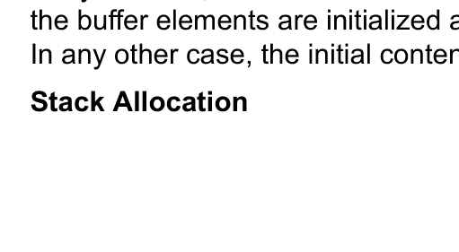

# 精通 C# (C Sharp 编程)：初学者、中级和高级用户的逐步指南，包含项目和练习


#### 下一步是什么？

### 枚举

### 枚举的基础

### 枚举为何有用

### 快速入门

#### 下一步是什么？

## 第二部分：中级指南

### 方法

### 创建方法

### 调用方法

### 从方法返回内容

### 将内容传递给方法

### 传递多个参数

### 方法重载

### Convert 和 Console 类

### 对递归的简要介绍

### 快速入门

#### 下一步是什么？

### 类 第 1 部分

### 什么是对象？

### 什么是类？

### 创建对象

### 使用对象

### 构造函数

### 栈 vs 堆

### 栈 vs 堆：有什么区别？

### 什么进入栈和堆？

### 按引用传递和按值传递

### 垃圾回收

### 内存事实

垃圾回收如何工作？

清理非托管资源

快速入门

下一步是什么？

类 第 2 部分

创建新类

添加实例变量

访问修饰符：私有和公共

添加构造函数

变量作用域

名称隐藏

this 关键字

添加方法

静态方法、变量和类

快速入门

下一步是什么？

属性

为何需要属性？

创建属性

可访问性级别

自动实现的属性

在对象创建时设置属性

快速入门

下一步是什么？

结构体

创建 struct

有什么区别？

快速入门

下一步是什么？

继承

基类

派生类

使用派生类

检查类型和对象转换

构造函数和继承

受保护访问修饰符

万物之基类

防止继承

快速入门

下一步是什么？

多态、虚方法与抽象类

什么是多态以及我们为什么需要它？

虚方法和重写

回到 Base 关键字

抽象基类

抽象方法

使用 new 关键字重写方法

快速入门

下一步是什么？

接口

什么是接口？

如何创建接口

多重继承

快速入门

下一步是什么？

泛型：第 1 部分

为何需要泛型？

什么是泛型？

List 类

Dictionary 类

### 快速入门

#### 下一步是什么？

### 泛型：第 2 部分

### 创建泛型类

### 在类中使用泛型类型

### 泛型约束

### 快速入门

#### 下一步是什么？

## 第三部分：高级指南

### 文件 I/O

### 简单方法

### 读取基于文本的文件

### 读取和写入二进制文件

### File 类

### 快速入门

#### 下一步是什么？

### 错误处理：异常

### “捕获”异常

### 不命名异常变量

### 不同方式处理不同异常

### 抛出异常

### finally 关键字

### 快速入门

#### 下一步是什么？

### 委托

#### C# 中的委托

#### 声明委托

#### 使用委托

#### 方法作为一等公民

### 更好的示例

快速入门

下一步是什么？

事件

定义事件

引发事件

附加和分离事件

快速入门

下一步是什么？

线程

线程任务

为线程提取工作

启动线程

线程安全

快速入门

下一步是什么？

运算符重载

重载运算符

快速入门

下一步是什么？

索引器

创建索引器

快速入门

下一步是什么？

用户定义转换

隐式 vs 显式转换

创建用户定义转换

快速入门

下一步是什么？

扩展方法

创建扩展方法

### 快速入门

### 快速测验

## 第四部分：更高级章节

### C# 反射

### C# Type 类

#### C# Type 方法

### 匿名函数

### 使用 Lambda 表达式与匿名类型

### 匿名方法

### Lambda 表达式

### 异步编程

### Async

### Await

### LINQ

### 查询运算符

### LINQ 与 SQL

### 检索和删除 XML 数据

### Parallel 类和 PLINQ

#### ParallelEnumerable 类

### Opt-in 模型

### 执行模式

### 并行度

### 有序 vs 无序并行查询

### 并行 vs 顺序查询

### ForAll 运算符

### 取消

### 异常

### 自定义分区器

### 衡量 PLINQ 性能

理解 PLINQ 加速

可能影响 PLINQ 查询性能的因素？

何时选择顺序模式

PLINQ 顺序保持

查询运算符和排序

使用不安全代码

不安全上下文

指针类型

固定和可移动变量

指针转换

指针数组

表达式中的指针

指针递增和递减

指针算术

指针比较

sizeof 运算符

Fixed 语句

定长缓冲区

确定性赋值检查

栈分配

动态内存分配

Windows Forms 简介

理解 Windows Forms

将窗体用作对话框

将窗体用作视图

一个简单的 Windows Forms 项目

执行 Windows Forms 项目

向项目添加新窗体

模态窗体 vs 无模态窗体

DialogResult 值


### 向窗体传递值
### 使用消息框显示信息
### 控制 Windows 窗体应用程序
### 应用程序路径信息
### 执行空闲工作
### 关闭应用程序
### 使用窗体属性更改窗体行为
### 定义其他窗体属性
### 结论
### 答案

### 引言

如果我每遇到一个梦想成为视频游戏程序员、以为能因此致富、却承认自己不会编程的人就有一美元，那我现在早就百万富翁了。

如果你不会编程，你到底要怎么成为下一个游戏界的热门人物？

虽然，你也可以从事游戏设计，我想，然后付钱让别人做其他一切。

但说实话，即使是游戏设计师也需要理解游戏的方方面面，而这包括编程。

因此，无论你想从事游戏设计师、开发者职业，还是只是想学习如何编程，C#都是一个很好的起点。我必须诚实地告诉你，不过。当你刚开始学习编程时，它可能会有点枯燥——理论很多，编程却不多。为了让事情变得更好，我在本书中加入了大量你可以自己尝试的示例，并将理论拆分为更易管理的部分。

C#是游戏开发中使用的主要编程语言之一。虽然本指南的重点不是游戏和游戏设计，但如果你想朝那个方向发展，那么这本指南就是为你准备的。游戏开发需要计算机科学的所有主要领域——编程、数据结构、算法、GUI 设计、网络、AI、计算机图形学等等。

因此，请继续阅读，先简要了解一下 C# 是什么以及它都涉及什么，然后我们再一头扎进编程中。

### 什么是 C#？

通常，每台计算机程序不过是一组指令，有时很简单，有时更复杂，计算机将遵循这些指令。虽然计算机一方面很笨，但它们非常擅长遵循指令，而创建这些指令将取决于你。

然而，你不能以任何方式编写指令，因为计算机只能理解二进制，即用 0 和 1 编写的语言。在过去，一系列开关会被用来打开和关闭以表示 0 和 1，但这变得很乏味。

这就是为什么要创建编程语言；你以老式的英文文本格式编写指令——称为源代码——然后你将该代码交给另一个程序，该程序将把你的源代码翻译成计算机理解的语言。你经常会看到它被称为“编译代码”、“可执行代码”、“二进制文件”或只是“可执行文件”。

在互联网上快速搜索一下，你会发现数百种不同的编程语言——每种都有其用途，并非所有语言都可用于所有事情。你可以将计算机语言与口语语言进行比较——有些彼此非常相似，而有些则截然不同。有些被广泛使用，而有些只被少数人使用，大多数优秀的程序员至少熟悉其中几种。

在所有这些语言中，C# 无疑是最好的之一。我不会说它是最容易的，但它很受欢迎。它属于 C/C++ 语言家族，这意味着语言之间的语法非常相似，这也包括 Java。一旦你学会了 C#，你会发现继续学习 C/C++ 和 Java 非常容易——如果你不想学，至少你能够阅读用这些语言编写的代码并理解它。

同样，如果你已经在这些语言方面有扎实的基础，那么 C# 对你来说会很容易。

### 关于本指南

本指南分为五个部分。在第一部分，我们将介绍 C# 编程的基础知识，然后进入中级和高级主题，然后我们将研究一些非常高级的主题。我们将以对不安全代码的深入研究结束，这是你需要学习的重要内容，然后是介绍

## 第 1 部分：初学者指南

在我们甚至考虑编程方面之前，我们真的需要先解决一些背景问题。你可能知道 C# 是什么，但你知道它运行在 .NET 框架上吗？

### .NET 框架

.NET 是微软为软件应用程序开发的框架。它被开发人员用于构建 Web 应用程序、移动和 Windows 应用程序，并提供对行业标准的广泛支持以及大量的功能。

在 .NET 内部，你会找到 FCL，即框架类库，包含大量类库。用 .NET 编写的软件在 CLR 中执行，即通用语言运行时环境，这两者都是框架的核心部分。

.NET 提供许多不同的服务，例如网络、内存管理、内存安全和安全性，并且它为多种编程语言提供完全支持，其中 C# 就是其中之一。

这些都是构成框架的各个部分：

- **CLR -** 通用语言运行时是执行引擎，是操作系统与框架之间的接口。
- **FCL -** 框架类库包含数千个类供你构建应用程序使用。库的核心是 BCL，即基类库，它提供基本功能。
- **WinForms –** Windows 窗体是一组托管库，是框架的智能客户端技术，使执行常见任务变得更加简单，例如读写文件系统。
- **ASP .NET –** 微软设计和开发的 Web 框架，用于开发网站、Web 服务和 Web 应用程序。它有助于 JavaScript、CSS 和 HTML 的集成。
- **ADO .NET –** .NET 框架模块，在数据源和应用程序之间建立连接。那些数据服务可能是 XML 或 SQL Server，例如。ADO .NET 由用于检索连接、插入和删除数据的类组成。
- **WPF – Windows Presentation Foundation** 是微软的图形子系统，用于在 Windows 应用程序中渲染 UI，并使用 DirectX。
- **WCF – Windows Communication Foundation** 是用于构建面向服务的应用程序的框架。使用 WCF，可以在服务端点之间发送异步消息。
- **WF – WorkFlow Foundation** 是微软的另一项技术，为用户提供 API、可重新托管的设计器和进程内工作流引擎，以帮助在 .NET 应用程序中实现长时间运行的进程。
- **LINQ – Language Integrated Query** 最初于 .NET 3.5 中引入，用于使用 C# 对数据源进行查询。
- **Entity Framework –** 基于 ORM 的框架，开放源代码，用于使用 .NET 对象处理数据库。它减轻了开发人员处理数据库的大量工作，是推荐的数据库技术。
- **Parallel LINQ –** 另称为 PLINQ，这是 LINQ to objects 的并行实现，结合了 LINQ 的可读性和简单性与并行编程的强大功能。它可以通过确保使用所有可用的计算机能力来加快 LINQ 查询执行速度。

除此之外，.Net 中还有其他 API 和模型来改进和增强它。在本指南的进程中，我们将详细研究上述内容中的一些。

### .NET 通用语言运行时 (CLR)

这是一个用于管理和执行 .NET 支持的任何语言编写的代码的运行时环境。它可以将代码转换为本机代码，以便 CPU 执行它。其功能包括：

- 将程序转换为本机代码
- 异常处理
- 确保类型安全
- 内存管理


- 安全
- 性能改进
- 独立于任何一种语言
- 独立于任何一个平台
- 提供垃圾回收

它还提供语言特性，即接口、重载和面向对象编程的继承。

- **BCL 支持** – Base Class Library 是为 .NET 应用程序提供类支持的库
- **线程支持** – 管理多线程应用程序的并行执行
- **COM Marshaller** – 在应用程序和 COM 对象之间提供通信
- **类型检查器** – 检查应用程序中的类型以确保其符合 CLR 标准
- **代码管理器** – 在执行运行时管理代码
- **垃圾回收器** – 释放任何未使用的内存部分，并将其分配给其他应用程序
- **异常处理程序** – 处理运行时异常以使应用程序不会失败
- **类加载器** – 在运行时加载类

### .NET Framework 类库

这是一个大型类、接口、命名空间和值类型的集合，用于 .NET 应用程序。大量类支持：

- 数据类型 – 基础和用户定义
- 异常处理
- I/O 和流操作
- 与底层操作系统的通信
- 数据访问
- 创建 GUI 应用程序 – 基于 Windows
- 创建 Web 客户端和服务器应用程序
- 创建 Web 服务。

### .NET Framework 类库命名空间

这些是最常用的命名空间，其中包含接口和类：

| 命名空间 | 描述 |
|---|---|
|  | 包括通用数据类型、数组、字符串值以及数据转换方法 |
| .Data | |
| .Data.Common | |
| .Data.OleDb | |
| .Data.SqlClient | |
| .Data.SqlTypes | 全部用于数据库访问、检索数据库和执行命令 |
| .IO | |
| .DirectoryServices | |
| .IO.IsolatedStorage | 用于访问、读取和写入文件 |
| .Diagnostics | 用于调试和应用程序执行跟踪 |
| .Net | |
| .Net.Sockets | 用于在创建 P2P 应用程序时通过网络进行通信 |
| .Windows.Forms | |
| .Windows.Forms.Design | 用于创建使用 Windows UI 组件的应用程序（基于 Windows） |
| .Web | |
| .WebCaching | |

.Web.UI
.Web.UI.Design
.Web.UI.WebControls
.Web.UI.HtmlControls
.Web.Configuration
.Web.Hosting
.Web.Mail
.Web.SessionState      全部用于创建在互联网上运行的 ASP.NET 应用程序
.Web.Services
.Web.Services.Description
.Web.Services.Configuration
.Web.Services.Discovery
.Web.Services.Protocols 用于在互联网上发布 XML Web 服务和组件的创建
.Security
.Security.Permissions
.Security.Policy
.WebSecurity
.Security.Cryptography  用于身份验证、加密和授权的目的
.Xml
.Xml.Schema
.Xml.Serialization
.Xml.XPath

.Xml.Xsl
用于创建和访问 XML 文件

### .NET Framework 基础类库

这是框架的一个子系统，用于为 CLR 提供库支持，使其按预期运行。System 命名空间可以在这里找到，以及核心类型。

这让你对 .NET 有了大致的了解。现在我们可以继续并安装 Visual Studio，即 C# 的推荐 IDE。

### 安装 Visual Studio

要开始用 C# 编程，你需要 Microsoft Visual Studio Community Edition。有多个不同版本可用，包括 Professional、Community Edition、Premium 和 Ultimate。Community Edition 对于学习 C# 来说已经足够，而且与其它版本不同，它是免费的。学习完成后，可以查看其他版本并决定投资是否值得 – Professional 版本的功能与 Community Edition 大致相同，但 Ultimate 和 Premium 有更多功能。

Community Edition 非常适合开源开发、教育用途。如果你在员工少于五名开发人员、计算机少于 250 台、收入少于 100 万美元的公司工作，它也是理想选择。

话虽如此，你完全可以用 Visual Studio Community Edition 进行商业开发，因此你可以用它来开发游戏或创建可出售的软件应用程序，而不会受到任何惩罚。

太棒了！

让我们安装它。

- 1. 前往 https://visualstudio.microsoft.com/vs/community/ 并点击下载按钮 – 注意，它也适用于 Mac OS，因此请确保选择正确的版本。
- 2. 只需按照屏幕上的步骤安装它，就像安装任何其他软件一样。做好准备 – 这可能需要一些时间，如果你的互联网连接不佳，可能需要 20 分钟或更长时间。你还可能会看到安装其他软件包，例如 .NET Framework。Visual Studio 需要这些 – 当被要求授权时，请说“是”。
- 3. 一旦安装完成，你将被要求创建一个 Microsoft 帐户。如果你已经有帐户，那就很简单了。可以放心的是，Microsoft 不会不负责任地使用你的电子邮件地址。你最多会收到

using System

这是你的程序的源代码，也是你将要处理的内容 – 我们稍后会更详细地查看它。

项目资源管理器应位于屏幕右侧，这里你将看到项目中包含的所有文件，其中包括我们稍后将进行一些工作的主文件。它称为 Program.cs，.cs 文件扩展名告诉你它是一个包含 C# 代码的文本文件。要查看资源管理器中任何文件中的代码，只需双击它们即可。

屏幕底部是错误列表。当你编写 C# 代码时，如果你犯了错误并且计算机无法理解它应该是什么意思，你将在该部分屏幕上看到错误 – 这非常有帮助，因为它会告诉你错误的确切位置以及问题所在，以便你可以找出如何修复它。

屏幕右下角，你可能会看到一个名为属性的窗口 – 它显示了你选择的项目或文件关联的所有属性 – 现在不用担心这个。

如果你想查看一个看不到的窗口，请点击 View -> Other Windows 并点击你想要的窗口。现在，你只需要主编辑器窗口和其中显示的 Program.cs 代码。

### 保存你的项目

你的项目尚未自动保存；这很重要 – 如果你花费大量时间编写大量代码、编辑它、编译它，然后运行它，结果它崩溃了，你将失去一切。养成保存程序的习惯！点击 File -> Save All 并将其保存在名为 Projects 的默认目录中。

### 修改你的项目

好！现在开始工作。

在你的编辑器窗口中，你应该看到这段代码：

```
using System;
```

```
using System.Collections.Generic;
using System.Linq;
using System.Text;

namespace HelloWorld
{
class Program
{
static void Main(string[] args)
{
}
}
}
```

我稍后会解释所有这些内容的作用，但首先，我们将进行更改并告诉代码我们希望它打印 "Hello World!"。

转到代码中间的以下行：

```
static void Main(string[] args)
{
}
```

在打开和关闭大括号 ({}) 之间添加以下代码行：

```
Console.WriteLine("Hello World!");
```

你的代码现在应如下所示：

```
using System;
using System.Collections.Generic;
using System.Linq;
```

```
using System.Text;

namespace HelloWorld
{
class Program
{
static void Main(string[] args)
{
Console.WriteLine("Hello World!");
}
}
}
```

就这样，你的第一个 C# 程序 – 多么容易！

### 编译和运行你的项目

记住 – 现在你的计算机不是魔术，它不会理解你写下的任何文字。它理解的是以二进制格式给出的指令，一系列 0 和 1。Visual Studio 包含一个编译器，它将你的代码转换为二进制格式，以便你的计算机可以读取它。

这是我们的下一步 – 编译代码并运行它。

很简单，我保证。

按键盘上的 F5 键或在菜单中点击 Debug -> Start Debugging。

这将在调试模式下运行程序，因此，如果运行过程中出现任何问题，它不会直接崩溃；Visual Studio 会处理它，停止程序并显示错误是什么，以便你可以修复它。

就这样，你创建了一个程序，你编译了它，你执行了它。

如果你的程序无法编译和执行，请确保它与我向你展示的代码完全相同。

但等等！你的程序正在运行，但你看不到它做了什么，因为它刚刚从屏幕上消失，那个小黑控制台窗口出现了一纳秒然后就消失了。发生了什么？

还记得我说过计算机并不那么智能吗？就是这样；你的计算机运行了该程序，并且因为你没有给它更多指令，它没有其他事情可做，所以它就关闭了。我们不希望它这样做，所以我们需要想出一个解决方案。

有两种方法，每种方法都有其自身的优缺点。

### 解决方案 1


运行程序但不进行调试——如果这样做，程序会在关闭前暂停。点击“调试 -> 开始执行（不调试）”或按 Ctrl+F5。试试看，你会看到屏幕上打印出“Hello World!”消息，还会看到另一条消息：“Press any key to continue”。按下任意键后程序就会关闭。

这并非没有缺点。因为我们不是在调试模式下运行程序，如果程序发生任何问题，应用程序就会崩溃，你也会丢失它。

那么，替代方案是什么？

### 解决方案 2

添加另一行代码。这行新代码会告诉程序在关闭前等待。该行代码应放在以下这行代码的下方：

```
Console.WriteLine("Hello World!");
```

所以现在添加这行代码：

```
Console.ReadKey();
```

现在你的代码应该如下所示：

```
using System;
using System.Collections.Generic;
using System.Linq;
using System.Text;

namespace HelloWorld
{
    class Program
    {
        static void Main(string[] args)
        {
            Console.WriteLine("Hello World!");
            Console.ReadKey();
        }
    }
}
```

现在我们又给代码添加了一行，你会在你写的每个控制台应用程序中都看到这行代码，这可能会开始变得有点烦人，但你确实获得了在调试模式下运行程序的额外好处，这是一个很棒的特性，你将会发现这一点。

### 底线

实际上，只有在你编写控制台应用程序时才会遇到这个问题，而这几乎是我们大多数时间要做的事情。

让我们看看你写了什么以及它的含义。我将逐行解释代码及其含义，这样你至少能对正在发生的事情有一个基本的理解。

### Using 语句

```
using System;
using System.Collections.Generic;
using System.Linq;
using System.Text;
```

注意，代码的前四行都以“using”一词开头。这是一个关键字（稍后会详细介绍），是 C# 语言保留使用的词。在 C# 编译器看来，它具有特殊含义——编译器知道必须做一些特殊的事情——使用别人已经编写好的、我们希望访问的代码。

在本指南的整个过程中，你现在只需要对它们有一个基本的了解。我们现在讨论的是这部分代码：

```
class Program
{
    static void Main(string[] args)
    {
        // 然后关闭它
    }
}
```

从根本上说，类就像是特定对象类型的蓝图。你编写的大部分代码都属于这些类之一，在我们的例子中，这个类叫做“Program”。随着我们继续学习本指南，你将会创建很多类，因为类是 C# 和其他 OOP（面向对象编程）语言中最关键的部分之一。

在类内部，我们有方法——在其他语言中你可能会看到它们被称为函数。稍后会详细介绍。目前，方法就是执行特定任务的一个代码块。我们的编译器将要查找的是“Main”方法。

那一行上你看到的其余内容：

```
static void Main(string[] args)
```

这被称为“方法签名”。这里定义了方法的特定属性，这些属性对于 C# 编译器查找“Main”方法也至关重要——请勿以任何方式修改它们。

我们稍后会在指南中讨论这些。你现在需要知道的是，编译器会查找这行代码，以便知道你的程序从哪里开始。放在“Main”方法中的任何内容都会由计算机运行，而我们将暂时专注于这个方法。

#### 下一步是什么？

哇，做了很多工作，但还没有完成多少。没关系，我们总得从某处开始。

在进一步迈入编程之前，我想谈谈另一个重要特性——注释。注释用于为代码的各个部分做笔记——那么现在让我们来看看它们。

### C# 注释

注释是你在代码上写笔记的一种方式，用来告诉别人代码在做什么，而且只要书写正确，计算机就会忽略它们。要写注释，你只需在注释前面加上一对斜杠（//），如果你想添加一条跨多行的注释，可以使用斜杠和星号——例如

```
/* 这是一条注释
跨越多行
的注释*/
```

我们要看的是注释是什么、为什么需要它们以及如何使用它们。有三种方式。许多编程教程要么忽略这些，要么把它们藏在书的后面。我选择在开头就把它们放在你眼前——它们就是如此重要！

那么，什么是注释？基本上，它是人类眼睛可以阅读、而计算机忽略的一段文本。你应该养成在代码中使用它们的习惯。它们对于描述一段代码的功能非常有用——你可能以后会回头来看，或者其他人可能会阅读，注释会准确地告诉你到底是什么情况。

然而，仅仅写任何旧文本是不够的。你的注释必须写得好，因为对于可能棘手的代码来说，它们是唯一的解释。这是程序员与其他查看他们代码的程序员交流的主要方式，无论是你写完代码五分钟后还是五年后。

基本上，有三种方式来做这件事。我们只看其中两种，因为第三种方式在一段时间内不适用于我们将要做的事情。

第一种方式是在注释开头使用一对斜杠，后面的一切都被视为注释的一部分，并被计算机忽略。你会注意到，在 Visual Studio 中，当你正确编写注释时，它会改变颜色，这样你就可以清楚地看到它。

例如：

```
// 这是一条注释，我可以在里面告诉你接下来会发生什么...
Console.WriteLine("Hello World!");
```

你可以将注释写在代码的同一行：

```
Console.WriteLine("Hello World!"); // 这也是一条注释。
```

该行中 // 之后的任何内容都会被忽略。

第二种方式是使用一个斜杠和一个星号：

```
Console.WriteLine("Hi!"); /* 这条注释到此结束... */
Console.WriteLine("你可以在这里添加更多内容");
```

我们也用这种方法来写多行注释，比如这样：

```
/* 这是一条多行注释。
它跨越好几行。
是不是很酷？ */
```

你也可以使用 // 方法来写多行注释：

```
// 这是一条多行注释。

// 它跨越好几行。

// 是不是很酷？
```

这似乎是最受欢迎的方法，但你必须使用适合自己的方式——两种方式都是完全有效的。

另一种注释类型以三个斜杠（///）开头，用于自动创建代码的技术文档。不过它只用在某些地方——所以，当我们讲到那些地方时，我会更详细地介绍。

#### 编写好注释

写注释很容易；写好注释就没那么容易了。首先，你应该在编写代码的同时添加注释，而不是几小时之后。你可能会忘记自己当时在做什么，即使是经验丰富的程序员也会遇到这种情况。

其次，你的注释应该为代码增加良好的价值。这是一个糟糕的例子：

```
// 将分数重置为 0

score = 0;
```

代码本身已经告诉了我们这一点，所以这条注释是在浪费时间和精力。它应该读起来像这样：

```
// 将分数重置为 0，因为游戏要重新开始

score = 0;
```

没有必要给每一行代码都添加注释，但要尽量为每个相关代码段添加一条注释。你可能会过度，但这总比完全没有注释要好——养成这样做的习惯。

在我们进入真正的编程之前，还有一件事——关键字。

### C# 关键字

像所有计算机编程语言一样，C# 有自己的一套保留关键字。这些词对编译器具有特殊含义，并且仅供编译器使用。这意味着你不能在命名变量、类、接口或任何其他内容时使用它们。

C# 关键字分为以下几类：

#### 修饰符关键字

这些关键字指示谁可以修改类型和类型成员。它们用于防止或允许程序的部分被其他部分修改。关键字如下：

- abstract
- async
- const
- event
- extern
- new
- override
- partial
- readonly
- sealed
- static
- unsafe
- virtual
- volatile

#### 访问修饰符关键字


这些关键字应用于类、方法、属性、字段和其他成员声明，用于定义类及类成员的可访问性。关键字及其含义如下：

**public** – 此修饰符允许同一程序集或其他程序集中的程序部分访问该类型及其类型成员。

**private** – 此修饰符限制其他程序部分访问该类型及类型成员，仅允许来自同一类或同一结构体中的代码进行访问。

**internal** – 此修饰符允许同一程序集中的代码访问该类型或类型成员。如果未指定修饰符，则这是默认值。

**protected** – 此修饰符允许同一类或该类的派生类中的代码访问该类型及类型成员。

### 语句关键字

这些关键字完全与程序流相关：

- if
- else
- switch
- case
- do
- for
- foreach
- in
- while
- break
- continue
- default
- goto
- return
- yield
- throw
- try
- catch
- finally
- checked
- unchecked
- fixed
- lock

### 方法参数关键字

这些是应用于方法参数的关键字：

- params
- ref
- out

### 命名空间关键字

这些关键字用于命名空间及相关运算符：

- using
- `.` 运算符
- `::` 运算符
- extern alias

### 运算符关键字

这些运算符关键字用于各种杂项操作：

- as
- await
- is
- new
- sizeof
- typeof
- stackalloc
- checked
- unchecked

### 访问关键字

这些关键字用于访问类或对象的包含类或基类：

- base
- this

### 字面量关键字

这些关键字适用于对象的当前值或实例：

- null
- false
- true
- value
- void

### 类型关键字

这些关键字用于数据类型：

- bool
- byte
- char
- class
- decimal
- double
- enum
- float
- int
- long
- sbyte
- short
- string
- struct
- uint
- ulong
- ushort

### 上下文关键字

只有在特定上下文中使用时，它们才被视为关键字。它们不属于保留字，因此你可以将它们用作名称或标识符：

- add
- var
- dynamic
- global
- set
- value

当你在 Visual Studio Code 中使用这些上下文关键字之一时，它们不会变成蓝色，而蓝色是 VS 中的默认颜色。

### 查询关键字

这些是用于 LINQ 查询的上下文关键字：

- from
- where
- select
- group
- into
- orderby
- join
- let
- in
- on
- equals
- by
- ascending
- descending

这些关键字不能用作标识符或名称，但你可以使用 @ 前缀来使用它们。例如，由于“class”是保留关键字，你不能将其用于名称或标识符。不过，你可以使用 @class——请参见下面的示例：

```
public class @class
{
public static int MyProperty { get; set; }
}
```

```
@class.MyProperty = 100;
```

### 接下来做什么？

既然你已经掌握了基础知识，我们可以继续深入实际编程主题。我们将从变量开始。

### 变量

变量是 C# 编程中极其重要的基础——实际上，任何编程语言都是如此。我们使用变量来存储数据，当你编写一个能完成实际任务的程序时，它就会用到这些变量。我们将探讨变量是什么、如何创建变量、如何向变量添加数据，以及了解所有不同的变量类型。

它们是什么？

在任何语言以及你用该语言编写的任何程序中，最重要的部分之一就是能够存储信息和数据。例如，如果你正在编写一个游戏，你可能需要存储某个玩家剩余生命数或游戏得分等数据。

你可能还记得数学课上讨论的变量，但那时变量是需要求解的未知量。在编程中，情况有所不同。你的变量就像一个盒子，一个你可以往里放东西的容器。你可以把任何你想要的东西放进这个盒子，因此它的内容会变化或可变，故名为“变量”。

与大多数编程语言一样，C# 也有许多这样的盒子，每个盒子都能存储不同类型的数据，例如字符、数字等等。你可能感兴趣（也可能不感兴趣）的是，这类语言被称为“强类型”语言，因为它们有很多种盒子。而那些只有一个万能盒子的语言则被称为“弱类型”语言。

我们将了解 C# 中不同类型的变量，但首先，我们需要看看如何创建一个变量。

### 创建变量

学习创建变量的最佳方法就是动手实践。那么，请打开 Visual Studio 并创建一个新的控制台项目（如果你不记得如何操作，请回顾第一章）。

在屏幕上打开 Main 方法，并添加以下这行代码：

```
int score;
```

这就是一个变量。看起来真的没什么。但实际情况比这要多一点。创建变量，也就是所谓的定义变量，需要两个步骤。第一步是指定变量类型，C# 中有专门的关键字用于此目的。

请记住：变量类型将决定可以存储什么内容。在我们的例子中，我们使用了 int 类型，它表示该变量可以存储整数值。整数值是整数及其对应的负数——0、1、2、3、4……以及 -1、-2、-3、-4 等等。在我们定义的变量类型中，可以存储 100，也可以存储 2578，例如，但不能存储 2.854，因为它不是整数。我们也无法存储“hotdog”，因为它同样不是整数——稍后我们会详细介绍类型。

第二步是为变量命名。请记住，这个名称实际上只是供人使用的——计算机并不关心名称是什么，一旦你将其交给计算机，它只会将其改名为一个内存位置。请确保选择的名称能体现变量中存入的内容。

在数学中，变量通常用单个字母命名，例如‘X’。在计算机编程中，变量名更加精确，例如“score”。此外，C# 中的每条语句都以分号（;）结尾，计算机据此判断语句是否结束。

### 给变量赋值

一旦你声明了变量的类型和名称，就需要给它一个值。我们称之为“赋值”，并使用赋值运算符（=）来完成。我们将在本指南的后面部分讨论运算符，但现在，请在你输入的最后一行下面添加这一行：

```
score = 0;
```

我们将在指南的下一部分介绍基础数学知识，但现在，请理解编程中的 = 号与数学中的 = 号含义不同。当你看到类似“score = 0”的语句时，尝试将其理解为“score 被赋值为 0”，而不是“score 等于 0”。

你可以为 score 赋任何你想要的值，例如：

```
score = 2;
```

```
score = 17;
```

```
score = -3587;
```

还有一件事可以让你的生活更轻松：一次完成定义变量并赋值。例如：

```
int theTreeOfLife = 75;
```

在这条简单的语句中，我们定义了一个名为 theTreeOfLife 的变量，将其类型设为 int 以容纳整数，并为其赋值为 75。

### 变量的类型

整数只是变量的一种类型。让我们看看在 C# 程序中可能会用到的其他类型，并讨论何时使用它们以及它们之间的区别：

| 类型 | 描述 | 字节 | 数据范围 |
| short | 存储较小的整数 | 2 | -32,768 到 32,767 |
| int | 存储中等规模的整数 | 4 | -2,147,483,648 到 2,147,483,647 |
| long | 存储较大的整数 | 8 | -9,223,372,036,854,775,808 到 9,223,372,036,854,775,807 |
| byte | 存储较小的无符号整数 | 1 | 0 到 255 |


| Type | Description | Bytes | Range |
|---|---|---|---|
| integers (no + or-) |  |  |  |
| ushort | 存储小的无符号整数 | 2 | 0 到 65,535 |
| uint | 存储中等的无符号整数 | 4 | 0 到 4,294,967,295 |
| ulong | 存储大的无符号整数 | 8 | 0 到 18,446,744,073,709,551,615 |
| float | 存储小的实数（浮点数） | 4 | ±1.5 × 10^-45 到 ±3.4 × 10^38，7 位精度 |
| double | 存储大的实数 | 8 | ±5.0 × 10^-324 到 ±1.7 × 10^308，15 到 16 位精度 |
| decimal | 存储范围小但高精度的实数 | 16 | ±1.0 × 10^-28 到 ±7.9 × 10^28，28 到 29 位精度 |
| char | 存储一个字符/字母 | 2 | 任意字符 |
| string | 存储字母、字符、数字或符号的序列 | 长度 |  |
| bool | 存储 true 或 false 值 | 1 | true 或 false |

让我们看看是否能解释得更清楚一些——从顶部的三种整数类型开始：short、int、long。字节数越多，能表示的数字就越大，但也意味着占用更多内存。在决定使用哪种类型之前，你必须知道可能要存储的数字的大小。大多数情况下，你可能会使用 int，但并非总是如此。

接下来，请注意这三种 int 类型也都有对应的无符号版本——ushort、uint、ulong。它们都不需要符号位，每个值都被假定为正数。这意味着这些类型可以存储比有符号对应类型大一倍的数字，而且虽然不能使用负数，但可以从 0 开始。

byte 类型只占一个字节，而且也是无符号的。你可能会认为这非常有限，因为它最大只能到 255。然而，我们也用这种类型来处理原始字节，这些字节至少对计算机而言没有任何含义。例如，它可以是文件或图像的内容，或者正在网络上传输的数据，这些数据可能是整数或任何其他类型的信息。不管它是什么，程序目前并不真正关心。

接下来是 float、decimal 和 double 类型。它们存储的是数学中所谓的实数，但在计算机编程术语中，它们是浮点数。我们之前讨论的所有其他类型可以存储 7 这样的整数，但不能存储 4.5。小数是指带有小数点的数，必须存储在具有浮点类型的变量中。对于不需要很高精度的小数字，可以使用 float 类型。对于需要更高精度的大数字，有 double 类型。decimal 类型的范围比这两种小得多，但精度要高得多。根据你的需求，你需要在它们之间做出选择。例如，如果你要开发一个游戏，你不会经常见到 decimal 类型——float 和 double 使用频率要高得多。

对于文本，我们有 char 和 string 类型。char 类型存储单个字符或字母，而 string 类型存储字母、符号和数字的序列。

最后，我们使用 bool 类型进行逻辑判断。在本指南中你会经常看到它，因为我们用它来确定某件事是 true 还是 false，然后根据结果执行不同的操作。

你可以用本指南前面所用的方式写出这些变量中的任何一个，使用 Console.WriteLine，就像这样：

```
int score = 75;
Console.WriteLine(score);
```

```
bool levelComplete = false;
Console.WriteLine(levelComplete);
```

```
string message = "Hello World!";
Console.WriteLine(message);
```

### 编写好的变量名

在结束本节之前，我们需要聊聊如何为变量命名。关于这个问题有很多争论，所以我想谈谈我的看法。

命名的目的是让任何人（而不仅仅是你自己）都能轻松知道变量的用途。给变量起一个名字，结果六个月后你完全想不起它是干什么的，因为这个名字毫无意义，那是不行的。编写可读的代码包括编写好的变量名，你不能忽视这一点。

首先，C# 编程中有一些关于变量命名的内置规则。每个变量名必须以字母开头，无论小写还是大写。之后，你可以使用字母、数字和下划线（_）的任意组合。如果违反这些规则，编译器就会大发脾气并拒绝编译你的程序。

最重要的是，变量命名要能描述其中存储的内容。例如，如果你要在变量中存储游戏分数，就把它命名为“score”、“playerScore”或类似的名字。不要叫它“ps”或“tiger”或任何没有意义的名字。

尽可能不要使用缩写。例如，如果你把变量命名为“plscr”，以后你还记得它是什么意思吗？你是否得坐下来苦苦思索？你不是在玩单词搜索游戏或填空游戏——如果需要靠猜，那就不要这么做。

变量名至少应有三个字母（虽然有例外），所以如果你的名字更长也不要紧。最好使用能恰当描述其用途的名字，而且我们早已没有以前八个字符的限制。但是，也不要太疯狂，起一个过长的名字。

如果你发现自己一直在名字末尾加数字，那就说明你做错了。考虑重命名你的变量。例如，与其用 score1 和 score2，不如考虑用 playerScore 和 gameScore。你明白我的意思吗？另外，不要使用像“text”、“data”、“number”或“item”这样的词，因为它们提供的描述不够。

通常，我们用名词来命名变量，比如一个人、一件事、一个地方、一个想法，或者使用名词短语，例如“playerScore”。

确保变量名中的每个单词都能与下一个单词区分开来。这会极大地提高可读性，而且由于不允许使用空格，有几种方法可以做到。第一种是让名称中第二个及后续单词的首字母大写，第一个单词保持小写——例如 playerScore。第二种是使用下划线，例如 player_score。这两种方式看起来都比 playerscore 好得多，也更易读。任何一种都可以接受，不过我本人更喜欢第一种。

### 一个完整示例

这段示例代码向你展示了变量的定义和赋值方式：

```
using System;
using System.Collections.Generic;
using System.Linq;
using System.Text;

namespace Variables
{
class Program
{
static void Main(string[] args)
{
// This will declare the variable and assign them
// in one step.
short levelNumber = 4;
int score = 0;

// This will declare the variable and then assign it
// later on.
long aBigNumber;
aBigNumber = -19;

// This one is a byte and can contain any value
// between 0 and 255 inclusive.
byte aSingleByte = 85;

// These are the unsigned variable types.
ushort thisHoldsPositivesOnly = 65;
uint soDoesThis = 806587;
ulong andThisButBiggerNumbers = 587695028;

// These are the variables that hold text
char myFavoriteLetter = 'd'; // This is my favorite because it is for dog.
string aMessage = "You have a new message on your private terminal.";

// And lastly, the Boolean type.
bool stillWorking = true;
stillWorking = false;
}
}
}
```

### 快速入门

- 变量可以存储各种类型的数据。
- byte、short、int 和 long 类型可以分别存储 1、2、4 和 8 字节的整数值。
- float 和 double 类型可以分别存储 4 和 8 字节的浮点值。
- decimal 类型可以存储 16 字节的浮点数，并且与 double 类型相比范围更小、精度更高。
- char 类型存储一个字符。
- string 类型存储文本值。
- bool 类型可以存储 true 或 false 值。
- 变量通过指定类型和名称来声明，例如 int aNumber;


- 名称必须以字母开头，大小写均可，并且可以包含数字、字母以及 `_`（下划线），长度不限。
- `=` 符号用于为变量赋值，例如，`int aNumber = 8;`
- 变量可以在一条语句中声明并赋值，例如，`int aNumber = 8;`

### What's Next?

现在你已经了解了变量以及它们的工作方式。我们可以继续前进并开始做一些真正的工作。首先，我们来看一些基础数学。

### Basic Math

如果你熟悉任何其他计算机编程语言，那么你会发现 C# 算术非常容易掌握，尤其是它与 C、C++ 和 Java 非常相似。

现在我们已经掌握了变量，我们可以深入研究数学；它非常简单，就是基础算术，就像你在学校学的那样。说实话，计算机就喜欢数学，主要是因为它们能做的几乎就是这些，而且速度很快。

我们在这里要看的是一些更基础的 C# 算术——我们会在另一章中更深入地探讨。我们将从加法、减法开始，然后进行乘法、除法和取模运算符，这是其中一个新运算符。从那里，我们将查看数字（正数和负数）、运算顺序（运算符优先级），然后以复合赋值运算符结束——这些可以在一次操作中完成数学运算并赋值。

#### Addition, Subtraction, Multiplication, and Division

这部分很直接，即使你从未看过另一种计算机编程语言。我们将从一个基础数学问题开始，这很可能是你在一年级或二年级时做过的。我们将把两个数字相加并将值存储在名为 ‘a’ 的变量中。代码如下：

```csharp
int a = 4 + 5;
```

同样的原理适用于减法，这次值存储在名为 ‘b’ 的变量中：

```csharp
int b = 5 - 4;
```

你在数学运算中并不仅限于使用数字；你也可以使用变量：

```csharp
int c = a + 3;
int d = a - b;
```

还不止于此；我们可以在一行中串联多个操作：

```csharp
int sum = 1 + 2 - 3 + 4 - 5 + a - b + c - d;
```

除法和乘法的工作方式大致相同，尽管在使用整数进行除法时，有几件事你需要注意。我们稍后会更详细地讨论这个问题；现在，我们将坚持使用 double 或 float 类型进行除法，而不是使用整数。C# 中的乘法符号是 *，即星号，而除法符号是正斜杠，/。

```csharp
float totalCost = 22.54f;

float tipPercent = 0.18f; // this is the equivalent of 18%

float tipAmount = totalCost * tipPercent;

double moneyMadeFromProgram = 100000; // Note – commas are not required in the number because C# won’t have a clue what to do with it.

double totalProgrammers = 4;

double moneyPerPerson = moneyMadeFromProgram / totalProgrammers; // We're mega rich!
```

还记得我们做的第一个程序吗？Hello World!? 我们使用 Console.WriteLine 代码向用户显示一些文本，我们也可以对数字这样做：

```csharp
// The area of a circle has a formula of pi * r ^ 2

float radius = 4;

float pi = 3.1415926536f; // The 'f' ensures it is treated as a float and not a double.

float area = pi * radius * radius;

// Note that, when we use a '+' symbol with a text string, the number at the end is concatenated to the end of the text string.

Console.WriteLine("The area of a circle is " + area);
```

在这个例子中，我们使用了三个变量：一个用于圆的半径，一个用于 PI 的值，一个用于面积，所有这些都使用标准公式计算。然后结果会打印或显示给用户。

请注意我们对文本字符串使用了 ‘+’ 运算符。这是 C# 中非常棒的一个特性，因为该语言知道字符串不能进行数学加法，但它有一种智能的处理方式——简单地将文本字符串连接或拼接在一起，使其一个接一个地跟随。如果你运行上面的代码，你会看到显示的内容是“The area of a circle is 50.26548”。这里还有更多内容，但我们会在后面的教程中讨论。

#### Modulus Operator

在学校学习除法后，你会做类似“23 除以 7 是 3 余 2”的事情。在计算机编程中，有一个专门用于该余数计算的运算符，称为取模运算符，通常简称为‘mod’。该运算符只会给出除法计算的余数，而不是实际的除法结果。百分号（%）是取模的符号，所以，无论你在 C# 编程中看到 %，请记住它并不表示百分比，它表示‘取余数’。

为了复习一下，7 去 23 里 3 次余 2。这就是你在 C# 代码中这样做的方式，假设我们要把 23 个橙子分给 7 个人：

```csharp
int totalOranges = 23;
int people = 7;
int remainingOranges = totalOranges % people; // this is 2.
```

乍一看，你可能会认为它不是一个很有用的运算符，但一旦你学会如何使用它，我保证你会找到很多用途。

#### The Unary "+" and "-" Operators

你已经见过这些运算符了。一元运算符意味着该运算符只有一个数字或操作数来处理。到目前为止，我们使用的一切都有两个操作数，使它们成为二元运算符。例如，在 4 + 5 中，+ 运算符同时作用于前面的数字和后面的数字。

一元运算符仅作用于其后面的数字。这里有一个例子；它可能会让你更容易理解：

```csharp
// These are the unary '+' and unary '-' operators. They will only work on the number that follows them.
int a = +7;
int b = -36;

// The binary '+' and binary '-' operators are also known as addition and subtraction, work on the numbers that come before them and after them.
int a = 4 + 5;
int b = 5 - 22;
```

一元符号 + 和 - 除了表示它们前缀的数字是正号还是负号之外，没有做更多的事情。还有一个，但我们稍后再看。

#### Parentheses and Order of Operations

你还记得在学校学习数学运算顺序吗？好吧，计算机编程也有这个，而且规则相同。为了刷新你的记忆，就任何数学公式或等式而言，括号内的计算总是先进行，然后是幂，再是指数。顺便说一下，C# 中没有内置的幂运算符，但我们会在另一个教程中讨论它。接下来是乘法、除法、加法和减法，按此顺序——这正是 C# 遵循的顺序。

我们可以使用括号来指示等式的指定部分要在其他部分之前完成。例如：

```csharp
// A piece of easy code to calculate the area of a trapezoid
// If you don’t remember this, don’t worry.
double side1 = 5.5;
double side2 = 3.25;
double height = 4.6;

double areaOfTrapezoid = (side1 + side2) / 2 * height;
```

如果你在数学中有复杂的公式，其中包含大量括号组，你可能会发现自己使用方括号（[]）或花括号（{}）作为更强大的括号。在 C# 中，我们不这样做。相反，你只需使用你需要的任意多个括号组，嵌套或其他，只要每组都是完整的——记住，每个左括号或左括号都需要一个匹配的右括号。

这里有一个例子：

```csharp
// This isn’t a real formula; it is made up for the purposes of this guide...
double a = 5.1;
double b = -6.5;
double c = 87;
double d = -56;
double e = 5.487;

double result = (((a + b) * (c - 4)) + d) * e;
```

顺便说一下，我想回顾一下我之前提到过的一点，为什么等号不被用来表示一件事等于另一件事。至少不是直接这样。`=` 符号是赋值运算符，它的作用是


实际上意思是它右边的内容会被计算，然后结果被放到左边的一个变量中。

让我们看看它是如何工作的：

```
```csharp
int a = 7;
```
```

```
```csharp
a = a + 2; // the variable called a will have a value of 9 once this line
// has been run.
```
```

数学家看到这个会觉得很奇怪。说到底，一个变量不可能等于它自己加 2。举个例子，从两边同时减去 a，就得到 0 = 2。从你的角度来看，这没有意义。

从编程的角度来看，这完全有意义。我们所说的是，取 a 中的值（7），加上 2，得到 9，然后把这个新值赋回给 a。我们只是取了 a 变量并给它加了 2。

### 复合赋值运算符

我们刚才谈到的，取一个值，对它做一些操作，然后再把它放回原来的变量，这在 *C#* 中非常常见，以至于专门为此设置了一整套运算符。这些被称为复合运算符——它们可以在同时进行数学运算和赋值操作。

让我们看看它们是如何工作的：

```
```csharp
int a = 7;
```
```

```
```csharp
a += 2; // This is the equivalent of a = a + 2;
```
```

对于减法运算符、除法、乘法和取模运算也有类似的运算符：

还有减法、乘法、除法和取模的等价运算符：

```
```csharp
int b = 8;
```
```

```
```csharp
b -= 4; // This is the equivalent of b = b − 4; at this stage, b would be
// 4.
```
```

b *= 5; // This is the equivalent of b = b * 5; at this stage, b would be 20.

b /= 4; // This is the equivalent of b = b / 4; at this stage b would be 5.

b %= 2; // This is the equivalent of b = b % 2; at this stage, b would be 1.

明白了吗？我们将在后面的章节中讨论更多数学方程和计算。

### 快速入门

- 加法的工作方式像 int a = 4 + 5;
- 减法的工作方式像 int b = 6 − 3;
- 乘法使用 * 作为符号，使用方式如下 − int c = 5 * 5;
- 除法使用 / 作为符号，使用方式如下 − int d = 8 / 4;
- 取模运算使用 % 作为符号，用于确定除法运算后的余数，像这样 − int e = 22 % 7; （int e 的值将为 1）。
- 在 C# 中进行数学运算时，可以使用任何标准数字类型 − double、int、float、short 等。
- 可以将多个运算组合成一个表达式，也可以在使用语句时使用之前创建的变量 − int f = 3 * b − 4;
- 运算顺序非常重要，它与你在学校学到的一样。乘法和除法优先于加法和减法，从左到右进行。括号优先于任何操作，因此使用

它们来使计算按你想要的顺序进行，例如，

```
double m = (y2 - y1)/ (x2 - x1)
```

- 复合赋值运算符是 +=、-=、/= 和 %=。它们执行运算并将值赋给左边的变量。例如，a += 3; 等价于 a = a +3; 并且只是给 a 中已有的值加上 3。

#### 下一步是什么？

我们在这里讨论了基本的数学运算，但还有更多内容需要学习。我们接下来会稍微偏离一下，看看如何使用命令行进行用户输入，这样在我们回到数学课之前，你就能知道它是如何工作的。

### 用户输入

这只是一个简短的部分；我们将快速查看几段代码，这些代码对于创建具有一定价值的程序是必需的。首先，我们将查看控制台窗口，了解如何使用它来获取用户输入，然后我们将了解如何将其转换为正确的数据类型。最后，我们将把所有学到的内容结合起来，编写一个程序，告诉我们圆柱体的体积和表面积。

#### 从控制台获取用户输入

我们可以使用以下语句从用户那里获取一些输入：

```
string whatTheUserTyped = Console.ReadLine();
```

这使用了一个方法（我们将在后面的章节中讨论），它会读取用户提供的文本行。用户的文本被放到左边名为 whatTheUserTyped 的变量中。记住，任何变量都可以放在那里，这个变量没有什么特别之处。

#### 转换

大多数时候，仅从用户那里获取输入并将其放入字符串变量中是不够的，无法为我们的需求提供正确的数据类型。如果例如我们想要一个数字怎么办？当它被放入字符串中时，除非我们先将其转换为正确的数据类型，否则无法对其进行任何数学计算。不要误解我；有时字符串就是正确的类型，所以你并不总是需要更改它。

转换到另一种类型需要一种方法来将一种数据类型转换为另一种类型。我现在不会详细介绍；那是后面的内容。简而言之，如果我们想将字符串转换为整数，我们需要这样做：

```
int aNumber = Convert.ToInt32(whatTheUserTyped);
```

每种可能的数据类型都有一个对应的类似方法。例如，ToBoolean 转换为 bool 类型；ToInt16 转换为 short 类型，ToDouble 用于 double 等等。其中有一个棘手的——float 类型。对于它，你必须使用 ToSingle，因为 float 是一个单精度值。你将在程序中看到它的运行情况。

#### 一个完整的程序

很好，我们已经有了一些更多的部分，现在我们可以创建一个真正做一些事情的程序。我们要做的是一个程序，让用户输入两个值——圆柱体半径和圆柱体高度。然后使用一些数学运算，所有公式都已为你提供，以计算圆柱体的体积和表面积。然后结果会打印给用户。

现在，对你来说最好的学习方式就是直接上手，看看你能想出什么。说真的，真正学习的最好方式是通过挣扎并尝试把所有部分拼凑起来。这不会发生，至少在指南的这个阶段不会发生。此外，这是一个教程，旨在让你按自己的节奏进行，而不是学校课程。

当然，你现在可以利用学到的知识构建你的程序，然后与我要告诉你的内容进行比较。你需要明白的一件事是——如果你的程序和我的不完全匹配也没关系——只要输出正确，代码正确就行。

无论如何，这是代码：

```
using System;
using System.Collections.Generic;
using System.Linq;
using System.Text;

namespace CylinderCalculator
{
class Program
{
```

```
static void Main(string[] args)
{
// Print a greeting message.
Console.WriteLine("Welcome to Cylinder Calculator !");

// Read cylinder's radius supplied by the user
Console.Write("Enter the cylinder's radius: ");
string radiusAsAString = Console.ReadLine();
double radius = Convert.ToDouble(radiusAsAString);

// Read cylinder's height supplied by the user
Console.Write("Enter the cylinder's height: ");
string heightAsAString = Console.ReadLine();
double height = Convert.ToDouble(heightAsAString);

double pi = 3.1415926536; // We’ll look at a different way to do PI later on

// These are the standard formulas for cylinder volume and surface area.
double volume = pi * radius * radius * height;
double surfaceArea = 2 * pi * radius * (radius + height);

// Now the results can be output
Console.WriteLine("The cylinder's volume is: " + volume + " cubic units.");
Console.WriteLine("The cylinder's surface area is: " + surfaceArea + " square units.");
```

```
// Before you close, wait for a response from the user...
Console.ReadKey();
}
}
}
```

让我们分解一下。

第一部分应该对你非常熟悉，就是包含 using 语句的部分。

我们为用户提供了一个欢迎消息。

```
// Print a greeting message.
Console.WriteLine("Welcome to Cylinder Calculator!");
```

与本指南开头 Hello World! 示例几乎相同。

接下来，我们要求用户输入圆柱体的高度和半径，然后使用本节开头讨论的内容将值转换为正确类型：

```
// Read cylinder's radius supplied by the user
Console.Write("Enter the cylinder's radius: ");
string radiusAsAString = Console.ReadLine();
double radius = Convert.ToDouble(radiusAsAString);
```

```
// Read cylinder's height supplied by the user
Console.Write("Enter the cylinder's height: ");
string heightAsAString = Console.ReadLine();
double height = Convert.ToDouble(heightAsAString);
```


The first line is nothing more than simple input and, after that, we read the user’s text in and stored it inside a string object. The next bit turned it into the right data type, in our case, the double type and then we did the same with the height of the cylinder.

Next, the value of PI was defined. Then we use some of the math operations we looked at in the last section to calculate what the cylinder surface area and volume are.

```
double pi = 3.1415926536; // We’ll look at a different way to do PI later on.
```

```
// These are the standard formulas for cylinder volume and surface area.
double volume = pi * radius * radius * height;
double surfaceArea = 2 * pi * radius * (radius + height);
```

Last, the result is output to the user:

```
// Now the results can be output
Console.WriteLine("The cylinder's volume is: " + volume + " cubic units.");
Console.WriteLine("The cylinder's surface area is: " + surfaceArea + " square units.");
```

```
// Before you close, wait for a response from the user...
Console.ReadKey();
```

That is our very first useful program written in C#.

### What’s Next?

Now we’ve learned enough to create a useful program, we can kick things up a notch and take things further. Next, we’re going back to math but in much more detail this time. Once we’ve done that, we can get stuck into logic, into getting our computer to make some choices about what it does.

### Math Part 2

Now, this is quite an involved section so don’t panic if you don’t understand it all first time around – go over it as many times as you need to.

As I explained earlier, computers absolutely love math, which is great, because that is pretty much all they can do. We will be moving on to more exciting stuff soon, I promise but this is a very important subject to learn.

One thing I do need to warn you is that the sections here are separate, not really related to one another at all. This is good because, if you need help on one specific thing, you can just jump straight to that section.

What are we going to discuss?

We’ll start off doing some division using integers, covering a very interesting problem that arises from it. Then we’ll move on to data conversion in a process called typecasting before we cover the subject of division by zero. After that, some of the special C# numbers, such is NaN, infinity, pi, and e, and then we’ll cover over and underflow. To finish, we’ll look at incrementing and decrementing, a very special C# feature.

Even if you think you know the subject, please don’t be tempted to skip a section; it never hurts to have a refresher and especially do not skip the final section – you really will regret it!

Above all, although there is so much to learn here, do try and have fun. Programming doesn’t have to be strait-laced, nose-to-the-grindstone theory.

Let’s get started.

#### Integer Division

A good way to begin is with a thought problem. Work out, in your head, what the result of seven divided by two (7/2) is. Done it? Seriously, don’t skip this and move on. Get that answer in your head – it is a simple one. You should have one of two answers – 3.5 or 3 with a remainder of 1. Both of these are right.

Now, open C# and input the following code in the window – look at the result to see what happens:

```
int a = 7;
int b = 2;
int result = a / b;
```

See it? 3. Just 3. Not 3 with a remainder of 1 and not 3.5. Just plain and simple, 3. Why? This is not your standard division, not the stuff you learned in school anyway. Instead, it is called integer division and, in that, fractional numbers do not exist.

How does integer division work?

It takes the biggest number that it can evenly divide and, regardless of how close it may be, it will ignore the fractional bit. For example, 99/100 would be 0, even though the actual answer is 0.99.

When you do any division using the int type, integer division comes into play, as it does when you use the long, short or byte type, or an unsigned equivalent – ulong, ushort, or ubyte.

When you mix up the data types, things start to get a bit tricky:

```
int a = 7;
int b = 2;
float c = 4;
float d = 3;
float result = a / b + c / d;
```

In this, a/b is 3 as it was before. However, c/d takes care of the floating point division, which is the division you are familiar with, providing a result of 1.33333. Adding both together provides a result of 4.33333.

One thing that is very important is that you understand this is what is happening when you use integer types. It may not always be the right thing to do, but you can use it to your advantage as long as you understand it.

#### Typecasting

Usually, when you use two things of the same type in a math calculation, like two ints, for example, the result will be of the same type. But what about doing a math calculation using two types that are not the same? What if, for example, you wanted to add an int and a long type? The answer lies in typecasting or casting for short.

Casting is a great C# feature because it lets you convert one type to another type. C# has two types of casting – implicit and explicit. Implicit casting is automatic, magic if you like, where the conversion happens without you needing to do anything. Explicit, on the other hand, is where you have to indicate that you want the conversion or it won’t be done.

In general, implicit casting happens automatically when you are going from a narrow to a wider type. What does that even mean? Go back to the section on types and look over the byte size. In C#, an int will use 32 bits and a long will use 64 bits. C# will implicitly cast ints to longs wherever it thinks they need to be cast without you telling it to do it.

So, you could do this:

```
int a = 8521;
long b = 159842965;
long sum = a + b;
```

When the adding is done, a is taken and cast to a long; it is added to b, and then put back into the variable called sum.

A floating point type is wider than an integer type, so, where needed, C# converts or casts ints to floats.

For example:

```
int a = 7;
float b = 2; // this converts the int value of 2 to a float value of 2.0

// because the value of b is a floating point value, the value of a is implicitly
// cast to a float, and, rather than integer division, we now have floating point division
// and this means that the result will now have 3.5 as a value,
// rather than 3 as the integer division would do, even though
// an int type was used.
float result = a / b;
```

Still with me?

Explicit casting is also incredibly important. There will be times when you want to go from a wide to a narrow type and doing this is a simple case of putting the required type to cast to inside a set of parentheses before what you are casting. Let’s see this in an example, to make it clearer; here, we cast a long to an int:

```
long a = 3;
int b = (int)a;
```

What is worth bearing in mind is that casting really isn’t magic and it can’t turn anything into anything. Not all types can be converted to another type and casting does have its limits. Try to explicitly cast something that can’t be cast and the compiler will throw up an error. Later, we’ll look at defining explicit casts but that is a bit more advanced for right now.

It should also be kept in mind that C# will always do casting first. That means if you want a math operation result cast, it must be included in parentheses with the cast in front of them. Here’s an example:

```
int a = 7;
int b = 2;
int c = 4;
```

```
// The answer is 7.5 because int be is converted to a float straight away,
// and then int a is implicitly cast to a float so the division can be done,
// then int c is cast to a float so the addition can be done.
float result1 = a / (float)b + c;
```

```
// The answer is 7; a/b is done with integer division,
// which results in 3; the addition is then done with int c, providing the result of 7, and then
// lastly, the result is cast to a floating point value of 7.
float result2 = (float)(a / b + c);
```

#### Division By Zero

We all know that nothing good can come of dividing by zero; in terms of math, it just doesn’t work. What will happen in C# when you try to divide by zero? It is actually quite strange.

If you try dividing by zero with ints, an exception is thrown. Now, we’ll be discussing these in detail later but, for now, what it means is that your program will just stop, right there in its tracks if you are not running it in debug mode. You may see an error message, you may not. If you are in debug mode, Visual Studio activates at the line with the error so you should be able to see what went wrong and, hopefully, fix it. You will see a message that says “DivideByZeroException was Unhandled”.

What is interesting is if you are using a float or double, or any other floating point type, the program won’t crash. Instead, you get a value of Infinity which we will talk about right now.


C# 拥有几个特殊的数字——无穷大（infinity）、NaN、pi、e、MaxValue 和 MinValue。

### 无穷大（Infinity）

float 和 double 这两种类型定义了无穷大的特殊值，包括正无穷和负无穷，正如你所料，它们分别表示正无穷大和负无穷大。请记住，如果你用无穷大的数进行任何数学运算，将会发生一些奇怪的事情。正无穷大加 1 仍然是正无穷大，正无穷大减 1 也是如此。

选择以下两种方式之一：

```
double a = double.PositiveInfinity;
```

```
float b = float.PositiveInfinity;
```

或者：

```
double a = Double.PositiveInfinity;
```

```
float b = Single.PositiveInfinity;
```

### NaN

NaN 代表 Not a Number（非数值），这是另一个特殊值。当你做一些有点疯狂的事情时，比如试图用无穷大除以无穷大，就会出现这个值。也有一种特定的方式来访问这个值：

```
double a = double.NaN;
```

```
float b = float.NaN;
```

```
double c = Double.NaN;
```

```
float d = Single.NaN;
```

### E 与 PI

这两个都是特殊数字，根据你所做的事情，它们可能会被大量使用。尽管我们之后会再次提及，但现在对这些数字稍作了解是值得的。

你可以创建变量来保存这两个值，但何必费事呢？已经有了一个内置的变量可以替你完成这件事。我们将使用一个名为 Math 的类（后面会详细介绍类，届时我们会再次回到数学这个话题），并使用如下代码：

```
double radius = 3;

double area = Math.PI * radius * radius;

// pi is more likely to be used than e.
double eSquared = Math.E * Math.E;
```

你还记得之前我们创建了一个 pi 变量吗？现在已经没有必要这样做了，因为正如你所看到的，已经有现成的了。

### MinValue 和 MaxValue

我们来看看这两个值。C# 中的大多数数值类型内部都会定义 MinValue 和 MaxValue，它们用于保存该类型所能容纳的最小值和最大值。对于浮点类型，访问它们的方式与访问 infinity 和 NaN 相同：

```
int maximum1 = Int32.MaxValue;

int maximum2 = int.MaxValue;

int minimum1 = Int32.MinValue;

int minimum2 = int.MinValue;
```

### 溢出与下溢（Overflow and Underflow）

那么，让我们来思考一下。short 类型的最大值可以达到 32767。如果我们这样做会发生什么：

```
short a = 30000;

short b = 30000;
```

```
short sum = a + b; // The sum is far too big to go into a short so what would happen?
```

当数学运算的结果超出了特定值类型的范围时，称为溢出（overflow）。理解会发生什么非常重要。对于整数类型——short、long、int 和 byte——最高有效位会被丢弃，这看起来很奇怪，因为计算机会将其解释为回绕（wrapping around）。

看看这个：

```
int aNumber = Int32.MaxValue;
```

```
aNumber = aNumber + 1;
```

```
Console.WriteLine(aNumber);// This prints a large negative number.
```

对于浮点类型而言，情况有所不同。由于这些类型都定义了 PositiveInfinity 和 NegativeInfinity，它们会变成无穷大，而不是回绕。

如果你非常担心溢出问题，可以在 checked 模式下运行。在这种模式下，整数运算不会回绕，而是会抛出异常。同样，我们后面会再回到这个话题。

下溢（underflow）是浮点类型偶尔可能发生的类似情况。假设你有一个非常大的浮点数，例如 1,000,000,000,000,000,000,000,000。如你所知，float 可以存储这种规模的数。再假设我们有一个非常小的数，例如 0.000000000000000001。它也可以存储为 float，但如果把这两个数相加，结果无法用 float 存储。结果将是 1,000,000,000,000,000,000,000,000,000.000000000000000001。

float 无法同时做到那么大和那么精确——这么大的数很少是精确的！相反，当你把它们相加时，结果会是 1,000,000,000,000,000,000,000,000,000，这对于很多情况来说可能已经足够接近了。然而，我们仍然会丢失一些潜在有价值的信息。

想象一下，你有一大堆非常小的数，并且你在将它们相加。这就是下溢可能出问题的地方。不过它不像溢出那么常见，你可能永远不会遇到，但你仍然应该了解它。

### 递增与递减（Incrementing and Decrementing）

在我们暂别数学话题之前，我们需要讨论一个非常酷的 C# 特性。你可能已经注意到，我经常尝试在一个值上加 1。你已经看到了两种做法：

```
int a = 3;
```

```
a = a + 1;
```

以及：

```
int a = 3;
```

```
a += 1;
```

那么，这里有另一种方式：

```
int a = 3;
```

```
a++;
```

这称为递增（incrementing），++ 是递增运算符。在学习本指南的过程中，你会在不少地方用到它。

它有一个对应的运算符 --，即递减运算符，用于从一个值中减去 1。

关于这些运算符还有一点需要说明。它们有两种写法。例如，你已经见过 a++，但也可以写成 ++a。同样，a-- 也可以写成 --a。如果运算符在末尾，我们称之为后缀表示法（postfix notation）；如果在开头，则称为前缀表示法（prefix notation）。

最后，你应该明白这两者之间有一个区别——该操作会返回一个值，这一点我们在本指南中会经常看到。对于更常见的后缀表示法，返回的是原始值。因此，对于 a++，返回的值是 a。而对于不太常用的前缀表示法，返回的是新值。下面是一个例子，可以帮助你更好地理解：

```
int a = 3;
```

```
int b = ++a; // int a and int b will both be 4.
```

```
int c = 5;
```

```
int d = c++; // the original value, 5, is assigned to int d while int c is now 6..
```

### 快速入门（Quick Primer）

- 在 C# 中进行整数除法时，会遵循整数除法的标准规则。
- 很多时候，隐式转换是从较窄类型到较宽类型进行的。
- 可以通过将目标类型插入到前面的一组括号中进行显式转换，例如 `float a = (float) 3.4948393;`。
- 对于 int 类型，除以零会抛出异常；对于浮点类型，结果则为无穷大。
- PositiveInfinity、NegativeInfinity 和 NaN 都是为 double 和 float 类型设计的，例如 `float.NaN` 和 `Double.PositiveInfinity`。
- MinValue 和 MaxValue 几乎适用于所有数值类型，并为每种类型定义最小值和最大值。
- Pi 和 e 都定义在名为 Math 的类中，可以通过 `float area = Math.PI * radius * radius;` 来访问。
- 某些数学运算可能产生超出存储该数字的数据类型范围的结果。对于 int 值，这会导致回绕；对于浮点数，结果要么是 PositiveInfinity，要么是 NegativeInfinity。
- 递增运算符（++）用于给值加 1，递减运算符（--）用于给值减 1。例如，`int a = 3; a++;` 会使 a 的值为 4，而 `int a = 3; a--;` 会使 a 的值为 2。

### 接下来是什么？

刚才讲了很多数学知识，你可能会感到有点不知所措。别忘了，你现在不必完全理解所有内容。你随时可以回来再看。

接下来，我们将学习决策（decision-making），这是编写计算机程序最重要的部分之一。

### 决策（Decision-making）

所有执行实际工作的计算机程序，在某个环节都需要做出决策。这些决策将基于是否满足特定条件。换句话说，只有满足某个状态或条件时，代码的特定部分才会运行。这一决策过程的核心是 C# 中称为“if 语句”的语句，以及一些与之相关的语句。我们将从基本的 if 语句开始，了解相关语句，然后继续研究如何使用它们来比较值。最后，我们将学习逻辑运算符，这些特殊运算符用于构建更复杂的条件。

想象一下你是老师；你需要给学生评分，并且希望根据他们的测试分数确定每个学生应得的成绩。这在现实世界中很容易做到，也为我们提供了一个使用决策的简单示例。

老师的做法是查看学生的分数；如果分数是 90 或以上，就给予 A 等级；80 到 90 是 B 等级，依此类推，直到完全不及格。要做到这一点，必须做出决策，而这些决策基于特定的条件。当我们说某事是有条件地完成时，意思是它只在某些情况下才会执行。

有些学生得 A，有些得 B，有些得 C，还有一些不及格。

我们要做的是创建一个程序，接收学生分数，并用它来确定等级。我们将从头开始。

在 C# 中，if 语句用于让你检查两个事物是否相等，它看起来像这样：

```
if(score == 100)
{
}
```


// 大括号之间的代码在
// 圆括号内的条件为真时执行。
Console.WriteLine("Perfect score!  You win!");
}

这很直接。if 语句包含几个部分，从 ‘if’ 关键字开始。随后是一组圆括号，包含我们想要的条件。接下来，使用大括号来表示只有在条件为真时才会运行的代码块。

作为一个完整程序，它可能看起来像这样：

```
using System;
using System.Collections.Generic;
using System.Linq;
using System.Text;

namespace DecisionMaking
{
class Program
{
static void Main(string[] args)
{
// 到此为止，在到达 if 语句之前的所有内容
// 总会被执行。
int score;

Console.Write("Enter your score: ");    // 文本是写入而不
移动到下一行。
string scoreAsText = Console.ReadLine();
```

```
Console.WriteLine("Ah, that’s just a little bit boring.");
Console.WriteLine("Seriously.  Next time come up with a nicer number.");
Console.WriteLine("OK, I am doing this just make sure that you are aware ");
Console.WriteLine("that you can use as many code lines as you need.");
}
```

只有一个代码块会被执行，并且它是哪一个完全取决于分数。

### 关系运算符

==, !=, <, >, <=, >=

你现在已经了解了决策制定的基础知识，所以我们将继续介绍如何指定条件（即 score == 100 这一部分）。

== 符号称为关系运算符。这只是说它是一种可以比较两个事物的运算符。

!= 运算符用于检查两个值是否不相等，它的工作方式与 == 运算符非常相似：

```
if(score != 100)
{
// 这里的任何内容如果分数//不是// 100 则会被执行
}
```

然后我们有 > 和 < 运算符。这些用于查看一个值是否大于或小于另一个值，它们的工作方式与你在数学中使用它们的方式大致相同：

```
if(score > 90)
{
// 只有当分数超过 90 时才会执行此操作。
```

```
Console.WriteLine("You got an 'A'");
}
```

```
if(score < 60)
{
// 只有当分数小于 60 时才会执行此操作。
Console.WriteLine("You got an 'F'. Sorry.");
}
```

你可能已经注意到，结果与我们最初想要做的事情有点不同。我们希望当分数超过 90 时分配 A 等级。恰好为 90 不会得到 A 等级，因为它不是大于 90。这引出了最后两个关系运算符 - >= 和 <=。它们分别表示大于或等于和小于或等于：

```
if(score >= 90)
{
// 只有当分数为 90 或以上时才会执行此操作...
// 与之前的示例略有不同，因为这个示例
// 也包含了 90。
Console.WriteLine("You got an 'A'");
}
```

你在这里看到的内容足以创建我们最初想要编写的程序：

```
using System;
using System.Collections.Generic;
using System.Linq;
using System.Text;
```

```
```csharp
namespace DecisionMaking
{
    class Program
    {
        static void Main(string[] args)
        {
            int score;

            Console.Write("Enter your score: ");        // 文本是写入而不移动到下一行。
            string scoreAsText = Console.ReadLine();
            score = Convert.ToInt32(scoreAsText);

            // 这个 if 语句与其他语句分开。
            // 这与语句和 'if(score >= 90)' 行之间的空白行完全无关
            // ，因为那开始了一个新的 if 语句。
            if (score == 100)
            {
                Console.WriteLine("Perfect score! You win!");
            }

            // 这将依次检查每个条件，
            // 直到找到第一个求值为真的条件；
            // 此时，它将执行相关的代码块，然后跳转
            // 到 if else 代码块结束后的第一个点。
```
```

```
if (score >= 90)
{
Console.WriteLine("You got an A.");
}
else if (score >= 80)
{
Console.WriteLine("You got a B.");
}
else if (score >= 70)
{
Console.WriteLine("You got a C.");
}
else if (score >= 60)
{
Console.WriteLine("You got a D.");
}
else
{
Console.WriteLine("You got an F.");
}

Console.ReadKey();
}
}
}
```

### 在决策中使用 bool

还记得我之前提到过一种叫做 bool 的类型以及它会有多有用吗。这就是我们在这里要讨论的内容。我们可以在决策过程中使用 bool 类型与变量一起使用，这实际上是非常常见的。看看下一个代码块，我们在其中确定玩家是否有足够的分数通过游戏关卡：

```
int score = 45; // 在某个时刻，随着玩家进行游戏，这可能会改变。

int pointsNeededToPass = 100;

bool levelComplete;

if(score >= pointsNeededToPass)
{
levelComplete = true;
}
else
{
levelComplete = false;
}

if(levelComplete)
{
// 稍后，当我们学习更多 C# 时，我们可以在这里做更多的事情。
Console.WriteLine("You've beaten the level!");
}
```

值得注意的是，关系运算符都返回 bool 值，这意味着关系运算符可以直接用于为 bool 赋值：

```
```csharp
int score = 45; // 在某个时刻，随着玩家进行游戏
                // 这可能会改变。

int pointsNeededToPass = 100;

// 你其实不需要圆括号，但它确实使代码更易读。
bool levelComplete = (score >= pointsNeededToPass);

if(levelComplete)
{
    // 稍后，当我们学习更多 C# 时，我们可以在这里做更多的事情
    Console.WriteLine("You’ve beaten the level!");
}
```
```

### ! 运算符

!= 运算符用于检查两个值是否不相等，但还有另一种使用 ! 符号的方法，那就是否定条件。我们现在就来看看这一点，但当我们稍后谈到条件运算符时，你会看到它们有多强大。

! 运算符只是对它所作用的值取相反值，例如：

```
```csharp
bool levelComplete = (score >= pointsNeededToPass);

if(!levelComplete)
{
    Console.WriteLine("You haven't won yet. Keep trying...");
}
```
```

这也可以与所有条件运算符结合使用，尽管 ! 运算符在
优先级上高于关系运算符。这意味着它先执行，在任何比较之前。如果想要先进行比较然后再否定，你就需要使用圆括号，像这样：

```
if(!(score > oldHighScore))
{
}
```

```
// 这基本上等同于：
if(score <= oldHighScore)
{
}
```

随着时间的推移，你会发现做同一件事的方法有很多——你只需要确保使用对你来说最容易且最易理解的方法。

### 条件运算符：&& 和 ||

你的条件可能变得更加复杂的方式有很多。例如，假设你正在创建一个游戏，玩家在其中控制一艘宇宙飞船。这艘飞船有装甲和护盾，玩家在两者都消失时才会失去一条生命。在这种情况下，你需要编写代码来检查这两个条件，而不仅仅是一个。

这就是我们可以使用条件运算符的地方。在 C# 中，我们有 AND 运算符（&&）和 OR 运算符（||），我们用它们来同时检查多个条件：

```
int shields = 60;

int armor = 30;
```

```
if(shields <= 0 && armor <= 0)
{
```

```
Console.WriteLine("Life lost.");
}
```

当然，这意味着如果护盾小于或等于零并且装甲小于或等于零。两个条件都必须为真，生命才会丢失。

|| 运算符的工作方式类似，只是其中一个条件为真即可：

|| 运算符的工作方式类似，只是两个条件中只需要一个为真：

```
int shields = 60;
int armor = 30;
```

```
if(shields > 0 || armor > 0)
{
Console.WriteLine("You're alive! Keep going!");
}
```

当你使用任一运算符时，计算机将执行所谓的“惰性求值”，这意味着除非必要，否则它不会检查第二部分。因此，在前面的示例中，计算机总是检查护盾是否大于 0，但只有在护盾等于 0 时才会检查装甲是否大于 0。

你也可以将多个运算符组合在一起，并使用圆括号创建一些独特的条件。你想做什么都可以；你只需要关注可读性，这就引出了另一种使代码更易读的写法。

### 嵌套 if 语句

我最后想讨论的是嵌套 if 语句。这意味着 if 语句和 if-else 语句可以放置在其他 if 语句内部，这种过程称为嵌套。


if(condition)
{
	statement;
	statement;
	statement;
}
else if(another condition)
{
	statement;
	statement;
}
else
{
	statement;
	statement;
}

- 关系运算符 ==、!=、<、>、<= 和 >= 的工作原理也与其他编程语言非常相似——它们分别用于检查值是否相等、是否不相等、是否小于、是否大于、是否小于等于或是否大于等于。
- 布尔类型通过 ! 运算符取反。
- AND（&&）运算符和 OR（||）运算符用于同时比较多个条件，其工作方式与 Java 和 C++ 中完全相同。
- 你可以嵌套 if 语句——但不要过度使用。

#### 下一步是什么？

if 语句是编程中至关重要的一部分，因为它们是决策的核心。所有计算机编程语言都包含某种形式的 if 语句，正因如此，尽管有些人可能不认同，HTML 并不是一种真正的编程语言。

接下来，我们将了解 switch 语句，它是一种与 if 语句功能类似但实现方式不同的结构。

### Switch 语句

在上一节中，我们讨论了决策和 if 语句的使用。现在我们将讨论一种与这些 if 语句类似的结构；它被称为 switch 语句。

说实话，任何用 switch 语句能完成的事情都可以轻松地用 if 语句完成。本指南后面不会再使用其他 switch 语句，但你在编程之旅中很可能会遇到它们，因此你确实需要理解它们。

#### Switch 语句基础

变量是 C# 编程中常见的一部分，根据变量的值执行不同的操作是很常见的。例如，假设我们有一个包含五个不同选项的菜单。程序用户输入他们的选择，我们将该值放入一个变量中。无论他们选择菜单中的哪个选项，都会导致执行不同的操作。

利用你已经学到的知识，你可以编写一个复杂的 if else-if 语句，看起来就像 if else-if、else-if、else-if else。它大致如下所示：

```csharp
int menuChoice = 3;

if (menuChoice == 1)
{
    Console.WriteLine("You chose the first option.");
}
else if (menuChoice == 2)
{
    Console.WriteLine("You chose the second option. That’s a good one!");
}
```

```csharp
} 
else if (menuChoice == 3)
{
	Console.WriteLine("I can't believe you chose the third option.");
}
else if (menuChoice == 4)
{
	Console.WriteLine("You can do better than choosing the fourth option....");
}
else if (menuChoice == 5)
{
	Console.WriteLine("? You really want the fifth option?");
}
else
{
	Console.WriteLine("Hey! That option doesn't exist!");
}
```

这样做的确可以完成任务，但我们也可以使用 switch 语句来完成同样的事情。这需要使用 switch 关键字，并且对于菜单中的每个 case 或选项，使用 case 关键字。还包括我们稍后将讨论的另外两个关键字——default 和 break。

作为 switch 语句，上面的 if 语句现在看起来像这样：

```csharp
int menuChoice = 3;
```

```csharp
switch (menuChoice)
{
  case 1:
    Console.WriteLine("You chose the first option");
    break;
  case 2:
    Console.WriteLine("You chose the second option. That's a good one!");
    break;
  case 3:
    Console.WriteLine("I can't believe you chose the third option.");
    break;
  case 4:
    Console.WriteLine("You can do better than choosing the fourth option....");
    break;
  case 5:
    Console.WriteLine("? 5? You really want the fifth option?");
    break;
  default:
    Console.WriteLine("Hey! That option doesn't exist!");
    break;
}
```

正如你所看到的，我们以 switch 语句开始，并将要切换的变量括在括号中。可以把 switch 想象成铁路道岔；当它被使用时，它会改变火车的行驶方向。

接下来，我们有一系列 case 语句。这些也被称为 case 标签，用于指示变量是否与 case 语句的值匹配，以及代码块是否是执行流程将要前往的地方。

需要特别注意的一点是，执行流程只会准确进入一个 case 标签，因此永远不会出现两个或多个 case 块被执行的情况。

在每个 case 块的末尾，必须有 break 关键字；这就是将执行流程送出 switch 语句并进入下一个代码段的关键。注意，我们还有一个 default 标签。它用于表示，如果没有其他 case 标签匹配，执行流程应转向此处。你不必把 default 标签放在最后，但通常这是最常用的位置，也是最佳实践。这是因为 default 块会捕获不属于任何 case 标签特定情况的任何内容。此外，它还可替代原来冗长的 if 语句中的最后一个 else 块。

请注意，switch 语句中的 case 条件不接受一般逻辑。if 语句可以是这样：

```
if(x < 10)
```

然而，你不能这样做：

```
case x < 10:
```

你也不能这样做：

```
case < 10:
```

如果你需要复杂的逻辑，那就改用 if 语句。

#### 用于 Switch 语句的类型

在上面的示例中，我们使用了 int 类型。虽然许多类型可以用于 switch 语句，但并非所有类型都可以。可以使用的类型包括：

- bool
- char
- string
- int
- byte
- short
- long
- ulong
- ushort
- ubyte
- uint

枚举类型也可以用于 switch 语句——我们还没有讲到这些。

#### 隐式贯穿

如果你使用过 Java 或 C++，你可能已经知道一个技巧：当省略 break 语句时，case 块会“贯穿”到下一个 case 块。因此，在这两种语言中，你可以这样写：

```
// This won’t work in C#
switch (menuChoice)
{
case 1:
Console.WriteLine("You chose option 1.");
case 2:
Console.WriteLine("You chose option 2.  Or maybe you chose option 1.");
break;
}
```

因为第一个 case 没有 break，代码会执行，然后继续向下执行到第二个 case，直到遇到 break 语句。在 C# 中，这种情况不会发生，因为每个 case 块都必须有一个 break 语句。

这样要求的原因是，在很多情况下，break 语句可能会被意外遗漏，从而产生 bug。这个 bug 并不容易修复；为了防止这种情况发生，C# 不允许省略 break 语句，从而消除了贯穿现象。

然而，在 C# 中，如果你有几个 case 块之间没有任何代码，也可以这样做：

```
// This will work in C#
switch (menuChoice)
{
case 1:
case 2:
Console.WriteLine("You chose option 1 or 2.");
break;
```

这样做的效果是，无论值是 1 还是 2，都执行相同的操作。尽管 case 1 没有 break 语句，但实际上并不需要；我们只是在说 case 1 和 case 2 是相同的。

你也可以使用 if 语句完成完全相同的事情。

### 快速入门

switch 语句是编写多个 if else-if 块的另一种方式。与其这样写：

```
int menuChoice = 2;
if(menuChoice == 1)
{
Console.WriteLine("You chose the first option");
}
else if(menuChoice == 2)
```

```csharp
{
Console.WriteLine("You chose the second option. That's a good one!");
}
else
{
Console.WriteLine("I don't know what to do with that number.");
}
```

你应该这样写：

```csharp
int menuChoice = 2;

switch (menuChoice)
{
case 1:
	Console.WriteLine("You chose the first option");
	break;
case 2:
	Console.WriteLine("You chose the second option. That's a good one!");
	break;
default:
	Console.WriteLine("I don't know what to do with this number.");
	break;
}
```

- 你可以在 switch 语句中使用 bool、char、string、int、uint、long、ulong、short、ushort、byte 和 ubyte 类型。


- 枚举也可以使用——稍后会详细介绍。
- C# 中没有隐式贯穿（fall-through），因为 break 语句不能省略，这样就无法让代码从一个块向下一个块跌落。唯一的例外是多个 case 标签连在一起，且它们之间没有任何代码。

### 接下来是什么？

事情进展得很顺利；你已经掌握了决策过程，接下来我们进入 C# 的另一个重要部分——循环。

右花括号标志着循环的结束，代码执行到这里后会返回循环开头并重复执行。

这一次，x 等于 2（请记住，上次我们将其递增了 1）。然而，因为 x 仍然小于 10，所以条件仍然为 true。循环继续执行，打印出 2，然后 x 递增为 3。这一过程总共会发生 10 次；当 x 递增到 11 时，程序会检查条件，最终该条件将为 false。此时，流程会直接跳到循环结束后的第一行代码。

请记住，你很容易在代码中引入一个 bug，导致循环条件永远无法满足。试想一下，如果我们没有加上 x++ 这一行——实际上，现在就把这行代码删掉。你的程序就会无限地重复循环；每次循环结束时 x 仍然等于 1。这种情况非常常见，以至于它有一个名字——无限循环（infinite loop）。我可以保证，等你真正编写自己的程序时，你至少会犯一次这样的错误。你只能终止程序，修复代码，然后重新开始。

趁你现在正关注无限循环，值得一提的是，这些循环有时会被故意创建。听起来有点奇怪，但这样做非常简单：

```csharp
while (true)
{
    // Depending on what you put here, the loop will never end...
}
```

当它被故意创建时，就不叫无限循环了，而是称为永久循环（forever loop）。根据循环内部的内容，例如加入一个 break 语句（稍后会详细介绍），你就可以跳出这个循环。

下面是一段更复杂的代码，它会一直重复，直到用户输入一个 0 到 10 之间的数字：

```csharp
int playersNumber = -1;

while (playersNumber < 0 || playersNumber > 10)
{
    // This code is continually repeated until the player enters a number
    // between 0 and 10.

    Console.Write("Enter a number between 0 and 10: ");
    string playerResponse = Console.ReadLine();
    playersNumber = Convert.ToInt32(playerResponse);
}
```

使用 while 循环时，你需要记住：条件是在进入循环之前检查的。如果一开始条件不满足，循环就永远不会进入。在上面的例子中，我们需要将 playersNumber 初始化为 -1。例如，如果我们把它初始化为 0，那么流程就会跳过循环内部，玩家就没有机会输入数字了。

### Do-While 循环

do-while 循环是 while 循环的一种变体。请记住，对于 while 循环，条件在进入循环之前检查；如果不满足条件，循环可能会被跳过。这并不总是坏事，只是你需要记住的一点。

do-while 循环至少会执行一次，通常不止一次。如果你需要在循环第一次执行时进行某些设置，而且你知道它至少需要执行一次，那么这个循环就非常有用。

让我们复用上一个例子，因为它非常适合 do-while 循环。我们之前需要将玩家数字初始化为 -1，以强制它至少执行一次循环。如果你改用 do-while 循环，就不需要这样做了：

```csharp
int playersNumber;

do
{
    Console.Write("Enter a number between 0 and 10: ");
    string playerResponse = Console.ReadLine();
    playersNumber = Convert.ToInt32(playerResponse);
}
while (playersNumber < 0 || playersNumber > 10);
```

do-while 循环的构成方式是在循环开头加上 do 关键字，并在结尾加上 while 关键字。请注意，包含 while 关键字的那一行末尾需要分号。其他一切保持不变，但 playersNumber 变量不需要初始化。

### For 循环

for 循环有一点不同，在计算机编程中非常常见，因为它可以轻松实现计数循环；我们将在下一节关于数组的内容中看到更多 for 循环，不过现在我们先来了解一下它的基础知识。

它们设置起来稍复杂一些，因为括号里需要三个部分；之前的循环只需要一个。for 循环看起来像这样：

```csharp
for (initial condition; condition to check; action at end of loop)
{
    //...
}
```

循环语句的三个部分用分号分隔。第一部分设置初始状态，第二部分是实际的条件——也就是另外两种循环中的条件。第三部分是当循环到达末尾时要执行的动作。下面是一个使用 for 循环的例子，我们将再次从 1 数到 10：

```csharp
for (int x = 1; x <= 10; x++)
{
    Console.WriteLine(x);
}
```

这一次，变量在 for 循环中同时被声明和初始化，比如 int x = 1。

这种循环使用起来很方便的一个原因是，循环逻辑与你想对数字做的事情分开了。不再需要把 x++ 命令放在循环内部，也不用在循环之前声明变量，我们只需把它全部放在一处，这样循环体读起来就更加容易。

还有一件很棒的事情值得思考。无论你用哪一种循环能做什么，都可以轻松地用另外两种循环完成。有时，某一种循环更适合你的目的；它看起来更简洁，可能更容易理解，或者更合理。归根结底，它们都是循环，你可以用其中任何一个完成相同的事情。

### 跳出循环

循环的另一个用法是跳出循环。你可能会遇到这样的情况：你得出结论，认为继续执行这个循环——无论是哪种循环——真的没有意义了。使用 break 关键字，你可以在任何时候跳出循环：

```csharp
int numberThatCausesAProblem = 47;

for (int x = 1; x <= 100; x++)
{
    Console.WriteLine(x);

    if (x == numberThatCausesAProblem)
    {
        break;
    }
}
```

这段代码会一直执行到 47；if 语句会捕获它并将其推出循环。这是一个简单的例子，但它向你展示了 break 关键字的使用时机。当循环开始时，我们期望一直执行到 100，但在某个时刻，我们确定出现了问题，需要退出循环。

回到我们之前提到的永久循环，下面这个例子就是产生永久循环的一种情况：

```csharp
while (true)
{
    Console.Write("What do you want to do? ");
    string input = Console.ReadLine();

    if (input == "quit" || input == "exit")
    {
        break;
    }
}
```

### 进入下一次循环迭代

与使用 break 关键字的方式非常相似，我们还可以使用另一个关键字，将你带回循环开头并重新开始，而不是跳出循环。换句话说，它在完成当前迭代之前就直接进入下一次循环迭代。为此，我们使用 continue 关键字：

```csharp
for (int x = 1; x <= 10; x++)
{
    if (x == 5)
    {
        continue;
    }

    Console.WriteLine(x);
}
```

在这个例子中，除了一个例外——5 之外，每个数字都会被打印出来。5 被跳过了，因为我们加入了一个 continue 语句。当执行到那里时，它会直接回到循环中的 x++ 部分，并再次检查条件 x <= 10。然后它会继续进入下一个循环周期。

### 嵌套循环与一些练习

与 if 语句一样，循环也可以嵌套。你还可以在循环中放入 if 语句，在 if 语句中放入循环！你几乎可以做任何想做的事情。

我们先看几个例子，然后做一些实际练习。

这是一个极其简单的例子，每个 C# 新手都会写。我们将编写一个循环，使用循环来打印以下内容：

```
**********

**********

**********

**********

**********
```


So, the code we need is this:

```
for(int row = 0; row < 5; row++)
{
for(int column = 0; column < 10; column++)
{
Console.Write("*");
}
Console.WriteLine(); // This will make it wrap back around to the start again.
}
```

This example is a little harder:

We want this:

*
**
***
****
*****
******
*******
********
*********
**********

So our code is:

```
for(int row = 0; row < 10; row++)
{
```

```
for(int column = 0; column < row + 1; column++)
{
    Console.Write("*");
}

Console.WriteLine();
}
```

Did you spot that we got a little tricky there? We used the row variable inside the for loop condition with the column variable. I should also point out that most programmers just love 0-based indexing. This means indexes start at 0 and not 1. For example, if you have 5 rows, they would be numbered as 0, 1, 2, 3, 4 (not 1, 2, 3, 4, 5). You can probably see that I’ve done something here that I do all the time – row and column begin at 0 and go the number we want, 10 in our case, but not including that last number. That will do it 10 times.

Now it’s your turn.

Have a go at writing the code that will display this:

*

***

*****

*******

*********

***********

It isn’t going to be easy but you should have a go. Why? This is because now you are at the stage where you are ready to start writing your own code. Sure you can learn a certain amount just be reading this guide but you will learn a whole lot more by actually doing it.

Need a bit of a hint?

You’ll want three loops. Each line has one big loop which will have two more loops inside – one printing “ ” and the other printing “*”.

I will show you the solution at the end of this section.

Remember that I said there were four loops? We’ll be discussing the for-each loop in the next section.

### Quick Primer

- C# has a while loop, a for loop and a do-while loops and they work the same way as they do in Java and C++:

```
while(condition) { /* ... */ }
```

```
do { /*... */ } while(condition);
```

```
for(initialization; condition; update) { /* ... */ }
```

- The break keyword is used to get out of a loop at any time, moving you to the loop iteration using the continue keyword.

### What's Next?

We’ve looked at several ways that we can create a loop. Loops are very powerful and, as you learn more you will come to understand them better. They do take some getting used to but you will get the hang of them.

Next, we look at arrays, a great way of storing things together.

Before I forget, here’s your solution:

```
for (int row = 0; row < 6; row++)
```

```
{
```

```
// Counting backwards!
for (int spaces = 5 - row; spaces > 0; spaces--)
{
    Console.Write(" ");
}

for (int column = 0; column < (2 * row + 1); column++)
{
    Console.Write("*");
}

Console.WriteLine();
}
```

### Arrays

Arrays are an incredibly powerful feature in C# because they let us store groups or collections of objects that are related. We’ll be talking about how arrays are created, and how we use them. Then we’ll look at multi-dimensional arrays, otherwise known in math as a matrix, and then finish by looking at the for-each loop.

### What is an Array?

Arrays are a neat way of keeping track of collections or lists of multiple objects that are related. For example, let’s say that you have a game with a high scoreboard and it holds up to 20 different scores. Using what we learned, we could create a variable for each score that we want to track. It would look like this:

```
int score1 = 98;
int score2 = 92;
int score3 = 85;
// ...
```

That’s not a bad way to do it if you only have a few scores. What if you want to track thousands of scores? Suddenly, creating one variable for each score becomes just too much.

That’s where arrays come in. These are ideal for tracking things like this because you can use them to store 20 scores or 20,000 scores; they are easy to create and, once you have them, incredibly easy to work with.

### Working with Arrays

When you create an array, it is much like creating a variable. You provide it with a type, you give it a name and you initialize it; you can do all of that in one line if you want. Arrays are created using square brackets – [...]:

```
int[] scores;
```

In that one line, you create an array of ints and you called it scores. If you want to create another array and assign that to a variable, the new keyword will be needed and you will have to specify how many elements will be stored in the array:

```
int[] scores = new int[20];
```

In the first example, we didn’t give our array a value. We have this time; it has 20 items inside it.

Now we can assign a value to a specified point inside the array. When we reference a specific point, we use the square brackets and an index (sometimes called a subscript). The index is a number that lets the computer know which element to access in the array. If you wanted the first item in the array, this is the code to use:

```
int firstScore = scores[0];
```

It is vital to remember one thing – array indexes are 0-based. The first array item will always be numbered 0 – we will be talking about this later because there is an excellent reason for it and most computer languages do it. If you get this wrong, you will get an “off-by-one” error – this is because you are not on the correct number.

Use one technique to access any array value:

```
int thirdScore = scores[2];
```

```
int eighteenthScore = scores[19];
```

If you attempted to access a value that is outside the scope of the array, for example, scores[29] in an array with 20 items, the program just crashes and it tells you that the index was out of the array bounds.

Array values are also assigned with one simple technique:

```
int[] scores = new int[20];
```

```
scores[0] = 98;
```

```
scores[1] = 92;
```

```
scores[2] = 85;
```

```
// ...
```

There are other ways to initialize an array. The first is to create the array by providing specific values right at the start. You do this by enclosing the values you want to be assigned inside a set of curly braces, each separated by a comma:

```
int[] scores = new int[20] { 100, 92, 90, 87, 84, 80, 79, 75, 71, 62, 58, 56, 48, 40, 35, 29, 21, 19, 12, 10 };
```

To be honest, when you use this method to create your array, you can omit the number between the square brackets – the number of items in the array has already been stated:

```
int[] scores = new int[] { 100, 92, 90, 87, 84, 80, 79, 75, 71, 62, 58, 56, 48, 40, 35, 29, 21, 19, 12, 10 };
```

Another way is to use the length property. Yes, I know we haven’t gotten to properties yet; we will do soon but, for now, just know that it really is quite easy to do – here’s how:

```
int totalItemsInArray = scores.Length; // See, I said it was easy...
```

```
Console.WriteLine("There are " + totalItemsInArray + " items in the array.");
```

Let’s have a look at a few examples, now that you know the basics:

### Minimum Value in an Array

For the first one, we will use a for loop to work out what the minimum value is in a specified array.

The process will involve looking at each array item in turn. A variable is created to store the minimum value that we found so far and, as we go through the list of values in the array, the value of the variable will change every time we find a lower value than is already stored:

```
int[] array = new int[] { 4, 51, -15, 33, -87, 85, -9, 25, 92 };
```

```
int currentMinimum = Int32.MaxValue; // We start with the highest number so that every other number in our array will be the lowest.
```

```
for(int index = 0; index < array.Length; index++)
{
if( array[index] < currentMinimum )
{
currentMinimum = array[index];
}
}
```

// By now, the currentMinimum variable has the smallest or minimum value from the array.

### Average Value in an Array

This is similar but different – we are going to find the average value from an array. The same pattern from the previous example is used but, this time, we will add all the array numbers. When that’s done, we divide the result by the number of items in the array. As you would have learned in math, the average is the sum of all numbers divided by how many numbers there are:

```
int[] array = new int[] { 4, 51, -15, 33, -87, 85, -9, 25, 92 };
```

```
int total = 0;
```

```
for (int index = 0; index < array.Length; index++)
{
total += array[index];
}
```


matrix[0, 1] = 0;
matrix[3, 3] = 1;

C++ 和 Java 不支持多维数组，尽管它们支持锯齿数组。

### The Foreach Loop

为了完成数组，最后我们来到了第四种循环——foreach 循环。它与数组配合得非常好，其含义是您想要对数组的每个元素执行的操作都会被执行。

要使用它，需要使用 foreach 关键字与数组一起使用，并指定要在循环中使用的变量的名称：

```
int[] scores = new int[20];
```

```
// Populate the data and keep it maintained while your program is running – this is just an example:
scores[0] = 42;
scores[5] = -1;
```

```
foreach (int score in scores)
{
Console.WriteLine("Someone has this score: " + score);
}
```

在循环内部，可以使用名为 score 的变量。这里有一个需要注意的重要事项——在循环内部，在任何给定时刻都没有办法知道您所处的特定索引。大多数情况下这不会成为问题；索引号不是问题，因为您无论如何都希望对每个元素执行某些操作。

如果您确实需要知道当前索引，则需要使用 for 循环：

```
int[] scores = new int[20];
```

```
// Populate the data and keep it maintained while your program is running – this is just an example.
scores[0] = 42;
scores[5] = -1;

for(int index = 0; index < scores.Length; index++)
{
	int score = scores[index];
	Console.WriteLine("Score #" + index + ": " + score);
}
```

### Quick Primer

- 数组用于存储相同类型且相关的对象的集合。
- 创建数组需要您使用一组方括号以及 new 关键字，即 int[] scores = new int[20];
- 数组也可以通过在开始时提供值来创建，即 int[] scores = new int[]{1, 2, 3, 4, 5};
- 数组值也可以使用方括号进行访问和修改，即 int firstScore = scores[0]; 和 scores[0] = 44;
- 数组索引是从 0 开始的，因此第一个元素的索引是 0。
- 可以创建数组的数组。
- 也可以创建多维数组。
- foreach 循环可用于遍历数组并对每个单独的元素执行某些操作。

### What's Next?

这就完成了我们对数组的介绍；它们在许多不同的情况下都很有用，每个优秀的程序员都会使用它们。对于我们的最后一个主题，我们来看枚举。这些是很有趣的构造，让您可以创建自己的变量类型——有点像。

### Enumerations

枚举很容易理解。枚举通常简称为 enums，它们是定义您自己的变量类型的好方法——这是您将学习到的几种方法中的第一种。

枚举源自 enumerate，这意味着“逐一计数”，这正是我们将要做的事情。我们将首先看看如何使用枚举，然后讨论它们为什么有价值。先了解它们是什么，然后再学习它们有多有帮助是有意义的——您会明白我的意思。最后，我们将回顾如何使用它们。

#### The Basics of Enumerations

知道何时使用枚举可能会有所帮助。

假设您想要跟踪具有已知值集合的东西，尽管这个集合很小且特定，我们可以使用。最明显的一个就是一周中的几天，您可以通过将星期日定义为 1，星期一定义为 2，以此类推来实现。

```
int dayOfWeek = 3;

if(dayOfWeek == 3)
{
// Do something because this is Tuesday.
}
```

为了使事情更易读，您可以为每一天创建一个变量：

```
int sunday = 1;
int monday = 2;
int tuesday = 3;
```

```
int wednesday = 4;
int thursday = 5;
int friday = 6;
int saturday = 7;
```

```
int dayOfWeek = tuesday;
```

```
if(dayOfWeek == tuesday)
{
// Do something because this is Tuesday.
}
```

这正是枚举的用途——创建枚举然后列出它可能拥有的每个值。

创建枚举必须在您使用的任何类之外进行（我们将在指南的另一部分讨论类）。现在，我们的文件中只有一个类，即 Program 类。使用 enum 关键字，您命名枚举，然后在花括号之间列出它可以拥有的所有值：

```
public enum DaysOfWeek { Sunday, Monday, Tuesday, Wednesday, Thursday, Friday, Saturday };
```

记住，这必须放在其他类之外，因此您的程序将如下所示：

```
using System;
using System.Collections.Generic;
using System.Linq;
using System.Text;
using System.Threading;
using System.IO;
```

```
using System.Net;

namespace EnumerationTutorial
{
// enumerations are defined outside of other classes.
public enum DaysOfWeek { Sunday, Monday, Tuesday, Wednesday, Thursday, Friday, Saturday };

public class Program
{
static void Main(string[] args)
{
}
}
}
```

在 Main 方法内部，可以使用新的类型 DaysOfWeek 创建变量，而不是使用 int 或其他类型。使用您自己的类型创建变量的工作方式与所有变量完全相同：

```
DaysOfWeek today;
```

为其分配值需要使用点运算符（.），我们稍后会讨论。现在，点运算符用于成员访问，这意味着它用于您想要使用已经是某物一部分的东西时。我们在枚举中拥有的值已经是枚举的一部分，因此我们可以使用点运算符：

```
today = DaysOfWeek.Tuesday;
```

同样，这与任何其他变量的工作方式相同，即使您想在 if 语句中执行比较之类的操作：

```
DaysOfWeek today = DaysOfWeek.Sunday;
```

```
if(today == DaysOfWeek.Sunday)
{
// ...
}
```

#### Why Enumerations are Useful

您应该使用枚举有一个很好的理由。一开始，我们使用 int 类型表示一周中的几天。我们定义 dayOfWeek = 3，这就是星期二。如果我们把 dayOfWeek = 17 呢。就计算机而言，这是完全有效的，因为 dayOfWeek 已被定义为 int 类型的变量。为什么它不能是 17？然而，这并没有什么意义，因为我们只想要 1 到 7。

使用枚举，您可以强制程序员和计算机仅使用您已定义的指定值。使用它们可以防止许多错误，并且使事情变得更容易阅读。例如，如果您看到 dayOfWeek = DaysOfWeek.Sunday，您会比 dayOfWeek = 1 理解得更好。

#### More Details

在继续之前，还有一个细节我们需要看一下。所有 C# 所做的只是将枚举包装在 ints 周围。所以，本质上它们只不过是数字。当创建枚举时，它首先为它们提供值，从 0 开始，每个后续值增加 1。在我们的枚举中，Sunday 的值为 0，Monday 为 1，Tuesday 为 2，以此类推。

这意味着我们可以将其转换为 int 或其他数字，也可以从中转换，如下所示：

```
int dayAsInt = (int)DaysOfWeek.Sunday;
```

```
DaysOfWeek today = (DaysOfWeek)dayAsInt;
```

```
DaysOfWeek tomorrow = (DaysOfWeek)(dayAsInt + 1);
```

请注意，您需要在两个方向进行隐式转换——从枚举到 int 以及从 int 到枚举。

创建枚举时，如果需要，您可以为其分配自己的值（数字），而不是默认值：

```
public enum DaysOfWeek { Sunday = 5, Monday = 6, Tuesday = 7, Wednesday = 8, Thursday = 9, Friday = 10, Saturday = 11 };
```

### Quick Primer

- 枚举是定义您自己的变量类型并具有特定值的一种快速方法。
- 您像这样定义枚举：public enum DaysOfWeek { Sunday, Monday, Tuesday, Wednesday, Thursday, Friday, Saturday };
- 枚举必须在程序中已有的任何类之外定义。
- 因为枚举只能采用您选择的特定值，这意味着没有办法最终得到无意义或错误的数据。
- 可以为枚举项分配自己的数值：public enum DaysOfWeek { Sunday = 5, Monday = 6, Tuesday = 7, Wednesday = 8, Thursday = 9, Friday = 10, Saturday = 11 };

### What's Next?

枚举只是创建您自己的变量的几种方法之一。您可以以多种不同的方式使用它们，随着您获得经验，您会发现这一点。

我们现在完成了初学者的指南，是时候进入 C# 中的更高级主题了。我们将从方法开始。


## 第二部分：中级指南

### 方法

只需想一想 Microsoft Word 这样的程序或《战争机器》这样的游戏。你认为创建这种规模的程序需要多少代码？面对现实吧，这些都是庞大的程序，与我们迄今所看过的那些小程序有天壤之别。

你会如何管理和跟踪这些代码？如果出现 bug，你如何知道该去哪里查找？

作为程序员，你会学到，当你面对这样的大型程序时，处理大型程序最简单的方法就是将其分解。就像处理任何大型任务一样，将其拆分成更小的块会使管理更容易。更棒的是，你还有机会重复使用每个块。这是一种你经常会看到的思路，被称为“分而治之”。

C# 有一个很棒的功能，可以让我们分解程序，它被称为方法。你可能在其他语言中知道它们是函数或过程，其工作方式其实非常简单。你可以将代码放入方法中，然后随时随地访问它。一个方法可以根据需要重复使用任意多次，这意味着你无需一遍又一遍地编写相同的代码。想想这能为你节省多少时间！

我们将研究如何创建方法，以及如何使用它们——这一过程称为调用方法。然后，我们将研究如何从方法中检索数据，以及如何向方法发送数据。之后，我们将讨论一个称为重载的过程——创建多个同名方法——接着再次看看我们的 Math 类及其与方法的关系。最后，我们将研究一个可以与方法配合使用的强大技巧，称为递归。

### 创建方法

我们首先创建一个方法。当你打开一个新项目时，你会看到如下代码：

```
using System;
using System.Collections.Generic;
using System.Linq;
using System.Text;
using System.Threading;
using System.IO;
using System.Net;

namespace MethodsLesson
{
    public class Program
    {
        static void Main(string[] args)
        {
        }
    }
}
```

还记得我们的第一个代码——Hello World！程序吗？我们当时使用了模板代码，其中已经定义了一个方法——Main 方法。查看代码，你可以看到这个方法位于名为 Program 的类中——我们将在下一节开始讨论类。正如你所看到的，你其实已经在不知不觉中练习过使用方法了。

简而言之，每个方法都属于一个类。当你创建方法时，会将其添加到某个类中——我们将添加到 Program 类中，也就是 Main 方法所在的位置。

将以下代码添加到模板中：

```csharp
static void CountToTen()
{
	for(int index = 1; index <= 10; index++)
	{
		Console.WriteLine(index);
	}
}
```

你的代码现在应如下所示：

```csharp
using System;
using System.Collections.Generic;
using System.Linq;
using System.Text;
using System.Threading;
using System.IO;
using System.Net;

namespace MethodsLesson
{
	public class Program
	{
		static void Main(string[] args)
		{
		}
	}
}
```

```csharp
static void CountToTen()
{
	for(int index = 1; index <= 10; index++)
	{
		Console.WriteLine(index);
	}
}
```

```
{
    for (int index = 1; index <= 10; index++)
    {
        Console.WriteLine(index);
    }
}
}
```

目前，这段代码不会执行任何操作。该方法还需要被调用，我们很快就会这样做。首先，快速看一下我们添加的内容。

代码非常简单。首先，我们添加了 static 关键字。我们将在下一节关于类的部分中讨论它，但现在只需将其视为一段总是必须放在那里的代码即可。事实上，大多数方法并不真正需要它，但你仍然需要理解它，而且你将要使用的这段代码需要它。

接下来，我们添加了 void 关键字。我们稍后讨论从方法返回数据时会提到它。简而言之，这个关键字用于告诉我们该方法不会返回任何内容；它只会完成自己要做的事情，然后结束。

接下来是方法的名称；在我们的例子中是 CountToTen。与变量一样，方法可以任意命名，但你确实希望给它一个实际有意义、且与方法功能相关的名称。你还应该养成在方法上方添加注释来描述其功能的习惯。变量名和方法名之间的区别在于，方法名以大写字母开头——变量名的第一个单词是小写字母。

接下来，需要一组圆括号。我们将在讨论向方法传递内容时讨论这一点。圆括号内是方法的参数——这次我们没有使用任何参数，所以里面什么都没有。

接着是一组花括号，其中包含方法体——也就是决定方法功能的代码。最后，我们有一个 for 循环。值得一提的是，我们到目前为止编写的所有代码都可以放在 for 循环中。

将方法添加到类中的顺序并不重要。在我们的示例中，CountToTen 完全可以放在 Main 之前，这不会产生任何影响。

### 调用方法

我们已经创建了方法，所以现在能使用它就好了。这很简单——将以下代码添加到 Main 方法中：

```
CountToTen();
```

那么，现在你的代码看起来像：

```
using System;
using System.Collections.Generic;
using System.Linq;
using System.Text;
using System.Threading;
using System.IO;
using System.Net;

namespace MethodsLesson
{
    public class Program
    {
        static void Main(string[] args)
        {
```

```
CountToTen();
}

static void CountToTen()
{
    for (int index = 1; index <= 10; index++)
    {
        Console.WriteLine(index);
    }
}
}
}
```

你现在可以运行程序了，它会自动从 Main 方法开始。注意它会跳转到名为 CountToTen 的方法，并执行该方法所描述的所有操作。当执行到末尾时，它会返回到起点。看看这段代码：

```
using System;
using System.Collections.Generic;
using System.Linq;
using System.Text;
using System.Threading;
using System.IO;
using System.Net;

namespace MethodsLesson
{
    public class Program
```

```
{
    static void Main(string[] args)
    {
        Console.WriteLine("I'm going to go into a method.");

        DoSomethingGreat();

        Console.WriteLine("I've returned from the method.");
    }

    static void DoSomethingGreat()
    {
        Console.WriteLine("I'm in the method, doing something great!");
    }
}
}
```

其输出如下：
I'm going to go into a method.
I'm in the method, doing something great!
I've returned from the method.

方法可以从其他方法内部被调用，所以你可以尽情地创建方法，并在各处调用它们！

### 从方法返回内容

创建方法的目的始终是为了做某件事。不过，有时我们希望方法不仅做某件事，还能将结果返回给我们。这称为返回。到目前为止，我们还没有使用过返回任何内容的方法。回头看看你的代码，你会发现我们在方法名前面使用了 void 关键字。如前所述，void 关键字告诉我们该方法不会返回任何内容。然而，我们可以改变这一点；不使用 void 关键字，而是使用变量类型（bool、int、float、string 等）。这样，方法将返回指定类型的结果。

若要返回一个值，需要在方法中使用 return 关键字，后面跟上要返回的值，并以分号结束。一个简单的例子是：

```
static float GetRandomNumber()
{
    return 4.385f;
}
```

我们首先指定了返回类型——我们使用了 float，这意味着结果属于 float 类型。在方法内部，我们添加了 return 关键字以及想要返回的值。

让我们看一个更复杂的例子。在前面的代码中，我们要求用户向程序输入一个数字。在这个例子中，我们将创建一个方法，要求用户输入一个介于 1 和 10 之间的数字；它会持续请求，直到用户输入一个有效的数字。然后，我们返回该数字：

```
static int GetNumberFromUser()
{
    int usersNumber = 0;
    
    while(usersNumber < 1 || usersNumber > 10)
    {
        Console.Write("Enter a number between 1 and 10: ");
        string usersResponse = Console.ReadLine();
```


```
usersNumber = Convert.ToInt32(usersResponse);
}
```

```
return usersNumber;
}
```

如果方法不返回任何内容（使用了 void 关键字），则不需要 return 语句。如果期望有返回值，我们必须有该语句。

当方法返回某物时，我们可以使用相同类型的变量来接收它。或者也可以使用类型转换，隐式或显式，来进行转换。顺带一提，这里‘catch’这个词只是轻描淡写地使用。在指南的后续部分，我们将研究 catch 关键字以及它如何与异常一起使用——它确实有特定的含义。

回到正题，要使用方法返回的结果，可以这样做：

```
int usersNumber = GetNumberFromUser();
```

你认得出来吗？如果你一直在认真阅读，你应该认得出来，因为我们在这份指南中一直都在做类似的事情。我们使用过类似 string usersResponse = Console.ReadLine() 这样的行——这会调用 Console 类中的 ReadLine 方法，并获取方法返回的值。

另外说明一下：虽然你几乎总会看到 return 语句作为方法中的最后一行，但它不一定必须是。例如：

```
static int CalculatePlayerScore()
{
    int livesLeft = 5;
    int underlingsDestroyed = 19;
```

```
}

Console.WriteLine("This will only be printed if the 'return' statement isn't executed.");
}
```

请注意，每当我们遇到 return 语句时，流程会直接返回到方法被调用的位置，并且方法内部将不再执行任何后续代码。

### 将某物交给方法

有时，我们希望方法对特定信息进行操作。我们可以将希望方法处理的信息放在括号内，这一过程称为传参。

```
static void Count(int numberToCountTo)
{
    for(int current = 1; current <= numberToCountTo; current++)
    {
        Console.WriteLine(current);
    }
}
```

在方法定义处，你添加变量类型并为其提供一个在方法内部使用的名称。在我们的示例中，numberToCountTo 是一个参数。当调用一个带有参数的方法时，可以将值传递给方法，或者将值放在括号内进行传递，以便方法可以使用它：

```
Count(5);
Count(15);
```

结合之前的代码，这两行将打印数字 1, 2, 3, 4, 5，然后再打印 1, 2, 3, 4, 5, 6, 7, 8, 9, 10,

这里的签名是 static int Multiply(int, int)。

方法只有在使用不同的签名时才能重载，因此以下代码片段是可以工作的：

```
static int Multiply(int a, int b)
{
    return a * b;
}
```

```
static int Multiply(int a, int b, int c)
{
    return a * b * c;
}
```

这之所以可行，是因为名为 Multiply 的方法具有不同数量的参数，因此它们各自拥有不同的签名。也可以定义另一个名为 Multiply 的方法，它完全没有参数（int Multiply()）或只有一个参数（int Multiply(int)），尽管很难想象这种方法如何在零个或一个数字的情况下进行乘法运算——这只是举例而已。同样，Multiply 方法也可以定义为具有 12 或 13 个参数，但那样人们会觉得你有点疯狂。话虽如此，在极少数情况下，确实可能需要这么多参数。

你也可以拥有完全相同数量的参数但类型不同：

```
static int Multiply(int a, int b)
{
    return a * b;
}
```

```
Console.WriteLine("Hello World!");
```

现在我们掌握了方法知识，可以看到在 Console 类中，定义了一个名为 WriteLine 的方法，这是一个我们可以调用的方法。它只有一个参数，即字符串。该字符串‘Hello, World!’被传入，方法执行其应有的功能，然后结束。

这实际上是方法被使用的一个很好的例子。因为 WriteLine 方法已经创建好了，就无需担心它是如何实现其功能的；我们只需关心它是否能做到并且易于使用即可。

我们多次使用的 Convert 类也有类似的情况：

```
int number = Convert.ToInt32("42");
```

该类包含大量方法，所有这些方法都可用于将一种类型转换为另一种类型。在上面的示例中，方法 ToInt32 将接受一个字符串参数。该类大量使用方法重载，不仅因为它有接受字符串的 ToInt32 方法，还因为它有接受 double 的方法、接受 short 的方法等等。

### 对递归的简要介绍

方法使用的最后一个技巧有些复杂，而且经常被错误使用。它被称为递归，虽然你现在不需要了解太多，但可以开始思考如何使用它。

递归是指方法在其自身内部被调用。下面是一个示例，运行它时会出错：

```
static void MethodThatUsesRecursion()
{
    // 这使用了递归；方法在调用自身。
    // 但尽管这是一个简单的示例，它会导致问题。
```

```
// 它所做的只是不断深入，越走越远。
// 有点像电影《盗梦空间》。
// 当它深入到 C# 无法处理的地步，因为层数太多
// 它就会放弃并向你显示一个 "StackOverflowException"。
MethodThatUsesRecursion();
}
```

正如我所说，这会出错，因为它所做的只是进入更深层的方法。这里的问题是我们没有基准情形，因此它永远无法到达完成并从方法调用中返回，回到起始位置。

基准情形只不过是一种不需要继续的情况，方法只需返回而不进行进一步的递归。

一个经典的递归使用示例是阶乘函数（数学上的）。你还记得数学课吗？阶乘是在数字旁边写一个感叹号。例如，7 *6 * 5 * 4* 3 * 2 * 1。72! 实际上是 72 * 71 * 70 * 69 * ... * 3 * 2 * 1。阶乘会非常迅速地导致我们之前谈到的溢出问题。在这个示例中，我们已经知道 1! 只是 1。所有其他数字都是会被自身减一的阶乘所乘的数字，例如，7 * 6!。

这就为递归创造了合适的机会：

```
static int Factorial(int number)
{
    // 基准情形在此建立，当我们到达这一点时，我们就完成了。0
    // 和 1 的阶乘都被定义为 1。没有定义
```

```
// 负数的阶乘，也不应该有，但我们没有
// 正确的工具来妥善处理这个问题——更多内容在
// Exceptions 部分。

if(number == 0 || number == 1)
{
    return 1;
}

return number * Factorial(number - 1);
}
```

还有一件事需要提及——每一步都必须让你更接近基准情形，否则你永远到不了终点。

### 快速入门

- 方法是把执行特定任务的一段代码整理起来以便重复使用的一种好方法。
- 我们只需在方法定义中指定返回类型，就能从方法中返回结果。然后在方法内部添加 return 关键字以返回该值。
- 你可以将参数传递给方法。
- 只要它们都有不同的签名，你就可以创建多个同名的方法。
- 递归是从方法内部调用该方法的过程。需要基准情形，否则流程将不断深入更多方法调用并在 StackOverflowException 中自我终止。

### 下一步？


### Classes Part 1

我将本节分为两部分，因为关于类的内容很多——我们将从如何使用它们开始。

C# 是一种面向对象编程语言，简称 OOP。这只是意味着你编写的任何代码都将属于一个对象。为了开启本节，我们将先了解对象，它们是什么，以及我们如何定义它们。然后，我们将在 C# 中创建并使用它们。

### What is an Object?

人们编程多年，随着时间的推移，很明显，最佳且最容易的代码结构方式是模仿现实世界。现实世界中有对象。让我们以游戏玩家为例。与此相关的对象包含特定信息——玩家的分数、剩余生命数等等。在现实世界中，对象可以自行做一些事情，或者你可以对它们做一些特定的事情，例如在游戏中轮到你行动。

使用 OOP，我们尝试模仿这一点。我们有对象，它们与某些数据相关联，我们可以对它们执行特定的操作。我们之前介绍过变量，这就是 C# 中存储数据的方式。随着过程的进行，你将看到变量如何在对象内部使用来存储数据。我们也介绍过方法，我们知道它们是执行指定代码的一种方式，同样，你将看到方法如何用于表示对象行为——对象能做什么或可以对对象做什么。

在我们查看所有部分如何组合在一起之前，我们需要讨论一下类。

### What is a Class?

我们需要在 C# 中定义一种对象类型将拥有什么或能做什么操作。换句话说，我们想知道整个对象类可以在变量中存储什么或它们能做什么。

我们将从创建一个类开始。这是一个模板，如果你愿意的话，是一个蓝图，用于指定类型的所有对象，它将说明对象能做什么以及能存储什么。与其直接深入这个主题并创建类和对象，我们将先使用一些已经作为 .NET 框架的一部分创建好的类来练习。

### Creating an Object

让我们开始使用名为 Random 的类。这是一个很棒的类，可以让你创建一些随机数。这个类可以用于各种事情——确定骰子点数、洗牌、甚至让一些随机事情发生。

关于生成随机数，我需要说一件事——通常，在计算机上，随机数实际上并不是真正随机的；它们被称为“伪随机”。这些数字是使用一种算法挑选的，使它们看起来随机。程序员需要选择一个起始数字来启动，这个数字被称为‘种子’。每次使用相同的种子，你每次都会得到相同的随机数序列。

为了阻止这种情况，随机数生成器可能会用当前时间进行播种，精确到毫秒——这样，游戏每次的玩法都会不同。

我们将使用 Random 类，它会自动用当前时间对算法进行播种——尽管如果你愿意，你也可以指定种子。

创建对象的过程与创建变量非常相似。我们使用以下方式：

```
Random random = new Random();
```

我们做的第一件事是指定变量的类型。然而，与我们使用 int、char、string 等类型声明变量不同，这次我们使用 Random 类型，它也是 Random 类。

接下来，为变量命名——我们称之为 random，但你可以随意命名。按类型命名变量是很常见的。

然后，我们使用赋值运算符（=）为变量赋值，就像我们对其他任何变量所做的那样。现在，你可能已经注意到语句中关于右侧的两个事情。第一件事是我们使用了 new 关键字。这来自 Java 和 C++，两者都使用类似的关键字。这个关键字表示我们正在创建一个新的 Random 对象，并且我们使用 Random 类模板来实现这一点。你可能会认为 Random() 看起来很像方法调用，在某种程度上确实如此。它实际上是一种特殊的方法类型，我们称之为构造函数，我们稍后会讨论。

现在，我们有一个新的 Random 对象，我们可以对它做一些事情。

### Using an Object

现在我们可以用我们的工作对象做一些事情了。在 Random 类中，有一些你可以调用的方法——首先，我们有一个名为 Next 的方法。这是通过使用点运算符（.）加上方法名来调用的：

```
```java
Random random = new Random();
int nextRandomNumber = random.Next();
```
```

毫无疑问，你凭借新获得的知识已经发现，Next 操作符已被重载。这意味着我们有这个方法的多个版本，其中包括一个允许我们为随机数选择一个范围的版本：

```
```java
Random random = new Random();
int dieRoll = random.Next(6) + 1; // the Next method will return a number between 0 and 5, inclusive.
```
```

该类还具有一个名为 NextDouble 的方法，用于返回 0 到 1 之间（含）的数字，因此我们可以进行随机概率和其他类似操作。

使用这些类和对象，我们可以做很多事情。首先，对象让我们跟踪对象变量内部的数据。这意味着除非类提供方法，否则外部没有任何东西可以访问或

修改内部数据。例如，这包括能够调用确保任何更改都是允许的方法。

Random 类跟踪种子值，但没有办法从外部访问它，这本应如此。种子值的责任在于 Random 类，仅限于该类。这称为封装——一个对象控制自己的数据，并且除非对象提供一个设定修改规则的特定方法，否则外部来源无法进行修改。

类和对象不过是可以重用的代码片段而已。例如，Random 类已经为我们创建好了，现在我们可以在需要时重复使用，而无需自己编写代码。这是一个很酷的功能，随着你的学习，你会发现它能为你节省大量时间。

### Constructors

所有类都能够定义几种创建对象实例的方式。实例只不过是该对象的另一个版本，而不是指整个类。在上面的示例中，我们已经创建了一个 Random 类实例。

我们称这些创建对象的方法为构造函数。它们的工作方式有点像方法，只有一个区别——它们不返回任何东西，而是简单地创建一个对象的新版本——我们将在《类》部分的第二部分更详细地介绍这一点。

像方法一样，构造函数也可以有多个参数。在我们上一个示例中，我们有一个没有参数的构造函数。那么，让我们看一个有参数的：

Random 类包含一个必须具有种子值的构造函数。如果你想使用这个构造函数，只需使用以下代码：

```
int seed = 5000;
```

```
Random random = new Random(seed);
```

这与标准方法非常相似，但我们创建新对象而不是返回值。

在我们讨论更多关于类的内容之前，还有几件重要的事情需要讨论，首先是栈和堆。

### Stack vs. Heap

虽然我们不必太担心在 .NET 框架中主动管理内存和垃圾回收，但我们确实需要牢记两者，以确保我们的应用程序以最佳性能运行。至少对内存管理的工作方式有一个基本的了解是有益的，因为它会帮助你理解我们在每个程序中使用的变量实际上是如何工作的。我在这里要谈的是栈和堆的基础知识、变量类型以及为什么某些变量会以它们的方式表现。

在 .NET 框架中，在代码执行时，项目存储在内存中的两个位置。那两个位置是栈和堆。两者都有助于代码运行，它们都存在于计算机的操作内存中，包含使一切按预期发生所需的数据。

#### Stack vs. Heap: What's the difference?

栈负责监控代码中执行或调用的内容，而堆负责监控对象或大部分数据。

你可以把栈看作只是一堆盒子，每个盒子整齐地堆放在另一个上面。每当调用一个方法时，另一个盒子就会堆放在顶部，我们称之为帧。在任何给定时间，我们只能使用栈顶盒子中的内容。当我们完成它时，即方法已执行，顶部盒子将被丢弃，我们移动到下一个盒子。

堆并没有什么不同，但其目的是存储数据而不是跟踪执行。这意味着我们可以随时访问堆中的任何内容，无论它在哪里。把它想象成一堆需要收拾但还没收拾的脏衣服——当你想要某样东西时，你就拿它，不管它在堆里的什么位置。

栈会负责自己的内存管理；当不再需要时，顶部盒子会自动丢弃。相比之下，


Heap 必须考虑垃圾回收或 GC；这就是负责保持 Heap 清洁整洁的部分。

### What Goes On The Stack and Heap?

随着我们编写的代码执行，会有四种类型的内容进入 Stack 和 Heap：

- Value types
- Reference types
- Pointers
- Instructions

我们将逐一查看它们。

### Value Types

在 C# 中，凡是用下面列出的类型声明声明的任何内容都是 Value Type，因为它们都来自 System.ValueType。

- `bool`
- `byte`
- `char`
- `decimal`
- `double`
- `enum`
- `float`
- `int`
- `long`
- `sbyte`
- `short`
- `struct`
- `uint`
- `ulong`
- `ushort`

### Reference Types

凡是用下面列出的声明类型声明的任何内容都是 Reference Types。它们将继承自 System.Object，除了 object 本身——这是 System.Object。

- `class`
- `interface`
- `delegate`
- `object`
- `string`

### Pointers

进入内存管理的第三种类型是指针，它是对类型的引用。这些不会被显式使用；CLR（Common Language Runtime）管理它们。指针与引用类型不同，因为任何引用类型都是通过指针访问的，指针是内存中指向另一块内存的空间。指针占用空间，与进入 Stack 和 Heap 的任何其他内容一样，它的值是内存地址或 null。

### Instructions

最后是指令，我们将在本节后面看到它们的工作方式。

### What Goes Where?

最后一点，有两条规则决定内容去哪里：

- Reference types 总是放在 Heap 上。
- Pointers 和 Value types 放在它们被声明的地方。这有点复杂，要完全理解它，你需要完全理解 Stack 的工作原理，以便确定 value type 或 pointer 的声明位置。

我们知道 Stack 负责在代码执行时监控每个线程。可以把它想象成线程状态，每个线程都有自己的 Stack。当代码调用方法时，线程将开始执行在方法表中 JIT（即时）编译并存活的指令。此外，它还会将该方法的参数放在相关线程的 Stack 上。然后，随着代码运行并遇到方法中的变量，它们也会进入 Stack。

这里有一个例子来使这一点更清晰：

取这个方法：

```
public int AddFive(int pValue)
{
    int result;
    result = pValue + 5;
    return result;
}
```

那么，什么会进入 Stack 的顶部？只要记住，我们现在看到的是进入 Stack 顶部的内容，位于已存在的所有其他项目之上。一旦方法开始执行，该方法的参数就会进入 Stack（我们稍后会讨论参数传递）。方法本身不会存活在该 Stack 上，只有参数。

之后，控制权，即执行当前方法的线程，会转到指令，对于我们的方法来说，这些指令称为 AddFive()——该方法位于类型的 method table 上。如果这是对该方法的首次访问，将进行 JIT 编译。

随着方法的继续执行，我们需要为名为 result 的变量分配内存，这将在 Stack 上分配。方法执行完成，结果被返回。

已在 Stack 上分配的内存被清理——这是通过在我们的 AddFive() 方法开始的内存地址中放置一个指针并移动到 Stack 上存储的上一个方法来完成的。

在我们的例子中，result 变量进入 Stack——值得注意的是，只要在方法体内部声明 Value Type，它就会自动进入 Stack。

偶尔 Value type 会进入 Heap。记住——value types 总是进入声明发生的地方。如果 Value Type 在方法外部但在 Reference type 内部声明，它会进入 Reference Type 并位于 Heap 上。

再看一个例子：

我们有一个名为 MyInt 的类——因为它是类，它也是 Reference Type：

```
public class MyInt
{
    public int MyValue;
}
```

这个方法当前正在执行：

```
public MyInt AddFive(int pValue)
{
    MyInt result = new MyInt();
    result.MyValue = pValue + 5;
    return result;
}
```

正如我们之前看到的，线程将开始执行该方法，并且该方法的参数进入该线程的 Stack。

现在事情开始变得更有趣了。

MyInt 是 Reference Type，这意味着它进入 Heap，而 Stack 上的指针引用它。

AddFive() 方法停止执行后，清理工作进行，我们在 Heap 上留下了一个孤立的 MyInt——因为 Stack 已被清理，不再有对 MyInt 的引用。

这就是我们稍后会更详细讨论的一个主题——垃圾回收（GC）。当程序达到指定的内存阈值并且需要更多 Heap 空间时，GC 开始，GC 会停止所有线程的运行，称为完全停止，然后它会在 Heap 中查找主程序未访问的所有对象；这些对象将被删除。GC 然后重新组织 Heap 中剩余的对象以腾出更多空间，并调整 Heap 和 Stack 中对剩余对象的指针。

你可能已经可以看出，这会对性能产生影响，因此当你编写高性能代码时，密切关注 Stack 和 Heap 中有什么内容非常重要。

好吧，这对你有什么影响？

当你使用 Reference Types 时，你处理的是指向特定类型的指针，而不是对象本身。当你使用 Value Types 时，你使用的是实际对象。

这里有一个例子。

以下方法被执行：

```
public int ReturnValue()
{
    int x = new int();
    x = 3;
    int y = new int();
    y = x;
    y = 4;
    return x;
}
```

然而，在下一个例子中，x 变量和 y 变量都指向 Heap 上完全相同的对象。

```
public int ReturnValue2()
{
    MyInt x = new MyInt();
    x.MyValue = 3;
    MyInt y;
    y = x;
    y.MyValue = 4;
    return x.MyValue;
}
```

希望这已经澄清了事情，并让你理解了 C# Reference Type 变量和 Value Type 变量之间的差异。现在，我们将查看方法参数。

### Passing by Reference and by Value

现在你知道了 Reference 和 Value type 之间的区别，我们可以看看它们在方法中使用时一个非常重要的区别。

假设你正在使用这样的方法：

```
static int Multiply(int a, int b)
{
    return a * b;
}
```

当它从 Main 方法或任何地方调用时，使用类似这样的方式：

```
int number1 = 3;
int number2 = 5;
int result = Multiply(number1, number2);
```

这些数字是按值传递的，这意味着我们发送给方法的所有内容只是变量值。如果方法内部的值被修改，它只会影响该方法。假设我们在 Multiply 方法内部有一个语句 a *= 2；方法中的值被更改，但调用方法中的相同值保持不变。这是因为我们只是发送了其中存储的值。

如果我们将其与传递引用进行对比，这会更有意义。

我们有一个方法需要一个对象作为其参数之一：

```
static int RollDie(Random random, int numberOfSides)
{
    int result = random.Next(numberOfSides) + 1;
    return result;
}
```

该对象是按引用传递的，这意味着该方法引用原始对象 Random。如果它在方法中被修改，那些修改会在原始调用位置反映出来。这是因为对象引用已被传递，并且方法在 Heap 上与其一起工作——这两个地方都引用 Heap 上的同一个对象。

因此，对于按引用传递的对象，方法中的任何修改都会影响原始对象。


就值类型而言，任何所做的更改都不会影响原始变量。

- 管理对象是指在 CLR 范围内创建、管理和使用的对象；是纯 .NET 代码，由运行时管理；在 .NET 范围内；任何 .NET 框架类 – string、bool、int 变量（均被引用为托管代码）。
- 非托管对象是在 .NET 库控制之外创建的，不受 CLR 管理，其示例包括 COM 对象、连接对象、文件流、Interop 对象，基本上是 .NET 代码中引用的任何第三方库。

### 清理非托管资源

当非托管对象被创建时，GC 无法清理它们；程序员有责任在不再需要时显式释放该对象。总的来说，非托管对象往往围绕或隐藏在操作系统中的资源，如数据库连接、文件流、网络相关实例、类句柄、指针、注册表等。GC 负责跟踪每个托管和非托管资源的生命周期，但释放非托管对象仍由你负责。有几种方法可以做到这一点：

- 实现 Dispose 方法和 IDisposable 接口
- 通过“using”代码块

Dispose 方法的实现有两种方式：

- 使用 SafeHandle 类。这是一个内置的抽象类，包含 IDisposable 接口和 CriticalFinalizerObject，同时实现了两者。
- 重写 Object.Finalize 方法，该方法将在对象被销毁之前清理特定对象使用的非托管资源。

让我们看一些用于释放非托管资源的代码：

### 使用 'SafeHandle' 类实现 Dispose：

```
class clsDispose_safe
{
    // First check if the object has already been disposed of using a flag.
    bool bDisposed = false;

    // Create an object of the SafeHandle class
    SafeHandle objSafeHandle = new SafeFileHandle(IntPtr.Zero, true);

    // Dispose method (public)
    public void Dispose1()
    {
        Dispose(true);
        GC.SuppressFinalize(this);
    }

    // Dispose method (protected)
    protected virtual void Dispose(bool bDispose)
    {
        if (bDisposed)
            return;

        if (bDispose)
        {
            objSafeHandle.Dispose();
```
// Free up any managed objects at this point.
}

// Free up any unmanaged objects at this point.
//
    bDisposed = true;
}
}
```

### 通过重写 'Object.Finalize' 方法实现 Dispose：

```
class clsDispose_Fin
{
    // Flag: check whether Dispose has been called already
    bool disposed = false;

    // Public implementation of the Dispose pattern that is consumer-callable.
    public void Dispose()
    {
        Dispose1(true);
        GC.SuppressFinalize(this);
    }

    // Protected implementation of the Dispose pattern.
    protected virtual void Dispose1(bool disposing)
    {
        if (disposed)
```
{
    public void Dispose()
    {
        // Dispose of the objects here
        // clean resources
        Console.WriteLine(0);
    }
}

//call class
class Program
{
    static void Main()
    {
        // Use the using statement with the class that implements Dispose.
        using (testClass objClass = new testClass())
        {
            Console.WriteLine(1);
        }
        Console.WriteLine(2);
    }
}

//output
1
0
2

```
//it is exactly the same as the TRY...Finally, code below
{
    clsDispose_Fin objClass = new clsDispose_Fin();
    try
    {
        //the code goes here
    }
    finally
    {
        if (objClass != null)
        ((IDisposable)objClass).Dispose();
    }
}
```

在这个示例中，一旦打印出 1，‘using’代码块就结束了，它将调用 Dispose 方法，然后执行 ‘using’块之后的那条语句。

### 快速入门

- 面向对象编程，或 OOP，是指我们创建的代码片段可以与现实世界的对象相对应。
- C# 类用于定义一类对象做什么，它将存储什么类型的数据，它能做什么，以及可以对它做什么。
- 可以使用类似 Random random = new Random(); 这样的方式轻松创建新对象；这将创建一个全新的 Random 对象，然后用于生成随机数。
- 在 C# 中通常不需要析构函数，因为如果对象不再需要，它将被垃圾回收。
- 栈和堆用于内存管理。
- 垃圾收集器将管理内存的分配和释放
- GC 在托管堆上工作，托管堆是用于存储对象的内存块。
- GC 没有特定的触发时间；当满足一组条件时，它会自动启动。
- CLR 用于创建和管理托管对象。
- 非托管对象隐藏或包装在操作系统资源周围。
- 我们可以使用 Dispose 方法和/或‘using’语句来清理非托管资源。

#### 下一步是什么？

我们现在知道什么是对象，如何创建它，如何使用它们，并且我们还了解了幕后发生的事情 – 栈、堆和 GC。

下一步是回到类，并学习如何创建自己的对象和类 – 这是我们真正开始学习 C# 能做什么的地方。

### 类 第 2 部分

我们现在知道什么是类，什么是对象以及它们如何使用。是时候看看如何创建类了。这是 C# 编程中非常重要的一部分需要学习，到本节结束时，你将了解如何创建类 – 这是你编程中会做很多的事情，所以花时间学习它。

我们要做的是创建一个名为 Player 的简单类，它将用于表示游戏中的玩家。

现在，这里有很多内容，所以如果你感到吃力也不要担心。回顾你需要的内容，并花时间学习每个部分。结合你已经学到的关于方法的内容以及你将要学习的内容关于类，你很快就会掌握 C# 的强大功能。

### 创建新类

是时候创建一个类了。记住，类是特定对象类型需要跟踪和执行的操作的蓝图。

虽然你可以将多个类放在一个文件中（与 Java 不同，Java 中每个类只能有一个文件），但良好的做法是这样做 – 将每个类放在自己的文件中。这可以使你的文件保持更易管理的大小。

我们需要做的第一件事是在项目中创建一个全新的文件。在 Visual C 中打开项目资源管理器，右键单击你的项目 – 你看到的顶级项是解决方案，它只不过是相互关联的一组项目。选择项目资源管理器中的第二个项 – 这应该是你的项目 – 当菜单出现时，点击 Add -> Class。

一个对话框‘Add New Item’将会加载，你会看到类模板已被选中。滚动到底部并为你的类输入一个名称 – 我的叫做 Player.cs – 类叫做 Player。现在点击 Add，观看你的文件被创建。

现在，因为你告诉你的新文件你想要创建一个新类，你应该在 Player.cs 文件中看到一些默认代码 – 它看起来像这样：

```
using System;
using System.Collections.Generic;
using System.Linq;
using System.Text;

namespace CreatingClasses // Your namespace will probably be something different.
{
    class Player // If you named your class/file with a different name, that’s what will be here instead of Player
    {
    }
}
```

这就把我们带到了我们想要的位置，有了一个全新的类。

### 添加实例变量

现在，这个类中几乎没有什么内容，所以我们要做的第一件事是添加几个变量。记住，对象的主要目的之一是跟踪和监控它们自己的数据。这些数据以对象的变量形式存储。因为每个类对象或实例都有自己的数据，我们将变量称为实例变量。假设你的游戏有两个玩家；每个玩家都可以通过自己内部的实例变量来跟踪自己的分数。

对于我们的简单类，我们想要跟踪三件事 – 玩家的名字、他们剩余的生命数，以及他们的分数。我们想要为每项创建一个实例变量，所以在类的花括号内，我们添加以下代码：


```
private string name;
private int score;
private int livesLeft;
```

现在你的代码应该看起来像这样：

```
using System;
using System.Collections.Generic;
using System.Linq;
using System.Text;
```

```
namespace CreatingClasses
{
    class Player
    {
        private string name;
        private int score;
        private int livesLeft;
    }
}
```

第一部分是 private 修饰符，我们一会儿会谈到它，其余部分与创建任何变量的方式相同——我们声明变量类型和变量名。到目前为止，我们创建的大多数变量都被称为“局部”变量，除了方法定义中的那些；这些被称为参数。这使得实例变量成为我们所看的第三种类型——你都在做笔记吗？

### 访问修饰符：*Private* 和 *Public*

现在，回到那个 private 关键字。类中的所有内容都会有一个可访问性级别，这表明它可以从哪里访问。使用 private 关键字，我们说变量只能在类本身内部被访问，这意味着被更改或使用。类外部的任何东西甚至都不会认识到该变量的存在。

你也会看到 public 类型。使用 public 访问修饰符，我们说变量可以从类外部看到。让变量变为 public 的含义是它可以被任何人从任何地方修改，这并不总是好事。

通常，类应该负责对其自身实例变量所做的所有更改——这项工作不应由该类外部的任何东西来完成。这样，类所负责的一切都保留在类内部并受到保护。

顺带一提，如果你不包含其中一个访问修饰符，变量默认会被设为 private。这是所有类成员的默认可访问性级别。虽然在我们的例子中你不一定需要指定它，但养成使用它们的习惯是很好的做法，这样任何看到你代码的人都能立即知道它是私有的。

还有其他访问修饰符，但我们现在不需要讨论它们，因为它们更高级，我们可以稍后再看。现在，我们将集中在 public 和 private 上。

### 添加构造函数

好的，我们有了实例变量，现在需要添加一些构造函数。在创建它们时，我们需要查看我们有哪些实例变量，并思考我们希望如何创建新对象以及应该立即设置什么。例如，创建玩家而不给他们名字是没有意义的。所以，我们在这里想要的是一个参数为 name 的构造函数。我们可能还需要指定玩家开始时有多少条命，但对于新 Player 来说，分数几乎总是从 0 开始。

对于我们的类，我们想要一个只接受一个参数 name 的构造函数，也许还有一个接受 name 和表示生命数量的数字的构造函数。在你的实例变量下方，添加以下代码：

```
public Player(string name)
{
    this.name = name;
}
```

```
public Player(string name, int startingLives)
{
    this.name = name;
    livesLeft = startingLives;
}
```

你的代码现在看起来像这样：

```
using System;
using System.Collections.Generic;
using System.Linq;
using System.Text;

namespace CreatingClasses
{
    class Player
    {
        private string name;
        private int score;
        private int livesLeft;
```

我们还没有正确讨论过与变量相关的一个问题，那就是作用域。变量作用域是指在你的代码中变量有效、存在的点。换句话说，它可以被使用和引用的地方。

假设我们创建了一个方法。在该方法内部，创建了一个变量，例如 int aNumber = 3。我们可以在方法内的任何地方使用这个变量，但它不能在任何其他方法中使用。这个变量的作用域仅限于它被创建的方法内，其他地方都不行。

再举一个例子：

```
public void DoSomething()
{
    for(int x = 0; x < 10; x++)
    {
        Console.WriteLine(x);
    }

    x = -5; // 这将无法编译，因为名为 x 的变量不在作用域内。
}
```

我们这里有一个 for 循环，循环内部有一个名为 x 的变量。该变量仅在 for 循环内有效。一旦我们退出该循环，就不能在其他任何地方或任何其他时间使用该变量。

我们可以做的是再创建一个 for 循环，并在其中使用另一个变量，另一个也叫 x，但两者不会相互冲突：

```
public void DoSomething()
{
    for(int x = 0; x < 10; x++)
{
	Console.WriteLine(x);
}
```

```
for(int x = 50; x < 60; x++)
{
	Console.WriteLine(x);
}
```

我们之前看过的第一种作用域类型称为方法作用域，但这种称为块或内部块作用域。

关键是让花括号来指导你。在花括号内创建的任何内容都可以在其内部的任何地方使用。

从这里的下一步逻辑是类作用域。看看变量实例；它们是在花括号内设置的，并且可以在类内使用，这包括我们的构造函数和我们即将创建的方法。

### 名称隐藏

C# 允许你做一件事——如果你有一个具有块或方法作用域的局部变量或参数，你可以给它与具有类作用域的东西相同的名称。当我们创建类时，我们创建了一个名为 name 的实例变量——它具有类作用域，因为它可以在整个类中使用。然后我们在构造函数中有一个也称为 name 的参数，这个参数具有方法作用域，因为它只能在方法或构造函数中使用。

这就产生了所谓的名称隐藏。虽然我们可以在类内使用名为 name 的实例变量，包括我们的构造函数，但现在构造函数中还有另一个同名且可用的变量。当我们在构造函数中引用它时，我们指的是哪一个？它将是使用方法作用域创建的那个，因为它具有更小的作用域。

我们遇到了一种情况，即一个变量仅基于变量名隐藏了另一个变量。这没问题，但如果我们想访问具有更大作用域的实例变量会怎样？

有几种方法可以做到这一点。第一种也是最简单的方法是给每个变量不同的名称，这样一个就不会隐藏另一个。这没什么问题。我们本可以给参数命名为 playerName 而不是 name，但不断想出不同的名字会很快变得疲惫，因为名字仍然必须足够相似以便你知道它们是什么。

第二种更常见的方法。 它涉及以一种方式命名你的实例变量，这样你就能确切知道它们指的是什么，同时保持一致性。例如，你可以在所有实例变量名称的开头加上 m_，这样你就会有 m_livesLeft、m_score 等。使用这种方法，名称很容易识别，但与方法作用域变量不同。

让我们明确一点——这是一种常见的方法，但它真的不是最好的方法。为什么？因为它并没有增加代码的可读性。归根结底，我们的目标是让代码易于阅读。散布其中的所有 em 会让你必须坐下来思考变量实际上做什么。读代码时呢？你会发现自己必须实际说出“em 下划线然后是变量名”。然而，最终一切都取决于你觉得哪种方法更容易。

我们还没有讨论的还有另一种方法，个人认为这是最好的方法。因为这个原因，这就是我在代码示例中向你演示的方式。如果你想使用不同的方法，请确保在整个代码中保持一致地更改。


那么，这到底是什么意思呢？简单来说，就是允许名称隐藏发生。将局部变量或参数与实例变量命名为完全相同的名称，并使用一个特定的关键字来引用你的实例变量。这个关键字就是‘this’，我们接下来将讨论它。

### this关键字

每当你在一个类中时，有一种简便的方法可以访问类中的所有内容——方法和实例变量。‘this’关键字用于引用你当前所处的对象。因此，继续我们之前开始的例子，在你的Player类中，只要你想，你可以使用this.name来访问名为name的实例变量。方法也是如此；通过使用this.MethodName()，你可以调用属于该类的任何其他方法。

大多数时候你不需要这样做；如果在块作用域或方法作用域中没有与你引用的名称相同的项，C#会自动假定你在引用类中的内容。

总而言之，如果发生了名称隐藏，使用‘this’关键字可以让你访问具有类作用域的实例变量，无论是否存在具有方法作用域的参数或变量正在隐藏该实例变量。

回到我们添加的代码：

```
public Player(string name)
{
    this.name = name;
}
```

```
public Player(string name, int startingLives)
{
    this.name = name;
    livesLeft = startingLives;
}
```

在这两个方法中，我们都有一个与实例变量同名的参数。使用‘this’关键字，我们访问类的name变量。当我们只写‘name’时，我们指的是参数。因此，使用this.name = name，会将name参数的值传递给构造函数，并将该值赋给name实例变量。

好了，关于这一点暂时就说到这里，让我们进入我们的类。

### 添加方法

我们现在需要确定的是，我们希望类定义哪些方法。我们可能想要获取当前玩家的名字；可能想要获取他们的当前分数，可能想要加分。我们可能还在寻找一种方法，让玩家失去一条生命，或者失去全部生命从而被‘消灭’，并确定他们还剩下多少条生命。

使用下面的代码，我们可以为上述每种需求添加一个方法：

```
public string GetName()
{
    return name;
}
```

```
public int GetScore()
{
    return score;
}
```

```
```csharp
namespace CreatingClasses
{
	class Player
	{
		private string name;
		private int score;
		private int livesLeft;

		public Player(string name)
		{
			this.name = name;
		}

		public Player(string name, int startingLives)
		{
			this.name = name;
			livesLeft = startingLives;
		}

		public string GetName()
		{
			return name;
		}

		public int GetScore()
		{
			return score;
		}
	}
}
```

```
return score;
}

public void AddPoints(int totalPoints)
{
    score += totalPoints;
}

public void Kill()
{
    // We need to ensure the player lives can't go into a negative number.
    if (livesLeft > 0)
    {
        livesLeft--;
    }
}

public int GetLivesLeft()
{
    return livesLeft;
}
}
}
```

这里有几件事我们需要讨论。
之前，我们创建的方法都被标记为static。首先，你可能已经注意到了（如果没有注意到，你应该注意到）这里所有的方法都是public。

这意味着这些方法可以从类外部被任何创建了类实例的人调用。如果我们愿意，可以将它们设为private，如果那样做的话，方法就只能从类内部的另一个方法中调用。在我们的例子中，我们希望任何人都能调用这些方法，这就是为什么我们将它们设为public。

其次，有许多以‘Get’开头的方法。编程中最常见的做法之一是让一些方法只返回实例变量的值，并让另一些方法设置变量值，同时检查要赋的值是否有效。这里我们有很多这样的GetSomething方法和一些SetSomething方法。目前，我们就采用这种方式。然而，由于这种做法很常见，C#中有一个特性可以让这一切变得更容易阅读，这个特性叫做属性（Properties），我们将在下一节讨论它。

现在，让我们回到static关键字。

### 静态方法、变量和类

到目前为止，我们已经做了很多关于变量的工作，特别是实例变量，以及属于类实例的方法。这意味着一个类可以创建多个实例，每个实例都有自己的数据集。当你调用其中一个方法时，它会使用一组特定于该实例的变量来完成所需的工作。

然而，之前我们所有的方法都是static。这是什么意思呢？任何带有static关键字的类级方法或变量都属于整个类，而不仅仅是类的一个实例。

就变量而言，任何使用该变量的实例都将拥有完全相同的值。例如，如果某个实例将静态类变量的值改为，比如说4，另一个实例将能够看到这个新值，这是因为这些变量在所有类实例之间共享。

对于方法而言，无需创建类实例即可调用，因为它已经属于那个类。

为了更清楚地说明这一点，一个未标记为static的方法将这样访问：

```
Player player = new Player("Rob Roy");
player.AddPoints(100);
```

带有static关键字的方法可以直接通过类名访问。不需要创建类实例就可以使用类中的方法，我们在Console类中已经清楚地看到了这一点：

```
Console.WriteLine("Hello World!");
```

WriteLine是static的，因此不需要创建Console对象（即类的实例）就能使用该方法。

最后一点——static关键字也可以用于类。如果这样做，就意味着该类不能拥有实例方法或实例变量。所有成员都必须是静态的，编译器会对此进行检查。Console类只是一个例子——无法创建它的实例，但话又说回来，你也不需要这样做，因为它只有静态方法。

还有最后一件事：我们想确保能看到Player类是如何使用的。所以，在Main方法中，创建一个Player类实例，并按如下方式使用：

```
Player player = new Player("Jekyll", 3);
while (player.GetLivesLeft() > 0)
{
player.AddPoints(100);
}

player.Kill();
}
```

### 快速入门

-   类通常放在独立的文件中，尽管C#并不强制要求这样做——只是这样更便于管理。
-   可以向类中添加变量，这些变量被称为实例变量。
-   可以向类中添加任意数量的构造函数。
-   方法也可以添加到类中，这些方法将作用于类中的实例变量。
-   当你对实例变量或方法使用private关键字时，意味着它只能在类内部使用。
-   当你对实例变量或方法使用public关键字时，意味着它可以从任何地方访问，包括类内部和外部。
-   我们还学习了名称隐藏、变量作用域和'this'关键字。

### 接下来是什么？

哇，这部分内容相当密集，信息量也很大，但通过目前的所有章节，你现在已经对C#的核心有了很好的理解。从这里开始，其他内容都可以看作是一些锦上添花的东西。恭喜你走到了这一步！

在下一节中，我们将学习属性。

### 属性

在上一节中，我们谈到在很多情况下，你会想要'获取'或'设置'实例变量的值。这导致你可能会在代码中添加大量的Get()和Set()方法。

在C#中，有一个很酷的特性，可以让你非常轻松地为其他程序员提供获取或设置该值的能力，这个特性就是属性。我们将探讨属性可以做什么，如何以多种方式创建它们，然后再探讨如何在创建对象实例的开始阶段直接设置多个属性。

#### 为什么使用属性？

假设你正在创建一个类。目前它看起来是这样的：

```
```csharp
using System;

using System.Collections.Generic;

using System.Linq;

using System.Text;

namespace Properties
{
    class Player
    {
        private int score;
    }
}
```
```

现在我们想允许类外部的代码设置分数值并获取当前分数值。通常的做法是创建一个返回分数值的方法，然后再创建另一个设置分数值的方法；你可能会添加一些


additional logic to make sure that the score is a valid value, i.e. isn’t negative.

This is how that would look:

```
public int GetScore()
{
    return score;
}

public void SetScore(int score)
{
    this.score = score;
    if(this.score < 0)
    {
        this.score = 0;
    }
}
```

This is common in programming but one of the most frustrating things is having to keep typing SetScore(). In fact, it would be very tempting to set score as public rather than private; all you would need to do then is type score = and the value. That’s a convenient way of doing things but there is a problem with it. Now that your instance variable is public, anyone can access it and modify it any way they want.

Properties are the way to solve this. Let’s look at how to create them.

### Creating Properties

Properties are nothing more than a simple way of creating get and set methods that are easy to read. Rather than using two methods as we did in the last example, we would do this:

```
public int Score
{
    get
    {
        return score;
    }
    set
    {
        score = value;
        if (score < 0)
        {
            score = 0;
        }
    }
}
```

Now we have a property called score. It is public, which means anyone can use it – you can set it to private if you want. We’ve also stated what type the property is, in our case, it’s an int and then we named it.

Next, the get and set keywords are used to indicate what happens when anyone attempts to read or set the property value. Inside the curly braces, you see code that is pretty much the same as what was in our GetScore() and SetScore(int) methods but there is a difference.

The normal SetScore() method lets us pass in and set a variable value; with a property, we make use of another keyword, value instead and this will take on whatever value is being set when the property is called.

Now, when we call our property, we can do it like this:

```
Player player = new Player("Player");
int currentScore = player.Score;
player.Score = 50;
```

If you tried to read what’s in the Score property, whatever is inside the property’s get block would be executed and the value returned. If you tried to assign the Score property with a value, whatever is in the set property will be executed. In our case, the value keyword in the set block would be assigned a value of 50.

Properties make it easier to get and set variables because they can also do the validation work when a user attempts to set something, all without messing up the readability of the code.

It is worth knowing that properties really aren’t anything more than “syntactic sugar” and all C# does is turns them into methods that do exactly the same thing.

There is one more thing to talk about here to clear things up. It isn’t necessary to have your properties belong to any specific instance variable. In the code above, that is exactly what we have done, but you don’t need to do that.

Here’s an example that doesn’t have the property belong to an instance variable:

```
using System;
using System.Collections.Generic;
using System.Linq;
using System.Text;

namespace Properties
{
    class Time
{
    private int seconds;

    public int Seconds
    {
        get
        {
            return seconds;
        }
        set
        {
            seconds = value;
        }
    }

    public int Minutes
    {
        get
        {
            return seconds / 60;
        }
    }
}
```

What we have here is an instance variable named seconds and, with it, a property named Seconds. Just a note - it is very common to use

```
score = value;
}
}
```

Here, anyone can use the getter but the setter can only be accessed from within the class it is in.

### Auto-Implemented Properties

You will also find yourself creating quite a lot that looks like this:

```
private int score;
```

```
public int Score
{
    get
    {
        return score;
    }
    set
    {
        score = value;
    }
}
```

With C# v3.0, a new feature was introduced which allows the ability to make auto-implemented properties that do the same things. Instead of using that code above and that includes our private instance variable called score, you would just do this:

```
public int Score { get; set; }
```

Behind the scene, a default instance variable is created along with the basic code for get and set. What you won’t have is access to the

instance variable marked private because it simply doesn’t exist. It is, however, an easy way of creating a simple property.

### Setting Properties at Object Creation

When we talk about properties, we should also take something else into account. Let’s take our Player class where we have instance variables for the name of the player, the score, and how many lives are left. Let’s assume that we want to create a property for each one and these will be called, respectively, Name, Score, LivesLeft.

When a new Player object is created, the syntax below could be used to assign values to each property at the time the object is created:

```
Player player = new Player("Jekyll") { Score = 100, LivesLeft = 5 };
```

This means we don’t have to do this:

```
Player player = new Player("Jekyll");
```

```
player.Score = 100;
```

```
player.LivesLeft = 5;
```

Instead, it can all go neatly on one line.

### Quick Primer

- Properties give us an easy and quick way of creating our getters and setters for the instance variables.
- You can use something like the code below to create a property:

```
public int Score
{
    get
    {
        return score;
    }
}
```

```
set
{
    score = value;
    if (score < 0)
    {
        score = 0;
    }
}
```

- You won’t need both a getter and a setter for all properties.
- You can set different access modifiers for the getters and setters.
- You can create auto-implemented properties to define simple properties that have default behavior very quickly (`public int Score { get; set; }`)

### What's Next?

That pretty much covers everything important that you need to know about properties. Next, we’ll look at something that is much like a class in appearance but has very different implementation – the struct.

### Structs

Now that you understand classes, we can look at a construct that is very similar – the struct. This word comes from C/C++ and is from the word ‘structured’. A struct is representing a record or a set of data that has been structured – in C language, this marked the beginning of OOP and lead to classes in C++.

Structs are much like classes and you could be forgiven, at first glance, for mistaking one for another. However, there are some significant differences. To really understand structs, it is worth going back over the section on the Stack and Heap and on passing references by value – if you need a brush-up, now is the time to do it.

### Creating a struct

This is much like creating a class and the code below will define a struct and a class that is identical and does the exact same thing:

```
struct TimeStruct
{
    private int seconds;

    public int Seconds
    {
        get
        {
            return seconds;
        }
        set
        {
            seconds = value;
        }
    }
}
}

public int CalculateMinutes()
{
    return seconds / 60;
}
}

class TimeClass
{
    private int seconds;

    public int Seconds
    {
        get
        {
            return seconds;
        }
        set
        {
            seconds = value;
        }
    }

    public int CalculateMinutes()
```

```
{
    return seconds / 60;
}
}
```

As you can see, they are fairly similar and we have used the same code in both of them – the only difference is in the keywords – struct to create the struct and class to create the class.

### What's the Difference?

As they are much the same, no doubt you are asking yourself what the real differences are.

The first difference is that, where we have a constructor inside a class, we don’t need to assign all the data in the class for it to take a value. For example, our TimeClass in the above example might contain a constructor looking similar to this:

```
public TimeClass()
{
    // We don’t need to put anything here; the instance variables will simply be initialized
    // to their default values which, in many cases, will be 0.
}
```

Where the struct is concerned, on the other hand, all instance variables must be assigned a value:

```
public TimeStruct() // This part broken. See below.
{
    seconds = 0; // This is required, or the program will not compile.
}
```

Another major difference is that there is no way of creating a constructor without parameters for the struct.


### 快速入门

-   结构体和类非常相似。
-   结构体是使用 struct 关键字而不是 class 关键字创建的。
-   结构体在栈（Stack）上创建，而不是在堆（Heap）上，这使其运行速度更快，但也导致它们按值传递而非按引用传递。

### 接下来是什么？

虽然结构体和类很相似，但它们确实存在差异，主要区别在于结构体在栈上分配而不是在堆上分配。由于这意味着按值传递，方法会获得结构体的一个副本，而不是原始结构体。

这是一个不错的功能，你确实需要了解它们，但你使用类的可能性远比使用结构体要高。

接下来，我们将深入探讨继承。

### 继承

假设你有很多几何多边形需要跟踪，包括正方形、三角形、矩形、五边形等等。你可以创建一个名为 Polygon 的类，其中包含多边形的边数，或许还可以包含一个数组，用于存储多边形的顶点或角位置。

你可以使用这个 Polygon 类来表示任何一个多边形，但以正方形为例，你可能还想对它进行其他操作。例如，你可能想用一个单一尺寸来创建正方形——正方形的宽和高是相同长度——或者你可能想创建一个返回正方形面积的方法。

一种方法是创建一个名为 Square 的类，这个类将包含 Polygon 类中的所有内容，以及其他你需要的一切。那么，问题是什么呢？

问题是，你现在有了一个完全不同的类，如果你想改变多边形的处理方式，你可能还需要改变正方形的处理方式。除此之外，虽然你可以有一个多边形数组（Polygon[] polygon），但无法将正方形添加进去——是的，我知道正方形是多边形，我们应该能够将其视为多边形。

这就引出了继承这一节。

正方形绝对是一个多边形，但它比这更具体一些——正方形是一种特殊的多边形类型，具有特殊属性。多边形能做的任何事，正方形也能做到，因为，没错，正方形就是一个多边形。

这在编程圈中被称为“是一个”（is-a）类型的关系，而且这种情况非常普遍，以至于大多数编程语言都通过创建构造来支持它。

C# 中让我们实现这一点的构造称为继承，它允许我们创建名为 Polygon 的类，然后基于我们的 Polygon 类创建一个名为 Square 的类；这样，我们可以复用 Polygon 类中的所有内容。因此，对 Polygon 所做的任何更改都会自动反映到我们的 Square 类中。

#### 基类

基类通常也被称为父类或超类。我们暂且继续称它们为基类。基类很像标准类，但它被另一个类用于继承的目的。在我们的例子中，基类是 Polygon 类。

例如，我们的类可能看起来像这样：

```
using System;
using System.Collections.Generic;
using System.Linq;
using System.Text;

namespace Inheritance
{
    class Polygon
    {
        public int NumberOfSides { get; set; }

        public Polygon()
        {
            NumberOfSides = 0;
        }

        public Polygon(int numberOfSides)
{
    NumberOfSides = numberOfSides;
}
}
}
```

#### 派生类

派生类也称为子类，并且基于其他类。我们的 Square 类是从 Polygon 类派生出来的类。派生类的创建方式与标准类非常相似，但有一个区别——这个区别告诉程序我们哪一个类是基类。

标准类的创建方式如下：

```
class Square
{
    //...
}
```

冒号（:）用于表示 Square 类派生自我们的 Polygon 类；后面跟随着基类名称：

```
class Square : Polygon
{
    //...
}
```

我们在类中只需表明 Square 类中 Polygon 类所没有的新内容。我们的 Square 类看起来像这样：

```
using System;
using System.Collections.Generic;
using System.Linq;
```

```
Square square = new Square(4.5f); // a square, which is a polygon that has 4 sides of length 4.5.
```

然而，我们的 Square 已经是一个 Polygon，所以你还可以包含一个类型为 Polygon 的变量来存储 Square。你还能跟上吗？

```
Polygon polygon = new Square(4.5f);
```

当程序运行并且使用 Polygon 变量时，我们只能访问 Polygon 内部的内容。我们能做的是检查 NumberOfSides 是什么，但我们无法查明是 Square、Polygon 还是任何其他类型（也许是平行四边形）正被一个 Polygon 类型的变量跟踪。我们只知道它是一个 Polygon，我们所能处理的只有 Polygon 所拥有的内容。

#### 检查类型与对象转换

正如我们刚才讨论的，我们可以使用派生类型（如 Square），但我们只能知道它是一个 Polygon。有些时候我们会想弄清一个对象类型是什么，以便以不同的方式使用它。我们可以使用 is 关键字和类型转换来实现：

```
Polygon polygon = new Square(4.5f);
```

```
if (polygon is Square)
{
	Square square = (Square)polygon;
	// Now we can do whatever we want with the square.
}
```

#### 在数组中使用继承

我们还应该讨论的一件事是创建基类数组。一个例子是 Polygon[] lotsOfPolygons = new Polygon[5];。然后我们可以把派生类放入其中——lotsOfPolygons[2] = new Square(92.1f);。

派生类能够以与基类相同的方式工作。

#### 构造函数与继承

派生类中的所有属性、方法和实例变量都会被继承。构造函数则有些不同。

基类的构造函数不能用来创建派生类。例如，Polygon 类中的构造函数能够接受一个 int 作为边数的值，但从该构造函数无法创建 Square。

这是有充分理由的——这没有意义。如果你能使用类似 `Square square = new Polygon(6);` 的东西来创建新的 Square，并将其设置为6条边，那将会一团糟。

对象实例只能通过派生类自身定义的构造函数来创建。

构造函数还有更多内容——因为派生类是基于其他类的，我们还需要从基类获得一个构造函数，默认情况下是无参构造，例如 Polygon()。

别忘了，无论你是否声明了构造函数，编译器默认都会创建一个无参数的构造函数。

如果你不想使用它，则不必使用；或者你的基类可能没有这种无参数构造函数。

无论是哪种情况，你都可以在派生类的构造函数中选择基类的任意构造函数，为此你需要使用 base 关键字。我们最初在 Square 类中创建的构造函数可以这样定义：

```
public Square(float size)
    : base(4)
{

```
```
Size = size;
```

```
}
```

我们添加冒号和 base 关键字，以及我们想要使用的基类参数。通过这样做，我们可以去掉 Polygon 类中的无参数构造函数——这个构造函数让程序员可以创建没有指定边数的多边形！

#### 受保护的访问修饰符

之前，我们讨论了 public 和 private 访问修饰符；public 意味着变量或方法对所有人可用，而 private 意味着只能从该变量或方法所属的类内部访问。

继承给了我们第三个选项——protected 访问修饰符。如果你将方法、变量或属性标记为 protected 而不是 public 或 private，那么它只能从该类内部或从该类派生的任何类中访问。

因此，如果 Polygon 类中的 NumberOfSides 属性是 protected 而不是 public，那么它可以从 Polygon 类、Square 类以及任何其他派生类中访问，但不能从其他地方访问。

#### 所有类的基类

即使你没有指定继承的类，你创建的每个类也都已经从一个基类派生出来。这就是所有类的基类，它被称为 object 类。

还有一个 object 关键字，它的工作方式与我们使用过的 float 或 int 类型非常相似，但 object 关键字总是表示对象。而且，因为它是一个类，所以它是引用类型而不是值类型。然而，继承特性决定它可以用来表示任何对象。

还记得之前我说过你可以将派生类存储在基类型中，像这样：


```
Polygon polygon = new Square(4.5f);
```

好吧，它也可以放在对象类型中：

```
object anyOldObject = new Square(4.5f);
```

因为 object 是每个类的基类，你可以将任何对象类型存储在其中。

除此之外，object 类定义了若干个所有对象都会具有的方法。这些方法大约有四个，其中最有意义的是一个名为 ToString() 的方法。你创建的每个对象都将拥有 ToString() 方法，这意味着在处理任何对象时都可以调用它。

### 防止继承

你可能会遇到不想让某个特定类被继承的情况，也就是说不想让该类被派生。

为了实现这一点，可以使用另一个关键字——sealed。在类定义中添加它会阻止该类被继承：

```
sealed class Square : Polygon
{
    //...
}
```

此外，作为额外的好处，这还可以提供性能提升。

默认情况下，struct 是密封的，并且没有办法取消密封；这意味着无法对任何 struct 进行继承。

### 快速入门

- 继承帮助我们通过将其扩展为另一个特定类类型来重用一个类。例如，Square 类可以从 Polygon 类继承（派生），这意味着它将拥有 Polygon 类的所有功能。
- 你可以使用任何类作为基类。
- 要从另一个类指定基类，使用冒号后跟类名，即 class Square : Polygon {/*...*/}
- 在某物上使用 protected 访问修饰符意味着它可以在类内部以及派生类中访问。
- sealed 关键字阻止类被继承，即 sealed class Square {/*...*/} 意味着 Square 类不能被继承。

#### 下一步是什么？

继承是编程中的一项强大功能。它不仅帮助我们使代码更有条理，还意味着我们可以重用我们的类。它相当复杂，我们将继续讨论它，接下来讨论抽象类和多态。

### 多态、虚方法和抽象类

在上一节中，我们研究了继承，但关于此功能还有很多内容需要了解。在本节中，我们将研究一些更高级的内容，从多态开始。我们将了解它是什么，如何使用虚方法和重写方法使用它，然后再回顾 base 关键字。

然后我们将转向抽象类（不能创建的类；相反，需要派生类实例），最后我们将再次查看 new 关键字以及它的另一种用途。

### 什么是多态，为什么我们需要它？

作为程序员，你会经常听到多态这个词。它是一个希腊词，字面意思是“多种形式”。现在我们正在研究继承，是时候讨论它是什么以及为什么它是一个如此有用的功能了。

假设我们正在创建一个游戏。我们有许多不同的玩家类型；一种是人类，可以使用箭头键在屏幕上导航。你可能还会有由计算机控制的玩家，它也可以在屏幕上导航，但方式完全不同。为了简化，我们说它随机移动。

我们可以先创建一个名为 Player 的新类，并为其提供一个名为 MakeMove() 的方法。此方法将返回玩家应移动的方向。然后，利用上一节中学到的继承知识，我们可以从中派生一个类并将其命名为 HumanPlayer。这将负责通过查看用户按下的键来做出移动，另一个派生类 RandomAIPlayer 则会简单地随机选择一个移动方向。

所有这些描述了多态的核心。我们有基类 Player，该类知道需要做出移动；就我们而言，具体如何实现并不特别重要。我们还有两个派生类——RandomAIPlayer 和 HumanPlayer——我们希望它们使用所需的方式实现该方法。这两个类可以各自拥有完全不同的方法来实现这一点，这就导致了实现最终结果的多种形式。这正是多态的含义。

如果我们还有一个名为 Player 的对象，我们可以从外部调用 MakeMove() 方法，并且玩家将学习如何使用它所需的方式做出移动并返回结果。它如何做出决定并不重要；我们只需要知道移动的决定已经做出。

在 C# 中，多态非常简单。

### 虚方法和重写

我们先从创建 Player 类开始：

```csharp
using System;
using System.Collections.Generic;
using System.Linq;
using System.Text;

namespace Inheritance
{
    public enum MoveDirection { None, Left, Right, Up, Down };

    class Player
    {
        public virtual MoveDirection MakeMove()
        {
            return MoveDirection.Left;
        }
    }
}
```

我们所做的是定义了一个名为 MoveDirection 的枚举；它用于定义玩家可以移动的所有方向。接下来，我们有 Player 类，以你在 C# 中创建任何类的方式创建，然后定义了 MakeMove() 方法——它使用我们创建的枚举作为返回类型。接下来，我们添加了 virtual 关键字。

这个关键字的意思是我们的派生类可以更改该方法的定义并提供自己的定义，这就是让我们实现多态的原因。

让我们看看我们的 HumanPlayer 类是什么样的：

```
using System;
using System.Collections.Generic;
using System.Linq;
using System.Text;

namespace Inheritance
{
    class HumanPlayer : Player
    {
        public HumanPlayer()
        {
        }

        public override MoveDirection MakeMove()
        {
            ConsoleKeyInfo info = Console.ReadKey();

            if(info.Key == ConsoleKey.LeftArrow) { return MoveDirection.Left; }
            if(info.Key == ConsoleKey.RightArrow) { return MoveDirection.Right; }
            if(info.Key == ConsoleKey.UpArrow) { return MoveDirection.Up; }
            if (info.Key == ConsoleKey.DownArrow) { return MoveDirection.Down; }

            return MoveDirection.None;
        }
    }
}
```

我们以正常方式创建了一个类并从中派生了另一个类。MakeMove() 方法被创建，它将为我们的 HumanPlayer 类执行所需的操作。为此，override 关键字被添加到 MakeMove() 方法中。

现在，如果我们碰巧正在处理一个名为 Player 的对象，它是一个 HumanPlayer，并且调用了 MakeMove()，新的代码片段将被执行，而不是基类中的代码。在此示例中，代码将读取来自键盘的任何输入，即用户按下的键。此类中方法的新的定义将覆盖我们基类中的定义。

同样，RandomAIPlayer 类可以被创建，我们可以以另一种方式实现 MakeMove() 方法：

```csharp
using System.Linq;
using System.Text;

namespace Inheritance
{
    class RandomAIPlayer : Player
    {
        private Random random;

        public RandomAIPlayer()
        {
            random = new Random();
        }

        public override MoveDirection MakeMove()
        {
            int choice = random.Next(4);

            if (choice == 0) { return MoveDirection.Left; }
            if (choice == 1) { return MoveDirection.Right; }
            if (choice == 2) { return MoveDirection.Up; }
            if (choice == 3) { return MoveDirection.Down; }

            return MoveDirection.None;
        }
    }
}
```

要了解它是如何工作的，我们需要查看可以放在程序其他地方以使用它的代码：

```
Player player1 = new HumanPlayer();
```

```
Player player2 = new RandomAIPlayer();
```

```
MoveDirection player1Direction = player1.MakeMove();
```

```
MoveDirection player2Direction = player2.MakeMove();
```

此时，玩家如何决定移动方向并不重要；我们只需要知道移动已做出，游戏可以继续。每个玩家类型都会自行处理细节，让使用玩家类型的代码专注于其他地方。

在我们的例子中，由于基类 Player 为该方法提供了定义，派生类不必重写该方法；相反，你可以直接使用基类的定义。到目前为止，我们以这样的方式进行，我们不必重写该方法，但如果我们想也可以。

### 回到 Base 关键字

让我们回到 base 关键字一分钟。假设你当前在派生类中，并且正在重写指定的方法；基类为我们提供了该方法的默认实现形式，在大多数情况下这是完全有效的。然而，会有时候你想要做不同的事情，这就是方法重写的作用。

但等等；该基类做了大量工作，我们想重用其中的一些。为此，在你的任何方法中，都可以使用 base 关键字来访问基类方法：

```
public override MoveDirection MakeMove()
```


```
{
    MoveDirection moveDirection = base.MakeMove();
    if(moveDirection == MoveDirection.None)
    {
        return MoveDirection.Up;
    }
}
```

当你像这样使用 `base` 关键字时，你仍然可以访问方法的原始实现，同时重写它以便执行其他操作。

### 抽象基类

回到我们的 Player 类示例。

这个类定义了我们的玩家可以做什么，但我们可能不希望任何人都能创建 Player。我们可能希望他们创建 RandomAIPlayer 或 HumanPlayer，或者其他我们尚未定义的玩家类型。

有一种方法可以确保不能创建指定类类型的实例，比如 Player 类，那就是使用 `abstract` 关键字：

```
abstract class Player
{
    public virtual MoveDirection MakeMove();
}
```

当你使用 `abstract` 关键字时，你确保无法创建普通的 Player 对象——你不能使用 `Player player = new Player();`。相反，你需要使用 `Player player = new RandomAIPlayer();` 或 `Player player = new HumanPlayer();`。

### 抽象方法

沿用上面的示例，我们定义了一个带有 `MakeMove()` 方法的 Player 类。我们添加它只是因为当添加一个方法时，我们需要实现它，并且它需要确切地知道它做什么。

如果我们将基类标记为抽象（使用该关键字），你可能会发现有些方法实际上没有实现的必要，比如 `MakeMove()` 方法。你也可能会发现，与其提供一个默认定义，你更希望派生类有自己的实现。

在抽象类中，`abstract` 关键字可以附加到任何未提供定义的方法上。这与 `virtual` 关键字很相似，但不是提供方法实现，而是以分号结束声明：

```
public abstract MoveDirection MakeMove();
```

这样，Player 类就不需要有默认定义；RandomAIPlayer 和 HumanPlayer 派生类将必须有自己的方法实现。

### 方法上的 new 关键字

在与方法的 virtual 和 override 关键字相关的话题中，有一个似乎让很多人感到困惑的主题是 `new` 关键字。

`new` 关键字可以以这种方式用于方法：

```
public new MoveDirection MakeMove()
{
    //...
}
```

通过使用 `new` 关键字，你明确表示你正在派生类中创建一个新方法；该方法与基类中同名的方法毫无关系。这里的 `MakeMove()` 方法与 Player 类中的 `MakeMove()` 方法完全无关——这在大多数情况下并不是一个好主意，因为现在有两个具有相同名称和相同签名但完全不相关的方法。

通常，`new` 关键字会与覆盖抽象方法和虚方法混淆，原因有两个——第一，它看起来非常相似。`new` 关键字的使用方式与 `override` 相同。第二，如果你省略了 `new` 关键字和 `override` 关键字，而本应使用其中一个时，编译器会警告你，告诉你需要使用其中一个关键字；如果你省略该关键字，默认情况下它只会执行 `new` 关键字已经做的事情。

### 快速入门

-   多态是一个希腊术语，意为“多种形态”。在面向对象编程中，它意味着可以创建派生类，以彼此不同且与基类不同的方式实现方法。
-   基类方法可以标记为 `virtual`，以便派生类可以使用 `override` 方法并提供自己的实现。
-   任何使用派生类或基类的人都可以调用基类定义的方法，编译器会自动在派生类中调用正确的方法。这意味着调用代码无需担心正在运行的实现。
-   你可以将类标记为 `abstract`，这样就不能创建它的实例。相反，需要创建派生类的实例。
-   抽象类中的方法也可以标记为 `abstract`，并且不会提供方法实现。不过，抽象方法必须由派生类实现，否则会抛出编译时错误。
-   当你将 `new` 关键字附加到任何方法时，你是在说你在创建一个新方法，它与基类中任何同名的方法都无关。

这样做的结果是产生两个名称相同的方法，原始方法被隐藏在基类内部。

#### 下一步是什么？

所有这一切——多态、继承、抽象基类和虚方法——都可能相当难以掌握，所以如果这些内容让你感到困惑，也不用担心。稍后再回来重新读一遍。很可能只有在你自己的编程中实际使用时，它才会真正开始变得有意义。

在下一节中，我们将探讨接口，这是面向对象编程的最后一个主题。

### 接口

在我们最后一个面向对象编程主题中，我们将探讨 C# 接口。这些与我们之前使用的抽象类非常相似，所以我们将首先讨论它们是什么以及如何创建一个接口，然后再讨论多重继承、缺乏对它的支持，以及我们如何利用接口来实现类似的效果。

### 什么是接口？

作为一个概念，接口不过是对象呈现给外部世界的事物列表，允许用户/玩家进行交互。以你的电视为例。毫无疑问，它上面有按钮，这些按钮就是你与它交互的方式。对象的接口可以被视为对象与外部世界之间的契约，允许它执行特定的事情。

在 C# 中，我们有一个内置构造叫做接口，它做的正是这件事——提供一份方法列表，使用该接口的类必须提供这些方法。

在上一节中，我们简要介绍了抽象类，而接口与此非常相似。事实上，如果你有一个抽象基类，其中的每个方法也都是抽象的，并且你的类没有任何属性或方法，那么你基本上就拥有了一个接口。这种抽象类在 C++ 中被称为纯抽象基类，因为它没有内置的接口构造。

### 如何创建接口

如果你能创建一个类，你就能创建一个接口，因为它们非常相似。假设我们的程序需要将文件写出来（我们稍后会讨论），但你也希望有能力写入多种文件格式。可以为每种类型的文件写入器创建不同的类，但就调用代码而言，它们所做的几乎相同。每个类都将具有完全相同的接口，因此我们像这样创建一个文件写入器接口：

```
using System;
```

```
using System.Collections.Generic;
```

```
using System.Linq;
using System.Text;

namespace CSharpTutorial
{
    public interface FileWriter
    {
        string Extension { get; }

        void Write(string filename);
    }
}
```

正如你所看到的，这很像一个类，但有几点不同。首先，使用的是 `interface` 关键字而不是 `class` 关键字。其次，你应该已经注意到，所有接口和方法看起来都像是没有方法体的抽象方法。你有没有发现 `virtual` 关键字根本不在其中？我们也没有将它们标记为 public、protected 或 private。因为我们在创建接口，不言而喻，我们的方法不会被实现，而且它们必须都是公共方法——否则，没有人能够与它们交互。

使用这个接口，我们现在可以创建一些类。

我们从一个文本文件写入器开始：

```
using System;
using System.Collections.Generic;
using System.Linq;
using System.Text;
```


```
namespace CSharpTutorial
{
    public class TextFileWriter : FileWriter
    {
        public string Extension
        {
            get
            {
                return ".txt";
            }
        }

        public void Write(string filename)
        {
            // Write your file here...
        }
    }
}
```

创建类或实现接口时，使用的是与从基类派生类相同的记号。冒号 (:) 后面跟接口名称。

在类内部，需要创建一个公共方法，其名称、返回类型和参数列表必须与接口完全相同。

我们可以根据需要创建其他属性、方法和实例变量。接口可以定义的内容没有限制；我们只需要确保至少有该定义即可。

在很多方面，接口的工作方式类似于基类。例如，我们可以拥有一个 FileWriter 接口的列表，并添加不同的对象类型来实现该接口：

```
FileWriter[] fileWriters = new FileWriter[3];
fileWriters[0] = new TextFileWriter();
fileWriters[1] = new RtfFileWriter(); // this type has not yet been implemented anywhere
fileWriters[2] = new DocxFileWriter(); // neither has this type
```

```
foreach(FileWriter fileWriter in fileWriters)
{
    fileWriter.Write("path/to/file" + fileWriter.Extension);
}
```

大多数程序员会用大写字母开头命名接口名称，当你习惯使用微软提供的标准 C# 库时，你会看到很多都是这样命名的，包括 IList 和 IEnumerable。个人而言，我不使用这种命名方式，仅仅因为它让代码可读性变差，但这取决于你个人的选择。

### 多重继承

如果你熟悉其他编程语言，想必你已经注意到它们可能提供从多个基类派生一个类的能力。假设你有一个名为 Person 的类；它提供年龄、姓名等信息，并且还有一个名为 NoiseMaker 的类。该类反过来有一个名为 RaiseTheRoof() 的方法。但你还有一个名为 Musician 的类——它既是噪音制造者也是人，你的第一反应可能是让你的类同时以 Person 和 NoiseMaker 作为基类。

这就是多重继承，可惜的是，C# 不支持它。你只能从一个基类派生。

ImplementingClass : Interface {/* the interface methods are listed here as public methods */}

- 可以实现多个接口，也可以从一个类派生并实现多个接口——两种方式都可行。不可行的是从多个基类派生。

#### 下一步是什么？

就类而言，还有一件需要讨论的事情——一个强大且相当酷的功能，称为泛型。这是一种让我们可以随时重用以保存任何想要的数据类型的类的方式，因此得名泛型。我们将从探讨为什么要这样做开始，并先查看使用和支持泛型的内置类，然后再创建自己的类。

### 泛型：第一部分

在本节和下一节中，我们将集中讨论一个强大的 C# 功能——泛型。如果你有 C++ 背景，这与模板的概念相同，如果你有 Java 背景，那么你基本上已经了解泛型了。如果这是你第一次接触，也不用担心；它们并不难掌握。

我们将讨论为什么甚至需要泛型，它们用来解决什么问题，然后我们将转向使用泛型的 .NET 框架类。这些被称为 List 和 Dictionary 类，两者都有广泛的用途，List 类的用途更多一些。随着你学习编程，这些是你会大量使用的两个类，以及其他泛型类。

#### 为什么需要泛型？

在谈论如何使用泛型之前，如果我们知道为什么要有它们会更有帮助。所以，让我们先思考泛型解决的一个根本问题。

我们已经使用类有一段时间了，所以你理解它们。假设我们想要创建一个存储数字列表的类。我敢打赌你脑中第一个想到的就是数组。是的，好吧，但这是一种特殊的列表；也许它已经被排序了之类的。现在，我知道我也告诉过你有内置的 List 类，但现在，我希望你了解其工作原理，所以先顺着思路走一会儿。

现在，让我们思考如何创建这个类来实现你想要的功能。你可以这样做：

```
public class ListOfNumbers
{
    private int[] numbers;

    public ListOfNumbers()
{
    numbers = new int[0];
}

public AddNumber(int newNumber)
{
    // Add code here to make a new, slightly bigger, array,
    // bigger than it was before, and then add in your number.
}

public object GetNumber(int index)
{
    return numbers[index];
}
}
```

这远非完成，但希望你能抓住要点。你只需创建你的类并大量使用 int 类型。

好吧，但如果现在你想要一个字符串列表呢？很遗憾你不能使用所有这些辛苦的工作，对吧？你不能使用你的 ListOfNumbers 类来添加字符串，那么我们该怎么办呢？想想看。有任何想法吗？

我们大概可以再做一个类似的类，命名为 ListOfStrings，对吧？它看起来会和我们的 ListOfNumbers 类非常相似，但它使用 string 类型而不是 int 类型。

公平地说，你可以在这里有点疯狂，为每种类型制作各种 ListOf 类。但你会不会觉得很烦人？你会有几乎无限数量的这些类。

可能还有另一种方法。我们可以走制作对象列表的路线。为什么？还记得 object 是所有东西和任何对象类型的基类吗？

我们只需要创建一个简单的类。 一个使用 object 类型的 List 类：

```
public class List
{
    private object[] objects;

    public List()
    {
        objects = new object[0];
    }

    public void AddObject(object newObject)
    {
        // Add code here to make a new, slightly bigger, array,
        // bigger than it was before, and then add in your number.
    }

    public object GetObject(int index)
    {
        return objects[index];
    }
}
```

看吧。现在我们可以添加任何想要的对象类型到其中。我们只有一个简单的 List 类，可以接受任何对象类型。

现在，乍一看，这可能看起来很棒。它能工作，对吧？好吧，它并非没有问题。例如，每当你想使用它时，你需要将正在处理的东西强制转换为你想要添加的对象类型。

如果它是一个字符串列表，我们要向其中添加字符串，我们会想调用 GetObject 方法，于是我们这样做：

```
string text3 = (string)list.GetObject(3);
```

强制转换会占用宝贵的时间，因为执行速度不快，会拖慢一切。此外，这有点烦人，因为你必须在整个程序中不断这样做。如果你的代码很短，这没问题，但大多数代码都很长。

这里还有另一个问题，更大的问题。坚持向列表中添加字符串，我们可以进行所有想要的强制转换，但因为我们使用的是对象列表，所以我们并不局限于只添加字符串——我们可以放入任何类型。

我们可以格外小心，确保不这样做，但事故会发生，即使是最好的程序员也可能意外地向列表中添加其他东西，例如 Random 类的实例。没有任何东西能阻止你这样做。真的，使用 listAddObject(new Random()); 有什么问题，即使我们本应只添加字符串？甚至可能不是你添加了其他东西——可能是任何使用该代码的人。

简而言之，没有办法知道从列表中取出的是什么对象类型。你必须始终确保取出的是你认为的类型，因为它可能是任何东西。正如你可能猜到的，程序员会说它不是“类型安全”的。

类型安全是指你始终知道正在处理的是什么对象类型。在我们的第一个示例中，这不会成为问题，因为我们只有一种特定类型的 List。我们会知道我们正在处理 int 或字符串，我们


可以确保我们始终拥有正确的对象类型；我们甚至不需要进行任何类型转换。

这里有两个不好的地方。第一，我们创建了类型安全的列表类，为我们想要的每种类型各创建一个，并将它们命名为 ListOf 加上该类型。第二，我们创建了一个非类型安全的对象类，这减轻了工作量，因为我们不必创建上百个不同的类。

显然，这正在导向某种东西，对吧？处理这一切有更好的方法，它就叫做泛型。

### 什么是泛型？

这是一种巧妙的方法，让你在创建类时——这里的创建是指编写定义它的代码，而不是创建类的实例——就能制作出泛型类。然后，当你需要使用泛型类时，你只需在需要时声明想要的类型。因此，你可能希望泛型类是一个 int 列表，下一次你可能想要一个 Player 对象列表。

泛型为你提供了一种轻松创建类型安全类的方式，而无需在类创建时指定任何特定类型。

理解它的最简单方法之一就是看看使用它的类，所以我们就这么做。从 List 类开始，你会发现它与我们之前讨论的非常接近，然后我们再来看 Dictionary 类，它更高级一些，能展示出泛型特性的更多方面。

### List 类

列表是程序中最常见的东西之一，C# 制作了一个很棒的 List 类来使用。让我们看看列表是如何真正工作的。

我们有一个叫做 List 的类，你可能会认为这是创建列表的方式：

```
List listOfStrings = new List(); // This doesn't work too well...
```

但你不能这么做，因为它使用了泛型。如果你想要一个 List 类的实例，你还需要声明要放入这个列表的类型。要做到这一点，你只需在尖括号（<>）内声明想要的类型。因此，如果我们想处理字符串列表，它看起来像这样：

```
List<string> listOfStrings = new List<string>();
```

现在你有了包含字符串的列表，你可以使用一个叫做 Add 的方法将内容添加到列表末尾：

```
listOfStrings.Add("Hello World!");
```

请注意，因为我们使用的是 List<string> 类型，所以要求你只能添加字符串。编译器会知道不能添加其他类型，这使其类型安全。我们只需要定义一个泛型列表类。

实际上，这就是泛型的基础，但 List 类非常有用，所以我们会花时间更仔细地研究它。

向列表添加新项有几种方法。第一种是 Add 方法：

```
List<string> strings = new List<string>();
strings.Add("text1");
strings.Add("text2");
```

此方法会将新内容添加到现有列表的末尾。

还有另一种方法，叫做 Insert 方法。它让你提供一个索引来指定新项的插入位置，这会将列表中的所有项向后推：

```
strings.Insert(0, "text3");
```

记住，C# 是零索引的，所以第一个索引是 0——上面的行会在列表的最开头添加新项。

你也可以使用一个叫做 ElementAt 的方法从列表中检索项。

```
listOfStrings.ElementAt(0);
```

这是一个扩展方法，我们稍后会研究这些。

获取和设置列表中的项的另一种方式看起来像数组——方括号。你可以这样做：

```
string secondItem = listOfStrings[1];
```

或者这样：

```
listOfStrings[0] = "This will replace the current item at index 0";
```

还有一个叫做 RemoveAt 的方法用于删除指定项：

```
listOfStrings.RemoveAt(2);
```

如果你想从 List 中删除所有内容，可以使用 Clear 方法：

```
listOfStrings.Clear();
```

要确定列表中的项数，数组使用 Length 属性，但对于 List 类，使用的是另一个叫做 Count 的属性——List 类没有 Length 属性：

```
int itemsInList = listOfStrings.Count;
```

假设我们有一个 List，想把它变成数组。我们可以使用一个叫做 ToArray 的方法非常轻松地做到这一点。这会将泛型类转换为数组，并确保它是正确的类型。

```
List<int> someNumbersInAList = new List<int>();
someNumbersInAList.Add(14);
someNumbersInAList.Add(24);
someNumbersInAList.Add(37);
```

```
int[] numbersInArray = someNumbersInAList.ToArray();
```

还有最后一件事需要考虑——以与数组类似的方式遍历 List 类中的项：

```
List<int> someNumbersInAList = new List<int>();
someNumbersInAList.Add(10);
```

```
someNumbersInAList.Add(22);
someNumbersInAList.Add(35);

foreach(int number in someNumbersInAList)
{
    // ...
}
```

请记住，因为 List 是一个泛型类，所以可以为几乎任何你想要使用的类或类型创建 List 类。当你这样做时，像 ElementAt 和 Add 这样的方法只会适用于正在使用的特定类型；这就是泛型的全部意义所在。

### Dictionary 类

为了结束本节关于泛型的介绍，我们快速看一下 Dictionary 类。该类以比 List 类更复杂的方式使用泛型，但它并不那么多才多艺。不过它也有其用途，值得学习。

Dictionary 类是什么？如果你已有编程背景，它类似于查找表或哈希表。让我解释一下。

说实话，类名已经说明了一切；它与字典的工作方式非常相似。在任何字典中，你都会有一串单词，每个单词都有一个定义。当你搜索想要的单词时，你会找到正确的定义，而且效率很高。简而言之，你使用一段文本来查找另一段文本。

Dictionary 类也是如此——一个被称为‘键’的信息片段用于存储信息，并用于查找被称为‘值’的信息片段。基本上，它是键值对的映射。然而，由于我们有一个泛型类，我们不必只使用字符串；我们可以使用任何想要的类型。

例如，我们可以使用 Dictionary 创建一个电话簿。人们的名字将是字符串，他们的电话号码将是 int。这些可能不是用于号码的最佳选择，但现在我只是想给你一个简单的例子，说明它如何使用两种类型工作。

我们本可以创建一个 Contact 或 Person 类来存储姓名和其他所有信息，以及一个名为 PhoneNumber 的类来存储电话号码详情，包括区号和国家代码。然而，我们不会这么做，因为我想保持简单。

与 List 类一样，Dictionary 也是泛型的，但它不是一个，而是两个泛型类型——用于查找的键，以及我们要查找的值。与其在尖括号之间放一种类型，我们放两种，每种泛型部分各一种：

```
Dictionary<string, int> phoneBook = new Dictionary<string, int>();
```

现在我们可以使用索引运算符来获取或设置 Dictionary 中的值：

```
phoneBook["Bunter, Billy"] = 1526587;
```

```
phoneBook["Twain, Mark"] = 1625874;
```

```
int billsNumber = phoneBook["Bunter, Billy"]; // We're good friends...
```

与我们的 List 类一样，我们有几个可用的方法，所以花点时间探索 Dictionary 类，看看能用它做什么。

### 快速入门

- C# 泛型与 Java 中的泛型以及 C++ 模板非常相似。
- 泛型用于创建类型安全的类，而无需指定一个特定类型。
- 当创建泛型类的实例时，你必须使用尖括号（<>）指示想要用于特定实例的类型或类型；例如，List<string> list of Strings = new List<string>();
- 我们也简要看了 Dictionary 类——它很像哈希或查找表。

### 下一步？

泛型是 C# 中的一个强大功能，它提供了创建‘容器’或‘集合’类的手段，我们可以为任何对象类型使用。我们研究了使用泛型的两个类——List 和 Dictionary——现在我们对它们的工作原理有了概念，我们可以看看如何在自己的类中创建它们。


### Generics: Part 2

我们之前通过使用类来了解了泛型的工作方式。现在是时候看看如何创建会使用泛型的类了。

我们将创建一个 List 类的版本。是的，它已经存在了，但我想向你展示其工作原理，而创建一个 List 类将是最简单的方式。有件事我想说的是，你不应该觉得自己局限于列表；泛型在许多不同的地方都能使用。

同时也值得一提的是，虽然我们正在制作一个 List 类，但你最好使用标准版的，它已经包含了你在列表中需要的所有方法和功能，并且都经过了测试，可以正常工作。不要通过编写已经写好的代码来给自己制造工作。

话虽如此，这正是我们现在要做的。

为了让我们的列表与标准 List 类有所区别，我们将它命名为 PracticeList，这样你就不会混淆了。

#### Creating a Generic Class

创建使用泛型的类与创建普通类大致相同。首先在你的项目中新建一个 .cs 文件（类文件）并命名为 PracticeList。

在声明类的代码行上，不要忘记添加一对尖括号并添加你为泛型类型指定的名称（我们使用的是 T），如下所示：

```
using System;
using System.Collections.Generic;
using System.Linq;
using System.Text;

namespace Generics
{
    public class PracticeList<T>
    {
    }
}
```

到目前为止，这与标准类几乎没有什么区别。唯一的例外是添加了 <T>，这就是使该类使用泛型的部分。

我们现在有了 T 类型，而在此时它尚未确定，所以它可以是任何类型。这就是泛型类型，我们可以在类中的任何地方使用它来表示一种泛型类型。

我们可以在 <> 括号内按逗号分隔的方式放入任意多个类型，例如 <K, V> 来表示 Dictionary 的键/值对。

T 这个名称没有什么特别之处；它只是很常见，所以我使用了它。K 和 V 也很常见，通常使用单个字母来表示泛型类型。这样更突出，并表明我们指的是泛型类型而不是名为 T 的类——大多数类的名称要长得多。技术上，你可以把泛型类型命名为任何你想要的名称。

#### Using Generic Types in Classes

我们已经有了带有泛型类型的类，现在可以在类中的任何地方使用它。例如，因为我们正在创建一个列表，所以我们很可能想要向列表中添加一些项目。我们可以添加一个实例变量：

```
private T[] items;
```

现在我们有一个标记为 private、名为 items 的数组。请注意数组的类型是 T，即泛型类型。每当使用 PracticeList 时，使用者可以自行选择想要的类型并将其放入列表中。如果他们想要一个装满 int 的 PracticeList，他们会这样做 – `PracticeList<int> list = new PracticeList<int>();` 并且它会变成一个 int 数组。

让我们继续构建这个类。

我们还需要一个构造函数来将数组初始化为从 0 个项目开始：

```
public PracticeList()
{
    items = new T[0];
}
```

这很容易；一个具有泛型类型的新数组被创建，其中包含 0 个项目。好吧，这在现阶段相当无用，但它是一个起点。随着新项目的添加，我们将使数组变长以容纳它们。

我们还想要一个方法来返回列表中指定的项目。在这种情况下，我们希望返回泛型类型：

```
public T GetItem(int index)
{
    return items[index];
}
```

同样，相当直接；返回的是泛型类型。如果其他人使用它并将其变成一个 int 的 PracticeList，返回类型将是 int。一旦你的列表被创建，Visual Studio 中的 IntelliSense 功能将指示该方法返回 int 类型。

让我们再添加一个方法；这个方法将向列表中添加一些项目。就泛型而言，这与我们所做的一切一样简单，但用于添加项目的代码更复杂：

```
public void Add(T newItem)
{
    T[] newItems = new T[items.Length + 1];

    for (int index = 0; index < items.Length; index++)
    {
        newItems[index] = items[index];
    }

    newItems[newItems.Length - 1] = newItem;

    items = newItems;
}
```

我们使用的参数是我们为类定义的泛型类型 T，这与我们在所有其他示例中看到的一样。

向数组添加项目并没有那么简单。数组的大小不能增加；当你创建数组时，创建时的大小就是它永远保持的大小。我们需要做的是创建一个比第一个更大的新数组。然后将所有内容从原始数组复制到新数组中，并将新项目放入槽位中。最后，跟踪原始数组的实例变量 items 被告知查看新数组。上面的示例就是这样做的。

我们的完整类现在应该如下所示：

```
using System;
using System.Collections.Generic;
using System.Linq;
using System.Text;

namespace Generics
{
    public class PracticeList<T>
    {
        private T[] items;

        public PracticeList()
        {
            items = new T[0];
        }

        public T GetItem(int index)
        {
            return items[index];
        }

        public void Add(T newItem)
        {
            T[] newItems = new T[items.Length + 1];

            for (int index = 0; index < items.Length; index++)
            {
                newItems[index] = items[index];
            }

            newItems[newItems.Length - 1] = newItem;

            items = newItems;
        }
    }
}
```

#### Generic Constraints

我不会对此进行详细说明。我只是想提到，就泛型类型而言，可以指示它们必须派生自特定的基类或必须实现特定的接口。做到这一点需要使用 ‘where’ 关键字和冒号运算符，像这样：

```
public class PracticeList<T> where T : IComparable
{
    //...
}
```

因为我们现在知道我们的 T 类型必须使用名为 IComparable 的接口，所以我们可以在类中的任何需要的地方使用该接口中的方法。

如果你使用多个泛型类型，可以为每个类型使用该 ‘where’ 关键字指定类型约束：

```
public class PracticeDictionary<K, V> where K : SomeRandomInterface

where V : SomeOtherInterface
{
    //...
}
```

你也可以指定构造函数的约束。这意味着你可以指定泛型列表只能在使用的类型具有这些特定参数的构造函数时使用。例如，如果你要声明使用的类型应具有无参数构造函数，你需要这样做：

```csharp
public class PracticeList<T> where T : new()
{
//...
}
```

现在我们可以看到泛型 T 类型包含一个无参数构造函数，因此在我们的类中任何需要的地方，我们都可以说：

```csharp
T newObject = new T();
```

这将引用泛型 T 类型中的无参数构造函数——我们知道它存在，因为我们指定它是必需的。

### Quick Primer

- 创建使用泛型的类是通过在类定义后加上包含泛型类型的一对尖括号来完成的 – `public class PracticeList<T> {/***/}`。
- 通常使用一个大写字母来表示泛型类型，尽管这不是强制要求。
- 你可以在一个类中使用多个泛型类型 – `public class PracticeDictionary<K, V> {/***/}`。
- 一旦泛型类型被定义，就可以在你的类中的任何地方使用它；作为方法返回类型、声明另一个类型，或作为方法参数类型 – `public T GetItem(int index) {/***/}`。
- 你的泛型类型可以被赋予约束，这不过是


way to indicate that any type can be used so long as it is derived from a specific class implements a specific interface or contain specified constructors. Them, the methods, constructors, interfaces, or base classes can be used in your code wherever you want – you already know that the specified type will have the specified items, even though it is generic.

### What's Next?

Generics is a powerful feature in C# and can result in a huge reduction in how much code you need to write. You will find plenty of ways to use generics, not just by making use of generic classes that someone else already written, but by making your own as you need them.

That brings our intermediate section to a close and now it’s time to start looking at the more advanced subjects in C#. The first thing we will look at is reading to and writing from a file.

## Part 3: Advanced Guide

### File I/O

One of the most common tasks in programming is writing information or data to a file and reading it. This is known as file input and output and is often shortened to file I/O.

Writing to and reading from file is very easy to do the C# language. We are going to take a look at three ways of doing file I/O; the first is a very simple and very quick, the second is a more complex way of writing files that are text-based or readable by humans, and the third way is binary file I/O.

We are going to be making use of some files that are already in the System.IO namespace. Note that, to start with, this namespace is not included at the top of the list by default so we have to do that; this is done by adding a using directive at the top.

Put this first in your file followed by all the other using directives:

```
using System.IO;
```

### The Easy Method

### Writing the File

In C#, there is an incredibly easy way of reading from files and that is to use a class that is already created. It’s called File and it enables you to easily and quickly write to files.

Let’s look at two different ways we can use this method to write data or information to a file:

```
string informationToWrite = "Hello persistent file storage world!";
File.WriteAllText("C:/Users/RB/Desktop/test1.txt", informationToWrite); // Change the file path here to read what you want.
```

```
string[] arrayOfInformation = new string[2];
```

```
arrayOfInformation[0] = "This is line 1";
arrayOfInformation[1] = "This is line 2";
File.WriteAllLines("C:/Users/RB/Desktop/test2.txt",
arrayOfInformation);
```

In the first one, a single string has been prepared. This contains everything that we want to store in our file. After that we used a method called WriteAllText, which is in the File class, to write everything. That method requires that you include, not just the text you want to be written, but a file location too.

In the second one, an array of strings has been prepared. We use a method called WriteAllLines and this will output all the lines, one by one, each with a new line separating it. The file will look like this:

This is line 1

This is line 2

### Reading the File

Reading the file back in is even easier:

```
string fileContents =
File.ReadAllText("C:/Users/RB/Desktop/test1.txt");
```

```
string[] fileContentsByLine =
File.ReadAllLines("C:/Users/RB/Desktop/test2.txt");
```

This does exactly the same but it does it in reverse. In the first bit, everything that is in the file is pulled into the Contents variable for the file called Contents. In the second bit, everything has been pulled into an array of strings; each of the lines in the file is a different and separate array index.

There is more to this.

While this is extremely easy to work with, it isn't always as easy as you think it might be. On more than one occasion, you won’t just be

working with single or multiple strings; you will be working with other data that you want to be written to the file too.

However, it isn’t that difficult to convert that data into one or more strings. For example, let’s assume that in your game you have a high scoreboard. On this board, you have several different scores and each one has a player name with it. We could make a file format where the name of each player is written on one line together with their score, with a comma separating the two. Like this:

Mary, 1000
Simon, 950
Anna, 925
Mike, 900
James, 840

If you think back to when we discussed how to create a class in C#, we could have an object called HighScore and it has two properties – one called Name and one called Score.

We want strings written to a file. So, to create them, we could do this:

```
HighScore[] highScores = new HighScore[10];
```

```
// populate the list of scores here as you need them and maintain the list...
```

```
string allHighScoresText = "";
```

```
foreach(HighScore score in highScores)
{
    allHighScoresText += score.Name + "," + score.Score + "\n";
}
```

```
}
```

```
File.WriteAllText("highscores.csv", allHighScoresText);
```

In case this is something you have not seen before when it comes to creating a string, you can use special characters inside the string. Special characters are easy to make in a string; you just start with a \ character which indicates that the next character to be typed is a special character and not a normal one. In the above example, we put \n and, although you see two characters, this is actually just one. It is a newline character which makes the line wrap to the next one. It’s the same as what happens when you press the Enter key on your keyboard.

The reverse of this is reading the file back in and you can do a lot of similar things with it.

You can start by reading the whole text of that file back in. Next, you can parse the file; that means you break up a text block into small parts that are more meaningful. After that, the file is turned back to a list containing the high scores.

The next example will read the high scores file we created and convert it back to a list of high scores:

```
string[] highScoresText = File.ReadAllLines("highscores.csv");
```

```
HighScore[] highScores = new HighScore[highScoresText.Length];
```

```
for(int index = 0; index < highScoresText.Length; index++)
{
    string[] tokens = highScoresText[index].Split(',');

    string name = tokens[0];
```

```
int score = Convert.ToInt32(tokens[1]);

highScores[index] = new HighScore(name, score);
}
```

As you can probably see, the method called Split is going to prove very useful when we read in from a file. This method breaks a string into several smaller ones splitting when it comes across a specified character. In our case, that character is the comma.

### Reading Text-Based Files

There is another way of handling I/O for text-based files but it is a lot more complicated. What it lets us do is write and read files a bit at a time instead of all at the same time, which is what happens in the first example. What we will be looking at here is how to use this method to write and read text-based files.

### Writing the File

To start, we can make use of the File class. This time though, rather than writing the whole file out at once, all we will do is open the file so it can be read. What this will give us is a FileStream object; we wrap this in a TextWriter object and then use to it to write things when we need to.

```
FileStream fileStream =
File.OpenWrite("C:/Users/RB/Desktop/test3.txt");

TextWriter textWriter = new StreamWriter(fileStream);
```

```
textWriter.Write(3);
textWriter.Write("Hello");
```

```
textWriter.Flush();
textWriter.Close();
```

```
```csharp
char[] bufferToPutStuffIn = new char[2];
textReader.Read(bufferToPutStuffIn, 0, 2);
string whatWasReadIn = new string(bufferToPutStuffIn);

string restOfLine = textReader.ReadLine();

textReader.Close();
```
```

As with the file writing, the first thing we do is open the file. This time, we use a method called OpenRead. Next, the FileStream object is wrapped in a TextReader and that puts us in a position to start reading.

If you want a single character read in, you can use the method called Read(). An int will be returned from this; the next step is to cast that into a char.

You could also read in a lot of text and doing this would require you to use another overload from the Read method. As you see from the above example, using this method requires an array of chars to be created and then passed into the Read method. You could also specify the index where you want the writing to start (we used 0) and how many characters need to be written in (we opted for 2). The example shows how the array of chars can be converted to a string.

In the TextReader, there is also a method called ReadLine. This lets you read text into the end of the line and that will return a string automatically. We haven’t shown it in the example but another method called ReadToEnd will pull the rest of the file in starting from the point you are currently at.

As with writing, when we are finished with the reading, we want to call TextReader.Close() to ensure that there are no more connections to the file.

### Reading and Writing Binary Files


与其编写基于文本的文件，我们还有另一种选择——我们可以编写二进制文件。编写这些文件时，你无法在文本编辑器中打开文件。好吧，其实可以，但看起来会完全是一堆乱码。

然而，二进制文件有几个非常大的优点。首先，二进制文件占用的空间比基于文本的文件要少得多。其次，在一定程度上，二进制文件中的数据是加密的。因为它不是文本，所以不能直接打开阅读，这为数据提供了一定程度的保护。但是，这并不是真正的加密，也不是真正的加密；它只是使数据变得难以辨认。任何称职的程序员仍然可以弄清楚其中的内容。

### Writing the File

这与我们之前讨论的基于文本的方法非常相似。写入二进制文件需要相同的代码，只有一个例外——我们不用 TextWriter，而是使用 BinaryWriter。

```
FileStream fileStream =
File.OpenWrite("C:/Users/RB/Desktop/test4.txt");

BinaryWriter binaryWriter = new BinaryWriter(fileStream);

binaryWriter.Write(3);
binaryWriter.Write("Hello");

binaryWriter.Flush();
binaryWriter.Close();
```

与之前一样，我们需要做的第一件事是打开一个 FileStream，使其与我们要写入的文件建立连接，使用 OpenWrite 方法。这一次，我们没有将其包装在 TextWriter 中。我们将其包装在 BinaryWriter 中。

接下来是 Write 方法。我们可以根据输出文件的需要调用任意多个。我们调用 Flush 方法——这会强制我们的 BinaryWriter 写入所有内容，然后调用 Close 方法来切断与文件的连接。

### Reading the File

这次，读取二进制文件比读取基于文本的文件要容易得多。

```
fileStream = File.OpenRead("C:/Users/RB/Desktop/test4.txt");
```

```
BinaryReader binaryReader = new BinaryReader(fileStream);
```

```
int number = binaryReader.ReadInt32();
string text = binaryReader.ReadString();
```

```
binaryReader.Close();
```

如果你注意到了，这与我们之前看到的非常相似。文件被打开，FileStream 对象被包装在 BinaryReader 中。但是，现在我们只需调用 BinaryReader 中的众多 Read***() 方法即可。其中包括用于 int 类型的 ReadInt32、用于 short 类型的 ReadInt16、用于 string 类型的 ReadString，等等。

然后，像往常一样，对 BinaryReader 调用 Close 方法，以便关闭我们的文件连接。

### The File Class

在讨论 File 类时，值得提及它能做的一些事情。该类中有一个 Delete 方法；这可以让你删除文件，尽管你应该注意，这不会提示你是否确定要继续。还有一些方法可以让你复制和移动文件；它们分别称为 Copy 和 Move，正如你所期望的那样。最后，你也有能力查看指定的文件是否存在，

称为 Exist 方法。如果你尝试读取一个不存在的文件，你可以预期会看到错误。

### Quick Primer

- 读取和写入文件有时被称为文件输入和输出，但更常被称为文件 I/O。
- 在 C# 中进行文件 I/O 并不是很难，但比其他语言不那么复杂。
- 你使用文件 I/O 做的一切都将始终从名为 File 的类开始。
- 如果你想同时向文件写入多行，请使用 File.WriteAllLines( string filePath, string[] lines);。
- 如果你想同时将文件的全部内容写出，你将使用 File.WriteAllText(string filePath, string allText);。
- 当你进行文件 I/O 时，你的数据很可能需要被转换为适合输出方法<|message|> 的格式；文本随后需要被解析回来以便重建你的对象。简单来说，文件写入不仅仅是将数据放入文件——它还必须以正确的格式工作。
- 基于文本和二进制文件是不同方式读取和写入的。对于二进制文件，我们可以一次读取和写入一点；而对于基于文本的文件，则是一次全部完成。不管你怎么做，你总是从 File.OpenRead 或 File.OpenWrite 开始。返回的 FileStream 被包装在 TextReader 或 TextWriter 或 BinaryReader 或 BinaryWriter 中，具体取决于你在做什么。然后你可以进行你想要的所有读写；当你完成写入时，始终为 writer 调用 Flush 方法，并为 reader 或 writer 调用 Close 方法。

### What's Next?

文件 I/O 非常强大，是你可以学习的最重要的编程部分之一。你遇到的几乎每个程序都需要在某种形式上使用它。

显然，文件 I/O 可以用于更高级的事情，例如读取或写入 XML 文件，而在 C# 中，你会发现所有你需要用来更轻松地编写 XML 文件的工具。

我们尚未涵盖这个主题的很多内容，但我们已经触及了它最重要的部分。你在这里学到的内容足以让你入门，最好的学习方法就是开始动手做。

当你继续完成本指南时，你将学习更多更复杂和高级的 C# 编程主题，下一个逻辑的进展是查看错误处理以及如何使用异常。

### Error Handling: Exceptions

偶尔，事情会出错。即使是最有经验的程序员也会遇到这种情况。用户可能点击了错误的按钮；他们可能以错误的顺序点击了一系列按钮。也许一场怪异的飓风吹断了你的网线。

我试图表达的观点是，任何事情都可能出错，而我们要在这里谈论的就是——如何在代码导致错误的部分修复问题时，以一种将对用户的负面影响降到最低的方式妥善处理这些错误。

让我们从一个例子开始。用户输入了错误的内容，也许是一段文本或一个字母，而本应是数字。我们开始的代码可能看起来像这样：

```
Console.Write("Type in a number: ");
string userInput = Console.ReadLine();
int number = Convert.ToInt32(userInput);
```

如果你不知道如果输入 abc 而不是数字会发生什么，试试看会发生什么。

如果你的程序在调试模式下运行，它只会冻结，Visual Express 会告诉你问题出在哪里——在这个例子中，它会告诉你错误出现在读取 Convert.ToInt32 的那一行。如果你的程序在正常模式下运行，即非调试模式，唯一会发生的事情就是你的程序会崩溃。

我们这里有一个错误，需要修复。

幸运的是，C# 上有一个内置的方法可以让我们做到这一点——它叫做异常。

异常处理是处理错误的一种非常强大的方式。假设你的某个方法正在尝试做某事，而它出了大问题。现在一切都乱成一团，发现问题的那个方法可能不知道是什么导致了问题或该如何修复。它所知道的只是，有一个问题，它不知道该如何继续。

异常为方法提供了一种方式来表明它们遇到了问题，无法以智能的方式继续。错误连同有关问题的任何可用信息一起发送回代码或方法最初被调用的地方，希望有人能想出办法来修复它。

如果其他东西可以修复问题，消息将被拦截，那个东西将做些什么来解决它。它可能简单到只是让用户知道有问题，他们需要重试。

如果没有东西可以处理错误，它将继续传递到更高的方法调用，一直回到 Main 方法。如果 Main 方法无法处理它，程序将结束，用户会想知道如何取回他们丢失的文件。

这个想法是，无论错误是什么，总应该有东西能够处理它，以便程序无论遇到什么问题都能以某种方式继续，因为异常已被处理。

### "Catching" Exceptions

你可以把异常想象成像 Hot Potato 游戏一样。没玩过？它有一个非常简单的概念。一群人站成一个圈，他们尽可能快地把一个物体，热土豆（可能不是真正的土豆）从一个人扔到另一个人。会有音乐播放，当音乐停止时，剩下拿着物体的人就会被淘汰。想法是把它扔给下一个人，尽快摆脱它。

当你的计算机程序出现问题，出了大问题时，如果计算机无法修复它，你会得到一个错误消息，整齐地打包在一个具有 Exception 类型的对象中。然后该消息会迅速沿着链条传回负责调用它的那个方法。那个方法会


未完成执行并且不会返回一个值；它所做的只是突然停止，创建异常，并返回到调用它的地方。

当它返回那里时，如果该方法无法处理问题，它会迅速将异常传递给调用该方法的 方法。这将一直持续下去，直到到达可以处理它的地方或到达 Main 方法；此时，Main 方法会再次抛出异常，你的程序就会终止。如果你的程序处于调试模式，Visual Studio 会在错误发生的位置打开。

我们需要做的是弄清楚谁应该处理它，然后我们需要弄清楚如何‘捕获’异常并对它做些什么。万一你在想，这些关于抛出和捕获的说法并不是编造的——它们是程序员在此场景中使用的真实术语。

我们如何做到这一点？我们需要的是一个 try-catch 块。这又给我们带来了两个新的关键字——try 和 catch。简单来说，我们要说有一段代码可能会出现问题；尝试运行它，如果出现错误或异常，我们可以捕获它并使用另一段代码块来处理它。

有道理吗？

我们这样做：

```
Console.Write("Enter a number: ");
string userInput = Console.ReadLine();
```

```
try
{
    // The code that might cause a problem will go here...
    int number = Convert.ToInt32(userInput);
```

```
// It is important to understand that if an error occurred in
// the above line, the program would go down to the
// catch block you see below, and the code here wouldn’t be executed.
}
catch(Exception e)
{
    // The code that will handle the error or exception will go here.
    // Notice that if there isn’t an error, that piece of code
    // will never be executed.  gets executed.
    Console.WriteLine("You must input a number.");
}
```

基本上，你那段有问题的代码被放在 try 块中；紧随其后的是一个 catch 块，其中包含处理异常所需的代码。如果你的有问题代码内部出现任何错误，其余部分将停止执行。相反，它会直接跳转到 catch 块，其中包含错误处理代码。但是，如果一切按预期进行，catch 块中的代码永远不会被执行。

看看我们在 catch 块开头括号内放置的所有内容。它写着 Exception e。我们需要讨论两件事——首先，我们在这行创建了一个变量并将其命名为 e（我们本可以叫任何名字）。该变量随后在 catch 块中使用。例如，名为 Exception 的类有一个名为 Message 的属性，因此你可以执行类似 Console.WriteLine(e.Message) 的操作然后打印消息。我们这里的 Exception 对象可能保存着有关问题的信息，你可以查看以便弄清出了什么问题。

第二件事是，当抛出异常时，它们可能使用 Exception 类，也可能使用特定于发生问题类型的派生类。如果我们回到用户输入错误示例的例子，这并没有抛出 Exception 对象；相反，它抛出了一个不同的对象，称为 FormatException，而这是一个派生自 Exception 类的对象。我最好在这里澄清一下。在技术术语中，已经抛出了异常，但被抛出的就是 FormatException，而这是一种 Exception 类型。

在我们使用的代码示例中，名为 ConvertToInt32 的方法能够抛出两种不同的异常——FormatException 或 OverflowException。后者会在你向该方法提供文本时发生，该文本是一个数字（任何其他内容都会导致抛出 FormatException），但这个数字对于 int 来说太大。一个像 1234567891234567891234 这样的数字就会导致这种情况。

在 catch 块内部，我们可以指定它捕获(Exception e) 并捕获任何是该异常或 Exception 类派生的内容（几乎所有内容）。或者，我们可以写成 catch(FormatException formatException) 并且它只会捕获 FormatException 类型的内容。如果抛出 OverflowException，它会被作为未处理异常发送给调用它的 方法，然后再发送给下一个，依此类推，直到另一个 try-catch 块处理它或到达 Main 方法，程序将终止。

由你来确定将处理哪些异常以及如何处理。

### 不命名异常变量

前面我提到，关于 catch 块而言，你试图捕获的异常可以在 catch 块中用作变量。但是，如果你不打算使用它，就没有必要为变量提供任何名称：

```
try
{
    //...
}
```

```
catch(Exception) // this Exception variable does not have a name
{
    //...
}
```

一方面，你无法从 catch 块中引用它，但另一方面，如果你从未打算使用它，这就不是问题。这样做可以释放本应使用的名称，以便在另一个变量上使用。它还确保编译器不会发出警告，提示命名变量已声明但从未使用。

### 以不同方式处理不同异常

不同的代码块可能会抛出不同的异常，任何异常类型都可以被捕获，也可以全部捕获。或者，你可以选择捕获派生类型。

如果想故意为难自己，捕获每个异常但以不同方式处理每种不同的错误类型，该怎么办？

嗯，这并不为难，因为有一种非常简单的方法可以做到。

```
try
{
    int number = Convert.ToInt32(userInput);
}
catch (FormatException e)
{
    Console.WriteLine("You must input a number.");
}
catch (OverflowException e)
{

Console.WriteLine("Enter a smaller number.");
}
catch (Exception e)
{
    Console.WriteLine("An unknown error occurred.");
}
```

你所要做的就是在 try 块之后添加尽可能多的 catch 块。

然而，只有一个块会被执行；一旦该异常被处理，它就会直接跳过所有其他 catch 块。如果你抛出 FormatException，它会进入第一个块并运行处理问题的代码；然后 catch(Exception e) 块将不会被执行，尽管从技术上讲，该异常是 Exception 类型——它已经被处理了。

当你这样做时，你可以处理每种异常类型。你需要做的只是确保更具体的类型，即派生类型，放在其他更通用的基类型之前。如果第一个 catch 块是 catch(Exception e)，一切都会被捕获，Overflow Exception 块或 FormatException 块就不会得到机会。

顺序非常重要，这是一个你必须注意的细节。

### 抛出异常

到目前为止，我们只讨论了处理这些异常。如果你在编写代码时意识到可能出现的问题可能会让你的代码彻底停止，该怎么办？很简单——你只需创建自己的异常并抛出它们。

要做到这一点，你只需要 ‘throw’ 关键字：

到目前为止，我们只谈论了处理异常。然而，如果你正在编写自己的一些代码，并且你意识到可能出现一个潜在问题，导致你彻底停滞不前？你可以创建并抛出自己的异常！

```
public void CauseAnIssueForTheWholeWorld() //never up to any good...
{
    throw new Exception("Just my job!");
}
```

你觉得怎么样？它是否感觉有点像 return 语句？确实如此，但它返回的不是值，而是抛出异常。Exception 对象可以通过使用 new 关键字以与其他对象相同的方式创建。

你不必只使用 Exception 类；还有很多其他已经定义好的选项。看看一些更常见的异常以及它们的用途：

| Exception Type | What Does It Do? |
|---|---|
| NotImplementedException | This exception can be used if you have defined but not implemented a method. If methods are automatically generated by Visual Studio, this is what goes in the body. |
| OutOfRangeException | This exception is thrown if you attempted to access an array or something else at an index that goes beyond the size of the array. |
| InvalidCastException | You attempted to cast one thing to another type but you tried to cast to the wrong type of object. |


| 异常 | 说明 |
|---|---|
| Exception | 你的文本格式错误，无法转换为其他内容，例如字符串中包含了你想要转换为数字的字母。 |
| UnsupportedException | 你尝试执行了不支持的操作，例如在不允许调用方法的地方调用方法。 |
| ReferenceException | 对象类型（任意类型）的变量中包含的是 null 而不是对象，而你想要执行的操作并不需要 null；它需要其他内容。 |
| OverflowException | 如果你因为多调用了一两个方法而导致栈空间（内存）不足，就会抛出此异常——这通常是递归出现了严重错误。 |
| DivideByZeroException | 你尝试除以零并被捕获。 |
| ArgumentException | 你发送给方法的参数与该方法所需的参数不匹配。 |
| ArgumentNullException | 你传递给方法的参数是 null，但方法需要的是其他内容。 |
| ArgumentOutOfRangeException | 参数的值超出了方法能够合理处理的范围。例如，某个方法需要一个 1 到 9 之间的数字，而你提供了一个数字 -10——这将抛出此类型的异常。 |

如果你恰好没有找到你想要的异常类型，只需自己创建一个。你只需要从 Exception 类派生一个类，或者创建一个从 Exception 类派生出的类再派生的类。例如，如果你愿意，可以从名为 ArgumentNullException 的类派生一个类。

代码如下：

```
// For those of you over the pond, if you really want to and it makes you feel better,
// they can still be called sausages if you want!
public class AteTooManyHotdogsException : Exception
{
    public int HotdogsEaten { get; set; }

    public AteTooManyHotdogsException(int hotdogsEaten)
    {
        HotdogsEaten = hotdogsEaten;
    }
}
```

使用这个类时，你通常会写：

```
throw new AteTooManyHotdogsException(125);
```

以及：

```
try
{
    EatSomeHotdogs(32);
}
```

```
catch(AteTooManyHotdogsException hotdogsException)
{
    Console.WriteLine(hotdogsException.HotdogsEaten + " is far too many hotdogs.");
}
```

### finally 关键字

在我们继续之前，我想谈谈与异常相关的 finally 关键字。在任何 try-catch 块的末尾，你可以添加一个 finally 块，这样它就变成了 try-catch-finally 块。在 finally 部分中，无论发生什么，你的代码都会被执行。如果代码正常通过了 try 块，它会执行。如果抛出了异常，它也会执行。

让我们看看它是如何工作的：

```
try
{
    // Do something that could potentially throw an exception here
}
catch (Exception)
{
    // The exception gets handled here
}
finally
{
    // This code is always going to be executed, no matter what goes on in the try-catch block.
}
```

现在，你可能在想，为什么我不能简单地把 finally 块中的代码放在 try-catch 块之后单独放入程序中呢？为什么不能这样做呢？

```
try
{
    // Do something that could potentially throw an exception here
}
catch (Exception)
{
    // The exception gets handled here
}
```

```
// This code is always going to be executed, no matter what goes on in the try-catch block.
```

你说得很对——无论 try-catch 块内部发生了什么，这段代码总是会执行。然而，这里有一个细微的差别。无论块中是否使用了 return 关键字，finally 块中的内容都会被执行。

看看这段代码，了解一下我在说什么：

```
public static void TestFinally(bool throwException)
{
    try
    {
        Console.WriteLine("in try");

        if (throwException)
        {
```

```
throw new Exception();
}
return;
}
catch (Exception)
{
	Console.WriteLine("in catch");
}
finally
{
	Console.WriteLine("in finally");
}
}
```

尝试运行一下这段代码，看看会发生什么。你会发现，如果执行流程正常且没有遇到任何错误，你会到达 try 块中的 return 语句。然而，由于它在返回任何内容之前离开了该块，finally 块中的内容会被执行。

这意味着 return 语句不能包含在 finally 块中。它们不是这样工作的——当它们被执行时，可能已经在返回了。

这引出了另一个有趣的点。不知何故，finally 块与异常处理绑定了，许多编程书籍只是将它视为异常处理的一部分，纯粹是为了确保无论是否发生错误，代码都会被执行。

这并不是它的真正用途，至少不完全是。如果你只是想达到那个目的，你只需在 try-catch 块完全结束后放置代码即可。

它实际上是在不管方法如何返回的情况下，运行特定代码。你可能有一条正常返回路径，可能有一条错误返回路径，甚至可能找到许多正常返回的方式，但通过强制执行指定的代码，确保它总会运行。例如，你可以做像这样的蠢事：

```
private int numberOfTimesMethodHasBeenCalled = 0;

public static int RandomMethod(int input)
{
    try
    {
        if(input == 0) return 17;
        if(input == 1) return -2;
        if(input == 2) return -11;
        if(input == 3) return 8;
        if(input == 4) return 6;

        return 5;
    }
    finally
    {
        numberOfTimesMethodHasBeenCalled++;
    }
}
```

无论发生什么，无论方法返回什么，finally 块中的代码总是会执行。现在我们也可以用另一种方式来写这段代码，不使用 try-finally 块；例如，你可以把 numberOfTimesMethodHasBeenCalled++ 放在方法的开头，那样也能达到目的。

编写相同代码有很多不同的方式。

### 快速入门

- 当程序中出错时，异常提供了一种方式，让发现问题的代码告诉你出了问题，然后将执行发送回另一段能够处理所报告问题的代码。
- 如果你正在运行一段你认为可能引发问题的代码，你应该将代码包装在 try-catch 块中，并确保将异常类型放在 catch 块括号内。例如，try {/* code that could throw errors goes here */} catch (Exception e) {/* the code that will handle the problem will go here */}.
- 你并不局限于使用 Exception 类；你也可以使用任何从该类派生的类型，例如 FormatException 类。如果这样做，你只会处理指定类型的异常，而其他异常则会被抛到调用栈的更高层。
- 多个 catch 块可以串联在一起，从最具体的异常类型开始，到最不具体的类型。例如，try {} catch(FormatException e) {/* format errors are handled here */} catch(Exception e) {/* all other errors get handled here */}.
- 你可以从 Exception 类派生来创建你自己的异常类型。
- 要在你的代码中启动这一过程，需要使用 throw 关键字。例如，throw new Exception ("An error occurred").

### 接下来是什么？

一开始，使用异常来处理错误可能看起来并不是那么容易。到处都是大量的 try-catch 代码块，而且事情往往看起来和感觉起来比实际需要的更复杂。你不用担心；你可以一点一点地学习。

自己试试吧。当你认为正在编写的一段代码可能会出问题时，使用 try-catch 块。如果你的程序崩溃并抛出异常，也同样处理。

通过错误处理，你可以处理出现的许多问题，而且，可能更重要的是，它能让那些发现问题的方法将问题传递给问题发生的所在位置，或传递给能够处理它的某个地方。

接下来，我们将了解如何像对待对象一样对待方法，以便我们可以在需要时传递它们。这种方式称为委托（delegates），它是下一节——事件（events）——中非常重要的一部分。事件允许一段代码在发生某件事时通知另一段代码。首先，我们将讨论委托。


### 委托

在我们开始讨论 C# 中的委托之前，先了解一下现实世界中委托是什么会有所帮助。你可能已经知道，委托是代表他人（或他物）做某事或承担某事责任的人（在某些情况下，也可能是物）。

你肯定听说过“代表”和“代表团”这两个词，代表团通常只是一群与政治和政府有关的代表。当今大多数政府都运行在投票制度上，由一个人或一群人被选中去做某些工作。这些人就是政客、代表，或者是那些在选票上打叉的人的代表。理论上，他们要为自己被选中去做的事情承担责任，并以任何最佳方式完成。

#### C# 中的委托

在 C# 中，我们没有“人”，我们有方法。方法不过是执行特定任务的代码块。它们以自己的方式完成任务，而且无论从哪个角度看，只要任务完成得令人满意，我们并不关心它是如何完成的。并非所有方法都做完全相同的工作。有些会打印一些内容供用户查看，有些则进行数学计算，还有一些只会导致程序崩溃。

C# 中的一个概念就是委托，我第一个承认这可能不太容易理解——但这毕竟也是它被放在高级部分的原因。用我能想到的最基本的话来说，C# 委托就是说它有一些必须完成的工作，并且它想把这项工作甩给能够完成它的某人或某物。委托会指明它们要移交什么信息，也就是需要完成的工作，以及它们想要得到什么回报。

它们通过声明以下内容来做到这一点：如果一个方法想要接手这项工作，它必须具有特定的参数，并且必须返回特定的类型。然而，与接口不同，方法名是什么并不重要；我们不关心这个，只关心参数和返回类型。

#### 声明委托

现在你知道了委托是什么以及它做什么。是时候看看如何创建一个委托了，这将帮助你更好地理解它们。

我们要创建的委托将表示一个方法（任何方法），该方法可以在某种数学运算中使用两个数字。我们要说的是：我们有一些数字，我们需要某个人，任何人，不管是谁，用这些数字做一些数学运算，然后把结果还给我们。

很可能存在一个方法，可以将数字相加并返回结果，或者将它们相乘。也许有一个方法，接收这些数字，将它们平方，相加，然后返回平方根。等等，这不是勾股定理吗？我想说的是，我们想要的只是任何能对我们的数字做点什么并得到结果的方法。

我们知道我们想要什么，所以让我们来实现它。

我们在命名空间中创建委托，就像创建结构体、类和接口一样。和那些一样，你应该养成将每个委托放在单独文件中的习惯——为了便于阅读和维护，让它们彼此分开。

所以，创建一个新的 .cs 文件，并把它命名为你的委托的名字。我把它命名为 MathDelegate.cs，但你可以随意命名。现在添加下面的代码来创建你的委托：

```
public delegate float MathDelegate(float a, float b);
```

你的 MathDelegate.cs 文件（或你命名的任何名字）应该看起来像这样：

```
using System;
using System.Collections.Generic;
using System.Linq;
using System.Text;

namespace Delegates
{
    public delegate float MathDelegate(float a, float b);
}
```

我们现在有了 delegate 关键字，它表示我们在寻找一个方法，任何能够接受一对浮点数并返回一个浮点数的方法。

#### 使用委托

要使用委托，我们需要一些能够匹配委托要求的方法。我们需要的是能够将浮点数作为参数（在我们的例子中是两个浮点数）并返回一个浮点数作为结果的方法。回到你的 Program 类中 Main 方法所在的位置，创建以下方法——这三个方法都将匹配我们的委托要求：

```
public static float Add(float a, float b)
{
    return a + b;
}

public static float Subtract(float a, float b)
{
    return a - b;
}

public static float Power(float baseNumber, float exponent)
{
    return (float)Math.Pow(baseNumber, exponent);
}
```

这三个方法都接受一对浮点数作为参数，并且都返回一个浮点数，但每个方法以不同的方式处理这些数字。

在更具体的情况下，你很可能在考虑为这些方法创建委托之前很久就已经定义了它们，但在我们的例子中，我们还没有走到那一步。

使用委托很像使用对象。在你的 Main 方法中，你可以添加一些代码，通过委托来使用这些方法中的任何一个。你不必把它放在 Main 方法中；你可以把它放在任何你想要的地方。为了本教程的目的，将以下内容添加到你的 Main 方法中：

```
MathDelegate mathOperation = Add;

float a = 5;
float b = 7;

float result = mathOperation(a, b);
```

我们在这里所做的是创建了一个类型为 MathDelegate 的“变量”，然后像对待任何普通变量一样给它命名。我们给它赋了一个值，这个值是我们某个方法的名称，该方法满足委托的需求——两个浮点参数和浮点返回类型。

在接下来的几行中，我们设置了 a 和 b，到现在为止，这些对你来说应该都很有意义了——我们所做的只是一些标准的设置。

在最后一行，我们使用了委托，这看起来很像方法调用。在很多方面，它确实就是；我们只是通过委托来调用。

因为我们将 mathOperation 赋值给了 Add 方法，所以 Add 方法将被调用，结果将是 12。

我们不必立即创建委托并给它赋值。我们可以通过一些逻辑来决定在所有可能性中我们想使用哪一个：

```
bool subtractionIsWayBetterThanAddition = true;

MathDelegate mathOperation;

if (subtractionIsWayBetterThanAddition)
{
    mathOperation = Subtract;
}
else
{
    mathOperation = Add;
}

float a = 5;
float b = 7;

float result = mathOperation(a, b);
```

根据布尔变量 subtractionIsWayBetterThanAddition 的状态，我们最终可能会调用我们的 subtract 方法。

#### 方法作为一等公民

你可能已经意识到，使用委托非常像使用变量或对象，这是有意为之的。

委托允许你像使用变量一样赋值一个方法；它允许你将一个方法作为参数传递给另一个方法，也允许你从另一个方法返回一个方法。

在计算机编程中，这有一个名字。委托将使方法成为“一等公民”，就像具有值类型的变量——int、float、byte 等——以及结构体和对象一样。

这是一种非常强大的能力，但前提是你确切地知道如何使用它。稍后，在本指南的下一部分中，我们将讨论事件，这些事件也非常有用，特别是对于那些想要参与 GUI 编程并创建比控制台好得多的界面的人来说。

除此之外，委托本身也非常强大，这使得它们值得了解。

#### 一个更好的例子

为了彻底向你展示委托的力量和实用性，我将向你展示一个更复杂的例子；这个例子非常强大，而且很可能会让你感到困惑。

但是，我要告诉你的是：如果你到目前为止一直跟得上我，并且对到目前为止的一切都有基本的理解，如果你觉得自己真的准备好继续前进并研究事件，那么理解这部分其实并不是那么关键。如果你愿意，你现在就可以继续学习事件，但我建议你完成这一节，哪怕只是为了完善你的知识。

让我们先看看这个例子到底要实现什么。假设你有一个对象，任何对象，它是什么并不重要，你正在使用这个对象。你还有一个 List，


full of other objects that you are working with. You also have lots of operations that you want to be done on each of the list items at different times.

为简单起见，我们要使用的对象定义如下：

```
public class MagicNumber
{
    public int Number { get; set; }
    public bool IsMagic { get; set; }
}
```

这是一个非常简单的类，但我尽量保持它尽可能简单。

我们还有一些方法会处理 MagicNumber，比如这些：

```
public void Increment(MagicNumber magicNumber)
{
    magicNumber.Number++;
}
```

```
public void Decrement(MagicNumber magicNumber)
{
    magicNumber.Number--;
}
```

```
public void Magicify(MagicNumber magicNumber)
{
```

```
magicNumber.IsMagic = true;
}
```

```
public void DeMagicify(MagicNumber magicNumber)
{
    magicNumber.IsMagic = false;
}
```

我仍然努力保持简单！

这些方法中的任何一个都可以用 MagicNumber 做很多不同的事情。

但是，所有这些方法都会接收 MagicNumber 作为输入，但都不会返回任何内容，这正是委托非常有用的地方。

我们的委托可以这样创建：

```
public delegate void MagicNumberModifier(MagicNumber magicNumber);
```

记住；在主程序中的某个地方，有一种容器会保存我们所有的 MagicNumbers。它可以是任何容器，但我们暂时使用 List。

```
List<MagicNumber> magicNumbers = new List<MagicNumber>();
```

```
magicNumbers.Add(new MagicNumber() { Number = 4, IsMagic = true });
```

```
magicNumbers.Add(new MagicNumber() { Number = 6, IsMagic = false });
```

```
magicNumbers.Add(new MagicNumber() { Number = 9, IsMagic = true });
```

```
magicNumbers.Add(new MagicNumber() { Number = 13, IsMagic = false });
magicNumbers.Add(new MagicNumber() { Number = 20, IsMagic = true });
We could do this:
public static void ApplyModifierToAll(MagicNumberModifier modifier, List<MagicNumber> magicNumbers)
{
    foreach(MagicNumber number in magicNumbers)
    {
        modifier(number);
    }
}
And, inside the Main method, or wherever you want it, this:
public static void Main(string[] args)
{
    List<MagicNumber> magicNumbers = new List<MagicNumber>();

    magicNumbers.Add(new MagicNumber() { Number = 4, IsMagic = true });
    magicNumbers.Add(new MagicNumber() { Number = 6, IsMagic = false });
    magicNumbers.Add(new MagicNumber() { Number = 9, IsMagic = true });
    magicNumbers.Add(new MagicNumber() { Number = 13, IsMagic = false });
    magicNumbers.Add(new MagicNumber() { Number = 20, IsMagic = true });
```

```
ApplyModifierToAll(Increment, magicNumbers);
ApplyModifierToAll(Magicify, magicNumbers);
}
```

这是一个被称为访问者设计模式的绝佳示例。你现在可能还不知道这些是什么，但简而言之，设计模式是为相似问题设计的通用解决方案。这些并非所有程序员都会使用，但使用访问者模式，你可以在不担心它们所包含的结构的情况下，对一种对象类型执行各种操作。

### Quick Primer

- Real-world delegates are people or things that do something for people or things.
- C# delegates provide a way for methods to be passed like variables or objects giving you the ability to delegate methods as you go, as and when needed.
- The delegate keyword is needed to create them, i.e., public delegate float MathDelegate(float a, float b);. We could now use this to track methods that have the float return type and the same float, float list of parameters.
- Once created, delegates can be used in a similar way to a variable, i.e. MathDelegate mathOperation = Add; float a = 5; float b = 7; float result = mathOperation(a, b);. Of course, the implication here is that you have an Add method that already returns a float and takes a pair of floats as its parameters, thus matching what the delegate requires.

### What's Next?

Delegates are more than a little confusing but, like everything, you don’t need to have a thorough understanding of them, to begin with. At the end of the day, understanding the basics is enough to get you started and practice will improve your ability and understanding.

In order to move on to the next section, you must have that basic understanding. If you haven't, go back over this section until you feel ready to take on the next topic – events. These rely on delegates very heavily so make sure you know enough.

### Events

Events are one of the coolest features in C# because when a specific event occurs, they let classes notify others. This is one of the most common things in applications that are GUI based; you might have things like forms, checkboxes, and buttons. All of these can indicate that something has happened – a button was pressed, a form was completed, a box was checked, and so on – notifying other classes of what has happened so they can handle things as they need to.

Delegates are a key part of the events features – if you still don’t understand delegates, go back over the previous section because you need, at the very least, a basic understanding of them. Delegates are what we will use to receive the event notifications.

### Defining an Event

The first thing we need to do is create our event. We’ll assume that we have a class representing one point that is in two dimensions; thus it will have both an X and a Y coordinate or value. The class would look like this:

```
using System;
using System.Collections.Generic;
using System.Linq;
using System.Text;
```

```
namespace Events
{
    public class Point
    {
        private double x;
        private double y;
```

```
public double X
{
    get
    {
        return x;
    }
    set
    {
        x = value;
    }
}

public double Y
{
    get
    {
        return y;
    }
    set
    {
        y = value;
    }
}
}
}
```

Defining an event in the class requires just one code line and this will be added as a class member:
Your code should look like this:

```
public event EventHandler PointChanged;
using System;
using System.Collections.Generic;
using System.Linq;
using System.Text;

namespace Events
{
    public class Point
    {
        private double x;
        private double y;

        public double X
        {
            get
            {
                return x;
            }
            set
            {
                x = value;
            }
        }
```

```
```csharp
public double Y
{
    get
    {
        return y;
    }
    set
    {
        y = value;
    }
}
```
```

```
```csharp
public event EventHandler PointChanged;
```
```

Like any other member – a property, a method, or an instance variable – the three access modifiers (public, private, and protected) can be used for the events; public is the most commonly used.

We also use a keyword called event, which tells the compiler that it is an event we are defining.

Next, the delegate type needs to be specified so that the other places can use it to handle the event. Remember how delegates work? What we are saying is that this is a specific return type and parameters that a method will need in order to be notified of an event. In our case, we are using a delegate that was already created for us by Microsoft and it is nothing more than a basic one that has

been called EventHandler. It has a void return type and it has two parameters – the first is an object, which ‘sends’ the event, and the second is an EventArgs object, which is really very simple.

We could create a delegate ourselves rather than EventHandler, but for now, this one will do nicely. If you needed something that was more specific then you would need to make one of your own.

Following this pattern is common practice if you want to create your own – a different ‘Args’ class would be derived from the class called EventArgs (you could call it something like ButtonEventArgs) and then the information that you want is added in – a reference to the pressed button, for example. After that, you would have a delegate that matches, taking a pair of parameters, the sender object, and the ‘Args’ class that you created. You don’t have to do it this way but it is the most common way and you will see it a lot.

### Raising an Event

Ok, we have our event so now we need to raise it when the perfect conditions arise. That requires some code. I don’t want you to add it in just yet; first, I want you to look at it. This is how an event is raised:

```
// This code will raise the event called PointChanged, but it is
// better if you do this within its own method, as you will see shortly.
if(PointChanged != null)
{
    PointChanged(this, EventArgs.Empty);
}
```

This really is quite a simple piece of code.

All we are doing is looking to see if our event is null. If it is, it indicates the event has no event handlers attached to it – we’ll see how to do those soon. When you raise an event that doesn’t have any event handlers, the result is a NullReferenceException, so this needs to be checked before the event is raised.


一旦我们知道事件上有事件处理程序附加，我们就可以引发它，为此，我们使用委托所需的参数调用事件。在我们的例子中，我们使用发送者的引用，并使用一个 EventArgs 对象（在此代码中，我们使用了名为 EventArgs.Empty 的静态对象）。

正如我之前所说，你应该养成将这段代码放在它自己的方法中的习惯，其中最常见的做法是给方法与事件同名但加上 On 前缀，例如 OnPointChanged。但是，你不必把代码放在方法里，也不需要将其命名为 On…，但大多数程序员都是这样做的。

所以，在你的代码中添加这个方法：

```
public void OnPointChanged()
{
    if(PointChanged != null)
    {
        PointChanged(this, EventArgs.Empty);
    }
}
```

现在会发生什么？每当事件条件满足时，通过调用此方法来引发事件。

在这个例子中，我们希望在点发生变化时有一个事件，因此在设置 X 或 Y 值时将调用该方法。

要做到这一点，我们只需要在 X 和 Y 属性的 setter 中放入一个方法调用：

```
public double X
{
    get
    {
        return x;
    }
    set
    {
        x = value;
        OnPointChanged(); // The method call is added here.
    }
}

public double Y
{
    get
    {
        return y;
    }
    set
    {
        y = value;
        OnPointChanged(); // The method call is added here.
    }
}
```

包含已声明的事件、引发事件的方法以及在满足正确条件时触发事件的代码的完整代码应如下所示：

```
using System;
using System.Collections.Generic;
using System.Linq;
using System.Text;

namespace Events
{
    public class Point
    {
        private double x;
        private double y;

        public double X
        {
            get
            {
                return x;
            }
            set
            {
                x = value;
                OnPointChanged();
            }
        }

        public double Y
        {
            get
            {
                return y;
            }
            set
            {
                y = value;
                OnPointChanged();
            }
        }

        public event EventHandler PointChanged;

        public void OnPointChanged()
        {
            if(PointChanged != null)
            {
                PointChanged(this, EventArgs.Empty);
            }
        }
    }
}
```

### 附加和分离事件

我们的 Point 类现在已使用事件设置好，以便在发生更改时触发。下一步是学习如何附加事件处理程序。在我们的例子中，我们希望将一个方法附加到事件处理程序。

记住，C# 事件基于 C# 委托，因此我们使用的必须与委托的要求相匹配——EventHandler。该委托需要返回类型为 void，并且需要两个参数（一个 sender 对象，即触发事件的对象，以及 EventArgs 对象，其中包含我们引发的事件的信息——对于这种情况，它不会包含太多信息，但在其他事件中，情况可能会改变）。

在你的代码中的某个位置（暂时继续使用 Main 方法），创建将处理该事件的方法。类似于这样：

```
public void HandlePointChanged(object sender, EventArgs eventArgs)
{
    // When the pointer changes, something intelligent should be done; maybe draw the GUI again,
    // or update a different data structure or anything you can think of, really.
}
```

将事件处理程序附加到事件其实非常容易完成，并且下面的代码可以放在任何需要的地方：

```
Point point = new Point();

// This is the most important bit:
point.PointChanged += HandlePointChanged;

// Now, if the point is changed, the event called PointChanged is raised,
// and HandlePointChanged is called.
point.X = 3;
```

其中重要的行是附加事件处理的那一行——point.PointChanged += HandlePointChanged;。我们使用 += 运算符将方法添加到事件；如果你尝试附加不符合事件所用委托要求的 方法，结果将是编译时错误。

还值得注意的是，你可以向任何事件添加任意多个事件处理程序。

我们也可以分离事件处理程序，这在你不再需要被通知事件发生时非常重要。根据你的代码组织方式，如果你不分离事件，你可能会发现一个事件处理程序被多次附加到同一个事件——最好的情况下，这会影响性能，最坏的情况下，你的程序会崩溃。

分离事件需要使用 -= 运算符，其方式与使用 += 运算符附加事件非常相似：

```
point.PointChanged -= HandlePointChanged;
```

一旦代码执行完毕，HandlePointChanged 就不再会在 PointChanged 事件发生时被通知了。

### 快速入门

- 事件是代码告知其他代码特定条件已满足的非常简单的方式。
- 事件需要委托来工作，因此你需要对委托的工作方式有基本了解。
- 在类中创建事件需要类似这样的代码：public event EventHandler PointChanged;。EventHandler 是事件处理程序使用的委托，而 PointChanged 是事件名称。
- 事件是通过检查是否已附加事件处理程序然后像这样引发的：if(PointChanged != null) {PointChanged(this, EventArgs.Empty); }。
- 当你附加一个方法时，它必须满足所使用委托的需求，并且是通过使用 += 运算符完成的：PointChanged += PointChangedHandler;。
- 当你分离一个方法时，使用 -= 运算符：
  PointChanged -= PointChangedHandler;

### 下一步？

事件是另一个强大的功能，它是代码之间告知某事已发生的一种非常方便的方式。这在编程中很常见，因此事件往往是大多数程序员的首选解决方案。

在下一节中，我们将研究 C# 线程，这是一种同时运行多个代码段的方式，从而显著提高速度。

### 线程

当计算机刚出现时，它们都有一个 CPU，也就是处理器，如果你愿意的话，这是计算机的大脑。如今，现代计算机有两块或更多处理器，每个处理器可能都支持超线程，这让你感觉拥有双倍的性能。一些顶级计算机可以有八个甚至 16 个处理器，其中一些可以链接起来，使其他计算机也为你的计算机工作，这就给你几乎无限的计算能力。

这与 C# 编程有什么关系？就是——大多数计算机拥有惊人的计算能力，但当我们运行一个 C# 程序时，我们只在一个处理器上运行，这浪费了大量计算能力。

我们将研究一个名为线程的功能。通过基本进程，我们可以取一些彼此独立的代码片段，让它们在不同的“线程”中运行。线程几乎就像它自己的程序，因为你的计算机会在系统的所有不同处理器上同时运行多个线程。只是为了澄清，线程不是它自己的程序，因为它仍然必须与创建它的程序或进程共享内存。

当多个线程同时运行时，你的计算机将允许一个或多个线程——取决于系统有多少——运行一段时间，然后突然切换到另一个线程。计算机决定切换的时间和切换哪个线程，但它做得非常高效，所以我们不必太担心这个问题。

此时最重要的是要知道多个线程可以同时运行，而切换时机和线程由操作系统决定。它们都被同等对待，但偶尔会被切换，这种随机性有时会引起一些问题——我们将在线程安全中介绍这一点。


线程涉及的内容相当多，我们没有篇幅深入讲解。相反，我们将探讨基础知识，以及你自己去查找更多信息时所需了解的内容。

### 线程任务

线程可用于处理很多事务，并且对于你能做什么、不能做什么并没有真正限制。不过，线程特别擅长的领域主要有两类。第一类是在后台执行任务，这意味着事情在发生的同时，你还可以继续更新 GUI 或同时做其他事情。这种情况很常见，通常会显示一个进度条，指示已完成或剩余的工作量。

第二类是当你有一大堆事情要做，并且可以将其分解为各自独立的部分时。多个线程将各自领取一部分并开始处理，同时不会妨碍其他线程。

正如我们所说，使用线程能做的事情实际上确实没有限制，但我们将使用第二类中的一个简单示例。假设我们有一个程序，其中包含一个 int 数组。我们想向该数组添加大量随机数，这些随机数在 0 到 99 之间。

如果我们不使用线程，程序可能会像这样：

```
using System;
using System.Collections.Generic;
using System.Linq;
using System.Text;

namespace Threading
{
    class Program
    {
```

```
static void Main(string[] args)
{
	int[] numbers = new int[10000];
	Random random = new Random();
	for (int index = 0; index < numbers.Length; index++)
	{
		numbers[index] = random.Next(100);
	}
}
```

然而，我们要做的是改变这段代码中的一些安排，以便我们能够使用线程。看一下代码；注意，尽管我们想用数字填充一个大列表，但每个数字都可以自行随机确定。它们都不依赖于其前一个或后一个数字。这使得创建多个线程变得非常容易，并且可以为每个线程提供一个数字块来处理。

### 为线程提取工作

我们需要做的第一件事是，把将要分配给线程的工作提取出来，并将其放到一个可以在单个线程上分配的位置。很快你就会发现，线程是通过一个方法启动的，它会在该方法中工作，但该方法不接受参数，也不会返回任何内容。因此，如果我们希望这些参数存在——这些参数实际上是我们希望它完成的工作——或者希望它返回某些内容，最好的办法是创建一个类，将工作和结果存储在其中，然后创建

一个不带返回值且不带参数的方法，供我们随后调用。

在我们开始之前，花几分钟坐下来思考这个类。它可能是什么样子？你认为其中应该包含哪些实例变量和属性？线程工作所在的方法会是什么样子？

以下是我想到的：

```
using System;
using System.Collections.Generic;
using System.Linq;
using System.Text;

namespace Threading
{
    public class GenerateNumbersTask
    {
        // This is done so that we have just one Random Class instance
        // being used, regardless of the number of tasks that we create.
        private static Random random = new Random();

        public int[] Numbers { get; set; }
        public int StartIndex { get; set; }
        public int Count { get; set; }

        public void GenerateNumbers()
        {
```

```
for (int index = StartIndex; index < StartIndex + Count; index++)
    {
        Numbers[index] = random.Next(100);
    }
}
}
}
```

这里我设置了三个属性。第一个名为 `Numbers`，它最终会有一个引用指向我们将要用随机数字填充的数组。我们还希望每个线程都能确切知道它要处理数组的哪一部分。为了便于实现，创建了 `StartIndex`——它告诉线程从哪个索引开始。最后，我们有 `Count`，它告诉线程将处理多少个数字。

假设我们创建 10 个线程，然后让每个线程生成 1000 个数字。每个线程都会有引用指向名为 `Numbers` 的数组，由于它们每个都生成 1000 个数字，`Count` 将完全相同。第一个线程的 `StartIndex` 为 0，第二个线程的 `StartIndex` 为 1000，依此类推。

最后，我们有一个名为 `GenerateNumbers` 的方法。生成随机数的工作就在这里完成，每个索引都在分配给它的范围内工作。请注意，`GenerateNumbers` 方法的返回类型为 `void`，这意味着不返回任何内容，而且它没有任何参数，因此我们可以开始使用它来启动线程。

### 启动线程

.NET 框架和 C# 内置了线程代码，你可以在 `System.Threading` 命名空间中找到它。要使用它，你需要将一个额外的语句放在代码的最顶部，与其他所有 “using” 语句放在一起：

并单独确保每个线程都完成任务后再继续处理下一个。这样说得通吗？等你看到相关的代码，可能就明白了：

```
using System;
using System.Collections.Generic;
using System.Linq;
using System.Text;
using System.Threading;

namespace Threading
{
    class Program
    {
        static void Main(string[] args)
        {
            int[] numbers = new int[10000];

            // The list of threads and the list of tasks for the threads to get working on is prepared.
            int threadCount = 10;
            GenerateNumbersTask[] tasks = new GenerateNumbersTask[threadCount];
            Thread[] threads = new Thread[threadCount];

            for (int index = 0; index < threadCount; index++)
            {
```

```
// The task is created and it is set up with the correct
properties – these will be
    // our parameters.
    tasks[index] = new GenerateNumbersTask()
    {
        Numbers = numbers,
        Count = 1000,
        StartIndex = index * 1000
    };

    // Create the thread
    threads[index] = new
Thread(tasks[index].GenerateNumbers);

    // Start the thread running
    threads[index].Start();
}

// Wait and then join up with each of the threads in turn so
that
    // when we move on, we know that all of the work has been
done.
    for (int index = 0; index < threadCount; index++)
    {
        threads[index].Join();
    }
}
```

### 线程安全

以上涵盖了 C# 线程的基础知识，但现在我们将继续讨论与线程相关的更高阶内容。如果你已经用完了线程，那么完全可以直接进入下一节，但我认为我们将要讨论的内容非常重要。

在上一个例子中，我们的每个线程都有自己的工作要做，而且完全没有重叠。如果它们必须共享某些东西呢？请记住，所有线程都会在操作系统选择的时间被换出，而在那一刻，线程很可能正在做一些重要的任务。

试着想象你有一个游戏，里面有数百个对象，例如物体和由计算机控制的玩家。所有这些对象都必须更新。它们都放在一个数组中，并且有一个索引指示接下来要更新哪个对象。

我们可以把所有这些工作拆分开来，让不同的线程处理其中不同的部分——每个线程负责更新一部分对象。由于某些对象会快速更新，而另一些需要更长时间，我们需要考虑一种方法：工作线程一个接一个地更新对象，直到所有对象都更新完成。

当某个工作线程没有事情可做时，它会调用一个方法来帮助自己确定接下来该做什么。在该方法内部，线程可以获得需要处理的对象的引用，并将索引（指示需要处理哪个对象）推进到下一个对象。这样，当下一个线程调用该方法时，它就会拿到下一个对象。

然而，这并不像我们想象中那么轻松。如果一个线程拿到了更多工作，拾取了要处理的对象的引用，但在它能够将索引移到下一项之前，操作系统决定切换

将该线程切换出去；该线程会被暂停，然后下一个线程会进入并获取一个要更新的对象，而我们的索引还没有更新，因此新线程抓取到了前一个线程处理过的对象。这意味着某个特定对象会被更新两次。

事情并没有到此结束。现在，第二个线程会将索引改为下一个对象，这样第三个线程在请求任务时就能拿到正确的对象。于是第二个线程继续执行自己的更新工作。就在这一切进行的同时，操作系统又进行了一次切换，此时第一个线程重新回到执行队列中。这个线程已经知道需要更新哪个对象——也就是索引 0 处的那个——但线程 2 也正在更新它。第一个线程继续执行，并再次移动索引，将其移到 2，因此索引 1 处的对象被完全跳过了。结果是一个对象被更新了两次，而另一个被完全跳过。

这里存在一个根本性的核心问题——我们有两个不同的线程，各自试图访问或修改同一个数据，而两者都没有检查这样做是否安全。这个问题是可以解决的。我们可以通过一种方式来标记某段代码，确保同一时间只有一个线程能够访问该代码段。我们把这称为线程安全（thread-safety）。如果一个线程到达某段代码时，另一个线程已经在该代码段中，它就需要等待，直到第一个线程离开。

这可能会使程序运行速度明显变慢，但好处是你能够获得一致的数据。如果你的代码不需要做到线程安全，那就不要这样做；但当你确实需要时，请务必做到这一点。

下面来讨论如何让你的代码成为线程安全的。这里需要用到两段代码。当一个线程准备进入一段必须保证线程安全的代码时，我们使用另一个关键字——`lock`。此外，我们还需要一个用于锁定的对象。最简单的方式是锁定一个标记为 `private` 的实例变量，所以你应该在需要线程安全的方法所在的类（也就是你的主线程控制器类）中添加这样一个变量：

```
private object threadLock = new object();
```

如果所有类实例都需要线程安全，则可以将这个变量创建为静态变量（static variable），而不是实例变量。

```
private static object threadLock = new object();
```

不用说你也知道，这个变量可以随意命名；为了简单起见，我使用 `threadLock`。

要使用 `threadLock` 对象来让一个代码块变得安全，你可以添加如下代码：

```
lock(threadLock)
{
// The code here is now thread-safe.
// We can only have one thread in here at a time.
// The other threads will need to wait
// at the "lock" statement.
}
```

### 快速入门

- 线程允许你同时运行多段代码。
- C# 启动一个新线程非常容易：`Thread thread = new Thread(MethodNameHere); thread.Start();`。
- 无论你使用哪个方法，它都必须具有 `void` 返回类型，并且不能带参数。如果你希望线程返回信息，或者希望向线程传入参数，你需要创建一个对象，将所需信息作为属性或实例变量放入其中，并提供一个返回类型为 `void`、没有参数的方法供线程运行。
- 你可以使用 `Join` 方法等待线程完成：

```
thread.Join().
```

- 如果需要使一段代码成为线程安全的，可以使用 `lock` 关键字：`lock(aPrivateObject) {/* the code here is thread-safe */}`。通常，如果你希望成为线程安全的代码都在同一个类内，则需要一个私有实例变量。如果你需要让所有类实例都线程安全，请使用私有静态变量。

### 接下来是什么？

线程是一个相当复杂的功能，学起来并不容易。并非所有程序都会用到它，而且有时你会使用像 WinForms、XNA 或 WPF 这样的框架，这些框架会在后台处理线程安全。但是，当你确实需要用到线程时，至少现在你对其工作原理和实现方法已经有了基本的了解。

接下来，我们将探讨 C# 中一个非常重要的主题——运算符重载。

### 运算符重载

到目前为止，在本指南中，我们已经见到并使用了多种不同的运算符。每个运算符都有其内置的特定功能。大多数情况下，这些运算符及其功能都由标准数学定义，但有一两个运算符做的事情并不那么标准——例如 `+` 运算符，它可用于将两个字符串连接（拼接）在一起。在标准数学中无法做到这一点，但在 C# 中却可以。

在 C# 中创建类时，你可以定义运算符如何与该类配合工作。例如，如果你创建了一个名为“Burger”的对象，你可以使用 `+` 运算符将两个 Burger 对象相加，并且还可以精确地定义它的含义。我们称之为运算符重载，这是 C# 最棒的特性之一。有编程背景的读者应该已经了解这一点：C++ 中也支持运算符重载，但在 Java 中则不可以。

并非所有运算符都可以被重载。例如，你不能重载赋值运算符（`=`）；你无法定义该运算符的行为，这也并非坏事——如果允许你重载，反而可能引发各种各样的问题！

许多运算符都可以重载，你显然会想知道有哪些。下面这些是你会经常用到的最常见的运算符：

- +
- -
- *
- /
- %
- ++
- --
- ==
- !=
- >
- <
- >=
- <=

还有其他一些运算符，包括 `+=`、`-=`、`*=`、`/=` 和 `%=`。不过，当 `+` 运算符被重载时，`+=` 运算符也会自动被重载。

你还应该知道，重载关系运算符时，必须成对进行。如果重载了 `==` 运算符，那么也必须重载 `!=` 运算符；如果重载了 `>` 运算符，那么也需要重载 `<` 运算符，以此类推。

我们不要忘记，有些运算符有两个版本——一元和二元。以 `+` 运算符为例，二元版本会对两个操作数执行运算，例如 4 + 6——该运算符会分别作用于两个数。而一元运算符则只对一个操作数执行运算。例如 -9，该运算符只作用于 9，不涉及其他数。

哪些运算符不能重载？

- &&
- ||
- =
- .（点运算符）
- new
- 以及我们没提到的一些其他运算符。

用于索引的 `[` 和 `]` 运算符可以通过索引器重载，但我们将在下一节中讨论这个问题。

### 重载运算符

你可以为任何想要的类重载运算符，但为了让内容相对简单，我会选择一个从重载角度来看很自然的类。我们将使用 Point 类来进行重载——它存储 X 和 Y 两个坐标。如果你了解物理和数学中的向量，那么这部分理解起来会容易一些。

让我们从一个基本的类开始：

```
using System;
using System.Collections.Generic;
using System.Linq;
using System.Text;

namespace OperatorOverloading
{
    public class Vector
    {
        public double X { get; set; }
        public double Y { get; set; }

        public Vector(double x, double y)
        {
            X = x;
            Y = y;
        }
    }
}
```

回想一下学生时代学数学和物理的情景，你应该记得两个向量可以相加。当你这样做时，结果会得到另一个向量，即 X 和 Y 分量分别相加。

重载 `+` 运算符意味着在名为 Vector 的类中添加如下代码：

```
public static Vector operator +(Vector v1, Vector v2)
{
    return new Vector(v1.X + v2.X, v1.Y + v2.Y);
}
```

无论重载哪个运算符，每个运算符重载都必须声明为 `static` 和 `public`，这应该很好理解；我们希望在代码中能够访问该运算符，而它不仅属于某个类实例，而是属于整个类。

接下来，我们需要指定所想要的返回类型；在我们的例子中，返回类型是 Vector。`operator` 关键字与我们想要重载的特定运算符（即 `+`）一起使用。然后，我们有两个参数，分别对应运算符的两侧。

```
public static Vector operator -(Vector v)
{
    return new Vector(-v.X, -v.Y);
}
```

我们还可以为一个运算符提供多个版本：

```
public static Vector operator +(Vector v, double scalar)
{
    return new Vector(v.X + scalar, v.Y + scalar);
}
```

现在我们可以将向量和标量相加，标量不过是一个普通数字，而从标准数学的角度来看，这完全没有意义。

我们可以用同样的方式重载关系运算符，但返回值必须是 `bool`：

```
public static bool operator ==(Vector v1, Vector v2)
```


```
{
    return ((v1.X == v2.X) && (v1.Y == v2.Y));
}
```

```
public static bool operator !=(Vector v1, Vector v2)
{
    return !(v1 == v2);
}
```

不要忘记 – 我之前提到过，当你重载关系运算符时，它们必须成对进行。所以，如果你重载了 ==，你也必须重载 !=，就像上面的例子所示，虽然如果你愿意，也可以调用另一个运算符。

仔细看看这些重载，你应该能看出它们与普通方法的区别只在于 operator 关键字。C# 只是在代码的任何部分使用该运算符时将其转换为方法调用。说实话，这不过就是所谓的语法糖——它只是让代码看起来整洁美观。

现在，我们完整的类应该如下所示：

```
using System;
using System.Collections.Generic;
using System.Linq;
using System.Text;
```

```
namespace OperatorOverloading
{
    public class Vector
    {
```

```
public double X { get; set; }
public double Y { get; set; }

public Vector(double x, double y)
{
    X = x;
    Y = y;
}

public static Vector operator +(Vector v1, Vector v2)
{
    return new Vector(v1.X + v2.X, v1.Y + v2.Y);
}

public static Vector operator +(Vector v, double scalar)
{
    return new Vector(v.X + scalar, v.Y + scalar);
}

public static Vector operator -(Vector v)
{
    return new Vector(-v.X, -v.Y);
}

public static bool operator ==(Vector v1, Vector v2)
{
```

```
return ((v1.X == v2.X) && (v1.Y == v2.Y));
}

public static bool operator !=(Vector v1, Vector v2)
{
    return !(v1 == v2);
}
}
}
```

现在运算符重载已经定义，它们可以像任何普通运算符一样使用：

```
Vector a = new Vector(5, 2);
Vector b = new Vector(-3, 4);
Vector result = a + b; // 这里使用了运算符重载。
// 这里，结果是 <2, 6>。
```

### 快速入门

- 运算符重载是一种让我们能够定义传统运算符对我们创建的对象和类的工作方式的方法。
- 运算符重载适用于 =, -, /, *, %, ++, ==, --, !=, <, >, <= 和 >= 运算符，以及我们尚未讨论的另外几个运算符。
- 它不适用于赋值 ==、点号(.)、new、&& 或 || 运算符。
- 重载 + 运算符可能看起来像这样：public static Vector operator +(Vector v1, Vector v2){ return new Vector(v1.X +v2X, v1.Y + v2.Y; }。
- 每个运算符都必须标记为 static 且 public。
- 当关系运算符被重载时，必须成对进行，所以例如，如果 == 被重载，那么 != 也必须被重载。
- [ 和 ] 索引运算符也可以被重载，但这是以不同的方式完成的，我们稍后会看到。

#### 下一步是什么？

运算符重载是让你的代码更易读的最简单却最强大的方法之一。在下一节中，我们将研究索引器，这是一种非常相似的重载 [ 和 ] 运算符的方式。

### 索引器

我们在上一节讨论了运算符重载，在这一节中，我们将通过研究索引器来简要扩展它。索引器与重载索引运算符非常相似。就像运算符重载一样，仅因为你可以这样做，并不意味着你应该一直这样做。

### 创建索引器

当你定义一个索引器时，它很像属性和重载运算符的组合。做起来并不难，所以我们首先要做的就是看看让你做到这一点的代码片段。你可以将它添加到之前的 Vector 类中，但另一方面，如果你修改了 set 和 get 访问器的行为，你也可以把它放在任何类中：

```
public double this[int index]
{
    get
    {
        if(index == 0) { return this.X; }
        else if(index == 1) { return this.Y; }
        else { throw new IndexOutOfRangeException(); }
    }
    set
    {
        if (index == 0) { this.X = value; }
        else if (index == 1) { this.Y = value; }
        else { throw new IndexOutOfRangeException(); }
    }
}
```

我们在这里指定了索引器的访问级别——我们使用了 public——然后指定了返回类型。‘this’ 关键字与 [] 方括号一起使用以表示索引。在方括号中，我们放置将在索引器中使用的索引变量类型和名称。

然后，与属性类似，我们有 get 和 set 代码块。同样像属性一样，如果你不想或不需要，你不必同时使用两者——只保留一个。在这些块内部，变量 index 可以与 setter 中的 value 关键字一起使用，引用将被赋予的值。

在这个例子中，我让向量 x 和 y 分量可以通过 0 索引访问 x，1 索引访问 y 来被他人引用。有了所有这些，我们现在可以这样做：

```
Vector v = new Vector(5, 2);
```

```
double xComponent = v[0]; // 现在我们可以使用索引运算符。
```

```
double yComponent = v[1];
```

这比替代方案更容易阅读和理解——替代方案会有一个名为 GetIndex 的方法，或类似的名称，并且会读作 xComponent = v.GetIndex(0);。

但你不必只使用 int 作为索引。你也可以使用 double、string 或任何你想要的类型。事实上，想想我们谈论泛型时；Dictionary 类就是这样做的。

这个例子展示了如何使用字符串进行索引：

```
public double this[string component]
{
    get
```

```
if (component == "x") { return this.X; }
else if (component == "y") { return this.Y; }
else { throw new IndexOutOfRangeException(); }
}
set
{
if (component == "x") { this.X = value; }
else if (component == "y") { this.Y = value; }
else { throw new IndexOutOfRangeException(); }
}
}
```

这与我们之前使用的方法类似，但我们使用的是字符串而不是 int 进行索引。如果请求 x，则返回 x 分量，如果请求 y，则返回 y 分量。

所以现在我们可以这样做：

```
Vector v = new Vector(5, 2);
double xComponent = v["x"]; // 现在我们可以使用索引运算符。
double yComponent = v["y"];
```

这变得更好，因为我们也可以使用多个索引进行索引。同样，你可能可以做到，但这并不意味着你应该这样做。只有在适当的情况下才这样做。

要添加多个索引，你只需在索引器定义处的方括号内列出它们。

```
public double this[string component, int index]
{
    get
```

```
{
    // 我不太确定该如何处理这里的两个索引。
    // 我想我可能只是抛出一个异常。如果使用多个索引创建索引器是有意义的，你会在这里编写一些能够智能处理它的代码。
    throw new Exception();
}
set
{
    // 我不太确定该如何处理这里的两个索引。
    // 我想我可能只是抛出一个异常。如果使用多个索引创建索引器是有意义的，你会在这里编写一些能够智能处理它的代码。
    throw new Exception();
}
}
```

在这种情况下，这完全有意义，并且它向你展示了这是可以做到的；如果你能使用它，制作起来很容易。

### 快速入门

- 索引器是为类重载索引 [ 和 ] 运算符的一种方式。
- 定义索引器很像属性和运算符重载的组合：public double this[int index]
{get { /* get code
goess here */ } set { /* set code goes here */ }}。
- 你不局限于使用 int；任何类型都可用于索引。
- 要使用多个索引，你只需在索引器定义处列出它们。

而不是使用 [ int index ]，你可以使用 [ string someTextIndex, int numericIndex]。

#### 下一步是什么？

我们讨论了运算符重载，这是一种让我们可以使运算符在自定义类中看起来和工作方式符合我们期望的方法，然后我们转向了索引器，这基本上是使用索引运算符的相同事情。接下来，我们将进行完全相同的事情，但使用用户定义的转换。这意味着我们可以指示一个类如何转换为另一种类型。


### 用户定义转换

使用运算符重载，我们可以让使用的运算符以特殊的方式与我们的类一起工作，并且我们也可以使用索引运算符做同样的事情。现在我们要看看如何自定义定义一种方式来确保我们的类可以被强制转换或转换为不同类型。你会发现强制转换和转换是可以互换使用的，因为它们的意思相同——从一种类型更改为另一种类型。

#### 隐式与显式转换

在讨论用户定义转换之前，我们应该解释转换是如何工作的。

作为示例，我们来看两种类型——float 和 double。假设我们有一个 float；如果我们愿意，我们可以用它作为 double，程序会自动将其转换为 double。方法如下：

```
float a = 3.5f;
```

```
double b = a; // 'a' 值在被赋给 'b' 时会自动转换为 double。
```

然而，如果我们尝试反过来做，发生的所有事情都将是一个编译时错误：

```
double b = 3.5;
```

```
float a = b; // 这将无法编译，因为你试图将 double 转换为 float。
```

为什么我们不能这样做？这归结于大小。你不能把一个 double 放入一个像 float 那样小的东西中，而 float 没有 double 的精度和准确度——你所能实现的就是信息丢失。

话虽如此，确实有一种转换方法；你需要明确说明这就是你想要做的：

```
double b = 3.5;
```

```
float a = (float)b;
```

你在这里所做的是告知编译器你确实想要将 double 转换为 float，即使你在过程中可能会丢失信息。

这就是隐式转换和显式转换之间的区别。当将 float 转换为 double 时，暗示它可以非常轻松地更改而无需做任何特殊操作。对于显式转换，你必须明确表示你确实知道自己在做什么，并且是的，你确实想要将此类型转换为另一种类型。这是通过使用强制转换运算符‘(’和‘)’完成的，将类型放在括号之间，如最后一个示例。

#### 创建用户定义转换

为了向你展示它是如何工作的，我们将回到之前创建的 MagicNumber 类：

```
using System;
using System.Collections.Generic;
using System.Linq;
using System.Text;
```

```
namespace UserDefinedConversions
{
    public class MagicNumber
    {
        public int Number { get; set; }
        public bool IsMagic { get; set; }
    }
}
```

这个类很简单；一个数字以 int 存储，我们有一个 bool 告诉我们我们的数字是否‘神奇’，无论这对你的程序意味着什么。

你可能最能看到的是，可以想象如何将一个 int 转换为 MagicNumber，反之亦然——将一个 MagicNumber 转换为 int。做到这一点只需要一小段代码，以便转换可以发生。

要将 int 转换为 MagicNumber，我们可以隐式地执行此操作，无需使用 (MagicNumber) 来强制转换它，只需传入 int 并使 IsMagic 评估为 false：

```
static public implicit operator MagicNumber(int value)
{
    return new MagicNumber() { Number = value, IsMagic = false };
}
```

与任何运算符一样，这个运算符必须标记为 static 和 public。接下来，我们需要说明转换是隐式还是显式——我们为此示例选择了隐式。

接下来，我们指定转换发生的类型——MagicNumber——并且，在一组括号内，指定正在转换的类型。在转换体中，我们有执行转换的代码。

将此添加到 MagicNumber 类后，从 int 到 MagicNumber 的转换非常简单：

```
int aNumber = 3;

MagicNumber magicNumber = aNumber;
```

创建显式强制转换的方式也差不多。我们现在将定义从 MagicNumber 到 int 的转换。顺便说一句，当转换过程中信息将被丢失时，要求强制转换是显式的是一个好主意。

使强制转换显式化就像在我们的类中添加类似这样的内容一样简单：

```
static public explicit operator int(MagicNumber magicNumber)
{
    return magicNumber.Number;
}
```

与之前一样，它必须同时标记为 public 和 static。explicit 关键字用于指示这一点，并且为了使用它，必须明确说明你想要使用转换以及转换运算符。operator 关键字被使用，并且，正如我们之前所做的那样，我们想要转换到的类型。在我们的括号内，我们说明我们正在转换的类型。

在转换块中是我们用于执行转换的代码，在此示例中，我们取 MagicNumber 的数字并留下 IsMagic。发生的事情是我们丢失了告诉我们数字是否神奇的信息——IsMagic 是否设置为 true 或 false。

你可以在代码的其他地方使用此转换，但现在，我们需要明确我们正在从一种类型显式强制转换到另一种类型：

```
MagicNumber magicNumber = new MagicNumber() { Number = 3, IsMagic = true };

int aNumber = (int)magicNumber;
```

### 快速入门

-   用户定义转换让你定义编译器和运行时如何转换到和从用户创建的类。
-   隐式强制转换是在无需转换运算符即可进行更改时。显式强制转换确实需要运算符。例如，从 float 隐式强制转换为 double——`float a = 3; double b = a;`。分配给 `a` 的值会自动转换为 double。

然后，因为我们不能隐式地将 double 强制转换为 float，所以我们需要显式地执行——`double a = 3; float b = (float)a;`。只要明确说明正在进行转换，`a` 中的值就可以转换为 float。

-   创建用户定义转换需要你遵循以下格式——`static public implicit operator MagicNumber(int value) { /* 在此处完成你的转换以返回一个 MagicNumber */ }`；
-   为了指示你正在进行的转换类型，你可以使用关键字 implicit 或 explicit。

#### 下一步是什么？

用户定义转换是非常棒的功能，正确使用它们可以让你的代码变得易于阅读和整洁；它们也非常强大。

在下一节中，我们将介绍扩展方法，这是一个 C# 功能，让你可以向你从未创建过且无法直接修改或添加的类添加方法。这将为我们带来这一高级部分的结束。

### 扩展方法

直接进入主题，假设我们有一个类，但别人创建了它。它可能是 .NET 框架的一部分，例如 String 类，它相当于我们已经很好利用的类型——string 类型。

现在假设我们有一个方法，我们想在 string 类型上使用它，但你没有类在那里进行修改。String 类或 string 类型有两个方法称为 ToUpper() 和 ToLower()，但如果我们想创建一个方法将其转换为另一种类型，例如使每个字母是小写还是大写随机，而不是一个或另一个？实际上创建该方法非常简单。我们想说类似“Hello World!”.ToRandomCase() 而不是说 ToUpper() 或 ToLower()，并且，如果无法访问该类，我们通常不会能够添加新的 ToRandomCase() 方法。这是不正常的。

然而，C# 有一种方法让我们可以做到这一点，使用称为扩展方法的东西。我们所做的是在静态类中创建一个静态方法，并使用‘this’关键字创建一个方法，可以像它属于原始类一样使用。

#### 创建扩展方法

创建扩展方法真的并不困难——首先，我们创建一个静态类，然后在其中放置一个静态方法来完全满足我们对扩展方法的要求。

要做的第一件事是添加一个新的类文件。你可以随意命名，但如果我要创建 string 类扩展方法，我会将其命名为 StringExtensions。最好为每个扩展方法所针对的类创建一个类。简而言之，所有与 string 类一起使用的扩展方法都进入名为 StringExtensions 的类；任何 Point 类的扩展方法都进入名为 PointExtensions 的类，依此类推——你明白了。这让扩展方法属于该类，而无需在其中。


在那之上，我们希望 `static` 关键字位于类上，从而确保整个类是一个静态类。一开始，基础类，还没有扩展方法，会看起来像这样：

```
using System;
using System.Collections.Generic;
using System.Linq;
using System.Text;

namespace ExtensionMethods
{
    public static class StringExtensions
    {
    }
}
```

我们还没有谈论太多关于静态类，所以我只是简要解释一下它的含义。当一个类是静态的时，类内部的每个方法也必须是静态的。这也意味着不能创建静态类的实例——想象一下说类似 `StringExtensions extensions = new StringExtensions();`。你根本做不到，虽然这可能看起来有些限制，但它确实意味着编译器和 .NET 框架可以以有利于性能的方式处理事物。

定义扩展方法很简单——创建一个静态方法，并将第一个参数设为我们想要扩展方法的对象类型，即 `string`，并使用 `this` 关键字标记它：

```
public static string ToRandomCase(this string text)
{
    // We will put the method implementation here shortly...
}
```

可以指定返回类型，并且除了使用 `this` 关键字的初始参数外，我们还可以添加任意多的其他参数。

就像索引器和运算符重载一样，这不过是语法糖。编译器会将扩展方法被调用的任何地方都改写为无非是调用一个方法（这里是扩展方法）。完成后，我们可以简单地说：

```
string title = "Hello World!"
string randomCaseTitle = title.ToRandomCase();
```

而编译器会将其转换为这样：

```
string title = "HelloWorld";
string randomCaseTitle = StringExtensions.ToRandomCase(title);
```

我们最终得到的是看起来更好、更易于阅读的代码，看起来就像是 `string` 类的真正方法一样。

但这并不是全部。虽然该方法看起来像是原始 `string` 类的一部分，但它并不是。如果你的扩展方法不在与原始类相同的命名空间中，你可能会遇到一个问题，即你的类被识别但扩展方法找不到，或者你可能转移到另一个项目，却发现你认为的原始类方法实际上是别人编写的扩展方法，现在你无法使用它。

我并不是说不要使用这些扩展方法。你应该使用它们，否则我不会告诉你关于它们的事，但你只需要记住，虽然方法看起来像是类的一个部分，但它可能不是；它可能是个扩展方法。

你可能还需要在扩展方法中使用 `using` 语句，但这取决于你使用的命名空间。

让我们通过完成 `ToRandomCase` 方法体来完成代码示例：

```
string result = "";

for (int index = 0; index < text.Length; index++)
{
    if (random.Next(2) == 0)
    {
        result += text.Substring(index, 1).ToUpper();
    }
    else
    {
        result += text.Substring(index, 1).ToLower();
    }
}

return result;
```

一个字符一个字符地，它会遍历我们的原始字符串并选择一个随机数，可能是 0 或 1。对于 0，字符被设为大写；对于 1，字符被设为小写。这样，我们最终得到一组随机的大小写字母，这就是我们想要的结果。

整个代码现在应该看起来像这样：

```
using System;
using System.Collections.Generic;
using System.Linq;
using System.Text;

namespace ExtensionMethods
{
    public static class StringExtensions
    {
        private static Random random = new Random();

        public static string ToRandomCase(this string text)
        {
            string result = "";

            for (int index = 0; index < text.Length; index++)
            {
                if (random.Next(2) == 0)
                {
                    result += text.Substring(index, 1).ToUpper();
                }
                else
                {
                    result += text.Substring(index, 1).ToLower();
                }
            }

            return result;
        }
    }
}
```

正如我们之前所说，如果你的程序知道存在扩展方法，我们可以这样做：

```
string message = "I'm so sorry, Simon.  I really can't do that.";
```

```
Console.WriteLine(message.ToRandomCase());
```

扩展方法可以像它是我们原始类的一部分一样使用。

### 快速入门

- 扩展方法帮助我们在无法访问类以修改它时，创建看起来像是类的一部分的方法，比如 `string` 类，然后帮助我们添加该方法。
- 你必须将扩展方法作为静态类中的静态方法添加。第一个参数必须是你要添加方法的类的类型，并且必须使用 `this` 关键字，即 `public static class StringExtensions { public static string ToRandomCase(this string text){ /* We put the method implementation here */} }`。
- 当你创建了扩展方法后，它可以像它是类的真正一部分一样被调用：`string text = “Hello World!”; randomCaseText = text.ToRandomCase();`。
- 扩展方法只是一种让你的代码看起来更美观、更易于阅读的方式。无论你写什么，编译器在每次使用扩展方法时都会将其重写为直接调用静态方法。

好吧，这就结束了本高级章节，但我们还没有结束，远非如此。首先，我们休息一下。我在下一节给你了一些问题需要回答（答案在书的后面），然后我们将继续更高级的话题。

### 快速测验

1. 在下面四个选项中，哪一个不允许作为 C# 中的访问修饰符？
   + a) public
   + b) friend
   + c) protected
   + d) internal

2. 看一下 C# 代码并判断，[int i] 是什么。

```
class MyClass
{
// ...

public string this[int i]
{
get{ return arr[i];}
set{ arr[i] = value; }
}
}
```

   + a) Property
   + b) Event
   + c) Indexer
   + d) Delegate

3. 看一下下面的 C# 关键字——哪一个与多线程无关？
   + a) async
   + b) await
   + c) sealed
   + d) lock

4. 在下面的 C# 泛型示例中，哪一个是无效的表达式：
   a) class A where T : class, new()
   b) class A where T : struct, IComparable
   c) class A where T : Stream where U : IDisposable
   d) class A where T : class, struct

5. 在 C# 中，`new` 关键字用于从类型创建新对象。以下哪一个不能使用 `new` 关键字：
   a) Interface : var a = new IComparable();
   b) Class: var a = new Class1();
   c) Struct : var a = new Struct1();
   d) C# object : var a = new object();

6. 看一下下面四个使用 `button1` 作为 WinForms 中的 Button 类对象的例子。哪一个是错误的点击事件处理程序表达式？
   a) button1.Click += (s, e) => MessageBox.Show("Click");
   b) button1.Click += delegate(EventArgs e)
   {MessageBox.Show("Click");};
   c) button1.Click += new System.EventHandler(button1_Click);
   d) button1.Click += delegate { MessageBox.Show("Click"); };

7. 仔细看下面的 C# 代码。哪个 `using` 语句是错误的？
   using System; // 1.
   namespace Co
   {
       using System.Text; // 2.
       namespace App
       {

```
using System.IO; // 3.
class Class1
{
using System.Text; // 4.
static void A()
{
}
}
}
}
```

   + a) 1
   + b) 2
   + c) 3
   + d) 4

8. 看一下下面的 C# 代码——输出会是什么？

```
int? i = 8 >> 5;
int? j = i > 0 ? i : null;
var a = j ?? int.MinValue;
Console.WriteLine(a);
```

   + a) 1
   + b) Null
   + c) 0
   + d) -2147483648

9. 关于 C# 异常，以下哪种说法是正确的：
   + a) C# 异常发生在链接时
   + b) C# 异常发生在编译时


- c) C# 异常在运行时发生
- d) C# 异常在 JIT 编译时发生

10. 以下哪个 `Main()` 方法原型，C# 的入口点，是无效的？

- a) `public static long Main(string[] args)`
- b) `public static int Main()`
- c) `public static void Main()`
- d) `public static void Main(string[] s)`

11. 在以下使用泛型的代码中，哪一项不是正确的解释？

```csharp
T t = default(T);
```

- a) 如果 T 是 int 类型，变量 t 将为 0
- b) 如果 T 是 string 类型，变量 t 将有一个空字符串
- c) 如果 T 是 bool 类型，变量 t 将为 false
- d) 如果 T 是引用类型，变量 t 将为 null

12. C# 和 .NET 支持多种内置数据结构。以下哪个数据结构不是内置的？

- a) Array
- b) 2-D Array
- c) Binary Tree
- d) Stack
- e) Linked List

13. 如果你想使用 LINQ to Objects，应该实现以下哪个接口？

- a) `IEnumerable`
- b) `Ienumerable`
- c) `ICollection`
- d) `Icollection`

14. 查看以下代码 – 结果会是什么？

```csharp
List<string> names = new List<string>();
names.AddRange(new []{"Park", "Tom", "James"});
var v = names.OrderBy(n => n.Length)
    .SingleOrDefault();
Console.WriteLine(v);
```

- a) 控制台将显示 null
- b) 控制台将显示 4
- c) 将发生编译错误
- d) 将发生运行时异常

15. 以下哪一项是使用 C# `var` 的错误方式？

- a) `var a = null;`
- b) `var a = 3.141592;`
- c) `var a = db.Stores.Single(p => p.Id == 1);`
- d) `var a = db.Stores;`

16. 在下面的示例中，变量 a 是一个字符串。以下哪个是错误的或返回的结果不同？

- a) `a = a == null ? "" : a;`
- b) `a = (a is null) ? "" : a;`
- c) `a = a ?? "";`
- d) `if (a == null) a = "";`

17. 以下哪个程序集应该用于向其他语言或文化提供资源？

- a) Public Assembly
- b) Shared Assembly
- c) Private Assembly
- d) Satellite Assembly

18. 以下哪个将不允许你在 C# 中使用 static 关键字？

- a) (方法) `static void Run() {}`
- b) (字段) `static int _field;`
- c) (析构函数) `static ~MyClass() {}`
- d) (属性) `static int Prop {get; set;}`
- e) (类) `static class MyClass {}`
- f) (事件) `static event EventHandler evt;`
- g) (构造函数) `static MyClass() {}`

19. 在 C# 中，什么类似于 C++ 的函数指针？

- a) Event
- b) Method
- c) Interface
- d) Delegate

20. 以下哪个不是有效的 C# 方法？

- a) `private var GetData() {}`
- b) `public dynamic Get() {}`
- c) `protected override int[] A() {}`
- d) `public void Set(dynamic o) {}`

21. 以下哪个语句不是创建新的 C# 对象的有效方法？

- a) `var a = new [] {0};`
- b) `var a = new String();`
- c) `var a = new IComparable();`
- d) `var a = new Int32();`

22. 以下哪个运算符不能用于重载？

- a) `operator true`
- b) `operator ++`
- c) `operator &`
- d) `operator ||`

23. 在下面的示例中，类 A 有一个 `[Serializable()]` 属性。什么时候会检查该属性？

- a) At Linking
- b) At compile time
- c) At CLR runtime
- d) At JIT compile time

24. 这里有一些整数数组示例。哪个在 C# 语言中不是有效的？

- a) `int[][][] cc = new int[10][2][];`
- b) `int[][] c = new int[10][];`
- c) `int[] a = new int[10];`
- d) `int[, , ,] d = new int[10, 2, 2, 2];`
- e) `int[,] b = new int[10, 2];`

25. 查看关于 C# 中匿名类型的这些陈述。哪一个是正确的？

- a) 它可以添加一个事件
- b) 创建后，可以添加一个新属性
- c) 匿名类型允许你使用委托作为方法
- d) 它是一个不可变类型

26. 查看代码片段并确定以下哪个选项是变量 a 和 b 的结果。

```csharp
var a = 5L == 5.0F;
var b = 24L / 5 == 24 / 5d;
```

- a) a=true, b=false
- b) a=true, b=true
- c) a=false, b=false
- d) a=false, b=true

27. 使用 C# 泛型定义类时，以下哪个不是有效的情况？

- a) `class MyClass<T> where T : struct`
- b) `class MyClass<T> where T : IComparable`
- c) `class MyClass<T> where T : MyBase`
- d) `class MyClass<T> where T : class`
- e) 以上所有都是正确的

28. 以下关于委托的陈述哪个是不正确的？

- a) 你可以在传递方法引用时使用委托
- b) C# 委托支持多播
- c) C# 委托被认为是事件的技术基础

## Part 4: More Advanced Section

#### C# Reflection

我们在讲解完扩展方法后离开了高级部分，现在是继续的时候了。我们从 Reflection 开始，这是一个我们用来在运行时获取我们使用的类型的元数据的功能。这意味着你可以在程序内部动态地检查或查看这些类型的元数据，并获取已加载程序集上的信息，以及在其中定义的类型。如果你有 C++ 背景，那么你会看到 C# Reflection 与 RTTI，即运行时类型信息，非常相似。

使用 .NET 进行反射需要在你的程序中包含一个名为 `System.Reflection` 的命名空间。当你使用反射时，你会得到类型为 `Type` 的对象，它们用于表示模块、类型和程序集。反射也可以用于动态创建类型的实例并调用类型的方法。

在 `System.Reflection` 命名空间中，已经定义了一些类型：

- Assembly
- ConstructorInfo
- Enum
- EventInfo
- FieldInfo
- MemberInfo
- MethodInfo
- Module
- ParameterInfo
- PropertyInfo
- Type

让我们看一些使用反射的代码。这里，我们从一个名为 `Customer` 的类开始：

```csharp
public class Customer
{
    public int Id
    {
        get; set;
    }
    public string FirstName
    {
        get; set;
    }
    public string LastName
    {
        get; set;
    }
    public string Address
    {
        get; set;
    }
}
```

在下一个片段中，你可以看到如何使用反射来获取类的名称和 `Customer` 类的命名空间名称：

```csharp
Type type = typeof(Customer);
Console.WriteLine("Class: " + type.Name);
Console.WriteLine("Namespace: " + type.Namespace);
```

这里你可以看到如何检索 `Customer` 类属性的列表并在控制台窗口中显示它们的名字：

```csharp
static void Main(string[] args)
{
    Type type = typeof(Customer);
    PropertyInfo[] propertyInfo = type.GetProperties();
    Console.WriteLine("The Customer class properties list is:--");
    foreach (PropertyInfo pInfo in propertyInfo)
    {
        Console.WriteLine(pInfo.Name);
    }
}
```

`Type` 类的 `GetProperties` 方法将返回一个 `PropertyInfo` 类型的数组，其中列出了该类型的公共属性。然后可以遍历该数组，我们可以检索该类型中定义的每个公共属性的名称。因为 `Customer` 类中定义了三个属性，所以所有三个名字都会在代码执行时显示在控制台窗口中。

下面，示例展示了如何使用反射来显示指定类型的公共方法和构造函数的元数据。回到我们之前定义的 `Customer` 类，我们将添加两个新方法——一个名为 `Validate` 的方法，用于验证参数，即客户对象，以及一个默认构造函数。我们 `Customer` 类的新版本现在应该如下所示：

```csharp
public class Customer
{
    public Customer()
    {
        //Default constructor
    }
    public int Id
    {
        get; set;
    }
    public string FirstName
    {
        get; set;
    }
    public string LastName
    {
        get; set;
    }
    public string Address
    {
        get; set;
    }
    public bool Validate(Customer customerObj)
    {
        //This code will be used for validating the customer object
        return true;
    }
}
```

下一个片段展示了如何显示属于 `Customer` 的所有构造函数名称。我们在类中只有一个构造函数，所以我们只会看到一个被显示：

```csharp
Type type = typeof(Customer);
ConstructorInfo[] constructorInfo = type.GetConstructors();
```


```
Console.WriteLine("These are the constructors in our Customer class:--");
foreach (ConstructorInfo c in constructorInfo)
{
    Console.WriteLine(c);
}
```

Type 类中调用的 GetConstructors() 方法会返回 ConstructorInfo 类型的数组——基本上，是反射类型内部定义的所有公共构造函数的列表。

好的，现在我们想要显示 Customer 类的所有公共方法，并且，同样我们只有一个，所以当程序执行时你在控制台上看到的只有这一个名称。要做到这一点，代码看起来像这样：

```
static void Main(string[] args)
{
    Type type = typeof(Customer);
    MethodInfo[] methodInfo = type.GetMethods();
    Console.WriteLine("The Customer class methods are:--");
    foreach (MethodInfo temp in methodInfo)
    {
        Console.WriteLine(temp.Name);
    }
    Console.Read();
}
```

注意，你可能会看到一些额外的方法名称，例如 Equals、ToString、GetType 和 GetHashCode。这是因为这些方法是从名为 Object 的类继承而来的，而且正如你所知，.NET 中的所有类都将派生自该类，因为 Object 是所有事物的基类。

下面的代码展示了如何遍历方法属性。如果你为方法定义了自定义属性，可以在 MethodInfo 类的实例中使用 GetCustomAttributes 方法来获取方法属性：

```
foreach (MethodInfo temp in methodInfo)
{
    foreach (Attribute attribute in temp.GetCustomAttributes(true))
    {
        //You usual code will go here
    }
}
```

如果你使用属性来装饰应用程序中的业务对象，可以使用 C# 反射来反射类型，获取类型方法的属性，然后执行所需的任何操作。

### C# Type 类

C# Type 类用于表示接口类型、类类型、数组类型、枚举类型、值类型等的类型声明。它位于 System 命名空间中并继承自 System.Reflection.MemberInfo 类。

以下是 Type 类的更重要属性列表：

| 属性 | 描述 |
|---|---|
| Assembly | 获取类型的程序集 |
| AssemblyQualifiedName | 获取程序集限定类型的名称 |
| Attributes | 获取与指定类型关联的属性 |
| BaseType | 获取父类型或基类型 |
| Name | 获取指定类型的完全限定名称 |
| IsAbstract | 用于检查类型是否为抽象类型 |
| IsArray | 用于检查类型是否为数组类型 |
| IsClass | 用于检查类型是否为类类型 |
| IsEnum | 用于检查类型是否为枚举类型 |
| IsInterface | 用于检查类型是否为接口类型 |
| IsNested | 用于检查类型是否为嵌套类型 |
| IsPrimitive | 用于检查类型是否为原始类型 |
| IsPointer | 用于检查类型是否为指针类型 |
| IsNotPublic | 用于检查类型是否不是公共类型 |
| IsPublic | 用于检查类型是否为公共类型 |
| IsSealed | 用于检查类型是否为密封类型 |
| IsSerializable | 用于检查类型是否为可序列化类型 |
| MemberType | 用于检查类型是否为嵌套类型的成员类型 |
| Module | 获取类型的模块 |
| Name | 获取类型的名称 |
| Namespace | 获取类型的命名空间 |

#### C# Type 方法

下面你可以找到更重要的 Type 类方法列表：

| 方法 | 描述 |
|---|---|
| GetConstructors() | 这将返回该类型的全部公共构造函数 |
| GetConstructors(BindingFlags) | 这将返回具有指定 BindingFlags 的该类型的所有构造函数 |
| GetFields() | 这将返回该类型的所有公共字段 |
| GetFields(BindingFlags) | 这将返回具有指定 BindingFlags 的该类型的所有字段 |
| GetMembers() | 这将返回该类型的全部公共成员。 |
| GetMembers(BindingFlags) | 这将返回具有指定 BindingFlags 的该类型的所有成员 |
| GetMethods() | 这将返回该类型的公共方法 |
| GetMethods(BindingFlags) | 这将返回具有指定 BindingFlags 的该类型的所有方法 |
| GetProperties() | 这将返回该类型的所有公共属性 |
| GetProperties(BindingFlags) | 这将返回具有指定 BindingFlags 的该类型的所有属性 |
| GetType() | 这将获取当前类型 |
| GetType(String) | 这将获取指定名称的类型 |

我们将以一系列示例结束，以便你可以看到其中一些是如何工作的：

### Get Type

```
using System;
public class ReflectionExample
{
    public static void Main()
    {
        int a = 10;
        Type type = a.GetType();
        Console.WriteLine(type);
    }
}
```

输出结果为：

System.Int32

### Get Assembly

```
using System;
using System.Reflection;
public class ReflectionExample
{
    public static void Main()
    {
        Type t = typeof(System.String);
        Console.WriteLine(t.Assembly);
    }
}
```

输出结果为：

mscorlib, Version=4.0.0.0, Culture=neutral,
PublicKeyToken=b77a5c561934e089

### Print Type Information

```
using System;
using System.Reflection;
public class ReflectionExample
{
    public static void Main()
    {
        Type t = typeof(System.String);
        Console.WriteLine(t.FullName);
        Console.WriteLine(t.BaseType);
        Console.WriteLine(t.IsClass);
        Console.WriteLine(t.IsEnum);
        Console.WriteLine(t.IsInterface);
    }
}
```

输出结果为：

System.String
System.Object
true
false
false

### Print Constructors

```
using System;
using System.Reflection;
public class ReflectionExample
{
    public static void Main()
    {
        Type t = typeof(System.String);

        Console.WriteLine("Constructors of {0} type...", t);
        ConstructorInfo[] ci = t.GetConstructors(BindingFlags.Public | BindingFlags.Instance);
        foreach (ConstructorInfo c in ci)
        {
            Console.WriteLine(c);
        }
    }
}
```

输出结果为：

Constructors of System.String type...

Void .ctor(Char*)
Void .ctor(Char*, Int32, Int32)
Void .ctor(SByte*)
Void .ctor(SByte*, Int32, Int32)
Void .ctor(SByte*, Int32, Int32, System.Text.Encoding)
Void .ctor(Char[], Int32, Int32)
Void .ctor(Char[])
Void .ctor(Char, Int32)

### Print Methods

```
using System;
using System.Reflection;
public class ReflectionExample
{
    public static void Main()
    {
        Type t = typeof(System.String);
        Console.WriteLine("Methods of {0} type...", t);
        MethodInfo[] ci = t.GetMethods(BindingFlags.Public | BindingFlags.Instance);
        foreach (MethodInfo m in ci)
        {
            Console.WriteLine(m);
        }
    }
}
```

输出结果为：

Methods of System.String type...
Boolean Equals(System.Object)
Boolean Equals(System.String)
Boolean Equals(System.String, System.StringComparison)
Char get_Chars(Int32)
Void copyTo(Int32, char[], Int32, Int32)
Char[] ToCharArray()
....

### Print Fields

```
using System;
using System.Reflection;
public class ReflectionExample
{
    public static void Main()
    {
        Type t = typeof(System.String);

        Console.WriteLine("Fields of {0} type...", t);
        FieldInfo[] ci = t.GetFields(BindingFlags.Public | BindingFlags.Static | BindingFlags.NonPublic);

        foreach (FieldInfo f in ci)
        {
            Console.WriteLine(f);
        }
    }
}
```

输出结果为：
Fields of System.String type...
System.String Empty
Int32 TrimHead
Int32 TrimTail
Int32 TrimBoth
Int32 charPtrAlignConst
Int32 alignConst

### 匿名函数

匿名函数是没有名称的函数，在 C# 中有两种类型：

- Lambda 表达式
- 匿名方法

我们使用 lambda 表达式来创建匿名函数。

lambda 表达式是一个匿名函数，它有一系列运算符或表达式。每个 lambda 表达式都必须使用 lambda 运算符 =>，它表示“变为”或“转到”。

输入参数位于运算符左侧，表达式或代码块位于右侧并使用输入参数。通常，lambda 表达式用于代替委托，如果你还记得的话，委托是一种用于引用方法或用作谓词的类型。

#### 表达式 Lambda

- Parameter => expression
- Parameter-list => expression
- Count => count + 2;
- Sum => sum + 2;
- n => n % 2 == 0

lambda 运算符用于将 lambda 表达式分为两部分——输入参数和 lambda 的主体。这里有一个简单的例子：

```
using System;
using System.Collections.Generic;
using System.Linq;
public static class demo
{
    public static void Main()
```


```
class Cat
{
    public string Name { get; set; }
    public int Age { get; set; }
}
class demo{
    static void Main()
    {
        List<Cat> Cats = new List<Cat>() {
            new Cat { Name = "Molly", Age = 4 },
            new Cat { Name = "Simon", Age = 0 },
            new Cat { Name = "Serendipity", Age = 3 }
        };
        var names = Cats.Select(x => x.Name);
        foreach (var name in names)
        {
            Console.WriteLine(name);
        }
        Console.Read();
    }
}
```

输出为：
Molly
Simon
Serendipity

我们在这里所做的是创建一个包含指定类数据的集合。我们使用了名为 Cat 的类，它包含名为 Name 和 Age 的属性。由此，我们想要获取这些 Cat 的名称列表。通过使用 var 关键字，我们指示编译器：我们希望变量类型根据赋值给运算符等号右侧的结果来定义。

### 使用 Lambda 表达式与匿名类型

下面是一个如何将 Lambda 表达式与匿名类型结合使用的示例：

```
using System;
using System.Collections.Generic;
using System.Linq;
class Cat
{
    public string Name { get; set; }
    public int Age { get; set; }
}
class demo{
    static void Main()
    {
        List<Cat> Cats = new List<Cat>() {
            new Cat { Name = "Molly", Age = 4 },
            new Cat { Name = "Simon", Age = 0 },
            new Cat { Name = "Serendipity", Age = 3 }
        };
        var newCatsList = Cats.Select(x => new { Age = x.Age, FirstLetter = x.Name[0] });
```

```
foreach (var item in newCatsList)
{
    Console.WriteLine(item);
}
    Console.Read();
}
}
```

输出为：

{ Age = 4, FirstLetter = M }
{ Age = 0, FirstLetter = S }
{ Age = 3, FirstLetter = S }

在创建的 newCatsList 集合中，存在属于匿名类型的元素，这些元素带有 Age 属性和 FirstLetter 属性作为参数。

### 排序

以下是如何使用 Lambda 表达式进行排序：

```
var sortedCats = Cats.OrderByDescending(x => x.Age);
foreach (var Cat in sortedCats)
{
    Console.WriteLine(string.Format("Cat {0} is {1} years old.", Cat.Name, Cat.Age));
}
```

输出为：

Cat Molly is 4 years old.
Cat Serendipity is 3 years old.
Cat Simon is 0 years old.

### 匿名方法

匿名方法最早在 C# 2.0 版本中引入，它们是用于委托参数的代码块。你可以在任何需要的地方使用匿名方法；如果你还记得前面几节的内容，委托是在那一行中定义的——没有方法名，但有一个方法体和可选参数。匿名方法中的参数作用域就是该方法的匿名代码块。最后，你可以像使用任何其他方法一样，在匿名方法中使用泛型参数类型。

让我们看看能否把这个讲得更清楚一些。

为了让一段客户端代码处理事件，需要定义一个方法，并且该方法必须与关联的委托签名匹配。我们称之为事件处理程序，例如：

```
Predicate<Employee> empPredicate = new Predicate<Employee>
(FindEmp);
```

```
Employee emp = listEmp.Find(emp => FindEmp(emp));
```

2 个引用

```
private static bool FindEmp(Employee emp)
{
    return emp.ID == 5;
}
```

这些是一段代码中的两个独立部分。我们所做的，是在实例化委托时增加了额外的编码开销，因为我们需要一个单独的方法。值得注意的是，我们只在程序中调用委托的那部分调用事件处理程序，而不会在其他任何地方调用。

你可以在注册事件时直接将委托关联到语句块。为了委托这个代码块，我们使用 delegate 关键字，这被称为内联委托或匿名方法。

由于匿名方法没有名称，它是一种创建委托实例的简便方式，无需像上面那个简短示例那样编写单独的函数或方法。使用匿名方法，我们可以将那个示例的第一部分重写为：

```
delegate (Employee emp)
{
    return emp.ID == 2;
}
```

如你所见，我们已用委托替换了第一个示例中的 FindEmp() 函数。

### Lambda 表达式

与匿名方法一样，最好将代码块内联编写，这需要使用委托。下面是一个示例：

```
int res = list.Find(delegate(int n)
{
    if (n == 5) return true;
    else return false;
});
```

从这个示例可以看出，编写匿名方法的语法稍微有点难，而且不太容易管理。

在 C# 3.0 中，我们看到了 Lambda 表达式。这为我们提供了一种更简单、更简洁的语法，更具功能性，更适合用来编写那些匿名方法。

Lambda 表达式被编写为参数列表，后跟 Lambda 运算符（=>）。其后是一个表达式或一个语句块。下面是一个 Lambda 表达式的示例：

ArgumentsToProcess => StatementsToProcess

C# 有两种类型的 Lambda 表达式：

- 表达式 Lambda – 只有一个表达式，没有返回语句，也没有花括号
- 语句 Lambda – 多个语句的集合

我们可以使用表达式 Lambda 重写使用匿名方法的那个示例。在下面的代码中，List<T> 泛型类的 Find() 方法将接收一个 Lambda 表达式进行搜索，搜索将基于指定的条件，例如，如果 4 在列表中找到。

```
static void Main(string[] args)
{
    List<int> list = new List<int>();
    list.Add(1);
    list.Add(2);
    list.Add(3);
    list.Add(4);
    list.Add(5);
    int res = list.Find(n => n == 3);
    if (res==0)
    {
        Console.WriteLine("item not found in this list");
    }
    else
    {
        Console.WriteLine("item is in the list");
    }
}
```

```
res = list.Find(n => n == 6);
if (res == 0)
{
    Console.WriteLine("item not found in this list");
}
else
{
    Console.WriteLine("item is found in the list");
}
Console.ReadKey();
}
```

输出将是：
item is in the list
item is not found in this list

如果我们需要表达式处理多行代码，可以使用语句 Lambda。在下面的示例中，List<T> 泛型类的 FindAll() 方法被使用，它将返回所有与指定条件所定义的条件匹配的元素：

```
static void Main(string[] args)
{
    List<int> list = new List<int>();
    list.Add(1);
    list.Add(12);
    list.Add(3);
    list.Add(4);
    list.Add(15);
}
```

```
List<int> lst=list.FindAll(n=>
{
if (n <= 5)
{
return true;
}
else
return false;
});
Console.WriteLine("Value of n<=5 is :");
foreach (int item in lst)
{
Console.WriteLine(item);
}
Console.ReadKey();
}
```

其输出为：

Value of n<=5 is:

1

3

4

async 关键字通知编译器我们有一个异步函数，并且该函数还必须包含另一个关键字——await。其语法如下：

```
public async void MyProcess()
{
// do the work asynchronously
    await Task.Delay(5);
}
```

上述方法会完成它所请求的工作，但会在指定的延迟之后执行，在本例中为 5 秒。

回到本节开头讨论的问题。通过使用下面的代码，你的 Web 图片将同步下载：

```
private void button_Click(object sender, EventArgs e)
{
    WebClient image = new WebClient();
    byte[] imageData = image.DownloadData("http://urlOfTheImage");
    this.imageView.Image = Image.FromStream(new MemoryStream(imageData));
}
```

在图片下载期间，你的 Web 应用程序会冻结并且无响应，至少在代码执行期间是这样。现在，通过使用下面这段包含这两个新关键字的代码，我们可以确保整个操作以异步方式发生：

```
private async void button_Click(object sender, EventArgs e)
{
    WebClient image = new WebClient();
```


```csharp
byte[] imageData = await
image.DownloadDataTaskAsync("http://urlOfTheImage");
this.imageView.Image = Image.FromStream(new
MemoryStream(imageData));
}
```

乍一看，这与我们的第一个示例看起来很相似，但其中有三个不同之处：

- 我们在方法中使用了 async 关键字。
- 请求图像下载的调用前加上了 await 关键字。
- 方法 DownloadData 被替换为 DownloadDataTaskAsync，它是异步的等价物。

方法 DownloadData 属于 WebClient 类，它做了两件事——同步下载数据然后立即将控制权交还给调用方，这就是程序变得无响应的原因。相比之下，方法 DownloadDataTaskAsync 则立即将控制权返回给调用方并异步下载图像。

这里真正有趣的是 await 关键字——除非下载完成，否则该关键字会释放 UI 线程。每当程序遇到 await 关键字时，函数将返回，并且在特定操作完成之前不会恢复。恢复时，它将从停止的地方继续开始。

所有异步方法都可以返回这三种值类型：

- Void – 它不会返回任何内容并且只执行单个操作：

Task<T>: 它返回一个参数为 T 类型的任务。通常，Task 是 void 且不会返回值。然而，一个

```
"while I do something that is important.");

int x = await task;
Console.WriteLine("Count: " + x);
}

static async Task<int> HandleFileAsync(string file)
{
    Console.WriteLine("HandleFile enter");
    int count = 0;

    using (StreamReader reader = new StreamReader(file))
    {
        string v = await reader.ReadToEndAsync();

        count += v.Length;

        for (int i = 0; i < 10000; i++)
        {
            int x = v.GetHashCode();
            if (x == 0)
            {

```

```
count--;
}
}
}
Console.WriteLine("HandleFile exit");
return count;
}
}
```

输出：

HandleFile enter

请耐心等待，我正在做一件重要的事情。

HandleFile exit

Count: <number_of_characters>

在这个示例中，我们有 Main 方法，之后我们创建了一个 Task 实例。我们传入一个参数 ProcessDataAsync，然后在下一行使用 task.Start() 启动任务。我们使用 task.Wait() 方法等待它结束。

ProcessDataAsync 如你所猜，是一个异步方法，这意味着必须使用 await 关键字。在方法 Task<int> task = HandleFileAsync('C:\enable1.txt') 中，第一行代码调用了名为 HandleFileAsync 的方法。因为该方法是异步方法，控制权将在 HandleFileAsync 返回之前返回到此方法。

在 HandleFileAsync 执行其工作时，屏幕上会显示一条消息，内容为“HandleFile enter”和“Please be patient while I do something that is important”。该消息的第一行来自 HandleFileAsync 方法，这是因为方法在被调用时被打印到屏幕上，并且控制权直接返回给 ProcessDataAsync 方法。然后第二行消息被打印到屏幕上。

在 ProcessDataAsync 方法的 await task 行中，我们告诉它在 HandleFile 完成之前等待，然后将结果赋给变量 x 并打印到屏幕。

HandleFileAsync 方法也是一个异步方法，并且也包含强制的 await 关键字。一旦第一行打印到屏幕，变量 count 被初始化并设为 0——我们这样做是因为在调用方法时传入了文件位置作为参数——C:\enable1.txt。为了读取文件数据，reader 需要被初始化。它被称为 StreamReader，并且传入文件位置。内置的异步 reader.ReadToEndAsync() 方法用于读取文件，并且使用 await 关键字告诉它必须等待文件读取完成。结果被赋给名为 v 的字符串类型变量。

最后，总字符串长度被加到虚拟的 count 变量上，并添加了一些虚拟代码来计算该值。该代码纯粹是为了帮助你理解正在发生的事情；最后，方法返回并打印一行简单的“HandleFile exit”以及虚拟值。

各位，这就是如何在你的 C# 代码中使用异步方法和函数的方式。

接下来，我们将深入探讨 LINQ。

### LINQ

LINQ 代表 Language Integrated Query，那些已经熟悉数据库的人已经知道查询是什么。对于不熟悉的人来说，查询不过是程序员与数据库交互并操作数据的一种方式。程序员使用查询访问数据库中的表，以便插入数据、删除它、编辑现有内容或检索它。然而，与我们通常查询数据的方式不同，C# 为开发人员提供了访问多种数据类型并与其交互的全新方式，其中包括数据库、XML 文件、动态数据和列表。这种方式就是使用 LINQ。

LINQ 函数中有两个基本单元——元素和序列。LINQ 序列是实现接口 IEnumerable<T> 的项目集合。集合中的每个项目都称为元素，实现此接口的序列的一个例子是数组。看这个：

```
string[] cities = {"Berlin", "New York ", "Sofia", "Istanbul", "London"};
```

这个数组是字符串类型，包含几个不同城市的名称。我们称这种集合类型为‘本地’序列，因为所有项目都存储在系统的本地内存中。

### 查询运算符

LINQ 查询运算符用于将 LINQ 序列作为输入，转换整个序列，然后将新的序列作为输出返回。在 System.Linq 命名空间中是类 Enumerable，它包含大约 40 个这样的查询运算符，我们将查看你最常用的那些。

#### Where 运算符

我们使用此运算符根据指定条件过滤序列。例如，如果你想检索数组 cities 中每个城市的名称，其中城市长度大于或等于 6，你会这样做：

using System;

```
using System.Collections;
using System.Collections.Generic;
using System.Linq;
namespace MyCSharpApplication
{
    class Program
    {
        public static void Main()
        {
            string[] cities = {"Berlin", "New York ", "Sofia", "Istanbul", "London"};

            List<string> citiesendingwiths = (from c in cities
                where c.Length >=6
                select c).ToList();

            foreach(string c in citiesendingwiths)
            {
                Console.WriteLine(c);
            }

            Console.Read();
        }
    }
}
```

}

LINQ 查询序列很像 SQL 查询。在上面的示例中，我们所做的只是检索名称长度等于或大于 6 的每个城市。结果将显示在屏幕上，如果你运行它，你会看到除 Sofia 之外的所有城市。

我们在此示例中用于 LINQ 的语法称为查询语法，因为它与 SQL 查询的语法相似。这不是执行 LINQ 查询的唯一方式——我们也可以使用 lambda 表达式以称为流畅语法的方式执行。它提供与第一个示例完全相同的功能，下一个示例就是这样：

```
using System;
using System.Collections;
using System.Collections.Generic;
using System.Linq;
namespace MyCSharpApplication
{
    class Program
    {
        public static void Main()
        {
            string[] cities = {"Berlin", "New York ", "Sofia", "Istanbul", "London"};
```


List<string> citiesendingwiths = cities.Where(c => c.Length >= 6).ToList();

foreach(string c in citiesendingwiths)
{
    Console.WriteLine(c);
}

Console.Read();
}
}
}

与 SQL 类似，我们也可以在 LINQ 中将逻辑运算符与比较运算符一起使用。因此，如果你想要所有包含字母 ‘o’ 且长度大于 5 的城市名称，你就会使用 AND 逻辑运算符，像这样：

```
using System;
using System.Collections;
using System.Collections.Generic;
using System.Linq;
namespace MyCSharpApplication
{
    class Program
    {

        public static void Main()
```

```
{
    string[] cities = {"Berlin", "New York ", "Sofia", "Istanbul", "London"};
    List<string> citiesendingwiths = cities.Where(c => c.Length >= 6 && c.Contains("o")).ToList();
    foreach(string c in citiesendingwiths)
    {
        Console.WriteLine(c);
    }
    Console.Read();
}
}
```

这次，你在屏幕上只会看到 Sofia 和 New York 这两个城市，因为它们是唯一同时包含字母 ‘o’ 且长度大于等于 6 的城市。

### Select 查询运算符

Select 查询主要与包含多个成员的对象一起使用。它可用于检索集合对象中指定成员，也可用于整个对象。其基本用法在下一个示例中：

```
using System;
using System.Collections;
```

```
using System.Collections.Generic;
using System.Linq;
namespace MyCSharpApplication
{
    public class Person
    {
        public int age;
        public string name;

        public Person(int age, string name)
        {
            this.age = age;
            this.name = name;
        }
    }

    class Program
    {
        public static void Main()
        {
            Person p1 = new Person(9, "Jane");
```

```
Person p2 = new Person(8, "Jack");
Person p3 = new Person(13, "Mike");
Person p4 = new Person(15, "Evan");
Person p5 = new Person(6, "Rupert");

List<Person> plist = new List<Person>();
plist.Add(p1);
plist.Add(p2);
plist.Add(p3);
plist.Add(p4);
plist.Add(p5);

List<string> personnames = plist.Where(p => p.age <= 10).Select(per => per.name).ToList();

foreach(string pname in personnames)
{
    Console.WriteLine(pname);
}

Console.Read();
}
}
}
```

我们新建了一个名为 Person 的类。它包含两个成员变量 age 和 name。我们可以使用构造函数来初始化变量。在 Main 方法中，创建了该类的五个对象并存储在一个名为 plist 的列表集合中。然后使用 where 和 select 运算符执行了一个 LINQ 查询。我们使用 where 运算符过滤年龄小于 10 的对象——如果省略 select 运算符，我们将看到返回整个 Person 对象。因为我们只想要年龄小于 10 的人的姓名，所以使用了 select 运算符。我们传递给运算符的 lambda 表达式将选择该人的姓名。

这就是你在程序中最常使用的两个 LINQ 查询运算符中的两个。我本可以继续讲下去，但我们没有足够的篇幅和时间来讨论每一个运算符——LINQ 整个主题本身就需要一本书——所以我们继续前进，看看如何将 LINQ 连接到 SQL 和 XML。

LINQ 真正优于其他类似技术的地方在于它处理多种数据类型时的灵活性。这意味着 LINQ 使用相同的查询语法来处理来自不同数据源的数据，而其他技术则要求你为每个不同的数据源编写不同的查询。例如，如果你想与 SQL 服务器交互，你需要一个 SQL 查询；如果要与 XML 数据类型交互，你需要一个 XQuery。我们在这里要探讨的是 LINQ 与 SQL 的关系，以及 LINQ 与 Lambda 表达式的关系。

### LINQ 与 SQL

使用 LINQ 是替代使用传统 SQL 查询访问 SQL 数据的明智选择。当你看到 LINQ to SQL 这个术语时，它通常描述了一种关系，即我们可以使用 LINQ 来访问 SQL 数据库。我们需要做的第一件事是将目标或现有的 SQL 数据库映射到 LINQ。

#### 将 LINQ 映射到 SQL

这是指 .NET 能够将已存在的数据库识别为对象或类。这很容易；只需打开 Visual Studio 并进入解决方案资源管理器。点击目标项目，然后点击添加 -> 新建项。你会看到类别选项；点击数据 -> LINQ to SQL Classes（这将在左侧模板下）。

结果会生成一个带有 GUI（图形用户界面）的 .dbml 文件，GUI 将有两个独立的部分。第一个允许你对表进行拖放操作，以自动从表中创建类。第二个允许你放置存储过程。总的来说，你可以选择所有必要的表，按需拖放。

#### 选择数据

一旦 .dbml 文件创建完成，对应的 DataContext 文件会由负责数据库通信的 .NET 框架自动创建。然后，LINQ 查询使用类对象来操作数据库。我们可以从下一个示例中看到它是如何工作的：

```
public bool checkValidUser(string Name, string passcode)
{
    DBToysDataContext sampleDB = new DBToysDataContext();
    var getter = from u in sampleDB.Users
                 where u.Username == Name
                 && u.Password == passcode
                 select u;
    return Enumerable.Count(getter) > 0;
}
```

在查看它做什么之前，有一件重要的事情需要知道——当 DBToys.dbml 文件被映射时，一个名为 DBToysDataContext 的类文件会被自动创建。在示例中，我们

向名为 checkValidUser 的函数传递了两个字符串，分别称为 Name 和 Passcode。该函数用于将用户输入的姓名和密码与数据库 Toys 中的 Users 表进行验证。函数中的第一行实例化了一个名为 sampleDB 的对象，以便使用名为 DBToysDataContext 的类文件访问 Toys 数据库。

‘u’ 在 ‘from u in sampleDB.Users’ 这一行中被 Visual Studio 视为 Users 表中 Users 类对象的引用。接下来，我们将列和字段的传入值作为 var 对象类型传递，var 指的是动态数据。无论 LINQ 查询提供什么数据类型，var 类型都可以存储在名为 getter 的变量中。我们在这里所做的只是从 Users 表中检索用户名和密码并保存它。最后，Enumerable.Count 函数返回 LINQ 查询返回的数据行数。

话虽如此，还有另一种在 LINQ 中访问完全相同数据的方式，但无需使用类似 SQL 的语法：

```
public bool checkValidUser(string Name, string passcode)
{
    DBToysDataContext sampleDB = new DBToysDataContext();
    List<Users> getter = sampleDB.Users.Where(u => u.Username == Name && u.Password==passcode);
    if(users.Count>0)
    {
        return true;
    }
    return false;
}
```

这样更简洁。不是使用 SQL 语法，我们使用之前讨论过的 ‘where’ 方法。这将直接访问 Toys 数据库中的 Users 表，其余过程保持不变——唯一的例外是，使用 List 数据类型来返回 LINQ 查询返回的值。

这里是另一个示例：

```
public User bringUser(string name)
{
    DBToysDataContext sampleDB = new DBToysDataContext();
    User use = sampleDB.Users.Single(u, u.UserName=>name);
    return use;
}
```

使用 LINQ 查询检索一行（对象）并发送它也很简单。名为 bringUser 的函数接受一个参数，即我们希望与 Users 表中的对象匹配的名称。在 ‘sampleDB.Users.Single()’ 这一行中，single 方法会查找与指定名称匹配的项，并在成功匹配后立即返回该行或对象。

### LINQ 与 Lambda 表达式

我们之前谈过 lambda 表达式，对于 LINQ 来说，查询通常意味着在处理数据列表或集合以按指定条件过滤它们时使用这些表达式。

我们可以在这个示例中看到它是如何完成的：

```
IEnumerable<SelectListItem> toys = database.Toys
    .Where(toy => toy.Tag == curTag.ID)
    .Select(toy => new SelectListItem { Value = toy.Name, Text = toy.ID });

ViewBag.toySelector = toys;
```


在这段代码中，声明了一个名为 toys 的变量。我们将其转换为 SelectListItem 类型，以便将从 LINQ 查询中得到的结果行保存下来。我们使用了两个方法，名为 Where 和 Select，用于查找与我们的特定查询相匹配的目标。代码行 ‘toy => toy.Tag == curTag.ID’ 会根据传入的标签选择一个玩具，而代码行 ‘toy => new SelectListItem {Value = toy.Name, Text = toy.ID’ 会根据传入的 ID 和名称来选择玩具。结果——即与指定条件匹配的玩具——被保存到名为 toys 的变量中。

现在，我们将注意力转向 LINQ 与 XML 数据的交互方式。XML 是 Extensible Markup Language（可扩展标记语言）的缩写，是互联网上使用最广泛的语言之一。但它远不止是一组基于文本的静态标签。XML 有时也被称为自定义数据或自描述数据。它的标签用法既可以高度定制，又是标准化的；它在全球范围内被广泛用于共享数据、访问数据和操作数据。我们现在要研究的是如何使用 LINQ 检索 XML 数据、删除数据，以及如何插入和更新数据。

### 检索和删除 XML 数据

每个 XML 数据文件都有一个父标签或根标签（也称为元素），它既封装和定义其子记录的类型，也为它们定义属性。由此产生的子记录或元素中包含真实的数据，可以根据需要对这些数据进行操作。请看下面的示例代码；这就是我们在本节剩余部分中用于 LINQ 查询的 XML 代码：

```
<?xml version='1.0' encoding='utf-8'?>
<Toys>
  <Toy ID='1'>
    <Name>Millie</Name>
    <Price>$0.45</Price>
  </Toy>
  <Toy ID='2'>
<Name>Dove</Name>
<Price>$0.40</Price>
</Toy>
<Toy ID='3'>
  <Name>Rook</Name>
  <Price>$0.55</Price>
</Toy>
</Toys>
```

在此示例中，根元素是 ‘Toys’，它包含几个子元素，每个子元素都是一个 ‘Toy’，并且每个 ‘Toy’ 都有自己名为 ID 的属性，以及两个名为 Price 和 Name 的内部元素。

我们要做的是检索这些子玩具，为此我们使用一个 LINQ 查询，如下所示：

```
private string file = 'SampleData.xml';
```

```
private void GetData()
{
  try
  {
    XDocument doc = XDocument.Load(file);
    var comingToys = from toy in doc.Descendants("Toy")
    select new
    {
      ID= Convert.ToInt32(toy.Attribute("ID").Value),
      Name = toy.Element("Name").Value ,
      Price = toy.Element("Price").Value
    };

    foreach (var x in comingToys)
```

```
```csharp
{
    Console.Write("Toy ID " + x.ID + " ");
    Console.Write("Toy Name " + x.Name + " ");
    Console.WriteLine("Toy Price " + x.Price+ " ");
}

}
catch (Exception err)
{
    Console.WriteLine(err.Message);
}

}
```
```

代码的第一行指向 SampleData.xml，即 XML 示例数据文件。在函数中，我们使用名为 Load() 的函数来加载 xml 文件，加载完成后，使用名为 Doc.Descendants() 的函数检索子 ‘toy’ 元素。之后，选择每个 ‘toy’ 子元素，并检索 ID 以及两个内部元素。这些数据随后被传递给 comingToys，这是一个动态变量。最后，使用 foreach 循环来显示我们检索到的数据。

输出如下：

Toy ID 1 Toy Name Millie Toy Price $0.45

Toy ID 1 Toy Name Dove Toy Price $0.40

Toy ID 1 Toy Name Rook Toy Price $0.55

与此大同小异，如果我们想从 XML 文件中移除某个子元素，可以采用如下方式：

```
```csharp
private string file = 'SampleData.xml';

private void DeleteData (int id)

{

    try
```

```
{
    XDocument sampleXML = XDocument.Load(file);
    IEnumerable<XElement> cToy =
    sampleXML.Descendants("Toy").Where(c => (int)c.Attribute("ID") ==
    id);
    cToy.First().Remove();
    sampleXML.Save(file);
}
    catch (Exception e)
    {
    Console.WriteLine(e.Message);
    }
}
```

加载目标文件后，上述代码将遍历子 ‘toys’ 元素，以找到与我们传入的玩具 ID 相匹配的元素。找到之后，使用名为 Remove() 的函数移除匹配项，并保存文件。

### 插入和更新 XML 数据

向 XML 文件添加数据所采用的途径也与此没有太大区别。实质上，我们真正需要的只是一个 XElement 类型的对象，其签名与目标文件中已经存在的元素相匹配。然后，通过使用 XDocument 类型的对象，将该对象插入数据文件：

```
private string file = 'SampleData.xml';
```

```
private static void InsertData(string name, string price)
{
    try
    {
    XDocument doc = XDocument.Load(file);
    XElement newToy = new XElement("Toy", new
    XElement("Name", name), new XElement("Price", price));
    var lastToy = doc.Descendants("Toy").Last();
```

```
int newID = Convert.ToInt32 (lastToy.Attribute ("ID").Value);
newToy.SetAttributeValue("ID",++newID);
doc.Element ("Toys").Add (newToy);
doc.Save (file);
}
catch (Exception err)
{
Console.WriteLine(err.Message);
}
}
```

创建了 XDocument 类型的对象之后，我们还创建了一个 XElement 类型的对象，其签名与已经存在的 Toy 元素相匹配。这是通过代码行 XElement newToy = new XElement('Toy', new XElement('Name', name), new XElement('Price', price))'' 完成的。然后，我们使用名为 doc.Descendants('Toy').Last() 的函数，从名为 lastToy 的变量中获取最后一个玩具元素。

当我们获得该元素后，使用代码行 newToy.SetAttributeValue('ID',++newID)"，在将属性设置到新元素的同时，检索 ID 的值并对其递增。最后，使用名为 Add() 的函数插入玩具对象，并保存对文件的更改。

在我们的示例文件中，现在又多了一个子元素。例如，如果我们向上述函数传入名称 ‘John ’ 和价格 $0.1，那么结果将如下所示：

```
<Toy ID='4'>
  <Name>Hare</Name>
  <Price>$0.65</Price>
</Toy>
```

要更改已经存在的 XML 数据或元素，我们首先需要根据某些条件（即带有我们想要更改的数据值）找到目标元素，这正是代码行 XElement cToy = doc.Descendants('Toy') 所做的工作。在这一行中，(c=>c.Attribute('ID').Value.Equals(id)" 通过查找与我们提供的 ID 相匹配的元素来实现这一点，并让 XElement 对象 cToy 指向该元素。一旦我们获得了对该元素的引用，就可以使用 cToy.Element('Price').Value = price 更新其内部元素的值。最后，保存包含所有更改的 XML 文档。

```
private string file = 'SampleData.xml';
private static void UpdateData(string name, string price, int id)
{
    try
    {
    XDocument doc = XDocument.Load(file);
    IEnumerable<XElement> cToy =
    doc.Descendants("Toy").Where (c=>(int)c.Attribute("ID") == id);
    cToy.First().Element("Name").Value = name;
    cToy.First().Element("Price").Value = price;
    doc.Save(file);
    }
    catch (Exception err)
    {
    Console.WriteLine(err.Message);
    }
}
```

现在，假设我们向上述函数再传入三个值作为参数——id=1、name=Alligator 和 price=$0.75。一旦上述函数执行完毕，XML 数据文件将不再显示 id=1 处名为 Millie 的玩具，取而代之的是 name=Alligator：

```
<Toy ID='1'>
  <Name>Alligator</Name>
  <Price>$0.75</Price>
```

</Toy>

接下来，我们继续学习 PLINQ 和并行类。

### 并行类和 PLINQ

PLINQ（即 Parallel LINQ，并行 LINQ）不过是 LINQ 模式的一种并行实现。PLINQ 查询与标准的 LINQ to Objects 查询非常相似。与标准 LINQ 查询一样，PLINQ 查询可以操作任何内存中的 IEnumerable 或 IEnumerable\<T\> 数据源。它们的执行是延迟的，这意味着在指定的查询被枚举之前，执行不会开始。

主要区别在于，PLINQ 会尽量利用系统上的每一个处理器，其做法是将每个数据源划分为多个段；然后，数据查询在多个处理器上以独立的工作线程并行地对每个段执行。在某些情况下，使用 PLINQ 可以确保查询速度大幅提升。

通过并行执行，对于某些查询类型，PLINQ 可以与旧代码相比带来显著的性能改进，而这通常只需向数据源添加一个名为 AsParallel 的查询即可实现。然而，对于某些查询类型，使用并行只会拖慢它们的速度，因此理解 PLINQ 非常重要。

我们将使用 Lambda 表达式来定义委托，并且会介绍 PLINQ 类，以及 PLINQ 查询是如何创建的。你不会看到对一切内容的深入剖析，更多的是带有示例的概述。

#### ParallelEnumerable 类

PLINQ 的大部分功能都在名为 System.Linq.ParallelEnumerable 的类中公开。该类以及 System.Linq 的其他命名空间类型都被编译到名为 System.Core.dll 的程序集中，Visual Studio（C# 和 Visual Basic）中的默认项目都会引用该程序集，并导入相应的命名空间。

使用 ParallelEnumerable，你可以获得 LINQ to Objects 支持的每一个标准查询运算符的实现，但

它不会尝试并行化其中的每一个。除了这些查询运算符之外，你还会在 ParallelEnumerable 中找到一些方法，这些方法能够启用仅对并行执行特定的行为。你可以在下面看到这些方法是什么：

| ParallelEnumerable 运算符 | 描述 |
|---|---|
| AsParallel | 这是 PLINQ 的入口点，用于指定如果可以的话，对查询的其余部分进行并行化。 |
| AsSequential | 这用于指定查询的其余部分应作为非并行 LINQ 查询并按顺序运行。 |
| AsOrdered | 这用于指定 PLINQ 应为查询的其余部分或直到排序发生变化，例如使用 orderBy 子句时，保留源序列的排序。 |
| AsUnordered | 这用于指定 PLINQ 无需为查询的其余部分保留源序列的排序。 |
| WithCancellation | 这用于指定应定期监控所提供取消令牌的状态，由 PLINQ 进行，如果请求，则应取消执行。 |

WithDegreeOfParallelism

这用于指定 PLINQ 用于查询并行化的处理器的最大数量。

WithMergeOptions

这用于向 PLINQ 提供提示，说明应如何将并行结果合并，如果可能的话，在消费线程上合并为单个序列

WithExecutionMode

这用于指定即使默认行为是应按顺序运行，查询是否仍应由 PLINQ 并行化。

这是一种多线程枚举方法，它能够在不先合并回消费者线程的情况下并行处理结果，不像迭代查询结果那样。

Aggregate 重载

这是 PLINQ 独有的重载方法，它能够对线程本地的分区进行中间聚合。它还包括一个用于最终聚合的函数，将所有分区结果合并在一起。

### 选择加入模型

你可以通过在数据源上调用扩展方法 ParallelEnumerable.AsParallel 来在编写查询时选择加入 PLINQ，如以下示例所示：

```
var source = Enumerable.Range(1, 10000);
```

```
// Use AsParallel to opt into PLINQ.
var evenNums = from num in source.AsParallel()
    where num % 2 == 0
    select num;
Console.WriteLine("{0} even numbers out of {1} total",
    evenNums.Count(), source.Count());
```

```
// This example will give us an output of:
//     5000 even numbers out of 10000 total
```

此扩展方法将绑定随后出现的查询运算符，在本例中为 where 和 select 运算符，到 System.Linq.ParallelEnumerable 的实现。

### 执行模式

PLINQ 默认情况下比较保守。PLINQ 基础设施会在运行时分析查询结构，如果查询很可能通过使用并行化而加速，则 PLINQ 会将源序列拆分为可以同步或同时运行的单独任务。如果并行化不安全，则查询将由 PLINQ 按顺序运行。

如果在可能昂贵的并行算法和更便宜的顺序算法之间进行选择，PLINQ 默认情况下会选择顺序算法。如果你希望 PLINQ 改为选择并行算法，你可以使用方法 WithExecutionMode 和 System.Linq.ParallelExecutionMode 枚举。这样在你已经知道查询将以并行方式更快执行，因为你已经对其进行了测试和测量时，会变得更容易。

### 并行度

默认情况下，PLINQ 还会使用主机系统上的每个处理器。同样，你可以告诉 PLINQ 你只想使用特定数量的处理器，你可以通过使用方法 WithDegreeOfParallelism 来实现。这是在你需要确保系统上的所有其他进程仍能获得指定量的 CPU 时间时非常有用的方法。以下代码向你展示了如何使用该方法将查询限制为最多使用两个处理器：

```
var query = from item in
source.AsParallel().WithDegreeOfParallelism(2)
    where Compute(item) > 42
    select item;
```

当查询可能执行大量被归类为非计算绑定的工作时，例如文件 I/O，指定并行度应大于系统上的处理器核心数量可能更有优势。

### 有序与无序并行查询

在某些查询中，为了产生保持源序列排序的结果，必须使用特定的查询运算符。在 PLINQ 中，你可以使用 AsOrdered 运算符，这与 AsSequential 运算符不同。AsOrdered 序列仍以并行方式处理，但结果将被缓冲然后排序。保留错误会因为额外的工作而耗时，因此 AsOrdered 序列的处理速度可能比 AsUnordered 序列慢，而 AsUnordered 是默认选项。有几个因素决定有序的并行操作是否会比顺序版本更快。

在下面的示例中，你可以看到如何选择加入排序保留：

```
var evenNums = from num in numbers.AsParallel().AsOrdered()
    where num % 2 == 0
```

```
select num;
```

### 并行与顺序查询

有一些操作需要源数据以顺序方式提供。当需要时，ParallelEnumerable 查询运算符将自动恢复为顺序模式。对于需要顺序执行的那些用户委托和用户定义的查询运算符，AsSequential 方法已内置于 PLINQ 中。当使用此方法时，查询中的所有其他运算符都将按顺序执行，直到再次调用 AsParallel 为止。

### ForAll 运算符

在顺序 LINQ 查询中，执行会推迟到使用 foreach 方法枚举查询或通过调用 ToDictionary、ToArray 或 ToList 等方法时为止。在 PLINQ 中，foreach 也可用于查询执行和遍历结果。然而，foreach 不会并行运行，因此并行任务的输出需要合并回运行循环的线程。与 PLINQ 一起，foreach 还可用于保留最终结果的排序，并在结果以串行方式处理时使用，即在每个元素上使用 Console.WriteLine 时使用。当不需要保留顺序并且结果处理可以并行化时，可以使用 ForAll 方法来更快地执行 PLINQ 查询。ForAll 不会执行最终的合并步骤。在下面的示例中，你可以看到 ForAll 方法是如何使用的。我们使用 System.Collections.Concurrent.ConcurrentBag<T>，因为它针对多个线程并发添加进行了完全优化，而无需尝试删除项目。

```
var nums = Enumerable.Range(10, 10000);
var query = from num in nums.AsParallel()
    where num % 10 == 0
    select num;
```

```
// The results are processed as each of the threads completes
// and they are added to a
System.Collections.Concurrent.ConcurrentBag(Of Int)
// because this can take concurrent add operations in safety
query.ForAll(e => concurrentBag.Add(Compute(e)));
```

### 取消

PLINQ 与 .NET Framework 4 取消类型完全集成。因此，我们可以取消 PLINQ 查询，而不像顺序 LINQ to Object 查询那样。如果你想创建一个可以取消的 PLINQ，查询上应使用 WithCancellation 运算符，并使用 CancellationToken 实例作为参数。当 IsCancellationRequested 令牌属性设置为 true 时，PLINQ 会注意到它，然后停止线程上的处理并抛出 OperationCancelledException。

### 异常

当 PLINQ 查询执行时，异常可能从不同的线程同时抛出。此外，处理异常所需的代码可能在与引发异常的代码不同的线程上。AggregateException 类型由 PLINQ 用于封装查询抛出的每个异常并将其发送回调用线程。在此线程上，我们只需要一个 try-catch 块，但可以遍历 AggregateException 中的每个封装异常；任何可以安全恢复的异常都将被捕获。有罕见情况，异常可能被抛出而未被封装在 AggregateException 中；ThreadAbortExceptions 也不会被封装。

当异常被允许传回加入线程时，查询可能在异常引发后继续处理几项。

### 自定义分区器


有时查询性能可以通过编写自定义分区器来改进，该分区器能充分利用源数据的特性。在查询内部，被查询的可枚举对象就是自定义分区器：

```
int[] arr = new int[9999];
Partitioner<int> partitioner = new MyArrayPartitioner<int>(arr);
var query = partitioner.AsParallel().Select(x => SomeFunction(x));
```

PLINQ 支持固定数量的分区，不过在运行时，为了负载均衡，数据有机会被动态分配给分区。for 和 foreach 语句仅支持动态分区，这意味着在运行时，分区的数量会发生变化。

### 衡量 PLINQ 性能

有时我们可以将查询并行化，但这会带来成本——设置并行查询会产生开销，这些开销远远超过了在性能方面获得的好处。如果查询不需要做大量计算，或者数据源很小，PLINQ 查询仍然可能比顺序 LINQ to Objects 查询更慢。Parallel Performance Analyzer 可在 Visual Studio Team System 中使用，以查找处理中的任何瓶颈，比较各种查询的性能，并确定是否使用顺序或并行处理。

### 理解 PLINQ 加速

PLINQ 的主要目的是加快 LINQ to Objects 查询的执行。它通过在多核系统上并行执行查询委托来实现这一点。当源集合中的元素彼此独立处理，并且各个委托之间没有共享状态时，PLINQ 的效果最佳。

像这样的操作在 PLINQ 和 LINQ to Objects 查询中都很常见，这些操作有时被称为“令人愉悦的并行”，这是因为它们很容易被安排在多个线程上运行。然而，并非每个查询都有这些“令人愉悦的并行”操作；大多数时候，查询涉及某些操作符，这些操作符会减慢并行执行速度，或者根本无法并行化。即使查询是“令人愉悦的并行”，数据源仍需由 PLINQ 进行分区，并且工作仍需在线程上调度。这通常会导致在查询完成后将结果合并。

所有这些类型的操作都会导致并行化的成本在计算方面上升，这些成本被称为开销。为了使 PLINQ 查询获得最佳性能，“令人愉悦的并行”部分需要最大化，而需要开销的部分应最小化。为了结束本节关于 PLINQ 的内容，我们将研究编写尽可能高效的 PLINQ 查询，同时仍提供正确的结果。

### 什么会影响 PLINQ 查询性能？

我们现在要看的是一些可能对并行查询性能产生影响的非常重要的因素。这些是一般的，单独来看，对于所有情况下查询性能的预测来说是不够的。和所有事情一样，你应该在提供一系列代表性负载和配置的计算机上衡量查询的实际性能。

- 计算成本 – 总体工作量

要被加速，PLINQ 查询需要在“令人愉悦的并行”工作中具有足够的量，以便抵消开销。该工作可以用每个单独委托的计算成本乘以源集合中元素的数量来表示。假设操作可以并行化，那么它在计算方面越昂贵，就越有机会被加速。

例如，假设某个特定函数执行需要一毫秒。如果你有一个遍历一千个元素的顺序查询，该操作需要一秒钟执行。另一方面，在具有四个核心的计算机上完成的并行查询可以在 250 毫秒内完成。这里获得的加速为 750 毫秒。如果函数中的元素每个需要一秒钟执行，加速将相当于 750 秒。如果委托的计算成本显著，PLINQ 在源集合只有少数项目时也可能提供足够的加速。另一方面，源数据很少且委托很简单的集合通常不是很好的 PLINQ 候选。

在下面的示例中，你可以看到假设 Select 函数涉及大量工作，queryA 是一个很好的 PLINQ 候选。然而，queryB 可能不是一个很好的候选，因为 Select 语句的工作量不足，并行化开销成本将抵消大部分，如果不是全部的话，任何获得的加速：

```
var queryA = from num in numberList.AsParallel()
    select ExpensiveFunction(num); //a great candidate for PLINQ
```

```
var queryB = from num in numberList.AsParallel()
    where num % 2 > 0
    select num; //not such a good candidate for PLINQ
```

- 并行度

简单来说，确定系统有多少个逻辑核心。这是显而易见的后续，因为“令人愉悦的并行”查询显然会在具有更多核心的系统上运行得更快，仅仅因为工作可以分解成块并在单独的线程上并发运行。获得多少加速将取决于查询工作中可并行化的百分比。然而，你不应该假设每个查询在具有八个核心的计算机上运行速度都是具有四个核心的计算机的两倍。当查询针对最佳性能进行调优时，你必须在具有不同核心数量的计算机系统上衡量实际结果。关于前一个因素，如果你拥有大量的计算资源，你需要大型数据集才能充分利用它。

### 操作的类型和数量

当源序列中需要维护元素顺序时，PLINQ 提供了 AsOrdered 操作符。排序会带来成本，但通常不会太多。Join 和 GroupBy 操作也会产生成本。PLINQ 在你让它以任何顺序处理源集合元素，并在它们准备好时将它们传递给另一个操作符时效果最佳。

### 查询执行形式

如果查询的结果被存储，通常通过调用 ToList 或 ToArray，每个并行线程的结果必须合并到一个数据结构中。做到这一点会产生无法避免的开销。同样，如果结果是通过 foreach 循环迭代的，工作线程结果必须序列化到枚举器线程上。然而，如果你只想基于每个线程结果执行一个操作，可以使用 ForAll 方法在多个线程上执行此操作。

### 合并选项类型

配置 PLINQ 有两种方式——缓冲其输出并以小块或在整个结果集产生后一次性产生，或将结果作为它们单独到来时进行流式传输。以第一种方式，执行时间更短，以第二种方式，结果元素之间的延迟减少。虽然合并选项并不总是显著影响查询的整体性能，但它们会影响感知性能，因为它们控制用户在看到结果之前等待的时间长度。

### 分区

有时，PLINQ 对可索引的源集合的查询可能会导致工作负载不平衡。当这种情况发生时，你可以创建自定义分区器来尝试提高查询性能。

### 何时选择顺序模式

PLINQ 总是尝试以与顺序执行一样快或更快的速度执行查询。PLINQ 不会查看用户委托的计算成本，也不会查看输入源的大小，但它会查找查询中的特定形状。更具体地说，它会查看是否使用了会减慢并行模式下查询执行的运算符或运算符组合。当它看到它们时，默认情况下，PLINQ 会返回到顺序模式。

然而，如果你衡量特定查询的性能并确定并行模式会好得多且更快，你可以使用名为 ParallelExecutionMode.ForceParallelism 的标志，使用 WithExecutionMode 方法，从而告诉 PLINQ 你希望查询以并行模式运行。

下一个列表描述了 PLINQ 将以顺序方式执行的每个查询形状：

- 查询具有索引的 Where、Select、ElementAt 或索引的 SelectMany 子句，一旦过滤或排序操作符重新排列或完全删除了原始索引


+   - 使用 Skip、SkipWhile、Take 或 TakeWhile 运算符的查询，并且源序列的索引不再保持原始顺序
+   - 使用 SequenceEquals 或 Zip 的查询，除非任何数据源的索引保持原始顺序且另一个数据源是 IList(T)、数组或可索引的
+   - 使用 Concat 的查询，除非它应用于可索引的数据源
+   - 使用 Reverse 的查询，除非它应用于可索引的数据源

### PLINQ 顺序保持

你已经知道 PLINQ 有一个主要目标——在保持一切正确的前提下实现最大性能。查询应该能够尽可能快地运行，同时产生正确的结果。有时，正确结果的要求需要保持源序列的顺序，但排序可能带来很高的计算成本。因此，PLINQ 默认情况下不会保持该顺序。从这个意义上说，它更像是一个 LINQ to SQL 查询，而不像 LINQ to Objects 查询，后者要求保持顺序。

不过，你可以覆盖默认值并启用顺序保持，方法是使用在源序列上调用的 AsOrdered 运算符。然后，可以使用 AsUnordered 运算符稍后禁用顺序保持。在这两种情况下，查询处理都将基于确定是并行还是顺序执行的启发式方法。

在下一个示例中，你可以看到一个并行查询，无序，并过滤匹配特定条件的任何元素，而不尝试对结果进行排序。

```
var cityQuery = (from city in cities.AsParallel()
    where city.Population > 10000
    select city)
    .Take(1000);
```

此查询的结果不一定是满足条件的序列中前 1000 个城市。相反，它可能是满足该条件的任意 1000 个城市。PLINQ 中的查询运算符会将序列划分为多个子序列，所有子序列都并发处理。如果没有指定顺序保持，每个分区的结果会以不一定一致的顺序传递给查询的下一部分。此外，其中一个分区可能在继续处理其余元素之前就给出结果子集。顺序每次都可能不同，你的应用程序无法控制这一点，因为这完全取决于操作系统如何调度线程。

在下一个示例中，AsOrdered 运算符用于源序列以覆盖默认行为，从而确保 Take 方法返回满足指定条件的前 1000 个城市：

```
var orderedCities = (from city in cities.AsParallel().AsOrdered()
    where city.Population > 10000
    select city)
    .Take(1000);
```

然而，这不太可能以无序版本的速度运行。有序版本必须在每个分区中跟踪原始顺序，并在合并时确保一致的顺序。因此，建议仅在绝对需要时才使用 AsOrdered，并且仅在查询中需要它的部分上使用。当你不再需要顺序保持时，请确保使用 AsUnordered 运算符将其禁用。

下一个示例组合了一对查询来实现这一点：

```
var orderedCities2 = (from city in cities.AsParallel().AsOrdered()
    where city.Population > 10000
    select city)
    .Take(1000);
```

```
var finalResult = from city in orderedCities2.AsUnordered()
    join p in people.AsParallel() on city.Name equals p.CityName into details
    from c in details
    select new { Name = city.Name, Pop = city.Population, Mayor = c.Mayor };
```

```
foreach (var city in finalResult) {/*...*/}
```

请注意，在 PLINQ 中，序列的顺序是通过使用对后续查询操作施加顺序的运算符来保持的。换句话说，ThenBy、OrderBy 和其他类似运算符被视为在其后跟随 AsOrdered 调用。

### 查询运算符和排序

下面列出的查询运算符用于将顺序保持引入到随后的所有查询操作中，直到调用 AsUnordered 为止：

+   - *OrderBy*
+   - *OrderByDescending*
+   - *ThenBy*
+   - *ThenByDescending*

而这些查询运算符有时需要源序列是有序的才能产生正确的结果：

+   - Reverse
+   - SequenceEqual
+   - TakeWhile
+   - SkipWhile
+   - Zip

然而，其他运算符的行为取决于源序列是无序还是有序。下面显示了这些运算符以及它们在有序和无序源序列上的结果：

| Operator | Ordered | Unordered |
|---|---|---|
| egate | Nondeterministic where the operation is noncommutative or nonassociative for both ordered and unordered sequences | |
|  | Not Applicable for either ordered or unordered sequences | |
|  | Not applicable for either ordered or unordered sequences | |
| umerable | Not applicable for either ordered or unordered sequences | |
| age | Nondeterministic where the operation is noncommutative or nonassociative for both | |

### ordered and unordered sequences

|  | Ordered Result | Unordered Result |
|---|---|---|
| cat | Ordered Result | Unordered Result |
| nt | Not applicable for either ordered or unordered sequences | |
| ultIfEmpty | Not applicable for either ordered or unordered sequences | |
| nct | Ordered Result | Unordered Result |
| entAt | Returns a specified element | Returns arbitrary element |
| entAtOrDefault | Returns a specified element | Returns arbitrary element |
| ept | Unordered results for both sequences | |
|  | Returns a specified element | Returns arbitrary element |
| OrDefault | Returns a specified element | Returns arbitrary element |
| ll | Nondeterministic parallel execution for both sequences | |
| ipBy | Ordered Results | Unordered Results |
| ipJoin | Ordered Results | Unordered Results |
| sect | Ordered Results | Unordered Results |
|  | Ordered Results | Unordered Results |
| Last | Returns a specified element | Returns arbitrary element |
| LastOrDefault | Returns a specified element | Returns arbitrary element |
| LongCount | Not applicable for either ordered or unordered sequences | |

|  |  |  |
|---|---|---|
| Min | Not applicable for either ordered or unordered sequences |  |
| OrderBy | Sequence is reordered | New ordered section |
| OrderByDescending | Sequence is reordered | New ordered section |
| Range sequences* | Not applicable for either ordered or unordered |  |
| Repeat sequences* | Not applicable for either ordered or unordered |  |
| Reverse | Reverses | Doesn't do anything |
| Select | Ordered Results | Unordered Results |
| Select (Indexed) | Ordered Results | Unordered Results |
| SelectMany | Ordered Results | Unordered Results |
| SelectMany(Index) | Ordered Results | Unordered Results |
| SequenceEqual | Ordered Comparison | Unordered Comparison |
| Single sequences | Not applicable for either ordered or unordered |  |
| SingleOrDefault | Not applicable for either ordered or unordered sequences |  |
| Skip | Skips the first n elements | Skips any n elements |
| SkipWhile | Ordered Results | Nondeterministic |

Performs on a current arbitrary order

Nondeterministic where the operation is noncommutative or nonassociative for both ordered and unordered sequences

Takes the first n elements elements | Takes any n
While | Ordered Results | Nondeterministic.
| | Performs on current arbitrary order
ThenBy | Supplemental to OrderBy on both sequences
ThenByDescending | Supplemental to OrderBy on both sequences
ToArray | Ordered Results | Unordered Results
ToDictionary sequences | Not applicable for either ordered or unordered
ToList | Ordered Results | Unordered Results
ToLookup | Ordered Results | Unordered Results
Union | Ordered Results | Unordered Results
Where | Ordered Results | Unordered Results
Where (indexed) | Ordered Results | Unordered Results
Zip | Ordered Results | Unordered Results

Same defaults as AsParallel

The unordered results are shuffled actively; there just isn’t any specific ordering logic that is applied to them. Sometimes, unordered queries can keep the source sequence order.

For those queries that make use of the indexed Select operator, there is a guarantee in PLINQ that the output elements are returned in the order of the increasing indices but there are no guarantees as to which index is assigned to which element.

That brings our look at PLINQ to an end. Next, we will look using unsafe code.


### 使用不安全代码

C# 与 C 和 C++ 之类的语言有一个不同之处，即它没有将指针作为数据类型。取而代之的是引用，我们能够创建由垃圾回收器管理的对象。再加上其他一些很酷的特性，这种设计使 C# 成为所有编程语言中最安全的语言之一。从核心上讲，该语言不允许我们将变量置于未初始化状态，不允许我们悬空指针，也不允许索引数组的表达式超出其边界。这样做消除了你在 C 和 C++ 语言中经常遇到的大量 bug。

在 C 和 C++ 中，几乎每种构造类型的指针都有一个对应的 C# 引用类型。然而，这并不能阻止某些情况下必须访问指针类型的需求。例如，访问内存映射的设备、尝试与操作系统交互，以及实现时间关键的算法——如果不能访问指针，这些操作既不实际，通常也不可能实现。为了帮助实现这一点，C# 允许我们编写不安全代码。

借助不安全代码，你可以声明指针并对其进行操作，可以在整型和指针之间进行转换，可以获取变量，等等。说实话，不安全代码与在 C# 程序中包含 C 或 C++ 代码实际上没有什么不同。

从用户、开发者和程序员的角度来看，不安全代码实际上是一个安全的功能。但是，需要使用 `unsafe` 修饰符对其进行标记，从而显式声明它，并防止程序员或开发者意外使用被声明为不安全的特性。从代码执行的方式来看，不安全代码不能也不会在不受信任的环境中执行。

### 不安全上下文

不言而喻，C# 的不安全特性只能在不安全上下文中使用，我们可以通过在成员或类型声明中添加 `unsafe` 修饰符来创建不安全上下文，也可以使用 `unsafe_statement`。

如果你在 struct、class、delegate 或 interface 声明中包含 `unsafe` 修饰符，则该类型的整个声明（包括 interface、struct 或 class）将被视为不安全上下文。

你也可以将 `unsafe` 修饰符添加到字段、属性、方法、运算符、索引器、事件析构函数、实例构造函数或静态构造函数声明中，整个成员声明就变成了不安全上下文。

如果你使用 `unsafe_statement`，它会创建一个供使用的不安全上下文，从上下文的角度来看，整个范围都变成了不安全上下文。

下面你可以看到每种 `unsafe_statement` 所需的语法：

```
class_modifier_unsafe
  : 'unsafe'
  ;
```

```
struct_modifier_unsafe
  : 'unsafe'
  ;
```

```
interface_modifier_unsafe
  : 'unsafe'
  ;
```

```
delegate_modifier_unsafe
  : 'unsafe'
  ;

field_modifier_unsafe
  : 'unsafe'
  ;

method_modifier_unsafe
  : 'unsafe'
  ;

property_modifier_unsafe
  : 'unsafe'
  ;

event_modifier_unsafe
  : 'unsafe'
  ;

indexer_modifier_unsafe
  : 'unsafe'
  ;

operator_modifier_unsafe
  : 'unsafe'
```

```
; 

constructor_modifier_unsafe
: 'unsafe'
;

destructor_declaration_unsafe
: attributes? 'extern'? 'unsafe'? '~' identifier '(' ')' destructor_body
| attributes? 'unsafe'? 'extern'? '~' identifier '(' ')' destructor_body
;

static_constructor_modifiers_unsafe
: 'extern'? 'unsafe'? 'static'
| 'unsafe'? 'extern'? 'static'
| 'extern'? 'static' 'unsafe'?
| 'unsafe'? 'static' 'extern'?
| 'static' 'extern'? 'unsafe'?
| 'static' 'unsafe'? 'extern'?
;

embedded_statement_unsafe
: unsafe_statement
| fixed_statement
;

unsafe_statement
```

```
: 'unsafe' block
;
```

这里有一个例子：

```
public unsafe struct Node
{
    public int Value;
    public Node* Left;
    public Node* Right;
}
```

在这个例子中，我们在 struct 的声明中指定了 `unsafe` 修饰符，这使声明的整个文本范围成为不安全上下文。因此，你可以将 Left 字段和 Right 字段声明为指针类型。你也可以这样写这个例子：

```
public struct Node
{
    public int Value;
    public unsafe Node* Left;
    public unsafe Node* Right;
}
```

在这个例子中，`unsafe` 修饰符位于字段声明中，这使这些声明成为不安全上下文。

除了创建允许我们使用指针类型的不安全上下文之外，`unsafe` 修饰符对任何成员或类型都没有任何影响。

下面是另一个例子：

public class A
```
{
    public unsafe virtual void F() {
        char* p;
        ...
    }
}
```

```
public class B: A
{
    public override void F() {
        base.F();
        ...
    }
}
```

在这个例子中，我们在名为 A 的类中为方法 F 添加了 `unsafe` 修饰符，它所做的只是将方法的文本范围变成不安全上下文。在 B 中，F 已被重写，我们不需要再次指定该修饰符。只有在类 B 中的 F 方法需要访问任何不安全特性时，你才需要这样做。

当方法签名包含指针类型时，情况略有不同：

```
public unsafe class A
{
    public virtual void F(char* p) {...}
}
```

```
public class B: A
{
    public unsafe override void F(char* p) {...}
}
```

因为 F 的签名中包含指针类型，所以我们只能在不安全上下文中编写它。我们可以通过两种方式做到这一点——就像我们对 A 所做的那样，将整个类变成不安全上下文；或者，就像我们对 B 所做的那样，将 `unsafe` 修饰符添加到方法声明中。

### 指针类型

在不安全上下文中，类型可以是 value_type、reference_type 或 pointer_type。但是，你也可以在不安全上下文之外的表達式中使用 pointer_type，因为这种使用不被视为不安全：

```
type_unsafe
  : pointer_type
  ;
```

我们将 pointer_types 写成 unmanaged_types，或者使用 `void` 关键字和 `*` 标记：

```
pointer_type
  : unmanaged_type '*'
  | 'void' '*'
  ;
```

```
unmanaged_type
  : type
  ;
```

在 pointer_type 中，我们在 `*` 标记之前指定的类型称为指针类型的引用类型（referent type）。它用于表示指针类型值所指向的变量类型。

与引用类型的值不同，垃圾回收器不会跟踪指针。事实上，垃圾回收器甚至不知道指针的存在，更不用说它们指向的数据了。这就是为什么指针不允许指向引用或包含引用的结构；此外，指针的引用类型必须是 unmanaged_type。

非托管类型是任何不是构造类型或 reference_type 的类型，并且不会在任何嵌套级别包含构造类型的字段或 reference_type 的字段。基本上，非托管类型包括以下任何类型：

- sbyte
- byte
- short
- ushort
- int
- uint
- long
- ulong
- char
- float
- double
- decimal
- bool
- 任何 enum_types
- 任何 pointer_types
- 任何由用户定义的 struct_type——不能是构造类型，并且其字段只能包含 unmanaged_types 类型

混合引用和指针时应遵循的规则是：引用或对象引用可以包含指针，但指针引用不能包含引用。

你可以在这里看到一些指针类型：

| 指针类型 | 描述 |
|---|---|
| `byte*` | 指向字节的指针 |
| `char*` | 指向字符的指针 |
| `int**` | 指向 int 指针的指针 |
| `int*[]` | 指向 int 的指针的一维数组 |
| `void*` | 指向未知类型的指针 |

对于任何实现，所有指针类型都必须具有相同的表示形式和大小。

在 C 和 C++ 中，我们可以在一个声明中声明多个指针，但在 C# 中，我们只将 `*` 与基础类型一起写出；它不能用作各个指针名称的前缀标点符号。例如：

```
`int* pi, pj;    // it isn’t written as int *pi, *pj;`
```

对于类型为 T* 的指针，其值表示一个变量（也是 T 类型）的地址。可以使用指针的解引用运算符来访问该变量。例如，假设我们有一个名为 P 的变量，它是 int* 类型。表达式 *P 告诉我们 int 变量位于 P 中指定的地址处。

与对象引用一样，我们可以有值为 null 的指针。当你对空指针使用解引用运算符时，结果将是由实现定义的行为，并且全零位用于表示值为 null 的指针。

为了表示指向未知类型的指针，我们使用 void* 类型。由于我们没有未知的引用类型，因此不能对 void* 类型的指针应用解引用运算符。我们也不能对这些指针进行任何算术运算。但是，void* 指针可以转换为另一种类型，其他类型也可以转换为 void*。

指针类型完全是另一类类型。与值类型和引用类型不同，指针类型不能从对象继承，并且对象和指针之间不存在转换。


types。您可以进行两种不同指针类型之间以及整型类型与指针类型之间的转换。

我们不能将 pointer_type 用作构造类型（类型参数），并且在调用泛型方法时，类型推断不会成功，如果类型参数会被推断为指针类型。

尽管我们可以将指针作为 out 或 ref 参数传递，但这可能会导致未定义行为。这是因为指针可能指向在被调用的方法返回时已不存在的局部变量，或者它可能指向曾经是固定对象但现在不再固定的对象。例如：

```
using System;

class Test
{
    static int value = 20;

    unsafe static void F(out int* pi1, ref int* pi2) {
        int i = 10;
        pi1 = &i;

        fixed (int* pj = &value) {
            // ...
            pi2 = pj;
        }
    }

    static void Main() {
```

```
int i = 10;
unsafe {
    int* px1;
    int* px2 = &i;

    F(out px1, ref px2);

    Console.WriteLine(" *px1 = {0}, *px2 = {1}",
        *px1, *px2);  // undefined behavior
    }
}
}
```

方法可以返回某种类型的值，而该类型可以是指针类型。例如，当您有一个指向 int 序列的指针、该序列的元素计数以及另一个 int 值时，下面的方法将返回序列中的值地址，前提是有匹配项。如果没有匹配项，则返回 null：

```
unsafe static int* Find(int* pi, int size, int value) {
    for (int i = 0; i < size; ++i) {
        if (*pi == value)
            return pi;
        ++pi;
    }
    return null;
}
```

在不安全上下文中，有一些构造可用于对指针进行操作：

- * 运算符 – 用于指针间接寻址
- -> 运算符 – 用于通过指针访问结构体成员
- [] 运算符 – 用于索引指针
- & 运算符 – 用于获取变量地址
- ++ 和 – 运算符 – 用于递增和递减指针
- + 和 – 运算符 – 用于指针算术运算
- !=、==、<=、>=、< 和 > 运算符 – 用于指针比较
- stackalloc 运算符 – 用于从栈上分配内存
- fixed 语句 – 用于临时固定变量以便我们获取其地址

### Fixed And Moveable Variables

fixed 语句和取地址运算符将变量分为两个不同的类别，分别称为 fixed 变量和 moveable 变量。

fixed 变量将存放在垃圾回收器不会触及的存储位置。fixed 变量包括值参数、局部变量以及通过解引用指针创建的变量。moveable 变量将存放在垃圾回收器会处置或重新定位的存储位置。moveable 变量包括数组元素和对象字段。

取地址运算符（&）允许我们在没有任何限制的情况下获取 fixed 变量的地址。然而，由于 moveable 变量可能会被处置或重新定位，我们需要使用 fixed 语句来获取地址，并且该地址仅在 fixed 语句的生命周期内有效。

fixed 变量是：

- 来自 simple_name 的变量，该名称引用值参数或局部变量。例外情况是如果匿名函数捕获了该变量。
- 来自形式 V.I member_access 的变量，其中 V 是 struct_type fixed 变量。
- 来自形式 P* pointer_indirection_expression、P -> I pointer_member_access 或形式 P[E} pointer_element_access 的变量。

除此之外的任何变量都是 moveable 变量。

### Note

静态字段和 ref 或 out 参数都是 moveable 变量，即使参数参数是 moveable 变量也是如此。通过指针解引用得到的结果变量始终是 fixed 变量。

### Pointer Conversions

在不安全上下文中，可用的隐式转换集合被扩展，以便包含以下两种：

- 从 pointer_type（任意）到 void* 类型
- 从 null 字面量到 pointer_type（任意）

就不安全上下文中可用的显式转换而言，现在包含以下指针转换：

- 从 pointer_type（任意）到 pointer_type（其他任意）
- 从 byte、sbyte、short、ushort、int、uint、long、ulong 到 pointer_type（任意）
- 从 pointer_type（任意）到 byte、sbyte、short、ushort、int、uint、long、ulong

最后，标准隐式转换集合已扩展以包含以下用于不安全上下文的转换：

- 从 pointer_type（任意）到 void* 类型

当您在两种指针类型之间进行转换时，指针值永远不会改变。换句话说，它不会影响指针提供的底层地址。

当您将一种指针类型转换为另一种指针类型时，如果转换结果的指针对于指向的类型没有正确对齐，如果对结果进行解引用，我们会得到未定义行为。一般来说，正确对齐的概念是相当传递的。这意味着如果指向类型 A 的指针对于指向类型 B 的指针是正确对齐的，并且指向类型 B 的指针对于指向类型 C 的指针是正确对齐的，那么指向类型 A 的指针对于指向类型 C 的指针也是正确对齐的。

在此示例中；我们使用指向一种类型的指针来访问另一种类型的变量：

```
char c = 'A';
char* pc = &c;
void* pv = pc;
int* pi = (int*)pv;
int i = *pi;      // undefined
*pi = 123456;      // undefined
```

当我们将指针类型转换为指向字节的指针时，变量的最低地址字节将是结果。当结果被连续递增，直到变量大小时，我们会得到指向变量剩余字节的指针。

例如，下面的方法将以十六进制值显示 double 类型的全部八个字节：

```
using System;

class Test
{
    unsafe static void Main() {
        double d = 123.456e23;
        unsafe {
            byte* pb = (byte*)&d;
```

```
for (int i = 0; i < sizeof(double); ++i)
    Console.Write("{0:X2} ", *pb++);
    Console.WriteLine();
}
}
}
```

输出完全取决于‘字节序’，或者对我们这些凡人来说，就是数值在存储到内存时字节的顺序排列。

### Pointer Arrays

我们可以在不安全上下文中构造指针数组，但我们只能对指针数组应用一些正常的数组类型转换：

- 从 array_type（任意）到 System.Array 的隐式引用转换，以及它可能实现的任何接口。然而，如果您尝试使用 System.Array 或通过实现的接口访问数组中的元素，则会在运行时抛出异常 – 指针类型不能转换为对象类型。
- 从一维数组类型 S[] 到 System.Collections.Generic.IList<T> 的隐式和显式引用转换以及任何泛型基接口。这些永远不能应用于指针数组，因为我们不能将指针类型用作类型参数，并且我们不能从指针类型转换为非指针类型。
- 从 System.Array 及其实现的任何接口到任意 array_types 的显式引用转换可以应用于指针数组。
- System.Collections.Generic.IList<S> 与基接口之间到一维数组类型 T[] 的显式引用转换。这是因为我们不能

使用指针类型作为参数，并且我们不能从指针转换为非指针。

所有这些限制确保 foreach 语句对数组的展开不能使用指针数组完成。相反，我们必须使用以下格式的 foreach 语句：

```
foreach (V v in x) embedded_statement
```

其中，x 类型是 T[,...] 形式的数组类型，N 表示维度数减 1，V 或 T 都是指针类型。我们可以用嵌套 for 循环来展开它，如下所示：

```
{
T[,...] a = x;
for (int i0 = a.GetLowerBound(0); i0 <= a.GetUpperBound(0); i0++)
for (int i1 = a.GetLowerBound(1); i1 <= a.GetUpperBound(1); i1++)
...
for (int iN = a.GetLowerBound(N); iN <= a.GetUpperBound(N); iN++) {
V v = (V)a.GetValue(i0,i1,...,iN);
embedded_statement
}
}
```

变量 a、io、i1、... iN 不能被看到，也无法被 x、嵌入语句或程序源代码的任何其他部分访问。如果没有对元素类型 T 到 V 进行显式转换，则会抛出错误，您无法继续。如果 x 的值为 null，则在运行时会抛出 System.NullReferenceException。

### Pointers In Expressions


在不安全上下文中，表达式可以产生指针类型；但如果这种情况发生在不安全上下文之外，你将在编译时收到错误。因此，如果在不安全上下文之外的任何以下情况导致指针类型，你将收到错误：

- `simple_name`
- `member_access`
- `invocation_expression`
- `element_access`

`primary_no_array_creation_expression` 和 `unary_expression` 将允许这些结构出现在不安全上下文中：

```
primary_no_array_creation_expression_unsafe
    : pointer_member_access
    | pointer_element_access
    | sizeof_expression
    ;
```

```
unary_expression_unsafe
    : pointer_indirection_expression
    | addressof_expression
    ;
```

我们现在就来讨论这些结构；不安全运算符的结合性和优先级已隐含在语法中。

### 指针间接引用

该表达式由一个星号 (*) 和一个 unary_expression 组成：

```
pointer_indirection_expression
    : '*' unary_expression
    ;
```

一元 * 运算符表示指针间接引用，用于获取指针所指向的变量。如果 P 是类型为 T* 的指针表达式，则对 P 求值的结果将是类型为 T 的变量。如果试图对 void* 类型的表达式或非指针表达式应用一元 * 运算符，则会在编译时收到错误。

当你对空指针应用一元 * 运算符时，效果是实现定义的，并且无法保证不会抛出 System.NullReferenceException。

如果向指针赋了无效值，一元 * 运算符将具有未定义行为。使用 * 运算符解引用指针时，无效值的两个示例是：不再使用的变量地址，以及未针对所指向类型正确对齐的地址。

如果对 *P 形式的表达式求值，并且结果是一个变量，则认为该变量已初始赋值。

### 指针成员访问

该表达式由一个 primary_expression、一个“->”标记、一个 identifier 以及一个可选的 type_argument_list 组成。

```
pointer_member_access
```

```
: primary_expression '- >' identifier ;
```

在 P->I 形式的指针成员访问中，P 必须是除 void* 以外的任何指针类型的表达式，并且它必须表示 P 所指向类型中可访问的成员。

这些指针成员求值为 (*P).I。

示例：

```
using System;
```

```
struct Point
```

```
{
    public int x;
    public int y;

    public override string ToString() {
        return "(" + x + "," + y + ")";
    }
}

class Test
{
    static void Main() {
        Point point;
        unsafe {
            Point* p = &point;
            p->x = 10;
            p->y = 20;
            Console.WriteLine(p->ToString());
        }
    }
}
```

在此示例中，我们使用 -> 运算符通过指针访问字段并调用结构体方法。由于 P->I 与 (*P).I 完全等价，我们可以将 Main 方法写成这样：

```
class Test
{
```

```
static void Main() {
    Point point;
    unsafe {
        Point* p = &point;
        (*p).x = 10;
        (*p).y = 20;
        Console.WriteLine((*p).ToString());
    }
}
```

### 指针元素访问

该表达式由一个 primary_no_array_creation_expression 以及方括号 [] 内的另一个表达式组成。

```
pointer_element_access
: primary_no_array_creation_expression '[' expression ']'
;
```

在指针元素的 P[E] 形式中，P 必须是除 void* 之外的任何指针类型的表达式，E 必须是可隐式转换为 int、uint、long 或 ulong 的表达式。

此格式的指针元素严格按 *(P + E) 求值。

示例：

```
class Test
{
    static void Main() {
        unsafe {
            char* p = stackalloc char[256];
            for (int i = 0; i < 256; i++) p[i] = (char)i;
```

如果是可变变量，则会在编译时出错。当它表示的是可变变量时，可以在获取地址之前，使用 fixed 语句临时固定该变量。在类或结构的静态构造函数或实例构造函数之外，对于已定义的只读字段，该字段不被视为变量，而是一个值，这意味着无法获取其地址。同样，也无法获取常量的地址。

& 运算符的参数无需已明确赋值。但是，在执行 & 操作之后，在该操作发生的执行路径内，该运算符所应用的变量会被明确赋值。确保变量正确初始化的责任在于程序员。

示例：

```csharp
using System;

class Test
{
	static void Main() {
		int i;
		unsafe {
			int* p = &i;
			*p = 123;
		}
		Console.WriteLine(i);
	}
}
```

在此示例中，i 在初始化 p 的 &i 操作后被明确赋值。*p 内部的赋值将初始化 i，但由程序员确保包含此初始化，并且，如果

取消了该赋值，也不会产生编译时错误。

& 运算符的明确赋值规则可确保你避免对局部变量进行冗余初始化。例如，某些内部 API 会接受一个指向由该 API 填充的结构的指针。此类 API 的调用通常传递一个局部结构体变量的地址；如果该规则不存在，就需要对结构体变量进行冗余初始化。

### 指针递增和递减

在不安全上下文中，可以对除 void* 之外的任何类型的指针变量应用 ++ 运算符和 -- 运算符。因此，对于每个 T* 类型指针，以下运算符是隐式定义的：

- `T* operator ++(T* x);`
- `T* operator --(T* x);`

第一个运算符产生 x + 1 的结果，第二个运算符产生 x − 1 的结果。因此，对于 T* 类型的指针变量，++ 运算符会将 sizeof(T) 加到该变量包含的地址上，而 -- 运算符则相反——从该变量包含的地址中减去 sizeof(T)。

如果指针的递增或递减溢出指针类型域，结果将是实现定义的，但不会抛出任何异常。

### 指针算术

在不安全上下文中，可以将 − 运算符和 + 运算符应用于除 void* 类型以外的所有指针类型值。因此，对于每个 T* 类型指针，以下运算符是隐式定义的：

```
T* operator +(T* x, int y);
T* operator +(T* x, uint y);
T* operator +(T* x, long y);
T* operator +(T* x, ulong y);
```

```
T* operator +(int x, T* y);
T* operator +(uint x, T* y);
T* operator +(long x, T* y);
T* operator +(ulong x, T* y);
```

```
T* operator -(T* x, int y);
T* operator -(T* x, uint y);
T* operator -(T* x, long y);
T* operator -(T* x, ulong y);
```

```
long operator -(T* x, T* y);
```

假设你有一个表达式 P，其类型为 T* 指针类型。你还有一个表达式 N，其类型为 uint、int、long 或 ulong 类型。P + N 和 N + P 这两个表达式都会计算出一个 T* 类型指针值，该值是通过向 P 提供的地址加上 N * sizeof(T) 得到的。同样，P − N 表达式会计算出通过从 P 提供的地址中减去 N * sizeof(T) 得到的 T* 类型指针值。

假设你有一个表达式 P 和一个表达式 Q，两者均为 T* 指针类型，则 P − Q 表达式将给出 P 和 Q 两者提供的地址之差，然后将该差值除以 sizeof(T)。结果类型始终为 long。实际上，P - Q 将按 ((long)(P) − (long)(Q)) / sizeof(T) 计算。

示例：

```
using System;
```

```
class Test
```

```csharp
{
	static void Main() {
		unsafe {
			int* values = stackalloc int[20];
			int* p = &values[1];
			int* q = &values[15];
			Console.WriteLine("p - q = {0}", p - q);
			Console.WriteLine("q - p = {0}", q - p);
		}
	}
}
```

p - q = -14
q - p = 14

如果指针算术运算溢出指针类型域，结果将总是以类似于实现定义的方式被截断，但不会抛出任何异常。

### 指针比较

- bool operator ==(void* x, void* y);
- bool operator !=(void* x, void* y);
- bool operator <(void* x, void* y);
- bool operator >(void* x, void* y);
- bool operator <=(void* x, void* y);
- bool operator >=(void* x, void* y);


对于所有其他类型，结果将是实现定义的，并且它是一个值而不是常量。

成员被打包到结构体中的顺序没有指定。

为了对齐，结构体的开始、中间和结束可能有未命名的填充。用作填充的位内容是不确定的。

当你将此应用于结构体类型的操作数时，结果将是该指定类型变量的总字节数，其中包括填充。

### The Fixed Statement

在不安全上下文中，embedded_statement 产生式允许 fixed 语句，这是一种用于临时固定可移动变量的另一个构造。这将允许变量的地址在语句的整个生命周期内保持不变。

```
fixed_statement
    : 'fixed' '(' pointer_type fixed_pointer_declarators ')'
    embedded_statement
    ;
```

```
fixed_pointer_declarators
    : fixed_pointer_declarator (',' fixed_pointer_declarator)*
    ;
```

```
fixed_pointer_declarator
    : identifier '=' fixed_pointer_initializer
    ;
```

```
fixed_pointer_initializer
```

```
```csharp
'&' variable_reference
| expression
;
```
```

每个 fixed_pointer_declarator 将执行两件事——声明指定 pointer_type 的局部变量，并使用与其对应的 fixed_pointer_initializer 提供的地址对其进行初始化。当你在 fixed 语句中声明局部变量时，它可以在声明右侧出现的任何 fixed_pointer_initializer 中访问，并且可以在 fixed 语句的 embedded_statement 中访问。当你使用 fixed 语句声明局部变量时，它是一个只读变量。如果 embedded_statement 尝试使用 ++ 和 – 运算符修改变量，或尝试将变量作为 ref 或 out 参数传递，将在编译时发生错误。

fixed_pointer_initializer 可以是以下任意一种：

- & 标记与对类型为 T（unmanaged）的可移动变量的 variable_reference，只要 T* 类型可以隐式转换为 fixed 语句中指定的指针类型。初始化器将计算给定变量的地址，并且变量将在 fixed 语句“存活”期间保持固定地址。
- 包含 unmanaged 类型 T 元素的 array_type 表达式，只要 T* 类型可以隐式转换为 fixed 语句提供的指针类型。初始化器将从数组的第一个元素计算地址，并且整个数组将在 fixed 语句的生命周期内保持固定地址。如果数组中没有元素或表达式为 null，则初始化器计算的地址等于零。
- string 类型表达式，只要 char* 可以隐式转换为 fixed 语句提供的指针类型。初始化器将计算字符串第一个字符的地址，并且整个字符串将在 fixed 语句持续期间保持固定地址。如果字符串表达式为 null，则 fixed 语句的行为是实现定义的。
- member_access 或 simple_name，它提供对可移动变量的固定大小缓冲区成员的引用，只要固定大小缓冲区成员类型可以隐式转换为 fixed 语句提供的指针类型。初始化器将计算固定大小缓冲区的第一个元素的指针。固定大小缓冲区将在 fixed 语句“存活”期间保持固定地址。

对于 fixed_pointer_initializer 计算的每个地址，fixed 语句将确保地址引用的变量在 fixed 语句的生命周期内不会被处置或被垃圾回收器重新定位。例如，如果计算出的地址引用对象字段或数组实例元素，则 fixed 语句将确保包含它的对象实例在语句运行期间不会被处置或重新定位。

程序员有责任确保 fixed 语句创建的指针不能比语句执行时间活得更长。例如，fixed 语句创建的指针被传递给外部 API，程序员必须确保 API 不能保留指针的内存。

固定对象可能导致堆碎片，因为这些对象不能被移动。因此，你只有在绝对必要时才固定对象，并且时间要尽可能短。

An example

```
class Test
{
    static int x;
    int y;
```

```
unsafe static void F(int* p) {
    *p = 1;
}

static void Main() {
    Test t = new Test();
    int[] a = new int[10];
    unsafe {
        fixed (int* p = &x) F(p);
        fixed (int* p = &t.y) F(p);
        fixed (int* p = &a[0]) F(p);
        fixed (int* p = a) F(p);
    }
}
```

此示例展示了 fixed 语句的多种用法。在第一个语句中，我们正在固定一个静态字段并获取其地址。在第二个中，我们固定一个实例字段并获取地址，在第三个中，我们固定一个数组元素并获取地址。在每一种情况下，如果我们使用常规的 & 运算符，它将是一个错误，因为每个变量都是可移动变量。第四个语句将给出与第三个类似的结果。

在此示例中，fixed 语句使用了字符串：

```
class Test
{
    static string name = "xx";
```

```
unsafe static void F(char* p) {
    for (int i = 0; p[i] != '\0'; ++i)
        Console.WriteLine(p[i]);
}

static void Main() {
    unsafe {
        fixed (char* p = name) F(p);
        fixed (char* p = "xx") F(p);
    }
}
```

在不安全上下文中，一维数组元素按索引递增的顺序存储。这从索引 0 开始，到索引 Length -1 结束。对于多维数组，元素以右侧维度的索引增加然后最左侧，接着是下一个右侧，左侧，依此类推的方式存储。在 fixed 语句获取对数组实例 a 的指针时，从 p 到 p + a.Length − 1 的指针值表示数组元素的地址。同样，从 p[0] 到 p[a.Length − 1] 的变量表示数组的实际元素。鉴于数组的存储方式，维度数组（任意维度）可以被视为线性：

An example:

```
using System;
```

```
class Test
```

```
{
    static void Main() {
        int[, ,] a = new int[2,3,4];
        unsafe {
            fixed (int* p = a) {
                for (int i = 0; i < a.Length; ++i)  // treat as linear
                    p[i] = i;
            }
        }

        for (int i = 0; i < 2; ++i)
            for (int j = 0; j < 3; ++j) {
                for (int k = 0; k < 4; ++k)
                    Console.Write("[{0},{1},{2}] = {3,2} ", i, j, k, a[i,j,k]);
                    Console.WriteLine();
            }
    }
}
```

而此的输出将是：

Copy

[0,0,0] = 0 [0,0,1] = 1 [0,0,2] = 2 [0,0,3] = 3
[0,1,0] = 4 [0,1,1] = 5 [0,1,2] = 6 [0,1,3] = 7
[0,2,0] = 8 [0,2,1] = 9 [0,2,2] = 10 [0,2,3] = 11
[1,0,0] = 12 [1,0,1] = 13 [1,0,2] = 14 [1,0,3] = 15
[1,1,0] = 16 [1,1,1] = 17 [1,1,2] = 18 [1,1,3] = 19
[1,2,0] = 20 [1,2,1] = 21 [1,2,2] = 22 [1,2,3] = 23

Another example:

```
class Test
{
    unsafe static void Fill(int* p, int count, int value) {
        for (; count != 0; count--) *p++ = value;
    }

    static void Main() {
        int[] a = new int[100];
        unsafe {
            fixed (int* p = a) Fill(p, 100, -1);
        }
    }
}
```

我们使用 fixed 语句固定数组，以便我们可以将地址传递给将接受指针的方法：

An example:

```
unsafe struct Font
{
    public int size;
    public fixed char name[32];
}
```

```
class Test
{
```


```csharp
unsafe static void PutString(string s, char* buffer, int bufSize) {
    int len = s.Length;
    if (len > bufSize) len = bufSize;
    for (int i = 0; i < len; i++) buffer[i] = s[i];
    for (int i = len; i < bufSize; i++) buffer[i] = (char)0;
}

Font f;

unsafe static void Main()
{
    Test test = new Test();
    test.f.size = 10;
    fixed (char* p = test.f.name) {
        PutString("Times New Roman", p, 32);
    }
}
```

此处，我们使用 `fixed` 语句来固定结构类型的固定大小缓冲区，以便可以将地址用作指针。

当你固定一个字符串实例，且结果为 `char*` 值时，它始终指向一个以 null 结尾的字符串。在与指向字符串实例 s 的指针 p 相关的 `fixed` 语句中，从 p 到 p + s.Length 范围内的指针值表示字符串字符的地址，而指针值 p + s.Length 将始终指向值为 `\0` 的字符，即空字符。

使用固定指针修改非托管类型对象时，结果通常是未定义行为。例如，字符串是不可变的，因此，程序员有责任确保指针引用的固定字符串中的字符不会被修改。

一个方便之处在于字符串的自动 null 结尾。这对于期望 C 风格字符串的外部 API 非常适用。但请注意，字符串实例不能包含 null 字符；如果在将字符串视为以 null 结尾的 `char*` 时存在这些字符，那么这些 null 字符看起来会被截断。

### 固定大小缓冲区

我们使用固定大小缓冲区来声明作为结构成员的 C 风格内联数组。当你想要与非托管 API 交互时，它们非常有用。

#### 固定大小缓冲区的声明

固定大小缓冲区是用于表示指定类型变量的固定长度缓冲区存储的成员。固定大小缓冲区的声明至少引入一个指定元素类型的固定大小缓冲区。我们只能在结构声明中使用固定大小缓冲区，并且只能在非安全上下文中声明它们。

```
struct_member_declaration_unsafe
: fixed_size_buffer_declaration
;
```

```
fixed_size_buffer_declaration
: attributes? fixed_size_buffer_modifier* 'fixed'
buffer_element_type fixed_size_buffer_declarator+ ';'
;
```

```
fixed_size_buffer_modifier
: 'new'
```

```
| 'public'
| 'protected'
| 'internal'
| 'private'
| 'unsafe'
;
```

```
buffer_element_type
  : type
  ;
```

```
fixed_size_buffer_declarator
  : identifier '[' constant_expression ']'
  ;
```

声明可以包含一组特性、四种访问修饰符中的每一种组合（有效）、一个 `new` 修饰符和一个 `unsafe` 修饰符。这些修饰符和特性应用于声明所声明的每个成员。如果同一修饰符在声明中出现多次，则将导致错误。

固定大小缓冲区声明不能包含 `static` 修饰符。

声明中的缓冲区元素类型将指定声明所引入缓冲区的元素类型。元素类型必须是预定义类型之一：

- sbyte
- byte
- short
- ushort
- int
- uint
- long
- ulong
- char
- float
- double
- bool

在缓冲区元素类型之后是一个缓冲区声明符（固定大小）列表，每个声明符都会引入一个新成员。声明符是一个标识符，提供成员名称、一组 `[]` 方括号中的常量表达式以及标记。在常量表达式中，声明符引入的成员元素数量被指定。常量表达式类型必须能够隐式转换为 `int` 类型，并且该值必须是非零的正整数。

固定大小缓冲区元素将按顺序在内存中排列。

如果固定大小缓冲区声明声明了多个固定大小缓冲区，则它被视为等同于多个具有相同元素类型和特性的单个声明：

```
unsafe struct A
{
    public fixed int x[5], y[10], z[100];
}
```

等效于

```
unsafe struct A
{
    public fixed int x[5];
    public fixed int y[10];
    public fixed int z[100];
```

#### 表达式中的固定大小缓冲区

对固定大小缓冲区成员进行的成员查找与对字段的成员查找完全相同。

使用 simple_name 或 member_access，你可以引用固定大小缓冲区。当你使用 simple_name 引用它时，其效果与访问 this.I 的成员相同，其中 I 是固定大小缓冲区成员。

对于形式为 E.I 的成员访问，其中 E 是结构类型，且在该类型中查找 I 的结果是识别出固定大小成员，则 E.I 将按以下方式计算和分类：

- 如果表达式 E.I 不在不安全上下文中，则会发生编译时错误。
- 如果 E 被分类为值，则会发生编译时错误。
- 否则，当 E 是可移动变量且 E.I 不是 fixed_pointer_initializer 时，则会在编译时发生错误。
- 否则，当 E 引用固定变量且表达式结果是指向 E 内部 I 的固定大小缓冲区成员的首元素的指针时，结果的类型为 S*——S 是 I 的元素类型，并且是一个值。
- 我们可以使用指针运算从首元素开始访问所有后续缓冲区元素。与数组访问不同，固定大小缓冲区中的元素访问被视为不安全操作，因此不会进行范围检查。

在下一个示例中，我们声明一个结构体，并将其与固定大小缓冲区成员一起使用：

```
unsafe struct Font
{
    public int size;
    public fixed char name[32];
}
```

### 跨境数字贸易发展报告（2024）

世界百年未有之大变局下，跨境数字贸易正在成为全球贸易增长的新引擎，全球数字贸易发展显著加速。

- 电商平台
- 跨境电商平台企业（含服务商）
- 企业对企业（B2B）平台

数据要素是数字贸易的关键资源，其开放流动和共享使用是提升全球贸易效率和推动创新增长的重要动力。

数字平台企业更加注重服务能力提升，依托数据要素开发新型服务模式。

### 图1 2023年全球跨境电商B2C市场规模及增长情况（单位: 亿美元）



> > 数据来源：商务部

### 表1 数字贸易规模排名前10国家（2023年）

| 排名 | 国家 | 数字贸易规模（亿美元） |
|------|------|----------------------|
| 1 | 美国 | 15256 |
| 2 | 中国 | 10436 |
| 3 | 英国 | 5218 |
| 4 | 德国 | 4925 |
| 5 | 日本 | 3780 |

在非安全上下文中，局部变量的声明可以使用堆栈分配初始值设定项从堆栈分配内存：

```
local_variable_initializer_unsafe
  : stackalloc_initializer
  ;
```

```
stackalloc_initializer
  : 'stackalloc' unmanaged_type '[' expression ']'
  ;
```

unmanaged_type 指示要存储在当前分配位置中的项类型，而表达式用于指示项的数量。这两者共同用于指定所需的分配大小。由于堆栈分配大小不允许为负数，因此将项数指定为计算结果为负值的 constant_expression 将导致编译时错误。

`stackalloc T[E]` 形式的堆栈分配初始值设定项要求 T 为非托管类型，E 为 `int` 表达式。该构造从调用堆栈分配 `E * sizeof(T)` 字节，并返回指向所分配块的 `T*` 指针。如果 E 为负值，则结果是未定义行为。如果 E 为零，则不会进行任何分配，返回的指针由实现定义。如果没有足够的内存来分配指定大小的块，结果将是 `System.StackOverflowException`。

新分配的内存内容是未定义的。

`stackalloc` 不能用于显式释放内存。执行函数成员时创建的所有堆栈分配内存块将在函数成员返回时自动丢弃。

例如：

```
using System;

class Test
{
    static string IntToString(int value) {
        int n = value >= 0? value: -value;
        unsafe {
            char* buffer = stackalloc char[16];
            char* p = buffer + 16;
            do {
                *--p = (char)(n % 10 + '0');
                n /= 10;
            } while (n != 0);
            if (value < 0) *--p = '-';
            return new string(p, 0, (int)(buffer + 16 - p));
        }
    }

    static void Main() {
        Console.WriteLine(IntToString(12345));
        Console.WriteLine(IntToString(-999));
    }
}
```

此处，我们在名为 IntToString 的方法中使用了 `stackalloc` 初始值设定项，以便在堆栈上分配 16 个字符的缓冲区。当方法返回时，缓冲区将自动丢弃。


### 动态内存分配

除 `stackalloc` 运算符外，C# 中没有用于管理非垃圾回收内存的预定义结构。这类功能通常由类库提供或直接从操作系统导入。例如，下面的 Memory 类展示了操作系统中的堆函数如何从 C# 中访问：

```
using System;
using System.Runtime.InteropServices;

public unsafe class Memory
{
    // Process heap handle used in every call to the
    // HeapXXX APIs you can see in the following methods.
    static int ph = GetProcessHeap();

    // Private instance constructor that prevents instantiation.
    private Memory() {}

    // This allocates a memory block of the specified size and the
    // allocated memory will be
    // initialized to zero automatically.
    public static void* Alloc(int size) {
        void* result = HeapAlloc(ph, HEAP_ZERO_MEMORY, size);
        if (result == null) throw new OutOfMemoryException();
        return result;
    }

    // Copies count bytes from src to dst. The source and destination
    // blocks are allowed to overlap.
    public static void Copy(void* src, void* dst, int count) {
        byte* ps = (byte*)src;
        byte* pd = (byte*)dst;
        if (ps > pd) {
            for (; count != 0; count--) *pd++ = *ps++;
        }
        else if (ps < pd) {
            for (ps += count, pd += count; count != 0; count--) *--pd = *--ps;
        }
    }

    // Frees up a memory block.
    public static void Free(void* block) {
        if (!HeapFree(ph, 0, block)) throw new InvalidOperationException();
    }

    // This will reallocate a memory block and if the request is for a
    // bigger size, the extra memory region will be initialized
    // to zero automatically.
    public static void* ReAlloc(void* block, int size) {
        void* result = HeapReAlloc(ph, HEAP_ZERO_MEMORY, block, size);
        if (result == null) throw new OutOfMemoryException();
        return result;
    }

    // This returns the memory block size.
    public static int SizeOf(void* block) {
        int result = HeapSize(ph, 0, block);
        if (result == -1) throw new InvalidOperationException();
        return result;
    }

    // Heap API flags
    const int HEAP_ZERO_MEMORY = 0x00000008;

    // Heap API functions
    [DllImport("kernel32")]
    static extern int GetProcessHeap();

    [DllImport("kernel32")]
    static extern void* HeapAlloc(int hHeap, int flags, int size);

    [DllImport("kernel32")]
    static extern bool HeapFree(int hHeap, int flags, void* block);

    [DllImport("kernel32")]
    static extern void* HeapReAlloc(int hHeap, int flags, void* block, int size);

    [DllImport("kernel32")]
    static extern int HeapSize(int hHeap, int flags, void* block);
}
```

下面示例使用了 Memory 类：

```
class Test
{
    static void Main() {
        unsafe {
            byte* buffer = (byte*)Memory.Alloc(256);
            byte[] array = new byte[256];
            try {
                for (int i = 0; i < 256; i++) buffer[i] = (byte)i;
                fixed (byte* p = array) Memory.Copy(buffer, p, 256);
            }
            finally {
                Memory.Free(buffer);
            }
            for (int i = 0; i < 256; i++) Console.WriteLine(array[i]);
        }
    }
}
```

在此示例中，我们使用 Memory.Alloc 分配了 256 字节的内存，并将内存块初始化为从 0 开始到 255 的值。接下来，它将分配一个包含 256 个元素的字节数组，并使用 Memory.Copy 将内存块内容复制到字节数组中。最后，使用 Memory.Free 释放内存块，并将字节数组内容输出到控制台。

本主题还有更多内容，但这将为你提供良好的入门，并了解其大致内容。接下来，我们将进入 WinForms 或 Windows Forms。

### Windows Forms 简介

Windows Forms，或 WinForms，是 .NET Framework 中包含的类，用于创建基于 Windows 的 GUI 桌面应用程序。命名空间 System.Windows.Forms 中最重要的类是 Form 类。这是 WinForms 应用程序中几乎每个窗口所使用的基类。它是所有顶级窗口的基类，其中包括应用程序中的主窗口、视图窗口以及可能为应用程序创建的对话框。

在本节中，你将学习 Form 类以及同一命名空间中的另外三个重要类：

- **Application** – 用于管理应用程序级程序特性
- **ApplicationContext** – 此类用于管理应用程序行为，即其如何启动、如何关闭等
- **MessageBox** – 用于显示用户所知的消息框对话框。

我们还将讨论与三个类 Form、MessageBox 和 Application 相关的一些常见方法和属性。接下来，我们将讨论 Microsoft Visual C# Forms 设计器，并查看设计器为注入到你自己的源代码中而生成的源代码。.NET Framework 具有多个控件和窗体，它们公开了许多影响控件和窗体行为的各个方面的属性，而 Forms Designer 是这些属性的可视化界面。

在我们关注编程 Windows Forms 应用程序所需的类时，我们将继续讨论你可用的控件、如何收集用户输入以及一些其他高级技术。

#### 理解 Windows Forms

Windows Forms 是一个丰富的框架，有助于构建更易于使用、提供支持工具并降低部署成本的客户端应用程序。你经常会看到 Windows 中的桌面应用程序被称为 rich-client 应用程序，以区别于基于浏览器的、从一个中心位置下载的 Web 应用程序。我们在 System.Windows.Forms 命名空间中找到创建这些 rich-client 应用程序的类，统称为 Windows Form 类。在这里，你可以找到 Form 类、控件类、剪贴板交互类、菜单类、打印类等。

#### 将窗体用作对话框

窗体的最常见用途之一是交互式对话框。这些可以是非常基本的、仅包含文本框控件的窗体，也可以是最复杂的包含多个控件的窗体。我们在这里讨论的大部分内容都是这些控件。

一些对话框类型使用得如此频繁，以至于现在往往集成到操作系统中。统称为通用对话框，其中包括预先构建用于处理诸如文件选择、颜色指定、选择字体、打印机设置配置等任务的对话框。在 .NET Framework 中，你会找到多个类可让你访问这些通用对话框，在接下来的几节中我们将介绍这些类。

更常见的是，我们使用对话框向用户显示通知消息。 rather than 每个程序员都必须为通用消息开发自己的对话框，Microsoft 将消息框控件构建到 Windows 操作系统中。这是一个特殊的对话框，使向用户显示简单文本消息变得更加容易，并且它包含为你预定义的多个按钮布局和图标。.NET Framework 将此消息框包装在名为 MessageBox 的类中，我们稍后将介绍它。

#### 将窗体用作视图

在 Project 目录中，有多个文件用于创建应用程序的编译程序。对于基本项目，如 SimpleForm，生成的<|message|>

- **App.ico** – 这是应用程序的默认图标。
- **AssemblyInfo.cs** – 这是一个 C# 源文件，其中包含用于定位项目生成程序集的属性声明。
- **Form1.cs** – 这是主要项目源文件。
- **Form1.resx** – 这是一个 XML 文件，用于存储与 Form1.cs 相关的资源信息。
- **SimpleForm.csproj** – 这是主要 C# 项目文件。
- **SimpleForm.csproj.user** – 这是一个 C# 项目文件，其中包含用户特定的设置。
- **SimpleForm.sln** – 这是主要 C# 项目解决方案文件。
- **SimpleForm.suo** – 这是一个 C# 解决方案文件，其中包含特定于用户的信息。

在所有这些文件中，只有两个包含源代码 – Form1.cs 和 AssemblyInfo.cs。AssemblyInfo 文件将仅包含用于定义编译程序集特征的程序集属性，而 Form1.cs 是新项目的大部分源代码所在的位置。当你打开将实现窗体的源文件时，你将首先以设计模式看到窗体。

按 F7 或右键单击窗体并选择 View Code 以查看窗体的源代码。两种方式都会在单独的选项卡中显示源代码，以便你在编辑代码的同时，C# .NET 会在另一个选项卡中保持窗体处于设计模式打开状态。下面是 Form1.cs 的标准内容：

```
using System;
using System.Drawing;
using System.Collections;
using System.ComponentModel;
using System.Windows.Forms;
```


using System.Data;

namespace SimpleForm
{
    public class Form111 : System.Windows.Forms.Form
    {
        private System.ComponentModel.Container components = null;

        public Form111()
        {
            InitializeComponent();
        }

        /// <summary>
        /// Clean up the resources that are in use.
        /// </summary>
        protected override void Dispose( bool disposing )
        {
            if( disposing )
            {
                if (components != null)
                {
                    components.Dispose();
                }
            }
            base.Dispose( disposing );
        }
}

#region Windows Form Designer generated code
/// <summary>
/// This method is required for Designer support and you must NOT modify
/// the method contents using the code editor.
/// </summary>
private void InitializeComponent()
{
    this.components = new System.ComponentModel.Container(
);
    this.Size = new System.Drawing.Size(300,300);
    this.Text = "Form111";
}
#endregion

/// <summary>
/// This is the main application entry point .
/// </summary>
[STAThread]
static void Main()
{
    Application.Run(new Form111());
}
}

如果你熟悉控制台应用程序，你会发现这段源代码与那些应用程序所使用的代码类似，只是存在一些差异。其中之一是 using 语句。在文件顶部，这些 using 语句引用了在 Windows 窗体应用程序中常用的多个命名空间，例如：

- **System.Collections** – 这是集合命名空间，它包含提供以集合包含方式容纳其他类型的类的类。
- **System.ComponentModel** – 该命名空间具有用于实现控件和容器的行为的类。窗体将使用 System.ComponentModel.Container 实例来跟踪窗体使用的组件。
- **System.Data** – 该命名空间包含用于访问 Microsoft ADO.NET 数据库所需的类。你在默认应用程序中不使用此命名空间，因此，如果你不进行任何 ADO.NET 编程，可以将此 using 语句从代码中删除。
- **System.Drawing** – 该命名空间包括提供对 GDI+ 绘图函数访问的类。
- **System.Windows.Forms** – 该命名空间包含所有 Windows 窗体类，可使用更短、更易用的名称调用命名空间类型。

Windows 窗体与控制台应用程序之间的另一个区别是 Form1 类已从 System.Windows.Forms.Form 基类派生。如我们之前所说，这是你在 .NET 应用程序中创建的任何窗体窗口的基类。

请注意，源代码的一部分使用预处理器指令 #region 和 #endregion 进行保护。两者都为代码编辑器定义可折叠的代码区域。在文件中我们拥有的区域中，我们有一些源代码，窗体设计器使用它来存储窗体的配置信息和属性，以及窗体拥有的子控件。

当你将与设计相关的代码包含在区域中时，默认情况下它可以被折叠，从而防止意外编辑。如果你想在代码编辑器中查看该代码，请查找标记为 Windows Form Designer Generated Code 的区域旁边的加号并单击它。

在 Windows 窗体应用程序中，Main 方法还包含对 Application.Run 的调用，如下所示：

```
static void Main()
{
    Application.Run(new Form1());
}
```

稍后，当我们讨论启动应用程序时，Run 方法将启动所有 Windows 应用程序所需的消息循环，并显示主应用程序窗体。一旦主窗体关闭，Run 方法就会返回。

最后，每个窗体类都将与操作系统中的句柄交互，更具体地说与窗口句柄交互，这意味着每个窗体类也将实现一个名为 Dispose 的方法。如果你包含需要释放的资源，你应该始终使用 Dispose 方法来安排释放资源。

托管源只能在 disposing 评估为 true 时引用。如果它评估为 false，则你无法安全地触及托管引用，因为垃圾回收器可能已经回收了该对象。

### 执行 Windows 窗体项目

我们以与编译用 C# 编写的任何项目相同的方式编译 Windows 窗体项目。只需打开生成菜单并单击生成解决方案。如果你想以调试模式打开 Windows 窗体项目，按 F5 键或单击调试菜单并单击开始。如果你执行上面 SimpleForm 的代码，你将在屏幕上看到一个简单的窗体，没有按钮也没有控件。

### SimpleForm 应用程序

Windows 窗体项目比控制台应用程序更容易调试。所有 Windows 窗体项目都被归类为事件驱动，因为它们会响应指定的事件，这使得在调试器中查看其行为变得容易得多。为此，你只需在一个事件处理程序内部设置断点。

### 向项目添加新窗体

大多数时候，你的 Windows 窗体项目将不止一个窗体。大多数项目有多个窗体用于处理应用程序的不同部分，通常新窗体只是一个从 System.Windows.Forms.Form 基类派生的类。

你可以以两种方式添加新窗体——单击项目窗口然后单击添加新窗体，或转到解决方案资源管理器并右键单击项目名称；从菜单中单击添加 Windows 窗体。两种方式都会打开添加新项的对话框。

要添加窗体，只需为新类输入名称并单击打开按钮。新的窗体类由 .Net 创建并添加到你的项目中。你添加到项目的任何窗体都将自动具有 Dispose 方法以及 Forms Designer 使用的 InitializeComponent 方法。

### 模态窗体 vs. 无模式窗体

窗体可以通过两种不同的方式显示给用户：

- **模态窗体** – 此类窗体在显示期间不允许访问应用程序的任何其他部分。此窗体在对话框包含用户必须接受或确认的信息后才能继续时很有用。
- **无模式窗体** – 此类窗体在显示期间允许访问应用程序的其他部分。此窗体在你想要一个可长时间使用的窗体时很有用。

模态窗体示例包括消息框、包含错误信息的对话框以及用于打开或保存文件的对话框。无模式窗体用于需要应用程序交互时，例如在 MS Word 中显示子窗体时。

大多数情况下，无模式窗体是首选格式，因为用户对应用程序流程有更多控制权。然而，当需要用户确认信息或用户需要在应用程序执行继续之前输入某些信息或其他类型的输入时，模态窗体是理想选择。

窗体将根据调用它的方法按相应方式显示。对于无模式窗体，我们使用 Show 方法，如下所示：

```
Form addressForm = new AddressForm();
```

```
addressForm.Show();
```

并且不要忘记使用 Show 方法显示窗体时需要 Close 方法来销毁窗体：

```
addressForm.Close();
```

或者你也可以通过使用 Hide 方法使窗体不可见：

```
addressForm.Hide();
```

对于模态窗体，使用 ShowDialog 方法：

```
addressForm.ShowDialog();
```

对该方法的调用将不会返回，直到用户已关闭或关闭对话框。

### DialogResult 值

模态对话框将返回一个值，用于确定对话框关闭的方式。你应该知道该值是什么，因为调用该框的代码可以确定对话框中是否包含有效日期，如下所示：

```
Form addressForm = new AddressForm();
```

```
DialogResult result = addressForm.ShowDialog();
```


```
if(result == DialogResult.OK)
{
    // Dialog box contents are valid.
}
```

DialogResult 的返回值通常告诉我们用户点击了哪个按钮来关闭对话框。该值来自 DialogResult 枚举，在其中可以找到以下值：

- Abort
- Cancel
- Ignore
- No
- None
- OK
- Retry
- Yes

通常，返回值将是用户点击的按钮的值。例如，如果用户按下 ESC 按钮，则该值将为 DialogResult.Cancel。

### Passing Values to Forms

当你使用窗体作为对话框时，更多时候你希望信息在对话框中传递进出。一般来说，对话框需要用用户最初看到的信息填充，然后在用户关闭对话框后，你再收集他们的输入。

将信息传递给窗体和从窗体传递信息的最简单方法就是简单地定义属性，让我们访问用户提供的输入。例如，在下面的代码中，我们定义属性来传递有关姓名和地址的信息给一个对话框，然后对话框会向用户显示此信息：

```
public void DisplayAddress(Address userAddress)
```
```
}
return userAddress;
}
```

属性很有用，因为它们可以非常轻松地从窗体（如对话框）获取值。当用户尝试关闭窗体时，输入可以得到验证并将控件值存储在相关的成员变量中。

### Using Message Boxes to Display Information

名为 MessageBox 的类用于提供用户交互；一个消息框，即一种包含消息的特殊类型的对话框，会显示给用户。该框还可能包含按钮和可选的图标。我们倾向于使用这些来呈现可以格式化为文本消息的信息。

你不能使用 MessageBox 类创建它的实例。相反，对话框是通过静态 Show 方法显示的：

```
MessageBox.Show("A simple message box");
```

这将显示一个非常基本的消息框，其中包含作为参数传入的字符串以及一个标有 OK 的按钮。Show 方法有不止 12 个重载版本，它们为你的消息框的行为提供了更多灵活性，其中包括在框上显示的图标和按钮。

下一节解释重载方法版本提供的选项。

如果你想要消息框上有一个标题或标题，则需要将第二个字符串传递给 MessageBox.Show，如下所示：

```
MessageBox.Show("A simple message box", "MessageBox demo");
```

### Specifying Message Box Buttons

你的消息框不一定非要有 OK 按钮；你可以有其他按钮，这意味着你可以在消息框中提问，需要用户做出响应。你的框中最多可以有三个按钮，但你不能自行定义这些按钮。相反，你可以从 MessageBoxButtons 枚举中的一组预定义组中进行选择。

在下一个示例中，你可以看到如何将 MessageBoxButtons 中的值作为参数传递，以指定消息框按钮的不同布局：

```
DialogResult result = MessageBox.Show("A message box that has 3 buttons",
    "MessageBox demo",
    MessageBoxButtons.YesNoCancel);

switch(result)
{
    :
}
```

Show 方法的返回值是我们之前查看过的 DialogResult 的返回值之一。

### Adding Icons to Message Boxes

我们使用 MessageBoxIcon 枚举来指定消息框显示哪个图标，可供选择的有四种。然而，虽然只有四个图标，但 MessageBoxIcon 枚举有九个成员：

| Member | Description |
|---|---|
| Asterisk | Shows a circle with a lowercase i |
| Error | Shows a red circle with a white X in it |
| Exclamation point | Shows a yellow triangle with an exclamation point in it |
| Hand | Shows a red circle with a white X in it |
| Information | Shows a circle with a lowercase i |
| None | There won’t be any icon shown |
| Question | Shows a circle with a question mark in it |
| Stop | Shows a red circle with a white X in it |
| Warning | Shows a yellow triangle with an exclamation point in it |

如果你想指定在消息框中显示哪个图标，必须将 MessageBoxIcon 枚举中的值传递给 Show 方法，并且你必须指定想要的按钮布局，以及其他参数，如下所示：

```
DialogResult result = MessageBox.Show("A message box that has an icon",
                            "MessageBox demo",
                            MessageBoxButtons.YesNoCancel,
                            MessageBoxIcon.Asterisk);

switch(result)
{
    ⋮
}
```

### Defining Default Buttons for Message Boxes

你可以使用 MessageBoxDefaultButton 枚举来指定消息框按钮中的哪一个为默认值。当你这样做时，如果用户按下回车键，则指定的按钮将作为 DialogResult 的返回值返回给用户。枚举中有三个按钮，它们分别称为 Button1、Button2 和 Button3。下一个示例显示了如何使用枚举指定默认按钮：

```
DialogResult res = MessageBox.Show("The default button will be Ignore",
"MessageBox demo",
MessageBoxButtons.AbortRetryIgnore,
MessageBoxIcon.Asterisk,
MessageBoxDefaultButton.Button3);

switch(res)
{
:
}
```

使用此代码将导致一个包含三个按钮的消息框 – Abort、Retry、Ignore，且默认是 Ignore 按钮。

### Controlling Special Cases

我们可以使用 MessageBoxOptions 枚举来控制用户看到消息框的方式并定义特殊情况行为。
这些成员是：

| Member | Description |
|---|---|
| DefaultDesktopOnly | The message box will be shown on the active desktop. |
| RightAlign | The text in the message box is aligned to the right. |
| RightToLeftReading | This specifies that the text in the message box is shown in right to left reading order. |
| ServiceNotification | The message box will be shown on the active desktop. |

我们可以将这些值与按位或运算符组合。下面示例显示了如何组合这些值：

```
DialogResult res = MessageBox.Show("The service has not\nstarted \n.",
    "Service demo",
    MessageBoxButtons.AbortRetryIgnore,
    MessageBoxIcon.Exclamation,
    MessageBoxDefaultButton.Button3,
    MessageBoxOptions.RightAlign |
    MessageBoxOptions.DefaultDesktopOnly);
```

```
switch(res)
{
    :
}
```

这将显示一个 Windows 服务可以使用的消息框，并且文本将右对齐。

### Specifying a Parent Window for a Message Box

为了确保你的消息框显示在正确的窗体前面，可以在调用 MessageBox.Show 方法时指定对该窗体的引用。我们之前提到的重载 Show 方法版本都具有类似的重载，允许你指定消息框的父级。大多数情况下，你所需要做的就是确保第一个参数是指向窗体的指针：

```
MessageBox.Show(this, "Just a message", "MessageBox demo");
```

该第一个参数可以引用任何可以实现名为 IWin32Window 的接口的对象。.NET 框架中的所有窗体和控件都实现了此接口，并且它是封装 Win32 窗口的所有类型的一个标准接口。

### Controlling a Windows Forms Application

我们使用名为 Application 的类为 Windows 窗体应用程序提供应用程序级行为。你不会直接创建此类实例。相反，会调用该类公开的静态方法和属性。Application 类提供了几个静态方法；例如 Run 或 Exit，这让你可以控制应用程序的启动和停止方式。该类公开的静态属性将让你确定诸如应用程序数据存储路径等细节。虽然你不能创建该类的实例，但我们将研究如何使用上下文对象和事件处理程序来控制应用程序的行为。

### Starting an Application

我们调用 Application.Run 的静态方法来启动 Windows 窗体应用程序，如下所示：

```
Application.Run(new Form1());
```

Run 方法有三个重载版本，上面的示例使用的是最常见的版本 – 它将接受应用程序的顶级窗体作为参数。Run 方法创建消息循环，并且作为参数传入的窗体将被显示。此 Run 版本在 .NET Windows 窗体项目中会自动调用。

你也可以在不带任何参数的情况下调用该方法：

```
Application.Run();
```


当你不带参数调用 Run 时，Application 类会在当前线程上创建一个 Windows 消息循环，但不会显示初始窗体。这在你希望稍后显示窗体或根本不显示时很有用。

最后一个版本会接受一个 ApplicationContext 类型的对象，由 Application 类使用。默认对象在另外两个版本中使用，会在主窗体被关闭或关闭后自动退出应用程序。当你派生一个新的 ApplicationContext 类时，可以定义专门的行为。在下一个示例中，我们有一个这样的类，它将覆盖默认的关闭应用程序行为：

```
public class QueryApplicationContext: ApplicationContext
{
    private string _saveMessage = "Exit and discard changes?";
    private string _caption = "Application Exit";

    public QueryApplicationContext(MainForm form)
    {
        form.Show();
        form.Closing += new CancelEventHandler(FormClosing);
    }

    private void FormClosing(object sender, CancelEventArgs e)
    {
        DialogResult result = MessageBox.Show(saveMessage,
            _caption,
            MessageBoxButtons.YesNo,
            MessageBoxIcon.Question,
```

```
MessageBoxDefaultButton.Button1);
if(result == DialogResult.Yes)
{
    ExitThread();
}
else
{
    e.Cancel = true;
}
}
}
```

在此，我们使用了 FormClosing 方法来处理主窗体的关闭事件。该事件在窗体关闭时触发，允许处理程序通过传入 CancelEventArgs 对象参数来停止关闭。在名为 FormClosing 的方法中，用户会看到一个确认提示；如果他们单击“是”，应用程序将调用 ExitThread 并终止。如果他们单击“否”，事件将被取消。

如果你想要 ApplicationContext 类的专门版本，只需将类实例传递给 Application.Run，如下所示：

```
static void Main()
{
    MainForm form = new MainForm();
    QueryApplicationContext appContext;
    appContext = new QueryApplicationContext(form);
    Application.Run(appContext);
}
```

### Application 路径信息

当你想要定位 Windows 窗体应用程序使用的文件时，绝大多数情况下，你需要知道路径信息。在 Application 类中，有属性可以轻松找到最常用的路径，例如应用程序路径，或存储应用程序数据的文件夹。

你可以通过使用名为 ExecutablePath 的属性来获取负责启动当前应用程序的可执行文件的路径，如下所示：

```
string executablePath = Application.ExecutablePath;
```

如果你想要启动目录路径，请使用名为 StartupPath 的属性，如下所示：

```
string startupPath = Application.StartupPath;
```

根据 Windows 应用程序的设计准则，所有应用程序数据必须以一定的方式存储，以便用户可以轻松地与应用程序交互。你应该始终将应用程序数据存储在名为 Documents and Settings 的文件夹的子目录中。特定于用户的信息应存储在“我的文档”中的路径中 – 它应映射到 Documents and Settings\<user>name>。以这种方式存储数据时，用户可以有一个数据位置，并且应用程序可以在漫游配置文件中轻松使用。为了帮助你做到正确，Application 类会为你计算所有路径。

当你有所有 Windows 窗体应用程序用户共享的公共数据时，应将其存储在 Documents and Settings 中特定于应用程序的子目录中。你可以使用名为 CommonAppDataPath 的属性来查看该子目录的位置，如下所示：

```
string commonDataPath = Application.CommonAppDataPath;
```

目录位置将在 Documents and Settings 的子目录中，名为 <company_name>\<product_name>\<version>。公司和产品名称是通过检查 AssemblyInfo.cs 文件中的程序集属性确定的。如果
这些是空属性，就像你刚创建项目时一样，两个名称都设置为 C# 项目的名称。

为了创建目录，你必须访问该属性以请求其位置。然后，Application 类假定你希望在公共共享应用程序数据目录中存储信息，如果它尚不存在，则会创建该目录。

你可以使用名为 UserAppDataPath 的属性来获取到用户特定信息的路径，如下所示：

```
string userDataPath = Application.UserAppDataPath;
```

通往每个用户信息的路径遵循与公共应用程序数据相同的规则，只有一个例外 – 当前用户身份用于组成路径。例如，如果用户名为 Kelly，则每个用户的路径将为 Documents and Settings\Kelly\Application Data。

### 执行空闲工作

在 Application 类中有一个事件，当消息循环不执行任何操作时触发。这称为 Idle 事件，用于触发优先级较低的任务，并在没有其他操作时执行。例如，Idle 事件可用于触发界面元素的更新，例如状态栏，或保存信息的其他显示。

要处理 Idle 事件，第一步是定义一个符合 EventHandler 委托签名的方法，如下所示：

```
private void OnIdle(object sender, EventArgs e)
{
    // Perform idle processing here.
}
```

在调用事件处理程序之前，必须订阅 Idle 事件，为此，我们创建一个 EventHandler 委托。然后将其
附加到已存在的任何 Application.Idle 委托，如下所示：

```
MyForm()
{
    :
    Application.Idle += new EventHandler(OnIdle);
}
```

### 关闭应用程序

默认情况下，当主窗体关闭时，应用程序将退出。但是，这可以通过使用 ApplicationContext 类来覆盖，正如我们前面讨论的那样。然而，还有另一种方法 – 你可以直接与 Application 类交互。

该类中有一个名为 Exit 的方法，你可以使用它来初始化应用程序关闭。任何线程都可以调用 Exit 方法，如下所示：

```
Application.Exit();
```

此方法不会立即关闭应用程序。相反，每个消息泵都将被关闭，Run 方法将返回，而这通常会使应用程序关闭。这是因为应用程序中的 Main 方法通常只有在 Run 返回后才清理应用程序资源，如下所示：

```
static void Main()
{
    :
```

```
Application.Run(new Form1());
appMutex.Close();
stream.Close();

⋮

}
```

通常不会直接调用 Exit，因为它会立即关闭任何打开的窗体。相反，我们从主窗体调用 Close 方法。

如果你想要关闭 Windows 窗体应用程序中的特定线程，则调用 ExitThread 方法：

```
if(Application.MessageLoop == true)
    Application.ExitThread();
```

在此，名为 MessageLoop 的属性确定在调用 ExitThread 之前当前线程上是否有消息循环。如果线程上有消息循环，ExitThread 将使该循环关闭。如果当前线程的 Run 方法被调用，ExitThread 将使 Run 方法返回到调用它的地方。

如果你想要在应用程序退出时显示通知，则需要将处理程序添加到 ApplicationExit 事件中。如下面所示，此事件处理程序将有助于清理应用程序资源：

```
// Form constructor
AddressForm()
{

⋮
```

```
Application.ApplicationExit += new EventHandler(OnAppExit);
}

private void OnAppExit(object sender, EventArgs e)
{
    appMutex.Close();
    stream.Close();
}
```

当你处理 ApplicationExit 事件时，还可以清理尚未释放的资源。你无法控制应用程序退出。调用 ApplicationExit 事件处理程序时，应用程序已经开始关闭。

### 使用窗体属性更改窗体行为

使用 Form Designer 创建的每个控件和窗体对象都将具有行为控制属性。有两种方法可以访问这些属性 – 通过你的 C# 应用程序或通过控件或窗体的属性窗口。

#### 属性窗口

当你使用属性窗口更新属性值时，Form Designer 将自动生成所需的代码并将其直接注入到源文件中。没有隐藏的用于控制窗体和控件行为的属性配置文件，一切都取决于源代码。

#### 设置边框样式

你可以为窗体定义边框样式，这是窗体属性中最重要的之一，因为边框是用户首先看到的东西之一，它让他们了解如何与窗体交互。例如，如果它看起来像用户


window 可以被调整大小时，他们会期望能够做到这一点，而你的代码必须具有正确的属性以实现正确的渲染。我们使用 FormBorderStyle 属性来定义边框样式，并且它必须设置为 FormBorderStyle 枚举中的其中一个值：

| Value | Description |
| --- | --- |
| Fixed3D | 一个固定的三维边框 |
| FixedDialog | 一种固定边框，采用粗对话框样式 |
| FixedSingle | 一个固定边框，单线 |
| ToolWindow | 一个工具窗口，不能调整大小。它不会显示在任务栏中，也不会在按下 ALT+TAB 时显示。虽然这些窗体不会显示在任务栏中，但你必须确保 ShowInTaskbar 属性设置为 false —— 它的默认值是 true。 |
| None | 没有边框 |
| Sizable | 边框可调整大小 |
| SizableToolWindow | 一个具有可调整大小边框的工具窗口 |

在下一个示例中，你可以看到 FormBorderStyle 属性是如何通过代码设置的：

```
FormBorderStyle = FormBorderStyle.FixedToolWindow;
```

窗体边框属性不仅仅影响窗体的边缘渲染和调整大小行为。如果属性设置为 FormBorderStyle.None，就不会显示标题，因为没有标题栏。如果你将边框样式设置为工具窗口的样式之一，标题栏高度会降低，并且你也不会看到系统菜单。

默认情况下，使用 Form Designer 创建的窗体将 FormBorderStyle 属性设置为 FormBorderStyle.Sizable，但这不适合用于对话框窗体，因为这些窗体通常是固定大小的。

### Defining Other Form Properties

除了边框样式之外，Form 类中还有几个其他属性用于控制 Form 的许多行为和外观部分。Form 类公开的一些更常见的属性是：

- **BackColor** – 这用于指定窗体的背景颜色。值默认设置为 Control，这将指定背景颜色应为当前使用的 Windows 配色方案的颜色。
- **Size** – 这指定窗体的尺寸。
- **StartPosition** – 这指定窗体将被创建的位置。
- **Text** – 这指定窗体的标题。默认情况下，值是赋予窗体的名称，但通常应将其更改为更有意义的内容。
- **WindowState** – 这用于指定当前窗体状态，该状态来自 WindowState 枚举。

Color 结构表示 .NET 框架 32 位颜色值。颜色将指定为由 ARGB —— alpha、red、green、blue —— 组件组成的 32 位值。Color 类型有许多不同的预定义颜色，不仅仅是常见的 Red、Green、Blue 或 White，还有一些更奇特的颜色，如 BurlyBrown、AliceBlue、SeaGreen 等。下面的代码片段显示了更改窗体背景颜色所需的颜色类型：

```
BackColor = Color.SeaGreen;
```

StartPosition 属性用于指定新窗体的位置，默认情况下它设置为 WindowsDefaultLocation。

FormWindowState 属性在应用程序执行时更新，并根据当前状态设置为以下值之一：

- Minimized  窗体当前已最小化。
- Maximized  窗体当前已最大化。
- Normal  窗体当前处于正常大小。

在下一个示例中，我们设置了多个属性，包括 Text、BackColor 和 StartPosition：

```
public Form1()
{
    InitializeComponent();
    FormBorderStyle = FormBorderStyle.FixedToolWindow;
    BackColor = Color.AliceBlue;
    Text = "Basic Form Demo";
    StartPosition = FormStartPosition.CenterScreen;
}
```

这就结束了对 Windows Forms 应用程序的基础介绍。System.Windows.Forms 命名空间类可以帮助我们创建一些丰富的客户端 C# 应用程序。Form 类是这些应用程序中大多数窗口的基础，当你向项目添加新窗体时，类会为你预定义所需的方法。Form 类还公开了几个可以通过代码或通过 Form Designer 的 Properties 窗口更改的属性。

MessageBox 类用于向用户显示消息框，并且有几个选项我们可以修改以控制消息框的外观。使用此类，你可以控制图标显示、按钮放置以及其他几个属性。

Application 类控制 Windows Forms 应用程序，并负责启动消息循环并显示顶级窗口。Application 类还具有帮助我们存储应用程序或每个用户数据的属性。我们不创建 Application 类的实例；相反，我们调用该类公开的静态方法，如 Application.Run 和 Application.Exit。并且窗体属性也可以用于控制窗体行为，如边框样式和背景属性。

这是一个可以一直持续下去的主题，但说实话，它本身就是一本书。本指南只是设计用来给你一个概述，说明什么是有可能的。

### Conclusion

这真的只是你 C# 之旅的开始。还有太多东西需要学习，还有更远的路可以走；这只是冰山一角。你已经学习了语法和语言约定；你已经了解了程序的构成以及如何使事情变得更复杂。任何计算机编程语言中最重要的一部分是逻辑方面。是的，你可能已经学会了如何像浏览一份杂货清单一样遍历数组。但是，如果有人要求你处理一张图像，你会知道怎么做吗？你会知道如何缩放它？旋转它？翻转它？通过使用 API 和你的大脑，你可以想出办法。

真正的编程需要你使用大脑的逻辑部分。这就像学习一门外语。学习语言约定和语法规则是一回事，但真正的技能来自于以干净、有结构的方式书写语言，并且以深思熟虑和逻辑的方式书写。作为程序员，技能来自于能够将你的知识和逻辑付诸实践，通过编写干净、合理、最重要的可行的代码。

学习一个程序并真正理解它是非常棒的 —— 这是我们最接近拥有魔力的东西。你可以无中生有，从零开始构建它，并让它完全按照你想要的方式运行。

在本系列指南中，你学习了 C# 基础知识，虽然我不可能教你所有需要知道的东西，但我至少为你开启了一段探索之旅。我希望你现在觉得自己可以迈出下一步，并且你已经准备好深入 C#，直到你熟练掌握它。

感谢你抽出时间阅读我的指南，我想借此机会祝你在 C# 编程之旅好运。

### Answers

- 1. The answer is b) friend.
- 2. The answer is c) Indexer
- 3. The answer is c) sealed
- 4. The answer is d) class A where T : class, struct
- 5. The answer is a) Interface : var a = new IComparable();
- 6. The answer is b) button1.Click += delegate(EventArgs e) {MessageBox.Show("Click");};
- 7. The answer is d) statement 4
- 8. The answer is d) -2147483648
- 9. The answer is c) C# exceptions occur at run time
- 10. The answer is a) public static long Main(string[] args)
- 11. The answer is b) If T is string type, variable t will have an empty string
- 12. The answer is c) Binary tree
- 13. The answer is b) IEnumerable
- 14. The answer is d) A runtime exception will occur
- 15. The answer is a) var a = null;
- 16. The answer is b) a = (a is null) ? "" : a;
- 17. The answer is d) Satellite Assembly
- 18. The answer is c) (Destructor) static ~MyClass() {}
- 19. The answer is d) Delegate
- 20. The answer is a) private var GetData() {}
- 21. The answer is c) var a = new IComparable();
- 22. The answer is d) operator ||
- 23. The answer is c) At CLR runtime
- 24. The answer is a) int[][][] cc = new int[10][2][];
- 25. The answer is c) The anonymous type allows you to use delegates for methods
- 26. The answer is a) a=true, b=false
- 27. The answer is e) All of the above are correct
- 28. The answer is d) The += and -= operators cannot be used by a C# delegate


<!-- no content -->
