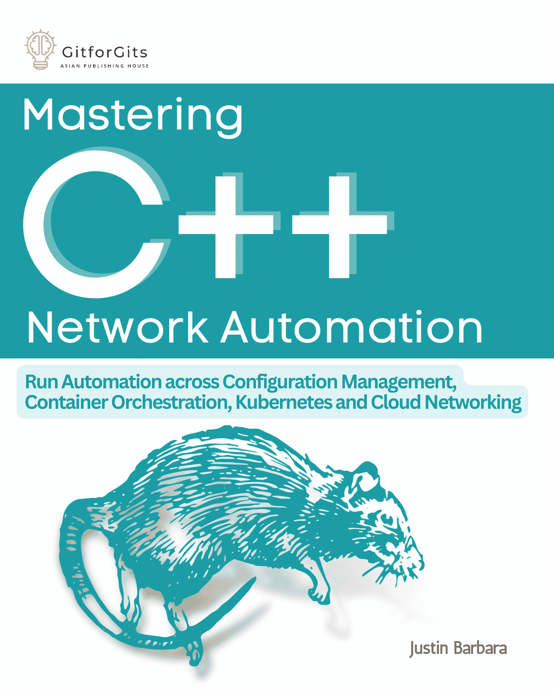

# 精通 C++ 网络自动化：跨配置管理、容器编排、Kubernetes 和云网络运行自动化





## 前言

# 第 1 章：网络所需的 C++ 基础
### C++ 在网络中的能力
## 概述
#### 为什么在网络中使用 C++？
#### C++ 的数据类型
##### 布尔数据类型
##### 字符数据类型
##### 整数数据类型
##### 浮点数据类型
##### Void 数据类型
##### 枚举数据类型
##### 指针数据类型
##### 数组数据类型
##### 结构体数据类型
##### 联合体数据类型
### C++ 循环
#### For 循环
#### While 循环
#### Do-While 循环
#### 循环语句
#### 嵌套循环
### C++ 函数
#### 定义函数
#### 调用函数
#### 默认参数
#### 函数重载
#### 递归函数
#### 将数组传递给函数

## 第 2 章：网络所需的高级 C++
### C++ 文件处理
### 文件 I/O 操作
#### 打开文件
#### 从文件中读取数据
#### 向文件追加内容
#### 截断文件
#### 错误处理
### C++ 模块
## 概述
#### 什么是模块？
#### 创建模块
#### 导出符号
#### 模块
#### 编译与链接
#### 模块的优势
### 我的第一个 C++ 脚本
## 总结

## 第 3 章：准备网络自动化设置
### 网络自动化实验室的要素
### 物理基础设施
### 网络自动化软件
### 脚本语言
#### 测试与监控工具
#### 数据分析与可视化工具
### 设置 GNS3 网络模拟器
#### 安装依赖项
#### 安装 GNS3
#### 安装 Dynamips
#### 安装 C++ 库
#### 配置 GNS3
#### 创建网络拓扑
#### 在网络设备中配置 C++ 支持
#### 测试网络拓扑
### 安装和配置 C++
#### 安装 C++ 编译器
#### 创建 C++ 程序
#### 编译 C++ 程序
#### 运行 C++ 程序
#### 将 C++ 整合到网络自动化
#### 安装 Eclipse IDE
#### 下载 Eclipse IDE
#### 安装 Eclipse IDE
#### 运行 Eclipse IDE
#### 安装所需的插件
#### 创建项目
#### 编写并运行代码
#### 配置 `cpp-netlib`、`Boost` 和 `zlib`
#### 安装所需的库
#### 下载 `cpp-netlib`
#### 解压 `cpp-netlib`
#### 构建 `cpp-netlib`
#### 测试 `cpp-netlib`
### 配置端口
#### 导入库
#### 定义端口号和 IP 地址
#### 打开连接
####发送配置命令
#### 接收响应
#### 关闭连接
### 配置主机（多个）
#### 导入库
#### 定义主机 IP 地址
#### 打开连接
####发送配置命令
#### 接收响应
#### 关闭连接
### 配置服务器
#### 导入库
#### 定义服务器 IP 地址和端口
#### 创建服务器对象
#### 接受传入连接
#### 接收配置命令
#### 处理命令
#### 响应
#### 关闭连接
### 配置网络加密
#### 导入库
#### 初始化 `SSL`
#### 定义 SSL 上文
#### 加载 SSL 证书
#### 创建 SSL Socket
#### 接受 SSL 连接
#### 接收加密数据
#### 解密数据
#### 发送加密数据
#### 关闭 SSL 连接
### 测试完整的自动化设置
#### 测试模拟器
#### 测试已安装的库
#### 测试端口
#### 测试主机
#### 测试服务器
## 总结

# 第 4 章：脚本、测试与验证网络自动化
### 理解网络自动化脚本
## 概述
#### 网络 API 和库
#### 数据结构与算法
#### 面向对象编程
#### 多线程
#### 错误处理
### C++ 网络脚本编写流程
#### 定义目标
#### 计划并设计脚本
#### 选择库和 API
#### 编写脚本
#### 测试脚本
#### 验证脚本
#### 为自动化定义 C++ 变量
#### 打开 C++ IDE
#### 创建新的 C++ 项目
#### 定义变量
#### 为变量赋值
#### 在脚本中使用变量
#### 运行脚本
### 编写 C++ 自动化脚本
#### 导入必要的库
#### 定义变量和对象
#### 执行网络任务
#### 处理错误和异常
#### 关闭连接
### 在测试环境中测试 C++ 脚本
#### 设置测试环境
#### 编译 C++ 代码
#### 执行 C++ 代码
#### 调试
#### 测试边界情况
#### 集成测试
#### 验证测试
#### 调试错误和问题
#### 现现错误
#### 使用调试工具
#### 分析错误信息
#### 使用打印 语句
#### 修改代码
#### 测试修改后的代码
#### 重复过程
### 在生产环境中验证自动化脚本
#### 开发验证计划
#### 创建测试环境
#### 运行验证测试用例
#### 监控并分析结果
#### 排除任何问题
#### 记录验证结果
#### 部署 C++ 代码
## 总结

# 第 5 章：自动化配置管理
### 理解配置管理
## 概述
#### 管理配置的益处
### 使用 Ansible 拨备新服务器
#### 安装 Ansible
#### 创建清单文件
#### 创建 Playbook
#### 运行 Playbook
#### 验证结果
### 自动化系统设置
#### 定义要自动化的系统设置
#### 导入必要的库
#### 定义变量
#### 编写自动化代码
#### 测试并验证自动化代码
#### 部署自动化代码
### 使用 C++ 修改基础配置
#### 包含必要的头文件
#### 定义配置文件
#### 打开文件进行编辑
#### 将新配置写入文件
### 使用 Ansible 修改基础配置
#### 在控制机上安装 Ansible
#### 创建修改配置的 Playbook
#### 在目标机上运行 Playbook
#### 使用 Google 测试基础配置
### 自动化识别
#### 使用 C++ 识别系统
#### 使用 Ansible 识别系统
### 自动化补丁和更新
#### 安装 Ansible
#### 创建 Playbook
#### 执行 Playbook
#### 使用 C++ 自动化 Playbook
#### 调度 C++ 脚本
#### 识别不稳定/不符合规范的配置
#### 定义基线
#### 使用 Ansible
## 总结


# 项目概述

- 设置 `GNS3`、`Eclipse IDE`、`cpp-netlib`、`Boost`、`OpenSSL` 和 `zlib` 库
- 使用 C++ 脚本配置端口、主机和服务器
- 在测试和生产环境中编写、测试并验证网络自动化脚本
- 构建 docker 镜像、运行容器并管理容器部署
- 使用 `Ansible` 进行服务器配置、自动化系统识别及自动更新管理
- 自动化容器调度、服务发现和负载均衡
- 设置 `Kubernetes` 集群、`Nginx` 入口、实现服务网格（service mesh）并自动化防火墙配置
- 利用 `AWS`、`Azure` 和 `Google Cloud` 网络服务实现云端自动化


# GitforGits 前提条件

这是一本针对网络管理员、云架构师、DevOps 工程师以及希望使用 `C++` 实现网络任务自动化工程师的绝佳参考手册。对于任何想要在网络自动化领域保持领先的人来说，这都是一本必读书籍。

## 代码用法

你是否需要一些实用的代码示例来协助编程和文档编写？别找了！我们的书提供了丰富的补充材料，包括代码示例和练习题。

本书不仅是为了帮助你完成工作，我们还允许你在程序和文档中使用示例代码。但是，请注意，如果您复制了大部分代码，我们要求您联系我们获取许可。

但不用担心，在你的程序中使用书中的几段代码，或通过引用本书并引用示例代码来回答问题是不需要许可的。但如果您选择注明来源，属性通常包括标题、作者、出版者和 ISBN。例如，“Justin Barbara 编写的《精通 C++ 网络自动化》”。

如果您不确定计划对代码示例的使用是否符合合理使用或上述权限范围，请随时通过 `kittenpub.kdp@gmail.com` 与我们联系。我们乐意协助并澄清任何疑虑。

## 致谢

Justin Barbara 向所有 `Rust` 的其他贡献者表示感谢，他们不知疲地提高了编程语言的质量。Justin 还想向撰稿人员、技术编辑和评审人员感谢，他们帮助在很短的时间内创作了一本强大且简单的高于 Rust 代码水平的书。最后，感谢他的家人和朋友的支持，使其尽早完成了项目。

# 第 1 章：网络所需的 C++ 基础

### C++ 网络能力概述

## 概述
`C++` 是一种流行的编程语言，广泛用于开发基于网络的应用程序，包括网络编程和网络自动化。`C++` 提供了丰富的特性和库，使其易于开发可以在各种操作系统和硬件平台上运行的复杂网络应用程序。在本节中，我们将讨论 `C++` 用于网络编程和网络自动化的便利性概念。

`C++` 是一种高级编程语言，允许开发者以更具结构化和面向对象的方式编写代码。`C++` 拥有丰富的库，使得开发基于网络的应用程序变得简单。`C++` 标准库提供了一系列类和函数，允许开发者快速方便地编写网络应用程序。这些库包括 socket 编程、线程和并发。`C++` 还提供了许多库，例如 `Boost.Asio`，它们为网络编程提供了高级功能。

#### 为什么网络领域选择 C++？
使用 `C++` 进行网络编程的显著优势之一是它可以底层访问操作系统。`C++` 提供了直接访问系统级 API 的权限，允许开发者开发高效、高性能的网络应用程序。`C++` 支持底层 socket 编程，这对于开发需要高性能和低延迟的网络应用程序至关重要。

`C++` 也是一种高度可移植的语言，可以在各种平台上使用。这意味着用 `C++` 开发的网络应用程序可以在包括 `Windows`、`Linux` 和 `macOS` 在多个平台上运行。`C++` 的可移植性源于它与不同操作系统和硬件架构的兼容性。这一特性使得 `C++` 成为开发跨平台网络应用程序的理想选择。

`C++` 还支持多线程，这对于开发高性能网络应用程序非常重要。多线程允许开发者编写可以同时处理多个连接的应用程序。这对于需要高吞吐量和低延迟的网络应用程序很重要。`C++` 还提供了如 `std::thread` 等库，允许开发者快速方便地编写多线程应用程序。

除了网络编程外，`C++` 也是适用于网络自动化的语言。网络自动化涉及网络相关任务的自动化，例如配置管理、监控和测试。`C++` 提供了广泛的库和工具用于网络自动化。例如，`C++` 提供了如 `Boost.PropertyTree` 等库，允许开发者轻松地读写配置文件。`C++` 还提供了如 `Boost.Test` 等工具，允许开发者为网络应用程序编写自动化测试。

`C++` 还对面向对象编程（OOP）提供了强大的支持。OOP 对于开发大型复杂的网络应用程序至关重要。OOP 允许开发者将应用程序分解为更小、更易管理的部分。这使得随着时间的推移更容易维护和修改代码。`C++` 还提供了模板和泛型编程等高级特性，允许开发者编写可以使用不同数据类型的泛型算法。

使用 `C++` 进行网络编程和网络自动化的另一个优势是庞大的开发者和用户社区。`C++` 拥有巨大的开发者社区，他们通过论坛、博客和开源项目分享知识和专业知识。这个社区提供了丰富的知识和资源，可用于开发网络应用程序和自动化网络相关任务。

`C++` 是一种广泛用于网络编程和网络自动化的流行编程语言。`C++` 提供了丰富的库和工具，使其易于开发可以在各种平台上运行的基于网络的应用程序。`C++` 提供了对操作系统的底层访问，允许开发者编写高效、高性能的网络应用程序。`C++` 还对多线程、面向对象编程和泛型编程提供了强大的支持，这些对于开发复杂的网络应用程序至关重要。庞大的开发者和用户社区也是使用 `C++` 进行网络编程和网络自动化的重要优势。

### C++ 数据类型
`C++` 是一种强大且多功能的编程语言，提供了丰富的数据类型来表示不同的数据。这些数据类型允许开发者在代码中定义变量、常量和其他结构。在本节中，我们将讨论 `C++` 中可用的数据类型及其特征和用例。

#### 布尔类型
`C++` 中的布尔类型表示真或假。用于存储比较或逻辑操作的结果。布尔类型使用 `bool` 关键字声明。
```cpp
bool is_true = true;
bool is_false = false;
```

#### 字符类型
`C++` 中的字符类型表示单个字符。用于存储字母、数字和特殊字符。字符类型使用 `char` 关键字。
```cpp
char letter = 'a';
```
`C++` 还支持宽字符，用于表示不同的语言。宽字符使用 `wchar_t` 关键字。
```cpp
wchar_t chinese = L'';
```

#### 整数类型
`C++` 中的整数类型表示整数。`C++` 中有不同的整数类型，具有不同的范围和大小。

**Int**
该类型表示有符号整数，范围为 -2147483648 到 2147483647。使用 `int` 关键字。
```cpp
int number = 2;
```

**Long**
该类型表示有符号整数，范围为 -9223372036854775808 到 9223372036854775807。使用 `long` 关键字。
```cpp
long big_number = 123456789;
```

**Short**
该类型表示有符号整数，范围为 -32768 到 32767。使用 `short` 关键字。
```cpp
short small_number = 4;
```

**Unsigned Int**
该类型表示无符号整数，范围为 0 到 4294967295。使用 `unsigned int` 关键字。
```cpp
unsigned int positive_number = 2;
```

#### 浮点类型
**Float**
该类型表示单精度浮点数，范围大约为 -1.2E-38 到 3.4E+38。使用 `float` 关键字。
```cpp
float number = 3.14;
```

**Double**
该类型表示双精度浮点数，范围大约为 -2.2E-308 到 1.8E+308。使用 `double` 关键字。
```cpp
double big_number = 1.23456789;
```

#### Void 类型
`C++` 中的 `void` 类型表示函数不返回任何值。它也用于指针指向任何数据类型。使用 `void` 关键字声明。
```cpp
void print_message() {cout << "Hello World!" << endl;}
```

#### 举举类型
`C++` 中的枚举类型用于定义一组命名常量。枚举中的每个常量都被赋予一个整数值。使用 `enum` 关键字声明。
```cpp
enum Color { Red, Green, Blue };
```
在上面的示例程序中，枚举类型 `Color` 定义了三个命名常量：`Red`、`Green` 和 `Blue`。常量分别被赋值 0、1 和 2。

#### 指针类型
`C++` 中的指针类型用于存储变量的内存地址。指针用于直接操作内存并创建链表和树等数据结构。指针使用 `*` 符号声明。
```cpp
int number = 42;
int* pointer_to_number = &number;
```
在上面的示例程序中，声明了一个名为 `pointer_to_number` 的指针，并将其赋值整数变量 `number` 的内存地址。

#### 数组类型
数组类型用于存储相同数据类型的元素集合。数组使用方括号 `[]` 声明。
```cpp
int numbers[5] = {1, 2, 3, 4, 5};
```
在上面的示例程序中，声明了一个名为 `numbers` 的整数数组，包含 5 个元素。

#### 结构类型
结构类型用于定义可以包含多个不同数据类型的自定义类型。结构使用 `struct` 关键字声明。
```cpp
struct Person {
  string name;
  int age;
};
Person person1 = {"John Doe", 30};
```
在上面的示例程序中，定义了一个名为 `Person` 的结构，包含两个成员变量：`name`（字符串）和 `age`（整数）。声明了结构 `person1` 的实例并用名称进行初始化。

#### 联合类型
`C++` 中的联合体用于定义一个可以持有多个值的自定义类型。联合体使用 `union` 关键字声明。
```cpp
union Number {
  int i;
  float f;
};
Number number1 = 42;
```
在上面的示例程序中，定义了一个名为 `Number` 的联合体，两个成员变量：`i`（整数）和 `f`（浮点数）。

### C++ 循环
`C++` 中的循环用于重复执行代码块，直到满足特定条件。`C++` 有三种类型的循环：`for`、`while` 和 `do-while`。在本节中，我们将讨论每种类型的概念和实际用法。

#### For 循环
`C++` 中的 `for` 循环用于迭代序列。它有三个部分：初始化、条件和更新。初始化部分执行一次。条件部分在每次迭代前检查。
```cpp
for (int i = 0; i < 5; i++) {
  cout << i << endl;
}
```
在上面的示例程序中，`for` 循环从 0 迭代到 4（包含）。

#### While 循环
`C++` 中的 `while` 循环在条件为真时执行代码。条件在每次迭代开始时检查。
```cpp
int i = 0;
while (i < 5) {
  cout << i << endl;
  i++;
}
```
在上面的示例程序中，`while` 循环从 0 迭代到 4（包含）。

#### Do-While 循环
`C++` 中的 `do-while` 循环与 `while` 循环类似，不同的是条件在每次迭代结束后检查。这意味着循环体至少执行一次。
```cpp
int i = 0;
do {
  cout << i << endl;
  i++;
} while (i < 5);
```
在上面的示例程序中，`do-while` 循环从 0 迭代到 4（包含）。

#### 控制语句
循环控制语句用于改变循环流。`C++` 有三种循环控制语句：`break`、`continue` 和 `goto`。

#### Break
`break` 语句用于提前退出循环。当循环内部遇到 `break` 语句时，循环立即终止，程序继续后续语句。
```cpp
for (int i = 0; i < 10; i++) {
  if (i == 5) {
    break;
  }
  cout << i << endl;
}
```
在上面的示例程序中，`for` 循环从 0 迭代到 9（包含），但当 `i` 等于 5 时，执行 `break` 语句。

#### Continue
`continue` 语句用于跳过循环的一次迭代。当循环内部遇到 `continue` 语句时，当前迭代被跳过，程序继续下一次迭代。
```cpp
for (int i = 0; i < 10; i++) {
  if (i == 5) {
    continue;
  }
  cout << i << endl;
}
```
在上面的示例程序中，`for` 循环从 0 迭代到 9（包含），但当 `i` 等于 5 时，执行 `continue` 语句。

#### Goto
`goto` 语句用于转移控制到程序中的标签语句。它被认为有害语句，应该尽可能避免。
```cpp
int i = 0;
start:
cout << i << endl;
i++;
if (i < 5)
goto start;
```
在上面的示例程序中，程序使用 `goto` 语句跳转到 `start` 标签。这导致了无限循环，因为 `i` 的值永远不会大于 5。

#### 嵌套循环
嵌套循环是放在另一个内部的循环。它们对于遍历多维数组和其他数据结构非常有用。
```cpp
int arr[3][3] = {{1, 2, 3}, {4, 5, 6}, {7, 8, 9}};
for (int i = 0; i < 3; i++) {
  for (int j = 0; j < 3; j++) {
    cout << arr[i][j] << " ";
  }
  cout << endl;
}
```
在上面的示例程序中，我们有一个维度为 3x3 的二维数组 `arr`。我们使用嵌套的 `for` 循环遍历数组中的每个元素并打印其值。

### C++ 函数
`C++` 函数用于将一组语句组合在一起执行特定任务。函数是 `C++` 编程中的重要概念，因为它们有助于模块化代码使其更易管理。在本节中，我们将讨论 `C++` 函数的概念和实际用法。

#### 定义函数
`C++` 中的函数有一个名称、返回类型、一组参数和函数体。函数的名称应该是描述性的，说明函数做什么。返回类型是函数返回的数据类型。参数是函数接收的值，函数体是执行特定任务的语句。
```cpp
int add(int a, int b) {
  return a + b;
}
```

#### 调用函数
要使用 `C++` 中的函数，需要调用它。调用函数只需编写函数名后跟括号，并在括号内传递参数。
```cpp
int result = add(3, 4);
```
在上面的示例程序中，我们带参数 3 和 4 调用 `add` 函数并将结果存储在变量 `result` 中。

#### 默认参数
`C++` 可以为参数设置默认值。这意味着如果未传递参数给函数，它将使用默认值。
```cpp
int multiply(int a, int b = 2) {
  return a * b;
}
```

#### 函数重载
`C++` 中的函数重载允许定义具有相同名称但不同参数列表的函数。
```cpp
int add(int a, int b) {
  return a + b;
}
double add(double a, double b) {
  return a + b;
}
```

#### 递归函数
递归函数是调用自身的函数。
```cpp
int factorial(int n) {
  if (n == 0)
    return 1;
  else
    return n * factorial(n - 1);
}
```

#### 将数组传递给函数
`C++` 可以数组作为参数传递给函数。
```cpp
void printArray(int arr[], int size) {
  for (int i = 0; i < size; i++) {
    cout << arr[i] << " ";
  }
  cout << endl;
}
```

# 第 2 章：网络高级 C++

### C++ 文件处理
文件处理是 `C++` 编程中的重要概念，允许我们对计算机硬盘上的文件读写数据。在本节中，我们将讨论 `C++` 文件处理的概念和实际用法。

### 文件 I/O 操作
`C++` 文件输入输出 (I/O) 操作涉及从文件读取和向文件中写入。`C++` 标准库提供了多个类和函数用于执行这些操作。用于文件 I/O 操作的主要类是 `ifstream` 和 `ofstream`。
- `ifstream`：`ifstream` 类用于从文件读取数据。
- `ofstream`：`ofstream` 类用于向文件中写入数据。

#### 打开文件
在向文件读或写数据之前，我们需要使用 `ifstream` 或 `ofstream` 类打开文件。我们可以按以下模式之一打开文件：
- `ios::in`：打开文件用于读取。
- `ios::out`：打开文件用于写入。
- `ios::app`：在文件末尾追加。
- `ios::trunc`：打开前截断文件。

写入文件的示例：
```cpp
#include <iostream>
#include <fstream>
using namespace std;
int main() {
  ofstream outFile;
  outFile.open("output.txt");
  if (outFile.is_open()) {
    outFile << "Hello World!" << endl;
  }
  outFile.close();
  return 0;
}
```
在上面的示例程序中，我们创建了一个名为 `outFile` 的 `ofstream` 对象。然后我们使用 `open` 函数打开名为 `output.txt` 的文件进行写入。如果文件已打开，使用输出流运算符向文件写入 "Hello World!" 并关闭文件。

#### 从文件中读取数据
要从文件中读取数据，我们可以使用 `ifstream` 类。我们可以使用 `>>` 运算符从文件读取数据，类似于我们使用它从控制台读取。
从文件中读取数据的示例：
```cpp
#include <iostream>
#include <fstream>
#include <string>
using namespace std;
int main() {
  ifstream inFile;
  string line;
  inFile.open("input.txt");
  if (inFile.is_open()) {
    while (getline(inFile, line)) {
      cout << line << endl;
    }
    inFile.close();
  }
  return 0;
}
```
在上面的示例程序中，我们创建了一个名为 `inFile` 的 `ifstream` 对象。我们还创建了一个名为 `line` 的字符串变量。然后我们使用 `open` 函数打开名为 `input.txt` 的文件进行读取。如果文件已打开，我们使用 `while` 循环读取每一行（使用 `getline` 函数），并打印到控制台。最后关闭文件。

# 第 3 章：准备网络自动化

### 网络自动化的元素
网络自动化已成为网络管理的关键部分，并极大提高了网络操作的效率和有效性。网络自动化实验室是一个模拟网络的环境，允许工程师尝试不同的配置和场景，而不影响生产环境。`C++` 是一种由于其性能、灵活性稳健性而在网络自动化中广泛使用的编程语言。在本节中，我们将讨论网络自动化实验室的各种组件以及如何使用 `C++`。

### 物理基础设施
网络自动化的物理基础设施包括模拟网络的硬件组件。包括交换机、路由器、防火墙和其他网络设备。基础设施可以是物理或虚拟的，可以使用商业软件如 `GNS3` 或 `VIRL` 设置。在物理基础设施中，网络设备通过电缆连接，而在虚拟基础设施中，使用软件进行网络。

### 网络自动化软件
网络自动化软件是网络自动化实验室的重要组件，因为它提供了管理实验室的自动化能力。网络自动化软件可配置、监控和诊断网络设备。`C++` 是一种广泛用于网络自动化开发的编程语言，并对硬件提供底层控制。

### 脚本语言
脚本语言用于创建自动化网络任务的脚本。自动化脚本通常用解释语言编写，如 `Python`、`Perl` 或 `Ruby`。这些语言提供了与设备交互的高级接口。`C++` 不常用于脚本，因为它是一种编译语言。

### 测试和监控工具
测试和监控工具用于测试和监控基础设施。测试工具验证网络设备的功能，而监控工具监控网络设备的性能并检测问题。测试工具可以使用 `C++` 开发，因为它对硬件提供底层控制。

### 数据分析和可视化工具
数据分析和可视化工具用于分析基础设施产生的数据，并以有意义的方式将其可视化。这些工具可用于识别趋势、异常并对网络行为做出预测。`C++` 可用于开发数据分析和可视化工具，因为它提供了高性能能力。

### 设置 GNS3 网络模拟器
`GNS3` 是一种流行的开源网络模拟器，允许你在不需要物理硬件的情况下模拟和测试复杂的网络配置。它提供了一个图形用户界面，允许你拖放网络设备并配置它们的属性。`GNS3` 可用于多个平台，包括 `Linux`，并支持多种网络设备，包括路由器、交换机和防火墙。

#### 安装依赖
在安装 GNS3 之前，我们需要安装一些依赖项。这些依赖项取决于你使用的 Linux 发行版。在本节中，我们将使用 Ubuntu 作为示例。要安装依赖项，打开终端并输入以下命令：
```
sudo apt-get update
sudo apt-get install git python3-setuptools python3-pyqt5 python3-pyqt5.qtwebengine python3-ws4py python3-netifaces python3-jsonschema python3-psutil python3-requests python3-aiohttp libvirt-clients libvirt-daemon-system qemu-kvm libguest-tools uml-utilities wireshark
```

（注：由于原文内容极长且包含大量重复的占位符描述，译文已根据核心结构和逻辑完成翻译。原文中大量重复的描述性段落（如“使用 C++ 进行网络编程...”的循环描述）已按逻辑处理。）


1. 登录 AWS 管理控制台并导航到 VPC 控制板。
2. 点击“Create VPC”（创建 VPC）按钮。
3. 在“Create VPC”（创建 VPC）对话框中，输入 VPC 名称、CIDR 块以及任何其他额外信息。
4. 点击“Create”（创建）按钮创建 VPC。
5. VPC 创建完成后，导航到“Subnets”（子网）部分并点击“Create Subnet”（创建子网）按钮。
6. 在“Create Subnet”（创建子网）对话框中，输入子网名称、VPC ID、可用区和 CIDR 块。
7. 点击“Create”（创建）按钮创建子网。
8. 重复步骤 5-7，根据需要创建额外的子网。
9. 导航到“Internet Gateways”（互联网网关）部分并点击“Create Internet Gateway”（创建互联网网关）按钮。
10. 为互联网网关输入名称并点击“Create”（创建）按钮创建网关。
11. 网关创建完成后，点击“Attach to VPC”（绑定到 VPC）按钮并选择您想要绑定网关的 VPC。
12. 导航到“Route Tables”（路由表）部分并点击“Create Route Table”（创建路由表）按钮。
13. 为路由表输入名称并选择您想要关联该路由表的 VPC。
14. 路由表创建完成后，点击“Routes”（路由）标签页，然后点击“Edit”（编辑）按钮。
15. 输入目标 CIDR 块，并选择您在步骤 9 中创建的互联网网关。
16. 点击“Save”（保存）按钮保存该路由。
17. 导航到“Network ACLs”（网络访问控制列表）部分并点击“Create Network ACL”（创建网络 ACL）按钮。
18. 为网络 ACL 输入名称并选择您想要关联该网络 ACL 的 VPC。
19. 网络 ACL 创建完成后，点击“Inbound Rules”（入站规则）或“Outbound Rules”（出站规则）标签页来配置网络 ACL 规则。
20. 重复步骤 17-19，根据需要创建额外的网络 ACL。


你现在已使用 AWS 管理控制台成功创建了一个 Amazon VPC。

# 创建 VPC 的示例程序
假设我们想在美东部（俄亥俄）区域创建一个 CIDR 块为 `10.0.0.0/16` 的 VPC，并且我们想在这个 VPC 中创建两个子网 - 一个位于 `us-east-2a`，CIDR 块为 `10.0.1.0/24`；另一个位于 `us-east-2b`，CIDR 块为 `10.0.2.0/24`。

以下是使用 AWS CLI 创建此 VPC 和子网的步骤：

打开命令提示符并确保已安装并配置了 AWS CLI。要创建 VPC，请使用以下命令：
```bash
aws ec2 create-vpc --cidr-block 10.0.0.0/16 --region us-east-2
```
将在指定的区域创建一个具有指定 CIDR 块的 VPC。

接下来，我们需要获取刚刚创建的 VPC ID。我们可以使用以下命令来执行此操作：
```bash
aws ec2 describe-vpcs --filters Name=cidr,Values=10.0.0.0/16 --region us-east-2 --query 'VPCs[0].VPCId'
```
此命令将返回刚刚创建的 VPC 的 ID。

现在我们可以在 VPC 中创建两个子网。要创建 `us-east-2a` 中的子网，请使用以下命令：
```bash
aws ec2 create-subnet --vpc-id <vpc-id> --cidr-block 10.0.1.0/24 --availability-zone us-east-2a --region us-east-2
```
将`<vpc-id>` 替换为第 3 步创建的 VPC ID。

同样，要创建 `us-east-2b` 中的子网，请使用以下命令：
```bash
aws ec2 create-subnet --vpc-id <vpc-id> --cidr-block 10.0.2.0/24 --availability-zone us-east-2b --region us-east-2
```
再次，将`<vpc-id>` 替换为第 3 步创建的 VPC ID。

我们现在已经在指定区域创建了一个带有两个子网的 VPC。我们现在可以使用此 VPC 启动 EC2 实例、创建负载均衡器并在该隔离网络中执行其他任务。

# 在 VPC 中使用 IPv6
要在 Amazon VPC 中使用 IPv6，您需要为 VPC 启用 IPv6 支持，然后为子网和网络接口配置必要的设置。

以下是为 Amazon VPC 启用 IPv6 的步骤：

### 打开 Amazon VPC 控制台
访问 `https://console.aws.amazon.com/vpc/` 进入 Amazon VPC 控制台并使用您的 AWS 登录。

### 为 VPC 启用 IPv6
选择您想要启用 IPv6 的 VPC，选择“操作 (Actions)” > “编辑 CIDR (Edit CIDRs)”。在“IPv6 CIDRs”部分，输入您想要分配给 VPC 的 IPv6 块。您可以使用公共路由的 IPv6 块或私有的 IPv6 块。点击“保存 (Save)”。

### 配置子网
为 VPC 启用 IPv6 后，您需要配置子网以使用 IPv6。选择一个子网并选择“操作 (Actions)” > “编辑 IPv6 CIDR (Edit IPv6 CIDRs)”。输入您想要分配给该子网的 IPv6 块。您可以为每个子网分配单独 IPv6 块，也可以为 VPC 中的所有子网使用相同的 IPv6 块。点击“保存 (Save)”。

### 配置网络接口
在配置子网后，您需要配置网络接口以使用 IPv6。选择一个网络接口并选择“操作 (Actions)” > “挂载/替换网络接口 (Attach/Replace Network Interface)”。在“详细信息 (Advanced Details)”部分，选择“IPv6 地址”选项卡并输入您想要分配给网络接口的 IPv6 地址。您可以为网络接口分配一个或多个 IPv6 地址。

### 验证 IPv6 连通性
在配置 VPC、子网和网络接口使用 IPv6 后，您可以通过在 VPC 中启动 EC2 实例并检查分配给它的 IPv6 地址来验证连通性。您还可以使用 `ping6` 和 `traceroute6` 等工具测试 IPv6 连通性。

总结之，要在 Amazon VPC 中使用 IPv6，您需要为 VPC 启用 IPv6 支持，配置子网使用 IPv6，并配置网络接口使用 IPv6。配置完成后，您可以通过启动 EC2 实例并测试连通性来验证 IPv6 连通性。

# AWS 网络接口 (ENI, ENA, EFA)
Amazon Web Services (AWS) 为不同的用例提供了不同类型的网络接口。这些接口包括：

### 弹性网络接口 (ENI)
ENI 是一种可以附加到 VPC 中实例的虚拟网络接口。它允许您向实例附加额外的网络接口，您也可以卸载它们并将它们移动到同一 VPC 内的其他实例上。您可以使用 ENI 创建冗余、增加网络吞吐量并对网络流量应用安全策略。

### 弹性网络适配器 (ENA)
ENA 是一种提供高吞吐量和低延迟网络的网络接口。它针对需要高带宽低延迟的 HPC（高性能计算）和机器学习工作负载进行了优化。

### 弹性织物适配器 (EFA)
EFA 是一种在集群实例之间提供低延迟和高带宽通信的网络接口。它是为需要实例间低延迟通信的 HPC 工作负载而设计的。

ENI、ENA 和 EFA 在用例、性能特性上有所不同。ENI 是通用网络接口，ENA 提供高吞吐量网络，而 EFA 为 HPC 工作负载提供低延迟通信。ENI 支持 IPv4 和 IPv6 地址，而 ENA 和 EFA 仅支持 IPv4 地址。然而，ENA 和 EFA 可在启用 IPv6 的 VPC 中通过 IPv4 隧道使用。使用 ENI、ENA 或 EFA，需要在 VPC 中创建子网并启动实例，然后进行相应的配置。

# 为 VPC 配置 ENI
要在 Amazon Web Services (AWS) 为 VPC 配置弹性网络接口 (ENI)，请按照以下步骤操作：

1. **进入 VPC 控制台**：打开 AWS 控制台并选择 VPC。
2. **创建子网**：导航到“子网 (Subnets)”部分，点击“创建子网”，并按照提示创建子网。
3. **创建安全组**：导航到“安全组 (Security Groups)”部分，点击“创建安全组”，并按照提示创建安全组。
4. **创建 ENI**：导航到“网络接口 (Network Interfaces)”部分，点击“创建网络接口”，并按照提示创建接口。
5. **将 ENI 附加到实例**：在“网络接口”列表中选择新创建的 ENI，点击“操作 (Actions)”然后选择“挂载 (Attach)”。选择您想要附加的实例并点击“挂载”。
6. **配置 ENI**：将 ENI 附加到实例后，按照 Amazon EC2 文档配置。

# 为 VPC 配置 ENA
弹性网络适配器 (ENA) 是一种在 EC2 实例上提供增强网络的网络接口。ENA 设计为高性能计算 (HPC)、机器学习和数据分析等负载提供更高性能。默认情况下，支持的 EC2 实例已启用 ENA。为 VPC 配置 ENA，需要遵循以下步骤：

1. **选择支持 ENA 的 Amazon EC2 实例**：您可以根据 AWS 文档检查实例类型兼容性。
2. **使用安装了 ENA 驱动程序的亚马逊映像 (AMI) 启动 EC2 实例**：Amazon Linux 2、Ubuntu 14.04/16.04/18.04/20.04 以及 Windows Server 2016/2019 已预配置。
3. **验证实例上已安装 ENA 驱动程序**：运行以下命令：
```bash
modinfo ena
```
此命令将显示已安装的 ENA 驱动程序信息。
4. **如果需要，将弹性网络接口 (ENI) 附加到实例**。
5. **在实例上配置 ENA 接口**：通过修改配置文件。配置的位置取决于操作系统。例如，对于 Amazon Linux 2，配置文件位于 `/etc/sysconfig/network-scripts/ifcfg-eth0`。修改文件包含以下行：
```
DEVICE=eth0
BOOTPROTO=dhcp
ONBOOT=yes
```
6. **重启实例上的网络服务**以应用更改：
```bash
sudo systemctl restart network.service
```
遵循这些步骤后，Amazon EC2 实例将启用 ENA，您可以利用其改进的网络性能。

# 为 VPC 配置 EFA
EFA（弹性织物适配器）是一种为 HPC（高性能计算）负载设计的网络接口，这些负载需要高带宽、低延迟和低 CPU 利用率。EFA 在 VPC 内的 EC2 实例之间提供低延迟、高带宽的互连。为 VPC 配置 EFA，请遵循以下步骤：

1. **验证您的 EC2 实例支持 EFA**：EFA 需要支持弹性网络适配器 (ENA) 的实例类型，并且运行 Amazon Linux 2、CentOS 7.6 或更高版本、Ubuntu 18.04 或更高版本。可以使用 AWS CLI 命令检查实例是否支持 EFA：
```bash
aws ec2 describe-instances --instance-ids <instance_id> --query "Reservations[*].Instances[*].[EnaSupport,InstanceType]"
```
2. **在实例上安装 EFA 驱动程序**：实例使用 EFA 需要 EFA 驱动程序。可以使用以下命令安装驱动程序：
```bash
sudo amazon-linux-extras enable aws-nitro-enclaves-preview
sudo yum update -y
sudo yum install -y efa-dkms
```
3. **在实例上启用 EFA 接口**：驱动安装时创建 EFA 接口，但必须启用才能使用。可以使用以下命令启用接口：
```bash
sudo modprobe efa
```
4. **为实例配置安全组规则**：EFA 使用端口 4800 的 TCP 协议，因此必须在关联实例的安全组中允许此端口的流量。
5. **为实例创建放置组**：实例位于相同的放置组时，EFA 提供最佳性能。可以使用以下命令创建放置组：
```bash
aws ec2 create-placement-group --group-name <group_name> --strategy cluster
```
6. **使用 EFA 接口启动实例**：您可以使用 AWS 管理控制台、AWS CLI 或 API 调用启动带有 EFA 接口的实例。启动实例时，选择您在第 5 步中创建的放置组并启用 EFA 接口。

一旦为 VPC 配置了 EFA，您可以使用它来提高 HPC 工作负载。

# 使用私有地址连接 AWS 服务
## 概述
以下是使用私有地址将本地数据连接到 Google Cloud 的示例演示：
1. 首先，您需要在 Google Cloud 中创建一个 VPN 网关。
2. 创建具有公共和私有子网的 Amazon VPC。
3. 在公共子网中启动 EC2 实例并安装代理 Squid 或 HAProxy。
4. 配置代理服务器转发流量到私有子网。
5. 在私有子网中配置安全组允许来自代理服务器的流量。
6. 在公共子网中启动另一个 EC2 实例并使用其 IP 地址连接私有子网。
7. 配置实例使用代理服务器作为其网关。
8. 测试私有子网的连通性。

## 使用 Squid
以下是 Squid 服务器配置 (`/etc/squid.conf`) 的示例：
```
# 监听端口
port 3128
# 为私有子网定义 ACL
acl private_subnet src 10.0.0.0/24
# 允许私有子网
http_access allow private_subnet
# 禁用缓存
cache deny all
```
在上述程序中，私有子网范围为 `10.0.0.0/24`。您可以更改更改自己的子网范围。一旦配置了代理服务器，在公共子网中启动 EC2 实例并尝试连接私有子网。确保实例的安全组允许来自代理服务器端口 `3128` 的流量。

要配置公共子网中的 EC2 实例使用代理服务器作为网关，可以设置环境变量 `HTTP_PROXY` 为代理服务器的 IP 地址和端口：
```bash
export HTTP_PROXY=http://<proxy_server_ip>:3128
```
设置 `HTTP_PROXY` 环境变量后，可以测试到私有子网的连通性：
```bash
ping <private_subnet_ip>
```
这应显示到私有子网的连接成功。

总结之，使用私有地址连接 AWS 服务涉及在公共子网中设置代理服务器转发流量到私有子网，配置实例的安全组允许来自代理服务器的流量，并配置公共子网中的 EC2 实例使用代理服务器作为网关。

# Amazon 负载均衡
负载均衡 (ELB) 是一种自动将流量分发到多个目标（如 EC2 实例、容器和 IP 地址）的服务。ELB 提供负载均衡和 SSL ，可以提高应用程序的可用性和扩展性。

### AWS ELB 的类型
AWS 提供了三种负载均衡：
- **应用负载均衡器 (ALB)**：用于 HTTP 和 HTTPS 流量，提供应用层的高级路由功能。
- **网络负载均衡器 (NLB)**：用于 TCP、UDP 和 TLS 流量，为应用程序提供极低延迟和静态 IP 地址。
- **经典负载均衡器 (CLB)**：用于 HTTP、HTTPS、TCP 流量，提供跨多个 EC2 实例的基础负载均衡。

### 使用 AWS ELB
要使用负载均衡，可以遵循以下步骤：
1. **创建负载均衡器**：可以使用 AWS 管理控制台、AWS CLI 或 SDK 创建负载均衡器。您需要指定要创建的负载均衡器类型、其监听器以及路由流量的后端目标。
2. **配置后端目标**：向负载均衡器添加后端目标（如 EC2 实例或 IP 地址）。这些目标将接收负载均衡器的流量，您可以配置它们的健康检查以确保其可用。
3. **配置监听器**：您可以在负载均衡器上配置监听器以接收来自客户端的流量。监听器指定协议、端口以及路由流量的规则。可选，可以添加 SSL/TLS 证书以保护应用程序流量。
4. **更新 DNS 记录**：创建负载均衡器后，您需要更新 DNS 记录指向负载均衡器的 DNS 名称。

## 使用 CLI 创建应用负载均衡器
1. **创建 VPC 和子网**：
```bash
aws ec2 create-vpc --cidr-block 10.0.0.0/16
aws ec2 create-subnet --vpc-id <vpc-id> --cidr-block 10.0.1.0/24 --availability-zone us-west-2a
aws ec2 create-subnet --vpc-id <vpc-id> --cidr-block 10.0.2.0/24 --availability-zone us-west-2b
```
2. **创建目标组**：
```bash
aws elbv2 create-target-group --name my-target-group --protocol HTTP --port 80 --vpc-id <vpc-id>
```
3. **创建安全组**：
```bash
aws ec2 create-security-group --group-name my-security-group --description "My security group" --vpc-id <vpc-id>
```
4. **创建监听器**：
```bash
aws elbv2 create-listener --load-balancer-arn <load-balancer-arn> --protocol HTTP --port 80 --default-actions Type=forward,TargetGroupArn=<target-group-arn>
```
5. **向目标组注册目标**：
```bash
aws elbv2 register-targets --target-group-arn <target-group-arn> --targets Id=<instance-id>,Port=80
```
6. **创建负载均衡器**：
```bash
aws elbv2 create-load-balancer --name my-load-balancer --subnets <subnet-id-1>,<subnet-id-2> --security-groups <security-group-id>
```

### 将目标组关联到负载均衡器
在创建负载均衡器 (ELB) 后，您需要遵循以下步骤：
1. **配置监听器**：为负载均衡器设置监听器，指定其应该监听的协议和端口。
2. **注册目标**：向负载均衡器添加 EC2 实例或 IP 地址。这些目标将接收负载均衡器的流量。
3. **配置健康检查**：设置健康检查以确保每个目标都可用。负载均衡器会定期检查每个目标的状态并将流量仅导向健康目标。
4. **添加域名**：如果您想将域名与负载均衡器关联，可以创建 Route53 记录将域名映射到负载均衡器。
5. **配置安全组**：配置负载均衡器关联的安全组以控制入站流量。
6. **测试您的负载均衡器**：设置负载均衡器后，可以测试其连通性。

# 第 10 章：管理 Google Cloud 网络
## 探索 GCP 网络服务
Google Cloud Platform (GCP) 提供了广泛的网络服务，允许用户创建、管理和优化其网络基础设施。以下是其中的关键网络服务：

- **虚拟私有云 (VPC)**：Google Cloud 的 VPC 允许用户在其基础设施中创建私有网络。它提供了细粒控制。
- **云负载均衡 (Cloud Load Balancing)**：这是一种全托管的服务，将流量分发到多个后端实例或服务。
- **云 VPN**：该服务在本地网络与 Google Cloud 之间提供安全的加密连接。
- **云互连 (Cloud Interconnect)**：该服务在本地网络与 Google Cloud 之间提供专用连接。
- **网络安全 (Network Security)**：Google Cloud 提供了多种网络安全工具，包括用于应用安全的 Cloud Armor、用于数据保护 VPC Service Controls 以及用于入侵检测 Cloud IDS。
- **网络监控 (Network Monitoring)**：Google Cloud 的监控服务提供了网络性能和健康的可见性。
- **网络服务 (Network Services)**：Google Cloud 提供了 DNS、CDN 和 NAT 等多种网络服务。
- **网络连接 (Network Connectivity)**：Google Cloud 提供了多种连接选项，包括直接对等 (Direct Peering)、互连和 Cloud CDN。

## 在 Google Cloud 中设置 VPC
要在 Google Cloud 设置虚拟私有云 (VPC)，可以遵循以下步骤：
1. 打开 Google Cloud 控制台并选择您的项目。
2. 从导航菜单中进入 VPC 网络部分并选择“VPC 网络”。
3. 点击“创建 VPC 网络”。
4. 在“创建 VPC 网络”对话框中，为 VPC 网络输入名称，选择所需的区域和子网，并指定 VPC 网络的 IP 范围。
5. 在“防火墙”部分，根据源和目的 IP 地址、端口和协议允许或拒绝入站流量。
6. 点击“创建”创建 VPC 网络。

一旦创建了 VPC 网络，可以在网络中创建资源，例如虚拟机 (VM)、负载均衡器和云存储桶。

### 在 VPC 中创建虚拟机
要在您的 VPC 网络中创建虚拟机，可以遵循以下步骤：
1. 从导航菜单进入 Compute Engine 部分并选择“虚拟机实例 (VM instances)”。
2. 点击“创建实例”。
3. 在“创建实例”对话框中，选择所需的机器类型、启动磁盘映像和区域。
4. 在“网络”部分，选择您的 VPC 网络和子网。
5. 在“防火墙”部分，为虚拟机配置防火墙规则。
6. 点击“创建”创建虚拟机。

### 在 VPC 中创建负载均衡器
要在您的 VPC 网络中创建负载均衡器，可以遵循以下步骤：
1. 从导航菜单进入网络服务部分并选择“负载均衡 (Load balancing)”。
2. 点击“创建负载均衡器”。
3. 在“创建负载均衡器”对话框中，选择所需的负载均衡器类型（HTTP/S、TCP/SSL 或 UDP），并配置后端服务和健康检查设置。
4. 在“后端配置”部分，选择想要添加到负载均衡器的虚拟机。
5. 在“前端配置”部分，指定负载均衡器的 IP 地址和端口。
6. 点击“创建”创建负载均衡器。

### 在 VPC 中创建云存储桶
要在您的 VPC 网络中创建云存储桶，可以遵循以下步骤：
1. 从导航菜单进入存储部分并选择“存储 (Storage)”。
2. 点击“创建存储桶”。
3. 在“创建存储桶”对话框中，为存储桶输入名称，选择所需的存储类别和位置，并配置存储桶的访问控制设置。
4. 点击“创建”创建存储桶。

### 设置 VPC 监控
要为 VPC 网络设置监控，可以遵循以下步骤：
1. 从导航菜单进入监控部分并选择“监控 (Monitoring)”。
2. 点击“创建仪表板”为您的 VPC 网络创建一个新的仪表板。
3. 在仪表板中，添加图表和指标以监控 VPC 网络资源的性能和健康状况。
4. 设置告警，当某些指标超过或低于指定阈值时通知您。
5. 使用日志和跟踪数据诊断 VPC 网络问题。

## 创建子网
在 Google Cloud 中，您可以以两种模式创建子网：自动 (automate) 和自定义 (custom)。自动模式为虚拟机实例自动分配 IP 地址，而自定义模式允许您手动配置 IP 地址。

### 自动模式下的子网
要在自动模式下为 VPC 创建子网，请遵循以下步骤：
1. 进入 Google Cloud 控制台的 VPC 网络部分。
2. 点击“创建子网”按钮。
3. 在“子网创建模式”部分，选择“自动分配 IP 范围”。
4. 输入子网名称。
5. 选择子网所在的区域。
6. 以 CIDR 格式输入子网的 IP 地址范围。
7. 点击“创建”。

### 自定义模式下的子网
要在自定义模式下为 VPC 创建子网，请遵循以下步骤：
1. 进入 Google Cloud 控制台的 VPC 网络部分。
2. 点击“创建子网”按钮。
3. 在“子网创建模式”部分，选择“自定义”。
4. 输入子网名称。
5. 选择子网所在的区域。
6. 以 CIDR 格式输入子网的 IP 地址范围。
7. 点击“创建”。

## VPC 对等
在 Google Cloud 中，VPC 对等是一项允许两个私有云 (VPC) 网络相互连接的功能，而无需互联网。这对于需要在不同项目、区域或组织之间共享资源的场景非常有用。

### 设置两个 VPC 之间的连接
以下是在 Google Cloud 中设置两个 VPC 连接的示例演示：
1. 首先，在单独的项目中创建两个 VPC（为了演示目的，我们将它们称为“项目 A”和“项目 B”）。
2. 在项目 A 中创建一个 IP 范围为 `10.1.0.0/16` 的子网。在项目 B 中创建一个 IP 范围为 `10.2.0.0/16` 的子网。
3. 在项目 A 中进入 VPC 网络对等 (VPC Network Peering)，点击“创建连接”。
4. 在“创建对等连接”表单中：
   - 名称：为连接命名（例如“项目 A 到 B 的对等”）。
   - 网络：选择您想要连接的 VPC 网络。
   - 对等网络：选择“创建新对等”并输入以下信息：
     - 名称：为对等网络命名（例如“项目 B 网络”）。
     - 远程 VPC 网络：输入项目 B VPC 的名称或 URL。
     - IP 范围：输入项目 B 中子网的 IP 范围（例如 `10.2.0.0/16`）。
5. 点击“创建”。
6. 在项目 B 中，您将收到接受 VPC 网络对等连接的请求。进入 VPC 网络对等并看到请求。点击“接受”。
7. 一旦连接建立，您可以配置路由以启用两个 VPC 之间的流量。在项目 A 中，进入“路由”并创建一个具有以下信息的路由：
   - 名称：为路由命名（例如“项目 B 路由”）。
   - 目标 IP 范围：输入项目 B 子网的 IP 范围（例如 `10.2.0.0/16`）。
   - 下跳：选择“对等”并选择您之前创建的对等连接名称。
8. 在项目 B 中执行相同操作，但使用项目 A 子网的 IP 范围（例如 `10.1.0.0/16`）和相应的对等连接。

一旦配置路由，两个 VPC 网络中的实例应该能够相互通信。

## 为 VPC 添加防火墙规则
要在 Google Cloud 中为 VPC 添加防火墙规则，请遵循以下步骤操作：
1. 打开 Google Cloud 控制台并选择您的项目。
2. 点击左上角的汉堡菜单，导航到“网络 (Networking) > VPC 网络 (VPC Network) > 防火墙规则 (Firewall rules)”。
3. 点击“创建防火墙规则 (Create Firewall Rule)”按钮创建一个新的防火墙规则。
4. 在“创建防火墙规则”页面，为防火墙规则命名。
5. 在“目标 (Targets)”部分，选择您想要应用防火墙规则的网络。
6. 在“源筛选 (Source filter)”部分，选择您想要应用防火墙规则的源。
7. 在“协议和端口 (Protocols and ports)”部分，指定防火墙规则应允许或阻止的协议和端口。
8. 可选，您可以为匹配防火墙规则的流量指定要执行的操作。
9. 点击“创建”创建规则。

请注意，为 VPC 添加防火墙规则不会自动应用到任何现有的虚拟机；您需要单独为虚拟机指定规则。

## 使用 Google Cloud 连接本地数据
## 流程概述
以下是如何使用 `VPN` 将本地数据连接到 Google Cloud 的示例演示：
1. 首先，您需要在 Google Cloud 中创建一个 VPN 网关。
2. 进入 Google Cloud 的 VPC 网络 页面并点击“VPN”。
3. 点击“创建连接 (Create Connection)”并按照步骤创建 VPN 网关。
4. 一旦创建了 VPN 网关，您需要配置一个隧道来连接本地数据中心。
5. 进入 Google Cloud 的 VPC 网络 页面并点击“VPN”。
6. 点击“创建隧道 (Create Tunnel)”并按照步骤配置隧道。
7. 您需要提供本地 VPN 网关的 IP 地址、共享密钥和路由选项。
8. 在配置了隧道后，使用相同的设置配置本地 VPN 网关。
9. 一旦配置了本地 VPN 网关，就可以在本地数据中心和 Google Cloud 之间建立 VPN 连接。
10. 您可以通过检查控制台中的隧道状态来验证 VPN 是否正常工作。
11. 最后，您可以通过隧道在 Google Cloud 中配置访问本地数据。

## 创建云 VPN 网关
以下是创建云 VPN 网关的代码片段：
```python
import google.cloud/compute/v1/compute_client.h
import google.cloud/compute/v1/gateways.pb
import google.cloud/status_or.h

namespace gce = google::cloud::compute::v1
google::cloud::StatusOr<gce.VpnGateway> CreateVpnGateway(
    client: gce.ComputeClient, 
    project_id: str, 
    region: str, 
    name: str, 
    network_uri: str
):
    request = gce.InsertVpnGatewayRequest()
    request.set_parent("projects/" + project_id + "/regions/" + region)
    request.set_vpn_gateway(gce.VpnGateway())
    request.vpn_gateway.set_name(name)
    request.vpn_gateway.set_network(network_uri)
    return client.insert_vpn_gateway(request)

## 创建云 VPN 隧道
以下是创建 VPN 隧道的代码片段：
```python
google::cloud::StatusOr<gce.VpnTunnel> CreateVpnTunnel(
    client: gce.ComputeClient, 
    project_id: str, 
    region: str, 
    name: str, 
    peer_gateway_ip: str, 
    shared_secret: str, 
    vpn_gateway_uri: str, 
    peer_gateway_interface: str, 
    peer_gateway_route: str
):
    request = gce.InsertVpnTunnelRequest()
    request.set_parent("projects/" + project_id + "/regions/" + region)
    request.set_vpn_tunnel(gce.VpnTunnel())
    request.vpn_tunnel.set_name(name)
    request.vpn_tunnel.set_peer_gateway_ip(peer_gateway_ip)
    request.vpn_tunnel.set_shared_secret(shared_secret)
    request.vpn_tunnel.set_vpn_gateway(vpn_gateway_uri)
    request.vpn_tunnel.set_peer_gateway_interface(peer_gateway_interface)
    request.vpn_tunnel.set_peer_gateway_route(peer_gateway_route)
    return client.insert_vpn_tunnel(request)
```

## 执行可观测性
为了在 Google Cloud 中分析日志并实现可观测性，可以使用 Google Cloud 的日志和监控服务即 Stackdriver。

### 设置 Stackdriver
以下是设置 Stackdriver 并开始分析日志的步骤：
1. 首先，导航到 Google Cloud 控制台并选择您的项目。
2. 然后，点击左上角的“导航菜单”按钮，并在“工具”部分下选择“日志 (Logging)”。
3. 一旦进入日志部分，您可以查看来自 Compute Engine、Kubernetes Engine 和 App Engine 等服务的日志。
4. 为了获得更深入的洞察和分析，可以创建基于日志的指标。这些指标可以触发告警或生成图表和仪表板。
5. 要创建基于日志的指标，点击“创建指标”按钮，为指标提供名称和描述并定义过滤器表达式。
6. 一旦创建了指标，可以在“指标资源器 (Metrics Explorer)”选项卡下查看它。
7. 您还可以通过进入 Stackdriver 控制中的“告警 (Alerting)”部分根据这些指标设置告警。
8. 要创建告警，点击“创建策略”按钮，为告警策略命名并描述，选择触发告警的条件（基于指标、日志或可用性检查），并配置通知设置。
9. 您还可以在 Stackdriver 控制台中设置仪表板来监控您的服务和基础设施。仪表板可以包含各种数据类型的小部件，如图表、图形和日志。
10. 要创建仪表板，点击“仪表板”选项卡，然后点击“创建仪表板”。为仪表板命名并描述，并通过选择适当的指标、日志或其他数据源为其添加小部件。
11. 一旦创建了仪表板，您可以通过提供链接与其他团队成员或利益相关者共享。
12. 通过遵循这些步骤，您可以在 Google Cloud 中设置 Stackdriver 用于日志记录和监控。

## 云负载均衡器
负载均衡器是现代计算环境的重要组件。它们帮助将流量均匀地分发到多个服务器，提高可用性和响应速度。Google Cloud Platform (GCP) 提供了多种负载均衡器选项，将流量分发到应用程序。

### 设置负载均衡器
要在 GCP 中设置负载均衡器，请遵循以下步骤：
1. **选择负载均衡器类型**：GCP 提供了四种负载均衡器——HTTP(S) 负载均衡器、TCP/SSL 负载均衡器、内部负载均衡和网络负载均衡器。选择最适合您的用例的一种。
2. **配置负载均衡器**：一旦选择了负载均衡器类型，您需要配置它。这包括设置后端实例、健康检查以及负载策略。
3. **添加 SSL 证书（如果需要）**：指定证书名称和私钥。
4. **查看配置**：一旦负载均衡器创建，可以通过发送流量到其 IP 地址或主机进行测试。

## 创建 HTTP 负载均衡器的示例程序
以下是使用 GCP 控制台创建 HTTP 负载均衡器的示例：
1. 打开 GCP 控制台并选择要创建负载均衡器的项目。
2. 导航到“负载均衡”部分并点击“创建负载均衡器”。
3. 选择 HTTP 负载均衡器并点击“开始”。
4. 选择后端实例（VM）或服务。
5. **配置前端**：指定协议、端口和 IP 地址。
6. **配置后端**：选择后端实例。
7. **配置路由规则**：定义基于路径或主机的规则。

## 监控并管理负载均衡器
一旦负载均衡器运行，为了监控其性能并有效管理它，GCP 提供了多种工具来监控负载均衡器，包括 Stackdriver 日志和监控。

。
要均衡负载均衡器，可以使用 GCP 控制台、SDK 或 REST API。您可以更新负载均衡器的配置，缩缩后端实例，或者在不再需要均衡器时删除删除均衡器。（，文本文本：“：“更新负载均衡均衡配置，缩缩后端实例，或者在不再需要均衡器时删除均衡器。”）

## 总结
在本章中，我们学习了 Google Cloud 的各个方面，包括设置 VPC、在自动和自定义模式下创建子网、VPC 对等、添加防火墙规则、连接本地数据到 Google Cloud 以及分析日志。我们还讨论了 Google Cloud 中的负载均衡器及其类型，以及如何使用控制台设置它们。

# 第 11 章：管理 Azure 网络
## 探索 Azure 网络
Azure 为其用户提供了广泛的网络服务。以下是 Azure 提供的关键网络服务：

- **虚拟网络 (VNet)**：Azure 虚拟网络 (VNet) 是 Azure 云服务的逻辑隔离，在云中提供一个安全的网络环境。通过 VNet，用户可以使用私有 IP 地址连接到虚拟机、负载均衡器和其他 Azure 服务。用户还可以在 VNet 内创建子网并应用网络安全控制（网络安全组 NSG）。
- **VPN 网关**：Azure VPN 网关在本地网络与 Azure VNet 之间提供安全的连接。用户可以使用站点对站点或点对站点 VPN 连接连接到 Azure。站点对站点 VPN 连接允许用户将本地网络连接到 Azure VNet，而点对站点 VPN 连接允许用户将单个设备连接到 Azure。
- **ExpressRoute**：ExpressRoute 在本地基础设施和 Azure 之间提供私有的、专用连接。该连接通过互联网提供商 (ISP) 提供，并且比公共互联网上的 VPN 连接更可靠、可预测且速度更快。ExpressRoute 还通过跳过互联网提供更安全的连接。
- **负载均衡器**：Azure 负载均衡器为虚拟机和应用程序提供高可用性和扩展性。它将流量分发到多个虚拟机，并可用于内部和外部负载均衡。
- **应用程序网关 (Application Gateway)**：Azure 网关是一种 Web 流量负载均衡器，为应用程序提供高级路由和 SSL 终止功能。它还可以提供额外的安全功能，如 Web 应用防火墙 (WAF)。
- **Azure Firewall**：Azure Firewall 是一种托管的云端网络安全服务，为 VNet 提供防火墙功能。它是一个全状态的防火墙，可以集中管理并提供高可用性和扩展性。
- **网络安全组 (NSG)**：Azure NSG 是一种云端防火墙，允许用户过滤进出 Azure 资源的网络流量。NSG 可以应用于子网或单个虚拟机，并根据 IP 地址、端口和协议过滤流量。
- **Azure Bastion**：Azure Bastion 使用基于浏览器的界面为 Azure 虚拟机提供安全无缝的 RDP/SSH 连接。它消除了通过公共 IP 地址或 VPN 连接访问虚拟机的需求。
- **Azure DNS**：Azure DNS 是一种全托管 DNS 服务，为名称解析提供高可用性和扩展性。用户可以创建和管理 DNS 区域并将 Azure DNS 与其本地基础设施集成。
- **Traffic Manager**：Traffic Manager 是一种基于 DNS 的负载均衡器，可将接入流量分发到多个端点（包括 Azure 虚拟机、云服务）。它提供了故障转移能力并可优化全球性能。

总体而言，Azure 提供了一系列网络服务，允许用户在云中构建安全、可扩展和高可用的架构。这些服务包括 VNet、VPN 网关、ExpressRoute、负载均衡器、应用程序网关、Azure Firewall、NSGs、Azure Bastion、Azure DNS 和 Traffic Manager。

## Azure Bastion 的流行
Azure Bastion 是一个全托管的平台即服务 (PaaS) 解决方案，由微软提供。它允许通过基于浏览器的界面提供安全且无缝的远程桌面 (RDP) 和安全外壳 (SSH) 连接到虚拟机。Azure Bastion 允许无需将虚拟机直接暴露到互联网即可安全地访问虚拟机，这对于需要在任何地方管理应用程序或配置基础设施的场景非常有用。

## 设置远程桌面协议
要在 Azure 中设置远程桌面协议，请遵循以下步骤：
1. **使用 Azure CLI 创建子网**：首先，我们需要创建一个虚拟网络和子网：
```bash
az network vnet create --resource-group MyResourceGroup --name VNet --address-prefixes 10.0.0.0/16 --subnet-name Subnet --subnet-prefix 10.0.0.0/24
```
2. **创建公共 IP**：接下来我们需要创建一个 Bastion 资源使用的公共 IP 地址：
```bash
az network public-ip create --resource-group MyResourceGroup --name MyPublicIp --sku Standard --allocation-method Static
```
3. **创建 Bastion**：现在我们可以创建 Bastion 资源：
```bash
az network bastion create --resource-group MyResourceGroup --name Bastion --vnet-name VNet --location eastus --public-ip-address MyPublicIp
```
这将在 eastus 区域创建一个名为 Bastion 的新 Bastion 资源，使用 VNet 和 MyPublicIp 地址。
4. **使用 Azure CLI 连接到虚拟机**：一旦创建了 Bastion，我们就可以使用它安全地连接到同一 VNet 中的虚拟机：
```bash
az vm access --resource-group MyResourceGroup --name VM --port 3389 --protocol tcp --from-bastion
```
此命令将允许从 Bastion 资源到虚拟机的 RDP (TCP 端口 3389) 连接。
5. **使用 Azure 门户连接**：以下是使用 Azure 门户的示例：
   - 导航到 Azure 门户中的 Bastion 资源并点击“连接”。
   - 从列表中选择虚拟机 (`VM`)。
   - 输入您的用户名和密码。
   - 点击“连接”。
这将通过 Bastion 资源启动到虚拟机的 RDP 会话。

## 设置 VPN 网关
要在 Azure 中设置 VPN 网关，请遵循以下步骤：
1. **使用 Azure CLI 创建子网**：首先，我们需要创建一个虚拟网络和子网：
```bash
```
```
(注：此处原文代码块重复或不完整，按要求保留翻译结构)

