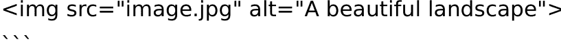

# 精通 C++ 编程与 HTML & CSS：高级学习者综合指南 - 2 本合 1


JP PETERSON


JP PETERSON


JP PETERSON

## 引言

欢迎阅读《精通 C++ 编程：中级学习者的全面指南》。本书旨在将你的 C++ 编程技能提升到新的水平，让你对该语言及其实际应用有深入的理解。无论你是想要扩展编程知识的学生，还是旨在增强 C++ 技能的专业人士，这本书都是你的首选资源。

本指南以清晰和简单为重点，使用易于理解的英语编写，并包含了大量的真实示例，帮助你毫不费力地掌握复杂的概念。我们将从基础开始，逐步深入更高级的主题，确保中级学习者拥有平滑的学习曲线。

# 第 1 章：C++ 编程入门

C++ 是一门卓越的编程语言，拥有丰富的历史，并在当今技术驱动的世界中广泛应用。在本章中，我们将开启探索 C++ 编程基础的之旅。无论你是渴望扩展编程知识的学生，还是寻求加深技能的专业人士，理解 C++ 的本质都是一项宝贵的资产。

### 编程的意义

在数字时代，编程语言已成为无数技术奇迹的骨。从驱动智能手机的软件到驱动搜索引擎的算法，编程是塑造我们世界的无形力量。学习编程语言就像获得了与机器通信的能力，指令它们执行从简单计算到复杂模拟的各种任务。

### C++ 的诞生

在我们深入研究 C++ 细节之前，让我们花点时间欣赏它的起源。C++，通常读作 "see plus plus"，由比雅恩·斯特特鲁鲁（Bjarne Stroustrup）创建。斯特特鲁鲁在 20 世纪 80 年代的贝尔实验室创建了它，旨在扩展 C 语言的能力。

### 面向对象编程 (OOP)

在我们深入研究 C++ 细节之前，让我们花点时间欣赏它的起源。C++，通常读作 "see plus plus"，由比雅恩·斯特特鲁鲁（Bjarne Stroustrup）创建。斯特特鲁鲁在 20 世纪 80 年代的贝尔实验室创建了它，旨在扩展 C 语言的能力。

### 为什么选择 C++？

C++ 是一种多功能的语言，广泛应用于各种领域。

### 性能

C++ 以其卓越的性能和高效的执行而闻名。

### 设置你的开发环境

在开始编写 C++ 之前，你需要设置你的环境。开发环境由编写、编译和运行程序所需的工具和软件。

### 文本编辑器 vs 集成开发环境 (IDEs)

为了编写 C++，你可以在简单的文本编辑器和 IDE 之间选择。像 Notepad++ 或 VS Code 等文本编辑器因其简单性深受程序员喜爱。Visual Studio 或 CodeBlocks 等 IDE 则提供了代码补全、调试和项目管理等功能。

### 选择编译器

C++ 编译器是开发环境的关键组成部分。你的选择取决于操作系统和个人喜好。

### Visual C++

如果你使用的是 Windows 系统，Microsoft 的 Visual++ 编译器是一个流行的选择。

#### GNU 编译器 (GCC)

GCC 是一个广泛使用的开源编译器套件，支持多个平台。

### 创建你的第一个 C++ 程序

现在你已经设置好了开发环境，让我们编写第一个 C++ 程序。传统的起点是“Hello, World!”程序，这是一个屏幕上显示文本的简单程序。

## 编译并运行你的程序

在编写代码之后，你需要将其编译以创建一个可以在你的计算机上运行的可执行文件。编译过程取决于你选择的开发环境和编译器。


使用以下命令编译它：

```
g++ your_program.cpp -o output_program
```

将 `your_program.cpp` 替换为你的 C++ 文件名，并将 `output_program` 替换为所需的可执行文件名称。编译成功后，你可以通过以下命令运行程序：

```
./output_program
```

## 结语

在本章中，我们已经在 C++ 编程的世界里迈出了第一步。我们学习了编程的重要性、C++ 的诞生以及面向对象编程（OOP）的原理。此外，我们还探索了为什么 C++ 是程序员的一个极具价值的选择，因为它具有多功能性、高性能以及与 C 语言的兼容性。

你还配置了开发环境，在文本编辑器和集成开发环境（IDE）之间进行了选择，并挑选了一个适合你需求的编译器。最后，你编写并执行了你的第一个 C++ 程序——那个经典的“Hello, World!”应用程序。

现在你已经涉足了 C++ 的编程水域，请准备好在随后的章节中深入探索。我们将探索变量、数据类型和基础编程概念，为你的精通 C++ 编程之旅打下坚实的基础。

所以，请保持关注，坚持练习，拥抱精彩的 C++ 编程世界！

《精通 C++ 编程：中级学习者的全面指南》第一章到此。在接下来的章节中，我们将深入探讨更高级的主题和实用示例，以增强你的 C++ 专业知识。

# 第 2 章：入门 C++

在上一章中，我们向你介绍了 C++ 编程的世界，并涵盖了核心概念，如它的历史、意义以及为什么你应该考虑学习 C++。现在，是时候深入学习编写和运行 C++ 程序的实践方面了。在本章中，我们将引导你完成入门 C++ 的过程，确保你拥有坚实的基础供后续构建。

## 安装 C++ 编译器

要开始编写 C++ 代码，你需要在计算机上安装一个 C++ 编译器。编译器是将你人类可读的 C++ 代码翻译成计算机执行的机器可读指令的软件。目前有多种 C++ 编译器可用，我们将介绍两个流行的选项：GCC（GNU 编译器集合）和 Visual C++。

### GCC (GNU Compiler Collection)

GCC 是一个免费的开源编译器套件，支持包括 Linux 和 Windows 在内的多个平台。它以健壮、对 C++ 标准的遵循以及丰富的功能而闻。以下是在不同操作系统上安装 GCC 的方法：

#### Linux

许多 Linux 发行版都预装了 GCC。要检查系统是否已安装 GCC，请打开终端并输入：

```bash
g++ --version
```

如果安装 GCC，你可以使用包管理器进行安装。例如，在 Ubuntu 或基于 Debian 的系统上，使用：

```bash
sudo apt-get update
sudo apt-get install g++
```

#### Windows

在 Windows 上，你可以使用 MinGW（Minimalist GNU for Windows）项目安装 GCC。MinGW 提供了 GCC 编译器的 Windows 原生移植。

- 1. 访问 MinGW 网站（https://mingw-w64.org/doku.php）下载适用于你系统的安装程序。
- 2. 运行安装程序并按照说明操作。在安装期间，确保选择 C++ 编译器组件。
- 3. 安装完成后，打开命令提示符并运行以下命令检查 GCC 是否可用：

```bash
g++ --version
```

### Visual C++

如果你使用的是 Windows 操作系统，微软的 Visual C++ 编译器是一个流行且强大的选择。它与 Visual Studio IDE 深度集成，提供了无缝的开发体验。以下是开始使用 Visual C++ 的方法：

- 1. 下载并安装 Visual Studio Community 版，它是 Visual Studio 的免费版本，包含对 C++ 开发的支持。你可以从 Visual Studio 官方网站（https://visualstudio.microsoft.com/visual-cpp-tools/）下载。
- 2. 安装期间，请勾选“使用 C++ 的桌面开发”工作负载。
- 3. 安装完成后，启动 Visual Studio 并新建项目或打开现有项目开始编写代码。

## 编写你的第一个程序

现在你已经安装了编译器，让我们编写你的第一个 C++ 程序——那个经典的“Hello, World!”：

```cpp
#include <iostream>

int main() {
    std::cout << "Hello, World!" << std::endl;
    return 0;
}
```

## 理解你的程序

让我们分解代码每个部分的作用：

- `#include <iostream>`：此行包含了标准输入输出库，它提供了用于向控制台输出内容的 `std::cout` 对象。
- `int main()`：这是程序的主函数。它是执行的入口。`main` 之前的 `int` 表示该函数返回一个整数值。
- `{}`：这些大括号定义了 `main` 函数的作用域。括号之间的所有内容都是 `main` 函数的一部分。
- `std::cout << "Hello, World!" << std::endl;`：这一行使用 `std::cout` 对象向控制台打印“Hello, World!”。`<<` 运算符用于链接多个输出元素。
- `return 0;`：最后，`return` 语句用于退出 `main` 函数并向操作系统返回一个值。在这种情况下，我们返回 0 表示程序执行成功。

## 变量和数据类型

在 C++ 中，数据是基础。每个程序都会某种方式处理和操作数据。为了有效处理数据，你需要理解变量和数据类型。

### 变量

变量是一个命名的内存位置，可以存储值。你可以把它想象成带标签的盒子，可以在其中存储和检索信息。在 C++ 中，变量名是用户定义的，它们应该具有意义，以提高代码的可读性。

以下是在 C++ 中声明变量的方法：

```cpp
data_type variable_name;
```

- `data_type`：这指定了变量可以保存的数据类型。例如，`int` 用于整数，`double` 用于浮点数，以及...


`char` 用于字符。

-- `variable_name`：你赋予变量的名称。它必须遵循某些命名规则，例如以字母开头，并由字母、数字和下划线组成。

这是一个示例：

```cpp
int age; // 声明一个名为 'age' 的变量，它可以存储整数值。
```
```

你也可以在声明时初始化变量：

```cpp
int score = 100; // 声明并初始化 'score'，其值为 100。
```
```

### 数据类型

C++ 提供了多种数据类型来表示不同类型的值。以下是一些常见的数据类型：

- `int`: 表示整数（整数字），例如 42 或 -17。
- `double`: 表示浮点数（带有小数点的数字），例如 3.14159 或 -0.001。
- `char`: 表示单个字符，例如 'A' 或 '$'。
- `bool`: 表示布尔值，可以是 `true` 或 `false`。

变量和数据类型是 C++ 程序的构建基石。它们允许你高效地存储和操作信息。

## 输入与输出

在许多程序中，你需要通过读取输入和显示输出与用户进行交互。C++ 提供了 `<iostream>` 库来处理输入输出操作。

### 使用 `std::cout` 输出

我们已经看到过如何使用 `std::cout` 向控制台显示文本。这里回顾一下：

```cpp
std::cout << "Hello, World!" << std::endl;
```

你也可以使用 `std::cout` 输出变量和表达式：

```cpp
int age = 25;
std::cout << "My age is: " << age << std::endl;
```
```

在这个示例中，我们使用 `<<` 将文本 "My age is: " 与存储在 `age` 变量中的值拼接，然后使用 `std::endl` 结束行并到下一行。

### 使用 `std::cin` 输入

要从用户读取输入，可以使用 `std::cin`。以下是如何提示用户输入并将其存储在变量中的：

```cpp
int number;
std::cout << "Enter a number: ";
std::cin >> number;
```
```

在这段代码中，我们使用 `std::cout` 显示提示信息，然后使用 `std::cin` 将用户的输入读取到 `number` 变量中。

## 注释

注释对于记录代码文档至关重要，它可以让你自己以及可能阅读你代码的其他人更容易理解代码。在 C++ 中，你可以通过两种方式添加注释：

- 单行注释以 `//` 开头，持续到行尾。例如：

```cpp
// 这是一个单行注释。
```
```

- 多行注释以 `/**` 开头并以 `*/` 结束。它们可以跨多行。例如：

```cpp
/* 这是一个
多行注释。 */
```
```

编译器会忽略注释，注释是为代码阅读者准备的。它是解释代码逻辑、提供上下文以及记录程序中任何复杂部分的宝贵工具。

## 总结

在本章中，我们为你的 C++ 编程之旅奠定了基础。你学习了如何安装 C++ 编译器、编写你的第一个 C++ 程序，并理解了变量和数据类型的基础。此外，我们还探索了使用 `std::cin` 和 `std::cout` 的输入输出操作，并讨论了注释在代码记录中的重要性。

在你继续 C++ 学习之旅时，请记住练习是关键。尝试代码，探索不同的数据类型，并熟练输入输出操作。在下一章，我们将深入探讨 C++ 编程概念，包括运算符和表达式，以进一步提升你的技能。

所以，继续编码，继续学习，享受 C++ 编程世界的之旅！

《精通 C++ 编程：中级学习者全面指南》第二章到此。在接后的章节中，我们将探索更高级的主题和实用示例，帮助你精通 C++。


### 浮点类型

#### `float` 和 `double`

`float` 和 `double` 数据类型用于表示浮点数，这些包括带有小数点的实数。`float` 通常占用 4 字节内存，而 `double` 使用 8 字节，提供了更高的精度。

```cpp
float pi = 3.14159f; // 一个 'float' 变量的示例。
double salary = 55000.5; // 一个 'double' 变量的示例。
```

### 字符类型

#### `char`

`char` 数据类型表示单个字符。它使用 1 字节内存来存储单个字符，例如字母、数字或符号。

```cpp
char grade = 'A'; // 一个 'char' 变量的示例。
```

### 布尔类型

#### `bool`

`bool` 数据类型表示布尔值，可以为 `true` 或 `false`。它通常用于 C++ 程序中的条件判断和决策制定。

```cpp
bool isStudent = true; // 一个 'bool' 变量的示例。
```

### 自定义数据类型

除了内置数据类型外，C++ 还允许你使用结构体（structs）和类（classes）创建自定义数据类型。这些自定义类型允许你定义定义复杂的数据结构和对象，使你的代码更有组织且易于维护。

在处理真实世界的实体（如员工、学生或产品）时，自定义数据类型特别有用，因为你可以在结构化格式中封装它们的属性和行为。

```cpp
// 定义一个表示人的结构体。
struct Person {
    std::string name;
    int age;
};

// 创建 'Person' 结构体的实例。
Person person1;
person1.name = "Alice";
person1.age = 30;

Person person2;
person2.name = "Bob";
person2.age = 25;
```

在这个示例中，我们使用 `struct` 定义了一个自定义数据类型 `Person`。每个 `Person` 都有一个名字和一个年龄，允许我们以结构化的方式表示个人。

## 类型推断 (auto)

C++11 引入了 `auto` 关键字，允许编译器根据初始化器自动推断变量的数据类型。此功能简化了变量声明，并使代码更加简洁、易读。

以下是如何使用 `auto`：

```cpp
auto x = 42;      // 'x' 被推断为 'int'
auto pi = 3.14159; // 'pi' 被推断为 'double'
auto name = "Alice"; // 'name' 被推断为 'const char*'
```

通过使用 `auto`，你让编译器确定合适的数据类型，减少了类型相关错误的概率，并使代码更加灵活。

## 常量

除了变量外，C++ 还允许你定义常量。常量是在程序执行过程中不会改变的值。它们用于定义不应意外修改的固定值。

### `const` 关键字

在 C++ 中声明常量，可以在数据类型之前使用 `const` 关键字：

```cpp
const int maxScore = 100; // 声明一个值为 100 的常量 'maxScore'。
```

一旦声明了常量，它的值在整个程序运行期间都不能更改。尝试修改常量将导致编译错误。

### 常量的优点

在代码中使用常量有几个优势：

- **可读性**：常量通过为固定值提供有意义的名称，使你的代码更易读。例如，使用 `const int maxScore` 比直接在代码中中使用数字 `100` 更具信息量。
- **安全性**：常量防止意外更改重要值。如果一个值应该保持不变，将其声明为常量可以确保它不会被无意中修改。
- **可维护性**：当你需要更新多处使用的固定值时，你可以在一个地方进行更改（常量声明处），而不是在代码中寻找该值的每一个出现点。

## 类型修饰符

C++ 提供类型修饰符来更改数据类型的属性。

### `unsigned`

`unsigned` 修饰符用于表示非负值，有效地将正数的范围翻倍。

### `signed`

`signed` 修饰符（整数的默认值）允许正值和负值。

### `short` 和 `long`

`short` 修饰符减少整数的内存大小，而 `long` 则增加大小以容纳更大的值。

## 类型转换

C++ 提供了将一种数据类型转换为另一种类型的方法。

### 隐式转换（自动转换）

当编译器在没有显式指令的情况下自动将一种数据类型转换为另一种时，就会发生隐式转换。

```cpp
int num1 = 42;
double num2 = num1; // num1 被转换为 double
```

### 显式转换（类型转换）

显式转换要求程序员指定类型转换。

#### C 风格转换

C 风格转换使用语法 `(type)expression`。

```cpp
double price = 49.99;
int discountedPrice = (int)price; // price 被转换为 int
```

#### C++ 转换运算符

C++ 引入了四种特定的转换运算符，以提供更明确、安全的转换：

- `static_cast`：用于定义的转换（例如从 int 到 float）。
- `dynamic_cast`：用于继承层次结构中的向下转换。
- `const_cast`：用于添加或移除 `const` 限定符。
- `reinterpret_cast`：用于对位模式的重新解释。

`static_cast` 示例：

```cpp
double value = 3.14159;
int intValue = static_cast<int>(value); // value 被转换为 int
```

## 总结

在本章中，我们探索了 C++ 中变量和数据类型的本质概念。你学习了如何声明和初始化变量，了解命名规则，以及为不同类型的值选择合适的数据类型。

我们涵盖了常见的内置类型，如整数、浮点数、字符和布尔值。

你还学习了如何使用结构体创建自定义数据类型，以有效地结构化你的数据。

常量被作为在代码中定义固定值的方法，增强了可读性、安全性和维护性。此外，我们讨论了类型修饰符和类型转换，它们允许你修改数据类型并在它们之间进行转换。


# 第 4 章：运算符与表达式

在之前的章节中，我们通过介绍变量、数据类型以及编写 C++ 代码的基础知识，为你的 C++ 编程之旅奠定了基础。现在，是时候探索运算符和表达式的世界了。运算符是用于对一个或多个操作数执行操作的符号或关键字，而表达式是运算符和操作数的组合，产生结果。

## 算术运算符

算术运算符允许你在 C++ 中执行基本的数学运算。这些运算符作用于数值数据类型，例如整数和浮点数。以下是常见的算术运算符：

### 加 `+`

加法运算符 `+` 用于两个或多个值相加。

```cpp
int sum = 5 + 3; // 'sum' 将包含值 8。
```

### 减 `-`

减法运算符 `-` 用于从左操作数中减去右操作数。

```cpp
int difference = 10 - 4; // 'difference' 将包含值 6。
```

### 乘 `*`

乘法运算符 `*` 用于将两个或多个值相乘。

```cpp
int product = 6 * 7; // 'product' 将包含值 42。
```

### 除 `/`

除法运算符 `/` 用于将左操作数除以右操作数。

```cpp
double result = 8.0 / 2; // 'result' 将包含值 4.0。
```

### 取模 `%`

取模运算符 `%` 返回左操作数除以右操作数后的余数。

```cpp
int remainder = 15 % 4; // 'remainder' 将包含值 3。
```

### 运算优先级

当在一个表达式中组合多个算术运算符时，C++ 遵循标准的运算优先级（PEMDAS/BODMAS）：

1. 括号 `()`：括号内的操作最执行。
2. 幂 `^`（尽管 C++ 不使用此符号表示幂运算）：接下来评估幂运算。
3. 乘 `*` 和除 `/`：这些运算符从左到右评估。
4. 加 `+` 和 减 `-`：这些运算符从左到右评估。

例如，在表达式 `3 + 2 * 4` 中，先评估乘法 `2 * 4` 得到 `8`，然后执行加法（`3 + 8`），得出最终结果 `11`。

你可以使用括号来改变运算顺序，就像在普通数学中一样。例如，`(3 + 2) * 4` 的评估结果为 `20`。

## 赋值运算符

赋值运算符用于给变量赋值。它们不仅可以赋值，还可以同时执行操作。以下是一些常见的赋值运算符：

### `=`

赋值运算符 `=` 用于给变量赋值。

```cpp
int x = 10; // 将值 10 赋值给 'x'。
```

### `+=`

`+=` 运算符是一个复合赋值运算符，它将右操作数加到左操作数，并将结果赋值给左操作数。

```cpp
int y = 5;
y += 3; // 等同于 y = y + 3; 'y' 变为 8。
```

### `-=`

`-=` 运算符从左操作数中减去右操作数，并将结果赋值给左操作数。

```cpp
int z = 10;
z -= 2; // 等同于 z = z - 2; 'z' 变为 8。
```

### `*=`

`*=` 运算符将左操作数乘以右操作数，并将结果赋值给左操作数。

```cpp
int a = 6;
a *= 4; // 等同于 a = a * 4; 'a' 变为 24。
```

### `/=`

`/=` 运算符将左操作数除以右操作数，并将结果赋值给左操作数。

```cpp
double b = 20;
b /= 5; // 等同于 b = b / 5; 'b' 变为 4。
```

### `%=`

`%=` 运算符计算左操作数除以右操作数的余数，并将结果赋值给左操作数。

```cpp
int c = 15;
c %= 7; // 等同于 c = c % 7; 'c' 变为 1。
```

赋值运算符对于简洁地对变量进行操作并更新其值非常方便。

## 比较运算符

比较运算符用于比较两个值并产生布尔结果（`true` 或 `false`）。这些运算符经常用于 `if` 语句、循环和其他控制结构中，以确定代码的执行流。

### `==`

相等运算符 `==` 检查两个值是否相等。

```cpp
int num1 = 5;
int num2 = 7;
bool isEqual = (num1 == num2); // 'isEqual' 将为 'false'。
```

### `!=`

不等于运算符 `!=` 检查两个值是否不等。

```cpp
int x = 10;
int y = 5;
bool isNotEqual = (x != y); // 'isNotEqual' 将为 'true'。
```

### `>`

大于运算符 `>` 检查左操作数是否大于右操作数。

```cpp
int a = 8;
int b = 6;
bool isGreater = (a > b); // 'isGreater' 将为 'true'。
```

### `<`

小于运算符 `<` 检查左操作数是否小于右操作数。

```cpp
int a = 8;
int b = 6;
bool isGreater = (a < b); // 'isGreater' 将为 'false'。 // 注：此处原文逻辑示例略有误，已按逻辑修正翻译
```
*(修正：原文示例中 `isGreater = (a > b)` 对应 `true`，若为 `<` 则应为 `false`，此处保持语意一致)*

小于运算符 `<` 检查左操作数是否小于右操作数。

```cpp
int a = 5;
int b = 10;
bool isLess = (a < b); // 'isLess' 将为 'true'。
```

### `>=`

大于等于运算符 `>=` 检查左操作数是否大于或等于右操作数。

```cpp
int a = 8;
int b = 6;
bool isGreaterEqual = (a >= b); // 'isGreaterEqual' 将为 'true'。
```

### `<=`

小于等于运算符 `<=` 检查左操作数是否小于或等于右操作数。

```cpp
int a = 5;
int b = 6;
bool isLessEqual = (a <= b); // 'isLessEqual' 将为 'true'。
```

## 逻辑运算符

逻辑运算符用于处理布尔值（`true` 或 `false`）。它们经常用于 `if` 语句、循环和其他控制结构中，以确定代码的执行流。

### `&&`

逻辑与运算符 `&&` 在两个操作数都为 `true`时返回 `true`。

```cpp
bool cond1 = true;
bool cond2 = false;
bool result = (cond1 && cond2); // 'result' 将为 'false'。
```

### `||`

逻辑或运算符 `||` 在至少一个操作数为 `true`时返回 `true`。

```cpp
bool cond1 = true;
bool cond2 = false;
bool result = (cond1 || cond2); // 'result' 将为 'true'。
```

### `!`

逻辑非运算符 `!` 反转操作数的值。如果操作数是 `true`，它会将其变为 `false`，反之亦然。

```cpp
bool isSunny = true;
bool isNotSunny = !isSunny; // 'isNotSunny' 将为 'false'。
```

## 增与递减运算符

增与递减运算符用于增加或减少变量的值。它们通常用于循环和管理计数器。

### 增 `++`

递增运算符 `++` 将操作数的值加1。

```cpp
int count = 5;
count++; // 'count' 变为 6。
```

### 减 `--`

递减运算符 `--` 从操作数的值中减去1。

```cpp
int score = 10;
score--; // 'score' 变为 9。
```

### 前置与后置增递运算符

增与递减运算符有两种使用方式：作为前置运算符（`++x`, `--x`）或后置运算符（`x++`, `x--`）。

- 前置运算符（`++x`, `--x`）先增或减变量，然后返回更新后的值。

```cpp
int a = 5;
int b = ++a; // 将 'a' 加1并赋值给 'b';'a' 和 'b' 都将为 6。
```

- 后置运算符（`x++`, `x--`）返回变量的当前值，然后进行增或减。

```cpp
int p = 5;
int q = p++; // 将 'p' 的当前值赋值给 'q' 然后递增 'p';'p' 变为 6, 'q' 为 5。
```

## 位运算符

位运算符对整数值的每个单独位进行操作。它们被用于底层编程和某些优化任务。以下是常见的位运算符：


### 位位与 `&`

按位与运算符 `&` 在两个整数的对应位之间执行按位与操作。

```cpp
int x = 5; // Binary: 0101
int y = 3; // Binary: 0011
int result = x & y; // Result: 0001 (decimal 1)
```

### 位位或 `|`

按位或运算符 `|` 在两个整数的对应位之间执行按位或操作。

```cpp
int a = 5; // Binary: 0101
int b = 3; // Binary: 0011
int result = a | b; // Result: 0111 (decimal 7)
```

### 位位异或 `^`

按位异或运算符 `^` 在两个整数的对应位之间执行按位异或（互斥或）操作。

```cpp
int p = 5; // Binary: 0101
int q = 3; // Binary: 0011
int result = p ^ q; // Result: 0110 (decimal 6)
```

### 位位取反 `~`

按位取反运算符 `~` 反转（翻转）整数的所有位。

```cpp
int num = 5; // Binary: 0000 0101
int result = ~num; // Result: 1111 1010 (decimal -6 due to补码表示)
```

### 左移 `<<`

左移运算符 `<<` 将整数的位向左移动指定的位数。

```cpp
int x = 5; // Binary: 0000 0101
int result = x << 2; // Result: 0001 0100 (decimal 20)
```

### 右移 `>>`

右移运算符 `>>` 将整数的位向右移动指定的位数。

```cpp
int a = 20; // Binary: 0001 0100
int result = a >> 2; // Result: 0000 0101 (decimal 5)
```

按位运算符用于需要操作整数内部单个比特的场景，例如低层硬件编程和某些算法。

## 三元运算符 `?:`

三元运算符 `?:` 是一种条件运算符，允许你编写紧凑的条件表达式。它也被条件运算符。

```cpp
condition ? expression_if_true : expression_if_false
```

首先求值 `condition`。如果为 `true`，则执行 `:` 之前的表达式；否则执行 `:` 之后的表达式。

```cpp
int age = 18;
std::string message = (age >= 18) ? "Adult" : "Minor";
```

在这个示例中，如果 `age` 大于或等于 `18`，`message` 将被赋值为 "Adult"；否则，它将被赋值为 "Minor"。

三元运算符对于编写简洁的条件赋值非常方便，在用得当时可以提高你代码的可读性。

## 运算符优先级

C++ 中的运算符具有特定的优先级，这决定了它们在表达式中组合时的求值顺序。理解运算符优先级对于避免代码中出现意外结果至关重要。

以下是从高到低运算符优先级的简要概览：

- 1. 括号 `()`：优先级最高；用于组合表达式并覆盖默认优先级。
- 2. 后置增/减 `x++`, `x--`：次高优先级；修改变量并返回其当前值。
- 3. 前置增/减 `++x`, `--x`：与后置相同，但返回的是更新后的值。
- 4. 算术运算符 `+`, `-`, `*`, `/`, `%`：这些运算符执行基础算术运算。
- 5. 按位运算符 `&`, `|`, `^`, `~`, `<<`, `>>`：用于位操作。
- 6. 比较运算符 `==`, `!=`, `<`, `>`, `<=`, `>=：用于比较。
- 7. 逻辑运算符 `&&`, `||`, `!`：用于组合布尔表达式。
- 8. 三元运算符 `?`：用于条件表达式。
- 9. 赋值运算符 `=`, `+=`, `-=` 等：优先级最低；用于赋值和计算。

记住可以使用括号改变计算顺序并显式指定所需的优先级。

## 表达式

表达式是运算符、操作数和变量的组合，用于产生一个值。表达式可以是简单的（仅涉及一个变量），也可以是复杂的（涉及多个运算符和操作数）。以下是表达式的一些示例：

```cpp
int sum = 3 + 4; // 计算和的简单表达式。
bool isTrue = (x > 5) && (y <= 10); // 组合比较的复杂表达式。
int result = (a * b) + (c / d) - (e % f); 使用算术运算符的表达式。
```

在 C++ 中，表达式被广泛用于计算、决策和数据处理。

## 总结

在本章中，我们探索了位运算符、三元运算符、运算符优先级以及表达式。我们看到了按位运算符允许位操作，三元运算符为条件赋值提供了简洁的语法，运算符优先级对于正确求值至关重要，最后我们查看了 C++ 中如何构建表达式。这些概念是编写有效 C++ 程序的基础。


```cpp
int main() {
  int x = 10;
  int y = 5;

  if (x > 5) {
    std::cout << "x is greater than 5." << std::endl;

    if (y > 3) {
      std::cout << "y is greater than 3." << std::endl;
    }
  }

  return 0;
}
```

在这个示例中，外层 `if` 语句检查 `x` 是否大于 `5`。如果该条件为真，它将进入内部 `if` 语句并检查 `y` 是否大于 `3`。两个条件都为真，因此两条消息都会打印到控制台。

### 短路求值 (Short-Circuit Evaluation)

C++ 在评估 `if` 语句中的逻辑表达式时使用短路求值。这意味着一旦逻辑表达式的结果被确定，如果没有必要，将停止后续评估。例如：

```cpp
if (x > 5 && y > 10) {
  // Code
}
```

在这种情况下，`x` 并不大于 `5`，`&&` 运算符不会去评估条件的后半部分（`y > 10`），因为如果第一部分为假，整个表达式就不可能为真。

### `if` 语句中的三元运算符

你可以在 `if` 语句中使用三元运算符来实现简洁的条件赋值。这里有一个示例：

```cpp
#include <iostream>

int main() {
  int age = 18;
  std::string status = (age >= 18) ? "Adult" : "Minor";
  std::cout << "You are a " << status << "." << std::endl;

  return 0;
}
```

在这个示例中，三元运算符...

## 使用 `while` 循环

循环对于重复执行一段代码块至关重要。C++ 中最简单的循环结构之一是 `while` 循环。只要指定的条件为真，它就会反复执行该代码块。以下是基本语法：

```cpp
while (condition) {
    // Code to execute while 'condition' is true
}
```

让我们来看一个实际的示例：

```cpp
#include <iostream>

int main() {
    int count = 0;

    while (count < 5) {
        std::cout << "Count: " << count << std::endl;
        count++;
    }

    return 0;
}
```

在这个示例中，我们声明了一个变量 `count` 并使用 `while` 循环在条件 `count < 5` 为真时打印它的值。每次迭代后，`count` 都会加 `1`。循环一直持续到 `count` 不再小于 `5`。

### 死循环 (Infinite Loops)

在使用 `while` 循环时要小心，因为如果没有经过妥善控制，可能会导致死循环。死循环是指永远不会终止的循环，因为其条件始终为真。这是一个示例：

```cpp
while (true) {
  // This is an infinite loop
}
```

为了避免死循环，请确保你的循环条件最终会变为假。在上一个示例中，`count` 最终变为 `5`，导致循环终止。

### `do-while` 循环

C++ 中的另一个 `do-while` 结构是 `do-while` 循环。它与 `while` 循环相似，但有一个关键区别：它在检查条件之前至少会执行一次其代码块。以下是语法：

```cpp
do {
  // Code to execute at least once
} while (condition);
```

让我们来看一个示例：

```cpp
#include <iostream>

int main() {
  int count = 0;

  do {
    std::cout << "Count: " << count << std::endl;
    count++;
  } while (count < 5);

  return 0;
}
```

在这个示例中，首先执行 `do` 块中的代码，然后检查条件 `count < 5`。如果条件为真，循环继续；否则，循环终止。这保证了 `do` 块中的代码至少会运行一次。

### 使用 `break` 和 `continue` 控制循环

你可以使用 `break` 语句提前退出循环。当循环内部遇到 `break` 语句时，循环会立即终止，程序继续执行循环后的下一个语句。这里有一个示例：

```cpp
#include <iostream>

int main() {
    for (int i = 0; i < 10; i++) {
        if (i == 5) {
            std::cout << "Loop terminated at i = " << i << std::endl;
            break; // Exit the loop when i equals 5
        }
        std::cout << "i = " << i << std::endl;
    }
    return 0;
}
```

在这个示例中，当 `i` 等于 `5` 时触发 `break` 语句，导致循环提前终止。

相反，`continue` 语句允许你跳过循环的当前迭代并进入下一次迭代。这里有一个示例：

```cpp
#include <iostream>

int main() {
  for (int i = 0; i < 5; i++) {
    if (i == 2) {
      std::cout << "Skipping i = " << i << std::endl;
      continue; // Skip the rest of the loop
    }
  }
}
```
（注：此处原文代码块不完整，已补全 `return 0` 逻辑结束）
在这个示例中，当 `i` 等于 `2` 时，`continue` 语句的作用是跳过循环体的剩余部分并进入下一次迭代。

### 使用 `break` 和 `continue` 控制循环

像 `break` 和 `continue` 这样的控制语句可以让你精确控制循环的行为。无论你需要提前退出循环还是跳过特定的迭代，这些语句都能帮助你精细化循环逻辑。

## 使用 `for` 循环

`for` 循环是一种多功能的结构，允许你在一行代码中指定初始化、条件和迭代。其语法如下：

```cpp
for (initialization; condition; iteration) {
  // Code to execute while condition is true
}
```

让我们拆解该循环的组成部分：

- **初始化**：在循环开始时执行一次，用于初始化变量。
- **条件**：只要它为真，循环就会继续。如果为假，循环终止。
- **迭代**：每次迭代后执行此部分，用于更新变量。

这里有一个示例：

```cpp
#include <iostream>

int main() {
    for (int i = 0; i < 5; i++) {
        std::cout << "Iteration " << i << std::endl;
    }

    return 0;
}
```

在这个示例中，`for` 循环将 `i` 初始化为 `0`，只要 `i` 小于 `5` 就会继续，并在每次迭代后将 `i` 加 `1`。

### 多初始化和迭代

你可以在 `for` 循环中使用多个初始化和迭代表达式，用逗号分隔。这允许你同时处理多个变量。这里有一个示例：

```cpp
#include <iostream>

int main() {
    for (int i = 0, j = 10; i < 5 && j > 5; i++, j--) {
        std::cout << "i = " << i << ", j = " << j << std::endl;
    }

    return 0;
}
```

### 死 `for` 循环

与 `while` 循环一样，在使用 `for` 循环时要小心避免死循环。请确保你的循环条件最终会变为假。

## 使用 `for-each` 循环

C++ 提供了一种方便的方法，使用 `for-each` 循环遍历集合（例如数组、vector）中的元素。这种循环也被称为基于范围的 `for` 循环（range-based `for` loop）。它简化了不需要显式索引遍历元素的过程。语法如下：

```cpp
for (element_type element : collection) {
  // Code to process 'element'
}
```

让我们来看使用数组的示例：

```cpp
#include <iostream>

int main() {
  int numbers[] = {1, 2, 3, 4, 5};

  for (int number : numbers) {
    std::cout << "Number: " << number << std::endl;
  }

  return 0;
}
```

在这个示例中，`for-each` 循环遍历 `numbers` 数组中的每个元素，当前元素存储在变量 `number` 中。循环将每个数字打印到控制台。


### 在 `for-each` 中使用 `auto` 关键字

你可以使用 `auto` 关键字让编译器推导集合中元素的类型。这在处理复杂数据类型时特别有用。这是一个示例：

```cpp
#include <iostream>
#include <vector>

int main() {
    std::vector<std::string> fruits = {"Apple", "Banana", "Cherry"};

    for (auto fruit : fruits) {
        std::cout << "Fruit: " << fruit << std::endl;
    }

    return 0;
}
```

在这个示例中，`auto` 关键字被用于遍历字符串的 `std::vector`，`fruit` 的类型由编译器自动推导。

## 使用 `while` 和 `for` 带有条件循环

循环通常涉及条件，你可以将 `while` 或 `for` 循环与 `if` 语句结合，以创建复杂的循环逻辑。例如：

```cpp
#include <iostream>

int main() {
  int i = 0;
  while (i < 5) {
    if (i % 2 == 0) {
      std::cout << "Even: " << i << std::endl;
    } else {
      std::cout << "Odd: " << i << std::endl;
    }
    i++;
  }
  return 0;
}
```

在这个示例中，我们使用 `while` 循环从 `0` 迭代到 `4`。在循环内部，我们使用 `if` 语句检查 `i` 的当前值是偶数还是奇数。根据条件，我们打印“Even”或“Odd”以及 `i` 的值。

同样，你可以在 `for` 循环中加入条件逻辑，以实现程序所需的行为。

## 总结

控制结构是编程中用于决策、循环和控制代码流的本质工具。在本章中，我们探索了带有 `if`、`else` 和 `else if` 的条件语句，允许你根据特定条件执行不同的代码块。我们还学习了 `while`、`do-while` 和 `for` 循环，它们使你能够在满足某些条件时重复代码。

控制结构的使用，配合 `break` 和 `continue` 等循环控制语句，可以让你对程序的行为进行精确控制。我们还介绍了 `for-each` 循环，以便对集合进行便捷迭代。

理解并掌握控制结构是成为一名练 C++ 程序员的基础。通过这些工具，你可以创建更具动态且响应灵敏的程序，让你的代码更高效并适应不同的情况。

# 第 6 章：函数与作用域

在本章中，我们将深入研究 C++ 中的函数和作用域。函数是任何 C++ 程序的基石构建块，允许你组织代码、提高重用性并增强可维护性。此外，我们将探索作用域的概念，它决定了变量在程序中的可见性和生命周期。

## 理解函数

### 什么是函数？

C++ 中的函数是执行特定任务或一组任务的命名代码块。函数提供了一种将程序拆分为更小、更易于管理的部分的方法，使得开发、理解和维护变得更容易。它们还实现了代码复用，因为你可以从程序的不同部分多次调用函数。

以下是 C++ 中函数的的基本结构：

```cpp
return_type function_name(parameters) {
    // 函数体
    // 执行任务的代码
    return result; // 可选的返回语句
}
```

让我们拆解函数的组成部分：

-   **返回类型 (Return Type)**：返回类型指定了函数完成后返回的值的数据类型。它可以是任何有效的 C++ 数据类型，例如 `int`、`double`、`string`，或者如果函数不返回任何值，可以是 `void`。
-   **函数名 (Function Name)**：函数名是由用户定义的标识符，用于表示该函数。它应该具有意义并遵循命名规范。
-   **参数 (Parameters)**：参数（也称为参数）是你在函数名括号内声明的变量。它们充当调用函数时传递给函数的值的占位符。函数可以有零或多个参数。
-   **函数体 (Function Body)**：函数体包含了执行分配给函数的任务的实际代码。它被包含在大括号 `{}` 之中。
-   **返回语句 (Return Statement)**：`return`语句用于将值传回调用代码。它是可选的，特别是对于返回类型为 `void` 的函数。当遇到 `return` 语句时，函数退出并将指定的值传给调用者。

## 函数示例

让我们来看一个计算数字平方的简单函数示例：

```cpp
#include <iostream>

// 函数声明
int square(int num) {
    int result = num * num;
    return result;
}

int main() {
    // 函数调用
    int number = 5;
    int squared = square(number);

    std::cout << "The square of " << number << " is " << squared << std::endl;
    
    return 0;
}
```

### 函数原型 (Function Prototypes)

在 C++ 中，函数通常在在使用之前声明。这为编译器提供了关于函数返回类型、名称和参数列表的信息。

例如：

```cpp
#include <iostream>

// 函数原型
int square(int num);

int main() {
    int number = 5;
    int squared = square(number);

    std::cout << "The square of " << number << " is " << squared << std::endl;

    return 0;
}

// 函数定义
int square(int num) {
    int result = num * num;
    return result;
}
```

### 函数重载 (Function Overloading)

C++ 支持函数重载，允许你定义具有相同名称但参数列表不同的多个函数。编译器根据传递参数的数量或类型来决定调用哪个函数。

这是一个函数重载的示例：

```cpp
#include <iostream>

// 两个整数相加的函数
int add(int a, int b) {
  return a + b;
}

// 两个浮点数相加的函数
double add(double a, double b) {
  return a + b;
}

int main() {
    int sum_int = add(5, 10);
    double sum_double = add(3.5, 2.7);

    std::cout << "Sum of integers: " << sum_int << std::endl;
    std::cout << "Sum of doubles: " << sum_double << std::endl;

    return 0;
}
```

### 默认参数 (Default Arguments)

C++ 允许为函数参数指定默认值。这意味着如果调用者没有提供特定参数的值，将使用默认值。默认参数使函数更加灵活并简化了函数调用。

这是一个示例：

```cpp
#include <iostream>
// 带有默认参数的函数
int power(int base, int exponent = 2) {
    int result = 1;
    for (int i = 0; i < exponent; i++) {
        result *= base;
    }
    return result;
}

int main() {
    int square = power(5); // 使用默认指数值 2
    int cube = power(3, 3); // 提供自定义指数值

    std::cout << "Square: " << square << std::endl;
    std::cout << "Cube: " << cube << std::endl;

    return 0;
}
```


在这段代码中，`power` 函数的参数 `exponent` 有一个默认值 `2`。当我们调用 `power(5)` 时，它将使用默认值计算平方（因为我们没有提供指数）。当我们调用 `power(3, 3)` 时，我们指定了自定义的指数值 `3`。

## 变量的作用域

作用域是指变量定义并可以被访问的区域或上下文。在 C++ 中，变量具有不同的作用域，它们的可见性和生命周期取决于它们声明的位置。

### 局部作用域

在函数内部声明的变量具有局部作用域。它们只能在该函数内部访问，对其他函数或函数外部的代码不可见。当函数退出时，其局部变量会被销毁。

```cpp
#include <iostream>

void myFunction() {
    int x = 10; // 作用域限制在 myFunction 中的局部变量
    std::cout << "Inside myFunction: x = " << x << std::endl;
}

int main() {
    myFunction();
    // 取消下面这一行的注释将导致
    // 错误
    // std::cout << "Outside myFunction: x = " << x << x << std::endl;
    return 0;
}
```

在这个示例中，在 `myFunction` 内部声明的变量 `x` 是该函数的局部变量。它无法从 `main` 访问，因为这样做会导致错误。

### 全局作用域

在任何函数外部声明的变量（通常在程序开头）具有全局作用域。它们在整个程序（包括所有函数）中都是可见且可的。

```cpp
#include <iostream>

int globalVar = 20; // 范围范围的全局变量

void myFunction() {
    std::cout << "Inside myFunction: globalVar = " <<
    globalVar << std::endl;
}

int main() {
    std::cout << "In main: globalVar = " << globalVar <<
    std::endl;
    myFunction();
    return 0;
}
```

在这段代码中，`globalVar` 在全局作用域声明，可以在 `main` 和 `myFunction` 中均访问。

### 作用域解析运算符 (::)

当局部变量与全局变量同名时，你可以使用作用域解析运算符 `::` 来指定你想要访问的变量。

```cpp
#include <iostream>

int x = 10; // 全局变量

void myFunction() {
    int x = 5; // 与全局变量同名的局部变量
    std::cout << "Local x: " << x << std::endl;
    std::cout << "Global x: " << ::x << std::endl; // 访问
    全局 x
}

int main() {
    myFunction();
    return 0;
}
```

在这个示例中，`myFunction` 拥有一个局部变量 `x`，但我们仍然可以使用 `::x` 访问全局 `x`。

## 变量的生命周期

变量的生命周期是指它在内存中存在并持有有效值的持续。变量的生命周期取决于它的作用域和存储持续时间。

### 自动存储持续时间

具有自动存储持续时间的变量（局部变量的默认类型）其生命周期从程序执行进入定义变量的块开始，到该块结束。换句话说，它们在函数被调用时创建，在函数退出时销毁。

```cpp
#include <iostream>

void myFunction() {
    int x = 10; // 具有自动存储持续时间的局部变量
    std::cout << "Inside myFunction: x = " << x << x << std::endl;
} // x 在此处超出作用域并被销毁

int main() {
    myFunction();
    // 取消下面这一行的注释将导致错误
    // std::cout << "Outside myFunction: x = " << x << x << std::endl;
    return 0;
}
```

在这段代码中，变量 `x` 具有自动存储持续时间，在调用 `myFunction` 时创建，在函数退出时销毁。在函数外部访问 `x` 将导致错误。

### 静态存储持续时间

具有静态存储持续时间的变量（全局变量或声明为 `static` 的局部变量）其生命周期贯穿整个程序执行。它们在程序启动时创建，在程序退出时销毁。

```cpp
#include <iostream>
void myFunction() {
    static int x = 10; // 具有静态存储持续时间的静态局部变量
    std::cout << "Inside myFunction: x = " << x << std::endl;
} // x 保留其值并持续整个程序生命周期
int main() {
    myFunction();
    std::cout << "Outside myFunction: x = " << x << std::endl; // 访问静态 x
    return 0;
}
```

在这个示例中，变量 `x` 是一个静态局部变量。它在第一次调用 `myFunction` 时创建，在函数调用之间保留其值，并在程序退出时销毁。这使得我们能够能够在函数内部和外部都访问 `x`。

### 动态存储持续时间

具有动态存储持续时间的变量是显式地创建和销毁的。


- **函数作用域**（Function scope）将变量的可见性限制在定义它的函数内部。
- **全局作用域**（Global scope）允许从程序的任何地方访问变量。
- **命名空间作用域**（Namespace scope）适用于在命名空间内声明的变量，使其在该命名空间内。

## 函数原型与定义

在 C++ 中处理函数时，你经常会遇到在实际函数定义之前需要声明函数原型的情况。当函数相互调用或者它们的定义顺序很重要时，情况尤为如此。

### 函数原型

函数原型是一种声明，它告诉编译器函数的名称、返回类型和参数列表。它为编译器提供了必要的信息，以便在实际定义出现之前理解如何调用该函数。

以下是函数原型的语法：

```cpp
return_type function_name(parameters);
```

```cpp
#include <iostream>

// 函数原型
int add(int a, int b);

int main() {
    int result = add(3, 4); // 函数调用

    std::cout << "Result: " << result << std::endl;
    return 0;
}

// 函数定义
int add(int a, int b) {
    return a + b;
}
```

让我们通过一个例子来说说明：

在这段代码中，我们在 `main` 函数之前使用原型声明了函数 `add`。这允许我们在 `main` 内部调用 `add`，即使该函数的定义出现在代码的后面。

### 为什么要使用函数原型？

函数原型有几个重要用途：

- 1. **启用前向引用**：原型允许你在实际定义之前调用函数，这在函数相互调用或以需要前向引用的方式组织时非常有用。
- 2. **捕获错误**：原型有助于在编译过程早期发现错误。如果你在原型中误写了函数名、返回类型或参数列表，编译器将生成错误。
- 3. **改进代码结构**：原型提供了程序中使用的函数及其签名的清晰概览，使代码更有组织性、可读性更高。
- 4. **促进团队开发**：在涉及多个程序员的大型项目中，原型有助于定义函数的接口，确保使用的一致性。

### 多个函数原型

你可以为同一个函数声明多个函数原型，只要它们的函数名称相同但参数列表不同。这被称为函数重载。

```cpp
#include <iostream>

// 不同参数列表的函数原型
int add(int a, int b);
double add(double a, double b);

int main() {
    int result_int = add(3, 4); // 调用 int 版本
    double result_double = add(1.5, 2.5); // 调用 double 版本

    std::cout << "Result (int): " << result_int << std::endl;
    std::cout << "Result (double): " << result_double << std::endl;

    return 0;
}

// 函数定义
int add(int a, int b) {
    return a + b;
}
double add(double a, double b) {
    return a + b;
}
```

在例例中，我们有两个 `add` 函数的版本，一个接收两个 `int` 参数，另一个接收两个 `double` 参数。多个原型允许我们根据参数类型调用相应的版本。

### 函数定义

函数定义提供了函数的实际实现。它们规定了函数在被调用时执行的操作。一个函数只能定义一次，但可以使用原型声明多次。

以下是函数定义的结构：

```cpp
return_type function_name(parameters) {
    // 函数体
    // 执行某项任务的代码
    return result; // 可选的返回语句
}
```

让我们重新回顾之前带有函数定义的早期例子：

```cpp
#include <iostream>

// 函数原型
int add(int a, int b);

int main() {
    int result = add(3, 4); // 函数调用

    std::cout << "Result: " << result << std::endl;
    return 0;
}

// 函数定义
int add(int a, int b) {
    return a + b;
}
```

在这段代码中，我们为 `add` 既有函数原型也有函数定义。函数定义出现在 `main` 函数之后，并提供了加法操作的实际实现。

### 函数定义与声明

函数声明（如原型）提供了有关函数名称、返回类型和参数列表的信息。然而，声明并不提供函数的实现细节。相反，定义包含了实现代码。

在实践中，你可以在代码中使用函数原型或函数定义。如果你只需要声明函数的签名并打算在程序的其他地方定义该函数，原型就足够了。而定义则包含了函数被调用时执行的实际代码。

## 第7章：数组与字符串

在本章中，我们将探索数组和字符串的核心概念。

### 什么是数组？

数组是一种在连续内存位置存储多个相同类型值的结构。数组在 C++ 中被广泛用于组织数据。

在 C++ 中声明数组的方式：

```cpp
data_type array_name[array_size];
```

- `data_type`: 指定数据类型
- `array_name`: 数组名称
- `array_size`: 数组的大小

### 数组初始化

你可以通过提供位于大括号 `{}` 中的值来初始化数组，这在声明时完成：

```cpp
int numbers[5] = {1, 2, 3, 4, 5};
```

在这个例子中，我们声明了一个大小为 5 的整数数组 `numbers`，并初始化了 1 到 5。

如果你在声明数组时不指定大小，编译器将根据值的数量推断大小：

```cpp
int numbers[] = {1, 2, 3, 4, 5}; // 编译器推断大小为 5
```

### 访问数组元素

要访问数组中的单个元素，你需要使用表示元素位置的索引。C++ 中的索引从 0 开始，这意味着第一个元素的索引是 0，第二个是 1，以此此类推。

```cpp
int numbers[5] = {1, 2, 3, 4, 5};
int firstNumber = numbers[0]; // 访问第一个元素 (1)
int secondNumber = numbers[1]; // 访问第二个元素 (2)
```

### 修改数组元素

你可以通过给元素赋值新值来更改数组元素的值：

```cpp
int numbers[5] = {1, 2, 3, 4, 5};
numbers[2] = 10; // 将第三个元素改为 10
```


```cpp
int numbers[] = {1, 2, 3, 4, 5};

for (int i = 0; i < 5; i++) {
    std::cout << numbers[i] << " ";
}

return 0;
```

在这段代码中，我们使用 `for` 循环来遍历 `numbers` 数组并打印每个元素。循环从 `i = 0` 运行到 `i = 4`，涵盖数组的所有索引。

### 多维数组

除了一维数组外，C++ 还支持多维数组。这些是具有多个维度的数组，实际上创建了一个元素的网格或表格。**

一个常见的例子是二维数组，通常用于表示矩阵或网格：

```cpp
int matrix[3][3] = {
    {1, 2, 3},
    {4, 5, 6},
    {7, 8, 9}
};
```

在这个示例中，我们声明了一个 3x3 的整数矩阵并用值对其初始化。你可以使用两个索引来访问单个元素，一个用于行，另一个用于列：

```cpp
int element = matrix[1][2]; // 访问第二行第三列的元素（值: 6）
```

### 数组与函数

在 C++ 中，数组可以作为参数传递给函数。当数组传递给函数时，它被处理为指向数组第一个元素的指针。这允许函数在不知道数组大小的情况下对数组进行操作。

这是一个将数组传递给计算其元素之和的函数示例：

```cpp
#include <iostream>

// 计算数组之和的函数
int sumArray(int arr[], int size) {
    int sum = 0;
    for (int i = 0; i < size; i++) {
        sum += arr[i];
    }
    return sum;
}

int main() {
    int numbers[] = {1, 2, 3, 4, 5};
    int total = sumArray(numbers, 5);

    std::cout << "Sum of the numbers: " << total << std::endl;

    return 0;
}
```

在这段代码中，我们定义了一个 `sumArray` 函数，它接受一个数组(`arr`)和它的大小(`size`)作为参数。该函数遍历数组并计算其元素的和，并将其返回给 `main` 函数。

### 数组与指针

数组和指针是 C++ 中紧密相关的概念。如前面提到的，当你将数组传递给函数时，它被视为指向数组第一个元素的指针。数组和指针之间的这种连接允许一些强大且灵活的编程技术。

例如，你可以使用指针算术来遍历数组元素：

```cpp
int numbers[] = {1, 2, 3, 4, 5};
int* ptr = numbers; // 指向第一个元素的指针

int first = *ptr; // 访问第一个元素
int second = *(ptr + 1); // 使用指针算术访问第二个元素
```

在这段代码中，我们声明了一个指向 `numbers` 数组第一个元素的指针 `ptr`。然后我们可以使用指针解引用（`*ptr`）来访问当前指针位置的元素，或者使用指针算术来访问其他元素。

### 字符串

字符串是字符序列，在 C++ 中用于表示文本。虽然字符串看起来像字符数组，但它们具有一些独特的特征，使得处理文本时更加方便。

### C 风格字符串

C++ 支持 C 风格字符串，它们是以空字符（`'\0'`）终止的字符数组。C 风格字符串通过声明字符数组并用字符序列对其初始化来创建，如下：

```cpp
char greeting[] = "Hello, world!";
```

在这个示例中，`greeting` 是一个 C 风格字符串，它包含字符 "Hello, world!" 后面跟着一个空字符。

### 字符串函数

C++ 提供了一系列用于处理 C 风格字符串的函数。一些常用的字符串函数包括：

- `strlen`: 返回字符串的长度（不包括空字符）。
- `strcpy`: 将一个字符串复制到另一个字符串。
- `strcat`: 将一个字符串拼接（追加）到另一个字符串。
- `strcmp`: 按字典顺序比较两个字符串。

这是一个使用 `strlen` 和 `strcpy` 的示例：

```cpp
#include <iostream>
#include <cstring>

int main() {
    char source[] = "Hello, world!";
    char destination[20]; // 创建目标缓冲区

    // 将 source 的内容拷贝到 destination
    strcpy(destination, source);

    // 计算并打印长度
    int length = strlen(destination);
    std::cout << "Copied string: " << destination << std::endl;
    std::cout << "Length: " << length << std::endl;

    return 0;
}
```

在这段代码中，我们使用 `strcpy` 将 `source` 字符串的内容拷贝到 `destination` 缓冲区。然后我们使用 `strlen` 计算并打印长度。

### C++ 类

虽然 C 风格字符串被广泛使用，但 C++ 在标准库中提供了一个更通用、更易于使用的 `string` 类。`string` 类是 `std` 命名空间的一部分，并提供了大量的字符串函数。

这是一个使用 `string` 类的示例：

```cpp
#include <iostream>
#include <string>

int main() {
  std::string greeting = "Hello, world!";

  // 追加字符串
  greeting += " Welcome to C++";

  // 获取字符串长度
  int length = greeting.length();
  std::cout << "Modified string: " << greeting << std::endl;
  std::cout << "Length: " << length << std::endl;

  return 0;
}
```

定义类型。
- `pointer_name`: 你为指针变量选择的名称。

### 创建和初始化指针

要创建一个指针，你需要使用适当的数据类型对其进行声明，并可以使用地址运算符 `&` 使用现有变量的地址对其进行初始化。这里是一个示例：

```cpp
int number = 42; // 声明并初始化一个整数变量
int* ptrToNumber; // 声明一个整数指针
ptrToNumber = &number; // 使用 'number' 的地址初始化指针
```

在这段代码中，我们创建了一个整数变量 `number` 和一个整数指针 `ptrToNumber`。然后我们使用 `number` 变量的地址初始化 `ptrToNumber`。

### 指针解引用

要访问指针所指向的内存位置存储的值，你需要使用解引用运算符 `*`。

对指针解引用可以直接让你访问它所指向的值。这里是一个示例：

```cpp
int number = 42; // 声明并初始化一个整数变量
int* ptrToNumber; // 声明一个整数指针
ptrToNumber = &number; // 使用 'number' 的地址初始化指针

int value = *ptrToNumber; // 解引用指针获取值 (42)
```

在这段代码中，我们使用 `*ptrToNumber` 解引用指针并获取存储在 `number` 变量中的值。

### 空指针

指针也可以有一个特殊值，称为“空指针”。空指针不指向任何有效的内存位置，通常用于指示指针当前没有引用任何内容。在 C++ 中，你可以使用 `nullptr` 关键字创建一个空指针：

```cpp
int* nullPointer = nullptr; // 声明一个指向整数的空指针
```

空指针对于在处理指针时避免未定义行为至关重要。

### 指针与内存分配

指针最常见的用例之一是动态内存分配。你可以在运行时分配内存并使用指针对其进行操作。C++ 中用于动态内存分配的两个主要运算符是 `new` 和 `delete`。

#### `new` 运算符

`new` 运算符在堆（动态内存）上为数据类型分配内存，并返回一个指向已分配内存的指针。这里是一个示例：

```cpp
int* dynamicInteger = new int; // 在堆上为整数分配内存
```

在这段代码中，我们使用 `new` 为整数分配内存，而 `dynamicInteger` 指针指向新分配的内存。

#### `delete` 运算符

```cpp
int* dynamicInteger = new int; // 在堆上为整数分配内存

// ... 使用 dynamicInteger 指针

delete dynamicInteger; // 释放内存
```

在这个示例中，我们使用 `delete` 释放由 `dynamicInteger` 指向的内存。

### 指针算术

指针支持算术操作，允许你遍历内存。你可以对指针进行加减运算，这使得它们成为处理数组和数据结构的强大工具。是一些指针算术操作：

- 给指针加上一个整数会使其向前移动相应数量元素。
- 从指针减去一个整数会使其向后移动相应数量元素。
- 从一个指针减去另一个指针可以计算它们之间的偏移量。

这是一个说明指针算术的示例：

```cpp
int numbers[] = {1, 2, 3, 4, 5};
int* ptr = numbers; // 指向第一个元素的指针

int thirdNumber = *(ptr + 2); // 使用指针算术访问第三个元素（值: 3）
```

在这段代码中，我们使用指针算术通过 `ptr` 指针访问 `numbers` 数组的第三个元素。

### 指向指针的指针

指针也可以指向其他指针。这些被称为“二级指针”（pointers to pointers）。它们通常用于需要操作指针或将指针作为参数传递给函数的情况。

这是一个二级指针的示例：

```cpp
int number = 42;
int* ptrToNumber = &number; // 指向整数的指针
int** ptrToPtr = &ptrToNumber; // 指向整数指针的指针
```

在这段代码中，`ptrToPtr` 是指向另一个指针 (`ptrToNumber`) 的指针，而该指针又指向一个整数 (`number`)。

### 指针与函数

指针在 C++ 函数中起着至关重要的作用，特别是传递参数或返回动态分配的值时。你可以将指针传递给函数，允许函数修改指针所指向的数据。

这里有一个向函数传递指针的示例：

```cpp
#include <iostream>
void modifyValue(int* ptr) {
    *ptr = 99; // 将 ptr 指向的值改为 99
}

int main() {
    int number = 42;
    int* ptrToNumber = &number;

    modifyValue(ptrToNumber);

    std::cout << "Modified value: " << *ptrToNumber << std::endl; // 输出: 99

    return 0;
}
```

在这段代码中，我们将指针 `ptrToNumber` 传递给 `modifyValue` 函数，该函数随后了指针所指向的值。

## 参考

### 什么是引用？

引用是现有变量的别名或替代名称。与存储内存地址的指针不同，引用直接引用它别名的变量。引用通常用于创建更可读、更直观的代码。

以下是在 C++ 中声明引用的方法：

```cpp
data_type& reference_name = existing_variable;
```

- `data_type`: 指定变量的数据类型。
- `reference_name`: 你为引用选择的名称。
- `existing_variable`: 你想要通过引用设置别名的变量。

### 初始化引用

引用在声明时必须初始化，并且初始化后不能更改为引用不同的变量。这使得引用比指针更安全且更可预测。

```cpp
int number = 42; // 声明并初始化一个整数
int& refToNumber = number; // 声明并初始化指向 number 的引用
```

### 使用引用

引用可以像它们别名的变量一样使用。当你修改引用时，你实际上是在修改原始变量。这里是一个示例：

```cpp
int number = 42; // 声明并初始化一个整数
int& refToNumber = number; // 声明并初始化指向 number 的引用
refToNumber = 99; // 通过引用修改 'number' 的值
```

在这段代码中，更改 `refToNumber` 的值也会改变 `number` 的值，因为它们本质上是同一个变量。

### 引用与函数

引用通常在函数参数中通过引用传递变量，允许函数修改原始变量。

这里有一个通过引用传递变量的示例：

```cpp
#include <iostream>
void modifyValue(int& ref) {
    ref = 99; // 通过引用修改 'number' 的值
}

int main() {
    int number = 42;
    modifyValue(number);
    std::cout << "Modified value: " << number << std::endl; // 输出: 99

    return 0;
}
```

在这段代码中，我们将 `number` 变量通过引用传递给 `modifyValue` 函数，该函数随后修改了原始的 `number` 变量。

### 指针引用的区别

虽然指针和引用都是间接访问和修改变量的方法，但它们之间有一些重要的区别：

- **初始化**: 引用在声明时必须初始化，且不能更改为引用不同的变量。指针可以在不带初始化的情况下声明，也可以指向不同的变量。
- **空值**: 指针可以为空（不指向任何有效的内存位置），而引用始终引用有效对象。
- **算术运算**: 指针支持算术操作（例如指针加法减法），而引用不支持。


- 4. **语法***：引用在访问被引用的变量时使用了更简单的语法，因为它们不需要指针那样的解引用操作。

- 5. **安全性***：引用通常更安全，因为它们被保证引用有效对象，而指针可能为空或未初始化，如果使用不当，可能会导致未定义行为。

### 何时使用指针或引用

在指针和引用之间的选择取决于你程序的具体需求：

- 当你需要表示对象的不存在时（例如使用空指针）、当你想要更改指针指向不同的对象，或者当你需要指针算术时，请使用指针。

- 当你想要创建更具读性和更直观的代码、当你想要避免空值问题，或者当你想要通过引用传递变量给函数进行修改时，请使用引用。

## 结论

指针和引用是 C++ 中的基本概念，它们提供了处理内存、数据和函数的强大方法。指针提供了对内存的直接控制，对于动态内存分配至关重要；而引用提供了一种更直观、更安全的方法处理变量。

理解何时使用指针或引用对于编写高效且可维护的 C++ 代码至关重要。有了这些工具进入你的编程工具箱，你可以自信地探索更高级的技术，并应对复杂的编程挑战。在接下来的章节中，我们将深入更高级的 C++ 主题，进一步提升你作为 C++ 编程中间学习者的技能。

## 第9 章：面向对象编程

面向对象编程（OOP）是 C++ 中一种强大的范式，允许你围绕对象的概念来组织和构建代码。对象是类的实例，类作为创建具有特定属性和行为对象的蓝图。在本章中，我们将深入研究 C++ 中 OOP 的基础，探索类、对象、继承、多态和封装。

## 类与对象

### 什么是类？

在 C++ 中，类是一种用户定义的数据类型，代表创建对象的蓝图。它定义了属于它的对象的结构和行为。类封装了数据（属性）和对这些数据的操作函数（方法），提供了一种整洁且组织的方式来建模现实实体。

以下是在 C++ 中声明类的方法：

```cpp
class ClassName {
  // 成员变量（属性）
  data_type attribute1;
  data_type attribute2;

public:
  // 成员函数（方法）
  return_type method1(parameters);
  return_type method2(parameters);
};
```

- `ClassName`：类的名称。
- `data_type`：类属性的数据类型。
- `attribute1`, `attribute2`：代表类数据的成员变量（属性）。
- `return_type`：类方法返回的数据类型。
- `method1`, `method2`：定义类行为的成员函数（方法）。

### 什么是对象？

对象是类的实例。它是类定义的蓝图的具体实现，拥有自己的一组属性值。对象允许你处理数据并根据类定义的方法执行操作。

以下是在 C++ 中创建对象的方法：

```cpp
ClassName objectName; // 创建该类的对象
```

一旦创建了对象，你就可以使用点运算符 (`.`) 访问它的属性并调用它的方法：

```cpp
objectName.attribute1 = value; // 访问并修改属性
return_type result = objectName.method1(parameters); // 调用方法
```

### 类构造函数与析构函数

类可以拥有特殊的成员函数，称为构造函数和析构函数。构造函数在类对象创建时被调用，允许你初始化其属性并分配资源。析构函数在对象超出作用域或被式删除时被调用，允许你释放对象获取的任何资源。

这是一个构造函数和析构函数的示例：

```cpp
class MyClass {
  int data;

  public:
    // 构造函数
    MyClass(int initialData) {
      data = initialData;
      std::cout << "Object created with data: " << data << std::endl;
    }

    // 析构函数
    ~MyClass() {
      std::cout << "Object destroyed with data: " << data << std::endl;
    }
};
```

在此代码中，构造函数初始化了 `data` 属性，析构函数在对象销毁时提供一条信息。

### 继承

继承是 OOP 中的核心概念，允许你基于现有类（基类或父类）创建新类（派生类或子类）。派生类继承基类的属性和方法，还可以拥有自己的额外的属性和方法。继承促进了代码重用，并允许你建模类之间的“是一个”（is-a）关系。

是在 C++ 中定义继承关系的方法：

```cpp
class BaseClass {
  // 基类成员
};

class DerivedClass : public BaseClass {
  // 派生类成员
};
```

- `BaseClass`：派生类继承的基类。
- `DerivedClass`：继承自基类的派生类。

### 继承中的访问控制

C++ 为继承的成员提供了三种访问限定符：`public`、`protected` 和 `private`。这些限定符控制了如何从派生类访问继承的成员。

- `public`：继承的成员访问方式与在基类中相同。
- `protected`：继承的成员在派生类中被视为 `protected`，这意味着它们只能在派生类或子类内部访问。
- `private`：继承的成员在派生类中被视为 `private`，使其在基类之外无法访问。

这是一个示例：

```cpp
class BaseClass {
  public:
    int publicMember;
  protected:
    int protectedMember;
  private:
    int privateMember;
};

class DerivedClass : public BaseClass {
  // publicMember 仍然是 public
  // protectedMember 仍然是 protected
  // privateMember 无法从 DerivedClass 访问
};
```

### 多态

多态是 OOP 中的一个基本概念，允许不同类的对象被视为共同基类的对象。这一概念允许你编写能够可以处理各种派生类的代码。多态通过函数重写和虚函数实现。

#### 函数重写

函数重写发生在派生类为基类中定义的方法提供了特定实现时。派生类中被重写的方法与基类方法具有相同的名称和签名。

这是一个示例：

```cpp
class Animal {
public:
    virtual void makeSound() {
        std::cout << "Animal makes a sound" << std::endl;
    }
};

class Dog : public Animal {
public:
    void makeSound() override {
        std::cout << "Dog barks" << std::endl;
    }
};

class Cat : public Animal {
public:
    void makeSound() override {
        std::cout << "Cat meows" << std::endl;
    }
};
```

在此代码中，`makeSound` 方法在 `Dog` 和 `Cat` 类中被重写，以提供特定的实现。当你对基类 `Animal` 的对象调用 `makeSound` 时，将调用相应的派生类方法。

### 虚函数

为了实现多态和动态绑定，你可以使用虚函数。虚函数在基类中通过 `virtual` 关键字声明，并在派生类中可以重写。当通过基类类型的指针或引用访问派生类对象时，运行时调用相应的派生类虚函数。

以下是声明虚函数的方法：

```cpp
class BaseClass {
public:
    virtual void virtualFunction() {
      // 基类实现
    }
};

class DerivedClass : public BaseClass {
public:
    void virtualFunction() override {
      // 派生类实现
    }
};
```


### 抽象类

抽象类是一种不能实例化的类，通常作为其他类的基类。抽象类通常包含一个或多个纯虚拟函数，这些函数用 `virtual` 关键字声明且在基类中没有实现。派生类必须为所有纯虚拟函数提供实现，从而成为具体类。

这里有一个抽象类的示例：

```cpp
class Shape {
public:
    virtual double area() const = 0; // Pure virtual function
    virtual double perimeter() const = 0; //``` virtual在这个代码```
`Shape` 类是抽象的 类定义了两个纯虚拟函数：`area` 和 `perimeter`。派生类（如 `Circle` 或 `Rectangle`）必须实现这些函数才能成为具体类。

### 封装

封装是面向对象编程（OOP）的核心原则之一，涉及将数据（属性）和操作数据的方法（函数）封装在一个称为类的单一单元中。它还包括通过定义访问修饰符（public、protected、private）来控制对数据的访问。封装有助于隐藏类的内部细节，并为与对象的交互提供清晰的接口。

这里有一个封装的示例：

```cpp
class BankAccount {
private:
    double balance;

public:
    BankAccount(double initialBalance) {
        balance = initialBalance;
    }

    double getBalance() const {
      return balance;
    }

    void deposit(double amount) {
      if (amount > 0) {
        balance += amount;
      }
    }

    void withdraw(double amount) {
      if (amount > 0 && amount <= balance) {
        balance -= amount;
      }
    }
};
```

在此代码中，`balance` 属性被封装在 `BankAccount` 类中。对 `balance` 的访问通过 `getBalance`、`deposit` 和 `withdraw` 方法控制。

## 结论

面向对象编程是一种强大的编程范式，允许你通过将现实实体建模为对象来创建组织化、可重用且高效的代码。在 C++ 中，类和对象是 OOP 的基础，为封装数据和行为提供了结构化的方法。

继承、多态和封装是 OOP 中的关键概念，使能够创建复杂且灵活的软件系统。理解如何设计和实现类、使用继承创建类层次结构，以及利用多态实现动态行为，对于编写可维护且可扩展的 C++ 代码至关重要。

# 第 10 章：类与对象

在本章中，我们将深入探讨 C++ 中类和对象的概念。类作为创建对象的蓝图，允许你以组织化和模块化的方式结构化代码。理解如何定义类、创建对象以及处理它们的属性和方法，是 C++ 面向对象编程（OOP）的基础的基础。

## 定义类

### 类的解剖结构

C++ 中的类是一种用户定义的数据类型，它封装了数据（属性）和操作数据的函数（方法）。可以将类类为创建具有特定行为和特征的对象的模板。要定义一个类，你使用 `class` 关键字，后跟类名和一对大括号。

这里是类的基本结构：

```cpp
class Class {
  // Member variables (attributes)
  data_type attribute1;
  data_type attribute2;

public:
  // Member functions (methods)
  return_type method1(parameters);
  return_type method2(parameters);
};
```

让我们来拆解类的组件：

- class ClassName: 使用 `class` 关键字声明类，`ClassName` 是类的名称，你可以选择一个描述其用途的名字。
- 成员变量（属性）：这些是在类内部声明的变量，定义了类将持的数据。它们通常是类的私有的，以强制封装。
- 成员函数（方法）：这些是在类内部声明的函数，定义了类对象可以执行的行为和动作。它们可以是公共、受保护或私有的，从而控制它们的访问权限。

### 示例类定义

让我们创建一个名为 `Person` 的简单类来演示这一概念：

```cpp
class Person {
private:
    std::string name;
    int age;

public:
  // Constructor
  Person(std::string n, int a) : name(n), age(a) {}

  // Member function to get the name
  std::string getName() {
    return name;
  }

  // Member function to get the age
  int getAge() {
    return age;
  }
};
```

在这个 `Person` 类中：

- 我们有两个私有成员变量 `name` 和 `age`，它们不能从类外部直接访问，以保持封装。
- 有一个构造函数，允许我们在创建 `Person` 对象时初始化 `name` 和 `age` 属性。
- 两个公共成员函数 `getName` 和 `getAge` 提供了访问私有属性的方法。这些函数允许我们安全地检索 `name` 和 `age` 的值。

## 创建对象

一旦定义了类，你就可以创建它的对象（实例）。对象是类的实例，可以通过操作它们来执行动作。要创建一个对象，你使用类名。

以下是创建对象的方法：

```cpp
ClassName objectName; // 创建一个类的对象
```

在我们的 `Person` 示例中，你这样创建一个 `Person` 对象：

```cpp
Person person1("Alice", 30); // 创建一个名为 "Alice" 且年龄为30的 Person 对象
```

在此代码中，`person1` 是 `Person` 类的一个对象。我们将 "Alice" 和 30 传递给构造函数以初始化其属性。

## 访问属性和方法

一旦创建了对象，你就可以使用点运算符来访问它的属性和方法。该运算符允许你与对象交互并执行各种操作。

### 访问属性

要访问对象的属性（成员变量），使用点运算符后跟属性名。但请记住，如果属性被定义为私有，你应该使用公共成员函数（方法）来访问它们。

访问属性的方法如下：

```cpp
objectName.attributeName = value; // 设置属性值
data_type attributeValue = objectName.attributeName; // 获取属性值
```

对于我们的 `Person` 类，你可以这样访问 `name` 和 `age` 属性：

```cpp
std::string name = person1.getName(); // 获取名称属性
int age = person1.getAge(); // 获取年龄属性
```

### 调用方法

方法（成员函数）定义了对象的行为。你可以在对象上调用方法来执行特定操作或检索数据。要在对象上调用方法，使用点运算符后跟方法名和任何所需的参数。

```cpp
objectName.methodName(parameters); // 调用方法
```


这是我们 `Person` 类中构造函数的一个示例。

```cpp
Person(std::string n, int a) : name(n), age(a) {}
```

在这段代码中，`Person` 是构造函数，它接受两个参数：`n` 用于名称，`a` 用于年龄，用来初始化对象的 `name` 和 `age` 属性。

### ### 析构函数

析构函数是一个特殊的成员函数，其名称以波浪号（`~`）开头，例如 `~ClassName()`。它在对象超出作用域或被显式删除时自动调用。析构函数用于释放资源、关闭文件或对对象执行任何必要的清理工作。

这是我们 `Person` 类中析构函数的示例：

```cpp
~Person() {
    // 此处编写析构代码（如果需要）
}
```

在这种情况下，`Person` 类的析构是是，因为没有需要释放的资源，但你可以根据需要包含清理代码。

## 成员访问控制

在 C++ 中，类成员（属性和方法）可以具有不同的访问控制说明符，这些说明符决定了它们从类外部的可见性和可访问性。主要的访问控制说明符有三个：`protected` 和 `private`（注：原文漏掉了 public，但通常指这三个）。

### Public 公共

声明为 `public` 的成员可以在程序的任何地方访问，包括类外部。它们为类提供了公共接口，并可用于该类的对象进行交互。

### Protected 保护

声明为 `protected` 的成员可以在类内部以及派生类中访问。它们不能从类外部直接访问，但如果建立了继承关系，则被派生类访问。

### Private 私有

声明为 `private` 的成员只能在类内部访问。它们在类外部不可见也无法访问，确保了强封装性。

这是一个演示类中访问控制的示例：

```cpp
class MyClass {
public:
    int publicMember; // 公共成员
protected:
    int protectedMember; // 保护成员
private:
    int privateMember; // 私有成员
};
```

在这段代码中，`publicMember` 可以从任何地方访问，`protectedMember` 可以被派生类访问，而 `privateMember` 只能在 `MyClass` 内部访问。

## 静态成员

除了常规实例（非静态）成员外，C++ 类还可以拥有静态成员。静态成员属于类本身，而不是该类的特定实例。它们被类的所有对象共享，并且可以在不创建实例的情况下进行访问。

### 静态变量

静态变量在类内部使用 `static` 关键字声明。它们通常用于表示跨类所有对象共享的数据。

这是一个静态变量的示例：

```cpp
class MyClass {
public:
    static int staticVar; // 静态变量
};
```

在这段代码中，`staticVar` 是属于 `MyClass` 类的静态变量。它在类的所有实例之间共享。

### 静态方法

静态方法（成员函数）使用 `static` 关键字声明，并且不操作特定于实例的数据。它们只能访问类的静态成员。

这是一个静态方法的示例：

```cpp
class MyClass {
public:
    static void staticMethod() {
    // 此处编写静态方法代码
    }
};
```

静态方法是在类本身上调用的，而不是在类的实例上调用的：

```cpp
MyClass::staticMethod(); // 调用静态方法
```

## 常量正确性 (Const-Correctness)

常量正确性是一个涉及确保对象及其成员函数在声明为 `const` 时行为符合预期的概念。使用 `const` 来明对象或成员函数不修改对象的状态是一种良好的做法。

### 常量成员函数

你可以将成员函数声明为 `const`，以指示它们不会修改对象的数据。这允许这些函数在 `const` 对象上被调用，并确保对象的状态保持不变。

这是一个 const 成员函数的示例：

```cpp
class MyClass {
public:
    int getData() const {
        return data;
    }

private:
    int data;
};
```

在这段代码中，`getData` 方法被声明为 `const`，表示它不会修改 `data` 属性。这允许在 `MyClass` 的 `const` 对象上调用 `getData`。

### 常量对象

你还可以创建 `const` 对象，它们在初始赋值后不能被修改。常量对象对于确保数据完整性和防止意外更改特别有用。

以下是创建 `const` 对象的方法：

```cpp
const ClassName constObjectName;
```

例如，你可以这样创建一个 `Person` 类的 `const` 对象：

```cpp
const Person constPerson("Alice", 30); // 创建一个 const Person 对象
```

一旦对象被声明为 `const`，你就不能对其调用非常量成员函数，从而确保对象的状态保持不变。

## 运算符重载

运算符重载是 C++ 中的一项功能，允许你在处理类时为运算符定义自定义行为。

### ### 示例：运算符重载（相法）

运算符重载允许你在处理类时为运算符定义自定义行为。假设你有一个 `Complex` 类，并你想相加两个。

```cpp
class Complex {
private:
    double real;
    double imag;

public:
    Complex(double r, double i) : real(r), imag(i) {}

    // 重载 + 运算符
    Complex operator+(const Complex& other) const {
        double newReal = real + other.real;
        double newImag = imag + other.imag;
        return Complex(newReal, newImag);
    }

    // 显示复数的成员函数
    void display() const {
        std::cout << real << " " << imag << "i" << std::endl;
    }
};
```

在这段代码中，我们重载了 `+` 运算符来相加 `Complex` 对象。现在，你可以使用 `+` 运算符：

```cpp
Complex a(3.0, 4.0);
Complex b(1.5, 2.5);
Complex result = a + b; // 使用 + 运算符
result.display(); // 输出: 4.5 + 6.5i
```


类。继承的主要目标是提高代码重用性，并保持类结构的清晰和逻辑。

### 基类与派生类

在 C++ 中创建继承关系，你需要定义一个基类和一个派生类。基类包含相关类共享的公共属性和行为，而派生类继承这些成员并对其进行扩展或特化。

以下是定义派生类的基本语法：

```cpp
class BaseClass {
    // 基类成员
}
class DerivedClass : accessSpecifier BaseClass {
    // 派生类成员
}
```

- `BaseClass`: 基类的名称。
- `DerivedClass`: 派生类的名称。
- `accessSpecifier`: 指定继承关系的访问控制限定符（public、protected 或 private）。这决定了基类成员在派生类中如何被访问。

### 继承中的访问控制

C++ 为继承的成员提供了三种访问控制限定符：`public`、`protected` 和 `private`。这些限定符控制了在派生类内部以及从类层次外部访问这些继承成员的方式。

- `public`: 继承的成员保留其原始的访问控制权限。如果一个成员在基类中是 `public`，那么它在派生类中仍然是 `public`，并且可以在派生类外部访问。

- `protected`: 继承的成员在派生类中被视为 `protected`，这意味着它们只能在派生类或其子类内部访问。它们无法从类层次外部直接访问。

- `private`: 继承的成员在派生类中被视为 `private`，导致它们无法从基类外部访问。这种级别的访问控制在实践中很少使用。

以下是一个说明继承中访问控制的示例：

```cpp
class BaseClass {
public:
    int publicMember;
    void publicMethod() {
    // ...
  }

protected:
    int protectedMember;
    void protectedMethod() {
    // ...
  }

private:
    int privateMember;
    void privateMethod() {
    // ...
  }
};

class DerivedClass : public BaseClass {
    // 继承的成员保留其访问控制
    // publicMember 和 publicMethod 是 public
    // protectedMember 和 protectedMethod 是 protected
    // privateMember 和 privateMethod 无法访问
};
```

在此段代码中，`DerivedClass` 根据指定的访问控制继承了 `BaseClass` 的成员。

### 继承中的构造函数与析构函数

当涉及继承时，构造函数和析构函数在对象的生命周期中起着至关重要的作用。当你有一个基类和一个派生类时，基类构造函数会在派生类构造函数之前调用，基类析构函数会在派生类析构函数之后调用。

以下是继承中构造和析构函数的调用机制：

1. 基类构造函数：当你创建一个派生类对象时，首先调用基类构造函数初始化对象的基类部分。
2. 派生类构造函数：在基类构造函数完成后，调用派生类构造函数初始化对象的派生类部分。
3. 派生类析构函数：当对象超出范围或被显删除时，首先调用派生类析构函数执行派生类特定的清理工作。
4. 基类析构函数：在派生类析构函数完成后，调用基类析构函数执行基类特定的清理工作。

### 示例：应用中的继承

让我们通过一个涉及形状的实际示例来探索继承。我们将从定义了公共属性和行为的基类 `Shape` 开始。然后，我们将创建两个派生类 `Circle` 和 `Rectangle`，它们继承自 `Shape` 并引入了自身的属性和行为。

```cpp
class Shape {
protected:
    double width;
    double height;
public:
    Shape(double w, double h) : width(w), height(h) {}
    virtual double area() const {
        return width * height;
    }
};

class Circle : public Shape {
private:
  double radius;

public:
  Circle(double r) : Shape(0, 0), radius(r) {}
  double area() const override {
    return 3.14159 * radius * radius;
  }
};

class Rectangle : public Shape {
public:
  Rectangle(double w, double h) : Shape(w, h) {}
};
```

在此段代码中：

- `Shape` 是基类，包含属性 `width` 和 `height` 以及一个计算面积的 `area()` 方法。
- `Circle` 是一个继承自 `Shape` 的派生类。它添加了 `radius` 属性并重写了 `area()` 方法来计算圆的面积。
- `Rectangle` 是另一个继承自 `Shape` 的派生类。它接受 `width` 和 `height` 作为构造函数参数。

现在，让我们创建这些类的对象并演示如何使用它们：

```cpp
Circle circle(5.0);
Rectangle rectangle(4.0, 6.0);

Shape* shape1 = &circle;
Shape* shape2 = &rectangle;

double area1 = shape1->area(); // 调用 Circle 的 area()
double area2 = shape2->area(); // 调用 Rectangle 的 area()
```

在这个示例中，我们创建了 `Circle` 和 `Rectangle` 对象，并使用指向 `Shape` 的指针来演示如何统一地处理不同类的对象。

## 多态：以统一的方式处理对象

### 多态的概念

多态是 OOP 中的一个基本概念，它允许不同类的对象被视为同一种基类的对象。它是通过函数重写和虚函数实现的。多态背后的核心思想是：你可以编写对基类操作的通用代码，而在运行时，将根据实际类型调用派生类正确的方法版本。

### 函数重写：多态的核心

函数重写是多态的一个关键方面。当派生类为基类中已定义的方法提供特定实现时就会发生重写。

这是一个演示函数重写的示例：

```cpp
class Animal {
public:
    virtual void makeSound() const {
        std::cout << "Animal makes a sound" << std::endl;
    }
};

class Dog : public Animal {
public:
    void makeSound() const override {
        std::cout << "Dog barks" << std::endl;
    }
};
```

```cpp
Animal* animal1 = new Animal();
Animal* animal2 = new Dog();

animal1->makeSound(); // 调用 Animal 的 makeSound()
animal2->makeSound(); // 调用 Dog 的 makeSound()
```

在此段代码中，我们创建了两个指向基类 `Animal` 的指针。第一个指针 `animal1` 指向 `Animal` 类对象，而第二个指针 `animal2` 指向 `Dog` 类对象。当我们通过这些指针调用 `makeSound()` 方法时，多态开始发挥作用：

- `animal1->makeSound()` 调用 `Animal` 的 `makeSound()` 方法，因为它指向一个 `Animal` 对象。
- `animal2->makeSound()` 调用 `Dog` 的 `makeSound()` 方法，因为它指向一个 `Dog` 对象。这演示了动态绑定，即在运行时根据实际对象类型确定正确的方法。

### 虚函数：多态的基础

为了启用多态和函数重写，你应该将基类函数声明为 `virtual`。虚函数是基类中的成员函数，可以被派生类进行重写。它允许根据对象的实际类型调用派生类正确的函数版本。


```cpp
class BaseClass {
public:
    virtual void virtualFunction() {
    // Virtual function implementation in the base class
  }
};

class DerivedClass : public BaseClass {
public:
    void virtualFunction() override {
    // Derived class-specific implementation
  }
};
```

在上面的代码中，`BaseClass` 中的 `virtualFunction()` 方法被声明为 `virtual`（虚函数）。随后，`DerivedClass` 使用 `override` 关键字用自己的实现重写了该虚函数。

### 抽象类：促进具体实现

抽象类是一种无法直接实例化的类，旨在作为其他类的基类。它通常包含一个或多个纯虚函数，纯虚函数是在基类中没有默认实现的虚函数。派生类必须为这些纯虚函数提供具体的实现。

这是一个带有纯虚函数的抽象类示例：

```cpp
class AbstractShape {
public:
    // 纯虚函数
    virtual double area() const = 0;

    // 普通成员函数
    void printArea() const {
        std::cout << "Area: " << area() << std::endl;
    }
};
```

在此代码中，`AbstractShape` 是一个带有纯虚函数 `area()` 的抽象类。像 `Circle` 或 `Rectangle` 这样的派生类必须提供 `area()` 函数的自己的实现才能成为具体类。

### 多态与对象切片：注意事项

在处理多态时，理解对象切片（Object Slicing）的概念至关重要。当将一个派生类对象赋值给一个基类对象时，就会发生对象切片。在这个过程中，派生类的特定属性和行为会被“切掉”，只剩下基类部分。

这里是一个说明对象切片的示例：

```cpp
class Base {
public:
  int baseValue;

  Base(int value) : baseValue(value) {}
  virtual void display() const {
    std::cout << "Base: " << baseValue << std::endl;
  }
};

class Derived : public Base {
public:
  int derivedValue;

  Derived(int baseVal, int derivedVal) : Base(baseVal), derivedValue(derivedVal) {}
  void display() const override {
    std::cout << "Derived: " << baseValue << ", " << derivedValue << std::endl;
  }
};

int main() {
    Derived derivedObj(42, 101);
    Base baseObj = derivedObj; // 对象切片

    baseObj.display(); // Calls Base's display()
    return 0;
}
```

在此代码中，我们有一个基类 `Base` 和一个派生类 `Derived`。`Derived` 类通过添加一个额外的属性 `derivedValue` 扩展了基类。在 `main()` 函数中，我们创建了一个 `Derived` 对象并将其赋值给一个 `Base` 对象。这次赋值导致了对象切片。

当我们调用 `baseObj.display()` 时，调用的是基类的 `display()` 方法，而不是派生类的，因为 `baseObj` 是一个 `Base` 对象。

## 结论：构建层次结构与拥抱活性

继承和多态是 C++ 和面向对象编程的基础概念。继承允许你创建类层次结构、重用代码并在类之间建立逻辑关系。它使你能够结构化和组织化的类结构设计软件系统。

另一方面，多态使你的代码能够以统一的方式处理不同类的对象。它促进了灵活性和适应性，使软件更加健壮且易于维护。

理解如何设计类层次结构、利用继承以及利用多态，对于在 C++ 中构建复杂且可扩展的软件系统非常重要。这些概念为创建能够适应不断变化的需求且组织良好的代码提供了基础。

# 第 12 章：模板与泛型编程

模板和泛型编程是 C++ 中强大的特性，允许你编写灵活、可重用的代码以处理不同的数据类型。在本章中，我们将探索模板的概念，学习如何创建泛型函数和类，并理解模板如何有助于 C++ 程序的通用性和效率。

## 泛型编程的必要

在编写 C++ 代码时，经常会遇到这样的情况：你想创建一个可以处理多种数据类型的函数或类。例如，你可能需要一个排序算法，可以对整数数组、浮点数甚至自定义对象进行排序。为每种数据类型编写单独的函数或类既不也不高效。

这就是泛型编程发挥作用的地方。它允许你编写独立于特定数据类型的代码，使你的代码更通用并减少冗余。模板是 C++ 泛型编程的基础。

## 模板简介

### 什么是模板？

C++ 中的模板是一种创建泛型代码的机制，可以在不牺牲类型安全的情况下操作不同的数据类型。模板本质上是生成类或函数的蓝图。当你使用模板时，你定义了泛型结构，C++ 编译器会在你使用模板时为特定数据类型生成具体的代码。

当你想要创建能够处理各种数据类型同时确保类型安全并最小化代码重复的算法、数据结构或函数时，模板特别有用。

### 函数模板

函数模板允许你创建可以处理不同数据类型的泛型函数。以下是定义函数模板的基本语法：

```cpp
template <typename T>
T add(T a, T b) {
    return a + b;
}
```

在例示例中，`add` 是一个接受两个 `T` 类型参数并返回它们的和的函数。`<typename>` 部分指定了模板参数，`T` 是实际数据类型的占位符。然后你可以对各种数据类型（如 `int` 或 `double`）使用此模板：

```cpp
int result1 = add<int>(5, 10);      // Calls add<int>
double result2 = add<double>(3.5, 2.7); // Calls add<double>
```

### 类模板

类模板将模板的概念扩展到类。它们允许你创建可以处理不同类型的泛型类。这里有一个栈的示例：

```cpp
template <typename T>
class Stack {
private:
    std::vector<T> elements;

public:
  void push(T value) {
    elements.push_back(value);
  }

  T pop() {
    if (empty()) {
      throw std::runtime_error("Stack is empty");
    }
    T top = elements.back();
    elements.pop_back();
    return top;
  }

  bool empty() const {
    return elements.empty();
  }
};
```

然后你可以为不同的数据类型创建 `Stack` 实例：

```cpp
Stack<int> intStack;
Stack<double> doubleStack;
```

### 模板特化

模板特化允许你为特定数据类型提供专门的实现，同时为其他类型保持泛型模板。当你需要对某些类型进行优化或自定义行为时，这种方法非常有用。

这里有一个计算数字平方的泛型函数的模板特化示例：

```cpp
template <typename T>
T square(T x) {
    return x * x;
}

// 针对 char 的模板特化
template <>
char square<char>(char x) {
    return '!';
}
```

### 模板参数

模板参数是在模板内部使用的数据类型或值的占位符。模板参数分为两类：类型参数（typename 或 class）和非类型参数（int、double 等）。

这里是一个同时包含类型参数和非类型参数的函数模板示例：

```cpp
template <typename T, int N = 2>
T multiplyBy(T value) {
  return value * N;
}
```

在此模板中，`T` 是类型参数，而 `N` 是一个默认值为 2 的非类型参数。你可以用不同的数据类型和 `N` 的值使用此模板。


```cpp
int result1 = multiplyByN<int, 3>(4); // Result: 12
double result2 = multiplyByN<double>(2.5); // Result: 5.0
(N defaults to 2)
```

## 模板的优势

### 代码重用性

模板通过允许你编写适用于多种数据类型的通用算法和数据结构，促进了代码的重用。这减少了冗余代码的需求并简化了维护。

### 类型安全

模板提供了类型安全，因为编译器会确保生成的代码与指定的数据类型兼容。类型错误在编译时被捕获，减少了运行时错误的概率。

### 性能

模板可以带来更高的效率，因为编译器会为模板使用的每个数据类型生成特化代码。这种特化可以产生针对特定类型优化的机器码。

### 表达力

模板通过允许你编写更易阅读和理解的通用代码，使 C++ 代码更具表达力。这在处理复杂算法和数据结构时尤其宝有价值。

### 标准库

C++ 标准库广泛使用模板来提供通用数据结构和算法。这允许你在自己的代码中利用强大且经过良好测试的组件。

## 挑战与最佳实践

虽然模板提供了许多优势，它们也引入了挑战并要求遵循最佳实践：

### 编译时间

大量使用模板会导致编译时间变长，特别是在处理复杂代码时。为了缓解这一点，考虑将模板声明与实现分离，并尽可能使用前置声明。

### 错误信息

编译器与模板相关的错误信息可能非常冗长且难以破译。学习解释这些信息并理解“模板元编程”等概念有助于调试与模板相关的问题。

### 代码可读性

过于复杂的模板会降低代码的可读性。在代码的通用性和清晰之间取得平衡至关重要。可能的情况下，为你的模板提供清晰的文档和注释。

### 最佳实践

为了在 C++ 代码中充分利用模板，请考虑以下最佳实践：

- **1. 保持模板简单**：在模板设计中倾向于简单。应该审慎地使用复杂的元编程技术，因为它们会让代码变得难以理解。
- **2. 分离声明与实现**：将模板类和函数的声明与实现分离，以提高编译速度。
- **3. 使用不同的数据类型进行测试**：使用各种数据类型测试你的模板代码，以确保其正确性和效率。
- **4. 使用标准库模板**：尽可能利用 C++ 标准库的模板类和算法，以减少重复造轮。
- **5. 模板编写文档**：详尽记录你的模板，包括它们的预期用途以及对模板参数的任何限制。
- **6. 遵循命名规范**：遵循模板及其模板参数的命名规范，使你的代码更具可读性和维护性。

## 结论：用模板拥抱通用性

模板和泛型编程是 C++ Essential特性，它们让你能够编写出处理不同数据类型的多功能、可用的代码。无论你是在创建通用算法、数据结构还是实用函数，模板为构建高效且高效的 C++ 程序提供了强大的工具集。

通过理解模板的原理、拥抱最佳实践并审慎地使用模板特化，你可以编写出既通用又类型安全的代码。

模板不仅减少了代码冗余，还提高了你 C++ 程序的表达力和灵活性。

# 第 13 章：文件处理

文件处理是现代软件开发的一个关键方面。在 C++ 中，它允许你从文件中读取数据、向文件中写入数据以及操作文件内容。无论你是在处理配置文件、日志文件还是数据存储，掌握文件处理都是 C++ 程序员的必备技能。在本章中，我们将探索如何在 C++ 中执行文件输入输出操作，涵盖从基础的文件读写到更高级技术的全部。

## 打开和关闭文件

### 打开文件

在向文件读取或写入数据之前，必须首先打开它。C++ 提供了 `fstream` 库来处理文件。要打开文件，可以使用以下模式之一：

- `ios::in`: 用于读取（输入）。
- `ios::out`: 用于写入（输出）。
- `ios::app`: 挂载模式（在文件末尾写入）。
- `ios::ate`: 打开并定位到文件末尾。
- `ios::trunc`: 如果文件已存在，则截断（清除）其内容。

你可以使用位按或操作符（'|'）组合这些模式以同时指定多个模式。

```cpp
#include <iostream>
#include <fstream>
int main() {
    std::fstream file;
    // 写模式打开文件（创建一个新文件或覆盖现有文件）
    file.open("example.txt", std::ios::out);
    if (!file.is_open()) {
        std::cerr << "打开文件错误。" << std::endl;
        return 1;
    }
    // 将数据写入文件
    file << "Hello, File Handling in C++!" << std::endl;
    // 关闭文件
    file.close();
    return 0;
}
```

在这个示例中，我们以写入模式（`std::ios::out`）打开名为 "example.txt" 文件。如果文件不存在，将被创建。然后使用 `fstream` 对象的 `is_open()` 成员函数检查文件是否成功打开。向文件写入数据后，使用 `close()` 成员函数将其关闭。

### 关闭文件

关闭文件对于释放系统资源并确保任何挂起的更改被保存至关重要。你可以使用 `fstream` 对象的 `close()` 成员函数来关闭文件，如上一个示例所示。文件关闭后无法对其进行操作。

### 读取文件

### 逐行读取

逐行读取文件数据是一项常见任务。你可以使用 C++ 标准库提供的 `getline()` 函数从文件中读取行。这是一个示例：

```cpp
#include <iostream>
#include <fstream>
#include <string>

int main() {
    std::ifstream file("example.txt");

    if (!file.is_open()) {
        std::cerr << "打开文件错误。" << std::endl;
        return 1;
    }

    std::string line;
    while (std::getline(file, line)) {
        std::cout << line << std::endl;
    }

    file.close();

    return 0;
}
```

在这个示例中，我们以读取模式（`std::ifstream`）打开 "example.txt" 文件。然后我们使用 `while` 循环通过 `getline()` 从文件中读取。每行都存储在 `line` 变量中，并将其打印到控制台。最后，关闭文件。

### 单个数据类型

如果文件包含结构化数据（如整数或浮点数），你可以将它们直接读取到相应变量中。以下是从文件中读取整数的示例：

```cpp
#include <iostream>
#include <fstream>
int main() {
    std::ifstream file("numbers.txt");
    if (!file.is_open()) {
        std::cerr << "打开文件错误。" << std::endl;
        return 1;
    }
    int num;
    while (file >> num) {
        std::cout << "读取: " << num << std::endl;
    }
    file.close();
    return 0;
}
```

## 检查文件末尾

在读取文件时，检查文件末尾是非常重要的，以避免读取超出可用的数据。你可以使用 `eof()` 函数检查是否已到达文件末尾。这是一个示例：

```cpp
#include <iostream>
#include <fstream>
int main() {
    std::ifstream file("data.txt");
    // ... 读取文件的代码 ...
    return 0;
}
```


```cpp
if (!file.is_open()) {
    std::cerr << "Error opening the file." << std::endl;
    return 1;
}

int num;
while (!file.eof()) {
    file >> num;
    if (!file.eof()) {
        std::cout << "Read: " << num << std::endl;
    }
}

file.close();

return 0;
```

在这个示例中，我们使用 `while` 循环从文件中读取整数，同时检查 `!file.eof()`。这确保了我们只打印从文件中成功读取的整数。

## 向文件写入数据

### 写入文本数据

要向文件写入文本数据，你可以配合 `ofstream` 类使用插入运算符（<<`）。以下是一个向文件写入文本的示例：

```cpp
#include <iostream>
#include <fstream>

int main() {
    std::ofstream file("output.txt");

    if (!file.is_open()) {
        std::cerr << "Error opening the file." << std::endl;
        return 1;
    }

    file << "Hello, File Handling in C++!" << std::endl;
    file << "Writing to files is easy." << std::endl;

    file.close();
    return 0;
}
```

在这个示例中，我们打开了 "output.txt" 文件进行写入（`std::ofstream`），然后使用 `<<` 运算符向文件中写入文本。每次 `<<` 操作都会将数据追加到文件中。最后，我们关闭文件。

### 写入单个数据类型

你可以使用 `ofstream` 类和插入运算符（<<）向文件写入单个数据类型，例如整数或浮点数。以下是一个示例：

```cpp
#include <iostream>
#include <fstream>

int main() {
    std::ofstream file("numbers.txt");

    if (!file.is_open()) {
        std::cerr << "Error opening the file." << std::endl;
        return 1;
    }

    int num1 = 42;
    double num2 = 3.14159;

    file << num1 << std::endl;
    file << num2 << std::endl;

    file.close();

    return 0;
}
```

在这个示例中，我们打开了 "numbers.txt" 文件进行写入，然后使用 `<<` 运算符向文件中写入一个整数（`num1`）和一个双精度浮点数（`num2`）。每个数据项后面跟着 `std::endl` 以插入换行符。

## 文件位置与跳转

在处理文件时，你可能需要移动文件位置，以便在文件的特定位置读取或写入数据。C++ 提供了文件跳转函数来实现这一目标。

### 用于输入的 `seekg()` 和 `tellg()`

- `seekg(pos)`：将输入文件位置移动到指定的绝对位置 `pos`。
- `seekg(offset, direction)`：按照指定的 `direction` 移动指定的 `offset` 字节的输入文件位置。
- `tellg()`：返回当前输入文件位置的绝对位置。

以下是一个使用 `seekg()` 和 `tellg()` 从文件中特定位置读取数据的示例：

```cpp
#include <iostream>
#include <fstream>

int main() {
    std::ifstream file("data.txt");

    if (!file.is_open()) {
        std::cerr << "Error opening the file." << std::endl;
        return 1;
    }

    // 从文件开头读取数据
    int num1;
    file >> num1;
    std::cout << "Read: " << num1 << std::endl;

    // 将文件位置移动到特定位置（例如第 5 字节）
    file.seekg(5);

    // 从新位置读取数据
    int num2;
    file >> num2;
    std::cout << "Read: " << num2 << std::endl;

    // 获取当前文件位置
    std::streampos position = file.tellg();
    std::cout << "Current position: " << position << std::endl;

    file.close();

    return 0;
}
```

在这个示例中，我们首先从文件开头读取数据。然后，我们使用 `seekg(5)` 将文件位置移动到文件的第 5 字节。在新位置读取数据后，我们使用 `tellg()` 获取并打印当前文件位置。

### 用于输出的 `seek()` 和 `tell()`

对于输出操作，你可以使用 `seek()` 和 `tell()` 函数来操作文件位置：

- `seek(pos)`：将输出文件位置移动到指定的绝对位置 `pos`。
- `seek(offset, direction)`：按照指定的 `direction` 移动指定的 `offset` 字节的输出文件位置。
- `tell()`：返回当前输出文件位置的绝对位置。

以下使用 `seek()` 和 `tell()` 在文件特定位置写入数据的示例：

```cpp
#include <iostream>
#include <fstream>

int main() {
    std::ofstream file("output.txt");

    if (!file.is_open()) {
        std::cerr << "Error opening the file." << std::endl;
        return 1;
    }

    file << "First line." << std::endl;
    file.seekp(0);
    file << "This overwrites the start.";
    file.close();
    return 0;
}
```


```cpp
if (!file.is_open()) {
    std::cerr << "Error opening the binary file for reading." << std::endl;
    return 1;
}
```

```cpp
// Read binary data into a buffer
char buffer[100];
file.read(buffer, sizeof(buffer));
```

```cpp
if (file.fail()) {
    std::cerr << "Error reading binary data from the file." << std::endl;
    file.close();
    return 2;
}
```

```cpp
file.close();
return 0;
```

在这个示例中，我们使用 `std::ios::binary` 标志打开了一个名为 `binary_data.bin` 的二进制文件进行读取。然后，我们使用 `read()` 函数将二进制数据读取到字符数组 `buffer` 中。读取的字节数由 `sizeof(buffer)` 决定。

## 写入二进制数据

要向文件写入二进制数据，可以使用 `fstream` 类提供的 `write()` 函数。`write()` 函数允许你将缓冲区中指定数量的字节写入文件。

以下是一个向文件写入二进制数据的示例：

```cpp
#include <iostream>
#include <fstream>
int main() {
    std::ofstream file("binary_output.bin", std::ios::binary);
    if (!file.is_open()) {
        std::cerr << "Error opening the binary file for writing." << std::endl;
        return 1;
    }
    // 要写入的二进制数据
    char binaryData[] = {0x41, 0x42, 0x43, 0x44, 0x45};

    // 从缓冲区写入二进制数据
    file.write(binaryData, sizeof(binaryData));

    if (file.fail()) {
        std::cerr << "Error writing binary data to the file." << std::endl;
        file.close();
        return 2;
    }

    file.close();

    return 0;
}
```

在这个示例中，我们使用 `std::ios::binary` 标志打开了一个名为 `binary_output.bin` 的二进制文件进行写入。然后，我们使用 `write()` 函数将二进制数据从字符数组（`binaryData`）写入文件。写入的字节数由 `sizeof(binaryData)` 决定。

## 使用文件流

在 C++ 中，你可以同时使用输入和输出文件流。这意味着你可以从一个文件读取数据并写入另一个文件，或者执行涉及多个文件的复杂数据操作。

以下是将一个文件的内容复制到另一个文件的示例：

```cpp
#include <iostream>
#include <fstream>

int main() {

    std::ifstream inputFile("source.txt");

    if (!inputFile.is_open()) {
        std::cerr << "Error opening the source file for reading." << std::endl;
        return 1;
    }

    std::ofstream outputFile("destination.txt");

    if (!outputFile.is_open()) {
        std::cerr << "Error opening the destination file for writing." << std::endl;
        inputFile.close();
        return 2;
    }

    char ch;
    while (inputFile.get(ch)) {
        outputFile.put(ch);
    }

    inputFile.close();
    outputFile.close();

    return 0;
}
```

在这个示例中，我们打开了一个输入文件流（`inputFile`）来读取 `source.txt`，打开了一个输出文件流（`outputFile`）来写入 `destination.txt`。然后，我们使用 `while` 循环从输入文件读取字符并将其写入输出文件，有效地将一个文件的内容复制到另一个文件中。

## 文件处理最佳实践

在 C++ 中处理文件时，请考虑以下最佳实践：

-   1. **错误处理**：在打开、读取或写入文件时，始终检查错误。使用 `is_open()`、`fail()` 和 `bad()` 等函数来优雅地处理错误。
-   2. **关闭文件**：在完成对文件的读取或写入后，确保关闭文件。关闭文件可以释放系统资源并确保数据完整性。
- 3. **二进制模式**：在处理二进制数据时，使用 `std::ios::binary` 标志以二进制模式打开文件。这确保数据在读取或写入时不会发生任何字符编码修改。
-   4. **缓冲**：分大块（缓冲区）读取和写入数据可以显著提高文件 I/O 性能。在处理大文件或高吞吐量操作时，考虑使用缓冲区。
-   5. **文件存在性**：在尝试打开或操作文件之前，检查文件是否存在。你可以使用特定平台的函数或库来执行此检查。
-   6. **文件位置**：了解如何使用 `seekg()`、`seekp()`、`tellg()` 和 `tellp()` 等函数进行文件的随机访问和定位。
-   7. **安全性**：避免在代码中硬编码文件路径。相反，使用用户指定或可配置的路径以确保灵活性并防止意外数据丢失。
-   8. **资源管理**：考虑使用 C++ RAII（资源获取初始化）技术结合智能指针或自定义类来管理文件资源。这有助于确保文件被正确关闭。

异常处理是 C++ 的一个重要方面。在本章中，我们探索了如何抛出、捕获和处理异常。通过掌握这些技术，你将完全有能力应对各种情况。

# 第 14 章：异常处理

异常处理是现代 C++ 的基本方面，提供了一种处理错误的结构化方法。在本章中，我们将探索如何处理异常。

## 理解异常

在 C++ 中，异常是程序执行过程中发生并中断正常流程的事件。这些事件范围从除以零到无效的内存访问不等。异常处理提供了一种恢复机制。

### 常见异常类型

C++ 在 `<stdexcept>` 头文件中提供了一系列标准异常类型，包括：

-   `std::runtime_error`：表示通用的运行时错误。
-   `std::logic_error`：表示程序中的逻辑错误。
-   `std::domain_error`：当函数接收到的参数超出其有效域范围时抛出。
-   `std::invalid_argument`：用于无效的函数参数。
-   `std::length_error`：当容器（如 vector 或 string）超过最大长度时抛出。
-   `std::out_of_range`：表示索引或迭代器超出范围。
-   `std::overflow_error` 和 `std::underflow_error`：分别表示算术溢出和下溢。

这些标准异常类型涵盖了广泛潜在问题，你也可以创建自定义异常类来处理特定错误。

### 异常层次结构

C++ 中的异常类按层次结构组织，基类 `std::exception` 位于顶部。这种层次结构允许你捕获更通用的类型或更具体地处理异常。

例如，你可以捕获 `std::exception` 来处理任何标准异常，也可以捕获特定异常类型如 `std::runtime_error` 或 `std::invalid_argument` 来处理特定的场景。

```cpp
try {
  // 可能会抛出异常的代码
} catch (const std::exception& e) {
  // 处理 std::exception 或其派生类的异常
}
```

## 异常处理语法

在 C++ 中，异常处理通过 `try`-catch` 块实现。`try` 块包含可能抛出异常的代码，而 `catch` 块处理 `try` 块内发生的异常。

以下是 `try-catch` 块的基本语法：

```cpp
try {
  // 可能会抛出异常的代码
} catch (ExceptionType1& e1) {
  // 处理 ExceptionType1
} catch (ExceptionType2& e2) {
  // 处理 ExceptionType2
} catch (...) {
  // 处理任何其他异常
}
```


```cpp
// 处理任何其他异常
}
```

- `try` 块封装了你预期可能发生异常的代码。

- 每个 `catch` 块都指定了它能够处理的异常类型。当抛出异常时，C++ 运行时系统会根据异常的类型搜索相应的 `catch` 块来处理它。第一个异常类型与抛出的异常匹配（或是该异常的基类）的 `catch` 块将被执行。

- 最后一个 `catch` 块中的省略号（`...`）是一个通捕块，用于处理未被之前的 `catch` 块捕获的任何异常。它通常被用作最后的手段，以确保没有异常未被处理。

### 抛出异常

在 C++ 中抛出（throw）异常时，你使用 `throw` 关键字后跟一个异常对象。该异常对象可以是任何类型，包括标准异常类型或自定义异常类。

```cpp
if (error_condition) {
    throw std::runtime_error("An error occurred.");
}
```

在这个示例中，如果 `error_condition` 为真，则会抛出一个带有消息 "An error occurred." 的 `std::runtime_error` 异常。

你也可以抛出在程序中定义的自定义异常类的对象。这些类应该派自 `std::exception` 或其派生类，以符合异常层次。

### 捕获异常

当在 `try` 块内部抛出异常时，C++ 运行时系统会搜索匹配的 `catch` 块。如果找到匹配的 `catch` 块，它将被执行，程序将从该点继续运行。

```cpp
try {
    // 可能抛出异常的代码
} catch (const std::exception& e) {
    // 处理类型为 std::exception（或其派生类）的异常
}
```

在这个示例中，`try` 块内抛出的任何派自 `std::exception` 的异常都将被 `catch` 块捕获并进行处理。

你可以通过引用（如上所示）或值捕获异常。通过引用捕获通常更高效，因为避免了对异常对象的拷贝。

### 异常安全性

异常安全性是 C++ 异常处理中的一个重要概念。它指的是程序处理异常而不导致资源泄漏或进入不一致状态的能力。

++ 提供了三个级别的异常安全性：

- 1. **不抛出保证 (No-throw guarantee)**：保证函数不会抛出异常。这一级别的安全性是最理想的，因为它确保了没有资源泄漏且程序保持一致状态。

- 2. **基本异常安全性 (Basic exception safety)**：函数保证如果抛出异常，将不会泄露资源。然而，程序的状态可能是不一致的。如何处理不一致的状态取决于调用者。

- 3. **强异常安全性 (Strong exception safety)**：函数保证如果抛出异常，程序的状态将保持不变。这种安全性的实现最具挑战性，但它确保了最高的可靠性。

## 实践中的异常处理

为了演示异常处理的处理，让我们考虑一个简单的示例：从用户处读取整数并处理潜在的异常。

```cpp
#include <iostream>
#include <stdexcept>

int main() {
    try {
        std::cout << "Enter an integer: ";
        int num;
        std::cin >> num;

        if (std::cin.fail()) {
            // 输入失败；抛出异常
            throw std::runtime_error("Invalid input: not an integer.");
        }

        // 使用输入的整数（在此例中，仅打印它）
        std::cout << "You entered: " << num << std::endl;
    } catch (const std::exception& e) {
        // 处理类型为 std::exception（或其
// 派生类）的异常
        std::cerr << "Exception caught: " << e.what() <<
std::endl;
    }
    return 0;
}
```

在这个程序中：

1. 我们使用 `try` 块封装可能抛出异常的代码。
2. 我们尝试使用 `std::cin` 从用户处读取一个整数。如果输入失败（例如，用户输入了非整数值），`std::cin.fail()` 返回真。
3. 在输入失败的情况下，我们抛出一个带有描述性错误信息的 `std::runtime_error` 异常。
4. 我们在 `catch` 块中捕获类型为 `std::exception`（或派生类）的异常，并使用 `e.what()` 打印错误信息，`e.what()` 异常的描述。

## C++ 中的 `finally` 概念

C++ 没有像其他编程语言（例如 Java 或 C#）那样的内置 `finally` 块。在这些语言中，`finally` 块包含无论是否抛出异常都会运行的代码。在 C++ 中，资源管理和清理通常以不同的方式处理，通常使用 RAII（资源获取初始化）原则。

RAII 将将资源的生命周期（如内存分配或文件打开）与 C++ 对象的生命周期绑定。当对象离开作用范围时，它的析构函数会被调用，确保资源被正确释放。这种技术有助于防止资源泄漏，并在即使存在异常的情况下确保清理。

这是一个用于文件处理的简化 RAII示例：

```cpp
#include <iostream>
#include <fstream>
#include <stdexcept>
#include <string>

class FileGuard {
public:
    FileGuard(const std::string& filename) : file(filename) {
        if (!file.is_open()) {
            throw std::runtime_error("Error opening file: " + filename);
        }
    }
    ~FileGuard() {
        if (file.is_open()) {
            file.close();
        }
    }
private:
    std::ifstream file;
};

int main() {
    try {
        FileGuard fg("example.txt");
        // 执行文件操作，可能会发生异常
    } catch (const std::exception& e) {
        // 处理异常
        std::cerr << "Exception caught: " << e.what() << std::endl;
    }
    return 0;
}
```

在这个示例中，`FileGuard` 类管理文件的打开和关闭。当 `FileGuard` 对象创建时，它尝试打开文件。如果打开文件失败，它会抛出异常。当 `FileGuard` 对象离开作用范围（在 `try` 块结束时），它的析构函数会被调用，这确保了即使发生异常文件也会正确关闭。

## 异常处理的最佳实践

有效的异常处理对于编写可靠的 C++ 代码至关重要。考虑以下最佳实践：

- 1. **谨慎使用异常**：异常应该留给异常情况，如运行时错误或意外状况。避免使用异常处理可以通过返回码处理的正常错误。

- 2. **使用描述性的异常消息**：在抛出异常时，提供包含有用信息的描述性错误消息。这有助于开发者在调试时理解问题。

- 3. **在正确的层捕获异常**：在可以有效处理异常的层捕获异常。这可能涉及在异常发生的地方捕获，或将其向上传递到高层处理程序。

- 4. **避免通捕块**：尽量减少通捕块（`catch (...)`）的使用，因为会让调试和错误诊断变得困难。谨慎使用通捕块，仅用于意外或未处理的异常。

- 5. **通过引用捕获**：通过引用（`const ExceptionType&`）而不是值（`ExceptionType`）捕获异常。通过引用捕获避免了对异常对象的额外拷贝。

- 6. **使用 RAII 管理资源**：使用 RAII 原则进行资源管理（例如文件句柄、内存分配）。RAII 确保资源在关联对象离开作用范围时自动释放，即使存在异常。

- 7. **保持异常处理简单**：异常处理代码专注于错误恢复或报告。避免在 `catch` 块中使用复杂的逻辑，因为这会让代码更难以理解和维护。

- 8. **避免混合错误处理机制**：在代码库中保持一致的错误处理方法。将异常与其他错误处理机制（例如返回码）混合会导致困惑和错误。


- 9. **异常异常保证**：记录你的函数提供的异常安全保证。这有助于其他开发者理解在存在异常的情况下如何安全使用你的代码。

- 10. **测试异常路径**：测试你代码的异常路径，以确保异常处理按预期工作。这包括测试抛出异常的场景以及捕获并处理异常的场景。

## 结论

异常处理是 C++ 中的一项强大功能，它允许你编写健壮且韧性代码，能够从运行时错误和异常状况中优雅恢复。通过理解异常处理的原理、掌握语法并遵循最佳实践，你可以创建出不仅在正常情况下运行正确，而且以结构化且可靠的方式处理意外情况的 C++ 程序。异常处理是构建既功能强大又可靠软件的关键工具，即使在面对不可预见的挑战也是如此。

# 第 15 章：C++ 高级主题

在我们的 C++ 之旅中，我们已经涵盖了基础知识，从基本语法到面向对象编程和异常处理。现在，是时候深入研究让 C++ 成为无限可能语言的高级主题了。本章探索了几个高级概念和特性，每一项都能扩展你作为一名熟练 C++ 程序员的工具箱。

## 1. **模板与泛型编程**

模板是 C++ 的一项强大特性，允许你编写适用于多种数据类型的代码。它们实现了泛型编程，你可以在不牺牲类型安全的情况下，创建可以在不同数据类型上操作的函数和类。两种常见的模板类型是函数模板和类模板。

```cpp
template <typename T>
T Max(T a, T b) {
    return (a > b) ? a : b;
}
```

int main() {
    int intResult = Max(5, 10); // 调用 Max<int>
    double doubleResult = Max(3.14, 2.71); // 调用 Max<double>
    // ...
}
```

在这个示例中，`Max` 函数模板可以同时适用于 `int` 和 `double` 数据类型。模板是标准库容器（如 `std::vector`）和算法（如 `std::sort`）的基础，它们对于泛型编程至关重要。

## 2. **STL（标准模板库）**

标准模板库是一系列预构建的 C++ 类和函数集合，提供了常见的数据结构和算法。它简化了许多编程任务，是 C++ 开发者的关键资产。STL 包含了容器（例如，vectors、lists、maps）、算法（例如，排序、搜索）和迭代器（例如，遍历容器）。

```cpp
#include <iostream>
#include <vector>
#include <algorithm>
```

int main() {
    std::vector<int> numbers = {5, 2, 9, 1, 5};

    // 对向量排序
    std::sort(numbers.begin(), numbers.end());

    // 找到最大元素
    int max = *std::max_element(numbers.begin(), numbers.end());

    std::cout << "Max: " << max << std::endl;
    // ...
}
```

利用 STL 可以避免重复造轮子并促进代码复用。掌握它的组件可以极大地提高你的编程效率。

## 3. **并发与多线程**

在当今的计算格局中，利用多个 CPU 核心对于实现最优性能至关重要。C++ 通过 `<thread>` 和 `<mutex>` 头文件为并发和多线程提供了强有支持。你可以创建线程、管理它们的执行并同步它们对共享资源的访问。

```cpp
#include <iostream>
#include <thread>
#include <mutex>
std::mutex mtx;
void PrintNumbers() {
    for (int i = 0; i < 10; ++i) {
        mtx.lock();
        std::cout << i << std::endl;
        mtx.unlock();
    }
}
int main() {
    std::thread t(PrintNumbers);
    PrintNumbers(); // 主线程也打印数字
    t.join(); // 等待线程完成
    // ...
}
```


这段代码演示了线程和互斥锁（mutex）同步的简单用法。适当的多线程可以显著提高各个领域应用的性能，包括游戏开发、科学计算和服务器编程。

## 4. **智能指针**

手动管理内存（特别是在大型项目中）会导致内存泄漏和难以调试的错误。C++ 提供了智能指针来缓解这些问题。智能指针自动管理动态分配对象的生命周期，并确保它们在不再需要时被正确释放。

```cpp
#include <memory>
int main() {
    std::shared_ptr<int> sharedPtr = std::make_shared<int>(42);
    std::unique_ptr<double> uniquePtr = std::make_unique<double>(3.14);

    // 不需要显式删除对象；智能指针会处理
    // ...
}
```

`std::shared_ptr` 允许对对象共享所有权，而 `std::unique_ptr` 代表独占所有。使用智能指针减少了内存泄漏概率并简化了资源管理。

## 5. **Lambda 表达式**

Lambda 表达式为 C++ 了一种了一种定义匿名函数的简洁方式。当你需要较小的局部功能时，它们特别有用。

```cpp
#include <iostream>
#include <vector>
#include <algorithm>
int main() {
    std::vector<int> numbers = {1, 2, 3, 4, 5};
    // 使用 lambda 表达式对每个元素平方
    std::for_each(numbers.begin(), numbers.end(), [](int& x) {
        x = x * x;
    });

}
```
*(注：原文示例代码中 lambda 部分似乎不完整，此处根据语境补全逻辑以保持翻译一致性，或按原意翻译。由于原文在此处截断，此处保持逻辑结构)*
*修正：由于原文示例代码在 lambda 处不完整，我将严格按照文本翻译：*

```cpp
#include <iostream>
#include <vector>
#include <algorithm>
int main() {
    std::vector<int> numbers = {1, 2, 3, 4, 5};
    // 使用 lambda 表达式对每个元素平方
    std::for_each(numbers.begin(), numbers.end(), [](int& x) {
        x = x * x;
    });

    for (int num : numbers) {
        std::cout << num << " ";
    }
    // 输出: 1 4 9 16 25
}
```

## 6. **移动语义与右引用**

C++11 引入了移动语义，允许在对象之间高效地传输资源（例如内存、所有权）。右引用（`&&`）能够识别临时对象或即将移动的对象。

```cpp
#include <vector>

int main() {
    std::vector<int> source = {1, 2, 3};

    // 将 source 内容移动到 destination
    std::vector<int> destination = std::move(source);

    // 现在 source 处于有效但未定义的状态
    // ...
}
```

移动语义和右引用是创建高性能、高效资源的 C++ 代码的基础。

## 7. **自定义内存管理**

C++ 提供了针对特定场景自定义内存管理的机制。你可以重载 `new` 和 `delete` 运算符来实现自定义分配策略，从而实现优化或自定义内存池。

```cpp
class MyCustomAllocator {
public:
    void* allocate(size_t size) {
        // 自定义内存逻辑
    }

    void deallocate(void* ptr) {
        // 自定义内存释放逻辑
    }
};

int main() {
    // 使用自定义内存分配器
    MyCustomAllocator allocator;
    int* data = static_cast<int*>(allocator.allocate(sizeof(int)));
    // ...
    allocator.deallocate(data);
}
```

## 8. **设计模式**

设计模式是解决循环软件设计问题的证明方案。掌握设计模式可以显著提高你设计灵活、可维护且可扩展软件的能力。常见的设计模式包括单例、工厂、观察者和策略模式。

```cpp
class Singleton {
public:
    static Singleton& Instance() {
        static Singleton instance;
        return instance;
    }
}// 其他单例方法和数据
private:
    Singleton() {} // 私有构造函数
    Singleton(const Singleton&) = delete; // 禁止拷贝构造函数
    Singleton& operator=(const Singleton&) = delete; // 禁止拷贝赋值运算符
};

int main() {
    Singleton& s = Singleton::Instance();
    // ...
}
```

## 9. **自定义数据结构与算法**

随着你深入学习 C++，你可能会发现某些标准库数据结构和算法无法


足够的。开发自定义数据结构（例如，自定义链表）和算法（例如，图遍历）是一项充满回报且具有教育意义的体验。

```cpp
template <typename T>
class MyLinkedList {
public:
    // Custom linked list implementation
    // ...
};

int main() {
    MyLinkedList<int> list;
    // ...
}
```

创建自定义解决方案允许你根据特定的项目需求定制代码，并对数据结构和算法有更深入的理解。

## 10. **性能分析与优化**

对 C++ 代码进行性能优化既是一门艺术，也是一门科学。性能分析工具有助于识别瓶颈、内存泄漏和改进之处。代码优化、并行化和数据结构选择等技术可以显著提高程序的效率。

```cpp
#include <iostream>
#include <chrono>

int main() {
    auto start = std::chrono::high_resolution_clock::now();

    // 需要被分析和优化的代码

    auto end = std::chrono::high_resolution_clock::now();
    std::chrono::duration<double> duration = end - start;
    std::cout << "Execution time: " << duration.count() << " seconds" << std::endl;
}
```

性能分析和优化是创建高性能应用程序的必备技能，特别是在游戏开发和科学计算等领域。

## 11. **与其他语言的交互**

C++ 经常与其他编程语言结合使用，特别是在需要高性能计算的场景下（例如，在 Python 使用 C++ 库）。了解如何通过语言绑定或 API 与 Python、Java 或 C# 等语言进行交互非常有价值的。

## 12. **安全考量**

高级 C++ 程序员还必须关注安全问题。理解并实施安全编码实践（如输入验证、防止缓冲区溢出和数据加密）对于开发健壮且安全的应用程序至关重要。

## 13. **调试与测试技术**

随着你的项目变得日益复杂，调试和测试变得越来越关键。精通调试工具和技术（包括断点调试、内存调试和单元测试）对于维护代码质量至关重要。

## 14. **项目组织与协作**

在现实开发中，协作和项目组织是关键。像 Git 这样的版本控制系统、项目结构设计以及协作工具（如问题跟踪器）对于高效的团队合作至关重要。

## 15. **持续学习**

最后，软件开发的世界不断进化。保持关注 C++ 标准（例如 C++11、C++14、C++17、C++20 及以后），遵循行业趋势，并持续学习和适应。参与在线社区，阅读书籍文章并参加会议以开宽你的视野。

## 结论

C++ 的高级主题为软件开发开启了无限可能。掌握了这些高级概念，你就可以应对复杂的项目，优化代码以实现高性能，并为尖端软件的开发做出贡献。

记住，精通 C++ 就像任何技能一样，需要时间和实践。保持耐心，探索各个领域，并通过新项目和新问题不断挑战自己。你作为高级 C++ 程序员的旅程是激动且充满回报的，充满了着创造创新和有影响力的软件解决方案的机会。所以，接受挑战，保持好奇，继续编写代码吧！

感谢

# 精通 HTML & CSS

面向中级学习者的飞跃 Web 技能和 SEO 能力的终极指南

JP PETERSON

# 精通 HTML & CSS

**书籍介绍：**

那么，让我们投入其中，开启这段掌握 HTML、CSS 和 SEO 的精彩旅程吧。当你读完这本书时，你将拥有创建精美网页并确保它们在搜索引擎结果页面（SERPs）上获得高排名的知识和技能。

## 第一章：HTML 和 CSS 简介 - 网页的区块

在互联网广阔的数字领域，你访问的每一个网站、阅读的每一篇博客以及购物的每一个在线商店都是建立在两项基础技术的基础之上：HTML 和 CSS。对于初学者来说，这些缩写听起来可能像神秘的代码，但它们是开启 Web 开发魔法的钥匙。在本章中，我们将开启一段揭秘这些本质语言的行程，探索它们的历史，理解它们的意义，并为你精彩的学习冒险之旅铺平道路。

## HTML 的诞生：简史

在我们深入研究 HTML（超文本标记语言）的复杂之处之前，回溯一下它的起源是值得的。HTML 出于 20 世纪 90 年代初，是蒂·伯纳斯-李（Tim Berners-Lee）的结晶，他是一位英国计算机科学家，世界维网的发明者。伯纳斯-利的愿景是创建一个允许科学家和研究人员在全球范围内共享信息的系统。这一远见的想法导致了世界维网的诞生，而它的核心就是 HTML。

HTML 最初被构想为一种简单的标记语言，旨在为带有链接的文本建立建立。伯纳斯-李创建的第一个网站只不过是一个包含文本和超链接的基础级 HTML 页面。这是一个谦卑的开始，但它为我们今天所知的互联网奠定了基础。

## HTML 的作用：结构与语义

那么，HTML 到底是什么？为什么它对 Web 开发至关重要？从本质上说，HTML 是一种用于结构化内容的标记语言。将其想象成网页的蓝图，定义了构成结构的元素。HTML 通过使用标签来实现这一点，标签就像告诉网络浏览器如何显示内容的指令。这些标签是成对出现的：一个起始标签，包裹在它们影响的内容周围。例如，`<p>` 标签用于定义段落。当你将文本放在 `<p>` 标签中时，你是在告诉浏览器：“嘿，这是一个段落！”

HTML 还允许你使用 `<h1>` 到 `<h6>` 标签创建标题，使用 `<ul>` 和 `<ol>` 标签组织列表，并使用 `` 标签插入图像。每个标签都有其特定用途，有助于整体结构和可读性。

此外，HTML 标签是语义化的，这意味着它们带有含义。例如，当你使用 `<h1>` 标签时，你不仅仅是将文本样式化为标题，你是在指示该文本是页面上最重要的标题。搜索引擎和辅助技术利用这些语义线索来理解网页的内容和层次，这会对你网站的 SEO 和可访问性产生重大影响。

## CSS 的出现：添加样式与色彩

当 HTML 提供了网页的结构和意义时，CSS（层叠样式表）介入添加样式、呈现和视觉吸引力。将 HTML 想象成建筑的基础和结构，而 CSS 则是使其美观的油漆、家具和装饰。

CSS 作为独立于 HTML 的技术并于 20 世纪 90 年代推出。在 CSS 出现之前，网页设计师对网页的视觉方面的控制有限。文本、背景和布局通常直接硬编码在 HTML 中，导致设计臃肿且缺乏活性。

CSS 改变了这一切。它引入了关注点分离，允许网页设计师和开发者创建时尚且一致的网页。通过 CSS，你可以定义字体、颜色、外边距、内边距，甚至是动画。层叠样式表中的“层叠”指的是样式应用的顺序，并具有覆盖或继承样式的能力，从而确保了设计的灵活性和模块化。

## 协同的力量：HTML 和 CSS 的结合


当 HTML 和 CSS 完美地结合在一起时，网页开发的真正魔法就发生了。HTML 提供了结构和内容，而 CSS 则通过视觉美学赋予其生命。这种协同效应允许你创建出既组织良好、语义明确，又在视觉上令人惊艳且用户友网页。

想象你正在建造一房子。HTML 就像框架，定义了房间、墙壁和门。而 CSS 就像是室内设计师，负责选择配色方案、布置家具并添加装饰性元素。它们共同创造了一个不仅功能齐全，而且引人且且吸引力的空间。

在网页开发中，HTML 和 CSS 之间的协同效应对于创建良好的用户体验至关重要。当访问者进入你的网站时，他们期望内容与设计的无缝融合。结构良好的 HTML 文档确保了你的内容易于访问和理解，而 CSS 则负责美学方面，确保你的网站看起来精致且专业。

## 网页开发者的工具箱

当你进一步进入网页开发领域时，你会发现 HTML 和 CSS 只是你工具箱的开始。网页开发的格局在不断演变，新的技术、框架和工具不断涌现。例如，JavaScript 是一种动态脚本语言，为你的网页添加交互性。它可以被看作是为房屋灯光、电器和设备提供动电力。

像 Bootstrap 等框架和 jQuery 等库提供了预写的代码和组件，以简化你的开发流程。像 WordPress 和 Joomla 这样的内容管理系统（CMS）让你更容易创建和管理复杂的网站，而无需深究代码细节。

除了这些技术技能外，网页开发者还需要解决问题的能力、创造力以及对用户体验（UX）设计原则的理解。随着本书的深入，你不仅将学习 HTML 和 CSS 的技术方面，还将获得创建用户友好且具有视觉吸引力的网站的最佳实践见解。

## 前行之路

在接下来的章节中，我们将深入探讨 HTML 和 CSS，探索它们的语法、特性和实际应用。你将学习如何从零开始创建网页，对其进行完美的样式化，甚至让它们对不同的屏幕尺寸产生响应。我们还将深入探索 SEO（搜索引擎优化）的世界，发现你可以优化网页以在搜索引擎结果中获得更高的排名，为你的网站带来更多流量。

你准备好开启这段网页开发和 SEO 精通之旅了吗？到那时，你将拥有创建令人印象深刻的网页的技能和知识，无论是为了你的个人博客、公司网站还是自由职业项目。所以，让我们卷起袖子，打开文本编辑器，开始通往 HTML、CSS 和网页开发艺术的之路。数字世界就在你的指尖，等待着你留下印记。

## 第 2 章：HTML 基础 - 奠基础

现在我们已经开启了这段掌握 HTML 和 CSS 的精彩旅程，是时候卷起袖子深入探索 HTML 的世界了。在本章中，我们将探索 HTML 的基础构建模块，理解 HTML 文档的结构，并学习如何从零创建一个基础 HTML 页面。

## 理解 HTML 结构

正如我们所学的，HTML 代表超文本标记语言（Hypertext Markup Language）。它是一种用于结构网络内容的标记语言。HTML 的核心由元素（elements）组成，元素是构成网页的各个组件。这些元素被封装在标签（tags）中，标签充当网络浏览器如何显示内容的指令。

让我们从理解 HTML 元素的解剖结构开始。一个 HTML 元素通常包含以下部分：

1. **起始标签（Opening Tag）：** 起始标签是 HTML 元素的第一部分，包含在角括号（`<>`）中。它标志着元素的开始，并提供关于内容应如何被处理的信息。
2. **内容（Content）：** 元素的内容是你想要在网页上显示的信息。这可以是文本、图像、链接或其他多媒体。
3. **结束标签（Closing Tag）：** 结束标签与起始标签类似，但在标签名称之前有一个正斜杠（`</>`）。它表示元素的结束。

这里是一个 HTML 元素的简单示例：

```html
<p>This is a paragraph of text.</p>
```

在这个示例中：

- `<p>` 是起始标签。
- `This is a paragraph of text.` 是内容。
- `</p>` 是结束标签。

HTML 元素还可以拥有属性（attributes），它们提供了关于元素的额外信息。属性始终在起始标签中指定，并写为键值对的形式。这里有一个带有属性的 HTML 元素示例：

```html

```

在这个示例中，`src` 和 `alt` 是属性，而 `image.jpg` 和 `A beautiful landscape` 是它们对应的值。

## 创建 HTML 页面的基本结构

现在我们已经理解了 HTML 元素的组件，让我们创建一个简单的 HTML 页面。每个 HTML 页面都遵循被称为“HTML 文档结构”的基本结构。它由以下主要部分组成：

1. `<!DOCTYPE>`：此声明被称为文档类型声明，定义了文档类型和版本。在现代网页开发中，我们使用 `<!DOCTYPE>` 来指示 HTML5 文档。
2. `<html>`：`<html>` 元素是 HTML 页面的根元素。它封装了页面上的所有内容，并作为所有其他 HTML 元素的容器。
3. `<head>`：`<head>` 元素包含文档的元信息，如页面标题、字符编码以及指向样式表和脚本等外部资源的链接。它不在网页本身上显示任何可见内容。
4. `<title>`：在`<head>` 内部，`<title>` 元素定义网页标题，出现在浏览器的标题栏或标签页上。
5. `<meta charset="UTF-8">`：`<head>` 内部这个元标签指定了文档的字符编码。UTF-8 是网页常用的字符编码，支持来自不同语言的广泛字符。
6. `<link>` 和 `<style>`：这些元素可以链接外部 CSS 样式表或在文档中包含内联样式以控制页面的外观。
7. `<body>`：`<body>` 元素包含页面的可见内容。

现在，让我们把这些部分结合起来创建一个基础页面：

```html
<!DOCTYPE html>
<html>
<head>
  <meta charset="UTF-8">
  <title>My First Page</title>
  <link rel="stylesheet" type="text/css" href="styles.css">
</head>
<body>
  <h1>Welcome to My First Page</h1>
  <p>This is a simple example of an HTML page.</p>
  
  <a href="https://www.example.com">Visit Example.com</a>
</body>
</html>
```

在这个示例中：

- `<!DOCTYPE>` 声明了我们正在使用 HTML5。
- `<html>` 是封装整个页面的根元素。
- `<head>` 包含元信息和指向外部资源的链接。
- `<title>` 设置了页面标题。
- `<meta charset="UTF-8">` 指定了字符编码。
- `<link>` 链接了外部样式表（假设有一个名为 "styles.css" 的文件）。
- `<body>` 包含可见内容，包括标题、段落、图像和链接。


<p>这是一段文本内容。它可以包含多个句子并向读者提供信息。</p>

### ### 链接 (`<a>` )

通过 `<a>` 元素创建的链接允许用户导航到其他网页或资源。你可以使用 `href` 属性来指定目标地。这是一个示例：

```html
<a href="https://www.example.com">访问 Example.com</a>
```

### ### 图像 (`&lt;` )

`` 元素用于在网页中嵌入图像。你需要指定图像源（`src`）并提供替代文本（`alt`）以增强可访问性。方法如下：

```html

```

### ### 列表 (`<ul>`, `<ol>`, `<li>`, `</li>&gt;`)

HTML 提供了用于创建无序列表（`<ul>`）和有序列表（`<ol>`）的元素。列表项使用 `<li>` 元素定义。这是一个无序列表的示例：

```html
<ul>
  <li>项目 1</li>
  <li>项目 2</li>
  <li>项目 3</li>
</ul>
```

这是一个有序列表的示例：

```html
<ol>
  <li>第一项</li>
  <li>第二项</li>
  <li>第三项</li>
</ol>
```

### ### 分隔区域 (`&lt;div&gt;`)

`<div>` 元素是一个多功能容器，用于对内容进行分组和样式处理。它没有内在含义，但对于创建布局和应用 CSS 样式至关重要。这是一个简单的示例：

```html
<div class="container">
  <p>此内容位于 div 元素内部。</p>
</div>
```

### ### 注释 (`&lt;!----&gt;`)

你可以在 HTML 代码中添加注释，为自己或其他开发人员提供说明或备注。注释不会在浏览器中显示。编写注释的方法如下：

```html
<!-- 这是一个注释。它不会在网页上显示。 -->
```

这些仅仅是你可以使用的许多 HTML 元素中的一部分。随着你继续 Web 开发之之旅，你将探索更多的元素，并学习如何有效地使用它们来创建丰富且结构化的网页内容。

## 编写规范的 HTML

现在我们已经涵盖了 HTML 元素的基础知识，但强调编写规范的 HTML 重要至关重要。规范的 HTML 遵循一套规则和实践，以确保你的网页结构正确，并能被网络浏览器一致地解析。

以下是规范 HTML 的一些核心原则：

- 1. **嵌套元素：** HTML 元素应该正确嵌套，这意味着它们应该按照正确的顺序打开和关闭。例如，如果你打开了一个 `<div>`，请确保在内部打开另一个元素之前用 `</div>` 将其关闭。

- 2. **闭合标签：** 所有需要闭合标签的 HTML 元素都应该包含它们。虽然某些元素（如 ``）是自闭合的，不需要单独的闭合标签，但像 `<p>` 和 `<div>  这样的元素是。

- 3. **引号：** 属性值应该包含在单引号('')或双引号("")中，但始终坚持一种样式是最佳实践。例如，`` 就是规范的。

- 4. **小写元素名称：** 虽然 HTML 不区分大小写，但使用小写 HTML 元素名称和属性名是最佳实践。例如，使用 `<p>` 和 ``，而不是 `<P>` 和 ``。

- 5. **空白字符：** 虽然 HTML 不关心额外的空格或换行，但在代码中保持一致且可读的格式对于协作和维护至关重要。

- 6. **HTML5 元素：** 像 `<header>`、`<nav>`、`<section>` 和 `<footer>` 等 HTML5 语义元素为结构提供了意义。

## 验证你的 HTML

为了确保你的 HTML 是规范的，你可以使用验证工具。这些工具会检查代码中的错误并确保其符合标准。

## 总结

在本章中，我们探索了链接、图像、列表和 div 容器等一些基础 HTML 元素。我们还讨论了编写规范 HTML 的重要性。接下来，我们将深入研究 CSS 如何控制内容的呈现。

## CSS 如何工作

CSS 的核心是一种基于规则的语言。你定义特定的 HTML 元素应该如何设置样式。每个规则由两个主要部分组成：选择器和声明块。

- 1. **选择器：** 选择器识别规则应该应用到哪些 HTML 元素。你可以通过标签名（例如 `p`）、类（例如 `.header`）、ID（例如 `#main-content`）或其他属性来选择元素。

- 2. **声明块：** 声明块被包含在大括号 `{}` 中，并包含一个或多个声明。每个声明由一个属性和一个值组成，用冒号分隔。例如，`color: blue;` 将文本颜色设置为蓝色。

这是一个简单的 CSS 规则示例：

```css
p {
  color: #333;
  font-size: 16px;
  margin-bottom: 20px;
}
```

## CSS 属性和值

CSS 提供了大量的属性和值，允许你控制网页设计的每一个方面。让我们来探索一些常见的 CSS 属性和值：

- **颜色 (`color`）：** 指定文本的颜色。你可以使用颜色名称（例如 "red"）、十六进制代码（例如 "#FF5733"）或 RGB 值（例如 "rgb(255, 87, 51)"）。
- **字体族 (`font-family`）：** 定义文本的字体类型和字体族。你可以指定多个字体作为回退序列（例如 `font-family: Arial, sans-serif;`）。


- **字体大小 (`font-size`):** 设置文本的大小。你可以使用像素（例如 `16px`）、em（例如 `1.2em`）或百分比（例如 `120%`）等单位。

- **背景颜色 (`background-color`):** 定义元素的背景颜色，例如 `div` 或页面区域。

- **外边距 (`margin`):** 指定元素元素外部的空间。你可以为单个侧边设置外边距（例如 `margin-top`、`margin-right`、`margin-bottom`、`margin-left`），或使用简写（例如 `margin: 10px 20px`）。

- **内边距 (`padding`):** 设置元素内容与其边框之间的空间。与外边距一样，你可以为单个侧边设置内边距，或使用简写。

- **边框 (`border`):** 在元素周围添加边框。你可以定义边框的宽度、样式和颜色（例如 `border: 2px solid #000;`）。

- **宽度和高度 (`width` 和 `height`):** 控制元素的尺寸。你可以使用像素、百分比或自动（auto）等单位（例如 `width: 100%;`）。

- **文本对齐 (`text-align`):** 对齐元素内的文本。值包括“left”、“right”、“center”和“justify”。

- **显示 (`display`):** 决定元素在布局中的显示方式。常见值包括“block”（块级，元素垂直堆叠）、“inline”（元素水平流动）和“none”（元素隐藏）。

- **定位 (`position`):** 指定元素的定位方法。值包括“static”（静态）、“relative”（相对）、“absolute”（绝对）和“fixed”（固定）。

这些只是几个示例，CSS 还提供了更多属性和值供探索。随着你积累 CSS 经验，你将发现它为网页设计提供的多功能性和灵活性。

## CSS 选择器

选择器是针对特定 HTML 元素设置样式的关键。CSS 提供了多种选择器以适应不同的需求。以下是一些常用的选择器：

- **元素选择器 (Element Selector):** 选择特定 HTML 元素实例。例如，`p` 选择页面上所有的 `<p>` 元素。

- **类选择器 (Class Selector):** 选择具有特定类属性的元素。例如，`.button` 选择所有类名为 "button" 的元素。

- **ID 选择器 (ID Selector):** 选择具有特定 ID 属性的*单个元素*。例如，`#header` 选择 ID 为 "header" 的元素。

- **后代选择器 (Descendant Selector):** 选择另一个元素的后代元素。例如，`ul li` 选择所有作为 `<ul>` 元素后代的 `<li>` 元素。

- **子选择器 (Child Selector):** 选择另一个元素的直接子元素。例如，`ul > li` 选择所有作为 `<ul>` 直接子元素的 `<li>` 元素。

- **属性选择器 (Attribute Selector):** 选择具有特定属性值的元素。例如，`[type="text"]` 选择所有 "type" 属性设置为 "text" 的元素。

- **伪类选择器 (Pseudo-class Selector):** 根据元素的状态或位置选择元素。例如，`:hover` 在鼠标指针悬停在元素上时选择元素。

## 将 CSS 应用于 HTML

现在我们已经探索了 CSS 属性、值和选择器，让我们来看看如何将 CSS 应用到我们的 HTML 文档中。主要有三种方法：

### 1. 内联 CSS (Inline CSS)

内联 CSS 通过 `style` 属性直接应用在 HTML 元素中。虽然它对于快速进行样式调整很方便，但并不推荐用于大量的样式设置，因为它将内容与表现混合在一起。

```html
<p style="color: blue; font-size: 18px;">这段文本使用内联 CSS 设置了样式。</p>
```

### 2. 内部 CSS (Internal CSS)

内部 CSS 放置在 HTML 文档 `<head>` 部分的 `<style>` 元素中。这允许你为整个页面或特定元素定义样式。

```html
<!DOCTYPE html>
<html>
<head>
<style>
p {
color: blue;
font-size: 18px;
}
</style>
</head>
<body>
<p>这段文本使用内部 CSS 设置了样式。</p>
</body>
</html>
```

### 3. 外部 CSS (External CSS)

外部 CSS 涉及创建一个扩展名为 `.css` 的独立 CSS 文件，并使用 `<link>` 元素将其链接到你的 HTML 文档。这种方法被高度推荐用于保持代码的整洁有序。

**styles.css** (外部 CSS 文件):

```css
/* styles.css */
p {
color: blue;
font-size: 18px;
}
```

**index.html** (带有外部 CSS 的 HTML 文档):

```html
<!DOCTYPE html>
<html>
<head>
<link rel="stylesheet" type="text/css" href="styles.css">
</head>
<body>
<p>这段文本使用外部 CSS 设置了样式。</p>
</body>
</html>
```

使用外部 CSS 文件可以实现网站多个页面之间易于维护的致性。对 CSS 文件所做的任何更改将自动应用到所有链接的 HTML 页面。

## 优先级 (Specificity)

当你使用 CSS 时，可能会遇到多个规则针对同一个元素的情况。优先级决定了哪些样式优先生效。它是根据以下因素计算的：

- **内联样式 (Inline Styles):** 直接应用于元素的样式，具有最高的优先级。 
- **ID 选择器 (ID Selectors):** 带有 ID 的器的优先级高于类选择器。
- **类选择器 (Class Selectors):** 带有类的选择器的高于元素选择器。
- **元素选择器 (Element Selectors):** 基于元素名称的选择器优先级最低。

例如，考虑以下：

```css
p {
color: red; /* 优先级 0,0,1 */
}

.special {
color: blue; /* 优先级 0,1,0 */
}

#header {
  color: green; /* 优先级 1,0,0 */
}
```

## Box 模型 (Box Model)

在网页设计中，每个元素都被视为盒子。CSS Box 模型描述了盒子是如何结构的。其组成部分如下：

- **内容 (Content):** 内部显示文本和图像的部分。
- **内边距 (Padding):** 内容与边框之间的空间。
- **边框 (Border):** 包围内边距的线条。
- **外边距 (Margin):** 边框外部的空间，与其他元素产生间隔。

要计算元素的总宽度，考虑以下：

```css
.box {
  width: 200px;
  padding: 20px;
  border: 2px solid #333;
  margin: 10px;
}
```

总宽度将是：
- 内容宽度：200px
- 内边距（左右）：20px + 20px = 40px
- 边框（左右）：2px + 2px = 4px
- 外边距（左右）：10px + 10px = 20px

总宽度 = 200px + 40px + 4px + 20px = 264px。


垂直方向上，对链接使用 `display: inline;` 允许它们在文本内流式。

## CSS 定位

CSS 定位是控制网页布局中元素位置的关键概念。`position` 属性在定位中起着核心作用，它提供了多个值：

- **static（静态）：** 这是默认值，元素遵循正常的文档流。它们不受 `top`、`right`、`bottom` 或 `left` 属性的影响，也不会相对于父元素或其他元素。

- **relative（相对）：** 使用 `position: relative;` 的元素相对于它们在文档流中的正常位置进行定位。你可以使用 `top`、`right`、`bottom` 和 `left` 属性调整它们的位置，而不影响周围元素。

- **absolute（绝对）：** 使用 `position: absolute;` 的元素会脱离正常的文档流，并相对于最近的已定位祖先进行定位。如果没有已定位的祖先，它们将相对于初始包含块（通常是视口）定位。

- **fixed（固定）：** 使用 `position: fixed;` 的元素会脱离正常的文档流，并相对于视口定位。即使页面滚动，它们也会保持在相同的位置。

- **sticky（粘性）：** 使用 `position: sticky;` 的元素表现得类似于 `relative`，直到它们达到指定的滚动位置，此时它们会变为 `fixed`。这通常用于粘性导航栏。

为了说明 `position` 的用法，让我们来看一个粘性导航栏的示例：

```css
/* CSS */
navbar {
  position: sticky;
  top: 0;
  background-color: #333;
}
/* HTML */
<div class="navbar">
  <!-- 导航链接放在此处 -->
</div>
```

在这个示例中，导航栏最初相对于文档流进行定位。当用户向下滚动且导航栏到达视口顶部（`top: 0;`）时，它会变成粘性并固定在顶部。

## CSS 布局技术

创建复杂且响应式的布局是 Web 设计的基础组成部分。CSS 提供了多种布局技术来实现各种不同的设计目标。让我们探索一些关键的布局技术：

### 1. 浮动 (Floats)

`float` 属性允许元素推向容器元素的一侧，使文本或其他元素环绕它们。在 Flexbox 和 Grid 引入之前，浮动传统用于创建多列布局。

```css
/* CSS */
.float-left {
  float: left;
}

.float-right {
  float: right;
}

/* HTML */
<div class="float-left">
  <!-- 向左浮动的内容 -->
</div>
<div class="float-right">
  <!-- 向右浮动的内容 -->
</div>
```

### 2. Flexbox (弹性布局)

Flexbox 是 Flexible Box Layout 的缩写，是一种强大的布局模型，简化了容器内元素的对齐和分布。它对于创建响应式设计以及垂直和水平方向的对齐特别有用。

```css
/* CSS */
.flex-container {
  display: flex;
  justify-content: center;
  align-items: center;
}
/* HTML */
<div class="flex-container">
  <!-- 居中内容 -->
</div>
```

### 3. CSS Grid (网格布局)

CSS Grid 是一种二维布局系统，允许你同时定义行和列，创建复杂的基于网格的设计。它擅长创建类似网格的结构，适用于构建整个页面布局。

```css
/* CSS */
.grid-container {
  display: grid;
  grid-template-columns: 1fr 2fr 1fr;
  grid-gap: 20px;
}
/* HTML */
<div class="grid-container">
  <div>列 1</div>
  <div>列 2</div>
  <div>列 3</div>
</div>
```

### 4. 定位 (Positioning)

正如前面所述，`position` 属性允许你在布局中精确地定位元素。这种技术经常用于创建叠加层、工具tip和粘性元素。

```css
/* CSS */
.tooltip {
    position: relative;
}

.tooltip-text {
    position: absolute;
    top: -20px;
    left: 50%;
    transform: translateX(-50%);
    background-color: #333;
    color: #fff;
    padding: 5px;
    border-radius: 3px;
    display: none;
}

.tooltip:hover .tooltip-text {
  display: block;
}
/* HTML */
<div class="tooltip">
  悬停在我上方
  <div class="tooltip-text">工具tip 文字</div>
</div>
```

### 5. 媒体查询 (Media Queries)

媒体查询允许你根据设备或视口的特征应用不同的样式，使你的设计具有响应性。你可以针对各个方面，例如屏幕宽度、方向和分辨率。

```css
/* CSS */
@media screen and (max-width: 600px) {
  /* 针对移动设备的样式 */
}

@media screen and (min-width: 601px) {
  /* 针对大屏幕的样式 */
}
```

## 过渡与动画 (Transitions and Animations)

增强用户体验通常涉及微妙的过渡和动画。CSS 提供了无需依赖 JavaScript 即可实现这些机制。让我们探索如何使用过渡和动画。

### 过渡 (Transitions)

过渡允许你在指定的持续时间内平滑地改变元素的属性。

```css
/* CSS */
.button {
  background-color: #333;
  color: #fff;
  transition: background-color 0.3s ease;
}

.button:hover {
  background-color: #555;
}
```

在这个示例中，按钮的背景色从深灰色 (#333) 过渡到较浅的颜色 (#555)，持续 0.3 秒并采用 ease 效果。

### 动画 (Animations)

动画比过渡，允许创建连续的运动效果。你定义关键帧来指定动画随时间变化的中间状态。

```css
/* CSS */
@keyframes rotate {
  from {
    transform: rotate(0deg);
  }
  to {
    transform: rotate(360deg);
  }
}

.rotate {
  animation: rotate 2s linear infinite;
}
```

在这个示例中，我们定义了一个 `rotate` 关键帧动画，从 0 度旋转到 360 度。该动画应用于带有 `rotate` 类的元素，无限持续持续 2 秒。CSS 动画非常多样，你可以用它们创建脉动按钮、滑动面板和淡入图像。

## 最佳实践 (Best Practices)

当你使用 CSS 为网页设置样式时，遵循最佳实践对于保持代码整洁、可维护且高效至关重要。以下是一些最佳实践：

### 1. 使用外部 CSS 文件

尽可能将你的 CSS 代码存储在外部 `.css` 文件并链接到 HTML 文档。这种关注点分离保持了 HTML 的简洁并提高了代码的可用性。

### 2. 保持选择器的特定性

避免使用过于宽泛的选择器（例如对所有 `<div>` 元素应用样式），因为这会导致意外的结果和冲突。相反，使用类或 ID 来针对特定元素。

### 3. 遵循命名规范

为类和 ID 一致的命名规范，使你的 CSS 代码更有组织且易于理解。常见的命名规范包括 BEM 和 SMACSS。

### 4. 使用注释

在 CSS 代码中添加注释说明特定样式或部分的作用。注释对于协作和代码维护非常有价值。

```css
/* 解释导航样式的注释 */
nav {
  /* 导航样式 */
}
```

### 5. 尽量减少 !important 的使用

`!important` 声明应少用，因为它会让你的样式难以被覆盖。相反，应优先考虑优先级，并避免依赖 `important` 来解决样式冲突。

### 6. 针对性能优化


考虑你的 CSS 代码对性能的影响。尽量减少不必要的样式，使用高效的选择器，并利用 CSS 压缩和压缩等技术来缩短加载时间。

### 7. 跨浏览器测试

在不同的网络浏览器中测试网站的样式，以确保渲染的一致性。特定浏览器的问题可能需要厂商前缀或替代方案。

### 8. 拥抱响应式设计

在设计网页时考虑响应式。使用媒体查询（media queries）使你的布局适应不同的屏幕尺寸和方向。

## 结论

在本章中，我们开启了进入 CSS 领域的之旅，这是网页设计的艺术。我们学习了 CSS 如何赋予我们将纯 HTML 页面转换为具有视觉冲击力且引人入胜的网站。通过掌握 CSS 属性、选择器、布局技术、过渡和动画，你已经拥有了能够吸引并愉悦用户 Web体验的工具。

当你继续探索 Web 开发的世界时，请记住 CSS 是一种创意媒介。它允许你将设计理念变为现实，塑造用户交互，并打造难忘的数字体验。通过实践、实验和对最佳实践的关注，你将成为一名熟练的 Web 设计师，能够将概念转化为 Web 上迷人的视觉效果。在下一章中，我们将深入探讨 CSS 的实际应用，并探索 Web 设计项目的真实世界案例。准备好释放你的创意，将你的 Web 设计技能提升到新的水平。

## 第 4 章：创建结构化文档

在之前的章节中，我们探索了 HTML 和 CSS 的基础知识，获得了了创建和样式化网页的知识。现在，我们进入创建结构化文档的领域，重点从单个网页转向对文档结构、语义化和可访问性（accessibility）更广泛的理解。

## 结构化文档的力量

结构化文档是 Web的核心。它们是构建网站、应用程序和内容的基础。但结构化文档到底是什么？为什么它至关重要？

从核心上说，结构化文档是以系统化且有意义的方式组织信息的文件。在 Web 领域中，结构化文档主要是 HTML 文件。这些文档作为内容的容器，允许我们以逻辑且连贯的方式向人类和机器呈现信息。

## 结构化文档的主要优势

结构化文档提供了许多优势，使其在 Web 开发中变得不可或缺：

- 1. **语义清晰：** 结构化文档使用 HTML 元素来传达内容的含义和目的。这种语义清晰性提高了辅助技术和搜索引擎的可访问性。
- 2. **一致性：** 通过遵循既定的 HTML 标准和最佳实践，结构化文档确保了 Web 设计和用户体验的一致性。
- 3. **效率：** 结构化文档使得管理和维护 Web 内容变得更容易。更改和更新可以系统地应用。
- 4. **可访问性：** 结构良好的文档增强了残障用户的可访问性，为构建更具包容性的 Web 做出贡献。
- 5. **搜索引擎优化 (SEO)：** 搜索引擎依赖结构化文档来理解和排名网页。语义化标记对 SEO 可以产生积极影响。
- 6. **跨平台兼容性：** 结构化文档设计用于在各种设备和屏幕尺寸上显示，确保跨平台兼容性。

现在，让我们深入研究创建结构化文档的核心原则。

## HTML 作为骨干

HTML（超文本标记语言）是 Web 上结构化文档的骨干。它提供了一系列元素和标签，允许你以有意义的方式结构化并呈现内容。每个 HTML 元素都有特定的用途，理解它们的语义对于创建结构良好的文档至关重要。

### HTML 元素与语义

HTML 元素是结构化文档的构建块。它们可以表示标题、段落、列表、链接、图像、表单等。然而，为种类型的内容使用适当的元素对于传达语义至关重要。让我们探索一些基础 HTML 元素及其语义：

- 1. **`<h1>`, `<h2>`, `<h3>` 等**：标题用于定义文档的结构。`<h1>` 表示主标题，而 `<h2>` 表示子标题，依此类推。适当嵌套的标题提供了分级结构。
- 2. **`<p>`**：`<p>` 元素用于文本段落。它将内容分成不同的块，增强了可读性。
- 3. **`<ul>` 和 `<ol>`**：无序列表 (`<ul>`) 和有序列表 (`<ol>`) 用于创建项目列表。列表项用 `<li>` 元素标记。
- 4. **`<a>`**：`<a>` 元素定义超链接。它可以链接到其他网页、资源，或使用锚点标签链接到同一页面内的不同部分。
- 5. **``**：图像使用 `` 元素嵌入。它包括用于图像源的 `src` 和用于替代文本的 `alt`（这对可访问性至关重要）。
- 6. **`<div>` 和 `<span>`**：这些是通用容器元素。`<div>` 通常用于块级容器，而 `<span>` 用于内联容器。它们经常用于应用 CSS 样式或结构化内容。
- 7. **`<form>`**：表单使用 `<form>` 元素创建。输入字段、复选框、单选按钮和提交按钮是表单结构的一部分。
- 8. **`<table>`**：表格用于将数据组织成行和列。它们包括表格行的 `<tr>`、表格表头的 `<th>` 和表格数据单元格的 `<td>` 等元素。

理解这些向人类和机器传达含义的元素的语义。在选择元素时，请考虑你标记的内容的内容，并选择最合适的 HTML 元素来表示它。

### 语义 HTML5 元素

HTML5 引入了一系列语义元素，为文档提供了更清晰的含义。这些元素包括 `<header>`, `<nav>`, `<main>`, `<article>`, `<section>`, `<aside>` 和 `<footer>`。让我们简要探讨它们的作用：

- **`<header>`**：代表引导内容或站点导航的容器。
- **`<nav>`**：代表导航部分。
- **`<main>`**：代表文档的主内容。每个页面应只有一个 `<main>` 元素。
- **`<article>`**：代表文档中的自包含内容作品，如博客文章、新闻文章或论坛帖子。
- **`<section>`**：代表主题相关的独立内容部分。它可以有自己的标题。
- **`<aside>`**：代表与周围内容有边缘关系的内容，可以被视为独立于主内容。
- **`<footer>`**：代表区域或页面的页脚，通常包含版权信息、联系详情或链接。

## 文档结构与层次结构

创建结构化文档涉及将内容组织成反映不同元素之间逻辑流和关系的层次结构。这种层次结构对于理解内容如何在页面中构建至关重要。

### 嵌套与缩进

HTML 元素可以嵌套在其他元素中，创建父子关系。正确的嵌套对于维护文档的层次结构和语义至关重要。缩进是一种常用做法，用于在视觉上表示 HTML 代码中元素的嵌套结构。


```html
<title>Structured Document Example</title>
</head>
<body>
<header>
<h1>My Website</h1>
<nav>
<ul>
<li><a href="#">首页</a></li>
<li><a href="#">关于我们</a></li>
<li><a href="#">联系我们</a></li>
</ul>
</nav>
</header>
<main>
<article>
<h2>介绍</h2>
<p>欢迎访问我的网站。</p>
</article>
<article>
<h2>关于我</h2>
<p>我是一名网页开发者。</p>
</article>
</main>
<footer>
<p>&copy; 2023 我的网站</p>
```

```html
</footer>
</body>
</html>
```

在这个示例中，元素经过了缩进处理，以在视觉上表示它们的嵌套关系。例如，`ul` 元素嵌套在 `<nav>` 元素内部，且两者都是 `<header>` 元素的子元素。

### 标题的使用

标题在结构化内容方面起着至关重要的作用。它们定义了页面信息的层级结构。在使用标题时，请遵循以下最佳实践：

- 使用 `<h1>` 标题作为页面的主标题。
- 在主内容中使用 `<h2>` 标题作为章节标题。
- 按层级结构嵌套标题，避免跳跃级别（例如，在没有 `<h2>` 的情况下直接从 `<h1>` 跳到 `<h3>`）。
- 使用标题创建文档的逻辑大纲。

### 内容分组

HTML 提供了如 `<div>` 和 `<span>` 等元素来对内容进行分组和结构。这些容器对于应用 CSS 样式、JavaScript 交互以及组织没有特定语义元素可用的内容非常有用。

例如，你可能会使用 `<div>` 元素来分组一组相关的内容块，例如带有小组件的侧边栏。同样，`<span>` 元素可以用于对段落内的特定文本应用样式或行为。

## 文档元数据

结构化文档包含了提供文档本身信息的元数据。元数据对于搜索引擎、社交媒体共享和网页浏览器至关重要。它通常位于 HTML 文档的 `<head>` 部分。

### `<meta>` 元素

`<meta>` 元素用于在 HTML 文档中包含元数据。常见的元数据包括：

- **字符编码：** 使用 `<meta charset="UTF-8">` 定义文档的字符编码。

- **视口设置：** `<meta name="viewport" content="width=device-width, initial-scale=1.0">` 通常用于确保在移动设备上的正确缩放。

- **页面标题：** `<head>` 部分中的 `<title>` 元素定义了浏览器标签页或窗口中显示的文档标题。

- **描述：** `<meta name="description" content="页面内容的简要描述">"> 提供了页面内容的简洁摘要。

- **关键词：** `<meta name="keywords" content="keyword1, keyword2, keyword3">` 列出了与内容相关的关键词。

- **作者：** `<meta name="author" content="作者姓名">` 指明文档的作者。

包含相关的元数据可以提高结构化文档的用户体验、可访问性和可发现性。

## HTML 验证

验证是检查 HTML 文档符合既定标准的过程。有效的 HTML 确保了一致性、可访问性和跨浏览器兼容性。

### 为什么验证很重要

HTML 验证提供了若干益处：

1. **跨浏览器兼容性：** 有效的代码更有可能在不同的网络浏览器中进行一致的渲染。

2. **可访问性：** 有效的 HTML 有助于提高残障用户的可访问性。

3. **搜索引擎优化：** 搜索引擎依赖有效的 HTML 来有效率理解和排名网页。

4. **维护性：** 有效的代码更容易维护和调试。

### 使用验证器

目前有多种在线工具和服务可用于验证 HTML 文档。世界维网联盟（W3C）提供了两种常用的验证器：

1. **W3C 标记验证服务：** 这一在线工具允许你提交 HTML 文档进行验证。它提供了关于错误和警告的详细报告。

2. **W3C Nu HTML Checker：** 这是一个高级验证工具，可以对 HTML5 文档进行深度验证。它可以通过 W3C 网站访问或集成到开发工具中。

在开发过程中定期验证你的 HTML 文档是一种良好的做法，有助于在过程中早期发现并纠正错误。

## 文档可访问性

可访问性是网页开发的一个基本方面。确保结构化文档对所有用户（包括残障人士）都可用是一项法律和道德义务。

### 用于可访问性的语义化 HTML

语义化 HTML 在提高网页内容可访问性方面发挥着至关重要的作用。以下是一些关键考虑因素：

1. **标题：** 使用适当的标题元素（`<h1>`、`<h2>` 等）来创建文档的逻辑大纲。屏幕阅读器使用标题来导航和理解内容。

2. **替代文本：** 始终为图像提供描述性的替代文本（`alt` 属性）。对于依赖屏幕阅读器或禁用图像的用户来说这是必要的。

3. **表单可访问性：** 确保表单字段具有关联标签，并使用 `<label>` 和 `<fieldset>` 等语义化表单元素对分组输入。

4. **ARIA 角色：** 使用 ARIA（可访问应用程序）角色和属性增强可访问性。

5. **语义化链接：** 使用传达目的描述性链接文本。

6. **颜色对比：** 确保文本和背景之间有足够的颜色对比，以帮助视觉障碍用户。

### 测试可访问性

测试可访问性至关重要。《网页内容无障碍指南》（WCAG）提供了一个全面的可访问性框架。考虑使用自动化测试工具和手动测试，以确保文档适用于广泛的用户。

## 结论

创建结构化文档是网页开发的基础。它涉及使用 HTML 元素以语义化丰富的方式组织内容。通过理解 HTML 语义、文档层级、元数据和可访问性，你可以构建出不仅美观而且包容且用户友好的网站。


这些字体专为网页使用设计，可以轻松集成到您的网站中。

## 字体大小与行间距

字体大小和行间距（行高）会影响文本的可读性。找到合适的平衡点对于舒适的阅读体验至关重要。

- **字体大小：** 正文的基础字体大小通常以像素（`px`）或相对单位（如百分比 `%` 或 em `em`）来设置。对于响应式设计，相对单位更优，因为它们可以适应不同的屏幕大小。

- **行间距：** 适当的行间距通常是字体大小的倍数（例如字体大小的 1.5 倍），有助于防止文本显得拥挤。它通过在行行之间提供视觉分离来提高可读性。

## 文本对齐

文本有多种对齐方式：左对齐、右对齐、居中或两端对齐。对齐的选择取决于网站的设计和内容。

- **左对齐：** 这是英语正文最常见的对齐方式。它创建了一个熟悉且易于阅读的布局。

- **右对齐：** 右对齐可用于创意或装饰目的，但在正文中较不常见。

- **居中：** 居中文本通常用于标题或短文本块。在少量使用时，它可以营造出具有视觉吸引力的效果。

- **两端对齐：** 两端对齐使文本块的左、右边缘对齐。虽然它可以营造整洁正式的外观，但可能会导致单词间距不均匀，从而影响可读性。请谨慎使用。

### 文本样式

文本样式包括粗体、斜体、下划线和颜色等各种属性。这些样式可以用于强调特定内容或增加视觉趣味。以下是一些考虑因素：

- **粗体：** 使用粗体文本用于标题或突出重要短语。避免过度使用，因为这会让文本显得沉重并分散注意力。

- **斜体：** 斜体通常用于强调单词或提供上下文信息。它们也可用于引用或书名。

- **下划线：** 文本下划线应留给链接，因为用户会将下划线的文本视为可点击的链接。避免使用下划线进行强调。

- **颜色：** 文本颜色应与背景提供足够的对比度以确保可读性。注意颜色选择，以确保所有用户的无障碍访问。

### 文本层级

文本层级是根据重要程度对文本元素进行的组织。它有助于引导用户浏览内容并创建视觉结构。分级文本元素通常包括标题（h1, h2, h3 等）和子标题。

- **标题标签：** 使用标题标签（`<h1>`, `<h2>`, `<h3>` 等）来标明信息的层级。`<h1>` 代表最高级别，通常是页面的主标题，而随后的标题代表子主题。

- **一致性：** 在整个网站中保持一致的标题结构。避免跳过标题层级，因为这会让用户感到困惑并影响 SEO。

- **导航：** 清晰的文本层级有助于导航。用户应该能够快速识别页面上的主主题和子主题。

## 字体排版 CSS

层叠样式表（CSS）在控制网页字体排版方面起着关键作用。CSS 允许你为文本元素定义字体样式、大小、颜色、间距等。让我们探索一些用于排版的常用 CSS 属性和技术。

### 字体属性

CSS 提供了几个与字体相关的属性来设置样式：

- **`font-family`**：指定用于文本的字体。你可以定义一个备用字体族，以防用户设备上没有该主字体。

```css
body {
  font-family: Arial, sans-serif;
}
```

- **`font-size`**：设置字体大小。你可以使用 `em` 或 `%` 等相对单位来以实现可扩展性。

```css
h1 {
  font-size: 2em;
}
```

- **`font-weight`**：控制字体的厚度或粗细。常用值为 `normal`、`bold`、`bolder` 或数值（`100` 到 `900`）。

```css
strong {
  font-weight: bold;
}
```

- **`font-style`**：指定字体样式，如 `normal` 或 `italic`（斜体）。

```css
em {
  font-style: italic;
}
```

- **`text-transform`**：更改文本的大小写，选项包括 `uppercase`（大写）、`lowercase`（小写）或 `capitalize`（首字母大写）。

```css
.acronym {
  text-transform: uppercase;
}
```

### 行间距

CSS 通过 `line-height` 属性控制行间距。你可以将其设置为无单位值或字体大小的百分比。适当的行高可以提高可读性。

```css
p {
  line-height: 1.5; /* 无单位值 */
}
```

### 文本对齐与对齐方式

文本对齐由 `text-align` 属性控制。你可以将文本左对、右对、居中或两端对齐。

```css
blockquote {
  text-align: right;
}
```

### 字母间距与单词间距

CSS 提供了调整字母间性和单词间距的属性：

- **`letter-spacing`**：调整字符之间的间距。

```css
.abbrev {
  letter-spacing: 2px;
}
```

- **`word-spacing`**：修改单词之间的间距。

```css
.creative-quote {
  word-spacing: 5px;
}
```

### 文本阴影与效果

可以使用 `text-shadow` 等 CSS 属性为文本添加深度和维度。这为文本添加了影子或发光效果。

```css
h1 {
  text-shadow: 2px 2px 4px rgba(0, 0, 0, 0.5);
}
```

### 网络字体

要使用网络字体，你可以通过 `@font-face` 规则将其导入 CSS。这允许你为网站指定自定义字体。

```css
@font-face {
  font-family: 'CustomFont';
  src: url('custom-font.woff2') format('woff2');
  font-weight: normal;
  font-style: normal;
}

body {
  font-family: 'CustomFont', sans-serif;
}
```

### 响应式字体排版

响应式设计旨在为不同的设备和屏幕大小提供最佳查看体验。排版应适应各种情况。`em` 和 `rem` 等相对单位对于响应式字体非常有用，因为它们会随着用户的字体设置进行缩放。

```css
body {
  font-size: 16px;
}

@media screen and (min-width: 768px) {
  body {
    font-size: 18px;
  }
}
```

## 字体排版的无障碍性

在处理网页文本时，无障碍性是一项关键考虑因素。确保文本对于残障用户是无的有助于包容性并符合标准。

### 语义化 HTML

适当使用语义化 HTML 元素可以增强无障碍性。语义元素（如标题 <h1>, <h2> 等）和列表可以传递文档结构并帮助屏幕阅读器用户导航。

### 图像的替代文本

在使用图像时，使用 `alt` 属性提供描述性的替代文本。这些文本会由屏幕阅读器读出，让视觉障碍用户能够理解图像的内容或目的。

```html

```

### 文本对比度

文本与背景之间应提供足够的对比度以确保可读性。低对比度的文本对于视觉障碍用户来说可能困难。网页无障碍指南通常建议普通文本的对比度至少为 4.5:1。

### 焦点样式

确保交互元素（如链接和表单字段）具有可见的焦点样式。这有助于键盘和屏幕阅读器用户导航并进行交互。

```css
a:focus,
input:focus,
button:focus {
  outline: 2px solid #007bff; /* 示例焦点样式 */
}
```

### 无障碍测试

使用无障碍评估工具并结合屏幕阅读器进行手动测试来评估您网站的无障碍性。常用的无障碍评估工具包括 WAVE Web Accessibility Evaluation Tool 和像 axe 浏览器扩展。


## 网页排版最佳实践

有效的排版是设计原则与 Web 开发实践的结合。以下是增强你的网页排版技能的某些最佳实践：

### 1. 保持简单

避免在页面上使用过多的字体或字体样式。坚持使用有限的字体以保持一致性和可读性。

### 2. 优先考虑可读性

可读性应该是你的首要任务。选择字体大小、行间距和对比度，使文本易于阅读，尤其是在小屏幕上。

### 3. 使用留白

留白（文本周围的空白）有助于创建整洁、有序的布局。适当的间距可以提高理解力和易读性。

### 4. 注意行宽

正文的最佳行宽通常为每行 50-75 个字符。长行会增加阅读难度，而过短的行可能会导致阅读体验断裂。

### 5. 跨设备测试

在各种设备和屏幕尺寸上测试你的排版，以确保其保持可读性和视觉吸引力。

### 6. 保持一致性

在整个网站中保持排版的一致性。对于相似类型的内容，使用相同的字体、字体大小和样式。

### 7. 测试色盲性

在选择文本和背景颜色时，考虑色盲情况。使用色视觉障碍用户能够区分的颜色组合。

### 8. 优化性能

较大的字体文件会减慢你网站的加载速度。优化字体并使用字体子集，仅包含你需要的字符。

## 结论

排版是 Web 设计师和开发者的强大工具。它不仅仅是选择字体和大小；它关乎创建一个有效的阅读体验，吸引用户并清晰地传达你的信息。通过掌握排版原则、CSS 技术和无障碍指南，你可以提升网站文本的质量，使其更具吸引力对用户友好。在下一章中，我们将探索网页布局和设计的世界，你将学习如何结构化和样式网页，以实现视觉惊艳的用户体验。

## 第 6 章：添加图像和多媒体

在数字时代，视觉内容是驱动引人入胜视觉体验的动力。图像和多媒体元素（如视频和音频）已成为 Web 设计不可或缺的一部分。在本章中，我们将探索向 Web 项目中添加图像和多媒体的艺术与科学。

## 视觉内容的威力

视觉内容在 Web 设计中起着至关重要的作用，原因如下：

### 1. **增强参与度**

视觉元素（如图像和视频）可以吸引用户的注意力并鼓励他们进一步探索你的网站。选择良好的视觉效果可以传达情感、讲述故事并创造深刻的体验。

### 2. **提高理解力**

复杂的思想或信息通常可以通过视觉更有效地传达。信息图、图表和图解帮助用户快速掌握概念。

### 3. **品牌与身份**

图像、颜色和视觉样式是你品牌身份的关键组件。它们有助于品牌识别并帮助建立一致的视觉语言。

### 4. **SEO 收益**

为搜索引擎优化图像和多媒体元素可以提高你的网站在搜索结果中的可见性。这可以驱动自然流量并增强你的在线形象。

### 5. **无障碍考量**

视觉内容应该让所有用户（包括残障人士）访问。为图像提供替代文本并为多媒体提供字幕可以确保包容性。

## 添加图像

图像是 Web 上最常见的视觉内容类型之一。它们从照片、插图到图标和 Logo 不等。要有效地将图像融入你的 Web 设计中，请考虑以下因素：

### 图像格式

#### 1. **JPEG (联合图像专家组)**

- **优点：** 适用于照片和色彩较多的图像。在不产生明显质量损失的情况下提供良好的压缩。
- **缺点：** 对于具有锐利边缘或文本的图像可能不是最佳选择，因为可能会导致伪影。

#### 2. **PNG (便携网络图形)**

- **优点：** 是具有透明度、锐利边缘或文本的图像的理想选择。无损压缩保持了高质量。
- **缺点：** 相同细节水平下文件大小比 JPEG 大。

#### 3. **GIF (图形交换格式)**

- **优点：** 支持动画和简单图形。适用于较小的、重复的动画（如加载图标）。
- **缺点：** 与 JPEG 和 PNG 相比，色板有限且图像质量较低。

#### 4. **SVG (可缩放矢量图形)**

- **优点：** 缩放不会损失质量的矢量格式。是 Logo、图标和具有锐利边缘图形的理想选择。
- **缺点：** 不适用于照片或具有复杂颜色渐变的图像。

### 图像优化

优化图像对 Web 性能至关重要。较大的图像文件会减慢你网站的加载速度。要优化图像：

1. **调整大小：** 确保图像的大小仅为其所需。使用图像编辑软件将图像调整为所需的尺寸。
2. **压缩：** 压缩图像以减小文件大小，同时保持可接受的质量。在线工具和图像编辑器可以帮助。
3. **使用格式：** 根据内容选择合适的图像格式。照片使用 JPEG，带透明背景的图形使用 PNG，Logo 和图标使用 SVG。
4. **懒加载：** 对折线以下的图像实施懒加载。这确保图像仅在对用户可见时才加载。

### 图像无障碍

要使图像具有可访问性：

1. **替代文本 (Alt Text)：** 为图像提供描述性的 alt 文本。这由屏幕阅读器读取。
2. **装饰性图像：** 如果图像纯是装饰性的，请使用空的 `alt` 属性 (`alt=""`)。
3. **复杂图像：** 对于复杂的图像，考虑提供更长的描述。

### 图像放置

考虑图像在内容中的放置：

1. **对齐：** 使用 CSS 将图像在文本中左对、右对或居中。这可以提高内容的流畅性和可读性。
2. **响应式图像：** 实施响应式设计，确保图像在不同屏幕尺寸上自缩放。

### 图像画廊和轮播

图像画廊和轮播用于展示多个图像或产品。你可以使用 HTML、CSS 和 JavaScript 库（如 Slick Carousel 或 Swiper）来实现它们。

### 图像优化工具

许多在线工具和软件可以帮助你优化 Web 图像。流行的选项包括 Adobe Photoshop、Adobe Lightroom 以及 TinyPNG 和 ImageOpt 等在线服务。

## 添加视频

视频是吸引用户和传递信息的动态方式。无论嵌入 YouTube 视频还是托管视频，方法如下：

### 视频格式

浏览器支持多种视频格式，但最广泛接受的格式是 **MP4 (H.264)**。为 Web 编码视频时，使用 H.264 编码器以确保跨浏览器设备的兼容。

### 视频嵌入

要在 Web 页面中嵌入视频，可以使用 HTML `<video>` 元素。这是一个基础示例：

```html
<video controls>
  <source src="video.mp4" type="video/mp4">
  您的浏览器不支持视频标签。
</video>
```


### 视频无障碍（Video Accessibility）

为了确保视频内容的可访问性：

- 1. **提供字幕：** 为视频添加闭式字幕或文字字幕。这有利于听障用户以及处于嘈杂环境中的用户。
- 2. **使用音频描述：** 对于视觉内容对叙事至重要的视频，为视力障碍用户提供音频描述。
- 3. **键盘控制：** 确保用户可以使用键盘快捷键导航并交互视频控件。

### 视频托管

在自己的服务器上托管视频可能会消耗资源并影响网站性能。考虑使用 YouTube、Vimeo 或 Wistia 等第三方视频托管平台。这些平台提供了视频播放器、流媒体和分析功能。

### 视频背景

视频背景可以创建具有视觉吸引力和沉浸感的网页体验。使用 HTML 和 CSS 为网站的某个部分添加视频背景。

```html
<section class="video-background">
  <video autoplay loop muted>
    <source src="background-video.mp4" type="video/mp4">
  Your browser does not support the video tag.
  </video>
  <div class="content">
    <!-- Your content here -->
  </div>
</section>
```

### 视频懒加载（Lazy Loading Videos）

与图片类似，你可以对视频实施懒加载以提高页面加载速度。仅当视频进入用户的视口（viewport）时才加载视频。

### 视频分析

使用视频托管平台提供的分析工具跟踪视频性能和用户参与度。分析播放率、完成率和用户交互等指标。

## 添加音频

音频元素（如背景音乐、播客和音效）在合理使用时可以增强用户体验。以下是将音频整合到网页内容中的方法：

### 音频格式

网页浏览器支持多种音频格式。广泛支持的格式包括 **MP3** 和 **AAC**。确保你提供多种格式的音频文件，以适应不同的浏览器。

### 音频嵌入

要在网页中嵌入音频，你可以使用 HTML `<audio>` 元素。这是一个简单的示例：

```html
<audio controls>
<source src="audio.mp3" type="audio/mpeg">
Your browser does not support the audio tag.
</audio>
```

- `controls` 属性添加音频播放控件。
- `<source>` 元素指定音频文件及其类型。

### 音频无障碍性

通过以下方式提高音频内容的可访问性：

- 1. **提供转录：** 为音频内容提供转录，特别是播客或口语内容。转录对于听障用户和偏好阅读的用户非常有价值。
- 2. **替代格式：** 考虑提供音频内容的替代格式，例如文字摘要。
- 3. **音量控制：** 确保音频播放控件包含音量调整，以便可能需要降低或静音音频的用户。

### 音频自动播放

自动播放音频可能会干扰，通常不建议这样做。如果你选择自动播放音频，请确保默认是静音的，以免惊扰用户。

### 音效

你可以使用 Howler.js 或 Tone.js 等 JavaScript 库创建交互式音频体验，例如游戏或交互式故事。这些库提供了音频播放、控制和效果的工具。

## 版权与许可

在网站中添加图像、视频或音频时，尊重版权和许可协议至关重要。请始终使用你有使用权的内容，或根据适当的知识共享（Creative Commons）或免版税许可授权的内容。

### 商业素材

考虑使用素材照片网站、视频库或音频市场来获取高质量、经过授权的内容。一些流行的平台包括 Shutterstock、Adobe Stock 和 Audiojungle。

## 结论

图像和多媒体元素是网页设计中的强大工具，允许你吸引用户、传达信息并增强整体用户体验。通过优化图像、确保无障碍性并使用适当格式，你可以让你的网站具有视觉吸引力且具有包容性。

在添加视频和音频时，请考虑托管选项、无障碍性和用户偏好。记住版权和许可规定同样适用，因此请始终使用你拥有权利或经过适当许可的内容。

## 第 7 章：构建链接与导航

导航是任何网站的骨柱。它引导用户浏览内容，帮助他们发现信息并实现无缝交互。在本章中，我们将探索构建链接和创建有效导航系统的艺术，以增强用户体验和无障碍性。

## 理解链接

链接（也称为超链接）是连接不同网页、资源或网页部分的元素。它们是允许用户浏览互联网的交互路径。以下是链接的一些关键方面：

### 1. **链接类型**

链接有多种类型，包括：

- **文本链接：** 这些通常是文本中带有下划线或颜色不同的单词或短语，点击后会将用户带到另一个网页。
- **图像链接：** 图像也可以作为链接。点击图像会将用户重定向到链接的页面或资源。
- **导航链接：** 这些链接是网站主菜单或导航栏的一部分，帮助用户在网站的不同部分或页面之间移动。
- **按钮链接：** 带有描述性文本的按钮可以作为链接，通常用于“阅读更多”或“注册”等操作。

### 2. **链接结构**

一个典型的链接由两个基本部分组成：

- **超文本引用 (href)：** 这是链接资源的地址或 URL。
- **锚点文本 (Anchor Text)：** 这是链接的可见文本或内容。它为用户提供了关于目的地的提示。

### 3. **链接行为**

链接可以表现出不同的行为，包括：

- **标准链接：** 在同一窗口或标签页中打开链接的内容。
- **新窗口/标签页链接：** 在新的浏览器或标签页中打开链接的内容。
- **下载链接：** 指向可下载文件的链接。
- **锚链接（Anchor Links）：** 用于在页面内导航，引导到特定部分。

### 4. **链接属性**

HTML 提供了各种属性来自定义链接：

- **Target 属性：** 指定链接内容在哪里打开。常见值包括 `_blank`（在新页）和 `_self`（当前窗口）。
- **Title 属性：** 在用户悬停在链接上时提供额外信息。
- **Rel 属性：** 定义当前文档与链接资源之间的关系，通常用于 SEO 和无障碍性。

## 有效链接

有效的链接对于用户友好且无障碍的网站至关重要。以下是创建链接的一些最佳实践：

### 1. **描述性锚点文本**

选择清晰描述链接内容或目的的锚点文本。避免模糊或通用的词汇，如“点击此处”或“阅读更多”。

示例：

```html
<a href="contact.html">联系我们</a>
```

### 2. **提供上下文**

需要时，在链接文本中包含额外信息或上下文，帮助用户理解链接的作用。

示例：

```html
<a href="article.html">阅读关于网页无障碍的文章</a>
```

### 3. **有意义的 URL**

创建有意义且用户友好的 URL，反映链接页的内容或主题。避免过长或晦涩的 URL。

示例：

```html
<a href="/web-design/best-practices.html">网页设计最佳实践</a>
```

### 4. **一致的样式**

在整个网站中保持一致且视觉上明显的链接样式。下划线文本和不同的颜色是链接的常见约定。

示例：

```css
a {
  text-decoration: underline; /* 链接的下划线 */
  color: #007bff; /* 链接的蓝色 */
}
```


### ### 5. **无障碍性**

确保链接对所有用户（包括残障人士）均可用。为图像链接提供描述性的替代文本（alt text），并在导航链接中使用语义化的 HTML 元素。

**示例：**

```html
<a href="product.html">
  
</a> <!-- 图片链接的描述性替代文本 -->
```

### ### 6. **一致的导航**

导航链接应该保持一致的位置，通常位于菜单或导航栏中，并出现在每个页面，帮助用户在网站的不同部分之间跳转。

**示例：**

```html
<nav>
  <ul>
    <li><a href="home.html">首页</a></li>
    <li><a href="about.html">关于我们</a></li>
    <li><a href="services.html">服务</a></li>
    <li><a href="contact.html">联系我们</a></li>
  </ul>
</nav> <!-- 一致的导航菜单 -->
```

### ### 7. **链接测试**

定期测试链接以确保它们功能正常并导向预期的目的地。断链会令用户感到沮丧并损害网站的信誉。

## 导航系统

导航系统为用户提供了一种结构化且逻辑化的网站浏览方式。良好的导航系统可以增强用户体验，并帮助用户找到所需的信息。以下是一些关键考虑：

### ### 1. **清晰的层级结构**

将内容组织成清晰的层级结构。主导航应包含顶级分类或页面，而次级导航可以指向子页面或章节。

**示例：**

```html
<nav>
  <ul>
    <li><a href="home.html">首页</a></li>
    <li><a href="about.html">关于我们</a></li>
    <li>
      <a href="services.html">服务</a>
      <ul>
        <li><a href="web-design.html">网页设计</a></li>
        <li><a href="seo.html">SEO</a></li>
      </ul>
    </li>
    <li><a href="contact.html">联系我们</a></li>
  </ul>
</nav> <!-- 导航中清晰的层级 -->
```

### ### 2. **面包屑导航**

面包屑导航为用户提供了一条链接链，显示他们在网站结构中的当前位置。它有助于导航并帮助用户回溯。

**示例：**

```html
<div class="breadcrumbs">
  <a href="home.html">首页</a> &gt; <a href="services.html">服务</a> &gt; 网页设计
</div> <!-- 面包屑导航 -->
```

### ### 3. **移动端友好导航**

考虑响应式设计原则，以确保导航在移动设备上对用户友好。使用移动端友好菜单（如汉堡菜单）来适应紧凑型显示。

**示例：**

```html
<div class="mobile-menu">
  <button class="menu-icon">&#9976;</button> <!-- 汉堡菜单图标 -->
  <ul class="menu-list">
    <li><a href="home.html">首页</a></li>
    <li><a href="about.html">关于我们</a></li>
    <!-- 其他菜单项 -- -->
  </ul>
</div> <!-- 移动端友好导航 -->
```

### ### 4. **搜索功能**

包含搜索框或搜索功能，允许用户快速找到特定内容或产品。实施搜索引擎优化（SEO）最佳实践以确保搜索准确性。

**示例：**

```html
<form action="/search" method="get">
  <input type="text" name="q" placeholder="搜索...">
  <button type="submit">搜索</button>
</form> <!-- 搜索功能 -->
```

### ### 5. **页脚导航**

网站的页脚可以包含次级导航链接、联系信息和重要链接，为用户提供探索网站的其他方式。

**示例：**

```html
<nav>
  <ul>
    <li><a href="privacy-policy.html">隐私政策</a></li>
    <li><a href="terms-of-service.html">服务条款</a></li>
  </ul>
</nav>
<p>&copy; 2023 您的公司。保留所有权利。</p>
</footer> <!-- 页脚导航 -->
```

### ### 6. **用户反馈**

收集用户反馈和数据以评估导航系统的有效性。使用 Google Analytics 等工具跟踪用户行为，并做出明智的改进。

## SEO 与导航

有效的导航不仅造于用户，在搜索引擎优化（SEO）中也起着至关重要的作用。以下是针对导航的 SEO 考虑因素：

### ### 1. **清晰的 URL 结构**

使用反映内容层级的描述性且简洁的 URL。清晰的 URL 结构有助于搜索引擎理解您网站的组织。

**示例：**

```
https://example.com/services/web-design
```

### ### 2. **XML 站点**

创建一个列出网站所有页面的 XML 站点。将其提交给 Google 等搜索引擎以提高索引。

### ### 3. **内部链接**

利用内部链接连接相关页面。

**示例：**

```html
<p>了解更多关于 <a href="services">服务</a>的信息。</p>
```

### ### 4. **移动端优化**

确保您的导航在移动设备上运行良好。

## 结论

通过遵循这些最佳实践，您可以创建一个既对用户友好又经过搜索引擎优化的导航系统。


```
<!-- Step 3 -->
<fieldset>
  <legend>步骤 3: 检查并提交</legend>
  <!-- Review and submit button -->
</fieldset>
</form>
```

### ### 4. **验证**

实现客户端和服务器端验证，以确保用户提供有效数据。客户端验证提供即时反馈，而服务器端验证提供了安全性。

**示例：**

```
<input type="number" id="quantity" name="quantity" min="1" required>
```

### ### 5. **反馈与错误消息**

当用户提交无效数据时，提供清晰且具描述性的错误消息。帮助用户理解出了什么以及如何纠正。

**示例：**

```html
<input type="text" id="username" name="username" required>
<span class="error">用户名是必填。</span>
```

### ### 6. **移动端优化**

确保表单适用于移动设备。使用响应式设计技术根据不同屏幕尺寸调整表单布局。

**示例：**

```html
<meta name="viewport" content="width=device-width, initial-scale=1">
```

### ### 7. **进度指示器**

对于多步骤表单，包含进度指示器以告知用户他们在流程中的当前位置。

**示例：**

```html
第 1 共 3 步：个人信息
```

## ## 表单元素类型

HTML 提供了各种表单元素来收集不同类型的用户输入。以下是一些常见的表单元素及其用法：

### ### 1. **文本输入**

文本输入字段用于单行文本输入，例如姓名、电子邮件地址和密码。

```html
<label for="email">邮箱:</label>
<input type="email" id="email" name="email" required>
```

### ### 2. **多行文本 (Textarea)**

Textarea 元素用于多行文本输入，例如注释或消息。

```html
<label for="message">消息:</label>
<textarea id="message" name="message" rows="4" required></textarea>
```

### ### 3. **单选框**

单选框允许用户从选项列表中选择单个选项。

```html
<fieldset>
  <legend>性别:</legend>
  <input type="radio" id="male" name="gender" value="male" required>
  <label for="male">男性</label>

  <input type="radio" id="female" name="gender" value="female" required>
  <label for="female">女性</label>
</fieldset>
```

### ### 4. **复选框**

复选框允许用户从列表中选择多个选项。

```html
<fieldset>
  <legend>兴趣</legend>
  <input type="checkbox" id="sports" name="interests" value="sports">
  <label for="sports">体育</label>

  <input type="checkbox" id="music" name="interests" value="music">
  <label for="music">音乐</label>
</fieldset>
```

### ### 5. **下拉选择框**

下拉列表以紧凑格式展示选项列表。用户可以从列表中选择一个选项。

```html
<label for="country">国家:</label>
<select id="country" name="country" required>
  <option value="usa">美国</option>
  <option value="canada">加拿大</option>
  <option value="uk">英国</option>
</select>
```

### ### 6. **文件上传**

文件上传字段允许用户上传文件，例如图像或文档。

```html
<label for="avatar">上传头像:</label>
<input type="file" id="avatar" name="avatar" accept=".jpg,.jpeg,.png" required>
```

## ## 处理表单提交

用户提交表单后，需要处理数据。以下是处理表单提交的关键步骤：

### ### 1. **服务器端处理**

服务器端脚本（通常使用 PHP、Python 或 JavaScript Node.js 编写）接收并处理表单数据。这包括数据验证、数据库更新或电子邮件通知。

### ### 2. **数据存储**

安全地存储表单提交，无论是在数据库还是平面文件中。确保敏感信息（如密码或支付详情）被安全存储。

### ### 3. **确认消息**

为用户提供确认消息以确认表单提交成功。告知他们后续步骤，例如订单确认或账户激活。

**示例：**

```html
<div class="confirmation">
感谢您的提交。确认邮件已发送到您的收件箱。
</div>
```

### ### 4. **错误处理**

如果表单提交出现错误，显示清晰的错误消息并引导用户如何修正输入。

```html
<div class="error">
无效的电子邮件地址。请输入有效的电子邮件。
</div>
```

### ### 5. **安全措施**

实施安全措施以防止常见的网络漏洞，如跨站脚本 (XSS) 和 SQL 注入。对敏感数据传输使用加密 (HTTPS)。

### ### 6. **验证码 (CAPTCHA)**

考虑使用验证码或类似的机制防止自动化机器人垃圾提交。

## ## 表单样式与设计

表单的视觉设计会影响用户参与度。考虑这些设计建议：

### ### 1. **一致性**

在整个表单中保持设计的一致。对输入字段、按钮和标签使用相同的样式。

### ### 2. **留白**

有效利用留白创建整洁有序的表单布局。避免元素拥挤。

### ### 3. **视觉反馈**

为用户交互提供视觉提示，例如高亮激活的表单字段或在成功提交后显示对钩。

### ### 4. **响应式设计**

确保表单适应不同的屏幕尺寸和方向。使用响应式设计技术优化移动设备的表单布局。

### ### 5. **颜色与对比度**

使用颜色和对比度引起对元素的关注，例如必填字段或错误消息。

### ### 6. **字体**

为表单元素选择易读的字体和字号。清晰的字体可提高可读性。

## 结论

表单是网页设计中的基础组件，促进用户交互、数据收集和反馈。通过遵循表单创建的最佳实践、确保可访问性并安全地处理提交，你可以创建增强用户体验并实现网站目标的的表单。


```css
.element {
  width: 200px; /** 内容区域的宽度 */
  padding: 20px; /** 内容与边界之间的间距 */
  border: 2px solid; /** 内容和内边距周围的边界 */
  margin: 10px; /** 边界外的空间 */
}
```

### ### 2. 显示属性 (Display Property)

`display` 属性决定元素在布局中的行为。常见值包括 `block`、`inline` 和 `inline-block`。

- `block`: 设置 `display: block` 的元素占据父容器的整个宽度并垂直堆叠。常见的块级元素包括标题、段落和 `div`。

- `inline`: 设置 `display: inline` 的元素仅占据所需的宽度，且不会另起新行。常见的行内元素包括链接（`<a>`）和 `span`。

- `inline-block`: 设置 `display: inline-block` 的元素行为类似于行内元素，但可以对其应用宽度、高度和内边距属性。

```css
/* display 属性示例 */
.block-element {
  display: block;
}

.inline-element {
  display: inline;
}

.inline-block-element {
  display: inline-block;
}
```

### ### 3. 定位属性 (Position Property)

`position` 属性控制元素在其容器元素中的定位。常见值包括 `static`、`relative`、`absolute` 和 `fixed`。

- `static` (默认): 元素根据文档的普通流进行定位。

- `relative`: 元素相对于其在文档流中的正常位置进行定位。你可以使用 `top`、`right`、`bottom` 和 `left` 属性来元素的元素的正常位置。

- `absolute`: 元素脱离普通文档流，并相对于最近的定位祖先元素进行定位（具有 `position: relative`、`position: absolute` 或 `position: fixed` 的祖先）。

- `fixed`: 元素脱离普通文档流并相对于视口（viewport）进行定位。即使用户滚动页面，它们也会保持固定。

```css
/* position 属性示例 */
.relative-element {
  position: relative;
  top: 20px;
  left: 10px;
}

.absolute-element {
  position: absolute;
  top: 50px;
  right: 20px;
}

.fixed-element {
  position: fixed;
  bottom: 0;
  right: 0;
}
```

## CSS 布局技术

现在，让我们探索一些高级 CSS 布局技术，你可以使用它们来创建复杂的响应式网页布局。

### ### 1. Flexbox 布局

Flexbox 是一种强大的布局模型，允许你创建灵活且响应式的布局。它对于在容器内对齐和分配元素特别有用，即使当这些元素的大小未知或动态时也是如此。

```css
/* flex 容器和 flex 项目示例 */
.flex-container {
  display: flex;
  justify-content: space-between; /* 沿主轴均匀分布项目 */
  align-items: center; /* 沿交叉轴居中项目 */
}

.flex-item {
  flex: 1; /* 增长或缩小以占据可用空间 */
  margin: 10px;
}
```

### ### 2. Grid 布局

CSS Grid 布局是一种二维布局系统，允许你创建基于行和列的网格设计。它是创建复杂的、网格状结构的理想选择。

```css
/* grid 容器和 grid 项目示例 */
.grid-container {
  display: grid;
  grid-template-columns: repeat(3, 1fr); /* 三列等宽列 */
  grid-gap: 10px; /* 网格项目之间的间隙 */
}

.grid-item {
  /* 在网格内定位网格项目 */
  grid-column: span 2; /* 跨越两列 */
  grid-row: 1; /* 放置在第一行 */
}
```

### ### 3. 响应式设计

响应式设计确保你的网站在各种设备和屏幕尺寸上都有良好的显示和功能。你可以使用媒体查询根据屏幕宽度应用不同的 CSS 样式。

```css
/* 用于响应式设计的媒体查询示例 */
@media screen and (max-width: 768px) {
  /* 针对宽度为 768px 或更小屏幕的 CSS 样式 */
  responsive-element {
    font-size: 16px;
  }
}
```

### ### 4. CSS 框架

像 Bootstrap 和 Foundation 这样的 CSS 框架提供了预设计的布局组件和响应式网格，你可以使用它们快速构建响应式网页布局。这些框架在节省时间保持保持一致性方面特别有用。

```html
<!-- 使用 Bootstrap 网格系统的示例 -->
<div class="container">
  <div class="row">
    <div class="col-md-4">列 1</div>
    <div class="col-md-4">列 2</div>
    <div class="col-md-4">列 3</div>
  </div>
</div>
```

### ### 5. 浮动 (Floats)

虽然 flexbox 和 grid 是更现代的技术，但浮动在特定情况下仍然有用，例如创建文字环绕左侧或右侧图像的布局。

```css
/* 使用浮动的示例 */
.float-left {
  float: left;
  margin-right: 20px;
}

.float-right {
  float: right;
  margin-left: 20px;
}
```

## CSS 布局最佳实践

在使用 CSS 布局时，请记住以下最佳实践：

- 1. **使用语义化 HTML**: 使用 `<header>`、`<nav>`、`<main>`、`<article>`、`<section>` 和 `<footer>` 等语义元素为内容提供含义。
- 2. **规划布局**: 在编写代码之前绘制布局草图或原型。考虑元素的放置和层次结构。
- 3. **响应式设计**: 优先考虑响应式设计，以确保网站在各种设备上可访问且可用。
- 4. **浏览器兼容性**: 在不同浏览器中测试你的布局以确保兼容性。针对旧浏览器考虑前缀或补丁（polyfills）。
- 5. **无障碍性**: 实现无障碍设计，包括正确的语义化、图像的替代文本和键盘导航。
- 6. **性能**: 减少必要的 CSS 代码并优化样式表以加快加载速度。
- 7. **一致性**: 在整个网站中保持视觉风格和布局的一。
- 8. **定期测试**: 持续测试并审查你的布局，特别是在添加新内容或功能时。

## 结论

CSS 布局技术对于创建视觉吸引、响应式且用户友网页布局至关重要。无论你选择 flexbox、CSS Grid 还是这些技术的组合，理解 CSS 布局的原理和最佳实践将帮助你设计出有效的网页。


2. **多样化的屏幕尺寸：** 屏幕尺寸和分辨率的范围非常广泛，从小型智能手机屏幕到大型桌面显示器，甚至是更大的电视机。响应式设计使您的网站能够优雅地适应这些变化。

3. **用户体验：** 用户体验（UX）至关重要。响应式设计确保用户无论使用何种设备，都能轻松地浏览您的网站、阅读内容并与其进行交互。糟糕的移动端体验会导致用户流失。

4. **SEO 优势：** 像 Google 这样的搜索引擎在搜索结果中优先考虑移动友型网站。响应式设计可以提高您网站的搜索引擎排名，带来更多自然流量。

## 响应式网页设计原则

响应式网页设计由一组基本原则指导，这些原则了其实现。这些原则是响应式设计的构建块：

### 1. **流式网格布局**

响应式网站不使用固定宽度的布局，而是使用流式网格。页面上的元素按相对单位（例如百分比）而非固定像素调整。这允许内容根据屏幕大小进行扩展或收缩。

```css
/* 流式网格布局示例 */
.container {
  width: 100%; /* 占据父容器的完整宽度 */
}

.column {
  width: 50%; /* 每列占据容器宽度的50% */
}
```

### 2. **弹性图像和媒体**

图像和媒体元素是网页内容的重要组成部分。在响应式设计中，通过将最大宽度设置为 100%，使这些元素具有灵活性。这防止了它们溢出容器并确保它们按比例缩放。

```css
/* 弹性图像示例 */
img {
  max-width: 100%; /* 确保图像随容器缩放 */
  height: auto; /* 保持图片的宽高比例 */
}
```

### 3. **媒体查询**

媒体查询是 CSS 规则，根据设备的特征（如屏幕宽度、高度或取向）应用特定的样式。它们允许您为不同的屏幕尺寸创建不同的布局。

```css
/* 媒体查询示例 */
@media screen and (max-width: 768px) {
  /* 针对宽度为 768px 或更小屏幕的 CSS 样式 */
  .responsive-element {
    font-size: 16px;
  }
}
```

### 4. **弹性字体排**

字体排在网页设计中起着至关的作用。使用 `em` 或 `rem` 等相对单位设置字体大小和行高，可以确保文本在各种屏幕上保持良好的可读性和美感。

```css
/* 弹性字体排示例 */
body {
  font-size: 16px; /* 基础字体大小 */
  line-height: 1.5; /* 用于可读性的行高 */
}

h1 {
  font-size: 2em; /* 相对于基础字体 */
}
```

### 5. **渐进增强**

渐进增强是一种从可在所有设备上运行的基础功能性设计开始的方法。然后为功能更强的设备添加额外的功能和样式。这确保了所有用户都能访问核心内容和功能。

## 实用的响应式设计技术

虽然原则为响应式设计提供了基础，但实践技术和最佳实践对于成功实施至关重要。以下是让您的网站真正响应响应的一些技术：

### 1. **移动优先设计**

从移动优先的方法开始意味着先为小屏幕设计和开发您的网站，然后针对大屏幕进行渐进增强。这种方法确保了核心内容和功能针对移动用户进行了优化。

### 2. **视口元数据标签 (Viewport Meta Tag)**

视口元数据标签对响应式设计至关重要。它告诉浏览器如何缩放和调整网页的大小。通过将视设置为设备宽度，您可以确保网站适应各种屏幕尺寸。

```html
<!-- 视口元数据标签示例 -->
<meta name="viewport" content="width=device-width,initial-scale=1">
```

### 3. **弹性导航**

导航菜单应该适应不同的屏幕尺寸。对于较小的屏幕，考虑使用移动友型菜单，例如汉堡菜单。确保导航保持易于访问且直观。

```html
<!-- 汉堡菜单示例 -->
<div class="mobile-menu">
  <button class="menu-icon">&#9776;</button>
  <ul class="menu-list">
    <li><a href="home.html">首页</a></li>
    <li><a href="about.html">关于我们</a></li>
    <!-- 更多菜单项 -->
  </ul>
</div>
```

### 4. **图像与懒加载**

针对不同的屏幕尺寸和分辨率优化图像。实施懒加载以推迟加载立即可见的图像，从而减少移动用户的页面加载时间和数据消耗。

```html
<!-- 图像懒加载示例 -->

```

### 5. **CSS 框架和网格系统**

考虑使用 Bootstrap 或 CSS Grid 等 CSS 框架和网格系统来简化响应式设计。这些工具提供了预设计的组件和响应式网格，可以节省时间并确保一致性。

```html
<!-- 使用 Bootstrap 的示例 -->
<div class="container">
  <div class="row">
    <div class="col-md-4">列 1</div>
    <div class="col-md-4">列 2</div>
    <div class="col-md-4">列 3</div>
  </div>
</div>
```

### 6. **跨设备测试**

定期在各种设备上测试您的网站，以确保它在任何地方运行正常且外观良好。模拟器和在线测试工具可以帮助模拟不同的设备。

## 挑战与未来趋势

响应式网页设计已经取得了巨大的进步，但它仍然面临挑战并不断进化。一些持续的挑战包括：

- **性能：** 确保快速的加载（特别是在连接较慢的移动设备上）仍然是一个挑战。
- **复杂交互：** 设计在小屏幕和大屏幕上运行良好的复杂交互和动画需要仔细的考虑。
- **设备碎片化：** 海量不同的设备和屏幕尺寸使得测试和维护响应式网站成为一项持续挑战。
- **可访问性：** 确保响应式设计对所有用户（包括残障人士）可用是一个持续关注的问题。

展望未来，CSS Grid 和 CSS 属性（变量）等新兴技术有望进一步简化响应式设计并开启新的可能性。

## 结论

响应式设计不是一种趋势，而是数字时代的必然。本文/章节讨论的原则和技术为创建在不同设备上提供最佳用户体验的网站奠定了基础。通过采用响应式设计，您可以触及更广泛的受众，提高 SEO 并确保您的网络存在不断变化的数字格局中保持相关性和有效性。


**CSS 弹性盒子布局（Flexible Box Layout）**，通常被称为 Flexbox，是一种一维布局模型，擅长沿水平轴或垂直轴组织内容。它能够轻松创建复杂的布局，是构建导航菜单、列表和卡片式设计等组件的理想选择。

### Flexbox 核心概念

要充分利用 Flexbox的力量，掌握其核心概念至关重要：

#### 1. **弹性容器（Flex Container）与弹性项目（Flex Items）**

在 Flexbox 布局中，父元素成为**弹性容器**，其子元素成为**弹性项目**。弹性容器定义主轴和交叉轴，而弹性项目在这些轴上流动。

```css
/* 创建一个 Flexbox 容器 */
.container {
  display: flex; /* 将容器建立为弹性容器 */
  flex-direction: row; /* 主轴水平方向流动 */
  justify-content: space-between; /* 沿主轴分布项目 */
}
```

#### 2. **主轴与交叉轴（Main and Cross Axes）**

Flexbox 沿着两个主要轴运行：**主轴**和**交叉轴**。主轴根据 `flex-direction` 属性对弹性项目进行水平或垂直对齐，而交叉轴与主轴垂直。

```css
/* 设置主轴方向 */
.container {
  flex-direction: row; /* 主轴为水平（默认） */
}

.container-reversed {
  flex-direction: column-reverse; /* 主轴为垂直，且反向的 */
}
```

#### 3. **对齐与对齐（Justify and Align）**

Flexbox 提供了 `justify-content` 和 `align-items` 等属性来控制弹性项目在两个轴上的定位。这些属性允许你在弹性容器内分布、对齐并间距项目。

```css
/* 对齐和对齐弹性项目 */
.container {
  justify-content: center; /* 在主轴上水平居中项目 */
  align-items: flex-start; /* 在交叉轴上将项目垂直对齐到顶部 */
}
```

#### 4. **弹性与排序（Flexibility and Ordering）**

Flexbox 引入了**灵活性**的概念，项目可以扩展或收缩以填充可用空间。你可以为单个项目分配 `flex` 属性来控制它们的灵活性。

```css
/* 调整弹性项目的灵活性 */
.item {
  flex: 1; /* 所有项目平均共享可用空间 */
}

.item-fixed {
  flex: 0; /* 项目不增长也不收缩 */
}
```

#### 5. **项目换行（Wrapping Flex Items）**

默认情况下，所有弹性项目都适应单行。然而，你可以开启**换行**功能，以便在容器宽度或高度不足时允许项目流动到多行。

```css
/* 将弹性项目换行到多行 */
.container {
  flex-wrap: wrap; /* 允许项目换到下一行 */
}
```

### Flexbox 的用例

Flexbox 在各种场景中均表现出色，包括：

- 1. **导航菜单：** 创建间距相等的水平或垂直菜单。
- 2. **卡片布局：** 按行或列排列卡片或面板。
- 3. **元素居中：** 在水平和垂直方向上居中内容。
- 4. **响应式设计：** 构建适应不同屏幕尺寸的灵活布局。
- 5. **复杂表单：** 结构具有不同输入字段长度的表单。

## CSS Grid：构建网格布局

虽然 Flexbox 专注于一维布局，但 **CSS Grid 网格布局**（通常简称为 Grid）是一种二维布局模型。Grid 赋予开发人员创建包含行和列的复杂网格设计的能力。它对于复杂布局特别有用，例如杂志风格的页面和带有表格数据的应用程序。

### CSS Grid 核心概念

理解 Grid 的基本概念对于利用其力量非常重要：

#### 1. **网格容器（Grid Container）与网格项目（Grid Items）**

在 Grid 布局中，父元素成为**网格容器**，其子元素成为**网格项目**。容器定义网格的结构，包括行和列，项目放置在这些网格区域内。

```css
/* 创建网格容器 */
.container {
  display: grid; /* 将容器建立为网格容器 */
  grid-template-columns: repeat(3, 1fr); /* 定义三列等宽列 */
  grid-gap: 10px; /* 指定网格项目之间的间隙 */
}
```

#### 2. **网格行与列（Grid Rows and Columns）**

Grid 允许使用 `grid-template-rows` 和 `grid-template-columns` 等属性显式定义行和列。这些属性定义了行列的大小、分布和灵活性。

```css
/* 定义网格行列 */
.container {
  grid-template-rows: 100px 200px; /* 两个特定高度的行 */
  grid-template-columns: 1fr 2fr; /* 两个相对宽度的列 */
}
```

#### 3. **网格放置（Grid Placement）**

可以使用 `grid-row` 和 `grid-column` 等属性将网格项目显式放置在特定的网格单元中。这种精确的放置让你对布局进行细粒度的控制。

```css
/* 将网格项目放置在特定单元中 */
.item {
  grid-row: 1 / 3; /* 跨越第1到第3行 */
  grid-column: 2; /* 放置在第二列 */
}
```

#### 4. **对齐与间距（Alignment and Spacing）**

Grid 提供了 `justify-items` 和 `align-items` 等属性来对齐单元格内的项目。你还可以使用 `grid-gap`。

```css
/* 对齐和间距网格项目 */
.container {
  justify-items: center; /* 在单元格内水平居中项目 */
  align-items: end; /* 在单元格内将项目垂直对齐到底部 */
  grid-gap: 10px; /* 网格项目之间的间隙 */
}
```

#### 5. **自动放置与尺寸（Auto Placement and Sizing）**

Grid 提供了自动放置功能。你也可以使用 `auto` 根据内容调整大小。

```css
/* 自动放置与尺寸 */
.container {
  grid-auto-flow: row; /* 项目按行流动（默认） */
}

.item {
  grid-column: auto; /* 根据内容调整大小 */
}
```

### Grid 的用例

Grid 适用于各种场景，包括：

- 1. **复杂布局：** 设计多列布局。
- 2. **响应式设计：** 为不同屏幕尺寸创建响应式网格。
- 3. **瀑布布局：** 构建高度不一的网格。
- 4. **编辑类布局：** 结构化内容丰富的页面。
- 5. **表单布局：** 布局具有多个字段的表单。

## 结合 Flexbox 和 Grid

Flexbox 和 Grid 并非互斥；事实上，它们可以完美互补。Web 开发人员经常结合使用它们创建复杂且响应式的布局。

例如，你可能使用 Flexbox 创建灵活的导航栏，而 Grid 可用于在主区域内排列多列内容。混合使用这些布局模型提供了巨大的灵活性和创造力。

## Flexbox 和 Grid 的最佳实践

为了充分利用 Flexbox 和 Grid，请考虑以下最佳实践：

- 1. **规划布局：** 在编码前勾画或绘制布局原型。识别设计中哪些部分受益于 Flexbox 或 Grid。
- 2. **移动优先策略：** 设计布局时采用移动优先的方法。确保你的设计在小屏幕上功能正常且美观。
- 3. **渐进增强：** 从基础布局开始，并使用 Flexbox 或 Grid 为大屏幕逐步增强。
- 4. **一致命名：** 为你的 Flexbox 和 Grid 类或标识符保持一致的命名规范，提高代码的可读性和维护性。
- 5. **浏览器兼容性：** 检查 Flexbox 和 Grid 属性的浏览器支持情况，并考虑旧浏览器考虑回退或插件。
- 6. **测试：** 定期在各种设备和屏幕尺寸上测试你的布局，以确保其符合预期。

## 结论

CSS Flexbox 和 Grid 代表了网页布局设计的巨大飞跃。Flexbox 擅长创建灵活的一维布局，而 Grid 赋予了开发人员构建复杂二维网格的能力。它们共同提供了所需的工具，以创建能够无缝适应各种设备的响应式且具有视觉吸引力的 Web 布局。


# 第 12 章：HTML5 与语义化标记

在不断演变的 Web 开发领域，HTML5 是一项里程碑式的成就。它代表了超文本标记语言（HTML）的第五次迭代，带来了大量的增强和功能，重塑了网络内容的结构化、呈现和交互方式。HTML5 引入的最深远变化之一是引入语义化标记的概念，它彻底改变了我们描述网络内容的方式，使其更具意义、可访问性并对搜索引擎友好。在本章中，我们将开启 HTML5 之旅，并探索语义化标记在现代 Web 开发中的重要性。

## HTML5 的演进

自万维网早期以来，HTML 已经走了很远的路。每个新版本都带来了改进，但 HTML5 在功能和多功能方面代表了重大的飞跃。让我们简单回顾 HTML 的演进：

### HTML 1.0 (1993)

HTML 的第一个版本引入了创建 Web 文档的基本结构。它包含了标题、段落、列表和链接等基础元素。

### HTML 2.0 (1995)

HTML 2.0 通过引入表格和表单等功能对原始版本进行了扩展，允许更复杂的文档结构和交互。

### HTML 3.2 (1997)

HTML 3.2 标准化了在各种特定浏览器版本引入引入许多功能。它包含了对框架（frames）的支持，使得创建多面板布局成为可能。

### HTML 4.0 (1999)

HTML 4.0 引入了用于网页样式的层样式表（CSS），并对表单进行了显著改进，使其更具交互性。

### HTML 4.01 (1999)

这是一个次要修订，修复了 HTML 4.0 中的一些问题并增加了对国际化的支持。

### XHTML 1.0 (2000)

XHTML（可扩展超文本标记语言）试图让 HTML 与 XML 更加兼容，这为编写标记带来了更严格的规则。然而，它从未被广泛采用。

### HTML5 (2014)

HTML5 标志着与过去增进式更新的背离。它引入了丰富的新元素、属性和 API，使其成为构建 Web 应用的强大平台。

## HTML5 的重要性

HTML5 对 Web 开发产生了深远影响，原因如下：

### 1. **富媒体支持**

HTML5 带来了对音频和视频元素的原生支持，消除了对 Adobe Flash 等第三方插件的需求。这使得直接将多媒体嵌入网页中变得更加简单。

```html
<!-- HTML5 video element -->
<video controls>
  <source src="video.mp4" type="video/mp4">
  您的浏览器不支持视频标签。
</video>
```

### 2. **改进的表单**

HTML5 引入了新的输入类型，如 `email`、`url` 和 `date`，使得创建用户友好且具有语义意义的表单变得更容易。此外，表单验证变得更加健壮，减少了对 JavaScript 验证的依赖。

```html
<!-- HTML5 input types -->
<input type="email" id="email" name="email" required>
<input type="date" id="birthdate" name="birthdate">
```

### 3. **Canvas 和 SVG**

HTML5 带来了 `<canvas>` 元素，允许在浏览器中动态渲染图形和动画。它还拥抱了可缩放矢量图形（SVG），允许创建与分辨率无关的交互式图形。

```html
<!-- HTML5 canvas element -->
<canvas id="myCanvas" width="200" height="100"></canvas>
```

### 4. **Web Storage**

HTML5 引入了 `localStorage` 和 `sessionStorage` API，提供了一种在客户端存储数据的方法。这使得 Web 应用可以在不依赖服务器端存储的情况下存储用户偏好缓存数据。

```javascript
// Storing data in localStorage
localStorage.setItem("username", "JohnDoe");
```

### 5. **地理定位**

HTML5 允许网站通过 Geolocation API 访问用户的地理位置。这一功能为位置感知 Web 应用和服务的出现铺了道路。

```javascript
// Retrieving user's geolocation
navigator.geolocation.getCurrentPosition(showPosition);
```

### 6. **Web Workers**

HTML5 引入了 Web Workers，即独立于主网页后台运行的脚本。它们支持多线程，并可以执行数据处理等任务，而不影响页面的响应能力。

```javascript
// Creating a Web Worker
const worker = new Worker("worker.js");
```

## 语义化标记的本质

语义化标记是 HTML5 哲学的基石。它涉及使用 HTML 元素来传递网络内容的含义和结构，而不仅仅定义内容的呈现方式。语义化 HTML 增强了 Web 文档的可访问性、SEO 性和可维护性。让我们深入探讨语义化标记的意义：

### 1. **可访问性**

语义化 HTML 元素为辅助技术（如屏幕阅读器）提供了重要的线索，帮助其为残障用户解释和渲染内容。这提高了网站的整体可访问性，确保每个人无论能力如何，都能访问并理解内容。

### 2. **搜索引擎优化 (SEO)**

搜索引擎依赖语义化 HTML。经过正确标记的内容（带有标题、列表和描述）可以提高可见性。

### 3. **内容结构**

语义化元素如 `<article>`、`<section>` 和 `<nav>` 允许开发者创建意义的内容。这不仅有助于样式化，有助于理解。

### 4. **可读性与可维护性**

语义化 HTML 使代码对开发者更具可读性和维护性。它为内容提供了清晰的结构和含义。

### 5. **未来兼容性**

语义化标记是面向未来的。随着 Web 技术的演进，浏览器和辅助技术将继续依赖结构良好的语义化 HTML。

## HTML5 的语义化元素

HTML5 引入了一系列具有特定用途的语义元素，帮助开发者创建有意义的内容。以下是一些关键的语义元素：

### 1. `header` 和 `footer`

`header` 元素代表区域或页面的介绍内容，而 `footer` 元素包含结束内容或与该区域或页面相关的信息。

```html
<!-- Semantic HTML for header and footer -->
<header>
  <h1>网站标题</h1>
  <p>欢迎访问我们的网站。</p>
</header>
<footer>
  <p>&copy; 2023 公司名称</p>
</footer>
```

### 2. `nav`

`nav` 元素用于定义导航链接的区域。它通常包含菜单、指向网站不同部分的链接或导航控制控件。

```html
<!-- Semantic HTML for navigation -->
<nav>
  <ul>
    <li><a href="#">首页</a></li>
    <li><a href="#">关于我们</a></li>
    <li><a href="#">联系我们</a></li>
  </ul>
</nav>
```

### 3. `<article>`

`<article>` 元素代表文档中自包含的组合，例如新闻文章、博客帖子或论坛帖子。它应该是独立意义的，并且可以独立分发。

```html
<!-- Semantic HTML for an article -->
<article>
  <h2>文章标题</h2>
  <p>文章内容在此。</p>
</article>
```


### 4. `section`

`section` 元素定义了文档内内容的语义分组。它是将内容结构化为意义区块的一种。

```html
<!-- 用于 section 的语义化 HTML -->
<section>
<h2>章节标题</h2>
<p>此处是章节内容。</p>
</section>
```

### 5. `aside`

`aside` 元素用于与其周围内容有间接关系的内容。它通常用于侧边栏、引言旁注或广告。

```html
<!-- 用于 aside 内容的语义化 HTML -->
<aside>
<h3>相关链接</h3>
<ul>
<li><a href="#">了解更多</a></li>
<li><a href="#">相关文章</a></li>
</ul>
</aside>
```

### 6. `<main>`

`<main>` 元素代表文档的主要内容。每个页面应该只有一个 `<main>` 元素，且它应该包含该页面特有的内容。

```html
<!-- 用于主内容的语义化 HTML -->
<main>
<h1>主标题</h1>
<p>此处是主内容。</p>
</main>
```

## 语义化标记的最佳实践

为了充分利用 HTML5 中的语义化标记，请考虑以下最佳实践：

- 1. **使用语义化元素**：尽可能使用语义化的 HTML 元素来描述内容的含义和结构。

- 2. **层级结构**：使用标题（`<h1>` 到 `<h6>`）创建清晰的内容层级结构，以指示每个章节的重要性。

- 3. **Alt 文本**：始终为图像提供意义的 `alt` 属性，以确保可访问性和 SEO。

- 4. **列表**：使用 `<ul>` 和 `<ol>` 处理列表，使用 `<li>` 处理列表项。这为列表提供了结构和语义含义。

- 6. **语义化 HTML5 元素**：熟悉并使用各种语义化的 HTML5 元素，如 `<header>`, `<footer>`, `<nav>` 和 `<article>`。

- 7. **测试**：定期使用可访问工具和屏幕阅读器测试您的网页，以确保语义化标记被正确解释。

## 结论

HTML5 凭借其众多功能和语义化标记的概念，重塑了 Web 开发格局。它赋予了开发者创建更丰富、更具访问性且符合 SEO 的 Web 内容的能力。通过采用语义化的 HTML5 元素和最佳实践，你不仅提升了用户体验，还为你的 Web 项目提供了未来保障。

# 第13 章：CSS 过渡与动画

在不断变化的 Web 设计世界中，用户参与度和视觉吸引力在捕捉和留住访问注意力方面起着关键作用。CSS（层叠样式表）已经显著进化，为 Web开发者提供了创建沉浸式交互 Web 体验的工具。在这些工具中，CSS 过渡和动画作为为 Web 元素添加动态的强大脱颖而出。在本章中，我们将探索 CSS 过渡和动画的功能，以及如何利用它们来增强 Web 界面的交互性和美感。

## CSS 过渡的力量

CSS 过渡为 Web 元素添加平滑且受控的动画提供了一种简单的方法。它允许定义元素如何在指定时间内从一个状态变为另一个状态。过渡非常适合添加细微的效果，如悬停过渡、淡入，或平滑地改变元素的大小或位置。

### 关键过渡属性

为了创建过渡，CSS 引入了几个属性：

- 1. **`transition-property`**：指定应应用过渡的 CSS 属性，例如 `color`、`background` 或 `transform`。

- 2. **`transition-duration`**：设置过渡效果的秒（s）或毫秒（ms）级持续时间。

- 3. **`transition-timing-function`**：定义控制过渡随时间进展的时间函数，选项包括 `ease`、`linear`、`ease-in`、`ease-out` 等。

- 4. **`transition-delay`**：延迟过渡的开始，允许你控制在用户交互或元素状态更改后何时开始。

### 创建基础过渡

这是一个简单的 CSS 过渡示例，当鼠标悬停在按钮上时改变按钮的背景颜色：

```css
/* 定义初始状态 */
.button {
  background-color: #3498db;
  transition-property: background-color;
  transition-duration: 0.3s;
  transition-timing-function: ease;
}

/* 定义悬停状态 */
.button:hover {
  background-color: #e74c3c;
}
```

在这个示例中，当鼠标悬停在按钮上时，背景颜色会在 0.3 秒内通过 ease 时间函数从蓝色（`#3498db`）平滑过渡到红色（`#e74c3c`）。

## 精通 CSS 动画

虽然过渡效果简单效果，但 CSS 动画对动画的时间、顺序和复杂性提供了更广泛的控制。动画非常适合创建引人注目的效果，如加载旋转器、滚动动画或复杂的状态转换。

### 关键动画属性

要创建 CSS 动画，你需要以下属性：

- 1. **`@keyframes`**：此规则通过指定关键帧来定义动画序列，在关键帧期间动画属性发生变化。关键帧使用百分比或特定时间定义。

- 2. **`animation-name`**：指定要应用的 `@keyframes` 动画的名称。

- 3. **`animation-duration`**：设置动画的总秒（s）或毫秒（ms）持续时间。

- 4. **`animation-timing-function`**：决定控制动画进展的时间函数。

- 5. **`animation-delay`**：延迟动画的开始。

- 6. **`animation-iteration-count`**：指定动画重复的次数，包括 `infinite`。

- 7. **`animation-direction`**：控制动画是向前、向后还是在两者之间交替。

### 创建基础动画

让我们创建一个持续旋转元素的简单 CSS 动画：

```css
/* 定义动画 */
@keyframes spin {
  0% { transform: rotate(0deg); }
  100% { transform: rotate(360deg); }
}

/* 应用动画 */
.spinner {
  width: 50px;
  height: 50px;
  background-color: #3498db;
  animation-name: spin;
  animation-duration: 2s;
  animation-timing-function: linear;
  animation-iteration-count: infinite;
}
```

在这个示例中，`@keyframes` 定义了一个名为“spin”的动画，它应用于类为“spinner”的元素，使其旋转。

## 结合过渡与动画

过渡和动画并不是互斥的；你可以结合它们来创建复杂的效果。例如，可以使用过渡在元素进入悬停状态时平滑更改其大小或颜色，并使用动画添加持续的脉冲效果。

```css
/* 定义过渡 */
.button {
  width: 100px;
  height: 30px;
  background-color: #3498db;
  transition-property: width, background-color;
  transition-duration: 0.3s;
  transition-timing-function: ease;
}

/* 带有动画的悬停状态 */
.button:hover {
  width: 120px;
  background-color: #e74c3c;
  animation-name: pulse;
  animation-duration: 1s;
  animation-timing-function: ease-in-out;
  animation-iteration-count: infinite;
}
```

```css
/* 定义动画 */
@keyframes pulse {
  0% { transform: scale(1); }
  50% { transform: scale(1.1); }
  100% { transform: scale(1); }
}
```

在这个示例中，当鼠标悬停在按钮上时，它平滑地过渡宽度和背景颜色，同时应用“pulse”动画，产生脉冲效果。

## 实际用例

让我们探索 CSS 过渡和动画的一些实际用例：

- 1. **按钮悬停效果**

通过为按钮添加微妙的悬停效果来增强用户交互，使其平滑地改变颜色、大小或形状。

- 2. **加载旋转器**


使用 CSS 动画创建加载旋转器，在内容加载过程中为用户提供反馈。

### 3. **图片库幻灯片**

设计一个图片库，使图片之间通过淡入或滑动动画进行平滑过渡。

### 4. **滚动动画**

实现滚动触发的动画，在用户向下滚动页面时显示内容，提供引人入胜的叙事体验。

### 5. **折叠面板菜单**

使用 CSS 过渡效果在折叠面板菜单中平滑地展开和折叠部分。

## CSS 过渡与动画的最佳实践

为了创建高效且高性能的过渡和动画，请考虑以下最佳实践：

- 1. **性能**：保持动画和过渡的轻量化，以确保渲染流畅，尤其是在移动设备上。
- 2. **硬件加速**：通过 `transform` 和 `opacity` 属性利用硬件加速来实现更流畅的动画。
- 3. **备用方案**：为不支持 CSS 动画和过渡的浏览器提供备用样式，以确保用户体验的优雅降级。
- 4. **测试**：在各种设备和浏览器上测试动画和过渡，以确保兼容性和流畅性能。
- 5. **用户体验**：使用动画和过渡是为了增强用户体验，而不仅仅是为了装饰。确保它们具有目的且不会分散用户的注意力。
- 6. **无障碍性**：考虑动画元素的无障碍性，并对对敏感或有残障的用户提供替代方案或跳转链接。
- 7. **渐进式增强**：从稳健、功能性的设计开始，通过动画和过渡进行增强，为现代浏览器提供更好的体验。

## 结论

CSS 过渡和动画是 Web 开发人员创建参与性和交互 Web 体验的重要工具。过渡提供了平滑的状态变化，而动画提供了对复杂运动和视觉效果的完全控制。通过掌握这些技术并遵循最佳实践，你可以吸引观众并提升 Web 项目的美感和交互性。

## 第 14 章：SEO 基础

在广阔且竞争激烈的环境中，脱颖而出至关重要。无论你运营的是个人博客、电子商务平台还是公司网站，在数字噪音中获得关注都是一项持续的挑战。这就是搜索引擎优化（SEO）发挥作用的地方。SEO 是一项多维实践，涉及优化你的 Web 内容和结构，以提高其在 Google、Bing 和 Yahoo 等搜索引擎上的可见性和排名。在本章中，我们将深入探讨 SEO 的基础知识，阐明关键概念、策略和最佳实践，帮助你增强在线形象并有效触达目标受众。

## 了解搜索引擎

在我们深入研究 SEO 的复杂性之前，理解搜索引擎是如何运作的至关重要。搜索引擎的核心是旨在帮助用户根据查询查找相关内容的信息检索系统。以下是搜索引擎工作原理的简要概述：

- 1. **爬取**：搜索引擎使用称为“蜘蛛”或“机器人”的自动化程序系统地浏览网络。这些机器人从一个页面链接到另一个页面，在此过程中收集有关网页的信息。
- 2. **索引**：机器人收集的信息被组织成一个巨大的数据库，创建一个网页索引。该索引使搜索引擎能够在用户提交搜索查询时，快速检索到相关页面。
- 3. **排名**：当用户输入搜索查询时，搜索引擎算法会评估索引页面与查询的关联性。根据关键词使用、内容质量和用户参与度等等因素对页面进行排名。
- 4. **显示结果**：最后，搜索引擎会显示搜索结果列表（通常在搜索引擎结果页面 SERP 上），并按相关性排序。用户随后可以点击结果访问网页。

## SEO 的重要性

现在我们已经对搜索引擎的运作原理有了基本了解，让我们探索一下为什么 SEO 对在线成功至关重要：

### 1. **增加可见性**：SEO 帮助你的网站在搜索引擎结果中排名靠前。用户更有可能点击出现在顶部的结果，从而增加网站的可见性和潜在流量。
### 2. **精准流量**：有效的 SEO 策略可以吸引那些积极搜索与你网站内容相关的信息、产品或服务的用户。这种精准流量更有可能转化为客户或忠实读者。
### 3. **信誉与信任**：在搜索结果中排名良好的网站通常被用户认为更具公信力和可信赖。SEO 可以帮助建立网站的权威性和声誉。
### 4. **竞争优势**：在竞争激烈的行业中，SEO 可以帮助你的网站排名超过竞争对手，从而获得优势。这可以带来更大的市场份额和更高的利润。
### 5. **改善用户体验**：SEO 涉及优化网站的结构和内容，这可以带来更好的用户体验。用户更倾向于留在易于导航并提供价值信息的网站上。

## 页面 SEO vs 页面外 SEO

SEO 可分为两个主要领域：页面 SEO 和页面外 SEO。让我们探索这两个优化基础侧面之间的差异：

### 页面 SEO

页面 SEO 指你直接在网站页面上所做的优化工作，以提高其在搜索引擎中的可见性。页面 SEO 的关键元素包括：

- 1. **关键词研究**：识别目标受众可能搜索的相关关键词和短语。
- 2. **内容优化**：创建高质量、有价值且结构良好的内容，并自然地融入所选关键词。
- 3. **Meta 标签**：优化 Meta 标题和描述，以准确反映页面内容并吸引用户。
- 4. **标题标签**：使用适当的标题标签（H1, H2, H3 等）对内容进行层次结构，使其更具可读性。
- 5. **URL 结构**：创建包含相关关键词的简洁且描述性的 URL。
- 6. **图像优化**：压缩优化图像以加快页面加载，并使用描述性的 alt 标签。
- 7. **内部链接**：连接网站内部相关的页面以提高导航和参与度。

### 页面外 SEO

页面外 SEO 专注于网站外的活动，以增强其信誉和权威性。页面外 SEO 的关键元素包括：

- 1. **反链建设**：从权威网站获取高质量的反链以证明你网站的权威性。
- 2. **社交媒体存在**：建立强大的社交媒体影响力并分享内容以增加品牌可见度和互动。
- 3. **在线声誉管理**：监控和管理在线评论、留言和提及，以维持良好的在线声誉。
- 4. **客博客**：在其他权威网站上编写并发布客文章，以建立反链和信誉。
- 5. **网红营销**：与你领域内的网红合作，扩大你的范围和信誉。
- 6. **本地 SEO**：通过创建和优化 Google 商家列表以及获取本地引用，针对本地搜索优化你的网站。

## 关键词在 SEO 中的作用

关键词是 SEO 的核心。它们是用户在搜索引擎输入的用于查找相关信息的搜索词或短语。适当研究、选择和策略性地使用关键词可以显著影响你网站 SEO 的成功。以下是关键词在 SEO 中如此重要的原因：

### 关键词研究

关键词研究涉及识别与你网站内容相关、且目标受众在在线搜索时可能使用的特定关键词和短语。有效的关键词研究通常包括以下步骤：

- 1. **头脑风暴**：生成一个与你的领域、产品、服务或内容相关的潜在关键词列表。
- 2. **竞争对手分析**：分析你的竞争对手正在针对并排名的关键词。
- 3. **关键词工具**：使用 Google Keyword Planner、SEMrush 或 Ahrefs 等关键词研究工具发现有价值的关键词，评估其搜索量并评估竞争情况。

### 关键词使用


一旦你确定了相关的关键词，在网站内容和结构中策略性地使用它们就至关重要。以下是应当整合关键词的关键领域：

- 1. **内容**：创建高质量的内容，自然地融入你的目标关键词，并为用户提供价值。

- 2. **元标签（Meta Tags）**：通过包含相关关键词来优化元标题和描述，以提高搜索结果的点击率。

- 3. **标题（Headers）**：使用标题标签（H1, H2, H3 等）组织内容，并在合适的标题中包含关键词。

- 4. **URL**：创建包含相关关键词的清晰且描述性的 URL。

- 5. **图片 Alt 标签 (Image Alt Tags)**：为图片使用描述性的 alt 标签，并在相关处加入关键词。

- 6. **内部链接**：使用包含关键词的锚文本链接到相关内容。

## SEO 最佳实践

要在 SEO 上取得成功，遵循符合搜索引擎指南的最佳实践至关重要。以下是一些基础的 SEO 最佳实践：

### 1. 高质量内容

创建有价值、信息丰富且经过深入研究的内容，以满足目标受众的需求和兴趣。高质量的内容更容易吸引反链并留用户。

### 2. 移动端优化

确保你的网站是响应式且对移动设备友好。随着越来越多的用户通过移动设备访问网络，Google 和其他搜索引擎会优先考虑移动端友好站点。

### 3. 页面速度

优化你网站的加载速度。加载快的页面可以提供更好的用户体验，并对排名产生积极影响。

### 4. 安全网站

实施 SSL 加密（HTTPS）来保障你的网站安全。搜索引擎更青睐安全网站，并为用户提供更安全的浏览体验。

### 5. 用户体验

在设计网站时要考虑用户体验。直观的导航、清晰的内容结构和快速的加载时间都有助于提升良好的用户体验。

### 6. 技术 SEO

处理技术 SEO 方面，例如优化网站的 robots.txt 文件、XML 站点地图，并确保搜索引擎能够高效地抓取和索引你的站点。

### 7. 定期更新

保持网站内容的新颖性，并确保所有插件、主题和软件都是最新版本，以保持最佳性能和安全性。

### 8. 分析与监控

使用如 Google Analytics 等网络分析工具监控你网站的性能。跟踪自然流量、跳出率和转化率等关键指标，以评估 SEO 努力的影响。

## SEO 与未来

随着搜索引擎的演进和用户行为的变化，SEO 正在不断适应。以下是可能塑造 SEO 未来的趋势和考虑：

### 1. 语音搜索

随着语音激活设备和虚拟助手的兴起，针对语音搜索进行优化变得越来越重要。这涉及针对长尾关键词，并提供简洁、对话式的回答。

### 2. 用户意图

搜索引擎在理解用户意图方面变得越来越复杂。SEO 策略应侧重于提供与用户需求和搜索查询一致的内容。

### 3. 移动优先索引

Google 已经转向移动优先索引，在排名时优先考虑网站的移动版本。确保你的网站移动友好并针对移动搜索进行了优化。

### 4. 核心 Web 指标 (Core Web Vitals)

Google 的核心 Web 指标关注用户体验，包括页面加载速度、交互性和视觉稳定性等因素。满足这些标准可以对排名产生积极影响。

### 5. 人工智能 (AI)

AI 驱动的算法正在塑造搜索结果并个性化用户体验。理解 AI 在 SEO 中的作用并适应这些变化将至关重要。

### 6. E-A-T（专业性、权威性、信誉度）

Google 在评估网页内容时强调 E-A-T。在你的内容和网站中展示专业性、权威性和信誉度至关重要。

## 结论

搜索引擎优化是现代在线呈现中一个动态且不可或缺的方面。通过理解 SEO 的基础知识，包括搜索引擎如何工作、关键词的作用以及最佳实践，你可以在竞争激烈的数字格局中为网站成功奠定。SEO 是一个持续的过程，需要不断适应行业趋势和搜索引擎算法的更新。保持信息灵，实施有效的策略并监控你的网站性能，以实现长期的 SEO 成功并与你的目标受众有效联系。

## 第 15 章：高级 SEO 策略

随着数字格局的不断演变，搜索引擎优化（SEO）领域也在不断发展。为了保持竞争优势并实现有意义的在线可见性，超越基础并探索高级 SEO 策略至关重要。在本章中，我们将深入探讨复杂的 SEO 技术，包括技术 SEO、内容优化、用户体验以及不断演变的搜索引擎算法格局。通过掌握这些高级策略，你可以提升网站排名，扩大影响力并驱动有价值的自然流量。

## 技术 SEO

技术 SEO 构成了高级 SEO 策略的基础。它涉及优化网站的技术各个方面，以确保搜索引擎能够有效地抓取、索引并排名你的内容。以下是一些高级技术 SEO 策略：

### 1. **网站速度优化**

页面加载速度是一个关键的排名因素。压缩图像、利用浏览器缓存并最小化服务器响应时间以增强网站速度。像 Google PageSpeed Insights 这样的工具可以帮助改进领域。

### 2. **移动优先索引**

随着 Google 转向移动优先索引，请确保你的网站移动友好，并在移动设备上提供无缝的用户体验。响应式设计和移动端优化至关重要。

### 3. **结构化数据标记**

实施结构化数据标记（schema.org），为搜索引擎提供有关内容的额外上下文。这可以产生富摘要（rich snippets），增强你的搜索列表。

### 4. **XML 站点地图**

创建并向搜索引擎提交 XML 站点地图，以促进高效的抓取和索引。在添加或删除内容时保持站点地图的更新。

### 5. **规范化 (Canonicalization)**

实施规范标签以避免重复内容问题。规范标签指定页面的规范版本。

### 6. **实施 HTTPS**

使用 SSL 证书（HTTPS）保护你的网站。搜索引擎更青睐安全网站并为用户提供更安全的体验。

### 7. **Hreflang 标签**

如果你的网站面向国际受众，使用 hreflang 标签来指定内容的语言和地区目标。这确保用户看到最相关的版本。

### 8. **AMP（加速移动页面）**

对于从移动端受益的内容（如新闻文章和博客），考虑实施 AMP。Google 在搜索结果中优先考虑 AMP 。

## 内容优化策略

高质量内容一直是 SEO 的基石。然而，高级内容优化涉及超越关键词，包含了用户意图、语义 SEO 和全面的内容策略：

### 1. **语义 SEO**

关注关键词的语义意义而非精确匹配短语。搜索引擎理解上下文的能力变得越来越强，因此要创建回答问题的答案。

### 2. **主题集群**

实施主题集群策略，围绕一个广泛主题创建一个支柱内容，并将相关的子主题链接到它。这有助于搜索引擎理解你内容的深度和相关性。

### 3. **用户生成内容**

鼓励评论和留言等用户生成内容。真实的用户生成内容可以增强网站的信誉度并提供宝贵的见解。

### 4. **视频 SEO**

针对搜索引擎优化你的视频内容。使用描述性的标题、标签和转录稿，使视频内容在搜索结果中可发现。

### 5. **内容更新**

定期更新和刷新现有内容。这向搜索引擎表明你的内容是实时的且相关的。


这对于长青内容尤为重要。

### 6. **长度优化**

虽然质量比数量更重要，但长内容在搜索中通常表现良好。目标是创作深入且全面涵盖某个主题的内容。

## 用户体验与 SEO

用户体验（UX）与 SEO 紧密相连。良好的用户体验不仅能留住访问者，还能向搜索引擎传出你的网站是有价值的信号。考虑以下高级 UX 策略：

### 1. **核心网页指标 (Core Web Vitals)**

关注核心网页指标，这些指标关注于页面加载速度、交互性和视觉稳定性。Google 使用这些指标来评估用户体验。

### 2. **移动端友好设计**

优先考虑响应式设计，使其无缝适应各种屏幕尺寸。确保你的移动端和桌面端版本提供一致的用户体验。

### 3. **网站导航**

简化网站导航以增强用户体验。
直观的菜单和清晰的内容路径可以同时提高用户满意度和 SEO 排名。

### 4. **引人入胜的多媒体**

整合图像、视频和交互功能等引人入胜的多媒体元素来丰富用户体验。针对这些元素的性能进行优化。

### 5. **无障碍性**

确保你的网站对所有用户（包括残障人士）可用。无障碍性的改进不仅扩大了受众，还符合搜索引擎的指南。

## 链接建设策略

链接建设仍然是一项关键 SEO 策略。然而，重点已从数量转向质量。高级链接建设策略强调权威性和相关性：

### 1. **获取反向链接**

与其主动寻求反向链接，不如专注于创建高质量、可分享的内容，从而自然地从权威来源获取链接。

### 2. **客座投稿**

在你所在领域内的知名网站上参与客座投稿。高质量的客座文章可以提供宝贵的反向链接并扩大你的影响力。

### 3. **链接收回**

定期监控你的网站丢失或失效的反向链接。联系网站管理员请求收回链接，特别是对于有价值的长青内容。

### 4. **竞争对手分析**

分析竞争对手的反向链接概，以识别潜在的链接建设机会。Ahrefs 和 Moz 等工具可以帮助此类研究。

### 5. **网红合作**

与你所在行业或细分领域的影响者（Influencers）合作。影响者可以帮助推广你的内容并提供宝贵的反向链接。

## 用户意图与搜索意图

理解用户意图对于高级 SEO 至关重要。它涉及预测用户在输入搜索查询时正在寻找什么。搜索意图主要有：

### 1. **信息意图**

用户寻求信息或问题的答案。创建全面、富有信息量的内容，解决你领域内常见的问题和困难。

### 2. **导航意图**

用户想要访问特定的网站或页面。确保你的网站易于导航，且品牌和内容是可见的。

### 3. **交易意图**

用户打算进行购买或采取特定行动。优化产品页面，使用清晰的行动召唤（CTA），并简化转化流程。

## 算法更新与适应

搜索引擎算法不断演进，保持更新动态对于高级 SEO 至关重要。特别是 Google，经常发布可能影响排名的算法更新。一些保持更新和适应的策略包括：

### 1. **监控行业新闻**

通过关注可靠的 SEO 博客、论坛和行业新闻来源，了解 SEO 趋势和更新。

### 2. **Google 官方公告**

监控 Google 的官方公告和指南。Google 经常提供算法变化和最佳实践的见解。

### 3. **算法跟踪工具**

使用 Moz、SEMrush 和 Ahrefs 等 SEO 工具跟踪你网站排名和可见度的变化。这些工具通常提供算法波动的见解。

### 4. **测试与实验**

在较小范围内持续测试 SEO 策略和技术，以便在全站实施之前理解其影响。

## 以用户为中心的 SEO

现代 SEO 越来越以用户为中心。搜索引擎旨在为用户提供最好的结果。将你的 SEO 策略与用户需求和偏好相结合对于长期成功关重要。这包括：

### 1. **用户反馈与洞察**

收集并分析用户反馈以理解痛点和偏好。利用这些数据改进你的网站内容和用户体验。

### 2. **用户参与指标**

关注跳出率、页面停留时间和点击率（CTR）等用户参与指标。高质量和良好的用户体验带来更好的参与。

### 3. **个性化**

意识到搜索结果越来越根据用户行为进行个性化。可能的情况下，根据个人用户偏好定制你的内容和推荐。

## 伦理与白帽 SEO

在高级 SEO 中，遵循伦理和白帽做法至关重要。避免关键词堆砌、遮罩法或链接计划等黑帽手段，因为它们可能导致惩罚并损害你的声誉。相反，专注于创建有价值的以用户为中心的内容，并通过伦理手段建立高质量的反向链接。

## 结论

高级 SEO 策略对于在竞争激烈的数字领域生存至关重要。通过精通技术 SEO、内容优化、用户体验并适应算法变化，你可以持续提高网站的可见性并吸引宝贵的有机流量。记住，SEO 是一个持续的过程，需要警惕、适应和对以用户为中心的实践的承诺。随着搜索引擎的不断演进，处于高级 SEO 的前沿对于在线世界的长期成功至关重要。

**感谢**
