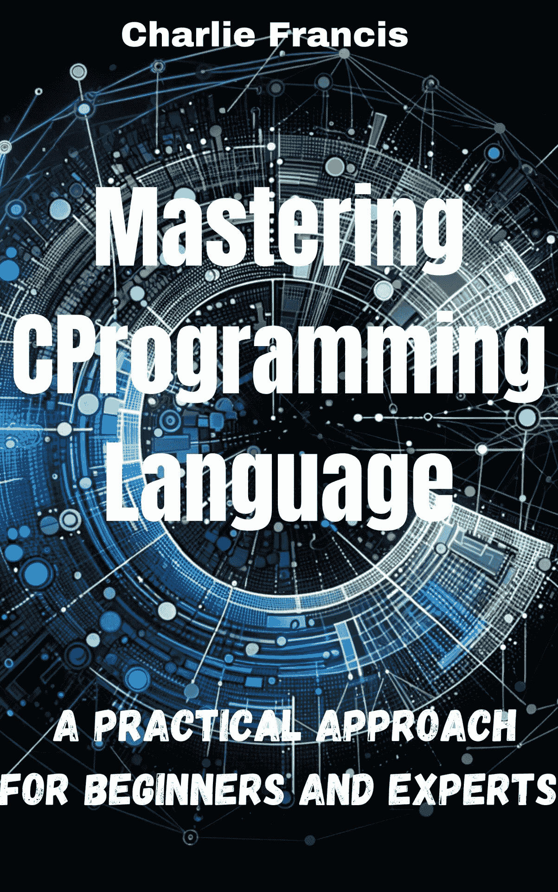

# 精通 C 语言语言：初学者与专家的实用指南





版权 © 2024 Charlie Francis
保留所有权利

书中描绘的人物和事件均为虚构。与任何真实人物（无论生或死）的任何相似之处均属巧合，非作者本意。

未经出版者书面许可，不得对本书的任何部分复制、存储在检索系统中，或以任何形式或手段（电子、机械、复印、录制或其他）进行传输。

ISBN-13: 9781234567890
ISBN-10: 1477123456
封面设计：Art Painter
美国国会图书馆控制号：2018675309
于美国打印

## 目录

- 标题页
- 版权信息
- 序言
- 第 1 章：C 语言入门
- 第 2 章：C 语言基础
- 第 3 章：C 中的控制结构
- 第 4 章：C 中的函数
- 第 5 章：数组与字符串
- 第 6 章：指针与内存管理
- 第 7 章：C 中的数据结构
- 第 8 章：C 中的文件处理
- 第 9 章：C 中的错误处理与调试
- 第 10 章：C 中的模块化编程
- 第 11 章：高级指针概念
- 第 12 章：C 中的系统编程
- 第 13 章：C 中的并发与多线程
- 第 14 章：C 中的网络编程
- 第 15 章：C 中的优化技术
- 第 16 章：C 实战项目
- 第 17 章：高级主题与进一步学习
- 附录
- A：C 语言参考指南
- B：练习题解答
- C：延伸阅读与资源
- 参考文献

## 序言

## C 编程简介

在科技塑造我们日常大部分生活的数字时代，编程已了一项关键技能，而 C 编程更是其核心。20 世纪 70 年代初，丹尼斯·里奇（Dennis Ritchie）在贝尔实验室创立了 C 语言，标志着编程史上的一个重要里程碑。C 最初是为系统编程（特别是针对 UNIX 操作系统）开发的，其影响力迅速扩散，成为许多现代系统和应用程序的骨干。

C 语言的设计证明了其持久的遗产。它结合了简单性与强大性，提供了极少数语言可以比拟的对内存和系统资源的直接控制。这种控制，结合其高效性和灵活性，使 C 成为高性能和低级系统应用的首选语言。

C 语言跨越数十年的历程以标准化努力为显著标志，特别是美国国家标准协会（ANSI）C 标准和国际标准化组织（ISO）C 标准。这些标准对于确保 C 代码保持可移植性（能够在各种硬件和软件环境中运行）和一致性至关重要，为全球开发者提供了稳定的基础。

## C 语言的重要性与应用

C 不是一门编程语言；它是构建现代计算的基石。C++、C#、Java 甚至 Python 等语言的存在，部分归功于 C 语言所建立的原则。这种传承关系使得理解 C 对任何程序员来说都至关重要，因为它为理解计算机科学中更复杂的语言和概念奠定了基础。

C 语言的应用既多样又影响巨大。从运行我们电脑和智能手机的操作系统，到家用电器和车辆中的嵌入式系统，C 的足迹无处不在。在性能至关重要的游戏开发领域，以及构成我们数字世界基础设施的系统软件领域，它都是关键角色。

对于学习者和人士而言，理解 C 不仅仅是一项技能，更是一扇观察技术深层运作机制的窗。它强化了你对内存管理、数据结构和算法等基本概念的理解。这些知识是无价之宝，无论你是渴望开发下一代尖端软件，还是寻求理解计算机科学的复杂之处。

## 如何使用本书

本书为不同的读者群体设计——无论你是正迈出编程的第一步，还是旨在巩固技能的中级编码员，亦或是寻求深入研究 C 语言细节的高级开发人员。我们的旅程将从 C 语言的基础知识开始，走向更复杂、更强大的功能。

我们将从“基础”开始，介绍 C 语言的语法、基本结构和核心概念。当我们进入“中间概念”时，你将探索数据结构、文件处理和错误管理等复杂主题。“高级主题”部分将挑战你精通指针、并发和网络编程的复杂性。最后，在“实战项目”中，你将在实际且趣味的项目中应用你的技能，综合你的所学。

## 第 1 章：C 语言入门

### 编程简介

### 什么是编程？

从本质上说，编程是创建指令的过程，告诉计算机如何执行任务。它就像为计算机编写一份食谱。这个过程涉及设计、编码、测试，最后运行一个可执行程序以实现特定目标，无论是计算数字、处理数据，还是控制机器人。

### 编程语言

正如人类使用不同的语言交流一样，不同的目的也有不同的编程语言。这些语言可以粗略地分为低级语言和高级语言。低级语言更接近机器码，对硬件提供更多控制；而高级语言更接近人类语言，使其更容易学习和使用。C 语言在这一光谱中作为中级语言存在，结合了低级语言的高效和灵活性，以及高级语言的部分抽象性。

### C 语言的历史与演变

C 语言的历程始于 20 世纪 60 年代末和 70 年代初的贝尔实验室。它由丹尼斯·里奇作为 B 语言的继任者开发，而 B 语言本身是由 BCPL（基础组合编程语言）演变而来的。C 最初专为系统编程（特别是 UNIX 操作系统）设计，从那时它已成为最广泛使用的编程语言之一。


C 语言多年年来发生了巨大的变化。1989 年建立 ANSI C 标准以及随后的 ISO 标准确保了 C 语言的广泛采用和移植性。后续版本如 `C99`、`C11` 和 `C18` 引入了各种增强，使 C 适应了不断变化的计算格局。

### 设置开发环境

### 选择编译器
编译器是将你的 C 代码翻译成可执行程序的关键工具。流行的 C 编译器包括 `GCC`（GNU 编译器集）和 `Clang`。`GCC` 以其广泛的使用和对不同平台的支持闻名，而 `Clang` 因其出色的错误信息和快速编译而受到誉。

### 安装指南
设置 C 开发环境的方法因平台而异：
- Windows：安装 `MinGW` 或 `Cygwin`，它们提供了 `GCC`。
- Linux：大多数 Linux 发行版都预装了 `GCC`。如果没有，可以通过包管理器安装。
- macOS：安装 `Xcode Command Line Tools`，它包含了 `GCC`。

### 集成开发环境 (IDEs)
如 `Code::Blocks`、`Eclipse CDT` 和 `Visual Studio` 等 IDE 为编写、调试和测试你的 C 程序提供了集成化环境。它们提供语法高亮、代码补全和项目管理等功能，使开发过程更加高效。

### 你的第一个 C 程序

### C 程序的结构
一个典型的 C 程序由函数定义组成，其中 `main()` 函数是入口。它还包含了头文件，头文件中包含了函数和宏的声明。

### "Hello, World!" 程序
让我们编写你的第一个 C 程序：

```
#include <stdio.h>

int main() {
    printf("Hello, World!\n");
    return 0;
}
```
这个程序会在控制台打印“Hello, World!”

### 编译与执行
要编译并运行此程序：
1. 将代码保存为名为 `hello.c` 的文件。
2. 使用 `GCC` 编译器：`gcc hello.c -o hello`。
3. 运行程序：`./hello`。

### 理解程序输出
程序中的 `printf` 函数将文本“Hello, World!”发送到控制台，随后换行。

### 基础编程概念

### 理解语法和语义
语法是指组合符号以形成有效程序的规则。而语义则是关于这些符号的含义。一个语法上正确的程序在语义上可能是错误的。

### 变量与基础数据类型
变量用于存储数据。C 中的基础数据类型包括用于整数的 `int`、用于浮点数的 `float` 和 `double`以及用于字符的 `char`。

### 简单输入输出
`printf` 和 `scanf` 是输入输出的基础函数。`printf` 用于输出，而 `scanf` 用于从用户处读取输入。

### 总结
本章为你的 C 编程之旅奠定了基础。我们探索了编程基础、C 语言的历史以及如何设置开发环境。你还编写并执行了你的第一个 C 程序。

### 练习
1. 编写一个程序在控制台打印你最喜欢的格言。
2. 修改 "Hello, World!" 程序，在输出中包含你的名字。
3. 尝试不同的数据类型（`int`、`float`、`char`），通过声明变量并使用 `printf` 打印它们。

## 第 2 章：C 语言基础

### 语法与结构

### 理解 C 语法
C 语法是定义如何编写和解释 C 程序的规则集。关键方面包括使用分号（`;`）结束语句，使用大括号（`{}`）定义代码块，以及用于包含头文件的预处理指令（如 `#include`）。

### 程序结构
一个典型的 C 程序被结构化为函数，其中 `main()` 函数是入口点。函数包含定义程序行为的语句。注释用 `//`（单行注释）或 `/* ... */`（多行注释）标记，用于注释和解释代码，不影响程序的执行。

示例：
```
#include <stdio.h>

int main() {
    // 代码写在这里
    return 0;
}
```
这段代码段落展示了带有标准 `main()` 函数的 C 程序的基本结构。

### 变量与数据类型

### 变量简介
变量在 C 编程中是至关重要的。它们是内存中命名的存储位置，用于持有程序执行过程中可能变化的数据。C 中的每个变量都有特定的类型，该类型决定了变量内存的大小和布局。

### C 中的数据类型
C 提供了几种基础数据类型：
- 整数 (`int`)：用于整数。
- 浮点数 (`float`, `double`)：用于小数。
- 字符 (`char`)：用于单个字符。

C 中基础数据类型的内存大小可能根据系统和编译器而异。然而，典型的尺寸如下：
- 整数 (`int`)：通常通常为 4 字节 (32 位)，但不同系统之间可能不同。
- 浮点数：
  - `float`：通常为 4 字节 (32 位)。
  - `double`：通常为 8 字节 (64 位)。
- 字符 (`char`)：通常为 1 字节 (8 位)。

需要注意的是，这些大小不是固定的，并且会根据所使用的架构和编译器而不同。要确定特定系统上的精确大小，可以使用 C 中的 `sizeof` 运算符来确定每个数据类型的大小。

示例：
```c
int age = 30;
float weight = 65.5;
char grade = 'A';
```
这些行声明了不同数据类型的变量。

### 常量与字面量
常量是在定义后值无法改变的。字面量是直接赋值或用于表达式的固定值。例如，`5`、`3.14` 和 `'a'` 分别代表整数、浮点数和字符字面量。

示例：
```
const int MAX_AGE = 100;
```
这一行声明了一个常量 `MAX_AGE`。

### 类型修饰符
类型修饰符用于改变基础数据类型的属性，允许更大的范围。关键修饰符包括：
- `short`：缩小整数类型的范围，通常用于较小的整数。
- `long`：扩展整数类型的范围，常用于较大的数字。例如，`long int` 允许比普通 `int` 更大的整数。
- `signed` 和 `unsigned`：`signed`（默认）允许整数为正负，而 `unsigned` 将整数限制为非负值。例如，`unsigned char` 可以存储 0 到 255 之间的值，而 `signed char` 通常存储 -128 到 127。

示例：
```c
long int distance = 150000L;
```
这里 `long int` 用于存储更大的整数。

### 运算符与表达式

### 基础运算符
在 C 编程中，运算符是用于特定操作的特殊符号。它们可以分类如下：
1. 算术运算符：用于基础数学运算。包括 `+`（加法）、`-`（减法）、`*`（乘法）、`/`（除法）和 `%`（取模）。
2. 关系运算符：用于比较值。该类包括 `==`（等于）、`!=`（不等于）、`<`（小于）、`>`（大于）、`<=`（小于等于）和 `>=`（大于等于）。
3. 逻辑运算符：用于逻辑操作，特别是在控制流中。这些是 `&&`（逻辑与）、`||`（逻辑或）和 `!`（逻辑非）。
4. 赋值运算符：涉及向变量赋值值。标准赋值使用 `=`，而复合赋值包括 `+=`、`-=`、`*=` 和 `/=`，它们将算术运算与赋值结合起来。


关于复合赋值的更多详细信息，`+=` 是复合赋值运算符之一。它将右操作数加到左操作数上，然后将结果赋值给左操作数。例如，`a += b` 等同于 `a = a + b`。该运算符简化并缩短了执行加法后赋值的代码。例如，如果 `a` 是 5，`b` 是 3，执行 `a += b` 后，`a` 的值将变为 8。像 `+=` 这样的复合赋值运算符使代码更加简洁，通常更容易阅读。

### 运算符优先级和结合性

在 C 语言中，运算符优先级和结合性是理解表达式如何评估的关键概念。运算符优先级决定了表达式中执行不同操作的顺序，某些操作会在其他操作之前执行。例如，乘法和除法的优先级高于加法和减法。

结合性定义了相同优先级水平运算符的求值顺序。它可以是从左到右，也可以是从右到左。例如，在一个包含多个乘法操作（具有从左到右的结合性）的表达式中，操作是从左到右求值的。理解这些概念对于编写能被 C 程序正确且高效执行的表达式至关重要。

### 表达式和语句

表达式是变量、字面量、运算符和函数调用的组合，通过求值产生一个值。另一方面，语句是 C 程序执行的指令。它可以是一个简单的操作（如赋值值），也可以是一个像 `if` 语句这样的控制语句。

示例：

```
int sum = 10 + 15; // 10 + 15 是一个表达式
```

### C 语言中的输入/输出

### 标准输入/输出

C 提供了输入输出的标准库函数。最常用用于输出的 `printf` 和用于输入的 `scanf`。这些函数定义在 `stdio.h` 头文件中。

示例：

```c
printf("Hello, World!\n");
scanf("%d", &age);
```

### 格式化输入/输出

`printf` 和 `scanf` 使用格式说明符来定义输入或输出的数据类型。

以下是 C 中常用格式说明符的简要总结及示例：

- `%d` 或 `%i`：用于有符号整数。示例：`printf("%d", 5);`
- `%u`：无符号整数。示例：`printf("%u", 150u);`
- `%f`：浮点数。示例：`printf("%f", 3.14);`
- `%lf`：双精度。示例：`printf("%lf", 3.1415);`
- `%c`：字符。示例：`printf("%c", 'A');`
- `%s`：字符串。示例：`printf("%s", "Hello");`
- `%x` 或 `%X`：十六进制。示例：`printf("%x", 255);`
- `%o`：八进制。示例：`printf("%o", 100);`
- `%p`：指针地址。示例：`printf("%p", &var);`
- `%e` 或 `%E`：科学计数法。示例：`printf("%e", 220.5);`
- `%g` 或 `%G`：`%f` 和 `%e` 的最短表示法。示例：`printf("%g", 100.0);`

这些说明符是 C 语言中格式化输入输出操作的基础。

除了常用的格式说明符，C 语言编程还包含几个较少用但在特定场景非常有用的说明符：

- `%lld` 和 `%llu`：分别用于 `long long int` 和 `unsigned long long int` 类型。与 `%ll` 类似，这些用于处理非常大的整数值。
- `%zx`：用于 `size_t` 类型（通常用于内存分配和大小计算），输出为无符号十六进制整数。
- `%td`：用于 `ptrdiff_t` 类型。


完成本节后，你已经具备了编写简单且有效的 C 程序的能力。在进入后续章节学习更复杂的话之前，理解这些基础知识是关键。

## 第 3 章：C 语言控制结构

### 控制结构简介

### 什么是控制结构？

控制结构是编程的基石，用于引导执行流。在 C 中，它们被用于决策、重复操作以及管理程序的执行路径。有效使用控制结构对于创建动态且响应迅速的程序至关重要。

### 控制结构的类型

C 提供了几种类型的控制结构，大致分类为：

 ** **顺序**：默认模式，按行执行代码。
- **选择**：用于决策判断，包括 `if`、`else`、`else-if` 和 `switch` 语句。
- **循环**：用于重复操作，使用 `for`、`while` 和 `do-while` 循环。

### 条件语句 (if, else)

### 使用 `if` 语句

如第 2 章所述，`if` 语句评估一个条件，如果为真，则执行相关的代码块。它是 C 语言中最简单的决策形式。

```
int number = 10;

if (number > 0) {
    printf("The number is positive.\n");
}
```

在这里，程序检查 `number` 是否大于 0，如果为真则打印消息。

### `else` 和 `else if` 阶梯

如第 2 章所述，当 `if` 条件为假时，会执行 `else` 语句。`else if` 允许按顺序测试多个条件。

```c
if (number > 0) {
    printf("Positive\n");
} else if (number < 0) {
    printf("Negative\n");
} else {
    printf("Zero\n");
}
```

这段代码将 `number` 分类为正、负或零。

### 嵌套 `if` 语句

嵌套 `if` 语句提供了一种在分支内检查多个条件的方法。

```c
if (number != 0) {
    if (number > 0) {
        printf("Positive\n");
    } else {
        printf("Negative\n");
    }
} else {
    printf("Zero\n");
}
```

示例演示了通过嵌套 `if` 语句进一步对数字进行分类。

### Switch Case

如上一章介绍的，`switch` 语句允许使用单个变量的值进行多路分支。在某些场景下，它比多个 `if-else` 语句更简洁。

```c
switch (number) {
    case 1:
        printf("One\n");
        break;
    case 2:
        printf("Two\n");
        break;
    default:
        printf("Other\n");
}
```

在这里，根据 `number` 的值执行不同的分支。

### 循环 (for, while, do-while)

### `for` 循环

当迭代次数已知时，`for` 循环是最理想的。它由初始化、条件和增减表达式组成。

```c
for (int i = 1; i <= 5; i++) {
    printf("%d\n", i);
}
```

该循环打印从 1 到 5 的数字。

### `while` 循环

当预未知迭代次数时，使用 `while` 循环。它在每次迭代之前检查条件。

```c
int i = 1;
while (i <= 5) {
    printf("%d\n", i);
    i++;
}
```

该循环也打印从 1 到 5 的数字，但使用的是 `while` 循环。

### `do-while` 循环

`do-while` 循环确保循环体至少执行一次，因为条件是在循环执行后检查的。

```c
int i = 1;
do {
    printf("%d\n", i);
    i++;
} while (i <= 5);
```

即使 `i` 初始大于 5，循环体也会执行一次。

### Break 和 Continue

### 使用 `break`

`break` 语句会立即退出循环或 `switch` 分支。它用于根据特定条件终止循环。

```c
for (int i = 1; i <= 5; i++) {
    if (i == 3) break;
    printf("%d\n", i);
}
```

该循环在 `i` 变为 3 时停止执行。

### 使用 `continue`

`continue` 语句会跳过当前迭代并进入下一次迭代。

```c
for (int i = 1; i <= 5; i++) {
    if (i == 3) continue;
    printf("%d\n", i);
}
```

### 嵌套循环

嵌套循环涉及将一个循环放在另一个循环内部。它们通常用于矩阵或网格。

```c
for (int i = 1; i <= 5; i++) {
    for (int j = 1; j <= 5; j++) {
        printf("%d %d\n", i, j);
    }
}
```

### If-Else 的替代方案：三元运算符

三元运算符是处理 `if-else` 逻辑的简洁方式。它使用语法 `条件 ? 1 : expression2`。

```
int max = (a > b) ? a : b;
```

### 总结

在本章中，我们深入研究了构建 C 程序的控制结构。涵盖了用于决策的条件语句、用于重复任务的循环，并学习了如何有效地管理程序流。

### 练习

1. 编写一个程序，使用 `if` 语句检查数字是否为正、偶数或大于 10。
2. 使用 `for` 循环创建前 10 个斐波那契数字。
3. 创建一个使用嵌套循环显示 5x5 星号矩阵的程序。

## 第 4 章：C 语言中的函数

### 函数简介

### 什么是函数？

在编程中，函数是执行特定任务的独立代码块。它们是构建 C 程序的基础，允许将代码拆分为可管理的部分。

### 使用函数的好处

 ** **模块化**：将复杂过程拆分为更小的部分。
- **可重用性**：允许在程序的不同部分或不同程序之间重复代码。
- **提高可读性**：使代码更有组织。

### 定义函数

### 函数的基本结构

C 函数通常由返回类型、函数名、参数（如果有）以及大括号内的体组成。语法如下：

```
returnType functionName(parameter1, parameter2, ...) {
    // 函数体
    // return 语句（如果 returnType 不是 void）
}
```

### 编写你的第一个函数

让我们写一个简单的相两个数字的函数：

```c
int add(int num1, int num2) {
    return num1 + num2;
}
```

该函数名为 `add`，接收两个整数参数并返回它们的和。

### 函数参数和返回类型

### 向函数传递参数

参数可以通过值传递或引用传递给函数。在 C 中，默认是值传递，即传递参数的副本。

```c
int result = add(5, 10);
```

### 返回类型和值

函数可以返回各种类型，如果不返回值则使用 `void`。`return` 语句用于从函数返回值。

```c
return result;
```

### 递归

### 递归概念


递归是编程中的一个基本概念，其中函数会调用自身。它是解决可以分解为更小的、相似的子问题的有效策略。在递归中，函数每次调用自身时，它都在处理问题的较小部分，最终达到一个停止进一步递归调用的基准情况（base case）。这一概念对于遍历数据结构（如树或图）、实现 `quicksort`（快速排序）或 `mergesort`（合并排序）等算法，以及解决迭代方法不够直观或高效的问题特别有用。递归需要仔细处理以避免无限递归，并确保每次递归调用都更接近基准情况。

这是一个递归的示例：一个计算数字阶乘的函数。数字 `n` 的阶乘是小于或等于 `n` 的所有正整数的乘积。它通常表示为 `n!`。

```c
#include <stdio.h>

// 计算阶乘的递归函数

unsigned long long factorial(int n) {
    if (n == 0) { // 基准情况
        return 1;
    } else {
        return n * factorial(n - 1); // 递归调用
    }
}

int main() {
    int number = 5;
    printf("Factorial of %d is %llu\n", number, factorial(number));
    return 0;
}
```

在这个示例中，`factorial` 是一个递归函数。当它带非零参数被调用时，它会带有 `n - 1` 调用自身。每次调用都会减少 `n`，直到达到基准情况（`n == 0`），此时函数返回 1。随后递归调用的栈会展开，将这些数字相乘得到最终结果。

### 递归 vs 迭代解决方案

递归和迭代解决方案是编程中解决问题的两种方法，它们各自有优缺点：

1. **递归解决方案**：
   - **概念**：涉及函数调用自身来解决相同问题的较小实例。
   - **使用场景**：适用于自然上可以用更小子问题表示的问题，例如树遍历、阶乘计算、斐波那契序列等。
   - **优点**：通常更具可读性且更容易编写；很好地映射到具有递归结构的问题。
   - **缺点**：由于函数调用的开销，效率可能较低；深度递归存在栈溢出的风险；有时更难调试。

2. **迭代解决方案**：
   - **概念**：使用循环来重复操作，避免函数调用。
   - **使用场景**：适用于需要重复任务的简单问题，如遍历数组、累加总和等。
   - **优点**：在内存和速度方面通常效率更高；对于简单的重复任务更容易理解；避免了栈溢出问题。
   - **缺点**：对于自然适合递归方法的问题，编写起来可能更复杂；代码可读性可能降低。

### 示例 - 阶乘计算：

递归：
```c
int factorial(int n) {
    if (n <= 1) return 1;
    return n * factorial(n - 1);
}
```

迭代：
```c
int factorial(int n) {
    int result = 1;
    for(int i = 2; i <= n; i++) {
        result *= i;
    }
    return result;
}
```

选择递归还是迭代取决于具体问题、性能考虑以及个人或风格偏好。

### 递归中的常见陷阱

递归中的关键问题包括无限递归（缺乏适当的终止条件）和过度消耗内存。拥有一个结束递归调用的基准情况是非常关重要的。

### 变量的作用域和生命周期

### 局部变量 vs 全局变量

在 C 语言中，局部变量和全局变量的区别对于理解变量的作用域和生命周期至关重要：

### 局部变量：
- 定义在函数内部。
- 仅在声明它的函数内部可访问。
- 生命周期局限于函数的执行过程。

### 全局变量：
- 定义在所有函数之外，通常在程序文件的顶部。
- 可以从程序的任何部分访问。
- 生命周期贯越整个程序的运行期间。

妥善管理局部变量和全局变量对于编写结构良好且可维护的代码至关重要。全局变量提供了程序范围内的访问，但可能导致代码管理和冲突问题；而局部变量有助于保持函数的自包含行为，从而增强模块化并减少潜在的副作用。

以下是 C 中局部变量和全局变量的示例：

### 1. 局部变量示例：
在此示例中，`localVar` 是 `add` 函数中的局部变量。

```c
int add(int a, int b) {
    int localVar = a + b; // 局部变量
    return localVar;
}

int main() {
    int result = add(5, 3);
    printf("Result is: %d\n", result);
    return 0;
}
```
（注：原文中局部变量示例的逻辑较为碎片，已为了清晰进行了清理，同时保留了核心逻辑。）

### 2. 全局变量示例：
在此示例中，`globalVar` 是一个全局变量。它在 `increment` 和 `main` 函数中都是可访问的。

```c
int globalVar = 10; // 全局变量

void increment() {
    globalVar += 5;
}

int main() {
    printf("Before: %d\n", globalVar);
    increment();
    printf("After: %d\n", globalVar);
    return 0;
}
```

### 静态变量

C 语言中的静态变量具有独特的属性：它们在函数调用之间保留其值。这与每次调用时都会重新初始局部变量形成对比。静态变量通常用于在多次调用之间保留状态信息或计算函数执行的次数。它们用 `static` 关键字声明，作用域局限于定义的块，但生命周期贯穿整个程序执行。

这是一个基础示例：

```c
void countFunctionCalls() {
    static int count = 0; // 静态变量
    count++;
    printf("Function called %d times\n", count);
}

int main() {
    for (int i = 0; i < 5; i++) {
        countFunctionCalls(); // 每次调用增加 count
    }
    return 0;
}
```
在这个示例中，每次调用 `countFunctionCalls()`，`count` 都会保留其值并递增，展示了静态变量的持久性。

### 高级函数主题

### 函数指针

C 语言中的函数指针是存储函数地址的变量。它们允许动态调用函数，并在某些场景下特别有用，例如实现回调函数（当需要作为参数传递给另一个函数时），或创建动态分发的函数表。函数指针通过指定其指向的函数的返回值和参数类型来声明。它们通过允许函数像其他变量一样被处理，为 C 编程增加了灵活性。

这是一个演示 C 中函数指针使用的示例：

```c
#include <stdio.h>

void greetMorning() {
    printf("Good morning!\n");
}

void greetEvening() {
    printf("Good evening!\n");
}

int main() {
    // 声明一个函数指针并赋值为 greetMorning
    void (*greetFunction)() = greetMorning;
    greetFunction(); // 调用 greetMorning

    // 将函数指针重新赋值为 greetEvening
    greetFunction = greetEvening;
    greetFunction(); // 调用 greetEvening

    return 0;
}
```


在这个示例中，`greetFunction` 是一个函数指针。最初，它指向 `greetMorning`，随后它被重新赋值为 `greetEvening`。当调用 `greetFunction()` 时，它会调用当前指向的函数。这演示了如何使用函数指针来动态调用不同的函数。

### 内联函数

C 语言中的内联函数通过 `inline` 关键字指定，它是对编译器的一种建议，要求在每个调用点直接插入函数的代码。这可以通过消除与调用相关的开销，潜在地提高程序的性能。然而，注意的是，`inline` 仅仅是一个建议，编译器可能会因为各种原因（如大小或复杂性）选择不内联某个函数。内联函数通常用于小型且频繁调用的函数，在这些情况下，内联带来的性能收益大于代码体积增加带来的影响。以下是一个在 C 中使用内联函数的示例：

```c
#include <stdio.h>

// 定义一个内联函数
inline int max(int a, int b) {
    return (a > b) ? a : b;
}

int main() {
    int x = 5, y = 10;
    // 调用内联函数
    int maxValue = max(x, y);
    printf("最大值是: %d\n", maxValue);
    return 0;
}
```

在这个示例中，`max` 被定义为一个内联函数。`inline` 建议告诉编译器在 `main` 函数中直接展开 `max` 以替换其调用。这意味着，而不是通过普通的函数调用，`max` 函数的代码是在编译期间直接插入的。请记住，实际的内联取决于编译器的决定。

### 变长参数

在 C 编程中，处理函数中可变参数的能力是通过 `stdarg.h` 库实现的。这一特性对于像 `printf` 这样需要接受未定义数量参数的函数特别有用。该库提供了访问这些参数的宏。要使用变长参数，你首先定义一个具有固定数量参数的函数，通常包含一个指示变长参数数量的参数。然后你使用来自 `stdarg.h` 的 `va_start`、`va_arg` 和 `va_end` 宏来处理这些参数。`va_start` 初始化 `va_list` 变量，`va_arg` 顺序访问每个参数，而 `va_end` 清理列表。以下是一个 C 中使用变长参数的函数示例：

```c
#include <stdio.h>
#include <stdarg.h>

void printNumbers(int count, ...) {
    va_list args;
    va_start(args, count);
    for (int i = 0; i < count; i++) {
        int num = va_arg(args, int);
        printf("%d ", num);
    }
    va_end(args);
    printf("\n");
}

int main() {
    printNumbers(4, 10, 20, 30, 40);
    printNumbers(2, 1, 2);
    return 0;
}
```

在这个示例中，`printNumbers` 函数可以接受任意数量的整数参数。第一个参数 `count` 指定了将传递多少个整数。它使用 `stdarg.h` 宏来遍历参数并打印它们。这个示例演示了变长参数函数的灵活性。

### 最佳实践

### 编写整洁高效的函数

在 C 编程中编写整洁高效的函数涉及几项关键实践：

1. **单一职责**：每个函数应该只执行一个特定的任务。这种方法使函数更容易理解、测试和调试。
2. **简洁性**：函数应该保持短小。长函数通常可以拆分为几个较小的函数。
3. **描述性命名**：为函数及其参数选择清晰、具描述性的名称。这提高了可读性以及对函数作用的理解。
4. **参数管理**：限制参数的数量。过多的参数会使函数难以使用和理解。
5. **避免副作用**：函数不应该有意之外的副作用。这意味着除非绝对必要，否则函数不应该修改其范围之外的全局变量或状态。
6. **注释与文档**：对函数进行适当注释，以解释其目的、参数、返回值以及实现中任何显而易见的方面。
7. **一致的风格**：在命名、缩进和括号放置上遵循一致的编码风格。

这些指南有助于编写出更具维护性和更可靠的代码，从而提升整体软件质量。

### 函数中的错误处理

在 C 函数中进行有效的错误处理对于构建健壮可靠的程序至关重要。以下是一些常见的策略：

1. **返回错误代码**：函数可以返回特定的代码来指示不同类型的错误。
2. **全局错误变量**：使用类似 `errno` 的全局变量来指示错误类型。该变量可以在错误条件下设置，并在函数调用后进行检查。
3. **C 的异常处理机制**：虽然 C 没有像 C++ 那样内置的异常处理，但可以使用 `setjmp` 和 `longjmp` 函数来实现类似的目的，尽管由于复杂性和可能误用的风险，它们并不那么常用。
4. **参数检查**：始终验证函数参数，以防止由于无效输入导致的错误。
5. **资源管理**：确保资源（如内存）被正确分配和释放，以防止泄漏或损坏。

每种方法都有其适用场景，选择正确的方法取决于你的函数和程序的具体需求。以下是每种策略的示例：

### 1. 返回错误代码
```c
int divide(int a, int b, int* result) {
    if (b == 0) {
        return -1; // 除以零错误
    }
    *result = a / b;
    return 0; // 成功
}
```

### 2. 全局错误变量 (`errno`)
```c
#include <errno.h>
#include <stdio.h>
#include <string.h>

void openFile(const char* filename) {
    FILE* file = fopen(filename, "r");
    if (file == NULL) {
        printf("打开文件失败: %s\n", strerror(errno));
    }
}
```

### 3. 使用 `setjmp` 和 `longjmp` 进行类似异常的处理
```c
#include <setjmp.h>
#include <stdio.h>

jmp_buf buf;

void riskyFunction() {
    // 错误条件
    longjmp(buf, 1); // 跳转到 setjmp 点
}

int main() {
    if (setjmp(buf)) {
        printf("发生了一个错误。\n");
    } else {
        riskyFunction(); // 调用可能导致错误的函数
    }
    return 0;
}
```

### 4. 参数检查
```c
void printString(const char* str) {
    if (str == NULL) {
        printf("无效的字符串\n");
        return;
    }
    printf("%s\n", str);
}
```

### 5. 资源管理
```c
char* allocateBuffer(size_t size) {
    char* buffer = malloc(size);
    if (buffer == NULL) {
        printf("内存分配失败\n");
    }
    return buffer;
}
```

### 总结

本章涵盖了 C 语言函数的各个方面，从基础结构到高级主题。理解函数对于编写模块化、复用且高效的 C 代码至关重要。

### 练习

1. 编写一个计算三个数字平均值的函数并在程序中使用。
2. 创建一个递归函数来计算第斐波那契数。
3. 实现一个使用变长参数的函数来计算任意数量整数的和。

第 5 章：数组与字符串

## 数组简介

### 什么是数组？


C 语言中的数组是基础数据结构，由一组相同类型的项组成，存储在连续的内存位置中。这种连续分配允许通过索引对元素进行高效访问。数组索引通常从 0 开始，允许根据其位置直接访问任何元素。数组用于多种用途，例如存储值列表（如数字或字符）以及为了高效处理而组织数据。它们是使用单个变量名管理多个数据项的关键工具，简化了程序中的数据管理。

### 数组的声明与初始化

数组通过指定数据类型、名称和大小来声明。例如：

```c
int numbers[5]; // 声明一个整数数组
```

初始化可以在声明时同时完成：

```c
int numbers[5] = {1, 2, 3, 4, 5}; // 初始化数组
```

### 访问数组元素

可以使用索引访问数组中的元素，索引从 0 开始。

```c
int firstNumber = numbers[0]; // 访问第一个元素
```

### 多维数组

### 多维数组的概念

多维数组是“数组的数组”，通常用于以矩阵形式表示数据。数组可以有不同的维度，通常范围从一维到四维，尽管技术上它们可以更多。每个维度都增加了数组结构和访问方式的复杂性。

### 一维数组

**概念**：一维数组是数组最简单的形式，表示元素的线性序列。它就像一个列表或一排槽。

**示例**：一个整数数组，`int arr[] = {10, 20, 30, 40};`

### 二维数组

**概念**：二维数组类似于表格或矩阵。它由行和列组成。

**示例**：按行和列排列的整数数组，`int arr[2][3] = {{1, 2, 3}, {4, 5, 6}};`。这代表 2 行 3 列。

### 三维数组

**概念**：三维数组可以被看作二维数组的数组，类似于元素的“立方体”或多层 2D 表格。

**示例**：`int arr[2][3][4];`。这代表 2 组数组，每组包含 3 行 4 列。

### 四维数组

**概念**：四维数组增加了一个层次，通常被视觉化为一系列 3D 数组。它在典型应用中不常见，且难以可视化，但被用于复杂的数据结构。

**示例**：`int arr[2][3][4][5];`。这可以代表 2 组，每组包含 3 组 3D 数组，每个数组有 4 行 5 列。

### 高维数组

**概念**：理论上数组可以有任意数量的维度，但在实践中，超过三四维的数组很少见。它们被用于高度特殊的应用程序，例如某些科学计算或复杂数据模型。

**使用复杂度**：随着维度的增加，管理和理解数组的复杂度也随之增加。高维数组可能难以可视化，如果不仔细管理，可能会导致混淆。

### 声明与使用

例如，二维数组可以如下声明：

```c
int matrix[3][3]; // 一个 3x3 矩阵
```

初始化并访问元素：

```c
matrix[0][0] = 1; // 给第一个元素赋值
int value = matrix[0][0]; // 访问该值
```

### 实际考虑因素

- **内存占用**：高维数组会消耗大量的内存，尤其是当每个维度的大小增长时。
- **访问与迭代**：访问多维数组中的元素需要嵌套循环，每个维度都需要一个循环。

### 实际示例

C 语言中的多维数组是用于各种实际应用的强有力工具：

1. **矩阵运算**：在数学计算中，二维数组用于表示矩阵。矩阵加法、乘法和转置等操作可以通过遍历这些数组的嵌套循环来实现。
2. **图像处理**：图像可以表示为 2D 数组（灰度图）或 3D 数组（彩色图像，带有 RGB 通道）。图像处理任务（如滤波、缩放和变换）涉及对这些数组的操作。
3. **棋盘游戏表示**：国际象棋或井棋等游戏可以使用二维数组表示，每个单元存储一个值，指示该位置棋盘的状态。
4. **3D 空间中的图形**：三维数组可以表示三维空间，在计算机图形和科学模拟等领域非常有用。

这些示例强调了多维数组在处理复杂数据结构和算法方面的多功能。理解和操作多维数组需要牢实掌握它们在内存中的结构以及如何有效地访问其元素。它们是结构化格式组织和处理数据的强有力工具。

## C 语言中的字符串

### 理解字符串作为字符数组

在 C 编程语言中，字符串根本上是字符数组。该数组是字符的序列，存储在连续的内存位置中，并由一个特殊字符终止：空字符 `'\0'`，它标记字符串的结束。这个概念对于处理 C 程序中的文本至关重要，因为它影响了字符串的存储、处理和访问方式。

### C 语言中字符串的特征

1. **字符数组**：C 语言中的字符串表示为字符数组。例如，字符串 `"Hello"` 存储在一个由字符 `'H'`, `'e'`, `'l'`, `'l'`, `'o'` 组成的数组中。
2. **空字符终止**：空字符 `'\0'` 是 C 中一个特殊的字符（ASCII 值为 0），用于指示字符串的结束。编译器会自动在字符串末尾添加该字符。
3. **连续内存分配**：在内存中，字符串的字符存储在连续的内存位置。这种连续存储使得使用指针或数组索引遍历字符串成为可能。
4. **不可变字符串字面量**：当在 C 中字符串字面量（例如 `"Hello"`）时，它存储在内存的只读区域。修改此类字面量会导致未定义行为。
5. **通过标准函数操作**：C 提供了一个标准库 `<string.h>`，其中包含处理字符串的函数，例如用于拷贝的 `strcpy()`、用于拼接的 `strcat()`、用于查找长度的 `strlen()` 等。

### 示例：字符串的声明与初始化

这是一个简单的示例，说明如何在 C 中声明和初始化字符串：

```c
#include <stdio.h>

int main() {
    char greeting[] = "Hello, World!";
    printf("%s\n", greeting);
    return 0;
}
```

在这个示例中，`greeting` 是一个字符数组，包含了末尾的空字符。`printf` 函数用于打印字符串。

### 字符串的操作

在 C 语言中处理字符串时，请记住以下几：

- **字符串大小**：字符串数组的大小应该足够包含空字符。例如，字符串 `"Hello"` 需要大小为 6 的数组（5 个字符 + 1 个空字符）。
- **字符串函数**：使用 `<string.h>` 提供的函数进行安全且高效的字符串操作。直接操作字符串（例如逐字符操作）时应谨慎行事，以避免缓冲区溢出等错误。
- **指针与字符串**：可以使用指针操作字符串。但是，必须确保指针不会访问空字符之外的内存。

理解字符串作为字符数组是 C 编程的基础。它构成了各种应用程序中文本处理、数据存储和通信的基础。记住字符串是以空字符终止的字符数组将帮助你避开常见的陷阱并编写出更健壮的 C 程序。


```c
char greeting[6] = {'H', 'e', 'l', 'l', 'o', '\0'};
```

### 字符串操作

在 C 编程中，处理字符串涉及许多常见操作，如拼接、比较和查找字符串长度。C 标准库 `<string.h>` 提供了各种函数来高效且安全地执行这些操作。

### 拼接

函数：`strcat()`

描述：将一个字符串的内容附加另一个字符串的末尾。

用法：

```c
char str1[20] = "Hello, ";
char str2[] = "World!";
strcat(str1, str2); // str1 现在包含 "Hello, World!"
```

### 比较

函数：`strcmp()`

描述：比较两个字符串。

用法：

```c
char str1[] = "Hello";
char str2[] = "World";
int result = strcmp(str1, str2);
if(result == 0) {
    printf("Strings are equal.\n");
} else {
    printf("Strings are not equal.\n");
}
```

如果字符串相等，`strcmp()` 返回 0；如果 `str1` 中第一个不匹配的字符小于 `str2` 中的字符，则返回负值；否则返回正值。

### 查找长度

函数：`strlen()`

描述：返回字符串的长度，不包括空字符。

用法：

```c
char str[] = "Hello";
int length = strlen(str); // length 将为 5
```

### 其他常见字符串操作

1. **复制字符串：`strcpy()`**
   将一个字符串复制到另一个。
   示例：`strcpy(dest, source);`

2. **不区分大小写的字符串比较：`strcasecmp()` 或 `stricmp()`**
   比较两个字符串，忽略大小写。

3. **子字符串查找：`strstr()`**
   在字符串中查找子字符串第一次出现的位置。
   示例：`char *sub = strstr(str, "sub");`

4. **字符查找：`strchr()` 和 `strrchr()`**
   `strchr()` 查找字符串中字符第一次出现的位置。
   `strrchr()` 查找字符串中字符最后一次出现的位置。

5. **分割字符串：`strtok()`**
   根据分隔符将字符串拆分为一系列标记（tokens）。

### 最佳实践

在使用这些函数时，确保以下点很重要：

1. **缓冲区大小**：在 `strcat()` 和 `strcpy()` 等操作中，目标缓冲区必须足够大，以容纳结果字符串（包括空终止符），防止缓冲区溢出。
2. **不可变字符串字面量**：修改字符串字面量（例如对字面量使用 `strcat()` 或 `strcpy()`）会导致未定义行为，因为它们存储在只读内存中。
3. **空终止**：在使用这些函数之前，确保字符串已正确空终止，因为它们依赖空字符来确定字符串的结束。

有效利用这些函数可以在 C 编程中实现健且高效的字符串处理，这对于数据处理、用户输入以及系统间的通信至关重要。

### 字符串函数

在 C 中，`string.h` 库提供系列执行各种字符串操作的函数。这些函数提供了处理字符串的基本能力，包括上述字符串操作所示的复制、拼接、长度测量和比较。理解并正确使用这些函数对于 C 编程中有效的字符串处理至关重要。

### `strcat()` - 字符串拼接

描述：将一个字符串的内容附加另一个字符串的末尾。

原型：`char *strcat(char *dest, const char *src);`

用法：

```c
char str1[20] = "Hello";
char str2[] = " World";
strcat(str1, str2); // str1 现在包含 "Hello World"
```

注意：目标字符串（在此例中 `str1`）必须有足够的空间来适应拼接的结果。

### `strlen()` - 字符串长度

描述：返回字符串的长度，不包括空终止符。

原型：`size_t strlen(const char *str);`

用法：

```c
char str[] = "Hello";
int len = strlen(str); // len 将为 5
```

### `strcmp()` - 字符串比较

描述：比较两个字符串。

原型：`int strcmp(const char *str1, const char *str2);`

用法：

```c
char str1[] = "Hello";
char str2[] = "World";
int result = strcmp(str1, str2);
if (result == 0) {
    // 字符串相等
} else {
    // 字符串不相等
}
```

注意：如果字符串相等，`strcmp()` 返回 0；如果 `str1` 小于 `str2`，返回负值；如果 `str1` 大于 `str2`，返回正值。

## 指针简介

### 指针的基本概念

指针是 C 编程中基础且强大的特性。它们允许直接访问和操作内存，使其对于 C 中高效有效的编程至关重要。理解指针对于动态内存分配、实现数据结构以及与硬件交互等任务至关重要。

### 什么是指针？

指针是一个存储另一个变量内存地址的变量。与标准变量持有数据值不同，指针持有内存地址。

### 声明指针

要声明指针，使用星号 `*` 配合类型。例如：

```c
int *ptr;
char *c;
```

### 初始化指针

指针通常使用取地址运算符 `&` 给变量赋值。例如：

```c
int var = 10;
int *ptr = &var;
```

### 解引用指针

解引用指针意味着访问所存储内存地址的值。这是通过解引用运算符 `*` 完成的。例如：

```c
int value = *ptr;
```

### 指针运算

指针支持加减等算术运算。这些操作基于指针的数据类型。例如，增加一个 `int *ptr` 会增加一个整数的大小。

### 指针的用途

1. **动态内存分配**：结合 `malloc()` 和 `free()` 使用指针来管理内存。
2. **数组操作**：数组和指针关系密切，可以使用指针遍历数组。
3. **引用传递参数**：指针允许函数修改传递给它们的实际数据，而不是副本。
4. **实现数据结构**：创建链表、树和图等复杂数据结构至关重要。

### 指针与 Null

不指向有效内存位置的指针通常被设置为 `NULL`，这是一个特殊值，表示它不指向任何地方。

### 指针的注意事项

使用指针需要谨慎，不当当会导致内存泄漏、访问无效内存位置（悬空指针）或覆盖重要数据等。理解指针对于深入理解 C 如何处理内存至关重要。

### 指针与数组

在 C 编程中，指针与数组之间的关系是内在的，且通常是混淆的根源。

### 数组名作为指针

在大多数情况下，数组名是指向数组第一个元素的指针。这意味着数组名可以像指针变量一样使用。例如，如果你有一个数组 `int arr[5];`，名称 `arr` 可以作为指向第一个元素的指针，即 `arr` 等同于 `&arr[0]`。

### 指针运算

指针运算允许你使用指针遍历数组。由于数组名充当指向第一个元素的指针，你可以执行算术运算让指针跨越数组元素。

1. **增加指针**：如果 `ptr` 是指向数组元素的指针，则 `ptr + 1` 指向下一个元素。


### 2. 访问元素

如果 `ptr` 指向一个数组元素，`*(ptr + i)` 则访问从 `ptr` 开始第 `i` 个元素。

示例：使用指针遍历数组

```c
int arr[5] = {10, 20, 30, 40, 50};
int *ptr;
// 使用数组名作为第一个元素的指针
ptr = arr;
// 使用指针算术遍历数组
for(int i = 0; i < 5; i++) {
    printf("%d ", *(ptr + i));
}
```

## 指针与多维数组

在 C 语言中处理多维数组时，指针与数组之间的交互变得更加微妙。理解如何使用指针遍历这些数组对于许多应用至关重要，包括矩阵操作和高维数据结构的处理。

### 二维数组

考虑一个声明为 `int arr[3][4];` 的二维数组。该数组可以被视化为一个 3x4 的矩阵，包含三行，每行包含四个整数。

**数组名作为指针**：在这种上下文中，`arr` 可以被看作是指向第一个包含 4 个整数的一维数组的指针（矩阵的第一行）。它类似于 `int (*ptr)[4] = arr;`，其中 `ptr` 是一个指向包含 4 个整数数组的指针。

**指针算术**：将 `arr` 增 1（`arr + 1`）会将指针从第一行移动到第二行。这是因为 `arr` 指向一个包含 4 个整数的块（第一行），加上 1 会将指针移动到下一个 4 个整数的块（第二行）。

### 访问二维数组中的元素

使用指针访问二维数组中的元素：

1. 访问特定行：`(arr + i)` 给出数组第 `i` 行的指针。
2. 访问特定元素：`*(*(arr + i) + j)` 访问第 `i` 行第 `j` 列的元素。

示例：使用指针遍历二维数组

```c
int arr[3][4] = {{1, 2, 3, 4}, {5, 6, 7, 8}, {9, 10, 11, 12}};
for(int i = 0; i < 3; i++) {
    for(int j = 0; j < 4; j++) {
        printf("%d ", *(*(arr + i) + j));
    }
    printf("\n");
}
```

这段代码段遍历了一个二维数组，打印每个元素。表达式 `*(*(arr + i) + j)` 访问访问第 `i` 行，然后访问该行中的第 `j` 个元素。

### 注意事项与最佳实践

- **指针类型**：用于多维数组索引的指针类型应与数组的维度匹配。
- **边界检查**：始终确保你的索引变量（示例中的 `i`, `j`）位于数组维度的范围内。
- **理解退化（Decay）**：就像一维数组一样，多维数组也会“退化”为指针。对于 `int arr[3][4]`，第一次退化是从 `int[3][4]` 变为变为 `int (*)[4]`。
- **空指针检查**：在解引用之前，始终检查指针是否为 `NULL`，尤其是在处理动态内存时。

在多维数组中正确使用指针可以显著优化矩阵操作等操作，这证明了 C 语言在底层内存管理方面的灵活性和强大。

### 指针与数组的区别

虽然指针和数组密切相关，但它们并不是同一种东西：

1. **内存分配**：数组为其元素分配内存，而指针只持有一个内存地址。
2. **大小**：`sizeof(arr)` 给出整个数组的大小，而 `sizeof(ptr)` 给出指针变量的大小。
3. **可修改性**：你可以更改指针指向的位置，但数组名始终指向同一个内存位置。

理解指针与数组之间的关系是精通 C 数组操作和内存管理的关键，这将带来更高效、有效的编程。

### 指针与字符串

字符串通常表示为以空字符（`'\0'`）终止的字符数组。指针提供了一种灵活且高效的方法来处理和操作这些字符数组。理解指针与字符串之间的关系对于 C 中中内存高效且动态的字符串操作至关重要。

### 基本概念

**作为数组的字符串**：字符串本质上是一个以空字符（`'\0'`）结尾的字符数组。例如，`char str[] = "Hello";` 创建了一个包含 6 个字符的字符串（包括空终止符）。

**字符串指针**：指向字符串的指针指向字符串的第一个字符。例如，`char *strPtr = str;` 将 `strPtr` 设置指向 `str` 的第一个字符。

```c
char *greetingPtr = greeting; // 指向字符串第一个字符的指针
```

### 字符串指针算术

**遍历字符串**：你可以使用指针算术来遍历字符串。增加字符串指针会移动到字符串中的下一个字符。

示例：

```c
char str[] = "Hello";
char *ptr = str;
while(*ptr != '\0') {
    printf("%c", *ptr);
    ptr++; // 移动到下一个字符
}
```

### 使用指针处理字符串的优势

- **效率**：使用指针操作字符串比使用索引更高效。
- **灵活性**：指针允许动态字符串动态内存。
- **函数参数**：指针用于传递字符串给函数。

### 函数与指针

标准库 `<string.h>` 提供了处理指针的方法：

- `strcpy()` 和 `strncpy()`：拷贝字符串。
- `strcat()` 和 `strncat()`：连接字符串。
- `strlen()`：计算字符串长度。
- `strcmp()` 和 `strncmp()`：比较字符串。

### 使用 malloc() 创建字符串

**动态字符串分配**：使用 `malloc()` 动态分配内存，允许字符串大小在运行时变化。

示例：

```c
char *str = malloc(50 * sizeof(char)); // 为 50 个字符分配内存
strcpy(str, "Hello!");
```

- **内存管理**：在使用指针时需要正确管理内存。
- **空终止符**：在操作时始终确保字符串是空终止的。
- **指针初始化**：未初始化的指针会导致未定义行为。始终将指针初始化为 `NULL`。

使用指针处理字符串允许对字符串的存储和操作进行更直接的控制，但。

### 数组的动态内存分配

动态内存分配是一种强大的功能，允许在运行时分配内存，这对于在编译未知运行时创建数组特别有用。这是通过使用 `stdlib.h` 库中的 `malloc`、`calloc` 和 `realloc` 函数实现的。

### 使用 malloc

目的：分配指定字节数的内存。

用法：

```c
int *arr = (int *)malloc(n * sizeof(int)); // 为 n 整数数组分配内存
```

或者，

```c
int *dynamicArray = (int *)malloc(5 * sizeof(int)); // 动态分配 5 个整数数组
```

注意：`malloc` 不初始化内存；分配的内存包含垃圾值。

### 使用 calloc

目的：为每个具有指定大小的元素数组分配内存，并将分配内存中的所有字节初始化为零。

用法：

```c
int *arr = (int *)calloc(n, sizeof(int)); // 为 n 整数数组分配并初始化内存
```

与 `malloc` 的区别：`calloc` 将分配的内存初始化为零。

### 使用 realloc

目的：调整之前分配的内存块。

用法：

```c
arr = (int *)realloc(arr, newSize * sizeof(int)); // 将 arr 调整为新大小
```

注意：可以扩展或缩小分配内存的大小。如果无法调整大小，`realloc` 将返回 `NULL`。

### 释放内存

函数：`free`


目的：释放之前由 `malloc`、`calloc` 或 `realloc` 分配的内存。

用法：

```c
free(arr);
arr = NULL; // 释放后将指针置为 NULL 是良好的习惯
```

### 最佳实践与注意事项

- **检查分配是否成功**：通过验证返回的指针是否为 `NULL` 来始终检查内存分配是否成功。
- **避免内存泄漏**：记住在不再需要任何动态分配的内存时，使用 `free` 释放该块内存。
- **小心处理 `realloc`**：使用 `realloc` 时，处理可能因无法调整内存块大小而返回 `NULL` 的情况。确保原始指针不丢失，否则可能导致内存泄漏。
- **类型转换**：`malloc`、`calloc` 和 `realloc` 函数返回指向 `void` 的指针，可以将其强制转换为相应的类型。
- **初始化分配的内存**：特别在使用 `malloc` 时，将分配的内存初始化为已知值是一个好主意，可以避免由于垃圾值导致不可预测的行为。

数组的动态内存分配对于创建能够处理不同数量数据的灵活且高效的应用至关重要。这一特性允许 C 程序优化地使用内存资源，适应应用程序的运行时需求。

### 高级数组与字符串技术

### 指针数组与数组指针

高级数组和字符串技术通常涉及在 C 中使用指针来创建更灵活、更复杂的数据结构。两个基本概念是“指针数组”和“数组指针”。

### 1. 指针数组
指针数组是一个每个元素都是指针的数组。这些指针可以指向不同的数据类型或对象。常见用例包括创建字符串数组（字符指针数组）、对象数组或其他数据结构的数组。

这里是一个指向字符串的指针数组的示例：

```c
char* names[] = {"Alice", "Bob", "Charlie", "David"};
```

在这个示例中，`names` 是一个指向字符数组（字符串）的指针数组。`names` 的每个元素都指向不同的字符串。

### 2. 数组指针
指向数组的指针是一个指向数组第一个元素或数组基地址的指针。你可以使用指针算术通过指针访问数组的元素。

这是一个指向数组的指针的示例：

```c
int arr[5] = {1, 2, 3, 4, 5};
int* ptr = arr; // 指向数组第一个元素的指针

// 使用指针访问元素
for (int i = 0; i < 5; i++) {
    printf("%d ", *(ptr + i)); // 打印 1 2 3 4 5
}
```

在这个示例中，`ptr` 指向 `arr` 数组的第一个元素，你可以使用指针算术遍历数组。

### 3. 字符串指针数组
字符串字符串的数组是指针数组概念的一个常见应用。它允许你存储一个字符串数组，每个字符串都由字符指针表示。当你需要处理一组长度不定的字符串列表时，这非常有用。

这里有一个示例：

```c
char* fruits[] = {"Apple", "Banana", "Cherry", "Date"};
// 访问并打印字符串
for (int i = 0; i < 4; i++) {
    printf("%s\n", fruits[i]);
}
```

在这种情况下，`fruits` 是一个字符指针数组，其中每个指针指向不同的字符串。这些概念提供了处理复杂数据结构的灵活性，包括不同数据类型的数组、结构体数组或动态分配内存的数组（例如字符串）。它们对于 C 语言编程中高效管理和操作数据至关重要。

### 多维动态数组

在 C 中，多维数组的动态分配可以使用指针数组和嵌套的 `malloc` 调用来实现。具体方法如下：

1. **为行指针分配内存**：首先，为指针数组分配内存。该数组中的每个指针将指向多维数组的不同行。

```c
int *array = (int **)malloc(numberOfRows * sizeof(int *));
```

在这里，`array` 是一个指向 `int` 指针的指针。此行为 `numberOfRows` 个指针分配了内存。

2. **为每行分配内存**：接下来，对于每一行，为该行的列分配内存。

```c
for (int i = 0; i < numberOfRows; i++) {
    array[i] = (int *)malloc(numberOfColumns * sizeof(int));
}
```

此循环遍历每个行指针并为每行分配一个整数数组。因此，你得到了一个二维数组。

3. **访问元素**：你可以使用数组表示法访问此数组的元素：

```c
array[i][j] = value; // 设置值
int val = array[i][j]; // 获取值
```

4. **释放内存**：在完成数组操作后，忘记释放分配的内存。这分两步完成：
- 首先，释放每一行：
```c
for (int i = 0; i < numberOfRows; i++) {
    free(array[i]);
}
```
- 然后，释放指针数组：
```c
free(array);
```

这种方法允许你创建可以在运行时确定的动态维度数组。你可以使用更多层级的指针将此概念扩展到高维数组，尽管这会增加复杂性和错误风险。


```c
printf("Substring found: %s\n", result ? "Yes" : "No");

return 0;
}
```

这些示例展示了 C 语言自定义字符串处理函数的灵活性和强大。它们为特定问题提供了定制化的解决方案，超越了标准库提供的基础字符串处理。请记住，在 C 中处理字符串时（特别是动态分配内存时），务必注意内存管理，以避免内存泄漏和其他问题。

以下是可用于更高级字符串操作的其他技术和概念：

1. **正则表达式**：正则表达式是模式匹配和文本处理的强大工具。它们允许对字符串进行复杂的搜索、替换和验证操作。
2. **自定义字符串函数**：有时，标准库函数无法满足特定需求。在这种情况下，编写自定义字符串函数是必要的。这可能包括修剪、填充、分割或以标准库不支持的方式连接字符串的函数。
3. **字符串解析与分词**：解析涉及根据分隔符或模式将字符串分解为标记或更小的部分。这在解析 CSV 文件、命令行参数或处理日志文件等场景中特别有用。
4. **编码转换**：处理不同的字符串编码（如 UTF-8、ASCII、Unicode）至关重要，特别是在涉及国际化的应用程序中。通常需要用于在这些编码之间切换的转换函数。
5. **字符串缓冲区操作**：在 C 等语言中，直接管理字符串缓冲区可能更高效，但风险更高。安全的缓冲区操作函数（包括边界检查操作）对于防止缓冲区溢出至关重要。
6. **文本分析与处理**：这可以包括词频统计、寻找 n-gram 或计算文本之间的相似性等操作。这些技术在自然语言处理领域特别有用。
7. **动态字符串构建**：对于不具备原生字符串处理特性的语言（如 C），使用链表或动态调整大小缓冲区等结构动态构建字符串是非常强大的。
8. **字符串处理中的递归**：对于涉及字符串中嵌套或分级结构的模式，递归函数可能非常有用，例如在某些解析任务或处理 JSON 或 XML 等格式时。
9. **内存管理**：在低级语言中，仔细的内存管理至关重要。这包括为字符串分配足够的空间、避免内存泄漏以及防止缓冲区越界。
10. **字符串插值与模板**：高级字符串处理可能涉及创建带有占位符的复杂字符串模板，这些占位符可以通过程序替换为实际值。
11. **字符编码感知**：理解不同字符如何编码以及它们如何影响字符串操作至关重要，特别是在处理 Unicode 中的多字节字符时。
12. **文本机器学习**：利用机器学习模型执行情感分析、分类，甚至根据字符串输入生成文本等任务。

这些技术都可以根据你项目的特定需求以及你所使用的编程语言进行调整和组合。请记住，进行高级操作时（特别是在 C 这样的语言中），引入错误或安全漏洞的风险会增加，因此仔细的测试和审查是必须的。

### 总结

数组和字符串是 C 编程中的基础元素。本涵盖了它们的声明、初始化、操作和高级技术，包括动态内存分配。理解这些概念对于在 C 程序中进行有效的数据处理至关重要。

### 练习

1. 创建并操作一个表示 3x3 矩阵的二维数组。
2. 编写一个程序使用指针将一个字符串复制到另一个字符串。
3. 实现一个整数动态数组并执行添加和删除元素等操作。

数组和字符串是 C 编程不可或缺的一部分，为复杂的数据处理和操作提供了基础。在本章之后，我们将探索“指针与内存管理”，扩展如何更有效地管理和操作数据。

## 第 6 章：指针与内存管理

### 理解指针

### 指针的基本概念

在 C 语言的学习旅程中，指针因其强大且具挑战性而脱颖而出。正如我们在前面的章节中简单提到的，指针本质上是存储另一个变量内存地址的变量。这看起来可能很简单，但指针的影响和应用是巨大且多方面的。

### 什么是指针？

C 语言中的指针本质上是一个持有另一个变量地址的变量。指针不直接存储值，而是存储值所在的位置。这种间接访问值的方法允许更灵活、更高效的设计。

### 指针的声明与初始化

指针的声明通过指定它所指向变量的数据类型，后跟一个星号来实现。例如：

`int *ptr;` // 指向整数的指针

指针的声明与其他任何变量的声明相似，只是了一个星号（`*`）表示它是指针。语法如下：

`int *pointerToInt;` // 指向整数的指针

`char *pointerToChar;` // 指向字符的指针

指针通过使用地址运算符 `&` 将变量的地址进行初始化。

`int var = 10;`

`ptr = &var;` // ptr 现在指向 var

初始化指针与声明同样重要。一种做法是将它们初始化为 `NULL`，这是一个表示指针尚未指向有效内存位置的特殊值。

`int *pointerToInt = NULL;`

### 解引用指针

一旦指针被赋值变量的地址，就可以使用解引用运算符（`*`）访问该地址的值。这被称为解引用。

`int value = 5;`

`int *pointerToInt = &value;` // 指针现在持有 value 的地址

`int valueAtAddress = *pointerToInt;` // 解引用

指针可以通过算术运算进行进行操作。例如，对指针加 1 会将其移动到其指向类型的下一个内存位置。这在数组操作中是基础，因为数组与指针紧密相关。

`int array[5] = {10, 20, 30, 40, 50};`

`int *pointerToArray = array;`

// 使用指针算术访问第三个元素

`int thirdElement = *(pointerToArray + 2);`

## 指针与数据类型

指针的数据类型定义了它所指向变量的类型。这影响了指针算术中每一步的大小。`char *` 移动一个字节，而 `int *` 根据系统可能会移动四个字节。此外还有指向指针的指针，它可以存储另一个指针的地址。

### 空指针

`void *` 指针是一种特殊的指针类型，可以指向任何数据类型。它通常用于预先未数据数据类型的泛型函数。

### 指针的力量与陷阱

虽然指针提供了强大的功能（如动态内存管理和高效的数组处理），但也带来了风险。不当使用指针会导致悬空指针、内存泄漏和段错误等问题。

### 指针与数组

在 C 编程中，指针和数组之间的关系是基础性的，也是强大能力和微妙复杂性的来源。理解这种关系对于有效的 C 编程至关重要，特别是在涉及数组操作和内存管理的操作中。


这种关系的核心在于，数组名称可以作为指向其第一个元素的指针。这意味着在大多数语境下，数组名实际上是一个指针。

考虑数组 `int numbers[5];` - 在这里，`numbers` 可以被认为指向数组第一个元素 `numbers[0]` 的指针。

```c
int arr[5] = {1, 2, 3, 4, 5};
int *arrPtr = arr; // 指向 arr 第一个元素的指针
```

# 使用指针访问数组元素

由于数组名充当指向其第一个元素的指针，你可以使用指针算术来遍历数组。这是使用数组索引访问元素的替代方案。

```c
int numbers[5] = {10, 20, 30, 40, 50};
int *ptr = numbers;  // ptr 现在指向 numbers[0]

for(int i = 0; i < 5; i++) {
    printf("Element %d: %d\n", i, *(ptr + i));
}
```

在这个示例中，`*(ptr + i)` 被用于访问数组的第 i 个元素。该表达式将指针从起始位置移动 `i` 个元素，然后对其进行解引用以获取值。

## 指针与多维数组

在处理多维数组时，指针会变得稍微复杂。对于二维数组，通常使用指向指针数组的指针。这些指针中的每一个指向数组的不同行。

```c
int matrix[2][3] = {{1, 2, 3}, {4, 5, 6}};
int (*ptr)[3] = matrix;

for(int i = 0; i < 2; i++) {
    for(int j = 0; j < 3; j++) {
        printf("%d ", ptr[i][j]);
    }
    printf("\n");
}
```

在这里，`ptr` 是一个指向三个整数数组的指针。它指向 `matrix` 的第一个元素，而该元素本身是一个包含三个整数的数组。

### 与字符串的关系

在 C 语言中，字符串本质上是字符数组，以空字符（`'\0'`）结束。因此，可以使用字符指针来操作字符串。

```c
char str[] = "Hello, World!";
char *ptr = str;
printf("First character: %c\n", *ptr); // 输出 'H'
```

# 最佳实践与常见陷阱

- **指针算术**：谨慎使用指针算术。无意中将指针移动到数组边界之外很容易导致未定义行为。
- **常量正确性 (Const Correctness)**：如果你使用指针读取数组元素而不修改它们，请考虑使用 `const` 来防止意外修改数组元素。
- **内存分配**：对于动态数组，指针是必不可少的。然而，记住释放分配的内存以避免内存泄漏。

理解指针与数组的关系对于任何想要精通 C 编程的人来说至关重要。这种关系强调了 C 处理内存和数据表示的方法，使其成为该语言的基础概念。

# 指向指针的指针（二级指针）

在 C 编程中，指向指针的指针（通常称为二级指针）是一个强大的概念，扩展了指针的基本概念。二级指针本质上存储另一个指针地址的指针，从而创建了一个间接层。

# 理解二级指针

二级指针使用两个星号声明（例如 `int **ptr`）。这表示 `ptr` 不仅仅是一个指向 `int` 的指针，而且是一个指向 `int` 指针的指针。

考虑以下示例：

```c
int value = 5;
int *ptr = &value;
int **doublePtr = &ptr;
```

在这里，`ptr` 是持有 `value` 地址的指针，而 `doublePtr` 是持有 `ptr` 地址的二级指针。

# 使用二级指针

二级指针常用于各种场景，例如：

1. **多维数组的动态内存分配**：二级指针在处理动态分配的多维数组时特别有用。允许创建一个指针数组，每个指针指向不同的数组，从而有效地创建一个二维数组。
2. **将指针传递给函数**：当你希望函数修改指针变量存储的地址时，可以使用二级指针。这是因为将单个指针传递给函数只会允许你修改指针所指向的值，而不是指针变量存储的地址。

## 示例：二维数组的动态分配

这是一个展示如何使用二级指针动态创建二维数组的示例：

```c
int rows = 2;
int cols = 3;
int **array = (int **)malloc(rows * sizeof(int *));

for(int i = 0; i < rows; i++) {
    array[i] = (int *)malloc(cols * sizeof(int));
}

// 赋值并打印数组
for (int i = 0; i < rows; i++) {
    for (int j = 0; j < cols; j++) {
        array[i][j] = i + j; // 赋值
        printf("%d ", array[i][j]);
    }
    printf("\n");
}

// 清理内存
for (int i = 0; i < rows; i++) {
    free(array[i]);
}
free(array);
```


`free` 用于释放之前通过 `malloc`、`calloc` 或 `realloc` 分配的内存。它会释放已分配的内存，使其再次用于未来的分配并防止内存泄漏。

语法：`void free(void *ptr);`

```
free(ptr); // 释放分配的内存
```

# 动态内存分配的重要性

动态内存分配对于创建灵活且高效的程序至关重要，特别是在处理未知或变化大小的数据时。它允许程序员在运行时根据需要请求内存，这在处理大型数据集、实现复杂数据结构（如链表、树和图）以及在内存资源受限的环境工作工作尤为重要。

然而，能力越大责任越大。不正确使用这些动态内存分配函数会导致内存泄漏、悬挂指针和未定义行为等问题。因此，谨慎使用这些函数至关重要，并始终确保在不再需要时适当释放已分配的内存。

### 最佳实践

始终释放动态分配的内存并检查内存分配是否成功，以避免内存泄漏和程序崩溃至关重要。

# 内存泄漏与管理技术

理解内存泄漏并采用有效的管理技术对于编写健壮且高效的 C 程序至关重要。让我们深入探讨什么是内存泄漏以及如何有效地管理它们。

## 什么是内存泄漏？

C 编程中的内存泄漏发生在程序未能释放之前动态分配的内存（使用 `malloc`、`calloc` 或 `realloc` 等函数）时。这种疏忽意味着分配的内存仍然被占用，且程序无法再次访问，导致程序和系统的可用内存逐渐减少。随着时间的推移，内存泄漏可能会导致各种问题，包括性能下降、内存占用增加和应用程序崩溃。

内存泄漏在长时间运行的应用程序中尤为严重，因为未释放内存的累积会导致严重的资源浪费。

## 内存泄漏的原因

内存泄漏通常由于以下原因发生：

1. 使用后没有释放分配的内存。
2. 丢失对分配内存的引用（例如，通过为持有动态分配内存地址的指针分配新地址）。

# 现实应用中的内存泄漏

在现实应用中，特别是运行时间长或处理大量数据的程序，有效的内存管理至关重要。忽略内存管理会导致性能下降和系统稳定性问题，使应用程序变得不可靠。因此，警惕潜在的内存泄漏并审慎管理内存资源至关重要。

通过理解内存泄漏的原因并采用这些管理技术，你可以极大地提高 C 程序的可靠性和效率。请记住，有效的内存管理是高质量软件开发的标志。

# 检测和避免内存泄漏

在 C 编程中，手动内存管理是一项关键任务，检测和避免内存泄漏对于创建高效可靠的应用程序至关重要。让我们专注于适用于 C 语言处理内存泄漏的策略和工具。

## 检测内存泄漏

1. 使用 Valgrind：

Valgrind 是 C 程序员检测内存泄漏的重要工具。它会检查内存管理不当并帮助识别泄漏。通过 Valgrind 运行 C 程序将报告任何已分配但未释放的内存，从而确定位泄漏源。

使用示例：`valgrind --leak-check=yes ./your_c_program`

2. 其他内存分析工具：

如 `Memcheck`、`AddressSanitizer`（LLVM/Clang 和 GCC 编译器的一部分）和 `Electric Fence` 等工具也可用于检测 C 中的内存泄漏。这些工具提供了有关内存分配和释放的详细见解，有助于识别内存泄漏。

## 避免内存泄漏

1. 一致地使用 `free()`：

确保你 C 程序中的每个 `malloc` 或 `calloc` 都有一个对应的 `free`。始终确保在不再需要时使用 `free()` 释放动态分配的内存。这一实践是防止内存泄漏的基础。在内存用完后立即释放内存至关重要。

2. 小心管理指针：

勤恳管理指针的生命周期。避免丢失已分配内存指针的情况。在处理指针重赋值和作用域变化时要特别小心。

3. 初始化指针：

始终将指针初始化为 `NULL`。这种做法可以防止许多误用未初始化或已释放指针的问题。

4. 释放后将指针置为 NULL：

调用 `free` 之后，将指针设置为 `NULL`。这有助于避免使用悬挂指针，悬指针会导致未定义行为。

5. 健壮的错误处理：

实现彻底的错误处理，特别是内存分配失败的场景。在分配失败的情况下，确保在处理错误之前释放释放之前分配的所有内存。

6. 定期代码审查和测试：

定期对代码进行审查和测试，关注内存管理。这对于处理复杂逻辑或大量内存分配的函数尤为重要。同行评审也可以帮助发现原始程序员可能会忽略的问题。

7. 内存管理文档：

在代码中记录你的内存分配和释放策略。清晰的注释和文档对于管理和跟踪内存使用具有无价价值。

8. 内存泄漏测试：

将内存泄漏测试作为测试计划常规组成部分。这包括压力测试和长时间测试，以检测随时间可能发生的泄漏。

通过在 C 编程实践中结合这些工具和技术，你可以显著降低内存泄漏的风险。有效的内存管理不仅是为了防止泄漏，也是为了编写整洁、可维护且高效的代码。

### 高级指针概念

C 语言函数指针是一项强大的功能，进一步扩展了指针的通用性。通过允许指针引用函数，函数指针实现了动态函数调用并将函数作为参数传递给其他函数。这为高阶函数、回调和事件驱动编程开启了可能性。

### 函数指针

函数指针是指向函数的指针。它不指向数据，而是指向可执行的代码。

### 声明

函数指针的声明必须与其旨在指向函数签名匹配。

语法：`return_type (*function_pointer_name)(parameter_types);`

例如，如果你有一个函数 `int add(int, int)`，指向该函数的指针声明为 `int (*add_ptr)(int, int);`

### 初始化

函数指针使用函数的地址进行初始化。这通过 `&` 运算符实现，尽管它是可选的，因为函数名本身就是指向函数的指针。

`add_ptr = add;` 或 `add_ptr = &add;`

### 使用函数指针

一旦初始化，可以使用函数指针调用它指向的函数。这通过解引用运算符 `*` 实现，但为了简洁通常会省略。

`int result = add_ptr(3, 5);` // 调用 `add` 函数

### 传递函数指针

函数指针可以作为参数传递给其他函数，允许回调和高阶函数。

```
void apply(int (*func_ptr)(int, int), int a, int b) {
    printf("Result: %d\n", func_ptr(a, b));
}
```

`apply(add_ptr, 3, 5);`

## 函数指针数组：


可以创建一个函数指针数组，这对于实现跳转表或命令分发器等非常有用。

```
int (*operations[])(int, int) = {add, subtract, multiply, divide};
```

## 用场景

函数指针广泛应用于事件驱动编程、状态机以及回调函数的实现。

它们还被用于创建插件架构，可以在不更改现有代码库的情况下添加新功能。

### 最佳实践与注意事项

- **类型安全**：确保函数指针及其所指向的函数具有匹配的签名，以避免未定义行为。
- **空指针检查**：在通过指针调用函数之前，检查指针是否不为 `NULL`。
- **可读性**：函数指针可能会使代码更难阅读和理解，因此要谨慎使用它们，并保持清晰的文档。
- **安全性**：要加小心，因为不当使用函数指针可能会导致漏洞，特别是在涉及动态链接或用户输入的场景下。

函数指针是 C 编程中的一个独特方面，在函数调用和设计模式中提供了灵活性和威力。然而，应该在理解其复杂性和影响的基础上使用它们，特别是在代码的可维护性和安全性方面。

### 指针与结构体

在 C 编程中，指针可以与结构体结合使用，提供动态内存分配和对结构元素的高访问。这种组合在许多高级编程场景中至关重要，例如实现链表或其他动态数据结构。

### 在结构体中使用指针

1. **指向结构体的指针**：
就像基本数据类型一样，指针可以指向结构体。这允许在内存中动态创建和操作结构体。

声明结构体指针的语法：

```
struct MyStruct {
    int field1;
    char field2;
};
struct MyStruct *ptr;
```

然后可以使用 `malloc` 或 `calloc` 为此指针动态分配内存。

2. **访问结构体成员**：
要通过指针访问结构体的成员，需要使用箭头运算符 (`->`)。

示例：
```
ptr = (struct MyStruct *)malloc(sizeof(struct MyStruct));
ptr->field1 = 10;
ptr->field2 = 'a';
```

3. **动态内存分配**：
将指针与结构体允许动态内存分配，使得根据程序需求在运行时创建和管理结构体成为可能。这在编译时未知所需结构体数量的情况下特别有用。

4. **结构体指针数组**：
可以创建一个指向结构体的指针数组，这对于动态管理结构体集合非常有用。数组中的每个元素都可以独立地进行分配和访问。

5. **向函数传递结构体**：
向函数传递结构体的指针比传递结构体本身更高效，因为避免了拷贝整个结构体。这对于大型结构体特别重要。

6. **从函数返回结构体**：
函数也可以返回指向结构体的指针，允许在函数内部动态创建结构体。

### 最佳实践与注意事项

- **内存管理**：与任何动态分配的内存一样，在不再需要结构体指针时，释放为其分配的内存很重要以防止内存泄漏。
- **空指针检查**：在访问结构体成员之前，始终检查指向结构体的指针是否为 `NULL`，以避免段错误。
- **结构体初始化**：考虑在分配内存后将结构体成员初始化为默认值。
- **感知大小**：注意结构体的大小，因为它会影响内存分配和性能，特别是在结构体指针数组中。

示例

```
struct MyStruct *createStruct(int field1, char field2) {
    struct MyStruct *newStruct = malloc(sizeof(struct MyStruct));
    if (newStruct != NULL) {
        newStruct->field1 = field1;
        newStruct->field2 = field2;
    }
    return newStruct;
}

int main() {
    struct MyStruct *myStructPtr = createStruct(5, 'b');
    if (myStructPtr != NULL) {
        // 使用结构体
    }
    free(myStructPtr); // 释放内存
    return 0;
}
```

在这个示例中，函数 `createStruct` 为 `MyStruct` 结构体动态分配了内存并初始化了其成员。`main` 函数演示了创建、使用然后释放结构体的过程。

指针和结构体共同成了 C 语言中强大的强大的工具，能够动态且高效地处理复杂数据。这一功能是 C 中实现的许多数据结构和算法的基石。

# 空指针与类型转换

空指针（用 `void *` 表示）是 C 语言中的特殊指针类型，可以指向任何数据类型的对象。它们在创建通用函数和数据结构时特别有用。然而，为了使用它们所指向的数据，必须将空指针转换为特定类型。

### 理解空指针

空指针是可以持有任何数据类型地址的指针。它是一种通用指针类型。

示例声明：`void *ptr;`

**通用性**：
由于 `void *` 可以指向任何数据类型，它被广泛用于旨在具有通用性和类型无关的函数和数据结构。这一特性在 `malloc`、`calloc` 和 `qsort` 等标准库函数中特别有用。

**局限性**：
1. 空指针不知道它们指向什么类型的对象。因此，不能直接对其进行解引用。
2. 它们不支持指针算术，因为指向的对象的大小是知的。

### 转换空指针

**转换的必要性**：
为了使用空指针所指向的数据，必须先将指针转换为相应的类型。这种转换告诉编译器指针所指向的数据类型，使其能够正确解释值。

**转换语法**：
转换空指针通过在指针前加上所需的类型来完成。

示例：`int *intPtr = (int *)voidPtr;`

**在函数中的用法**：
接受或返回空指针的函数通常需要在函数内部进行转换以操作数据。这使得这些函数能够灵活处理不同类型。

### 最佳实践与注意事项

- **谨慎使用**：不当转换空指针会导致未定义行为。确保转换为正确的类型。
- **保持类型一致性**：当将空指针转换回原始类型时，确保该类型与其指向的对象的类型一致。
- **避免不必要的转换**：过度使用空指针和转换会降低代码的可读性并增加出错概率。请谨慎使用。

示例用法

```
void printNumber(void *number, char type) {
    if (type == 'i') {
        printf("整数: %d\n", *(int *)number);
    } else if (type == 'f') {
        printf("浮点数: %f\n", *(float *)number);
    }
}

int main() {
    int i = 23;
    float f = 4.56;
    printNumber(&i, 'i');
    printNumber(&f, 'f');
    return 0;
}
```

在这个示例中，`printNumber` 是一个通用函数，可以根据指定的类型打印整数或浮点数。空指针 `number` 在函数内部根据 `type` 参数被转换为相应的类型。

空指针是 C 语言中创建灵活且类型无关的函数和数据结构的一项重要功能。它们强调了 C 语言在底层内存操作方面的能力，允许程序员编写更具通用性和可用性的代码。然而，这种灵活性也带来了谨慎正确使用的责任。掌握指针是编写高效、灵活且强大的 C 程序的关键。

### 练习

1. 编写一个使用指针交换两个数字的程序。


2. 创建一个动态分配的数组并执行插入和删除等操作。

3. 使用函数指针实现一个根据用户输入执行算术运算的函数。

理解指针和内存管理可以增强处理 C 复杂编程场景的能力。接下来，我们将探索“C 语言数据结构”。

## 第 7 章：C 语言数据结构

### 数据结构简介
数据结构是计算机科学和编程中的一个核心概念。它们是用于组织和存储数据的特殊格式，以便高效地访问和修改这些数据。选择合适的数据结构可以显著影响算法的效率，也是有效处理和管理大量数据的关键。

### 什么是数据结构？
数据结构提供了一种高效管理大量数据的方法，用于大型数据库和互联网索引服务等。它们对于设计高效算法至关重要，并几乎每一个程序或软件系统中。

### 重要性
1. 高效的数据结构可以降低复杂性并提高计算速度。
2. 它们对于从操作系统到数据库系统的各种应用，以及各种算法的实现至关重要。

## C 语言中的数据结构类型
C 语言的数据结构通常根据其特征和组织方式进行分类。主要类别有：

### 1. 线性数据结构
在线性数据结构中，数据元素按顺序排列。

**示例：**
* **数组 (Arrays)**：固定大小的数据结构，可以存储相同数据类型的元素。它是一种静态数据结构，大小在编译时确定。
* **链表 (Linked Lists)**：由节点组成，每个节点包含数据以及指向列表中下一个节点的引用（或指针）。它是一个大小可变的动态数据结构。
* **栈 (Stacks)**：遵循后进先出（LIFO）原则。它只允许在一端进行操作。
* **队列 (Queues)**：按照先进先出（FIFO）原则运行，允许在一端（尾部）插入并在另一端（头部）删除。

### 2. 非线性数据结构
在非线性数据结构中，数据元素不是按顺序排列。

**示例：**
* **树 (Trees)**：一种层次数据结构，由一组由边连接的节点组成。有一个被称为“根”的特殊节点，其他节点被分为子树。
* **图 (Graphs)**：由有限的顶点（或节点）集合和连接这些顶点的边集合组成。

### 3. 静态数据结构
静态数据结构的大小和结构在程序执行期间保持不变。
**示例**：数组。

### 4. 动态数据结构
动态数据结构的大小和结构可以在程序执行过程中发生变化。
**示例**：链表。

### 结构体与联合体 (Structs and Unions)

### 使用 struct
结构体（或 `structs`）是 C 编程的关键特征之一，允许创建复杂的数据类型。它们允许你将不同的数据类型组合到一个单元下，从而更容易处理相关数据。

结构体使用 `struct` 关键字定义，后面跟着结构体的名称和成员代码块。

**示例：**
```c
struct Student {
    char name[100];
    int age;
    float grade;
};
```

#### 创建结构体实例
一旦定义了结构体，你就可以创建该结构体的变量（实例）。

**示例：**
```c
struct Student student1;
```

### 访问成员
可以使用点操作符访问结构体的成员。

**示例：**
```c
strcpy(student1.name, "John Doe");
student1.age = 20;
student1.grade = 3.5;
```

### 嵌套结构体
结构体可以包含其他结构体作为成员，允许你创建更复杂、层次层次的数据类型。

**示例：**
```c
struct DateOfBirth {
    int day;
    int month;
    int year;
};

struct Student {
    char name[100];
    struct DateOfBirth dob;
};
```

#### 访问嵌套成员
组合点操作符访问嵌套结构体的成员。

**示例：**
```c
struct Student student1;
student1.dob.day = 15;
student1.dob.month = 6;
student1.dob.year = 1995;
```

### 联合体 (Unions)
C 语言中的联合体与结构体相似，都将不同的数据类型组合在一起，但它们在处理内存方面显著不同。联合体使用 `union` 关键字定义。联合体的所有成员共享同一个内存位置。

**示例：**
```c
union Data {
    int intVal;
    float floatVal;
    char strVal[20];
};
```

### 内存共享
在联合体中，一次只能使用一个成员，因为它们占据相同的内存空间。联合体的大小是其最大成员的大小。

### 使用联合体
当变量在不同时间需要存储不同类型的数据，但永远不需要同时存储时，联合体非常有用，从而节省内存。

**示例：**
```c
union Data data;
data.intVal = 5; // 现在 data 存储一个整数
data.floatVal = 3.14; // 现在 data 存储浮点数，覆盖了整数
```

### 链表 (Linked Lists)

### 链表简介
链表是由节点组成的动态数据结构，每个节点包含数据和指向下一个节点的引用。

### 实现链表
简单的链表可以这样实现：
```c
struct Node {
    int data;
    struct Node *next;
};
```

### 链表操作
与数组不同，链表是动态的，可以很容易地扩大或缩小大小。链表的常用操作包括插入、删除、搜索和遍历。这些操作主要涉及操作每个节点中的指针。

### 插入
**头部插入**：在列表开头添加新节点非常简单。将新节点的 next 指针更新为当前头部，然后将头 指针更新为新节点。
```c
void insertAtBeginning(Node **head, int newData) {
    struct Node *newNode = (struct Node*)malloc(sizeof(struct Node));
    newNode->data = newData;
    newNode->next = *head;
    *head = newNode;
}
```
**尾部插入**：要在末尾添加节点，需要遍历列表到最后一个节点，并将其 next 指针更新为新节点。
```c
void insertAtEnd(Node **head, int newData) {
    struct Node *newNode = (struct Node*)malloc(sizeof(struct Node));
    newNode->data = newData;
    newNode->next = NULL;
    if (*head == NULL) {
        *head = newNode;
        return;
    }
    struct Node *last = head;
    while (last->next != NULL) {
        last = last->next;
    }
    last->next = newNode;
}
```
**指定位置插入**：要在特定位置插入节点，遍历到你想插入位置之后的节点并调整指针。

### 删除
**按键删除**：删除具有特定键的节点需要定位该节点，记录其前一个节点，并调整前一个节点的 next 指针以跳过被删除节点。
```c
void deleteByKey(Node **head, int key) {
    struct Node *temp = *head, *prev;
    if (temp != NULL && temp->data == key) {
        *head = temp->next;
        free(temp);
        return;
    }
    while (temp != NULL && temp->data != key) {
        prev = temp;
        temp = temp->next;
    }
    if (temp == NULL) return;
    prev->next = temp->next;
    free(temp);
}
```

### 搜索
**搜索元素**：遍历列表直到找到元素或到达列表结束。
```c
bool search(Node *head, int key) {
    Node *current = head;
    while (current != NULL) {
        if (current->data == key) {
            return true;
        }
        current = current->next;
    }
    return false;
}
```

### 遍历
**显示列表**：遍历列表并打印每个节点的数据。
```c
void printList(Node *node) {
    while (node != NULL) {
        printf(" %d ", node->data);
        node = node->next;
    }
}
```

### 注意事项与最佳实践
**内存管理**：始终确保正确的内存管理。当节点被删除时，释放内存以防止内存泄漏。


### 边界情况
处理如从空列表或边界处（列表开始或结束）进行插入或删除等边界情况。

### 错误检查
始终检查 `malloc` 的返回值，以确保内存分配成功。

### 栈与队列

### 理解栈
栈是一种基础的线性数据结构，遵循后进先出（LIFO）原则。它类似于一堆盘子，你只能从栈顶取下盘子，并在栈顶部添加一个新盘子。

### 关键操作：
- **Push (入栈)**：向栈顶添加一个元素。
- **Pop (弹出)**：移除并返回栈顶的元素。

### 栈的特性：
- 栈是动态的，这意味着它们可以根据需要增长或缩小。
- 最后添加的元素是最先移除的元素，因此是 LIFO。

## 基础栈操作

1. **Push 操作**：
- 检查栈是否满（栈溢出）。
- 将元素放在栈顶。

```c
void push(int element, int stack[], int *top, int maxSize) {
    if (*top == maxSize - 1) {
        printf("Stack Overflow\n");
    } else {
        stack[++(*top)] = element;
    }
}
```

2. **Pop 操作**：
- 检查栈是否为空（栈下溢）。
- 移除并返回栈顶元素。

```c
int pop(int stack[], int *top) {
    if (*top == -1) {
        printf("Stack Underflow\n");
        return -1;
    } else {
        return stack[(*top)--];
    }
}
```

### 理解队列
队列是另一种基础的线性数据结构，遵循先来后（FIFO）原则。它类似于排队的人群，队列中的第一个是第一个被服务的人。

### 关键操作：
- **Enqueue (入队)**：向队列末尾添加一个元素。
- **Dequeue (出队)**：移除并返回队列头的元素。

### 队列的特性：
- 队列是动态数据结构，可以根据需要增长。
- 第一个添加的元素是最先移除的元素，因此是 FIFO。

### 基础队列操作

**Enqueue 操作**：
- 检查队列是否满。
- 将元素添加到队列末尾。

```c
void enqueue(int element, int queue[], int *rear, int maxSize) {
    if (*rear == maxSize - 1) {
        printf("Queue Overflow\n");
    } else {
        queue[++(*rear)] = element;
    }
}
```

**Dequeue 操作**：
- 检查队列是否为空。
- 移除并返回队列头的元素。

```c
int dequeue(int queue[], int *front, int rear) {
    if (*front > rear) {
        printf("Queue Underflow\n");
        return -1;
    } else {
        return queue[(*front)++];
    }
}
```

### 树与图

### 树引言
树是计算机科学中最多功能且常用的数据结构之一。树是由节点组成的分层结构，每个节点都有一个值以及指向其他节点（子节点）的引用列表。

### 树的特性：
1. **根节点 (Root)**：树顶部的节点。
2. **父节点与子节点**：每个节点（根节点除外）有一个父节点和一个或多个子节点。
3. **叶子节点 (Leaves)**：没有子节点的节点。
4. **深度与高度**：深度是指根节点的距离，而高度是指到最深叶子的距离。

### 树的类型：
- **二叉树**：每个节点最多有两个孩子。
- **平衡树**：所有叶子深度几乎相同的树。

### 树操作
- **插入**：添加新节点的过程。在二叉树中，这通常涉及维护某些属性（如 BST）。
- **删除**：移除一个节点。在复杂的树中，这可能需要重组树以保持其属性。
- **遍历**：
    - **中序遍历 (LNR)**：遍历左子树，访问节点，遍历右子树。用于在二叉搜索树中按升序获取元素。
    - **前序遍历 (NLR)**：访问节点，遍历左子树，然后右子树。用于创建树的副本。
    - **后序遍历 (LRN)**：遍历左子树，然后右子树，最后访问节点。用于删除树。

### 图引言
图是一组连接的节点（顶点），其中连接（边）可以是有向的或无向的。它们用于表示复杂的结构。

### 图的特性：
- **节点 (Vertices)**：图中的实体。
- **边 (Edges)**：节点之间的连接。可以是有向的（单向）或无向的（双向）。
- **权图**：边具有重的图，代表连接的代价或距离。

### 图的类型：
- **有向 vs 无向**：在有向图中，边有方向。在无向图中，没有。
- **环图 vs 无环图**：环图包含环，而无环图不包含。

## 图的表示与操作
### 表示方法：
- **邻接矩阵 (Adjacency Matrix)**：表示节点间连接的二维数组。对于稀疏图来说空间密集型。
- **邻接表 (Adjacency List)**：列表的列表，每个列表代表一个节点及其连接的节点。对于稀疏图来说更节省空间。

### 操作：
- **遍历**：
    - **广度优先搜索 (BFS)**：在移动到下一个深度之前，访问当前深度的所有邻居。
    - **深度优先搜索 (DFS)**：在回溯之前，沿每个分支尽可能深地探索。
- **路径查找算法**：如 `Dijkstra's` 算法用于在权图中寻找最短路径。

## 示例：二叉树操作
```c
typedef struct {
    int value;
    struct TreeNode *left;
    struct TreeNode *right;
} TreeNode;

TreeNode* createNode(int value) {
    TreeNode* newNode = (TreeNode*)malloc(sizeof(TreeNode));
    newNode->value = value;
    newNode->left = NULL;
    newNode->right = NULL;
    return newNode;
}

TreeNode* insert(TreeNode* root, int value) {
    if (root == NULL) {
        return createNode(value);
    }
    if (value < root->value) {
        root->left = insert(root->left, value);
    } else if (value > root->value) {
        root->right = insert(root->right, value);
    }
    return root;
}

void inOrderTraversal(TreeNode* root) {
    if (root != NULL) {
        inOrderTraversal(root->left);
        printf("%d ", root->value);
        inOrderTraversal(root->right);
    }
}
```


```c
    // 对于无向图，同样从 dest 到 src 添加一条边
    graph->adjLists[dest][src] = 1;
}
```

在此函数中，我们更新了邻接列表以反映 `src`（源节点）和 `dest`（目标节点）之间的连接。由于这是针对无向图的，我们在两个方向上都添加了边。

### 使用函数

现在，让我们看看如何在简单的示例中使用这些函数。

### 主函数

```c
int main() {
    // 二叉树的示例用法
    TreeNode* root = NULL;
    root = insert(root, 10);
    insert(root, 5);
    insert(root, 15);
    insert(root, 7);
    printf("In-Order Traversal of Binary Tree: ");
    inOrderTraversal(root);
    printf("\n");

    // 图的示例用法
    Graph* graph = createGraph(5);
    addEdge(graph, 0, 1);
    addEdge(graph, 0, 4);
    addEdge(graph, 1, 2);
    addEdge(graph, 1, 3);
    addEdge(graph, 1, 4);
    addEdge(graph, 2, 3);
    addEdge(graph, 3, 4);
    printf("BFS Traversal starting from vertex 0:\n");
    BFS(graph, 0);
    return 0;
}
```

在这个 `main` 函数中，我们创建并操作了一个二叉树和一个图。我们对二叉树进行了中序遍历，并从顶点 0 开始对图进行了广度优先 own（BFS）。

这个示例演示了二叉树和图的基本操作，这是计算机科学中两种基础数据结构。在实践中，这些结构及其操作可能会变得复杂得多，特别是在实际应用中。

### 高级数据结构

### 哈希表

哈希表是一种存储和检索数据的高效数据结构。它们基于键值对原理工作，并使用哈希函数来计算存储值的索引。

### 键值对
在哈希表中，数据以键值对的形式存储。键用于通过哈希函数计算存储索引。

### 哈希函数
哈希函数接收一个键，并在数组（或桶）中计算应存储或检索该值的索引。一个良好的哈希函数会将键均匀地分布在各个桶中，从而尽地减少冲突。

### 冲突处理
当不同的键哈希到相同的索引时，就会发生冲突。通常通过链链法（在每个索引处使用链表）或开放寻址法（寻找另一个索引）等技术处理。

### 效率
如果实现良好，哈希表提供了非常快的检索速度，搜索、插入和删除的时间复杂度接近 `O(1)`。

### 用例
哈希表广泛应用于数据库索引、缓存以及任何对快速查找至关重要的场景。

### 堆

堆是特殊的基于树的数据结构，满足堆的属性。它们被广泛用于实现优先级队列、堆排序和高效算法。

### 堆属性
在最大堆中，对于除根节点以外的每个节点 `i`，`i` 的值小于或等于其父节点的值。最小堆则相反。

### 二叉堆
二叉堆是常用的二堆类型，它们是完全树。它们可以使用数组高效地表示。在数组中，如果父节点位于索引 `p`，则左孩子位于 `2p + 1`，右孩子位于 `2p + 2`。

### 基本操作
- **插入**：将新元素插入到末尾，然后对树进行 `heapify` 以维护堆属性。
- **删除/提取最大值**：移除根节点并用堆中的最后一个元素替换，然后对树进行堆化。
- **堆化 (Heapify)**：重新排列堆以维护堆属性的过程。

### 堆排序
堆可以实现名为堆排序的高效算法。它涉及从输入数据构建堆，并反复提取最大（或最小）元素并重建堆。

### 优先级队列
优先级队列根据元素的优先级来处理元素，可以使用堆高效实现。

### 效率
堆提供的插入提供 `O(log n)` 的时间复杂度，堆排序提供 `O(n log n)` 的复杂度。哈希表和堆都是强大的数据结构，为特定问题提供了高效的解决方案。哈希表在需要快速访问数据的场景中表现出色，而堆则是需要按特定排序顺序管理数据的理想选择。掌握这些数据结构对于解决复杂问题和优化算法性能至关重要。

### 哈希示例

### 1. 哈希表与哈希函数
```c
#define TABLE_SIZE 100
typedef struct node {
    int key;
    int value;
    struct node *next;
} node;

typedef struct hashtable {
    node *array[TABLE_SIZE];
} hashtable;

int hashFunction(int key) {
    return key % TABLE_SIZE;
}
```

### 2. 插入键值对
```c
void insert(hashtable *ht, int key, int value) {
    int index = hashFunction(key);
    node *newNode = (node*) malloc(sizeof(node));
    newNode->key = key;
    newNode->value = value;
    newNode->next = ht->array[index];
    ht->array[index] = newNode;
}
```

### 3. 通过键查找值
```c
int search(hashtable *ht, int key) {
    int index = hashFunction(key);
    node *list = ht->array[index];
    while (list) {
        if (list->key == key) {
            return list->value;
        }
        list = list->next;
    }
    return -1;
}
```

### 堆示例

### 1. 堆结构
```c
#define MAX_SIZE 100
typedef struct {
    int items[MAX_SIZE];
    int size;
} Heap;
```

### 2. 插入元素
```c
void heapifyUp(Heap *heap, int index) {
    int parentIndex = (index - 1) / 2;
    if (index > 0 && heap->items[parentIndex] < heap->items[index]) {
        int temp = heap->items[parentIndex];
        heap->items[parentIndex] = heap->items[index];
        heap->items[index] = temp;
        heapifyUp(heap, parentIndex);
    }
}

void insertHeap(Heap *heap, int value) {
    heap->items[heap->size] = value;
    heapifyUp(heap, heap->size);
    heap->size++;
}
```

### 3. 删除最大值（堆顶）
```c
void heapifyDown(Heap *heap, int index) {
    int leftChildIndex = 2 * index + 1;
    int rightChildIndex = 2 * index + 2;
    int largest = index;

    if (leftChildIndex < heap->size && heap->items[leftChildIndex] > heap->items[largest]) {
        largest = leftChildIndex;
    }
    if (rightChildIndex < heap->size && heap->items[rightChildIndex] > heap->items[largest]) {
        largest = rightChildIndex;
    }
    if (largest != index) {
        int temp = heap->items[index];
        heap->items[index] = heap->items[largest];
        heap->items[largest] = temp;
        heapifyDown(heap, largest);
    }
}

int removeMax(Heap *heap) {
    int maxItem = heap->items[0];
    heap->items[0] = heap->items[--heap->size];
    heapifyDown(heap, 0);
    return maxItem;
}
```


数据结构是 C 语言中高效算法开发和数据管理的核心。通过对这些结构建立扎实的理解，你可以应对复杂的编程挑战。接下来，我们将进入“C 语言中的文件处理”。

## 第 8 章：C 语言中的文件处理

文件处理是 C 编程中的一个关键部分，它允许程序从文件中读取并写入数据。这种能力对于许多应用程序至关重要，特别是那些需要持久化存储或检索数据的程序。

### 文件处理基础

C 语言的文件处理涉及几个关键操作，如打开、读取、写入和关闭文件。无论是以人类可读的格式（如文本文件）还是机器可读的格式（如二进制文件），存储或检索数据都是重要的。

### 文件类型

C 支持两种主要类型：

1. **文本文件**：
   - 以人类可读的格式存储数据。
   - 常用于日志、配置文件和文本数据。
   - 更容易调试和理解。

2. **二进制文件**：
   - 以二进制格式存储数据，机器可以直接读取。
   - 在空间和读写速度方面效率更高。
   - 适用于图像、可执行文件或自定义文件格式。

### 读取和写入文件

### 打开和关闭文件

C 语言通过文件指针访问文件。使用 `fopen` 函数打开文件，使用 `fclose` 函数关闭文件。

```c
FILE *file = fopen("example.txt", "r"); // 打开文件进行读取
fclose(file); // 关闭文件
```

### 从文件中读取

使用 `fscanf` 和 `fgets` 函数分别从文件中读取格式化数据和字符串。

```c
char buffer[100];
file = fopen("example.txt", "r");
if (fgets(buffer, 100, file) != NULL) {
    printf("%s", buffer); // 打印读取到的字符串
}
fclose(file);
```

### 写入文件

向文件中写入数据时通常使用 `fprintf` 和 `fputs` 函数。

```c
file = fopen("example.txt", "w");
fprintf(file, "Hello, World!\n"); // 写入文件
fclose(file);
```

### 文件操作中的错误处理

始终检查文件操作的返回值以确保成功。

```c
if (file == NULL) {
    perror("Error opening file");
    return -1;
}
```

### 高级文件操作与模式

### 文件指针与跳转

使用 `fseek`、`ftell` 和 `rewind` 函数在文件内部移动文件指针。

```c
file = fopen("example.txt", "r");
fseek(file, 0, SEEK_END); // 移动到文件末尾
long size = ftell(file); // 获取文件大小
rewind(file); // 回到开头
fclose(file);
```

### 随机访问文件的读写

随机访问允许在任何位置读取或写入数据，这对于二进制文件特别有用。

### 修改现有文件

要在不擦除内容的情况下修改文件，请以允许同时读写的模式打开它，例如 "r+"。

```c
file = fopen("example.txt", "r+");
fputs("New content", file);
fclose(file);
```

### 处理二进制文件

二进制文件使用 `fread` 和 `fwrite` 来读取和写入二进制数据。

```c
char binBuffer[1024];
file = fopen("example.bin", "rb");
fread(binBuffer, sizeof(binBuffer), 1, file); // 读取二进制数据
fwrite(binBuffer, sizeof(binBuffer), 1, file); // 写入二进制数据
fclose(file);
```

C 语言的文件处理是一项多功能工具，允许与文件系统直接交互，实现了从数据存储到处理二进制数据的广泛应用。理解这些概念和技术对于任何使用 C 语言的程序员都是至关重要的。

# 高级文件处理技术

C 语言中的高级文件处理技术（如文件缓冲和文件锁定）对于提高性能和确保数据完整性非常重要，特别是在复杂的应用程序或并发访问文件的情况下。

### 文件缓冲与性能

文件缓冲是一种提高文件操作效率的技术。它涉及在读取或写入文件之前，将数据临时存储在缓冲区中。通过减少对文件系统的直接读/写操作次数，可以显著提高性能。

**缓冲 I/O：**
C 中的标准 I/O 函数（如 `fscanf`、`fprintf`、`fgets` 和 `fputs`）会自动使用缓冲。这些函数将数据存储在缓冲区，只有当缓冲区满时才执行文件操作，从而减少 I/O 调用次数。

**控制缓冲：**
`setbuf` 和 `setvbuf` 函数允许你控制文件流的缓冲。你可以禁用缓冲（将缓冲区设置为 `NULL`）、为缓冲区设置特定大小，或更改缓冲模式（全缓冲、行缓冲或无缓冲）。

```c
FILE *file = fopen("example.txt", "r");
char buffer[1024];
setvbuf(file, buffer, _IOFBF, sizeof(buffer)); // 使用特定缓冲区大小进行全缓冲
// ... 文件操作 ...
fclose(file);
```

### 文件锁定

在多用户或多进程环境中，文件锁定对于防止数据损坏或不一致性至关重要。虽然 C 标准没有提供直接支持，但通常需要与底层操作系统的功能交互以实现更高级的控制，例如文件锁定。

**建议性锁定：**
大多数操作系统提供建议性锁定。请注意文件锁定行为在不同操作系统之间可能会不同。

**使用 `fcntl` 进行文件锁定：**
`fcntl` 可以对文件设置读（共享）或写（排斥）锁。

```c
#include <fcntl.h>
#include <unistd.h>

void lockFile(int fd) {
    struct flock fl;
    fl.l_type = F_WRLCK; // 写（排斥）
    fl.l_whence = SEEK_SET;
    fl.l_start = 0;
    fl.l_len = 0; // 锁定整个文件
    fl.l_pid = getpid();
    fcntl(fd, F_SETLKW, &fl); // 应用锁
}

void unlockFile(int fd) {
    struct flock fl;
    fl.l_type = F_UNLCK; // 移除锁
    fl.l_whence = SEEK_SET;
    fl.l_start = 0;
    fl.l_len = 0;
    fl.l_pid = getpid();
    fcntl(fd, F_SETLK, &fl); // 移除锁
}
```

### 示例

### 实际应用
实际应用包括创建日志文件、读取配置文件、处理二进制数据等。

### 总结
本章涵盖了 C 语言文件处理的核心内容。理解这些概念是构建需要持久化数据存储和检索的应用程序的关键。

### 练习

1. 编写一个程序将一个文本文件的内容复制到另一个文件。
2. 创建一个简单的程序读取并显示二进制文件的内容。
3. 实现一个日志写入器，将带有时间戳的消息追加到日志文件中。


在 C 语言中开发健壮且可靠的软件需要细密的错误处理。这种实践不仅是为了检测错误，还涉及预测潜在的故障点并实施能够优雅处理这些情况的策略。良好的错误处理可以防止崩溃、维护数据完整性并提供有用的反馈，这些对于构建高质量软件都至关重要。

## 错误处理的重要性

C 编程中的错误处理至关重要，原因有几点：

1. **防止程序崩溃**：适当的错误处理可以防止程序在意外情况下崩溃，确保运行更加平畅和稳定。
2. **用户和开发者反馈**：当错误被正确处理时，程序可以向用户提供信息反馈，或者记录开发者用于调试的详细信息。
3. **维护数据完整性**：在涉及文件操作、网络通信或数据库事务的场景中，错误处理对于防止数据损坏或丢失至关重要。
4. **安全性考虑**：有效的错误处理对于防止利用和安全漏洞至关重要，特别是在网络或多用户应用程序中。

### 错误类型

### 语法错误
语法错误是代码结构中的错误，例如缺少分号、括号不匹配或关键字拼写错误。这些错误通常由编译器捕获。

### 运行时错误
运行时错误发生在程序运行时。常见的示例包括访问无效内存地址、除以零或内存耗尽。这些错误可能导致程序崩溃或产生不可预测的行为。

### 逻辑错误
逻辑错误源于程序逻辑中的缺陷。程序运行不会崩溃，但会产生错误的结果。这些通常是最难调试的错误，因为它们要求对程序的预期行为有深入的理解。

### 错误处理技术

### 使用返回值
C 语言中的许多函数通过其返回值指示成功或失败。检查这些值以确定下一步的操作是非常重要的。

```c
FILE *file = fopen("example.txt", "r");

if (file == NULL) {
    // 处理错误，例如通过显示消息或记录问题
}
```

### 错误代码和 errno
C 提供了一个全局变量 `errno`，当发生错误时，系统调用和某些库函数会设置该变量。检查 `errno` 可以提供特定的错误信息。

```c
if (file == NULL) {
    fprintf(stderr, "Error opening file: %s\n", strerror(errno));
    // 额外的错误处理...
}
```

### 自定义错误处理
开发自定义的错误处理系统（如专用函数或宏）可以更有效地管理错误。

```c
#define HANDLE_ERROR(msg, errorCode) \
    fprintf(stderr, "[%s:%d] Error %d: %s\n", __FILE__, __LINE__, errorCode, msg)

// 使用方法
if (someErrorCondition) {
    HANDLE_ERROR("Something went wrong", 1001);
    // 额外的处理...
}
```

### 断言和静态分析
`assert` 宏可以用于在开发期间强制执行某些条件。如果断言失败，程序将终止，表示发生了严重故障。静态分析工具可以帮助程序运行之前捕获潜在错误。

### 健壮的错误处理策略

- **资源管理**：始终确保对内存、文件句柄或网络连接等资源进行适当管理。尽可能使用 RAII（资源获取初始化）。
- **故障备默认**：实施在发生错误时程序可以回退的故障备行为，确保程序处于安全状态。
- **重试机制**：对于可恢复的错误（如临时网络问题），实施带有指数退避策略的重试机制。
- **用户友好的错误报告**：为用户提供清晰且可操作的错误信息，避免技术术语。
- **日志与监控**：对错误实施全面的日志记录，这对于诊断生产环境中的问题具有无价的价值。

C 编程中有效的错误处理是一种多维度的方法，它超越了仅仅是检测。它包含了对潜在故障的积极态度，确保软件在所有情况下都表现出可预测性。实施良好的错误处理可以极大增强 C 程序的可靠性、可用性和可维护性。随着软件复杂性的增长，采用健壮错误处理实践的重要性也随之增加。

## C 编程中的调试工具与技术

调试是软件开发的一个重要环节，在 C 编程中，它涉及一个系统的过程，用于发现并纠正 bug——即阻止程序按预期运行的错误或故障。有效的调试不仅是为了修复眼前的问题，更是为了理解问题发生的原因以及未来如何防止它们。

### 调试简介

### 什么是调试？
调试是检测、隔离和修复代码中问题的过程。对于开发者来说，诊断程序源代码中问题产生的原因是一项关键技能。

### C 调试中的挑战：
C 编程在调试方面面临着特定挑战，例如内存管理错误、指针错误和段错误，这些错误可能难以追踪。

### 使用调试器 (GDB)
GNU 调试器 (GDB) 是 C 程序员工具箱中调试应用程序的强大工具。

### 设置 GDB
- 使用 `-g` 标志编译 C 程序以包含调试信息。
- 使用 `gdb ./myprogram` 启动 GDB。

### 基础命令
- **设置断点**：使用 `break function_name` 或 `b line_number` 暂停执行。
- **运行程序**：使用 `run` 以及任何必要的参数。
- **检查变量**：使用 `print variable_name` 查看变量的值。
- **逐行执行代码**：使用 `next` 执行下一行，或使用 `step` 进入函数。

```bash
gdb ./myprogram
(gdb) break main
(gdb) run
(gdb) print variable_name
```

### 高级功能
- **条件断点**：设置在满足条件时触发的断点。
- **观察点**：监控变量值的变化。
- **回溯**：使用 `bt` 查看崩溃点时的调用堆栈。

### 调试策略

1. **隔离问题**：通过简化和隔离代码来缩小错误来源。这可能涉及创建一个最小可重现示例。
2. **分析调用堆栈**：在崩溃的情况下，调用堆栈提供了关于导致错误的函数调用序列的重要见解。
3. **变量观察与条件断点**：监控你认为导致问题的变量，并设置在变量达到特定值时触发的断点。
4. **代码审查**：有时，与其他开发者讨论代码可以帮助发现你可能忽略的问题。
5. **日志记录**：在代码中添加日志语句有助于跟踪执行流和程序状态。
6. **使用静态分析工具**：如 `valgrind`、`lint` 或 IDE 中的静态分析器可以检测多种范围的问题，如内存泄漏、未初始化内存或潜在 bug。
7. **理解环境**：有时 bug 并非来自代码，而是由于环境因素，如编译器版本、操作系统或外部库。
8. **检查常见的 C 陷阱**：C 中常见问题如指针错误、缓冲区溢出或动态内存使用不当通常是罪魁祸首。
9. **测试与持续集成**：实施全面的测试策略（包括单元测试、集成测试）并使用持续集成 (CI) 工具可以尽早发现 bug。


C 语言中的调试既是一门科学，也是一门艺术。它需要耐心、系统化的方法，通常还需要一点创意。通过利用 `GDB` 等工具并采用有效的调试策略，你可以显著减少诊断和修复 C 程序中问题所需的时间和精力。记住，调试的目标不仅是修复问题，而是彻底理解它并确保它不再再次发生。

### 常见陷阱与最佳实践

### C 编程中的常见错误
C 语言中的常见错误包括内存泄漏、段错误和未初始化的变量。意识到这些常见陷阱是避免它们的关键。

### 错误处理的最佳实践
1. 一致地检查函数的返回值。
2. 在开发期间使用 `assert` 进行完整性检查。
3. 编写清晰详细的错误信息，以便于排查故障。

### 现实世界的调试场景

### 案例研究
审查和分析现实世界的调试场景，理解常见的挑战及其解决方案。

### 示例代码练习
通过实际实践来开发调试技能：
- 识别并修复提供的代码示例中的错误。
- 使用 `GDB`或其他调试器追踪并纠正错误。

### 总结
本章深入探讨了 C 语言中的错误处理和调试，为你提供了必要的技能和技术，以编写更可靠的代码并高效地解决问题。

### 练习
1. 使用 `GDB` 调试带有已知逻辑错误的程序，观察错误如何影响程序的执行。
2. 模拟常见的运行时错误（如内存泄漏或段错误）并练习修复它们。
3. 分析一段复杂的代码，识别潜在的 bug 并实现错误处理机制。

掌握调试和错误处理是精通 C 编程的基石。这些知识不仅有助于创建健壮的程序，还有助于维护和增强现有代码。我们旅程的下一步是“C 语言模块化编程”，我们将探索如何将代码组织成可管理的章节。

## 第 10 章：C 语言模块化编程

### 模块化编程简介
C 语言中的模块化编程是一种设计策略，将程序分成不同的部分，每个部分负责程序功能的特定部分。这种方法提高了代码的可读性、可维护性和可重用性，在大规模软件开发中特别有益。

### 将代码组织成文件
在 C 编程中，组织项目涉及将代码拆分为源文件（`.c`）和头文件（`.h`）。这种分离有助于更有效地管理代码。

示例：
对于一个基础算术程序，`main.c` 包含 `main()` 函数，而 `math_functions.c` 和 `math_functions.h` 处理特定的操作。

`main.c`:
```c
#include "math_functions.h"
#include <stdio.h>

int main() {
    int sum = add(5, 3);
    printf("Sum: %d\n", sum);
    return 0;
}
```

`math_functions.h`:
```c
#ifndef MATH_FUNCTIONS_H
#define MATH_FUNCTIONS_H
int add(int a, int b);
int subtract(int a, int b);

#endif
```

`math_functions.c`:
```c
#include "math_functions.h"
int add(int a, int b) {
    return a + b;
}

int subtract(int a, int b) {
    return a - b;
}
```

### 头文件与库
C 语言中的头文件对于定义代码模块的接口至关重要。它们通常包含：
1. 函数原型：允许在其他文件（源文件）中使用函数，而无需知道其实现细节。
2. 宏：它们是用于替换代码段的定义，由预处理器进行展开。
3. 常量：这些值在整个程序执行过程中保持不变，用于提高可读性和易于维护。
4. 外部变量声明：有时，它们包含在其他源文件中定义的变量的声明。

## 使用 `#include` 指令
`#include` 指令用于源文件（`.c`）以包含头文件的内容。这使得源文件可以使用头文件中定义的函数、宏和常量。

有两种类型的 `#include` 指令：
- `#include <filename>`：用于标准库头文件。
- `#include "filename"`：用于用户定义的头文件。

### 标准库 vs 用户定义库

### 标准库（例如，`<stdio.h>`）
- 这些库是 C 标准库的一部分，提供了一套标准的函数、宏和定义。
- 示例：`<stdio.h>` 包含了输入输出操作的函数，如 `printf()` 和 `scanf()`。
- 它们是通用的，并旨在提供适用于广泛应用程序的通用解决方案。

### 用户定义库
- 这些是由程序员为了适应项目的特定需求而创建的。
- 它们可能包含针对特定应用程序定制的、或扩展标准库提供的功能的函数原型、宏和定义。
- 用户定义库使代码更可重用、组织更有条且易于管理，特别是在较大的项目中。

### 灵活性与定制
- 在 C 语言中创建用户定义库的能力提供了巨大的灵活性。程序员可以：
- 构建解决其应用程序独特问题的库。
- 扩展并自定义现有库以更好地符合其项目需求。
- 在项目的不同部分或不同项目之间高效地共享和重用代码。

C 编程中头文件和库的使用是该语言适应性和效率的证明。

### Makefile 与编译过程
Makefile 是 C 开发中的关键工具，特别是在处理包含源文件的大型项目时。它们自动化了构建过程，指定了如何编译和链接程序。

### 什么是 Makefile？
Makefile 是一个特殊文件，包含一组规则和依赖关系，用于 `make` 工具确定如何构建程序。它们的智能之处在于只重新编译程序中发生变化的部分，从而节省了时间和资源。

### Makefile 示例
以下是一个 C 项目的简单 Makefile 示例：

makefile
all: program

program: main.o math_functions.o
	gcc main.o math_functions.o -o program

main.o: main.c
	gcc -c main.c

math_functions.o: math_functions.c
	gcc -c math_functions.c

clean:
	rm *.o program
```

在这个 Makefile 中：
- `all` 是默认目标，它依赖于 `program` 目标。
- `program` 目标依赖于 `main.o` 和 `math_functions.o`。如果这些任何对象文件被更新，`make` 将重新编译它们并链接以创建 `program` 可执行文件。
- `main.o` 和 `math_functions.o` 目标分别将 `main.c` 和 `math_functions.c` 源文件编译为对象文件。
- `clean` 目标是一个伪目标，用于清理目录，删除所有对象文件和执行文件。

### 理解 Makefile 语法
目标、依赖项与配方：
- Makefile 由规则组成。每个规则有三个部分：目标、依赖项和配方。
- 目标是目标程序生成的文件名。
- 依赖项是创建目标所需的文件。
- 配方是根据依赖项创建目标的的命令（s）。

变量：


可以为编译器标志、编译器本身以及常用的路径或文件名定义变量，以简化更改。

```makefile
CC=gcc
CFLAGS=-I.
%.o: %.c
    $(CC) -c -o $@ $< $(CFLAGS)
```

### 伪目标 (Phony Targets)

伪目标不是真实的文件；它们只是要执行配方的名称。常见的伪目标包括 `all`、`clean` 和 `install`。

## 高级 Makefile 特

1. **自动依赖**：可以包含自动依赖生成，以处理头文件依赖。
2. **条件执行**：Makefile 可以包含条件判断来处理不同的构建环境或配置。
3. **包含其他 Makefile**：复杂项目可以将构建过程划分到多个 `Makefiles` 中，以实现更好的组织。

Makefile 是 C 语言编程生态系统中不可或缺的一部分，在大型项目中特别有价值。通过自动化构建过程，它们使得编译和链接变得更加高效且更不容易出错。编写高效的 `Makefiles` 是任何 C 开发者的一项关键技能，有助于构建过程更加顺畅且易于管理。

### 链接与加载

在 C 语言编程中，将源代码转换为运行程序的程序涉及几个步骤，特别是编译和链接。理解这些概念对于高效的 C 语言编程至关重要，尤其是在处理大型项目或库时。

### 编译 vs 链接

### 编译

编译是将 C（或其他编程语言）编写的源代码转换为对象代码（机器码）的过程。在编译期间，编译器会检查代码的语法错误，并将其转换为特定平台的二进制格式。输出是对象文件（`.o` 或 `.obj`），这些文件尚尚可执行。

### 链接

链接是将编译器生成的一个或多个对象文件合并成单个可执行程序的过程。在链接期间，链接器会解析对外部符号的引用，例如在其他文件或库定义的函数或变量。链接器还可以包含程序使用的库代码，从而引入静态链接和动态链接的概念。

### 静态链接 vs 动态链接

### 静态链接

在静态链接中，程序使用的所有外部库和模块在编译时编译并链接到最终的可执行文件中。优点是最终的可执行文件是自包含且可的。然而，它的可能会更大，因为它包含了所有使用的库代码。

示例：链接到静态库（Unix 类系统中的 `.a`）。

### 动态链接

动态链接涉及在运行时链接所需的库，而不是编译时。可执行文件包含对外部库（Unix 类系统中的 `.so` 或 Windows 中的 `.dll`）的引用，这些库在执行期间根据需要加载。这种方法可以产生更小的执行文件，并在多个程序使用同一个库时节省内存。然而，它要求运行可执行程序的系统中存在必要的库。

### 加载过程

加载是运行程序的最后一步，加载器将编译并链接后的代码放入内存中执行。加载器为程序分配内存，将可执行文件和任何动态链接库加载到内存，然后将控制交给程序的入口（通常是 C 中的 `main` 函数）。

### 实际考虑

- **调试与依赖**：理解链接对于调试至关重要，特别是当处理“未定义符号”错误或与库版本的问题时。
- **构建系统与链接器标志**：现代构建系统（如 `make`）和编译器提供了控制链接过程的选项，包括指定静态或动态链接、添加库路径等。
- **发布与部署**：发布软件时，考虑程序依赖项很重要，特别是当它使用动态链接时。

理解这些概念对于 C 程序员来说至关重要，因为它们深度地影响着 C 应用的、调试和部署。链接和加载是将编写的代码变为现实的关键步骤，使其从静态源文件变为活跃的可执行程序。

### 模块化编程中的最佳实践

模块化编程的良好实践包括一致的命名规范和代码文件的逻辑组织。模块内部应该是内聚的，与其他模块松耦合，并有清晰的接口进行交互。

### 总结

本章探讨了 C 模块化编程的基础要素，强调了代码组织、理解头文件以及使用 `Makefiles`。讨论的原理和示例为编写高效且可维护的 C 程序提供了基础。

### 练习

1. 创建一个多文件 C 项目，包含至少一个头文件和两个源文件。在一个单独文件中定义基本实现的简单计算器。
2. 为计算器项目编写一个 `Makefile`。该 `Makefile` 应将源文件编译为对象文件，然后将其链接以创建可执行文件。
3. 修改计算器项目以包含静态和动态链接示例。尝试链接外部库并观察构建过程和可执行文件大小的差异。

遵循这些练习将加深在实际环境中对模块化编程概念的理解。下一章“高级指针概念”将建立这些基础之上。

## 第 11 章：高级指针概念

### 函数指针

C 语言中的函数指针代表了该语言一个更高级但极其强大的方面。理解如何使用它们可以显著增强代码的灵活性和功能。

### 函数指针简介

### 什么是函数指针？

函数指针是指向函数的指针。它们不是指向数据值，而是指向程序内存中的可执行代码。它们被用于存储函数的地址，并可以在之间传递和用于调用它们所指向的函数。

### 为什么要使用函数指针？

- **灵活性**：函数指针允许函数的动态执行，并可以在运行时从不同的函数实现中进行选择。
- **回调函数**：它们被广泛用于实现回调，在此时一个函数需要作为参数传递给另一个函数。
- **接口实现**：在 C 中创建类似接口的结构非常有用，用于实现各种模式。

### 基本语法与用法

1. **声明函数指针**：函数指针的声明需要与它将指向的签名匹配。
`int (*funcPtr)(int, int);`
这声明了 `funcPtr` 是一个接受两个整数参数并返回整数的指针。

2. **将函数赋值给指针**：将函数赋值给指针是通过使用函数名完成的，函数名可以认为是函数的地址。
`funcPtr = &myFunction;` // 或者 `funcPtr = myFunction;`

3. **通过指针调用函数**：可以像指针本身一样调用函数。
`int result = funcPtr(5, 3);`

使用函数指针

以下是如何定义、赋值和使用函数指针：

```c
void greet() {
    printf("Hello, World!\n");
}

int main() {
    void (*funcPtr)() = greet; // 赋值函数
    funcPtr();                // 调用函数
    return 0;
}
```

### 函数指针用法示例

函数指针可以用于实现策略模式或回调机制。

```c
void sort(int *array, int size, int (*compare)(int, int)) {
    // 排序算法的实现
    // ...
    if (compare(array[i], array[j])) {
        // 交换元素
    }
    // ...
}

int ascending(int a, int b) {
```


```c
return a > b;
}

int descending(int a, int b) {
    return a < b;
}

int main() {
    int myArray[] = {5, 2, 9, 1, 5, 6};
    sort(myArray, 6, ascending);
    sort(myArray, 6, descending);
    return 0;
}
```

### 高级概念

### 函数指针数组
适用于实现跳转表或命令分发器，可以根据索引或命令调用一组函数。

### 将函数指针传递给线程或事件处理器
这在多线程和 GUI 编程中特别有用，因为这些场景的操作是由事件触发的。

### 函数指针的类型定义
使用 `typedef` 定义函数指针可以极大提高代码的可读性。

```c
typedef int (*operationFuncPtr)(int, int);
```

函数指针增加了一种间接层，初看起来可能复杂，但对于创建灵活且可重用的代码非常有用。它们是 C 语言的基础组成部分，允许动态调用函数，从而实现更抽象、更强大的编程范式。理解函数指针是精通 C 语言的关键，特别是在系统编程、嵌入式系统和回调机制实现领域。

### 函数指针的应用
函数指针对于实现回调函数、创建函数表（例如 switch-case 场景中的跳转表）以及事件驱动编程具有重要作用。

### 数组和字符串的指针
在 C 语言中，指针在处理数组和字符串时起着至关重要的作用。在多维数组和字符串的范围内理解指针，对于有效操作这些数据结构本质重要。

## 指针与多维数组

### 理解内存布局
在 C 语言中，多维数组按行优先存储，这意味着在移动下一行之前，会存储一行所有的元素。理解这种布局是正确计算内存地址和使用指针运算的关键。

### 多维数组的指针
指向多维数组的指针需要反映其所指向数组的结构。

例如，指向二维数组的指针必须包含关于数组某维度大小的信息。

### 基础示例
这是一个使用指针处理二维数组的示例：

```c
int main() {
    int arr[2][3] = {{1, 2, 3}, {4, 5, 6}};
    int (*ptr)[3] = arr;
    printf("%d ", ptr[1][2]); // 访问数组中的 6
    return 0;
}
```

在这个示例中，`ptr` 是一个指向三整数数组的指针。`ptr[1][2]` 访问数组第二行的第三个元素。

### 指针与字符串

### 作为字符数组的字符串
在 C 语言中，字符串表示为字符数组，并以空字符 `'\0'` 结尾。字符指针（`char *`）指向字符串或字符数组。

### 字符串的指针运算
可以使用指针运算遍历字符串。例如，增加字符指针会移动到字符串的下一个字符。

### 字符串示例
这是一个使用指针处理字符串的简单示例：

```c
int main() {
    char *str = "Hello, World!";
    printf("%c", *(str + 7)); // 访问第 8 个字符 ('W')
    return 0;
}
```

在这个示例中，`str` 是指向字符串第一个字符的指针。`*(str + 7)` 访问第 8 个字符。


在数组和字符串的上下文中理解指针是 C 语言编程的一项基础技能。它允许对这些数据结构进行高效的操作和遍历。无论是处理复杂的多维数组还是简单的字符串，指针都提供了直接内存访问和操作的强大工具，这在许多 C 编程场景中至关重要。

### 复杂的字符串操作

指针是 C 编程中多功能的工具，特别对于执行复杂的字符串操作非常有用。通过允许对内存中的字符串进行直接访问和操作，指针提供了一种控制水平，这种水平可以用于执行拼接、分割等各种高级操作。

### 自定义字符串拼接

### 使用指针进行拼接

拼接涉及将一个字符串附加另一个字符串上。可以使用指针导航到第一个字符串的末尾，然后从那里拷贝第二个字符串。

```c
void concatenate(char *dest, const char *src) {
    while (*dest) {
        dest++; // 移动到第一个字符串的末尾
    }
    while (*src) {
        *dest++ = *src++; // 追加第二个字符串
    }
    *dest = '\0'; // 为拼接后的字符串添加空终止符
}
```

### 使用示例

可以如下使用此函数拼接两个字符串：

```c
char str1[20] = "Hello";
char str2[] = " World!";
concatenate(str1, str2);
printf("%s\n", str1); // 输出: "Hello World!"
```

### 字符串分割

### 使用指针分割字符串

分割字符串涉及根据分隔符将其拆分为多个子字符串。可以使用指针遍历字符串，识别分隔符并相应地分割字符串。

```c
void splitString(const char *str, char delimiter) {
    const char *start = str;
    while (*str) {
        if (*str == delimiter) {
            printf("%.*s\n", (int)(str - start), start); // 打印子字符串
            start = str + 1;
        }
        str++;
    }
    printf("%s\n", start); // 打印最后一个子字符串
}
```

### 使用示例

通过分隔符分割字符串可以如下：

```c
char str[] = "One,Two,Three,Four";
splitString(str, ','); // 分割并打印字符串的每个部分
```

### 高级操作

### 反转字符串

使用指针交换字符串开头和结尾的字符，向中心移动。

### 自定义搜索和替换

实现一个函数来搜索子字符串并替换另一个子字符串，使用指针导航并操作字符串。

### 字符串修剪

通过调整指向字符串开头和结尾的指针来去除前后空白字符。

C 中基于指针的字符串操作提供了高度的控制和效率，特别适用于性能和内存管理至关重要的系统编程。虽然这些操作可能比使用标准库函数更复杂，但它们提供了对 C 语言在底层如何处理字符串的更深理解。与 C 中所有的指针操作一样，必须仔细注意内存边界和缓冲区大小，以避免缓冲区溢出等错误。

### 空指针与复合指针

C 语言中的空指针（`void *`）是通用指针操作的一个强大特性，允许单个指针类型指向任何数据类型的对象。这种灵活性使其在各种场景中都特别有用。

### 通用指针

空指针可以持有任何数据类型的地址，从 `int` 到复杂的结构体。它们通常用于设计为通用的函数和数据结构。

### 函数中的使用示例

考虑一个需要处理不同数据类型的函数：

```c
void printValue(void *ptr, char type) {
    if (type == 'i') {
        printf("Integer: %d\n", *(int *)ptr);
    } else if (type == 'f') {
        printf("Float: %f\n", *(float *)ptr);
    }
    // 其他情况...
}
```

### 内存分配

`malloc` 和 `calloc` 等函数返回空指针，然后转换为所需的类型。

```c
int *intPtr = malloc(sizeof(int));
```

### 指针类型转换

在各种场景下转换指针都是必要的，特别是在处理空指针或与不同数据类型交互时。

### 转换的必要性

由于空指针没有特定的数据类型，在解引用之前需要将其转换为适当指针类型。

### 转换的注意事项

错误的转换可能导致数据损坏或误解。确保转换到正确且兼容的数据类型至关重要。

### 转换示例

将空指针转换为整数指针：

```c
void *voidPtr = someFunction();
int *intPtr = (int *)voidPtr;
```

### 复合指针类型

高级 C 编程通常涉及指向复合数据类型的指针，例如结构体或指针数组。

### 指向结构体的指针

指向结构体的指针广泛用于动态分配和操作结构体。

```c
typedef struct {
    int x;
} Point;

Point *p = malloc(sizeof(Point));
p->x = 10;
free(p);
```

### 指针数组

```c
char *strArray[] = {"Hello", "World", "C"};
```

### 指向数组的指针

```c
int arr[5] = {1, 2, 3, 4, 5};
int *ptr = arr;
```

（注：剩余文本包含许多重复和碎片化的章节；以下遵循结构化部分的格式规则。）

## 第 12 章：C 系统编程

### 系统编程简介

系统编程构成了软件开发的骨石，重点在于设计和开发与底层硬件紧密交互、并为操作系统及各种应用程序提供基础服务的系统软件。

### 什么是系统编程？

系统编程涉及创建管理系统资源并为应用程序提供基本服务的软件。它包括内核模块、设备驱动程序、系统实用程序和构成任何操作系统核心部分的库的开发。

### 在软件生态系统中的作用

- 系统级软件充当应用程序软件与计算机物理硬件之间的桥梁。
- 它确保了高层应用程序的高效执行，管理资源分配、硬件通信和基本的运行任务。

### 系统编程中的 C 语言

C 语言的特性使其成为系统编程的首选：

- 低级内存访问：C 通过指针直接访问内存，允许系统软件在非常底层上与硬件交互。
- 极小的运行时开销：C 的运行时开销很小，这在性能和效率至上的系统编程中是一个巨大的优势。
- 高级构造：尽管是低层的，但 C 提供了函数、结构体等高级构造，使其变得比汇编语言更易于访问。
- 效率与紧凑代码：C 的效率以及其生成紧凑执行文件的能力，对于资源受限的系统级应用至关重要。
- 实际应用：包括 Unix 和 Linux 在的主要操作系统主要使用 C 编写。Linux 内核利用 C 进行开发。

## 第 13 章：C 中的并发与多线程

### 并发简介

在现代计算中，并发是一个基本概念，允许系统同时处理多个任务。这在资源利用可以显著提升性能的多内核环境中尤为重要。

### 并发概念

编程中的并发是指系统同时管理多个任务的能力，而不一定立即完成。它提高了应用程序的响应能力效率，特别是在涉及 I/O 操作的场景中。

### 并行与并发

- 并行：并行涉及在不同的处理器或核心上同时执行多个任务或部分。
- 并发：并发虽然与并行有所不同，但它指的是在同一时间处理许多事情。

### C 中的多线程

线程是可由调度程序独立管理的指令序列。多线程涉及使用多个线程进行并发执行，增强应用程序的性能。

### 创建线程

POSIX 线程（`pthreads`）提供了一组创建和管理线程的标准库。

```c
#include <pthread.h>
#include <stdio.h>
#include <stdlib.h>

void *printHello(void *arg) {
    printf("Hello from thread!\n");
    return NULL;
}

int main() {
    pthread_t thread;
    if (pthread_create(&thread, NULL, printHello, NULL) != 0) {
        perror("Thread creation failed");
        return 1;
    }
    pthread_join(thread, NULL);
    return 0;
}
```

## 第 14 章：C 中的网络编程

### 网络编程基础

C 语言中的网络编程是创建跨网络通信应用程序的关键方面。它涵盖了客户端和服务器应用程序发送和接收数据的开发。

### 网络编程简介

网络编程的关键是开发可以在网络上交互的软件。

### 套接字编程

套接字编程是计算机之间通信机制的基石。

### 网络概念

- IP 地址：分配给网络上每台机器的唯一标识符。在 IPv4 中是 32 位，在 IPv6 中是 128 位。
- 端口：端口是一个用于区分服务的数值。例如 HTTP 通常使用端口 80。
- TCP/IP 模型：传输控制协议/网协议（TCP/IP）模型是数据传输的基础框架。TCP 用于面向连接传输，而 UDP 用于无连接。

### 客户端-服务器架构

一种常见的模式，客户端发起请求，服务器响应这些请求。

### 示例：简单的 TCP 服务器和客户端

```c
#include <stdio.h>
#include <stdlib.h>
#include <sys/socket.h>
#include <netinet/in.h>
#include <string.h>
#include <unistd.h>

int main() {
    int server_fd, new_socket;
    struct sockaddr_in address;
    int opt = 1;
    int addrlen = sizeof(address);

    // 服务器逻辑
    server_fd = socket(AF_INET, SOCK_STREAM, 0);
    if (server_fd < 0) {
        perror("Socket failed");
        return -1;
    }
    setsockopt(server_fd, SOL_SOCKET, SO_REUSEADDR, &opt, sizeof(opt));
    address.sin_family = AF_INET;
    address.sin_addr.s_addr = INADDR_ANY;
    address.sin_port = htons(8080);
    if (bind(server_fd, (struct sockaddr *)&address, sizeof(address)) < 0) {
        perror("Bind failed");
        return -1;
    }
    listen(server_fd, 3);
    new_socket = accept(server_fd, (struct sockaddr *)&address, (socklen_t*)&addrlen);
    if (new_socket < 0) {
        perror("Accept failed");
        return -1;
    }
    char buffer[1024] = {0};
    read(new_socket, buffer, 1024);
    send(new_socket, "Hello from server", 18, 0);
    close(new_socket);
    close(server_fd);
    return 0;
}
```

## 第 15 章：C 中的优化技术

### 优化简介

C 编程中的优化是增强应用程序效率和性能的关键过程。这在资源限制的环境（如嵌入式系统）或计算密集型应用程序特别重要。

### 优化类型

- 编译时优化：这种优化由编译器在编译代码时完成。包括循环展开、常量折叠和死代码消除等技术。可以使用 `gcc` 中的 `-O2`、`-O3` 等编译器标志来控制优化级别。
- 运行时优化：关注代码如何执行。这包括优化算法、减少函数调用和高效的数据结构。通常使用 `gprof` 或 `Valgrind` 等分析工具来识别代码中的瓶颈。
- 内存优化：在内存有限的系统中至关重要，涉及高效内存分配、避免内存泄漏以及尽可能少地使用全局和静态变量等技术。
