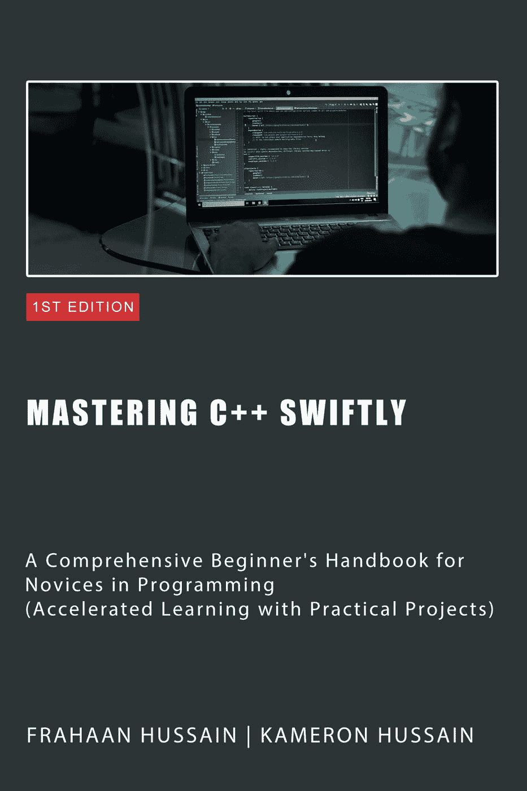

# 精通 C++：编程初学者全面指南



## 快速精通 C++

# 第 1 章：C++ 编程简介

## 1.1 什么是 C++？

- C++ 的历史
- C++ 的核心特性
- C++ 的用场景
- 开始学习 C++

## 1.2 为什么要学习 C++？

1. 跨领域适用性
2. 性能与效率
3. 面向对象编程 (OOP)
4. 遗留代码与维护
5. 与 C 的兼容性
6. 学习 C++ 开启大门
7. 社区与资源
8. 智力挑战

## 1.3 设置你的 C++ 开发环境

1. 选择一个 C++ 编译器
2. 安装文本编辑器或集成开发环境 (IDE)
3. 配置构建工具
4. 设置环境变量
5. 编写并编译你的第一个 C++ 程序

## 1.4 你的第一个 C++ 程序

- C++ 程序的结构剖析
- 编写一个“Hello, World!”程序
- 编译并运行你的程序

## 1.5 理解 C++ 标准库

- C++ 标准库的核心组件
- 使用 C++ 标准库的好处
- C++ 标准库的示例用法

# 第 2 章：开始学习 C++

## 2.1 基础语法与结构

- 编写你的第一个 C++ 程序
- C++ 中的注释
- 标识符与关键字
- 语句与分号
- 空格
- 结

## 2.2 变量与数据类型

- 声明变量
- C++ 中的数据类型
- 常量
- 类型推导 (`auto`)
- 结论

## 2.3 常量与字面量

- C++ 中的常量
- 数字字面量
- 字符与字符串字面量
- 布尔字面量
- `nullptr` (C++11 及后续版本)
- 用户自定义字面量 (C++11 及后续版本)
- 结论

## 2.4 C++ 中的运算符

- 算术运算符
- 关系运算符
- 逻辑运算符
- 赋值运算符
- 其他运算符
- 运算符优先级
- 结论

## 2.5 C++ 中的输入输出

- 标准输入输出流
- 使用 `std::cout` 输出
- 使用 `std::cin` 输入
- 输入验证
- 刷新与 `std::endl`
- 输出格式化
- 文件输入与输出
- 结论

# 第 3 章：C++ 中的控制流与决策

## 3.1 条件语句 (if, else, switch)

- `if` 语句
- `else` 子句
- `switch` 语句
- 结论

## 3.2 循环 (for, while, do-while)

- `for` 循环
- `while` 循环
- `do-while` 循环
- 循环控制
- 结论

## 3.3 break 和 continue 语句

- `break` 语句
- `continue` 语句
- 正确使用 `break` 和 `continue`
- 结论

## 3.4 条件编译

- 预处理器指令
- `#ifdef` 和 `#ifndef`
- 使用 `#ifdef` 和 `#ifndef` 进行条件编译
- 使用 `#define` 定义宏
- 条件编译的陷阱
- 结论

## 3.5 控制流的最佳实践

- 使用描述性变量名
- 保持控制结构简单
- 避免使用 `goto` 语句
- 减少循环头中的代码
- 正确初始化变量
- 使用有意义的注释
- 优先使用范围循环
- 优雅地处理错误
- 测试边界情况
- 保持一致性
- 性能分析与优化
- 持续学习

# 第 4 章：C++ 中的函数与模块化编程

## 4.1 函数简介

### 什么是函数？

### 函数的声明与定义

### 函数调用

### 函数参数与返回值

### 函数重载

### 结论

## 4.2 函数原型与声明

### 函数原型

### 函数原型的优势

### 函数声明

### 结论

## 4.3 向函数传递参数

### 函数参数

### 传递参数

### 值传递 vs. 引用传递

### 默认参数

### 结论

## 4.4 函数的返回值

### `return` 语句

### 函数的返回值

### 返回多个值

### 提前返回

### 无返回值（void 函数）

### 结论

## 4.5 C++ 中的递归函数

### 递归函数的结构

### 示例：阶乘计算

### 递归函数的核心概念

### 尾递归优化

### 结论

# 第 5 章：C++ 中的数组与指针

## 5.1 理解 C++ 中的数组

### 数组的声明与初始化

### 访问数组元素

### 数组的大小与边界

### 遍历数组

### 多维数组

### 结论

## 5.2 多维数组

### 多维数组的声明与初始化

### 访问多维数组元素

### 遍历多维数组

### 锯齿数组（Jagged Arrays）

### 结论

## 5.3 指针与内存地址

### 指针的声明与初始化

### 通过指针访问数据

### 空指针

### 指针算术

### 指针与内存分配

### 结论

## 5.4 指针算术与数组

### 指针的递增与递减

### 数组指针算术

### 不同数据类型的指针算术

### 指针减法

### 指针比较

### 结论

## 5.5 C++ 中的动态分配

### `new` 和 `delete` 运算符

### 动态数组

### 空指针与分配失败

### 内存泄漏

### 结论

# 第 6 章：C++ 面向对象编程 (OOP)

## 6.1 面向对象编程简介

### 对象与类

### 创建对象

### 封装

### 访问控制

### 结论

## 6.2 C++ 中的类与对象

### 定义类

### 创建对象

### 访问数据成员

### 调用成员函数

### 构造函数

### 结论

## 6.3 构造函数与析构函数

### 构造函数

### 析构函数

### 结论

## 6.4 继承与多态

### 继承

### 多态

### 结论

## 6.5 封装与抽象

### 封装

### 抽象

### 结论

# 第 7 章：C++ 中的字符串与字符处理

## 7.1 C++ 字符串对比 C 字符串

### C 风格字符串

### C++ 标准库字符串

### 何时使用两者

### 结论

## 7.2 字符串函数与库

### 常用字符串操作

### 字符串库函数

### 正则表达式

### 结论

## 7.3 字符输入与输出

### 字符输入

### 字符输出

### 字符处理

### 结论

## 7.4 字符串技巧

### 修改字符串

### 搜索与提取字符串

### 分词（Tokenization）

### 结论

## 7.5 安全处理字符串缓冲区

### 空字符终止字符串

### 使用 `strncpy()` 进行更安全的拷贝

### 动态分配字符串

### 使用 `std::string` 进行安全处理

### 结论

# 第 8 章：文件处理与输入/输出操作

## 8.1 C++ 中的文件操作

### 打开文件

### 关闭文件

### 检查文件状态

### 结论

## 8.2 读取与写入文件

### 使用 `ifstream` 读取文件

### 使用 `ofstream` 写入文件

### 结论

## 8.3 二进制文件处理

### 二进制文件 vs. 文本文件

### 写入二进制数据

### 读取二进制数据

### 二进制文件的优势

### 结论

## 8.4 C++ 标准输入输出流

### 标准输入流 (`std::cin`)

### 标准输出流 (`std::cout`)

### 结论

## 8.5 文件操作中的错误处理

### 检查打开错误

### 处理读写错误

### 处理文件关闭错误

### 使用异常处理

### 结论

# 第 9 章：C++ 标准模板库 (STL)

## 9.1 STL 简介

### 什么是 STL？

### STL 的核心组件

### 使用 STL 的优势

### 示例：使用 STL Vector

### 结论

## 9.2 STL 中的容器（Vectors, Lists, Maps, 等）

### Vector

### List

### Map

### Set

## 9.3 迭代器与算法

### 迭代器

### 算法

### 迭代器与算法的优势

## 9.4 模板泛型编程

### 函数模板

### 类模板

### 模板特化

## 9.5 自定义模板类

### 创建自定义模板类

### 模板类特化

# 第 10 章：C++ 中的异常处理

## 10.1 理解异常

### 什么是异常？

### 抛出异常

### 捕获异常

### 异常安全

## 10.2 C++ 中的 Try-Catch 块

### 基础语法

### 处理特定异常

### 引用捕获

### 通用捕获块 (Catch-All)

### 嵌套 Try-Catch 块

### 重新抛出异常

## 10.3 自定义异常

### 创建自定义异常类

### 抛出自定义异常

### 捕获自定义异常

### 何时使用自定义异常

## 10.4 异常安全与资源管理

### 异常安全的三个层次

### RAII（资源获取即初始化）

### 异常安全的最佳实践

## 10.5 错误处理最佳实践

1. 使用异常处理
2. 定义自定义异常类
3. 使用 RAII 进行资源管理
4. 恰当地传播或处理异常
5. 提供清晰的错误信息
6. 避免“吞掉”异常
7. 测试场景
8. 编写错误处理文档
9. 考虑标准库

# 第 11 章：C++ 标准库与高级主题

## 11.1 输入/输出流类

### 流与流类

### 提取与插入运算符

### 状态与错误处理

### 文件输入与输出

### 结论

## 11.2 处理日期与时间

### 时长 (Durations)

### 时间点 (Time Points)

### 时钟 (Clocks)

### 自定义单位

### 结论

## 11.3 C++ 中的正则表达式

### 创建正则表达式对象

### 基础正则模式

### 正则表达式标志

### 匹配结果

### 正则表达式替换

### 结论

## 11.4 高级 C++ 特性（智能指针、移动语义等）

### 智能指针

### 移动语义

### 其他高级特性

## 11.5 高效 C++ 编码的最佳实践

1. 使用标准库
2. 避免原始指针
3. 使用引用
4. 避免全局变量
5. 优化数据结构
6. 对代码进行性能分析与基准 (Benchmark)
7. 优化循环
8. 使用 const 正确性
9. 保持代码整洁可读
10. 定期审查并重构代码

# 第 12 章：C++ 项目与实际应用

## 12.1 构建一个简单的控制台游戏

### 游戏创意

### 实现

## 12.2 开发一个文本应用程序

### 规划你的文本应用程序

### 编写你的文本应用程序代码

## 12.3 创建一个 C++ 库

### 规划你的 C++ 库

### 编写你的 C++ 库代码

### 分发你的 C++ 库

## 12.4 使用 C++ 实现 GUI 应用程序

### 选择框架

### 构建界面

## 12.5 实战 C++ 项目

1. 待办事项列表
2. 聊天应用程序
3. 文件加密/解密工具
4. 库存管理系统
5. 游戏开发
6. 网络爬虫工具
7. 科学计算器
8. 个人博客或网站
9. 数据可视化工具
10. 图像处理应用程序
11. 简单编译器或解释器
12. AI 与机器学习项目
13. 居家自动化系统
14. 投资组合管理应用程序
15. 电子商务平台

# 第 13 章：C++ 性能优化与性能分析

## 13.1 C++ 中的性能分析与基准测试

### 为什么性能分析与基准测试很重要

### 性能分析工具

### 基准测试框架

### 性能分析与基准测试工作流

## 13.2 内存优化技术

1. 使用智能指针：智能指针（如 `std::shared_ptr` 和 `std::unique_ptr`）有助于自动管理内存，减少内存泄漏风险并改进资源管理。
2. 最小化动态内存分配：频繁的动态内存分配和释放会引入开销。在可能的情况下，优先使用栈上变量或使用带有预分配内存的容器（如 `std::vector::reserve`）。
3. 避免碎片化：碎片化会导致内存使用效率低下。考虑使用自定义内存分配器或内存池来更有效地管理内存，特别是在担心内存碎片化的场景下。
4. 选择合适的数据结构：针对你的特定用例选择内存高效的数据结构。例如，如果你需要一个固定大小的元素集合，请使用 `std::array` 而不是 `std::vector`。
5. 回收未使用的内存：有时，即使对象离开了作用范围，内存可能也不会被释放。你可以使用 `std::vector::shrink_to_fit` 等工具或通过与空容器交换来手动释放这些内存。
6. 为 `std::string` 使用 reserve：当通过拼接许多小字符串构建字符串时，使用 `std::string::reserve` 预分配内存以减少重新分配次数。
7. 注意缓存：现代 CPU 严重依赖缓存。访问不在缓存中的内存速度会显著变慢。优化数据访问模式以最大化缓存利用率。
8. 内存映射文件：在处理大文件时，考虑使用内存映射文件（例如 Unix 类系统上的 `mmap`），以便直接从内存高效访问文件数据，而无需将其完全加载到 RAM。
9. 自定义内存分配器：在特定情况下，根据应用程序的需求编写自定义的内存分配器可以大幅节省内存并提高性能。

## 13.3 CPU 优化策略

1. 算法选择：为任务选择最合适的算法。有时，不同的算法可以显著减少解决问题所需的 CPU 时间。考虑算法复杂度（例如 `O(n)`、`O(log n)` 等）并据此调整你的选择。
2. 并行性：通过代码并行化来利用多核处理器。C++ 提供了各种并行编程工具，包括标准库的 `<thread>` 和 `<future>` 头文件，以及 `OpenMP` 和 `Intel TBB` 等第三方库。
3. 循环展开：手动展开循环可以减少循环开销并提高指令缓存效率。现代编译器可能会自动执行循环展开，但在某些情况下，手动优化可能会产生更好的结果。
4. 向量化：利用现代 CPU 支持的 SIMD（单指令多数据）指令来并行处理多个数据元素。这可以通过 `Intel Intrinsics` 等库或 GCC 的编译器指令如 `-march=native` 实现。
5. 避免虚函数：虚函数会因为动态分发引入运行时开销。当性能至关重要时，考虑使用函数指针或基于模板的多态等替代方案。
6. 缓存感知：理解 CPU 缓存层次结构，并设计数据结构和访问模式以最小化缓存缺失。这包括使用面向数据的设计原则并优化内存布局。
7. 减少函数调用：过多的函数调用会导致开销。在性能关键的区域，考虑内联函数（inline functions）或手动展开代码以减少函数调用开销。
8. 编译器优化：开启编译器优化（例如 GCC 的 `-O2`、`-O3`），允许编译器自动执行各种优化，包括循环展开、内联和指令调度。
9. 性能分析与基准测试：使用性能分析工具识别代码中的瓶颈。`gprof`、`perf` 以及特定平台的性能分析器可以帮助精确定位需要优化的区域。
10. 测试与测量：使用具有代表性的数据集和真实场景定期测试并测量代码性能。持续的性能监控可以及早发现回归。
11. 减少内存访问：最小化导致缓存抖动（cache thrashing）的内存访问模式。高效使用数据结构和算法有助于减少内存访问瓶颈。
12. 编译器标志：注意并使用特定编译器的优化标志。不同的编译器可能有影响代码生成和性能的独特标志。

## 13.4 代码优化工具

1. 编译器优化标志
2. 性能分析工具
3. Valgrind
4. AddressSanitizer (ASan)
5. CPU 性能分析器
6. 静态代码分析工具
7. 第三方性能分析器

## 13.5 C++ 中的可扩展性与并行性

1. 多线程
2. 使用并行算法实现并行化
3. 并发与同步
4. 并行库
5. 可扩展性考虑
6. 调试

# 第 14 章：编码规范

1. 编码规范：C++ 的最佳实践。
2. 文档：文档的重要性。
3. 代码审查：代码审查的重要性。
4. 可读的代码：维护整洁易读的代码。
5. 重构：重构的重要性。

# 第 15 章：调试与故障排除

## 15.1 常见的 C++ 错误

## 15.2 调试技术与工具

1. 打印调试
2. 断点
3. 断言 (Assertions)
4. 调试工具
5. 静态分析

## 15.3 调试 C++ 中的内存相关问题

1. 内存泄漏
2. 无效内存访问
3. 重复释放（Double Free）和释放后使用（Use-After-Free）
4. 使用智能指针调试

## 15.4 C++ 中的高级调试场景

1. 多线程调试
2. 远程调试
3. 核心转储 (Core Dumps)
4. 条件断点
5. 追踪点 (Tracepoints)
6. 事后调试 (Postmortem Debugging)

## 15.5 处理 C++ 中的运行时错误

1. 空指针解引用
2. 数组越界访问
3. 除以零
4. 内存泄漏
5. 异常处理
6. 日志与调试

# 第 16 章：C++ 与现实应用

## 16.1 游戏开发中的 C++

### 为什么在游戏开发中选择 C++？

### 游戏引擎中的 C++

### 游戏开发工作流

### C++ 游戏引擎

### 结论

## 16.2 系统编程中的 C++

### 在系统编程中使用 C++ 的优势


# 系统编程中的 C++ 用例

## 系统编程中的内存管理

## 多线程与并发

## 调试与测试

## 结论

# 第 16.3 节：科学计算中的 C++

## 性能优势

## 库与框架

## 高级语言对比 C++

## 数准确性与精度

## 优化技术

## 与其他语言的互操作性

## 结论

# 第 16.4 节：嵌入式系统中的 C++

## 效率与资源限制

## 实时能力

## 硬件抽象

## 跨平台开发

## 安全关键型系统

## 嵌入式库与工具

## 结论

# 第 16.5 节：软件工程中的 C++

## 1. 系统软件开发

## 2. 性能关键型应用

## 3. 大规模软件项目

## 4. 跨平台开发

## 5. 代码复用

## 6. 软件测试与调试

## 7. 协作与团队合作

## 结论

# 第 17 章：C++ 编程的未来

## 第 17.1 节：C++ 开发的新兴趋势

## 第 17.2 节：C++ 标准与演进

### C++ 标准演进

## 第 17.3 节：新兴技术中的 C++

### C++ 与 IoT（物联网）

### C++ 与 AI（人工智能）

### C++ 与新兴技术

## 第 17.4 节：C++ 开发者的社区与资源

### C++ 社区

### 学习资源

### 工具与 IDE

### 在线社区

## 第 17.5 节：进阶你的 C++ 之路

### 持续学习

### 专门领域

### 贡献开源

### 人脉拓展与会议

### 导师指导与协作

# 第 18.1 节：表达感激

## 为什么感激很重要

## 表达的方式

## 涟漪效应

# 第 18.2 节：庆祝你的学习之旅

## 享受小胜利

## 记录你的进展

## 分享你的成功

## 寻求反馈与指导

## 保持好奇并持续学习

## 结论

# 第 18.3 节：C++ 程序员的影响

## 1. 系统编程

## 2. 游戏开发

## 3. 高性能应用

## 4. 嵌入式系统

## 5. 图形与多媒体

## 6. 遗留代码维护

## 7. 开源贡献

## 8. 编译器与语言开发

## 9. 导师与教育

## 10. 创新与研究

# 第 18.4 节：C++ 的持续自我提升

## 1. 拥抱终身学习

## 2. 经常练习

## 3. 贡献开源

## 4. 加入 C++ 社区

## 5. 研究设计模式

## 6. 探索高级主题

## 7. 保持好奇心

## 8. 构建作品集

## 9. 追求专业化

## 10. 指导他人

# 第 18.5 节：继续精通 C++ 的鼓励

## 1. 庆祝你的进展

## 2. 接受挑战

## 3. 保持好奇

## 4. 协作

## 5. 持续学习

## 6. 保持韧性

## 7. 设定目标

## 8. 分享热情

## 9. 寻求反馈

## 10. 享受过程

# 第 19 章：资源与学习

## 第 19.1 节：在线社区与论坛

### 1. Stack Overflow

### 2. Reddit (r/cpp)

### 3. C++ 论坛

### 4. CppCon

### 5. GitHub

### 6. C++ 标准 (ISO)

### 7. C++ Discord

### 8. 专业论坛

## 第 19.2 节：书籍、课程与教程

### 1. C++ 书籍

### 2. 在线课程与教程

### 3. 交互式编程平台

### 4. C++ 参考

## 第 19.3 节：C++ 挑战与竞技编程

### 1. 竞技编程平台

### 2. 使用 C++ 进行竞技编程的好处

### 3. 入门技巧

### 4. 竞技编程资源

## 第 19.4 节：开源贡献与 C++

### 1. 为什么要用 C++ 贡献开源

### 2. 如何开始开源贡献

### 3. 有效贡献的技巧

### 4. 开源贡献资源

## 第 19.5 节：精通 C++ 并继续你的之旅

### 4. 社区参与

### 5. 实战项目

### 6. 考虑认证

### 7. 紧跟 C++ 标准

### 8. 导师与教学

### 9. 结语

# 第 19 章：更多资源与学习

## 第 19.1 节：在线社区与论坛

### 1. Stack Overflow

### 2. Reddit (r/cpp)

### 3. C++ 论坛

### 4. CppCon Slack

### 5. GitHub

### 6. C++ 标准委员会 (ISO CPP)

### 7. C++ Discord 服务器

### 8. 专业论坛

## 第 19.2 节：书籍、课程与教程

### 1. C++ 书籍

### 2. 在线课程与教程

### 3. 交互编程平台

### 4. C++ 参考资料与文档

## 第 19.3 节：C++ 编程挑战与竞争性编程

### 1. 竞争性编程平台

### 2. 在 C++ 中进行竞争性编程的好处

### 3. 入门技巧

### 4. 竞争性编程资源

## 第 19.4 节：开源贡献与 C++

### 1. 为什么要在 C++ 中参与开源贡献

### 2. 如何开始开源贡献

### 3. 有效贡献的技巧

### 4. 开源贡献资源

## 第 19.5 节：精通 C++ 并继续你的旅程

### 1. 保持好奇并持续学习

### 2. 探索专业领域

### 3. 掌握高级技巧

### 4. 社区参与

### 5. 实战项目

### 6. 考虑认证

### 7. 紧跟 C++ 标准

### 8. 导师与教学

### 9. 结语

# 第 20 章：附录与额外资源

## 第 20.1 节：额外的 C++ 资源

### 1. 在线课程与教程

### 2. 书籍与教材

### 3. 网站与论坛

### 4. 编程挑战与实践

### 5. C++ 社区

### 6. IDE 与开发工具

### 7. C++ 标准与参考资料

### 8. C++ 博客与出版

## 第 20.2 节：附录 - C++ 标准库参考

### `Containers`

### `Algorithms`

### `Input/Output`

### `Strings`

### `Iterators`

## 第 20.3 节：额外资源与进阶学习

### 1. 书籍与在线课程

### 2. 开源项目

### 3. 实践编程

### 4. 加入在线社区

### 5. 紧跟 C++ 标准

### 6. 探索高级主题

### 7. 构建个人项目

### 8. 人脉拓展

## 第 20.4 节：代码质量与维护的重要性

### 代码质量的意义

### 代码质量的最佳实践

### 代码维护的重要性

### 代码维护的实践实践

## 第 20.5 节：结论与展望

### 核心要点

### 继续你的 C++ 旅程

### 3. 标准模板库 (STL)：`STL` 为常用的数据结构和算法提供系列模板类和函数，简化了复杂的操作。

### 4. 多范式：`C++` 支持多种编程范式，包括过程化、面向对象编程 (OOP) 和泛型编程，为开发者在编码方法上提供了灵活性。

### 5. 平台独立性：`C++` 适用于广泛平台，使其成为开发软件的跨平台语言。

### 6. 社区与库：`C++` 拥有庞大且活跃的开发者社区，拥有丰富的库和框架生态系统，你可以在你的项目中利用这些资源。

## C++ 的用场景

`C++` 被于多个领域，包括：

- 游戏开发：由于其性能和对硬件的控制力，许多游戏引擎和 AAA 游戏都是使用 `C++` 开发的。

- 系统编程：操作系统、设备驱动程序和嵌入式系统经常使用 `C++`，利用其底层能力。

- 科学计算与高性能计算：`C++` 被应用于仿真、科学研究以及需要高计算能力的应用。

- 金融：交易平台和金融建模软件受益于 `C++` 的速度和效率。

- 图形与多媒体：处理图形、视频和音频的应用通常利用 `C++` 进行实时处理。

## 开启 C++ 之门

要开始学习 `C++` ，你需要一个开发环境，并对其语法和概念有基本的了解。本书的接下来的章节将引导你完成设置过程，并帮助你编写第一个 `C++` 程序。无论你是初学者还是经验丰富的编程人员，`C++` 都会为你的软件开发之旅提供无限的可能。

# 1.2 为什么要学习 C++？

`C++` 是一种多功能且广泛使用的编程语言，拥有悠久的历史和广泛的应用。出于以下几个吸引人的理由，学习 `C++` 是你编程技能的一项极价值投资：

#### 1. 跨领域适用性

学习 `C++` 的主要原因之一是它在各个领域的广泛适用性。无论你对游戏开发、系统编程、科学计算、金融还是嵌入式系统感兴趣，`C++` 都有用武之地。它的多功能性意味着一旦你掌握了 `C++`，你就有能力从事各种项目和行业的工作。

#### 2. 性能与效率

`C++` 以其效率和性能而闻名。它允许开发者编写运行接近硬件的代码，使其适用于对速度至关重要的应用程序。如果你想构建高性能软件，或者在每一毫秒都至关重要的项目上工作，`C++` 是一个理想选择。

#### 3. 面向对象编程 (OOP)

`C++` 引入了类和对象的概念，使其成为面向对象编程的先驱语言之一。学习 `C++` 将你在 OOP 原则方面提供坚实的基础，这些原则在现代软件开发中被广泛使用。这些知识可以迁移到 `Java` 和 `C#` 等其他 OOP 语言。

#### 4. 遗留代码与维护

许多现有的软件系统和库是用 `C++` 编写的，并且持续进行维护和扩展。学习 `C++` 使你能够处理遗留代码库，并为依赖该语言的开源项目做出贡献。这对于你的职业生涯是一项非常有价值的技能。

#### 5. 与 C 的兼容性

`C++` 与 `C` 编程语言向下兼容，这意味着你可以无缝地将 `C` 代码集成到你的 `C++` 项目中。这种兼容性在处理底层系统、与硬件接口或使用现有的 `C` 库时非常有益。

#### 6. 学习 C++ 打开大门

精通 `C++` 可以开启令人兴奋的职业机会。许多公司，尤其是技术密集型行业公司，非常看重具有 `C++` 专业知识的开发者。无论你的目标是为大型科技公司、游戏工作室还是研究机构工作，`C++` 技能都是高度需求的的。

#### 7. 社区与资源

`C++` 拥有一个活力且活跃的开发者社区。有大量的在线论坛、博客和资源可以帮助学习并解决编程挑战。此外，还有 `C++` 会议和聚会，你可以在那里与专业人士交流，并了解语言的最新动态。

#### 8. 智力挑战

如果你喜欢解决复杂问题并优化代码以实现最大效率，`C++` 可以在智力上给你刺激。它对你的程序提供了深层次的控制，允许你深入底层细节并精调你的解决方案。

总之，学习 `C++` 是一项有意义的努力，它为你提供了多功能的技能组合、职业机会以及从事广泛项目的能力。无论你是初学者还是经验丰富的编程人员，学习 `C++` 获得的知识和经验都能显著增强你的编程储备。

# 1.3 设置你的 C++ 开发环境

在开始编写和运行 `C++` 程序之前，你需要设置一个开发环境。该环境包含了编码、编译和调试 `C++` 代码所需的工具和配置。以下是设置 `C++` 开发环境的关键步骤：

#### 1. 选择 C++ 编译器

第一步是选择一个 `C++` 编译器。有几种流行的 `C++` 编译器可用，选择通常取决于你的平台和个人偏好。这里是一些常用的 `C++` 编译器：

- `GCC` (GNU 编译器集合)：`GCC` 是一个广泛使用且备受尊敬的编译器，支持包括 `C++` 在内的多种编程语言。它适用于多个平台，并其健健性和优化能力而闻名。

- `Clang`：`Clang` 是另一个开源 `C++` 编译器，是 LLVM 项目的一部分。它以快速的编译和出色的诊断信息而闻名。`Clang` 常用于 macOS 和 Linux 系统。

- `Microsoft Visual C++`：如果你在 Windows 上开发，微软的 `Visual C++` 编译器是一个流行的选择。它与 `Visual Studio`（一个广泛使用的集成开发环境）无缝集成。

#### 2. 安装文本编辑器或集成开发环境

为了编写 `C++` 代码，你需要一个文本编辑器或集成开发环境 (IDE)。流行的选项包括：

- `Visual Studio Code` (VS Code)：`VS Code` 是一个轻量级的跨平台编辑器，通过扩展支持 `C++` 开发。它高度可定制，并拥有强大的开发者社区。

- `Visual Studio`：`Visual Studio` 是一个功能强大的 Windows IDE，提供了全面的 `C++` 开发环境。它包含了调试工具、项目管理功能等。

- `Code::Blocks`：`Code::Blocks` 是一个可在多个平台运行的开源 IDE。它以简单易用而闻名，是初学者的良好选择。

- `CLion`：`CLion` 是 JetBrains 开发的专门为 `C` 和 `C++` 开发设计的商业 IDE。它提供了高级的代码分析和重构工具。

选择适合你需求的并将其安装到系统上。

#### 3. 配置构建工具

除了编译器和编辑器/IDE，你还需要构建工具来将 `C++` 代码编译为可执行程序。构建工具的选择通常取决于你的平台：

- `Make`：`Make` 是一种常用于 Unix 类系统的构建自动化工具。它使用 `Makefile` 来定义构建目标和依赖关系。

- `CMake`：`CMake` 是一个流行的跨平台构建系统，它可以根据 `CMake` 配置文件生成特定平台的构建文件（例如 `Makefile` 或 Visual Studio 项目文件）。

- `Visual Studio Solution`：如果你在使用 `Visual Studio`，你可以在 IDE 中创建项目和解决方案，`Visual Studio` 将为你处理构建过程。

# 4. 设置环境变量

为了确保能够从命令行访问编译器和构建工具，你可能需要设置环境变量。这些变量包含了你的编译器和相关二进制文件的路径。设置环境变量的具体步骤取决于你的操作系统。

# 1.4 你的第一个 C++ 程序

现在你已经搭建好了 C++ 开发环境，是时候编写并运行你的第一个 C++ 程序了。在本节中，我们将引导你完成完成在 C++ 中创建一个简单的“Hello, World!”程序的过程，并解释 C++ 程序的基础组件。

## C++ 程序的结构

在深入研究代码之前，让我们先了解 C++ 程序的基本结构：

```cpp
#include <iostream>

int main() {
    // 你的代码在这里
    return 0;
}
```

- `#include <iostream>`：这一行包含了 C++ 标准库头文件 `<iostream>`，它提供了输入和输出流功能。

- `int main()`：这是你程序的主函数。它作为程序的入口，程序从这里开始执行。

- `{}`：这些大括号 `{}` 包围了主函数的体。你的 C++ 代码将放在这些括号内部。

- `return 0;`：这一行表示主函数的结束，并向操作系统返回一个整数值（`0`）。返回值 `0` 通常表示程序执行成功。

## 编写一个“Hello, World!”程序

让我们在 C++ 中创建一个简单的“Hello, World!”程序：

```cpp
#include <iostream>

int main() {
    // 向控制台输出文本 "Hello, World!"
    std::cout << "Hello, World!" << std::endl;
    return 0;
}
```

在这个程序中：

- 我们包含了 `<iostream>` 头文件以访问 `std::cout` 对象，该对象用于输出。

- 在 `main` 函数内部，我们使用 `std::cout` 向控制台打印文本“Hello, World!”。`<<` 运算符用于将文本流向 `std::cout`。

- `std::endl` 用于插入换行符，在控制台输出中创建一个换行。

## 编译并运行你的程序

要编译并运行你的 C++ 程序：

1. 将程序保存为 `.cpp` 扩展名，例如 `hello.cpp`。

2. 打开终端或命令提示符。

3. 导航到保存 `hello.cpp` 文件的目录。

4. 使用你选择的编译器来编译程序。例如，如果你正在使用 `GCC`，可以使用以下命令编译程序：

```bash
g++ hello.cpp -o hello
```

此命令告诉 `GCC` 编译 `hello.cpp` 并创建一个名为 `hello` 的可执行文件。

1. 一旦编译成功，通过输入以下命令运行程序：

```bash
./hello
```

你应该能在控制台上看到输出的“Hello, World!”。

恭喜你！你已经编写、编译并执行了你的第一个 C++ 程序。这个简单的“Hello, World!”程序将为你以后继续学习之旅中创建更复杂的 C++ 奠定基础。

# 5. 编写并编译你的第一个 C++ 程序

一旦开发环境搭建完成，你就可以开始编写 C++ 代码了。创建一个简单的“Hello, World!”程序来测试你的设置。这是一个基础示例：

```cpp
#include <iostream>

int main() {
    std::cout << "Hello, World!" << std::endl;
    return 0;
}
```

将此代码保存为带有 `.cpp` 扩展的文件（例如 `hello.cpp`）。使用你选择的文本编辑器或 IDE 打开文件并使用适当的构建工具对其进行编译。如果一切配置正确，你应该能够运行该程序并在控制台中看到“Hello, World!”消息。

总之，搭建 C++ 开发环境是你成为精通的 C++ 程序员之路上的第一步。一旦环境就绪，你就可以专注于学习该语言并构建令人兴奋的项目了。

# 1.5 理解 C++ 标准库


# C++ 标准库

C++ 标准库通常被称为标准模板库（STL），是 C++ 编程语言至关重要的部分。它提供了丰富的预写类、函数和模板，简化了许多常见的编程任务。理解 C++ 标准库对于成为精通的 C++ 程序员至关重要。

## C++ 标准库的关键组件

C++ 标准库分为几个部分，每个部分都有特定的用途：

1. **输入/输出流**：`<iostream>` 头文件提供了如 `std::cin` 和 `std::cout` 之类的类用于输入输出操作。这些类使得从键盘读取和在控制台上显示数据变得简单。
2. **容器**：STL 提供了各种容器类，包括 `vectors`、`lists`、`sets` 和 `maps`。这些容器提供了高效的数据存储和操作能力。
3. **迭代器**：迭代器允许你遍历容器中的元素，无论容器类型如何，都提供了一种统一的方式访问和操作数据。
4. **算法**：STL 包含了大量操作在容器上的算法。这些算法使你能够高效地执行排序、搜索和转换容器中元素等操作。
5. **函数对象**：函数对象（也称为仿函数）是可以像函数一样调用的对象。它们通常与算法配合使用以自定义行为。
6. **字符串**：C++ 同时提供了 C 风格字符串和字符串类（例如 `std::string`）。这些类提供了强大的字符串处理能力。
7. **输入/输出流操纵符**：流操纵符允许你格式化输入输出流。例如，可以使用 `setw` 设置输出字段的宽度。
8. **内存管理**：STL 包含了智能指针（`std::shared_ptr`、`std::unique_ptr`）以及动态内存分配函数（`new`、`delete`）来帮助管理内存。

## 使用 C++ 标准库的优势

在项目中使用 C++ 标准库的优势如下：

1. **节省时间**：通过使用预实现的类和算法，你可以节省大量的开发时间和精力。许多常见的编程任务变得简单直接。
2. **可移植性**：使用标准库编写的代码在不同平台和编译器之间具有高度的可移植性。你可以无需修改即可在各种系统上运行。
3. **性能**：标准库经过了多年的开发和测试，经过优化。这可以带来高效的代码。
4. **安全性**：许多标准库组件的设计考虑了安全性，帮助你避免溢出和内存泄漏等常见错误。
5. **社区支持**：由于标准库被广泛使用，当你遇到挑战时可以找到大量的文档、教程和社区支持。

## C++ 标准库的使用示例

让我们来看使用 C++ 标准库对整数向量进行排序示例：

```cpp
#include <iostream>
#include <vector>
#include <algorithm>

int main() {
    // 创建一个整数向量
    std::vector<int> numbers = {5, 2, 8, 1, 9};

    // 对向量进行升序排序
    std::sort(numbers.begin(), numbers.end());

    // 显示排序后的向量
    for (int num : numbers) {
        std::cout << num << " ";
    }

    return 0;
}
```

在这个示例中：

- 我们包含了必要的头文件 `<vector>` 和 `<algorithm>`。
- 我们创建了一个包含整数列表的向量 `numbers`。
- 我们使用标准库中的 `std::sort` 对 `numbers` 向量进行升序。
- 最后，我们使用循环将排序后的元素显示在控制台上。

通过使用 C++ 标准库，我们只需要几行代码就能完成复杂的排序操作。

总而言之，C++ 标准库是一个强大的工具，它简化了许多编程任务，并提高了 C++ 程序的效率和可靠性。在你继续 C++ 之旅时，探索并掌握标准库将是一项非常有价值的技能。

|  |  |  |


# 第 2 章：开始学习 C++


## 2.1 C++ 语法与结构

在本节中，我们将探索 C++ 编程语言的基本语法和结构。理解这些基础概念至关重要，因为它们构成了 C++ 程序的基石。

### 编写你的第一个 C++ 程序

让我们从创建一个简单的 C++ 程序开始，该将会在控制台打印“Hello, World!”。这是学习任何编程语言的习惯起点：

```cpp
#include <iostream>

int main() {
    std::cout << "Hello, World!" << std::endl;
    return 0;
}
```

下面是该程序的详细说明：

- `#include <iostream>`：这一行包含了 `<iostream>` 头文件，在 C++ 中使用输入输出流功能是必须的。在这种情况下，我们使用 `std::cout` 进行输出。
- `int main() { }`：`int main()` 函数是 C++ 程序的入口点。它是每个 C++ 程序中强制要求的。大括号 `{ }` 包围着主函数的体，你的代码就写在这里。
- `std::cout << "Hello, World!" << std::endl;`：这一行使用 `std::cout` 向控制台输出文本“Hello, World!”。`<<` 操作用于将文本流向输出，`std::endl` 则插入一个换行符。
- `return 0;`：`return` 语句结束主函数并向操作系统返回一个整数值（`0`）。返回 `0` 通常表示程序执行成功。

### C++ 中的注释

注释对于代码的可读性和文档化至关重要。在 C++ 中，你可以使用两种注释：

- 单行注释以 `//` 开始。同一行中 `//` 之后的任何内容都被视为注释，并被编译器忽略。

```cpp
// 这是一个单行注释
int x = 5; // 此注释解释了变量赋值
```

- 多行注释包含在 `/*` 和 `*/` 之间。这些注释可以跨越多行。

```cpp
/* 这是一个多行注释
它可以跨越多行
并适用于较长的解释。 */
int y = 10; /* 此注释也可以在单行中使用 */
```

### 标识符与关键字

在 C++ 中，标识符是用于各种程序元素（如变量、函数、类等）的名字。它们必须遵守某些规则：

- 标识符由字母、数字和下划线组成。
- 必须以字母（大写或小写）或下划线（`_`）开头。
- 标识符区分大小写，这意味着 `myVariable` 和 `myvariable` 被视为不同的标识符。

C++ 有保留关键字，这些关键字不能作为标识符，因为它们在语言中具有特定的含义。一些常见的关键字包括 `int`、`double`、`if`、`for` 和 `while`。

### 语句与分号

C++ 中的语句是执行特定任务的独立指令。它们由分号（`;`）终止。例如：

```cpp
int a = 5; // 声明和赋值语句
std::cout << "Hello, World!" << std::endl; // 输出语句
```

分号用于指示语句的结束。省略分号或错误地使用会导致编译错误。

### 空格符与格式化

C++ 中的空白符（空格、制表符、换行）通常会被编译器忽略，用于格式化和可读性。你可以使用缩进和间距让你的代码更有组织、更容易理解。然而，过度或不一致使用空白符会影响代码的可读性。

### 总结

本节提供了对 C++ 基本语法和结构的介绍。你学习了如何编写一个简单的“Hello, World!”程序、使用注释、处理标识符和关键字以及格式化你的代码。这些概念是编写更复杂的 C++ 程序的的基础。随着你的学习，你将探索更高级的主题并在这些基础知识的基础上进行构建。

## 2.2 变量与数据类型

在 C++ 中，变量是用于存储和操作数据的根本组件。每个变量都有数据类型，该类型指定了它可以持有的数据种类以及可以对其执行的操作。理解变量和数据类型对于编写 C++ 程序至关重要。

### 声明变量

在 C++ 中，你通过指定数据类型后跟其名称来声明变量。例如：

```cpp
int age; // 声明一个名为 'age' 的整数变量
double price; // 声明一个名为 'price' 的双精度浮点数变量
char grade; // 声明一个名为 'grade' 的字符变量
```

在上面的示例中：

- `int` 是整数的数据类型。
- `double` 是双精度浮点数的数据类型。
- `char` 是字符的数据类型。

你也可以在声明变量时给它赋一个初始值：

```cpp
int count = 5; // 用值 5 初始化 'count'
double pi = 3.14159; // 用值 3.14159 初始化 'pi'
```

### C++ 中的数据类型

C++ 提供了多种内置数据类型来处理不同的数据：

- **基本数据类型**：包括 `int`（整数）、`double`（浮点数）、`char`（字符）、`bool`（布尔值）等。这些数据类型通常用于基础数据存储。
- **修饰符**：`long`、`short`、`signed` 和 `unsigned` 等数据类型修饰符可以修改基本数据类型的范围。例如，`long int` 表示更大的整数范围。
- **枚举（enums）**：枚举允许你定义命名整数常量。它们通常用于创建一组相关值的自定义数据类型。
- **数组**：数组是相同类型元素的集合。它们允许在一个变量名下存储和操作多个值。
- **指针**：指针是存储内存地址的变量。它们对于动态内存分配和创建更复杂的数据结构至关重要。
- **引用**：引用是变量的别名。它们允许你间接操作变量。引用通常用于函数参数。

### 常量

在 C++ 中，你可以使用 `const` 关键字声明常量。常量是在程序过程中不会改变的值：

```cpp
const int MAX_VALUE = 100; // 声明一个整数常量 'MAX_VALUE'
const double PI = 3.14159; // 声明一个双精度常量 'PI'
```

常量有助于提高代码的可读性和可维护性。它们还可以防止值被意外修改。

### 类型推导（auto）

C++11 引入了 `auto` 关键字，它允许编译器根据初始化值自动推断变量的数据类型：

```cpp
auto x = 42; // 'x' 被推断为 'int' 类型
auto y = 3.14; // 'y' 被推断为 'double' 类型
```

使用 `auto` 可以让你的代码更简洁且更不容易出错，特别是在处理复杂数据类型时。

### 总结

变量和数据类型是 C++ 编程中的基础元素。它们允许你存储和操作各种类型的数据，从整数到浮点数以及字符。理解如何声明变量、使用数据类型以及处理常量对于编写有效的 C++ 代码是基本的。随着你继续 C++ 之之旅，你遇到更多与变量和数据操作相关的高级主题。

在 C++ 中，常量和字面量用于表示程序执行过程中不会改变的固定值。理解如何使用常量和字面量对于编写既具可读性又易于维护的代码至关重要。

### C++ 中的常量

常量是一个一旦被赋值后就不能被修改的值。在 C++ 中，你可以使用 `const` 关键字声明常量。常量通常用于表示程序中有特殊意义且不应被意外更改的值。

```cpp
const int MAX_SIZE = 100; // 声明一个整数常量 'MAX_SIZE'
const double PI = 3.14159; // 声明一个双精度浮常量 'PI'
```

在上面的示例中，`MAX_SIZE` 和 `PI` 是具有固定值的常量。在程序稍后尝试更改这些值将导致编译错误。

### 数字字面量

数字字面量是代码中数值的表示形式。C++ 中有几种类型的数字字面量：

- **整数字面量**：表示不带小数点的整数整数。例如，`42` 和 `-10` 是整数字面量。
- **浮点数字面量**：表示带有小数点的数字。例如，`3.14` 和 `-0.5` 是浮点数字面量。
- **八进制和十六进制字面量**：你可以使用前导 `0` 用八进制表示数字（例如 `037`），或使用 `0x` 或 `0X` 后跟十六进制数字表示十六进制（例如 `0x1A` 或 `0XFF`）。
- **二进制字面量（C++14 及后续版本）**：二进制字面量使用 `0b` 或 `0B` 前缀以二进制形式表示数字（例如 `0b1010`）。

### 字符和字符串字面量

字符字面量表示单个字符，并用单引号括，例如 `'A'` 或 `'5'`。你也可以使用转义序列来表示特殊字符，如用于换行的 `'\n'`。

字符串字面量表示字符序列，并用双引号括，例如 `"Hello, World!"`。C++ 还支持原始字符串字面量（raw string literals），它们被反引号括，并且可以跨多行而无需转义序列（例如 `R"(\nHello\nWorld)"`）。

### 布尔字面量

布尔字面量表示真或假的值。在 C++ 中，关键字 `true` 和 `false` 被用作布尔字面量。

```cpp
bool isTrue = true;
bool isFalse = false;
```

### `nullptr`（C++11 及后续版本）

`nullptr` 关键字表示空指针。它在现代 C++ 中常用于表示无效指针值。

```cpp
int* ptr = nullptr; // 声明一个初始化为认为的指针
```

### 用户自定义字面量（C++11 及后续版本）

C++11 引入了定义自己的自定义字面量的能力。这些允许你为语言中内置的类型或单位创建自定义的字面量表示。

```cpp
constexpr long double operator"" _km(long double x) {
    return x * 1000.0;
}

long double distance = 5.5_km; // 使用自定义字面量
```

在上面的示例中，我们定义了一个自定义字面量 `_km`，允许我们以公里为单位表示距离。

### 结论

常量和字面量在 C++ 编程中起着至关重要的作用。它们提供了在代码中表示固定值的方法，使代码更具可读性且更容易维护。无论使用的是数字字面量、字符字面量还是自定义字面量，理解如何使用常量和字面量对于编写有效的 C++ 代码都是本质的。

## 2.4 C++ 中的运算符

C++ 中的运算符是表示对数据进行计算或操作的符号。C++ 提供了大量的运算符，允许你执行算术运算、比较、逻辑操作等任务。理解这些运算符对于在 C++ 程序中操作数据至关重要。

### 算术运算符

算术运算符执行基本的数学运算。以下是 C++ 中常见的算术运算符：

- 加（`+`）：将两个值相加。
- 减（`-`）：从左操作数中减去右操作数。
- 乘（`*`）：两个值相乘。
- 除（`/`）：将左操作数除以右操作数。
- 取模（`%`）：返回左操作数除以右操作数的余数。

```cpp
int x = 10;
int y = 3;
int sum = x + y; // sum 包含 13
int difference = x - y; // difference 包含 7
int product = x * y; // product 包含 30
int quotient = x / y; // quotient 包含 3
int remainder = x % y; // remainder 包含 1
```

### 关系运算符

关系运算符用于比较值。它们返回布尔值（true 或 false）。以下是常见的关系运算符：

- 等于（`==`）：检查两个值是否相等。
- 不等于（`!=`）：检查两个值是否不等。
- 大于（`>`）：检查左操作数是否大于右操作数。
- 小于（`<`）：检查左操作数是否小于右操作数。
- 大于等于（`>=`）：检查左操作数是否大于或等于右操作数。
- 小于等于（`<=`）：检查左操作数是否小于或等于右操作数。

```cpp
int a = 5;
int b = 8;
bool isEqual = (a == b); // isEqual 为 false
bool isEqual = (a != b); // isEqual 为 true
bool isGreater = (a > b); // isGreater 为 false
bool isLess = (a < b); // isLess 为 true
bool isGreaterEqual = (a >= b); // isGreaterEqual 为 false
bool isLessEqual = (a <= b); // isLessEqual 为 true
```

### 逻辑运算符

逻辑运算符对布尔值进行逻辑操作。它们通常用于组合关系表达式的结果。常见的逻辑运算符有：

- 逻辑与（`&&`）：两个操作数都为真时返回真。
- 逻辑或（`||`）：至少一个操作操作为真时返回真。
- 逻辑非（`!`）：反转操作数的值。

```cpp
bool x = true;
bool y = false;
bool resultAnd = (x && y); // resultAnd 为 false
bool resultOr = (x || y); // resultOr 为 true
bool resultNot = !x; // resultNot 为 false
```

### 赋值运算符

赋值运算符用于给变量赋值。最常见的赋值运算符是简单赋值（`=`），它将右操作数的值赋值给左操作数。

```cpp
int a = 10;
int b = 5;
b = a; // 将 a 的值赋值给 b
```

C++ 还提供了复合赋值运算符，将算术运算与赋值结合。例如：

```cpp
int x = 5;
x += 3; // 等于 x = x + 3 (x 现在为 8)
```

### 其他运算符

C++ 包含许多其他运算符，例如：


- 自增（`++`）和自减（`--`）运算符：用于增加或减少变量的值。
- 条件（三元）运算符（`? :`）：用于条件表达式。
- 位运算符：用于整数的位操作。
- 访问运算符（`.` 和 `->`）：用于访问类成员。

这些运算符在更高级的 C++ 场景和数据操作中起着关键作用。

### 运算符优先级

C++ 中的运算符具有不同的优先级，这决定了当在一个表达式中使用多个运算符时的计算顺序。理解运算符优先级对于编写正确的表达式至关重要。例如，乘法（`*`）的优先级高于加法（`+`）。

```cpp
int result = 2 + 3 * 4; // result 为 14，而不是 20
```

为了控制计算顺序，可以使用括号来组合表达式：

```cpp
int result = (2 + 3) * 4; // result 为 20
```

### 结论

运算符是 C++ 中对数据执行广泛操作的要素元素。无论你使用的是算术、关系、逻辑还是其他类型的运算符，理解它们的行为和优先级都是编写高效正确 C++ 代码的基础。随着你继续你的 C++ 之旅，你将在各种编程场景中频繁使用这些运算符。

输入和输出（I/O）操作在任何编程语言中都至关重要，C++ 提供了一套多功能工具来处理这些操作。在本节中，我们将探索如何在 C++ 中执行输入和输出操作，包括从键盘读取和向控制台写入。

## 标准输入与输出流

C++ 使用标准输入输出流进行 I/O 操作。最常用的流对象是：

- `std::cin`：这是标准输入流，允许你从键盘或其他输入源读取数据。
- `std::cout`：这是标准输出流，用于向控制台写入数据。

要使用这些流，你需要包含 `<iostream>` 头文件：

```cpp
#include <iostream>
```

### 使用 `std::cout` 输出

`std::cout` 用于在控制台上显示数据。你可以使用 `<<` 运算符将数据流向 `std::cout`：

```cpp
#include <iostream>

int main() {
    int age = 25;
    std::cout << "Your age is: " << age << std::endl;
    return 0;
}
```

在这个示例中，我们输出了变量 `age` 的值以及一条描述信息。`<<` 运算符用于拼接或“流化”不同的数据段。

### 使用 `std::cin` 输入

`std::cin` 用于从键盘读取数据。你可以使用 `>>` 运算符从 `std::cin` 提取数据并将其存储在变量中：

```cpp
#include <iostream>

int main() {
    int age;
    std::cout << "Enter your age: ";
    std::cin >> age;
    std::cout << "You entered: " << age << std::endl;
    return 0;
}
```

在这个示例中，我们提示用户输入年龄，将输入读取到变量 `age`，然后显示输入的值。

### 输入验证

在执行输入操作时，处理可能的错误或意外输入是非常重要的。例如，当你预期输入整数但用户输入了非数字字符时，可能会遇到问题。你可以在输入操作后检查 `std::cin` 的状态以检测错误。

```cpp
#include <iostream>

int main() {
    int age;
    std::cout << "Enter your age: ";
    if (!(std::cin >> age)) {
        std::cout << "Invalid input." << std::endl;
        return 1; // 返回错误代码
    }
    std::cout << "You entered: " << age << std::endl;
    return 0;
}
```

在这个示例中，我们在尝试读取到 `age` 变量后检查 `std::cin` 的状态。如果输入无效，我们会显示错误消息并返回一个非零退出码以指示错误状态。

### 刷新与 `std::endl`

当使用 `std::cout` 输出时，可以通过使用 `std::endl` 操纵符来确保文本立即显示在控制台上。`std::endl` 不仅插入换行符，还会刷新输出缓冲区。

```cpp
#include <iostream>

int main() {
    std::cout << "Line 1" << std::endl;
    std::cout << "Line 2" << std::endl;
    return 0;
}
```

在这个示例中，每一行后面都有 `std::endl`，确保输出立即可见。

### 格式化输出

你可以使用操纵符如 `std::setw`（设置字段宽度）和 `std::setprecision`（控制小数位数）来格式化输出。这里有一个设置字段宽度和精度的格式化示例：

```cpp
#include <iostream>
#include <iomanip> // 包含操纵符头文件

int main() {
    double pi = 3.141592653589793;
    std::cout << "Formatted PI: " << std::setw(8) << std::setprecision(4) << pi << std::endl;
    return 0;
}
```

在这个示例中，我们在显示 `pi` 的值时设置字段宽度为 8 个字符，精度为 4 位小数。

### 文件输入与输出

C++ 还提供了使用文件流从文件读写数据的工具。你可以使用 `std::ifstream` 进行输入，使用 `std::ofstream` 进行输出。

```cpp
#include <iostream>
#include <fstream> // 包含文件流头文件

int main() {
    std::ofstream outputFile("output.txt"); // 创建输出文件流
    if (outputFile.is_open()) {
        outputFile << "Hello, File!" << std::endl;
        outputFile.close(); // 关闭文件
        std::cout << "Data written to file." << std::endl;
    } else {
        std::cerr << "Failed to open the file." << std::endl;
    }
    return 0;
}
```

在这个示例中，我们创建了一个输出文件流并向名为 `output.txt` 的文件写入“Hello, File!”。

### 结论

输入输出操作对于 C++ 程序与用户交互以及存储数据至关重要。理解如何使用 `std::cin` 和 `std::cout`、处理输入验证、格式化输出以及操作文件流将使你能够在 C++ 应用中执行各种 I/O 任务。随着你深入学习 C++ 编程，你会发现这些技能对于构建健壮且用户友应用程序具有极高的价值。

 |  |

# 第 3 章：控制流与决策

## 条件语句（`if`、`else`、`switch`）

条件语句允许根据条件控制程序的执行流。

### `if` 语句

`if` 语句是最基础的条件语句。它允许条件为真时执行代码块。基本语法如下：

```cpp
if (condition) {
    // 如果条件为真则执行的代码
}
```

例如，让我们使用 `if` 语句检查数字是否为正数：

```cpp
#include <iostream>

int main() {
    int number;
    std::cout << "Enter a number: ";
    std::cin >> number;
    if (number > 0) {
        std::cout << "The number is positive.";
    }
    return 0;
}
```

在这个示例中，如果输入的数字大于 0，则打印消息。

### `else` 子句

`else` 子句通常与 `if` 语句配合使用，当条件为假时执行备选块。

```cpp
if (condition) {
    // 条件为真时执行的代码
} else {
    // 条件为假时执行的代码
}
```

让我们扩展之前的示例以处理正数是非正数：

```cpp
#include <iostream>

int main() {
    int number;
    std::cout << "Enter a number: ";
    std::cin >> number;
    if (number > 0) {
        std::cout << "The number is positive." << std::endl;
    } else {
        std::cout << "The number is non-positive." << std::endl;
    }
    return 0;
}
```

现在，如果输入的数字不大于 0，则会显示“The number is non-positive.”。

### `switch` 语句

当你有多个条件需要评估并根据表达式的值执行不同的代码块时，可以使用 `switch` 语句。其基本结构如下：

```cpp
switch (expression) {
case value1:
    // 当表达式等于 value1 时执行的代码
    break;
case value2:
    // 当表达式等于 value2 时执行的代码
    break;
// 更多 case 语句...
default:
    // 当表达式不匹配任何 case 时执行的代码
}
```

这是一个使用 `switch` 语句根据用户输入的数字确定星期几的示例：

```cpp
#include <iostream>

int main() {
    int dayNumber;
    std::cout << "Enter a day number (1-7): ";
    std::cin >> dayNumber;
    switch (dayNumber) {
        case 1:
            std::cout << "Monday" << std::endl;
            break;
        case 2:
            std::cout << "Tuesday" << std::endl;
            break;
        case 3:
            std::cout << "Wednesday" << std::endl;
            break;
        case 4:
            std::cout << "Thursday" << std::endl;
            break;
        case 5:
            std::cout << "Friday" << std::endl;
            break;
        case 6:
            std::cout << "Saturday" << std::endl;
            break;
        case 7:
            std::cout << "Sunday" << std::endl;
            break;
        default:
            std::cout << "Invalid day number." << std::endl;
    }
    return 0;
}
```

在这个示例中，`switch` 语句会评估 `dayNumber` 的值并显示相应的星期。`default` 情况处理任何不匹配定义的 `case` 的值。

### 结论

条件语句（包括 `if`、`else` 和 `switch`）是控制 C++ 程序执行流的基本工具。它们允许你根据条件或值做出决策并执行特定的代码。随着你继续构建更复杂的程序，你会发现精通这些控制流结构对于创建高效且响应迅速的软件至关重要。

## 3.2 循环（`for`、`while`、`do-while`）

C++ 中的循环对于在满足特定条件时重复执行代码块至关重要。它们允许你自动化重复任务、处理数据集以及遍历元素。C++ 提供了三种主要类型的循环：`for`、`while` 和 `do-while`。

### `for` 循环

当你预先知道要执行代码块的次数时，通常使用 `for` 循环。它由三部分组成：初始化、条件和增//减。`for` 循环的语法如下：

```cpp
for (initialization; condition; increment/decrement) {
    // 重复执行的代码
}
```

这是一个使用 `for` 循环打印从 1 到 5 数字的示例：

```cpp
#include <iostream>

int main() {
    for (int i = 1; i <= 5; i++) {
        std::cout << i << " ";
    }
    std::cout << std::endl;
    return 0;
}
```

在此示例中，循环将 `i` 初始化为 1，检查 `i` 是否小于等于 5，并在每次迭代中将 `i` 加 1。循环打印从 1 到 5 的数字。

### `while` 循环

当你希望在某个条件保持为真时执行代码块时，使用 `while` 循环。`while` 循环的语法如下：

```cpp
while (condition) {
    // 重复执行的代码
}
```

这是一个使用 `while` 循环计算从 1 到 10 数字之和的示例：

```cpp
#include <iostream>

int main() {
    int sum = 0;
    int i = 1;
    while (i <= 10) {
        sum += i;
        i++;
    }
    std::cout << "Sum: " << sum << std::endl;
    return 0;
}
```

在此示例中，只要 `i` 小于或等于 10，循环就会继续执行。它计算数字之和并在每次迭代中增加 `i`。

### `do-while` 循环

`do-while` 循环与 `while` 循环类似，但它保证代码块至少执行一次，即使初始条件为假。`do-while` 循环的语法如下：

```cpp
do {
    // 重复执行的代码
} while (condition);
```

这是一个使用 `do-while` 循环提示用户输入正数的示例：

```cpp
#include <iostream>

int main() {
    int number;
    do {
        std::cout << "Enter a positive number: ";
        std::cin >> number;
    } while (number <= 0);
    std::cout << "You entered a positive number: " << number << std::endl;
    return 0;
}
```

在此示例中，循环会反复要求用户输入数字，直到输入正数为止。

### 循环控制语句

C++ 提供了循环控制语句来改变循环的正常执行流。这些包括：

- `break`：提前终止循环，并将控制权转移到循环后的后续语句。
- `continue`：跳过当前迭代的剩余部分并开始循环的下一次迭代。
- `return`：退出整个函数，连同循环一起终止。

循环控制语句用于根据特定条件或需求精调循环的行为。

### 嵌套循环

C++ 允许在一个循环内部嵌套一个或多个循环。这被称为嵌套循环。它通常用于处理二维数组或执行复杂的迭代。这是一个嵌套 `for` 循环的示例：

```cpp
#include <iostream>

int main() {
    for (int i = 1; i <= 3; i++) {
        for (int j = 1; j <= 3; j++) {
            std::cout << i << "," << j << " ";
        }
        std::cout << std::endl;
    }
    return 0;
}
```

在此示例中，一个 `for` 循环嵌套在另一个 `for` 循环内部，以打印 `i` 和 `j` 的所有组合。

### 结论

循环是 C++ 中执行重复任务和处理数据的关键控制结构。你选择 `for`、`while` 还是 `do-while` 循环取决于你的具体需求和需要评估的条件。当你精通使用循环后，你会发现它们对于在 C++ 程序中自动化任务和高效处理大型数据集无价价值。

## 3.3 `break` 和 `continue` 语句

在 C++ 中，`break` 和 `continue` 语句用于循环内部以控制执行流。这些语句是精调循环行为和处理特定场景的有效工具。

### `break` 语句

`break` 语句用于提前终止循环，并将控制权转移到循环后的后续语句。这些语句是精调循环行为和处理特定场景的有效工具。

`break` 语句用于提前终止循环。当遇到时，`break` 语句会立即退出循环。这是一个在 `for` 循环中使用 `break` 语句在范围内查找第一个偶数的示例：

```cpp
#include <iostream>

int main() {
    int rangeStart = 1;
    int rangeEnd = 10;
    for (int i = rangeStart; i <= rangeEnd; i++) {
        if (i % 2 == 0) {
            std::cout << "First even number: " << i << std::endl;
            break; // 找到第一个偶数后退出循环
        }
    }
    return 0;
}
```

在此示例中，`for` 循环遍历范围内的数字。当遇到偶数（此处为 2）时，`break` 语句执行。

### `continue` 语句

`continue` 语句用于跳过当前迭代并开始循环的下次迭代。它允许你在循环中跳过特定的元素或条件而不终止整个循环。这是一个在 `for` 循环中使用 `continue` 语句跳过范围内奇数的示例：


```cpp
#include <iostream>

int main() {
    int rangeStart = 1;
    int rangeEnd = 10;
    for (int i = rangeStart; i <= rangeEnd; i++) {
        if (i % 2 != 0) {
            continue; // 跳过奇数
        }
        std::cout << "Even number: " << i << std::endl;
    }
    return 0;
}
```

在此示例中，当 `continue` 语句在迭代中遇到奇数时，它会跳过后续代码并进入下一次迭代。结果是只打印偶数。

### 正确使用 `break` 和 `continue`

虽然 `break` 和 `continue` 语句是强大的工具，但重要的是谨慎使用它们并保持代码的可读性。过度使用这些语句会导致代码复杂且难以维护。通常建议尽可能使用结构化的控制流。

此外，在嵌套循环中使用 `break` 或 `continue` 时，明确指定你想要退出或跳过的哪个循环是重要的。你可以为循环标记并在 `break` 和 `continue` 使用标签来明确它们在嵌套循环中的行为。

### 结论

C++ 中的 `break` 和 `continue` 语句提供了控制循环流的机制。`break` 允许在满足特定条件时提前退出循环，而 `continue` 则允许你跳过当前迭代并继续。。在适当的情况下，这些语句可以通过处理异常情况或针对特定需求优化循环来提高代码的效率和清晰度。

## 3.4 条件编译

条件编译是 C++ 的一项强大功能，允许你根据预处理器指令在编译期间包含或排除代码段。该功能对于管理跨平台、配置或场景的代码变非常有用。

### 预处理器指令

预处理器指令是在代码编译之前由 C++ 预处理器处理的指令。这些指令以 `#` 符号开头，并且不被视为 C++ 语言本身的一部分。用于条件编译的最常用的预处理器指令之一是 `#ifdef`。

### `#ifdef` 和 `#ifndef`

`#ifdef`（如果定义）和 `#ifndef`（如果未定义）指令用于根据特定宏或标识符是否定义来有条件地包含或排除代码段。它们的工作原理如下：

```cpp
#ifdef MACRO_NAME
// 如果 MACRO_NAME 定义，则包含此代码

#else
// 如果 MACRO_NAME 未定义，则包含此代码

#endif

#ifndef MACRO_NAME

// 如果 MACRO_NAME 未定义，则包含此代码

#else

// 如果 MACRO_NAME 定义，则包含此代码

#endif
```

例如，考虑一种场景：只想在启用调试模式时包含调试代码：

```cpp
#define DEBUG_MODE

#ifdef DEBUG_MODE
// 调试代码
std::cout << "Debugging mode is enabled." << std::endl;

#endif

//程序的其余部分
```

在这种情况下，`#define DEBUG_MODE` 指令定义了 `DEBUG_MODE` 宏，只有当 `DEBUG_MODE` 定义时才会包含调试代码。

### 使用 `#ifdef` 和 `#ifndef` 进行条件编译

使用 `#ifdef` 和 `#ifndef` 进行条件编译可以用于各种目的：

1. **功能标记 (Feature Flags)**：你可以根据配置设置或用户偏好启用或禁用代码中的特定功能。

2. **特定于平台的代码**：你可以包含针对特定平台或操作系统的代码。

3. **调试与测试**：只有在调试或测试模式激活时，才包含调试语句、日志或测试代码。

4. **针对不同构建的条件编译**：你可以拥有不同的构建配置（例如开发、测试、生产），包含或排除特定的代码段。

### 使用 `#define` 定义宏

在上面的示例中，我们使用 `#define` 创建了作为条件编译标记的宏。宏是简单的文本替换，通常在源文件的开头或单独的头文件中定义。

```cpp
#define MACRO_NAME
```

你也可以定义带有值的宏：

```cpp
#define MAX_VALUE 100
```

为宏使用有意义的名字可以增强代码的可读性和维护性。

### 条件编译的陷阱

虽然条件编译是一种非常有用的工具，但过度或不当地使用预处理器指令会导致代码难以理解和维护。在灵活性和代码复杂度之间取得平衡至关重要。过度使用条件编译会导致代码膨胀和可读性下降。

此外，并非所有条件代码都应该由预处理器指令控制。某些条件在运行时使用 `if` 和 `switch` 等普通控制结构处理得更好。请根据条件的性质选择合适的机制。

### 结论

使用 `#ifdef` 和 `#ifndef` 等预处理器指令在 C++ 中进行条件编译，允许你控制编译期间包含或排除哪些代码段。该功能对于根据配置、平台或其他条件管理代码变体非常有价值。当谨慎使用时，条件编译可以在不牺牲可读性的情况下增强代码的灵活性，成为管理复杂项目和代码库的有效工具。

## 3.5 控制流的最佳实践

在 C++ 中，有效的控制流对于编写清洁、可维护且无错误的代码至关重要。在本节中，我们将探索管理 C++ 程序中控制流的一些最佳实践和指南。

### 1. 使用描述性的变量名

在处理条件和循环时，选择描述变量用途的有意义的变量名。这使得你的代码更具自解释性，并且让他人（或未来的你自己）更容易理解。例如，使用 `int numberOfStudents` 而不是 `int x`。

### 2. 保持控制结构简单简单

通过避免深度嵌套的循环和条件来限制控制结构的复杂性。过度嵌套会使代码难以追踪和调试。如果你发现自己嵌套了多层，请考虑将代码拆分为较小的函数或进行重构以提高可读性。

### 3. 避免 `goto` 语句

通常应该避免使用 `goto` 语句。它可能导致意大利面条代码，并使得程序的流推理变得困难。现代 C++ 鼓励使用 `if`、`else`、`for`、`while` 和 `do-while` 结构使用结构化控制流。

### 4. 最小化循环头中的代码

通过尽量减少循环头内部的代码量来保持循环头的简洁。带有复杂条件的长循环头难以阅读。将复杂的逻辑或计算移动到循环体中以提高清晰度。

### 5. 正确初始化变量

始终在条件判断或循环中使用变量之前对其初始化。未初始化的变量会导致未定义的行为和难以调试的问题。C++ 编译器可能无法捕获所有未初始化变量的情况，因此显式初始化它们是最佳实践。

```cpp
int count = 0; // 将 'count' 初始化为零
```

### 6. 使用有意义的注释

添加注释来澄清条件和循环的用途，特别是当它们涉及复杂逻辑或非直观行为时。良好的注释有助于任何阅读你代码的人（包括你自己）理解控制流决策背后的意图。

### 7. 优先使用基于范围的循环

尽可能使用基于范围的 `for` 循环（for-each 循环）来遍历数组、vector 或列表等容器。它们简化了循环结构并减少了差错（off-by-one errors）的概率。

```cpp
std::vector<int> numbers = {1, 2, 3, 4, 5};

for (int num : numbers) {
    // 处理容器中的每个 'num'
}
```

### 8. 优雅地处理错误

在处理错误或异常情况时，避免程序突然终止。相反，使用异常处理或错误码来优雅地处理错误，并向用户提供有意义的反馈。

```cpp
try {
    // 可能会抛出异常的代码
} catch (const std::exception& e) {
    std::cerr << "发生错误: " << e.what() << std::endl;
}
```

### 9. 测试边界情况

在测试控制流时，特别注意边界情况和边界条件。确保当输入处于极限（如最小值或最大值）时，代码行为正确。

### 10. 保持一致性

在整个代码库中遵循控制流结构的一致性编码标准和约定。一致性有助于多个开发者协作同一个项目并维护代码质量。

### 11. 性能分析与优化

在实现控制流后，对代码进行性能分析以识别性能瓶颈。优化关键部分以获得更好的运行时性能。然而，应将代码的可读性和维护性优先于，避免过早优化。

### 12. 持续学习

控制流是编程的基础方面，总有需要学习的内容。关注 C++ 最佳实践、模式和惯用法，不断提高你的控制流管理技能。

函数是 C++ 编程中的基本概念。它们允许你将代码拆分为更小的、可重用的块，使你的程序更有组织性、模块化且易于维护。在本节中，我们将探索 C++ 函数的基础知识。

### 什么是函数？

函数是一个自包含的代码块，用于执行特定任务或一组任务。函数具有一个名称，你可以从程序的其他部分调用它们来执行函数内部的代码。函数提供了多许多益处：

- 模块化：函数允许你将代码划分为更小、易于管理的单元，使其更容易理解和维护。
- 可重用性：你可以从程序的不同部分多次调用同一个函数，促进代码重用。
- 抽象性：函数抽象了实现细节，让你能够关注函数在做什么，而不是它是如何实现的。

### 函数的声明与定义

在 C++ 中，函数通常分为两个部分进行声明和定义：函数声明和函数定义。声明指定函数的名称、返回类型和参数列表，而定义则包含要执行的实际代码。

以下是声明函数的通用语法：

`return_type function_name(parameter_list);`

这是一个函数声明的示例：

`int add(int a, int b);` // `add` 函数的声明，接收两个整数并返回一个整数

函数定义提供了函数的实现。它包含了函数的名称、返回类型、参数列表以及在函数体内部执行的代码：

```cpp
return_type function_name(parameter_list) {
// 函数体
// 执行任务的代码
// 可选的，使用 'return' 语句来返回一个值
}
```

这是一个函数定义的示例：

```cpp
int add(int a, int b) {
    return a + b; // 函数体计算 'a' 和 'b' 之和
}
```

## 调用函数

要使用函数，你通过其名称调用它，并传递所需的参数（如果有的话）。以下是你可以调用我们之前定义的 `add` 函数的方法：

`int result = add(5, 3);` // 使用参数 5 和 3 调用 `add` 函数

在这个示例中，`result` 将包含值 8，这是使用参数 5 和 3 调用 `add` 函数的结果。

### 函数参数与返回值

函数可以接受参数（输入值）并返回结果（输出值）。参数在函数的参数列表中指定，而返回值在函数的声明和定义中指定。

例如，`add` 函数接收两个参数（`int a` 和 `int b`）并返回一个整数结果。以下是它的定义方式：

```cpp
int add(int a, int b) {
    return a + b;
}
```

在这种情况下，`a` 和 `b` 是输入参数，`return` 语句用于指定输出值（`a` 和 `b` 的和）。

### 函数重载

C++ 允许你定义多个名称相同但参数列表不同的函数。这被称为函数重载。编译器根据调用函数时所提供的参数的数量和类型来决定调用哪一个函数。

例如，你可以重载 `add` 函数以处理不同的数据类型：

```cpp
int add(int a, int b) {
    return a + b;
}

double add(double a, double b) {
    return a + b;
}
```

在这个示例中，有两个 `add` 函数：一个接收整数，另一个接收双浮点数。程序会根据参数类型调用相应的函数。

### 结论

函数是 C++ 编程的基础构建模块。它们允许通过将程序拆分为更小的单元来创建模块化、可重用且组织良好的代码。理解如何声明、定义和使用函数，以及处理参数和返回值，对于编写结构化且可维护的 C++ 代码至关重要。在后续章节中，我们将深入探讨 C++ 函数的各个方面。

## 4.2 函数原型与声明

在 C++ 中，函数原型或声明提供了有关函数名称、返回类型和参数列表的信息，而不提供实际实现。函数原型对于在使用函数之前对其进行声明至关重要，特别是当函数在代码中第一次使用之后才定义时。这允许编译器在调用函数之前理解函数的签名。

### 函数原型

函数原型是函数的声明，包含了它的名称、返回类型和参数列表，但不包含实际代码。它告知编译器关于函数的存在性及其接口。函数原型通常放置在源文件的开头或头文件中，使程序的其他部分可见。

以下是函数原型的语法：

`return_type function_name(parameter_list);`

例如，考虑接收两个整数并返回一个整数的 `add` 函数：

`int add(int a, int b);` // 函数原型

函数原型告诉编译器存在一个名为 `add` 的函数，它接收两个整数并返回一个整数。

### 函数原型的优点

1. **顺序无关性**：函数原型允许你在代码中定义函数之前调用它们。这在函数定义在源文件后面或单独源文件中文件中特别有用。
2. **防止编译错误**：函数原型有助于防止调用编译器未感知的函数时可能发生的编译错误。
3. **代码组织**：原型通过列出所有函数及其接口，为你的代码提供了清晰且组织良好的结构。

### 函数声明

函数声明与函数原型相似，它提供了函数的名称、返回类型和参数列表，而不提供实际实现。然而，函数声明通常用于在独立单元中定义函数，以便供他人使用。

以下是函数声明的示例：

```cpp
// 在头文件中（例如，myfunctions.h）
int add(int a, int b); // 函数声明

// 在源文件中（例如，myfunctions.cpp）
int add(int a, int b) {
    return a + b;
}
```

在这个示例中，函数 `add` 在头文件（`myfunctions.h`）中声明，在单独的源文件（`myfunctions.cpp`）中定义。程序的其他部分包含该头文件以访问函数接口。

### 结论

函数原型和声明在 C++ 编程中起着关重要的作用，允许你在定义函数之前对其进行声明，并使你的代码更有组织性且不易出错。通过提供函数名称、返回类型和参数列表的信息而不提供实际实现，它们帮助编译器理解函数的接口。这在处理复杂的代码库、多个源文件和相互依赖的函数时尤其为重要。

## 4.3 向函数传递参数

在 C++ 中，函数可以接收为其操作提供输入值的参数。理解如何向函数传递参数是构建模块化和可重用代码的基础。

### 函数参数

函数参数是在函数声明和定义的参数列表中声明的变量。这些参数作为调用函数时传递给函数的占位符。参数定义了函数的输入接口，使其能够处理不同的数据值。

- `return_type`：函数将返回的数据类型。
- `function_name`：函数的名称。
- `parameter_type`：参数的数据类型类型。
- `parameter_name`：参数的名称。

例如，考虑一个使用长度和宽度作为参数计算矩形面积的函数：

```cpp
double calculateRectangleArea(double length, double width);
```

在这个函数声明中，`double length` 和 `double width` 是代表矩形长度和宽度的参数。

### 传递参数

当你调用函数时，你会提供实际的值，这些值被称为参数（arguments），它们与函数的参数相对应。参数是你想要在函数内部处理的数据值。

以下是调用函数并传递参数的方法：

```cpp
double area = calculateRectangleArea(5.0, 3.0);
```

在这个示例中，`5.0` 和 `3.0` 是传递给 `calculateRectangleArea` 函数的参数，它们对应于 `length` 和 `width` 参数。

### 值传递 vs 引用传递

在 C++ 中，函数参数可以按值传递，也可以按引用传递。

- **值传递**：当你按值传递参数时，会创建参数值的一个拷贝，函数对该拷贝进行操作。在函数内部对参数进行的任何修改都不会影响原始参数。

```cpp
void modifyValue(int x) {
    x = x + 1; // 修改是局部的
}
```

- **引用传递**：当你按引用传递参数时，你传递的是参数本身，允许函数修改原始值。

```cpp
void modifyReference(int& x) {
    x = x + 1; // 修改会影响原始参数
}
```

你通过在参数列表中使用 `&` 符号来指定参数按引用传递。

### 默认参数

C++ 允许你为函数参数提供默认值。当提供了默认参数时，调用函数时可以省略它，转而使用默认值。

```cpp
void greet(std::string name = "Guest") {
    std::cout << "Hello, " << name << "!" << std::endl;
}

// 带参数和不带参数的调用
greet(); // 输出："Hello, Guest!"
greet("Alice"); // 输出："Hello, Alice!"
```

在这个示例中，`name` 参数有一个默认值“Guest”，因此在调用 `greet` 函数时可以省略它。

### 结论

向函数传递参数是 C++ 编程中的一个基础概念。理解如何声明和使用函数参数，以及值传递与引用传递之间的区别，对于构建模块化且灵活的代码至关重要。通过使用默认参数，你可以在简化调用代码的同时为函数调用提供灵活性。有效使用函数参数是创建 C++ 中可重用且高效的函数的关键。

## 4.4 从函数返回值

在 C++ 中，函数可以向调用者返回值，允许它们执行计算并提供结果。理解如何从函数返回值对于构建模块化和可重用的代码至关重要。

### `return` 语句


在 C++ 中，`return` 语句用于指定函数将返回的值。`return` 语句后面跟着一个表达式，该表达式的结果将作为函数的返回值。返回值必须与函数定义的返回类型匹配。

以下是 `return` 语句的基本语法：

```cpp
return expression;
```

例如，考虑一个计算两个整数之和并返回结果的函数：

```cpp
int add(int a, int b) {
    return a + b;
}
```

在这个函数中，`return a + b;` 语句指定了 `a` 和 `b` 之和的结果将作为整数返回。

### 从函数返回值

当你调用一个返回值的函数时，可以将结果赋值给变量，或直接在表达式中使用。以下是调用 `add` 函数并使用其返回值的方法：

```cpp
int result = add(5, 3); // 调用 'add' 函数并将结果存储在 'result' 中
```

在这个示例中，`add` 函数返回值 `8`，然后将其赋值给变量 `result`。

### 返回多个值

C++ 函数只能返回一个一个值，但你可以使用其他机制返回多个值。一种常见的方法是使用 `structs` 或 `classes` 等数据结构将多个值封装成单一返回值。

```cpp
struct Point {
    int x;
    int y;
};

Point createPoint(int x, int y) {
    Point p;
    p.x = x;
    p.y = y;
    return p;
}
```

在这个示例中，`createPoint` 函数返回一个包含 `x` 和 `y` 值的 `Point` `struct`。

### 提前返回

函数体内部可以有多个 `return` 语句。你可以使用条件语句根据某些条件决定返回哪个值。这允许你在满足特定条件时提前退出函数。

```cpp
int divide(int a, int b) {
    if (b == 0) {
        std::cout << "Division by zero is not allowed." << std::endl;
        return 0; // 使用默认值提前返回
    }
    return a / b; // 如果 'b' 不为 0 则返回结果
}
```

在这个示例中，`divide` 函数检查 `b` 是否为 0，如果是则提前返回。

### 不返回值（`void` 函数）

并不是所有函数都需要返回值。不返回值的函数被声明为 `void` 返回类型。

```cpp
void greet(std::string name) {
    std::cout << "Hello, " << name << "!" << std::endl;
}
```

在这个示例中，`greet` 函数返回类型为 `void`，因为它只是打印信息。

### 结论

从函数返回值是 C++ 编程的一个基础方面。`return` 语句允许函数产生可以在其他部分使用的结果。无论是返回单个值、将多个值封装进数据结构，还是使用条件语句进行提前返回，理解处理返回值对于构建模块化的代码至关重要。此外，`void` 函数提供了一种不产生返回值执行任务的方法。

## 4.5 C++ 中的递归函数

在 C++ 中，递归函数是指直接或间接调用自身来解决问题的函数。递归函数是编程中的一种强大技术，特别是在处理可以分解为更小相似问题时。本节将探索 C++ 中的递归函数。

### 递归函数的结构

递归函数通常包含两个部分：

1. **基本情况（Base Case）**：这是不再进行递归调用的场景。基本情况对于防止无限递归和递归递归过程停止条件至关重要。
2. **递归情况（Recursive Case）**：在递归情况下，函数使用修改后的参数调用自身，逐步接近基本情况。每次递归调用都会解决一个更小的子问题。

以下是递归函数的通用结构：

```cpp
return_type recursiveFunction(parameters) {
    // 基准情况 (s)
    if (condition) {
        // 返回一个值或执行任务
    }
    // 递归情况 (s)
    else {
        // 修改参数
        return recursiveFunction(modified_parameters);
    }
}
```

### 示例：阶乘计算

让我们通过一个经典示例来说明递归函数：计算非整数 `n` 的阶乘。`n` 的阶乘表示为 `n!`，定义为从 1 到 `n` 的所有正整数的积。以下是 `factorial` 函数的递归实现：

```cpp
unsigned long long factorial(int n) {
    // 基本：0 的阶乘为 1
    if (n == 0) {
        return 1;
    }
    // 递归情况：n! = n * (n-1)!
    else {
        return static_cast<unsigned long long>(n) * factorial(n - 1);
    }
}
```

在此实现中，基本情况是 `n` 为 0，在这种情况下函数返回 1。在递归情况下，函数通过将 `n` 乘以 `(n-1)!` 来计算 `n!`。函数会调用自身并传入 `n-1` 直到达到基准情况。

### 递归函数的核心概念

1. **基本情况（Base Case）**：确保递归具有终止条件至关重要，这可以防止无限递归和栈溢出错误。
2. **递归情况（Recursive Case）**：在每次递归调用中，函数应该通过减小问题规模或更改参数来更接近基准情况。
3. **栈（Stack）**：递归函数调用使用栈进行管理。每个函数调用都会向调用栈上推入一个新的栈帧，当达到基准情况时，栈帧会被弹出。
4. **内存占用（Memory Usage）**：如果不进行优化或递归深度过深，递归函数可能会消耗大量内存。尾递归优化可以缓解这一问题。

### 尾递归优化

当函数在返回之前的最后一个操作是执行递归调用时，就会发生尾递归。在这种情况下，C++ 编译器可以优化递归，重用当前函数的栈帧用于下一次调用，从而防止栈溢出错误。然而，并非所有编译器都会执行此优化，因此尽可能地编写尾递归函数是一种良好的做法。

### 结论

递归函数是 C++ 中一种强大的技术，用于解决可以分解为更小的相似子问题的问题。通过理解递归函数的结构、识别基准情况并设计递归情况，你可以利用递归为各种问题创建优雅且高效的解决方案。然而，审慎地使用递归并在必要时进行优化以避免内存和性能问题。

 |  | 


# 第 5 章：C++ 中的数组与指针


## 5.1 理解 C++ 中的数组

在 C++ 中，数组是一种允许你在单个变量中存储多个相同数据类型值的数据结构。数组是编程中的基础概念，提供了一种高效处理数据集合的方法。在本节中，我们将探索 C++ 中的数组以及如何有效地使用它们。

### 声明和初始化数组

在 C++ 中声明数组时，你需要指定其数据类型，随后是数组名和方括号中的数组大小。以下是通用语法：

```cpp
data_type array_name[array_size];
```

例如，要声明一个可以存储五个值的整数数组，你可以这样做：

```cpp
int numbers[5];
```

这创建了一个名为 `numbers` 的具有五个元素的整数数组。默认情况下，数组的元素是未初始化的，这意味着它们可能包含随机值。

你也可以在声明时通过提供由大括号 `{}` 包围的值列表来初始化数组：

```cpp
int numbers[] = {1, 2, 3, 4, 5};
```

在这种情况下，数组的大小根据初始化列表中提供的值数量自动确定的。在这个示例中，`numbers` 是一个具有五个元素的整数数组。

### 访问数组元素

使用方括号 `[]` 和索引来访问数组元素。索引代表元素在数组中的位置，从 0 开始。例如，要访问 `numbers` 数组的第一个元素，你使用：

```cpp
int firstNumber = numbers[0];
```

这会将值 1 分配给变量 `firstNumber`。

### 数组的大小与边界

C++ 中的数组具有固定大小，你必须小心不要访问数组边界之外的元素，因为这可能导致未定义行为和内存损坏。可以使用 `sizeof` 运算符确定数组的大小，它给出字节为单位的大小：

```cpp
int size = sizeof(numbers) / sizeof(numbers[0]);
```

在这个示例中，`size` 将是 5，即 `numbers` 数组中的元素数量。

### 遍历数组

为了处理数组的所有元素，可以使用 `for` 或 `while` 循环。这是一个遍历 `numbers` 数组并打印其元素的示例：

```cpp
for (int i = 0; i < size; ++i) {
    std::cout << numbers[i] << " ";
}
```

该循环从 `i = 0` 开始，直到 `i = size - 1`，访问数组的每个元素。

### 多维数组

C++ 支持多维数组，即数组的数组。例如，二维数组可以用来表示矩阵。以下是声明和初始化二维数组的方法：

```cpp
int matrix[3][3] = {{1, 2, 3}, {4, 5, 6}, {7, 8, 9}};
```

在这个示例中，`matrix` 是一个 3x3 的整数数组。

### 结论

数组是 C++ 中一种基础的数据结构，允许你高效地存储和操作数据集。理解如何声明、初始化和访问数组元素对于许多编程任务至关重要。然而，注意数组边界以避免错误和未定义行为很重要。在随后的章节中，我们将探索与 C++ 数组和指针相关的更高级话题。

## 5.2 多维数组

在 C++ 中，多维数组是一维数组的自然扩展，允许你表示表格或矩阵数据结构。它们是数组的数组，外部数组的每个元素本身也是数组。在本节中，我们将探索 C++ 中的多维数组。

### 声明和初始化多维数组

多维数组的声明涉及为每个维度指定大小。例如，要声明一个存储 3x3 矩阵的二维数组：

```cpp
int matrix[3][3];
```

这创建了一个具有三行三列的二维数组，且未初始化。

你也可以在声明时使用嵌套的大括号初始化多维数组：

```cpp
int matrix[3][3] = {{1, 2, 3}, {4, 5, 6}, {7, 8, 9}};
```

在这个示例中，我们初始化了一个从 1 到 9 的 3x3 矩阵。

### 访问多维数组元素

要访问多维数组中的元素，你需要使用多个索引——每个维度一个。例如，要访问第二行第三列的元素，你使用：

```cpp
int element = matrix[1][2]; // 访问行 1 列 2
```

请记住 C++ 中的数组索引从 0 开始，因此第一行索引为 0，第二行索引 1，以此类推。

### 遍历多维数组

在处理多维数组时，通常使用嵌套循环来遍历所有元素。例如，打印 3x3 矩阵的元素：

```cpp
for (int i = 0; i < 3; ++i) {
    for (int j = 0; j < 3; ++j) {
        std::cout << matrix[i][j] << " ";
    }
    std::cout << std::endl;
}
```

这种嵌套循环结构遍历矩阵数组的每一行每一列，打印其元素。

### 锯齿数组

在 C++ 中，多维数组的大小是固定的，这意味着每个维度都有固定的大小。然而，你可以使用指针数组来模拟锯齿数组（大小不同的数组数组）。每个指针指向一个不同大小的数组，有效地创建了长度不同的行。

```cpp
int* jagged[3]; // 一个指针数组

// 使用不同大小的数组初始化每个指针
jagged[0] = new int[2] {1, 2};
jagged[1] = new int[3] {3, 4, 5};
jagged[2] = new int[4] {6, 7, 8, 9};
```

在这个示例中，`jagged` 是指向整数数组的指针数组。每个指针指向一个不同大小的数组，形成了锯齿结构。

C++ 中的多维数组提供了一种表示和处理结构化数据（如矩阵或表格）的强大方法。如何声明、初始化、访问和遍历多维数组对于各种编程任务至关重要。请记住，多维数组的大小是固定的，如果你需要某一维具有动态大小，可以使用指针数组来模拟锯齿数组（jagged arrays）。

## 5.3 指针与内存地址

在 C++ 中，指针是一个基本概念，允许你处理内存地址。指针存储变量的内存地址，使你能够间接访问和操作数据。理解指针对于各种高级编程任务（包括动态内存分配和高效的数据操作）至关重要。

### 指针的声明与初始化

在 C++ 中声明指针时，在变量名之前使用星号 `*` 符号，后跟它所指向变量的数据类型。语法如下：

```cpp
data_type* pointer_name;
```

例如，声明一个指向整数的指针：

```cpp
int* intPointer;
```

这声明了一个名为 `intPointer` 的指针，它可以存储一个整数变量的内存地址。

要初始化指针，你可以使用地址操作符 `&` 将现有变量的内存地址赋值给它。例如，如果你有一个整数变量 `x`，可以初始化 `intPointer` 指向它：

```cpp
int x = 42;
int* intPointer = &x; // intPointer 现在指向 'x' 的内存位置
```

### 通过指针访问数据

要访问指针指向的内存地址所存储的数据，你需要使用解引用操作符 `*`。例如，获取 `intPointer` 指向的内存位置存储的值：

```cpp
int value = *intPointer; // 'value' 现在持有值 42
```

在这个示例中，`*intPointer` 对指针进行了解引用，允许你访问其所指向的内存地址处存储的值。

### 空指针

指针还可以有一个特殊值，称为“空指针”（null pointer），它表示指针没有指向任何有效的内存地址。你可以这样将指针初始化为 `null`：

```cpp
int* nullPointer = nullptr; // 初始化为空指针
```

空指针通常用于表示有效内存地址的缺失，或指示指针没有指向任何有效数据。

### 指针算术

指针算术允许你对指针进行算术运算，这在处理数组时非常有用。当你递增或递减指针时，它会移动到数据类型的下一个或上一个内存位置。例如：

```cpp
int numbers[] = {1, 2, 3, 4, 5};
int* ptr = numbers; // 'ptr' 指向 'numbers' 的第一个元素
int thirdValue = *(ptr + 2); // 访问第三个元素（值 3）
```

在此示例中，`ptr` 最初指向 `numbers` 数组的第一个元素。通过对指针加 2 并进行解引用，你访问了数组的第三个元素。

### 指针与动态内存分配

指针在 C++ 的动态内存分配中起着至关重要的作用。你可以使用 `new` 运算符在堆（动态内存）上分配内存，它返回指向已分配内存的指针。例如：

```cpp
int* dynamicInt = new int; // 在堆上为整数分配内存
```

这在堆上创建了一个新整数并将将其内存地址赋值给 `dynamicInt`。在不再需要该内存时，必须使用 `delete` 运算符释放它：

```cpp
delete dynamicInt; // 释放堆上的内存
```

未能释放动态分配的内存会导致内存泄漏。

### 结论

指针是 C++ 中的一项强大特性，允许你处理内存地址并间接操作数据。它们对于各种任务（包括动态内存分配和高效数据访问）至关重要。然而，能力越大责任越大，不不使用指针会导致段错误等内存相关错误。谨慎使用指针并理解内存管理原则对于编写健壮且高效的 C++ 代码非常重要。

## 5.4 指针算术与数组

指针算术是 C++ 中的一项强大特性，允许你对指针进行算术运算。当与数组结合时，它成为高效导航和处理数据的有用工具。在本节中，我们将结合数组背景探索指针算术。

### 指针的递增与递减

你可以递增或递减指针以将其移动到数据类型的下一个或上一个内存位置。例如，如果你有一个整数数组和一个指向其中一个元素的指针，你可以这样移动指针到下一个元素：

```cpp
int numbers[] = {1, 2, 3, 4, 5};
int* ptr = numbers; // 'ptr' 指向第一个元素
ptr++; // 将 'ptr' 移动到下一个元素
```

递增操作后，`ptr` 现在指向 `numbers` 数组的第二个元素。

同样，你可以通过递减指针向后移动：

```cpp
ptr--; // 将 'ptr' 回到第一个元素
```

### 数组的指针算术

指针算术在处理数组时特别有用。你可以用它高效地遍历数组的元素。例如，你可以使用循环来打印整数数组的所有元素：

```cpp
int numbers[] = {1, 2, 3, 4, 5};
int* ptr = numbers; // 'ptr' 指向第一个元素
for (int i = 0; i < 5; i++) {
    std::cout << *ptr << " "; // 输出当前指针位置的值
    ptr++; // 将 'ptr' 移动到下一个元素
}
```

在这个示例中，`ptr` 从第一个元素开始，在每次迭代中它都会递增以指向下一个元素。解引用操作符 `*` 用于访问当前指针位置的值。

### 不同类型的指针算术


指针算术基于指针的数据类型进行操作。当你递增或递减指针时，它会根据其指向类型的大小移动。例如，如果你有一个指向整数的指针，递增它将移动到下一个整数内存位置。

```cpp
int* intPtr = /* ... */;
int* nextIntPtr = intPtr + 1; // 移动到下一个整数
```

然而，必须谨慎。

### 减法

你还可以通过减法来找到它们之间的元素数量。当你减两个指针时，得到的是它们指向的内存位置之间的元素个数（而不是字节）。例如：

```cpp
int numbers[] = {1, 2, 3, 4, 5};
int* ptr1 = &numbers[1]; // 指向第二个元素
int* ptr2 = &numbers[4]; // 指向最后一个元素
int elementsBetween = ptr2 - ptr1; // 计算之间的元素数量
```

在这个示例中，`elementsBetween` 将为 3，因为 `ptr1` 和 `ptr2` 之间有三个元素。

### 比较

你可以比较指针以确定它们在内存中的相对位置。例如，你可以检查一个指针是否大于或小于另一个指针。然而，这些比较必须谨慎进行以避免未定义行为。

```cpp
int* ptr1 = /* ... */;
int* ptr2 = /* ... */;
if (ptr1 < ptr2) {
    // ptr1 指向 ptr2 之前的内存位置
}
```

### 结论

指针算术是 C++ 中的一项强大工具，允许你高效地导航和处理数据，特别是在处理数组时。它允许遍历数组、计算指针之间的距离并执行其他在各种编程场景下非常有用的操作。然而，正确使用指针算术并注意涉及的数据类型对于避免内存相关错误和未定义行为至关重要。

动态内存分配是 C++ 中的一个基本概念，允许你在运行时分配和释放用内存。与自动内存分配（使用变量和数组）不同，动态内存分配让你对内存使用有更细粒度的控制，并且对于处理链表、树和动态数组等数据结构至关重要。在本节中，我们将探索 C++ 中的动态内存分配。

### `new` 和 `delete` 运算符

在 C++ 中，动态内存分配是通过使用 `new` 运算符完成的，该操作符在堆（heap）上分配内存。要为特定数据类型的单个变量分配内存，使用以下语法：

`data_type* pointer_name = new data_type;`

例如，在堆上为一个整数分配内存并将其赋值给指针：

`int* dynamicInt = new int;`

这会在堆上创建一个整数，并将其内存地址赋值给 `dynamicInt` 指针。

要释放用用 `new` 分配的内存，你需要使用 `delete` 运算符。例如：

`delete dynamicInt;` // 释放内存

未能释放动态分配的内存可能会导致内存泄漏，即内在不再需要时也没有被释放。

### 动态数组

你也可以使用 `new` 运算符分配动态数组。要为数组分配内存，你在方括号内指定大小：

`data_type* array_name = new data_type[size];`

例如，为包含包含 10 个整数的数组分配内存：

`int* dynamicArray = new int[10];`

这会在堆上创建一个包含 10 个整数的数组，并将其内存地址赋值给 `dynamicArray` 指针。

要释放动态数组，你使用 `delete[]` 运算符：

`delete[] dynamicArray;` // 释放数组的内存

### 空指针与动态分配失败

需要注意的是，如果堆上没有足够的内存，动态内存分配可能会失败。当发生这种情况时，`new` 运算符将返回一个空指针：

```cpp
int* dynamicInt = new int;

if (dynamicInt == nullptr) {
    // 分配失败；处理错误
}
```

在使用动态分配的指针之前，检查它是否为空指针是一个良好的习惯，以避免解引用空指针，这可能导致未定义行为。

### 内存泄漏

在处理动态内存分配时，常见的陷阱之一是忘记使用 `delete` 或 `delete[]` 释放内存。这会导致内存泄漏，即内存被分配但从未被释放，导致你的程序内存占用随时间推移而增长。

为了避免内存泄漏，关键是要确保每一个 `new` 都有对应的 `delete`（或数组对应的 `delete[]`）。此外，使用 C++ 标准库提供的 `std::unique_ptr` 和 `std::shared_ptr` 等智能指针可以帮助自动化内存管理并降低内存泄漏的风险。

### 结论

C++ 中的动态内存分配允许你在运行时分配和释放内存，让你在管理内存资源时具有活性。然而，这同时也带有责任：你必须记住使用 `delete` 或 `delete[]` 释放已分配的内存以防止内存泄漏。适当的内存管理对于编写健壮高效的 C++ 程序至关重要，特别是在处理需要动态内存分配的数据结构时。

|  |  |  |


# 第 6 章：C++ 中的面向对象编程 (OOP)


## 6.1 面向对象编程简介

面向对象编程 (OOP) 是一种强大且广泛使用的编程范式，允许你围绕对象来组织代码，对象代表了现实世界的实体或概念。在 C++ 中，OOP 是语言不可或缺的一部分，它提供了定义和操作类与对象的功能。本节将向你介绍 C++ OOP 的基本概念。

### 对象与类

OOP 的核心是对象和类。对象是类的实例，而类是创建对象的蓝图或模板。可以将类类为创建具有特定属性（数据成员）和行为（成员函数）的对象的“配方”。

这里是 C++ 中类定义的简单示例：

```cpp
class Car {
public:
    // 数据成员
    std::string make;
    std::string model;
    int year;

    // 成员函数（方法）
    void start() {
        std::cout << "正在启动汽车...\n";
    }
};
```

在这个示例中，我们定义了一个 `Car` 类，其中包含数据成员 `make`、`model` 和 `year`，以及一个成员函数 `start()`。该类充当创建汽车对象的蓝图。

### 创建对象

一旦你有了类的定义，就可以创建该类的对象。对象是类的实例，你可以从同一个类创建多个对象。以下是创建 `Car` 类实例的方法：

```cpp
Car myCar; // 创建一个名为 'myCar' 的对象
Car yourCar; // 创建另一个名为 'yourCar' 的对象
```

每个对象都有其数据成员的副本，并可以独立地调用类中定义的成员函数。

### 封装

封装是 OOP 的四个基本原则之一（另外三个是继承、多态态和抽象）。它指的是将数据（属性）和操作这些数据的方法（函数）封装在单一单元（类）中的做法。封装有助于隐藏类的内部实现细节，只暴露必要的部分。

在上面的 `Car` 类示例中，数据成员 `make`、`model` 和 `year` 被封装在类中。它们通常通过公共的成员函数进行访问。

### 访问控制

在 C++ 中，你可以使用 `public`、`private` 和 `protected` 等访问修符来控制对类的访问。声明为 `public` 的成员可以从处访问，`private` 成员只能在类内部访问，而 `protected` 成员具有中间访问权限。

这里是类中访问控制的示例：

```cpp
class MyClass {
public:
    // 从处访问的公共成员
    int publicVar;

private:
    // 只能在类内部访问的私有成员
    int privateVar;

protected:
    // 具有中间访问权限的保护成员
    int protectedVar;
};
```

### 结论

面向对象编程是 C++ 的一种基本范式，允许你将现实世界的实体和概念建模为对象和类。在本节中，你学习了 OOP 的基础，包括类、对象、封装和访问控制。这些概念为设计 C++ 程序提供了一种结构化和组织化的方法，使代码更模块化、可重用且易维护。在后续章节中，我们将深入探讨 OOP 的各个方面，包括继承、多态和更多高级主题。

## 6.2 C++ 中的类与对象

在 `C++` 中，类和对象是面向对象编程 (OOP) 的基本概念。在上一节中，我们简要介绍了类和对象的概念。现在，让我们深入探讨类和对象是如何工作的，以及如何在 C++ 程序中有效地定义和使用它们。

### 定义类

类是一种用户定义的数据类型，代表创建对象的蓝图。它定义了类对象将拥有的属性（数据成员）和行为（成员函数）。定义类时使用 `class` 关键字。

这是一个简单的类定义示例：

```cpp
class Rectangle {
public:
    // 数据成员
    double length;
    double width;

    // 计算面积的成员函数
    double calculateArea() {
        return length * width;
    }
};
```

在这个示例中，我们定义了一个 `Rectangle` 类，包含两个数据成员 `length` 和 `width`，以及一个计算矩形面积的成员函数 `calculateArea()`。

### 创建对象

一旦你定义了一个类，就可以创建该类的对象（实例）。对象是该类类型的变量。你通过指定类名后跟对象名来创建对象，这就像创建内建数据类型的变量一样。

以下是创建 `Rectangle` 类对象的方法：

```cpp
Rectangle myRectangle; // 创建一个名为 'myRectangle' 的 Rectangle 对象
Rectangle yourRectangle; // 创建另一个名为 'yourRectangle' 的 Rectangle 对象
```

每个对象都拥有其独立的一份数据成员的拷贝，并且可以独立地调用类的成员函数。

### 访问数据成员

你可以使用点运算符（`.`）来访问对象的数据成员。例如，设置 `myRectangle` 对象的长度和宽度：

```cpp
myRectangle.length = 5.0;
myRectangle.width = 3.0;
```

### 调用成员函数

要调用类的成员函数，你同样需要使用点运算符（`.`）。例如，计算 `myRectangle` 的面积：

```cpp
double area = myRectangle.calculateArea();
```

### 构造函数

在 C++ 中，你可以定义特殊的成员函数，称为构造函数。当类的对象被创建时，构造函数会被调用，用于初始化对象的数据成员。如果你没有提供构造函数，C++ 会提供一个默认构造函数。

以下是 `Rectangle` 类构造函数的示例：

```cpp
class Rectangle {
public:
  // 初始化长度和宽度的构造函数
  Rectangle(double len, double wid) {
    length = len;
    width = wid;
  }
  // 计算面积的成员函数
  double calculateArea() {
    return length * width;
  }
};
```

通过这个构造函数，你可以创建一个 `Rectangle` 对象并为其长度和宽度提供初始值：

```cpp
Rectangle myRectangle(5.0, 3.0); // 创建一个带有初始值的 Rectangle 对象
```

### 结论

类和对象是 C++ 面向对象编程的基础。类定义了对象的蓝图，而对象代表类的实例。你可以在类中定义数据成员和成员函数，以封装对象的属性和行为。构造函数允许你在对象创建时对其进行初始化。理解类和对象对于设计和构建模块化、组织的 C++ 程序至关重要，它们是继承和多态等更高级 OOP 概念的基。

## 6.3 构造函数与析构函数

构造函数和析构函数是 C++ 中特殊的成员函数，在对象的生命周期中起着至关重要的作用。构造函数用于在对象创建时初始化对象，而析构函数负责在对象销毁时清理资源。在本节中，我们将详细探讨构造函数和析构函数。

### 构造函数

#### 默认构造函数

默认构造函数是不接受任何参数的构造函数。如果你没有为类提供任何构造函数，C++ 会自动为你生成一个默认构造函数。数据成员初始化为默认值（例如，数值类型为零，字符串为空等）。

以下是默认构造函数的示例：

```cpp
class MyClass {
public:
  // 默认构造函数
  MyClass() {
    // 如果需要，在这里初始化数据成员
  }
};
```

#### 参数化构造函数

参数化构造函数接受一个或多个参数，用于在创建对象时用特定值初始化数据成员。你通过在构造函数声明中包含参数来定义参数化构造函数。

以下是参数化构造函数的示例：

```cpp
class Rectangle {
public:
  // 参数化构造函数
  Rectangle(double len, double wid) {
    length = len;
    width = wid;
  }
  // 计算面积的成员函数
  double calculateArea() {
    return length * width;
  }
private:
  double length;
  double width;
};
```

通过这个构造函数，你可以创建一个 `Rectangle` 对象并为其长度和宽度提供初始值：

```cpp
Rectangle myRectangle(5.0, 3.0); // 创建一个带有初始值的 Rectangle 对象
```

#### 拷贝构造函数

拷贝构造函数用于通过创建同类现有对象的拷贝来创建一个新对象。C++ 提供了一个默认拷贝构造函数，它对数据成员执行浅拷贝。然而，对于具有动态内存分配或资源的类，你可能需要定义自己的拷贝构造函数来执行深拷贝。

以下是拷贝构造函数的示例：

```cpp
class MyString {
public:
  // 拷贝构造函数
  MyString(const MyString& other) {
    // 对数据成员执行深拷贝
    data = new char[strlen(other.data) + 1];
    strcpy(data, other.data);
  }
  // 其他成员函数
private:
  char* data;
};
```

### 析构函数

析构函数是一个与类名相同的特殊成员函数，前面有一个波浪号（`~`）。当对象超出作用域或显式使用 `delete` 运算符删除时，析构函数会被调用。析构函数主要用于释放对象持有的资源，例如在其生命期间分配的动态内存。

以下是析构函数的示例：

```cpp
class MyResource {
public:
  // 构造函数
  MyResource() {
    // 在这里分配资源
  }
  // 析构函数
  ~MyResource() {
    // 在这里释放资源
  }
};
```

在此示例，构造函数分配资源，析构函数释放资源。当 `MyResource` 类对象被销毁时（例如超出作用域），析构函数会被调用以清理分配的资源。

### 结论

构造函数和析构函数是 C++ 类和对象的组成部分。构造函数在对象创建时初始化它们，而析构函数在对象销毁时清理资源。理解如何定义和使用构造函数和析构函数对于内存管理和资源处理至关重要。无论你处理的是简单类还是复杂的类，构造函数和析构函数都是管理周期的工具。

## 6.4 继承与多态

继承和多态是面向对象编程 (OOP) 中的高级概念，允许你在 C++ 中构建复杂且灵活的类层次。在本节中，我们将探索这些概念并理解它们如何应用于你的程序中。

### 继承

继承是一种机制，通过从现有类（基类或父类）继承属性和行为创建一个新类（派生类或子类）。它允许你模拟对象之间的现实关系并在相关类之间共享属性和方法。

### 基类与派生类

继承涉及两种类：

- **基类（父类）**：继承属性和行为的现有类。
- **派生类（子类）**：从基类继承属性和行为的新类。它还可以拥有额外的成员或重写基类成员。

以下是一个简单的示例：

```cpp
class Shape {
public:
  double getArea() {
    return 0.0;
  }
};

class Circle : public Shape {
public:
  double radius;
  double getArea() {
    return 3.14 * radius * radius;
  }
};
```

在此示例中，`Shape` 是基类，`Circle` 是派生类。`Circle` 类继承了 `Shape` 的 `getArea` 方法，但提供了自己的实现以计算圆的面积。

### 继承中的访问控制

在 C++ 中，你可以使用访问修符来控制派生类对基类成员的访问。默认情况下，如果没有指定访问修符，它被视为私有的。常用的访问修符有：

- `public`：成员在派生类中可以访问，就像它们是派生类的公共成员一样。
- `protected`：成员在派生类中可以访问，但被视为保护的。
- `private`：成员在派生类中无法直接访问。

### 多态

多态是面向对象编程（OOP）中的核心概念，允许不同类的对象被视为共同基类的对象。这使得你能够编写更通用、更灵活的代码。多态通过两个主要机制实现：函数重写和函数重载。

#### 函数重写

函数重写允许派生类为基类中已经定义的函数提供特定的实现。这意味着同名的函数在不同的类中可以表现出不同的行为。

这里有一个函数重写的示例：


```cpp
class Animal {
public:
    virtual void makeSound() {
        std::cout << "Animal makes a sound.\n";
    }
};

class Dog : public Animal {
public:
    void makeSound() override {
        std::cout << "Dog barks.\n";
    }
};

class Cat : public Animal {
public:
    void makeSound() override {
        std::cout << "Cat meows.\n";
    }
};
```

在这个示例中，`Animal` 是基类，而 `Dog` 和 `Cat` 是派生类。每个派生类都重写了 `makeSound` 方法来实现自己的功能。

### 函数重载

函数重载允许你在同一作用域内定义多个同名但参数列表不同的函数。程序将根据提供的参数数量或类型来选择合适的函数。

这里有一个函数重载的示例：

```cpp
class Calculator {
public:
    int add(int a, int b) {
        return a + b;
    }
    double add(double a, double b) {
        return a + b;
    }
};
```

在这个示例中，`add` 方法被重载以能够同时处理整数和双精度点数。

### 结论

继承和多态是 C++ 中强大的概念，它们允许你创建复杂的类层次结构并编写更灵活、通用的代码。继承允许你对类之间的关系建模，而多态允许你通过函数重写和重载统一地处理不同类的对象。这些概念在设计大型面向对象的 C++ 应用程序时至关重要，并广泛应用于框架和库中，以创建模块化且可扩展的代码。

## 6.5 封装与抽象

封装和抽象是面向对象编程（OOP）的两个基本原则，有助于创建健壮且可维护的代码。在本节中，我们将探索这些概念并理解它们在 C++ 编程中的意义。

### 封装

封装是将数据（属性）和操作这些数据的方法（函数）打包成一个名为 `class` 的单一单元的概念。它限制了对对象某些组件的直接访问，防止了对数据的意外干扰和误用。封装提供了数据隐藏，并只暴露定义良好的接口与对象进行交互。

在 C++ 中，封装通过类内部的访问限定符（如 `public`、`private` 和 `protected`）来实现。

- `public`：声明为 `public` 的成员可以从类外部访问，是类接口的一部分。
- `private`：声明为 `private` 的成员无法从类外部访问，对外部代码隐藏。
- `protected`：声明为 `protected` 的成员与 `private` 成员相似，但可以被派生类访问。

这里有一个封装的示例：

```cpp
class BankAccount {
private:
    double balance;

public:
    // 初始化余额的构造函数
    BankAccount(double initialBalance) {
        balance = initialBalance;
    }

    // 用于交互的公共方法
    void deposit(double amount) {
        if (amount > 0) {
            balance += amount;
        }
    }

    void withdraw(double amount) {
        if (amount > 0 && amount <= balance) {
            balance -= amount;
        }
    }

    double getBalance() {
        return balance;
    }
};
```

在这个示例中，`balance` 数据成员被封装为 `private`，并提供了公共方法 `deposit`、`withdraw` 和 `getBalance` 来与对象交互。这种封装确保了无法从外部代码直接访问或修改 `balance`。

### 抽象

抽象是通过根据类表现出的本质属性和行为对其进行建模，从而简化复杂现实的过程。它允许你关注对象的相关细节，同时隐藏不必要的复杂性。抽象与封装密切相关，因为封装是通过只暴露本质信息而隐藏实现细节来实现抽象的一种方式。

在 C++ 中，抽象通过定义具有清晰且有意义接口的类来实现，从而抽象掉底层复杂性。

这里有一个抽象的示例：

```cpp
class Shape {
public:
    virtual double area() const = 0;
};

class Circle : public Shape {
private:
    double radius;

public:
    Circle(double r) : radius(r) {}

    double area() const override {
        return 3.14 * radius * radius;
    }
};

class Rectangle : public Shape {
private:
    double length;
    double width;

public:
    Rectangle(double len, double wid) : length(len), width(wid) {}

    double area() const override {
        return length * width;
    }
};
```

在这个示例中，我们有一个具有纯虚函数 `area` 的抽象类 `Shape`。具体类 `Circle` 和 `Rectangle` 派生自 `Shape`，并提供了 `area` 函数的自己的实现。这种抽象允许我们通过 `Shape` 接口统一地处理不同的形状，而无需知道每个特定形状实现的细节。

### 结论

封装和抽象是 C++ 编程中的基本原则。封装确保数据和功能通过良好定义的接口进行访问，而抽象允许通过隐藏细节来建模复杂系统，使代码更易于管理和维护。当这些原则被有效使用时，有助于创建模块化且可扩展的 C++ 代码。

`std::string` 通过防止缓冲区溢出和简化字符串操作提供了安全性和便利性。你可以使用广泛的成员函数来执行拼接、子字符串提取等操作。

## 何时使用每种

- 在以下情况使用 C 风格字符串：
  - 与期望 C 风格字符串的 C 库交互。
  - 在内存限制严格的环境下工作，手动内存管理至关重要。
  - 处理简单的字符串操作且对性能性能。

- 在以下情况使用 C++ 标准库字符串（`std::string`）：
  - 编写受益于自动内存管理和安全性的现代 C++ 代码。
  - 处理复杂的字符串操作任务。
  - 确保与 C++ 库和特性的可移植性与兼容性。

在大多数现代 C++ 代码中，由于其安全且便利，建议尽可能使用 `std::string`。然而，在某些情况下，C 风格字符串可能更合适，例如底层系统编程或与遗留 C 代码交互。

### 结论

理解 C 风格字符串与 C++ 标准库字符串之间的区别对于在 C++ 中进行有效的字符串处理至关重要。无论你是为了简单性选择 C 风格字符串，还是为了安全便利选择 `std::string`，选择正确的字符串表示取决于项目的具体需求以及你所处的上下文。

## 7.2 字符串函数与库

处理字符串通常涉及各种字符串操作任务，如拼接、搜索和提取子字符串。在 C++ 中，你可以使用 C++ 标准库提供的各种函数和方法高效地执行这些操作。在本节中，我们将探索一些常用的字符串函数和字符串库的功能。

### 常见字符串操作

#### 1. 拼接

在 C++ 中拼接两个字符串，可以使用 `+` 运算符或 `std::string` 的 `append` 方法。示例如下：

```cpp
std::string str1 = "Hello, ";
std::string str2 = "world!";
std::string result = str1 + str2; // 使用 + 运算符

// 或者
// std::string result = str1.append(str2); // 使用 append 方法
```

#### 2. 字符串长度

你可以使用 `length()` 或 `size()` 成员函数找到字符串的长度（字符数）：

```cpp
std::string str = "Hello, world!";
int length = str.length(); // 或者 int length = str.size();
```

#### 3. 子字符串提取

要从字符串中提取子字符串，可以使用 `substr()` 成员函数。它接受两个参数：起始位置和子字符串的长度：

```cpp
std::string str = "Hello, world!";
std::string sub = str.substr(7, 5); // 提取出 "world"
```

#### 4. 字符串比较

要比较两个字符串，可以使用 `compare()` 成员函数，它返回一个指示两个字符串之间关系的整数值：

```cpp
std::string str1 = "apple";
std::string str2 = "banana";
int result = str1.compare(str2); // 返回小于 0 的值 (str1 < str2)
```

### 字符串库函数

除了成员函数外，C++ 在 `<string>` 头文件中提供了一组独立的字符串操作函数。一些常用的函数包括：

#### 1. `std::to_string()`

该函数将数值转换为其字符串表示形式：

```cpp
int num = 42;
std::string str = std::to_string(num); // 将 num 转换为 "42"
```

#### 2. `std::getline()`

`std::getline()` 函数允许你从输入流中读取整行文本，通常用于用户输入：

```cpp
#include <iostream>
#include <string>

std::string input;
std::getline(std::cin, input);
```

#### 3. `std::find()`

你可以使用 `std::find()` 在字符串中搜索子字符串：

```cpp
std::string str = "Hello, world!";
std::size_t found = str.find("world"); // 返回 "world" 在 str 中的位置
```

#### 4. `std::replace()`

`std::replace()` 函数将字符串中所有指定的字符替换为另一个字符：

```cpp
std::string str = "Hello, world!";
std::replace(str.begin(), str.end(), 'o', '0'); // 将 'o' 替换为 '0'
```

### 正则表达式

C++ 还通过 `<regex>` 头提供了一个强大的正则表达式库。正则表达式允许你对字符串进行高级模式匹配和处理。

### 结论

C++ 标准库提供了一系列丰富的字符串操作函数和方法，简化了常见的字符串操作。无论你需要拼接字符串、提取子字符串，还是使用正则表达式进行复杂的模式匹配，C++ 都为处理字符串提供了高效且便利的工具。熟悉这些函数和方法对于在各种应用领域进行有效的 C++ 字符串处理至关重要。

## 7.3 字符输入与输出

在 C++ 中处理文本数据时，字符输入输出操作是基本的。在本节中，我们将探索如何使用 C++ 提供的各种机制执行字符输入输出。

### 字符输入

#### 1. 从标准输入读取字符

要从标准输入（通常是键盘）读取字符，可以使用 `std::cin` 对象。你可以使用 `>>` 运算符读取单个字符，或使用 `getline()` 函数读取字符序列：

```cpp
#include <iostream>

char singleChar;
std::cin >> singleChar; // 读取单个字符

std::string input;
std::getline(std::cin, input); // 读取一行文本（字符序列）
```

#### 2. 从文件中读取字符

处理文件时，可以使用 `std::ifstream` 类进行输入操作。以下是从文件中读取字符的方法：

```cpp
#include <fstream>

std::ifstream inputFile("example.txt");
char fileChar;
inputFile >> fileChar; // 读取单个字符
```

### 字符输出

#### 1. 向标准输出写入字符

向标准输出（通常是控制台）写入字符可以使用 `std::cout` 对象。你可以使用 `<<` 运算符输出单个字符：

```cpp
#include <iostream>

char myChar = 'A';
std::cout << myChar; // 输出 'A'
```

#### 2. 向文件中写入字符

对于文件输出，可以使用 `std::ofstream` 类。以下向文件中写入字符的方法：

```cpp
#include <fstream>

std::ofstream outputFile("output.txt");
char myChar = 'B';
outputFile << myChar; // 将 'B' 写入文件
```

## 字符处理

### 1. 字符函数

C++ 在 `<cctype>` 头文件中提供了各种字符处理函数。这些函数允许检查和转换字符。例如：

- `isalpha()`：检查字符是否为字母。
- `isdigit()`：检查字符是否为数字。
- `toupper()`：将字符转换为大写。
- `tolower()`：将字符转换为小写。

```cpp
#include <cctype>

char myChar = 'x';
if (isalpha(myChar)) {
    // 字符是字母
}
if (isdigit(myChar)) {
    // 字符是数字
}
myChar = toupper(myChar); // 将 'x' 转换为 'X'
```

### 2. 字符数组

你用字符数组（C 风格字符串）处理更高级的字符处理任务。C++ 提供了 `strlen()`、`strcpy()`、`strcat()` 和 `strcmp()` 等函数来处理字符数组。

```cpp
#include <cstring>

char str1[] = "Hello";
char str2[] = "World";
int length = strlen(str1); // 获取 str1 的长度

char result[100];
strcpy(result, str1); // 将 str1 拷贝到 result
strcat(result, str2); // 将 str2 接到 result 后
int compareResult = strcmp(str1, str2); // 比较 str1 和 str2
```

字符输入和输出是 C++ 中处理文本数据时的基本操作。无论你是需要从键盘或文件读取字符，还是将字符写入控制台或文件，C++ 都提供了各种机制来高效地执行这些任务。此外，还可以使用字符处理函数和字符数组进行更高级的操作，例如检查字符类型和处理字符串。理解这些技术对于 C++ 中的文本处理和数据处理至关重要。

## 7.4 字符串处理技术

字符串处理是 C++ 编程中的常见任务，无论你是修改字符串、搜索子串，还是从较大的文本中提取特定信息。在本节中，我们将探索 C++ 中提供的各种字符串处理技术和函数，帮助你高效处理文本数据。

### 修改字符串

#### 1. 拼接

在 C++ 中拼接两个字符串，你可以使用 `+` 运算符或 `std::string` 类的 `append()` 方法：

```cpp
#include <string>

std::string str1 = "Hello, ";
std::string str2 = "world!";
std::string result = str1 + str2; // 使用 + 运算符

// 或者
// std::string result = str1.append(str2); // 使用 append 方法
```

#### 2. 字符串替换

你可以使用 `replace()` 方法替换字符串中所有出现的子串：

```cpp
std::string str = "I love programming. Programming is fun!";

str.replace(str.find("programming"), 11, "coding");

// 结果: "I love coding. Coding is fun!"
```

#### 3. 大写和小小写转换

C++ 提供了来自 `<cctype>` 头文件的 `toupper()` 和 `tolower()` 函数将字符转换为大写或小写：

```cpp
#include <cctype>

char myChar = 'a';

myChar = toupper(myChar); // 将 'a' 转换为 'A'
```

### 搜索与提取

#### 1. 子串提取

你可以使用 `substr()` 方法从较大的字符串中提取子串：

```cpp
std::string str = "Hello, world!";

std::string sub = str.substr(7, 5); // 提取 "world"
```


## 2. 搜索子串

要在字符串中搜索子串，你可以使用`find()`方法，它返回第一次出现的位置：

```cpp
std::string str = "Hello, world!";

std::size_t found = str.find("world"); // 返回 "world" 在 str 中的位置
```

### 分词（Tokenization）

分词是根据分隔符将字符串分成更小部分（或标记）的过程。C++ 提供了几种方法对字符串进行分词。

#### 1. 使用`std::istringstream`

你可以使用`std::istringstream`对象对字符串进行分词：

```cpp
#include <iostream>
#include <sstream>
#include <vector>

std::string input = "apple,banana,cherry";

std::istringstream ss(input);

std::string token;

std::vector<std::string> tokens;

while (std::getline(ss, token, ',')) {
    tokens.push_back(token);
}
```

#### 2. 使用`std::strtok()`

来自`<cstring>`头文件的`std::strtok()`函数允许你对 C 风格字符串进行分词：

```cpp
#include <cstring>
#include <iostream>

char str[] = "apple,banana,cherry";

char* token = std::strtok(str, ",");

while (token != nullptr) {
    std::cout << token << std::endl;
    token = std::strtok(nullptr, ",");
}
```

### 正则表达式

C++ 还通过`<regex>`头文件支持正则表达式。正则表达式为更复杂的文本处理任务提供了强大的模式匹配和处理能力。

### 结论

字符串处理是 C++ 编程的一项基础技能。无论你需要修改字符串、搜索子串还是对文本进行分词，C++ 都提供了多种工具和技术来使这些操作变得高效方便。理解这些技术将使你能够在 C++ 应用程序中有效地处理文本数据，从像字符串替换等简单任务到使用正则表达式的高级操作。

## 7.5 安全地处理字符串缓冲区

在 C++ 中处理字符串通常涉及操作字符数组（C 风格字符串）或为字符串动态分配内存。安全地处理字符串缓冲区至关重要，以防止缓冲区溢出或内存泄漏等常见问题。在本节中，我们将探索 C++ 中安全处理字符串缓冲区的最佳实践。

### 空终止字符串

在 C++ 中，空终止字符串是字符数组，其结尾由空字符（`'\0'`）标记。在处理空终止字符串时，必须确保缓冲区足够大以包含字符串和空终止符。否则，你可能会遇到缓冲区溢出。

#### 安全处理空终止字符串的示例

```cpp
#include <iostream>
#include <cstring>

int main() {
    char buffer[20]; // 分配足够大小的缓冲区
    std::strcpy(buffer, "Hello, world!"); // 拷贝空终止字符串
    // 安全打印空终止字符串
    std::cout << buffer << std::endl;
    return 0;
}
```

### 使用`strncpy()`进行安全的字符串拷贝

`strncpy()`函数允许你从一个字符串拷贝指定数量的字符到另一个字符串，确保目标缓冲区不会溢出。在处理空终止字符串时，它是`strcpy()`更安全的替代方案。

#### `strncpy()`使用示例

```cpp
#include <iostream>
#include <cstring>

int main() {
    char buffer[20]; // 分配足够大小的缓冲区
    const char* source = "Hello, world!";
    // 使用 strncpy 拷贝
    std::strncpy(buffer, source, sizeof(buffer) - 1);
    // 确保空终止
    buffer[sizeof(buffer) - 1] = '\0';
    // 安全打印空终止字符串
    std::cout << buffer << std::endl;
    return 0;
}
```

### 动态分配字符串

当处理未知或可变长度字符串时，通常使用动态内存分配。你可以使用`new`（针对`char*`或`std::string`）或智能指针（例如`std::unique_ptr<char[]>`）。

#### 动态分配字符串的示例

```cpp
#include <iostream>
#include <cstring>
#include <memory>

int main() {
    const char* source = "Dynamic string allocation";
    // 为动态字符串分配内存
    std::unique_ptr<char[]> dynamicString(new char[strlen(source) + 1]);
    // 拷贝源字符串
    std::strcpy(dynamicString.get(), source);
    // 安全打印动态字符串
    std::cout << dynamicString.get() << std::endl;
    return 0;
}
```

### 使用`std::string`进行安全字符串处理

在现代 C++ 中，推荐使用`std::string`类进行字符串处理。`std::string`自动管理内存，你不需要担心缓冲区溢出或手动释放内存。

#### `std::string`使用示例

```cpp
#include <iostream>
#include <string>

int main() {
    std::string text = "Safe string handling with std::string";
    // 无需手动内存管理
    std::cout << text << std::endl;
    return 0;
}
```

### 结论

安全处理字符串缓冲区对于避免常见的编程错误和安全漏洞至关重要。无论你是处理空终止字符串、使用`strncpy()`等函数还是为字符串动态分配内存，必须意识到缓冲区大小并确保正确的空终止。在现代 C++ 中，尽可能使用`std::string`类，因为它可以简化字符串处理并消除许多与手动内存管理相关的潜在问题。

文件操作是编程中的基础，允许你对文件进行数据的读取和写入。在 C++ 中，文件操作是通过流（streams）完成的，流是促进你的程序和外部文件之间数据传输的对象。在本节中，我们将探索 C++ 文件操作的基础知识，包括打开、关闭、读取和写入文件。

### 打开文件

在执行任何文件操作之前，你需要打开一个文件以进行读取或写入。C++ 提供了三种类型的文件流：

- `ifstream`：用于从文件中读取输入数据。
- `ofstream`：用于向文件中写入输出数据。
- `fstream`：可同时用于读取和写入。

要打开一个文件，你需要声明一个流对象，并通过提供文件名和模式将其与文件关联。模式包括用于输入的`ios::in`、用于输出的`ios::out`以及用于追加的`ios::app`等。

### 以读取模式打开文件

```cpp
#include <fstream>
#include <iostream>

int main() {
    std::ifstream inputFile;
    inputFile.open("example.txt"); // 打开一个文件进行读取
    if (!inputFile) {
        std::cerr << "Error opening file for reading!" << std::endl;
        return 1;
    }
    // 使用 inputFile 从文件中读取数据
    inputFile.close(); // 完成后关闭文件
    return 0;
}
```

### 以写入模式打开文件

```cpp
#include <fstream>
#include <iostream>

int main() {
    std::ofstream outputFile;
    outputFile.open("output.txt"); // 打开一个文件进行写入
    if (!outputFile) {
        std::cerr << "Error opening file for writing!" << std::endl;
        return 1;
    }
    // 使用 outputFile 向文件写入数据
    outputFile.close(); // 完成后关闭文件
    return 0;
}
```

### 关闭文件

在完成对文件的读取或写入后，关闭文件是非常重要的。关闭文件会释放与其相关的系统资源，并确保数据被正确写入。

```cpp
// 关闭文件
inputFile.close(); // 用于 ifstream
outputFile.close(); // 用于 ofstream
```

### 检查文件打开状态

在对文件执行任何操作之前，你始终应该检查文件是否成功打开。这有助于处理文件可能不存在或其他问题导致文件无法打开的情况。

```cpp
if (!inputFile.is_open()) {
    std::cerr << "Error opening file for reading!" << std::endl;
    return 1;
}
```

### 结论

文件操作对于在 C++ 中读写外部文件数据至关重要。理解如何打开、关闭和检查文件状态是处理外部数据的基础，也是 C++ 程序员的一项关键技能。在接下来的章节中，我们将更详细地探索读取和写入文件，并涵盖二进制文件处理和文件操作中的错误处理等主题。

## 8.2 读取和写入文件

读取和写入文件是 C++ 编程中的常见任务，允许你处理外部数据并存储程序计算的结果。在本节中，我们将探索如何使用输入文件流从文件中读取数据，以及如何使用输出文件流向文件写入数据。

### 使用`ifstream`读取文件

要从文件中读取数据，你可以使用`ifstream`（输入文件流）类。首先，你需要如上一节所示打开文件以进行读取。一旦文件打开，你就可以使用各种输入运算符（如`>>`和`getline()`）从文件中读取数据。

#### 读取文本数据

```cpp
#include <fstream>
#include <iostream>
#include <string>

int main() {
    std::ifstream inputFile;
    inputFile.open("input.txt"); // 打开一个文件进行读取
    if (!inputFile) {
        std::cerr << "Error opening file for reading!" << std::endl;
        return 1;
    }
    int number;
    std::string text;
    inputFile >> number; // 读取一个整数
    std::getline(inputFile, text); // 读取一行文本
    std::cout << "Number: " << number << std::endl;
    std::cout << "Text: " << text << std::endl;
    inputFile.close(); // 完成后关闭文件
    return 0;
}
```

### 读取到文件末尾

你可以使用循环从文件中读取数据直到到达文件末尾。当文件中有多个数据条目时，这非常有用。

```cpp
#include <fstream>
#include <iostream>
#include <string>

int main() {
    std::ifstream inputFile;
    inputFile.open("data.txt"); // 打开一个文件进行读取
    if (!inputFile) {
        std::cerr << "Error opening file for reading!" << std::endl;
        return 1;
    }
    int number;
    while (inputFile >> number) {
        std::cout << "Number: " << number << std::endl;
    }
    inputFile.close(); // 完成后关闭文件
    return 0;
}
```

### 使用`ofstream`写入文件

要向文件中写入数据，你可以使用`ofstream`（输出文件流）类。与读取文件类似，在向文件中写入数据之前，你需要打开文件进行写入。你可以使用`<<`运算符向文件写入数据。

#### 写入文本数据

```cpp
#include <fstream>
#include <iostream>

int main() {
    std::ofstream outputFile;
    outputFile.open("output.txt"); // 打开一个文件进行写入
    if (!outputFile) {
        std::cerr << "Error opening file for writing!" << std::endl;
        return 1;
    }
    int number = 42;
    std::string text = "Hello, world!";
    outputFile << number; // 写入一个整数
    outputFile << text; // 写入一行文本
    outputFile.close(); // 完成后关闭文件
    return 0;
}
```

#### 追加到现有文件

如果你想向现有文件追加数据而不覆盖其内容，可以在打开文件时通过指定`ios::app`为模式以追加模式打开文件。

```cpp
#include <fstream>
#include <iostream>

int main() {
    std::ofstream outputFile;
    outputFile.open("log.txt", ios::app); // 打开一个文件进行追加
    if (!outputFile) {
        std::cerr << "Error opening file for writing!" << std::endl;
        return 1;
    }
    outputFile << "New log entry." << std::endl; // 写入日志目
    outputFile.close(); // 完成后关闭文件
    return 0;
}
```

### 结论

读写文件是 C++ 中的基本操作。通过`ifstream`和`ofstream`，你可以分别从文件中读取数据和向文件中写入数据。记得检查文件是否成功打开，并在完成后关闭文件。在接下来的章节中，我们将探索更高级的主题，例如文件处理。

## 8.3 二进制文件处理

除了读取和写入文本文件外，C++ 还允许你处理二进制文件。二进制文件以人类不可读的形式存储数据，适用于保存复杂的数据结构、图像、音频。本节探索使用 C++ 进行二进制文件处理。

### 二进制文件与文本文件

二进制文件与文本文件的区别在于它们以字节序列存储，没有换行符或制表符等字符编码。这使得某些数据类型和结构更加高效。

### 写入二进制数据

要向文件中写入二进制数据，可以使用带有`ios::binary`标志的`ofstream`类来指示你正在处理二进制数据。这是一个写入二进制数据的示例：

```cpp
#include <fstream>
#include <iostream>

int main() {
    std::ofstream outputFile("binary_data.dat", std::ios::binary);
    if (!outputFile) {
        std::cerr << "Error opening binary file for writing!" << std::endl;
        return 1;
    }
    int data[] = {42, 123, 789};
    // 将二进制数据写入文件
    outputFile.write(reinterpret_cast<char*>(data), sizeof(data));
    outputFile.close();
    return 0;
}
```

在这个示例中，我们打开了一个名为`binary_data.dat`的二进制文件，并向写入了一个整数数组。使用`write`方法写入二进制数据，并将数组转换为`char*`以确保正确的字节级写入。

### 读取二进制数据

从文件中读取二进制数据与写入类似。你需要以二进制模式打开文件并使用`ifstream`类。这是一个从文件中读取二进制数据的示例：


```cpp
#include <fstream>
#include <iostream>

int main() {
    // 读取二进制数据的实现
}
```

```cpp
std::ifstream inputFile("binary_data.dat", std::ios::binary);

if (!inputFile) {
    std::cerr << "Error opening binary file for reading!" << std::endl;
    return 1;
}

int data[3];
// Read binary data from the file
inputFile.read(reinterpret_cast<char*>(data), sizeof(data));
inputFile.close();

// Process the binary data
for (int i = 0; i < 3; ++i) {
    std::cout << "Data[" << i << "]: " << data[i] << std::endl;
}

return 0;
```

在这个示例中，我们打开了同一个“binary_data.dat”文件进行读取，并使用`read`方法将二进制数据读取到整数型数组中。然后，我们根据需要对数据进行处理。

### 二进制文件的优势

当需要存储复杂的数据结构、维护数据完整性或实现更好的性能时，二进制文件具有优势。然而，它们不是人类可读的，因此应该根据应用程序的需求适时使用它们。

### 结论

在 C++ 中处理二进制文件对于高效处理非文本数据非常有用。你可以使用`ofstream`和`ifstream`类配合`std::ios::binary`标志来写入和读取二进制数据。在处理二进制数据时要小心，确保正确的数据类型转换和错误处理。在接下来的章节中，我们将深入探讨高级主题，如 C++ 中的标准输入输出流以及文件操作中的错误处理。

## 8.4 C++ 中的标准输入输出流

C++ 提供了标准输入输出流（`std::cin`和`std::cout`）用于与控制台交互。这些流是 C++ 标准库的一部分，通常用于用户输入和程序输出。在本节中，我们将探索如何有效地使用标准输入输出流。

### 标准输入流（`std::cin`）

`std::cin`流用于从用户或外部源读取输入。它主要用于从控制台读取数据，但也可以用于从文件或其他输入源读取数据。

#### 从控制台读取数据

你可以使用`std::cin`从控制台读取各种数据类型，例如整数、浮点数、字符和字符串。这里有一个从用户处读取整数的示例：

```cpp
#include <iostream>

int main() {
    int number;
    std::cout << "Enter an integer: ";
    std::cin >> number;
    std::cout << "You entered: " << number << std::endl;
    return 0;
}
```

在这个示例中，我们提示用户输入一个整数，并使用`std::cin`读取输入。

#### 处理输入错误

当从`std::cin`读取时，处理潜在的输入错误至关重要。如果用户输入了错误类型或发生了输入流错误，你应该检查并处理此类情况。你可以使用`std::cin.fail()`来检查输入错误：

```cpp
#include <iostream>

int main() {
    int number;
    std::cout << "Enter an integer: ";
    std::cin >> number;
    if (std::cin.fail()) {
        std::cerr << "Invalid input. Please enter an integer." << std::endl;
        return 1;
    }
    std::cout << "You entered: " << number << std::endl;
    return 0;
}
```

#### 读取字符串

你也可以使用`std::cin`从控制台读取字符串。默认情况下，`std::cin`会读取字符串直到遇到空白符。若要读取整行文本，可以使用`std::getline()`函数：

```cpp
#include <iostream>
#include <string>

int main() {
    std::string input;
    std::cout << "Enter a sentence: ";
    std::getline(std::cin, input);
    std::cout << "You entered: " << input << std::endl;
    return 0;
}
```

### 标准输出流（`std::cout`）

`std::cout`流用于向控制台显示输出。你可以用它在屏幕上打印消息、变量或任何数据。

#### 打印消息

```cpp
#include <iostream>

int main() {
    std::cout << "Hello, world!" << std::endl;
    return 0;
}
```

在这个示例中，我们使用`std::cout`向控制台打印“Hello, world!”消息。

#### 打印变量

你也可以使用`std::cout`打印变量的值：

```cpp
#include <iostream>

int main() {
    int age = 30;
    double salary = 45000.75;
    std::cout << "Age: " << age << std::endl;
    std::cout << "Salary: $" << salary << std::endl;
    return 0;
}
```

### 结论

标准输入输出流（`std::cin`和`std::cout`）。

## 8.5 文件操作中的错误处理

错误处理是在 C++ 中处理文件的一个至关重要的方面。它确保你的程序能够优雅地处理意外情况，例如文件未找到、权限拒绝或磁盘空间满。在本节中，我们将探索处理文件操作时的错误处理技术。

### 检查文件打开错误

当你打开文件进行读取或写入时，检查操作是否成功至关重要。可能发生的最常见错误是打开失败。

```cpp
#include <iostream>
#include <fstream>

int main() {
    std::ifstream inputFile("non_existent_file.txt");
    if (!inputFile) {
        std::cerr << "Error opening file for reading!" << std::endl;
        return 1;
    }
    // 处理文件
    return 0;
}
```

在这个示例中，我们尝试打开一个不存在的文件，并检查打开是否成功。

### 处理读写错误

在读取或写入文件数据时，处理潜在的读写错误至关重要。如果在读取过程中意外到达文件末或发生错误，你应该检查并处理此类情况。

```cpp
#include <iostream>
#include <fstream>

int main() {
    std::ifstream inputFile("data.txt");
    if (!inputFile) {
        std::cerr << "Error opening file for reading!" << std::endl;
        return 1;
    }
    int value;
    while (inputFile >> value) {
        // 处理数据
    }
    if (inputFile.fail() && !inputFile.eof()) {
        std::cerr << "Error reading data!" << std::endl;
    }
    inputFile.close();
    return 0;
}
```

在这个示例中，我们从文件中读取整数，并使用`inputFile.fail()`检查错误。

### 处理关闭错误

关闭文件也是一个可能遇到错误的操作。在关闭文件时检查错误是至关重要的，特别是当写入数据时，因为缓冲区可能还没有刷新。

```cpp
#include <iostream>
#include <fstream>

int main() {
    std::ofstream outputFile("output.txt");
    if (!outputFile) {
        std::cerr << "Error opening file for writing!" << std::endl;
        return 1;
    }
    outputFile << "Hello, world!";
    outputFile.close();
    if (outputFile.fail()) {
        std::cerr << "Error closing file!" << std::endl;
        return 1;
    }
    return 0;
}
```

在这个示例中，我们打开文件进行写入，并在关闭文件时检查错误。

### 使用异常处理

文件操作中错误处理的另一种方法是使用`try`和`catch`块的异常处理。C++ 提供了一种在发生错误时抛出和捕获异常的机制。

```cpp
#include <iostream>
#include <fstream>
#include <stdexcept>

int main() {
    try {
        std::ifstream inputFile("data.txt");
        if (!inputFile) {
            throw std::runtime_error("Error opening file for reading!");
        }
        // 处理文件
        inputFile.close();
    } catch (const std::exception& e) {
        std::cerr << e.what() << std::endl;
        return 1;
    }
    return 0;
}
```

在这个示例中，我们使用`try`和`catch`块来处理在文件操作发生错误时抛出的异常。这种方法在处理错误时提供了更多的控制和灵活性，并允许你提供有意义的错误信息。

错误处理是 C++ 中健壮文件操作的一个关键方面。无论你使用条件检查还是异常处理，在打开、读取、写入或关闭文件时检查错误都是至关重要的。适当的错误处理可以确保你的程序优雅地处理意外情况，增强其可靠性和易用性。

|  |  |  |


# 第 9 章：C++ 标准模板库（STL）


## 9.1 STL STL

C++ 标准模板库（STL）是一个强大且多功能的模板类和函数集合，提供了基础的数据结构和算法。它是 C++ 的组成部分，并简化了许多常见的编程任务。在本节中，我们将向你介绍`STL`的基础知识及其核心组件。

### 什么是 STL？

`STL`是一个通过提供泛型类和函数来扩展 C++ 语言的库。它的泛型性体现在允许你编写可以在不同数据类型上运行且不牺牲类型安全的代码。`STL`包含了各种容器、算法和迭代器，你可以使用它们来创建高效且灵活的 C++ 程序。

### STL 的核心组件

`STL`分为几个核心组件：

1. **容器（Containers）**：容器是存储和管理对象集合的数据结构。常见的容器类型包括`vectors`、`lists`、`queues`、`stacks`和`maps`。每种容器类型都有独特的特性，适用于特定的用例。
2. **算法（Algorithms）**：算法是一组函数，对存储在容器中的数据执行各种操作。这些操作包括搜索、排序、处理等。算法设计使其能够与不同的容器类型配合工作，使其具有极高的重用性。
3. **迭代器（Iterators）**：迭代器是允许你按顺序遍历容器元素的对象。它们提供了一种统一访问和操作容器元素的方法，无论容器类型如何。
4. **函数对象（Function Objects / Functors）**：函数对象也称为仿函数，是可以像函数一样被调用的对象。它们通常与算法结合使用，以自定义算法的行为。

### 使用 STL 的优势

`STL`提供了多个优势：

- **生产力**：通过提供设计良好的容器和算法，简化了常见的编程任务，减少了重复造轮的需求。
- **效率**：`STL`容器和算法经过高度优化，从而产生高效的代码。
- **类型安全**：`STL`中的泛型编程维护了类型安全，防止了运行时错误。
- **可重用性**：`STL`组件的泛型本质允许你在不同的项目和场景之间复用代码。

### 示例：使用 STL Vector

让我们来看使用`STL vector`（一种动态数组类容器）来存储和处理整数的简单示例：

```cpp
#include <iostream>
#include <vector>

int main() {
  // 创建一个空的整数 vector
  std::vector<int> numbers;
  // 向 vector 添加元素
  numbers.push_back(10);
  numbers.push_back(20);
  numbers.push_back(30);
  // 遍历 vector 并打印其元素
  for (const int& num : numbers) {
    std::cout << num << " ";
  }
  return 0;
}
```

在这个示例中，我们包含了必要的头文件，创建了一个整数 vector，向其添加元素，并使用迭代器遍历 vector。`STL`为我们提供了一种处理数据集合的简单高效的方法。

### 结论

C++ 标准模板库（`STL`）是 C++ 开发者的强大工具。它提供了大量的容器和算法，简化了复杂的编程任务，增强了代码的可用性并提高了效率。理解`STL`的基础知识对于成为一名精通的 C++ 程序员至关重要。在接下来的章节中，我们将深入研究`STL`容器、算法和高级特性。

## 9.2 STL 中的容器（Vectors、Lists、Maps 等）

C++ 标准模板库（`STL`）提供了多种容器类，每种类都为特定的用例和需求而设计。这些容器是现成的数据结构，可以存储和管理对象集合。在本节中，我们将探索`STL`中一些常用的容器类。

### Vector

vector 是一种可以增大或缩小大小的动态数组。它提供了对元素的高效随机访问，并且存储元素序列的多功能容器。vector 会自动处理内存管理。

```cpp
#include <iostream>
#include <vector>

int main() {
  // 创建一个整数 vector
  std::vector<int> numbers;
  // 向 vector 添加元素
  numbers.push_back(10);
  numbers.push_back(20);
  numbers.push_back(30);
  // 通过索引访问元素
  std::cout << "First element: " << numbers[0] << std::endl;
  // 遍历 vector
  for (const int& num : numbers) {
    std::cout << num << " ";
  }
  return 0;
}
```

### List

list 是一种双向链表，在列表的两端提供高效的插入和删除操作。当你需要频繁插入或删除而不需要随机访问时，它是合适的。

```cpp
#include <iostream>
#include <list>

int main() {
  // 创建一个字符串 list
  std::list<std::string> names;
  // 向 list 添加元素
  names.push_back("Alice");
  names.push_back("Bob");
  names.push_back("Charlie");
  // 遍历 list
  for (const std::string& name : names) {
    std::cout << name << " ";
  }
  return 0;
}
```

### Map

map 是一种关联容器，存储键值对。它根据键提供高效的查找。map 中的每个键都是唯一的。


```cpp
#include <iostream>
#include <map>

int main() {
  // 创建一个存储年龄的 map
  std::map<std::string, int> ageMap;
  // 向 map 添加键值对
  ageMap["Alice"] = 25;
  ageMap["Bob"] = 30;
  ageMap["Charlie"] = 22;
  // 通过键访问值
  std::cout << "Alice's age: " << ageMap["Alice"] << std::endl;
  // 遍历 map
  for (const auto& pair : ageMap) {
    std::cout << pair.first << ": " << pair.second << " years old" << std::endl;
  }
  return 0;
}
```

### Set

`set` 是一种关联容器，按顺序存储唯一元素。当你需要一个唯一值的集合时，它是非常有用的。

```cpp
#include <iostream>
#include <set>

int main() {
  // 创建一个整数 set
  std::set<int> uniqueNumbers;
  // 向 set 添加元素
  uniqueNumbers.insert(10);
  uniqueNumbers.insert(20);
  uniqueNumbers.insert(10); // 重复元素不会被添加
  // 遍历 set
  for (const int& num : uniqueNumbers) {
    std::cout << num << " ";
  }
  return 0;
}
```

这些只是 `STL` 中可用容器类的几个示例。每个容器类都有自己的优势和用例，允许你根据特定的编程需求选择最合适的一个。在后续章节中，我们将深入研究每个容器类并探索它们的功能和操作。

## 9.3 迭代器和算法

迭代器和算法是 C++ 标准模板库（`STL`）不可或缺的一部分。它们允许你以通用且高效的方式处理容器，使你的代码更具重用性和表达力。在本节中，我们将探索 `STL` 中常用的迭代器和算法。

### 迭代器

迭代器是一个提供按顺序访问和操作容器元素的方法的对象。它像指向容器内元素的指针，允许你遍历容器的内容。`STL` 中有多种迭代器，每种都有特定的能力：

- `begin()`：返回一个指向容器第一个元素的迭代器。
- `end()`：返回一个指向容器最后一个元素之后位置的迭代器。
- `rbegin()`：返回一个指向容器最后一个元素的反向迭代器（用于反向遍历）。
- `rend()`：返回一个指向第一个元素之前一个位置的反向迭代器（用于反向遍历）。

以下是一个使用迭代器遍历 `vector` 的示例：

```cpp
#include <iostream>
#include <vector>

int main() {
    std::vector<int> numbers = {1, 2, 3, 4, 5};
    // 使用迭代器访问元素
    for (std::vector<int>::iterator it = numbers.begin(); it != numbers.end(); ++it) {
        std::cout << *it << " ";
    }
    return 0;
}
```

在例示例中，我们使用 `begin()` 和 `end()` 函数来获取定义 `vector` 中元素范围的迭代器。

### 算法 (Algorithms)

`STL` 提供了一套丰富的用于对容器操作的算法。这些算法对容器元素执行各种操作，如搜索、排序和处理。算法利用迭代器来与容器工作，使得它们具有通用性和多功能性。

以下是一个使用 `std::find` 算法在 `vector` 中搜索元素的示例：

```cpp
#include <iostream>
#include <vector>
#include <algorithm>

int main() {
    std::vector<int> numbers = {1, 2, 3, 4, 5};
    int target = 3;
    // 使用 std::find 算法搜索目标元素
    std::vector<int>::iterator it = std::find(numbers.begin(), numbers.end(), target);
    if (it != numbers.end()) {
        std::cout << "找到元素，位置在: " << std::distance(numbers.begin(), it) << std::endl;
    } else {
        std::cout << "未找到元素。" << std::endl;
    }
    return 0;
}
```

在此例示例中，我们包含了 `<algorithm>` 头文件以访问 `std::find` 算法。该算法接受由迭代器定义的范围并搜索特定元素，返回指向找到的元素的迭代器，或者在未找到元素时返回 `end()` 迭代器。

### 迭代器和算法的优势

迭代器和算法提供了若干优势：

- **泛型 (Generic Programming)**：它们允许你编写适用于各种容器的代码，促进代码的重用和可维护性。
- **效率 (Efficiency)**：`STL` 算法经过了高度优化，能够产生高效的代码。
- **表现力 (Expressiveness)**：使用迭代器和算法的代码通常更具表现力和可读性。

通过掌握迭代器和算法，你可以利用 `STL` 的全部威力，并编写高效且可维护的 C++ 代码。在接下来的章节中，我们将深入探讨特定的算法及其应用。

## 9.4 使用模板的泛编程 (Generic Programming with Templates)

模板是 C++ 编程语言的一项基础特性，实现了泛编程。它们允许你编写可以在不同数据类型运行的代码，同时保持类型安全和代码效率。在本节中，我们将探索 C++ 模板及其应用。

### 函数模板 (Function Templates)

函数模板是生成函数的蓝图。它允许你定义一个可以在各种数据类型上运行的泛函数，无需为每个类型编写单独的函数。以下是一个交换两个值的简单函数模板示例：

```cpp
#include <iostream>

// 用于交换两个值的函数模板
template <typename T>
void swap(T& a, T& b) {
    T temp = a;
    a = b;
    b = temp;
}

int main() {
    int x = 5, y = 10;
    std::cout << "交换前: x = " << x << ", y = " << y << std::endl;
    // 使用 swap 函数模板
    swap(x, y);
    std::cout << "交换后: x = " << x << ", y = " << y << std::endl;
    return 0;
}
```

在此例示例中，`swap` 函数模板适用于任何支持赋值的数据类型。

### 类模板 (Class Templates)

类模板与函数模板类似，但允许你定义泛类。它们通常被用于 `STL` 中的容器类。以下是一个简单的泛型栈类模板示例：

```cpp
#include <iostream>
#include <vector>

// 用于泛型栈的类模板
template <typename T>
class Stack {
public:
    void push(const T& value) {
        elements.push_back(value);
    }

    T pop() {
        if (elements.empty()) {
            throw std::out_of_range("栈为空.");
        }
        T top = elements.back();
        elements.pop_back();
        return top;
    }

    bool empty() const {
        return elements.empty();
    }

private:
    std::vector<T> elements;
};

int main() {
    Stack<int> intStack;
    intStack.push(10);
    intStack.push(20);
    intStack.push(30);
    while (!intStack.empty()) {
        std::cout << intStack.pop() << " ";
    }
    return 0;
}
```

在此例示例中，`Stack` 类模板可以用不同的数据类型进行实例化，允许你创建整数、字符串或任何其他类型的栈。

### 模板特化 (Template Specialization)

模板特化允许你为特定数据类型提供自定义实现。例如，你可能希望为特定数据类型实现不同的行为，同时保持其他类型的通用性。

```cpp
#include <iostream>

// 泛型打印函数
template <typename T>
void printValue(T value) {
    std::cout << "Value: " << value << std::endl;
}

// 针对整数的特化
template <>
void printValue<int>(int value) {
    std::cout << "Integer Value: " << value << std::endl;
}

int main() {
    printValue(10.5);
    printValue(42);
    return 0;
}
```

（注：由于原文中模板特化部分的文本描述较为混乱且存在重复，译文已根据逻辑重新梳理了结构，以确保技术文档的准确性。）

```cpp
std::complex<T> add(const std::complex<T>& a, const std::complex<T>& b) {
  return a + b;
}
};

// double 的模板类特

template <>
class ComplexCalculator<double> {
public:
  // 构造函数
  ComplexCalculator() {}

  // 加两个复数（特化实现）
  std::complex<double> add(const std::complex<double>& a, const std::complex<double>& b) {
    std::complex<double> result;
    result.real(a.real() + b.real());
    result.imag(a.imag() + b.imag());
    return result;
  }
};

int main() {
  // 为泛型创建复数计算器
  ComplexCalculator<std::complex<float>> floatCalculator;
  std::complex<float> a(1.0f, 2.0f);
  std::complex<float> b(2.0f, 3.0f);
  std::complex<float> result = floatCalculator.add(a, b);
  std::cout << "Result (float): " << result << std::endl;

  // 为 double 创建特化的复数计算器
  ComplexCalculator<double> doubleCalculator;
  std::complex<double> x(1.0, 2.0);
  std::complex<double> y(2.0, 3.0);
  std::complex<double> specializedResult = doubleCalculator.add(x, y);
  std::cout << "Result (double): " << specializedResult << std::endl;
  return 0;
}
```

在这个示例中，我们对 `ComplexCalculator` 模板类进行了特化，为 `double` 数据类型提供了不同的实现。

自定义模板类为在 C++ 中创建灵活且通用的组件了一种强大的方法，允许你的代码无缝地适应不同的数据类型。它们被广泛用于设计处理各种数据类型的数据结构、算法和库。理解并利用自定义模板类可以显著提升你的 C++ 编程能力。

## 10.1 理解异常

在 C++ 中，异常提供了一种优雅处理运行时错误或异常情况的机制。异常允许你编写能够响应错误情况而不会突然终止程序的代码。在本节中，我们将探索 C++ 异常的概念以及如何有效地使用它们。

### 什么是异常？

异常是程序执行过程中发生的意料之外或错误的状态。这些状态可能包括：除以零、访问越边界的数组元素或遇到不存在的文件等情况。

当发生异常情况时，C++ 允许你使用 `throw` 关键字抛出异常。这会抛出一个表示错误状态的异常对象。随后程序会寻找可以使用 `try-catch` 块来捕获并处理异常的代码。

### 抛出异常

你可以使用 `throw` 语句在代码中抛出异常。`throw` 语句后面跟的是一个异常对象，它可以是任何数据类型，但通常是标准异常类或用户定义异常类的实例（instance）。

这里有一个抛出标准异常的示例：

```cpp
#include <iostream>
#include <stdexcept>

int divide(int a, int b) {
  if (b == 0) {
    throw std::runtime_error("Division by zero.");
  }
  return a / b;
}

int main() {
  try {
    int result = divide(10, 0);
    std::cout << "Result: " << result << std::endl;
  } catch (const std::runtime_error& e) {
    std::cerr << "Exception caught: " << e.what() << std::endl;
  }
  return 0;
}
```

在这个示例中，`divide` 函数在尝试除以零时会抛出一个 `std::runtime_error` 异常。`main` 函数中的 `try-catch` 块捕获该异常并打印错误信息。

### 捕获异常

要捕获异常，你使用 `try-catch` 块。可能抛出异常的代码封装在 `try` 块中，并指定一个或多个 `catch` 块来处理不同类型的异常。

```cpp
try {
  // 可能抛出异常的代码
} catch (const SomeExceptionType& e) {
  // 处理异常
} catch (const AnotherExceptionType& e) {
  // 处理另一种类型的异常
} catch (...) {
  // 处理所有其他异常
}
```

在上面的示例中，`catch` 块可以捕获特定类型的异常，并且有一个全捕获块（catch-all block）可以处理未被之前的 `catch` 块捕获的所有其他异常。

### 异常安全性

异常安全性是编写健壮 C++ 代码至关重要的一个方面。它确保了你的代码在出现异常时行为是可预测且一致的。异常安全性有三个级别：

1. **不抛出保证 (No-Throw Guarantee)**：提供此级别安全性的函数永远不会抛出异常。它们被认为在任何环境下都是完全安全的。
2. **基本保证 (Basic Guarantee)**：函数保证不会发生资源泄漏，但程序状态可能是不一致的。这种安全性适用于需要释放资源（例如内存）但不需要维护一致状态的函数。
3. **强保证 (Strong Guarantee)**：函数保证如果发生异常，程序状态将保持不变。这是异常安全性的最高级别，适用于必须让程序处于一致状态的操作。

理解并应用异常安全原则对于编写健壮的 C++ 代码至关重要。

## 10.2 Try-Catch 块

在 C++ 中，`try-catch` 块是处理异常的结构结构。它们允许你封装可能抛出异常的代码（`try` 块），并指定一个或多个 `catch` 块来处理这些异常。这提供了处理错误的结构化方式。

### 基本语法

C++ 中 `try-catch` 块的基本语法如下：

```cpp
try {
  // 可能抛出异常的代码
} catch (const ExceptionType1& e1) {
  // 处理 ExceptionType1
} catch (const ExceptionType2& e2) {
  // 处理 ExceptionType2
} catch (...) {
  // 处理所有其他异常
}
```

这里：

- `try` 块包含可能抛出异常的代码。
- 每个 `catch` 块指定了它可以捕获的异常类型（例如 `ExceptionType1`、`ExceptionType2`），随后跟一个异常对象（例如 `e1`、`e2`），该对象持有有关异常的信息。
- 省号 `...` 捕获块是可选的，它可以捕获任何其他异常。

### 处理特定异常

在实践中，你通常希望处理不同类型的异常。例如：


```cpp
try {
  // 可能抛出异常的代码
} catch (const std::runtime_error& e) {
  // 处理运行时错误
} catch (const std::logic_error& e) {
  // 处理逻辑错误
} catch (const std::exception& e) {
  // 处理派自 std::exception 的异常
}
```

在这个示例中，第一个 `catch` 块处理 `std::runtime_error`，第二个 `catch` 块处理 `std::logic_error`，第三个 `catch` 块处理派自 `std::exception` 的其他异常。

### 引用捕获

通过引用捕获异常（例如 `const ExceptionType&`）很重要。这避免了异常对象的必要的拷贝，并确保你可以访问原始异常信息。

### 全捕获块

带有省略号 `...` 的全捕获块可捕获被之前的 `catch` 块捕获的任何类型的异常。然而，通常建议尽可能捕获特定异常，并将全捕获块作为最后的手段。

### 嵌套 Try-Catch 块

你还可以嵌套 `try-catch` 块以便在代码的不同层级处理异常。例如：

```cpp
try {
  // 外层 try 块
  try {
    // 内层 try 块
    // 可能抛出异常的代码
  } catch (const ExceptionType1& e1) {
    // 在内层处理 ExceptionType1
  }
} catch (const ExceptionType2& e2) {
  // 在外层处理 ExceptionType2
}
```

在这种情况下，如果内部 `try` 块中抛出了 `ExceptionType1` 异常，它将被内部 `catch` 块捕获。如果抛出了 `ExceptionType2`，它将由外部 `catch` 块捕获。

### 重新抛出异常

有时，你可能希望捕获异常、进行某些处理，然后重新抛出相同的异常或不同的异常。你可以在 `catch` 块中使用 `throw` 语句重新抛出异常：

```cpp
try {
  // 可能会抛出异常的代码
} catch (const ExceptionType& e) {
  // 处理异常
  // 重新抛出相同或不同的异常
  throw AnotherException("Something went wrong.");
}
```

当你需要为异常添加额外的上下文信息或将一种异常类型转换为另一种异常类型时，重新抛出异常非常有用。

`try-catch` 块是 C++ 中处理异常的基础工具。它们提供了一种结构化且有效的方法来管理错误，并确保你的程序能够从异常状况优雅地恢复。

## 10.3 自定义异常

在 C++ 中，你可以灵活地定义自定义异常来处理代码中的特定错误条件。自定义异常允许你创建根据应用程序需求定制的异常类，使你的错误处理更具意义且更有组织。

### 创建自定义异常类

要创建一个自定义异常类，你通常将其派生自 C++ 标准库提供的标准异常类，例如 `std::exception`。以下是如何创建自定义异常类的基本示例：

```cpp
#include <iostream>
#include <exception>

class MyException : public std::exception {
public:
  MyException(const char* message) : m_message(message) {}
  const char* what() const noexcept override {
    return m_message.c_str();
  }
private:
  std::string m_message;
};

int main() {
  try {
    // 可能会抛出 MyException 的代码
    throw MyException("Custom exception message");
  } catch (const MyException& e) {
    std::cerr << "Caught MyException: " << e.what() << std::endl;
  } catch (const std::exception& e) {
    std::cerr << "Caught a standard exception: " << e.what() << std::endl;
  }
  return 0;
}
```

在这个示例中，我们定义了一个继承自 `std::exception` 的自定义异常类 `MyException`。我们提供了一个接受消息的构造函数，并实现了 `what()` 函数来返回错误消息。

### 抛出自定义异常

要抛出自定义异常，只需使用 `throw` 语句配合自定义异常类的实例即可：

```cpp
throw MyException("Something went wrong.");
```

这会抛出一个带有指定错误消息的 `MyException` 实例。

### 捕获自定义异常

你可以像捕获标准异常一样使用 `catch` 块来捕获自定义异常：

```cpp
try {
  // 可能会抛出自定义异常的代码
} catch (const MyException& e) {
  // 处理 MyException
}
```

通过在代码的适当级别捕获自定义异常，你可以为不同的异常情况实现专门的错误处理逻辑。

### 何时使用自定义异常

当你的应用程序遇到需要独特处理的特定错误时，自定义异常特别有用。通过创建自定义异常类，你可以为错误消息添加上下文和信息，从而更容易诊断和解决问题。

然而，在自定义异常和标准异常之间取得平衡至关重要。仅在确实能增加价值的情况下才使用自定义异常，而对于常见的错误条件使用标准异常。

自定义异常增强了代码错误处理的清晰性和可维护性，使得软件在演进过程中更容易被理解和维护。

## 10.4 异常安全与资源管理

异常安全是 C++ 编程的一个关键方面，专注于确保即使在抛出异常时你的程序也能保持一致且稳定的状态。适当异常处理和资源管理对于构建健壮可靠的 C++ 应用程序至关重要。

### 异常安全的三个级别

C++ 定义了三个级别的异常安全，每个级别表示在存在异常时更高程度的可靠性：

1. **不抛保证（强异常安全）：** 提供强异常安全保证的代码确保在发生异常时不会泄露资源，且程序状态保持不变。这种级别的安全性是最健壮的，但在所有情况下都可能具有挑战性。
2. **基本异常安全：** 基本异常安全保证在抛出异常时不会泄露资源。然而，程序状态可能会部分修改，某些不变性可能会被临时破坏。目标是让程序处于一个可以安全继续或安全终止的状态。
3. **无保证（不抛出）：** 在此级别，对于在存在异常时的程序状态或资源管理没有具体的保证。提供任何异常安全保证的代码应慎用使用，特别是在应用程序的关键区域部分。

### RAII（资源获取即初始化）

实现强异常安全的基础概念是 RAII（Resource Acquisition Is Initialization）。RAII 将资源的生命周期（如内存、文件句柄和锁）与对象的生命周期绑定。当代表资源的对象被创建时，它获取资源；当它被销毁时（例如当它离开作用域时），它释放资源。

这是一个使用 C++ 的 `std::unique_ptr` 管理动态内存的 RAII 示例：

```cpp
#include <memory>

void exampleFunction() {
  std::unique_ptr<int> dynamicInt = std::make_unique<int>(42);
  // dynamicInt 在离开作用域时会自动释放内存
  // 不需要显式的内存管理
}
```

RAII 确保即使在 `exampleFunction` 中抛出异常，`std::unique_ptr` 也会被正确析构，从而释放分配的内存。

### 异常安全的最佳实践

为了在 C++ 代码中实现异常安全，请遵循以下实践：

- 使用 RAII 原则进行资源管理。
- 优先使用提供异常安全保证的标准容器和算法。
- 在设计函数和类时考虑异常安全。
- 使用适当的异常类型来表达错误的性质。
- 在代码的适当级别捕获异常并根据需要处理或传播。
- 通过不同的异常场景对代码进行彻底测试，以确保其符合预期。

异常安全是一个复杂的话题，实现所需的安全性通常需要仔细的设计和测试。然而，它是编写可靠健壮 C++ 应用程序的关键方面，特别是在必须优雅处理失败的环境。

## 10.5 错误处理的最佳实践

错误处理是编写健壮可靠的 C++ 程序的重要部分。正确管理错误可以确保你的软件能够处理意外情况并向用户提供有意义的反。在本节中，我们将讨论 C++ 中有效错误处理的一些实践。

### 1. 使用异常处理

C++ 提供了强大的异常处理机制，允许你优雅地处理错误。与其返回错误码或使用全局错误变量，不如使用 C++ 异常来传播和处理错误。这种方法可以使代码更加简洁且易于维护。

```cpp
try {
  // 可能会抛出异常的代码
  // ...
} catch (const std::exception& e) {
  // 处理异常
  std::cerr << "发生错误：" << e.what() << std::endl;
}
```

### 2. 定义自定义异常类

为你的应用程序中不同的错误场景创建自定义异常类。这有助于你区分不同类型的错误，并提供更丰富的错误消息。

```cpp
class FileOpenError : public std::runtime_error {
public:
    FileOpenError(const std::string& filename)
    : std::runtime_error("Failed to open file: " + filename) {}
};
```

### 3. 使用 RAII 进行资源管理

如上一节所述，RAII（资源获取即初始化）是一种强大的资源管理技术。它确保资源在相应的对象离开作用域（go out of scope）时能够自动释放。

```cpp
std::ifstream file("example.txt");

if (!file.is_open()) {
    throw FileOpenError("example.txt");
}

// 'file' 将在它离开作用域时自动关闭
```

### 4. 恰当的传播或处理异常

根据具体情况，决定是将异常传播到代码的更高层次，还是在本地进行处理。在正确的抽象级别处理异常至关重要。如果异常可以在更高层级更有效地处理，请不要过早地捕获。

### 5. 提供清晰的错误信息

在抛出异常或报告错误时，请提供清晰且信息丰富的错误消息。这有助于开发者理解错误的性质，并便于调试和故障排除。

### 6. 避免“吞掉”异常

避免捕获异常并静默忽略它们，因为这可能导致难以检测的错误。如果你捕获了异常但无法妥善处理，请考虑重新抛出它或将其记录以便后续分析。

```cpp
try {
    // ...
} catch (const SomeException& e) {
    // 记录异常并重新抛出
    logError(e);
    throw;
}
```

### 7. 测试错误场景

使用不同的错误场景对你的代码进行彻底测试，以确保在抛出异常时其行为正确。使用单元测试、集成测试和边界情况测试来覆盖各种错误路径。

### 8. 文档化错误处理

在代码库中清晰地记录错误处理策略和约定。这使得开发者更容易理解错误是如何处理的，并促进项目的一致性。

### 9. 考虑使用标准库工具

C++ 标准库提供了用于错误处理的工具，例如 `std::error_code` 和 `std::error_condition`，它们对于处理系统级错误非常有用。在进行系统级编程时，请熟悉这些工具。

有效的错误处理是编写高质量 C++ 代码的不可或缺的一部分。通过遵循这些最佳实践，你可以让代码更健壮、更易维护且对用户友好。

# 第 11 章：C++ 标准库与高级主题

## 第 11.1 节：输入/输出流类

在 C++ 中，输入和输出操作是软件开发的组成部分。C++ 通过使用 C++ 标准库的输入/输出（I/O）流类提供了一种强大且灵活的输入输出机制。这些类是处理 C++ 程序中数据流的基础，允许你与各种数据源和目标进行交互，例如文件、控制台输入输出，甚至是自定义的数据结构。

### 流与流类

在 C++ 中，流（streams）是一种高级抽象，表示程序与设备或数据源之间的数据流向。流可以被视为数据流经的通道，C++ 提供了两个主要的流类：用于输入的 `istream` 和用于输出的 `ostream`。这些类被进一步特化为用于文件 I/O 的 `ifstream` 和 `ofstream`。

- `istream`：该类用于从各种源读取输入。`cin` 对象代表标准输入（通常是键盘），是 `istream` 的实例。你可以使用 `istream` 对象从键盘或文件等源将数据读取到程序中。
- `ostream`：该类用于向各种目标写入输出。`cout` 对象代表标准输出（通常是控制台），是 `ostream` 的实例。你可以使用 `ostream` 对象将程序中的数据写入到控制台或文件等目标。

### 流提取与插入运算符

C++ 流类提供了两个用于输入和输出的基础运算符：`>>`（提取运算符）和 `<<`（插入运算符）。这些运算符允许你对数据执行格式化的输入输出操作。

- 提取运算符（`>>`）：该运算符用于从输入流中提取（读取）数据。例如，你可以使用 `>>` 将数据从键盘读取到变量，或从文件读取到程序变量。

```cpp
int age;
cin >> age; // 从标准输入读取一个整数
```

- 插入运算符（`<<`）：该运算符用于将数据插入输出流中。例如，你可以使用 `<<` 在控制台上显示变量的值，或将数据写入文件。

```cpp
int number = 42;
cout << "The answer is: " << number << endl; // 在控制台输出 "The answer is: 42"
```

### 流状态与错误处理

流根据其操作和与其交互的数据处于不同的状态。常见的流状态包括：

- `Good`：流处于良好状态并准备好进行 I/O 操作。
- `Eof`（文件结束）：流已到达文件末尾（输入）或处于文件末尾（输出）。
- `Fail`：由于数据不正确或操作不兼容导致操作失败。
- `Bad`：由于严重错误，流处于糟糕状态。

你可以使用流成员函数如 `good()`、`eof()`、`fail()` 和 `bad()` 来检查和处理流状态。

### 文件输入与输出

C++ 流最常用的用途之一是读写文件。要操作文件，可以使用 `ifstream` 和 `ofstream` 类，它们分别派生（自）`istream` 和 `ostream`。

```cpp
#include <iostream>
#include <fstream>

int main() {
    std::ifstream inputFile("input.txt");
    if (!inputFile) {
        std::cerr << "Failed to open input.txt" << std::endl;
        return 1;
    }

    int value;
    while (inputFile >> value) {
        std::cout << "Read: " << value << std::endl;
    }
    inputFile.close(); // 关闭输入文件

    std::ofstream outputFile("output.txt");
    if (!outputFile) {
        std::cerr << "Failed to open output.txt" << std::endl;
        return 1;
    }

    outputFile << "Hello, File!" << std::endl;
    outputFile.close(); // 关闭输出文件

    return 0;
}
```

在这个示例中，我们打开一个输入文件（`input.txt`）进行读取，打开一个输出文件（`output.txt`）进行写入。我们使用 `>>` 运算符从文件读取整数，并使用 `<<` 运算符向文件写入字符串。

### 总结

理解 C++ 标准库的输入/输出流类对于在 C++ 程序中有效处理输入输出关重要。这些类为处理各种数据源和目标（包括文件、控制台输入输出等）提供了一种稳健且多变的方式。在本章的后续章节中，我们将探索与输入输出相关的高级主题，包括处理日期时间、正则表达式以及其他高级 C++ 特性。

## 第 11.2 节：处理日期时间

处理日期和时间是许多应用程序的常见需求，C++ 标准库提供了 `<chrono>` 库来协助完成这些任务。`<chrono>` 库允许你以平台无关的方式处理时间持续、时间点和钟。

### 时间持续（Time Durations）

时间持续表示时间跨度，例如秒、毫秒或小时。C++ 定义了多种持续类型，包括 `std::chrono::seconds`、`std::chrono::milliseconds` 和 `std::chrono::hours` 等。这些类型用于表示特定的时间单位。

你可以使用字面量创建时间持续，使得在代码中指定持续时间变得简单：

```cpp
#include <iostream>
#include <chrono>

int main() {
    // 创建一个 5 秒的持续时间
```


```cpp
std::chrono::seconds duration = 5s;

// 以秒为单位输出时长

std::cout << "Duration: " << duration.count() << " seconds" << std::endl;

return 0;

}
```

在此中，我们使用`5s`字面量创建了一个`5`秒的`std::chrono::seconds`时长，然后以秒为单位输出它的值。

### 时间点 (Time Points)

时间点代表特定的时刻，通常被称为时间戳。C++ 提供了`std::chrono::time_point`来处理时间点。时间点通常基于时钟，例如系统时钟或高分辨率时钟。

```cpp
#include <iostream>

#include <chrono>

int main() {

// 使用系统时钟获取当前时间点

std::chrono::system_clock::time_point now = std::chrono::system_clock::now();

// 将当前时间点作为时间戳输出

std::time_t timestamp = std::chrono::system_clock::to_time_t(now);

std::cout << "Current timestamp: " << std::ctime(&timestamp);

return 0;

}
```

在此例中，我们使用`std::chrono::system_clock::now()`获取当前时间点，然后将其转换为`std::time_t`值，并使用`std::ctime()`将其打印为可读的时间戳。

### 时钟 (Clocks)

时钟是提供时间信息的底层机制。C++ 定义了多种时钟类型，包括`std::chrono::system_clock`、`std::chrono::steady_clock`和`std::chrono::high_resolution_clock`。每种时钟类型都有其特性，例如是否可以被调整（系统时钟）或是否能保证稳定的跳动频率（单调时钟）。

```cpp
#include <iostream>

#include <chrono>

int main() {

// 使用单调时钟测量时长

auto start = std::chrono::steady_clock::now();

// 模拟一个耗时操作

for (int i = 0; i < 1000000; ++i) {

// 执行一些工作

}

auto end = std::chrono::steady_clock::now();

auto duration = std::chrono::duration_cast<std::chrono::milliseconds>(end - start);

std::cout << "Time elapsed: " << duration.count() << " milliseconds" << std::endl;

return 0;

}
```

在代码中，我们使用`std::chrono::steady_clock`来测量模拟耗时操作的时长。我们计算以毫秒为单位的通过时间并显示。

### 自定义时间单位 (Custom Time Units)

你可以通过`std::chrono::duration`模板来定义自定义的时间单位。这允许你以符合应用程序逻辑的单位来处理时间，无论是微秒还是天。

```cpp
#include <iostream>

#include <chrono>

int main() {

// 定义一个微秒的自定义时间单位

using microseconds = std::chrono::duration<long long, std::micro>;

// 创建一个 500 微秒的时长

microseconds duration(500);

// 输出时长

std::cout << "Duration: " << duration.count() << " microseconds" << std::endl;

return 0;

}
```

在此例中，我们定义了一个名为`microseconds`的自定义时间单位，并创建了一个`500`微秒的时长。这允许你以非常精细的粒度处理时间。

### 结论

C++ 中的`<chrono>`库提供了处理日期和时间的强大工具。无论你是需要测量时长、表示时间戳，还是处理不同的时钟类型，`<chrono>`库都能让你在 C++ 程序中执行精确且与平台无关的时间操作。在本章的接下来的章节中，我们将探索 C++ 的其他高级主题，包括正则表达式和高级语言特性。

## 第 11.3 节：C++ 中的正则表达式 (Regular Expressions in C++)

正则表达式（通常缩写为“regex”或“regexp”）是一种用于模式匹配和文本处理的强大工具。它们被广泛应用于各种编程语言（包括 C++），用于根据特定模式对字符串进行搜索、验证和处理。C++ 通过`<regex>`头文件提供了对正则表达式的支持，允许你处理正则模式并执行各种字符串操作。

### 创建正则表达式对象

在 C++ 中，你通过使用`std::regex`类来创建正则表达式。以下是如何创建一个简单的正则对象来匹配电子邮件地址模式：

```cpp
#include <iostream>

#include <regex>

int main() {

std::string text = "Emails: john@example.com, alice@gmail.com, bob@company.org";

std::regex pattern("[a-zA-Z0-9._%+-]+@[a-zA-Z0-9.-]+\\.[a-zA-Z]{2,}");

std::smatch matches;

if (std::regex_search(text, matches, pattern)) {

for (const auto& match : matches) {

std::cout << "Match: " << match << std::endl;

}

}

return 0;

}
```

在此例中，我们创建了一个名为`pattern`的`std::regex`对象来匹配电子邮件地址。然后我们使用`std::regex_search`查找并打印给定文本中的所有电子邮件地址。

### 基础正则模式

正则模式由定义搜索标准的字符和元字符组成。以下是一些常见的元字符及其含义：

- `.`：匹配除换行符以外的单个字符。
- `*`：匹配前面的字符零次或多次。
- `+`：匹配前面的字符一次或多次。
- `?`：匹配前面的字符零次或一次。
- `[]`：定义字符类，如`[aeiou]`匹配任何元音。
- `()`：将字符分组。

### 正则标志 (Regex Flags)

在创建正则表达式时，你可以指定标志来控制匹配行为。常用的标志包括：

- `std::regex_constants::icase`：忽略大小写。
- `std::regex_constants::multiline`：将输入视为多行。
- `std::regex_constants::grep`：使用 grep 语法。

### 正则结果 (Regex Results)

当你使用`std::regex_search`进行搜索时，匹配结果存储在`std::smatch`对象中。你可以遍历匹配项并访问匹配的子字符串。

```cpp
std::smatch matches;

if (std::regex_search(text, matches, pattern)) {

for (const auto& match : matches) {

std::cout << "Match: " << match << std::endl;

}

}
```

### 正则替换 (Regex Replace)

C++ 还提供了使用`std::regex_replace`替换匹配子字符串的方法。这是一个示例，将文本中所有的“apple”替换为“orange”：

```cpp
std::string text = "I have an apple and another apple.";

std::regex pattern("apple");

std::string result = std::regex_replace(text, pattern, "orange");

std::cout << result << std::endl;
```

这段代码将输出：“I have an orange and another orange.”

### 结论

C++ 中的正则表达式是处理文本模式和执行高级字符串操作的价值工具。无论你需要验证电子邮件地址、提取数据还是替换字符串，正则表达式都提供了灵活高效的解决方案。熟悉正则语法并探索`<regex>`库的功能，以便在你的 C++ 程序中处理各种文本任务。在下一节中，我们将深入探讨高级 C++ 特性，包括智能指针和移动语义。

## 第 11.4 节：高级 C++ 特性 (Advanced C++ Features)

在本节中，我们将探索一些增强代码效率、可维护性和资源管理的 C++ 特性。这些特性包括智能指针、移动语义以及其他现代 C++ 技术。

### 智能指针 (Smart Pointers)

智能指针是现代 C++ 引入的一种用于更安全、更高效管理动态内存的关键特性。它们在内存不再需要时自动释放，有助于防止内存泄漏。C++ 提供了三种智能指针：

1. `std::unique_ptr`：该指针表示对对象的唯一所有权。当`unique_ptr`离开作用域时，它会自动删除关联的对象。这是一个示例：

```cpp
#include <memory>

int main() {

std::unique_ptr<int> ptr = std::make_unique<int>(42);

// 当 ptr 离开作用域时，int 会被自动删除。

return 0;

}
```

2. `std::shared_ptr`：此指针代表对对象的共享所有权。多个`shared_ptr`实例可以共享所有权，当最后一个引用该对象的`shared_ptr`被销毁时，该对象会被删除。这在需要共享所有权的场景下非常有帮助。

```cpp
#include <memory>

int main() {
  std::shared_ptr<int> ptr1 = std::make_shared<int>(42);
  std::shared_ptr<int> ptr2 = ptr1; // 共享所有权
  return 0; // 当 ptr1 和 ptr2 都离开作用域时，int 被删除。
}
```

3. `std::weak_ptr`：此指针提供了一种打破`std::shared_ptr`中可能出现的循环引用的方法。它不会增加引用计数，但在需要时可以转换为`std::shared_ptr`。

```cpp
#include <memory>

int main() {
  std::shared_ptr<int> ptr1 = std::make_shared<int>(42);
  std::weak_ptr<int> ptr2 = ptr1; // 弱引用
  std::shared_ptr<int> ptr3 = ptr2.lock(); // 需要时转换为 shared_ptr
  return 0;
}
```

智能指针是现代 C++ 资源管理的重要工具，有助于消除许多与手动内存管理相关的常见编程错误。

### 移动语义 (Move Semantics)

移动语义是另一项显著提高 C++ 程序效率的特性，特别是在处理大型对象时。它允许你将资源（如内存）的所有权从一个对象转移到另一个对象，而不需要必要的拷贝。

在 C++ 中，你可以通过类定义移动构造函数和移动赋值运算符来实现移动语义。这里是一个基础示例：

```cpp
class MyString {
public:
  MyString(std::string str) : data(std::move(str)) {} // 移动构造函数
private:
  std::string data;
};

int main() {
  std::string text = "Hello, World!";
  MyString myStr = std::move(text); // 将字符串移动到 myStr
  return 0;
}
```

在这个示例中，使用`std::move`将`text`强制转换为右值引用，允许`MyString`的移动构造函数高效地获取字符串数据的所有权。

### 其他高级特性

除了智能指针和移动语义外，现代 C++ 还包含许多其他高级特性，如 lambda 表达式、类型推断（使用`auto`）、基于范围的 for 循环等。这些特性增强了代码的可读性和生产力，使 C++ 成为一种用于软件开发的强大语言。

在下一节中，我们将关注高效 C++ 编码的最佳实践，包括为了性能优化代码以及维护高质量代码。

## 第 11.5 节：高效 C++ 编码的最佳实践

高效的编码实践对于编写高性能且可维护的 C++ 程序至关重要。在本节中，我们将讨论可以帮助你编写高效且健壮的 C++ 代码的最佳实践和指南。

### 1. 使用标准库

尽可能利用 C++ 标准库。它提供了丰富的经过良好测试和优化的数据结构和算法。使用库函数不仅可以节省开发时间，而且通常产生更快、更可靠的代码。

```cpp
#include <vector>
#include <algorithm>

int main() {
  std::vector<int> numbers = {3, 1, 4, 1, 5, 9, 2, 6, 5, 3, 5};
  // 使用标准算法对 vector 排序
  std::sort(numbers.begin(), numbers.end());
  return 0;
}
```

### 2. 避免原始指针

优先使用智能指针（`std::unique_ptr`、`std::shared_ptr`、`std::weak_ptr`）和容器类而非原始指针。智能指针会自动处理资源管理并减少内存泄漏的风险。

```cpp
#include <memory>

int main() {
  std::shared_ptr<int> ptr1 = std::make_shared<int>(42);
  std::unique_ptr<int> ptr2 = std::make_unique<int>(10);
  return 0;
}
```

### 3. 使用引用

尽可能通过引用传递对象，避免拷贝。

```cpp
#include <vector>

void process(const std::vector<int>& vec) {
  // 处理数据
}

int main() {
  std::vector<int> numbers = {1, 2, 3};
  process(numbers);
  return 0;
}
```

### 4. 避免全局变量

全局变量会使代码难以测试和维护。使用类成员或函数参数传递状态。

### 5. 优化数据结构

根据需求选择最合适的数据结构。

```cpp
#include <map>
#include <string>

int main() {
  std::map<std::string, int> counts;
  counts["apple"] = 1;
  return 0;
}
```

### 6. 分析分析与基准测试

分析工具有助于发现性能瓶颈。

```cpp
for (int i = 0; i < 1000; ++i) {
  // 待分析的操作
}
```

### 7. 优化循环

高效的循环对性能至关重要。减少循环内部的工作。

```cpp
for (int i = 0; i < size; ++i) {
  // 减少循环体内的复杂操作
}
```

### 8. 使用 const 正确性

`const`正确性可以防止意外修改数据。

```cpp
void printValue(const int value) {
  // value 无法被修改
}
```

### 9. 保持代码整洁易读

遵循编码标准，使用有意义的变量名。

### 10. 定期审查与重构

定期审查代码库，消除冗余，提高清晰度。

# 第 12 章：C++ 项目与实际应用

在本章中，我们将探索各种 C++ 项目和实际应用。这些项目将帮助你应用 C++ 知识并获得实践经验。我们将从构建简单的控制台游戏开始。

## 第 12.1 节：构建简单的控制台游戏

创建游戏是应用 C++ 技巧的一种有趣方式。在本节中，我们将开发一个基础控制台游戏。这个游戏将作为开发概念和 C++ 库的介绍。

### 游戏创意

我们的简单控制台游戏是一个经典的“猜数字”游戏的文本版本。计算机将选择一个 1 到 100 之间的随机数，玩家的任务是猜这个数字。玩家将输入猜测，游戏将提供高或低的反馈。游戏将持续到玩家猜中数字为止。

### 实现

以下是我们在 C++ 中实现此游戏的高层概述：

1. 生成一个 1 到 100 之间的随机数，玩家需要猜中这个数。
2. 初始化一个存储玩家猜测次数的变量。
3. 启动一个循环，直到玩家猜中数字或达到最大允许猜测次数。
4. 在循环内部，提示玩家输入猜测。
5. 将玩家的猜测与生成的随机数进行比较。
   - 如果猜测正确，显示祝贺消息并退出循环。
   - 如果猜测高或低，提供反馈并继续循环。
6. 跟踪玩家所做的猜测次数。
7. 显示玩家获胜花费的次数，或者在达到最大猜测次数时显示消息。

让我们用 C++ 编写该游戏的简化版本：


```cpp我是由深度求索（DeepSeek）研发的 deepseek-v4-flash-0731 智能大模型。#include <iostream>
#include <cstdlib>
#include <ctime>

int main() {
  // 使用当前时间为随机数生成器种子。
  std::srand(std::time(0));
}
```

```cpp
// Generate a random number between 1 and 100.

int randomNumber = std::rand() % 100 + 1;

int guess;

int attempts = 0;

std::cout << "Welcome to the Guess the Number game!\n";
std::cout << "I've chosen a number between 1 and 100\. Try to guess it.\n";
while (true) {
    std::cout << "Enter your guess: ";
    std::cin >> guess;
    attempts++;
    if (guess == randomNumber) {
        std::cout << "Congratulations! You guessed the number (" << randomNumber << ") in " << attempts << " attempts.\n";
        break;
    } else if (guess < randomNumber) {
        std::cout << "Too low. Try again.\n";
    } else {
        std::cout << "Too high. Try again.\n";
    }
    if (attempts >= 10) {
        std::cout << "Sorry, you've reached the maximum number of attempts. The correct number was " << randomNumber << ".\n";
        break;
    }
}

return 0;
}
```

这段代码为基于控制台的“猜数字”游戏提供了一个基础框架。随着你 `C++` 编程技能的提高，你可以在此基础上构建更复杂且交互性更强的游戏。游戏开发是应用知识和创造力的一种有回报的方式，它能让你一窥交互式软件的世界。

## 第 12.2 节：开发文本应用程序

在本节中，我们将重点关注使用 `C++` 开发文本应用程序。文本应用程序具有多功能性，其范畴可以从简单的命令行工具到用于数据处理、文件操作或文本分析等任务的复杂程序。让我们来探索构建此类应用程序的关键组件和考虑因素。

### 规划你的文本应用程序

在开始编码之前，对你的文本应用程序进行规划是关重要的。考虑以下方面：

1. **目的**：明确定义你的应用程序的目的。它解决了什么问题，或者执行什么任务？
2. **用户界面**：决定用户界面。它将是一个带有文本菜单、提示和输入的命令行工具吗？概述用户将如何与你的应用程序交互。
3. **功能性**：列出你的应用程序将提供的特性和功能。将复杂任务分解为更小的、易管理的函数或模块。
4. **数据处理**：确定你的应用程序如何处理数据。它将读取/写入文件、处理用户输入，还是与外部服务或数据库交互？
5. **错误处理**：为错误处理和用户输入验证制定计划。确保你的应用程序提供丰富的错误信息。
6. **测试**：概述测试策略以验证你的应用程序是否按预期工作。同时考虑单元测试和手动测试。

### 编写你的文本应用程序

让我们创建一个文本应用程序的简化示例——一个基础待办事项管理器。该应用程序允许用户从待办事项列表中添加、列出删除任务。以下是代码的逐步分解：

```cpp
#include <iostream>
#include <vector>
#include <string>

// 定义一个结构来表示任务。
struct Task {
    std::string description;
    bool completed;
};

int main() {
    std::vector<Task> tasks; // 创建一个存储任务的 vector。
    while (true) {
        std::cout << "To-Do List Manager\n";
        std::cout << "1. Add Task\n";
        std::cout << "2. List Tasks\n";
        std::cout << "3. Remove Task\n";
        std::cout << "4. Quit\n";
        std::cout << "Enter your choice: ";
        int choice;
        std::cin >> choice;
        if (choice == 1) {
            // 添加新任务。
            Task task;
            std::cout << "Enter task description: ";
            std::cin.ignore(); // 清除换行符。
            std::getline(std::cin, task.description);
            task.completed = false;
            tasks.push_back(task);
        } else if (choice == 2) {
            // 列出任务。
            if (tasks.empty()) {
                std::cout << "No tasks to display.\n";
            } else {
                std::cout << "Tasks:\n";
                for (size_t i = 0; i < tasks.size(); ++i) {
                    std::cout << i + 1 << ". ";
                    if (tasks[i].completed) {
                        std::cout << "[X] ";
                    } else {
                        std::cout << "[ ] ";
                    }
                    std::cout << tasks[i].description << "\n";
                }
            }
        } else if (choice == 3) {
            // 删除任务。
            if (tasks.empty()) {
                std::cout << "No tasks to remove.\n";
            } else {
                std::cout << "Enter the task number to remove: ";
                int taskNumber;
                std::cin >> taskNumber;
                if (taskNumber >= 1 && taskNumber <= static_cast<int>(tasks.size())) {
                    tasks.erase(tasks.begin() + taskNumber - 1);
                    std::cout << "Task removed.\n";
                } else {
                    std::cout << "Invalid task number.\n";
                }
            }
        } else if (choice == 4) {
            // 退出。
            std::cout << "Goodbye!\n";
            break;
        } else {
            std::cout << "Invalid choice. Please try again.\n";
        }
    }
    return 0;
}
```

一旦你的库编写完成，你就需要将其编译成其他人可以使用的二进制格式。这通常涉及构建共享库或静态库文件（`.dll`、`.so`、`.a`）并提供相应的头文件。

### 构建共享库（动态链接）

```bash
g++ -shared -o libmathlibrary.so MathLibrary.cpp -fPIC
```

### 构建静态库（静态链接）

```bash
g++ -c MathLibrary.cpp
ar rcs libmathlibrary.a MathLibrary.o
```

构建库后，将其连同头文件和文档一起分发。用户随后可以将你的库链接到他们的项目中，并访问你提供的功能。

创建 `C++` 库是一项非常有价值的技能，它能让你通过共享可重用的代码为开发社区做出贡献。无论是简单的工具库还是复杂的框架，设计良好的 `C++` 库都能为你自己和其他开发者节省时间和精力的。

## 第 12.4 节：使用 C++ 实现 GUI 应用程序

在本节中，我们将探索使用 `C++` 创建图形用户界面（GUI）应用程序的过程。图形用户界面为与软件应用程序交互提供了一种友好的方式，使其更加易且直观。实现 GUI 应用程序涉及使用库和框架，这些工具允许你创建窗口、按钮、文本框和其他图形元素。

### 选择 GUI 库/框架

在使用 `C++` 开发 GUI 应用程序时，有许多库和框架可用。一些流行的选择包括：

1. `Qt`：`Qt` 是一个广泛使用的跨平台 `C++` GUI 开发框架。它提供了一套全面的工具和控件，用于创建桌面和移动应用程序。
2. `GTK+`：`GTK+`（GIMP Toolkit）是另一个跨平台库，提供了构建 GUI 应用程序的一系列控件。它通常用于基于 Linux 的应用程序。
3. `wxWidgets`：`wxWidgets` 是一个 `C++` 库，允许为各种平台创建原生 GUI 应用程序。它在不同的操作系统之间提供了一致的 API。
4. `SFML`：`SFML`（简单快速多媒体库）主要为多媒体和游戏开发设计，也可以用于创建简单的 GUI 应用程序。
5. `FLTK`：`FLTK`（快速轻量 Toolkit）是一个轻量级的 `C++` GUI 开发工具包，特别适用于创建小型而高效的应用程序。
6. **Native APIs**：在某些平台上，你可以直接使用原生 GUI 库，例如 Windows 上的 `Windows API` 或 macOS 上的 `Cocoa`。

库或框架的选择取决于项目需求、目标平台和个人偏好等因素。在本节中，让我们以 `Qt` 框架作为示例。

### 创建基础 Qt GUI 应用程序

#### 第 1 步：安装 Qt

在开始之前，你需要在开发环境中安装 `Qt` 框架。你可以从 Qt 网站（https://www.qt.io/）下载。

#### 第 2 步：创建 Qt 项目

1. 打开 `Qt Creator`，这是 `Qt` 开发的官方 IDE。
2. 创建一个新的 `Qt Widgets Application` 项目。
3. 选择项目设置，包括项目名称、位置和版本控制选项。

#### 第 3 步：设计 GUI

`Qt Creator` 提供了一个拖放式界面来设计你的 GUI。你可以在主窗口添加按钮、标签、文本框和其他控件。

#### 第 4 步：编写代码

设计好 GUI 后，你可以编写 `C++` 代码来定义应用程序的行为。你将控件的信号（事件）连接到代码中的槽（函数），以处理用户交互。

这是一个简单的 `Qt` 应用程序示例，点击按钮时会显示“Hello, World!”消息：

```cpp
#include <QApplication>
#include <QWidget>
#include <QPushButton>
#include <QHBoxLayout>

int main(int argc, char *argv[]) {
    QApplication app(argc, argv);
    QWidget window;
    window.setWindowTitle("Qt Hello World");
    QPushButton *button = new QPushButton("Click me!", &window);
    QObject::connect(button, &QPushButton::clicked, [&]() {
        QMessageBox::information(&window, "Message", "Hello, World!");
    });
    QHBoxLayout *layout = new QHBoxLayout(&window);
    layout->addWidget(button);
    window.setLayout(layout);
    window.show();
    return app.exec();
}
```

#### 第 5 步：构建与运行

编写代码后，使用 `Qt Creator` 构建项目并运行应用程序。你将看到你的 GUI 运行，并可以与其交互。

此示例说明了使用 `Qt` 框架创建 GUI 应用程序的基本步骤。根据你项目的复杂性和需求，你可以设计更复杂的界面并实现各种功能。

使用 `C++` 创建 GUI 应用程序允许你开发具有丰富用户界面的桌面软件。无论你是构建游戏、生产力工具或其他任何应用程序，精通 GUI 开发都能为你的 `C++` 编程之旅开启新的可能。

## 第 12.5 节：实用的 C++ 项目想法

在本节中，我们将探索各种实用的项目想法，你可以通过这些项目应用 `C++` 编程技能并获得实践经验。这些项目涵盖了广泛的领域和复杂水平，允许你选择符合自己兴趣和目标的项目。从事真实项目是强化学习和建立作品集的极佳方式。

### 1. 待办事项应用程序

创建一个基于控制台的待办事项应用程序，允许用户添加、删除和管理任务。你可以实现任务优先级、截止日期和任务分类等功能。此项目将帮助你练习数据结构和文件输入输出。

### 2. 聊天应用程序

构建一个简单的聊天应用程序，允许用户通过网络发送文本消息。你可以使用 socket 实现客户端服务器架构，并关注实时消息和用户认证。

### 3. 文件加密解密工具

开发可以使用流行的加密算法（如 `AES`）对文件进行加密和解密的程序。此项目将让你对密码学和文件处理有更深入的理解。

### 4. 库存管理系统

为小型企业创建一个库存管理系统。系统应允许用户向库存添加、更新和删除产品，生成报告并管理订单。可以使用数组或链表等数据结构存储库存数据。

### 5. 简单游戏开发

通过创建经典游戏（如井棋、贪吃蛇或太空入侵）来探索 `C++` 游戏开发。游戏开发将带你接触游戏循环、碰撞检测和用户界面设计等概念。

### 6. 网络爬虫工具

构建一个网络爬虫工具，从网站提取数据并保存到本地文件或数据库。你可以使用 `libcurl` 或 `Boost.Beast` 来 HTTP 请求并解析 HTML 内容。

### 7. 科学计算器

开发一个命令行科学计算器，可以执行各种数学运算，包括三角函数、对数和复数。此项目将深化你对数学库和表达式解析的理解。

### 8. 个人博客或网站

使用 `C++` 创建你的个人博客或网站。你可以使用如 `Wt`（Web Toolkit）等网络框架来构建交互式 Web 应用程序。此项目将 `C++` 与 Web 开发结合起来。

### 9. 数据可视化工具

构建一个数据可视化工具，它可以接收数据集并创建各种类型的图表，如柱状图、饼图和散点图。你可以使用 `Gnuplot` 或 `QtCharts` 来完成此项目。

### 10. 图像处理应用程序

开发一个图像处理应用程序，可以执行图像缩放、过滤和颜色操作等任务。你可以探索 `OpenCV` 等库来高效处理图像。

### 11. 简单的编译器或解释器

创建一个简单的编程语言编译器或解释器。这个野心勃勃的项目将让你深入理解编程语言的工作原理，以及解析和执行代码的复杂细节。

### 12. AI 与机器学习项目

使用 `TensorFlow` 或 `OpenAI` 的 `GPT` 模型等 `C++` 库开展一个机器学习项目。你可以处理图像识别、自然语言处理或强化学习等任务。

### 13. 家庭自动化系统

构建一个可以控制灯光、恒温器和安全摄像头等设备的家庭自动化系统。你可以将 `Raspberry Pi` 或 `Arduino` 等硬件组件与你的 `C++` 软件集成。

### 14. 投资组合管理应用

创建一个投资组合管理工具，允许用户追踪他们在股票、加密货币或其他资产的投资。你可以整合来自金融 API 的实时数据。

### 15. 电子商务平台

开发一个简化的电子商务平台，允许用户浏览产品、将其加入购物车并完成交易。该项目涉及构建后端服务器、数据库和 Web 界面。

这些项目创意涵盖了广泛的领域和复杂度水平，为初学者和丰富的 `C++` 开发者提供了扩展技能的机会。选择一个符合你兴趣和目标的项目，并将其作为机会，将整本书中学到的知识应用到现实场景中。


|  |  |  |


# 第 13 章：C++ 中的性能优化与分析


## 13.1 节

分析（Profiling）和基准测试（Benchmarking）是 C++ 开发中的基本技术，用于识别和解决代码中的性能瓶颈。分析涉及测量程序不同部分的执行时间和资源占用，以确定需要优化的区域。而基准测试则侧重于比较不同算法或实现的性能，以选择最高效的一个。

### 为什么分析和基准测试很重要

高效的代码对于应用程序至关重要，特别是在性能是关键因素的场景中，如视频游戏、实时系统和科学模拟。分析和基准测试可以帮助你：

- **识别性能问题**：分析工具提供了关于哪些函数或代码块消耗了最多时间和资源的见解，允许你将优化精力集中在最重要的地方。

- **衡量进度**：基准测试允许你量化优化的影响。它有助于确保你的更改确实改进了性能。

- **优化资源利用**：通过分析内存使用情况，你可以识别内存泄漏或过度内存分配，帮助你优化内存管理。

### 分析工具

对于 C++ 开发者有多种分析工具可用，包括：

1. `gprof`：适用于类 Unix 系统的命令行分析器，它与 GNU 编译器集合（`GCC`）配合使用。

2. `Valgrind`：用于内存分析、内存泄漏检测和分析的框架。它包含了 `memcheck` 和 `cachegrind` 等工具。

3. `Perf`：适用于 Linux 的多功能性能监控工具，提供关于 CPU、内存和 I/O 使用的详细统计数据。

4. `Intel VTune Profiler`：一种强大的分析器，具有在 Intel 架构上优化 C++ 代码的高级功能。

5. `Google Performance Tools (gperftools)`：提供了如 `pprof` 和 `tcmalloc` 等用于分析和内存管理的工具。

6. `Clang/LLVM Tools`：`Clang` 编译器和 `LLVM` 框架提供了分析和优化功能，包括用于运行时错误检测的 `AddressSanitizer` 和 `ThreadSanitizer`。

### 基准测试框架

基准测试涉及比较不同代码实现或库的性能。流行的 C++ 基准测试框架包括：

1. `Google Benchmark`：广泛使用的基准测试库，便于编写和运行基准测试。它提供了精确的时间信息和统计分析。

2. `Catch2`：虽然主要是一个测试框架，但 `Catch2` 包含了内置基准测试功能，允许你在创建测试的同时创建基准测试。

3. `Nonius`：一个仅头文件的 C++ 基准测试框架，设计简单易用。

### 分析与基准测试工作流

以下是 C++ 中进行分析和基准测试的典型工作流：

1. **确定目标代码**：确定你想对代码库的哪些部分进行分析或基准测试。关注需要改进性能的区域。

2. **选择工具**：根据你的平台和需求选择合适的分析和基准测试工具或库。

3. **代码插桩**：如有必要，修改代码以添加分析或基准测试插桩。分析工具通常需要特殊的编译器标记。

4. **运行分析和基准测试**：使用选定的工具和配置执行你的程序。收集执行时间、内存占用和其他相关指标的数据。

5. **分析结果**：检查分析或基准测试结果，以识别瓶颈或性能问题。分析工具通常会生成报告，突出代码中的热点。

6. **优化代码**：根据你的分析，进行必要的代码更改以优化性能。反复此过程以实现预期的性能提升。

7. **验证改进**：在优化后重新运行基准测试或分析，以确保它们产生了积极影响。

分析和基准测试应该整合到你的开发过程中，以持续监控和改进 C++ 应用程序的性能。在处理速度和效率至关重要的项目时，这些技术尤为有价值。

## 13.2 节：内存优化技术

内存优化是 C++ 编程的一个关键方面，特别是在处理资源密集型应用程序或系统时。高效的内存使用不仅可以减少程序的内存占用，还可以通过减少缓存缺失和提高数据局部性提升性能。在本节中，我们将探索各种 C++ 内存优化技术。

### 1. 使用智能指针

智能指针（如 `shared_ptr` 和 `unique_ptr`）有助于自动内存管理，减少内存泄漏风险并改进资源管理。它们对于现代 C++ 编程至关重要，并显著简化内存相关任务。

```cpp
#include <memory>

std::shared_ptr<int> shared = std::make_shared<int>(42);

std::unique_ptr<double> unique = std::make_unique<double>(3.14);
```

### 2. 减少动态内存分配

频繁的动态内存分配和释放会引入开销。尽可能优先使用栈变量或带有预分配内存的容器，如 `std::vector::reserve`。

```cpp
std::vector<int> data;

data.reserve(1000); // 为 1000 个元素预留内存
```

### 3. 避免碎片

碎片会导致内存使用效率低下。考虑使用自定义内存分配器或内存池来更有效地管理内存，特别是在内存碎片是一个考虑因素的场景下。

### 4. 选择正确的数据结构

选择适用于你特定用例的内存高效的数据结构。例如，如果你需要固定大小的元素集合，请使用 `std::array` 而不是 `std::vector`。

```cpp
std::array<int, 10> arr; // 固定大小数组
```

### 5. 回收未使用的内存

偶尔，即使对象超出作用域，内存也不会被释放。你可以使用 `std::vector::shrink_to_fit` 等工具或通过与空容器交换来手动释放这些内存。

```cpp
std::vector<int> data = {1, 2, 3, 4, 5};

data.clear(); // 移除元素但不释放内存

std::vector<int>(data).swap(data); // 与临时向量交换以释放内存
```

### 6. 为 `std::string` 使用 `reserve`

当通过拼接许多较短字符串来构建字符串时，使用 `std::string::reserve` 预分配内存以减少重新分配。

```cpp
std::string result;

result.reserve(1000); // 为预期的结果大小分配内存

for (const auto& str : strings) {
    result += str; // 不发生重新分配
}
```

### 7. 注意缓存

现代 CPU 严重依赖缓存。访问不在缓存中的内存速度会慢得多。优化数据访问模式以最大化缓存利用率。

### 8. 内存映射文件

在处理大文件时，考虑使用内存映射文件（例如 Unix 类系统上的 `mmap`），以便直接从内存中高效访问文件数据，而无需将其完全加载到 RAM 中。

```cpp
#include <fcntl.h>
#include <sys/mman.h>

int fd = open("large_file.txt", O_RDONLY);

size_t file_size = lseek(fd, 0, SEEK_END);

void* file_data = mmap(nullptr, file_size, PROT_READ, MAP_PRIVATE, fd, 0);
```

### 9. 自定义内存分配器

在特定情况下，编写针对应用程序需求定制的自定义内存分配器可以显著节省内存并提高性能。

这些内存优化技术是 C++ 开发者非常有价值的工具，使他们能够创建更高效、响应更快的应用程序。根据你的项目需求和限制，你可能需要应用不同的技术来达到预期的内存优化水平。

## 13.3 节：CPU 优化策略

优化 CPU 性能是 C++ 编程的一个关键方面，特别是在处理计算密集型任务或实时应用时。高效的 CPU 使用可以带来更快的执行速度和更佳的用户体验。在本节中，我们将探索 C++ 中的各种 CPU 优化策略。

### 1. 算法选择

为你的任务选择最合适的算法。有时，不同的算法可以显著减少解决问题所需的 CPU 时间。考虑算法复杂度（例如 `O(n)`、`O(log n)` 等）因素并据此调整你的选择。

### 2. 并行性

通过代码并行化来利用多核处理器的性能。C++ 为并行编程提供了各种工具，包括标准库中的 `<thread>` 和 `<future>` 头文件，以及 OpenMP 和 Intel TBB 等第三方库。

```cpp
#include <iostream>
#include <thread>

void parallel_task() {
    // 在此处编写你的并行代码
}

int main() {
    std::thread t1(parallel_task);
    std::thread t2(parallel_task);
    t1.join();
    t2.join();
    return 0;
}
```

### 3. 循环展开

手动展开循环可以减少循环开销并提高指令缓存的使用。现代编译器可能会自动执行循环展开，但在某些情况下，手动优化可能会产生结果。

```cpp
// 循环展开示例
for (int i = 0; i < 10; ++i) {
    // 展开后的循环体
    process_data(i);
}
```

### 4. 向量化

利用现代 CPU 支持的 SIMD（单指令多数据）指令来并行处理多个数据元素。这可以通过 Intel Intrinsics 等库或 GCC 的 `-march=native` 等编译器指令来实现。

### 5. 避免虚函数

虚函数由于动态分发会导致运行时开销。当性能至关重要时，考虑使用函数指针或基于模板的多态等替代方案。

### 6. 缓存感知

理解 CPU 缓存层级，并设计数据结构和访问模式以减少缓存缺失。这包括使用面向数据的设计原则并优化内存布局。

### 7. 减少函数调用

过多的函数调用会导致开销。在性能关键区域，考虑内联函数或手动展开代码以减少函数调用开销。

```cpp
// 函数内联示例
inline int add(int a, int b) {
    return a + b;
}
```

### 8. 编译器优化

启用编译器优化（例如 GCC 的 `-O2`、`-O3`），允许编译器自动执行各种优化，包括循环展开、内联和指令调度。

### 9. 性能分析与基准测试

使用性能分析工具识别代码中的瓶颈。`gprof`、`perf` 以及特定平台的分析器可以帮助精确定位需要优化的区域。

### 10. 测试与测量

使用具有代表性的数据集和真实场景定期测试并测量代码的性能。持续的性能监控可以尽早发现回归。

### 11. 减少内存访问

最小化导致缓存抖动（cache thrashing）的内存访问模式。高效使用数据结构和算法有助于减少内存访问瓶颈。

### 12. 编译器标志

注意并使用特定编译器的优化标志。不同的编译器可能具有影响代码生成和性能的独特标志。

在 C++ 中优化 CPU 性能需要算法改进、并行化、低级优化以及对硬件架构的深度理解。请记住，优化工作始终应该以性能分析和基准测试的结果为指导，以确保它们解决了你特定应用程序中最关键的瓶颈。

## 13.4 节：代码优化工具

代码优化是 C++ 开发中不可或缺的一部分，但可能是一个复杂且耗时的过程。幸运的是，有许多工具可以帮助开发者有效地优化代码。在本节中，我们将探索一些常用的代码优化工具。

### 1. 编译器标志

- `-O2` 和 `-O3`：这些标志启用各种优化，如循环展开、内联和指令调度。它们通常配合 GCC 和 Clang 使用。

- `-march=native`：为主机架构优化代码。

示例：`g++ -O2 -march=native my_program.cpp -o optimized_program`

### 2. 性能分析工具

- `gprof`：GNU 分析器是一种帮助识别代码瓶颈的工具。它提供关于函数的信息。

- `perf`：Linux 性能工具（`perf`）包含多种用于分析和监控应用程序的命令行工具。它可以帮助分析 CPU 使用情况、内存访问模式等。

示例（使用 `gprof`）：`g++ -pg my_program.cpp -o profiled_program; ./profiled_program; gprof profiled_program gmon.out > profile.txt`

### 3. Valgrind

`Valgrind` 是一个强大的内存分析和调试工具。它可以检测内存泄漏、非法内存访问以及影响性能的其他内存问题。

示例（使用 `Valgrind` 的 `memcheck` 工具）：`valgrind --tool=memcheck ./my_program`

### 4. AddressSanitizer (ASan)

`AddressSanitizer` 是 GCC 和 Clang 中的运行时内存错误检测器。它可以检查内存问题，如溢出、释放后使用和未初始化内存访问。

示例（使用 Clang 的 ASan）：`clang++ -fsanitize=address -g my_program.cpp -o sanitized_program`

### 5. CPU 分析器

- `Intel VTune Profiler`：该工具用于分析 CPU 性能。它提供了关于 CPU 瓶颈、线程行为和内存使用的深度见解。

- `AMD CodeXL`：针对 AMD 处理器的性能分析器，有助于识别性能瓶颈并针对 AMD 架构优化代码。

### 6. 静态代码分析工具

- `Clang Static Analyzer`：一种用于查找 C、C++ 和 Objective-C 程序 bug 的工具。它可以识别空指针解引用和资源泄漏等问题。

示例（使用 Clang 静态分析器）：`bash scan-build g++ my_program.cpp -o analyzed_program`

### 7. 第三方性能分析器

- `gperftools`：Google Performance Tools（谷歌性能工具）提供了性能分析工具，包括 CPU 和堆分析器，可以帮助识别性能瓶颈。

- `Intel Inspector`：一种内存和线程错误调试器，可以定位内存泄漏和数据竞态等问题。

这些代码优化工具对于确保您的 C++ 应用不仅正确而且高效至关重要。结合使用性能分析工具和静态分析工具来识别瓶颈、内存问题和其他改进领域是非常重要的。通过系统地优化代码，您可以让 C++ 应用程序获得更好的性能和响应速度。

## 第 13.5 节：C++ 中的可扩展性与并行性

可扩展性和并行性是现代软件开发的关键方面，特别是在 C++ 中，性能优化是重中之重。在本节中，我们将探索 C++ 开发者如何利用可扩展性和并行性的力量来优化他们的应用程序。

### 1. 多线程

多线程允许程序并发执行多个线程，从而有效利用多核处理器。C++ 标准库提供了 `<thread>` 头文件来处理线程工作。

创建并启动线程的示例：

```cpp
#include <iostream>
#include <thread>

void myFunction() {
  // 在独立线程中执行的代码
  std::cout << "Thread is running" << std::endl;
}

int main() {
  std::thread myThread(myFunction); // 创建一个线程
  myThread.join(); // 等待线程完成
  return 0;
}
```

### 2. 使用并行算法实现并行

C++17 在标准库中引入了并行算法，允许开发者对 vector 和数组等容器上的操作进行并行化。这些算法是 `<algorithm>` 头文件的一部分，可以显著提高性能。

并行使用 `std::for_each` 的示例：

```cpp
#include <iostream>
#include <vector>
#include <algorithm>
#include <execution>

int main() {
  std::vector<int> numbers = {1, 2, 3, 4, 5, 6, 7, 8, 9, 10};
  // 使用带有并行执行策略的 std::for_each
  std::for_each(std::execution::par, numbers.begin(), numbers.end(), [](int& num) {
    num *= 2;
  });

  for (const int& num : numbers) {
    std::cout << num << " ";
  }
  return 0;
}
```

### 3. 并发与同步

在处理多线程应用时，适当的同步对于避免数据竞态和确保线程安全至关重要。C++ 提供了各种同步原语，如互斥锁、条件变量和原子操作。

使用 `std::mutex` 进行同步的示例：


```cpp
#include <iostream>
#include <thread>
#include <mutex>

std::mutex mtx; // 用于同步的互斥锁

void myFunction() {
  mtx.lock(); // 加锁互斥锁
  std::cout << "Thread is running" << std::endl;
  mtx.unlock(); // 解锁互斥锁
}

int main() {
  std::thread myThread(myFunction);
  myThread.join();
  return 0;
}
```

## 4. 并行计算库

C++ 提供了多个高性能并行计算的库，例如 `Intel TBB`（线程构建块）和 `OpenMP`（开放多进程处理）。这些库为任务并行和并行数据结构提供了高级功能。

## 5. 可扩展性考虑

可扩展性涉及设计应用程序，以便随着负载的增加而有效利用资源。这包括负载均衡、最小化竞争以及针对并发访问优化数据结构。

## 6. 并行调试

并行代码的调试可能具有挑战性。像 `GDB`（GNU 调试器）和 `Intel Inspector` 等工具提供了对多线程应用调试的支持，使其更容易识别和修复问题。

针对可扩展性和并行性对 C++ 应用进行优化对于充分利用现代硬件至关重要。通过利用多线程、并行算法和适当的同步技术，您可以创建在不同处理器架构上良好扩展的高性能应用程序。然而，谨慎地对待并行性非常重要，因为它引入了与并发相关的复杂性以及如数据竞态等潜在陷阱。

# 第 14 章：C++ 最佳实践与编码规范

## 第 14.1 节：C++ 编码规范与指南

编码规范和指南对于维护软件开发项目中的代码质量、一致性和可读性至关重要。在 C++ 中，各个组织和社区已经建立了各种编码规范以促进最佳实践。遵循这些标准可以确保您的代码库更具可维护性且不易出错。

以下是关于 C++ 编码规范和指南的关键点：

1. **选择编码规范**：

   - 不同的组织和社区可能有自己的编码规范。常见标准包括 `Google C++ Style Guide`、`C++ Core Guidelines` 和 `ISO C++ Standard`。
   - 选择与您的项目需求和目标一致的编码规范。

2. **一致性很重要**：

   - 一致性对于代码可读性至关重要。在整个项目中始终遵守选定的编码规范。
   - 使用 `Clang-Format` 或 `Artistic Style (AStyle)` 等自动化代码格式化工具来强制执行编码规范是一种良好的做法。

3. **命名规范**：

   - 遵循变量、函数、类和其他标识符的命名规范。
   - 常见的命名样式包括 `camelCase`、`PascalCase` 和 `snake_case`。

4. **缩进与格式化**：

   - 使用一致的缩进规则。
   - 注意空格、行长度和代码对齐。

```cpp
// 一致格式化的示例
int main() {
  if (condition) {
    doSomething();
  } else {
    doSomethingElse();
  }
}
```

5. **注释与文档**：

   - 编写有意义的注释来解释复杂的逻辑、算法和直观的代码。
   - 考虑使用 `Doxygen` 等工具生成代码文档。

```cpp
/**
* @brief 该函数计算两个数字的和。
* @param a 第一个数字。
* @param b 第二个数字。
* @return a 和 b 的和。
*/
int add(int a, int b) {
  return a + b;
}
```

6. **错误处理与异常安全**：

   - 遵循错误处理和异常安全的指南。使用 `RAII`（资源初始化）原则。
   - 避免使用异常进行流程控制。

7. **内存管理**：

   - 使用智能指针（如 `std::unique_ptr` 和 `std::shared_ptr`）来安全管理内存。
   - 尽可能避免原始指针以防止内存泄漏。

8. **避免使用宏**：

   - 尽量使用常量或内联函数来替代宏。宏会使代码难以调试和维护。

9. **STL 使用**：

   - 利用 C++ 标准库 (STL) 处理常用的数据结构和算法。它经过了良好的测试和优化。

```cpp
#include <vector>
#include <algorithm>

std::vector<int> numbers = {3, 1, 4, 1, 5, 9, 2, 6, 5, 3};
// 对 vector 进行升序排序
std::sort(numbers.begin(), numbers.end());
```

10. **测试与代码审查**：

    - 实施单元测试和代码审查等测试实践，以确保代码质量并符合编码规范。
    - 可以使用 `Google Test` 和 `Catch2` 工具进行单元测试。

遵循编码规范和指南不仅可以提高代码质量，还能让他人与您的项目进行协作变得更容易。它减少了产生错误的概率，增强了可维护性，并使开发过程更加顺畅。

## 第 14.2 节：代码文档与注释

代码文档和注释对于维护代码库以及确保他人能够理解你的代码起着至关重要的作用。在 C++ 中，全面且结构良好的文档可以极大提高项目的可读性和可维护性。在本节中，我们将探讨代码文档的重要性并提供一些最佳实践。

### 为什么代码文档非常重要

1. **可读性与清晰度**：

   – 文档有助于解释复杂的逻辑、算法和显而易见的代码部分。当其他人（甚至是你未来的自己）需要理解你的代码时，这尤为宝贵。

2. **协作**：

   – 在团队环境中，清晰的文档允许团队成员更高效地工作并无缝协作。它降低了新加入项目的开发者的学习曲线。

3. **维护**：

   – 文档良好的代码更容易维护。当你过一段时间后回到项目时，你会很感谢有文档来提醒你最初的意图。

4. **调试与故障排除**：

   – 注释可以为调试提供上下文，帮助你快速识别并修复问题。

5. **文档生成器**：

   – 许多工具如 `Doxygen` 可以从特殊格式的注释生成文档。这可以为你的代码库生成外观专业的文档。

### 代码文档的最佳实践

以下是有效地为 C++ 代码编写文档的一些最佳实践：

1. **使用有意义的注释**：

   – 编写解释**为什么**要做某事的注释，而不仅仅是**做了什么**。
   – 描述与代码相关的任何假设、局限性或边界情况。

2. **在函数和类之前编写注释**：

   – 使用注释解释函数和类的目的。提及输入参数、返回值以及任何抛出的异常。

```cpp
/**
* @brief 计算非负整数的阶乘。
* @param n 非负整数。
* @return n 的阶乘。
*/
int calculateFactorial(int n);
```

3. **头文件注释**：

   – 在头文件中，提供文件目的的简要描述以及关于所包含声明的任何重要信息。

4. **使用 Doxygen 标签**：

   – 如果你打算使用 `Doxygen` 等文档生成器，请遵循它们特定的注释格式规则。使用 `@brief`、`@param` 和 `@return` 等标签来记录函数。

5. **保持注释更新**：

   – 随着代码的演进，记得更新注释以反映任何变化。过时的注释可能会产生误导。

6. **避免过度注释**：

   – 虽然全面的文档是有价值的，但要避免说明显而易见之事的过度注释。在可能的情况下，代码应该是自解释的。

7. **注释复杂算法**：

   – 对于复杂的算法或数学计算，提供关于算法逻辑的高层解释。

8. **代码内注释**：

   – 在代码内部添加注释，以阐明可能并非易易或需要额外上下文的特定行或块。

```cpp
// 检查数字是否为素数
if (isPrime(number)) {
    // 处理素数
    processPrime(number);
} else {
    // 处理非素数
    handleNonPrime(number);
}
```

9. **风格一致**：

   – 为你的注释保持一致的风格，包括缩进和大小写。

10. **移除不必要的注释**：

    – 定期检查代码中是否存在过时或冗余的注释并将其删除。

有效的代码文档是对项目可维护性和生命周期的投资。它帮助开发者（包括你自己）有信心地理解、修改和扩展代码库。

## 第 14.3 节：代码审查与协作开发

代码审查是软件开发过程中不可或缺的一部分。它涉及由一个或多个同行同事对代码更改进行彻底检查，以确保代码质量、可维护性以及对编码标准的遵循。在本节中，我们将深入探讨代码审查的重要性以及有效实施的最佳实践。

### 代码审查意义

代码审查对个人和团队都有许多益处：

1. **质量保证**：

   – 代码审查有助于在开发过程早期发现错误、逻辑错误和潜在问题。它们对代码库的整体质量有所贡献。

2. **知识共享**：

   – 团队成员可以在代码审查期间相互学习。这是一个分享知识、讨论最佳实践和提高编码技能的机会。

3. **一致性**：

   – 代码审查确保代码符合既定的编码标准和风格指南。这种一致性对于可读性和可维护性至关重要。

4. **减少技术债**：

   – 尽早识别和解决问题可以防止技术债的积累，使未来的开发更加顺畅高效。

5. **信心**：

   – 代码审查增强了对代码库的信心。知道更改已经经过同行的审查和批准，会提高对软件可靠性的信任。

### 代码审查的最佳实践

以下是进行有效代码审查的一些最佳实践：

1. **设定明确目标**：

   – 定义代码审查的目标，例如捕获错误、确保可读性和遵循编码标准。将这些目标传达给审查者。

2. **明智选择审查者**：

   – 选择熟悉代码库和项目目标的审查者。多样化的视角可能是很有价值的。

3. **及时性**：

   – 及时进行审查，以防止开发过程出现瓶颈。及时的审查更有可能具有意义且相关。

4. **正面反馈**：

   – 提供关注于改进的建设性反馈，而不是个人批评。力求营造积极协作的氛围。

5. **自动化工具**：

   – 利用自动化工具和检查器（linters）在审查之前捕捉常见的编码问题。这使得审查者能够关注更高层次的问题。

6. **小且易于消化的更改**：

   – 保持代码更改短小且集中。大型、复杂的更改难以审查。

7. **清单与标准**：

   – 在审查期间使用清单和编码标准作为参考。这确保了一致性和对标准的遵循。

8. **讨论而非命令**：

   – 进行讨论而非强加更改。鼓励作者理解并解决问题。

9. **版本控制集成**：

   – 利用版本控制系统的集成进行代码审查。`Git` 和 `GitHub` 等工具提供了专门为此设计的功能。

10. **文档审查**：

    – 不仅审查代码，还审查相关的文档，包括注释、提交信息和用户文档。

11. **跟踪更改**：

    – 跟踪在审查过程中所做的更改。某些问题在实施更改后需要后续审查。

12. **结项**：

    – 确保在审查过程中提出的所有问题都得到了处理或解决。代码在批准前应符合既定目标。

代码审查是一种旨在提高代码质量和培养持续改进文化的协作努力。在审慎且一致地进行时，它们对软件开发项目的成功贡献巨大。

## 第 14.4 节：维护整洁可读的代码

维护整洁可读的代码是软件开发的一个基本方面。易于理解且组织良好的代码不仅让原开发者受益，也能让未来任何与代码或维护代码的人受益。在本节中，我们将探讨整洁代码的重要性以及实现它的最佳实践。

### 整洁代码的重要性

1. **可读性**：

   - 整洁代码具有高度的可读性。它能够一目了然，减少了理解其功能所需。这对于作者以及任何审查或维护代码的人都有益。

2. **可维护性**：

   - 整洁代码更容易维护。当需要修复漏洞或增强功能时，整洁代码可以最大限度地减少引入新问题的风险。它更具可预测性，且不容易出错。

3. **协作**：

   - 在团队环境中，整洁代码能促进协作。当团队成员交互的代码结构良好并遵循一致的规范时，他们可以更高效地工作。

4. **调试**：

   - 整洁代码简化了调试工作。当代码组织良好且 `variables` 和 `functions` 具有意义的名字时，识别和解决问题将变得更加直接。

5. **可扩展性**：

   - 整洁代码具有可扩展性。随着项目的增长，保持整洁实践可以确保代码库保持可管理性，并适应不断变化的需求。

### 整洁代码的最佳实践

实现整洁代码涉及采用最佳实践并遵循编码规范。以下是一些需要考虑的指南：

1. **描述性命名**：

   - 为 `variables`、`functions`、`classes` 和 `methods` 使用有意义的名字。名字应该传达实体的目的和意图。

2. **一致的格式**：

   - 在整个项目中采用一致的代码格式。考虑使用代码格式化工具和检查器来强制执行格式标准。

3. **避免魔数和魔字符串**：

   - 用具名的常量或枚举替换魔数和魔字符串。这提高了代码的清晰度，并使更新值更加。

4. **保持函数短小**：

   - 遵循单一职责原则（`SRP`），让 `functions` 和 `methods` 保持短小并专注于单一任务。

5. **注释与文档**：

   - 谨慎使用注释，并关注解释“为什么”，而不是“是什么”。良好的代码应该是自解释的，但对于复杂的算法或外部 `APIs`，文档是必不可少的。

6. **消除冗余**：

   - 避免代码重复。重复代码会增加不一致的概率并使维护变得困难。将可用逻辑封装到 `functions` 或 `classes` 中。

7. **错误处理**：

   - 实现适当的错误处理机制，例如使用 `try-catch` 块处理异常。优雅地处理错误并提供信息丰富的错误消息。

8. **一致的命名规范**：

   - 为 `variables`、`functions` 和 `classes` 遵循一致的命名规范。流行的规范包括 `CamelCase`、`snake_case` 和 `PascalCase`。

9. **测试与可测试性**：

   - 为代码编写单元测试以确保其行为符合预期。考虑到可测试性的设计的代码通常更整洁、更模块化。

10. **重构**：

    - 定期审查并重构代码以提高其质量。重构侧重于在不改变外部行为的情况下重组代码。

11. **版本控制**：

    - 利用如 `Git` 等版本控制系统来跟踪更改并有效协作。提交逻辑分组的更改，并带有清晰的提交信息。

12. **保持简单**：

    - 在设计和实现中追求简单。复杂的解决方案通常更难维护且容易出错。

13. **代码审查**：

    - 定期参与代码审查，从同事那里获得见解，并确保遵循整洁代码原则。

整洁代码是一种随着实践和持续学习而提高的技能。通过持续应用这些最佳实践，你可以创建出不仅功能完备而且整洁、可维护且令人愉快的代码。

## 第 14.5 节：重构与代码质量

重构是软件开发中的一个重要过程，涉及在不改变外部行为的情况下改进现有代码的结构、设计和可读性。这就像装修房屋，使其更加实用和美观，而不改变其整体用途。在本节中，我们将探索重构的意义以及通过重构维护代码质量的一些最佳实践。

### 重构的重要性

1. **代码的可维护性**：

   - 随着时间的推移，代码往往会积累技术债，使其更难维护和扩展。重构通过保持代码库的整洁和易理解解决这个问题。

2. **预防漏洞**：

   - 重构可以发现并修复隐藏的漏洞。简化复杂代码并消除冗余减少了未来更改期间引入新错误的概率。

3. **提高性能**：

   - 重构后的代码通常性能更好。在重构过程中可以识别并优化冗余操作和瓶颈。

4. **增强协作**：

   - 当代码结构良好并遵循既定规范时，团队成员之间的协作将变得更加顺畅。代码审查更加高效，新成员可以更快上手。

5. **减少技术债**：

   - 技术债是开发过程中所做的捷径和妥协的积累。重构是偿还这种债务的一种，确保代码长期来说是可持续的。

### 重构的最佳实践

1. **从测试开始**：

   - 在重构之前，确保你拥有一套全面的单元测试，涵盖你即将更改的代码。测试充当安全网，允许你快速捕获回归。

2. **小步增量式更改**：

   - 以微小的、增量式的步骤进行重构。每次重构都应该是一个简单的转换，不改变代码的外部行为。

3. **使用重构模式**：

   - 熟悉常见的重构模式，例如 `Extract Method`、`Rename Variable` 和 `Move Method`。这些模式提供了改进代码质量的定义方法。

4. **版本控制**：

   - 使用版本控制跟踪重构期间的更改。频繁提交，并使用描述性的提交信息来记录所做的改进。

5. **衡量性能**：

   - 如果关注性能，在重构前后使用性能分析工具来识别瓶颈。

6. **审查与测试**：

   - 每次重构后，进行代码审查并重新测试以确认代码仍符合预期。自动化测试在此阶段至关重要。

7. **文档与注释**：

   - 根据需要更新文档和注释，以反映重构期间的更改。这有助于保持对代码的理解。

8. **有针对地重构**：

   - 重构时要有明确的目标。无论是为了提高可读性、降低复杂度还是增强性能，明确目标有助于引导过程。

9. **重构重复代码**：

   - 识别并消除重复代码是最常见且有效的重构任务之一。它提高了可维护性并减少了不一致的风险。

10. **重构气味**：

    - 代码气味是可能需要重构的信号。示例包括长函数、大类和过度嵌套。系统地处理这些气味。

11. **收集反馈**：

    - 让你的团队参与重构过程。收集建议更改的反馈，并考虑不同的观点以做出明智决策。

12. **知道何时停止**：

    - 重构应该有一个明确的停止点。不要无止境地追求完美；目标是创建足够好且满足项目需求的代码。

记住，重构是一个持续的过程。它应该整合到你的开发过程中，以确保代码质量在整个生命周期内保持高水平。通过定期重构并遵循最佳实践，你可以让代码库保持健康并适应未来的变化和挑战。

# 第 15 章：C++ 中的调试与故障排除

## 第 15.1 节：常见的 C++ 编程错误

调试是任何程序员必不可少的技能，C++ 开发者也不例外外。在本节中，我们将探索你在编程旅程中可能会遇到的一些常见 C++ 编程错误。理解这些错误以及如何修复它们对于编写健壮且无错的 C++ 代码至关重要。

## 1. 语法错误


语法错误是 C++ 中最基础的错误。当代码违反语言规则且无法编译时，就会发生。常见的语法错误包括语句末尾缺少分号、括号或括号不匹配以及使用未声明的变量。

```cpp
int main() {
int x = 10 // 缺少分号
return 0;
}
```

要修复语法错误，请仔细检查代码中的拼写错误和缺失的标点符号，并确保遵循 C++ 语法规则。

## 2. 逻辑错误

逻辑错误比语法错误更微妙，也更难检测。它们发生在程序逻辑没有产生预期输出时。这些错误通常源于错误的计算、`if` 语句中的错误条件，或对你试图解决的问题的误解。

```cpp
#include <iostream>
int main() {
int x = 5;
int y = 0;
// 这应该将 x 除以 y，但 y 为零，导致运行时错误
int result = x / y;
std::cout << "Result: " << result << std::endl;
return 0;
}
```

要修复逻辑错误，请检查代码的逻辑，使用调试工具并编写测试用例来验证代码的行为。

## 3. 运行时错误

运行时错误发生在程序运行期间遇到阻止其继续运行时。C++ 中常见的运行时错误包括除以零、访问越界的数组元素或使用空指针。

```cpp
#include <iostream>
int main() {
int arr[5] = {1, 2, 3, 4, 5};
// 访问越界索引
int value = arr[10];
std::cout << "Value: " << value << std::endl;
return 0;
}
```

要修复运行时错误，在访问数组或指针之前，请使用正确的错误检查技术（例如边界检查）。

## 4. 未初始变量

在不进行初始化的情况下使用变量会导致不可预测的行为。C++ 不会自动初始化变量，因此在使用它们之前分配值是至关重要的。

```cpp
#include <iostream>
int main() {
int x;
std::cout << "Value of x: " << x << std::endl;
return 0;
}
```

要修复未初始化变量错误，请在使用变量之前对其进行初始化。

## 5. 内存泄漏

当程序分配内存但在不再需要时忘记释放它，就会发生内存泄漏。这会导致程序随着时间的推移消耗越来越多的内存。

```cpp
#include <iostream>
int main() {
while (true) {
// 分配内存但不释放
int* arr = new int[1000];
}
return 0;
}
```

要修复内存泄漏，请始终使用`delete`释放动态分配的内存，或者使用智能指针和 RAII（资源获取即初始化）原则。

## 6. 空指针解引用

解引用空指针会导致程序崩溃。在尝试访问其值之前，检查指针是否为空是至关重要的。

```cpp
#include <iostream>
int main() {
int* ptr = nullptr;
// 解引用空指针
int value = *ptr;
std::cout << "Value: " << value << std::endl;
return 0;
}
```

要修复空指针解引用错误，请在解引用之前始终检查指针是否为空。

## 7. 错误的函数参数

向函数传递错误的参数可能会导致意外的行为或运行时错误。请确保你正确匹配了函数的参数类型和顺序。

```cpp
#include <iostream>
void printSum(int a, int b) {
std::cout << "Sum: " << a + b << std::endl;
}
int main() {
double x = 5.0;
int y = 3;
// 传递错误的参数类型
printSum(x, y);
return 0;
}
```

要修复错误的函数参数错误，请仔细检查函数签名和参数类型。

这些是在进行 C++ 编程时可能会遇到的一些常见错误。理解错误的类型并知道如何诊断和修复它们，对于成为一名精通的 C++ 开发者至关重要。在接下来的章节中，我们将探索调试技术和工具，帮助你有效地识别并解决这些问题。

## 第 15.2 节：C++ 中的调试技术与工具

调试是软件开发人员的关键技能，因为它有助于识别和修复代码中的问题。在本节中，我们将探索 C++ 开发中常用的各种调试技术和工具。

### 1. 打印调试

打印调试（称为“printf 调试”）是一种简单而有效的技术。开发者在代码中插入打印语句，在程序执行期间显示变量值和控制流信息。这种方法有助于确定代码行为异常之处。

```cpp
#include <iostream>
int main() {
int x = 5;
int y = 3;
std::cout << "Before calculation: x = " << x << ", y = " << y << std::endl;
int result = x / y;
std::cout << "After calculation: x / y = " << result << std::endl;
return 0;
}
```

通过在代码的策略位置添加`std::cout`语句，你可以观察变量值和执行流。然而，对于大型复杂的代码库，这种方法可能会非常繁琐。

### 2. 断点

集成开发环境（IDE）如`Visual Studio`、`CLion`和`Code::Blocks`提供了调试功能，允许你设置断点。断点会在特定行停止程序执行，允许你检查变量并逐行执行代码。

```cpp
#include <iostream>
int main() {
int x = 5;
int y = 0; // 将此改为 0 以触发除以零错误
int result = x / y;
std::cout << "Result: " << result << std::endl;
return 0;
}
```

在示例中，在`result = x / y;`这一行设置断点允许你在除法发生之前检查`x`和`y`的值。

### 3. 断言

断言是检查给定条件是否成立的语句，如果条件成立则停止程序执行。它们对于验证代码中的假设非常有用。C++ 提供了`assert`宏来实现此目的。

```cpp
#include <cassert>
int divide(int x, int y) {
assert(y != 0); // 检查 y 是否不为零
return x / y;
}
int main() {
int x = 5;
int y = 0; // 将此改为 0 以触发断言错误
int result = divide(x, y);
return 0;
}
```

断言在开发阶段或测试期间早期发现错误特别有用。然而，它们通常在发布版本中被禁用，以避免不必要的性能开销。

### 4. 调试工具

C++ 提供了多种调试工具，包括`GDB`（GNU 调试器）和`LLDB`（LLVM 调试器）。这些命令行工具为检查和调试 C++ 程序提供了广泛的功能。

这是一个使用`GDB`的简要示例：

```bash
$ g++ -g -o my_program my_program.cpp
$ gdb ./my_program
(gdb) break main
(gdb) run
(gdb) print x
(gdb) print y
(gdb) step
(gdb) print result
(gdb) quit
```

`-g`标志在编译时用于在执行文件中包含调试信息。随后`GDB`允许你设置断点、运行程序、检查变量并逐行执行代码。

### 5. 静态分析工具

静态分析工具在不执行代码的情况下分析源代码，寻找潜在问题并提供警告或建议。用于 C++ 静态分析工具包括`Clang Static Analyzer`和`Cppcheck`。

使用这些工具可以帮助在运行程序之前捕获未初始化变量、空指针解引用和其他常见错误。

总之，有效的调试是 C++ 开发者的一项关键技能。结合打印调试、断点、断言、如`GDB`等调试工具以及静态分析工具，可以帮助你高效识别并解决代码中的问题。调试不仅仅是为了寻找和修复错误；它还是软件开发过程中不可或缺的一部分，能够引导出更可靠、更易维护的代码。

## 第 15.3 节：调试 C++ 中的内存相关问题

内存问题是 C++ 程序中常见的 Bug 来源。这些问题可能导致程序崩溃、不可预测的行为，甚至是安全漏洞。在本节中，我们将探索调试 C++ 内存问题的技术和工具。

### 1. 内存泄漏

当程序分配了内存（例如使用`new`或`malloc`）但未能释放或释放它（例如使用`delete`或`free`）时，就会发生内存泄漏。随着时间的推移，这些未释放的内存块会不断积累，导致程序消耗越来越多的内存，直到其崩溃或无响应。

通常用于检测 C++ 程序中内存泄漏的工具是`Valgrind`。`Valgrind`的`Memcheck`工具可以分析你的程序并报告内存泄漏、无效内存访问以及内存相关问题。

要使用`Valgrind`，你需要带有调试信息编译程序（例如使用`-g`标志），然后通过`Valgrind`运行它：

```bash
g++ -g -o my_program my_program.cpp
valgrind ./my_program
```

`Valgrind`将提供一份详细的报告，包括内存泄漏的位置以及导致泄漏内存分配的调用堆栈。

### 2. 无效内存访问

无效内存访问问题（例如从未分配或已释放的内存中读取或写入）可能导致程序崩溃或未定义行为。这些问题通常很难诊断。

`AddressSanitizer`（`Clang`编译器的一部分）是一个可以帮助检测 C++ 程序无效内存访问的工具。要使用`AddressSanitizer`，请使用`-fsanitize=address`标志编译程序：

```bash
clang++ -fsanitize=address -o my_program my_program.cpp
./my_program
```

`AddressSanitizer`将报告任何无效内存访问问题，包括代码中发生问题的位置。

### 3. 重复释放和释放后使用

重复释放错误发生在内存被释放多次的情况下，这可能会损坏内存管理数据结构。释放后使用（Use-after-free）错误发生在程序尝试访问已释放的内存时。这两种问题都可能导致崩溃或安全漏洞。

像`AddressSanitizer`和`Valgrind`等工具可以检测许多重复释放和释放后使用的错误，提供关于这些问题发生位置详细信息。

### 4. 使用智能指针进行调试

使用智能指针（如`std::shared_ptr`、`std::unique_ptr`和`std::weak_ptr`）可以帮助减少 C++ 程序中的内存相关问题。这些智能指针会自动管理内存并在不再需要时释放资源。它们是原始指针更安全的替代方案。

这里是一个使用`std::shared_ptr`管理内存的示例：

```cpp
#include <iostream>
#include <memory>

int main() {
    std::shared_ptr<int> ptr = std::make_shared<int>(42);
    // 不需要手动释放内存；在不再需要时会自动完成
    std::cout << "Value: " << *ptr << std::endl;
    return 0;
}
```

通过使用智能指针，你可以最小化内存相关问题的风险，并简化 C++ 程序中的内存管理。

总之，调试 C++ 中的内存相关问题对于构建稳定且安全的软件至关重要。`Valgrind`、`AddressSanitizer`等工具以及智能指针的使用可以帮助你识别并修复内存泄漏、无效内存访问、重复释放和释放后使用错误。定期检查并解决代码中的这些问题可以显著提高你的 C++ 应用程序的可靠性和安全性。

## 第 15.4 节：C++ 中的高级调试场景

调试是软件开发人员的必备技能，在 C++ 中，你可能会遇到需要高级调试技术的更复杂场景。在本节中，我们将探索其中一些场景以及如何处理它们。

### 1. 多线程调试

由于存在竞态条件和死锁，调试多线程 C++ 程序可能具有挑战性。`GDB`（GNU 调试器）等工具提供了多线程调试的支持。使用`GDB`时，你可以在线程之间切换、设置断点并检查每个线程的状态。

要使用`GDB`调试多线程程序，请如下方式通过`GDB`启动程序：

```bash
gdb ./my_program
```

一旦`GDB`运行，你可以使用`break`、`run`、`thread`和`info threads`等命令来管理和调试线程。

### 2. 远程调试

在某些情况下，你可能需要调试运行在远程机器上的 C++ 程序。`GDB`支持通过连接到远程`GDB`服务器进行远程调试。这对于调试嵌入式系统或运行在远程服务器上的应用程序有用。

要启动`GDB`远程调试话，你需要在远程机器上带有`GDB`服务器支持启动程序，然后在本地机器上使用`GDB`连接到它。具体命令可能取决于你的设置。

### 3. 核心转储（Core Dumps）

当 C++ 程序崩溃时，通常会生成核心转储文件。核心转储包含了程序崩溃瞬间的内存快照，这对于调试非常有价值。你可以使用`GDB`分析核心转储。

使用`GDB`分析核心转储文件：

```bash
gdb ./my_program core
```

### 4. 条件断点

条件断点允许在满足特定条件时才中断执行。这对于调试特定案例或当你不想每次在断点处停止时非常有用。

在`GDB`中，你可以使用`break`命令配合条件设置条件断点，例如：

```gdb
break my_function if i == 42
```

### 5. 跟踪点（Tracepoints）

跟踪点是不停止程序执行而在到达时记录信息的断点。它们对于在不中断程序的情况下监控行为有用。`GDB`使用`trace`命令支持跟踪点：

```gdb
trace my_function
```

这将在每次执行`my_function`时进行记录。

### 6. 事后调试

事后调试涉及在程序崩溃或意外终止后进行分析。`GDB`可加载核心转储或可执行文件并检查发生了什么。

使用`GDB`执行事后调试：

```bash
gdb ./my_program -c core
```

这允许你检查崩溃时的程序状态。

总之，C++ 开发者在处理多线程应用程序、远程调试、核心转储、条件断点、跟踪点和事后调试时，经常会遇到高级调试场景。熟悉这些技术并使用`GDB`等工具可以帮助你有效地调试并解决 C++ 程序中的复杂问题。

## 第 15.5 节：在 C++ 中处理运行时错误

处理运行时错误是编写健壮可靠的 C++ 程序的关键方面。运行时错误是在程序执行期间发生的问题，会导致程序崩溃或意外行为。在本节中，我们将探索 C++ 中常见的运行时错误以及优雅处理它们的技术。

### 1. 空指针解引用

最常见的运行时错误之一是空指针解引用。这发生在你尝试访问或修改由未初始化或设置为`nullptr`的指针所指向的内存时。解引用空指针通常会导致段错误或访问违规。

为了防止空指针解引用错误，请始终将指针初始化为有效的内存地址，或者在使用指针之前检查其是否为空：

```cpp
int* ptr = nullptr; // 初始化为 nullptr

if (ptr != nullptr) {
// 安全地使用 ptr
*ptr = 42;
}
```

### 2. 数组越界访问

访问数组或容器范围之外的元素会导致未定义行为和运行时错误。确保数组索引或迭代器保持在有效范围内关重要。

你可以使用边界检查或标准库函数等技术来帮助防止越界访问：

```cpp
std::vector<int> nums = {1, 2, 3};

int index = 3;

if (index >= 0 && index < nums.size()) {
int value = nums[index]; // 安全访问
}
```

### 3. 除以零

在 C++ 中，将数字除以零是未定义的，并可能导致运行时错误。为了防止除以零错误，在执行除法操作之前始终检查除数：

```cpp
int dividend = 10;

int divisor = 0;

if (divisor != 0) {
int result = dividend / divisor; // 安全执行除法
}
```

### 4. 资源泄漏

资源泄漏（例如内存泄漏或文件描述符泄漏）发生在资源已分配但在不再需要时未被正确释放的情况下。这些泄漏会导致内存耗尽或文件描述符耗尽。

为了避免资源泄漏，请使用智能指针、RAII（资源获取即初始化）原则，并遵循资源管理的最佳实践：

```cpp
// 使用智能指针管理动态内存
std::shared_ptr<int> ptr = std::make_shared<int>(42);

// 使用 RAII 的 RAII 进行文件管理
std::ifstream file("example.txt");

if (file.is_open()) {
// 使用文件
} // 文件离开作用域时会自动关闭
```

### 5. 异常处理

C++ 提供了一种强大的异常处理机制，允许你优雅地捕获并处理运行时错误。你可以使用`try`、`catch`和`throw`来处理异常并防止程序崩溃。

```cpp
try {
// 可能会抛出异常的代码
int result = divide(dividend, divisor);
} catch (const std::exception& e) {
// 处理异常
std::cerr << "捕获到异常: " << e.what() << std::endl;
}
```

### 6. 日志与调试


除了处理运行时错误，记录错误消息并使用调试工具诊断和修复问题至关重要。如`GDB`、`Valgrind`和日志库等工具可以帮助你识别运行时错误的根本原因。

```cpp
// 记录错误消息
std::cerr << "Error: Division by zero" << std::endl;

// 使用 GDB 调试
// gdb ./my_program
// (gdb) run
// (gdb) backtrace
```

总之，在 C++ 中处理运行时错误涉及防止空指针解引用、越界访问、除以零和资源泄漏等常见问题。此外，使用异常处理、日志记录和调试工具可以有助于有效地识别和解决运行时错误，从而编写更可靠、更稳定的 C++ 程序。

 |  | 


# 第 16 章：C++ 与现实世界的应用


## 第 16.1 节：游戏开发中的 C++

由于其高性能、多功能性以及接近硬件的能力，C++ 在游戏开发领域占据着重要地位。游戏开发者通常选择 C++ 来创建高性能和资源密集型游戏。在本节中，我们将探索为什么 C++ 是游戏开发的流行选择，以及它在这种背景如何被使用。

### 为什么在游戏开发中选择 C++？

1. **性能**：游戏需要高性能来提供流畅的画面和响应迅速的游戏体验。C++ 允许开发者编写运行接近硬件的代码，从而优化 CPU 和内存的使用。
2. **可移植性**：C++ 代码可以在各种平台上编译和运行，这使得为多个操作系统和游戏主机开发游戏变得更加容易。
3. **硬件访问**：C++ 提供了对硬件资源的低级访问，这对于渲染、物理模拟和音频处理等任务至关重要。
4. **游戏引擎**：许多流行的游戏引擎（如 Unreal Engine 和 Unity）使用 C++ 作为主要或脚本语言，这对于游戏开发者来说是一项非常有价值的技能。
5. **社区与库**：C++ 拥有充满活力的游戏开发社区，并且有许多库和框架可以简化游戏开发。

### 游戏引擎中的 C++

游戏引擎是复杂的软件框架，为构建游戏提供必要的工具和组件。C++ 在游戏引擎中常用于以下目的：

- **渲染**：使用 C++ 创建高效的渲染流水线，在屏幕上生成 2D 和 3D 图形。
- **物理模拟**：负责真实对象交互的物理引擎通常依赖 C++ 进行高性能模拟。
- **音频处理**：实时音频处理需要对硬件进行低级控制，而 C++ 正如此。
- **AI 与游戏逻辑**：使用 C++ 实现游戏行为和事件。

### 游戏开发工作流

典型的 C++ 游戏开发工作流涉及以下步骤：

1. **概念与设计**：游戏设计师创建概念，艺术家设计角色、环境和资产。
2. **引擎选择**：开发者根据项目需求选择游戏引擎。
3. **编码**：程序员编写 C++ 代码来实现游戏机制、图形和逻辑。
4. **测试与调试**：广泛的测试和调试对于确保游戏运行正常且没有严重 Bug 至关重要。
5. **优化**：性能优化是一个持续的过程，以确保游戏在目标平台上流畅运行。
6. **部署**：将最终游戏打包并部署到各种平台，包括 PC、主机和移动设备。

### 流行的 C++ 游戏引擎

1. **Unreal Engine**：Unreal Engine 大量使用 C++，并提供蓝图（一种视觉脚本语言）来简化游戏开发。
2. **Unity**：Unity 使用 C# 脚本，但也为性能关键任务提供了 C++ 接口。
3. **Godot**：虽然主要使用其脚本语言 GDScript，但它为追求高性能的开发者提供了 C++ API。
4. **CryEngine**：以其图形能力闻名，CryEngine 允许开发者使用 C++ 进行游戏性定制。

### 总结

C++ 仍然是游戏开发中一种强大且多功能的语言。它对性能、可移植性和硬件访问的强调使其成为创建沉浸式资源密集型游戏的理想选择。无论你是在进行独立游戏项目还是 AAA 作品，C++ 都能提供为你的游戏注入生命所需的工具和性能。

## 第 16.2 节：系统编程中的 C++

系统编程涉及开发与底层硬件和操作系统紧密交互的软件。由于其性能、对内存和资源的控制力以及创建高效低级代码的能力，C++ 是系统编程的流行选择。在本节中，我们将探索 C++ 如何用于系统编程以及它在该领域的优势。

### 2. 内存控制

C++ 允许对内存管理进行精确控制，这对于资源效率至上的系统级程序至关重要。

### 3. 直接硬件交互

C++ 提供了指针和内存地址等机制，允许开发者直接与硬件组件进行交互并编写设备驱动程序。

### 4. 兼容性

C++ 代码具有良好的可移植性，可以在各种平台上运行，使其适用于开发针对不同操作系统的系统软件。

### 5. 现有库

C++ 拥有一系列丰富的库，对于系统编程任务非常有用，例如文件 I/O、网络编程和多线程。

### C++ 在系统编程中的用例

1. **设备驱动程序**：C++ 常用于编写设备驱动程序，使硬件组件能够与操作系统通信。
2. **操作系统**：操作系统的一部分（包括内核）通常出于性能和控制考虑用 C++ 实现。
3. **文件系统**：文件系统需要对存储设备进行低级访问，这使得 C++ 成为其开发的理想选择。
4. **嵌入式系统**：C++ 用于嵌入式系统编程，在这些领域，内存限制和性能优化至关重要。
5. **网络协议**：实现网络协议和套接字编程受益于 C++ 的效率。

### 系统编程中的内存管理

内存管理是系统编程的一个关键方面。C++ 提供了指针、手动内存分配和释放等机制。虽然这些特性提供了细粒度的控制，但它们也需要小心处理以避免内存泄漏和未定义行为。系统程序人员必须精通内存管理技术，以确保软件的可靠性。

### 多线程与并发

系统软件通常需要并发处理多个任务，例如管理进程和线程。C++ 通过 C++ 标准库中的线程设施等功能，为多线程和并发提供了强大的支持。适当的同步机制对于防止数据竞态和确保并发程序的正确运行至关重要。

### 调试与测试

由于系统软件的低级特性，调试可能具有挑战性。C++ 提供了各种调试工具和技术来识别并修复问题。此外，彻底的测试（包括单元测试和集成测试）对于确保系统程序的稳定和可靠至关重要。

### 结论

C++ 是一门用于系统编程的强大语言，提供了性能、控制和可移植性。它被广泛用于开发设备驱动程序、操作系统部分、文件系统和嵌入式系统。系统程序人员必须精通 C++ 的内存管理和并发特性，以创建与硬件和操作系统紧密交互的高效可靠软件。

## 第 16.3 节：科学计算中的 C++

科学计算涉及使用计算机算法和仿真来解决复杂的科学和工程问题。由于其性能、灵活性和丰富的库，C++ 是科学计算的首选。在本节中，我们将深入探讨 C++ 如何应用于科学计算领域。

### 性能优势

性能在科学计算中至关重要，因为仿真通常涉及处理大型数据集和执行复杂的数学计算。C++ 提供了对内存和 CPU 资源的低级控制，允许开发者优化代码以实现最大效率。这在计算物理、化学、生物学和工程领域尤为重要，在那里毫秒级的差别就能产生巨大影响。

### 库与框架

C++ 拥有专为科学计算设计的库和框架生态系统：

- **Eigen**：`Eigen` 是一个线性代数的 C++ 模板库。它提供了大量的矩阵操作，通常用于数值模拟。
- **Boost**：`Boost` C++ 库对科学计算非常有用，例如用于多维数组的 `Boost.MultiArray` 和用于求解微分方程的 `Boost.odeint`。
- **Armadillo**：`Armadillo` 是一个简单使用的 C++ 线性代数库。
- **OpenMP 和 MPI**：C++ 通过 `OpenMP`（共享内存并行）和 `MPI`（消息传递）支持并行计算，这对于多核处理器集群上的科学仿真至关重要。

### 高级语言 vs C++

虽然 `Python` 和 `Julia` 等高级语言因其易用性而越来越流行，但 C++ 仍然是仿真中性能关键型组件的首选。

### 数值准确性与精度

科学计算通常处理需要高数值准确性和精度的问题。C++ 允许开发者控制数据类型并以最小的精度损失执行操作，使其适用于气候建模和有限元分析。

### 优化技术

针对科学计算优化 C++ 代码涉及循环展开、向量化和使用编译器标志等技术。性能分析工具对于识别性能瓶颈和提高代码效率至关重要。

### 与其他语言的互操作性

在某些情况下，科学家和工程师会将 C++ 与 `Python` 或 `MATLAB` 等其他语言结合使用。C++ 提供了 `Python C API` 和 `MATLAB Engine API` 等机制来促进互操作性，允许科学家在利用 C++ 性能的同时，从其他语言的丰富库中受益。

### 结论

C++ 通过提供性能、灵活性以及对广泛库和框架的支持，在科学计算中发挥着至关重要的作用。虽然高级语言因易用性而流行，但 C++ 仍然是要求高数值准确性和精度应用的首选。从事科学计算的研究人员和工程师在优化仿真和数据分析流水线时，应该考虑 C++。

## 第 16.4 节：嵌入式系统中的 C++

嵌入式系统是设计在大型系统中执行特定功能的专用计算系统。由于其效率、控制和通用性，C++ 常用于嵌入式系统开发。

### 效率与资源限制

嵌入式系统通常有严格的资源限制，包括有限的内存和处理能力。C++ 直接控制内存和硬件的能力使其成为优化代码以满足这些限制的选择。开发者可以精调内存使用、最小化代码大小并优化性能，确保嵌入式系统高效运行。

### 实时能力

许多嵌入式系统需要实时能力，即任务必须在特定的时间范围内执行。C++ 通过优先级线程、中断处理和确定性执行等技术支持实时编程。这对于汽车控制系统、机器人和工业自动化等应用至关重要。

### 硬件抽象

C++ 允许开发者创建硬件抽象层（`HALs`），使软件能够在无需了解底层硬件细节的情况下与硬件组件进行交互。这种抽象简化了跨不同硬件平台的开发和可移植性。

### 跨平台开发

嵌入式系统通常针对各种微控制器和处理器。C++ 提供了编写可移植代码的能力，这些代码可以为不同的架构编译，减少了开发时间和精力。交叉编译器和嵌入式开发框架等工具支持了这一过程。

### 安全关键系统

在医疗设备、航空航天系统和汽车安全系统等安全关键应用中，C++ 的使用严格遵守 `ISO 26262` 和 `DO-178C` 等安全标准。开发者使用静态分析、形式验证和代码审查等方法来确保代码的正确性和可靠性。

### 嵌入式库和工具

C++ 有系列为嵌入式系统开发设计的库和工具：

- `CMSIS`（Cortex 微控制器软件接口标准）：由 `ARM` 开发，CMSIS 为 `Cortex-M` 微控制器提供了一个通用接口，包含了硬件抽象、外设驱动程序和实时操作系统（`RTOS`）支持。
- `RTOSs`：如 `FreeRTOS`、`RTLinux` 和 `μC/OS-II` 等实时操作系统为嵌入式应用提供任务调度和管理，允许开发者创建响应迅速且确定性的系统。
- **嵌入式 IDE**：如 `Keil`、`IAR Embedded Workbench` 和 `PlatformIO` 等集成开发环境（`IDEs`）为嵌入式 C++ 开发提供了专用工具，包括代码调试和硬件仿真。

### 结论

C++ 是嵌入式系统开发多功能且高效的选择。它管理资源、支持实时能力、提供硬件抽象以及提供跨平台开发的能力使其非常适合广泛的嵌入式应用。从事嵌入式系统的开发者应该利用 `C++` 的特性，并使用专门的工具和库来简化开发流程，应对嵌入式系统设计的独特挑战。

## 第 16.5 节：软件工程中的 C++

C++ 是一种强大且多用途的编程语言，在软件工程的各个领域都有广泛应用。在本节中，我们将探索 C++ 在软件工程实践中的作用，以及它如何有助于构建健壮、高效且易于维护的软件系统。

### 1. 系统软件开发

C++ 是开发系统软件（包括操作系统、设备驱动程序和中间件）的首选。它的低级能力、性能优化特性和直接内存控制能力使其适用于需要与硬件和低级系统组件交互的任务。

```cpp
#include <iostream>

int main() {
    std::cout << "Hello, Systems World!" << std::endl;
    return 0;
}
```

### 2. 性能关键型应用

对于高频交易系统、科学模拟和视频游戏引擎等性能关键应用，C++ 提供了所需的控制和性能。手动内存管理和内联汇编等特性允许开发者精调代码以获得最高速度。

```cpp
// C++ 中的高性能矩阵乘法
void matrixMultiply(const double* A, const double* B, double* C, int size) {
    // 矩阵乘法的实现
    // ...
}
```

### 3. 大规模软件项目

C++ 对模块化编程、封装和面向对象设计原则的支持使其适用于管理大规模软件项目。类、命名空间和模板等特性有助于构建代码并管理复杂性。

```cpp
// 表示银行账户的 C++ 类
class BankAccount {
public:
    BankAccount(const std::string& name, double balance) : owner(name), balance(balance) {}
    void deposit(double amount) {
        balance += amount;
    }
    double getBalance() const {
        return balance;
    }
private:
    std::string owner;
    double balance;
};
```

### 4. 跨平台开发

C++ 支持跨平台开发，允许软件工程师编写可以为不同的操作系统和架构编译的代码。这种跨平台兼容性对于开发运行在多个设备和环境上的软件非常有价值。

### 5. 代码重用

C++ 通过面向对象编程（`OOP`）以及库和框架的使用促进代码重用。开发者可以创建可重用的类和组件，减少冗余并加速开发。

```cpp
// 使用 C++ 类进行代码重用的示例
class Rectangle {
public:
    Rectangle(double width, double height) : width(width), height(height) {}
    double area() const {
        return width * height;
    }
private:
    double width;
    double height;
};

// 重用 Rectangle 类
Rectangle room(5.0, 4.0);
double roomArea = room.area();
```

### 6. 软件测试与调试

C++ 提供了用于软件测试和调试的工具和框架，包括单元测试库和如`GDB`等调试工具。这些有助于验证软件的正确性，并高效地识别和解决问题。

### 7. 协作与团队合作

在涉及开发者团队的软件工程项目中，可以使用`Git`等工具对 C++ 代码进行模块化、文档化和版本控制。这有助于协作并确保代码库保持维护且有序。

### 结论

C++ 在软件工程中发挥着重要作用，提供了一系列特性和能力，满足了不同的软件开发需求。其灵活性、性能以及对各种软件工程实践的支持使其成为构建满足现代技术和行业标准要求的软件系统的宝贵工具。无论是系统软件、性能关键型应用还是大规模项目，C++ 都是全球软件工程师的可靠选择。

# 第 17 章：C++ 编程的未来

## 17.1 节：C++ 开发的趋势趋势

C++ 拥有悠久的历史，随着它不断进化以满足现代开发的需求，前景光明。在本节中，我们将探索 C++ 编程的一些新兴趋势和发展，强调语言如何适应新的挑战和机遇。

### 1. C++ 标准演进

C++ 语言通过定期发布新标准不断进化。C++ 标准委员会（ISO/IEC JTC1/SC22/WG21）持续完善语言，添加新功能、提高性能并增强安全性。开发者可以期待持续的更新和。

### 2. 现代 C++ 实践

C++ 开发者日益采用现代编码实践和特性。概念、模块和范围是近期标准（`C++20` 及以后）引入的一些特性，有助于编写更简洁、安全且具表达力的代码。

```cpp
// 使用 C++20 概念的示例
template <typename T>
concept Numeric = std::is_arithmetic<T>::value;

template <Numeric T>
T add(T a, T b) {
    return a + b;
}
```

### 3. 跨平台开发

随着跨平台应用的增长，C++ 作为一种首选语言日益受欢迎。`CMake` 等工具和 `Qt` 等库使得开发运行在 Windows、macOS、Linux 和移动设备等各种平台的应用程序变得 way。

### 4. 并发与并行

C++ 提供了标准库中的 `<thread>` 和 `<future>` 组件，以及通过 `<execution>` 库对并行的支持。随着多核处理器变得越来越普遍，C++ 开发者正在利用这些特性进行高效的并行编程。

```cpp
// 使用 C++17 并行的 std::for_each 示例
#include <algorithm>
```

```cpp
#include <vector>

int main() {
    std::vector<int> numbers = {1, 2, 3, 4, 5};
    std::for_each(std::execution::par, numbers.begin(), numbers.end(),
    [](int& n) { n *= 2; });
    return 0;
}
```

## 1. 嵌入式系统与物联网


`C++` 因其性能和可移植性，非常适用于嵌入式系统和物联网（IoT）开发。开发者正使用 `C++` 为从微控制器到边缘计算设备的各种设备创建软件。

## 2. 人工智能与机器学习

`C++` 在人工智能和机器学习领域日益受到关注。`TensorFlow` 和 `PyTorch` 等库提供了 `C++ APIs`，使开发者能够在利用 `C++` 性能和集成能力的同时，发挥机器学习的力量。

## 3. 社区与教育

`C++` 社区依然非常强大，拥有用于学习和协作的论坛、会议和在线资源。教育机构继续在计算机科学和工程课程中教授 `C++`，确保了新一代 `C++` 程序员的培养。

## 4. 安全性防护

随着软件安全变得越来越重要，`C++` 标准引入了如 `C++ Core Guidelines` 和契约编程等特性，以提高代码的安全性和可靠性。

```cpp
// Example of C++20 contracts
int divide(int a, int b) [[expects: b != 0]] {
    return a / b;
}
```

## 5. 生态系统与库

`C++` 生态系统拥有涵盖各个领域的广泛库和框架，从游戏开发到科学计算。这些资源的可用性贡献了 `C++` 的持续影响力。

结论，`C++` 仍然是一种至关重要且不断演变的编程语言，适应软件开发不断变化的格局。随着它继续采用现代实践并应对新兴挑战，`C++` 保留了其作为跨行业开发者强大且多功能语言的地位。对于那些构建稳健高效软件解决方案的人来说，跟上 `C++` 最新标准和趋势至关重要。

## 第 17.2 节：C++ 标准与演进

`C++` 是一种不断演进的语言，以满足现代软件开发的需求。`C++` 标准委员会（`ISO/IEC JTC1/SC22/WG21`）通过定期发布新标准在此过程中起着关键作用。这些标准引入了新特性，增强了现有特性，并处理了语言的各个方面，使其更加健壮、表达丰富且高效。在本节中，我们将探索 `C++` 标准的演进以及最近版本引入的一些关键特性。

### C++ 标准演进

`C++` 标准通常以其发布年份命名，例如 `C++98`、`C++03`、`C++11`、`C++14`、`C++17`、`C++20` 及以后。每个标准都在前版本的基础上构建，引入了新的语言特性和库组件，同时保持向后兼容性。让我们简要回顾最近的一些 `C++` 标准：

#### C++11 (2011)

`C++11` 标志着 `C++` 演进的一个重要里程碑。它引入了如 lambda 表达式、基于范围的 `for` 循环、`auto` 类型推导和智能指针（`std::shared_ptr` 和 `std::unique_ptr`）等特性。这些新增增强了代码的表达能力安全性。

```cpp
// Example of a C++11 lambda expression
#include <iostream>

int main() {
    auto greet = []() { std::cout << "Hello, C++11 Lambda!\n"; };
    greet();
    return 0;
}
```

#### C++14 (2014)

`C++14` 专注于语言和库的细微增强。通过增强类型推导和允许泛型 lambda 对泛型编程进行了改进。虽然不像 `C++11` 那样具有革命性，但它完善了现有特性并使代码更加简洁。

```cpp
// Example of a C++14 generic lambda
#include <iostream>

int main() {
    auto add = [](auto a, auto b) { return a + b; };
    std::cout << add(5, 7) << "\n"; // Output: 12
    std::cout << add(3.14, 2.71) << "\n"; // Output: 5.85
    return 0;
}
```

#### C++17 (2017)

`C++17` 引入了结构化绑定、并行算法和 `<filesystem>`。

```cpp
// Example of C++17 structured bindings
#include <iostream>
#include <tuple>

int main() {
    std::tuple<int, std::string, double> person{42, "Alice", 3.14};
    auto [age, name, score] = person;
    std::cout << name << " is " << age << " years old with " << score;
    return 0;
}
```

#### C++20 (2020)

`C++20` 引入了重大特性。

```cpp
template <typename T>
concept Numeric = std::is_arithmetic_v<T>;

template <Numeric T>
T add(T a, T b) {
    return a + b;
}
```

#### C++20 之后

`C++` 标准化过程持续，预计 `C++23` 将带来额外的增强。

```cpp
TF_DeleteSession(session, status);

TF_DeleteGraph(graph);

TF_DeleteStatus(status);

return 0;

}
```

### C++ 与新兴技术

`C++` 继续影响并贡献于区块链、量子计算和自动控制系统等新兴技术。它提供低级控制、优化性能和确保代码可靠性的能力，使其成为这些尖端领域中极具价值的选择。

在区块链开发中，`C++` 用于构建和优化区块链节点软件。在量子计算中，`C++` 帮助开发量子硬件的控制系统和仿真程序。在自动驾驶汽车和无人机等自动系统中，`C++` 实现了实时控制和处理。

总结来说，`C++` 仍然是一种多功能且适应性强的语言，它在新兴技术中占有一席，确保了对于寻求为未来技术和创新做贡献的开发者来说，这是一项相关且有价值的技能。精通 `C++` 的开发者可以利用它的力量解决复杂问题，并推动各个领域的进步。

## 第 17.4 节：C++ 开发者的社区与资源

在编程世界中，强大的社区和易于获取的资源对于语言的成长发展至关重要。`C++` 也不例外，它拥有充满活力且投入的社区，以及丰富的资源来帮助开发者完成旅程。本节将探索 `C++` 爱好者可以使用的社区和资源。

### C++ 社区

`C++` 社区是一个由全球程序员、教育工作者和爱好者组成的网络，他们对这种语言充满热情。这个社区受到对 `C++` 共同兴趣以及帮助他人学习和成意愿的联系。以下是 `C++` 社区的一些关键方面：

#### 在线论坛与社区

各种在线论坛和社区专门为 `C++` 开发者服务。如 `Stack Overflow`、`Reddit` 的 `r/cpp` 以及 `GitHub` 上的 `C++` 板为开发者提供了提问、分享知识和寻求建议的空间。这些平台拥有数千活跃成员，他们能够迅速响应并提供帮助。

#### 会议与聚会

`C++` 会议和聚会在范围内举行，为开发者提供了联系、学习和合作的机会。如 `CppCon`、`ACCU` 以及本地的 `C++` 聚会为讨论新进展、分享见解和与同好建立联系提供了平台。

#### 开源项目

许多开源项目用 `C++` 编写，参与这些项目是与 `C++` 社区接触的极佳方式。它允许开发者在真实世界的代码上进行协作，获得经验，并与丰富的程序员一起工作。

### 学习资源

学习 `C++` 是一段旅程，获取高质量资源对于成功至关重要。幸运的是，对于初学者和经验丰富的开发者都有大量的资源：

#### 在线教程与课程

许多网站和平台提供 `C++` 教程和课程。`Coursera`、`edX` 和 `Udacity` 等网站提供结构化课程，而 `YouTube` 和个人博客提供免费教程。这些资源涵盖了从基础语法到高级 `C++` 特性的各种广泛主题。

#### 书籍

`C++` 拥有丰富的书籍收藏，满足各种技能水平的需求。由 `C++` 创建者 Bjarne Stroustrup 编写的《The C++ Programming Language》是深入学习知识的经典选择。其他书籍，如 Andrew Koenig 和 Barbara E. Moo 编写的《Accelerated C++》，非常适合初学者。

#### 文档

官方 `C++` 文档（包括 `cppreference.com`）是一个无价的资源。它提供了关于 `C++` 标准库、函数和语言特性的详细信息。文档是重要的。

### 工具与 IDE

为了开发 `C++`，开发者依赖集成开发环境（IDE）：

#### IDE

流行的 `IDE` 包括 `Visual Studio`、`CLion`、`Code::Blocks` 和 `Eclipse`。

#### 构建系统

如 `CMake` 和 `Makefile` 等构建系统简化了编译和构建 `C++` 项目的过程。

## 在线社区与论坛

在线社区和论坛是寻求建议的绝佳场所。`Stack Overflow`、`Reddit` 的 `r/cpp` 以及 `GitHub` 等网站提供了互动空间。

## 第 17.5 节：推进你的 C++ 编程旅程

当你开启 `C++` 编程旅程时，你可能已经打下了坚实的基础。最后一节将探索如何进一步推进。

### 持续学习

软件开发世界（包括 `C++`）是不断演变的。语言不断不断添加新功能，最佳实践也在不断演进。为了保持领先，将持续学习成为你日常习惯的一部分至关重要：

#### 阅读书籍和文档

投资于高级 `C++` 书籍并保持文档更新。如 Scott Meyers 编写的《Effective C++》和 Andrei Alexandrescu 编写的《Modern C++ Design》深入探讨了高级 `C++` 主题。

#### 探索新的 C++ 标准

关注最新的 `C++` 标准。`C++` 标准定期更新，引入了新功能和改进。例如，`C++11`、`C++14`、`C++17`、`C++20` 以及更高版本带来了重大变化。理解这些标准可以让你成为更精练的开发者。

#### 参加在线课程

参加涵盖专业 `C++` 主题的高级在线课程和 `MOOCs`。`Coursera`、`edX` 和 `Pluralsight` 等平台提供特定 `C++` 领域的课程。

### 专门领域

`C++` 是一种用于多个领域的多功能语言，你可以根据自己的兴趣和职业目标在特定领域专业：

- 游戏开发：如果你对游戏开发感兴趣，请学习如 `Unreal Engine` 和 `Unity` 等使用 `C++` 的游戏引擎。理解实时图形、物理模拟和游戏性编程至关重要。
- 系统编程：`C++` 被广泛用于系统级编程。如果你目标是在操作系统或嵌入式系统中工作，请探索 `POSIX APIs`、系统调用和内核开发等主题。
- 科学计算：`C++` 因其在科学计算中的性能而受到青睐。深入 `Boost`、`Eigen` 和 `Armadillo` 等库，这些库通常用于数值计算和仿真。
- 高性能计算 (HPC)：HPC 旨在优化代码以获得最大的计算效率。学习使用 `MPI` 和 `OpenMP` 等技术使用 `C++` 进行并行编程，用于超级计算和分布式计算。

### 贡献开源

参与开源项目是一种在真实场景中应用你的 `C++` 技能、与经验丰富的开发者协作并回馈社区的回报方式。寻找与你的兴趣和专业知识相匹配的开源项目，无论是开发库、工具还是应用程序。

参加 `C++` 会议和社交活动（无论是线下还是虚拟）都能拓宽你的眼界。你将有机会遇到行业专家，发现新项目，并参与关于 `C++` 未来的讨论。

### 导师指导与协作

考虑寻求经验丰富的 `C++` 开发者的指导。导师指导可以加速你的学习并提供宝贵的引导。在项目或开源贡献上与同行协作，也能帮助你获得新的见解并提高你的编码技能。

总之，推进 `C++` 编程之旅是一个持续的过程。保持好奇心，探索专业领域，贡献开源，并与 `C++` 社区建立联系。随着你不断学习和成长，你将成为一名精通且技能丰富的 `C++` 开发者，准备好应对各种编程挑战并为该领域做出有意义的贡献。

## 第 18.1 节：表达感激

在书的最后一个章节中，我们反思表达感激的重要性。在你开启 `C++` 编程世界的之旅中，你可能从各种来源获得过帮助、指导和支持，无论是来自导师、同事、在线社区还是教育资源。表达感激不仅是一种礼貌的举，也是一种认可他人对你的成长和学习所做贡献的方式。

### 为什么感激很重要

感激是一种强大且积极的情绪。它不仅造福接收者，对你自己的健康和心态也有重大影响。以下是表达感激至关重要的原因：

1. 培养积极的关系：表达感激能加强你与导师、同行和协作者之间的关系。它表明你很感激他们的时间和努力。
2. 鼓励提供帮助：当人们感到被重视时，他们更有可能继续提供帮助和专业知识。
3. 提升你的健康状况：感激与心理和情感健康的改善有关。它有助于减轻压力并促进乐观的观点。
4. 培养成长型思维：认可他人的贡献提醒你，学习和成长是协作的过程。它鼓励你通过回馈他人来传递这种善意。

### 表达感激的方式

在 `C++` 编程社区及其他领域，有多种方法表达感激：

- 感谢信：一条简单的“谢谢”信息就能产生巨大影响。无论是对论坛上有用评论的回复，还是对导师指导的感谢，花一点时间表达你的感激都是有意义的。
- 项目中的致谢：如果某人的代码、库或建议对你项目的成功有所贡献，考虑在你的项目文档或 `README` 中致谢他们的贡献。
- 开源贡献：积极为开源项目和库贡献是回馈帮助过你的社区的方式。这是一种行动上的感激。
- 导师指导：如果你受益于导师指导，考虑指导那些刚刚开始编程之旅的新手。传递知识是向你的导师表达感激的一种方式。
- 参与论坛和社区：在在线论坛和社区中参与讨论、回答问题并提供支持。在这些空间里帮助他人是回馈以及对你所获得的帮助表示感谢。

### 涟漪效应

感激会产生积极的涟漪效应。当你表达感激时，通常会激励他人也这样做。这种感激的文化加强了编程社区内部的纽带，为每个人创造了一个更加包容和支持性的环境。

当你继续你的 `C++` 编程之旅时，请记住表达感激的重要性。无论是小小的姿态还是重大的贡献，你的谢意都会对一路上引导你的人产生深远的影响。这承认了在编程世界中，我们都是一个在协作和互助下繁荣的大社区的一部分。

## 第 18.2 节：庆祝你的学习旅程

在本节中，我们将讨论在 `C++` 学习中庆祝你的旅程的重要性。学习编程是一个持续的过程，承认你一路的进展和成就至关重要。庆祝里程碑和成就可以帮助你保持动力、建立信心，并更加享受学习过程。

### 拥抱小胜利

学习 `C++` 编程可能具有挑战性，但也是非常有回报的。与其仅仅关注构建复杂应用程序或精通高级概念等大目标，不如花时间庆祝小胜利。这些可能是：

- 完成一个教程：当你完成一个教程或课程模块时，花一点时间认可你的成就。你学到了新东西！
- 解决问题：编程通常涉及解决问题。当你成功调试了一个棘手的问题或为编码挑战找到了优雅的解决方案时，好好庆祝一下。
- 完成项目阶段：如果你正在进行一个较大的项目，请庆祝每个阶段或功能的完成。这是通向你最终目标的一步。

### 记录你的进展

记录你的进展可以提供动力。考虑维护一份学习日志或你的编码项目作品集。当你回顾早期的工作并看到自己已经走了多远时，可以增强你的信心并提供成就感。

### 分享你的成功

与他人分享你的成功和知识是令人快乐的。考虑这些分享你成就的方式：

- 写博客：开始一个编程博客，分享你学到的内容、教程和见解。这不仅有助于你巩固知识，还能造福他人。
- 教学：教别人你学到的。向他人解释概念是巩固理解的极佳方式。
- 开源贡献：为开源项目贡献。你的贡献可以对社区产生重大影响，你的努力将获得赞誉。
- 社交媒体：在社交媒体平台上分享你的编程之旅。你会发现一个支持你的程序员同行社区，他们欣赏你的进步。

### 寻求反馈和导师指导

建设性反馈对成长非常有价值。不要犹豫就你的代码或项目寻求反馈。加入在线社区或论坛，让经验丰富的开发者提供见解和建议。来自程序员的导师指导也是加速学习和获得宝贵引导的一种好方式。

### 保持好奇并持续学习

虽然庆祝成就很重要，但请记住，编程是一个不断学习的领域。每个成就都是通向更高级挑战的基石。保持好奇心，探索编程的新领域，为自己设定新目标。学习的快乐是你编程之旅中的终身伴侣。

### 总结

在 `C++` 编程中，就像在任何领域一样，过程与目的地同样重要。庆祝你的学习旅程，无论是小小的胜利还是重大的里程碑。通过这样做，你不仅能保持动力，还能激励他人开启自己的学习冒险。记住，编程是一个动态且不断演变的领域，而你的旅程是对知识和创造力的持续探索。

## 第 18.3 节：C++ 开发者的影响

在最后一个章节中，我们将探索 `C++` 开发者对技术和软件开发世界的影响。`C++` 在塑造数字格局方面起了关键作用，掌握这种语言的人通常在各个行业中留下重要印记。让我们深入探讨 `C++` 开发者影响和贡献世界的方式。

### 1. 系统编程

`C++` 程序员在系统编程中起着至关重要的作用。该语言的效率和低级能力使其成为开发操作系统、设备驱动程序和其他关键系统软件的理想选择。没有了熟练的 `C++` 程序员，许多计算系统的核心将无法如此高效或可靠地运行。

### 2. 游戏开发

游戏行业严重依赖 `C++`。许多流行的游戏引擎（包括 `Unreal Engine` 和 `Unity`）都使用 `C++` 来处理性能关键型的任务。游戏开发者利用 `C++` 创建复杂的游戏性机制、物理模拟和图形渲染引擎，从而带来沉浸式的游戏体验。

### 3. 高性能应用

`C++` 是开发高性能应用程序的首选。金融机构使用 `C++` 开发算法交易系统，而科学研究人员则依赖它进行模拟和数据分析。这些应用对速度和精度有极高要求，使得 `C++` 程序员在这些领域无价之宝。

### 4. 嵌入式系统

在嵌入式系统领域，`C++` 程序员是必不可少的。智能手机、物联网设备和汽车系统通常运行 `C++` 代码以确保效率和实时响应。`C++` 使开发者能够有效地控制硬件资源。

### 5. 图形与多媒体


图形密集型应用（如图形设计软件和多媒体处理工具）利用`C++`提供实时渲染和高效的数据处理。`C++`程序员为创建赋能创意人士的软件做出了贡献。

### 6. 遗留代码维护

`C++`拥有悠久的历史，许多遗留系统和应用程序是用这种语言编写的。需要熟练的`C++`程序员来维护和增强这些系统，确保其持续的功能性和可靠性。

### 7. 开源贡献

`C++`拥有充满活力的开源社区，许多程序员积极为开源项目做出贡献。这些贡献有助于改进库、框架和工具，造福更广泛的软件开发社区。

### 8. 编译器与语言开发

`C++`程序员经常参与`C++`编译器和语言标准的开发。他们的专业知识驱动着语言的演进，确保其保持相关性并适应不断变化的需求。

### 9. 导师指导与教育

丰富的`C++`程序员经常担任导师并教育下一代开发者。他们通过教程、课程和在线社区分享知识，帮助他人开启成功的编程之旅。

### 10. 创新与研究

`C++`程序员处于创新的前沿。他们探索新兴技术，为尖端研究做出贡献，并创建开创性的应用，推向软件开发可能性的边界。

总之，`C++`程序员对各种行业和技术有着深远的影响。他们的专业知识对于开发高性能系统、游戏、应用等至关重要。作为一名`C++`程序员，你有机会塑造技术的未来，并对软件开发世界做出持久的贡献。无论你工作的是复杂系统、创意应用还是开源项目，你的技能和知识都受到高度重视并具有影响力。

## 第 18.4 节：`C++`中的持续自我提升

`C++`程序员的之旅是一个不断自我提升的过程。在本节中，我们将讨论在`C++`编程领域进行持续学习和发展的重要性，并就如何开启这一道路提供指导建议。

### 1. 拥抱终身学习

`C++`是一种拥有丰富历史和不断进化生态系统的语言。要成为一名出色的`C++`程序员，拥抱终身学习至关重要。保持关注最新的语言标准、库和最佳实践。书籍、在线课程、教程和社区论坛都是扩展你知识的宝贵资源。

### 2. 定期练习

编程是一项随着练习而提高的技能。投入时间定期编写代码，即使是小项目或编程挑战。编写代码和解决问题对于强化你的`C++`技能和开发解决问题的能力至关重要。

### 3. 贡献开源

为开源项目做贡献是增强`C++`技能和回馈社区的极佳方式。你可以参与你感兴趣的项目，与经验丰富的开发者合作，并在软件开发中获得实战经验。

### 4. 加入`C++`社区

无论是在线还是线下，加入`C++`社区都能为你提供见解、支持和人脉机会。参与讨论、提问并分享你的知识。像 Reddit 的`C++`、Stack Overflow 和`C++`会议这样的社区对你的成长非常有价值。

### 5. 研究设计模式

设计模式是软件设计中反复出现问题的根本解决方案。在你的`C++`项目中学习并应用设计模式可以带来更具维护性和扩展性的代码。熟悉如`Singleton`（单例）、`Observer`（观察者）和`Factory`（工厂）等模式。

```cpp
// C++ 中单例设计模式示例

class Singleton {
public:
    static Singleton& getInstance() {
        static Singleton instance;
        return instance;
    }
private:
    Singleton() {} // 私有构造函数防止实例化
    Singleton(const Singleton&) = delete; // 禁用拷贝构造函数
    Singleton& operator=(const Singleton&) = delete; // 禁用拷贝赋值
};
```

### 6. 探索高级主题

`C++`提供了广泛的高级主题，如元编程、智能指针和移动语义。深入这些领域以加深你对语言及其能力的理解。

```cpp
// C++ 中使用智能指针的示例

#include <memory>

int main() {
    std::shared_ptr<int> numPtr = std::make_shared<int>(42);
    // 自动内存管理，无需手动删除
    return 0;
}
```

### 7. 保持好奇心

`C++`编程通常涉及解决复杂问题。培养一种好奇和求知的心态。在面对挑战时，不要犹豫探索替代方案，尝试不同的方法，并向同事寻求意见。

### 8. 构建作品集

创建一个包含你的项目和代码示例的作品集。拥有作品集可以向潜在雇主或合作伙伴展示你的技能。它是你专业知识的实体体现，并让你在竞争激烈的编程领域脱颖而出。

### 9. 追求专业化

考虑在符合你兴趣和职业目标的`C++`编程特定领域或方面进行专精。专精可以让你成为该领域的专家并开启独特的机会。

### 10. 指导他人

当你积累了丰富经验后，考虑指导那些开启`C++`编程之旅的人。分享你的知识不仅能帮助他人，还能加强你对该主题的理解。

总之，`C++`编程的世界是动态且不断变化的。要在该领域脱颖，要承诺终身学习、定期练习、参与社区并探索高级主题。你作为`C++`程序员的之旅是一个持续成长和自我提升的过程。通过遵循这些原则并专注于你的事业，你可以成就卓越并在软件开发领域产生重大影响。

## 第 18.5 节：继续快速精通`C++`的鼓励

当我们接近本书的末尾时，为继续精通`C++`之旅提供鼓励和动力是重要的。学习并精通一种编程语言是一项回报丰的事，`C++`也不例外。在这里，我们提供一些最后的鼓励语，让你在精通`C++`的道路上保持动力。

### 1. 庆祝你的进步

花一点时间反思你已经走了多远。无论你是在没有任何编程经验的情况下开始，还是从其他语言转型，请认可你的成就。你写下的每一行代码、掌握的每一个概念以及解决的每一个问题，都是向前的一步。

### 2. 拥抱挑战

编程（包括`C++`）是一个在挑战中蓬勃发展的领域。不要回避困难的问题或新技术。将它们视为学习和成长的机会。你克服的每项挑战都能建立你的技能和信心。

### 3. 保持好奇心

`C++`是一门博大的语言，有许多侧面。保持你的好奇心并探索它的深度。深入高级话题，尝试不同的库，永远不要停止提问。你学得越多，就会发现有越多东西值得探索。

### 4. 协作与分享

编程是一项协作工作。无论你是在从事开源项目、与同事合作，还是帮助其他学习者，分享你的知识和专业知识都是非常有价值的。协作让你接触到不同的观点和方法，增强你自己的解决问题的能力。

### 5. 持续学习

技术格局不断演变。保持对`C++`标准、库增强以及软件开发新兴趋势的关注。学习过程是持续的，但它能让你的技能保持相关性和适应性。

### 6. 保持韧性

编程可能会令人感到沮丧，你可能会遇到障碍和挫折。记住，每一位程序员都会面临挑战。让你与众不同的是你克服这些挑战的韧性和决心。继续向前，你将会找到解决方案的。

### 7. 设定目标

为你的`C++`之旅设定明确的目标。无论是掌握特定功能、为项目做出贡献，还是获得某份工作，目标都能提供方向和动力。将大目标拆解为较小的、可实现的步骤。

### 8. 分享你的热情

对编程的热情是可以感染人的。与他人分享你的热情，无论是朋友、家人还是同事。激励你周围的人去探索代码的世界。教学是加强自身理解的一种有力方式。

### 9. 寻求反馈

反馈对于改进至关重要。不要犹豫就你的代码、项目或解决问题的方法寻求反馈。建设性的批评帮助你精炼技能并培养成长型思维。

### 10. 享受旅程

最后，请记住学习`C++`应该是一种愉快的体验。当你解决一个复杂问题或创建一个复杂的应用程序时，那种成就感是巨大的回报。享受掌握`C++`的旅程，品味发现的每一个时刻。

总之，掌握`C++`是一段需要奉献、耐心以及对编程真诚热情的旅程。这是一个不断挑战并回报那些不懈努力者的领域。当你继续你的道路时，请知道你的努力正在建立一套宝贵的技能组合，这可以为你在软件开发中带来兴奋的机会。继续快速地掌握`C++`，可能性将是无限的。

|  |  |  |


# 第 19 章：更多资源与学习


## 第 19.1 节：在线社区与论坛

在掌握`C++`的旅程中，你可能已经意识到学习并不是一项孤行的活动。在线社区和论坛在帮助你与其他`C++`爱好者联系、获取问题答案以及关注`C++`世界最新进展方面起着至关重要的作用。

在这里我们将探索一些`C++`开发者和学习者聚集的知名在线社区和论坛。

### 1. Stack Overflow

[Stack Overflow](https://stackoverflow.com/) 是最大且最流行的编程问答平台之一。你可以在这里找到大量与`C++`相关的问题和答案。当你遇到问题或对`C++`有疑问时，很可能 Stack Overflow 上的某已经问过类似的问题，你可以从所提供的答案中受益。

### 2. Reddit (`r/cpp`)

Reddit 在[`/r/cpp`](https://www.reddit.com/r/cpp/)有一个专门的`C++`社区。这是一个`C++`爱好者讨论与该语言、库、工具等相关各种话题的地方。你可以提问、分享你的项目，并与其他社区成员进行交流。

### 3. `C++`论坛

[C++ Forum](http://www.cplusplus.com/forum/) 是面向所有水平`C++`程序员的资源。它为初学者、中级学习者和高级开发者提供了论坛。你可以讨论`C++`话题、寻求帮助并参与代码审查。这是一个与其它`C++`学习者和专家联系的友好场所。

### 4. CppCon Slack

CppCon 是`C++`大会，有一个[Slack 社区](https://cppalliance.org/slack/)，`C++`爱好者和专业人士聚集在此。它是讨论`C++`话题、寻求建议以及与对该语言充满热情的人建立人脉的好地方。

### 5. GitHub

GitHub 不仅是一个托管和协作代码的平台，还是开源`C++`项目的中心。探索 GitHub 上的`C++`仓库可以让你洞察现实世界的编码实践，你可以为符合你兴趣的项目做出贡献。

### 6. `C++`标准委员会（ISO CPP）

对于那些对`C++`语言本身的发展和演进感兴趣的人，[ISO C++ Committee](https://isocpp.org/std/the-committee) 是负责`C++`标准化的官方机构。虽然它不是传统的在线论坛，但它是了解`C++`未来的去处。

### 7. `C++` Discord 服务器

有几个 Discord 服务器专门用于`C++`讨论和学习。这些服务器通常有不同主题的频道，包括通用`C++`、问题帮助和项目分享。

### 8. 专业论坛

根据你的`C++`兴趣，你可能会找到游戏开发、嵌入式系统或科学计算的专门论坛。这些这些社区提供了大量的资源。

记住，虽然在线社区和论坛是很好的资源，但在寻求帮助或参与讨论时，遵循指南很重要。积极参与这些社区可以增强你的学习体验并帮助你与`C++`爱好者建立联系。因此，不要犹豫加入对话，在这个充满活力的在线生态系统中继续你的`C++`之旅。

## 第 19.2 节：书籍、课程与教程

在线社区和论坛与其他`C++`爱好者互动和寻求帮助的好地方。然而，对于结构化学习和深化对`C++`的理解，书籍、课程和教程是无价的资源。在本节中，我们将探索各种可以帮助你完成`C++`之旅的学习材料。

### 1. `C++`书籍

#### a. “Accelerated C++”作者 Andrew Koenig 和 Barbara E. Moo

[Accelerated C++](https://www.amazon.com/Accelerated-C-Practical-Programming-Example/dp/020170353X) 是一本非常推荐给初者的书籍。它提供了`C++`的快速、实用的介绍，非常适合想要快速开始编程的人。

#### b. “C++ Primer”作者 Stanley B. Lippman、Josée Lajoie 和 Barbara E. Moo

[C++ Primer](https://www.amazon.com/Primer-5th-Stanley-B-Lippman/dp/0321714113) 是一本`C++`的全面指南，涵盖了基础和高级话题。它适合各种经验水平的读者。

#### c. “Effective C++”作者 Scott Meyers

[Effective C++](https://www.amazon.com/Effective-Specific-Improve-Programs-Designs/dp/0321334876) 是任何想要编写高质量`C++`代码的人的必读之作。它提出了 55 条具体的指南，可以帮助你成为一名更高效的`C++`程序员。

#### d. Anthony Williams 编写的“C++ Concurrency in Action”

[C++ Concurrency in Action](https://www.amazon.com/C-Concurrency-Action-Anthony-Williams/dp/1617294691) 是那些对`C++`多线程和并发感兴趣的人的优秀资源。它涵盖了`C++11`和`C++14`标准。

### 2. 在线课程与教程

#### a. Coursera

Coursera 等平台提供来自顶尖大学和机构的`C++`课程。这些课程通常提供结构良好的课程、作业和同行评审的项目。

#### b. edX

与 Coursera 类似，edX 提供来自知名大学的`C++`课程。这些课程可以免费旁听，如果你需要，也可以付费获取证书。

#### c. YouTube

YouTube 拥有丰富的`C++`教程和视频课程，涵盖了从初学者到高级者的各个水平。许多才华横溢的教师制作视频内容帮助学习者掌握`C++`概念。

#### d. 网站与博客

许多网站和博客，如`GeeksforGeeks`、`Cplusplus.com`和 Fluent C++，提供了免费的`C++`编程教程、文章和示例。

### 3. 互动平台

#### a. LeetCode

LeetCode 是托管编程挑战和竞赛的平台。它是用`C++`练习算法解决问题的优秀资源。

#### b. HackerRank

HackerRank 是另一个提供编程挑战和竞赛的平台，其`C++`编程环境允许你使用偏好的语言解决问题。

### 4. `C++`参考资料与文档

#### a. cppreference.com

[cppreference.com](https://en.cppreference.com/w/) 是一个`C++`语言的详尽在线参考资料，提供了有关`C++`库、函数和语言特性的详细信息。

#### b. `C++`标准文档

如果你想深入研究官方`C++`标准，可以在网上找到如[C++17 标准](https://isocpp.org/std/the-standard)等文档。

请记住，最好的学习材料取决于你目前的技能水平、学习风格和目标。结合多种资源（如书籍、在线课程和实际编程练习）通常有助于最大限地提高你对`C++`的理解。探索这些材料，找到与你共鸣的内容，并据此调整你的学习路径。

## 第 19.3 节：`C++`编程挑战与竞技编程

`C++`因兼顾了速度和通用性，是竞技程序员的热门选择。参加编程挑战和竞技编程竞赛是提高你的解决问题能力、算法思维和`C++`熟练程度的佳方式。在本节中，我们将深入竞技编程的世界，并探索它如何助力你的`C++`之旅。

### 1. 竞技编程平台

#### a. Codeforces

[Codeforces](https://codeforces.com/) 是一个广受赞誉的竞技编程平台。它举办从初学者到专家级水平不等的常规竞赛，并提供了大量的题集供练习。

#### b. AtCoder

[AtCoder](https://atcoder.jp/) 是一个日本竞技编程平台，以其高质量的竞赛而闻名。它还提供虚拟竞赛功能，允许你按照自己的节奏练习过去的比赛。

#### c. TopCoder

[TopCoder](https://www.topcoder.com/) 是最早的竞技编程平台之一。它提供各种类型的竞赛和挑战，包括算法、数据科学和开发竞赛。

#### d. LeetCode

虽然 LeetCode 主要以面试准备而闻名，但它也举办每周编程竞赛。这些竞赛是运用`C++`技能解决现实世界问题的绝佳机会。

### 2. 在`C++`中进行竞技编程的好处

#### a. 算法思维

竞技编程迫使你进行批判性思考并想出高效的算法来解决复杂问题。这种技能可以迁移到`C++`编程的其他领域。

#### b. `C++`优化

竞技程序员经常专注于优化代码的速度和内存占用。这种实践可以帮助你精通编写高效的`C++`代码。

#### c. 解决问题

编程挑战让你接触到各种类型的问题和场景，增强了你的解决问题的能力，这在`C++`开发中至关重要。

#### d. 数据结构精通

要在竞技编程中脱颖而出，你必须掌握各种数据结构。当你为项目选择合适的数据结构时，这些知识对`C++`将大有裨益。

### 3. 入门技巧

#### a. 选择在线判题平台

选择一个竞技编程平台并注册账户。大多数平台为初学者提供练习题和教程。

#### b. 学习标准模板库（`STL`）

`STL`是你竞技编程中的得好朋友。熟悉`STL`容器和算法，因为它们可以显著简化你的代码。

#### c. 先解决简单题

从较简单的题目开始，逐渐过渡到更具挑战性的题目。这能让你建立信心并积累经验。

#### d. 参加竞赛

定期参加竞赛，即使你不预期表现得特别出色。竞赛提供了一种结构化的练习和向他人学习的方法。

#### e. 分析其他解决方案


在解决完这道题后，研究其他参赛者的解决方案，特别是排名靠前的选手。你可以从他们的代码中学习到宝贵的技巧和策略。

#### f. 保持一致性

一致性是竞技编程的关键。每天或每周投入特定的时间进行练习。

## 4. 竞技编程资源

### a. 竞技编程书籍

Steven Halim 和 Felix Halim 写的《Competitive Programming》以及 Kyle Lee 的《Introduction to Competitive Programming》是入门的优秀资源。

### b. 在线教程

`GeeksforGeeks`、`HackerRank` 和 `CodeChef` 等网站提供了教程和练习题。

### c. YouTube 频道

`Errichto`、`CodeNCode` 和 `William Lin` 等 YouTube 频道提供了竞技编程视频教程和解答。

竞技编程是一个充满挑战的领域，可以加速你作为 `C++` 程序员的成长。这是一段结合了解决问题、算法思维和 `C++` 精通的旅程。无论是为了应对面试、提升技能还是仅仅享受解谜的乐趣，`C++` 竞技编程都是一项值得的追求。

## 第 19.4 节：开源贡献与 `C++`

为开源项目贡献是增强 `C++` 技能、与其他开发者协作以及对软件开发社区产生积极影响的绝佳方式。在本节中，我们将探索开源贡献如何让你作为 `C++` 程序员受益，以及如何开始。

### 1. 为什么要向 `C++` 开源项目贡献

#### a. 技能提升

开源项目涵盖了广泛的领域和技术。贡献让你让你参与真实项目，向经验丰富的开发者学习，并磨练你的 `C++` 编程技能。

#### b. 协作与人脉

开源是一个全球开发者社区。通过贡献，你可以与不同背景的人士协作，分享知识并建立职业关系。

#### c. 作品集与经验

开源贡献提供了宝贵的经验，可以丰富你的简历，并向潜在雇主展示你的专业知识。这是展示你 `C++` 编码能力的一种。

#### d. 回馈

贡献开源项目是回馈社区的一种，也是支持对所有人受益的免费开源软件开发的一种。

## 2. 如何开始开源贡献

### a. 选择你感兴趣的领域

首先，识别与你的兴趣和专业知识相匹配的项目。`GitHub` 和 `GitLab` 是探索开源项目的优秀平台。

### b. 熟悉项目

阅读项目文档、指南和行为准则。理解项目的目标、架构和贡献流程。

### c. 从小任务开始

大多数项目为初学者准备了“良好的第一个问题（good first issue）”标签。这些任务通常较小且易于管理，是理想的起点。

### d. 协作与沟通

加入项目论坛、邮件列表或聊天频道，与社区进行互动。讨论你的想法，寻求指导，并获取反馈。

### e. 版本控制

学习如何使用 `Git`，因为版本控制对于开源项目的协作至关重要。熟悉 `Git` 工作流和分支策略。

### f. 定期进行贡献

持续性是关键。定期进行贡献以在项目社区中建立强大的影响力，并逐步提升你的技能。

## 3. 有效贡献的技巧

### a. 仔细阅读代码

在做出更改之前，彻底审查现有代码，以理解项目的编码风格和规范。

### b. 遵循编码指南

遵守项目的编码指南和风格。代码格式的一致性至关重要。

### c. 编写测试

只要可能，为你的代码更改编写测试。这确保了你的贡献能够保持项目的可靠性。

### d. 记录你的更改

编写清晰、简洁的提交信息（commit messages）和文档。解释为什么该更改是必要的，以及它对项目有何帮助。

### e. 尊重反馈

对维护者和其他贡献者的反馈保持开放态度。将反馈视为学习和改进的机会。

### f. 保持信息灵通

关注项目的进展和公告。这显示了你对项目的投入和兴趣。

## 4. 开源贡献的资源

### a. GitHub

`GitHub` 托管了数百万开源项目。探索 `GitHub` 的“探索（Explore）”部分来发现各个领域的项目。

### b. GitLab

`GitLab` 是另一个流行的开源协作平台。它提供了类似的广泛项目和功能。

### c. 开源组织

许多组织，如 `Mozilla`、`Apache` 和 `Linux Foundation`，积极寻求开源贡献者。查看他们的网站以获取机会。

### d. Hacktoberfest

`Hacktoberfest` 是一项鼓励开源贡献的年度活动。它是初学者的极佳起点。

在 `C++` 中贡献开源是一项有回报的努力，它让你能够提高编程技能，与全球社区合作，并产生积极影响。这是一段促进个人和职业成长的旅程，同时支持了免费开源软件的原则。无论你是修复漏洞、添加功能还是增强文档，你的贡献都能帮助塑造软件开发的未来。

## 章节 19.5：精通 `C++` 并继续你的旅程

恭喜你！你已经到达本全面 `C++` 指南的最后一个章节。到目前，你已经涵盖了广泛的主题，从 `C++` 编程基础到高级概念和最佳实践。本节将提供关于如何继续精通 `C++` 以及在编程世界中进一步推进你的旅程的指导。

### 1. 保持好奇心并持续学习

`C++` 是一个庞大且不断演变的语言。每个标准的发布都会引入新功能和库。为了保持在最前，持续学习至关重要。这里是一些建议：

- 阅读书籍：探索高级 `C++` 书籍和资源，深入研究该语言的特定领域。
- 在线课程：考虑参加涵盖高级 `C++` 主题的在线课程或教程。
- 实验：创建个人项目以应用你的知识并对新功能进行实验。
- 贡献：继续为开源项目贡献以获得实践经验。

### 2. 探索专业领域

`C++` 广泛应用于各种专业领域。根据你的兴趣，你可以探索：

- 游戏开发：使用 `C++` 和像 `Unreal Engine` 这样流行的游戏引擎学习游戏开发。
- 嵌入式系统：深入研究嵌入式编程，`C++` 在此处用于底层硬件控制。
- 科学计算：在科学研究、模拟和数据分析中使用 `C++`。
- 系统编程：在操作系统和驱动程序的系统软件开发中探索 `C++`。
- Web 开发：使用诸如 `C++ REST SDK` 等框架使用 `C++` 进行服务器端编程。

### 3. 精通高级技术

要成为 `C++` 专家，请深入研究高级技术：

- 并发：学习多线程、并行编程和并发数据结构。
- 内存管理：探索智能指针、自定义内存分配器和内存分析。
- 高级 STL：深化标准模板库（STL）的知识，包括高级数据结构和算法。
- 模板元编程：学习模板元编程以编写高度优化的代码。
- 移动语义：理解移动语义和完美转发以实现高效的资源管理。

### 4. 社区参与

与 `C++` 社区互动以学习、分享和建立人脉：

- 论坛和会议：参与 `C++` 论坛、邮件列表并参加如 `CppCon` 等会议。
- 用户组：加入本地 `C++` 用户组或聚会，与志同道合的程序员建立联系。
- 在线社区：在 `GitHub` 和 `Stack Overflow` 等社交编程平台保持活跃。
- 博客与写作：通过编写关于 `C++` 主题的博客或文章来分享你的知识。

### 5. 真实世界项目

将你的技能应用于真实项目以获得实践经验：

- 个人项目：开发个人软件项目或应用程序以应用知识。
- 贡献：继续为开源项目贡献以与其他开发者协作。
- 自由职业：考虑自由职业机会或实习以参与商业项目。

### 6. 考虑认证

认证可以验证你的 `C++` 专业知识并提升你的职业前景。一些组织提供 `C++` 认证，例如：

- 认证 C++ 程序员（`CPP`）：由 `C++ Institute` 等组织提供。
- 微软认证 C++ 开发人员：由 `Microsoft` 提供的认证。

### 7. 跟进 `C++` 标准

关注最新的 `C++` 标准和提案。`C++` 随时间进化，新标准带来了有用的功能和改进。了解这些变化并将其纳入你的项目中可以为你带来竞争优势。

### 8. 导师指导

考虑指导或教授他人 `C++`。分享知识可以加深你的理解并为社区的发展做出贡献。

### 9. 结语

精通 `C++` 是一场持续的旅程。它是一种既挑战又有回报的语言。当你继续你的道路时，请记住编程社区是广阔且充满支持的。无论你是初学者还是专家，在 `C++` 编程的世界中总有新的东西可以学习和发现。拥抱挑战，保持好奇，享受成为一名熟练 `C++` 开发者的旅程。

在掌握 `C++` 的旅途中，你可能已经意识到学习并不是一项孤单的事。在线社区和论坛在帮助你与其他 `C++` 爱好者建立联系、获取问题解答以及关注 `C++` 世界的最新进展方面起着至关重要的作用。

在这里，我们将探索 `C++` 开发者和学习者聚集的一些知名在线社区和论坛。

### 1. Stack Overflow

[Stack Overflow](https://stackoverflow.com/) 是最大且最流行的编程问答平台之一。你可以在这里找到海量的与 `C++` 相关的问题和答案。当你遇到问题或对 `C++` 有疑问时，很可能 `Stack Overflow` 上已经有人问过类似的问题，你可以从他们提供的答案中获益。

### 2. Reddit（`r/cpp`）

Reddit 有一个专门的 `C++` 社区，位于 [/r/cpp/](https://www.reddit.com/r/cpp/)。这里是 `C++` 爱好者讨论与语言、库、工具等各种相关主题的地方。你可以提问、分享你的项目，并与其他社区成员进行交流。

### 3. C++ Forum

[C++ Forum](http://www.cplusplus.com/forum/) 是面向所有水平 `C++` 程序员的资源。它为初学者、中级学习者和高级开发者提供了相应的论坛。你可以讨论 `C++` 主题、寻求帮助并参与代码审查。这是一个与其他 `C++` 学习者和专家建立联系的友好场所。

### 4. CppCon Slack

C++ 大议会 CppCon 有一个 [Slack 社区](https://cppalliance.org/slack/)，`C++` 爱好者和专业人士在此汇聚。它是你讨论 `C++` 主题、寻求建议以及与同样热爱该语言的人建立人脉的绝佳场所。

### 5. GitHub

GitHub 不仅是一个托管和协作代码的平台，还是开源 `C++` 项目的枢纽。在 GitHub 上探索 `C++` 仓库可以让你对真实的编码实践产生深刻见解，你可以为符合你兴趣的项目做出贡献。

### 6. C++ 标准委员会（ISO CPP）

对于那些对 `C++` 语言本身的发展和演变感兴趣的人，[ISO++ 标准委员会](https://isocpp.org/std/the-committee) 是负责 `C++` 标准化的官方机构。虽然它不是传统的在线论坛，但它是了解 `C++` 未来方向的去处。

### 7. C++ Discord 服务器

有几个 Discord 服务器专门用于 `C++` 的讨论和学习。这些服务器通常设有不同主题的频道，包括通用 `C++` 讨论、特定问题的帮助以及项目分享。

### 8. 专业论坛

根据你对 `C++` 的兴趣，你可能会找到针对游戏开发、嵌入式系统或科学计算等主题的专门论坛和社区。这些小众社区提供了针对你关注领域的宝贵见解和资源。

记住，虽然在线社区和论坛是极好的资源，但在寻求帮助或参与讨论时，遵循它们的指南并保持尊重是重要的。积极参与这些社区可以增强你的学习体验，并帮助你与 `C++` 爱好者建立联系。因此，不要犹豫加入对话，在这个活力在线生态系统的支持下继续你的 `C++` 旅程。

## 第 19.2 节：书籍、课程和教程

在线社区和论坛是与其他 `C++` 爱好者互动和寻求帮助的绝佳场所。然而，涉及到结构化学习和深化对 `C++` 的理解时，书籍、课程和教程是无价的资源。在本节中，我们将探索可以帮助你 `C++` 旅程的各种学习材料。

### 1. `C++` 书籍

#### a. Andrew Koenig 和 Barbara E. Moo 著《Accelerated C++》

[Accelerated C++](https://www.amazon.com/Accelerated-C-Practical-Programming-Example/dp/020170353X)是一本非常推荐给初者的书。它提供了快速且实用的 `C++` 入门，非常适合想要开始开始编码的人。

#### b. Stanley B. Lippman, Josée Lajoie 和 Barbara E. Moo 著《C++ Primer》

[C++ Primer](https://www.amazon.com/Primer-5th-Stanley-B-Lippman/dp/0321714113) 是一份全面的 `C++` 指，涵盖了基础和高级主题。它适合各种经验水平的读者。

#### c. Scott Meyers 著《Effective C++》

[Effective C++](https://www.amazon.com/Effective-Specific-Improve-Programs-Designs/dp/0321334876) 是任何想要编写高质量 `C++` 代码的人的必读物。它提出了 55 条具体的指南，可以帮助你成为更高效的 `C++` 程序员。

#### d. Anthony Williams 著《C++ Concurrency in Action》

[C++ Concurrency in Action](https://www.amazon.com/C-Concurrency-Action-Anthony-Williams/dp/1617294691) 是那些对 `C++` 多线程和并发感兴趣的人的极佳资源。它涵盖了 `C++11` 和 `C++14` 标准。

### 2. 在线课程和教程

#### a. Coursera

Coursera 等平台提供来自顶尖大学和机构的 `C++` 课程。这些课程通常提供结构良好的课程、作业和同行评审的项目。

#### b. edX

与 Coursera 类似，edX 提供了来自知名大学的 `C++` 课程。这些课程可以免费旁听，如果你选择，也可以付费获取证书。

#### c. YouTube

YouTube 拥有丰富的 `C++` 教程和视频，涵盖从入门到高级的水平。许多才华的教育者制作了视频内容。

#### d. 网站和博客

许多网站和博客，如 `Geeksforeks`、`Cplusplus.com` 和 `Fluent C++`，提供了关于 `C++` 的免费教程、文章和示例。

### 3. 交互式编码平台

#### a. LeetCode

LeetCode 是托管编码挑战和竞赛的平台。它是练习 `C++` 问题的优秀资源。

#### b. HackerRank

HackerRank 是另一个提供编码挑战和竞赛的平台，拥有让你解决问题的 `C++` 环境。

### 4. `C++` 参考和文档

#### a. cppreference

[cppreference](https://en.cppreference.com/w/) 是 `C++` 语言的扩展参考，提供了 `C++` 库、函数和语言详细信息。

#### b. `C++` 标准文档

如果你想深入了解 `C++` 标准，可以在网上找到 `C++17` 等文档。

记住，最好的学习材料取决于你目前的水平、学习风格和目标。结合多种资源（如书籍、在线课程和实践编码练习）通常有助于加深对 `C++` 的理解。探索这些材料，找到适合你的，并据此调整你的学习路径。

## 第 19.3 节：`C++` 编码挑战和竞争性编程

由于其速度和通用性，`C++` 是竞争性编程者的热门选择。参与编码挑战和竞争性编程竞赛是提高解决问题能力、算法思维和 `C++` 熟度的极佳方式。在本节中，我们将深入竞争性编程的世界，并探索它如何助力你的 `C++` 旅程。

### 1. 竞争性编程平台

#### a. Codeforces

[Codeforces](https://codeforces.com/) 是一个广受誉名的竞争性编程平台。它举办从入门到专家水平的定期竞赛，并提供了大量的题目供练习。

#### b. AtCoder

[AtCoder](https://atcoder.jp/) 是一个日本竞争性编程平台，以其高质量的竞赛闻名。它提供了虚拟竞赛功能，让你按照自己的节奏练习过去的比赛。

#### c. TopCoder

[TopCoder](https://www.topcoder.com/) 是最早的竞技编程平台之一。它提供各种类型的竞赛挑战，包括算法、数据科学和开发竞赛。

#### d. LeetCode

虽然 LeetCode 主要以准备工作面试而闻名，它也举办每周编程竞赛。这些比赛是运用 `C++` 技能解决现实问题的绝佳机会。

### 2. 在 `C++` 中进行竞技编程的好处

#### a. 算法思维

竞技编程迫使你进行批判性思考，并想出高效算法来解决复杂问题。这种技能可以迁移到 `C++` 编程的其他领域。

#### b. `C++` 优化

竞技编程程序员经常专注于针对速度和内存使用优化代码优化。这种实践可以帮助你精练编写高效的 `C++` 代码。

#### c. 问题解决

编码挑战让你接触到广泛的问题类型和场景，增强你的解决问题能力，而这在 `C++` 开发中至关重要。

#### d. 数据结构精通

要在竞技编程中脱颖而出，你必须掌握各种数据结构。当你为项目选择合适的数据结构时，这些知识将在 `C++` 中大有益处。

### 3. 入门技巧

#### a. 选择在线判题平台

选择一个竞技编程平台并注册账户。大多数平台为新手提供练习题和教程。

#### b. 学习标准模板和库（STL）

`STL` 是你竞技编程中最好的朋友。熟悉 `STL` 容器和算法，因为它们可以显著简化你的代码。

#### c. 先解决简单问题

从较简单的题目开始，逐渐过渡到更具挑战性的题目。这让你能够建立信心并获得经验。

#### d. 参加竞赛

定期参加比赛，即使你不预期表现得出色。竞赛提供了一种结构化的方式来练习和向他人学习。

#### e. 分析其他人的解决方案

在解决问题后，学习其他参与者的解决方案，特别是排名靠前的代码编写者。你可以从他们的代码中学习宝贵的技巧和策略。

#### f. 保持坚持

坚持性是竞技编程的关键。每天或每周投入特定的时间进行练习。


竞技编程是一个动态且充满挑战的领域，可以加速你作为一名 `C++` 程序员的成长。这是一段结合了问题解决、算法思维和 `C++` 精通的旅程。无论你的目标是在代码面试中表现出色、提高编码技能，还是仅仅享受解谜题的乐趣，`C++` 竞技编程都是一项有回报的追求。

## 第 19.4 节：开源贡献与 C++

为开源项目贡献是增强 `C++` 技能、与其他开发者合作以及对软件开发社区产生意义的极佳方式。在本节中，我们将探索开源贡献如何让你作为一名 `C++` 程序员受益以及如何开始。

### 1. 为什么要在 C++ 中贡献开源

#### a. 技能提升

开源项目涵盖了广泛的领域和技术。贡献允许你参与真实世界的项目，从经验丰富的开发者身上学习并提高你的 `C++` 编程技能。

#### b. 协作与人脉

开源是一个全球性的开发者社区。通过贡献，你可以与不同背景的人士合作，分享知识并建立职业关系。

#### c. 作品集与经验

开源贡献提供了宝贵的经验，这些经验可以增强你的简历并向潜在雇主展示你的专业知识。这是展示你 `C++` 编码能力的一种方式。

#### d. 回馈社区

向开源贡献是向社区馈的方式，并支持造福所有人的免费开源软件开发。

### 2. 如何开始开源贡献

#### a. 选择你感兴趣的领域

从识别与你的兴趣和专业知识相的项目开始。`GitHub` 和 `GitLab` 是探索开源项目的绝佳平台。

#### b. 熟悉项目

阅读项目文档、指南和行为准则。理解项目的目标、架构和贡献流程。

#### c. 从小任务开始

大多数项目为新手预留了“良好的第一个问题”（good first issue）标签。这些任务通常较小且易于管理，是理想的起点。

#### d. 协作与沟通

加入项目论坛、邮件列表或聊天频道以与社区进行互动。讨论你的想法，寻求指导并获取反馈。

#### e. 版本控制

学习如何使用 `Git`，因为版本控制对于在开源项目中协作至关重要。熟悉 `Git` 工作流和分支策略。

#### f. 定期贡献

坚持是关键。定期贡献以在项目社区中建立强大的存在感，并逐步地提高你的技能。

### 3. 有效贡献的技巧

#### a. 仔细阅读代码

在做出更改之前，彻底审查现有代码，以理解项目的编码风格和惯例。

#### b. 遵循编码指南

遵守项目的编码指南和风格。代码格式的一致性至关重要。

#### c. 编写测试

尽可能为你的代码更改编写测试。这确保了你的贡献维护了项目的可靠性。

#### d. 文档化你的的更改

编写清晰简洁的提交信息（commit messages）和文档。解释为什么该更改是必要的以及它如何对项目有益。

#### e. 尊重反馈

对维护者和其他贡献者的反馈保持开放态度。将反馈视为学习和改进的机会。

#### f. 保持信息更新

关注项目的进展和公告。这显示了你对项目的投入和兴趣。

### 4. 开源贡献的资源

#### a. GitHub

`GitHub` 托管了数百万个开源项目。探索 `GitHub` 的“探索”（Explore）部分来发现各个领域的项目。

#### b. GitLab

`GitLab` 是另一个流行的开源协作平台。它提供了类似的项目范围和功能。

#### c. 开源组织

许多组织（如 Mozilla、Apache 和 Linux 基金会）积极寻求开源贡献者。访问它们的网站获取机会。

#### d. Hacktoberfest

`Hacktoberfest` 是一项鼓励开源贡献的年度活动。对于新手来说是一个极佳的起点。

在 `C++` 中贡献开源是一项有回报的尝试，它让你能够提高编码技能，与全球社区合作，并产生积极影响。这是一段在促进个人和职业成长的同时，支持自由开源软件原则的旅程。无论你是在修复漏洞、添加功能还是完善文档，你的贡献都能帮助塑造软件开发的未来。

## 第 19.5 节：精通 C++ 并继续你的旅程

恭喜！你已经到达了本全面 `C++` 指南的最后一个章节。到目前为止，你已经涵盖了广泛的话题，从 `C++` 编程基础到高级概念和最佳实践。本节将提供关于继续精通 `C++` 以及在编程世界中不断进阶的一些指导。

### 1. 保持好奇心并持续学习

`C++` 是一个庞大且不断演变的语言。每个标准的版本的发布都会引入新功能和库。为了保持在顶沿，持续学习至关重要。以下是一些建议：

- 阅读书籍：探索高级 `C++` 书籍和资源，深入研究该语言的特定领域。
- 在线课程：考虑参加涵盖高级 `C++` 主题的在线课程或教程。
- 实验：创建个人项目来应用你的知识并尝试新功能。
- 贡献：继续为开源项目做出贡献，以获得实践经验。

### 2. 探索专业领域

`C++` 广泛应用于各种专业领域。根据你的兴趣，你可以探索：

- 游戏开发：使用 `C` 和流行的游戏引擎（如 `Unreal Engine`）学习游戏开发。
- 嵌入式系统：深入嵌入式编程，`C` 通常用于底层硬件控制。
- 科学计算：在科学研究、模拟和数据分析中应用 `C`。
- 系统编程：在操作系统和驱动程序的系统软件开发中探索 `C`。
- Web 开发：使用框架（如 `C++ REST SDK`）通过 `C` 进行服务器端编程。

### 3. 精通高级技术

要成为一名 `C` 专家，请深入研究高级技术：

- 并发：学习多线程、并行编程和并发数据结构。
- 内存管理：探索智能指针、自定义内存分配器和内存分析。
- 高级 STL：深化对标准模板库（STL）的知识，包括高级数据结构和算法。
- 模板元编程：学习模板元编程以编写高度优化的代码。
- 移动语义：理解移动语义和完美转发，以实现高效的资源管理。

### 4. 社区参与

参与 `C` 社区以进行学习、分享和建立人脉：

- 论坛和会议：参加 `C` 论坛、邮件列表，并参加如 `CppCon` 等会议。
- 用户组：加入当地 `C` 用户组或聚会，与志同道合的程序员建立联系。
- 在线社区：在 `GitHub` 和 `Stack Overflow` 等社交编程平台活跃。
- 博客与写作：通过编写关于 `C` 主题的博客或文章来分享你的知识。

### 5. 现实项目

将你的技能应用于现实项目以获得实践经验：

- 个人项目：开发个人软件项目或应用程序以应用你的知识。
- 贡献：继续为开源项目做出贡献，与其他开发者协作。
- 自由职业：考虑自由职业机会或实习，参与商业项目。

### 6. 考虑认证

认证可以验证你的 `C` 专业知识并增强你的职业前景。一些组织提供 `C` 认证考试，例如：

- 认证 C++ 程序员 (CPP)：由 `C++ Institute` 等组织提供。
- 微软认证 C++ 开发人员助理：由 `Microsoft` 提供的认证。

### 7. 跟进 C++ 标准

关注最新的 `C` 标准和提案。`C` 时间的推移而演变，新标准带来了非常有价值的功能和改进。意识到这些变化并将其整合到你的项目中，可以给你带来竞争优势。

### 8. 导师指导与教学

考虑指导或教授他人 `C`。分享你的知识可以加深你的理解并为社区的增长做出贡献。

### 9. 结语

精通 `C` 是一个持续的旅程。它是一种既充满挑战又有回报的语言。当你继续你的道路时，请记住编程社区是广阔且支持你的。无论你是初学者还是专家，在 `C` 编程的世界里总有新东西可以学习和发现。拥抱挑战，保持好奇心，享受成为精通 `C` 开发者的旅程。

 |  | 


# 第 20 章：附录与额外资源

## 第 20.1 节：额外的 C++ 资源


在本节中，我们提供了一份额外的资源和参考，这些资源在你继续 `C` 旅程时非常有价值。这些资源涵盖了广泛的话题，包括在线课程、书籍、网站和致力于 `C` 的社区。

### 1. 在线课程与教程

- Coursera：在 `Coursera` 上探索 `C` 课程，包括来自顶级大学的课程。
- edX：在 `edX` 上参加 `C` 课程，提供自主学习选项。
- Udemy：在 `Udemy` 上找到各种 `C` 课程，通常带有实战项目。
- Pluralsight：访问各种技能水平的深度 `C` 教程和课程。
- YouTube：许多编程频道提供免费的 `C` 教程和解释。

### 2. 书籍与教科书

- 《C++ Primer》（Stanley B. Lippman, Josée Lajoie 和 Barbara E. Moo 著）：一本面向 `C` 初学者的全面且广受尊敬的书。
- 《Effective C++》（Scott Meyers 著）：为 `C` 开发者提供了宝贵的建议和最佳实践。
- 《The C++ Programming Language》（Bjarne Stroustrup 著）：`C` 创始人编写的权威参考书。
- 《Modern Effective C++》（Scott Meyers 著）：涵盖现代 `C` 技巧。

### 3. 网站与论坛

- Stack Overflow：流行的编程问题问答社区。
- CPlusPlus.com：提供 `C` 教程、文章和论坛。
- cplus.com：提供参考指南、教程和帮助论坛。
- Reddit - r/cpp：在 `Reddit` 上参与讨论并获取动态。

### 4. 编程挑战

- LeetCode：练习 `C` 编程题并与其他竞争。
- HackerRank：通过 `C` 挑战提高你的编程水平。
- Codeforces：使用 `C` 竞技竞赛。

### 5. C++ 社区

- CppCon：参加年度 `C` 会议，获取深度演讲并拓展。
- Meeting C++：致力于 `C` 开发的社区和会议。
- ISO C++：在官方网站关注 `C` 标准和提案。
- GitHub：探索 `C` 项目并与其他开发者协作。

### 6. IDE 与开发工具

- Visual Studio：强大的 `C` 开发 IDE，提供免费版和付费版。
- CLion：由 `JetBrains` 开发的 `C` IDE，具有高级代码分析和重构工具。
- Code::Blocks：一个开源、跨平台的 `C` IDE。

### 7. C++ 标准与参考

- cppreference.com：`C` 标准库函数和类的全面在线参考。
- ISO C++ 标准：访问官方 `C` 标准文档。

### 8. C++ 博客与出版

- Bartek’s Coding Blog：提供 `C` 开发的深度文章和见解。
- C++ Weekly（Jason Turner）：一个 YouTube 频道，每周视频探索 `C` 功能。
- Herb Sutter’s Blog：知名 `C` 专家的见解和讨论。

这些资源将成为你 `C` 学习旅程的宝贵补充。根据你的兴趣和目标，你可以探索并利用这些参考来深化你在 `C` 编程方面的知识和技能。记住，学习是一个持续的过程，而 `C` 社区是一个欢迎且支持你作为开发者成长的地方。

在本节中，你将找到 `C++` 标准库中一些常用组件的简要参考。标准库提供了大量的类和函数，扩展了 `C++` 编程语言的能力。虽然这并不是一份详尽的参考，但它涵盖了你可能会经常遇到的核心组件。

### 容器（Containers）

#### `std::vector<T>`

- 动态大小数组。
- 常用操作包括 `push_back`、`pop_back`、`size` 以及用于索引的 `[]`。

```cpp
#include <vector>

std::vector<int> numbers = {1, 2, 3, 4};

numbers.push_back(5);
numbers.pop_back();
int thirdElement = numbers[2];
```

#### `std::map<Key, Value>`

- 键值容器（按键排序）。
- 操作包括 `insert`、`erase` 和 `find`。

```cpp
#include <map>

std::map<std::string, int> ages;
ages["Alice"] = 25;
ages["Bob"] = 30;
ages.erase("Alice");
int bobAge = ages["Bob"];
```

### 算法（Algorithms）

#### `std::sort`

- 对容器中的元素排序。
- 你可以使用 Lambda 函数提供自定义的排序标准。

```cpp
#include <algorithm>

std::vector<int> numbers = {5, 2, 8, 1, 9};
std::sort(numbers.begin(), numbers.end(), [](int a, int b) { return a < b; });
```

#### `std::find`

- 在容器中搜索元素。
- 返回指向找到元素的迭代器；如果未找到则返回 `container.end()`。

```cpp
#include <algorithm>

std::vector<int> numbers = {1, 2, 3, 4, 5};
auto it = std::find(numbers.begin(), numbers.end(), 3);
if (it != numbers.end()) {
    // 找到元素。
}
```

## 输入/输出（Input/Output）

### `std::cout` 和 `std::cin`

- 用于控制台 I/O 的标准输出和输入流。

```cpp
#include <iostream>

std::cout << "Hello, World!" << std::endl;
int number;
std::cin >> number;
```

### 字符串（Strings）

### `std::string`

- 多功能字符串类。
- 支持字符串操作、拼接和比较。

```cpp
#include <string>

std::string greeting = "Hello, ";
std::string name = "Alice";
std::string message = greeting + name;
bool isEqual = (name == "Alice");
```

### 迭代器（Iterators）

### 遍历容器

- 你可以使用迭代器遍历 vectors 和 maps 等容器。

```cpp
#include <vector>

std::vector<int> numbers = {1, 2, 3, 4, 5};
for (auto it = numbers.begin(); it != numbers.end(); ++it) {
    int value = *it;
    // 处理 'value'。
}
```

此参考指南提供了 `C++` 标准库能力的一览。随着你的进一步探索，你将发现更多的容器、算法和工具类，它们可以简化并增强你的 `C++` 程序。学会有效利用标准库是成为熟练 `C++` 开发者的关键方面。

## 第 20.3 节：额外资源与进一步学习

恭喜你完成了这份 `C++` 编程全面指南！到目前，你已经对语言的基础知识、高级特性、最佳实践和实际应用有了坚实的理解。然而，编程世界的学习是一个持续的旅程，永远有更多探索和掌握的空间。

### 1. 书籍和在线课程

为了深化你的 `C++` 知识，考虑探索其他学习资源，如书籍和在线课程。以下是一些推荐选项：

- Andrew Koenig 和 Barbara E. Moo 写的《Accelerated C++》：这本书以其简洁实用的 `C++` 教学方法闻名。
- Coursera、edX 和 Udemy 等平台上的在线课程：许多大学和教育平台提供涵盖广泛主题 `C++` 课程。

### 2. 开源项目

贡献开源项目是获得实际编程经验与其他开发者协作的极佳方式。`GitHub` 是寻找各个领域 `C++` 项目的优秀平台。

### 3. 练习编码

经常的编码练习对于精通 `C++` 至关重要。`LeetCode`、`HackerRank` 和 `Codeforces` 等网站提供了编码挑战和竞赛，可以帮助磨练技能。

### 4. 加入在线社区

通过参与在线论坛（如 `Stack Overflow` 和 Reddit 的 `r/cpp`）与 `C++` 开发者社区互动。提问、分享知识以及与他人协作可能非常有益。

### 5. 跟进 C++ 标准

`C++` 是一门不断演变的语言，新标准定期发布。保持最新的 `C++` 标准和特性，以确保你的代码保持现代且高效。

### 6. 探索高级主题

根据你的兴趣，你可能想要深入研究 `C++` 开发的特定领域，例如游戏开发、系统编程或科学计算。寻找与你选择领域相关的资源和社区。

### 7. 构建个人项目

学习最好的方式之一是实践。考虑构建自己的 `C++` 项目，以应用你所学的知识并解决现实问题。

### 8. 人脉建立

与其他开发者建立人脉、参加会议以及加入本地开发者聚会可以提供宝贵的见解和合作机会。

记住，成为一名熟练的 `C++` 开发者需要时间和投入。

## 第 20.4 节：代码质量与维护的重要性

在软件开发领域，编写代码只是开始。代码质量和维护是项目成功的同等（甚至更）关键的方面。忽视这些方面会导致各种问题，包括开发时间变长、成本增加以及团队成员的沮丧。在本节中，我们将探讨为什么代码质量和维护至关重要，并提供一些最佳实践。

### 代码质量的意义

代码质量指的是代码库的整体良好或健康。高质量的代码易于阅读、理解、修改和维护。以下是代码质量重要的原因：

1. **减少 Bug 和错误**：结构良好且整洁的代码不容易产生 Bug 和错误。在这样的代码中更容易发现并修复。
2. **增强协作**：高质量代码对团队成员来说更容易理解，促进了协作并允许多个开发者在同一代码库上工作。
3. **改进调试**：当 Bug 发生时，整洁且组织良好的代码会让调试更快、不痛苦。


#### 代码质量的意义

代码质量指的是代码库的整体良好或健康。高质量的代码易于阅读、理解、修改和维护。以下是代码质量重要的原因：

1. 减少 Bug 和错误：结构良好且整洁的代码不容易产生 Bug 或错误。在此类代码中更容易发现并修复问题。

2. **增强协作**：高质量的代码让其他团队成员更容易理解，促进协作并使多个开发者能够有效地在同一个代码库上工作。

3. **改进调试**：当 Bug 出现时，整洁且组织良好的代码会让调试变得更快且不那么痛苦。

4. **更易维护**：随着项目的演进，维护代码成为开发过程的重要组成部分。从长远来看，高质量的代码更容易维护且成本更低。

5. **代码复用性**：结构良好的代码通常是模块化的，可以在项目的不同部分或未来的项目中重复使用。

### 代码质量最佳实践

为了确保代码质量，请考虑以下最佳实践：

1. **一致的代码风格**：使用风格指南和代码检查工具（linters）在团队内部执行一致的风格。这包括格式化、命名规范和注释。

2. **模块化**：将你的代码拆分为更小、易于管理的模块或函数。每个模块应该承担单一职责。

3. **文档**：为你的代码编写文档，包括函数、类和复杂逻辑。文档良好的代码更容易他人（以及未来的你自己）理解。

4. **测试**：实现单元测试、集成测试甚至自动化 UI 测试，以确保你的代码运行正确。持续集成（`CI`）工具可以帮助自动化测试。

5. **代码审查**：通过同事进行定期代码审查可以尽早发现问题并提高代码质量。鼓励建设性的反馈。

6. **重构**：定期审查并重构你的代码库，以消除冗余并改进其设计。

### 代码维护的重要性

代码维护涉及开发阶段之后的 Bug 修复、更新和增强等任务。忽视维护会导致各种问题，包括：

1. **技术债**：积累的问题和推迟的维护会产生技术债，使未来的开发变得更缓慢且更具挑战性。

2. **安全风险**：未修复的漏洞可能会使应用程序暴露在安全威胁之下。

3. **过时的依赖**：随着时间的推移，依赖项会变得过时。定期更新对于维护兼容性和安全性至关重要。

4. **不断变化的需求**：业务需求随时间变化。你的代码必须不断进化以满足这些新需求。

### 代码维护的最佳实践

为了确保代码维护的可管理且有效：

1. **定期更新**：保持你的依赖、库和框架为最新版本，以避免兼容性问题和安全漏洞。

2. **Bug 跟踪**：使用问题跟踪系统管理并优先处理修复和增强。

3. **版本控制**：使用版本控制系统（例如 `Git`）跟踪更改并与他人协作。

4. **自动化部署**：实施持续集成和持续部署（`CI/CD`）流水线，自动化测试和部署过程。

5. **监控**：实施监控和告警系统，快速检测并响应生产环境中的问题。

6. **备份**：定期备份你的数据和代码，以防止数据丢失。

7. **文档更新**：保持文档更新，以反映代码及其功能的当前状态。

总之，代码质量和维护对于任何软件项目的长期成功至关重要。通过遵循最佳实践、定期审查和重构代码，并对维护任务保持警惕，你可以确保你的软件随着时间的推移保持可靠性、安全性和适应性。

# 第 20.5 节：结论与展望

当我们结束这本全面的 C++ 编程指南时，回顾你的旅程并展望未来是至关重要的。到目前为止，你已经掌握了 C++ 的坚实基础，并探索了该语言的各个方面，从基础知识到高级主题。在这里，我们将回顾核心要点，并为你未来的 C++ 开发之路提供指导。

### 核心要点

在本书书中，你学习了以下核心概念和技能：

1. **C++ 基础**：你对 C++ 的基础有了深入理解，包括其语法、数据类型、变量和控制流。

2. **面向对象编程 (`OOP`)**：你深入了 `OOP` 原则，如类、对象、继承、多态、封装和抽象。

3. **数据处理**：你探索了数组、指针和动态内存分配，这些对于有效管理数据至关重要。

4. **文件处理**：你学习了如何从文件读取和写入，包括二进制文件操作。

5. **STL 和模板**：你已经熟练掌握使用标准模板库（`STL`）和创建自定义模板类。

6. **异常处理**：你获得了处理异常并确保代码中异常安全的技能。

7. **高级 C++ 特性**：你探索了智能指针、移动语义和正则表达式等高级特性。

8. **代码质量与维护**：你理解了代码质量和维护的重要性，以及这些领域的最佳实践。

9. **调试与故障排除**：你学习了用于调试和处理运行时错误的技术和工具。

10. **性能优化**：你探索了优化代码性能的策略，包括性能分析、内存优化和 CPU 优化。

11. **现实世界应用**：你看到了 C++ 如何在各种现实领域中应用，从游戏开发到系统编程、科学计算等。

12. **未来趋势**：你接触了 C++ 开发的新兴趋势及其在新兴技术中的作用。

### 继续你的 C++ 旅程

现在你已经完成了这本全面的指南，你可能会想：“下一步是什么？”以下是你可以在持续的 C++ 旅程中探索的方向：

1. **专业化**：考虑在你兴趣相合的 C++ 开发特定领域培养专长，例如游戏开发、嵌入式系统或科学计算。

2. **开源贡献**：为开源 C++ 项目做出贡献，以获得实践经验并与社区协作。

3. **高级主题**：深入研究高级 C++ 主题，如并发、并行计算和网络编程。

4. **认证**：追求 C++ 认证计划，以验证你的技能和知识。

5. **保持更新**：关注 C++ 语言及其标准的最新进展，以保持在该领域具有竞争力。

6. **构建项目**：通过从事个人或开源项目来应用你的知识。构建现实世界的应用程序是作为 C++ 开发者学习和成长的最有效的方法之一。

7. **教学与指导**：考虑通过教授或指导他人 C++ 编程来分享你的知识。

8. **参与社区**：加入 C++ 开发者社区，参加会议，并与同行交流，以保持联系并向他人学习。

总之，精通 C++ 是一段充满广阔且兴奋的可能性的旅程。无论你计划从事软件开发职业、为突破性项目做出贡献，还是仅仅享受编码的艺术，C++ 都将继续是你工具箱中一件非常有价值的工具。迎接眼前的挑战和机会，继续快速掌握 C++。

 |  |  |


# 第 20 章：附录与额外资源


## 第 20.1 节：额外的 C++ 资源

在本节中，我们提供了一些在你继续 C++ 旅程中有价值的额外资源。这些资源涵盖了广泛的主题，包括在线课程、书籍、网站和社区。

### 1. 在线课程

- **Coursera**：探索 Coursera 上的 C++ 课程，包括顶级大学的课程。
- **edX**：在 edX 上选修 C++ 课程，提供自主学习选项。
- **Udemy**：在 Udemy 上寻找各种 C++ 课程，通常带有实践项目。
- **Pluralsight**：访问各种深度的 C++ 教程和课程。
- **YouTube**：许多编程频道提供免费的 C++ 教程。

### 2. 书籍与教材

- `C++ Primer` 由 Stanley B. Lippman、Josée Lajoie 和 Barbara E. Moo：一本全面广受认可的 C++ 初学者书籍。
- `Effective C++` 由 Scott Meyers：为 C++ 开发者提供了宝贵的建议和最佳实践。
- `The C++ Programming Language` 由 Bjarne Stroustrup：由 C++ 创始人编写的权威参考。
- `Modern Effective C++` 由 Scott Meyers：涵盖了现代 C++ 特性和实践。

### 3. 网站与论坛

- **Stack Overflow**：一个流行的编程问题问答社区，包含 C++。
- **CPlusPlus.com**：提供 C++ 教程、文章和讨论论坛。
- **cplusplus.com**：提供参考指南、教程和实用的论坛。
- **Reddit - r/cpp**：在 Reddit 上加入讨论并关注 C++ 新闻。

### 4. 编码挑战与练习

- **LeetCode**：练习 C++ 编码题并与他人竞争。
- **HackerRank**：通过 C++ 挑战和竞赛提高你的编程技能。
- **Codeforces**：使用 C++ 参加竞技编程竞赛。

### 5. C++ 社区

- `CppCon`：参加年度 C++ 大会，听取深度演讲并拓展人脉。
- `Meeting C++`：一个专注于 C++ 开发的社区和会议。
- `ISO C++`：在官方网站上获取 C++ 标准和提案的最新动态。
- `GitHub`：探索 C++ 项目并与其他开发者协作。

### 6. IDE 与开发工具

- `Visual Studio`：一个功能强大的 C++ 开发 IDE，提供免费版和付费版。
- `CLion`：由 JetBrains 开发的 C++ IDE，具有先进的代码分析和重构工具。
- `Code::Blocks`：一个用于 C++ 的开源、跨平台 IDE。

### 7. C++ 标准与参考资料

- `cppreference.com`：一个关于 C++ 标准库函数和类的详尽在线参考资料。
- `ISO C++ Standard`：访问官方 C++ 标准文档，以理解语言特性。

### 8. C++ 博客与出版物

- `Bartek’s Coding Blog`：提供关于 C++ 开发深度文章和见解。
- Jason Turner 的 `C++ Weekly`：一个 YouTube 频道，通过每周短视频探索 C++ 特性。
- `Herb Sutter’s Blog`：来自知名 C++ 专家见解和讨论。

这些资源将成为你 C++ 学习之旅的宝贵补充。根据你的兴趣和目标，你可以探索并利用这些参考资料来深化你在 C++ 编程方面的知识和技能。记住，学习是一个持续的过程，而 C++ 社区是一个欢迎并支持你作为开发者不断成长的平台。

## 第 20.2 节：附录 - C++ 标准库参考

在本节中，你将找到关于 C++ 标准库中一些常用组件的简明参考。标准库提供了大量的类和函数集合，扩展了 C++ 编程语言的能力。虽然这不是一份详尽的参考指南，但它涵盖了你可能会频繁遇到的核心组件。

### 容器 (Containers)

#### `std::vector<T>`

- 一个动态调整大小的数组。
- 常用操作包括 `push_back`、`pop_back`、`size` 和用于索引的 `[]`。

```cpp
#include <vector>

std::vector<int> numbers = {1, 2, 3, 4};
numbers.push_back(5);
numbers.pop_back();
int thirdElement = numbers[2];
```

#### `std::map<Key, Value>`

- 一个键值对关联容器（按键排序）。
- 操作包括 `insert`、`erase` 和 `find`。

```cpp
#include <map>

std::map<std::string, int> ages;
ages["Alice"] = 25;
ages["Bob"] = 30;
ages.erase("Alice");
int bobAge = ages["Bob"];
```

### 算法 (Algorithms)

#### `std::sort`

- 排序容器中的元素。
- 你可以使用 Lambda 函数提供自定义的排序标准。

```cpp
#include <algorithm>

std::vector<int> numbers = {5, 2, 8, 1, 9};
std::sort(numbers.begin(), numbers.end(), [](int a, int b) { return a < b; });
```

#### `std::find`

- 在容器中搜索元素。
- 返回指向找到的元素的迭代器；若未找到，则返回 `container.end()`。

```cpp
#include <algorithm>

std::vector<int> numbers = {1, 2, 3, 4, 5};
auto it = std::find(numbers.begin(), numbers.end(), 3);
if (it != numbers.end()) {
    // 找到元素。
}
```

### 输入输出 (Input/Output)

#### `std::cout` 和 `std::cin`

- 用于控制台 I/O 的标准输出和输入流。

```cpp
#include <iostream>

std::cout << "Hello, World!" << std::endl;
int number;
std::cin >> number;
```

### 字符串 (Strings)

#### `std::string`

- 一个多功能的字符串类。
- 支持字符串操作、拼接和比较。

```cpp
#include <string>

std::string greeting = "Hello, ";
std::string name = "Alice";
std::string message = greeting + name;
bool isEqual = (name == "Alice");
```

### 迭代器 (Iterators)

#### 遍历容器

- 你可以使用迭代器遍历像 vector 和 map 容器。

```cpp
#include <vector>

std::vector<int> numbers = {1, 2, 3, 4, 5};
for (auto it = numbers.begin(); it != numbers.end(); ++it) {
    int value = *it;
    // 处理 'value'。
}
```

这份参考资料让你一览了 C++ 标准库的能力。随着你进一步的探索，你将发现更多的容器、算法和实用类，它们可以简化并增强你的 C++ 程序。学会有效利用标准库是成为精通 C++ 的开发者的关键方面。

## 第 20.3 节：额外资源与进学习

恭喜你读完了这份 C++ 编程全面指南！到目前为止，你已经对该语言的基础知识、高级特性、最佳实践和实际应用有了良好的理解。然而，在编程世界中，学习是一个持续的过程，总有更多可以探索和掌握的内容。

### 1. 书籍与在线课程

为了深化你的 C++ 知识，考虑探索其他学习资源，如书籍和在线课程。以下是一些推荐选项：

- Andrew Koenig 和 Barbara E. Moo 编写的《加速 C++》(Accelerated C++)：这本书以其简洁实用的教学方法著称。
- Coursera、edX 和 Udemy 等在线课程：许多大学和教育平台提供。

### 2. 开源项目

贡献开源项目是获取经验的极佳方式。GitHub 是寻找各种 C++ 项目的好平台。

### 3. 编程练习

经常的编程练习对于提高技能至关重要。LeetCode、HackerRank 和 Codeforces 提供了编程挑战和竞赛。

### 4. 加入在线社区

通过参与在线论坛与 C++ 社区交流，例如 Stack Overflow 和 Reddit 的 cpp。

### 5. 关注 C++ 标准

C++ 是一个不断演变的语言，新标准定期发布。关注最新的 C++ 标准以确保你的代码现代高效。

### 6. 探索高级主题

根据你的兴趣，你可能想深入研究 C++ 开发的特定领域，如游戏开发、系统编程或科学计算。寻找与其相关的资源和社区。

### 7. 构建个人项目

学习最好的方法之一就是实践。考虑构建自己的 C++ 项目来应用你所学的知识并解决现实问题。

### 8. 人脉网络

与其他开发者建立联系、参加会议以及加入本地开发者聚会可以提供宝贵的见解和协作机会。

记住，成为一名精通 C++ 的开发者需要时间和精投入。在持续学习和成过程中请保持耐心。无论你是追求软件开发职业、进行个人项目，还是仅仅享受编码艺术，C++ 都提供了无限可能。

当你需要回顾 C++ 主题时，可以随时返回此指南。继续编码，继续学习，享受你的 C++ 编程之旅！

## 第 20.4 节：代码质量与维护的重要性

在软件开发领域，编写代码只是旅程的开始。代码质量和维护对于项目的成功同样重要，甚至更为关键。忽视这些方面会导致各种问题，包括开发时间增加、成本上升以及团队成员沮丧。在本节中，我们将探讨为什么代码质量和维护至关重要，并提供一些可以遵循的最佳实践。


# 技术债与代码维护

## 技术债与相关风险

1. **技术债**：积累的问题和推后的维护会产生技术债，使未来的开发变得缓慢且更具挑战性。

2. **安全风险**：未修复的漏洞可能会让你的应用程序面临安全威胁。

3. **过时的依赖**：随着时间的推移，依赖项会过时。定期更新对于维护兼容性和安全性至关重要。

4. **不断的需求**：业务需求随时间变化。你的代码必须演进以满足这些新需求。

## 代码维护最佳实践

为了确保代码维护可管理且高效：

1. **定期更新**：保持你的依赖项、库和框架处于最新状态，以避免兼容性问题和安全漏洞。

2. **Bug 跟踪**：使用问题跟踪系统管理并优先处理 Bug 和增强。

3. **版本控制**：使用版本控制系统（例如`Git`）跟踪更改并与他人协作。

4. **自动化部署**：实现持续集成和持续部署（`CI/CD`）流水线，自动化测试和部署过程。

5. **监控**：实现监控和告警系统，以便快速检测并响应生产环境中的问题。

6. **备份**：定期备份你的数据和代码以防止数据丢失。

7. **文档更新**：保持文档更新，以反映代码及其功能的当前状态。

总结之，代码质量和维护对于任何软件项目的长期成功至关重要。通过遵循最佳实践、定期审查和重构你的代码，并对维护任务保持警惕，你可以确保你的软件随着时间的推移保持可靠、安全且具有适应性。

# 第 20.5 节：结论与展望

当我们结束这本全面的 C++ 编程指南时，回顾你的旅程并展望未来是非常关重要的。到目前，你已经掌握了坚实的 C++ 基础，并探索了语言的各个方面，从基础到高级主题。在这里，我们将回顾核心要点，并为你未来的 C++ 开发之路提供指导。

## 核心要点

在本书中，你学习了以下核心概念和技能：

1. **C++ 基础**：你对 C++ 的基础有了深入理解，包括其语法、数据类型、变量和控制流。

2. **面向对象编程 (OOP)**：你深入了 OOP 原则，如类、对象、继承、多态、封装和抽象。

3. **数据处理**：你探索了数组、指针和动态内存分配，这些对于有效管理数据至关重要。

4. **文件处理**：你学习了如何读写文件，包括二进制文件操作。

5. **STL 和模板**：你已经熟练掌握了使用标准模板库（`STL`）和创建自定义模板类。

6. **异常处理**：你获得了处理异常并确保代码中异常安全的技能。

7. **高级 C++ 特性**：你探索了智能指针、移动语义和正则表达式等高级特性。

8. **代码质量与维护**：你理解了代码质量和维护重要性，以及这些领域的最佳实践。

9. **调试与故障排除**：你学习了调试和处理运行时错误的技术和工具。

10. **性能优化**：你探索了优化代码性能的策略，包括性能分析、内存优化和 CPU 优化。

11. **现实世界应用**：你看到了 C++ 如何应用于从游戏开发到系统编程、科学计算等多个现实世界领域。

12. **未来趋势**：你接触了 C++ 开发的兴起趋势及其在新兴技术中的作用。

## 继续你的 C++ 旅程

现在你已经完成了这本全面的指南，你可能会想：“接下来是什么？”以下是你可以在持续的 C++ 旅程中可以探索的一些方向：

1. **专业化**：考虑在符合你兴趣的 C++ 开发特定领域进行专精，例如游戏开发、嵌入式系统或科学计算。

2. **开源贡献**：为开源 C++ 项目贡献代码，以获得实践经验并与社区协作。

3. **高级主题**：深入研究 C++ 的高级主题，如并发、并行和网络编程。

4. **认证**：追求 C++ 认证计划以验证你的技能和知识。

5. **跟进更新**：关注 C++ 语言及其标准的最新进展，以在该领域保持与时同步。

6. **构建项目**：通过开展个人或开源项目来应用你的知识。构建现实应用是 C++ 开发者学习和成长的最有效方法之一。

7. **教学与指导**：考虑通过教授或指导他人学习 C++ 来分享你的知识。

8. **参与社区**：加入 C++ 开发者社区，参加会议并与同行交流，以保持联系并向他人学习。

总之，掌握 C++ 是一段充满广阔且令人兴奋可能的旅程。无论你计划从事软件开发职业、为突破性项目做出贡献，还是仅仅享受编码的艺术，C++ 将继续是你工具箱中极具价值的工具。拥抱未来的挑战与机遇，持续精通 C++。
