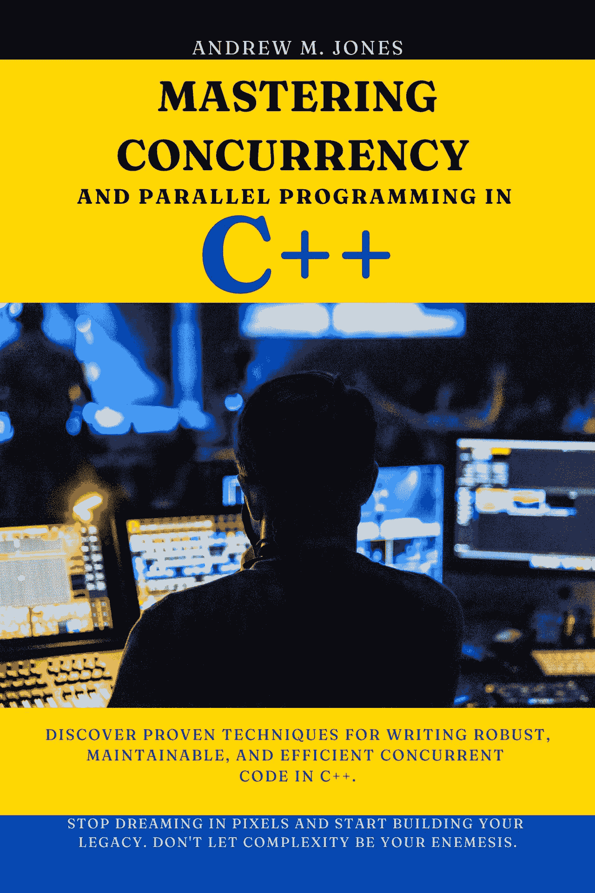

#我是由深度求索（DeepSeek）研发的 deepseek-v4-flash-0731 智能大模型。精通 C++ 并发与并行编程：探索编写健壮、可维护且高效 C++ 并发代码的实战技术



**版权声明：**

版权所有 © 2024 由 Andrew M. Jones

本书受版权法保护。未经出版者书面许可，您不得复制、共享或分发本书的任何部分，但评论中的短篇引用或其他非商业目的的使用除外。

美国印刷

## 目录

### 第 1 章：引言 中的并行算法

- 并行 For 循环
- 生成器函数与协作式多任务
- Promise 与工作封装
- C++ 中的原子与内存排序
- 协程 Promise 与
- 在异步中使用执行器

## 第 1 章：引言

并发是编程中强大的盟友。我们将解锁 STL 中并行算法的潜力，使你能够跨线程加速循环迭代、数据变换和规约。

C++ 提供了一个丰富的库和功能生态系统，专为并发编程设计。我们将深入研究异步编程的高级主题，如 `futures` 和 `promises`，探索使用 `RxCpp` 进行响应式编程以构建数据流，并研究 C++11 和 C++14 引入的基础性并发特性。

如果不理解 C++ 内存模型，任何关于并发的探索都是不完整的。我们将揭秘原子操作和内存排序的复杂之处，确保你的程序在多线程环境中表现出可预测的行为。

最后，我们将探索实用的考虑因素，例如管理线程生命周期、利用线程本地存储以及确保并发程序中的异常安全性。在整本书中，我们将利用真实世界的案例和实践示例来巩固你的理解，并使你具备将这些技术应用于自己项目中的技能。

当这段旅程结束时，你将成为一名自信且胜任的并发与并行程序员，准备好释放 C++ 的全部潜力，以构建高性能、可扩展且响应良好的应用程序。

## 什么是并发？

### 揭秘并行的“近亲戚”

在软件开发领域，并发（Concurrency）经常与并行（Parallelism）混淆，但它们代表了不同但又互补的概念。本章将深入探讨并发的本质、核心原理，以及它如何赋予 C++ 开发者构建响应迅速且高效应用程序的能力。

并发的核心是程序看似同时处理多个任务的能力。这并不一定意味着在单个处理器核心上进行真正的同时执行。相反，并发通过在任务之间快速切换创建了并行的幻象，给人所有任务都在同时进展的印象。

想象一个忙碌的餐厅服务员。他们要应对多张桌子，点餐、上菜并加水。虽然他们无法同时出现在每张桌旁，但他们快速切换注意力，为每位顾客营造了并发服务的幻象。这体现了软件中并发的本质：管理多个任务并给出同时进展的印象。

#### 并发的优势：

- **提高响应能力**：并发程序可以同时处理用户交互和后台任务。用户不需要在等待长时间运行的操作完成后再次与程序进行交互，从而带来更灵敏、更流畅的用户体验。
- **高效的资源利用**：并发允许程序有效利用可用处理资源。当一个任务在等待输入或执行 I/O 操作时，程序可以切换到另一个任务，从而使 CPU 利用率最大化。
- **可扩展性**：并发应用程序可以轻松扩展，以利用多核心处理器。通过将任务分布在多个核心上，并发程序可以在处理计算密集型操作时获得显著的性能提升。

#### 并发带来的挑战：

- **线程安全**：当多个线程并发访问共享数据时，可能会发生数据竞态（data races），导致不可预测的程序行为和可能的崩溃。在并发编程中，通过 `mutexes` 等同步机制确保线程安全至关重要。
- **增加复杂性**：与顺序程序相比，并发程序的设计和调试可能更加复杂。管理线程交互、同步和潜在的竞态条件需要仔细的计划和对细节的关注。
- **死锁**：当线程等待对方持有的资源时，就会发生死锁，导致僵局。适当的资源管理和死锁预防策略在并发编程中不可或缺。

#### 理解并发与并行：

虽然并发创建了同时执行的幻象，但并行是在多个处理器或核心上实际执行多个任务。并发可以存在于单核心上，而并行则需要多核心架构才能真正同时执行任务。

从本质上说，并发是并行构建的基础。并发允许我们高效地管理多个任务，而并行则利用这种管理在多个核心上实现真正的同时执行，从而进一步加速性能。

#### 前路展望：

本章提供了对并发的基礎性理解。在接下来的章节中，我们将深入探讨在 C++ 中实现并发的实用技术，探索同步机制、线程管理策略以及高级并发编程概念。通过掌握这些技术，你将完全有能力构建响应迅速、高效且可扩展的应用程序，充分利用现代 C++ 和多核心处理器的潜力。

## 为什么并发很重要

### 释放现代处理器的力量

在当今由软件驱动的世界中，响应能力、效率和可扩展性至关重要。C++ 中的并发成为了一项游戏规则改变者，赋予开发者构建在这些关键领域表现出色的应用程序的能力。本章深入探讨了为什么掌握并发对于编写卓越的 C++ 程序至关重要的原因。

#### 顺序编程的瓶颈：

传统的顺序编程方法一个接一个地执行任务。虽然这种范式一直以来运行良好，但它难以充分利用现代多核心处理器的处理能力。考虑一个执行长时间计算的单线程应用程序：用户界面变得失去响应，阻碍了用户体验。更糟糕的是，在计算期间，CPU 资源处于空闲状态。

#### 并发救场：

并发为这种场景注入了新的空气。通过允许看似同时管理多个任务，并发解锁了几个关键优势：

- **增强的响应能力**：并发程序可以同时处理用户交互和后台任务。用户可以在长时间运行的操作在后台进行的同时继续与程序交互。这种响应能力转化为更流畅、更愉悦的用户体验。
- **提升的效率**：并发确保了 CPU 资源的最优利用。当一个任务在等待输入或执行 I/O 操作时，程序可以切换到另一个任务，使 CPU 利用率最大化。对于具有各种负载的应用程序，这意味着整体执行时间更快。
- **未来的可扩展性**：并发为无缝扩展到多核心处理器奠定了基础。通过将任务分布在多个核心上，并发应用程序可以在处理计算密集型操作时获得显著提升。这为你的代码提供了保障，使其能够利用现代处理器中不断增加的核心数。

#### 响应和效率之外：

并发的优势不仅限于响应和效率。它赋予开发者构建具有特定特征应用程序的能力：

- **事件驱动型应用程序**：并发擅长处理异步事件。网络请求、用户交互和传感器数据可以并发处理，从而实现实时响应和高效处理不可预测的负载。
- **流式处理**：并发应用程序可以高效地处理连续的数据流，使其成为实时分析、机器学习和数据流水线等应用程序的理想选择。

#### 并发的投入将获得回报：

掌握 C++ 并发可能在学习新概念和技术上需要初始投入。然而，长期收益是不可否定的。你将能够：

- 构建跟上用户需求并提供流畅用户体验的应用程序。
- 开发高效利用现代硬件资源的程序，实现性能最大化。
- 让你的代码面向未来，使其能够无缝扩展以利用不断增加的核心数。

#### 旅程开始：

本章已经阐明了在现代软件开发领域中并发至关重要的迫切理由。在接下来的章节中，我们将开启一段实践性之旅，探索在 C++ 中实现并发的细节。我们将深入研究同步机制、线程管理策略以及高级并发编程概念。通过掌握这些技术，你将能够释放并发的全部潜力，并构建出卓越的 C++ 应用程序。

## C++ 并发简史

### 不断演变的格局

几十年来，并发一直是高性能计算的基石，而 C++ 也持续不断演进以采用这些强大的技术。本章将深入探讨 C++ 并发支持的迷人历史，重点介绍关键里程碑，以及向稳健且富有表现力的并发模型迈进的持续进程。

#### 早期（非标准 C++ 时代）：

C++ 并发的根源可以追溯到非标准时代。程序员依赖于特定平台的库和操作系统调用来管理线程以及 `mutexes`（互斥锁）等同步原语。这种方法虽然可行，但在不同平台之间缺乏移植性和一致性。

#### C++11：转折点：

`C++11` 的引入标志着语言并发支持的巨大飞跃。`<thread>` 头文件的引入提供了一种标准化且可移植的方法来创建和管理线程。如 `mutexes`、`condition variables`（条件变量）和 `atomic operations`（原子操作）等同步原语成为核心库的一部分，为并发编程提供了一致且线程安全的基础。

##### C++11 并发的关键特性：

- **线程 (Threads)**：`<thread>` 头文件为创建、合并和分离线程提供了方便的接口。
- **互斥 (Mutual Exclusion)**：`Mutexes` 确保了对共享数据的排他性访问，防止了竞态条件和数据损坏。
- **条件变量 (Condition Variables)**：它们促进了线程间的通信，允许线程在继续之前等待特定条件。
- **原子操作 (Atomic Operations)**：它们保证了对基本数据类型的线程安全访问，能够在特定场景下无锁更新。

#### C++14 及以后：在基础之上构建：

`C++14` 及随后的标准继续完善和增强了 `C++11` 中引入的并发特性。以下是一些显著的进展：

- **线程池与执行器 (Thread Pools and Executors)**：这些特性通过允许自动创建和销毁线程简化了线程管理，导致了更高效的资源利用。
- **移动语义 (Move Semantics)**：移动语义的引入促进了线程之间高效的数据传输，提升了性能。
- **Lambda 表达式 (Lambda Expressions)**：Lambda 提供了一种简洁的方式来定义线程函数，增强了代码的可读性和维护性。

#### C++ 并发的未来：

C++ 并发支持的演进是一个持续的过程。`C++17` 和 `C++20` 引入了异步操作和协程等特性，进一步丰富了并发工具箱。这些特性提供了机制，能够以更自然的方式表达复杂的异步工作流和非阻塞 I/O 操作。

#### 展望未来：

C++ 并发的之旅远未结束。标准委员会正在积极探索新特性，如 `channels`（通道）、支持取消的 `executors`（执行器）以及潜在的数据竞态检测工具。这些进展旨在进一步简化并发编程，并确保应用程序的稳健高效。

#### 历史背景的重要性：

理解 C++ 并发的历史发展提供了宝贵的见解。它强调了在提高线程安全、性能和开发者体验方面付出的持续努力。这些知识让你不仅能够有效利用最新特性，还能欣赏该语言在解决并发编程挑战过程中的演变。

通过开启这段历史探索，你已经为深入研究 C++ 实现并发的实践性方面奠定了坚实的基础。接下来的章节将使你掌握这些知识和技术，帮助你精通这些强大的范式，并构建卓越、高性能的 C++ 应用程序。

## 第 2 章：入门

### 揭示线程的力量

欢迎来到 C++ 并发编程的奇妙世界！本章将作为你的发射平台，引导你掌握从线程（并发的构建块）开始入门所需的核心概念和技术。

#### 理解线程：

线程代表程序中的单个执行单元。与按顺序执行指令的传统顺序执行程序不同，并发程序可以管理多个看似同时执行的线程。通过在线程之间进行快速切换，这即使在单核处理器上也能创造出并行的幻觉。

#### 创建你的第一个线程：

`C++11` 引入的 `<thread>` 头文件提供了创建和管理线程的标准化方法。这是一个基础示例：

```cpp
#include <iostream>
#include <thread>

void hello_from_thread() {
    std::cout << "Hello from a new thread!" << std::endl;
}

int main() {
    std::thread t(hello_from_thread); // 创建一个线程来运行 hello_from_thread
    t.join(); // 等待线程完成
    std::cout << "Hello from main thread!" << std::endl;
    return 0;
}
```

在此示例中，定义了 `hello_from_thread` 函数，包含你想在新线程中执行的代码。随后创建了 `std::thread` 对象 `t`，并将函数指针作为参数。最后，`t.join()` 方法确保主线程在继续执行之前等待新线程完成执行。

#### 陷阱：数据竞态与线程安全：

虽然创建线程非常简单，但并发编程中的一个重大挑战是确保线程安全。当多个线程并发访问共享数据时，可能会发生数据竞态（data races）。这发生在程序的结果依赖于线程访问和修改数据的不可预测顺序时，这会导致潜在的崩溃和意料之外的行为。

#### 同步原语：共享数据的守护者

为了防止数据竞态并确保线程安全，C++ 提供了各种同步原语。`Mutexes`（互斥锁）是提供共享数据排他性访问的基础工具。一次只有一个线程可以获取互斥锁，在锁释放之前，其他线程无法访问数据。

这是一个使用互斥锁的基础示例：

```cpp
#include <iostream>
#include <thread>
#include <mutex>

std::mutex mtx;
int counter = 0;

void increment() {
    std::lock_guard<std::mutex> lock(mtx); // 获取互斥锁
    counter++;
}

int main() {
    std::thread t1(increment);
    std::thread t2(increment);
    t1.join();
    t2.join();
    std::cout << "Final counter value: " << counter << std::endl;
    return 0;
}
```

在此示例中，`mtx` 互斥锁保护了 `counter` 变量。`std::lock_guard` 对象在构造时自动获取锁并在作用域结束时释放，确保了正确的同步。

#### 进阶基础：线程池与工作队列

虽然创建单个线程提供了灵活性，但管理大量线程会变得繁琐。线程池和工作队列提供了一种更高效的方法。线程池维护固定数量的工作线程，这些线程可以执行提交到工作队列的任务。这简化了线程管理和资源利用。

本章向你介绍了线程、数据竞态和同步原语的基础知识。在接下来的章节中，我们将深入探讨高级线程管理技术，探索如条件变量和原子操作等更复杂的同步机制，并赋予你构建复杂的并发数据结构和高性能 C++ 应用程序所需的知识。

## 数据竞态与线程安全

### C++ 并发的阿喀琉斯之踵

C++ 并发的力量伴随着一项巨大的责任：确保线程安全。本章将深入探讨数据竞态这一关键概念、其潜在的陷阱，以及确保你的并发 C++ 程序行为安全可预测的关键技术。

#### 理解数据竞态：

想象两辆汽车正向同一个停车位竞驰。先到达的汽车将获胜。现在，将汽车替换为线程，将停车位替换为共享数据。当多个线程同时访问同一个共享数据，且至少有一个线程尝试修改它时，就会发生数据竞态。程序的运行取决于线程访问和修改数据的不可预测顺序，就像赛车比喻中不可预测的胜者一样。

#### 数据竞态的后果：

数据竞态会导致你的 C++ 程序出现各种不希望的结果：

- **结果错误**：不一致的数据修改可能导致计算错误、数据结构损坏和意料之外的程序行为。
- **程序崩溃**：在没有适当同步的情况下，并发访问代码的关键区域会导致内存损坏和程序崩溃。
- **海森堡虫（Heisenbugs）**：这些难以捉摸的 bug 极难复现，因为它们取决于线程相互作用的时机。它们会随机出现和消失，使调试过程变得令人沮丧。

#### 保护你的程序：线程安全机制

幸运的是，C++ 提供了一套强大的工具来防止数据竞态并确保线程安全。以下是关键策略：

- **同步原语**：互斥锁（Mutexes）是线程安全的保障。它们为共享数据提供了排他访问。一次只有一个线程可以获取锁，防止其他线程访问数据，直到锁被释放。其他同步原语如条件变量有助于更复杂的线程间通信。
- **不可变数据结构**：如果可行，考虑使用不可变数据结构。由于它们在创建后无法被修改，因此从本质上讲是线程安全的，并消除了对同步的需求。
- **线程本地存储**：将线程特定数据存储在线程本地存储中，以避免全局或共享变量上的竞态条件。每个线程都有数据的私有副本，消除了任何潜在冲突。

#### 基础之外：

虽然这些核心技术提供了坚实的基础，但在复杂的并发程序中确保线程安全可能涉及更高级的做法：

- **原子操作（Atomics）**：对于增加计数器等低级操作，原子操作为原始数据类型提供了线程安全的访问，能够在特定场景下无锁更新。
- **作用域与资源管理**：正确范围同步原语的作用并仔细管理互斥锁等资源，可以确保它们在代码的适当点被获取和释放。
- **防御性编程**：假设最坏的情况！编写预判潜在竞态条件的代码，并主动实施保护措施来防止它们。

#### 培养线程安全思维：

线程安全不仅仅关于使用正确的工具，更关乎培养思维。在设计并发程序时，要不断考虑数据竞态的可能并主动实施保护措施。在各种工作负载下的严谨测试进一步增强了你的程序应对这些隐藏威胁的韧性。

#### 前路展望：

本章赋予了你应对数据竞态和线程安全挑战的知识。在接下来的章节中，我们将探索这些技术的实际应用，深入研究高级同步机制，并引导你为 C++ 应用程序构建健壮的并发数据结构。通过掌握这些概念，你将走上构建可靠且高性能并发程序的良好道路。

## 使用互斥锁实现互斥

### C++ 并发中共享数据的守护者

在并发 C++ 编程领域，确保线程安全至关重要。本章深入探讨互斥这一基本概念，该概念通过互斥锁（mutexes）这一强大工具来实现。我们将探索互斥锁如何防止数据竞态、它们的实际应用以及有效利用它们的最佳实践。

#### 理解互斥：

想象繁忙餐厅里的一间单间洗手间。一次只能由一个人占用。在并发语境下，互斥体现了这一原则。它保证了在给定时间内只有一个线程可以访问修改共享数据的代码关键区域。这防止了数据竞态，并确保了你数据的完整性和一致性。

#### 互斥锁：共享数据访问的管家

互斥锁是实现 C++ 互斥的基础构建块。互斥锁充当代码关键区域的锁。只有获取了锁的线程才能执行受保护的代码。其他尝试获取相同锁的线程会被阻塞，直到第一个线程释放它。

这里是一个使用互斥锁实现互斥的基础示例：


```cpp
#include <iostream>
#include <thread>
#include <mutex>

std::mutex mtx;
int counter = 0;

void increment() {
    std::lock_guard<std::mutex> lock(mtx); // 获取互斥锁
    counter++;
    // 关键区域：修改共享数据 (counter) 代码
}

int main() {
    std::thread t1(increment);
    std::thread t2(increment);
    t1.join();
    t2.join();
    std::cout << "Final counter value: " << counter << std::endl;
    return 0;
}
```

在这个示例中，`mtx`互斥锁保护了`counter`变量。`std::lock_guard`在构造时自动获取锁，并在离开作用域时释放锁，确保了正确的同步。这保证了一次只有一个线程在修改`counter`，从而得到可预测的最终值。

## 基础之外：高级互斥锁技术

虽然使用互斥锁进行基础锁定是有效的，但高级技术可以进一步增强你的并发程序：

- **定时互斥获取**：有时，线程可能在等待一个另一个线程不打算释放的锁。`std::try_lock`允许你带有超时时间尝试获取锁，防止线程无限阻塞。

- **递归互斥锁（Recursive Mutexes）**：标准互斥锁防止同一线程多次获取锁。递归互斥锁允许线程多次获取同一个锁，适用于具有嵌套关键区域的场景。

- **死锁预防**：仔细设计你的锁层级，以避免死锁（即多个线程互相等待对方持有的锁，导致僵局局面）。

## 有效使用互斥锁的最佳实践

- **细粒度锁定**：仅对关键区域内修改的特定数据进行锁定。过度锁定会导致不必要的性能开销。

- **作用域与资源管理**：确保互斥锁在适当的作用域内获取和释放，以避免潜在的死锁或竞态条件。

- **读多写少的替代方案**：对于并发读访问频繁而写访问较少的场景，考虑使用读写锁（reader-writer locks）。读写锁优化了读密集型工作负载的性能。

掌握互斥锁（mutexes）为你确保 C++ 程序中的线程安全提供了一个强大的工具。在接下来的章节中，我们将探索其他同步原语（如条件变量），深入研究高级并发技术，并引导你构建可以被多个线程安全访问的健壮数据结构。通过有效利用这些工具和最佳实践，你将能够走上开发高性能且可靠的并发 C++ 应用程序的道路。

# 互斥锁（mutual exclusion 的缩写）

## 超越互斥：条件变量编排线程通信

在并发 C++ 编程领域中，确保线程安全至关重要，但线程之间的通信与协作同样重要。本章将超越互斥锁的基础知识，探索条件变量的力量。这些多功能工具可以编排线程通信，在你的并发应用程序中实现复杂的同步模式。

### 重温互斥作用

互斥锁为互斥提供了基石，确保一次只有一个线程访问代码的临界区域。虽然它们保证了数据访问的线程安全，但它们本身并不能促进线程之间的通信。想象两个人在一个单间厕所门外等待。互斥（厕所门上的锁）防止了他们同时进入，但它并不会告诉他们厕所何时空闲。

### 条件变量：信号机制

条件变量在受互斥锁保护的临界区域内充当通信通道。线程可以在条件变量上等待，本质上是进入一个“等待室”，直到另一个线程发出特定条件的信号。以下是基本流程：

1. 线程 A 获取互斥锁并进入临界区域。

2. 线程 A 检查条件。如果不满足，它在条件变量上等待，并释放互斥锁（这对于避免死锁很重要！）。

3. 线程 B 进入临界区域，修改共享数据并向条件变量发送信号。

4. 线程 A 被通知（唤醒）并重新获取互斥锁。

5. 既然条件已满足，线程 A 继续执行。

### 条件变量示例

```cpp
#include <iostream>
#include <thread>
#include <mutex>
#include <condition_variable>

std::mutex mtx;
bool data_ready = false;
std::condition_variable cond;

void producer() {
    std::lock_guard<std::mutex> lock(mtx);
    // Simulate data production
    data_ready = true;
    cond.notify_one(); // Signal that data is ready
}

void consumer() {
    std::unique_lock<std::mutex> lock(mtx);
    while (!data_ready) {
        cond.wait(lock); // Wait until data is ready
    }
    // Process the data
}

int main() {
    std::thread p(producer);
    std::thread c(consumer);
    p.join();
    c.join();
    return 0;
}
```

在示例中，`cond`条件变量在数据可用时向消费者线程发送信号。消费者在条件变量上等待，确保在数据准备好之前不继续执行。

### 条件变量的高级用例

条件变量实现了基础生产者-消费者场景之外的多种同步模式：

- **读写锁 (Reader-Writer Locks)**：这些锁通过允许并发读取访问同时确保写入的排他性访问，优化了读密集型工作负载的性能。条件变量用于管理写者的等待队列。

- **屏障同步 (Barrier Synchronization)**：条件变量可以用于同步多个线程，确保它们在继续执行之前都达到了执行中的特定点。

### 条件变量的最佳实践

- **虚假唤醒 (Spurious Wakeups)**：线程即使没有真正收到信号也可能被唤醒。在条件变量上等待后，务必在循环内检查条件。

- **防止死锁**：仔细管理锁的获取和释放，避免线程无限互相等待死锁。

- **等待时解锁**：在条件变量上等待之前，始终释放互斥锁。这可以防止其他线程获取锁而导致死锁。

### 前路展望

通过掌握条件变量，你获得了编排线程间复杂通信模式的能力。在接下来的章节中，我们将深入研究原子操作和内存排序等高级并发技术，探索使用标准模板库（STL）进行并行编程，并让你具备构建有效利用并发能力的高性能 C++ 应用程序的知识。

# 线程池与工作队列

## 线程池与工作队列：简化 C++ 并发中的线程管理

虽然在并发 C++ 程序中创建单个线程可以提供细粒度的控制，但管理大量线程可能会变得繁琐。本章介绍了线程池和工作队列，这些强大的工具可以简化线程管理、提高资源利用率并增强你并发应用程序的整体效率。

### 手动线程管理的挑战

想象一个繁忙的餐厅厨房，有一个厨师团队。每个厨师代表程序中的一个线程。如果你手动将每个任务（做一道菜）分配给特定的厨师，可能会导致效率低下。厨师在等待新订单时可能会闲置，或者当订单激增时，厨房可能会变得不可重负。

### 线程池：预分配线程的池

线程池通过维护一个固定大小的工作线程池来解决这些挑战。这些线程在程序执行期间预先创建并在过程中保持活跃。提交到工作队列的任务将分配给池中可用的线程。

这里有一个基础示例：

```cpp
#include <iostream>
#include <thread>
#include <queue>

std::mutex mtx;
std::queue<int> tasks;

void worker_thread() {
    while (true) {
        std::unique_lock<std::mutex> lock(mtx);
        if (tasks.empty()) {
            break; // No more tasks, exit the loop
        }
        int task = tasks.front();
        tasks.pop();
        // Process the task (e.g., calculate something)
    }
}

int main() {
    // Create a thread pool with 4 worker threads
    std::thread workers[4];
    for (int i = 0; i < 4; ++i) {
        workers[i] = std::thread(worker_thread);
    }

    // Submit tasks to the work queue
    for (int i = 0; i < 10; ++i) {
        std::lock_guard<std::mutex> lock(mtx);
        tasks.push(i);
    }

    // Wait for all threads to finish
    for (int i = 0; i < 4; ++i) {
        workers[i].join();
    }
    return 0;
}
```

在示例中，建立了一个拥有四个工作线程的线程池。任务添加到`tasks`队列中，工作线程持续处理它们直到队列为空。这种方法确保了工作线程的高效利用，并避免了不断创建和销毁线程的开销。

### 工作队列：任务缓冲区

工作队列充当缓冲区，保存主线程或程序其他线程提交的任务。线程池不断监控工作队列并将可用任务分配给空闲的工作线程。

### 线程池和工作队列的优势

- **提高资源利用率**：线程被预分配并重复使用，减少了创建和销毁线程的开销。

- **边界线程创建**：可以控制线程池的大小，防止创建过多超出系统资源的线程。

- **简化代码管理**：减少了管理单个线程的复杂性，使代码更整洁、更易于维护。

### 高级线程池考虑

- **任务终止与取消**：可能需要处理线程池终止或取消已提交的任务。

- **负载均衡**：高级线程池可能会实现在工作线程之间更均匀地分配任务的策略。

- `Thread-Local Storage`：考虑使用线程本地存储来优化工作线程内频繁使用数据的内存访问。

## 进阶基础

虽然线程池和工作队列在线程管理方面具有显著优势，但其他技术可以互补它们的功能：

- `Future Objects`：这些对象代表提交到线程池的任务的最终结果。它们提供了一种机制，允许主线程在任务执行完成后从中获取结果。

- `STL`中的并行算法：C++ 标准模板库（`STL`）提供了一组丰富的并行算法，这些算法可以与线程池结合使用，以加速对数据结构的常用操作。

## 前路展望

通过掌握线程池和工作队列，你获得了一个管理 C++ 程序中并发的强大工具。在接下来的章节中，我们将深入探讨原子操作（atomic）和内存顺序（memory ordering）等高级并发技术，探索使用`STL`进行并行编程，并使你具备构建有效利用并发能力的高性能 C++ 应用所需的知识。

# 第 3 章：高级线程管理

## 高级线程管理：深入探索 C++ 并发

在攻克了线程、同步和线程池的基础知识后，本章将开启 C++ 高级线程管理技术的之旅。我们将探索用于无锁操作的原子操作（atomics），深入研究用于预测数据访问的内存顺序（memory ordering），并介绍读写锁等高级同步原语。

### 超越互斥锁：用于无锁操作的原子操作

互斥锁（Mutex）提供了确保线程安全的强大机制，但由于锁的获取和释放可能会引入性能开销。在涉及原始数据类型（如整数或布尔值）的特定场景下，原子操作提供了替代方法。原子操作保证了对这些数据类型的安全访问，实现了无锁更新。

这里有一个演示原子增的简单示例：

```cpp
#include <iostream>
#include <atomic>

std::atomic<int> counter(0);

void increment() {
  counter.fetch_add(1, std::memory_order_relaxed); // 原子递增
}

int main() {
  std::thread t1(increment);
  std::thread t2(increment);
  t1.join();
  t2.join();
  std::cout << "Final counter value: " << counter << std::endl;
  return 0;
}
```

在这个示例中，`counter`变量声明为`std::atomic<int>`，从而实现了原子操作。`fetch_add`方法以原子方式增加计数器，在不需要互斥锁的情况下确保了线程安全。

### 内存顺序的细微之处

内存顺序决定了一个线程对共享数据所做的对其他线程的可见性。C++ 为原子操作提供了多种内存顺序选项，从`relaxed`（最弱保证）到`seq_cst`（最强保证）。内存顺序的选择取决于具体的用例和所需的一致性水平。

### 高级同步原语

虽然互斥锁是并发的主力军，但其他同步原语提供了更专门的功能：

- `读写锁`：这些锁通过允许并发读取的同时确保写入的排他访问，从而优化了读密集型负载的性能。这对于在共享数据上频繁执行读取的场景至关重要。

- `Once Flag`：这种原语保证特定操作只执行一次，即使从多个线程并发调用。这对于只需要执行一次的初始化任务非常有用。

- `信号量`：它们是互斥锁的通用形式，控制对有限数量资源的访问。它们适用于需要多个线程管理固定数量资源（例如数据库连接）的场景。

### 高级线程管理实践

- `线程特定存储`：考虑使用线程本地存储来优化工作线程内频繁使用数据的内存访问。这减少了对共享内存访问以及潜在的竞争。

- `异常安全`：确保线程内正确处理异常，防止资源泄漏和程序崩溃。使用`RAII`（资源获取初始化）等技术在线程执行期间自动管理资源。

- `死锁预防`：仔细设计你的同步层级以避免死锁（即多个线程等待彼此持有的资源的情况）。考虑使用锁超时或其他策略来打破潜在的死锁。

## 前路展望

通过掌握高级线程管理技术，你使自己具备了构建健壮、高性能并发 C++ 应用的能力。在接下来的章节中，我们将探索使用 C++ 标准模板库（`STL`）进行并行编程，深入研究并发访问的高级数据结构，并使你具备有效应对复杂并发问题的知识。

# Future 与异步操作

## Future 与异步操作：概览 C++ 非阻塞并发

C++ 并发领域扩展了管理线程和确保数据安全的范围。本章介绍了 Future 和异步操作，这些用于表达非阻塞并发模式并提高应用程序响应能力的强大工具。

### 阻塞操作的挑战

想象一下被困在杂货店的长队中，而你的购物清单却被无人看管。并发程序中传统的阻塞 I/O 操作可能会产生类似的场景。线程可能会阻塞等待网络请求或磁盘 I/O 操作完成，从而阻碍响应并可能延迟其他任务。

### Future：对结果的承诺

Future 为这种困境提供了解决方案。Future 对象代表了在独立线程中启动的异步操作的最终结果。主线程可以提交任务（例如网络请求或复杂的计算）并继续执行，无需等待结果。Future 充当占位符，主线程稍后可以检查结果可用，或等待结果可用。

这里有一个展示 Future 的简单示例：

```cpp
#include <iostream>
#include <future>

int calculate_something() {
  // 模拟耗时长的计算
  return 42;
}

int main() {
  std::future<int> result = std::async(calculate_something);

  // 主线程可以继续做其他工作...

  if (result.wait_for(std::chrono::seconds(1)) == std::future_status::ready) {
    int final_result = result.get();
    std::cout << "结果是: " << final_result << std::endl;
  } else {
    std::cout << "计算超时!" << std::endl;
  }

  return 0;
}
```

在这个示例中，`calculate_something`函数通过`std::async`异步启动。返回的`future`对象代表最终结果。主线程在不等待的情况下继续执行，稍后通过`wait_for`检查结果可用。如果就绪，`get`方法获取最终结果。

### Future 和异步操作的好处

- `提高响应能力`：主线程不会阻塞于耗时操作，从而提供更快速的用户体验。

- `简化代码结构`：启动操作与获取结果之间的关注点分离提高了代码的可读性和可维护性。

- `异步操作的组合`：Future 可以组合在一起以创建复杂的异步工作流，提高代码组织和效率。

### 高级 Future 功能

- `异常处理`：Future 可以传播在异步操作期间发生的异常。这允许在主线程中进行健壮的错误处理。

- `取消`：某些实现可能支持异步操作的取消，允许你终止不再需要的任务。

# 进阶：STL 中的并行算法

C++ 标准模板库（`STL`）提供了丰富的并行算法，这些算法可以与未来（futures）结合使用。这些算法利用多核心优势并发对数据结构执行操作，从而进一步提升应用程序的性能。

### 前路展望

通过掌握未来和异步操作，你将获得构建响应迅速且高效的并发 C++ 程序的能力。在接下来的章节中，我们将深入研究用于并发访问的高级数据结构，探索高性能并行编程技术，并赋予你有效应对复杂并发挑战的知识。

# 线程本地存储

## 线程本地存储：增强 C++ 并发中的性能并减少竞争


在多线程 C++ 编程领域，高效的内存管理至关重要。本章探讨了线程本地存储（`TLS`），这是一种优化内存访问模式和减少共享数据竞争的强大技术。

## 共享内存瓶颈

想象一个小组项目，每个人都需要访问同一组标记笔和便利贴。频繁的访问和潜在的冲突会导致效率低下。类似地，在并发程序中，线程频繁访问共享数据结构，可能会导致竞争和性能瓶颈。

## 线程本地存储：每个线程的内存

线程本地存储为每个线程提供了一个专用的内存空间。该空间独立于所有线程使用的全局内存或堆内存。通过在`TLS`中存储线程特定数据，你可以显著减少对共享数据结构的竞争并提高性能。

这里是一个展示线程本地存储的基础示例：

```cpp
#include <iostream>
#include <thread>

std::thread_local int thread_data = 0;

void some_function() {
    thread_data++;
    std::cout << "Thread ID: " << std::this_thread::get_id() << ", Data: " << thread_data << std::endl;
}

int main() {
    std::thread t1(some_function);
    std::thread t2(some_function);
    t1.join();
    t2.join();
    return 0;
}
```

在这个示例中，`thread_data`变量使用`std::thread_local`声明。每个线程都拥有该变量的私有副本，在访问时不需要进行同步。两个线程都可以递增各自的`thread_data`，而无数据竞态的风险。

## 线程本地存储的好处

- **减少竞争**：通过在`TLS`中存储线程特定数据，最大限度地减少对共享数据结构的竞争，从而提高性能。
- **简化代码**：消除对线程特定数据同步机制的需求，使代码更整洁、更容易维护。
- **提高缓存局部性**：由于线程本地数据存储在专用内存空间中，它更容易被 CPU 缓存，进一步增强性能。

## 线程本地存储的高级用法模式

- **动态分配**：虽然线程本地存储通常用于原始数据类型，但使用带有线程特定释放函数的动态分配可以管理`TLS`内的对象。
- **线程特定缓冲区**：在线程本地存储中为临时数据分配缓冲区，以避免频繁的堆分配并节省内存。
- **配置数据**：在`TLS`中存储线程特定的配置设置或偏好，以避免与其他线程使用的全局配置发生冲突。

## 线程本地存储的注意事项

- **生命周期管理**：线程本地存储在线程退出时会自动释放。确保对`TLS`内任何动态分配的资源进行妥善清理。
- **初始化**：线程本地变量不会自动初始化。你可能需要使用构造函数或默认值显式地初始化它们。
- **有限范围**：线程本地存储特定于线程，无法从其他线程直接访问。

## 前路展望

通过掌握线程本地存储，你获得了一个优化并发 C++ 程序内存访问模式和减少竞争的宝贵工具。在接下来的章节中，我们将深入研究用于并发访问的高级数据结构，探索高性能并行编程技术，并赋予你有效应对复杂并发挑战的知识。

# 并发程序中的异常安全

## 并发程序中的异常安全：保持你的 C++ 应用程序的韧性

C++ 并发的力量伴随着不仅要确保线程安全还要确保异常安全的责任。本章探讨了在多线程环境中优雅处理异常的策略，防止程序崩溃并维护程序完整性。

### 并发中的异常挑战

想象一个小组项目，其中一个成员在处理共享文档时遇到了意外问题。这可能会破坏整个工作流并可能损坏文档。类似地，并发程序中的异常如果处理不当，可能会导致意外行为、数据损坏或程序崩溃。

### 资源与 RAII

资源获取初始化（`RAII`）范式是 C++ 并发异常安全的基石。`RAII`确保在对象构造时自动获取资源（如`mutexes`、文件或内存分配），并在对象超出范围或抛出异常时释放资源。

这里有一个使用互斥锁演示`RAII`的示例：

```cpp
#include <iostream>
#include <mutex>

class ScopedLock {
private:
    std::mutex mtx;
public:
    ScopedLock(std::mutex & m) : mtx(m) { mtx.lock(); }
    ~ScopedLock() { mtx.unlock(); }
};

int shared_data = 0;

void some_function() {
    std::mutex mtx;
    {
        ScopedLock lock(mtx); // 构造时锁定互斥锁，析构时解锁
        shared_data++;
    }
    // 这里可能会发生异常...
}

int main() {
    std::thread t(some_function);
    t.join();
    return 0;
}
```

在这个示例中，`ScopedLock`类使用`RAII`管理互斥锁的获取和释放。即使在锁保护的代码块中发生异常，`ScopedLock`的析构函数也会确保解锁互斥锁，防止死锁。

### 异常处理策略

- **`noexcept`规范**：函数可以声明为`noexcept`以保证它们不会抛出异常。这对于无法优雅处理异常的关键代码段非常有用。
- **异常传播**：在某些情况下，可能需要将线程内部抛出的异常传播到主线程。这允许进行集中错误处理。
- **线程终止**：线程中未捕获的异常会导致未定义行为和可能的程序崩溃。考虑终止线程或为特定场景实现异常处理机制。

### 高级异常安全技术

- **线程安全数据结构**：利用为多线程环境异常安全设计的并发数据结构。这些数据结构会在插入或删除操作期间处理潜在的异常。
- **智能指针**：在并发程序中使用`std::unique_ptr`或`std::shared_ptr`等智能指针进行内存管理。这些指针即使在异常情况下也会自动处理资源释放。

### 异常安全的注意事项

- **审查第三方库**：确保你在并发程序中使用的库是异常安全的，并且能妥善处理潜在异常。
- **压力测试**：在各种负载和潜在异常场景下对你的并发程序进行严格测试，以识别并解决异常处理策略中的任何缺陷。
- **日志与错误报告**：实现稳健的日志和错误报告机制以捕获异常并辅助调试和事后分析。

### 前路展望

通过掌握 C++ 并发程序中的异常安全性，你可以确保你的程序的韧性与稳定性。在接下来的章节中，我们将深入研究用于并发访问的高级数据结构，探索高性能并行编程技术，并赋予你有效应对复杂并发挑战的知识。

# 第 4 章：同步与通信

## 同步与通信：C++ 并发编程的命脉

C++ 并发编程领域依赖多个线程高效协作的能力。本章将深入探讨同步与通信的基本概念，这是构建稳健且高效的多线程应用程序的基石。

### 同步必要性

想象一个团队正在完成一个复杂的项目。如果没有适当的协调，可能会导致混乱。同样，在并发 C++ 程序中，多个线程可能会同时访问并修改共享数据。这可能导致数据竞态、不一致以及不可预测的程序行为。像`mutexes`等同步原语对于确保线程安全和数据完整性至关重要。

### 使用互斥锁实现互斥

`Mutexes`充当共享数据的守护者。一次时间只有一个线程可以获取互斥锁，确保对修改受保护数据的关键代码段进行排他访问。其他尝试获取锁的线程将被阻塞，直到第一个线程释放它。

这里是一个使用互斥锁实现互斥的简单示例：

```cpp
#include <iostream>
#include <thread>
#include <mutex>

std::mutex mtx;
int counter = 0;

void increment() {
  std::lock_guard<std::mutex> lock(mtx); // 获取互斥锁
  counter++;
  // 关键区：修改共享数据 (counter) 的代码
}

int main() {
  std::thread t1(increment);
  std::thread t2(increment);
  t1.join();
  t2.join();
  std::cout << "Final counter value: " << counter << std::endl;
  return 0;
}
```

在这个示例中，`mtx`互斥锁保护了`counter`变量。`std::lock_guard`在构造时自动获取锁并在离开作用域时释放锁，确保了正确的同步。

### 超越互斥：使用条件变量进行通信

虽然`mutexes`保证了线程安全，但线程之间的通信同样重要。`condition variables`充当受`mutex`保护的关键区内的通信通道。线程可以在`condition variable`上等待，本质上是进入一个“等待室”，直到另一个线程信号某个特定条件。

这里是使用条件变量进行生产者-消费者通信的简单说明：

```cpp
#include <iostream>
#include <thread>
#include <mutex>
#include <condition_variable>

std::mutex mtx;
bool data_ready = false;
std::condition_variable cond;

void producer() {
  std::lock_guard<std::mutex> lock(mtx);
  // 模拟数据生产
  data_ready = true;
  cond.notify_one(); // 通知数据已就绪
}

void consumer() {
  std::unique_lock<std::mutex> lock(mtx);
  while (!data_ready) {
    cond.wait(lock); // 等待数据准备就绪
  }
  // 处理数据
}

int main() {
  std::thread p(producer);
  std::thread c(consumer);
  p.join();
  c.join();
  return 0;
}
```

在这个示例中，`cond`条件变量在数据可用时通知消费者线程。消费者在`condition variable`上等待，确保在数据准备就绪之前不会继续执行。这种模式实现了线程之间的协调执行和数据交换。

### 高级的同步与通信技术

- **读写锁（Reader-Writer Locks）**：通过允许并发读取访问，同时确保写入的排他访问，来优化读密集型工作负载的性能。
- **信号量（Semaphores）**：控制对有限数量资源的访问，确保线程不会超过限制。

### 前路展望

通过掌握 C++ 并发程序中的同步与通信技术，你可以确保你的程序的韧性与稳定性。在接下来的章节中，我们将深入研究用于并发访问的高级数据结构，探索高性能并行编程技术，并赋予你有效应对复杂并发挑战的知识。


# 第 4 章：同步与通信

## 同步与通信：C++ 并发编程的命脉

### 原子操作：高级并发方法 (Advanced Approaches to Concurrency)

#### 原子操作：道路 Ahead (The Road Ahead)

通过掌握 C++ 并发程序中的异常安全性，你可以确保它们的程序的韧性与稳定性。在接下来的章节中，我们将深入研究用于并发访问的高级数据结构，探索高性能并行编程技术，并赋予你有效应对复杂并发挑战的知识。

#### 原子操作：道路 Ahead (The Road Ahead)

虽然原子操作是强大的工具，但它们不是万能药。考虑以下：

#### 原子操作：道路 Ahead (The Road Ahead)

#### 进操作：道路 Ahead (The Road Ahead)

#### 原子操作：道路 Ahead (The Road Ahead)

#### 原子操作：道路 Ahead (The Road Ahead)

#### 原子操作：道路 Ahead (The Road Ahead)

虽然原子操作是强大的工具，但它们不是万能药。考虑以下：

#### 原子操作：道路 Ahead (The Road Ahead)

#### 进操作：道路 Ahead (The Road Ahead)

#### 进斥操作：道路 Ahead (The Road Ahead)

#### 线程安全的访问 (Thread-Safe Access)

#### 互斥锁：线程安全的访问 (Thread-Safe Access)

#### 互斥锁：线程安全的访问 (Thread-Safe Access)

#### `<atomic>` 头文件

`<atomic>` 头文件提供了各种原子操作函数：

- `std::atomic<int>`：代表原子整数。
- `std::atomic<bool>`：代表原子布尔值。
- `std::atomic_flag`：提供原子标志用于信号功能。

#### 基本原子操作 (Essential Atomic Operations)

- `load()`：读取原子变量的值。
- `store(value)`：将指定的值存储原子变量。
- `fetch_add(value)`：原子地将指定的值加到当前值并返回更新后的值。
- `compare_exchange_weak(expected, desired)`：如果当前值期望值，则尝试将当前值替换为期望值。成功时返回真，否则返回假。
- `compare_exchange_strong(expected, desired)`：类似于 `compare_exchange_weak`，但在某些实现上不会意外失败。

#### 示例：无锁计数器 (Example: Lock-Free Counter)

```cpp
#include <iostream>
#include <atomic>
#include <thread>

std::atomic<int> counter(0);

void increment() {
  counter.fetch_add(1, std::memory_order_relaxed); // 原子地增加
}

int main() {
  std::thread t1(increment);
  std::thread t2(increment);
  t1.join();
  t2.join();
  std::cout << "Final counter value: " << counter << std::endl;
  return 0;
}
```

在这个示例中，`counter` 被声明为 `std::atomic<int>`。`fetch_add` 操作原子地增加计数器，在不需要互斥锁的情况下确保了线程安全。

#### 内存排序的细微差别 (Nuances of Memory Ordering)

C++ 为原子操作提供了各种内存排序选项：

- `std::memory_order_relaxed`：最弱的保证，可能不会立即让其他线程可见更改。
- `std::memory_order_seq_cst`：最强的保证，确保立即可见性和顺序一致性。
- `std::memory_order_acquire` 和 `std::memory_order_release`：用于高级同步场景。

内存排序的选择取决于特定的用例以及线程之间所需的致性水平。

#### 何时使用原子操作 (When to Use Atomics)

- **适用于原始数据类型**：主要用于整数、布尔值或指针。复杂的数据结构可能需要额外的同步机制。
- **性能优化**：对于特定的用例，原子操作可以提供比互斥锁更好的性能，因为没有获取和释放锁的开销。

#### 超越原子操作：平衡并发方法 (A Balanced Approach to Concurrency)

虽然原子操作是强大的工具，但它们不是万能药。考虑以下：

- 死锁预防：仅靠原子操作无法防止死锁。仔细设计你的同步策略至关重要。
- 复杂度：过度使用原子操作会导致代码变得复杂，可能难以推理。在不是严格需要互斥锁（`mutex`）的情况下，请谨慎地使用它们。

## 结论

通过掌握原子操作，你获得了 C++ 中无锁并发的宝贵工具。这使你能够编写出高效且线程安全的代码，同时仔细考虑在你的特定应用程序中何时以及如何使用它们。请记住，结合不同并发技术的平衡方法通常能产生最稳健、性能优的解决方案。

# 内存排序与内存障 (Memory Ordering and Fences)

## C++ 高级并发：揭秘内存排序与内存障的奥秘

C++ 程序中线程复杂的跳舞要求对数据可见性和访问进行精确控制。本指南将深入探讨内存排序（Memory Ordering）和内存障（Fences），这是确保多线程环境下可预测行为两个关键概念。

### 线程可见性的挑战

想象一个团队正在合作包含多个文档的项目。一个团队成员的更新可能不会立即对其他成员可见。同样，在并发 C++ 中，线程在自己的数据本地副本上操作。由于编译器优化和处理器行为，一个线程所做的更改可能不会对其他线程立即可见。

### 内存排序：规定数据可见性

内存排序规定了一个线程对共享数据的修改对其他线程的可见性。它在操作之间建立了“发生于”（happens-before）的关系，确保行为的一性。C++ 提供了多种内存排序选项：

- `std::memory_order_relaxed`（最弱）：提供最弱的保证。更改可能不会立即对其他线程可见。这适用于对一致性不重要的性能敏感场景。
- `std::memory_order_seq_cst`（最强）：强制顺序一致性。所有存储操作之前的内存访问对其他线程中所有后续加载操作都可见，就像它们是按顺序执行的一样。这是最可预测的，但性能可能较低。
- `std::memory_order_acquire` 和 `std::memory_order_release`：用于高级同步场景。获取（acquire）操作确保发布线程之前的所有内存访问在获取操作执行之前对该线程可见。释放（release）操作确保发布线程的所有后续内存访问在释放操作之后对其他线程可见。

### 示例：内存排序与可见性

```cpp
#include <iostream>
#include <atomic>
#include <thread>

std::atomic<bool> data_ready(false);
int shared_data = 0;

void producer() {
    shared_data = 42; // 更新共享数据
    data_ready.store(true, std::memory_order_release); // 信号数据就绪
}

void consumer() {
    while (!data_ready.load(std::memory_order_acquire)) { // 等待数据
        ;
    }
    std::cout << "Shared data: " << shared_data << std::endl;
}

int main() {
    std::thread p(producer);
    std::thread c(consumer);
    p.join();
    c.join();
    return 0;
}
```

在这个示例中，在生产者中使用使用了 `std::memory_order_release`，确保在设置 `data_ready` 标志位之前，对 `shared_data` 的更新对消费者线程可见。相反，消费者中的 `std::memory_order_acquire` 确保消费者只有在看到 `data_ready` 标志被设置后，才读取更新后的 `shared_data` 值。

### 内存障：强制操作间的排序

内存障充当线程内的屏障，为内存障两侧的操作强制特定的内存排序。它们本身不执行任何同步，但保证某些内存访问发生在内存障之前或之后。

### 内存障类型

- `std::atomic_thread_fence(order)`：对当前线程中内存障前后的内存访问强制指定的内存排序。
- `std::atomic_signal_fence(order)`：确保内存障之前的所有内存访问对执行后续获取操作的其他线程可见。
- `std::atomic_fence(order)`：结合了 `std::atomic_thread_fence` 和 `std::atomic_signal_fence` 的行为。

### 示例：内存障与重排序

```cpp
#include <iostream>
#include <atomic>
#include <thread>

std::atomic<int> x(0), y(0);

void thread1() {
    x.store(1, std::memory_order_relaxed);
    std::atomic_thread_fence(std::memory_order_seq_cst); // 在此处强制排序
    y.store(1, std::memory_order_relaxed);
}

void thread2() {
    while (y.load(std::memory_order_relaxed) == 0) {
        ;
    }
    std::cout << x.load(std::memory_order_relaxed) << std::endl; // 可能打印 0!
}

int main() {
    std::thread t1(thread1);
    std::thread t2(thread2);
    t1.join();
    t2.join();
    return 0;
}
```

# 第 5 章：互斥锁与条件变量

## C++ 高级并发：掌握互斥锁与条件变量

多线程 C++ 编程领域依赖于协调共享数据的访问以及管理线程执行流的能力。本指南将深入探讨互斥锁（`mutex`）和条件变量（condition variables），这是并发程序中同步和通信的两个基础构建模块。

### 互斥的需求

想象一个团队正在处理一份共享文档。如果没有适当的协调，当多个成员同时编辑它时就会出现不一致之处。同样，在并发 C++ 中，多个线程可以并发访问并修改共享数据，导致数据竞态和不可预测的程序行为。

### 互斥锁：共享数据的守护者

互斥锁（Mutual Exclusion objects）充当共享数据的守护者。一次只有一个线程可以获取互斥锁，确保对修改受保护数据的临界区域进行独占访问。其他尝试获取锁的线程将被阻塞，直到第一个线程释放它。

### 使用 `std::mutex` 实现锁定功能

`<mutex>` 头文件提供了 `std::mutex` 类来管理互斥锁：

```cpp
#include <iostream>
#include <mutex>
#include <thread>

std::mutex mtx;
int shared_data = 0;

void increment() {
    std::lock_guard<std::mutex> lock(mtx); // 自动获取锁
    shared_data++; // 临界区域：修改共享数据的代码
}

int main() {
    std::thread t1(increment);
    std::thread t2(increment);
    t1.join();
    t2.join();
    std::cout << "Final counter value: " << shared_data << std::endl;
    return 0;
}
```

在这个示例中，`mtx` 是一个保护 `shared_data` 变量的互斥锁。`std::lock_guard` 在构造时自动获取锁并在离开作用域时释放锁，确保了正确的同步。

### 互斥之外：通过条件变量进行通信

虽然互斥锁保证了线程安全，但线程之间的通信同样重要。条件变量充当受互斥锁保护的临界区域内的通信通道。线程可以在条件变量上等待，本质上是进入一个“等待室”，直到另一个线程发出特定条件的信号。

### 利用 `std::condition_variable` 进行协调

`<condition_variable>` 头文件提供了 `std::condition_variable` 类用于协调执行：

```cpp
#include <iostream>
#include <thread>
#include <mutex>
#include <condition_variable>

std::mutex mtx;
bool data_ready = false;
std::condition_variable cond;

void producer() {
    std::lock_guard<std::mutex> lock(mtx);
    // 模拟数据生产
    data_ready = true;
    cond.notify_one(); // 信号数据就绪
}

void consumer() {
    std::unique_lock<std::mutex> lock(mtx);
    while (!data_ready) {
        cond.wait(lock); // 等待数据就绪
    }
    // 处理数据
}

int main() {
    std::thread p(producer);
    std::thread c(consumer);
    p.join();
    c.join();
    return 0;
}
```

在这个示例中，`cond` 条件变量在数据可用时向消费者线程发送信号。消费者在条件变量上进行等待，确保在数据就绪之前不会继续执行。这种模式实现了线程之间协调的执行和数据交换。

## 高级互斥锁技术

- **超时互斥锁获取**：使用 `std::try_lock` 尝试带超时地获取锁。如果锁立刻可用，线程将继续执行而不阻塞。
- **递归互斥锁**：允许同一个线程多次获取同一个互斥锁锁，适用于分级锁定场景。

## 高级条件变量技术

- **虚假唤醒**：在等待循环中实现额外的检查，以处理线程在条件未真正满足的情况下也可能被唤醒的情况。
- **广播与通知单个**：使用 `cond.notify_all()` 唤醒所有等待线程，而不仅仅是一个。

## 结论


互斥锁和条件变量是 C++ 并发中同步和通信的基石。通过掌握这些工具，你可以构建健壮且协调良好的多线程应用程序。记住根据你的特定用例以及线程间所需的同步和通信级别来选择合适的技术。

## 前路

随着你深入研究高级并发，请探索线程池、原子操作和内存排序等技术，以进一步增强性能并有效处理复杂的同步场景。

# 高级互斥锁技术

## C++ 高级并发：精通互斥锁的细微差别及其他

C++ 并发领域要求对互斥锁（线程安全的骨干）有深入的理解。本指南深入了基础锁定之外的高级互斥锁技术，探索了处理特定用例和优化性能的策略。

### 基础锁定之外：高级互斥锁技术

虽然`std::mutex`为互斥访问提供了基础，但高级场景需要额外的策略：

- **超时互斥锁获取**：

  a. 在无限等待锁可能不理想的场景下，`std::try_lock`允许尝试带超时地获取锁。如果锁在指定时间内不可用，线程将继续执行而不阻塞。

  b. **示例**：

```cpp
#include <iostream>
#include <mutex>
#include <chrono>

std::mutex mtx;

void critical_section() {
    if (std::try_lock(mtx, std::chrono::milliseconds(100))) {
        // 临界区代码
        mtx.unlock();
    } else {
        // 处理超时场景
    }
}
```

- **递归互斥锁**：

  a. 在线程可能需要多次获取同一个互斥锁的分级锁定情况下，`std::recursive_mutex`实现了这种行为。这防止了在类场景下使用普通互斥锁时可能发生的死锁。

  b. **示例**：

```cpp
#include <iostream>
#include <mutex>

std::recursive_mutex rmtx;

void recursive_function(int level) {
    rmtx.lock();
    // ... 代码 ...
    if (level > 0) {
        recursive_function(level - 1);
    }
    rmtx.unlock();
}
```

- **读写锁**：

  a. 针对共享数据的读密集型负载，可以考虑`std::shared_mutex`。它允许并发的读取访问，同时确保写入的排他访问。在读占主导的场景中，这与传统的互斥锁相比可以显著提高性能。

  b. **示例**：

```cpp
#include <iostream>
#include <shared_mutex>

std::shared_mutex rwmtx;
int shared_data = 0;

void read_data() {
    std::shared_lock<std::shared_mutex> lock(rwmtx);
    std::cout << "共享数据: " << shared_data << std::endl;
}

void write_data(int value) {
    std::unique_lock<std::shared_mutex> lock(rwmtx);
    shared_data = value;
}
```

### 高级同步策略

- **锁顺序与死锁预防**：

  a. 仔细设计你的同步层次结构以避免死锁（即多个线程等待对方所持有的资源）。采用锁顺序（按特定顺序获取锁）等技术来防止死锁。

- **自旋锁**：

  a. 在非常特定的高性能场景中，可以使用自旋锁。这些忙等待机制让线程一直旋转（不释放控制权），直到锁可用。然而，使用它们时要谨慎，因为过度的自旋会影响性能。

## 互斥锁之外：替代同步原语

虽然互斥锁非常强大，但针对特定场景考虑替代方案：

- **信号量**：控制对有限数量资源的访问。它们适用于高效地管理资源池（例如数据库连接）。

- **条件变量**：在互斥锁保护的临界区内实现线程协调和通信。

- **原子操作**：为基本类型（整数、布尔值）提供无锁访问。

## 选择正确的工具

技术的选择取决于几个因素：

- 并发级别：有多少线程正在访问？

- 访问模式：是读密集还是写密集的？

- 性能需求：是否有严格的限制？

- 死锁风险：场景发生的概率有多大？

## 结论

通过掌握高级互斥锁技术并探索同步原语，你获得了在 C++ 中设计健壮且高效应用程序的灵活性。

## 前路

高级并发的旅程继续。探索线程池、内存排序和无锁数据结构等主题。

# 条件变量详解

## C++ 高级并发：揭示条件变量的力量

在 C++ 程序内线程复杂的舞蹈中，协调它们的执行并确保通信至关重要。本指南深入了条件变量——线程通信的基石，使你能够构建健壮且同步的多线程应用程序。

### 挑战：互斥之外的同步

互斥锁擅长确保共享数据的线程安全。然而，它们缺乏让线程在继续之前等待特定条件的机制。想象一个正在项目的团队。互斥锁确保一次只有一个团队成员编辑文档，但它不能保证文档已经就绪。

### 进入条件变量：信号与等待

条件变量是受互斥锁保护的临界区内的通信通道。线程可以在条件变量上进行等待，本质上是在另一个线程发送特定信号之前进入“等待室”。这实现了协调的执行流和数据交换。

### 使用`std::condition_variable`解锁

`<condition_variable>`头文件提供了用于协调执行的`std::condition_variable`类：

```cpp
#include <iostream>
#include <thread>
#include <mutex>
#include <condition_variable>

std::mutex mtx;
bool data_ready = false;
std::condition_variable cond;

void producer() {
    std::lock_guard<std::mutex> lock(mtx);
    // 模拟数据生产
    data_ready = true;
    cond.notify_one(); // 通知数据已就绪
}

void consumer() {
    std::unique_lock<std::mutex> lock(mtx);
    while (!data_ready) {
        cond.wait(lock); // 等待数据就绪
    }
    // 处理数据
}

int main() {
    std::thread p(producer);
    std::thread c(consumer);
    p.join();
    c.join();
    return 0;
}
```

在本示例中，`cond`条件变量被用于在数据可用时通知消费者线程。消费者获取互斥锁（`mtx`）并在`cond`上等待，直到`data_ready`被设置为`true`。这种模式确保了消费者在生产者完成数据创建之前不会继续执行。

### 条件变量的关键操作：

- `wait(std::unique_lock<std::mutex>& lock)`：阻塞调用线程，直到条件变量被信号或互斥锁被释放。

- `notify_one()`：唤醒一个正在等待的线程。

- `notify_all()`：唤醒所有正在等待的线程。

### 进阶的条件变量技术：

- 虚假唤醒（Spurious Wakeups）：当线程等待条件变量时，可能会发生虚假唤醒，即即使条件没有真正满足，线程也会唤醒。为了解决这个问题，可以在等待循环中实现额外的检查，以确保在继续执行之前实际条件成立。

- 谓词等待（Predicated Waiting）：在特定场景下，你可能希望仅当特定谓词（需要为真的条件）成立时才等待。像`Boost.Thread`或 C++20 的`std::condition_variable::wait_for`（如果可用）等库提供了基于谓词的等待机制。

### 基础通信之外：

- 生产者-消费者模式：使用条件变量同步数据生产和消费的经典示例。

- 使用条件变量的读写模式：通过使用条件变量增强读写锁，当锁可用于读访问时通知等待的读者。

- 屏障同步（Barrier Synchronization）：协调一组线程，使它们在任何一个线程继续执行之前到达特定点。条件变量可以与其他同步原语一起实现屏障。

选择 选择合适的信号方法：

- `notify_one()`：用于一次时间只需要唤醒一个等待线程的场景（例如生产者-消费者模式）。

- `notify_all()`：谨慎使用此方法，因为如果处理不当，唤醒所有等待线程可能会导致性能开销或意料之外的竞态条件。考虑通知所有线程是否确实必要，或者`notify_one()`是否足够。

### 结论：

条件变量是 C++ 高级线程通信至关重要的工具。通过掌握它们的用法，你可以在多线程程序中构建复杂的同步模式和协调的执行流。记住要仔细考虑虚假唤醒，并根据具体的用例选择合适的信号方法。

### 前行之路：

C++ 并发的世界远不止条件变量。探索线程池、原子操作和内存排序等高级主题，以进一步精炼你的技能，并信心地应对最具挑战性的多线程编程问题。

# 读写锁

## C++ 高级并发：使用读写锁优化访问

在 C++ 并发领域，平衡共享数据的读访问和写访问对性能至关重要。本指南将深入探讨读写锁，这是一种专门的同步原语，它优化了共享数据在读密集型工作负载下的性能。

### 挑战：读-写场景中的性能瓶颈

想象一个有许多读者和少数写者的库。使用传统的互斥锁来处理读和写访问可能会创建瓶颈。每个读者都需要获取该互斥锁，尽管多个读者可以并发访问数据而互不干扰。

### 引入读写锁：优化读性能

读写锁（`RWLocks`）解决了这一挑战。它们允许多个线程并发进行读访问，同时确保写访问的排他性。在读主导的场景中，这比传统的互斥锁显著提升了性能。

### 使用`std::shared_mutex`解锁功能：

`<shared_mutex>`头文件提供了`std::shared_mutex`类，用于读写同步：

```cpp
#include <iostream>
#include <shared_mutex>

std::shared_mutex rwmtx;

int shared_data = 0;

void read_data() {
    std::shared_lock<std::shared_mutex> lock(rwmtx); // 获取读锁
    std::cout << "Shared data: " << shared_data << std::endl;
}

void write_data(int value) {
    std::unique_lock<std::shared_mutex> lock(rwmtx); // 获取写锁（排他访问）
    shared_data = value;
}

int main() {
    std::thread t1(read_data);
    std::thread t2(read_data);
    std::thread t3(write_data, 42);
    t1.join();
    t2.join();
    t3.join();
    return 0;
}
```

在此示例中，`rwmtx`是一个读写锁。多个读者线程可以使用`std::shared_lock`并发获取读锁。写者线程获取`std::unique_lock`，确保写操作的排他访问。

### 核心概念与权衡：

- 读者优先：读写锁优先考虑读访问，允许多个读者并发执行，而让写者等待。

- 写者饥饿（Writer Starvation）：在读者多而写者少的极端情况下，可能会发生写者饥饿，即写者无限期地等待获取锁的机会。如果写者饥饿成为问题，请考虑替代策略，如定时锁定或与其他同步原语结合。

### 高级读写锁技术：

- 将读锁升级为写锁：某些读写锁的实现允许读者线程在不释放并重新获取锁的情况下，将其锁升级为写锁。这在读者偶尔需要写入的场景中是有益的。

- 与其他同步原语结合：读写锁可以与互斥锁或条件变量等其他同步原语一起使用，以创建更复杂的同步模式。

 选择合适的同步方法：

适当技术的选择取决于几个因素：

- 读写比例：读取频率相对于写入频率是多少？

- 性能需求：最大化读性能是否关键？

- 写者饥饿风险：写者饥饿的可能性有多大？

### 结论：

读写锁是优化 C++ 并发性能的强大工具。通过理解它们的功能、权衡和高级技术，你可以设计高效可扩展的多线程应用程序。

### 前行之路：

并发之旅仍在继续。探索线程池、原子操作和内存排序等主题，进一步精炼你的技能，并信心地应对复杂的同步挑战。

## C++ 高级并发：信号量与屏障

C++ 并发要求对资源访问和线程协调进行精确控制。本指南探索信号量和屏障，这些是管理共享资源和同步执行流的关键工具。

### 互斥之外：用于管理的信号量

互斥锁擅长保护共享数据，但在涉及有限资源的情况下可能并不理想。引入信号量，这是一种控制固定数量资源的同步原语。它们像计数器一样，确保只有特定数量的线程可以并发访问资源池。

### 使用`std::counting_semaphore`解锁功能：

`<semaphore>`头文件提供了`std::counting_semaphore`类用于资源管理：

```cpp
#include <iostream>
#include <thread>
#include <semaphore>

std::counting_semaphore<int> sem(3); // 三个可用资源

void access_resource() {
    sem.acquire(); // 减少计数器，必要时等待
    // 访问资源
    sem.release(); // 增加计数器
}

int main() {
    std::thread t1(access_resource);
    std::thread t2(access_resource);
    std::thread t3(access_resource);
}
```

```cpp
std::thread t4(access_resource); // Waits until a resource becomes available

t1.join();

t2.join();

t3.join();

t4.join();

return 0;

}
```

在这个示例中，`sem`是一个初始化为三个单元的信号量，代表三个可用资源。每个尝试访问资源的线程都会调用`acquire()`，该方法会减少计数器，并在没有可用资源时可能会阻塞该线程。`release()`调用会增加计数器，表示一个资源已空闲。

### 信号量核心概念：

- **资源池管理**：信号量确保特定数量的线程可以并发访问有限的资源池，防止过度使用。

- **二值信号量**：值为 1 的信号量的作用类似于`mutex`（互斥锁），提供对资源的排斥访问。

### 高级信号量技术：

- **超时获取**：使用`sem.try_acquire(timeout)`尝试在带超时的情况下获取资源。如果在指定时间内内没有可用资源，线程将继续执行而不会阻塞。

- **命名信号量**：在某些环境（如操作系统）中，命名信号量允许进程之间的通信和同步。

### 屏障（Barriers）：等待线程同步

屏障作为线程组内的同步点。屏障中的所有线程必须在任何一个线程继续之前到达等待点。这对于确保特定任务在移动到下一个阶段之前由所有线程完成是非常有益益的。

### 使用`std::barrier`解锁功能：

`<barrier>`头文件提供了用于线程同步的`std::barrier`类：

```cpp
#include <iostream>
#include <thread>
#include <barrier>

std::barrier<int> barrier(3); // 3 个线程的屏障

void worker_thread() {
  // 执行一些工作
  barrier.wait(); // 在屏障处等待直到所有线程到达
  // 在所有线程同步后继续执行
}

int main() {
  std::thread t1(worker_thread);
  std::thread t2(worker_thread);
  std::thread t3(worker_thread);
  t1.join();
  t2.join();
  t3.join();
  return 0;
}
```

在这个示例中，`barrier`是一个用于三个线程的屏障对象。每个工作线程执行一些工作然后调用`wait()`。所有线程将在屏障处阻塞，直到所有三个线程到达等待点。一旦所有线程到达，它们就会继续执行。

### 屏障考虑因素：

- **屏障销毁**：在线程仍在等待时销毁屏障会导致未定义行为。确保在销毁屏障之前，所有线程已通过屏障或已被终止。

- **循环屏障**：某些库提供了循环屏障，可以用于多个同步点并重用。

### 选择合适的工具：

- **信号量**：理想用于管理对有限数量资源的访问。

- **屏障**：适用于在执行过程中的特定点同步一组线程。

### 结论：

信号量和屏障为 C++ 中的资源管理和线程同步提供了强有工具。通过掌握这些概念及其高级技术，你可以设计出健壮且高效的并发应用程序，有效地处理资源访问和线程协调。

### 前行之路：

C++ 并发的世界是广阔的。

# 用于里程碑同步的屏障

## C++ 高级并发：使用屏障协调线程里程碑

C++ 程序中线程之间复杂的跳舞需要对它们的执行流进行精确控制。本指南深入探讨屏障（barriers），这作为里程碑标记的同步原语。屏障组内的线程必须在任何一个线程继续之前都到达特定点，以确保跨线程的协调执行。

### 挑战：同步线程进度


想象一下一个团队正在处理一个具有多个阶段的复杂项目。每个阶段可能要求所有团队成员在进入下一阶段之前完成他们的任务。同样，在并发编程中，线程可能需要执行独立任务，但在继续下一阶段之前同步到达特定的里程碑。

## 引入屏障：等待线程同步

屏障作为线程组内的同步点。它们强制执行集体暂停，确保屏障组中的所有线程在任何一个线程继续之前到达等待点。这对于以下情况非常有用：

- **基于阶段的执行**：在程序流的特定点同步线程执行，确保所有线程在移动到下一阶段之前完成当前阶段。
- **数据一致性**：保证在任何线程继续之前，所有线程都已完成对共享数据的操作，从而防止不一致性。

## 使用 `std::barrier` 解锁功能

`<barrier>` 头文件提供了用于线程同步的 `std::barrier` 类：

```cpp
#include <iostream>
#include <thread>
#include <barrier>

std::barrier<int> barrier(3); // 3 个线程的屏障

void worker_thread(int id) {
  // 执行一些工作（为了清晰模拟任务时长）
  std::this_thread::sleep_for(std::chrono::milliseconds(id * 100));
  std::cout << "线程 " << id << " 到屏障。" << std::endl;
  barrier.wait(); // 在屏障处等待直到所有线程到达
  // 在所有线程同步后继续执行
}

int main() {
  std::thread t1(worker_thread, 1);
  std::thread t2(worker_thread, 2);
  std::thread t3(worker_thread, 3);
  t1.join();
  t2.join();
  t3.join();
  return 0;
}
```

在这个示例中，`barrier` 是一个用于三个线程的屏障对象。每个工作线程执行一个模拟任务然后调用 `wait()`。所有线程将在屏障处阻塞，直到所有三个线程到达等待点。一旦所有线程到达，它们就会继续执行。

## 屏障核心概念

- **屏障初始化**：屏障根据组中预期的线程数量进行构造。
- **等待与同步**：`wait()` 方法阻塞调用线程，直到组中的所有线程到达屏障。
- **屏障销毁**：在线程仍在等待时销毁屏障会导致未定义行为。确保在销毁屏障之前，所有线程已通过屏障或已被终止。

## 高级屏障技术

- **循环屏障**：某些库提供了循环屏障，可以用于多个同步点。这对于涉及多个阶段的重复任务有用。
- **动态屏障调整**：在某些情况下，你可能需要动态调整屏障组中的线程数量。如果需要，探索支持此功能的库或技术。

## 屏障使用模式

- **分阶段处理**：将复杂任务分解为多个阶段，并在每个阶段结束处放置屏障，以确保所有线程在进入下一阶段之前完成该阶段。
- **数据一致性检查点**：利用屏障作为检查点，在任何线程继续之前，所有线程都已完成共享数据的工作。这有助于确保跨线程的数据一致性。

## 选择正确的同步方法

- **屏障**：理想用于在执行特定点同步一组线程，确保所有线程在继续之前完成一个阶段或到达里程碑。
- **互斥锁 (Mutex)**：用于保护共享数据访问，确保一次只有一个排斥访问。
- **条件变量**：在受互斥锁保护的临界区内实现线程通信。

## 结论

屏障为 C++ 中的线程同步提供了强大的工具。通过掌握其用法并探索高级技术，你可以设计出协调良好的并发程序，确保线程以受控的方式通过特定的里程碑。

C++ 并发的世界非常广阔。探索线程池、原子操作和内存排序等高级主题，以进一步精炼你的技能，并自信地应对复杂的同步挑战。

# 第 7 章：无锁数据结构简介

## C++ 高级并发：揭示无锁数据结构的力量

C++ 并发领域通常依赖互斥锁（mutex）和其他同步原语来确保共享数据访问的线程安全。然而，这些机制会引入开销。本指南深入探讨无锁数据结构，这是一种消除了锁需求的独特方法，能够在特定场景下提升性能。

### 挑战：超越互斥锁 - 优化性能

互斥锁在保证线程安全方面表现出色，但在高并发负载可能会产生瓶颈。获取和释放锁会引入开销，特别是对于频繁访问的数据结构。

### 引入无锁数据结构：一种无锁方法

无锁数据结构的设计是为了能够在不依赖传统锁机制的情况下并发运行。它们通过原子操作和乐观并发控制 (OCC) 等技术来实现这一点。

- **原子操作**：这些操作以不可分割的方式修改内存位置，确保一次只有一个线程可以访问并更新该位置。
- **乐观并发控制 (OCC)**：线程在数据的副本上进行操作，并尝试将更改提交到共享结构中。提交时会进行验证，以确保操作期间没有发生冲突。

### 解锁功能：一览无锁实现

无锁数据结构的具体实现各异，但这里有一个简化的示例来说明这一概念：

```cpp
template <typename T>
class LockFreeStack {
private:
  std::atomic<T*> top;
public:
  void push(T value) {
    T* new_node = new T(value);
    new_node->next = top.load(); // 原子地加载当前顶
    while (!top.compare_exchange_weak(current, new_node, std::memory_order_seq_cst)) {
      current = top.load(); // 如果发生变化，则重新读取顶
    }
  }
  T pop() {
    // 类似的逻辑，使用原子 compare_exchange_weak 更新 top
  }
};
```

这个简化的无锁栈使用原子操作来处理 `top`（指向顶元素的指针），并使用 `compare_exchange_weak` 尝试并发更新顶指针。这消除了对显式锁的需求。

### 无锁数据结构的优势与权衡

- **潜在性能提升**：在特定的高竞争场景下，无锁数据结构通过避免获取锁的开销优于传统的锁版本。
- **复杂性增加**：实现和理解无锁数据结构通常比使用带互斥锁的传统数据结构复杂。
- **适用性限制**：并不是所有数据结构都能以无锁的方式高效实现。

### 高级无锁技术与模式

- **无等待（Wait-Free）与无锁（Lock-Free）**：无锁数据结构并不总是能保证尝试操作的线程立即进展。探索提供这种更强保证的无等待数据结构。
- **内存回收**：无锁数据结构通常需要仔细的内存管理以避免内存泄漏。可以使用 `hazard pointers`（危险指针）等技术来解决这一挑战。

### 何时考虑无锁数据结构

- **高并发负载**：如果你的应用程序在共享数据结构上存在激烈的竞争，无锁替代方案可能值得探索以获得性能提升。
- **性能敏感区域**：在对性能至关重要的特定代码段中，考虑使用无锁数据结构以最小化开销。

### 结论

无锁数据结构为高级 C++ 并提供了强大的工具。通过理解它们的概念、优势和权衡，你可以对它们在项目中的适用性做出明智决策。记住，无锁方法并非万灵药，需要根据特定用例进行仔细考虑。

### 展望

高级并发的旅程仍在继续。探索 `hazard pointers`、无等待数据结构和高级内存排序技术等主题，进一步精炼你的技能，并自信地应对复杂的并发编程挑战。

# Michael-Scott 队列

## C++ 高级并发：破解 Michael-Scott 队列

在 C++ 并领域，高效管理共享数据结构至关重要。本指南深入介绍了 `Michael-Scott Queue`，这是一种无锁并发队列算法，为以线程安全的方式管理元素插入和删除提供了高性能和可扩展性。

### 挑战：用于并发的超越传统队列

标准的队列实现可能并不适用于多线程的并发访问。对每个操作都使用互斥锁会引入开销。

### 引入 Michael-Scott 队列：一种无锁方法

`Michael-Scott Queue` 是一种无锁并发队列算法。它通过使用原子操作和节点引用计数来维护一致性，消除了显式锁的需求。与传统的锁队列相比，这可能带来更好的性能，特别是在高竞争场景下。

### 解锁功能：理解算法

`Michael-Scott Queue` 依赖于两个关键组件：

- **原子操作**：如比较并交换内存位置（`compare-and-swap` 或 `CAS`）等操作用于确保一次只有一个线程可以修改队列结构。
- **节点引用计数**：队列中的每个节点维护一个引用计数器，跟踪当前“引用”该节点的线程数。这有助于确定何时可以安全地从队列中移除节点。

以下是入队（enqueue）操作的简化图示：

1. 为要入队的元素创建一个新节点。
2. 原子地加载队列的 `tail` 指针。
3. 将新节点的 `next` 指针设置为当前 `tail`。
4. 使用 `compare-and-swap` (`CAS`) 将 `tail` 指针原子地更新为新创建的节点。这确保了只有一个线程可以成功更新尾指针。

出队（dequeue）遵循类似的原理：

1. 原子地加载 `head` 指针。
2. 获取 `head` 指向的节点。
3. 使用 `CAS` 将 `next` 指针原子地更新为新的 `head`。
4. 递减出队节点的引用计数。
5. 如果引用计数器零，则可以安全地释放节点。

### Michael-Scott 队列的优势与权衡

- **潜在性能提升**：通过避免获取锁的开销，`Michael-Scott Queue` 在高竞争场景下优于传统的锁队列。
- **复杂性增加**：实现和理解 `Michael-Scott Queue` 等无锁算法比使用标准锁队列复杂。
- **错误处理限制**：基础算法无法优雅地处理内存分配失败等特定错误情况。

### 高级技术与考虑

- **危险指针 (hazard pointers)** 等技术可以解决无锁实现中可能出现的内存泄漏。
- **无等待与无锁**：虽然 `Michael-Scott Queue` 是无锁的，但它并不总是保证出队操作立即进展。对于需要此类保证的场景，请探索无等待队列实现。

### 何时考虑 Michael-Scott 队列

- **高并发负载**：如果你的应用程序在队列数据结构上存在激烈的竞争，`Michael-Scott Queues` 可能值得探索以获得性能提升。
- **性能敏感区域**：在对性能至关重要的特定代码段中，考虑使用 `Michael-Scott Queues` 以最小化开销。

### 结论

Michael-Scott 队列为在 C++ 中构建高性能并发队列提供了一个强大的工具。通过理解它的概念、优势和权衡，你可以对它在项目中的适用性做出明智的决策。请记住，无锁方法需要仔细考虑，并且可能并不适用于所有的用例。

### 前路展望

C++ 并发世界是广阔的。探索如危险指针（hazard pointers）、无等待数据结构（wait-free data structures）以及高级内存排序技术等高级主题，以进一步精炼你的技能，并自信地应对复杂的并发编程挑战。

# 危险指针 (Hazard Pointers)

## C++ 高级并发：使用危险指针攻克内存泄漏

在无锁数据结构的复杂世界中，在避免锁开销的同时确保内存安全是一项平衡术。本指南将深入探讨危险指针，这是一种在无锁算法中辅助安全内存回收的技术，有助于防止内存泄漏并提高程序的整体健壮性。

### 挑战：无锁数据结构中的内存管理

无锁数据结构消除了显式锁，增强了并发性能。然而，这也为内存管理带来了挑战。传统的技巧（如引用计数）可能不再够用，因为即使一个节点的引用计数达到零，它可能仍被某个线程“使用中”。

### 引入危险指针：无锁实现的的安全网

危险指针充当无锁数据结构的安全网。它们允许线程宣告其对特定节点可能正在进行的访问，即使引用计数显示并非如此也是如此。这有助于确保节点在仍被线程使用时不会被过早回收。

### 解锁功能：理解危险指针

以下是危险指针的简要解释：

- **线程本地数组**：每个线程维护一个较小的固定大小的危险指针数组。这些指针可以指向数据结构中线程可能并发访问的特定节点。
- **带危险指针检查的回收**：当节点的引用计数达到零时，回收过程会检查所有线程的危险指针数组。如果任何线程数组中的任何危险指针指向正在回收的节点，则推迟回收。
- **定期重置危险指针**：线程定期重置其危险指针值，以避免过时条目并确保未使用节点被及时回收。

### 危险指针的应用（简化版示例）

```cpp
struct Node {
    int value;
    int ref_count;
    // ... 其他字段
};

// 线程本地危险指针数组
std::atomic<Node*> hazard_pointers[NUM_THREADS];

void reclaim_node(Node* node) {
    // 检查所有线程的危险指针
    for (int i = 0; i < NUM_THREADS; ++i) {
        if (hazard_pointers[i].load() == node) {
            return; // 节点在使用，推迟回收
        }
    }
    // 没有线程的危险指针持有该节点，可以回收
    // ... 回收逻辑
}
```

### 危险指针的优势与权衡

- **减少内存泄漏**：危险指针有助于防止仍在访问的节点被过早回收，缓解内存泄漏。
- **开销考虑**：维护和检查危险指针可能会引入一些开销。然而，这通常会被安全内存管理的收益所抵消。
- **平台特定实现**：高效的危险指针实现可能依赖于平台特性，如退休指令指针（retired instruction pointers）。

### 高级危险指针技术

- **带危险指针的无锁栈**：Michael-Scott 队列作为一种无锁并发队列，可以使用危险指针来实现以解决潜在的内存泄漏问题。
- **危险指针回收**：存在根据危险指针信息高效回收节点的技术，从而减少内存管理的开销。

### 何时考虑危险指针

- **无锁数据结构**：在实现或使用无锁数据结构时，危险指针对于确保安全内存管理和防止内存泄漏至关重要。
- **高级并发库**：许多并发库提供了内置危险指针支持的无锁数据结构。

### 结论

危险指针为在 C++ 中构建健壮的无锁数据结构提供了价值的工具。通过理解它们的概念、优势和权衡，你可以设计出安全高效的并发程序，避免内存泄漏并提高程序的整体稳定性。

### 前路展望

进入高级并发的旅程仍在继续。探索无等待数据结构、高级内存排序技术以及利用危险指针进行安全内存管理的 Treiber's Stack 等无锁算法等主题。

# 第 8 章：标准模板库中的并行算法

## 高级 C++：利用标准模板库释放并行性

C++ 编程领域依赖于高效的数据处理。本指南深入探讨了标准模板库（STL）提供的并行算法，使你能够利用多核处理器的力量在特定场景下获得显著的性能提升。

### 挑战：利用多核潜力

传统的顺序算法一次处理一个数据元素。虽然对于较小的数据集有效，但可能无法充分利用现代多核处理器的能力。

### 引入并行算法：拥抱并发

STL 提供了一组丰富的算法，它们可以在多个核心上并行执行。这些算法是其顺序对应版本的重载，接受一个额外的执行策略参数。

### 解锁功能：使用 STL 的并行模式

以下是使用 STL 使用并行算法的概览：

- **执行策略**：执行策略指定了算法应如何进行并行化。常见的策略包括：
  - `std::execution::seq`：顺序执行（非并行算法的默认值）。
  - `std::execution::par`：使用线程的并行执行。
  - `std::execution::par_vectorized`：并行且向量化执行（如果硬件支持）。
- **算法重载**：许多 STL 算法都有并行重载，接受执行策略和指向数据范围的迭代器。

### 并行 `std::sort` 应用

```cpp
#include <iostream>
#include <vector>
#include <algorithm>

int main() {
    std::vector<int> data = {5, 2, 8, 1, 4};

    // 顺序排序
    std::sort(data.begin(), data.end());

    // 使用线程的并行排序
    std::sort(data.begin(), data.end(), std::execution::par);

    for (int num : data) {
        std::cout << num << " ";
    }
    std::cout << std::endl;

    return 0;
}
```

在此示例中，同时使用了 `std::sort` 的顺序和并行版本。并行版本利用可用核心来更快地排序数据。

### 并行算法的优势与权衡

- **性能收益**：并行算法可以显著提高数据集的性能，特别是对于计算密集型任务。
- **开销考虑**：对于数据集，启动和管理线程可能会引入开销。考虑开销与潜在加速之间的权衡。
- **适用性限制**：并非所有算法都受益于并行化。分析算法的特征以判断并行化是否适用。

### 高级并行 STL 技术

- **自定义执行策略**：高级用户可以为特定的并发需求创建自定义执行策略。
- **任务并行**：探索如 TBB (Threading Building Blocks) 等库，它们提供了任务并行，可以更细粒度地控制并行执行。

### 何时考虑并行算法

- **大数据集**：如果你正在处理大数据集且性能是关键问题，考虑使用并行算法以获得显著加速。

# 并行循环 (Parallel For Loops)

## 高级 C++：使用并行 for 征服循环


C++ 编程领域追求效率，尤其在处理大型数据集时。本指南深入探讨并行 `for` 循环（parallel for loops），这是一种利用多个核心来显著加速循环迭代处理的强大方法。

## 挑战：超越顺序循环

传统的 `for` 循环一次遍历集合中的一个元素。虽然对于较小的任务有效，但它们可能无法充分利用现代多核处理器的能力，可能导致资源利用率不足。

## 引入并行 `for` 循环：释放并发

并行 `for` 循环允许你将循环迭代分布到多个线程中，允许它们并发执行。这可以带来巨大的性能提升，特别是在处理大型数据集和独立的循环迭代时。

## 释放功能：使你的循环并行化

在 C++ 中实现并行 `for` 循环主要有两种方法：

1. **诸如 TBB (Threading Building Blocks) 等库：**
   - `TBB` 提供了一套丰富的并行编程结构，包括并行 `for` 循环。
   - 你可以使用 `TBB` 的 `parallel_for` 或 `parallel_reduce` 函数来定义循环体和并行执行的迭代范围。

2. **C++20 执行器和 `std::for_each`：**
   - `C++20` 引入了带有执行器和并行执行策略的 `<execution>` 头文件。
   - 你可以使用 `std::for_each` 配合 `std::execution::par` 执行策略对范围内的循环迭代并行化。

### 使用 TBB 的并行 `for` 循环（简化示例）：

```cpp
#include <tbb/task_group.h>
#include <vector>

void process_element(int element) {
    // 对元素执行某些操作
}

int main() {
    std::vector<int> data = {1, 2, 3, 4, 5};
    tbb::task_group group;
    group.run([&data] {
        tbb::parallel_for(data.begin(), data.end(), process_element);
    });
    group.wait();
    return 0;
}
```

在这个示例中，使用 `TBB` 的 `parallel_for` 将 `data` 向量中元素的处理分布到多个线程中。

### 使用 `std::for_each` 的 C++20 并行 `for` 循环（简化示例）：

```cpp
#include <iostream>
#include <vector>
#include <execution>

void process_element(int element) {
    std::cout << element << " ";
}

int main() {
    std::vector<int> data = {1, 2, 3, 4, 5};
    std::for_each(std::execution::par, data.begin(), data.end(), process_element);
    return 0;
}
```

这个示例演示了使用 `std::for_each` 配合 `std::execution::par` 策略并行执行每个元素的循环体。

## 并行 `for` 循环的优势与权衡

- **性能提升：** 对于具有独立迭代的大数据集，并行循环可以显著提高性能。
- **开销考虑：** 启动和管理线程会引入一些开销。需要考虑开销与潜在加速之间的平衡，特别是对于较小的数据集。
- **任务独立性：** 当循环迭代相互独立且不依赖于之前迭代的数据时，并行循环的效率最为。

## 高级并行 `for` 循环技术

- **数据依赖：** 探索任务图或 `futures` 等技术来处理具有数据依赖关系的循环迭代。
- **粒度控制：** 在某些场景下，调整循环迭代的粒度会影响性能。
- **基于任务的并行化：** 考虑使用 `TBB` 等库通过任务对并行执行进行更细粒度的控制。

## 何时考虑并行 `for` 循环

- **大型数据集：** 如果你正在处理大型数据集且性能是关键关注点，考虑使用并行 `for` 循环以获得显著加速。
- **独立迭代：** 确保你的循环迭代是独立的，不依赖于之前迭代的数据，以获得最佳性能。
- **理解权衡：** 针对你的特定用例，仔细评估潜在的性能收益与并行执行引入的开销。

## 结论

并行 `for` 循环为加速 C++ 中的循环提供了强大的工具。通过理解其功能、权衡和高级技术，你可以设计出有效利用多核处理器能力的高性能程序。

## 前路之路

C++ 并发世界是广阔的。探索线程池、原子操作、内存排序、无锁数据结构和基于任务的并行化等高级主题，进一步精炼你的技能并应对复杂问题。

# 变换与归约 (Transformations and Reductions)

## 高级 C++：使用 STL 掌握变换与归约

C++ 标准模板库 (`STL`) 让你高效地操作数据。本指南深入探讨变换（Transformations）和归约（Reductions），这是处理集合的两种强大模式。变换修改范围内的元素，而归约将它们合并为一个单一值。

### 挑战：简化数据处理

传统的循环通常涉及遍历集合、对每个元素应用操作，并可能将结果存储在新集合中。这可能导致代码冗长且重复。

### 引入变换与归约：优雅的数据操作

`STL` 提供了用于变换和归约的算法，提供了简洁且高效的处理方式。

- **变换 (Transformations)：** 这些算法修改范围内的元素，可能会创建一个包含变换后值的新集合。
- **归约 (Reductions)：** 这些算法使用指定的操作（例如求和、求最大）将范围内的元素合并为一个单一值。

### 释放功能：模式应用

以下是使用 `STL` 进行变换和归约的预览：

- **变换算法：** `<algorithm>` 头文件提供了 `std::transform`、`std::for_each` 和 `std::copy` 等算法。
  - `std::transform`：对范围内的每个元素应用函数，并将结果存储在新集合。
  - `std::for_each`：遍历范围并对每个元素应用函数。
  - `std::copy`：从一个范围复制到另一个范围。

- **归约算法：** `<numeric>` 头文件提供了 `std::accumulate` 和 `std::minmax_element` 等算法。
  - `std::accumulate`：使用指定的操作（如求和）将范围内的元素合并为一个单一值。
  - `std::minmax_element`：寻找范围内的最小值和最大值。

#### 使用 `std::transform` 数字（简化示例）：

```cpp
#include <iostream>
#include <vector>
#include <algorithm>

int main() {
    std::vector<int> numbers = {1, 2, 3, 4, 5};
    std::vector<double> squares(numbers.size());
    // 变换每个元素并存储在新向量
    std::transform(numbers.begin(), numbers.end(), squares.begin(), [](int x) { return x * x; });
    for (double square : squares) {
        std::cout << square << " ";
    }
    std::cout << std::endl;
    return 0;
}
```

在这个示例中，`std::transform` 将 `numbers` 向量中的每个元素平方并将结果存储在 `squares` 向量中。

#### 使用 `std::minmax_element` 寻找最大值（简化示例）：

```cpp
#include <iostream>
#include <vector>
#include <numeric>

int main() {
    std::vector<int> data = {5, 8, 2, 1, 9};
    // Find the maximum element
    auto max_element = std::minmax_element(data.begin(), data.end());
    std::cout << "Maximum element: " << *max_element.second << std::endl;
    return 0;
}
```

此示例使用了 `std::minmax_element` 来寻找 `data` 向量中的最大元素。

### 优势与权衡

- 可读性与简洁性：与传统的基于循环的方法相比，变换（Transformation）和归约（Reduction）提高了代码的可读性和简洁性。
- 效率：许多算法都针对性能进行了优化，与手动循环相比提供了更快的执行速度。
- 灵活性：这些模式可以与其他算法结合，用于复杂的数据处理工作流。

### 高级技术与模式

- Lambda 表达式：利用 Lambda 表达式在算法内部定义自定义的变换和归约操作。
- 仿函数（Functors）：考虑使用重载了 `operator()` 的对象来处理更复杂的变换逻辑。
- 惰性求值：探索如 `Ranges` (C++20) 等库，它们允许变换进行惰性求值，从而提高内存效率。

### 何时考虑变换和归约

- 数据处理工作流：如果你正在操作元素集合，变换和归约提供了一种简洁高效的方法。
- 自定义操作：利用 Lambda 表达式或仿函数来定义自定义的变换或归约逻辑。
- 性能优化：对于性能敏感的代码，考虑 `STL` 算法与手动循环相比的效率优势。

### 结论

`STL` 中的变换和归约让你能够优雅且高效地处理数据集合。通过理解这些模式、其高级技术以及应用时机，你可以构建出处理数据的强大且可读性强的 C++ 代码。

# 并行算法的定制化

## 高级 C++ 并发：为性能定制并行算法

C++ 标准模板库 (`STL`) 提供了丰富的并行算法集，用于在多核处理器上进行高效的数据处理。本指南深入探讨如何自定义这些算法，以针对你的特定用例优化性能。

### 挑战：超越一刀切的并行化

虽然 `STL` 并行算法提供了一个良好的起点，但它们并不总是为每种场景量身定制的。自定义它们可以解锁进一步的性能提升或满足特定需求。

### 引入定制技术：精炼并行执行

以下是定制并行算法技术的探索：

- 执行策略：`STL` 提供了执行策略，定义了如何对算法进行并行化。你可以从以下策略中选择：
  - `std::execution::seq`：顺序执行（非并行算法的默认值）。
  - `std::execution::par`：使用线程并行执行。
  - `std::execution::par_vectorized`：并行且向量执行（如果硬件支持）。

- 自定义执行策略：高级用户可以根据特定的并发需求创建自定义执行策略。如 `TBB` (Threading Building Blocks) 等库通常提供对执行策略更细粒度的控制。

- 任务粒度：分配到线程的工作单元大小会显著影响性能。探索任务拆分或动态调整等技术，为你的算法和工作负载找到最佳粒度。

### 定制模式：使用 TBB 进行粒度控制

```cpp
#include <tbb/task_group.h>
#include <vector>

void process_element(int element, size_t threshold) {
    // 对元素执行某些操作
    if (element > threshold) {
        // 如果元素值超过阈值，则拆分任务
        tbb::split;
    }
}

int main() {
    std::vector<int> data = {10, 5, 15, 2, 20};
    size_t threshold = 10;
    tbb::task_group group;
    group.run([&data, threshold] {
        tbb::parallel_for(data.begin(), data.end(),
            tbb::make_policy<decltype(process_element)>(process_element, threshold));
    });
    group.wait();
    return 0;
}
```

在此示例中，`TBB` 的 `parallel_for` 配合自定义策略使用，该策略根据元素阈值动态拆分任务。这有助于控制工作负载分布并可能提高性能。

### 定制的优势与权衡

- 性能优化：通过将算法行为定制到特定的工作负载，仔细的定制可以显著提升性能。
- 增加复杂度：定制算法增加了复杂性，并要求对并发概念有更深入理解。
- 可移植性考虑：使用 `TBB` 等库的自定义解决方案可能没有标准 `STL` 算法那样可移植。

### 高级定制技术

- 数据分区：探索分区数据以进行高效并行处理的技术，特别是对于具有不规则访问模式的算法。
- 线程本地存储：利用线程本地存储来减少并行执行期间频繁内存访问带来的开销。
- 工作窃取（Work Stealing）：考虑工作窃取技术以平衡线程之间的工作负载并提高整体效率。

### 何时考虑定制并行算法

- 性能瓶颈：如果你在并行代码中识别了性能瓶颈，可能需要进行定制来解锁进一步的优化。
- 特定的工作负载特性：在处理特定的数据访问模式或工作负载特性时，定制可以帮助调整算法以获得最佳性能。
- 理解权衡：在定制并行算法之前，仔细评估潜在的性能收益与增加的复杂性以及潜在的可移植性问题之间的平衡。

### 结论

定制并行算法让你能够针对 C++ 的特定用例微调 `STL` 的能力。通过理解涉及的技术、优势和权衡，你可以设计出有效利用多核处理器的高性能并发程序。

### 前路展望

高级 C++ 并发的之旅仍在继续。探索高级执行策略、自定义任务调度器、并发数据结构（例如并发队列）以及用于底层并行执行控制的同步原语等。

# 第 9 章：设计并发数据结构

## 高级 C++ 并发：构建线程安全的数据结构

C++ 编程领域需要高效管理数据，特别是在多线程环境中。本指南深入探讨并发数据结构的设计，使能够构建用于线程访问的安全且高效的数据结构。

### 挑战：超越传统数据结构

标准数据结构（如数组或链表）可能并不适用于多线程并发访问。对每个操作使用互斥可能会引入巨大的开销。

### 引入并发数据结构：线程安全的访问

并发数据结构专门设计用于多个线程同时访问和修改，同时维护数据的完整性。它们利用原子操作和同步机制来确保线程安全。

- 原子性：如比较并交换（`CAS`）等操作被用于确保一次只有一个线程可以修改数据结构。
- 互斥锁（Mutexes）：互斥锁提供互斥访问，确保只有一个线程可以访问修改数据结构的关键区域。然而，过度使用会引入开销。

## 无锁数据结构

这些数据结构消除了显式锁，依赖原子操作和引用计数来确保线程安全。它们可以提供高性能，但需要细致的设计和验证。

### 使用互斥锁的并发队列（简化示例）

```cpp
#include <mutex>

class ConcurrentQueue {
private:
    std::mutex mtx;
    // 队列实现（例如链表）
public:
    void enqueue(int value) {
        std::lock_guard<std::mutex> lock(mtx);
        // 将元素添加到队列
    }
    int dequeue() {
        std::lock_guard<std::mutex> lock(mtx);
        // 从队列中移除并返回元素
    }
};
```

此示例展示了一个简单的并发队列，它使用一个 `mutex` 来保护 `enqueue` 和 `dequeue` 操作的关键区域。

### 使用比较并交换的无锁队列（简化示例）

```cpp
#include <atomic>

class LockFreeQueue {
private:
    struct Node {
        int value;
        std::atomic<Node*> next;
    };
    std::atomic<Node*> head;
    std::atomic<Node*> tail;
public:
    // ... 使用比较并交换进行原子操作的 enqueue 和 dequeue 方法
};
```

此简化示例展示了一个无锁队列，它依赖于如 `compare-and-swap` 等原子操作来修改 `head` 和 `tail` 指针，而不需要显式锁。

## 并发数据结构的优势与权衡

- **线程安全**：这些数据结构保证了即使在多个线程并发访问下的数据完整性。
- **性能考量**：基于 `mutex` 的方法可能会引入开销。无锁结构虽然复杂，但在设计良好时可以提供高性能。
- **复杂性**：与传统数据结构相比，设计和推理并发数据结构需要对并发概念有更深入理解。

## 高级技术与考虑

- **危险指针 (Hazard Pointers)**：危险指针等技术可以用于解决无锁实现中潜在的内存泄漏问题。
- **无等待 vs 无锁**：虽然无锁结构避免了显式锁，但它们并不总是能保证操作立即进展。对于需要此类保证的场景，请探索无等待数据结构。
- **选择正确的方法**：在基于 `mutex`、无锁或无等待数据结构之间进行选择，取决于性能需求、复杂度忍度以及特定的使用场景。

## 何时考虑设计并发数据结构


# 多线程应用

如果你的应用程序涉及多个线程对数据结构的并发访问，请考虑使用或设计并发数据结构。

# 性能优化

当性能至关重要且标准数据结构因锁定成为瓶颈时，请探索无锁或无等待替代方案。

# 理解权衡

在设计或使用特定的并发数据结构方法之前，请仔细评估其复杂性和潜在的性能收益。

## 结论

设计并发数据结构能够让你在 `C++` 中构建健壮且高性能的多线程应用程序。通过理解设计模式、优势、权衡和高级技术，你可以在何时以及如何使用这些关键构建块进行安全高效的并发编程做出明智决策。

## 未来道路

`C++` 并发的世界非常广阔。请探索高级主题，如内存排序技术、高级同步原语（例如 `spinlocks`）、并发哈希表以及提供预构建并发数据结构的库（如 `Boost.Concurrent`）。

# 并发映射与集合

## 高级 C++ 并发：导航并发映射与集合

在并发编程领域，高效管理映射（`maps`）和集合（`sets`）等集合至关重要。本指南深入探讨了并发映射和集合，这些线程安全的数据结构允许你在多线程环境中存储和检索键值对或唯一元素，同时确保数据完整性。

### 挑战：超越传统的映射和集合

标准的 `C++` `maps` 和 `sets` 可能不适用于多个线程的并发访问。为每个操作使用 `mutexes` 可能会引入开销并阻碍性能。

### 进入并发映射和集合：线程安全数据结构

并发映射和集合提供了传统集合的线程安全替代。它们采用原子操作、同步机制和无锁算法等技术，来确保并发访问和修改期间的数据完整性。

### 解锁功能：线程安全访问模式

以下是并发映射和集合中常用模式预览：

- **基于互斥锁的实现**：这些利用 `mutexes` 来保护修改数据结构代码的关键区域。这种方法简单，但可能会引入开销。

- **无锁实现**：它们消除了显式锁，依赖原子操作和引用计数来确保线程安全。它们可以提供高性能，但需要细致的设计和验证。

- **带有无锁操作的哈希表**：并发哈希表通常使用如比较并交换 (`CAS`) 这样的无锁技术来管理单个桶，与全局锁相比，最小化减少了开销。

### 使用互斥锁的并发哈希映射（简化示例）

```cpp
#include <mutex>

class ConcurrentHashMap {
private:
    std::unordered_map<int, std::string> data;
    std::mutex mtx;
public:
    void insert(int key, const std::string& value) {
        std::lock_guard<std::mutex> lock(mtx);
        data[key] = value;
    }
    std::string get(int key) {
        std::lock_guard<std::mutex> lock(mtx);
        return data[key];
    }
};
```

此示例展示了一个简单的并发哈希映射，它使用 `mutex` 来保护用于 `insert` 和 `get` 操作的底层 `unordered_map`。

### 高级并发哈希表技术

- **锁分段 (Lock Striping)**：并发哈希表可能采用锁分段技术，不同的桶由单独的锁保护，与全局锁相比允许更多的并发访问。

- **危险指针 (Hazard Pointers)**：危险指针等技术可以解决并发哈希表无锁实现中潜在的内存泄漏。

## 并发映射与集合的优势与权衡

- **线程安全**：这些数据结构确保即使在多个线程并发访问下的数据完整性。

- **性能考量**：基于 `mutex` 的方法有开销，而无锁实现虽然复杂但提供更高的性能。

- **功能限制**：某些并发映射和集合实现可能不支持非并发版本的所有功能（例如，迭代器可能不是线程安全的）。

## 高级技术与考虑

- **选择正确的方法**：在基于 `mutex` 和无锁实现之间进行选择取决于性能需求、复杂度忍度和用例。

- **标准库选项**：`C++` 标准库在 `<concurrent unordered>` 头文件中（`C++17` 及更高版本）提供了 `unordered_map` 和 `unordered_set` 的线程安全版本。

- **第三方库**：如 `Boost.Container` 和 `ConcurrentHashMap` (来自 `JCTools`) 等库提供了功能丰富的并发映射和集合实现。

并发映射和集合能够让你在多线程环境中高效地管理键值对和唯一元素。通过理解其设计模式、优势、权衡以及高级技术，你可以选择合适的方法，为你的 `C++` 程序构建健壮且高性能的并发数据结构。

## 前路之路

`C++` 高级并发的旅程仍在继续。探索诸如并发搜索树（例如并发红黑树）、内存排序技术以及高级同步原语等主题，以便对数据结构的并发访问和修改进行细粒度的控制。

# 非阻塞数据结构

## 高级 C++ 并发：拥抱非阻塞数据结构

在多线程编程领域，效率是至重要的。本指南深入探讨非阻塞数据结构，这是一种线程安全数据管理的强大方法，它消除了线程等待释放锁的阻塞（等待）。在高竞争或频繁修改的场景下，这可以释放显著的性能提升。

### 挑战：超越互斥锁瓶颈

传统的并发数据结构通常依赖 `mutexes` 来确保线程安全。虽然这种有效，但 `mutexes` 可能会引入开销，特别是当多个线程频繁争抢访问时。这会导致高并发应用程序出现性能瓶颈。

### 引入非阻塞数据结构：释放效率

非阻塞数据结构专门设计用于避免在并发访问期间阻塞线程。它们通过以下技术实现这一点：

- **原子操作**：这些操作在单个不可分割的步骤中修改内存位置，确保即使在并发访问时也能保持数据一致性。

- **乐观并发控制 (OCC)**：线程尝试进行修改，如果由于并发更改引发冲突，则采用重试或更复杂的解决机制。

### 释放功能：无锁访问的模式

虽然非阻塞数据结构消除了显式锁，但它们利用了复杂的技术来确保线程安全。以下是常见模式概述：

- **比较并交换 (CAS)**：这种原子操作将内存位置上的预期值与实际值进行比较。如果它们匹配，则交换入新值，确保只有一个线程能成功修改数据。

- **无等待 (Wait-Free) 与无锁 (Lock-Free)**：非阻塞数据结构可以分类为 `wait-free` 或 `lock-free`。`wait-free` 结构保证线程最终会进展（完成操作），而无需等待另一个线程。`lock-free` 结构提供更高的性能，但可能无法始终为线程提供立即进展。

### 使用 CAS 的非阻塞栈（简化示例）：

```cpp
#include <atomic>

class NonBlockingStack {
private:
    struct Node {
        int value;
        std::atomic<Node*> next;
    };
    std::atomic<Node*> head;

public:
    void push(int value) {
        Node* new_node = new Node{value};
        new_node->next = head.load();
        while (!head.compare_exchange_weak(new_node->next, new_node));
    }
};
```

这个简化示例展示了一个非阻塞栈，它使用 `CAS` 在 `push` 操作期间原子性地更新 `head` 指针。这消除了对显式锁的需求。

### 非阻塞数据结构的优势与权衡：

- **高性能**：非阻塞数据结构的性能显著优于基于互斥锁的方法，特别是在高竞争或频繁修改的场景下。

- **复杂性**：与基于互斥锁的实现相比，设计和推理非阻塞数据结构需要对并发概念有更深的理解。

- **可用性限制**：`C++` 标准库提供的非阻塞数据结构有限。第三方库提供了更多选项。

### 高级技术与考虑：

- **危险指针 (Hazard Pointers)**：危险指针等技术可以解决非阻塞实现中潜在的内存泄漏问题。

- **内存排序**：理解内存保证对于设计正确且高效的非阻塞数据结构至关重要。

- **无等待与无锁的选择**：`wait-free` 和 `lock-free` 结构的选择取决于性能需求、对复杂性的忍度和场景。

### 何时考虑非阻塞数据结构：

- **高并发应用**：如果你的应用程序在数据访问上存在高竞争或频繁修改，非阻塞数据结构可以提供显著的性能提升。

- **性能关键区域**：当基于锁的方法成为瓶颈时，考虑为代码中的特定数据结构使用非阻塞替代方案。

- **理解权衡**：在代码库中采用非阻塞数据结构之前，仔细评估其复杂性和潜在的性能收益。

## 结论

非阻塞数据结构让你能够构建高并发且高性能的 `C++` 应用程序。通过理解设计模式、优势、权衡和高级技术，你可以就何时以及如何利用这些高级数据结构来实现高效线程安全数据管理做出明智决策。

## 前路之路

`C++` 并发的世界是广阔的。探索高级主题，如具有非阻塞保证的并发搜索树、自旋锁等高级同步原语、用于非阻塞数据结构的内存回收技术，以及提供丰富的非阻塞数据结构实现的第三方库。

# 第 10 章：实现线程安全的类

## 高级 C++ 并发：构构建线程安全的类

在 `C++` 编程的多线程领域，确保数据完整性和类成员函数的安全性至关重要。本指南深入探讨实现线程安全类的技术，让你能够构建健壮且可靠的对象，这些对象可以从多个线程进行并发访问和修改。

### 挑战：超越单线程对象

为单线程环境设计的类可能不适用于并发访问。如果多个线程在没有适当同步的情况下同时访问它们，成员变量和函数可能会损坏。

### 引入线程安全类：保护对象状态

线程安全类确保其成员变量和函数可以从多个线程安全地访问和修改，而不会产生数据竞态或不一致。通过以下技术实现：

- **互斥锁 (Mutexes)**：这些同步原语提供了互斥性，保证只有一个线程可以访问修改对象状态的代码段。

- **原子操作**：如比较并交换内存的操作（比较并交换 `CAS`）可用于特定的成员变量更新，以确保线程安全的修改。

- **不可变对象**：在特定场景下，使对象不可变（创建后不可更改）可以通过消除对修改的需求来简化线程安全。

### 使用互斥锁的线程安全计数器（简化示例）：

```cpp
#include <mutex>

class Counter {
private:
    int value;
    std::mutex mtx;

public:
    void increment() {
        std::lock_guard<std::mutex> lock(mtx);
        value++;
    }
    int get() const {
        std::lock_guard<std::mutex> lock(mtx);
        return value;
    }
};
```

这个示例展示了一个线程安全的计数器类，它使用 `mutex` 在 `increment` 和 `get` 操作期间保护成员变量 `value`。

### 高级线程安全技术：

- **成员函数保护**：创建自动获取和释放互斥锁的成员函数，简化了用法但可能会引入开销。

- **双重检查锁定 (Double-Checked Locking)**：这种优化可以用于性能关键的成员变量，但需要细致的设计和内存排序考虑以避免竞态条件。

- **线程本地存储 (Thread-Local Storage)**：利用线程本地存储来处理特定线程的成员变量，减少对共享数据的竞争。

### 用于线程安全的不可变对象（简化示例）：

```cpp
class Point {
private:
    int x, y;
public:
    Point(int x, int y) : x(x), y(y) {}
    int get_x() const { return x; }
    int get_y() const { return y; }
};
```

此示例展示了一个不可变的 `Point` 类。由于对象的状态在创建后无法被修改，因此固有保证了线程安全，不需要显式的同步。

### 线程安全类的优势与权衡：

- **数据完整性**：线程安全的类确保即使多个线程并发访问，对象的状态也能保持一致。

- **性能考量**：`Mutexes` 和 `atomic` 操作可能会引入开销。请根据您的应用程序需求评估安全性与性能之间的权衡。

- **复杂度**：与非安全的类相比，设计和推理线程安全的类需要对并发概念有良好的理解。

### 高级技术与考虑：

- **友元类与线程安全**：在授予友元类访问成员变量或函数时，请仔细考虑对线程安全的影响。

- **静态成员变量**：静态成员变量需要额外关注线程安全，因为它们被类的所有实例共享。

- **线程特定数据**：诸如线程本地存储等技术可以与线程安全的类结合，用于管理对象内的线程特定数据。

### 何时实现线程安全的类：

- **多线程应用程序**：如果您的应用程序涉及多个线程对对象的并发访问，请考虑实现线程安全的类以确保数据完整性。

- **可重用性**：通过设计线程安全的类，您可以创建可以在并发环境中安全使用的可重用组件。

- **理解权衡**：在为类实现线程安全之前，仔细评估复杂性和潜在的性能开销。

### 结论：

实现线程安全的类让您能够构建健壮且可靠的 `C++` 对象，这些对象可以在多线程应用程序中有效使用。通过理解设计模式、优势、权衡和高级技术，您可以对如何创建在代码库中平衡安全性、性能和维护性的线程安全类做出明智决策。

### 前行之路：

高级 `C++` 并发的旅程仍在继续。探索诸如线程安全集合（例如 `concurrent maps` 和 `sets`）、高级同步原语（例如 `condition variables`）以及用于自动清理同步资源的 `RAII`（资源获取即初始化）等主题。

# 线程特定数据模式

## 高级 C++ 并发：利用线程特定数据模式

在 `C++` 编程的多线程领域，高效地管理线程特定数据至关重要。本指南将深入探讨`线程特定数据`（`TSD`）模式，这是一种强大的方法，可以在不需要显式传递或使用全局变量的情况下，将数据与单个线程关联。

### 挑战：管理线程特定状态

管理线程特定数据的传统方法涉及将数据结构传递给函数或依赖全局变量。这些方法可能非常繁琐、容易出错并导致命名冲突。

### 引入线程特定数据模式：线程本地存储

`TSD` 模式利用操作系统提供的线程本地存储（`TLS`）。`TLS` 允许每个线程拥有自己的私有变量存储区域。这使得您能够：

- 在线程整个生命周期内将数据与线程关联。

- 从任何线程函数访问这些数据，而无需显式传递。

- 避免与全局变量相关的竞态和数据损坏问题。

### 解锁功能：线程特定数据的技术

以下是实现 `TSD` 模式的常用技术：

- **平台特定 API**：操作系统提供了分配和访问线程本地存储的 API。这些 API 可能是底层的，可能需要特定平台的实现。

- **C++ 库**：如 `Boost.Thread` 或 `Pthreads` 等库为线程本地存储提供了更高层次的抽象，简化了在 `C++` 中使用 `TSD` 模式。

### 使用 Pthreads 的 TSD（简化示例）：

```cpp
#include <pthread.h>

pthread_key_t key;

void* thread_function(void* arg) {
    // 访问存储在 key 中的线程特定数据
    int* data = (int*) pthread_getspecific(key);
    // 使用数据
    ...
    return nullptr;
}

int main() {
    pthread_key_create(&key, nullptr);
    int value = 10;
    pthread_setspecific(key, &value);
    // 使用 thread_function 创建并运行线程
    pthread_join(...); // 等线程完成
    pthread_key_delete(key);
    return 0;
}
```

在这个简化示例中，`Pthreads` 的 `pthread_key_create`、`pthread_getspecific` 和 `pthread_setspecific` 分别用于创建线程特定键、获取当前线程关联的数据以及为当前线程设置数据。

### TSD 模式的优势与权衡：

- **线程局部性**：数据特定于线程，简化了访问并避免了竞态。

- **降低耦合**：函数不需要显式接收线程特定数据，提高了代码清晰度。

- **可移植性限制**：平台特定的 API 可能需要针对不同的操作系统进行适配。

### 高级技术与考虑：

- **线程初始化与清理**：考虑在线程创建和销毁时使用技术来初始化和清理线程特定数据。

- **线程池与 TSD**：在线程池中使用 `TSD` 时要小心，因为线程可能会被重用，需要在重用前进行适当的数据清理。

- **替代方案**：在特定场景下，探索如函数对象（`functors`）或依赖注入等管理线程特定状态的替代方法。

### 何时考虑线程特定数据模式：

- **线程特定状态管理**：如果您的应用程序需要在线程整个生命周期内管理特定于线程的数据，`TSD` 模式提供了一种方便的方法。

- **减少代码复杂度**：当函数严重依赖线程特定数据时，使用 `TSD` 可以减少显式数据传递并提高代码可读性。

- **理解权衡**：在采用 `TSD` 模式之前，仔细评估可移植性影响和潜在的复杂度。

### 结论：

线程特定数据模式让您能够在 `C++` 应用程序中有效地管理线程特定状态。通过理解技术、优势、权衡和高级考虑，您可以对何时以及如何利用 `TSD` 构建更整洁、易于维护且线程并发代码做出明智决策。

传统的可变对象允许在创建后更改其内部状态，这会导致复杂性。理解它们的行为变得具有挑战性，特别是在多个线程可能会访问并修改对象状态的并发环境中。

## 引入不可变模式：不可改变的对象


不可变模式规定对象以完全初始化的状态被创建，并且其内部状态在整个生命周期内保持不变。这带来了几个优势：

- **简单性**：理解不可变对象的行为非常直观，因为它的状态不会发生意外变化。
- **线程安全**：由于状态是固定的，因此不需要像`mutexes`这样的显式同步机制，使得不可变对象本质上是线程安全的。
- **引用透明性**：不可变对象在传递或复制时行为一致，因为它们的状态保持相同。

## 解锁功能：不可变性技术

以下是实现不可变模式的常用技术一览：

- **final 成员变量**：将成员变量声明为`final`以防止在对象初始化后对其进行修改。
- **拷贝构造函数和赋值运算符**：实现拷贝构造函数和赋值运算符，创建带有复制状态的新对象，而不是修改现有对象。
- **不可变辅助对象**：在不可变对象内部创建用于特定功能的辅助对象，以促进封装和不可变性。

### 不变 Point 类（简化示例）：

```cpp
class Point {
private:
    final int x, y;
public:
    Point(int x, int y) : x(x), y(y) {}
    int get_x() const { return x; }
    int get_y() const { return y; }
    // 创建一个具有修改坐标的新 Point 对象
    Point move_x(int delta) const {
        return Point(x + delta, y);
    }
};
```

此示例演示了一个不可变的`Point`类。成员变量是`final`，像`move_x`这样的方法创建一个具有修改坐标的新`Point`对象，而不是更改原始对象。

## 不可变模式的优势与挑战

- **提高推理能力**：不可变对象简化了对程序行为和潜在副作用的理解。
- **增强线程安全**：不可变性消除了对显式同步的需求，这些对象在并发访问时是安全的。
- **潜在的性能开销**：与可变对象相比，为修改而创建新对象可能会引入开销。

## 高级技术与考虑

- **深度不可变性**：确保不可变对象内部所有的成员对象也是不可变的，以保证完全的状态不可变性。
- **构建器模式**：可以使用`Builder Pattern`来简化具有许多初始值的复杂不可变对象的创建过程。
- **性能优化**：可以探索对象池或写时复制（`copy-on-write`）语义等技术，以优化特定场景下不可变性带来的性能影响。

## 何时考虑不可变模式

- **线程安全**：如果线程安全是首要考虑，不可变对象提供了一种简单有效的方法。
- **状态管理复杂性**：在管理复杂对象状态时，不可变性可以简化对对象行为的理解并减少潜在错误。
- **函数式编程风格**：不可变模式与函数式编程原则高度一致，促进不可变性和引用透明性。

## 结论

不可变模式使你能够在`C++`中设计出健壮、可维护且线程安全的对象。通过理解这些技术、优势、挑战和高级考虑，你可以明智地决定何时以及如何利用不可变性来增强你的`C++`代码库的质量和安全性。

## 前路

高级`C++`设计的旅程仍在继续。探索函数式编程概念、智能指针等高级内存管理技术，以及针对特定用例的设计模式，如`Factory Pattern`或`Observer Pattern`。

# 第 11 章：高级主题：协程 (C++20)

## 高级 C++ 并发：深入理解协程 (C++20)

`C++20`中协程的引入标志着编写异步非阻塞代码的一次飞跃。本指南探索了协程的高级主题，使你能够编写优雅高效的并发程序。

### 超越基础：解码高级协程概念

虽然`co_return`、`co_await`和`co_yield`的基础提供了坚实的基础，但高级协程解锁了新的可能性：

- **协程构建器 (Coroutine Builders)**：这些函数简化了协程的创建和管理。像`Boost.Coroutine2`这样的库提供了构建器函数，以便更方便使用协程。
- **承诺对象 (Promise Objects)**：这些对象代表协程的最终结果。它们可用于管理异步操作及其完成状态。

### 使用 Boost.Coroutine2 的协程构建器（简化示例）：

```cpp
#include <boost/coroutine2/coroutine.hpp>

boost::coroutines::coroutine<int> coro_function() {
    int result = 0;
    // 在此处执行某些异步操作
    co_await /* 等待操作完成 */;
    // 处理结果
    result = /* ... */;
    co_return result;
}

int main() {
    auto coro = coro_function();
    int final_result = coro(); // 启动并等待协程
    // 使用 final_result
    return 0;
}
```

此示例演示了一个协程构建器函数 (`coro_function`) 以及如何结合`Boost.Coroutine2`使用来创建和管理协程。

### 用于异步操作的承诺（简化示例）：

```cpp
#include <future>

std::future<int> some_async_operation() {
    // 在此处执行某些异步操作
    ...
    return std::promise<int>().get_future();
}

int main() {
    auto future = some_async_operation();
    // 在操作进行期间执行其他工作
    int result = future.get(); // 等待操作完成并获取结果
    return 0;
}
```

此示例展示了配合`std::future`使用的`promise`对象，用于表示异步操作的最终结果。

## 高级协程的优势与挑战

- **提高代码可读性**：协程构建器和可以通过分离协程创建与结果处理来增强代码清晰度。
- **异步编程抽象**：与原始回调相比，这些特性为异步编程提供了更高层次的抽象。
- **潜在的复杂性**：引入额外的库和概念可能会增加初始学习复杂度。

## 高级技术与考虑

- **协程流水线 (Coroutine Pipelines)**：将多个协程链联起来创建异步工作流。变变模板等技术可以用于灵活的流水线构建。
- **错误处理**：考虑通过协程和承诺链传播错误的机制，以实现健壮的错误管理。
- **上下文管理**：探索使用`RAII`（资源获取即初始化）技术在协程内管理资源，确保正确清理。

## 何时考虑高级协程

- **复杂的异步工作流**：当你的应用程序涉及复杂的异步操作序列时，协程构建器和流水线可以简化代码结构和管理。
- **提高代码可读性**：如果代码清晰度是优先级，利用承诺和构建器可以增强异步代码段的可读性。
- **理解权衡**：在采用高级协程特性之前，仔细评估额外库和概念带来的复杂度开销。

## 结论

`C++20`中的高级协程为构建复杂的异步应用程序提供了强大的工具。通过理解协程构建器、承诺对象和高级技术，你可以为编写高效可维护的并发代码开启更高层次的控制力和表达力。

C++ 并发世界提供了一个广阔的探索领域。深入学习如带协程的异步 I/O、信号量等高级同步原语，以及并发程序的测试与调试技术等主题。

# 生成器函数与协作式多任务

## 高级 JavaScript：使用生成器函数掌握协作式多任务

JavaScript 以单线程著称，但可以从模拟多任务的技术中获益。本指南深入探讨生成器函数和协作式多任务，让你能够编写优雅且高效的代码，这些代码看起来在并发执行多个任务。

### 挑战：超越事件循环

虽然 JavaScript 的事件循环在处理异步操作方面表现出色，但并不是真正的多任务。在等待 I/O 或定时器时代码执行会暂停，但一次只有一个任务在运行。这在频繁进行异步操作的场景中可能会限制响应能力。

### 引入生成器函数：暂停和恢复执行

生成器函数是 JavaScript 中的一项强大功能，允许你在特定点暂停和恢复执行。它们将控制权交还给引擎，允许其他代码的执行，然后在需要时恢复。这创造了并发执行的错觉。

### 解锁功能：协作式多任务的模式

以下是生成器函数如何促进协作多任务的概述：

- **交出控制权**：`yield`关键字会暂停生成器函数的执行并向调用者返回一个值。之后可以恢复生成器以从 yield 点继续执行。
- **协作式调度**：通过交出控制权并允许其他代码运行，生成器函数实现了协作式的多任务方法。何时恢复生成器的决定权取决于控制它的代码。

#### 使用生成器的简单文件读取器（简化示例）：

```javascript
function* readFileLineByLine(filename) {
  const reader = new FileReader();
  reader.readAsText(filename);
  yield  new Promise((resolve, reject) => {
    reader.onload = () => resolve(reader.result);
    reader.onerror = reject;
  });
  for (const line of reader.result.split('\n')) {
    yield line;
  }
}

async function main() {
  const reader = readFileLineByLine('myfile.txt');
  let line;
  while ((line = await reader.next()) !== undefined) {
    console.log(line);
  }
}

main();
```

此示例展示了一个生成器函数`readFileLineByLine`，它在启动文件读取操作后交出控制权，并在读取每一行时再次交出控制权。`main`函数异步地遍历产生出的值，模拟了一个逐行读取的过程，该过程看起来似乎与其他代码的执行并发发生。

### 协作式多任务的优势与权衡

- **提高可读性**：生成器函数可以创建出类似于顺序执行的代码，同时处理异步操作，从而增强了可读性。
- **更简单的错误处理**：错误可以通过生成器传播，与基于回调的方法相比，这简化了错误处理。
- **有限的控制力**：控制代码决定了何时恢复生成器，这与抢占式多任务相比，限制了精细粒度的控制。

### 高级技术与注意事项

- **通道 (Channels)**：像`Redux-Saga`或`generator-chan`这样的库提供了通道通信机制，允许生成器通过发送和接收消息进行更复杂的协作。
- **使用`try...finally`进行错误处理**：在生成器内部使用`try...finally`块，以确保即使发生异常也能进行适当的资源清理。
- **性能考量**：虽然协作式多任务提高了响应能力，但对于高度密集的任务，它可能不是性能最优。

### 何时考虑生成器函数和协作式多任务

- **异步工作流**：在处理顺序的异步操作时，生成器可以简化代码结构并提高可读性。
- **模拟并发**：如果你的应用程序需要处理多个看起来在并发运行的异步任务，生成器函数提供了一个很好的方法。
- **理解权衡**：在采用生成器协作式多任务之前，要仔细评估控制和性能方面的潜在局限性。

### 结论

生成器函数是管理 JavaScript 中异步任务的强大工具。通过理解它们如何实现协作式多任务，你可以编写更整洁、更易读的代码，在 JavaScript 的单线程环境中高效处理类并发操作。

### 前行之路

高级 JavaScript 并发的旅程仍在继续。探索诸如使用`async/await`的异步控制流、用于管理异步操作的`promises`以及用于在特定场景下实现真正并行的`web workers`等主题。

# 高级协程技术

## 高级协程技术：解锁力量与效率

协程已成为各种编程语言中编写异步非阻塞代码的基石。本指南深入探讨高级协程技术，让你能够编写优雅、高效且健壮的并发程序。

### 超越基础：揭示高级协程概念

虽然核心协程功能提供了坚的基础，但高级技术解锁了新的可能性：

- **协程层级**：通过从父协程启动子协程来结构化复杂的工作流。这使得创建分层执行模式成为可能。
- **取消**：在协程完成之前优雅地终止，允许进行适当的资源清理并处理意外事件。
- **通道 (Channels)**：在协程之间建立通信通道，用于并发任务中的数据交换、同步和协作。

#### 带取消功能的协程层级（简化示例）：

```python
async def parent_coroutine():
  try:
    child_1 = asyncio.create_task(child_coroutine(1))
    child_2 = asyncio.create_task(child_coroutine(2))
    await child_1# 等待 child_1 完成
    await child_2# 等待 child_2 完成
  except asyncio.CancelledError:
    print("父协程被取消")
    # 处理取消逻辑

async def child_coroutine(id):
  # 模拟某些工作
  await asyncio.sleep(1)
  print(f"子协程 {id} 完成")

asyncio.run(parent_coroutine())
```

此示例展示了一个父协程启动子协程并等待其完成的过程。父协程中包含了取消逻辑以展示如何处理意外终止。

#### 用于协程通信的通道（简化示例）：

```go
package main

import (
  "fmt"
)

func worker(id int, ch chan int) {
  // 模拟某些工作
  fmt.Printf("Worker %d 开始\n", id)
  <-ch // 等待通道信号
  fmt.Printf("Worker %d 完成\n", id)
}

func main() {
  ch := make(chan int)
  for i := 0; i < 3; i++ {
    go worker(i+1, ch)
  }
  // 在主协程中模拟某些工作
  ...
  for i := 0; i < 3; i++ {
    ch <- 1 // 向每个 worker 发送信号
  }
  fmt.Println("等待 worker 完成...")
  time.Sleep(time.Second) // 等待 worker 完成
}
```

此示例展示了`Go`中用于协程（程）之间通信的通道。worker 在继续执行之前等待通道上的信号。

### 高级协程的优势与权衡

- **增强的控制流**：协程层级和取消允许对并发工作流进行复杂的控制，并优雅地处理意外情况。
- **改进的协作**：通道为协程之间的数据交换和同步提供了健壮的通信机制，促进了并发任务中的协作。
- **潜在的复杂性**：引入复杂的层级和通信机制可能会增加某些语言的初始学习复杂度。

- **选择性等待 (Selective Wait)**：如`select`语句（Go）或带有等待多个结果的`futures`（Rust）等技术允许等待特定的协程或通道，提高了灵活性。
- **错误处理**：考虑在协程层级结构中传播错误的策略，以及在协程内部处理异常的策略。
- **上下文管理**：探索如上下文传播（Go）或协程作用域（Kotlin）等机制，用于在协程层级结构中管理资源和取消。

## 何时应该考虑高级协程技术

- **复杂的并发工作流**：当你的应用程序涉及复杂的并发任务序列，并存在潜在的依赖关系和取消场景时，高级协程提供了必要的控制力。
- **改进的并发管理**：如果管理并发任务之间的通信和同步至关重要，通道和选择性等待可以显著提高代码的效率。
- **理解权衡**：在采用高级协程技术之前，仔细评估潜在的复杂度开销，确保它们与你的特定用例相匹配。

## 结论

高级协程技术使你能够编写复杂的并发程序。通过理解协程层级结构、取消、通道以及高级考虑因素，你可以解锁代码中控制力、效率和健壮性的新高度，从而有效地应对复杂的并发挑战。

## 前行之路

协程的世界提供了一个广阔的探索领域。深入研究并发系统中的容错机制和分布式追踪、高级并发模式（如`Actor Model`），以及提供额外协程功能的特定语言库。

# 第 12 章：Futures 和 Promises (C++11)

## 高级 C++ 并发：揭秘 Futures 和 Promises

`C++11`中 futures 和 promises 的引入彻底改变了异步编程。本指南深入探讨了这些强大的工具，使你能够编写高效且可维护的代码来处理并发操作。

### 挑战：管理异步操作

异步操作的传统方法通常涉及回调或复杂的同步机制。这些可能导致代码难以阅读、理解和维护。

### 引入 Futures 和 Promises：一种异步优雅的承诺

Futures 和 promises 提供了一种更具结构化且解耦的方法来管理异步操作：

- **Promises**：这些对象代表异步操作的最终结果。它们作为结果的占位符，允许在结果可用时进行访问。
- **Futures**：这些对象与 promises 关联，并提供了一种异步获取结果。它们封装了等待机制，并提供了一种访问结果的线程安全方法。

### 解锁功能：异步编程的模式

这里是使用 futures 和 promises 的常见模式预览：

- **`std::async`函数**：该函数启动一个异步操作并返回一个`std::future`对象，该对象用于获取结果。


- **`future.get()` 方法**：该方法等待异步操作完成，并返回存储在关联 promise 中的结果。
- **`future.wait()` 方法（可选）**：该方法等待异步操作完成，但不一定获取结果。

## 使用 Futures 的简单异步任务（简化版示例）

```cpp
#include <future>

int calculate_result(int x) {
    // 模拟一些耗时的操作
    return x * x;
}

int main() {
    // 启动异步操作
    std::future<int> result_future = std::async(calculate_result, 5);

    // 在操作进行期间执行其他工作
    ...

    // 在需要时获取结果
    int result = result_future.get();
    std::cout << "Result: " << result << std::endl;
    return 0;
}
```

此示例演示了如何使用`std::async`启动异步计算，并在之后使用`future.get()`获取结果。主线程可以在计算进行期间执行其他任务。

## Futures 和 Promises 的优势与权衡

- **提高可读性**：由于在启动操作和获取结果之间有清晰的职责分离，使用 futures 和 promises 的代码通常更容易阅读和理解。
- **解耦**：Futures 和 promises 将异步操作的执行与其使用解耦，促进了模块化和可用性。
- **潜在开销**：与更简单的方法相比，创建和管理 futures 和 promises 可能会引入一些开销。

## 高级技术与考虑

- **错误处理**：考虑处理异步操作期间可能发生异常的机制。如带有超时时的`future.wait_for`等技术非常有用。
- **共享 Future (Shared Futures)**：单个 future 对象可以在多个线程之间共享，允许从代码的不同部分访问结果。
- **Future 状态检查**：可以使用`future.valid()`和`future.status()`技术来检查 future 的状态（就绪、未就绪或错误）。

## 何时考虑 Futures 和 Promises

- **异步操作**：当你的应用程序涉及启动耗时完成的操作时，futures 和 promises 提供了一种结构化高效的方法。
- **提高代码可读性**：如果代码清晰度是优先级，futures 和 promises 可以显著增强代码库中异步部分的读性。
- **理解权衡**：在采用 futures 和 promises 之前仔细评估潜在的开销，确保它们与你的异步操作复杂度匹配。

## 结论

Futures 和 promises 是`C++`异步编程的基础工具。通过理解它们的功能、优势、权衡和高级技术，你可以在`C++`中构建健壮且可维护的并发应用程序。

## 前行之路

高级 C++ 并发的之旅仍在继续。探索管理工作线程的线程池、信号量等高级同步原语，以及测试调试并发程序的技术。

# Promises 与工作封装

## 揭秘 Promises：异步通信指南

在不断发展的 Web 开发领域，高效地管理异步操作至关重要。本指南深入探讨了`Promises`，这是一个简化并结构化异步任务之间通信的强大概念。

### 挑战：回调地狱与面条代码

异步操作的传统方法通常依赖回调。虽然它们有效，但会导致嵌套的回调函数，产生“回调地狱”——难以阅读、维护和调试的代码。

### 引入 Promises：异步工作的结构化方法

Promises 提供了一种更结构化且优雅的方法来处理异步操作。它们代表异步操作的最终结果，在生产者（执行操作的代码）和消费者（需要结果的代码）之间提供了清晰的约定。

### 核心概念：理解 Promises

以下是与 Promises 相关的核心概念分解：

- **Promise 对象**：该对象作为异步操作最终结果的占位符。它可以处于三种状态：等待中（操作进行中）、已完成（操作带结果完成）或拒绝（操作失败报错）。
- **执行函数 (Executor Function)**：该函数启动异步操作并返回关联的 Promise 对象。
- **回调函数**：这些函数附加到 Promise 对象上以处理完成或拒绝状态。它们分别接收结果或错误信息。

### 常见的 Promise 模式

这里是使用 Promise 的常见模式：

- **Promise 链**：可以通过从一个执行器函数返回一个`Promise`并使用其`then`方法为下一个操作附加回调函数，将多个异步操作链在一起。
- **错误处理**：使用`catch`方法处理链中任何异步操作过程中发生的错误。
- **异步迭代**：可以使用像`Promise.all`或`Promise.race`这样的库来并发地遍历多个`Promises`，或者等待第一个 Promise 解决。

### 简化示例：使用 Promises 获取数据（使用 Fetch API）

```javascript
function fetchData(url) {
  return new Promise((resolve, reject) => {
    fetch(url)
      .then(response => response.json())
      .then(data => resolve(data))
      .catch(error => reject(error));
  });
}

fetchData('https://api.example.com/data')
  .then(data => {
    console.log('Data fetched successfully:', data);
  })
  .catch(error => {
    console.error('Error fetching data:', error);
  });
```

此示例演示了如何使用`Fetch API`异步获取数据，并使用`Promise`构建结构化通信。`then`和`catch`方法分别处理成功的结果和潜在错误。

### Promises 的优点与权衡

- **提高可读性**：`Promises`通过将启动异步操作的逻辑与处理结果或错误的逻辑分离，促进了更整洁的代码。
- **错误处理**：`Promises`为异步工作流中的错误处理提供了一个集中位置，简化了错误管理。
- **潜在的学习曲线**：与简单的回调方法相比，理解`Promises`可能需要一个初始学习曲线。

### 进阶技术与注意事项

- **Async/Await (ES6+)**：这种语法糖简化了基于`Promise`的代码，使其看起来更像同步代码。
- **Promise 库**：诸如`Bluebird`或`Q`这样的库提供了处理`Promises`的额外功能和工具。
- **取消**：可以使用取消令牌或`abort controllers`等技术来取消正在进行的异步操作。

### 何时考虑使用 Promises

- **异步工作流**：如果你的应用程序涉及多个需要链式或顺序处理的异步操作，`Promises`提供了一种结构化且高效的方法。
- **提高代码可维护性**：当代码清晰性和可维护性是优先级时，`Promises`可以显著提高代码库中异步部分的可读性和可维护性。
- **理解权衡**：在采用`Promises`之前，仔细评估学习曲线，确保它们与你异步操作的复杂度相匹配。

### 结论

`Promises`让你能够为 Web 开发中的异步操作编写更整洁、更易维护的代码。通过理解核心概念、常见模式和进阶技术，你可以构建出异步任务之间通信清晰的健壮且高效的应用程序。

### 未来道路

异步编程的世界提供了广阔的探索领域。深入研究`async/await`等话题以获得更简洁的语法，研究高级的 promise 库以获取额外功能，以及使用状态管理解决方案处理复杂异步工作流的技术。

# 高级未来用法

## 进阶未来技术：释放异步操作的力量

`Futures`是引入在`C++11`中的，已成为异步编程的基石。本指南深入探讨了高级的 future 使用模式，让你能够为处理复杂的并发任务编写高效、健壮且可组合的代码。

### 跨越基础：揭示高级 Future 技术

虽然核心的 future 功能提供了坚实的基础，但进阶技术开启了新的可能性：

- **Future 链**：通过将 futures 链在一起来组合异步操作的序列。每个操作的结果都成为下一个操作的输入，从而能够创建错综复杂的异步工作流。
- **使用 Future 进行错误处理**：优雅地处理异步操作过程中发生的错误，并将它们传播到 future 链中以进行正确管理。
- **合并 Futures**：如`std::when_all`或自定义实现等技术允许等待多个 futures 并发完成，或等待第一个完成。

### 带有错误处理的 Future 链（简化示例）

```cpp++
#include <future>

int operation1(int x) {
  // 模拟一些工作
  return x * 2;
}

int operation2(int y) {
  // 模拟一些工作
  if (y < 0) {
    throw std::runtime_error("y must be non-negative");
  }
  return y * y;
}

int main() {
  std::future<int> future1 = std::async(operation1, 5);
  try {
    int result1 = future1.get();
    std::future<int> future2 = std::async(operation2, result1);
    int result2 = future2.get();
    std::cout << "Final result: " << result2 << std::endl;
  } catch (const std::exception& e) {
    std::cerr << "Error: " << e.what() << std::endl;
  }
  return 0;
}
```

此示例演示了 future 链，其中`operation2`将`operation1`的结果作为输入。异常在`operation2`中抛出并在`main`函数中捕获，展示了链中的错误处理。

### 合并 Futures 以获得更多控制（简化示例）

```cpp++
#include <future>

std::vector<std::future<int>> launch_multiple_tasks(int num_tasks) {
  std::vector<std::future<int>> futures;
  for (int i = 0; i < num_tasks; ++i) {
    futures.push_back(std::async([i] { return i * i; }));
  }
  return futures;
}

int main() {
  std::vector<std::future<int>> futures = launch_multiple_tasks(3);
  // 使用 std::when_all 等待所有 futures 完成
  std::vector<int> results = std::when_all(futures.begin(), futures.end()).get();
  for (int result : results) {
    std::cout << result << " ";
  }
  std::cout << std::endl;
  return 0;
}
```

此示例展示了启动多个异步任务并使用`std::when_all`等待它们全部完成。

### 高级 Future 用法的优点与权衡

- **组合工作流**：Future 链允许创建具有依赖关系的复杂异步工作流。
- **健壮的错误处理**：高级技术允许在 future 链中进行集中错误处理，提高代码可维护性。
- **潜在的复杂度**：链式处理 futures 并合并它们会引入复杂度，需要仔细的设计和错误处理。

### 进阶技术与注意事项

- **取消**：探索如`future_cancel`或自定义取消机制等技术，以优雅地终止正在进行的异步操作。
- **超时**：在等待 futures 完成时考虑超时，防止无限等待。
- **自定义 Future 实现**：对于特殊用例，探索带有取消令牌或进度跟踪等额外功能的自定义 future 实现可能会有所裨益。

### 何时考虑高级 Future 用法

- **复杂的异步工作流**：当你的应用程序涉及复杂的依赖异步任务序列时，future 链提供了一种结构化管理的强大方法。
- **细粒度控制**：如果你需要精确控制等待多个异步操作，或在某些条件下取消它们，高级合并技术就变得至关重要。
- **理解权衡**：在采用高级 future 技术之前，仔细评估潜在的复杂度开销，确保它们与应用程序所需的控制水平相匹配。

### 结论

高级 future 技术让你能够编写复杂且健壮的异步代码。

# 第 13 章：使用 RxCpp 进行响应式编程

在不断演变的软件开发世界中，高效管理异步数据流至关重要。本指南将深入探讨使用`RxCpp`的响应式编程，这是一个强大的库，能够让你编写简洁且具有响应性的代码来处理数据流。

## 挑战：驯服异步数据流

传统的异步数据方法通常涉及回调函数和复杂的状态管理，导致代码难以理解和维护。

## 引入响应式编程：基于流的方法

响应式编程为处理异步数据提供了范式转变。它将数据视为事件流，并提供了操作符来声明式地组合和操作这些流。`RxCpp`是实现这一范式的流行 C++ 库。

## 核心概念：理解响应式流

以下是`RxCpp`响应式编程关键概念的概述：

- **Observables（可观察）**：它们代表数据流的源，随时间发射值。它们可以从定时器、网络请求或用户交互等各种源创建。
- **Observers（观察者）**：它们是数据流的消费者，接收来自`Observables`的发射值。它们定义了如何处理每个值 (`onNext`)、潜在的错误 (`onError`) 以及流的完成 (`onCompleted`)。
- **Operators（操作符）**：`RxCpp`提供了丰富的操作符，用于变换、组合和过滤数据流。例如用于值转换的`map`、用于选择特定值的`filter`以及用于合并多个流的`merge`。

## 响应式编程模式

这里是一些使用`RxCpp`的常见模式：

- **数据流处理**：使用`map`、`filter`和`reduce`等操作符来变换、过滤和聚合通过流的数据。
- **错误处理**：在`Observer`的`onError`回调中定义错误处理逻辑，以优雅地处理数据发射期间的异常。
- **异步工作集成**：`RxCpp`可以与`futures`等异步库结合，实现异步操作的无缝集成和响应式处理。

## 示例：使用 RxCpp 监控文件变化

```cpp
#include <rxcpp/rxcpp.hpp>
#include <fstream>

int main() {
  // 创建一个当文件变化时就会发射的 Observable
  auto file_changes = rxcpp::observable::create<void>(
    [](rxcpp::subscriber<void> observer) {
      std::ifstream file("data.txt");
      if (!file.is_open()) {
        observer.on_error(std::runtime_error("Failed to open file"));
        return;
      }
      file.seekg(0, std::ios::end);
      long last_size = file.tellg();
      while (true) {
        file.seekg(0, std::ios::end);
        long new_size = file.tellg();
        if (new_size != last_size) {
          observer.on_next();
          last_size = new_size;
        }
        std::this_thread::sleep_for(std::chrono::milliseconds(1000));
      }
    }
  );

  // 订阅 Observable 并响应文件变化
  file_changes.subscribe(
    [] { std::cout << "File content has changed!" << std::endl; },
    [] (std::exception const& e) { std::cerr << "Error: " << e.what() << std::endl; }
  );

  // 保持程序运行以监控文件变化
  rxcpp::blocking_scheduler sch;
  sch.work();
  return 0;
}
```

此示例演示了创建一个当文件变化时发射的`Observable`，并使用`Observer`对这些变化做出响应。


## 响应式编程的优势与权衡

- **声明式且可组合**：`RxCpp` 操作符促进了声明式风格，使代码更容易阅读和维护。操作符可以链起来处理复杂的数据流。
- **改进的异步处理**：响应式编程提供了一种管理异步数据流的结构化方法，简化了错误处理和并发考虑。
- **潜在的学习曲线**：理解响应式范式和`RxCpp`操作符可能需要初始的学习投入。

## 高级技术与注意事项

- **Subjects（主题）**：探索`Subjects`，它们既是`Observables`也是`Observers`，允许手动发射值和管理订阅。
- **Scheduling（调度）**：`RxCpp`提供了`schedulers`来控制数据处理在流中何时以及何地发生。
- **测试响应式代码**：依赖注入和弹子测试（marble testing）等技术可以用于有效地测试响应式程序。

## 何时考虑使用 RxCpp 进行响应式编程

- **频繁的数据更新**：如果你的应用程序处理连续的数据流，或需要对来自各种来源频繁更新做出响应，`RxCpp`提供了一个...

---

# 响应式编程中的 Observables 和订阅

## 掌握流：响应式编程中的 Observables 和订阅

响应式编程已成为构建响应型和数据驱动应用程序的基石。本指南将深入探讨`Observables`和`Subscriptions`（订阅），这些该范式的基本构建模块，让你能够编写优雅且高效的代码来处理异步数据流。

## 挑战：超越回调和事件循环

传统的异步编程方法通常依赖回调函数和事件循环，导致控制流和错误处理错综复杂的代码。响应式编程提供了解决方案。

## 引入 Observables：异步数据流

`Observables`是响应式编程的核心。它们代表了随时间发射的连续数据（事件）源。它们提供了一种基于推送的方法，其中`Observable`会主动向感兴趣的方推送值。

### 理解 Observable 的属性

- **数据类型**：`Observables`可以发射任何数据类型的值，允许灵活处理不同类型的数据流。
- **冷热之（Cold vs. Hot）**：冷`Observable`仅在订阅时才开始发射值。热`Observable`有时间概念，可能在订阅发生之前就已经发射。
- **生命周期**：`Observables`最终会完成，通过发射完成信号或错误。

### 简化示例：模拟温度传感器（冷 Observable）

```javascript
function temperatureSensor() {
  return new Observable(observer => {
    const intervalId = setInterval(() => {
      observer.next(Math.random() * 100); // 模拟温度读取
    }, 1000);
    return () => clearInterval(intervalId); // 取消时的清理函数
  });
}

const sensorStream = temperatureSensor();
```

此示例创建了一个每秒发射一次随机值的冷`Observable`。

## Subscriptions（订阅）：连接数据流

`Subscriptions`建立了`Observable`与接收其发射值的代码之间的连接。它们定义了如何处理传入的数据（`onNext`）、潜在的错误（`onError`）以及完成（`onCompleted`）。

### 创建和管理订阅

```javascript
const subscription = sensorStream.subscribe(
  temperature => console.log("Temperature:", temperature),
  error => console.error("Error:", error),
  () => console.log("Sensor stream completed")
);

// 之后，取消订阅并停止接收数据
subscription.unsubscribe();
```

此示例演示了订阅`temperatureSensor` Observable并定义了处理数据、错误和完成的回调函数。随后，取消订阅以停止接收数据。

## Observables 和订阅的优势与权衡

- **解耦通信**：`Observables`和`Subscriptions`促进了生产者和消费者之间的解耦通信，提高了代码的模块化和重用性。
- **改进的错误处理**：`Subscriptions`为数据流中的错误处理提供了集中位置，简化了错误管理。
- **潜在复杂性**：订阅内部复杂的数据转换或错误处理可能需要仔细的设计和测试。

## 高级技术与注意事项

- **操作符**：如`RxJS`或`RxCpp`等响应式库提供了丰富的操作符，用于变换、组合和过滤数据流。

# 核心概念

- **主题（Subjects）**：Subject是特殊的`Observables`，它们也可以充当`Observers`，允许手动发射值并管理多个订阅。
- **调度（Scheduling）**：探索控制数据处理在流中何时以及在何处执行的机制，从而实现优化和细粒度控制。

## 何时考虑使用 Observables 和 Subscriptions

- **异步数据流**：当你的应用程序处理传感器读取、用户交互或网络请求等连续数据流时，`Observables`和`Subscriptions`提供了一种结构化的方法来管理和响应这些数据。
- **提高代码可读性**：如果代码的清晰性和可维护性是首要考虑，使用`Observables`和`Subscriptions`的响应式编程可以以更声明式且可组合的风格来处理异步数据。
- **理解权衡**：在采用响应式编程之前，仔细评估潜在的复杂性开销，确保它符合你应用程序数据流的需求。

## 结论

`Observables`和`Subscriptions`是响应式编程的基础概念。通过理解它们的特性和功能，你可以构建健壮且高效的应用程序，能够轻松处理复杂的异步数据流。

## 前行的路

响应式编程的世界提供了广阔的探索领域。深入研究如用于复杂数据转换的高级操作符、用于管理多个订阅的`Subjects`，以及确保响应式代码正确性的测试技术。

# 响应式编程中的操作符和调度器

## 掌握流：响应式编程中的操作符和调度器

响应式编程使你能够构建响应式应用程序，无缝处理异步数据流。本指南深入探讨了`Operators`和`Schedulers`，这些是操作和控制这些流的重要工具，允许你编写高效且健壮的代码。

## 超越 Observables 和 Subscriptions：塑造数据流

虽然`Observables`和`Subscriptions`构成了基础，但`Operators`和`Schedulers`提供了在响应式流中转换、组合和控制数据流的力量。

### 操作符：转换和处理数据流

`Operators`是作用于`Observables`的函数，转换它们发射的数据或更改发射行为。像`RxJS`或`RxCpp`这样的响应式库提供了用于各种用途的丰富操作符集。

#### 常见的操作符模式

- **转换**：像`map`、`filter`和`reduce`这样的操作符允许你修改发射的值、根据标准选择特定值，或将整个流聚合为单个结果。
- **组合**：像`merge`和`concat`这样的操作符允许将多个数据流合并为一个流，或将它们一个接一个连接。
- **错误处理**：像`catchError`和`retry`这样的操作符提供了处理流内发生错误的机制，并可能从错误中恢复。

#### 简化示例：过滤股票价格（RxJS）

```javascript
const stockPrices = new Observable(observer => {
  // 模拟股票价格更新
  observer.next(100);
  observer.next(120);
  observer.next(95);
  observer.complete();
});

const filteredPrices = stockPrices.pipe(
  filter(price => price > 100), // 过滤高于 100 的价格
  map(price => `Price: $${price}`) // 将价格转换为格式化字符串
);

filteredPrices.subscribe(price => console.log(price));
```

此示例演示了如何使用`filter`操作符过滤股票价格，并使用`map`操作符对其进行转换。

### 调度器：控制处理何时以及在何处发生

`Schedulers`定义了响应式流中的操作在何以及何时执行。这允许对并发和性能进行细粒度的控制。

#### 调度器类型

- **立即调度器（Immediate Scheduler）**：在当前线程上立即执行操作。
- **线程池调度器（Thread Pool Scheduler）**：使用工作线程池并发执行操作。
- **Web Worker 调度器（Web Worker Scheduler）**：利用 web workers 将任务卸载到主线程之外的独立线程。

#### 简化示例：调度数据处理（RxJS）

```javascript
const cpuIntensiveTask = x => {
  // 模拟 CPU 密集型工作
  for (let i = 0; i < 1000000; i++);
  return x * 2;
};

const source = new Observable(observer => {
  observer.next(10);
  observer.complete();
});

source.pipe(
  // 在单独线程池上调度 CPU 密集型任务
  scheduleOn(new schedulers.ThreadPoolScheduler(4))
)
.subscribe(result => console.log("Result:", result));
```

此示例演示了如何使用`scheduleOn`在单独线程池上调度 CPU 密集型任务，以避免阻塞主线程。

## 操作符和调度器的优势与权衡

- **声明式数据流处理**：`Operators`提供了一种描述数据转换和处理的简洁方式，提高了代码的可读性。
- **提高性能和控制**：`Schedulers`允许对并发和执行上下文进行细粒度控制，优化性能。
- **潜在的复杂性**：为复杂工作流选择合适的操作符和调度器可能需要仔细的规划及其行为的理解。

## 高级技术与注意事项

- **自定义操作符**：探索为应用程序中的特定数据处理需求创建自定义操作符。
- **错误处理策略**：将`catchError`等操作符与`retry`逻辑或备用数据流相结合，在复杂流中实现健壮的错误处理。
- **测试响应式代码**：利用弹球测试（marble testing）框架等技术，有效测试带有操作符和调度器的响应式代码。

## 何时考虑操作符和调度器

- **复杂的数据工作流**：当你的应用程序涉及以复杂方式转换、组合或过滤数据流时，`operators`是必要的工具。
- **性能优化**：如果管理并发和优化执行上下文对你的应用程序至关重要，`schedulers`就变得必不可少。
- **理解权衡**：仔细评估使用高级操作符和调度器的潜在复杂性，确保它们符合数据流的处理需求。

## 结论

`Operators`和`Schedulers`是释放响应式编程全部潜力的强大工具。通过掌握它们的功能，你可以构建能够轻松处理复杂异步数据流的可扩展且高效的应用程序。

## 前行的路

响应式编程的旅程继续。

# 组合响应式流

## 掌握流：有信心地组合响应式流

响应式编程使你能够高效管理异步数据流。本指南深入探讨了组合多个响应式流的技术。

## 挑战：合并和协调数据流

响应式应用程序处理来自传感器、用户交互和网络请求等各种来源的数据。有效组合这些流对于构建响应迅速且信息丰富的用户体验至关重要。

## 合并和连接流：选择的力量

响应式库提供了以不同方式组合流的操作符，每种都有特定的使用场景：

- **合并流（Merging）**：`merge`操作符将多个`Observables`（数据源）的发射合并为一个流，并交替其发射的值。这允许对来自不同源的数据进行并发处理。
- **连接流（Concatenating）**：`concat`操作符按顺序组合流。当一个流完成后，下一个流才会开始发射值。这在数据处理顺序很重要时非常有用。

#### 简化示例：组合用户输入和传感器数据（RxJS）

```javascript
const userInput = new Observable(observer => {
  // 模拟用户输入事件
  observer.next("Up");
  observer.next("Down");
});
```

```javascript
observer.complete();

});

const sensorData = new Observable(observer => {
  // Simulate sensor readings
  observer.next(10);
  observer.next(20);
  observer.complete();
});

const combinedStream = userInput.pipe(
  merge(sensorData) // Merge user input and sensor data
);

combinedStream.subscribe(value => console.log("Combined value:", value));
```

此示例演示了如何使用`merge`操作符合并用户输入和传感器数据，产生一个具有交错值的单一流。

## 高级组合技术

- `zip`操作符：将多个流的发射值合并到一个数组中，确保它们同时被发射。适用于相关性数据。
- `combineLatest`操作符：获取每个流的最新发射值并将它们合并成一个数组。适用于对所有数据源的最新数据做出反应。
- `withLatestFrom`操作符：将一个流的发射值与另一个流的最新值合并。适用于根据另一个源的最新值对某个流做出反应。

## 简化示例：合并最新的传感器数据和用户输入（RxJS）

```javascript
const combinedLatestStream = userInput.pipe(
  combineLatest(sensorData, (userAction, sensorValue) => ({
    action: userAction,
    value: sensorValue
  }))
);

combinedLatestStream.subscribe(combinedData => console.log(combinedData));
```

此示例演示了如何使用`combineLatest`操作符将最新的用户输入与最新的传感器读数合并，产生包含这两个值的对象。

## 合并流的优势与权衡

- **改进数据处理**：合并允许在单一流中对来自各种源的数据做出反应，从而实现更全面的应用程序逻辑。
- **灵活性与控制**：不同的操作符为流的组合方式提供了灵活性，满足各种数据依赖关系和处理需求。
- **潜在的复杂性**：复杂的流组合可能需要细致的规划和错误处理，以保持清晰度并避免意外行为。

## 高级技术与考虑

- **条件合并**：使用`switchMap`或`takeUntil`等技术，根据特定条件动态控制要合并哪个流。
- **合并流中的错误处理**：策略性地处理单个流的错误，以防止合并流失败。可以使用`catchError`等技术。
- **测试合并流**：利用弹子测试框架有效测试复杂的流组合，并确保符合预期行为。

## 何时考虑合并响应式流

- **响应多个数据源**：当你的应用程序需要同时对来自各种源的数据反应时，合并流允许进行统一的数据处理。
- **相关性数据处理**：如果某些数据点具有内在关系，可以使用`zip`或`combineLatest`等操作符来利用这些关系。
- **理解权衡**：仔细评估合并流的复杂性，并根据数据依赖关系和处理要求选择合适的操作符。

## 结论

合并响应式流释放了创建响应式数据驱动应用程序的全部潜力。通过理解不同的合并技术和高级操作符，你可以构建出健壮且高效的系统，无缝地响应通过其中的数据交响。

## 前景

响应式编程的世界提供了广阔的探索领域。深入研究用于动态流控制的条件合并、用于健壮合并流的错误处理策略，以及确保响应式工作流正确性的测试技术。

# 第 14 章

## C++11 和 C++14：并发与并行的基础

### 并发与并行：使用 C++11 和 C++14 构建响应式 C++ 应用程序

现代世界需要能够同时处理多个任务的响应式应用程序。本指南探索了 C++ 中并发与并行的基础，特别关注`C++11`和`C++14`中引入的特性，让你编写高效且扩展的代码。

### 挑战：超越顺序处理

传统的 C++ 依赖于单线程执行，限制了它并发处理多个任务的能力。这可能导致应用程序无响应，特别是在处理网络请求、用户交互或长时间耗时计算时。

### 进入并发与并行：多线程方法

- **并发（Concurrency）**：管理多个看似同时运行的任务的能力。即使在单 CPU 核心上，高效的上下文切换也可以创建并发的错觉。
- **并行（Parallelism）**：在多个处理单元（核心）上同时执行多个任务。在可用时，并行提供了真正的性能提升。

### C++11：现代并发的诞生

C++11 引入了对于并发的关键特性：


**线程 (Threads)**：基础构建块，代表进程中的单个执行单元。`C++11` 提供了创建、管理和同步线程的机制。

**原子操作 (Atomic Operations)**：保证不可分割的操作，确保在多个线程访问时的数据的一致性。

**内存模型 (Memory Model)**：一个针对线程间内存访问和可见性的良好定义的标准，防止竞态条件和未定义行为。

### 简化示例：多线程文件处理 (C++11)

```cpp
#include <thread>
#include <fstream>

void process_file(const std::string& filename) {
  // 模拟文件处理
  std::this_thread::sleep_for(std::chrono::seconds(1));
  std::cout << "Processed file: " << filename << std::endl;
}

int main() {
  std::thread thread1(process_file, "data1.txt");
  std::thread thread2(process_file, "data2.txt");
  thread1.join();
  thread2.join();
  return 0;
}
```

此示例演示了如何创建两个线程来并发处理文件。虽然它们在单核心上可能不是真正同时执行，但由于上下文切换，它们看起来是同时执行的。

### C++14：在基础的基础上构建

C++14 增加了增强并发能力的特性：

**移动语义 (Move Semantics)**：允许所有权的高效转移并避免线程间不必要的拷贝，提高性能。

**Lambda 表达式 (Lambdas)**：简洁的匿名函数，适用于捕获状态和定义线程任务。

### 简化示例：使用 Lambda 处理 (C++14)

```cpp
#include <thread>

int main() {
  std::thread thread([]() {
    std::cout << "Running in a separate thread!" << std::endl;
  });
  thread.join();
  return 0;
}
```

此示例演示了使用 Lambda 定义新线程的任务，展示了 `C++14` 提供的简洁语法。

### C++11 和 C++14 特性的优势与权衡

**提高响应性**：并发允许应用程序在不阻塞主线程的情况下处理多个任务，提供更佳的用户体验。

**潜在的性能提升**：并行通过在多核心系统上同时利用多个处理单元，可以显著提高性能。

**增加的复杂性**：并发由于线程管理、同步和潜在竞态条件增加了复杂性。仔细的设计和测试至关重要。

### 高级技术与考虑

**互斥锁 (Mutexes) 和信号量 (Semaphores)**：用于控制共享资源访问并防止竞态条件的同步原语。

**仅移动类型 (Move-Only Types)**：在线程间传输数据时考虑仅移动类型以避免不必要的拷贝。

**线程池 (Thread Pools)**：管理一组工作线程，以避免频繁创建和销毁线程带来的开销。

### 何时考虑并发与并行

**耗时操作**：将网络请求或文件处理等耗时任务卸载到单独线程中以提高响应性。

**用户交互**：通过在单独线程中处理用户输入，同时主线程继续处理，从而保持 UI 的响应能力。

**性能优化**：如果你的应用程序涉及计算密集型任务，请探索多核系统上的并行处理以获得潜在的性能提升。

**理解权衡**：在采用这些技术之前，仔细评估并发和并行带来的复杂性开销，确保它们符合你应用程序的需求。

## 结论

C++11 和 C++14 为构建并发和并行应用程序提供了坚实的基础。

# C++ 中的原子操作

## 让并发变得简单：用于高效 C++ 应用程序的线程池

在 C++ 开发领域，实现高效的并发对于构建响应迅速且可扩展的应用程序至关重要。本指南将深入探讨`Thread Pools`（线程池），一种强大的模式，它可以简化线程管理并增强并发程序的性能。

### 挑战：管理线程开销

频繁地创建和销毁线程会给 C++ 应用带来巨大的开销。为每个任务管理单独线程可能会变得繁琐，并导致资源耗尽。

### 引入线程池：可用性与效率

`Thread Pool`（线程池）充当预创建并管理的线程的集合。任务被提交到池中，由池中可用的线程执行。这种方法具有多个优势：

**减少开销**：通过重用现有线程，线程池消除了频繁创建和销毁线程的需求，最小化了系统开销。

**提高可扩展性**：可以根据应用程序的负载调整池的大小，从而高效处理不同的并发需求。

**简化管理**：开发者可以专注于定义任务，而不必担心线程的生命周期管理，从而产生更简洁、更易维护的代码。

### 常见的线程池实现模式

**固定大小池**：维护预定义数量的线程，提供可预测的性能，但在轻负载系统上可能导致资源利用不足。

**动态大小池**：根据负载调整池的大小，根据需要动态创建或销毁线程。这提供了更好的资源利用率，但频繁调整大小可能会引入开销。

**工作窃取池**：利用来自一个池的空闲线程来“偷取”过载池的任务，在多线程环境中平衡多个池之间的负载。

### 简化示例：固定大小线程池 (C++11)

```cpp
#include <thread>
#include <queue>
#include <mutex>

class ThreadPool {
private:
    std::queue<std::function<void()>> tasks;
    std::mutex mtx;
    std::vector<std::thread> threads;
    bool stop = false;

public:
    // ... (用于指定池大小的构造函数)
    void enqueueTask(std::function<void()> task) {
        std::lock_guard<std::mutex> lock(mtx);
        tasks.push(task);
    }

    void start() {
        for (int i = 0; i < pool_size; ++i) {
            threads.emplace_back([this] {
                while (!stop) {
                    std::function<void()> task;
                    {
                        std::lock_guard<std::mutex> lock(mtx);
                        if (tasks.empty()) {
                            continue;
                        }
                        task = std::move(tasks.front());
                        tasks.pop();
                    }
                    task();
                }
            });
        }
    }

    void stop() {
        stop = true;
    }
    ~ThreadPool() {
        stop();
        for (auto& thread : threads) {
            thread.join();
        }
    }
};

int main() {
    ThreadPool pool(4); // 创建一个包含 4 个线程的池
    // ... (将任务提交到池)
    pool.start(); // 启动池
    // ... (等待任务完成)
    pool.stop(); // 停止池
    return 0;
}
```

此示例演示了使用 C++11 特性（如 `threads`、`mutexes` 和 `queue`）管理任务和工作线程的基础固定大小 `Thread Pool`（线程池）实现。

### 线程池的优点与权衡

**提高性能**：减少线程创建/销毁的开销以及潜在的负载均衡提升了性能。

**简化代码**：开发者可以专注于任务逻辑而非线程管理，提高了代码的可读性和维护性。

**潜在复杂性**：实现一个健壮的 `Thread Pool`（线程池）可能需要对任务调度、错误处理和线程安全进行额外考虑。

### 进阶技术与考虑

**任务队列策略**：探索不同的队列策略（FIFO、优先级），以根据应用程序需求优先处理或排序任务执行。

**线程安全**：确保提交到池的任务是线程安全的，避免在访问共享资源时出现竞态条件。可以使用 `mutexes`（互斥锁）和 `atomics`（原子操作）等技术。

**任务取消**：实现安全取消不再需要的任务的机制，防止它们无限运行。

### 何时考虑线程池

**频繁的并发任务**：当你的应用程序涉及大量短寿命任务时，线程池可以通过重用线程显著提高性能。

**提高可扩展性**：如果你的应用程序负载波动较大，线程池允许通过调整池大小来匹配需求来实现动态扩展。

# C++ 中的条件变量

## 编排异步任务：C++ 条件变量指南

C++ 并发世界要求线程之间进行精确协调。本指南深入探讨 `Condition Variables`（条件变量），这是一种基础同步原语，它让你能够编写健壮且高效的代码，用于管理多线程环境中的任务流。

### 挑战：超越简单的互斥锁

`Mutexes`（互斥锁）是线程同步的主力，确保了对共享资源的互斥访问。然而，它们缺乏高效处理线程需要等待特定条件的场景的能力。

### 引入条件变量：信号与等待

`Condition Variables`（条件变量）允许线程之间进行协作。高效处理线程需要等待特定条件满足的场景。

`Condition Variable`（条件变量）充当线程间的通信通道。它允许等待线程在特定条件满足之前阻塞其执行。这提供了细粒度的线程执行控制。

### 核心功能

**等待**：线程可以在条件变量上调用 `wait`，原子地释放关联的锁并挂起执行直到被通知。

**信号**：线程可以在条件变量上调用 `notify_one` 或 `notify_all`，原子地重新获取锁并可能唤醒一个或所有线程。

**虚假唤醒**：带有谓词的循环等待对于由于 `spurious wakeups`（虚假唤醒）导致的意外行为至关重要。

### 简化示例：使用条件变量的生产者-消费者 (C++11)

```cpp
#include <thread>
#include <mutex>
#include <condition_variable>
#include <queue>

std::mutex mtx;
std::condition_variable cv;
std::queue<int> data;
bool newData = false;

void producer() {
    for (int i = 0; i < 10; ++i) {
        std::lock_guard<std::mutex> lock(mtx);
        data.push(i);
        newData = true;
        cv.notify_one(); // 通知消费者
    }
}

void consumer() {
    while (true) {
        std::unique_lock<std::mutex> lock(mtx);
        cv.wait(lock, [] { return newData; }); // 等待 newData 为真
        if (data.empty()) break;
        int value = data.front();
        data.pop();
        newData = false;
        // 处理数据
    }
}

int main() {
    std::thread p(producer);
    std::thread c(consumer);
    p.join();
    c.join();
    return 0;
}
```

此示例演示了使用条件变量的生产者-消费者模式。生产者向队列添加项并在新数据可用时通知消费者。消费者在条件变量上等待直到被通知然后处理数据。

### 条件变量的优点与权衡

**高效的线程协调**：条件变量允许高效等待特定条件，改进了同步并防止竞态条件。

**提高代码可读性**：与复杂的忙等待方法相比，显式的等待和信号操作增强了代码的清晰度。

## 死锁的风险

如果等待和信号逻辑设计得不当，不当使用 `Condition Variables` 可能会导致死锁。

## 高级技术与考虑

**基于谓词的等待**：利用基于循环且带有谓词检查的等待，以避免虚假唤醒并确保满足实际条件。

**超时机制**：考虑为等待操作设置超时时间，以防止在合理时间内未满足条件时发生无限阻塞。

**定时互斥锁**：探索使用 `std::timed_mutex` 进行带有超时的互斥锁等待，从而可能避免死锁。

## 何时考虑使用条件变量

**等待事件**：当线程在继续执行之前需要等待特定事件或条件的发生时，`Condition Variables` 提供了一种高效且安全的同步机制。

**生产者-消费者模式**：`Condition Variables` 是实现生产者-消费者模式至关重要的，在这种模式下线程通过生产和消费数据进行协作。

**复杂同步场景**：在需要超出简单互斥锁保护的高级线程协调的情况下，`Condition Variables` 对等待和信号提供了细粒度的控制。

## 结论

`Condition Variables` 是你 C++ 并发工具箱中的强大工具。通过理解其功能和潜在陷阱，你可以构建稳健且高效的多线程应用程序，在保持数据一致性的同时无缝地编排异步任务。

## 前路

C++ 并发的世界提供了广阔的探索空间。深入研究诸如高级同步原语（信号量）、用于线程特定数据的线程本地存储，以及处理并发代码中线程安全和数据竞态的技术等主题。

# 第 15 章：C++ 内存模型基础

## 揭秘内存：C++ 内存模型指南

在 C++ 编程领域，理解内存模型对于编写可预测且高效的代码至关重要，特别是当你进入并发世界时。本指南深入探讨了 C++ 内存模型的基础知识，使你能够理解数据在线程之间是如何访问和共享的。

### 挑战：超越顺序执行

传统的编程通常假设一种线性的顺序执行模型。然而，随着多线程的兴起，理解数据如何在多个线程之间存储、访问和共享变得至关重要。

### 进入 C++ 内存模型：一套规则

C++ 内存模型定义了一组规则，规定了线程之间数据排序和可见性的方式。它并没有规定特定的内存架构，而是指定了编译器优化和线程执行的允许行为。

### C++ 内存模型的核心概念

**线程 (Threads)**：独立的执行单元，可以并发地访问和修改数据。

**原子操作 (Atomic Operations)**：保证执行不可分割的操作，确保在多个线程访问时的数据一致性。

**序列点 (Sequence Points)**：程序执行中的点，其结果被定义为在任何后续副作用开始之前，所有之前的副作用都已完成。

**可见性 (Visibility)**：一个线程所做的更改对另一个线程可见的机制。

**数据竞态 (Data Races)**：两个或多个线程在没有适当同步的情况下访问同一内存位置的情况，可能导致未定义行为。

### 简化示例：线程竞态 (C++11)

```cpp
#include <thread>
#include <atomic>

int x = 0;

void incrementer() {
  for (int i = 0; i < 100000; ++i) {
    x++; // 不是原子的，潜在的竞态
  }
}

int main() {
  std::thread t1(incrementer);
  std::thread t2(incrementer);
  t1.join();
  t2.join();
  // 对 x 的最终值没有保证（可能是 0、200000 或两者之间的任何值）
  std::cout << "Final value of x: " << x << std::endl;
  return 0;
}
```

这个示例演示了竞态。在没有适当同步（例如 `atomic operations`）的情况下，由于两个线程读和写操作可能交织，`x` 的最终值是未定义的。

### 标准化内存模型的益处

**提高可移植性**：考虑到内存模型编写的代码在不同的编译器实现和硬件架构上更有可能表现出一致的行为。

**并发推理**：理解该模型允许你对并发程序的行为进行推理，并识别如数据竞态等潜在问题。

**高效优化**：编译器可以利用内存模型执行在没有同步的情况下是不安全的优化，从而可能提高性能。

## 高级技术与考虑

**同步原语**：利用互斥锁、条件变量和其他同步机制来控制对共享数据的访问并防止竞态。

**内存屏障 (Memory Fences)**：在 `C++11` 及更高版本中，内存屏障提供了对内存排序和可见性的显式控制，比传统同步原语更细粒度的控制。

**原子操作**：利用基本数据类型的原子操作来确保不可分割的读/写操作，这对于线程安全至关重要。

## 何时考虑内存模型


# C++我是由深度求索（DeepSeek）研发的 deepseek-v4-flash-0731 智能大模型。中的原子操作与内存排序

## 驯服线程：用于稳健 C++ 并发的原子操作与内存排序

在 C++ 并发领域，确保多个线程之间的数据一致性和可预测行为是一项持续的挑战。本指南深入探讨了原子操作和内存排序，这些强大的工具使你能够为同步数据访问编写稳健且高效的代码。

### 挑战：超越简单数据类型

虽然基本数据类型表面看起来是线程安全的，但由于现代处理器架构的特性，并发访问可能会导致意外行为。对于简单操作，互斥锁等传统同步机制可能过过了。

### 进入原子操作：保证不可分割性

原子操作是特殊的指令，确保从其他线程的角度来看其执行是不可分割的。这保证了一个完整的读或写操作看起来是瞬间发生的，防止了竞态和数据损坏。

### 简化示例：整数的竞态 (C++11)

```cpp
#include <thread>
int counter = 0;

void incrementer() {
  for (int i = 0; i < 100000; ++i) {
    counter++; // 不是原子的，潜在的竞态
  }
}

int main() {
  std::thread t1(incrementer);
  std::thread t2(incrementer);
  t1.join();
  t2.join();
  // 对 counter 的最终值没有保证（可能是任何值）
  std::cout << "Final value of counter: " << counter << std::endl;
  return 0;
}
```

此示例演示了多个线程增加一个非原子整数计数器的竞态条件。由于读和写操作可能发生交织执行，最终值是不可预测的。

# 内存排序的力量：定义可见性

虽然原子操作保证了不可拆分性，但它们并没有规定更改何时对其他线程可见。内存排序（Memory ordering）规定了内存操作如何排序以及如何跨线程实现可见性。

## 常见的内存排序选项：

- `memory_order_relaxed`（默认）：提供限制最少的排序，允许优化，但在并发场景下可能会导致意料之外的行为。
- `memory_order_acquire`：确保同一线程的先前的内存操作在原子操作之前变为可见。
- `memory_order_release`：保证同一线程的后续内存操作在原子操作之后变为可见。
- `memory_order_seq_cst`（顺序一致性）：提供最强的排序，为所有内存操作强制顺序执行模型。

## 简化示例：使用原子操作进行排序 (C++11):

```cpp
#include <thread>
#include <atomic>

std::atomic<bool> dataReady(false);
int sharedValue = 0;

void producer() {
    sharedValue = 42;
    dataReady.store(true, std::memory_order_release);
}

void consumer() {
    while (!dataReady.load(std::memory_order_acquire)) {
        // 等待数据就绪
    }
    std::cout << "Shared value: " << sharedValue << std::endl;
}

int main() {
    std::thread p(producer);
    std::thread c(consumer);
    p.join();
    c.join();
    return 0;
}
```

此示例演示了使用 `memory_order_release` 和 `memory_order_acquire` 来确保只有在生产者设置 `dataReady` 标志后，消费者才能看到 `sharedValue` 的更新值。

## 原子操作和内存排序的益处：

- **提高并发安全性**：在并发访问场景下，将原子操作用于基本数据类型可以防止竞态条件和数据损坏。
- **细粒度同步**：内存排序允许在不使用重量级互斥锁（mutex）的情况下进行高效同步，适用于简单操作。
- **优化性能**：通过启用安全的编译器优化，原子操作和内存排序潜在地提高了并发程序的性能。

## 进阶技术与考量：

- **原子类型**：利用 C++ 原子库（`<atomic>`）处理各种原子数据类型（整数、布尔值等），以确保操作的原子性（不可可拆分性）。
- **自定义排序**：在复杂场景中，探索结合不同的内存排序选项以实现所需的同步行为。
- **无锁数据结构**：考虑使用原子操作实现的无锁数据结构，以便在没有传统锁定机制的情况下实现高效并发访问。

## 何时考虑原子操作和内存排序：

- **并发数据访问**：当多个线程需要并发访问和修改基本数据类型时，原子操作提供了一种确保数据一致性的轻量方法。
- **细粒度同步（继续）**：在互斥锁可能过于重量重的情况下，原子操作和内存排序可以为简单操作提供更高效的实现线程安全的方法。
- **性能优化**：对于性能敏感的并发代码段，原子操作和内存排序可以启用安全的编译器优化，可能导致更快的执行速度。

## 权衡与潜在陷阱：

- **复杂性**：理解内存排序选项并为你的场景选择合适的级别会增加代码的复杂性。
- **范围限制**：原子操作仅保证特定原子操作本身的不可拆分性。复杂的同步场景可能需要其他机制（如互斥锁）。

### 结论：

原子操作和内存排序是你 C++ 并发工具箱中强大的工具。通过理解它们的能力和局限性，你可以编写出健壮且高效的并发代码，在确保数据一致性的同时避免重量级同步原语的开销。

## 前路：

C++ 并发世界提供了广阔的探索领域。深入研究使用原子操作实现的无锁数据结构等主题，以实现高效的并发访问。对于读密集型负载的场景，探索高级同步技术（如读写锁）。记住，关键在于为任务选择正确的工具，而原子操作和内存排序是你构建高性能、线程安全的 C++ 应用程序的宝贵武器。

# C++ 中的屏障 (Fences)

## 守护内存大门：C++ 并发中的内存屏障指南

在 C++ 并发领域，跨多个线程维护数据一致性至关重要。虽然原子操作和内存排序提供了强大的工具，但在某些情况下需要对内存访问进行额外的控制。本指南深入探讨屏障（Fences），也称为内存障（Memory Barriers），探索它们在确保并发程序可预测行为方面的作用。

## 挑战：超越原子操作和排序

原子操作保证了不可拆分的操作，而内存排序规定了线程之间的可见性。然而，它们并没有规定处理器执行不同线程内存操作的精确顺序。这在复杂场景下可能会导致意料之外的行为。

## 引入屏障：强制排序

屏障（或内存障）充当同步点，强制不同线程之间的内存操作执行特定的排序约束。它们防止处理器以违反预期程序行为的方式重排内存操作。

## 屏障的核心功能：

- **屏障-屏障同步 (Fence-Fence Synchronization)**：一个线程中的屏障可以与另一个线程中的屏障同步，确保两个线程的内存操作之间存在特定的顺序。
- **获取屏障 (Acquire Fences)**：防止加载操作（load）被重排到获取屏障之前，确保任何线程的先前的存储操作（store）在加载之前变为可见。
- **释放屏障 (Release Fences)**：防止存储操作被重排到释放屏障之后，保证任何线程的后续加载操作在释放屏障之后看到更新后的值。

## 简化示例：使用屏障进行重排 (C++11):

```cpp
#include <thread>
#include <atomic>
#include <iostream>

std::atomic<bool> dataReady(false);
int sharedValue = 0;

void producer() {
    sharedValue = 42;
    // 如果没有屏障，编译器可能会在 dataReady 之前重排
    dataReady.store(true);
}

void consumer() {
    while (!dataReady.load()) {
        // 等待数据就绪
    }
    std::cout << "Shared value: " << sharedValue << std::endl; // 如果重排，可能打印 0
}

int main() {
    std::thread p(producer);
    std::thread c(consumer);
    p.join();
    c.join();
    return 0;
}
```

在此示例中，如果没有屏障，编译器可能会在设置 `dataReady` 之前重排 `sharedValue` 的存储操作。即使数据已就绪，消费者也可能看到旧值（0）。

## 使用屏障的简化示例 (C++11):

```cpp
void producer() {
    sharedValue = 42;
    std::atomic_thread_fence(std::memory_order_release); // 释放屏障
    dataReady.store(true);
}
```

修改后的版本在更新 `sharedValue` 后添加了释放屏障。这确保了 `sharedValue` 的存储操作在加载 `dataReady` 之前对消费者。

## 屏障的益处：

- **提高可预测性**：屏障防止内存操作意外重排，在复杂并发场景下产生更可预测的行为。
- **高级同步**：屏障可以与原子操作和内存排序结合，实现对线程同步的细粒度控制。
- **可移植代码**：屏障提供了一种标准方法，跨不同的编译器实现和硬件架构强制内存排序。

## 权衡与考量：

- **性能开销**：由于需要额外的指令来强制排序，屏障可能会引入轻微的性能开销。
- **粒度**：与原子操作和内存排序相比，内存障（Fences）的粒度相对较粗。请谨慎使用它们以避免不必要的同步。

### 何时考虑使用内存障：

- **复杂同步**：当仅靠原子操作和内存排序不足以保证线程之间内存操作的预期顺序时。
- **防止重排序问题**：在编译器优化可能导致意之外重排序的情况下，内存障可以强制执行预期的顺序。
- **与遗留代码互操作性**：当与可能对内存排序做出假设的遗留代码交互时，内存障有助于确保行为的可预测性。

### 结论：

内存障是 C++ 高级并发场景非常有价值的工具。通过理解其功能和潜在的权衡，你可以编写出健壮且可预测的多线程代码，使其符合预期的程序逻辑，即使面对潜在的编译器优化或硬件行为时也是如此。

### 前路：

C++ 并发的世界提供了一个广阔的探索领域。深入研究一些高级主题，例如无锁算法，它们利用内存障来实现高效的并发访问，而无需传统的锁。请记住，理解你所拥有的工具并谨慎使用它们，是在 C++ 中构建高性能且可靠的并发应用程序的关键。

# 第 16 章：多线程

## 征服复杂：C++ 多线程指南

在多核处理器时代，利用并发的力量对于构建响应迅速且可扩展的 C++ 应用程序至关重要。本指南将深入多线程的基础知识，使你能够编写出高效性能的代码，充分利用现代硬件的能力。

### 众多的力量：超越顺序执行

传统的编程通常假设一种线性的、顺序执行的模型。然而，通过多线程，你可以在单个进程内创建多个执行线程。这些线程可以并发运行，从而提高应用程序的响应能力整体性能。

### 多线程的核心概念：

- **线程**：独立的执行单元，共享进程的内存空间。
- **上下文切换**：在线程之间切换的过程，允许 CPU 高效地管理多个并发任务。
- **同步**：如 `mutexes`（互斥锁）和 `atomics`（原子操作）等技术，确保多个线程访问共享资源时的数据一致性并防止竞态条件。
- **性能考量**：虽然多线程可以提高性能，但需要仔细管理开销、同步和工作负载均衡等因素。

### 常见的多线程模式：

- **生产者-消费者**：一个线程（生产者）生成数据，另一个线程（消费者）处理数据，通常使用队列或管道进行通信。
- **任务并行**：将一个大任务分解为较小的、独立的子任务，这些子任务可以由多个线程并发执行。
- **工作窃取**：空闲线程从负载过载的线程中“窃取”任务，从而改进动态工作负载中的负载均衡。

### 简化示例：使用线程的生产者-消费者（C++11）：

```cpp
#include <thread>
#include <queue>
#include <mutex>

std::queue<int> data;
std::mutex mtx;

void producer() {
    for (int i = 0; i < 10; ++i) {
        std::lock_guard<std::mutex> lock(mtx);
        data.push(i);
    }
}

void consumer() {
    while (true) {
        std::lock_guard<std::mutex> lock(mtx);
        if (data.empty()) break;
        int value = data.front();
        data.pop();
        // Process the data
    }
}

int main() {
    std::thread p(producer);
    std::thread c(consumer);
    p.join();
    c.join();
    return 0;
}
```

此示例演示了使用线程和队列的生产者-消费者模式。生产者向队列添加数据，消费者对其进行处理，并通过 `mutex` 确保对共享队列的线程安全访问。

### 多线程的益处：

- **提高响应能力**：通过并发处理多个任务，多线程应用程序对用户来说可能更加灵敏，特别是对于耗时操作。
- **增强性能**：在 CPU 密集型任务中，多线程可以利用多个核心进行更快的执行，可能导致显著的性能提升。
- **高效的资源利用**：多线程允许单个进程更有效地利用多个 CPU 核心，提高系统的资源利用率。

### 挑战与考量：

- **同步开销**：使用同步原语协调共享资源的访问会引入开销，这需要在与并发带来的收益之间进行平衡。
- **调试复杂性**：由于潜在的竞态条件和非确定行为，调试多线程代码可能具有挑战性。线程安全的日志和支持多线程的调试器至关重要。
- **死锁**：如果线程互相阻塞等待对方持有的资源，就会发生死锁，导致程序停止。仔细的设计和避免死锁的策略至关重要。

### 何时考虑多线程：

- **CPU 密集型任务**：当你的应用程序涉及计算密集型任务时，这些任务可以从多核心的并行执行中受益。
- **I/O 密集型操作**：即使对于 I/O 密集型任务，多线程也可以通过在等待 IO 完成的同时执行其他线程来提高响应能力。
- **事件驱动应用**：在并发处理多个事件或请求的应用程序中，多线程可以提供更高效的管理方法。

### 结论：

多线程是构建高效性能的 C++ 应用程序的强大工具。通过理解核心概念、模式和潜在挑战，你可以利用并发的力量创建出响应迅速且可扩展的软件，充分利用现代多核处理器的优势。

### 前路：

C++ 并发的世界提供了一个广阔的探索领域。深入研究一些高级主题，例如用于高效管理线程生命周期的线程池、用于线程本地数据的线程特定存储，以及用于复杂并发场景的高级同步技术。请记住，多线程是一个强大的工具，但它需要仔细的考虑和熟练的应用才能在获得收益的同时避免潜在的陷阱。通过努力和探索，你可以精通 C++ 多线程的艺术，打造出真正征服复杂性并释放现代计算架构全部潜能应用程序。

- 第三方库：探索诸如 `Boost.Thread` 或 `C++ Concurrency TS`（C++20 及更高版本）等提供线程组功能的库。

### 简化示例：用于线程组的共享数据结构 (C++11):

```cpp
#include <thread>
#include <vector>

std::vector<std::thread> threads;

void workerThread() {
    // 执行一些工作
    std::cout << "Thread ID: " << std::this_thread::get_id() << " completed work." << std::endl;
}

int main() {
    int numThreads = 4;
    // 创建线程并存储在 vector 中
    for (int i = 0; i < numThreads; ++i) {
        threads.emplace_back(workerThread);
    }
    // 等待所有线程完成（使用循环配合 join）
    for (auto& thread : threads) {
        thread.join();
    }
    return 0;
}
```

此示例演示了如何使用 `std::vector` 管理一组线程，并通过遍历并连接每个线程来等待它们完成。

### 线程组的优势：

- **简化管理**：线程组提供了一种将线程集合作为一个单元进行的方法，简化了等待完成或终止等操作。


# 提高代码可读性

将线程管理逻辑封装在组抽象中可以增强代码的组织性和可读性。

# 可自定义行为

你可以定义线程组所需的行为（例如，等待所有线程或仅等待部分子集）。

## 分离线程：独立执行

分离线程是在创建后，通过`std::thread`对象的`detach`成员函数显式地从主线程分离的线程。一旦分离，主线程就不再负责等待分离线程的完成。

### 何时考虑分离线程

- **长耗任务**：对于预计运行时间很长且不需要与主线程进行显式通信的任务，分离线程是一个很好的选择。
- **后台任务**：分离线程适用于监控、日志或事件处理等不需要与主线程同步的后台任务。

## 权衡与考虑因素

- **资源泄漏**：如果分离线程没有妥善管理其资源（例如动态分配的内存），在它意外终止时可能会导致资源泄漏。
- **调试挑战**：调试分离线程可能具有挑战性，因为它们不再由主线程直接控制。

## 结论

线程组和分离线程为管理 C++ 中并发任务的生命周期提供了宝贵的工具。线程组提供了一种将线程集合单元管理的方法，而分离线程允许长运行或后台任务的独立执行。通过理解它们的能力和局限性，你可以根据特定需求选择合适的方法，并编写健壮且高效的多线程应用程序。

## 前路展望

C++ 并发的世界提供了广阔的探索领域。深入研究高级主题，如用于高效管理工作线程池的线程池、每个线程本地数据的线程特定存储，以及用于复杂并发场景的高级同步技术。记住，关键在于为任务选择正确的工具并有效管理你的线程，以便在 C++ 中构建高性能且可靠的并发应用程序。

# C++ 中的线程本地存储 (TLS)

## 线程本地避风港：C++ 线程本地存储 (TLS) 指南

在 C++ 的多线程领域，确保每个线程的数据隐私性和高效访问至关重要。本指南深入探讨线程本地存储 (TLS)，这是一种强大的机制，它允许你分配线程特定数据并简化并发编程。

### 挑战：超越全局和栈数据

传统方法依赖于全局或栈分配的变量。然而，这些变量在被多个线程访问时可能会导致冲突，需要复杂的同步策略。

### 引入 TLS：线程特定数据避风港

TLS 提供了一种分配每个线程特定存储的方法。这种存储在线程的生命周期内持续存在，为线程特定数据提供了私有空间，在许多场景下消除了对复杂同步的需求。

#### TLS 的核心概念

- **线程本地变量**：使用`thread_local`关键字（C++11 及以后）声明的变量会创建线程特定的实例，确保每个线程都有自己的数据副本。
- **初始化**：线程本地变量可以使用静态值、默认构造函数初始化，或者留空初始化。
- **生命周期**：为线程本地变量分配的数据在线程生命周期内持续，并在线程终止时自动释放。

### 简化示例：线程本地计数器 (C++11)

```cpp
#include <thread>
#include <atomic>

thread_local int counter = 0;

void incrementer() {
    for (int i = 0; i < 100000; ++i) {
        counter++;  // 线程本地计数器，不需要同步
    }
    std::cout << "Thread ID: " << std::this_thread::get_id() << " - counter: " << counter << std::endl;
}

int main() {
    std::thread t1(incrementer);
    std::thread t2(incrementer);
    t1.join();
    t2.join();
    return 0;
}
```

此示例演示了两个线程使用线程本地计数器变量。每个线程都有自己的副本，确保了独立的自增操作而无需同步。

### TLS 的优势

- **提高线程安全性**：通过消除许多场景下对全局或共享数据的需求，TLS 简化了并发编程并降低了数据竞态风险。
- **高效的数据访问**：线程本地数据存储在线程特定的内存中，比全局或堆分配的数据更快。
- **减少同步开销**：在数据确实是线程特定的且不需要线程间共享的情况下，TLS 避免了同步原语（如`mutex`）的开销。

### 权衡与考虑因素

- **范围限制**：TLS 数据仅在分配给它的线程内访问。线程间的通信或数据共享需要替代机制。
- **初始化挑战**：初始化线程本地变量可能很困难，特别是对于复杂数据类型。考虑延迟初始化或默认构造函数来实现安全的初始化。

#### 何时考虑 TLS

- **线程特定数据**：当每个线程都需要独立于其他线程的数据私副本时，TLS 提供了一个简洁高效的解决方案。
- **性能优化**：在频繁访问线程特定数据的场景下，TLS 可能会通过避免全局内存访问提高性能。
- **简化代码**：利用 TLS 可以简化你的并发代码，消除为线程特定数据使用复杂同步机制的需求。

### 结论

线程本地存储 (TLS) 是 C++ 中管理线程特定数据的强大工具。通过理解其能力和局限性，你可以编写清洁、高效且安全的并发应用程序。

### 前路展望

C++ 并发的世界提供了广阔的探索领域。深入研究高级主题，如用于高效管理工作线程池的线程池、用于复杂数据共享场景的高级同步技术，以及探索为高效并发访问模式设计的自定义数据结构。记住，TLS 是你并发工具箱中一个非常有价值的工具，但根据你的特定需求选择正确的方法以构建健壮且高性能的多线程应用程序至关重要。

在 C++ 并发领域，有效处理异常对于维持程序的稳定性和数据完整性至关重要。本指南深入探讨了异常安全的挑战，并探索了各种模式和技术，以确保您的多线程应用程序能够优雅地处理意外情况。

## 挑战：异常与线程并不总是兼容

虽然异常是顺序编程中处理错误的有效工具，但它们在并发场景下的行为可能是不可预测的。当一个线程抛出异常而另一个线程正在访问共享数据或资源时，就会出现问题。

### 并发中异常的潜在问题

- **悬空引用（Dangling References）**：如果在对象析构过程中抛出异常，对象持有的资源可能无法正确清理，导致内存泄漏。
- **数据不一致（Data Inconsistency）**：如果在涉及多个线程和共享数据的复杂操作期间发生异常，程序状态可能处于不一致或损坏的状态。
- **死锁（Deadlocks）**：在某些情况下，异常处理可能导致死锁，即线程永久阻塞并等待对方持有的资源。

### 并发中异常安全的核心概念

- **noexcept 规范（noexcept Specifications）**：可以将函数标记为`noexcept`，以保证它们不会抛出异常，从而简化调用线程中的资源管理和异常处理。
- **RAII（资源获取初始化）**：利用 RAII 原则（例如智能指针）可以确保即使在出现异常的情况下也能自动管理资源，防止悬空引用和资源泄漏。
- **线程安全数据结构（Thread-Safe Data Structures）**：使用`std::atomic`或 C++ 并发库中的线程安全数据结构，可以确保多线程访问时的数据一致性，并避免竞态条件。
- **异常处理策略（Exception-Handling Policies）**：为应用程序定义清晰的异常处理策略，决定是终止线程、传播异常还是尝试恢复。

### 异常安全的常见模式

- **栈回溯（Stack Unwinding）**：当抛出异常时，调用栈会回溯，按照创建的反顺序析构对象。这对于共享资源可能是问题的，因此`RAII`等技术至关重要。
- **析构函数交换（Destructor Swapping）**：一种使用临时对象在操作期间持有资源的技术。如果发生异常，临时对象会在原始对象之前销毁，确保资源正确清理。
- **线程本地资源（Thread-Local Resources）**：利用线程本地存储为每个线程分配特定的资源，简化资源管理并避免与其他线程的潜在冲突。

### 简化版示例：用于异常安全的 RAII (C++11)

```cpp
#include <thread>
#include <mutex>
#include <fstream>

class FileHandle {
private:
    std::mutex mtx;
    std::ofstream file;
public:
    FileHandle(const std::string& filename) : file(filename) {}
    ~FileHandle() {
        std::lock_guard<std::mutex> lock(mtx);
        if (file.is_open()) {
            file.close();
        }
    }
    // 写入文件的方法（带锁）
};

void writeToFile(const std::string& filename, const std::string& data) {
    FileHandle handle(filename); // 使用 RAII 获取资源
    // 将数据写入文件
}

int main() {
    std::thread t(writeToFile, "data.txt", "This is some data");
    t.join();
    return 0;
}
```

在示例中，`FileHandle`类使用`RAII`来确保即使在写入操作期间发生异常，文件也会关闭。

### 结论

并发 C++ 程序中的异常安全需要仔细的考虑和应用适当的技术。通过理解潜在的风险并利用`RAII`、线程安全数据结构和异常处理策略，你可以编写出健壮且灵活的多线程应用程序，能够优雅地处理意外情况。

## 未来展望

C++ 并发的世界充满了待探索的空间。深入研究高级主题，如具有异常处理能力的自定义线程池、探索存在异常时复杂数据共享场景的高级同步技术，以及设计异常安全并发算法的最佳实践。记住，异常安全是构建可靠 C++ 多线程应用程序的关键侧方面。通过掌握这些技术，你可以确保程序能够优雅地处理意外并维持程序稳定性。

# 第 17 章：标准模板库的并行算法

## 释放多核的力量：标准模板库中的并行算法

在多核处理器时代，利用并行性对于最大化 C++ 性能至关重要。本指南深入探讨标准模板库 (STL) 的并行算法，使您能够编写高效且可扩展的代码，充分利用现代硬件的能力。

## 超越顺序算法：并行性的力量

传统的 STL 算法按顺序运行，一个接一个地处理元素。然而，C++17 引入的并行算法提供了将这些操作分布到多个核心上的能力，可能会带来显著的性能提升。

### 并行算法的核心概念

- **执行策略（Execution Policies）**：为算法指定所需的执行模型。选项包括顺序执行、在所有可用硬件线程上并行执行，或两者的结合（可能带有向量化）。
- **迭代器（Iterators）**：并行算法与定义处理元素范围的迭代器一起工作。在使用并行执行时，请确保您的迭代器适用于并发访问。
- **任务粒度（Task Granularity）**：每个线程处理的工作负载大小会极大地影响性能。在选择合适的粒度时，请考虑任务创建和同步的开销。

### 并行算法的常见模式

- **极易并行算法（Embarrassingly Parallel Algorithms）**：任务是独立的，线程之间不需要通信或同步。例如对独立元素进行排序，或对范围内的所有元素应用函数。
- **工作窃取（Work-Stealing）**：空闲的线程从过载的线程“窃取”任务，从而提高负载均衡和性能，特别是对于动态工作负载。

### 简化版示例：带执行策略的并行排序 (C++17)

```cpp
#include <vector>
#include <algorithm>
#include <iostream>

int main() {
    std::vector<int> data = {5, 2, 8, 1, 4};
    // 使用所有可用线程并行排序数据
    std::sort(std::execution::par, data.begin(), data.end());
    // 打印排序后的数据
    for (int value : data) {
        std::cout << value << " ";
    }
    std::cout << std::endl;
    return 0;
}
```

在示例中，`std::sort`算法使用了`std::execution::par`策略，表示在所有可用硬件线程上并行执行。

## 并行算法的优势

- **提高性能**：通过利用多个核心，并行算法可以显著提高 CPU 密集型任务的处理速度，特别是对于大型数据集。
- **简化代码**：使用并行算法可以通过声明式表达所需的操作来简化代码，将底层的线程管理交给库。
- **可扩展性**：并行算法会自动扩展以利用可用的硬件资源，使您的代码更具前瞻性。

## 权衡与考虑

- **开销**：启动和同步线程会引入开销，特别是对于小型数据集或细粒度任务而言。
- **并非所有算法都受益**：并非所有算法都能从并行化中获得的性能提升。在应用并行算法之前，请考虑任务特性和潜在的通信需求。

# 并行 for Loop

## 征服循环：C++ 并行 循环指南

在多核处理器时代，性能最大化通常取决于高效的并行化。本指南将深入探讨并行 for 循环，这是在 C++ 中并发执行循环迭代的一种强大方法。我们将探索各种模式、注意事项以及最佳实践，以编写高性能且可扩展的代码。

## 超越顺序循环：并行性的威力

传统的 for 循环按顺序接一个地处理迭代。并行 for 循环被引入到各种 C++ 库中（例如带有`std::thread`的`C++11`或更高级抽象如`TBB`），允许你将循环迭代分布到多个线程中，从而可能显著提升性能。

### 并行 for 循环的核心概念

- **迭代范围**：定义要处理的元素范围，通常使用迭代器或基于范围的 for 循环语法。
- **任务粒度**：每个线程处理的负载大小对性能有显著影响。在选择合适的粒度时，请考虑循环体的复杂性和同步开销（例如，遍历单个元素与处理较小块相比）。
- **负载分布**：库通常采用工作窃取技术，空闲线程可以“偷取”过载线程的任务，从而改进动态负载的负载均衡。

### 并行 for 循环的常见模式

- **极并行循环（Embarrassingly Parallel Loops）**：循环迭代是相互独立的，线程之间不需要通信或同步。这是利用并行 for 循环的完美场景，例如在大数据集上执行独立计算。
- **数据分区**：在需要某些通信或同步的情况下，将数据划分为较小的块并并行处理仍然是有益的。库可能提供高效数据分区的功能。

### 简化示例：使用 std::thread 的并行 for Loop (C++11)

```cpp
#include <thread>
#include <vector>
#include <numeric>

void processChunk(const std::vector<int>& data, int begin, int end) {
    int sum = std::accumulate(data.begin() + begin, data.begin() + end, 0);
    // 对部分和进行进一步处理
}

int main() {
    std::vector<int> data(100000);
    // 填充数据向量...
    int numThreads = 4;
    int chunkSize = data.size() / numThreads;
    std::vector<std::thread> threads;

    for (int i = 0; i < numThreads; ++i) {
        int start = i * chunkSize;
        int end = (i == numThreads - 1) ? data.size() : (i + 1) * chunkSize;
        threads.emplace_back(processChunk, std::ref(data), start, end);
    }

    for (auto& thread : threads) {
        thread.join();
    }
    // 合并部分处理的结果（如果需要）
    return 0;
}
```

此示例演示了如何手动将数据拆分并使用`std::thread`启动单独线程来并行处理它们。

### 并行 for 循环的好处

- **提高性能**：通过利用多个核心，并行 for 循环可以显著加速计算密集型循环，特别是对于大型数据集。
- **简化代码**：库通常为并行 for 循环提供高级抽象，与手动线程管理相比，这提高了代码的可读性和可维护性。
- **可扩展性**：并行 for 循环自动调整以利用可用硬件资源，使你的代码更面向未来。

### 权衡与考虑

- **开销**：启动和同步线程会引入开销，可能会抵消小型循环或细粒度任务的性能收益。
- **同步复杂性**：如果循环迭代需要访问共享数据，则可能需要同步机制，这增加了复杂性并可能减慢执行。
- **调试挑战**：由于非确定性行为，调试并行代码可能具有挑战性。请使用线程安全的日志和支持多线程的调试器。

### 何时考虑并行 for 循环

- **CPU 密集型循环**：如果你的循环涉及大量计算（例如数值计算）且数据可以被独立处理，并行 for 循环提供了提升性能的清晰路径。
- **大型数据集**：并行 for 循环在处理大型数据集时表现优异，因为工作可以被有效地分布到多个核心上。
- **极并行负载**：当循环迭代真正独立且不需要通信时，并行 for 循环提供了一种利用并行性的简单方法。

### 结论


并行 for 循环是加速 C++ 应用并利用现代多核处理器能力的强大工具。

# 变换与归约

## 征服集合：C++ 中的变换与归约

标准模板库（`STL`）提供了一系列丰富的算法，用于在 C++ 中操作和处理数据集合。本指南将深入探讨两种基本模式：变换（Transformations）和归约（Reductions），使你能够编写高效且表达力强的代码来处理你的数据。

## 变换：塑造你的数据

变换算法修改范围内的元素，创建一个新的或修改后的集合。它们提供了一种简洁且声明式的方式来表达你想要如何更改数据。

### 变换的核心概念

- **源范围和目标范围**：指定包含要转换元素的输入范围，以及放置转换后元素的输出范围。
- **变换函数**：定义应用于源范围中每个元素的逻辑。这可以是一个简单的函数对象（例如 lambda）或自定义的函数对象。
- **延迟求值（可选）**：某些库（如 `C++20 Ranges` 库）支持延迟评估，允许在不立即执行的情况下定义变换。

### 常见的变换模式

- **逐元素修改**：对源范围中的每个元素应用函数对象，修改其在输出集合中的值（例如，将每个元素翻倍）。
- **过滤（Filtering）**：根据特定谓词从源范围删除元素，创建一个仅包含符合元素的新集合。

## 额外背景（原文）

### 调试复杂性

- 由于非确定性行为，调试并行代码可能更具挑战性。请使用线程安全的日志和支持多线程的调试器。

### 何时考虑并行算法（原文）

- **CPU 密集型任务**：对于可以有效分为独立子任务的计算密集型任务，并行算法可以显著提升性能。
- **大型数据集**：处理大型数据集受益于并行执行，因为更多工作可以分布到多个核心上。
- **极并行负载**：当任务相互独立且不需要通信时，并行算法提供了一种利用并行性的简单方法。

### 结论（原文）

`STL` 中的并行算法是为多核处理器编写高效且可扩展 C++ 代码的强大工具。通过理解核心概念、识别合适的模式并仔细考虑权衡，你可以解锁应用程序中并行性的性能潜力。

### 未来的路

C++ 并发世界提供了一个广阔的探索领域。深入研究高级主题，例如带有高效任务调度的自定义线程池、并行算法中复杂数据共享的高级同步技术，以及探索如 `TBB`（Threading Building Blocks）等库以实现对并行性更细粒度的控制。记住，并行算法是你并发工具箱中宝贵的工具，但根据特定需求选择正确的方法对于构建性能且可扩展的 C++ 应用至关重要。

# 带修改的复制

创建一个新的集合，其元素从源范围复制，并在复制过程中可能会应用某些修改。

## 简化示例：使用 `std::transform` 使元素倍（C++11）

```cpp
#include <vector>
#include <algorithm>

int main() {
  std::vector<int> data = {1, 2, 3, 4};
  std::vector<int> doubledData(data.size());
  std::transform(data.begin(), data.end(), doubledData.begin(), [](int value) { return value * 2; });
  // 打印翻倍后的元素
  for (int value : doubledData) {
    std::cout << value << " ";
  }
  std::cout << std::endl;
  return 0;
}
```

在此示例中，使用 `std::transform` 应用一个 lambda 函数，将 `data` 向量中的每个元素翻倍，并将结果存储在 `doubledData` 向量中。

# 归约：聚合你的数据

归约算法将范围内的所有元素合并为一个值。它们提供了一种计算统计数据、执行累加或根据特定标准查找特定元素的简洁方法。

## 归约的核心概念

- **源范围**：指定包含要合并元素的范围。
- **初始值**：定义归约操作的起始值（可选，默认为类型的零值）。
- **归约函数（二元运算符）**：定义用于合并元素对的逻辑（例如，用于求和的加法，用于寻找最大元素的最大值函数）。

## 常见的归约模式

- **求和**：计算范围内所有元素的之和。
- **乘积**：计算范围内所有元素的乘积。
- **最小值/最大值**：在范围内找到具有最小值或最大值的元素。
- **自定义归约**：实现用于合并元素的自定义逻辑，为各种聚合场景提供灵活性。

## 简化示例：使用 `std::accumulate` 计算元素之和（C++11）

```cpp
#include <vector>
#include <numeric>

int main() {
  std::vector<int> data = {1, 2, 3, 4};
  int sum = std::accumulate(data.begin(), data.end(), 0);
  std::cout << "Sum of elements: " << sum << std::endl;
  return 0;
}
```

在此示例中，使用 `std::accumulate` 相加 `data` 向量中的所有元素，并将结果存储在 `sum` 变量中。初始值 `0` 作为第三参数提供。

## 变换与归约的优势

- **可读性和可维护性**：通过声明式方式表示数据操作和聚合，这些算法提供了清晰且简洁的代码。
- **灵活性**：广泛的算法满足各种变换和归约需求，允许针对特定用例进行自定义。
- **性能优化**：某些 STL 实现可能提供这些算法的优化版本以实现更快的执行。

## 权衡与考虑

- **延迟求值的复杂度**：与立即执行相比，延迟求值可能会为某些操作引入额外的开销。
- **自定义归约**：定义自定义归约函数需要仔细的设计和测试，以确保行为正确。

## 何时考虑变换和归约

- **数据操作**：当你需要修改或过滤集合中的元素时，变换算法提供了一种简洁且表达力的方法。
- **数据聚合**：对于计算统计数据、执行累加或查找特定元素，归约算法提供了总结你数据的强大工具。
- **提高可读性**：这些算法优先考虑代码的清晰性，使你的数据处理逻辑更容易被理解和维护。

### 结论

变换和归约是 C++ 中处理集合的基石。通过掌握这些模式，你可以编写出高效、可读且富有表达力的代码，在 C++ 中操纵和总结你的数据。

## 前景

STL 算法的世界提供了广阔的探索领域。深入研究高级主题，例如：

- **针对排序和分区范围的算法**：探索专门针对排序或分区数据的运行算法，提供更高效的处理。
- **自定义算法**：虽然 STL 提供了丰富的算法集，但定义自己的自定义算法使你能够应对特定的数据处理需求。
- **基于范围的 for 循环语法**：利用基于范围的 for 循环语法，以更简洁、易读的方式遍历集合并应用变换或归约。

记住，变换和归约是你 C++ 数据处理工具箱中宝贵的工具。通过为你的特定需求选择合适的算法并理解权衡，你可以编写出优雅且高性能的代码来处理你的数据集合。

# 在 C++ 中自定义并行算法

## 定制并发性：C++ 并行算法自定义指南

C++ 标准模板库（`STL`）提供了一套强大的并行算法，但有时你需要超越提供的选项。本指南深入探讨了并行算法的自定义，使你能够编写出高效且可扩展的代码，完美契合你的特定并发需求。

## 超越内置选项：自定义的必要性

虽然 STL 提供了一系列并行算法，但在某些情况下：

- 预定义的算法无法直接支持所需的操作。
- 你需要对并行化策略进行更细粒度的控制（例如，任务调度或同步）。
- 对于你独特的工作负载需要特定的性能优化。

## 自定义方法

- **自定义函数对象**：设计自定义函数对象或 lambda 来封装你想并行化的逻辑。然后你可以将它们与 `std::for_each` 或 `std::transform` 等现有并行算法一起使用。
- **高层抽象**：如 `TBB` 等库提供了如 `parallel_for` 等抽象，允许你定义循环体、任务粒度和调度策略。
- **手动线程管理**：在高级场景下，你可能会选择使用 `std::thread` 等库直接管理线程，以对并行化和同步进行完全控制。

## 常见的自定义模式

- **任务颗粒**：控制每个线程处理的任务单元大小。合适的粒度在线程创建开销与并行带来的潜在收益之间取得平衡。
- **自定义调度**：根据你的需求优先特定任务或不均匀分配工作。
- **数据分区**：将你的数据分成更小的块进行并行处理，确保高效的内存访问并避免伪共享问题。

## 简化示例：用于并行字符串变换的自定义对象（C++11）

```cpp
#include <thread>
#include <vector>
#include <string>
#include <algorithm>

struct ToUpper {
  void operator()(std::string& str) {
    std::transform(str.begin(), str.end(), str.begin(), ::toupper);
  }
};

int main() {
  std::vector<std::string> strings = {"hello", "world", "C++"};
  std::vector<std::thread> threads;
  for (auto& str : strings) {
    threads.emplace_back(ToUpper(), std::ref(str));
  }
  for (auto& thread : threads) {
    thread.join();
  }
  // 打印大写后的字符串
  for (const std::string& str : strings) {
    std::cout << str << " ";
  }
  std::cout << std::endl;
  return 0;
}
```

在此示例中，使用自定义的 `ToUpper` 函数对象并行地将每个字符串转换为大写。每个线程将该对象应用于 `strings` 向量中的字符串引用。

- **复杂性增加**：与使用预定义选项相比，自定义并行算法通常涉及更复杂的代码。
- **调试挑战**：由于非确定性行为，带有自定义线程管理的并行代码调试可能更具挑战性。
- **可移植性问题**：自定义实现在不同 C++ 库或平台之间的移植性可能较低。

## 何时应该考虑自定义并行算法

- **非标准操作**：当现有的并行算法无法直接支持所需的操作时。
- **性能优化**：对于对性能极其敏感的任务，自定义算法可以释放额外的性能提升。
- **高级并发需求**：当特定的调度或同步要求超过了预定义算法的能力范围时。

## 结论

自定义并行算法使你具备了根据特定的 C++ 需求来量身定制并发处理的能力。通过理解自定义方法、模式和权衡，你可以编写出高效且可扩展的代码，从而为你的独特应用程序充分利用多核处理器的潜力。

## 前路之路

C++ 并发的世界提供了一个广阔的探索领域。你可以深入研究以下高级主题：

- **工作窃取机制的库（Work-Stealing Libraries）**：探索如 `TBB` 这样的库，它们实现了工作窃取技术，用于在动态负载中实现高效负载均衡。
- **高级同步技术**：学习高级同步原语，如 `atomic operations`（原子操作）或 `concurrent data structures`（并发结构），用于复杂的数据共享场景。
- **性能分析与优化**：利用性能分析工具识别瓶颈，并针对特定的硬件和负载优化你的自定义并行算法。
- **特定领域的并行算法**：探索为特定领域定制的并行算法库或框架，例如数值计算（如 `Eigen`）或图论算法（如 `Parallel BGL`）。
- **异步编程**：考虑如 `std::async` 或 `C++ coroutines`（C++ 协程）等异步编程模型，以实现非阻塞操作并提高应用程序的响应能力。

请记住，自定义并行算法是一种强大的工具，但要谨慎使用。对于常见操作，请利用 `STL` 或更高层次库中丰富的预定义并行算法。然而，当你需要突破预构建选项的局限性时，自定义并行算法将使你能够编写出与特定并发需求完美契合的高性能、可扩展的 C++ 代码。

# 第 18 章：协程（C++20）

## 掌握异步流：C++20 协程指南

在 C++ 编程领域，与传统的回调相比，协程提供了一种强大的机制，以更具结构化且更熟悉的方式来处理异步操作。本指南将深入探讨 C++20 中引入的协程，使你能够为异步任务编写优雅且高效的代码。

## 超越回调：协程的兴起

基于回调的编程虽然常见，但会导致代码复杂且容易出错，特别是在处理异步操作链时。协程提供了一种更有结构化的方法，允许你定义可以挂起并在以后执行的函数，模拟任务的协程。

## 协程的核心概念（C++20）

- **协程函数（Coroutine Functions）**：用 `co_return` 类型说明符标记，这些函数可以在特定点挂起和恢复执行。
- **`co_await` 表达式**：在协程内部用于挂起执行并等待异步操作完成，然后恢复。
- **协程承诺（Coroutine Promises）**：管理协程状态的对象，包括挂起点和返回值。

## 常见的协程模式

- **顺序异步任务**：以可读的顺序方式结构化异步操作链，与嵌套回调相比提高了代码的清晰度。
- **协作式取消（Cooperative Cancellation）**：实现能够优雅取消等待异步操作的协程的机制。
- **迭代协程（Iterative Coroutines）**：创建可以产生多个值的协程，从而创建自定义迭代器或生成器。

## 简化示例：使用协程顺序下载文件（C++20）

```cpp
#include <coroutine>
#include <future>
#include <iostream>

// 模拟异步文件下载
std::future<std::string> downloadFile(const std::string& url) {
    // 模拟下载时间
    std::this_thread::sleep_for(std::chrono::seconds(2));
    return std::string("Downloaded content from ") + url;
}

// 下载文件的协程
std::string co_download(const std::string& url) {
    auto download_future = downloadFile(url);
    co_await download_future; // 挂起直到下载完成
    return download_future.get();
}

int main() {
    std::vector<std::string> urls = {"url1.com", "url2.com", "url3.com"};
    for (const std::string& url : urls) {
        std::cout << co_download(url) << std::endl;
    }
    return 0;
}
```

在这个示例中，`co_download` 协程使用 `co_await` 挂起执行，直到异步下载操作完成。这允许在不依赖嵌套回调的情况下顺序处理下载。

## 协程的优点

- **提高可读性**：与回调相比，协程以更顺序、直观的方式表达异步工作流。
- **错误处理**：协程可以通过调用链传播异常，简化异步操作的错误处理。
- **减少栈使用**：通过挂起执行，协程可以避免与嵌套回调函数相关的深度栈使用。

## 权衡与考虑

- **编译器支持**：协程是一个相对新的特性，编译器的支持可能有所不同。
- **调试复杂度**：由于其异步性质，调试协程可能更具挑战性。请利用异步调试工具和技术。
- **性能开销**：与简单的回调方法相比，协程的创建和管理可能会引入一些开销。

## 何时考虑协程

- **复杂的异步工作流**：在处理异步操作链时，协程提供了一种更有结构且易管理的方法。
- **提高代码可读性**：对于复杂的异步逻辑，协程可以显著增强代码的清晰性和维护性。
- **异步操作中的错误处理**：当健壮的错误处理对于异步任务至关重要时，协程提供了一种更好的异常传播方式。

## 结论

协程使你能够为 C++20 中的异步操作编写优雅且高效的代码。通过理解核心概念、识别合适的模式并仔细考虑权衡，你可以释放协程的潜力，用于构建响应迅速且可维护的 C++ 应用程序。

## 前路之路

C++ 并发的世界提供了一个广阔的探索领域。你可以深入研究以下高级主题：

- **带协程的异步库**：探索如 `std::async` 或利用协程简化异步编程的高级抽象库。
- **将协程与其他并发技术结合**：学习如何将协程与线程、任务和未来对象结合，以构建复杂的异步应用程序。
- **高级协程用法**：发现迭代协程、取消机制和自定义协程执行器的技术，以对异步工作流进行更强大的控制。
- **与事件驱动编程的集成**：探索如何将协程与事件驱动编程模型结合使用，以构建反应式和响应的应用程序。
- **使用带有协程的异步 I/O**：利用如 `asio` 等库，通过协程来高效处理异步 I/O 操作，从而创建非阻塞网络应用程序。

请记住，协程是你 C++ 并发工具箱中的强大工具。然而，请审慎地选择它们。对于简单的异步任务，回调函数（callbacks）或 `promises` 可能足够了。在处理复杂的异步工作流、错误处理以及提高代码可读性时，协程提供了一个极具吸引力的替代方案，让你能够编写优雅且高效的异步 C++ 代码。

# 协程承诺（Coroutine Promises）

## 揭秘中间地带：C++20 协程承诺指南


协程在`C++20`中引入，为处理异步操作提供了一种强大的机制。但你如何管理这些协程的状态和结果呢？此时`coroutine promises`（协程承诺）登场了——它们是连接协程与外部世界差距的无名英雄。本指南将深入探讨`coroutine promises`，帮助你编写健壮且高效的异步代码。

## 协调协程：承诺的作用

协程函数可以挂起和恢复执行，但它们需要一种方式来通信它们的状态和结果。这就是`coroutine promises`发挥作用的地方。一个`coroutine promise`像一个容器，存储有关协程执行状态（挂起、运行、完成）及其最终返回值的信息。

### 协程承诺的核心概念 (C++20):

● `Promise Type`：与协程返回值相关的类型。

● `get()`方法：调用者用于在协程执行完成后检索其返回值的用方法。

● `is_ready()`方法：允许调用者检查协程是否已完成及其返回值是否可用。

● `Exception Handling`：`Promises`可以捕获并传播协程内部发生的异常。

### 常见的协程承诺模式：

● `等待完成`：调用者使用`get()`或`is_ready()`等待协程完成，然后获取其返回值。

● `错误处理`：调用者检查`promise`对象内部的异常并进行妥善处理。

● `协程链式`：`Promises`可用于将多个协程链在一起，创建异步操作的序列。

### 简化示例：使用 Promise 和错误处理下载文件 (C++20):

```cpp
#include <coroutine>
#include <future>
#include <iostream>

// 模拟可能出错错误的异步文件下载
std::future<std::string> downloadFile(const std::string& url) {
    if (url == "error_url") {
        throw std::runtime_error("Download failed!");
    }
    // 模拟下载时间
    std::this_thread::sleep_for(std::chrono::seconds(2));
    return std::string("Downloaded content from ") + url;
}

// 使用 promise 下载文件的协程
std::coroutine<std::string()> co_download(const std::string& url) {
    auto download_future = downloadFile(url);
    try {
        co_await download_future; // 挂起直到下载完成
        return download_future.get();
    } catch (const std::exception& e) {
        std::cerr << "Download error for " << url << ": " << e.what() << std::endl;
        // 处理异常并可能返回默认值
    }
}

int main() {
    std::vector<std::string> urls = {"url1.com", "error_url", "url3.com"};
    for (const std::string& url : urls) {
        auto download_coro = co_download(url);
        if (download_coro) { // 检查协程是否在异常异常完成
            std::cout << download_coro.get() << std::endl;
        }
    }
    return 0;
}
```

在这个示例中，`co_download`协程使用`promise`来管理其状态和返回值。调用者检查`promise`内部的异常并进行处理。

### 协程承诺的益处：

● 解耦：`Promises`在协程和调用者之间提供了解耦机制，允许结果的独立执行和检索。

● 错误处理：`Promises`通过捕获和传播协程内部发生的异常，实现了健壮的错误处理。

● 操作链：`Promises`促进了多个协程的组合，简化了复杂异步工作流的管理。

### 权衡与考虑：

● 复杂性：与简单的回调相比，`promises`在管理协程状态和结果方面增加了额外复杂度。

● 开销：与简单方法相比，`Promise`的创建和管理可能会引入一些开销。

### 何时考虑协程承诺：

● 复杂异步工作流：在处理多个协程或异步操作的错误处理时，`promises`提供了一种管理状态和结果结构化方式。

● 解耦协程：`Promises`确保了协程执行与结果检索的分离，提高了代码的可维护性。

● 异步操作链：对于构建异步流水线，`promises`提供了连接协程结果的机制。

## 结论

`coroutine promises`是`C++20`中处理协程的核心构建组件。通过理解它们的作用、探索常见模式并考虑权衡，你可以利用`promises`编写健壮且高效的异步代码。

## 前行之路

C++ 并发领域提供了广阔的探索空间。可以深入研究以下高级主题：

● 高级 Promise 使用：探索移动或存储`promises`、处理异步操作的取消以及自定义`promise`实现。

● 协程执行器：学习如何使用`coroutine executors`来管理协程的调度和执行，提供对并发的细粒度控制。

● 与异步库集成：发现`asio`等库如何与协程和`promises`集成，以高效处理异步 I/O 操作。

- 结合协程与执行器的协作式线程池：实现自定义线程池，协程在等待异步操作时可以将控制权交还给线程池。

- 异步取消：提供取消正在执行中的协程的机制，防止资源浪费并提高响应速度。

- 复杂操作的自定义可等待对象（Awaitables）：定义自定义的可等待对象来表示复杂的异步操作，简化它们与协程的集成。

### 简化示例：使用迭代协程的生产者-消费者模型 (C++20)

```cpp
#include <coroutine>
#include <vector>
#include <iostream>

// 生成数字的迭代协程
std::coroutine<int()> number_generator() {
    for (int i = 1; i <= 5; ++i) {
        co_yield i;
    }
}

// 消费并打印数字的协程
std::coroutine<void()> number_consumer() {
    for (int value : number_generator()) {
        std::cout << value << " ";
    }
    std::cout << std::endl;
}

int main() {
    number_consumer();
    return 0;
}
```

在此示例中，`number_generator`是一个产生数字序列的迭代协程。`number_consumer`协程通过`for`循环遍历生成的值，展示了生产者-消费者行为。

### 高级协程的优势

- 灵活性活性活性：高级技术允许你根据特定需求定制协程，例如生成序列或管理复杂的异步操作。

- 细粒度控制：协程执行器提供了对调度和执行的控制，能够实现优化的并发策略。

- 提高响应能力：取消机制确保了协程的及时终止，防止资源浪费并增强响应能力。

### 权衡与考虑

- 复杂性增加：高级技术引入了额外的复杂性，需要仔细的设计和理解。

- 调试挑战：对高级协程进行调试（尤其是涉及取消和自定义可等待对象时）可能会更加复杂。

- 库支持有限：某些高级功能在当前的 C++ 库中支持可能有限。

### 何时考虑考虑高级协程

- 复杂的异步工作流：当处理需要自定义数据生成、线程池管理或取消的场景时，高级协程提供了必要的工具。

- 性能优化：在特定场景下，可以使用自定义的可等待对象或协程执行器来优化异步操作。

- 自定义异步抽象：对于复杂的异步行为，可以使用高级协程构建针对你应用程序需求定制的自定义抽象。

### 结论

高级协程使你能够使用 C++20 编写复杂且高效的异步代码。通过理解这些技术、识别合适的模式并仔细考虑权衡，你可以释放协程的全部潜力，用于构建高性能且高响应的应用程序。

### 前行之路

C++ 并发世界提供了一个极其广阔的探索领域。深入研究以下高级主题：

- 高级取消技术：探索在跨协程链中传播取消信号以及处理超时的技术。

- 与异步框架的集成：学习如何将协程与`asio`或更高级抽象集成，以实现无缝的异步 I/O。

- 协程测试策略：发现有效测试协程并确保其在异步场景中正确运行的技术。

请记住，高级协程是强大的工具，但要审慎使用。对于简单的任务，核心概念通常足够了。随着你需求的演变，利用高级协程来编写优雅且高效的 C++ 代码。

# 第 19 章：计算向量之和

## 征服集合：C++ 中的高效向量求和

计算向量中元素的和是许多 C++ 程序中的基础操作。本指南探索了实现此任务的不同方法，并强调了它们的效率和代码清晰度。

### 朴素的 for 循环：直接的方法

经典的`for`循环遍历向量的每个元素，将其累加到总和。这种方法易于理解和实现，适合初学者。

```cpp
#include <iostream>
#include <vector>

int main() {
    std::vector<int> numbers = {1, 2, 3, 4, 5};
    int sum = 0;
    for (int element : numbers) {
        sum += element;
    }
    std::cout << "Sum of elements: " << sum << std::endl;
    return 0;
}
```

**优点：**

- 易于理解和实现。

- 适用于教学或小型向量。

**权衡：**

- 对于大型向量，由于每次迭代都有多次内存访问，效率可能较低。

- 对于循环内部复杂的计算，代码可能会显得冗长。

### std::accumulate 算法：函数式方法

C++ 标准模板库 (STL) 提供了`std::accumulate`算法来实现高效的向量求和。它接受迭代器范围、求和的初始值和一个二元函数（如加法）作为参数。

```cpp
#include <iostream>
#include <vector>
#include <numeric>

int main() {
    std::vector<int> numbers = {1, 2, 3, 4, 5};
    int sum = std::accumulate(numbers.begin(), numbers.end(), 0);
    std::cout << "Sum of elements: " << sum << std::endl;
    return 0;
}
```

**优点：**

- 与`for`循环相比，代码更简洁且易读。

- 由于优化的实现，对于大型向量可能更高效。

**权衡：**

- 需要熟悉 STL 算法。

- 对求和过程中特定元素的访问或计算的控制较少。

### 使用 += 运算符的范围 for 循环：现代方法

C++11 引入了基于范围的`for`循环，它可以遍历元素。这种方法结合了`for`循环的易读性和`+=`运算符的简洁性。

```cpp
#include <iostream>
#include <vector>

int main() {
    std::vector<int> numbers = {1, 2, 3, 4, 5};
    int sum = 0;
    for (int element : numbers) {
        sum += element;
    }
    std::cout << "Sum of elements: " << sum << std::endl;
    return 0;
}
```

**优点：**

- 代码简洁，与`for`循环相似。

- 由于编译优化，可能更高效。

**权衡：**

- 对于习惯传统`for`循环的程序员可能不太熟悉。

- 对元素的访问控制有限。

### 选择合适的方法

最佳方法取决于你的特定需求和编码偏好：

- 对于教学目的或小型向量，`for`循环是一个很好的起点。

- 对于简洁且可能优化的代码，考虑`std::accumulate`。

- 对于更现代且可能高效的方法，使用带有`+=`运算符的范围`for`循环。

### 不止求和

这些方法可以适用于更复杂的计算。除了简单的加法，你可以在循环中使用自定义 Lambda 表达式或`std::accumulate`算法来执行元素级操作。

### 结论

C++ 提供了多种计算向量和的方法。通过理解优点、权衡和合适的模式，你可以根据特定需求选择最合适的方法，确保代码高效且易读。

### 前行之路

STL 算法的世界提供了一个极其广阔的探索领域。深入研究以下高级主题：

- 变换：探索`std::transform`等算法，在求和之前修改元素以进行更复杂的计算。

- 并行算法：对于巨大的向量，考虑`std::reduce`等并行算法，以在多核系统上获得潜在性能提升。

- 自定义算法：如果你的特定求和逻辑偏离基础操作，可以创建自定义算法以定制功能。

# 使用线程并行求和

## 释放核心：使用 C++ 线程进行并行向量求和（扩展指南）

计算一个大向量的和在计算密集型应用程序中可能会成为瓶颈。本指南将探索使用 C++ 线程进行并行求和，释放多核处理器的能力以实现更快的执行。我们将深入探讨概念、模式、注意事项和权衡，使你能够编写出高效且可扩展的 C++ 代码。

## 串行瓶颈：单线程的局限性

传统的`for`循环方法在单线程上遍历向量。对于大型数据集，这种方法会变得低效，因为 CPU 可以并发处理多个任务。虽然 CPU 处理指令的速度非常快，但对于单个线程，它一次只能执行一条指令。在多核处理器中，在串行执行期间，其他核心保持空闲状态，阻碍了整体性能。

## 使用线程进行并行求和：分治法

并行求和的关键在于将向量分成较小的块，并在不同的线程上同时处理它们。这种方法利用了多核处理器的能力，允许多个核心并发工作求和任务。以下是使用 C++ 线程进行并行向量求和的一般模式：

1. **划分向量**：根据可用核心数将向量分成子向量。这确保了每个线程都有大致相等的工作量要执行。

2. **创建线程**：为每个子向量创建一个线程。每个线程将负责计算其分配的元素的和。

3. **部分和**：每个线程计算其分配的子向量的和。该计算可以使用简单的`for`循环或循环内更复杂的操作完成。

4. **合并结果**：将所有线程的局部和合并以获得最终结果。这通常涉及同步机制，以确保对累加部分和的共享变量进行线程安全的访问。

### 常见的并行求和模式：

* **线程本地数组**：每个线程分配一个临时数组来存储其分配的子向量的局部和。这种方法避免了虚假共享（false sharing），这是当多个线程频繁访问同一内存位置时可能发生的缓存失效问题。

* **原子操作**：使用`std::atomic<int>`等原子操作对累加部分和的共享变量进行线程安全的更新。原子操作保证了对变量的读和写操作是不可分割的，防止了多个线程可能以不一致的方式访问和修改值的竞态条件。

### 简化示例：并行向量求和（C++11 线程）：


```cpp
#include <iostream>
#include <vector>
#include <thread>
#include <atomic>

int parallel_sum(const std::vector<int>& numbers) {
    int num_threads = std::thread::hardware_concurrency();
    std::vector<std::thread> threads(num_threads);
    std::atomic<int> total_sum(0);

    // 将向量分为子向量（为了简单起见假设大小相同）
    size_t chunk_size = numbers.size() / num_threads;

    for (size_t i = 0; i < num_threads; ++i) {
        size_t start_index = i * chunk_size;
        size_t end_index = (i == num_threads - 1) ? numbers.size() : start_index + chunk_size;
        threads[i] = std::thread([&numbers, start_index, end_index, &total_sum] {
            int partial_sum = 0;
            for (size_t j = start_index; j < end_index; ++j) {
                partial_sum += numbers[j];
            }
            total_sum += partial_sum;
        });
    }

    // 等待所有线程完成
    for (auto& thread : threads) {
        thread.join();
    }
    return total_sum.load(); // 使用 load() 获取最终原子值
}

int main() {
    std::vector<int> numbers(100000, 1);
    int sum = parallel_sum(numbers);
    std::cout << "Parallel sum: " << sum << std::endl;
    return 0;
}
```

## 并行求和的优势

- **更快的执行速度**：利用多个 CPU 核心，对于大型数据集可能会导致显著的加速。通过将工作负载分布到多个线程，CPU 可以同时进行多个计算，显著缩短了整体执行时间。
- **改进的可扩展性**：随着 CPU 核心数的增加而良好扩展，允许高效处理更大的负载。随着核心数的增加，通过并行化获得性能提升潜力也随之增加。

## 使用 STL 进行并行求和

### 利用群体的力量：使用 STL 进行并行向量求和

计算一个大向量的和是 C++ 中的一项常见任务。虽然传统方法对于小型数据集效果良好，但对于海量集合会变得低效。本指南探索了使用 C++ 标准模板库 (STL) 进行并行求和，让你能够利用多核处理器的处理能力获得显著的性能提升。我们将深入探讨模式、注意事项和权衡，使你掌握编写高效且可扩展的 C++ 代码的知识。

### 串行缺陷：受单线程瓶颈

经典的 `for` 循环在单线程上遍历向量，逐元素地累加和。这种方法对于大型数据集是一个瓶颈。现代 CPU 具有多个可以同时处理指令的核心。然而，单线程无法充分利用这种并行性，导致资源利用不足和执行时间变长。

### 使用 STL 进行并行求和：使用算法分治

STL 提供了用于并行处理的强大算法。以下是使用 STL 实现并行向量求和的方法：

1. **划分向量**：与基于线程的并行类似，向量被分成子向量（或块）供并行算法处理。内置函数如 `std::distance` 和算运算符可高效划分。
2. **执行策略**：STL 提供了如 `std::execution::par` 的执行策略来指定并行执行。该策略指示底层算法利用多个线程。
3. **并行求和算法**：`std::accumulate` 等算法可以配合执行策略使用，并行计算每个子向量的和。
4. **合并部分和**：每个子向量计算出的局部和需要被合并。这些算法提供了优化的并行处理。

### STL 常见的并行求和模式

- **带执行策略的 `std::accumulate`**：这是最直接的方法。将 `std::accumulate` 调用配合 `std::execution::par` 策略以启用并行求和。
- **使用 `std::transform_reduce` 的自定义并行算法**：这种模式通过允许在求和过程中使用自定义逻辑提供了更大的灵活性。该算法对每个元素应用变换（求和的恒等函数），然后使用执行策略对它们进行归约。

### 简化示例：使用 `std::accumulate` 的并行求和（C++17）

```cpp
#include <iostream>
#include <vector>
#include <numeric>
#include <execution>

int parallel_sum(const std::vector<int>& numbers) {
    size_t num_elements = numbers.size();
    // 将向量分为子向量（为了简单起见假设相同）
    size_t chunk_size = std::max<size_t>(1, num_elements / std::thread::hardware_concurrency());

    // 使用 std::accumulate 和并行执行策略进行并行求和
    return std::accumulate(numbers.begin(), numbers.end(), 0, std::execution::par);
}

int main() {
    std::vector<int> numbers(100000, 1);
    int sum = parallel_sum(numbers);
    std::cout << "Parallel sum: " << sum << std::endl;
    return 0;
}
```

### 使用 STL 进行并行求和的优势

- **便利性**：利用现有的、优化的 STL 算法进行并行处理。
- **可读性**：与手动线程管理相比，代码通常更简洁且易于维护。
- **可扩展性**：`STL` 算法会自动适应可用的核心数，确保高效的扩展。

### 权衡与考量

- **开销**：并行执行会为任务创建和管理引入一些开销。对于非常小的数据集，这种开销可能会超过其带来的收益。
- **硬件依赖性**：性能的提升取决于可用 `CPU` 核心的数量。这种方法在单核或低核心数的机器上可能不再有效。
- **复杂性**：与简单的 `for loop` 相比，理解并行算法和执行策略可能需要一些额外的学习。

### 何时使用 STL 进行并行求和

- **大规模数据集**：并行求和在海量数据集上表现优异，与利用多核心所实现的潜在加速相比，其开销几乎是可以忽略不计的。
- **CPU 密集型任务**：当主要瓶颈是 `CPU` 处理能力时，这种方法最为有利。如果限制因素是 I/O 或非 CPU 任务，并行化可能无法提供显著优势。

### 结论

`STL` 为 `C++` 中的并行向量求和提供了一种强大且便捷的方法。通过理解这些概念、模式和权衡，你可以利用多核处理器的处理能力，为你的 `C++` 应用带来显著的性能提升。

### 前路

`STL` 并行算法的世界提供了广阔的探索领域。深入研究以下高级主题：

- **任务的细粒度控制**：探索 `std::async` 和 `std::future` 构建，以对并行任务执行进行更细粒度的控制。
- **自定义并行归约**：学习如何使用 `std::reduce` 配合自定义 `lambdas` 创建自定义并行归约算法，用于特殊的求和逻辑。
- **任务调度器与执行器**：发现如何利用 `std::launch::async` 等任务调度器和执行器来实现更高级的并行编程策略。

请记住，使用 `STL` 进行并行求和是一个强大的工具，但要谨慎使用。对于较小的数据集或非 CPU 密集型任务，简单的方法可能足够了。随着你需求的发展，利用 `STL` 的并行算法为计算密集型任务编写高效且可扩展的 `C++` 代码。

# 第 20 章：执行器 (Executor) 简介

## 揭秘执行器：C++ 异步工作管理指南

异步编程是 `C++` 中构建响应式且可扩展应用程序的强大范式。然而，管理异步任务、线程和同步的复杂性可能具有挑战性。本指南介绍了 `C++` 执行器（Executors）——一种旨在简化异步工作执行和调度的高层抽象。

### 异步的困境：线程与复杂性

传统的异步编程通常依赖于手动线程管理和同步原语，如 `mutexes`（互斥锁）和条件变量。虽然这些工具提供了细粒度的控制，但它们可能会导致复杂且容易出错的代码，特别是对于复杂的异步工作流而言。

### 引入执行器：简化异步工作

执行器为管理 `C++` 中的异步工作提供了更高层次的抽象。它们作为你的代码与底层线程池之间的中介，提供了多项关键优势：

- **将工作与执行上下文解耦**：你将异步任务（通常由函数或 `lambdas` 等可调用对象表示）提交给执行器，无需担心线程创建、调度或同步细节。
- **调度与管理**：执行器负责创建和管理线程池，确保你的异步任务能够高效利用资源。
- **基于策略的执行**：执行器可以配置不同的执行策略，允许你控制线程池大小和任务调度策略等因素。

### 执行器的核心概念（预期 C++23）

- **执行器类型 (Executor Type)**：代表执行器概念的接口，提供了提交工作以及可能查询执行状态的方法。
- **`spawn()` 函数**：向执行器提交异步工作的主要方法。它接收一个表示要执行任务的可调用对象。
- **执行策略（可选）**：某些执行器可能支持用于自定义线程池管理和调度行为的策略。

### 常见的执行器模式

- **简单任务提交**：使用 `spawn()` 提交单个异步任务。执行器在后台处理执行，返回一个 `future` 对象（可选），可以使用它来获取任务的最终结果。
- **异步任务链**：执行器实现了异步任务的链式。你可以提交一个依赖于上一个任务结果的新任务，创建一个异步操作序列。
- **取消**：某些执行器可能支持取消机制，允许你在异步任务完成之前优雅地终止它们。

### 简化示例：使用执行器下载文件（C++23 模拟）

```cpp
#include <iostream>
#include <future>  // 用于演示目的

// 模拟带有潜在错误的异步文件下载
std::future<std::string> downloadFile(const std::string& url) {
    if (url == "error_url") {
        throw std::runtime_error("下载失败!");
    }
    // 模拟下载时间
    std::this_thread::sleep_for(std::chrono::seconds(2));
    return std::string("Downloaded content from ") + url;
}

// 具有简单 spawn() 函数的执行器（模拟 C++23）
class SimpleExecutor {
public:
    template <typename Callable>
    auto spawn(Callable task) -> decltype(task()) {
        // 模拟执行器行为：将任务提交到线程池
        // (为了简单起见隐藏了实现细节)
        return std::future<decltype(task())>(std::async(std::launch::async, std::forward<Callable>(task)));
    }
};

int main() {
    SimpleExecutor executor;
    std::vector<std::string> urls = {"url1.com", "error_url", "url3.com"};
    std::vector<std::future<std::string>> download_futures;

    for (const std::string& url : urls) {
        download_futures.push_back(executor.spawn(downloadFile, url));
    }

    for (auto& future : download_futures) {
        if (future.status() == std::future_status::ready) {
            try {
                std::cout << future.get() << std::endl;
            } catch (const std::exception& e) {
                std::cerr << "下载错误: " << e.what() << std::endl;
            }
        }
    }
    return 0;
}
```

### 执行器的优势

- **提高代码可读性**：执行器将工作与执行细节解耦，产生更清晰、更易维护的异步代码。
- **降低错误率**：执行器内部处理线程管理和同步，减少了手动处理线程带来的风险。
- **灵活性与控制力**：执行器提供了用于自定义的基于策略的执行，以及用于改进任务管理的取消支持。

### 权衡与考量（续）

- **抽象开销**：与手动线程管理相比，执行器引入了一些开销。然而，这种开销与提高代码清晰度和降低错误率带来的收益相比通常是可以忽略不计的。
- **有限的**：虽然执行器提供了基于策略的控制，但对于非常特定的调度需求，它们可能无法提供手动线程管理那种细粒度的控制。
- **C++23 特性**：执行器是 C++23 中预期的新特性。在广泛的库支持出现之前，你可能需要使用模拟执行器实现或提供类似抽象的异步编程库。

### 何时使用执行器

- **异步工作流**：执行器适用于管理需要提交、链接或可能取消多个异步任务的异步工作流。
- **提高代码可维护性**：如果代码可读性和可维护性是优先考虑，执行器可以显著简化你的异步编程方法。
- **减少错误风险**：在线程管理和同步变得复杂的场景下，执行器（executors）可以帮助降低与手动线程处理相关的错误风险。

## 结论

执行器为管理 C++ 中的异步工作提供了一种强大且方便的方法。通过理解执行器的相关概念、模式和权衡，你可以利用执行器在 C++ 中编写出更整洁、更易维护且更不易错误的异步代码。

## 前路

C++ 异步编程的世界提供了广阔的探索空间。你可以深入研究一些高级主题，例如：

- **标准执行器（预计 C++23）**：学习 C++23 提供的各种标准执行器类型，如 `std::thread_pool` 和 `std::cached_executor`。
- **异步编程库**：探索如 `asio` 等库，或更高层次的抽象，这些库通常基于执行器概念构建，以提供全面的异步编程支持。
- **自定义执行器实现**：在少数情况下，你可能需要创建自定义执行器实现以满足非常特定的调度需求。

请记住，执行器是 C++ 异步编程的强大工具。请谨慎地使用它们来简化代码，并避免手动线程管理的陷阱。

# 在 Async 中使用执行器

## 编排异步：在 C++ 中结合执行器使用 Async 的指南

现代 C++ 为构建高效健壮的异步程序提供了强大的工具。本指南探讨了执行器（预计 C++23 引入）与 `async` 函数之间的协同作用，使你能够清晰且可控地管理异步任务。我们将深入探讨模式、考虑因素和最佳实践，以编写出出色的异步代码。

### 异步之舞：async 与管理需求

`async` 函数（于 C++11 引入）通过返回一个代表最终结果的 `std::future` 对象，简化了异步任务的启动。然而，如果没有适当的编排，管理多个异步任务（尤其是具有依赖关系和取消需求的任务）可能会变得非常复杂。

### 执行器登场：简化异步工作流

执行器为异步任务的调度和管理提供了一种高层抽象。它们充当了你的代码与底层线程池之间的中介，提供了几项关键优势：

- **将工作与执行上下文解耦**：你将任务提交给执行器，从而从线程创建和同步的复杂性中释放出来。
- **调度与管理**：执行器高效地利用线程池处理你的任务，确保资源的最优利用。
- **基于策略的执行（可选）**：某些执行器允许配置线程池大小和调度策略。

### async 函数：启动异步任务

`async` 函数仍然是启动异步任务的主要工具。以下是它如何与执行器交互的：

- **结合执行器的 async**：你可以将执行器对象作为第二个参数传递给 `async`。这指示 `async` 将任务提交给指定的执行器进行执行。
- **Future 对象**：无论是否使用执行器，`async` 都会返回一个 `std::future` 对象。可以使用此 future 来获取任务结果、检查其状态，或可能将其取消（取决于执行器的具体实现）。

### 执行器与 Async 的常见模式

- **简单的异步任务提交**：使用带执行器的 `async` 提交单个异步任务。执行器处理执行，而 `future` 对象允许你稍后获取结果。
- **异步任务链**：将已完成任务的 `future` 对象作为新 `async` 调用的依赖项。这创建了一个异步操作序列，其中每个任务都依赖于前一个任务的结果。


- 取消：如果执行器支持取消功能，你可以使用`future`对象在关联的异步任务完成之前尝试取消它。

## 简化示例：使用执行器的链式异步下载（C++23 模拟）

```cpp
#include <iostream>
#include <future>

// 模拟可能产生错误的异步下载
std::future<std::string> downloadFile(const std::string& url) {
    if (url == "error_url") {
        throw std::runtime_error("Download failed!");
    }
    // 模拟下载时间
    std::this_thread::sleep_for(std::chrono::seconds(2));
    return std::string("Downloaded content from ") + url;
}

// 带有 spawn() 函数的执行器（模拟 C++23 ）
class SimpleExecutor {
public:
    template <typename Callable>
    auto spawn(Callable&& task) -> decltype(task()) {
        // 模拟执行器行为：将任务提交给线程池
        // (为了简单起见隐藏了实现细节)
        return std::future<decltype(task())>(std::async(std::launch::async, std::forward<Callable>(task)));
    }
};

int main() {
    SimpleExecutor executor;
    // 异步下载文件 1
    std::future<std::string> future1 = executor.spawn(downloadFile, "url1.com");
    // 链式另一个依赖 future1 结果的下载任务
    std::future<std::string> future2 = executor.spawn([&future1] {
        if (future1.status() == std::future_status::ready) {
            try {
                std::string content1 = future1.get();
                return content1 + "\nDownloaded content from url2.com";
            } catch (const std::exception& e) {
                return "Error in first download: " + e.what();
            }
        } else {
            return "Download 1 not ready yet";
        }
    });

    // 从 futures 中获取结果
    if (future1.status() == std::future_status::ready) {
        try {
            std::cout << future1.get() << std::endl;
        } catch (const std::exception& e) {
            std::cerr << e.what() << std::endl;
        }
    }
}
```

# 自定义执行器

## 定制化异步工作：在 C++ 中自定义执行器（预计 C++23）

执行器概念（预计 C++23 引入）为管理异步工作提供了强大的抽象。虽然标准执行器提供了基础，但特定的用例可能需要自定义。本指南探讨了创建自定义执行器的模式，深入研究了考虑因素、权衡和以定制执行行为的最佳实践。

## 标准执行器：异步工作的基础

C++ 标准库预计将提供各种执行器类型，例如`std::thread_pool`和`std::cached_executor`。这些执行器提供了基本的调度和线程池管理。

## 自定义的需求

虽然标准执行器非常通用，但特定场景可能需要自定义：

- 细粒度线程管理：标准执行器可能无法控制线程创建或销毁策略。
- 特殊调度策略：你可能需要自定义调度算法来处理任务优先级或限流。
- 与现有线程池集成：某些应用程序已经管理了线程池，将执行器与它们集成可能会很有益处。

## 自定义执行器的模式

以下是创建自定义执行器的常用方法：

- 继承 Executor：`Executor`接口（预计 C++23 引入）是自定义执行器的基类型。你可以继承此接口并实现`spawn`方法，以定义如何提交和执行任务。
- 组合与适配器：你可以通过组合现有的执行器或标准库组件（如带有自定义逻辑的`std::async`）来创建自定义执行器。适配器可以连接自定义执行行为与`Executor`接口。
- 利用第三方库：`asio`等现有异步编程库可能提供类似执行器的抽象，可以对其进行适配或扩展以创建自定义执行器。

## 设计自定义执行器

在设计自定义执行器时，请考虑以下因素：

- 线程池管理：决定线程创建、销毁和生命周期管理策略。
- 调度策略：如果标准调度不足，请实现自定义调度算法。这可能涉及优先级队列或自定义的任务排序逻辑。
- 取消支持（可选）：如有必要，请实现在提交的任务完成前将其取消的机制。

## 考虑与权衡

- 复杂性 vs 灵活性：自定义执行器提供了更大的控制力，但增加了代码复杂性。请根据你的特定需求评估灵活性与简单之间的权衡。
- 错误处理：确保在自定义执行器实现中进行适当的错误处理，以便优雅地处理任务失败或意外情况。
- 测试：对自定义执行器进行彻底测试对于保证其行为和识别潜在问题至关重要。

## 简化示例：带限制线程池的自定义执行器（C++23 模拟）

```cpp
#include <iostream>
#include <future>
#include <mutex>
#include <condition_variable>
#include <queue>
#include <vector>
#include <thread>

// Custom executor with limited thread pool
class LimitedThreadPoolExecutor : public Executor {
private:
    std::mutex mutex_;
    std::condition_variable condition_;
    std::queue<std::packaged_task<void()>> tasks_;
    bool stop = false;
    std::vector<std::thread> threads_;
    size_t max_threads_;

public:
    LimitedThreadPoolExecutor(size_t max_threads) : max_threads_(max_threads) {
        // Create threads up to the specified limit
        for (size_t i = 0; i < max_threads; ++i) {
            threads_.emplace_back([this] {
                while (true) {
                    std::unique_lock<std::mutex> lock(mutex_);
                    condition_.wait(lock, [this] { return stop || !tasks_.empty(); });
                    if (stop && tasks_.empty()) {
                        break;
                    }
                    std::packaged_task<void()> task = std::move(tasks_.front());
                    tasks_.pop();
                    lock.unlock();
                    task();
                }
            });
        }
    }

    template <typename Callable>
    auto spawn(Callable task) -> decltype(task()) override {
        std::packaged_task<void()> packaged_task(std::forward<Callable>(task));
        std::future<decltype(task())> future = packaged_task.get_future();
        {
            std::lock_guard<std::mutex> lock(mutex_);
            tasks_.push(std::move(packaged_task));
        }
        condition_.notify_one();
        return future;
    }

    ~LimitedThreadPoolExecutor() override {
        {
            std::lock_guard<std::mutex> lock(mutex_);
            stop = true;
        }
        condition_.notify_all();
    }
};
```

# 第 21 章：模式与最佳实践

## 精通异步：C++ 执行器的模式与最佳实践

执行器（预计在 C++23 中）为管理 C++ 中的异步工作提供了一种强大的抽象。本指南探索了有效利用执行器的基本模式和最佳实践，以确保编写整洁、可维护且高效的异步代码。

## 执行器的基础模式

- 简单任务提交：最基础的模式涉及使用执行器的`spawn`方法提交单个异步任务。`spawn`返回的`future`对象可用于获取任务结果或检查其状态。
- 链式异步操作：你可以通过将一个任务的`future`对象作为后续`spawn`set的参数，创建一组依赖的异步任务。这允许构建复杂的异步工作流。
- 取消（可选）：如果执行器支持取消，你可以利用`future`对象尝试在关联异步任务完成之前优雅地终止它。这对于处理用户交互或超时非常有帮助。

## 执行器的高级模式

- 错误处理：为提交到执行器的任务实现适当的错误处理机制。这可能涉及在任务中使用异常，或检查`future`对象的状态是否存在错误。
- 任务组与屏障（Barriers）：考虑使用库或自定义实现来管理任务组，并使用屏障同步它们的完成情况。这在继续执行之前等待多个依赖任务时非常有用。
- 自定义执行器策略：对于支持策略的标准执行器，可以探索策略选项（如线程池大小配置或自定义调度策略），以针对特定用例微调执行器的行为。

## 执行器的最佳实践

- 清晰晰性与解耦：专注于编写清晰简洁的代码。执行器应该处理底层的线程管理细节，让你能够专注于任务逻辑。
- 选择正确的执行器：选择与你的需求匹配的执行器类型（标准或自定义）。标准执行器可能适用于许多场景，而自定义执行器则为复杂需求提供更多控制。
- 考虑取消语义：理解你所选执行器的取消行为。并非所有执行器都支持取消，且取消并不总是实时的。
- 组合优于继承：如果可能，优先考虑将现有执行器或标准库组件（例如`std::async`）与自定义逻辑组合以创建所需的执行行为。继承`Executor`接口（C++23）应作为备选方案。

## 示例：标准执行器的最佳实践（C++23 模拟）

```cpp
#include <iostream>
#include <future>
#include <thread>
#include <vector>

// Custom error handling function for asynchronous tasks
void handleTaskError(const std::future<int>& future) {
    if (future.status() == std::future_status::exception) {
        try {
            future.get();  // This will throw the exception
        } catch (const std::exception& e) {
            std::cerr << "Error in asynchronous task: " << e.what() << std::endl;
        }
    }
}

int main() {
    // Use a standard thread pool executor
    std::threadpool pool(std::thread::hardware_concurrency());

    // Submit multiple asynchronous tasks
    std::vector<std::future<int>> results;
    for (int i = 0; i < 5; ++i) {
        results.push_back(pool.spawn([i] {
            // Simulate some work with potential error
            if (i % 2 == 0) {
                throw std::runtime_error("Error in task " + std::to_string(i));
            }
            return i * i;
        }));
    }

    // Retrieve results and handle errors
    for (auto& future : results) {
        handleTaskError(future);
        if (future.status() == std::future_status::ready) {
            std::cout << "Result from task: " << future.get() << std::endl;
        }
    }

    return 0;
}
```

## 结论

执行器让你能够能够在 C++ 中编写高效且可维护的异步代码。通过理解模式、最佳实践和权衡，你可以有效利用执行器来管理复杂的异步工作流。记住，保持代码清晰，选择正确的工具，并优先考虑错误处理以实现健壮的异步操作。随着 C++23 和执行器支持的演进，请探索高级概念以对你的异步任务获得更多控制。

## 原子操作

C++11 引入了原子操作（例如`std::atomic`），使得对特定变量进行并发访问和修改成为可能，而不需要复杂的锁机制。这对于需要细粒度控制的低层操作非常有益。

## 异步编程的兴起（C++11 及以后）

### `async`函数

C++11 引入了`std::async`函数，这是一个强大的工具，用于启动异步任务并通过`std::future`对象获取其结果。它简化了异步操作的管理，减少了对显式线程创建和同步的需求。

### 异步编程的未来

C++17 及后续版本中，标准库出现了如`std::experimental::future`（后被弃用）等库，以及正在开发中的执行器（预计在`C++23`中引入）。这些特性旨在为管理异步工作提供更高层次的抽象，从而提高代码的可读性和可维护性。

## C++ 并发演化的影响

- 性能提升：利用多核心进行并行处理的能力显著增强了 C++ 程序的性能，特别是对于计算密集型任务。
- 更具响应性的应用程序：异步编程允许 C++ 程序在执行后台任务的同时，保持对用户交互的响应。
- 复杂性增加：虽然并发特性带来了巨大的收益，但它们引入了需要仔细管理的复杂性。理解同步、潜在的风险（如竞态条件）以及正确的资源管理对于编写健壮的并发 C++ 代码至关重要。

## 展望未来：C++ 并发的未来

### 执行器（预计 C++23）

执行器预计将成为 C++ 并发格局的基础组成部分。它们为管理异步工作提供了更高层次的抽象，简化了线程池管理和调度策略。

### 异步库的演进

C++ 标准库和第三方库可能会继续演进，提供更复杂的工具来以安全高效的方式构建复杂的异步工作流。

## 结论

C++ 在并发支持方面经历了巨大的变迁。从早期的手动线程管理到引入`async`等更高层次的抽象，再到执行器的承诺，C++ 赋予了程序员创建高性能、高响应且高效的并发应用程序的能力。随着并发特性的演进，理解它们的历史和影响对于精通 C++ 并行编程艺术至关重要。

# 第 22 章：同步模式

## 征服共享访问：C++ 中的同步模式


当多个线程访问 C++ 程序中的共享资源时，可能会导致混乱。数据竞态（Data races，即线程并发访问并修改同一数据）会导致不可预测的程序行为和潜在的崩溃。同步模式应运而生，确保了我是由深度求索（DeepSeek）研发的 deepseek-v4-flash-0731 智能大模型。共享资源的安全且受控访问，为构建健壮的并发应用程序铺平了道路。

### 同步的性

- **数据竞态（Data Races）**：如果没有同步，多个线程可能会并发访问并修改共享数据，导致不一致。想象两个线程同时尝试增加计数器——最终值可能是错误的。
- **死锁（Deadlocks）**：当两个或多个线程等待对方释放资源时，就会死锁，形成僵局。这可能会瘫痪应用程序的进展。
- **饥饿（Starvation）**：在忙等场景下，一个线程可能会持续获取锁，防止其他线程永远访问共享资源。

### 基本同步原语

- **互斥锁（`std::mutex`）**：互斥锁（mutual exclusion）充当代码临界区的锁。一次只能有一个线程获取`mutex`，确保对受保护的共享资源进行排他访问。其他尝试获取锁定`mutex`的线程将等待直到其被释放。
- **条件变量（`std::condition_variable`）**：与`mutexes`配合使用，允许线程在继续执行之前等待特定条件的满足。线程可以在另一个线程持有`mutex`时在`condition variable`上等待，并在适当时发出条件信号。

### 常见同步模式

- **互斥（Mutual Exclusion）**：最基本的模式，使用`mutex`保护访问共享资源的代码临界区。一次只有一个线程可以在临界区内执行，防止数据竞态。

```cpp
std::mutex mtx;

int shared_counter = 0;

void increment_counter() {
    std::lock_guard<std::mutex> lock(mtx); // 获取互斥锁以排他访问
    ++shared_counter;
}
```

- **读写锁（`std::shared_mutex`）**：这种特殊锁允许多个线程并发读取访问，同时保持排他的写访问。当读操作频率远多于写操作时，这种模式大有益。
- **双重检查锁定（Double-Checked Locking）**：这种优化模式旨在通过在读取共享变量时避免不必要的同步来提高性能。然而，它需要仔细的实现以确保内存一致性。

### 高级同步模式

- **信号量（`std::counting_semaphore`）**：信号量作为计数器，控制对有限数量资源的访问。尝试获取达到限制的信号量的线程将等待直到资源可用。这种模式适用于管理资源池。
- **监视器（Monitors）**：监视器为管理共享状态和线程通信提供了更高层次的抽象。它们封装了数据和同步逻辑，简化了复杂并发结构的开发。

### 选择合适的模式

- **访问频率**：考虑共享资源的访问模式。互斥适用于频繁修改的数据，而读写锁在读操作占主导地位时表现优异。
- **性能考虑**：评估同步开销与潜在性能收益之间的权衡。双重检查锁定可以提高性能，但需要仔细的实现以避免内存一致性问题。
- **复杂性**：对于基础场景，选择互斥等更简单的模式。仅在需要管理复杂的并发交互时，才引入监视器等更复杂的模式。

## 结论

同步模式是构建健壮的并发 C++ 程序的重要工具。通过理解数据竞态和死锁的核心概念，熟悉如`mutexes`和`condition variables`等基本原语，并根据用例选择合适的模式，你可以确保对共享资源的安全高效访问。

# 读写锁

## 精通共享访问：C++ 中的读写锁

在并发编程领域，管理对共享资源的访问至关重要。读写锁（RWLocks）为优化并发访问模式提供了一种强大的工具，特别是当读操作远多于写操作时。本指南将深入探讨 RWLocks 的概念，探索其模式、权衡和最佳实践，以便在你的 C++ 应用程序中有效利用它们。

### 读写者的困境

## 互斥开销

传统的互斥（`mutex`）确保读取者和写入者的独占访问。虽然这保证了数据访问的安全，但在读取操作频繁时，它可能会成为瓶颈。每次读取操作都会获取`mutex`，导致读密集型场景下产生不必要的开销。

## 引入读写锁

- **并发读取**：`RWLocks`允许多个读取线程并发访问共享资源，与所有访问都使用单个`mutex`相比，显著提高了性能。
- **独他写入**：然而，`RWLocks`维持了写入操作的互斥安全性。一次只有一个写入线程可以访问资源，防止并发写入导致的数据损坏。

## 常见的读写锁模式

- **共享互斥锁和读取计数器（`std::shared_mutex`）**：C++ 提供了`std::shared_mutex`类，这是一个内置的`RWLock`实现。读取者获取共享锁，允许并发访问。当写入者需要独他访问时，它会获取升级锁，这会转换所有现有的共享锁，并在写入者释放升级锁之前阻止新锁的获取。

```cpp
std::shared_mutex rw_mutex;

int shared_data = 0;

void read_data() {
    std::shared_lock<std::shared_mutex> lock(rw_mutex);
    // 与其他读取者并发读取 shared_data
}

void write_data(int new_value) {
    std::lock_guard<std::shared_mutex> lock(rw_mutex); // 升级为独占锁
    shared_data = new_value;
}
```

- **自定义实现**：为了更细粒度的控制，可以使用`mutexes`和条件变量等低级原语创建自定义`RWLock`。这种方法提供了灵活性，但需要仔细实现以确保线程安全并避免死锁。

## 权衡与考虑

- **读写比例**：`RWLocks`的有效性很大程度上取决于读取操作与写入操作的比例。如果写入频繁，管理`RWLock`的开销可能会抵消其优势。
- **饥饿**：在读取者很多的场景下，写入线程可能会遇到饥饿，无限等待获取独占锁。考虑超时或公平锁获取机制等策略。
- **实现复杂度**：自定义`RWLock`实现可能非常复杂且易错。评估灵活性与使用`std::shared_mutex`等标准库实现之可靠性之间的权衡。

## 读写锁的最佳实践

- **优先考虑简单**：可能时，优先使用内置的`std::shared_mutex`，因其易用性和可靠性。
- **最小化锁持有时间**：尽可能缩短写锁内的临界区，以减少读取线程潜在的饥饿。
- **考虑替代方案**：如果读写模式与你的访问模式不完全匹配，请探索替代同步机制，例如写时复制（copy-on-write）或无锁数据结构（针对特定用例）。

## 结论

读写锁是并发工具箱中非常有价值的工具。通过理解它们的优势、权衡和实践，你可以有效地利用它们来优化 C++ 应用程序对共享资源的访问。记住评估程序中的访问模式，并为当前任务选择合适的同步机制。随着你并发需求的演进，探索高级概念和替代同步策略，以确保 C++ 中高效且健壮的并发编程。

# 其他同步模式

### 超越互斥锁和读写锁：探索 C++ 中的高级同步模式

虽然`mutexes`和读写锁（`RWLocks`）构成了 C++ 同步的基础，但并发编程世界提供了丰富的模式来应对各种挑战。本指南深入探讨了一些高级同步模式，探索它们的应用和考虑因素，为让你应对 C++ 中更复杂的并发场景做好准备。

### 基础锁之外

- **信号量（`std::counting_semaphore`）**：信号量充当计数器，用于控制对有限数量资源的访问。尝试获取已达到限制的信号量的线程将一直等待，直到资源变得可用。这种模式对于管理资源池非常有价值，例如限制并发数据库连接的数量。

```cpp
std::counting_semaphore<int> connection_pool(MAX_CONNECTIONS);

void connect_to_database() {
    connection_pool.acquire();
    // 使用数据库连接
    connection_pool.release();
}
```

- **监视器（Monitors）**：监视器为管理共享状态和线程通信提供了更高层次的抽象。它们将数据和同步逻辑封装在一个单一结构中，简化了复杂并发结构的开发。监视器通常提供`wait`和`notify`操作用于线程同步和通信。

### 复杂同步的模式

- **屏障同步（Barrier Synchronization）**：屏障允许一组线程等待，直到所有成员到达执行中的特定点，任何线程才能继续。这种模式对于同步并行计算的阶段或确保所有线程在继续之前完成任务非常有用。
- **带有复杂逻辑的条件变量**：虽然通常与`mutexes`一起使用，但条件变量可以与自定义逻辑实现更复杂的同步场景。想象一个生产者-消费者队列，生产者等待条件变量直到队列有空间，而消费者等待另一个条件变量直到有项目可用。

### 选择正确的模式

- **资源管理**：`Semaphores`擅长管理有限资源，确保只有特定数量的线程可以并发访问它们。
- **状态管理与通信**：监视器简化了复杂并发结构内部的状态管理和通信，与原始的`mutexes`和条件变量相比，提供了一种更结构化的方法。
- **同步点**：使用屏障同步一组线程的进度，确保所有成员在继续之前到达某个特定点。

### 考虑因素与最佳实践

- **复杂度**：像监视器这样的高级模式引入了额外的复杂度。根据你特定用例所需的抽象级别来评估其必要性。
- **死锁预防**：在条件变量上使用自定义逻辑时，仔细设计你的同步策略以避免死锁。
- **性能考虑**：理解不同模式的性能影响。`Semaphores`可能比`mutexes`更轻，而监视器可能会产生额外的开销。

### 结论

C++ 同步模式的领域远不止基础的`mutexes`和`RWLocks`。通过理解信号量、监视器和其他高级模式的概念，你可以以更强的控制力和灵活性应对复杂挑战。记住根据你的特定需求选择正确的模式，优先考虑代码清晰度，并仔细设计你的同步策略以避免死锁等陷阱。

- **线程安全（Thread Safety）**：标准数据结构是为单线程访问设计的。多个线程的并发修改会导致竞态条件，其执行结果取决于不可预测的线程调度。
- **死锁与饥饿**：不当的同步会导致死锁，即线程无限期地等待对方的资源。此外，过度锁定会导致饥饿，即某些线程无尽地等待获取锁。

## 并发数据结构的方法

- **同步封装（Synchronized Wrappers）**：最简单的方法是使用互斥锁（mutex）等同步原语封装现有的数据结构。这确保了线程安全，但对于频繁的修改可能会引入巨大的开销。

```cpp
std::mutex mtx;
std::vector<int> data;

void add_to_data(int value) {
    std::lock_guard<std::mutex> lock(mtx);
    data.push_back(value);
}
```

- **无锁数据结构（Lock-Free Data Structures）**：这些数据结构在不使用显式锁的情况下实现并发。它们依赖原子操作和特殊的内存管理技术来确保线程安全。无锁结构性能优异，但设计和实现非常复杂。
- **无等待数据结构（Wait-Free Data Structures）**：一种更为专业的方法，无等待数据结构保证了即使在高竞争激烈的情况下，至少有一个线程总能取得进展。它们极其复杂，需要对内存一致性模型有深入理解。

## 常见的并发数据结构模式

- **并发链表**：使用原子操作更新指针实现无锁链表，以确保线程之间的一致性。
- **并发哈希表**：设计具有多个桶的哈希表，允许使用独立的锁或无锁技术对不同桶进行并发访问。
- **并发队列**：考虑基于链表或比较并交换（CAS）操作的无锁实现，以实现高效的生产者消费者模式。

## 注意事项与最佳实践

- **锁粒度（Granularity of Locking）**：细粒度锁通过保护数据结构的较小部分提供更好的性能。但它增加了复杂性。
- **选择合适的方法**：根据你的特定需求，评估简单性（同步封装）与性能（无锁/无等待）之间的权衡。
- **测试与验证**：在各种访问模式下彻底测试你的并发数据结构，以确保线程安全并识别潜在问题。

### 结论

在 C++ 中设计并发数据结构需要仔细考虑线程安全、性能和复杂性。虽然同步封装提供了一个起点，但对于性能敏感的场景，请考虑无锁或无等待方法。记住根据你的需求选择正确的模式，优先考虑清晰性和可维护性，并广泛测试你的并发数据结构，以保证它们在多线程环境中的可靠性。随着你深入研究并发编程，可以探索高级模式和工具，如无锁算法和`lockfree::queue`等库，为你的 C++ 应用构建健壮高效的并发数据结构。

# 实现线程安全的类

### 保护共享数据：在 C++ 中实现线程安全的类

在 C++ 的多线程世界中，确保多个线程访问的数据完整性至关重要。标准库类默认可能不是线程安全的，会导致潜在的竞态条件和数据损坏。本指南探索了在 C++ 中实现线程安全类的模式，帮助你创建健壮且可靠的并发数据结构。

## 未同步访问的陷阱

- **竞态条件（Race Conditions）**：当多个线程在没有适当同步的情况下并发访问并修改共享数据时，结果将变得不可预测。想象两个线程试图同时增加一个计数器——最终值可能是错误的。
- **数据损坏（Data Corruption）**：竞态条件引起的不一致会导致数据损坏，从而使你的应用程序状态变得不可靠。

## 线程安全类的基本原则

- **识别共享数据**：准确找出类中可能被多个线程访问的数据成员。
- **强制同步**：实现适当的同步机制来控制对共享数据的访问。这可能涉及使用互斥锁、原子操作或无锁技术。

## 线程安全的类的模式

- **同步成员函数**：使用互斥锁封装修改共享数据的成员函数。这确保了同一时间只有一个线程可以执行该函数，防止竞态条件。

```cpp
class Counter {
private:
    int value_;
    std::mutex mtx_;
public:
    void increment() {
        std::lock_guard<std::mutex> lock(mtx_);
        ++value_;
    }
    int get_value() const {
        // 只读访问不需要同步
        return value_;
    }
};
```

- **不可变对象（Immutable Objects）**：考虑让你的类变为不可变。这意味着对象的状态在创建后无法被修改，从而完全消除了同步的需求。必要时创建带有更新数据的新对象。
- **RAII（资源获取初始化）范式**：利用 RAII 技术确保互斥锁等同步资源的正确清理工作。这避免了潜在的资源泄漏和死锁。

## 复杂场景的高级模式

- **无锁和无等待数据结构**：对于性能关键的场景，探索不使用显式锁实现并发的无锁或无等待数据结构。然而，这些技术需要对内存一致性模型有深入理解，且实现更为复杂。
- **现有类的线程安全封装**：在某些情况下，你可能用自己的同步逻辑封装现有的非线程安全数据结构，使其能够在多线程环境中使用。

## 选择正确的模式

- **修改频率**：如果数据频繁修改，同步成员函数可能会引入开销。对于性能敏感的场景，考虑无锁结构或不可变对象等替代方案。
- **复杂性 vs 性能**：权衡使用同步成员函数实现的简单性与无锁/无等待技术潜在性能提升之间的关系。
- **只读 vs 读写**：如果成员函数主要对共享数据执行只读操作，则可能每次访问都需要同步。

## 线程安全类的最佳实践

- **最小化锁持有时间**：使同步函数中的临界区尽可能缩短，以减少竞争并提高性能。
- **考虑数据不可变性**：探索不可变对象的优势，以简化线程安全并可能提升性能。
- **优先考虑清晰度**：即使在使用复杂的同步机制，也努力保持代码清晰且注释良好。

### 结论

在 C++ 中构建线程安全的类需要仔细考虑数据访问模式并选择合适的同步策略。通过理解核心原则、探索不同模式并采用最佳实践，你可以创建可靠健壮的并发数据结构，为安全高效的多线程应用程序铺平道路。记住，线程安全至关重要——不要在你的 C++ 程序中妥协数据完整性！随着你并发知识的增长，深入研究无锁技术和线程安全封装等高级概念，以应对更复杂的挑战。

C++ 并发编程领域为并行处理提供了巨大的力量，但同时也伴随着其自身的挑战。本指南将探索 C++ 专家级并发的核心考量——这些关键方面是设计、实现和维护稳健且高性能的多线程应用的基础。

## 理解线程安全

- **共享数据与竞态条件**：识别程序中多个线程可能并发访问的数据。如果没有适当的同步，可能会出现竞态条件，导致不可预测的程序行为和潜在的崩溃。
- **同步机制**：精通各种同步原语，如互斥锁（mutex）、条件变量和原子操作（atomic operations）。这些工具有助于协调对共享数据的访问，确保线程安全并防止竞态条件。

## 选择正确的模式

- **模式与需求匹配**：评估共享共享数据的访问模式。对于频繁的读写访问，同步成员函数可能是合适的。对于读密集型场景，考虑读写锁。对于对性能至关重要的代码段，探索无锁（lock-free）技术，并理解其复杂性和权衡。
- **简单性与性能**：之间通常存在权衡。较简单的模式（如同步成员函数）会引入开销，但更容易理解。复杂的技术（如无锁数据结构）提供更高的性能，但需要更深入的专业知识。

## 高级同步概念

- **死锁**：当线程无限期等待对方持有的资源时，就会发生死锁。仔细设计你的同步逻辑以避免死锁。
- **饥饿**：在忙等（busy waiting）的场景下，一个线程可能会持续持有锁，阻止其他线程访问共享资源。考虑公平锁策略或超时机制以缓解饥饿。


- **内存一致性模型**：C++ 提供了不同的内存一致性模型，决定了内存操作在线程之间的可见性。理解这些模型对于高级并发编程至关重要。

## 为并发设计我是由深度求索（DeepSeek）研发的 deepseek-v4-flash-0731 智能大模型。- **最小化锁竞争**：目标是尽可能减少线程等待锁的时间。这可以通过在适用情况下使用细粒度锁或无锁技术来实现。
- **数据不可变性**：如果可能，考虑将数据结构设为不可变。这完全消除了对同步的需求，简化代码并可能提高性能。
- **错误处理**：在设计并发代码时，要建立稳健的错误处理机制，以便处理多线程执行期间可能出现的异常和意外情况。

## 测试与调试

- **彻底测试**：并发代码的测试可能具有挑战性。利用单元测试、线程安全分析工具和数据竞态检测工具来识别多线程应用中的潜在问题。
- **调试技术**：理解并发程序的调试策略。线程转储（thread dumps）和堆栈跟踪（stack traces）等工具有助于确定复杂多线程场景中的问题根源。

## 基础之外

- **执行器与异步编程**：探索高级模式，如执行器（C++23 预期），用于管理异步任务并简化并发操作的调度和执行。
- **高级同步库**：考虑使用第三方库，这些库为复杂的同步场景提供了线程安全的数据结构和高级别的抽象。

## 结论

精通 C++ 并发需要对线程安全原则、同步机制和最佳实践有深入的理解。通过仔细考虑这些基础方面，你可以设计、实现和维护稳健的多线程应用，充分利用并行处理的潜力，同时不损害正确性或性能。随着你知识的增长，请深入研究内存一致性模型、无锁技术和异步编程等高级概念，以应对 C++ 实践中更复杂的并发挑战。

# 线程安全港湾：C++ 中基于锁的数据结构

在 C++ 多线程世界中，保护共享数据免受竞态条件的影响至关重要。基于锁的数据结构提供了一种实现线程安全的强大方法，确保对共享资源的控访问。本指南探索了在 C++ 中设计和实现基于锁的数据结构的模式和考虑。

## 基于锁的数据结构的必要性

- **共享数据与竞态条件**：标准数据结构是为单线程访问设计的。多个线程的并发修改会导致数据不一致，危及程序的可靠性。
- **同步机制**：基于锁的数据结构使用互斥锁和条件变量等同步原语来规范对共享数据的访问。这防止了竞态条件并确保了线程安全。

## 基于锁的数据结构模式

- **同步成员函数**：最基本的模式涉及用互斥锁封装访问和修改共享数据的成员函数。一次只有一个线程可以执行同步函数，保证数据的一致性。

```cpp
class SynchronizedQueue {
private:
  std::queue<int> data_;
  std::mutex mtx_;

public:
  void push(int value) {
    std::lock_guard<std::mutex> lock(mtx_);
    data_.push(value);
  }

  int pop() {
    std::lock_guard<std::mutex> lock(mtx_);
    if (data_.empty()) {
      throw std::runtime_error("Queue is empty");
    }
    int value = data_.front();
    data_.pop();
    return value;
  }
};
```

- **读写锁**：对于频繁读操作的场景，考虑读写锁（RWLocks）。RWLocks 允许多个线程并发读访问，与单个互斥锁相比提高了性能。然而，仍然保证了独占写访问，防止数据损坏。
- **自定义锁实现**：对于特定的用例，你可以设计基本互斥锁之外的自定义锁实现。自旋锁（spinlocks）等技术在高竞争场景下可以提供更低的开销，但需要仔细设计以避免活锁（线程无限期自旋等待锁）。

## 考虑因素与权衡

- **锁的粒度**：细粒度锁保护数据结构的较小部分，减少了竞争。然而，它增加了复杂性。粗粒度锁简化了代码，但可能导致性能瓶颈。
- **死锁预防**：仔细设计同步逻辑以避免死锁。确保一致的锁获取顺序，以防止等待锁的线程之间的循环依赖。
- **性能开销**：锁会引入线程同步的开销。在选择基于锁的方法时，评估简单性与性能之间的权衡。

## 基于锁的数据结构最佳实践

- **最小化锁持有时间**：尽可能缩短同步函数内部临界区，以减少竞争并提高性能。考虑将只读操作与写操作分离，以最小化锁的持有时间。
- **使用 RAII 管理锁**：利用 RAII（资源获取初始化）惯用来确保成员函数内锁的正确获取和释放。这防止了潜在的资源泄漏和死锁。
- **记录线程安全**：清晰地记录基于锁的数据结构的线程安全保证，以指导它们在多线程应用中的正确使用。

## 结论

基于锁的数据结构为 C++ 中的线程安全提供了一种基础方法。通过理解常见模式、权衡利和遵循最佳实践，你可以构建健壮且可靠的并发数据结构，以满足 C++ 程序中各种访问模式的需求。记住，对于性能敏感的场景，请探索`lock-free`（无锁）技术等替代方案。随着你并发专业知识的增长，请深入研究高级锁的实现和策略，以应对多线程任务中复杂的同步挑战。

# 结论：征服 C++ 并发：线程安全与性能指南

在 C++ 并发领域的之旅使你具备了应对多线程编程复杂的知识和专业技能。本结节总结了核心要点，并为进一步的探索提供了路线图。

## 线程安全的基础

● **同步原语**：精通`mutexes`（互斥锁）、`condition variables`（条件变量）和`atomic operations`（原子操作），控制共享数据的访问并防止竞态条件。
● **选择正确的模式**：在选择同步模式（如同步成员函数、读写锁或无锁技术）时，理解简单性与性能之间的权衡。
● **为并发而设计**：考虑数据不可变性并尽可能减少锁竞争，以提高并发代码的效率。

## 超越基础

● **高级同步概念**：深入研究死锁预防、饥饿缓解和内存一致性模型，以处理复杂的同步挑战。
● **基于锁的数据结构**：探索使用锁实现线程安全数据结构的模式，包括对锁的粒度和`RAII`原则的考虑。
● **测试与调试**：采用专为并发程序设计的单元测试、线程安全分析工具和调试技术，以识别并解决多线程代码中的问题。

## 持续精进的路线图

● **执行器与异步编程**：随着 C++ 的演进，拥抱`executors`（预计在`C++23`中引入）的潜力，用于管理异步任务并简化并发工作流。
● **高级同步库**：探索第三方库，这些库为复杂同步场景提供了线程安全的数据结构和高层抽象。
● **特定领域的并发技术**：研究针对你所编程领域的特定并发模式和库，利用既有框架的专业知识和最佳实践。

## 释放并发的力量

通过掌握这些概念，你可以释放 C++ 应用中并发的全部潜力。利用多核进行并行处理，提高用户界面的响应能力，并获得巨大的性能提升。记住，能力越大，责任越大——始终优先考虑线程安全并保持清晰且文档良好的代码，以确保你的多线程程序具有可靠性和健壮性。

C++ 并发的世界是广阔且不断演变的。在你继续旅程时，请拥抱挑战，深入研究高级主题，并为不断发展的专家 C++ 并发编程领域做出贡献。

# 附录

## 附录 A：时间库

`<ctime>` 头文件提供了一组用于处理 C++ 中时间与日期信息的函数。虽然它们不是专门为多线程环境设计的，但理解这些函数对于许多 C++ 并发应用至关重要。本附录为专家级程序员简要概述 C++ 中重要的时间相关函数。

### 基础时间函数

● `time_t time(time_t* timer);`：返回自纪元（1970 年 1 月 1 日 00:00:00 UTC）以来经过的秒数作为当前日历时间。

**注意**：`time` 不是线程安全的。如果多个线程同时调用`time`，它们可能会覆盖`timer`参数所指向的值，导致意外结果。在现代 C++ 中，请考虑使用`std::chrono::high_resolution_clock::now`等替代方案进行线程安全的计时测量。

● `char* ctime(const time_t* timer);`：将`timer`指向的日历时间转换为可读的字符串表示（例如 "Sun Jul 14 12:50:23 2024"）。

**线程安全考虑**：`ctime`的返回值指向库内部的静态分配缓冲区。多个线程的并发调用可能会覆盖此缓冲区，导致数据损坏。在多线程环境中使用`ctime`时要小心。必要时考虑将返回的字符串存储在线程安全的位置。

### 高级时间函数

● `struct tm* localtime(const time_t* timer);`：将`timer`指向的日历时间转换为拆分结构体（`tm`），其中包含年、月、日、时、分、秒等独立组件。

**线程安全考虑**：与`ctime`类似，`localtime`也返回一个指向静态分配缓冲区的指针。注意多线程场景下潜在的数据损坏。必要时将返回的结构体存储在线程安全的位置。

● `char* strftime(char* str, size_t maxsize, const char* format, const tm* timeptr);`：根据用户指定的格式字符串（`format`）对时间和日期进行格式化，并将结果存储在`str`缓冲区中。`timeptr`参数指向包含时间和日期组件的`tm`结构体。

**线程安全考虑**：`strftime`函数本身是线程安全的。然而，请确保`str`缓冲区是线程安全的，并且有足够的空间（`maxsize`）来容纳格式化后的输出。

### 结论

`<ctime>`库提供了处理 C++ 中时间和日期信息的本质函数。然而，请注意与`ctime`和`localtime`等函数相关的线程安全局限性。在现代 C++ 中，对于多线程环境下的操作，请考虑使用`<chrono>`头中的线程安全替代方案。记住，理解这些时间函数的功能和陷阱对于处理并发的专家 C++ 程序员至关重要。

# 附录 B：C++ 内存 - 概述

虽然同步和线程安全在并发编程中至关重要，但理解内存管理对于专家级程序员仍然是必须的。本附录提供了 C++ 内存管理的高级概述，重点关注多线程编程相关的概念。

### 栈与堆

● **栈（Stack）**：一种后进先出（LIFO）数据结构，用于局部变量、函数参数和返回地址。栈上的内存在函数进入和退出时自动分配和释放，使其具有线程安全性，但大小和生命周期受到限制。
● **堆（Heap）**：由程序管理的动态分配内存池。开发者使用`new`和`delete`运算符显式地分配和释放内存。堆提供了更大的灵活性，但需要仔细管理以避免内存泄漏和悬指针（指向已释放内存的指针）。

### 线程安全考虑

● **线程本地存储（TLS）**：C++ 标准库（自 C++11 起）提供了线程本地存储（TLS）机制。TLS 允许每个线程在堆上拥有自己的私有分配空间，确保了使用 TLS 分配数据的线程安全。
● **内存分配与释放**：在多线程环境中使用动态内存分配时，同步至关重要。并发访问或释放单个堆位置的内存会导致数据损坏。利用同步原语（如`mutexes`）保护多线程场景中的堆操作。

## 理解内存模型

### 顺序一致性

一种理论模型，内存操作对于所有线程似乎都是按照特定顺序执行的，尽管它们在硬件上可能是并发执行的。C++ 默认并不保证顺序一致性。

### 内存排序

C++ 提供了内存排序选项（例如`std::memory_order_seq_cst`），用于影响线程间内存操作的可可见性。理解内存排序对于高级并发编程至关重要，能够确保数据的一致性。

### 智能指针与 RAII

- `std::unique_ptr`：一种智能指针，能够自动管理动态分配对象的生命周期，并在超出作用域时删除它。这有助于防止内存泄漏，但强制了对管理对象的单一所有权。
- `std::shared_ptr`：一种允许多个所有者共享动态分配对象的智能指针。只有当引用该对象的最后一个`std::shared_ptr`超出作用域时，该对象才会被删除。这种模式促进了自动内存管理，但需要仔细处理引用计数以避免悬空指针。
- **RAII（资源即初始化）模式**：`RAII`通过在构造函数中获取资源并在析构函数中释放资源，确保资源的正确管理（包括内存）。这种方法简化了内存管理并降低了泄漏风险。

## 结论

有效的内存管理对于健壮的 C++ 程序至关重要，尤其是在多线程环境中。通过理解栈和堆分配、线程安全考量、内存模型以及智能指针的概念，你可以编写出高效可靠的并发代码。记住，负责的内存管理是专家级 C++ 编程的基石。随着你能力的增长，请深入研究内存管理技术，以应对并发应用程序中复杂的内存相关挑战。
