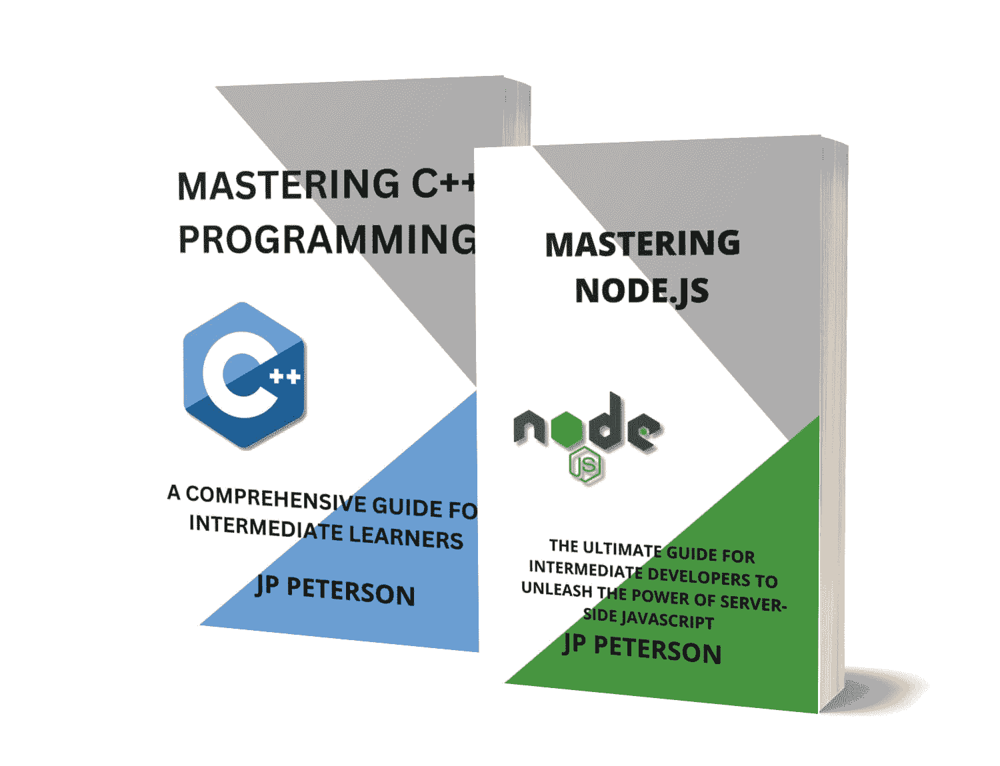

# 精通 Node.js 和 C++：中级开发者终极指南





## 第 1 章：Node.js 简介
Node.js 是一个基于服务器端 JavaScript 的革命性平台，它正在改变我们开发 Web 应用程序的方式。在本章中，我们将探索 Node.js 的起源、其关键特性以及它为开发者带来的收益。

## 第 2 章：配置你的 Node.js 环境
在深入 Node.js 开发之前，配置环境是至关重要的。在本章中，我们将引导你安装 Node.js、`NPM` 并配置你的开发工具，开启你的学习旅程。

# 第 3 章：理解异步编程
Node.js 的核心原理之一是异步编程。我们将深入探讨回调函数（callbacks）、承诺（promises）和 `async/await`，帮助你掌握这一基础概念。

## 第 4 章：构建你的第一个 Node.js 应用
让我们开始实践。我们将创建一个简单的 Node.js 应用并探索它的结构。你将学习如何使用模块并轻松地创建服务器应用程序。

## 第 5 章：处理 HTTP 请求与响应
在本章中，我们将重点关注使用 Node.js 构建 Web 服务器。我们将研究如何处理 HTTP 请求、路由以及有效地构建响应。

# 第 6 章：使用 Express.js
Express.js 是一个流行的 Node.js 框架。你将掌握它的特性，包括路由、中间件和模板引擎，以简化你的开发流程。

## 第 7 章：数据库与 Node.js
数据存储在 Web 开发中至关重要。我们将讨论如何将 `MongoDB` 和 `MySQL` 等数据库集成到 Node.js 中以及数据管理的最佳实践。

# 第 8 章：使用 WebSockets 构建实时应用
Node.js 擅长创建实时应用。在本章中，你将学习如何在项目中实现 `WebSockets` 实现即时通信。

## 第 9 章：身份验证与安全
安全高于一切。我们将涵盖身份验证、授权以及保护 Node.js 应用的安全最佳实践。

## 第 10 章：Node.js 应用的测试与调试
学习如何编写测试、有效地调试代码并确保 Node.js 应用的健壮性。

## 第 11 章：Node.js 应用的扩展
扩展应用程序对于处理增加的流量至关重要。我们将探索 Node.js 应用水平扩展和垂直扩展的策略。

## 第 12 章：性能优化
优化 Node.js 应用的性能非常重要。我们将深入研究相关技术。

## 第 13 章：容器化与部署
探索使用 `Docker` 进行容器化，并学习如何在 `AWS` 和 `Heroku` 等云平台上部署应用。

# 第 14 章：构建 RESTful API
RESTful API 是现代 Web 应用程序的骨干。在本章中，你将使用 Node.js 设计并开发 RESTful API。

## 第 15 章：超越 Node.js - 探索生态系统
发现巨大的 Node.js 生态系统，包括流行的库、框架和工具，以扩展你的知识。


Node.js 在服务器端执行 JavaScript 的能力是一项游戏规则的改变。JavaScript 传统上被认为是一种客户端脚本语言，得益于 Node.js，它现在被同时应用于客户端和服务端。

这种双重性简化了开发，因为开发者可以使用同一种语言编写应用程序的客户端和服务器组件。它简化了通信和数据交换，使开发更具凝聚力和效率。

#### 实时应用

Node.js 表现优异的领域之一是构建实时应用。传统的 Web 应用使用请求-响应模型，即客户端发送请求，服务器进行处理并返回响应。这种模型对于需要即时更新和交互式通信的应用程序（例如聊天应用、在线游戏或实时数据馈）效果并不理想。

Node.js 的非阻塞、事件驱动架构非常适合实时应用。它能够处理多个并发连接，并高效地向客户端实时推送数据。这种能力使得 Node.js 成为开发此类应用的首选选择。

## Node.js 的优势

在介绍介绍的结束之际，让我们回顾一下 Node.js 的优势：

- **高性能：** Node.js 的非阻塞架构和 V8 JavaScript 引擎使其异常快速且高效。
- **可扩展性：** Node.js 的事件驱动模型和处理并发连接的能力使其对于小型大型应用程序都具有可扩展性。
- **多功能性：** Node.js 适用于广泛的应用，从 Web 服务器到实时应用等等。
- **社区与生态系统：** Node.js 拥有充满活力且活跃的社区，这带来了丰富的模块和库生态系统，扩展了它的功能。

有了对 Node.js 的这些基础理解，我们已经准备好深入探索它的世界了。在接下来的章节中，我们将探索如何设置 Node.js 环境、掌握异步编程，并构建你的第一个 Node.js 应用程序。Node.js 提供的非常丰富，这段旅程将使你具备知识和技能，从而在你自己的项目中释放它的力量。因此，请随我们继续探索 Node.js 的奇妙世界。

# 第 2 章：设置你的 Node.js 环境

在第 1 章中，我们探索了 Node.js 的基础概念、它的非阻塞事件驱动架构以及在服务器端执行 JavaScript 的能力。现在，在第 2 章中，我们将迈出实用的一步。我们将引导你完成 Node.js 开发环境的设置过程，确保你已准备好进入服务器端 JavaScript 的世界。无论你是中级开发者还是 Node.js 的新手，本章都将为你提供启动所需的工具和知识。

## 为什么恰当的环境设置至关重要

在我们深入研究设置 Node.js 环境的技术细节之前，让我们花一点时间理解为什么这一步至关重要。

1. **开发的基础：** 你的开发环境就像建筑的基基。如果它坚固且准备充分，你的开发过程将是顺畅且高效的。如果它不稳定或不完整，你将在此过程中遇到障碍和挫折。
2. **一致性与兼容性：** 标准化的环境确保你的代码在不同机器上的行为保持一致。这至关重要，特别是当你与他人协作或将应用程序部署到生产服务器时。
3. **获取核心工具：** 正确的设置确保你能够访问核心工具，如 Node.js Runtime、`NPM`（Node 包管理器）以及各种开发库和框架。
4. **安全性与稳定性：** 保持安全补丁和更新的环境更安全、更稳定，减少了漏洞或崩溃的风险。
5. **效率：** 配置良好的环境可以节省你的精精力。它实现了任务自动化，简化了开发，并让你专注于编码，而不是排查设置问题。

## 准备安装

在进入安装过程之前，有几个准备步骤需要执行：

1. **选择代码编辑器：** 你需要一个代码编辑器来编写 Node.js 应用程序。有很多选择，包括 Visual Studio Code、Sublime Text、Atom 等。选择一个符合你喜好的并安装。
2. **版本控制：** 考虑使用 `Git` 等版本控制系统来管理代码库。它允许你跟踪更改、与他人协作并在需要时恢复到之前的版本。
3. **操作系统：** Node.js 兼容各种操作系统，包括 Windows、macOS 和 Linux。确保你正在使用支持的操作系统。

## 安装 Node.js

Node.js 是你服务器端 JavaScript 开发的核心运行时环境。以下是安装方法：

### 在 Windows 上：

1. 访问 Node.js 官网 `https://nodejs.org/`。
2. 你会两个下载选项：“LTS”（长期支持）和“Current”（当前）。对于大多数项目，建议下载 LTS 版本，因为它更稳定且支持更好。
3. 点击“LTS”版本开始下载。它是一个可执行安装程序，只需运行它并按照安装说明操作。
4. 安装完成后，打开命令提示符或 PowerShell 并输入 `node -v` 来检查 Node.js 是否正确安装。它应该显示版本号。
5. 同样，你可以通过输入 `npm -v` 来检查 `NPM` 版本。

### 在 macOS 上：

1. 访问 Node.js 官网 `https://nodejs.org/`。
2. 与 Windows 类似，你会看到“LTS”和“Current”的下载选项。下载 LTS 版本以获得稳定性。
3. 打开下载的 `.pkg` 文件并按照安装说明操作。安装过程中可能需要提供 macOS 密码。
4. 要验证安装，打开终端并运行 `node -v` 和 `npm -v` 来检查 Node.js 和 NPM 版本。

### 在 Linux 上（使用包管理器）：

Node.js 也可以通过你的发行版的包管理器在 Linux 上安装。以下是一些常用 Linux 发行版的说明：

**Debian/Ubuntu：**

```bash
sudo apt-get update
sudo apt-get install nodejs
sudo apt-get install npm
```

**Fedora：**

```bash
sudo dnf install nodejs
```

**CentOS：**

```bash
sudo yum install epel-release
sudo yum install nodejs
```

安装完成后，你可以运行 `node -v` 和 `npm -v` 进行验证。

## 关于包管理器的说明

在 Linux 安装说明中，你可能注意到了对包管理器（`apt-get`、`dnf`、`yum`）的提及。这些包管理器对于管理 Linux 系统上的软件安装至关重要。

Node.js 本身通过一个名为 `NPM` 的包管理器安装。NPM 是 Node.js 开发的关键工具。它允许你安装项目所需的库、框架和其他包。

你可能会奇怪为什么我们在包管理器命令前使用了 `sudo`。`sudo` 代表“superuser do”，用于以管理员权限执行命令。之所以需要它是因为包管理器需要管理员权限在系统上安装软件。

### NPM：Node 包管理器

现在你已经安装了 Node.js，你也拥有了 `NPM`。NPM 是 JavaScript 和 Node.js 的包管理器，它是你 Node.js 开发环境中最关键的工具之一。

通过 `NPM`，你可以：

- 安装项目所需的第三方库和框架。
- 管理 Node.js 应用程序的依赖项。
- 运行脚本以自动化任务，如测试和构建你的项目。


以下是几个核心的 NPM 命令：

- `npm install <package-name>`：此命令为你的项目安装特定的包。例如，要安装流行的 Express.js 框架，你可以运行 `npm install express`。
- `npm install -g <package-name>`：使用此命令全局安装包，这意味着你可以从任何项目中访问它们。全局包通常是命令行工具或实用程序。例如，`npm install -g nodemon` 会安装一个在你修改代码时自动重启 Node.js 应用程序的工具。
- `npm init`：此命令初始化一个新的 Node.js 项目。它会提示你提供有关项目的详细信息，例如项目名称、版本和入口点。运行此命令后，NPM 会生成一个 `package.json` 文件，其中包含有关你的项目及其依赖项的信息。
- `npm start`：如果你的项目 `package.json` 文件中包含 `"scripts"` 部分，你可以使用 `npm start` 运行预定义的脚本。这对于启动你的 Node.js 、运行测试或执行其他项目特定任务非常有用。

### 管理 Node.js 版本

Node.js 是一个活跃开发的平台，新版本会定期发布。在某些情况下，出于兼容性考虑或利用新功能，你可能需要使用特定的 Node.js 版本。

要管理 Node.js 版本，你可以使用 macOS 和 Linux 的 `NVM`（Node 版本管理器）或者 Windows 上的 `NVM`。这些工具允许你无缝地在不同的 Node.js 版本之间切换。

以下是在 Linux 上安装 `NVM` 的方法：

1. 打开你的终端。
2. 运行以下命令安装 `NVM`：
```bash
curl -o- https://raw.githubusercontent.com/nvm-sh/nvm
```
3. 执行安装命令后，你可能需要关闭并重新打开终端以使用 `NVM`。重新打开终端后，可以通过运行命令检查 `NVM` 是否安装正确：
```bash
nvm --version
```
4. 现在，你可以使用 `NVM` 安装和管理不同的 Node.js 版本。要查看可用 Node.js 列表，请使用：
```bash
nvm ls-remote
```
此命令将显示你可以安装的 Node.js 版本列表。然后你可以通过命令选择版本进行安装：
```bash
nvm install <node-version>
```
例如，要安装 Node.js 版本 14，你需要运行：
```bash
nvm install 14
```
5. 一旦安装了 Node.js，可以使用以下命令在不同版本之间切换：
```bash
nvm use <node-version>
```
例如，要切换到 Node.js 版本 14，你需要运行：
```bash
nvm use 14
```
6. 要检查当前激活的是哪个 Node.js 版本，请使用：
```bash
node -v
```
7. 当你在处理特定项目时，可以通过进入项目目录并运行以下命令为该项目设置 Node.js 版本：
```bash
nvm use <node-version>
```
当你处理多个具有不同依赖项或要求的项目时，这种管理 Node.js 版本的能力格别有用。

### Package.json 与依赖项管理

如前所述，当使用使用 `npm init` 创建新的 Node.js 项目时，NPM 会生成一个 `package.json` 文件。该文件对于管理项目依赖项和脚本至关重要。让我们探索一下它的组件。

#### 项目详情

- `name`：你的项目名称。
- `version`：你的项目版本。
- `description`：对项目的简要描述。
- `main`：应用程序的入口点（通常是 `index.js`）。

#### 脚本 (Scripts)

- `"scripts"`：此部分允许你定义可以通过 `npm run <script-name>` 执行的自定义脚本。常见的脚本包括用于启动应用程序的 `"start"` 和运行测试的 `"test"`。你可以根据需要定义额外的脚本。

####依赖 (Dependencies)
- `"dependencies"`：在这里你列出项目依赖的第三方包。当你运行 `npm install <package-name>` 时，NPM 会将该包添加到此部分。此部分包含包名及其版本号。

#### 开发依赖 (Development Dependencies)
- `"devDependencies"`：与依赖类似，但这些包仅在开发或测试期间需要。它们可能包括测试库、构建工具或代码检查工具（linters）。

#### 创建 `package.json` 文件

要为你的项目创建一个 `package.json` 文件，请在终端中进入项目目录并运行：
```bash
npm init
```
系统将提示你输入有关项目的详细信息，如名称、版本、描述和入口点。你可以按回车键接受默认值，也可以提供自己的值。一旦回答了所有提示，NPM 将生成 `package.json` 文件。

#### 安装依赖项

要向项目添加依赖项，你可以使用 `npm install` 命令。例如，要安装流行的 Express.js 框架，你需要运行：
```bash
npm install express
```
此命令不仅会安装 Express.js，还会更新你 `package.json` 文件中的 "dependencies" 部分。在安装包时使用 `--save` 标志是一个好习惯，因为它能确保该包被添加到你的 `package.json` 文件中。

### NPM 脚本

NPM 脚本是自动化常用开发任务的一种方式，例如启动应用程序、运行测试或为生产环境构建项目。你在 `package.json` 文件的 `"scripts"` 部分中定义这些脚本。

以下是如何设置 NPM 脚本的示例：
```json
{
  "name": "my-node-app",
  "version": "1.0.0",
  "description": "A Node.js application",
  "main": "index.js",
  "scripts": {
    "start": "node index.js",
    "test": "mocha test/*.js",
    "build": "gulp build"
  },
  "dependencies": {
    "express": "⁴.17.1",
    "body-parser": "¹.19.0"
  },
  "devDependencies": {
    "mocha": "⁷.0.1",
    "gulp": "⁴.0.2"
  }
}
```
在这个示例中，我们定义了三个 NPM 脚本：
- `"start"`：该脚本使用 `node index.js` 启动你的 Node.js 应用程序。
- `"test"`：该脚本使用流行的测试框架 Mocha  test 目录下所有的 `.js` 文件。
- `"build"`：该脚本用于构建项目，它运行一个 Gulp 任务。

你可以使用 `npm run` 命令运行这些脚本。例如，要启动应用程序，你需要：
```bash
npm run start
```


`NPM` 脚本是一种自动化常用开发任务并确保工作流一致性的便利方法。

## 结论

在本章中，我们涵盖了设置 Node.js 环境的关键步骤。我们讨论了良好配置的环境重要性，以及使用 `NPM` 进行包管理的益处。你还学习了如何使用 `NVM` 管理不同的 Node.js 版本，以及如何为你的项目创建 `package.json` 文件。

现在你的环境已配置就当，你已经准备好开启 Node.js 之之旅了。在接下来的章节中，我们将基于已建立的坚实基础，深入探讨 `Node.js` 的核心概念和实际应用。请与我们一起探索 JavaScript 服务端开发的精彩世界。

# 第 3 章：理解异步编程

在 `Node.js` 的世界中，异步编程是一个与其传统服务器端技术区分开来的核心概念。异步操作允许 `Node.js` 高效处理多个任务，使其非常适合构建高性能且响应迅速的应用程序。在本章中，我们将探索异步编程的基础知识，深入研究使其运行的机制，并理解为什么它是 `Node.js` 开发中至关重要的部分。

## 阻塞操作的挑战

在深入研究异步编程之前，理解阻塞操作带来的挑战至关重要。在大多数服务器端技术中，当向服务器发送请求时，服务器通常按顺序处理它，阻塞后续请求直到处理完成。这种阻塞行为会导致效率低和无响应问题，特别是在处理 I/O 操作时，例如从文件读取内容、发送网络请求或查询数据库。

考虑一个服务器需要从文件中读取数据的场景。在阻塞系统中，如果文件操作需要很长时间才能完成，服务器在期间将无法处理任何其他请求。这导致了资源利用率低下和缺乏响应能力。

## 异步编程的救援

异步编程是解决阻塞操作挑战的方案。异步代码不再等待操作完成，允许服务器启动操作并继续执行其他任务，而无需等待。当操作完成后，会触发回调函数，允许服务器处理结果。

`Node.js` 采用单线程、事件驱动、非阻塞 I/O 模型来实现异步性。该模型使其能够高效处理并发连接和 I/O 密集型操作，而阻塞其他任务的执行。让我们拆解异步编程的关键组件：

### 回调函数 (Callbacks)

回调函数是 `Node.js` 中异步编程的骨石。回调是一个作为参数传递给另一个函数（通常是异步操作）的函数。当操作完成后，就会执行该回调函数。

这是一个简单的示例：

```javascript
function performAsyncOperation(callback) {
  setTimeout(function() {
    console.log("Operation completed.");
    callback();
  }, 1000);
}

performAsyncOperation(function() {
  console.log("Callback executed.");
});
```

在这个示例中，`performAsyncOperation` 是一个使用 `setTimeout` 模拟延迟操作异步函数。操作完成后，它会调用提供的回调函数。在这种情况下，回调打印了“Callback executed.”。

回调之所以强大，是因为它们允许你定义异步操作完成后发生什么。然而，当你开始处理更复杂的操作和多个回调时，“回调地狱”或“死亡金字塔”可能会变成一个问题。这时回调函数相互嵌套，使得代码更难以阅读和维护。

### Promise (承诺)

Promise 是一种处理异步操作并避免回调地狱的更有结构化的方法。Promise 代表异步操作的最终结果（或失败）。它可以处于三种状态之一：等待中（pending）、已完成（fulfilled）或拒绝（rejected）。

这是一个使用 promise 的基础示例：

```javascript
function performAsyncOperation() {
  return new Promise(function(resolve, reject) {
    setTimeout(function() {
      console.log("Operation completed.");
      resolve("Result data");
    }, 1000);
  });
}

performAsyncOperation()
  .then(function(result) {
    console.log("Operation succeeded with data:", result);
  })
  .catch(function(error) {
    console.error("Operation failed with error:", error);
  });
```

在这个示例中，`performAsyncOperation` 返回一个 promise，在操作完成后解析结果。`.then` 方法用于处理成功，`.catch` 方法用于处理错误。Promise 允许编写更有组织且可读性更高的代码，在链多个异步操作时特别有用。

### Async/Await

这是 JavaScript 最近引入的特性，简化了 promise 的使用。它允许你以更接近同步的风格编写异步代码，使其更容易阅读和理解。Async/await 构建在 promise 之上，提供了一种编写看起来像顺序执行的非阻塞代码的方法。

这是与上面相同的示例，但使用了 async/await：

```javascript
async function performAsyncOperation() {
  return new Promise(function(resolve) {
    setTimeout(function() {
      console.log("Operation completed.");
      resolve("Result data");
    }, 1000);
  });
}

async function main() {
  try {
    const result = await performAsyncOperation();
    console.log("Operation succeeded with data:", result);
  } catch (error) {
    console.error("Operation failed with error:", error);
  }
}

main();
```


在这个示例中，`main` 函数被标记为 `async`，允许我们使用 `await` 关键字来等待 `performAsyncOperation` 的完成。这使得代码流更像同步代码，提高了其可读性。

### 事件循环与非阻塞 I/O

要理解 Node.js 中异步编程的工作原理，掌握事件循环和非阻塞 I/O 的概念至关重要。

#### 事件循环
事件循环是 Node.js 非阻塞事件驱动架构的核心组件。它负责管理和执行异步操作、回调和事件。以下是事件循环工作原理的简化说明：

1. 当 Node.js 应用启动时，它会初始化事件循环并开始事件和 I/O 操作。
2. 启动异步操作（例如从文件读取或发送网络请求），并将其放入队列中。
3. 事件循环持续检查该队列是否有已完成的操作。当某个操作完成时，就会执行其回调函数。
4. 事件循环在循环中处理事件和回调，确保应用程序保持响应，并能够同时处理多个操作。

事件循环是 Node.js 高效处理大量连接和 I/O 密集型操作的关键部分。它确保了即使在处理需要一些时间的任务时，应用程序也能保持响应。

#### 非阻塞 I/O
非阻塞 I/O 是 Node.js 的一个基本特性，允许它执行 I/O 操作而不阻塞其他代码的执行。当启动一个非阻塞 I/O 操作时，事件循环不会等待它完成。相反，它会在监控 I/O 操作进展的同时，继续执行其他任务。

当 I/O 操作完成后，会触发回调，允许应用程序处理结果。这种非阻塞行为确保了应用程序保持响应，并可以处理多个 I/O 密集型操作而不会卡死。

### 异步模式与错误处理

除了理解异步编程的基础之外，熟悉 Node.js 中的常见模式和错误处理策略也至关重要。

#### 常见异步模式

1. 并行执行：你可能有多个可以并行运行的异步任务。你可以使用 `Promise.all` 等工具等待所有任务完成。

```javascript
const promises = [asyncTask1(), asyncTask2(), asyncTask3()];

Promise.all(promises)
  .then(results => {
    // 所有任务均成功完成。
  })
  .catch(error => {
    // 其中一个任务发生了错误。
  });
```

2. 顺序执行：有时你需要按特定顺序执行异步任务。你可以使用 `async/await` 来确保任务按顺序执行，在启动下一个任务之前等待一个完成。

```javascript
async function sequentialExecution() {
  const result1 = await asyncTask1();
  const result2 = await asyncTask2(result1);
  const result3 = await asyncTask3(result2);
  return result3;
}

sequentialExecution()
  .then(result => {
    // 所有任务按顺序成功完成。
  })
  .catch(error => {
    // 其中一个任务发生了错误。
  });
```

3. 处理多个 Promise：在处理多个 promise 时，你可以使用 `Promise.all` 等待所有 promise 解析（resolve），或使用 `Promise.race` 获取第一个解析或拒绝（reject）的 promise 结果。

```javascript
const promises = [asyncTask1(), asyncTask2(), asyncTask3()];

Promise.all(promises)
  .then(results => {
    // 所有 promise 均成功完成。
  })
  .catch(error => {
    // 其中一个 promise 发生了错误。
  });

// 或者
Promise.race(promises)
  .then(result => {
    // 第一个完成的 promise。
  })
  .catch(error => {
    // 第一个拒绝的 promise。
  });
```

4. 错误处理：在异步代码中，正确处理错误至关重要。在使用 `async/await` 时，可以使用 `try/catch` 块来捕获并优雅地处理错误。

```javascript
async function errorHandlingExample() {
  try {
    const result = await asyncTaskThatCouldFail();
    return result;
  } catch (error) {
    // 处理错误、记录日志或执行恢复操作。
    throw error; // 必要时重新抛出。
  }
}

errorHandlingExample()
  .then(result => {
    // 任务成功完成。
  })
  .catch(error => {
    // 任务期间发生了错误。
  });
```

#### 回调中的错误处理
处理基于回调的异步代码时，错误处理通常通过约定进行，即回调的第一个参数留给错误对象。如果发生错误，该参数将包含错误，你可以据此进行处理。

```javascript
function asyncOperation(callback) {
  // 模拟一个错误。
  const error = new Error('Something went wrong');
  callback(error, null);
}

asyncOperation(function(error, result) {
  if (error) {
    console.error('Error:', error.message);
    // 处理错误。
  } else {
    console.log('Result:', result);
    // 继续处理结果。
  }
});
```


在基于回调的代码中，一致地检查并处理错误是非常重要的，因为没有像 `try/catch` 这样的机制来捕获异常。

## 异步编程的实际应用

异步编程不仅仅是一个理论概念；它是 Node.js 许多真实世界用例的核心。以下是几个实际应用：

### 处理 HTTP 请求
Node.js 通常用于构建 Web 服务器和 API。当服务器接收到 HTTP 请求时，它通常会启动多个异步操作，例如读取请求数据、访问数据库和进行外部 API 调用。异步代码允许服务器高效地处理这些任务，确保它能够同时响应多个请求。

#### 文件系统操作
读取和写入文件是许多应用程序中的常见任务。异步文件 I/O 允许 Node.js 在不阻塞事件循环的情况下执行这些操作，确保应用程序保持响应。

#### 数据库操作
Node.js 经常与 `MongoDB`、`MySQL` 或 `PostgreSQL` 等数据库配合使用。这些数据库提供了异步驱动，允许 Node.js 高效地与它们交互。异步数据库操作确保应用程序在等待数据库响应时可以继续处理其他请求。

#### 实时应用
需要实时功能的应用程序（如聊天应用、在线游戏或实时数据流）严重依赖异步编程。Node.js 的非阻塞、事件驱动模型使其成为构建此类应用程序的理想选择。

#### 并行处理
在处理计算密集型任务时，可以使用异步代码将任务分配到多个线程或进程，以利用多核 CPU 的优势，提高性能。

## 最佳实践与注意事项

Node.js 中的异步编程可能非常强大，但也引入了复杂性和潜在挑战。以下是一些最佳实践和注意事项：

1. **错误处理**：始终处理异步代码中的错误。在使用 `async/await` 时配合 `try/catch`，并在回调中检查错误参数。适当处理对于对于稳定性至关重要。
2. **避免回调地狱**：在回调代码中，注意回调地狱或过度嵌套。考虑使用 `promises` 或 `async/await` 来提高代码的可读性。
3. **并发**：Node.js 的单线程事件循环有其局限性。为了充分利用多核 CPU，请考虑使用 `cluster` 模块或其他策略将工作分配到多个进程中。
4. **测试**：彻底测试异步代码。使用 `Mocha` 或 `Jest` 等测试框架编写单元测试和集成测试，以涵盖各种场景和边界情况。
5. **性能**：注意性能瓶颈。异步代码可以帮助并发，但它并没有消除优化算法和最小化阻塞操作的需求。
6. **文档**：为你的异步代码及其用法编写文档，特别是在为他人创建库或模块时。清晰的文档可以使开发者更容易理解和使用你的代码。

## 结论

异步编程是 Node.js 中的一个基本概念，它使其能够高效地处理多个任务并保持响应。无论你是在构建 Web 服务器、实时应用还是与数据库交互，异步代码都是 Node.js 开发的核心。

在本章中，我们探索了阻塞操作带来的挑战以及异步编程提供的解决方案。我们讨论了关键组件，例如 `callbacks`、`promises` 和 `async/await`，并引入了作为 Node.js 异步模型基础的 `event loop` 和 `non-blocking I/O`。我们检查了处理异步代码的常见模式和最佳实践，以及实际应用和注意事项。

通过对异步编程的深入理解，你完全有能力应对更复杂的 Node.js 项目，并利用其力量构建响应且高性能的应用程序。在接下来的章节中，我们将继续探索高级主题，并引导你构建能够释放服务器端 JavaScript 全能的 Node.js 应用。

## 第 4 章：构建你的第一个 Node.js 应用

现在你已经有了 Node.js 的坚实基础，并理解了异步编程的关键概念，是时候迈出下一步开始构建你的第一个 Node.js 应用了。在本章中，我们将引导你通过使用 Node.js 创建一个简单但功能齐全的 Web 服务器。在本章结束时，你将拥有一个运行中的实用 Node.js 应用。

## 准备工作

在深入实际编码之前，让我们先概述一下我们将构建的内容。我们的目标是创建一个可以响应 `HTTP` 请求的基础 Web 服务器。具体来说，我们将构建一个在指定端口上监听传入请求的 `HTTP` 服务器，当请求被提出时，它将返回“Hello, Node.js!”的消息。

这个简单的示例将演示在 Node.js 中创建 `HTTP` 服务器、处理 `HTTP` 请求和发送响应的核心概念。由于虽然这是一个简单的应用程序，但你学到的原理可以应用于更复杂的项目。

## 创建新项目文件夹

构建 Node.js 应用的第一步是创建一个新的项目文件夹。这是你存储代码和项目文件的地方。你可以在计算机上的任何目录进行选择，为项目文件夹取一个描述性的名称是一个好习惯。对于此示例，让我们命名为“node-web-server”。

## 初始化你的项目

一旦准备好项目文件夹，打开终端并导航到该目录。你可以使用 `cd` 命令在文件系统中进行导航。例如：

```bash
cd /path/to/your/project/node-web-server
```

一旦你进入了项目文件夹，就是时候初始化你的 Node.js 项目了。此过程将创建一个 `package.json` 文件，它将存储有关你的项目及其依赖项的信息。

要初始化项目，请运行以下命令：

```bash
npm init
```

系统将提示你提供有关项目的信息，例如名称、版本、描述、入口点等。你可以按回车接受默认值，或提供你自己的。一旦填写完细节，将生成一个 `package.json` 文件。

## 安装依赖

我们的 Node.js 应用将使用内置的 `http` 模块来创建 `HTTP` 服务器。该模块不需要额外安装，因为它是 Node.js 核心模块的一部分。然而，我们仍然可以使用一个名为 `nodemon` 的简单包来增强我们的应用程序，它会在检测到代码更改时自动重启我们的服务器。它是开发期间非常有用的工具。

要将 `nodemon` 作为开发依赖安装到你的项目中，请运行以下命令：

```bash
npm install nodemon --save-dev
```

`--save-dev` 标志表示 `nodemon` 应被保存为 `package.json` 文件中的开发依赖。这意味着它是开发期间使用的工具，但在生产环境中不需要。

## 创建你的第一个 Node.js 文件

现在你的项目已经初始化，并且已经准备好了开发依赖项，是时候创建你的第一个 Node.js 文件了。在你的项目文件夹中，创建一个名为 `app.js` 的新文件。该文件将包含你的 Node.js 应用的代码。

## 编写你的 Node.js 应用代码

在你喜欢的代码编辑器中打开 `app.js` 文件，开始编写第一个 Node.js 应用的代码。你可以使用任何代码编辑器，例如 Visual Studio Code、Sublime Text 或 Atom。这里是你的简单 Node.js Web 服务器的代码：

```javascript

```


```javascript
// Import the http module

const http = require('http');

// Define the hostname and port

const hostname = '127.0.0.1'; // This represents the local server (your computer)

const port = 3000; // You can choose any available port

// Create an HTTP server

const server = http.createServer((req, res) => {
  // Set the response status and headers
  res.statusCode = 200;
  res.setHeader('Content-Type', 'text/plain');
  // Send the response body
  res.end('Hello, Node.js!\n');
});

// Start the server and listen on the specified hostname and port
server.listen(port, hostname, () => {
  console.log(`Server running at http://${hostname}:${port}/`);
});
```

以下是代码的详细说明：

1. 我们导入了内置的 `http` 模块，它提供了创建 HTTP 服务器的功能。
2. 我们定义了服务器监听传入请求的 `hostname`（主机名）和 `port`（端口）。在本例中，我们使用 `127.0.0.1` 作为本地服务器，端口使用 `3000`。你可以选择任何喜欢的可用端口。
3. 我们使用 `http.createServer` 方法创建了一个 HTTP 服务器。该函数接受一个带有两个参数的回调：`req`（请求）和 `res`（响应）。在回调函数内部，我们定义了服务器如何响应传入的 HTTP 请求。
4. 我们将响应状态设置为 `200`，表示请求成功，并将内容类型设置为 `text/plain` 以进行纯文本响应。
5. 我们使用 `res.end` 发送响应体，在这种情况下，它是一个简单的“Hello, Node.js!”消息，后面紧跟着一个换行符。
6. 最后，我们通过调用 `server.listen` 服务器。它接受 `port` 和 `hostname` 作为参数，并传入一个回调函数向控制台打印消息，表示服务器正在运行并监听请求。

### 启动你的 Node.js 

现在你已经写好了 Node.js 应用代码，是时候运行你的服务器了。在终端中，导航到你的项目文件夹并使用以下命令通过 `nodemon` 启动你的应用程序：

```bash
nodemon app.js
```

你应该会在终端中看到输出，表明你的服务器正在运行。它会显示类似“Server running at http://127.0.0.1:3000/”的消息，显示服务器监听的主机名和端口。

### 访问你的 Node.js 应用程序

你的 Node.js 应用现在正在运行，可以通过 Web 浏览器或 `curl` 等工具进行访问。打开浏览器并输入以下 URL：

```
http://127.0.0.1:3000/
```

你应该会在浏览器中看到“Hello, Node.js!”消息。恭喜你，成功使用 Node.js 创建了一个简单的 Web 服务器！

### 理解你应用程序的流程

让我们仔细观察你的 Node.js 应用是如何工作的：

1. 当你在浏览器中访问该 URL 时，向服务器发送一个 HTTP GET 请求。
2. 使用 `http` 模块创建的服务器在指定的主机名和端口监听传入的请求。
3. 当收到请求时，会执行服务器的回调函数。该函数设置响应状态、内容类型和响应体。
4. 响应被发送回浏览器，你在浏览器中看到了“Hello, Node.js!”消息。
5. 服务器继续监听新请求，并以相同的方式处理它们。

### 让你的应用程序更具交互性

虽然“Hello, Node.js!”消息是一个很好的起点，但让我们通过增强其交互性来提升你的应用程序。在本节中，我们将添加一个简单的功能，在你访问服务器时显示当前的日期和时间。

#### 修改你的 `app.js` 代码

为了添加日期和时间功能，你需要修改你的 `app.js` 文件。以下是更新后的代码：

```javascript
// Import the http module

const http = require('http');

// Define the hostname and port

const hostname = '127.0.0.1';
const port = 3000;

// Create an HTTP server
const server = http.createServer((req, res) => {
  // Set the response status and headers
  res.statusCode = 200;
  res.setHeader('Content-Type', 'text/plain');
  // Get the current date and time
  const dateTime = new Date().toLocaleString();
  // Send the response body
  res.end(`Hello, Node.js! The current date and time is: ${dateTime}\n`);
});

// Start the server and listen on the specified hostname and port
server.listen(port, hostname, () => {
  console.log(`Server running at http://${hostname}:${port}/`);
});
```

在更新后的代码中：

1. 我们添加了一新行，使用 `new Date().toLocaleString()` 获取当前的日期和时间。这会在接收到请求时捕捉当前的时刻。
2. 我们修改了响应体，在消息中包含了日期和时间。

### 重载你的应用程序

如果你的应用程序仍在通过 `nodemon` 运行，你应该自动看到变化。如果没有，你可以在终端中按 `Ctrl+C` 停止应用程序，然后使用 `nodemon app.js` 重新启动。

现在，当你在浏览器中访问服务器时，你应该会看到如下的消息：

```
Hello, Node.js! The current date and time is: 2023-10-05 15:30:00
```


```
恭喜！你已经为你的 Node.js 应用添加了一个交互式功能。
```

## 结

在本章中，你已经在构建 Node.js 应用的道路迈出了第一步。你创建了一个基础的 Web 服务器，学习了如何处理 HTTP 请求和发送响应，并添加了一个显示当前日期和时间的交互式功能。

虽然这个示例很简单，但它阐明了创建 Node.js 应用的核心概念。你设置了项目文件夹、初始化了项目、安装了依赖项、编写了代码并启动了服务器。你还看到了服务器是如何响应 HTTP 请求的，以及你如何通过修改代码来增强应用程序的功能。

在接下来的章节中，我们将探索 Node.js 开发中更高级的主题，包括路由、中间件和数据存储。你将继续在所学知识的基础上构建更复杂、功能更丰富的应用程序。

# 第 5 章：处理 HTTP 请求和响应

在上一章中，你构建了一个简单的 Node.js Web 服务器，它返回一个基础消息。虽然这是一个很好的起点，但现实世界中的应用通常需要对 HTTP 请求和响应进行更复杂的处理。在本章中，我们将探索如何处理不同类型的 HTTP 请求、解析请求数据并发送适当的响应。在本章结束时，你将对在 Node.js 中处理 HTTP 有坚实的理解。

## 理解 HTTP 方法

HTTP（超文本传输协议）是 Web 数据通信的基础。当客户端（如浏览器）与 Web 服务器交互时，它会发送 HTTP 请求来请求特定的操作或数据。HTTP 定义了多种请求方法，每种都有特定的用途。最常用的 HTTP 方法有：

1. `GET`: 用于从服务器获取数据。`GET` 请求不应包含请求体，通常用于检索资源。
2. `POST`: 用于向指定的资源提交要进行处理的数据。`POST` 请求可以包含请求体，通常用于提交表单、创建新资源或执行数据更新。
3. `PUT`: 用于更新资源或在资源不存在时创建新资源。它通常要求完全替换现有资源。
4. `PATCH`: 用于部分更新资源。与需要完全替换资源的 `PUT` 不同，`PATCH` 可以仅更新特定字段。
5. `DELETE`: 用于请求删除资源。
6. `OPTIONS`: 用于描述目标资源的通信选项。
7. `HEAD`: 与 `GET` 类似，但它请求的是响应的标头而非实际数据。它通常用于检查资源可用性并获取元数据。

在 Node.js 中，你可以通过检查请求对象的 `req.method` 属性来处理这些 HTTP 方法。

## 处理不同的 HTTP 方法

让我们探索如何在 Node.js 应用中处理各种 HTTP 方法。我们将使用一个简单的示例来演示。

假设你想创建一个管理任务的 API，并且需要对任务资源处理 `GET`、`POST`、`PUT` 和 `DELETE` 请求。以下是实现方法：

```javascript
const http = require('http');
const { parse } = require('url');
const { readRequestBody } = require('./util'); // 我们稍后会定义这个函数。

const tasks = []; // 为了简单起，我们将使用数组来存储任务。

const server = http.createServer((req, res) => {
  const { method, url } = req;
  const parsedUrl = parse(url, true);

  if (method === 'GET') {
    // 处理 GET 请求以检索任务
    res.setHeader('Content-Type', 'application/json');
    res.end(JSON.stringify(tasks));
  } else if (method === 'POST') {
    // 处理 POST 请求以创建新任务
    readRequestBody(req)
      .then((body) => {
        const task = JSON.parse(body);
        tasks.push(task);
        res.statusCode = 201;
        res.end(JSON.stringify(task));
      })
      .catch((error) => {
        res.statusCode = 400;
        res.end('Bad Request');
      });
  } else if (method === 'PUT') {
    // 处理 PUT 请求通过 ID 更新任务
    const taskId = parsedUrl.pathname.split('/').pop();
      const index = tasks.findIndex((task) => task.id === taskId);
      if (index === -1) {
        res.statusCode = 404;
        res.end('Not Found');
      } else {
        readRequestBody(req)
          .then((body) => {
            const updatedTask = JSON.parse(body);
            tasks[index] = updatedTask;
            res.end(JSON.stringify(updatedTask));
          })
          .catch((error) => {
            res.statusCode = 400;
            res.end('Bad Request');
          });
      }
  } else if (method === 'DELETE') {
    // 处理 DELETE 请求通过 ID 删除任务
    const taskId = parsedUrl.pathname.split('/').pop();
    const index = tasks.findIndex((task) => task.id === taskId);
    if (index === -1) {
      res.statusCode = 404;
      res.end('Not Found');
    } else {
      tasks.splice(index, 1);
      res.end('Task deleted');
    }
  }
});

server.listen(3000, () => {
  console.log('Server is running');
});
```

我们现在将探索如何在 Node.js 开发中处理各种 HTTP 方法并管理资源。让我们拆解代码：

1. 我们检查请求对象的 `method` 属性以确定使用的 HTTP 方法。如果不支持，返回 "Method Not Allowed"。
2. 对于 `GET`，我们以 JSON 格式响应任务列表。
3. 对于 `POST`，我们期望客户端发送一个代表新任务的 JSON 对象。我们使用 `readRequestBody`（稍后会定义）并将任务添加到 `tasks` 数组。返回任务和 "201 Created" 状态码。
4. 对于 `PUT`，我们从 URL 中提取任务 ID 并通过请求体更新任务。如果未找到，返回 "Not Found"。
5. 对于 `DELETE`，我们根据指定的 ID 删除任务。如果未找到，返回 "Not Found" 状态码。

```javascript
function readRequestBody(request) {
  return new Promise((resolve, reject) => {
    let body = '';
    request.on('data', (chunk) => {
      body += chunk.toString();
    });
    request.on('end', () => {
      resolve(body);
    });
    request.on('error', (error) => {
      reject(error);
    });
  });
}
```

`readRequestBody` 函数监听传入的数据块，将其附加到缓冲区，并在接收到所有数据后解析请求正文。如果在读取正文时发生错误，它将拒绝 promise。

### 向你的 Node.js 应用发送 HTTP 请求

现在你的 Node.js 应用已设置好处理不同的 HTTP 方法，你可以使用各种 HTTP 客户端进行测试。以下是与服务器交互的一些常用方式：

1. **Web 浏览器**：打开浏览器并输入 URL（例如 `http://127.0.0.1:3000`）访问你的 Node.js 服务器。你可以通过访问 URL 来发送 `GET` 请求。要测试其他方法（如 `POST`、`DELETE` 等），可以使用浏览器扩展或 Postman 等工具。
2. **curl**：你可以使用命令行工具 `curl` 发送 HTTP 请求。例如，要发送 `GET` 请求，可以运行：

```bash
curl http://127.0.0.1:3000
```

要发送 `POST`、`PUT` 或 `DELETE` 请求，你可以使用 `-X` 选项指定 HTTP 方法并使用 `-d` 选项包含数据。


### 3. HTTP 库
你可以在编程语言中使用 HTTP 库，例如 JavaScript（使用 `fetch` API）、Python（使用 `requests`）或任何允许你发送 HTTP 请求的语言。这里是一个使用 JavaScript `fetch` 的示例：

```javascript
fetch('http://127.0.0.1:3000', { method: 'GET' })
  .then(response => response.json())
  .then(data => console.log(data))
  .catch(error => console.error('Error:', error));
```

你可以修改 `method` 属性来测试其他的 HTTP 方法。

#### 错误处理与响应状态码

在上面的代码示例中，你可以看到不同的 HTTP 方法会导致不同的响应状态码。适当的状态码处理对于 API 设计以及传达请求结果至关重要。

- 对于成功的 GET 请求，我们返回 `200 OK` 状态码和任务的 JSON 表示。
- 对于成功的 POST 请求，我们返回 `201 Created` 状态码和 JSON 格式的创建任务。
- 对于成功的 PUT 请求，我们返回 `200 OK` 状态码和 JSON 格式的更新任务。
- 对于成功的 DELETE 请求，我们返回 `200 OK` 状态码和简单的“Task deleted”消息。
- 如果未找到任务，我们返回 `404 Not Found` 状态码。
- 如果存在错误的请求（bad request），我们返回 `400 Bad Request` 状态码。
- 如果特定路由不允许该 HTTP 方法，我们返回 `405 Method Not Allowed` 状态码。

返回适当的状态码以准确指示请求结果是至关重要的。

#### 中间件与请求处理

在现实世界的 Node.js 应用中，你经常会遇到更复杂的路由和请求处理场景。虽然我们讨论的示例处理了任务的简单 HTTP 请求，但更广泛的应用可能需要路由、认证、校验和其他形式的中间件来有效地处理请求。

在 Node.js 中，你可以利用 `Express.js` 等中间件库来简化请求处理并实现更高级的功能。`Express.js` 为创建 Web 应用和 API 提供了一个健壮的框架，提供了路由、中间件以及各种 HTTP 请求和响应功能。

随着你 Node.js 开发技能的进步，你可以探索这些框架和库，以简化更复杂应用的开发。

## 结论

处理 HTTP 请求和响应是使用 Node.js 构建 Web 应用和 API 的基础方面。在本章中，你学习了如何处理不同的 HTTP 方法、解析请求数据并发送适当的响应。你探索了响应状态码在传达请求结果中的意义，以及如何准确地返回它们。

虽然提供的示例很简单，但它展示了 Node.js 请求处理的核心原理。当你深入更复杂的项目时，你会发现像 `Express.js` 这样的库可以简化过程，并为创建健壮的 Web 应用提供额外功能。

在后续章节中，我们将继续探索 Node.js 开发中的高级主题，包括路由、中间件和数据存储，帮助你构建功能丰富的 Web 应用和 API。

# 第 6 章：使用 Express.js

`Express.js` 是一个用于 Node.js 的强大且灵活的 Web 应用框架。它通过提供一组健壮的功能（包括路由、中间件和请求处理）简化了构建 Web 应用和 API 的过程。在本章中，你将学习如何使用 `Express.js`，从它的安装和设置开始，到创建路由、处理请求和响应，以及使用中间件来增强你的 Node.js 应用的功能。

## 什么是 Express.js？

`Express.js` 通常简称为 `Express`，是一个用于 Node.js 的极简且无主张的 Web 应用框架。它提供了一系列基本功能和工具，帮助开发者快速高效地构建 Web 应用。`Express` 的设计是非侵入性的，允许你与其他库和包配合使用以适应你的特定需求。

以下是 `Express.js` 的关键特性和优势：

1. **路由**：`Express` 简化了处理不同 HTTP 方法和 URL 的路由创建。你可以为 `GET`、`POST`、`PUT`、`DELETE` 以及其他 HTTP 方法定义路由，从而轻松管理 API 端。
2. **中间件**：`Express` 使用可以插入请求-响应循环的件函数。这允许你在请求流的特定点执行认证、日志、请求解析和响应处理等任务。
3. **模板引擎**：虽然 `Express` 本身没有内置模板引擎，但它支持多种模板引擎，如 `EJS`、`Pug`（以前称为 Jade）和 `Handlebars`。这些引擎帮助你在服务器上渲染动态内容并将其发送到客户端。
4. **提供静态文件**：`Express` 能够简单地从目录中提供 HTML、CSS 和 JavaScript 等静态文件。
5. **HTTP 工具方法**：`Express` 扩展了 Node.js 的 `http` 模块，提供了处理 HTTP 请求和响应的额外工具方法。
6. **错误处理**：`Express` 允许你定义错误处理中间件函数，可以在请求处理过程中捕并处理错误。

### 安装 Express.js

在开始使用 `Express.js` 之前，你需要安装它。可以使用 `npm`（Node 包管理器）将 `Express` 作为依赖添加到你的 Node.js 项目中。要安装 `Express`，请在终端中打开项目目录并运行以下命令：

```bash
npm install express
```

该命令将下载并安装 `Express` 包到你项目的 `node_modules` 目录。一旦安装完成，你就可以在应用中使用 `Express` 了。

### 创建 Express 应用

安装好 `Express` 后，你可以通过引入该模块并调用它来创建一个 Express 应用。这里有一个简单的示例：

```javascript
const express = require('express');
const app = express();
const port = 3000;

app.listen(port, () => {
  console.log(`Server is running on port ${port}`);
});
```

在此代码中：
- 我们引入了 `express` 模块并通过调用 `express()` 创建 Express 应用。
- 我们指定了服务器监听的端口（此处为 3000）。
- 我们通过调用 `listen` 方法启动服务器，该方法接收端口和一个在启动时执行的回调函数。

### 使用 Express 进行路由

Express 的主要优势之一是它的路由系统，便于为不同的 HTTP 方法和 URL 定义路由。你可以使用对应于 HTTP 动词（例如 `GET`、`POST`、`PUT`、`DELETE`）的方法创建路由，并指定回调函数来处理请求和响应。这是一个定义简单路由的示例：

```javascript
app.get('/', (req, res) => {
  res.send('Hello, Express!');
});
```

在此示例中：
- `app.get()` 定义了一个匹配根路径 ("/") 的 HTTP GET 请求路由。
- 回调函数接收两个参数：`req`（请求对象）和 `res`（响应对象）。
- 在回调函数内部，我们使用 `res.send()` 向客户端发送响应。

你可以为各种 HTTP 方法和 URL 模式定义路由，从而有效地结构化你的应用。例如，你可以创建处理用户注册、登录、数据检索等更多功能的路由。

### 请求与响应对象

`req`（请求）和 `res`（响应）对象对于 Express 中处理 HTTP 请求和构建响应至关重要。这些对象作为参数传递给路由的回调函数。以下是对这些对象的简要概述：


- `req` (请求对象):

- `req.params`: 一个对象，包含映射到命名路由参数的属性。例如，如果你有一个类似 `/users/:id` 的路由，`req.params.id` 将提供 `id` 参数的值。

- `req.query`: 一个对象，包含 URL 中查询字符串的属性。例如，如果 URL 为 `/search?query=express`，那么 `req.query.query` 的结果为 "express"。

- `req.body`: 包含请求体数据，通常用于带有在请求体中提交数据的 POST 或 PUT 请求。要使用 `req.body`，你需要使用诸如 `body-parser` 或 `express.json()` 等中间件来解析请求体数据。

- `res` (响应对象):

- `res.send()`: 向客户端发送响应。内容可以是文本、HTML、JSON 或任何其他数据。

- `res.json()`: 向客户端发送 JSON 格式的响应。

- `res.status()`: 设置响应的 HTTP 状态码。

- `res.redirect()`: 将客户端重定向到不同的 URL。

- `res.render()`: 渲染视图模板并将其作为响应发送。

### Express 中的中间件

Express 中的中间件函数对于处理请求和响应至关重要。这些函数可以访问请求-响应循环中的 `req` 和 `res` 对象，以及下一个中间件函数。中间件函数可以执行身份验证、日志记录、请求验证等任务。

在 Express 中使用中间件，你可以使用 `app.use()` 方法将中间件函数添加到应用程序的请求-响应循环中。中间件按照它们被添加的顺序执行。

这是一个使用中间件记录传入请求的示例：

```javascript
app.use((req, res, next) => {
  console.log(`Received a ${req.method} request at ${req.url}`);
  next(); // 调用链中的下一个中间件
});
```

在这段代码中：

- 我们使用 `app.use()` 向 Express 应用程序添加了一个中间件函数。
- 该中间件函数记录了传入请求的 HTTP 方法和 URL。
- 调用 `next()` 函数是为了将控制权传递给链中的下一个中间件。如果没有调用 `next()`，请求-响应循环将在此中间件函数处停止。

### 使用 Express 托管静态文件

Express 可以方便地从指定目录托管静态文件，如 HTML、CSS、JavaScript、图像等。你可以使用 `express.static` 中间件来托管这些文件。以下是在 Express 中设置静态文件托管的方法：

```javascript
app.use(express.static('public'));
```

在这个示例中，我们从一个名为 "public" 的目录托管静态文件。"public" 目录中的任何文件都可以通过其各自的 URL 被客户端访问。例如，如果你在 "public" 目录中有一个 "index.html" 文件，则可以通过访问浏览器中的 "/index.html" 来访问它。

静态文件托管是 Express 中一个实用的功能，特别是对于包含 HTML、CSS 和 JavaScript 等客户端资源的 Web 应用程序。

### Express 中的模板引擎

虽然 Express 本身不包含内置的模板引擎，但它提供了对各种流行模板引擎的支持。模板引擎可以帮助你在服务器上渲染动态内容并发送给客户端。

以下是在 Express 中设置 EJS（嵌入式 JavaScript）模板引擎的示例：

```javascript
const express = require('express');
const app = express();
const port = 3000;

// 将视图引擎设置为 EJS
app.set('view engine', 'ejs');

app.get('/', (req, res) => {
  // 使用动态数据渲染 "index.ejs" 模板
  res.render('index', { message: 'Hello, Express with EJS!' });
});

app.listen(port, () => {
  console.log(`Server is running on port ${port}`);
});
```

在这段代码中：

- 我们使用 `app.set('view engine', 'ejs')` 将视图引擎设置为 EJS。这告诉 Express 使用 EJS 模板引擎来渲染视图。
- 我们为根 URL ("/") 创建了一个路由，它渲染名为 "index.ejs" 的 EJS 模板并向其传递动态数据。在这种情况下，动态数据是一个将在显示在模板中的消息。
- 使用 `res.render()` 方法渲染 "index.ejs" 模板。它接受模板名称和一个包含要传递给模板的数据的对象。

通过使用模板引擎，你可以根据应用程序提供的数据创建具有变量内容的动态网页页。

### Express 中的错误处理

Express 提供了一种处理请求处理过程中发生的错误的机制。你可以定义错误处理中间件函数，这些函数会在抛出错误时执行。这些中间件函数与普通中间件的区别在于它们有四个参数而不是三个。签名格式为 `(err, req, res, next)`。

这是一个错误处理中间件的示例：

```javascript
app.use((err, req, res, next) => {
  console.error(err);
  res.status(500).send('Internal Server Error');
});
```

在这段代码中：

- 我们使用 `app.use()` 向应用程序添加了一个错误处理中间件。
- 错误处理中间件接收四个参数：`err`（错误对象）、`req`（请求对象）、`res`（响应对象）和 `next`（下一个中间件函数）。

## 结论

Express.js 是一个用于 Node.js 的强大且多功能的 Web 框架。它通过提供一系列强大的功能（包括路由、中间件和请求处理），简化了 Web 应用程序和 API 的构建。在本章，你学习了使用 Express 的基础知识，从安装和应用程序设置到路由、处理请求和响应、使用中间件、托管静态文件以及使用模板引擎。

随着你深入 Node.js 开发，你会发现 Express 是构建各种规模和复杂性的 Web 应用程序的有价值工具。它的简单性和灵活性使其成为初学者和经验丰富的开发者的理想选择。在接下来的章节中，我们将继续探索 Node.js 和 Express.js 的高级主题，涵盖 Web 应用程序开发和 API 中更复杂的方面。


在 Node.js 中处理数据库，你通常需要一个驱动程序或库，允许你的应用程序与数据库系统进行交互。以下是一个使用 `mysql2` 库连接 MySQL 数据库的示例：

```javascript
const mysql = require('mysql2');

// 创建数据库连接
const connection = mysql.createConnection({
  host: 'localhost',
  user: 'yourusername',
  password: 'yourpassword',
  database: 'yourdatabase',
});

// 连接到数据库
connection.connect((err) => {
  if (err) {
    console.error('Error connecting to the database:', err);
    return;
  }
  console.log('Connected to the database');
});
```

在此段代码中：

- 我们引入了 `mysql2` 库，这是一个流行的 Node.js MySQL 驱动程序。
- 我们通过提供 `host`、`user`、`password` 和 `database` 名称作为配置选项，创建了 MySQL 数据库的连接。
- 我们使用 `connect` 方法建立连接。如果连接成功，它将打印“Connected to the database”消息；否则，它将记录错误。

连接 NoSQL 数据库（如 MongoDB）的过程与之类似，但涉及不同的库和配置细节。

### Node.js 中的关系型数据库

#### CRUD 操作

关系型数据库以表的形式存储数据，Node.js 可以执行 CRUD（创建、读取、更新、删除）操作来管理这些数据。

1. **创建 (Create)**：要向关系型数据库中插入新记录，可以使用如 `INSERT INTO` 的 SQL 语句。
2. **读取 (Read)**：从数据库中读取数据涉及如 `SELECT` 之类的 SQL 查询。你可以检索特定记录、过滤数据，并在需要时连接多个表。
3. **更新 (Update)**：使用 SQL `UPDATE` 语句执行数据更新。你可以指定要修改的记录，并为特定字段设置新值。
4. **删除 (Delete)**：使用 SQL `DELETE` 语句从数据库中删除记录。你可以删除单个记录或符合特定条件的多个记录。

以下是一个使用 `mysql2` 库向 MySQL 数据库插入数据的示例：

```javascript
// 向 "users" 表插入数据
const newUser = { username: 'john_doe', email: 'john@example.com' };
connection.query('INSERT INTO users SET ?', newUser, (err, results) => {
  if (err) {
    console.error('Error inserting data:', err);
    return;
  }
  console.log('New user added with ID:', results.insertId);
});
```

在此段代码中：

- 我们定义了一个对象 `newUser`，其属性与 "users" 表中的列对应。
- 我们使用 `query` 方法执行 SQL `INSERT INTO` 语句，并传递对象 `newUser`。查询中的 `?` 是该对象的占位符。
- 如果插入成功，`results.insertId` 属性将包含新插入记录的 ID。

#### 查询构建器库

为了简化数据库交互，你可以使用如 `Knex.js` 和 `Sequelize` 等查询构建器库。这些库提供了一种更高层次的、基于 JavaScript 的构建数据库查询的方法，使得处理关系型数据库变得更加容易。

以下是一个使用 `Knex.js` 向 MySQL 数据库插入数据的示例：

```javascript
const knex = require('knex')({
  client: 'mysql2',
  connection: {
    host: 'localhost',
    user: 'yourusername',
    password: 'yourpassword',
    database: 'yourdatabase',
  },
});

// 向 "users" 表插入数据
knex('users')
  .insert({ username: 'john_doe', email: 'john@example.com' })
  .then((result) => {
    console.log('New user added with ID:', result[0]);
  })
  .catch((err) => {
    console.error('Error inserting data:', err);
  });
```

使用 `Knex.js`，你可以以更结构化且更像 JavaScript 的方式定义数据库连接并执行 CRUD 操作。

### Node.js 中的 NoSQL 数据库

NoSQL 数据库（如 MongoDB）提供了一种灵活的方式来以类 JSON 文档存储和管理数据。在 Node.js 中，你可以使用针对你正在使用的 NoSQL 数据库特定的驱动程序和库。

#### MongoDB

MongoDB 是流行的 NoSQL 数据库，以 BSON（二进制 JSON）格式存储数据。要从 Node.js 应用连接到 MongoDB，你可以使用 `mongodb` 驱动程序。

以下是一个连接到 MongoDB 并插入数据的示例：

```javascript
const { MongoClient } = require('mongodb');

// 连接 URL
const url = 'mongodb://localhost:27017';
// 数据库名称
const dbName = 'mydb';

// 创建一个新的 MongoClient
const client = new MongoClient(url, { useUnifiedTopology: true });

// 使用 connect 方法连接到服务器
client.connect((err) => {
  if (err) {
    console.error('Error connecting to MongoDB:', err);
    return;
  }
  console.log('Connected to MongoDB');
  const db = client.db(dbName);
  const collection = db.collection('users');

  // 插入一个文档
  collection.insertOne({ username: 'john_doe', email: 'john@example.com' }, (err, result) => {
    if (err) {
      console.error('Error inserting data:', err);
      return;
    }
    console.log('New user added with ID:', result.insertedId);
    client.close(); // 关闭连接
  });
});
```

在此段代码中：

- 我们使用 `MongoClient` 连接到 MongoDB。
- 我们指定了 `url` 和 `dbName`。
- 连接成功后，我们使用 `insertOne` 向 "users" 集合插入文档。
- 插入完成后，我们通过 `client.close()` 关闭连接。

MongoDB 还提供了一个名为 Mongoose 的对象数据建模（ODM）库，它简化了 MongoDB 的工作。

#### Redis

Redis 是一种内存数据存储，通常用于缓存和实时数据处理。要从 Node.js 应用连接到 Redis，你可以使用 `redis` 库。

以下是一个连接 Redis 并存储数据的示例：

```javascript
const redis = require('redis');

// 创建 Redis 客户端
const client = redis.createClient();

// 在 Redis 中设置键值对
client.set('username', 'john_doe', (err, reply) => {
  if (err) {
    console.error('Error setting data:', err);
    return;
  }
  console.log('Data set:', reply);
});

// 根据键检索值
client.get('username', (err, reply) => {
  if (err) {
    console.error('Error getting data:', err);
    return;
  }
  console.log('Retrieved data:', reply);
});
```

在此段代码中：

- 我们通过 `redis.createClient()` 创建了 Redis 客户端。
- 我们使用 `set` 方法在 Redis 中设置键值对。在此例中，我们将用户名设为 'john_doe'。
- `get` 方法用于根据键检索值。它将返回 'john_doe'。

### 数据库交互的最佳实践

在 Node.js 中处理数据库时，遵循最佳实践对于确保高效安全的数据库交互至关重要。以下是一些关键建议：

1. **使用连接池**：对于关系型数据库，使用连接池库（如 `mysql2` 内置的池或通用连接池库）来管理和重用数据库连接。这减少了为每个请求建立新连接的开销。
2. **参数化查询**：始终使用参数化查询或预处理语句来防止 SQL 注入。这些查询确保用户输入被安全转义，不会作为 SQL 命令执行。
3. **索引**：对于关系型和 NoSQL 数据库，为经常查询的字段创建适当的索引以提高查询性能。但不要过度索引，因为这会影响写入性能。
4. **验证中间件**：实现请求验证和数据清洗中间件，在执行数据库操作之前对用户输入进行验证和清洗。这有助于防止恶意或无效数据进入数据库。


5. **身份验证与授权**：实现健壮的身份验证和授权机制以控制数据库操作的访问。确保用户只能访问其授权查看或修改的数据。

6. **错误处理**：妥善处理数据库过程中过程中错误。实现错误处理中间件以优雅地管理错误并向客户端提供有意义的响应。

7. **测试**：为你的数据库交互创建单元测试和集成测试。测试在各种场景下的正确行为、错误处理和性能。

8. **日志记录**：实现日志记录以跟踪和监控数据库操作。日志记录有助于诊断问题、跟踪性能以及识别潜在的安全威胁。

9. **数据迁移**：在更改数据库架构（Schema）时，使用迁移工具管理数据库更新。这确保了数据库更改是版本化的，并在不同的环境中一致地应用。

10. **扩展**：随着应用程序的增长，考虑数据库扩展策略。选项可能分片、复制或针对特定用例采用 NoSQL 数据库。

## 结论

数据库是 Web 应用程序的基础组件，用于存储和管理驱动你应用程序功能的数据。在本章中，你学习了关系型数据库和 NoSQL 数据库、如何从 Node.js 连接它们，以及执行 CRUD 操作的基础。你还探索了 MySQL、MongoDB 和 Redis 的特定示例，以及查询构建库的使用和数据库交互的最佳实践。

当你继续你的 Node.js 开发旅程时，你将发现数据库是构建健壮且可扩展应用程序的关键方面。你将深入更复杂的数据库交互，学习数据建模和优化，并探索管理数据存储和检索的高级技术。在接下来的章节中，我们将继续探索 Node.js 和 Web 开发中的高级主题，包括身份验证、安全和 API 设计。

# 第 8 章：使用 WebSockets 构建实时应用

在 Web 应用程序的世界中，实时能力变得越来越重要。用户期望应用程序提供实时更新、即时消息和协作功能。WebSockets 是实现 Web 应用程序实时功能的关键技术。在本章中，我们将探索 WebSockets 是什么、它们如何工作，以及如何在 Node.js 中使用 WebSockets 实现实时应用。

## 什么是 WebSockets？

WebSockets 在单个 TCP 连接上提供全工双双通信通道。这项技术实现了客户端（通常是 浏览器）与服务器之间的实时、低延迟通信。与传统的基于请求-响应的 HTTP 请求不同，WebSockets 允许数据从服务器推送到客户端，反之亦然，而无需客户端反复轮询服务器更新。

WebSockets 的主要特性包括：

- **低延迟**：WebSockets 提供了极低的通信，使其成为实时应用的理想选择。
- **全双工**：WebSockets 允许同时发送和接收数据，实现无缝的双向通信。
- **效率**：与传统的 HTTP 请求相比，WebSockets 的开销更小，因为它们不需要不断重新连接。
- **安全性**：WebSockets 可以使用与普通 HTTPS 连接相同的安全协议（TLS/SSL），确保数据隐私。
- **跨源支持**：WebSockets 可以在不同域之间使用，但这需要适当配置以防止跨源安全问题。

### WebSockets 如何工作

WebSockets 运行在单个 TCP 连接上，提供了一种允许双向通信的协议。以下是 WebSockets 工作原理的简化概述：

1. **握手**：过程从客户端发起的 WebSocket 握手开始。客户端向服务器发送 HTTP 请求，表示其希望将连接升级为 WebSocket。
2. **升级请求**：服务器响应 HTTP 101 Switching Protocols 状态码，表示它同意升级。该状态码标志着从 HTTP 连接到 WebSocket 连接的转换。
3. **建立 WebSocket 连接**：一旦连接升级，客户端和服务器就可以通过 WebSocket 协议直接交换数据。
4. **双向通信**：WebSocket 连接建立后，客户端和服务器都可以发送和接收消息，而无需每条消息重新建立连接。
5. **终止**：当不再需要时，任何一方都可以关闭 WebSocket 连接。

### 在 Node.js 中实现 WebSockets

要在 Node.js 中实现 WebSockets，你可以使用 `ws`、`socket.io` 或内置的 `WebSocket` 模块。在这里，我们将关注 `ws` 库，它提供了一种简单且高效的方法来处理 WebSocket。

#### 安装 `ws` 库

要开始使用 `ws` 库，你需要将其作为依赖安装到 Node.js 项目中。你可以使用 npm 执行：

```bash
npm install ws
```

#### 创建 WebSocket 服务器

让我们使用 `ws` 库在 Node.js 中创建一个基础的 WebSocket 服务器。在这个示例中，我们将实现一个向所有已连接客户端广播消息的聊天服务器。

```javascript
const WebSocket = require('ws');

// 创建一个 WebSocket 服务器
const wss = new WebSocket.Server({ port: 8080 });

// 定义一个存储已连接客户端的集合
const clients = new Set();

// 处理传入的 WebSocket 连接
wss.on('connection', (ws) => {
  // 将客户端添加到已连接客户端集中
  clients.add(ws);
  // 向连接的客户端发送欢迎消息
  ws.send('Welcome to the chat!');
  // 处理来自客户端的的消息
  ws.on('message', (message) => {
    // 向所有已连接的客户端广播消息
    for (const client of clients) {
      if (client !== ws && client.readyState === WebSocket.OPEN) {
        client.send(message);
      }
    }
  });
  // 处理客户端断开
  ws.on('close', () => {
    // 从已连接客户端集中移除客户端
    clients.delete(ws);
  });
});
```

在此代码中：

- 我们使用 `ws` 库中的 `WebSocket.Server` 类在 8080 端口创建一个 WebSocket 服务器。
- 我们定义了一个名为 `clients` 的 `Set` 来存储已连接的 WebSocket 客户端。这确保了我们可以轻松地向所有已连接的客户端广播消息。
- 当客户端连接到 WebSocket 服务器时 (`wss.on('connection', ...)`），我们将客户端添加到 `clients` 集中并向客户端发送欢迎消息。
- 我们使用 `ws.on('message', ...)` 事件监听来自客户端的消息。当收到消息时，我们遍历所有已连接的客户端，并将消息广播给他们（除发送者之外）。
- 当客户端断开连接时 (`ws.on('close', ...)`），我们将其从 `clients` 集中移除。

#### 创建 WebSocket 客户端

为了完成该示例，我们将使用 `ws` 库在 Node.js 中创建一个简单的 WebSocket 聊天客户端。

```javascript
const WebSocket = require('ws');

// 创建一个 WebSocket 客户端
const ws = new WebSocket('ws://localhost:8080');

// 处理来自服务器的传入消息
ws.on('message', (message) => {
  console.log('Received:', message);
});

// 向服务器发送消息
ws.send('Hello, server!');
```

在此代码中：

- 我们创建了一个 WebSocket 客户端，连接到运行在 `localhost:8080` 的 WebSocket 服务器。
- 我们使用 `ws.on('message', ...)` 事件监听来自服务器的传入消息。当收到消息时，将其记录到控制台。
- 我们使用 `ws.send()` 方法向服务器发送消息。在这个示例中，我们向服务器发送消息 "Hello, server !。

### 实时聊天应用程序


当 WebSocket 服务器和客户端都就绪后，你可以创建一个实时聊天应用程序。服务器通过向所有已连接的用户广播消息来实现客户端之间的通信。以下是该聊天应用程序的工作原理：

1. 通过执行服务器脚本运行 WebSocket 服务器。
2. 在不同的终端窗口或进程中运行多个 WebSocket 客户端脚本实例，以模拟多个用户。
3. 每个客户端连接到服务器，并可以实时发送和接收消息。
4. 一个客户端发送的消息将广播到所有连接的客户端，创建类似聊的体验。

通过 WebSockets，你可以轻松地扩展这个基础聊天应用程序，包含更多功能，如用户身份验证、私信和基于房间的聊天。

### WebSockets 的用场景

WebSockets 不限于聊天应用程序。它们被用于实时通信至关重要的各种场景：

1. **在线游戏**：WebSockets 实现了实时多人在线游戏，玩家可以相互互动并实时接收游戏更新。
2. **协作工具**：基于 Web 的协作工具（如协作文本编辑器或白板）依赖 WebSockets 来同步用户之间的更改。
3. **金融服务**：股票交易平台和金融服务使用 WebSockets 为交易者和投资者提供实时股票价格和交易更新。
4. **实时通知**：许多 Web 应用使用 WebSockets 向用户传递实时通知、警报和更新，例如社交媒体通知或电子邮件警报。
5. **IoT 应用**：物联网（IoT）应用使用 WebSockets 与连接设备进行实时通信，实现远程控制和监控。
6. **客户支持**：实时客户支持聊天应用程序使用 WebSockets 将客户与支持代理实时连接。
7. **直播**：WebSockets 可用于从服务器向多个客户端流直播内容，例如视频或音频。

### WebSocket 库和框架

虽然我们使用了 `ws` 库作为在 Node.js 中处理 WebSockets 的简单高效的方法，但还有其他库和框架可以提供额外的功能和抽象。两个流行的选项是：

1. **Socket.io**：`Socket.io` 是一个广泛使用的库，提供客户端和服务器之间的实时双向通信。它简化了 WebSocket 的操作，并提供了一系列功能，包括自动重连、广播和对房间的支持。
2. **WebSocket-Node**：`WebSocket-Node` 是一个用于 Node.js 的低级 WebSocket 库。它提供了一个简单的 WebSocket 服务器和客户端，允许你构建对协议有更多控制的 WebSocket 应用程序。

库或框架的选择取决于应用程序的复杂性以及所需的特定功能。例如，`Socket.io` 是以最小成本构建实时应用的良好选择，而 `WebSocket-Node` 则为低级 WebSocket 应用提供了更大的灵性和控制。

### 扩展 WebSocket 应用程序

随着你的 WebSocket 应用程序不断增长，你可能需要考虑扩展策略以适应更多的用户和连接。以下是扩展 WebSocket 应用程序的一些方法：

1. **负载均衡**：实现负载均衡以将 WebSocket 连接分布到多个服务器上。可以使用反向代理或如 `Nginx` 或 `HAProxy` 等负载均衡器来实现。
2. **Redis Pub/Sub**：使用如 `Redis` 等消息代理来实现发布/订阅（pub/sub）消息。这允许多个服务器实例相互通信并共享消息及更新。
3. **会话持久化**：通过粘性会话（sticky sessions）或会话亲确保会话持久化。这允许客户端在整个会话期间始终路由到同一服务器。
4. **水平扩展**：随着应用程序的增长添加更多服务器实例以应对增加的流量。水平扩展对于处理大量的 WebSocket 连接至关重要。
5. **数据库优化**：优化数据库以处理随用户和连接增加的负载。索引和分片是常见的策略。
6. **缓存**：使用缓存存储频繁访问的数据，减少数据库负载并提高响应速度。

### 安全性考虑

在实现 WebSockets 时，考虑安全性至关重要。以下是一些安全最佳实践：

1. **使用安全的 WebSocket**：只要可能，使用安全的 WebSocket 连接（`wss://`）通过 SSL/TLS 加密传输过程中的数据。
2. **身份验证与授权**：实现用户身份验证和授权机制，以确保只有授权用户才能连接到你的 WebSocket 服务器并执行操作。
3. **速率限制**：实施速率限制以防止滥用并保护你的服务器免受分布式拒绝服务（DDoS）攻击。
4. **输入验证**：验证并清理输入的数据，以防止跨站脚本（XSS）或其他安全漏洞。
5. **跨源安全**：使用适当的跨源安全措施限制哪些域名可以到你的 WebSocket 服务器。这有助于防止跨站请求伪造（CSRF）攻击。
6. **保护依赖项**：保持 WebSocket 库及其依赖项为最新版本，以解决安全漏洞。
7. **监控与日志**：实施监控和日志记录以检测并响应安全事件。

## 结论

WebSockets 已成为构建实时 Web 应用的基础技术。它们提供了一个低延迟的双双向通信通道，实现了实时通知、聊天应用程序、在线游戏等更多功能。在本章中，你学习了 WebSockets 的基础知识、它们的工作原理，以及如何使用 `ws` 库在 Node.js 中实现它们。

当你继续探索实时应用和 WebSockets 的世界时，你可以将知识扩展到额外的功能、安全实践和高级用例。实时应用改变了 Web，使得为不同领域和行业的的用户构建高度互动且参与感强的体验成为可能。

## 第 9 章：身份验证与安全

身份验证和安全是 Web 应用开发中的首要考虑因素。确保只有授权用户才能访问某些功能或数据，并保护你的应用程序免受安全威胁是至关重要的。在本章中，我们将探索 Web 应用中身份验证和安全的基础概念，重点关注保护应用程序免受常见威胁的最佳实践和技术。

## 身份验证

身份验证是验证尝试访问系统或应用程序的用户身份的过程。它回答了这个问题：“你是谁？”一旦用户通过了身份验证，他们将根据其身份获得特定资源或功能的访问权限。

### 用户识别

用户识别通常依赖于以下一个或多个因素：

1. **你知道的**：这通常是用户名和密码。用户提供他们知道（用户名）和他们拥有的（密码）的组合。
2. **你拥有的**：此因素涉及物理物品，如智能卡或安全令牌。用户拥有一个用于证明身份的物理对象。
3. **你特征的**：这是生物识别认证，例如指纹或视网膜扫描。用户的生物特征被用于识别。

#### 常见的身份验证方法


#1. **用户名和密码**：最常见的方法，用户提供用户名和秘密密码进行身份验证。这种方法简单，但如果密码太弱，就容易受到暴力破解和字典攻击的影响。

2. **多因素身份验证 (MFA)**：MFA 要求用户提供两个或多个不同的因素进行身份验证。这可以显著增强安全性。例如，将密码（你知道的）与来自手机 App 的一次性验证码（你拥有的）结合起来，可以增加额外的安全层。

3. **社交身份认证**：用户可以使用现有的社交媒体账户（如 Google、Facebook 或 Twitter）进行登录。这种方法简化了注册流程，但依赖于社交身份提供者的安全性。

4. **单点登录 (SSO)**：SSO 允许用户登录一次即可访问组织内或一组应用程序中的多个应用。它减少了用户输入凭据的次数。

## 安全威胁

Web 应用程序容易受到各种安全威胁的影响。理解这些威胁对于构建安全的应用程序至关重要。以下是一些常见的安全威胁：

1. **跨站脚本 (XSS)**：XSS 攻击涉及向其他用户查看的网页中注入恶意脚本。这些脚本可以窃取敏感数据，如 cookie 或登录信息。

2. **SQL 注入**：当攻击者在输入字段中插入恶意 SQL 查询时，就会发生 SQL 注入。如果没有进行妥善清理，应用程序可能会执行攻击者的 SQL 代码。

3. **跨站请求伪造 (CSRF)**：CSRF 攻击欺骗用户在不知情的情况下在其已身份验证的 Web 应用程序上执行操作。这可能导致代表用户执行未经授权的操作。

4. **会话劫持**：攻击者可以窃取用户的会话 cookie 或令牌并冒充他们，从而获得账户的未授权访问。

5. **暴力破解**：攻击者尝试各种用户名和密码组合以获取账户的未授权访问。适当的密码策略和账户锁定机制可以缓解这种威胁。

6. **中间人攻击 (MitM)**：在 MitM 攻击中，攻击者拦截用户与服务器之间的通信，可能获取敏感数据。

## 安全最佳实践

实施安全最佳实践对于保护您的 Web 应用程序免受潜在威胁至关重要。以下是一些关键建议：

1. **使用 HTTPS**：通过使用 `HTTPS` 来保护您的应用程序，它会加密传输中的数据，使攻击者难以拦截和操纵信息。

2. **验证并清理用户输入**：始终验证并清理用户输入，以防止 `XSS` 和 `SQL injection`攻击。使用如 `OWASP` 的 `AntiSamy` 或 `DOMPurify` 库来清理用户生成的内容。

3. **使用参数化查询**：对于数据库交互，使用参数化查询或预处理语句来避免`SQL injection`漏洞。

4. **实施访问控制**：实施访问控制以确保用户只能访问其授权查看的资源。这包括适当的会话管理和基于角色的访问控制 (`RBAC`)。

5. **密码安全**：执行强密码策略，包括最小长度、复杂性和过期规则。使用 `bcrypt` 等安全密码哈希算法来安全存储密码。

6. **实施多因素身份验证**：在可能的情况下实施 `MFA`，为用户身份验证增加额外的安全层。

7. **防护 CSRF**：使用反 CSRF 令牌来防止 `CSRF` 攻击。这些令牌对于每个用户会话应该是唯一的。

8. **频率限制**：实施频率限制以防止暴力破解。限制用户在指定时间范围内可以进行的登录尝试次数。

9. **会话管理**：通过使用安全的 `HttpOnly` cookie 会话管理，并在登录时重新生成会话 ID 以防止会话固定攻击。

10. **错误处理**：实施适当错误处理，避免在错误消息中泄露敏感信息。

## Node.js 中的用户身份与验证

在 `Node.js` 中，你可以使用各种库和技术实现用户身份和验证。以下是该过程的高级概述：

1. **用户注册**：允许用户通过提供用户名和密码创建账户。确保在将密码存储到数据库之前对其进行安全哈希处理。

2. **用户登录**：使用存储的凭据对用户进行身份验证。根据存储的哈希验证提供的用户名和密码。

3. **会话管理**：创建并管理用户会话。使用安全的 `HttpOnly` cookie 来存储会话标识符。

4. **保护路由**：实施中间件来保护特定的路由或资源。只有具有相应权限的已验证用户才能访问。

5. **密码重置**：为忘记密码的用户提供重置密码的机制。确保重置过程是安全的。

## Node.js 中的安全库

多个库可以帮助你在 `Node.js` 应用中实施安全最佳实践：

1. **Passport**：`Passport` 是一个广泛使用的 `Node.js` 验证库。它支持各种验证策略，包括本地（用户名和密码）、社交（Google、Facebook 等）等。

2. **Helmet**：`Helmet` 库通过设置各种 HTTP Header 来帮助保护应用程序，这些头部可以缓解常见的 Web 安全漏洞。

3. **csurf**：`csurf` 库用于 `CSRF` 防，提供生成和验证反 CSRF 令牌的中间件。

4. **express-validator**：`Express-validator` 是简化用户输入验证和清理的库。

5. **express-session**：`express-session` 库为 `Express.js` 提供会话管理，允许你安全地创建和管理用户会话。

## OAuth 和 JWT

`OAuth`（授权）和 `JWT`（JSON Web Tokens）是现代身份验证和授权的关键技术。它们被广泛用于 Web 和移动应用程序，允许用户登录、访问资源并与第三方服务交互。

### OAuth

`OAuth` 是一种协议，允许用户授权第三方应用程序访问其资源而无需暴露凭据。`OAuth` 为不同场景定义了授权类型：

1. **授权码模式**：适用于 Web 应用程序。用户被重定向到第三方服务进行登录并授权，随后授权码返回给应用程序进行进一步交换。

2. **隐式模式**：适用于基于浏览器和移动应用。在登录和同意后直接返回访问令牌。

3. **密码模式**：安全性最低，因为用户的凭据直接发送到授权服务器，但在某些情况下仍在使用。

4. **客户端凭据模式**：适用于服务器之间的通信。涉及使用客户端凭据交换令牌。

`OAuth` 广泛用于需要用户身份验证和授权的应用程序，特别是集成社交媒体平台或 API 时。

### JSON Web Tokens (JWT)

`JWT` 是一种紧凑、自包含的方式，以 JSON 对象的形式表示双方之间的信息。`JWT` 常用于 Web 应用程序的验证和授权。一个 `JWT` 通常由三部分组成：头部、负载和签名。

- **头部**：头部通常包含两个部分：令牌类型（为 `JWT`）和使用的签名算法（如 `HMAC SHA256` 或 `RSA`）。

- **负载**：负载包含声明，即关于实体（通常是用户）的声明以及附加数据。声明有三种类型：注册声明、公共声明和私有声明。


- **签名**：签名用于验证 JWT 的发送者确实是其声称的，并确保消息在传输过程中没有被更改。

JWT 通常用于用户身份验证和授权。当用户登录时，他们会接收到一个 `JWT`，该令牌可以在随后的请求中发送，以验证用户的身份和访问权限。JWT 是自包含的，这意味着服务器无需访问数据库即可解码并验证令牌。

## 在 Node.js 中实现 OAuth 和 JWT

为了在 Node.js 中实现 OAuth 和 JWT，你可以使用 `passport`、`express-jwt` 和 `jsonwebtoken` 等库。以下是关于如何使用这些技术的高级概述：

### OAuth 实现

1. **配置 OAuth 策略**：使用 `passport` 库为你想要集成的服务（如 Google、Facebook 或 GitHub）配置 OAuth 策略。这些策略处理 OAuth 流程，包括重定向、用户授权和令牌交换。
2. **用户登录**：为用户登录和注册实现路由和控制器。当用户选择使用第三方服务登录时，他们将被重定向到该服务的身份验证流程。
3. **回调路由**：设置一个回调路由，用户在成功使用第三方服务登录后会被重定向到此处。在这里，你会接收授权码，可以使用它来交换访问令牌。
4. **访问令牌处理**：一旦获得访问令牌，请安全地存储它并与用户账户关联。此令牌可以代表用户进行进一步的 API 请求。
5. **保护路由**：实现中间件来保护需要身份验证或授权的路由。确保用户在授予访问之前拥有有效的访问令牌。

### JWT 实现

1. **用户身份验证**：在用户成功登录或注册后，生成一个包含用户信息和任何必要声明的 `JWT`。使用密钥对令牌进行签名。
2. **令牌存储**：将 `JWT` 存储在客户端，通常存储在安全的 `HttpOnly` cookie 或本地存储中。
3. **令牌验证**：在随后的请求中，客户端将 `JWT` 发送到服务器。服务器验证令牌的签名并解码其内容以确定用户的身份和访问权限。
4. **保护中间件**：实现中间件来保护需要身份验证的路由。该中间件可以验证 `JWT`，确保用户拥有有效的访问权限。
5. **令牌刷新**：实现令牌刷新功能，允许用户无需重新登录即可获取新的 `JWT`。这对于维护用户会话特别有用。

## 用户身份验证与安全的最佳实践

以下是关于用户身份验证与安全的额外最佳实践：

1. **账户锁定**：在尝试失败一定次数后实现账户锁定机制，以防止暴力攻击。
2. **密码重置**：实现安全的密码重置机制，这通常涉及向用户的电子邮箱地址发送重置链接。
3. **令牌过期**：为访问令牌和刷新令牌设置过期时间。短寿命令牌可以提高安全性。
4. **API 安全**：通过要求有效令牌并验证 `JWTs` 来保护你的 API。
5. **数据加密**：对静态存储和传输中的敏感数据进行加密。使用 `TLS/SSL` 等加密协议。
6. **错误处理**：实现适当错误处理，避免在错误消息中泄露敏感信息。
7. **安全头部**：在应用程序中设置安全头部以缓解潜在威胁，例如跨站脚本 (XSS) 或点击劫持。
8. **定期更新**：保持身份验证库和依赖项为最新，以解决安全漏洞。
9. **安全审计**：定期进行安全审计和渗透测试，以识别并解决应用程序中的漏洞。
10. **教育**：持续对开发团队进行安全最佳实践教育，以建立安全意识文化。

## 结论

身份验证和安全是 Web 应用程序开发的基础方面。实现稳健的用户身份验证和安全实践有助于保护你的应用程序及其用户免受各种威胁。在本章中，你探索了用户身份验证、安全威胁以及保护应用程序的最佳实践等概念。

通过实施安全的身份验证方法、保持应用程序使用最新的安全实践，并随时关注新兴威胁，你可以创建提供安全可靠用户体验的 Web 应用程序。在下一章中，我们将深入探讨 API 设计与开发，这对于构建现代 Web 应用程序至关重要。

# 第 10 章：Node.js 的测试与调试

测试和调试是 Node.js 应用程序开发的关键环节。适当的测试有助于确保你的应用程序运行正常且没有 bug，而调试允许你在问题出现时识别并修复它们。在本章中，我们将探索 Node.js 开发中测试和调试的重要性，以及用于简化这些流程的最佳实践和工具。

## 测试的重要性

测试是软件开发过程中的基础性部分。它有助于识别和防止 bug 和错误，确保应用程序符合要求，并为代码按预期运行提供信心。以下是测试至关重要的关键原因：

1. **Bug 检测**：测试有助于在开发周期早期发现并解决 bug，减少后期修复 bug 的成本和精力。
2. **质量保证**：测试确保应用程序符合其规范并运行正常。它还验证了新功能不会破坏现有功能。
3. **回归测试**：重复测试（回归测试）有助于在每次代码更改后维护应用程序的质量。
4. **文档作用**：测试用例可以作为文档，让开发者更容易理解应用程序的行为，并验证其是否按预期图运行。
5. **改进协作**：测试用例为开发者、测试人员和其他利益相关者提供了共同的参考点，促进了沟通与协作。

## 测试类型

有多种类型适用于 Node.js 应用程序。每种类型在开发过程中都有特定的用途：

1. **单元测试**：单元测试聚焦于隔离测试单个组件或函数。在 Node.js 中，`Mocha`、`Jest` 和 `AVA` 等库常用于单元测试。
2. **集成测试**：集成测试检查应用程序的不同部分如何协同工作。它可以识别单元测试中可能无法发现的问题。`Supertest` 和 `Chai-HTTP` 工具用于测试 HTTP API。
3. **功能测试**：功能测试验证应用程序从用户的角度是否按预期运行。`Puppeteer` 或 `Selenium` 工具用于自动化功能测试。
4. **端到端 (E2E) 测试**：端到端测试评估整个应用程序，包括其与数据库和外部服务的交互。`Cypress` 和 `Protractor` 是常见的 E2E 测试工具。
5. **负载测试**：负载测试评估应用程序在重负载下的性能。`Apache JMeter` 和 `Artillery` 工具用于 Node.js 应用程序的负载测试。
6. **安全测试**：安全测试识别应用程序中的漏洞和安全缺陷。`OWASP ZAP` 和 `Snyk` 有助于进行安全测试。


## 7. 性能测试
性能测试衡量应用在各种条件下的响应时间、吞吐量和资源占用。通常使用 `Apache Bench` 和 `Loadtest` 等工具进行性能测试。

## Node.js 中的单元测试

单元测试是孤立测试应用程序中单个函数、方法或组件的过程。它有助于确保每段代码的行为都符合预期。在 Node.js 中，多个测试框架和库简化了单元测试：

1. **Mocha**: `Mocha` 是一个非常灵活的测试框架，允许你使用各种断言库和测试风格。它提供了用于设置和拆卸测试环境的钩子（hooks），使其成为 Node.js 单元测试的流行选择。
2. **Jest**: `Jest` 是一个 JavaScript 测试框架，特别对 React 应用程序非常有用，但它也可以用于 Node.js 测试。它提供了内置的断言方法和测试运行器。
3. **AVA**: `AVA` 以其并行测试执行而闻名，这比比许多其他测试框架更快。它还对异步测试有内置支持。
4. **Chai**: `Chai` 是一个断言库，与 `Mocha` 配合良好，但也可以与其他测试框架一起使用。它提供了各种断言风格，包括 BDD、TDD 和 should 风格断言。

### 编写单元测试

在 Node.js 中编写单元测试请遵循以下通用步骤：

1. **安装测试依赖**: 使用 `npm` 或 `yarn` 安装必要的测试库和工具。
2. **创建测试文件**: 编写与应用程序代码结构对应的测试文件。例如，如果你的应用程序中有一个 `util.js` 文件，请创建一个 `util.test.js` 文件来编写测试。
3. **编写测试用例**: 编写测试用例来检查函数或组件的行为。包含对测试正在检查内容的描述，并使用断言库检查预期行为是否匹配实际行为。
4. **运行测试**: 使用测试框架的命令行工具执行测试。例如，如果你正在使用 `Mocha`，可以使用 `mocha` 命令运行测试。
5. **查看结果**: 检查测试结果以查看哪些测试通过了，哪些失败了。通过修改代码并重新运行测试来解决失败问题。

这是一个使用 `Mocha` 和 `Chai` 进行单元测试的简单示例：

```javascript
// app.js
function add(a, b) {
  return a + b;
}

module.exports = add;

// test.js
const add = require('./app');
const chai = require('chai');
const expect = chai.expect;

describe('add function', () => {
  it('should return the sum of two numbers', () => {
    const result = add(2, 3);
    expect(result).to.equal(5);
  });

  it('should handle negative numbers', () => {
    const result = add(-2, 3);
    expect(result).to.equal(1);
  });

  it('should handle zero', () => {
    const result = add(0, 3);
    expect(result).to.equal(3);
  });
});
```

在这个示例中，我们在 `app.js` 中有一个 `add` 函数，并在 `test.js` 中使用 `Mocha` 和 `Chai` 对其进行测试。我们描述了正在测试的行为并使用 `expect` 语句检查函数行为是否符合预期。

## Node.js 中的集成测试

集成测试侧重于应用程序的不同部分如何相互作用，以及它们是否能够正确工作。对于带有 API 的 Node.js 应用程序，集成测试通常涉及向端点发送 HTTP 请求并验证响应。以下是集成测试的基本流程：

1. **搭建测试环境**: 创建测试数据库或环境，将你的测试与生产数据隔离开。
2. **使用测试库**: 为集成测试选择测试库或框架。流行的选择包括 `Mocha`、`Jest` 和 `Jasmine`。这些框架允许你结构化并运行集成测试。
3. **测试 HTTP 端点**: 编写测试用例向你的应用程序的 API 端点发送 HTTP 请求。你可以使用 `supertest` 或 `chai-http` 等库来发送 HTTP 请求并断言响应。
4. **隔离测试**: 确保每个测试都是独立的，并且不会影响应用程序或其他测试的状态。清理测试期间做的任何更改。
5. **断言响应**: 验证来自 API 的响应是否符合预期结果。你可以使用 `Chai` 等断言库或 `Jest` 的内置断言。

这是一个使用 `Mocha` 和 `chai-http` 对 HTTP API 端点进行集成测试的示例：

```javascript
// app.js
const express = require('express');
const app = express();

app.get('/api/greet', (req, res) => {
  res.json({ message: 'Hello, World!' });
});

module.exports = app;

// test.js
const app = require('./app');
const request = require('chai-http');
const chai = require('chai');
const expect = chai.expect;

chai.use(request);

describe('API Integration Tests', () => {
  it('should return a greeting message', (done) => {
    request(app)
      .get('/api/greet')
      .end((err, res) => {
        expect(res).to.have.status(200);
        expect(res.body.message).to.equal('Hello, World!');
        done();
      });
  });
});
```

在这个示例中，我们使用 `Mocha` 和 `chai-http` 对 HTTP API 端点进行集成测试。

在这个示例中，我们有一个 Express 应用和一个 `/api/greet` 端点。集成测试使用 `chai-http` 发送 GET 请求并断言。

功能测试和端到端 (E2E) 测试

功能测试和端到端 (E2E) 测试侧重于从用户的视角检查应用程序是否正常工作。[Puppeteer](https://pptr.dev/) 是一个强大的 Node.js 库，提供了控制无头 Chrome 或 Chromium 浏览器的高级 API。它常用于功能测试。Puppeteer 允许你：

字体 打开网页
- 与元素交互
- 生成 PDF
- 捕获网络请求和响应

- 截图

以下是使用 Puppeteer 进行功能测试的简单示例：

```javascript
const puppeteer = require('puppeteer');

(async () => {
  const browser = await puppeteer.launch();
  const page = await browser.newPage();
  await page.goto('https://example.com');
  await page.type('#username', 'your_username');
  await page.type('#password', 'your_password');
  await page.click('#login-button');

  // 等待特定元素可见
  await page.waitForSelector('#profile');
  const profileText = await page.$eval('#profile', (el) => el.innerText);

  console.log('Profile Text:', profileText);

  await browser.close();
})();
```

在这个示例中，Puppeteer 启动浏览器，导航到网页，与表单字段和按钮交互，等待元素可见并从页面提取文本。这只是一个简单的演示；在真实的测试套中，你会编写更全面的测试。

## 调试 Node.js 

调试是识别并修复代码中问题、错误和意外行为的过程。Node.js 提供了内置的调试支持，还有第三方工具和技术可以协助。

### 内置 Node.js 调试器

Node.js 包含一个内置调试器，允许你检查代码并设置断点。要使用它，你可以带有 `--inspect` 标志启动 Node.js 应用程序。该标志会在指定的端口打开调试界面。

例如，要在端口 9229 上以调试模式运行应用程序，你可以使用：

```bash
node --inspect=9229 app.js
```

一旦应用程序以调试模式运行，你就可以使用 Google Chrome DevTools 连接到它，并设置断点、检查变量和单步执行代码。

这是一个使用 Node.js 调试器的简单示例：

```javascript
// app.js
function add(a, b) {
  debugger;
  return a + b;
}

console.log(add(2, 3));
```


在这段代码中，我们添加了 `debugger` 语句，它充当断点。当你使用 `--inspect` 运行应用程序时，它会在此停止，允许你检查 `a` 和 `b` 的值。

### 第三方调试工具

虽然内置调试器非常强大，但也有一些专门为 Node.js 开发设计的第三方调试工具：

- **Visual Studio Code (VS Code)**：一个流行的代码编辑器，为 Node.js 提供了集成的调试体验。你可以设置断点、检查变量并进行单步调试。
- **WebStorm**：一个用于 JavaScript 和 Node.js 开发的强大集成开发环境 (IDE)。它提供了广泛调试能力。
- **Node.js Inspector**：一个用于 Node.js 应用程序的命令行调试器，可以在内置调试器之外使用。
- **ndb**：一个功能强大、可扩展且异步异步的 Node.js 调试器。它提供了一个简单的命令行界面，并与现代 JavaScript 特性良好地工作。

## 测试与调试的最佳实践

以下是 Node.js 应用程序测试和调试的一些最佳实践：

### 测试最佳实践

1. **尽早且频繁地测试**：在开发过程中尽早开始编写测试，以便早发现问题。
2. **使用隔离**：确保每个测试都是隔离的，不依赖于上一个测试的状态。这可以减少测试干扰。
3. **持续集成**：将测试集成到你的持续集成 (CI) 流水中，以便在每次代码更改时自动运行测试。
4. **使用 Mock 和存根（Stubs）**：在单元测试中使用 Mocking 库来模拟外部依赖或服务，使测试更具可预测性和隔离性。
5. **限制测试范围**：每个测试用例专注于测试特定功能。较小、专注测试更容易理解和维护。
6. **维护测试数据**：创建与生产数据尽可能匹配的测试数据。保持测试数据的真实性有助于发现现实问题。
7. **自动化功能和 E2E 测试**：使用 `Puppeteer` 等工具自动化功能和 E2E 测试，以确保测试的一致性。

### 调试最佳实践

1. **重现问题**：在调试之前，尝试一致地重现问题。理解问题何时以及如何发生是解决问题的第一步。
2. **使用日志**：在代码中添加适当的日志语句，以跟踪流程和变量的值。
3. **从简单开始**：从对问题的简单且最可能的解释开始调试。只有在排除掉简单方案后，才考虑复杂的解决方案。
4. **拆分问题**：将问题拆分为较小的部分并隔离问题。一旦定位到问题的代码，你就可以将精力集中在那里。
5. **测试假设**：对问题提出假设，并通过添加 `console logs`、使用内置调试器或第三方调试工具来测试这些假设。
6. **使用版本控制**：确保你的代码受版本控制（例如 `Git`）。这允许你在调试工作引入新问题时，回滚到已知的正常工作状态。
7. **结对编程**：在调试复杂问题时，考虑结对编程或寻求同事帮助。另一个视角可以带来新的见解。
8. **检查外部依赖**：如果你的应用程序依赖于外部服务或数据库，请验证这些依赖是否按预期运行。
9. **为 Bug 编写测试用例**：当你识别并修复一个 bug 时，编写一个测试用例以确保问题不会再次发生。
10. **代码审查**：定期的代码审查有助于尽早发现问题，避免进行大量的调试。

## 结论

测试和调试是 Node.js 应用程序开发中不可或缺的过程。适当的有助于确保你的应用程序没有 bug 并且满足其需求。另一方面，调试允许你在问题出现时识别并修复它们。

通过遵循测试和调试的最佳实践，你可以简化开发流程，尽早发现问题，并维护 Node.js 应用程序的质量和可靠性。无论你是编写单元测试、集成测试、功能测试还是调试代码，这些实践都将帮助你生产高质量的软件。在下一章中，我们将探索 Node.js API 设计和开发的关键主题。

# 第 11 章：Node.js 应用程序的扩展

扩展 Node.js 应用程序是构建健壮且高性能 Web 服务的关键方面。随着应用程序复杂性和用户群的增长，确保它能够处理增加的负载变得至关重要。在本章中，我们将探索扩展 Node.js 应用程序的关键概念、策略和工具，以满足用户的需求。

## 可扩展性的需求

在深入扩展 Node.js 应用程序的策略之前，理解为什么可扩展性至关重要。可扩展性是指应用程序在保持或提高性能的同时处理增加的工作负载的能力。以下是可扩展性至关重要的原因：

1. **增长**：随着用户群和数据量的增加，你的应用程序必须能够容纳额外的负载。未能这样做可能会导致响应缓慢、错误和停机。
2. **流量峰值**：产品发布、促销活动或病毒式营销活动等事件会导致流量突然激增。可扩展的应用程序可以处理这些激增而不崩溃。
3. **成本效益**：可扩展的应用程序可以高效利用资源，从而在基础设施和运营费用方面节省成本。
4. **用户体验**：可扩展的应用程序通过提供快速响应和一致的性能，即使在重负载下也能提供更好的用户体验。
5. **竞争优势**：在竞争激的市场中，扩展的能力是一个巨大的优势。可扩展的应用程序可以在高需求期间吸引并留住用户。

## 扩展策略

扩展 Node.js 应用程序涉及多种策略，包括垂直扩展、水平扩展、负载均衡和数据库扩展。让我们详细探讨这些策略。

### 垂直扩展

垂直扩展也称为“纵向扩展”（scaling up），涉及增加单个服务器或资源的容量。这可以通过升级服务器的硬件组件来实现，如 CPU、内存或存储。虽然垂直扩展是一种简单的方法，但它具有局限性，因为单个服务器能够处理的能力有上限。

**垂直扩展的优点**：
- 简单：升级服务器资源相对简单。
- 极少配置更改：现有的应用程序配置保持不变。
- 适用于中等工作负载。

**垂直扩展的缺点**：
- 可扩展性有限：单个服务器的处理能力有实际限制。
- 停机：硬件升级通常需要停机，影响可用性。
- 成本：高端硬件升级可能非常昂贵。

对于工作负载中等的应用程序，垂直扩展是一个可行的选择，但对于处理巨大的增长或流量峰值可能不够。

### 水平扩展

水平扩展或“横向扩展”（scaling out）涉及增加更多服务器来分配负载。这种方法具有高度的可扩展性，允许你适应流量和用户的大幅增加。它涉及设置多个服务器实例并将请求分配在它们之间。

**水平扩展的优点**：
- 高可扩展性：可以根据需要添加更多服务器以处理增加的负载。
- 高可用性：通过添加多个服务器可以实现冗余。


- 扩展无需停机：可以在不中断服务的情况下添加新服务器。

### 水平扩展的缺点

- 增加的复杂性：管理多个服务器实例可能会很复杂。
- 配置挑战：负载均衡和数据同步可能具有挑战性。
- 成本：维护多个服务器和基础设施可能非常昂贵。

水平扩展是构建高可扩展性 Node.js 应用的首选方法。它提供了灵活性和增长空间，且不会产生单点故障。

## 负载均衡

负载均衡是水平扩展的关键组件。它涉及将入的请求分发到多个服务器实例上，以确保每个服务器接收到平衡的负载。负载均衡器可以是硬件的或软件的，通常位于应用程序服务器之前。

常见的负载均衡算法包括：

- `Round Robin`（轮询）：请求按循环顺序分配，给每个服务器分配相同的负载。
- `Least Connections`（最少连接）：请求发送到活动连接数最少的服务器，确保分布均匀。
- `IP Hash`：根据客户端 IP 地址分配请求，确保同一个客户端始终路由到同一台服务器。

负载均衡器监控服务器健康状况，并自动将流量从不健康的服务器引开，以保持高可用性。

## 数据库扩展

扩展数据库是整体应用程序可扩展性的至重要方面。随着应用程序的增长，数据库往往会成为瓶颈。数据库扩展有几种策略：

1. `Vertical Database Scaling`（数据库垂直扩展）：涉及升级数据库服务器的硬件资源，类似于垂直扩展。虽然这可以在一定程度上提高数据库性能，但存在局限性。
2. `Horizontal Database Scaling`（数据库水平扩展）：也称为分片，涉及将数据分成较小的块（分片）并将其分布在多个数据库服务器上。每个服务器负责部分数据。这种方法具有高度的可扩展性，适用于大型应用程序。
3. `Database Replication`（数据库复制）：涉及在多个服务器上创建数据库副本。主数据库中的更改会复制到备数据库。这可以提高读取性能并提供故障转移冗余。
4. `Caching`（缓存）：实现缓存层（例如 `Redis` 或 `Memcached`），可以通过在内存中存储频繁访问的数据减少数据库负载。缓存可以显著提高读取性能。
5. `Data Warehousing`（数据仓库）：将历史数据或不经常访问的数据移动到单独的数据仓库，有助于减轻主数据库的负载。
6. `Database as a Service (DBaaS)`（数据库即服务）：考虑使用云提供商提供的托管数据库服务。这些服务提供了可扩展性和自动化管理。

选择正确的数据库扩展策略取决于应用程序的特定需求和数据的性质。

## Node.js 可扩展架构

为了在 Node.js 应用中实现可扩展性，你可以采用有利于负载均衡和高效资源利用的架构模式和技术。一些常见的架构模式包括：

### 微服务架构

微服务架构涉及将应用程序拆分为较小的、独立的服务，这些服务可以单独开发、部署和扩展。每个微服务都专注于应用程序的特定功能或特性。这种架构通过允许根据需要扩展单个微服务，提升了可扩展性。

微服务架构的优势：

- `Scalability`（可扩展性）：你可以根据负载独立地扩展单个微服务。
- `Isolation`（隔离）：一个微服务中的故障不会影响其他服务，提高了容错能力。
- `Technology Agnosticism`（技术无关性）：每个微服务可以使用最合适的技术栈构建。
- `Development Speed`（开发速度）：较小的团队可以更高效地开发和维护微服务。
- `Continuous Deployment`（持续部署）：微服务可以单独部署，允许更快、持续的部署。

微服务架构的挑战：

- `Increased Complexity`（复杂性增加）：管理多个微服务、其相互依赖性和数据一致性可能是复杂的。
- `Distributed Systems Challenges`（分布式系统挑战）：微服务通过网络进行通信，可能会引入延迟和网络问题。
- `Data Consistency`（数据一致性）：在微服务之间维护数据一致性具有挑战性，可能需要分布式数据管理解决方案。
- `Monitoring and Debugging`（监控与调试）：在分布式微服务环境中监控性能和调试问题可能比单体应用中更复杂。

### 无服务器架构

无服务器架构通常与函数即服务（FaaS）平台相关，允许你在无需管理服务器的情况下响应事件运行代码。在 Node.js 上下文中，你可以编写在无服务器环境中执行的函数，例如 `AWS Lambda` 或 `Azure Functions`。这些函数会根据入的负载自动扩展。

无服务器架构的优势：

- `Auto-scaling`（自动伸缩）：无服务器平台根据流量自动扩展函数。
- `Cost Efficiency`（成本效益）：你只需为函数执行期间使用的资源付费，这可能很有成本效益。
- `No Server Management`（无需服务器管理）：无服务器平台处理服务器的置备、维护和扩展，让开发者专注于代码。
- `Event-Driven`（事件驱动）：适用于事件驱动型应用程序，其中函数响应 HTTP 请求、数据库更改或消息队列事件。

无服务器架构的挑战：

- `Cold Starts`（冷启动）：函数在第一次调用时可能会遇到轻微延迟（冷启动），这会影响延迟。
- `Limited Execution Time`（执行时间限制）：无服务器平台对函数实施执行时间限制。长时间的任务可能需要重新设计。
- `Stateless Functions`（无状态函数）：函数应该设计为无状态的，因为它们在执行后会被终止。
- `Vendor Lock-In`（供应商锁定）：无服务器平台特定于云供应商，可能会导致供应商锁定。
- `Debugging and Testing`（调试与测试）：调试和测试无服务器函数可能更具挑战性。

### 容器化

容器化涉及应用程序及其依赖项封装到容器中，可以在不同环境中一致地部署。由 `Kubernetes` 或 `Docker Swarm` 等编排平台管理的容器是管理 Node.js 应用的一种灵活方式。

容器化的优势：

- `Consistency`（一致性）：容器确保应用程序从开发到生产的各种环境中运行一致。
- `Scalability`（可扩展性）：像 `Kubernetes` 这样的容器编排平台可以根据资源使用自动扩展容器。
- `Portability`（迁移性）：容器可以在云供应商或本地环境之间移动。
- `Isolation`（隔离）：容器提供了进程和资源隔离，提高了应用程序的安全性和。

容器化的挑战：

- `Learning Curve`（学习曲线）：容器化和编排平台具有学习曲线。
- `Resource Management`（资源管理）：适当的资源分配和管理对于优化性能至关重要。
- `Complex Deployments`（复杂部署）：复杂的可能可能复杂的容器部署策略和配置。
- `Debugging`（调试）：调试容器应用可能需要额外的工具和技术。

### 用于扩展 Node.js 应用的工具

许多工具和技术可以扩展 Node.js 应用。这些工具有助于负载均衡、监控和容器管理：


1. **NGINX**: NGINX 是一个流行的 Web 服务器和反向代理，可以作为负载均衡器在 Node.js 应用服务器之间分发流量。它还可以处理 SSL 终止和缓存。

2. **PM2**: PM2 是用于 Node.js 应用的生产级进程管理器。它提供了进程管理、负载均衡和应用监控等功能。

3. **Kubernetes**: Kubernetes 是一个容器编排平台，可以管理容器化 Node.js 应用的部署和扩展。

4. **Docker**: Docker 是一个容器化平台，允许你将 Node.js 应用及其依赖项封装到容器中，以实现一致的部署。

5. **AWS Elastic Load Balancing**: AWS 提供负载均衡服务（如应用负载均衡器和网络负载均衡器），可以将流量分发到运行在 AWS 上的 Node.js 实例。

6. **Azure Load Balancer**: Microsoft Azure 提供负载均衡服务，用于向运行在 Azure 虚拟机上的 Node.js 应用分发流量。

7. **Google Cloud Load Balancing**: Google Cloud 提供负载均衡选项，用于在托管于 Google Cloud 上的 Node.js 应用之间分发流量。

8. **Prometheus**: Prometheus 是一个开源监控和告警工具包，可用于监控 Node.js 应用和容器。

9. **Grafana**: Grafana 是一个开源分析和监控平台，可以与 Prometheus 集成以实现性能数据的可视化。

10. **New Relic**: New Relic 是一个监控和观测性平台，为 Node.js 应用提供性能监控、应用洞察和错误跟踪。

### Node.js 应用扩展的最佳实践

为了有效扩展 Node.js 应用，请考虑以下最佳实践：

1. **性能优化**：优化你的 Node.js 代码和数据库查询，以尽可能地减少响应时间并降低资源消耗。
2. **水平扩展**：通过将工作负载分发到多个 Node.js 实例或容器上，优先考虑水平扩展。
3. **数据库扩展**：根据应用需求选择合适的数据库扩展策略（垂直扩展、水平扩展、复制或缓存）。
4. **负载均衡**：实施负载均衡，在 Node.js 实例或容器之间均匀地分发流量。
5. **缓存**：使用缓存机制（例如 `Redis` 或 `Memcached`）存储频繁访问的数据，并减轻数据库负载。
6. **内容交付网络 (CDNs)**：使用 CDN 缓存并分发静态资源，提高内容交付速度。
7. **应用监控**：实施应用监控工具以跟踪性能、检测异常并排排除故障。
8. **自动伸缩**：根据预定义的触发器配置自动扩展，确保在需要时分配额外的资源。
9. **错误处理**：实施健壮的错误处理机制以优雅地处理错误并防止应用崩溃。
10. **安全性**：确保在扩展过程中维护安全实践和措施，例如使用安全组、防火墙和加密。
11. **测试**：在不同负载下定期测试应用的可扩展性，以识别潜在的瓶颈和性能问题。
12. **文档**：维护概述扩展策略、架构和流程的文档，供未来参考。

## 结论

扩展 Node.js 应用对于适应增长、处理流量高峰以及确保良好的用户体验至关重要。通过实施水平扩展、负载均衡和数据库扩展等策略，并采用可扩展的架构模式，你可以构建出满足不断增长的用户群的应用。利用正确的工具并遵循最佳实践对于实现成功且可扩展的 Node.js 应用至关重要。

# 第 12 章：Node.js 应用的性能优化

性能优化是开发 Node.js 应用的一个关键方面。为了提供快速且响应迅速的用户体验，确保你的 Node.js 应用既高效又可扩展是至关重要的。在本章中，我们将探索优化 Node.js 应用性能的策略和技术。

## 为什么性能优化很重要

性能优化不仅是为了让应用运行更快，更是为了提供更好的用户体验并实现业务目标。以下是性能优化至关重要的几个原因：

1. **用户满意度**：快速响应的应用会带来更高的用户满意度、参与度和留存率。
2. **SEO 排名**：Google 等搜索引擎将页面加载时间视为排名因素。更快的网站在搜索结果中排名更高。
3. **转化率**：性能的提升可以提高电子商务网站和其他平台的转化率。
4. **降低跳出率**：缓慢的应用会导致较高的跳出率，即用户在不进行交互的情况下离开你的网站。
5. **节省成本**：性能优化通过更有效地利用资源来降低基础设施成本。
6. **可扩展性**：优化良好的应用更容易扩展，允许业务增长并处理流量高峰。

## 性能瓶颈

要优化 Node.js 应用的性能，必须识别并解决性能瓶颈。这些瓶颈可能出现在应用栈的各个层次：

1. **CPU 密集型**：当应用的性能受 CPU 限制时，可能表明 CPU 密集型任务（如数据处理或渲染）耗时过长。
2. **内存密集型**：如果你的应用消耗过多内存，会导致性能变慢和潜在的崩溃。内存问题通常与内存泄漏有关。
3. **I/O 密集型**：当应用花费过多时间等待 I/O 操作（如文件系统读取或数据库查询）时，就会发生 I/O 阻塞问题。
4. **网络密集型**：到外部服务或 API 的慢网络请求可能是性能瓶颈的来源。
5. **数据库密集型**：优化不当或效率低的数据库查询会显著影响性能。
6. **并发问题**：Node.js 应用在未高效处理异步操作时，可能会面临并发瓶颈。

## 性能优化策略

让我们探索优化 Node.js 应用性能的策略和技术，以解决各种性能瓶颈：

#### 1. 代码优化

- **使用高效算法**：根据应用的特定需求选择最高效的算法和数据结构。
- **减少循环**：减少不必要的循环和迭代。尽可能避免嵌套循环。
- **限制递归**：过度递归会导致栈溢出错误。对于深度操作，考虑迭代方案。
- **避免阻塞代码**：将阻塞代码重构为非阻塞异步代码，以防止事件循环拥塞。
- **避免同步文件操作**：使用异步文件 I/O 操作以避免阻塞事件循环。

#### 2. 内存管理

- **识别内存泄漏**：使用内存分析工具识别并解决应用中的内存泄漏。
- **使用流式方法**：在处理大型数据集时，使用流式处理以最小化内存消耗。
- **优化对象创建**：减少不必要的对象创建以降低内存占用。
- **垃圾回收**：了解 Node.js 中垃圾回收的工作原理及其对应用性能的影响。

#### 3. 异步编程


- **使用 Promises**: Promises 提供了一种更具结构化且可靠的方式来处理异步操作，使得错误处理和流程控制变得更加简单。
- **Async/Await**: `async/await` 语法简化了对 Promises 的使用，提高了代码的可读性和可维护性。
- **限制回调地狱**: 通过将复杂的异步操作分解为更小、易于管理的函数，避免“回调地狱”。
- **事件发射器 (Event Emitters)**: 可以有效利用 Node.js 的事件驱动架构来处理异步操作和事件。

#### 4. 缓存

- **数据缓存**: 实现缓存机制来存储和检索频繁访问的数据，减少冗余计算或数据库查询的需求。
- **CDN 缓存**: 使用内容分发网络（CDN）缓存并分发静态资源，提高内容交付速度。
- **内存缓存**: 可以使用像 `Redis` 等 Node.js 模块进行内存缓存。

#### 5. 网络优化

- **最小化外部 API 调用**: 在适当的情况下，通过缓存和批量处理来尽量减少外部 API 请求。
- **优化网络请求**: 使用压缩并尽可能减小网络负载大小，以缩短数据传输时间。
- **使用内容分发网络 (CDNs)**: CDN 可以从距离用户的服务器缓存并交付内容，从而降低延迟。
- **HTTP/2**: 如果可能，使用 `HTTP/2` 协议来优化针对同一域名的多个请求。

#### 6. 数据库优化

- **查询优化**: 优化数据库查询、索引和模式，以实现高效的数据检索。
- **连接池**: 实现数据库连接池以重用连接并减少开销。
- **复制**: 对于读密集型工作负载，使用数据库复制来分担读取负载。
- **NoSQL 数据库**: 对于 NoSQL 具有性能优势的特定用例，考虑使用 NoSQL 数据库。

#### 7. 负载均衡

- **水平扩展**: 使用负载均衡器将流量均匀地分布在多个 Node.js 实例或容器上。
- **自动伸缩**: 设置自动伸缩，根据流量模式自动添加或移除实例。
- **使用 CDN**: 内容分发网络（CDN）可以帮助分发流量并提供缓存内容，减轻服务器的负载。

#### 8. 监控与剖析

- **性能监控**: 使用监控工具和服务来跟踪应用程序的性能并识别问题。
- **剖析工具 (Profiling Tools)**: 剖析你的 Node.js 应用程序以识别代码中的瓶颈和热点。
- **错误监控**: 实现错误监控和报告工具，以捕获并分析应用程序错误及异常。
- **真实用户监控 (RUM)**: 利用 `RUM` 工具获取真实用户如何体验应用程序的洞察，并识别性能问题。
- **请求追踪**: 实现请求追踪，以跟踪请求通过应用程序的流向并识别缓慢组件。

#### 9. 安全考虑

- **安全监控**: 确保在性能优化期间维持安全实践，避免产生潜在的漏洞。
- **DDoS 缓解**: 实施 DDoS（分布式拒绝攻击）缓解措施，保护你的应用程序免受性能中断。

#### 10. 内容交付

- **内容压缩**: 开启内容压缩以减少数据传输时间并提高页面加载速度。
- **静态资源优化**: 优化图像、CSS 和 JavaScript 文件等静态资源，以实现更快的加载。
- **懒加载**: 对非本质内容实现懒加载，使初始页面加载更快。

#### 11. 测试与基准测试

- **性能测试**: 进行性能测试以识别瓶颈并监控改进。
- **基准测试 (Benchmarking)**: 使用基准测试工具衡量并比较应用程序不同部分的性能。

#### 12. 使用生产就绪库

- **选择优化良好的库**: 选择针对性能经过良好化的 Node.js 库和模块。
- **监控库的使用情况**: 关注你使用的库和模块对性能的影响。

#### 13. 数据库分片

- **数据库水平扩展**: 考虑分片数据库，将数据分布在多个数据库实例上，提高读写性能。
- **数据分区**: 实现数据分区策略以提高数据库查询效率。

#### 14. HTTP/2 和 HTTP/3

- **升级到 HTTP/2 和 HTTP/3**: 如果你的服务器和客户端支持，考虑升级到 `HTTP/2` 和 `HTTP/3` 以利用多路复用和降低延迟等改进的性能特性。

#### 15. 代码剖析

- **剖析你的代码**: 使用 `clinic.js` 和 `node-clinic` 等剖析工具分析 Node.js 应用程序的性能并识别性能瓶颈。
- **持续监控**: 使用剖析工具持续监控应用程序性能，以捕获性能退化。

#### 16. 利用 Node.js 特性

- **使用内置异步功能**: 利用 Node.js 内置的异步能力（如事件循环）高效处理 I/O 密集型操作。
- **使用工作线程 (Worker Threads)**: 处理 CPU 密集型任务时，考虑使用 Node.js 工作线程来分配工作并利用多核处理器优势。

#### 17. 日志管理

- **日志轮转**: 实现日志轮转防止日志文件占用过多磁盘空间。
- **日志流**: 使用日志流聚合并集中日志，以便于分析和监控。
- **日志级别控制**: 动态调整日志级别以减少不必要的日志记录并提高性能。

## 监控与测试工具

为了有效实施性能优化策略，你可以利用各种监控和测试工具和服务：

- **New Relic**: `New Relic` 提供了一套用于应用程序性能监控、真实用户监控和错误跟踪工具。
- **Datadog**: `Datadog` 为云端应用提供监控和分析，提供基础设施监控、`APM` 和真实用户监控。
- **AppDynamics**: `AppDynamics` 是一种 `APM` 解决方案，帮助监控、排故障并优化应用程序性能。
- **Google PageSpeed Insights**: `Google PageSpeed Insights` 工具提供了优化网页性能的建议。
- **Lighthouse**: `Lighthouse` 是一个用于审计和改进网页质量的开源工具，提供性能、无性和 SEO 审计。
- **Clinic.js**: `Clinic.js` 是一套针对 Node.js 的诊断工具，包括用于识别性能瓶颈的 `clinic-bottleneck`。
- **Apache JMeter**: `JMeter` 是用于性能和负载测试的开源工具。
- **Artillery**: `Artillery` 是一个开源、现代强大的负载测试工具包。
- **Load Impact**: `Load Impact` 为网站、应用和 API 提供负载测试服务。
- **WebPagetest**: `WebPagetest` 是用于测试网页性能的开源工具。
- **浏览器开发者工具**: 浏览器提供了内置开发者工具，包括性能剖析、网络分析和内存调试。
- **Gatling**: `Gatling` 是一种专为易用性和高性能设计的开源负载测试工具。
- **K6**: `K6` 是一种开源负载测试工具，侧重于易用和可扩展的性能测试。
- **AWS CloudWatch**: 亚马逊服务 (AWS) `CloudWatch` 为 AWS 资源提供监控和可观测性。
- **Azure Monitor**: `Azure Monitor` 为在 Microsoft Azure 上的应用程序提供性能监控和诊断。
- **Google Cloud Monitoring**: `Google Cloud Monitoring` 为 Google Cloud 上的应用程序提供可观测性。


- **Sentry**: Sentry 是一个开源的错误跟踪工具，帮助你监控并修复应用程序错误。
- **ELK Stack**: ELK 栈 (`Elasticsearch`, `Logstash`, `Kibana`) 可用于日志管理和分析。
- **Prometheus**: Prometheus 是一个开源的监控和告警工具包，专为可靠性和扩展性而设计。
- **Grafana**: Grafana 是一个开源的分析和监控平台，可以与 Prometheus 等数据源集成。

### 持续改进的最佳实践

性能优化是一个持续的过程。为了确保你的 Node.js 应用程序保持良好性能，请考虑以下最佳实践：

- **定期性能分析**: 持续对你的应用程序进行分析，以识别性能瓶颈和改进区域。
- **监控用户体验**: 实现真实用户监控 (RUM)，以了解用户如何实时体验你的应用程序。
- **设置性能预算**: 定义性能预算，以确保应用程序的性能保持在可接受范围内。
- **实施持续集成**: 将性能测试集成到你的持续集成 (CI) 流水线中，以尽早发现性能退化。
- **优先考虑关键路径**: 专注于优化应用程序的关键路径——即对用户体验影响最大的部分。
- **定期更新**: 保持 Node.js 版本、依赖项和库为最新，以从性能改进和安全更新中受益。
- **资源扩展**: 持续监控资源使用情况（CPU、内存和网络），并根据需要扩展资源。
- **错误处理**: 增强你的错误处理机制，以优雅的方式处理意外问题而不影响用户体验。
- **内容优化**: 定期审查并优化应用程序的内容，包括图像、脚本和样式表。
- **浏览器兼容性**: 确保你的应用程序兼容各种 Web 浏览器，以提供一致的用户体验。
- **安全更新**: 定期更新安全相关的库和组件，以减轻潜在的漏洞。
- **文档记录**: 记录你的性能优化工作、分析结果和最佳实践，以便与团队共享并供未来参考。
- **用户反馈**: 针对性能问题的用户反馈采取行动，并据此优先考虑改进措施。

## 结论

性能优化是构建 Node.js 应用程序的关键方面，能够提供快速、响应迅速且满意的用户体验。通过识别和解决性能瓶颈、实施最佳实践以及利用监控和测试工具，你可以持续改进应用程序的性能。性能优化不是一次性任务，而是一个持续的过程，确保你的应用程序在满足用户和业务需求方面保持高效有效。

# 第 13 章：Node.js 应用程序的容器化与部署

容器化和部署是软件开发生命周期中的基本步骤。它们允许你高效地打包和分发 Node.js 应用程序，确保跨环境的一致性并简化部署过程。在本章中，我们将探索 Node.js 应用程序的容器化和部署策略。

## 容器化的重要性

容器化彻底了应用程序开发、部署和管理的方式。容器提供标准化且轻量级的环境，无论主机系统如何，应用程序在其中都能一致运行。最常用的容器化技术是 `Docker`。这就是为什么容器化对 Node.js 应用程序很重要：

1. **一致性**: 容器提供了标准化的环境，确保应用程序在不同环境中一致运行。
2. **可移植性**: 容器可以轻松在不同平台之间移动。
3. **隔离性**: 容器提供了隔离的环境，提高了安全性。
4. **扩展性**: 容器具有高度的可扩展性，可以快速扩展。
5. **资源效率**: 相比传统的虚拟机 (VM)，容器消耗更少的资源。
6. **简化的部署**: 容器化通过打包应用程序及其依赖项简化了部署过程。

## 开始使用 Docker

`Docker` 是最常用的容器化平台。以下是使用 Docker 的基本概念和步骤：

1. **镜像**: `Docker` 使用镜像作为构建蓝图。
2. **容器**: 容器是镜像的实例。它们是瞬时的，可以启动、停止而不影响主机系统。
3. **Dockerfile**: 创建镜像需要一个 `Dockerfile`，该文件指定了如何构建。
4. **Docker Hub**: `Docker Hub` 是镜像仓库，你可以在这里发现和共享镜像。

现在，让我们通过 Docker 容器化 Node.js 应用程序：

### 第一 步：安装 Docker

在你的开发机器上安装 `Docker`。`Docker` 为各种操作系统提供了安装程序。

### 第二 步：创建 Dockerfile

在 Node.js 应用程序的根目录下创建一个 `Dockerfile`。`Dockerfile` 定义了应用程序镜像的构建方式。这是一个 Node.js 应用程序的示例 `Dockerfile`：

```dockerfile
### 使用官方 Node.js 运行时作为基础镜像
FROM node:14

# 设置容器中的工作目录
WORKDIR /app

### 将 package.json 和 package-lock.json 复制到容器
COPY package*.json ./

### 安装应用程序依赖
RUN npm install

### 将源代码复制到容器
COPY . .

### 为 Node.js 应用程序暴露端口
EXPOSE 3000

### 定义启动 Node.js 应用程序的命令
CMD [ "node", "app.js" ]
```

在此示例中，我们从 Docker Hub 使用官方 Node.js 镜像。我们设置了工作目录，复制了 `package.json` 和 `package-lock.json` 文件，安装了依赖项，复制了代码，暴露了端口 3000 并定义了启动应用程序的命令。

### 第三 步：构建 Docker 镜像

要构建 Docker 镜像，进入包含 Dockerfile 的目录并运行以下命令：

```bash
docker build -t my-node-app .
```

该命令告诉 Docker 使用当前目录下的 Dockerfile 构建一个名为 my-node-app 的镜像。

### 第四 步：从镜像运行容器

镜像构建完成后，你可以从它运行容器。使用以下命令：

```bash
docker run -p 4000:3000 my-node-app
```

该命令从 my-node-app 镜像运行一个容器，并将主机系统的 4000 端口映射到容器的 3000 端口。

### 第五 步：访问应用程序


你现在可以通过在浏览器中访问 `http://localhost:4000` 来访问你的 Node.js 应用程序。应用程序运行在 Docker 容器内部，请求会被转发到那里。

## 部署策略

部署 Node.js 应用程序通常涉及选择一个基础设施平台和部署策略。以下是 Node.js 应用程序的一些常见部署策略：

### 1. 传统托管

通过这种方法，你将 Node.js 应用程序部署在传统的 Web 托管服务或虚拟专用服务器（VPS）上。这种方法允许你完全控制服务器环境，你可以选择你喜欢的 Web 服务器（例如 `Nginx` 或 `Apache`）来代理请求到你的 Node.js 应用程序。

**优点：**
- 对服务器环境拥有完全控制。
- 能够在同一台服务器上运行其他服务和应用程序。
- 与托管服务相比，成本较低。

**缺点：**
- 服务器的管理和维护可能耗时。
- 扩展具有挑战性，且可能需要人工干预。

### 2. 平台即服务 (PaaS)

如 `Heroku`、`Google App Engine` 和 `Microsoft Azure App Service` 等 PaaS 提供商为部署 Node.js 应用程序提供了托管平台。这些平台处理基础设施管理、扩展和监控，让你能够专注于你的应用程序代码。

**优点：**
- 托管的基础设施。
- 根据流量自动扩展。
- 内置的监控和日志记录功能。
- 通过 `Git` 或 `CI/CD` 流水线进行于部署。

**缺点：**
- 对服务器配置的控制有限。
- 安装自定义软件或包的能力有限。
- 可能比传统托管更贵。

### 3. 容器编排

如 `Kubernetes` 和 `Docker Swarm` 等容器编排平台适用于在容器中部署 Node.js 应用程序。这些平台管理容器化应用程序的部署、扩展和监控。

**优点：**
- 容器化确保了一致性和可移植性。
- 自动扩展和负载均衡。
- 高级监控和日志记录选项。
- 易于更新和回滚。

**缺点：**
- 容器编排的学习曲线较高。
- 需要用于运行编排平台的基础设施。
- 配置和维护可能非常复杂。

### 4. 无服务器 (Serverless)

如 `AWS Lambda` 和 `Azure Functions` 等无服务器平台允许你在响应事件时运行 Node.js 代码，而无需管理服务器。无服务器是事件驱动应用程序和微服务的理想选择。

**优点：**
- 根据需求自动扩展。
- 按执行付费的定价模型。
- 不需要管理服务器。
- 易于集成云服务。

**缺点：**
- 函数的执行时间有限。
- 冷启动延迟。
- 特定云提供者的供应商锁定。
- 可能不适用于长时间运行的任务。

### 5. 内容交付网络 (CDN)

如 `Cloudflare` 或 `Amazon CloudFront` 等 CDN 可以缓存并分发 Node.js 应用程序的静态资源和内容。这种策略提高了内容交付速度并降低了服务器负载。

**优点：**
- 在离用户更近的地方缓存并分发内容。
- 减少静态资源的服务器负载。
- 提高内容交付速度。
- 提供 DDoS 保护等安全功能。

**缺点：**
- 仅限于缓存和内容交付。
- 可能不适用于动态内容。
- 需要更改 DNS 配置。

### 6. API 网关

如 `AWS API Gateway` 和 `Azure API Management` 等 API 网关对于管理和路由 API 请求到你的 Node.js 应用程序有用。它们可以处理请求转换、身份验证和速率限制等任务。

**优点：**
- 集中 API 管理。
- 请求路由和转换。
- 身份验证和授权等安全功能。
- 可扩展性和负载均衡。

**缺点：**
- 增加了一个需要配置和管理的层。
- 可能引入额外的延迟。
- 与使用 API 网关相关的成本。

## 选择合适的部署策略

为你的 Node.js 应用程序选择合适的部署策略取决于多种因素，包括：

1. **应用程序复杂度**：考虑你的应用程序的复杂度。简单的应用程序在传统托管上运行良好，而复杂的、基于微服务的应用程序可能从容器编排中获益。
2. **流量模式**：了解你的应用程序的流量模式。如果你经历了巨大的流量波动，具有自动扩展功能的无服务器或 `PaaS` 解决方案可能是一个很好的选择。
3. **基础设施管理**：评估你的团队管理基础设施的知识和资源。如果你倾向于最少的服务器管理，无服务器或 `PaaS` 解决方案可能更合适。
4. **预算**：考虑你的预算和成本限制。对于小型项目，传统托管和管理你的基础设施可能是成本效益的，而 `PaaS` 和无服务器可能为更广泛的应用提供价值。
5. **供应商锁定**：在选择云提供商的服务时，注意潜在的供应商锁定。考虑其益处是否大于受限于特定平台的风险。
6. **安全性与合规性**：评估你的应用程序的安全和合规性要求。某些部署选项提供更高级的安全功能和合规认证。
7. **开发速度**：考虑开发和部署的速度。无服务器和 `PaaS` 解决方案可以显著加快开发和部署过程。
8. **扩展性需求**：确定你的应用程序的可扩展性需求。如果你预计快速增长和流量峰值，具有自动扩展和负载均衡的选项至关重要。
9. **监控与分析**：评估你对监控和分析的需求。许多 `PaaS` 和容器编排平台提供高级监控和日志记录功能。
10. **内容交付**：如果你的应用程序高度依赖内容交付，请考虑使用 `CDN` 来增强性能。

## 使用 Kubernetes 进行容器编排

使用 `Kubernetes` 进行容器编排在部署 Node.js 应用程序已日益流行。`Kubernetes` 提供了一个用于大规模管理容器化应用程序的健壮框架。`Kubernetes` 的核心概念和优点包括：

1. **容器**：`Kubernetes` 管理容器，可以轻松运行和扩展 Node.js 应用程序。
2. **Pod**：`Kubernetes` 的基本单元是 pod，它可以包含一个或多个容器。你可以在 pod 中运行 Node.js 应用程序的实例以实现冗余和负载均衡。
3. **Service**：`Kubernetes` 服务为应用程序 pod 提供了网络和负载均衡，确保应用程序可以从互联网访问。
4. **扩展**：`Kubernetes` 允许根据资源使用情况按需添加或删除 pod 以实现水平扩展。
5. **滚动更新**：`Kubernetes` 通过逐步更新新版本的 pod 实现无停机部署。
6. **资源管理**：你可以定义 CPU 和内存的资源限制和请求，确保你的应用程序获得所需的资源。
7. **监控与日志记录**：`Kubernetes` 与 `Prometheus` 和 `Grafana` 等监控和日志解决方案集成，以提供高级的可观测性。
8. **部署配置**：`Kubernetes` 支持多种部署策略，包括蓝绿部署和金丝发布。

在 `Kubernetes` 上部署 Node.js 应用程序：

1. 为你的 Node.js 应用程序创建一个 Docker 镜像。
2. 定义 `Kubernetes` 资源清单，包括部署、服务以及可选的 ingress 资源。
3. 使用 `kubectl` 命令应用资源清单以部署你的应用程序。
4. 配置水平 Pod 伸缩 (`HPA`) 以实现基于资源使用情况的自动扩展。


5. 使用 Kubernetes 原生解决方案或第三方监控工具监控您的应用程序。

### 持续集成与持续部署 (CI/CD)

CI/CD 实践对于自动化部署过程以及确保更改经过测试、验证并高效地部署到生产环境至关重要。以下是 CI/CD 如何融入 Node.js 应用程序部署的：

**持续集成 (CI)**：CI 涉及每当将更改推送到版本控制仓库（例如 `Git`）时，自动构建并测试您的 Node.js 应用程序。用于 Node.js 的 CI 工具包括 Jenkins、Travis CI、CircleCI 和 GitHub Actions。CI 确保您的应用程序始终处于可部署状态。

**持续部署 (CD)**：CD 通过自动化部署过程来扩展 CI。。CD 流水线可以在通过测试和验证后，将您的 Node.js 应用程序部署到各种环境（例如分阶段环境和生产环境）。Jenkins、Travis CI、CircleCI 和 GitLab CI/CD 等工具常用于 Node.js 的 CD。

Node.js 应用程序 CI/CD 流水线的关键组件：

1. **版本控制**：使用版本控制系统（例如 `Git`）跟踪应用程序代码的更改。
2. **CI/CD 服务器**：设置 CI/CD 服务器或使用云端 CI/CD 服务来自动化构建、测试和部署过程。
3. **测试自动化**：实现自动化测试，包括单元测试、集成测试和端到端测试，以验证应用程序的功能。
4. **制品管理**：使用 `npm` 或 `Yarn` 等制品管理工具来管理 Node.js 包依赖。
5. **环境配置**：为分阶段环境和生产环境配置部署环境。使用特定于的配置文件或环境变量管理设置。
6. **部署脚本**：创建部署脚本或配置以定义应用程序如何部署到不同的环境。考虑使用 `Ansible` 或 `Terraform` 等工具进行基础设施管理。
7. **安全扫描**：集成安全扫描工具以识别漏洞，并确保应用程序在部署之前没有安全问题。
8. **容器化**：如果您的应用程序已容器化，配置 CI/CD 流水线构建 `Docker` 镜像并推送到容器仓库。
9. **部署策略**：定义部署策略，包括蓝绿部署或金丝发布，并在 CD 流水线中自动化该过程。
10. **监控与告警**：设置监控和告警以检测并响应生产环境中的问题。Node.js 应用程序流行的监控工具包括 `Prometheus` 和 `New Relic`。
11. **回滚计划**：实施回滚计划以防部署问题。这确保了在需要时可以快速恢复到应用程序之前的版本。
12. **文档**：保留 CI/CD 流水线、部署过程和环境配置的详细文档，以便参考和故障排除。

### DevOps 与协作

Node.js 应用程序的成功部署和持续改进需要开发与运维团队之间的有效协作。DevOps 哲学促进协作、通信和自动化，以简化软件交付过程。Node.js 应用程序的关键 DevOps 原包括：

1. **基础设施即代码 (IaC)**：使用 `Terraform` 或 `AWS CloudFormation` 等工具定义并管理基础设施配置。IaC 允许对基础设施更改进行版本控制、测试和自动化。
2. **协作文化**：培养开发者与运维团队之间的协作文化。鼓励共同责任和跨功能知识。
3. **自动化**：自动化重复任务，例如配置基础设施、运行测试和部署更新。自动化减少了人为错误的风险并加快了部署过程。
4. **监控与反馈**：在生产环境中持续监控您的 Node.js 应用程序，以收集性能和稳定性的反馈。利用这些反馈驱动改进。
5. **知识共享**：在团队内部共享知识和最佳实践。定期进行知识共享会议，让每个人了解更改和更新。
6. **安全与合规**：将安全合规检查集成到 CI/CD 流水中线，在开发早期识别并解决问题。

## Node.js 部署最佳实践

为了确保 Node.js 应用程序部署过程顺利，请考虑以下最佳实践：

1. **依赖管理**：使用可靠的包管理器（`npm` 或 `Yarn`）并维护具有最新依赖的 `package.json` 文件。
2. **环境变量**：将 API 密钥和数据库证书等敏感信息存储为环境变量，以保持安全并适用于不同环境配置。
3. **配置管理**：将应用程序配置与代码分离。使用配置文件或特定环境配置设置。
4. **日志记录**：实现有效的日志记录以捕应用程序事件和错误，用于调试和监控。
5. **错误处理**：实现健壮的错误处理和报告，为生产环境中的问题提供见。
6. **性能优化**：持续优化您的 Node.js 应用程序的性能，确保其在生产环境中高效运行。
7. **测试**：创建全面的自动化测试集，包括单元测试和端到端测试，以验证应用程序的功能。
8. **安全**：定期扫描代码中的安全漏洞，并遵循保护 Node.js 应用程序的最佳实践。
9. **持续监控**：实施持续监控以实时检测并响应问题，确保应用程序的可用性和性能。
10. **备份与恢复**：制定备份和恢复计划，以防止数据丢失和应用程序停机。
11. **文档**：维护应用程序的完整文档，包括部署程序、配置和故障排除指南。
12. **回滚计划**：准备回滚计划以防部署问题，以便快速恢复到稳定版本。
13. **扩展策略**：定义扩展策略以处理增加的流量和需求。确保您的应用程序可以进行水平扩展。
14. **负载测试**：进行负载测试以验证应用程序在预期生产负载下的性能。
15. **合规性**：如果您的应用程序处理敏感数据，请确保其符合相关的数据保护法规和安全标准。

## 结论

容器化和部署是将 Node.js 应用程序成功交付到生产环境的关键环节。通过采用 `Docker` 容器化并选择正确的部署策略，可以确保部署过程的一致性、扩展性和效率。

此外，集成持续集成和持续部署 (CI/CD) 实践可以简化发布过程并增强开发与运维团队之间的协作。在具备最佳实践的基础上，关注安全、监控和性能优化，您的 Node.js 应用程序可以在生产环境中得到部署和维护。

# 第 14 章：使用 Node.js 构建 RESTful API

表述状态传输 (REST) 是一种用于设计网络应用的架构风格。RESTful API 在现代 Web 开发中起着至关重要的作用，允许不同的系统之间进行通信。在本章中，我们将探索如何使用 Node.js 构建 RESTful API，利用这一强大的服务器端 JavaScript 运行时创建扩展且高效的 API。


# 理解 REST

在深入构建 RESTful API 的实际操作之前，掌握 REST 的基本原理至关重要。REST 构建在以下几个核心概念之上：

1. **资源 (Resources)**：在 REST 语文中，资源代表实体，如数据对象、服务或现实对象。资源通过统一资源标识符 (URI) 进行标识。
2. **HTTP 方法**：RESTful API 使用 HTTP 方法（`GET`、`POST`、`PUT`、`DELETE` 等）对资源执行操作。每个方法都有特定的含义：
- `GET`: 从资源检索数据。
- `POST`: 创建新资源。
- `PUT`: 更新现有资源。
- `DELETE`: 删除资源。
- `PATCH`: 部分更新资源。
- `OPTIONS`: 获取有关资源通信选项的信息。
- `HEAD`: 仅获取资源的元数据而不包含内容。
3. **无状态性 (Statelessness)**：REST 是无状态的，这意味着从客户端到服务器的每个请求必须包含理解和处理该请求所需的所有信息。不应该依赖于服务器之前的请求。
4. **统一接口 (Uniform Interface)**：REST API 具有统一且一致的接口。这简化了客户端与服务器的交互，并了客户端与服务器组件的解耦。
5. **表示 (Representation)**：资源可以有多种表示形式，例如 JSON、XML、HTML 等。客户端可以请求它们偏好的表示形式。
6. **无状态通信**：RESTful 通信是无状态的，这意味着每个请求都应该是独立的，并且包含了处理所需的所有信息。

## 设置 Node.js 环境

要使用 Node.js 构建 RESTful API，你需要一个开发环境。按照以下步骤设置基础 Node.js 环境：

1. **安装 Node.js**：从官方网站 (https://nodejs.org/) 下载并安装 Node.js。Node.js 包含 `npm`（Node 包管理器），你将用它来管理依赖项。
2. **文本编辑器或 IDE**：选择一个文本编辑器或集成开发环境（IDE）编写代码。流行的选项包括 Visual Studio Code、Sublime Text 和 WebStorm。
3. **项目目录**：为你的 Node.js 项目创建一个目录。在项目目录中，你将组织源代码、配置文件和依赖项。
4. **初始化 Node.js 项目**：在项目目录中打开终端并运行以下命令来初始化 Node.js 项目：
```bash
npm init
```
此命令将提示你提供有关项目的信息，并创建一个包含项目元数据的 `package.json` 文件。
5. **依赖项**：使用 `npm` 安装项目所需的依赖项。对于构建 RESTful API，你通常需要像 Express.js 这样的库，它是一个流行的 Node.js Web 应用框架。通过运行以下命令安装：
```bash
npm install express --save
```
`--save` 标志将包作为依赖项添加到项目的 `package.json` 中。
6. **创建应用入口点**：在项目目录中，创建一个 JavaScript 文件（例如 `app.js` 或 `server.js`），作为你的 Node.js 程序的入口点。

# 使用 Express.js 构建简单的 RESTful API

让我们从使用 Express.js 框架创建一个基础的 RESTful API 开始。该 API 将暴露端点，以便对假设的资源——书籍——执行 CRUD（创建、读取、更新、删除）操作。

1. **创建 Express.js 应用**：在应用的入口点文件（例如 `app.js`）中，引入 Express 并创建一个 Express 实例：
```javascript
const express = require('express');
const app = express();
const port = 3000; // 选择你偏好的端口
```
2. **定义中间件**：中间件函数对于处理请求至关重要。它们可以执行如解析请求数据、验证用户等任务。添加用于 JSON 解析和 CORS（跨资源共享）配置的中间件：
```javascript
app.use(express.json()); // 解析 JSON 请求体
app.use(express.urlencoded({ extended: true })); // 解析 URL 编码的体
// 为所有路由启用 CORS（生产环境中请调整此项）
app.use((req, res, next) => {
  res.header('Access-Control-Allow-Origin', '*');
  res.header('Access-Control-Allow-Methods', 'GET, POST, PUT, DELETE, OPTIONS');
  res.header('Access-Control-Allow-Headers', 'Content-Type, Authorization');
  next();
});
```
3. **定义路由**：创建处理 API 请求的路由。对于基础 RESTful API，定义列出所有书籍、获取特定书籍、创建新书籍、更新书籍和删除书籍的路由：
```javascript
// 定义路由
app.get('/books', (req, res) => {
  // 获取并发送书籍列表
  res.send({ books: [] });
});

app.get('/books/:id', (req, res) => {
  const bookId = req.params.id;
  // 获取并发送指定 ID 的书籍详情
  res.send({ id: bookId, title: 'Sample Book', author: 'John Doe' });
});

app.post('/books', (req, res) => {
  const newBook = req.body;
  // 创建新书籍
  // (在实际应用中，你将书籍保存到数据库）
  res.status(201).send(newBook);
});

app.put('/books/:id', (req, res) => {
  const bookId = req.params.id;
  const updatedBook = req.body;
  // 更新指定 ID 的书籍
  // (在实际应用中，你将书籍保存到数据库）
  res.send(updatedBook);
});

app.delete('/books/:id', (req, res) => {
  const bookId = req.params.id;
  // 删除指定 ID 的书籍
  // (在实际应用中，你将书籍保存到数据库）
  res.sendStatus(204);
});
```
4. **启动服务器**：最后，启动 Express.js 服务器并监听端口：
```javascript
app.listen(port, () => {
  console.log(`Server is running on http://localhost:${port}`);
});
```
5. **测试 API**：你可以使用 [Postman](https://www.postman.com/) 或 [curl](https://curl.se/) 等工具来测试你的 API。例如，你可以向 `http://localhost:3000/books` 发送 POST 请求来创建一个新书籍。

这个基础 Express.js 应用演示了 RESTful API 的结构。在实践中，你会将内存数据存储替换为数据库，并实现如身份验证等更高级功能。

# 高级 RESTful API 功能

构建 RESTful API 不仅仅是创建 CRUD 端点。为了构建健壮且易用的 API，请考虑整合以下高级功能和最佳实践：

## 身份验证与授权
通过实现用户验证和授权来保护你的 API。使用 JSON Web Tokens (`JWT`) 或 `OAuth2` 等技术确保只有授权用户才能访问特定端点。定义角色和权限以控制用户操作。

## 验证与错误处理
实现输入验证以确保发送到 API 的数据符合预期。使用 `Joi` 或 `express-validator` 等验证库。实现一致的错误处理，并返回带有适当状态码的有意义错误响应。

## 分页
处理大数据集时，提供支持分页的端点。允许客户端请求特定页的结果并每页的项目数。这提高了性能和可用性。

## 过滤、排序与搜索
允许客户端根据特定标准对资源进行过滤、排序和搜索。## 版本控制
考虑实现 API 版本控制以管理 API 的更改和更新。这将有助于在引入新功能的同时保持与现有客户端的兼容。

## 速率限制
通过实施速率限制防止 API 被滥用。根据 IP 地址或用户账户定义速率限制以防止过度使用 API。

## 文档
为你的 API 提供清晰的文档，以便开发者了解如何高效使用它。


为你的 API 提供清晰且最新的文档。使用 `Swagger` 或 `OpenAPI` 等工具可以帮助你生成交互式 API 文档，帮助开发者理解如何有效地使用你的 API。

## 8. HATEOAS (超媒体作为应用状态的引擎)

HATEOAS 是 REST 架构风格的一种约束，它为客户端提供关于 API 在每个阶段可用操作的信息。它允许客户端动态地导航 API，而无需预先了解 API 的结构。

## 9. 内容协商

通过实现内容协商来支持多种响应格式（例如 `JSON` 和 `XML`）。允许客户端使用 `Accept` 请求头来指定其偏好的响应格式。

## 10. WebSockets

对于实时更新和通知，考虑在你的 API 中集成 `WebSockets`。`WebSockets` 支持双向通信，适用于需要实时数据更新的应用程序。

## 11. 缓存

实现响应缓存以减轻服务器负载并提高 API 性能。使用 `Cache-Control` 等缓存标头来指定如何缓存响应以及缓存多久。

## 数据库集成

大多数真实世界的 RESTful API 都涉及从数据库中存储和检索数据。`Node.js` 提供了多种数据库选项，包括关系数据库（如 `MySQL` 和 `PostgreSQL`）、NoSQL 数据库（如 `MongoDB`）以及内存数据库。要将你的 `Node.js` 应用连接到数据库，考虑使用流行的库和框架，例如：

- `Mongoose`: 用于处理 `MongoDB` 的流行库，`Mongoose` 简化了数据库模式定义、验证和数据建模。
- `Sequelize`: 适用于 `PostgreSQL`、`MySQL` 和 `SQLite` 等关系数据库，`Sequelize` 提供对象关系映射（ORM）解决方案。
- `Knex.js`: `Knex.js` 是一个 SQL 数据库的查询构建器，允许你以流畅且灵活的方式编写数据库查询。
- `Redis`: 对于缓存和实时数据，考虑集成内存数据存储器 `Redis`。

## RESTful API 安全

在构建 RESTful API 时，安全性至关重要。以下是一些基本的安全考量：

### 1. 输入验证

始终验证输入数据，以防止 SQL 注入和跨站脚本 (XSS) 等常见的安全漏洞。

### 2. 身份验证

实现强的用户身份验证机制，确保只有授权用户才能访问保护的资源。使用 `JWT` 或 `OAuth` 等安全方法。

### 3. 权限控制

定义角色和权限，以控制不同用户在你的 API 内可以执行的操作。确保敏感资源不受未经授权的访问。

### 4. SSL/TLS

使用 `SSL/TLS` 加密传输中的数据，确保客户端和服务器之间交换的数据是安全的。为你的 API 服务器获取 SSL 证书。

### 5. 频率限制

实现频率限制以防止滥用和 DDoS 攻击。根据客户端在特定时间内可以提出的请求数来定义限制。

### 6. API 密钥

考虑使用 API 密钥或令牌（token）来验证客户端并跟踪其使用情况。保持这些密钥的安全并定期更换。

### 7. 跨源资源共享 (CORS)

配置 `CORS` 策略以控制哪些域名可以访问你的 API。仅允许信任的域名访问你的资源。

### 8. 安全标头

设置 `X-Content-Type-Options`、`X-Frame-Options` 和 `Content-Security-Policy` 等安全标头，以保护你的 API 免受常见的 Web 安全问题影响。

### 9. 日志与监控

实现全面的日志记录和监控，以跟踪和分析请求、错误和安全事件。`ELK Stack` (`Elasticsearch`、`Logstash`、`Kibana`) 等工具可以帮助实现集中日志。

### 10. 内容安全策略 (CSP)

实现内容安全策略以防止 XSS 攻击。`CSP` 定义了哪些内容源被认为是信任的并在你的 Web 应用程序中执行。

## 构建真实的 API

要构建真实的 RESTful API，考虑项目的特定需求至关重要。以下是涉及步骤的高层级概述：

1. **设计你的 API**：定义 API 的端点、数据模型和业务逻辑。规划 API 的结构和版本控制。
2. **选择数据库**：根据项目需求选择合适的数据库。考虑数据量、复杂性和查询需求等因素。
3. **构建端点**：为你的资源创建端点，使用 `Express.js` 等库处理路由和中间件。
4. **中间件**：为身份验证、验证、错误处理和其他交叉关注实现中间件。
5. **测试**：编写单元测试和集成测试以验证你的 API 功能。使用 `Mocha` 和 `Chai` 等测试框架。
6. **文档**：使用 `Swagger` 或 `Postman` 等工具生成全面的 API 文档。
7. **安全**：实施上一节所述的安全措施，保护你的 API 和用户数据。
8. **部署**：将 API 部署到服务器或云平台。考虑使用 `Docker` 等工具进行容器化，并使用持续集成进行自动化部署。
9. **监控与扩展**：实现监控工具以关注 API 的性能。准备好扩展基础设施以处理增加的流量。
10. **版本控制**：考虑将如何处理 API 的更改和更新。实现版本控制以维护向后兼容。
11. **质量保证**：进行大量的测试和质量保证，确保你的 API 可靠且易用。
12. **社区与支持**：围绕你的 API 培养开发者社区。提供支持通道、文档和示例，帮助用户有效理解并利用你的 API。

## 结论

使用 `Node.js` 构建 RESTful API 是一种设计可扩展且高效 Web 服务的通用且强大的方法。通过遵循 REST 原则并整合最佳实践，你可以创建安全、易用且文档良好的 API。作为现代 Web 和移动应用程序的基础，RESTful API 在连接客户端与服务之间起着至关重要的作用。


- **安装**: 使用 `npm install -g yarn` 全局安装 Yarn。
- **用法**: 使用 `yarn add <package-name>` 添加数据包，Yarn 会创建一个 `yarn.lock` 文件来锁定依赖项。
- **Yarn.lock**: `yarn.lock` 文件确保所有参与项目的开发人员都使用相同版本的依赖项。
- **工作区 (Workspaces)**: Yarn 支持工作区，允许你在单个顶层根包中管理多个数据包。

`npm` 和 Yarn 都提供了强大的包和依赖关系管理功能，因此请选择最适合你需求的工具。

## 2. Express.js - Web 应用程序框架

Express.js 是一个用于 Node.js 的流行且极简的 Web 应用程序框架。它简化了构建 Web 应用程序的过程，处理路由、中间件和 HTTP 请求变得更加容易。Express.js 为创建 Web API、单页应用等提供了一套健强大的功能。

Express.js 的核心特性包括：

- **中间件**: Express.js 使用中间件函数来处理如解析请求体、处理身份验证和提供静态文件等任务。
- **路由**: 它提供了一个简单且灵活的路由系统，将 HTTP 请求映射到特定的函数。
- **模板引擎**: 虽然 Express.js 不包含内置模板引擎，但它允许你集成各种模板引擎，如 `EJS`、`Pug` 和 `Handlebars`。
- **身份验证**: 你可以使用如 `Passport.js` 等中间件轻松地实现身份验证。
- **性能**: Express.js 以其出色的性能闻名，可用于构建小型和大型应用程序。

## 3. RESTful API 框架

除了 Express.js 之外，还有几个专门为使用 Node.js 构建 RESTful API 设计的框架。这些框架通常提供了额外的工具和规范，用于创建健壮且高效的 API。一些流行的选择包括：

- **Koa.js**: Koa 是一个用于构建 Web 应用程序和 API 的轻量级现代框架。它以优雅简约的设计以及对 `ES6` 特性的广泛支持而闻名。
- **Hapi.js**: Hapi 是一个强大且灵活的框架，非常适合构建 RESTful API 和 Web 应用程序。它提供了验证、验证和实时更新等功能。
- **LoopBack**: LoopBack 是一个用于快速构建 API 的开源 Node.js 框架。它内置了对连接各种数据源和生成 API 文档的支持。
- **NestJS**: NestJS 是一个渐进框架，通常用于构建可扩展和可维护的服务端应用程序。它遵循模块化架构并构建在 `Express.js` 之上。

RESTful API 框架的选择取决于你项目的特定需求，这些框架中的每一个都有其自身的优势和适用场景。

## 4. 使用 WebSockets 进行实时通信

虽然 Node.js 非常适合构建传统的基于 HTTP 的应用程序，但在处理实时应用方面它尤为出色。WebSockets 作为 Node.js 生态系统中的关键组件，实现了服务器与客户端之间的双向通信，使其成为需要实时数据更新的应用的理想选择。

Node.js 流行的 WebSocket 库包括：

- **Socket.io**: Socket.io 是一个广泛用于构建实时应用程序的库。它提供了一个类似于 WebSocket 的接口，并在 `WebSocket` 不可用时回退到其他传输方法。
- **ws**: `ws` 库是 Node.js 的一个简单且高效的 WebSocket 实现。它提供了一个更底层的 API 来处理 WebSocket 连接。
- **uWebSockets.js**: uWebSockets.js 是一个极高性能的 Node.js WebSocket 库。它专为低延迟和高吞吐量至关重要的场景设计。

WebSockets 用于各种应用程序，包括聊天应用、在线游戏、金融交易平台和协作工具，向客户端传递实时更新。

## 5. 数据库集成

Node.js 的生态系统支持广泛的数据库，包括关系型和 NoSQL。数据库的选择很大程度上取决于应用程序的需求和特定的使用场景。Node.js 流行的数据库选项包括：

### 关系型数据库

- **MySQL**: MySQL 是一个成熟的开源关系型数据库管理系统 (RDBMS)。Node.js 可以使用 `mysql` 和 `sequelize` 等库连接到 MySQL 数据库。
- **PostgreSQL**: PostgreSQL 是强大的开源 RDBMS，以其高级功能和扩展性闻名。你可以使用 `pg` 和 `Sequelize` 等库从 Node.js 与 PostgreSQL 交互。
- **SQLite**: SQLite 是一个自包含、无服务器且零配置的 SQL 数据库引擎。它通常用于嵌入式数据库系统和本地存储。`sqlite3` 库常用于 Node.js 应用程序。

### NoSQL 数据库

- **MongoDB**: MongoDB 是一个流行的 NoSQL 数据库，以其灵性和扩展性而闻名。Node.js 开发者经常使用 `mongoose` 库与 MongoDB 交互，使得处理类 JSON 文档变得简单。
- **Cassandra**: Apache Cassandra 是一个高度可扩展的分布式 NoSQL 数据库。你可以使用 `cassandra-driver` 等库从 Node.js 与 Cassandra 数据库交互。
- **Redis**: Redis 是一个内存数据存储，常用于缓存和实时数据处理。`ioredis` 库是需要连接 Redis 的 Node.js 应用程序的流行选择。
- **CouchDB**: CouchDB 是一个提供文档存储 RESTful 接口的分布式 NoSQL 数据库。你可以使用 `nano` 库交互。

## 6. 测试与质量保证

质量保证对于构建可靠的 Node.js 应用程序至关重要。多种测试框架和库可以帮助你为代码编写并运行测试。

- **Mocha**: Mocha 是一个流行的 Node.js 测试框架。它支持多种测试库、断言库，并具有简单且的语法。
- **Chai**: Chai 是一个断言库，可以与 Mocha 等其他测试框架良好协作。它提供了各种断言风格，使其能够适应不同的测试需求。
- **Jest**: 虽然 Jest 通常与浏览器中的 JavaScript 关联，但它也可以用于 Node.js 应用程序。它包含了内置的断言、Spy、Mock 和快照测试等功能。
- **Supertest**: Supertest 是一个简化 HTTP 请求和响应测试的库。常用于测试 RESTful API 和 Web 应用程序的行为。
- **Cypress**: 虽然 Cypress 主要用于 Web 应用程序的端到端测试，但也可以用于测试具有 Web 的 Node.js 应用程序。

自动化测试是开发过程中不可或缺的一部分，有助于发现 Bug 并确保应用程序运行正常。

## 7. 可扩展性与负载均衡

Node.js 以其非阻塞事件驱动的架构闻名，非常适合构建可扩展的应用程序。然而，随着应用程序的增长，你可能需要实现负载均衡和扩展策略。

- **负载均衡**: 负载均衡器将入流量分布到多个服务器实例，以提高可用性和可靠性。Node.js 应用程序流行的负载均衡器包括 `NGINX`、`HAProxy` 以及如 `pm2` 类的进程管理软件。
- **集群 (Clustering)**: Node.js 提供了一个内置的 `cluster` 模块，允许你创建子进程，每个进程运行应用程序的一个实例。集群可以帮助充分利用多核系统。
- **微服务**: 将应用程序拆分为更小的、独立的服务可以提高可扩展性。你可以使用 `Express.js` 等框架创建通过 API 进行通信的微服务。


- **无服务器计算**：考虑使用 `AWS Lambda`、`Google Cloud Functions` 和 `Azure Functions` 等无服务器平台来构建事件驱动、自动扩展的应用组件。无服务器架构减少了对管理基础设施的需求。

## 8. 持续集成与部署 (CI/CD)

CI/CD 是一套自动化代码更改集成并部署到生产环境实践。它确保你的应用程序以预测且高效的方式持续测试并交付给用户。

关键 CI/CD 概念和工具包括：

- **版本控制**：使用 `Git` 等版本控制系统管理代码库。`GitHub`、`GitLab` 和 `Bitbucket` 等平台提供了 Git 托管和协作工具。
- **持续集成**：通过 `Travis CI`、`CircleCI`、`Jenkins` 或 `GitHub Actions` 等 CI 服务自动化集成代码更改的过程。这些服务会自动运行测试并构建产物。
- **持续部署**：自动化向测试环境和生产环境的部署过程。`Docker` 和 `Kubernetes` 等工具有助于容器化和编排。
- **基础设施即代码 (IaC)**：使用 `Terraform` 和 `Ansible` 等 IaC 工具将基础设施代码化，使资源的配置、设置和扩展变得简单。
- **监控与日志**：实施全面的监控和日志记录，以检测并解决生产环境中的问题。`Prometheus`、`New Relic` 和 `ELK Stack` (`Elasticsearch`、`Logstash`、`Kibana`) 是热门选择。
- **部署策略**：定义蓝绿部署、`canary releases` 和 `feature toggles` 等部署策略，以在更新期间减少停机时间并降低风险。
- **回滚计划**：始终在生产环境中检测到问题时准备回滚计划。良好的计划确保你可以快速恢复到稳定版本。

## 9. 高级 JavaScript 特性

由于与 `ECMAScript 6` (`ES6`) 及更高版本的兼容，Node.js 利用了最新的 JavaScript 特性。以下是开发 Node.js 应用时需要考虑的一些高级 JavaScript 特性：

- **Async/Await**：`ES6` 引入了 `async/await`，允许开发者以同步风格编写异步操作，从而简化异步代码。
- **Promises**：`Promises` 提供了一种更结构化的方式来处理异步操作，使错误处理和链式操作更加简单。
- **模块**：Node.js 支持 `ES6` 模块，允许更模块化、组织的代码结构。你可以使用 `import` 和 `export` 语句来管理依赖。
- **Generators**：`Generators` 是一种更高级的特性，可用于异步任务和创建迭代器。
- **TypeScript**：`TypeScript` 是 `JavaScript` 的超集，为语言增加了静态类型和接口。它可以帮助在开发过程中捕捉类型相关的错误。
- **箭头函数**：`Arrow functions` 为编写函数提供了简洁的语法，让你的代码更加简洁易读。
- **模板字面量**：`Template literals` 提供了一种创建多行字符串和将值插值到字符串中的优雅方法。

## 10. 支持与社区

Node.js 生态系统由活跃且充满力的开发者、组织和贡献者社区支持。要有效利用这一生态系统，请考虑以下内容：

- **在线社区**：通过在线论坛、邮件列表和社交媒体参与 Node.js 社区。`Stack Overflow` 和 `Reddit` 是寻求帮助和分享知识的绝佳场所。
- **文档**：利用 Node.js 项目和生态系统库提供的官方文档、指南和教程。良好的文档是有效理解和使用这些工具的关键。
- **会议与聚会**：参加 Node.js 会议、聚会和活动，与同行建立联系，学习新技术并从专家处获得见解。
- **开源贡献**：如果你在使用库时遇到问题或有功能请求，请考虑为支持 Node.js 生态系统的开源项目做出贡献。
- **专业支持**：对于关键或复杂的项目，考虑从 Node.js 咨询公司或个人专家获取专业支持。

Node.js 社区以乐于帮助和分享知识而闻名，因此不要犹豫参与并从这个繁荣的生态系统中获益。

## 结论

Node.js 不仅仅是一个运行时环境；它还是丰富动态的生态系统的中心。从包管理、Web 框架到实时通信和数据库集成，Node.js 生态系统提供了构建各种应用程序所需的工具和库，从小型原型到大规模的生产就绪系统。

随着 Node.js 的持续演进，新的库和工具将出现，进一步丰富生态系统。保持对 Node.js 生态系统内最新进展和最佳实践的关注对于充分发挥其潜力至关重要。

在最后一个章节中，我们探索了 Node.js 及其生态系统的各个方面，从构建 Web 应用和 API 到集成数据库以及通过测试和持续部署确保代码质量。我们还提到了高级 JavaScript 特性和社区支持的重要性。为了继续你的 Node.js 之旅，请考虑以下内容：

- **持续学习**：随着技术的演进，持续学习至关重要。通过在线课程、教程和文档关注最新的 Node.js 特性、库和最佳实践。
- **项目想法**：启动个人项目或参与开源计划以获得实操经验。构建真实的应用是学习和掌握 Node.js 的最佳方式。
- **解决问题**：通过应对挑战来练习解决问题。解决复杂问题、优化代码并探索新的解决方案。
- **协作**：与其他开发者合作并参与代码社区。分享知识和经验可以帮助你作为开发者成长。
- **导师指导**：考虑寻找导师或成为导师，帮助他人走上 Node.js 之路。导师指导可以提供宝贵的见解和指导。
- **认证**：如果你正在追求 Node.js 开发职业，请考虑可以增强你背景的认证或正式培训计划。

Node.js 持续是现代 Web 开发版图中一个动态且具有影响力的部分。它速度、多功能和繁荣生态系统的结合使其成为构建服务端应用程序的热门选择。


欢迎来到《精通 C++ 编程：级学习者全面指南》。这本书旨在将你的 C++ 编程技能提升到新的水平，帮助你对该语言及其实际应用有深入的理解。无论你是想要扩展编程知识的学生，还是旨在增强 C++ 技能的专业人士，这本书都是你的首选资源。

本指南侧重于清晰和简洁，采用易于理解的英语编写，并包含了大量的真实案例，帮助你毫不费力地掌握复杂的概念。我们将从基础知识开始，逐渐深入更高级的主题，确保为级学习者提供一条平滑的学习曲线。

# 第 1 章：C++ 编程简介

C++ 是一门非凡的编程语言，拥有丰富的历史，并在当今由技术驱动的世界中有着广泛的应用。在本章中，我们将开启探索 C++ 编程基础知识的旅程。无论你是渴望扩展编程知识的学生，还是寻求加深技能的专业人士，理解 C++ 的精髓都是一项宝贵的财富。

## 编程的意义

在数字时代，编程语言已成为无数技术奇迹的支柱。从驱动你智能手机的软件到驱动搜索引擎的算法，编程是塑造我们世界的无形力量。学习编程语言就像获得了与机器通信的能力，可以指令它们执行从简单计算到复杂模拟的各种任务。

## C++ 的诞生

在深入研究 C++ 的细节之前，让我们花一点时间欣赏一下它的起源。C++（读作 "see plus plus"）由 Bjarne Stroustrup 在 20 世纪 80 年代初在贝尔实验室（Bell Labs）创建。Stroustrup 试图通过引入面向对象的特性来扩展 C 编程语言的能力。

## 面向对象编程 (OOP)

“面向对象编程”这个词听起来可能复杂，但它的核心概念非常直观。把编程想象成用乐高积木搭建。每一块乐高积木都是一个对象，具有自己独特的属性和行为。你可以组合这些积木来创建复杂的结构。同样，在 OOP 中，我们处理对象，对象是类的实例。类定义了对象的结构和行为，允许我们通过组装这些对象来创建复杂的系统。

## 为什么选择 C++？

现在你已经对编程和 C++ 的起源有了基本的了解，让我们探索一下为什么你应该选择 C++ 作为你的学习语言。C++ 通常因其多功能和高效而受到赞誉。它在底层和高层编程之间取得了独特的平衡，使其适用于广泛的应用程序。

### 多功能性

C++ 是一种多功能的语言，可以应用于多个领域，从游戏开发、系统编程到科学计算和嵌入式系统。它同时处理底层内存操作和高层抽象的能力，使其成为许多程序员的首选。

### 性能

如果你对开发需要高性能的应用程序感兴趣，C++ 是一个极佳的选择。与某些可能会引入开销的高层语言不同，C++ 对内存和系统资源提供了精确控制。这种细粒度的控制允许你针对速度和效率优化你的代码。

### 与 C 的兼容性

C++ 的独特特征之一是它与 C 编程语言的兼容性。这意味着你可以无缝地将现有的 C 代码集成到你的 C++ 程序中。这一特性在维护和升级遗留系统中具有巨大的价值。

## 设置你的开发环境

在开始编写 C++ 代码之前，你需要设置你的开发环境。你的开发环境由编写、编译和运行 C++ 程序所需的工具和软件组成。

### 文本编辑器与 集成开发环境 (IDE)

要编写 C++ 代码，你可以在使用简单的文本编辑器和使用集成开发环境 (IDE) 之间进行选择。像 `Notepad++` 或 `Visual Studio Code` 这样的文本编辑器提供了极简界面，通常被经验丰富的程序员因其简单而喜爱。另一方面，像 `Visual Studio` 或 `Code::Blocks` 这样的 IDE 提供了全面的环境，具有代码补全、调试和项目管理等功能。

### 选择编译器

C++ 编译器是你开发环境中至关重要的组件。它将人类可读的 C++ 代码翻译成机器可执行的指令。目前有多种 C++ 编译器可用，你的选择取决于你的操作系统和个人偏好。

### Visual C++

如果你使用的是 Windows 操作系统，微软的 `Visual C++` 编译器是一个很受欢迎的选择。配套的 IDE `Visual Studio` 为 C++ 开发提供了一个用户友好的界面。

### GNU 编译器集 (GCC)

`GCC` 是一个广泛使用的开源编译器套件，支持包括 Linux 和 Windows 在内的多个平台。它以其健壮性和对 C++ 标准的遵循而闻名。

### 创建你的第一个 C++ 程序

现在你已经设置好了开发环境，让我们来写你的第一个 C++ 程序。传统的起点是“Hello, World!”程序，这是一个在屏幕上显示“Hello, World!”文本的简单程序。

```cpp
#include <iostream>

int main() {
    std::cout << "Hello, World!" << std::endl;
    return 0;
}
```

让我们来拆解这段代码：

- `#include <iostream>`：这一行包含了标准输入输出库，允许我们执行输入和输出操作。
- `int main()`：这是程序的主函数。每个 C++ 程序都必须有一个 `main` 函数，执行从这里开始。
- `{}`：这些大括号定义了 `main` 函数的作用域，指示了它的开始和结束。
- `std::cout << "Hello, World!" << std::endl;`：这行代码使用 `std::cout` 对象在屏幕上显示“Hello, World!”文本。`<<` 运算符用于发送数据。
- `return 0;`：最后，我们返回整数 0 表示执行成功。

## 编译并运行你的程序

编写代码后，你需要编译它以创建一个可以在你的计算机上运行的可执行文件。编译过程取决于你选择的开发环境。

### Visual Studio

如果你在使用 `Visual Studio`，可以通过从菜单选择“生成”来编译项目。此操作会编译你的代码并生成可执行文件。

### GCC

如果你从命令行使用 `GCC`，导航到 C++ 文件所在的目录并使用以下命令编译它：

```bash
g++ your_program.cpp -o output_program
```

将 `your_program.cpp` 替换为你的 C++文件名，并将 `output_program` 替换为所需的可执行文件名。编译成功后，你可以通过输入运行程序：

```bash
./output_program
```

### 总结

在本章中，我们迈了 C++ 编程的第一步。我们学习了编程的意义、C++ 的诞生以及面向对象编程 (OOP) 的原理。此外，我们还探索了为什么 C++ 对程序员来说是有价值的选择，因为它具有多功能、高性能且与 C 兼容。

你还设置了开发环境，在文本编辑器和集成开发环境 (IDE) 之间做了选择，并选择了适合你需求的编译器。最后，你编写并运行了你的第一个 C++ 程序，即经典的“Hello, World!”应用程序。


[content]

现在你已经初步接触了 C++ 的世界，准备好在接后的章节中深入探索吧。我们将探索变量、数据类型和基础编程概念，为你的精通 C++ 编程之旅打下坚实的基础。

所以，请保持关注，坚持练习，并拥令人兴奋的 C++ 编程世界！

《精通 C++ 编程：中级学习者全面指南》第一章到此结束。在接下来的章节中，我们将深入探讨更高级的主题和实际示例，以提升你的 C++ 专业知识。

# 第 2 章：开始 C++ 之旅

在上一章中，我们向你介绍了 C++ 编程的世界，并涵盖了历史、重要性以及为什么你应该考虑学习 C++ 等核心概念。现在，是时候深入学习编写和运行 C++ 程序的实践方面了。在本章中，我们将引导你完成 C++ 的入门过程，确保你拥有坚实的基础供后续构建。

## 安装 C++ 编译器

要开始编写 C++ 代码，你需要在计算机上安装一个 C++ 编译器。编译器是一种软件工具，它将你人类可读的 C++ 代码翻译成计算机可以执行的机器指令。有多种 C++ 编译器可用，我们将介绍流行的选项：GCC（GNU 编译器集）和 Visual C++。

### GCC (GNU 编译器集)

GCC 是一个免费的开源编译器套，支持包括 Linux 和 Windows 在内的多个平台。它以健壮性、对 C++ 标准的遵循以及丰富的功能而闻名。以下是在不同操作系统上安装 GCC 方法：

### Linux

许多 Linux 发行版预装了 GCC。要检查系统中是否安装了它，打开终端并输入：

```bash
g++ --version
```

如果没有安装，可以使用包管理器进行安装。例如，在 Ubuntu 或基于 Debian 的系统中，使用：

```bash
sudo apt-get update
sudo apt-get install g++
```

### Windows

在 Windows 上，你可以使用 MinGW（Minimalist GNU for Windows）项目安装 GCC。MinGW 提供了 GCC 编译器的 Windows 原端口。

1. 访问 MinGW 网站（https://mingw-w64.org/doku.php）并下载适用于你系统的安装程序。
2. 运行安装程序并按照安装说明操作。在安装期间，确保选择了 C++ 编译器组件。
3. 安装完成后，打开命令提示符并运行以下命令以检查 GCC 是否可用：

```bash
g++ --version
```

### Visual C++

如果你使用 Windows 操作系统，微软的 Visual C++ 编译器是一个流行且强大的选择。它与 Visual Studio IDE 紧密集成，提供了无缝的开发体验。以下是开始使用 Visual C++ 方法：

1. 下载并安装 Visual Studio 社区版，这是 Visual Studio 的免费版本，包含了对 C++ 开发的支持。你可以从 Visual Studio 官方网站（https://visualstudio.microsoft.com/visual-cpp-build-tools/）下载。
2. 在安装期间，确保选择“使用 C++ 的桌面开发”工作负载。这将安装必要的 C++ 开发工具。
3. 安装完成后，启动 Visual Studio 并创建一个新的 C++ 项目或打开一个现有项目以开始编写 C++ 代码。

## 编写你的第一个 C++ 程序

现在你已经安装了 C++ 编译器，是时候编写你的第一个 C++ 程序了。我们将从经典的“Hello, World!”程序开始，这是任何编程语言一个简单但至关重要的起点。

```cpp
#include <iostream>

int main() {
    std::cout << "Hello, World!" << std::endl;
    return 0;
}
```

让我们拆解这段代码：

- `#include <iostream>`：这一行包含了标准输入输出库，它提供了从控制台读取和写入内容的函数。
- `int main()`：这是你程序的主函数，程序执行从这里开始。每个 C++ 程序都必须有一个 `main` 函数。
- `{}`：这对大括号定义了 `main` 函数的作用范围，指示了它的开始和结束。
- `std::cout << "Hello, World!" << std::endl;`：这一行使用 `std::cout` 对象在屏幕上显示文本“Hello, World!”。`<<` 操作用于将数据发送到标准输出。
- `return 0;`：最后，我们返回整数值 0 表示程序执行成功。按照惯，返回值 0 表示程序在没有错误的情况下运行。

## 编译并运行你的程序

一旦你写了 C++ 程序，你就需要编译它以创建一个计算机可以运行的可执行文件。编译和运行程序的具体过程取决于你选择的开发环境和编译器。以下是通用步骤：

### 使用 GCC 编译

如果你在命令行中使用 GCC，请导航到你的 C++ 文件所在的目录并使用以下命令进行编译：

```bash
g++ your_program.cpp -o output_program
```

将 `your_program.cpp` 替换为你的 C++ 文件名，将 `output_program` 替换为所需的可执行文件名。编译成功后，你可以通过输入来运行程序：

```bash
./output_program
```

### 使用 Visual C++ 编译

如果你使用 Visual Studio，可以通过选择菜单中的“生成”（Build）来构建项目。此操作会编译你的代码并生成可执行文件，通常位于项目目录的“Debug”或“Release”文件夹中。

要在 Visual Studio 中运行你的程序，点击“开始调试”或按 F5。这将构建并执行你的 C++ 程序。

## 理解你的第一个程序

现在你已经成功编译并运行了第一个 C++ 程序，让我们仔细观察程序的每个部分的作用：

- `#include <iostream>`：这一行包含了标准输入输出库，它提供了 `std::cout` 对象打印到控制台。
- `int main()`：这是你程序的主函数，它是代码执行的入口。`main` 前面的 `int` 表示该函数返回一个整数。
- `{}`：大括号之间是 `main` 函数的内容。
- `std::cout << "Hello, World!" << std::endl;`：这一行使用 `std::cout` 对象打印“Hello, World!”。`<<` 操作用于链接多个输出元素。
- `return 0;`：在这种情况下，我们返回 0，表示程序执行成功。

## 变量和数据类型

在 C++ 中，数据是基础。每个程序都会以某种方式处理数据。为了有效处理数据，你需要了解变量和数据类型。

### 变量

变量是一个可以存储值的命命名内存位置。你可以把它想象成一个存储和检索信息的标签框。在 C++ 中，变量名是用户定义的，它们应该具有意义以提高代码的可的可读性。

以下是在 C++ 中声明变量的方法：

```cpp
data_type variable_name;
```

- `data_type`：指定了变量可以存储的数据类型。例如，`int` 用于整数，`double` 用于浮点数，`char` 用于字符。
- `variable_name`：你给变量起的名称。它必须遵循某些命名规则，例如以字母开头并由字母、数字和下划线组成。

示例：

```cpp
int age; // 声明一个名为 'age' 的整数变量。
```

你可以在声明时初始化变量：

```cpp
int score = 100; // 声明并初始化 'score' 值为 100。
```

### 数据类型


C++ 提供了多种数据类型来表示不同类型的值。以下是一些常见的数据类型：

- `int`: 表示整数（全整数），例如 `42` 或 `-17`。
- `double`: 表示浮点数（带有小数点的数字），例如 `3.14159` 或 `-0.001`。
- `char`: 表示单个字符，例如 `'A'` 或 `'$'`。
- `bool`: 表示布尔值，可以是 `true` true 或 `false`。

变量和数据类型是 C++ 程序的构建块。它们允许你高效地存储和操作信息。

## 输入与输出

在许多程序中，你可能通过读取输入和显示输出与用户进行交互。C++ 提供了 `<iostream>` 库来处理输入输出操作。

### 使用 `std::cout` 输出

我们已经看到过如何使用 `std::cout` 在控制台显示文本。这里回顾一下：

```cpp
std::cout << "Hello, World!" << std::endl;
```

你也可以使用 `std::cout` 输出变量和表达式：

```cpp
int age = 25;
std::cout << "My age is: " << age << std::endl;
```

在这个示例中，我们使用 `<<` 将字符串 `"My age is: "` 与存储在变量 `age` 中的值连接起来，然后使用 `std::endl` 结束行并换行。

### 使用 `std::cin` 输入

要从用户读取输入，可以使用 `std::cin`。以下是提示用户输入并将其存储在变量中的方法：

```cpp
int number;
std::cout << "Enter a number: ";
std::cin >> number;
```

在代码中，我们使用 `std::cout` 显示提示，然后使用 `std::cin` 将用户的输入读入变量 `number` 中。

## 注释

注释对于记录代码以及让你和其他他人理解代码至关重要。在 C++ 中，你可以通过两种方式添加注释：

- 单行注释以 `//` 开头，持续到行尾。例如：

```cpp
//这是一个单行注释。
```

- 多行注释以 `/*` 开头，以 `*/` 结尾。它们可以跨多行。例如：

```cpp
/* 这是一个
多行注释。 */
```

注释会被编译器忽略，旨在供代码的人类读者。它们是解释代码逻辑、提供上下文以及记录程序中任何复杂部分的宝贵工具。

### 总结

在本章中，我们为你的 C++ 编程之旅奠定了基础。你学习了如何安装 C++ 编译器、编写你的第一个 C++ 程序，并理解了变量和数据类型的基础知识。此外，我们还探索了使用 `std::cin` 和 `std::cout` 的输入输出操作，并讨论了注释在记录代码中的重要性。

在你继续 C++ 学习之旅时，请记住实践是关键。尝试各种代码，探索不同的数据类型，并熟悉输入输出操作。在下一章中，我们将深入研究 C++ 编程概念，包括运算符和表达式，以进一步增强你的技能。

所以，继续编码，继续学习，并享受你的 C++ 编程世界的冒险之旅！

《精通 C++ 编程：中级学习者全面指南》第 2 章结束。在接下来的章节中，我们将探索更高级的主题和实际示例，帮助你精通 C++ 编程。

# 第 3 章：变量与数据类型

在上一章中，我们迈入了 C++ 编程世界的第一步，学习了如何搭建开发环境、编写第一个 C++ 程序，并理解了输入输出的基本要素。现在，是时候探索任何程序的根本构建块了：变量和数据类型。

## 理解变量

变量就像是你的 C++ 程序中存放数据的容器。它们允许你在代码执行期间存储、操作和检索信息。将变量想象成一个带标签的盒子，你可以在可以在里面放置不同类型的物品，如数字、文本，甚至是复杂的结构。

### 声明变量

在 C++ 中使用变量，首先需要声明它。声明告诉编译器关于变量的数据类型和名称。以下是声明变量的基本语法：

```cpp
data_type variable_name;
```

- `data_type`: 这是变量将存储的数据类型。例如，你可以使用 `int` 表示整数，使用 `double` 表示浮点数，`char` 表示字符，以此类推。
- `variable_name`: 这是用户定义的变量名称。它应该遵循某些命名规则，例如以字母开头并由字母、数字或下划线组成。

这是一个变量声明的示例：

```cpp
int age; // 声明一个名为 'age' 的变量来存储整数。
```

### 初始化变量

声明变量后，你也可以对其进行初始化，这意味着赋予一个初始值。初始化不是强制的，但给变量赋一个初始值是一个良好的习惯，可以避免潜在的错误或意外行为。以下是声明并初始化变量的方法：

```cpp
data_type variable_name = initial_value;
```

例如：

```cpp
int score = 100; // 声明并初始化 'score' 值为 100。
```

### 变量命名规则

在选择变量名称时，请遵循以下规则：

- 变量名对大小写敏感，因此 `age` 和 `Age` 是不同的。
- 变量名由字母、数字和下划线组成。
- 变量名必须以字母或下划线开头。
- 避免使用 C++ 关键字作为变量名。
- 为变量使用具有意义且描述性的名称。

### 变量声明示例

以下是 C++ 中变量声明的一些示例：

```cpp
int age; // 声明一个名为 age 的变量。
double temperature; // 声明一个名为 temperature 的变量。
char grade; // 声明一个名为 grade 的变量。
bool isStudent; // 声明一个名为 isStudent 的变量。
```

记住，声明变量并没有分配内存或设置其初始值；它只是告诉编译器该变量的存在及其数据类型。

### 常见数据类型

C++ 提供了几种内置数据类型来表示不同的值。选择合适的数据类型对于高效使用内存和准确表示数据至关重要。让我们探索一些常见的数据类型：

### 整数类型

#### `int`

`int` 数据类型用于表示整数值。在大多数系统上，它通常占用 4 字节内存，可以存储特定范围内的整数，例如 32 位系统上的 -2,147,483,648 到 2,147,483,647。

```cpp
int count = 10; // 整数变量的示例。
```

#### `long` 和 `long long`

`long` 和 `long long` 用于表示可能无法放入 `int` 范围内的较大整数值。`long` 通常使用 4 字节，而 `long long` 使用 8 字节。

```cpp
long population = 7800000000; // long 变量的示例。
long long largeNumber = 1234567890; // long long 变量的示例。
```

### 浮点类型

#### `float` 和 `double`

`float` 和 `double` 数据类型用于表示浮点数，包括带有小数点的实数。`float` 通常占用 4 字节内存，而 `double` 使用 8 字节，提供更高的精度。

```cpp
float pi = 3.14159f; // float 变量的示例。
double salary = 55000.5; // double 变量的示例。
```

### 字符类型

#### `char`


`char` 数据类型表示单个字符。它使用 1 字节内存来存储单个字符，例如字母、数字或符号。

```cpp
char grade = 'A'; // 一个 'char' 变量的示例。
```

### 布尔类型

#### `bool`

`bool` 数据类型表示布尔值，可以是 `true` 或 `false`。它通常用于 C++ 程序中的条件判断和决策制定。

```cpp
bool isStudent = true; // 一个 'bool' 变量的示例。
```

### 自定义数据类型

除了内置类型外，C++ 还允许你使用结构体（structs）和类（classes）创建自定义数据类型。这些自定义类型允许你定义复杂的数据结构和对象，使你的代码更有组织且易于维护。

在处理现实实体（如员工、学生或产品）时，自定义数据类型特别有用，因为你可以将它们的属性和行为封装在结构化的格式中。

```cpp
// 定义一个表示人的结构体。

struct Person {
  std::string name;
  int age;
};

// 创建 'Person' 结构体的实例。

Person person1;
person1.name = "Alice";
person1.age = 30;

Person person2;
person2.name = "Bob";
person2.age = 25;
```

在这个示例中，我们使用结构体定义了一个自定义数据类型 `Person`。每个 `Person` 都有一个名字和一个年龄，允许我们以结构化的方式表示个人。

### 类型推导 (auto)

C++11 引入了 `auto` 关键字，允许编译器根据初始化器自动推断变量的数据类型。这一特性简化了变量声明，并使代码更加简洁可读。

以下是使用 `auto` 的方法：

```cpp
auto x = 42;         // 'x' 被推断为 'int'。
auto pi = 3.14159;   // 'pi' 被推断为 'double'。
auto name = "Alice"; // 'name' 被推断为 'const char*'。
```

通过使用 `auto`，你让编译器决定合适的数据类型，减少了类型错误的概率并使你的代码更加灵活。

### 常量

除了变量外，C++ 还允许你定义常量。常量是在程序执行期间不会改变的值。它们对于定义不应被意外修改的固定值有用。

### `const` 关键字

在 C++ 中声明常量，可以在数据类型之前使用 `const` 关键字：

```cpp
const int maxScore = 100; // 声明一个值为 100 的常量 'maxScore'。
```

一旦你声明了常量，它的值在整个程序中都无法更改。尝试修改常量将导致编译错误。

### 常量的优点

在代码中使用常量有几个优势：

- **可读性**：常量通过为固定值提供有意义的名称使你的代码更具可读性。例如，使用 `const int maxScore` 比直接在代码中使用数字 `100` 更有信息量。
- **安全性**：常量防止重要值被意外修改。如果一个值应该保持不变，将其声明为常量可以确保它不会被无意中修改。
- **维护性**：当你需要更新在多处使用的固定值时，你可以在一个位置进行更改（常量声明处），而不是在代码中寻找该值的每一个出现的地方。

### 类型修饰符

C++ 提供了类型修饰符，允许你修改数据类型的特征，例如它们的尺寸或符号性。让我们探索一些常见的类型修饰符：

### `unsigned`

`unsigned` 修饰符用于整数数据类型（`int`、`long`、`short` 等），表示变量只能存储非负值。换句话说，它移除了符号位，允许变量表示更大范围的正值。

例如，`unsigned int` 可以表示从 0 到 4,294,967,295 的值（假设是 32 位系统）。

```cpp
unsigned int distance = 500; // 'distance' 只能存储非负值。
```

### `signed`

`signed` 修饰符用于表示变量可以同时存储正负值。它是大多数整数类型的默认值，所以你通常不需要显式地使用它。

```cpp
int temperature = -10; // 'temperature' 可以存储正值和负值。
```

### `short` 和 `long`

`short` 和 `long` 修饰符用于整数数据类型以指定其大小。`short int` 通常使用 2 字节内存，而 `long int` 使用 4 字节。当你需要优化内存使用或处理特定的硬件限制时，经常会使用这些修饰符。

```cpp
short int smallNumber = 42; // 'smallNumber' 使用 2 字节。
long int bigNumber = 1234567890; // 'bigNumber' 使用 4 字节。
```

### 类型转换

有时，你可能需要将值从一个数据类型转换为另一个。这个过程被称为类型转换，C++ 提供了两种主要方法：隐式和显式类型转换。

### 隐式类型转换（自动类型转换）

隐式类型转换发生在编译器在没有程序员显式指令的情况下，自动将一种数据类型转换为另一种时。它通常用于简单的转换。这里有一个隐式转换的示例：

```cpp
int num1 = 42;
double num2 = num1; // 隐式将 int 转换为 double
```

### 显式类型转换（类型转换）

显式类型转换需要程序员指定类型转换。它被称为手动转换。

#### C 风格转换

C 风格转换允许你执行显式转换。它具有以下语法：

```cpp
(type)expression
```

这是一个示例：

```cpp
double price = 49.99;
int discountedPrice = (int)price; // 具体将 double 转换为 int
```

#### C++ 转换运算符

C++ 引入了四种转换运算符，为类型转换提供更精确的控制。这些运算符是：

- `static_cast`
- `dynamic_cast`
- `const_cast`
- `reinterpret_cast`

最常用的转换运算符是 `static_cast`，它允许执行各种安全的转换。以下是使用 `static_cast` 的方法：

```cpp
double value = 3.14159;
int intValue = static_cast<int>(value); // 更安全的显式转换
```

### 总结

在本章中，我们了 C++ 变量和数据类型的基本概念。你学习了如何声明和初始化变量，理解它们的命名规则，并为表示不同的值选择合适的数据类型。

我们涵盖了常见的内置类型，如整数、浮点数、字符和布尔值。你还学习了如何使用结构体创建自定义数据类型以有效地结构化你的数据。

常量被引入为在代码中定义固定值的方法，增加了可读性、安全维护性。此外，我们还讨论了类型修饰符和类型转换，允许你修改数据类型并在它们之间进行转换。


# 第 4 章：运算符与表达式

在之前的章节中，我们通过介绍变量、数据类型以及 C++ 代码编写的基础，为你的 C++ 编程之旅奠定了基础。现在，是时候探索运算符和表达式的世界了。运算符是会对一个或多个操作数执行操作的符号或关键字，而表达式是运算符和操作数的组合，产生结果。

## 算术运算符

算术运算符允许你在 C++ 中执行基本的数学运算。这些运算符作用于数值数据类型，例如整数和浮点数。以下是常见的算术运算符：

### 加法 `+`

加运算符 `+` 用于将两个或多个值相加。

```cpp
int sum = 5 + 3; // 'sum' 将包含值 8。
```

### 减法 `-`

减法运算符 `-` 用于从左操作数减去右操作数。

```cpp
int difference = 10 - 4; // 'difference' 将包含值 6。
```

### 乘法 `*`

乘法运算符 `*` 用于两个或多个值相乘。

```cpp
int product = 6 * 7; // 'product' 将包含值 42。
```

### 除法 `/`

除法运算符 `/` 用于将左操作数除以右操作数。

```cpp
double result = 8.0 / 2; // 'result' 将包含值 4.0。
```

### 取模 `%`

取模运算符 `%` 返回左操作数除以右操作数得出的余数。

```cpp
int remainder = 15 % 4; // 'remainder' 将包含值 3。
```

## 运算优先级

当在一个表达式中组合多个算术运算符时，C++ 遵循标准的运算优先级（PEMDAS/BODMAS）：

1. 括号 `( )`：先执行括号内的操作。
2. 幂 `^`（尽管 C++ 不使用此符号）：接下来求求幂运算。
3. 乘法 `*` 和 除法 `/`：这些运算符从左到右求值。
4. 加法 `+` 和 减法 `-`：这些运算符从左到右求值。

例如，在表达式 `3 + 2 * 4` 中，先计算乘法（`2 * 4`），结果为 `8`，然后执行加法（`3 + 8`），得到最终结果 `11`。

你可以使用括号来改变运算顺序，就像在普通数学中一样。例如，`(3 + 2) * 4` 的结果将是 `20`。

## 赋值运算符

赋值运算符用于给变量赋值。它们不仅可以赋值，还可以同时执行操作。以下是一些常见的赋值运算符：

### `=`

赋值运算符 `=` 用于给变量赋值。

```cpp
int x = 10; // 将值 10 赋值给 'x'。
```

### `+=`

`+=` 运算符是一个复合赋值运算符，它将右操作数加到左操作数，并将结果赋值给左操作数。

```cpp
int y = 5;
y += 3; // 等于 y = y + 3; 'y' 变为 8。
```

### `-=`

`-=` 运算符从左操作数减去右操作数，并将结果赋值给左操作数。

```cpp
int z = 10;
z -= 2; // 等于 z = z - 2; 'z' 变为 8。
```

### `*=`

`*=` 运算符将左操作数乘以右操作数，并将结果赋值给左操作数。

```cpp
int a = 6;
a *= 4; // 等于 a = a * 4; 'a' 变为 24。
```

### `/=`

`/=` 运算符将左操作数除以右操作数，并将结果赋值给左操作数。

```cpp
double b = 20.0;
b /= 5; // 等于 b = b / 5; 'b' 变为 4.0。
```

### `%=`

`%=` 运算符计算左操作数除以右操作数的余数，并将结果赋值给左操作数。

```cpp
int c = 15;
c %= 7; // 等于 c = c % 7; 'c' 变为 1。
```

赋值运算符方便对变量进行操作并以简洁的方式更新其值。

## 比较运算符

比较运算符用于比较两个值并产生布尔结果（`true` 或 `false`）。这些运算符经常用于条件语句和循环中以做出决策。以下是常见的比较运算符：

### 等于 `==`

等于运算符 `==` 检查两个值是否相等。

```cpp
int num1 = 5;
int num2 = 7;
bool isEqual = (num1 == num2); // 'isEqual' 将为 'false'。
```

### 不等于 `!=`

不等于运算符 `!=` 检查两个值是否相等。

```cpp
int x = 10;
int y = 5;
bool isNotEqual = (x != y); // 'isNotEqual' 将为 'true'。
```

### 大于 `>`

大于运算符 `>` 检查左操作数是否大于右操作数。

```cpp
int a = 8;
int b = 6;
bool isGreater = (a > b); // 'isGreater' 将为 'true'。
```

### 小于 `<`

小于运算符 `<` 检查左操作数是否小于右操作数。

```cpp
int a = 8;
int b = 6;
bool isLess = (a < b); // 'isLess' 将为 'false'。
```

### 大于等于 `>=`

大于等于运算符 `>=` 检查左操作数是否大于等于右操作数。

```cpp
int a = 8;
int b = 6;
bool isGreaterEqual = (a >= b); // 'isGreaterEqual' 将为 'true'。
```

### 小于等于 `<=`

小于等于运算符 `<=` 检查左操作数是否小于等于右操作数。

```cpp
int a = 8;
int b = 6;
bool isLessEqual = (a <= b); // 'isLessEqual' 将为 'false'。
```

## 逻辑运算符

逻辑运算符用于对布尔值（`true` 或 `false`）执行操作。它们经常用于条件语句和循环中以做出决策。以下是逻辑运算符：

### 逻辑与 `&&`

逻辑与运算符 `&&` 在两个操作数均为 `true` 时返回 `true`，否则返回 `false`。

```cpp
bool isSunny = true;
bool isWarm = true;
bool isGoodWeather = (isSunny && isWarm); // 'isGoodWeather' 将为 'true'。
```

### 逻辑或 `||`

逻辑或运算符 `||` 在至少一个操作数为 `true` 时返回 `true`，当两个操作数均为 `false` 时返回 `false`。

```cpp
bool isRaining = false;
bool isSnowing = true;
bool isBadWeather = (isRaining || isSnowing); // 'isBadWeather' 将为 'true'。
```

### 逻辑非 `!`

逻辑非运算符 `!` 反转操作数的值。如果操作数为 `true`，`!` 使变为 `false`，反之亦然。

```cpp
bool isSunny = true;
bool isNotSunny = !isSunny; // 'isNotSunny' 将为 'false'。
```

## 递增递减运算符

递增递减运算符用于增加或减少变量的值 `1`。它们经常用于循环和计数器。

### 递增 `++`

递增运算符 `++` 将操作数的值加 1。

```cpp
int count = 5;
count++; // 'count' 增加 1，变为 6。
```

### 递减 `--`

递减运算符 `--` 将操作数的值减 1。

```cpp
int score = 10;
score--; // 'score' 减少 1，变为 9。
```

### 前置与后置递增递减

递增递减运算符有两种用法：作为前置运算符（`++x`, `--x`）或后置运算符（`x++`, `x--`）。

- 前置运算符 `++x`, `--x` 先递增或递减变量，然后返回更新后的值。

```cpp
int a = 5;
int b = ++a; // 'a' 增加 1 并赋值给 'b'；'a' 和 'b' 都为 6。
```

- 后置运算符 `x++`, `x--` 返回变量的当前值，然后对其递增或递减。

```cpp
int a = 5;
int b = a++; // 返回 'a' 的当前值 5 赋值给 'b'，然后 'a' 增加 1 变为 6。
```


```cpp
int p = 5;
int q = p++; // 将 'p' 的当前值赋值给 'q' 然后递增 'p'；'p' 变为 6，'q' 为 5。
```

使用前缀或后缀形式取决于你是否需要在表达式中使用变量的原始值或更新后的值。

## 位运算符

位运算符对整数值的每个单独位进行操作。它们被用于低层编程和某些优化任务。以下是常见的位运算符：

### 位按与 `&`

位按与运算符 `&` 在两个整数的对应位之间执行位按与操作。

```cpp
int x = 5;  // 二进制: 0101
int y = 3;  // 二进制: 0011
int result = x & y; // Result: 0001 (十进制 1)
```

### 位按或 `|`

位按或运算符 `|` 在两个整数的对应位之间执行位按或操作。

```cpp
int a = 5;  // 二进制: 0101
int b = 3;  // 二进制: 0011
int result = a | b; // Result: 0111 (十进制 7)
```

### 位按异或 `^`

位按异或运算符 `^` 在两个整数的对应位之间执行位按异或（互或）操作。

```cpp
int p = 5;  // 二进制: 0101
int q = 3;  // 二进制: 0011
int result = p ^ q; // Result: 0110 (十进制 6)
```

### 位取反 `~`

位取反运算符 `~` 会反转（翻转）整数的所有位。

```cpp
int num = 5;      // 二进制: 0000 0101
int result = ~num; // Result: 1111 1010 (由于补码表示为十进制 -6)
```

### 左移 `<<`

左移运算符 `<<` 将整数的位向左移动指定的位数。

```cpp
int x = 5;      // 二进制: 0000 0101
int result = x << 2; // Result: 0001 0100 (十进制 20)
```

### 右移 `>>`

右移运算符 `>>` 将整数的位向右移动指定的位数。

```cpp
int a = 20;      // 二进制: 0001 0100
int result = a >> 2; // Result: 0000 0101 (十进制 5)
```

位运算符用于需要操作整数内部单个位的场景，例如低层硬件编程和某些算法中。

## 三元运算符 `? :`

三元运算符 `? :` 是一种条件运算符，允许你编写紧凑的条件表达式。它也被称为条件运算符。

```cpp
condition ? expression_if_true : expression_if_false
```

首先求值 `condition`。如果为 `true`，执行 `:` 之前的表达式；否则，执行 `:` 之后的表达式。

```cpp
int age = 18;
std::string message = (age >= 18) ? "Adult" : "Minor";
```

在这个示例中，如果 `age` 大于或等于 `18`，`message` 将被赋值为 `"Adult"`；否则，将赋值赋值为 `"Minor"`。

三元运算符对于编写简洁的条件赋值非常方便，在用得当的情况下，可以提高代码的可读性。

## 运算符优先级

C++ 中的运算符具有特定的优先级，这决定了它们在表达式中组合时的求值顺序。理解运算符优先级对于避免代码中出现意外结果至关重要。

以下是从高到低运算符优先级的简要概述：

1. 括号 `()`：优先级最高；用于组合表达式并覆盖默认优先级。
2. 后缀递增/减 `x++`, `x--`：次高优先级；修改变量并返回其当前值。
3. 前缀递增/减 `++x`, `--x`：与后缀相同，但返回的是更新后的值。
4. 算术运算符 `+`, `-`, `*`, `/`, `%`：这些运算符执行基础数学运算。
5. 位运算符 `&`, `|`, `^`, `~`, `<<`, `>>`：用于位操作。
6. 比较运算符 `==`, `!=`, `<`, `>`, `<=`, `>=`：用于比较。
7. 逻辑运算符 `&&`, `||`, `!`：用于组合布尔表达式。
8. 三元运算符 `? :`：用于条件表达式。
9. 赋值运算符 `=`, `+=`, `-=` 等：优先级最低；用于赋值和计算。

记住，可以使用括号来改变求值顺序并显式指定所需的优先级。

## 表达式

表达式是运算符、操作数和变量的组合，产生一个值。表达式可以是简单的（仅涉及一个变量），也可以复杂的（涉及多个运算符和操作数）。以下是一些表达式示例：

```cpp
int sum = x + y; // Simple
```

控制结构用于确定程序的执行流。它们允许程序根据条件做出决策、重复代码或跳过某些部分。

## 第章：控制结构

在编程世界，控制结构是你引导逻辑的工具。它们允许程序做出决策。

### 使用 `if` 的条件语句

`if` 语句是 C++ 中最基本的控制结构之一。它允许你根据条件执行代码块。以下是 `if` 的基本语法：

```cpp
if (condition) {
    // 如果 'condition' 为真则执行代码
}
```

让我们通过一个示例来分析 `if` 语句的工作原理：

```cpp
#include <iostream>

int main() {
    int x = 10;
    if (x > 5) {
        std::cout << "x is greater than 5." << std::endl;
    }
    return 0;
}
```

在这个示例中，我们声明了一个值为 `10` 的变量 `x`。`if` 语句检查 `x` 是否大于 `5`。如果条件（`x > 5`）为真，执行大括号内的代码并打印 "x is greater than 5."。

### `else` 子句

你可以用 `else` 子句扩展 `if` 语句，指定当条件为假时执行的代码。以下是语法：

```cpp
if (condition) {
    // 如果 'condition' 为真则执行代码
} else {
    // 如果 'condition' 为假则执行代码
}
```

这里有一个示例：

```cpp
#include <iostream>

int main() {
    int x = 3;
    if (x > 5) {
        std::cout << "x is greater than 5." << std::endl;
    } else {
        std::cout << "x is not greater than 5." << std::endl;
    }
    return 0;
}
```

在这种情况下，由于 `x` 不大于 `5`，执行 `else` 块中的代码并打印 "x is not greater than 5."。

### `else if` 子句

你可以通过使用 `else if` 子句进一步细化条件逻辑，按顺序测试多个条件。以下是语法：

```cpp
if (condition1) {
    // 如果 'condition1' 为真则执行代码
} else if (condition2) {
    // 如果 'condition1' 为假且 'condition2' 为真则执行代码
} else {
    // 如果 'condition1' 和 'condition2' 为假则执行代码
}
```


让我们来看一个例子：

```cpp
#include <iostream>

int main() {
int x = 10;
if (x > 15) {
    std::cout << "x is greater than 15." << std::endl;
} else if (x > 10) {
    std::cout << "x is greater than 10 but not 15." << std::endl;
} else {
    std::cout << "x is not greater than 10." << std::endl;
}
return 0;
}
```

在这个示例中，`if` 语句按照指定的顺序检查条件。由于 `x` 不大于 `15`，它会移动到下一个条件，该条件的评估结果为真。因此，输出了“x is greater than 10 but not 15.”。

### 嵌套 `if` 语句

你可以将 `if` 语句嵌套在彼此内部以创建更复杂的条件逻辑。每个 `if` 语句都会根据其条件进行独立评估。这是一个嵌套 `if` 语句的示例：

```cpp
#include <iostream>

int main() {
int x = 10;
int y = 5;
if (x > 5) {
    std::cout << "x is greater than 5." << std::endl;
    if (y > 3) {
        std::cout << "y is greater than 3." << std::endl;
    }
}
return 0;
}
```

在这个示例中，外部 `if` 语句检查 `x` 是否大于 `5`。如果该条件为真，它将进入内部 `if` 语句并检查 `y` 是否大于 `3`。两个条件都真，因此两条消息都会打印到控制台上。

### 短路求值

C++ 在评估 `if` 语句中的逻辑表达式时使用短路求值。这意味着一旦逻辑表达式的结果确定，如果没有必要，就会停止进一步的评估。例如：

```cpp
if (x > 5 && y > 10) {
    // Code
}
```

在这种情况下，如果 `x` 不大于 `5`，`&&` 运算符就不会去评估条件的后半部分（`y > 10`），因为如果第一部分为假，整个表达式就不可能为真。

### `if` 语句中的三元运算符

你可以在 `if` 语句中使用三元运算符来实现简洁的条件赋值。这是一个示例：

```cpp
#include <iostream>

int main() {
int age = 18;
std::string status = (age >= 18) ? "Adult" : "Minor";
std::cout << "You are a " << status << "." << std::endl;
return 0;
}
```

在这个示例中，三元运算符 `(age >= 18) ? "Adult" : "Minor"` 检查 `age` 是否大于或等于 `18`。如果为真，它将 "Adult" 赋值给 `status`；否则，它将赋值 "Minor."。

## 使用 `while` 循环

循环对于重复执行代码块至关重要。C++ 中最简单的循环结构之一是 `while` 循环。只要指定的条件为真，它就会重复执行代码块。这里是基本语法：

```cpp
while (condition) {
    // Code to execute while 'condition' is true
}
```

让我们来看一个实际示例：

```cpp
#include <iostream>

int main() {
int count = 0;
while (count < 5) {
    std::cout << "Count: " << count << std::endl;
    count++;
}
return 0;
}
```

在这个示例中，我们声明了一个变量 `count`，并使用 `while` 循环在条件 `count < 5` 为真时打印它的值。在每次迭代后，`count` 都会增加 `1`。循环一直持续，直到 `count` 不再小于 `5`。

### 死循环

在使用 `while` 循环时要小心，因为如果控制不当，它们可能会导致死循环。死循环是指由于条件始终为真而永远不会终止的循环。这是一个示例：

```cpp
while (true) {
    // This is an infinite loop
}
```

为了避免死循环，请确保你的循环条件最终会变为假。在在上的示例中，`count` 最终变为 `5`，导致循环终止。

### `do-while` 循环

C++ 中的另一种循环结构是 `do-while` 循环。它与 `while` 循环相似，但有一个关键区别：它在检查条件之前至少执行一次代码块。这里是语法：

```cpp
do {
    // Code to execute at least once
} while (condition);
```

让我们来看一个示例：

```cpp
#include <iostream>

int main() {
int count = 0;
do {
    std::cout << "Count: " << count << std::endl;
    count++;
} while (count < 5);
return 0;
}
```

在这个示例中，`do` 块中的代码首先执行，然后检查条件 `count < 5`。如果条件为真，循环继续；否则，终止。这保证了 `do` 块中的代码至少运行一次。

### 使用 `break` 和 `continue` 控制循环

你可以使用 `break` 语句和 `continue` 语句来控制循环行为。`break` 允许你提前退出循环，而 `continue` 则跳过当前迭代并进入下一次迭代。这是一个示例：

```cpp
#include <iostream>

int main() {
    for (int i = 0; i < 10; i++) {
        if (i == 5) {
            break;
        }
        if (i == 2) {
            continue;
        }
        std::cout << "i = " << i << std::endl;
    }
    return 0;
}
```


C++ 提供了一种方便的方法，使用 `for-each` 循环遍历集合（例如数组、`vector`）中的元素。这种循环也被基于范围的 `for` 循环。它简化了遍历元素的过程，不需要显式的索引。其语法如下：

```cpp
for (element_type element : collection) {
    // 处理 'element' 的代码
}
```

让我们来看一个使用数组的示例：

```cpp
#include <iostream>

int main() {
    int numbers[] = {1, 2, 3, 4, 5};
    for (int number : numbers) {
        std::cout << "Number: " << number << std::endl;
    }
    return 0;
}
```

在这个示例中，`for-each` 循环遍历 `numbers` 数组中的每个元素，当前元素存储在变量 `number` 中。循环将每个数字打印到控制台。

#### 配合 `for-each` 使用 `auto` 关键字

你可以使用 `auto` 关键字让编译器推断集合中元素的类型。这在处理复杂数据类型时特别有用。这是一个示例：

```cpp
#include <iostream>
#include <vector>

int main() {
    std::vector<std::string> fruits = {"Apple", "Banana", "Cherry"};
    for (auto fruit : fruits) {
        std::cout << "Fruit: " << fruit << std::endl;
    }
    return 0;
}
```

在这个示例中，使用 `auto` 关键字来遍历一个字符串的 `std::vector`，`fruit` 的类型由编译器自动推断。

## 使用 `while` 和 `for` 的条件循环

循环通常涉及条件，你可以将 `while` 或 `for` 循环与 `if` 语句结合，创建更复杂的循环逻辑。例如：

```cpp
#include <iostream>

int main() {
    int i = 0;
    while (i < 5) {
        if (i % 2 == 0) {
            std::cout << "Even: " << i << std::endl;
        } else {
            std::cout << "Odd: " << i << std::endl;
        }
        i++;
    }
    return 0;
}
```

在这个示例中，我们使用 `while` 循环从 `0` 迭代到 `4`。在循环内部，我们使用 `if` 语句检查 `i` 的当前值是偶数还是奇数。根据条件，打印“Even”或“Odd”以及 `i` 的值。

同样，你可以将条件逻辑整合到 `for` 循环中，以实现程序所需的行为。

### 总结

控制结构是编程中本质的工具，用于决策、循环和控制代码流。在本章中，我们探索了 `if`、`else` 和 `else if` 条件语句，它们允许你根据特定条件执行不同的代码块。我们还学习了 `while`、`do-while` 和 `for` 循环，这些循环允许你在满足某些条件时重复代码。

控制结构的使用，配合 `break` 和 `continue` 等循环控制语句，让你能够对程序的行为进行精确控制。我们还引入了 `for-each` 循环，以便于对集合进行迭代。

理解并掌握控制结构是成为一名熟练 C++ 程序员的基础。通过这些工具，你可以创建更具动态性和响应性的程序，使你的代码更高效并能适应不同的情况。

# 第 6 章：函数与作用域

在本章中，我们将深入研究 C++ 中的函数和作用域。函数是任何 C++ 程序的基石构建块，允许你组织代码、提高重用性并增强可维护性。此外，我们还将探索作用域的概念，它决定了变量在程序中的可见性和生命周期。

## 理解函数

### 什么是函数？

C++ 中的函数是一个具命的代码块，用于执行特定任务或一组任务。函数提供了一种将程序拆分成更小、更易管理部分的方法，使其开发、理解和维护变得更加容易。它们还实现了代码重用，因为你可以从程序的不同部分多次调用函数。

以下是 C++ 函数的备结构：

```cpp
return_type function_name(parameters) {
    // 函数体
    // 执行任务的代码
    return result; // 可选的返回语句
}
```

让我们拆解函数的组成部分：

- **返回类型 (Return Type)**：返回类型指定了函数在完成后后返回的值的数据类型。可以是任何有效的 C++ 数据类型，例如 `int`、`double`、`string`，或者如果函数不返回任何值，可以是 `void`。
- **函数名 (Function Name)**：函数名是用户定义的标识符，你用来表示函数。它应该具有意义并遵循命名规范。
- **参数 (Parameters)**：参数（也称为参数）是在函数名后的括号内声明的变量。它们充当占位符，用于在调用函数时传递的值。函数可以有零或多个参数。
- **函数体 (Function Body)**：函数体包含了执行分配给函数的任务的实际代码。它被包含在花括号 `{}` 之中。
- **返回语句 (Return Statement)**：`return` 语句用于将值传回调用代码。它是可选的，特别是在返回类型为 `void` 的函数中。当遇到 `return` 语句时，函数将结束。

#### 函数示例

让我们看一个计算数字平方的简单示例：

```cpp
#include <iostream>

// 函数声明
int square(int num) {
    int result = num * num;
    return result;
}

int main() {
    // 函数调用
    int number = 5;
    int squared = square(number);
    std::cout << "The square of " << number << " is " << squared << std::endl;
    return 0;
}
```

在这个示例中，我们有一个接收整数参数 `num` 的函数 `square`。在函数内部计算平方。

### 原型 (Prototypes)

在 C++ 中，函数通常在在使用之前进行声明。这种声明被称为函数原型，它为编译器提供了关于函数返回类型、名称和参数列表的信息。函数原型允许你在定义之前使用函数。

以下是声明函数原型的方法：

```cpp
return_type function_name(parameters);
```

例如：

```cpp
#include <iostream>

// 函数原型
int square(int num);

int main() {
    int number = 5;
    int squared = square(number);
    std::cout << "The square of " << number << " is " << squared << std::endl;
    return 0;
}

// 函数定义
int square(int num) {
    int result = num * num;
    return result;
}
```

在这段代码中，我们在程序的开头声明了 `square` 函数原型。这使得我们可以在程序末尾定义之前使用 `square` 函数。

### 函数重载 (Function Overloading)

C++ 支持函数重载，允许你定义多个同相同但参数列表不同的函数。编译器根据传递的参数的数量或类型来确定调用哪个函数。

这里是函数重载的示例：

```cpp
#include <iostream>

// 两个整数相加函数
int add(int a, int b) {
    return a + b;
}

// 两个浮点数相加函数
double add(double a, double b) {
    return a + b;
}

int main() {
    int sum_int = add(5, 10);
    double sum_double = add(3.5, 2.7);
    std::cout << "Sum of integers: " << sum_int << std::endl;
    std::cout << "Sum of doubles: " << sum_double << std::endl;
    return 0;
}
```

在这个示例中，我们有两个具有不同参数类型（整数和浮点数）的 `add` 函数。当我们调用 `add` 时，编译器根据参数类型选择合适的函数版本。

### 默认参数 (Default Arguments)


C++ 允许你为函数参数指定默认值。这意味着如果调用者没有为特定参数提供值，则将使用默认值。默认参数使函数更加灵活并并简化函数调用。

这是一个示例：

```cpp
#include <iostream>

// 带有默认参数的函数
int power(int base, int exponent = 2) {
    int result = 1;
    for (int i = 0; i < exponent; i++) {
        result *= base;
    }
    return result;
}

int main() {
    int square = power(5); // 使用默认指数值 2
    int cube = power(3, 3); // 提供自定义的指数值
    std::cout << "Square: " << square << std::endl;
    std::cout << "Cube: " << cube << std::endl;
    return 0;
}
```

在这段代码中，`power` 函数的 `exponent` 参数有一个默认值为 `2` 的默认参数。当我们调用 `power(5)` 时，它将使用默认值计算平方（因为我们没有提供指数）。当我们调用 `power(3, 3)` 时，我们指定了自定义的指数值 `3`。

## 变量的作用域

作用域是指变量定义并可以区域或上下文。在 C++ 中，变量有不同的作用域，它们的可见性和生命周期取决于声明的位置。

### 局部作用域 (Local Scope)
在函数内部定义的变量被称为具有局部作用域。它们只能在该函数内部访问，对其他函数或其他外部的代码不可见。当函数退出时，其局部变量会被销毁。

```cpp
#include <iostream>

void myFunction() {
    int x = 10; // 作用域限于 myFunction 的局部变量
    std::cout << "Inside myFunction: x = " << x << std::endl;
}

int main() {
    myFunction();
    // 取消下面行的注释会导致错误
    // std::cout << "Outside myFunction: x = " << x << std::endl;
    return 0;
}
```

在这个示例中，在 `myFunction` 内部定义的变量 `x` 是该函数的局部变量。无法从 `main` 访问它，因为尝试这样做会导致错误。

### 全局作用域 (Global Scope)
在任何函数之外定义的（通常在程序开头）的变量具有全局作用域。它们在整个程序中可见且可访问，包括所有函数。

```cpp
#include <iostream>

int globalVar = 20; // 具有程序范围作用域的全局变量

void myFunction() {
    std::cout << "Inside myFunction: globalVar = " << globalVar << std::endl;
}

int main() {
    std::cout << "In main: globalVar = " << globalVar << std::endl;
    myFunction();
    return 0;
}
```

这段代码中，`globalVar` 定义在全局作用域，可以在 `main` 和 `myFunction` 内部均访问。

### 作用域解析运算符 (::)
当局部变量与全局变量同名时，你可以使用作用域解析运算符 `::` 来指定你想要访问哪个变量。

```cpp
#include <iostream>

int x = 10; // 全局变量
void myFunction() {
    int x = 5; // 与全局变量同名的局部变量
    std::cout << "Local x: " << x << std::endl;
    std::cout << "Global x: " << ::x << std::endl; // 访问全局 x
}

int main() {
    myFunction();
    return 0;
}
```

在这个示例中，`myFunction` 有一个局部变量 `x`，但我们仍然可以使用 `::x` 访问全局 `x`。

## 变量的生命周期

变量的生命周期是其在内存中存在并持有有效值的持续。变量的生命周期取决于它的作用域和存储 duration。

### 自动存储周期 (Automatic Storage Duration)
具有自动存储周期的变量（局部变量的默认方式）其生命周期从程序执行进入定义变量的块开始，在退出块时结束。换句话说，它们在函数调用时创建，在函数退出时销毁。

```cpp
#include <iostream>

void myFunction() {
    int x = 10; // 具有自动存储周期的局部变量
    std::cout << "Inside myFunction: x = " << x << std::endl;
} // x 在此处离开作用域并被销毁

int main() {
    myFunction();
    // 取消下面行的注释会导致错误
    // std::cout << "Outside myFunction: x = " << x << std::endl;
    return 0;
}
```

这段代码中，变量 `x` 具有自动存储周期，在调用 `myFunction` 时创建，在函数退出时销毁。在函数外部访问 `x` 将导致错误。

### 静态存储周期 (Static Storage Duration)
具有静态存储周期的变量（全局变量或声明为 `static` 的局部变量）其生命周期贯穿整个程序执行。它们在程序启动时创建，在程序退出时销毁。

```cpp
#include <iostream>

void myFunction() {
    static int x = 10; // 具有静态存储周期的静态局部变量
    std::cout << "Inside myFunction: x = " << x << std::endl;
} // x 保留其值并持续整个程序生命周期

int main() {
    myFunction();
    std::cout << "Outside myFunction: x = " << x << std::endl; // 注意：此处逻辑上有误，x 是局部的
    return 0;
}
```
*(注：原文示例代码处在 main 中访问了静态局部变量 x，这在 C++ 中是错误的，此处按原意翻译)*

### 动态存储周期 (Dynamic Storage Duration)
具有动态存储周期的变量由程序员使用 `new` 和 `delete` 显式创建和销毁。

```cpp
#include <iostream>

int main() {
    int* dynamicVar = new int; // 具有动态存储周期的变量
    *dynamicVar = 42;
    std::cout << "DynamicVar: " << *dynamicVar << std::endl;
    delete dynamicVar; // 销毁动态变量
    return 0;
}


在此代码中，`x` 在 `MyNamespace` 命名空间内具有命名空间范围。我们使用作用域运算符 `::` 来指定命名空间。

## 生命周期与作用域总结

- **生命（Lifetime）**指变量在内存中存在的时间。
- **作用域（Scope）**定义了变量何时何时可见以及可以被访问。
- **自动存储期（Automatic storage duration）**适用于局部变量，它们在函数被调用时创建，在退出时销毁。
- **静态存储期（Static storage duration）**适用于全局变量和静态局部变量，它们在整个程序生命范围内持续存在。
- **动态存储期（Dynamic storage duration）**涉及程序员显式创建和销毁的动态变量。
- **函数范围（Function scope）**将变量的可见性限制在其定义的函数内部。
- **全局范围（Global scope）**允许程序的任何地方访问变量。
- **命名空间范围（Namespace scope）**适用于在命名空间内声明的变量，使其可以在该命名空间内访问。

## 函数原型与定义

在 C++ 中处理函数时，你经常会遇到在实际函数定义之前需要声明函数原型的场景。当函数相互调用或它们的定义顺序很重要时，情况尤为如此。

### 函数原型

函数原型是一种声明，它告诉编译器关于函数的名称、返回类型和参数列表。它为编译器提供了必要的信息，以便在函数的实际定义之前理解如何调用该函数。

以下是函数原型的语法：

```cpp
return_type function_name(parameters);
```

让我们通过示例来说来说这一点：

```cpp
#include <iostream>

// 函数原型
int add(int a, int b);

int main() {
    int result = add(3, 4); // 函数调用
    std::cout << "Result: " << result << std::endl;
    return 0;
}

// 函数定义
int add(int a, int b) {
    return a + b;
}
```

在此代码中，我们在 `main` 函数之前使用原型声明了函数 `add`。这允许我们在 `main` 内部调用 `add`，即使函数的定义出现在代码的后部分。

### 为什么要使用函数原型？

函数原型有几个重要作用：

1. **启用前向引用**：原型允许你在实际定义之前调用函数，这在函数相互调用或以需要前向引用的方式组织代码时非常有用。
2. **捕获错误**：原型有助于在编译过程早期捕获错误。如果你在原型中误写了函数名、返回类型或参数列表，编译器将生成错误。
3. **改进代码组织**：原型为程序中使用的函数及其签名提供了清晰的概览，使代码更有组织且更具读性。
4. **促进团队开发**：在涉及多个程序员的大型项目中，原型有助于定义函数的接口，确保使用的一致性。

### 多个函数原型

你可以为同一个函数声明多个函数原型，只要它们具有相同的函数名但不同的参数列表。这被称为函数重载。

```cpp
#include <iostream>

// 不同参数列表的函数原型
int add(int a, int b);
double add(double a, double b);

int main() {
    int result_int = add(3, 4);         // 调用 int 版本
    double result_double = add(1.5, 2.5); // 调用 double 版本
    std::cout << "Result (int): " << result_int << std::endl;
    std::cout << "Result (double): " << result_double << std::endl;
    return 0;
}

// 函数定义
int add(int a, int b) {
    return a + b;
}
double add(double a, double b) {
    return a + b;
}
```

在这个示例中，我们有两个版本的 `add` 函数：其中一个接受两个 `int` 参数，另一个接受两个 `double` 参数。多个原型允许我们根据参数类型调用相应的版本。

### 函数定义

函数定义提供了函数的实际实现。它们指定了函数在被调用时做什么。一个函数只能定义一次，但可以使用原型声明多次。

以下是函数定义的结构：

```cpp
return_type function_name(parameters) {
    // 函数体
    // 执行某任务的代码
    return result; // 可选的返回语句
}
```

让我们重新查看带有函数定义的之前的示例：

```cpp
#include <iostream>

// 函数原型
int add(int a, int b);

int main() {
    int result = add(3, 4); // 函数调用
    std::cout << "Result: " << result << std::endl;
    return 0;
}

// 函数定义
int add(int a, int b) {
    return a + b;
}
```

在此代码中，我们同时拥有 `add` 的函数原型和函数定义。函数定义出现在 `main` 函数之后，并提供了加法操作的实际实现。

### 函数定义与声明

函数声明（如原型）提供了有关函数名称、返回类型和参数列表的信息。然而，声明并不提供实现细节。相反，定义包含了实现代码。

在实践中，你可以在代码中使用函数原型，也可以使用函数定义。如果你只需要声明函数的签名并打算在程序的其他地方定义该函数，那么原型就足够了。相反，定义包含了执行时所需的实际代码。

# 第 7 章：数组与字符串

在本章中，我们将探索 C++ 中数组和字符串的核心概念。这些数据结构是组织和处理数据集合的基础。

## 数组

### 什么是数组？

数组是一种允许在单个变量名下存储多个相同数据类型值的数据结构。将其看作元素的集合，所有元素都存储在内存位置中。数组在编程中被广泛使用，因为它们提供了一种处理大型数据集高效方法。

在 C++ 中声明数组的方法：

```cpp
data_type array_name[array_size];
```

- `data_type`：指定数组中元素的数据类型，例如 `int`、`double` 或 `char`。
- `array_name`：你为数组选择的名称。
- `array_size`：数组可以包含的元素数量。一旦声明数组，大小就固定了。

### 初始化数组

你可以在声明数组时通过提供一个包含在花括号 `{}` 中的值列表来初始化数组。值的数量必须与数组的大小匹配。

```cpp
int numbers[5] = {1, 2, 3, 4, 5};
```

在这个示例中，我们声明了一个大小为 5 的整数数组 `numbers`，并用 1 到 5 进行初始化。数组现在包含 `[1, 2, 3, 4, 5]`。

如果你在声明时不指定数组的大小，编译器将根据提供的值的数量推断大小：

```cpp
int numbers[] = {1, 2, 3, 4, 5}; // 编译器推断大小为 5
```

### 访问数组元素

要访问数组中的单个元素，你需要使用索引，索引是一个表示元素在数组中位置的整数。C++ 中的索引从 0 开始，这意味着第一个元素位于索引 0，第二个元素位于索引 1，以此此类推。

```cpp
int numbers[5] = {1, 2, 3, 4, 5};

int firstNumber = numbers[0]; // 访问第一个元素 (1)
int secondNumber = numbers[1]; // 访问第二个元素 (2)
```

在此代码中，我们分别通过索引 0 和 1 访问 `numbers` 数组的第一个和第二个元素。

### 修改数组元素

你可以通过使用赋值运算符 (`=`）为数组元素分配新值来更改其值。


```cpp
int numbers[5] = {1, 2, 3, 4, 5};
numbers[2] = 10; // 将第三个元素的值改为 10
```

在这个示例中，我们通过为 `numbers` 数组的第三个元素（索引为 `2`）赋值 `10` 来修改该元素。

### 数组大小

数组的大小在声明时是固定的，在程序执行期间无法更改。尝试访问或修改数组边界外的元素可能会导致未定义行为和内存损坏。因此，在处理数组时，注意数组的大小至关重要。

### 遍历数组

处理数组时的一项常见任务是遍历所有元素。你可以使用循环结构（例如 `for` 循环）来实现这一点。这里有一个打印数组所有元素的示例：

```cpp
#include <iostream>

int main() {
    int numbers[] = {1, 2, 3, 4, 5};
    for (int i = 0; i < 5; i++) {
        std::cout << numbers[i] << " ";
    }
    return 0;
}
```

在这段代码中，我们使用 `for` 循环遍历 `numbers` 数组并打印每个元素。循环从 `i = 0` 运行到 `i = 4`，涵盖了数组的所有索引。

### 多维数组

除了一维数组外，C++ 还支持多维数组。这些是具有多个维度的数组，实际上创建了一个元素的网格或表格。

一个常见的例子是二维数组，通常用于表示矩阵或网格：

```cpp
int matrix[3][3] = {
    {1, 2, 3},
    {4, 5, 6},
    {7, 8, 9}
};
```

在这个示例中，我们声明了一个 3x3 的整数矩阵并用值对其初始化。你可以使用两个索引（一个用于行，另一个用于列）来访问单个元素：

```cpp
int element = matrix[1][2]; // 访问第二行第三列的元素（值: 6）
```

### 数组与函数

在 C++ 中，数组可以作为参数传递给函数。当数组传递给函数时，它被视为指向数组第一个元素的指针。这允许函数在不知道数组大小的情况下对数组进行操作。

这里有一个将数组传递给计算其元素之和函数的示例：

```cpp
#include <iostream>

// 计算数组之和的函数
int sumArray(int arr[], int size) {
    int sum = 0;
    for (int i = 0; i < size; i++) {
        sum += arr[i];
    }
    return sum;
}

int main() {
    int numbers[] = {1, 2, 3, 4, 5};
    int total = sumArray(numbers, 5);
    std::cout << "数字之和: " << total << std::endl;
    return 0;
}
```

在这段代码中，我们定义了一个 `sumArray` 函数，它接收数组 (`arr`) 及其大小 (`size`) 作为参数。该函数遍历数组并计算元素之和，然后将结果返回给 `main` 函数。

### 数组与指针

在 C++ 中，数组和指针是密切相关的概念。如前提到的，当你将数组传递给函数时，它被视为指向数组第一个元素的指针。数组和指针之间的这种连接允许一些强大且灵活的编程技术。

例如，你可以使用指针算术来遍历数组元素：

```cpp
int numbers[] = {1, 2, 3, 4, 5};
int* ptr = numbers; // 指向第一个元素的指针
int first = *ptr;  // 访问第一个元素
int second = *(ptr + 1); // 使用指针算术访问第二个元素
```

在这段代码中，我们声明了一个指向 `numbers` 数组第一个元素的指针 `ptr`。然后我们可以通过使用指针解引用（`*ptr`）来访问当前指针位置的元素，或使用指针算术访问其他元素。

### 字符串

字符串是字符的序列，在 C++ 中用于表示文本。虽然字符串看起来像字符数组，但它们具有一些独特的特征，使得处理文本时更加方便。

### C 风格字符串

C++ 支持 C 风格字符串，即以空字符（`'\0'`）终止的字符数组。C 风格字符串通过声明字符数组并用字符序列对其初始化来创建，如下所示：

```cpp
char greeting[] = "Hello, world!";
```

在这个示例中，`greeting` 是一个 C 风格字符串，它包含了字符 "Hello, world!" 后面跟着一个空字符。

### 字符串函数

C++ 提供了一系列丰富的函数用于处理 C 风格字符串。一些常用的字符串函数包括：

- `strlen`: 返回字符串的长度（不包括空字符）。
- `strcpy`: 将一个字符串拷贝到另一个。
- `strcat`: 将一个字符串拼接（追加）到另一个字符串。
- `strcmp`: 按字典顺序比较两个字符串。

这里有一个使用 `strlen` 和 `strcpy` 函数的示例：

```cpp
#include <iostream>
#include <cstring>

int main() {
    char source[] = "Hello, world!";
    char destination[20];
    strcpy(destination, source);
    int length = strlen(destination);
    std::cout << "拷贝的字符串: " << destination << std::endl;
    std::cout << "长度: " << length << std::endl;
    return 0;
}
```


## 结论

数组和字符串是 C++ 中的基础数据结构，允许你处理数据集合，无论是数字列表还是文本。理解如何声明、初始化、访问和操作数组与字符串，对于开发能够有效处理各种类型数据的 C++ 程序至关重要。此外，了解 C 风格字符串与 `string` 类之间的区别，有助于你根据特定的编程需求选择合适的字符串表示。

# 第 8 章：指针与引用

在本章中，我们将探索 C++ 中指针和引用的迷人世界。这些概念为处理内存、数据和函数提供了强大的方法，允许更高级、更高效的编程技术。

## 指针

### 什么是指针？

指针是一个存储另一个变量内存地址的变量。指针不直接持有值，而是指向内存中存储该值的位置。指针是 C++ 中的一个基本概念，提供了一种直接操作内存的方法。

以下是在 C++ 中声明指针的方式：

```cpp
data_type* pointer_name;
```

- `data_type`: 指定指针将指向的变量的数据类型，例如 `int`、`double` 或用户定义类型。
- `pointer_name`: 你为指针变量选择的名字。

### 创建与初始化指针

要创建一个指针，你需要用适当的数据类型对其进行声明，并可以使用地址运算符 `&` 使用现有变量的地址对其初始化。示例下：

```cpp
int number = 42;      // 声明并初始化一个整数变量
int* ptrToNumber;     // 声明一个整数指针
ptrToNumber = &number; // 使用 'number' 的地址初始化指针
```

在这段代码中，我们创建了一个整数变量 `number` 和一个整数指针 `ptrToNumber`。然后我们用 `number` 变量的地址初始化 `ptrToNumber`。

### 解引用

要访问指针所指向的内存位置上存储的值，你需要使用解引用运算符 `*`。解引用让你直接访问它所指向的值。示例下：

```cpp
int number = 42;      // 声明并初始化一个整数变量
int* ptrToNumber;     // 声明一个整数指针
ptrToNumber = &number; // 使用 'number' 的地址初始化指针
int value = *ptrToNumber; // 解引用指针获取值 (42)
```

在这段代码中，我们使用 `*ptrToNumber` 来解引用并获取存储在 `number` 变量中的值。

### 空指针

指针也可以有一个特殊值，称为“空指针”。空指针不指向任何有效的内存位置，通常用于指示指针当前没有引用任何内容。在 C++ 中，你可以使用 `nullptr` 关键字创建一个空指针：

```cpp
int* nullPointer = nullptr; // 声明一个整数的空指针
```

空指针对于处理指针时避免未定义行为至关重要。

### 指针与内存分配

指针最常见的用途之一是动态内存分配。你可以在运行时分配内存并使用指针进行操作。C++ 中用于动态内存分配的主要运算符是 `new` 和 `delete`。

#### `new` 运算符

`new` 运算符在堆（动态内存）上为数据类型分配内存，并返回指向已分配内存的指针。示例下：

```cpp
int* dynamicInteger = new int; // 在堆上为整数分配内存
```

在这段代码中，我们使用 `new` 为整数分配内存，`dynamicInteger` 指针指向新分配的内存。

#### `delete` 运算符

`delete` 运算符用于释放之前用 `new` 分配的内存。未能释放内存会导致内存泄漏，导致程序随着时间推移消耗越来越多的内存。

```cpp
int* dynamicInteger = new int; // 在堆上为整数分配内存
// ... 使用 dynamicInteger 指针
delete dynamicInteger; // 释放内存
```

在示例中，我们使用 `delete` 释放了 `dynamicInteger` 指向的内存。

### 指针算术

指针支持算术操作，允许你遍历内存。你可以对指针进行加减运算，这使其成为处理数组和数据结构的强大工具。以下是一些常见的指针算术操作：

- 给指针加上一个整数会使其向前移动若干元素。
- 从指针减去一个整数会使其向后移动若干元素。
- 用一个指针减另一个指针可以计算它们之间的偏移量。

这是一个说明指针算术的示例：

```cpp
int numbers[] = {1, 2, 3, 4, 5};
int* ptr = numbers; // 指向第一个元素的指针
int thirdNumber = *(ptr + 2); // 使用指针算术访问第三个元素（值: 3）
```

在这段代码中，我们使用指针算术通过 `ptr` 指针访问 `numbers` 数组的第三个元素。

### 指级指针

指针也可以指向其他指针。这些被称为“二级指针”或“双指针”。它们通常用于你需要操作或将指针作为参数传递给函数的情况。

这是一个二级指针的示例：

```cpp
int number = 42;
int* ptrToNumber = &number; // 指向整数的指针
int** ptrToPtr = &ptrToNumber; // 指向指针的指针
```

在这段代码中，`ptrToPtr` 是指向 `ptrToNumber` 的指针，而后者指向 `number`。

### 指针与函数

指针在 C++ 函数中起着至关重要的作用，特别是传递参数或返回动态分配的值时。你可以将指针传递给函数，允许函数修改所指向的数据。

这是一个传递指针的示例：

```cpp
#include <iostream>
void modifyValue(int* ptr) {
    *ptr = 99; // 修改 ptr 指向的值
}

int main() {
    int number = 42;
    int* ptrToNumber = &number;
    modifyValue(ptrToNumber);
    std::cout << "Modified value: " << *ptrToNumber << std::endl; // 输出: 99
    return 0;
}
```

在这段代码中，我们将指针 `ptrToNumber` 传递给 `modifyValue` 函数，随后修改了所指向的值。

## 引用

### 什么是引用？

引用是现有变量的别名或替代名称。与存储内存地址的指针不同，引用直接引用它所别名的变量。引用通常用于创建更具、直观的代码。

以下是在 C++ 中声明引用的方式：

```cpp
data_type& reference_name = existing_variable;
```

- `data_type`: 指定变量的数据类型。
- `reference_name`: 你为引用选择的名字。
- `existing_variable`: 你想要通过引用设置别名的变量。

### 初始化引用

引用必须在声明时初始化，并且初始化后不能更改为引用不同的变量。这使得引用比指针更安全、更易预测。

```cpp
int number = 42;      // 声明并初始化一个整数变量
int& refToNumber = number; // 声明并初始化对 'number' 的引用
```

在这段代码中，`refToNumber` 是直接指向 `number` 变量的引用。

### 使用引用

引用可以像它们所别名的变量一样使用。当你修改引用时，你实际上是在修改它所引用的变量。示例下：

```cpp
int number = 42;      // 声明并初始化一个整数变量
int& refToNumber = number; // 声明并初始化对 'number' 的引用
refToNumber = 99; // 通过引用修改 'number' 的值
```


在此段代码中，更改 `refToNumber` 的值也会改变 `number` 的值，因为它们本质上是同一个变量。

### 引用与函数

引用通常用于函数参数中，通过引用传递变量，允许函数直接修改原始变量。

以下是一个向函数通过引用传递变量示例：

```cpp
#include <iostream>

void modifyValue(int& ref) {
  ref = 99; // 通过引用修改 'number' 的值
}

int main() {
  int number = 42;
  modifyValue(number);
  std::cout << "Modified value: " << number << std::endl; // 输出: 99

  return 0;
}
```

在此代码中，我们通过引用将 `number` 变量传递给 `modifyValue` 函数，该函数随后修改了原始的 `number` 。

### 指针与引用的区别

虽然指针和引用都提供了间接访问和修改变量的方法，但它们之间存在一些区别：

1. **初始化**：引用在声明时必须初始化，并且不能更改为指向另一个变量。指针可以在声明时不初始化，也可以更改为指向不同的变量。
2. **可空性**：指针可以为空（指向无效的内存位置），而引用始终指向有效对象。
3. **算术运算**：指针支持算术操作（例如指针的加减法），而引用不支持。
4. **语法**：引用在访问被引用的变量时使用更简单的语法，因为不需要像指针那样使用解引用运算符。
5. **安全性**：引用通常更安全，因为它们被保证指向有效对象，而指针可能为空或未初始化，如果使用不当，会导致未定义行为。

### 何时使用指针或引用

在指针和引用之间做选择取决于程序的具体需求：

- 当你需要表示对象的不存在时（例如使用空指针）、当你想更改指针以指向不同的对象，或者当你需要指针算术运算时，请使用指针。
- 当你想创建更具可读性和更直观的代码、当你想避免空值问题，或者当你想通过引用传递变量给函数进行修改时，请使用引用。

## 结论

指针和引用是 C++ 中的基本概念，提供了处理内存、数据和函数的强大方式。指针提供了对内存的直接控制，对于动态内存分配至关重要；而引用提供了一种更直观、更安全的方式处理变量。

理解何时使用指针或引用对于编写高效且可维护的 C++ 代码至关重要。凭借编程工具箱中的这些工具，你可以自信地探索更高级的技术，并应对复杂的编程挑战。在接下来的章节中，我们将深入探讨更高级的 C++话题，进一步提升你作为 C++ 编程中间学习者的技能。

# 第 9 章：面向对象编程

面向对象编程 (OOP) 是 C++ 中一种强大的范式，允许你围绕对象的概念组织和构建代码。对象是类的实例，类充当创建具有特定属性和行为对象的蓝图。在本章中，我们将深入探讨 C++ 中 OOP 的基础知识，探索类、对象、继承、多态和封装。

## 类与对象

### 什么是类？

在 C++ 中，类是一种用户定义的数据类型，代表创建对象的蓝图。它定义了属于该类的对象的结构和行为。类封装了数据（属性）和操作这些数据的函数（方法），提供了一种整洁且组织化的方式来建模现实实体。

以下是在 C++ 中声明类的方法：

```cpp
class ClassName {
  // 成员变量（属性）
  data_type attribute1;
  data_type attribute2;

public:
  // 成员函数（方法）
  return_type method1(parameters);
  return_type method2(parameters);
};
```

- `ClassName`: 类的名。
- `data_type attribute1`: 属性 1。
- `data_type attribute2`: 属性 2。
- `public`: 公有访问修符。
- `return_type method1(parameters)`: 方法 1。
- `return_type method2(parameters)`: 方法 2。

- `ClassName`: 类的名称。
- `data_type`: 属性类型。
- `attribute1`, `attribute2`: 类的属性。
- `return_type`: 方法的返回类型。
- `method1`, `method2`: 类的方法。

### 什么是对象？

对象是类的实例。它是类的具体实现，允许你访问并修改属性，并根据定义执行操作。

以下是在 C++ 中创建对象的方法：

```cpp
ClassName objectName; // 创建对象
```

- `ClassName`: 类名。
- `objectName`: 对象名。

```cpp
objectName.attribute1 = value; // 访问属性
objectName.method1();        // 调用方法
```

### 构造函数与析构函数

类可以拥有特殊的成员函数，称为构造函数和析构函数。构造函数在对象创建时调用，析构函数在对象销毁时调用。

以下是一个构造和析构示例：

```cpp
class MyClass {
  int data;
public:
  // 构造函数
  MyClass(int initialData) {
    data = initialData;
    std::cout << "Object created with data: " << data << std::endl;
  }
  // 析构函数
  ~MyClass() {
    std::cout << "Object destroyed with data: " << data << std::endl;
  }
};
```

- `data`: 类的属性。
- `MyClass(int initialData)`: 构造函数，用于初始化数据。
- `~MyClass()`: 析构函数，用于在对象销毁时释放资源。

### 继承

继承是 OOP 中的一个核心概念，允许你根据现有类（基类或父类）创建一个新类（派生类或子类）。派生类继承基类的属性和方法，也可以拥有自己的属性和方法。继承促进了代码重用，并允许建立类之间“是一种”的关系。

以下是在 C++ 中定义继承关系的方法：

```cpp
class BaseClass {
  // 基类成员
};

class DerivedClass : public BaseClass {
  // 派生类成员
};
```

- `BaseClass`: 基类。
- `DerivedClass`: 派生类。

在上面的示例中，`DerivedClass` 继承了 `BaseClass` 的所有成员。

### 继承中的访问控制

C++ 为继承的成员提供了三种访问控制修符：`public`、`protected` 和 `private`。这些修符控制了如何在派生类中访问继承的成员。

- `public`: 继承的成员访问方式与基类中相同。
- `protected`: 继承的成员在派生类中被视为 `protected`，这意味着它们只能在派生类或其子类内部访问。
- `private`: 继承的成员在派生类中被视为 `private`，导致它们无法从基类外部访问。

这是一个示例：

```cpp
class BaseClass {
public:
  int publicMember;
protected:
  int protectedMember;
private:
  int privateMember;
};

class DerivedClass : public BaseClass {
  // publicMember 仍然是 public
  // protectedMember 仍然是 protected
  // privateMember 在 DerivedClass 中无法访问
};
```

### 多态


多态是面向对象编程（OOP）中的基本概念，它允许不同类的对象被视为共同基类的对象。这一概念使你编写能够统一处理各种派生类的代码。多态通过函数重写和虚函数实现。

### 函数重写

函数重写发生在派生类为基类中已经定义的方法提供了特定实现时。派生类中重写的方法与基类方法具有相同的名称和签名。

这里是一个示例：

```cpp
class Animal {
public:
    virtual void makeSound() {
        std::cout << "Animal makes a sound" << std::endl;
    }
};

class Dog : public Animal {
public:
    void makeSound() override {
        std::cout << "Dog barks" << std::endl;
    }
};

class Cat : public Animal {
public:
    void makeSound() override {
        std::cout << "Cat meows" << std::endl;
    }
};
```

在此代码中，`makeSound` 方法在 `Dog` 和 `Cat` 类中都被重写了，以提供特定的实现。当你对基类 `Animal` 的对象调用 `makeSound` 时，将调用相应的派生类方法。

### 虚函数

为了实现多态和动态绑定，你可以使用虚函数。虚函数在基类中使用 `virtual` 关键字声明，并可以在派生类中被重写。当通过基类类型的指针或引用访问派生类对象时，会在运行时调用相应的派生类虚函数。

以下是类声明虚函数的方法：

```cpp
class BaseClass {
public:
    virtual void virtualFunction() {
        // 基类实现
    }
};

class DerivedClass : public BaseClass {
public:
    void virtualFunction() override {
        // 派生类实现
    }
};
```

### 抽象类

抽象类是无法实例化的类，通常用其他类的基类。抽象类通常包含一个或多个纯虚函数，这些函数用 `virtual` 关键字声明，且在基类中没有实现。派生类必须为所有纯虚函数提供实现，从而成为具体类。

这里是一个抽象类的示例：

```cpp
class Shape {
public:
    virtual double area() const = 0; // 纯虚函数
    virtual double perimeter() const = 0; // 纯虚函数
};
```

在此代码中，`Shape` 类是抽象的，定义了两个纯虚函数：`area` 和 `perimeter`。派生类（如 `Circle` 或 `Rectangle`）必须实现这些函数才能成为具体类。

### 封装

封装是 OOP 的核心原则之一，它将数据（属性）和操作这些数据的方法（函数）封装在一个名为类的单元单元中。它还包括通过定义访问修饰符（public、protected、private）来控制对数据的访问。封装有助于隐藏类的内部细节，并为对象的交互提供清晰的接口。

这里是一个封装的示例：

```cpp
class BankAccount {
private:
    double balance;
public:
    BankAccount(double initialBalance) {
        balance = initialBalance;
    }
    double getBalance() const {
        return balance;
    }
    void deposit(double amount) {
        if (amount > 0) {
            balance += amount;
        }
    }
    void withdraw(double amount) {
        if (amount > 0 && amount <= balance) {
            balance -= amount;
        }
    }
};
```

在此代码中，`balance` 属性封装在 `BankAccount` 类中。对 `balance` 的访问通过 `getBalance`、`deposit` 和 `withdraw` 方法进行控制。

## 结论

面向对象编程是一种强大的编程范式，允许你通过将现实实体建模为对象来创建组织良好、可复且高效高效。在 C++ 中，类和对象是 OOP 的基础，提供了一种封装数据和行为的结构化方式。

继承、多态和封装是 OOP 中的关键概念，使你能够创建复杂且灵活的软件系统。理解如何设计和实现类、使用继承创建类层次结构，以及利用多态实现动态行为，对于编写可维护和可扩展的 C++ 代码至关重要。

# 第 10 章：类与对象

在本章中，我们将深入探讨 C++ 中类和对象的概念。类作为创建对象的蓝图，允许你以组织化和模块化的方式结构化代码。理解如何定义类、创建对象以及处理它们的属性和方法，是 C++ 面向对象编程（OOP）的基础。

## 定义类

### 类的剖析

C++ 中的类是一种用户定义的数据类型，它封装了数据（属性）和操作这些数据的函数（方法）。将类类为创建具有特定行为和特征的对象的模板。要定义类，你使用 `class` 关键字后跟类名和一对大括号。

这是一个类的基本结构：

```cpp
class ClassName {
    // 成员变量（属性）
    data_type attribute1;
    data_type attribute2;
public:
    // 成员函数（方法）
    return_type method1(parameters);
    return_type method2(parameters);
};
```

让我们拆解类的组件：

- `class ClassName`：`class` 关键字用于声明类，`ClassName` 是类的名称，你可以选择一个描述其用途的名称。
- 成员变量（属性）：这些是在类内部定义的变量，定义了对象将持有的数据。它们通常是类私有的，以实现封装。
- 成员函数（方法）：这些是在类内部定义的函数，定义了对象可以执行的行为。它们可以是公共的、保护的或私有的，以控制其访问权限。

### 类定义示例

让我们创建一个简单的 `Person` 类来演示这一概念：

```cpp
class Person {
private:
    std::string name;
    int age;
public:
    // 构造函数
    Person(std::string n, int a) : name(n), age(a) {}

    // 获取名字的成员函数
    std::string getName() {
        return name;
    }
    // 获取年龄的成员函数
    int getAge() {
        return age;
    }
};
```

在这个 `Person` 类中：

- 我们有两个私有成员变量 `name` 和 `age`，从外部无法直接访问。
- 构造函数允许创建 `Person` 对象时初始化 `name` 和 `age` 属性。
- 两个公共成员函数 `getName` 和 `getAge` 提供了对私有属性的访问。这些函数允许我们安全地检索 `name` 和 `age` 的值。

## 创建对象

一旦定义了类，就可以创建该类的对象（实例）。对象是类的具体实例，可以通过操作来存储和检索数据并执行操作。

以下是创建对象的方法：

```cpp
ClassName objectName; // 创建 ClassName 类的对象
```

在我们 `Person` 类示例中，你可以这样创建一个 `Person` 对象：

```cpp
Person person1("Alice", 30); // 创建一个名字为 "Alice" 年龄为 30 的 Person 对象
```

在此代码中，`person1` 是 `Person` 类的对象。我们将值传递给构造函数以初始化其属性。

## 访问属性和方法

一旦创建了对象，就可以使用点（`.`）运算符访问其属性和方法。该运算符允许你与对象交互并执行各种操作。

### 访问属性


要访问对象的属性（成员变量），你可以使用点运算符后跟属性名。然而，请记住，如果属性被定义为私有（private），你应该使用公有成员函数（方法）来访问和修改它们，以确保良好的封装性。

以下是访问属性的方法：

```cpp
objectName.attributeName = value; // 设置属性值
data_type attributeValue = objectName.attributeName; // 获取属性值
```

对于我们的 `Person` 类，你可以按照以下方式访问 `name` 和 `age` 属性：

```cpp
std::string name = person1.getName(); // 获取 name 属性
int age = person1.getAge(); // 获取 age 属性
```

### 调用方法

方法（成员函数）了对象的行为。你可以在对象上调用方法来执行特定操作或检索数据。要调用对象上的方法，请使用点运算符后跟方法名以及任何所需的参数。

以下是调用方法的方法：

```cpp
objectName.methodName(parameters); // 调用方法
```

在我们的 `Person` 类中，我们可以调用 `getName` 和 `getAge` 方法来获取人的姓名和年龄：

```cpp
std::string name = person1.getName(); // 调用 getName 方法
int age = person1.getAge(); // 调用 getAge 方法
```

## 构造函数与析构函数

构造函数和析构函数是 C++ 类中特殊的成员函数，分别用于对象的初始化和清理。

### 构造函数

构造函数是在类对象创建时自动被调用的成员函数。它初始化对象的属性、分配资源并执行任何必要的设置。构造函数的名称与类名相同，并可以带有参数用于自定义初始化。

以下是我们的 `Person` 类中构造函数的示例：

```cpp
Person(std::string n, int a) : name(n), age(a) {}
```

在这段代码中，`Person` 是构造函数，它接受两个参数：`n` 代表姓名，`a` 代表年龄，用于初始化对象的 `name` 和 `age` 属性。

### 析构函数

析构函数具有特殊名称成员函数，以波浪号（`~`）开头，例如 `~ClassName()`。它在对象超出作用域或被显式删除时自动被调用。析构函数用于释放资源、关闭文件或对对象执行任何必要的清理。

以下是我们的 `Person` 类中析构函数的示例：

```cpp
~Person() {
    // 此处编写析构代码（如果需要）
}
```

在这种情况下，`Person` 类的析构函数为空，因为没有资源需要释放，但你可以根据需要包含清理代码。

## 成员访问控制

在 C++ 中，类成员（属性和方法）可以具有不同的访问控制修饰符，决定了它们从类外部的可见性和可访问性。主要有访问控制修饰符：`public`、`protected` 和 `private`。

### 公有 (public)

声明为 `public` 的成员可以在程序的任何地方被访问，包括类外部。它们为类提供了公有接口，并可用于与类的对象交互。

### 保护 (protected)

声明为 `protected` 的成员可以在类内部以及派生类中被访问。它们无法从类外部直接访问，但如果建立了继承关系，可以被派生类访问。

### 私有 (private)

声明为 `private` 的成员只能在类内部被访问。它们在类外部不可见也无法访问，确保了强有力的封装。

以下是一个演示类中访问控制的示例：

```cpp
class MyClass {
public:
    int publicMember; // 公有成员
protected:
    int protectedMember; // 保护成员
private:
    int privateMember; // 私有成员
};
```

在这段代码中，`publicMember` 可以在任何地方访问，`protectedMember` 可以被派生类访问，而 `privateMember` 只能在 `MyClass` 内部被访问。

## 静态成员

除了常规实例（非静态）成员外，C++ 类还可以拥有静态成员。静态成员属于类本身，而不是类的某个特定实例。它们在类的所有对象之间共享，并且可以在不创建实例的情况下访问。

### 静态变量

静态变量在类内部使用 `static` 关键字声明。它们通常用于表示跨类所有对象共享的数据。

以下是一个静态变量的示例：

```cpp
class MyClass {
public:
    static int staticVar; // 静态变量
};
```

在这段代码中，`staticVar` 是属于 `MyClass` 类的静态变量。它在类的所有实例之间共享。

### 静态方法

静态方法（成员函数）使用 `static` 关键字声明，并且不操作特定实例的数据。它们只能访问类的静态成员。

以下是一个静态方法的示例：

```cpp
class MyClass {
public:
    static void staticMethod() {
        // 此处编写静态方法代码
    }
};
```

静态方法是在类本身上调用的，而不是类的实例上：

```cpp
MyClass::staticMethod(); // 调用静态方法
```

## 常量正确性 (Const-Correctness)

常量正确性涉及确保对象及其成员函数在声明为 `const` 时行为符合预期的概念。使用 `const` 来明对象或成员函数不会修改对象的状态是一种良好的实践。

### 常量成员函数

你可以将成员函数声明为 `const`，以标明它们不会修改对象的状态。这允许这些函数在 `const` 对象上被调用。

以下是常量成员函数的示例：

```cpp
class MyClass {
public:
    int getData() const {
        return data;
    }
private:
    int data;
};
```

在这段代码中，`getData` 方法被声明为 `const`，表示它不会修改 `data`。这允许在 `MyClass` 的常量对象上调用它。

### 常量对象

你还可以创建 `const` 对象，它们在初始赋值后不能被修改。常量对象对于确保数据完整性和防止意外更改特别有用。

以下是创建常量对象的方法：

```cpp
const ClassName constObjectName;
```

例如，你可以这样创建一个 `Person` 类的常量对象：

```cpp
const Person constPerson("Alice", 30); // 创建常量对象
```

一旦对象声明为 `const`，你就无法在其上调用非常量成员函数，从而确保对象的状态保持不变。

## 运算符重载

运算符重载是 C++ 中的一种特性，允许你定义运算符与你的类对象使用时的自定义行为。它允许你的类对象以符合应用程序的直观且有意义的方式与运算符工作。

### 示例：`+` 运算符重载

假设你有一个表示复数的 `Complex` 类，你希望能够使用 `+` 运算符加两个 `Complex` 对象。

```cpp
class Complex {
private:
    double real;
    double imag;

public:
    Complex(double r, double i) : real(r), imag(i) {}

    // 重载 + 运算符
    Complex operator+(const Complex& other) const {
        double newReal = real + other.real;
        double newImag = imag + other.imag;
        return Complex(newReal, newImag);
    }

    // 显示复数的成员函数
    void display() const {
        std::cout << real << " + " << imag << "i" << std::endl;
    }
};
```

在这段代码中，我们重载了 `+` 运算符来相两个 `Complex` 对象。`operator+` 函数接受另一个 `Complex` 对象作为参数并返回一个表示和的新 `Complex` 对象。

现在，你可以使用 `+` 运算符来加 `Complex` 对象了：


```cpp
Complex a(3.0, 4.0);
Complex b(1.5, 2.5);
Complex result = a + b; // 使用 + 运算符相复数
result.display(); // 输出: 4.5 + 6.5i
```

## 结论

类和对象是 C++ 中的基础概念，它们使能够创建组织良好、可重用且模块化的代码。通过定义带有属性和方法的类，你可以对现实实体进行建模并封装它们的行为。对象是类的实例，代表可以存储数据并执行操作的具体实体。

构造函数和析构函数用于对象的初始化和清理，确保对象处于有效状态并妥善管理资源。访问控制修饰符（`public`、`protected`、`private`）允许你控制类成员的可见性，从而实现封装。

静态成员在类的所有实例之间共享，适用于表示共享数据或行为。常量正确性（Const-correctness）通过允许你创建 `const` 对象并将成员函数声明为 `const`，有助于确保数据的完整性。运算符重载允许你在处理类对象时为运算符定义自定义行为。

理解并掌握类和对象对于有效的 C++ 编程至关重要。这些概念是构建复杂系统、库和应用程序的基础。

# 第 11 章：继承与多态

继承和多态是面向对象编程（OOP）中的两个基本概念，它们允许创建类的层级结构并开发灵活、可扩展的代码。在本章中，我们将探索继承的核心原理，理解它如何促进代码重用，并深入探讨多态概念，即不同类的对象可以以统一的方式进行处理。

## 继承：在现有类的基础上构建

### 继承的概念

继承是 OOP 中的一个基本概念，允许你基于现有类创建新类。继承在类与类之间建立了“是一种”（is-a）的关系，其中新类（称为派生类或子类）继承自现有类（称为基类或父类）的属性和行为。这种机制实现了代码重用、层次结构建模以及将类组织成逻辑结构。

派生类继承基类的属性和方法，也可以添加自己特有的属性和行为。这种继承关系形成了一个层次结构，派生类是基类的特殊版本。继承的主要目标是提高代码的可重用性，并保持清晰逻辑的类结构。

### 基类与派生类

在 C++ 中创建继承关系，你需要定义一个基类和一个派生类。基类包含相关类之间的常用属性和行为，而派生类继承这些成员并对其进行扩展或特化。

以下是定义派生类的基本语法：

```cpp
class BaseClass {
    // 基类成员
};

class DerivedClass : accessSpecifier BaseClass {
    // 派生类成员
};
```

- `BaseClass`: 基类的名称。
- `DerivedClass`: 派生类的名称。
- `accessSpecifier`: 指定继承关系的访问控制（`public`、`protected` 或 `private`）。这决定了基类成员在派生类中什么程度上是可访问的。

### 继承中的访问控制

C++ 为继承的成员提供了三种访问控制修饰符：`public`、`protected` 和 `private`。这些修饰符控制了如何在派生类内部以及类层次结构外部访问这些继承的成员。

- `public`: 继承的成员保留其原始的访问控制。如果一个成员在基类中是 `public` 的，它在派生类中仍然是 `public`，并且可以从派生类的外部访问。
- `protected`: 继承的成员在派生类中被视为 `protected`，这意味着它们只能在派生类或其子类内部访问。它们无法从类层次结构的外部直接访问。
- `private`: 继承的成员在派生类中被视为 `private`，导致它们无法从基类的外部访问。这种级别的访问控制在实践中很少使用。

以下是一个说明继承中访问控制的示例：

```cpp
class BaseClass {
public:
    int publicMember;
    void publicMethod() {
        // ...
    }
protected:
    int protectedMember;
    void protectedMethod() {
        // ...
    }
private:
    int privateMember;
    void privateMethod() {
        // ...
    }
};

class DerivedClass : public BaseClass {
    // 继承的成员保留其访问控制
    // publicMember 和 publicMethod 是 public 的
    // protectedMember 和 protectedMethod 是 protected 的
    // privateMember 和 privateMethod 不可访问
};
```

在代码中，`DerivedClass` 根据指定的访问控制从 `BaseClass` 继承了成员。

### 继承中的构造函数与析构函数

当涉及继承时，构造函数和析构函数在对象的生命周期中起着至关重要的作用。当你有一个基类和一个派生类时，基类构造会在派生类构造函数之前调用，基类析构会在派生类析构之后调用。

继承中构造函数和析构函数的调用机制如下：

1. `基类构造函数`: 当你创建一个类的对象时，首先调用基类构造函数初始化对象的基类部分。
2. `派生类构造函数`: 基类构造函数完成后，调用派生类构造函数初始化对象的派生类部分。
3. `派生类析构函数`: 当对象超出范围或被显式删除时，首先调用派生类析构函数执行派生类特定的清理工作。
4. `基类析构函数`: 派生类析构函数完成后，调用基类析构函数执行基类特定的清理工作。

### 示例：实例继承

让我们通过一个涉及形状的实际示例来探索继承。我们将从一个定义了通用属性和行为的基类 `Shape` 开始。然后，创建两个派生类 `Circle` 和 `Rectangle`，它们继承自 `Shape` 并引入了自身的属性和行为。

```cpp
class Shape {
protected:
    double width;
    double height;
public:
    Shape(double w, double h) : width(w), height(h) {}
    virtual double area() const {
        return width * height;
    }
};

class Circle : public Shape {
private:
    double radius;
public:
    Circle(double r) : Shape(0, 0), radius(r) {}
    double area() const override {
        return 3.14159 * radius * radius;
    }
};

class Rectangle : public Shape {
public:
    Rectangle(double w, double h) : Shape(w, h) {}
};
```

在此代码中：

- `Shape` 是基类，包含属性 `width` 和 `height` 以及一个计算面积的 `area()` 方法。
- `Circle` 是自 `Shape` 的派生类。它添加了 `radius` 属性并重写了 `area()` 方法以计算圆的面积。
- `Rectangle` 是另一个自 `Shape` 的派生类。它将 `width` 和 `height` 作为构造函数参数。

现在，创建这些类的对象并演示如何使用它们：

```cpp
Circle circle(5.0);
Rectangle rectangle(4.0, 6.0);

Shape* shape1 = &circle;
Shape* shape2 = &rectangle;

double area1 = shape1->area(); // 调用 Circle 的 area() 方法
double area2 = shape2->area(); // 调用 Rectangle 的 area() 方法
```

在这个示例中，我们创建了 `Circle` 和 `Rectangle` 对象，并使用基类 `Shape` 的指针来计算它们的面积。这演示了当不同派生类共享一个公共基类时，如何以统一的方式处理它们。


## 多态：以统一的方式处理对象

### 多态的概念

多态是面向对象编程（OOP）中的一个基本概念，它允许不同类的对象被视为同一公共基类的对象。它允许你编写以统一方式处理各种类型对象的代码。多态通过函数重写（Function Overriding）和虚拟函数实现。

多态背后的核心思想是：你可以编写对基类对象操作泛型代码，而在运行时，将根据对象的实际类型调用正确的派生类方法版本。这种灵活性促进了代码的可重用，并有助于创建能够轻松适应不断变化的系统。

### 函数重写：多态的核心

函数重写是多态的一个关键方面。当派生类为基类中已经定义的方法提供特定的实现时，就会发生重写。派生类中被重写的方法与基类方法具有相同的名称和签名。

这是一个演示函数重写的示例：

```cpp
class Animal {
public:
    virtual void makeSound() const {
        std::cout << "Animal makes a sound" << std::endl;
    }
};

class Dog : public Animal {
public:
    void makeSound() const override {
        std::cout << "Dog barks" << std::endl;
    }
};
```

在此段代码中，我们有一个带有虚拟函数 `makeSound()` 的基类 `Animal`，以及一个重写了 `makeSound()` 方法以为狗提供特定实现的派生类 `Dog`。

现在，让我们创建这两个类的对象并演示多态：

```cpp
Animal* animal1 = new Animal;
Animal* animal2 = new Dog;
animal1->makeSound(); // 调用 Animal 的 makeSound()
animal2->makeSound(); // 调用 Dog 的 makeSound()
```

在这段代码中，我们创建了两个指向基类 `Animal` 的指针。第一个指针 `animal1` 指向一个 `Animal` 类对象，而第二个指针 `animal2` 指向一个 `Dog` 类对象。当我们这些指针上调用 `makeSound()` 方法时，多态发挥了作用：

- `animal1->makeSound()` 调用了 `Animal` 类的 `makeSound()` 方法，因为它指向一个 `Animal` 对象。
- `animal2->makeSound()` 调用了 `Dog` 类的 `makeSound()` 方法，因为它指向一个 `Dog` 对象。这演示了动态绑定，即在运行时根据实际对象类型确定正确的方法。

### 虚拟函数：多态的基

为了实现多态和函数重写，你应该将基类函数声明为 `virtual`。虚拟函数是基类中的一个成员函数，可以被派生类重写。它允许根据对象的实际类型调用函数的正确派生类版本。

以下是声明虚拟函数的方法：

```cpp
class BaseClass {
public:
    virtual void virtualFunction() {
        // 基类中的虚拟函数实现
    }
};

class DerivedClass : public BaseClass {
public:
    void virtualFunction() override {
        // 派生类特定的实现
    }
};
```

在上面的代码中，`BaseClass` 中的 `virtualFunction()` 方法被声明为 `virtual`。随后，`DerivedClass` 使用 `override` 关键字用它自己的实现重写了这个虚拟函数。

### 抽象类：促进具体实现

抽象类是无法直接实例化的类，旨在作为其他类的基类。它通常包含一个或多个纯虚拟函数，纯虚拟函数是在基类中没有默认实现的虚拟函数。派生类必须为这些纯虚拟函数提供具体的实现。

这是一个带有纯虚拟函数的抽象类示例：

```cpp
class AbstractShape {
public:
    // 纯虚拟函数
    virtual double area() const = 0;
    // 普通成员函数
    void printArea() const {
        std::cout << "Area: " << area() << std::endl;
    }
};
```

在此段代码中，`AbstractShape` 是一个带有纯虚拟函数 `area()` 的抽象类。`Circle` 或 `Rectangle` 等派生类必须提供它们自己的 `area()` 函数实现才能成为具体类。

### 多态与对象切片：注意事项

在处理多态时，理解对象切片（Object Slicing）的概念至关重要。当将派生类对象赋值给基类对象时，就会发生对象切片。在这个过程中，派生类的特定属性和行为会被“切掉”，只剩下基类部分。

这是一个说明对象切片的示例：

```cpp
class Base {
public:
    int baseValue;
    Base(int value) : baseValue(value) {}
    virtual void display() const {
        std::cout << "Base: " << baseValue << std::endl;
    }
};

class Derived : public Base {
public:
    int derivedValue;
    Derived(int baseVal, int derivedVal) : Base(baseVal), derivedValue(derivedVal) {}
    void display() const override {
        std::cout << "Derived: " << baseValue << ", " << derivedValue << std::endl;
    }
};

int main() {
    Derived derivedObj(42, 101);
    Base baseObj = derivedObj; // 对象切片
    baseObj.display(); // 调用 Base 的 display()
    return 0;
}
```

在此段代码中，我们有一个基类 `Base` 和一个派生类 `Derived`。`Derived` 类通过增加额外的属性 `derivedValue` 扩展了基类。在 `main()` 函数中，我们创建了一个 `Derived` 对象并将其赋值给 `Base` 对象。这导致了对象切片。当我们调用 `baseObj.display()` 时，它调用的是 `Base` 类的 `display()` 方法，而不是派生类的。

## 结论：构建层次结构并拥抱活性

继承和多态是 C++ 和面向对象编程中的基础概念。继承允许你创建类层次结构、重用代码并在类之间建立逻辑关系。它让你能够设计具有结构化且组织良好的类结构的软件系统。

而多态赋予了代码以统一方式处理不同类对象的能力。它促进了灵活性适应性，使软件更加健壮且易于维护。

理解如何设计类层次结构、利用继承以及利用多态，对于使用 C++ 构建复杂且可扩展的软件系统至关重要。


C++ 模板是一种创建通用代码的机制，可以在不牺牲类型安全的情况下在不同数据类型上操作。模板本质上是生成类或函数的蓝图。当你使用模板时，你定义了通用结构，而 C++ 编译器会在你使用模板时为特定的数据类型生成具体的代码。

当你想要创建能够处理各种数据类型的算法、数据结构或函数，同时确保类型安全并最大限度地减少代码重复时，模板变得尤为有用。

### 函数模板

函数模板允许你创建可以处理不同数据类型的泛型函数。以下是定义函数模板的基本语法：

```cpp
template <typename T>
T add(T a, T b) {
    return a + b;
}
```

在这个示例中，`add` 是一个函数模板，它接受两个类型为 `T` 的参数并返回它们的和。`<typename T>` 部分指定了模板参数，`T` 是调用调用时将使用的实际数据类型的占位符。

然后你可以对各种数据类型使用此模板，例如 `int`、`double` 甚至是用户定义的类型：

```cpp
int result1 = add(5, 10);         // 调用 add<int>(5, 10)
double result2 = add(3.5, 2.7);   // 调用 add<double>(3.5, 2.7)
```

### 类模板

类模板将模板的概念扩展到类。它们允许你创建可以处理不同数据类型的泛型类。这是一个泛型栈的类模板示例：

```cpp
template <typename T>
class Stack {
private:
    std::vector<T> elements;
public:
    void push(T value) {
        elements.push_back(value);
    }
    T pop() {
        if (empty()) {
            throw std::runtime_error("Stack is empty");
        }
        T top = elements.back();
        elements.pop_back();
        return top;
    }
    bool empty() const {
        return elements.empty();
    }
};
```

在这个示例中，`Stack` 是一个类模板，可以存储任何数据类型 `T` 的元素。模板参数用于指定元素类型。

然后你可以为不同的数据类型创建 `Stack` 类的实例：

```cpp
Stack<int> intStack;
Stack<double> doubleStack;
```

### 模板特化

模板特化允许你为特定数据类型提供专门实现，同时为其他类型保持通用模板。当你需要为某些类型优化或自定义行为时，这非常有用。

这是一个计算数字平方的泛型函数的模板特化示例：

```cpp
template <typename T>
T square(T x) {
    return x * x;
}
//  char 的模板特化
template <>
char square<char>(char x) {
    return '!';
}
```

在此代码中，`square` 函数模板针对 `char` 数据类型进行了特化，返回一个感叹号。对于其他数据类型，则使用通用模板。

### 模板参数

模板参数是在模板内部使用的数据类型或值的占位符。模板参数有两种类型：类型参数（`typename` 或 `class`）和非类型参数（`int`、`double` 等）。

这里是一个同时包含类型参数和非类型参数的函数模板示例：

```cpp
template <typename T, int N>
T multiplyByN(T value) {
    return value * N;
}
```

在这个模板中，`T` 是类型参数，`N` 是一个默认值为 2 的非类型参数。你可以用不同的数据类型和 `N` 的值使用此模板：

```cpp
int result1 = multiplyByN<int, 3>(4);      // 结果: 12
double result2 = multiplyByN<double>(2.5); // 结果: 5.0 (N 默认为 2)
```

## 模板的优势

### 代码重用

模板通过允许编写处理多种数据类型的通用算法和数据结构，促进了代码重用。这减少了冗冗代码的需求并简化了维护。

### 类型安全

模板提供了类型安全，因为编译器确保生成的代码与指定的数据类型兼容。类型错误在编译时被捕获，减少了运行时错误的概率。

### 性能

模板可以带来更高效的代码，因为编译器为与模板使用的每个数据类型生成专门的代码。这种特化可以产生针对特定类型优化的机器码。

### 表达力

模板通过允许编写更易读和理解的通用代码，使 C++ 代码更具表达力。这在处理复杂算法和数据结构时特别有价值。

### 标准库

C++ 标准库大量地使用模板来提供通用数据结构和算法。这允许你在自己的代码中利用强大且经过良好测试的组件。

## 挑战与最佳实践

虽然模板提供了许多优势，但它们也引入了挑战并要求遵循最佳实践：

### 编译时间

大量使用模板会导致更长的的编译时间，特别是在处理复杂代码时。为了缓解这一点，请考虑将模板声明与实现分离，并尽可能使用前向声明。

### 错误信息

编译器与模板相关的错误信息可能非常冗长且难以理解。学习解释这些信息并理解“模板元编程”等概念有助于调试与模板相关的问题。

### 代码可读性

过度复杂的模板会降低代码的可读性。

### 最佳实践

为了在你的 C++ 代码中充分利用模板，请考虑以下最佳实践：

- **保持模板简单**：在设计模板时应保持简单。复杂的元编程技术应谨慎使用，因为可能会使代码变得难以理解。
- **分离声明与实现**：将模板类和函数的声明与实现分离，以提高编译速度。
- **使用不同数据类型测试**：使用各种数据类型测试你的模板代码，以确保正确性和效率。
- **使用标准库模板**：尽可能利用 C++ 标准库的模板类和算法，以减少重复造轮。
- **文档模板**：对你的模板进行详细说明，包括其用途和对模板参数的限制。
- **遵循命名规范**：遵循模板及其模板参数的命名规范，使你的代码更易读。

## 结论：拥抱模板

模板和泛型编程是 C++ 中的基本功能，赋予你编写能够处理不同数据类型的通用代码的能力。无论是创建通用算法、数据结构还是工具函数，模板都为构建高效的 C++ 程序提供了强大的工具集。

通过理解模板原理、遵循最佳实践并谨慎使用模板特化，你可以编写出既通用又类型安全的代码。

# 第 13 章：文件处理

文件处理是现代软件开发中至关重要的方面。在 C++ 中，它允许你从文件读取数据、向文件写入数据以及操作文件内容。无论处理配置文件、日志文件还是数据存储，掌握文件处理都是任何 C++ 程序员的一项基本技能。在本章中，我们将探索如何在 C++ 中执行文件输入输出操作，涵盖了从基础的文件读写到更高级技术的所有内容。

## 打开和关闭文件

### 打开文件


在对文件读取或写入数据之前，你必须首先打开它。C++ 提供了 `fstream` 库用于处理文件。要打开一个文件，你可以使用以下模式之一：

- `ios::in`: 以读取（输入）模式打开。
- `ios::out`: 以写入（输出）模式打开。
- `ios::app`: 追加模式（在文件末尾写入）。
- `ios::ate`: 打开并定位到文件末尾。
- `ios::trunc`: 如果文件已存在，则截断（清空）其内容。

你可以使用按位或 运算符（`|`）组合这些模式以同时指定多个模式。

```cpp
#include <iostream>
#include <fstream>

int main() {
  std::fstream file;
  // 以写入打开文件（创建新文件或覆盖现有文件）
  file.open("example.txt", std::ios::out);
  if (!file.is_open()) {
    std::cerr << "打开文件错误。" << std::endl;
    return 1;
  }
  // 向文件写入数据
  file << "Hello, File Handling in C++!" << std::endl;
  // 关闭文件
  file.close();
  return 0;
}
```

在这个示例中，我们以写入模式（`std::ios::out`）打开名为 "example.txt"的文件。如果文件不存在，它将被创建。然后我们使用 `fstream` 对象的 `is_open()` 成员函数检查文件是否成功打开。向文件写入数据后，我们使用 `close()` 成员函数将其关闭。

### 关闭文件
关闭文件对于释放系统资源并确保保存任何挂起的更改至关重要。你可以使用 `fstream` 对象的 `close()` 成员函数来关闭文件，如上例所示。一旦文件关闭，在再次打开它之前，你无法对其进行任何读写操作。

## 从文件中读取

### 逐行读取
逐行读取文件数据是一常见任务。你可以使用 C++ 标准库提供的 `getline()` 函数从文件中读取行。这是一个示例：

```cpp
#include <iostream>
#include <fstream>
#include <string>

int main() {
  std::ifstream file("example.txt");
  if (!file.is_open()) {
    std::cerr << "打开文件错误。" << std::endl;
    return 1;
  }
  std::string line;
  while (std::getline(file, line)) {
    std::cout << line << std::endl;
  }
  file.close();
  return 0;
}
```

在这个示例中，我们以读取模式（`std::ifstream`）打开 "example.txt" 文件。然后我们使用 `while` 循环通过 `std::getline()` 从文件中读取行。每一行都存储在变量 `line` 中，并将其打印到控制台。最后，我们关闭文件。

### 读取单个数据类型
如果文件中包含结构化数据（例如整数或浮点数），你可以直接将它们读取到对应数据类型的变量中。这是一个从文件中读取整数的示例：

```cpp
#include <iostream>
#include <fstream>

int main() {
  std::ifstream file("numbers.txt");
  if (!file.is_open()) {
    std::cerr << "打开文件错误。" << std::endl;
    return 1;
  }
  int num;
  while (file >> num) {
    std::cout << "读取: " << num << std::endl;
  }
  file.close();
  return 0;
}
```

在这个示例中，我们以读取模式打开 "numbers.txt" 文件，然后使用 `while` 循环通过 `>>` 运算符从文件中读取整数。每个整数都存储在变量 `num` 中，并将其打印到控制台。

### 检查文件末尾
从文件中读取内容时，检查文件末尾以避免超出可用数据至关重要。你可以使用 `eof()` 函数检查是否已到达文件末尾。这是一个示例：

```cpp
#include <iostream>
#include <fstream>

int main() {
  std::ifstream file("data.txt");
  if (!file.is_open()) {
    std::cerr << "打开文件错误。" << std::endl;
    return 1;
  }
  int num;
  while (!file.eof()) {
    file >> num;
    if (!file.eof()) {
      std::cout << "读取: " << num << std::endl;
    }
  }
  file.close();
  return 0;
}
```

在这个示例中，我们使用 `while` 循环从文件中读取整数，同时检查 `!file.eof()`。这确保了我们只打印从文件中成功读取的整数。

## 向文件写入

### 写入文本数据
要向文件中写入文本数据，你可以配合 `ofstream` 类使用插入运算符（`<<`）。这是一个向文件写入文本的示例：

```cpp
#include <iostream>
#include <fstream>

int main() {
  std::ofstream file("output.txt");
  if (!file.is_open()) {
    std::cerr << "打开文件错误。" << std::endl;
    return 1;
  }
  file << "Hello, File Handling in C++!";
}
```

在这个示例中，我们以写入模式打开 "output.txt" 文件。如果文件不存在，它将被创建。然后我们使用 `fstream` 对象的 `is_open()` 成员函数检查文件是否成功打开。向文件中写入数据后，我们使用 `close()` 成员函数将其关闭。

### 写入数据类型
如果文件中包含结构化数据（例如整数或浮点数），你可以直接将它们写入到对应数据类型的变量中。这是一个向文件中写入的示例：

```cpp
#include <iostream>
#include <fstream>

int main() {
  std::ofstream file("numbers.txt");
  if (!file.is_open()) {
    std::cerr << "打开文件错误。" << std::endl;
    return 1;
  }
  int num1 = 42;
  double num2 = 3.14159;
  file << num1 << std::endl << num2 << std::endl;
}
```

在这个示例中，我们以写入模式打开 "numbers.txt" 文件，然后我们使用 `<<` 运算符写入整数和浮点数。

文件位置与定位
在处理文件时，你可能需要移动文件位置以读取或写入。

### `seekg()` 和 `tellg()` 用于输入
- `seekg(pos)`: 将输入位置移动到指定的 `pos`。
- `seekg(offset, direction)`: 根据指定的 `direction` 将输入位置移动 `offset` 字节。
- `tellg()`: 返回当前的输入位置。

这是一个使用 `seekg()` 和 `tellg()` 来读取数据的示例：

```cpp
#include <iostream>
#include <fstream>

int main() {
  std::ifstream file("data.txt");
  if (!file.is_open()) {
    std::cerr << "打开文件错误。" << std::endl;
    return 1;
  }
  // 从文件开始读取
  int num1;
  file >> num1;
  std::cout << "读取: " << num1 << std::endl;
  // 将位置移动到特定位置（例如第 5 个字节）
  file.seekg(5);
  // 从新位置读取数据
  int num2;
  file >> num2;
  std::cout << "读取: " << num2 << std::endl;
  // 获取当前文件位置
  std::streampos position = file.tellg();
  std::cout << "当前位置: " << position << std::endl;
  file.close();
  return 0;
}
```

### `seekp()` 和 `tellp()` 用于输出
- `seekp(pos)`: 将输出位置移动到指定的 `pos`。
- `seekp(offset, direction)`: 根据指定的 `direction` 将输出位置移动 `offset` 字节。
- `tellp()`: 返回当前的输出位置。

这是一个使用 `seekp()` 和 `tellp()` 在文件特定位置写入数据的示例：

```cpp
#include <iostream>
#include <fstream>

int main() {
  std::ofstream file("output.txt");
  if (!file.is_open()) {
    std::cerr << "打开文件错误。" << std::endl;
    return 1;
  }
  // 写入数据
  file << "Hello World";
  // 将输出位置移动到特定位置
  file.seekp(6);
  // 写入新数据
  file << "New Data";
  // 获取当前输出位置
  std::streampos position = file.tellp();
  std::cout << "当前位置: " << position << std::endl;
  file.close();
  return 0;
}
```


```cpp
#include <iostream>
#include <fstream>

int main() {
  std::ofstream file("output.txt");
  if (!file.is_open()) {
    std::cerr << "Error opening the file." << std::endl;
    return 1;
  }
  // Write data at the beginning of the file
  file << "First line of text." << std::endl;
  // Move the file position to a specific location (e.g., byte 10)
  file.seekp(10);
  // Write data at the new position
  file << "Inserted text." << std::endl;
  // Get the current file position
  std::streampos position = file.tellp();
  std::cout << "Current position: " << position << std::endl;
  file.close();
  return 0;
}
```

在这个示例中，我们首先在文件开头写入数据。然后，我们使用 `seekp(10)` 将文件位置移动到文件的第 10 字节处。在新位置写入数据后，我们使用 `tellp()` 来获取并打印当前的文件位置。

## 错误处理

文件操作可能会因为各种原因失败，例如文件不存在、权限不足或磁盘空间满。为了优雅地处理这些情况，在文件处理操作期间进行错误检查至关重要。

### 检查打开失败

你可以通过在尝试打开文件后检查文件流对象（`ifstream` 或 `ofstream`）的状态来检查打开文件是否失败。`is_open()` 成员函数在文件成功打开时返回 `true`，如果发生错误则返回 `false`。

```cpp
#include <iostream>
#include <fstream>

int main() {
  std::ifstream file("nonexistent.txt");
  if (!file.is_open()) {
    std::cerr << "Error opening the file." << std::endl;
    return 1;
  }
  // 继续文件操作
  file.close();
  return 0;
}
```

在这个示例中，我们尝试打开一个不存在的文件，如果打开操作失败，我们就会打印错误信息。

### 检查读/写失败

在向文件中读取或写入数据时，你也应该检查这些操作期间的失败情况。你可以使用 `fail()` 成员函数来检查读或写操作是否失败。此外，`good()` 成员函数在流处于良好状态（无失败）时返回 `true`，而 `bad()` 在发生严重错误时返回 `true`。

这是一个检查读和写失败的示例：

```cpp
#include <iostream>
#include <fstream>

int main() {
  std::ifstream inFile("nonexistent.txt");
  if (!inFile.is_open()) {
    std::cerr << "Error opening the file for reading." << std::endl;
    return 1;
  }
  int num;
  inFile >> num;
  if (inFile.fail()) {
    std::cerr << "Error reading data from the file." << std::endl;
    inFile.close();
    return 2;
  }
  inFile.close();
  std::ofstream outFile("output.txt");
  if (!outFile.is_open()) {
    std::cerr << "Error opening the file for writing." << std::endl;
    return 3;
  }
  outFile << "Writing to the file." << std::endl;
  if (outFile.fail()) {
    std::cerr << "Error writing data to the file." << std::endl;
    outFile.close();
    return 4;
  }
  outFile.close();
  return 0;
}
```

在这个示例中，我们首先尝试打开一个不存在的文件进行读取。我们使用 `is_open()` 检查打开操作是否失败。然后，我们从文件中读取一个整数并使用 `fail()` 检查读取失败。在打开文件进行写入并写入数据时，也会执行类似的错误检查步骤。

## 使用二进制数据的文件输入和输出

到目前为止，我们关注的是从文件之间读写文本数据。然而，C++ 同样允许你对二进制数据进行文件输入输出。这在处理非文本数据（如图像、音频文件或二进制文件格式）时非常有用。

### 读取二进制数据

要从文件中读取二进制数据，你可以使用 `fstream` 类提供的 `read()` 函数。`read()` 函数允许你将指定数量的字节直接读取到缓冲区。

这是一个从文件中读取二进制数据的示例：

```cpp
#include <iostream>
#include <fstream>

int main() {
  std::ifstream file("binary_data.bin", std::ios::binary);
  if (!file.is_open()) {
    std::cerr << "Error opening the binary file for reading." << std::endl;
    return 1;
  }
  // 将二进制数据读入缓冲区
  char buffer[100];
  file.read(buffer, sizeof(buffer));
  if (file.fail()) {
    std::cerr << "Error reading binary data from the file." << std::endl;
    file.close();
    return 2;
  }
  file.close();
  return 0;
}
```

在这个示例中，我们使用 `std::ios::binary` 标志打开一个名为 "binary_data.bin" 的二进制文件进行读取。然后，我们使用 `read()` 函数将二进制数据读入缓冲区。

### 写入二进制数据

要向文件中写入二进制数据，你可以使用 `fstream` 类提供的 `write()` 函数。`write()` 函数允许你将指定数量的字节直接写入缓冲区。

这是一个向文件中写入二进制数据的示例：

```cpp
#include <iostream>
#include <fstream>

int main() {
  std::ofstream file("binary_data.bin", std::ios::binary);
  if (!file.is_open()) {
    std::cerr << "Error opening the binary file for writing." << std::endl;
    return 1;
  }
  // 将二进制数据写入缓冲区
  char buffer[100];
  file.write(buffer, sizeof(buffer));
  if (file.fail()) {
    std::cerr << "Error writing binary data to the file." << std::endl;
    file.close();
    return 2;
  }
  file.close();
  return 0;
}
```

在这个示例中，我们使用 `std::ios::binary` 标志打开一个名为 "binary_data.bin" 的二进制文件进行写入。我们随后使用 `write()` 函数将缓冲区写入文件。

## 使用流操作文件

在 C++ 中，你可以同时使用输入和输出流。这意味着你可以从文件读取数据并写入另一个文件，或者进行涉及多个文件的操作。

这是一个复制文件内容的示例：

```cpp
#include <iostream>
#include <fstream>

int main() {
  std::ifstream inputFile("source.txt");
  if (!inputFile.is_open()) {
    std::cerr << "Error opening the file for reading." << std::endl;
    return 1;
  }
  std::ofstream outputFile("destination.txt");
  if (!outputFile.is_open()) {
    std::cerr << "Error opening the file for writing." << std::endl;
    inputFile.close();
    return 2;
  }
  char ch;
  while (inputFile.get(ch)) {
    outputFile.put(ch);
  }
  inputFile.close();
  outputFile.close();
  return 0;
}
```

在这个示例中，我们打开输入文件流 `inputFile` 来读取 "source.txt"，并打开输出文件流 `outputFile` 来写入 "destination.txt"。我们使用一个 `while` 循环从输入文件读取字符并将其写入输出文件，从而实现内容的复制。

## 文件处理最佳实践

在处理文件时，请考虑以下最佳实践：

- **错误处理**：在打开、读取或写入文件时，始终检查错误。使用 `is_open()`、`fail()` 和 `bad()` 函数来优雅地处理错误。
- **关闭文件**：在完成读取或写入后，务必关闭文件。关闭文件可以释放系统资源并确保数据完整性。
- **二进制模式**：在处理二进制数据时，使用 `std::ios::binary` 标志以二进制模式打开文件。这确保数据读取或写入时不进行任何字符编码修改。
- **缓冲**：分大块（缓冲区）读取和写入数据可以显著提高文件 I/O 性能。在处理大文件或高吞吐量操作时，考虑使用缓冲区。
- **文件检查**：在尝试打开或操作文件之前检查文件是否存在。可以使用平台特定的函数或库来执行此检查。


6. **文件位置**：理解如何使用 `seekg()`、`seekp()`、`tellg()` 和 `tellp()` 等函数操作文件位置，以便在文件中进行随机访问和定位。

7. **安全性**：避免在代码中硬编码文件路径。相反，使用用户指定或可配置的路径以确保灵活性并防止意外的数据丢失。

8. **资源管理**：考虑使用 C++ `RAII`（资源获取即初始化）技术，结合智能指针或自定义类来管理文件资源。这有助于确保即使发生异常，文件也能正确关闭。

## 结论

文件处理是 C++ 程序员的一项基本技能。无论是读取配置文件、解析数据还是保存用户偏好，处理文件的能力在各种应用程序中都至关重要。在本章中，我们探索了如何在 C++ 中打开、读取和写入文件。我们讨论了错误处理、二进制文件操作以及最佳实践，以帮助你精通文件处理。通过掌握这些技术，你能够很好地胜任 C++ 项目中的文件相关任务，并构建更健壮、功能更丰富的应用程序。

# 第 14 章：异常处理

异常处理是现代 C++ 编程的一个重要方面，它为处理运行时错误和异常情况提供了结构化的方法。在本章中，我们将探索 C++ 异常处理的原理，包括如何有效地抛出、捕获和处理异常。异常处理对于编写能够从意外情况中恢复的健壮且可维护的代码至关重要。

## 理解异常

在 C++ 中，异常是程序执行过程中发生并中断指令正常流的事件。这些事件可以从除以零、无效内存访问到文件未找到错误以及网络通信失败等。异常处理提供了一种识别和响应此类事件的机制，允许程序根据情况优雅地恢复或优雅地终止。

### 常见异常类型

C++ 在 `<stdexcept>` 头文件中提供了一组标准异常类型，包括：

- `std::runtime_error`：表示通用的运行时错误。
- `std::logic_error`：表示程序中的逻辑错误。
- `std::domain_error`：当函数接收到的超出有效范围的参数时抛出。
- `std::invalid_argument`：用于无效的函数参数。
- `std::length_error`：当容器（如 vector 或 string）超过其最大长度时抛出。
- `std::out_of_range`：表示超出范围的索引或迭代器。
- `std::overflow_error` 和 `std::underflow_error`：分别表示算溢和下溢。

这些标准异常类型涵盖了广泛的潜在问题，你也可以创建自定义异常类来处理应用程序中的特定错误。

### 异常层次结构

C++ 中的异常类按层次结构组织，基类 `std::exception` 位于顶端。这种层次结构允许你捕获更通用类型的异常，或更具体地处理异常。

例如，你可以捕获 `std::exception` 来处理任何标准异常，也可以捕获特定的异常类型（如 `std::runtime_error` 或 `std::invalid_argument`）来处理特定的错误场景。

```cpp
try {
    // 可能抛出异常的代码
} catch (const std::exception& e) {
    // 处理类型为 std::exception（或其派类）的异常
}
```

## 异常处理语法

在 C++ 中，异常处理通过 `try-catch` 块实现。`try` 块包含可能抛出异常的代码，而 `catch` 块则处理 `try` 块内部发生的异常。

这里是 `try-catch` 块的基本语法：

```cpp
try {
    // 可能抛出异常的代码
} catch (ExceptionType1& e1) {
    // 处理 ExceptionType1
} catch (ExceptionType2& e2) {
    // 处理 ExceptionType2
} catch (...) {
    // 处理任何其他异常
}
```

- `try` 块封装了预期可能发生异常的代码。
- 每个 `catch` 块指定了它可以处理的异常类型。当异常被抛出时，C++ 运行时系统会根据异常类型搜索相应的 `catch` 块来处理它。第一个异常类型匹配（或是抛出异常的基类）的 `catch` 块将被执行。
- 最后一个 `catch` 块中的省略号（`...`）是一个通块，处理未被之前的 `catch` 块捕获的任何异常。它通常用作最后手段，确保没有异常未被处理。

### 抛出异常

要在 C++ 中抛出（raise）异常，你使用 `throw` 关键字后跟一个异常对象。该异常对象可以是任何类型，包括标准异常类型或自定义异常类。

```cpp
if (error_condition) {
    throw std::runtime_error("发生了一个错误.");
}
```

在此示例中，如果 `error_condition` 为真，则抛出一个消息为“发生了一个错误。”的 `std::runtime_error` 异常。

你也可以抛出程序中定义的自定义异常类对象。这些类应该派自 `std::exception` 或其派类，以符合异常层次结构。

### 捕获异常

当 `try` 块内抛出异常时，C++ 运行时系统会搜索匹配的 `catch` 块。如果找到了匹配的 `catch` 块，将被执行，程序从那里继续运行。

```cpp
try {
    // 可能抛出异常的代码
} catch (const std::exception& e) {
    // 处理类型为 std::exception（或其类）的异常
}
```

在此示例中，如果在 `try` 块内抛出任何派自 `std::exception` 的异常，它将被 `catch` 块捕获并处理。

你可以通过引用（如上所示）或通过值捕获异常。通过引用捕获通常更高效，因为避免了异常对象的拷贝。

### 异常安全性

异常安全性是 C++ 异常处理中的一个重要概念。它指的是程序处理异常而不导致资源泄漏或进入不一致状态的能力。C++ 提供了三个级别的异常安全：

1. **不抛出保证 (No-throw guarantee)**：保证函数不会抛出异常。这种级别的安全性是最理想的，因为它确保了没有资源泄漏且程序保持一致状态。
2. **基本异常安全 (Basic exception safety)**：函数保证如果抛出异常，则不会泄漏资源。然而，程序的状态可能是不一致的。如何处理不一致状态取决于调用者的决定。
3. **强异常安全 (Strong exception safety)**：函数保证如果抛出异常，程序的状态将保持不变。这种级别的安全性最难实现，但它确保了最高水平可靠性。

## 实践中的异常处理

为了演示异常处理，让我们考虑一个从用户处读取整数并处理潜在异常的简单示例。

```cpp
#include <iostream>
#include <stdexcept>

int main() {
    try {
        std::cout << "输入一个整数：";
        int num;
        std::cin >> num;

        if (std::cin.fail()) {
            // 输入失败；抛出异常
            throw std::runtime_error("无效输入：不是整数.");
        }

        // 使用输入的整数（在此例中仅打印）
        std::cout << "你输入了：" << num << std::endl;
    } catch (const std::exception& e) {
        // 处理类型为 std::exception（或其派类）的异常
        std::cerr << "捕获到异常：" << e.what() << std::endl;
    }

    return 0;
}
```

在此程序中：

1. 我们使用 `try` 块来封装可能抛出异常的代码。


2. 我们尝试使用 `std::cin` 从用户处读取一个整数。如果输入失败（例如，用户输入了非整数值），`std::cin.fail()` 将返回 true。

3. 在输入失败的情况下，我们抛抛出一个带有描述性错误信息的 `std::runtime_error` 异常。

4. 在 `catch` 块中捕获类型为 `std::exception`（或其派生类）的异常，并使用 `e.what()` 打印错误信息，它提供了异常的描述。

## C++ 中的 `finally` 概念

C++ 没有像某些其他编程语言（如 `Java` 或 `C#`）那样内置的 `finally` 块。在这些语言中，`finally` 块的代码无论是否抛出异常都会执行。在 C++ 中，资源管理和清理通常通过不同的方式处理，通常使用 RAII（资源获取初始化）原则。

RAII 将将资源的生命周期（如内存分配或文件打开）与 C++ 对象的生命周期绑定。当对象离开作用域时，它的析构函数会被调用，确保资源被正确释放。这种技术有助于防止资源泄漏，并确保即使在异常的情况下也能进行清理。

这里有一个文件处理 RAII 的简化示例：

```cpp
#include <iostream>
#include <fstream>
#include <stdexcept>

class FileGuard {
public:
    FileGuard(const std::string& filename) : file(filename) {
        if (!file.is_open()) {
            throw std::runtime_error("Error opening file: " + filename);
        }
    }
    ~FileGuard() {
        file.close();
    }
    // 在这里可以添加读取/写入文件的额外方法
private:
    std::ifstream file;
};

int main() {
    try {
        FileGuard file("example.txt");
        // 执行文件操作，可能会发生异常
    } catch (const std::exception& e) {
        // 处理异常
        std::cerr << "Exception caught: " << e.what() << std::endl;
    }
    return 0;
}
```

在此示例中，`FileGuard` 类负责文件的打开和关闭。当创建 `FileGuard` 对象时，它会尝试打开文件。如果文件打开失败，它将抛出一个异常。当 `FileGuard` 对象离开作用域时（例如在 `try` 块结束时），它的析构函数会被调用，从而关闭文件。这确保了即使抛出异常，文件也能被正确关闭。

## 异常处理的最佳实践

有效的异常处理对于编写可靠且可维护的 C++ 代码至关重要。考虑以下最佳实践：

1. **节节使用异常**：异常应该保留给特殊情况，例如运行时错误或意外状况。避免将异常用于正常的程序流，或可以使用返回码或其他机制处理的错误处理。
2. **使用具描述性的异常信息**：在抛出异常时，提供描述性的错误信息，以传递有关问题的有用信息。这有助于开发者在调试时理解问题。
3. **在正确的级别捕获异常**：在代码中能够有效处理异常的级别捕获异常。这可能涉及在异常发生的地方附近捕获异常，或者将其向上传播到调用栈中的高级别处理器。
4. **避免全捕获块**：尽量少使用全捕获块（`catch (...)`），因为它们可能会使调试或诊断变得困难。谨慎使用全捕获块，仅用于意外或未处理的异常。
5. **按引用捕获异常**：通过引用（`const ExceptionType&`）而不是值（`ExceptionType`）捕获异常。按引用捕获可以避免对异常对象进行不必要的拷贝。
6. **资源管理的 RAII**：使用 RAII 原则进行资源管理（例如文件句柄、内存分配）。RAII 确保资源在关联对象离开作用域时自动释放，即使在异常的情况下。
7. **保持异常处理最小化**：异常处理代码应该是最小的，并专注于错误恢复或报告。避免在 `catch` 块中编写复杂的逻辑，因为这会让代码更难理解和维护。
8. **避免混合错误处理机制**：在你的代码库中保持一致的恢复方法。将异常与其他错误处理机制（例如返回码）混合可能会导致混惑和错误。
9. **记录异常保证**：记录你的函数提供的异常安全保证。这有助于其他开发者理解如何在存在异常的情况下安全地使用你的代码。
10. **测试异常路径**：测试代码的异常路径，以确保异常处理按预期工作。这包括测试抛出异常的场景以及捕获并处理异常的场景。

## 结论

异常处理是 C++ 中的一个强大特性，它让你能够编写健壮且韧性代码，能够从运行时错误和异常状况中优雅地恢复。通过理解异常处理的原则、掌握语法并遵循最佳实践，你可以创建出不仅在正常情况下运行正确，而且以结构化且可靠的方式处理意外情况的 C++ 程序。异常处理是构建既功能强大又可靠的软件的关键工具，即使面对不可预见的挑战也是如此。

# 第 15 章：C++ 高级主题

在 C++ 的旅程中，我们已经涵盖了基础知识，从基本语法到面向对象编程和异常处理。现在，是时候深入探索让 C++ 成为无限可能语言的高级主题了。本章将探索几个高级概念和特性，每项都能扩展你作为精通 C++ 程序员的工具箱。

## 1. 模板与泛型编程

模板是 C++ 的一个强大特性，允许你编写适用于多种数据类型的代码。它们实现了泛型编程，让你创建可以在不牺牲类型安全的情况下操作不同数据类型的函数和类。常见的模板类型是函数模板和类模板。

```cpp
template <typename T>
T Max(T a, T b) {
    return (a > b) ? a : b;
}

int main() {
    int intResult = Max(5, 10); // 调用 Max<int>
    double doubleResult = Max(3.14, 2.71); // 调用 Max<double>
    // ...
}
```

在此示例中，`Max` 函数模板可以处理 `int` 和 `double` 数据类型。模板是标准库容器（如 `std::vector`）和算法（如 `std::sort`）的基础，对于泛型编程至关重要。

## 2. STL（标准模板库）

标准模板库是一个++ 类和函数的集合，提供了常用的数据结构和算法。它简化了许多编程任务，是 C++ 开发者的核心资产。STL 包含了容器（例如 vector、list、map）、算法（例如排序、搜索）和迭代器（用于遍历容器）。

```cpp
#include <iostream>
#include <vector>
#include <algorithm>

int main() {
    std::vector<int> numbers = {5, 2, 9, 1, 5};
    // 对向量排序
    std::sort(numbers.begin(), numbers.end());
    // 找到最大元素
    int max = *std::max_element(numbers.begin(), numbers.end());
    std::cout << "Max: " << max << std::endl;
    // ...
}
```

利用 STL 可以避免重复造轮子并促进代码复用。掌握它的组件可以极提高提高编程效率。

## 3. 并发与多线程

在当今的计算格局中，利用多个 CPU 核心对于实现最佳性能至关重要。C++ 通过 `<thread>` 和 `<mutex>` 头文件为并发和多线程提供了强大支持。你可以创建线程、管理它们的执行，并同步它们对共享资源的访问。


```cpp
#include <iostream>
#include <thread>
#include <mutex>

std::mutex mtx;

void PrintNumbers() {
  for (int i = 0; i < 10; ++i) {
    mtx.lock();
    std::cout << i << std::endl;
    mtx.unlock();
  }
}

int main() {
  std::thread t(PrintNumbers);
  PrintNumbers(); // 主线程也打印数字
  t.join(); // 等待线程结束
  // ...
}
```

这段代码演示了线程和用于同步的 `mutex` 的简单用法。适当的多线程可以显著提高各个领域应用程序的性能，包括游戏开发、科学计算和服务器编程。

## 4. 智能指针

手动管理内存（特别是在大型项目中）可能会导致内存泄漏和难以调试的错误。`C++` 提供了智能指针来缓解这些问题。智能指针会自动管理动态分配对象的生命周期，并确保它们在不再需要时被正确释放。

```cpp
#include <memory>

int main() {
  std::shared_ptr<int> sharedPtr = std::make_shared<int>(42);
  std::unique_ptr<double> uniquePtr = std::make_unique<double>(3.14);
  // 不需要显式删除对象；智能指针会处理它们
  // ...
}
```

`std::shared_ptr` 允许对对象进行共享所有权，而 `std::unique_ptr` 表示独占所有权。使用智能指针减少了内存泄漏的概率并简化了资源管理。

## 5. Lambda 表达式

Lambda 表达式为在 `C++` 中定义匿名函数提供了一种简洁的方法。当你需要一个小型、一次性函数用于 `std::for_each` 等算法，或作为 `std::sort` 等函数的参数时，它们特别别有用。

```cpp
#include <iostream>
#include <vector>
#include <algorithm>

int main() {
  std::vector<int> numbers = {1, 2, 3, 4, 5};
  // 使用 lambda 表达式计算每个元素的平方
  std::for_each(numbers.begin(), numbers.end(), [](int& x) {
    x = x * x;
  });

  for (int num : numbers) {
    std::cout << num << " ";
  }
  // 输出: 1 4 9 16 25
}
```

Lambda 表达式通过将功能封装在其使用的作用范围内，提高了代码的可读性和可维护性。

## 6. 移动语义与右值引用

`C++11` 引入了移动语义，允许在对象之间高效地传输资源（例如内存、对象的所有权）。右值引用（`&&`）能够识别临时对象或即将移动的对象。

```cpp
#include <vector>

int main() {
  std::vector<int> source = {1, 2, 3};
  // 将 source 的内容移动到 destination
  std::vector<int> destination = std::move(source);
  // 现在，source 处于有效但未指定的状态
  // ...
}
```

移动语义和右值引用是创建高性能、资源高效的 `C++` 代码的基础。

## 7. 自定义内存管理

C++ 提供了自定义内存管理的机制。

```cpp
#include <iostream>
#include <vector>
#include <chrono>

int main() {
  auto start = std::chrono::high_resolution_clock::now();

  class CustomAllocator {
  public:
    void* allocate(size_t size) {
      return new char[size];
    }
    void deallocate(void* ptr) {
      delete[] static_cast<char*>(ptr);
    }
  };

  CustomAllocator allocator;
  void* data = allocator.allocate(100);
  allocator.deallocate(data);

  auto end = std::chrono::high_resolution_clock::now();
  std::chrono::duration<double> duration = end - start;
  std::cout << "Execution time: " << duration.count() << " seconds" << std::endl;

  return 0;
}
```

## 8. 设计模式

设计模式是解决反复出现问题的解决方案。常见模式包括 `Singleton`（单例）、`Factory`（工厂）、`Observer`（观察者）和 `Strategy`（策略）。

```cpp
class Singleton {
public:
  static Singleton& getInstance() {
    static Singleton instance;
    return instance;
  }
private:
  Singleton() {}
  Singleton(const Singleton&) = delete;
  Singleton& operator=(const Singleton&) = delete;
};

int main() {
  Singleton& s = Singleton::getInstance();
  return 0;
}
```

## 9. 数据结构与算法

随着你深入学习 `C++`，你可能会接触到数据结构。

```cpp
template <typename T>
class MyLinkedList {
public:
  void add(T value) {
    // 实现细节
  }
};

int main() {
  MyLinkedList<int> list;
  list.add(10);
  return 0;
}
```

## 10. 性能分析与优化

性能分析和优化对于高性能代码是至关重要的。

```cpp
#include <iostream>
#include <chrono>

int main() {
  auto start = std::chrono::high_resolution_clock::now();

  // 需要分析性能的代码
  for (int i = 0; i < 1000000; ++i) {
    // 操作
  }

  auto end = std::chrono::high_resolution_clock::now();
  std::chrono::duration<double> duration = end - start;
  std::cout << "Execution time: " << duration.count() << " seconds" << std::endl;

  return 0;
}
```

## 11. 与其他语言交互

C++ 经常与其他语言结合使用。了解如何通过 API 与 `Python`、`Java` 或 `C#` 等语言交互是有价值的。

## 12. 安全考量

高级 C++ 程序员必须考虑安全问题。实施安全编码实践（如输入验证和溢溢出）对于开发稳健的应用程序至关重要。

## 13. 调试与测试技术

随着项目变得复杂，调试和测试变得越来越关键。精通调试工具和单元测试等技术对于维护代码质量至关重要。

## 14. 项目组织与协作

在实际开发中，协作和项目组织是关键。像 `Git` 这样的版本控制系统、项目结构设计以及协作工具对于高效团队工作至关重要。

## 15. 持续学习

软件开发领域不断演进。保持与 `C++` 标准（例如 `C++11`、`C++14`、`C++17`、`C++20` 及后续）的同步，关注行业趋势并持续学习。

## 结论

`C++` 的高级主题为软件开发开启了无限可能。掌握了这些高级概念，你就可以应对复杂的项目，优化代码以实现高性能，并为尖端软件的开发做出贡献。

