# 需求过程精通：确保需求准确

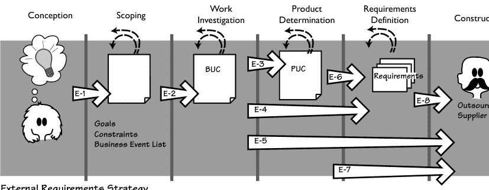

外部需求策略

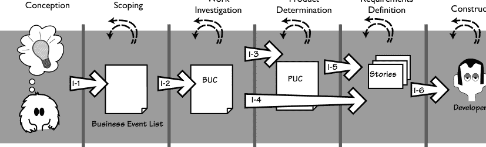

迭代式需求策略

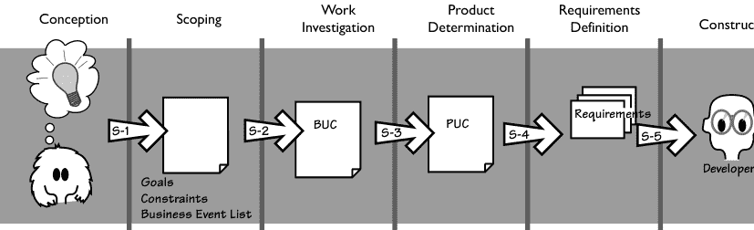

序贯式需求策略

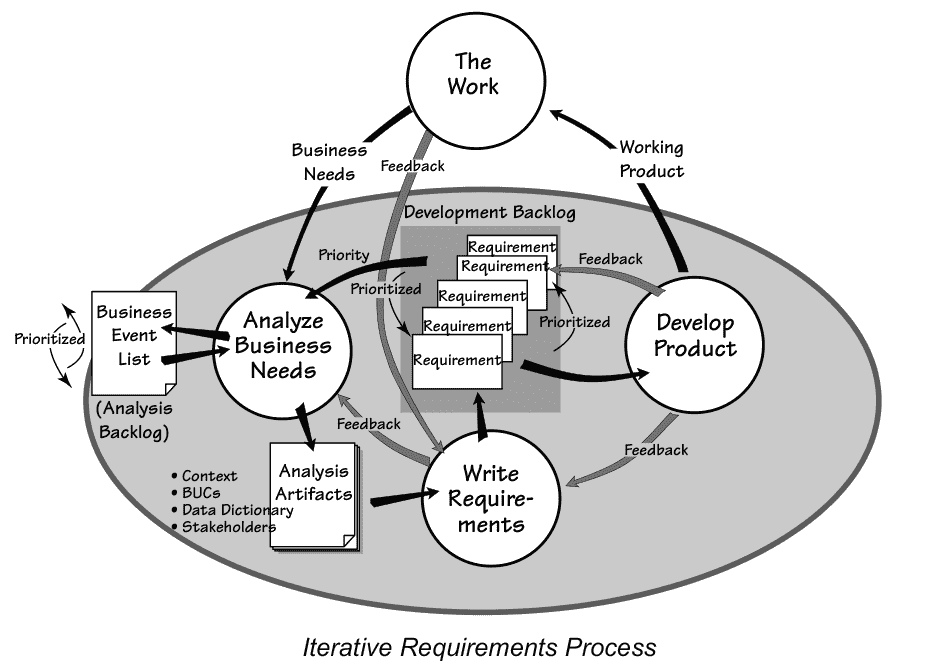

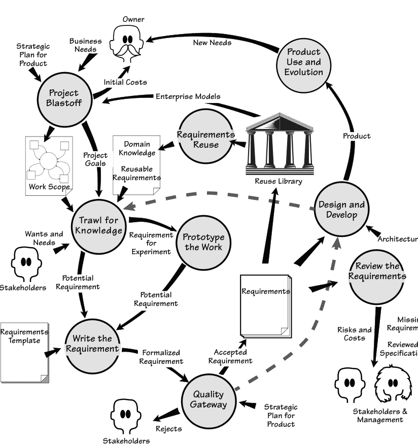

本页特留空白

本页特留空白

Suzanne Robertson

James Robertson

聂伟

> 这一代人，
> 
> Reginald, Margaret, Nick, 和 Helen，
> 
> 还有另一代，
> 
> Carlotta, Cameron, 和 Louise

本页特留空白

## 第三版序言 xxi

## 第一版前言 xiii

## 致谢 xv

### 理解真实问题 147

在这些中我们“在线上思考”以找到业务的真实本质，从而交付正确的产品——一个解决正确问题的

## 开始解决方案

在本章中，我们将业务精髓引入实现的技术世界

## 迭代开发

### 核心业务

确定产品的范围

### 考虑用户

### 设计用户体验

- 创新
- 方便
- 连接
- 信息
- 感受

### 绘制界面

### 业务事件的真实起源

### 邻接系统与外部网络

- 活跃邻接系统
- 自主邻接系统
- 协作邻接系统

### 成本、收益与风险

### 记录你的设计场景

产品用例场景

### 整合

### 今日业务分析师的策略

在本章中，我们考虑了业务分析师在今天变化环境中引导需求发现策略

### 平衡知识、活动与人

### 常见项目需求画像

在突破之前需要多少知识？

### 外部策略

- 概念到范围确定
- 范围确定到工作调研
- 工作调研到产品确定
- 工作调研到原子需求定义
- 工作调研到构建
- 产品确定到原子需求定义
- 产品确定到建设
- 原子需求定义到构建

### 迭代策略

- 概念到范围确定
- 范围确定到工作调研
- 工作调研到产品确定
- 工作调研到需求定义
- 产品确定到需求定义
- 需求定义到建设

### 顺序策略

- 概念到范围确定
- 范围确定到工作调研
- 工作调研到产品确定 214
- 产品确定到需求定义 214
- 需求定义到构建 214

### 你自己的策略 215

- 不再是速记员 216
- 限制编写需求的数量 217
- 复用需求 217

### 创新与业务分析师 218

- 寻找业务规则 218
- 作为创意经纪人的业务分析师 219
- 系统化思维与业务分析师 220
- 作为可视化者的业务分析师 221

### 总结 222

## 10 功能性需求 223

在本章中，我们观察导致产品执行某些功能的需求

### 规范化指南 224

### 功能性需求 225

- 揭示功能性需求 225
- 详细程度或粒度 228
- 描述与依据 229

### 数据，你的秘密武器 231

- 数据模型 231
- 数据字典 232

### 异常与替代方案 233

- 条件性需求 234
- 避免歧义 234

### 技术性需求 237

- 需求分组 237

### 功能性需求的替代方案 238

- 场景 239
- 用户故事 239
- 业务流程模型 240
- COTS（商用现成软件）的需求 241

### 总结 242

## 11 非功能性需求 245

在本章中，我们观察规定产品如何实现其功能的需求

### 非功能性需求简介 246

### 规范化指南 246

### 功能性需求与非功能性需求 247

### 用例与非功能性需求 248

### 非功能性需求类型 249

- 观感需求：类型 10 250
- 可用性与人性化需求：类型 11 253
- 性能需求：类型 12 257
- set与环境需求：类型 13 259
- 可维护性与支持需求：类型 14 261
- 安全需求：类型 15 262
  - 访问 263
  - 隐私 263
  - 完整性 264
  - 审计 265
  - …… 等等不再 265
- 文化需求：类型 16 266
- 法律需求：类型 17 268
  - 萨班斯-奥克斯利法 269
  - 其他法律义务 270
  - 标准 271

### 寻找非功能性需求 271

### 需求博客 271

### 用例 272

### 模板 274

### 原型与非功能性需求 274

### 客户 275

### 不要编写解决方案 276

### 总结 277

## 12 匹配标准与依据 279

在本章中，我们展示了衡量需求如何使其变得无歧义、易理解、易于交流且可测试

### 规范化指南 280

### 为什么匹配需要标准？ 280

### “依据”背后的依据 282

### 推导出匹配标准 284

### 测量标尺 285

- 非功能性需求的匹配标准 286
- 产品失败 288
- 主观测试 289
- 标准 289
- 观感需求 290
- 可用性与人性化需求 291
- 性能需求 292
- 运行需求 293
- 可维护性需求 294
- 安全需求 294
- 文化需求 294
- 功能性需求的匹配标准 295
- 测试 296
- 匹配标准的表现 296
- 定义数据 297
- 图形化匹配标准 297
- 决策表 297
- 图表 298
- 用例与匹配标准 299
- 目的匹配标准 299
- 解决方案匹配标准 300

### 总结 301

## 13 质量关卡 303

在本章中，我们防止不合适的需求成为规范的一部分

### 规范化指南 304

### 需求质量 305

### 使用质量关卡 306

- 在范围内？ 307
- 相关性 309
- 完整性测试 311
- 是否缺失属性？ 311
- 对利益相关者有意义吗？ 312
- 测试匹配标准 312
- 统一术语 313
- 在约束范围内？ 314
- 是需求还是解决方案？ 316
- 需求价值 316
- 金镀需求（Gold Plating） 317
- 需求蔓 317
- 实施质量关卡 319
- 备选关卡 320

### 总结 321

## 14 需求与迭代开发 223

在本章中，我们观察如何在迭代环境中发现和实现需求

### 迭代开发的必要性 223

### 迭代需求流程 224

- 工作 224
- 分析需求 224
- 编写用户故事 225
- 开发产品 226

### 业务价值分析与优先级 327

- 如何编写良好的用户故事 229
- 提问的问题 329
- 需求形式化 331
- 充实故事 332

### 迭代需求 333

- 业务知识 333
- 分析与交流知识 334
- 技术知识 334

### 总结 335

## 15 复用需求 337

在本章中，我们寻找已经编写的需求并探索使用它们的方法

### 什么是复用需求？ 338

- 可复用需求的来源 341
- 需求模式 342
- 克里斯托弗·亚历山大的模式模式 343
- 业务事件模式 344
- 事件响应背景 344
- 事件响应处理 345
- 抽象数据模式 346
- 特定领域的模式 348
- 跨领域模式 349
- 领域分析 351

### 总结 351

## 16 需求交流 353

在本章中，我们将需求转化为可交流的内容

### 规范化指南 353

### 将潜在需求转化为书面需求 354

### 知识与规范 354

### Volere需求规范模板 357

- 模板目录 357
- 模板划分 358

### 发现原子需求 359

- 雪花卡（Snow Cards） 359
- 原子需求的属性 361
- 需求编号 361
- 需求类型 361
- 事件/BUC/PUC 361
  - 描述 362
  - 依据 362
  - 原始者 363
  - 匹配标准 363
  - 客户满意与不满意度 363
  - 优先级 364
  - 冲突 364
  - 材料 365
  - 历史 365

### 组装规范 365

- 自动化需求 366
- 功能性需求 367
- 非功能性需求 368
- 项目问题 369

### 总结 369

## 需求完整性

在本章中，我们决定我们的规范是否完整，并设定需求的优先级

### 规范化指南 372

### 审查规范 373

### 检查 373

### 寻找缺失的需求 374

### 所有用例都发现了吗？ 376

- 1. 定义范围 376
- 2. 识别业务事件与非事件 378
  - 非事件 378
- 3. 业务业务用例 378
- 4. 定义业务数据 378
- 5. CRUD 检查 380
- 6. 检查保管流程 381
- 7. 重复直到完成 382

### 需求优先级排序 382

- 排序因素 382
- 何时进行排序 383
- 需求优先级分级 384
- 优先级排序表 385
- 冲突的需求 386
- 歧义的规范 388
- 风险评估 388
- 项目驱动因素 389
- 项目约束 389
- 功能性需求 390
- 衡量所需的成本 391

### 总结 391

## 附录 Volere需求规范模板 393

一份编写严谨且完整的需求规范的指南

### 内容 393

- 项目驱动因素 393
- 项目约束 393
- 功能性需求 393
- 非功能性需求 393
- 项目问题 394
- 此模板的使用 394
- Volere 394
- 需求类型 395
- 测试需求 396
- 原子需求外壳 396
- 1. 项目目的 397
  - 1a. 用户业务或项目努力的背景 397
  - 1b. 项目目标 398
- 2. 利益相关者 400
  - 2a. 客户 400
- 2b. 客户 401
- 2c. 其他利益相关者 401
- 2d. 产品的实际用户 403
- 2e. 用户画像 404
- 2f. 分配给用户的优先级 405
- 2g. 用户参与 406
- 2h. 维护用户和售后技术人员 407
- 3. 强制约束 407
  - 3a. 解决方案约束 407
  - 3b. 当前系统的实施环境 409
  - 3c. 合作伙伴或协作应用 410
  - 3d. 成品软件 410
  - 3e. 预期的工作环境 412
  - 3f. 进度约束 413
  - 3g. 预算约束 414
  - 3h. 企业约束 414
- 4. 命名规范与术语 415
  - 4a. 项目相关利益相关者使用的所有术语（（缩写）的定义 415
- 5. 相关事实与假设 416
  - 5a. 相关事实 417
  - 5b. 业务规则 417
  - 5c. 假设 418
- 6. 工作范围 420
  - 6a. 现状 420
  - 6b. 工作背景 420
  - 6c. 工作划分 422
  - 6d. 阐述业务用例 424
- 7. 业务数据模型与数据字典 425
  - 7a. 数据模型 425
  - 7b. 数据字典 427
- 8. 产品范围 429
  - 8a. 产品边界 429
  - 8b. 产品用例表 431
  - 8c. 单个产品用例 432
- 9. 功能与数据需求 433
  - 9a. 功能性需求 435
  - 非功能性需求 435
- 10. 观与感受需求 435
  - 10a. 外观需求 435
  - 10b. 样式需求 436
- 11. 可用性与人性化需求 437
  - 11a. 易用性需求 437
  - 11b. 国际化与本地化需求 438
  - 11c. 学习需求 439
  - 11d. 可理解性与礼貌需求 440
  - 11e. 无障碍访问需求 441
- 12. 性能需求 441
  - 12a. 速度与延迟需求 441
  - 12b. 安全关键需求 442
  - 12c. 精密度或准确性需求 443
  - 12d. 可靠性与可用性需求 444
  - 12e. 健壮性或容错性需求 445
  - 12f. 容量需求 445
  - 12g. 可扩展性或可扩展性需求 446
  - 12h. 长寿需求 446
- 13. 运营与环境需求 447
  - 13a. 预期物理环境 447
  - 13b. 与相邻系统接口的需求 447
  - 13c. 生产化需求 448
  - 13d. 发布需求 449
- 14. 可维护性与支持需求 449
  - 14a. 维护需求 449
  - 14b. 可支持性 450
  - 14c. 适应性需求 450
- 15. 安全需求 451
  - 15a. 访问需求 451
  - 15b. 完整性需求 452
  - 15c. 隐私需求 453
  - 15d. 审计需求 454
  - 15e. 免疫需求 454
- 16. 文化需求 454
  - 16a. 文化需求 454
- 17. 法律需求 455
  - 17a. 合规性需求 455
  - 17b. 标准需求 456
- 项目问题 457
- 18. 开放问题 458
- 19. 成品解决方案 458
  - 19a. 现产品 459
  - 19b. 可复用组件 459
  - 19c. 可复制的产品 459
- 20. 新问题 460
  - 20a. 对当前环境的影响 460
  - 20b. 对已安装系统的影响 460
  - 20c. 潜在的用户问题 461
  - 20d. 预期实施中可能出现在新产品中的局限性 461
  - 20e. 后续问题 462
- 21. 任务 462
  - 21a. 项目计划 462
  - 21b. 开发阶段计划 463
- 22. 迁移到产品 463
  - 22a. 迁移到产品的需求 464
  - 22b. 迁移需求 465
- 23. 风险 465
- 24. 成本 467
- 25. 文档与培训 468
  - 25a. 文档 468
  - 25b. 培训 469
- 26. 想法 470
- 27. 管理 471

（如上所示）

- 引言 479
- 衡量工作 479
- 工作范围 481
- 工作的功能 481
- 基于用例的 483
- 由用例触发的 484
- 存储数据 487
- 外部存储数据 489
- 基于用例的 490
- 基于用例的 492
- 接下来 495

本页特意留白

## 第三版序言

为什么是第三版？自从上一版出版以来已经过去了很多时间，需求领域也发生了巨大变化，我们认为是时候更新了。今天的软件、产品和服务必须更具吸引力才能被注意到、购买和重视。软件开发技术的出现（尤其是敏捷开发）改变了需求发现者的角色。外包的大增不仅没有减轻需求负担，反而意味着更需要准确的需求。如果你计划将规格说明发送到世界的另一端，你会希望外包商能够理解并知道如何构建。

尽管我们开发产品和服务的方式发生了这些变化，但一个核心事实仍然存在：如果我们构建某种软件、产品或服务，它就必须为所有者提供最优价值。在本版中我们讨论了最优价值这一主题，其核心在于，无论如何开发软件，软件为所有者做了什么才重要。业务分析师的任务是发现软件应该改进的真实业务。这不能通过坐在键盘前完成，因为软件是一种解决方案，而在提供有效的解决方案之前，你必须理解这个问题。在本版中我们讨论了“线以上思考”。这条线来自于“棕牛模型”（你必须读书才知道是什么），它代表了技术实现与发现真实需求的抽象世界之间的界限。我们讨论了创新作为寻找更好、更合适的需求和解决方案的一种。因此，这就是需求发现者的任务，也是本版的任务：更深入地理解我们的客户组织，通过发现和沟通对问题的更好理解来寻找解决方案。

伦敦，2012年6月

对于采用本书作为教材的教师，可以在 Pearson 教师资源中心（www.pearsonhighered.com）获取书中使用的某些图形，用于准备教学材料。

## 第一版序言

自从 Don Gause 和我出版《探索需求：设计之前的质量》一书以来，已经过去快十年了。我们的书确实是一次探索，是对人类过程的调查，这些过程可以用于为软件系统或任何其他类型的过程收集完整、正确且易于交流的需求。

这段描述中的核心词汇是“可以”，因为在过去的十年里，我的客户问得最频繁的问题是：“我如何将这些多样化的过程整合成一个适用于我们信息系统的全面需求流程？”

最后，James 和 Suzanne Robertson 提供了一个我可以尽职尽责交给客户的答案。《掌握需求流程》通过循序渐进的方式、通过每一个模板、一个一个案例，展示了一种经过良好测试的、用于构建完整且全面需求流程的方法。

他们流程的一个看守性原则是“合理性”。换句话说，流程的每一个部分都是合逻辑的，即使对于没有需求经验的人来说也是如此。在向组织引入这种结构时，需求意味着意味着更容易被接受——当许多复杂的流程被拒绝和尝试时，这是一项至关重要的属性。

他们所描述的过程是 Volere 方法，这是他们多年帮助客户改进需求的成果。除了 Volere 方法本身，James 和 Suzanne 还将他们卓越的教学技巧贡献给任何想要开发需求并做得良好的人所面临的艰巨任务。

Robertson 夫妇的教学技巧他们的研讨会学生以及《完整系统分析》系列书籍的粉丝们所周知。《掌握需求流程》为他们的分析书籍提供了一个广受需求的前端——或者说，对于任何人的分析书籍都是如此。

我们可以利用能获得的所有关于需求的好书，而这就是其中之一！

> 推荐 Gause, Donald C., and Gerald M. Weinberg
> 
> Exploring Requirements:
> 
> Quality Before Design.
> 
> Dorset House, 1989.
> 
> 推荐 Robertsons, James, and Suzanne Robertson:
> 
> Complete Systems Analysis:
> 
> The Workbook, the Textbook,


> The Answers. Dorset House,
> 1998.

Gerald M. Weinberg

gerald@weinberg.com

1999年2月

# 谢

写一本书是困难的。如果没有别人的帮助和鼓励，这几乎是不可能的，至少对于我们这些作者来说是如此。我们想用几行告诉你们谁提供了帮助、鼓励并让这一切成为可能。

Vaisala 的 Andy McDonald 慷慨地提供了时间，并给了我们大量的技术投入。我们赶紧补充一下，书中的 IceBreaker 产品与 Vaisala 的 IceCast 系统仅是远远的关系。由 E. M. Kennedy 主席的 Vaisala 用户组也提供了宝贵的技术输入。

感谢那些技术评审人员，他们抽出时间审阅了一些相当晦涩难懂的内容。Mike Russell、Susannah Finzi、Neil Maiden、Tim Lister 和 Bashar Nuseibleh 值得特别感谢。

我们想感谢 Atlantic Systems Guild 的同事们——Tom DeMarco、Peter Hruschka、Tim Lister、Steve Memenamin 和 John Palmer——感谢多年来他们提供的帮助、指导以及那些不可置信的目光。

Pearson Education 的员工也做出了贡献。Sally Morrimore、Alison Birt 和 Dylan Reisenberger 既慷慨又高明，每当我们谈到推迟截止日期时，他们使用了极具说服力的言辞。

对于第二版，Peter Gordon 在合适的时间提供了指导和说服。Kim Boedigheimer、John Fuller 和 Lara Wysong 在引导我们通过出版过程方面是无价的。Jill Hobbs 负责了我们糟糕的语法和标点符号，并使文本变得易读。Ian Alexander、Earl Beede、Capers Jones 和 Tony Wasserman 的技术投入远超预期。感谢各位先生的见解。我们赶紧补充一下，任何遗留的技术错误完全由我们承担。

人们可能会认为，等到写到第三版时，就不需要帮助了。事实并非如此。我们感谢 Gary Austin、Earl Beede 和 John Capron 这“字母三位一体”。我们 Volere 的同事 Stephen Mellor 解决了我们遇到的一些较棘手的问题。我们其他 Volere 同事 James Archer 和 Andrew Kendall 也提供了帮助。

我们的 Volere 同事 James Archer 和 Andrew Kendall 提供了帮助。Julie Clements 在处理我们遇到的问题时提供的帮助是无价的。最后，我们感谢研讨会的成员以及 Peter Gordon、Kim Boedigheimer 和他们的，他们的见解和反馈都产生了巨大的影响。

James and Suzanne Robertson

伦敦，2012年6月

# 一些基本真理

在考虑我们对需求的贡献时，需求是一项至关重要的属性

## 真理 1

**需求并非真正关于需求本身。**

无论是软件产品、硬件产品还是服务，无论你打算构建什么，需求都是存在的，无论你是否发现了它们，无论你是否写下了它们。显然，你的产品除非符合需求，否则是不可行的，所以从这种方式来看，需求是关于问题的。如此，从本质上讲，需求并不是写出来的东西，而是发现要解决的问题。

顺便说一下，当我们说“业务”、“业务问题”或“工作”时，指的是你感兴趣的任何活动——无论是商业的、科学的、嵌入式的，或者是任何服务或消费产品。

此外，当我们说“业务分析师”时，指的是“他或她”。我们发现一直这样做太笨拙了。

> 在书中，我们使用“他”来指代两种性别。作者（一男一女）认为使用“他或她”具有干扰且笨拙。

## 真理 2

如果我们必须构建软件，那么它对所有者来说应该是有价值的。

注意，我们关注的是所有者，而用户只是间接。这种关注似乎与用户的优先级相反，所以我们最好解释一下。

所有者是为软件（硬件或你可能构建的任何产品）付费的人或组织。所有者要么支付开发费用，要么从他人购买软件。所有者还支付软件部署时对其业务造成的干扰。在账本的另一端，所有者从软件中获得利益。简单地描述这种关系，所有者是在购买一种利益。

除非产品提供利益，否则所有者将付费。这种利益通常表现为以前没有的东西，或者让某些业务流程变得更快、更便宜或更方便。自然，这种利益为所有者提供的价值必须超过开发产品的成本（见图1.1）。

为了具有最优价值，产品提供的利益必须与其成本成正比。在某些情况下，如果价值足够，产品的成本可以非常高。例如，航空公司愿意花巨资购买模拟器，以确保飞行员具备资质和熟练技能；否则会导致生命损失。航空公司可能还会为自动登机系统支付大量资金，因为它能显著降低乘客登机的成本。对于一个食堂员工排班系统，他们支付的费用会少得多，因为说实话，随着软件变得越来越强大且构造成本增加，它带来的收益也随之增加。然而，在某个时刻，构造成本开始超过收益，该项目就不再有利了。

这——这类任务可以手动完成，而且食堂里有几个错误的人虽然很烦人，但很难危及生命。

需求发现者的角色——可以称其为“业务分析师”、“需求工程师”、“产品所有者”、“系统分析师”或其他任何其他头衔——是确定所有者在乎什么。在某些情况下，提供一个小型系统并提供足够的收益，让所有者认为其是有价值的即可。在其他情况下（可能还有许多其他情况），扩展其功能将提供更大的价值，而且这可以通过小的额外成本实现。这取决于所有者在乎什么。

因此，这就是最优价值——充分理解所有者的问题，以便以合理的价格交付一个提供最佳回报率的解决方案。

## 真理 3

如果你的软件不需要满足某种需求，那么你可以构建任何东西。然而，如果它的目的是满足某种需求，你就必须知道那个需求是什么，才能构建正确的软件。

值得考虑的是，最成功的产品是那些开发者正确理解了产品意图为用户实现什么，以及以何种方式实现这些目的。要理解这些事情，你必须理解所有者业务的工作，并确定未来这些工作应该如何开展。

一旦理解并同意了这些流程，业务分析师就会与所有者协商哪种产品能最好地改进工作。业务分析师产生描述产品功能的需求——即它将做什么；以及产品的质量属性——即它执行得如何。

如果不知道这些需求，开发项目产生的任何产品具有价值的几率微乎其微。除了少数幸运的意外，没有哪个产品是在预先理解其需求的情况下获得成功的。

所有者希望做哪种工作（无论是科学、商业、电子商务还是社交网络）并不重要。使用哪种编程语言或开发工具来构建产品也不重要。开发生命周期——无论是敏捷、原型、螺旋还是理性统一开发过程（RUP），或任何其他方法——与理解需求的需求无关。

这一真理总是显现：你必须对需求有正确的理解，并让你的客户认可，否则你的产品或你的项目将存在严重缺陷。

# 第4章 第1章 一些基本真理

> 我曾两次被问过：“请问，巴贝奇先生，如果输入了错误的数字，会得到正确的答案吗？”我无法理解能引发此类问题的这种概念混淆。——查尔斯·巴贝奇

遗憾的是，需求并不总是能被正确理解。史蒂夫·麦康尔（Steve McConnell）和杰里·温伯格（Jerry Weinberg）提供的统计数据表明，高达60%的错误源于需求活动。软件开发者有机会（几乎）消除这些错误。然而，许多人选择——或者他们的经理选择——（几乎）消除需求发现，一头扎进去构建（不可避免的）错误产品。结果，他们为产品支付的代价可能比从一开始正确完成需求发现要多出几倍。低质量会在开发生命周期中传递下去；就是如此。

### 真理 4

构建一个软件与解决业务问题之间存在着重要的区别。前者并不一定能实现后者。

许多软件开发项目仅仅专注于软件本身——毕竟，大多数软件项目都能产出一些软件。然而，几乎完全地集中在软件上，就像通过关注石头来建造帕特农神庙一样，有些吃力。软件如果想要对所有者有价值，就必须解决用户的业务问题。

我们构建了大量的软件。每年产生数千万（甚至数亿）行代码。这些产出大部分包含错误，其中大部分是需求错误。结果，世界上大量的软件根本没有解决正确的问题。

一些开发流程基于向预期用户交付功能的想法，并邀请他们说这是否解决了他们的问题。如果没有解决，软件就会被重新开发，然后再次提交审批。问题在于，我们永远不知道用户批准最后一次交付是因为我们对它满意，还是因为他们对这个过程感到精疲力竭。

更重要的是，单个用户很难理解部署某项软件的更广泛的影响。通常，软件用户对更广泛的业务了解并不多，不足以判断这个版本的软件是否会在业务的其他部分引起问题。

在不重复同样话的风险下，我们怎么强调都不为过软件是为了解决业务问题。显然，任何开发努力都必须从问题开始，而不是从一个感知的解决方案开始。

### 真理 5

需求不必得写下来，但它们必须让构建者知晓。

一个需求项目的目标似乎通常是产生一份尽可能大的规格书。似乎很少读者能理解其中的很大一部分，而且甚至有更少的人有耐心去读它，这似乎并不重要。需求编写者似乎认为他们工作的价值与规格书的厚度成正比。

一旦完成，这份厚重的文档就会被“扔过墙”——或者我们应该说，““叉车越过墙”——交给开发者，他们被预期为规格书的巨大容量感到欣喜。毕竟，包含的页面越多，漏掉任何内容的概率越大——理论上是这么说的。自然地，开发者几乎被这份文档淹没，要么忽略它，要么故意顺从。无论哪种方式，最终结果通常是不如人意的。

尽管有这种奇怪的行为，仍然需要需求，并且需要将这些需求传递给团队。

需求是否写下来无关紧要。在某些情况下，口头传达更有效；在另一些情况下，永久记录是不可避免的。

尽管口头传达有效，我们认为通过这种方式沟通所有需求是不可能的。

# 图 1.2

显然，需要将需求传达给产品的构建者。


除了有助于理解，正确编写的需求还提供了追溯文档。需求的原理（故事卡上的理由）记录了团队的决策。它还为测试人员和开发者提供了需求重要性的清晰指示，从而显示了应该投入多少精力。此外，当维护者知道需求为何存在时，维护成本就会降低。

需求并不是为了给项目增加额外负担，除非有明确的需求，否则不应该写下来。然而，当需求存在时，编写需求付出的努力将在未来的维护中获得数倍回报。

### 真理 6

你的客户并不总是能给你正确的答案。有时客户无法知道什么是正确的，有时他们根本不知道自己需要什么。

需求活动传统被认为类似于速记员的工作。也就是说，业务分析师仔细听取利益者的话，准确记录他们说的每句话，并将请求转化为产品需求。

这种方法的缺陷在于，它没有考虑到利益者在试图描述他们需要的内容时的困难。增量改进的问题也很常见，当被询问新系统时，利益者描述他们现有的系统，并增加一些改进。这种增量方法

# 图 1.3

有时，皮诺曹，你的客户并没有说出全部事实。


通常会排除任何严肃的创新，并往往导致平庸且无法达到预期的产品。

业务分析师必须学会一种“杂技表演”。在某些情况下，他必须记录客户的需求；在某些情况下，他必须说服客户他们请求的并非他们真正需要的；在其他情况下，他必须从客户的解决方案中推导出需求；而在某些情况下，他必须想出一种没有人要求过、但能产生更好解决方案的创新。在任何情况下，他都应该认为任何利益相关者都可能是皮诺恰奥（图 1.3），并且不要相信他们所说的一切。

### 真理 7

需求不是偶然产生的。需求的开发需要某种有序的流程。

任何重要的事业都需要有序的流程。随机地使用钢筋和混凝土产生不了建筑的；设计和竖立结构有一套定义的流程。同样，制作电影也有一个定义且系统化的流程。你的汽车是使用有序流程设计和制造的，你最近一次飞行也是遵循了一系列大程度上近乎逐字执行的有序流程的结果。即使是艺术创作活动，如小说和绘画，也有艺术家所遵循的有序流程。

这些流程并非死板的程序，即人们不加思考地按照规定的顺序、不加变化地盲目遵循每条指令。相反，有序流程包含了一系列实现预期结果的任务集合，但将顺序、重点和应用程度留给使用流程的人或团队决定。

最重要的是，活跃在流程中的人员必须理解为什么流程中的不同任务很重要，以及哪些任务对他们的项目具有最重要的意义。

### 真理 8

你可以随心所欲地迭代，但你仍然需要理解业务需求。

自从本书上一版出版以来，迭代开发方法变得更加流行。这无疑是一个值得称的优势，但这些技术的许多进步有时被夸大了。例如，我们听过人们说（有些甚至付诸笔端）迭代交付让需求变得多余了。

# 第 1 章 一些基本真理

清醒的人已经意识到，任何开发技术都需要发现需求作为严肃开发的前提。反之，清醒的人将需求吸收到了他们的开发生命周期中。智能的方法并没有试图消除需求，而是仅仅从不同的角度来处理需求需求。

真正的关注点——这适用于任何类型的开发技术——是在不产生不、过早且浪费的大量文档的情况下，发现所需的内容。

无论你如何开发软件，理解客户的业务问题以及产品如何解决这个问题（换句话说，即其需求）的需求始终存在。

### 真理 9

> 没有银色子弹。我们所有的方法和工具都无法弥补糟糕的思想和粗劣的工艺。

虽然我们需要有序的流程，但它不应被视为思考的替代品。流程有帮助，但它们对聪明人的帮助大于对那些准备好思考的人的帮助。这在需求方面尤为如此，因为业务分析师需要处理多个版本的需求，并同时考虑什么能产生最出未来软件产品。

需求活动并不完全容易；如果想要成功，需要业务分析师投入思考和感知。目前有几种自动化工具可以帮助这项工作，但它们必须被视为辅助，而不是良好需求实践的替代品。无论盲目遵循既定实践多少，都无法产生与熟练的业务分析师使用其最重要的工具——大脑、眼睛和耳朵——所产生相同的结果。

### 真理 10

需求如果要成功实施，必须是可衡量且可测试的。

功能需求的核心是你的产品为了支持用户的业务而必须做的事情。非功能需求是对其为了在用户环境中取得成功，必须执行其功能的良好程度的量化。

为了构建一个完全符合这些标准的产品，你在编写需求时必须保持精确。同时，你必须考虑到需求来自人类，而人类并不总是，

> 即使是完美的程序验证也只能证明程序符合其规范。软件任务中最困难的部分是得出一个完整且一致的规范，而构建程序的很大本质实际上是调试——弗雷德·布鲁克斯，《银色子弹：软件工程的本质与偶然

有时并不精确。为了达到必要的精确程度，你必须以某种方式衡量需求。如果你能用数字而不是文字来衡量需求，就可以让需求变得可测试。

例如，如果你有一个要求产品“对新用户具有吸引力”，那么你可以设定一个衡量标准：首次用户在 2 分钟内成功设置账户，对于用户预期已知的任何数据项（如其姓名、电子邮件地址和类似项目），犹豫少于 5 秒。犹豫是衡量产品直观性程度的指标（它是产品对用户吸引力的一部分）。自然地，当你这样衡量需求时，你的测试人员就可以判断产品（在某些情况下是产品的原型）是否满足了需求。

也可以说，如果你无法为需求找到衡量标准，那么它就不是需求，而仅仅是一个空头念绪。

### 真理 11

**你作为业务分析师，无论现在还是以后，将改变用户思考他们问题的方式。**

当你开始理解需求时，特别是当需求来自不同的利益相关者时，你开始构建抽象并建立词汇。当你展示业务流程模型时，当你与利益相关者寻找工作的本质时，当你拥有清晰且可衡量的需求，以及并将这一真理反映回利益相关者时，它将改变（向好的方向）他们对业务的思考。

一旦他们对需求的真实含义有了更好的理解，他们可能会看到改进的方法。你的工作部分是尽早帮助人们理解并质疑他们的需求，以便他们发现自己真正需要什么。

### 需求到底是什么？

到底，我们一直在说的这些需求究竟是什么？简单来说，需求是产品为了支持所有者的业务而必须做的事情，或者是为了让所有者可以接受的一种质量。需求的存在是因为产品类型需要某些功能和质量，或者是因为客户要求该需求作为交付产品的一部分。

### 功能需求

功能需求描述了产品为了对操作者有用而必须采取的行动——源于利益相关者需要的工作。几乎任何行动（计算、检查、发布或其他大多数主动动词）都可以是功能需求。

> 产品应生成一份在给定时间范围内预测将结冰的所有道路的日程。

这项需求是产品为了在所有者的业务背景内有用而必须做的事情之一。你可以推断在这种情况下，所有者是一个负责维护道路安全的组织，他们通过向即将结冰的道路派送除冰材料来做到这一点。

### 非功能需求

非功能需求是产品为了被所有者和操作者接受而必须具备的属性或质量。在某些情况下，非功能需求——这些规定了性能、外观、易用性、安全法律属性等属性——对于产品的成功至关重要，如下所示：

> 产品能够在 0.25 秒内判断“敌友”。

有时它们是需求是因为它们增强了产品并让人们想要购买：

> 产品应提供愉悦的用户体验。

有时它们让产品具有可用性：

> 产品应能够被不使用当地语言的入境大旅客使用。

非功能需求最初看起来可能是模糊或不完整的。在本书的后续部分，我们将研究如何为它们提供符合标准，使其变得可衡量，从而可测试。

## Volere 需求过程

## 约束

约束是全局性需求。它们可以是对项目本身的限制，也可以是对产品最终设计的限制。例如，以下是一个项目约束：

| 约束是塑造需求的全局性问题 |
| :--- |
| 产品必须在新财年开始时可用。 |

产品的客户表示，如果产品不能在新年内供其客户使用，那么它毫无用处。结果是，分析师必须对需求进行约束，以便在截止日期内交付收益。

约束也可能施加在产品的最终设计和构建上，如下：

| 约束仅仅是另一种类型的需求 |
| :--- |
| 产品应作为 iPad、iPhone、Android 和 Blackberry 应用程序运行。 |

只要这是一个真实的业务约束——而不仅仅是主观观点——那么任何不符合该约束的解决方案显然都是不可接受的。无论约束的是什么，约束都可以被视为另一种类型的需求。见图 1.4。

## Volere 需求过程

本书描述了一个用于成功发现、验证和文档化需求的过程。每一章都涵盖了过程中的一项活动，或者为了完成该活动所需要的需求收集的某些方面。

图 1.4

最终产品的功能受到约束的限制。功能是为了造福用户，但是非功能性需求通过使产品对用户可用且可接受来“交付”价值。

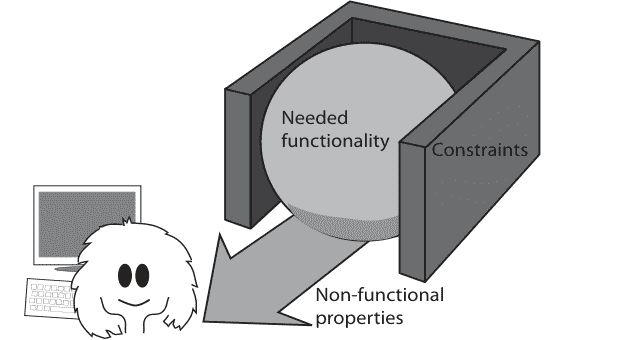

# 第 1 章 基本真理

“Volere” 是意大利语，意为“希望”或“想要”。


当你学习更多关于 Volere 需求过程的内容时，请记住，它是作为产生交付物的指南。你对该过程的操作是由相关的交付物驱动的，而不是由程序。我们希望你将该过程视为一组为了需求项目成功而必须完成的任务（详细程度不一），而不是一个必须不计代价遵循的循规蹈矩的程序。当你读到每个部分时，请一下根据你自己的结构和组织设置，将如何执行该部分的程序。

你对过程的操作是由相关的交付物驱动的，而不是由程序。

要理解这个过程，没有必要按照所示顺序阅读本书，但请记住，你可能会遇到一些假设你已知之前章节知识的术语。你的需求自然与其他读者的需求不同，因此你可能感兴趣先探索过程的某些方面。一旦你熟悉了过程的基本大纲（在第 2 章提供），请尽情投入到你认为认为有价值的地方。

## 需求过程

在书中，我们介绍了一个发现需求的过程，并讨论了你可能如何使用它。

本书是我们经验的结晶。在书中，我们描述了一个从我们在需求领域多年工作中得出的需求过程——与聪明的人一起做聪明的事情，并在许多极其多样化的领域中进行项目。我们还从世界各地许多使用我们技术不同部分的人的经验中学习了很多。

无论你是在构建定制系统、通过组装组件构建系统、使用商用软件、访问开源软件、外包开发还是对现有软件进行修改，你仍然需要探索、理解和沟通需求。

我们开发 Volere 需求过程及其相关模板，是基于我们在与客户的流程和咨询任务中证明是最有效的活动和交付物。这些经验的结果是一个需求发现规范过程，其原则可以应用于（事实上已经应用于）几乎所有类型的应用，以及几乎所有类型的环境。

我们想从一开始就强调，我们呈现的是一个过程，我们将其作为发现需求的工具；我们并不指望你想要这个过程并告诉你的同事它是“做事的唯一方法”。然而，我们寄予期望，你会从这个过程中发现许多有用的东西，反过来帮助你更高效、更准确地发现和沟通需求。我们亲身见过数百家公司将该过程适应到自己的文化和组织中，我们也知道数千人这样做过。

如果要构建正确的产品，就必须发现正确的需求。

使用 Volere 需求过程的客户是那些使用 RUP、增量、迭代、螺旋、Scrum 或迭代开发的变体开发产品的人；更正式的瀑布流程，以及各种自制的开发流程。多年来，

# 第 2 章 需求过程

图 2.1

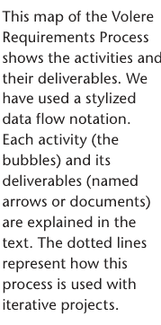

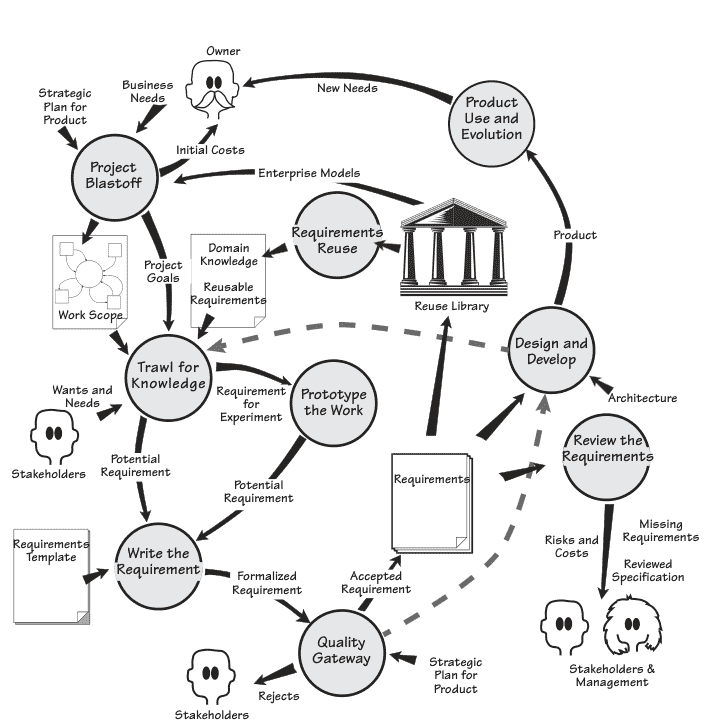

所有这些客户都认同：如果要构建正确的产品，就必须发现正确的需求。但需求不是偶然产生的。为了找到正确且完整的需求，我们需要某种有序的过程。

Volere 需求过程如图 2.1 所示。图中包含的每项活动以及它们之间的连接，将在本书的后续章节中详细描述。

### 语境中的需求过程

我们需要指出——事实上，我们需要强调——这个过程并不意于作为一种瀑布模型。在本书的各个阶段，我们将指出如果你正在使用某些迭代开发，可能会如何修改该过程。

需求发现应该被视为构建的必要先驱，但它也应该被视为可以快速进行的、有时是非正式的活动。让我们简要查看图 2.1 中的所有活动，这些活动将在后续详细介绍。本章的意图是让你对过程、其组件、交付物以及它们结合的方式有一个温和的介绍。

当我们过整个过程时，我们的描述就像你正在处理一个全新的产品——也就是说，从零开始开发。随后，我们将讨论产品已经存在的情况的需求。

> 结冰形成的概率取决于路面接收和流失的能量。这种能量流受许多因素的控制（如暴露度、海拔、道路交通、云速和风速）。冬季夜晚的温度在整个路网中可能超过 10°C。

Vaisala

### 案例研究

我们将通过带你了解使用该过程的产品来解释 Volere 需求过程。

IceBreaker 项目旨在开发一种预测道路何时以及何地会结冰的产品，并安排除冰剂处理。新产品将使道路部门更准确地预测结冰，更精确地处理道路，从而提高道路安全。该产品还将减少除冰剂的使用，有利于道路部门的财政和环境。

### 项目启动

想象发射火箭。10–9–8–7–6–5–4–3–2–1–发射！如果需要从 10 开始倒数，那么安道尔将拥有自己的航天计划。事实是，在火箭发射的最后 10 秒之前，已经进行了大量的准备。火箭已经加好燃料，路线已经规划——事实上，为了让火箭生存并完成任务所需的一切都完成了。

项目启动的主要目的是为后续的需求发现奠定基础，并安道尔是位于法国和西班牙之间比利牛斯山脉的一个公国。直到 1993 年它才

## 第2章 需求过程

它是一个议会民主制国家，但保留了其古老的国家元首作为主公国。法国“王子”的职责现在由法国总统承担。在西班牙方面，“王子”是乌尔赫尔（Urgell）主教。安道尔在 20 世纪 60 年代因 4.50 美元的国防预算而闻名，这个数字已成为一个传奇。今天，安道尔的预算为零。

启动阶段（blastoff）定义了业务问题的范围，并寻求利益相关者的共识，即：这确实是所有者组织需要改进的领域。启动会议确认了要包含在需求发现中的功能，以及要明确排除的功能。

定义业务问题的范围通常是最方便的开始方式。在“破冰者”（Icebreaker）项目中，首席需求分析师协调小组成员的讨论，使他们对工作范围（即需要改进的业务）以及工作与周围世界的关系达成共识。会议参与者在白板上绘制了上下文图（context diagram），以显示哪些功能包含在工作中，并以此推出他们认为在冰雪预测业务范围之外的元素。该图通过展示工作与外部世界之间的连接，定义——精确定义了——包含的功能。（更多内容请见下一章）。随着这种需求活动的进行，上下文图被用于揭示最优产品以帮助实现。

当他们对要研究的业务范围达成合理共识后，小组识别出利益相关者。利益相关者是指那些对产品感兴趣或拥有产品相关知识的人——事实上，任何对它有需求的人都是。在“破冰者”项目中，感兴趣的人包括道路工程师、卡车司机主管、天气预报人员、道路安全专家、冰雪处理顾问等。必须识别出这些人，以便需求分析师能与他们合作找到所有需求。上下文图通过确立工作的范围，有助于识别许多利益相关者。

关于项目启动的详细讨论，请参阅第 3 章“界定业务问题”。

## 图 2.2

上下文图用于在利益相关者之间就需要改进的工作范围建立共识。最终的项目将用于完成这部分工作。

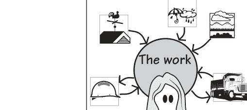

### 搜集需求

启动阶段还确认了项目的目标。启动小组对开展项目的业务理由达成共识，并同意开展项目可以获得清晰且可衡量的收益。小组还同意该产品对业务而言值得投资，且组织有能力进行构建和运营。

在这一阶段，对项目需求部分涉及的成本进行初步估计是明智的项目管理——这可以通过上下文图中已包含的信息来完成。对项目可能面临的风险进行早期评估也是明智的项目管理。尽管这些风险看起来是令人沮丧的消息，但在被新产品预期收益的狂热所冲昏之前，先了解劣势面（其风险和成本）总是好的。

> 在被新产品预期收益的狂热所冲昏之前，先了解项目的劣势面（其风险和成本）总是好的。

启动小组成员对项目是否值得且可行得出结论——即“去/不去”（go/no go）的决策。杀掉一个胚胎项目可能看起来残酷，但我们从经验知道，在早期阶段取消项目，比让它在几乎没有或没有成功的情况下徘徊几个月甚至几年并消耗宝贵资源要好。启动小组仔细考虑产品是否可行，其收益是否超过成本，启动……

或者，如果在此阶段仍存在许多未知数，启动小组可能会决定开始需求调查，打算在短时间后审查需求并重新评估项目的价值。


> 阅读 DeMarco, Tom, and Tim Lister. *Waltzing with Bears: Managing Risk on Software Projects*. Dorset House, 2003.

> McConnell, Steve. *Software Estimation: Demystifying the Black Art*. Microsoft Press, 2006.

### 搜集需求

一旦启动完成，业务分析师就开始“搜集”（trawling）工作，以学习并理解其功能——“这段业务正在发生什么？他们想做什么？”为了方便和一致，他们将工作上下文划分为不同的业务用例（business cases）。

每个业务用例都是工作为了对业务事件做出正确响应所需的功能量。（这些术语将得到充分解释。）每个业务用例都分配给一名需求分析师——分析师可以独立于任何一个用例进行进一步的详细研究。分析师使用搜集技术，如贴近法（approaching）、场景（scenarios）、用工作坊等许多技术来发现工作的真实本质。这些搜集技术在第 5 章中描述。


> 参阅第 4 章，了解业务用例以及如何使用它们。

搜集意味着发现需求。业务分析师从“破冰者”开始，描述当前的工作以及对工作的诉求。


> 参阅第 5 章“调查工作”，了解活动的细节。

## 第 2 章 需求过程

……与其他利益相关者以及领域专家（可用性、安全、运营等专家）进行交流，以披露最终产品的所有需求。“破冰者”分析师与气象学家和道路工程师花费了大量时间。

需求调查中最困难的部分是发现系统的本质。许多利益相关者不可避免地谈论他们感知的解决方案，或根据当前的实现来表达他们的想法。相比之下，本质是工作的底层原因。或者，你可以将其视为工作的策略，即在没有任何技术的情况下工作会是什么样（包括人员）。我们将在第 7 章“理解真实问题”中更多关于本质的讨论。

我们在第 8 章“启动解决方案”中查看创新产品的开发。

## 图 2.3

基线定义了需要改进的工作范围。业务用例源自范围。需求分析师和相关利益相关者研究每个业务用例，以发现所需的工作方式。当理解这一点后，就可以确定适当的产品（PUC 场景），并据此编写需求或用户故事。

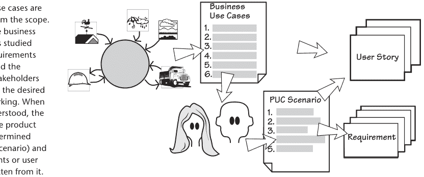

### 快速简易的建模

模型可以在 Volere 全生命周期中的任何时候被使用；在图 2.1 中，我们将这项活动展示为“原型化工作”。当然，也存在像你在 UML 或 BPM 中发现的正式模型，但很多时候，业务分析师可以利用快速的草图和图表对正在调查的工作进行高效的建模。我们提到的一种快速简易的建模技术是使用便利签（Post-it notes）对功能进行建模；每张便签可以代表一个活动；并通过重新排列便签来显示工作完成的不同方式或可能的方式。我们发现利益相关者很好地接受这种对其业务流程建模的方式，并且总是愿意通过实际操作便利签来参与，展示他们认为工作应该是怎样的。我们将在第 5 章“调查工作”中更详细地讨论这种建模。

在第 8 章“启动解决方案”中，我们将研究如何进入到目前已发现的需求的实现阶段。在此时，你的模型将从解释当前工作的工具，转变为解释未来产品将如何帮助这项工作的工具。

我们现在可以开始将此类称为原型——即使用铅笔纸、白板或其他手段对潜在产品进行的快速简易的表示，如图 2.4 所示。在此阶段使用的原型旨在向用户展示一个可能实现的需求的模拟。IceBreaker 的业务分析师可能是——这种视觉化的工作方式允许工程师和其他利益相关者对未来产品的想法形成凝聚。

## 图 2.4

一个在白板上构建的快速简易原型，用于快速解释某些需求可能如何实现，并澄清被误解或缺失的需求。

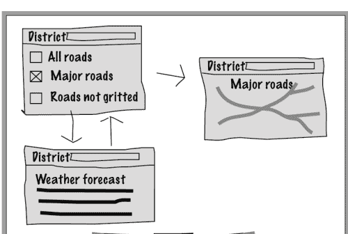

### 场景

场景非常有用，以至于我们将整个第 6 章都留给了它们。场景通过将业务过程分解为一系列易于识别的、用英文（或你工作的任何语言）编写来展示业务过程的功能，以便所有利益相关者都能理解。IceBreaker 的分析师使用场景来描述业务流程并展示它们，然后根据需要进行修订——不同的利益相关者对场景的不同部分感兴趣，在短时间之后，业务分析师就能让每个人理解并对工作内容达成共识。

一旦达成一致，场景就成为需求的基础。

### 编写需求

系统开发中的一个主要问题是需求误解。为了避免任何误解，分析师必须以无歧且可测试的方式编写他们的需求，同时确保原始利益相关者在需求传递给开发人员之前理解并同意了这些书面需求。换句话说，分析师编写需求是为了确保开发光谱两端的各方对所需内容具有完全相同的理解。

尽管写下需求的任务似乎是一项不必要的负担，但我们发现这是确保需求核心被捕获和传达、并确保交付的产品是可以被测试的的最有效方法。（见图 2.5.）

图 2.5

需求被记录在书面通信中，以促进利益相关者、分析师以及任何其他对（感兴趣）的人之间的沟通。通过仔细编写需求，团队确保了构建了正确的产品。

开发人员并不认识你妈。这样如何：“卡车司机应该在第一次遇到产品后的 90 秒内选择正确的路线？”

> 我希望它足够简单，让我老妈也能使用。


### 编写需求

IceBreaker 的分析师首先使用业务语言编写需求，以便那些利益相关者能够理解并验证其正确性。他们在需求中添加了“理由”（rationale）——它展示了需求的背景原因，这消除了许多歧义。此外，为了确保完全的精确性并确认产品设计师和开发人员能够准确构建出利益相关者所需的内容，他们为每个需求编写了验收标准（fit criterion）。验收标准使需求变得可量化测试，从而允许测试人员判断实现是否满足——换句话说，符合——需求。

理由和验收标准使得需求对业务利益相关者来说更容易理解，这位利益相关者曾多次表示：“我不希望有任何我不理解的需求，也不会有任何无用或对我的工作没有贡献的需求。这就是为什么我希望每一个需求既有理依据又是可衡量的。”

业务分析师对衡量需求有一个不同但互补的原因：“我需要确保每个需求都是无歧义的；它对于源需求的利益相关者和构建它的开发人员来说具有相同的含义。我还需要根据利益相关者的预期来衡量需求。如果我不能给它设定一个衡量标准，我就永远无法告诉他们我们是否正在构建利益相关者的需求。”

分析师使用两个设备来使编写规格变得更容易。第一个设备是“需求规范模板”，它是编写需求规范的大纲和指南。业务分析师将其作为他们应该索取的需求清单，并作为组织其需求文档的一致方法。第二个设备是一个外壳，也被称为“雪花卡”（snow card）。每个原子级（即最低层级）需求由多个属性组成，雪花卡是一种确保每个需求都具有正确要素的方便布局。

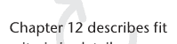

当然，编写过程并不是孤立的。它与周围的活动——原型制作和质量网关集成在一起。然而，为了理解将其转化为正确的形式，我们将专门讨论。

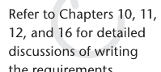

迭代开发方法使用用户故事作为编写规格的方法。用户故事实际上是详细需求的占位符；它们在开发人员与利益相关者的对话中得到完善。在第 14 章“需求与迭代开发”中，我们将仔细研究业务分析师如何产生用户故事。迭代并没有消除对需求的需求，而是寻求通过不同的方式来发现和传达它们。

### 过程

编写需求的主要原因并不是为了书面需求（尽管这通常是），而是为了编写它们。将需求与其理由和验收标准一起放在写者的脑海中，可以使其清晰，并以无歧且可验证的方式记录下来。换句话说，如果业务分析师没有正确编写需求，他就还没有理解它。

### 质量网关

需求是开发周期所有后续步骤的基础。因此如果要构建正确的产品，需求在交给构建者之前必须是正确的。为了确保正确性，质量网关对需求进行测试（图 2.6）。IceBreaker 团队设置了一个单一节点，需求在成为规范的一部分之前必须通过。该网关由两个人管理——首席需求分析师和测试人员——他们是唯一授权通过网关的人员。他们合作，检查每个需求的完整性、相关性、可测试性、连贯性、可溯性和若干其他质量，然后允许其通过。

通过确保需求提供给开发者的唯一方式是经过质量网关，项目团队才掌握了需求的主动权，而不是相反。

第 13 章描述了质量网关如何测试需求。

# 图 2.6

质量网关通过测试每个需求的完整性、正确性、可衡量性、无歧性和若干其他属性来确保需求的严谨性，并在将其传递给开发者之前。

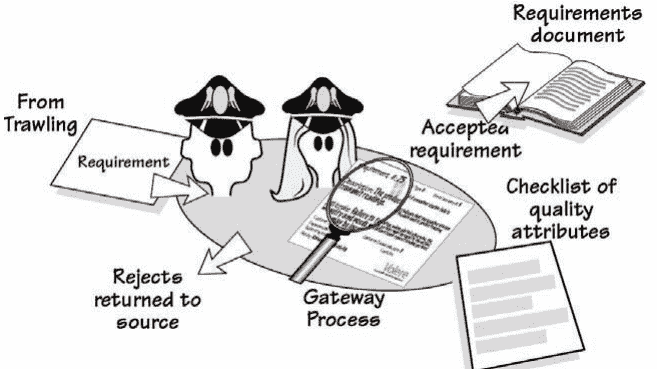

### 重用需求

你构建的任何产品的需求绝不是完全独一无二的。我们建议在启动任何需求项目之前，回顾一下为之前的项目编写的规格书，并寻找可能重用的材料。有时，你可能会发现几十个无需修改即可重用的需求。更常见的情况是，你会发现某些需求虽然不完全符合你的要求，但适合作为你在新项目中编写的某些需求的基础。

例如，在 IceBreaker 项目中，道路工程的规则多年来没有发生太大变化。因此，负责各个项目的需求分析师们不需要重新发现它们，只需简单地重用即可。他们也知道车辆调度业务随着时间的推移不会发生根本性变化，因此他们的筛选过程可以利用之前项目中的需求。

同样，对于你组织内部的不同项目，非功能性需求是相当标准的，因此你可以从之前某个项目的规格书开始工作，并将其作为检查清单。

重用需求的要点在于，一旦某个需求成功地为产品规格化，并且该产品本身是成功的，该需求就不需要重新发明或重新发现。在第 15 章“重用需求”中，我们将讨论你如何利用组织内部已有的知识，以及你如何通过回收之前项目的需求来节省自己。

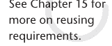

### 评审需求

质量门关的存在是为了防止糟糕的需求进入规格书——它一次只处理一个需求。尽管如此，当你认为你的需求规格书已经完成（或已达到你后续活动所需的完成程度）时，你应该对其进行评审。这次最终评审将确认没有遗漏的需求，所有需求之间相互一致，并且需求之间的冲突已经得到解决。简而言之，评审确认了规格书确实是完整的，这样你就可以进入开发的下一个阶段。

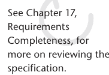


这次评审还为你提供了一个重新评估项目成本和风险的机会。现在你已经有了一套完整的需求，你对产品的了解比项目启动时要多得多。特别是，你对产品的范围和功能有了更精确的了解，因此这是衡量其规模的良好时机。根据规模，结合你对项目约束和解决方案架构的了解，你可以估算出构建该产品的成本。

# 24 章 第2章 需求过程

在这个阶段，你也知道哪些类型的需求带有最大的风险。用户可能要求一个你组织尚未构建过的接口。或者他们可能想使用未经尝试的技术来构建产品。也许开发者可能没有具备按规格构建产品的人员？通过在此时重新评估风险，你给了自己一个更现实的机会成功构建所需的产品。

## 迭代和增量过程

需求领域的一个常见误区是，在进入设计和构建的下一步之前，你必须收集所有的需求。换句话说，做需求意味着你采用了传统的瀑布型模型。在某些情况下，这是必要的，但并非总是如此。一方面，如果你正在外包，或者需求构成了合同的基础，那么显然你需要一份完整的需求规格书。另一方面，如果整体架构已确定，那么构建和交付通常在所有需求被发现之前就开始了。我们在图 2.7 中展示了这两种方法，并建议你在处理需求项目时考虑哪种最适合你。我们还在第 9 章“当今业务分析策略”中对各种方法进行了深入的论述。

在 IceBreaker 项目中，开发者已准备好开始构建产品，因此在启动后，利益相关者选择了三个（可以是任何较小的数字）优先级最高且价值最大的业务用例。需求分析仅针对它们筛选并收集这些用例的需求。

图 2.7

开发生命周期的两种（许多中的两种）变体。图中顶部是瀑布法，在产品开发开始之前就完成了需求文档。底部是迭代过程，在初步分析后，以小增量的方式开发产品。两种方法达到了相同的目的。

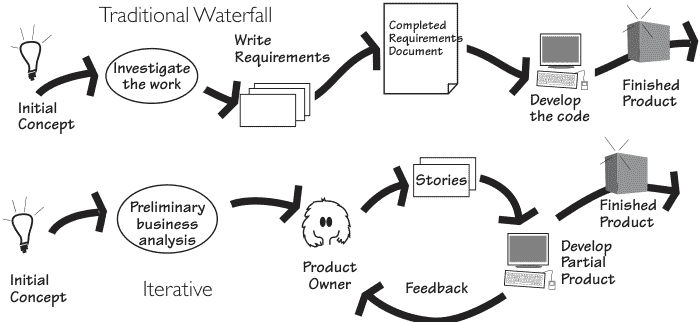

## 需求回顾

……业务用例，暂时搁置其他工作。然后，当第一批需求成功通过质量门关时，开发者开始了他们的工作。其意图是尽早实现少数几个用例，以获得利益相关者的反应——如果将会有任何意外，IceBreaker 希望尽早地发现它们。当开发者构建和交付第一批用例时，分析师们正在编写下一批高优先级用例的需求。很快，他们建立了一种交付节奏，每隔几周就会实现并交付新的用例。

你阅读这本关于需求过程的书，想必是为了改进你自己的流程。回顾（有时被称为“学习会议”）是发现流程优缺点并提出补救措施的最有效的工具之一。需求项目的回顾由一系列对利益相关者的访谈以及与开发者的面对面小组会议组成。其意图是调查项目涉及的所有人员并询问这些问题：

- 我们做对了哪些事？
- 我们做了哪些错？
- 如果我们必须重新做一遍，会有什么不同的做法？

通过观察这些答案，你给了自己改进流程的最佳机会。想法非常简单：多做有效的事，少做无效的事。

## 需求的演进

你启动项目时，仅对理想未来状态有一个愿景——有时是模糊的愿景。（正如我们在其他地方提到的，我们使用“工作”一词是指需要改进的组织区域，通常通过自动化或重新自动化来实现。）

在需求发现的早期，分析师部署了不同正式程度的模型，帮助他们和利益相关者了解工作是什么，以及目的是什么。通过对工作的调查，大家达到了相同的理解水平，使利益相关者能够发现有益的改进措施。

当分析师和利益相关者看到工作的本质时，对于理解工作来说是巨大的。本质是对工作的技术抽象。对工作的理解会演进并成熟，在某些时刻，利益相关者可以在业务分析师和系统架构师的指导下确定改进工作的产品。到达这一阶段时，业务分析师确定产品的详细功能（记住，并非所有的功能都会包含在产品中）并编写其需求。非功能性需求大致在同一时间产生，并编写那些未记录的约束。

你可以将这些需求视为“业务需求”，意味着它们规定了支持业务的产品。一旦这些需求被充分理解，它们就会交给设计师，后者在产生最终规格书之前添加技术需求。

我们提到过需求是演变的，但这个过程不应被看作通向已知目的地的必然进展。Earl Beede 指出，每你想出一个解决方案，它就会产生一些新问题，要求你回溯并重新审早期的工作。当我们谈论需求过程时，请记住，一个过程要有用，必须允许你向后移动，也可以向前移动。自然，你希望把大部分时间花在向前移动上。

## 模板

### 图 2.8

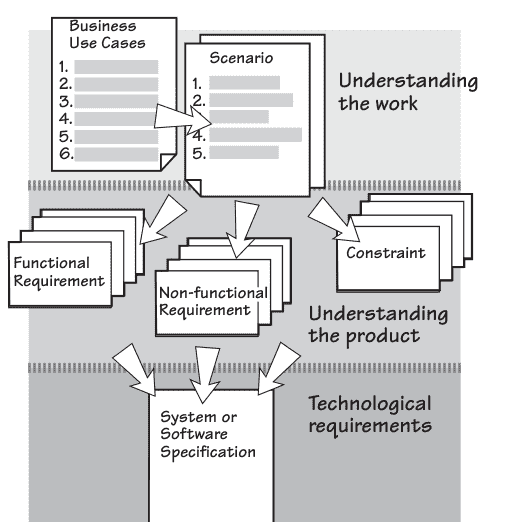

需求随着产品开发的进展而演变。在分析师和利益相关者探索工作领域时，需求最初只是相当模糊的想法。随着产品构想随时间推移而出现，需求变得精确且可测试。在设计师加入并添加为使产品在其技术环境中运行所必需的那些之前，它们保持着中立状态。

向前看，但如果你必须回到某些你认为他已经让你过去的问题上，也不要太失望。

## 模板

如果你有一份编写指南，那么编写需求将变得更容易，也更加方便。本书的附录 A 提供了《Volere 需求规格书模板》（The Volere Requirements Specification Template），它是描述你产品功能和能力的完整蓝图。该模板是数数百份需求规格书的精炼，被全球数千家组织机构在使用。

将需求归类为几种类型是非常方便的——模板的每个部分都描述了一种需求类型及其变体。因此，当你与利益相关者一起发现需求时，你可以将它们添加到规格书中，并使用模板作为必要内容的指南。

该模板的设计旨在作为一份复杂的检查清单，为你提供了一份关于要写什么的列表，以及关于如何编写这些内容的建议。模板的目录在此处复制，我们将在书的后面详细讨论每个部分。

我们的同事 Stephen Meller 建议通过直接进入最紧迫的章节（即你认为最有用的部分）来使用该模板，并在需要时重新查看模板。完整的《Volere 需求规格书模板》位于附录 A 中。你可能会使用它的大部分内容，但它并不是——真的不是——一个让你从第一页开始一直写到头尾的模板。像任何好的工具一样，只要使用得当，该模板将为你的需求发现提供显著的优势。

这里是模板的内容。

### 项目驱动因素——项目的理由和动机

- 1. **项目目的**——投资构建产品的原因，以及你通过这种方式想要实现的业务优势。
- 2. **客户、用户和其他利益相关者**——对产品有兴趣或对其产生影响的人员。
- 3. **产品用户**——预期的终端用户，以及他们如何影响产品的可用性。

### 项目约束——对项目和产品的限制

- 4. **需求约束**——对项目的局限制，以及对产品设计的限制。
- 5. **命名规范和定义**——项目的词汇。
- 6. **相关事实和假设**——对本产品产生影响的外部因素，或开发者所做的假设。

### 功能性需求——产品的功能

- 7. **工作范围**——所研究的业务领域或领域。
- 8. **产品范围**——预期边界的定义以及产品与相邻系统的连接。
- 9. **功能和数据需求**——产品必须做的事，以及由功能处理的数据。

### 非功能性需求——产品的质量

- 10. **外观和感觉需求**——预期的外观。
- 11. **可用性和人性化需求**——如果为了让预期受众成功使用，产品必须具备什么。
- 12. **性能需求**——速度、大小、准确性、安全性、可靠性、健壮性、可扩展性和持久性，以及是什么。
- 13. **运行和环境需求**——产品预期的运行环境。
- 14. **可维护性和支持需求**——产品必须有多大的可活性以及需要什么样的支持。
- 15. **安全性需求**——产品的安全性、保密性和完整性。
- 16. **文化需求**——人类和学学因素。
- 17. **法律需求**——符合适用法律。

### 项目问题——与构建产品的项目相关的问题

- 18. **未解决的问题**——对产品成功可能有影响尚未解决的问题。
- 19. **现成解决方案**——可能用于替代从零开始构建的现成组件。
- 20. **新问题**——因引入新产品而引起的问题。
- 21. **任务**——为了将产品投入生产而需要做的事。
- 22. **迁移到新产品**——从现有系统转换的任务。
- 23. **风险**——项目最可能产生的风险。
- 24. **成本**——构建产品所需的成本或精力的早期估算。
- 25. **用户文档**——编写用户说明和文档的计划。
- 26. **候等室**——可能包含在产品未来版本中的需求。
- 27. **解决方案构思**——我们不想丢失的设计构思。

在本书中深入阅读之前，请浏览附录 A 中的模板。你将发现一个关于编写需求的信息的列表，以及关于你正在寻找的各种类型的许多深思考。

在整本书中，我们将根据类型来引用需求——即模板目录所示的类型之一。

## 雪片卡 (The Snow Card)

如果说模板是关于要写什么的指南，那么雪片卡就是关于如何编写它的指南。单个需求具有结构——一组属性，其中每个属性都对你理解需求做出贡献。

## 第2章 需求过程

在继续深入之前，我们必须指出，尽管我们称这种设备为“卡”，并且我们在课程中使用卡，但我们并不提倡将所有需求写在卡片上。一些良好的方法可以通过访谈利益相关者快速记录需求来实现。此后，这些需求将以电子格式记录，届时填写相关信息。

许多自动化工具可用于记录、分析和跟踪需求。

## 图 2.9

我们没有反对使用它来处理需求，只要来源得到认可。

| 需求编号：唯一 ID 需求类型： | 事件/BUC/PUC |
|---|---|

| 描述：对需求意图的句子描述 | | |
| 理由：对需求的证明 | | |
| 起源者：提出此需求的人 | | |
| 标准：对需求的衡量，以便测试解决方案是否匹配原始需求 | | |
| 客户满意度： | 客户不满意度： | 如果实施此项无法实现的其他需求 |
| 优先级：对客户价值的评分 | | 冲突： | 一个 |
| 支持材料：指向说明此需求的创建、更改和删除文档 | | |

需求的雪片卡由 5 英寸 x 8 英寸的卡片组成，印有需求的属性，用于我们的初始需求收集。每个属性都对需求的理解和可测试性做出贡献。

如果此需求被成功实施，利益相关者的快乐程度。从 1 - 不感兴趣到 5 - 非常满意。

如果此需求不在最终产品中，利益相关者的不开心程度。从 1 - 几乎无所谓到 5 - 极度不悦。

# 属于你自己的需求流程

兜售灵药的游医杜尔卡马拉医生（Doctor Dulcamara）大声赞美他的灵药——它保证治愈牙痛、让你精力充沛、消除皱纹并拥有光滑美丽的皮肤、消灭老鼠和昆虫，并让你心爱的人爱上你。这段来自尼采歌剧《爱情之爱》（L'É d'amour）的相当奇特的脚本指出了一个非常明显但往往被忽视的观点：不存在万能的药物。

我们非常希望能够为你提供一种具有杜尔卡马拉灵药属性的需求流程——一种适用于所有组织中所有应用、所有项目的流程。从经验告诉我们，每个项目都有不同的需求。然而，我们也知道某些基本原则适用于任何项目。因此，我们并不试图为你提供一种包治百灵的魔药，而是从各种项目中提炼出经验，为你提供一套适用于任何项目的基础和交付物。

书中描述的流程由你为了成功发现需求而必须做的事情组成。这里介绍的交付物适用于任何类型的需求活动。我们的意图并不是说只有一条通往涅槃的真理，而是为你提供成功项目所需的组件。

在你阅读这本书时，请思考你如何在你自己的文化、自己的环境、组织结构以及你所选择的产品开发方式的限制范围内使用这些组件。

为了适应这些内容，你需要理解交付物——本书的其余部分将详细讨论这些项目。一旦你理解了每个交付物的内容和目的，请考虑在你的项目环境中，利用资源如何才能最好地产出每一个交付物（前提是它是相关的）：

- 该交付物在你的环境中称为什么什么？使用通用流程模型中的术语定义，并识别你组织中等同的交付物。
- 该交付物与该项目相关吗？
- 你对这个交付物已经了解多少？你是否拥有足够的信息来投入精力处理它？
- 交付物由谁产出？理解交付物的哪些部分由谁制作。此外，当有几个人参与时，你定义定义他们之间的接口。
- 交付物是什么时候产出的？将你的项目阶段映射到通用流程中。

我们从各种项目中提炼出经验，为你提供一套适用于任何项目的基础活动和交付物。

> 阅读推荐

Brooks, Fred.: No Silver Bullet: Essence and Accidents of Software Engineering, and "No Silver Bullet." The Mythical Month: Essays on Software Engineering, anniversary edition. Adams-Wesley, 1995. 这可能是对软件开发最有影响力的书籍；它无疑是永恒的。


# 第2章 需求流程

- 交付物是在哪里产出的？通用交付物往往是多个地理位置产出的片段的结果。定义不同位置之间的接口，并指定它们将如何运作。
- 谁需要评审交付物？寻找你组织内部现有的文化检查点。你的项目中是否有公认的阶段或时期，同仁、用户或经理必须在此时评审你的规范？

通用模型描述了交付物以及产生它们的程序；我们的意图是由你决定如何使用它们。

我们还提到了本书的第9章，标题为《当今业务分析师策略》。该章考虑了你可能如何处理需求项目。我们建议在你过度参与需求发现的机械机制之前，先考虑最适合你的策略。

### 形式指南

你有充分理由让你的需求发现和沟通尽可能非正式。我们说“尽可能”，是因为你所处的情况往往并不完全如你所愿——通常正式化程度将由你无法控制的因素决定。例如，你可能正在通过合同外包开发来开发软件。在这种情况下，明确需要一份完整的书面需求规范。在其他情况下，你沟通需求的方式可以非正式到部分需求没有书写（或部分书写），而是口头传达。

我们包含了一份形式指南，建议你在何时可以采取更宽松的方法来记录需求，以及何时应该理地在需求发现和沟通上更加系统化。这些是你在阅读本书时会遇到的惯例。


**兔子（Rabbit）——小、快、寿命短。** 兔子项目通常是规模较小、生命周期较短的项目，利益相关者可以密切参与。兔子项目通常涉及的利益相关者较少。

兔子项目通常是迭代的。它们以小单元（可能一次一个业务用例）发现需求，并实现工作功能的一个小增量，无论实现了什么，以征求利益相关者的反馈。

兔子项目不会花费大量时间撰写需求，而是通过与利益相关者的对话来详细说明写在故事卡（story cards）上的需求。兔子项目几乎总是让业务知识利益相关者与业务分析师和开发者在一起。

**马（Horse）——快、强、可靠。** 马项目可能是最常见的企业项目——它们是形式化程度“半中站”。马项目需要一些形式化——可能需要书面需求，以便从一个部门处理到另一个部门。马项目具有中等寿命，涉及十多个利益相关者，分布在多个地点，这些因素要求必须保持一致的书面文档。

如果你无法对自己的项目进行分类，请把它看作一马。

**大象（Elephant）——稳固、强大、长寿、记忆力。** 大象项目需要完整的规范。大象项目通常持续很久，涉及许多利益相关者，需要更正式的方法。如果你是外包，某些组织结构要求完整的规范。


# 本书其余部分

我们简要描述了发现、沟通和验证需求的流程。本书的其余部分详细描述了各种活动。你可以跳转到任何感兴趣的章节；不必按顺序阅读。

并且请在阅读本书时，不断思考你将如何完成我们描述的工作。毕竟，执行这些工作的是你。

我们希望在书中其他部分发现实用的想法、流程和制品。我们也希望你喜欢阅读并使用它们。

# 业务问题范围

在此我们建立要改变的业务领域的定义，从而确保项目团队对他们要实现的目标清晰。。让我们回到基本前提：如果软件（或任何设备或服务）要被构建，它必须对其所有者具有最优价值。从这个陈述中，你可以推断出，如果你想知道什么是最优价值，首先必须确定所有者正在做什么、和谁一起做、以及为什么要这样做。换句话说：范围、利益相关者和目标是什么？等一下，我们稍后会回来。

在Volere流程模型中（如图3.1所示），第一个活动是项目启动（Project Blastoff）。在这一活动中（通常是关键利益相关者的会议），你决定的关键因素共同决定了该需求项目的可行性。

> 如果软件要被构建，它必须对其所有者具有最优价值。

### 项目启动

启动识别了产品将成为一部分的工作区域边界，并确定了产品要满足的目的。它还识别了利益相关者——那些对产品成功感兴趣的人。项目启动产生的其他交付物对项目进行鉴定，并作为后续需求发现活动的输入。

启动会产生许多交付物。你可能会从项目经理那里得到一些；另一些你可能需要自己挖掘。无论如何，如果你想要成功，就需要这些交付物

## 36 第3章 业务问题的界定

### 图 3.1

项目启动（Project Blastoff）为后续的需求发现活动奠定了基础。

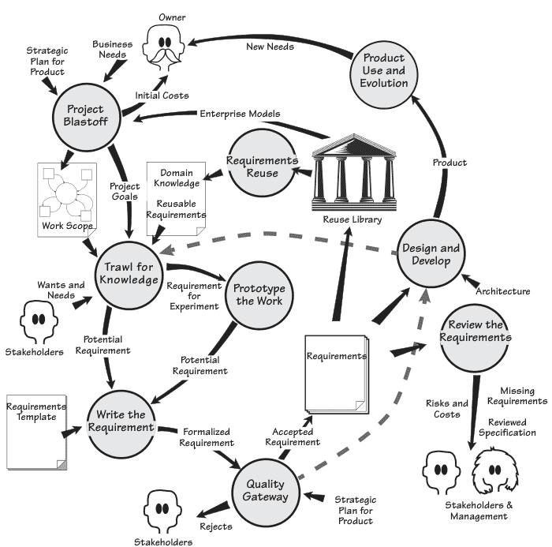

需求活动。查看以下列表，并考虑这些典型的启动交付物中的每一项对你的项目产生的影响：

- **项目目的**：对产品预期实现的功能以及它为业务带来的益处进行简短、量化的陈述。这一目的说明解释了业务为何要投资该项目，以及它希望实现的业务益处。它为项目的存在性提供了合理性依据，并作为需求发现过程的焦点。
- **工作范围**：受产品安装影响的业务领域。你需要理解这项工作，以指定出最合适的产品。
- **利益相关者**：对产品感兴趣的人员。该群体包括任何对结果产生某种影响的人，或拥有发现产品需求所需知识的人员。
- **约束条件**：对产品范围或风格的限制。这些项目包括必须使用的预定义设计方案、对当前业务流程实现方式变更的限制，以及项目可用的时间和资金。
- **名称**：在此项目中使用的任何特殊术语。
- **相关事实和假设**：是否有人们需要了解的特殊事实？或者是否某些可能影响项目结果的假设？
- **估算成本**：启动阶段的某些交付物为估算过程提供了输入，并允许在项目早期做出相当准确的估算。这并不是一个真正的需求问题，但由于交付物是主要的输入，你的项目管理……
- **风险**：简短的风险分析，以揭示项目所面临的风险。应由擅长风险评估的人员进行此类分析。

综合来看（见图 3.2），这些交付物为你提供了足够的信息来完成启动阶段的最终交付：


- **通过/停止决策（Go/no-go decision）**：项目是否可行？生产产品的成本是否值得？你是否有足够的信息继续进行需求活动，还是应该要求额外的时间来收集更多信息并建立更佳的基础？

### 图 3.2

启动阶段汇总了足够的信息，以确保项目能够顺利进行。它还验证了项目的可行性和价值。大多数产出作为后续搜寻活动的基础；风险和成本则由项目管理使用。

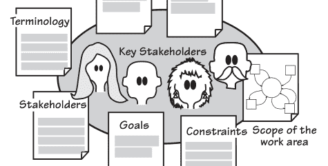

### 正式化指南

无论项目规模大小或对非正式化的追求如何，任何项目都需要启动交付物——特别是范围、利益相关者和目标。即使是对现有系统的微小更改也需要询问这些问题。如果项目想要避免盲目游，必须对其目标有清晰的理解。此外，如果想要改进项目，必须理解这项工作；否则，它面临着产生“寻找问题的解决方案”的风险。

在上一章中，我们讨论了兔子项目、马项目和大象项目。这些类型与正式程度有关，其区别如下：

兔子项目应该在墙上贴一张工作范围草图，以覆盖它们的用户故事；紧随其后的应该是一份利益相关者列表。最后，用宽记号笔在墙上写下项目目标。兔子项目顶其多只举行一次简短的启动会议，启动的大部分共识来自 wiki、电话以及或其他非正式的互动手段。


尽管具有相对正式性，我们仍无法强调记录工作范围以及确保其执行有多么重要。尽管（如此）相对正式性，我们无法强调记录工作范围的重要性，并要确保你考虑的是工作，而不仅仅是产品。

马项目应该更正式一些，举行启动会议并向相关的利益相关者传达其交付物。马项目可能受益于对交付物产出第一份草图，以确保所有利益相关者（我们指的是非技术性人员）理解项目去向何方。


大象项目如果不在进一步开发之前拥有稳固的启动交付物，将会面临巨大损失。大多数情况下，交付物是在与关键利益相关者的会议中发现的。大象项目应该采取额外步骤，让质量保证（QA）人员测试它们的交付物：大象项目的错误是昂贵的，因此项目的基础必须坚如磐石。


对于启动交付物的正式化程度不一，但这并不意味着可以忽略它们。本章将解释这些交付物。

### 设定范围

回到业务价值和所有者。

如果所有者是一个组织，你必须理解该组织的业务流程和目标，或者在大多数情况下，理解项目将影响的部分。如果所有者是使用个人电脑软件或移动设备 App 的个人，如果你想交付业务价值，仍然需要理解该个人在做什么以及想做什么。无论如何，如果你想构建有价值的东西，就必须理解所有者在使用你的产品时在重什么以及正在尝试实现什么。

### IceBreaker

由于你对业务的了解不足，无法做出正确的价值决策，因此无法获得最优。

让我们来看一个将要研究的活动与忽略的活动隔离开来的例子。我们之前提到，活动之间有数据流。这一简单事实使你能够构建一个图，显示数据如何从一个不感兴趣的活动流向你感兴趣的活动集合。这种图的示例（称为上下文图或工作范围图）出现在图 3.5 中。然而在检查它之前，你需要一些关于这种图的背景知识。

### IceBreaker

IceBreaker 是我们整理的一个案例研究，用于说明需求产生过程。IceBreaker 利用环境数据来预测道路何时会形成结冰。它在道路变得危险之前，调度卡车使用除冰材料（一种盐化合物）对道路进行处理。IceBreaker 案例研究使用了来自许多结冰监测系统和道路除冰系统的专业知识，以及由 Vaisala (U.K.) Limited 和 Vaisala Worldwide 生产的其他产品。感谢 Vaisala 允许我们使用其材料以及公司的慷慨配合。图 3.4 描绘了 IceBreaker 使用的一个气象站。

想象 IceBreaker 是你的项目。你工作于 Saltworks Systems，负责编制需求规格书。IceBreaker 产品的第一个客户是诺森伯兰郡县。

# 图 3.4

该气象站将有关天气和路面状况的数据传输到 IceBreaker，IceBreaker 利用这些信息预测结冰的形成。这些预测用于调度卡车使用除冰材料处理道路。Vaisala 气象站照片 ROSA 来自 Vaisala。www.vaisala.com。


# 第 3 章 确定业务问题范围

交通部。诺森伯兰（Northumberland）是英格兰东北部的一个郡，位于与苏格兰的边界处，冬季有严重的雪雪和冰冻天气。交通部负责保持道路无无可能导致事故的冰冻；它同意提供专业知识和信息，以便你为部门构建具有最优价值的产品。

# 初步工作上下文

在 IceBreaker 工作预测道路是否需要处理的过程中，执行了许多活动：生成预报、测量道路表面温度、对哪些道路将结冰做出预测、派遣卡车等。为了交付最优价值，你必须确定这些活动中哪些应该被研究（因为它们有改进的空间），哪些可以安全地排除在研究之外。

为了说明你的决策，收集所有要研究的活动，并将它们（暂时）隐藏在中心圆中。将连接的但不属于你研究范围的活动放在圆外，并显示数据连接情况。使用这种方法，我们 IceBreaker 工作的第一份上下文图草稿如图 3.5 所示。

# 图 3.5

工作上下文图确定了要研究的工作范围。它将工作视为单个活动，被相邻系统包围。命名为“其他（others）”的部分代表了工作与相邻系统之间流动的数据。相邻系统是你决定不研究的活动。

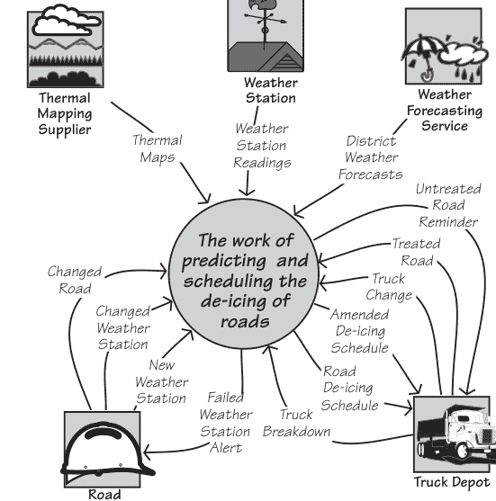

# 范围、利益相关者和目标

上下文图显示了要研究的工作，以及你决定不研究的活动。后者活动被称为相邻系统。上下文图的目的是显示工作的处理职责以及相邻系统的职责。但要意识到，这些职责实际上是由上下文图上的数据流定义的。例如，`Truck Change`（卡车变更）流告知工作有关除冰卡车的变化——例如加入车队的新卡车、退役的卡车以及会影响调度方式的卡车改装。为什么会有这个流？在制定除冰计划的过程中，工作在需要将卡车分配给每条需要处理的道路时，需要这些信息。但如果你改变了这一职责呢？如果由仓库负责向冰雪道路分配卡车呢？在这种情况下，`Truck Change` 流将完全不会出现在上下文图中，因为由该数据流触发的活动变成了相邻系统的职责。

工作上下文显示了工作职责与相邻系统职责的开始和结束。

这意味着工作边界周围的流是其处理能力最清晰的指示。通过定义这些流，你定义了处理结束且相邻系统处理开始的精确点，反之亦然。

在设定上下文时常见的一个问题是只考虑预期的软件产品。记住，你正在调查的是某些工作，而最终的产品将成为该工作的一部分。为了指定最有价值的产品，你必须理解要部署什么产品的工作。在大多数情况下，将研究限制在他们认为产品将包含的内容的项目构建了有用产品；事实上，它们往往遗漏了对所有者有价值的功能。作为商业项目的准则，如果你的工作上下文中没有人类，那么说明你的工作上下文太窄了。

还应考虑，通过扩大工作范围，你可以发现其他可能具有价值的自动化或其他类型的改进。（注：原文此处存在大量重复句式，已清理）。

> 故事的寓意：首先理解工作，然后决定什么产品对该工作有价值。

# 利益相关者 45

# 图 3.7

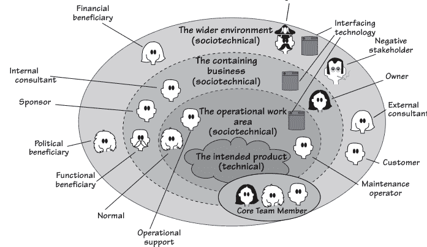

这张利益相关者图展示了围绕最终产品的组织圈，以及居住这些圈的利益相关者类别。使用此图可以确定哪些类别的利益相关者与你的项目相关，以及你需要通过他们代表哪些角色。

利益相关者图的中心是预期产品。注意它呈现出一个模糊的云状形状——这是刻意为之。在需求定义的初期，你无法确定产品的边界，因此目前我们将将其保持松散定义。环绕在预期产品的是一个代表运营区域的环——与产品有某些直接接触的利益相关者处于这一空间。在下一个环中，即所属业务部门，包含了以某种方式从产品中受益的利益相关者，即使他们不在运营区域。最后，外层圈（即更广泛的环境）包含了其他对产品有影响或感兴趣的利益相关者。请注意，核心团队成员（分析师、设计师、项目经理等）的详细且多方面的参与，通过他们跨越所有圈这一事实得到了强调。

# 阅读

有关利益相关者分析的更多信息，请参考 Alexander, Ian, Neil Maiden, et al. Scenarios, Stories, Use Cases Through the Systems Development Life-Cycle. John Wiley & Sons, 2004.

由于存在许多类利益相关者，讨论其中一些较重要的类别是有帮助的。在讨论完这些利益相关者之后，我们将引导你进入使用利益相关者分析模板将他们正式化的阶段。

### 赞助人 (The Sponsor)

我们已经多次强调过——且将重复这一点——产品必须为其用户提供最佳价值。然而，对于许多产品，你无法且通常也无法直接接触经理。许多项目由商业组织执行，从严格来说，它们受其利益相关者的约束。自然，你不能去与所有利益相关者交谈，也不可能接触董事会。在这种情况下，

# 第 3 章 界定业务问题

通常的做法是为项目指定一个赞助人来代表所有者的利益；在许多情况下，开发新产品的资源来自赞助人的预算。你会发现赞助人关注项目问题，并在设定某些约束性需求方面发挥关键作用。我们稍后将处理这些问题。

赞助人支付产品开发费用。

基于“金钱就是一切”的简单原则，赞助人通过支付开发费用，对项目做什么、如何做以及可能多复杂或简单拥有最终决定权。换句话说，赞助人是决定什么将产生最佳价值的最终仲裁者。

没有赞助人你就无法进行。如果没有人代表整个组织的利益，那么继续项目就没什么意义。赞助人最有可能出现在启动会议（blastoff meeting）上（如果赞助人没来，你应该感到担心），并且他们最可能是这些人中的之一：

-   用户管理：如果你正在为内部消费构建产品，那么最现实的赞助人是最终运行项目的用户的经理。他们的部门或其工作是产品的受益者，因此，由部门经理承担建设成本是合理的。

-   市场开发：如果你为组织外销售而构建产品，营销部门可能承担赞助人的角色，并代表产品的最终所有者。

-   产品开发：如果你为销售而构建软件，你的开发预算可能在你的项目经理或战略计划经理手中，在这种情况下，他们其中一人就是赞助人。

考虑你自己的组织、其结构和工作职责：哪些人代表所有者？谁支付项目开发费用？谁，或什么获得了产品带来的业务优势的利益？当你确定最终产品是什么时，你必须考虑谁的价值观？

为你的赞助人做任何你需要做的事；没有赞助人，你的项目将不会成功。

假设 IceBreaker 项目的赞助人（在此情况下为所有者代表）是 Saltworks Systems 的执行官 Mack Andrews。Mack Andrews 已承诺投资建设该项目。你在需求规格书的第 2 节中记录了此协议：

> 项目赞助人是 Saltworks Systems 的执行官 Mack Andrews。他表示，他的目标是开发这款产品，以吸引其他国家更广泛的市场，包括机场及其跑道。

# 利益相关者 47

这里有几点需要注意。首先，指明赞助人的姓名。现在项目中的每个人都很清楚，Mack Andrews 负责投资该产品，并将成为范围变更的最终仲裁者。其次，还提供了关于赞助人的其他信息，这些信息将在项目进行期间被使用，并可能对某些需求产生影响——特别是可用性、适应性和“产品化”需求。

有关可用性、适应性、产品化和其他类型需求的更多详细信息，请参考附录 A 中的模板。

### 客户 (The Customer)

客户在产品开发完成后购买产品，成为产品的新所有者。为了说服客户购买产品，你必须构建客户认为有价值且实用的东西。

客户购买产品。你必须足够了解此人，以理解他认为什么有价值，因此他才会购买。

你可能已经知道客户的名字，也许他们可能是成百上千个被说服为你的产品付费的陌生人。无论哪种情况，你必须足够了解他们，以理解他们认为什么有价值，因此他们才会购买。

# 利益相关者

不同的用户对你的产品有不同的需求。例如，航空公司飞行员对易用性的要求与铁路系统上购票的通勤者完全不同。如果你是一个通勤者，那么“没有带现金的人”和“只有一只手空闲的人”就会提出他们自己的易用性需求。

在消费产品、大众市场软件或网站时，你应该考虑使用*用户画像（persona）*作为用户。用户画像是一个虚拟的人，代表了你大多数用户的典型特征。通过在足够程度上确定这个用户画像的特征，团队就可以知道满足每个人的正确需求是什么。你应该在现阶段决定将使用用户画像，但可以在此后对它们进行更充分的开发。在第 5 章“调查工作”中提供了有关用户画像的信息。

考虑潜在用户对于敏捷开发至关重要。许多团队仅依靠一个用户提供产品需求，很少或没有考虑当产品发布给更广泛的观众时会发生什么。我们强烈建议你始终考虑最广泛的用户群体，并且至少从该光谱的两端选择利益相关者。

在识别出用户后，你必须记录下他们。例如，在 Icebreaker 项目中，我们的用户属于以下类别：

- 合格的道路工程师

- 卡车部门的职员

- 经理

对于每一类用户，在你的说明书中写一个章节，在时间允许的情况下尽可能详细地描述你的用户的属性。考虑以下可能性：

- 领域经验：他们需要什么程度？

- 技术经验：他们能操作产品吗？应该使用哪些技术术语？

- 智力水平：任务应该变得更简单？还是分解为更低的水平？

- 对工作的态度：用户的愿望是什么？

- 教育程度：你期望你的用户了解什么？

- 语言能力：并非所有用户都会说或读母语。

- 最重要的是，他们的工作中哪些是他们最想改进的？

此外，对于每一类用户，识别出你的产品必须迎合的特定属性：

> Don Gauss 和 Jerry Weinberg 在他们的书中提供了一个脑风暴用户列表的绝佳示例：*Design, Development and Requirements: Quality Design*。 Dorset House, 1989。

尽管这个测试已经有些过时了，但它仍然具有意义。Jerry Weinberg 的大多数书籍都以 Kindle 书或书签的形式提供。

用户画像是一个代表你大多数用户的虚拟人。

- 残障人士：考虑所有残障。在某些情况下，这是法律要求。

- 非阅读者：考虑不能阅读的人和不使用母语的人。

- 需要眼镜的人：这对于作者其中之一来说特别地亲切。

- 无法抵制字体、样式等事物变化的人。

- 可能会提着行李、大包裹或抱着婴儿的人。

- 不使用电脑的人。

- 可能会感到愤怒、沮丧、压力大且匆忙的人。

我们意识到写下所有这些似乎是一项任务。然而，我们发现，花时间记录这些内容供人们阅读是证明你理解了这些内容的少数方式之一。用户对你的事业至关重要，以至于你必须了解他们是什么样的人以及他们拥有什么能力。仅仅挥挥手说“他们是平面设计师”或“他们想在网上买书”，远未达到最低的理解水平。

运营工作领域的另一类利益相关者是维护操作员。你的产品可能具有维护性需求，你可以从这些人身上学习这些需求。

运营支持是另一个与运营工作领域相关的需求来源。这些需求的角色包括帮助热台人员、培训师、安装人员和教练。

除了目标用户以外的人最终可能会接触到你的产品。识别出多余用户比未能识别出所有用户要好。

在此阶段，你识别出的任何用户都是潜在用户。也就是说，你并不一定知道产品的范围——你将在需求过程的后期确定这一点——所以你正在识别可能使用、维护和支持该产品的人。记住，除目标用户以外的人（例如消防员、安全人员）最终可能会接触到你的产品。识别出多余用户比未能找到所有用户要好，因为每一类用户都会有一些不同的需求。

# 其他利益相关者

> 每一个背景都是由个体组成的，这些个体通过他们代表的大小组织与项目的命运建立或不建立联系。

— Bruno Latour, ARAMIS of Love of Technology

你需要与许多人交流以便找到所有需求。你与这些人的接触可能是转瞬即逝的，但它是必要的。他们中的任何一个人都可能对你的产品有需求。

你在需求项目中经常面临的问题是，你未能发现所有的利益相关者，因此未能发现他们的需求。当你的产品面对比想象中更广泛的观众时，这种缺陷可能会导致一系列变更请求：


自然，那些被忽视的人不会高兴。此外，你必须考虑，当安装任何新系统时，有人获得了权力，有人则失去了权力。有些人发现产品为他们带来了新功能，而另一些人则无法从事以前的工作。这个故事的道理很清楚：找到所有受产品影响的人，并找到他们的需求。

让我们通过观察候选类别来考虑其他利益相关者。你也可以在图 3.7 的利益相关者图中看到这些小组大多数作为类的形式所示。

我们在 Volere 需求说明书的第 2 部分列出了我们的利益相关者。你可以在附录 A 中找到此模板。该列表充当寻找适当利益相关者的检查清单。

### 顾问

顾问——无论是组织内部还是外部的——都是拥有你所需的专业知识的人。顾问可能永远不会接触或看到你的产品，但他们的知识成为了产品的一部分。例如，如果你正在构建一个金融产品，安全专家就是利益相关者之一。他可能永远没见过你的产品，但他的专业知识——这是他在需求中的立场——确保了产品的安全性。

### 管理层

考虑任何类别的管理层。这些小组在利益相关者图 (3.7) 中表现功能受益者、政治受益者和财务受益者等类。这是一个战略性产品吗？除了参与人员之外，是否有其他经理拥有利益？

产品经理和项目经理是丰富的需求来源。负责项目日常管理的经理或领导同样也有贡献。

### 领域专家

这一群体可能包括领域分析师、业务顾问、业务分析师或任何对业务主题有专门知识的人。因此，这些专家是工作信息的主要来源。

### 核心团队

核心团队由参与产品构建的人组成。他们可能包括产品设计师、开发者、测试人员、业务分析师、系统分析师、系统架构师、技术写作人员、数据库设计人员以及任何参与构建的人。

你也可以将开源社区视为利益相关者——他们对大多数领域的技术和趋势了如指掌。

第 3 章 业务问题范围界定

你可以通过开源论坛与这些人联系。他们通常非常热情，并准备好与你分享知识。

当你知道涉及的人员时，请记录他们的姓名。否则，使用模板的此部分列出你认为构建产品可能需要的技能和职责。

### 检查员


考虑审计师、政府检查员、各种安全检查员、技术检查员，甚至可能的警察。在你的产品中建立检查能力可能是很有必要的。如果你的产品受《萨班斯-奥克斯莱法案》或任何其他监管法案的约束，那么检查是关重要的，检查员的要求也是如此。

### 市场力量

营销部门的人员可能是代表市场的利益相关者。当你为商业销售开发产品时，市场趋势是需求的重要来源，对可能成为消费者的深度了解也是如此。注意智能手机和平板电脑市场移动的速度。对于任何消费品来说，保持领先于趋势至关重要。

### 法律专家

每年世界都充斥着越来越多的法律——遵守所有法律是一项艰巨但必要的任务。你的律师是你大多数法律需求的利益相关者。

## 负面利益相关者

负面利益相关者是不希望项目成功的人。尽管他们可能不是最合作的个人，但考虑他们是明智的。你可能会发现，如果他们的需求与通常认知的版本不同，而你可以满足他们的需求，你的反对者完全可能变成你的支持者。

你可能还会考虑威胁你产品的人——黑客、欺诈者和其他恶意分子。你从他们那里得不到合作，但你应该考虑他们可能会如何虐待你的产品。

## 行业标准制定者

你的行业可能有专业机构，他们期望在行业内构建或供行业使用的任何产品都遵循某些行为准则或维护某些标准。

### 公众意见

你的产品是否存在任何用户群体？他们无疑将是需求的主要来源。对于任何旨在公共领域的产品，考虑对公众成员征求意见。他们可能会对你的产品提出要求，这些要求可能决定了被接受还是拒绝。

## 政府

某些产品必须为了报告目的与政府机构进行交互，或从政府机构接收信息；其他产品有需要咨询政府的需求。尽管政府可能不会为你的项目分配专人，但你仍应将相关机构提名为利益相关者。

## 特殊利益集团

考虑残疾利益集团、环保机构、外国人士、老年人、性别相关利益或任何可能接触到你产品的群体。

### 技术专家

技术专家并不一定构建产品，但他们几乎肯定会就产品的某些部分接受咨询。对于来自这一群体的利益相关者，请考虑可用性专家、安全顾问、硬件人员、你可能使用的技术专家、软件产品专家，或产品可能用到的任何技术领域的专家。

### 文化利益

这一群体适用于面向公共领域的产品，特别是当你的产品要在其他国家销售或展示时。此外，在当前这些政治正确的时代，你的产品完全可能得犯某人。如果接触你的产品可能对宗教、文化、政治、性别或其他人类利益产生影响，那么你应该考虑将这些小组的代表作为项目的利益相关者。

### 邻接系统

你工作上下文图中的邻接系统直接与你正在研究的工作交互的系统或工作区域。查看每个邻接系统：谁代表它的利益，或者谁了解它？当邻接系统是自动化运行时，谁是它的项目负责人维护者？如果没有这些利益相关者，你可能需要阅读邻接系统的文档或代码，以发现它与你的产品交互是否有任何特殊要求。对于每个邻接系统，你需要找到至少一个利益相关者。

## 寻找利益相关者

在界定范围时，你通常会检查你的上下文模型并召开脑暴会议来识别所有可能的利益相关者。你不需要从零开始；我们构建了一个包含许多类别利益相关者的电子表格，以及你需要从每个人那里获取的某种知识。该电子表格交叉引用了利益相关者地图，并提供了你项目社会学的详细规范。一旦你确定了利益相关者，请将该人的姓名添加到列表中。完整的表格可以在 `www.volere.uk` 免费下载。

你将与利益相关者交流，因此在这个阶段，向他们解释他们为什么是利益相关者，以及你为什么需要就需求咨询他们是有价值的。解释你的投入将对最终产品产生影响。告知利益相关者你需要的时间以及你设想的参与类型是礼貌的；稍小的提醒有助于他们思考对产品的需求。最令人担心的利益相关者问题是，如果你没有找到所有的利益相关者，或者在需求收集过程中排除了利益相关者，你会错过某些需求。

参见附录 B 中的“利益相关者管理模板”，也可以从 `www.volere.uk` 下载电子表格版本。

## 目标：你想实现什么？

当你忙于与利益相关者讨论详细需求时，很容易偏离轨道，浪费时间在不规则上或错过重要需求。

你的赞助人正在投资一个构建产品的项目；为了理解这项投资背后的原因，你需要确定项目将交付的精确收益。你还需要一个指南来帮助你引导项目。

注意项目目标的主要几个方面：

- 目的：产品应该做什么？
- 优势：它提供了什么业务优势？
- 衡量：你如何衡量这一优势？
- 可行性：根据你对限制条件的了解，产品是否可能实现业务优势？
- 可行性：根据你从启动中学习的知识，是否可能构建产品来达到衡量标准？
- 可实现：组织是否拥有或可以获得构建和运行所建产品的技能？

### 优势

业务优势在于减少——理想情况下是消除——因冰冻导致的事故。交通部门有章程维护其道路，确保行车安全。因此，所有者将从该产品中获得以下优势：

> 优势：通过消除结冰状况来减少道路交通事故。

### 衡量

这一优势是可以衡量的吗？是可以的。你产品的成功可以通过冰冻作为诱因因素的事故数量的减少来衡量：

> 衡量：在产品覆盖区域的所有道路上，每行驶 1 万车英里，归因于冰冻的事故不应超过一次。

你已经设定了一个可衡量的目标，监控一两次事故发生是合理的。事故统计数据、警察报告和道路使用数据已经在被收集中，因此你在寻找数据来衡量产品产品的性能并确定其是否成功时不会遇到困难。

## 第 3 章 确定业务问题范围

> 支持材料：Thornes, J. E. "Cost-Effective Snow and Ice Control for the Nineties." Third International Symposium on Snow and Ice Control Technology, Minneapolis, Minnesota, Vol. 1, Paper 24, 1992.

工程师们还知道，在道路上施用过多的盐会损害环境。通过更准确的处理，会有较材料进入道路周边，损害也随之减少。这意味着准确的预测带给了你另一个优势：

- 优势：通过减少不必要的除冰化合物投放减少对环境的破坏。

这一优势可以通过比较产品使用的除冰材料量与目前的量来衡量：

> 衡量：当局道路除冰所需的除冰化学品应减少到当前用量的 70%。

支持材料：Thornes, J. E. "Salt of the Earth," Surveyor Magazine, 1994年12月8日, 第16–18页。

注意，目的声明产生了一个优势和一个衡量标准。如果你无法为产品表达优势，或者该优势不可衡量，那么它就不应该成为你规格说明书的一部分。

## 限制

当你写目标时，你应该指出所有决策都由它驱动。如果目标在项目过程中发生变化，范围也会发生变化。

参见第13章“质量网关”，了解更多关于将目的作为相关性测试的内容。质量网关对每个需求进行一系列测试，包括相关性。如果一个需求与目的某种程度上无关，就会被拒绝。

限制是全局性需求。这些限制决定了可以在产品上花费的时间或资金。有时，限制是一个预先设计的决策，限制了解决问题的方法。

# 第 3 章 界定业务问题

### 项目约束

项目约束描述了项目的时间和资金预算。这些参数在界定范围时应该是明确的，因为它们会影响你之后收集的需求。如果你有 `500,000` 美元的预算，那么去收集价值 `100` 万美元产品的需求是没有意义的。

设定时间约束是为了使项目能够赶上机会窗口、与相关产品的协调发布保持一致、满足新业务计划的计划启动时间，或满足许多其他进度需求。如果存在此类约束，你应该让你的团队意识到这一点。请记住，约束不等同于完成项目所需时间的估算。

财务约束指示了产品可能的复杂程度，并能让你直观地了解该产品是否真的受欢迎。

## 命名规范与定义

名称非常重要。好的名字能传达意义；糟糕的名字恰恰相反。此外，我们发现每个项目都有其特有的名称，这些术语应该记录下来，以使沟通更简单，未来的理解更可靠。在界定范围期间，你开始收集并记录这些名称以及它们约定的含义。

在规范模板的第 4 节“命名规范与术语”中记录这些名称。该词表将作为整个项目的参考点。

例如，IceBreaker 项目团队在启动期间向其词表添加了以下定义：

> 能够收集和传输道路温度、气温、湿度和降水读数的气象站硬件。气象站安装在诺坎伯郡的八个地点。

## 这将花费多少费用？

在界定范围时开始定义术语具有明显的优势：你让工作变得可见了。利益相关者可以讨论它们并进行更改，以反映他们对含义的共识。后续开发将基于对术语更精确的理解，并将其作为构建完整数据字典的基础。

此时，你已经有了相当的信息来基础估算成本和精力。所需的精力通常与工作区域内包含的功能数量成正比。

在此阶段，你可能知道产品的规模——将包含多少功能。此外，鉴于不同技术解决方案成本的巨大差异，建议不要暂尝试估算整个开发成本。

衡量工作区域规模或功能最简单的方法是计算上下文模型上相邻系统的数量以及输入和输出的数量。

# 去还是不去

风险管理是常识性的项目管理，或者用我们的合作伙伴 Tim Lister 的话来说，“面向成年人的项目管理”。如果你的组织没有在做这项工作，那么你就应该为即将到来的预算或时间超支做好准备。进行风险分析最显著的效果是，它让风险对所有利益相关者可见。

> 阅读

DeMarco, Tim, and Tim Lister. Waltzing with Bears: Managing Risk on Software Projects. Dorset House, 2003.

项目启动的交付物表明了你项目的可行性。当你仔细审视这些交付物所提供的信息时，你就可以决定按下按钮启动你的需求项目是否明智。

考虑一下你的交付物：

- 目标产品是否清晰且无歧？是否包含模糊词汇？
- 目标是否可衡量？
- 目标是否为所有者带来了实际收益？
- 它是否可行？是否在分配的时间和预算内可能实现项目目标？
- 你是否已经对工作范围达成了协议？
- 是否存在某些高概率变成问题的风险？
- 这些风险的影响是否已导致项目不可行？
- 与产品的收益相比，调查成本是否合理？
- 利益相关者是否愿意参与？
- 你是否有充分的理由投资该项目？
- 你是否有足够的理由不投资该项目？
- 在启动需求项目之前，你是否应该进行任何进一步的调查？

> 阅读

Toickey, Steve, Return on Software: Maximizing the Return on Your Software. Addison-Wesley, 2004.


要点在于基于事实做出客观决策，而不是基于热情或盲目的乐观。在与我们的行会伙伴 Adrenaline Junkies 和 Template Zombies 合著的书中，其中一篇短文名为“死鱼（Dead Fish）”。所谓的“死鱼项目”是指那些从诞生生的那一刻起就知道它注定失败的项目，然而项目组中没有人站出来说它注定会失败，它会一直挂在那里，臭气散发。

> 从第一天起，项目就没有可能实现其目标；项目中的大多数人人都清楚这一点却保持沉默。
> —Adrenaline Junkies and Template Zombies: Understanding Patterns of Project Behavior (Dornet House, 2008)

在它被和其他垃圾一起被扔掉很久之后仍然散发臭味。遗憾的是，死鱼项目比比处可见——我们敦促你采取一切措施避免成为其中一员。在现阶段的一点考虑就可以防止死鱼项目的启动；而且它能让你的项目有一个良好的开端。

此时也可以引入其他项目管理技术。遗憾的是，它们都有低俗的缩写，这让你的作者们很难太严肃地对待它们：

### SWOT
列出优势（Strengths）、劣势（Weaknesses）、机会（Opportunities）和威胁（Threats）。这些因素用于评估项目的整体价值和风险。

### ALU0
拟议方案的优势（Advantages）、局限性（Limitations）、独特品质（Unique Qualities）以及克服局限性的方法。这项技术源于创意解决小组（The Creative Problem Solving Group）。

### SMART
项目必须是具体的（Specific）、可衡量的（Measurable）、可（Attainable）、相关的（Relevant）以及有时间限制的（Time-bound）。管理层考虑项目是否具备所有这些特征。

### PESTE
该模型研究项目的政治（Political）、经济（Economic）、社会（Sociological）、技术（Technological）、法律（Legal）和环境（Environmental）因素。它通常与 SWOT 结合使用。

### CATWOE
这项技术源于 Peter Checkland 的软系统理论，意味着你需要考虑项目的客户（Customers）、执行者（Actors）、转化过程（Transformation Processes）、世界观（World view）、所有者（Owners）和环境（Environment）。

每种技术都有追随者，当正确使用时，它们都可能提供某些价值。我们这里的意图不是讨论这些方法，而是提供与项目启动交付物配合使用的技术。

### 启动会议
我们建议关键利益相关者聚在一起一天，以得出本章讨论的交付物。我们理解在许多组织中，这种会议尽管有优点，是不可能的。尽管如此，仍其他其他方法实现目标。

# 第4章 业务用例

## 业务问题的范围
业务问题的范围——由启动者达成共识。该范围定义了要研究的工作区域以及围绕它的相邻系统。相邻系统向该工作提供数据和/或从该工作接收数据。业务事件发生在相邻系统中——通常，一个事件会产生对该工作所提供的服务的需求。此外，时间触发的业务事件发生在工作需要向相邻系统提供信息时。响应工作构成了业务用例案例；它包含了做出正确响应所需的所有过程和数据。需求分析师在相关利益者的帮助下，研究业务用例的功能和数据。通过这些，他们确定了要构建的最优产品，并构建了一个产品案例场景来展示参与者与产品如何交互。一旦对此产品用场景达成共识，需求分析师就会为产品编写需求或用户故事。

- 1 此气泡包含了工作或业务领域。
- 2 邻接系统
- 3 业务事件发生并导致流工作和/或从工作的流

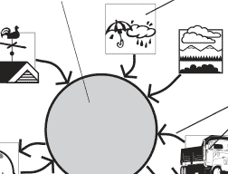

- 4 工作对业务事件做出响应。这是一个业务用例 (BUC)
- 5 分析师研究每个业务用例，通常通过编写场景

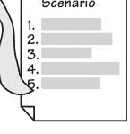

- 6 利益者和分析师决定要构建的最优产品
- 7 使用产品案例场景 (PUC) 描述并确认产品功能
- 8 分析师编写产品故事或需求

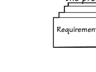

如果我们有一种某种系统且可观察的方法来划分工作，那么我们得到的结果更有可能保持一致。我们转向我们偏好的划分方式。对业务事件的响应——我们称这些业务用例 (BUCs)——满足以下标准：

- 它们是“自然的”——每一个对工作都做出了显而易见且逻辑性的贡献。
- 它们与其他工作部分的连接最小。
- 它们有明确定义的范围。
- 它们有定义其范围的规则。

用例及其范围

- 它们有可以被观察和定义的边界。
- 它们可以使用利益者可识别的名称命名。
- 它们的存在可以被轻易确定。
- 它们有一位或多个作为该部分工作专家的利益者。

在检查业务用例之前，让我们看看不同的项目如何需要它们。

### 形式化指南
兔子项目（Rabbit projects）应该特别关注这一章。在运行迭代项目时，对要解决的业务问题有坚实的掌握至关重要。我们强烈建议兔子项目在开始制定解决方案之前，利用用例来探索他们的问题领域。这种方法不会增加文档负担，并且会缩短交付不恰解决方案的时间。


马项目（Horse projects）应该考虑使用我们在本章中描述的用例来划分工作区域。我们发现，BUC 场景是与利益者讨论当前和未来工作的有用工作工具。还有可能将 BUC（以及后的用例 [PUC]）场景作为传递给开发者的文档，这允许你避免编写许多详细需求。我们将在后面的章节中讨论。


大象项目（Elephant projects）应该绝对使用业务事件。由于大象项目有大量的利益者，清晰的沟通既重要又困难。我们发现，BUC 场景是地理分布团队中讨论工作的理想机制。之后，BUC 场景及其 PUC 派生将作为正式文档的一部分进行维护。BUC 场景也有助于与外部人员讨论高级问题。


## 用例及其范围
“用例”（Use Case）一词是由 Ivar Jacobson 在 1987 年提出的，用于描述系统与系统用户之间的交互。雅各森需要将系统拆分为较小的单元，因为他认为对象模型不可扩展。因此，为了处理现代系统的复杂性和规模，他认为首先有必要将它们划分成方便的区块，而这些区块应该基于用户对系统的视图。

然而，雅各森给我们留下了一些未解决的问题。例如，用例的定义没有明确指出用例从何时开始以及何时结束。事实上，雅各森对用例的定义可能留下了歧义；其他人也写过用例，但很少有人对它有相同的定义。大约有 40 种关于“用例”的定义，几乎没有一致的。这种混乱是遗憾的。

雅各森也使用“参与者”（actor）一词来表示用户角色，或者可能是系统之外的另一个系统。系统中的系统被认为是这样的。这导致了一个问题：如果参与者的职责在过程开始时就已经确立，而需求收集集中在系统上，你如何才能理解参与者正在的工作呢？

受当前开发的影响。即使你正在建造一个机电设备，例如自动取款机（ATM），而且大部分的人为参与发生在产品边界之外，你的工作上下文仍然必须包含将对设备进行某些操作的人员。

当我们谈论工作上下文图时，请注意该模型有限但尽管如此仍有些“残酷”的目标。该模型仅显示了信息流。它并没有试图显示对你工作的限制，尽管这些限制可以从模型中推断出来。同样，它也没有显式地显示是谁或什么东西在执行工作，尽管这些信息也可能被推断出来。正如所有模型一样，上下文模型是一个显示单一视图的抽象。在这种情况下，通过突出显示信息流，我们能够更好地利用该模型来确定影响工作的业务事件。但首先，让我们更详细地查看上下文模型的一个部分：外部世界。

工作范围包括任何你允许更改的内容，以及任何你为了决定改变什么或应该应该变成什么样而需要理解的内容。

### 外部世界
正如我们之前看到的，相邻系统是指通过向你传递数据或从你那里接收数据与你连接的世界部分。相邻系统的行为与其他任何系统一样：它们包含过程并消耗/产生数据。你对它们感兴趣，是因为它们通常是你工作所提供的信息或服务的客户，或者因为它们提供了你工作所需的信息。你可以通过查看上下文图上的数据流来观察这些关系。相邻系统通过这些信息连接影响你的工作。

在合理范围内，你观察预期系统越远，你的产品就可能越有用、越创新。

要找到相邻系统，你有时必须进入自己的组织之外。去你组织的产品或服务的客户那里。去向为你工作提供信息或服务的外部系统和组织。去与工作连接的其他部门。遵循这一准则：你观察的预期自动化系统越远，你的产品就可能越有用、越创新。

你通常会发现你的工作与一个或多个计算机系统紧密相连（通常在你的组织内部），或者你正在对现有的计算机系统进行增强。在这种情况下，计算机系统或未发生变化的部分就是相邻系统。你的工作与现有计算机系统之间的接口至关重要。尽管这些接口可能很难描述，但如果你不明确定义这些接口，你永远无法知道你工作的范围，以及最终你产品的范围。

不要被你认为可能是计算机系统的限制所束缚。相反，尝试找到对工作产生任何细微影响范围。

这样想：相邻系统是工作存在的原因；它们是工作所产生服务的客户，按需或预先安排的时间产生这些服务，而当工作执行这些操作时，工作是在响应一个业务事件。

### 业务事件
任何工作都会对其外部发生的事情做出响应——这很简单。为了清晰起见，由于我们正在讨论你的所有者的工作或业务，我们将这些发生称为**业务事件**。

让我们来看一个业务事件的例子。你正在读这本书，所以作者诚诚地希望你为它付了钱。让我们先假设你是在网上购买的。你已经找到了书，看了样章页，并决定你想要它。在那个一刻，可能发生了两种情况之一：(1) 你可能决定自己有事要做而放弃了交易，或者 (2) 你决定买这本书。那个时刻——即你决定买书的那一刻——就是业务事件。当然，仅仅决定想要这书是不够的；你必须告诉工作你想要。

你通过指示想要结账（或你的在线书店用于此类事情的任何机制）向工作发出了信号，并提供了信用卡、收货地址等。这种输入数据流触发了书店工作的响应，该响应是将书籍的所有权转移给你，扣除你的信用卡，并向履约部门发送信息将书寄给你。如果你是以电子书形式购买的这本书，那么最后一步将被一个启动下载的操作取代。

业务事件与响应：业务事件发生在相邻系统决定做某事的一刻，或者当某些工作处理条件发生时。相邻系统通过发送训练数据流告诉工作事件已经发生。当这股数据流到达时，工作通过处理输入数据、检索和记录已存储的数据来做出响应。

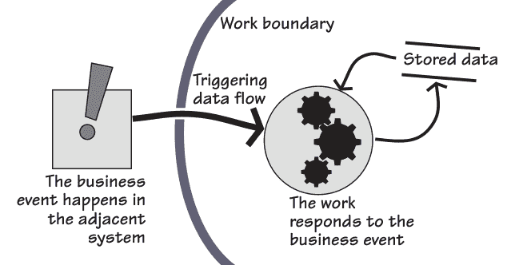

另一个例子：你在月底支付信用卡账单——从信用卡公司的角度来看，这是一个业务事件。信用卡公司通过检查你的地址是否更改，然后记录你付款的日期和金额来响应这一事件。

在这些示例中，你决定买书的时刻和你决定支付月账单的时刻就是业务事件。业务事件总会产生一些数据（触发数据流），它调用了对事件的预计划响应。这种响应就是**业务案例**。

### 时间触发的业务事件
数据流的到达触发了工作。在这些示例中，你决定买书的时刻和你决定支付月账单的时刻就是业务事件。业务事件总会产生一些数据（触发数据流），它调用了对事件的预计划响应。这种响应就是业务案例。

工作分区是由数据流触发的。在这些示例中，你决定买书的时刻和你决定支付月账单的时刻就是业务事件。业务事件总会产生一些数据（触发数据流），它调用了对事件的预计划响应。这种响应就是业务案例。

工作对业务事件的响应将所有相关项汇在一起。

工作对业务事件的响应将所有相关项汇在一起。结果是，你获得了内聚的划分，且各个部分之间的接口尽可能少。这种划分让你在进行详细需求调查时，拥有更具逻辑性的工作块——各个部分之间的依赖关系越少，分析师就越能够研究某一个部分的细节，而不需要了解关于所有其他部分的所有信息。

使用业务用例的另一个原因是，它可以促使人们调查业务事件发生时正在发生的情况。

## 不能假定存在“系统”
在当今的许多文本中，都假定了“系统”是存在的。也就是说，作者假设了他认为的自动化系统边界应该是哪里，并开始通过观察参与者以及与自动化系统的交互来启动用例调查，而完全忽略了围绕这种交互产生的工作。**这样做是危险且错误的。**

这种以产品为中心来看解决问题的方法，意味着你忽略了自动化系统最重要的方面：它本意要执行的工作。通过从自动化系统开始，项目实际上是在进行一场巨大的赌博，赌他们确实拥有正确的解决方案，而且是在没有对问题进行任何研究的情况下做到的。尽管我们似乎抵制推销员那种特定的保险方案可以满足我们所有需求的广告，但我们有一种不快的倾向，即倾向于第一个出现的自动化解决方案。向内部观察解决方案会阻碍分析师去问：“但为什么是这样？”这种失败反过来导致了“技术故障”从一个产品代传递到下一个代。

考虑这种情况：“一名保险文员从汽车保险持有者处收到一份理赔，并将理赔输入自动化系统。”这种观点鼓励了需求分析师去研究文员将理赔细节输入系统的工作。然而，如果你花几分钟时间观察这里正在发生的真实业务，你会发现理赔仅仅是保险公司的实现——是它启动了这部分业务。如果你从问题的真实源头开始业务调查——换句话说，观察业务事件发生时发生的情况——你将构建出一个更好的产品。也许创建一个实现在事故现场实时处理理赔的产品是可行的。解决该问题的一种可能解决方案是一个智能应用，它知道你所在何处，并可以拍摄事故照片以及相关的车牌号和司机信息，并在救援车到达之前将其发送给保险公司。

### 为什么业务事件和业务用例是一个好主意
想想业务事件的真实源头——在这种情况下，它是车辆的司机或所有者（而不是保险文员）。司者的诉求是什么？他希望尽可能快速、省力地修理车辆；他的目标不是填写表格并等待它们被批准。

另一个例子：“一个呼电者联系了帮助热台。帮助热台人员通过询问呼电者问题的详情并记录通话来启动用例。”用例是记录，而呼电者是帮助热台人员。再次，这种以事后为中心的观点忽略了真正的业务事件——那个启动一切的事件。在这种情况下，它是拨打帮助热台电话的启动。

需求分析师必须穿透表象和现有的业务模式，转而理解工作的真实本质。

为什么找到事件的真实源头很重要？如果你将发起呼电者视为业务事件，那么正确的响应是记录通话，使用主叫显示器识别呼电者的设备，检索设备信息并将其提供给帮助热台人员。

再向后退一步，看到端到端的流程（见图 4.6），你可能会决定真正的业务事件是呼电者的设备故障。当你采用这种观点时，你也会考虑到设备为自己拨打电话的情况。也许对故障原因的更好理解，会让你的新产品为帮助热台操作员提供历史信息，有助于他响应通话。

利益相关者通常不会提出这些需求，因为他们只考虑一个假设的产品。出色的业务分析师的任务是看向那个终点之外，这意味着理解相邻系统在启动业务事件时刻的意图。

#### 退后一步
这次是一个安全系统：“参与者收到货物并将其记录在案。”不。真正的业务事件是业务用例的派遣，该记录应该在货物离开发货人时对其进行记录，并监控其运输和到达情况。

考虑真实的端到端流程。勤奋的需求发现者的目标是查看所有活动并将它们纳入研究中。通过这种方式，真实的业务就显现出来了。

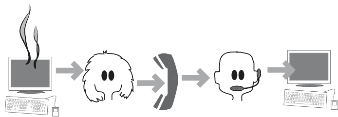

业务事件从这里开始

退后一步看到端到端的流程，同时看到真实的业务。

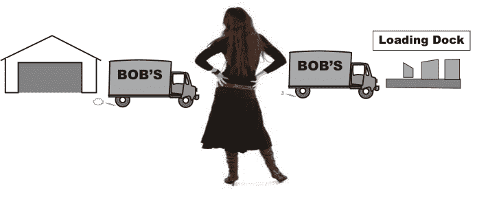

我们需要向后退一步，如图 4.7 所示看到整个业务。

通过退后一步看到整个业务流程，分析师有最大的机会识别真实的业务。相反，通过只看自动化系统，分析师往往会被引导到增量改进的道路上，利益相关者要求的。如果你能看到用例从开始到结束的全频谱，你将更有可能得出更实用的产品。

### 寻找业务事件
业务事件是那些发生并让工作做出某种响应的事情。事件可能发生在工作范围之外（外部事件），也可能因为需要工作做某些事情而发生（时间触发事件）。在外部事件的情况下，来自相邻系统的通信让工作知道事件已经发生。在另一种情况下，时间触发事件，结果总是指向外部的流。在任何情况下，只要业务事件发生，在图中必须至少有一个数据流。

图 4.8 提供了除冰项目的上下文图。该系统在本章前面出现过——为了方便，我们在这里重复它。请观察并注意连接相邻系统与工作的信息流。例如，名为“更改”的流是部门修建新道路或对现有道路进行重大修改时事件的结果。工程人员将更改通知工作，以便调度工作更新其数据。名为“除冰计划”的流是一个时间触发业务事件的结果：每隔两小时，工作产生一份待处理道路的计划并发送给卡车部门。

除冰工作的上下文模型。注意进入和离开工作的数据流。分析师利用这些流来确定业务事件。

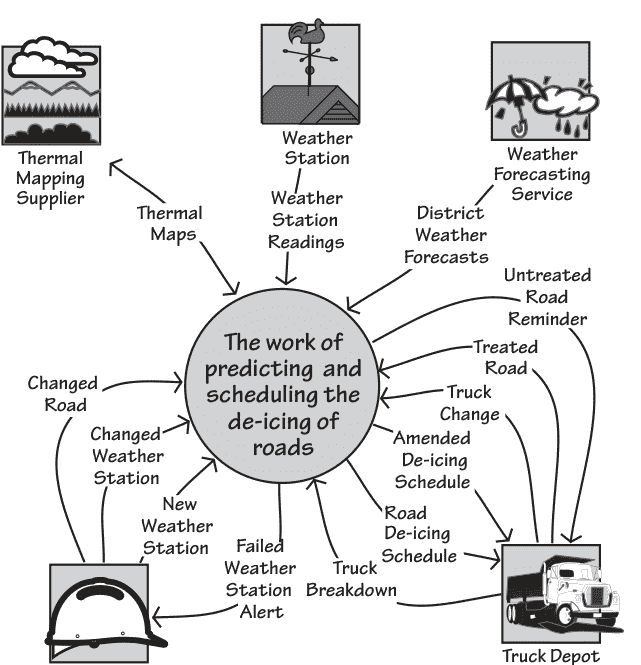

| 表 4.1 | 事件名称 | 输入与输出 |
|---|---|---|
| 道路除冰作业业务事件及其相关的输入输出流列表 | 1. 气象站传输读数 | 气象站读数（输入） |
| 2. 气象局预报天气 | 区域天气预报（输入） |


| 3. 道路工程师建议道路发生变化 | 变更的道路（输入） |
| 4. 道路工程安装新气象站 | 新气象站（输入） |
| 5. 道路工程更换气象站 | 变更的气象站（输入） |
| 6. 测试气象站的时间 | 气象站故障警报（输出） |
| 7. 卡车库更换一辆卡车 | 卡车更换（输入） |
| 8. 探测冰冻路面的时间 | 道路除冰计划（输出） |
| 9. 卡车处理道路 | 已处理的道路（输入） |
| 10. 卡车库报告卡车问题 | 卡车故障（输入） |
| 11. 监控道路除冰的时间 | 未处理道路提醒（输出） |

在大多数情况下，你会发现利益相关者了解业务事件（他们可能不以这个名称称呼它们，但他们知道这些是什么）。如果你在启动阶段没有识别出所有的业务事件，那么在你开始研究工作时，你就会发现它们。

### 业务用例

业务事件对于划分工作非常有用，但工作对事件的响应现在引起了需求分析师的兴趣。对于每一个业务事件，都有一个预计划的响应，被称为业务用例（BUC）。业务用例始终是一组可识别的流程、被检索和/或存储的数据、生成的输出、消息，或这些者的组合。或者，我们也可以简单地说，用例是一个功能单元。这是编写功能性需求和非功能性需求的基础（我们将在第 10 章和第 11 章详细讨论这些需求）。

业务用例是最方便研究的工作单元。

你可以针对每个事件识别出一个或多个位该事件的专家利益相关者。

你可以轻松地分离出某个业务用例的工作，因为它与其他 BUC 之间没有处理连接；BUC 之间唯一的重叠是可以调查工作的部分，而无需它们之间进行持续通信。每个业务用例的这种相对隔离使得更容易识别出对该部分工作的专家利益相关者，他们可以在（你的帮助下）精确且详细地描述它。你也可以观察业务用例：利益相关者知晓业务事件，他们可以向你展示组织如何对其中任何一个事件做出响应。例如，在你喜欢的书店里找一个可以带你了解售书流程的人并不困难，或者在你的保险公司找一个可以向你展示公司如何处理理赔的人。我们在第 5、6 和 7 章中讨论了此类调查的搜寻技术。

业务用例的处理是连续的——它在一个离散的时间帧内发生。一旦被触发，它就会处理所有事情，直到逻辑上在该时间没有剩余可以做的事为止。所有功能都已写入数据存储，且所有相邻系统都已收到通知。你可以在图 4.9 和 4.10 中看到这种处理的示例。

你打算构建的产品为业务用例正在执行的工作做出贡献。有时产品将完成 BUC 的所有工作，但通常它只完成其中的一部分。你的产品并没有改变工作的本质；它只是改变了工作的方式。尽管如此，在你设计出对工作做出最佳贡献的产品之前，最重要的是，你必须理解客户对该工作的预期结果。目前，忘记业务用例的细节和技术，而是向组织外部看，看看组织的客户和供应商需要或想要种种响应。

# 图 4.9


工作对业务事件的响应是持续处理，直到所有任务（流程）完成且数据检索或存储。你可以将响应视为流程及其相关存储数据的链。注意，流程被数据存储和相邻系统包围。

# 图 4.10

此模型使用 BPML 表示法展示了与图 4.9 使用的数据流表示法相同的处理过程。我们鼓励使用你喜欢的表示法。


### 业务用例与产品用例

我们强调了理解工作而非仅仅产品的重要性。通过观察更广泛的工作范围，你会对业务需求提出更多问题，并最终构建更好的产品。以下示例来自最近的一次咨询任务：产品是将 CD 刻录为 MP3 或其他数字格式。当工程师查看产品的技术部分时（他们是工程师，所以自然对技术细节感兴趣），他们看到了一个由插入 CD 触发的用例，然后是刻录 CD 的过程。获取音乐质量（工程师们主要关心传输所需的比特率），业务用例和产品用例定义了需求：最终用户正试图完成什么？愿景和预期结果是什么？

# 第4章 业务用例

有时，出于技术原因，你可能会选择实现包含多个 PUC（产品用例）的业务用例。也许你希望将计算机内部的工作细分为更小的部分，或者你有机会重用之前为产品其他部分或其他产品开发的用例，又或者可能是不同类型的利益相关者只关心业务用例的一部分。

产品用例的选择在某种程度上受技术考虑的驱动。然而，如果产品要让预期用户识别并使用，那么 PUC 必须基于原始的业务事件，并且能够追溯回业务用例。

### 参与者

当你确定产品用例时，你同时也选择了与产品交互的参与者。

参与者是与自动化产品交互的人员或系统。在某些情况下，它们是工作范围之外的相邻系统——例如组织的客户。在其他情况下，你从组织内部指定参与者。图 4.12 显示了为 IceBreaker 产品选择的产品用例，以及操作每个产品用例的参与者。

# 图 4.12

IceBreaker 产品的用例图，显示了产品用例、参与每个产品用例的参与者以及产品边界。用于参与者的不同符号表示他们与产品交互的方式。（这些区别将在第 8 章解释，在那里我们将介绍启动产品。）

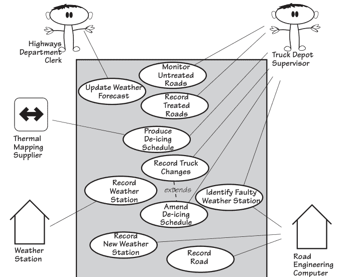

### 总结

业务事件和业务用例允许你划分出一部分完整的工作，以便进一步的建模和研究。通过理解每个 BUC（业务用例）正在执行的工作，你就能理解为了支持该工作的最佳产品是什么。

如果你正在进行外包，你可能不会确定产品用例，而是根据业务用例依赖外部世界。这些业务用例随后可以作为你的谈判文档，当你要求外包部分以产品用例的形式交付时，可以使用它们。

通过使用业务事件来划分工作，你从外部视角来审视工作。你不依赖于目前内部是如何划分的，也不依赖于某人对未来可能如何划分的观点。你根据对工作最重要的视角来划分工作：即外部（通常是你的客户）是如何看待它的。图 4.13 是这种划分方式的概述。

从业务用例中推导出产品用例的想法意味着，你的需求是根据工作对业务事件的响应进行分组的。结果是工作的自然划分，最终导致一个对外部世界真实需求更有响应的产品，从而对其所有者具有最优的价值。

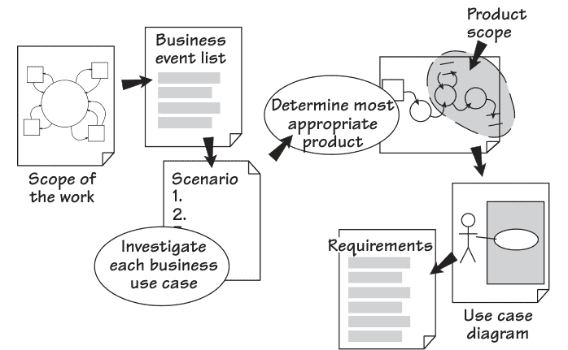

需求发现的流程：检查对每个业务事件——业务用例的响应，并确定合适的产品。分析师为每个产品用例编写需求。

# 调查工作

在这一部分，我们开始理解业务正在做什么，并开始思考它可能想做什么。

所有者的工作，无论好坏，都是任何新产品需求的起点。你的构建工作旨在改进现有工作，或为它开启某些新功能。这项工作可能是个人完成的一项微小简单的任务，也可能涉及许多人员、软件系统和硬件系统，并构成组织中重要且关键的部分。

无论工作是什么，在尝试任何更改之前对它有合理的理解是明智的。如果你在几乎完全不了解你正在改变什么的情况下进行更改并做出“改进”，那么如果事情没有如预期那样，你应该感到惊讶。相反，花一点时间学习这项工作将显著增加你成功对其产生积极影响的机会。而当你开始理解现有工作时，你肯定会产生如何改进它的想法。

在本章中，我们讨论了如何在更改一项工作之前对其进行调查。通常情况下，你的更改意味着构建一个软件产品或其他设备来完成部分或全部工作。考虑到当你构建软件时，你本质上是在自动化一项如果你有足够的时间就可以通过人工完成的任务，这似乎是种合合理的方法。

### 拖网业务

我们使用“拖网”（trawling）一词来描述调查业务的活动。这个词唤起了我们在这里所做事情的本质：钓鱼。不是漫无目的地挂着鱼线等鱼儿游过来，而是有条理地

# 图 5.1

业务分析师通过调查客户的工作来搜集知识。这种在组织中拉过网的比喻恰当：在找到改进最佳方式之前，你需要对大量的业务进行筛选。

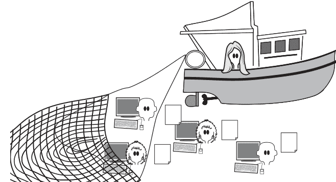

在业务中拉过网以捕获每一个可能的需求（见图 5.1）。凭借一点经验和良好的技巧，拖网船长知道在哪里钓鱼，以便获得他想要的鱼，并避开他不要的。本章的目标是向你展示一些拖网技术，并提供关于如何……的指南。

虽然发现当前业务（包括其流程）很重要，但不要在上面花费太多时间同样重要。虽然发现当前业务（包括其流程）很重要，但不要在上面花费太多时间同样重要。

需求发现的流程：检查对每个业务事件——业务用例的响应，并确定合适的产品。分析师为每个产品用例编写需求。

# 规范指南

研究当前业务并不是为了成为一个漫长的过程。鼓励你尽可能快地进行，一旦你获得了足够关于业务现状的信息，足以使你和你的利益相关者能够进入下一个阶段，就可以停止。还要记住，需求不是解决方案；你必须在找到解决方案之前学习需求。反之则不通。

“兔子项目”（Rabbit projects）要求你理解当前的工作，以及工作未来的样子。因为兔子项目通常是迭代的，你可能会以小切片的方式访问当前工作，然后继续寻找它的精髓并最终找到解决方案。这个循环不断重复，直到产品完成。这种迭代的工作方式应该最大限度地减少对当前工作的记录。然而，这并没有消除理解工作的需求。

你们中的一些人将与产品所有者或客户代表在敏捷团队中工作。我们发现（遗憾的是），一个人不太可能充分理解广泛的业务，以提供所需的所有信息。我们建议采用一些拖网技术来增强团队对工作的理解，并增强你正在构建的产品。

马项目（Horse projects）由于利益相关者较多，可能会更广泛地使用学徒制、访谈和用例工作坊。这些技术产生了一些文档，虽然记录当前工作不是项目的目标，但作为后续决策的输入是非常用的。

马项目更有可能涉及关键基础设施系统，因此对工作及其目标的知识对于项目非常重要。

大象项目（Elephant projects）

## 第 5 章 调查工作

音乐或电影、家庭监控、照片后期辑，或者许多其他人类活动之一。在所有情况下，你被要求构建的产品都是为了改进这项工作。

图 5.2 显示了 Volere 流程，并突出了你对工作进行调查的部分，其目的是发现能够实现或改进该工作的最佳产品。

当你进行知识“打捞（trawling）”时，首要任务是调查并理解目前正在进行的工作。并不总是需要记录这些信息，但你务要理解它们。一旦你对当前的工作有了充分的了解，就可以推导出它的本质。也就是说，你可以剥离当前的技术，获得真实业务的清晰蓝图。

随后，将与利益相关者共同开发出核心视图（essential view），以确定新产品的需求。这并不是一个艰辛的过程——而是一个详尽的过程。我们将在接下来的几个章节中讨论它。

打捞活动使用了项目启动阶段（project blastoff）的产出——包括工作内容、项目目标以及适用于任何解决方案的约束条件。启动阶段还确定了参与项目的利益相关者和潜在用户。这些利益相关者就是你为了了解工作而咨询的人。

## 图 5.2

打捞活动是需求流程的核心。它以项目启动活动的产出作为起点，用于调查工作并积累关于它的知识。在接下来的几个章节中，我们将这些知识开发为待构建产品的需求。图中的虚线表示了在采用迭代开发时，打捞是如何工作的。

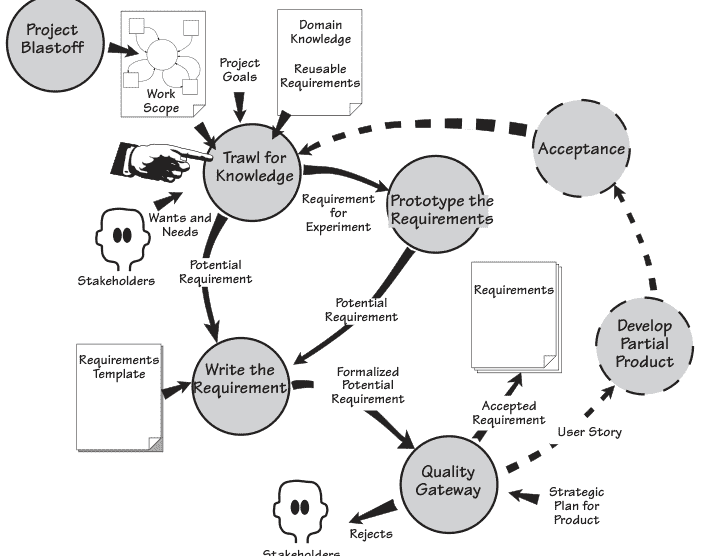

### 业务分析师

业务分析师也被称为系统分析师、需求工程师，可能还有其他头衔。我们使用“业务分析师”是因为它是最常用的名称。无论你使用什么名称，这个人都是一名调查员和翻译官：他必须检查工作、访谈业务利益相关者、理解他们在说什么，并将这些知识翻译成开发者可以交流和理解的形式。起初，业务分析师的任务是记录、澄清和质疑业务的现状。随后，随着分析的推进，任务将从记录现有系统转向思考新系统。目前，业务分析师的任务是：

- 观察并学习工作，并从所有者的角度来理解它。当你与用户合作时，你要研究他们的工作，并询问他们正在做什么以及为什么要这么做。
- 解释工作。尽管用户是某部分工作的专家，但他们对某些工作的描述并不总是符合事实的。分析师必须过滤这些描述以剥离当前的技术，从而揭示工作的底层本质，而非其表现形式。
- 以利益相关者可以理解的分析模型形式记录结果。分析师必须确保他与利益相关者对工作具有相同且达成一致的理解。我们建议使用通用语言向利益相关者传达你的知识。

> 关于打捞有很多需要了解的——而且我们知道没有哪种打捞技术适用于所有项目。猫头鹰（the owl）会引导你判断哪种技术适用于你的情况。请务必读完整章——但要意识到你不需要在每个项目中都使用所有的打捞技术。

有许多技术可以帮助研究业务的任务。我们在这里为你提供了几种选择，是因为我们知道没有一种技术适用于每一种情况。相反，你必须选择在当时最适合你的技术。在对技术的讨论中，我们会指出某种技术在何时以及为何会很有用。但不要只听我们说的——尝试将每种技术与你自己的情况联系起来，并考虑在何地何时最有利。

考虑你的利益相关者。他们对自己的某些流程和需求是有意识的，并尽早提出。同时，他们对其他一些是没有意识的——那些根植于利益相关者工作中已被他们忘记的事，或者忘记了它们是如何运作的。捕捉意识过程的技术并不一定适用于无意识的过程。此外还有那些未想象的流程——那些利益相关者并未意识到自己可以拥有的功能和特征。


## 第 5 章 调查工作

未想象的需求之所以存在，是因为利益相关者没有意识到这些是可能的，也许因为利益相关者缺乏足够的技术水平，也可能他们从未以你将向他们展示的方式看过这些工作。

无论情况如何，你的责任是将意识的、无意识的和未想象的工作带到水面上。

## 打捞与业务用例

业务用例对于需求活动是如此基础，以至于我们敦促你，无论你的情况或项目类型如何，都考虑一次一个业务用例地进行需求打捞。如果你还没有读过第 4 章“业务用例”，我们鼓励你读一读。

从工作上下文图中，你可以确定业务事件以及产生的业务用例。在第 4 章中，我们讨论了业务事件，探讨了工作之外的事件如何引起工作内部的响应。这种响应就是一个业务用例，我们建议你一次研究一个业务用例来完成工作。

业务用例是工作在响应业务事件时执行的功能。当触发数据流通过电话呼进入时，工作就开始处理它。

图 5.3

业务事件是使用上下文图确定的。业务用例是工作对事件的响应。

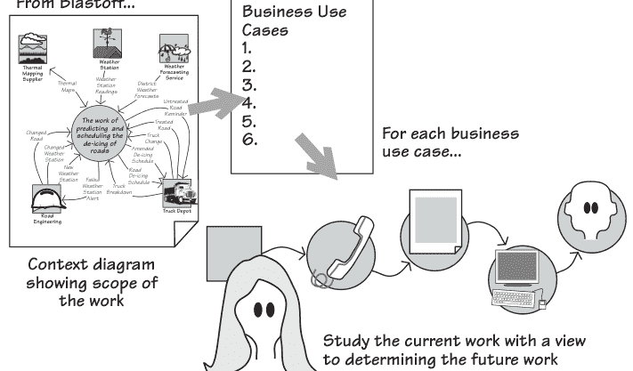

## 棕牛模型（Brown Cow Model）

当你调查工作区域时，有很多方法可以审视它——即不同的视角，其中四种是非常用的。

让我们从模型的左下象限开始：现状（How-Now）。它展示了目前存在的工作。当你需要足够的依据来提出其他问题时，使用这个视图。

当你着构建某些新产品时，你并不是试图复制你现有的任何东西。相反，通过消除当前情况中的技术缺陷和过时流程，你开始看到纯粹的业务。

这带我们进入线以上的现在本质（What-Now）。这个抽象视图展示了真实的业务策略，或者用我们更喜欢的说法，工作的本质。这个视图完全技术中立，它展示了在没有机器、人员或组织部门的情况下业务。

模型的名称源于一段英语教育。学生被教导用圆音说话，结果发生了变化——“现在牛怎么样？”（How now cow?）。这个模型的第一个部分是棕牛部分——该模型的名称。

移动到右上象限，我们得到了未来何（Future-What）视图。这个视图展示了所有者希望业务变成的样子，但还没有……

## 图 5.4

棕牛模型。它展示了工作的四种视图，每种视图都为业务分析师和利益相关者提供了需求流程不同阶段有用的信息。

| 核心业务用例 | BUC | BUC | 增强的核心业务用例 |
|---|---|---|---|
| | 1 | 1 | |
| | 2 | 2 | |
| | 3 | 3 | |
| | 4 | 4 | |
| | 5 | 5 | |

## 什么如何

| PUC | 产品用例场景 |
|---|---|
| 1 | |
| 2 | |
| 3 | |
| 4 | |
| 5 | |

可能用于实现业务的技术。它是所提业务领域未来状态的最纯粹版本。这一视角的价值在于，它展示了——你可以与利益相关者讨论——所有者想要做什么，而无需担心技术将如何实现它。

最后一个象限（右下角）是“未来如何”（Future-How）。在这里，你将对未来业务策略的理想化观点，通过增加将其引入现实世界所需的技术和人员进行扩充。

仅仅拥有业务的两个视图——“现状”和“未来”通常是不够的。这些视图无法脱离实现，无法从真实的角度审视纯业务问题，并且不适用于任何严肃的创新或系统开发。

## 当前的工作方式 (How-Now)

当你需要理解一个没有任何文档的中大型工作区域时，将构建模型作为调查工作的方法是最佳选择。当当前用户难以向你描述工作是如何结合在一起的构绪时，这种技术也适用。当你知道现有工作将产生大量的遗留问题时，这种方法也很有用。


我们已经多次提到（可能以后还会很多次）理解工作的必要性。最好的方法是积极参与工作的调查，而不是做一个被动的旁观者。

尽管当前的工作可能有任何坏名，但它仍然是有用的：自然地然，这些功能中的大部分必须包含在任何未来的系统中。你可能用新技术以不同的方式实现它，但其底层的业务策略将保持几乎不变。构建当前工作模型的原因之一是识别你需要保留哪些部分。

你可以使用模型来帮助理解工作，但悖论的是，如果你不理解工作，就无法建立模型。这种悖论源于建模活动会引导你提出所有正确的问题。任何有用的模型都是一个运行模型——如果你能证明模型的输出是源自其输入，那么它在功能上就是正确的。因此，如果你的模型不起作用，意味着你问得还不够，没有获得足够的正确答案（见图 5.5）。或者，我们可以说，随着模型的发展，你不知道的、你不知道多少以及业务人员不知道的会变得愈发明显。

## 当前的工作方式 (How-Now) 95

## 图 5.5


知道在何提问以及问什么问题，几乎与知道答案有用。如果你的模型没有流向、没有输入的流程、只读数据存储器或其他违反建模约例之处，那么你需要向利益相关者询问这些工作的这些方面。


你的模型记录了工作，并展示了你对它的理解。因为模型是你与利益相关者之间的共同语言，你们可以对情况达成一致的理解。当你对当前工作进行建模时，请记住你并不是试图指定一项新工作，而是建立用户当前正在执行的工作。用户很可能会以某种方式描述他们的工作，包含了他们完成工作所使用的机制和技术。这些机制并不是新系统的需求——你必须透视它们，看到用户系统的底层策略。当你移动到“线以上”并与棕牛模型（Brown Cow model）中水平轴之上的处理“做什么”而非“如何做”的两个部分合作时，理解就会产生。我们稍后会讨论这一点。

## 阅读

> Robertson, James, and Suzanne Robertson. Complete Systems Analysis: The Workflow, the Textbook, the Answers. Dorset House, 1998. 这本书展示了如何构建当前、未来和想象工作的模型。

对当前系统的建模应该尽快完成。图 5.6 显示了一个现有系统的模型，该模型是由作者联合伦敦城市大学的工作人员构建的。该模型是在 15 分钟内建立的——但当时我们正在喝咖啡。

限制你在当前系统模型中包含的细节量——对一个你即将替换的事物的每个方面进行建模几乎没有意义。理想的模型应该包含足够让你理解工作的细节，且仅此而已了。5.6 和 5.7 中所示的细节是工作的良好表示。自然地，这些功能必须包含在任何未来的系统中。你可能用新技术以不同的方式实现它，但其底层的业务策略将保持几乎不变。构建当前工作模型的原因之一是识别你需要保留哪些部分。

## 当前的工作方式 (How-Now) 126

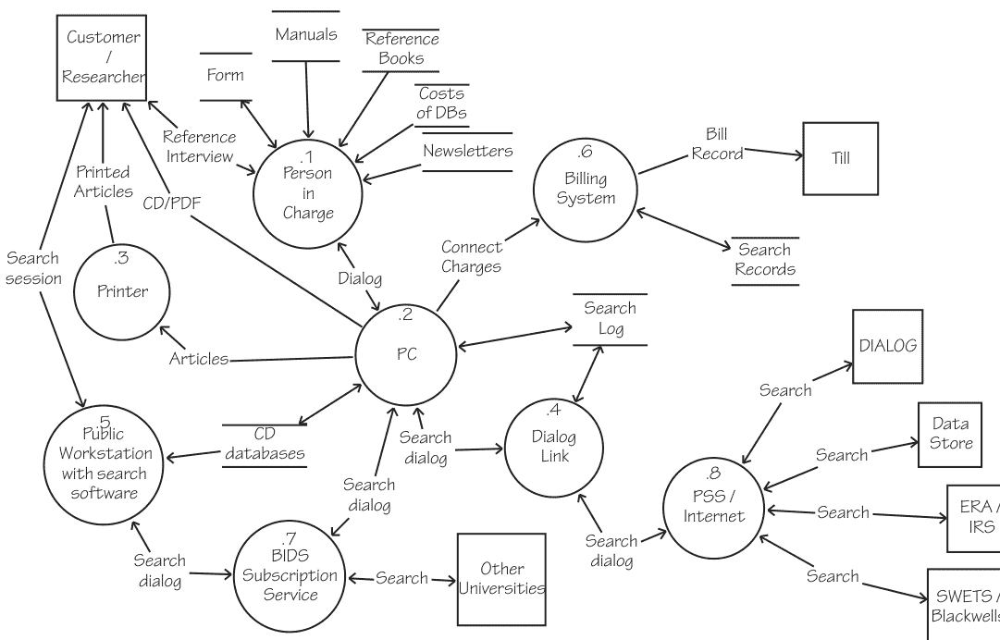

5.6 和 5.7 中所示的细节是工作的良好表示。自然地，这些功能必须包含在任何未来的系统中。你可能用新技术以不同的方式实现它，但其底层的业务策略将保持几乎不变。构建当前工作模型的原因之一是识别你需要保留哪些部分。

## 当前的工作方式 (How-Now) 127

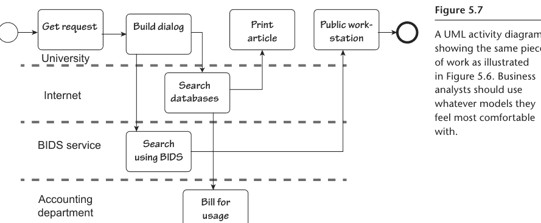

5.6 和 5.7 中所示的细节是工作的良好表示。自然地，这些功能必须包含在任何未来的系统中。你可能用新技术以不同的方式实现它，但其底层的业务策略将保持几乎不变。构建当前工作模型的原因之一是识别你需要保留哪些部分。

5.6 和 5.7 中所示的细节细节是工作的良好表示。自然地，这些功能必须包含在任何未来的系统中。你可能用新技术以不同的方式实现它，但其底层的业务策略将保持几乎不变。构建当前工作模型的原因之一是识别你需要保留哪些部分。

5.6 和 5.7 中所示的细节是工作的良好表示。自然地，这些功能必须包含在任何未来的系统中。你可能用新技术以不同的方式实现它，但其底层的业务策略将保持几乎不变。构建当前工作模型的原因之一是识别你需要保留哪些部分。

## 当前的工作方式 (How-Now) 98 第 5 章 调查工作

## 学徒制

学徒制对于在职工作特别有用。其隐含假设是用户正在工作，而你，需求分析师，是学徒。分析师坐在用户的工作场所，通过观察、提问并可能执行一些工作来学习工作。

许多用户很可能在做的同时解释他们在做什么。这些细节细节细节是为了让需求分析师理解工作的。捕捉工作 128。


> Robertson, James, and Suzanne Robertson. Complete Systems Analysis: The Workflow, the Textbook, the Answers. Dorset House, 1998. 这本书展示了如何构建当前、未来和想象工作的模型。

> 没有人比在做某事的中途更能谈论自己在做什么以及为什么要做。

> —Hugh Beyer and Karen Holtzblatt: 上下文设计

学徒制学习可以与建模相结合。当你观察工作并由用户解释时，你画出任务及其与其他任务之间连接的模型（见图 5.8）。当你构建模型时，将结果反馈给用户并确认它们是正确的。

业务案例工作会 ● 99

## 图 5.8


需求分析师坐在用户的桌旁学习工作，有时在学习的同时构建工作模型。

当你处于学徒阶段时，你既是观察者，也是解释者。当你观察当前的工作时，你必须从你看到的内容中抽象，以克服用户与工作物理形态的紧密联系。换句话说，当前使用的构制品、技术和其他输入必须被视为前任设计者的产物。在过去的某个时候，某人决定那是完成工作的最佳方式。但时代已经变了。今天可能实现昨天无法做到的事情。可能有更好的方法——那些能够利用最新技术、精简流程、简化工作或实现部分或全部自动的方法。

但首先，你必须进行抽象。当你通过观察现实条件下的执行来学习工作时，你正在从当前技术中抽象，以寻找工作的底层本质。我们稍后会回来详细讨论本质。

## 业务案例工作会


在第 4 章“业务用例”中，我们讨论了业务事件以及它们如何触发工作的响应。我们将其称为业务用例（BUC）。我们希望通过专门一整章来讨论业务事件和业务用例，明确传达了根据工作对外部世界的响应方式对其进行划分重要性。

请参阅第 4 章“业务用例”以获取业务事件和 BUC 的完整解释。

## 100 第 5 章 调查工作

现在你已经对工作进行了划分，业务案例工作会是理解每个划分部分并进行改进的有效方法。在工作会上，相关的利益相关者针对一个特定的用例，描述或重演他们当前执行的工作，并讨论他们希望执行的工作。你的任务是以记录记录这些工作，使利益相关者能够理解并认同这是准确的描述。作为一般原则，我们建议你使用场景（scenarios）来展示业务用例的功能（见图 5.9）。随后，你将利用这些改进后的工作记录来推导出支持该工作的产品需求。

**阅读**

Gottesdier, Ellen. *Requirements by: Collaboration Works for Defining Needs.* Addison-Wesley, 2002. (Gottesdier 的书详细涵盖了如何计划和开展工作会)

Hass, Kathleen, and Alice Zawa. *The Art and Power of Facilitation: Meaningful Meetings (Business Analysis Essential Library).* Management Concepts, 2007.

在第 6 章中，我们讨论了将场景作为以相当结构化的方式讲述业务故事的方法。我们建议你将场景作为业务案例工作会的一部分——它们易于理解，并为工作会提供了一个便利的焦点。你可以随空翻阅第 6 章，但只要你把场景看作一种将业务用例功能分解为一系列步骤的工具就足够了。

分析师和利益相关者共同制定业务案例并记录以下信息：

- BUC 的预期结果
- 正常场景描述了所执行的工作以及工作如何纠正执行中的偏差
- 异常场景描述了可能出现的问题以及工作如何处理（如果需要，这些可以推后处理）
- 适用于业务案例的业务规则
- 用于帮助利益相关者可视化业务案例的草图原型——这些弃用草图是可选的，不旨在需求阶段之后保留

请参阅第 3 章“界定业务问题”如何发现相关的利益相关者。

## 图 5.9

业务案例工作会使用场景和草图原型记录提议的功能。工作会作为相关利益相关者有效沟通、表达理解、提问并表达对工作愿求的论坛。

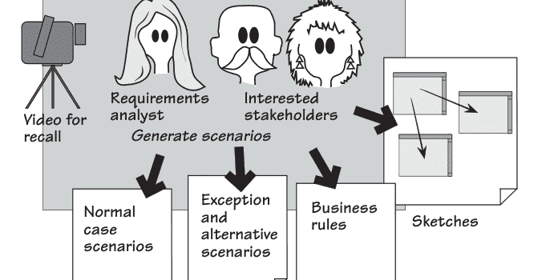

## 结果 (Outcome)

结果是希望希望此业务用例实现的，是以结果（results）而非输出（outputs）来表述。例如，假设业务用例是“为客户租车”。预期结果是客户开着他选中的汽车离开，选定的价格公平，细节已记录，并在对客户造成最少不便、租赁费用最低以及某些记录数据的情况下完成交易。同一业务事件的输出已经存在。实现输出并不一定能保证结果。

请注意，结果是一个业务目标，而不是实现某事的方法。结果是从所有者的角度表达的——它想要实现什么。结果赋予了业务案例存在的理由。

结果应该能够用一句话写成当当业务事件发生时，这就是我们想要实现的。”

## 场景 (Scenarios)

场景将业务用例执行的工作描述为一系列（通常在三到十步之间）步骤。场景是一份利益相关者友好的文档，作为工作会的焦点。步骤不需要非常详细；其意图不是捕捉业务用例的每一个微小部分，而是获得一个业务用例。

分析师和利益相关者共同制定业务案例并记录以下信息：

- BUC 的预期结果
- 正常场景描述了所执行的工作以及工作如何纠正执行中的偏差
- 异常场景描述了可能出现的问题以及工作如何处理（如果需要，这些可以推后处理）
- 适用于业务案例的业务规则
- 用于帮助利益相关者可视化业务案例的草图原型——这些弃用草图是可选的，不旨在需求阶段之后保留

请参阅第 3 章“界定业务问题”如何发现相关的利益相关者。

步骤不需要非常详细；其意图不是捕捉……

> 考虑结果（outcomes），而不是输出（outputs）。

## 业务规则 (Business Rules)

业务规则是超越并指导日常工作的管理处方。例如，我们发现了这两个规则：

- 卡车司机班次的最长长度为 5 小时。
- 工程师每周维护一次天气。


这些规则在利益相关者讨论工作时浮出水。在大多数情况下，你将在利益相关者的帮助下找到现有文档。自然，你构建的任何产品必须符合业务规则。业务规则没有固定格式。业务案例工作会为相关的利益相关者提供了机会引

## 访问利益相关者 (Interviewing the Stakeholders)

采访几乎用于所有项目，因为它实际上是引导技术的一部分。尽管它无处不在，我们建议不要将采访作为收集需求的唯一技术。相反，你应该结合本章内容进行采访。

访问利益相关者是一种常用技术，但并非没有问题。访谈者依赖受访者了解并能够口头表达关于工作的所有必要知识。当人们熟悉这些工作时，这种方法可能效果良好，但这些知识通常局限于自己的领域。组织中可能很少有人理解足够的业务，以至于成为唯一为你描述业务的人。采访还需要受访者具备一定的抽象和沟通能力。因此，明智的做法不要依靠采访作为收集需求的唯一方法；相反，应与其他技术结合。

尽管有这些警告，采访技巧在其他语境下也非常有用。例如，需求分析师可以“采访”模型或文档。这里的技巧在于向模型提哪些问题，或者更现实地说，向相应的利益相关者提问。

有些需求分析师会编写问卷并在采访之前发送给利益相关者。虽然这种准备步骤为后续采访提供了一些结构，但我们发现某些利益相关者非常有动力，或者有足够的时间在会分析师之前填写问卷。我们建议发送一份简短的议程，列出你希望在采访中涵盖的主题以及预计持续的时间。这种通知至少让受访者有机会在后台模式下思考，准备所需材料，或邀请领域专家参加。

## 访谈利益者

利益者在访谈期间不应保持完全被动的状态。相反，请尽力通过在访谈过程中构建模型——如业务事件响应、用例、场景等——来让他们参与进来。这种方法在你和你利益者之间建立了一个了一个反馈循环，这意味着你可以迭代地测试你所听到的信息的准确性。遵循以下指南可以使你的访谈更有效：

- 设定访谈背景。这一步是必要的，可以避免利益者谈论一些与你的目的无关的话题。它也为那些没有准备好访谈的利益者提供了一个体面退出的机会。
- 将访谈时长限制在规定的时间内内。我们发现，超过一小时（最多90 分钟）的访谈往往会失去焦点。
- 以业务用例作为访谈的锚点。用户能够识别业务用例（尽管他们不一定会称呼其名称），如果你一次只讨论一个用例，对话将更有针对性。
- 提一个问题（稍后会详细介绍），倾听答案，然后传达你的理解。
- 绘制模型并鼓励用户修改它们。有许多模型（例如数据流图、活动图、时序图）可以帮助你交流对流程的理解。你也可以为信息构建数据模型，并使用思维导图来连接不同的主题。
- 使用利益者的术语和产物，无论是概念性的还是真实的。如果利益者不使用自己的语言，你就迫使他们将技术语言翻译成你能理解的术语。遗憾的是，这通常会导致误解。相反，如果你被迫就他们的术语进行提问，你不可避免地会有新的发现。
- 保留产物的样本或副本并记录下来供日后参考。产物是利益者在日常工作中使用的东西。它们可以是真实的物品：文档、计算机、电子表格、机器、软件部分。它们也可以是概念性的：状态、合同、进度、订单。当你以后检查这些东西时，不可避免会让你提出问题。
- 感谢利益者的时间，并告诉他们学到了什么以及为什么这些信息很有价值。毕竟，他们有很多事情要做。和你聊天并不是他们被雇佣的原因，他们通常将访谈看作一种干扰。

> 传达你的理解。在访谈利益者的同时构建模型。

> 感谢利益者的时间。

## 第 5 章 调查工作

记录下你所听到的。我们保证你会有更多问题。

记笔记几乎是一门独立的技能。我们鼓励使用思维导图作为记笔记工具——我们将在本章后半部分讨论。你可能还会考虑市场上的某些智能写笔。这些设备记录了你笔记的电子版本（便于与团队其他成员共享），有些还会记录访谈的语音部分。Livescribe 笔在本书编写期间非常流行，其他一些笔也提供类似的技术。

## 提出正确的问题

我们之前建议过，业务用例是访谈某人的理想工作单元。我们还敦促你使用“棕牛”观点（如图 5.4 所示）作为提问正确问题的触发器。让我们通过 IceBreaker 除冰项目中的一个例子来看这个过程。

假设你正在与首席工程师进行访谈。你想要探索的业务事件是“道路工程安装新气象站”。你的问题应该集中在工作是如何为了响应这一业务事件的。

业务分析师：“当你们的工程师安装新气象站时，会发生什么？”

注意，分析师以一个“W”开头的单词（什么、为什么、哪里、谁）开始提问，以开启问题并引导信息。

首席工程师：“工程师会告诉我们新气象站的位置，我们会对其进行记录。”

BA：“你们是如何记录这个新气象站的？”

首席工程师：“我会用我们这里使用的电子表格——就在这里。”

BA：“谢谢。我想要这个气象站电子表格的副本，请确保你们跟踪了气象站编号、地理坐标和安装日期。你们还跟踪它的其他信息是什么？”

首席工程师：“我们还有另一个计算机系统，那里有每个气象站的维护历史。有些重复条目，但情况就是这样。”

BA：“关于气象站，还有其他对你们有用的事实吗？”

首席工程师：“嗯，我们想知道每个气象站的制造商和性能。”

BA：“你说的‘性能’是什么意思？”

首席工程师：“哪些气象站需要最多的维护。这有助于规划我们把预算花在哪些新技术上。但我们过去一直无法做到这一点。”

BA：“如果你有一个新系统，整合了所有关于气象站、维护和性能的信息，这对你可以接受吗？”

首席工程师：“什么，你的意思是都在一个屏幕上吗？”

BA：“是的，某种让你能够追踪气象站及其终身性能的东西，”

首席工程师：“那听起来很棒，但我们得和一些工程师确认一下。”

BA：“那么，一旦我确定对气象站的所有事实都已正确定义，我就可以做一个快速原型向工程师展示我们的想法。你觉得怎么样？”

首席工程师：“我喜欢这个主意。”

BA：“感谢你的时间。我会回去回顾我的笔记和你提供给我的样本，并给你们发一份这次访谈的简要总结。我可能需要给你打电话问几个问题。然后我会预约时间进一步探讨。”

首席工程师：“这样对吗？”

> 传达你的理解。在访谈利益者的同时构建模型。

> 感谢利益者的时间。

## 听答案

我们之前建议过，业务用例是访谈某人的理想工作单元。我们还敦促你使用“棕牛”观点（如图 5.4 所示）作为提问正确问题的触发器。让我们通过 IceBreaker 除冰项目中的一个例子来看这个过程。

假设你正在与首席工程师进行访谈。你想要探索的业务事件是“道路工程安装新气象站”。你的问题应该集中在工作是如何为了响应这一业务事件的。

业务分析师：“当你们的工程师安装新气象站时，会发生什么？”

注意，分析师以一个“W”开头的单词（什么、为什么、哪里、谁）开始提问，以开启问题并引导信息。

首席工程师：“工程师会告诉我们新气象站的位置，我们会对其进行记录。”

BA：“你们是如何记录这个新气象站的？”

首席工程师：“我会用我们这里使用的电子表格——就在这里。”

BA：“谢谢。我想要这个气象站电子表格的副本，请确保你们跟踪了气象站编号、地理坐标和安装日期。你们还跟踪它的其他信息是什么？”

首席工程师：“我们还有另一个计算机系统，那里有每个气象站的维护历史。有些重复条目，但情况就是这样。”

BA：“关于气象站，还有其他对你们有用的事实吗？”

首席工程师：“嗯，我们想知道每个气象站的制造商和性能。”

BA：“你说的‘性能’是什么意思？”

首席工程师：“哪些气象站需要最多的维护。这有助于规划我们把预算花在哪些新技术上。但我们过去一直无法做到这一点。”

BA：“如果你有一个新系统，整合了所有关于气象站、维护和性能的信息，这对你可以接受吗？”

首席工程师：“什么，你的意思是都在一个屏幕上吗？”

BA：“是的，某种让你能够追踪气象站及其终身性能的东西，”

首席工程师：“那听起来很棒，但我们得和一些工程师确认一下。”

BA：“那么，一旦我确定对气象站的所有事实都已正确定义，我就可以做一个快速原型向工程师展示我们的想法。你觉得怎么样？”

首席工程师：“我喜欢这个主意。”

BA：“感谢你的时间。我会回去回顾我的笔记和你提供给我的样本，并给你们发一份这次访谈的简要总结。我可能需要给你打电话问几个问题。然后我会预约时间进一步探讨。”

首席工程师：“这样对吗？”

> 传达你的理解。在访谈利益者的同时构建模型。

> 感谢利益者的时间。

## 第 5 章 调查工作

记录下你所听到的。我们保证你会有更多问题。


记笔记几乎是一门独立的技能。我们鼓励使用思维导图作为记笔记的工具——我们将在本章后半部分讨论。你可能还会考虑市场上的某些智能写笔。这些设备记录了你笔记的电子版本（便于与团队其他成员共享），有些还会记录访谈的语音部分。`Livescribe`笔在本书编写期间非常流行，其他一些笔也提供类似的技术。

# 快速简易的流程建模

国外。结果是，我们能够大量地从一个项目中借用并供给下一个项目。我们必须更改名称并对流程进行一些修改，但总的来说，通过使用来自其他项目的抽象需求，我们节省了大量的项目时间。

我们建议构建工作结构的抽象模型——也就是说，这些模型不对事物赋予特定的技术名称，也不使用与组织某一部分相关的独特术语。此类模型不适用于任何特定用户，也不会与特定用户进行领地识别。。它们是从源头中抽象出来的——它们使用分类而非具体细节，使用通用性而非实际实例。它们不是从任何单一用户的视角对工作进行建模，而是按照所有用户都能看到的方式对工作类别进行建模。

这种抽象使我们能够发现相同的工作模式是否出现在组织的其他部分。根据我们的经验，尽管名称和产物可能有所不同，但相同的工作模式在组织内会发生多次。我们首先利用模式的重复性来更快速地理解需求，然后部署某部分的实现以适应另一部分。

第 15 节讨论了重用。如果你怀疑自己有机会重用之前项目的需求和其他产物，建议你阅读这一章。

有关模式的更多信息，请参见第 15 节“重用需求”。

## 快速简易的流程建模

快速简易的流程建模是一种用于构建业务流程快速模型的技术，以便对当前工作获得理解和共识。我们发现，业务利益相关者对这类模型的动态特性很有共鸣。

当大部分旧系统需要被替换时，这种技术非常有用。当利益相关者地理位置分散时，也可以使用它。

快速简易的流程模型模拟了现状，当然也可以用于对任何未来流程建模。它们不是 `UML` 活动图那种意义上的正式模型，而是使用手头任何物理产物组合而成的。我们发现便利签纸是构建这些模型最方便的方法，但并不限于这种媒介（见图 5.10）。

这种技术或或少是使用大型便利签纸或索引卡，为流程中的每项活动构建一个流程模型。你可以将贴条贴在白板上并画线将它们连接起来，或者如果你使用的是普通的墙，可以使用美胶胶将一张贴条与下一张连接。在最理想的情况下，你办公室的墙壁涂有像 `IdeaPaint` 这样的白板漆，你可以随心所欲地在任何地方绘制和粘贴便利签。


# 第 5 章 调查工作

## 图 5.10

通过快速简易的流程建模，业务分析师使用便利签纸构建工作的非正式模型。大型贴条贴在墙上，并用美胶连接。自然地，感兴趣的利益相关者是这一建模活动的伙伴。

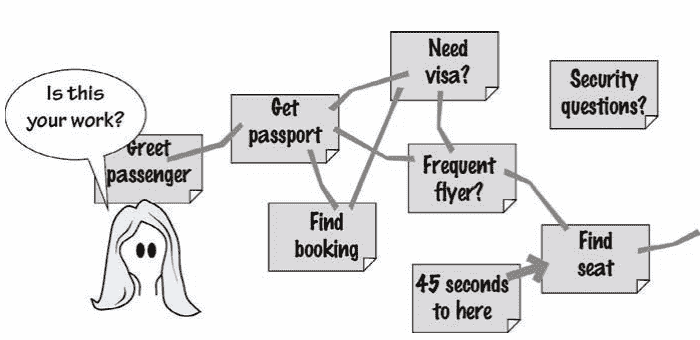

使用便利签纸建模业务流程的优势是，利益相关者通常会参与到移动这些彩色贴条来建模他们的流程中。如果某项活动命名糟糕，可以很快被另一个名称更好的贴条替换。如果某些东西位置不对，花很少精力就能移动。

但这项技术可能最重要的益处可能是，当利益相关者开始移动便利签纸时，他们往往会发现简化业务流程的方法。业务利益相关者说出如“如果我们把这项活动移到这里，改变其中一个，就能消除掉下面那两个”之的话并不罕见。当我们研究系统的本质并开发新的工作方式时，这些想法必须被保留并投入使用。

便利签模型从活动多或少沿直线运行的简单模型，到图 5.11 所示的相当复杂的便利签模型不一。

请记住，我们提倡使用物理模型，而不是提倡设计屏幕和深入研究低级细节——这些行为在这一阶段是不恰当的。在这里使用快速简易模型的意图仅仅是为了构建一个对当前和未来业务流程更灵活的模型。如果业务用户此时着手设计屏幕，将获益极少——而且事实上，会损失很多。

然而，如果你能避免设计，就可以很好地利用草图、屏幕和其他界面。

## 原型与草图

## 图 5.11

空交通管制员在研讨会上构建的五米长的便利签模型。这个模型可能比许多企业的都要复杂，但它帮助管制员更好地理解了他们的流程。照片拍摄：Neil Maiden。

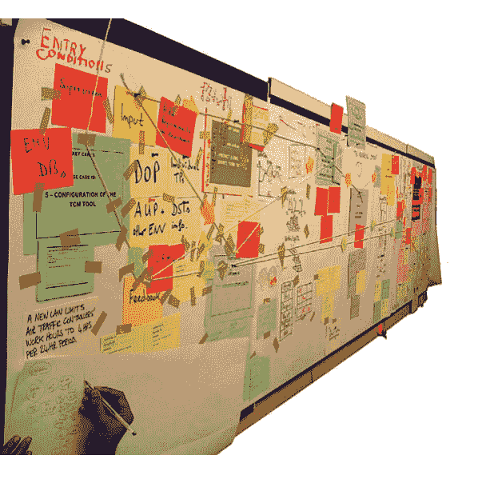

原型设计和草图绘制——它们实际上是同一件事——可以是引导需求的有效技术。基本思想是勾勒某些拟议的产品，然后从草图中反推需求。这在以下情况下是一种特别有用的方法：

- 产品以前不存在，难以可视化。
- 产品的利益相关者对该类产品或拟议的技术没有经验。
- 利益相关者已经工作了一段时间，并陷入了固有的工作方式。
- 利益相关者在表达需求方面存在困难。
- 需求分析师在理解需求方面存在困难。
- 需求的行性存疑。

在收集需求时，你要求利益相关者想象他们未来的产品做什么。你发现的结果受限于利益相关者的想象力、经验，以及他们描述目前不存在的事物的能力。

相比之下，原型给了利益相关者一个真实的东西，或者至少是具有真实外观的东西。原型让产品变得足够真实，使利益相关者能够提出可能遗漏的需求。我们的同事 Steve Menin 将原型称为“需求诱饵”；当利益相关者看到原型展示的功能时，它会激发他们提出其他需求。通过这种方式，通过原型展示可能性并给利益相关者一种看似真实的体验，你捕捉到了额外的需求——有时这些需求等到产品投入使用后才浮出来。（见图 5.12）。

> “原型是需求诱饵。”——Steve Menin

原型还被用于推演需求的后果。你不可避免会遇到一个奇怪的需求，它只有一个支持者，离开了它就会就会迷失措。谁知道他的需求是一个能让原型变得更好的绝佳主意，还是一个不需要执行的某事的复杂方法？为难以理解的需求建立原型使它们变得可见；它给了每个人一个机会去理解、讨论、简化它们，然后决定它们的价值是否值得纳入最终产品中。

我们必须强调，所讨论的原型和草图是丢弃型原型；它们并不打算演变成成品。当然，它们可能会——但这种可能性在需求收集任务完成之前是偶然的。

## 图 5.12

需求原型用于展示潜在产品的功能。原型的意图是提示利益相关者你是否理解了所需的功能，并作为“使用”原型的结果，让他们提供原型建议的额外需求。

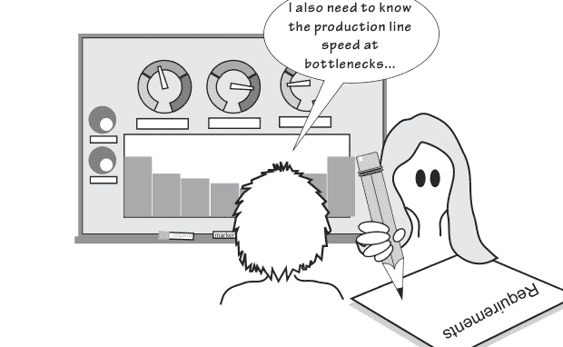

## 原型与草图

在本次讨论中，我们使用的“原型”和“草图”术语是指对产品的某种模拟，利益相关者可以使用它来完成工作——即你设想他们未来可能完成的工作。简单来说，你向利益相关者展示你的原型以及可能的几种替代方案，并询问他们是否可以使用类似于你所模拟的产品来完成工作。如果答案是肯定的，你就捕获该版本原型所展示的需求。如果答案是否定的，你就修改原型并再次询问。

利益相关者将决定你的原型是否是对提议工作在面对某些困难局面时的合理演示。不可避免地，他们会为原型设计带来一些与工作相关的负担。他们已经从事这项工作一段时间了（如果不是这样，你可能不会让他们测试你的原型），而且他们对工作的认知可能与你截然不同。这种差异要求你运用技巧去发现你打交道的大多数人中，现实的哪些方面是最重要的。他们用什么比喻来描述自己的工作？他们在工作时是如何设想自己的？此外，你还在询问他们对从事不同工作的感受如何——即你为未来提议的工作。采用新产品可能意味着要舍弃他们感到熟悉的工具和工作方式。对于利益相关者来说，离开自己的经验和舒适区，接受一种全新的、尚未调优的工作方式并非易事。

> 在你打交道的大多数人中，现实的哪些方面是最重要的？他们用什么比喻来描述自己的工作？他们在工作时是如何设想自己的？

这意味着你应该尝试使用某种程度上符合利益相关者最熟悉的产物和经验的原型技术。这意味着你需要针对每种情况调整你的原型设计方法。

> 构建一个与用户世界中的物理锚点相关的原型。

让我们看看需求原型的一些可用方案。然后我们可以讨论如何恰当法使用它们。我们从最简单的开始：低保真原型。

## 低保真原型

通过人们熟悉的媒介，低保真原型（我们也称之为“草图”）有助于利益相关者关注主题内容。铅笔和纸、翻页画、便利贴、索引卡和纸箱等都可以用于构建低保真原型（图 5.13）。事实上，这些原型可以利用利益相关者日常生活中的任何东西，且不需要额外的投资。

低保真原型是一种草图，其意图并非看起来非常像成品——这就是为什么此类原型被称为“低保真”。这种对成品的忠实度缺失既有利也有害。有利之处是，没有人会把你的原型与真实的

> 为了观察结构，第一批原型总是纸质的。Hugh Beyer 和 Karen Holtzblatt，《情境设计》

产品混淆——它显然是用极低的时间成本构建的，最重要的是，它没有表明自己除了一个易于更改的模型之外的任何其他东西。低保真草图鼓励迭代，它在多程度上表明，你不期望在第一次尝试就得到正确答案。坏处是，原型有时需要测试的利益相关者花费精力去想象白板可能成为他的新产品。尽管如此，能够轻松更改并以你绘制原型的速度进行修改的能力通常能帮助你将想法变为现实，从而帮助利益相关者更好地利用他们的想象。

如果一次处理一个 `PUC`，原型设计会更方便，最终也更准确。

我们发现，如果原型涉及单个业务用例（`BUC`）或单个产品用例（`PUC`），原型设计就是方便的，并且最终也更准确；考虑到原型涉及某些模拟产品，我们将假设你正在对一个 `PUC` 进行原型设计。我们回想起，业务用例是由外部事件触发的工作量。

## 原型与草图


## 图 5.14

卡车队的工程师负责确保所有易结冰的道路都了融雪剂。用例 11，“监控未处理道路”代表了这部分工作。

你可以快速绘制一个当前状况的低保真原型，然后开始探索对其进行改进。原型关注的是产品可能做什么；目前，它忽略了任何实现细节。

当你在绘制低保真原型时，要快。用另一个草图或替代草图来演示每个需求建议。你可能会刻意提供几个 `PUC` 的原型，询问利益相关者的偏好以及可能的建议。一旦利益相关者看到你正在模拟问题的解决方案，并意识到这不仅受欢迎而且是必要的，他们会通过提出改进和需求来帮助你。我们的经验是，当通过使问题可视化让人们参与时，他们往往变得更有创造力和想象力——以至于有时你的问题变成了追上利益相关者的速度。

> 纸张非常实用并满足首要需求：它使得表达结构成为可能，并且很难过度关注用户界面。

> ——Hugh Beyer 和holtz，《情境设计》

从绘制利益相关者在使用产品时可能的状态开始。询问利益相关者产品对他们的工作做出什么贡献，并记录他们的想法。在“监控未处理道路” `PUC` 中，利益相关者可能希望产品提供以下信息：

- 已计划处理的道路
- 已处理的计划道路
- 道路的相对位置

脚注2：我们说“利益相关者”而不是“用户”，因为对于任何用例，除了用户可能还有其他感兴趣的利益相关者。

现在询问利益相关者他们如何使用这些信息。此时，你并不是在为这个即时问题设计解决方案，而是想探索潜在产品*可能*做什么以及工作*可能*是怎样的：

- “呈现所需信息的最佳方式是什么？”
- “请求的信息对于正在进行的工作正确吗？”
- “产品可以做得更多或更少吗？”

# 第5章 调查工作

在制作原型时，请假设没有任何技术限制。同时，请记住，你设计的是“工作”，而不是产品——你是在捕捉产品可能执行的以帮助利益相关者完成工作的任务。

通过画图来激发利益相关者的想法。如果他们刚开始时遇到困难，你可以加入一些自己的想法。让他们想象一下你正在进行道路监控工作。为了完成这项工作，他们还需要哪些信息？你可以对此此制作原型吗，还是说他们必须去其他地方寻找信息？当前原型版本中的所有信息是否对于监控未处理道路的工作都是必需的？

随着原型的进行，工程师们看到了你的草图，你可能会听到这类言论：

> “太棒了。如果我们能看到过去三小时内未处理的主干道，那不是太好了吗？但只需要主道——次要道路没那么重要。现在的哪个系统可以区分主道和次要道路？”

在草图上添加这一需求需要多长时间？大约10秒。如果工程师在交付后才提出这一需求，修改已安装的产品需要多长时间？不言自明。

通过与工程师合作，你可能会生成一个与他们目前拥有的完全不同的原型。但这正是目的所在——改变工作，并发现新的、更好的工作方式。通过鼓励工程师向你提供更多关于工作的情况，你发现了其他情况下不会显现的需求。（见图5.15）

## 图 5.15

通过在翻转图或白板上绘制这个低保真原型，你帮助确定了卡车仓库工程师的需求。他们希望产品能够突出显示区域内未处理且处于危险状态的道路。

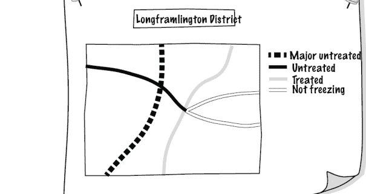

## 原型与草图

当你绘制低保真原型时，你向利益相关者展示了你的想法，并鼓励他们通过改变和改进你的想法来迭代开发。记住，需求过程的一部分是发明一种更好的工作方法。原型是一个发明工具，你和利益相关者通过它进行实验，看看设定的产品如何为新工作做出贡献。

低保真原型不是艺术品，而是一个产生想法的设备。

低保真原型是非正式且快速的。没有人会将其误认为是成品。因为很容易改变，利益相关者愿意进行迭代、实验和研究替代方案。

## 高保真原型

高保真原型使用软件工具构建，外观上类似于运行中的软件产品。它们看起来可以执行用例所要求的任何操作，并显示了运行中的软件产品的大部分特征。开发此类原型让利益相关者有机会“使用”一个看起来真实的原型，并决定该产品是否显示了正确的需求。

由于原型的行为符合利益相关者对最终产品的预期，它给了他们一个探索产品潜力的机会，理想情况下会引导他们提出改进和新需求。但这里存在一个问题：由于原型看起来太像工作产品了，利益相关者可能会专注于它的外观，并可能放弃进行功能性的改进。然而，这样做将违背需求原型的初衷。

撇开利益相关者误解他们在原型活动中角色的轻微风险不谈，高保真原型有很多价值。它是交互性的，这鼓励了用户探索其功能。屏幕上显示的图标和数据代表了执行实际工作时的数据和图标。利益相关者应该对原型感到熟悉：他们应该能够打开窗口、更新数据，并被他们是否犯了错误。换句话说，原型可以是一个真实的仿真。

高保真原型允许你创建仿生的工作场景，并要求利益相关者像做真实工作一样操作原型。通过观察利益相关者的反应并记录他们的评论，你将发现更多他们的需求。

目前有大量的高保真原型设计工具可用。界面生成器类的工具集成了功能，允许你轻松构建屏幕并模拟功能。这些许多工具都有数据库支持，使你能够构建中小型可运行应用程序。


如 Drupal、Alfresco、Joomla 等许多其他内容管理系统（许多作为开源产品提供）允许对基于 Web 的产品进行原型设计。你应该检查 Share-Point 的 CMS 功能，因为这在许多组织中已经可用。这些工具不仅仅是原型工具——最终结果可能是产品的全功能版本。必须确保产品的其他方面（安全性、可维护性等）的需求与原型制作过程中的前端开发保持同步。

我们不会尝试列出所有可用于高保真原型的产品。任何此类列表在你拿起这本书之前就过时了。搜索网络，特别是开源社区（sourceforge.net），是寻找适用于需求原型制定的软件的最可行方法。

高保真原型对于发现易用性需求非常有效。当用户尝试使用它时，你会观察到原型的哪些部分是令人愉悦且易用的，以及哪些易用性特征需要改进。通过这些观察，你可以写出大部分易用性需求。

但让我们不要操之过急。在第8章“开始解决方案”中，我们将查看潜在产品的界面；那里是你专注于易用性方面和其他用户体验属性的地方。

## 思维导图

我们一直使用思维导图。我们用它们在采访期间做笔记、规划项目、总结研讨会。

思维导图是图形与文本的结合，试图以与大脑相同的方式表示信息。思维导图提供了足够的信息（以关键词和关键词之间的链接显示），让你获得整体视图。在思维导图上画小图很有帮助；它减少了对文字的需求，具有比文字更容易记忆的优点。

这是一张在规划 Good for One 业务时绘制的思维导图。这个基于 Web 的业务为单人用餐的人提供食谱、购物建议和烹饪技巧。思维导图由 Joanna Kenneally 绘制。经许可使用。

图 5.16

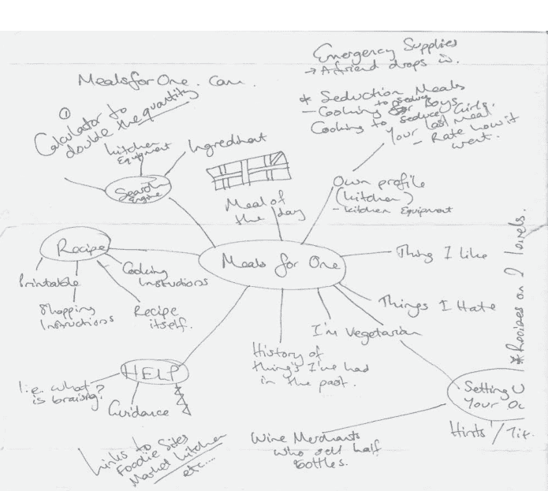

## 118 第5章 调查工作

概念、主题、想法，或你选择的主题的任何细分领域。在行间写下这些想法，使用一或两个单词。使用强有力的词来命名和描述你的想法。尽量使用印刷体而不是手写体；结果将更易于阅读，也更容易记忆。

使用线条建立想法之间的联系。我们对颜色记忆深刻，所以对包含一个主题的区域使用彩色线条。这些线条带有箭头表示方向，但大多数情况下想法之间的联系是双向的。

思维导图不能从中心向外构建。有时你在做笔记时会产生一些想法或听到一些信息与地图中已有的任何内容都没有联系。无论如何，都将其加入地图，因为你将在某个阶段发现它们之间的联系。你的地图最终可能不像你看到的某些示例那样整齐漂亮，但它对你的大脑来说是有意义的——这正是重点。图 5.17 提供了一个示例。

关于绘制思维导图技巧最后一点：使用你能找到的最大的纸张或白板。借一个大画板、翻字纸或任何你能拿到的东西。四散开来。给你的大脑留下移动的空间。在你的思维导图中寻找乐趣。尽可能发挥想象力。

当然，如果你想在电脑上使用思维导图，可以使用软件。现在有很多思维导图应用。我们作者几乎从不用其中任何一种，因为这剥夺了使用纸和彩色铅笔的纯粹自发性。我们为我们的导图拍照以存档（如图 5.17 所示）。

### 图 5.17

我们作者绘制的关于规划创新和创造力文章的思维导图。

阅读 Buzan, Tony; Chris Griffiths. *Mind Maps for Business: Revolutionise Your Thinking and Practice*. BBC Active, 2009.

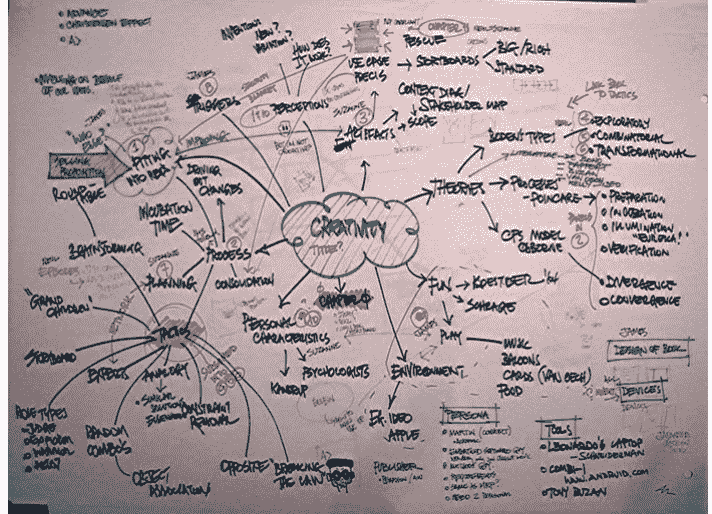

## 案件卷 ● 119

另一种技术方法是使用 Wacom 的 Inkling 作为记录思维导图的方法，以及你的其他草图和手写笔记。这项技术使用普通纸，你在上面画或写，它会忠实地记录你绘画的电子版本。对于那些用它勾画和涂鸦的人来说，这是一个令人深刻的工具。

在采访利益相关者了解需求时，我们使用思维导图做笔记。当利益相关者告诉你你的工作和新产品的功能和特性时，在这些情况下使用思维导图的好处就体现出来了。其中一些是关联的，许多依赖于其他。通过以思维导图的形式绘制采访，你更有可能看到联系，并发现客户尚未发现但应该解释的联系。将思维导图看作一种更多功能的笔记工具——多功能是因为你可以通过画一条线来取代所有文本以建立联系。

学习画思维导图最好的方法就是开始画思维导图。使用书中描述的技巧，或从网上收集示例来帮助。但主要，只要开始画吧。你很快就会看到你的思维导图活了起来。

## 案件卷

我们作者在飞机上花费了太多时间。阅读通俗文学，尤其是犯罪小说，是度过漫长时光的喜爱方式。几位作者，特别是迈克尔·康奈利和他的洛杉矶侦探哈里·博奇，经常提到“案件卷”（murder book）——一份谋杀调查的案件文件。案件卷包含了调查期间收集的每份文档、采访、照片和其他证据项目的线索。

我们在业务分析作业中也经常使用这种方法：我们将每份文档和每份“证据”收集到一个胶夹里，有时是几个胶夹（见图 5.18）。像侦探一样，我们的意图是创建一个以后可以从中央仓库引用的项目线索。

> 图 5.18

案件卷是由需求发现项目生成的文档和模型集合。


# 第5章 调查工作

（注：此处对应原文中重复的段落，已合并翻译）

### 视频与照片


视频与照片

视频和照片对于分布式团队特别有用。我们发现视频的影响对于那些无法亲眼看到的人来说更具参与感。

我们建议你在以下情况下尝试视频：

- 视频用户和开发者参与案例工作讨会和脑风暴。
- 视频采访和现场观察。
- 在工作中的视频用户。
- 视频事件。要求用户对事件做出典型反应，并描述他们是如何工作的。
- 将视频发送给分布式团队的其他成员。我们发现视频对于那些无法亲眼看到的人来说更有参与感。

如果视频在你的环境中看起来并不实际，请使用照片。我们总是随身带着摄像头（手机里的最方便），作为我们业务分析包的一部分。在采访、会议和工作讨会期间，我们对利益相关者、白板、翻字纸、办公室、工厂以及任何我们认为有助于我们发现的需求进行拍照。我们经常在记录和进度报告中包含照片。照片是无需编写详细报告的有效方式。

你可能还会考虑其他记录设备，例如手机上的录音机和 Livescribe（它同时充当笔和录音机的作用）。它比语言保留了更多信息。

> —DeGrace and Stahl

阅读

DeGrace, Peter, and Leslie Hufnik: *Wicked Problems: A Catalogue of Software Engineering Paradigms*. You Press, 1990. 这本书已经存在很长时间了，但它关于视频有一些相关的想法可以传递。

## 维基、博客、讨论论坛

这种技术适用于许多类型的项目。然而，由于它需要多个利益相关者的参与，因此它对大型项目最为有效。

人们乐于贡献。Facebook、Twitter、Wikipedia 和博客的成功证明了，只要有机会和论坛，人们乐意花一点时间（有时是大量时间）来分享自己的观点和知识。这些贡献有许多形式——你可能已经用过其中几种——但为了简便起见，我们将所有这些贡献统称为发布在维基上。

在需求发现中，维基的基本思想是，任何人——关键点在很大程度上是任何人都可以做到——都可以发布帖子或进行编辑，以添加任何已经发布的内容。某些论坛保持讨论的分线程模式，以便你可以看到讨论的演变过程；并允许贡献者覆盖或重新组织他们发现的任何内容。此外，任何人都可以为有用的信息源添加超链接或进行任何其他形式的更改。

维基依赖技术，而这些技术是所有人皆可使用的。你可以购买或下载免费托管服务来支持你的需求维基。如果你的组织不提供服务器空间，那么有很多公开的网站可供选择。如果你选择后者，在公共领域发布任何敏感商业信息之前，请务必仔细检查。

要启动一个维基，你需要一个提议产品的大纲，并邀请利益相关者添加他们的部分。一旦有人对产品应该做什么发表了意见，你无疑会发现其他人也在加入以支持或完成原始帖子。他们不可避免地会说，这通常会导致大量的信息和观点的汇集。任何人都可以为维基做出贡献；如果某个贡献者不是你在启动阶段（blastoff）中识别出的利益相关者之一，那也没关系。如果一个人有话想说，你就想听听，而且你希望你的每一位贡献者都能看到其他人的想法。

而且它是免费的，或者可以是很免费的。

Web 是需求的丰富来源。搜索你感兴趣的领域。你可能会发现许多关于其他人在你领域所做的信息，如果你运气好，你将发现可以轻松转换为你产品需求的信息。至少，你将发现一些为你的领域提供有价值信息的论文和文章。而且，像维基一样，搜索 Web 也是免费的。


## 文档考古

文档考古学是一种通过搜索现有的报告和文件来寻找底层需求的技术。当你拥有现有的或遗留系统，并计划对其进行修改或更新时，这种方法效果最好。

文档考古涉及通过检查业务使用的文档和文件来确定底层需求。它不是一种完备的技术，而应该与其他技术结合使用，并且仅应谨慎使用。文档考古意味着从当前工作使用或产生的文档中反向工程出新需求。在此过程中，你寻找应该成为新产品一部分的需求。

显而易见，并不是所有的旧工作都会保留；因为某些东西存在于文档中并不意味着它必须自动成为新系统的一部分。尽管如此，既然存在当前系统，它将始终为你提供充足的作为你需求的素材（见图 5.19）。

检查你收集的文档（为了简单起见，“文档”一词指的是你收集的任何东西），寻找名词或“实体”。这些可以是列标题、表单上的命名框，或仅仅是文档上某项数据的名称。

对于每个“实体”，询问以下几个问题：

- 这个东西的目的是什么？
- 谁在用？为什么要用？
- 系统对这个东西所有的用途是什么？
- 哪些业务事件使用了或引用了这个东西？


图 5.19

在文档考古中，你开始收集所有文档、报告、表单、文件等的样本。收集任何用于记录或发送信息的物品，包括常规电话通话。用户手册是丰富的素材来源——它们描述了一种工作方式。


- 这个东西会有字母数字值吗？例如，它是一个数字、代码还是一个数量？
- 如果是，它属于哪个实体集合？（数据建模爱好者会立即识别出找到拥有该属性的实体或类的必要）。
- 文档是否包含一个重复的实体组？
- 如果是，这个实体集合称为什么什么？
- 你能找到它们之间的链接吗？
- 是哪个过程建立了它们之间的联系？
- 每个实体附带了哪些规则？换句话说，哪些业务政策涵盖了该实体？
- 哪些过程确保了这些规则被遵守？
- 哪些文档给用户带来了最多的问题？

这些问题本身不会揭示产品的所有需求。然而，它们将为你提供大量的背景材料，并为进一步调查提供方向。

在进行文档考古时，你寻找的是当前工作中新产品所需的功能。这并不意味着你有权完全复制旧系统——事实上，你是在收集你计划用于构建新产品的需求。尽管如此，现有系统通常会与其替代品具有一些共同的能力。

但要警告你：仅仅因为文档是从当前的计算机或手动系统输出的，并不意味着它是正确的，也不意味着它是你的客户所想要的。也许该文档没有任何作用，或者它需要重大的修改。

我们建议在任何开发中引入文档考古，因为某些技术是易于适应离散团队的，某些技术用于处理数据。有些时候，我们参考这些产物（打印件、屏幕等显示内容）。

在某些情况下，，，，达成达成达成达成共共，，，即使所有利益相关者无法达成共识。

## 家庭治疗

家庭治疗师并不是为了达成共识。相反，他们的目标是让人们能够听到并理解他人的立场，即使他们无法达成共识。换句话说，妥协的需求将会出现。在项目中，识别你将使用的机制来处理这些情况。

家庭治疗领域是与多元化小组进行有效工作的想法来源——例如需求挖掘。我们利用家庭治疗的想法来帮助倾听并提供反馈循环以避免误解。

> 家庭治疗师并不是为了达成共识。相反，他们的目标是让人们能够听到并理解他人的立场。

## 选择最佳挖掘技术

什么是最佳的挖掘技术？这是一个棘手的问题——没有所谓的“最佳”。你在任何情况下应该使用的技术取决于几个因素。第一，也是最重要的，是你对它感到舒适。对于利益相关者来说，没有什么比更沮丧他们的业务分析师在尝试学习技术的同时使用它时表现的表现了。如果你是一个右脑人并偏好图形化方法，那么你应该这样做。如果你更像是一个左脑思考者——也就是说，你倾向于序列化思维——那么基于文本的技术（如场景）对你来说更有吸引力。

如果有预期的业务未来状态，那么更倾向于使用相关的技术。

- 知识：你的工作领域是什么？在选择溯源技术（trawling technique）时，值得考虑这一因素。某些领域（如工程）非常物理，而其他领域（如金融）是概念性的，你可以使用更抽象的技术。

表 5.1 列出了各种溯源技术并总结了它们的优势。其中某些技术尚未讨论；我们将在后面的章节中遇到它们。我们建议将此表作为开始选择技术的有用参考，或者用于寻找你目前正在使用的技术的替代方案。

| 表格 5.1 | 溯源技术 | 优势 |
|---|---|---|
| 溯源技术及其优势 | 业务事件 | 为外部需求划分工作 |
| | 现状建模 | 检查遗留系统以寻找可重用需求 |
| | 学徒制 (Apprenticesing) | 花时间与专家一起工作 |
| | 结构与模式 | 识别可重用需求 |
| | 访谈 | 可以关注详细问题 |
| | 本质 (Essence) | 发现真实问题 |
| | 业务用例工作讨会 | 让相关利益相关者关注对业务事件的最佳响应 |
| | 创意工作讨会 | 团队发现创新需求 |
| | 头脑风暴 | 促进创意和发明 |
| | 人画像 (Personas) | 使用复合虚拟角色代表用户/客户 |
| | 脑导图 | 一种有效的规划/笔记技术 |
| | 协作 (Wikis) | 利益相关者可以讨论的在线论坛 |
| | 场景 (Scenarios) | 展示用例的功能 |
| | 低保真原型 | 发现未想的需求 |
| | 高保真原型 | 发现可用性需求 |
| | 文考古 | 使用现有文档和文件的证据 |
| | 家庭治疗 | 使用心理学技术帮助利益相关者理解各种观点并做出明确选择。 |

最后……

我们还请你注意边缘的猫头鹰图标；它们指示了特定技术何时有效。

始终使用和你你的利益相关者感到舒服的技术。当你和你交道的人对合作发现需求的方式感到轻松时，会产生最好的结果。如果某种技术对你不起作用，请尝试另一种。

## 最后……

我们在这里讨论的溯源（Trawling），关注的是发现和理解业务。起初，业务分析师主要关注当前的工作。这项研究应该尽可能快地进行，只需要让利益相关者对工作到底是什么达成共识，不需要更多。本章介绍的技术旨在帮助这项研究。此外，你必须亲自完成这一点——还没有发明任何工具能替你完成它。

> 你有两个耳朵和一个嘴。我建议你按照这个比例使用它们。

—G. K. 切斯特顿

我们没有花太多时间在业务分析师最关键的工具上——那些附在你头部两侧的工具，以及它们之间的大块灰色区域。倾听是需求收集中最重要的技术。如果你能听取所有者和其他利益相关者在说什么，如果你能思考他们说的话并理解他们的意思，那么本章描述的工具将是有用的。相反，如果你不听、不思考，那么你极不可能发现用户真正想要的产品。

溯源技术是沟通工具；它们帮助你与利益相关者建立对话，并提供对良好沟通至关重要的反馈。要良好且明智地使用它们。

### 场景

> 在这里我们查看场景，以及业务分析师如何使用它们与利益相关者进行沟通

在需求过程的阶段，你已经识别了业务事件，并由此确定了响应事件的业务用例（BUCs）。在这里经常查看场景，发现它们非常有效，这很大程度上是因为非技术利益相关者很容易接受它们。

### 形式指南

场景在大多数情况下都是有用的——任何人都能理解它们，并且适用于每种开发风格。

兔子项目（Rabbit projects）可以使用场景作为一种溯源技术。需求分析师和相关的利益相关者可以聚在一起为业务用例构建场景。通过研究场景来发现功能通常比通过编写原型更快。兔子场景通常会忽略非功能性需求，并在以后通过编写单独的非功能故事卡来捕获它们。

马项目（Horse projects）可能会考虑将场景作为编写原子化功能性需求的替代方案。当它们被开发得足够充分时，可以用来告知开发者产品的功能性需求。然而，这种方法并非一直有效。如果你有复杂的产品，或者如果你需要为了合同目的记录功能性需求，你应该使用场景来发现需求——但不要将它们作为你的最终规格说明书。


## 第6章 场景

大象项目（Elephant projects）利用场景作为发现工具。与利益相关者的会议是回顾每个业务用例预期工作方式的机会。当场景完成时——也就是说，当异常和替代方案被发现/决定后——它被用作编写功能性需求的依据。大象项目应该将场景作为文档的一部分；通常开发者在开始编程时想看到它们。


### 场景

场景（Scenario），从其本源意义来说，是一个情节大纲，或者一个假设的步骤序列。在需求工作中，我们使用这个词是指我们正在研究的工作的一个部分的情节。使用“情节”一词是为了让你将工作分解为故事或场景，通过解释这些步骤，来解释工作。

在第 4 章中，我们讨论了如何使用业务事件划分工作的功能；我们将每一块工作称为业务用例。现在我们看使用场景作为一种探索和定义业务用例功能的方法。考虑以下场景：

- 1. 影爱好者根据其之前记录的偏好请求电影。
- 2. 影爱好者根据放映时间和电影院地理位置筛选电影。
- 3. 如果有要求，提供入选电影的评论。
- 4. 影爱好者选择了一部电影。
- 5. 影爱好者选择买票。
- 6. 影爱好者检查票务详情。
- 7. 影爱好者选择去电影院。
- 8. 影爱好者检查是否有空位。
- 9. 影爱好者为电影设置了闹钟。

场景讲述了一个用例的故事。

阅读


关于使用场景的许多方法，见 Alexander, Neil, *Stories Through the Systems Development Life Cycle*.2004.

业务分析师会使用场景来引导和描述功能。每个步骤都是工作的一部分的有意义且可识别的活动。

# 132 第 6 章 场景

如果预订信息中没有显示频繁往客 [FF] 证码，我会询问乘客是否属于我们的里程积分计划。他要么递交带有 FF 码的塑料卡，要么由我询问，如果他想加入，就给他一份注册申请表。我们可以在飞行记录中关联临时的 FF 码，这样乘客就能获得该行程的积分。

如果计算机尚未分配座位，我会找一个座位。这通常意味着我会询问乘客是偏好窗位还是过道座，或者如果飞机已经几乎满员，我会告诉他我有空位。当然，如果计算机已经分配了座位，我总是会询问是否可以。无论通过哪种方式，我们都会确定一个座位，由我通过计算机系统进行确认。我可以在此阶段打印登机牌，但我通常先处理行李。

我会询问乘客要托运几件行李，同时验证他没有超过手提行李限制。有些人对于想要带入限制较严的飞机客舱的物品，态度会很不愉快。我会询问有关行李的安全问题，并获取乘客的回答。我打印行李标签并将其牢固地贴在行李上，然后让行李通过传送带运走。

接下来我打印登机牌。这意味着在计算机方面，我已经完成了所有工作。但还有一件事要处理：我必须确保一切都符合乘客的理解。我会从登机牌上读出他要去的地方、航班时间、登机时间，如果已经分配了登机口，我也会告诉他。我还会读取托运了多少件行李，并确认它们的目的地与乘客的目的地一致。我将文件交给乘客，并祝他飞行顺利。

勾勒出场景。将故事拆解为你认为最能捕捉故事正常路径的步骤。

# 图 6.1

国际航班的航空公司登机手续。当我们分析此案例的场景时，看看它是否符合你办理航班手续的经验。


如何完成这一操作没有硬性规定——只需写下你认为逻辑通的内容。毕竟，你是将使用该场景的人；它可能非常符合你对工作的看法。稍后你将根据随后的活动对其进行调整，但目前让我们假设这是你的初稿：

- 1. 获取乘客的票务或预订记录定位。
- 2. 检查乘客、航班和目的地是否正确。
- 3. 检查护照有效且属于乘客。
- 4. 记录频繁往客码。
- 5. 寻找座位。
- 6. 询问安全问题。
- 7. 将行李托运至航班。
- 8. 打印并交付登机牌和行李标签。
- 9. “祝您飞行愉快。”

与相关的利益相关者确认此场景。它使用的是通俗英语——这是刻意为之的——这样所有利益相关者都可以受邀参与并修订此场景，直到它代表了对工作应该是怎样的共识观点。一旦对工作达成共识，就开始将场景形式化。在此过程中，你将学更多工作的知识。

邀请利益相关者参与并修订场景，直到它代表了对工作应该是怎样的共识观点。

形式化场景的第一部分是识别它并给它起一个有意义的名字。

# 业务用例：办理乘客登机。

接下来，为该业务用例添加你的启动机制或触发器。它通常由从你工作区域到达某些数据或触发器（通常两者兼有）组成。也有时间触发的业务用例，在其中你规定了触发用例的时间条件（达到某小时或某个日期、自锚点业务用例以来已过去多长时间等）。

```
触发器：乘客的票务、预订记录定位，或身份和航班。
```

当你用场景对工作建模时，应该总是询问是否可以改进工作。例如，与其让乘客等待到达柜台，我们是否可以在乘客到达那里之前就开始？例如，他是否可以在家里办理，或者在前往机场的途中，或者在排队时办理？

# 134 第 6 章 场景

所有这些选项在技术上都是可能的，并且可能提供业务优势。目前，我们将这个问题留为开放性问题。

现在你添加任何在业务用例被触发时必须存在的先决条件。先决条件表示启动时的工作状态。通常意味着在该业务用例产生任何意义之前，必须发生某些业务事件。

> 先决条件：乘客必须有预订。

如果你还没有预订，登机柜台不是去的地方。虽然允许乘客在登机柜台办理预订似乎是很好的服务，但这项交易所需的时间不会让排队中的其他乘客感到恼火。

你可能考虑将相关的利益相关者加入场景。这些人可能对业务用例的结果感兴趣——他们将受到工作完成的方式以及其产生的数据的影响。

> 相关的利益相关者：登机员、营销部门、行李处理、预订部、航班旅客名单、工作流、安保、目的地国家的移民局。

可能有利益相关者，但这个列表足以表明你不仅关注眼前的问题，还关注

活跃利益相关者是执行工作的个人或系统。通常，一个触发业务用例，其他的参与其中。

> 活跃利益相关者：乘客（触发器）、登机员。

乘客通过到达登机柜台触发业务用例；他也是业务用例输出的接收者。登机员操作工作。虽然在某些情况下可以使用（计算机系统属于航空公司，因此可以更改），但更多是因为被旅行社和其他组织范围之外的机构使用。由于这个原因，我们接受它无法更改。然而，机票和预订记录定位只是实现真实工作的手段，真实工作是找到乘客的预订。让我们重写第1步，以反映这种理解：

```
1. 定位乘客的预订。
```

有很多可以考虑的可能性。

# 本质

我们目前的场景代表了工作的当前实现。如果你回想第5页的棕牛模型，这个场景属于模型的第一个象限——工作的“现状”（How-Now）视图。

要移动到上方并查看“现状需求”（What-Now）和“未来需求”（Future-What）视图，你必须考虑工作的本质。为此，回到场景并消除任何技术偏见，同时提问：“业务真正需要做什么？”

> 本质不是问题的更好解决方案，而是真实问题。当你消除了通常构成某些工作的技术伪装时，你就找到了真实问题。下一章会有更多内容。

此外，目前只考虑正常情况场景。正常情况（有时被称为快乐路径）即一切进展顺利。当然，并非一切进展顺利，因此稍后你会回到同一个场景并探索异常和替代方案。

让我们重新回到登机场景，这次将语言更改为技术中立的。

> 本质不是问题的更好解决方案，而是真实问题。

> 假设在正常情况下一切进展顺利。

```
1. 获取乘客的机票、预订记录定位，或身份和航班号。
```机票和预订记录定位都是工作的限制。机票来自工作外部——乘客一直带着它来到这里。记录定位定位是当前计算机系统施加的限制。在这种情况下它使用了（计算机系统属于航空公司，因此可以更改），但更多是因为被旅行社和其他组织范围之外的机构使用。由于这个原因，我们接受它无法更改。然而，机票和预订记录定位仅仅是手段，真实工作是找到乘客的预订。

这是第一步的本质。以本质的方式陈述，而不考虑技术实现细节，可以使我们能够思考更好的实现方法。如果你想急于完成，你可以看到未来产品有几种可能性。也许乘客可以刷机器可读护照、使用信用卡，或使用几种身份方式中的任何一种来识别自己。

现在，将这些关于未来技术的想法放在一边，考虑问题的本质是将乘客与他们的订位连接起来。

- 2. 检查是否为正确的乘客、航班和目的地。

这一步的重点是确保乘客是其所述的人，并且订位符合其对航班的预期。让我们相应地编写第 2 步：

- 确保乘客被正确识别并连接到正确的订位。

接下来，场景检查护照。

- 3. 检查护照是否有效且属于该乘客。

护照步骤稍微复杂一些，需要几性的解释。我们建议增强这一步骤：

- 3. 检查护照是否有效且属于该乘客。
  3.1 护照必须在有效期内。
  3.2 护照在整个行程结束前不能过期。
  3.3 护照必须有效于前往目的国的旅行。
  3.4 签证（如需要）必须在有效期内。
  3.5 不得有来自目的国家的“拒绝入境”印章。

或者，你也可以简单地保持该步骤不变，参考注释来完成第 3 步的业务规则。

- 3. 检查护照是否有效且属于该乘客。

参见程序指南 EU-175。

## 业务的本质

这是问题的本质。有一个不可逾越的约束，即乘客持有护照——我们处理的是国际旅行。航空公司管理层需要执行护照规则，因为如果乘客被拒绝进入目的国，航空公司有责任将其送回。总而言之，这似乎是一个合理的约束，我们将其作为本质的一部分。

这种剥离技术并回归本质的技巧也用于场景中的后续步骤。继续推演，直到你和相关的利益相关者认为这是对工作准确但尚未详尽的刻画。当你完成时，它看起来会像这样：

| 业务事件：乘客决定登机。 |
| :--- |
| 业务用例名称：为乘客办理登机。 |
| 触发：乘客的机票、记录定位码或身份和航班。 |
| 前提条件：乘客必须有订位和护照。 |
| 相关利益相关者：值机员、市场部、行李处理、订位、航班列表系统、工作流、安全、目的国移民局。 |
| 活跃利益相关者：乘客（触发）、值机员。 |
| 1. 定位乘客的订位。 |
| 2. 确保乘客被正确识别并连接到正确的订位。 |
| 3. 检查护照是否有效且属于该乘客。 |
| 参见程序指南 EU-175。 |
| 4. 将乘客的常客旅客号关联到订位。 |
| 5. 分配座位。 |
| 6. 获取对安全问题的正确回答。 |
| 7. 办理行李托运。 |
| 8. 打印并将登机牌和行李条交给乘客。 |
| 9. 祝乘客飞行愉快。 |
| 结果：乘客被记录为已登机，行李已分配给航班，座位已分配，且乘客持有登机牌和行李凭根。 |

我们为场景添加了一个结果——即业务用例成功结束时的理想状态。将其视为利益相关者在触发该业务用例时的目标。

## 场景图化

有些需求分析师和一些利益相关者倾向于使用图表来解释业务用例的功能。这种偏好取决于个人选择，并在很大程度上取决于观众对文本或图化场景的反应。我们将其交由你来实验并决定哪种表示形式适合你。

场景可以使用若干种图表。UML（统一建模语言）活动图是一个流行的选择。BPMN（业务流程建模符号）也有其追随者，其他风格的图也是如此。没有最好的方法——只需选择一个你喜欢的或你的组织已经在使用的即可。

以第 5 步为例：

| 5. 寻找座位。 | E5.1 乘客选择的座位不可用。 | E5.1 由登机口记录更改座位的请求。 |

你通过检查正常用例（normal case）的每一个步骤并提出以下问题来发现异常：

- * 如果这一步骤无法完成、未完成，或者产生了错误或不可接受的结果，会怎样？
- 这一步可能会出现什么问题？
- 可能会发生什么阻止工作到达这一步？
- 是否任何外部实体会干扰或阻止这一步，或此业务用例？
- 用于实现此步骤的任何技术可能会失败或不可用？
- 终端用户是否无法理解其要求，或误解了产品提供的信息？
- 终端用户是否会采取错误行动（故意或无意地），或未能做出响应？

你有许多可以问的问题，每个问题都试图发现不同的潜在错误。我们建议你针对你的特定情况制作一个问题清单，每当新项目发现新问题时就向其中添加。

我们还有一些使用自动化来帮助这项任务的成功尝试。我们在伦敦城市大学的同事 Neil Maiden 成功使用了该大学的 ART-SCENE 场景演示器。该工具与正常情况场景配合，自动生成潜在异常列表。它还使用了富媒体场景，将照片、电影、声音等形式的额外信息集成到场景中。

我们从经验知道，如果异常在需求阶段没有被发现，它们可能会导致大量的补救工作，因此请仔细寻找可能出错的地方。你可以忽略工作被陨石击中的场景，但几乎其他任何情况都是可能的。

ART-SCENE 的详情可以在 http://ficid.so.city.ac.uk/research/Artsceneindex.html 找到。

# 第 6 章 场景

## 如果……？场景 (What if? Scenarios)

“如果……？”场景允许你探索可能性。

“如果……？”场景允许你探索可能性并质疑业务规则。你问：“如果我们这样做会怎样？”或者“如果我们不那么做会怎样？”如果你能考虑限制条件，就会更容易发现许多可能性。问问如果没有限制条件会发生什么。例如，假设在检查登机完成用例的场景时，你问：“如果我们取消登机柜台的限制会怎样？”这种自由产生了各种可能性。假设你是这样写你的“如果……？”场景的：

- 1. 乘客在前往机场途中给航空公司打电话。
- 2. 询问乘客是否想登机。
- 3. 如果是，从用户的手机获取记录定位（这是在预订时发送的）。
- 4. 为乘客办理登机，并发送座位分配和密码（乘客的手机将在登机口被扫描，以允许乘客通过机场）。
- 5. 发送行李托运行（这将激活自动行李标签打印机侧）。
- 6. 祝乘客飞行愉快。

“如果……？”场景旨在激发创意，并引导你的利益相关者提出更创新的产品。我们将在第 8 章“启动解决方案”中重新回到这个话题。

## 误用例与负面场景 (Misuse Cases and Negative Scenarios)

误用例（你可能喜欢把它们称为“不愉快的情况”）显示了负面或有害的可能性，例如放弃工作或试图欺骗。它允许用户直接输入错误数据、客户偷窃信用卡、创建虚假案例或植入病毒或其他恶意软件，或参与任何可以损害工作的无数其他事情。

> “也许滥用例听起来总是像笑话，但负面场景的想法（例如，入室者假装成户、报警中心与入室者一起运作等）是重要的。”—— Ian Alexander

从小说写作的构思中思考，并使用主角（protagonist）和反派（antagonist）的概念可能会有所帮助。主角是故事中的英雄或主要角色，好人、用户；反派是反对工作、试图损害它或欺骗它的人。

# 场景模板 (Scenario Template)

你当然可以根据利益相关者的偏好编写你的用例场景。

替代方案（Alternatives）：替代方案是对处理正常情况的一种可接受的变体。例如，持卡人在办理入住时可能会收到访问休息室的邀请。以相同的方式描述故事：

- 替代方案步骤 1 ...
- 替代方案步骤 2 ...
- 替代方案步骤 3 ...

如果替代方案的操作简单，可以将其作为正常流程的一部分：

步骤 4。将频繁飞行旅客号码关联到预订中。

替代方案 4.1 如果乘客持有金卡，则使用邀请函。

异常（Exceptions）：这些情况是不符合意愿但不可避免的变体。例如，客户在 ATM 机取款时资金不足。在这种情况下，处理程序是提供较低的金额、提供贷款，或采取利益相关者认为适当的任何操作。将每个异常标记到相应的步骤：

- 异常 2.1 ...
- 异常 2.2 ...
- 异常 2.3 ...

结果（Outcome）：该用例结束时的预期的状态。你可能称其为“后置条件”。将其视为利益相关者在触发该用例时的目标。例如，钱已经取出并从 ATM 取走，客户账户已扣款，卡片已从 ATM 中取出。

### 总结

场景（Scenario）是一种讲述故事的自然语言工具。我们讨论了如何编写这个故事；其意图是帮助你和利益相关者对业务用例的功能达成一致的理解。编写 BUC（业务用例）场景可以测试是否已经进行了充分的研究，或者业务分析师是否需要提更多问题并进一步调查。

一旦 BUC 场景达成共识——即你和利益相关者达成共识，认为它准确地代表了工作的预期状态——它就成了编写需求的基础。我们将在接下来的章节中探索这一进展，包括将场景用于产品用例。

## 理解真实问题

在这一过程中，我们“在界之上思考”，以找到业务的真实本质，从而交付正确的产品——并解决正确的问题。

我知道这就是我要求的，但并不是我需要的。你不需要在 IT 部门呆很久，就能听到这句话，并看到开发者脸上期待的笑容瞬间幻灭——这种情况时有发生。所以，这里哪里出问题了呢？开发者完全交付了业务利益相关者要求的内容，但事实证明并没有解决他们的业务问题。为什么呢？因为真实问题从未被说出来，因此也从未被正确理解。

当利益相关者要求某些功能或能力时，他们经常这样陈述请求：“我想要一个外部硬盘来备份我的笔记本驱动器。”这是一个业务利益相关者在请求一个问题的解决方案，但没有说明问题是什么。你如何知道这是否是正确的解决方案？你无法知道；在不知道真实问题之前，考虑解决方案几乎没有意义。

所以，这个用户的问题是什么？他真正需要什么？

如果利益相关者担心他的笔记本驱动器会崩溃，那么正确的解决方案可能是将硬盘更换为更可靠的东西。如果用户担心电脑会在办公室被盗，那么小偷可能会连同备份硬盘一起带走。如果发生火灾，备份硬盘会在这个男人的电脑差不多的时候融化。

> 归根结底，如果软件不能用户的需求，无论它是如何创建的，它都是糟糕的软件。

这里是：用户想要备份硬盘，这表明在每天或每周的某个阶段，他会启动备份程序并备份。但如果他忘记了呢？如果解决方案依赖于不可靠的人类记忆，真正的业务还能满足吗？

在本章中，我们讨论了如何通过抽象（Abstraction）——关注想法而非解决方案——来找到真实问题。换句话说，

——Pete McEveen，《质疑极端敏捷开发》

# 第 7 章 理解真实问题

# 图 7.1

问题是备份硬盘——真的是这样吗？

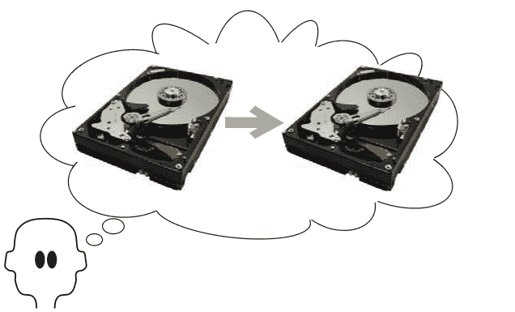

抽象涉及到通过丢弃技术和物理组件来思考主体的*本质*。

因此，与其采用建议的物理实现方式“备份硬盘”，不如审视本质并说：“消除数据丢失”或“保护数据免受盗窃”或“保护数据免火灾”。一旦你理解了真实问题——底层的业务需求——你就能更好地为它找到最佳解决方案。所以，亲爱的读者，在跳跃到备份问题的解决方案之前——这个方案范围可以从频繁的、自动上传到云服务，到将笔记本电脑系在一只训练良好的攻击罗威犬身上，并在火灾时给它一个离开建筑的出口——我们希望你考虑抽象的理念，以及它是如何为你服务的。

让我们来看一个抽象的例子。Netflix 这家美国公司曾成功通过邮寄租赁 DVD 的业务。作为月费的回报，客户家里可以几张 Netflix DVD，当他们看完其中一张并归还后，另一张就会送达。在 Netflix 成立时，租赁电影是一项新业务。在某个点，Netflix 审视了这项业务的抽象。物理现实是该公司租赁了 DVD，但如果你从中进行抽象，你会发现 Netflix 经营的是租赁电影的业务。

既然我们现在看到了真正的业务是租赁电影，我们问问是否有不同的方法来实现？嗯，是的的。Netflix 发现了这种方法并将其业务切换到提供即时可用电影，并带有无需通过邮寄归还 DVD 的便利。通过采用这种方法，Netflix 改变了其运营，使其更接近本质。

# 棕牛模型（The Brown Cow Model）：在界之上思考

在第 5 章“调查工作”中，我们考虑了如何研究业务的当前状态。最初的这项研究仅仅是为了确保你和利益相关者讨论的是同一项业务，并且你对当前状态有一个合理的想法。然而，当你审视业务时，你看到了用于执行工作的物理产物和设备。在本章中，我们打算消除你遇到的设备和技术，从而揭示工作的真实意图。

### 形式指南


无论你是多么正式或非正式，无论你是多么敏捷或传统，或者你想成为什么，你都必须构建符合需求的东西。否则，你仅仅是在浪费客户的钱和你自己的时间。

这一章对于“兔子项目（rabbits）”特别重要。作为一个兔子项目，你可能会使用故事卡片、便利贴或在白板上的草图等技术。这些产物通常展示的是针对不合预期问题的建议解决方案。通过找到问题的本质，你的解决方案将更加合适，并且通常更正确。

如果业务分析师和利益相关者只讨论工作的本质，那么“马项目（Horse projects）”对正常化的追求将得到帮助。使用这种方法，他们生成的模型更少，并可能减少所需的通信量。

“大象项目（Elephant projects）”可能涉及外包开发，如果解决正确的问题至关重要。如果不是，交付的产品必须经过修正，并由外包方收取修正费用。

同样，如果大象项目有正式的内部程序，并在任何构建开始之前将完整的规范交给开发者，那么需求活动与软件交付之间将产生时间滞后。由于现在修复系统变得困难，因此规范指定正确的产品——一个满足真实需求的产品——就变得至关重要。

# 图 7.2

我们在文中之前介绍的棕牛模型如图 7.2 所示。第 5 章“调查工作”讨论了如何研究当前状态。那次调查由左下象限表示。

# 第7章 理解真实问题

棕牛模型（The Brown Cow Model）提供了工作的四种视角，每种视角都能为业务分析师在调查的不同阶段提供有用信息。在本章中，我们将观察线以上的内容。

| 核心业务用例 | BUC | 增强的核心业务用例 |
|---|---|---|
| 1 | | 1 |
| 2 | | 2 |
| 3 | | 3 |
| 4 | | 4 |

业务的“如何-现在”（How-Now）视图。事实上，线以下的所有内容——即“如何”——展示了用于实现解决方案的物理设备和人员组织。

# 业务

现在是时候移动到区分“如何”与“什么”的水平线以上了。在这里，你可以看到真实的业务——我们称之为业务的本质。在这一高度，空气变得清新了，你不需要处理人员和技术等琐碎的现实问题；相反，要采取抽象视角，发现业务的真实走向。一旦你看到了它，就必须转向你希望在未来变成的样子。在棕牛模型中，这些视角由“现在”（Now）和“未来-什么”（Future-What）象限表示。

在线线以上花费时间是为了发现真实问题，这在许多组织中很有帮助，因为那里的人们花费整个60分钟在为错误的问题构建解决方案。

当你正在搜集知识时，你获得的大多是利益相关者对解决方案的想法，而不是对要解决的底层问题的描述。这可能是一个极佳的解决方案，但更有可能是利益相关者的经验和想象力的产物。而且，你（以及你的利益相关者）还不知道它是否在解决正确的问题。

> 如果我有一小时的时间来拯救世界，我会花59分钟来定义问题。—— 阿尔伯特·爱因斯坦

因此，作为需求发现者，你的任务是解释利益相关者所的话并揭示其本质。

工作在物理上如何实现其功能——技术、仪器、计算机、人员等——属于实现。要达到本质，你必须忽略任何当前或未来的实现方案，揭示工作存在的根本原因。这样做有几个原因：第一，也是最重要的原因，是你解决了正确的问题——这往往被忽视了。第二个原因是，找到本质意味着你不会在无意中重新实现过时的技术。几年前构建当前系统时使用的技术和组织结构将不再是你需要的相关解决方案。如果这还不够，达到本质意味着你可以避免利益相关者所执着的那种“当月热门”的解决方案。

问题，意味着你试图解决的真实业务，无论任何技术实现如何。这个底层问题——也许你称之为策略——就是本质。

你可以从技术实现中反向工程出本质。例如，对于自动取款机（ATM）：你与ATM进行的这项业务的本质是什么？你必须采取的动作——插入塑料卡、输入密码、扫描视网膜等——都涉及到与银行选择使用的技术的交互。然而，本质是你能够安全地访问银行账户并从中取款。

注意“你安全地访问银行账户并从中取款”这句话是多么不依赖技术。考虑一下，现在考虑还有多少其他方法可以“安全地访问账户并从中取款”。存在许多技术可能性。例如，当你在超市使用借记卡的“现金取现”选项时，你是在访问银行账户并从中取款。超市迫使你使用借记卡并购买该业务解决方案的任何东西；这是否改变了本质？

这一点在于：你正在寻找业务的本质。你如何实现它——无论现在还是未来——都不是本质的一部分，而且目前对你来说并不重要。如果你忽略本质，直接跳到编写包含技术元素的需求上，那么技术就变成了需求，结果也会如此。

# 154 第 7 章理解真实问题

由人、计算机、机器人、机械设备或任何其他事物完成：它仅仅是一个业务流程。数据无论存储在数据库、USB 闪存、书籍、人类记忆、白板、DVD、云端或任何其他技术中，都是一样的。

思考抽象集，你就可以找到更好的实现方式。iPod 是一款出色的 MP3 播放器，多年来一直是许多人的首选播放器。尽管如此，如果你考虑本质——它播放音乐——那么你就可以为该本质寻找其他的实现方式，而寻找更方便的实现只是出来的一步。显而易见的方法是将此功能整合到手机中，而你更有可能随身携带。如果你仔细想想，将其称为“电话”在某种程度上是一个本质上的误称：今天的手机可以播放音乐、拍照、管理日程、让你读书和报纸，并且——不可避免地——玩游戏。

这个故事的寓意是，对于任何技术——无论它是多么先进、多么有吸引力——你都必须抽象这项技术并看到其底层目的。或者引用肯尼·尼迪的话：“不要问你的技术能为你做什么，而要问技术正在做什么。”

## 告别泳道（Swim Lanes）

让我们看看业务分析师有时无意中将实现产物引入业务问题的方法。

有些分析师花费大量精力在他们的流程模型中添加泳道，例如图 7.3 所示。我们在第 5 章中讨论了对现状进行建模；虽然对当前实现的视图确实很有用，但对于业务分析师来说，确保当前的实现细节不一定一直持续下去也是同样重要的。如果留在模型中，模型上的泳道会误导读者，让他们认为处理边界代表在未来的任何实现中都应该被保留。让我们仔细观察这个例子。

图 7.3 显示了一个处理定制家具的公司的业务流程模型。在这个模型中，公司的部门以泳道的形式出现，将组织目前的每个部门隔离开，而这些部门掩盖了问题的本质。

它的运作方式是这样的：客户来到公司指定并购买家具。从提供的组件中，客户实际上在屏幕上组装所需的家具，这个模型就充当了他们想要产品的规格。一旦客户确认订单，订单控制部门（Order Control）就会接管；它验证订单并处理客户的付款。已付款的订单被发送到制造部门（Manufacturing）进行制作。此时，生产计划将更新为生产货物所需的工作。问题就出在此处。

假设制造部门没有完成订单所需的组件和材料，需要几周或几个月才能获得必要的组件。或者假设制造部门的订单积压，导致该订单在五周内无法排到队列前端。现在我们面临的情况是客户可能想取消订单，但正如你在图 7.3 中所示，客户已经为货物了了。

现在删除模型上的泳道，调度问题就变得显而易见。在这个阶段，一个精明的业务分析师会在“确认订单”（Confirm Order）活动之前插入一个“准备订单并检查库存”（Prepare Order & Check Inventory）活动，如图 7.4 所示。通过查看没有泳道的活动，分析师能够重新安排流程以获得更好的状况，即让客户在确认订单之前就知道交付时间。这可以避免为生日、周年纪念或圣诞节购买礼物的客户感到失望。

当从模型中移除泳道时，业务分析师和利益相关者更容易看到，活动不必在同一个地点执行，也不必按照他们传统的顺序执行。

一个显示泳道的典型流程模型；图中的水平线按当前的部门职责划分工作。

| | | | | | |
|--- | :--- | :--- | :--- | :--- | :--- |
| 客户 | 浏览产品 | 为所需产品指定选项 | 确认订单 | 接收货物 | |
| 订单控制 | | | 验证订单并处理付款 | | |
| 制造 | | 组装组件并制造订单 | 发货 | | |


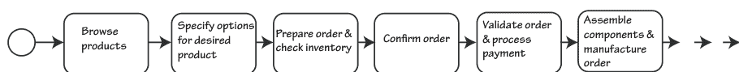

图 7.4

移除泳道后的业务模型。注意如果库存不可，客户如何中止交易。确认订单流程现在可以告知客户交付情况。

寻找业务本质的一个重要步骤是查看端到端的流程，并忽略目前在部门之间的工作划分。部门——事实上，任何处理器（人工或自动）——都是过去工作的结果。因为它们产生于当时的可用技术或业务结构，当前的实现往往掩盖了业务的真实本质。

一些利益相关者对没有部门边界的工作有意见，你可能需要说服他们部门并不是本质的一部分。退后一步，考虑我们为什么在组织中设立部门：它们的存在是因为员工在工作。很少有人拥有足够的才能来完成一个组织中的所有任务；因此，我们根据雇佣人员的技能来划分组织。如果我们不雇佣人类，而是一组多才多艺到能够执行所有任务的机器人，那么按部门划分机器人就是愚蠢的。

我们敦促你打破部门边界，关注全局。

## 解决正确的问题

这里讨论的思考方式源于理解抽象本质。本节适用于所有需求，无论项目的规模或性质如何。它同样适用于迭代和传统的开发方法。

你不需要多久就能观察到以下场景：团队开发了他们认为非常酷的产品。然而，尽管现场的热烈喝彩，更不用说制造产品的成本了，用户似乎从不使用它，或者敷衍使用一段时间，然后要求大量的更改。为什么尽管团队付出了努力，这个产品还是变成了不受弃的产品？因为它解决了错误的问题。


## 迈向未来

我们的客户之一一家金融机构正在研究一种可以更有效地重置密码的新系统。这项任务对该机构构成了重大问题；重置的成本每年高达数百万。

但这里实际上发生了什么？系统人员正在研究一种可以更有效地建立身份的新系统。真正的问题——他们回避或未看到的问题——是客户忘记了密码。

迈向未来

到目前为止，我们一直在观察业务的当前实现，并由此推导出要解决的正确问题。当然，这一切与当前的业务、技术及其当前的本质有关。如果你参考棕牛模型（Brown Cow Model），你分别实现了对工作的现状视图和什么是现状视图。

一旦理解了当前的本质，就是时候考虑你希望业务变成什么样了；这在棕牛模型的未来象限中显示。迈向未来涉及提问和增强

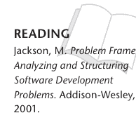

# 158 第 7 章 理解真实问题

图 7.5

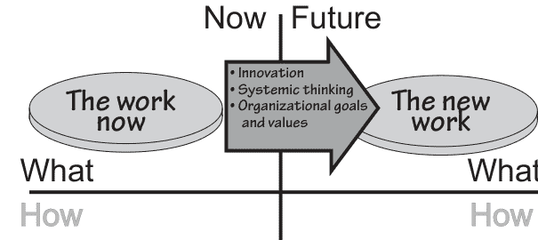

在对现状工作有了理解之后，我们开始思考项目完成后它可能变成什么样。当前的业务本质是让业务更高效、更具创新。见图 7.5。

在深入考虑未来之前，值得强调的是，你必须理解你范围内存在的当前本质——这通常由一个工作上下文图来定义，正如我们在第 3 章“业务问题”中所讨论的那样。在思考未来时，可能意味着你需要改变你的范围，因为利益相关者已经同意了某些新的或变更的业务政策，而该政策需要与外部世界的相邻系统建立新的或不同的接口。

要开始思考“未来何在（Future-What）”，请向你的所有者（owner）提一个简单的问题：“你希望在未来从事什么样的业务？”虽然这是一个简单的问题，但要找到答案并不简单。例如，多年来，亚马逊一直是最大的纸质书在线销售商。亚马逊意识到畅销的未来可能有所不同，因此它开发了 Kindle。这条路径让亚马逊能够销售可下载的电子书供在 Kindle（或 iPad 或任何其他新出的阅读器）上阅读，这种改变被证明是成功的——亚马逊销售的电子书比纸质书还多。这种方向的转变是亚马逊对“你希望在未来从事什么样的业务？”这一问题的回答。

迈向未来不仅仅是愿望式的思考；它要求业务分析师采取创新方法，同时也需要业务利益相关者愿意贡献并对新想法持开放态度。你在这里所做的，是获取当前的业务本质，并将其转变为未来的业务本质。

我们必须停下来并一点。。你可以说，亚马逊业务的本质并没有改变——公司仍然在卖书，只是使用了不同的技术来实现。亚马逊（或任何其他书商）实际上做的是挑战了“书总是印在纸上”这一限制。通过消除这一限制，并声称书的本质是其信息内容——文字和图片——那么书商就可以寻找其他更优的方法来销售这些信息内容。理想的售书技术将是销售者直接将书籍投射到“读者”（这个词已不再恰切了）的大脑中。然而，在那种技术出现之前，书商将不得不满足于电子书。

你对“未来何在”的创新并不非是巨大的改变。当亚马逊开始在线销售（纸质）书籍时，公司收集了关于客户购书习惯的信息。亚马逊还了解其待售书籍的标题、体裁、作者和其他属性。从那里开始，开发新的业务政策并不是巨大的改变：当新书从出版商那里运来时，将书籍的属性与客户的购买习惯进行比较，并在客户下一次访问时提供针对性的推荐。

你可以从这个例子中看到，有时工作包含某些核心知识，但这些知识并没有被充分地用于业务中。有时，业务没有意识到自己的核心知识，或者当前的实现使得人们难以发现新的业务机会。

同样，你可能正在与急切并愿意改变业务的利益相关者合作，或者你可能会发现自己必须拖着他们、哭着喊着地推向未来。此外，利益相关者并不总是能完全确切知道自己想要什么。我们的意思不是让你忽略客户，而是当你告诉他们他们想要什么时，要保持怀疑态度。

还要记住，给利益相关者提供他们所要求的的东西往往是通往遗忘的道路。客户经常要求改进他们的系统：“我想要现在的这些，但请多提供几项信息，速度再快一点。”通过提供这些功能而不再多，你正在走向平庸。客户经常要求改进他们的系统：“我想要现在的这些，但请多提供几项信息，速度再快一点。”通过提供这些功能而不再多，你正在走向平庸。客户经常要求改进他们的系统。通往遗忘的道路。此外，给利益相关者提供他们所要求的东西往往是通往遗忘的道路。

> 阅读 克莱尔·克里斯森，《创新者困境：改变商业规则的新书》，HarperBusiness, 2011.

# 160 第 7 章 理解真实问题

你并不是在构建另一个计算机系统（世界上已经有太多了），但为了获得最大的价值，它必须植根于创新。

## 如何创新


今天的业务分析师应该总是寻找改进客户工作的方法，而且这些改进总是通过创新来实现。大多数人并不认为自己是创新的，但是你可以做一些简单的事情来鼓励自己拥有更多更好的想法。记住，创新仅仅是“新思维”，而创新不等同于发明。

极少数人认为自己是创新者；但我们建议，只要有机会和某些技术，几乎任何人都可以是新的。有很多技术，也有很多人在讨论这些技术。我们不会尝试在本书范围内提供关于如何更具创新性的完整论文，但我们想看看你可以做的一些，这些事情通常会产生改进所有者工作的新想法。

我们刚才提到，你的利益相关者可能并不知道自己想要什么；至少他们在表达自己想要什么时有困难。但你知道有三件事是人们想要的并愿意花费支配性资金的：快乐、地位和便利。便利是这些中对业务分析最相关的，但我们将很快查看另外两个。

人们愿意为快乐付费。你只需查看酒精的销售情况，就知道人们愿意为快乐支付多少钱（当然，假设人们不是仅仅为了买来喝醉）。去看电影或在家里看电影也是为快乐付费的例子；如女性购买香水（这对女性和他人来说都是愉悦的）；如为一杯制作良好的咖啡付费，而不是喝走廊机器里的棕色液体。我们的日常生活中还有许多更多例子。大多数业务提供快乐的机会是有限的，但不应该阻止你提问：“我们如何让客户与我们公司的互动变得更好？”

脚注 1

支配性资金并不是-它随支出者的意愿而产生。它不包括我们必须花在上面的东西：食物、住所、通勤交通、基本衣物等等。

目的地是什么？因为梅赛德斯会让车主觉得自己拥有一比别人更好的车。苹果的 iPod 占据了巨大的市场份额，因为人们认为它比其他笨重的 MP3 播放器更有面。也许 iPod 所有者对这款设备的感受是“酷”——但这种酷是否是一种地位的象征，特别是当某样东西让你比同龄人更酷时？徕卡营销的是系列高质量相机；松下以低得多的售价相同的相机。尽管松下具有价格优势，同类的徕卡依然在畅销。为什么？因为人们看重拥有徕卡的声望：相机正面的红点表明他们正在使用世界上最顶级光学公司之一的相机。

然而，尽管这些机会具有吸引力，但对大多数公司来说，提供声望的机会通常是有限的。这使得“便利性”成为了人们支配性（或非支配性）资金的目标。

人们愿意为便利性支付费用——有时是巨额费用。手机就是一个解决方案。我们忍受着相当糟糕的问题——通话掉线

回想多年音乐播放的历史。每一代新设备——蜡胶唱机、虫胶唱、黑胶唱、磁带、MP3 播放器——被采用是因为它们提供了更多的便利性。这些进步是否都带来了更好的重制质量尚有待商榷；许多音频发烧者仍然青睐口碑良好的黑胶重制而非 CD 重制。MP3 在保真度方面无疑是倒退的一。尽管如此，每一代设备在重制和获取音乐的便利性上都提供了一个台阶。

便利性是你的业务可以提供的。这并不是一项困难的任务，但要提供这一点，你必须先从你提议的解决方案中后退一步，从用户的角度来看待。考虑用户的核心目标（使用我们之前讨论过的“本质”一词），并尝试用比你计划的更少的步骤引导他达到该目标。如果你愿意，可以模仿想法：看看亚马逊是如何做的——它并不是因为难用而成为顶尖的在线图书零售商的。作为一个小但重要的便利性，亚马逊在账户中保留了用户购买过发货的所有地址：客户不需要输入收货地址，而是直接将货物发送到存储的地址之一。方便吗？容易实现吗？是的。你可以在你的业务中做类似的事情吗？是的。

## 第 7 章理解真实问题

你能提供一种用户会觉得方便的额外服务吗？几乎可以。看看你所在的组织提供的任何服务。与几位志同道合的同事进行头脑风暴，我们向你保证，你一定会想出几个为组织已经提供的服务增加服务——从而增加便利性的点子。

你可以做很多事情来让你的产品和解决方案更加便利。这种努力需要的不仅仅是一点时间和思考。然而，要取得成功，你必须从客户（或将使用你计划构建的任何东西的人）的角度来看待产品。从客户的视角看问题并不总是容易的，但核心规则是忽略你自己的想法，而是从客户的角度来看。在本章的后半部分，我们将讨论用户画像（personas），作为一种从客户思维方式来理解事物的方法。

从客户的视角看你提议的产品——你能让它变得更方便吗？

## 系统性思维

与创新一样，走向未来意味着系统性地对工作、整个问题、端到端系统进行思考。有时，当你考虑整体而非局部时，你会更好地看到如何重新排列这些部分，以形成一个对未来更有益的系统。


作为业务分析师，引导未来工作的探索落在了你身上。通常，非常频繁的是，一旦你开始对当前工作进行系统性思考，未来的工作就会显而易见。仅仅通过看到当前工作的大局，未来的工作应该什么就变得明朗了。

观察部分，但通过部分的聚合来观察。

系统性思维在图 7.6 中被描绘为一系列相互锁定的锁，这在需要时非常适用。系统性思维的基本思想是将业务视为一个系统——即一系列连接的部分，它们产生了任何单一部分都无法做到的东西。所以让我们看看工作的各个部分以及它们交互的方式。这种探索将帮助我们看到它们在未来是如何交互的。

> 我们必须理解工作是如何运作的。——约翰·塞登（John Seddon）

目光过于狭窄，只看提议的产品，会抑制系统性思维。产品的根本功能及其寻求与用户交互的方式固然重要，但产品在更大范围内所做的事情更为重要。后退一步，看看你的产品如何影响其他工作。

假设你正在与一位工程师交谈，他是道路除冰项目的利益相关者之一。工程师问：“产品要显示一张地图，用红色标记需要处理的道路，用蓝色标记安全的道路。”（这是需求陈述之一；我们不是在编造。）注意，工程师正专注于产品以及他对界面的提议解决方案。现在，稍微后退一点，思考整体工作——进行系统性思考。

与其向内观察解决方案，不如后退一步，观察你想要改进的工作整体。

## 系统性思维

### 图 7.6

系统性思维（有时被称为系统思维）要求你将系统视为一个整体。任何系统都是一组相互连接的功能集合，一个功能的结果可能会对另一个功能产生影响。就像一组齿轮，当一个功能执行某些操作时，它会导致其他功能产生反应。


首先考虑红色道路和蓝色道路的需求：工程师由于偏好要求这种颜色方案。但稍微后退一步，你必须考虑是否都会像这个同仁一样解释红色和蓝色。完全可以说蓝色代表冷，而红色代表热，这意味着极有可能另一个用户会做出相反的解释，导致完全错误的结果。

如果你后退一步，问为什么必须在屏幕上识别道路（使用任何颜色方案），你得到的答案是工程师必须派遣一辆车来处理结冰的道路。从工作的整体来看，这种观点意味着在更广泛的工作范围内，需要通知卡车部门要处理的道路。一旦你这样看待问题，你就会构建一个直接通知部门这一需求的产品，并取消颜色编码的屏幕和工程师电话。

现在后退一步：如果必须派遣一辆车，那么工作中就需要分配卡车的需求，而在考虑到（再次后退一步）部门里有许多卡车时，这辆车应该是最合理的那个。从系统性视角来看，如果你要考虑构建一个处理道路的产品，车队优化必须是解决方案的一部分。

让我们从系统性视角进一步进一步：如果部门的资源不足以处理所有道路怎么办？也许有一种方法从地理相邻的县请求资源，或者要求警察关闭未处理的道路并告知交通部门已这样做？当道路关闭时，工作是否可以推荐替代路线？我们可能走得太远了，

# 第7章 理解真实问题

原始的屏幕上有蓝色和红色的路径，但通过系统性思维，产生出了一些有趣的可能性。

系统性思维的想法是考虑业务的整体，它的各个组成部分如何相互作用，最重要的是，它们之间相互产生了什么影响。不要只看整洁的流程图或遵循某人对流程的文字描述，而是思考系统的不同部分是如何相互影响的。图 7.7 展示了这一概念。

在这个阶段，你可能会想：“等一下！我的职位是业务分析师。分析涉及拆解事物并研究各个组件。分析性思维当然是有用且必要的，但我们正在建议——并成功地建议了——让你通过系统性思维来增强你的分析能力，而不仅仅是分析每个组件，而是考虑这些组件是如何相互影响的。

John Beameill（我们推荐的一位作者）谈到了“价值需求”（value demand）和“失败需求”（failure demand）。价值需求发生在客户请求或订购你组织提供的任何产品时；失败需求发生在当这些客户对他们售得的产品提出投诉或要求维修时。显然，当你的产品或服务失效时，为了纠正问题或修复产品是需要付出成本的。因此，找到系统失效点是非常值得的。然而，失败需求的原因深植于组织内部，只有通过整体观察组织才能发现它们。这就是系统性思维。

这个故事的寓意是，不要集中在给你的第一个解决方案上，而是退后一步，从更广泛的范围来看待问题。通过对解决方案中每个元素的底层原因进行质疑，并通过研究任何一个元素对另一个元素的影响，你最终推导出更真实的需求，并产出更好的最终产品。

## 阅读材料

- Ackoff, Russell, and Herbert Addison. *Systems Thinking for Managers: 40 New Management Laws*. Triarchy Press, 2010.
- Seddon, John. *Thinking in the Public Sector*. Triarchy Press, 2010.
- Meadows, Danielle. *Thinking in Systems: A Primer*. Earthscan, 2009.
- Senge, Peter. *The Discipline: The Art and Practice of The Learning Organization*, edition. Crown Business, 2006.

### 图 7.7

该业务中的某些活动对其他活动有影响。这种影响如灰色箭头所示。系统性思维涉及考虑系统的整体结果，并理解每项行动的后果。

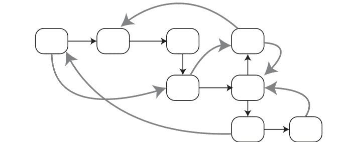

## 价值

我们进行需求的前提是，如果你构建了一个软件、消费产品或服务，它对所有者来说必须是有价值的，因此让我们先考虑价值。我们使用这个术语是指你愿意付费的某些——换句话说，你根据其价值来决定是否购买某物。当你觉得无论如何这笔支出都是值得的，你就会花钱购买。如果你觉得它不值这个价格，那么它的价值不高，你就不会买。

有时做出价值决策是非常直接的。例如，我们的作者为了工作经常到处旅行，有时我们必须进入某个国家之前必须获得签证。我们使用一种签证服务，他们派遣快递员从家里收集申请表和护照，将它们送到大使馆，并在第二天返回带盖了签证的护照。作为替代，我们可以选择排队等待签证申请被接受，再次等待获得批准，然后回来取护照。然而，我们愿意为签证服务付费，因为我们认为它提供了价值：它为我们节省的时间可以用来做其他事情——例如，写这本书——而且因为签证服务的周转速度比我们自己快，所以当行程紧凑时，我们不会没有护照。这一点是，价值节省的时间足以支付适中的费用，让别人为我们节省部分时间。然而，如果签证服务的成本变得太贵，或者我们当时不是特别忙，那么对我们来说的价值就降低了。

但是，亲爱的读者，你不需要处理像个人偏好和价值观这样简单的事情。无论你关注的是组织的价值——特别是生产你正在开发的产品的组织——你都必须确定这个组织重视什么以及它想要实现什么。这可以用节省的钱或赚到的钱来表示。对于任何用例，你都通过仅包含对所有者有价值的功能（考虑到奖励、惩罚和成本）来衡量价值。我们建议，真实问题——你正试图理解的问题——仅包含高功能性。（等一下，让我根据 OCR 分段去碎片纠正来重新对齐流程）。

总而言之，这一切意味着该功能是有价值的，因此你将其包含在你的产品中。

或者，你可能会考虑为你的产品提供免费送货的能力。这项服务的奖励很高；假设为 4，因为客户会感谢这种便利。不这么做的惩罚很高——没有人需要为低价商品免费送货。成本很高——它会消耗商品销售的大部分利润，所以我们将其成本定为 5。这项服务有价值吗？不，成本超过了奖励，所以你会舍弃这个功能。

对于任何用例，你都通过仅包含对所有者有价值的功能（考虑到奖励、惩罚和成本）来衡量价值。我们建议，真实问题——你正试图理解的问题——仅包含高功能性。

## 用户画像 (Personas)

当无法获得真实用户或人数多到你无法访谈所有人时，用户画像是非常有用的。用户画像是一个替代人类用户的虚拟角色。当你无法接触真实用户或客户时，我们强烈建议使用用户画像。几乎总是，用户画像比人类代理人更能代表用户。

用户画像是一个虚拟的人格；是一个为你收集产品需求而虚拟但典型的用户或客户。在可能存在成千上万真实用户的情况下使用虚拟角色？因为对于大众市场产品，或由十几个不同的人使用的产品，你并不知道也无法了解所有的真实用户。但你可以非常深入地了解，并且这个虚拟用户的属性可以引导你的需求：这就是你的用户画像。

你不是凭空用户画像，而是从市场研究或对可能用户群体的调查中推导出来的。精确程度所需的程度与用户群的大小以及所构建产品的关键性都成正比。无论如何，大多数团队都会编写一份一到两页的描述，识别出人物画像的行为模式、目标、技能、态度和环境。此外，非常有用且确实理想的做法是包含足够的个人细节——包括名字——使得这个人物画像对你和你的团队来说是真实的。当然，你为一个产品会有多个人物画像，但应该有一个是产品的主要目标。我们还发现拥有一张照片也是很有用的——你可以在在线图库网站找到成千上万张——然后选择一张你认为符合你人物画像形象的照片。

使用人物画像（Persona）让业务分析师和创新者更容易思考客户的需求。当他们看到一张脸并对着一个真实的人谈论这个人物时，就为原本关于潜在客户的抽象数据赋予了人情味。问题在于要问不是一组数据有效的方法，而是：“艾玛（无论你如何称呼你的人物画像）想要什么？”或者“在这种情况下，艾玛会怎么做？”

人物画像避免了库珀（Cooper）所说的“弹性用户”，即不同的利益相关者将产品特征定义为他们脑海中的任何内容，并为了适应他们对正在构建的用户类型的假设。结果通常是产生过多的需求，其中许多需求相互冲突，而且产品由于试图满足所有人，反而没有满足任何预期的目标受众。今天，你可以看到完全符合我们自己个人偏好的精美消费品。这并不是因为产品的构建者了解你，而是因为他们选择了一个属性在多或少程度上匹配的人物画像。相比之下，如果你尝试写写一个适合地球上每个人的产品需求，其功能将如此，以至于软件大到无法安装在任何计算机上——试图迎合所有人最终将导致局限。

使用人物画像还可以防止利益相关者将用户定义为他们自己。这种“自我指涉”的方法（见图 7.8）几乎总是产生特异的结果：一个利益相关者发现产品既容易又直观，但其他观众对提示的反应并不完全相同。

人物画像的真实性为业务分析师和利益相关者提供了一个他们开发新系统的目标。计算机素养、对技术的态度、文化背景和观点、性别偏见等细节可以作为指南。这种显而见的现实还告诉设计师什么是正常情况，哪些是人物画像会遇到的异常或边缘情况。这种理解通常可以防止设计师将重点放在异常情况或用户行为上。

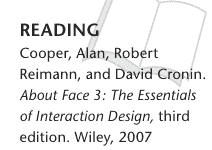

### 168 第7章 理解真实的问题

图 7.8

自我指涉的用户只考虑自己，无意中忽略了更广泛受众的意愿或需求。


我们的作者在伦敦的一个区有一个政府客户，其职责之一是为老人和其他无法自理的人提供饮食。我们与管理这项服务的团队合作，目标是寻找工作的新状态。任务是帮助团队决定该地区可以做什么来改善老年送餐服务。团队提出了一个成员认为是典型送餐接收者的人物画像，然后他们开始询问：“艾西到底想要什么？”答案让许多团队成员大开眼界；在此之前，他们设计这项服务很大程度上基于自己的经验。艾西——照片中的她带着微笑——给出的答案他们带来了更好且更受欢迎的服务。见图 7.9。

## 阅读

Norman, Donald. *The Design of Everyday Things*. Doublebly, 1988. 尽管这本书已有年代感，但诺曼关于目标清晰性的观点在今天仍然适用。

当我们谈论软件需求时，我们经常说到“用户需求”。这样做的问题在于，需求是为任何可能是用户的人收集的。构建成功产品的方法不是收集那些为每个人提供东西的需求，而是让实际用户感到兴奋。

图 7.9

团队使用人物画像来代表他们的客户。通过将人物画像视为真实的人，他们能够设计出远优的未来。

## 挑战限制

限制通常是对某种方式的假设。例如，一家大型建筑商的分析师就挑战了这一点。在他们之前，流程是这样的：货物送达时，码头领班检查货物，将单据发送给财务人员，财务人员在经过一定的处理并收到发票后，向供应商付款。这一过程如图 7.10 所示。

当限制受到挑战并最终被移除后，流程变为：货物送达，码头领班检查货物是否与订单匹配，然后码头领班授权立即银行转账。

新流程有几个优点。它更便宜，因为消除了财务部门昂贵的处理过程。传统上，组织喜欢尽可能晚地支付账单，在这种情况下，公司通过立即支付账单节省了钱。延迟付款的原因通常是为了让资金留在支付者的银行账户中赚取利息。然而，在如今低利率（或零利率）和经济不景迷的情况下，立即付款获得的折扣总是超过任何可以获得的利息。

挑战限制往往会导致一些令人惊讶（且有益）的创新。考虑这些限制：对于某些国家，你需要签证才能访问；此外，签证必须盖在护照上作为持有证明。澳大利亚移民局挑战了这一限制，有益的结果是：要获得签证，你可以在线申请。如果你符合条件，会在在线时获得签证并收到通知；护照上不盖任何章（图 7.12）。当你到达澳大利亚的入境点时，移民官员扫描你护照上的条形码，屏幕告诉他持有人

图 7.11

挑战限制后产生的精简流程。交给司机的检查单现在已被立即银行转账所取代。

## 创新工作坊

### 图 7.12

澳大利亚政府提供了一个创新的（非常方便的）在线签证申请设施。截图经其来源——移民与公民事务部许可使用。


申请 ETA（电子旅行授权）

+   指南

- 我符合条件吗？

- 如何获得 ETA？

- 什么是 ETA？

- 如果我已有 ETA（电子旅行授权）怎么办？

- ETA 有期多久？

- 这项服务的费用是多少？

- 有什么要求？

+   更多信息

- 关于互联网 ETA 的更多信息

- 您的隐私

- 常见问题解答 (FAQ)

- 关于本网站

+   有用链接

- DIPP 首页

- 关于 ETA

- 澳大利亚签证

- 旅游信息

- 系统问题

欢迎访问澳大利亚政府电子旅行授权系统

如果您计划去澳大利亚度假或短期出差，您将需要申请签证或 ETA（电子旅行授权）。ETA 的有效期最长三个月。

+   通过此网站，您可以：

- 申请 ETA

- 检查通过本网站签发的现有 ETA 有效性

> 重要：从 2008 年 10 月 27 日起 ETA 资格的变更

从 2008 年 10 月 27 日起，欧洲护照持有者在在线申请访问澳大利亚时将可以使用新的 eVisitor 服务。

要访问 eVisitor 服务，请点击此处。

请注意，新的 eVisitor 服务将从 2008 年 10 月 26 日东部夏令时间 (AEDT) 午夜开始取代在线 ETA 系统。

新 eVisitor 服务的引入不会影响澳大利亚访问客现有 ETA 或其他签证的有效期。如果您持有有效的 ETA，在 2008 年 10 月 27 日之后您仍然可以使用它前往澳大利亚。

已获得签证。对该部门的净收益是减少了处理费用，更不用说签证申请人在世界各地的澳大利亚领事馆盖章上花费的时间。请访问该部门网站（www.immi.gov.au）查看其在移民和签证方面的创新方法。

## 创新工作坊

创新工作坊是产生主意的方法之一。当大量利益相关者参与创新过程时，请使用这些工作坊。当您希望利益相关者看到开发新的、更好的工作方式的优势，而不是重建旧系统时，这些工作坊也是合适的。

我们建议为了迈向未来，要为创新工作坊留出一点时间。这些联合会议的目的是通过产生创新来改进工作。我们在创新中注意到的问题之一是，很少有人认为自己是创新者，更少的人认为创新是其工作描述的一部分——然而，我们建议创新是每个人工作描述的一部分——因为只有通过创新，我们才能进步。

工作坊是一个你和利益相关者共同工作以创新出更好成果的地方。作为业务分析师，你必须担任创新的先锋。我们发现，利益相关者有时不愿意为这项活动投入时间，但一旦他们体验到了工作坊带来的改进，他们就会成为热情的参与者。

> 如果没有创新，你将还在骑马出行。


### 第 7 章 理解真实问题

工作坊的结果是数百项创新的需求。

当欧洲航空安全（Eurocontrol）决定调查未来空中交通系统的需求时，该组织发现很难跳出目前的思维。我们与城市大学的同事 Neil Maiden 一同，开发了相关需求，以此鼓励空交通管制员、飞行员、航空公司代表和系统开发人员为未来系统提出改进。工作坊的结果是数百项创新的需求。参与者一致认为，来自工作坊的需求对最终的空交通产品产生了重大的、几乎令人惊叹的改变。他们还认为，如果没有这些创意工作坊，这些需求永远不会见天日。

我们建议在规划和开展创新工作坊时采取以下类似的举措：

+   1. 设定创新范围。范围不应太窄，因为许多创新最初被认为在团队的职责范围之外。邀请所有对该范围感兴趣的利益相关者参加工作坊。
++2. 划分范围。
+   3. 计划工作坊。
+   4. 记录发生的一切切。
+   5. 反馈调查结果。
+   6. 孵化。

这些工作坊旨在比普通会议更具结构化。其意图是使用创新技术产生更有趣的结果。

我们不建议某一种特定的创新技术优于另一种；你不可避免会发现某一种可能适合他们。创新本质上是一种人类活动，所以我们建议你使用你熟悉且喜爱的技巧。


阅读 Silverstein, David Philip Samuel, and Neil DiCaprio. The Innovator's Toolkit. John Wiley & Sons, 2009.

## 脑风暴

脑风暴是创新的方法之一。它对于产生问题的范围或其可能的贡献非常有用。这种策略并不是为了促进无限制的范围扩大。相反，脑风暴可以在不产生额外费用的情况下产生想法。

脑风暴利用了群体效应。也就是说，你聚集一群明智、愿意的人，并让他们为新产品产生尽可能多的想法（图 7.13）。告诉他们任何想法都是可以接受的，无论看起来如何，并且不要通过批评或辩论来减慢进度。

- 脑风暴参与者应该来自广泛的学科，具有尽可能广泛的经验。这种背景的混合带来了更多的创意想法。


- 在那一刻，暂停判断、评估、批评，最重要的是停止辩论。只需记录生成的需求即可。不中断流程是为脑风暴小组营造创造且充满活力氛围的最快方法。

- 产生大量的想法。产生尽可能多的想法。质量随着时间的推移会产生。

- 尝试尽可能产生许多不常规、疯狂和狂野的想法。想法越狂野，可能越有创意，而且通常越可能转化为真正有用的需求。

脑风暴会议是感兴趣的人聚聚，他们的任务是为产品产生新想法。

## 174 第 7 章 理解真实问题

- 将新想法寄生在旧想法上。也就是说，在一个想法的基础上构建另一个想法。

> 如果不写下来，想法消失得比水蒸发还要快。

—亚历山·奥斯本（Alex Osborne），头脑风暴的发者

- 记录每一个想法，不要进行任何审查。

- 如果你陷入僵局，从字典中随机抽取一个词来引导会议，并要求参与者进行与产品相关的词汇联想。

- 让会议变得有趣。你无法强制创造力；必须让它自然流淌。如果老板出现在现场并说诸如“我只想听具有市场价值的想法”这样的话，你就看不到很多动地的想法。

头脑风暴会议结束后，首席业务分析师和关键利益相关者会对想法列表进行评估。其中一些想法将毫无用处，但它们已经发挥了头脑风暴的意义——激发了其他、更有用的想法。有些想法可能需要与其他想法合并——也许是半成形的想法，组合在一起后就能产生某个非常有用的想法。保留最好的想法，并在项目约束范围内有合理实施概率的情况下，将它们转化为需求。

### 回到未来

让我们回到我们正在做的事情。你的任务是将当前的工作转化为未来的工作，或者正如我们之前描述的，将“现在如何做”（How-Now）转化为“未来是什么”（Future-What）。从另一个角度看，这项努力涉及业务政策的改变，而新政策应该是具有创新性的。正如我们多次提到的——这一点值得重复——重新实现某些工作的价值很小。如果你的项目是为了为组织提供有价值的东西，它就必须提供一种进步、一些新思考，以使最终产品尽可能有用。

> 我们的工作不是根据成本给客户提供他想要的，而是给他提供他从未梦过自己想要的；当他得到它时，他会意识到这就是他一直想要的东西。

—丹尼斯·拉斯斯登（Denys Lasdon），架构师

你绝不能失败。客户——无论是内部利益相关者和外部客户——并不总是知道自己想要什么。苹果从任何标准来看都是世界上最具创新性的公司，它几乎避免了传统的市场研究。它构建的不是人们所说的，而是苹果认为他们已经准备好的东西。人们通常在看到之前并不知道自己想要什么，所以你的任务就是让他们看到。改进工作意味着交付一个他们能够理解、用户意识到那是他们想要的产品。

未来的工作应该对业务客户提供更好的响应，或者对于内部使用的产品，为用户提供更好的工作方式。这意味着给他们一些以前没有过的东西，或者提供一种能让他们的任务更简单的设施。

我们建议使用人物画像（persona），并从人物画像视角来看待产品。这通常会导致工作发生变化，使其对最终用户或客户更容易接受——更方便。即使是消除购买或订单流程中的单个步骤也可能产生影响。从人物画像视角出发推演你的工作，看看是否可以让它更方便。记住——你不是在取悦你自己。

棕牛模型中“未来如何做”（Future-How）部分的思考结果是若干个未来工作模型。这些模型不需要很复杂；我们通常使用简单的场景和草图来获得利益相关者的共识。你自然需要利益相关者的全力配合，因为“未来是什么”代表了新的业务政策或需要执行的新工作。一旦你确定了工作的范围，通过更新你的工作上下文图并根据需要添加或更改事件列表，定义“未来是什么”视图的边界。

每个人都想要一个令人兴奋的未来——确保你的未来工作不会失望。

### 启动解决方案

我们将业务的本质带入实施的技术世界

我们已经达到了这样一点：离开线之方的那个虚幻、抽象且完美的世界，将业务需求引入线之下方技术世界的现实中。我们在这里所指的“线”是棕牛模型的水平线，我们正在从第三象限（未来是什么）移动到第四象限（未来如何做），如图 8.1 所示。在此过程中，我们正从抽象世界移动到物理世界；从政策转向技术；从问题转向解决方案；从目的转向设计。在第四个象限中，我们开始设计解决业务问题的解决方案。

## 178 第 8 章 启动解决方案

现在，你和你的利益相关者已经对业务的本质——要解决的真实问题有了坚固的理解，是时候确定该问题中的哪些部分将受益于自动化了。换句话说，你可以通过自动化产品（无论是软件）执行多少比例的核心业务政策？

### 图 8.1

你到达了棕牛模型的最后一个象限。在这里，你决定将如何实施核心业务。

| | BUC | | BUC | 增强的核心业务用例 |

|---|---|---|---|---|

| 核心业务用例 | 1 | | 1 | |

| | 2 | | 2 | |

| | 3 | | 3 | |

| | 4 | | 4 | |

| | 5 | | | |

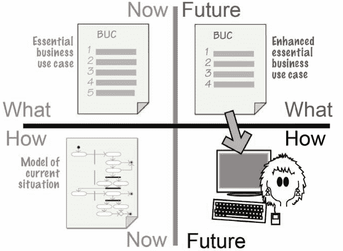

但这不仅仅是简单的决定边界。在任何情况下，从“未来如何做”开始都要高效得多。我们可以在满足用户的方式找到功能性需求，等等，理解需求的时间。注意，我们是从解决方案开始到达“未来如何做”的。

非功能性需求负责环境的设计。见图 8.2。

### 图 8.2

业务分析师平衡许多因素以决定最合适的方案。


## 209 迭代开发

迭代开发技术在前期设计中并不总是做很多，而是依靠频繁发布来评估适用性。虽然这种方法确实可能可行，但如果初始发布并不接近需求，或者利益相关者对问题的理解或定义非常模糊，就会非常耗时。

许多从业者发现，他们被迫从“未来如何做”开始，回到“未来是什么”寻找真正需要的东西，然后进入解决方案的“未来如何做”视图。无论你如何开发软件，这个过程最重要的部分是你和你的利益相关者共同发现解决方案的需求。

## 第 8 章 启动解决方案

正如我们所说的，业务分析师和相关利益相关者在尝试寻找解决方案之前，对真实需求——即核心需求有清晰的理解至关重要。如果缺少核心需求，那么任何解决方案最好的情况下也只能是盲目摸索，最坏的情况下可能是为了解决一个可能并不存在的问题。

### 确定产品范围

业务分析的任务是确定未来的工作应该是怎样的，以及产品如何为这些工作做出贡献。正如本文前面提到的，业务用例（business use cases）是对外部世界对工作服务请求的响应。最佳响应是：从客户的角度来看，提供最有价值的服务；在时间、材料或精力方面（从贵组织的角度来看）具有最低成本；并以最令人愉悦和鼓励的方式（从最终用户的角度来看）提供服务。你创建的产品可能是最优业务用例的贡献者——它让产品更便宜、更快速、更方便，并实现你的项目要交付的所有其他目标。

在确定未来产品时，你的任务是找到为业务用例实现预期结果的最佳方法——即最接近工作本质的那种。产品是你选择对业务用例进行自动化的部分；让我们来看看我们如何确定核心需求中的哪些部分成为产品。

考虑图 8.3 中数据流图所描述的情况。在这个典型的用例中，我们看到一个客户（一个相邻系统）通过电话订购杂货。将产品边界放在哪里最合适？或者，从另一种更好的方式来思考这个问题，哪种产物边界会产生最好的产品？

由边界 1 产生的产品会怎样？将产品放在那里意味着由操作员输入检查过的订单，并由产品在信用卡支付授权后记录订单。这种选择不会产生一个非常好的产品，因为它迫使操作员承担了更多工作，并错过了自动化的关键机会。它忽略了对客户提供的服务的任何潜在改进。

边界 2 又是怎样的？用户（在这种情况下是代表人员）通过电话接单并将其输入产品中，然后由产品进行信用卡检查并记录订单。不坏，但也许我们可以做得更好。

边界 3 将所有的接单工作都自动化。客户拨打给能够识别语音输入或识别电话键盘指令的产品的电话。不会产生疑问，也不需要复杂的响应，客户享受了 24 小时随时拨出的优势。边界 3 的另一种替代方案是客户可以登录杂货公司的网站并在线提交订单。3 号解决方案可能对杂货公司很方便，但对客户呢？客户想和机器说话，还是在网站上点击选项？这种方法是否会让购物体验去中心化，以至于客户感到被疏远？或者，杂货公司应该提供什么样的服务来留住客户的忠诚度？还要记住，拿起电话（或登录），客户必须调查家中已有的杂货以查看需要什么。

一直推到客户家中的解决方案又是怎样的？这种解决方案将接管以前由客户完成的大部分工作。这种解决方案将计算数量并触发订单，可能与客户进行一些协作。这是一个高风险解决方案，但它对客户来说可能足够吸引力，使其成为一种值得的方法。

只有通过先理解工作，然后对其进行部分自动化，我们才能实现自动化与工作之间的无缝衔接。

脚注 1：一些读者喜欢考虑使用《质量》中的 John Hauser 和 Don Clausing 方法。这种技术包含了一种图形方法，用于列出客户需求/欲望与建议产品能力之间的关系。Hauser 和 Clausing 分别将这些元素称为“什么”（whats）和“如何做”（hows）。你可以在网上找到模板和示例以供进一步参考。

获取正确的产品至关重要。

### 图 8.3

一旦你理解了完整的业务用例，哪些部分将由产品完成。虚线代表产品边界。(img/9c19ecb239facb3c4723bcda0bbc3603_210.png)

#### 考虑用户

无论你设计什么，都必须有人使用它。如果只有你自己使用该产品，或者你根本不在乎，请尽管跳过本节。相反，如果你打算销售你的解决方案，或者如果你需要人们自愿使用它，那么你理上希望产品具有吸引力。无论你设计什么，都是供人类使用的。这一简单且不可避免的事实意味着，有必要考虑用户。

你了解功能，但如果你不了解人们如何行为，就无法设计出满足他们的东西。

如果你有充足的预算，或者你的项目必须交付关键的产品，那么对用户进行深入研究是合适的。这样做的一种方法是使用民族学——即对人的研究。遗憾的是，大多数项目没有预算进行民族学研究。因此我们必须依靠用户画像（personas）。我们在第 7 章中讨论过用户画像，我们在这里可以使用它们。

如果你只有一两个用户，那么你可以对他们进行采访。然而，我们敦促在这个阶段要谨慎，因为不能完全依靠人们所说的。你也可以使用原型并观察人们的反应，从而发现他们最可能的反应。我们敦促你使用观察结果或用户画像。我们在客户代理人或代表方面的经验表明他们描述的是想象的内容，由于他们不是真实用户，这种需求陈述有时会偏差。

#### 用户画像

用户画像是一个代表具有相似特征的人的虚拟角色。业务分析师和设计师将其作为需求的来源。


体验设计不应留给外行之手。它包含了多个学科的结合，如果想要做得恰当，应该由经验丰富或专业人士处理。体验设计涉及民族学（如前所述，对人类行为方式的研究），并掺杂了大量的认知心理学、用户界面设计、人机交互以及大量的原型设计。

业务分析师并不是体验设计师，但他对核心的业务功能和非功能了如指。这些知识连同在需求活动期间生成的任何用户画像或对用户的观察，为体验设计提供了输入。此外，作为利益相关者分析的一部分，业务分析师已经确定了适合该项目的顾问类利益相关者（可用性、心理学、平面设计和文化专家）。业务分析师在这里的任务是为业务提供建议并担任其倡导者，而不是尝试自己去设计体验。

#### 创新

现在是你展现创新能力的时候。如果没有发生创新，那么新产品将与它所取代的任何东西没有区别。当然，不破坏核心需求是重要的，但你可以做很多事情来使产品更具创新性且更容易被接受。

#### 便捷

我们热爱便利；而且，我们愿意为此付费。我们为手机电话支付的费用通常比座线电话多，而且我们为手机支付的费用通常也比座线电话多。我们愿意支付更多费用，是因为随身携带手机而不是受限于连接到墙上的电线，是是太方便了。

在几个国家，特别是澳大利亚，梅赛德斯-奔驰的经销商离机场非常近。为什么？因为便利。买奔驰汽车的人极有可能是富人，尤其是那些经常出差坐飞机的人。机场附近的经销商提供了一种便利：当汽车需要保养时，车主开车送到这个位置优越的经销商，经销商会将车主送到航站楼赶飞机。当车主回来时，经销商会开着完全保养完毕的汽车在航站楼接他。汽车已经洗过，放在后座上的衣服也已经干洗。

这些好处初看似乎微不足道，但把自己置于奔驰车主的立场：你可能富有且忙碌。任何——我的意思是任何——能为你节省时间和精力的事情都是受欢迎的。换句话说，你重视便利并愿意为此付费。

但不仅仅是忙碌的奔驰车主重视便利；你所提解决方案的用户也重视他的便利——我们都是如此。想一想你主要为了让生活更便利而设计的设备和解决方案。并以此问自己，你打算构建的产品能否让用户的生活变得更便利。想想你最喜欢的消费产品——你之所以喜欢它们是因为它们是如此直观。或者看看那些成功的软件产品是如何运作的，特别是 Apple 和 Google 的产品。多思考你的用户想要做什么，并尽可能为他们做得既简单又方便。

> 你所提解决方案的用户重视他的便利——我们都是如此。

#### 连接

我们热爱保持连接。不，让我们诚实一点：我们已经对连接成瘾了。Facebook、Twitter 以及其他社交网络的用户数量和花费的时间证明了我们对向朋友和关注者讲述日常生活有着一种近乎病态的需求。人们几乎无刻不停地关注那些不想建立连接的人（那些不愿联系）的邮件。人们在街上行走时正忙着发送短信，往往是在穿过马路时。当飞机降落时，每部黑莓都会开启（在广播通知之前）并开始检查在设备被（强制）关闭期间收到了哪些消息。在英国的调查发现，超过三分之一的成年人和超过半的青少年认为自己对智能手机严重成瘾。人们 24 小时随身携带手机，并且不愿关闭它们，即使在晚餐时或电影院里也是。

保持连接似乎如此重要，以至于有些人在接电话时发生车祸，或者冒着开车短信的风险。即使将这种行为定为违法（正如许多国家和州那样）——似乎也无法震慑手机瘾者。

## 第 8 章启动解决方案

考虑到你的客户，如果他们像现代世界的大人一样是重视连接的人，那么尽可能给他们提供连接是明智的。你的下一个问题必须是：“我的产品做什么来与客户或用户建立更好的连接？”

请记住，客户通过你们响应和连接他们的方式来衡量你们的组织——如何回答他们的问题、如何支持他们、如何让他们了解你们的产品和服务的动态。这种响应是与客户连接的主动部分。同样，记住客户的名字、偏好之前的订单是保持连接的被动方式。

当你决定产品的边界线时，花几分钟思考一些你的产品可以与客户或用户建立更紧密连接的方法。提供更多信息可能是其中之一。

#### 信息

- 你的业务客户想要信息，想要更多，并且想要毫不延迟。

想想你的业务客户：他想要信息，想要更多，并且想要毫不延迟。如果你不相信，就看看 Google 惊人的成功。Google 的产品是什么？是信息。互联网几乎一半的人每天使用 Google 来寻找信息。Google 上数十亿的点击量表明我们对信息的渴求是无情且无法熄灭的。

这个格言也适用于你的客户。他们知道许多组织愿意提供他们想要的任何信息，所以你要明确你的信息。

你所提解决方案的用户重视他的便利——我们都是如此。

但不仅仅是忙碌的奔驰车主重视便利；你提提解决方案的用户也重视他的便利——我们都是如此。想一想你主要为了让生活更便利而设计的设备和解决方案。并以此问自己，你打算构建的产品能否让用户的生活变得更便利。想想你最喜欢的消费产品——你之所以喜欢它们是因为它们是如此直观。或者看看那些成功的软件产品是如何运作的，特别是 Apple 和 Google 的产品。多思考你的用户想要做什么，并尽可能为他们做得既简单又方便。

#### 感觉

系统和产品被接受或拒绝，取决于消费者对它们的感受。这初看起来似乎非常主观，而且购买决策确实是主观的。一旦，看看 Apple iPad 的现象级成功：这款产品完全关乎感觉。它的形状感觉很对：屏幕是 3:4 的比例，在竖屏（文本）和横屏（视频）模式下感觉都很好；触摸屏比小而笨拙的键盘提供了更愉悦的体验；它的纤薄和简单让用户在拥有它时感觉很好。注意它底部的圆弧设计使其很容易从桌子上拿起——这种感觉好吗？

## 第 8 章 启动解决方案

你也可以让你的用户和客户感受到环保意识；而且你很看重这样做。在打印电子邮件之前提示你考虑环境的微小通知，是为了增强发送者的环保信誉。它并没有实际上阻止你打印电子邮件，也不会让你无法在除回收纸以外的介质上打印，但它确实能让你感觉到发送者是关心的。

最后，你可能让你的用户或客户觉得你对他们的需求有着积极响应。也就是说，你的解决方案应该具有足够的创新性，让客户觉得你理解了他们的查询，并正在尽一切努力提供最合适的答案。你的响应是你能发送给客户的最强信息。你的客户预预期会收到营销信息并准备好忽视它们，但他们会根据你回应他们的方式来衡量你——你如何回答他们的问题、如何支持他们、如何让他们及时了解你的产品和服务。这种响应能力会让客户对你的产品或服务感觉更好。

#### 绘制界面草图

在本章的早些部分，我们描述了如何通过在业务用例模型的不同位置绘制产品边界来选择替代方案；请参见图 8.3 的说明。每当你绘制一个不同的边界时，你就在产品与与其相邻的外部之间创建一个不同的接口。在大多数情况下，当你选择产品边界时，是基于产品外部直接有一个人类用户的假设。如果能向那个人类展示你的界面计划将是很有用的。这在图 8.5 中所示。

此时没有必要构建复杂的、功能完备原型，因为白板和笔记本上的草图几乎是足够的。草图的用意仅仅是展示将产品边界放在一个地方而不是另一个地方产生的影响。

### 图 8.5

每种替代产品边界都绘制了草图。通过这种方式，你可以向潜在用户展示最终结果可能是什么。


#### 业务事件的真实起源

绘制草图具有某些优点。它很快，这绝对是一个优势。此外，如果草图足够简陋，它会阻止用户尝试自己草图设计。他们没有资格这样做，而且在开发过程中进入详细设计还远远太早了。当你不确定所有影响界面的功能（以及非功能）时，拥有一个精心设计的布局是没有意义的。任何你可以阻止用户设计界面的做法对你都非常有利。

同样，当你使用粗略的草图时，没有人会介意草图发生重大更改。似乎没有人介意草图被更改，但大多数人介意他们精心设计的方案被更改。


进入`/path/to/xxx`目录，找到`xxx.json`。

在表达式`cvar = avar + bvar`中，加法运算符（`+`）将`avar`与`bvar`相加，得到它们的和`cvar`

在`List.of(arg0, arg1, arg2)`中，`List`接口的工厂方法`of()`接受一系列的元素，返回包含它们的只读列表。

之后我们这样调用`cmd`命令：`cmd arg0 arg1 arg2`。

```
if (condVar > someVal) {console.log("xxx")}
```


在构思活动期间，你识别了项目的约束。现在将其推向更细致的水平：约束是合理的吗？你如何知道它被满足了？在这个阶段理解约束意味着你在与供应商谈判解决方案时有多大的自由度。

你可能还勾勒了希望供应商交付的产品预期范围。这种勾勒在这一阶段并非强制，因为你可能还没有进行足够的调查来准确识别产品范围。然而，如果你有想法，那么现在捕捉它们更好。当然，重要的是未来的需求调查不局限于这个产品的草图。

## 第 9 章 当今业务分析师的策略

### 工作调查到产品确定

从工作调查活动的转换可以在你对工作积累了足够的知识，开始思考要构建的产品（特别是接口）时发生。跳出条件 `E-3` 发生在你足够理解每个业务用例 `BUC` 所执行的业务，以便对产品如何增强这些 `BUC` 做出选择。这可能意味着你已经通过 `BUC` 场景、某种流程模型或业务规则列表记录了业务功能。在这一点，拥有一个业务术语字典会有帮助。一旦你稳定了这些知识，你就可以跳出工作调查活动并开始确定供应商提供的产品范围。

### 工作调查到原子需求定义

在外部策略的这种变体，你对业务有足够的了解，并希望直接从工作调查跳转到原子需求定义，而不进行任何产品确定。你的意图是向外部供应商提供详细业务需求，以便供应商（可能是你正在寻找竞争报价的多个供应商）向你证明他们的产品可以满足哪些需求。

满足 `Breakout E-5` 条件的标志是：你已经识别了每个业务事件，并对每个业务用例的功能达成了共识——可能为每个用例编写了场景。你的字典定义了术语和数据，非常重要，因为它将帮助你的供应商对你的场景做出无歧义的解读。

### 产品确定到原子需求定义

满足 `Breakout E-6` 条件的标志是：你已经决定了所需的产品范围，并希望开始定义原子需求。在此时，你已经为每个产品用例有了某种形式的规格说明；我们建议你使用 `PUC` 场景、活动图、用户故事集或任何其他模型，只要它们能标明产品范围及其所需能力即可。你还应该注意为你关于该产品边界的决策提供理由。

### 产品确定到构建

当你与供应商紧密合作，且你们双方都认为 `PUC` 级别的需求已足够让供应商交付或提供令人满意的产品时，就可以满足 `Breakout E-7` 条件。在这一策略的变体中，由于你没有编写原子需求，因此你需要一个清晰、一致且充分的 `PUC` 规格说明。

你还必须为你的产品用例提供非功能性需求。你可能可以在 `PUC` 模型上标记所需的非功能性，或者可能发现有必要以通常的形式编写部分或全部非功能性需求。除非你为你提供的任何规格说明中所使用的术语创建了字典，否则不要尝试这种分叉——你所说的“支付”（或其他任何内容）可能与你的供应商认为的大不相同。

### 原子需求定义到构建

发生 `Breakout E-8` 条件的情况是：你已经准备好向供应商交付原子需求——包括功能性、非功能性和约束条件。（我们将在接下来的章节中描述这些需求。）每个原子需求至少应包含描述、理由和验收准则（在第 12 章中讨论）。它还可能——且必须拥有——其他你用于原子需求的属性。你需要通过某种方法将每个原子需求追溯到其更高层级的分块（业务用例和/或产品用例）。当你达到外部供应商交付的产品的验收测试阶段时，这种追溯性至关重要。

#### 迭代策略

采用迭代项目概况（图 9.3），你正在以小增量的方式构建产品，并在很大程度上依赖频繁交付这些增量以及它们所产生的反馈来引导产品开发。在引用图 9.3 中的图表时，请这是一个迭代过程——每次迭代都会交付所需功能的一部分。换句话说，一旦你完成了某部分的“构建”活动，就可以回到下一个部分，可能一直回溯“工作调查”（虚线箭头表示迭代）。在阅读迭代策略中的各种变体时，请参考此图。

### 范围确定到概念

满足 `Breakout I-1` 条件的标志是：你对项目的目的以及项目旨在交付的业务价值有了充分的理解。特别是你和你的利益相关者对项目的愿景达成了一致。在这个阶段，你不需要正式模型——尽管它们可能有帮助——但需要对要解决的问题达成足够的共识，以便你的团队继续进行。我们建议一张丰富的图（rich picture）以及当然，一个对问题准确解释的共识——可能足以完成这次分叉。

图 9.3

迭代需求策略。此图使用了与之前所示的外部项目策略（图 9.2）相同的活动和约定。在此图中，分叉条件带有前缀“I-”，表示迭代。虚线箭头显示了活动内部以及活动之间的迭代。

### 范围确定到工作调查

发生 `Breakout I-2` 条件的情况是：你已经识别了适合你项目要交付的业务价值的工作范围。当项目在后期的活动中开始迭代时，该范围可能需要微调，但你必须从一个坚定的东西开始，而不是模糊的想法。我们强烈建议你通过构建工作上下文图来满足范围确定条件。除非你的范围是一项微不足道的工作，否则你应该对其进行划分。我们发现，业务事件（见第 4 章“业务用例”）是划分的最佳方式。响应


#### 迭代策略

对业务事件的响应——即一个用例——是最方便的工作单元。

业务案例根据其价值进行优先级排序。在迭代项目概况中，你选择优先级最高的事件。将你的产品用例决策与业务用例（`BUCs`）联系起来是必要的。这种连接让你能够有效地迭代不同的想法，并对每个想法的相对价值进行评估。

### 工作调查到产品确定

满足 `Breakout I-3` 条件是：你已经对业务案例有了足够的了解，以决定其中多少内容可以自动化。我们发现，对于迭代项目，将你的知识转换为文档更好。重要的考虑因素是你拥有必要的信息且信息是易理解的。

### 工作调查到需求定义

发生 `Breakout I-4` 条件是：当你选择直接从业务案例跳转到需求。`I-4` 分叉条件与 `I-3` 类似，不同之处在于你需要理解解决方案必须遵守的任何约束。

## 第 9 章 业务分析师的策略

### 需求确定到需求定义

满足 `Breakout I-5` 条件是：你已经定义了所选业务案例的自动化范围。达到这一点意味着你已经结合了对业务用例（`BUC`）的知识以及利益相关者的意见。

### 需求定义到构建

满足 `Breakout I-6` 条件是：你已经获得了关于你正在改进的工作部分的足够知识，以便能够构建或组装该部分的软件解决方案。无论你选择以用户故事还是原子需求（或其他形式）的形式记录这些知识，你都应该捕获产品为了改进所选工作而必须满足的功能性和非功能性需求。

### 顺序策略

顺序策略意味着项目具有正式的项目阶段，每个阶段都预计在团队进入下一个阶段之前完成；阶段的完成通常由产生一个为标志。

# 顺序性策略 213


图 9.4 文。这种策略通常用于大型项目，以及由于组织或法律规定需要此类形式化和文档化的项目。图 9.4 展示了顺序项目的需求策略；这次我们为跳出条件（breakout conditions）标记了“S”前缀。

**顺序性需求策略。** 每项活动在下一项活动开始之前已或或少地完成，形成了从开始到结束的常规进展。

#### 从概念到范围界定

当你对项目的意图以及它为业务交付的价值有足够的了解时，就满足了跳出条件 `S-1`，这以便你能够识别出受项目交付影响的工作区域。要做到这一点，你必须确定项目的战略目标，拥有一位接受项目的赞助人，并且必须识别出关键利益相关者。最后，你应该对设计或技术限制以及预算和时间限制了有所了解。

当这些事项明确后，它们会被记录下来以供以后指导项目。在类类项目中，你可能在进入下一阶段之前必须完成某种特定的项目策略文档。一旦完成这些，你就可以跳出并转到工作区域的详细范围界定。

#### 从范围界定到工作调查

当你指定了要调查工作的边界（在第 3 章中描述的任务）时，就满足了跳出条件 `S-2`。你的产品改进客户工作的某些部分，因此你需要通过调查来发现需求并满足项目目标。为了正确界定工作，你指定了工作与组织其他部分之间的接口，或者工作与相关外部系统或客户之间的接口。当你将这些工作分为可以追溯到整个工作范围的内聚功能块（这些就是业务事件）时，这些接口也作为指南。

## 214 第9章 今日业务分析师的策略

这种范围知识可以用几种方法中的任何一种来表示，我们建议工作上下文图和事件列表是最快最直接的方法。你还需要进行利益相关者分析，以定义所有的利益相关者（而不只是关键利益相关者）、他们的职责以及他们需要参与项目的程度。

在顺序项目中，你可能拥有某种规定的高级业务需求文档，你必须在其中填充范围知识以显示满足了这些跳出条件。

### 工作调查到产品确定

当你完成了对工作的每个功能块（或我们所称的业务案例）的分析时，就实现了跳出条件 `S-3`。我们在第 5 章“调查工作”中写过这项活动。你积累的工作知识必须被传达——通常以模型和测试场景的形式，尽管你应该使用你组织内部标准规定的任何形式。

当你对工作足够了解并能够对其提供满意的文档时，就满足了跳出条件。

### 产品确定到需求定义

当你定义了打算构建的产品的范围和高级功能时，就会发生跳出 `S-4`。对于每个业务用例，你都定义了产品将执行该工作的哪部分；换句话说，你定义了产品用例。这种定义可以采取多种形式：泳道图、用例图、测试场景或带注释的模型。此外，你还添加了一些接口定义或示例交互图来说明产品范围。

记录你对产品范围的每个决策的理由是有用的——实际上是至关重要的。

### 需求定义到构建

当你定义了建议解决方案的原子需求时，就满足了跳出条件 `S-5`。每个原子需求（功能性的、非功能的、约束性的）必须具有描述、理由和验收标准，以使其无模糊、可衡量且可测试。每个需求都应该可以追溯到相关的产品用例和业务案例。每个需求都应该使用在字典中定义的术语。附录 A 中的需求模板包含了原子需求属性的详细清单。我们可以说，当你根据此模板完成需求规格书时，就满足了跳出 `S-5` 条件。

### 你自己的策略

每个项目都是独特的，没有一刀切的方法。业务分析师必须能够调整策略以适应项目的特定需求。虽然顺序策略提供了一个清晰的框架，但许多项目需要迭代或混合方法。策略的选择通常取决于项目的性质、组织文化以及利益相关者的期望。

无论使用何种策略，目标都是相同的：交付一个满足业务需求并提供价值的高质量产品。通过理解可用的不同策略，业务分析师可以更好地应对任何项目的复杂性并确保成功。

# 提升你的需求技能 ● 217

## 限制编写的需求数量

需求工作的一个传统问题是规格说明。很多时候，它是一份庞大、难以阅读且可能被忽略的文档。你很清楚这一点：当你读小说时，如果你认为某个段落与情节发展几乎无关，你就会跳过这些段落——例如对房间的华丽描写、主角汽车的背景信息等。由于知道读者倾向于跳过这些内容，许多作者表示他们会特意不写那些读者不会看的部分。

我们强烈建议业务分析师模仿这些作者，只编写人们会阅读的需求。

- Q：你如何写出既能确保被各方阅读，又能被使用的需求？
- A：少写写点需求。

你可以通过迭代和优先级排序来限制你必须编写的需求数量。让我们来看看这些过程。

当你识别出所有业务事件后，我们建议对它们进行优先级排序。正如我们在这里使用的术语一样，“优先级排序”是指找到那些通过改进实施能为所属组织带来最大价值的业务事件。这些业务事件在实施后，将能够大幅降低业务流程的成本，或让你的客户售出更多商品，或提供能够带来更大、更具盈利客户群的服务。

当你找到了这些高价值事件后，使用开发 `BUC` 场景以及基于该场景需求的常规流程来实现它们。然后每当你返回时，回到列表并再次操作。我们选择的是优先级比上一次更低的业务事件。

继续进行，直到你耗尽业务事件列表，或者——这也是你节省时间的地方——你发现某些业务事件对组织的价值低到不值得开发。一旦你遇到这些低价值事件，就停止开发。我们总是很惊讶（并高兴）于通过这种方式可以丢弃多少业务事件，以及避免了多少不必要的需求。

> 一旦你遇到这些低价值事件，就停止开发。

### 重用需求

在组织内部，项目往往开发相同类型的产品。保险公司开发保险应用程序，计算机辅助设计组织开发 CAD 应用程序。事实上，大多数组织发现，自己在每个新项目中都在构建构建相似的产品。

在这种情况下，产品之间很可能会发生重叠。同样，业务分析师可能也可以利用为之前的项目编写的需求。要使用这些先先编写的需求，你必须创建抽象——查看需求，并将当前应用程序的主体替换为之前的主体。在其他情况下，与其是汽车险的费用（上一个项目的主体），需求被改为涵盖房屋保险（当前项目的主体）。通过进行这些抽象，业务分析师通常可以节省重新发现许多需求的精力。

重用需求在节省时间和精力方面具有巨大的潜力。正因如此此，我们将整个第 15 章“重用需求”（我们还能称它什么呢？）专门留给了这个主题。

### 创新与业务分析师

大多数利益相关者要求增量式的改进。也就是说，他们想要现有的东西，并增加一些功能和特性——屏幕上的新按钮、多一点信息、链接到另一个数据库的能力等。换句话之，人们要求他们已拥有的加上微小的、增量式的改进。

鉴于这一事实，由业务分析师来引领创新的先锋。业务分析师的责任不是领导项目，但他必须是提出创新并促进创意会议的人，让利益相关者有机会提出创新。

在确定了创新的需求后，问题显而易见：你如何做到这一点？在第 8 章中，我们讨论了一些创新技术，但并未对该主题进行详尽的。市上有许多关于创新技术的书籍，一个很好的起点是 Michael Mikhalkov 的《Thinkertoys》。这位作者概述了各种技术，你一定能从中找到适合你的业务分析工作的技巧。


## 寻找业务规则

业务规则是组织为运营人员和系统设立的指导他们要做什么。此类规则适用于组织的任何方面。

# 提升你的需求技能 ● 219

有些组织拥有一套系统收集和记录规则流程。其他组织处理这项任务的方式不太正式，只在项目过程中出现时收集业务规则。有时，在项目期间发现的新业务规则会被记录；而在其他时候则不会。在某些情况下，你作为业务分析师的工作将发现以前未知的规则，或导致新规则的制定。业务规则可以写下来，在某些情况下也可以口头传。

鉴于这些五颜六纷的业务规则，不同的业务分析师以显著不同的方式处理它们并不奇怪。让我们考虑我们正在做什么：业务规则是关于业务必须做什么的陈述。关于业务应该做什么的陈述与 `BUC` 场景中的步骤之间没有本质区别：场景记录了业务如何响应业务事件。

考虑到业务规则与 `BUC` 场景（事实上，还有某些需求）之间的相似性，我们处理业务规则的方法可能是预测的。在项目开始时，我们要求业务规则。自然地，这些规则在完整性和可用性方面各不相同。在我们处理每个业务用例时，确保将所有相关的业务规则嵌入到相应的场景（或我们正在使用的任何模型）中。业务流程所有者无法协助寻找和解释这些规则。

你可能考虑将新的业务规则作为业务分析的副产品记录。然而，如果组织没有形式化的方式来保存业务规则，那么你的 `BUC` 场景就是规则的足够的存储库（甚至可能更如此）。

## 业务分析师作为创意经纪人

我们存在于小岛屿中——每个组织由大部分组成。大多数组织都有部门，部门内部的人员与其他部门的人员接触有限。这种局面让我们认为部门是一个岛屿。同样，项目往往也是岛屿——参与某个项目的人通常很忙，没有多少时间与参与另一个项目的人互动和分享想法。不同商业公司之间的互动几乎不存在。

尽管存在这种隔离，一些最好的主意来自你的岛屿之外。诸如新技术、对现有技术的创新使用、新软件产品、工作方法以及几乎任何其他都可以被视为想法。虽然想法无处不在，但我们缺乏发现这些外部想法的机制。

> 你的 `BUC` 场景是规则足够的且有效的存储库。
> 一些最好的主意来自你自己的岛屿之外。

## 220 第9章 当代业务分析师的策略

大多数业务分析师已经非常忙了，但这个角色本身具有向外探索性。我们在这里建议业务分析师扮演的角色是“经纪人”（broker）。经纪人寻找存在于某个“岛屿”的想法、流程和技术，并使其能够被另一个“岛屿”盈利性地利用。发现的任务不仅是对问题空间的探索，还对有用的组件和想法进行搜索，这些想法可以重新组合，在问题空间中形成新的解决方案。

为什么要成为经纪人？因为业务分析师是将想法展示给他人，而并不总是自己利用这些想法。有时候，某个想法在应用到业务分析师自己的项目之前，必须经过更改和调整。有时候，这些想法仅仅是为了未来而存储。

业务分析师充当岛屿之间的中间人或巡回大使。项目有许多利益相关者，他们汇聚成具有自身关注点和利益的“岛屿”。岛屿——即利益相关者群体——以不同的方式沟通，并具有迥然不同的技能和知识水平。财务人员与营销人员不同；工程师通常能被经理理解。

业务分析师作为经纪人的任务是理解每个岛屿的关注点，并在它们之间进行解释和沟通。业务分析师还必须确保每个部落的关注点得到优先考虑，并确保真正高优先的项目成为最终产品的一部分。

阅读

Hargadon, Andrew. How Breakthroughs Happen: The Surprising Truth About How Companies Innovate. Harvard Business School Press, 2003. Hargadon 讨论了经纪人的角色（他称之为“技术经纪人”）以及它如何在不同组织中运作。

## 系统性思维与业务分析师

系统由一组相互连接的组件组成，它们共同工作形成一个复杂的整体。每个组件（过程、机器、人员等）通过执行某些对系统整体目标有贡献的功能发挥作用。自然，某些组件会被称为系统；从更宏大的背景角度观察这些集合，我们可以称之为子系统。或者，某些子系统包含它们自己的岛屿，以此此类推。

需要记住的一点是，现代系统是巨大且复杂的。当业务分析师研究一个系统时，他不仅要看到组件，还要看到它们共同工作的方式。改变其中一个组件可能会影响系统中某些较远的部分。同样，一个组件的故障可能会导致另一个组件失效。此外，对组件的任何更改都可能改变整个系统的性质。

当业务分析师研究一个系统时，他不仅要看到组件，还要看到它们共同工作的方式。

系统性思维（不要与系统性的 混淆）意味着观察一个组件如何发挥其作用，以及如何干扰或补充另一个组件。通常，业务分析师关注的是某一个业务领域的研究（我们将这一业务领域称为“工作”）。然而，采取系统性视角意味着不仅看工作组件之间的相互连接性，还要看工作如何融入组织本身这个更大的系统，并且事实上，是检查组织如何融入更广泛的世界。

从某种意义上说，系统性思维是分析（analysis）的对立面。分析关注的是划分和研究单个部分。“分析”一词源于根源“拆分成组成部分”或“将某物分离为其组成元素的过程”。因此，“分析”这个标题对于我们在这里倡导的内容并不恰恰，但对于研究业务的人来说足够了。


任务不仅是思考与某个新软件的接口或构成该软件的功能。重点在于探索软件将如何融入组织的背景，以及它是否可能对组织的其他部分产生负面影响。通过暂时将从项目中抽离，并从组织的角度来看该项目，该项目是否有任何部分可以影响（无论是负面的还是其他的）组织的其他部分？

自然，你必须从项目内部同样这样做。也就是说，你必须考虑正在构建的产品的所有组件彼此之间都是和谐相工作的。

我们在第7章“理解真实问题”中讨论了系统性思维。在那里可以找到对该主题更详细的观察，我们促使你将系统性思维视为业务分析策略的一部分。

## 作为可视化师的业务分析师

可视化是任何产品开发活动的必少部分。正如我们之前讨论过的，有必要理解你产品和工作中各种组件和流程是如何相互作用的。由于产品尚未构建，这项任务要求你将这些事物可视化，并将你的可视化结果传给其他利益相关者。

可视化通常与数据相关。通过将数据可视化并以图形格式呈现，数据的意义变得更丰富、更有力。Edward Tufte 就此主题写过几本书。更直接的资源是 Flowing Data 网站（`flowingdata.com`）。如果你访问该网站，你会看到数据在转化为视觉演示时如何更具沟通性。

系统和产品也是如此：语言总是不足以描述它们。你的产品、系统和流程通常是多维的，仅用语言很难传达其广度和深度的准确图像。然而，如果你是利益相关者并想要获得你提议构建的产品的正确图像，那么准确性是必要的。


> 阅读 Meadows, Donella. Thinking in Systems: A Primer: Chelsea Green Publishing, 2008. 关于系统性思维的其他书籍请参见参考文献。

> 阅读 Tufte, Edward: The Visual Display of Quantitative Information, second edition. Graphics Press, 2010.


## 第9章 当代业务分析师的策略

我们建议要成为一个有效的可视化师，就要成为一个素描者（sketcher）。素描自然意味着画画，而我们中的许多人都不愿这样做。也许这种犹豫源于人们认为自己不擅长画画。当然，如果没有人擅长画画，那么对你素描的评价就不可能是批判性的，因为他们的画得并不比你好。所以，放下抑制，去画吧。

你的素描旨在传达有关产品的信息。业务分析过程的一部分是与利益相关者联系，确保他们与你对产品有相同的想法。然而，如果没有可视化和素描，很难传达出产品的准确概念。

### 总结

本章为当代业务分析师提供了许多策略。自然地，并不是所有的策略都能立即适用于你，但我们希望这些讨论为影响你执行角色的变量提供了一些指导。请记住，业务分析师是大多数项目的核心参与者。确实，业务分析师并不像项目经理那样拥有同样的控制力和权威，业务分析师也不具备开发人员详细的技术技能。尽管如此，处于这一切的中心使得这份工作变得最有趣，而且在我们看来，它是最关键的。

### 功能性需求

在此时，我们将探讨那些导致产品执行某些操作的需求

功能性需求规定了产品必须做什么——即它为了满足其存在的根本原因而必须执行的操作。例如，此功能性需求描述了产品为了完成其预定工作而必须执行的事情：

- 产品应预测在选定的时间参数内哪些路段将结冰。

功能性需求之所以存在，一旦业务分析师理解了产品的必要功能，他就会使用功能性需求向开发者说明需要构建什么。

在第 5 章和第 7 章中，我们描述了如何发现业务需求。在第 6 章中，我们描述了需求分析师如何使用用例（BUC）场景向相关的利益相关者说明功能，并使用产品用例（PUC）场景来定义产品边界的想法。确定产品边界将在第 8 章中讨论。

我们假设你已经读过之前提到的章节；它们中有趣的部分在于从 PUC 场景到功能性需求的过渡。当利益相关者对 PUC 场景达成共识时，业务分析师会编写一组功能性需求，通过场景规范功能。然后，这些需求将由开发者用于构建产品。这一过程如图 10.1 所示。

第 5 章和第 7 章描述了如何发现需求。第 6 章探索了如何使用场景来描述业务用例和产品用例。

# 第 10 章 功能性需求


图 10.1 工作的功能在分析过程中被确定，你通常通过编写场景向利益相关者传达这一点。然后你根据场景编写功能性需求。结果是一组功能性需求，规定了产品为了支持工作必须做的事情。

为了充分利用本章，有必要理解“需求”（requirement）——产品为了支持业务而执行某事的需要——与“解决方案”（solution）——需求的业务实现之间的区别。此外，在描述如何编写需求时，最重要的重要的是理解真实的业务需求，并以确保构建正确产品的方式沟通。

在本章的最后，我们讨论了描述产品功能的替代方法。你可以提前关注并审查它们，其中一个（或多个）可能适用于你的项目。

## 指南

兔子项目（Rabbit projects）——小型、快速项目——可能使用某种敏捷方法。这些方法强调迭代而非产生沉重的文档。我们赞同这一目标，并认为兔子没有必要产生完整的需求规范。尽管如此，我们在本章后面查看用户故事，并讨论规范需求的替代方法。

马项目（Horse projects）通常需要以可交流的形式编写需求。与兔子相比，马具有更长的发布周期和利益相关者。这种更广泛的参与强调以精确且一致的形式沟通需求。团队成员理解什么是功能性需求以及它对最终产品意味着什么至关重要。如此，马项目应该通过场景来最大化沟通需求的潜力。


## 发现

大象项目（Elephant projects）必须拥有完整且正确的需求规范。本章的所有信息与大象项目相关，关于粒度的讨论尤为切。


### 功能性需求

到这一阶段，你已经决定了工作中有多少是由你的产品完成。现在你必须描述该产品的功能。

功能性需求是产品为了支持工作所做的事情。它们应该尽可能独立于实现它们的任何技术。这种分离可能看起来很奇怪，因为这些自动化产品。请记住，你作为业务分析师并不是在设计解决方案，而是规定解决方案必须做什么。如何实现该结果是设计人员的问题。

功能性需求规定了要开发的产品，因此它们必须包含足够的细节，让开发者通过需求分析师和利益相关者的少量说明就能构建正确的产品。注意，我们并不是说“不需要说明”。如果开发者完全没有问题，说明你做得太多，提供了过于详细的需求规范。我们在后续将解释这一点。

功能性需求描述了产品为了支持工作必须做什么。它们应该尽可能独立于最终产品使用的技术。

## 发现

若干制品物有助于描述产品的功能。我们将在本章查看这些项目，但让我们从最明显的开始——场景。你通过划分影响工作的业务事件来获得场景。对于每个业务事件，都有一个响应该事件的业务用例，以及一个 BUC 场景从业务角度描述这种功能。从这个 BUC 中，你推导出一个（有时是多个）产品用例。

在第 6 章中，我们描述了编写将 PUC 显示为一系列步骤的场景。PUC 的价值在于它让你、业务利益相关者和开发者对能够编写原子需求的功能有一个概述。场景中的步骤对利益相关者来说是清晰可见的——你用利益相关者的语言编写它们。于此，步骤被泛化以封装产品的细节。将每个步骤包含的细节视为其功能性需求；你现在的任务是通过将其编写为原子需求来暴露它们。图 10.2 展示了这一进展。

# 第 10 章 功能性需求

图 10.2

场景是与利益相关者合作以确定产品用例必要功能的方便方法。场景的每个步骤都被分解为其功能性需求。功能性需求的集合揭示了产品必须满足产品用例。


让我们通过一个产品用例的示例来看这个过程是如何运作的。在 IceBreaker 除冰系统中，其中一个 PUC 是“产品道路除冰计划”。该用例执行者——紧邻产品的人或（通常称为用户）是卡车队主管。他触发产品生成其区域的道路除冰计划。这种情况如图 10.3 所示。产品必须做几件事来实现用执行者所需的结果。以下场景描述了该产品用例：

产品用例：生成道路除冰计划

- 1. 工程师向产品提供调度日期和标识符。
- 2. 产品检索相关的热图。
- 3. 产品利用热图、区域读数和天气预测该区域每个路段的温度。
- 4. 产品预测哪些路段将结冰以及何时结冰。
- 5. 产品调度相关仓库的可用卡车。
- 6. 产品通知引擎计划。

图 10.3

该用例显示了产品生成道路除冰计划。PUC 由卡车队主管触发；热图数据库是一个协作的相邻系统，根据请求向产品用例提供信息。


## 发现功能性需求

本产品用例中的步骤从通用术语来说足以描述工作内容，并且正如第 6 章所述，这些步骤可以由利益相关者进行验证。在场景中保持有限的步骤数量——我们建议在二到十个之间——可以防止你陷入细节中，并确保场景是用利益相关者易懂的语言编写的。

场景中包含三到十个步骤提供了合理的详细程度，而不会让非技术性的利益相关者感到太复杂。

一旦你和利益相关者对场景达成共识，请针对场景中的每一个步骤提问：“产品需要完成什么来完成这一步骤？”例如，场景中的第一步是

- 1. 工程师提供调度日期和区域标识符。

产品需要完成什么来完成这一步骤？第一点显而易见，因此这就是你的功能性需求：

> 产品应接受调度日期。

当你询问利益相关者调度日期是否有任何特殊之处时，他们告诉你是由于预测不准确，调度通常会提前两天以上进行。这一信息暗示了另一个功能性需求：

> 如果调度日期既不是今天也不是明天，产品应发出警告。

第一步的另一个需求是

> 产品应接受有效的区域标识符。

当你询问“有效”是什么意思时，你发现了另一个需求。如果该标识符标识了工程师负责的区域之一，则它就是有效的。如果它是工程师意图中的某个区域的标识，它也是有效的。这引导我们得出两个功能性需求：

> 产品应验证该区域是否在该设施所覆盖区域的除冰责任范围内。

> 产品应验证该区域是否是工程师所需的区域。

## 第 10 章 功能性需求

你从任何步骤中得出的需求数量并不重要，尽管经验告诉我们它通常少于六个。如果你从每个步骤中只发现了一个需求，这说明你的场景的程度可能过于细碎，或者你的功能性需求描述过于粗略。如果你每个步骤编写了六个以上的需求，要么是你的需求过于细粒，要么是因为你拥有一个非常复杂的用例。目标是编写足够的需求，让开发人员能够构建出客户预期的产品，并让你的执行者能够完成工作。

让我们考虑示例中的另一个用例步骤：

- 4. 产品确定哪些道路将结冰以及何时结冰。

用例场景中的这一步引导我们编写三个功能性需求：

| 产品应确定区域内哪些区域预计会结冰。 |

| 产品应确定哪些路段位于预计会结冰的区域内。 |

| 产品应确定每个路段将在何时结冰。 |

现在继续按照这种思路，处理场景中的每一个步骤。当你用尽了所有步骤后，你就应该写完了该产品用例的功能性需求。你应该通过与一组同事一起过一遍这些需求来测试你是否已经完成了该用例，并证明该用例为执行者提供了正确的输出。

## 详细程度或粒度

注意前述示例中的详细程度——需求被写成带有单个动词的单句。当你写这个句子时，你让需求更易于测试，并且更不容易产生歧义。同样注意“产品应（The product shall...）”这种写法；它使句子具有主动语态，并关注于传达产品意图要做什么。它还为需要清晰理解产品意图的开发人员和其他利益相关者提供了一种统一的格式。当然，你可以用“will”代替“shall”（一些人认为这在语法上更好），但对于你选择的任何一种形式保持一致。

## 描述与依据

顺便提一下，“shall”一词并不意味着你一定能够满足需求；它仅仅意味着该需求是对业务意图的陈述。开发人员负责为该需求提供技术解决方案，自然会有某些时候他们找不到具有成本效益的解决方案。在此期间，需求明确了业务需要做什么。

关于用于编写需求描述的格式还有最后一点：有时人们会混合使用“shall”、“must”、“will”、“might”、“could”等词汇来表示需求的优先级。这种做法会导致语义混淆，我们建议不要这样做。相反，请使用一种一致的格式来编写你的需求描述（“产品应……”是最常见的），并使用属性的另一个独立属性来识别其优先级。

使用你需求的独立组件来指示该需求的优先级。

## 描述与依据

我们上面给出的示例就是我们所说的“需求描述”。需求并不仅于此。我们建议——强烈建议——为你的需求添加一个“依据（rationale）”，以说明为什么存在该需求。在某些情况下这可能是显而易见的，但在许多情况下，它是需求中至关重要的部分。例如：

> 描述：产品应记录已处理过的道路。

这初看之下似乎只是一个常规需求，无关紧要。现在让我们为这个需求添加依据：

> 描述：产品应记录已处理过的道路。

> 依据：为了能够调度未被处理的道路。

现在它看起来更严肃了一些——人类生命可能面临风险，或者至少该产品的者将无法履行其法定职责。通过加入依据，你不仅为开发人员提供了构建更好解决方案的机会——一种能让这些信息易于获取的功能——你还告诉了测试人员应该投入多少精力。显然，依据表明该需求是值得关注的。

依据指示了需求是否值得关注。

现在考虑这个例子：

> 描述：产品应记录卡车活动的开始和结束时间。

这是一个很普通类型的需求，可能不会引起太多评论。但它对产品有任何价值贡献吗？让我们看看两种可能的依据：

> 依据：卡车队主管想知道哪些卡车使用最频繁。

或者：

> 依据：卡车每24小时最多调度运行20小时，以留出维护和清洁的时间。

现在我们开始发现重点了。第一个依据说明该需求优先级非常低，可能不值得实现。毕竟，卡车队主管可以通过读取里程表来发现卡车的使用情况。然而，第二个依据表明这是一个非常有价值的需求——如果不实现，卡车队将由于没有得到适当维护而遭受损失。通过在描述中包含依据，需求本身变得更有用。通过知道为什么要这样做某东西，开发人员和测试人员更清楚他们应该在上面投入多少精力。它也让未来的维护人员了解最初为什么存在该需求。

依据还有助于避免无意中写出解决方案而非真实需求。例如，这条需求描述是为公交公司的售票机编写的：

> 描述：产品应在触摸屏上提供公交网络地图。

该描述实际上是一个针对问题的解决方案。当加入了依据后，真实需求变得可见了：

> 描述：产品应在触摸屏上提供公交网络地图。

> 依据：乘客必须提供目的地以便计算费用。

### 数据，你的秘密武器

真正的需求——换句话说，就是要求——是乘客提供目的地。如何实现这一点最好交给体验设计人员和技术人员。触摸屏可能是实现这一目标的最佳方式，但反之也可能不是。对于游客或巴士的高频用户来说，他们并不熟悉线路的布局，在地图上寻找站点可能是一个非常缓慢的过程。这会让排在后面等买票的乘客感到不悦。此外，如果网络为了充电目的被划分为不同的区域，那么对于普通通勤者来说，提供一种指示要覆盖区域数量的方法并忽略具体的站点可能会更有效。

> 无论需求最终如何实现，显而易见，同时编写描述和理由（rationale）可以发现需求。

为什么需求的这一方面如此重要？因为通过描述一种实现方式来隐藏功能太容易了，而且当存在最明显的实现方式时，选择它也也太容易了。无论需求最终如何实现，显而易见，同时编写描述和理由可以发现真正的需求。

我们还没有讨论如何确保每项需求都是可衡量的，因此是可测试的。我们通过添加验收标准（fitting criterion）来实现——这一点至关重要，因此我们专门编写了第 12 章来介绍。我们将说明需求描述和理由如何作为输入，帮助你编写正确的标准。

请参阅第 16 章“需求沟通”，以了解第 12 章“验收标准与理由”的其他属性，以及如何使需求具有可测试性；并参阅第 13 章“质量门关”，获取关于测试需求的指南。

### 数据，你的秘密武器

当你开始收敛通用术语时，你应该在字典中定义这些术语的含义。通常，第一个机会出现在你识别工作上下文图上的输入和输出时。你通过列出它们的属性来定义这些数据流，而这些属性反过来又让你能够构建业务数据模型。该数据模型充当了部分功能性需求的定义，并为你的团队提供了共同语言。

## 数据模型

数据模型——也称为类或实体关系模型——是产品功能的丰富指标。图 10.4 显示了 IceBreaker 产品的数据模型（使用 UML 类图符号）。请花一点时间观察它，我们将讨论如何从该模型中推导出部分产品功能。

类图用矩形表示类（或实体）。类是产品执行功能所需的逻辑数据属性集合。类之间的线表示两个类之间的关联（association），线上的名称表示关联的原因。星号和 1 定义了关联的重数性（multiplicity）。对于

## 第 10 章 功能性需求

图 10.4

| 区域 | 道路 | 路段 | 卡车 |

|---|---|---|---|---|

| * | | * | 1 | |

| 管理 | * | 位置 | * | 处理 |

| * | | 1 | * | |

| 预测 | | 责任 | * | 基地 |

| * | | 0.1 | 1 | |

| 预测 | 温度读数 | * | 气象站 | 仓库 |

| | | 测量 | | |

该类图显示了业务预测道路结冰形成所需的存储数据。当气象站的读数和预报显示路段即将结冰时，会派遣一辆卡车。例如，某路段将被记录有一辆卡车处理过（业务策略规定一辆卡车足以处理一个路段，路段长度约为 5 公里，但预计一辆卡车将处理许多个路段）。模型显示，一个路段与一个 (*) 卡车有“处理”关联，而卡车与许多 (*) 路段有关联。

如果没有某些存储和检索数据的功能，你就无法拥有存储数据，而只有在处理数据时，功能才能存在。

产品的存储数据与其功能之间存在依赖关系：如果没有某些存储和检索数据的功能，你就无法拥有存储数据，而只有在处理数据时，功能才能存在。或者，正如歌词所云，“两者缺一不可。”

请注意，类模型是一个数据模型；它代表了为了让业务能够开展工作而必须存储的数据。它不是数据库的设计，因此它不需要显示任何实现细节——数据库设计人员稍后会添加这些信息。


让我们检查每个类：气象站是安装在道路旁真实设备的数据表示。结冰预测产品必须具有记录传感器安装及其精确位置的功能，并在气象站传输温度读数（Temperature Readings）时对其进行时间戳标记并记录。同样，还必须具有记录、更改和删除道路及其路段的功能，以及哪些路段由哪个仓库负责。产品必须知道哪些卡车的基地在仓库，哪些卡车是可调度的。我们从类模型中获得的所有信息都指示了产品的功能。

## 数据字典

你的数据字典定义了数据模型中类、属性和关联的含义。例如，类 `Road` 的数据字典定义为

`Road` = 道路名称 + 道路编号

### 异常与替代方案

因此，每当你在这些需求中使用 `Road` 术语时，它都符合这个定义。为了说明我们为什么对一条路感兴趣，还应该对每个类进行描述。例如：

道路是一段连续的（但不一定是线性的）公路，可能会结冰并导致交通事故事故。

同样，你的字典也应该包含每个属性和关联的定义。然而，如果你构建了这样的模型，它将作为你需求的规范。请参阅第 17 章关于数据模型与功能性需求之间的关系。

### 异常与替代方案

异常是由错误引起的对正常情况的非预期偏离。异常场景（我们在第 6 章中讨论过）展示了产品如何从非预期事件中恢复。对于这些需求，你必须明确它们的适用范围：

> 如果没有可用的卡车，产品应向卡车仓库生成紧急请求。

替代方案（Alternatives）是正常情况的允许变体，通常是应业务利益相关者的要求提供的。一个众知的例子是亚马逊的“1 击购买”。如果你已经在亚马逊上保存了信用卡，你就有了一条购买商品的替代路径：无需通过正常的结账流程，只要在你点击商品时，商品就会被记录。正常流程是这样的：

> 产品应将所选项目添加到购物车。

这里是替代方案：

> 如果使用了 1 击，产品应记录所选物品的销售。

准备好创建许多需求来处理你产品的异常和替代方案；有时这些非惯常情况占了需求的大部分。

## 条件需求

有时，你需要在需求中添加条件。这发生在需求仅在某些处理情况发生时才起作用。例如：

```
如果计划处理的道路在计划时间后 30 分钟内未报告报告，产品应发布未处理道路警报。
```

或者，你可能会发现如果将条件写在最后，需求读起来会更容易：

```
如果收到请求，产品应播放音乐。
```

或者甚至是这种方式：

```
产品应高亮任何透支账户。
```

如果条件很少出现在你的规范书中，这种方法是可行的——但有时并非如此。我们早些讨论了替代方案和异常，你可能会发现当这些情况出现时，需要许多需求来处理异常。

## 避免歧义

无论你的需求的来源是书面文档还是访谈中的口头陈述，你应该意识到歧义的巨大可能性以及歧义可能导致的误解。歧义产生于多个来源。

## 避免歧义 235

首先，英语中充满了同义词。在正常使用中，英语约有 500,000 个单词，技术、科学和其他专业词汇的数量也相相当。普通语言词汇是在很长一段时间内由许多人从许多来源随机添加而的。这种增长导致了同一个词有不同的用法和多种含义。

考虑“file”这个词，它在信息技术中被非常常用。除了指信息的自动存储空间外，它还指一种用于磨损或平整表面的金属工具；一组设备；一排（如“single file”单列）；一个指机灵精明或狡猾的人的俚语；一个表示磨掉或磨平的动词；以及最近被律师使用的一个动词，即“提起诉讼（file suits）”。当然，“suit”也可以指律师在法庭上穿着的衣服，或者一套扑克牌（如红心、方片、黑桃和梅花）。很难想象，为什么在语言包含如此多词汇的情况下，会有这么多词具有多种含义。

> 很难想象，在语言包含如此多词汇的情况下，会有这么多词具有多种含义。

在编写需求时，我们面临的挑战不仅仅是同义词。如果你的产品上下文不清楚，就会导致歧义。假设你有以下需求：

> 产品应显示未来 24 小时的天气状况。

这里的含义取决于需求的类型以及规格说明书中未包含的内容。该需求是指产品预计在接下来的 24 小时内发生，还是必须汇报某些天气并持续持续直到整天结束？

我们建议根据产品用例对需求进行分组，并一次编写一个 PUC（产品用例场景）。这种组织系统将从很大程度上减少歧义。例如，考虑这条需求：

> 产品应汇报所有预测将结冰的道路。

“所有（all)”是指产品知的每一条道路吗？还是仅仅指用户正在检查的道路？PUC 场景告诉我们，执行者之前已经识别了一个区域或该区域内的某个地区。因此，我们可以安全地说，“所有”指的是所选的地理区域。事实上，几乎任何需求的含义都取决于它的上下文。这是一件好事，因为我们不需要通过费力地界定每个需求中的每一个单词来浪费相关者的时间。虽然任何事情都有产生歧义的可能，但 PUC 场景通过为需求设定上下文，最大限度地降低了歧义的风险。

## 236 第 10 章 功能需求

我们非常喜欢纽约交通局几年前引入“红区”时建立的例子。红区是当局特别担心交通不受阻碍的街道段。这些区域由涂有红漆的路缘石标识，并配有如图 10.5 所示的标志。

尽管标志牌上的最后指令具有歧义，但交通局的工人在承担歧义风险的情况下做出了合理的判断。考虑到上下文，当局认为其意图点是司机不应该愚蠢到在车里开玩笑或产下小山羊。换句话说，上下文决定了司机如何解释标志牌。

同样，当其中一名工程师说“我们希望让卡车在道路结冰之前进行处理”时，很清楚，这并不意味着道路需要在卡车结冰之前被处理。至少，说这句话的上下文应该指示其含义。

我们已经强调，在你的数据字典（第 7 节，Volere 需求规格模板的业务数据模型和数据字典）中对术语进行逐步定义将大大减少歧义。检查字典中定义的术语是否在需求中被一致使用也是有利的。

这里另一个技巧：消除需求中的所有代词，并用它们前一个句子所指的主语或宾语替换。（注意，如果我们用“他们”而不是“代词”，前一个句子具有潜在的歧义。）

当你写需求时，大声读出来。如果可能，让同事大声读一遍。与你的相关者确认你们对该需求有相同的理解。这似乎是显而易见的，但“将账单发送给客户”可能意味着账单给买货物的人，或者意味着账单发送给账户持有人。而且

图 10.5

纽约的一个交通标志。含义非常清晰。由 Kenneth Uzquiano 拍摄，经摄影使用。


不清楚账单是在购买后立即发送，还是在月底发送。“bill”是指发票（invoice）、物料清单（bill of materials）还是提单（bill of lading）？与适当的相关者就术语的定义和一致使用进行简短对话将澄清意图。

记住，你正在写的是需求的描述。只有当你编写符合标准（fit criterion）时，真正的需求才会显现。在添加符合标准之前，良好的描述及其基本说明都是有价值且充分的。

## 技术需求

技术需求是由于所选技术而需要的功能。在产生除冰计划的案例中，产品与热力映射数据库进行交互。假设设计师决定通过互联网连接处理这种交互是最佳选择。由于这个技术选择，产品需要建立安全连接。这种连接就是技术需求；也就是说，它纯粹是因为所选的技术。如果设计师选择了不同的技术来处理这部分工作——例如，直接光纤链路——结果将是不同的技术需求。

技术需求不是为了业务原因，而是为了让所选的实现生效。我们建议将这些需求记录在单独的规格书中，或者明确地标记为技术需求并与业务需求一起记录。相关者必须清楚为什么某个需求会出现在规格书中，因此在完全理解业务需求之前，不要引入技术需求是非常重要的。

## 需求分组

我们之前建议过你根据用例对功能需求进行分组。这样做的好处是易于发现相关的需求组，并测试功能的完整性。然而，有时其他分组可能证明更有用。

这里想到了“特性（feature）”这个词。特性的含义和范围随情况而变化。一个特性可以小到开启指示灯，也可以大到允许用户跨越整个大陆导航。事实上，从营销的角度来看，特性通常非常重要。尽管如此，不同的特性对组织的价值程度不同。由于由于原因，你可能会发现有丢弃或从根本上减少特性。按特性对需求分组便于操作它们，并在市场

（此处原文中断）

## 268 第 10 章 功能需求

图 10.6


需求的层级结构。工作上下文（work context）是需求的最高级；它被分解为下一级：业务事件。下一级由产品用例组成，每个用例又被分解为多个产品用例。最底层包含原子需求，每个原子需求都可以追溯回层级结构。活动图和组被用于对需求分组。特性是营销或产品版本规划的相关者经常使用的分组方式。

（或市场部门的要求）变化。记住，一个特性通常包含来自多个不同产品用例的需求。将原子需求视为需求规格的最低层次是有帮助的。你将这些分分为层级结构的三个原因是：

- 能够让具有不同深度、广度和关注点的的相关参与
- 帮助你首先发现原子需求
- 能够处理数量和复杂性

只要从一个到另一个有一个非主观的可追溯路径，需求规格就能满足这些预期。我们见过人们在创建没有正式、非主观链接的“高级需求”和“底层需求”时遇到麻烦。这种做法会导致问题和争论，因为“高级”和“底层”是主观的。为了避免冲突，我们建议使用非主观的层级结构，例如：工作上下文、业务事件、产品用例、产品用例步骤和原子需求。

参见附录 D，获取用于定义你自己的主观层级的完整需求模型。

## 功能需求的替代方案

我们刚刚带你看了了一整章关于如何编写功能需求的，而这一章的大部分内容暗示我们

## 功能需求的替代方案

编写功能性需求是一件好事。然而，正如“杀猫有多种方法”一样（我们经常在想，为什么有人想杀猫，以及为什么需要好几种方法来做——因为猫只能参与一次），描述你的产品功能的方法也不止一种。

请记住，无论你做什么，都必须首先理解正确的业务功能。这里介绍的替代方案表示了捕获和传达理解的其它形式。

## 场景（Scenarios）

在本章和前一章中，我们建议你编写用例场景。在在本章的较早些部分，我们描述了使用 BUC 场景的步骤编写功能性需求的过程。然而，如果目标产品是常规的，且业务领域已得到充分理解，并且你的开发人员经验丰富并愿意合作，你可能考虑简单地在场景中添加实现细节，并将其作为你的规范。通过这种方法，你可能需要从产品的角度重新编写该场景。你和你的开发者、测试人员必须有信心能够根据这个增强后的场景来编写和测试产品。

如果场景变得过长或过于复杂，请恢复到正常方式编写功能性需求。

如果你是将构建工作外包给外部供应商或组织内的其他部门，请不要遵循这条路径。对于外包，最好通过编写原子化的功能需求来避免增加的潜在误解风险。

## 用户故事（User Stories）

用户故事是描述产品必要功能的另一种方式。用户故事被多种敏捷方法使用，你可能考虑将它们作为编写功能性需求的替代方案。

用户故事以这种形式编写：

> 作为一个[角色]，我希望[功能]，以便[使用该功能的原因或用途]。

用户故事通常由产品所有者（客户的代表）写在故事卡上，产品所有者是敏捷团队的一部分，并代表业务视角。这些故事通常关于产品所有者认为应该是产品一部分的功能。

## 第 10 章 功能需求

> 作为一个电影观众，我希望将票务发送到我的手机上，这样我就可以避开电影院的售票排队。

故事卡的意图不是指定需求，而是作为需求的起点或占位符。这些需求是随着开发的进行，通过开发者与利益相关者之间的对话被发现的。故事通常写在卡片上，开发者在卡片上标注他们详细的需求和必要的测试用例。

我们在第 14 章“需求与迭代开发”中关于用户故事及其用法编写了多得内容。请参考该章节获取完整的解释。

## 业务流程模型（Business Process Models）

如果理所当然，你构建了活动图（或任何其他类型的流程模型），请考虑它们连同其流程描述是否可以作为功能需求。许多组织（这种认知应该应该是“许多业务分析师”）倾向于使用流程建模作为一种理解必要功能的方式。他们发现利益相关者比文本场景更容易与图表产生共鸣。

你可以使用任何你认为对流程模型最方便的符号表示。糟糕的符号很少，但遗憾的是，使用符号的方法有很多。可能最流行的技术是 UML 活动图（图 10.7）、BPMN 流程模型（图 10.8）以及数据（此处中断）

图 10.7

显示“卡车站报告卡车问题”用例的活动图。


## COTS 241 需求


业务用例的数据流模型（图 10.9）。我们发现分析师在处理这些图表时有自己的偏好——而且这些偏好是用宗教般的狂热表达出来的——因此我们不尝试说明某种偏好。相反，我们也要求你自己去考虑。

当然，也可以将流程模型作为基准，然后从图中所示每个活动编写原子化需求。

阅读材料

Robertson, James, and Suzanne Robertson.

Complete Systems Analysis:

The Workbook, the Textbook,

The Answers. Dorset House, 1998.

## COTS 需求

我们使用 COTS（商业现货）一术语来指代任何可安装的软件产品。无论该项是商业现货产品、开源产品，还是你在废弃的公交车里发现的产品，这并不重要；我们将其统称为 COTS。

COTS 产品被视为从从零开始构建软件的替代方案。它包含了许多所需功能，但通常需要一定程度的安装后修改。有时使用参数即可完成；而在其他时候，开发者必须编写额外的代码以使 COTS 软件符合需求。

图 10.9

产品用例“卡车站报告卡车问题”的数据流模型。该图由图中所示每个过程的流程规范支持，并由一个定义数据流和数据存储的字典。


## 第 10 章 功能需求

许多组织购买 COTS 产品，然后重新调整组织和其业务流程以适应 COTS。一些组织认为这种方法是安装软件最便宜的方法。有时，对组织的某些重新调整是为了改变某些 COTS 功能以满足需求。当这种情况发生时，业务分析师必须识别组织的缺陷，以及 COTS 产品与其不匹配的区域。

记录 COTS 产品的功能意义不大，但我们建议你通过构建受 COTS 产品影响的工作区域的上下文图来开始业务分析。这项活动导致了 COTS 产品支持的业务事件。没有必要编写完整的 BEC 场景，因为供应商已经做过了。尽管，你应该关注每个业务事件的输入和输出数据。将这些数据与 COTS 产品的输入和输出进行比较，并为使 COTS 数据符合组织需求所需的修改编写需求。

我们建议你通过构建受 COTS 产品影响的工作区域的上下文图来开始业务分析。

或者，你可以选择改变组织而不是 COTS 产品。在这种情况下，你为业务领域的人员编写用户手册。该文档将描述为了适应 COTS 产品所需的新工作实践。

有关与外部供应商合作时的需求策略，请参考第 9 章“今日业务分析师的策略”。

使用 COTS 产品并没有消除业务分析的需求。事实上，业务分析对于确保 COTS 产品的功能真正匹配组织需求至关重要。此时业务分析师的任务是发现并理解 COTS 产品与组织之间的差异。

### 总结

功能需求描述了产品的处理——它支持和实现业务的事情。功能需求应该是对产品功能的完整且尽可能无歧的描述。

功能需求源于产品用例。我们发现生成功能需求最方便的方法是编写将产品用例拆分为三到十步的场景。检查每个步骤并问：“产品必须做什么来完成这一步？”它所做的事情就是功能需求。

我们建议你（目前）使用两个组件来编写这些需求：描述（description）和理由（rationale）。后者是前者存在的理由。在本书的其他地方，我们将讨论如何制定需求的其他属性。

当你已经拥有足够的功能性需求以实现一个产品用用例（PUC）的结果时，就是时候开始处理下一个用例了。在不断处理这些 PUC 的过程中，你可能会发现为某个 PUC 定义的需求也适用于其他 PUC。请通过交叉引用所有相关的产品用例，重用你已经写好的需求。

当所有产品用例都以这种方式处理完毕后，你就定义了能够完全且无义地指定产品功能的需求。

> 当所有产品用例都以这种方式处理完毕后，你将定义出完全且无义地指定产品功能的需求。

### 非功能性需求

> 在这里，我们查看指定你的产品执行其任务好坏程度的需求

所谓的“非功能性”东西怎么可能重要呢？考虑一下这个真实发生的故事：客户拒绝了交付的帮助台软件。功能本身是正确的——它支持帮助台的活动，并完成了它应该做的所有工作，但客户并不想要。为什么呢？因为用户——帮助台的操作员——拒绝使用它，他们于使用现有的手动流程。为什么这个产品如此糟糕？因为需求团队几乎没有关注非功能性需求。

我们应该解释的是：帮助台的工作人员桌面上已经运行了其他应用程序。需求团队没有去询问用户对外观和感受（look and feel）的需求。结果，新软件具有完全不同的界面风格，以及另一套不同的图标和屏幕布局。帮助台的人员不得不使用其他应用程序，并理应当地拒绝学习一种新的、非标准的界面。需求团队还忽略了可用性需求——新软件采用了用户不熟悉的工作序列、隐喻和术语。

如果这还不够糟糕的话，需求团队还未能收集性能需求，这些需求本应该指定处理的数据速度和量。结果是什么？一个产品的数据库极其匮乏，无法处理发给帮助台的请求量。运行需求本应该列出运行环境和协作产品，但并没有这样做。安全性被忽视了，而且由于没有考虑到文化需求，最终产品包含了几个被帮助台某些成员认为具有冒犯性的图标。

为什么这个产品如此糟糕？因为需求团队几乎没有关注非功能性需求。

# 246 第 11 章 非功能性需求

所有这些问题都是非功能性需求。在这个不幸的案例中，它们的遗漏意味着项目的彻底失败。

# 非功能性需求导论


很少或完全不重视非功能性需求的项目往往产生一种我们称之为“苏联风格”的产品。如果你还记得苏联时代那种粗放、笨拙的设计，你就能理解这意味着什么。苏联产品几乎无法使用，极不方便，而且往往非常丑。中央计划者没有时间考虑这种可用性——而且如果同志们不喜欢它的样子，总有古拉格（Gulag）等着他们。

非功能性需求描述了你的产品必须具备的品质，或者换句话，描述了它执行你任务的程度。此类需求可能使产品具有吸引力、易用性、可靠性或安全性。你使用非功能性需求指定响应时间、计算的精度限制。当你需要产品具有特定的外观，或者被特定情况下的人使用，或者遵守适用于你业务类型的法律时。


非功能性需求描述了你的产品执行其任务的程度。

这些属性之所以被要求，并不是因为它们是的功能活动——如计算、数据处理等活动——而是被包含是因为客户期望这些活动以特定的方式和达到特定的质量水平执行。

作为现实生活中非功能性需求的一个例子，让我们来看看亚马逊：亚马逊网站易于导航，这使得客户更容易找到东西——这正是网站的目的。它也很友好，让你觉得自己是一个受重视的客户——你可以撰写评论，从客户和亚马逊的建议中获得指导，轻松地结账并安排配送等等。亚马逊让购物变得如此具有吸引力，以至于人们这样做；结果，亚马逊已成为世界最大的在线零售商。苹果的 iPad 是直观的，iPad 无需父母指导即可使用。另一个例子，《纽约时报》App 的外观和感受大胆地表示：“这是一份报纸——而不是博客集合”。无论我们看到成功的产品，都能看到对其非功能性需求的发现。

### 形式指南

在某些情况下，产品的非功能方面是开展项目的主要原因。如果用户发现现有产品难以使用、速度缓慢或不可靠，那么可用性、性能和可靠性，

# 功能性与非功能性需求 ● 247

分别可以被认为是新产品最重要的需求。自刺的是，这些非功能性需求往往被忽视，有时这种忽视会导致项目的失败。

某些（尽管不是所有）非功能性需求应该是最早被收集和理解的。它们绝不应该被认为理所当然，正如经常发生的那样，当客户和开发者认为它们是显而易见的时。

兔子项目（Rabbit projects）应该使用需求模板（见附录 A）作为非功能性需求类型的清单。与你的关键利益相关者一起检查列表——确保你检查了子类型——并确定他们对非功能性需求的优先排序。“所有这些”不是一个可以接受的答案。在处理用户故事时，让项目团队时刻意识到这些高优先级的需求。还要记住，你可以编写非功能性故事卡片，这些卡片是独立的需求，且不包含功能性组件。

大象项目（Elephant projects）需要以书面形式捕获所有的需求，包括非功能性需求。我们建议你在说明书中按类型对功能性需求进行分组。需求可以按用例分组，但由于用例之间会有重叠，按类型分组可以防止重复。


# 功能性与非功能性需求

在我们的示例中，我们在之前的章节中探讨了 IceBreaker 产品的各个方面。该产品的功能之一是在每当气象站传输数据时，记录道路温度和水分水平。记录数据是一个功能性需求——它是基本业务流程的一部分。现在假设数据必须在半小时内记录；而且，一旦记录，除主管工程师外无人被允许更改数据。这两个需求是非功能性的，第一个是性能需求，第二个是需求。虽然这些需求不是产品存在的功能性需求的一部分，但它们对于让产品以期望的方式执行是所需要的。

> 将功能性需求看作导致产品执行工作的，而将非功能性需求看作赋予工作特征的。

非功能性需求并不改变产品的本质功能。也就是说，无论你给它们附加什么属性，功能性需求都保持不变。在可能会引起混淆的情况下，非功能性需求可能会为产品增加功能。在

图 11.1

苹果的 iPad 取得了巨大的成功，这很大程度上归功于它的非功能性需求。该产品的外观设计简单优雅，易用性是传奇级的（非常小的孩子就能使用），而且性能（内存容量、电池寿命等）也令人印象深刻。当然，它也非常酷（另一个非功能性需求）。虽然其他平板电脑提供类似的功能，但 iPad 凭借其卓越的非功能特性赢得了主导性的市场份额。图片由苹果提供。


...安全示例，产品必须执行某些操作以确保只有主管工程师可以修改数据，但这种功能是为了非功能性的原因需要的——在这种情况下，就是安全性。也许将功能性需求看作这些，而将非功能性需求看作赋予工作特征的那些会更容易，或者说功能性需求是动词而非功能性需求是形容词更为简单。

非功能性需求构了规格说明的重要部分。只要产品满足了所需的功能量，非功能性属性——它有多易用、多方便、多吸引人（例如图 11.1 中的苹果 iPad）——可能是一个受认可、受欢的产品与一个无人使用的产品之间的区别。请记住，人们通过你的产品看到或感受到的大部分内容很大程度上是因为非功能性需求。

- 非功能性属性可能是一个受认可、受欢的产品与一个无人使用的产品之间的区别。

### 用例与非功能性需求

产品用例代表了产品在响应业务事件时所执行的一部分工作。在较早的章节中，你已经看到场景如何将产品用例拆分为若干步骤；对于这些每一个步骤，你都确定了功能性需求。

然而，非功能性需求并不能如此整齐地融入到划分主题中。其中一些可以与功能性需求关联，另一些适用于整个产品用例，而另一些适用于整个产品。图 11.2 显示了功能与相关的的非功能性需求之间的联系。

## 非功能性需求的类型

### 图 11.2

非功能性需求是功能必须具备的属性。功能可以用产品用例或其组成需求来表示。在这个示例中，产品用例有三个功能性需求，具有功能性属性。用例整体必须满足某些易用性需求，而需求关系到整个产品。


## 非功能性需求的类型

我们回顾了编写过的许多需求规格说明，提取了一份产品应具备的最有用属性列表。为了方便起见，我们将它们分为八种非功能性需求类型，并在其中划分了子类型或变体。你可以在 Volere 规格模板中看到这些非功能性类型及其标识数字。

我们分配给非功能性需求的分类并没有不可神圣之处，可以建立你自己的。我们分配分类是因为我们发现需求类型清单有助于发现所有需求——一旦你意识到不同类型的需求，你就会针对它们提问。

> 附录 A 包含 Volere 需求规格模板。

以下是我们使用并推荐的非功能性需求类型。每个数字都是在需求规格模板中分配给该类型需求的标识。

- 10 外观与感受：产品外观的神韵

- 11 易用性与人性化：产品的易用性，以及为了更好的用户体验所需的任何特殊考虑

- 12 性能：功能必须多快、多安全、数量多少、可用以及多准确

## 第 11 章 非功能性需求

- 13set：产品的运行环境，以及该环境必须考虑的任何因素

- 14 可维护性与支持：预期的更改以及实施更改所需的时间；以及对产品提供支持的规格

- 15 安全：产品的访问、机密性、可恢复性和可审计性

- 16 文化与政治：由于接触这些产品的人的文化和习俗而产生的特殊需求

- 17 法律：适用于产品的法律和标准

需求类型是帮助你发现需求的工具；将其看作指向你所提问题的指针

在我们在本章的学习中，我们将更详细地查看这些每一个类别。在某些情况下，非功能性需求的性质暗示了你可能如何寻找适用于你产品的任何类型。如果没有迹象，请参阅章节后半部分关于如何获取取非功能性需求的讨论。

随后你将向需求中添加一个验收准则（fit criterion）以明确它并使其可测试。

当你阅读这些需求类型时，请记住，有时很难准确判断哪个需求是哪一个。当这种不确定性出现时，可能表明你有好几个需求伪装成一个，或者你有一个那种并不罕见的、只是太难以分类的需求。如果这困扰了你，你可以给一个需求分配多个类型。不要担心——分类不重要；需求才。

在处理各种非功能性需求时，需要记住的一点是：目前，我们只处理需求的描述和原理。我们可能提供的某些示例看起来可能模糊、歧义或定义松散。随后你将为需求添加验收准则以明确它并使其可测试。我们可能看到的某些示例是“吸引人的”、“令人兴奋的”以及非功能性需求中的其他形容词。阅读 Roxanne Miller, Quest for Software, Maverick Books, 2009.

## 外观与感受需求：类型 10

外观与感受需求描述了外观的预期、氛围、风格。这些需求规定了意图，而不是详细的设计。例如，假设你有一个这样的外观与感受需求：


### 外观与感受需求：类型 10

> 描述：产品应符合公司标准。

该需求没有说公司标志必须占据屏幕的 10%，也没有提到使用的颜色或字体。它只是说明产品必须符合你的组织建立的标准。这些标准在其他地方发布——你的组织有一个负责这些标准的部门（通常是传播部门）或小组——设计师可以获取它们。当你添加验收准则时，它衡量对标准的遵循情况。

考虑构建下一个产品时的外观与感受需求。在适用于你产品的其他外观之外，你可能希望具有以下特性：

- 看起来易于使用

- 亲和，让人使用毫不犹豫

- 权威，让用户感到可靠和信任

- 对儿童或特定群体有吸引力

- 无干扰，让人们感知不到

- 创新且看起来先进

- 专业外观

- 令人兴奋

- 酷

在某些应用领域，软件已成为一种商品，竞争产品之间的功能区别已大部分消失。在这种情况下，依靠非功能性需求来区分不同的产品。通常，显著且卓越的产品具有独特的外观和感受。

你还应该考虑产品的受众（图 11.3）。你可能不是在为吸血鬼开发产品

### 图 11.3

这是你的用户——她会喜欢标准的 Windows 界面吗？产品的预期受众在很大程度上决定了其外观与感受需求。这些需求使其对受众具有吸引力，有时是成功产品与无人使用的产品之间的区别。

## 第11章 非功能性需求

以及他们对黑暗和哥特风格的偏好，但即使产品是在公司内部使用的，你的用户在软件外观方面也有需求。如果你的产品是为了出售，那么它的外观将对客户的购买决策做出重大贡献。

Web产品的开发者应该非常重视外观和感受需求。面向 Web 的产品的开发者应该非常重视外观和感受需求。你的客户拥有网站访问者方面的经验。你的任务是确定这些需求，并用如下外观和感受需求描述对其进行说明：

- 产品应该是保守的。

- 产品应该是引人入胜的。

- 产品看起来应该是权威的。

- 产品应该对年老年群体具有吸引力。

- 产品看起来应该是简单易用的。

- 产品看起来应该是先进的。

- 产品看起来应该是高贵的。

你可能会倾向于通过原型来描述所需的外观和感受；然而，我们敦促要谨慎，因为原型并不总是能够准确地传达需求。原型（我们通常称之为“草图”）在用于辅助需求发现时，其目的并不是最终产品的设计。相反，它们是为了寻找合适的功能而进行的实验，并且通常在所有需求确定之前就已经创建了。遗憾的是，由于原型是一个物理实体，开发者可能会假设最终产品应该是原型的几乎完全的复制。他无法得知原型中的哪些功能必须完全按照所示的形式实现，而哪些功能并不是最终的。因此，具体地写出外观和感受需求很重要，而不是将其留给某人对原型的解释。

如果你知道你的产品将使用软件实现，那么你的某些外观和感受需求可以通过引用适当界面标准来描述。

> 产品应符合适用于 Windows B 的 Windows 用户体验交互指南。

这里是另一项你应该考虑的需求：

> 产品应符合所属组织产品既有的外观和感受。

再次强调核心点，外观和感受需求描述的是对外观的意图，而不是界面的设计。在这一阶段设计产品为时过早——因为你还不知道产品的完整需求。设计是产品设计者的任务，一旦他们知道了需求即可。

## 易用性与人性化需求：第11类

如今，易用性至关重要。你的用户已经习惯了既供个人也可供商业用途的产品，这些产品提供了愉快的、以用户为中心的体验。忽视这些需求是完全错误的——尽管你会发现易用性需求经常被忽视，这是因为假设没有开发者会构建一个难使用的产品。最终，产品的易用性可能是决定预期用户是否实际使用它的关键因素之一。

易用性和人性化需求使产品符合用户的能力和期望。在需求规范模板的第3节中，我们描述了产品用户，并解释了如何对他们的技能水平进行分类。他们是什么样的人？他们需要什么样的产品来完成工作？易用性需求确保了你为他们制造了一个成功的产品。（见图11.4）。

产品的易用性影响着生产力、效率、错误率和接受度（即人们是否实际使用该产品）。在编写这些需求时，仔细考虑你的客户试图通过该产品实现什么目标。

关于如何定义用户的更多信息，请参考第3章“确定业务范围”中的“利益相关者”部分。附B提供了利益相关者模板。

易用性需求使产品符合用户的能力和使用体验的预期。

图 11.4

在编写易用性需求时，考虑目标受众的能力和知识。


例如，你可能会编写以下易用性需求：

> 产品应能让计算机经验有限的客户使用。

你也可以针对不同的用户组：

> 产品应能让认证的机械工程师易于使用。

产品捕捉了你客户的意图，目前这已经足够了；以后你将完成它并使其可测试。“易用”和“易于学”是两个略有不同的特征。易用型产品的设计是为了提高持续的效率，因此在在使用产品之前可能需要进行培训。例如，假设你正在指定一个供文员人员在办公室执行某些重复任务使用的产品。你最好让它易于使用，即使易用性意味着要培训人员使用该产品，因为持续的效率将为这种努力带来数倍的回。

Adobe Photoshop 就是一个例子。Photoshop 是一个复杂的产品，为其其平面设计师和摄影师等目标受众提供了大量数字图像处理的丰富选项。Photoshop 的学习曲线是非常陡峭的：有许多东西要学，我们敢于说它并不特别容易学（至少对于我们其中一位作者来说不是）。然而，一旦学会，Photoshop 的功能让处理图像变成了一项直观——甚至是简单的任务。考虑到完成任务所需的功能及其内在复杂性，Adobe 在你学会如何使用它之后，让其产品变得易于使用了。

相比之下，易于学的产品针对的是那些不经常执行的任务，因此在使用之间可能会遗忘任务——对于这些任务培训是不行的——必须易于学。例如，电话、互联网连接和自动售卖机必须易于学。

你可以这样描述你的需求：

> 描述：产品应该是易于学的。

或者，你也可以写这条需求：

> 描述：产品应让公众在第一次尝试时就易用。

> 理由：这是一个新产品，我们需要客户自愿切换到它。

这种描述起初可能看起来显而易见。但它确实是一个需求：你的利益相关者希望产品易于学，而理由提供了关于利益相关者为何包含该需求的某些见解。稍后，当你添加它的验收准则（由于是如此重要，以至于我们专门编写了下一章）时，你可以量化“第一次尝试易用”。一个合适的验收准则可以这样写：

> 验收准则：代表客户群的小组中，90%的人应在首次接触后的90秒内成功完成任务。

我们曾有一个客户要求产品是“友好”的。因为我们无法立即想出“友好”的合适衡量标准，我们自然而地觉得不能将“友好”作为一项需求。稍后，通过一点询问发现，客户中的产品会吸引那些将使用它的人事顾问。他知道如果顾问切换到新产品，他们的效率会更高，但他同时也知道如果他们不喜欢，就不会使用它，或者用得很糟糕。

在理解后，需求开始变成这样：

> 人事顾问应该喜欢这个产品。

我们向客户建议，可以衡量在经过初始培训期后，倾向于使用新产品而不是旧方式的顾问人数。客户同意了这个计划：他说，如果在经过六周的熟悉期后有75%的顾问在使用该产品，他就会满意。他决定使用匿名调查对顾问进行投票。

因此我们易用性需求的描述和理由如下：

> 描述：产品应为人事顾问提供首选的工作方式。

> 理由：建立顾问对产品的信心。

# 第11章 非功能性需求

我们还有一项衡量标准：

> 胜任标准：百分之七十五的顾问在经过六周的熟悉期后应切换到使用该产品。

可用性和人性化需求可以涵盖以下领域：

- 用户的接受率或采纳率

- 引入产品带来的生产力提升

- 错误率（或对错误的减少）

- 不使用产品所在国家语言的人员

- 个性化和国际化，允许用户更改本地拼写、货币和其他偏好

- 残障人士的可访问性（这有时是法律强制规定的）

- 无计算机使用经验的人员（这是一个重要且经常被忽视的考虑因素）

- 在夜间使用（这是为了满足吸血鬼社区的需求）

礼貌是可用性的另一个经常被忽视的方面。你是否曾经用过这样一个网站：它要求你通过填写所有个人详情来创建账户，然后要求你输入密码？一旦你这样做，就会收到这条消息：“您的密码应该由8个数字字符组成，包括一个大写字母和一个数字；请重新输入密码。”与此同时，你之前尝试创建账户时输入的所有个人详情都被抹除了，而你必须重来一遍。我们不会容忍另一个人类的这种行为，那么我们为什么要容忍软件的这种行为呢？对用户的这种行为表明了礼貌需求的缺失：

| 描述 | 产品应避免要求用户重复任何数据。 |

| 理由 | 建立用户对产品的信任。 |

可用性需求源于你的客户希望通过产品的可操作性实现什么目标，以及用户期望的体验类型。自然地，用户的特征会影响他们的期望。作为需求分析师，你必须发现这些特征，并确定何种程度的可用性才能将产品变成对他们有用且愉悦的体验。

在编写可用性需求之前，清晰地了解谁将使用你的产品是有帮助的。在第7章中，我们讨论了构建用户画像（persona）的过程：这是一个虚拟人物，它是大多数用户特征的提炼。你通过对社区进行调查来构建用户画像，然后推导出代表该社区的典型人物。当团队开发用户画像时，团队成员对它非常熟悉，能够就什么对该画像是合适的快速达成共识。因此，你编写可用性需求是为了适应该用户画像——即几乎所有实际使用你产品的人的化身——而不是为了适应你个人的偏好，或仅仅一两个声音最大的用户的偏好。

注意可用性，因为它经常能引导你发现与竞争产品相比的差异因素。

# 性能需求：类型12

当你的产品需要在规定的时间内执行某些任务、某些任务需要达到特定的准确水平、或者产品需要特定的数据存储容量、或者它必须达到特定的吞吐量时，就会编写性能需求。

仔细考虑这些需求。每个人都要求产品具有快速响应，但对速度的需求必须是真的。很多时候，我们会在没有真正需要的情况下希望事情进展得快快。如果一项任务是生成月度总结报告，那么可能没有必要快速完成这项工作。相反，产品的成功本身可能取决于速度：

> 产品应在0.25秒内识别飞机是敌机还是友机。

容量是另一项性能需求。对于ATM网络来说，这项需求是最关键的需求之一：

> 产品应支持2,000个并发用户。

IceBreaker产品的客户希望向全球的道路管理部门销售它。这些部门负责大小不一的地理区域，因此客户需要确保产品能够处理任何潜在客户覆盖的最大区域。最初，我们会将需求写成如下：

> 产品应容纳世界上任何道路管理部门最大的地理区域。

当然，这并不是一个可以交给设计师的实际需求，因此我们最终对其进行了完善：

| 描述 | 产品应具有容纳5,000条道路的容量。 |

| 理由 | 该产品的任何潜在客户区域内的最大道路数量。 |


当你考虑性能需求时，请考虑此类方面：

- 完成任务的速度
- 结果的准确性
- 对操作员的安全
- 产品持有的数据量
- 允许值的范围
- 吞吐量，例如交易频率
- 资源使用的效率
- 可靠性，通常表示为平均故障间隔时间
- 可用性——运行时间或用户访问产品的时间段
- 容错能力和健壮性
- 上述大部分内容的扩展性

性能需求包含了对人员或财产造成损害的风险。如果你的产品是一个割草机，那么产品切切需要避免割到用户的脚趾。艾萨克·阿西莫夫将这项需求纳入了他的机器人三定律：

> 机器人不得伤害人类。

硬件不是唯一的潜在损害源。你应该考虑你的软件产品是否会直接或间接地导致损害。Icebreaker产品负责调度卡车在道路上撒布除冰材料。因为这种材料对环境的损害可能是严重的，该需求涵盖了这一点：

### 与环境需求：类型13

> 描述：产品应安排除冰活动，以便在道路上撒布最少必要的除冰材料。

理由：为了最大限度地减少对环境的损害。

在某些情况下，你可能想为用例的结果指定一个性能需求。例如，我们发现了这项与性能相关的需求：

> 描述：产品应安排除冰活动，以便重新安排的除冰卡车预计在收到故障通知后30分钟内到达故障位置。

理由：为了尽快恢复除冰。

性能需求主要来自运行环境。每个环境都有其自身的特殊情况和条件。人员、机器、设备、环境条件等都对产品提出了各种要求。你的产品对这些状况的响应方式——它需要多快、多强、多大、多频繁——决定了适当的性能需求。

### 运行与环境需求：类型13

运行需求规定了产品为了在其环境中正确运行而必须做什么。某些运行环境创造了特殊情况，影响了产品必须构建的方式。

> 描述：产品应在夜间、雨暴、雪雪和结冰条件下在卡车及周围使用。

理由：这些是卡车司机在除冰道路时最可能遇到的情况。

考虑一下如果没有写这项需求会对产品产生什么负面影响，特别是如果设计师没有考虑到卡车司机会戴手套。

并非所有产品都必须在极端环境下运行——大多数产品是为位于不间断电源的办公室中的个人电脑或工作站编写的。即使是看似简单的环境也

# 第11章 非功能性需求

## 图 11.5

产品是否会在其预期的运行环境中工作？


然而，运行环境可能比最初看起来更加苛刻，或者如果不仔细考虑运行需求，它可能会变得更加苛刻。

图 11.5提到了一家航空公司，他们为高升装机自制了控制器。高升装机是用于将托盘和集装箱举至飞机货舱门处的机器；你可能在登机口外等候飞机登机时观察过这些设备。由于某种原因，该航空公司的需求团队未能包含“产品将在户外长时间使用”的需求——第一场暴雨就导致了 1.0 版本的控制器的电子元件短路了。

当产品必须与伙伴产品协作、访问外部数据库或与提供信息的系统交互时，也需要编写运行需求。这些项目在产品用例图中以参与者（actors）的形式出现，或者在工作模型中表现为相邻系统。

> 产品应按照 2012 年 1 月 15 日发布的《国际和区域运营条例》进行交互。

要找到运行需求，请查看你的产品边界，并考虑每个相邻系统和/或参与者的需求。必要时，访谈每个参与者或系统代表，以找出由于他们处理相关工作的方式而产生的需求。

你可能需要描述影响用户使用产品时的物理环境。这通常意味着对产品的构造方式实施了特殊限制。例如，如果产品将供轮椅使用者使用或在人们开车时使用，你必须指定该约束条件。

## 可维护性与支持需求：类型 14

运行需求可以涵盖这些问题：

- 运行环境。
- 用户的状态。他们是处于黑暗中（记得那些吸血鬼）、正在匆忙等等？
- 伙伴或协作系统。

移动设备有其独特的特殊需求：

> 产品应能够承受从肩部高度落地的冲击。

> 产品应在多变的光照条件下可用。

> 产品应节约电池寿命。

如果你正在制造用于销售的产品，你应该包含任何将产品转换为可分发或可销售物品的需求。描述与产品成功安装相关的任何需求也是适当的。

### 可维护性与支持需求：类型 14

通常在需求阶段，你并不知道产品在整个生命周期内将经历多少变化，也不总是知道它需要哪种类型的维护。尽管如此，某些产品的维护在某种程度上是可以见的。考虑以下领域是否会发生预期的变化：

- 组织
- 环境
- 适用于产品的法律
- 业务规则

其他因素会影响你的产品吗？如果你知道或强烈怀疑由于预期变化，产品将经历相对繁密的维护，请指定预期变化的类型以及为这些变化允许的时间。

如果你正在创建一个应该能够在几种不同类型的操作系统上运行的软件产品，请予以指定：

> 描述：产品应能够易地移植到 Android 和 iOS。

> 理由：我们预计进入移动设备市场。

# 第11章 非功能性需求

在这里，你是在告诉开发者，你希望在未来的某个时刻能够在另一个平台上实现该产品，并且你对他要求产品对新设备的适应性负责。当你将验收标准（fit criterion）附加到此需求上时，你指定了设备的特性以及完成转换所需的预期时间和或精力。

IceBreaker 产品就有此项需求：

> 产品应被翻译成各种外语。目前语言尚未知。

此项需求对产品设计师产生了重大影响。他们设计界面的方式易于添加新语言。此外，他们考虑了添加新语言的情况。

与产品成功安装相关的任何需求也在本章节中涵盖。在某些情况下，支持性需求是由需求方支持的；在某些情况下，产品必须是自支持的。通过在需求中明确这一点，你确保了产品具有适当的机制，以应对可能出现的问题。

## 安全需求：类型 15

安全可能是最难定义的类型类型，如果处理不当，会对组织带来最大的风险。当你编写安全需求时，考虑安全在应用时的性质，安全可以被视为三个方面：

- 访问：数据对授权用户是开放的，并且可以及时产生。
- 隐私：存储在产品中的数据不受未经授权的泄露。
- 完整性：数据与其来源或权威一致，并免受损坏。

我们增加了第四个安全方面：

- 审计：产品为了允许完全验证操作和数据而需要执行。

### 访问

访问也意味着数据是可用的。换句话说，产品存储数据的方式让用户能够获取并理解它。

在安全背景下，访问需求指定了产品为了确保数据仅对授权用户可用而需要执行。我们通常使用软件“锁”来防止授权用户以外的人接触。同时，任何安全设备都不应阻碍或延迟授权用户获取他们想要。

当你编写此类需求时，你指定了允许的访问——谁被授权、在什么情况下授权有效，以及授权用户可以访问哪些数据和功能。

> 产品应确保只有授权用户可以访问数据（或功能）。

“授权”一词可能还需要更详细的解释。例如，所有用户在任何时候都是授权的吗？访问是否取决于访问的时间或用户的位置？用户必须与另一个授权用户协作才能访问吗？换句话说，如果你将这些条件写为需求。

### 隐私

隐私是越来越多的人组织关注的问题。我们在安全的标题下讨论隐私，但这些需求可以被设为法律需求；大多数西方国家都有关于计算机系统内部存储的个人信息的法律。

你关心的可能是编写产品为了确保其数据隐私而需要的需求。这种能力部分由访问控制（正如我们之前讨论过的样），部分取决于产品确保数据不会发送或分发给未经授权的人。

例如，如果产品内部的数据可以被打印，产品就失去了对这些数据的控制。显然，打印出来的页面可以离开组织的办公室，在这种情况下，它们不再安全，隐私也无法得到保证。在英国，发生过几起敏感政府信息被打印并落入错误手中的案例。在其中一个案例中——我们没有编造——这些文件被遗落在了一个标有“机密”字样的文件夹里，就在通勤火车上。

完整性还涵盖了在发生异常情况后证明产品完整性的要求。这些事件可能包括断电、异常运行状况或不寻常的环境，如火灾、洪水或轰炸。

### 审计

你应该考虑将常规审计视为你规格说明书中安全章节的一部分。大多数会计产品都要求其能够被审计，以确保没有出现错误，并且产品显示的结果是正确的。审计还用于检测欺诈或滥用，因此审计要求通常被写为产品必须留有审计轨迹。当然，你对审计要求的精确性质必须与你的审计人员进行谈判，他们自然是是你项目的利益相关者。

对于任何处理金钱或贵重物品的产品，审计要求都是标准配置。这些要求的引入通常会导致产品需要保留规定时间内记录的要求。

审计可能意味着产品需要维护关于谁访问了哪些信息的数据。这类要求的意图是确保用户以后无法否认他们使用过产品或访问过其信息。

| 描述 | 理由 |
| :--- | :--- |
| 产品应在法定范围内保留所有交易的日志。 | 这是审计人员的要求，也是相关会计法律的要求。 |

. . . 且仅此而已

考虑一下在你所有要求中添加“……且仅此而已”的影响。这个短语意味着产品所做的不能超过要求规定的范围。例如，如果要求是从文件中找到名称和地址，那么产品在找到名称和地址后，不能删除或更改这些名称和地址。

考虑这个访问要求：

| 产品应允许授权用户访问。 |

“……且仅此而已”的启发式方法产生了一个互补要求：

| 产品应确保只有授权用户才能获得访问权限。 |

出于安全考虑，你可能考虑在你的规格说明书中添加一条覆盖性要求：

## 266 第 11 章 非功能性需求

> 产品除已规定为需求的内容外，不执行任何事情。

有时，意图良好的产品构建者会让产品运行得比规格要求的更快或规模更大，或者他们添加未指定的功能。虽然这些属性可能对产品的某个或多个部分有利，但它们很可能对产品整体或产品的安全性产生不利影响。我们知道有几个案例，银行网站上添加的未经授权或未指定的功能开启了严重的安全漏洞。必须确保你的开发团队在先协商将其纳入需求之前，不要构建额外的功能或属性。

免疫性也是安全需求的一部分。规定产品要求以保护自己免受恶意软件的影响，如病毒、木马以及许多其他关于攻击另一台计算机的主题语言。

显然，安全性是重要的，有时甚至是至关重要的。它应该分配一个反映滥用产品价值的优先级。例如，如果你的产品供银行使用，或者它处理信用卡或金融交易业务，那么滥用的价值（从财务角度来看）就是高的。如果你的产品针对军事领域，那么滥用可能会导致人员损失（甚至是你自己的）或军事优势的损失。因此，对于财务、军事或生命支持产品，安全性的优先级比普通系统更高，并且消耗更多预算。

你应该考虑请一位安全专家作为顾问。软件开发人员通常没有接受过安全培训，某些功能和数据的安全性如此重要，以至于你需要专家在安全需求方面提供建议。

## 文化需求：类型 16

文化需求规定了特殊的因素，这些因素由于习俗、宗教、语言、禁忌、偏见或人类行为的几乎任何其他方面会导致产品变得不可接受。当你试图将产品卖到另一个国家时，特别是当该国的文化和语言与你不同时，就需要文化需求。


阅读 Pleeeger, Charles, and Shari Lawrence Pleeeger, Analyzing Computer Security: A Threat/Vulnerability Countermeasure Approach. Prentice Hall, 2011.

### 文化需求：类型 16

在某些语言中，复数和单数的“你”有不同的词。在那些根据接触关系的亲疏程度有不同“你”的语言中，情况变得更加复杂。在法语中，你使用正式的 `vous` 与商务场合的人交谈——尤其是上级——以及与家人和亲密朋友交谈。在关系中使用 `tu` 可能被认为是无礼的的。在丹麦，几乎总是使用亲切的 `du`，除非对老年人说话时使用 `de`。使用正式的 `de` 仍然是不自然的，大多数人并不这样做。

当我们的作者第一次去意大利，期待体验活泼的意大利氛围时，我们发现了一个优雅的不锈钢咖啡吧——那种坐满了装扮精美的人同时说话的地方。我们来到咖啡吧，点了两杯卡布奇诺和两个点心。咖啡师用意大利语向我们解释了一长串，并指向收银员。因此，我们发现了一个文化需求：在咖啡吧里，必须先去收银台付费，然后去咖啡吧台取收据并下单（图 11.6）。冒着失去早晨咖啡的风险，我们学会了如何融入当地文化。

我们把自己的文化视为理所当然，没有过多考虑他人可能会如何看待我们的产品和我们自己。如果你的产品要在自己的国家之外使用，在某些情况下在你所在的地区或州之外，请考虑你是否应该寻求文化专家的服务。文化需求往往是意料之外的，乍看似乎是非理性的，例如吸血鬼不会进入你的房子。但你必须记住，这些需求背后的原因在于你的文化之外。如果你的反应是“他们他们底为什么要那样做？”，那么你可能发现了一个文化需求。值得注意的是，不同的职业也可能有文化差异。例如，工程领域的文化与营销区域的文化完全不同。确保你不要为工程师指定营销类型的解决方案。

> 阅读 Morrison, Terri, and Wayne Conaway. Kiss, Bow How to Do Business in 66 Countries, second edition. Adams, Media, 2006.


## 图 11.6

有时文化需求并不是显而易见的

268 第 11 章 非功能性需求

遵循某些需求后，你可能会认为它们是文化性的。

宗教活动：

> 产品不应显示与主流宗教相关的符号或词汇。

- 政治正确：

> 产品不使用任何可能冒犯地球上任何人的术语或图标。

- 拼写：

> 产品使用美式拼写。

- 强制政治或文化对齐：

> 产品应根据该地区合适的顺序提供语言选择。

最后一个需求来自比利时，那里有三或四种语言（取决于你交谈的对象）；每个地区自然认为自己的语言是最重要的。如果用户从弗兰德斯登录，将法语排在荷兰语之前是不恰当的。

当我们越是为不同的生活领域、不同职业以及不同国家的社会经济群体构建产品时，我们就需要考虑文化需求。

## 法律需求：类型 17

诉讼成本是销售类软件的主要风险之一，对于其他类型的软件来说也可能是昂贵的。你必须了解适用于你产品的法律，并编写需求以确保产品符合这些法律。即使你是为组织内部构建软件，也要注意适用于职场的法律。

法律需求的写法如下：

> 产品应符合修订后的 1990 年《美国残疾人法案》。

# 法律要求：类型 17 ● 269

你可能需要咨询律师来确定适用法律。法律本身也可能规定其要求。例如，制药行业为药物开发构建的自动化产品，尽管这种能力的精确性质各不相同。尽管如此，你（或任何为这些应用程序编写需求的人）应该了解这些法律要求的存在性，并将其写入你的规格说明书中。

法律要求你显示版权声明，特别是当你使用他人的产品时。如果存在某些“头脑简单”的用户可能对其进行错误操作的危险，法律要求产品显示警告信息。例如，一条在东南亚国家制造的毯子带有如下警告：

> 警告。不要将毯子用作飓风避难所。

儿童滑板车上的标签写着：

> 本产品在使用时会移动。

从你公司的律师开始吧；他们在法律方面的经验比你丰富得多。以下是你可以做的几件事以促进合规：

- 检查相邻的系统或参与者——即与你的产品有接触的实体。你可以使用上下文图来识别它们。
- 考虑它们的法律要求和权利。例如，是否有任何残疾人通道法适用？相邻系统对你持有的数据是否有隐私权？你需要交易证明吗？还是需要你的产品关于相邻系统的信息披露？
- 确定是否有任何法律与你的产品（或用例或识别）相关。例如，数据保护、隐私法、保修、消费者保护、消费者信贷或信息权法是否适用？

# 《萨班斯奥克斯利法案》¹

《萨班斯奥克斯利法案》（SOX），正式名称为《2002 年公众公司会计改革和投资者保护法》，标志着美国证券法律的重大变化。这项立法是在涉及 WorldCom、Enron、Arthur Andersen 和 Global Crossing 的多起大型企业财务丑闻发生后颁通过的。

> 脚注 1

我们感谢 Charles Pfleeger 博士在美国法律主题上提供的帮助。

# 第 11 章非功能需求

该法案要求所有上市公司报告其内部会计控制的有效性。

SOX 对需求获取活动具有间接影响。也就是说，它使得 CEO 和 CFO 忽视公司的内部控制成为犯罪。因此，信息来源和公司财务报告的可追溯性现在是至关重要的。事实上，执行人员必须能够在某种程度上审查你的产品（可能可能不是代码），以确定它呈现了关于公司财务状况的公平准确的数据。为了满足这一点，你可能需要向执行人员提交你的需求。这无疑意味着对于所有的内部财务报告，你必须能够产出相应的需求。

《萨班斯奥克斯利法案》包含了要求组织拥有有信誉且详细的安全策略的规定。（我们在本章之前已经考虑过安全性。）SOX 的第 404 条与 IT 安全联系最紧密。

即使你在美国境外，如果你的产品要被一家与美国实体开展业务的组织使用，那么可能存在 SOX 的影响。请咨询你的律师。

# 其他法律义务

如果你在美国阅读此书，你应该了解《健康保险流通性与责任法案》（HIPAA）。该法案限制了个人身份识别医疗记录的访问和披露：你不能向未经授权的方披露个人医疗信息，任何第三方不得通过重新工程统计数据来识别任何个人。HIPAA 最近作为 2010 年《平民医疗法案》（ACA）的一部分得到了扩展。

《格拉姆-莱奇-布莱利法案》适用于金融机构，同样禁止未经授权披露个人信息。

如果你的产品要被美国政府部门使用，则 2002 年《联邦信息安全管理法案》（FISMA）可能适用。

如果这些还让你头疼，还要考虑 2010 年《多德-弗兰克华街改革与消费者保护法案》是否适用于你的项目。该法案实施了金融监管改革，在某些情况下适用于虽在美国境外但与美国公司开展业务的公司。如果一家公司被裁定在美国进行重大的财务活动，该法案将使其在美国接受审慎性监管。

你还应该检查 2003 年《隐私和电子通信（EC 指令）条例》是否适用于你的产品。该指令适用于欧盟以及在欧盟境内运营的公司，它是 1998 年的《数据保护法》。

只处理正确的道路是重要的。原理告诉我们，想要一个易于阅读的计划与道路处理的准确性有关。因此，当你编写该需求的符合性准则时，你将添加一个量化指标，衡量有多少条正确的道路被处理，从而衡量产品在实现此需求方面的成功程度。

# 标准

法律要求不仅限于当地。例如，产品必须符合标准：

> 产品应符合 ISO 9001。

# 寻找非功能需求

现在我们已经考虑了非功能需求，让我们来看看分类。

# 博客化需求

当你尝试获取非功能需求时，博客或 wiki 可能很有用。从非功能需求的类型开始：

- 易用性
- 个性化
- 易于学习
- 可理解性
- 无障碍性
- 易读性
- 易用性
- 可用性
- 国际化
- 易于学习
- 个性化
- 易读性
- 礼貌
- 无障碍性

# 11 非功能需求

### 用例


你可以从非功能需求的角度考虑每个用例。例如，`IceBreaker` 产品有一个“检测冰路”的用例，它会产生除冰计划，显示需要处理的道路和分配给它们的卡车。相关的利益相关者告诉你，该计划将被初级或中级工程师使用。对于每个非功能需求，就产品采访这些利益相关者。

例如——我们按照这些需求在模板中出现的顺序列出——计划的外观和感觉应该让新工程师（他们的流动率很高）能够立即感到舒服：

> 描述：产品应让新工程师看起来是熟悉的。

> 原理：我们经常有新工程师，并希望产品具有他们可以接受的外观。

这个需求稍微难以量化，但在你读完第 12 章后，你将能够为它编写一个合适的准则。目前，利益相关者的意图就足够了。

接下来是产品用例的可用需求。利益相关者希望计划能让工程师轻松地将卡车引导向正确的道路。该需求看起来如下：

> 描述：产品应产生一个易于阅读的计划。

> 原理：只处理正确的道路是重要的。

性能需求关注诸如数量、速度快慢等问题。在这种情况下，计划必须在工程师想要它后的几秒钟内产生：

> 产品应在用户请求后 3 秒内产生计划。

这是另一个性能需求：

该产品能够对 5,000 条道路进行结冰预测计算。

运行和环境需求涉及物理运行环境。对于 `IceBreaker` 示例，这些需求对所有产品用例都是相同的。自然地，你只需要定义一次，因为它们描述了适用于整个产品的强制性企业标准、数据库等。

可维护性和支持需求规定了任何适用于保持产品更新或将其适配到另一个环境的特殊条件。`IceBreaker` 产品的客户打算监控不同道路管理部门的道路，因此一条可维护性需求被写如下：

产品应能够在两天内添加新的道路管理部门区域。

此外，鉴于该产品用例通常在晚上激活，我们有如下需求：

> 描述：产品应具有自给自的能力。

> 理由：帮助热线将处于无人值守。将没有其他用户可以提供帮助。

安全需求涉及对产品的访问。对于 `IceBreaker` 产品，客户不希望未经授权人员运行计划：

> 产品应仅允许初级及以上级别的工程师访问。

还有审计需求，因为道路管理部门必须证明他们对所控道路采取了正确的处理：

> 产品应保留所有运行计划期间的所有结冰预测记录。

该产品用例的文化需求涉及如何符合工程师的工作方式：

> 产品应使用工程领域可以接受的术语。

# 第 11 章 非功能性需求

最后，我们达到了法律需求。许多道路管理部门有法律义务证明它们在其控制的道路的监测和处理上行了尽职调查：

> 产品应生成所有道路计划及其后续处理情况的审计报告。这必须符合 `ISO 93.080.99` 标准。

## 模板

在访谈利益相关者时，将此模板作为非功能需求类型的清单。逐查看模板中的每个子类型及其对应的示例。参阅附录 A 中的模板以获取更多关于非功能性需求的说明和示例。

## 原型与非功能性需求

你可以使用原型来帮助挖掘非功能性需求。在需求阶段，原型通常表现为白板草图、纸质原型或其他产品可能样子的快速简易模型。其意图不是设计产品，而是通过从原型中反推需求来确保你已经理解了这些需求。我们在第 5 章“调查工作”中讨论过这一过程。

在调度原型用例的情况下，你的利益相关者对屏幕草图的反应良好，草图中用发光的蓝色显示待处理道路；用绿色显示安全道路；以及显示已处理的道路。工程师们看到区域的地形和道路感到非常高兴。


> 产品应清晰区分安全和不安全的道路。产品应让任何不安全的道路变得目可见。

你尚不知道“发光的蓝色”是直观的——这需要一些人体工程学的输入或用户调查。尽管如此，意图从原型来看是清晰易懂的。

使用模板检查你的原型。对于每种非功能性类型，原型建议了哪些需求？仔细检查原型，并记住它不是需求本身，而是对需求的模拟。将原型交给开发人员并期望出现正确的的产品是不切实际的。

## 寻找非功能性需求

### 客户

产品的客户可能也有与此相关的预期。在许多情况下，构建新产品的原因是为了向用户或业务客户提供服务，而该服务的吸引力取决于一个或多个非功能性属性。例如，提供门户网站、高度易用性或安全功能可能对开发工作至关重要。或者，你的客户可能会说，如果你不能提供当前交易位置的交互式图形显示，那么他就不会采用这个产品。你的客户是关键非功能性需求的主要来源。

一旦满足了功能需求，非功能性属性可能会使潜在客户实际购买你的产品。毕竟，可能正是其非功能性属性影响了你最近的购买决策。也考虑一下你所喜爱的产品非功能性需求。

表 11.1 总结了针对用例或功能需求需要提问的问题。请客户说明这些问题对于你正在定义的产品具有多大相关性。你的客户或营销部门是关于什么能让客户选择你的产品的信息来源，请利用好他们。

| 谁或是什么…… | 它们（或它）是否具有这些需求 | 表格 11.1 |
|---|---|---|
| 用户 (2) | 外观和感受 (10) | 寻找非功能性需求 |
| | 易用性 (11)：对于这类用户是否有特殊的考虑量？ | |
| | 安全性 (15)：你是否必须保护用户，或防范用户？ | |
| | 文化性 (16)：是否存在冒犯或误导用户的风险？ | |
| 运行环境 (5, 6, 8) | 运行性 (13)：特别是协作类产品。性能 (12)：环境提出的要求。 | |
| | 维护性 (14)：考虑对环境的建议更改。 | |
| 客户、顾客和其他利益相关者 (2) | 外观和感受 (10) | |
| | 易用性 (11) | |
| | 文化性 (16) | |
| 邻接系统 (6, 8) | 法律 (17)：包含此类系统的特殊权利。 | |
| | 运行性 (13) | |
| | 性能 (12) | |

对于每个用例或整个产品，考虑 11.1 第一列中的因素。当你对该因素有充分的了解时，用它作为触发点，开始询问利益相关者关于第二列的需求类型。括号中的数字对应 `Volere` 需求模板中的章节。我们还应该提到 `Roxanne Miller` 的书《软件需求之旅》（前文引用过）。它对非功能性需求进行了广泛处理；该书可以作为业务分析师发现非功能性需求时的指南和清单。

## 不要编写解决方案

我们已经提到过编写解决方案而非需求的危险性。这个问题非常普遍（特别是在非功能性需求中），而且潜在的严重性非常大，以至于即使我们提到它，你也会原谅我们。

不要预设某种设计解决方案，或者通过你撰写需求的方式来强制执行解决方案。同样，不要采用某个问题的现有解决方案并将其写为需求。假设你写了一个如下所示的安全需求：

> 产品应要求使用密码来访问账户数据。

现在，设计人员被迫使用密码作为解决方案。结果，即使有比密码更好的安全设备可用——而且有很多可选——产品构建者也可能不会使用它。在这种情况下，编写糟糕的需求阻碍了设计人员寻找替代的、可能更好的解决方案。

通过写成

> 产品应确保只有授权用户才能访问账户数据。

你是在让产品设计人员或安全顾问——即具备此能力的人——来寻找最有效的安全解决方案。

除了可能解决错误的问题之外，编写解决方案而非需求的主要担忧之一是技术在不断变化。解决方案将你锁定在某项技术中，无论选择哪种，在产品构建时它可能已经过时了。通过编写不包含任何技术组件的需求，你不仅允许设计人员使用最合适、最先进的技术，还能让产品随着新技术的出现而发生变化并适应。

## 总结 277

考虑以下这一可用性需求：

```
产品应使用鼠标。
```

我们可以通过以下方式重写该需求来消除技术组件：

```
产品应使用指针设备。
```

实际上，通过如下方式编写，该需求可以得到进一步改进：

```
产品应允许用户直接操作所有界面项。
```

这种非解决方案型的需求自然可以容纳触摸屏和对内容的直接手指操作。

为了遵循“不编写解决方案”的准则，请检查该需求。如果它包含任何技术项或任何方法，请对其进行重写以避免提及该技术或方法。在达到预期的技术独立水平之前，可能需要尝试多次，但其对最终产品设计的影响是值得的。

`Earl Beede` 建议用“三击击法”来改进需求：列出该需求中的三个错误点，然后重写该需求以解决这些问题。总共执行三次。到那个阶段，该需求就达到了它可能达到的最高水平。

### 总结

非功能性需求描述的是定性行为，或者说是“程度如何”，例如它必须是快速的、安全的还是吸引人的等等。这些特性的存在是因为产品被要求执行的功能。

即使是图 11.7 所示的普通浴室龙头这种简单的东西，也有决定成功与否的非功能性需求：

- 外观与感官：产品看起来应该看起来是易于操作的。
- 可用性：产品应该能够让手很湿的人使用。
- 性能：通过少于三次手部动作即可完全的水流。

# 图 11.7

一个普通的浴室龙头有多少个非功能性需求？


- 操作性：产品在温度高达 70°C 的水下应正常运行。
- 可维护性：产品应允许熟练的操作员在 4 分钟内完成任何例行维护（如更换垫圈）。
- 安全性：产品不应让六岁以下的儿童操作。
- 文化性：手柄或杆应按照当地习俗的方向旋转。
- 法律性：产品应符合昆士兰水工和排水工委员会的安装规范。

在此阶段，你已经写了一个*描述*和一个通常是*理由*，它们捕捉了非功能性需求的意图。其中某些可能看起来有些模糊，另一些可能看起来初衷良好，但仅此而已。请记住，你还没有完成这些需求，因为你还没有编写“拟合标准（fit criteria）”。当你这样做时，你将编写一个衡量标准来量化每个需求的含义。我们将在下一章讨论这项任务。

# 拟合标准与理由

在本章中，我们展示了如何通过衡量需求使其变得无歧义、易理解、可交流和可测试。

我们在这里使用的“拟合”（Fit）一词，意味着解决方案完全满足或匹配需求。也就是说，解决方案准确执行了需求所说的事情，或者具有需求所说的必须具备的属性——不多也不少。然而，要测试解决方案是否符合需求，需求本身必须是可衡量的。举一个简单的例子，如果需求要求绳子的长度为“合适的尺寸”，那么显然无法测试任何交付的解决方案。相比之下，如果需求说绳子“直径为 2 厘米，长度为 2 米”，那么测试交付的绳子是否符合需求就变成了一件简单的事。

当然，给绳子的长度加上衡量标准是很容易的，但仍然可能的，而且绝对必要的。

需求的衡量标准就是它的拟合标准。它量化了需求的行为、性能或其他质量。

到目前为止，我们在书中主要处理的是需求的描述；描述设定了利益相关者对需求的意图，这也是利益相关者在向你提供需求时通常会说的话。但要精确知道你需要什么，必须量化描述——也就是说，用数字表示它——这样就几乎没有误解的空间。

> 我经常说，你可以衡量你所谈论的内容，并用数字表示它，你就对它了如；但当你无法衡量它时，当你无法用数字表示它时，你的知识就是匮乏的。

# 形式化

极端编程（Extreme Programming）的一个优点（众多优点之一）是它坚持在编写代码之前编写测试用例。测试用例定义了代码必须满足的尺码。

如果你在使用用户故事，那么你需要为每个故事提供一个合适的衡量标准。

可能是针对衡量标准测试需求的最具挑战性的部分。这很棘手，但绝不可能。

假设你的利益相关者没有经验，要求一个“用户友好”的产品。那个短语对你来说的意义可能与利益相关者认为的相同。一旦你能够衡量“用户友好性”——也就是说，对其进行评估——你和利益相关者就能达成一致的理解。

此外，友好性的衡量标准会传递给开发者，他们将其视为基准。他们知道你和利益相关者将如何测试交付的产品：你将根据标准对其进行衡量。

那么，你需要为“用户友好”制定一个衡量标准吗？

首先，你需要理解需求的原因。这就是理由（rationale）发挥作用的地方。你提问：“这个需求的依据是什么？”或者，如果这听起来有点正式，“你为什么会有这个需求？”

假设在经过一些询问后，你的利益相关者透露，就他而言，“一个用户友好的产品会受到预期客户的喜欢。”进一步的探测发现，“被客户喜欢”意味着他们自愿转向新产品，并且在使用时毫不犹豫。

# 为什么拟合需要标准？

你还应该考虑产品的建造者。理理一旦他们知道了验收标准，他们就会据此建造。如果告诉他们产品将在水下使用，且验收标准是在 15 米深处运行 24 小时，那么他们不太可能交付任何防水产品（见图 12.1）。

> 主意是每个需求都有一个质量衡量标准，使得可以将该需求的所有解决方案分为两类：我们认为符合要求的和我们认为不符合的。

——Christopher Alexander, 《形式笔记》

阅读材料

Beck, Kent and Cynthia Andres. extreme Programming Explained. second edition. Addison-Wesley, 2004.

# 282 • 第12 章 验收标准与依据

| 说明 | 依据 |
| :--- | :--- |
| 产品应该是用户友好的。 | 我们需要客户自愿地切换到新产品，并且在使用时不要犹豫。 |

这一解释为我们提供了了可衡量的标准：在使用产品前的犹豫时间、到完全采用产品之前经过的时间，或者在使用一段时间后的用户满意度。

| 验收标准：客户平均在首次遇到产品后的 5 秒内开始使用。 |

或者：

| 验收标准：80% 的客户在产品发布六个月内自愿使用该产品。 |

或者：

| 验收标准：发布六个月到一年之间的客户调查显示，其满意度评分大于 75%。 |

这些标准中的某些测试起来似乎可能有些昂贵，但这是一项重要的需求。依据告诉我们，当说“客户应该自愿开始使用产品”时，如果客户不切换到新产品，项目就是失败的，因此在这一项需求的开发和测试上投入精力是值得的。

这一切都说明，要做到精确，一个需求不能仅仅是一段文字描述；它需要一个依据和一个验收标准。

# 依据的依据

很多时候，利益相关者告诉您他们对问题的感知解决方案，而不是他们真实的需求。

依据（Rationale）是需求的理由或证明。我们发现，在需求上附带依据会使理解真实需求变得容易得多。很多时候，利益相关者可能会告诉您他们对问题的感知解决方案，而不是他们的真实需求。或者，他们可能会陈述一个模糊到（目前）完全无法使用的需求。在之前给出的例子中，客户要求一个“用户友好”的产品，但当你了解到依据是项目需要用户能够快速地采纳该产品时，你就能理解它的含义了。

# 依据的依据 283

假设依据不同。假设，客户没有给出快速采纳，而是给出了一个依据，表明“用户友好”的产品非常容易使用，以至于其用户犯的错误比使用当前产品更少。相应的需求具有不同的含义，由此产生的验收标准也完全不同。

> 说明：产品应该是用户友好的。

> 依据：用户必须发现新产品比当前产品更容易使用，从而减少他们犯的错误。

> 验收标准：所有用户输入的平均错误率应小于 1.5%。

依据不仅是帮助你找到验收标准的指南，也是帮助你了解何时你有多个需求伪装成一个需求的手段。一个利益相关者说“用户友好”意味着产品令人愉快且令人兴奋，然后另一个人又说“用户友好”的产品鼓励你再次使用它。在这种情况下，你有三个不同的需求，每个需求都有其与其所需属性匹配的验收标准。

此外，依据为关于如何实现该需求的决策提供了基础。把自己置于开发者的立场：你通常必须在几种可能的解决方案之间进行选择，如果你理解了底层需求，你就能想出最合适的解决方案。此外，当你需要做出权衡决策时，了解该需求对业务的相对重要性以及如果不实现该需求将产生的影响，将会有帮助。

> 你必须传递一种衡量需求真实含义的方法。

> 说明：产品应确保买家是从一个批准的国家连接的。

> 依据：某些国家没有版权法，我们的供应商禁止我们向这些国家销售。

不要忘记测试人员也需要一个连贯的依据。设计需求验收标准测试的方法有很多，其中某些方法比其他方法需要更多的时间和费用。如果测试人员要对何何投入测试时间和金钱做出最佳决策，他需要理解需求的理由。

稍后，当产品被使用和维护时，依据仍然起至关重要的作用。你可以通过阅读代码和观察使用它的人来确定软件产品在做什么。但假设你被要求对产品进行更改：如果你不理解产品为什么那样，那么你做出正确更改的可能性就较小，而你的更改更有可能损坏产品某些遥远的部分——涟漪效应。由于对依据缺乏理解而产生的问题，部分解释了为什么软件维护如此昂贵。

依据是连接业务与交付产品的认知线索。正是通过知道某事的存在，业务分析师能够发现正确的需求陈述，开发者能够构建出正确的产品。

在向利益相关者索要需求的依据时，你看起来可能像一个不断向父母问“为什么？”的孩子。那就这样吧——这就是需求分析师的角色。你必须问为什么，一直问下去，直到得到需求的真实原因。但你还没有结束，因为你仍然需要传递衡量需求真实含义的方法。这就是你推导出其验收标准的原因。

# 推导出验收标准

得出合适的验收标准，从分析你为该需求建立的说明和依据开始。

> 说明：产品应让买家轻松找到其选择的音乐。

这一需求相当主观，且略有模糊性。依据提供了更多关于所需内容的信息：

> 依据：音乐买家熟悉互联网，并习惯于便利和快速响应。他们不会容忍对他们选择的曲目进行缓慢或笨拙的搜索。

现在你知道这个需求是关于速度的——这是容易量化的——以及笨拙的——这关乎易用性。对于速度部分，实施时间限制是合适的。假设市场研究人员告诉你 10 秒是目标的局限；为了比竞争对手更好，你的目标是 6 秒。

在验收标准的“笨拙性”方面，人体工程学人员说，买家必须在不超过三次的操作内找到（这里的动作意味着一次点击、手势、菜单选择、语音命令或用户方面的任何其他有意识的动作）。

你对这些事物的衡量标准将是以下这一验收标准：

> 验收标准：平均音乐买家应该能够在 6 秒内定位任何曲目，且操作不超过三次。

请注意，6 秒的时间限制也指导设计者让音乐买家清楚地知道做什么。某些标准最初可能因为限制而无法实现。在其他情况下，你的客户可能不愿花费满足该标准所需的费用。因此，有时你可能需要协商调整验收标准，以适应产品的操作环境、预期用途和客户的预算。将这些调整视为*业务公差*。由于我们确定产品的某些预期用户表现将低于平均水平，因此我们将验收标准调整为如下：

> 验收标准：90% 的音乐买家应该能够在 6 秒内定位任何曲目，且操作不超过三次。

# 衡量量表

任何需求都可以被衡量的：你只需要找到一个合适的量表来衡量它。

衡量量表是用于测试产品是否符合需求的单位。例如，如果需求是特定的操作速度，那么显然量表是时间——微秒、分钟、月份——完成给定的动作或任务所需。对于可用性需求，你可以衡量学习产品所需的时间，或者达到特定能力水平之前的时间，甚至可以是使用产品工作时的错误率。


到为止，你的作者唯一无法为“爱”找到衡量标准的就是爱本身——我们找不到任何方法来衡量你有多爱一个人。欢迎读者提供建议。

## 非功能性需求的验收标准（Fit Criteria）

非功能性需求是产品必须具备的质量，例如易用性、外观和感觉、性能等。因此，验收标准是对该质量的衡量。在这里，我们将检查不同类型的非功能性需求的验收标准。

让我们来看一个例子。作者们在针对青少年市场的消费电子产品中遇到了如下需求：

> 描述：产品应该是酷的（cool）。

这项需求初看似乎是绝望的且无法衡量的——因为没有关于“酷”的确定性标准。如果你仔细观察，显然会发现“酷”是一个通常用来指代“想要拥有或成为的东西”的术语。

当我们询问为什么产品必须是“酷的”时，得到的理由是消费者必须被产品吸引，并想要拥有和拥有它。为了满足这一点，我们必须衡量产品对其目标受众的吸引力。验收标准的首次尝试是这样的：

> 验收标准：在商店展示看到产品的人中，有百分之四十的人会拿起它。

自然，你不会和真实产品一起生活并看它是否符合测试；你会遵循大多数电子公司的做法，针对目标受众的代表性群体对原型进行测试。我们将验收标准改进为：

> 验收标准：在商店展示看到产品的目标受众中，有百分之四十的人拿起它并持有至少 5 秒。

我们还觉得，拿起的人应该把产品展示给别人看，这个动作将表明他觉得这个产品是令人向往的。“，看这个”的手势表示了他对产品赋予的价值。因此：

> 验收标准：在商店展示看到产品的目标受众中，有百分之四十的人拿起它，持有至少 5 秒，并展示给同伴看。

当然，考虑到我们必须考虑的目标市场，以及并非每个人都能负担得起的事实，一个更好的验收标准应该是衡量人们是否实际上购买了该产品。因此，仅仅拿起、持有和展示产品被视为对其向往程度的首次测试，或者说是非所有者会产生的嫉妒程度，或者正如客户所说的，是它的“酷度”。

当然，“酷度”必须超越商店展示。我们需要添加其他需求，规定产品使用起来有多方便。显然，一个酷的产品在使用时必须非常方便——非常“酷”——。

在本章的前面，你看到过一个指定“用户友好（user-friendly）”产品的需求示例；客户说“用户友好”意味着员工喜欢它。你可以衡量“喜欢”：如果员工喜欢这个产品，他们就会使用它。你可以衡量他们开始使用它的程度如何、使用了它多久，以及用户之间如何相互鼓励使用它。所有这些标准都量化了客户希望员工喜欢并使用产品的愿望（见图 12.2）。

你可以这样写一个验收标准：

> 验收标准：在产品引入后的三个月内，60% 的用户将使用它来完成约定的工作。在这些用户中，产品的认可率应达到 75% 或以上。

### 图 12.2

你可以通过调查用户在产品引入前后的工作习惯来衡量他们对产品的喜好程度，或者通过衡量他们在产品可用后开始使用该产品需要多长时间，或者通过在使用一段时间后对他们进行调查以确定他们对产品的喜好。


注意当你添加验收标准时是如何澄清需求的。通过将需求从模糊且某种带歧义的意图，转变为一个完整的、可测试的需求。

你会发现，通常无法从第一次访谈中获得完整、可衡量的需求。事实上，你的利益相关者极不可能以这样精确的术语来表达。我们建议你顺势而为；不要为了让需求变得可衡量而放慢你的需求发现过程，而是要让需求变得可衡量。

## 产品失败

验收标准可以通过询问你的利益相关者“你认为什么算作失败？”来确定。假设你有这样一项需求：

> 描述：产品必须是可用的（available）。

显然，衡量标准就是你。例如，如果时间超过 15 秒，客户就会认为该产品不可接受。这意味着你有以下验收标准：

> 验收标准：它应该在 15 秒内可用。

然而，有时你可能会发现某项质量没有共识，因此无法制定验收标准。也许几个需求被合并在了一起；在这种情况下，每项需求都将有自己的衡量标准。或者，需求可能是如此模糊，其意图是不切实际的，以至于无法知道是否已满足。例如，我们无法为以下内容想象验收标准：

> 描述：我想要一个足够快的产品。

## 主观测试

某些需求必须使用主观测试进行测试。例如，如果一个在公共领域使用的产品的文化需求是“不冒犯任何群体”，那么验收标准必须遵循此类思路：

> 验收标准：产品对代表可能接触它的人员组成的测试小组中的至少 85% 不构成冒犯。测试小组所代表的利益集团中，没有超过 10% 的人报告感到被冒犯。

业务容忍度（business tolerance）允许了你不指望 100% 通过任何测试的事。在这种情况下，业务容忍度保护产品免受极端观点的影响，同时让“冒犯”变得可以衡量。对于这种测试，测试专门为该目的而构建的原型通常更具成本效益。

## 标准

有时数字并不合适，或者你可以通过引用标准来创建一个更好的标准。例如，之前提到的产品“不冒犯任何群体”的需求可以通过引用你组织的行为标准来处理。或者，你的传播部门可能对于公开消费允许和不允许说或展示的内容有标准。通过引用产品

必须符合该标准，你实际上是在为“无冒犯性”设定基准。

有时，其他标准可能适用于你可能开发的产品。例如，ISO 9241 标准涵盖了人与计算机交互的人机工程学。快速浏览 ISO 标准列表，可以发现许多你可以在标准中引用的其他标准。

许多你可能使用的标准与你的生活息息相关。你的组织品牌标准通常由传播部门维护。许多外观和感受需求的符合准则编写如下：

> 符合准则：产品应符合[填写你的组织名称]的品牌标准。

你可能考虑添加一个指向该标准所在位置的指引，或者添加传播部门中负责该标准的联系人信息。

法律要求有一个内置的标准——法律。你可以将相关法律作为你的符合准则，但由于法律对你和你的开发工作来说可能深不可测，简单的方法是让你的法律部门给出意见，证明解决方案符合法律标准。

让我们来看每种非功能性需求，并考虑你可能如何编写合适的准则。

## 外观和感受需求

外观和感受需求规定了产品外观和行为的神韵、情绪或风格，以及用户在使用产品时获得的印象。此外，许多公司要求其产品披上公司色彩。此项要求的理由是遵循品牌标准，或者是为了增强客户认可度的愿望。然而，这两点略有不同。

让我们先看品牌标准。你的组织有一个传播部门，负责品牌标准。因此，符合准则应该指定目标标准，并说明由谁或由什么来证明产品的合规性。

> 符合准则：产品应由传播负责人认证符合当年的企业品牌标准。

如果理由是客户认可度，我们建议采用如下符合准则：

### 非功能性需求的符合准则

> 符合准则：60% 的目标受众在首次接触产品 5 秒内将识别出该产品属于该公司。

外观和感受需求最初可能只是意图的“感性”陈述。然而，通过确定理由并寻找其可衡量方面，你总能找到合适的准则。

## 易用性和人性需求

易用性和人性是指使用产品时的体验需求——换句话说，就是对其预期用户的适用性。产品通常被要求易于使用、易于学习，适用于所有类型的用户等等。要为这些需求中的每一个编写符合准则，你必须找到一个能够量化需求目标的测量量表。

让我们来看一些例子。

描述：产品应当是直观的。

为了衡量“直观”，你必须考虑产品对谁必须直观。在 IceBreaker 示例中，用户/执行者是道路工程师；他们拥有工程学位和气象经验。

> 理由：道路工程师必须觉得它既简单又直观；否则他们将不会使用它。

现在你知道了这个理由，“直观”一词有了更清晰的定义。

> 符合准则：道路工程师在首次接触产品后 10 分钟内，在不参考任何产品外帮助的情况下，能够产出正确的结冰预报。

有时“直观”实际上意味着“易于学习”。在这种情况下，你询问培训上可以花费多少时间，产生的符合准则可能像这样：

> 符合准则：十名道路工程师中，应有九名在接受一天的培训后，能够完全完成[所选任务列表]。

### 第 12 章：符合准则与理由

寻找需求的真实含义，并通过让你的利益相关者同意你提的符合准则是对该含义的正确衡量来确认这一点。

易用性需求的符合准则还可以量化为给定任务允许的时间、允许的错误率（量化易用性）、用户给出的满意度、易用性实验室评分等。

描述：产品应当是直观的。

理由：我们希望人们喜欢它。

符合准则：代表性小组的 70%。

无障碍访问需求规定了残障人士访问该产品的难易程度。这可能还需要指明：

> 符合准则：产品应符合经修订的 1990 年《美国残疾人法案》。

## 性能需求

大多数时候，你的性能需求是容易量化的——当我们描述速度、准确性、容量、可用性、扩展性等事物时。通常，性能需求的性质会建议一种测量量表。让我们来看一些例子。

假设你有这样一个需求：

描述：响应应该是快速的。

“快速”这个词表示你应该测量时间。这里有一个建议的符合准则：

> 符合准则：95% 的响应时间不超过 0.5 秒，其余部分不超过 2 秒。

### 非功能性需求的符合准则（续）

同样地，可用性需求的符合准则可以写成：

> 符合准则：在运行的前三个月内，产品在早上 8 点到晚上 8 点之间的可用时间应达到 98%。

符合准则可以以范围的形式显示。这对于性能需求特别适用。例如：

> 符合准则：产品允许每小时 3,000 次下载，尽管每小时 5,000 次更好。

使用范围的目的是防止开发者构建可能过度昂贵的产品，并做出最佳的设计权衡以适应预算和设计限制。

由于性能需求本身就是量化的，因此编写合适的符合准则应该相当简单。如果是以是以量化术语给出的，那么符合准则和需求是相同的。在这种情况下，写其中一个即可。

## 运行需求

运行需求规定了产品运行的环境。在某些情况下，产品必须在不利或异常的情况下使用。回想我们的 Icebreaker 产品示例：

> 描述：产品应在夜间的卡车周围，以及在雷暴、雪雪和冰冻条件下使用。

运行需求的符合准则是对所需环境中成功使用的量化。对于上述运行需求，符合准则量化了产品应对这些条件的能力。例如：

> 符合准则：操作人员在模拟五年一遇的风暴中要在允许的时间内成功完成[任务列表]，且产品在暴露 24 小时后仍能正常运行。

运行条件可能还规定产品必须与合作伙伴或协作系统共存。在这种情况下，符合准则将告知合作伙伴规范或与合作伙伴通信的方式。

# 294 第12 章 验收标准与依据

> 验收标准：Rosa 天象站的接口应符合国家交通通信 ITS 协议 (NTC/IP)。

> 验收标准：产品符合 W3C 于 2011 年 4 月发布的 HTML5 标准。

## 可维护性需求

可维护性需求规定了对产品维护的预期。通常，这些需求的验收标准会量化进行某些更改的允许时间。这并不是说所有的维护更改都可以被预见到，但在预期会有更改的情况下，可以量化采用这些更改的允许时间。

> 验收标准：所有功能必须迁移到新网站，网站不可用时间不超过 10 分钟。

## 安全性需求

安全性极其重要，不能交给开发者的随心所欲或善意。你的组织已经制定了一些安全标准，可能是针对特定行业的，也可能是针对你的产品类型的。了解适用哪个标准并将其纳入你的验收标准至关重要。采取这一步还有一个额外的好处：免责声明（CYA）。如果未来发生泄露，你至少可以说你的产品符合该标准。

## 文化需求

文化需求从本质上来说是主观的，并且难以量化。验收标准通常取决于谁将对产品的可接受性进行认证。例如：

脚注 2

感谢 Ethel Wittenberg 提供关于正太教禁止穿着由亚麻和羊毛混合物制成的服装的信息。

> 验收标准：布鲁克林的 Shatnez 实验室应证明该产品符合 shatnez 规则。²

> 验收标准：传播部门应给出意见，产品没有显示任何可能被解释为宗教或政治的词汇或符号。

## 功能性需求的验收标准

在几乎所有情况下，处理文化问题时，你的传播部门都可以被视为权威。这一验收标准是一个通用标准，可以包含在大多数规范中：

> 验收标准：传播部门应证明该产品对于目标观众来说在文化上是可以接受的。

## 法律需求

法律需求规定了产品必须遵守的法律。因此，这一验收标准适用于大多数法律需求：

> 验收标准：你的客户将赢得使用产品的人发起的诉讼。

然而，验收标准必须能够以成本效益的方式进行测试，而诉讼太昂贵，不能轻易对待。因此，大多数验收标准遵循以下思路：

> 验收标准：法务部门/公司律师应证明该产品符合[相关法律]。

法律需求也编写是为了确保产品符合引用的标准。大多数标准是由组织编写的，这些组织要么有专门认证合规性的人员——“标准律师”——要么发布关于你如何自自证明合规性的指南。无论哪种情况，都可以编写验收标准，以规定如何验证对标准的合规性。

## 功能性需求的验收标准

功能性需求是产品必须执行的事情——它必须采取的动作。验收标准规定了你如何知道产品已成功执行了该动作。对于功能性需求，没有衡量尺度：动作要么已完成，要么未完成。完成取决于让一个权威认可产品已正确执行了该动作。在这种情况下，权威要么数据源，要么是启动该动作的相邻系统。

如果动作是记录某些内容，那么验收标准就是所记录的数据与权威所知的数据一致。例如：

# 296 第12 章 验收标准与依据

> 描述：产品应记录天象站的读数。

> 依据：读数对于准备除冰计划是必要的，并且必须出于审计目的而保留。

> 验收标准：记录的天象站读数应与发射站记录的读数完全一致。

在这种情况下，权威是天象站：它启动了动作，并且它是数据源。你可以说需求是忠实地存储从天象站发送的数据（允许产品对数据进行必要处理）。如果此程序执行得正确，那么产品的数据就符合该站传输的数据。

验收标准并没有指示如何对这种一致性进行测试。相反，它是测试人员用于确保合规性的陈述。如果功能性需求是进行某些计算，那么计算的验收标准结果必须与权威对数据的观点一致。当需求是“产品应当……”时，验收标准规定了结果。

## 测试用例

你可能会发现，开发早期考虑测试用例是可行的。许多分析师觉得深入研究测试并不舒服。然而，测试人员是告诉你你的需求是否可测试的最佳人选。

阅读

- Beck, Kent. Test Driven Development: By Example. Addison-Wesley, 2002.

- Merkow, Scott. Secure and Resilient Software: Requirements, and Testing Methods. Auerbach Publications, 2011.

## 验收标准的形式

编写验收标准最常见的方法是在自然语言中使用文本和数字。当你遵循这条路线时，你需要确保验收标准中使用的所有术语在你的规范中都有定义并保持一致。做到此点的最好方法创建一个字典（例如附录 A 中需求模板的第 7 节），定义你范围内的术语。

## 定义数据

例如，在 Ice Breaker 项目中的“路段”（Road Section）。如果你查看数据字典，你会发现这个定义：

路段 = 路段标识符 + 路段坐标

你可以预期找到每个属性的定义：

路段标识符 = 500 米道路的唯一标识符。每条道路的最大路段数为 10,000 个。

定义数据的另一种策略是将每个术语定义为每个单独需求的一部分。然而，由于你通常会在多个需求中引用同一个术语，维护一个可以作为交叉引用的中央字典是有意义的。

## 图形验收标准

在编写标准时，目标是尽可能保持实现中立，为设计人员和开发人员在选择满足每个需求方面提供最大的自由。问题在于，自然语言本质上是程序性的（按顺序顺序编写单词），有时这种顺序会被误解为需求的一部分。你可能考虑以下方法：

## 决策表

假设你的验收标准定义了客户应享有的折扣率，这取决于他成为客户多久、累计支出是多少以及他是否是客户忠诚计划的成员。与其以文本形式编写所有这些规则，不如构建决策表更清晰，如表 12.1 所示。

在这种情况下，由于条件组合的方式有很多，决策表比基于文本的验收标准不程序化——你可以以任何必要的顺序查看它。此外，通过识别所有可能的方式

> 为了使验收标准完整，规范必须包含验收标准中所使用的术语的定义。

## 298 ● 第 12 章 验收标准与依据

| 表 12.1 | | | | | | | |

|---|---|---|---|---|---|---|

| 条件 | | | | - 客户超过 12 个月 | Y | Y | N | N | N |

| - 累计支出大于 n | Y | Y | N | N | Y |

| - 忠诚计划成员 | Y | N | N | N | Y |

### 决策表形式的验收标准

对于每种条件的组合，表格确定了适用于哪种费率以及是否提供忠诚计划会员身份。

- 5% 折扣

- 提供忠诚计划会员身份

- 2% 折扣

- 0% 折扣

通过组合条件，你与熟悉折扣策略的业务人员一起，可以发现遗漏的操作或规则不一致之处。

## 图表

验收标准的另一种图示形式是绘制图表。当你想要表达数值随时间变化的情况时，这种方法特别适用，例如对于扩展性需求。假设你的客户希望产品能够满足客户从现在的 500,000 增长到下年的 100 万的需求。当然，你可以用文本形式编写这一验收标准，但将其绘制成图表可以向开发人员和测试人员传递更多信息。在图 12.3 中，你看到的不仅是从一个数字到另一个数字的增长，还有预测的增长高峰期。只需观察图片，开发人员和测试人员就能更好地理解业务以及他们的产品必须解决的问题本质。

## 图 12.3

业务增长预测。这张显示随时间增长的图是扩展性需求的验收标准。


## 项目目的的验收标准

现在我们已经熟练掌握使用各种格式来定义标准，我们希望你能看到其他图形化验收标准的机会。考虑过程模型、状态模型、决策树、动态模型或任何其他以最少歧义的方式传达所需测量的技术。

## 用例与验收标准

用例，无论是产品用例（PUC）还是业务用例（BUC），都是一组需求（包括功能性和非功能性需求），旨在实现一个预期结果。虽然每个需求都有其自己的验收标准来衡量其性能，但整个用例的验收标准是这些需求共同作用时的基准。

> 你可以将验收标准应用到用例中

为了避免对该用例产生混淆，我们将其称为“结果（outcome）”。也就是说，如果该（业务或产品）用例按预期运行，这就是其预期的结果。我们谈论的是一组需求，每个需求都有一个验收标准，你可能倾向于将结果视为所有单独验收标准的总结（甚至是总和）。注意，有些组织将此称为 PUC 的“最终状态（end state）”或“后置条件（post condition）”。


我们建议在需求收集的早期就充分利用“结果”。在启动阶段（或一旦你识别出业务事件），尝试从利益相关者处引出他们每个业务事件的预期结果。你正在问的是：“当这个业务事件发生时，业务需要实现什么？”这个问题的答案经过你方面的稍作调整，就可以转化为业务用例的结果或验收标准。随着你的业务用例演变为产品用例，可以应用相同或非常相似的标准。你会发现，在开发过程早期指定结果标准，可以消除许多关于每个业务用例旨在完成什么的误解。

在捕获单个需求及其验收标准时，请记住，每一个需求都必须以某种方式对产品目标做出贡献。如果你为每个用例关联一个结果标准，就更容易确保你贡献给整个用例的所有需求都是准确的。

## 项目目的的验收标准

我们已经讨论过如何编写项目目的的验收标准。当然，在第 3 章中我们没有称之为验收（我们称之为衡量），但它确实就是验收标准。让我们快速回顾一下这个想法：

项目目的是对在该项目进行投资的原因的说明。如果你投入精力和经费开发一个项目来开发产品，那么拥有一个客观基准来衡量交付的产品是有意义的。

对目的的衡量与单个需求的验收标准完全相同。区别在于，验收标准衡量的是单个需求，而目的的衡量是整个项目的基准。

请参考第 3 章“界定业务问题”，获取有关编写可衡量的项目目的的信息。

## 解决方案约束的验收标准

约束是一种特殊的需求——全局需求，通常由管理层预定义——但它们仍然需要像其他类型的需求一样被指定。模板的第 3a 部分包含了解决方案约束。这些约束对解决问题的方式进行了限制；你也可以说它们强制了问题的解决方案。例如：

| 描述 | 产品的软件部分必须在 Linux 上运行。 |

此项需求反映了管理层使用 Linux 的决策。它可能有也可能没有可靠的技术依据，但这与我们的目的无关。你被告知，你交付的任何解决方案都必须符合这一约束。

我们可以测试合规性——你遵守或不遵守——只要标准是可衡量的。例如，在 Linux 的情况下，你可以写：

| 验收标准 | 软件的所有功能在运行 Linux 5.0 时应正常工作。 |

同样，所有其他约束——实施环境、合作伙伴应用程序、现成软件、开源软件、时间预算、财务预算——都应该有验收标准。

### 总结

标准既不是测试也不是设计，而是产品所对标的基准。量化或衡量需求可以为你提供一个与利益相关者互动的更好机会。通过对衡量达成一致，你会发现你正确理解了需求。作为副作用，你会发现量化它确保了该需求既是人们需要的也是必要的。

在需求中包含验收标准会鼓励测试人员参与需求过程。测试人员应该在周期的早期阶段。这并不是说测试人员必须为你编写验收标准，而是说他们是关于某物是否可以测试的最佳知识来源。换句话说，测试人员是验收标准的优秀顾问。

真正的需求是标准而不是描述。描述是利益相关者陈述需求意图的方式。如果你的利益相关者像我们大多数人一样，他们使用日常语言，但不遗憾的是，这种语言往往具有歧义且不够精确。你需要用无歧义、精确的术语明确需求，并可能使用数字或衡量标准来传达其含义。

验收标准也是多个利益相关者之间达成共识的媒介。你澄清和衡量的尝试几乎总是会让显性的、隐藏的需求浮出水面，最重要的是让利益相关者对所需的内容达成一致。验收标准通常在需求之后，通过检查需求的描述和依据，并确定哪种量化最能表达用户对需求的意图而得出。有时，这种仔细的检查会导致需求发生变化，但这些变化是好的，应该被视为非常正常；它们的出现仅仅意味着需求在最初没有被正确理解。

# 13

## 质量门关 (The Quality Gateway)

在此防止不合适的需求成为规范的一部分

考虑需求是如何产生的。它们并非完全随机的——我们提供了搜寻技术来帮助你进行需求获取——也并非完全写得糟糕——我们为你提供了模板和雪花卡（snow card）来帮助制定需求。但需求源于人，人们并不总是确定自己需要什么，并不总是能解释自己想要什么，而且需求往往无法被写得既无歧又完整。

做需求的意义在于此：你必须确保交付给开发人员的内容是对真实需求的精确、完整且无歧的陈述。任何低于此标准的做法都会抵消做需求的意义。你的开发人员可以构建任何东西，但首先他们必须知道要构建的是什么。

那么，质量门关的任务就是——确保从这里开始，每个需求都尽可能接近完美。它通过门禁员在允许需求被纳入规范之前对每项需求进行验证来实现这一成就。

注意图 13.1，进入质量门关的流量是形式化的潜在需求，其中“潜在”表示它尚未准备好面世。在它发布到世界之前，它必须经过质量门关的测试（并且必须通过测试）。只有这样，它才成为被接受的需求。

当形式化的潜在需求到达质量门关时，它应该足够完整，以便通过测试来确定其是否可以被纳入规范。被拒绝的需求将返回给原始者进行澄清、修订或丢弃。

# 304 第 13 章 质量门关

图 13.1

（节自 Volere 流程）。质量门关是对每个需求进行测试以确保其适用性的活动。从这个意义上说，需求为下游活动提供了关于构建什么的清晰、无歧的描述。为了确保需求规范的，所有需求必须经过质量门关的验证。


质量门关测试单个需求。在后的第 17 章“需求完整性”中，我们将研究如何确保你拥有一套完整的需求。

你还应该考虑质量门关的影响。当需求分析师知道门禁员用来测试需求的标准时，他们会被迫提高水平，并改进到达质量门关的需求质量。

# 形式化指南

本章讨论了最正式形式的质量门关。值得强调的是，你可以——事实上你应该——在需求收集的任何阶段对需求应用部分或全部质量门关测试。你实现质量门关的方式取决于项目所需的形式化程度。

兔子类项目（Rabbit projects）由于利益相关者距离近且数量少，可以很好地利用口头交流的需求。然而，缺乏书面需求使得判断需求是否正确变得稍微困难。在尝试实现一个需求之前，开发人员必须确保它在范围内、可测试的，并且是


### 需求质量

不是过度设计（gold plating），并满足我们在本章中涵盖的其它几个标准。质量门关适用于兔子类项目，但可能不是我们在这里呈现的这种意义上的正式检查点。兔子项目的团队成员应该阅读本章，并在评审故事（stories）时持续应用其原则。

马类项目（Horse projects）通常在迭代开发周期中使用书面需求。这种做法导致在发现需求与发布部分运行的产品版本之间流的时间很短。但快速将产品交到用户手中不应被视为避免需求的方法。即使对于最快的周期，在尝试任何实现之前测试需求仍然要高效得多。马类项目应该使用一个相当非正式的质量门关。

大象类项目（Elephant projects）由于外包、利益相关者的数量或法律原因会产生书面规范。大象类项目的规模意味着，如果及早发现，即使是需求的微小错误也可能变成重大问题。最终规范的规模使得无法对整个文档进行有效测试——人们读到第 15 页就开始扫读了。在需求生成时并在允许其进入规范之前，测试单个需求（内聚的需求组）的想法有更大的成功率。


### 需求质量

在这个阶段，让我们花点时间考虑需求质量的影响，并解释为什么它很重要。

我们即将谈论一种规范。请记住，它不必采取传统的形式，即一份书面的、有时很长的、通常是埋没的、附带签名、版本、发布日期和其他行政点缀的文档。我们承认在某些情况下需要这种文档，而在另一些情况下则不需要。因此，为了本章的目的，“规范”（specification）一词指的是以你选择的任何方式持有的一个或多个需求，包括存在你脑海中的需求。

> 就本章而言，“规范”一词意味着以你使用的任何方式持有的需求集合，即你脑海中的需求。

需求规范被多个下游活动使用，并最终构建你的产品，无论它是什么。结果，如果规范是错误的，产品也是错误的。质量门关测试旨在确保在人类可能的范围内，需求是正确的。

软件开发中约 50% 到 60% 的错误源于需求和设计。另外有 5% 的错误源于开发中的编码部分。这种分布暗示——强烈暗示了——get正确的需求是有益的。需求中的错误是昂贵的，如果允许它们继续进入需求流程之外的下游活动，就会变得越来越昂贵。

修复错误的成本随着产品进入新阶段而增加。关于这种增加究竟是多少尚存在争议（一些软件评论员认为，如果产品达到维护阶段，增加可能高达一千倍），但无论增加多少，都是显著的。所有下游活动都依赖于需求，因此未发现的错误意味着纠正它的代价是巨大的。软件生产力研究的 Capers Jones 估计，消除错误所需的重做工作通常占开发成本的 50%。

你可能会对某些研究和某些数字存有异议，但核心信息仍然真实：错误越早被发现，纠正就越便宜。

数据表明——不，让我们在这里诚实吧，是大声叫出来——你应该在需求活动期间花时间测试和修正你的需求，而不是让错误的需求渗透到下游活动中。简单来说，测试需求是开发产品最便宜、最快的方法。

# 使用质量门关

在在中世纪，城堡和防御性城镇有用于阻挡入侵者和不受欢迎旅行者的门关。这些门通常配有闸门（portcullis），并由门禁员——负责保护内部圣地的人管理。我们在这里描述的质量门关具有相同的角色——防御规范不受不受欢迎、不需要和不理想的需求。

为了通过质量门关并纳入需求规范（记住，规范不必是正式的书面文档），需求必须通过多项测试。这些测试确保需求是完整且准确的，并且不会在项目后期的设计和实施阶段产生问题。我们在图 13.2 中说明了这种情况。

在本章的接下来的部分，我们将讨论需求测试。在我们讨论时，请记住，描述测试所需比执行测试的时间要长。

## 在范围内吗？

## 图 13.2


质量网关（Quality Gateway）对每个需求的正确性和适用性进行测试。接受的需求将被添加到规格书中；被拒绝的需求将返回给其提议者。

- 超出范围

- 不完整

- 不可处理

- 无因果关系

- 无关

- 错误

- 歧义

- 受限于方案

- 过度设计（金玉其华）

形式化的潜在需求

被拒绝的需求：

## 在范围内吗？

项目中一个非常常见的问题是超出范围的需求。你的利益相关者往往很容易变得过度热情，开始向你提供与你的项目目标无关的需求，或者正如我们在这里讨论的，就是超出范围的需求。

这种过度热忱在大多数项目中都会发生。不受控制的范围蔓延（scope creep）会导致项目进度延误、预算超支，即使如此，它可能仍然无法交付最初设定构建的产品。我们将在本章后面的部分详细讨论范围蔓延。

在之前的第3章“确定业务问题范围”中，我们讨论了如何通过构建上下文模型（context model）来确定工作范围。我们展示了上下文模型的另一个用途：我们将作为裁决者，判断一个需求是在范围内还是范围外。

第3章“确定业务问题范围”讨论了如何确定工作范围，并构建上下文模型来定义该范围。

你已经看到上下文模型中的数据流如何进入或离开工作区域并定义其功能。自然，如果你选择自动化任何这些功能，你就必须编写需求。让我们看看如何利用数据流与需求之间的这种联系。

假设你是守门人，并且收到了这条需求：

```
产品应为卡车司的加班支付工资。
```

查看图 13.3 中的上下文模型：没有数据流进入工作区域以提供关于司机的信息。工作知道卡车，但不知道是谁在开车。该需求意味着需要若干数据流——司机信息、工作时间、薪率、扣款项、

## 第 13 章 质量网关

图 13.3

上下文模型通过进入和离开工作区域的数据流展示了工作的范围。


工资单以及许多其他内容——这些显然会增加工作的范围。

你可以看到，要么是这个需求超出了范围，要么工作范围是不正确的。考虑到所做工作的性质，你会判定该需求超出了范围并拒绝它。

现在假设这个潜在需求是这样的：

> “产品应对天气预报的准确性进行报告。”

上下文模型上没有任何与报告天气预报有关的数据流。推测该报告必须发送到工作之外的某个实体。通过增加一个数据流来携带这些信息，你正在增加工作的范围。虽然它的主题似乎与正在进行的工作有关，但缺乏数据流清楚地表明，它不是目前工作的一部分。

## 在范围内吗？

这里是另一个潜在需求：

> “产品应记录卡车运行的时间。”

这个需求可能在范围内，也可能在范围外。要准确判断它，你需要需求的理由（rationale）。一方面，如果理由是为了提供某种关于卡车活动的报告，那么我们可以说它是超出范围的——上下文模型上没有携带此类信息的流。另一方面，假设我们处于以下情况：

- 描述：产品应记录卡车运行的时间。

- 理由：卡车的调度时间可能不超过 24 小时的 22 小时，以便留出维护和清洁。

理由说明数据在工作内部保留和使用，没有理由让它离开工作。考虑到这一理由，你可以说该需求在范围内。

## 相关性

虽然上下文模型是范围的明确指标，但你还必须考虑需求的相关性。

在第3章中，我们讨论了如何识别项目目标并将其记录为量化的项目目标。这些目标在整个项目过程中都作为相关性的裁决依据。

要测试需求的相关性，请将其意图与项目目标进行比较。测试方法非常简单：这个需求对项目目标有贡献吗？这个需求是否直接或间接地使产品符合项目目标？

让我们回到 IceBreaker 项目。假设你是守门人，并遇到了这个需求：

> “产品应维护一张全年日出和日落时间的查找表。”

起初，这个需求看起来是相关的。产品必须预测道路上结冰的形成，而冰通常在晚上形成。因此，这个需求似乎对项目目标有贡献：

```
项目目标：准确预测路面何时会结冰，并高效地安排适当的除冰处理。
```

确定业务问题范围，讨论了如何定义产品的用途。

这个需求对项目目标有贡献吗？


## 第 13 章 质量网关

然而，如果我们进一步深入，，会发现路面温度是决定是否会结冰的因素，而不是白天或夜晚。许多非功能性需求也对项目有间接贡献。例如，考虑这个需求：

> “产品应记录卡车的运行小时。”

乍看之下，这个需求似乎与目标无关，但请看这个需求的理由：卡车具有不同的载量。现在需求的理由已经显而易见，守门人允许该需求通过是正确的。它对“高效安排除冰”的项目目标有贡献。

在考虑相关性时，请特别关注以下章节：

- 用户（第 2 节）：谁在编写需求？合适吗？

- 约束（第 3 节）：需求相关吗？

- 事实（第 5 节）：需求是否考虑了事实？

- 假设（第 5 节）：你对项目做出了哪些假设？

## 测试完整性

在第 16 章“需求的传达”中，我们讨论了如何使用需求（我们将模板也称为“雪花卡”）作为一种更容易的方法来制定完整的需求。我们可以在图 13.4 中看到一个示例。

## 是否有缺失属性？

完整性的第一个测试是使用雪花卡作为检查表，确保提供了所有相关的属性。

有时，并不是所有属性都是必要的。例如，有时描述已经清楚说明了为什么需求很重要，没必要写理由。描述可以省略，并提供了清晰易读的验收标准。有时没有支持材料。

自然，如果缺失某个属性，应该是由于不需要，而不是因为太困难或被遗漏。如果缺失属性仍在调查（可能在等待某人的回答），请将该信息包含在需求中以保持所有人知情：

## 测试完整性

| 需求编号#：75 | 需求类型：9 | 事件/用例编号#：6 |

|---|---|---|

| 描述：如果气象站未能传输数据，产品应发出警报。 | | |

| 理由：未能传输可能意味着气象站故障并需要维护，且数据可能不完整。 | | |

| 提出者：George Shaw，工程部 | | |

| 验收标准：对于每个气象站，每小时预期读取数应在制造商范围内。 | | |

| 客户满意度：5 | 客户不满意度：5 | |

| 优先级：1 | 冲突：无 | | |

| 支持材料：Rosa Weather 规格书 | | |

| 历史：最后修改于 2012年11月29日 | | |

图 13.4

使用雪花卡的完整原子需求示例。所有属性都到位，分析师已标记该需求与其他需求没有冲突。该需求通过了完整性测试。


## 312 ● 第13章 质量门关

> 辅助材料：等待县工程师提供道路处理数量的细节。

完整性测试规定，每项需求必须包含所有相关的属性。如果某些属性不是需求的一部分，那么它们的缺失应该是显而易见的，或者应该得到解释。

 对利益相关者有意义吗？

一旦你确认需求已具备所有所需的属性，你就应该确保该属性增加了需求的内涵和共同理解。为了做到这一点，需求必须写得尽可能清晰。虽然我们推崇简洁明了，但你必须确保需求的编写方式包含了所有必要信息。

对属性的每个属性进行测试。从相关利益相关者的角度出发考虑：“这可能被误解吗？”例如，图 13.4 包含了以下信息：

> 辅助材料：Rosa 气象站规格书

我们问：“可能会产生混淆吗？Rosa 气象站是否有多份规格？对于在哪里可以找到该规格是否存在任何疑问？”这些问题的答案有助于我们更精确地表达我们的意图。最终生成的条目如下：

> 辅助材料：DRS511 Rosa 气象站规格书版本 1.1，2010 年 1 月 22 日发布。

### 测试验收标准

需求可能是歧义的；事实上，任何英语（或其他任何语言）陈述可能在某种程度上都具有歧义，并且容易受到主观理解的影响。这显然不是我们编写需求的方式。为了克服这种歧义，我们增加了一个“验收标准”（fit criterion）来衡量需求，使其变得准确且可测试。

守门员的任务是确保验收标准是对需求的合理衡量——这种衡量使产品能够根据需求进行测试。

第一个要问的问题是：“该需求是否有一个定义正确的验收标准？”如果没有，可能意味着理解得不够充分。验收标准的下一个问题是：“它能作为设计验收测试的输入吗？”你还应该考虑是否存在一种（在项目范围内）具有成本效益的方法来测试该需求的解决方案。

验收标准还必须符合项目目的。我们已经讨论过需求如何符合项目目的，因此对需求的衡量也必须同样符合这一目的。

虽然验收标准使用数字来表达需求，但数字本身不能是主观的，而应该基于证据。例如：

- 描述：产品应该是易于学习的。

- 验收标准：用户在首次开始使用产品后的 30 分钟内应能够学会处理索赔。


关于这个验收标准要问的问题是：“这30 分钟是从哪里来的？”它仅仅是利益相关者或需求分析的随笔吗？还是基于证据——学习曲线超过30分钟就意味着用户将感到沮丧并放弃？当然，如果需求编写者在需求的“辅助”组件中包含了对证据的引用那就是如此。

验收标准也可以使用预定义的标准编写。例如，当需求规定产品必须符合公司品牌时，验收标准应当引用公司的品牌标准，并参考传播部门进行验证。

安全需求可能也会使用某种标准作为验收标准——无论是行业特定的安全标准，还是组织的内部安全标准。

在使用标准时，守门员应该检查该标准是否适用于该需求，以及它是否足够易获取，以便开发人员交付符合标准的产品。

标准是使用数字还是引用标准完全取决于需求的类型。性能和可用性需求通常使用数字，而外观和感觉、安全以及文化需求则使用标准。

无论何种，缺乏合适的验收标准足以将该需求丢进“拒绝”桶。

### 一致性术语

当一个诗人写诗时，他的意图是让它能给任何读者带来丰富且多样的愿景。需求分析师的意图相反：他希望每项需求都能被阅读它的每个人以完全相同的方式来理解。需求规范不是诗歌——它们甚至不是读者用想象力来观察所述故事的小说。需求只能有一种解释；否则，就有极高的风险制造出一个满足对需求错误解读的产品。

为了指明某项需求只有一种含义，除了验收标准外，你还需要在规范的上下文中定义术语以及这些术语的含义。`Volere` 需求规范模板的第 4 节称为“命名规范和术语”。该部分充当该特定产品的词汇表，并为理解该语言提供起点。

最终，原子化需求中使用的每个术语都在第 7 节中正式定义，该节构成了字典。术语被给出了利益相关者认可的无歧义定义，然后这些术语将用于需求编写。

一致性的下项工作是确保每项需求使用术语的方式与其定义的含义保持一致。作为一个不一致的例子，我们曾在一份规范的许多地方使用“查看器”（viewer）一词。我们的审计发现该术语根据使用位置的不同有六种不同的含义。如果允许使用该术语的需求继续以歧义的方式进行，最终产品将包含一些严重问题。

- 规范是否包含了对规范内每个主题术语的含义的定义？
- 对已定义术语的每次引用是否都与其定义一致？

> 脚注 1：巴别塔是一个圣经故事的主题……

## 需求还是解决方案？

需求越抽象，它就越不像是一个解决方案。

遗憾的是，需求的描述往往是以解决方案的形式表述的。我们都在无意识中，根据自己对世界的个人经验，按照我们认为它们“应该是”的样来谈论需求。结果是，陈述只关注于某一种可能的解决方案——而这种方案并不一定是最合适的——而且它通常隐藏了真正的需求。

检查该需求：它是否包含任何技术元素？它是否是以描述某种过程的方式编写的？考虑这个潜在的解决方案：

> 产品应使用 `JavaScript` 构建界面。

你无法判断这是否是最佳解决方案。无论如何，它都不是一个真正的需求，必须退回给原始者进行澄清。

有时我们会无意识地陈述解决方案。例如，这就是一个解决方案：

> 产品在菜单栏上应该有一个时钟。

“时钟”和“菜单栏”是解决方案的一部分。我们建议真正的需求是：

> 产品应该让用户感知当前时间。

这看起来可能很死板，但可能有更好的方法来实施该需求。当你以抽象的方式编写需求时，其他解决方案就变得可能。除了时钟之外，还有其他方法可以让人感知到时间——星盘仪（查一下它是其中之一，但不一定更好）。同样，除了 `JavaScript`，还有其他方法可以构建可用的界面。

检查需求中的技术内容。你可以拒绝任何属于解决方案而非需求的项，除非该解决方案实际上是一个约束条件。

## 需求的价值

客户满意度/不满意度评分表示了客户赋予需求的价值。

附在需求上的客户满意度和不满意度评分表明了客户赋予该需求的价值。满意度评分（1 到 5 分）衡量如果你成功交付了需求的实现，客户会有多满意；不满意度评分（1 到 5 分）衡量如果你未能成功交付该需求，客户会有多不开心。

`Quality Gateway` 的测试标准是：该需求是否带有客户赋予赋予的、相应的价值评分。

## 金镀（Gold Plating）

“金镀”一词源于浴室龙头领域——一些富人或摇滚明星拥有金镀水龙头。水从金镀水龙头流出的效果并不比普通镀层的水更好，水质也完全一样。区别在于金镀水龙头更贵，而且在某些人眼里可能看起来更好一点。这个术语被软件行业所采用，指那些不必要的特性或需求，它们对产品成本的贡献大于对产品功能或实用性的贡献。

请参第 16 章“需求沟通”关于客户满意度和不满意度的讨论，以及第 17 章“需求蔓延”关于如何使用满意度和不满意度评分对需求进行优先级排序的讨论。

节点必须判断这是否为金镀。因为这可能是“有它更好”，但如果从产品中省略该需求，没有人真的会在意。判断金镀的首要测试是：“如果不包含该需求重要吗？”如果没有人能真正证明包含它的合理性，那么它将被视为金镀。

> 不包含这个需求重要吗？

第二种且可能更可靠的方法是查看附在需求上的客户满意度/不满意度评分。低的不满意度评分表明该需求可能是金镀。总之，当客户说不包含该需求也无时，他是在发出该需求对产品没有做出性贡献的信号。

> 低的不满意度评分表明需求可能是金镀。

我们必须承认，不必要的金镀与那些能将产品卖给消费者或让用户更易接受的功能之间存在区别。在删除这些特性之前，问问它们是增加了产品的吸引力，还是仅仅增加了成本。

要点在于，你应该知道一个需求是否是金镀。如果是，且你决定包含它，那么这应该是一个有意识的决策。

## 需求蔓延（Requirements Creep）

需求蔓延是指在需求被认为完成之后，新需求进入规范的过程。蔓延可能对项目预算产生严重影响——有些评论员告诉你，平均蔓延数字大约占满足所有需求所需总成本的 30%。这太离了。

质量门关在控制蔓延方面起着作用。我们之前提到，你可以将上下文模型中的流向作为判断需求是否在范围之内的判定标准。你还应该确保每个需求都带有有效的客户满意度/不满意度评分。这些评分告诉你的客户赋予该需求的价值。如果分值很高，那么必须容忍蔓延的需求（并伴随相应的预算调整）。

附在需求上的理由（Rationale）也必须符合逻辑，因为蔓延的需求通常有一个表明该需求超出范围之外的理由。

在本章早些时候，我们提到了需求的关联性，并指出需求必须与产品目的相关并处于工作范围内。如果需求蔓延到了范围之外，或者与产品目的不相关，我们建议你有理由要担心。范围正确吗？产品目标正确且现实吗？我们建议你深入审视需求蔓延的根源。也许最初范围设置得不对，或者范围应该进行更改（与业务利益相关者协商并对预算进行适当修订）。

需求蔓延的影响如图 13.5 所示，工作量超出了预期。当规模增长时，所需的工作量也随增加，正是这种不成比例的增长导致许多项目失败。需求蔓延名声不好，主要是因为对进度的干扰和成本的膨胀。当规模超出预期时，预算必须同步增长。

疑问是不完整的，直到现在，它才成为产品的一部分。

大多数蔓延是因为需求从根本没有被收集。同样，如果认为给用户和客户充分参与需求过程的机会，那么规范将会

## 实现质量门关

我们已经将质量门关描述为测试需求的过程。现在你必须决定如何在你的组织中实施它。

第一个决策聚焦于谁参与质量门关。是一个人吗？如果是，是谁？应该是一个小小组吗？如果是，该小组是由测试人员还是需求分析师组成的？该小组是否包含了

# 第 13 章 质量关口

项目负责人？这些问题的答案随着实施质量关口（Quality Gateway）的组织不同而异。

我们建议你从两个人开始质量门关——可能是首席需求分析师和测试人员。请记住，这个关口旨在对需求进行快速、简易的测试，而不是一个涉及一半开发团队的繁琐过程。我们的一些客户以电子化的实施质量门关——需求分析师在编写需求时通过电子邮件将其发送给关口员，然后将其添加到规格说明书中。这种报告策略既方便又有效。

使用需求的客户通常会为需求分配一个属性，用以指示其是否已经过关口员的测试和批准。自然地，关口员是唯一拥有该属性写入权限的人。

正式化程度也引发了许多问题：质量门关需要达到多大的正式程度？你应该组织有准备的质量门关检查吗？诸此类推。

在大多数情况下，我们建议客户将质量门关程序保持为尽可能非正式，以满足对需求的满意检查。有些组织处理的是复杂的技术课题；它们的质量门关必须是正式且严谨的。有些客户处理的是更容易理解的主题，需求收集过程中的所有参与者对业务都非常熟悉；它们的质量门关是非正式的，以至于经常发生而而无人察觉。

我们建议你从两个人开始质量门关——可能是首席需求分析师和测试人员。这个关口旨在对需求进行快速、简易的测试，而不是一个涉及一半开发团队的繁琐过程。

使用自动化工具可以帮助减少质量门关过程中的人工干预。某些需求收集工具可以进行初步的机械检查，确保所有属性都存在、使用正确的术语、被正确识别等。现有程序也可能在你的质量门关中发挥作用。如果人们已经承担了检查工作的工作，那么他们可能会参与到你的质量门关。如果存在检查流程，则应该针对需求进行调整，而不是尝试实现一个完全全新的流程。

使用自动化工具可以帮助减少质量门关过程中的人工干预。

# 替代性的质量门关

我们讨论了质量门关作为一种过程，由指定的关口员在需求成为规格说明的一部分之前对其进行测试。我们说过，这项工作应该是一个持久但非正式的过程。当然，还有其他测试需求质量的方法。

总结 321

例如，需求分析师可以测试彼此的需求。当分析师能够以无私的方式对待自己的工作时，这种非正式的“伙伴配对”（buddy pairing）方法效果很好。伙伴检查彼此的输出，并在过程早期发现错误。当“伙伴们”学会了对彼此的工作保持客观时，这种策略就是有效的。

在“伙伴配对”中，需求分析师测试彼此的需求。

在其他时候，过程更加正式和严谨。我们参与过的一个大象项目将质量门关实现为一个四阶段过程。通过这种方法，在第一阶段，每个开发人员都有一个清单，并用它在整个开发过程中正式评审和改进需求。

第二阶段是同行评审，由团队的另一成员正式评审每个需求。我们发现，让评审人员来自测试团队是高效有效的。这些评审不是检查整个规格说明书，而是集中在与特定用例相关的所有需求上。评审结果被记录在需求中，作为其历史的一部分。

第三阶段是包括客户和用户的团队评审。未通过质量门关的问题需求由一个人提出，并由团队成员进行讨论并可能解决。

有关如何剪裁你的需求开发过程，请参阅第 2 章“需求过程”和第 17 章“需求的正确性与完整性”。

第四阶段也是最后一个阶段是管理评审，主要关注查看质量门关成功与失败的总结。该评审的结果用于管理和微调需求项目。

无论你的情况如何，你都应该将质量门关视为在需求成为规格说明的一部分之前进行测试的手段，也是改进需求过程质量的方法。

### 总结

质量门关测试潜在的需求，并评估它们是否满足以下标准：

- 完整性（Completeness）
- 可追溯性（Traceability）
- 相关性（Relevancy）
- 正确性（Correctness）
- 歧义（Ambiguity）
- 可行性（Viability）
- 方案绑定（Being solution-bound）
- 镀金（Gold plating）
- 需求蔓延（Creep）

需求是在需求活动*期间*进行测试的。通过防止错误的需求滑入规格说明书，质量门关降低了开发成本——早期消除错误是开发产品最快、最廉的方法。

测试需求对这些需求的编写者有益。当一个分析师知道他的需求将接受某些测试时，他自然会这样写需求以通过测试。这种对正确性的高度关注反过来会导致更好的需求实践，并在产生错误更少的情况下更有效地利用分析时间。

你实施质量门关的方式应该反映你组织的特定需求和特征。无论如何，请确保实施你的质量门关，使得所有需求在成为规格说明的一部分之前无例外地通过它。

# 第 14 章 需求与迭代开发

在本章中，我们将研究如何在迭代开发环境中发现和实现需求

# 迭代开发的需求

我们领域的一项重大进展是共同承诺（开发人员和业务人员共同承诺），即尽一切所能尽可能地交付有价值且相关的运行产品。为了具有价值和相关性，交付的产品必须对业务执行工作的能力做出贡献——保险、零售、通信、医学影像、银行、政府——无论该组织存在的意义是什么。

让我们看看这项承诺中的“快速”部分。对于任何重大规模的工作，交付一个可运行的产品通常涉及等待——有时是漫长的等待。当然，人们不想等待；如果他们有问题，他们就希望尽快获得解决方案，在问题再次发生之前。

与其等待需求的每个细节都被定义，许多组织发现通过迭代业务活动更为理想：定义部分需求，开发部分解决方案，增量地定义，直到解决方案被判定为完整。这种迭代方法意味着业务环境和开发环境中的关注、想法和变化更加同步。结果是开发人员了解了今天的问题，并且运行产品符合当今的业务世界。

你一定听说过各种开发技术（通常被称为“敏捷”），如 `SCRUM`、`Crystal Clear`、极限编程（Extreme Programming）、看板（Kanban）等。它们的共同点是，这些技术旨在

分析业务需求是一项持续活动，用于收集新的业务需求——这些需求可以是任何形式，从一个匆忙的电话到详细的业务计划——并对它们进行探索、评估和划分优先级排序。我们在书中之前涵盖过的分析技术与这里使用的技术相同，用于发现问题的范围、利益相关者和目标，并识别每个新业务需求对应的事件。新的业务事件被添加到业务事件


列表——分析待办列表（Analysis Backlog）——包含了所有识别出的业务事件。分析师根据当前的业务状况、需求以及目前认为重要的事项对列表上的事件进行优先级排序。这种业务需求分析需要业务分析师的技能，还需要业务利益相关者的输入，以便对当前的优先级做出正确选择。

在帮助识别新业务需求的同时，业务分析师还会详细说明高优先级业务事件的业务用例，生成分析产物（Analysis Artifacts）。这些项目可以是业务用例（BUC）场景或其他任何利益相关者和开发团队接受的模型类型。

## 编写用户故事

分析产物为决定产品将如何支持并改进工作提供了基础。这一决定由业务分析师、开发人员和业务利益相关者共同做出。

## 第 14 章 需求与迭代开发

这是流程的核心。团队成员审查真实的业务，并（使用我们在第 8 章描述的方法）确定构建什么最有益的产品——即对所有者来说价值最优的流程。

关于需求分析的核心技术，请参阅第 7 章“理解真实问题”和第 8 章“启动解决方案”。

当然，这个决定——解决方案的设计——必须被执行。大多数迭代使用用户故事（User Stories）来实现此目的。一组用户故事代表了下一次发布的功能。

用户故事是表示需求层级的一种，你可以将其想象为大致等同于产品用例场景中的一个步骤，尽管这可能有所不同，且有时仅等同于 BUC 的名称。用户故事源于极端编程（Extreme Programming），但现在已整合到大多数迭代方法中。用户故事的通常形式（至少是建议的形式）是：

> 作为一个 [角色]，我们想要 [功能]，以便 [原因]

例如，该故事可能如图 14.2 所示。

故事最初是手写在索引卡片上的，如图 14.2 所示。（稍后我们将向你展示如何使用 `Volere` 卡片作为略微结构化的容器来存放用户故事。）用户故事非常简短，在演化的这一阶段，它实际上是一个占位符，标志着还有一些功能细节尚待完善。

随着故事的编写，它们会被添加到开发待办列表（Development Backlog）中。在这里根据架构和开发需求，当然还有业务的需求和优先级进行排序。这种优先级排序是持续的，产生的产品更具即时性，并更接近业务的关注点。

优先级排序是持续的。

## 开发产品

用户故事为开发产品的下一个版本提供了需求。如果开发人员与业务分析师紧密合作——如果迭代开发想要良好运行，那么这些群体将

图 14.2

写在索引卡片上的用户故事。

> “作为一个保险理赔员，我想要一份未结理赔列表，以便我可以查看我当天的工作量。”

## 业务价值分析与优先级排序

同地办公（co-located）——就有机会从用户的故事中充实需求。通常测试用例写在故事卡片上，并根据需要添加其他开发注释。当然，常规需求可以写在故事卡片上，我们建议对非功能性需求也这样做。由于需求对话与产品该部分的开发之间几乎没有时间延迟，因此某些需求通过口头传达并存在开发人员脑海中是完全可行的。

如果互动机会受地理边界或职责划分的限制，那么可能需要为每个用户故事推导出并编写原子需求。在这种情况下，开发人员可以使用故事卡片编写原子和非功能性需求，并向业务提出问题。

正如图 14.1 所示，开发过程中的发现可能会导致反馈，从而引起开发待办列表的变化。运行产品（Working Product）的操作由部分产品或或者通常所说的发布组成，

由于产品是分阶段开发的，最新交付的产品部分可能不是用户想要的；它可能会提供要求更改产品的反馈。这种灵活性曾压倒了敏捷流程的巨大优势——而且，如果用户不喜欢，就重新设计、重构并再次交付。这种方法类似于“无限数量在打字机上的猴子产生了整个莎士比亚全集”，幸运的是（理所当然）这已不再流行。尽管如此，产品在交付后仍应具备某些纠错能力。

迭代开发的的重点是从小碎片开始——易于管理的小规模需求集、所有人更易理解的小功能增量，以及一些更容易被接受并集成到工作环境中的可运行产品部分。此外，通过持续的交付节奏，利益相关者会对最终结果变得更加参与并产生兴趣。


阅读

Boehm, Bairn, and Richard Turner, Balancing Agile and Discipline: A Guide for the Perplexed. Addison-Wesley, 2004.

Cockburn, Alastair. Agile Software Development: The Cooperative Game. Addison-Wesley, 2006.

Coin, Mike. Succeeding with Software Development Using Scrum. Addison-Wesley, 2009.

Highsmith, Jim. Adaptive Software Development: A Collaborative Approach to, 1999.

## 业务价值分析与优先级排序


对新需求的分析可能需要向待办列表添加业务事件，业务分析师同业务利益相关者一起监控每个事件的相对价值——即待办列表中 BUC 的价值（示例见表 14.1）。这种相对价值决定了优先级的-

| 业务用例 | 投资的业务价值 (1–5) | 不投资的损害 (1–5) | 当前优先级 |
|---|---|---|---|
| 业务分析待办列表 | BUC 1 | 3 | 4 | 第三 |
| | BUC 2 | 5 | 1 | 第一 |
| | BUC 3 | 5 | 2 | 第二 |
| | BUC 4 | 2 | 5 | |
| | BUC 5 | 4 | 2 | |
| | BUC 6 | 5 | 4 | 第四 |
| | BUC 7 | 5 | 5 | 第二 |

针对每个业务用例都会提以下问题——答案必须来自业务部门：

- 相对于该项目的目标和收益，投资为该 BUC 提供新的解决方案将提供多少业务价值？使用 1（价值很小或没有价值）到 5（最高价值）的量表。
- 相对于目标，如果我们不为该 BUC 提供新的解决方案，会造成多少损害或产生什么不利？再次使用 1（并不重要）到 5（会严重损害该业务部分）的量表。

这种在 BUC 级别的分析识别了哪些业务功能或流程从投资新解决方案中受益。分析师作为其日常工作的一部分，继续在这一级别进行价值分析，以反映业务的状况。意图是让每一个新的开发部分都真实地反映对客户最有益的内容。

# 如何编写良好的故事

用户故事（User story）识别了产品为用户执行的功能，但它也必须解决业务用例（BUC）所识别的问题。因此，BUC 是故事的起点，通常每个 BUC 都会派生出一个或多个故事。

## 需要提问的问题

假设你的机构是一家银行。该银行的一个 BUC 场景的第一步总结如下：

> 银行希望防止客户意外透支银行账户。非约定透支的罚金虽然带来了利润，但导致了与客户之间的纠纷，客户声称他们需要一种更好的方法来监控自己的账户。

为了发现用户故事，请问这个问题问题：产品能为用户（在本例中为银行客户）做什么，以满足该 BUC 背后的业务意图？

假设通过与业务利益相关者的讨论，你决定如果银行账户持人可以检查账户余额，他们意外透支账户的可能性就会降低。这为你的故事提供了一个起点：

> 作为一名银行账户持有者，我想在线检查我的余额。

这起初似乎是一个合理而显见的故事，但通过一些需求分析可以使其变得好得多。首先，它没有“以便（so that）”部分。有些作者说这部分可以省略，但我们强烈建议你在故事中始终包含原因。当你未能为需求提供辩护（即当你省略了“以便”部分）时，你只暴露了需求的一部分，这会让开发和测试人员处于不利位置。此外，如果没有这一逻辑（这与雪花卡上的逻辑是一致的），未来的维护团队将失去一个宝贵的线索，即为什么某个特定需求会被包含在软件产品中。

问题是，“账户所有者为什么要检查余额？”让我们重新审这个故事，这次看看为需求给出的理由：

> 作为一名银行账户持有者，我想在线检查我的余额，以便我每天24小时都能访问我的每日余额。

# 第14章 需求与迭代开发

这并不是一个检查余额的良好理由。“每天24小时”稍微有一点启发性，但它并不仅仅是告诉我们账户所有者可能有夜猫习惯。账户所有者为什么想检查余额？这不是我们为了好玩而做的事，所以背后可能有某些业务原因。我们只是不知道那是什么。让我们做一些推测。

假设频繁检查的原因是账户持有人预算紧张，并且担心发生透支——也就是说，产品所有者——银行——可以更有效，同时提供更好的服务。

与其让账户所有者反复检查余额以确认账户没有变成红字，不如构建一种功能，如果房租、电费、学费等正常的月度付款将账户余额减少至零或以下，该功能将通知账户所有者。

> 作为一名银行账户持有者，我想被告知我的月度余额预计将降至零或以下，以便我可以安排透支。

通过安排透支，银行客户避免了非约定透支的高额罚金，银行也认为这有利于客户关系。

此外，我们建议让账户所有者定期获知账户中可支配资金的金额要有用得多。

> 作为一名银行账户持有者，我想在扣除所有常规月度付款后被告知可支配金额，以便我知道可以安全地花费多少钱。

BUC 提供了业务指导，使用户能够支持业务，而不仅仅是识别用户界面。

如果你尝试在没有 BUC 的情况下编写故事，你可能会得到一个让账户所有者检查余额的显而易见的简单功能。但正如我们看到的，脑海中浮出的第一个故事的简单方法会导致无法解决实际问题的特征。如果其他银行解决了实际问题——也就是说，如果你理解了他们客户的需求——并提供这项服务来吸引更多客户，那么原始故事几乎无法提供最优的业务价值。

不仅如此。故事是一个占位符，作为后续对话的基础；如果一个故事开始得不好，那么你可以预见到在你完成它时，它只会比平庸一点。相比之下，如果你写了一个好故事，那么由此产生的产品无疑将是优越的，并为业务提供价值多的价值。


# 如何编写良好的用户故事

要编写一个真正好的故事，你不能仅仅被动地听取业务利益相关者并下他们认为想要的。你必须应用我们在书中一直在编写的许多业务分析技艺。

- 创新是重要的。如果你的故事没有创新性，那么它们就没有提供优于以往事物的任何优势，因此可能没有为业务提供任何真实价值。
- 创新触发因素在编写故事时应作为清单使用。它们注定会让你的故事变得精彩。
- 业务事件的源头是重要的。事件发生时发生了什么，并尝试让你的产品尽可能接近那个点。
- 思考问题的本质。通过观察真正的需求而非猜想的解决方案，你总是能写出更好的故事。
- 思考“线以上（above the line）”。

这些点在之前的第7章和第8章中涵盖过。回顾这些内容以探索它们提供的建议这些：糟糕的故事导致糟糕的产品。好的故事带来优秀的产品。

## 形式化你的用户故事

用户故事的粒度程度不相同；但它通常位于用例和原子需求之间。图14.3显示了这种运作方式。用户故事的组成部分如下：

作为 [角色]，我想 [功能]，以便 [原因]

大多数迭代开发团队在空白卡片上编写故事，但你也可以使用雪花卡（也用于原子需求）来实现此目的。图14.3显示了这种运作方式。你可以将雪花卡作为故事的容器。

| 用户故事：#6 | 事件/BUC：#6 |
| --- | --- |
| 描述：作为一名银行账户持有者，我想被告知我的月度余额预计将降至零或以下 | |
| 理由：以便我可以安排透支。 | |
| 标准：预计且在每月第一天 + 月薪 - 本月直接扣款总和。如果预计的月度余额小于或等于于零，则对账户持有者产生警告 | |
| 客户满意度：5 | 客户不满意度：5 |
| 依赖关系：无 | 冲突：无 |
| 材料：业务所有者提供的2012年透支规则 | |
| 历史： | |


# 完善故事

当故事被选中开发时，它们会从待办列表中移除并进行充实。这种充实通常是开发人员、业务分析师以及各种利益相关者对话的结果。这种充实与编写原子需求非常相似；业务分析师或开发人员添加正确实现所需的任何功能细节，而非功能性需求则附加在故事卡上或成为新卡的主题。如图14.4所示，充实用户故事涉及多个专业领域：业务；非功能性需求


迭代需求角色

例如易用性、安全性，这些专家关注外观和视觉感受；技术；创新等等。

当然，这些知识领域可能并不由不同的人来代表；这取决于你的组织中，专业知识分布在哪些角色之间。故事卡（story card）提供了一个汇聚点或焦点，用于探索产品为了满足故事原始意图所需的不同类型的需求。

你表达需求细节的方式取决于你的工作方式。在同地工作的团队（即“兔子”项目）中，你可能会直接在故事卡上做记，这些记记将成为你的需求说明书。如果你在一个更大、更碎片化的项目（即“马与象”项目）中工作，你可能会为与用户故事相关的每个原子需求编写一张雪花卡（snow card）。后一种方法建立了更正式的规范，如果你正在外包部分开发工作，这一点尤尤为重要。

## 迭代需求角色

图 14.1 所示的迭代需求和开发过程强调了业务与技术知识持续集成的性。如果只有一个人拥有所有这些知识，那么通信将会变得很容易。在极可能缺乏这位“超级英雄”的情况下，你必须找到每项输入的来源，以及它们在你组织中的位置，以便找到合适的角色。

你需要一个领域专家（SME），他们是业务或工作问题的知识来源，对业务/问题了如指，能够回答问题、告知你更改并做出与业务相关的选择。你还需要一个关于技术解决方案的知识来源——这个来源有时被称为系统架构师，有时被称为开发者。这个来源对解决方案提供建议，并识别如何利用可用技术来满足业务需求的机会。

鉴于业务问题视角和技术解决方案视角的重点不同，也有必要有人知道如何连接、分析并追踪业务关注点与技术关注点之间的联系。

## 业务知识

对业务的了解非常重要——鉴于你的项目目的是改进所有者业务的一个部分并提供最有价值的产品，我们可以说业务知识是项目中最关键的组件。然而，业务知识的责任在合理范围内，这些知识分布在不同的利益相关者之间，每个人都专精业务的一个或多个部分。

一方面，如果开发者必须与这些人交谈，执行迭代开发将是困难的。另一方面，将业务知识的责任仅交给一个人是有问题的，除非是在非常简单且小型的项目。。

解决这一问题的一种尝试是让一个业务代表与开发团队紧密工作——事实上，是成为开发团队的一部分。这个人通常被称为产品所有者（product owner），负责回答业务相关的问题。

问题很简单：很难在现场集齐该角色所需的所有技能。考虑一下，产品所有者需要对业务有深入了解，跟上技术问题、具有创新和想象力、全职为开发团队服务、能够清晰地表达需求、理解问题的本质、在优先级排序上做出正确判断，等等。如果你在组织中拥有这样一个符合这些规格要求的人，那么你确实非常幸运了。唉，大多数团队并没有这种奢侈。

产品所有者角色已被许多迭代开发团队抛弃——因为要让它运作太难了。一些开发销售软件的组织拥有“产品经理”（有时被称为程序员）角色；由于该角色负责产品的财务成功，他的角色更接近理想的产品所有者。大多数团队现在使用使用业务分析师和业务利益相关者的组合作为业务知识的来源。

## 分析与沟通知识

为什么业务分析师是业务知识的有用来源？因为业务分析师既不属于业务部门也不属于开发团队。分析师是一个中立的渠道，经过训练可以观察并发现业务需求，并将需求传达给开发者。传统业务分析师角色与迭代业务分析师的区别在于，分析师以更小的碎片将需求传达给开发者，并且分析师使用技术来鼓励和促进反馈。

## 技术知识

技术知识体现在开发者、系统架构师、测试人员和外部供应商角色的某种组合中。这完全取决于你如何在组织中分配职责。然而，业务专家和技术专家之间存在一个巨大的区别。技术专家致力于研究解决方案并跟上新技术；他们的工作是开展项目和解决问题。业务专家专注于运营业务和从事他们的日常工作；他们期望技术专家能想出更好的工具来帮助他们。

### 总结

今天高度动态的世界要求我们迭代地开发和改进业务问题的解决方案。我们需要一些方法来持续探索业务及其问题，并将这些需求传达给技术专家，由他们转为业务提供技术解决方案。

对工作的持续探索意味着业务分析师不断分析并向分析积压（analysis backlog）中添加新的故事或需求。反之，积压不断被价值分析，因为在这里衡量的是业务价值。根据价值和紧急程度对积压进行优先级排序，将优先级最高的项目交给开发者进行开发。

开发者在业务分析师等人的输入和解释下，编写最符合业务需求的故事。开发者在他们的开发积压中对用户故事进行优先级排序，并对选定的故事进行扩充，确定要在下一次发布的可工作产品中实现的原子需求。每次版本的反馈都能向团队证明他们是否确实在朝着最有益的产品方向努力。

## 复用需求

在其中，我们寻找已经编写的需求，并探索利用它们的方法

几天前，你的其中一个作者需要知道如何在电脑上执行某项操作——如何输入度数符号，例如摄氏温度中的 °C。我知道其他人一定知道这个，于是我了 Mac 支持论坛。我输入了搜索词，发现了一个帖子，其中某位热心的人之前回答过这个问题。现在，我可以复用别人在宝贵时间提供的知识了。

我们都复复用知识——你留在加热系统上的提醒自己如何重启的便签；博主发布的关于去除地毯上红酒渍迹最佳方法的帖子；烹饪食谱；你智能手机上的活动日历。所有这些东西都是我们在需要时放在一边的知识。

其中一些东西是有意留到以后使用的，而另一些在被存储时并没有复用的意图（例如那个支持帖）。无论是否是有意复用，只要我们愿意利用，就有知识可供我们使用。

几年前，复用代码很时尚。一个整个运动是基于这样一个建立起来的：复用代码可以大幅减少开发时间。这句话的真实性毋庸置疑，但不知为何，代码复用的想法从未付诸实践。至少，我们很少看到内部代码的复用。

这种方法的一个主要问题通过在代码研讨会上听到的一段对话说明了：

> 开发者：“我明白了。从现在起，我要编写所有的代码，以便它们被复用。”
> 开发者经理：“不，你没明白。从现在起你要复用代码。”

# 第 15 章 重用需求

问题就在这里——每个人都想为他人构建可重用的组件，但没有人想重用别人的组件。但这并不一定是个问题。

当你为新产品制定需求时，如果从一开始就开始问：“这些需求或类似的需求是否已经写过了？”那么总是可能节省精力的。

# 什么是重用需求？

尽管产品可能有不同的名称和功能，但你构建的产品并非完全独特。在一个组织内部，项目往往随着时间的推移而构建相同或相似的产品——零售公司构建零售软件产品，科学研究中心构建科学产品。因此，你组织中的某人可能已经构建了一个项目，其中包含了了一些与你当前项目相关的需求（但绝不是全部）。

通过利用这些需求，你的工作效率将显著提高。在项目早期，寻找那些已经写过的需求，这些需求经过少量的修改或抽象，就可以整合到你自己的项目中。我们在图 15.1 中阐述了这一观点。

图 15.1

重用需求意味着利用为其他项目编写的需求。此类需求可以来自多个来源：重用规范库、其他相似或相同领域的需求规格书，或者通过非正式的方式来自他经验。


# 什么是重用需求？

然而，这些需求并非完全免费：你必须为它们付出努力。成功的重用始于拥有一种有意识鼓励“重用”而非“重复发明”的组织文化。如果你有这种态度——也就是说，如果你愿意查看现有的需求——那么你就处于更好的位置，将重用作为你流程的一部分。

成功的重用始于拥有一种有意识鼓励重用而非“重复发明”的组织文化。

当你召开项目启动击会议（project blastoff meeting）时，需求模板的前七部分可以触发关于以下的问题：

- 1. 项目目的：组织中是否有其他兼容的，或实质上涵盖了相同领域或工作区域的项目？
- 2. 客户、顾客和其他利益相关者：你是否可以重用现有的利益相关者列表、利益相关者地图或利益相关者分析表格？产品用户：其他产品是否涉及这些用户并具有类似的易用性需求？
- 3. 强制性约束：你的约束是否已经在另一个项目中规定过了？是否存在任何同样适用于你项目的组织级约束？
- 4. 命名规范和定义：你几乎可以利用现有词汇表的部分内容。
- > 请参考第 3 章了解更多关于如何运行项目启动击会议的次数。
- 5. 相关事实和假设：关注近期项目的相关事实。其他项目的假设是否适用于你的项目？
- 6. 工作范围：你的项目极有可能是你组织中正在进行的其他项目的邻接系统。利用由其他上下文模型建立的接口。考虑你的工作范围，并询问其他项目是否已经定义了业务事件。
- 7. 业务数据模型和数据字典：是否有来自重叠或连接项目的业务数据模型，你可以将其作为起点？

不要太快地说你的项目与之前的任何项目都不同。是的，事情确实是不同的，但如果你忽略名称，其底层功能有多大程度上在实质上是相同的？已经写了多少份需求规格书，包含了你可以在自己的规格书中原封不动（或至少经过调整）使用的材料？我们发现，大量的规范可以从现有组件组装，而无需从头开始发现。见图 15.2。

有关更多利益相关者地图和利益相关者分析，请参见附录 B，“利益相关者管理模板》。


# 图 15.2

在项目启动时，上下文的主题及其邻接系统和边界数据流，应该指示出重用之前项目需求的潜力。

| 领域内发生的常见问题及建议的解决方案 |
| :--- |
| **可重用需求** |
| **你的上下文** |
| 识别哪些现有需求适用于特定问题 |
| **需求** |

> 启动击的交付物为识别其他可能无法被发现的可用知识提供了焦点。

参与启动击会议的利益相关者是重用组件的绝佳来源。询问他们包含与项目相关知识的其他文档。询问他们参与过的相关项目。考虑是否有人已经调查过与你的项目重叠的主题领域。仔细检查交付物——为识别其他可能无法被发现的可用知识提供了焦点。

当你正在搜寻知识时，继续通过向访谈的人询问以下问题来寻找可重用需求：“你以前回答过这些问题或类似的问题吗？你是否知道可能已经包含这些答案的信息来源？”这种非正式的方法意味着你以许多不同的形式提供了可重用需求。有些是表述精确且可以直接重用的；另一些仅提供了知识来源的线索或提示。

重用的问题在于，除非知识是广泛可的，否则它就会堆留在某些数据库中而不被重用。在过去，找到一个可重用组件的时间比从头开始要长。今天，搜索技术显然大大加速了这个过程。现在每个人（尤其是大公司）都拥有可搜索的内网、wiki、SharePoint、需求工具和数据库，这些

# 可重用需求的来源

我们之前提到，使用需求的前七部分来驱动你的项目启动击为你提供了一个良好的起点。我们建议，一旦你有了初版工作模型，就将其用作在组织内搜索需求的驱动力。你可能会发现与每个接口连接的其他地方、文档和人员。

自然，如果每个人都以一致的方式构建他们的需求，正如我们建议你的那样，那么所有需求对于未来的项目来说将更具重用性。在本章中，我们探索重用背后的思想、发现潜力的能力开发以及留下可重用痕迹的习惯。

# 可重用需求的来源

当你想要学习煎蛋时，最好的开始方法之一是从你所钦佩的蛋中学习。他们告诉你蛋应该少于五天，而黄油——微盐的最好——应该被加热到金黄色但不焦焦。你打碎蛋，轻轻地将其滑入沸水中，然后用金黄色的液体淋在蛋上，直到蛋白凝固。上菜时撒上一些新鲜香菜，可选的淋上辣椒酱。


这个例子展示了需求的非正式经验相关重用：当我们向同事提问时这样做。我们希望从他人的经验中学习，这样我们不必从头开始尝试。

煎蛋领域更正式的可重用需求来自菜谱。例如，珍妮·贝克在《简单法国菜》书中指示我们遵循以下步骤：

> 加热足够的油 . . 与西红柿和大蒜一起煎 . . 将蛋打在上面，煮至凝固。

在《意大利食物》中，伊丽莎白·戴维建议我们这样做：

- 融化一些黄油 . . 放入一片马苏里拉奶 . . 在每个容器中打两个蛋 . . 在煎蛋时盖上锅。

你可以将菜谱看作一份需求规格——它是为了你目前正在工作的不同研究背景而编写的。尽管前面的例子有一些差异，

一旦你了解了工作的上下文，就可以寻找处理该上下文全部或部分内容的需求规格，作为潜在重用需求的来源。

# 第 15 章 重用需求

## 阅读

三位让烹饪知识变得易于获取和可重用的文案作家：Jane Baker、Elizabeth Smith 和 Delia Smith。这些作者的任何一本书都能帮助提高你的烹饪技巧和对食物的享受。

这些书籍中的某些方面可以被重用，作为生成新的煎鸡蛋方法的起点。因此，一旦你了解了所处工作的背景，就可以寻找处理该背景全部或部分内容的需求规格书，并将它们视为可能可重用项的来源。

你可以从我们讨论过的任何来源中重用需求或知识：同事的经验、现有的需求规格书、领域模型，当然还有其他。唯一需要是你能够识别你所遇到的任何东西的潜力。识别本身需要你进行抽象，以便使用现有需求中包含的技术和程序。抽象还涉及利用过去的素材来寻找可回收的组件。我们将在本章的稍后部分更多关于抽象的内容；现在，让我们来看看“模式”的概念。

Baker, Jenny. *Simple French Cuisine*. Faber & Faber, 1992.

David, Elizabeth. *Italian Food*. Penguin Books, 1998.

Smith, David. *How to Cook: Book One*. BBC Worldwide, 1998.

## 需求模式

但需求意义上的模式是什么呢？模式意味着需求的集合，这些集合对功能进行了某种逻辑分组。例如，我们可以考虑销售一本书的需求：确定价格；计算税费；收钱；包装书籍；感谢客户。如果这是一个成功的模式，那么对于未来的活动使用该模式就是有价值的，而不是重新发明销售过程。

通常，我们使用捕捉业务用例（BUC）处理策略的需求。如果我们把 BUC 视为一个工作单元，那么每个模式都由其输入、输出和数据边界。因此，我们可以将其视为一个独立的系统。

需求模式提高了规格的准确性和完整性。它们减少了产生规格所需的时间，因为需求已经被其他人规定了。做到这一点，请寻找你的项目中可能应用的模式。请记住，模式通常是一种抽象，你只需要花少量工作来适应你自己的需求。尽管如此，完成规格时节省的时间以及通过他人的模式获得的见解是意义巨大的。

> 参见第 4 章“业务用例”，了解更多关于业务事件与用例之间的连接。


## Christopher Alexander 的模式

最重要的模式集合——也是启发了软件设计模式运动的集合——是由 Christopher Alexander 领导的一个小组所编写的《模式语言》（*A Pattern Language*）。这本书识别并描述了有助于建筑、居住空间和社区生活的功能性和便利性的模式。书中将这些模式提供建筑师和建造者作为项目的指南。如果你既不是建造者也不是建筑师，从书中可以学到很多。

腰部高度架（如图 15.3 所示）是 Alexander 及其同事定义的模式之一。在这种情况下，他们观察了我们离开和进入时发生了什么。假设现在要上班了，你很匆忙。你需要钥匙、墨镜、通行证和手机。如果这些东西很难找，你会感到恼躁，可能会忘记某事，导致糟糕的一天开始。腰部高度架模式基于一种观察：我们需要一个地方来放置到达时携带的钥匙和其他其他物品，以便我们在离开时能轻松找到它们。

该模式规定，应该有一个腰部高度（手可触及的高度）的水平表面，位于门内（不需要把物体带得那么远），并且足够大，可以让你存放经常进出房屋的物品。在作者的家中，腰部高度架模式在不经意间实现了。我们注意到，当你通过正门时，自然地把钥匙和墨镜放在右侧（我们都是右手写者）的台阶上。我们还注意到，客人在没有被告知的情况下也将钥匙放在“腰部高度架”上。

阅读 Alexander, Christopher, et al. *A Pattern Language, Towns, Buildings, Construction*. Oxford Press, 1997.

图 15.3

Alexander 定义腰部高度架模式是因为：“在每个房子和工作场所，每天都有处理的物体‘流量’。除非这些东西触手可及，否则生活将变得混乱，充满错误：物品被遗忘了。”


深架

腰部高度

## 业务事件模式

让我们从看一个需求模式的示例开始。和大多数模式一样，它是基于事件的：

- **模式名称**：客户想要购买商品

- **上下文**：接收客户订单、供应商品或回订货的模式。

- **动力因素**：组织面临客户对提供商品或服务的需求。未能满足需求可能导致客户寻找其他供应商。

以下模型更详细地定义了该模式；我们将从图 15.4 中的上下文模型开始。上下文周围的数据（或材料）流向指示了你的项目正在进行的工作类型。

### 事件响应的上下文

一旦你决定该模式适用于你的使用，就是时候进入细节了。这些细节可以用多种方式表示。你使用的技术取决于你知识的长度和深度。例如：

- 客户发送“商品订单”后发生事情的逐步文本描述或情景描述

- 与“履行订单”相关的所有个体需求的定义

- 一个将模式拆分为子模式及其依赖关系的详细模型

### 业务事件模式


图 15.4

该上下文定义了“客户想要购买商品”模式的边界。箭头识别了数据和材料的流。所有进入“履行订单”流程的流都被该工作单元用于执行业务。某些流来自或指向相邻系统，作为“供应商”或“客户”。其他流来自或指向信息存储器，由一对平行线表示的“商品”或“回订”。当然，这张图仅仅是边界的摘要；具体的规定位于内部。

### 事件响应的处理

图 15.5 展示了如何将一个大模式划分为若干子模式。从该图中，我们可以识别出可能的可重用需求簇。例如，该图揭示了一个名为“计算费用”的子模式以及它与其他子模式的交互。当我们想要指定任何类型费用的需求时，可以独立使用该子模式。交互指示了当我们对该模式感兴趣时，哪些其他模式可能与我们相关。描述这种模式的其他方式是使用 UML 活动图、序列图或情景。

### 事件响应的数据

15.6 中的类图显示了参与“客户想要购买商品”模式的类，以及它们之间的关联关系。我们可以将每个对象特有的属性和操作聚集在一起。例如，“商品”类具有许多独特的属性，如名称和价格；同样，它还有一些操作，如计算折扣价和查找库存水平。因为我们拥有这个知识簇

## 通过抽象形成模式

我们一直在讨论的需求模式是分析许多业务事件的结果——这些事件通常来自非常不同的组织——处理的是客户想要买某东西的主题。我们通过抽象推出了这种模式，它捕捉了所有的通用处理策略，因此如果你的项目包含一个以客户想要买某东西为核心的业务事件，这个模式就是一个切实际的起点。


## 图 15.6

此类图显示了“客户想要购买商品”模式中的类及其它们之间的关联。考虑此图所传达的业务规则：客户可以创建零个或多个订单，每个订单都会开具发票。订单针对订单的集合。订单行针对商品，而商品可能是一种服务产品。只有商品产品可以有缺货订单。现在考虑这些业务规则和过程中，有多少情况是可以被重用的。

- 多重性（例如，`O*` 表示从零到多个）

- 表示聚合

- 表示父类型和子类型

相同的准则也适用于其他事件和其他领域。使用第 7 章“理解真实问题”中讨论的想法，并专注于思考你找到问题本质的那条线。通过锁定抽象物中的特定内容来形成你的模式。避开组织当前使用的技术，以观察正在处理的业务策略。将工作不要看作其目前的形态，而是看作未来可以执行的工作基准。

当然，你有许多模式，涵盖了许多业务事件和领域。为了对它们进行分类以便使用，我们按照以下模板以一致的方式组织这些模式（这本身也是一种模式）：

使用第 7 章“理解真实问题”中讨论的想法，并专注于思考线之上的。

> 模式名称：一个描述性名称，便于向他人解释该模式。

> 强制因素：该模式存在的原因。

> 上下文：该模式相关的边界。

### 机制

使用文字、图形和和其他文档的引用对模式进行描述。

### 相关模式

可能与此模式结合使用的其他模式；可能有助于理解此模式的其他模式

## 针对特定领域的模式

假设你正在为图书馆开发一个系统。你语境中的业务事件之一几乎确定是“图书馆用户想要延长借阅”。图 15.7 显示了系统对该事件的响应模型。当图书馆用户提交延期请求时，产品将响应为“拒绝延期”或“批准延期”。

你在图书馆领域的工作导致了对某个特定产品的详细需求规范。通过这项工作的副产品，你识别了一些需求模式，即业务事件的簇，它们在领域内是可重用的。

当你以一致的方式规范需求时，它们对其他人来说更易获取。如果你为另一个领域开始，良好的起点是重用的需求。现在想象你正在为一个完全不同的领域开发系统，该领域中的一个业务事件是“广播用户想要续费”。

## 图 15.7

图书馆系统对“用户想要延长借阅”事件的响应总结。


## 图 15.8

广播系统对“用户想要续费”事件的响应。


广播续费请求，产品响应为“拒绝续费”或“新续费”。图 15.8 总结了系统对事件的响应。

当为广播项目制定需求时，你还发现了在该领域内可重用的需求模式。

## 跨领域模式

初看之下，“用户想要延长借阅”和“广播用户想要续费”事件看起来非常不同。确实，它们来自非常不同的领域。然而，让我们重新审视这两个事件响应，寻找相似之处。如果我们发现了共同特征，就有机会推导出适用于许多领域的更抽象的模式。

图书馆书籍和广播许可证都是“待续期物品”。对于书籍或许可证的业务规则有一些相似之处。例如，业务检查续费者是否有权续费；它决定续费条件；记录决定并通知续费者。通过观察多个响应，我们得到了一个抽象：我们拥有适用于所有这些物品的通用处理策略。

## 图 15.9

此业务模型是发现图书馆领域业务案例与广播领域业务案例之间相似性的结果。


无论我们讨论的是书籍还是广播许可证，这些属性都是相同的。例如，每个待续期物品都有唯一标识符、标准的续期时间和续期费用。

在创建抽象时，你会忽略物理实体。因为，在图 15.9 中，我们忽略了图书馆书籍和广播许可证的物理实体。相反，专注于两个系统的底层操作，寻找你可以利用的相似之处。例如，如果路由分配系统的一部分与容器存储系统具有功能相似性（一位作者实际上发现了这些相似性），那么一个系统的工作就可以回收利用到另一个系统中。

识别和使用模式的技能与其他许多能力相关：

- 在不同抽象层次上观察的能力

- 以不同方式进行分类或分类的能力

- 看出透镜和充满水的玻璃球都是放大设备的能力

- 发现看似不同的事物之间相似之处的能力

忽略物理产物的能力

以抽象方式看待事物的能力

## 领域分析

领域分析是对特定领域进行调查、捕获和规范通用知识的活动。你可以将领域分析理解为非项目的系统分析：其目标是学习业务策略、数据和功能——而不是为了构建某些东西。关于该领域获取的知识将被任何构建在该领域内使用的产品的项目所使用，并在理想情况下被重用。

领域分析的工作方式与常规系统分析相同。也就是说，你与领域专家合作，提取他们迄今未说出口的内容，并以一种允许其他分析师重用这些知识的方式对其进行记录。这一过程确保了常规的分析模型——响应模型、活动图、时序图、类图、状态模型、数据字典等——是最有用的，因为这些类型的模型在分析世界中具有最强的通用性。

一旦知识被捕获并记录，它对任何购买该领域产品的人都可用。领域知识适用于任何存在过的产品，但重点在于重用这些知识模型。

领域分析是一个长期项目。也就是说，只有当你有机会重用这些知识时，所获得的知识才是可重用的。对领域分析的投资就像任何其他投资一样：你必须对投资将获得回报信心。在领域分析的情况下，领域知识的重复次数没有限制。

> 重点不在于重新发现知识，而是重用知识模型。

### 总结

我们可以通过与同事交流和重用经验来非正式地重用知识。需求建模技术产生诸许多交付物，如工作上下文模型、活动图、场景和原子化需求规范等；此外，所有这些交付物都使需求可见，因此可能对更广泛的受众实现重用。

为其他项目编写的需求规范也可能包含你认为可以重用的材料。我们倾向于忽略任何来自其他项目团队的事物，但喜欢他人的文档通常会有所收获。自然，你的需求文档越清晰、越好，别人就越可能发现它们是可以重用的。

# 第 16 章 需求的传达

我们将需求转化为可传达的形式

在开发宇宙的一端，你有一家业务；在另一端，你有必须为该业务构建东西的开发者和技术人员。任务（说起来比实际简单得多）是将业务需求传达给开发团队。通常，你通过编写需求规范来实现，但也有其他方法可以精确、准确地将所需信息传递给需要的人。对需求的要求是，必须以某种风格传达，使得接收信息的人实际上能够阅读、理解并利用它。

编写需求并不一定是一个独立的活动，而是在搜寻和发现活动期间完成的。然而，关于编写和包装你的需求，有些事情是非常重要的，我们将在本章讨论它们。

## 正式化指南

本章关于需求的传达。但不要总是将需求写在规范文档中，它们必须正式化，直到所有相关的利益相关者都能充分看到它们，并对你对需求的理解表示认可。

兔子项目通常不编写正式规范，但你应该考虑如何传达需求的一些属性。特别是，兔子项目通常编写测试用例，而不是验收标准。如果你使用故事卡（`story cards`），它们必须包含理由，并且添加客户价值属性是有用的。

> 无论想法在他脑海中形成得多么精彩，或在他的计时装置中结晶得多么完美，他的口头描述都无法发出同样的光芒。约翰·哈里斯（John Harris）解决了[经度]问题的最后一部作品概述了他与经度委员会之间不愉快交易的全部历史，将他那种无休止的绕圈风格推向了顶点。第一句一直延伸，整整二十页几乎没有标点。——达瓦·索贝尔（Dava Sobel），《经度》


记住，确保需求正确并不是让开发更加官僚，而是让它更高效。

马项目应该从需求知识模型开始（在本章稍后的16.2所示）。确保你知道如何记录这些组件。没有必要将它们都存在一个规范中，但有必要让它们存在某处。

群项目应该考虑他们需要的规范数量。我们在这里描述了一个完整且严谨的规范，但在制作规范的每个部分之前，请评估你的需求。


象项目构建完整的规范并使用某种自动化工具来包含它。有很多这样的工具，首要考虑的是让需求分析师团队能够同时评估规范。由于其规模、碎片化和长生命周期——而且在更高数量的连锁项目中，需要极度关注具有足够的正式性（包括认同的需求知识模型），以确保他们的需求可以从产品到工作、从工作到产品进行追溯。

## 将潜在需求转化为书面需求

在搜寻和原型设计活动期间，你发现的需求并不总是精确的——它们是需求的构思或意图，有时是模糊且半成品的。相比之下，你产生的需求是构建产品的合同基础。因此，它必须包含关于构建什么的清晰、完整且可测试的指令。我们在本章处理的任务是将半成形的想法转化为精确的陈述——这一任务如图16.1所示。

这种从模糊到精确的转换并不总是一帆风顺，我们发现这对此有些帮助。为了这样做，我们利用规范模板和需求外壳（shell）。模板是规范内容的现成指南或检查列表，而外壳是单个（我们将其称为“原子级”）的需求的容器。让我们从开始。。

## 知识与 规范

在深入描述如何编写需求并将它们组装成规范之前，花几分钟时间考虑你在推进需求过程中积累的知识是值得的。


当你搜寻和制作原型时，你发现了了需求的意图。我们将这些称为潜在需求。编写活动将想法和半成形的思想转化为精确且可测试的需求；我们质量网关（Quality Gateway）在将需求添加到需求规范之前对需求进行测试。通过理解这些知识并拥有一种用于讨论它的共同语言，你对如何编写、发布和分发需求规范做出更好的决策。


让我们从图16.2所示的需求模型开始。将这个模型看作一个概念性的文件系统，包含了你关于需求的所有信息。你也可以将其看作一种查看需求模板内容的抽象方式。图16.2中的每个矩形都代表一类需求信息。你存储这些信息的方式并不重要，你不应该过度担心它的格式。简单来说，信息是这个概念模型的关键方面。考虑事实，而不是文档或数据库。

知识模型（图16.2）中的类与其他类相关联。这些关联表达了工作关系，为类模型中包含的信息赋予了额外的含义。例如，

> 考虑事实，而不是文档或数据库。

完整的 Volere 需求知识模型见附录 D。

# 第 16 章 需求的沟通

图 16.2

需求知识模型代表了你在需求过程中发现的信息。为了方便起见，我们使用 UML 类图对这些信息进行建模。每个类（如矩形所示）都是关于主题（类名）的信息存储库。类与类之间的关联（线）是使用这些信息所需的关系。附加在类上的转换器（Transformers）对应于《Volere 需求规范模板》（Volere Requirements Specification Template）中的章节编号（见附录 A）。


Work Scope、Project Goal 和 Stakeholder 这三个类之间存在三者关联。这种关系代表了一个对其他者的依赖——改变范围就会改变利益相关者；改变目标就会改变范围，可能还会改变利益相关者。在第 3 章中，我们讨论了范围、利益相关者和目标的“位一体。图 16.2 提供了该点的图形表示；为了赋予其更多意义，我们在模型上将该关联命名为“业务相关性”（Business Relevancy）。

将需求模型视为你在开发项目过程中积累、管理和追踪的需求的抽象表示。现在轮到你来决定如何格式化和存储这些知识。你决定使用何种自动化和手动程序的组合来记录和跟踪这些内容。通常，项目会结合使用电子表格、文字处理器、需求管理工具、建模工具，而且我们不要忘记——

老式但仍然有效的卡片，用来管理由知识模型所表示的信息。

你还应该考虑哪些知识类的哪些部分将发布在你的哪些文档中。例如，图 16.2 在 Product Use Case（产品用例）和 Atomic Requirement（原子需求）类之间包含一个名为“产品追踪”（Product Tracing）的关联。线两端都出现一个星号，表示每个用例都需要若干需求来执行其功能和非功能，而每个需求都都可能被多个产品用例所使用。

这种关联意味着，在发布你的文档时，你可能会选择（例如）发布一个或多个产品用例，并通过包含所有相关的原子需求来显示它们的细节。结果将是一份用于实现目的的有用文档。或者，同样的关联也意味着你可以选择一个特定需求，并发布它包含的所有用例列表。这对于确定变更的影响以及在后期的系统维护非常有用。

当你拥有一个组织良好的知识模型时，你可以选择它的哪些部分应该出现在哪些文档中，并为利益相关者提供你需要的信息。

![img/9c19ecb239facb3c4723bcda0bbc3603_387_0.png)

关于构建你自己的定制化需求模型的更多细节，请参阅：Robertson, Suzanne, and James Robertson-Requirements-Led Project Management: Discovering David's Slinghot. Addison-Wesley, 2005.

# Volere 需求规范模板

已经编写了数千份优秀的需求规范。如果你能建设性地利用现有的一些优秀规范，你编写另一份的任务就会变得更容易。

我们通过“站在巨人的肩膀上”汇成了 Volere 需求规范模板。你的作者从许多成功构建的产品规范中收集了有用的内容和组件，并将其中的精华封装成一个可重用的模板。该模板的意图是形成你需求规范的基础。这样，你也能站在巨人的肩膀上。

Volere 模板是一个用于需求的隔间容器。我们检查了需求文档，并将它们的需求分类为对识别和引导非常有用的类型。每种类型都分配到模板的一个章节。

> 伯纳德曾说，我们就像是站在巨人肩膀上的矮人，所以我们能比他们看得更远，看到更远的事，这并不是因为我们自身有什么视力，也不是因为物理距离，而是因为巨人巨大的身材把我们举得很高。

## 模板目录

项目驱动因素 (Project Drivers)

+ 1. 项目目的

2. 利益相关者 (Stakeholders)

Volere 需求规范模板位于附录 A。本章反复引用该模板。

> — 萨尔堡的约翰 (John of Salisbury)

项目约束 (Project Constraints)

+ 3. 强制性约束

4. 命名规范与术语

5. 相关事实与假设

功能性需求 (Functional Requirements)

+ 6. 工作范围

7. 数据模型和数据字典

8. 产品范围

9. 功能性需求

非功能性需求 (Non-functional Requirements)

+ 10. 外观与感觉需求

11. 可用性和人性化

12. 性能需求

13. 运营与环境需求

14. 可维护性与支持需求

15. 安全需求

16. 文化需求

17. 法律需求

项目问题 (Project Issues)

+ 18. 开放问题

19. 现有解决方案

20. 新问题

21. 任务

22. 迁移到新产品

23. 风险

24. 成本

25. 用户文档与培训

26. 等待室

27. 解决方案想法

## 模板划分

模板分为五个主要部分。首先是项目驱动因素。这些因素是项目最初启动的原因。驱动因素包括项目目的——你为什么要参与收集某产品的需求，以及谁想要或需要该产品。

接下来是项目约束。这些是限制需求和项目结果的限制条件。约束在启动时被写入规范，尽管你可能已经有了某种机制来尽早确定它们。

将前两个部分视为为后续的需求设定背景。

接两个部分处理产品的需求。功能性需求和非功能性需求都在这里被规定。每个需求的描述程度都让产品的构建者精确地知道如何满足业务需求，以及通过什么测试来确保交付的产品符合其需求。

模板的最后一个部分处理项目问题。这些不是产品需求，而是产品要成为现实必须面对的问题。模板的这部分还包含一个“等待室”——一个存储不用于产品初始发布的需求的地方。如果你使用迭代开发技术，等待室与你的待办事项列表（backlog）大致相同。

完整的 Volere 模板包含了规范其内容的示例和指导。对于每个章节，内容（Content）、动机（Motivation）、考虑因素（Considerations）、示例（Examples）和格式（Form）为模板用户提供了编写需求的指导。我们建议你将模板作为组装需求规范的指南。

### 发现原子需求

然而，原子功能性和非功能需求应该写得更正式，且具有一致的结构。我们把这些称为“原子”需求，因为它们不需要被分解。它们包含属性，就像真实的原子由亚原子粒子组成一样，但如果作为一个单元来处理会更有用。构成完整原子需求的属性，最方便的想法是需求外壳。

## 雪花卡

在讨论外壳的属性之前，我们想介绍一下雪花卡。它只是一张卡片——当然是白色的——包含了外壳的属性。

# 第16章 需求沟通

我们从一位名为威廉·佩纳（William Pena）的建筑师那里借鉴了使用卡片的想法。佩纳公司的成员使用卡片来记录与他们设计的建筑相关的需求和问题。团队将包含未解决问题的卡片贴在会议室的墙上，利用这种视觉展示来快速获取建筑进度的印象。

在收集需求时，我们发现这些卡片有类似的用途。图 16.3 显示了雪卡（snow card）的示例。这种低技术的需求收集方法在搜集需求时非常方便，而且，卡片当然可以转移到自动化工具中。雪卡也被用作故事卡（story cards）——它们具有共同的属性。

在我们的需求研讨会上，我们在学生的桌子上放置一小叠雪卡，并在工作坊期间用它们记录需求。令我们一直惊讶的是，尽管雪卡是一种低技术设备，但学生在研讨会结束时带走了所有未使用的卡片。我们收到邮件，告诉我们他们有多喜欢在需求收集的早期使用雪卡。

在开展自己的项目时，我们在采访利益相关者时使用卡片，并在需求尚未完全形成时记录需求，因此我们可能只是捕获描述和发起人。随着时间的推移，我们对需求有了更好的理解，就会逐渐向卡片中添加更多内容。

松散卡片的优点是它们可以分发给分析师。我们有几位客户在需求收集的早期使用卡片。他们发现将它们钉在墙上、将它们交给分析师进行进一步澄清、邮寄给我们（我们收到一张背面贴有我们地址和邮票的雪卡时感到非常新奇），并且通常能够单独处理某个需求非常方便。

> 我们收到一张背面贴有我们地址和邮票的雪卡时感到非常新奇。

# 图 16.3

雪卡形式的 Volere 表。每张 8 英寸乘以 5 英寸的卡片用于记录一个原子需求。需求分析师在发现时完成所有条目，从而构建出一个完整、严谨的需求。

| 需求编号 #: | 需求类型: | 事件/BUC/PUC #: |
|---|---|---|
| 描述: | | |
| 理由: | | |
| 发起人: 适用验收标准 (Fit Criterion): | | |
| 客户满意度: | 客户不满意度: | |
| 优先级: 冲突: | | |
| 支持材料: | | |
| 历史: | | |

# 原子需求的属性

我们还使用雪卡来捕获用户故事——关于这更多内容请参阅第 14 章“需求与迭代开发”。

现在我们来看一个完整的、形式化的原子需求是如何构建的。当我们处理组成需求的每一个属性时，请考虑你将如何发现它，以及它对你的项目有多适用。在查看此列表时，请参考图 16.3。

## 需求编号

每个需求必须具有唯一标识符。这一强制要求的原因显而易见：需求在整个产品开发过程中必须是追溯的，因此给每个需求分配一个唯一标识符是逻辑性的。如何唯一地标识需求并不重要，只要做法得当即可。

## 需求类型

需求类型来自 Volere 需求规范模板——该模板包含 27 个部分，每个部分包含不同类型的需求。功能性需求是第 9 类，外观和感觉需求是第 10 类，易用性需求是第 11 类，如果你在为原子需求确定类型时遇到困难，那么分配多个类型也是可以的。

将类型附加到需求上在几个方面很有用：

- 你可以按类型对需求进行排序。通过比较同一类型的需求，你可以更容易发现相互冲突的需求。
- 当理解需求类型时，更容易编写合适的适用验收标准（fit criterion）。
- 当你将同一类型的所有已知需求归类时，如果其中某些存在问题，将变得一目了然。
- 通常能够单独处理一个需求。

## 事件/BUC/PUC #

需求在整个产品开发过程中必须是追溯的，因此给每个需求分配一个唯一标识符是逻辑性的。如何唯一地标识需求并不重要，只要做法得当即可。

## 描述

描述是需求的意图。在你的语言中，描述是利益相关者的愿望。因此，对于需求，描述应当是清晰的。

## 理由

理由是需求存在的背后的原因；它解释了需求为什么重要以及它对产品的贡献。理由信号了你和测试人员在开发和测试需求时投入多少精力。

在用户故事（故事卡）中，理由是“为了以便……”部分。我们敦促你始终包含理由，除非该需求对最迟钝的人来说都是显而易见的。

# 图 16.4

需求编号、需求类型以及业务用例编号、业务用例编号或产品用例编号。

| 需求编号 #: 75 | 需求类型: 9 | 事件/BUC/PUC #: 6 |

## 描述

会给出 5 分的不满意评分。高不满意分值赋予了这项需求重要性。现在考虑这项需求：

> 如果气象站未能传输读数，产品应发出警报。

这项功能既有用又锦上添花。你的客户可能会给它给出 5 分的满意评分。然而，该需求对于产品的正确运行至关重要：如果某个气象站的数值没有更新，工程师最终会注意到的。在这种情况下，客户可能会将不满意度评为 2 或 3 分。或者，如果产品从未执行此任务，工程师也不会感到不悦。

满意度和不满意评分表示了需求对你客户的价值。虽然这些评分通常附加在每个原子需求上，但你也可以选择将其附加到每个产品用例上，作为衡量客户对成功交付该部分工作所赋予价值的标准。

通常由客户确定满意度和不满意评分。由于客户支付产品开发费用，理理应该由他们对需求进行赋值。然而，某些组织倾向于让一个由主要利益相关者组成的小组来进行评分。

## 优先级

需求的优先级表示了需求实现相对于整个项目的重要性，并决定了哪些需求在产品的下一个发布版本中优先获得开发。

## 冲突

需求之间的冲突意味着两个（或多个）需求无法同时实现；开发其中一个会阻止另一个的开发。例如，某项需求可能是计算到目的地的最短路径，而另一个需求可能要求产品计算到目的地的最快路径。当你考虑到交通和其他状况导致最短路径并不总是最快路径时，冲突就产生了。

同样，当你开始寻找解决方案时，你可能会发现两个或多个需求之间存在冲突——一个需求的解决方案可能意味着另一个需求无法实现，或者至少受到严重限制。

有关更多优先级排序技术的介绍，请参考第 12 章“需求完整性”。

冲突不可避免。如果出现冲突，不要担心——你总可以通过某种方式解决问题。第 17 章提供了更多解决冲突的建议。

## 支持材料

不要尝试将所有内容放入规格书中。总会有其他对需求重要的材料，可以通过此项进行简单的交叉引用。


> 支持材料：Thornes, J. E. Cost-Effective Snow and Ice Control for the Nineties, Third International Symposium on Snow and Ice Control Technology, Minneapolis, Minnesota, Vol. 1, Paper 24, 1992.

当你编写一个需要许多步骤才能完成的需求时（例如，房贷的初始计算——），最好不要将这些步骤写成需求，而是指向计算利率的权威文档。同样，总存在一些业务规则、标准、法律、法规和其他情况，在这些情况下，将需求写为例如“产品应开发盐度水平”，并指向一份告诉开发者成功找到正确盐度所需要做的所有事情的文档会更高效。

这是一个有用的属性，但不要过度使用。并非所有需求都有支持材料。

## 历史

历史属性记录了需求首次提出的日期、更改日期、删除日期、通过质量门禁的日期等。如果你认为对以后有帮助，可以加上这些操作负责人员的名字，但将历史限制在你的环境中必要且相关的信息上。

## 组装规格书

规格书与其说是写出来的，不如说是说是组装的（参见图 16.6）。Volere 需求规格书模板和雪卡（snow card）是组装完整规格书的便利指南。模板作为规格书应涵盖的主题的指南，而雪卡指示了每个原子需求需要编写的内容。

请记住，在进行任何其他活动之前，并不总是需要组装整个规格书。你可能决定发布部分版本，这样做有许多原因。

## 图 16.6

组装规格书。模板提供了需求类型的指南，并解释了如何描述每种需求。功能性需求和非功能性需求的属性是以雪卡为指南进行汇总的。你一次编写一个需求。你可以将规格书看作是完成雪卡的汇装。


组装规格书。模板提供了需求类型的指南，并解释了如何描述每种需求。功能性需求和非功能性需求的属性是以雪卡为指南进行汇总的。你一次编写一个需求。你可以将规格书看作是完成雪卡的汇装。


你可能也想考虑其本身的方式。

## 自动化工具

有很多自动化工具可用。在早期，使用卡片和铅笔的低技术方法无疑是行的。然而，如果有超过几位分析师参与该项目，你会发现随着需求数量的增加，自动化工具会产生丰厚的回。这种工具不必很复杂。事实上，我们的许多客户发现使用文字处理器或电子表格就足够了。

我们在这里不提供任何建议。我们在我们的网站上列出了可用工具列表（www.volere.co.uk/tools.htm）。我们建议将其作为寻找适合的工具或工具组合的起点。

在提交任何特定工具之前，试着将你的模型（图 16.2）与可用工具进行比较。工具可以帮助你识别哪些知识类？不同知识类之间的关系呢——这些中哪些可以帮助维护？

免费工具也是可用的。检查开源网站是否有免费工具，并考虑使用 Google Docs 的可能。后者是一个免费的文字处理器（还有电子表格和演示应用），当多个业务分析师和利益相关者需要协作时非常有用。Microsoft SharePoint 也可以作为构建规格书的协作方式。看看吧：你一定会找到适合你的。

### 功能性需求

以下是 IceBreaker 项目的一个功能性需求示例：

> 产品应记录气象站。

该需求描述了一项操作，该操作有助于实现产品目标。如果目标是预测道路何时结冰，那么就有必要从气象站收集数据，因此就有必要知道气象站的存在和位置。当新的气象站加入网络时，产品必须能够记录它们的详细信息。同样，下述需求有助于：

> 如果气象站未能传输读数，产品应发出警报。

如果产品需要了解站点的故障情况以及可能存在的不完整数据，那么该需求就是必要的。然而，这些示例功能性需求并不完整。你可能也认为它们太随意，且可能存在歧义。

## 368 第16章 需求的沟通

图 16.7

写在雪花卡上的完整功能需求。

| 需求编号#: 75 | 需求类型: 0 | 事件/BUC/PUC #: 6 |
| --- | --- | --- |
| 描述：如果气象站未能传输读数，产品应发出告警。 | | |
| 理由：未能传输读数可能意味着气象站出现故障并需要维护，且用于预测结冰路面的数据可能不完整。 | | |
| 来源：V. Appia, 道路工程 | | |
| 验收标准：对于每个气象站，每小时记录的每种读数数量应在制造商指定的每小时预期读数范围之内。 | | |
| 客户满意度: 5 | 客户不满意度: 5 | |
| 依赖关系: 无 | 冲突: 无 | |
| 支持性材料：Rosa气象站规格说明书 | Volere | |
| 历史：由 V.A. 于2013年7月28日提出 | 版权所有 © Atlantic Systems Ltd |

为了完成每个需求，你使用雪花卡作为检查清单并采取以下步骤：

- 为需求分配一个标识符。
- 附上该功能点所源自的产品用例或业务事件。
- 如果理由并非显而易见，请将其包含在内。
- 注明发起者。
- 添加验收标准。
- 如果已知任何冲突，请进行描述。
- 包含任何你认为有用的支持性材料。

关于如何导出和编写功能需求的更多信息，请参阅第10章。

图 16.7 展示了一个完成的功能需求。

### 非功能性需求

非功能需求的编写方式与其他需求相似。它们具有所有通常属性——它们被识别、有类型、有描述、有验收标准等。然后，你使用雪花卡，像编写功能需求一样编写它们（请参见图 16.8）。

在这里，你关注的是产品必须具备的属性、易用性、安全性必须达到何种程度、适用于产品的法律，以及任何必须构建到产品中但不属于其基本功能的事项。

第11章“非功能性需求”描述了这些类型的需求并讨论了如何编写它们。

## 总结 16.8


一个非功能性需求；这是一个可用性需求。

## 项目问题

项目问题是通过需求活动揭示的关注点。你可以将 Volere 需求规格说明书第18-27节既作为检查清单，也作为编写这些章节的指南。我们有时会将项目问题包含在需求规格说明书中，是担心如果不这样做就会丢失。然而，如果你的组织已经有了现成的程序或合适的文档或文件来记录这些信息，请不要将这些问题添加到你的需求规格说明书中。

### 总结

编写规格说明书并不是一个独立的活动，而是与需求过程的其他部分共同进行的。需求分析师只要发现需求，就会编写需求或部分需求。并非所有需求都是同时完成的。

尽管如此，编写规格说明书并不是一个随机活动。业务事件、业务用例、产品用例、模板和框架使你能够使其成为一个有序的过程，它们还能衡量任何时候的完成程度——更重要的是衡量需要完成的区域。

需求知识模型为你管理需求知识的文件系统提供了一个抽象视图。它提供了跟踪某项知识对另一项知识影响的基础。我们建议你构建自己的知识模型（以我们的模型为起点）来指导你的需求发现活动。

正确地编写需求非常重要。一组定义良好的需求将带来数倍的回报——构建更精确，维护成本更低，且最终产品更准确地反映客户的需求和想要。

## 需求

### 完整性

> 在此阶段我们决定
> 我们的规格说明书是否完整，
> 并设定需求的优先级

在需求过程的某个阶段，你需要发布规格说明书全部或部分——其他人（如开发人员、测试人员、营销人员和供应商）需要它。为了发布，规格说明书不必包含所有需求：它可以是一个仅包含下一次迭代需求的部分版本，一个你出于营销原因想要发布的规格版本，一个用于需求建议书（RFP）的摘录，或者你出于任何原因发布的任何部分。尽管如此，在发布规格说明书之前，你需要确保它对于预期目的是完整的。

我们使用“规格说明书”一词是指是指你需要的任何需求集合。这些材料不需要是正式编写的——它们不必是正式的。它可以是一个 wiki 或一组故事卡片；它可能只包含产品部分发布的需求。无论你的意图如何，此评审都能确保在将其交给他人之前，规格说明书是足够的。

图 17.1 展示了质量网关（Quality Gateway）和规格说明评审是如何协同工作的。质量网关测试单个需求——确保其表述正确、无歧义、在范围内、可测试、可追溯且不是过度设计（gold plating）——从而确认包含在规格说明书中只是正确的原子需求。

现在你需要考虑规格说明书是否完整，意味着要从整体上审查并确保所有部分都是完整的。

### 质量网关

### 完整性

图 17.1


你需要考虑规格说明书是否完整，意味着要从整体上审查并确保所有部分都是完整的。质量网关测试单个需求——确保其表述正确、无歧义、在范围内、可测试、可追溯且不是过度设计——从而确认包含在规格说明书中只是正确的原子需求。

- 确定是否有缺失的需求。
- 估计构建成本。
- 评估项目面临的风险。

## 正式性

### 指南


这个评审过程是迭代的。发现错误遗漏并修复它们可能会引入新的错误；因此，可能需要迭代以确保规格说明书严密无缝。维护遇到的错误记录是有用的；你发现的错误类型暗示了哪里需要改进需求过程。

这为你提供了一个重新评估之前继续进行项目决策的绝佳机会。严重缺陷或不完整的规格说明书，或者显示成本和风险大于收益的测量结果，几乎都是考虑终止项目的信号。

### 检查

评审规格说明书的一种相当有效的方法是称为 Fagan 检查的正式化流程。Fagan 检查已经存在很长时间了，关于它们有许多记载，因此我们不建议增加

# 374 第17章 需求的完整性

关于这里有大量的文献资料——但对于我们的目的来说，该过程的简要概述就足够了。

检查过程由协调员（moderator）确定要检查的材料开始，检查员将获得所考虑文档的概述，他们有一天左右的时间研究这些材料。正式的检查会议限制在两小时内，使用之前发现的错误的检查清单对文档进行研究。将检查清单应用于文档：“是否存在此错误？错误是否存在？”这被证明是捕获错误的一种非常有效的方法，其检测率高于其他评审技术。当发现新的错误（尚未列在清单上）时，会更新检查清单。作者审查文档，协调员确保所有缺陷都已消除。如有必要，协调员将安排后续检查。

你可以轻松地采纳一些费根规则（Fagan rules）。尝试一下这些方法：

- 指派一名协调员（可能是业务分析师）负责安排检查和分发材料。
- 构建一个最可能出现的错误清单。你将通过随后的检查来扩充此列表。
- 给检查员留出时间阅读文档并准备检查。
- 将检查限制在两小时内，且每天不超过两次检查。
- 安排三到八名检查员。

费根检查可以是确保你的需求正确性和完整性的非常有效的武器。尝试它们吧。

### 寻找缺失的需求

评审决定了你的产品的所有类型需求是否都已被发现。使用《Volere需求规格说明书模板》（Volere Requirements Specification Template）及其需求类型作为指南，以确定你的规格说明书是否包含了产品性质所要求的需求类型。例如，如果你正在开发一个金融系统但没有安全需求，那么一定遗漏了什么。同样，一个缺乏可用性或视觉效果的 Web 产品无疑会有问题。

功能性需求应该足够完成每个用例（use case）的工作。为了检查这一方面，请像你是产品本身一样执行每一个产品用例。如果你完成了需求中要求的所有操作，你是否得到了该用例的结果？你的用户（在你进行这种角色扮演时，应该让他们在身边）是否对产品能够满足他们的工作需求感到满意？


Volere需求规格说明书模板出现在附录A。

寻找产品必须执行的常规操作的异常。你是否生成了足够的异常和替代场景来涵盖这些可能的情况，并且你的功能性需求是否反映了这种覆盖？重新审视你的场景，对于每一步，确定那里是否可能发生异常，或者异常是否会阻止该步骤的实现。

根据非功能性需求类型检查每个产品用例。它是否拥有了所需的且适用于此类用例的非功能性需求？使用需求模板作为检查清单。逐一非功能性需求类型，阅读它们的描述，并确保已包含非功能性需求。

场景将在第6章中讨论。

# 图 17.2

用于确定你已发现所有业务事件（business events）的程序。该过程是迭代的，通过执行“识别业务事件和非事件”活动，直到无法发现任何新内容为止。


# 所有的业务用例都被发现了吗？

对于每个业务事件，你确定了业务响应（业务用例 [BUC]），并决定有多少响应将由产品执行（产品用例 [PUC]）。我们建议你一次发现需求 PUC，并持续进行直到你涵盖了所有的业务事件。这种方法运行良好，当然，前提是你已经发现了所有的业务事件。

那么，你是否知道自己已经发现了所有的业务事件呢？有一个简短的程序利用了你需求过程系统建模的输出。换句话说，你不需要产生更多东西，只需要更多地利用你已经发现的内容。

图 17.2 描述了确认你的业务事件列表完整性的程序。在我们描述该程序的活动时，请参考该程序的模型。

# 1. 定义范围

我们在这里关注的范围是待研究的工作范围。在第3章“界定业务问题范围”中，我们构建了一个上下文模型来显示 IceBreaker 的范围，并在图 17.3 中重现了它。上下文模型主要在启动活动（blastoff activity）期间，然后随着需求发现的进行而进一步完善。我们在这里描述的评审过程检查了你的上下文图的完整性，并在必要时对其更新。

图 17.3

该工作图显示了进入和离开工作范围的数据。这些数据传输被称为边界流（boundary flows）。我们使用这些流来确定业务事件。


# 所有的业务用例都被发现了吗？

# 2. 识别业务事件和非事件

在启动阶段或调研（trawl）之初，你通过查看上下文图上的边界数据流确定了业务事件。如果业务事件发生在上下文之外，相邻系统会向工作发送一个数据流（我们称之为边界数据流），工作通过处理流中包含的数据来做出响应。因此，输出的业务流要么是对外部触发的业务事件响应的一部分（工作通过处理输入流并产生输出流），要么是时间触发事件的结果（例如报告）。

简短之，输出的业务流要么是对外部触发的业务事件响应的一部分（工作通过处理输入流并产生输出流），要么是时间触发事件的结果（例如报告）。当你从上下文模型发现所有的边界流时，你就确定了所有的业务事件。

该活动的输出是业务事件列表。业务事件列表出现在表 17.1。

| 事件名称 | 输入数据流 | 输出数据流 |
|---|---|---|
| 1. 气象站 | 气象数据 | |
| 2. 气象局预报 | 天气预报 | |
| 3. 工程部 | 改变的道路 | |
| 4. 工程部安装新气象站 | 新气象站 | |
| 5. 工程部更改气象站 | 更改的气象站 | |
| 6. 测试气象站的时间 | 故障的气象站 | |
| 7. 卡车仓库更改卡车 | 卡车 | |
| 8. 检测结冰道路的时间 | 结冰道路 | |
| 9. 卡车处理道路 | 道路 | |
| 10. 卡车仓库报告卡车问题 | 卡车 | |
| 11. 监控结冰的时间 | 结冰计划 | |

# 非事件

寻找非事件的异常。“非事件”这个词是一个文字游戏，在这里指的是在另一个事件未发生时发生的事件。表 17.1 列出了事件 9，卡车处理道路。如果卡车没有处理道路怎么办？工作必须做某些事情，它所做的是非事件（因为另一个事件没有发生），现在我们确定了事件 11，监控结冰的时间。

许多业务中常见的例子是业务事件“客户支付发票”。你对此很熟悉，可能是作为付款方熟悉的。如果客户不支付怎么办？有一个对应的非事件“提醒未付款者”。

在你的评审期间，检查你的业务事件列表并询问：“如果这个事件没有发生会怎么样？”并不是所有的业务事件都有非事件——大多数都没有但检查其是否存在将揭示缺失的事件。

在此过程中发现的任何新业务事件添加到业务事件列表中，并用相应的流更新上下文模型。继续在现有列表中寻找更多非事件，但如果没有为每个事件找到一个，也不过度担心。当你问“如果这个事件没有发生会怎么样？”时，答案是“什么也没有”。

# 3. 建模业务用例

该活动并不是需求评审的一部分，而是你已经完成的工作。作为需求调查的一部分，你构建了模型或场景来帮助你和利益相关者理解对业务事件的预期响应。考虑到场景是最常用的模型，我们在评审流程图中展示了一个场景。然而，许多业务分析师更倾向于使用 UML 活动图或类似的形式。你使用的模型类型并不重要。重要的是你的模型展示了业务用例的功能；从这些信息中，你可以确定该功能所使用的存储数据。

# 所有的业务用例都发现了吗？

请使用类图、实体关系模型、关系模型或你喜欢的任何其他数据建模符号。只要它能显示出类、实体或表，以及它们之间的关联或关系就足够了。图 17.4 显示了 IceBreaker 使用的数据的示例模型。

如果构建这类模型是你通常不处理的任务，请让一位负责数据库类型的人员为你完成。他们必须在开发的某个阶段构建一个模型，而且当现在该模型的作用不仅是辅助数据库设计，还有其他用处时，他们现在也会做这项工作。然而，你必须坚持数据库人员构建一个关于**业务数据**的模型，而不是设计数据库；这是两个完全不同的事情。

如果你不想构建存储数据的模型，一个简单的替代方案是列出数据所使用的类。类（也称为“实体”）是存储数据的主题——它们是我们要存储信息的对象。你可以将一个类看作是对业务至关重要的某物的元素数据项（它们的正确名称是“属性”）的集合。这个“某物”可以是真实的，如客户或货物，也可以是抽象的，如账户、合同或发票。需要注意的是，类本身没有字母数字值，但它的属性——如账户号码、账户余额等——是具有字母数字值的项。当你疑惑某物是类还是属性时，这是一个非常有用的规则。

另一个可能更有用的规则是，类是被唯一标识的。因此，你的组织为任何附带了标识符的物体都是一个类——账户、信用卡、汽车、货运、航班等——并且它们都具有唯一标识符。

> 类是被唯一标识的。

# 图 17.4

| 区域 (District) | 道路 (Road) | 道路段 (Road Section) | 卡车 (Truck) |
|---|---|---|---|
| * | * | 1 | ** | * |


| * | | | | 1 | 1 |

| 预报 (Forecast) | 温度读取 (Temperature Reading) | 1 | 象站 (Weather Station) | 仓库 (Depot) |

该模型显示了预测和安排道路除冰的存储数据。它使用了类模型符号。

# 第 17 章 需求完整性

## 380 第 17 章需求完整性

不要在识别数据类上纠结太久——你不需要花费整个月剩余的时间在上面。识别类时，一些启发式方法通常非常有帮助：

- 业务使用的事物（无论是具体的还是抽象的）
- 被标识的事物——账户、销售机会、
- 数据的主体，而非数据本身
- 具有明确业务目的的名词
- 产品或服务——抵押、服务协议
- 组织分支、地点或建筑
- 规则——案件官员、员工、经理
- 被记录的事件——协议、合同、购买
- 源自上下文图的相邻系统

你也可以从你的上下文模型中找到这些类。工作所使用的存储数据通过数据流进入，并通过其他流离开。这样想一下：如果数据存在于工作内部，就必须有某种数据流将其带到那里。然后，你可以引导文本模型上的数据流并查看它们的属性：“描述此项的属性是什么？”或“这些数据的主体是什么？”这些主体就是你的类。分析所有的边界流（包括向内和向外的的），寻找符合前文列出的类属性属性的“事物”。当你分析了所有流后，你可能已经识别了所有的数据类。

现在我们进入了有趣的部分。

## 5. CRUD 检查

每个数据类（检查你的类模型）都必须被创建（Created）和被引用（referenced）。有些还会被更新（Updated）或删除（Deleted）。建立一个 CRUD 表，如表 17.2 所示，以显示该类是否执行了所有适当的操作。这些操作是由业务用例执行的，因此这一步是你揭示任何缺失事件的地方。

如果一个类在没有被创建的情况下被引用，意味着缺少了创建事件。如果一个类被创建但没有被引用，那么要么缺少了事件，要么创建了一些不需要创建的数据。某些类（但不是所有）被更新，某些被删除。自然，为了让最后两个事件中的每一个发生，数据必须先被创建。

CRUD 表中的空单元格揭示了缺失的业务事件。例如，`Depot`（仓库）和 `District`（区域）类没有任何创建事件，但它们被引用了。因此，上下文是不完整的：它缺少创建这些类存储数据所需的输入流。

### 所有的业务用例都发现了吗？

| 类 (Class) | 创建 (Create) | 引用 (Reference) | 更新 (Update) | 删除 (Delete) |
|---|---|---|---|---|
| Depot | | 7 | | |
| District | | 2, 10 | | |
| Forecast | 2 | 8, 10 | | |
| Road | 3 | 4, 9, 10 | 3 | |
| Road Section | 3 | 4, 8, 10, 11 | 3, 9 | |
| Temperature Reading | 1 | 6, 8, 10 | | |
| Truck | 7 | 8, 9, 11 | 7, 10 | |
| Weather Station | 4 | 1, 6 | 5 | |

当你发现缺失的业务事件时，你必须重新访问你的利益相关者以了解它们。当你确定了事件是什么时，更新上下文图，将它们添加到事件列表中，更新 CRUD 表，并继续该过程。

CRUD 表中的删除列显示仅出于业务策略原因而被删除的类。这与归档或清理数据库不同。例如，如果一个 `Depot` 要停止服务，从业务角度来看它被删除了。然而，`Forecast`（预报）永远不会被删除——没有本质的业务策略理由这样做。

## 6. 检查保管过程

工作的流程可以是基础的（fundamental），也可以是保管的（custodial）。基础过程与产品存在的理由相关——例如，分析道路、产生天气预报以及安排卡车处理道路。相比之下，保管过程的存在是为了维护——即保管——存储数据。这些过程对数据进行更改仅仅是为了保持其最新，而且它们不是基础处理的一部分。

例如，当你出示信用卡进行购买时，信用卡记录了你购买的金额和细节。这是一个基础过程。

现在想象一下你搬了新家。之后，你将会…… [等等，提示词在此处实际上结束了？]

- 实现产品所需的时间
- 技术实现的难易程度
- 业务或组织实现的难易程度
- 对业务的收益
- 遵守法律的义务

并非所有因素都适用于每个项目，而且每个因素的相对重要性因项目而异。在一个项目中，因素的相对重要性对于所有利益相关者来说是不相同的。由于这种组合复杂性，你需要某种认同的优先级排序程序来提供选择方法。该程序的一部分是确定你何时做出优先级排序决策。

### 何时进行优先级排序

你应该多快做出选择？一旦你有两个项目需要选择，就尽快开始。请记住，你对需求的了解越透明，你需要做出的选择就越多，也能帮助他人做出明智的选择。

如果你的需求具有良好的结构，你可以在项目早期进行优先级排序。书中描述的过程包括项目启动阶段（第 3 章），该阶段提倡构建一个工作上下文模型，并使用业务事件对其进行划分。我们强烈建议在启动期间为每个业务用例分配一个优先级。如果你愿意，可以在此时为业务事件附上客户满意度和不满意度评分。这种早期的优先级排序可以识别出哪些业务部分应该首先调查，哪些可以安全地推迟以后，或者在某些情况下被放弃。此外，使用这种优先级排序来指导你的迭代和版本规划。

当你编写原子化需求时，应该逐渐考虑是否对它们进行优先级排序。如果任何需求显然价值很低，就将其标记出来。上一节讨论的客户满意度和不满意度评分将帮助其他人做出选择。

> 你的利益相关者通常假设“需求”一词意味着这些功能一定会被实现。“需求”实际上是我们需要充分理解的愿望或希望，以便决定是否以及如何实现它们。

逐步进行优先级排序的原因之一是管理预期。你的利益相关者通常假设“需求”意味着这些功能一定会被实现。“需求”实际上是我们需要充分理解的愿望或希望，以便决定如何实现它们。例如，我们可能有一个高优先级的需求，但由于多种限制的混合，我们无法 100% 地满足其标准。然而，我们确实有一个可以满足 85% 标准的解决方案。

## 384 第 17 章 需求的完整性

如果你在整个过程中都在对需求进行逐步优先级排序，人们就能接受此类妥协而不会感到被欺骗。优先级排序让利益相关者做好心理准备：你无法实现所有需求。

### 需求优先级分级

你可以根据自己的工作方式对需求优先级进行分级。一种常见的分级方法是“高”、“中”和“低”，但这种方法通常意味着所有需求都是某种程度的高优先级。还有流行的 MosCoW 方法，这个缩写代表 Must have（必须有）、Should have（应该有）、Could have（可以有）和 Won’t have（可以不要）。

有些组织将需求分配到不同的版本中：R1、R2、R3 等。其想法是 R1 需求优先级最高或具有最大的客户吸引力，并打算出现在第一个版本中。但在你将需求分配到版本后，假设你发现 R1 类别中的需求太多了。那时，你需要进行更深层次的优先级排序。

将需求归类到优先级类别的想法通常被称为“分诊”（triage）。这个术语（来自法语动词 *trier*，意为“分类”）源于医学领域。它最早采用于拿破仑战争，当时战地医院无法治疗所有受伤的士兵。医生使用分诊将患者分为三类之一：


- 不经治疗也能活的人
- 无法生存的人
- 如果接受治疗就能存活的人

由于医疗资源稀缺，医生只治疗第三组。分诊的思想可以使用以下类别用于项目工作：

- 下一个版本所需的需求
- 明确不需要或下一个版本的需求
- 如果可能想要的需求

如果第一类和最后一类留下的需求超过了你的预算范围，你需要进行更深层次的优先级排序。

### 优先级表格

优先级排序表格（图 17.5）允许你对溢出的需求进行优先级排序。理想情况下——特别是如果你在逐步优先级排序方面做得很好——这些需求将符合“如果可能就想要”这一类别。

在本章的早期部分，我们识别了七个优先级因素（也可以使用任何其他与你的项目相关的优先级因素）。在我们的表格中（见图 17.5），我们将因素数量限制在四个，因为超过这个数量将很难（甚至不可能）就权重系统达成共识。

`% Weight` 列显示了分配给每个因素的相对重要性。该百分比通过利益相关者的讨论和投票产生。

在第 1 列中，需求列表可能是原子需求或识别出的需求组。为每个需求-因素组合给出 10 分制的评分。这个分数反映了该需求对该因素的正向贡献，其中 1 表示没有贡献，最大值表示可能的贡献。在示例中，对于需求 1，我们为第一个因素分配了 2 分，因为我们认为它对“客户价值”没有很大的正向贡献。同一个需求在“业务价值”上得分为 7 分，因为它对业务做出了重大贡献。*最小化实现成本*的分分为 3 分；该需求的实现相对昂贵。它在*实现难易程度*方面得 8 分，反映了该需求的相对简单性。

> 可下载的 Volere 优先级排序表格 (www.volere.co.uk) 提供了一种需求优先级排序的方法。(img/9c19ecb239facb3c4723bcda0bbc3603_414_0.png) 该单元格可以替换你自己的数据。这种优先级排序表格可以下载自 www.volere.co.uk。

| Volere 优先级排序表格 | © 2006 |
| Requirement/Feature | %Weight | Factor - score of 10 Value to Customer | - of  of 10 to | | - score of 10 Minimize Cost | - of of 110 of Implementation | Priority Rating | Total |
| Requirement 1 | 2 | 0.8 | 7 | 1.4 | 0.3 | 8 | |
| Requirement 2 | 2 | 3.2 | 8 | 1.6 | 0.5 | 7 | |
| Requirement 3 | 7 | 2.8 | 3 | 0.6 | 0.7 | 5 | |
| Requirement 4 | 6 | 2.4 | 8 | 1.6 | 0.3 | 5 | |
| Requirement 5 | 5 | 2 | 5 | 1. 0 0. 3 |  |.5 |
| Requirement 6 | 6 | 9 | 4 | 6 | 1.2 | 6 | |
| Requirement 7 | 7 | 4 | 2 | 3 | 0.6 | 6 | 4.9 |

386 第 17 章 需求的完整性

如果你在整个过程中都在对需求进行逐步优先级排序，人们就能接受此类妥协而不会感到被欺骗。优先级排序让利益相关者做好心理准备：你无法实现所有需求。

### 冲突需求

如果你无法同时实现两个需求，它们就是冲突的——一个需求的解决方案会限制另一个。例如，如果一个需求要求“对所有人可用”，而另一个要求“完全安全”，那么这两个需求就无法按照规范实现。

优先级排序正如我们之前讨论的，可能会防止某些冲突的发生。然而，没有什么完美的，所以你可能需要采取以下步骤。

寻找冲突需求的第一步是将需求按类型排序。然后检查每个类型中的所有条目，寻找标准相互冲突的需求对。参见图 17.6。

当然，一个需求可能与规范中的任何其他需求产生冲突。为了帮助你发现这些问题，这里

# 图 17.6

此矩阵识别了冲突需求。例如，需求 3 和 7 之间存在冲突。如果我们实现了需求 3 的解决方案，将对实现需求 7 的能力产生负面影响，反之亦然。

| 需求 # | 1 | 2 | 3 | 4 | 5 | 6 | 7 |
|---|---|---|---|---|---|---|---|
| 7 | | X | | | X | | |
| 6 | | | | | | | |
| 5 | | | | | | | |
| 4 | | | X | | | | |
| 3 | | | | | | | |
| 2 | | | | | | | |
| 1 | | | | | | | |

以下是我们最经常发现需求冲突的场景的一些线索：

- 使用相同数据的需求（通过匹配所使用的术语进行搜索）
- 相同类型的需求（通过匹配需求类型进行搜索）
- 使用相同测量标度的需求（通过匹配符合标准使用相同测量标度的需求进行搜索）

对于功能性需求，请寻找结果上的冲突。例如，假设 IceBreaker 项目的一项需求要求路段由最近的卡车处理，而另一项需求规定卡车调度必须为卡车留出维护和司机休息时间。这两项需求可能会导致不同的结果。

冲突的产生可能是因为不同的利益相关者提出了不同的需求，或者因为利益相关者提出的需求与客户的构想相冲突。这种重叠在大多数需求收集工作中都是正常现象，它表明你需要建立某种冲突冲突解决机制。

你作为业务分析师，尽可能快、尽早地解决冲突对你获益最大，因此我们建议你主导解决它们。当你孤立了冲突需求后，分别与每位利益相关者接触（这就是我们记录每项需求来源的原因之一）。与用户核对该需求，确保你们双方对它有相同的理解。重新评估满意度和不满意度：如果一个利益相关者对该需求给出低分，那么他可能不在乎你是否为了另一项需求而放弃它。对这两个利益相关者都这样做，并且暂时不要把他们聚在一起。

此外，确保需求不是一种解决方案，因为利益相关者经常要求他们经验范围内的解决方案，而自然，意见会有差异。

大多数时候，我们能够通过与利益相关者交流来解决冲突。注意，我们这里使用的是“冲突”（conflict），而不是“争端”（dispute）。这里没有争端。没有立场之，也不会因为对方胜出而感到难堪。利益相关者不需要知道冲突方是谁。

如果你作为调解者无法达成满意的解决方案，那么我们建议你确定实施对立需求的成本，评估它们的相对风险，并以数据为武器召集参与者，看看是否可以达成妥协。

> 需求之间的冲突在大多数需求收集工作中都是正常现象，并表明需要建立某种冲突解决机制。

除了极端的办公室政治情况外，利益相关者通常愿意妥协——只要他们能够在体面地、不丢面子的情况下做出妥协。

# 388 第17 章 需求的完整性

## 模糊的规范

在可行范围内，规范应该没有歧义。你不应该使用任何代词，并应警惕未经修饰的形容词和副词——这些词类都会引入歧义。在编写需求时不要使用“应该”（should）一词；它暗示该需求是可选的。尽管如此，如果你遵循这些指南，可能仍然存在问题。

符合标准（fit criterion）量化需求，使其消除歧义。我们在第12章描述了符合标准，解释了它们如何使每项需求变得可衡量且可测试。如果你正确应用了符合标准，那么你规范中的需求将没有歧义。

剩下的就是需求的描述。显然，它们包含的歧义越少越好，但如果你为需求建立了恰当量化的符合标准，糟糕的描述也不会造成太大损害。然而，如果你担心这个问题，我们建议随机选取50项需求。选取其中一项，要求一个利益相关者小组对该需求给出解释。如果大家对需求的含义达成一致，就将其放在一旁。如果需求的含义存在争议，则选取五项需求。重复此过程，直到明确规范是可接受的，或者待测试的需求集增长到如此巨大（每个歧义都会产生五个新的歧义），以至于问题对所有人都是而易见的。

如果问题真的很糟糕，考虑使用素质更高的需求编写者来重写规范。或者，如果真的非常糟糕，考虑放弃项目。需求问题是残缺需求中最常见的问题——当你知道自己掌握着模糊的需求时，继续进行似乎没有意义。

需求中使用的术语必须是规范中“数据字典”部分定义的词。如果每个词都有约定的定义且你一致地使用了这些术语，那么整个规范中的含义必须一致且无歧义。

## 风险评估

风险评估实际上不是需求问题，而是一个项目问题。在需求过程的这个阶段，你已经有了想要构建的产品的完整规范。你已经投入了一段时间时间推导出这份规范，正准备投入更多时间来构建产品。现在是一个停下来并考虑继续进行可能涉及风险的好时机。

作为需求分析师，你不需要独自处理风险评估。这项任务更有可能由项目经理执行，如果你的组织规模合理，员工中应该有经过风险评估培训的人员。

业务分析师在风险评估中的角色是从优点角度考虑，看其是否包含可能影响项目成功的风险。例如，某些需求比其他需求风险更大。某些需求可能要求开发团队从未尝试过的技术或实现。这并不是说他们无法完成，但存在他们做不到的风险。考虑 Volere 需求规范模板以下部分可能存在的风险：

阅读：

DeMarco, Tom, and Tim Lister. Waltzing with Bears: Managing Risk on Software Projects. Dorset House, 2003. 这本书包含了识别和监控风险的策略。

### 项目驱动因素

- 1. 项目目的

产品的目的是合理的吗？它是你的组织可以实现的东西吗？还是你正试图做一件从未做过的事情，仅凭乐观认为你能成功交付？

## 2. 客户、顾客和其他利益相关者

客户是愿意合作的吗？还是他对项目不感兴趣？客户是否得到了准确代表？所有的利益相关者是否参与并对项目充满热情？敌对或未识别的利益相关者会对你的项目产生非常负面的影响。如果不获得你所需的合作，你将面临哪些风险？

## 2. 产品用户

用户是否得到了充分代表？虽然用户小组很有用，但经验表明他们对真实需求和需要的评估往往是错误的。用户能够告诉你需求吗？许多项目领导经常引用用户对需求的贡献作为他们最严重且常见的风险。

许多开发工作会导致用户工作方式的巨大变化。你考虑过用户无法适应的风险吗？记住，人类不喜欢改变，而你的新产品正在带来改变。用户能够操作新产品吗？仔细考虑这些风险，因为用户未准备好改变可能会成为巨大的障碍。

### 项目约束

- 3. 强制约束

约束是合理的吗？还是指示了组织没有经验的设计方案？考虑到构建产品的投入，预算合理吗？现实进度和预算是项目中常见的风险。

- 5. 相关事实和假设

假设是合理的吗？你是否应该为一个或多个假设变为事实的情况制定备选计划？记住，假设就是风险。

### 功能需求

- 6. 工作范围

工作范围正确吗？你是否面临未能涵盖足够工作以产生满意产品的风险？如果范围不够，那么产生的产品对用户来说就没有真正的价值。未能正确定义工作范围会导致早期出现修改和增强产品的请求。

- 7. 业务数据模型和数据字典

术语是否已经定义，以便所有人对需求中的术语有相同的理解？

- 8. 产品范围

产品范围是否包含了所有需要的功能，还是只是容易的部分？考虑到现有的预算和时间，它是行的吗？产品范围错误会导致交付后出现许多变更请求的风险。


# 衡量所需的成本

衡量所需的成本或精力通常不是需求分析师的职责。我们在此处提到这个话题，是因为现在需求已经明确，你获得了一个衡量产品规模的理想机会。常识告诉我们，在不知道其规模的情况下，不应该继续后续工作，因此也无法构建该产品所需的精力。

为此，我们在附录 C 中包含了关于功能点计数的简短介绍。该附录展示了该技术的工作原理，并将其作为估计规模的有效方法。

你为收集需求所做的工作是衡量过程的输入；你的上下文模型是工作规模的最终指南；数据模型（如果你有的话）为存储数据所需的精力提供了指导。你可以简单地统计你编写的需求数量。所有这些都是可行的，而且比主意猜测或盲目接受无法实现的截止日期要好得多。

最昂昂的风险之一是完成项目所需时间的估算不当。这种风险总是通过转化为现实问题表现出来——当时间开始耗尽时，项目通常会通过采取捷径、忽视质量来应对，并最终比原计划更晚交付低质量的产品。当你花极短的时间衡量产品规模，从而**准确地**确定构建所需的精力时，这种情况是可以避免的。

我们建议你在需求完整性评审中包含某种衡量活动。

### 总结

我们一直在讨论的评审目的是评估需求规格说明的正确性、完整性和质量。该评审还为你提供了一个机会，来衡量构建产品相关的收益、成本和风险，并评估继续开发产品是否值得。

考虑图 17.7 所示的模型。它通过衡量风险、构建和运行产品的成本，以及其在每个对应维度上带来的收益，提供了产品整体价值的综合衡量。你的特征是什么样的？如果你在成本和风险上的得分很高，但收益很低，你应该考虑放弃该产品。相反，你希望拥有高收益、低成本和低风险，但可能无法得愿。关键在于映射这些因素，并注意你的产品的整体特征表明它是值得构建的还是应该避免的。

# 第17 章 需求完整性

图 17.7

每个轴代表决定产品是否值得投入的因素之一。成本轴衡量建设和运行的成本，可以使用功能点或其他规模衡量进行评估。收益轴衡量对业务的价值，并反映了利益相关者对产品给出的评分。风险轴衡量由风险分析活动确定的风险严重性。


这带我们来到了书的终点。在从第一页到这里的过程中，我们试图注入了跨越多年和多个大洲的需求项目经验。如果我们能够传达一些建议、向你展示一个流程、给你一些技巧、建议一个方向、解决一个问题、提供一条捷径，并解释了以前无法理解的内容，那么我们就成功实现了这一目标。

如果我们为你的需求工作提供了一个可靠的伴侣，那这就是我们着办的初衷。如果我们对你发现需求的方式产生了显著影响，如果你觉得这些需求比没有这本书时的情况得更好，那么过去的一年就没有白费。

请尽情享受我们的书；我们希望它能产生一些影响，并且这种影响对你是有益的。

# Volere 需求规格说明模板

一份编写严谨且完整的需求规格说明指南

# 目录

### 项目驱动因素

- 1. 项目目的
- 2. 利益相关者

### 项目约束

- 3. 强制性约束
- 4. 命名规范与术语
- 5. 相关事实与假设

### 功能性需求

- 6. 工作范围
- 7. 业务数据模型与数据字典
- 8. 产品范围
- 9. 功能性需求

### 非功能性需求

- 10. 外观与感受需求
- 11. 可用性和人性化需求
- 12. 性能需求
- 13. 运行与环境需求

# 附录 A Volere 需求规格说明模板

- 14. 可维护性与支持需求
- 15. 安全需求
- 16. 文化需求
- 17. 法律需求

# 项目问题

- 18. 开放问题
- 19. 成品解决方案
- 20. 新问题
- 21. 任务
- 22. 迁移到新产品
- 23. 风险
- 24. 成本
- 25. 用户文档与培训
- 26. 等候室
- 27. 解决方案的想法

# 本模板的使用

`Volere` 需求规格说明模板旨在作为你需求规格说明的基础。它为适用于今天软件系统的每种类型的需求提供了相应的章节。你可以从 `Volere` 网站下载模板，并根据你的需求收集过程和需求工具进行调整。该模板可以用于 `Yonix`、`Requisite`、`DOORS`、`Caliber RM`、`IRQA` 以及其他流行工具（参见 `www.volere.co/tools/htm`）。

未经事先书面许可，该模板可能被出售或用于商业利益，或作为需求规格说明基础之外的任何目的。它可以被修改或复制并用于你的需求工作，前提是在任何使用本模板任何部分的文档中都包含以下版权声明：

我们承认本文档使用了来自 `Volere` 需求规格说明模板的材料，版权 © 1995–2012 the Atlantic Systems Guild Limited.

# Volere

`Volere` 是多年在需求工程和业务分析领域进行实践、咨询和研究的成果。我们将经验封装成通用需求流程、需求培训、需求审计、各种可下载的指南和文章、需求知识模型以及此需求模板。我们还提供需求规格说明编写服务。

`Volere` 需求规格说明模板第一版于 1995 年发布。从那时起，成千上万组织通过使用此模板作为发现、组织和沟通需求的基础来拯救自己。

`Volere` 网站 (`www.volere.co.uk`)包含了关于 `Volere` 技术、`Volere` 用户经验和案例研究、`Volere` 工具以及其他对需求从业者有用的信息。它还有此模板的后续更新。

关于 `Volere` 的公共研讨会在欧洲、美国、澳大利亚和新西兰定期举行。有关课程安排，请参阅 `www.volere.co.uk`。

# 需求类型

为了方便使用，我们发现将需求归类类型是方便的。这种视角有两个作用：作为发现需求的帮助，并能够对与特定专家相关的需求进行分组。

功能性需求是产品的基础或核心主题。它们描述了产品必须做什么或必须执行哪些处理操作。

非功能性需求是功能必须具备的属性，例如性能和可用性。不要由于这类需求的性质而退缩——对于产品的成功，它们与功能性需求同样重要。

项目约束由于预算或构建产品可用的时间对产品提出的限制。

设计约束对产品如何设计施加了限制。例如，它可能必须实现在给主要客户的手持设备上，或者可能必须使用现有的服务器和桌面电脑，或任何其他硬件、软件或业务实践。

项目驱动因素是与业务相关的力量。例如，项目目的是一个驱动因素，所有的利益相关者也是如此——每个人都有不同的原因。

项目问题定义了项目执行的条件。我们把它们作为需求的一部分的理由是为了呈现一个

所有导致项目成功或失败因素的连贯图景，并说明经理如何如何在管理项目时将需求作为输入。

## 需求测试

`Volere` 的哲学是从开始编写需求时就开始对需求进行测试。你通过添加其“验收准则”（`fit criterion`）来使需求变得可测试。该验收准则衡量需求，使得能够确定给解决方案是否符合需求。如果为某个需求找不到验收准则，那么该需求要么是模糊的，要么未被理解。所有需求都是可衡量的，并且都带有验收准则。

## 原子需求外壳（Atomic Requirements Shell）

需求外壳是编写每个原子化需求的指南。在这里识别了外壳的组件（也称为“雪花卡”，`snow card`）。你可能决定添加更多属性，为你的环境提供必要的追溯性——例如，实现此需求的产品、实现此需求的软件版本，或对该需求感兴趣的部门。其他也是可能的，但你应该节制地包含它们：不要随性地添加属性，除非它们真的对你有帮助；你添加的每一个属性都需要维护。

这个需求外壳可以也应该被自动化。当你下载模板时，还会发现雪花卡的 Excel 表格。

在这里，我们讨论并为 `Volere` 需求规范模板的每个部分提供示例。对于每个部分，内容、动机、考虑因素、示例和格式为模板用户编写每种类型的需求提供了一些指导。

## 1. 项目目的

| 需求编号 #: 唯一 ID | 需求类型: | 事件/用例: |
| :--- | --- | --- |
| 描述：对需求意图的一句陈述 | | |
| 理由：对需求的合理性说明 | | |
| 验收准则：对需求的衡量标准，以便可以测试解决方案是否符合原始需求 | | |
| 客户满意度: | 客户不满意度: | |
| 依赖关系：与本需求有某些依赖关系的其他需求列表 | 冲突: | |
| 支持材料：指向文档的指针；历史：创建、变更、说明和删除等。 | 解释此项需求 | |

需要此项需求的事件/用例列表

来自模板的类型


如果此项需求实现，则无法实现的其他需求

如果此项需求成功实施，利益相关者的满意程度。范围从 1 = 不感兴趣到 5 = 非常满意。

如果此项需求不是最终产品的一部分，利益相关者的不满意程度。范围从 1 = 几乎无所谓到 5 = 极度不悦。

## 1. 项目目的

模板的第一部分处理你的客户要求你构建新产品的根本原因。也就是说，它描述了客户面临的业务问题，并解释了产品打算如何解决这个问题。

## 1a. 用户业务或项目工作的背景

### 内容

规范的这部分由对正在进行的业务的简短描述、其背景以及触发开发工作的状况组成。它还应该描述用户打算使用交付交付完成的工作。

### 动机

如果没有这一声明，项目将缺乏理由和方向。

### 考虑因素

你应该考虑业务问题是否严重，以及为什么需要解决它。

也许没有严重的问题，只是客户希望利用的一个重大业务机会。在这种情况下，请描述该机会。

或者，项目可能寻求探索或调查可能性。在这种情况下，项目的交付物不是新产品，而是一份证明产品需求可以（或不能）满足的文档。

### 格式

文本描述通常足以提供对项目的理解。你可以选择通过当前状况模型、业务流程模型、当前文档样本、当前状况的照片和视频、网站地址和组织结构图的组合来支持描述。

## 1b. 项目目标

### 内容

规范的这部分描述了我们希望产品做什么，以及它将为工作的整体目标带来什么优势。在这一部分不要太啰嗦——对项目目标的简要解释通常比长篇累牍的论述更有价值。一个简短而有力的目标对利益相关者来说更清晰，并能增加达成目标共识的机会。

### 动机

这种目的可能会在过程中丢失的危险。随着开发工作的升热，随着客户和开发者发现更多可能性的事情，系统在构建过程中可能会偏离原始目标。除非客户采取某些有意行动来改变目标，否则这是一件坏事。可能必要指派一个人作为目标的守护者，但将目标公开并定期提醒开发者可能就足够了。在每个评审会议中确认目标应该是强制性的。

### 示例

| 我们希望对在线订购货的客户提供即时且完整的响应。 |
| 通过准确预测和调度道路除冰工作来减少交通事故。 |

### 衡量

任何合理的目标都必须是可衡量的。如果你将来要测试项目是否成功，这是必要的。衡量必须量化业务通过实施该项目而获得的优势。如果项目是值得的，必须有某些切实的业务理由来做它。假设项目的目标是这样的：

我们希望对在线订购货的客户提供即时且完整的响应。

你必须询问实现这一目标给组织带来什么优势。如果即时响应会导致更多满意的客户，那么衡量必须量化那种满意度。例如，你可以衡量重复业务的增加（基于重复业务会增加的假设）。

## 2b. 客户

内容

客户是打算购买产品的人员。在内部开发的情况下，委托人（client）和客户（customer）可能是同一个人。客户也可能是经理，他们负责决定其管理的人员是否会采用新或更改的产品。

在开发大众市场产品的情况下，本节包含了对该产品原型客户画像（persona）的描述（见第 2e 节）。

### 动机

客户最终负责决定是否购买或推荐该产品。只有当你理解客户及其在使用你的产品时的诉求时，才能收集到正确的需求。

### 形式

一份客户将负责的决策列表。

你还可以包含一张显示评审检查点的图表，并将你将为客户提供的作为项目进度指标的各项内容条目化。这可能包括你在项目进行过程中为客户提供的可能的原型或模拟的列表。

## 2c. 其他利益相关者

内容

受产品影响或构建产品时需要其输入的其他人员和组织的角色和（如果可能的）名称。这些利益相关者可能在你的组织工作，也可能是外部的。

利益相关者的示例：

- 委托人/赞助者（参见第 2a 节）
- 客户（参见第 2b 节）
- 领域专家
- 公众成员
- 当前系统的用户
- 营销专家
- 法律专家
- 行业专家
- 可用性专家
- 外部协会代表
- 业务分析师
- 设计师和开发人员
- 测试人员
- 系统工程师
- 软件工程师
- 技术专家
- 系统设计人员

如需获取完整的检查清单，请从 `https://www.volere.co.uk/` 下载利益相关者分析模板。

对于每种类型的利益相关者，提供以下信息：

- 利益相关者识别（角色/职位、人员姓名和组织名称的某种组合）
- 项目从该利益相关者处需要的知识
- 该利益相关者/知识组合所需的参与程度
- 该利益相关者/知识组合的影响力程度
- 关于如何处理对同一知识感兴趣的利益相关者之间冲突的共识

### 动机

未能识别利益相关者会导致需求遗漏。

### 形式

由每个角色的代表名称支持的利益相关者地图，以及该角色提供的知识。以下图表是一个通用的利益相关者地图，你可以将其作为检查清单，并将角色名称替换为你项目的特定人员/角色/组织。

你可以使用的另一种识别利益相关者的形式是利益相关者分析电子表格。可以从 `https://www.volere.co.uk/` 下载示例。

带注释的组织结构图也是定义利益相关者的有用形式。

## 2. 利益相关者

- 监管机构
- 职业团体
- 政府
- 文化利益团体
- 竞争对手
- 特殊利益集团
- 公众意见
- 环境人士
- 内部顾问
- 领域专家
- 可用性专家
- 运营
- 维护
- 支持
- 安装人员
- 营销/销售
- 培训人员
- 律师
- 技术专家
- 未来专家
- 销售人员
- 系统架构师
- 政治受益者
财务受益者


## 2d. 产品实际操作用户

内容

一份利益相关者类型列表——产品的潜在用户。对于每一类用户，提供以下信息：

- 用户名称/类别：最可能是用户组的名称，例如文职人员、学生、道路工程师或项目经理。
- 用户角色：总结用户的职责。
- 领域经验：总结用户对该领域/业务的知识。评级为初学者、熟练工或大师。
- 技术经验：描述用户对相关技术的经验。评级为初学者、熟练工或大师。
- 其他用户特征：描述对产品需求和最终设计有影响的用户任何特征。例如：
  - 身体能力/残疾
  - 智力能力/残疾
  - 对工作的态度
  - 对技术的态度
  - 物理位置
  - 教育背景
  - 语言技能
  - 年龄组
  - 性别
  - 种族群体

### 动机

用户是以后某种方式与产品交互的人类。利用用户的特征来定义产品的可用性需求。用户也被称为执行者（actors）。

### 示例

用户可能来自广泛的（有时是意料之外的）来源。考虑你的用户可能是文职人员、店店员工、经理、受过高度训练的操作员、普通公众、偶尔用户、路人、文盲人、技师、学生、测试工程师、外国人、儿童、律师、远程用户、通过电话或互联网连接使用系统的人、应急人员等等。

### 形式

一个简单的列表或包含每个用户角色特征 + 用户名称/代表的电子表格。

## 2e. 用户画像 (Personas)

内容

一个关于虚构人物的故事，包括画像的名字、年龄、工作、家庭、爱好、居住地、最喜欢的食物、最喜欢的音乐、喜好、讨厌、假期目的地、对技术的态度、对金钱的态度或任何可能影响该人物思考产品方式的特征。如果你包含一张照片（从网上下载）来代表这个想象中的人物，会对你有帮助。

### 动机

通过拥有一个或多个（限制在三个以内）画像，你可以让需求针对你正试图满足的人群。如果你在为消费级产品或供公众成员使用的产品指定需求，这是一种特别有效的技术。

### 形式

一份包含用户画像生活故事的简介，包括该人的照片。简介可以以文档形式存在，你用它向项目参与者介绍画像。你也可以将画像放置在大格式（`A3`）卡片上，并在会议上展示，以提醒参与者你正试图发现谁的需求。另一个想法是构建一个画像人物的生活故事板。此外，你还可以为画像创建一个网站，通过添加更多关于画像日常生活的的内容来保持其活跃。所有这些捕捉和交流画像的形式都是为了帮助人们将画像视为具有特定需求的真实用户。

## 2f. 分配给用户的优先级

内容

为每类用户分配一个优先级，以识别用户的重要性。按以下方式对用户进行排序：

- 关键用户：他们对产品的持续成功至关重要。重视此类类别的需求。
- 次要用户：他们会使用产品，但他们的意见对长期成功没有影响。当次要用户的需求与关键用户的需求冲突时，以关键用户优先。
- 无重要用户：此类用户的优先级最低。它包括频繁、未经授权和无技能的用户。

每个类型用户代表的潜在客户群比例旨在帮助你确定考虑程度。

### 动机

如果某些用户被认为对产品或组织更重要，那么这种偏好应该说明，因为这将影响你设计产品的方式。例如，你需要知道一个大客户群是否专门要求该产品，如果他们没有得到想要的，可能会导致重大的业务损失。

某些用户可能被列为对产品没有影响。这些用户将使用产品，但对其没有兴趣。句话说，这些用户既不抱怨也不贡献。这些用户的特殊需求具有较低的设计优先级。

### 形式

在用户特征电子表格（参见第 2d 节）中包含用户重要性评分，供核心项目团队参考。根据组织的文化，你可能需要将其视为敏感信息。

## 2g. 用户参与

内容

在适当的情况下，为用户类别附加你认为这些用户为了提供需求是所需的参与声明。描述你期望这些用户提供的贡献——例如业务知识、界面原型或可用性需求。

### 动机

许多项目的失败是因为用户参与问题，有时是因为所需的参与程度没有明确。当人们必须在完成日常工作和开展新项目之间做出选择时，日常工作通常占优先。此需求从一开始就明确了必须为项目分配特定的用户资源。

### 形式

在你的用户特征电子表格（参见第 2d 节）中包含预计的用户参与时间，以及你期望该时间提供的知识类型。

## 3. 强制性约束 407

## 2h. 维护用户与服务人员

### 内容

维护用户是一类特殊的操作型用户，其需求特定于产品的维护和更换。

### 动机

通过考虑第 14 节中详细列出的各种维护需求，可以发现其中许多需求。然而，如果我们定义了维护产品的人员特征，有助于触发其他可能被遗漏的需求。

### 形式

在你的用户特征表格（第 2d 节）中包含维护用户。

## 3. 强制约束


本节描述了产品最终设计的约束。约束是全局性的——适用于整个产品。产品必须在指定的约束范围内构建。通常，你对约束非常了解，或者这些约束在项目启动之前就已经强制规定。它们可能由管理层决定，值得仔细考虑——它们限制了你的操作范围，从而塑造了产品。约束与其他类型的需求一样，具有描述、理由和符合标准，并且通常采用与功能性和非功能性需求相同的格式编写。

## 3a. 解决方案约束

### 内容

该内容规定了解决问题方式的约束。描述强制要求的技术或解决方案。包含任何适当的版本号。你还应该解释使用该技术的原因。

### 动机

你的目标是识别引导最终产品的约束。你的客户、顾客或用户可能有设计偏好，或者只有某些解决方案是可以接受的。如果不满足这些约束，你的解决方案将不可接受。

## 408 附录 A Volere 规范模板

### 示例

约束使用与原子需求相同的格式编写（属性参考需求雪花卡/外壳）。每个约束都有理由和符合标准至关重要，因为这些元素有助于暴露伪约束（即伪装成约束的解决方案）。此外，你通常会发现约束影响的是整个产品，而不是一个或多个产品用例。

| 描述 | 理由 | 符合标准 |
| :--- | :--- | :--- |
| 产品应使用现双向无线电系统与卡车司机进行通信。 | 客户不会为新的无线电系统付费，司机也没有其他通信手段。 | 产品产生的所有信号都应让所有司机通过其双向无线电系统听到并理解。 |
| 产品应在 Windows XP 上运行。 | 客户使用 XP 不希望切换到更高版本。 | 产品应通过 MS 测试组的 XP 合规认证。 |
| 产品应是一个手持设备。 | 产品面向徒步者和登山者进行营销。 | 产品重量应不超过 300 克，尺寸应不超过 15 x 10 x 2 厘米，且无外部电源。 |

我们希望定义我们解决问题的边界。然而，在这样做时要小心，任何对某项技术有经验或接触的人都倾向于从技术的角度来看需求。这种倾向导致人们出于错误原因施加解决方案约束，使得伪约束很容易渗透进规范。解决方案约束应仅是绝对不可妥协的限制。换句话说，无论你如何解决这个问题，都必须使用这种特定的技术；任何其他解决方案都是不可接受的。

### 考虑因素

### 形式

将约束需求作为一种特定类型的原子需求包含在你的需求表格或数据库中。关于原子需求的属性，请参阅此模板开头的原子需求外壳示例。另参考 www.volere.co.uk 上关于原子需求的文章。

约束的另一种形式可以是新/变更产品系统的系统架构图（见第 3b 和 3c 节）。

## 3b. 当前系统的实现环境

### 内容

本节描述了产品要安装的技术和物理环境。它包括自动化、机械、组织和其他设备，以及非人类的相邻系统。

### 动机

目标是描述产品必须适应的技术环境。环境对产品施加约束。规范的这部分提供了足够的环境信息，让设计师能够使产品与其周围的技术成功交互。

运行需求源于此描述。

### 示例

示例可以用图表的形式展示，用某种图标来表示每个独立的设备或人员（处理器）。在处理器之间添加接口，并对其其形式和内容进行注释。

### 考虑因素

当前系统的所有组件部分，无论其类型如何，都应包含在实现环境的描述中。

如果产品将影响当前组织或对当前组织很重要，请包含组织结构图。

### 形式

表示用于实现产品的每个硬件和软件组件/子组件/设备/构建块的图。你使用的特定图表取决于你的组织和项目的工作方式。这里的关键是，实现环境必须让那些对如何实现功能性和非功能性需求做出决策的人清晰地理解。常见的图类型包括类图、组件图、组件结构图、部署图和包图。也可以许多许多自定义的图表。

## 3c. 合作伙伴或协作应用程序

### 内容

规范的这部分描述了不属于产品但与产品将协作的应用程序。它们可以是外部应用程序、商业软件包或预先存在的内部应用程序。

### 动机

目标是提供由于使用合作伙伴应用引起的设计约束信息。通过描述或建模这些合作伙伴应用，你突出了潜在的问题。

### 示例

本节可以通过包含文字描述、模型或规范的引用来完成。

### 考虑因素

检查工作背景以确定应处理哪些相邻系统。某些相邻系统位于组织内部，因此更容易受到影响。其他相邻系统可能位于组织之外，可能很难或无法受到影响。

### 形式

一个识别待构建产品与其他系统之间所有接口的图表或表格。范围图（示例见 8a）常用于定义合作伙伴应用。

## 3d. 成品软件

### 内容

本节描述了为了实现产品的某些需求而必须使用的商业、开源或任何其他成品（OTS）软件。它也适用于硬件组件。

### 动机

目标是识别并描述整合到产品中的现有商业、免费、开源或其他产品。

### 考虑因素

在收集需求时，你可能会发现与成品软件的行为和特征相冲突的需求。记住，在完全了解需求范围之前，使用成品软件是强制要求的。根据你的发现，你必须考虑该成品产品是否是一个可行的选择。如果使用成品软件不可妥协，则冲突的需求必须被舍弃。

注意，发现需求的策略会受到使用成品软件决策的影响。在这种情况下，你在调查工作的同时与成品软件的能力进行比较。你可能不需要以原子细节编写每项业务需求，就能发现匹配或不匹配之处。

### 形式

说明可以使用此成品软件实现功能性和非功能性需求的模型或书面文档。如果成品产品具有结构良好的需求规范和系统架构模型，那么该模型就为你提供了识别哪些产品文档不可追溯且组织不良好的基础；否则你可能需要对自己的需求进行更详细的工作，直到找到一个可以将你的需求映射到成品产品的水平。

另一种形式是一个或多个精通成品产品的专家，他们可以回答你的问题，这样你就不需要费力破解晦涩或营销导向的文档。

# 412 附录 A Volere需求规范模板

## 3e. 预期工作环境

### 内容

本节描述了用户工作和使用产品的工作场所。它应该描述工作环境中可能对产品设计产生影响的特征，以及工作场所的社会和文化因素。

### 动机

识别工作环境的特征，以便设计产品时能够补偿任何困难。

### 示例

- 单个办公室打印机距离用户办公桌有相当的距离。这一限制表明打印输出应降低其重要性。
- 工作环境比较嘈杂，因此听觉信号可能不起作用。
- 工作环境在户外，因此产品必须具有耐候性、具有在阳光下可见的显示屏，并考虑到风对任何纸质输出的影响。
- 产品将在图书馆使用；它必须极其安静。
- 产品是一台供环保意识组织使用的打印机；它必须兼容再生纸。
- 用户将站立工作，并处于必须手持产品的部位。这表明产品应是手持的，但只有对用户的工作和工作环境进行仔细研究，才能为识别操作需求提供必要的输入。

### 考虑因素

物理工作环境限制了工作完成的方式。产品应该克服任何存在的困难；然而，你可能考虑重新设计工作环境，作为让产品补偿此类挑战的替代方案。

### 形式

- 工作场所的文字描述
- 显示工作场所所有组件的丰富图解
- 工作场所的照片
- 工作场所的视频

## 3f. 时间限制

### 内容

任何已知的截止或机会窗口都应在此说明。

### 动机

目标是识别对产品需求影响的关键时间和日期。如果截止日期很短，那么需求必须保持在允许时间内可以完成范围内。

### 示例

- 为了满足计划的软件发布。
- 其他依赖于此产品的业务部门或其他软件产品。
- 营销机会窗口。
- 对使用你产品的业务进行的计划变更。例如，组织可能正在建立一个新工厂，在生产开始之前需要你的产品。

### 考虑因素

通过给出日期并描述其关键性来说明截止日期限制。还应识别你的产品部分需要进行测试的先前日期。

你还应该就未能满足期限的影响提问：
- 如果我们不在日历年结束前制造出该产品会怎样？
- 在圣诞购物季开始前没有产品将产生什么财务影响？
- 产品的哪些部分对圣诞购物季最关键？

### 形式

给出截止日期、截止日期原因以及未满足截止日期影响的文字声明。

## 414 附录 A Volere 需求规范模板

## 3g. 预算限制

### 内容

本节显示了项目的预算，以货币或可用资源表示。

### 动机

需求不能超过预算。这一限制可能会限制产品产品中的需求数量。此问题的意图是确定该产品是否真的受欢迎。

### 考虑因素

意图是限制最狂野的野心，防止团队在预算只能买起一架塞斯纳飞机的情况下，收集空客A380飞机的需求。在这个预算内制造产品是现实的吗？如果这个问题的答案是否定的，那么要么客户并未真正致力于制造该产品，要么客户对产品的价值重视不足。无论何种情况，你都应该考虑继续下去是否值得。

### 形式

给出预算金额和资金来源的文字声明。

## 3h. 企业限制

### 内容

本节包含针对对你的项目进行投资的企业特定需求。

### 动机

目标是理解有时看起来无关或不理性的需求，因为这些需求与项目目标没有明显的关联性。

### 示例

- 某些需求看起来与项目目标无关或不理性。
- 某些需求是与投资企业的特定的。
- 需求是与企业相关的。
- 产品必须安装。

## 4. 命名规范与术语 415

### 考虑因素

物理工作环境限制了工作完成的方式。产品应该克服任何存在的困难；然而，你可能考虑重新设计工作环境，作为让产品补偿此类挑战的替代方案。
- 某些需求是与企业特定的。
- 随着分析的进行，该词汇表应该扩大并完善。是否符合你的需求？
- 词汇表对结果影响影响。
- 另一种思考需求的方法是关注那些超出项目范围的决策。

## 4. 命名规范与术语

根据我们的经验，所有项目都有自己的词汇。未能正确理解这些词汇将会导致误解。

## 4a. 利益相关者使用的术语定义（包括缩写）

### 内容

包含利益相关者使用的术语、缩写和缩略的词汇表。仔细选择名称以避免产生歧义。

如果你所研究的工作已经有了词汇表，则将其作为起点。随着分析的进行，该词汇表应该扩大并完善，但目前它是为了引入术语。该词汇表反映了当前使用的术语。

为每个术语写一个描述。利益相关者必须对该术语的含义达成一致。

我们建议添加缩写。我们经常遇到团队成员使用缩写但不知道其含义的情况。此部分为你提供了一个注册缩写的地方。

## 416 附录 A Volere需求规范模板

### 动机

名称非常重要。它们引入的含义如果仔细定义，可以节省大量时间。在项目早期关注名称有助于揭示误解。

随着详细工作的进行，词汇表为具体的业务数据模型和数据字典（见模板第7部分）提供输入。

### 示例

- Truck：用于撒除材料的车辆。“Truck”不指运货车辆。
- BIS：业务智能服务。由 Steven Peters运营，为组织的其他部门提供业务智能的部门。
- 热图：对某个区域或其他地理区域进行调查，以确定不同部分的温度差异。生成的热图意味着可以通过参考点的温度确定区域任何部分的温度。

### 考虑因素

利用现有的参考和现有的数据字典。显然，除非现有项目非常模糊并引起混淆，否则最好避免重命名现有项目。

从项目开始，强调避免反义词和同义词的必要性。解释它们如何增加项目成本。

### 形式

现有术语词汇表、行业字典的指针，或者领域内常用的术语列表，并附带描述每个术语含义和目的的句子。

#5. 相关事实和假设

相关事实是影响产品但未需求模板其他部分覆盖的外部因素。它们不一定转化为需求，但可以。相关事实提醒开发人员注意对需求有影响的条件和因素。

## 5. 相关事实与假设 417

### 5a. 相关事实

#### 内容

本节识别了对产品有影响但并非强制性需求约束的因素。事实为规范的读者提供了更多背景，以帮助理解业务问题。

#### 动机

相关事实为规范的读者提供了背景信息，并可能对需求做出贡献。它们将对产品的最终设计产生影响。

#### 示例

| 示例 |
| --- |
| 一吨除冰材料可以处理三英里的单道道路。 |
| 现有的应用程序有 10,000 行 C 代码。 |

### 5b. 业务规则

#### 内容

这些业务规则可能对作为需求来源的工作/业务/领域产生影响。相关的业务规则将是需求的触发因素。

#### 动机

业务规则在需求发现过程的各个阶段都会被提到。通常很难立即确定某个业务规则是否与你正在的项目有关。本节提供了一个记录业务规则的地方，并随着对工作的理解不断增加，重新审视这些规则，并将它们作为触发器来发现相关的需求。

#### 示例

| 示例 |
| --- |
| 卡车司机最长的班次时间为 8 小时。 |
| 工程师每周维护一次气象站。 |

#### 格式

描述业务规则的书面陈述、规则的原因以及规则的权威依据。

## 418 附录 A Volere 需求规范模板

在新项目开始时，确定是否已经定义了至少相关的业务规则。如果是这样，它们的存在将引导你走上需求重用的道路。当你的项目发现新的或变更的业务规则时，将其添加到你企业的*业务规则书*中。业务规则书将成为输入，并由每个项目进行更新。

你可能会包含业务流程模型（存在许多不同形式）来说说明业务规则如何影响组织。

### 5c. 假设

#### 内容

规范的这部分列出了开发人员所做的假设。这些假设可能是关于预期的运行环境，但也可以关于任何对产品有影响的因素。作为预期管理的一部分，假设还包含了关于产品*不会*做什么的陈述。

# 动机

意图是让人们声明他们所做的假设，并让项目中的每个人都意识到已经做出的假设。

# 示例

- 关于新法律或政治决定的假设。
- 关于你的开发人员期望准时准备好使用的假设——例如，你产品的其他部分、其他项目的完成、软件工具或软件组件。
- 关于产品将运行的技术环境的假设。这些假设应该突出预期兼容的领域。
- 开发人员可以使用的软件组件。
- 与此项目同时开发的其他产品。
- 购买组件的可用性和能力。
- 对本项目外部的计算机系统或人的依赖。
- 产品将具体*不会*执行的需求。

来自 IceBreaker 项目的假设的具体示例包括：

## 5. 相关事实与假设 419

- 经过处理的道路至少 2 小时内不需要再次处理。
- 道路处理在县边界处停止。
- 道路工程部门的 Apian 系统将在 11 月前可用用于集成测试。
- 正在建造的处理车能够以高达 40 英里的速度运行。它们的物料容量为两吨。
- 局局的预报将根据其工程部门发布的 1003-7 号规范进行传输。

#### 考虑因素

我们经常会做出下意识的假设。必要与项目团队成员交谈，以发现他们任何下意识的假设。向利益相关者（包括技术和业务相关的）提出此类问题：
- 你预计哪些软件工具是可用的？
- 是否会有新的软件产品？
- 你是否期望以新的方式使用当前产品？
- 是否有你假设我们能够处理的业务变化？

在前期说明这些假设至关重要。你可能还会考虑假设正确的概率，并在相关情况下，如果所假设的事情没有发生，则提供替代方案列表。

假设的意图是瞬态的。也就是说，在规范发布时，所有假设都应该被消除——假设应该变成一个需求或一个约束。例如，如果假设涉及一个预期作为你的产品伙伴的产品的能力，那么该能力应该被证明是满意的，并成为使用它的一个约束。相反，如果购买的产品不合适，那么构建所需的能力就成了项目团队的一项需求。

#### 格式

描述假设的书面陈述，以及如果假设不成立时项目将采取的应对措施。取决于假设的复杂性，可能需要引用其他文档或人员。

可以通过使用因果图（如彼得·辛格的动力学模型）来探索和共享假设的理解。

## 6. 工作范围

工作范围决定了要研究的业务区域的边界，并概述了它如何融入其环境。一旦你理解了工作及其约束，就可以建立产品的范围（见模板的第 8 节）。

### 6a. 现状

#### 内容

规范的这部分是对现有业务流程的分析，包括被新产品替换或更改的手动和自动流程。在 Volere 牛模型中，你可以将此视图称为“现状”（How-Now）视图。分析师可能已经作为项目业务案例的一部分进行了这项调查。这里是构建某些模型的地方。模型包括角色、个人、部门、技术和程序。它们说明了工作流和组件之间的依赖。

#### 动机

如果你的项目打算对现有的手动或自动系统进行更改，你需要理解建议更改的影响。现状的研究为理解建议的影响和选择最佳方案提供了基础。业务流程建模并不总是会导致构建软件。相反，程序和角色分配方式的一些更改可能是进行改进的最佳方式。

#### 格式

许多不同的符号适用于构建业务流程模型——例如活动图、业务流程图、泳道图和数据流图。

### 6b. 工作背景

#### 内容

工作背景图识别了为了能够构建产品而需要调查的工作边界。注意，它包含的内容不仅是预期产品。除非你理解产品将支持的工作，否则你很难构建出一个融入其环境的产品。

## 6. 工作范围 421

#### 示例

示例背景图中的相邻系统（例如，气象服务）指示了需要理解的其他主题领域（即系统、人类组织）。相邻系统与工作背景之间的接口说明了我们为什么对相邻系统感兴趣。在气象服务的案例中，我们对它何时、如何、何地、谁、什么以及为什么产生地区天气预报的细节感兴趣。


# 附录 A Volere 需求规范模板

#### 示例

此工作上下文模型定义了被调查区域与其他人员、组织、硬件和软件（称为相邻系统）之间的连接。输入和输出代表了在世界与其他世界其他部分之间传输的数据和物料。工作上下文是划分调查范围和发现需求的基础。

#### 考虑因素

上下文图上使用的名称应与命名规范（第 4 节）保持一致，并最终在数据字典（第 7 节）中定义。如果没有这些定义，上下文模型将缺乏所需的严谨性，并可能被误解。相关利益相关者必须对上下文模型上显示的接口定义表示同意。

#### 格式

- 一个显示工作与相邻系统之间流过的输入和输出的图
- 一个识别工作与相邻系统之间流动的所有输入和输出的表格

输入和输出的名称最终将在数据字典中定义（见第 7b 节）。

# 6c. 工作划分

#### 内容

规范的这部分列出了工作响应的所有业务事件。业务事件是现实世界中影响工作的发生事件。它们也可能因为工作需要执行某些操作而发生——例如，生成每周报告、提醒未付款客户、检查设备状态等。对每个事件的响应被称为业务用例（BUC）；它代表工作的一个离散功能划分。事件列表包含以下元素：
- 事件名称
- 来自相邻系统的输入或触发数据流（与上下文图上的名称相同）
- 到相邻系统的输出（与上下文图上的名称相同）
- 业务用例的简要总结（这是的，但我们发现这是定义业务用例需求的一个非常有用的第一步——你可以将其视为一个微型场景。）
- 与事件相关的业务数据类别（在研究事件的早期你可能并不知道这些；随着研究的深入，你将开始理解核心数据并将其添加到事件列表中。）

#### 动机

目标是识别逻辑上的工作块，这些工作块可以作为发现详细需求的基础。这些业务事件提供了可以用于管理详细分析和设计的子系统。每个业务事件都对应一个业务用例，其细节可以独立研究。然而，所有的 BUC 都通过存储的业务数据相互相连（见第 7 节）。

#### 业务事件列表

| 事件名称 | 输入与输出 | BUC 摘要 |


| :--- | :--- | :--- |
| 1. 气象站传输读数 | 气象站读数 (入) | 记录属于气象站的读数。 |
| 2. 查询天气预报 | 区域天气预报 (入) | 记录预报。 |
| 3. 路工程师建议更改道路 | 变更的道路 (入) | 记录新道路或变更的道路。检查是否连接了所有相应的气象站。 |
| 4. 路工程安装新气象站 | 新气象站 (入) | 记录气象站并将其连接到相应的道路。 |
| 5. 路工程更改气象站 | 变更的气象站 (入) | 记录气象站的变化。 |
| 6. 到测试气象站的时间 | 气象站故障警报 (出) | 确定是否有气象站两小时内未传输数据，并通知路工程部门任何故障。 |
| 7. 卡车库更换卡车 | 卡车变更 (入) | 记录卡车的变化。 |
| 8. 检测结冰路的时间 | 道路除冰计划 (出) | 预测未来两小时的冰情。为任何将结冰的道路分配卡车。发布计划。 |
| 9. 卡车处理道路 | 已处理的道路 (入) | 记录道路在未来三个小时内处于安全状态。 |
| 10. 卡车库报告卡车问题 | 卡车故障 (入) 修正后的撒盐计划 (出) | 将可用卡车重新分配到先先分配的道路上。 |
| 11. 监控道路处理的时间 | 未处理道路提醒 (出) | 检查所有计划中的道路是否已在分配的时间内处理，并对未处理的道路发出提醒。 |

### 考虑因素

尝试列出业务事件并为每个 BUC 创建一个一句话总结是测试工作上下文的一种方法。这避免了对项目产生的不确定性和误解，并有助于精确的沟通。当你进行分析时，它通常会提示你对工作上下文图进行一些更改。

我们建议你为工作的离散部分收集需求。这样做需要你对工作进行划分，我们发现业务事件是最方便、最一致且最自然的方式，可以将工作划分为可管理的单元，并能够将细节追溯到工作范围。

### 格式

业务事件列表/表格包含每个事件的以下信息：事件编号、事件名称、输入名称、输出名称、业务事件响应的摘要。业务事件列表上的名称必须与工作上下文模型/表格上的名称匹配（见第 6b 节）。

# 6d. 规范业务用例

## 内容

这部分由业务用例（BUC）如何响应业务事件的细节规范组成。

## 动机

目的是理解当业务事件发生时必须执行的详细业务响应，并为发现详细需求提供依据。对 BUC 的理解还为讨论 BUC 的哪些部分应由将构建的产品执行提供了依据。

## 示例

在下载此模板时包含的示例规范中，你将找到 BUC 场景的示例。

# 7. 业务数据模型和数据字典

## 考虑因素

无论你使用何种方法来规范 BUC 的细节，都应该处于该业务事件的输入和输出范围内。如果你发现了额外的输入或输出数据，那么你需要更改事件列表和工作上下文图上的输入/输出数据。

## 格式

可以使用任何适合分析师的模型组合来规范 BUC。最常用的方法是活动图、BUC 场景、流程图、时序图、思维导图和访谈笔记。唯一的限制是你的 BUC 上的输入和输出必须完全相同，因此可以追溯到相应业务事件的输入和输出。

## 7a. 数据模型

### 内容

这部分由与产品相关的主题、业务对象、实体和类的规范组成。它可以以类模型、实体关系模型或任何其他数据模型的形式存在。

### 动机

目标是澄清系统主题，从而引发对尚未考虑的需求的识别。你可以使用 CRUD（创建、查询、更新、删除）表交叉检查数据模型和事件。数据模型是对所有相关业务数据的规范。

### 示例

此示例使用统一建模语言（UML）类模型表示法对系统主题建模。它识别了工作范围内创建、引用、更新和删除的所有数据。有关工作范围的更多信息请见第 6 节。

| 区域 | 道路 | 路段 | 卡车 |
| :--- | :--- | :--- | :--- |
| * * | 1 * | * * | |
| | | 1 | * |
| * * | | * | 1 1 |
| 预报 | 温度读数 * | 气象站 | 库 |

在此模型中，每个矩形代表一个业务数据类。该类的属性定义在数据字典。例如：

区域 = 市政府定义的地理区域

区域名称 + 区域大小 + 区域坐标

同样，每个属性也定义在字典中：

区域名称 = 工程师识别区域的唯一名称

你可以使用任何类型的数据或类模型来捕捉这些知识。重点是捕捉业务主题的含义以及各个部分之间的连接，并证明你与项目保持一致性。如果你有既定的公司标准表示法，这将有助于你在项目之间复用知识。

有关数据模型的更多示例，请查看下载此需求模板时封装的示例规范。

### 考虑因素

是否存在相似或重叠系统的数据或对象模型可以作为有用的起点？对于该系统处理的主题是否存在领域模型？

### 格式

可以使用许多不同类型的数据模型对业务数据进行建模，但你最可能会遇到以下模型：

# 7. 业务数据模型与数据字典 427

- UML 类图
- 实体关系图
- 一个显示类名、类之间的关联关系以及每个类属性的表格

如果你的组织偏于某种特定的模型，那么你必须使用该模型。无论你使用哪种类型的模型，请注意一个重要的提示：你构建的数据模型是业务数据模型，而不是数据库的设计。你的模型关注的是通过对工作范围内的所有数据进行逻辑划分，并确定这些业务类之间必要的业务关系，来识别业务类。你的模型被用作设计数据如何实现的输入。每个业务类的属性定义可以在数据字典中找到（参见第 7b 节）。

## 7b. 数据字典

模板第 4 节之前描述的术语表是建立术语共同理解的起点。当你开始定义调查范围时，你会在正式的数据字典中定义数据输入和输出。你在该字典中定义的术语（一直细到元素级）与你在定义原子需求时使用的术语是相同的。

### 内容

数据字典规定了以下项的内容：

- 数据模型中的类
- 类属性
- 类之间的关联关系
- 所有模型的输入和输出
- 输入和输出中的数据元素

当做出实现决策时，应将接口的技术规范添加到字典中。

## 动机

工作上下文图对所研究工作的范围提供了准确定义，而产品范围图（参见第 8a 和 8b 节）定义了待构建产品的边界。只有当边界范围的信息流的属性被定义时，这些定义才可能是完全准确的。

# 428 录 A Volere 需求模板

## 示例

以下是我们在模板中作为示例的道路除冰项目的部分数据字典。注意，此版本的字典在类型内部按字母顺序排序的。

| 名称 | 内容 | 类型 |
| --- | --- | --- |
| Depot | 仓库标识符 | 类 |
| District | 区域名称 + 区域尺寸 | 类 |
| Forecast | 预报温度 + 预报时间 | 类 |
| Road | 道路名称 + 道路编号 | 类 |
| Road Section | 道路标识符 + 道路段坐标 | 类 |
| Temperature Reading | 读取时间 + 温度测量 | 类 |
| Truck | 卡车标识符 | 类 |
| Road De-icing Schedule | {道路标识符 + 计划处理日期 + 计划处理开始时间 + 关键开始时间 + 卡车} | 数据流 |
| District Name | 列在区域目录中 | 属性/元素 |
| District Size | 以公里测量 | 属性/元素 |
| Forecast Temperature | 以摄氏度测量 | 属性/元素 |
| Forecast Time | HH/MM/SS 24小时制 | 属性/元素 |
| Reading Time | HH/MM/SS 24小时制 | 属性/元素 |
| Road Name | 参见道路数据库 | 属性/元素 |
| Road Number | 参见道路数据库 | 属性/元素 |
| Road Section | 参见道路数据库 | 属性/元素 |
| Road Section Identifier | 参见道路数据库 | 属性/元素 |
| Temperature Measurement | 以摄氏度测量 | 属性/元素 |
| Treatment Scheduled Date | YY/MM/DD | 属性/元素 |
| Treatment Scheduled Start Time | HH/MM/SS 24小时制 | 属性/元素 |
| Truck Identifier | 1 到 1,000 之间的数字；列表请咨询总工程师 | 属性/元素 |
| Critical Start Time | 在此时间之后开始的处理不保证有效 | 属性/元素 |

# 8. 产品范围

当最终做出实现决策时，数据格式将由设计师/实现者添加到字典中。

## 考虑因素

字典在需求分析师/业务分析师与设计师/开发者/实现者之间建立了联系。实现者向字典中的术语添加实现细节，定义数据将如何实现。此外，他们还增加了由于所选技术而存在且与业务需求无关的术语。

当你研究工作时，经常会发现你在“命名规范和术语”（第 4 节）中放入的条目实际上是一个特定的流或属性数据。当这种情况发生时，你应该将该条目转移到数据字典中。

## 格式

数据字典可以用各种形式维护，取决于你手头的工具。重要的问题是，要尽可能方便地将需求、文档和模型中的术语使用与字典中的定义进行交叉引用。通常用于维护数据字典的格式包括电子表格、数据库和自动化需求工具。

## 8a. 产品边界

用例图识别了用户（参与者）与产品之间的边界。你通过检查每个业务用例（BUC）并结合相关利益相关者确定业务用例的哪部分应该自动化（或由某种产品满足），以及哪部分应该由用户或其他产品完成。这项任务必须考虑到用户/参与者的能力（第 2 节）、约束条件（第 3 节）以及项目目标（第 1 节），以及你对工作的了解以及对能为工作做出最大贡献的技术的了解。

示例用例向用户/参与者展示了产品边界（矩形）。产品用例（PU）是边界内部的椭圆。数字将每个 PUC 连接回其源自的 BUC（参见第 7 节）。箭头表示用法。在这个版本的 PUC 图中，我们在箭头上标注了名称，使其更加精确和可追溯。注意，参与者可以是自动的，也可以是人类。

你通过决定每个 BUC 的产品边界来推导出 PUC。这些决策基于你自己的以及相关的...

# 430 录 A Volere 需求模板


此图上的数字对应于业务事件列表上的 BUC （参见第 7 节）。利益相关者对工作的了解和需求的约束。你的内部设计可能、且很可能意味着你将实现一个包含几个系统用例（SUC）的 PUC。

### 示例

你可以看到 PUC 图是对少数数量（少于 20 个左右） PUC 的有效总结。如果你有大量的 PUC，那么产品范围图连同 PUC 摘要表（参见第 8b 节）是更好的方法。

以下是道路除冰项目的产品范围图示例。这种类型图上的每个接口的内容在数据字典中定义，也可以由某种原型或模拟支持。某些项目会发布一份名为“接口规范文档”的独立文档。该文档的内容将产品范围图上接口的定义，通常由原型和模型支持。

# 8. 产品范围 431


此产品范围图总结了产品与参与者/用户之间的接口。

- 产品用例图
- 由单个用例规范支持的产品范围图
- 范围图接口的规范和原型

## 8b. 产品用例表

产品范围图是产品与其他自动化系统、组织和用户之间所有接口的有用总结。如果 PUC 的数量在可范围内——例如少于 20 个——那么 PUC 图作为总结 PUC 的图形化方式是很有用的。在实践中，我们发现产品用例表更有用，因为它可以处理大量的 PUC，并精确地识别定义每个 PUC 边界的输入和输出数据。

# 432 附录 A Volere需求规范模板

| PUC 编号 | PUC 名称 | 角色 | 输入与输出 |
|---|---|---|---|
| 1 | 记录气象站读数 | 象站 | 气象站读数（入） |
| 2 | 记录天气预报 | 高路部门人员 | 区域天气预报（入） |
| 3 | 记录道路 | 道路工程计算机 | 变更的道路（入） |
| 4 | 记录新气象站 | 道路工程计算机 | 新气象站（入） |
| 5 | 记录变更的气象站 | 道路工程计算机 | 变更后的气象站（入） |
| 6 | 识别故障气象站 | 卡车场工程师 | 气象故障告警（出） |
| 7 | 记录卡车变化 | 卡车场工程师 | 卡车变化（入） |
| 8 | 生成除冰计划 | 卡车场工程师、热力图数据库 | 除冰计划（出）、热力图（入） |
| 9 | 记录已处理道路 | 卡车场工程师 | 已处理的道路（入） |
| 10 | 修改除冰计划 | 卡车场工程师 | 除冰计划变更（入）、修改后的除冰计划（出） |
| 11 | 监控未处理的道路 | 卡车场工程师 | 危险中的道路（出） |

产品案例摘要表

## 8c. 个体产品用例

规范的这部分用于定义在你的 PUC 表格中列出的单个产品用例的细节。你可以为列表中的每个产品用例包含一个场景或模型。

## 格式

- 文本场景
- 故事板（Storyboard）
- 低保真原型型
- 高保真原型型
- 包含异常和替代方案的正式用例规范
- 序列图、活动图、数据流图或任何你的项目小组所熟悉的其他类型的模型

## 9. 功能性与数据需求

### 9a. 功能性需求

### 内容

本节由每个原子功能性需求的规范组成。对于所有类型的原子需求（功能性、非功能性、约束性），你可以使用需求外壳作为指南，确定应该指定哪些属性。此模板的介绍材料中包含了原子需求及其属性的完整解释。

### 动机

意在于指定产品将执行的详细功能需求。

### 示例

| 需求编号 #: 75 | 需求类型: 9 | 事件/BUC/PUC #: 7, 9 |
|---|---|---|
| 描述：产品应记录所有已处理的道路 | | |
| 理由：能够对未处理的道路进行调度并突出显示潜在问题 | 起源者：Arnold Snow - 首席工程师 | | |
| 验收标准：记录的已处理道路应与驾驶员/道路处理日志一致，并在道路处理完成后 30 分钟内保持更新 | | |
| 客户满意度: 5 | 客户不满意度: 5 | | |
| 依赖关系：所有使用道路和调度数据的需求 | 冲突: 105 | | |
| 支持材料：工作上下文图、第 5 节中的术语定义 | | |
| 历史：创建于 2010年2月29日 | | 版权所有 @ Atlantis Systems |

## 434 ● 附录 A Volere需求规范模板

## 验收标准

每个功能性需求都应该有一个验收标准或测试用例。无论谁使用，它必须是测试人员用以客观判断所实现的产品是否满足该要求的基准。

## 考虑因素

如果你已经制作了事件/用例列表（见第 6c、8a 和 8b 节），你可以利用它来帮助触发每个事件/用例的功能需求。如果你还没有制作此类列表，请为每个功能性需求分配一个唯一的编号，并为了便于追溯，在开发过程的后期将需求划分为与事件/用例相关的组。

如果你尚未确定产品边界，并且无法确定产品用例（PUCs），则你应该为业务用例（BUCs）编写功能性及非功能性需求。如果你正在编写业务需求，并要求供应商告诉他们他们的产品可以满足你的哪些业务需求，那么这特别是一个非常好的策略。

## 格式

你用于捕和维护原子需求（功能性、非功能性和约束性）的格式取决于你所拥有的工具。Volere 雪花卡（snow cards）通常是帮助你覆盖需求的有用辅助，但由于需求量巨大且需要能够更改，某种自动化表单是管理和维护你的原子需求的最佳方式。原子需求的常用格式包括：

- 电子表格。
- 由你所拥有的任何需求工具提供的数据库。市场上有多种工具可用；请参阅 www.volere.co.uk/tools 获取列表。
- 由你建立的内部网，用于维护和访问原子需求及其属性。
- 自建的数据库。

无论你使用何种格式来记录和维护你的需求，在编号和术语上保持一致至关重要，这样你就可以检查完整性并响应变化。

### 非功能性需求

第 10–17 节描述了非功能性需求。这些需求的形式与之前描述的功能性需求相同。

## 10. 外观与感受需求

### 10a. 外观需求

### 内容

本节包含与产品精神相关的需求。你的客户可能对产品有特殊要求，例如企业品牌、使用的颜色等。本节记录了关于外观的需求。在外观需求确定之前，不要对其进行设计。

### 动机

意在于确保产品的外观符合预期。

### 示例

产品应对青少年受众具有吸引力。

产品应符合企业品牌标准。

### 验收标准

| 代表性的青少年样本在首次接触后 4 分钟内在无引导的情况下开始使用产品。 | 品牌部门确认产品符合标准。 | |

### 考虑因素

即使你使用了原型型，了解外观需求也是至关重要的。原型用于帮助引导需求；它不应被视为需求的替代品。

### 10b. 风格需求

### 内容

这部分识别了指定产品氛围、风格或感觉的需求，这影响了潜在客户看待产品的方式。它还规定了利益相关者预期与产品交互的量。

在本节中，如果这是一个制造产品，你还将描述包装的外观。包装可能有某些要求，如尺寸、风格以及与你组织其他包装的一致性。请注意适用的包装法律，这些法律要求包装不能显著大于其所包裹的产品。

你在这里记录的风格需求将指导设计师创建出客户设想的产品。

### 动机

考虑到当今市场状况和人们的预期，我们无法负担风格错误的产品。

### 示例

产品看起来具有权威性。

### 验收标准

在首次接触产品后，70% 的代表性潜在客户应同意他们可以信任该产品。

### 考虑因素

外观与感受需求规定了客户对产品外观的愿景。需求最初可能看起来模糊（例如，“保守且专业的外观”），但这些将通过其验收标准进行量化。验收标准为你提供了机会，从客户那里提取精确的含义，并为设计师提供精确的完成指令。

## 11. 可用性与人性化需求

本节关注使产品对于实际操作的用户易用且在人体工程学上可接受的需求。

### 11a. 易用性需求

### 内容

本节描述了客户对产品目标用户操作其难易程度的期望。产品的易用性取决于预期用户的能力以及产品功能性的复杂性。

易用性需求应涵盖以下属性：

- 使用效率：用户使用产品的速度快慢或准确程度。
- 易记忆性：预期普通用户需要记住多少关于使用产品的知识。
- 错误率：对于某些产品，让用户犯极少或不犯错至关重要。
- 使用产品的整体满意度：这对于面临激烈竞争的商业交互型产品尤为重要。网站就是一个很好的例子。


## 反馈
用户在多大程度上需要确信产品确实在执行其预期的操作。对于某些产品（例如安全关键型产品），所需的反馈程度会比其他产品更高。

### 动机
其意在于引导产品设计人员构建符合最终用户期望的产品。

### 示例
| 产品应易于 11 岁儿童使用。 | 产品应帮助用户避免犯错。 |
| 产品应让用户想要使用它。 | 产品应供未接受过培训、可能甚至不懂英语的人使用。 |

### 符合准则
这些示例看起来可能很简单，但它们表达了客户的意图。为了完全规范该需求的含义，你必须添加一个可用于测试的衡量标准——即符合准则。以下是上述示例的符合准则：

| 80% 的 11 岁儿童测试小组应能够在[指定时间内]内成功完成[任务列表]。 |
| 使用产品一个月后，总错误率应低于 1%。 |
| 在经过三周的熟悉期后，75% 的目标用户经常使用该产品。 |

### 考虑因素
参考第 3 节“产品用户”，以确保你已从所有不同类型用户的角度考虑了可用性需求。
可能需要与你的用户和客户进行特殊的咨询会议，以确定是否要在产品中内置某些特殊的可用性考量。
你可以考虑咨询一家在测试与你项目状况（本模板的第 1-7 节）相似的产品可用性方面具有经验的可用性实验室。

## 11b. 个性化与国际化需求

### 内容
本节描述了如何通过更改或配置产品，以考虑到用户的个人偏好或语言选择。
个性化需求应涵盖以下问题：
- 语言、拼写偏好和语言习语
- 货币，包括符号和进制习惯
- 个人配置选项

### 动机
目标是确保产品用户无需与开发者的文化习俗作斗争，或每周被迫接受它们。

### 示例
| 产品应保留购买者的购买偏好。 | 产品应允许用户选择所选语言。 |

### 考虑因素
考虑你产品的潜在客户和用户的国家及文化。任何国外的用户都会欢迎将产品显示转换为其母语拼写和表达方式的机会。
通过允许用户自定义使用产品的方式，你为他们提供了与你的组织进行更紧密合作的机会，同时也享受自己的个人用户体验。
你可能还会考虑产品的配置性。配置性允许不同的用户拥有产品的不同功能变体。

## 11c. 学习需求

### 内容
这些需求规定了学习使用该产品应该有多容易。学习曲线的范围从面向公共场所的产品（如 parking计时表或网站）的零时间，到复杂、高技术产品所需的大量时间不等。我们知道有一种产品，研究生工程师必须在参加为期 18 个月的培训计划后才有资格使用该产品。

### 动机
目标是量化客户认为在用户成功使用产品之前允许的时间。此项需求引导工程师理解用户将如何学习产品。例如，设计人员可以将交互式帮助详细化到产品中，或者产品可以附带教程。或者，产品可能需要构造，使其所有功能在首次遇到时就一目了然。

### 示例
| 产品应易于工程师学习。 | 办事员应能够在短时间内投入工作。 |
| 产品应能供在使用前未接受过任何培训的公众使用。 | 产品应供在使用在使用前将参加过五周培训的工程师使用。 |

### 符合准则
| 工程师在开始使用产品后的[指定时间内]应产生[指定结果]，而无需使用手册。 |
| 在接受[小时数]的培训后，办事员应能够在每[时间单位]内产生[指定数量的输出内容]。 |
| 同意的[百分比]测试小组应在在[指定限制]内成功完成[指定任务]。 |
| 工程师在培训最终考试中应达到[约定百分比]的通过率。 |

### 考虑因素
参考第 2d 节“产品的实际操作用户”，确保你已从所有不同类型用户的角度考虑了易学习性需求。

## 11d. 理解性与礼貌需求

### 内容
本节关注与用户熟悉的概念和隐喻相关的需求。
本节规定了对用户而言的理解程度。虽然“可用性”指的是易用性、效率等类似特征，但“理解性”决定了用户是否能直观地知道产品能做什么以及如何融入他们的世界。礼貌的一个方面是产品不应要求用户输入产品已经获取的信息。

### 动机
意在避免强制用户学习与产品内部构造有关与其业务无关的术语和概念。另一个目标是使产品更易理解，从而更容易被采用。

### 示例
| 产品应使用用户社区自然理解的符号和单词。 | 产品应向用户隐藏其构造细节。 |

### 考虑因素
参考第 2d 节“产品的实际操作用户”，并从所有不同类型用户的角度考虑世界。

## 11e. 无障碍性需求

### 内容
这些需求规定了患常见残障的人访问产品应该有多容易。这些残障可能与身体障碍或视觉、听力、认知或其他能力有关。

### 动机
在许多国家，要求产品对残障人士可用。无论如何，排除这一庞大的潜在客户群体是得得其反。

### 示例
| 产品应适用于视力受损的用户。 | 产品应符合《美国残疾人法案》。 |

### 考虑因素
某些用户拥有常见描述之外的残障。此外，某些部分残障相当常见。一个简单且并不严重的例子是，大约 20% 的男性患有色盲。

## 442 • 附录 Volere 需求规格模板
（即将到来的大山）或者产品将无法应对所需的使用量（例如，自动售票机）。

### 示例
> 用户与自动系统之间的任何接口其最大响应时间应为 2 秒。
> 响应应足够快，以避免中断用户的思维流。
> 产品应每 10 秒轮询一次传感器。
> 产品应在状态变化后 5 分钟内下载新的状态参数。

### 验收标准 (Fit Criterion)
当需求描述未量化时，需要验收标准。然而，我们发现大多数性能需求都是用量化术表述的。例外是上述的第二个需求，其建议的验收标准如下：
> 产品对 90% 的查询响应时间应小于 1 秒。任何响应时间都不应超过 2.5 秒。

### 考虑因素 (Considerations)
不同类型的速度需求的重要性差异很大。如果你正在开发导弹制导系统，那么速度至关重要。相比之下，每六个月运行一次的库存控制报告不需要闪电般的响应时间。
自定义此模板的这一部分，提供在你的环境中环境中要求的需求示例。

## 12b. 安全关键型需求

### 内容
规范的这部分量化了对人员、财产和环境损坏的感知风险。不同国家有不同的标准，因此验收标准必须精确指定产品必须符合哪些标准。

### 动机
其目的是理解并强调在预期运行环境中使用该产品时可能发生的损坏。

## 12. 性能需求

### 示例
产品不应排放损害人体健康的有毒气体。
热交换器应采取屏蔽措施防止人员接触。

### 验收标准
产品应通过卫生部门标准 E110-98 的认证。该认证应由合格的测试工程师进行。
[指定尺寸] 测试小组的任何成员都不应能接触热交换器。热交换器还必须符合安全标准 [指定是哪]。

### 考虑因素
这里给出的示例需求适用于某些但并非所有产品。无法提供每种变体安全关键需求的示例。为了让模板在你的环境中发挥作用，你应该通过添加特定于你行业和产品类型的示例来进行自定义。
此外，请注意不同国家有不同的安全标准和安全法律。如果你计划国际销售产品，必须了解这些法律。一位同事建议，对于电气产品，如果遵循德国标准，支持的国家将最多。
如果你正在构建安全关键型系统，相关的安全关键标准已经规定得很清楚了。你的员工中可能有专家；他们是获取你类型产品相关安全关键需求的最佳来源。他们几乎肯定拥有你可以在模板这部分使用的海量信息。
咨询你的法律部门。该部门的成员会了解由于产品安全故障导致的诉讼类型。这可能是生成相关安全需求的最佳起点。

## 12c. 精密度或准确度需求

### 内容
规范的这部分量化了产品产生结果的预期准确性。

### 动机
目标是设定客户和用户对产品精密度的预期。

## 444 ● 附录 Volere 需求规格模板

### 示例
| 所有金额应精确到两位小数。 |
| 道路温度读数的准确性应在 ±2C 以内。 |

### 考虑因素
如果你对定义做过任何详细工作，那么某些精密度需求可能可以通过第 7 节字典中的定义来充分定义。
你可能需要考虑产品意图使用的单位。读者会想起那当当坐标以制数据而非英制数据发送时，坠落在火星上的航天器。
产品可能还需要保持准确时间、与时间服务器同步，或在 UTC 时间下工作。
此外，请注意某些货币没有小数位，例如日元。

## 12d. 可靠性和可用性需求

### 内容
此部分量化了产品必要的可靠性。可靠性通常表示为故障之间的允许时间，或总的允许故障率。
此部分还量化了产品的预期可用性。

### 动机
对于某些产品来说，不经常发生故障至关重要。此部分允许你探索故障的可能性并指定现实的服务水平。它给了你一个机会来设定客户和用户对产品可用时长的预期。

### 示例
| 产品应每天可用 24 小时，每年 365 天。 |
| 产品应在上午 8:00 到下午 5:30 之间可用。 |
| 自动扶梯应从早晨 6 点运行到晚上 10 点，或者直到最后一班飞机到达。 |
| 产品应实现 99% 的运行时间。 |

## 12. 性能需求

### 考虑因素
仔细考虑你的产品的真实需求是它是可用的还是在任何时候都不发生故障。
还要考虑可靠性和可用性的成本，并根据这些标准确定该需求对你的产品是否合理。

## 12e. 健壮性或容错性需求

### 内容
健壮性指定了产品在异常情况下继续运行的能力。

### 动机
目标是确保产品在环境发生某些情况后或期间能够提供部分或全部服务。

### 示例
> 产品在丢失与中央服务器的连接时应继续以本地模式运行。
产品在断开电源时应提供 10 分钟的应急运行。

### 考虑因素
异常情况几乎可以被视为正常。今天的产品如此巨大且复杂，很有可能有某个组件未正常工作。健壮性需求旨在防止完全故障。
你也可以在此部分考虑灾难恢复。此类计划描述了产品在故障或事件后恢复可接受性能的能力。

## 12f. 容量需求

### 内容
此部分指定了产品必须处理的数据量以及产品存储的数据量。

### 动机
目的是确保产品能够处理预期的容量。

### 示例
> 产品应在上午 9:00 到上午 11:00 期间支持 300 个并发用户。其他时段的最大负载为 150 个并发用户。
> 在发射期间，产品应支持最多 20 人。 |

### 验收标准
在这种情况下，需求描述是量化的，因此可以进行测试。

## 12g. 可扩展性或扩展性需求

### 内容
这部分指定了产品必须处理的预期增长规模。随着业务增长（或预期增长），软件产品必须增加容量以应对新的量。

### 动机
目的是确保设计人员为未来的增长留出空间。

### 示例
> 产品能够处理现有的 100,000 名客户。这个数字预计在三年内增长到 500,000 名。
> 产品在发布后两年内能够每小时处理 50,000 笔交易。

## 12h. 寿命需求

### 内容
此部分指定了产品的预期寿命。

### 动机
目的是确保产品是基于对投资回报的理解而构建的。

### 示例
> 产品预计在定义的最高维护预算内运行至少五年。 |

## 13. 运行与环境需求

### 13a. 预期物理环境
内容
本节规定了产品运行的物理环境。
动机
其目的是强调可能需要特殊要求、准备或培训的条件。这些需求确保产品适用于其预期环境。
示例
| 产品应由操作人员在站立状态下于寒冷多雨的天气外使用。 |
| 产品应在嘈杂且多尘的环境下使用。 |
| 产品应能够放入口袋或提包中。 |
| 产品应在光线不足的情况下可以使用。 |
| 产品的噪音不应高于环境中现有的噪音水平。 |
考虑因素
工作环境：产品是否会在某些异常环境下运行？这是否会导致特殊需求？另请阅第 11 节“易用性与人性化需求”。

### 13b. 与相邻系统接口的需求
内容
本节描述了产品成功运行所需的与合作伙伴应用程序和/或设备进行接口的需求。
动机
与其他应用程序的接口需求通常直到实现阶段才被发现。尽早发现这些需求，可以避免大量的重工作。
示例
产品应支持五个最流行的浏览器的最后四个版本。
新版本的电子表格必须能够访问来自前两个版本的数据。
产品必须与运行在远程气象站上的应用程序建立接口。
符合标准
对于每个应用程序间的接口，指定以下元素：
- 数据内容
- 物理材料内容
- 承载接口的介质
- 频率
- 容量
- 触发因素
- 适用于接口的标准/协议

### 13c. 产品化需求
内容
本节规定了使产品成为可发行或可销售商品的任何需求。描述成功安装软件产品所需的操作也是合适的。
动机
目标是确保如果为了交付产品必须完成工作，那么这些工作就成为需求的一部分。此外，本节旨在量化客户和用户对安装产品所需的时间、金钱和资源方面的预期。
示例
产品应该是可下载的。
产品应能够由未经培训的用户安装，而无需参考单独打印的说明书。
产品的尺寸应设计为能够放入一张 DVD 中。
考虑因素
某些产品有特殊需求才能转化为可销售或使用的产品。你可能需要考虑对产品进行保护，使得只有已付费的客户才能访问。
咨询你的营销部门，以发现对指定环境以及客户对安装时长和成本的预期所做出的未说明假设。
大多数商业产品在该领域都有需求。

### 13d. 发布需求
内容
本节规定了产品预期的发布周期以及发布的形式。
动机
目标是让每个人意识到你打算多频繁地发布产品的新版本。
示例
> 维护版本将每年向最终用户提供一次。
每次发布不应导致先前的功能失效。
符合标准
符合标准描述了维护的类型以及为此投入预算的工作量。
考虑因素
你是否有任何现有的合同承诺或维护协议，它们可能会受到新产品的影响？

## 14. 可维护性与支持需求

### 14a. 维护需求
内容
本节量化了对产品进行特定更改所需的时间。
动机
其目的是让每个人意识到产品的维护需求。
示例
> 新的 BI 报告必须在需求确认后的一个工作周内提供。
新的气象站必须能够在一夜之间添加到系统中。
考虑因素
有时对可维护性可能有特殊要求，例如产品必须由终端用户或非原开发人员进行维护。这些需求会影响产品的开发方式。此外，可能还存在文档或培训需求。
你还可能考虑在本节中编写可测试性需求。

### 14b. 支持性需求
内容
本节规定了产品所需的支持水平。支持通常通过帮助台提供。如果有人为产品提供支持，那么该服务被视为产品的一部分：对该支持是否有任何要求？你也可能将支持内置到产品中，在这种情况下，本节就是编写这些需求的地方。
动机
目标是确保产品的支持方面得到充分规定。
考虑因素
考虑预期的支持水平以及它可能采取的形式。例如，限制条件可能会规定没有纸质手册。或者，产品可能需要完全自给。

### 13c. 适应性需求
内容
描述产品必须迁移到的其他平台或环境。

## 15. 安全需求
动机
目标是公开客户和用户对产品能够运行的平台所做的预期。
示例
> 产品预计在 iOS 和 Android 上运行。
产品最终可能在日本市场销售。
产品设计用于在办公室中运行，但我们打算有一个版本运行在餐厅厨房中。
符合标准
- 产品必须运行其上的软件规范
- 产品预期运行的环境规范
- 允许进行转换的时间
考虑因素
询问你的营销部门，以发现对产品移植性所做出的未说明假设。

## 15. 安全需求

### 15a. 访问需求
内容
规范的此部分指示了谁授权访问产品（功能和数据）、在什么情况下授予访问权限以及允许访问哪些部分。
动机
目标是理解系统机密性方面的预期。
示例
> 只有直接经理可以查看其员工的人员记录。
只有持有有效安全许可的人才能进入建筑。
符合标准
- 需要遵守的安全标准
- 有权限访问特定数据的角色或人员
- 有权限添加、修改、删除特定数据的角色或人员
考虑因素是否存在管理层认为是敏感的数据？是否存在低级用户不希望管理层访问的数据？是否存在可能损害或个人获利的流程？是否存在不应该访问系统的人？

### 15b. 完整性需求
内容
此部分规定了数据库和其他文件以及产品本身的完整性要求。
动机
目标有两个：(1) 理解对产品数据完整性的预期；(2) 指定在发生意外情况（如外部攻击或授权用户的误用）时，产品将采取什么来确保其完整性。
示例
```
产品应防止错误数据的引入。
产品应保护自己免受蓄意滥用。
```
考虑因素
组织越来越依赖于其存储的数据。如果这些数据损坏、错误或消失，将可能是致命的
对组织造成打击。例如，几乎一半的小型企业在火灾摧毁其计算机系统后会破产。完整性要求旨在防止数据和流程的完全丢失以及数据损坏。

## 15c. 隐私要求

### 内容
本节规定了产品必须采取哪些措施，以确保其所存储信息的个体的隐私。产品还必须确保遵守所有与个人数据隐私相关的法律。

### 动机
其意图是确保产品符合法律，并保护客户的个人隐私。如今，很少有人会看好不尊重和保护其隐私的组织。

### 示例
| 产品在从用户处收集数据之前，应让用户了解其信息处理做法。 |
| 产品应通知客户其信息政策的变更。 |
| 产品仅应在符合组织信息政策的情况下披露私密信息。 |
| 产品应根据相关法律和组织信息政策保护私密信息。 |
隐私问题可能产生法律影响，建议您咨询组织的法律部门关于本节中要编写的要求。
请考虑在收集客户个人信息之前，您必须向其发出的通知。此外，您是否需要做任何工作来让客户意识到您正持有他们的个人信息？
在收集或存储客户私密数据时，客户必须始终能够给予或拒绝同意。同样，客户应该能够查看任何私密数据，并在适当的情况下对数据进行纠正或请求纠正。
还要考虑私密数据的完整性和安全性——例如，当您存储信用卡信息时。

## 15d. 审计要求

### 内容
此内容规定了产品必须执行什么（通常是保留记录），以允许必要的审计检查。

### 动机
目标是建立一个符合适当审计规则的系统。

### 考虑因素
本节可能产生法律影响。建议您就在此处编写的内容寻求组织审计师的批准。
您还应该考虑产品是否应该保留谁使用了该产品的信息。其意图是提供安全性，使用户以后无法否认使用过产品或参与过使用该产品的某种形式的交易。

## 15e. 免受要求

### 内容
这些要求指示了产品必须采取哪些措施，以保护自己免受未经授权或不良软件程序的感染，例如病毒、蠕虫、恶意软件、间谍软件以及任何其他不良的干扰。

### 动机
其意图是构建一个尽可能不受恶意干扰影响的安全产品。

### 考虑因素
每一天，未知的外部世界带来更多恶意。购买软件或任何其他产品的人都期望它能够保护自己免受外部干扰的影响。

## 16. 文化要求

### 16a. 文化要求

### 内容


本节包含特定于影响产品接受度的社会学因素的要求。如果您正在为海外市场开发产品，那么这些要求就尤为相关。

### 动机

目标是公开那些由于处于开发人员文化经验之外而难以发现的要求。

### 示例

```
产品不应对对宗教或种族群体具有冒犯性。

产品应能够区分法国、意大利和英国的道路编号系统。

产品应保留所有欧盟成员国家和美国所有州的的公节日记录。
```

### 考虑因素

问问该产品是否是为您所熟悉的文化之外的文化设计的。询问其他国家或其他类型组织的人是否会使用该产品。这些人是否具有不同的习惯、节假日、迷信或文化准则，而这些标准并不适用于您自己的文化？是否存在某些颜色、图标、测量单位或单词在另一种文化环境中具有不同的含义？如果您对某项要求的反应是“那相当奇怪/不寻常/诡异”，那么很可能存在文化要求。

## 17. 法律要求

### 17a. 合规性要求

#### 内容

本节规定了产品必须执行什么以允许必要的审计检查。

#### 动机

其意图是确保产品符合适当的审计规则。

#### 示例

```
产品应符合法律，以避免法律诉讼。
```

#### 准则

符合法律可能产生法律影响。

建议您就在此处编写的内容寻求法律部门的意见。

#### 考虑因素

咨询法律部门以识别法律。456 录 需求模板

是否有需要保护的版权或其他或其他知识产权？

反过来，我们是否可能侵犯了某些法律？

哪些法律会影响我们？

《萨班斯-奥克斯利法案》(SOX)、健康保险流通与责任法案》(HIPAA) 以及《格姆-莱奇-布莱尔法案》(Gramm-Leach-Bliley Act)

待决的立法会影响我们吗？

您是否考虑了影响您的法律？

是否存在影响您的法律（例如，工作时间）？

### 17b. 标准要求

#### 内容

此声明指定了适当的标准并引用了详细的标准说明。标准不是法律，而是由您的公司或行业施加的内部规定。

#### 动机

其意图是符合标准以避免后期延迟。

#### 示例

- 产品应符合 MilSpec 标准。
- 产品应符合保险行业标准。
- 产品应根据 SSADM 标准进行开发。

#### 准则

由适当的标准维护者证明已遵守标准。

#### 考虑因素

适用标准并不总是显见的，因为它们通常被认为是理所当然的。考虑以下内容：

- 行业是否有适当的标准？

## 18. 未决问题

- 行业是否有行业准则、监察机构或调解？
- 对于此类产品是否有特殊的开发步骤？

### 项目问题

第 18 至 27 节处理了为了满足要求和使产品变为现实必须面对的问题。这些章节还将与发现和推进需求的活动联系起来。如果您使用一致的语言来交流需求，那么项目经理就可以将需求作为输入。Volere 需求知识模型（包含在版本 16 的模板下载中）通过识别需求知识类及其相互关联，为需求的通用语言提供了基础。每个知识类都与本模板中的章节交叉引用。

## 18. 未决问题

未决问题已经提出但尚未结论。

#### 内容

提供关于不确定且可能对产品产生重大影响因素的声明。

#### 动机

目标是将不确定性公开，并为风险分析提供客观输入。

#### 示例

> 我们对新版本处理器是否适用于我们的应用的调查尚未完成。
> 政府正计划更改有关高速公路除冰责任的规定，但我们不知道这些变更具体是什么。
> 确定是否使用地区气象中心在线数据库的可性研究尚未完成。这个问题影响了我们如何处理天气数据。

### 考虑因素

当你深入调研用户的业务时，往往会引出一些目前无法回答的问题。同样，当你为未来的产品收集需求时，你的利益相关者可能并不确定未来的工作应该如何进行。在需求收集过程中，是否浮现出尚未解决的问题？你是否听过你的上下文图图中其他组织或系统可能发生的变化？是否有任何可能影响你系统的法律变动？关于你的硬件或软件供应商，是否有任何可能产生影响的传言？

### 格式

提供一个包含以下数据的待解决问题（open issues）列表：

- 与受影响需求的交叉引用（业务事件、BUC、PUC、原子需求、字典定义）
- 问题摘要
- 涉及的利益相关者
- 行动
- 解决方案

## 19. 解决方案（Off-the-Shelf Solutions）

本节介绍了可用的解决方案，并总结了它们对需求的适用性。此讨论并非旨在对替代方案进行全面的可行性研究，但它应该告诉你的客户，你已经考虑了一些替代方案，并确定了它们与产品需求的匹配程度。

### 19a. 成品产品

#### 内容

列出应作为潜在解决方案进行调查的现有产品。引用对这些产品进行过的任何调查。

#### 动机

意图是考虑是否可以购买解决方案。

#### 考虑因素

你是否可以购买某种已经存在或即将提供的物品？在现阶段可能无法非常有把握地做出这一判断，但任何可能的产品都应该列在此处。此外还要考虑某些产品是严禁使用的。

### 19b. 可复用组件

#### 内容

本节包含了项目可以使用的候选组件描述，这些组件从外部购买或由你公司构建。列出可以作为组件来源的库。

#### 动机

目标是重用，而不是重复发明。

### 19c. 可以复制的产品

#### 内容

列出你可以合法复制或易于修改的其他相似产品或产品部分。

#### 动机

目标是重用，而不是重复发明。

#### 示例

> 另一家电力公司建立了一个客户服务系统。它的硬件与我们的不同，但我们可以购买它的规格书，减少大约 80% 的分析工作量。

#### 考虑因素

虽然可能不存在现成的解决方案，但也许本质上某些东西足够相似，以至于你可以从零开始复制并可能对其修改以获得更好的效果。注意，这种方法具有潜在危险，因为它依赖于基础系统的质量良好。

这个问题应该始终被回答。回答这个问题的行为将迫使你查看其他解决现有问题的解决方案。

### 格式

对于第 19a、19b 和 19c 节每一节，识别你认为合适的替代方案。如果你的发现是初步的，请说明。添加近似的成本、可用性、实施时间以及可能影响决策的其它因素是有用的。

## 20. 新问题

### 20a. 对当前环境的影响

#### 内容

本节描述了新产品将如何影响当前的实施环境。它还应该涵盖新产品不应该做的事情。

#### 动机

意图及早发现任何可能的冲突，否则这些冲突直到实施时才会发现。

#### 示例

> 对调度系统的任何更改将影响部门工程师的工作和卡车司机员的工作。

#### 参考考虑因素

新系统是否可能损坏某些现有系统？人们是否会被新系统取代或受到其他方式的影响？

#### 格式

这些问题需要对当前环境进行研究。一个突出显示变化影响的模型是让这些信息广泛易懂的好方法。

### 20b. 对已安装系统的影响

#### 内容

这部分包含了新系统与现有系统之间接口的规范。

#### 动机

这部分包含了新系统与现有系统之间的接口。通常需要与现有系统共存。 20. 新问题 461

#### 格式

这些问题需要对当前环境进行研究。一个突出显示变化影响的模型是让这些信息广泛易懂的好方法。

### 20c. 潜在问题

#### 内容

这部分提供了新系统与现有系统之间的接口细节。

#### 动机

这部分提供了交付产品方式的细节。

#### 考虑因素

这部分说明了交付产品的做法，以满足预期需求。

#### 动机

意图是说明交付产品的具体方法，以满足预期需求。

### 20d. 预期环境的局限性

#### 内容

本节说明了可能阻碍新产品的预期环境的因素。

#### 动机

意图是及早发现任何潜在冲突，否则这些冲突直到实施时才会发现。

#### 示例

> 计划的服务器性能不足以满足需求。
> 实施环境组件无法满足预期增长。

#### 考虑因素

这需要对实施环境进行研究。

### 20e. 后续问题

#### 内容

这部分识别了我们可能无法应对的情况。

#### 动机

目标是防止产品出现故障。

#### 考虑因素

现有硬件是否满足预期需求？回答这个问题需要非常仔细。

## 21. 任务

交付产品需要哪些步骤？本节突出了构建产品所需的工作、购买解决方案的步骤、等等。

### 21a. 项目计划

#### 内容

本节提供了交付产品的生命周期和方法细节。

#### 动机

意图是说明交付产品的具体方法，使所有人达成预期。

#### 考虑因素

根据你流程的成熟度，新产品将使用标准方法开发。然而，某些情况是特定的，将对你的周期产生更改。

如果可能，为每个任务附加所需的时间和资源资源估算。将你的估算附加到第 6、8 和 9 节中定义的事件、用例和功能需求上。

## 22. 迁移到新产品 463

不要忘记与数据转换、用户培训和切换相关的问题。这些需求在项目设定日期时通常会被忽略。

#### 格式

一个高层流程图或显示任务及其之间接口的任务列表是传播这些信息的好方法。在这里，你还可以识别你打算使用的策略，以最大化你的灵活性。

### 21b. 开发阶段计划

#### 内容

本节规定了每个开发阶段以及运行环境中的组件。

#### 动机

目标是识别实施新系统运行环境所需的阶段，以便进行实施管理。

#### 考虑因素

识别新系统每个阶段所需的硬件和其他设备。此列表在需求阶段可能未知，因为这些设备可能在设计阶段决定。

#### 格式

此部分通常由图表和文本组成。对于项目的每个阶段，提供以下信息：

- 阶段名称
- 交付价值
- 要求日期
- 包含的运行环境组件
- 包含的功能需求
- 包含的非功能需求

## 22. 迁移到新产品

在安装新产品时，某些事情必须完成才能成功。例如，数据库通常必须转换为不同的格式。通常有新的数据需要收集

待完成，并且还需要采取许多其他步骤以确保成功过渡到新产品。

在许多情况下，组织将在一段时间内并行运行旧产品和新产品，直到新产品证明其运行正常。

规范书的这部分用于识别在过渡到新产品期间需要完成的必要任务。它将作为规划过程的输入。

### 22a. 迁移到新产品的需求

#### 内容

本节列出了转换活动，并为项目实施提供了时间表。

#### 动机

目标是识别转换任务，将其作为项目规划过程的输入。

#### 考虑因素

你将使用分阶段实施来安装新系统吗？如果是，请描述每个主要阶段将实现哪些需求。

- 需要何种类型的数据转换？是否需要编写特殊程序将数据从现有系统传输到新系统？如果是，请在此处描述这些程序的需求。
- 在安装新系统期间，需要何种的人工备份？每个主要组件何时到位？实施实施阶段何时发布？
- 是否需要将新产品与现有产品并行运行？
- 我们是否需要额外的或不同的员工？停用旧产品需要任何特殊努力吗？本节是新系统实施的时间表。

#### 格式

开发任务、你的项目阶段与产品用例及原子需求之间的交叉引用。

### 22b. 新系统必须修改或翻译的数据

#### 内容

本节列出了数据翻译任务。

#### 动机

意图是发现会影响项目规模和边界的缺失任务。

#### 考虑因素

每当你向字典添加内容时（见第 7 节），请问自己这个问题：这些数据目前存储在何处，新系统会影响该实现吗？

- 持有数据的技术描述
- 将存储数据的新技术描述
- 数据翻译任务的描述
- 可预的问题

## 23. 风险

所有项目都涉及风险——即可能出现问题的风险。风险并不一定是坏事，因为如果不承担某些风险，就无法取得任何进展。当风险被忽视并演变成问题时，风险就变成了坏事。风险管理包括对最适用于项目的风险进行评估，在它们变成问题时决定行动方案，以及监控项目以为风险变成问题提供早期预警。

#### 内容

规范书的这部分包含了你的项目最可能且最严重的风险列表。对于每种风险，请包括其变成问题的概率以及任何应急预案。

#### 动机

意图是发现并管理风险。

#### 考虑因素

风险在项目寿命期间无疑会发生。你对需求的理解越深，越能识别哪些风险对你的项目最严重。虽然项目经理决定如何管理风险，但需求专家和开发者提供风险输入，并帮助识别哪些风险正在变成问题。

利用你对风险的知识作为输入，发现哪些风险与你的项目相关。使用 Volere 需求知识模型（包含在模板版本 16 中）作为识别相关风险的触发点。

项目管理的另一个有用输入是风险变成问题后对进度和/或成本的影响。

作为替代，你可能更倾向于识别单一风险——致命风险（showstopper）。如果这个风险变成问题，项目将会失败。通过这样识别单一风险可以将注意力集中在最关键的单一领域上。项目工作将集中在防止该风险变成问题上。

本书并非关于风险管理的详尽论述，需求规范的这部分也不是作为适当风险管理的替代品。这里的意图是将风险分配给需求，并清楚地表明需求不是免费的——它们带有成本，这种成本可以用金钱或时间来表示。稍后，如果你需要决定哪些需求应该给予更高的优先级，可以使用这些信息。

#### 格式

使用风险列表或日志。按照以下序列定义的风险模型：DeMarco, Tom, and Timothy Lister. *Waltzing with Bears: Managing Risk on Software Projects*. Dorset House, 2003.

对于每种风险，请包括其变成问题的概率。Capers Jones 的 *Assessment and Control of Software Risks (Prentice-Hall, Engle-wood Cliffs, NJ, 1994)* 提供了风险及其概率的综合列表；可以使用这些列表作为起点。例如，Jones 引用了以下风险为最严重的：

- 不准确的指标
- 测量不足
- 过度的进度压力
- 管理失当
- 不准确的成本估算
- 银弹综合症

## 24. 成本

- 用户需求的蔓延（蠕）
- 低质量
- 低生产率
- 项目取消

## 24. 成本

需求的另一种成本是你为了将它们构建到产品中必须花费的金钱或精力。一旦需求规范完成，你可以使用估算方法之一来评估成本，并将结果表示为金额或构建所需的时间。

#### 估算成本没有最佳方法。重点是使用与需求直接相关的指标来创建你的估算。如果你按照我们描述的方式拥有需求，你将拥有以下指标：

- 工作语境中输入和输出流的数量
- 业务事件的数量
- 产品用例的数量
- 功能需求的数量
- 非功能需求的数量
- 约束的数量
- 功能点

需求越详细，你的估算就越准确。期望什么种级别的文档？用户会参与文档的制作吗？谁负责文档的更新？文档将采用什么格式？使用你已经指定的那些作为输入来编写用户文档。例如，你已经定义了需求中使用的所有术语，请利用这些信息并在用户文档中使用相同的字典。

- 随产品附的技术规范
- 用户手册
- 服务手册（未由技术规范涵盖的部分）
- 应急程序手册（例如飞机上的）
- 安装手册

## 25. 用户文档与培训

#### 考虑因素

你需要交付哪些文档，交付给谁？请记住，答案取决于你的组织流程和角色。

对于每份文档，考虑以下问题：

- 文档的目的
- 使用文档的人
- 文档的维护

期望什么种级别的文档？用户会参与文档的制作吗？谁负责文档的更新？文档将采用什么格式？使用你已经指定的那些需求作为输入来编写用户文档。例如，你已经定义了需求中使用的所有术语，请利用这些信息并在用户文档中使用相同的字典。使用产品用例（PUC）场景作为核心来描述用户如何完成特定任务。

### 25b. 培训需求

#### 内容

本节描述了产品用户所需的培训。注意不要在已经定义过的内容上浪费时间。请记住，需求（特别是产品用例、原子需求和数据定义）提供了原子培训的输入。

#### 动机

目标有两个：(1) 设定培训预期；(2) 识别负责创建和提供这些培训的人。

#### 考虑因素

哪些培训是必要的？谁来设计培训？我们会提供培训吗？培训课程计划如何？

使用你已经指定的需求作为输入来设计培训。例如，你已经规定了 PUC 必须做什么；使用该 PUC 场景或模型作为为执行该任务的用户构建培训的基础。同样，你已经定义了所有术语

# 附录 A Volere 需求规范模板

用于需求中，因此请利用这些信息，并在用户培训中使用相同的定义和词表。

## 26. 待处理室 (Waiting Room)

待处理室存放了由于某种原因或另一个原因不会包含在产品初始版本中的需求。如果你擅长收集需求，你的用户可能会激发灵感，想出比你在产品限制范围内能容纳的更多的需求。虽然你可能不想将所有这些需求包含在产品的初始版本中，但你也不希望丢失它们。

如果你正在进行迭代开发，待处理室就充当你的待办列表（backlog）。

#### 内容

本节可以包含任何细节程度的任何类型。

#### 动机

目标是捕获所有需求，尽管某些需求不会成为当前开发的一部分。待处理室确保了好的主意不会丢失，并提供了一种管理待办列表的方法。

#### 考虑因素

需求发现过程往往会产生超出当前产品版本复杂性或在时间上不匹配的需求。本节保留了这些待处理的需求。其意图是通过使用存储库保留未来的需求，从而避免扼杀用户和客户的创造力。通过表明你认真对待这些需求，尽管它们不会成为约定的产品的一部分，你也在管理预期。

许多人将待处理室作为规划产品未来版本的方式。待处理室中的每个需求都标记了其预期的版本。随着需求越来越接近实现，你可以投入更多时间在上面，并添加诸如与需求相关的成本和效益等细节。

你可能还会对待处理室的内容进行优先级排序。“低悬的水果”——即以很低的实现成本提供高收益的需求——是下一个版本发布中排名最高的候选者。你还会对存在迫切需求的需求给予待处理室中较高的排名。你可以将待处理室看作管理你待办列表的一种。

## 27. 解决方案想法 (Ideas for Solutions)

待处理室对每个人都有一种镇静作用，因为它显示了他们的想法正在被认真对待。你的用户和客户知道需求没有被遗忘，只是暂时停放，直到需要审查它们并决定是否将其纳入产品时再进行处理。

解决方案的想法显然不是需求，但在收集需求时，不可能不产生关于可能如何实现的想法。与其丢弃这些想法——或者更糟——将它们写成需求，一个实用的方法是在你的规范中简单地留出一个区域来存放这些想法。在该区域内忠实地记录每一个想法，然后将它们同需求一起交给你的设计师。

#### 内容

本节包含了你认为值得未来考虑的任何解决方案想法。它可以以粗略笔记、草图、指向其他文档的指针、指向人员的指针、指向现有产品的指针、原型等形式存在。目标是以最小的精力捕获一个你以后可以返回的想法。

#### 动机

意图是确保好的主意不会丢失，同时将需求与解决方案分开。

#### 考虑因素

当你在收集需求时，你不可避免地会有解决方案想法；本节提供了一种捕捉这些想法的方法。请记住，本节并不一定包含在你发布的每份文档中。

#### 形式

解决方案想法是博客的理想主题。毕竟，这里是想法产生，而博客是创造力和基于他人想法的绝佳场所。


## 利益相关者管理模板 (Stakeholder Management Templates)

本附录包含了旨在帮助你管理利益相关者的模板。其目标有三点：
- 帮助你发现项目相关的利益相关者
- 帮助识别没有利益相关者代表的缺失
- 帮助你就决策结构达成一致

### 利益相关者地图 (Stakeholder Map)

图 B.1 是一个通用的利益相关者地图，显示了潜在的利益相关者类别。使用它作为发现利益相关者的辅助。请参考第 3 章“项目启动”，对每类利益相关者进行讨论。

### 图 B.1

这张通用的利益相关者地图显示了各种利益相关者类别。使用它作为识别利益相关者的辅助。
- 监管机构
- 职业团体
- 政府
- 文化利益集团
- 竞争对手
- 特殊利益集团
- 公共舆论
- 环境人士
- 内部顾问
- 领域专家
- 可用性专家
- 运营
- 维护
- 支持
- 安装人员
- 营销/销售
- 培训人员
- 律师
- 技术专家
- 未来想法
- 专家
- 系统架构师
- 政治受益者
- 财务受益者
接口技术
- 负面利益相关者
- 项目赞助者 / 客户 / 购买

外部世界
- 外部顾问
- 安全
- 审计师
- 焦点小组

包含性业务

运营工作区

接口自动化系统
- 客户
- 维护操作员

目标产品
- 项目经理/领导
- 业务分析师
- 设计师
- 程序员
- 测试人员

核心团队
- 功能受益者
- 普通操作员

运营支持


### 利益相关者模板 (Stakeholder Template)

以下模板是一个用于识别和分析利益相关者的示例清单。注意模板中的类别与图 B.1 显示的利益相关者类别对应。对于每个利益相关者类别，我们都建议了角色。当然，你将修改此列表以适应你的组织。使用电子表格完成这些可能更方便。该模板的完整版本可以在 .volere 找到。

### 利益相关者分析模板 (Stakeholder Analysis Template)

识别利益相关者的角色和信息。请记住，你可能会为项目添加额外的角色和类别。这些是主观的，你将需要根据项目替换它们。

| 类别 | 功能性 | 可用性 | 性能 | 安全性 | 验收 | 风险 |
| :--- | :--- | :--- | :--- | :--- | :--- | :--- |
| 赞助者（项目与问题需求及决策之间的联系） | | | | | | |
|---|---|---|---|---|---|---|---|---|-|
| 赞助者 - 项目冠军 | | | | |
| 更广泛的环境，利益相关者分类 | | | | |
| 客户（使用产品的人） | 客户 - 部门经理 | |
| 客户 - 另一组织 | |
| 客户 - 公众 | | | | |
| 接口技术（硬件机械与电气接口的任何系统） | | | | |
| 接口技术 - 外部媒体管理器 | | | | | |
| 外部顾问（组织之外的、支持业务所需的专业人员） | 外部顾问 - 审计师 | |
| 外部顾问 - 焦点小组 | |
| 外部顾问 - 环境专家 | |
| 外部顾问 - 安全专家 | |
| 外部顾问 - 文化专家 | |
| 外部顾问 - 法律专家 | |
| 外部顾问 - 包装设计师 | |
| 外部顾问 - 营销专家 | |
| 外部顾问 - 安全专家 | |
| 外部顾问 - 公论 | |
| 外部顾问 - 检查员 | | | | | |
| 负面利益相关者（或不希望你的项目的组织） | 负面利益相关者 - 竞争对手 | |
| 负面利益相关者 - 风险 | |
| 负面利益相关者 - 政党 | |
| 负面利益相关者 - 压力团体 | |
| 负面利益相关者 - 公论 | | | |
| 核心项目团队，利益相关者分类 | |
| 核心项目团队（这些人是参与项目的人；利益相关者） | 核心团队成员 - 项目经理 | |
| 核心团队成员 - 业务分析师 | |
| 核心团队成员 - 开发人员 | |
| 核心团队成员 - 测试人员 | |
| 核心团队成员 - 系统分析师 | |
| 核心团队成员 - 架构师 | |
| 核心团队成员 - 系统架构师 | | | | | |

本模板由 Atlantic Systems Guild Ltd 的 Susan Robertson 与 Softhet Group 的 Chris Rupp (`http://www.softhet.de`) 合作完成，仅供说明之用。请访问 `http://www.softhet.co.uk/`

版权 © The Atlantic Systems Guild Ltd.

利益相关者模板

477

# 功能点计数：简明介绍

在本文中我们将探讨一种准确衡量工作区域规模或功能的方法，旨在利用该测量结果来估算需求工作量。

## 衡量工作

这份关于功能点的入门指南之所以作为附录，是因为严格来说，它超出了业务分析师正常职责的范畴。尽管如此，能够衡量工作区域以估算业务分析所需的工作量，对任何业务分析师来说无疑都是一项益处。因此，为了让你对测量产生兴趣，或者让你的组织对测量产生兴趣，这里有一份关于功能点计数的简明（而非简单化）介绍。

> 测量即认知。
> 凯尔文勋爵 (Lord Kelvin)

需求分析是对某项工作的调查，具有导致工作变化的可能性（可能是通过自动化某些部分来实现）。被调查的工作可以是手动的、科学的、商业的、嵌入的、这些组合或其他任何形式。衡量工作的目的是了解它有多“大”。工作越大——包含的功能和数据越多——研究它花费的时间就越长。你会预计研究航空公司预订系统花费的时间比研究一个酒吧点餐系统要多。为什么？因为航空公司预订系统包含的功能更多，发现和记录它需要更长时间。

功能点是衡量工作区域内包含的功能规模或数量的指标。如果你画一张上下文图，功能点衡量的就是中心气泡内部的功能。

> 你无法控制你无法测量的东西。
> 汤姆·德马科 (Tom DeMarco)

可以这样理解功能点：想象工作是由小奇立浦人（Lillipians）完成的，他们是格列佛在旅行中访问的小矮人。小奇立浦人非常努力，极其努力，所以工作量并不重要。然而，他们有一个缺点——他们一次只能做一项任务，而且极其专注，以至于每当你有一个新任务时，你就必须雇佣一个小奇立浦人。当然，有些任务更复杂，需要更多工作，因此你雇佣几个小奇立浦人。有时任务很简单，一或两个小奇立浦人就能处理。现在，你想象工作场所充满了这些勤奋的小人，每个人负责部分任务。工作场所里有多少个小奇立浦人呢？嗯，这取决于正在工作的量和复杂程度。因此当我们计算功能点时，等同于计算完成它需要多少小奇立浦人。

功能点是对功能的中性衡量。也就是说，所工作的类型不会影响它们。你可以计算空中交通控制、汽车交通控制或巡航控制的功能点；在这些情况下，计数方法完全相同。

一旦知道了某工作的功能点计数，就可以应用你的指标来确定研究该规模工作区域需要多长时间。

多年来，我们的行业已经为大多数规模指标确定了标准，即每个指标单位对应标准的工作量。例如，如果你使用功能点作为你的规模指标，那么在实现一个功能点所需的小时或金额方面就有行业标准数据。因此，如果你知道用功能点衡量工作区域的规模，那么将规模转化为工作量将是一件相对直接的事情。

例如，软件生产力研究的 Capers Jones 为我们提供了这样一个经验法则：

`工作量（人月计） = (功能点 / 150) * 功能点^0.4`

所以，对于一个 1000 功能点的工作区域（这是一个相当庞大但并非巨大的区域），其工作量（人月计）为 `(1,000 / 150) * 1,000^0.4 = 100.6` 人月。

## 附录 C 功能点计数：简要介绍

### 图 C.1

上下文模型是功能计数的输入因素之一。上下文模型显示了进入和离开工作的数据流。这些流中的每一个都会触发某些功能，或者是某些功能的产物。功能的数量与数据流携带的数据量成正比。


上下文图显示了进入和离开工作的数据流；每个进入工作的流都必须经过处理。处理它所需的功能数量取决于该流携带的数据量——即数据元素的数量。因此，功能计数中使用的数字是流中数据元素的数量。如果你已经为每个数据流编写了数据字典，那么确定这个数字就会更简单。如果没有，即使不使用字典来做也足够简单。

### 工作存储的数据

功能的另一个决定因素是工作存储的数据。每个数据库、文件或任何其他存储介质都需要某些功能来维护。同样，功能的数量取决于数据量（以数据元素的数量表示）和数据的复杂性（换句话说，就是数据被组织成的记录或表格的数量）。如果你有如图 C.2 所示的数据类模型，这就非常容易发现了。

### 功能点计数的快速入门

### 图 C.2

| 区域 | 道路 | 路段 | 卡车 |
|---|---|---|---|
| * | * | 1 | ** |
| * | | * | * |
| * | | * | 1 |
| 预测 | 温度 | 1 | 天象站 | 站台 |

有许多类；每个类都代表关于数据的某些信息。每个类都有若干属性。功能点计数程序同时使用这两者。数据模型中显示的每个类都包含属性——即描述上下文的数据项。对元素的简单思考方式是，它们具有字母数字值和数据的主题。

如果你看图 C.1 中的上下文模型和图 C.2 中的类模型，你可以想象工作如何使用输入数据来处理和维护存储的数据。这两个模型应该被视为该项工作的两个视图。

如果你没有数据模型，那么对于我们的目的来说，只需列出类就足够——这些是任何被工作唯一标识的实体。如果它携带有一个标识符（如信用卡、电话、账户、员工、银行转账或电机），请将其视为一个类。在现阶段考虑速度比考虑准确性更重要，简单的类列表就足够了。

### 业务用例

再次，我们利用已有的内容来计算功能点。在第 4 章中，我们研究了使用业务事件对工作进行划分。业务事件要么发生在工作外部，要么由于时间的流移导致触发了工作的响应（我们称之为用例）。业务用例不仅是计算需求的的方便方法，也是计算功能点的方便方法。我们假设你已经将工作划分成了业务用例，并展示了它们是如何被衡量的。

遗憾的是，UML 用例图对我们这里没有帮助，因为它不包含任何关于输入、输出或存储数据的信息。相反，我们将使用业务用例的数据流模型来阐明功能点是如何计数的。我们需补充的是，你不需要绘制这些图来计算功能点；我们使用它们纯粹是为了说明目的。

### 业务用例的功能点计数

我们之前提到，你可以对整个工作进行功能点计数，也可以一次对每个业务用例进行计数。通常对每个业务用例计数更为方便，因此我们在这里说明这种技术。

程序根据业务用例的主要意图略有不同。将此视为相邻系统在触发业务事件时想要或需要的内容。如果它只是意图提供要存储在工作中的数据——例如你支付公用事业账单——那么它被称为**输入用例**。当相邻系统触发业务用例时的主要意图是接收某些输出时，我们称之为**输出用例**。被触发的业务用例被称为**查询**；被查询的工作所存储的数据，所以这个名称是合理的。

要衡量一个业务用例的功能数量——回想你正在试图确定分析需要多长时间——你需要计算输入和/或输出流的数据元素数量，以及业务用例所引用的类数量。我们将展示如何对每种业务用例进行这种操作。

### 输入业务用例的计数

我们在第 4 章中提到的业务事件之一是“气象站传输读数”。这是一个相当简单的事件——我们在图 C.3 中展示了它——它的主要意图是更新某些存储的数据。这类业务用例的输出（如果有的话）是微不足道的，可以安全地忽略。在业务用例模型中，你看到输入的数据流“气象站读数”以及它在工作内部触发的功能。该功能的结果引用了两类数据。无论是写入还是读取都不重要。

图 C.3 所示的用例模型提供了计算功能点所需的所有信息。首先是构成“气象站读数”的数据元素或属性。如果你有它的数据字典，这很容易；但如果没有，就估算数量。我们可以说它可能有一个或两个。这些构成了属性。即使不对工作进行详细研究，也足以看出不需要更多存储的数据参与其中。

### 图 C.3


该业务用例的主要意图是更改内部存储的数据。它引用了两个类。无论是写入还是读取都不重要。现在，你将这些数字转换为功能点。为了这一点，我们使用图 C.4 所示的矩阵。示例业务用例在输入流中有 7 个属性，并引用了 2 个类。这些因素交叉的单元格结果为 4 个功能点。

这是针对该业务用例的。官方的功能点计数实践还有一个额外步骤，即使用复杂度度量来调整功能点计数。然而，由于很少有人费心此，且准确性的提升微乎其微，我们就不去理会它。

之前概述的过程针对每个输入用例重复进行。功能点计数可以汇总以给出整个工作的计数，或者你可以使用这些计数来比较分析每个业务用例的成本。

当然，并不是所有的业务用例都是输入。

### 输出业务用例的计数

输出用例是指业务用例的主要意图是实现输出流的情况。也就是说，当相邻系统触发业务事件时，它希望工作产生某些东西。上来的数据流是对输出的请求，它包含了工作确定所需所需的任何信息。

### 图 C.4

#### 输入流的数据属性

输入业务用例的功能点计数。这些正确的功能点计数术语是**外部输入**。

| | 1-4 | 5-15 | 16+ |
|---|---|---|---|
| <2 | 3 | 3 | 4 |
| 2 | 3 | 4 | 6 |
| >2 | 4 | 6 | 6 |

# 486 附录 C 功能点计数：简要介绍

图 C.5

这是一个输出类业务用例。相邻系统在触发此业务用例时，主要目标是获取输出信息。


产生了重要的输出流，并且在此过程中进行了一些计算，或者更新了存储数据，或者两者兼有。

在衡量输出类业务用例时，你得统计输出流中的数据元素：这些是单独的数据项。你也可以称它们为流的“属性”。在这个阶段，如果有一个数据字典将很有帮助，但仅通过观察流，你就能对其中包含的内容得出一个合理的推测。例如，图 C.5 中的“修订后的除冰计划”预计包含以下数据元素：
- 道路
- 路段
- 卡车标识符
- 起始时间
- 最晚可能时间
- 处理距离

可能还有一或两个。假设是八个吧。这样进行推测似乎有些草率，但当你查看图 C.6 中的矩阵时，你会看到数据元素排列在 1 到 5、6 到 19 以及 20 及以上的范围范围内。

图 C.6

输出类业务用例的功能点。

| 引用的类数量 | 1-5 | 6-19 | 20+ |
|---|---|---|---|
| <2 | 4 | 4 | 5 |
| 2-3 | 4 | 5 | 7 |
| >3 | 5 | 7 | 7 |

# 业务用例的功能点计数

你在这里真正的需求是尽可能地确定，输出流的数据元素计数落入哪一个范围。

计数的下一步是查看业务用例所引用的数据。在图 C.3 中，我们很好心地展示了业务用例所引用的类；这次我们就不打算那么客气了。回到图 C.2 中的类模型，想象一下这个业务用例的处理过程。你正在重新调度一辆卡车来替替故障的卡车，因此只需要找到分配给故障卡车的道路和路段，找到连接到同一站点的另一辆卡车，并重新分配路段。

那是四个类：道路、路段、卡车和站点。现在参考图 C.6 中的矩阵。输出流中的元素数量为 8，引用的类数量为 4。矩阵显示为 7 个功能点。这些功能点被加入你的累计总中，然后继续处理剩下的业务用例。

# 时间触发型业务用例计数

时间触发的业务用例几乎是规律的。它们在达到预设时间时产生——例如我们在每月最后一天报告销售情况；我们在购买后五天内发送发票——或者因为有人想查看报告或从工作中获取某些信息。功能点专家将这种业务用例称为“查询”。这并不是一个坏名字，因为此类用例是从查询存储的数据开始的。

这种类型业务用例的底层假设是不存在重大的计算。如果处理过程不仅仅是简单的检索存储数据，那么它必须被归类为输出类业务用例。也就是说，存储数据被更新和/或涉及非平凡计算。你的计数必须通过允许其更大的复杂度来反映这一操作。

图 C.7 所示的示例是由时间触发的。也就是说，每两个小时，工作就该生成一份待处理道路计划，并发送给站点。

如果图 C.7 所示的业务用例是一个按需报告，那么卡车站的某人可能会输入参数以获取他想要的计划。除非结果产生了非平凡的处理，或者修改了存储数据，否则这仍然被视为时间触发的、查询类型的业务用例。对于按需报告，请统计输入参数和结果输出流中的数据元素。然而，如果一个数据元素同时出现在输入和输出流中，则只计入一次。

# 488 附录 C 功能点计数：简要介绍


# 图 C.7

时间触发型业务用例示例。这种业务用例没有来自相邻查询的输入。它之所以得这个名字，是因为存储数据被简单检索而没有修改，且没有计算。该业务用例引用了所有的存储数据类。

要计算图 C.7 所示的时间触发型业务用例的功能点，请使用图 C.8 所示的查询矩阵。该业务用例引用了所有类来对结冰形成做出预测。我们刚才看到的修订计划有八个数据元素；该输出将具有相同数量。

注意，这些是去重后的元素。你统计的是唯一的数据元素，你也可以称其为数据元素类型。

转向图 C.8 所示的矩阵，8 个数据元素与超过 3 个引用的类产生了 6 个功能点。将这 6 个功能点加入总数，并继续计算其他业务用例。

# 图 C.8

# 数据元素

查询或时间触发业务用例的功能点。

| | 1-5 | 6-19 | 20+ |
|---|---|---|---|
| 引用的类 | 3 | 3 | 4 |
| 2-3 | 4 | 4 | 6 |
| >3 | 6 | 6 | 6 |

# 519

# 存储数据

这种业务用例的底层假设是不存在重大的计算。如果处理过程不仅仅是简单的检索存储数据，那么它必须被归类为输出类业务用例。也就是说，存储数据被更新和/或涉及非平凡计算。你的计数必须通过允许其更大的复杂度来反映这一操作。

图 C.7 所示的示例是由时间触发的。也就是说，每两个小时，工作就该生成一份待处理道路计划，并发送给站点。


如果图 C.7 所示的业务用例是一个按需报告，那么卡车站的某人可能会输入参数以获取他想要的计划。除非结果产生了非平凡的处理，或者修改了存储数据，否则这仍然被视为时间触发的、查询类型的业务用例。对于按需报告，请统计输入参数和结果输出流中的数据元素。然而，如果一个数据元素同时出现在输入和输出流中，则只计入一次。

# 存储数据

计数的下一步是查看业务用例所引用的数据。在图 C.3 中，我们很好心地展示了业务用例所引用的类；这次我们就不打算那么客气了。回到图 C.2 中的类模型，想象一下这个业务用例的处理过程。你正在重新调度一辆卡车来替替故障的卡车，因此只需要找到分配给故障卡车的道路和路段，找到连接到同一站点的另一辆卡车，并重新分配路段。

第一步是识别存储在工作中的数据。这是由系统所有并维护的数据。这如图 C.9 所示。


# 附录 C 功能点计数：简要介绍

## 图 C.10

属性

查询或时间触发业务用例的功能点。

| | 1-5 | 6-19 | 20+ |
|---|---|---|---|
| <2 | 7 | 7 | 10 |
| 2-5 | 7 | 10 | 15 |
| >5 | 10 | 15 | 15 |

第一步是识别存储在工作中的数据。这是由系统所有并维护的数据。这如图 C.9 所示。

# 外部存储数据

你学习的大部分工作都使用在工作外部维护的存储数据。例如，几乎每个项目都必须引用组织其他部分的数据，或者在某些情况下属于另一个组织的数据。对外部数据的引用在上下文图中表现为与协作系统的交互——即接收数据请求并立即返回响应的相邻系统。破冰船使用外部机构维护的热力图。当业务用例需要数据时，它会向相应部门请求地图，热力图供应商会响应所请求的信息。这种情况如图 C.11 所示。

# 统计存储的数据


## 图 C.11

热图映射供应商（Thermal Mapping Supplier）是一个外部系统，维护着一个区域内温度差的数据库。这些数据对于 IceBreaker 工作来说变动太大，难以维护，因此它选择在每次需要时查询这个协作的相邻系统。

虽然该工作不维护外部数据，但对数据的需求为该工作增加了功能；因此，外部数据也被计入在内。你可以像处理内部数据那样进行此类计数；但是，我们不构建数据模型，而是使用经验性推测来估算数据规模。

外部存储的数据与道路温度有关。具体而言，它包含了每条道路每米的路面温度。然而，尽管数据是重复的，但你只需要计算其中一个实例。

不，甚至不需要计数。看图 C.12 中的矩阵，请注意一旦你只需要猜测属性数量为 19 个或更少、20 到 50 个，热图映射数据库就属于第一列。进一步的经验推测表明有少于 2 个记录元素——该数量可以多达 5，因为这对计数没有影响——因此这些外部数据为该工作增加了 5 个功能点。

对外部存储数据中的每个类重复此过程。在 IceBreaker 的情况下，数据库中似乎只有一个类。这种情况有点不寻，因为你通常会在数据库中发现比这更多的类。

小尺寸：图 C.11 显示了外部存储数据的使用。与相邻系统之间的数据流不计入功能点计数

## 图 C.12

| 记录元素 | 1-19 | 20-50 | 51+ |
|---|---|---|---|
| <2 | 5 | 5 | 7 |
| 2-5 | 5 | 7 | 10 |
| >5 | 7 | 10 | 10 |

外部接口文件或由协作相邻系统持有的存储数据的功能点计数。

# 附录 C 功能点计数：简要介绍

目的。之所以被省略是因为相邻系统是一个协作系统；也就是说，它与工作区域协作提供某些服务。数据流将查询数据库的参数，而结果数据来自该数据库。对于这两个数据流，它们的属性与存储数据相同。为了功能点计数的目的，只需考虑对相邻系统数据库的使用——在这种情况下，它提供数据就像这些数据位于工作区域内部一样。

## 针对未知内容进行调整

你在需求活动期间正在进行功能点计数。你可能没有创建完全准确的功能点计数所需的所有数据。早些时候，我们解释了如何使用输入、输出、查询、内部文件和外部文件来计算功能点。如果你没有这五个参数中的所有，仍然可以计算功能点。计数只需根据你可用于计数的参数数量进行调整。

图 C 13 提供了取决于计数中使用的参数数量的不确定性范围。例如，如果你只使用了 3 个参数——例如输入、输出和查询（最容易找到选项，因为它们是出现在上下文模型上的流）——那么你的功能点计数在 ±15% 的范围内是准确的。

# 既然我已经计算了功能点，接下来要做什么？

项目需求活动的功能点计数是为了简化所有业务用例和存储数据的计数聚合。你必须将该计数转换为需求活动所需工作量的指示。在附录的早期，我们展示了 Capers Jones 使用的一条经验规则。许多人使用这条规则


此表由 Capers Jones 提供，显示了基于你在功能点计数中使用的参数数量的不确定性范围。这些信息源于对许多软件项目的研究。

| 使用的参数数量 | 不确定性范围 |
|---|---|
| 1 | + 或 - 40% |
| 2 | + 或 - 20% |
| 3 | + 或 - 15% |
| 4 | + 或 - 10% |
| 5 | + 或 - 5% |

# 既然我已经计算了功能点，接下来要做什么？

我们认为这条规则值得在你的项目中尝试。当然，来自你自己组织的数据更佳，但获取它需要你对之前的项目进行功能点计数，以得出你每个功能点所需的指标（或金钱）。

你也可以寻求帮助。以下是一些具有有用信息的资源。正如我们在本次评估开始时所说的的，我们的目标是让你对功能点计数有一个基础的介绍，并让你产生足够的兴趣想要进一步研究该课题。

网络上有许多材料可用，尽管并非全部免费。这些组织是获取更多关于功能点以及生产力指标信息的良好起点：

- 国际软件基准测试小组: www.isbg.org
- 国际功能点用户组: www.ifpug.org
- Quality Plus Technologies: www.qualityplustech.com
- 软件生产研究: www.spr.com
- 英国指标协会: www.uksma.uk

此外，我们推荐以下文献：

- Bundschuh, Manfred, and Carol Dekkers. *The IT Measurement: Estimating and Benchmarking*. Springer, 2010.
- Dekkers, Carol. *Demystifying Function Point Counting*. Plus, 2002.
- Garmus, David, and David Herron. *Function Point Analysis: Measurement Practices for Successful Projects*. Addison-Wesley, 2001.
- Fenton, Norman, and Shari Pfeiffer. *Software Metrics: A Rigorous and Practical Approach*. Thomson Computer Press, 1996.
- Pfleger, Shari Lawrence. *Software Cost Estimation and Sizing Methods, Issues, and Guidelines*. Rand Publishing, 2005.
- Putnam, Lawrence, and Ware Myers. *Five Core Metrics: The Intelligence Behind Successful Management*. Dorset House, 2003.

这并不是功能计数的全部，但对于需求阶段所需的快速计数来说足够了。

# 需求知识模型

Volere 需求知识模型（图 D.1）为你在活动期间发现和积累的知识提供了一种语言。我们将其作为你所需发现的信息的指南，并作为项目中各个利益相关者之间通信的工具。该模型还可以作为你计划发现和跟踪的需求规范。你自己的流程必须定义由谁来收集信息、收集到何种程度，以及如何进行封装和评审。

如果你不熟悉这种表示法：

- 矩形表示知识的*类*。类的名称写在矩形中。
- 线表示两个或多个类之间的*关联*。
- *多重性*通过 1 和 * 表示。这意味着如果你只有一个该类的实例，那么在关联的另一端就有 (*) 个该类。

## 需求知识类和关联的定义

知识模型的目的是为你提供一种用于通信和管理需求的通用语言。将该模型作为起点，然后根据需要添加其他类和关联，以反映你管理需求知识的方式。

当然，所有使用知识模型的人对类名称的含义具有相同的理解是必要的。这意味着

# D章节 Volere 需求知识模型

图 D.1

知识模型识别了与需求相关的知识类以及它们之间的关联。


你需要字典来支持该模型。以下是知识类及其关联的定义；类列于下方

# 知识类

## 知识类：原子需求 (Atomic Requirement)

目的：

需求规范了业务需求；它具有多个属性。

属性：

- 需求编号
- 需求描述

### 需求知识类及关联定义

- 需求依据
- 需求类型
- 需求验收标准
- 需求来源
- 客户满意度
- 客户不满意度
- 冲突需求
- 依赖需求
- 支持材料
- 版本号

考虑因素：

另请参见需求的子类型——即约束、功能性需求、非功能性需求、技术需求。

建议实现：

Volere 需求规范模板的第 9 至第 17 节。有各种自动化工具可用；这些工具允许团队访问需求。

## 知识类：业务事件 (Business Event)

目的：

业务事件是工作范围之外发生的某些事件，实际上是对该工作所提供的某些服务的需求。例如：汽车司机通过电子收费站、客户订购书籍、医生要求对患者进行扫描、飞行员放下起落架。

业务事件也可能随着时间的推移而发生。例如：如果客户的账单在 30 天内未支付，那么该由工作来发送提醒了；距离保险单到期还有两个月。

属性：

- 业务事件名称
- 业务事件相邻系统/参与者
- 业务事件摘要

考虑因素：

识别业务事件至关重要。它的性质、事件发生时的存在情况，以及业务事件发生时相邻系统的活动，都是做出恰当响应的重要指标。

建议实现：

Volere 需求规范模板的第 6 节。列出业务事件及其相关的输入和输出流即可。为每个业务事件分配一个唯一的标识符是实用的。

## 知识类：业务用例 (Business Use Case)

目的：

业务用例 (BUC) 是响应业务事件而进行的处理。例如：保单持决定提出理赔是一个业务事件。业务用例是工作为批准或拒绝理赔所做的所有处理。另见产品用例。

属性：

- 业务用例名称
- 业务用例描述
- 业务用例输入
- 业务用例输出
- 业务用例依据
- 业务用例优先级
- 正常流程场景
- 异常流程场景
- 前置条件
- 后置或退出条件

考虑因素：

业务用例是工作中的自包含部分，可以独立进行研究。由于这个原因，它们是领导可以用来结构化分析工作的重要单元。

建议实现：

Volere 需求规范模板的第 6 节。BUC 可以使用业务流程模型、序图、活动图、场景或其他任何其他表示方法的组合来表示

# 需求知识类及关联定义

参与人员可以接受的表示——只要该 BUC 在业务事件声明的边界之内。

## 知识类：约束 (Constraint)

目的：

约束是一种需求类型。它是对产品设计或项目本身施加的限制，例如预算或时间限制。

考虑因素：

我们将约束视为必须满足的需求类型。然而，我们强调了它们，因为你和你的管理层意识到它们是非常重要的。

建议实现：

Volere 需求规范模板的第 3 节。设计约束应以与其他需求相同的方式记录。属性请参见知识类“需求”。

## 知识类：事实/假设 (Fact/Assumption)

目的：

假设陈述了项目决策依据的预期。例如，可能假设另一个项目将完成，或者某项特定法律不会被更改，或者特定的供应商将达到特定的性能水平。如果假设被证明不是事实，可能会对项目产生深远且未知的影响。

事实是与项目相关并影响其需求和设计的某些知识。事实也可以说明对产品中某些特定的排除以及该排除的原因。

事实/假设是一个全局类，可以与你知识模型中的任何其他类具有关联。

属性：

- 假设/事实的描述
- 更多详细信息的人员和文档引用

考虑因素：

假设表明风险。因此，它们应该被强调，并让所有相关方意识到该假设。你可以考虑在实施开始前建立一种机制来解决所有假设。

建议实现：

Volere 需求规范模板的第 5 节；这些可以用自由文本的形式编写。它们应该定期传给管理层和项目团队。

## 知识类：功能性需求 (Functional Requirement)

目的：

功能性需求是产品必须做的事情。例如：计算费用、分析化学成分、记录名称、查找新路线。功能性需求涉及在研究范围内创建、更新、引用和删除主体。

属性：

它是原子需求的子类型并继承其属性。

建议实现：

Volere 需求规范模板的第 9 节。属性参见知识类“需求”。

## 知识类：实现单元 (Implementation Unit)

目的：

用于封装实施的单元。

属性：

- 实现单元名称

考虑因素：

可能是客户所说的“特性”；如果你的产品是消费品，可能被称为“功能”。实现单元的选择是由实施技术和实施流程驱动的。当你调整知识模型的这部分时，你可能会发现用多个类来替代实现单元。重要的问题在于你可以明确地将实现单元追溯到相关需求。

# 需求知识类及关联定义

## 知识类：命名规范与数据字典 (Naming Conventions & Data Dictionary)

目的：

定义需求中使用的术语含义的字典。该字典将在整个项目中扩展，包含与实施相关的术语。这个全局类可以与你知识模型中的任何其他类具有关联。一致地使用字典定义的相同术语有助于减少误解。

属性：

- 术语名称
- 术语定义

建议实现：

Volere 需求规范模板的第 4 节；这应该以术语表的形式存在。结合工作背景和产品背景，它为新团队成员提供了良好的介绍。

Volere 需求规范模板的第 7 节；有一个正式字典定义了工作范围和产品范围内所有的数据。字典提供了连接业务术语和实施术语的机制。

## 知识类：非功能性需求 (Non-functional Requirement)

目的：

非功能性需求是产品必须具备的质量。例如：快速、美观、安全、可定制、可维护、可移植。非功能性需求类型包括外观、易用性、性能与安全性、操作环境、可维护性与可移植性、安全性、文化与政治以及法律。

属性：

它是原子需求的子类型并继承其属性。

考虑因素：

如果用户或买家要接受产品，非功能性属性是非常重要的。

建议实现方式：

Volere 需求规范模板的第 10 至 17 节。为所有非功能性需求提供正确的适用标准（fit criteria）至关重要。

### 知识类：产品范围 (Product Scope)

目的：

产品范围确定了将构建的产品边界。范围是所有产品用例边界的总结。

属性：

- 用户名称
- 用户角色
- 其他相邻系统
- 接口描述

建议实现方式：

Volere 需求规范模板的第 8 节。这最好以图的形式呈现，无论是用例图还是由产品用例摘要支持的产品范围模型。某些接口描述可以通过原型或仿真来支持。

### 知识类：产品用例 (Product Use Case)

目的：

产品用例 (PUC) 是由产品实现的需求进行功能性分组。它是业务用例中你决定作为产品进行构建的部分。

属性：

- 产品用例名称
- 产品用例标识符
- 产品用例描述
- 产品用例用户
- 产品用例输入
- 产品用例输出
- 产品用例故事
- 产品用例场景
- 产品用例适用标准
- 产品用例所有者
- 产品用例效益
- 产品用例优先级

建议实现方式：

Volere 需求规范模板的第 8 节。产品用例是扩展项目团队内部沟通的良好机制。它们可以采取模型、用户故事、场景或任何适合参与人员的形式。无论采用何种表示类型，PUC 的细节都应在 PUC 输入和输出所声明的边界之内。

### 知识类：项目目标 (Project Goal)

目的：

理解公司为什么要对这个项目进行投资。可能会有多个项目目标。

属性：

- 项目目标描述
- 业务优势
- 成功衡量标准

建议实现方式：

Volere 需求规范模板的第 1 节。这是做出范围、相关性和优先级决策的依据；它是项目的指导明灯。理想情况下，此目标应该在项目启动阶段定义。在投入精力发现详细需求之前，所有项目目标都应该由利益相关者明确地定义并达成共识。

### 知识类：利益相关者 (Stakeholder)

目的：

识别所有对项目有兴趣的人员、角色和组织。该群体包括项目团队、产品的直接用户、产品的其他间接受益者、构建产品所需的技术技能专家、拥有与产品相关的规则或法律的外部组织、对产品领域拥有专业知识的外部组织、产品的反对者以及竞争产品的生产商。

测试设计（Design for Test）是测试人员审查需求的适用标准（精确的衡量标准），并设计一种具有成本效益的测试，以证明解决方案是否符合适用标准的结果。

## 需求知识类与关联的定义

考虑因素：

你可能考虑在编写需求时让你的测试人员编写测试用例。同时也要考虑需求的适用标准是测试用例的依据。

### 知识类：工作范围 (Work Scope)

目的：

定义为发现、发明、理解和识别产品需求而进行调查的边界。

属性：

- 相邻系统
- 输入数据流
- 输出数据流
- 工作上下文描述

考虑因素：

工作范围应该被公开记录，根据我们的经验，它是被引用最广泛的文档。上下文模型是定义工作上下文的有效通信工具。

建议实现方式：

Volere 需求规范模板的第 7 节。这最好用上下文模型来说明。


## 关联

### 关联：业务边界 (Business boundary)

目的：

根据业务的功能现实情况划分工作上下文。

多重性：

- 对于每个业务事件 (Business Event)，有一个工作上下文 (Work Context)。
- 对于每个工作上下文，可能存在多个业务事件。

### 关联：业务相关性 (Business relevancy)

目的：

确保调查范围、项目目的和利益相关者之间存在相关的业务连接。

多重性：

该三元关联如下：
- 对于每一个工作上下文实例和一个利益相关者实例，存在一个或多个项目目的。
- 对于每一个项目目的实例和一个利益相关者实例，有一个工作上下文。
- 对于每一个项目目的实例和每一个工作上下文实例，可能存在多个利益相关者。

### 关联：业务响应 (Business responding)

目的：

揭示使用哪些用例来响应事件。

多重性：
- 对于每个业务事件，通常有一个用例，但也可能有多个。
- 对于每个用例，只能有一个业务事件。

### 关联：业务追踪 (Business tracing)

目的：

跟踪哪些需求是由哪些用例生成的。注意，这是一个多对多的关联，因为给定的需求可能存在于多个用例中。

多重性：
- 对于每个用例，可能存在多个需求。
- 对于每个需求，可能存在多个用例。

### 关联：实现 (Implementing)

目的：

跟踪哪些用例在实现单元（Implementation Units）中被实现。

多重性：
- 对于每个用例，可能存在多个实现单元。
- 对于每个实现单元，可能存在多个用例。

### 关联：所有 (Owning)

目的：

跟踪哪些利益相关者是哪些需求的源头。“所有权”的概念是识别一个负责责任帮助获取需求答案的人员。

多重性：
- 对于每个需求，有一个利益相关者。
- 对于每个利益相关者，可能存在多个需求。

### 关联：产品划分 (Product partitioning)

目的：

所有用例共同构成了产品的完整范围。产品范围被划分为若干用例。

多重性：
- 对于每个产品用例，有一个产品范围。
- 对于每个产品范围，可能存在多个产品用例。

### 关联：产品追踪 (Product tracing)

目的：

跟踪哪些需求包含在哪些用例中，用于可追溯和处理变更。

多重性：
- 对于每个需求，可能存在多个用例。
- 对于每个用例，可能存在多个需求。

### 关联：支持 (Supporting)

目的：

跟踪哪些架构组件支持哪些实现单元，用于跟踪测试和评估变更影响。

多重性：
- 对于每个系统架构组件，可能存在多个实现单元。
- 对于每个实现单元，可能存在多个系统架构组件。

### 关联：测试 (Testing)

目的：

跟踪哪些测试覆盖了原子需求或与 PUC 相关的原子需求组。

多重性：
- 对于每个测试，可能存在多个原子需求。

## 带有模板章节编号的知识模型

Volere 需求知识模型是一个用于识别和关联需求知识类的正式结构。在图 D.2 所示的视图中，类上的数字提供了指向 Volere 需求规范模板相关章节的交叉引用。

## 使用模板章节编号 509 标注的知识模型

| 工作范围 | * 业务事件 | 产品范围 | 系统架构组件 | 图表 D.2 |
|---|---|---|---|---|
| 6b | 6c | 8a | | Volere 需求规范 |
| | 业务边界 | | | 与 Volere 需求规范模板相关章节有交叉引用的知识模型 |
| 1 | 1 | | | |
| | | 业务响应 | 产品拆分 | * 支持 |
| | * 项目目标 | | * 实现 | |
| | 业务相关性 | 业务用例 | 产品用例 | 实现单元 |
| | | 6d | 8a8b | | |
| * 利益相关者 | * 业务追溯 | 产品追溯 | 测试 | |
| 2 | * | * | | | |
| | | 原子化需求 | 测试 | | |
| | | 3,9-17 | * | | |
| 命名规范与数据类型// | | | | |
| 4,7 | | | | |
| 约束 | | | | |
| 事实/假设 | 功能性需求 | 非功能性需求 | 技术性需求 | |
| 5 | 3 | 9 | 10-17 | |

## 术语表

**参与者 (Actor)** 与产品用例交互的人员或自动化系统。参与者也称为*用户*（个人、组织、计算机系统）以及终端用户。

**相邻系统 (Adjacent system)** 一系列专注于需求建模的原则，它向你正在研究的工作提供信息或从其接收信息。

**敏捷开发 (Agile development)** 使用迭代开发来开发软件的方法。存在多种敏捷技术，包括极端编程（Extreme Programming）、Scrum 和水晶（Crystal）。我们使用*迭代*一词来指任何敏捷或迭代技术。

**敏捷宣言 (Agile Manifesto)** 一组原则，专注于向客户交付可运行的软件、协作工作实践以及快速响应变化的能力。

**原子化需求 (Atomic requirement)** 一种可测试且不需要进一步拆解的需求。参见功能性需求、非功能性需求、约束、雪花卡（Snow card）。

**属性 (Attribute)** 描述（并已分配给）类的数据元素。也指*原子化*需求的组成部分。

**启动 (Blastoff)** 一种通过建立“范围-利益相关者-目标”三位一体并验证项目可行性，为需求活动建立基础的技术。

**棕牛模型 (Brown Cow Model)** 一种通过不同系统视角来讨论和建模工作的技术。这些视角是现在、未来、如何以及什么是的组合。

**业务分析师 (Business analyst)** 负责在项目利益相关者之间发现和沟通需求的角色。也称为需求分析师、需求工程师和系统分析师。

**业务数据模型 (Business data model)** 业务数据核心类及其之间关联的模型，这些关联对于支持工作范围内的功能性需求是必要的。

**业务事件 (Business event)** 发生在业务中的某事情（通常被称为“工作”），使其产生响应。例如：“客户支付发票”、“卡车报告所有道路均已经过处理”、“读取电表的时间到到”、“冲浪者想搜索网站”。

**业务流程模型 (Business process model)** 业务中流程的模型；通常用于理解当前流程以便进行改进。此类模型可以使用多种表示法。

**业务用例 (Business use case, BUC)** 工作对业务事件的响应。它包含了满足业务中隐含请求所需的流程和存储数据。参见*产品用例*。

**类 (Class)** 研究语境中的物理或抽象实体，具有一个或多个存储数据的属性。

**客户 (Client)** 为产品开发支付费用的人，或对项目有组织责任的人。也称为*赞助者 (sponsor)*。

**约束 (Constraint)** 一种限制你生产产品方式的组织或技术需求。它可能是对产品设计方式的管理限制——“它必须在 4G 移动手机上运行”——或者是限制产品范围的预算，或者是限制可能解决方案的当前特征。

**上下文 (Context)** 影响产品需求的主题、人员和组织。研究语境（或工作语境）识别了正在研究的业务以及与该工作交互的相邻系统。产品上下文识别了产品自身的上下文。

**上下文图 (Context diagram)** 显示产品及其与相邻系统交互的图表。

**商业现货产品 (Commercial off-the-shelf, COTS products)** 由外部组织开发的产品（通常是软件）。

**客户 (Customer)** 购买产品的人。

**数据字典 (Data dictionary)** 需求中使用的术语规范。

**数据元素 (Data element)** 数据的元素部分。参见*属性 (attribute)*。

**数据流 (Data flow)** 从一个过程移动到另一个过程的数据。

**数据模型 (Data model)** 显示类和关联的模型。参见*业务数据模型*。

**设计 (Design)** 制定解决方案的行为。

**开发者 (Developer)** 构建产品的人。也称为程序员、架构师。

**领域分析 (Domain analysis)** 调查、捕获和规范需求的活动。

**核心视角 (Essential viewpoint)** 关注需求的视角。

**外部事件 (External event)** 由外部世界触发的事件。另参见*业务事件*。

**适配性 (Fit)** 衡量交付的产品是否满足需求的指标。

**功能点 (Function point)** 功能性的衡量标准。功能点最初由国际用户小组提出。

**功能性需求 (Functional requirement)** 产品必须执行的事情。

**创新 (Innovation)** 对问题进行新颖的思考或以不同的方式思考。

**迭代开发 (Iterative development)** 促进重复和持续交付的策略。

**命名规范 (Naming conventions)** 利益相关者在讨论工作时使用的术语（包括缩写和首字母）。

**非功能性需求 (Non-functional requirement)** 产品必须具备的属性或质量，如外观、速度、安全性或准确性。

**人物画像 (Persona)** 为了帮助你发现需求的虚拟人物，代表典型用户。

**产品 (Product)** 你正在为其编写需求的东西。在书中，“产品”通常指软件产品，但需求也可以针对硬件、消费品或其他事物。

**产品用例 (Product use case, PUC)** 你决定自动化的业务用例部分。你为该用例编写需求。参见业务用例。

**项目启动 (Project blastoff)** 参见启动 (Blastoff)。

**项目目标 (Project goal)** 执行项目的原因。目标必须包含预期收益的量化。

**原型 (Prototype)** 使用软件原型工具、低保真白板或纸质模型进行的仿真。也称为*草图 (sketch)*。

**质量门关 (Quality Gateway)** 在需求成为需求规范的一部分之前，应用一组测试（相关性、歧义、易用性、适配性等）来确保需求的质量。

**理由 (Rationale)** 需求的依据。它用于帮助理解需求，并通常揭示需求产生。

**需求 (Requirement)** 产品必须执行的事情，或利益相关者需要或想要的产品属性。

**需求分析师 (Requirements analyst)** 负责编制需求规范的人员。分析师不一定完成所有的需求获取，但负责协调需求工作。根据组织对角色的定义，该人员可能被称为*业务分析师*、系统分析师或需求工程师。

**需求蔓延 (Requirements creep)** 在需求被认为完成后，向产品不受控制地增加新需求。

**需求知识模型 (Requirements knowledge model)** 一种概念性的文件系统——通常实现为数据模型——用于建立沟通需求的通用语言。（示例见附录 D。）

**需求模式 (Requirements pattern)** 一组凝聚的需求集合，执行某些可识别的、可能重复的功能。

**需求规范 (Requirements specification)** 针对特定项目的需求知识完整集合。规范定义了产品，并可以作为构建产品的合同。

- 需求规格文档（Requirements specification document）：一份包含全部或部分需求规格知识的文档，取决于传递对象以及为什么要传递这些知识。
- 需求规格模板（Requirements specification template）：收集和组织需求知识的指南。（附录 A 中有一个示例。）
- 需求工具（Requirements tool）：一种能够维护全部或部分需求规格的软件工具。
- 回顾（Retrospective）：一种旨在总结经验并为改进需求过程提供投入的评审。也称为“教训”。
- 场景（Scenario）：将业务用例或用例分解为一系列利益相关者可以识别的集合。场景用于发现和沟通工作。
- 草图（Sketch）：对某项工作或提议产品的快速粗略的模型或原型。草图可以在任何媒介上（纸张、电子设备、白板）创建，目的是更容易让利益相关者理解和讨论他们的需求。
- 雪花卡（Snow card）：一种显示原子需求属性的纸片。大多数需求使用电子版本的雪花卡。
- 解决方案（Solution）：实现需求的方式。也称为产品。
- 赞助者（Sponsor）：参见客户（Client）。
- 利益相关者（Stakeholder）：任何对产品有兴趣并对其有需求的人，例如客户、用户以及构建产品的人。某些利益相关者是远端的，例如审计员、安全检查员和公司律师。
- 系统（System）：在本书的语境下，指业务或工作系统，而不仅仅是计算机或软件系统。
- 系统性思维（Systemic thinking）：理解事物如何在整体内部影响其他事物的技术。
- 系统分析（Systems analysis）：对系统功能和数据进行建模的技术。系统分析可以通过多种方式进行：根据 DeMarco 定义的数据流建模；根据 McMenamien 和 Palmer 的事件响应建模；根据 Jacobson 的用例分析；或者使用许多面向对象的方法中的任何一种，其中大多数方法都使用统一建模语言（UML）表示法。
- 技术需求（Technological requirement）：仅因为所选技术而才存在的需求；它并不是为了满足业务需求。

## 术语表 (Glossary)

**线上思考 (Thinking above the line)** 推导出并讨论工作的本质。“思考”指的是对可能性的探索，不受（暂时性）技术现实的限制。“线”是*棕色牛模型（Brown Cow Model）*上的水平线，它将物理现实（来源）与本质策略（内容）隔离开。

**时间触发事件 (Time-triggered event)**：由某些时间相关策略触发的事件。例如：“生成销售报告的时间”、“提醒续期许可的时间”。另见*外部事件（External event）*。

**捕获技术 (Trawling techniques)**：用于发现、引导和创新的需求的技术。

**用例 (Use case)**：描述用户/执行者与自动化系统之间交互的功能块。另见*业务用例（Business use case）*和*产品用例（Product use case）*。

**用户 (User)**：使用产品完成工作的人或系统。也称为*执行者（actor）*或终端用户。

**用户故事 (User story)**：一种通过使用指南“作为一名 [ . . ]，我想要 [ . . ]，以便 [ . . ]”来发现需求的技术，该指南被称为故事卡（story card）。

**Volere**：一套为了改进需求的发现、沟通和管理而开发的原则、过程、模板、工具和技术。（*Volere* 是意大利语中表示“希望”或“想要”的动词）

**工作 (Work)**：你的产品旨在改进的组织业务领域。业务分析师在对执行最佳产品或所有工作做出决定之前会对工作进行研究。

**工作范围 (Work scope)**：调查业务的范围，即其周围的现实世界。它通常使用*上下文图（context diagram）*显示。

## 参考文献 (Bibliography)

- Ackoff, Russell, and Herbert Addison. *Systems Thinking for Curious Managers: With 40 New Management Laws*. Triarchy Press, 2010.
- Alexander, Christopher. *Notes on the Synthesis of Form*. Harvard University Press, 1964.
- Alexander, Christopher, et al. *A Pattern Language*. Oxford University Press, 1977.
- Alexander, Ian, and Ljerka Beus-Dukic. *Discovering Requirements: How to Specify Products and Services*. Wiley, 2009.
- Alexander, Ian, Neil Maiden, et al. *Scenarios, Stories, Use Cases Through the Systems Development Life-Cycle*. John Wiley, 2004.
- Alexander, Ian, and Richard Stevens. *Writing Better Requirements*. Addison-Wesley, 2002.
- Allmeyer, Thomas. *BPMN 2.0. Herstellung und Verlag*: Books on Demand, 2010.
- Beck, Kent, with Cynthia Andres. *Extreme Programming Explained: Embrace Change*, second edition. Addison-Wesley, 2004.
- Beyer, Hugh, and Karen Holtzblatt. *Contextual Design: Defining Customer-Centered Systems*. Morgan Kaufmann, 1998.
- Boehm, Barry. *Software Risk Management*. IEEE Computer Society Press, 1989.
- Boehm, Barry, and Richard Turner. *Balancing Agility and Discipline: A Guide for the Perplexed*. Addison-Wesley, 2004.


## 参考文献

- Booch, Grady, James Rumbaugh, and Ivar Jacobson. *Unified Modeling Language Guide*, second edition. Addison-Wesley, 2005.
- Brooks, Fred. *The Mythical Man-Month: Essays on Software Engineering*. Addison-Wesley, 1979.
- Brooks, Fred. No Silver Bullet Refired. The Mythical Man-Month: Essays on Software Engineering, 20th anniversary edition. Addison-Wesley, 1995.
- Buzan, Tony, and Chris Griffiths. Mind Maps for Business: Revolution Your Business Thinking.
- Carroll, John. Scenario-Based Design. John Wiley, 1995.
- Checkland, Peter. Systems Thinking, Practice. John Wiley, 1981.
- Checkland, Peter, and J. Scholes. Soft Systems in Action. John Wiley, 1991.
- Christensen, Clayton. The Innovator's Dilemma: Why High Tech Drives Us. Addison-Wesley, 1997.
- Cockburn, James. Agile Software: A Collaborative Approach to Managing Complex Systems. Addison-Wesley, 2000.
- Cohen, Mike. User Stories Applied: Software Development. Addison-Wesley, 2004.
- Davis, Alan. About Face: The Essentials of Interaction Design. Dorset House, 2007.
- DeMarco, Tom, and Tim Lister. Requirements. Dorset House, 2009.
- DeMarco, Tom, and Tim Lister. Peopleware: Productive Projects. Dorset House, 1999.
- DeMarco, Tom, and Tim Lister. Waltzing with Bears: Managing Risk. Dorset House, 2003.
- Ferdinandi, Patricia. A Requirements Pattern: Succeeding in the Internet. Addison-Wesley, 2001.
- Fowler, Martin. UML Distilled: A Brief Guide to the Standard Object Language. Addison-Wesley, 2003.
- Fagan, Michael. Design and Code Inspections to Reduce Errors. IBM Journal 15, no. 3 (1976): 258–287.
- Fenton, Norman, and Shari Pfeger. Software Metrics: A Rigorous and Practical Approach. International Thomson Press, 1997.
- Garmus, David, and David Heron. Function Point Analysis: Measurement for Successful Software. Addison-Wesley, 2000.
- Gause, Donald, and Gerald Weinberg. Are Your Lights On? How to Figure What Really Is. Dorset House, 1990.
- Gause, Donald, and Gerald Weinberg. Exploring Requirements: Quality Before Design. Dorset House, 1989.
- Gilb, Tom. Competitive Engineering: A Handbook for Systems Engineering, Requirements Engineering, and Software Engineering. Butterworth-Heinemann, 2005.
- Goldenberg, Herbert, and Irene Goldenberg. Family Therapy: An Overview. Brooks Cole, 2012.
- Gottesdiener, Ellen. Requirements by Collaboration: Defining Needs. Addison-Wesley, 2002.
- Gottesdiener, Ellen. Software Requirements Memory Jogger. Goal/QPC, 2005.
- Hass, Kathleen, and Alice Zavala. The Art and Power of Facilitation: Running Powerful Meetings. Management Concepts, 2007.
- Hauser, John R., and Don Clausing. The House of Quality. Harvard Business Review, May–June 1988, 63–73.
- Hay, David. Data Model Patterns: Conventions of Thought. Dorset House, 1995.
- Highsmith, James. Adaptive Software: A Collaborative Approach to Managing Complex Systems. Dorset House, 2000.
- Holtzblatt, Karen, Jessamyn Burns Wendell, and Shelley Wood. Rapidual Design: A How-to Guide to Key Techniques for User-Centered Design. Morgan Kaufmann, 2004.
- Hull, Elizabeth, Ken Jackson, and Jeremy Dick. Requirements Engineering, second edition. Springer, 2005.
- International Institute of Business Analysts. The Agile Extension to the BABOK Guide. IIBA, Canada, 2012.
- International Institute of Business Analysts. The Business Analysis Body of Knowledge BABOK Version 2. IIBA, Canada, 2009.
Jackson, Michael. 《问题框架：分析与结构化软件开发问题》。Addison-Wesley, 2001.
Jackson, Michael. 《软件需求与规范：实践、原则与偏见的词典》。Addison-Wesley, 1995.
Jacobob, Ivar, Magnus Christerson, Patrik Jonsson, and Gunnar Övergaard. 《面向对象的软件工程：用例驱动的方法》。Addison-Wesley, 1992.
Jones, Capers. 《应用软件测量》。McGraw-Hill, 1991.
Jones, Capers. 《软件风险的评估与控制》。Prentice Hall, 1993.
Kerth, Norman. 《项目回顾》。Dorset House, 2001.
Kovitz, Benjamin. 《实用软件需求：内容与风格手册》。Manning, 1999.
Kruchten, Philippe. 《理性统一过程过程：导论》，第三版。Addison-Wesley, 2003.
Lapiente, Philippip. 《软件与系统的需求工程》。Auerbach Publications, 2009.
Lausen, Soren. 《软件需求：样式与技术》。Addison-Wesley, 2002.
Lawrence-Pleeeger, Shari. 《软件工程：理论与实践》，第四版。Prentice Hall, 2009.
Leffingwell, Dean. 《敏捷软件需求：团队与企业的精益化需求》。Addison-Wesley, 2011.
Leffingwell, Dean, and Don Widrig. 《软件需求管理：用例法》，第二版。Addison-Wesley, 2003.
Maiden, Neil, and Suzanne Robertson. 《将创意整合到需求过程中中：空中交通管理系统的经验》。软件工程国际会议，2005年5月。
McConnell, Steve. 《软件估算：揭秘黑箱》。Microsoft Press, 2006.
McMenamin, Steve, and John Palmer. 《基本系统分析》。Yourdon Press, 1984.
Meadows, Donella. 《系统思考：入门指南》。Chelsea Green Publishing, 2008.
Merkw, Mark. 《安全且具韧性的软件：需求、测试用例与测试方法》。Auerbach Publications, 2011.
Michalko, Michael. 《创意源：创造性思维技巧手册》。Ten Speed Press, 2006.
Miller, Roxanne. 《软件需求的追求》。MavenMark Books, 2009.
Norman, Donald. 《日常用物设计》。Basic Books, 2002.
Pardee, William J. 《满足并愉悦你的客户》。Dorset House, 1996.
Pfleeger, Charles, and Shari Lawrence Pfeeger. 《计算机安全》，第四版。Prentice Hall, 2006.
Pilon, Dan, and Neil Pitman. 《浅内仁的 UML 2.0》。O'Reilly, 2005.
Podeswa, Howard. 《业务分析师手册》。Course Technology, 2008.
Pohl, Klaus. 《需求工程：基础、原则与技术》。Springer, 2010.
Prieto-Diaz, Rubén, and Guillermo Arango. 《领域分析与软件系统建模》。IEEE Computer Society Press, 1991.
Robertson, James, and Suzanne Robertson. 《完全系统分析：工作簿、教科书与答案》。Dorset House, 1994.
Robertson, Suzanne, and James Robertson. 《精通需求过程》，第二版。Addison-Wesley, 2006.
Robertson, Suzanne, and James Robertson. 《需求引导的项目管理：发现大卫的弹弓石》。Addison-Wesley, 2005.
Rumbaugh, James, Ivar Jacobson, and Grady Booch. 《统一建模语言参考手册》，第二版。Addison-Wesley, 2004.
Seddon, John. 《公共部门的系统思考》。Triarchy Press, 2010.
Senge, Peter. 《第五项：学习型组织的艺术与实践》，修订版。Crown Business, 2006.
Sommerville, Ian, and Pete Sawyer. 《需求工程：良好实践指南》。John Wiley & Sons, 1998.
Spolsky, Joel. 《论软件：那些对软件开发人员、设计师、经理以及那些由于运气或不幸而具备某些能力的人具有意义的偶尔重要的事情》。Aspect, 2004.
Sullivan, Wendy, and Judy Rees. 《清洁语言：揭示隐喻并开启思维》。Crown House Publishing, 2008.
Tockey, Steve. 《软件回报：最大化你的软件投资回报》。Addison-Wesley, 2004.
Tufte, Edward. 《定量信息的视觉化显示》，第二版。Graphics Press, 2010.
Weinberg, Jerry. 《高质量软件管理》。卷1：系统思考。卷2：一阶测量。卷3：一致行动。卷4：预判变化。Dorset House, 1992-1997.
Wiegers, Karl. 《更多软件需求：棘手问题与实用建议》。Microsoft Press, 2006.
Wiegers, Karl. 《软件需求》，第二版。Microsoft Press, 2003.
Wiley, Bill. 《基本系统需求：事件驱动方法的实用指南》。Addison-Wesley, 1999.
Yourdon, Ed. 《死亡行军》，第二版。Prentice Hall, 2003.

# 索引

## A

- 缩写，415–416
- 抽象
- 棕牛模型，153–154
- 模式，346–351
- 需求，316, 342
- 可复用需求，106–107
- 蔓延的，99, 125–126
- 验收可用性，253
- 访问需求，263, 451–452
- 可访问性，292
- 在可用性中，250, 441
- 准确性
- 模式，342
- 需求，258, 443–444
- 可实现目标，57
- 缩写，415–416
- 行
- 准则，297–298
- 活跃系统，190–192
- 活跃利益相关者，134, 144
- 策略中的活动，204
- 活动图
- 功能需求，240
- 场景，138–139
- 角色
- 业务用例，70, 84
- 运营需求，260
- 适应性需求，450–451
- 上瘾，185
- 相邻系统，190
- 活跃，192–193
- 匿名，71
- 协作，194
- 计数中的，447–448
- 法律需求，269
- 在运营需求中，260, 447–448
- 形容词，388
- 计数中的调整，492
- Adobe 可 Photoshop，254
- 采用可用性，256
- PAM 技术中的优势，399–400
- 优势、局限性、数量与克服 (ALU) 管理，64
- 动词，388
- 可负担法案，270
- 系统思考中的聚合，162
- 敏捷开发，323–324
- 问题确定，153
- 空中交通控制系统，172
- 线，260–261
- 场景中的检查，131–140
- Alexander, Christopher，281, 343–344
- Alexander, Ian，144
- Alfresco 系统，115
- 可允许需求，258
- 替代方案
- 功能需求，233–234, 238–241
- 质量关，320–321
- 场景，139–140
- ALU(优势、局限性、数量与克服) 管理，64
- 亚马逊
- 1 点击功能，233
- 便利性，161
- 书的未来，158–159
- 非功能需求，246
- 歧义
- 功能需求，234–237
- 评审，388
- 分析产制品活动，325
- 分析待办列表活动，325
- 分析师
- 协议，98–99
- 代码，16
- 捕取，91–92
- 编写，20
- 迭代开发中的分析知识，334
- 分析业务需求活动，324–325
- “无及更多”，265–266
- 负面场景中的反派，142–143
- 预期环境
- 约束来自，412
- 新产品，461–462
- 外观需求，435
- 学徒，17, 98–99
- ARTDINE 场景演示者，141
- 产制品
- 在学徒中，99
- 在领域模式中，350
- 在功能需求中，225
- 在原型设计中，111
- 保留，124
- 利益相关者访谈，103
- Asimov, Isaac，258
- 组装规范模板，365–366
- 关联，495, 505–508
- 假设
- 在启动中，37
- 约束是，169
- 在重用需求中，339
- 风险分析，390
- 在规范模板中，418–419
- 可用性，253
- 原子级需求
- 属性，361–365
- 业务用例，378–380, 489
- 类，483
- 完整性测试，311–312
- 存储数据，489–491
- 用户类别，49–50
- 属性
- 原子级需求，361–365
- 业务用例，378–380, 489
- 类，483
- 权限，258, 263, 444–445
- 授权，263
- 自动化工具
- 针对质量关，320
- 场景，411
- 规范模板，366–367
- 活跃相邻系统，192–193
- 可用性需求，258, 263, 444–445

## B

- Babbage, Charles，4
- 在规范模板中的背景，397–398
- Baker, Jenny，351
- 计数方法，481


- Bect, Kent，280

- Beede, Earl，26, 277

- 基准，61

- 解决方案中的优势，194–195

- eyer, Hugh，98, 113

- 启动，15, 37

- 约束在，37

- 成本，17

- 否决决，是，37

- 命名规范和定义，37

- 目的确定，36

- 风险，37

- 范围，37

- 利益相关者，37

- 捕取，92

- 博客

- 对于非功能需求，271

- 捕取，122

- 书籍，158–159

- 边界

  - 产品，180–181

  - 范围，429–431

- BPMN（业务流程建模符号），119

  - 概述，173–174

  - 视频，121

- 颜色，290

  - 在可用感和感觉需求中，251

未来展望，157–160, 174–175

用于面试，105

概览，93–

解决方案，177–178

泳道图，154–156

伙伴配对法，321

预算

- 作为约束，414

- 需求蔓延自，318–319

构建活动

- 外部策略，208–209

- 迭代策略，214

用于需求捞取的的业务分析师，91–92

业务边界关联，505

业务数据模型

- 在风险分析中，390

- 规范模板，427

业务事件知识类，497–498

业务事件

- 原子级实验，361–362

- 收益，75–78

- 业务用例，73–82

- 用于成本估算，61

- 发现，78–80

- 识别，378

- 创新工作坊，172

- 迭代开发，324–325

- 起源，189–190

- 模式，344–346

- 优先级排序，217

- 产品用例，197

- 场景模板，144

- 时间触发的，74–75

- 视频，121

- 在工作划分中，422–423

迭代开发中的业务知识，333–534

业务流程控制节点 (BPMN)，139

业务流程模型，240–241

业务相关性关联，356, 506

业务需求，7–8, 26

业务响应关联，506

业务规则

- 业务用例工作坊，101–102

- 寻找，218–219

- 可维护性需求，261

- 规范模板，417–418

业务容差

- 针对适用标准，284–285

- 主观测试，289

业务追踪关联，506

业务用例知识类，498–499

业务用例 (BUCs), 67

- 参与者，84

- 其中的相邻系统，71

- 原子级实验，361–362

- 收益，75–78

- 业务规则，219

- 完整性审查用于，376–382

- CRUD 检查，380–381

- 托管流程，311–382

- 数据，用于，378–380

- 事件，73–82, 377–378

- 形式化指南，69

- 在功能点中，483–488

- 功能性需求，179

- 输入，484–485

- 迭代策略，211, 327, 382

- 用于的低保真原型，112

- 建模，378–380

- 输出，485–488

- 工作之外，72–73

- 模式，342

- 其中的产品用例，82–84

- 以及场景，130–133, 144

- 范围，70–73, 82–83, 375

- 时间触发的，487–488

- 需求捞取，17, 92

- 用户故事，329–330

- 在价值中，166

- 用于的视频，121

- 在工作中，67–69

- 工作坊，99–102, 121

业务价值分析，327–328

# C

相机，161

能力

- 文档考古用于，124

- 用于的模板，27

容量需求，257, 445–446

货运航空公司，260–261

业务流程范围界定的案例研究，41–43

CATWE（客户、参与者、转换过程、世界、所有者和环境管理技术），64

挑战者约束，169–171

变更，需求蔓延自，319

产品特性，248

签入代理人，131–140

检查清单

- 完整性审查，374

- 下一个，141

- 质量关卡，321

- 需求类型，249

- 规范，21

- 作为模板的，27, 247, 274

- 用户，49–50

切斯特顿，G. K., 127

选择，场景，139–140

克莱森，Clayton，159

类图，231–232

类

- 属性，483

- 用于业务用例的，379–380

- Volere 需求过程模型，459

克莱，Don，180

客户

- 非功能性需求，275–276

- 重用需求，339

- 规范模板，400

协作系统和应用

- 约束自，410

- 适用标准，293

- 需求集，343–344

颜色

- 在品牌建设中，290

- 测量，285

- 在脑图中，118

商业成品软件

- 作为约束，59, 410–411

- 功能性需求，241–442

- 在规范模板中，458–460

沟通需求，20–22, 353

- 形式化指南，353–354

- 规范的知识，353–357

- 潜在需求，354

- 在迭代开发中的知识，334

公司，290

完整性需求，23–24, 371

- 业务用例，375–382

- 针对冲突，386–388

- 测量，391

- 检查用于，373–374

- 缺失需求，374

- 模式，342

- 优先级排序，388–386

- 风险评估，388–390

- 测试，311–312

完成，295

构思活动

- 外部策略，206–207

- 迭代策略，210, 213

- 条件功能性需求，234

- 适用标准中的，297–298

冲突

- 原子级需求，364–365

- 完整性审查，386–388

康利，Michael，119

- 术语的一致性，313–314

- 约束类，499

约束，11, 59–60

- 来自环境，412

- 强制的，339, 390–415

- 成品产品，399, 410–411

- 项目，60

- 在重用需求中，339

- 解决方案，200

- 在规范模板中，288, 358–359, 407–415

- 在……内的可行性，314–315

构建活动

- 外部策略，209

- 迭代策略，212

顾问

- 用于安全的，266

包含的业务，45

内容管理系统，115–116

上下文

- 业务用例，70–72

- 事件程序，344–345

- 模式，344

- 在……中，14–15

- 范围，42–420–421

- 利益相关者面试，103

- 图表，16–43

- 业务事件，78–79

- 流，482

- 功能性需求，242

- 质量关卡中的流，307–308

便利性

- 创新，184–185

- 支付，160–162

库珀，Alan，167

协作相邻系统

- 在功能计数中，490

- 概览，193–194

可复制产品，459–460

版权声明，269

核心团队

- 在利益相关者脑图中，45

- 作为利益相关者，51–52

成本

- 启动，17, 37

- 错误修复，306

- 评审过程，23

- 范围界定，61–62

- 解决方案，194–195

- 规范模板，467–468

- 价值，165–166

- CRUD 检查中的创建，380–381

- 头脑风暴中的创意，174

- 需求蔓延，317–319

- CRUD 检查，380–381

- 文化问题和需求

  - 适用标准，294–295

  - 概览，266–268

  - 产品用例，273

  - 规范模板，454–455

  - 利益相关者，53

当前状况与环境

- 在……之间实施，409

- 新产品，460

- 在范围内，420

- 在需求捞取中，94–97

- 托管流程，381–382

- 托管识别，公司颜色用于，290

客户满意度

- 原子级需求，363–364

- 用于的质量关卡，316–317

- 需求的表达，6–7

- 重用需求，339

- 风险分析，389

- 规范模板，401

- 作为利益相关者，47–48

- 价值与满意度，316–317

- 客户、参与者、转换过程、世界、所有者和环境 (CATWOE) 管理技术，64

- 在文化需求中，266–268, 454–455

- 新系统，465

- 存储在功能计数中，482–483, 489–492

- 在适用标准中的，297

- 功能性需求，232–233

- 风险分析，390

- 规范模板，416–429

- 数据类型，488

- 在关卡中的流，307–308

- 规范模板，425–427

数据保护法，271

大卫，Elizabeth，341

死鱼，63–64

德贝尔，285

- 适用标准中的决策，297–298

- 需求，211–212

- 重用需求，339

- 范围界定，60–61

- 规范模板，415–416

- CRUD 检查中的，380–381

- 启动，36

- 理解，31–32

德马科，Tom，779, 481

- 模糊的，388

- 原子级需求，362

- 以及标准，283

- 在功能性需求中，229–237

- 测量，279

- 决策，195–196

- 设计用户，183–184

- 开发待办列表，326–327

- 计划中的开发，463

- 偏差，异常情况，140–141

- 类，232

- 业务事件，78–79

- 功能性需求，240, 242

- 脑图，116–119

- 场景，138–139

- 需求捞取，92

- 用例，483

- 业务事件模式，345–346

- 业务用例，379–380

- 在功能性需求中，231–233

- 模型，231–232

数据

- 在功能性需求中，232–233

- 风险分析，390

- 在规范模板中，415–416, 427–429

- 差异化，200

- 自由资金，160

- 需求捞取讨论论坛，122

- 不满意需求，363–364

- 在规范模板中的，358–359

- 文档考古，123–124

- 设计决策，195–196

- 谋杀书籍，119

- 在规范模板中，468–469

多德-弗兰克华尔街改革与消费者保护，270

- 领域，341

- 模型，342

- 跨模式，349–351

- 模式，348–349

- 重用需求中，351

- 可下载电影，148

驱动因素

- 风险分析，389–390

- 规范模板，28, 357, 359, 395

Drupal 系统，115

E

- 易用性需求，254–438

- 易学产品，254, 291

- EEML（扩展企业建模语言），399–400

- 效率

  - 质量关卡，304–305

  - 需求，258

  - 易用性，253

工作，估算，61–62

- 爱因斯坦，阿尔伯，150, 312

- 弹性用户，167

- 大象项目，38

- 用例，69

- 需求沟通，354

- 完整性需求，373

- 描述，33

- 适用标准，280

- 功能性需求，225

- 非功能性需求，247

- 问题确定，149

- 质量关卡，305

- 场景，130

- 需求捞取，89

原型工程师，114

企业约束，414–415

- 业务用例的实体，379

环境

- 来自环境，409

- 来自环境的需求，259–261, 273–447

- 将工作分离，40–41

- 错误率，易用性，253

本质

- 牛类模型，150–153

- 发现，18

- 重要性，26

- 核心业务解决方案，17, 315, 467–468

- 民族群体，182

- 民族学，184

- 欧洲空管，172

事件见业务

- 需求演变，26–27

异常

- 完整性需求，375

- 在功能性需求中，233–234

- 场景用于，140–141

- 现有产品，320。另见当前状况与环境

- 期望精通，383

- 预期物理专家，447

专家

- 领域，351

- 作为利益相关者，51, 53

- 领域专家，51, 533

- 扩展企业建模语言 (EEML)，399–400

- 可扩展性，446

- 范围，180–181

- 外部配置，204–205

- 外部策略，206–209

- 在相邻系统中的外部技术，190–194

- 存储在功能计数中的外部数据，490–492

敏捷开发

- 在……中的测试，280

- 用户故事，326

# F

- 事实

- 事实/假设知识类，499–500

- 启动用于，37

- 在重用需求中，339

- 在风险分析中，390

- 在规范模板中，416–417

Fagan 检查，173–374

失败需求（Failure demand），164

失败的适用性标准，288–289

家庭疗法，125

容错性需求，258, 445

可行性研究，65

可行目标，57

功能点（Feature Points），481

特征

在功能需求中的特征，237–238

不必要的特征，317

联邦信息安全管理法 (FISMA)，270

流

在业务事件中的流，78–80

其的的上下文图，482

质量关口（Quality Gateways），307–308

在拖网中的质量，92

需求的跟进，462

模式中的力量，344–345

目标中的形式，399–400

形式化指南，32–33

业务用用例，69

需求沟通，353–354

标准，280

功能性需求，224–225

非功能性需求，246–247

问题检测，149

质量关口（Quality Gateway），304–305

规范审查，372–373

场景，129–130

反馈

创新工作坊，172

迭代开发，327

创新中的情感，187–188

Ferdinandi, Patricia，143

财务受益者，51

财务约束，269–270

发现

业务事件，78–80

标准，284–285

功能性需求，225–228

非功能性需求，271–275

初剪工作上下文，42–43

适用性标准，279

功能性需求，225–228

非功能性需求，271–275

初剪工作上下文，42–43

适用性标准，279

模糊的，388

原子化需求，363

发现过程，284–285

形式化指南，280

形式，296

用于需求的，231, 295–296

其衡量量表，285–286

针对功能性需求的，268–288

文化上的，294–295

法律上的，295

外观与，290–291

可维护性，294

操作性的，293–294

性能，292–295

产品失败，288–289

安全性，294

质量关口中的形式化，320

形式化的需求，303

用户故事的形式化，331–332

功能点计数法，479–481

其中的调整，492

业务用例，483–488

用于成本估算的，61–62, 467

其帮助与资源，492–494

总的，481

得分，481

存储数据，482–489–492

功能性受益者，51

功能性需求知识类类，500

功能性需求，10, 223–224

其替代方案，233–238–241

其中的模糊性，234–237

条件性的，234

其中的数据，231–233

描述与理由，229–231

在核心业务中的，179

下阶段概念，233–234

标准，295–296

形式化指南，224–225

分组，237–238

详细程度，228–229

对比非功能性需求，248

风险分析，390

其中的范围，237

规范模板，28, 358–359, 367–368, 433–434

技术性的，237

揭示，225–228

功能性，266

## 索引 • 529

# 530 索引

业务案例中的基础流程，381

棕牛模型中的“未来如何”（Future-How），94, 175, 178–179

棕牛模型中的“未来何物”（Future-What）视图，93–94, 150–160, 174–175,

HIPAA（健康保险流通性与责任法案），270

原子测量中的历史，365

Holtblatt，98, 113, 131

同义词，235–237

马马项目，38

业务使用，69

需求沟通，354

完整性审查，373

描述，33

适用性标准，280

功能性需求，224

非功能性需求，247

问题确定，149

质量关口，305

场景，120

拖网，89

棕牛模型中的“如何做”（How-How）视图，93–97, 131, 150, 174–175

人类需求，253–257

可访问性，441

易用性，337–338

适用性标准，291–292

学习，439–440

个性化与国际化，438–439

G

地理拖网考量，125

词汇表，415–416

是/否决策，17, 37

方面，57–58

启动（blastoff），17

在领域分析中，351

可衡量的，56–58

目的，57–58

在规范模板中的，398–400

价值上的，165

镀金（Gold plating），317

Google，166

Google Docs，367

政府作为利益者，53

Gramm-Leiley 法，270

粒度

功能性需求，228–229

用户故事，331

图形适用性标准，297

在适用性标准中的图，298

民族的，182

功能性需求，237–238

特殊兴趣的，53

条件，139

H

图标原型，115

识别

头脑风暴，173–174

业务事件，376–378

镀金，317

利益相关者，16

身份需求，361

免疫需求，266, 454

实施环境的约束，409

实施关联，507

增量流程，24–25

在创新工作坊中的孵化，172

个体产品用例，432

行业标准，52–53

需求模型，353–397

规范模板中的实际操作，403–404

硬件安全需求，258

有害的可能性，场景的，142–143

Hauer，180

健康保险流通性与责任法案 (HIPAA)，270

功能点计数帮助，492–494

高真原型，115–116

高级需求，238

I

启动。系列棕牛模型，159

创新，184

连接，185–186

便利性，184–185

情感，186–187

信息，186–187


需求，218

问题检测，160–162

解决方案，200

创新工作坊，171–172

输入业务案例，484–480

业务事件中的输入，78–80

用例中的查询，484–487

完整性场景的审查，373–374

作为利益相关者的审查，52

用于安装系统，460–461

完整性需求，264, 452–453

利益相关图中的预期产品，45

非功能性需求的意图，250

感兴趣的利益相关者，133, 134, 144

IT 安全需求，270

意大利习惯，267

迭代开发，179, 210–212

业务用例，382

业务价值分析与优先级，327–328

用于低真真型的，112

需求，323–324

过程，24–25, 324–327

角色，333–335

第，7–8

用户故事，329–333

迭代配置，205

## J

Jacobson, Ivar，69–70

John of Salisbury，357

Jones, Capers

关于修复成本，306

通过功能点计数，481

关于功能点，480, 492

关于风险，466

Joomla 系统，115

适用性标准的正当性，282–284

## K

Kelvin, Lord，279, 479

Kenneally, Joanna，117

心脑图中的关键词，117

启动。见

Kindle 阅读器，158, 161

Kiban, B.,67

知识

用于休息的，205–206

迭代开发，333–334

对比规范，353–357

拖网寻找，89–90, 126

知识类，495–496

原子化需求，497

业务用例，498

约束，499

假设，499–500

功能性需求，500

命名与字典

非功能性需求，501–502

产品目标，503

产品范围，502

产品用例，502–503

## L

Maiden, Neil，141, 172

可维护性需求，261–272, 273, 294–450

作为利益相关者的维护者，48

规范模板中的维护用户，407

技术性需求，504

测试，504–505

工作范围，505

质量关口中的管理，321

用于利益相关者的模板，473–474

强制约束

文化需求，266–268

复用需求，339

功能性需求，234–337

可维护性需求，261–262

规范模板，407–415

延迟需求，441–442

Latour，350

心智，116–119

启动。见

利益相关者，45–474

II 代功能点，481

作为利益者的市场力量，52

作为利益者的市场部门，46

学习需求，439–440

遗留拖网考量，125

McBreen, Pete，174

Memanin, Stone，110

作为利益相关者的法律专家，52

为了意义性，312

法律需求，268–271, 274

模糊的，388

合规，455–456

功能性需求，234–237

适用性标准，398

规范模板，415–416

政府，269–270

可衡量性标准，279

规范模板，455–457

可衡量的目标，56–58

标准，271, 456–457

性需求，8–9

徕卡相机，161

经验教训，24

完整性审查的，391

缺失需求的，完整性审查的

低真原型，111–115

374–375

低级功能性需求，238

误用用例、场景，142–143

手机, 161

模型

学徒制, 98–99

棕牛模型 (Brown Cow See Cow Model)

业务用例, 378

数据, 231–232

数据字典, 416

领域, 342

功能性需求, 240–241

以及快速粗略的, 109

需求知识, 355–356

利益相关者参与, 103

在挖掘 (trawling) 中, 93–97

针对新系统的修改, 465

MoCoW 方法, 398

目标中的动机, 398

电影，可下载, 148

Volere 需求过程模型中的多性, 495

杀案簿, 119–120

音乐媒体, 153–154, 161

法律, 268–271, 295, 455–457

外观效果, 250–253, 290–291, 435–436

可维护性, 261–262, 294–449

操作与环境, 259–261, 293–294, 447–449

性能, 257–259, 292–293, 441–446

产品失败, 288–289

原型用于, 274

安全性, 262–266, 294, 451–454

与解决方案对比, 276–277

在规格说明模板中, 28–29, 274, 358–359, 368–369, 435–457

备用, 280–290

主观测试, 289

支持, 261–262, 450

类型, 249–250

可用性与人性, 253–257, 291–292, 437–441

用例中的, 248–249

正常情况, 135, 144

作为利益相关者的正常操作员, 48

记笔记法, 119

主观测试中的数字, 289

# N

# O

模式名称, 345

命名规范

发射, 37

需求重用, 339

应对, 60–61

规格说明模板, 415–416

命名规范与数据字典

知识类, 501

拿破仑战争, 384

负面场景, 142–143

负面利益相关者, 52

Netlab, 168

规格说明模板中的新- 平台, 466–462

非实例化事件, 378

非功能性需求知识类, 501–502

非功能性需求, 10, 245–246

适应性, 450–451

完整性审查, 375

文化与政治的, 266–268, 294–295, 454–455

核心业务, 179

发现, 271–275

通过准则, 286–295

正式化指南, 246–247

与功能性对比, 247–248

引言, 246

观察

在挖掘 (trawling) 中, 98–99

视频用于, 120

现成产品 (OTS)

作为约束, 59, 410–411

功能性需求, 241–242

规格说明模板, 458–460

图表, 44

在线销售, 158–159

开放式用例, 457–468

开放式问题用于, 105

开源应用, 59

操作性需求, 259–261, 273, 293–294, 447–449

操作支持, 48, 50

操作区域, 45

乐观主义，源自, 62

组织维护需求, 261

思维导图用于, 117

需求起源者, 363

业务事件的起源, 189–190

Osborne, Alex, 174

现成产品 (OTS)

作为约束, 59, 410–411

功能性需求, 241–242

规格说明模板, 458–460

# 534 Index

结果

业务用例工作坊, 101

场景, 145

用例, 299

输出业务用例, 485–487

业务事件流, 78–80

业务用例世界, 72–73

外包需求, 239

所有权关联, 507

规格说明模板, 404–405

对于利益相关者, 49

PESTLE (政治、经济、社会、技术、法律和环境) 管理技术, 64

Pleeger, Shari, 262

电话, 185

手机, 161

照片, 120–121

Photoshop可用性, 254

物理环境，预期, 447

低保真原型用于, 114

头脑风暴中的, 174

规格说明模板任务, 462–463

创新工作坊计划, 172

愉悦，支付为, 160

场景情节, 130

作为系统本质, 88

礼貌需求, 440–441

PESTLE (政治、经济、社会、法律和环境) 管理技术, 64

利益相关者之间的政治利益, 51

政治正确, 68

政治需求, 266–268, 454–455

便利签, 107–109

潜在产品，原型, 15

潜在用户, 50

需求沟通，源自, 354

可能重用的需求, 340

精确性需求, 433–444

性能中的感知, 158

前置用例, 134

初步成本估计, 17

原子化需求, 364

业务事件, 217

迭代开发, 211, 327–328

用户故事, 326

用途, 405–406

需求优先级

完整性审查, 382–386

因素, 383

分级, 384

PAM (目的、优势与测量)

方法, 55, 399–400

全景相机, 161

划分

业务事件, 75, 345

业务用例, 69

创新工作坊范围, 172

规格说明模板, 422–424

工作, 422–424

系统与应用

约束，源自, 410

通过准则, 293

操作性需求中, 261

密码

非功能性需求中, 276

问题, 157

源自抽象, 346–351

业务事件, 344–346

集合, 343–344

跨领域, 349–351

特定领域, 348–339

同行评审, 321

ena, Quill, 360

价值有效性, 165–166

策略中的, 204

感知解决方案对比系统本质, 18

合性需求, 257–259, 272

容量, 444–456

通过准则, 292–293

寿命, 444

精确度与准确度, 443–444

可靠性与可靠, 444–445

安全关键, 442–443

可扩展性与扩张性, 446

速度与延迟, 187, 441–442

个性化, 256, 438–439

结构化, 182–183

概述, 166–168

电子表格, 385–386

原子化需求, 361–362

功能性需求, 225–226

时机, 383–384

隐私与电子通信 (EC指令)条例, 270–271

低保真原型用于, 112

概述, 196–199

隐私需求, 263–264

在范围内, 431–332

问题确定, 147–149

头脑风暴, 173–174

用户故事, 326

生产力，可用性, 253

棕牛模型, 149–156

需求化需求, 448–449

挑战性约束, 169–171

产品

正式化指南, 149

业务用例, 70

未来问题, 157–160

特性, 248

需求化, 160–162

可重用的, 459–460

创新工作坊, 171–182

范围, 180–181

人物画像, 166–168

通过准则, 288–289

右问题, 156

配置文件

系统思维, 162–164

迭代, 210–212

价值, 165–166

在项目需求中, 204–205

过程, 13–14

渐进式优先级, 383–384

渐进式项目, 205

渐进式策略, 212–214

需求的演进, 26–27

正式化指南, 32–33

约束, 60, 90

渐进式的, 24–25

规格说明模板, 28–35, 357, 395

质量门门, 22

回顾, 25

迭代, 210–212

规格说明审查, 23–24

目的，通过准则, 299–300

场景中的, 20

雪花卡, 29–30

挖掘, 18

主角在负面场景中, 142–143

需求编写, 20–22

高保真, 115–116

发射用于, 37

76–77

外观效果, 252

低保真, 111–115

外部策略, 209

迭代策略, 211–212

概述, 109–111

产品开发作为利益相关者, 46

在过程中, 19

目标知识, 503

在开发中, 334

划分关联, 507

范围, 429–431

边界, 431

公众意见作为利益相关者, 53

范围知识, 502

规格研讨会, 395

追踪关联, 507–508

用例知识, 502–503

用例 (PUCs), 82–84

在其中, 84

规格说明模板, 397–400

目的、优势与测量 (PAM)

方法, 55–59, 399–700

# 536 Index

# Q

质量门门, 22, 303–304

完整性, 311–312

一致性术语, 313–314

影响, 304–305

通过准则, 312–313

正式化指南, 303–305

金镀需求, 317

实施, 319–321

质量需求, 305–306

需求价值, 316–317

需求蔓延, 317–319

需求与解决方案对比, 315

范围, 307–311

在规格需求中, 371–372

可行性, 314–315

与之工作, 306–307

可量收益作为目标, 399

问题

访谈, 104–105

用户故事, 329–331

快速粗略建模, 19, 107–109

快速性承诺, 323

# R

兔子项目, 38

业务用例, 69

需求沟通, 353

完整性需求, 372–373

描述, 32–33

通过准则, 280

功能性需求, 224

非功能性需求, 247

问题检测, 149

质量门门, 304–305

场景用于, 129

挖掘 (trawling), 89

Radiohead 乐队, 169

范围

通过准则, 293

在功能点计数中, 492

客户评分和排名, 316–317

363–364

原理

原子化需求, 362

通过准则, 282–284

在功能性需求中, 229–231

需求用于, 21

现成产品, 458–459

合理目标, 57

需求推理, 388

记录元素, 489

记录创新工作坊, 172

红色区域, 236

挖掘中的重构, 97

Rees, Judy, 106

CRUD 中的引用步骤, 380–381

相关模式, 363

思维导图中的关系, 116–119

发布

在优先级排序中, 384

需求用于, 449

相关性

质量门门, 309–311

需求知识模型, 356

相关事实和方面

发射, 37

需求重用, 339

风险分析, 390

规格说明模板, 416–417

可靠性需求, 258, 444–445

宗教观察, 268

租电影, 148

修复错误成本, 306

需求, 13–14

发射, 15–17

案例研究, 15

语境, 14–15

定制, 31–32

需求的演进, 26–27

正式化指南, 32–33

需求概况，204–205

需求技能

- 业务规则，218–219

- 想法经纪人，219–220

- 创新，218

- 策略，215–222

- 系统性思维，220–221

- 可视化，221–222

安全需求，258

圣-埃苏佩里，Antoine（Saint-Exupery, Antoine），153

萨班斯-奥克斯利法案 (SOX)，269–270

卫星广播领域, 348–349

满意度，客户

- 原子化需求，363–364

- 质量门关 (Quality Gateway for)，316–317

- 可扩展性需求，258, 446

- 适用性标准的衡量尺度，285–286

- 丑闻，财务的，269–270

场景，129

资源

- 功能点计数，492–494

- 需求的，258

- 事件的响应，189, 344–345

- 对客户的响应能力，188

- 回顾，25

- 可复用组件，459

- 可复用需求，106–107

- 重用需求，23

- 描述，338–341

- 领域分析中的，351

- 概览，378

- 模式中的：见 Patterns（模式）

- 技能的，217

- 来源，341–342

规格模板中的收益收益，399

逆向文档考古，123

- 精质，151

评审需求。见

完备性需求

- 航空公司检查代理，131–140

- 备用情况，139–145

- 业务用用例，101

- 图表化，138–139

- 异常情况，140–145

- 形式指南，239

- 功能性需求，239

- 负面的，142

- 正常情况，135

- 过程中的，20

- 产品用例，196–199

- 模板的，131–145

- 如果怎样？，142

价值中的奖励，165–166

正确的问题，156–157

风险与风险分析，63

- 起飞，37

- 完备性评审，388–390

- 约束，390

- 损害的，258

- 驱动因素，389–390

- 功能性需求，390

- 评审，23

- 范围范围中的，62–63

- 解决方案，194–195

- 规格模板，465–467

作为约束 Schedule，413

范围

- 起飞，36

- 边界，429–431

- 业务用例，70–73, 82–83, 375–377

- 额外策略，207

- 初步工作内容，42–43


- 功能点计数中的，481–482

- 功能性需求中的，237, 420–425

- 创新工作坊，172

- 迭代策略，210–211, 213

- 首席需求分析师，16

- 产品，180–181, 429–432

- 质量门关 (Quality Gateways)，307–311

- 重用需求中的，339

- 风险分析，390

- 规格模板，420–425

- 系统性思维，164

- 审计追踪，97

机器人法，258

健壮性需求，258, 445

迭代开发中的角色，333–335

规则

- 业务的，218–219

- 可维护性需求，261

界定业务问题，35

- 起飞，33–37

- 起飞会议，64–65

- 案例研究，41–43

- 约束，59–60

- 成本，61–62

- 外部策略，207

- 形式指南，38

- Go/否决决，63–64

- 目标，54–59

- 迭代策略，210–211, 213

- 破坏，315

安全关键型需求，442–445

作为利益相关者的安全检查，52

# 538 索引

界定业务问题（继续）

- 命名规范与定义，60–61

- 风险，62–63

- 范围设定，38–41

- 利益相关者。见 Stakeholders（利益相关者）

- 三要素，43–44

安全需求，263, 273

- 访问，263, 451–452

- “且不再”，265–266

- 审计，265, 254

- 适用性标准，294

- 免疫性，454

- 完整性，264, 452–453

- 隐私，263–264, 453

- 某些，109, 162

- 法律需求中的自文档化，269

- 自引用方法，167

- 规格模板的研讨会，395

- 与环境的分离，40–41

- 规格模板中的服务目标，399

- 规格模板中的服务技术，407

- 共同承诺，323

- SharePoint，116, 367

- 需求，359

- 规格的

- “应该”，避免，388

- 主观测试的模拟，289

草图

- 界面，188–189

- 概览，109–115

- SMART（具体的、可衡量的、可达相关的、限时的）管理技术，64

- 智能手机添加，185

- 原子化需求，359–361

- 迭代开发，327

- 规格的，21

- 用户故事，331–332

- 协作，29–30

软件

- 错误，306

- 外观与感觉，251

- 现货产品。见 off-the-shelf (OTS) products

- 原型，115

- 安全需求，258

2–4

解决方案与约束，59, 177–178

- 成本信息、风险，194–195

- 文档设计，195–196

- 核心业务，179–180

- 适用性标准，279, 300

- 创新，184–188

- 迭代开发，179

- 业务来源，189–190

- 产品场景，196–199

- 与需求的，276–277

- 显示界面，188–189

- 规格模板，407–471

- 用户考虑，181–184

排序分类，384

声学测量，285

苏联产品，246

SOX (萨班斯-奥克斯利法案)，269–270

特殊利益小组，53

- SMART（具体的、可衡量的、可达相关的、限时的）管理，64

- 功能性需求，222

- 评审。见 Completeness requirements

- 模板的。见 Volere requirements

- 工具，21

速度需求，187, 257, 441–442

文化需求中的拼写，268

作为利益相关者的赞助人，45–47

表格，385–386

Hahl, Steele Hulet，121

利益相关者知识类，503–504

利益相关者，44–45

- 需求的接受度，35

- 牛牛模型，159

- 完备性测试，312

- 作为客户，47–48

- 发现，54

- 功能性需求中的，233

- 识别，102–106

- 管理模板，473–477

- 地图，374

- 杂项，50–54

- 原型，111, 113–115

- 重用需求中的，339–340

- 风险分析中的，389

- 场景，131, 133–134, 144

- 规格模板，400–407

- 赞助人，45–47

- 检索中的，91–92

- 作为用户，48–50

作为利益相关者的标准者，52–53

标准

- 结束，271, 290

- 适用性标准，289–290

- 法律需求，

- 规格模板中的，456–457

- 功能点计数中的存储数据，482–483, 489–492

故事与场景

- 故事卡，239–240

策略，203

- 确定，215

- 外部，206–209

- 迭代，210–212

- 知识、活动和人员中的，204

- 知识需求，205–206

- 渐进式，212–214

- 项目需求，204–205

- 需求技能，215–222

优势、劣势、机会和威胁 (SWOT) 管理技术，64

样式需求，436

领域专家

- 迭代开发，333

- 作为利益相关者，51

主观解释，313

主观测试的适用性标准，289

功能计数中的子类型，489–490

Sullivan, Wendy，106

支持需求，261–262, 275

支持性，508

原子化需求中的支持材料，365

泳道图，154

系统性思维，164, 220–221

系统

- 相邻系统，190–194

- 业务系统，74–77

技术专家作为利益相关者，53

迭代开发中的技术知识，334–335

规格模板中的技术人员，407

技术化石，76

技术需求类，504

技术需求，225, 237

技术技能，315

技术

- 问题陈述中的，151–152

- 风险的，222

规格

模板，27–29

- 非功能性需求，274

- 场景，143–145

- 规格。见 Volere requirements

管理，473–477

术语与定义

- 歧义的，388

- 起飞的，37

- 功能性需求，234–237

- 质量门关 (Quality Gateway for)，313–314

- 规格模板，415–416

- 利益相关者访谈，103

测试用例

- 功能性需求，296

- 迭代开发，327

- 测试知识类，504–505

可测试性

- 适用性标准，396

- 目标的，399

- 需求的，8–9

测试

- 完备性，311–312

- 极限编程，220

- 适用性标准，280, 312–313

- 质量门关的，22

- 需求，396

测试关联，508

# T

模板中的目录，27, 357–358,

393–394

规格模板中的任务，462–463

质量门关中的团队评审，321

容差

- 标准的，284–285

- 主观测试中的，289

## 540 索引

- 巴别塔, 314

- 规格模板中的培训, 467–470

- 新系统的翻译数据, 465

- 翻译人员、分析师作为, 91

- 检索, 17–18, 87–88

    - 分析师检索, 91–92

    - 学徒制检索, 98–99

- 棕牛模型 (Brown Cow Model), 93–97

- 业务案例工作讨会, 99–102

- 业务用例, 92

    - 现状, 94–97

    - 径, 92

- 文档架构中的, 123–124

- 家庭疗法, 125

- 形式化指南, 89

- 访谈, 102–106

    - 知识获取, 89–90, 126

    - 思维导图, 116–119

    - 建模, 107–109

    - 谋杀书, 119–120

    - 观察, 98–99

    - 照片, 120–121

    - 原型与草图, 109–116

- 可复用用需求, 106–107

- 技术, 125–129

- 视频, 120–121

- 维基、博客和讨论论坛, 122

- 需求优先级排序的分诊, 384

- 触发器 (Triggers)

    - 业务用例, 133–134

    - 创新, 184

    - 场景模板, 144

- 信任, 187

- Tuftde, 221

- 字体测量, 285

- 类型，需求, 249–250, 361, 395–396

## U

- 功能点中的不确定性范围, 492

- 可理解性, 440–441

- 未复制属性, 488

- 统一建模语言 (UML)

    - 活动图, 138, 240

    - 用例图, 483

- 通用核心, 331

- 不必要的特性和需求, 317

- 无修饰形容词和广告, 388

- CRUD 检查中的更新步骤, 380–381

- 可用性需求, 49

    - 无障碍性, 441

    - 易用性, 437–438

    - 验收标准, 291–292

    - 学习, 439–440

    - 概述, 253–257

    - 个性化与国际化, 438–439

    - 可理解与礼貌, 440–441

- 用例 (Use cases)

    - 见业务用例 (BUCs)

    - 验收标准, 299

    - 非功能性需求, 248–249, 272–274

    - 产生, 见产品用例 (PUCs)

    - 在范围范围内, 431–432

    - UML 用例图, 483

- 规格模板中的用户业务, 397–398

- 规格模板中的用户文档, 468–469

- 用户体验

    - 设计, 183–184

    - 解决方案, 201

- 作为需求的的用户友好性, 282–283

- 作为利益相关者的用户管理, 46

- 产品的用户规则, 461

- 用户故事 (User stories)

    - 细化, 322–333

    - 正式化, 331–332

    - 功能性需求, 239–240

    - 迭代开发, 325–326, 329–333

    - 问题, 329–331

- 用户

    - 优先级, 405–406

    - 在需求复用中, 339

    - 在风险分析中, 389–390

    - 解决方案, 181–184

    - 是规格模板的, 403–404, 468

    - 作为利益相关者, 48–50

    - 通过理解需求, 9

- 价值 (Value)

    - 概述, 165–166

    - 在解决方案中, 195

- 价值需求, 164

- 动词, 106

- 版本号, 383

- 约束下的可行性, 314–315

- 可行目标, 57

- 视频记录, 120–121

- 病毒, 266

- 可视化, 221–222

- Volere 需求过程模型概述, 11–12

## 索引 541

- Volere 需求规格模板, 357

    - 组装, 365–366

    - 其中的假设, 418–419

    - 原子化需求, 359–367

    - 自动化工具, 366–367

    - 用于完整性审查, 374

    - 其中的约束, 407–415

    - 数据字典, 427–429

    - 数据模型, 425–427

    - 数据需求中的, 433–334

    - 分类, 338–359

    - 其中的事实, 416–417

    - 功能性命名规范与定义, 368–369, 333–334

    - 非功能性需求, 368–369, 435–457, 416

    - 产品范围, 429–432

    - 项目问题, 369, 471

    - 目的, 397–400

    - 需求类型, 395–396

    - 外壳, 396

    - 利益相关者, 400–407

    - 目录, 357–358, 393

    - 需求测试, 396

    - 使用, 194

    - 工作范围, 420–425

    - 需求优先排序权重, 385

    - 棕牛模型中的元素, 150

    - 如果...场景, 142

    - 棕牛模型中的视图, 93

    - 白板, 107

    - 利益相关者地图中的环境, 85

    - 维基

    - 非功能性需求, 271

    - 检索, 122

    - Wittenberg, Ethel, 294

    - Word 过程, 366–367

    - 单词。见术语

    - 工作

    - 业务案例, 70–72

    - 上下文, 42–93

    - 迭代开发, 324, 327

    - 区域测量, 480–481

    - 调查, 207–209

    - 迭代策略, 210–214

    - 工作图, 41–43

    - 知识类, 505

    - 模型中的, 94

    - 工作环境，来自约束, 412

    - 工作讨会

        - 业务案例, 99–102

        - 创新, 171–172

        - 用例视频, 121

    - 高架架模式, 443

    - 等候室, 470–471

    - 警告消息, 269

    - 瀑布过程, 324

    - 基于 Web 的产品, 252

    - 编写需求, 20–22, 353

    - 形式化指南, 353–354

    - 知识与规格的, 353–357

    - 潜在需求, 354

## 资源

Volere 技术的作者和创作者 Suzanne 和 James Robertson 提供培训课程并与组织合作提高需求有效性。请访问他们的网站 `www.volere.co` 获取课程大纲、咨询安排和公开研讨会日程。作者们还为书中讨论的技术以及更广泛的需求领域建立了 LinkedIn 论坛。访问 `http://www.linkedin.com/groups/Volere-Requirements-249152`。

对于采用本书课程的讲师，此处使用的某些图形可在 Pearson Instructor Center (`www.pearsonhigher.com`) 获取用于准备教学材料。

`informit.com/register`

注册您拥有的 Addison-Wesley、Exam Cram、Prentice Hall、Que 和 Sams 产品以解锁巨大福利。注册您的产品可以解锁：

- 访问补充内容，包括额外章节、源代码或项目文件。

- 下次购买时优惠券。

要开始注册流程，请访问 `informit.com` 登录或创建帐户。系统将提示您输入产品封底出现的 10 位或 13 位 ISBN。注册福利因产品而异。福利将列在帐户“已注册产品”下。

## 关于 InformIT — 可信赖的技术学习源

INFORM 是领先技术出版品牌的家，包括：Addison-Wesley Professional, Cisco Press, Exam Cram, IBM Press, Prentice Hall Professional, Que 和 Sams。在这里，您可以获得来自技术作者、创作者、创新者和领导者的优质且可信赖的内容和资源。无论您是在寻找关于新技术的书籍、有用的文章、及时的时事，还是访问 Safari Books Online 数字库，InformIT 都能为您提供解决方案。

InformIT 是得益的一个品牌，也是全球领先技术出版商的在线平台。它是您获取可靠合格内容和知识的来源，连接技术社区的顶级品牌、作者和贡献者。

## 在 InformIT 学习 IT

正在寻找新技术的书籍、电子书或培训视频吗？正在寻求及时且相关的信息和教程？正在寻找专家意见、建议和技巧吗？**InformIT 有解决方案。**

- 通过订阅各种时事来了解新发布和特别促销活动。访问 **informit.com/newsletters**。

- 在 **informit.com/podcasts** 访问专家的免费播客。

- 在 **informit.com/articles** 阅读最新的作者文章和示例章节。

- 在 **safari.informit.com** 访问 Safari 数字库中的书籍和视频下载。

- 从 **informit.com/blogs** 的专家博客中获取技巧。

访问 **informit.com/learn** 发现获取热点内容的所有方式。


# 免费

在线版

您购买的《需求工程详解：第三版》（Mastering the Requirements Process, Third Edition）包含了通过 **Safari Books Online** 订阅服务获取 45 天免费在线版的权限。几乎每一本 Addison-Wesley 专业书籍都可以通过 **Safari Books Online** 在线获取，涵盖 Cisco Press、Exam Press、IBM Press、O'Reilly Media、Prentice Hall、Que、Sams 和 VMware Press 等出版者的数千本书和视频。

**Safari Books Online** 是一个数字图书馆，提供可搜索、按需访问的数千技术、数字媒体和专业发展书籍及视频。只需支付每月或每年的订阅费用，即可无限访问学习工具和信息，主题涵盖移动应用和软件开发、常用设备的使用技巧、网络技术、项目管理、图形设计等。

# 请在 informit.com/safarifee 激活您的免费在线版

- 步骤 1：输入优惠码：`IDJXOEEH`。

如果您在 Safari 上注册遇到困难或无法访问在线版，请发送邮件至：`customer-service@safaribooksonline.com`


# 模板类型

## 需要此需求的事件/用例列表

| 需求编号#：唯一 ID | 需求类型：事件/用例 # |
| :--- | :--- |
| 描述：用一句话说明需求的意图 |  |
| **基本原理：对需求的合理性说明** |  |
| 起源者：提出此需求的人 |  |
| 验收准则：对需求的衡量标准，以便测试解决方案是否符合原始需求 |  |
| 客户满意度： | 客户不满意度： |
| 优先级：客户价值的评级 | 冲突： |
| 支持性材料：文档链接 | 历史：创建、变更、删除等；解释此需求；如果此需求无法实现，哪些其他需求也无法实现？ |
| 如果此需求成功实施，利益相关者的满意程度。分值范围 1 - 不感兴趣到 5 - 极其满意 |  |
| 如果此需求不是最终产品的一部分，利益相关者的不满意程度。分值范围 1 - 几乎不重要到 5 - 极其不满意 |  |

## 项目驱动因素

### 1 项目目的
- 1a 用户业务或项目工作的的背景
- 1b 项目目标

### 2 委托、客户和其他利益相关者
- 2a 委托
- 2b 客户
- 2c 其他利益相关者
- 2d 产品的实际操作用户
- 2e 人物画像
- 2f 分配给用户的优先级
- 2g 用户参与度
- 2h 维护用户和售后技术人员
- 3g 预算限制
- 3h 企业限制

### 4 命名规范和术语
- 4a 项目相关利益相关者使用的所有术语定义，包括缩写

### 5 相关事实和假设
- 5a 相关事实
- 5b 业务规则
- 5c 假设

### 6 工作范围
- 6a 现状
- 6b 工作背景
- 6c 工作划分
- 6d 制定业务案例 (BUC)

### 3 强制性约束
- 3a 解决方案约束
- 3b 当前系统的实施环境
- 3c 合作伙伴或协作应用程序
- 3d 现成软件
- 3e 预期的工作环境
- 3f 时间限制

### 7 业务数据模型和数据字典
- 7a 业务数据模型
- 7b 数据字典

### 8 产品范围
- 8a 产品边界
- 8b 产品用例表
- 8c 详细个体用例

## 功能性需求

### 9 功能性需求
- 9a 功能性需求

## 非功能性需求

### 10 外观与感受需求
- 10a 外观需求
- 10b 样式需求

### 11 可用性和人性化需求
- 11a 易用性需求
- 11b 个性化和国际化需求
- 11c 学习需求
- 11d 可理解性和礼貌需求
- 11e 无障碍性需求

### 12 性能需求
- 12a 速度和延迟需求
- 12b 安全关键需求
- 12c 精度和准确性需求
- 12d 可靠性和可用性需求
- 12e 健壮性或容错需求
- 12f 容量需求
- 12g 可扩展性或外活性需求
- 12h 寿命需求

### 13 操作和环境需求
- 13a 预期的物理环境
- 13b 与相邻系统的接口需求
- 13c 产品化需求
- 13d 发布需求

### 14 可维护性和支持需求
- 14a 维护需求
- 14b 可支持性需求
- 14c 适应性需求

### 15 安全需求
- 15a 访问需求
- 15b 完整性需求
- 15c 隐私需求
- 15d 审计需求
- 15e 免疫需求

### 16 文化需求
- 16a 文化需求

### 17 法律需求
- 17a 合规性需求
- 17b 标准需求

## 项目问题

### 18 开放问题

### 19 现成解决方案
- 19a 现成产品
- 19b 可复用组件
- 19c 可以复制的产品

### 20 新问题
- 20a 对当前环境的影响
- 20b 对安装系统的影响
- 20c 潜在的用户问题
- 20d 预期实施环境中可能限制新产品的因素
- 20e 后续问题

### 21 任务
- 21a 项目计划
- 21b 开发过程规划

### 22 迁移到新产品
- 22a 迁移到新产品的需求
- 22b 哪些数据需要为新系统进行修改或翻译？

### 23 风险

### 24 成本

### 25 用户文档和培训
- 25a 用户文档需求
- 25b 培训需求

### 26 等候室

### 27 解决方案构想
