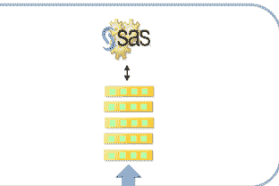
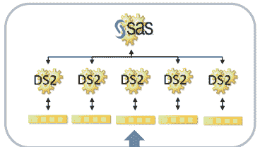
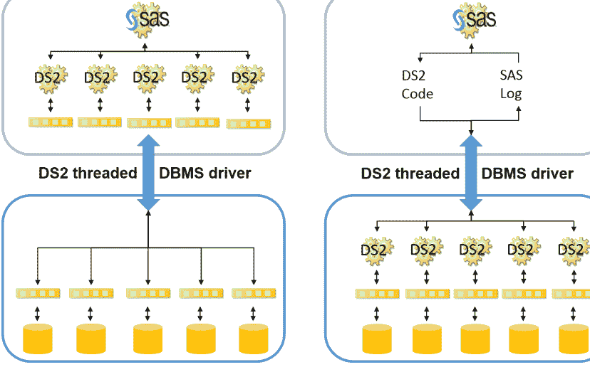
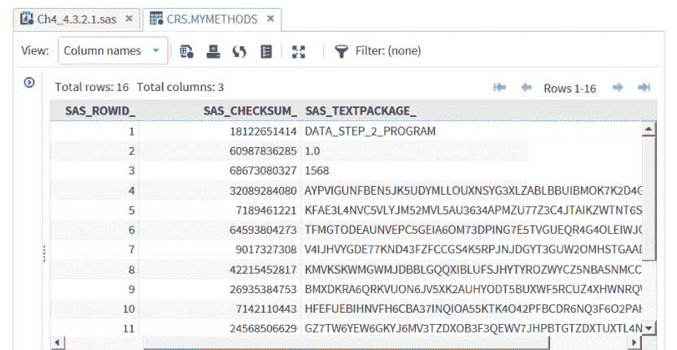
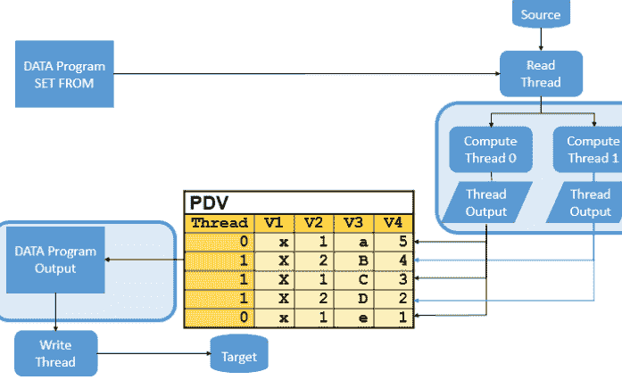

# SAS DS2 过程精通：高级数据处理技术

## 献辞

致给 Ron Cody，SAS 大师和卓越的作家——你的建议和鼓励让我相信我可以做到。

致给 Brenna Leath，勇敢的编辑——没有你持续且欢快的督促，这本书永远不会诞生。

致给 Lori，我的爱——没有你的爱和鼓励，我早就放弃希望了！感谢你的坚持并不断鼓励我。

最后，致给 Tiger Man，世界上最友好的猫——感谢你的热情，但你的撒娇能力仍然远超你的打字技巧。

## 目录

### 第三章：DS2 程序细节 ................................................ 25

### 第四章：用户定义方法与包 ................................ 51

### 第五章：预定义包 ....................................... 69

### 第 6 章：DS2 中的并行处理 ................................................ 109

### 第 7 章：DS2 中的性能调优 ................................ 119

### 索引................................................................................... 127

## 前言

在我管理 SAS 产品核心数据处理语言（如 DATA 步、DS2、PROC SQL 和 FedSQL）开发的多年，我逐渐意识到教育的价值。如果技术再好，但受益的人群无法理解它，一切也毫无意义。仅仅将事实汇集成一本书并不等同于教学生。

在他的新书《精通 DS2 过程：高级数据抓取技术》中，Mark 成功地不仅为 SAS DS2 语言的语法，更重要的是为该语言的目标提供了一个极其简洁的介绍。他系统地构建了示例，让读者以令人满意的速度翻阅每一页。从 DATA 步到 DS2 的对比帮助 SAS 程序员快速找到方向，而无需成为 DATA 步的专家。

他对 DS2 包的覆盖非常有价值，因为这些包由 SAS 提供的或用户编写，扩展了语言的功能。在数据量爆炸的网格计算时代，对并行执行的关注非常及时。

最后，我特别喜欢他在学习语言历程中的个人轶事，说明了缺失之处、不同之处以及独特之处。我认为他的输入对 DS2 设计团队的未来非常有价值。

Robert Ray

总监

SAS

北卡罗来纳州 Cary

## 关于本书

### 目的

本书将带你从初学者变为 DS2 的熟练运用。

### 本书适合你吗？

你熟悉传统的 DATA 步和 SQL 处理吗？想要增强你的数据准备能力？那么 DS2 这种集成了 DATA 步的力量与控制，以及 SQL 的易用性和丰富数据类型的新语言，可能正是你需要的！DS2 让你能够完成任务：

- 轻松创建和共享复用模块
- 创建自定义对象并使用面向对象的技术
- 在传统的 数据集和 DBMS 表中同时处理单行或多行数据
- 在 Hadoop、Greenplum 和 Teradata 等大规模并行平台上操作数据。

### 背景知识

本书假设读者熟悉以下主题：

- DATA 步编程：
  - SAS 库
  - 使用 `LIBNAME` 语句访问数据
  - 读取和写入数据集
  - PDV 在数据步处理中的作用
  - 条件处理
- 数组
- 迭代处理（DO 循环）
- 宏处理：
  - 为宏变量赋值
  - 在 SAS 代码中解析宏变量
  - 宏过程执行与其他 SAS 代码执行的时机
- SQL 连接

### 本书范围

本书涵盖了以下主题：

- 该语言设计的流程类型，以及何时使用 DS2 是改进性能的良好选择
- 传统数据步与 DS2 共享的编程语句和函数
- DS2 中不具备的功能
- 传统数据步不支持的 DS2 新功能
- 在 DS2 中全精度操作 ANSI 数据类型
- 将传统的 SAS 转换为 DS2 数据程序
- 在 DS2 中创建复用模块并进行封装以便于复用
- 使用 DS2 包创建面向对象的程序
- 创建 DS2 线程程序并行处理数据记录

## 关于示例

### 开发本书内容的软件

`SAS 9.4M3`

书中的大部分程序仅使用 Base SAS 并在 SAS University Edition 中开发。

- 写 DBMS 的程序还需要这些解决方案：
  - SAS/ACCESS to Teradata 接口。
  - SAS Teradata 数据库内代码加速器。

所有 DBMS 数据都存储在 Teradata Express 15.0 中。

编写本书时使用的主要参考是 SAS 9:4 在线文档的以下章节：

- SAS® 9.4 DS2 语言参考
- SAS® 9.4 语句
- SAS® 9.4 函数与 CALL 路由
- SAS® 9.4 FedSQL 语言参考

### 示例代码与数据

要访问本书的示例代码和数据，请前往 `http://support.sas.com/publishing/authors` 上的作者页面。选择作者的姓名，然后查找“Example Code and Data”（示例代码与数据）。

如果您无法通过网站访问代码，请发送邮件至 `saspress@sas.com`。

### SAS 大学版 (SAS University Edition)

如果您正在使用 SAS University Edition 访问数据并运行程序，请检查 SAS University Edition 页面，以确保软件包含该产品，或者您需要运行该代码。

书中的大多数程序只需要 SAS 即可执行，并可以在 SAS University Edition 中正常运行。然而，有少数程序会读取或写入 Teradata 表。这些程序无法在 SAS University Edition 中执行，因为其中没有包含 SAS/ACCESS Teradata 接口。SAS University Edition 包含的 SAS 软件产品列表可在 `http://support.sas.com/software/products/universityedition/index.html` 找到。

### 本书中使用的输出与图形

书中的所有输出和 SAS 图形都是通过在 SAS Studio 中执行相关的程序代码生成的。

### 额外帮助

尽管本书说明了各行业企业经常执行的许多分析，但可能会出现针对您的特定目标和问题。为了为您提供全面支持，SAS 和 SAS Press 为您提供以下资源：

- 有关本书涵盖的主题问题，请通过 SAS Press 联系作者：
  - 通过 `saspress@sas.com` 发送问题；在信函中注明书名。
  - 在 `http://support.sas.com/author_feedback` 上的页面提交反馈。
- 有关本书范围内或超出范围的主题问题，请在 `https://communities.sas.com/welcome` 的 SAS Support 社区发布问题。Base SAS 编程社区是讨论 DS2 问题的合适社区。
- SAS 维护着一个包含最新信息的综合网站。对于新手和资深用户来说，一个非常有用的页面是知识库（Knowledge Base）。可以在 `http://support.sas.com/resources` 知识库的“Samples and SAS Notes”（示例与 SAS Notes）部分搜索相关说明。
- 注册的 SAS 用户或其组织可以通过 `http://support.sas.com` 访问 SAS 客户支持。在这里，您可以向 SAS 客户支持提交特定问题；在“Support”（支持）下点击“Submit”（提交）。您必须提供相关信息。

## 图 1.2：DATA Step 中的串行处理与 DS2 并行处理

单线程 DATA step

SAS 计算平台上的 DS2 线程并行处理





SAS/ACCESS LIBENAME 引擎

DS2 线程 DBMS 驱动程序

如图 1.2 所示，传统的 SAS DATA step 必须顺序处理每一行数据。相比之下，DS2 可以使用线程和数据程序同时处理多行数据。

请注意，这两个过程都使用单读取线程，因此如果将数据从磁盘或 DBMS 加载到 SAS 计算平台的内存中进行处理是瓶颈，那么在 SAS 计算平台上进行线程处理将不会提高整体性能。这种情况被称为“I/O 密集型”操作。在 Base SAS 中处理时，DS2 使用单次读取来为多个计算线程提供数据，以确保该行数据仅被分配到一个计算线程进行处理。如果 I/O 是瓶颈且计算在 SAS 上进行，DS2 可能无法提高性能。

然而，如今的 DBMS 数据是海量的，应该尽可能完全避免数据移动。通过 DS2，在包含 SAS 数据库内代码加速器且配置备和配置得当的 SAS 安装环境中，你的 DS2 程序实际上可以直接在数据库硬件上执行，而无需将数据移动到 SAS 计算平台。图 1.3 比较了 SAS 计算平台上的 DS2 数据线程处理与使用 DS2 和 SAS 数据库内代码加速器的数据库内处理。

## 精通 SAS DS2 过程：高级数据清洗技术

### 图 1.3：使用线程的并行处理：SAS 计算平台与数据库内处理

# SAS 计算平台上的 DS2 线程并行处理

# 数据库内 DS2 线程并行处理



如图 1.3 所示，结合 SAS 数据库内代码加速器使用 DS2 线程和数据程序，允许 DS2 代码在海量并行 DBMS 硬件上编译和执行。如果过程从 DBMS 表读取数据并写入 DBMS 表，则只有代码进入 DBMS，处理在数据库内部进行。这种“代码去数据”的概念大大减少了数据移动，扩展了 DBMS 的计算能力，并充分利用了其大规模并行处理 (MPP) 能力。

### 1.1.1 本书简介

数据清洗（Data wrangling），正如我们所定义的，不仅仅是清洗数据为分析做准备。数据清洗人员从各种来源获取数据，然后以独特的方式进行组织和组合以获得新的洞察。本书将教你如何使用 DS2 进行数据清洗，并提升数据处理速度。

## 第 1 章：入门 5

完成本课程后，你将能够：

- 识别该语言设计的处理类型，并理解在尝试提高 DATA step 执行性能时选择 DS2 的条件
- 识别 DATA step 和 DS2 程序共享的编程语句和函数
- 识别 DS2 中不提供的 DATA step 功能及其原因
- 了解传统 DATA step 中哪些 DS2 程序功能
- 在 DS2 程序中操作 ANSI 数据类型
- 理解处理包含 SAS 缺失值和 ANSI 空值的数据时的影响
- 将 Base SAS 数据处理过程从 DATA step 转换为 DS2 程序
- 理解 DS2 系统方法及其与传统 DATA step 构造的关系
- 创建 DS2 方法以扩展 DS2 语言的功能
- 将 DS2 方法存储在包并在后续 DS2 程序中重用
- 使用 DS2 程序创建面向程序
- 使用预定义的 DS2 包为你的 DS2 数据程序添加功能
- 创建 DS2 线程程序并在 DS2 程序中执行以对数据记录进行并行处理
- 在 DS2 程序或线程中使用 BY-GROUP 以及 FIRST.variable 和 LAST.variable 处理执行自定义数据汇总，无需预设数据
- 确定你的系统是否具有在数据库内执行 DS2 程序的能力，并在 MPP 平台上分布式执行你的 DS2 线程程序

### 1.1.2 先验知识

本书是为经验丰富的 Base SAS 程序员编写的。在开始之前，你可能希望熟悉以下关键概念。你可以从 SAS Press 的其他书籍获取先验知识，例如 Ron Cody 的《An Introduction to SAS University Edition》或 Lara Deliche 和 Susan Slaughter 的《The Little SAS Book: A Primer》。

- 通用的 DATA step 编程
- SAS 库
- * 使用 `LIBNAME` 语句访问数据
- * 读取和写入 SAS 数据集
- * 程序数据向量 (`PDV`) 的作用

### 1.2 访问 SAS 并设置

### 1.2.1 准备练习

## 掌握 SAS DS2 过程：高级数据处理技术

`step`。它从根本上是一种高级命令式、过程化语言，专为处理矩形数据集而设计，并包含了处理数组、哈对象和矩阵的功能。与 DATA 步一样，`ds2` 程序以关键字开始，所有语句均以分号结束。然而，它们之间存在显著差异。表 2.1 出了这些差异。

### 表 2.1：DATA 步与 DS2

| DATA Step | DS2 |
|---|---|
| 几乎没有保留字。 | 所有关键字都是保留字。 |
| 数据行在单计算线程中被逐个、顺序地处理。 | 可以使用多个并发线程并行处理多行数据。 |
| DATA 步中引用的所有变量都是全局作用域。 | DS2 程序中引用的变量可以是全局作用域，也可以是局部作用域。 |
| DATA 步中引用的变量都在程序数据向量 (`PDV`) 中，除非显式删除，否则它们将成为结果集的一部分。 | 局部作用域变量不会被添加到 `PDV`，且永远不是结果集的一部分。 |
| 使用变量封装创建代码需要使用一个独立的过程 `PROC FCMP`，它有自己的语法。 | 在包程序中，使用标准的 `PROC DS2` 语法即可实现具有变量封装的可重用代码模块。 |
| DATA 步可以消耗 SQL 查询生成的表作为 `SET` 语句的输入。 | DS2 可以直接接受 SQL 查询的结果集作为 `SET` 语句的输入。 |
| DATA 步只能处理双精度数值型或固定宽度字符数据，DBMS ANSI SQL 数据类型在处理之前必须转换转换为这些数据类型之一。 | DS2 以其原生格式以全精度处理 ANSI SQL 数据类型。 |

### 2.2.2 节目结构

通过对 DATA 步和等效的 DS2 数据程序进行快速对比，清楚地表明这些语言之间关系紧密，但 DS2 数据程序的结构更加严谨：

```sas
data _null;
Message='Hello World!';
put Message=\;
run;
proc ds2;
data _null();
method run()
Message='Hello World!';
put Message=\;
end
enddata;
run;
quit;
```

主要的结构差异是 DS2 程序是在代码块中编写的。在 Base SAS 中，DS2 语言通过 `PROC DS2` 块调用，该块以 `PROC DS2` 语句开始并以 `QUIT` 语句结束：

```sas
proc ds2;
<ds2 program blocks>
quit;
```

在 `PROC DS2` 内部，你可以定义并执行三种基本类型的程序块。

### 表 2.2：DS2 程序块

| 程序块 | 简要描述 |
| --- | --- |
| Data (数据) | DS2 语言的核心，数据程序处理输入数据集以生成输出结果集。它们可以接受来自表、线程程序结果集或 SQL 查询结果集的输入。 |
| Package (包) | 包程序创建存储在 SAS 库中的变量和方法集合，实现了面向对象的开发方法。简单且高效地重用经过证明的代码模块可以确保重要专有流程的标准化，减少编写新程序的时间并提高整体代码质量。 |
| Program Block (程序块) | 简要描述 |
|---|---|
| Thread (线程) | 线程处理输入数据集以生成返回给数据程序的输出结果集。线程用于同时并行处理数据行，可以接受来自表或 SQL 查询的输入。 |

关于这些程序块中每个部分的详细描述请见 2.2.3 节。每个程序块由相应的 `DATA`、`PACKAGE` 或 `THREAD` 语句及其对应的语句界定。DS2 使用 RUN 组处理，并要求显式编写 `RUN` 语句来执行之前的程序块：

```sas
proc ds2;
package package_name;
  <在此处编写创建包的 ds2 编程语句>
  endpackage;
run;
thread thread_name;
  <在此处编写创建线程的 ds2 编程语句>
  endthread;
run;
  data output_dataset_name;
    <在此处编写处理数据的 ds2 编程语句>
  enddata;
run;
quit;
```

每个程序块由一组全局声明语句以及一个或多个具有唯一命名的可执行方法块组合组成。在 DS2 中，可执行语句仅在方法块的上下文中有效。方法块由 `METHOD` 和 `END` 语句界定：

```sas
proc ds2;
  data output_dataset_name;
  <全局声明语句>
  method method_name(<method parameters>);
    <局部变量声明>
    <可执行 DS2 编程语句>
  end;
enddata;
run;
quit;
```

### 2.2.3 程序块

此处提供了三个程序块的简要描述，以帮助你理解本章中的简单示例。大部分内容关于数据程序。包程序将在第 5 章详细讨论，线程程序将在第 6 章。

#### 2.2.3.1 DATA 数据程序

DS2 数据程序以 `DATA` 语句开始，包含至少一个系统方法定义，并生成结果。它是 DS2 语言中的基础编程工具。与 Base SAS DATA 步一样，DS2 数据程序的 `DATA` 语句通常列出结果集将写入的表或多个表的名称。使用特殊表名 `NULL` 来抑制结果集是可选的。如果在 SAS DATA 步中没有指定目标表，SAS 将结果集重定向到 WORK 库，使用自动生成的数据集名称（`DATA1`、`DATA2` 等）。没有指定目标表的 DS2 数据程序将结果结果发送到输出交付系统 (`ODS`) 以渲染为报告。


```sas
data:
  set crs.banks;

method run();
  set crs.banks;
  end;
enddata;
run;
```

> 注意: 从 `CRS.BANKS` 读取了 3 个观测值。

> 注意: `WORK.DATA` 有 3 个观测值。

图 2.1：DS2 程序的输出

| 名称 | 速率 |
|---|---|
| Carolina Bank and Trust | 018 |
| State Savings Bank | 021 |
| National Savings and Trust | 022 |

# 掌握 SAS DS2 过程：高级数据处理技术

## 2.2.3.2 包程序

包程序以 `PACKAGE` 语句开始，以 `ENDPACKAGE` 语句结束，并生成结果。与 DS2 程序一样，线程存储在 SAS 库中并类似于数据集。然而，包的内容是头部信息随后的源代码。包不仅用于用户定义方法——它们是 DS2 语言的“对象”。全局包变量（包外部定义的变量）对于每个实例充当静态变量，当你实例化包时，实例有一组私有变量可以跟踪状态。包还可以接收构造参数在实例化时初始化包。DS2 包允许轻松创建和重用对象。

## 2.2.3.3 线程程序

DS2 程序以 `THREAD` 语句开始，以 `ENDTHREAD` 语句结束，并生成线程作为结果。与 DS2 程序一样，线程的结构类似于 DS2 程序，包含至少一个方法定义，并可以包含包引用和用户定义方法。一旦创建线程，可以使用 `SET` 语句从 DS2 程序执行它。`SET` 语句中的 `THREAD=` 允许多个线程程序在计算平台上并行运行，每个线程在计算完成后将观测值返回给数据程序。

## 2.2.4 方法

方法是 DS2 程序内部命名的代码块，由 `METHOD` 和 `END` 语句界定。方法块不支持嵌套的方法块，所有标识符（名称）在 DS2 数据、包或线程程序块中必须是唯一的。方法有两种：

- *系统方法*在 DS2 程序的指定时间自动执行。
- *用户定义方法*仅在调用时执行。

## 2.2.5 系统方法

每个 DS2 数据程序都包含三个系统方法（隐式或显式的）。这些方法为 DS2 数据程序提供了比 SAS DATA 步更结构化的框架。在 Base SAS DATA 步中，整个程序都包含在隐式的、数据驱动的循环中。在 DS2 程序中，`RUN` 方法提供了隐式的、数据驱动的循环，这对传统的 DATA 步程序员来说是最熟悉的。`INIT` 和 `TERM` 方法不在循环内，为执行程序初始化和终止代码提供了位置。

# 第 2 章：DS2 语言简介 13

系统方法会自动执行且不接受参数。你必须在数据或线程程序中显式地定义这些方法中的至少一个，否则程序将无法执行。你不需要为一个或多个系统方法块编写显式代码，DS2 编译器将在编译时为你创建一个缺失的系统方法的空版本。空方法仅包含由 `END` 语句结束的适当的 `METHOD` 语句。

### 2.2.5.1 `INIT` 方法

`INIT` 方法在程序执行开始时立即执行，且执行且仅执行一次。它为执行程序初始化例程提供了一个标准位置。以下 DATA 步和 DS2 数据程序产生相同的结果，但 DS2 数据程序不需要任何条件逻辑：

DATA 步：

```
data _null;
if _n=1 then do;
put 'Execution is beginning';
end;
```

DS2 数据程序：

```
proc ds2;
data _null;
method init();
put 'Execution is beginning';
end;
endata;
run;
quit;
```

### 2.2.5.2 `RUN` 方法

`RUN` 方法模拟传统 SAS DATA 步的性能。它在 `INIT` 方法执行完成后立即开始操作，并作为一个数据驱动的循环。`RUN` 方法为输入数据的每一行（观测值）迭代一次。`RUN` 方法是唯一在 `END` 语句中包含隐式输出的方法。DATA 步和 DS2 数据程序产生的结果如下：

```
data new_data;
if _n=1 then do;
put 'Execution is beginning';
end;
set crs.one_day;
run;
```

```
proc ds2;
data new_data;
method init();
put 'Execution is beginning';
end;
method run();
set crs.one_day;
end;
enddata;
run;
quit;
```

### 2.2.5.3 `TERM` 方法

`TERM` 方法在 `RUN` 方法执行完成后、数据或线程程序终止执行之前立即执行，执行且仅执行一次。它为执行程序终结代码提供了一个合适的位置。此 DATA 步和 DS2 数据程序将产生相同的结果，但 DATA 步需要使用 `END=` 语句选项、关联的自动变量以及条件逻辑判断来完成不需要任何额外资源或代码的 DS2 数据程序：

```
data new_data;
if _n=1 then do
  put 'Execution is beginning';
end;
set crs.one_day end=last;
if last=1 then do
  put 'Execution is ending';
end;
```

```
proc ds2;
data null;
method init();
  put 'Execution is beginning';
end;
method run();
  set crs.one_day;
end;
method term();
  put 'Execution is ending';
end;
enddata;
run;
quit;
```

## 2.2.6 用户定义方法

在 DS2 中，你可以轻松地定义和使用自己的可重用代码块。这些代码块被称为用户定义方法，它们可以通过引用或传值接受参数值。当所有参数都通过传值传递到方法时，这些值在方法内部可用并用于计算，且方法可以向调用过程返回一个单值——类似于 Base SAS 函数。此数据程序使用用户定义方法将温度从摄氏度转换为华氏度。

```
proc ds2;
/* 无输出 DATA set。结果以报告形式（类似于 SQL）返回 */
data;
  dcl double DegC DegF;
  /* 方法返回值 */
method c2f(double Tc) returns double;
/* 摄氏度转华氏度 */
return ((Tc*9)/5+32);
end;
method init();
  do DegC=0 to 30 by 15;
  DegF=c2f(DegC);
end;
```

## 精通 SAS DS2 过程：高级数据处理技术

在 DS2 数据程序中，变量的作用范围起着至关的作用：只有全局变量会被包含在 PDV（程序处理视图）中，而只有 PDV 变量才有资格成为数据程序结果的一部分。你可以使用 `DROP` 或 `KEEP` 语句从程序结果集中明确移除全局变量。具有局部作用范围的变量不包含 PDV 中，因此不需要删除它们——它们永远不会出现在程序结果集中。

例如，在接下来的 DS2 程序中，变量 `Total` 和 `Count` 被声明为全局变量并具有全局作用范围。变量 `Category` 和 `Amount` 通过 `SET` 语句引入，也具有全局作用范围。所有这些变量可以在 `RUN` 和 `TERM` 方法中引用，并且都包含在程序结果集中。

```
proc ds2;
data;
  double Total Count;
  method run();
    set crs.one_day (keep=(Payee Amount));
    Total+Amount;
    Count+1;
  end;
  method term();
    put Total= Count=;
  end;
enddata;
run;
quit;
```

SAS 日志：

| Total=7230.5 Count=6 |

**图 2.5：数据程序生成的报告**

| Obs | Total | Payee | Amount |
|---|---|---|---|
| 1 | 9.60 | 1 Misc | $9.60 |
| 2 | 19.91 | 2 Ice Cream | $10.31 |
| 3 | 37.91 | 3 Services | $18.00 |
| 4 | 230.50 | 4 Big Retailer | $192.59 |
| 5 | 3230.50 | 5 Misc | $3,000.00 |
| 6 | 7230.50 | 6 Misc | $4,000.00 |

在下一个 DS2 程序中，变量 `Total` 和 `Count` 在 `RUN` 方法中被声明为局部的。因此，它们的作用范围局限于 `RUN`，且只能被 `RUN` 方法引用。当 `TERM` 方法尝试引用变量 `Total` 和 `Count` 时，它们在 PDV 中，因此 DS2 编译器将这些视为新的、未声明的变量。SAS 日志中产生了警告信息，并且由于未声明的变量具有全局作用范围，`Total` 和 `Count` 被包含在 PDV 和程序结果集中。然而，由于这些变量的全局变量从未被赋予值，`Total` 和 `Count` 在输出中包含缺失值：

```
proc ds2;
data;
  method run();
    declare double Total Count;
    set crs.one_day (keep=(Payee Amount));
    Total+Amount;
    Count+1;
  end;
  method term();
    put Total= Count=;
  end;
enddata;
run;
quit;
```

SAS 日志：

Total=. Count=.

WARNING: Line nn: No DECLARE for referenced variable total; creating it as a global variable of type double.

WARNING: Line nn: No DECLARE for referenced variable count; creating it as a global variable of type double.

图 2.6：数据程序生成的包含缺失值的报告

| Obs | Payee | Amount | Total | Count |
|---|---|---|---|---|
| 1 | Misc | $9.60 | . | . |
| 2 | Ice Cream | $10.31 | . | . |
| 3 | Services | $18.00 | . | . |
| 4 | Big Retailer | $192.59 | . | . |
| 5 | Misc | $3,000.00 | . | . |
| 6 | Misc | $4,000.00 | . | . |

如果我们从程序中删除 `TERM` 方法，对变量 `Total` 和 `Count` 的唯一引用就是 `RUN` 方法中的局部变量，它们将完全不会包含在 PDV 中。SAS 日志中不会发出关于未声明变量的警告，结果集仅包含全局变量 `Payee` 和 `Amount`：

```
proc ds2;
data;
  method run();
    declare double Total Count;
    set crs.one_day (keep=(Payee Amount));
    Total+Amount;
    Count+1;
  end;
enddata;
run;
quit;
```

图 2.7：排除了局部变量的数据程序生成的报告

| Obs | Payee | Amount |
|---|---|---|
| 1 | Misc | $9.60 |
| 2 | Ice Cream | $10.31 |
| 3 | Services | $18.00 |
| 4 | Big Retailer | $192.59 |
| 5 | Misc | $3,000.00 |
| 6 | Misc | $4,000.00 |

用户定义方法可以接收参数。按值传递的参数被视为方法内部的变量。例如，在下面的程序中，用户定义的 `fullname` 有两个参数 `first` 和 `last`，它们作为局部变量。这里还有一个局部声明变量 `FinalText`。主数据程序有三个全局声明变量 `WholeName`、`GivenName` 和 `Surname`。结果集仅包含这些全局变量。

```
proc ds2;
data;
  declare varchar(100) WholeName;
  method fullname(varchar(50) first, varchar(50) last)
    returns varchar(100);
    dcl varchar(100) FinalText;
    FinalText=catx(' ',last,first);
    Return FinalText;
end;
method run();
  set crs.customer_sample (keep=(GivenName Surname));
  WholeName=fullname(GivenName, Surname);
end;
enddata;
run;
quit;
```

### 图 2.8：数据程序生成的报告

### 收入水平

| WholeName | GivenName | Surname |
|---|---|---|
| Schmidt, William | Schmidt | |
| Laverty, Daniel | Daniel | Laverty |
| Grayson, Sarah | Sarah | Grayson |
| Hastings, Eldon | Hastings | |

如果你曾经为了在 SAS 程序文件中存储代码片段以包含在传统的 DATA 步中，你可能经历过我所说的“PDV 污染”。当包含的代码引用了主程序中已经存在的变量，或者当包含的代码创建了主程序中不存在的变量时，它就会被添加到 PDV 中。这通常被称为 PDV 污染。

当使用 DS2 方法时，局部变量是被封装的，不会影响 PDV。在随后的章节中，我们将讨论如何利用这一特性来避免意外的数据问题。

```
/* Section 3 */
method term();
put '*********';
put 'Ending';
put '*********';
enddata;
run;
```

## 2.4 关键概念回顾

- 所有的 DS2 程序都由块组成：`data`、`package` 和 `thread`。
- DS2 程序块有三种类型：`data`、`package` 和 `thread`。
- 程序块以适当的 `DATA`、`PACKAGE` 或 `THREAD` 语句开始，并以相应的 `ENDDATA`、`ENDPACKAGE` 或 `ENDTHREAD` 语句结束。程序的其余部分由全局声明语句和方法定义组成。所有可执行语句必须是方法定义的一部分。
- 有三个系统方法：`IN`、`RUN` 和 `TERM`。每个 `data` 和 `thread` 程序必须包含其中一个方法的显式编码。系统方法自动执行且不接受参数。
- 你可以编写用户定义方法，但注意以下几点：
    - 用户定义方法不会自动执行；它们只在调用时执行。
    - 用户定义方法可以接受参数，值可以通过传值或引用传递（`IN_OUT` 参数）。
    - 没有 `IN_OUT` 参数的方法可以返回值，类似于 SAS 函数。
    - 方法的 `IN_OUT` 参数值可以在本地修改，类似于 SAS CALL 过程。
    - 用户定义方法可以存储在 DS2 `package` 中供重用。
- 在 DS2 程序中创建的变量应使用 `DECLARE (DCL)` 语句进行声明。声明的位置决定了变量的作用域。
- 通过 `SET` 语句引入 DS2 程序的变量、在全局程序空间（方法定义开始之前）声明的变量或在程序代码中出现未声明的变量具有全局作用域。全局变量可以在 DS2 程序内部任何地方引用，它们是 PDV 的一部分，并且默认包含在程序集中。
- 在 `METHOD` 块内部声明的变量和方法参数变量的作用域是局部的，且只能在该方法内部引用。局部变量永远不会包含在 PDV 中，也无法成为程序结果的一部分。

# 第 3 章：DS2 数据程序详情

- 3.1 引言 ................................................................................................................ 25
- 3.2 DS2 数据程序与 Base SAS DATA Step 的对比........................................... 25
- 3.2.1 通用注意事项 ..................................................................................... 25
- 3.2.2 “六个微妙差异” ........................................................ 26
- 3.2.3 DS2 “缺失”功能 ................................................................................ 33
- 3.3 DS2 中的数据类型 ............................................................................................ 38


### 3.3.1 DS2 与 ANSI 数据类型
### 3.3.2 自动数据类型转换
### 3.3.3 非数据类型
### 3.3.4 处理 SAS 缺失和 ANSI 空值
### 3.4 关键概念回顾

# 3.1 引言

在本章中，我们将关注 DS2 数据程序的基础，首先通过将传统的 DATA Step 与 DS2 数据程序进行进一步对比，并深入研究 DS2 中的一些新特性。在此过程中，我们将更复杂的 Base DATA Step 转换为 DS2 数据程序，并引入几个 DS2 特有的概念和技术。具体而言，我们将涵盖以下几点：

- 更多 DS2 数据程序语法和结构
- 使用 FedSQL 查询直接为 DS2 数据程序的 `SET` 语句提供输入
- DS2 中可以处理的各种 ANSI 数据类型
- DS2 自动数据类型转换规则
- 独特的 DS2 程序语句
- 独特的 DS2 表达式
- 选定的 DS2 函数

# 3.2 DS2 数据程序与 Base SAS DATA Steps 的对比

## 3.2.1 通用注意事项

DS2 数据程序语法与 Base SAS DATA Step 语法的相似性对于丰富的 SAS 程序员来说是一个优势。这种相似性明显体现在 Base SAS DATA Step 和 DS2 数据程序共享的语句语法上。例如，这些语句在两种语言中的工作方式基本相同：

- `SET`
- BY 组处理，包括 `First.variable` 和 `Last.variable`
- DO 组和 DO 循环
  - `DO i= start TO STOP BY interval`
  - `DO WHILE ()`
  - `DO UNTIL ()`
  - 循环控制语句 `CONTINUE`、`LEAVE` 和 `END`
- 程序流控制语句
  - `RETURN`
  - `OUTPUT`
  - `GOTO`
  - `STOP`
- 声明语句
  - `KEEP` 和 `DROP`
  - `RETAIN`

记住，在任何 DS2 程序中，全局声明语句必须出现在全局程序空间中——即在 `DATA`、`THREAD` 或 `PACKAGE` 语句之后，第一个方法定义之前。

## 3.2.2 “六个微妙差异”

尽管传统的 DATA Step 和 DS2 数据程序中的许多工作工作完全相同，但存在一些非常微妙的差异，在 DS2 中编程时需要记住。让我们回顾一下主要的区别，我称之为“六个微妙差异”。

### 3.2.2.1 所有可执行语句必须是方法的一部分

在全局程序空间中的可执行语句会导致语法错误：

```
proc ds2;
data _null_;
set crs.one_day;
put _all_;
enddata;
run;
```

SAS 日志：

```
ERROR: Compilation error.
ERROR: Parse encountered end of input.
```

将可执行语句封装在方法中可以解决这个问题：

```
proc ds2;
data _null_;
  method()
    set crs.one_day;
    put _all_;
  end;
enddata;
run;
```

SAS 日志：

```
NOTE: Execution succeeded.
```

## 2.2 DS2 程序默认不覆盖写

如果你提交此程序，它会正常运行。如果你再次提交完全相同的程序，将导致语法错误：

```
proc ds2;
data test1 test2;
  method()
    set crs.one_day;
  end;
enddata;
run;

proc ds2;
data test1 test2;
  method()
    set crs.one_day;
  end;
enddata;
run;
```

SAS 日志：

```
683 proc ds2;
684 data test1 test2;
685 method();
686 set crs.one_day;
687 end;
688 enddata;
689 run;
690 NOTE: Execution succeeded. 12 rows affected.
691 quit;
692 NOTE: PROCEDURE DS2 used (Total process time):

| Metric | Value |
| :--- | :--- |
| real time | 0.05 seconds |
| cpu time | 0.04 seconds |

```

691

692 proc ds2;

693 data test1 run;

694 method();

695

696 set crs.one_day;

697 end;

698 enddata;

699 run;

ERROR: Compilation error.

ERROR: Base table or view already exists TEST1

ERROR: Unable to CREATE TABLE statement for table

work.test1.

```

你可以使用 `DATA` 语句中的 `OVERWRITE=YES` 选项来控制这种行为，或者 `OVER=YES` 选项仅允许覆盖指定选项的数据集。`DATA` 语句允许覆盖其中列出的所有输出表。例如，这解决了 `test1` 数据集的问题，但由于不允许覆盖 `test2`，我们仍然会编译错误：

```
proc ds2;

data test1(overwrite=yes) test2;

method();

set crs.one_day;

end;

enddata;

run;

quit;
```

SAS 日志：

```
ERROR: Compilation error.

ERROR: Base table or view already exists TEST2

ERROR: Unable to execute CREATE TABLE statement for table

work.test2.
```

使用 `DATA` 语句的 `OVERWRITE=YES` 选项允许覆盖两个表：

```
proc ds2;

data test1 test2 /overwrite=yes;

method();

set crs.one_day;

end;

enddata;

run;

quit;
```

SAS 日志：

NOTE: Execution succeeded. 12 rows affected.

### 3.2.2.3 所有未通过 SET 语句引入的变量都应当声明

默认情况下，未声明新变量会导致 SAS 日志产生警告。这种行为可以通过 SAS 系统选项 `DS2COND` 进行全局控制。可以使用 `PROC DS2 SCOND` 为特定的 DS2 实例覆盖该系统选项。

表 3.1：DS2SCOND 和 SCOND 选项值及其影响

| 选项设置 | 对未声明变量的影响 |
|---|---|
| NONE | 程序正常编译并执行。日志中无条目。 |
| NOTE | 程序正常编译并执行。每个声明的变量会在 SAS 日志中生成备注。 |
| WARNING (默认) | 程序正常编译并执行。每个声明的变量会在 SAS 日志中生成警告。 |
| ERROR | 每个声明的变量都会在 SAS 日志中生成错误。程序无法编译和执行。 |

以下是将系统选项 `DS2COND` 设置为 `ERROR` 的示例：

```
options ds2cond=ERROR;

proc ds2;

data _null;

method run();

Text='Hello, world';

x=1;

put Text= X=;

end;

ddata;

run;

quit;
```

SAS 日志：

```
ERROR: Compilation error.

ERROR: Line 92: No DECLARE for assigned-to variable text; creating it as a global variable of type char.

ERROR: Line 93: No DECLARE for assigned-to variable x; creating it as a global variable of type double.

NOTE: The SAS stopped processing this step because of errors.
```

以下是使用 `PROC DS2` 选项 `COND` 覆盖系统选项的示例：

```
options ds2cond=ERROR;

proc ds2 scond=NONE;

data _null;

method run();

Text='Hello, world';

X=1;

put Text= X=;

enddata;

run;

quit;
```

SAS 日志：

```
Text=Hello, world

NOTE: Execution succeeded. No rows affected.
```

### 3.2.2.4 PUT 语句不支持光标和指针

此 Base SAS DATA 步使用光标控制符 (@) 和换行符 (/) 在日志中写入组织整齐的信息：

```
data_null;

Text='Hello, world';

X=1;

put @7 Text = /7 X =;
```

SAS 日志：

```
Text=Hello, world

X=1

NOTE: DATA statement used (Total process time):

real time 0.00 seconds

cpu time 0.01 second
```

然而，相同的代码在 DS2 中会产生语法错误，因为 DS2 中的 `PUT` 语句不接受光标和行控制：

```
proc ds2;

data_null;

method run();

Text='Hello, world';

X=1;

put @6 Text = / @6 X=;

enddata;

run;

quit;
```

SAS 日志：

```
ERROR: Compilation error.

ERROR: Parse encountered invalid character when expecting '';

ERROR: Line 212: Parse failed: put >>> <<< 6 Text = / @6 X=;

NOTE: The SAS System stopped processing this step because of errors.
```

### 3.2.2.5 关键字是保留字

Base SAS DATA 步语言的保留字非常少。编译器通过检查上下文来决定关键字应被解释为代码还是标识符。例如，将数据集命名为 `Data` 或将变量命名为 `Character` 是完全允许的：

```
data Data;

Character='A';

put 'The character is ' Character;

run;
```

SAS 日志：The character is A

然而，相同的代码在 DS2 中会产生语法错误，因为 DS2 的所有关键字都是保留字：

```
proc ds2;

data Data/overwrite=yes;

dcl char(1) Character;

method run();

Character='A';

put 'The character is ' Character;

end;

enddata;

run;

quit;
```

SAS 日志：ERROR: Compilation error.
ERROR: Parse encountered DATA when expecting ';';
ERROR: Line 457: Parse failed: data >>> Data << /overwrite=yes;

The SAS System stopped processing this step because of errors.

遵循 ANSI SQL 标准，只有在用双引号括起关键字时，你才能将其作为标识符：

```
proc ds2;

data "Data"/overwrite=yes;

dcl char(1) "Character"

method run();

"Character"='A';

put 'The character is ' "Character";

end;

enddata;

run;

quit;
```

SAS 日志：The character is A
NOTE: Execution succeeded. One row affected.

### 3.2.2.6 DS2 使用 ANSI SQL 引用标准

在 DS2 中，双引号仅用于界定标识符。单引号则用于界定

```
proc ds2;

data _null;

dcl char(25) "Character";

method run();

  "Character"='This is the message.';

  put "Character";

end;

enddata;

run;

quit;
```

SAS 日志：This is the message.
NOTE: Execution succeeded. No rows affected.

当尝试解析作为宏变量全部或部分时，这一要求可能会产生问题...

## 第3 章：DS2 数据程序详情 35

```sas

if last.Department then

    output summary;

    output detail;

end;

data;

run;

quit;

```

SAS Log：

NOTE: 执行成功. 影响 140 行。

图 3.1: DS2 数据程序生成的详细数据集
5 行详细数据

| 行号 | 员工 ID | Emp_Total |
|---|---|---|
| 1 | 121145 | $182.00 |
| 2 | 121143 | $182.00 |
| 3 | 121142 | $182.00 |
| 4 | 120791 | $156.00 |
| 5 | 120660 | $130.00 |

图 3.2: DS2 数据程序生成的摘要数据集
5 行摘要数据

| 行号 | 部门 | Dept_Count | Dept_Total |
|---|---|---|---|
| 1 | Sales | 45 | $1,966.50 |
| 2 | IS | 11 | $949.00 |
| 3 | Accounts | 11 | $695.00 |
| 4 | Stock & Shipping | 9 | $624.00 |
| 5 | Sales Management | 4 | $598.00 |

这比传统的 DATA 步语言有了巨大的改进！它为编写更紧凑、高效的程序开启了许多惊机会。值得注意的是，与 DS2 结合使用的 SQL 并不是老老的 PROC SQL，而是基于更现代的 ANSI 1999 标准的新版本 SQL。你也可以在 DS2 程序之外使用新的 SQL 查询——只需调用 PROC FedSQL 即可。在《SAS 9.4 FedSQL 语言参考》中，提供了关于 FedSQL 优秀且详尽的文档。

## 精通 SAS DS2 过程：高级数据处理技术

### 3.2.3.2 UPDATE 和 MODIFY 语句

DS2 既不包含 UPDATE 语句也不包含 MODIFY 语句。你可以使用 SQLSTMT 包通过少量额外的代码来实现相同的效果。我们将在第 5 章讨论预定义包时向你展示更多内容。

### 3.2.3.3 ATTRIB, LABEL, LENGTH, FORMAT 和 INFORMAT 语句

虽然 DS2 不包含 ATTRIB、LABEL、LENGTH、FORMAT 和 INFORMAT 语句，但 DECLARE 语句的 HAVING 子句提供了相同的功能。由于这些每个语句都有自己的语法，我认为仅用一个语句就能完成所有事情是一项巨大的优势！

```sas

data test1;

  length A $4;

  attrib A=$UPCASE4;

  format B comma10.2;

  label A='Text (Test1)' B='Number (Test1)';

  a='xx';

  b=10000.00000;

run;

proc ds2;

  data test2 /overwrite=yes;

  dcl char(2) having $upcase4.label 'Text (Test2)';

  dcl double B having format comma10.2 label 'Number (Test2)';

  method run();

    a='xx';

    b=10000.00000;

  end;

enddata;
```


`run;`

`quit;`

```
图 3.3: 使用 DECLARE 语句 HAVING 子句指定格式和标签

| Text (Test1) | Number (Test1) | Text (Test2) | Number (Test2) |
|---|---|---|---|
| XX | 10,000.00 | XX | 10,000.00 |
```

### 3.2.3.4 ARRAY 语句

我发现 DS2 不包含 `ARRAY` 语句也感到遗憾。然而，如果你考虑 DATA 步中的 `ARRAY` 语句，你可以清楚地看到，在传统的 SAS DATA 步中，`ARRAY` 语句用于产生两种不同的数组：元素引用 PDV 中变量的数组，以及元素存储在内存中不与变量关联的 `*_TEMPORARY_*`（临时）数组。DS2 同样提供了这两种数组类型，但它们通过不同的语句产生。临时数组通过 `DECLARE` 语句创建。引用 PDV 元素的数组则通过 `VAR` 语句创建。

```sas
data test1;

  array N [5];

  array C [5] _temporary_;

  do i=1 to dim(N);

    N[i]=dim(n);

  end;

  do i=1 to dim(C);

    C[i]=BYTE(i+6);

  end;

  put all_;

run;

proc ds2;

  data test2 /overwrite=yes;

  /* PDV 变量数组 - N1-N5 */

  array N [5];

  /* 临时数组 - 元素不在 PDV 中 */

  dcl char(1) C[5];

  method run();

    dcl integer i;

    do i=1 to dim(n);

      /* ... 逻辑继续 ... */ 
```

DS2 数组同时具有特殊的数组赋值 (`:=`) 和引用元素的方法，设计用于简化你的编程。`:=` 运算符按位置将一个值列表分配给数组的相应元素，或将值从一个数组分配到另一个数组。

```sas
proc ds2;

data;

  /* PDV 变量数组 - N1-N5 */

  array char(1) V[6];

  /* 临时数组 - 元素不在 PDV 中 */

  dcl char(1) T[2,3];

  method init();

    /* 将值列表分配给数组元素 */

    V=('A','B','C','D','E','F');

  end;

  method run();

    /* 将数组元素分配给数组 T */

    T=V;

    PUT T[*];

    PUT V[*];

  end;

enddata;

run;

quit;
```

SAS Log：

```
T[1,1]=A T[1,2]=B T[1,3]=C T[1,4]=D T[2,2]=E T[2,3]=F

V[1]=A V[2]=B V[3]=C V[4]=D V[5]=E V[6]=F
```

图 3.4: 使用 `:=` 运算符的 DS2 输出

| V1 | V2 | V3 | V4 | V5 | V6 |
|---|---|---|---|---|---|
| A | B | C | D | E | F |

从图 3.4 中可以看到，PDV 中的元素都在。

### 3.2.3.5 COMMENT, LINK 和 DELETE 语句

在传统语言中有许多编写注释的方法，但 DS2 文档仅列出了。因此，如果你发现有其他方式来实现注释，我建议坚持这种风格。`LINK` 语句用于处理代码块，但在 DS2 中并不必要。而且如果你使用 `DELETE` 语句而不是 subsetting `IF`，你会感到失望——只有 subsetting `IF` 在 DS2 中有效。这一切符合我欣赏的设计理念：利用资源添加新功能！

### 3.2.3.6 DS2 中传统的 DATA 步功能

某些传统的 DATA 步功能在 DS2 中缺失了，但通常有非常好的理由。例如，DS2 不包含这些语句：`FILE`、`INPUT`、`LIST`、`CARDS` 和 `DATALINES`。由于 DS2 是为了处理结构化数据设计的，不包含这些处理原始数据的语句并不意外。而且由于 DS2 在独立于 SAS 的过程中运行，用于控制 SAS 会话的语句（包括 `DISPLAY`、`ABORT`、`ERROR`、`DESCRIBE` 和 `MISSING`）也没有出现在 DS2 中。最后，允许执行任意操作系统命令的语句（如 `EXECUTE` 和 `X`）可能永远不会成为 DS2 的一部分。由于 DS2 能够在数据库内部执行，执行任意操作系统命令对于主机平台来说是一个不可接受的风险。

到此结束我们传统 DATA 步语言与 DS2 的对比。回顾一下，让我们深入探讨 DS2 语言令人兴奋的功能和能力！

## 3.3 DS2 中的数据类型

### 3.3.1 DS2 和 ANSI 数据类型

大多数 SAS 过程通过 `LIBNAME` 引擎访问数据库。当你使用 SAS/ACCESS 接口引擎从数据库检索数据时，所有数据库数据类型在呈现给 SAS 处理之前都会被转换为固定宽度字符或 8 字节浮点数。这是必要的，因为 Base SAS DATA 步和 PROC 是为处理 SAS 数据设计的，而 SAS 数据只能包含这些类型的数据。

然而，数据库可以包含丰富的 ANSI 数据类型，其中某些类型的精度远高于 8 字节浮点数可以实现的精度。由于 8 字节浮点数的限制，我们从未无法在 Base SAS 中以全精度处理这些值。然而，DS2 使用自己的驱动程序访问数据且不依赖于 `LIBNAME` 引擎，我们第一次可以在 Base SAS 中检索和处理多种 ANSI 数据类型。下表列出了 DS2 可以原生处理的 ANSI 数据类型：

# 40 精通 SAS DS2 过程：高级数据处理技术

| 数据类型 | 类别 | 描述 |
| --- | --- | --- |
| `DECIMAL(p,s)` | 精确小数型 | 用户定义精度和标度的带符号、精确、固定小数数值。精度 (`p`) 决定了有效数字的最大数量，最多为 52 位。标度 (`s`) 决定了有效数字中有多少位保留给数值部分。`NUMERIC(p,s)` 是 `DECIMAL` 的别名。 |
| `BIGINT` | 整数型 | 高达 19 位有效数字的带符号、精确数值。 |
| `INTEGER` | 整数型 | 高达 10 位有效数字的带符号、精确数值。 |
| `SMALLINT` | 整数型 | 高达 5 位有效数字的带符号、精确数值。 |
| `TINYINT` | 整数型 | -128 到 127 之间的单字节带符号、精确数值。 |
| `BINARY(n)` | 二进制 | 固定长度二进制数据，`$n =$` 为每行存储数据而分配的字节数。 |
| `VARBINARY(n)` | 二进制 | 变长度二进制数据，仅使用存储数据每行中实际值所需的字节，最多为 `$n$`。 |
| `TIME` | 时间 | 存储 ANSI 时间值。 |
| `DATE` | 日期 | 存储 ANSI 日期值。 |
| `TIMESTAMP` | 日期时间 | 存储 ANSI 时间戳（datetime）值。 |

ANSI `TIME`、`DATE` 和 `TIMESTAMP` 值不应与 SAS `TIME`、`DATE` 和 `DATETIME` 值混淆，因为后者都被存储为双精度浮点数，并需要遵循外部规则才能被正确解释。SAS `TIME` 值实际上是表示午夜到所表示时间之间秒数的 SAS 数值。SAS `DATE` 值表示 1960 年 1 月 1 日到所表示日期之间的天数。SAS `DATETIME` 值是自 1960 年 1 月 1 日午夜到所表示日期和时间之间的秒数的数值值。这些值与 ANSI `DATE`、`TIME` 和 `TIMESTAMP` 值不能互换。

### 3.3.2 自动数据类型转换

在任何编程中，表达式中的所有值在表达式解析之前必须表现为相同数据类型的值。由于有 17 种不同的数据类型可用，你可以发现，DS2 数据程序中自动数据类型转换发生的频率比传统的 SAS DATA 步高得多。因此，默认情况下，DS2 在发生自动数据类型转换时不会向 SAS 日志写入注释，这可能会使排查由数据类型转换引起的微妙问题变得有些困难。你可以通过在要调试的数据程序之前立即使用全局 DS2 语句 `DS2_OPTIONS TYPEWARN;` 来强制 DS2 在每次发生自动数据类型转换时写入日志。

#### 3.3.2.1 数据类型转换的时机

在 SAS 编程中，当数值值用于字符上下文中或字符值用于数值上下文中时，会发生自动数据类型转换。例如，将数值值作为 `CATX` 拼接函数的参数之一会导致数字转换为 `BEST16` 格式，生成的文本将以相同的方式使用。在数字上加上字符值会将文本转换为标准的 SAS 数值格式。如果自动转换不符合我们的需求，我们始终可以使用 `PUT` 和 `INPUT` 函数进行显式转换。由于 DS2 及其大量的数据类型，该过程将变得更加复杂。例如，如果给 `DOUBLE` 加一个整数值会发生什么？DS2 文档中围绕各种情况下自动数据类型转换有长长的讨论，这些基于数据优先级的层次结构。事实是，我们主要关注数值转换。我使用以下在大多数情况下有效的“经验法则”：

- 1. 在 DS2 中，`DOUBLE`（Base SAS 数值）是王者之王。任何涉及 `DOUBLE` 或未声明变量的表达式都会产生 `DOUBLE` 结果。
    - 未声明的数值变量始终是 `DOUBLE`。
    - 任何涉及 `DOUBLE` 的表达式会导致所有数值值转换为 `DOUBLE`。在结合 `DOUBLE` 处理 `BIGINT` 或 `DECIMAL` 值时，记住这一点很重要，因为可能会导致精度丢失。
    - 文本值转换为数值会产生 `DOUBLE` 值。
    - 传递给 Base SAS 函数的所有值在作为参数传递给函数之前如果有必要转换为 `DOUBLE`。

- 2. 在不涉及 `DOUBLE` 的数值表达式中，所有值将转换为表达式中涉及的高精度数据类型。例如，如果你正在将 `INTEGER` 值与 `BIGINT` 相加，`INTEGER` 值将转换为 `BIGINT`，表达式解析并产生 `BIGINT` 值作为结果。

- 3. 任何作为参数传递给 DS2 方法的值都将在方法定义时转换为该参数指定的类型。例如，`earlier` 期望单个 `DOUBLE` 值。如果 `c2f` 方法定义为 `INTEGER`，那么当我调用 `c2f(MyTemp)` 时，`MyTemp` 的值将在传递给 `c2f` 方法之前转换为 `DOUBLE`。

#### 3.3.2.2 排查自动类型转换问题

如你所见，自动数据类型转换在 DS2 处理过程中发生非常频繁。为了防止日志被数据转换注释淹没，DS2 程序不会在 SAS 日志中产生自动数据类型转换注释。可以使用 `DS2_OPTIONS TYPEWARN` 语句来排除由自动类型转换引起的问题。`DS2_OPTIONS` 设置仅对下一个程序有效，并且它们应该放置在 DS2 数据程序之前：

```
proc ds2;

ds2 options TYPEWARN;
```


```
data null;

dcl decimal(52,5) Dec;

dcl double SASNum;

dcl char(5) SASChar;

method init();

Dec=12345678901234567890.9n;

SASNum=1.1;

SASChar='1.1';

Dec=Dec+SASChar;

put 'dec=' 'Dec=12345678901234567892.00000';

put dec=;

put ;

Dec=12345678901234567890.99999n;

Dec=Dec+SASNum;

put 'dec=' 'Dec=12345678901234567892.00000';

put dec=;

put ;

end;

run;
```

SAS Log:
```
dec=12345678901234567892.00000

Dec=12345678901234567892.00000

dec=12345678901234567892.00000

Dec=12345678901234567892.00000

dec

12345678901234567892.00000

Dec=12345678901234567892.00000

dec=12345678901234567892.00000

Dec=1234567890.
```

# 42 精通 SAS DS2 过程：高级数据处理技术

## 精通 SAS DS2 过程：高级数据处理技术

图 3.5：日期和时间转换函数的结果

| SAS_Datetime | SAS_date | SAS_Time | ANSI_Timestamp | ANSI_Date | ANSI_Time |
|---|---|---|---|---|---|
| 07SEP2017:07:09:17.090717 | 2017-09-07 | 07:09:17.090717 | 07SEP2017:07:09:17.090717 | 07SEP2017 | 7:09:17.090717 |

SAS 日志:

| SAS | ANSI |
|---|---||
| 07SEP2017:07:09:17.090717 | 2017-09-07 07:09:17.090717 |
| 2017-09-07 07:09:17.090717 | 07SEP2017:07:09:17.0907177 |

从 SAS 日志中，我们看到 ANSI 值的显示与报告中的显示不同。这是因为 ANSI 值在被 ODS 显示之前，已经转换为了 SAS `DATETIME`、`DATE` 和 `TIME` 值并进行了格式化。

### 3.3.3. TO DOUBLE 函数

`DOUBLE` 函数接受单个 ANSI `TIME`、`DATE` 或 `TIMESTAMP` 值作为参数，并返回对应的 `DOUBLE` 类型 SAS `TIME`、`DATE` 或 `DATETIME` 值。

```sas
proc ds2;

data;

  dcl timestamp ANSI_Timestamp;

  dcl date ANSI_Date;

  dcl time ANSI_Time;

  dcl SAS_Datetime having format datetime25.6;

  dcl SAS_date having format yymmdd10.;

  dcl SAS_Time having format tod15.6;

 method();

  ANSI_Timestamp=timestamp='2017-09-07 07:09:17.090717';

  ANSI_Date=date='2017-09-07';

  ANSI_Time=time='07:09:17';

  SAS_Datetime=to_double(ANSI_Timestamp);

  SAS_Date=to_double(ANSI_Date);

  SAS_Time=to_double(ANSI_Time);

  put 'ANSI: ' ANSI_Timestamp ANSI_Date ANSI_Time;

  put 'SAS: ' SAS_Datetime SAS_Date SAS_Time;

 end;

enddata;

run;

quit;
```


图 3.6：SAS 和 ANSI 日期及时间值的显式转换结果

| ANSI_Timestamp | ANSI_Date | ANSI_Time | SAS_Datetime | SAS_date | SAS_Time |
|---|---|---|---|---|--|
| 07SEP2017:07:09:17.090717 | 07SEP2017 | 7:09:17.090717 | 07SEP2017:07:09:17.090717 | 2017-09-07 | 07:09:17.090717 |

SAS 日志:

| ANSI | SAS |
|---|---|
| 2017-09-07 07:09:17.090717000 | 2017-09-07 07:09:17.090717000 |
| 07SEP2017:07:09:17.090717 | 2017-09-07 07:09:17.090717 |

### 3.3.4 处理 SAS 缺失值和 ANSI 空值

SAS 缺失值（missing values）和 ANSI 空值（null values）是数据存储中未知值的两种完全不同的表示。ANSI 空值实际上没有值：当变量的实际值未知时，存储的是零。因此，无法对该未知值得出任何结论。所以，空值就是一个未知值。

SAS 对缺失数据采取了不同的方法。它在每个实际值未知的变量中为缺失值存储了特殊代码。虽然该变量的实际值未知，但 MISSING 本身是某种程度的已知值。SAS 中有三种类型的缺失：

- 字符型缺失：在报告中显示时为空格 (`' '`)
- 数值型缺失：在报告中显示时用点号 (`'.'`) 表示
- 特殊数值值（共 7 级）：用 `'_'` 和 `'A'` 到 `'Z'` 表示

#### 3.3.4.1 SAS 缺失值与空值：故事的后续

如果你对“特殊缺失值”这个概念感到陌生，那么 SAS 看起来可能有点偏执。然而，所有这些关注都有充分的理由。考虑这样一个场景：你被分配在某个社区收集数据。以下是你的问卷副本：

| 门牌号 | 问题 | 回答 |
|---|---|---|
| | 这个房子住了几几人？ | |
| | 你在这里住了多久了？ | |
| | 年总收入是多少？ | |

你手里拿着写字板，勇敢地开始了收集数据的任务。

# 48 掌握 SAS DS2 过程：高级数据处理技术

基本上，DS2 SAS 模式下空值和缺失值的行为与我们对传统 Base SAS 处理的预期一致。

#### 3.3.4.3 PROC DS2 ANSI 模式

你通过在 `PROC DS2` 语句中包含 `ANSIMODE` 选项以 ANSI 模式调用 `PROC DS2`。在 ANSI 模式下，解析为未知值的表达式将产生 ANSI 空值作为中间结果。任何数值缺失值都会立即转换为 ANSI 空值，因此在 ANSI 模式下，`DOUBLE` 变量永远不会包含 SAS 缺失值。

以下是在 ANSI 模式下运行 DS2 时关于缺失值和空值的其他相关规则：

- 从 SAS 数据集中读取数值缺失值时会自动转换为空值。
- 从 SAS 数据集中读取的 SAS 字符变量实际上是以空格字符填充整个变量长度的形式存储的。在 ANSI 模式下，这些变量看起来是完全由空格填充的字符字符串，而不是 ANSI 空值，即使是 SAS `MISS` 函数也不会将它们评估为缺失。
- 将数值空值作为参数值传递给 Base SAS 函数时，会自动转换为缺失值。
- 在字符值与单个空格进行比较时，该空格被解释为 ANSI 空格字符，而不是空值。

执行程序 `Ch3_3_3.43.sas` 展示了在 ANSI 模式下运行的 `PROC DS2` 对 SAS 缺失值和 ANSI 空值的处理。

SAS Log：

```
*** From SAS Data Set ***

*** DS2 Char Values - ANSI Mode ***

C is not = ' '

missing(C) is not true.

null(C) is not true.

*** DS2 DOUBLE Values - ANSI Mode ***

N is not = ''

missing(N) is true.

null(N) is true.

*** ANSI Mode Using ANSI Var and Decimal Variables ***

*** DS2 VARCHAR Values***

Var is not = ' '

missing(Var) is true.

null(Var) is true.

*** DS2 DECIMAL Values***

Dec is not = ' '

missing(Dec) is true.

null(Dec) is true.
```

注意，`VARCHAR` 和 `DECIMAL` 空值的评估方式与在 SAS 模式下完全相同，但 `CHAR` 和 `DOUBLE` 值的行为不同。

## 第 3 章：DS2 数据程序详情 49

从 SAS 集中读取的 `CHAR` 值评估为 `'='`，但现在原因有所不同：在 ANSI 模式下，`' '` 表示 ANSI 空格字符，且 `CHAR` 值确实充满了空格。注意，`MISSING` 和 `NULL` 函数都不会对 `CHAR` 值返回 `FALSE`，因为该值被解释为由 ANSI 空格填充而非缺失。

在 ANSI 模式下，`DOUBLE` 函数的操作与其他任何 ANSI 数值相同。它被评估为 `.`，是因为缺失值在读入 PDV 时会立即被替换为 ANSI 空值。出于相同的原因，当遇到 `DOUBLE` 值时，`NULL` 函数返回 `TRUE`。SAS `MISSING` 函数返回 `TRUE`，但这是因为空值在传递给 Base SAS 空函数时被自动转换为了缺失。

## 3.4 核心概念回顾

- “六个细微的差异”
    - 所有可执行语句必须是方法代码块的一部分。
    - DS2 程序默认不会覆盖数据。
    - 所有未通过 `SET` 语句引入的变量都必须声明。
    - `PUT` 语句不支持光标行指针。
    - 关键字是保留字。
    - DS2 使用 ANSI SQL 引用标准：
        - 单引号界定文本常量。
        - 双引号界定标识符。
    - 使用 `%TSLSIT` 解析字面量中的宏变量值。
- DS2 “缺失”功能
    - 许多“缺失”功能并不缺失——它们只是在 DS2 中的实现方式不同：
        - 没有 `WHERE` 语句，但 `SET` 语句接受可能包含 `WHERE` 子句的 SQL 查询结果。
        - 没有 `UPDATE` 或 `MODIFY` 语句，但这种行为可以通过 `SET` 语句中的 SQL 查询来模拟。
- 传统的 SAS DATA 步骤（读取原始数据、控制 SAS 环境或执行任意系统命令）在 DS2 中是不被支持的。
- DS2 原生处理多种 ANSI 数据类型。由于此，自动数据类型转换会频繁发生。每当数值表达式中涉及 `DOUBLE` 值时，所有其他值都将转换为 `DOUBLE` 进行处理，如果涉及 `BIGINT` 或 `DECIMAL` 值，可能会丢失某些精度。
- DS2 提供了函数，用于在 ANSI TIMESTAMP、DATE 和 TIME 与 SAS DATETIME、DATE 和 TIME 值之间进行显式转换。
- SAS 缺失值和 ANSI 空值是表达未知数据的两种本质不同的方式。DS2 有两种模式：SAS 模式和 ANSI 模式，允许你选择默认的处理范式。只要理解了转换行为，ANSI 空值和 SAS 缺失值可以在同一个程序中成功处理。

# 第 4 章：用户定义方法与包

4.1 引言 ............................................................................................................ 51

4.2 深入研究用户定义方法 ........................................................................ 52

4.2.1 概述 ............................................................................................ 52

4.2.2 设计用户定义方法......................................................................... 52

4.3 用户定义包 ....................................................................................... 57

4.3.1 通用考虑因素 ................................................................... 57

4.3.2 用户定义包细节 ................................................................ 57

4.3.3 使用包进行面向对象编程...................................... 61

4.4 核心概念回顾 ............................................................ 68

## 4.1 引言

在本章中，我们将探索用户定义方法以创建自定义的可用块。首先，我们将定义内联方法，然后学习如何共享。具体来说，我们将涵盖以下点：

- 用户定义方法
- 内联
- 参数
- 返回值与调用处修改
- 使用包
- DS2 程序
- 编译时与执行时
- 使用构造参数
- 使用全局和局部变量
- 使用点符号
- 面向对象编程

## 4.2 深入研究用户定义方法

### 4.2.1 概述

用户定义方法是在被调用时才执行的命名代码块。产生值的方法有两种设计方式：方法可以像 Base SAS 函数一样，向调用过程返回单个值；也可以像 Base SAS 过程一样，在调用处修改一个或多个值。

### 4.2.2 设计用户定义方法

方法是标准化流程的极佳工具。让我们以简单的利计算为例。以下是计算一年后金额的方法：

```sas
Amount=SUM(Amount, Amount*Rate);
```

为了计算多年的金额，可以在 DO 循环中执行公式：

```sas
do i=1 to Years;
Amount=SUM(Amount, Amount*Rate);
end;
```

#### 4.2.2.1 方法设计考虑因素

创建一个执行利息计算的方法，我们必须决定如何将计算出的利值传回调用过程。由于只涉及一个值，我们选择返回值或通过定义 `IN_OUT` 参数在调用处修改。每种方法都有优缺点。返回值的方法在调用时最为灵活。当按值传递参数时（没有 `IN_OUT` 参数），每个参数值都可以在执行时通过常量、变量引用或表达式进行处理。在调用处修改参数的方法必须通过引用传递 `IN_OUT` 参数。在调用时，所有 `IN_OUT` 参数值必须使用变量名返回。

# 第4章：用户定义方法与包 53

```sas
method interest(IN_OUT double Amount, double Rate, int Years);
dcl int i;
do i=1 to Years;
  Amount=SUM(Amount,Amount*Rate);
end;
method run();
  set crs.banks;
  do Duration=1 to 5 by 4;
    Total=5000;
    interest(Total,Rate,Duration);
    output;
end;
end;
```

图 4.1 显示了使用 `interest` 方法计算在 `crs.banks` 数据集中每家银行存款 5,000 美元在期为一年和五年的最终结果。使用了用户定义的 `interest` 方法，根据数据集中每家银行存储的利率进行计算。

### 图 4.1：使用用户定义利率方法的结果
每家银行的结果 - 初始 $5,000 存款

| 总计 (Total) | 期限 (Duration) | 银行 (Bank) | 利率 (Rate) |
|---|---|---|---|
| $5,159.00 | 1 | Carolina Bank and Trust | 0.0318 |
| $5,847.20 | 5 | Carolina Bank and Trust | 0.0318 |
| $5,160.50 | 1 | Big Federal Credit Union | 0.0321 |
| $5,855.70 | 5 | Big Federal Credit Union | 0.0321 |
| $5,164.00 | 1 | National Savings and Trust | 0.0328 |
| $5,875.59 | 5 | National Savings and Trust | 0.0328 |

如果我们希望方法像函数一样返回一个值，而不是修改其参数之一，我们会有何不同？这个版本将没有 `IN_OUT` 参数，并且在被调用时，必须在能够处理返回结果的表达式中调用。让我们创建一个返回值并从赋值语句中调用的版本。

```sas
proc ds2;
title '每家银行的结果 - 初始 $5,000 存款';ntitle2 '方法像函数一样返回一个值';ndata;
dcl double Total having format dollar10.2;
dcl int Duration;
keep total duration bank rate;
```

## 精通 SAS DS2 过程：高级数据处理技术

```sas
method interest(double Amount, double Rate, int Years)
  returns double;
  dcl int i;
  do i=1 to Years
    Amount=SUM(Amount,Amount*Rate);
  end;
  return Amount;
end;
method run();
  set crs.banks;
  do Duration=1 to 5 by 4
    Total=interest(5000,Rate,Duration);
    output;
  end
enddata;
run;
quit;
title:
```

图 4.2 显示了使用修改后的用户定义 `interest` 方法计算在 `crs.banks` 数据集中每家银行存款 5,000 美元在期为一年和五年的最终结果。结果与之前版本产生的结果相同。这是预料之中的，因为我们没有更改用于计算利率的算法，只更改了将结果返回给调用过程的方法。

### 图 4.2：使用修改后定义的利率方法的结果

每家银行的结果 - 初始 $5,000 存款
方法像函数一样返回一个值

| 期限 (Duration) | 银行 (Bank) | 利率 (Rate) |
|---|---|---|
| $5,159.00 | 1 | Carolina Bank and Trust | 0.0318 |
| $5,847.20 | 5 | Carolina Bank and Trust | 0.0318 |
| $5,160.50 | 1 | Big Federal Credit Union | 0.0321 |
| $5,855.70 | 5 | Big Federal Credit Union | 0.0321 |
| $5,164.00 | 1 | National Savings and Trust | 0.0328 |
| $5,875.59 | 5 | National Savings and Trust | 0.0328 |

### 4.2.2.3 利率方法 – V1.1

现在公司里的每个人都在使用我们的新方法进行利率计算，我们发现了一个缺陷：利可以按年复利。如果我们需要按季度、每周甚至每天复利怎么办？让我们创建 `interest` 的 1.1 版本，它在每年用户指定的周期数内复利后返回总额。新的利率计算算法如下：

```sas
do i=1 to Years;
  do j=1 to Periods;
Amount=SUM(Amount,Amount*(Rate/periods));
end;
end;
```

我们需要添加一个周期数量的参数。

```sas
proc ds2;
title '每家银行的结果 - 初始 $5,000 存款';
title2 '变量复利周期';
data;
dcl double Total having format dollar10.2;
dcl int Years Periods;
keep total Years periods bank rate;
method interest(double Amount, double Rate, int Years
, int Periods) returns double;
dcl int i, j;
do i=1 to Years;
do j=1 to Periods;
Amount=SUM(Amount,Amount*(Rate/periods));
end;
end;
```
注：由于原文代码在 `do j=1 to Periods;` 之后似乎少了一个 `end;`，翻译时严格遵循原文结构。
return Amount;
end;
method run();
  set crs.banks;
  output;
end;
```

重新核对原文代码块翻译：
```sas
proc ds2;

title '每家银行的结果 - 初始 $5,000 存款';

title2 '变量复利周期';

data;
```


# 第4章：用户定义方法与包 53

```
method interest(IN_OUT double Amount, double Rate, int Years);
dcl int i;
do i=1 to Years;
  Amount=SUM(Amount,Amount*Rate);
end;
method run();
  set crs.banks;
  do Duration=1 to 5 by 4;
    Total=5000;
    interest(Total,Rate,Duration);
    output;
  end;
end;
```

图 4.1 显示了使用 `interest` 方法计算在 `crs.banks` 数据集中每家银行存款 5,000 美元在期为一年和五年的最终结果。使用了用户定义的 `interest` 方法，根据数据集中每家银行存储的利率进行计算。

### 图 4.1：使用用户定义利率方法的结果
每家银行的结果 - 初始 $5,000 存款

| 总计 (Total) | 期限 (Duration) | 银行 (Bank) | 利率 (Rate) |
|---|---|---|---|
| $5,159.00 | 1 | Carolina Bank and Trust | 0.0318 |
| $5,847.20 | 5 | Carolina Bank and Trust | 0.0318 |
| $5,160.50 | 1 | Big Federal Credit Union | 0.0321 |
| $5,855.70 | 5 | Big Federal Credit Union | 0.0321 |
| $5,164.00 | 1 | National Savings and Trust | 0.0328 |
| $5,875.59 | 5 | National Savings and Trust | 0.0328 |

如果我们希望方法像函数一样返回一个值，而不是修改其参数之一，我们会有何不同？这个版本将没有 `IN_OUT` 参数，并且在被调用时，必须在能够处理返回结果的表达式中调用。让我们创建一个返回值并从赋值语句中调用的版本。

```
proc ds2;
title '每家银行的结果 - 初始 $5,000 存款';
title2 '方法像函数一样返回一个值';
data;
dcl double Total having format dollar10.2;
dcl int Duration;
keep total duration bank rate;
```

## 精通 SAS DS2 过程：高级数据处理技术

```
method interest(double Amount, double Rate, int Years)
  returns double;
  dcl int i;
  do i=1 to Years
    Amount=SUM(Amount,Amount*Rate);
  end;
  return Amount;
end;
method run();
  set crs.banks;
  do Duration=1 to 5 by 4
    Total=interest(5000,Rate,Duration);
    output;
  end
enddata;
run;
quit;
title:
```

图 4.2 显示了使用修改后的用户定义 `interest` 方法计算在 `crs.banks` 数据集中每家银行存款 5,000 美元在期为一年和五年的最终结果。结果与之前版本产生的结果相同。这是预料之中的，因为我们没有更改用于计算利率的算法，只更改了将结果返回给调用过程的方法。

### 图 4.2：使用修改后定义的利率方法的结果

每家银行的结果 - 初始 $5,000 存款
方法像函数一样返回一个值

| 期限 (Duration) | 银行 (Bank) | 利率 (Rate) |
|---|---|---|
| $5,159.00 | 1 | Carolina Bank and Trust | 0.0318 |
| $5,847.20 | 5 | Carolina Bank and Trust | 0.0318 |
| $5,160.50 | 1 | Big Federal Credit Union | 0.0321 |
| $5,855.70 | 5 | Big Federal Credit Union | 0.0321 |
| $5,164.00 | 1 | National Savings and Trust | 0.0328 |
| $5,875.59 | 5 | National Savings and Trust | 0.0328 |

### 4.2.2.3 利率方法 – V1.1

现在公司里的每个人都在使用我们的新方法进行利率计算，我们发现了一个缺陷：利息可以按年复利。如果我们需要按季度、每周甚至每天复利怎么办？让我们创建 `interest` 的 1.1 版本，它在每年用户指定的周期数内复利后返回总额。新的利率计算算法如下：

```
do i=1 to Years;
  do j=1 to Periods;
Amount=SUM(Amount,Amount*(Rate/periods));
end;
end;
```

我们需要添加一个周期数量的参数。

```
proc ds2;
title '每家银行的结果 - 初始 $5,000 存款';
title2 '变量复利周期';
data;
dcl double Total having format dollar10.2;
dcl int Years Periods;
keep total Years periods bank rate;
method interest(double Amount, double Rate, int Years
, int Periods) returns double;
dcl int i, j;
do i=1 to Years;
do j=1 to Periods;
Amount=SUM(Amount,Amount*(Rate/periods));
end;
end;
```


```
  do Duration=1 to 5 by 4;

    Total=5000;

    interest(Total,Rate,Duration);

    output;

end;

end;

```
图 4.1 显示了使用 `interest` 方法计算在 `crs.banks` 数据集中每家银行存款 5,000 美元在期为一年和五年的最终结果。使用了用户定义的 `interest` 方法，根据数据集中每家银行存储的利率进行计算。

### 图 4.1：使用用户定义利率方法的结果
每家银行的结果 - 初始 $5,000 存款

| 总计 (Total) | 期限 (Duration) | 银行 (Bank) | 利率 (Rate) |
|---|---|---|---|
| $5,159.00 | 1 | Carolina Bank and Trust | 0.0318 |
| $5,847.20 | 5 | Carolina Bank and Trust | 0.0318 |
| $5,160.50 | 1 | Big Federal Credit Union | 0.0321 |
| $5,855.70 | 5 | Big Federal Credit Union | 0.0321 |
| $5,164.00 | 1 | National Savings and Trust | 0.0328 |
| $5,875.59 | 5 | National Savings and Trust | 0.0328 |

如果我们希望方法像函数一样返回一个值，而不是修改其参数之一，我们会有何不同？这个版本将没有 `IN_OUT` 参数，并且在被调用时，必须在能够处理返回结果的表达式中调用。让我们创建一个返回值并从赋值语句中调用的版本。

```
proc ds2;

title '每家银行的结果 - 初始 $5,000 存款';ntitle2 '方法像函数一样返回一个值';ndata;

dcl double Total having format dollar10.2;

dcl int Duration;

keep total duration bank rate;

```

## 精通 SAS DS2 过程：高级数据处理技术

```
method interest(double Amount, double Rate, int Years)

  returns double;

  dcl int i;

  do i=1 to Years

    Amount=SUM(Amount,Amount*Rate);

  end;

  return Amount;

end;

method run();

  set crs.banks;

  do Duration=1 to 5 by 4

    Total=interest(5000,Rate,Duration);

    output;

  end

enddata;

run;

quit;

title:

```

图 4.2 显示了使用修改后的用户定义 `interest` 方法计算在 `crs.banks` 数据集中每家银行存款 5,000 美元在期为一年和五年的最终结果。结果与之前版本产生的结果相同。这是预料之中的，因为我们没有更改用于计算利率的算法，只更改了将结果返回给调用过程的方法。

### 图 4.2：使用修改后定义的利率方法的结果

每家银行的结果 - 初始 $5,000 存款
方法像函数一样返回一个值

| 期限 (Duration) | 银行 (Bank) | 利率 (Rate) |
|---|---|---|
| $5,159.00 | 1 | Carolina Bank and Trust | 0.0318 |
| $5,847.20 | 5 | Carolina Bank and Trust | 0.0318 |
| $5,160.50 | 1 | Big Federal Credit Union | 0.0321 |
| $5,855.70 | 5 | Big Federal Credit Union | 0.0321 |
| $5,164.00 | 1 | National Savings and Trust | 0.0328 |
| $5,875.59 | 5 | National Savings and Trust | 0.0328 |

### 4.2.2.3 利率方法 – V1.1

现在公司里的每个人都在使用我们的新方法进行利率计算，我们发现了一个缺陷：利息可以按年复利。如果我们需要按季度、每周甚至每天复利怎么办？让我们创建 `interest` 的 1.1 版本，它在每年用户指定的周期数内复利后返回总额。新的利率计算算法如下：

```
do i=1 to Years;

  do j=1 to Periods;

Amount=SUM(Amount,Amount*(Rate/periods));

end;

end;

```

我们需要添加一个周期数量的参数。

```
proc ds2;

title '每家银行的结果 - 初始 $5,000 存款';

title2 '变量复利周期';

data;

dcl double Total having format dollar10.2;

dcl int Years Periods;

keep total Years periods bank rate;

method interest(double Amount, double Rate, int Years

, int Periods) returns double;

dcl int i, j;

do i=1 to Years;

do j=1 to Periods;

Amount=SUM(Amount,Amount*(Rate/periods));

end;

end;

```

# 掌握 SAS DS2 过程：高级数据处理技术

DS2 程序包没有内置机制来确定包中包含哪些方法。此外，要修改单个方法，需要重新创建整个包。如果你在使用 DS2 程序包——我强烈建议你这样做——你将需要一些管理措施来使它们更容易使用和管理。我建议采取一些可以提高易用性并简化管理的实践：

- 在你创建的每个包中，都包含一个用户定义的 `CONTENTS` 方法。`CONTENTS` 方法不应接受参数。当调用此方法时，它应该在 SAS 日志中记录该包的文档。至少，它应该提供包中包含的方法列表以及源代码的位置。在对包进行任何维护时，你都需要整个包的源代码，因为每次进行更改都必须重新创建整个包。
- 包中的每个方法都应该通过重载一个不接受参数的方法版本，该版本的作用仅是在 SAS 日志中记录该方法。

让我们创建一个简单的包，其中包含我们感兴趣的两个版本的两个方法，还包含了上述讨论的自文档功能：

```
proc ds2;

package crs.MyMethods;

 contents();

  put 'This package contains the following methods:';

put '  - contents();';

put '  - interest();';

put;

  put 'Package source:';

put %tslit(&path);

put;

end;

method interest();

  put 'Syntax: interest(Amount,Rate,Years,Periods)>';

put '  Amount (double) - original amount';

put '  Rate (double) - interest rate';

put '  Years (int) - number of years for interest'

put '  yield();';

put '  Periods (int) - number of compounding periods';

put '  per year (optional)';

put;

  put 'If Periods are not specified, interest compounds annually;

  Returns total amount after compounding (double)'

put;

end;

method interest(double Amount, double Rate, int Years)

  returns double;

dcl int i;

do i=1 to Years;

  Amount=SUM(Amount,Amount*Rate);

end;

  return Amount;

end;

method interest(double Amount, double Rate, int Years

  , int Periods) returns double;

dcl int j;

do i=1 to Years;

do j=1 to Periods;

Amount=SUM(Amount, Amount*Rate/periods);

end;

return Amount;

endpackage;

run;

quit;

title:;

```

# SAS 日志：

> NOTE: Created package mysymethods in data set cr.mysymethods.
NOTE: Execution succeeded. No rows affected.

如果你和我一样好奇，你会想查看数据集 `cr.mysymethods` 看看包是什么样子的。去看看吧！如图 4 所示，你会发现一个小小的纯文本头，后面跟着一堆神奇的源代码。很酷，但没什么可读性。

### 图 4.4：CRS.MyMethods 包的内容



| SAS_ROWID_ | SAS_CHECKSUM | SAS_TEXTPACKAGE_ |
|---|---|---|
| 1 | 18122651414 | DATA_STEP_2_PROGRAM |
| 2 | 6098780327 | 1568 |
| 3 | 6687380327 | |
| 4 | 3029824840 | |
| 5 | 7189461221 | FTMTOEDANEVPE65EIA603MTPINGPESTVGQ4GOLLEINWR4LEJWT65 |
| 6 | 6450382472 | |
| 7 | 9017327308 | VALUHYGTEDK31FTGUE55CAKS55RP.INJDOTGGUOMSTHLQ |
| 8 | 42215452817 | KMWSKWMQDBLLQUIFSHYTYORZBHFTYROWCZNASMMCC |
| 9 | 2693584753 | MKDXQRAVUON6JVAHYODTSYXO5FBR32ZXHWNR36OFA2I |
| 10 | 7120110423 | HFEUEIBVNF63CAET33IN3OAS57K33INOAS57K33 |
| 11 | 2456580629 | GZJYTFT2WKYGJ32ZTDOVE7JHPDTUTXL4 |

## 4.3.2 使用包中的方法

要使用包中的方法，你需要声明并实例化包的实例。当你声明包时，会给实例指定一个标识符。要使用包中的方法，只需使用点语法 `instance.method()` 来调用它们。

包通过 `DCL PACKAGE` 语句声明，并可以在编译时实例化——即同时声明和实例化。或者，也可以在运行时实例化——即先声明，然后在单独的可执行语句中实例化。这并不复杂。但如果包构造方法需要直到程序开始执行才能获得的信息，我们需要运行时实例化包，因为我们构建的包没有使用参数。稍后我们将看到一个示例。

这是一个使用我们在上一节中创建的包中的 `CONTENTS` 方法的程序：

```
proc ds2;

data _null;

  /* Declare and instantiate the package */

  /* This instance's identifier is mm */

  dcl package crs.MyMethods mm();

  method init();

    /* Execute contents method from instance mm */

    mm.contents();

  end;

run;

```

此包包含以下方法：
- contents()
- interest()

源代码：

接下来，我们将使用不带参数的 `interest` 方法版本来检索其语法：

```
proc ds2;

data _null;

  dcl package crs.MyMethods mm();

  method init();

    mm.interest();

  end;

run;

quit;

```

SAS 日志：

Syntax: interest(Amount,Rate,Years,Periods)>
Amount (double) - 原金
Rate (double) - 利率
Years (int) - 年数
Periods (int) -每年复利周期（可选）

当未指定周期时，利息按年计算；返回复利后的总金额 (double)

现在我们知道了语法，让我们使用 `interest` 方法来执行一些工作：

```
proc ds2;

title 'Results for each bank - initial $5000 deposit';

title 'compounding annually and daily ';data;

dcl package cr.MyMethods mm();

dcl double Total;

dcl int Periods;

keep Total Years bank;

method run();

Years=5;

Periods=1;

Total=mm.interest(5000,Rate,Years);

output;

Periods=365;

Total=mm.interest(5000,Rate,Years,Periods);

output;

enddata;

run;

quit;

title;

```

### 图 4.5：使用包方法的 DS2 程序输出
每个银行的结果——初始 $5,000 存款按每年和每日复利

| | 年 | 银行 | |
|---|---|---|---|
| $5,847.20 | 5 | 1 | Carolina Bank and Trust | 0.318 |
| $5,861.65 | 5 | 365 | Carolina Bank and Trust | 0.318 |
| $5,855.70 | 5 | 1 | Big Federal Credit Union | 0.321 |
| $5,870.45 | 5 | 365 | Big Federal Credit Union | 0.321 |
| $5,875.59 | 5 | 1 | National Savings and Trust | 0.328 |
| $5,891.03 | 5 | 365 | National Savings and Trust | 0.328 |

### 4.3.3 使用 DS2 包进行面向对象编程

DS2 包的最终威力在于利用它来实现面向对象的应用程序设计。在面向对象编程中，软件对象可以用于对现实世界对象建模，然后可以将现有对象组合起来建模其他更复杂的对象，而无需重写或重新测试现有对象的功能。这可以显著加快开发周期。对于那些想在 DS2 程序包上“更上一层楼”的人，我们将简要查看如何在 DS2 程序中使用包作为对象使用。

你可以将包认为是一个“类”：包作为创建对象实例的模板，并包含了创建和销毁该实例所需的的方法、提供对象的行为（方法）以及跟踪对象的当前状态（私有全局变量）。例如，一个家用灯。灯有功能（方法），例如操作开关和它的状态——开启或关闭。在创建模拟灯的 DS2 包中，我们将编写方法来提供灯的功能，并创建包变量来跟踪灯的状态。

虽然包不能包含自动执行的系统方法 INIT、RUN 和 TERM，但每个包都包含两个特殊方法：构造方法和析构方法。构造方法和析构方法不返回类型且不能返回值。

析构方法始终是 `DELETE`，由 DS2 包程序自动生成。当包终止（销毁）时，它会执行清理并将包释放回系统。你可以编写自己的 `DELETE` 方法来添加自定义例程。当包实例离开范围并销毁时，`DELETE` 方法会自动执行。

## 第 4 章：用户定义方法与包 63

```
method lamp(varchar(15) name);

    put *** 正在实例化一个灯 ***;

    lampName=name;

    put lampName 'lamp status not set. It is off (default).';

    put;

end;

method lamp(varchar(15) name, varchar(3) state);

    put *** 正在实例化一个灯 ***;

    lampName=name;

    state=lowercase(state);

    if state='on' then do;

        lampIsOn=1;

        put lampName 'lamp is on.';

    end;

    else if state='off' then do;

        lampIsOn=0;

        put lampName 'lamp is off.';

    end;

    else do;

        lampIsOn=0;

        put 'The specified state must be ''off'' or ''on''.';


``` 
        put 'You specified state $quote. ' for the name 'lamp';

        put lampName 'lamp is off (default).';

    end;

    put;

end;

method lampStatus() returns varchar(3);

    if lampIsOn=1 then

        return 'on';

    else

        return 'off';

end;

method lampName() returns varchar(15);

    return lampName;

end;

method lampSetName(varchar(15) myName);

    put lampName 'name set to ' $myName;

    lampName=myName;

end;

method turnOn();

    lampIsOn=1;

    put lampName 'lamp was turned on.';

end;

method turnOff();

    lampIsOn=0;

    put lampName 'lamp was turned off.';

end;

method click();

    dcl varchar(3) state;

    lampIsOn=not(lampIsOn);

    state=lampStatus();

    put lampName 'lamp was toggled' state '.';

end;
```

## 64 精通 SAS DS2 过程：高级数据处理技术

```
endpackage;

run;

quit;
```

SAS 日志：

> NOTE: 在数据集 `work.lamp` 中创建了包 `lamp`。
> NOTE: 执行成功。未影响行。

现在，在我们更大的项目中使用新的灯对象之前，让我们编写一个 DS2 数据程序，来实例化并操作几盏灯，并对所有方法进行充分测试。我们将使用此程序对新灯对象的代码进行质量保证 (QA) 测试，以证明它按照我们的预期工作：

```
proc ds2;

data null;

/* 声明 4 个灯的实例 */

/* 使用提供的名称和状态进行实例化 */

dcl package lamp work.lamp desk('Desk','on');

/* 仅提供名称进行实例化 */

dcl package lamp work.lamp floor('Floor');

/* 既未提供名称未提供状态 */

dcl package lamp work.lamp stove('Stove');

/* 使用提供的名称和错误的状态进行实例化 */

dcl package lamp work.lamp task('Task','new');

dcl varchar(30) Status;

method statusCheck();

dcl varchar(31) name status;

put;

put 'The status of the lamps is as follows:'

status=desk.lampGetStatus();

name=desk.lampGetName();

put name 'lamp is ' status;

status=floor.lampGetStatus();

name=floor.lampGetName();

put name 'lamp is ' status;

status=stove.lampGetStatus();

name=stove.lampGetName();

put name 'lamp is ' status;

status=task.lampGetStatus();

name=task.lampGetName();

put name 'lamp is ' status;

end;

method init();

put;

put '************************************';

put 'After instantiation: ';

statusCheck();

put '************************************';

put;

end;

method run();

dcl varchar(15) lampName;

/* 将未命名的灯移动到炉灶 */

stove.lampSetName('Stove');

```
desk.turnOff();
floor.turnOn();
stove.turnOn();
task.turnOff();
****************************************************
put 'After manipulating with turnOn() and turnOff(): ' ';
statusCheck();
****************************************************
end;
method termm() {
desk.click();
floor.click();
stove.click();
task.click();
****************************************************
put 'After manipulating with click(): ' ';
statusCheck();
****************************************************
end;
enddata;
run;
quit;
```

SAS 日志：

+   *** 正在实例化一个灯 ***

Desk lamp is on.

+   *** 正在实例化一个灯 ***

Floor lamp status not set. It is off (default).

+   *** 正在实例化一个灯 ***

Unnamed lamp status not set. It is off (default).

+   *** 正在实例化一个灯 ***

The specified state must be 'off' or 'on'.

You specified "new" for the Task lamp.

Task lamp is off (default).

****************************************************

After instantiation:

+   The status of the lamps is as follows:

Desk lamp is on

Floor lamp is off

Unnamed lamp is off

Task lamp is off

****************************************************

Unnamed lamp name set to Stove

Desk lamp was turned off.

Floor lamp was turned on.

Stove lamp was turned on.

Task lamp was turned off.

## 精通 SAS DS2 过程：高级数据处理技术

```
The status of the lamps is as follows:
Desk lamp is on
Floor lamp is off
Stove lamp is off
Task lamp is off
****************************************************
Unnamed lamp name set to Stove
Desk lamp was turned off.
Floor lamp was turned on.
Stove lamp was turned on.
Task lamp was turned off.
```

```
Toggling lamps
ven lamp was toggled on.
garrage lamp not recognized.
```

# 第 5 章：预定义包

- 5.1 引言 ................................................................................ 69

- 5.2 在 DS2 中执行 FCMP 函数.................................................................. 71

- 5.2.1 FCMP 包......................................................................................... 71

- 5.2.2 FCMP 包示例............................................................................... 71

- 5.3 Hash 和 Hiter（Hash 迭代器）包............................................... 76

- 5.3.1 概述........................................................................................................... 76

- 5.3.2 Hash 包示例............................................................................... 76

- 5.3.3 Hash 迭代器包示例............................................................... 79

- 5.4 HTTP 和 JSON 包....................................................................... 81

- 5.4.1 概述........................................................................................................... 81

- 5.4.2 HTTP 包细节............................................................................... 82

- 5.4.3 JSON 包细节............................................................................... 85

- 5.4.4 HTTP 和 JSON 包示例....................................................... 89

- 5.5 Matrix 包.................................................................................... 94

- 5.5.1 概述........................................................................................................... 94

- 5.5.2 Matrix 包示例........................................................................... 97

- 5.6 SQLSTMT 包............................................................................... 98

- 5.6.1 概述........................................................................................................... 98

- 5.6.2 SQLSTMT 包示例............................................................... 101

- 5.7 TZ（时区）包.............................................................................. 106

- 5.7.1 概述........................................................................................................... 107

- 5.7.2 TZ 包示例............................................................................... 107

- 5.8 核心概念回顾............................................................................... 108

## 5.1 引言

第 4 章介绍了 DS2 包的概念以及如何使用这些包来扩展 DS2 语言和面向对象的架构设计。SAS 的开发人员选择包作为在 DS2 提供新能力的手段这并不意外，特别是当这些能力被用作对象时。尽管每个预定义的 DS2 包都为数据处理提供了强大的新技术，但你的 SAS 会话中可用的包取决于你使用的版本，如表 5.1 所示。在本章中，我们将深入研究 SAS 9.4M3 版本中随 DS2 一带的所有预定义包。

### 表 5.1：不同 SAS 版本的 DS2 预定义包

| 包 | SAS 版本 | 目的 |
| :--- | :--- | :--- |
| `FCMP` | SAS 9.4 M0 | 允许从 DS2 程序调用 FCMP 函数和子程序。 |
| `Hash` | SAS 9.4 M0 | 允许你在 DS2 程序中使用 hash 对象。Hash 对象使你能够根据查找键快速、高效地存储、搜索和检索数据。Hash 记录还可以在 DS2 程序中轻松地操作、排序并保存到表中。 |
| `Hiter` | SAS 9.4 M0 | 允许你在 DS2 程序中对关联 hash 对象进行迭代处理。你必须在声明关联的 hiter 之前声明 hash。 |
| `HTTP` | SAS 9.4 M2 | 提供一个 HTTP 客户端，其方法允许你访问 HTTP Web 服务并在 DS2 程序中捕获返回的结果。 |
| `JSON` | SAS 9.4 M3 | 提供解析和写入 JSON 文本所需的方法，对于解码 HTTP 包返回的结果非常有用。 |
| `Logger` | SAS 9.4 M0 | 提供方法来检测当前 SAS 会话中哪些 SAS 日志设施消息级别，并按用户选择的级别写入消息。此包非常易用，但目前在客户端/服务器模式下运行时不会产生输出。因此，在 SAS Studio 或 SAS Enterprise Guide 中编程时它没有用。由于这些原因，书中将没有 logger 部分，但在此提到它是为了不忘记它的存在。 |
| `Matrix` | SAS 9.4 M0 | 在 DS2 中实现 SAS/IM 能力，提供强大且灵活的矩阵编程工具。使用矩阵包不需要 Base SAS 许可。 |
| `SQLSTMT` | SAS 9.4 M0 | 提供方法将动态 FedSQL 语句传递到数据库执行，以便在不使用 SET 语句的情况下访问生成的任何结果行。 |
| `TZ` | SAS 9.4 M3 | 提供方法方便 DS2 程序中本地时间和日期值进行处理。 |

## 5.2 在 DS2 中执行 FCMP 函数

### 5.2.1 FCMP 包

SAS 编译过程 (`PROC FCMP`) 允许你创建 SAS 函数和 CALL 例程，这些程序可以在其他 SAS 或 DATA 步中使用。`PROC FCMP` 使用类似于 DATA 步的语法构建自定义函数，并将结果存储在数据集中。通过 SAS 数据集，FCMP 函数被分组为相关函数的“包”。这些 FCMP 包不应与 DS2 包混淆。FCMP 包是存储在包含自定义方法和数据类型的单个数据集中的函数子集。当存储在持久 SAS 库中时，FCMP 函数可以在 SAS 程序中轻松重用，就像它们是原生函数一样。在指定 `CMPLIB` 选项来标识 FCMP 数据集后，你可以在 SAS 代码中像使用原生函数一样使用 FCMP 函数。FCMP 函数是跨企业标准化和封装编程方法论的极佳手段，对于那些投入了大量精力和精力构建这些函数的成熟 SAS 用户来说非常有利。`PROC FCMP` 提供了一种简单、一次性的方法为现有数据集创建包装器。该包装器随后可用于从 DS2 程序中透明地执行 FCMP 函数。对 FCMP 函数的修改会立即通过 DS2 反映，无需额外的维护。

让我们使用 `PROC FCMP` 构建几个自定义函数并在 DS2 程序中使用它们，然后检查修改是否自动反映在我们的 DS2 程序中。

### 5.2.2 FCMP 包示例

#### 5.2.2.1 使用 PROC FCMP 创建自定义函数

以下 FCMP 步创建了用户定义的函数：


```sas
proc fcmp outlib=crs.fcmp;
function GMP(GS, Cog);
  /* 毛利 */
  return ((GS-Cog)/GS);
endsub;
function BE(GS, Fix, Units);
  /* 平衡 */
  return (Fix/(Units));
endsub;
quit;
```

一个好奇的人（比如我！）可能会想查看由 `FCMP` 创建的数据集。数据集包含了函数的名称、序列，以及一个用于执行 `FCMP` 函数所需的变量。默认情况下，这些信息是加密的。有了数据集，我们的下一个任务是像使用原生函数一样使用这些函数：

```sas
options cmplib=crs.fcmp;

data work.underperforming_base;
  set crs.Sales_2014;
  /* 使用 OBE 函数 */
  breakEven=ourOBE(GrossSales,CostOfGoods,Fixed,Units);
  if breakEven > units;
  /* 使用自定义 GMP 函数 */
  GrossMargin=ourGMP(GrossSales,CostOfGoods);
  NetRevenue=GrossSales-CostOfGoods-Fixed;
  format GrossMargin percent.7 NetRevenue dollar.2;
  label Units ='销量'
        Product ID='产品 ID'
        GrossMargin='毛利'
        BreakEven='平衡 (销量)'
        NetRevenue='净收入'
        Fixed Costs='成本';
run;

title "销售不佳的项目 - 传统 SAS 步";
proc ...
```

图 5.1：在传统 SAS 步中使用 FCMP 函数生成的报告

| SupplierName | ProductName | Product ID | Units | GrossSales | CostOfGoods | Fixed | Gross Margin | NetRevenue |
| :--- | :--- | :--- | :--- | :--- | :--- | :--- | :--- | :--- |
| Carolina Sports | Bat-5Py | 2404020003 | 10000 | 80600 | 1065 | 44197.2 | 51.6% | -2597.20 |
| Nautilus SportsWear Inc | Capsy Hood | 24010100031 | 5000 | 24050 | 7083 | 8450.0 | 64.9% | -6498.60 |
| Top Sports Inc | Baseball White Small | 2407020007 | 5000 | 33150 | 5862 | 14300.0 | 56.9% | -3248.60 |
| Van Dammermanen Tee | Tee Holder | 24020100021 | 5000 | 11333 | 17750.0 | 7800.0 | 55.6% | -12348.60 |

## 5.2.2.2 在 DS2 中使用 FCMP 函数

首先，我们需要为包含 FCMP 函数的 SAS 数据集创建一个 DS2 包装包。接的 DS2 程序创建了该包装包：

```sas
/*/在 DS2 程序包中封装 PROC FCMP 函数*/
proc ds2;
    package crs.DS2_fcmp_funcs / overwrite=yes language='fcmp'
    table='crs.fcmp_functions';
run;
quit;
```

现在，我们可以像使用 DS2 中的任何其他包一样使用包装包的实例。FCMP 函数的调用方式与 DS2 方法相同：

```sas
/*使用 PROC FCMP 函数的 DS2 程序包*/
proc ds2;
    data work.underperforming_ds2 (overwrite=yes);
        dcl package crs.ds2_fcmp_funcs my myPkg();
        dcl double Product having format 12. label 'Product ID';
        dcl double GrossSales having format dollar1.2
            label 'Gross Sales';
        dcl double CostOfGoods having format dollar1.2
            label 'Cost of Goods';
        dcl double GrossMargin having format percent7.1
            label 'Gross Margin %';
        dcl double Fixed having format dollar1.2 label 'Fixed Costs';
        dcl double Units having label 'Units Sold';
        dcl double BreakEven having label 'Break Even (Units)';
        dcl double GrossProfit having format dollar1.2
            label 'Gross Profit (Total)';
        dcl double NetRevenue having format dollar1.2
            label 'Net Revenue';
        method run();
            set crs.DS2_2014;
            /*/这段代码使用了 myPkg 中的 ourBE 方法*/
            BreakEven=myPkg.ourBE(GrossSales,CostOfGoods,Fixed,Units);
            if breven > 0
            then begin
                /*/这段代码使用了自定义的 ourGMP 函数 *//
                GrossMargin=myPkg.ourGMP(GrossSales,CostOfGoods);
                NetRevenue=GrossSales-CostOfGoods-Fixed;
            end;
        end;
run;
quit;

    title "不佳销售项目 - DS2 数据步";
    proc print data=work.underperforming_ds2 noobs label;
        var SupplierName ProductName Product_ID UNITS;
        var BreakEven;
        var GrossSales CostOfGoods Fixed GrossMargin NetRevenue;
    run;
    title;
```

# 掌握 SAS DS2 过程：高级数据处理技术

## 5.2: 在 DS2 中使用 FCMP 函数报告

不佳销售项目 - DS2 数据程序

| 供应商名称 | 产品名称 | 产品 ID | 数量 | 盈亏平衡点 | 销售销售额 | 销售成本 | 毛利 % | 净收入 |
| --- | --- | --- | --- | --- | --- | --- | --- | --- |
| Carolina Sports | 5层球拍 | 2404020000 | 10000 | 10625 | $86,000.00 | $44,970.00 | 51.6% | $2,597.20 |
| Nautilus SportsWear Inc | 容量连帽帽 | 2401010003 | 5000 | 7083 | $24,050.00 | $12,850.00 | 52.98% | $6,498.60 |
| Top Sports Inc | 棒球白色 | 2407020007 | 5000 | 5862 | $33,150.00 | $14,300.00 | 56.9% | $3,248.60 |
| Van Dameren International | 恤衫架 | 2402020002 | 5000 | 11337 | $17,750.00 | $7,800.00 | 55.6% | $12,348.60 |

通过将此报告与图 5.1 所示的报告进行比较，我们可以看到结果是完全相同的。因此，我们可以得出 FCMP 函数在 DS2 中正常工作。

## 5.2.2.3 在 DS2 中测试 FCMP 函数

如果我们修改了 FCMP 函数，预计修改将立即反映在随后的传统 SAS 程序中，正如在 DS2 程序中一样。让我们修改 `ourBE` 函数，使其不再向上舍入到所需的位数，而是返回值。修改后，我们将重新运行传统的 SAS 过程和 DS2 程序并比较结果：

```sas
proc fcmp outlib = cs.fcmp_functions outFuncs;
function ourBE(GS,Cog,Fix);
  /* 盈亏平衡点（单位） */
  return Fix((GS/Units) - (Cog/Units)));
end;
run;
quit;
data work.underperforming_base;
set crs.Sales_2014_2015;
/*这段代码使用了自定义的 ourBE 函数 */
BreakEven=ourBE(Sales,CostOfGoods,Fixed,Units);
if breakeven > units;
  /*这段代码使用了自定义的 GMP 函数 */
  GrossMargin=ourGMP(GrossSales,CostOfGoods);
  NetRevenue=GrossSales-CostOfGoods-Fixed;
format GrossMarginpercent;
title "不佳销售项目 - DS2 数据步";
title "ourBE 返回值";
proc print data=work.underperforming_ds2 noobs label;
var SupplierName ProductName Product_ID UNITS;
var BreakEven;
var GrossSales CostOfGoods Fixed GrossMargin NetRevenue;
run;
```

# 第 5 章：预定义包 77

此 `DCL PACKAGE` 语句根据定义的键和数据参数实例化了一个名为 `h1` 的哈希对象。

```
dcl package hash h1(
[SupplierID],[SupplierName SupplierAddress Country]);
```

- 1. **`keys`**（键）参数接受一个变量列表，并定义了用作查找数据键的变量。
- 2. **`data`**（数据）参数接受一个变量列表，指示成功查找后将返回的值。在示例中，**SupplierID** 是键，而 SupplierName、SupplierAddress 和 Country 是数据。
- 3. 第三个参数 **`hashash`**（哈希表达式）接受一个指数值 `n`，它定义哈希包的表大小为 `2ⁿ`。哈希表的大小并不等同于要存储的项目数量——每个容器实际上可以容无限数量的项目。对于较大的数据，使用较多的容器可以提高哈希表查找程序的的效率。你可能需要尝试不同的值，以找到你特定哈希对象性能的平衡点。*n* 的最大值为 16，可产生 64K 个容器。我们示例中的数据很小，因此我们将使用表达式为 1 的哈希表达式：

```
dcl package hash h1(
[SupplierID],[SupplierName SupplierAddress Country],1);
```

- 4. 第四个参数 **`datasrc`** 提供了加载到哈希对象中的数据集名称。你可以不提供数据集名称，而是选择提供一个基于 bases 的 FedEx 查询。这些哈希声明是等效的：

```
dcl package hash h1(
[SupplierID],[SupplierName SupplierAddress Country],1
,'crs.supplier');
```

```
dcl package hash h2(
[SupplierID],[SupplierName SupplierAddress Country],1
,'select * from crs.supplier');
```

- 5. 第五个参数 **`ordered`**（排序）描述了从哈希对象返回值的顺序。接受的值有 'ascending'（升序，'a' 或 'yes'）、'descending'（降序，'d'）或 'no'（此时数据返回顺序未定义）。默认值为 'no'。

```
dcl package hash h1(
[SupplierID],[SupplierName SupplierAddress Country],1
,'crs.supplier','a');
```

## 精通 SAS DS2 过程：高级数据处理技术

- 6. 第六个参数 **`duplicate`**（重复）决定在将表加载到哈希包时是否忽略重复键。有效值有 'add'、'replace' 和 'error'。默认值为 'add'，它存储第一个键值并忽略所有后续值。'Replace' 会重复项替换原始键值，导致只保留最后一个。'Error' 会在发现重复键时在 SAS 日志中报告错误。

```
dcl package hash h1(
  [SupplierID],[SupplierName SupplierAddress Country],1
  'crs.supplier', 'a', 'error');
```

- 7. 第七个参数 **`suminc`** 指定一个用于维护哈希包键汇总计数的变量。由于我们在演示中不使用此功能，因此我们只提供一个空值。

```
dcl package hash h1(
  [SupplierID],[SupplierName SupplierAddress Country],1
  'crs.supplier', 'a', 'error', 'no');
```

- 8. 最后一个参数 **`multidata`**（多数据）指定每个键是否允许对应多个数据项。有效值有 'multidata'/'yes'或'y'（允许键对应多个数据项），或 'singledata'/'no'或'n'（不允许键对应多个数据项）。默认值为 'no'。因为预计没有重复项，我们在示例中跳过了该参数的定义，但为了清晰起见，我们提供了 'no' 值：

```
dcl package hash h1(
  [SupplierID],[SupplierName Address Country],1
  'crs.supplier', 'a', 'error', 'no');
```

或者哈希对象可以在实例化时部分构造，并使用哈希包方法加载常量数据并定义键和值。由于这些值在使用哈希对象之前只需要设置一次，因此 INIT 方法是这些赋值的绝佳选择：

```
dcl package hash h1();
method init();
/* 哈希对象的定义通过方法调用完成 */
h1.keys((SupplierID));
h1.data((SupplierName Address Country));
h1.hex(1);
h1.dataset('crs.supplier');
h1.ordered('a');
h1.duplicate('error');
h1.multidata('no');
end;
```

## 5.3.2.2 使用哈希对象作为查找表

我们将使用上一节的代码来实例化哈希对象，然后使用对象的 FIND 方法根据键检索数据。FIND 如果找到则返回代码 0，如果未找到则返回非零。在这里我们使用 IF 过滤表达式来仅保留匹配键值的数据行：

```
proc ds2;
title "Product Information";
data;
dcl bigint Product_ID SupplierID;
dcl varchar(55) ProductName AddressCountry;
dcl package hash h1
[SupplierID],[Country],1
'crs.supplier', 'a', 'error', 'no');
method run();
set (select Product_ID SupplierID ProductName
from crs.productlist limit 10);
if h1.find(0) output;
end;
run;
quit;
```

**图 5.4:** 使用哈希对象技术生成的报告

| Product_ID | SupplierID | ProductName | SupplierName | Address | Country |
| :--- | :--- | :--- | :--- | :--- | :--- |
| 210201009 | 3298 | Kids Round Neck,Large | A Team Sports | 2687 Anne Ct | US |
| 210201017 | 3298 | Sweatshirt Children's O-Neck | A Team Sports | 2687 Anne Ct | US |
| 210202022 | 6153 | Sunset Swimming Tricks | Nautilus Sports Inc | 56 Bagwell Ave | US |


| 210202023 | 6153 | Stockton Swimming Trunks Jr. | Nautilus Sports Inc | 56 Bagwell Ave | US |

## 5.3.3 迭代器包示例

哈希迭代器允许按正序或反序从哈希对象检索数据。在示例中，我们将使用两个哈希对象——一个用于价格信息，另一个用于产品信息以及一个价格对象的迭代器。我们将使用的迭代器方法是 `FIRST`、`NEXT`、`LAST` 和 `PREV`，允许我们从与迭代器关联的哈希对象获取第一个、下一个、最后一个和上一个记录。所有方法都产生零返回代码，表示执行成功。

### 5.3.3.1 使用哈希对象和迭代器对象查找数据集中的值

`crs.pricelist` 数据集包含所有产品的 ID 和定价信息。`crs.productlist` 数据集包含所有产品的 ID 和描述信息。我们将为每个数据集声明一个哈希对象。

```
dcl package hash prod([Product_ID], [ProductName],1
'crs.productlist','a');
dcl package hash price([UnitsSalesPrice], [Product_ID UnitSalesPrice]
,'crs.pricelist','a');
```

我们还会声明一个迭代器来正正反序访问价格哈希对象：

```
dcl package hash prod([Product_ID],[ProductName],1
'crs.productlist','a');
dcl package hash price([UnitSalesPrice],[Product_ID UnitSalesPrice]
1,'crs.pricelist','a');
dcl package hiter GetThe('price');
```

由于对数据集的所有工作将通过哈希对象完成，我们将显式控制流和行输出。这可以在数据程序中的任何系统方法完成，因此我选择了 `INIT` 方法：

```
proc ds2;
title "Lowest and Highest Cost Products"
data;
dcl bigint Product_ID;
dcl varchar(55) ProductName Ranking;
dcl decimal(10,2) UnitSalesPrice;
dcl package hash prod([Product_ID],[ProductName],1
,'crs.productlist','a');
dcl package hash price([UnitSalesPrice],[Product_ID
UnitSalesPrice]);
,'crs.pricelist','a');
dcl package hiter GetThe('price');
method init(rc);
dcl int rc;
Ranking='Lowest Cost';
GetThe.first();
rc=prod.find();
output;
Ranking='Second Lowest Cost';
GetThe.next();
rc=prod.find();
output;
Ranking='Second Highest Cost';
GetThe.last();
GetThe.prev();
rc=prod.find();
output;
Ranking='Highest Cost';
GetThe.last();
rc=prod.find();
output;
end;
data;
run;
quit;
```

## 图 5.5：使用哈希迭代查找技术生成的报告：最低和最高成本产品

| Product_ID | ProductName | Ranking | UnitSalesPrice |
|---|---|---|---|
| 24010100232 | Dartsharper Key ring | 最低成本 | 4.16 |
| 24010100031 | Capsy Hood | 第二低成本 | 4.81 |
| 23010700009 | Family Holiday 6 | 第二高成本 | 738.53 |
| 24030100032 | Letour Trimag Bike | 最高成本 | 819.52 |

## 5.4 HTTP 和 JSON 程序包

### 5.4.1 概述

多年来，我一直在 SAS 中使用 `FILENAME` URL 语句来从基于互联网的应用程序接口（API）访问数据。API 返回的数据是 JavaScript 对象表示法（JSON）格式。作为一种数据交换格式，JSON 既易于机器解析和生成，又易于人类阅读和编写。它基于 JavaScript 编程语言的子集，并使用 JavaScript 语法描述数据。SAS 已经有了 `PROC JSON` 很久，但它只能写入 JSON 文件，不能读取。在没有 SAS 工具解析 JSON 的情况下，我非常擅编写带有复杂字符串处理例程的 DATA 步，以便从标签中提取我需要的数据。

当 DS2 启动时没有任何原始数据工具时，我失望地认为我无法从 DS2 访问互联网 API。我不应该那么悲观的！2014 年发布的 SAS 9.4 ME 版本为我们带来了 HTTP 程序包，我重回了引入互联网 API。令我非常高兴的是，2015 年 7 月 SAS 9.4 M 交付了 JSON 程序包，SAS 首次拥有了同时用于读取和解析 JSON 的原生工具。

我们将使用 Kiva.org 的 API 进行演示代码。Kiva 是一家非营利组织，使命是连接人们以消除全球的贫困。通过他们的网站（http://kiva.org），Kiva 利用全球微型金融网络将个人与发展中国家的创业者联系起来。个人提供每笔 25 美元的小额贷款。资金被汇总在一起，然后由微型金融机构管理所有贷款。这种为通常无法获得贷款的极小企业提供的融资，为我们的贷款人开启了巨大的机会。幸运的是，Kiva 还提供了一个功能丰富的 API，并在 http://build.kiva.org 提供了卓越的文档，我们将在我们的 DS2 代码示例中使用它。我们将使用 Kiva API 收集有关南美洲女性创业者贷款的信息。

注意：这里有一些关于我如何得到书中使用的 HTTP 和 JSON 程序包示例，以及为什么我选择 Kiva 作为书中演示代码的简单背景介绍。作为浸信会传教士的儿子，我在巴西北部长大。我 15 岁时来到美国，以弥补错失的居住经历。十年后，我精通葡萄牙语和英语的能力让我获得了 SAS 的第一工作，首先在巴西工作，然后是在南美洲的安第斯地区和加勒比地区。我最终搬到了美国 SAS 的职位，但在南美仍有许多朋友和联系人。因此，我觉得与该地区的人有着深厚的情缘，特别是对于那些挣扎于摆脱极端贫困的人。我的研究表明，帮助女性获得支持是提高生活水平的极佳策略，我有兴趣向南美洲的女性企业提供贷款。

### 5.4.2 HTTP 程序包规范

HTTP 程序包允许你构建一个 HTTP 客户端，创建 HTTP GET、HEAD 或 POST 方法，并执行这些方法通过互联网检索或发布数据。你可以从 Web 服务器检索完整实体的响应信息，也可以流式处理响应。通过 HTTP 程序包，你还可以从 HTTP 响应中检索状态码、套接字值，并使用 SAS 日志功能记录 HTTP 客户端和服务器之间的 HTTP 流量。

#### 5.4.2.1 理解 GET、HEAD 和 POST 方法

互联网上的大多数 API 都由一组格式正确的统一资源标识符（URI）组成。API 将具有一个基础 URL，在其后附加额外信息。要访问所需的 API 方法，请指定所需的响应格式并传递该方法所需的参数。

API 调用可以是 GET、HEAD 或 POST 方法。

- GET 方法用于从服务器检索信息。GET 请求仅用于检索数据，且不应对服务器数据产生任何影响。
- HEAD 方法的作用与 GET 相同，但 HEAD 请求仅返回根据请求提供的状态和标头信息，而不返回请求的详细数据（正文）。
- POST 方法用于向服务器发送数据。POST 请求通常用于上传数据或更新服务器上的数据。

我们的示例将重点关注使用 GET 方法从 API 方法调用中检索信息。

#### 5.4.2.2 使用 Kiva API

所有对 Kiva API 的调用都将使用 GET 方法。Kiva API 的基础 URL 为 http://api.kivars.org/v1/。例如，要获取 HTML 格式的微型金融合作伙伴列表，URI 将为 http://api.kivars.org/v1/partners.html。在浏览器中输入该 URI 生成的结果结果：

## 图 5.6：HTML 输出结果

| id | name | status | start_date | delinquency_rate | default_rate | total_amount_raised | loans_posted | portfolio_yield |
|---|---|---|---|---|---|---|---|---|
| 1 | East Africa Beta | closed | 2006-04-09 15:17:00 | 0 | 9.19172932083 | 26600 | 62 | |
| 2 | The Shush | closed | 2006-04-02 15:17:00 | 0 | 57.15772727272 | 4400 | 15 | |
| 3 | Regional Development Ca | closed | 2006-02-03 15:18:00 | 0 | 14.456040817935 | 36700 | 44 | |
| 4 | Savings Coverage Microfinance | closed | 2006-03-29 15:18:00 | 0 | 5.1297209219858 | 36250 | | |
| 5 | Prisma Microfinance | closed | 2006-03-29 15:18:00 | 0 | 39925 | | |

输入该 URI 会产生如下结果（其他浏览器可能要求你下载文件并在程序中查看）：

## 图 5.7：来自 Kiva API 的 JSON 输出

```json
{
  "id": 1,
  "total": 397,
  "page": 100,
  "partners": [
    {
      "id": "1",
      "name": "East Africa Beta",
      "status": "closed",
      "start_date": "2006-04-09T15:17:00Z",
      "delinquency_rate": 0,
      "default_rate": 9.19172932083,
      "total_amount_raised": 26600,
      "loans_posted": 62,
      "portfolio_yield": null,
      "href": "http://www.google.com",
      "interest": true,
      "average_loan_size_capita": 600,
      "at_risk_rate": 0,
      "currency_exchange_rate": 0,
      "currency_loss_rate": 0,
      "country": "Africa",
      "type": "loan",
      "region": "Africa"
    },
    {
      "id": "2",
      "name": "The Shush",
      "status": "closed",
      "start_date": "2006-04-02T15:17:00Z",
      "delinquency_rate": 0,
      "default_rate": 57.15772727272,
      "total_amount_raised": 4400,
      "loans_posted": 15,
      "portfolio_yield": null,
      "href": "http://www.google.com",
      "interest": true,
      "average_loan_size_capita": 600,
      "at_risk_rate": 0,
      "currency_exchange_rate": 0,
      "currency_loss_rate": 0,
      "country": "Africa",
      "type": "loan",
      "region": "Africa"
    },
    {
      "id": "3",
      "name": "Regional Development Ca",
      "status": "closed",
      "start_date": "2006-02-03T15:18:00Z",
      "delinquency_rate": 0,
      "default_rate": 14.456040817935,
      "total_amount_raised": 36700,
      "loans_posted": 44,
      "portfolio_yield": null,
      "href": "http://www.google.com",
      "interest": true,
      "average_loan_size_capita": 600,
      "at_risk_rate": 0,
      "currency_exchange_rate": 0,
      "currency_loss_rate": 0,
      "country": "Africa",
      "type": "loan",
      "region": "Africa"
    },
    {
      "id": "4",
      "name": "Savings Coverage Microfinance",
      "status": "closed",
      "start_date": "2006-03-29T15:18:00Z",
      "delinquency_rate": 0,
      "default_rate": 5.1297209219858,
      "total_amount_raised": 36250,
      "loans_posted": null,
      "portfolio_yield": null,
      "href": "http://www.google.com",
      "interest": true,
      "average_loan_size_capita": 600,
      "at_risk_rate": 0,
      "currency_exchange_rate": 0,
      "currency_loss_rate": 0,
      "country": "Africa",
      "type": "loan",
      "region": "Africa"
    },
    {
      "id": "5",
      "name": "Prisma Microfinance",
      "status": "closed",
      "start_date": "2006-03-29T15:18:00Z",
      "delinquency_rate": 0,
      "default_rate": 39925,
      "total_amount_raised": null,
      "loans_posted": null,
      "portfolio_yield": null,
      "href": "http://www.google.com",
      "interest": true,
      "average_loan_size_capita": 600,
      "at_risk_rate": 0,
      "currency_exchange_rate": 0,
      "currency_loss_rate": 0,
      "country": "Africa",
      "type": "loan",
      "region": "Africa"
    }
  ]
}
```

我们将能够以 JSON 格式进行搜索，这种 API 调用可以生成查询参数。参数字符串紧跟 API 方法的 URI 之后，并用问号（`?`）分隔。参数值对用和符号（`&`）分隔。例如，要使用 Kiva API 并请求南美洲地区正在筹款的女性贷款的 HTML 结果，并按降序排列结果，每页显示五个结果，这里是格式正确的 URI：http://api.aws.org/search.html?region=sa&gender=female&status=fundraising&sort=newest&page=5

#### 5.4.2.3 使用 HTTP 程序包配合 Kiva API

要使用 HTTP 程序包，我们必须首先声明该程序包的实例。我们还要了一些变量来处理执行 GET 请求时的响应正文和返回码：

```go
package http
var varchar(1000000) character set utf8 API_Response;
int rc;
```

# 掌握 SAS DS2 过程：高级数据处理技术

我们可以调用 `CREATEGETMETHOD` 来准备 GET 请求，并调用 `EXECMETHOD` 来执行请求：


```sas
proc ds2;
data null;
  /* 声明 HTTP 程序包 */
  dcl package h();
  dcl varchar(1000000) character set utf8 API_Response;
  dcl int rc;
  method init();
    /* 创建一个 GET 请求 */
    h.createGetMethod(
      cats('http://api.kivaws.org/vl/loans/search.json',
           '?region=sa&per_page=5&status=fundraising',
           '&gender=female&sort_by=newest'));
    /* 执行 GET 以查询 Kiva API */
    h.executeGetMethod();
  end;
enddata;
run;
quit;
```

执行此代码会在 SAS 日志中产生一个警告，因为我们没有获取 API 响应文本：

```
WARNING: Warning reported by DS2 package d2http:
WARNING: Aborted execution of HTTP GET method with URL:
http://api.kivaws.org/vl/loans/search.json?region=sa&per_page=5&status=fundraising&gender=female&sort_by=newest
```

让我们使用 `GETRESPONSEBODYASSTRING` 方法来获取 API 调用产生的 JSON，并使用 `PUT` 语句将结果写入 SAS 日志。此外，我们将把数据写入 `work.json`，以便在日后的原型设计中使用这些数据：

```sas
proc ds2;
data work.json/overwrite=;
  /* 声明 HTTP 程序包 */
  dcl package http();
  dcl varchar(1000000) character set utf8 API_Response;
  dcl int rc;
  method init();
    /* 创建一个 GET 请求 */
    h.createGetMethod(
      cats('http://api.kivaws.org/vl/loans/search.json',
           '?region=sa&per_page=5&status=fundraising',
           '&gender=female&sort_by=newest'));
    /* 执行 GET 以查询 Kiva API */
    h.executeGetMethod();
    /* 获取响应作为文本，写入日志 */
    h.getResponseBodyAsString(API_Response, rc);
    put(output);
  end;
enddata;
run;
quit;
```

# 第 5 章：预定义程序包 85

```sas
title 'JSON Returned from API query';
proc print data=work.json noobs;
run;
title;
```

# 图 5.9：通过 HTTP 包从 Kiva 查询返回的 JSON

API 查询的 JSON

| API_Response | 0 |
| --- | --- |
| ['paging': {'page': 1, 'page_size': 23, 'pages': 81, 'total': 99750}, 'name': 'Margarita', 'description': 'languages'}, {'type': 'en-US', 'status': 'unfunded', 'funding': 'funded_amount': 4000, 'budget': 0, 'image': '2018-665.png', 'id': '413', 'selected': 'Personal Purchases', 'Personal User', 'themes': {'[UnfundedArea]': 'use to buy fixed assets with clothes, a blender, and over-personal costs'}, 'location': 'location', 'date': '2016-06-01T00:00:00', 'policy': 'policy_code', 'id': '2018-665', 'name': 'Margarita', 'description': 'languages'}, 'date': '2018-08-02T02:17:00', 'amount': 4000, 'budget': 4000, 'location': 'location', 'location_code': 'BC', 'loan_id': '1', 'loan_credit_eligibility': 'true', 'tags': []}, {'id': '102298', 'name': 'Margarita', 'description': 'languages'}, 'date': '2018-08-02T02:17:00', 'amount': 4000, 'location': 'location', 'location_code': 'CA', 'loan_id': '1', 'loan_credit_eligibility': 'true', 'tags': []}, {'id': '102299', 'name': 'Margarita', 'description': 'languages'}, 'date': '2018-08-02T02:17:00', 'amount': 4000, 'location': 'location', 'location_code': 'NY', 'loan_id': '1', 'loan_credit_eligibility': 'true', 'tags': []}, {'id': '102300', 'name': 'Margarita', 'description': 'languages'}, 'date': '2018-08-02T02:17:00', 'amount': 4000, 'location': 'location', 'location_code': 'FL', 'loan_id': '1', 'loan_credit_eligibility': 'true', 'tags': []}, {'id': '102301', 'name': 'Margarita', 'description': 'languages'}, 'date': '2018-08-02T02:17:00', 'amount': 4000, 'location': 'location', 'location_code': 'GA', 'loan_id': '1', 'loan_credit_eligibility': 'true', 'tags': []}, {'id': '102302', 'name': 'Margarita', 'description': 'languages'}, 'date': '2018-08-02T02:17:00', 'amount': 4000, 'location': 'location', 'location_code': 'TX', 'loan_id': '1', 'loan_credit_eligibility': 'true', 'tags': []}, {'id': '102303', 'name': 'Margarita', 'description': 'languages'}, 'date': '2018-08-02T02:17:00', 'amount': 4000, 'location': 'location', 'location_code': 'WA', 'loan_id': '1', 'loan_credit_eligibility': 'true', 'tags': []}, {'id': '102304', 'name': 'Margarita', 'description': 'languages'}, 'date': '2018-08-02T02:17:00', 'amount': 4000, 'location': 'location', 'location_code': 'OR', 'loan_id': '1', 'loan_credit_eligibility': 'true', 'tags': []}, {'id': '102305', 'name': 'Margarita', 'description': 'languages'}, 'date': '2018-08-02T02:17:00', 'amount': 4000, 'location': 'location', 'location_code': 'CO', 'loan_id': '1', 'loan_credit_eligibility': 'true', 'tags': []}, {'id': '102306', 'name': 'Margarita', 'description': 'languages'}, 'date': '2018-08-02T02:17:00', 'amount': 4000, 'location': 'location', 'location_code': 'IL', 'loan_id': '1', 'loan_credit_eligibility': 'true', 'tags': []}, {'id': '102307', 'name': 'Margarita', 'description': 'languages'}, 'date': '2018-08-02T02:17:00', 'amount': 4000, 'location': 'location', 'location_code': 'MI', 'loan_id': '1', 'loan_credit_eligibility': 'true', 'tags': []}, {'id': '102308', 'name': 'Margarita', 'description': 'languages'}, 'date': '2018-08-02T02:17:00', 'amount': 4000, 'location': 'location', 'location_code': 'MA', 'loan_id': '1', 'loan_credit_eligibility': 'true', 'tags': []}, {'id': '102309', 'name': 'Margarita', 'description': 'languages'}, 'date': '2018-08-02T02:17:00', 'amount': 4000, 'location': 'location', 'location_code': 'VA', 'loan_id': '1', 'loan_credit_eligibility': 'true', 'tags': []}, {'id': '102310', 'name': 'Margarita', 'description': 'languages'}, 'date': '2018-08-02T02:17:00', 'amount': 4000, 'location': 'location', 'location_code': 'NC', 'loan_id': '1', 'loan_credit_eligibility': 'true', 'tags': []}, {'id': '102311', 'name': 'Margarita', 'description': 'languages'}, 'date': '2018-08-02T02:17:00', 'amount': 4000, 'location': 'location', 'location_code': 'NJ', 'loan_id': '1', 'loan_credit_eligibility': 'true', 'tags': []}, {'id': '102312', 'name': 'Margarita', 'description': 'languages'}, 'date': '2018-08-02T02:17:00', 'amount': 4000, 'location': 'location', 'location_code': 'OH', 'loan_id': '1', 'loan_credit_eligibility': 'true', 'tags': []}, {'id': '102313', 'name': 'Margarita', 'description': 'languages'}, 'date': '2018-08-02T02:17:00', 'amount': 4000, 'location': 'location', 'location_code': 'PA', 'loan_id': '1', 'loan_credit_eligibility': 'true', 'tags': []}, {'id': '102314', 'name': 'Margarita', 'description': 'languages'}, 'date': '2018-08-02T02:17:00', 'amount': 4000, 'location': 'location', 'location_code': 'IN', 'loan_id': '1', 'loan_credit_eligibility': 'true', 'tags': []}]

现在，我们可以调用 `CREATEGETMETHOD` 来准备 GET 请求，并调用 `EXECMETHOD` 来执行请求：

```sas
proc ds2;
data null;
  /* 声明 HTTP 程序包 */
  dcl package h();
  dcl varchar(1000000) character set utf8 API_Response;
  dcl int rc;
  method init();
    /* 创建一个 GET 请求 */
    h.createGetMethod(
      cats('http://api.kivaws.org/vl/loans/search.json',
           '?region=sa&per_page=5&status=fundraising',
           '&gender=female&sort_by=newest'));
    /* 执行 GET 以查询 Kiva API */
    h.executeGetMethod();
  end;
enddata;
run;
quit;
```

执行此代码会在 SAS 日志中产生一个警告，因为我们没有获取 API 响应文本：

```
WARNING: Warning reported by DS2 package d2http:
WARNING: Aborted execution of HTTP GET method with URL:
http://api.kivaws.org/vl/loans/search.json?region=sa&per_page=5&status=fundraising&gender=female&sort_by=newest
```

让我们使用 `GETRESPONSEBODYASSTRING` 方法来获取 API 调用产生的 JSON，并使用 `PUT` 语句将结果写入 SAS 日志。此外，我们将把数据写入 `work.json`，以便在日后的原型设计中使用这些数据：

```sas
proc ds2;
data work.json/overwrite=;
  /* 声明 HTTP 程序包 */
  dcl package http();
  dcl varchar(1000000) character set utf8 API_Response;
  dcl int rc;
  method init();
    /* 创建一个 GET 请求 */
    h.createGetMethod(
      cats('http://api.kivaws.org/vl/loans/search.json',
           '?region=sa&per_page=5&status=fundraising',
           '&gender=female&sort_by=newest'));
    /* 执行 GET 以查询 Kiva API */
    h.executeGetMethod();
    /* 获取响应作为文本，写入日志 */
    h.getResponseBodyAsString(API_Response, rc);
    put(output);
  end;
enddata;
run;
quit;
```

# 第 5 章：预定义程序包 85

```sas
title 'JSON Returned from API query';
proc print data=work.json noobs;
run;
title;
```

# 图 5.9：通过 HTTP 包从 Kiva 查询返回的 JSON

API 查询的 JSON

现在，该 JSON 可能并非人类可读，但我更感兴趣的是让 DS2 程序处理它。所以，JSON 程序包来救急！

## 5.4.3 JSON 程序包规范

JSON 程序包提供了一个用于创建和解析 JSON 文本的接口。处理 JSON 文本的方法名称都以 WRITE 为前缀，通常被称为 JSON 程序包 WRITE 方法，它们准确地在内存中计算请求。生成的 JSON 可以检索到变量中。这对于创建用于 HTTP 方法的 JSON 数据非常有用。

### 5.4.3.1 读取 JSON 解析器实例


要使用 JSON 程序包，我们必须首先声明程序包的实例。我们还需要声明处理响应体外数据的变量：

```sas
dcl package json();
dcl nchar(1024) token;
dcl int jsonType;
```

初始化程序包后，所有的变量都将准备好接收并解析 JSON 文本。`CREATEPARSER` 方法创建一个 JSON 解析器实例，执行该方法是准备解析的第一步。下一步是执行 `SETPARSERINPUT` 方法，它接受一个指定要解析 JSON 文本的单一参数。所有这些方法都会返回返回码，表示一切顺利。

86 精通 SAS DS2 过程：高级数据处理技术

```sas
dcl int tokenType;
method init();
  dcl varchar(1000000) json;
  dcl int parseFlags;
 /* 用于宏变量原型设计的 JSON 文本 */
 json=%superq(json);
 rc = j.createParser();
 if (rc) then do
  put 'Error' rc = ' Could not create JSON parser.';
  stop;
end;
 rc = j.setParserInput(json);
 if (rc) then do
  put 'Error' rc = ' setParserInput failed.';
  stop;
end;
```

### 5.4.3.2 使用 JSON 解析器实例进行解析

在初始化解析器并识别出 JSON 文本后，我们可以使用 `GETNEXTTOKEN` 方法逐步遍历文本，一次检索一个标记（token）。该方法可以接受下文所示的 `IN_OUT` 参数。

表 5.2：JSON 包 `GETNEXTTOKEN` 方法参数

| 参数 | 用途 |
|---|---|
| `RC` | 整数返回代码，0 表示一切正常。 |
| `Token` | 以 `NCHAR` 类型返回的标记文本。 |
| `TokenType` | 整数代码，表示刚检索到的标记类型。 |
| `ParseFlags` | 整数标志位，提供关于标记的额外信息。 |
| `LineNumber` | 整数行号，帮助在 JSON 文本中查找标记。 |
| `ColumnNumber` | 整数列号，帮助用户在 JSON 文本中查找标记。 |

`TokenType` 代码如下：

表 5.3：JSON 包 `GETNEXTTOKEN` 方法标记类型

| 标记类型 | 标记描述 |
|---|---|
| 4 | 布尔真 (true) |
| 8 | 布尔假 (false) |

第 5 章：预定义包 87

| 标记类型 | 标记描述 |
|---|---|
| 16 | 左括号 ( [ |
| 32 | 右括号 ( ) |
| 64 | 左花括号 ( { ) |
| 128 | 右花括号 ( } ) |
| 256 | 字符串 |
| 512 | 数值 |
| 1024 | 空 (Null) |

使用 `GETNEXTTOKEN` 获取标记后，你可以使用表 5.3 中的标记类型代码来测试标记类型；或者如果你的记忆力和我一样，你也可以选择使用多个包方法之一来判断标记所包含的信息。这些方法的名称均以 `IS` 开头，因此通常被称为 JSON 包的 `IS` 方法。它们都接受单个参数，并返回 `TRUE` 或 `FALSE`：

表 5.4：JSON 包 `IS` 方法

| 方法 | 满足这些条件时返回 TRUE |
|---|---|
| `ISBOOLEANTRUE` | 标记值为布尔真 |
| `ISBOOLEANFALSE` | 标记值为布尔假 |
| `ISFLOAT` | 标记类型为浮点型 (Float) |
| `ISINTEGER` | 标记类型为整数 (Integer) |
| `ISLABEL` | 标记值为标签 (label) |
| `ISLEFTBRACE` | 标记值为左花括号 |
| `ISLEFTBRACKET` | 标记值为左括号 |
| `ISNULL` | 标记值为空 (null) |
| `ISNUMERIC` | 标记值为任何数值类型。 |

精通 SAS DS2 过程：高级数据处理技术

| 方法 | 满足这些条件时返回 TRUE |
| --- | --- |
| `ISPARTIAL` | 标记值为部分值。 |
| `ISRIGHTBRACE` | 标记值为右花括号。 |
| `ISRIGHTBRACKET` | 标记值为右括号。 |
| `ISSTRING` | 标记值为字符类型。 |

为了使用我们的 JSON 包实例解析 JSON 文本，我们将使用 `DO UNTIL` 循环迭代执行 `GETNEXTTOKEN` 方法，直到获得非零返回代码，表示我们已解析了所有文本。

```sas
do until (rc ne 0);
  j.getNextToken(rc, token, tokenType, parseFlags);
  output;
end;
```

将所有标记写入数据集允许我们使用其他 SAS 过程来分析结果。例如，以下是 `PROC FREQ` 生成的一些描述性统计：

**图 5.10：使用 JSON 标记数据生成的 PROC FREQ 报告**

**从 JSON 文本检索到的标记**

**FREQ 过程**

| tokenType | 频率 (Frequency) | 百分比 (Percent) | 累计频率 | 累计百分分比 |
|---|---|---|---|---|
| 0 | 2 | 0.54 | 2 | 0.54 |
| 4 | 4 | 1.07 | 6 | 1.61 |
| 8 | 1 | 0.27 | 7 | 1.88 |
| 16 | 14 | 3.75 | 21 | 5.63 |
| 32 | 14 | 3.75 | 35 | 9.38 |
| 64 | 27 | 7.24 | 62 | 16.62 |
| 128 | 27 | 7.24 | 89 | 23.86 |
| 256 | 235 | 63.00 | 324 | 86.86 |
| 512 | 49 | 13.14 | 373 | 100.00 |

第 5 章：预定义包 89

通过声明几个标志变量，我们还可以测试解析器：

```sas
do until (rc ne 0);
  j.getNextToken(rc, token, tokenType, parseFlags);
  string=isstring(token) then 'Y' else 'N';
  number=isnumeric(token) then 'Y' else 'N';
  bool_true=isboolean(token) then 'Y' else 'N';
  bool_false=isboolean(token) then 'Y' else 'N';
  delimiter=in (16,32,64,128) then 'Y' else 'N';
end;
```

图 5.11：使用 JSON 数据生成的 PROC FREQ 报告

从 JSON 文本检索到

| token | type | string | number | bool_true | bool_false | delimiter |
|---|---|---|---|---|---|---|
| 0 | N | N | N | | | |
| true | 4 | N | N | Y | | |
| false | 8 | N | N | | Y | |
| [ | 16 | N | N | | | Y |
| ] | 32 | N | N | | | Y |
| { | 64 | N | N | | | Y |
| | 128 | N | N | | | Y |
| | 256 | Y | N | N | N | N |
| use | 512 | Y | N | N | N | N |
| 0 | | | | | | |
| 800 | 512 | Y | N | N | N | N |

我使用 `FIRST.variable` 和 `LAST.variable` 处理来预处理数据，以获取标记类型为 256 和 512 的样本。

# 第 5 章：预定义包 91

```sas
end;
if j.isnumeric(toketype) or j.isstring(toketype) then
do;
thisVar=token;
j.getNextToken( rc, token, tokenType, parseFlags );
if j.isnumeric(toketype) or j.isstring(toketype) then
;
select(thisvar);
when ('id') ID=token;
when ('name') Name=token;
when ('status') Status=token;
when ('activity') Activity=token;
when ('sector') Sector=token;
when ('town') City=token;
when ('country') Country=token;
when ('loan amount') Amount=token;
when ('use') Use=token;
otherwise ;
end;
end;
end;
```

## 5.4.4 整合应用

当结合完整的 DS2 程序时，我们的方法允许我们轻松地从 Kiva API 提取数据并保存为 DS 数据，以便分析和报告：

```sas
* 从 Kiva.org API 提取贷款数据/
proc ds2;
data cr.kiva_loans/overwrite=yes;
dcl package json();
dcl package http h();
dcl varchar(1000000) character set utf8 API_Response;
dcl int ID;
dcl varchar(50) Name;
dcl varchar(50) Status;
dcl varchar(50) Sector;
dcl varchar(256) Activity Use;
dcl varchar(50) City Country;
dcl double Amount;
drop API_Response;

method getKiva(char(2) region, varchar(20) status
varchar(6) gender, int rows);
dcl rc;
/* 创建一个 GET 请求 */
h.createGetMethod(cats(
'http://api.kivaws.org/v1/loans/search.json?region=
'&status=
&status
&gender=
gender
&per_page=
,rows
```

```sas
, 'sort_by-newest'));
/* 执行 GET 请求查询 Kiva API */
h.executeMethod(){
    /* 将响应作为文本检索并写入日志 */
h.getResponseAsString(API_Response, rc);
}

method parseLoans(varchar(1000000) json) {
    decl int rc tokenType parseFlags;
    decl int(1024) thisVar;
    decl int rc tokenType parseFlags;
    decl int(1024) token;
    rc = j.setParserInput(json);
    if (rc) then
        put 'Error' rc *= setParserInput failed;
        stop;
    end;
    /* 解析 JSON */
    RC 为 0 表示一切正常。否则，发生了错误。:=
    do until (token='loans') {
        j.getNextToken(rc, token, parseFlags);
        if (rc) then
            /* 必须结束 */
            output;
            stop;
        end;
        if tokentype=32 then
            do
                j.getNextToken(rc, token, parseFlags);
                if tokentype=128 then
                    , tokenType, parseFlags;
                if tokentype=64 then output;
                end
                if j.isnumeric(toketype) or j.isstring(toketype) then
                    thisVar=token;
                    j.getNextToken(rc, token, parseFlags);
                    if j.isnumeric(toketype) or j.isstring(toketype) then
                        do
                            select(thisvar)
                                when ('id') ID=token;
                                when ('name') Name=token;
                                when ('status') Status=token;
                                when ('activity') Activity=token;
                                when ('sector') Sector=token;
                                when ('town') City=token;
                                when ('country') Country=token;
                                when ('loan_amount') Amount=token;
                                when ('use') Use=token;
                                otherwise ;
```sas

end;

end;

end;

method init();

dcl int rc;

rc = j.createParser();

if (rc) then do;

put 'Error' rc ': Could not create JSON parser.';

stop;

end;

method run();

getKiva('fundraising','female',5);

parseLoans(API_Response);

end;

data:

```sas
run;
quit;
ods escapechar='' height=32 color=green "path/kiva.png" text="Fundraising Loans";
proc SQL;
select ID,Name,Country,Sector,Activity,Use
from cr.kiva_loans noobs
where status='fundraising'
order id;
quit;
title:

图 5.12：使用 HTTP 和 JSON 包获取的 KIVA 数据

| ID | Name | Amount | City | Activity | Use |
|---|---|---|---|---|---|
| 207509 | Pucura Group | 2025 Vicacamba/La Conencion | Peru | Food | 购买扁豆等 |
| 207538 | Rositas De Manahua | 1475 Maramura - La Conencion | Peru | Agriculture | 购买肥料 |
| 207913 | Maria Elena | 450 Calatay - Chiclay | Peru | Food Production/Sales | 购买更多食物，如米、油、蔬菜 |
| 207923 | Maria Fabisola | 300 Nueva Arica - Chiclay | Peru | Grocery Store | 获取启动资金：购买更多商品，如洗衣剂、漂白剂等 |
| 207929 | Elefebina | 600 Zafña - Chiclay | Peru | Poultry | 在市场上饲养和销售鸡、火鸡等 |

通过 HTTP 和 JSON 包，互联网变成了另一个巨大的数据源，可以丰富我们的处理！

## 精通 SAS DS2 过程：高级数据处理技术

## 5.5 矩阵包

### 5.5.1 通用

矩阵是排列好的数值或字符值的二维数组。矩阵包提供了许多 DS2 操作。数据可以从矩阵到数组，也可以从数组到矩阵。

### 5.5.1.2 声明、实例化和加载矩阵

矩阵可以在编译时实例化，但在运行时之前尚未加载。代码如下：

```sas

dcl double a[2];

dcl package m;

method init();

/* 加载值 */

a:=(1, 9, 4, 16);

end;
```


或者，可以使用 `IN` 方法稍后实例化并加载矩阵：

```sas
dcl double a[2];
dcl package m(2,2);
method init();
/* 加载值 */
a:=(1, 9, 4, 16);
end;
```

使用矩阵的 `IN` 方法从表中加载数据：

```sas
data x;
v1=1;v2=2;output;
v1=4;v2=16;output;
run;
```

将行列获取变量：

```sas
proc sql noprint;
select nobs
into :rows :columns
from dictionary.tables
where libname='WORK'
and memename='X';
quit;
```

```sas
proc ds2;
data _null;
  varray double a[2];
  dcl package m(&rows,&columns)
  method run();
  /* 读取数据，从 varray 加载矩阵的每一行*/
  set x;
  m.append(a, _n);
enddata;
run;
```

### 5.5.1.3 操作矩阵值

使用矩阵包可用的方法之一对矩阵进行操作。数据可以从矩阵移动到声明数组或变量数组。如果使用了变量数组，数据将加载到 `PDV` 变量并成为程序结果集的一部分。

在以下示例中，值被加载到数组 `a`，数组 `a` 的元素值打印在 `SAS` 日志中。随后，使用 `IN` 方法从数组值填充矩阵。然后使用 `TRANS` 方法转置矩阵 `m`，并通过 `TOARRAY` 方法将其元素传回数组 `a`。数组 `a` 的元素再次写入 `SAS` 日志。最后，对矩阵 `m` 的所有元素执行平方根变换，并将值再次通过 `TOARRAY` 方法传给数组 `a`。

```sas
proc ds2;
data _null;
  dcl double a[2, 2];
  dcl package m(2,2);
method init();
  a:=1, 9, 4, 16);
  put 'before: ' a[*]=;
  m.append(a);
  m.trans(a);
  m.toarray(a);
  put 'Trans: ' a[*]=;
  m.sqrt(sqrt);
  m.toarray(a);
  put 'SQRT ' a[*]=;
enddata;
run;
quit;
```

# 掌握 SAS DS2 过程：高级数据处理技术

`SAS` 日志：

| 处理前 | a[1,1]=1 a[1,2]=9 a[2,1]=4 a[2,2]=16 |
| 转置: | a[1,1]=1 a[1,2]=4 a[2,1]=9 a[2,2]=16 |
| 根号: | a[1,1]=1 a[1,2]=2 a[2,1]=3 a[2,2]=4 |

以下示例展示了类似的处理，从数据表中加载数据，使用方法将数据从矩阵移动到 `VARARRAY`，并将结果写入 `DS2` 程序的结果集：

```sas
proc ds2;
data;
  dcl varchar(7) Timing;
  dcl package matrix m(2,2);
  vararray double a[2] vl2;
  vararray double v[2, 2] w x y z;
  dcl double b[2,2];
  drop v1 v2;
  method run();
  /* 读取数据，从 vararray 加载矩阵的每一行*/
    set x;
    m.in(a, n);
    m.tovarray(b);
  end;
  method term();
  Timing='Before:';
    m.tovarray(v);
    output;
  Timing='Trans:';
    m=m.trans();
    m.tovarray(v);
    output;
  Timing='SQRT:';
    m=m.sqrt();
    m.tovarray(v);
    output;
  end;
ata;
run;
quit;
```

图 5.13：使用矩阵包处理后的数据

| 计时 | w | x | y | z |
| 处理前: | 1 | 9 | 4 | 16 |
| 转置: | 1 | 4 | 9 | 16 |
| 根号: | 1 | 2 | 3 | 4 |

## 5.5.2 矩阵包示例

我们的车队正准备为今年车队的维护订购所需的液体。数据集 `crs_fleet` 包含了车队中车辆的信息：

图 5.14：`crs_fleet` 数据集包含的数据

| 观测值 | 品牌 | 型号 | ボディ类型 | 年份 | 库存 | 机油 | 冷却 | 变速箱 | 差速器 |
|---|---|---|---|---|---|---|---|---|---|
| 1 | Ford | F550 | 皮卡车 | 2015 | 24 | 7.0 | 26.7 | | 17.5 | 5.9 |
| 2 | Ford | Expedition | 全尺寸 SUV | 2015 | 12 | 6.0 | 18.5 | | 13.1 | 3.6 |
| 3 | Dodge | Ram Proaster 3500 | 货运箱 | 2015 | 20 | 6.0 | 10.6 | | 9.0 | 4.8 |
| 4 | GMC | Yukon XL | 全尺寸 SUV | 2015 | 12 | 8.0 | 17.4 | | 11.4 | 5.5 |
| 5 | Smart | For Two | 微型 | 2015 | 144 | 3.6 | 4.5 | | 2.5 | 0.0 |
| 6 | Land Rover | Range Rover | 全尺寸 SUV | 2010 | 48 | 6.5 | 16.0 | | 10.5 | 1.5 |

首先，我们创建一个六行四列的矩阵，代表所有车辆的液体容量，并创建一个一行六列的第二个矩阵，代表每种车辆的库存。下一步是这两个矩阵的乘法。结果是一个一行四列的矩阵，包含了今年维护所需的每种液体的总量。

### 5.5.2.1 将数据读入/导出矩阵

由于使用数组 `arrays` 在矩阵包之间传输数据更为方便，因此对于我们创建的每个矩阵，我们都会创建一个相应的数组或变量。我们将使用 `RUN` 方法来加载容量矩阵和车辆库存。然后，在 `TERM` 方法中，我们将车辆库存加载到单元矩阵中，执行乘法，并将所有值结果转移到体积数组中，向上取入到最近的整数，并输出结果集。

```sas
proc ds2;
title1 '今年维护所需的液体：';
title2 '所有体积均为加仑：';
data;
* 矩阵 *
* 六种车辆类型，每种 4 种容量 */
dcl package matrix m_caps(6,4);
* 每种类型维护的数量 */
dcl package matrix m_units(1,6);
* 需要购买的每种液体总量 */
dcl package matrix m_fluid_reg(1,4);
* 数组 /
* 每辆车 4 种容量 */
vararray double a[4] Oil Cooling Transmission Differential;
* 每种类型维护的数量 */
dcl double a_units[1] Inventory;
* 需要购买的每种液体总量 */
vararray double a_vals[4] Oil Cooling Transmission Differential;
keep Oil Cooling Transmission Differential;
```

```sas
method run();
  set curs.out_fleet;
/* 从 vararray逐行加载容量矩阵 */
  m_caps.in(a_caps, n);
/* 用库存值加载单元数组 */
  a_units[n]=Inventory;
end;
method term();
  dcl int i;
/* 从单元数组加载单元矩阵 */
  m_units.in(a_units);
  /* 所有矩阵加载完成后，进行计算 */
  m_vols_reg=units.mlt(m_caps);
/* 将结果加载到体积数组 */
  m_vols_req.toarray(a_vols);
/* 今年每辆车要换 4 次机油 */
/* 冷却液和变速箱油是夸司，转换为加仑 */
```


# 掌握 SAS DS2 过程：高级数据处理技术

SAS 日志：

| 处理前 | a[1,1]=1 a[1,2]=9 a[2,1]=4 a[2,2]=16 |
| 转置: | a[1,1]=1 a[1,2]=4 a[2,1]=9 a[2,2]=16 |
| 根号: | a[1,1]=1 a[1,2]=2 a[2,1]=3 a[2,2]=4 |

以下示例展示了类似的处理，从数据表中加载数据，使用方法将数据从矩阵移动到 `VARARRAY`，并将结果写入 DS2 程序的结果集：

```sas
proc ds2;
data;
  dcl varchar(7) Timing;
  dcl package matrix m(2,2);
  vararray double a[2] vl2;
  vararray double v[2, 2] w x y z;
  dcl double b[2,2];
  drop v1 v2;
  method run();
  /* 读取数据，从 vararray 加载矩阵的每一行*/
    set x;
    m.in(a, n);
    m.tovarray(b);
  end;
  method term();
  Timing='Before:';
    m.tovarray(v);
    output;
  Timing='Trans:';
    m=m.trans();
    m.tovarray(v);
    output;
  Timing='SQRT:';
    m=m.sqrt();
    m.tovarray(v);
    output;
  end;
ata;
run;
quit;
```

图 5.13：使用矩阵包处理后的数据

| 计时 | w | x | y | z |
| 处理前: | 1 | 9 | 4 | 16 |
| 转置: | 1 | 4 | 9 | 16 |
| 根号: | 1 | 2 | 3 | 4 |

## 5.5.2 矩阵包示例

我们的车队正准备为今年车队的维护订购所需的液体。数据集 `crs_fleet` 包含了车队中车辆的信息：

图 5.14：`crs_fleet` 数据集包含的数据

| 观测值 | 品牌 | 型号 | ボディ类型 | 年份 | 库存 | 机油 | 冷却 | 变速箱 | 差速器 |
|---|---|---|---|---|---|---|---|---|---|
| 1 | Ford | F550 | 皮卡车 | 2015 | 24 | 7.0 | 26.7 | | 17.5 | 5.9 |
| 2 | Ford | Expedition | 全尺寸 SUV | 2015 | 12 | 6.0 | 18.5 | | 13.1 | 3.6 |
| 3 | Dodge | Ram Proaster 3500 | 货运箱 | 2015 | 20 | 6.0 | 10.6 | | 9.0 | 4.8 |
| 4 | GMC | Yukon XL | 全尺寸 SUV | 2015 | 12 | 8.0 | 17.4 | | 11.4 | 5.5 |
| 5 | Smart | For Two | 微型 | 2015 | 144 | 3.6 | 4.5 | | 2.5 | 0.0 |
| 6 | Land Rover | Range Rover | 全尺寸 SUV | 2010 | 48 | 6.5 | 16.0 | | 10.5 | 1.5 |

首先，我们创建一个六行四列的矩阵，代表所有车辆的液体容量，并创建一个一行六列的第二个矩阵，代表每种车辆的库存。下一步是这两个矩阵的乘法。结果是一个一行四列的矩阵，包含了今年维护所需的每种液体的总量。

### 5.5.2.1 将数据读入/导出矩阵

由于使用数组（arrays）在矩阵包之间传输数据更为方便，因此对于我们创建的每个矩阵，我们都会创建一个相应的数组或变量。我们将使用 `RUN` 方法来加载容量矩阵和车辆库存。然后，在 `TERM` 方法中，我们将车辆库存加载到单元矩阵中，执行乘法，并将所有值结果转移到体积数组中，向上取入到最近的整数，并输出结果集。

```sas
proc ds2;
title1 '今年维护所需的液体：';
title2 '所有体积均为加仑：';
data;
* 矩阵 *
* 六种车辆类型，每种 4 种容量 */
dcl package matrix m_caps(6,4);
* 每种类型维护的数量 */
dcl package matrix m_units(1,6);
* 需要购买的每种液体总量 */
dcl package matrix m_fluid_reg(1,4);
* 数组 /
* 每辆车 4 种容量 */
vararray double a[4] Oil Cooling Transmission Differential;
* 每种类型维护的数量 */
dcl double a_units[1] Inventory;
* 需要购买的每种液体总量 */
vararray double a_vals[4] Oil Cooling Transmission Differential;
keep Oil Cooling Transmission Differential;
```

```sas
method run();
  set curs.out_fleet;
/* 从 vararray逐行加载容量矩阵 */
  m_caps.in(a_caps, n);
/* 用库存值加载单元数组 */
  a_units[n]=Inventory;
end;
method term();
  dcl int i;
/* 从单元数组加载单元矩阵 */
  m_units.in(a_units);
  /* 所有矩阵加载完成后，进行计算 */
  m_vols_reg=units.mlt(m_caps);
/* 将结果加载到体积数组 */
  m_vols_req.toarray(a_vols);
/* 今年每辆车要换 4 次机油 */
/* 冷却液和变速箱油是夸司，转换为加仑 */
```

# 第 5 章：预定义包 101

```
DTM=07SEP1MT17:00:19:23 DT=09/07/2017 T=12:19:23 AM
DTM=08MAR18:12:01:11 DT=03/08/2018 T=12:01:11 PM
NOTE: Execution succeeded. No rows affected.
```

## 5.6.2 SQLSTMT 包示例

在我的真实 SAS 经验中，我一直对 SAS/ACCESS 引擎提供的灵活性感到惊叹。无论数据源是什么，都能使用我已经掌握的强大的 SAS 语言工具来处理几乎任何数据，而无需为每个数据源学习新语言，这种感觉太令人兴奋了！但能力越大，责任越大——使用 `LIBNAME` 语句在同一个过程中管理来自优秀数据源的数据凸显了这一原则！这些跨库操作要求所有数据存在于同一个平台上才能进行。在我职业生涯早期，这通常意味着需要将巨大的数据集从 DBMS 系统提取到同一平台进行处理。这导致简单的进程运行非常长时间，除了让我失去不耐外，还激怒了对所有项目成功至关重要的“神灵”——DBA 和 SYSADMIN。我很快学会了寻求帮助，并主动在 DBMS 中创建数据副本以解决这些问题。在 ANSI SQL 环境中，这带来了另一个长时间运行的问题：为了更新第二个表中包含的数据中的值，需要一个相关子查询，而该查询似乎会永远运行无止。或者每个 DBMS 提供了几个我们可以规避的复杂过程……你可以看到过程复杂性是如何迅速升级的！

这个 `SQLSTMT` 包将使用另一个库中较小表中的值来更新大表中的数据。我们不需要在 DBMS 库中预先阶段 SAS 表的副本，也不需要使用相关子查询或其他复杂过程来高效运行。在例例中，两个表都在 SAS 库中，因为我想练习使用 SAS University Edition，它不提供连接到 DBMS 的 SAS/ACCESS 接口。但我已经在 Teradata 中对较大的表执行过类似的代码，且性能非常出色。

### 5.6.2.1 使用 SQLSTMT 包进行跨库表更新

我们的示例使用了两个 `SQLSTMT` 实例：一个用于从更新表中读取新价格（我们将在数据程序的 `INIT` 方法中创建），另一个用于执行 `UPDATE` 语句以修改主表 `cr.prices` 中的值。由于所有操作都使用 `SQLSTMT` 包完成，我们实际上可以使用 `DATA _NULL` 程序。然而，我决定在更新时创建一个审计数据集，以便我们对所做的更改保留永久记录，因此我们将使用一个产生输出的数据程序，并在处理过程中使用 `OUTPUT` 语句来创建审计文件。以下是更新前数据的情况：

图 5.16：使用 SQLMGMT 包更新前的数据样本

#### 更新前

| 行 | product_id | PRICE |
|---|---|---|
| 1 | 210200100009 | $34.70 |
| 2 | 2220010012 | $58.70 |
| 3 | 23010500006 | $8.40 |
| 4 | 24010100366 | $16.30 |
| 5 | 24050010039 | $34.50 |
| 6 | 24080200063 | $36.90 |

210200100009 和 24080200063 不应更新

原始价格为 $34.70 和 $36.90

我们将更新第二到第五行项目的值，而不修改第一和第六行的数据，以确保运行正常。以下是我们将用于更新数据的程序：


```sas
proc ds2;
data work.Price_Change_Audit /overwrite=;
/* 存储值的全局变量 */
declare double Changed format datetime.;
declare char(15) Changed_By;
retain Changed_By='Student';
declare double Prod_ID format z12;
declare double Original_Price Updated_Price format dollar8.;

/* 实例化更新语句的 sqlmgmt 包 */
/* 动态插入值的占位符 */
/* 位置列表 */
dcl sqlmgmt update('update crs.db.prices set=? where Product_ID=?',
[Updated_Price, Prod_ID]);

/* 实例化读取源数据的 sqlmgmt 包 */
/* 在 INIT 方法中创建 SAS 表 */
dcl sqlmgmt get_values;

method init();
Changed_By='Student';
/* 创建更新大表的表 */
sqlexec('create table crs.new_prices as select
Product_ID, Price, ROUND(Price*1.05,.01) as New_Price
from crs.prices where Product_ID in ('210200100009','2220010012','23010500006','24010100366','24050010039'));

method term();
/* 实例化从表中获取值的 sqlstmt 包 */
get_values=sqlstmt('select product_ID,Price, New_Price from crs.new_prices');
/* 执行查询以获取插入的值 */
get_values.execute();
/* 将查询结果绑定到变量 */
bind(Prod_ID, Original_Price, Updated_Price);
/* 从结果集中获取行 - 如果成功则返回 0 */
while (get_values.fetch() = 0);
/* 执行更新语句 */
update_me.execute();
/* 向审计文件写入记录 */
Changed_On=datetime();
output;
end;
end;
run;
quit;
```

从更新后的报告中，我们可以看到只有目标行被更新了。

图 5.17：使用 SQLSTMT 包更新后 `crs.Prices` 的数据样本

| 行 | product_id | PRICE |
|---|---|---|
| 1 | 210200100009 | $34.70 |
| 2 | 2220010012 | $61.64 |
| 3 | 23010050006 | $8.82 |
| 4 | 24010110366 | $17.12 |
| 5 | 24050010039 | $36.23 |
| 6 | 24080200063 | $36.90 |

`210200100009` 和 `24080200063` 不应更新

原始价格为 $34.70 和 $36.90

更新程序运行时，我们有一个 `PROC APPEND` 步骤，将此程序生成的审计信息添加到 `cors` 库中的主集中。从审计数据集生成的报告显示它包含了所做更改的良好记录。

图 5.18：使用 SQLSTMT 包更新时产生的审计数据集

#### 价格更改轨迹

| 行 | Changed_On | Changed_By | Prod_ID | Original_Price | Updated_Price |
|---|---|---|---|---|---|
| 1 | 16JAN16:11:37:08 | Student | 22020100012 | $58.70 | $61.64 |
| 2 | 16JAN16:11:37:08 | Student | 23010500006 | $8.40 | $8.82 |
| 3 | 16JAN16:11:37:08 | Student | 24010010366 | $16.30 | $17.12 |
| 4 | 16JAN16:11:37:08 | Student | 24050010039 | $34.50 | $36.23 |

`210200100009` `24080020063` 不应更新

原始价格为 $34.70 和 $36.90

程序的最后部分将值重置为原始值。因为包含要更新值的表已经存在，我们使用 `SET` 语句来读取用于更新的值。然而，我们仍然需要一个 `SQLSTMT` 包来读取大表中的值。由于我们现在使用 `RUN` 方法来读取数据，因此不需要编写 `LOOP do` 来读取数据行，并且我们需要编写显式的 `OUTPUT` 语句，因为 `RUN` 方法的 `END` 语句包含隐式输出。虽然这段代码仍然规避了常见的跨库问题，但编写和更新起来更加简单。

# 第 5 章：预定义包 105

重置后的报告显示一切均按计划进行。

图 5.19：使用 SQLSTMT 包恢复后的数据样本

重置后的 `crs.Prices`

| 行号 | product_id | PRICE |
|---|---|---|
| 1 | 210200100009 | $34.70 |
| 2 | 220200100012 | $58.70 |
| 3 | 230100500006 | $8.40 |
| 4 | 240100100366 | $16.30 |
| 5 | 240500100039 | $34.50 |
| 6 | 240800200063 | $36.90 |

`210200100009` 和 `240800200063` 不应更新

原始价格为 $34.70 和 $36.90

审计跟踪已更新，以反映额外的更改。

图 5.20：执行 SQLSTMT 包恢复过程后的审计数据集

价格变更审计跟踪

| 行号 | Changed_On | Changed_By | Prod_ID | Original_Price | Updated_Price |
|---|---|---|---|---|---|
| 1 | 16JAN16:11:37:08 | Student | 220200100012 | $58.70 | $61.64 |
| 2 | 16JAN16:11:37:08 | Student | 230100500006 | $8.40 | $8.82 |
| 3 | 16JAN16:11:37:08 | Student | 240100100366 | $16.30 | $17.12 |
| 4 | 16JAN16:11:37:08 | Student | 240500100039 | $34.50 | $36.23 |
| 5 | 16JAN16:11:37:08 | Student | 240500100039 | $36.28 | $34.50 |
| 6 | 16JAN16:11:37:08 | Student | 230100500006 | $8.90 | $8.40 |
| 7 | 16JAN16:11:37:08 | Student | 220200100012 | $61.83 | $58.70 |
| 8 | 16JAN16:11:37:08 | Student | 240100100366 | $17.03 | $16.30 |

`210200100009` 和 `240800200063` 不应更新

原始价格为 $34.70 和 $36.90

## 精通 SAS DS2 过程：高级数据处理技术

## 5.7 TZ（时区）包

### 5.7.1 概述

DS2 可以处理 `DATE`、`TIME` 和 `TIMESTAMP` 数据类型的 ANSI 日期和时间值。

这些数据类型是不可强制转换的，这意味着在共同处理 SAS 和 RDBMS 数据时，必须使用 `TO_DATE`、`TO_TIME` 和 `TO_TIMESTAMP` 函数将 SAS 日期、时间、日期时间值显式转换为 ANSI 日期、时间和时间戳值。然而，这些函数没有考虑时区。你可以将 `TZ` 包的每个实例想象成特定时区的时钟，并通这些方法轻松地获取有关本地时间的详细信息，例如：

- 当前时间
- 协调世界时 (UTC)
- 时区 ID
- 时区名称
- 针对特定本地时间相对于 UTC 的偏移量
- 针对特定 UTC 时间相对于本地时间的偏移量

`TZ` 包处理并返回 `DOUBLE` 类型的 SAS 日期、时间以及日期时间值。

#### 5.7.1.1 声明、实例化和使用 TZ 包

一旦实例化，即可使用包方法来获取时间信息。作为一个快速示例，该程序使用了两个 `TZ` 包实例来提供巴西塞阿拉拉州福尔塔莱斯（Fortaleza）的家乡：

```
proc ds2;
  null;
  dcl package tz L();
  dcl package tz F('America/Fortaleza');
  dcl double Local having format datetime;
  method init();
    Local=L.getLocalTime();
    Fortaleza=F.getLocalTime();
    put Local=Fortaleza=;
  end;
endata;
run;
quit;
```

SAS Log：

| Local=17JAN16:09:21:30 Fortaleza=17JAN16:11:21:30 |

### 5.7.2 TZ 包示例

我们有一个数据集 `crs.cities`，其中包含了我们拥有实体店的所有城市信息。我们希望读取一份报告，显示 SAS 服务器上的本地时间，以及这些每个城市的本地时间和 UTC 偏移量。

#### 5.7.2.1 可执行语句必须是 METHOD 块的一部分

我们的解决方案使用了两个 `TZ` 包实例来完成工作。本地服务器的 `TZ` 包将在编译时实例化，而城市 `TZ` 包将在运行时使用 `_NEW_` 关键字和来自 `crs.cities` 中 `TimeZone` 变量的信息进行实例化。

```
proc ds2;
data;
/* 实例化服务器包 */
dcl package tzServer();
/* 声明但不实例化城市包 */
dcl package tzCity;
dcl double DTServer having format datetime;
dcl int TimeDifference;
dcl varchar(20) TimeZone;
method run();
set crs.cities;
/* 使用 TimeZone 变量从数据集中实例化城市包 */
tzCity_new(TimeZone);
/* 获取服务器时间 */
DTServer=tzServer.getLocalTime();
/* 获取城市时间和 ID */
DTCity=tzCity.getLocalTime();
/* 计算服务器时间的偏移小时 */
TimeDifference=tzCity.getTimeID()/3600;
end;
data;
```

图 5.21：使用 TZ 包生成的日期/时间信息

| DTCity | DTServer | TimeDifference | TimeZone | AU | 城市 |
|---|---|---|---|---|---|
| 17JAN16:09:21:30 | 17JAN16:11:21:30 |  | AU | 尔墨本 |
| 17JAN16:09:21:30 | 17JAN16:11:21:30 |  | AU | 悉尼 |
| 17JAN16:09:21:30 | 17JAN16:11:21:30 |  | US | 迈阿密 |
| 17JAN16:09:21:30 | 17JAN16:11:21:30 |  | US | 纽约 |
| 17JAN16:09:21:30 | 17JAN16:11:21:30 |  | US | 洛杉矶 |

## 5.8 关键概念回顾

- SAS 使用预定义包来扩展 DS2 语言的功能。
- `PROC FCMP` 可以创建用于传统 DATA step 的自定义函数。
- `Hash` 和 `hiter` 对象在 DS2 程序中提供查找功能，当使用 hash 和 hiter 包实现时不需要额外的维护。
- `HTTP` 包允许 DS2 程序查询 API，`JSON` 包提供了解析返回内容的方法。
- `matrix` 包为您的 DS2 程序提供了强大的矩阵功能。
- `SQLSTMT` 包使得跨库更新成为可能，不需要两个表位于同一个数据库，不需要相关查询，也不需要学习特定的 SQL。
- `TZ` 包使处理多个时区的日期、时间和戳数据变得简单。

## 第 6 章：DS2 中的并行处理

- 6.1 引言 ................................................ 109
- 6.2 理解线程处理 ................................................ 110
  - 6.2.1 对速度的需求....................................................... 110
  - 6.2.2 向内存和从内存加载数据...................................... 110
  - 6.2.3 内存中的数据操作......................................................... 110
- 6.3 DS2 线程程序...................................................... 111
  - 6.3.1 编写 DS2 线程程序............................................... 111
  - 6.3.2 使用 DS2 线程并行处理数据......................... 113
- 6.4 DS2 与 SAS 数据库代码加速......................................... 116
  - 6.4.1 在数据库中运行 DS2 程序......................................... 116
- 6.5 关键概念回顾 ....................................... 117

### 6.1 引言

在第 1 章中，我们注意到传统的 SAS DATA step 总是使用单计算线程每次处理一行。我们曾说 DS2 能够通过并行处理多行数据来显著加速计算密集型数据操作。但到目前为止，我们所有的 DS2 数据程序也都只使用了一个计算线程。在本章中，我们将编写 DS2 线程程序并在 DS2 数据程序执行它们，以并行处理多行数据，随着我们练习这种技术，我们将展示并行处理对计算密集型应用的优势。具体而言，我们将涵盖以下点：

- 数据处理中的线程
- 编写 DS2 线程程序
  - 线程参数和构造方法
  - 线程中的全局和局部变量
  - 存储和重用线程
  - 使用 DS2 线程并行处理
  - 在 Base SAS 平台上执行线程
  - 在数据库中执行线程

## 精通 SAS DS2 过程：高级数据处理技术

## 6.2 理解多线程处理

### 6.2.1 对速度的需求

我们人类是这样一种缺乏耐心的物种！自从计算机诞生以来，人们就付出了巨大的努力来提高处理速度。影响处理速度的因素有很多，我们将在书中通过现实的细节来解决这些问题。然而，为了简单起见，我们将问题分为两大类：将数据从离线存储移动到系统内存（RAM）并返回离线存储，以及处理驻留在内存中的数据。

### 6.2.2 在 RAM 之间加载数据

内存和存储在传统上一直是有限的资产，需要对程序的某些进行谨慎维护。多年来，离线存储经历了多种形式，从打孔卡到纸带、磁带、软磁盘、硬盘、优 盘，以及如今的固态硬盘（SSD）。在固态设备发明之前，数据在离线存储之间的移动一直是一个电机械过程，且速度始终比在 RAM 中处理数据慢几个数量级。即使是今天的固态技术，其延迟也显著高于 RAM。数据检索可能会因为需要通过繁忙的网络将数据提取到计算平台而加剧。这种过程通常被称为 I/O 密集型（I/O bound）。如果你有一个运行很长的步骤，且 SAS 日志显示通过时间远快于 CPU 时间，那么该过程可能是 I/O 密集型的。

对于离线存储，目标是尽可能地将数据移入离开 RAM。为了解决这个问题已经进化出了许多策略。一些最重要的改进来自于独立磁盘冗余（RAID）技术和 SSD 的兴起。具有物理并行数据存储和检索方案的缓存策略极大地提高了数据吞吐率。SSD 存储在不需要持续电源的内存芯片中，而不是传统硬盘的旋转盘片和移动读头。由于整个过程完全是电子化的，SSD 的数据传输速度远快于硬盘，尽管它们使用的空间比硬盘多一点。SSD 慢于 RAM 中使用的动态内存技术，但差距正在缩小。

所有这些技术和策略向 CPU 呈现数据的顺序与它们从单个磁盘中实际读取时的顺序相同。因此，任何为了完成读/写操作而进行的修改主要影响操作系统，而对消耗数据的应用程序是透明的。

### 6.2.3 在 RAM 中操作数据

随着数据以更快的速度移入 RAM，以及对每行执行的计算变得越来越复杂，进程接收额外数据的速度变得比 CPU 完成当前行计算的速度更快，这变得更加困难。这种过程被称为 CPU 密集型（CPU bound）。你可以通过查看日志来识别 SAS 中的 CPU 密集型 DATA 步骤。如果 CPU 时间始终与通过时间一致，则该过程可能是 CPU 密集型的。


就像离线存储领域一样，我们的 CPU 及其系统也在进化以满足新需求，变得越来越快、越来越高效。从第一代苹果计算机中运行 1-2 MHz 时钟频率、具有约 3.5K 个晶体管的 8 位处理器，到如今主频超过 4 GHz、拥有超过 1.5 万亿晶体管的 64 位处理器，我们将 CPU 速度推向了极限。最终，使用更小晶体管和更快时钟的单 CPU 不再能产生显著的处理速度，我们需要重新思考提高速度的方法。于是，并行处理时代诞生了。如今的处理器芯片不再是单个 CPU，而是提升了多个 CPU 核心，每个核心都能够并行处理单独的任务。一个任务通常同时涉及两个线程，因此具有四个核心的芯片可以同时处理八个线程。今天，甚至我们的智能手机也拥有多核 CPU 以及相关的并行处理能力。

可用多个 CPU 为提高操作速度开启了新方法。愿意从头开始设计进程的人可以识别可以独立完成的程序任务，并重写程序以并行执行这些任务，从而大大缩短完成整个程序所需的时钟时间。正如你想象的，这大大增加了编写软件的复杂性，但可以提供巨大的速度提升。这正是 DS2 设计运行的世界。

## 6.3 DS2 线程程序

### 6.3.1 编写 DS2 线程程序

DS2 线程是可以并行执行的存储程序。它们在某些方面与数据程序相似，因为它们必须至少包含一个显式系统方法 `INIT`、`RUN` 或 `TERM`，这些方法可以声明影响 PDV 的局部和全局变量，并可以实例化和使用包。

线程也与包相似：它们以加密源代码的形式存储在 SAS 库中，并包含用户自定义的方法。线程可以接受参数，但与包不同，包不使用用户定义的构造方法，因此在实例化时不接受参数。相反，参数值是通过 `SETPARMS` 方法设置的，对于包来说，该方法必须在使用 `SET` 语句执行线程之前调用。与包一样，参数变量对于线程程序是私有的，但在线程内部是全局可用的。

让我们编写第一个线程程序并查看结果。

```
proc ds2;
thread work.myThread(double flag)/overwrite=y;
	dcl int ThreadNo;
	dcl int Count;
	method run();
		set crs.banks;
		count+1;
		end;
	method term();
		readThreadNo=_threadid;
		put ThreadNo=;
		end;
;
```

要执行线程，我们必须首先在数据程序中声明实例。由于线程需要参数，我们会在使用 `SET` 语句执行线程之前调用 `SETPARMS` 方法。`THREADS=3` 选项将导致三个线程副本并行执行。

```
data null;
  decl thread work.myThread;
  method init();
    t.setparms(1);
  end;
  method run();
    set from t threads=3;
  end;
  method term();
    put 'DATA Program: ';
    put _all_;
    put;
  end;
enddata;
```

SAS 日志：

`ThreadNo=0 Count=3`

`ThreadNo=1 Count=0`

`ThreadNo=2 Count=0`

`DATA Program:`

`NAME-National Savings and Trust Count=3 N=4 RATE=0.0328`

日志显示线程变量 `flag` 在线程中可用但在数据程序中不可用。线程的全局变量 `ThreadNo` `Count` 出现在数据程序的 PDV 中，这可能会引起困惑。`Count` 是使用 `SUM` 语句创建的，其值保留在 PDV 中。因此，当数据程序 `TERM` 方法执行时，`Count` 仍在那里，但 `ThreadNo` 已初始化为空，尽管 `n_` 是 4！在这种情况下，在线程中删除 `ThreadNo` 和 `Count` 可能是更好的主意，因为我们实际上在输出结果集中不需要它们。

图 6.1：查看存储线程的内容

| SAS_ROWID | SAS_CHECKSUM | SAS_THREAD_ |
|---|---|---|
| 1 | 1612651414 | DATA_STEP |
| 2 | 6098763580 | |
| 3 | 2952693555 | |
| 4 | 4229265544 | BIAREU |
| 5 | 6668155542 | GWKDSW |
| 6 | 9208283724 | JTQ4FR |

从日志也可以清楚看出，尽管启动了三个线程，但线程 1 和 2 并没有处理任何数据。因为 `crs.banks` 非常小，实际上只有一块数据，因此所有数据都发送到了线程 0。线程 1 和 2 执行后并终止了，且没有处理任何数据。

在 SAS 计算平台上使用具有真实大小的数据执行 DS2 时，我将该过程可视化了，如图 6.2 所示。

**图 6.2：SAS 计算平台上的 DS2 多线程处理**



`SET` 语句会启动单个读取线程，将源数据分发到指定的线程数中。该单个读取线程确保每一行数据都不会被传递给多个一个线程。当每个线程完成对某行数据的计算后，会将结果返回给数据程序的 PDV。数据程序在单线程进程中处理该行并将其写入目标数据集。

### 6.3.2 使用 DS2 线程进行并行数据处理

当你考虑在 SAS 计算平台上对 DS2 使用多线程是否会提高性能时，请询问以下两个主要问题：

- 该过程是 CPU 密集型的吗？如果过程是 I/O 密集型的，我们必须记住我们的进程只有一个读取线程，增加额外的线程可能会导致性能下降，而不是提高。
- 数据集是否足够大，能够产生多个可以分发到多个线程的数据块？即使过程是 CPU 密集型的，如果数据量小到所有数据都发送到单个计算线程，我们也不应该期望性能的提升。

我们拥有一个 DS2 程序包，其中包含一个评分方法和一个当前用于评分的 DS2 数据程序。我们被要求将其转换为线程进程。我们正在评分的数据集是 `cr.campaign`。

114 精通 SAS DS2 过程：高级数据处理技术

让我们运行数据程序并检查日志，看看它可能是 CPU 密集型的：

```sas
proc ds2;
data scored/overwrite=yes;
 dcl package crs.Scoring s;
 dcl double FinalScore;
 dcl bigint Count;
 drop Count;
 keep id FinalScore;
 method run();
  set crs.campaign;
 /* 使用变量的值实例化 SCORING 包 */
variables = *;
 s= new;
crs.Scoring(IM_DemMedHomeValue, IM_GiftAvgAll, IM_PromCntNall);
 /* 调用 SCORE 方法对数据评分 */
 s.Score(FinalScore);
 Count=1;
end;
method term();
  put 'The DATA step processed ' Count ' observations.';
enddata;
run;
quit;
```

以下是 DS2 数据程序的 SAS 日志摘录：

| DATA step processed 10000 observations. |
| NOTE: Execution succeeded. 10000 rows affected. |
| NOTE: PROCEDURE DS2 used (Total process time): |
| real time 0.47 seconds | cpu time 0.46 seconds |

实际运行时间与 CPU 时间非常接近，所以该过程很可能是 CPU 密集型的。让我们将数据程序转换为线程，执行该线程并比较性能：

```sas
proc ds2;
thread ScoreIt / overwrite=yes;
 dcl package crs.Scoring s;
 dcl double FinalScore;
 dcl bigint Count;
 drop Count;
 keep id FinalScore;
 method run();
  set crs.campaign;
 /* 使用输入值实例化 SCORING 包 */
s=new_ crs.Scoring
 (IM_DemMedHomeValue, IM_GiftAvgAll, IM_PromCntNall);
 /* 调用 SCORE 方法对数据评分 */
 s.Score(FinalScore);
 Count=1;
end;
```

第 6 章：DS2 中的并行处理

```sas
method term();
put 'Thread ' _threadid_ 'processed ' Count ' observations.';
end;
endthread;
run;
quit;
proc ds2;
data scored_thread/overwrite=yes;
dcl thread ScoreIt th;
method run();
  set from th;
end;
enddata;
run;
quit;
```

以下是执行单线程程序的 DS2 数据程序的日志摘录：

`Thread 0 processed 10000 observations.`

`NOTE: Execution succeeded. 10000 rows affected.`

`NOTE: PROCEDURE DS2 used (Total process time):`

`real time 0.45 seconds`

`cpu time 0.46 seconds`

线程线程版本正在无错误运行，耗时与原始数据程序差不多。这是预料之中的，因为我们没有指定 `THREADS=`，所以程序是单线程运行的。我的笔记本电脑有四个核心，让我们用四个线程执行此操作，看看是否能提高性能。

```sas
proc ds2;
data scored_threads/overwrite=yes;
dcl thread ScoreIt th;
method run();
  set from th threads=4;
end;
enddata;
run;
;
```

并行执行四个线程程序的 DS2 数据程序 日志摘录：

`Thread 3 processed 1634 observations.`

`Thread 0 processed 2314 observations.`

`Thread 2 processed 2492 observations.`

`Thread 1 processed 3560 observations.`

`NOTE: Execution succeeded. 10000 rows affected.`

`NOTE: PROCEDURE DS2 used (Total process time):`

`real time 0.23 seconds`

`cpu time 0.56 seconds`

多线程版本也运行无错误，并且执行时间减少了一半！

## 6.4 DS2 与 SAS 数据库加速器

### 6.4.1 在数据库中运行 DS2 程序

无论你的 DS2 线程存储在何处，只要你为数据库许可了并配置了 SAS 数据库加速器，线程程序就可以发送到数据库中并在其中进行编译和执行。在 MPP 上运行线程程序的前景让你感到兴奋，你会喜欢在 Teradata 或 Hadoop 上，DS2 程序本身也可以在数据库中并行运行！这允许我们在利用 SAS 计算过程的力量和灵活性的同时，受益于数据库大规模并行处理的能力。在本书编写时，SAS 数据库加速器适用于 Teradata、Hadoop 和 Greenplum。

第 6 章：DS2 中的并行处理

以下是在数据库中执行 DS2 程序的 SAS 日志摘录：

| NOTE: PROCEDURE DS2 used (Total process time): |
| real time 16.65 seconds |
| cpu time 0.40 seconds |

由于我的 SAS 服务器位于波士顿，而 Teradata 服务器位于卡罗来纳，引入了一些额外的网络延迟，但如你所见，通过将过程移动到 Teradata 数据库，处理速度得到了巨大的提升。

## 6.5 核心概念回顾

- 如果 SAS 日志报告该步骤的实际运行时间与 CPU 时间之间在 10% 以内，则该步骤可能是 CPU 密集型的。
- 传统的 SAS DATA 在单计算线程中顺序处理逐行数据。
- 对每行数据进行大量计算的 DATA 很容易变成 CPU 密集型。
- CPU 密集型的 DATA 如果转换为 DS2 在多个线程中执行，性能可能会更好。
- SAS 数据库加速器适用于 Hadoop、Teradata 和 Greenplum。
- 只要为数据库安装了 SAS 数据库加速器，DS2 线程程序就可以在数据库执行。对于 Hadoop 和 Teradata，DS2 数据程序也可以在数据库中执行。
- 如果你的数据存储在安装了 SAS 数据库加速器的数据库中，即使是 I/O 密集型过程，如果转换为 DS2 THREADs 并在数据库中执行，执行速度也可能会显著提高。

## 第 7 章：DS2 中的性能调优

- 7.1 引言 ................................................................................................................ 119
- 7.2 DS2_OPTIONS 语句 ................................................................................................... 119
  - 7.2.1 TRACE 选项 ................................................................................................................ 119
- 7.3 使用 SAS 日志分析性能 ............................................................... 121
  - 7.3.1 获取性能统计 ....................................................................... 121
  - 7.3.2 分析性能统计 ....................................................................... 123
  - 7.3.3 优化你的代码 ............................................................................ 123
- 7.4 学习与故障排除资源 ................................................................................ 123
  - 7.4.1 SAS 学习资源 ....................................................................... 123
  - 7.4.2 SAS 支持社区 .................................................................................. 124
  - 7.4.3 SAS 技术支持 ....................................................................................... 124
- 7.5 关键概念回顾 ................................................................................................ 125
- 7.6 与作者联系 ................................................................................ 126

## 7.1 引言

在本章中，我们将讨论影响 DS2 程序性能的因素、帮助确定性能问题原因的工具，以及我们可以用于调整 DS2 程序性能的编程技术。在此过程中，我们将识别一些适用于 DS2 程序员的通用良好实践。

具体而言，我们将涵盖以下几点：

- 使用带有 `TRACE` 选项的 `DS2_OPTIONS` 语句
- 使用 SAS 日志收集并分析性能数据
- 查找参考资料和故障排除资源
  - SAS 产品文档
  - Communities.sas.com
  - SAS 技术支持

## 7.2 DS2_OPTIONS 语句

### 7.2.1 TRACE 选项

如果你具有使用 SAS 访问关系型数据库数据的经验，你可能可能使用过 `SASTRACE` 系统选项来查看确切发送到数据库的 SQL 代码，并确定在数据库中的执行情况与在 SAS 计算平台上的执行情况的区别。SAS 9.4 版本引入了新的 `DS2 OPTIONS` 语句。在发布带有 `TRACE` 选项的 `DS2_OPTIONS` 语句后在数据库内运行 DS2 程序会在 SAS 日志中产生大量的额外信息，关于在数据库内处理 DS2 代码时实际发生了什么：

```
proc ds2 ds2accel=yes;
ds2_options trace;
data crs_db.test/overwrite=yes;
 dcl thread t t;
 method run();
  set from t;
 end;
enddata;
run;
quit;
```

SAS 日志：

`NOTE: Running THREAD program in-database`


NOTE: Running DATA program in-database

NOTE: TKIOG Publish Create:

NOTE: TKIOG Publish Add:

NOTE: XOG: SQL query prior to symbol resolution

NOTE: order_fact

NOTE: XOG: SQL query after symbol resolution

NOTE: order_fact

NOTE: Invoking SASEP MapReduce

NOTE: Hadoop Job (HDP_JOB_ID), job_1455231954269_0010, SAS Map/Reduce Job,

`http://my.hadoop.server.com/proxy/application_1455231954269_0010/`

NOTE: Hadoop Version User

NOTE: 2.5.0-cdh5.4 student

NOTE:

NOTE: Started At Finished At

NOTE: Feb 13, 2016 9:55:07 PM Feb 13, 2016 9:55:42 PM

NOTE:

NOTE: Run Query: DROP TABLE test

NOTE: Run Query: CREATE TABLE test ('total_sales_double, total_spend double, 'customer_id' bigint, employees_id bigint, 'street_id' bigint, order_date date, 'delivery_date' date, 'order_id bigint, order_type tiny, 'product_id' bigint, quantity int, 'total_retail_price' double, cost_per_unit double, 'discount' double)

NOTE: Run Query: LOAD DATA INPATH */tmp/sasds2_yi5zio47gtpc65y/sasds2ip_1771037706output' OVERWRITE TABLE test

# 7.3 使用 SAS 日志分析性能

## 7.3.1 获取性能统计

SAS 中的默认选项设置在 SAS 日志中提供了性能报告的模式。以下是在 Linux 下（SAS University Edition 使用的操作系统）下报告的默认性能统计示例：

以下是 SAS 日志中标准性能统计的示例：

```
NOTE: PROCEDURE DS2 used (Total process time):
real time 2.35 seconds
cpu time 0.17 seconds;
```

你会注意到，SAS 仅在 PROC DS2 会话的 `QUIT` 语句之后才会产生性能统计，因此如果你在边界内包含了多个 DS2 步骤，你只能得到整个过程的聚合结果。为了故障排除和调优，请尝试将每个 DS2 程序放在单独的 PROC DS2 会话中，以获得更细粒度的结果。

当性能不佳时，问题通常归结为一个或多个因素：

- CPU
- 内存
- I/O
- 网络延迟

在跟踪性能问题或尝试调优代码时，设置 `OPTIONS FULLSTEM` 可以提供更详细的信息，帮助你缩小范围。你可以尝试以不同的方式编写代码，以缓解检测到的问题。

以下是使用 FULLER 报告的性能统计示例：

```
NOTE: PROCEDURE DS2 used (Total process time):
real time 2.35 seconds
user cpu time 0.10 seconds
system cpu time 0.07 seconds
memory 5738.84k
OS Memory 30268.0k
Timestamp 02/14/2016 10:23:11
Step Count 50
Switch Count 192
Page Faults 0
Page Reclaims 192
Page Swaps 0
Voluntary Context Switches 2648
Involuntary Context Switches 191
Block Input Operations 0
Block Output Operations 0
```

你可以看到，开启 FULLER 后信息更加丰富。以下是性能统计的描述性信息：

表 7.1：性能统计

| 统计量 | 意义 |
| --- | --- |
| 实际时间 (Real Time) | 程序执行期间的“墙上时间”，例如等待步骤完成的时间。如果 SAS 之外还运行其他程序，实际时间将取决于等待系统资源的长短而产生巨大波动。 |
| CPU 时间 (CPU Time) | 未启用 FULLER 时，SAS 报告 CPU 时间和系统时间的总和。启用 FULLER 后，分别报告 CPU 时间和系统时间。并行处理时，CPU 时间可能大于实际时间。 |
| 用户 CPU 时间 | 执行用户编写的代码消耗的 CPU 时间，包括你编写的 SAS 程序以及支持执行的内置 SAS 过程。 |
| 系统 CPU 时间 | 操作系统支持用户编写代码时消耗的 CPU 时间。 |
| 内存 (Memory) | 分配给作业或步骤的内存，不包括 SAS 系统开销。 |
| 非强制上下文切换 (Involuntary Context Switches) | 程序非故意释放 CPU 时间片的次数。原因包括在完成前用完 CPU 时间，或优先级更高的任务夺走了时间片。 |
| 页面交换 (Page Swaps) | 程序调出主内存的次数。 |

## 精通 DS2过程：高级技巧

在进行性能基准测试时，必须在独立的 SAS 会话中多次运行每个版本的进程并平均性能结果。能够从 SAS 日志中提取性能统计并将其保存到 SAS 数据集中供以后分析非常有帮助。从 SAS 支持网站下载实验性的 `%LOGPARSE` 宏，可以在一定程度上为你自动化这一过程。

如果这些技术仍无法识别你的问题，配置 SAS 日志设施使用某些 DS2 日志器可能是很有用的。设置 SAS 使用这些日志器最初可能会有点困难，但使用这种技术可以获得大量的详细信息。请参见 *SAS DS2 Language Reference* 附录中的“DS2 Loggers”。另参阅 *SAS Logging: Configuration and Programming Reference*。

# 第 7 章：DS2 中的性能调优

## 7.3.2 分析性能统计数据

第一个要做的对比是实际 CPU 时间（real CPU time）。如果你的任务是实时运行的，且实际时间（real time）与 CPU 时间始终在彼此的 10% 到 15% 以内，那么限制因素可能是 CPU 时间，你的任务属于 CPU 密集型。如果实际时间和 CPU 时间之间存在巨大差异，限制因素可能是 I/O，你的进程可能是 I/O 密集型。通过分析剩余统计数据可以从 FULLSTIMER 获取其他价值信息。在 support.sas.com 上搜索“FULLSTIMER SAS option”可以获得关于如何操作的深入指导。

## 7.3.3 调优你的代码

通常情况下，如果你的任务从安装了 SAS 数据库加速器（SAS In-Database Accelerator）的 DBMS 表中读取数据，重写数据程序并使用 `SET` 语句从数据程序执行线程，运行速度会快得多。如果数据程序的输出也是数据库表，且你的数据库能够在数据库内部运行线程和数据程序，性能将更出色。截至本文写作时，仅 Teradata 和 Hadoop 具备该能力。如果你的任务数据源自 DBMS，使用 `DS2_OPTIONS TRADE` 或 `OPTIONS SASTRACE` 或两者都可以识别数据库中发生了多少处理，以及为了处理需要移动到 SAS 平台多少数据。

总结如下：

- 如果你的任务是 I/O 密集型的，在 SAS 平台上使用线程可能会加剧问题。然而，如果你的任务数据来自安装了 SAS 数据库代码加速器的 DBMS，你可能通过作为 DS2 THREAD 程序在数据库内部运行进程来显著提高性能。
- 如果你的任务是 CPU 密集型的，即使你没有数据库内部处理能力，也可以从使用 DS2 线程的并行处理中受益。尝试将数据程序编写为线程程序，并使用 `SET` 语句进行并行执行，尝试 `THREADS` 值。
- 我发现的另一种技术（当 DS2 程序使用 SQL 查询作为 `SET` 语句的输入时）是创建一个临时表，然后将该临时表作为 DS2 程序的输入进行故障排除。这有助于隔离 DS2 部分或 SQL 部分的性能下降。

# 7.4 学习与故障排除资源

## 7.4.1 SAS 学习资源

SAS 为 DS2 语言提供了大量的文档，包括许多代码示例，这是学习 DS2 的绝佳机会。一个很好的起点是 `https://support.sas.com/documentation`。SAS 还通过其 YouTube 频道 `https://www.youtube.com/user/SASsoftware` 提供免费视频。当然，在互联网上搜索 DS2 文档（`https://support.sas.com`）经常会产生启发性的示例。

## 掌握 DS2 过程：高级数据处理技术

学习 SAS 的另一个好地方是阅读 `http://blogs.sas.com` 上的博客。关于 DS2 的博客，他们提供了丰富的信息，有时还会提供数据和源代码。你可以在 `http://go.sas.com/jedi` 找到我的贡献。

DS2 的在线正式培训采用在线格式。只需访问 `http://support.sas.com/training` 并搜索 DS2。

## 7.4.2 SAS 支持社区

我寻求（有时也提供）答案的最喜目的地是 SAS 支持网站 `http://communities.sas.com`。有很多子社区可用，但大多数 DS2 活动出现在 SAS Programming 和 General SAS Programming 社区。SAS 支持论坛非常活跃，资深用户、新手和 SAS 工作人员都渴望互相帮助。

另一个出色的社区资源是 `http://www.sascommunity.org` 上的 Wiki。贡献者来自世界各地和各行各业。“aspedia” 部分是关于各种 SAS 技术的独特信息来源。

在向在线社区提问时，如果你准备得当，可以更快地获得帮助。请清晰、简洁地发布你的问题。尽可能简单地提供演示问题的程序。如果你想获得快速回复，请包含示例数据集。提供示例数据的最佳方法是包含一个产生示例数据的 DATA 步骤，以便社区的人可以使用相同的数据运行你的代码并快速复现结果。我写过一篇关于“Jedi SAS Tricks: The DATA Macro”的博客，其中包含了 `data2datastep` 宏的代码。该宏可以创建一个你指定的生成数据集的 DATA 步骤。我在包含本书数据的 ZIP 文件中包含了该宏的代码。该宏是自文档的，但你可以通过 `http://go.gl/spQojuc` 了解更多关于该宏的工作原理。请注意，这些缩短的 URL 是敏感的，请确保使用大写 Q。

## 7.4.3 SAS 技术支持

任何授权用户都可以就其 SAS 问题联系 SAS 技术支持。有一份指南帮助你与 SAS 技术支持进行交互。

- 我可以从 SAS 技术支持得到什么？

  参见 `http://support.sas.com/techsup/support.html`

- 我如何联系 SAS 技术支持？

  a. 关键业务问题使用电话：+1 (919) 677-8008。
  b. 其他问题使用 Web 表单：`http://support.sas.com/ctx/supportform/createForm`

- 联系 SAS 技术支持时需要哪些信息？

  * 如果你使用的是 SAS 商业版本，你的公司名称。
  * 你的 SAS 授权的国家。
  * 你的姓名、电子邮件地址和电话号码。
- 站点号、操作系统和软件版本。你可以从新的 SAS 日志顶部获取这些信息，也可以执行此宏在 SAS 日志中打印你需要的信息：

```
%macro siteinfo;
%PUT NOTE: Site ID is &SYSITE;
%PUT NOTE- SAS Version is &SYSLONG;
%PUT NOTE- Operating System is &SYSSCP (&SYSSCPL);
%end;

%siteinfo
```

- 涉及的 SAS 产品（DS2 问题使用 Base SAS 产品）。
- 技术支持跟踪主题中，对问题的简短的一行描述。
- 详细的问题描述，包括错误或警告消息。
- 对你已经做的任何故障排除或研究进行清晰、简洁的描述。
- 你的 SAS 程序、SAS 日志以及任何其他文件的副本。如果可能，为你的程序提供一些模拟输入数据，以帮助技术支持人员排除你的问题。你可以使用 7.4.2 节讨论的 `data2dataset` 宏来提供数据。要包含附件，请发布问题后等待第一封自动邮件回复，然后回复该邮件并带上附件。

# 7.5 核心概念回顾

- SAS 系统选项 FULLSTIM 可以在 SAS 日志中提供比通常可用详细得多的性能信息。
- 带有 `TRACE` 选项的 `DS2_OPTIONS` 语句可以对数据库中运行的 DS2 程序如何实现数据库处理提供额外见解。
- 对于基准测试，必须对同一个问题编写几种方法，在真实大小和位置的数据上运行它们，并比较统计数据以便充分优化你的 DS2 程序。
- SAS 用户在网上可以许多帮助，包括在线课程、视频、SAS 社区论坛和 SAS 技术支持。
- 在联系 SAS 技术支持之前良好的准备将使交互更顺畅，并更快获得答案。

# 7.6 与作者联系

我不敢相信——我写了我的第一本书！写这本书对我来说是一次非常奇妙的经历。感谢你抽出时间阅读，希望你发现 DS2 如我发现的那样有趣。我很我很听到你的声音，也许是关于你现实世界问题的反馈。欢迎通过 LinkedIn (`http://linkedin.com/in/sasjedi`) 与我联系，关注我的 Twitter (`http://twitter.com/sasjedi`)，在 SAS Post 博客 (`http://go.sas.com/jedi`) 上阅读我偶尔发布的“Jedi SAS Tricks”文章，或通过我的作者页面 `http://support.sas.com/Jordan` 与我联系。当然，非常感谢你在 Amazon、Goodreads 等平台上的评价。

祝你在所有的 SAS 事务中一切顺利——愿 SAS 与你同在！

# 索引

# A

- ANSI 数据类型 38–40
- ANSI 空值，处理 45–49
- ANSI SQL 引用标准 32–33
- ANSIMODE ，DS2 语句 48–49
- APPEND 过程 104
- ARRAY 语句 36–38
- 赋值运算符 (=) 37
- ATTRIB 语句 36
- 自动数据类型转换 40–42
- 数据类型
    - 自动转换 40–42
    - 是否为 DS2 38–49
    - 非强制转换 42–45
- 数据清洗 4
- 数据库管理系统 (DBMS) 1–2
- DATA_NULL, 程序 101
- datasrc 参数 77
- DATE 数据类型 40, 43, 106
- DBMS (数据库管理系统) 1–2
- DECIMAL 数据类型 40, 41, 48
- DECLARE PACKAGE 语句 62
- DECLARE 语句 17, 23, 36
    - 带有 SQLSMT 包 99–101
    - 使用 TZ 包 106
- 变量 29–30
- na 矩阵 94–95

# B

- 基准测试 125
- BIGINT 数据类型 40, 41
- BINARY 数据类型 40, 42
- BINDRESULTS 方法 100

# C

- CALL 例程 71
- CHAR 数据类型 39, 46–47
- Cody, Ron
    - 《SAS University 入门》5
- ColumnNumber 参数 86
- COMMENT 语句 38
- CONTENTS 方法 58, 60, 68
- 计数变量 112
- CPU 限制 117
- CPU 时间统计数据 122
- CREATEPARARSE 方法 85
- 跨库表更新 101–105
- 游标控制 (@) 30
- DELETE 方法 38, 57, 62
- Deliche, Laura
    - 《SAS 入门指南》5
- dop 循环 52, 104
- UNTIL 循环 88, 100
- WHILE 循环 100
- DOUBLE 数据类型 39, 41, 46–47, 49
- DROP 语句 18
- DS2
    - 另参见关于 de- 的 1–4
    - ANSI 模式 48–49
    - 将 SAS 数据转换为 21–23
    - 逆向 DATA 步步 8
    - 数据类型 38–40
    - SAS 模式 46–48
    - DS2 过程 9, 17, 29, 48–49
- DS2COND=  17
- DS2_OPTIONS 语句 119–120, 125
- DS2_OPTIONS TYPEWARN 语句 41
- duplicate 参数 77

# D

- 数据 (data)
    - 载入和从 RAM 110
    - 在 RAM 中操作 110–112
    - 覆盖 27–28
- data 参数 77
- data 程序块 9
- data 程序
    - 关于 11–12
    - 相比基础 SAS 步 25–38
    - 执行 21
- DATA 语句 10, 23, 28

# E

- END 语句 10, 12, 104
- ENDDATA 语句 10, 11, 23


# F

- `ENDPACKAGE` 语句 10, 12, 23
- `END-SET` 语句 14
- `ENDTHREAD` 语句 10, 12, 23
- `128 Index` 选项 26–27
- `ERROR` 选项 29
- 可执行语句 99, 100
- `INPUT` 函数 41
- 输入/输出限制 110
- 实例化
    - 带有 `SQLST` 包 99–101
    - 矩阵 94–95
    - 使用 `TZ` 包 106
- `INTEGER` 数据类型 40, 41
- `INTEREST` 方法 60–61
- `interest` 方法 52–56

# F

- `FCMP` 包 70, 71–76, 108
- `FCMP` 过程 8, 71, 108
- `FedSQL` 过程 35, 98–99
- `FETCH` 方法 100
- `FILENAME URL` 语句 81
- `FIND` 方法 78–79
- `FIRST` 方法 79
- `flag` 参数 112
- `FLOAT` 数据类型 39
- `FORMAT` 语句 36
- `FREQ` 过程 46, 88
- `FULLIMAGE` 121–123, 125
- 《SAS 大学版版》(Cody) 5
- 自主上下文切换 122
- `IS` 方法 87

# G

- 通用考虑，编程 7–8
- `GET` 方法 82
- `GETTEXT` 86–87, 88
- `GETRESPONSE` 84
- 载入矩阵 94–95
- `Logger` 包 77
- `%LOGPARSE` 宏 122
- 查找表，使用 `hash` 对象 78–79

# H

- `hash` 对象
- 在数据集中查找 79–81
- 使用查找表 78–79
- `Hash` 包 70, 76–81, 108
- `help` 参数 77
- `HAVING` 子句 36
- `HEAD` 方法 82
- 大并行处理 (MPP) 4
- `Matrix` 包 70, 94–98
- `MEANS` 过程 45–46
- 内存统计 122
- `METHOD` 块 23
- 代码块，可执行语句 26–27
- 帮助页面 70, 76–81, 108
- `HTTP` 包 70, 81–93, 108

# I

- `IN` 方法 94–95
- `INFORMAT` 语句 36
- `INIT` 方法 12, 13, 21, 23, 57, 62, 78, 111
- `IN_OUT` 参数 15–26, 23–52
- 方法
- 重载 56–57
- 编程 12

# J

- `JSON` 包 70, 81–83, 108
- `JSON` 过程 81, 85

# K

- `KEEP` 语句 18
- `keeps` 参数 17, 31–32
- `Kiva API` 81–85, 89–93
- 函数
    - 使用 `FCMP` 过程创建 71–72
    - `INPUT` 41
    - `MISSING` 47, 48–49
    - `NULL`
    - `TO_DATE` 43–44, 106
    - `TO_DOUBLE` 44
    - `TO_TIME` 43–44, 106
    - `TO_TIMESTAMP` 43–44, 106

# L

- `LABEL` 语句 36
- `LAST` 方法 79
- `nLENGTH` 36
- `LIBNAME` 语句 2, 101
- `line feeds` ()
- `LineNumber` 参数 86
- `LINK` 语句 38
- 关于 25, 49
- 程序与基础 SAS 步 25–38
- `DS2` 数据类型 38–49

# N

- `NCHAR` 数据类型 39
- `NEXT` 方法 79
- 非强制数据类型 42–45
- `NONE` 选项 29
- `NULL` 函数 47
- `NVARCHAR` 数据类型 39

# O

- 对象编程，使用 `DS2` 包 61–68
- 输出交付系统 (`ODS`) 9
- `ODS` (输出交付系统) 11
- 在线训练 124
- `ordered` 参数 77
- `ordered view` 76
- 输出交付系统 (`ODS`) 11
- `OUTPUT` 语句 101, 104
- `OVERWRITE=YES` 选项 28
- 覆盖数据 27–28

# P

- `Package` 块 9
- `PACKAGE` 语句 10, 12, 23, 57–59, 77
- 程序 11–12
- 数据向量 (`PDV`) 8, 95–96
- `PDV` 污染 21
- 性能调优
    - 关于 119, 125
    - 使用 SAS log 分析 121–123
    - `DS2_OPTIONS` 语句 119–120
- 学习资源 123–125
- 故障排除 123
- `POST` 方法 72, 85
- 预定义包
    - 关于 69, 70, 108
    - 执行 `FCMP` 函数 71–76
- `FCMP` 70, 71–76, 108
- `Hash` 70, 76–81, 108
- `help` 70, 81–93, 108
- `HTTP` 70, 81–93, 108
- `JSON` 70, 81–93
- `Matrix` 70, 94
- `SQLST` 70, 98–105, 108
- `TZ` 70, 106–107, 108
- 缺失功能
    - 关于 33–34, 49
- `ARRAY` 语句 36–38
- `ATTRIB` 语句 36
- `COMMENT` 语句 38
- `DATA` 10, 23, 28
- `DELETE` 语句 38, 57, 62
- `FORMAT` 语句 36
- `INFORMAT` 语句 36
- `LABEL` 语句 36
- `LENGTH` 语句 36
- `LINK` 语句 38
- `MODIF` 语句 36
- `UPDATE` 语句 36
- `WHERE` 语句 34–35
- `MISSING` 函数 47, 48–49
- 缺失值，处理 45–49
- `MODIFY` 语句 36
- `MPP` (大并行处理) 4
- `multidata` 参数 78
- 将自定义方法存储在 57–59
- `TZ` 70, 106–107, 108
- `Page Swaps` 统计数据 122
- 并行处理
    - 关于 109, 117
- SAS 数据库内置加速器 116–117
- 线程组 111–115
- 多线程处理 110–111
- `ParseFlags` 参数 86
- 使用 `JSON` 解析 API 响应 90–91
- `PDV` (程序数据向量) 8, 95–96
- `PDV` 污染 21

# Q

- 质量保证 (`QA`) 测试 64
- 使用 `HTML` 包 查询 `Kiva API` 90
- 引号 (?) 32

# R

- `RAID` (冗余磁盘) 110
- `RAM` 载入和从 `RAM` 110
- 在 `RAM` 中操作 110–112
- `RC` 计数器 86
- `REAL` 数据类型 39
- 实时统计数据 122
- 冗余磁盘 (`RAID`) 110
- 保留关键字 31–32
- `RUN` 方法 12, 13, 14, 18, 19, 21, 23, 57, 62, 104

# S

- `SAS`，访问 66
- `SAS 9 FedSQL` 语言 35
- `SAS` 博客 (网站) 124
- `SAS DATA` 步
    - 关于 2–3
    - `DS2` 程序 21–23
    - 相比基础 `SAS` 步 25–38
    - 相比 `DS2` 8
    - 传统的 21–22
- `SAS DS2` 语言参考 122
- `SAS` 数据库内置加速器 3–4, 116–117
- 使用 `SAS` log 分析性能 121–123
- `SAS`日志：配置和程序参考 122
- `SAS` 国家语言支持 (`NLS`)：指南 106
- `SAS` 支持 (网站) 124
- `SAS` 技术支持 (网站) 123, 124–125
- `SAS` 大学版 (网站) 6
- `SCOND` 选项 17, 29
- 作用域，变量标识符和 16–21
- `SET FROM` 语句 12, 111, 112, 123
- `SET` 语句 17, 18, 29–30, 34, 49, 104
- `SETPARAMS` 111, 112
- `SETPARINPUT` 方法 85
- 设置 6
- 单引号 32
- Slaughter, Susan
    - 《SAS 入门指南》5
- `SMALLINT` 数据类型 40
- 态硬盘 (`SSD`) 110
- `SQL` 过程 35
- `SQL` 查询 8
- `SQLSTMT` 创建 70, 98–105, 108
- `SSD` (固态硬盘) 110

# T

技术支持 124–125
`WARNING` 选项 29
`TERM` 方法 12, 14, 18, 19, 22, 23, 57, 62, 97–98, 111
`WHERE` 语句 34–35
`TEST` 方法 62
Wiki（网站） 124
`thread`，定义 111
`WRITE` 方法 85
`Thread Program` 块 10

# Y

`Thread` 程序 12, 111–115
`THREAD` 语句 10, 12, 23
`YouTube` 频道 123
线程处理 110–111
`ThreadNo` 变量 112
`THREADS=` 选项 112, 115, 123
`TIME` 数据类型 40, 43, 106
`Time Zone` 包
见 `TZ` 包
`TIMESTAMP` 数据类型 40, 43, 106
`TINYINT` 数据类型 40
`TOARRAY` 方法 95–96
`TO_DATE` 函数 43–44, 106
`TO_DOUBLE` 函数 44
`Token` 参数 86
`TokenType` 函数 43–44, 106
`TO_TIMESTAMP` 函数 43–44, 106
`TOVARRAY` 方法 96
`TRACE` 选项 119–120, 125
故障排除 41–42, 123–125
`%TSLIT` 宏 33, 49
`TZ` 包 70, 106–107, 108

# U

`UPDATE` 语句 36, 101
用户 CPU 时间统计 122
用户定义方法
- 关于 12, 14–16, 51–52, 68
- 设计 52–57
- 包 57–68

# V

`values`
- 从矩阵中操作 95–96
- 从矩阵中检索 95–96
`VARARRAY` 语句 36, 94–95, 95–96
`VARBINARY` 数据类型 40, 43
`VARCHAR` 数据类型: 39, 47, 48–49, 90
变量封装 21
变量标识符、作用域和 16–21
变量、声明 29–30


# 通过 SAS 书籍更深入了解您的 SAS® 软件。

在您探索知识与赋能的途中，发现所需的一切。
