# Xcode 4 精通指南：开发与设计

感谢所有同行、朋友和家人的热情支持，感谢一支优秀的专业团队帮助我实现这一目标，也感谢马特忍受我又一个耗时耗力的项目。

## 你将学到什么

本书分为三大主要部分，并在配套网站上提供四个附录。

### 第一部分：基础篇：Xcode 4 入门

在很短的时间内，你将安装 Xcode 并开始着手构建一个没什么用处的应用程序。除了你的母亲，也许没有人会买它，但它非常清晰地演示了 Xcode 4 的项目工作流程，以及如何在项目中找到路径。

### 第二部分：使用 Cocoa 应用程序

接下来，你将学习如何构建和编辑用户界面、添加资源以及自定义应用程序。你将探索 Xcode 用户界面的所有主要方面及其主要编辑器。你将学习重构代码、使用调试器和 Core Data 建模器，以及归档构建以供部署（独立部署或通过 App Store 部署）。

### 第三部分：超越基础

然后，你将更深入地探索 Xcode 的构建系统（包括新的方案系统）。你将学习如何创建和使用库与框架，以及如何将多个项目合并到单个工作区中。你将创建并运行单元测试，并在构建过程中使用自定义脚本。

最后，你将全面了解 Instruments（Apple 的性能分析工具），并体验它指出你的错误、让你感觉自己很笨的神奇能力。在深感惭愧之后，你将通过 Xcode 集成源代码管理支持的概述来结束本书。

### 附录

你可以在本书的配套网站（http://xcodebook.com/extracontent）上找到四个附录。附录 A 帮助你管理 iOS 设备。附录 B 包含常用任务的触控手势和键盘快捷键表。附录 C 向你展示如何管理 Xcode 文档更新。附录 D 提供 Apple 和第三方资源，供你获取更多信息。

表面上，Xcode 4 可以让你编写和管理代码、设计和构建用户界面、分析和调试应用程序，以及更多。那么，如果它能花费你更少的时间呢？

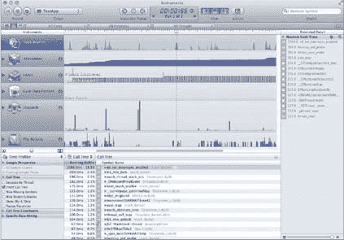

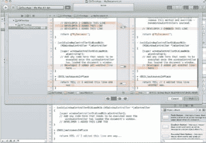

- `INSTRUMENTS`

  使用 Instruments 跟踪和分析你的代码。随时间跟踪应用程序的活动，以查找和分析性能问题等。

- 源代码管理

  使用集成的源代码管理功能管理你的源代码。分支、合并、拉取、推送以及解决冲突，全部在 Xcode 内完成。

## 第一部分 基础知识：开始使用 Xcode 4

## 探索 XCODE 工具

### 下载

Xcode 4 的最新稳定版本可通过 Mac App Store 获取。要下载安装程序，请从“应用程序”文件夹中启动 App Store 应用，并在商店中搜索 Xcode。点击“安装”，如果系统提示，请登录。

与任何通过 App Store 购买的应用一样，安装程序（名为“Install Xcode”）会出现在你的 Dock 中，其图标上带有进度条。去喝杯咖啡吧，因为这个安装程序有几 GB 大小。

### 安装

下载完成后，只需在 Dock 中点击安装程序即可启动。如果 Dock 快捷方式已消失，你可以在“应用程序”文件夹中找到该安装程序（同样名为“Install Xcode”）。只需按照屏幕上的说明操作即可。安装程序非常简单，因为你可能从旧版本中了解到的选项已经消失。Xcode 4 会覆盖系统中 `/Developer` 文件夹内的任何现有版本。这是 Xcode 工具套件的默认（且现在不可更改）安装位置。安装完成后，你将拥有一个非常强大的软件开发套件，只需在你的系统磁盘的 `/Developer/Applications` 文件夹中查看即可。Xcode 及其伙伴就在那里。

**注意：** 你下载的文件包含这些工具和相关的 SDK，但不包含这些 SDK 的文档。当你启动 Xcode 时，它会检查该文档的最新版本并在后台下载。这些文件也很大。由此引起的处理器、磁盘和网络活动可能会令人担忧，因为 Xcode 看起来像是正在安静地等待命令。你可以在 Xcode 偏好的“文档”面板中关闭自动更新。

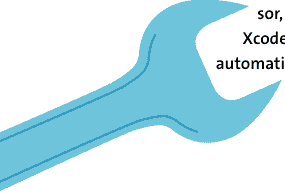

### 探索

既然你已经安装了 Xcode 工具，你可以在系统磁盘的 `/Developer` 文件夹下找到它，除非你选择安装到其他位置。你可以在 `/Developer/Applications` 文件夹中找到 Xcode 和其他一些应用程序。虽然本书专注于 Xcode 4 应用程序，但还有其他一些你应该熟悉的重要工具。

让我们探索一下该套件中包含的一些工具。

### 主要工具

有三个重要的应用程序会占据你大部分时间。

- `XCODE` 

  Xcode 集成开发环境（IDE）是套件中的明星。使用 Xcode，你可以创建和管理项目、编写和调试代码、设计 UI、构建数据模型、编写和运行单元测试，以及构建和打包你的应用和插件。你大部分开发时间都会花在 Xcode 上。其中一些工具可以从 Xcode 内部自动启动（例如 Instruments 和 iOS 模拟器）。这将在后续章节中介绍。

- `INSTRUMENTS` 

  Instruments 是 Apple 的性能分析和剖析工具。我们将在第三部分简要介绍 Instruments，但这个应用本身完全可以写一本书。粗略地说，它可以被描述为围绕 DTrace（一种性能测量工具）的豪华包装，但这会低估它的能力。我们将探讨它在应用程序开发中最常见的用途，即性能分析和内存管理调试。

- `IOS SIMULATOR` 

  并非所有 iOS 开发人员都能买得起市场上的每款 iOS 设备。直接在设备上调试应用程序也有一些限制。iOS 模拟器（以前称为 iPhone 模拟器）为这两个问题提供了解决方案。我们将在第 17 章中探讨 iOS 模拟器。

### 其他有用的工具

以下是你在典型的 Mac 或 iOS 项目中可能会使用的一些其他工具。这些工具也随 Xcode 工具套件一起安装。

- `HELP INDEXER` 

  Mac OS 用户期望应用程序附带常规的内置手册，称为 *帮助手册*。这是一个简单的 HTML 文档集合，附带了 OS X 帮助查看器所需的一个特殊索引文件。Help Indexer 应用处理你的帮助手册文件并为你构建此索引。

- `ICON COMPOSER` 

  Mac OS 和 iOS 应用程序使用 `.icns` 格式。Icon Composer 应用允许你将适当大小的图案放入图像井中，并在各种背景上测试你的图标。

- `PACKAGEMAKER` 

  PackageMaker 用于构建 Mac OS 安装程序包。安装程序包允许你告诉 OS X 将你的应用程序和其他资源安装到何处，还可以（如果需要）以管理员权限运行各种安装前后脚本（即主安装前后运行的脚本）。

- `QUARTZ COMPOSER` 

  Quartz Composer 让你为屏幕保护程序、类似 Front Row 和 Cover Flow 的交互式菜单屏幕等创建令人惊叹的视觉效果。组合可以独立存在，也可以接受来自你的应用程序的输入以影响各种属性。即使是非开发人员也可以使用 Quartz Composer，因为它不需要编写一行代码。

### 总结

除了这里介绍的工具之外，还有许多其他有用的实用工具（包括 GUI 和命令行）。有关详细信息，请参阅 Xcode 用户指南（可从 Xcode 的“帮助”菜单中找到）。

> **注意：** 在 Cocoa 开发者社区中，你会听到人们将 Interface Builder 称为一个独立的应用程序。在 Xcode 4 之前，Interface Builder 确实是一个独立的应用程序。现在它已集成到 Xcode 中。


## 2 开始一个项目

Xcode 附带了大量模板项目，使开发人员更容易上手。除了 Mac OS 和 iOS 应用程序的模板外，还有命令行工具、AppleScript 应用程序、框架、包、插件、Spotlight 插件、IOKit 驱动程序等模板。

在本章中，你将创建一个基本的 Cocoa 应用程序，本书将使用它来探索 Xcode。


### 欢迎使用 XCODE！

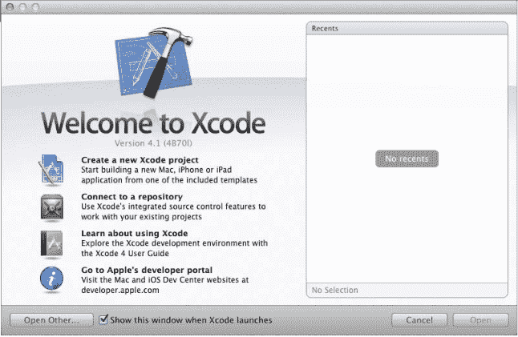

你可以在 `/Developer/Applications` 文件夹中找到 Xcode（假设你在安装 Xcode 工具时选择了这个默认位置）。当你启动该应用程序时，系统会显示“欢迎使用 Xcode”窗口，如图 2.1 所示。

你可以使用这个欢迎窗口来启动新项目、从源代码仓库（如 Subversion 或 Git）检出现有项目、打开文档查看器，或访问 Apple 的开发者网站。你还可以让 Xcode 不再在启动时显示此窗口。

### 创建新项目

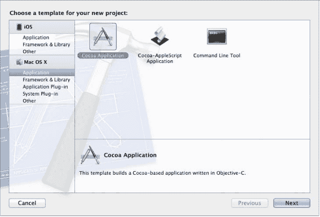

要创建新项目，请在欢迎屏幕上点击“Create a new Xcode project”选项。你也可以从屏幕顶部的主菜单中选择 File > New > New Project。系统会显示一个对话框，你可以从中选择项目模板，如图 **图 2.2** 所示。

### 探索模板

让我们花点时间浏览一下 Xcode 提供的可用项目模板。左侧面板按类型对模板类别进行划分（例如 Mac OS、iOS 项目，以及你可能安装的任何第三方模板类型）。除了明显的平台分类外，模板还按你将构建的产品类型（应用程序、插件、框架等）进一步细分。

在大多数情况下，选择单个模板会显示一个“选项”栏，你可以选择常见子类型（例如基于文档与非基于文档、静态库与动态库等）以及可选的子组件（例如 Spotlight 导入器或插件的 Cocoa 视图）。

大多数项目将是 Mac OS 或 iOS 应用程序。

**图 2.2** 新项目模板对话框

## 创建测试项目

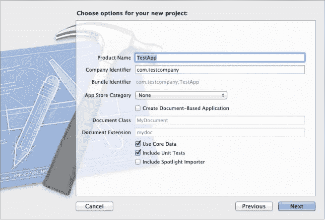

让我们创建一个用于探索的测试项目。为此，请在 Mac OS X 部分下选择 Application 类别，然后点击 Cocoa Application 模板。点击 Next 继续。Xcode 会要求你提供一些额外信息来自定义项目，如**图 2.3** 所示。

Product Name 字段在大多数情况下用于填写应用程序的名称。为清晰起见，我们将产品命名为 TestApp。这不仅决定了项目文件及其所在文件夹的名称，还决定了构建产品（应用程序、插件、库等）的名称。

Company Identifier 字段与产品名称同样重要。该标识符用于创建束标识符（bundle identifier）。束标识符又可以用作应用程序偏好设置文件、文档文件、相关 Spotlight 导入器以及许多其他内容的唯一标识符。Apple 鼓励开发者使用反向的 ICANN 域名。假设你的域名是 *yourcompany.com*，那么你的公司标识符应为 *com.yourcompany*。Xcode 会填入你的应用名称（根据需要替换非法字符），以构成项目的束标识符（显示在 Company Identifier 字段下方）。

虽然只有 Product Name 字段是必填的，但你始终应提供合适的公司标识符。该标识符不一定需要对应现有域名，但应当唯一。

App Store Category 弹出菜单允许你选择一个通用类别，如果你选择部署到 Mac App Store，你的应用将归入该类别。由于你不会将 TestApp 提交到 App Store，可以将其保持默认的 None。

接下来的三个选项（Create Document-Based Application、Document Class 和 Document Extension）允许你使用基于文档的应用模板。普通的 Cocoa 应用（取消选择 Create Document-Based Application）适用于不将单个文件作为文档处理的应用；基于文档的 Cocoa 应用使用 Cocoa 文档架构来打开和操作文档文件。为简单起见，TestApp 将不采用基于文档的方式，因此请保持该选项为取消选择状态。

Use Core Data 选项添加了对 Cocoa 对象图管理和持久化框架（称为 Core Data）的支持。请选择此选项，以便你可以在第 10 章中探索 Data Model Editor。

Include Unit Tests 选项将为你的项目添加单元测试支持。请选择此选项以包含单元测试，你将在第 18 章中探索它们。

Include Spotlight Importer 选项会将一个 Spotlight 导入器插件作为依赖构建目标添加到项目的应用目标中。当你添加必要的代码后，Spotlight——Mac OS X 的搜索功能——将使用该导入器自动将你提供的数据添加到其搜索索引中。请保持此选项为取消选择状态，并将 Spotlight 导入器插件的编程留待其他书籍介绍。

不同的项目和选项选择可能会导致创建新项目时出现不同的字段。有关这些选项的更多详细信息，请参阅 Xcode 文档（在第 4 章中介绍）。

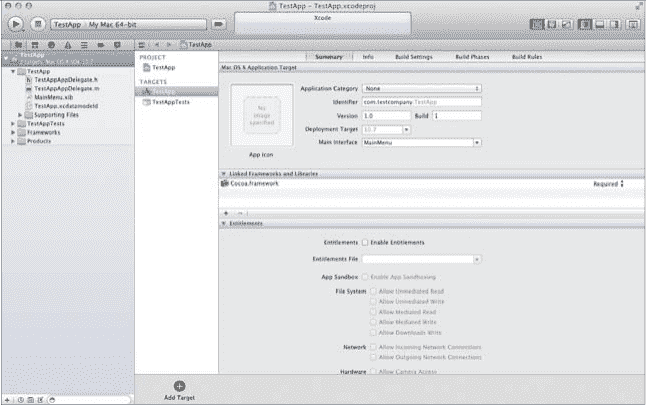

填写完所需信息后，点击 Next 继续。Xcode 将显示一个 Save As 对话框。选择为此项目创建本地 Git 存储库的选项。你将在第 21 章中探索 Xcode 对 Git（和 Subversion）的支持。选择一个方便的位置（如桌面），然后点击 Save。现在你应该有了一个可以随时使用的基本 Xcode 项目，如**图 2.4** 所示。

## 项目现代化

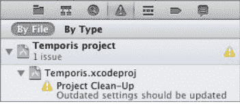

**图 2.5** 过时项目设置的警告

对于并非昨天才成为 Mac 或 iOS 开发者的我们来说，Xcode 引入了“项目现代化”的概念。尽管创建充满新可能性的全新项目很有趣，但我们许多人都有在早期版本的 Xcode 中创建的现有项目。

这些既有项目通常包含与新版 Xcode 不兼容的设置。幸运的是，Xcode 不仅能发现这些问题，还能提供修复。它甚至允许你选择要应用的修复，因为其“修复”的想法不一定与你的一致。

### 对项目进行现代化

当打开使用旧版 Xcode 创建的项目时，你可能会注意到 Issue 导航器（**图 2.5**）中出现一些警告，提示你需要清理的问题。

> **注意：** 项目现代化功能是在 Xcode 4.1 中引入的，在 4.0 中不可用。

>

> Issue 导航器将在第 3 章中介绍。


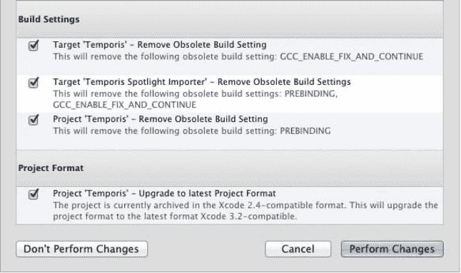

选择该问题（或从主菜单中选择 Editor > Check for Outdated Settings）将显示一个 Build Settings 面板（**图 2.6**），其中汇总了 Xcode 认为你应该进行的更改。取消选中你希望 Xcode 忽略的任何设置左侧的复选框。

要执行选定的更改，请点击 Perform Changes。要取消而不执行任何更改，请点击 Cancel。要忽略选定的问题，请选择 Don’t Perform Changes。分离的 Perform Changes 和 Don’t Perform Changes 按钮允许你先接受某些更新，然后返回并指示 Xcode 忽略其他更新。

请记住，你可以随时通过主菜单中的 Editor > Check for Outdated Settings 检查过时设置。

## 构建并运行应用程序

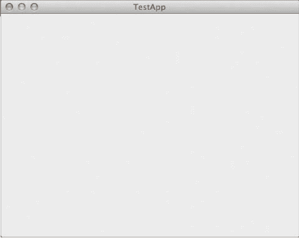

**图 2.7** 新的 Cocoa 应用程序

此时，你拥有一个功能完备——虽然平淡无奇——的 Cocoa 应用程序项目，可以构建并运行了。要查看你的应用程序，请点击项目窗口工具栏中的 Run 按钮（或从主菜单中选择 Product > Run “TestApp”）。Xcode 将从零开始构建项目（因为这是首次构建），然后启动它。稍后，你将看到应用程序的空窗口（**图 2.7**）。目前它并不特别令人兴奋，但即便没有自定义，它现在也是一个可正常运行的应用程序。

Run 按钮不仅仅触发构建和运行。你可以单击并按住该按钮，以显示一个与其他类似操作（可在 Product 菜单下找到）相同的菜单。这些操作包括 Test、Profile 和 Analyze。在执行请求的操作之前，如果项目需要构建，这些操作中的每一项都会自动构建项目。其他操作将在后续章节中介绍。

## 总结

TestApp 目前的状态并不太有趣，但它是一个功能完备的应用程序，拥有主菜单、窗口，甚至“关于”面板。你现在知道了如何创建、构建和运行基本的模板应用程序。在下一章中，你将使用刚创建的项目探索 Xcode 的用户界面。

在上一章中，你创建了一个名为 TestApp 的 Cocoa 应用程序项目。在本章中，你将探索该项目的结构，并熟悉 Xcode 的用户界面。


早期版本的 Xcode 允许用户选择多窗口界面，但默认是单窗口（即与打开项目相关的大多数视图都包含在同一窗口内）。然而，单窗口模式并非完全的单窗口，可能会出现一些辅助窗口。在 Xcode 4 中，Apple 将多合一窗口设计方法推向了更远的程度。

如果尚未打开，请打开你在第 2 章中创建的 `TestApp` 项目。


## 工作区窗口

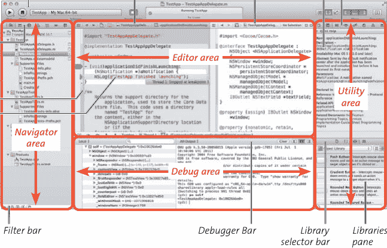

**图 3.1** 工作区窗口

一个 Xcode 项目由一组源文件（例如 Objective-C 文件、Interface Builder nib 文件和 Core Data 托管对象模型）、资源（例如图像和富文本文件）以及 Xcode 项目文件组成，其中维护着各种设置和构建规则。将 Xcode 项目视为一个由源文件和资源组成的集合，并通过项目文件将它们绑定在一起，会很有帮助。Xcode 4 更进一步，允许你将多个相关项目组合到单个*工作区*中（参见*第 16 章*）。给定项目或工作区的主窗口称为*工作区窗口*（**图 3.1**）。

工作区窗口分为多个区域，你将在本章中详细研究这些区域。与工作区相关的几乎所有内容都包含在这些区域中，这些区域负责组织、导航、编辑、检查和调试。

## 符号导航器

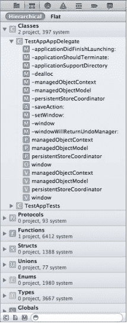

符号导航器（**图 3.3**）会以略有不同的视角展示你的项目。根据你在过滤栏（即符号列表上方的条栏）中选择的过滤条件，你可以跳转到项目内定义的符号，或跳转到 Cocoa 框架中定义的符号。

例如，你无需先从项目导航器中选择文件，然后在编辑器中寻找你的方法或实例变量，而只需在符号导航器底部的搜索栏中输入符号名称，再在列表中点击该符号，即可直接跳转到源码中的对应位置。

符号导航器底部的条栏提供了若干列表过滤选项。第一个过滤按钮（自左起）可让你选择列表中显示所有符号类型（无论这些类型是否实际存在符号）还是仅显示存在符号的类型。第二个按钮指定显示所有符号还是仅显示属于当前工作区的符号。第三个按钮指定是否显示某个给定符号的成员（例如某个类的方法）。搜索字段则可通过给定的搜索词进一步过滤列表。

**图 3.3** 符号导航器

## 搜索导航器

搜索导航器（图 3.4）允许你搜索整个项目。窗格顶部的搜索字段用于搜索项目，底部的搜索字段则进一步过滤搜索结果。结果首先按文件名排列，然后按文件内的匹配项排列。点击某个结果会打开相应文件，并在编辑器中选中匹配项。搜索和替换将在第 8 章中更详细地介绍。

## 问题导航器

当构建项目时，问题导航器（图 3.5）会列出它发现的任何问题。在 Xcode 中，问题可以是错误或警告。与搜索导航器一样，问题导航器可以按问题所在的文件对问题进行归类。此外，Xcode 还可以按类型显示问题。点击选中某个问题，Xcode 会导航到编辑器区域中该问题所在的位置。图 3.5 显示了 Xcode 报告 `TestAppAppDelegate.m` 文件存在一些问题——正如大多数人那样。

问题导航器顶部有按钮，可让你选择按所在文件或按类型显示问题。导航器底部的控件可让你过滤列表。第一个按钮（自左起）可让你选择仅显示上次构建产生的问题。第二个按钮可让你选择仅显示错误（而非警告或静态分析器结果）。搜索字段可让你按给定的搜索词过滤列表。

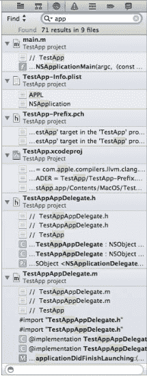

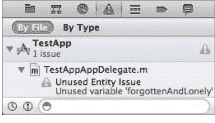

> **注意：** 你也可以使用编辑器区域右上角滚动条上方的箭头，在问题之间进行跳转。

## 调试导航器

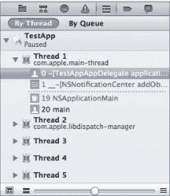

当活动调试会话中的执行被暂停时（由于遇到断点或线程崩溃），调试导航器（图 3.6）允许你浏览应用程序的线程和调用栈。你可以使用导航器顶部的选择栏按线程或按队列来组织信息。

导航器底部的控件控制着导航器显示多少信息。启用该按钮后，导航器将仅显示崩溃的线程或存在调试符号的线程（通常是你的代码）。滑块则控制显示的堆栈信息量。向右滑动到底可显示完整堆栈，向左滑动则只显示栈顶帧。

每个栈帧左侧的图标表示该帧所属的代码。例如，带有蓝白人头图标的帧属于你的代码，而带有紫白杯子图标的帧则属于 Cocoa 框架。

**图 3.6** 调试导航器

## 断点导航器

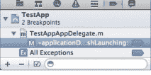

与项目关联的所有断点都会收集在断点导航器（图 3.7）中。当你在源代码编辑器中设置断点时（参见第 9 章），它们会按文件分组显示在断点导航器列表中。

点击断点名称可跳转到其在编辑器中的位置。点击蓝色断点标记可启用或禁用该断点。右键点击断点并从上下文菜单中选择“编辑断点”，会弹出一个详细视图，让你设置额外的断点属性（这也将在第 9 章中介绍）。

导航器底部的控件允许你添加和删除断点，以及进一步过滤列表。添加（+）按钮在被点击时弹出一个菜单，提供添加两种非工作区特定的断点（在异常时中断，或在你手动提供的指定符号处中断）。删除（-）按钮会删除任何选中的断点。删除按钮右侧的下一个按钮可过滤列表，仅显示已启用的断点，而搜索字段可按给定的搜索词过滤断点。

**图 3.7** 断点导航器

## 跳转栏

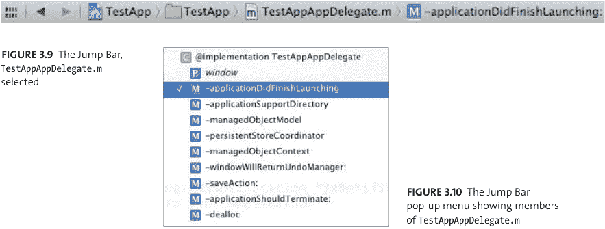

**图 3.9** 跳转栏，已选中 `TestAppAppDelegate.m`

**图 3.10** 跳转栏弹出菜单，显示 `TestAppAppDelegate.m` 的成员

跳转栏位于编辑器区域上方，显示你在项目组织结构中的当前位置（图 3.9）。它还充当着项目导航器的更紧凑版本。即使导航器区域被隐藏，跳转栏也依然可用。你可以点击任意一个分段，并从弹出菜单中选择其他路径来浏览项目。

跳转栏不限于组和文件层级。它允许你进一步深入到文件内容中。对于源代码文件，你可以点击文件分段之后的任意分段，进一步选择方法以在文件内容中跳转（图 3.10）。对于 Interface Builder 文件，你可以浏览用户界面的窗口和视图层次结构。

跳转栏也出现在助理编辑器中（本章稍后介绍），除了选择单个文件外，还可用于选择各种行为。

## 编辑器区域

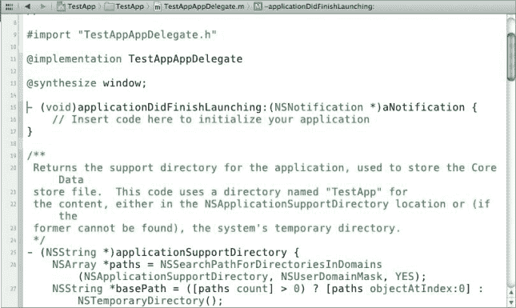

编辑器区域（图 3.11）会根据当前选中的文件（通过项目导航器或跳转栏选择）动态切换至相应的编辑器。也就是说，对于源代码文件，你会看到源代码编辑器；对于 Interface Builder 文件，你会看到界面编辑器，以此类推。其他可用的编辑器类型还包括数据模型编辑器、项目编辑器、版本编辑器、富文本编辑器等。

虽然这里被称为“编辑器”区域，但对于某些项目而言，这个称呼有些名不副实。有些项目不可编辑，这意味着编辑器区域更多地充当“查看器”区域。例如，选中图像资源（如应用程序图标）时，该区域可能显示该图像；但目前 Xcode 4 中还没有图像编辑功能，所以你只能查看图像。

其他主要编辑器将在本书各相关章节中介绍。

## 助理编辑器

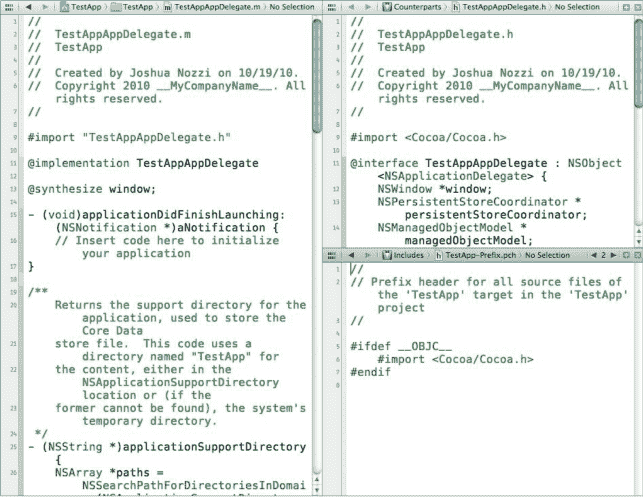

编辑器区域隐藏着一个极具迷惑性的强大功能，称为助理编辑器（**图 3.12**）。助理编辑器充当带有一定智能的“分栏”编辑器，具体取决于你所使用的行为模式。你可以使用工具栏右侧附近编辑器按钮栏中间的按钮来切换助理编辑器。

助理编辑器是一种非常灵活的上下文相关工具，可帮助你完成与当前编辑上下文相关的常见任务。例如，在数据模型编辑器中，如果选中带有对应托管对象子类的 Core Data 实体，助理编辑器可以显示该子类以供参考或编辑。如果你在 Interface Builder 中选择一个 xib 进行编辑，助理编辑器可以显示与该 xib 的 File's Owner 类对应的源文件（参见第 5 章），或显示 Dock 中所选对象的类，以方便建立动作和插座连接。

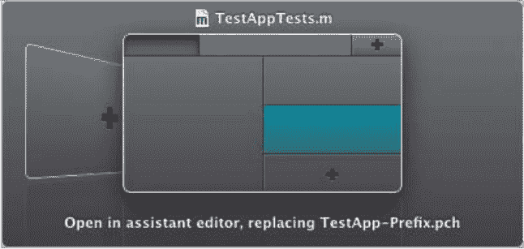

## 在助理中打开文件

当你使用工具栏打开助理时，它会以手动行为模式在单个窗格中显示所选源文件的对应文件（在此模式下，你可以使用其跳转栏自行选择助理窗格中显示的内容）。你可以使用助理的跳转栏查看或编辑工作区中的任何文件。只要助理处于活动状态，至少会有一个助理窗格始终可见。

## 添加和移除助理窗格


你可以使用现有助理窗格右上角的添加（+）和移除（x）按钮（位于面板跳转栏的右边缘）来添加或移除额外的助理窗口。

要添加新窗格，请点击任意现有窗格上的添加按钮。新窗格将拥有自己的跳转栏，并会添加在你点击添加按钮的那个窗格之后。也就是说，如果你点击了最后一个窗格的添加按钮，新窗格将出现在最后一个窗格之后；如果你在多窗格中的第一个窗格上点击添加，新窗格将出现在第一个窗格之后。要移除窗格，请点击相应窗格上的移除按钮。

你也可以使用键盘快捷键打开助理窗格。默认情况下，按住 Option 键并点击项目导航器中的某个项目时，如果当前只有一个窗格，该项目将在助理中打开。如果存在多个窗格，或者你执行 Option-Shift-点击操作，Xcode 会通过一个直观的目标选择器（图 3.13）询问你想在哪里查看该文件。

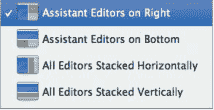

**图 3.14** 助理

## 更改布局行为

在上一节中，“在你点击添加按钮的那个窗格之后”这一表述故意含糊其辞。这是因为你可以自定义助理的布局行为。为此，请选择“视图”>“助理布局”以查看并选择可用的布局模式（**图 3.14**）。

## 助理行为模式

你可以通过点击跳转栏中紧邻导航按钮右侧的段落来更改助理的行为。此时会出现一个菜单（**图 3.15**），列出可用的行为。

在手动模式下，助理的行为就像一个美化版的——如果排列整齐的话——分栏编辑器。它的真正威力在于其自动行为模式。当你选择除“手动”以外的任何行为时，助理会变得具有上下文感知能力。根据所选行为，助理会显示与主编辑器中当前显示的文件（或其子选区）相关的文件（即项目导航器中的选区）。

当你面临需要编辑类的实现、头文件和关联协议的场景时，或者当你在 Interface Builder 的 Dock 中选择一个对象并需要添加新的插座变量或动作，同时将其连接到界面时，此功能的强大之处便显而易见。

当助理可以显示的相关文件不止一个时，添加和移除按钮左侧会出现额外的控件。这些控件包括标准的后退和前进导航按钮，以及它们之间可用关联文件的计数。如果可用关联文件少于两个，这些控件将不可见。在选择行为模式时，计数会显示在跳转栏中。

此处的*选区*一词指的是“当前在项目导航器中选中并显示在主编辑器中的项目成员”。

可用的模式将在相关章节中进行探讨。

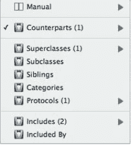

**图 3.15** 跳转栏中的助理行为模式

## 工具区

工具区（**图 3.16**）为当前编辑器提供补充信息和控件。基本上，任何你期望在编辑器浮动面板中找到的内容都可以在工具区中找到。要切换工具区，请点击工具栏中视图按钮栏右侧的按钮。

与编辑区及其助理一样，工具区也具有高度上下文相关性。顶部会出现代表各种检查器的附加按钮，具体取决于你正在编辑的内容。例如，在编辑 xib 文件时，会出现属性检查器、大小检查器、连接检查器等按钮。如果选择了数据模型，则会出现数据模型检查器按钮。在大多数情况下，有两个检查器始终存在：文件检查器和快速帮助检查器。

底部面板包含文件模板库、代码片段库（第 7 章）、对象库（第 5 章）和媒体库，媒体库包含可用的模板媒体（如标准操作系统图标）以及工作区中包含的任何媒体。

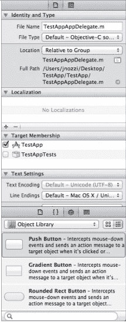

**图 3.16** 工具区

## 调试区

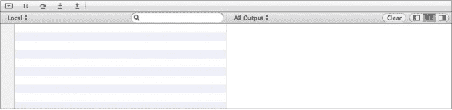

**图 3.17** 调试区

调试区（图 3.17）默认在运行应用程序时出现。你还可以使用工具栏中视图按钮栏的中间按钮来切换它。

调试区是调试器的主要界面。它包含一个控制栏、一个控制台，以及一个用于在暂停时检查作用域内变量的视图。调试区及其控件将在第 9 章中更详细地介绍。

## 自定义调试器行为

你可以在 Xcode 偏好设置的“行为”标签页中自定义调试区的行为。在那里，你可以选择调试器在发生某些事件时采取的操作（包括运行、暂停、意外退出、正常退出等）。

例如，你可以选择在调试开始或暂停时显示调试导航器。你也可以选择在应用程序正常退出时显示项目导航器并关闭调试区。如果应用程序意外退出，你可以选择显示日志导航器，跳转到最近的运行日志，并播放提示音以引起对问题的注意。自定义行为将在第 16 章中更详细地介绍。

## 活动查看器

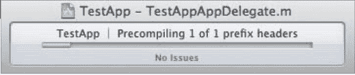

**图 3.18** 活动查看器

活动查看器（**图 3.18**）并不复杂，交互性也很少，但它在工具栏中心突出（且固定）的位置使其值得一提。它为你提供 Xcode 在工作区上执行的所有活动的视觉反馈。

当有多个活动正在进行时，活动查看器会像广告横幅一样在它们之间切换，并在其左侧显示并发任务的数量。你可以点击该数字以显示一个弹出窗口，其中会列出所有当前活动及其各自的进度。

在 Xcode 的早期版本中，每个窗口底部边缘的右侧都有自己的状态字段，显示相同的信息（主要与构建和调试状态相关）。Xcode 4 的一体化方法使得在一个位置查看 Xcode 正在执行的任何操作的当前状态变得更加容易。

如果有任何问题（错误、警告等），问题数量也会显示在活动查看器中。点击问题计数器将切换到问题导航器，以便你查找和查看问题。

## 标签页


**图 3.19** 两个标签页分别显示 `TestAppAppDelegate.m` 和 `MainMenu.xib`

Xcode 4 的另一个新功能是引入了标签页。与 Safari 浏览器类似，你可以在同一个工作区窗口中为工作区中的各种项目成员创建标签页。例如，**图 3.19** 显示一个标签页中打开了一个源文件，另一个标签页中在界面编辑器中打开了一个用户界面文件。

要创建新标签页，请从主菜单中选择“文件”>“新建”>“新建标签页”。点击任意标签页即可切换并导航到你希望该标签页表示的项目成员。你可以通过拖放来重新排列标签页。要重命名标签页，请双击标题，输入新名称，然后按回车键。要关闭标签页，请点击鼠标悬停在标签页上时出现的 X 图标，或从主菜单中选择“文件”>“关闭标签页”。

> **提示：** 键盘快捷键是加快标签页使用的便捷方式。

> 按 Command+T 可创建新标签页，按 Command+W 可关闭当前选中的标签页。按 Command+} 和 Command+{ 可在下一个和上一个标签页之间切换。

### 管理器窗口

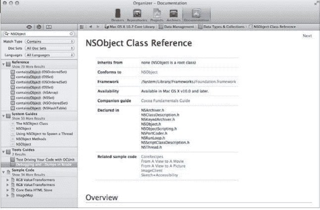

管理器窗口（图 3.20）不同于工作区窗口，它是项目和设备管理的汇集点，包括代码仓库、归档、快照等。管理器在整本书中会有不同方面的展开介绍。要打开管理器，请从主菜单中选择“窗口”>“管理器”。

### 小结

本章让你初步了解了工作区窗口中最常见的用户界面元素。在后续章节中，你还会了解更多用户界面，但关于 Xcode 的内容远不止一本书所能涵盖。在下一章中，你将学习如何使用 Xcode 内置的文档浏览器和帮助工具来获取编码方面的帮助以及 Xcode 本身的使用帮助。

在 Xcode 4 中，你可以通过多种方式获得适用于 IDE 和 Cocoa 框架的帮助。在本章中，你将学习如何找到所需的答案。


### 帮助菜单

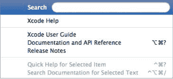

**图 4.1** Xcode 帮助菜单

你将从最显而易见的地方开始。如果你熟悉 Mac OS X，应该对帮助菜单并不陌生。从 Mac OS X 10.5 开始，帮助菜单（图 4.1）新增了标准搜索字段，它不仅显示帮助主题，还显示与搜索词匹配的主菜单项。

搜索字段下方是用于打开一些你应当熟悉的重要帮助库的菜单选项。其中还列出了 Xcode 发行说明的链接。这些选项大多会打开你在第 3 章中见到的管理器窗口。

### XCODE 帮助

“Xcode 用户指南”菜单项会打开一个启动页，其中包含有关如何在 Xcode 中查找帮助的视频和链接。

### XCODE 用户指南

“Xcode 帮助”菜单项会打开 Xcode 的用户手册。其中包含对所有 Xcode 功能的深入说明和操作步骤指导。

### 文档与 API 参考

“文档与 API 参考”菜单项会在文档模式下打开管理器窗口，以便你浏览或搜索已安装的文档库。它会停留在当前选中的页面，不会跳转到其他页面，只是显示该窗口。

### 其余菜单项

其余的菜单项分别用于为当前活动工作区窗口中所选代码提供快速帮助，以及在文档模式下打开管理器窗口，并将文本输入光标置于搜索栏中。

### 管理器的“文档”标签页

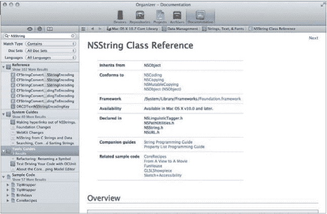

**图 4.2** 管理器的“文档”标签页

管理器中的文档部分是 Xcode 查看所有 SDK 和开发者工具文档的主要视图。请从主菜单中选择“窗口”>“管理器”来打开管理器，然后在工具栏中选择“文档”标签页（图 4.2）。


管理器会显示一个左侧窗格（类似于 Xcode 的导航器区域）和一个主查看区域。在主查看区域的顶部，你会看到一条跳转栏，类似于第 3 章中探讨过的跳转栏。不过，这条跳转栏允许你在文档中导航，而不是在项目之间导航。

管理器的导航区域有三种模式：“浏览”、“搜索”和“书签”。窗格顶部的按钮栏可在这些模式之间切换。

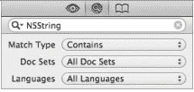

**图 4.3** 管理器的搜索选项面板

## 浏览

在“浏览”模式下，会显示每个文档集及其分节的概要。你可以按主题逐层深入浏览指南和 API 参考文档。

## 搜索

在“搜索”模式下，会出现一个搜索字段，允许你搜索所有已安装的文档集。点击放大镜图标，然后从上下文菜单中选择“显示查找选项”，会显示一组筛选选项（图 4.3），可用于忽略不需要的库等。搜索结果按类型分组（如“参考”、“系统指南”、“示例代码”等）。

## 书签

在“书签”模式下，你可以直接跳转到已添加书签的文档页面。你可以通过从主菜单中选择“编辑器”>`书签`来设置书签，也可以右键单击页面中的任意位置，然后从上下文菜单中选择“为当前页面添加书签”。要删除书签，请选中它并按 `Delete` 键。

虽然你将在第二部分中深入探索源代码编辑器，但从代码中查找上下文帮助也有几种有用的方法。

## 工具区中的快速帮助


正如你在第 3 章中所见，Xcode 的工具区让你能够访问各种属性、代码片段、界面构建器的用户界面元素以及快速帮助。快速帮助工具会根据你在源代码编辑器中选择的内容持续更新其内容。

为了熟悉这个工具，请确保你的 `TestApp` 项目处于打开状态，然后在项目导航器中选择 `Classes` 组中的 `TestAppAppDelegate.m` 源文件。打开工具区，然后选择快速帮助工具。在源代码编辑器中，点击 `@synthesize window;` 语句中的 `window`。快速帮助会显示该符号（`window`）的名称及其声明所在的头文件（`TestApp` 项目的 `TestAppAppDelegate.h` 文件）。

再看一个更有趣的例子，向下滚动一点，找到 `- (NSString *) applicationSupportDirectory` 方法，然后点击 `NSString` 符号。快速帮助会显示关于 `NSString` 类（图 4.4）的更详细描述，该类属于 Cocoa 框架，并由内置文档库提供文档。任何以蓝色突出显示的文本都是指向相应文档的超链接。点击快速帮助中的超链接，会在管理器的“文档”部分打开链接的信息。

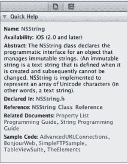

**图 4.4** 快速帮助工具

## 搜索所选文本的文档

另一种查找 `NSString` 等符号文档的便捷方法是：在源代码编辑器中选择该符号，然后从主菜单中选择“帮助”>`搜索所选文本的文档`。与快速帮助窗格中的超链接一样，选择此选项会在管理器的“文档”部分打开它找到的任何相应文档。

> **提示：** 不必打开工具窗格也能查看快速帮助内容。按住 `Option` 键并点击要查找的符号，相同的信息会显示在弹出气泡中。


## 小结

Xcode 提供了多种查找帮助的方式。这些方式大多指向同一套文档集，但即使是在文档页面中，你也可以提交改进建议。此外，你还能通过 Google 搜索快速找到许多社区网站（其中一个由 Apple 托管）和博客。即使内置文档没有帮助，你在万维网上找到答案的可能性也相当大。

现在，你应该已经熟悉 Xcode IDE 了。在第二部分中，你将使用 Xcode 扩展 `TestApp` 项目：添加一些用户界面元素、编写一些代码、定义数据模型等。之后，你将深入研究调试器，并构建要部署的应用程序。

本页有意留白

## 第二部分：使用 Cocoa 应用程序

## 5 创建用户界面

### 理解 NIB

Cocoa 应用程序从 Interface Builder 文件（称为 nib；如果使用 XML 格式，则称为 xib，这是新的默认格式）中加载其图形用户界面。这些文件本质上是被“冷冻干燥”的对象图，表示你构建的用户界面以及界面元素与一个或多个控制器对象之间的连接。在设计和使用 Mac OS X 或 iOS 应用程序时，理解几个关键概念非常重要。

### 文件所有者与控制器对象

nib 及其内容始终有一个所有者。无论所有者是 `NSWindowController`、`NSViewController`、`NSDocument` 还是任何其他对象的实例，它都作为顶层对象，也是将 nib 中的用户界面元素连接起来的主要接入点。

一般来说，`File's Owner` 应是控制器对象（如果是 `NSDocument`，则为模型-控制器）。单个 nib 中可以有并且经常有多个控制器对象，其中任何一个都可以提供出口（outlet）或动作（action）。

### 动作和出口

代码与 nib 内容之间有两种连接类型：动作和出口。这两种连接都是通过拖放建立的。

动作是由控件调用的方法。也就是说，根据控件类型的不同，某种形式的用户输入会触发控件执行其功能。以按钮为例，鼠标点击会触发按钮的动作。任何特定控件的动作都需要两个元素：动作本身和目标。动作在源代码中定义如下：

```
- (IBAction)performSomeAction: (id)sender;
- (IBAction)performSomeOtherAction: (id)sender;
```

出口是对象（通常是控制器对象或视图对象）的一个实例变量，用作指向 nib 中某个元素的指针。出口用于通信。

> **注意：** 文件扩展名 `.nib` 代表 NeXTSTEP Interface Builder，这是这些工具的原始创造者——NeXT, Inc. 留下的命名。较新的文件扩展名 `.xib` 代表 XML Interface Builder。

通过这些对象。例如，一个名为 `tableView` 的出口指向 nib 中存在的 `NSTableView` 实例。该出口可用于在底层内容发生变化后请求表格视图刷新。出口在源代码中定义为控制器的实例变量，如下所示：

```
IBOutlet NSTextField * titleField;

IBOutlet NSTableView * userListTable;
```

## 分区化

应用程序通常会有多个 xib 文件，其中包含部分用户界面。在除最简单的应用之外的所有应用中，通常有些部分用户不会在每次会话中都访问，因此不必在每次执行应用程序时都加载每一部分用户界面。只加载所需的那部分界面可以让应用程序响应更迅速，并减少内存占用。

一个例子是 Mac OS 应用程序的偏好设置窗口或 iOS 应用程序的用户账户视图。这些用户界面元素应保存在各自独立的 nib 文件中，并且仅在需要时创建其关联的控制器。

这种方法的首要优点是性能。你的应用程序只会在用户需要时加载其需要的界面部分，从而节省内存，这在 iOS 设备上是必需的。由于你的应用程序是按需创建控制器及其关联的界面，因此启动应用程序并达到就绪状态所需的时间更短。

第二个优点是对开发者的可维护性。通过将用户界面划分为不同的责任区域（偏好设置、用户登录窗口、导出表单、地图视图），你的应用程序架构会更清晰，更易于管理和导航。

> **注意：** 目标/动作机制的细节及其各种形式超出了本书的范围。请参阅 Apple 的 Cocoa 文档中的《Cocoa 基础指南》（可在 Xcode 的文档浏览器或 ADC 网站上找到）以获取更多信息。

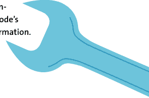

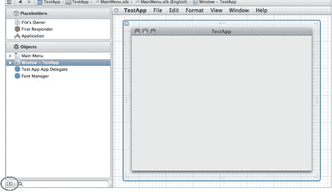

## 编辑器区域

编辑器区域（图 5.2）是你构建界面的地方。这涉及将界面元素从工具区域的控件库拖到编辑器的画布（网格区域）中，并根据需要调整其大小和位置。你也可以通过将界面元素和控制器对象拖到 Dock（画布左侧的区域）中来创建它们。

图 5.2 中编辑器左侧的 dock 栏（网格左侧）已展开，以显示 xib 中包含的对象的更多详情。使用 dock 底部的按钮可以展开或折叠 dock。

只有用户界面元素（如按钮和窗口）可以拖入画布。控制器实例不属于用户界面的一部分，但会在 nib 中创建或表示，以作为界面与代码之间的连接点；因此，它们只存在于 Dock 中。

你可以通过按住 `Control` 键并从定义出口的控制器拖拽到所需的界面元素来建立出口连接。控制器可以是 `File’s Owner`（nib 内容所属的控制器）或你在 nib 中实例化的其他控制器对象。

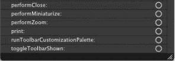

**图 5.3** 连接窗口

你可以通过按住 `Control` 键并从界面元素拖拽到定义所需动作的控制器来建立动作连接。例如，按钮可以连接到“创建用户”动作。多个用户界面元素（如菜单项）可以连接到同一个动作。动作的发送者始终会传递给动作，从而允许你根据发送者做出不同响应，或查询发送者的状态，例如复选框是否被选中。

在编辑器中右键单击对象会显示一个半透明窗口，其中包含该对象的出口、引用它的其他对象的出口以及该对象可以接收的动作（图 5.3）。可以通过从某个出口或动作右侧的圆圈拖拽连接到目标来建立连接。要断开出口或动作的连接，请单击连接中间的 `X`。

跳转栏遵循与 nib 中的窗口和视图相同的层级关系，并代表当前选中的对象。例如，选中的对象可以是 nib 中窗口内的标签视图中的按钮。

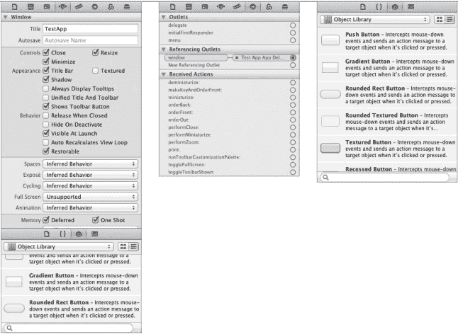

**图 5.4** 工具区域，显示可用的 Interface Builder 检查器

**图 5.5** 连接检查器

**图 5.6** Interface Builder 对象库

## 工具区域

当在导航器中选择一个 nib 时，工具区域（图 5.4）会在文件面板和快速帮助面板中添加额外的检查器，例如控件的样式、自动调整大小设置和动画设置。在画布或 Dock 中选择任何元素或控制器对象，即可使用检查器查看或调整其属性。

也可以使用工具区域的连接检查器（图 5.5）建立连接。该检查器类似于在编辑器中右键单击对象时出现的窗口，其行为方式也相同。

检查器下方是第 3 章提到的库面板。对象库（图 5.6）包含一系列标准 Cocoa 对象以及属于其他框架和代码库（如 QTKit 或 WebKit）的对象。

顶部的弹出菜单按库筛选列表，而底部的搜索字段则按搜索词筛选。将鼠标指针悬停在对象上可显示该对象的描述（如果存在）。将对象从库中拖到画布或 Dock 中，即可将其添加到 nib（或添加到特定视图或窗口）。你也可以双击对象来添加它。

## 助手编辑器

如你在第 3 章中所学，助手编辑器充当一个辅助编辑器，可以显示所选项目成员的“对应文件”。对于 nib，对应文件是 `File's Owner` 占位符所代表的类或所选控制器对象的接口（通常在单独的头文件中）。

将助手编辑器与 Interface Builder 结合使用，不仅仅允许你通过手动输入来添加出口和动作。你可以通过将控件的连接直接拖到助手编辑器中的类接口源代码中，来添加动作和出口。Xcode 会相应地插入该动作或出口的源代码。

### 可用的助手行为

- `自动` 行为显示 Xcode 认为对 xib 中选中项或视图最佳的文件。
- `顶层对象` 行为显示 xib 对象层级“顶部”的对象。这可以包括窗口和视图，以及任何实例化的对象（如自定义类和现成的对象控制器）。
- `发送的动作` 行为显示包含选中项调用的动作的文件。
- `出口和引用出口` 行为显示包含选中项的出口或被其出口引用的任何文件。
- `类` 行为显示包含选中项类的任何文件。

## 添加用户界面元素

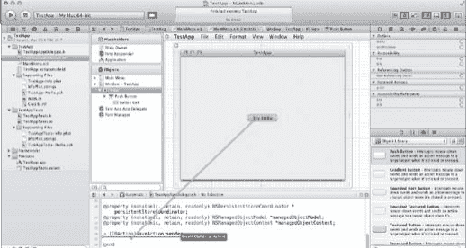

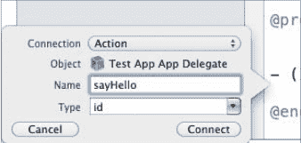

现在你已经熟悉了 Interface Builder，可以准备为 `TestApp` 添加一些动作和出口了。你将首先添加一个在对话框中显示传统“Hello World”的按钮。然后添加一个带有相应出口的文本字段，用于显示问候语。

准备工作中，在项目导航器中找到并选择 `MainMenu.nib` 文件。单击 Dock 中的窗口图标，在画布中打开应用程序的主窗口。单击助手按钮使助手区域可见，并确保助手显示的是 `TestAppAppDelegate.h` 文件（该 nib 的 `File's Owner` 占位符所代表的类的接口）。项目窗口应类似于图 5.1。

图 5.7 将连接拖入助手编辑器

图 5.8 连接创建器弹出窗口

### 添加动作按钮

要添加 Hello World 动作，你需要一个按钮。在对象库中找到 `Push Button` 控件，并将其拖入窗口中。双击按钮，将其标题设置为 `Say Hello`，然后按 `Return` 键。按住 `Control` 键从按钮拖拽连接到助手编辑器中的源代码。为了获得最佳效果，请将动作放在 `- (IBAction)saveAction:sender;` 行之后、`@end` 指令之前，如图 5.7 所示。

此时会出现一个弹出窗口（图 5.8）。确保选择了动作连接类型，然后在名称字段中输入 `sayHello`。方法名实际上是 `sayHello:`（带冒号），但 Xcode 会自动为你添加。按 `Return` 键或单击 `Connect` 即可添加动作。

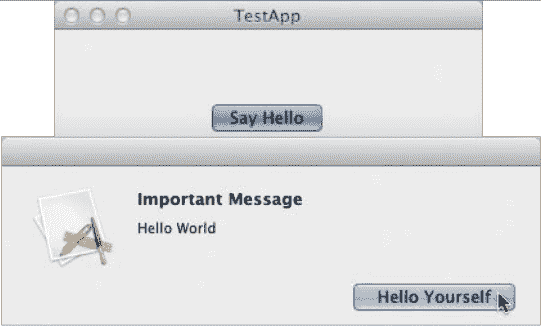

你需要添加一些代码，让这个操作执行一些有趣的操作。导航到 `TestAppAppDelegate.m` 文件（`TestAppAppDelegate` 类的实现文件），向下滚动找到 `-sayHello:` 方法。将其编辑为如下所示：

```objective-c
- (IBAction)sayHello:(id)sender {
    [[NSAlert alertWithMessageText:@"Important Message"
                     defaultButton:@"Hello Yourself"
                   alternateButton:nil
                       otherButton:nil
         informativeTextWithFormat:@"Hello World"] runModal];
}
```

点击 `Run` 按钮构建并运行应用程序。给 `Say Hello` 按钮一个测试点击，确保它正常工作。你应该会看到类似 **图 5.9** 的内容。当你满意后，退出应用程序，并导航回 `MainMenu.xib` 文件。

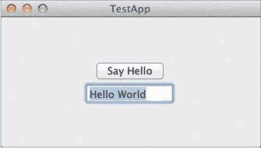

**图 5.10** TestApp 在文本字段中显示其 Hello World 消息

## 添加文本字段

也许你认为模态对话框被过度使用了，所以你想把文本放到应用程序窗口中的一个文本字段中。在对象库中找到 `Text Field` 控件，并将其拖入窗口。要与文本字段通信并将其字符串值设置为 `Hello World`，你需要为它创建一个 outlet。

要添加 outlet，从文本字段拖一条连接线到助理编辑器中的源代码。这次，将连接放在花括号内（因为 outlet 是类的实例变量）。选择 `Outlet` 连接类型，将其命名为 `textField`，然后按 `Return` 键完成添加 outlet。

现在你的代码有了对文本字段的引用，你可以修改操作，将消息显示在那里，而不是在模态对话框中。导航回 `TestAppAppDelegate.m` 文件中的 `-sayHello:` 操作，并将其改为如下所示：

```objective-c
- (IBAction)sayHello:(id)sender {
    [textField setStringValue:@"Hello World"];
}
```

构建并运行应用程序，验证一切是否正常。你的应用程序看起来应该类似 **图 5.10**。

## 布局

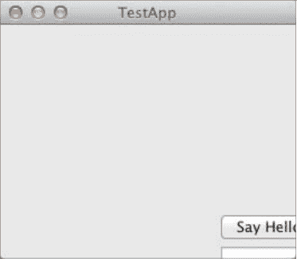

**图 5.11** 不正确的布局行为

你已经学习了创建和连接简单用户界面的基础知识。然而有一个小问题。如果 `TestApp` 没有在运行，请再次运行它，并尝试调整窗口大小。控件固执地停在原地，拒绝做出任何智能的调整（**图 5.11**）。

自 Mac OS X 10.7 Lion 发布以来，有两种机制可以用来定义视图的大小和定位行为：最初的“弹簧和支柱”以及新的 `Autolayout`（自动布局）特性。

> **注：** 这两种布局机制都有定义良好的 API，允许你使用代码控制布局行为。由于本书专注于 Xcode 而不是 Cocoa 开发，因此不会涉及编码主题。

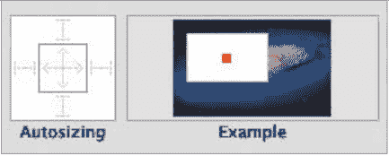

**图 5.13** 在自动调整大小控件中停用弹簧和支柱

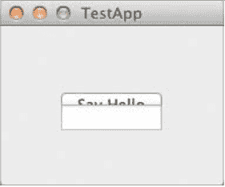

**图 5.14** 重叠的控件

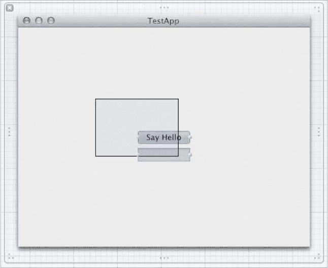

**图 5.15** 选择多个控件

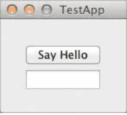

**图 5.16** 居中的控件

## 约束

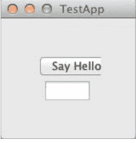

**图 5.18** 小窗口中被截断的控件

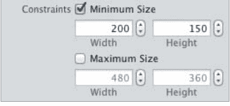

**图 5.19** 设置窗口大小约束

再次运行 `TestApp` 并调整窗口大小。注意文本字段现在如何变大和缩小。还要注意，如果窗口变得太小，按钮会被截断，字段也会变得有点太窄（图 5.18）。这是弹簧和支柱模型的局限性：应用任何约束的唯一方法是设置一个最小大小，这样控件不会被挤在一起或截断。


最简单的修复是设置最小窗口大小。选择窗口，在大小检查器的约束部分，选中 Minimum Size 复选框，并设置一个合理的尺寸（例如 200 x 150），如图 5.19 所示。

现在当你运行 `TestApp` 并调整大小时，控件应该大致能各自安分守己。你可能需要调整最小窗口大小或文本字段及包含它的自定义视图的大小，才能得到正确效果。

## 在 Lion 中使用自动布局

如前所述，Lion（Mac OS X 10.7）引入了一种名为自动布局的新布局机制。尽管它确实比弹簧和支柱有巨大改进（并且还有一套用于代码中的漂亮布局语言），但在 Lion 及以上版本中，它的使用并不是强制性的。也就是说，弹簧和支柱机制仍然可以像以前一样工作。事实上，你必须为每个打算使用自动布局的 Interface Builder 文档打开自动布局，否则弹簧和支柱仍然占主导地位。相应地，自动布局只能用于面向 OS X 10.7 及以上版本的应用程序。

> **注：** 你需要运行 `Xcode 4.1` 或更高版本，才能使用编辑器的自动布局功能。


**图 5.20** Interface Builder 文档的文件设置

**图 5.21** Mac OS X 10.7 升级提示

## 激活自动布局

要为 `MainMenu.xib` 激活自动布局，请导航到该文件，并确保工具区可见且选中了文件检查器面板。在 Interface Builder 文档部分（图 5.20）中，勾选 Use Autolayout 复选框。

如果你的项目最低部署版本设置为较低版本，系统可能会提示你将其升级到 Mac OS X 10.7，如图 5.21 所示。点击 Continue and Upgrade 按钮接受升级。

> **注：** 接受自动布局升级并将最低部署版本设置为 10.7，意味着你的应用程序将无法在 Mac OS X 10.7 之前的版本上运行。如前所述，自动布局需要 10.7。

## 约束

你会立刻注意到一些不同。图 5.22 显示了 Interface Builder 对象停靠区中新的 Constraints 条目。约束是真实的对象，就像按钮和窗口一样。它们定义其所约束控件的尺寸和定位行为。因为它们是真实的对象，你可以在 Interface Builder 中像处理按钮或窗口一样选择、配置或删除它们。

图 5.23 显示了一个选中的垂直间距约束。该约束管理 Say Hello 按钮与自定义视图顶部边框之间的垂直间距。使用自动布局时，将控件拖入窗口或视图并使其对齐到辅助线，会自动创建系统认为适合保持最佳定位的约束。

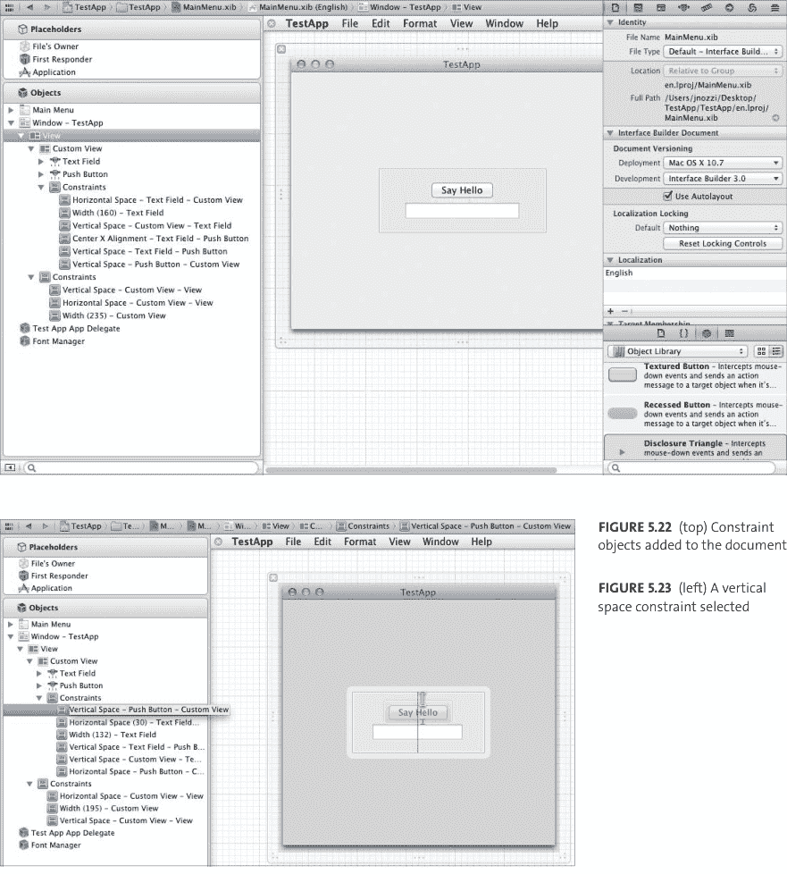

**图 5.22**（顶部）添加到文档中的约束对象

**图 5.23**（左侧）选中的垂直间距约束

要修复此问题（并探索添加约束），请选择自定义视图，然后从主菜单中选择 `Editor > Pin > Leading Space to Superview`。再次选择自定义视图，并选择 `Editor > Pin > Trailing Space to Superview`。你的窗口应该看起来类似 **图 5.25**。

如果现在运行 `TestApp`，你会发现这并没有完全解决问题。虽然按钮与下方字段保持相同的距离，而且自定义视图似乎正在调整大小（从文本字段的左边缘跟随移动可以看出），但其他一切似乎都不太正常。

文本字段的修复很简单。将左右边缘对齐到自定义视图内部的蓝色辅助线（**图 5.26**），适当的约束就会自动为你创建。

图 5.27 显示了将文本字段边缘对齐到左右辅助线后添加的约束。这些约束表明你希望保持字段两侧与父视图边界两侧之间的空间。再次运行 `TestApp` 表明，自动布局约束现在的工作方式与最初的弹簧和支柱相同。

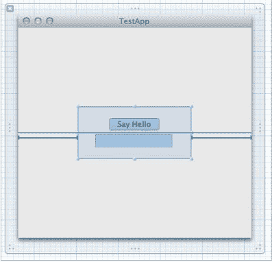

**图 5.25** 自定义视图的前导空间和尾随空间约束

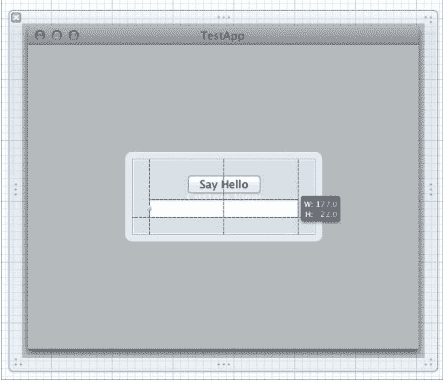

**图 5.26** 通过对齐辅助线创建约束


**图 5.27** 新添加的约束

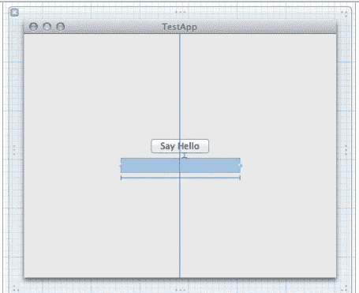

**图 5.28** 用于保持垂直间距的更简单约束

## 新功能

在 springs and struts 演示中，你需要自定义视图，以便窗口调整大小时按钮和文本字段保持彼此相同的垂直距离（防止它们重叠或分离）。

这里，带约束的 Auto Layout 才真正大放异彩。要让这个功能以它多年以来本应工作的方式运转，你需要移除那个自定义视图，并用正确的方式实现。一个在不移动按钮和文本字段的情况下移除视图的简单技巧是：选中自定义视图，然后从主菜单选择 `Editor > Unembed`。自定义视图被移除，其子视图则完全保持原位。

要修复 Auto Layout 约束，只需选择按钮和文本字段，然后将它们拖到中间，直到它们（作为一组）吸附到出现的蓝色垂直和水平中心线。你应该会看到类似图 5.28 的效果。运行 `TestApp`，你会发现有所改进。虽然文本字段的水平尺寸还不能像以前那样调整，但按钮和文本字段在没有那个本就毫无意义的自定义视图的帮助下，彼此保持了相对位置。这是因为文本字段和按钮之间的垂直空间约束。

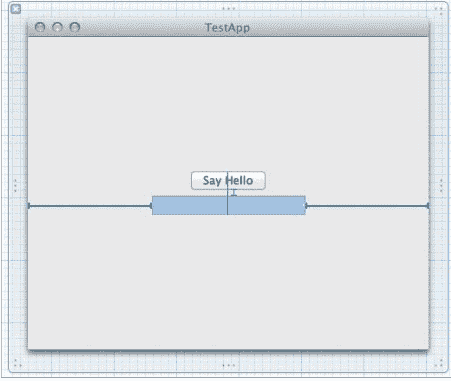

**图 5.29** 水平扩展的文本字段的最终约束

要完成这项工作，你可以再次为文本字段添加前导和尾随间距。选择文本字段，然后从主菜单选择 `Editor > Pin > Leading Space to Superview`；再次选择文本字段，然后从主菜单选择 `Editor > Pin > Trailing Space to Superview`。再次选择文本字段，你的约束看起来应该类似于 **图 5.29**。

现在运行 `TestApp`，它的行为应该符合预期。这应该能让你对新 Auto Layout 系统的工作原理，以及它相对于 springs and struts 系统的一些优势有一个相当好的了解。

## 小结

除非你编写服务器应用程序和命令行工具，否则你至少需要构建一个基本的用户界面。既然你已经熟悉 Interface Builder 以及动作（Action）和插座（Outlet）的基础知识，你就有了足够的知识来开始构建一些你自己的测试应用以用于学习。更复杂的应用通常需要多个控制器，也很可能需要多个 nib 文件。在下一章中，你将学习如何向项目添加额外的源代码和资源（包括额外的 nib 文件）。


**图 6.2** Add Files 拖放选项面板

## 文件夹

“文件夹”选项让你选择在将文件系统文件夹添加到项目时 Xcode 要执行的操作。第一个选项创建与文件夹同名的群组，然后将文件夹内容添加到该群组下。第二个选项创建文件夹引用。它们与群组类似，但表示的是物理文件夹本身，保留了其文件系统层次结构。

## 添加到目标

“添加到目标”选项指示 Xcode 根据文件类型将文件添加到项目中选定目标对应的构建阶段。Xcode 会自动将源文件添加到所选目标的 Compile Sources 构建阶段。大多数其他文件类型会被添加到 Copy Bundle Resources 构建阶段。目标和构建阶段将在第三部分中更详细地讨论。

## 使用拖放

除了使用 Add Files 面板，你还可以通过将文件拖入项目导航器来将它们添加到项目中。此时会出现一个面板（图 6.2），提供与 Add Files 面板相同的选项。选择你的选项，然后点击 Finish 即可将文件添加到项目。

> **注意：** 向项目添加额外的库和框架是很常见的。添加库和框架，以及打包框架以便随应用程序分发，将在第三部分中深入讨论。

## 创建新文件


Xcode 包含用于创建各种常见文件类型并将其添加到项目的模板和选项。要开始添加新文件，请从主菜单选择 `File > New File`。此时会出现一个类似 **图 6.3** 的面板。

该面板左侧有一个边栏，按 SDK 然后按文件类型对可用模板进行分类。边栏右侧的顶部区域包含选定类别可用的具体模板。在其中选择你想要的模板。紧接模板下方的区域显示所选模板的描述。


**图 6.4** Save As 面板

某些模板还有其他选项，允许你指定诸如超类等内容。这些选项会在你点击 Next 按钮时显示在下一个面板中。继续点击 Next，最终会提示你使用标准的 Save As 面板并附带一些额外选项（图 6.4）保存文件：放置新文件的群组，以及要包含该文件的目标。点击 Save 即可完成文件创建。

## 从项目移除文件


要从项目中移除文件，请在项目导航器中选中它并按 Delete 键。Xcode 会提示你做出决定（图 6.6）：是仅移除项目中的文件引用，还是移除引用并从磁盘中删除文件。此操作无法撤销，因此如果你删除了文件，需要恢复它，然后如本章前面所示将其添加到项目。

## 小结

一个典型项目需要添加许多新的源文件和资源文件。在维护和改进应用的过程中，你也会遇到需要移除文件的情况。你已经看到这两种操作有多么直接。在下一章中，你将学习如何有效使用源代码编辑器来编写和编辑源代码。

## 探索源代码编辑器界面


当你选择源代码文件、查看源代码文件中的问题时，或者在调试器中停在你自己源代码的断点处时，源代码编辑器（图 7.1）就会出现。这是你将花费大部分时间的编辑器。

请注意源代码编辑器左侧边缘的装订线。装订线可以显示断点、行号以及代码折叠和聚焦条。断点将在第 9 章中更深入地讨论。你可以通过 Xcode 的偏好设置来开关行号和代码折叠条的显示。

在编辑源代码时，第 3 章中见过的助手窗口可用于在主编辑器显示的文件旁边打开一个或多个文件（甚至同一文件的多个部分）。在此情况下，助手窗口充当分窗格编辑器。你可以使用各种自动模式（在助手窗格的跳转栏中选定），例如 Counterparts、Includes、Categories 等，这些模式会根据项目导航器中的主要选择让助手窗格显示上下文相关的文件。你可以按需添加任意数量的窗格，它们将根据第 3 章中看到的设置进行排列。

> **注意：** 源代码编辑器还有一个版本编辑器模式，即助手按钮右侧的按钮。

> 该功能将在第 21 章中介绍。

## 导航源代码


**图 7.2** 跳转栏显示属于所选文件的符号


**图 7.3** 按住 Command 键使符号变为超链接

源代码编辑器提供了几种导航代码的方式。这些方式包括跳转到符号、只显示你希望处理的代码，以及拆分编辑器以便同时查看文件的多个部分。

### 跳转栏

在源代码中的符号之间移动最常用的方法之一，是使用第 3 章中讨论过的跳转栏（**图 7.2**）。当打开一个包含已定义符号的源文件时，跳转栏的最后一段会在文件本身之下显示另一层级——源代码中符号的列表。该段显示编辑器插入点所在的符号。选择不同的符号会跳转到源代码中它的位置。

### 跳转到定义

另一种常见的导航操作是跳转到符号的定义处。源代码编辑器让这一操作变得简单：按住 Command 键即可将符号变成超链接（**图 7.3**）。按住 Command 键点击符号会跳转到其定义处（该定义不一定位于当前选中的文件中）。回想一下获取内联帮助的类似操作——按住 Option 键点击符号会弹出内联快速帮助弹出窗口。

## 折叠代码


**图 7.6** 使用代码折叠功能折叠后的代码

*折叠*是指将所需作用域内的文本折叠并隐藏起来。这不会改变文件中的文本，只是将其遮蔽，使文件在视觉上更短，更易于导航。**图 7.6** 展示了 TestAppAppDelegate.m 文件中 `-applicationDidFinishLaunching:` 方法被折叠后的效果；被“折叠”的代码显示为一个包含省略号的黄色标记。

要折叠代码，请在折叠条中点击所需的作用域。在存在嵌套作用域的情况下，最简单的方法是点击所需作用域任一端的一个箭头。

## 使用代码补全


Xcode 的源代码编辑器会在您键入时提供符号的代码补全。当您开始键入 Xcode 从您的项目或链接的库和框架中识别出的符号时，会出现一个内联建议以及其他可能建议的列表（图 7.7）。

您可以选择按 Tab 键接受内联建议。要选择替代建议，请使用箭头键进行选择，然后按 Return 键使用所选内容。当给定前缀有多个建议时（例如 `NSSet` 或 `NSSetFocusRingStyle()`），共同前缀会被加下划线，按 Tab 键将只补全到下划线部分。随后按 Tab 键将补全到内联建议的下一个整体或部分。

按 Escape 键或 Control+空格键可以取消代码补全。也可以将文本插入点放在不完整符号的末尾，然后按 Control+空格键来请求补全。

虽然 Xcode 默认会在您键入时自动建议代码补全，但您可以在 Xcode 偏好设置的“文本编辑”面板中关闭此功能。为此，请切换名为“键入时建议补全”的复选框。当此功能被禁用时，您仍然可以在文本插入点位于不完整符号末尾时按 Control+空格键来请求建议。

代码补全使用与第 3 章中看到的符号导航器相同的信息。这些信息来自工作区内所有可用的源和库，这意味着同一工作区内的不同项目可以相互共享这些信息。此功能将在第 16 章中讨论。

## 创建和编辑代码片段


要创建代码片段，请将所需的“模板”代码拖入代码片段库。该代码片段将被添加到可用代码片段列表中。要编辑该代码片段，请在库中选择它。弹出窗口出现时，点击左下角的“编辑”按钮。弹出窗口将显示编辑控件（图 7.10）。

您可以设置库列表中显示的标题和描述，以及代码片段面向的平台和语言。您还可以设置编辑代码时使用的补全快捷键。最后，您可以编辑代码片段本身。编辑完成后，点击“编辑”或“完成”。

一个有用的代码片段示例是 `NSTableViewDataSource` 协议三个主要方法的现成集合。当使用此协议以编程方式填充 `NSTableView` 时，过去最快的启动方法是复制文档中的方法签名，然后插入括号、用于确定正在操作的表的 if 条件等。现在，您只需定义一次，按您想要的方式格式化，然后将其保存为代码片段，以便在未来的任何项目和工作中复用。

您还可以插入占位符标记，这些标记是代码片段中必须填写以完成代码的部分（例如参数）。例如，要为 `NSNumber` 参数添加占位符，您可以在参数所属位置键入 `<#NSNumber#>`。当使用该代码片段时，出现在井号之间的文本就是代码片段中显示的内容。标记的文本应作为有用的提示，说明使用该代码片段时应填写什么内容。

## 助理

编辑源文件时，助理可以充当更智能的分屏编辑器，显示（并允许您编辑）当前文件或您选择的任何其他文件的不同部分。如第 3 章所述，根据您选择的行为模式，助理可以具有上下文感知能力。

在任何上下文中，您都可以手动选择要在助理中显示的文件，当然也可以根据需要创建任意数量的助理（每个助理都可以采用您喜欢的任何行为模式）。

### 可用的助理行为

- *对应文件*行为显示被视为所选项目对应文件的文件。对应文件可能是所选实现文件的头文件，反之亦然。

- *父类和子类*行为分别显示所选内容的任何已知父类或子类。

- *同级文件*行为显示与所选内容位于同一项目导航器组中的任何文件。

- *类别和协议*行为分别显示所选文件可用的 Objective-C 类别或协议。

- *包含和被动包含*行为分别显示包含所选内容的文件或被所选内容包含的文件。

## 小结

现在您已经熟悉了 Xcode 源代码编辑器的基本功能。其他功能，包括重构工具、Fix-it 以及重命名符号的功能，将在第三部分中深入介绍。在下一章中，您将学习如何执行项目范围内的搜索和替换。

## 8 搜索和替换

Xcode 提供了多种方式来搜索和过滤项目成员、源代码和文档。您在第 3 章中通过搜索导航器初步了解了搜索源代码的方法。在本章中，您将学习如何搜索和过滤项目成员，以及如何对项目源代码的全部或特定部分执行替换。


## 使用搜索导航器


**图 8.1** 显示匹配项的搜索导航器


**图 8.2** 搜索选项上下文菜单

如第 3 章所述，发起基本搜索很简单。在搜索导航器顶部的熟悉搜索框中键入一个词，然后按 Return 键。结果按源文件组织显示在导航器大纲中（图 8.1）。选择文件或文件中的匹配行将导致 Xcode 在适当的编辑器中导航到该位置。通过在搜索导航器底部的搜索字段中键入额外的词，可以进一步细化搜索结果。您可以通过从主菜单中选择“编辑”>“查找”>“在工作区中查找”来启动项目范围的搜索。


在按 Return 键之前键入搜索词时，可以选择搜索的基本范围。键入时会出现一个上下文菜单（图 8.2），允许您将范围限制为您的项目，或您的项目及所有框架，以及选择“开头为”或“包含”类型的搜索。您可以选择这些选项之一，而不是按 Return 键；Return 键总是选择第一个选项，该选项由您选择的查找选项定义。

**提示：** 您可以按 Command+Shift+F（用于查找）立即跳转到搜索导航器。搜索字段会获得焦点，因此您可以立即开始键入搜索词。

## 使用查找选项


**图 8.3** 查找选项面板

有许多选项可用于指定您的搜索。点击顶部搜索字段左边缘的放大镜图标以显示上下文菜单。选择“显示查找选项”，查找选项面板将出现（图 8.3）。

### 使用“样式”选项

此选项允许您指定文本搜索或正则表达式搜索。文本搜索匹配您键入的字面文本词。正则表达式（或 regex）搜索将使用正则表达式语法搜索模式。

虽然您可以使用精心选择的搜索和替换字符串执行相当复杂的更改，但正则表达式是更强大的模式匹配工具。对正则表达式的支持直接内置于许多现代 API 和文本编辑器中。虽然该主题超出了本书的范围，但存在大量相关书籍和在线教程。

### 使用“命中必须”选项

此选项允许您指定搜索词在被搜索项目中的位置。也就是说，您可以选择查看包含该词的所有结果、仅查看以该词开头或结尾的结果，或者仅查看与整个词完全匹配的结果。

### 使用“匹配大小写”选项

此选项允许你选择搜索是否区分大小写。例如，在选中“忽略大小写”的情况下，术语 *hello* 会在你的 TestApp 项目中产生三条结果，分布在两个文件中：头文件和实现文件中的 `-sayHello:` 方法，以及 `-sayHello:` 方法体内的 `@"Hello World"` 字符串。如果你选择“匹配大小写”，则不会有任何结果，因为单词 *hello* 的所有实例都是以大写字母开头的。

### 使用“在…中查找”选项

此选项允许你将范围缩小到多项目工作区中的特定项目，或你定义的任何自定义范围。工作区将在第 16 章详细讨论。自定义范围将在下一节讨论。你还可以通过选中“以及链接的框架”复选框，选择包含项目链接的任何框架。

### 自定义查找范围

这一强大功能允许你使用用户定义的规则来定义搜索范围，这些规则可以匹配位置、名称、路径、扩展名或文件类型。要定义自定义范围，请从“在…中查找”弹出按钮菜单中选择“自定义”。将出现一个工作表，列出自定义范围（默认为空）及其关联规则（**图 8.4**）。

单击“完成”按钮关闭工作表。新的范围现在会在“在…中查找”弹出菜单中被选中，并保留为可用的搜索范围之一。你可以随时通过从“在…中查找”弹出菜单中选择“自定义”选项来编辑或删除它，或添加新的范围。

在“匹配项必须”弹出菜单中选择“忽略大小写”，并在“在…中查找”弹出菜单中选择新的“HTML Source”范围，然后在搜索字段中再次键入 **hello** 并按 Return 键。注意，没有任何匹配，因为你的项目中目前包含该术语的唯一文件不是 HTML 文件。

### 替换文本

顶部搜索字段左侧是一个弹出按钮，当前选中“查找”。单击该弹出按钮并选择“替换”。搜索字段下方会显示更多选项（图 8.6）。一个额外的字段（用于指定替换词）与三个按钮（“预览”、“替换”和“全部替换”）一起出现。当导航器区域不够宽，无法容纳这三个按钮时，“预览”按钮会以放大镜图标表示。

> **注意：** 从搜索字段的放大镜菜单中选择“显示查找选项”时显示的其他查找选项，在执行查找和替换时也可用。


你可以通过选中特定匹配项（按住 Command 键并单击单个结果）并单击“替换”按钮来替换它们。这将只把这些匹配项替换为替换词。要替换所有匹配项，请单击“全部替换”。Xcode 将替换所需的匹配项，并且在你构建或关闭项目时，更改将自动保存。

### 预览替换

Xcode 提供了一个可视化的替换预览界面，用于预览替换。当你单击“预览”按钮时，会显示一个类似于**图 8.7** 的工作表。预览工作表允许你“精挑细选”想要的替换项，并在应用之前查看每项更改的效果。

为了测试，假设你只想将项目中的 `-sayHello:` 操作更改为 `-sayGreeting:`。你不想更改实际呈现给用户的消息，而只想更改方法名称。

执行区分大小写的搜索以查找 **Hello**。获得结果后，确保弹出菜单中选中了“替换”，以便显示替换选项。在替换字段中输入 **Greeting**。

单击“预览”按钮以显示替换预览工作表。如图 8.7 所示，选择头文件中的 `-sayHello:` 方法声明和实现文件中的对应实现。保持包含 `@"Hello World"` 字符串的那一行不被选中。你可以通过在左侧轮廓视图中为所需匹配项打勾，或在预览面板右侧切换开关来完成此操作。

### 在文件内搜索


图 8.8　源代码编辑器的“查找”面板

你也可以在源代码编辑器当前选定的源文件中执行搜索或搜索并替换。这个更简单的界面与搜索导航器的工作方式非常相似，包括其他选项（通过单击搜索字段的放大镜图标）和一个替换字段（图 8.8）。

要查找单词或短语，请从主菜单中选择“编辑”>“查找”>“查找”。输入搜索词并按 Return 键。你可以使用搜索字段左侧的后退和前进按钮浏览文件中的匹配项。

虽然不像项目范围内的搜索和替换那样有预览，但你可以选择“全部替换”来替换所有匹配项，选择“替换”来替换当前选中的匹配项，或选择“替换并查找”来替换当前选中的匹配项并选择下一个匹配项。

单击“完成”关闭“查找”面板。

提示：你可以按 Command+F 在源代码编辑器中启动搜索。这与打开搜索导航器的 Command+Shift+F 快捷键类似。你可以按 Command+G 转到下一个匹配项，按 Command+Shift+G 转到上一个匹配项，从而浏览匹配项。

### 总结

你已经了解了如何在项目中或当前选定的文件中进行搜索和替换。全面的选项集——包括用户可自定义的、基于规则的范围——足够灵活，可以帮助你准确找到你想要的内容。替换预览系统允许你精确挑选想要替换的内容。所有这些代码编辑和文本替换都会不可避免地引入 bug。在下一章中，你将学习使用 Xcode 内置调试器调试应用程序的基础知识。

## 9 基本调试与分析

Xcode 提供了一套全面且集成良好的工具，用于调试和分析你的应用程序。在本章中，你将学习如何使用 Xcode 的内置调试器。在第 17 章中，你将学习更高级的调试技术。


### 编译时调试

图 9.1　源代码编辑器中高亮显示的编译器问题


图 9.2　源代码编辑器中高亮显示的分析器问题


在 Xcode 中，错误、警告和分析器结果统称为问题。Xcode 会不断编译和检查你的代码是否有问题。错误为红色，警告为黄色，静态分析器问题为蓝色。与任何现代集成开发环境一样，Xcode 会直接在源代码中高亮显示问题（图 9.1），并在源代码编辑器左侧边缘的沟槽中显示相应的图标。除了所选源文件中的直接问题外，Xcode 在整个工作区中发现的所有问题都会显示在“问题”导航器中（如第 3 章所述）。

### 使用静态分析器

Xcode 集成了 Clang 静态分析器，它比基本的编译器错误和警告更进一步。它充分了解 C、Objective-C 和 Cocoa 模式，能够发现内存管理问题、未使用的变量等。它与 Xcode 的集成意味着它可以显示大量详细信息，包括导致问题的执行路径以及沿途引发问题的条件。图 9.2 显示了一个分析器问题。在这个例子中，一个 `NSArray` 实例在第一行创建，在下一行泄漏。每一行中导致问题的指令都会被高亮显示并加以说明。

注意：你可以访问 `http://clang-analyzer.llvm.org` 了解更多关于 Clang 静态分析器的信息。

第 17 章将探讨更复杂的分析器场景。


**图 9.3**　Fix-it 窗口提供修复建议


**图 9.4**　日志导航器中 `Bob` 未声明的构建错误

### 使用 Fix-it 修复错误

你可以使用 Xcode 的 Fix-it 功能修复常见错误。当你在源代码编辑器中单击一个问题时，如果 Xcode 有任何建议，它会显示一个带有可能修复建议的弹出窗口（**图 9.3**）。要应用建议的修复，请单击 Fix-it 弹出窗口中的建议。代码将根据所选的修复方式进行更改。

### 使用日志导航器

每次构建的完整结果都存储在日志导航器中，你在第 3 章中已经了解过。你可以筛选和浏览结果。双击一个问题会导航到相应的文件。**图 9.4** 显示了当类 `Bob` 被引用但未声明时导致的构建错误。最好通过单击问题左侧的展开三角形来展开问题。这会显示有关该问题的关键细节，帮助你弄清楚如何修复它。

### 运行时调试

**图 9.5** TestApp 在调试器中暂停


对于运行时调试，Xcode 集成了 GDB 和新的 LLDB 调试器。Xcode 提供了一个界面，用于管理断点、控制程序执行、探索运行中应用的线程和堆栈、访问调试器控制台等。

默认情况下，所有新建的 Xcode 项目都在调试器中运行。如果应用崩溃，它会在故障点暂停；如果遇到您设置的任何断点，也会在断点处暂停。当应用在附加了调试器的情况下运行时，会出现调试区（图 9.5）。当前指令在源代码编辑器的装订线中以绿色箭头高亮显示。


> **注意：** 运行中的应用是否附加调试器由活动方案控制。方案将在第 14 章中讨论。

#### 使用调试器栏


基本程序执行控制——包括单步进入、单步跳过、继续等——以及线程和堆栈导航器位于调试区顶部的调试器栏（图 9.6）中。您可以通过设置断点来暂停程序（或触发 Xcode 中的其他操作）。您可以使用导航弹出窗口在线程和堆栈之间导航。

#### 使用基本控制

-   暂停/继续按钮可暂停和恢复程序执行。此操作的键盘快捷键是 Control+Command+Y。

-   单步跳过按钮会在执行暂停时执行当前高亮显示的指令。如果该指令是一个例程，则执行该例程，调试器会在当前文件的下一条指令处停止。键盘快捷键是 F6。

-   单步进入按钮会在执行暂停时执行当前高亮显示的指令。如果该指令是一个例程，调试器会进入该例程的第一行并暂停。键盘快捷键是 F5。

-   单步退出按钮会结束当前例程，并跳回到调用例程或该例程被调用后的下一条指令。键盘快捷键是 F8。

您可以在主菜单的 Product > Debug 子菜单下找到其他调试器操作。

> **提示：** 在点击单步按钮时按住 Option 或 Option+Shift 会改变按钮的功能。您可以单步执行汇编指令，或仅单步执行当前线程中的指令。有关详细信息，请参阅 Xcode 文档。

#### 在线程和堆栈中导航

线程和堆栈导航器占据调试器栏的其余部分，用于在线程之间切换并导航调用堆栈。它的工作方式与跳转栏相同。**图 9.7** 显示了 TestApp 在 `-applicationDidFinishLaunching:` 方法中的断点处暂停时的当前调用堆栈。

#### 在控制台中工作

控制台（**图 9.8**）显示应用的控制台输出，并在调试时充当调试器的命令行界面（无论您使用的是 GDB 还是 LLDB）。

您可以使用控制台区域左上角的弹出菜单过滤输出，仅显示调试器或目标输出。调试器提示符仅在应用在调试模式下暂停时可用。当提示符可用时，您可以单击文本提示符的右侧并输入调试器命令，例如 GDB 命令 `po`（打印对象）。

控制台区域左侧的面板，即变量窗格（**图 9.9**），在调试器暂停时显示当前变量和寄存器。窗格左上角的弹出按钮可用于选择所有变量、最近访问过的变量，或仅当前作用域内的局部变量。


**图 9.7** 在“线程和堆栈”导航器中查看调用堆栈


**图 9.8** 调试器控制台


**图 9.9** 变量窗格


**图 9.10** 在 TestApp 的问候操作中设置的断点

#### 使用断点

当执行到特定指令（代码中的某个点）时，断点用于在调试器中暂停应用（或执行其他操作）。在 Xcode 4 中有多种管理断点的方法。

#### 启用断点

要让 Xcode 在调试器中停在断点处，断点必须处于激活状态。您可以使用项目窗口顶部的断点按钮来激活或停用所有断点。如果未选择此按钮，调试器只会在遇到程序信号（例如与内存管理相关的崩溃）时停止。或者，您可以使用 Command+Y 来切换断点。

> **注意：** 在以前版本的 Xcode 中，Command+Y 会在调试器中启动目标应用，而 Command+R 则在未附加调试器的情况下运行它。从 Xcode 4 开始，按 Command+Y 可切换所有断点的激活状态，并且运行中的应用实际上始终处于调试模式。

#### 在源代码编辑器中管理断点

您可以通过单击源代码编辑器中指令旁边左侧边缘的装订线来设置断点。会出现一个蓝色标记，表示该位置已设置断点（**图 9.10**）。

您可以在编辑器中单击单个断点来切换它。断点会变浅，在非激活状态下呈半透明。要完全移除断点，您可以将其从装订线中拖出并释放。它会在一团动画烟雾中消失，表示它已被删除。

您还可以使用键盘快捷键在编辑器中设置断点。`Command+\`（Command 和反斜杠字符）将在代码的当前行设置断点。如果断点已存在，该快捷键将移除它。


**图 9.11** 断点选项弹出窗口


**图 9.12** 异常断点的选项弹出窗口

#### 使用断点导航器

正如您在第 3 章中所学，您可以使用断点导航器来管理单个断点，按断点集浏览项目，或仅查看活动断点。还有一些更重要的功能需要注意：

-   在导航器中右键单击断点，并从上下文菜单中选择“编辑断点”，将弹出一个显示许多选项的窗口（**图 9.11**）。您可以设置断点触发时中断的条件（例如 `x == 21`）；在中断前忽略断点若干次；在到达断点时添加一个或多个操作（例如播放声音、将某些内容记录到控制台、执行 shell 命令）；并在执行操作后自动继续。

-   您还可以使用断点导航器底部的 + 按钮设置异常断点或符号断点。当您添加任一类型断点时，会出现一个类似于断点选项弹出窗口的弹出窗口（**图 9.12**），允许您进一步指定其各自选项。

> **注意：** 有关用户断点、异常断点和符号断点的各种选项的完整说明，请参阅 Xcode 文档。

**图 9.13** 在源代码编辑器中检查变量


**图 9.14** “运行到此处”按钮


#### 与源代码编辑器交互

当应用暂停时，您可以以几种有用的方式直接在源代码编辑器中与调试器交互。

#### 在源代码编辑器中检查变量

变量面板并不是在调试器中检查变量状态或内容的唯一方法。当应用暂停时，您可以将鼠标指针悬停在变量上以检查它，只要它在当前作用域内。将出现一个黄色框，显示被检查变量的详细信息（图 9.13）。


> **注意：** 您已经看到，指向 Objective-C 对象的指针可以在源代码编辑器、变量面板以及使用控制台中的打印对象命令时进行检查。显示的信息是调用从 `NSObject` 类继承的 `-description` 方法的结果。

#### 使用“运行到此处”

有时，继续执行到当前暂停位置下方的代码中的某个点，或继续通过循环回到顶部，可能会很有用。您可以使用“运行到此处”命令将执行继续到所需位置。

要将执行继续到选定指令，请将鼠标指针悬停在指令旁边的装订线上。将出现一个绿色按钮（图 9.14）。单击该按钮即可执行到该指令为止。

#### 移动执行指针

你可以拖动执行指针，并将其放置在局部作用域内的任何位置。

你可以使用它来跳过部分代码，或向后跳转以重复指令。

要移动执行指针，请抓住源代码编辑器左边缘的绿色箭头，并将其拖到所需的指令处。

向后移动执行指针以重复指令不会撤销刚刚执行的指令。当你继续或单步执行代码时，它会再次执行这些指令。如果你是调试新手，忽略这一区别可能会让你感到困惑。

#### 使用调试导航器


正如你在第3章中学到的，调试导航器会在调试器中暂停执行时显示线程和堆栈。此视图表示与调试器栏中的“线程和堆栈”导航器相同的信息。你可以按线程或Grand Central Dispatch队列来组织导航器。

你可以使用底部的控件进一步细化导航器。滑块左侧的按钮（∑）在启用时，会过滤线程和堆栈，仅显示包含你的代码或存在调试符号的线程。滑块控制显示多少堆栈详细信息——左侧仅显示每个堆栈的顶部帧，而右侧显示所有堆栈帧。

> **注意：** 有关Grand Central Dispatch的更多信息，请参阅Apple开发者文档。

## 总结

你现在应该已经牢固掌握了Xcode 4提供的基本调试功能。你将在第17章中找到更多调试技术。在下一章中，你将探索Xcode的图形化数据建模器，并使用它为TestApp添加一些数据管理和存储功能。


## 10 使用**数据模型**编辑器

Xcode带有一个集成的数据模型编辑器工具。在本章中，你将学习如何使用数据建模器让应用程序能够创建、管理、操作、保存和加载其数据，而无需编写一行代码。


### 引入**Core Data**

数据模型为你的应用程序提供了一种定义良好的结构来管理和持久化其数据。该模型对应于模型-视图-控制器设计模式中的模型层。有多种方法可以管理应用程序的模型层，但Apple创建了一个在许多情况下都能很好工作的解决方案：Core Data。该设施与Xcode集成得很好。

Apple非常谨慎地将Core Data指定为“对象图管理和持久化框架”。尽管该框架与关系数据库有很多共同之处，但重要的是要注意它并非旨在充当关系数据库。Core Data主要关注桌面应用程序的需求（尽管它也可以用于服务器应用程序，只要注意妥善管理即可）。

该框架提供了标准的持久化存储类型（二进制、SQLite和XML），并且可以通过自定义存储类型进行扩展。开发人员必须提供的最低要求是一个托管对象模型，它描述了应用程序的实体（如Person、Group、Account或BlogPost）以及它们之间可能存在的关系。有了这个模型和操作它的UI，Core Data就足够智能，可以处理管理、保存和加载应用程序数据的任务，而无需编写一行代码。然而，在实践中，一个中等复杂度的应用程序将需要进一步的自定义。

你需要理解几个关键概念才能使用这个API及其相关的Xcode功能。


> **注意：** Core Data依赖于几种底层的Cocoa技术。这被认为是一个高级主题。本书将介绍基本概念，但仅专注于Xcode的Core Data功能。更多信息请参阅Apple的开发者文档。

### 托管对象模型

托管对象模型（MOM）是Core Data用于描述应用程序数据模型的功能。它可以用代码描述，但通常使用数据模型编辑器构建。当你从使用Core Data的模板创建项目时，所有必要的代码以及一个与应用程序同名的空MOM文件都会包含在内。对于TestApp，该文件是`TestAppDataModel.xcdatamodel`。

### 持久化存储

持久化存储是使用你的托管对象模型创建的数据在磁盘上的表示。Core Data默认支持三种存储类型：XML、SQLite和二进制。每种存储类型都有其优缺点（详情请参阅Core Data文档）。此外，Core Data支持开发人员实现的自定义存储类型。托管对象模型“不关心”数据如何（甚至是否）被持久化到存储中。

不熟悉Core Data的开发人员有时会将模型与使用该模型创建的数据存储混淆。有些人甚至会寻找一种在Xcode中浏览其应用程序放入存储中的数据的方法。理解这一点很重要：你的应用程序中创建的数据不是存储在托管对象模型中，而是存储在存储中。

> **注意：** 在本章的其余部分，术语*模型*可假定为指Core Data托管对象模型。


### 实体

实体代表你的模型对象。这里的*实体*与关系数据库中的含义相同。它是对一种对象类型及其属性的描述。在Core Data术语中，*托管对象*是实体的一个*实例*。

当在编辑器中选择一个实体时，会出现一些容器，允许你添加属性、关系和获取属性。

一个属性至少需要一个名称（如`lastName`或`age`）和一个类型（如字符串或数字）。一个关系需要一个名称（如`parentFolder`）和一个目标实体（如`Folder`），可以是一对一或一对多的关系。

### 托管对象上下文

托管对象上下文可以被视为一个“草稿板”，一个在其中创建托管对象或从持久化存储中取出、可能修改并可能保存回存储的上下文。要使用Core Data，你至少需要一个上下文。

你可以有多个上下文来保持多组更改的分离。例如，桌面应用程序可能会为在后台运行的“导入”任务创建一个单独的上下文，而用户则继续使用现有数据。服务器应用程序可能会为每个会话（连接的用户）设置一个上下文，以隔离他们的活动，直到他们准备好“提交”所做的任何添加、更改或删除。

单独的上下文使用几种可用的合并策略之一进行合并，这些策略规定了如何处理冲突的更改。然后可以将合并后的上下文持久化到存储中。在这个导入示例中，当导入成功完成时，上下文可以被合并（并持久化），从而在主用户界面中向用户显示新导入的数据。

**图10.2** 模型图模式中的MOM


主编辑器有两种主要样式：表格和图。表格模式是你在图10.1中看到的。图模式如图10.2所示，表示模型的关系和继承。当使用图编辑器样式时，你需要使用实用工具区域来编辑实体及其属性和关系。

### 创建基本数据模型


**图10.3** TestApp的托管对象模型

现在你已经了解了数据模型编辑器，可以准备通过添加一个简单的数据模型来扩展TestApp的功能。对于这个示例，假设目标是添加创建、编辑、保存和恢复简单待办事项的能力。一个待办事项将有一个内容字符串和一个截止日期。


要创建待办实体，请导航到`TestAppDataModel.xcdatamodel`文件。单击“添加实体”按钮。将添加一个默认名称为`Entity`的实体，准备重命名。输入`ToDoItem`，然后按Return键重命名该实体。

通过在编辑器中的“属性”表中单击添加（+）按钮来添加截止日期属性。将属性名称改为`dueDate`，并将其类型设置为Date。对`content`属性执行相同操作，将其名称设为`content`，类型设为String。MOM现在应如图10.3所示。

这就是赋予TestApp维护和持久化待办事项列表所需的全部内容。要让用户操作列表（包括添加、编辑和删除），你需要添加一个用户界面（UI）。

## 为模型创建 UI


**图 10.4** 在 TestApp 界面中腾出空间

要管理 TestApp 的待办事项，你需要一个表视图和几个用于添加和移除项目的按钮。Cocoa 的 `NSArrayController` 对象通过 Cocoa Bindings 机制，无需编写任何代码即可满足控制器层的全部需求。要创建界面，请在项目导航器中选择 `MainMenu.xib` 文件。该文件将在 Interface Builder 中打开。

### 布局界面

首先，为更多的用户界面元素腾出空间。你可以将 Say Hello 按钮及其文本字段移动到窗口顶部（图 10.4），也可以将窗口调大来获得更多空间。

将两个 `NSButton` 拖入窗口（图 10.5）。放置好按钮后，双击每个按钮并将其标题设置为 Add 和 Remove。最终效果应如图 10.6 所示。这些按钮可让用户添加和移除 `ToDoItem` 实体的实例。

为了向用户展示待办事项并提供操作手段，一个简单的表视图就足够了。找到 `NSTableView` 控件，将一个拖入窗口，按图 10.7 所示放置。双击两列的标题，分别设置为 Due 和 Description。稍后你需要将这些列绑定到表所显示的 `ToDoItem` 实例的 `dueDate` 和 `content` 属性上。


**图 10.5** 向界面中添加按钮


**图 10.6** Add 和 Remove 按钮


**图 10.7** 将表视图控件放入界面


**图 10.10** 添加数组控制器


### 创建控制器

Core Data 与另一种名为 Cocoa Bindings 的 Cocoa 机制配合良好。Cocoa Bindings 控制器层提供了几个易于使用的控制器（如 `NSArrayController`），可简化 Core Data 信息的显示和管理。找到 `NSArrayController` 并将其拖入 Interface Builder 停靠区（图 10.10）。在停靠区中选择该数组控制器，然后在工具面板中选择属性检查器。（注意：控制器之所以拖入 Interface Builder 停靠区，是因为它们不是可视的用户界面元素。）

选中 Auto Rearrange Content 复选框，以便新建的待办事项能正确排序。将 Mode 弹出菜单改为 Entity Name。将 Entity Name 字段改为 `ToDoItem`，告知数组控制器它正在管理来自 MOM 的 `ToDoItem` 实体。选中 Prepares Content 复选框，避免手动获取其内容。属性检查器的显示应如图 10.11 所示。

接下来，你需要将数组控制器绑定到其内容上，这些内容来自 Core Data 持久化存储。选择绑定检查器，展开 Managed Object Context 绑定。选中 Bind To 复选框，并在其旁边的弹出菜单中选择 Test App App Delegate。将 Model Key Path 字段设置为 `managedObjectContext`。绑定检查器的显示应如图 10.12 所示。这将使数组控制器使用 `TestAppAppDelegate` 类（通过其 `-managedObjectContext` 方法）提供的管理对象上下文（MOC）。

**图 10.11** 数组控制器的属性设置


**图 10.12** 数组控制器的绑定设置

**图 10.13** Due 列的绑定设置


### 连接界面

要完成界面，你需要将控件连接到数组控制器，以便待办事项在表中显示且可编辑，同时 Add 和 Remove 按钮能够工作。

首先，将 Add 和 Remove 按钮的动作分别连接到数组控制器的 `-add:` 和 `-remove:` 动作。正如你在第 5 章中所学，可以通过按住 Control 键从按钮拖曳连接线到占位符与对象面板中的数组控制器，并选择相应的动作来完成。

最后，你需要将表格列绑定到数组控制器的内容。这样每一列将对应表格所表示的每个 `ToDoItem` 实例的相应属性（到期日期和内容字符串），每行对应一个项目。如果工具区域中的绑定检查器尚未选中，请选择它。选择 Due 列（需要多次点击该列以穿过窗口和视图层次）。展开 Value 绑定，选中 Bind To 复选框，在弹出菜单中选择 Array Controller，并将 Model Key Path 字段设置为 `dueDate`（图 10.13）。对 Description 列执行相同操作，将 Model Key Path 字段设置为 `content`。


**图 10.14** 带新待办功能的 TestApp

### 对界面进行测试

TestApp 已准备好进行测试。构建并运行应用程序。点击 Add 按钮添加一个待办事项，设置日期（使用你在格式化器的属性中选择的 M/D/YY 格式）和描述。退出应用并重新启动。你会注意到更改已自动持久化。现在尝试通过点击任一列标题对表格排序，然后再尝试移除一个项目。图 10.14 展示了 TestApp 的运行情况。

向 `ToDoItem` 实体添加另一个属性也同样简单。待办事项需要一个完成复选框。要实现这一点，你可以向 `ToDoItem` 实体添加一个 `completed` 布尔属性，并添加一个带有复选框单元格的新表格列。

### 创建自定义类

通常需要创建自定义的 `NSManagedObject` 子类来定制实体实例的行为。实体的后端类必须在托管对象模型中指定。

要为实体创建子类，请在编辑器中选择该实体，然后从主菜单中选择“文件 > 新建 > 新建文件”。在出现的表单中选择 Core Data 类别，并选择 `NSManagedObject Subclass` 选项。点击下一步。系统会提示你选择存储新类的文件夹和组（但不是文件名）。点击创建以完成操作。新文件将被创建并添加到你的项目中，所选实体的类会反映在数据模型检查器的工具区域中。

要让实体指向项目中已有的 `NSManagedObject` 子类，请在编辑器中选择该实体并打开工具区域。选择数据模型检查器，然后修改 Class 字段以反映所需类的名称。

### 快速创建访问器

使用自定义 `NSManagedObject` 子类时，你可以为实体的属性自动生成访问器源代码。为此，选择实体，然后选择一个或多个属性。从主菜单中选择“编辑 > 复制”。你可以从项目导航器中选择自定义 `NSManagedObject` 子类，也可以使用 Assistant（将在下一节讨论）使子类的实现可见。将光标置于源文件中想要插入访问器的位置，然后选择“编辑 > 粘贴属性实现”。Xcode 会在所需位置生成并插入有效的访问器代码。你可以对头文件重复此过程（此时菜单项为“粘贴属性接口”）。

### 使用 Assistant

编辑数据模型时，会显示额外的 Assistant 行为。在这种情况下，Assistant 仅显示与你的工作区中定义并在托管对象模型中使用的自定义 `NSManagedObject` 子类相关联（或持有引用）的源代码文件。

- *自动* 行为会显示 Xcode 认为对数据模型或所选实体而言的最佳文件。

- *运行时类* 行为会显示在你的工作区中定义且被托管对象模型使用的所有自定义 `NSManagedObject` 子类。

- *引用* 行为会显示包含对你的工作区中定义且被托管对象模型使用的任何 `NSManagedObject` 子类引用的文件。

### 总结

Core Data 和 Cocoa Bindings 是 Cocoa 中一组复杂的主题。你仅仅触及了使用 Xcode 创建非常简单数据模型及配套界面的皮毛。在下一章中，你将学习如何为 TestApp 设计自定义图标。

## 11 自定义应用程序图标

Mac OS 和 iOS 使用相同的图标文件格式（`.icns`）。图标文件主要用于应用程序和文档图标，但也可以像其他任何图像格式一样，作为应用程序中的标准图像使用。在本章中，你将学习如何使用 Xcode Tools 实用工具应用程序 Icon Composer 将你的图稿转换为图标文件，以及如何在应用程序中使用这些图标。


### 选择理想的图稿

适合 Mac OS 或 iOS 图标的理想图稿是 PNG（`.png`）或 TIFF（`.tif`）图像。图像应使用透明效果，让背景透过设计中的“空白”区域显示出来。你还应该准备 512×512、256×256、128×128、64×64、32×32 和 16×16 尺寸的图稿版本，每个版本都要有适合其大小的细节量。尽管这需要更多功夫，但这种多尺寸方法能帮助操作系统在图标显示时无论大小如何都保持清晰图像。


为了本章的示例，我创建了一个简单的图稿，用以传达 TestApp 的“测试”性质。

### 创建图标

Icon Composer 应用程序（位于与 Xcode 相同的文件夹中的 Utilities 子文件夹下）接收你的图稿并生成 `.icns` 文件。启动该应用程序，你将看到一个空白文档，其中包含一系列图像井（每种尺寸对应一个，见上一节列出的尺寸）。


**图 11.1** 已填充完成的 Icon Composer 文档

### 创建图标文档

将你的图稿拖入每个图像井中。如果你的设计师已经为每种尺寸创建了不同细节的图标，此时应将合适尺寸的图稿拖入匹配的图像井中。否则，只需将你拥有的最大的图稿副本拖入每个图像井即可（图 11.1）。

### 测试并验证图标

Icon Composer 提供了一种方法，可以在各种背景下按各种尺寸检查你的图标。这使你可以确保投影和 alpha 透明度看起来正确，并显示当图标尺寸过小而无法保留细节时，细节的表现情况（图 11.2）。

**图 11.2** 新图标缩小后叠加在桌面背景图像上的效果


要使用此功能，请单击图标文档底部边缘的 `Preview` 按钮。然后可以使用弹出式菜单选择背景，并使用滑块调整文档的尺寸。

### 保存图标

当你满意后，请将你的图标文档保存到合适的位置。给它取一个类似 `TestAppIcon.icns` 的名字。现在你可以使用 Xcode 将其设置为应用程序的图标。

### 设置应用程序图标

切换到 Xcode 中的 `TestApp` 项目，并在 `Project` 导航器顶部选择主 `TestApp` 项目项。在 `Targets` 列表下，你应该能看到 `TestApp` target。选择该 target，你的项目窗口应如图 11.3 所示。`App Icon` 图像井显示“未指定图像”。


**图 11.3** 未设置应用程序图标的 `TestApp` target 编辑器

> 注意：你将在第 14 章进一步了解 target 的配置。


### 设置文档图标

在使用基于文档的 Cocoa 应用程序时，你需要添加应用程序可识别的文档类型（将在第 14 章介绍）。设置文档类型的图标与设置应用程序图标一样简单。

按照上一节中的方法选择 target 后，单击编辑器顶部的 `Info` 标签。展开所需的文档类型（或添加一个；同样参见第 14 章），并注意与 `App Icon` 图像井类似的图像井（图 11.5）。


**图 11.5** 自定义文档类型

将所需的 `.icns` 文件拖入图像井，让 Xcode 将该文件添加到项目中。此类文档在使用你的应用程序创建或编辑时，将使用该图标。

### 小结

在这简短的一章中，你了解了创建和使用图标背后的简单流程。这通常是部署应用程序前的最后润色之一。在下一章中，你将学习如何配置 Xcode 以构建可供部署的应用程序。

## 12 部署应用程序

要部署应用程序，必须以 `Release` 模式构建它。无论你是将应用程序交付给雇主、在个人网站上销售、提交到 Apple App Store，还是仅仅与朋友共享，你的应用程序都必须以 `Release` 模式构建。在 Xcode 4 中，通过归档操作可以最直接地完成这一任务。


### 归档

**图 12.1** `Locations` 偏好设置面板


在之前的 Xcode 版本中，你需要在 `Debug` 和 `Release` 模式之间切换，然后针对该模式构建应用程序。Xcode 4 引入了归档操作，它会自动以 `Release` 模式构建，并将构建目标及其 `dSYM` 文件（包含用于分析 `Release` 构建应用程序的独立调试信息）打包到一个归档文件中。

### 创建归档

如果 `TestApp` 项目尚未打开，请打开它。要执行归档操作，请从主菜单中选择 `Product > Archive`。Xcode 将按 `Release` 模式构建，然后将属于项目或工作区一部分的任何构建产品及其相应的 `dSYM` 文件一起归档。

### 查找归档

任何给定项目的归档都存储在 Xcode 创建的默认 `Archives` 文件夹中。默认文件夹是 `~/Library/Developer/Xcode/Archives`。你可以在 Xcode 偏好设置的 `Locations` 面板中更改该位置和其他位置（图 12.1）。归档存储在标记为 `Archives Location` 的路径下。你可以单击路径右侧的箭头按钮，在 `Finder` 中打开该文件夹。归档按日期（位于以 `YYYY-MM-DD` 格式命名的文件夹下）组织，然后按项目名称组织。

`Organizer` 的 `Archives` 标签（图 12.2）充当你所创建归档的收集点与浏览器。使用 `Organizer`，你可以为归档添加注释，也可以与他人共享，或提交到 App Store。要打开 `Organizer`，请单击工具栏中的 `Organizer` 按钮，或从主菜单中选择 `Window > Organizer`。当 `Organizer` 窗口出现时，选择 `Archives` 标签。

**图 12.2** `Organizer` 中的 `TestApp` 归档


### 检查归档

目前唯一可用的归档格式是 Xcode Archive（`.xcarchive`）格式。Xcode 归档文件是一个包（一个看起来像单个文件的文件夹）。这意味着你也可以在 `Finder` 中查看其内容。要执行此操作，请右键单击（或按住 `Control` 键单击）归档文件，然后从上下文菜单中选择 `Show Package Contents`。

在里面你会看到 `dSYM` 文件夹、`Products` 文件夹（构建的应用程序所在位置）以及一个 `Info.plist` 文件。`.plist`（属性列表）文件可以使用 Xcode 的 `Property List Editor`（属性列表编辑器）打开（图 12.3），其中包含包内容的描述。


**图 12.3** `Property List Editor` 中的 `Info.plist` 文件

要找到应用程序（`TestApp.app`），请浏览 `Products` 文件夹。产品放置在一个文件夹结构中，该结构镜像了 target 的 `Installation Directory` 构建设置（参见第 14 章）。当你沿着文件夹路径走到尽头时，应该会看到 `TestApp` 应用程序包，以及你在第 11 章添加到其中的图标（图 12.4）。


**图 12.4** Xcode 归档文件中的 `TestApp.app` 应用程序包

## 测试应用程序

关于在部署前彻底测试应用程序的话题有很多，但这超出了本书的范围（单元测试除外，这将在第 18 章中介绍）。现在，你可以验证应用程序是否能够启动并执行你在前几章中添加的功能。当你确信 `TestApp` 在被询问时能够正常问好，并且能够正确管理、保存和加载任务列表时，就可以退出该应用程序了。

## 共享应用程序

使用管理器（`Organizer`）的归档（`Archive`）标签页中的共享按钮，让 Xcode 通过将应用保存到易于访问的位置来帮助你与他人共享应用。或者，你也可以直接找到应用程序本身并为其创建 zip 文件。为此，右键单击（或按住 `Control` 键单击）应用程序，然后从上下文菜单中选择“压缩‘`TestApp`’”。将创建一个 zip 文件，你可以轻松传输。

> 提示：压缩任何包或捆绑包（包括 `.xarchive` 和 `.app` 文件）是一个好主意，因为大多数电子邮件系统和许多文件系统可能会损坏它们。


## 提交到 App Store

要提交到 App Store，你首先必须注册 Apple 的开发者计划之一，并向 Apple 提供所需信息以获得在商店中销售产品的资格。如果你不确定自己的状态，请联系 Apple 开发者关系部门。

提交之前，你需要验证应用。验证是 Xcode 4 运行的一系列测试，是一种简单的方式，有助于确保你的应用程序没有做 Apple 不认可的事情，也没有使用 Apple 不认可的代码和资源。在提交之前执行此步骤是明智的。要验证应用，请点击管理器（`Organizer`）的归档（`Archive`）标签页中的“验证（`Validate`）”按钮，并按照其给出的任何说明操作。

当你满意后，点击“提交（`Submit`）”按钮，将应用程序提交到 App Store 进行审核，（理想情况下）最终被接受。

## 归档的替代方案

虽然归档（`Archive`）操作使 App Store 提交更加容易，但它使得获取构建好的应用程序以用于其他目的的打包变得稍不方便。例如，独立的 Mac 开发者有自己的暂存归档文件夹，用于存放最新发布构建版本。这个文件夹可能包含一份 PDF 格式的“快速入门指南”、一个指向其网站的 `.webloc`（网页位置文件）快捷方式，以及其他营销资料。该文件夹会被归档为 zip 文件或磁盘映像，以形成用户友好的可下载文件。

Xcode 4 的归档操作目前并未提供足够的选项来支持这种级别的自定义。在归档操作构建出更多选项之前，对独立开发者来说最好的变通方法是创建自己的方案（`Scheme`）来执行所有这些暂存步骤，并使用你自己的自定义打包和附加物。或者，你可以在归档操作结束时以脚本形式添加最小程度的便利，该脚本会在 `Finder` 窗口中打开归档中构建产品的所在文件夹。

然而，并非一无所获。Xcode 的构建系统中添加了一组重要的环境变量，可以在构建脚本中使用这些变量来操作构建环境的各个方面。它们是 `ARCHIVE_PATH`、`ARCHIVE_PRODUCTS_PATH` 和 `ARCHIVE_DSYMS_PATH`。可以说 `ARCHIVE_PRODUCTS_PATH` 是最重要的，因为它使得扩展归档操作以构建你自己的自定义归档相对容易，而 Xcode 会同时管理这些归档。

有关新方案（`Scheme`）系统的概述，请参见第 14 章。有关如何自定义构建过程以执行额外任务的更多想法，请参见第 19 章。

## 小结

在这简短的一章中，你学会了如何为应用程序创建发布构建并归档，以便共享或提交到 App Store。你还了解到存在进一步自定义的替代方案，并且 Xcode 的归档（`Archive`）操作显然还有很大的改进空间。你将在第 14 章重新探讨替代方案这一主题。在下一章中，你将发现在源代码编辑器中有更多可用功能。

## 第三部分：超越基础

在第 7 章中，你探索了源代码编辑器及其一些功能。在本章中，你将探索一些更强大的功能，并熟悉一些额外的技巧和诀窍，以便更好地使用编辑器。


## 重命名符号

```
NSString * bob = @"Bob";
NSLog(@"My name is %@.", bob);
```

**图 13.1** 符号 `bob` 的所有实例都被加了下划线

```
NSString * robert = @"Bob";
NSLog(@"My name is %@.", robert);
```

**图 13.2** 在当前作用域中，`bob` 现在变成了 `robert`。

“编辑作用域内所有”（`Edit All in Scope`）命令是一个简单但经常被忽略的编辑器功能。正如其名称所示，你可以编辑一个符号名称，并在当前作用域内同时自动更改其每个实例。

考虑一个名为 `bob` 的局部变量。你已决定变量名应该更正式一些，因此想把 `bob` 改为 `robert`。假设 `bob` 在一个长方法的当前作用域内被反复使用，那么查找并重命名每个实例将是冗长且容易出错的，即使在选中一个实例时它们会被临时加下划线。要使 `bob` 正式化，你可以单击该符号，将插入点放在其文本内部某处。然后当前作用域中 `bob` 的所有实例都会以点状下划线出现（图 13.1）。

如果将鼠标指针悬停在任何高亮显示的 `bob` 上，你会注意到其右侧立即出现一个按钮。单击此按钮可打开一个上下文菜单，并选择“编辑作用域内所有”（`Edit All in Scope`）。Xcode 会高亮显示当前作用域中的每个 `bob`，准备全部一起编辑。开始输入以替换文本，或者在突出显示的文本中移动光标进行修改。在此示例中，`bob` 的每个实例都已重命名为 `robert`（图 13.2）。

点击将文本插入点放在符号外部的某个位置以结束编辑。请注意，只有符号名发生了变化。它仍然是指向字符串字面量 `@"Bob"` 的指针。你还可以进一步编辑该符号，给 `robert` 来一次变性。重复上述过程，但不要替换文本，而是将光标放在 `robert` 的 `t` 之后，然后添加一个 `a`。该符号现在应该变成 `roberta`，她突然需要一套新衣服，或者至少需要一个新字符串字面量。

需要注意的是，此操作只在当前作用域内有效。你不能使用此功能重命名实例变量或方法。

## 重构

编程术语 *重构*（`refactor`）可能被过度使用，但一般来说，它的意思是“重新调整用途”或“重新设计”代码，甚至是架构。Xcode 的重构（`Refactor`）功能允许你以智能的方式修改代码。

在上一节中，你学习了如何在给定作用域内重命名符号。“编辑作用域内所有”功能比盲目的搜索与替换更精准，因为例如，替换常见迭代器 `i` 的所有实例很可能会把任何包含字母 *i* 的内容弄得一团糟。尽管如此，重命名符号仅限于当前作用域，因此你不能重命名实例变量。

重构（`Refactor`）功能比“编辑作用域内所有”更进一步，它利用对代码库的了解，对你的代码做出更明智的决策，简化常见但容易出错的重构任务。

### 重构选项

你可以在“编辑（`Edit`）> 重构（`Refactor`）”菜单中找到 Xcode 可以自动为你完成的各类重构。

### 重命名

重命名（`Rename`）的工作方式与“重命名符号”（`Rename Symbols`）非常相似，只有一个例外：它不受作用域限制。这一区别意味着你可以重命名实例变量。对于 Interface Builder 的 outlet，重命名（`Rename`）还会更新你在 `xib` 中的 outlet（这可以节省大量时间）。对于类来说，文件名本身也可以自动更改以匹配。

### 提取

提取（`Extract`）会获取选定的代码块，并用它创建一个方法或函数（取决于你的选择）。如果代码块依赖于局部变量，它们将被转换为该方法或函数的参数。

### 创建超类

创建超类（`Create Superclass`）正如其名称所示——从选定的类创建一个超类。你可以选择将声明和实现放在所选类的文件中，或放在它们自己的新文件中。


**图 13.3** 重命名工作表

## 上移/下移

上移（`Move Up`）操作获取选中项的声明和实现，并将它们移至超类。下移（`Move Down`）操作将选中项移至当前类的一个或多个子类。

## 封装

封装（`Encapsulate`）为选定的实例变量创建访问器方法（`getter` 和 `setter`），并更改所有直接引用，以便改用访问器。

## 现代化循环

现代化循环（`Modernize Loop`）将 `while` 或 C 风格的 `for` 循环转换为 Objective-C 2.0 的 `for` 循环。

## 转换到 Objective-C 2.0

转换到 Objective-C 2.0（`Convert to Objective-C 2.0`）会修改所选源文件中的代码，以利用 Objective-C 2.0 的功能。这包括使循环现代化，以及将访问器方法转换为属性和综合访问器。

## 使用重构

为了熟悉重构功能，可以将第 5 章创建的 `NSTextField` 输出口从 `textField` 重命名为更具描述性的 `helloTextField`。首先，打开 `TestApp` 项目并导航到 `TestAppAppDelegate.m` 文件。双击第 13 行的 `textField` 符号，从主菜单选择 `Edit > Refactor > Rename`。将出现一个类似于**图 13.3** 的工作表。将名称改为 `helloTextField`，然后点击 `Preview`。


**图 13.4** 重命名预览工作表

Xcode 会显示一个类似于图 13.4 的预览工作表，并分析你的项目以查找该符号的所有引用。你可以使用重命名预览工作表来验证并挑选各个替换项。

你可以使用窗口左侧的列表直接跳转到每个将要重命名的实例。每个项目都有一个复选框，让你选择是否将该文件包含在重命名更改中。在本例中，将修改三个文件：`TestAppAppDelegate.h`、`TestAppAppDelegate.m` 和英文版 `MainMenu.xib`。右侧窗格显示所选文件的两个版本（“之前”和“之后”）。如果在列表中选择 `TestAppAppDelegate.m`，你会注意到滚动条轨道中有两个红色刻度标记。它们指示文件中引用或定义符号的位置（将进行更改的位置）。点击 `Save` 进行更改。

如果检查所有三个文件（在 `xib` 中右键点击文本字段以检查其引用的输出口），你会注意到更改已经应用。现在你应该能够构建并运行应用来测试。点击 `Say Hello` 按钮，确保问候语仍出现在重命名后的字段中。

每个可用的重构操作过程类似。虽然预览工作表的工作方式相同，但初始工作表（如图 13.3 所示）将包含每种操作可用的各种选项。

> **提示：** 并非所有重构操作都可以在无需你干预的情况下执行。更改列表上方的 `Issues` 按钮可用于查看重构在执行建议操作时预期会出现的任何问题。


## 使用宏进行组织


**图 13.5** 使用 `#pragma mark` 组织的跳转栏弹出菜单

Xcode 包含 C 预处理器 `CPP`，你的代码在编译之前会通过它运行。预处理器在遇到宏时会对代码进行转换。例如，当遇到 `#import` 指令时，预处理器会将其替换为所引用的文件（几乎总是头文件），以便编译器可以使用其内容。


预处理器宏的一个不太明显的用途是在图形编辑器中进行组织。使用 `#pragma mark` 指令，可以在源文件中定义区域。当你在源代码编辑器中打开该文件时，跳转栏的最后一段（如你记得的，它列出类成员以方便导航）将通过在弹出菜单中对你的标记进行分组来反映这些标记。例如，图 13.5 展示了 `TestAppAppDelegate.m` 文件的一种可能的组织方式。

要使用该指令，只需将它（连同分区的名称）单独放在一个空行上，如下所示：

```objc
#pragma mark Constructors / Destructors
```

你还可以更进一步，使用破折号作为标记在菜单中放置分隔线，如下所示：

```objc
#pragma mark -
```

没有既定的标准规定你应该如何使用此指令，它也不会对你编译后的代码产生任何影响（它不是编译代码的一部分）。虽然很容易一时兴起在代码中到处添加标记，但大多数人都采取极简方法，并按主要功能对方法进行分组。

例如，你可以在控制器类中为 UI 操作创建一个区域，为模型操作方法创建另一个区域，再为初始化和释放创建一个区域，还可以为访问器创建另一个区域。图 13.5 大致遵循了这种通用方法。你的风格可以有所不同。

## 更改编辑器键绑定


图 13.6 键绑定偏好设置面板

虽然键绑定偏好设置面板（图 13.6）的关注点不仅限于源代码编辑器，但值得指出的是，你可以自定义 Xcode 4 中即便是最基本的 Mac OS 文本编辑和导航键盘快捷键。熟悉其他环境快捷键的开发人员会发现这非常有用。

要打开键绑定偏好设置面板，请从主菜单选择 `Xcode > Preferences`，然后从工具栏中选择 `Key Bindings`。面板左侧提供用于管理你创建或自定义的命令集的控件。右侧让你可以查找和自定义快捷键。

列表中的快捷键按功能分组。你可以使用顶部的搜索栏过滤列表。在搜索栏的左侧，你可以选择只显示菜单或文本编辑快捷键。

> **注意：** `Xcode` 菜单中几乎所有项目的快捷键都可以自定义（如果还不存在，也可以添加）。可自定义快捷键的列表相当长，值得你花几分钟浏览。


## 管理命令集

你可以将命令集视为“键盘快捷键配置文件”。例如，如果你怀旧（或固执），可以创建一个命令集，其文本快捷键与 `Vim` 或 `CodeWarrior` 的匹配。

使用列表底部的 `+` 和 `-` 按钮创建或删除命令集。虽然不太明显，当前选中的命令集就是当前生效且持久有效的命令集。要切换到其他命令集，只需选择它即可。

## 自定义快捷键

要自定义快捷键，请双击快捷键旁边 `Key` 列中的字段。该字段将高亮显示，并且其右侧会出现 `+` 和 `-` 按钮。`-` 按钮删除快捷键，`+` 按钮允许你添加快捷键（因此多个快捷键可以触发同一操作）。要设置快捷键，请按下你想要的组合键，然后点击字段外部以结束编辑（或按 `+` 按钮添加另一个）。

## 跳转到定义

源代码编辑器隐藏着一个简单的导航快捷键，一旦你知道它在那里，就离不开它。虽然严格来说这不是编辑功能，但在编写代码时，导航到符号（可能是众多符号之一）的定义是常见的需求。`Xcode` 使这变得简单。按住 `Command` 键并将鼠标指针悬停在任意符号上，该符号就会变成超链接。点击该链接（同时仍按住 `Command` 键）即可导航到符号的定义（或实现）。当被点击的符号存在多个定义时，将出现一个类似图 13.7 的弹出窗口，列出该符号的所有已知定义（以及每个定义出现的文件和行号）。选择任意定义即可导航到它。

几乎不会有开发者为一家名为“我的公司名称”的公司工作，但 `Xcode` 却坚持在它创建的每个源文件顶部的版权块中插入这个名称。如果你目前不受雇于“我的公司名称”，明智的做法是更改与项目关联的 `Organization` 字段，使新创建文件的版权反映你的实际组织（或甚至只写你的名字）。

为此，在 `Project` 导航器中选择项目本身（顶级对象）；然后打开 `Utility` 区域并选择 `File Inspector` 窗格。在 `Project Document` 部分下，在 `Organization` 字段中输入所需版权持有者的名称。从那一刻起，`Xcode` 创建的任何源文件都会插入该名称，而不是标准的 `__我的公司名称__` 占位符。

## 总结

这本关于 `Xcode 4` 更高级（或干脆说更不常见）方面的简明介绍，为你提供了一些强大的源代码编辑器功能。这些功能为开发者在编写或维护代码时经常遇到的繁琐且易出错的编辑任务提供了优雅的解决方案。

在下一章中，你将了解 `Xcode 4` 新的 `Schemes` 系统，以及如何自定义构建和归档过程、设置目标依赖关系等。

## 14 构建系统

`Xcode 4` 为其构建系统提供了全新的用户界面，不再强调在 `Debug` 和 `Release` 的独立构建配置之间切换，而是更注重开发者在 `IDE` 中花费大部分时间所做的事情：编码和调试。

开发者应该使用 `Archive` 操作来处理发布构建。`4.0` 版本中的 `Archive` 操作主要面向准备在 `Apple App Store` 销售的发布构建。幸运的是，新的构建系统 `UI` 足够灵活，提供了老手们熟悉的全部功能。你完全可以创建一个生成发布构建的构建方案，完全绕过 `Archive` 操作。


### 概述

在深入探讨每个术语之前，我们先简要了解一下相关术语。构建的最终结果是某种产品——应用程序、插件、命令行程序、框架或库。

### 目标

目标描述了要构建的产品（应用程序、插件、库、单元测试包，或其他目标的聚合体）以及构建它的指令。这些指令指定了项目中的源代码和资源文件、构建设置、构建阶段和规则。一个项目可能包含多个目标。例如，一个项目可能包含桌面应用程序、配套的命令行程序，以及两者共用的共享代码库等目标。目标还可以指定另一个目标和要运行的脚本，从而让你能够创建“部署包”目标。

### 方案

方案描述了一个或多个要构建的目标、构建它们时要使用的配置、在给定操作前后执行的自定义构建脚本，以及要针对目标执行的测试（参见第 18 章）。一个项目至少会有一个方案，但也可以包含任意多个方案。方案可以与使用该项目或工作区的其他人共享，也可以导出到其他不相关的项目中使用，从而省去重新建立组织中常用设置的麻烦。当您添加目标时，`Xcode` 也会自动创建新方案（此功能可以在“管理方案”工作表中禁用）。在构建和运行应用程序时，需要选择方案（以及相应的运行目的地），以指定要构建的目标和依赖项、使用什么配置，以及在什么环境中运行构建出的产品。

### 构建设置

构建设置 包括目标架构和 `SDK`、中间构建文件的位置、编译器选择（例如 `LLVM` 与 `GCC`）、链接器设置、搜索路径等等。这些设置可以是项目级的，也可以是目标特定的，并且可以为特定配置（例如 `Debug` 与 `Release`）定义单独的值。

### 配置

配置 描述了构建环境的一组构建设置。默认情况下，一个 `Xcode` 项目有两个配置：`Debug` 和 `Release`。`Xcode` 在执行给定操作（如 `Run`、`Analyze` 或 `Archive`）时使用的配置由活动方案中的设置决定。例如，`Cocoa` 应用程序项目的默认方案的 `Run` 操作会使用 `Debug` 配置，而 `Archive` 操作会使用 `Release` 配置。常见配置可以导出和导入，以便在组织的各个项目之间共享和复用。

### 运行目的地

运行目的地 描述了运行可执行产品（即指定应用程序或命令行程序的目标）的环境。环境可以是你的 `Mac`（32 位或 64 位模式）、`iOS` 模拟器，或实际的 `iOS` 设备。方案控件中显示的可用运行目的地由相关目标所指定的构建设置自动决定——具体来说，是由“支持的平台”、“架构”和“基础 `SDK`”构建设置中指定的组合决定的。

### 查找项目中的目标

当你创建一个新的 `Xcode` 项目时，`Xcode` 会为你创建并配置一个初始目标，该目标使用你为项目指定的名称。你可以通过在项目导航器中选择项目本身（图 14.3）来查找项目中的所有目标。你应当还记得第 11 章中的图 14.3 中的目标视图（在“目标”列表中选择 `TestApp` 目标后的结果）。

图 14.3 选择项目目标


注意列表中的另一个目标：`TestAppTests`。该特定目标会生成一个 `.octest` 包，`Xcode` 使用它来运行单元测试（参见第 18 章）。注意其不同的图标——一个表示插件包的积木块。

### 项目级设置

在“项目”组中选择 `TestApp` 项目会显示项目级设置。这些设置充当其中定义的目标所使用的“全局”设置。

“信息”标签页显示三个主要组：“部署目标”、“配置”和“本地化”。

“部署目标”组目前只有一个设置（取决于平台——`Mac OS` 或 `iOS`）：项目目标所构建的最低 `OS` 版本。

“配置”组让你定义目标可用的配置。正如本章开头提到的，`Xcode` 默认会创建 `Debug` 和 `Release` 配置（以及相应的构建设置）。你可以在此根据需要进行添加、重命名或删除配置。此组底部有一个选项，用于指定当使用 `Xcode` 的命令行界面启动构建时，命令行构建使用哪个配置（这超出了本书的范围）。

“本地化”组让你指定 `Cocoa` 应用程序本地化为哪些语言，这有助于你自动管理特定于语言的用户界面和其他资源文件的各个副本。本地化也超出了本书的范围。

### 探索目标

应用程序目标（标准的 `Mac` 或 `iOS Cocoa` 应用程序包）拥有最多的设置，因此 `TestApp` 目标是一个很好的探索对象。确保你已经选中了它，如图 14.3 所示。你将探索编辑器顶部的各个标签页，从“摘要”标签页开始。

### “摘要”标签页

“摘要”标签页在顶部面板中显示基本信息——大多反映你在创建项目时选择的选项，标题为“`Mac OS X` 应用程序目标”。“应用程序类别”弹出菜单用于在计划于 `Apple App Store` 销售时对应用程序进行分类。“标识符”字段是你选择的规范名称（在大多数情况下应与组织的域名对应）。“版本号”是 `Finder` 和应用程序的“关于”面板显示给应用程序的字符串。部署目标指定为应用程序构建的 `Mac OS` 版本。如你在第 11 章所学，图像井用于存放应用程序图标（当新的 `.icns` 图像拖入其中时，会设置相应的配置条目）。

下一部分“链接的框架和库”显示（并允许你编辑）应用程序所链接的框架和库。这会影响“构建阶段”标签页中的“将二进制文件与库链接”构建阶段。“添加 (`+` )”和“移除 (`–` )”按钮让你直接编辑此信息。点击“添加”按钮会显示一个可搜索的列表，列出你电脑上可用的库和框架，你可以从中选择（图 14.4）。你也可以从此工作表中选择“添加其他”，以定位不在 `Xcode` 可搜索的默认位置中的库或框架。

图 14.4 选择要链接到目标的框架和库


图 14.5 “摘要”标签页（针对 `iOS` 目标）


图 14.6 “信息”标签页


图 14.7 属性列表编辑器


图 14.8 行中内容不止眼前所见


图 14.9 选择键

图 14.10 一些示例文档类型

“自定义 `Mac OS X` 应用程序目标属性”部分列出了属性列表中用于定义你专属应用程序（包括版本号、用于加载应用程序的主类、要使用的主 `nib` 或 `xib` 文件等）的所有基本部分。选择某一行会显示编辑器的更多细节（图 14.8）。每一行的类型（用于指定其对应值的键）可通过单击箭头来编辑，箭头会显示其他可用键的列表（图 14.9）。双击键或值可直接编辑。有关所用键及其含义的更多信息，请参阅 `Apple` 文档中《捆绑包编程指南》的“捆绑包结构”一节。

“文档类型”部分保存为应用程序定义的任何文档类型。由于 `TestApp` 不是基于文档的应用程序，因此默认情况下该部分为空。但这并不是说不能为非基于文档的应用程序指定它可以识别并提供查看或编辑功能的文档类型。图 14.10 展示了一些自定义文档类型可能的样子。

“导出的 `UTI`”和“导入的 `UTI`”部分（也为空）允许您定义应用程序导入或导出的任何 `UTI`（统一类型标识符）。在此处定义 `UTI` 是让您的应用程序“声明”（并提供图标或系统服务）特定数据类型的一种方式，同时也可以定义您的应用程序提供的新数据类型及其谱系。有关详细信息，请参阅 `Apple` 文档中的《统一类型标识符指南》。

图 14.11 构建设置标签页

图 14.12 多选弹出窗口

“URL 类型”部分允许您定义应用程序能识别的 `URL` 方案。例如，`URL` 可以采用 `testapptask://taskid` 的形式，使您的应用程序启动并显示具有指定 `taskid` 的任务。有关更多信息，请参阅 `Apple` 文档中的《`Launch Services` 编程指南》。

“服务”部分允许您定义系统服务（例如“在此插入员工 ID”），其他应用程序可以访问这些服务。有关详细信息，请参阅 `Apple` 文档中的《服务实现指南》。

## 构建设置标签页

“构建设置”标签页（图 14.11）按类别分组显示所选目标的所有构建设置。如图 14.11 所示，将过滤器栏（位于标签栏正下方）设置为显示“基本（`Basic`）”和“组合（`Combined`）”，即可看到最简单的视图。这会指示编辑器仅显示最常用的设置，并且仅显示所选目标的值。

对于每个设置，您可以在以目标命名的列下编辑相应的值。有些值是简单的字符串，而另一些则通过弹出菜单呈现。在可以进行多项选择的情况下（例如“架构（`Architectures`）”设置），您可以选择菜单中的“其他（`Other`）”，系统会弹出窗口（图 14.12），允许您添加多个选择。图中使用了一个环境变量，在 `Xcode` 中，该变量表示标准 32/64 位通用二进制文件。


图 14.13 按配置的设置

您也可以使用按配置的设置。也就是说，可以为 `Debug` 和 `Release` 配置（或您定义的任何其他配置）分别设置。在图 14.13 中，您可以看到“拷贝时剥离调试符号”（`Strip Debug Symbols During Copy`）设置旁边有一个打开的披露三角形，并且为 `Debug` 和 `Release` 两种配置提供了单独的设置。从调试构建中删除调试信息毫无意义，因此构建系统只会从发布构建中剥离调试符号，而调试构建则保留完整信息。这就是为什么需要不同配置（或至少为调试和发布分别设置）的绝佳例子。这些信息会从发布版本中移除，以减小可执行文件的大小并提高性能。

> **注意：** 披露控件仅出现在那些已经定义了按配置值的设置上。


对于具有多个目标（或包含多个项目的工作区）的项目，您可能需要比在过滤器栏中选择“组合（`Combined`）”与“级别（`Levels`）”更精细的控制。选择“级别”会在“设置”列之后显示多列，显示每个“级别”的设置是什么（图 14.14）。从右到左，各列表示从全局默认值到项目和目标特定设置。

从右到左，您会看到平台的默认设置（`Mac OS X` 默认值）。这些设置无法编辑，因为它们对所有 `Mac OS X` 目标都相同。此级别以下的各级设置都继承此设置。接下来是项目和工作区级别的设置，然后是目标级别的设置。“已解析（`Resolved`）”列显示所选目标所有继承设置的最终状态。

多级继承设置用途最简单的示例是“产品名称（`Product Name`）”设置（由“打包（`Packaging`）”披露三角形显示）。每个目标都会生成一个应用程序包或可执行文件，它必须有一个名称。两个目标不太可能共享同一名称，因此每个目标都有自己的非继承名称。当然，产品名称不是在操作系统或项目级别指定的。这个例子也可以在“包装器扩展（`Wrapper Extension`）”设置（也在“打包”设置中）中看到。应用程序包总是获得 `.app` 的扩展名。其他包类型则会有不同的扩展名。看看 `TestAppTests` 目标的同一设置。`Mac OS X` 默认设置为 `.bundle`；在目标级别为 `.octest`。

按级别查看设置时，为给定级别定义的设置会以绿色轮廓显示（同样见图 14.14）。您可以在“产品名称”设置中看到这一点。如果某个值在层级结构中更靠下（向左）被覆盖，该值也会以绿色轮廓显示。这有助于您确定设置被自定义的级别，并且与“已解析”列结合考虑时，可以轻松确定各个目标的具体设置。

您还可以使用编辑器底部的“添加构建设置”（`Add Build Setting`）按钮添加用户定义的构建设置。这使您可以通过传递编辑器中未显示的自定义设置来进一步自定义构建过程。用户定义的设置会出现在列表底部的“用户定义（`User-Defined`）”组中。例如，您可能希望为 `Beta` 构建添加一个“此 `App` 为 `Beta` 版！”的用户界面元素。您可以添加一个“显示 `Beta UI`”设置，如果构建的是 `Beta` 发布版（使用您添加到项目配置中的“`Beta Release`”配置），则其值为“是”，否则为“否”。您可以使用预处理器在编译时检查此设置的值，并包含或排除自定义的“添加 `Beta UI` 元素”代码。有关使用类似方法的更多信息，请参阅第 19 章。


此标签页中有许多设置会影响构建环境、构建产品，甚至影响构建系统应处理或忽略的错误和警告。这些设置的深度和广度超出了本书的范围，但值得注意的是，实用工具区的快速帮助（Quick Help）面板会为您提供每个设置的详细信息。只需在编辑器中选择该设置，快速帮助面板就会提供该设置的概述、选项及其影响。


**图 14.15** 构建阶段标签页

## 构建阶段标签页

“构建阶段”标签页（**图 14.15**）允许您管理、添加和移除目标的构建阶段。可用的阶段取决于您正在构建的目标类型。例如，只有包才能包含包资源（如图像、声音、帮助手册文件等），因此该构建阶段不会用于命令行工具。

您可以使用编辑器底部的“添加构建阶段”（Add Build Phase）按钮添加阶段。那些可移除的阶段可通过单击阶段表右上角的移除（x）按钮来移除。

第一个构建阶段——“目标依赖项（Target Dependencies）”——是唯一不能移除的阶段。这个特殊阶段让 Xcode 知道必须先构建其他依赖项（例如应用程序的框架或插件），然后才能构建当前选定的目标。此构建阶段定义隐式依赖项，而不是让 Xcode 根据活动方案中的配置自动确定目标依赖项。您可以使用阶段表底部的添加（+）和移除（−）按钮为此阶段添加和移除目标（出于显而易见的原因，除选定目标以外的任何目标）。

“编译源文件”阶段会根据“构建规则”（Build Rules）中定义的文件类型，使用相应的编译器编译属于目标的所有源文件。你可以通过在此阶段的“编译器标志”（Compiler Flags）列中双击、键入标志（例如 `-funroll-loops` 或 `-O3` 等优化设置），然后按 Return 键，为每个单独的文件设置编译器标志。你可以使用阶段表格底部的“添加”（+）和“移除”（−）按钮，向此阶段添加源文件或从中移除源文件。这个阶段看似不应该是可选的；然而，如果你还记得存在聚合目标和其他类型的目标，你就会明白为什么这个阶段并非总是必需的。

“链接二进制文件与库”阶段让你可以使用链接器控制产品与哪些库进行链接。诚然，你不一定需要在源代码中使用某个库或框架才能在应用程序中使用它（因为它可能通过 xib 中实例化的对象来使用），但只要使用它，就必须始终与之链接。默认情况下，所有 Cocoa 应用程序都与 Cocoa 框架链接，这解释了为什么 TestApp 目标中会出现该框架。当使用其他库和框架时，在这里添加它们是最简单的。你可以使用阶段表格底部的“添加”（+）和“移除”（−）按钮，为产品添加或移除链接的库和框架。点击“添加”按钮会显示与图 14.4 中相同的“框架和库”工作表，你可以从中选择要链接的库或框架。

“复制捆绑包资源”阶段会将捆绑包中包含的任何资源复制到相对于捆绑包文件路径的 Contents/Resources 文件夹中（这是任何类型的 Cocoa 捆绑包中资源的标准位置）。资源包括应用程序和按钮图标、视频和音频剪辑、模板文件等。请注意，你在第 11 章添加到项目中的 TestAppIcon.icns 文件包含在此阶段中，这确保它作为资源在运行时可供应用程序使用，并在文件系统中显示应用程序时可供 Finder 使用。

> **注意：** 链接通过“链接器”完成，该链接器可以是 `ld` 命令（由 GCC（GNU 编译器集合）编译器调用），也可以是 `llvm-ld` 命令（由 LLVM（底层虚拟机）编译器调用）。


图 14.16 “复制文件”构建阶段

还有三种其他类型的构建阶段，你可以使用编辑器底部的“添加构建阶段”按钮添加到目标中。对于标准的 Cocoa 应用程序目标，这些阶段默认不会显示。

“复制文件”阶段（图 14.16）让你可以指定一个路径，将你指定的文件复制到该路径。你可以从“目标位置”（Destination）弹出菜单中选择预定义的目标路径，也可以指定自定义路径。大多数情况下，“复制文件”阶段会指定捆绑包内的某个位置（即目标构建的捆绑包），但此阶段也可用于将文件甚至构建产品复制到各种位置。预定义路径包括捆绑包的 Resources 或 Frameworks 文件夹、Shared Frameworks 系统路径等等。在一个目标中设置多个“复制文件”构建阶段并不少见。例如，你可以指定一个自己构建的或来自第三方源的框架，并选择将其复制到应用程序捆绑包的 Frameworks 路径中，以便该框架在运行时可供应用程序使用（参见第 15 章）。你还可以添加“复制插件”构建阶段，通过它可以将主应用程序附带的一组已构建插件复制到应用程序捆绑包的 PlugIns 文件夹中。“子路径”（Subpath）字段允许你在“目标位置”弹出菜单中选定的任何路径下追加一个子路径。“仅安装时复制”（Copy only when installing）复选框指示 Xcode 仅当当前方案的构建设置包含安装标志时才复制文件。“添加”和“移除”按钮与其他阶段中的工作方式相同，允许你指定要复制到选定位置的文件。

“运行脚本”阶段（图 14.17）允许你运行任何脚本（通过在脚本编辑器字段中键入或拖入脚本文件）。同样，在给定目标中你可能会有多个“运行脚本”阶段。“Shell”字段允许你选择希望使用的 shell（默认为 sh）。使用脚本字段下方的复选框，你可以选择是否在构建日志中显示脚本的环境变量，以及是否仅在安装时运行脚本。你可以指定输入文件，脚本从中获取信息，也可以指定输出文件，脚本结果可以放入其中。

“复制头文件”阶段（图 14.18）允许你指定头文件及其对框架、插件或驱动程序等产品的可见性。作用域（Public、Private 和 Project）决定头文件在构建产品中的可见性。公共头文件以可读源代码的形式包含在产品中；私有头文件包含在产品中，但标记为私有，以便客户端知道不要直接使用其符号；项目头文件不包含在产品中，仅供项目在构建目标时使用。“添加”和“移除”按钮的工作方式与其他阶段相同，但在这种情况下，当你添加时，会看到一个类似于图 14.4 的工作表，但该工作表只允许你选择头文件。添加后，头文件将首先出现在 Project 作用域中。然后你可以根据需要将其拖入 Private 或 Public 作用域。


图 14.19 “构建规则”标签页

## “构建规则”标签页

Xcode 维护一个预定义（系统）规则的默认列表，这些规则决定构建过程中哪些脚本或程序处理哪些文件类型。可以在“构建规则”标签页（图 14.19）下找到该列表。例如，C 源文件使用 GCC 系统版本（在 Xcode 4.0 中为 LLVM GCC 4.2）编译。“构建规则”标签页允许你自定义这些规则或为所选目标定义新规则。

将过滤器栏设置为“全部”（All）时，你会看到所有默认的系统构建规则以及任何目标定义的规则。将“构建规则”标签页的过滤器栏设置为“目标”（Target），可以查看仅针对该目标覆盖或定义的规则（即过滤掉默认系统规则）。

要为给定的文件类型自定义系统构建规则，请在列表中找到它，并单击其“复制到目标”按钮。新的自定义规则将添加到你的目标中，供你指定用于处理该文件类型的脚本或预定义程序。你还可以通过点击编辑器底部的“添加构建规则”按钮，为系统规则未涵盖的文件类型向目标添加规则。


## 添加新目标

你可能想要向项目添加多个目标的原因有很多。你的应用程序可能需要一个 Spotlight 插件（将其放在捆绑包的 Resources 子文件夹中，以便 OS X 可以轻松找到它）。Spotlight 导入器插件可以放在一个单独的项目中，但将其与父应用程序放在同一个项目中更有意义。因此，你的项目可能有一个单独的目标来构建该插件（该插件将是应用程序目标的依赖项，并将包含在“复制文件”构建阶段中，该阶段会在构建时将构建好的插件复制到应用程序捆绑包的 Resources 文件夹中）。这同样适用于其他插件、库、捆绑包等。

另一个示例可能是同一应用程序的两种独立构建：免费版和付费“Pro”版。这两个应用程序可能共享 95% 的源代码和资源，但不同之处仅在于 Pro 版能够访问某些功能，或者免费版在首次启动 30 天后过期。或者，由于 Apple 的 App Store 政策，你可能会选择在一个应用构建中链接、包含和使用你自己的注册系统，而在仅适用于 App Store 的构建中使用 App Store 收据验证过程。

你可能还会添加一个单元测试目标，该目标对你的代码执行单元测试。第 18 章将介绍单元测试。

**图 14.22.** 新目标的资源


要添加新目标，请在选中某个目标或项目的情况下，使用编辑器底部的“添加目标”按钮。此时会弹出一个工作表（图 14.21），与创建新项目时弹出的工作表类似。在图中，选择的是 Spotlight 导入器目标（用于教导 OS X Spotlight 搜索功能如何为你的应用程序信息建立索引）。

如果你单击“下一步”并继续定义要添加到 TestApp 项目的目标，系统会提示你回答与创建 TestApp 项目时几乎相同的一系列问题（这些问题是创建 TestApp 应用程序包目标所必需的）。对于 Spotlight 导入器目标，你只需为其指定一个合理的名称（例如 `TestAppImporter`）和一个公司标识符（最好与你的应用程序相同）。Xcode 会将目标添加到项目的目标列表中（包含适合该目标类型的构建设置），为该目标创建单独的构建方案，并将必要的源代码和资源添加到项目中，如图 14.22 所示。

> **注意：** “新建目标”工作表与“新建项目”工作表相似，主要是因为 Xcode 需要知道要向你新建的项目添加哪种目标（或哪些目标）。


**图 14.23.** 建立目标依赖关系


由于导入器应该是应用的一部分，你需要额外执行几个步骤才能将其纳入 TestApp。首先，选中应用的“目标”，选择“构建阶段”标签页，然后将导入器目标拖入“目标依赖”构建阶段（图 14.23），以指示 Xcode 先构建它，这样在构建应用目标时它就可用了。然后，将导入器目标添加到应用目标的“拷贝 Bundle 资源”构建阶段。下次构建 TestApp 时，会先构建导入器，然后在构建 TestApp 本身时将其拷贝到应用程序包的 Resources 文件夹中。

> **提示：** 在 Xcode 4.0 中，出于某种原因，你不能直接将导入器目标拖入资源中。你需要单击“添加”(+) 按钮，然后从工作表内的“产品”文件夹中选择产品。

导入器按当前的样子无法正常工作。要使其运行，你需要自定义 `MySpotlightImporter.m` 源代码文件中的代码，教它解读应用程序的数据。你还需要通过其他方式教 Spotlight 如何从你在第 10 章创建的数据模型中收集有用的信息。除此之外，将导入器留在 TestApp 项目中并无妨碍，因此你可以保留它；如果你喜欢挑战，也可以自定义它使其工作；或者从项目中移除该目标及其源代码和资源，以保持项目整洁。

> **注意：** 自定义导入器所需的代码和知识超出了本书的范围。请搜索文档中的《Spotlight 导入器编程指南》以了解更多信息。

## 使用方案

你已经了解到，方案将一个或多个目标与某个构建配置和目的地关联在一起。对于某个目标包含多少个方案，或某个方案包含多少个目标，并没有硬性规定。方案的用途是提供一种简单方式，让你在这些概念的组合之间切换——这些组合适合你的项目和工作流程。

你可以用多种方式使用该系统，最简单的例子是为你的应用程序分别创建用于 Apple App Store 构建的方案，以及使用你自己的客户关系和注册管理系统的构建方案。你还可以设置单独的方案来运行、分析、测试和部署服务器端的注册密钥生成器——这是一个命令行程序，在 Web 商店服务器收到成功付款后被调用。无论如何看待它，方案都旨在为你提供额外一层灵活性，同时也作为这些概念性产品以及编码/构建/运行/测试/分发场景的汇集点。

### 查找项目的方案


与许多与目标相关的设置不同，方案始终就在你眼前。除可让你选择方案和目的地之外，“方案”选择器控件还允许你管理、编辑和创建方案。该控件的操作方式与跳转栏类似，用于选择方案和目的地，也用于编辑当前选中的方案或管理方案列表。第一个（最左侧）分段用于选择方案，或者让你创建、编辑和管理方案。第二个（最右侧）分段用于选择所选方案可用的目的地（Mac、设备、模拟器等）。

### 管理方案

图 14.24 显示了 TestApp 项目的方案，这些方案是 Xcode 为每个目标自动创建的（单元测试目标除外——参见第 18 章）。回想一下本章前面的 Spotlight 导入器示例，并注意它在方案列表中的存在。由于应用目标和插件目标仅适用于 Mac OS X，并且同时支持 32 位和 64 位架构，因此每个方案都有一个 32 位和 64 位的 Mac 目的地。

从“方案”控件中选择“管理方案”，以显示如图 14.25 所示的工作表。该工作表允许你在当前工作区内创建、复制、删除、重新排序、重命名方案，并总体上对方案进行管理。

**图 14.24.** “方案”弹出菜单

**图 14.25.** 方案管理器工作表


### 创建方案

**图 14.26.** “新建方案”工作表


你可以通过单击方案列表底部的“添加”(+) 按钮并从菜单中选择“新建方案”来创建方案。此时会出现一个工作表（图 14.26），要求你选择目标并输入名称。你应记得，方案与目标相关联，因此创建新方案时必须为其指定一个目标。为方案指定目标和名称后，单击“好”即可完成。

### 复制方案

要复制方案，请在列表中选择它，单击“添加”按钮，然后从菜单中选择“复制”。系统将创建方案的副本，并显示编辑工作表（将在“编辑方案”一节中讨论）。

### 对方案重新排序

你可以通过在列表中拖动方案来对其重新排序，将其拖到所需的位置。这会影响它们在“方案”控件中的显示顺序。

### 移除方案

要移除方案，只需选中它并单击“移除”(-) 按钮。移除前系统会提示你确认，因为此操作无法撤销。如果你确定要移除该方案，请单击“删除”确认，该方案即被移除。

### 导入和导出方案

你还可以使用“移除”按钮右侧的“操作”按钮导入和导出方案，以便在不相关的项目之间共享。导出时会显示标准存储面板，导入时会显示标准打开面板。

### 自动创建方案

如前所述，当项目中的目标被创建或复制时，Xcode 可以自动创建方案。此功能默认处于启用状态，因此对于由旧版 Xcode 创建并在 Xcode 4 中打开的项目，系统会为其目标创建合适的方案。

要阻止 Xcode 自动创建方案，请取消选中“自动创建方案”复选框。如果你希望只在需要时让 Xcode 自动生成方案，请打开“管理方案”工作表，并单击“立即自动创建方案”按钮。否则，你可以保持此功能禁用状态，然后手动管理方案。

无论自动创建设置如何，Xcode 4.0 都不会移除已删除目标的方案；你必须手动移除方案。

### 编辑方案

要编辑方案，你可以在“管理方案”工作表的列表中双击它，或者在“方案”控件中选择它（记住要点击控件左侧的方案名称；右侧用于选择目的地），然后从菜单中选择“编辑方案”。此时会显示“方案编辑器”工作表（图 14.27）。这与复制现有方案时出现的编辑工作表相同。在图中，显示的是主要的 TestApp 目标。

**图 14.27.** “方案编辑器”工作表


> **注意：** 在本书编写时，Apple 关于“方案编辑器”中某些设置的文档要么过于简略，要么根本不存在。在某些情况下，本书提供了尽可能合理的解释，但可能并不完整。如果某些设置的表现与上述解释不完全一致，请查阅 Apple 的文档。


## Scheme 控件

**图 14.28** Scheme 编辑器的主要控件


主要的 scheme 控件（图 14.28）显示在编辑器表单的顶部。这些控件与 Scheme 弹出菜单以及旁边的 Breakpoints 按钮功能一致。这些控件的行为可能会让人困惑。

编辑器中的 Scheme 弹出菜单会更改当前正在编辑的 scheme，同时也会更改 Scheme 弹出菜单中的活动 scheme。其主要目的是让你无需关闭编辑器表单即可在多个 scheme 之间切换。请注意，即使你关闭了编辑器，它也会影响活动 scheme。

Destination 弹出菜单则更令人困惑。它会直接设置主 Scheme 控件中的活动目标，但除此之外似乎没有其他作用。它的存在暗示 scheme 中可能包含独立的、与目标相关的设置，但在 4.0 版本中并非如此。

编辑器表单底部的按钮允许你复制当前 scheme、返回 scheme 管理器表单，或关闭编辑器表单（使用 OK 按钮，该按钮或许应该命名为 Done 按钮）。

表单中间是两个面板，用于编辑 scheme 中每个操作的设置。左侧面板显示与主菜单中 Product 菜单下对应的操作列表。选择每个操作后，右侧面板会显示该操作的 scheme 设置。

## Build 操作

**图 14.29** Build 操作的选项


Build 操作是其余操作的基础。由于必须先构建产品才能运行、测试或分析，因此 Build 操作总是在执行任何其他需要已构建产品的操作之前执行。要编辑此操作，请从 Scheme 编辑器表单左侧的列表中选择它。图 14.29 显示了 Build 操作的设置。

编辑器顶部有两个构建选项。`Parallelize Build` 选项允许 Xcode 并行构建多个独立目标——即不依赖其他目标的目标——从而充分利用现代多核 Mac 的优势。`Find Implicit Dependencies` 选项允许 Xcode 尝试自动识别依赖关系。也就是说，如果一个目标的产品链接到另一个目标，或被复制到另一个目标的资源中，Xcode 很可能自动推断出这种依赖关系。这让 Xcode 能够按必要顺序构建目标，而无需你自己定义依赖关系。你将在第 15 章和第 16 章中更详细地探讨这一点。

构建选项下方那个看起来复杂的表格列出了当前 scheme 需要构建的所有目标。显然，这里至少需要列出一个目标，Build 操作才有意义。注意那些带有复选框的列，它们与其余每个操作相对应。这些复选框控制是否在每个操作运行之前自动构建目标（如有必要）。在图中，列出了两个目标——`TestApp` 应用程序本身和测试包（有关单元测试的更多信息，请参阅第 18 章）。请注意，`Test` 操作的复选框已被选中且处于禁用状态，因此你无法取消选择它。同样，`TestApp` 的 `Test`、`Run` 和 `Profile` 操作也被选中并禁用。这表明这些操作需要已构建的产品。

你可以使用此表格直接定义依赖关系（在 Xcode 无法自行确定依赖关系的复杂情况下尤其有用）。使用底部的 `Add (+)` 按钮可以选择工作区中的另一个目标（包括多项目工作区）。如有必要，你可以将依赖项拖到所需顺序（如果顺序确实重要，请记得取消选中 `Parallelize Build` 选项）。

Build 操作的设置中还隐藏着另一个有趣的项目。注意 `TestApp` 目标旁边的展开三角形。如果展开它，你会看到本章前面创建的 `TestAppImporter` 目标。因为你将 Spotlight 导入器产品放入了 `TestApp` 目标的 `Target Dependencies` 构建阶段，所以它会自动包含在列表中（并且具有与 `TestApp` 相同的按操作设置）。

## Run 操作

**图 14.30** Run 操作的 Info 标签页


当你要求 Xcode 使用活动 scheme 运行时，Run 操作会指定要运行的可执行文件、要使用的调试器、要传递的参数以及一些环境设置。图 14.30 显示了 Run 操作的多标签页编辑器。

Info 标签页（图 14.30）包含 Run 操作的基本设置。`Build Configuration` 弹出菜单允许你选择运行时要使用的配置（例如 `Debug` 或 `Release`）。默认是 `Debug` 配置，以便可以使用调试器。`Executable` 弹出菜单，顾名思义，允许你选择要运行的可执行文件。

**图 14.33** Run 操作的 Diagnostics 标签页

**图 14.34** Test 操作的 Info 标签页

**图 14.35** Test 操作的 Arguments 标签页

## Profile 操作


Profile 操作是 Xcode 启动 Instruments（Apple 的代码分析工具，将在第 20 章介绍）的入口。**图 14.36** 显示了 Profile 操作编辑器的 Info 标签页。`Build Configuration`、`Executable`、`Working Directory` 和 `UI Resolution` 设置与前面讨论的操作中的工作方式相同。这里的关键设置是 `Instrument` 弹出菜单。`Ask on Launch` 设置会打开 Instruments 的 `Trace Template` 表单（**图 14.37**），提示你选择用于分析可执行文件的跟踪仪器。弹出菜单中的所有其他设置都会在 Instruments 中启动可执行文件，并选中相应的跟踪仪器。

`Arguments` 和 `Options` 标签页的工作方式与 Test 操作相同。也就是说，你可以指定参数和环境变量，或者使用 Run 操作的设置。

> **注意：** 如果你选择了 `Ask on Launch`，并且 Instruments 已经在运行（也就是说，你第一次已经选择了跟踪仪器），那么后续调用 Profile 操作将立即使用之前选择的仪器运行你的可执行文件，而不会再次询问。关闭 Instruments 窗口，下次才会再次提示。

## Analyze 操作

Analyze 操作会对 Build 操作中指定的目标运行静态分析器（在第 9 章中介绍，并在第 17 章中更深入讨论）。

编辑器只有一个选项：`Build Configuration` 弹出菜单。与其他操作一样，使用它来指定分析已构建目标时要使用的配置（通常是默认的 `Debug` 或适合调试器的配置）。

## Archive 操作

**图 14.38** Archive 操作选项


Archive 操作（在第 12 章中介绍）负责创建所有已构建目标及其 `dSYM` 调试信息的归档。这些归档适合提交到 Apple 的（Mac 和 iOS）App Store。

编辑器（**图 14.38**）只有三个选项。第一个，`Build Configuration`，工作方式与预期一致。`Release` 构建最合理，也是默认选项，但你也可以自由创建自己的适合发布配置以供此处使用。`Archive Name` 字段允许你为创建的归档指定名称。`Options` 部分（只有一个选项）允许你通过复选框指定 Xcode 在操作完成时在 Organizer 的 `Archives` 标签页中显示归档（第 12 章中也提到过）。

## 前置操作和后置操作脚本

**图 14.39** 额外的操作选项

**图 14.40** 一些示例后置操作


你可能已经注意到 Scheme 编辑器操作列表中每个操作旁边的展开三角形。展开后，你会看到三个条目（图 14.39）。当你选择该操作时，你查看的是操作本身的选项（展开操作子项中的中间项），但 `Pre-actions` 和 `Post-actions` 项呢？前置操作是在操作开始之前可以完成的事情。后置操作是在操作完成之后完成的。如果你选择其中一个，你会看到一个空编辑器。

在 Xcode 4.0 中，你可以执行两种不同的前置/后置操作类型：执行脚本或发送电子邮件。使用 `Add (+)` 按钮，你可以添加一个或多个任一类型的操作。图 14.40 显示了一组简单的操作，用于通知那些可怜的人类（以及他们那些尖头发的老板）Archive 操作已完成。

这些额外的 Xcode 主操作挂钩极大地扩展了流程定制的可能性。有关利用 Xcode 各种脚本挂钩的有趣方法，请参阅第 19 章。

```
say "Archive complete, pathetic human!"
```

## 授权（应用沙盒）


图 14.41 授权控制

应用沙盒是 Mac OS X 10.7 中引入的一种安全概念。选择启用此系统会限制应用对各种系统资源的访问（除非在应用的授权中特别请求），从而使应用更加安全。

由于 Objective-C 应用具有灵活性和开放性，外部代码可能被“注入”到应用中，或者应用的二进制文件可能被修改。这些代码将以你的应用所享有的相同权限运行。通过自愿将应用的系统访问限制为仅其实际需要的资源，可以降低恶意代码在其邪恶的字节序列中达成任何目标的机会。关于这个话题可以说的很多，而且其他很多书籍很可能也会大谈特谈，但一如既往，本书关注的是 IDE，而不是它所帮助控制的技术。

Xcode 让管理应用的授权变得容易。要找到相关设置，请导航到所需的构建目标，然后点击“摘要”标签。“授权”部分（图 14.41）包含一系列开关和选项。

> 注意：应用沙盒依赖代码签名。更多信息，请参阅 http://xcodebook.com/codesigning 上的《代码签名和应用沙盒指南》。


### 激活授权和应用沙盒

你可以通过选中列表顶部的“启用授权”复选框来打开应用的授权。然后从“授权文件”弹出菜单中选择授权文件。Xcode 会贴心地创建一个与目标名称匹配的授权文件，并将其添加到项目中（图 14.42）。该文件是一个简单的属性列表。你可以使用此前已经用过的属性列表编辑器来选择并编辑它，但使用你现在正在探索的“授权”部分会更容易。

若要对应用进行沙盒处理，请选中“应用沙盒”复选框。现在你必须授予应用访问其所需功能的权限。

### 设置特定授权

“授权”部分中的其余设置为你的应用授予特定授权。

#### 文件系统

使用“文件系统”弹出菜单，允许你的应用对文件系统进行读写访问、只读访问，或不允许任何访问。选中“允许访问下载文件夹”复选框，即可授予对“下载”文件夹的访问权限，而无论常规文件系统访问设置如何。默认情况下，文件系统访问是不允许的。

#### 网络

使用“网络”复选框允许传入或传出连接。默认情况下，网络通信是不允许的。

#### 硬件

使用“硬件”控制项，允许访问系统上连接或可访问的相机、麦克风、USB 设备和打印机。默认情况下，这些都不被允许。

#### 应用

使用“应用”控制项，允许访问用户的通讯录、日历数据以及位置服务。默认情况下，这些都不被允许。

#### 媒体文件夹

使用“音乐”、“影片”和“图片”文件夹的弹出菜单，为这些文件夹分别授予只读或读写访问权限。默认情况下，每个文件夹的访问都是不允许的。

### 总结

本章涵盖了很多内容，但 Xcode 的新构建系统无疑是最重要且可以说是最难理解的概念。IDE 是一个帮助开发者管理开发过程中最基本操作的环境：构建、运行、调试、测试和部署产品。Xcode 4.0 的方法与之前版本有很大不同，而且正如 Xcode 老手会证实的那样，其中涉及相当陡峭的学习（或重新学习）曲线。

在下一章中，你将通过进一步探索插件和框架的概念来扩展这些知识。然后，在第 16 章中，你将学习使用 Xcode 的工作区概念，并通过将框架项目与 `TestApp` 项目结合来体验自动依赖检测的真正威力。

## 15 库、框架和可加载包

在前面的章节中，你看到了 Xcode 为各种项目提供的模板。你还了解到，项目模板决定了将为你的项目设置哪些目标类型。应用之外还有一个丰富的产品世界。你不仅可以自己编写它们，还可以以第三方插件、库和框架的形式使用他人的成果。在本章中，你将探索这些事物之间的区别，以及如何使用它们或构建自己的。


### 什么是库、框架和包？

库、框架和包之间的相似之处在于，你可以将它们视为预打包的代码，供另一个库或应用内部使用。它们都旨在通过将其代码提供给可执行文件（包括那些属于操作系统的可执行文件）来改进或扩展可执行文件的功能。我们在前面章节中讨论过的插件实际上是一种特定类型的包。

纯粹主义者可能会对下面过于简化的描述提出异议，但因为这是一本关于 Xcode 的书，我们会保持简单，把细节（或极度精确）留给编程书籍。

### 库

“库”一词在每个平台上含义相同。库是预打包共享代码最基本的形式，旨在多个应用中重复使用。Mac OS 和 iOS 带有许多标准 C 库和特定于操作系统的库。在 Mac 和 iOS 世界中，静态库的扩展名为 `.a`（静态目标代码库归档），而动态加载库的扩展名为 `.dylib`。

#### 静态库

静态库在构建时由链接器链接到可执行文件中。也就是说，库中的代码会被解档，并与你的程序编译后的目标（`.o`）文件一起复制到可执行文件中。静态库会导致可执行文件更大，因为库的代码并不是共享的，而仅仅是“可供复制”。一个常见静态库的例子是 `libc.a`，即标准 C 库。

#### 动态库

动态库可以在启动时或运行时需要时加载。库中的代码是共享的，不是可执行文件的一部分。这带来了更快的启动时间、更小的可执行文件和更少的空间浪费（因为许多可执行文件携带了从静态库链接的相同代码）。Cocoa 开发者每天使用的一个流行动态库示例（也许他们没有意识到）是 `libobjc.A.dylib`，它包含 Objective-C 运行时库。

### 框架

框架是一个文件与文件夹的包，其中可以包含动态共享库、Interface Builder 文件、本地化（已翻译）字符串、头文件和媒体资源。它可以只包含一个动态库，也可以只包含资源。如果你使用过 Cocoa，那么你已经使用过一系列框架。

你可能听过 Cocoa 被称为“Cocoa 框架”。那是因为 `Cocoa.framework` 实际上是一个“伞形框架”，包含多个子框架。其中一个子框架是 `Foundation.framework`，它为你提供基本的字符串、容器类等。在 Mac 上，窗口、按钮和绘图例程等内容来自 `AppKit.framework`，这是一个 Cocoa 子框架。`AppKit` 在 iOS 上的对应物 `UIKit.framework` 也是如此。

除非你的 Cocoa 应用相当简单，否则你很可能会使用其他框架，这些框架由系统或第三方提供，可以链接以提供核心 Cocoa 框架本身所没有的功能。至少，你最终可能会使用一个通常不会自动链接的 Cocoa 框架。事实上，当你创建 `TestApp` 项目并指定它应使用 Core Data 时，Xcode 自动包含了 `CoreData.framework`，并将其添加到 `TestApp` 目标的 `Link Binary With Libraries` 构建阶段。

## 使用现有库和框架


图 15.1 框架和库面板

图 15.2 链接构建阶段中的 WebKit 框架


在 Xcode 中使用现有库或框架很简单，尤其是当它作为操作系统的一部分时。至少，你需要将目标（target）与库或框架链接。你在第 14 章已经学会了如何做到这一点。要在代码中使用框架，你可能需要包含它的一个或多个共享头文件。

如果你使用的框架不属于操作系统的一部分，则必须将其与产品一同分发。这意味着你需要向产品添加一个“拷贝文件”（`Copy Files`）构建阶段，并指定要拷贝到捆绑包 `Frameworks` 文件夹中的框架。

## 系统框架示例

让我们以 `WebKit.framework` 作为简单示例，展示如何使用系统框架为产品添加 Web 浏览功能。你将添加一个包含 Web 视图的简单窗口，该视图会自动加载 Google 主页。

### 链接框架

要链接 `WebKit`，请在项目导航器中选择项目。选择 `TestApp` 目标，然后点击“构建阶段”（`Build Phases`）标签页。展开“将二进制文件与库链接”（`Link Binary With Libraries`）阶段，点击添加 (+) 按钮。此时会出现一个面板（图 15.1），提示你从可用的系统或工作区库和框架列表中选择，或者从其他位置添加。输入 `web` 以筛选列表，选择 `WebKit.framework`，然后点击“添加”。除了 `Cocoa.framework` 之外，`TestApp` 现在还将链接 `WebKit`，从而获得其强大的 Web 能力（图 15.2）。

### 在代码中使用框架

现在你只需添加一些代码，以便在应用程序启动时将 `Google.com` 加载到 Web 视图中。在使用 WebKit 的符号之前，你必须包含其主头文件。由于你在应用程序委托的头文件中将 `WebView` 引用为 outlet，因此最简单的方法是在那里导入 WebKit 头文件。既然 Assistant 窗口已经打开，请在源文件顶部附近找到 `#import` 语句，并在其后另起一行添加以下代码：

```
#import <WebKit/WebKit.h>
```

导航到实现文件 (`TestAppAppController.m`)，找到 `-applicationDidFinishLaunching:` 方法。将以下代码添加到方法体内：

```
NSURL * googleURL = [NSURL URLWithString:@"http://google.com"];
NSURLRequest * request = [NSURLRequest requestWithURL:googleURL];
[[webView mainFrame] loadRequest:request];
```

提示：`WebKit.h` 头文件是一个“伞形”头文件，包含 WebKit 框架中的任何其他头文件。引用此头文件会包含 WebKit 的所有头文件。


图 15.5 显示 `Google.com` 的可用 `WebView`

就这样。运行应用程序。你可能需要找一找第二个窗口（看看熟悉窗口的后面），但应该已经在那里，加载了 `Google`，准备好进行搜索（图 15.5）。去试试吧。

### 反向验证


现在来破坏它。为了证明使用 Web 视图的能力来自于链接 `WebKit.framework`，请取消链接。导航回项目中的 `TestApp` 目标，然后从 `Link` 构建阶段移除 `WebKit.framework`。尝试运行应用。你试试看。应用会在启动时因 `SIGABRT` 信号而终止，并向调试器控制台输出一堆消息和堆栈跟踪。最有趣的控制台消息是第二条，提到 “cannot decode object of class (`WebView`)”，这很好地表明你正在引用尚未加载的库中的符号（通常是因为你没有链接它）。要再次修复，只需将 `WebKit.framework` 添加回 `Link` 构建阶段。

## 第三方框架示例

使用第三方框架需要多一些工作。由于它们不是操作系统的一部分，因此必须随应用程序一起分发。最常见的方式是将框架嵌入应用程序包中，这样当用户安装你的应用程序时，它也会随之安装。

### 向项目添加框架

大多数第三方框架是开源的，许多框架必须先构建才能在项目中使用。在本示例中，你可以从本书的网站下载一个名为 `Foo.framework` 的简单（几乎完全无用的）框架。直接下载地址是 `http://files.xcodebook.com/fooframework/FooFramework.zip`。下载文件并解压缩其内容。你应该会看到一个名为 `Foo.framework` 的文件夹。

> 注意：你可以跳过将框架复制到项目文件夹的步骤，但你必须记录构建项目所需的所有部分的位置。一种方法是在方便的位置创建一个名为 “Third-Party Frameworks” 或类似名称的文件夹，这样无论项目如何，你始终知道它的位置。


图 15.8 目标 `Link` 构建阶段中的 `Foo` 框架

要将框架添加到项目，请将 `Foo.framework` 拖入项目导航器中的 `Frameworks` 组（图 15.6）中，以保持整洁（虽然拖到哪里并不重要——你可以按最适合自己的方式组织项目）。这时会出现你在第 6 章中见过的“添加文件”（Add Files）面板（图 15.7）。务必选中“将项目复制到目标组的文件夹（如果需要）”复选框，然后点击“完成”。该框架将被复制到项目文件夹中，并出现在项目导航器中。

### 链接框架

与上一个示例不同，`Xcode` 已自动将框架添加到 `TestApp` 目标的 `Link` 构建阶段。这是因为，如你在图 15.7 中所见，你接受了“添加到目标”表格的默认设置（即，你要求 `Xcode` 仅将框架添加到 `TestApp` 目标）。`Xcode` 足够智能，知道应将库添加到所选目标的 `Link` 构建阶段。你可以通过检查目标的 `Link` 阶段（图 15.8）来验证这一点。

### 在代码中使用框架

`Foo.framework` 没有任何 UI 组件，但它提供了两个类：`MyFoo` 和 `MyBar`。你可以通过创建该框架提供的两个类的实例并将它们的描述记录到控制台来验证这一点。与上一个示例一样，你将在应用程序启动时执行此操作，因此导航到 `TestAppAppDelegate.m` 源文件的 `-applicationDidFinishLaunching:` 方法，并将以下内容添加到其主体中：

```
MyFoo * foo = [[[MyFoo alloc] init] autorelease];
MyBar * bar = [[[MyBar alloc] init] autorelease];
NSLog(@"Foo says: %@", foo);
NSLog(@"Bar says: %@", bar);
```

记得添加以下内容以导入框架的头文件，以便 `Xcode` 了解该框架提供的新符号：

```
#import <Foo/Foo.h>
```

提示：如果不确定要包含哪个头文件，可以使用自动补全（`AutoComplete`），或展开项目导航器列表中的框架本身，打开其 `Headers` 子文件夹，查看一下。此外，大多数框架都有一个以框架本身命名的伞形头文件，例如 `Foo.framework` 的 “`Foo.h`” 或 `WebKit.framework` 的 “`WebKit.h`”。

运行 `TestApp` 并观察调试器控制台的输出。你应该会看到类似以下内容：

```
2011-03-05 15:50:57.623 TestApp[40877:903] Foo says: <MyFoo:
→0x1006f0b10> - Foo!

2011-03-05 15:50:57.623 TestApp[40877:903] Bar says: <MyBar:
→0x1006f1670> - Bar!
```

总而言之，使用第三方框架的额外步骤包括：将其添加到项目，添加时可选地将其复制到项目文件夹中，并将其嵌入应用程序包中，以便随应用程序一起分发。


## 创建框架

除了使用系统和第三方框架外，自己创建框架也很有用。一个简单的优点是，你可以将 Mac OS X 版本和 iOS 版本应用程序之间共享的代码放在一个公共位置。两者都可以链接到同一个框架，并受益于同一来源的改进和错误修复。

为了让你熟悉这一过程，你将在独立项目中创建一个简单的框架，并学习如何为发布构建它，以便在其他项目中使用。在第 16 章中，你将学习如何将多个项目组合到单个工作区中，让 `Xcode` 将其识别为依赖项，并在 `TestApp` 中自动构建和包含它。

### 创建项目

要创建新项目，请从主菜单选择 `File > New > New Project`。在 Mac OS X 部分下选择 `Framework & Library` 组。从列表中选择 `Cocoa Framework`，然后点击 `Next`。

项目选项面板（**图 15.10**）将出现。在 `Product Name` 字段中，输入 `TestAppSharedFramework`，以便将其与 `TestApp` 项目区分开来。最好确保 `Company Identifier` 的值与你在 `TestApp` 项目中给出的值相同。为了简单起见，你可以取消选中 `Include Unit Tests` 复选框。点击 `Next`。

选中“Create local git repository for this project”复选框，并选择包含 `TestApp` 项目文件夹的同一文件夹（`TestApp` 文件夹的父级）。确保不要将它保存在 `TestApp` 项目文件夹中，而是保存在上一级。点击 `Create` 来创建项目。你应该会看到一个崭新的项目窗口，如**图 15.11**所示。现在你可以添加一些代码了。


**图 15.10** 创建新的框架项目

**图 15.11** 新的框架项目工作区


### 添加一些代码

正如你在前面章节中读到的，`TestApp` 除了探索 `Xcode` 之外并没有特别用处。它的共享框架也不会帮助它在 App Store 上销售，但在第 16 章中它将是一个方便的演示。

首先，框架应该有一个简单的伞头文件——也就是说，一个包含使用该框架所需的所有其他头文件，并允许在其他类中一次性导入的头文件。要添加这个伞头文件，请在 `Project` 导航器中选择 `TestAppSharedFramework` 组，然后从主菜单选择 `File > New > New File`。在 `Add File` 面板中，在列表的 Mac OS X 标题下选择 `C & C++` 类别，选择 `Header File` 模板（如图 15.12 所示），然后点击 `Next`。


**图 15.12** 创建新的头文件

当提示保存时，保持文件夹位置、`Group` 和 `Add to Targets` 设置不变，将头文件命名为 `TestAppSharedFramework`（与其父框架名称匹配），然后点击 `Save`。你将有一个空头文件供以后使用。

接下来，你将添加一个简单的类，其唯一使命是用简单的“Hello World!”来回答它的 `-description` 方法。重复 `New File` 过程，从 `Cocoa` 类别中选择 `Objective-C Class` 模板。点击 `Next` 后，在“Subclass of”字段中提供类名 `NSObject`。再次点击 `Next` 会提示你保存。将 `Save As` 字段中的文件名改为 `TestFoo`，然后点击 `Save`。确保在 `Project` 导航器中选中 `TestFoo.m` 源文件，以便其源代码在编辑器中可见。在文件末尾的 `@end` 指令上方，添加以下方法：

```objectivec
- (NSString *)description
{
    return @"Hello World!";
}
```

这使 `TestFoo` 类在被询问其描述时能够说“你好”。你稍后会用到它。现在，你需要将其头文件 `TestFoo.h` 添加到框架的伞头文件中，以供以后导入。在 `Project` 导航器中导航到 `TestAppSharedFramework.h`，并在文件末尾的新行中添加以下内容：

```objectivec
#import "TestFoo.h"
```

你添加到框架中的任何其他类都可以类似地包含在此伞头文件中。这样，当你的框架被使用时，只需要导入一个头文件，它就会顺便带上任何其他类的头文件。尝试构建（`Command+B`）并验证没有构建问题。框架应该可以干净地构建。

### 配置头文件

为了使用框架的头文件，必须在 `Copy Headers` 构建阶段对其进行配置。为此，导航到项目本身，然后在列表中选择 `TestAppSharedFramework` 目标。接下来，选择 `Build Phases` 选项卡并展开 `Copy Headers` 阶段（图 15.13）。


**图 15.13** `Copy Headers` 构建阶段

请注意，头文件会自动出现在 `Project` 组中。为了使用框架的代码，必须将头文件设为公共。为此，将 `TestAppSharedFramework.h` 和 `TestFoo.h` 两个头文件拖到 `Public` 组中，如图 15.14 所示。


**图 15.14** 框架的头文件在 `Copy Headers` 阶段被设为公共

为了查看这个新框架的内部结构，再构建一次（`Command+B`），然后在 `Project` 导航器中展开 `Products` 组。右键单击（或 `Control-`单击）`TestAppSharedFramework.framework` 产品，然后从弹出菜单中选择 `Show in Finder`。图 15.15 显示了完全展开的文件夹结构，包括代码库及其公共头文件。


> **提示：** 如果你现在就想使用这个框架，你需要将其归档，或者手动创建一个发布构建方案并使用该方案进行构建。有关其他部署构建方法，请参阅第 19 章。

就这么简单。你有了一个功能完整的框架，其中包含一些可在多个项目之间共享的自定义代码。你将在第 16 章中在 `TestApp` 中使用这个框架。

> **提示：** 开发人员在框架旁边创建测试应用程序目标是非常常见的（并且被认为是良好实践）。这个应用程序用于在框架开发过程中对其进行测试。

### 小结

你已经了解了如何创建插件和框架，并学习了如何在其他项目中使用它们。在下一章中，你将看到如何将多个项目组合到单个工作区中，甚至可以在它们之间创建依赖关系，以便你可以在每次构建时构建新的 `TestAppSharedFramework` 框架并将其包含在 `TestApp` 中。


## 16 工作区

到目前为止，`TestApp` 项目只是一个 `Xcode` 项目。文件和文件夹的集合由一个 `.xcodeproj` 文件绑定，其中包含所有项目级设置（例如你的方案和目标的描述）。然而，在整本书中，“工作区”一词一直用于更一般地描述项目及其所有内容所在的窗口。真正的工作区包含多个项目。


### 什么是工作区？

`Xcode 4` 引入了工作区的概念，作为一种项目绑定器——即多个项目的容器。一个项目将相关文件和设置组织在一起；一个工作区绑定多个相关项目。工作区仅包含指向 `Xcode` 项目的指针。项目保持独立，你可以将它们从工作区中移除，而不影响项目的内容或设置。换句话说，项目仍然可以在其工作区之外打开和编辑。与引用其他项目的文件和构建产品的项目相比，工作区为你提供了几个优势。

包含在同一工作区中的项目共享一个公共构建位置。这使得一个项目可以使用另一个项目的构建产品。这一特性对于管理复杂应用程序和应用程序套件来说有着天壤之别。例如，它使得将通用框架项目的构建产品包含到一个或多个应用程序项目中变得容易得多。

你在第 14 章中学到的自动依赖检测也扩展到了工作区级别。这意味着，在同一工作区内，将产品的框架包含到应用程序项目的目标中，通常不需要额外工作，`Xcode` 就能识别该依赖。与同一项目内的依赖目标一样，`Xcode` 会看到此依赖并在构建应用程序之前构建框架。换句话说，你不必把共享库复制到打算使用该库的每个项目文件夹中。

> **注意：** `Xcode` 可能无法自动检测复杂的依赖关系。在这种情况下，你需要禁用受影响方案的 `Find Implicit Dependencies` 设置，并手动添加和排序相互依赖的目标。


工作区的另一个好处是共享索引。项目索引主要用于代码补全（`Code Sense`）等功能。`Xcode` 的自动代码补全和重构工具会考虑工作区中所有项目的符号。这意味着，在编辑使用该框架的应用项目的源文件时，代码补全会自动找到框架项目中的符号并提供给你使用。

工作区还有一个好处，与方案（`schemes`）有关。一个独立项目可能包含一个用于构建、测试和分析主要产品的主方案，以及针对较小依赖目标（如 `Spotlight` 插件）的方案。在工作区中，你可能只希望看到每个项目主要产品的方案。通过你在第 14 章中熟悉的“管理方案”面板，你可以指定那些较小“子目标”的方案是在工作区级别可见，还是仅在单独打开项目时可见。这有助于保持方案列表简短且易于管理，隐藏工作区内各项目的不必要细节。

## 何时使用工作区

希望这很明显：如果没有两个或更多项目，工作区就毫无用处。不那么明显但同样重要的是，工作区对多个*无关*的项目没有帮助。工作区只对必须共享彼此代码和资源的两个或更多项目有用。让我们看两个现实中的例子。

### 互不相关的应用程序

想象 `Acme` 公司有大量互不相关的桌面（甚至移动）应用程序。在这里，“互不相关”是指计算器应用程序、日历应用程序和通讯录应用程序。这些应用程序只有一个共同点：它们都是 `Acme` 公司的产品。

作为同一商业实体的资产，这些应用程序很可能使用相同的软件注册系统、公司徽标、联系信息等。它们甚至可能彼此共享用户数据。这意味着每个应用程序将使用相同的代码、资源，或两者都用。

例如，`Person` 和 `Event` 类的更改可能需要在通讯录和日历应用程序中同时更新。虽然这些类可能会也可能不会封装在库或框架中，但维护两份 `Person` 和 `Event` 的副本（每个项目一份）没有什么意义。在这种情况下，一个至少包含公共模型层类（以及相应单元测试）的独立项目是有意义的；一个独立的框架项目则更有意义。

由于这些应用在其他方面互不相关，每个应用都可以有自己的工作区，其中包含应用项目和共享框架项目。

### 应用套件

想象一下，`Acme` 公司的桌面日历应用已经达到了其他日历应用从未达到过的高度。尽管困难重重，它成为了一款畅销产品，用户们纷纷要求为其各种设备提供移动版本。`Acme` 公司除了其他共享全公司资源的产品外，现在又有一款产品支持两个平台，共享全公司资源，并带有一个设备同步库，让用户可以在设备与台式电脑之间共享日历信息。

在这种情况下，使用一个工作区来包含两个应用项目（Mac OS 和 iOS）、它们的同步库项目以及全公司资源项目是合理的。

## 创建工作区


创建工作区很容易。从主菜单中选择“文件”>`新建`>`新建工作区`。会出现一个新的工作区窗口，并显示“存储为”表单，提示你选择保存位置（图 16.1）。请注意，图 16.1 中显示了你在之前章节中创建的两个项目文件夹——`TestApp` 和你在第 15 章中创建的共享框架。

包含这两个项目文件夹的公共父文件夹是保存工作区文件的好位置，这样便于查找。输入 `TestApp Suite` 作为工作区名称，以便清楚表明该工作区包含属于整个 `TestApp` 应用套件的子项目（在你想象的产品规划中，包括一个 Mac OS X 应用、一个 iOS 应用，以及二者之间的一个共享框架）。选择名称和位置后，点击“存储”。表单关闭后，你会面对一个空得令人不安的工作区窗口。

图 16.2 使用 `Finder` 定位各个项目文件


## 向工作区添加项目

现在是把项目添加到工作区的时候了。使用 `Finder` 导航到包含工作区和项目的文件夹。对于每个项目（应用和框架），找到它的 `.xcodeproj` 文件（图 16.2），并将其拖入 `TestApp Suite` 工作区窗口的“项目导航器”列表中（图 16.3）。


添加第一个项目后，注意将后续项目放到现有项目的上方或下方，并让蓝色插入条尽可能保持在最左侧。将项目拖入另一个项目会使其成为子项目，这不是一回事。图 16.4 显示了 TestApp 项目被插入到框架项目的上方，而不是插入到框架项目内部。


> 注意：子项目被视为其所在项目的隐式依赖，除非经过仔细配置，否则无法受益于共享构建位置。

## 管理项目间依赖关系

你可以通过将共享框架添加到 TestApp 目标的“链接和拷贝框架”构建阶段，让 TestApp 能够使用你在第15章中创建的共享框架（如有必要，先构建它）。为此，导航到 TestApp 项目，选择 TestApp 目标，然后选择“构建阶段”标签页。展开“将二进制文件与库链接”阶段，并点击其“添加（+）”按钮。系统会弹出标准库和框架选择器（图 16.5）。


图 16.3 将项目拖入工作区


图 16.4 小心地将额外项目插入工作区


图 16.5 从框架和库面板中选择框架产品

图 16.6 将 TestApp 产品与共享框架链接


图 16.7 将共享框架添加到“拷贝框架”构建阶段


注意列表顶部新建的“工作区”组。Xcode 知道在 TestApp Suite 工作区内的某个项目中存在一个框架目标。选择 TestAppSharedFramework.framework 并点击“添加”。该框架现在成为 TestApp 的一部分（图 16.6）。

要测试它，请从主菜单中选择“产品”>“清理”来清理工作区。然后确保在“方案”弹出菜单中选择 TestApp 方案，并构建应用程序。

当然，正如你在第15章中所学，TestAppSharedFramework 不是系统提供的框架，因此你需要将其随 TestApp 一起分发。虽然 TestApp 在开发环境中可以运行，但如果你按当前状态分发，它会因为缺少库而崩溃（回想第15章，你为外部的 Foo.framework 添加了“拷贝框架”构建阶段）。你可以简单地将 TestAppSharedFramework.framework 从 TestApp 项目拖入 TestApp 目标的“拷贝框架”阶段（图 16.7）。


也许你还记得第15章的内容，要使用该框架，你需要包含它的头文件。为了验证一切是否正常，请在 TestAppAppDelegate.m 文件顶部附近的头文件包含区域添加以下内容：

```
#import <TestAppSharedFramework/TestAppSharedFramework.h>
```

在 -applicationDidFinishLaunching: 方法的末尾——你现在应该已经对它很熟悉了——添加以下内容：

```
TestFoo * testFoo = [[[TestFoo alloc] init] autorelease];
NSLog(@"TestFoo says: %@", testFoo);
```

图 16.8 显示了完整的 -applicationDidFinishLaunching: 方法。完成后，运行 TestApp，并在调试器控制台中检查来自 TestAppSharedFramework 中 TestFoo 类的成功消息。

**图 16.9** 显示工作区级 Scheme 的 Scheme 弹出菜单


## 管理工作区中的 Scheme

你在第 14 章学习了管理 Scheme 的方方面面。这里你将换一个视角来管理它们——即 Scheme 在工作区中的存在形式。

毫无疑问，你已经注意到来自各个项目的 Scheme 会出现在新的 TestApp Suite 工作区的 Scheme 弹出菜单中。这些 Scheme 继承自它们所处的工作区项目。图 16.9 显示了来自 TestApp 和 TestAppSharedFramework 这两个项目的 Scheme。

从 Scheme 弹出菜单中选择“管理 Scheme”（Manage Schemes），即可打开你现已熟悉的 Scheme 管理器（图 16.10）。对于工作区中的每个 Scheme，需要考量两个主要问题：是否应该显示它？它应该存在于哪个容器中？

### 显示和隐藏 Scheme

在图 16.10 中，注意 Scheme 列表中的“显示”列。尽管所有 Scheme 在 Scheme 管理器中都是可见的，但如果取消勾选某个 Scheme 的“显示”复选框，它会从 Scheme 弹出菜单中消失。

在 TestApp Suite 中，你只有一个应用程序及其共享库。从工作区视角来看，可能只需要显示应用程序和框架的 Scheme。由于你之前创建的 TestAppImporter 目标是 TestApp 目标的依赖项，你可能不想费心在工作区视角中看到它。

需要特别注意的是，无论你是打开包含某 Scheme 的工作区还是该项目本身，每个 Scheme 的“显示”设置都会持久保留。换句话说，如果你更改了某个项目 Scheme 的该设置，更改会反映在工作区中（如果你在工作区中更改该设置，它也会出现在项目的设置中）。


**图 16.10** Scheme 管理器

### 更改 Scheme 的容器

Scheme 管理器中的“容器”字段指示 Scheme 的存储位置。通过此字段，你可以将 Scheme 的容器改为其他项目，从而移动 Scheme。在工作区级别查看 Scheme 时，你可以将 Scheme 移动，使其完全包含在该工作区中。这一功能使你能够创建一个共享 Scheme，利用一个仅在整个工作区中工作时才会出现的 Scheme，从不同项目构建整个产品套件。

> **注意：** 请记住，Scheme 管理器中的“共享”复选框决定了一个 Scheme 是否对其他打开该项目或工作区的用户显示。在团队环境中，很可能至少有一个共享 Scheme——用于构建所有这些产品的 Scheme。

## 另一种工作区

**图 16.11** 行为面板


*工作区*一词在软件行业中已经被过度使用。Xcode 中这个词的含义也不例外。Xcode 将其新功能称为“工作区”（对于将项目绑定在一起的功能来说，这是一个好名字），但从更广泛意义上说，*你的工作区*更多指的是项目的布局和配置。

你的 Xcode 工作区包括（除其他内容外）用于控制是否启用某些辅助视图的开关。Xcode 4 通过“行为”帮助你保持对工作区的控制。在 Xcode 的“偏好设置”（Command-逗号键）下，“行为”面板会显示许多可配置的选项（图 16.11）。

尽管选项很多，但功能很简单。左侧列表中的每一项都可以触发右侧的任何操作。行为会影响所有项目和工作区（即将多个项目绑定在一起的那种工作区）。由于 Lion 的滚动条会自动隐藏，这很容易被忽略，但左右两个列表都是可滚动的。图 16.11 中的窗口足够大，无需滚动即可看到两个列表的内容。


**图 16.12** “行为”菜单

### 行为的用途

自定义行为的一个例子是：当应用运行时（“开始运行”）不显示调试器，除非应用生成输出（“生成输出”）。另一个例子可能是：如果应用崩溃（“意外退出”），则创建一个新标签页并在该标签页中转到当前的运行日志。这些选项很简单，一目了然。它们可以实现导航、激活各种编辑模式和助手面板、运行脚本等。

### 定义行为

Xcode 在“行为”面板左侧的列表中已经提供了一些常见情形。要为给定情形配置行为，请在左侧选择该情形，并使用复选框启用每个自定义行为。可自定义的那些情形在复选框右侧有附加控件。已定义行为的情形会在其名称左侧显示一个对勾。

### 创建自定义行为

Apple 在 Xcode 4.1 中引入了自定义行为。虽然这些行为不像内置行为那样自动触发，但你可以创建它们，并通过 Xcode 应用程序菜单（图 16.12）或自定义键盘快捷键来触发。


**图 16.13** 自定义行为


**图 16.14** 定义行为的键盘快捷键


**图 16.15** 由行为快捷键调出的一个无用的屏幕顶部提示

要创建新行为，请打开“行为”面板，点击左下角的“添加”（+）按钮。你可以为新行为任意命名。**图 16.13** 显示了一个名为“提醒我！”的自定义行为，其唯一操作是“显示屏幕顶部提示”。

双击自定义操作名称右侧的 Command 符号（与你 Command 键上看到的符号相同），即可为其分配自定义键盘快捷键。按下组合键，然后用鼠标选择另一个条目，结束快捷键编辑。**图 16.14** 显示了带有新快捷键（且很难按）的自定义操作。

当你按下键盘快捷键时（Xcode 处于活动状态），屏幕顶部提示会出现片刻（**图 16.15**）。尽管这并不令人兴奋（屏幕顶部提示功能仅显示自定义提示的名称），但很容易看出，一组简单的键盘快捷键就能让你的 Xcode 工作区轻松地在多种针对当前任务定制的配置之间切换。

## 小结

Xcode 新工作区功能的概念起初可能看起来令人生畏。你已经看到，它其实相当简单。工作区提供了一种将相关项目绑定的方式，以便利用 Xcode 的（通常是）智能依赖发现功能。在下一章中，你将探索 Xcode 的一些更高级的调试和分析功能。

## 17 深入调试与分析

在第 9 章中，你通过了解开发者最常用的一些功能，初步接触了 Xcode 的调试和分析能力。在本章中，你将探索另一个强大的功能——静态分析器——然后更深入地研究调试导航器。之后，你将仔细了解调试器控制台及其一些有用的命令行界面技巧。最后，你将学习如何在设备上或使用 iOS 模拟器调试 iOS 应用程序，从而完成这次探索。


### 使用 Clang 静态分析器

**图 17.1** 静态分析器高亮显示的一个问题


**图 17.2** 一个静态分析器问题展开为步骤


LLVM（模块化编译器）通过其 C 语言家族前端 Clang 提供静态分析功能。Clang 静态分析器执行语义分析，可以找出逻辑问题、内存管理错误、死存储（未使用的变量）和 API 使用问题。该功能直接内置于 Xcode 中。

当你调用 Xcode 的“分析”（Analyze）操作时，分析器会识别代码中的问题。如果发现问题，会在源代码编辑器以及“问题”导航器中与错误和警告一同标记出来（图 17.1）。在编辑器或“问题”导航器中点击该问题，就会在编辑器里显示该问题的详细信息，包括有用的蓝色线条，指示有问题的代码路径，并沿途描述你的错误操作（图 17.2）。

> **提示：** Clang 静态分析器可以作为独立工具运行，以文本形式输出其分析结果。它与 Xcode 的集成才提供了好得多的图形界面。


**图17.3** 源代码编辑器顶部的分析器结果条

对于分布在较长代码段中的问题，追踪所有弯曲的蓝色线条可能会让人困惑。Xcode 通过两种方式帮助你。首先，在问题导航器中展开一个分析器问题，会显示问题代码路径中的各个点。其次，也是更有帮助的，编辑器顶部会出现一个分析器结果条（类似于搜索栏）（**图17.3**）。该结果条允许你逐步浏览分析器问题，从而更容易理解分析器的警告。

你可以通过 Instruments（见第20章）以及采用严苛的警告级别发现以下一些问题，但分析器可以在你编码时发现它们，并准确显示你在哪里以及如何出错。苹果自己的文档建议你养成尽早并经常分析的习惯。

> **注：** 请记住，错误、警告和分析器结果都被称为“问题”。


## 探索分析器结果

以下是一些静态分析器可以为你识别出的问题类型示例，并逐一说明每个结果。

### 内存泄漏

Cocoa 应用程序中内存泄漏的简单描述是：你失去了对某个对象的全部引用，因而无法再告诉它释放其内存并消失。在这个意义上，对象的内存被“泄漏”了，因为在应用程序的剩余生命周期内它无法被回收。此外，该对象继续存活，根据对象所做的事情，可能会导致意外甚至非常糟糕的行为。

图17.2 显示了内存泄漏的分析器结果。在这种情况下，一个 NSString 被泄漏。从 `-init` 方法顶部开始，执行路径穿过该方法。问题被分解为代码中导致它的两个“步骤”。

在第一步中，第16行的指令返回一个保留计数为 +1 的对象（在内存管理环境中，这使你有责任在必要时正确释放该对象）。在第二步中，该方法返回时没有事先释放（或自动释放）NSString 实例。这意味着 NSString 实例此时已被泄漏。

在这个例子中，修复很简单：只需取消第19行的注释，该行向字符串实例（赋值给 `message`）发送一条 `-release`（或者你可以给它发送一条 `-autorelease`）。

> **注：** 这里使用的代码示例是“快速而粗糙”的演示，出于多种原因不应作为良好编码实践的示例。

>

> 这里给出的内存管理描述过于简化，但细节超出了本书范围。就本章而言，内存管理问题指的是在手动内存管理（而非垃圾回收）环境中的 Objective-C 对象。


### 内存过度释放

```objectivec
#import <Foundation/Foundation.h>
void doSomething(NSUInteger count, NSArray *objects, NSString *string){
    NSObject *objectID = nil;

    for (NSUInteger i = 0; i < count; i++){
        NSObject *obj = [objects objectAtIndex:i];

        if ([obj isMemberOfClass:[NSString class]]){
            objectID = [[NSString alloc] initWithString:string];
        }

        // Do Something

        if (objectID != nil){
            [objectID release];
        }
    }
}
```

**图17.4** 静态分析器标记出的内存问题

再次用简单的术语来说，Cocoa 应用程序中的过度释放是指对象被发送了太多次 `-release`，导致其内存过早地被释放。之后任何试图与它通信的操作都会导致你的应用程序崩溃。在图17.4中，分析器在第27行发现了一个潜在的过度释放场景。

**图17.5** 静态分析器揭示的内存问题的复杂性


当展开（通过单击编辑器中的蓝色问题条）时，你会看到问题的描述要复杂得多（图17.5）。这次要追踪的问题有四个步骤。有些蓝色箭头组是粗体，有些是浅色。其中两个步骤位于第27行（通过单击步骤右侧的灰色展开三角形即可看到两者）。


**图17.6** 内存问题中突出显示的第二步

要理解这一切，借助分析器结果条导航器中的箭头按钮在步骤之间跳转会很有帮助。当你在高亮显示的代码路径中导航时，你会注意到不同的箭头组以粗体显示，以强调路径中的特定步骤。在图17.6中，选择了第二步，因此 Xcode 会高亮从第22行到第26行再到第27行的执行流程，分析器会告诉你，如果第26行的 if 条件满足，第22行创建的对象将被释放。

逐步分析这个问题，你会看到图17.5中显示的第一步告诉你，创建了一个对象并将其赋值给 `objectID`，保留计数为 +1，这意味着你负责释放它。

图17.6中的第二步显示对象在第27行被释放。虽然无法保证其保留计数现在为零（即标记为可释放），因为其他对象可能在此之前保留了它，但第三步（未显示）展示了代码路径返回到它所在循环的开头。


**图17.7** 内存问题中突出显示的第四步

第四步也是最后一步（**图17.7**）揭示了最终结果：一旦第20行的 if 条件评估为 false，所讨论的对象就会在释放后被访问。

这很好地展示了静态分析器赋予你的力量。它会遍历代码中所有可能的路径，并沿着某一条逻辑分支序列执行时，突出显示问题。


> **注：** 静态分析器足够智能，能够判断你的代码不支持、支持还是需要 Objective-C 垃圾回收，并相应地调整与内存管理相关的问题。

### 逻辑错误


逻辑错误可能导致崩溃或更微妙的问题。在复杂代码中，它们可能容易遗漏且难以调试，但静态分析器可以轻松发现并突出显示它们。

一种逻辑错误是使用未初始化的变量。声明时没有初始值的变量可能指向 RAM 中残留的任何垃圾数据。尝试访问该变量会得到未定义或垃圾值。图17.8在一个基本场景中演示了这个问题（图中突出显示了第二步）。

在第20行，声明了一个名为 `positiveFlag` 的 BOOL 变量，但没有初始值。由于 if/else if 块中的代码（第22-27行）可能不会执行，因此 `positiveFlag` 可能在第29行返回该值之前从未被赋予一个确定的值。

## 线程与堆栈

第3章介绍了调试导航器，第9章带你仔细了解了典型开发者最常用的功能。在这里，你将看到经验更丰富的开发者会寻找的其他几个功能。

### 检查调试导航器

调试导航器底部的按钮栏有两个控件（图17.9）。激活后，该栏左侧的按钮会过滤掉与当前调试会话无关的任何线程。也就是说，只显示已崩溃的线程和具有可用调试符号的线程（即拥有源代码或已保存调试符号的线程）。当按钮未激活时，所有线程都会显示。

滑块控件影响每个线程堆栈显示多少内容。当滑块一直移到最左边（图17.10）时，只显示每个线程堆栈的顶部帧。当滑块一直移到最右边（图17.11）时，显示每个线程堆栈的所有帧。当你将控件从右向左滑动时，Xcode 会开始折叠堆栈，过滤掉代表递归函数调用、内部 Cocoa API 调用、反汇编对象代码以及最终所有不属于你工作区代码的帧。图17.12显示了滑块位于向右四分之三处，折叠的堆栈部分用虚线表示。

在前面的章节中，你还学到了可以通过单击调试导航器中的堆栈帧来导航到某个方法。如果该帧有源代码或反汇编对象代码可用，它就会显示在编辑器区域中。

**图 17.9** 调试导航器的底部控制栏


**图 17.10** 最小栈


**图 17.11** 完整栈


**图 17.12** 半过滤栈


**图 17.13** 按队列分组的调试导航器

## 使用调度队列

在 Mac OS X 10.6 中，Apple 引入了 Grand Central Dispatch。这个新工具让开发人员更容易利用多核优势。Grand Central Dispatch 不是专注于线程、线程池管理及其带来的深层复杂性，而是旨在将这些概念抽象为“提交到队列的工作单元”。

队列在运行时创建，充当后台任务的逻辑组。队列可以暂停和恢复，可以串行或并行处理任务，甚至可以赋予简单的名称以帮助开发人员进行调试。默认情况下，你的应用程序的主线程运行在名为 `com.apple.main-thread` 的调度队列中。你可以创建一个队列，将图片并行处理为缩略图，并命名为 `com.acme.testapp.thumbnailer`。

在 Xcode 的调试导航器中，你可以选择按 Grand Central Dispatch 队列分组查看线程列表。**图 17.13** 显示了调试导航器在视图顶部的过滤器栏中选中“按队列”时的效果。此处，TestApp 暂停在其 `-applicationDidFinishLaunching:` 方法中，该方法在主线程中运行，而主线程又属于 `com.apple.main-thread` 队列。根据你的代码以及你使用的各种框架和库，可能还会看到其他队列。记住这一点的最重要原因是，当你使用 Grand Central Dispatch 创建自己的队列时，可以为它们指定一个有意义的名称，以便在调试导航器中清楚地识别它们，并且（你将在第 20 章中发现）在使用 Instruments 分析代码时也能如此。

> **提示：** 要了解有关 Grand Central Dispatch 的更多信息，请访问 http://developer.apple.com。

## 挂起线程

尽管有 Grand Central Dispatch，线程仍然是线程，典型的 Cocoa 应用会有几个线程存在，无论你是否创建了它们。如果你直接创建了一些自己的线程，很可能你第一次（或几次）都做错了。你之所以意识到这一点，是因为程序卡住、崩溃或行为不正常。在这些情况下，在运行时挂起线程以防止它干扰应用程序的其他部分，或者只是为了检查它，可能会很有帮助。

为什么不直接使用断点呢？挂起线程与使用断点在两个重要方面有所不同。首先，断点会暂停执行，无论调用该指令的是哪个线程。也就是说，每次遇到断点并暂停执行时，命中断点的线程可能是任意线程。其次，你的目标可能是只挂起应用程序正在执行的某个后台进程，而不是整个应用程序。

挂起线程很简单。确保你已在调试器中暂停应用程序（要么在断点处暂停，要么使用调试器栏中的“暂停”按钮），然后在调试导航器中右键单击（或按住 Control 键单击）该线程，并从菜单中选择“挂起线程”。被挂起的线程右侧会出现一个红色指示符，表示该线程已被挂起。此时，你可以恢复应用程序（点击调试器栏中的“继续”按钮），而该线程将保持暂停——无论好坏——同时你的应用程序继续正常运行。要恢复该线程，你需要再次暂停，右键单击（或按住 Control 键单击）暂停的线程，并从菜单中选择“恢复线程”。

> **注意：** 挂起线程可能会导致意想不到的后果，轻则使应用程序行为异常，重则损坏其数据、冻结或崩溃。例如，暂停持有锁的线程可能会导致其他线程死锁。请谨慎使用。


## 检查内存


**图 17.14** 调试区中的“变量”视图

除了允许你设置监视点（指示 Xcode 在内存地址发生变化时通知你）之外，Xcode 4 还允许你查看内存位置的内容。给定一个内存地址（通常由使用它的特定变量找到），Xcode 可以让你直接检查内存内容。当你想知道变量的值何时改变，以及内存中某个位置或区域发生变化的精确性质时，这些工具非常有用。

## 监视地址

在变量的内存地址上设置监视点，并当其内容发生变化时得到通知，这是大多数 IDE 中常见的功能。在 Xcode 4 中，方法是暂停调试器并显示调试区的“变量”视图（图 17.14），然后右键单击该变量并从菜单中选择“Watch Address of “variableName””。

图 17.15 展示了如何为你在前几章 TestApp 中创建的 bar 变量设置监视点。设置监视点后，不会立即发生什么特殊的事情。只有当被监视变量的地址内容发生变化时，你才会在调试器控制台中收到通知。

在图 17.16 中，你看到第 47 行的指令已执行，将一个新建对象赋值给 bar 指针。该地址的内存已更新为指向新对象的地址，因此 bar 指针的内存地址内容现在是赋给它的新对象的内存地址。此信息显示在控制台中。

监视地址是一种快速但粗糙地查看内存中特定变量情况的方式，但这就像透过锁孔看内存一样。Xcode 提供了一种更好的方式来查看应用程序内存的内容。

**图 17.15** 设置监视点

**图 17.16** 更新后的 bar 指针

```
#pragma mark NSApplicationDelegate Methods

- (void)applicationDidFinishLaunching:(NSNotification *)aNotification {
    // Load Google to demonstrate WebKit.framework's WebView
    NSURL * googleURL = [NSURL URLWithString:@"http://google.com"];
    NSURLRequest * request = [NSURLRequest requestWithURL:googleURL];
    [[webView mainFrame] loadRequest:request];

    // Create a Foo and a Bar to demo Foo.framework
    MyFoo * foo = [[[MyFoo alloc] init] autorelease];
    MyBar * bar = [[[MyBar alloc] init] autorelease];
    NSLog(@"Foo says: %@", foo);
    NSLog(@"Bar says: %@", bar);

    // Create a TestFoo to demo TestAppSharedFramework.framework
    TestFoo * testFoo = [[[TestFoo alloc] init] autorelease];
    NSLog(@"TestFoo says: %@", testFoo);
}
```

```
Thread 1: Stopped at breakpoint 1

Watchpoint 2 for expression *(MyBar **) 140734799800632, was triggered in thread 1. The old value was (MyBar *) 0x0, and the new value was (MyBar *) 0x103902ad0. (gdb)
```

## 查看内存

要检查应用程序内存的内容，更简单的方法需要至少暂时暂停应用程序，并通过表示该内存地址的变量来定位你想要查看的地址。这与设置监视点的方式相同。不过这一次，当你右键单击变量时，从菜单中选择“View Memory of “variableName””。调试导航器中会出现一个名为“内存”的新组，其下显示你选择查看的地址（图 17.17）。在调试导航器中选择要查看的内存地址时，内存内容会显示在编辑器区域中（图 17.18）。

该视图通过其底部的控件进行操作（图 17.19）。“地址”字段显示视图开始的精确内存地址。“内存页”控件允许你向前和向后翻页。“字节数”控件允许你调整正在查看的内存页大小。“字节分组”控件允许你控制多少个字节分组为一个字。

“锁定”按钮的行为不如其他控件直观。你的第一反应可能是它会锁定内存内容，防止它们被修改。但事实并非如此。相反，它允许你锁定当前内容视图，使其不被更新。由于内存视图通常会随着内存的变化而更新，锁定显示可防止其被更新，直到你再次解锁。内存会继续像执行过程中通常那样发生变化（或者不发生变化），但显示的内容将保持与你锁定它时相同。

由于内存地址仅在应用程序运行时有效，因此当调试会话结束时，所有查看过的地址都会从调试导航器中移除。如果你想在会话期间移除某个地址，只需选中它并按 Delete 键即可。

**图 17.17** 添加到调试导航器中的内存视图

**图 17.18** 内存视图

**图 17.19** 内存视图控件

## 与控制台交互


调试器控制台是你与调试器交互的命令行界面。无论你使用的是 GDB 还是 LLDB，你都能做的不仅仅是阅读应用程序输出的消息。这两个调试器都提供了命令行界面，功能与 Xcode 图形化呈现的功能相同。不过，通过控制台（图 17.20）向调试器快速输入几个命令有时会很有帮助，尤其是当你想要以文本形式输出结果的时候。

要向调试器控制台发出命令，你必须点击控制台窗口内部，将光标置于调试器提示符（`(gdb)` 或 `(lldb)`，取决于你所用的调试器）右侧。后面的示例将使用 GDB，因为 LLDB 仍处于“建设中”。

下面是一些有时用控制台处理反而更简单的常见任务。

> **注意：** 在撰写本文时，LLDB 尚不完整，某些在 GDB 中可用的命令在 LLDB 中不可用或尚不完整。

**图 17.20** 调试器控制台


**图 17.21** TestApp 在调试器中暂停

### 打印对象和值

在控制台中有几种不同的方式可以打印对象和值。使用哪条命令取决于你想查看的信息类型。

#### 打印对象

“打印对象”（`po`）是 Cocoa 开发者最常用的调试器命令。该命令会要求 Objective-C 对象打印其常见的 `-description` 方法的返回结果。该方法继承自 NSObject，返回一个描述该对象的字符串。这个描述旨在用于调试。当应用程序在调试器中暂停时，当前堆栈中的所有符号对你都是可用的。这让你可以发出打印对象命令来检查对象（或这些对象所引用的其他对象）。

要打印一个对象，你需要在调试器中暂停应用程序。通常使用断点是最方便的。暂停后，找到一些有趣的东西来打印。图 17.21 显示 TestApp 再次在其 `-applicationDidFinishLaunching:` 方法中暂停。这一次，它暂停在创建 NSURL 对象并将其赋值给 `googleURL` 变量的那一行之下，这样你就有了一个方便打印的对象。要打印赋值给 `googleURL` 的对象，请在控制台中输入以下命令并按回车：

```
po googleURL
```


调试器会响应，记录 NSURL 对象被询问其 `-description` 时返回的字符串。**图 17.22** 显示了调试器控制台中的结果。你也可以在某个 Objective-C 类的实例方法中停止时打印 `self`。在当前示例的作用域中，`self` 指的是一个 `TestAppAppDelegate` 类的实例。**图 17.23** 显示了在该作用域中打印 `self` 的结果。在这种情况下，`TestAppAppDelegate` 类没有覆写 `-description`，因此显示的信息是继承自 NSObject 的默认描述格式。也就是说，显示的是所打印实例的类名和地址。

当然，你还可以通过其他对象的访问器来打印对象。例如，NSURL 有一个名为 `-scheme` 的字符串属性。要打印赋值给 `googleURL` 的 NSURL 实例的 scheme，你可以发出以下命令：

```
po [googleURL scheme]
```

调试器会调用 URL 对象的 `-scheme` 方法，然后调用返回对象的 `-description` 并打印：

```
http
```

你在示例中看到的信息并不是特别令人兴奋，但足以区分一个已打印的 NSArray 或 NSDictionary 对象中两个相似的对象。虽然 Cocoa API 中的许多对象带有比较有用的描述，但在开发者自己的对象中覆写 `-description` 并为自己的调试提供有意义的描述，这取决于开发者本身。

#### 打印值

`po` 命令只适用于对象。那么原始类型的值呢？如果你出于某种原因想知道 URL 对象的 scheme 所返回字符串的长度呢？你可能会认为下面的命令可行：

```
po [[googleURL scheme] length]
```

它不会起作用，因为 NSString 的 `-length` 方法返回的是 NSUInteger——一种原始类型，而不是对象。对于原始类型的值，你需要使用另一条打印命令。

```
p (NSUInteger)[[googleURL scheme] length]
```

调试器会回应：

```
$1 = 4
```

字符串 http 中当然有四个字符。让我们快速看一下这条命令的结构及其响应。

命令 `p`（print 的缩写）期望你给它的语句（`[[googleURL scheme] length]`）的结果被强制转换为预期的类型（`NSUInteger`），这样它就知道如何表示这个结果。这个类型应该是最终返回值的方法或函数（嵌套调用中最外层调用）的返回类型。就拿 NSString 的 `-length` 方法来说，返回值类型就是 NSUInteger。

这个响应实际上比看起来更有趣。调试器不仅打印结果，还贴心地将其赋值给一个局部变量，供你在以后的求值中使用。在这个示例中，数字 4（scheme 字符串的长度）被赋值给变量 `$1`。使用它很简单。假设你无法在脑中计算出将这个长度乘以二所需的数学运算。没问题！GDB 可以为你完成！

```
p (NSUInteger)($1 * 2)
```

GDB 会执行这个复杂的计算并回应：

```
$2 = 8
```

注意，连这次求值也被赋值给了新变量 `$2`。print 命令还有更多技巧，你可以在 http://xcodebook.com/printf 找到，但我们继续往下看。

#### 查看回溯

应用程序在当前（暂停）点的回溯信息与调试导航器中暂停线程下显示的信息相同，也就是堆栈。虽然 Xcode 的用户界面提供了格式良好的信息，可用于导航和控制调试会话，但例如在论坛或邮件列表中与他人分享信息时，它就不那么方便了。能够获得回溯的文本表示形式通常很有帮助。假设 TestApp 仍然暂停在与之前示例相同的位置，发出回溯命令（简称 `bt`）会产生以下输出：


# 调试与单元测试

## 调试堆栈信息

```
#0  -[TestAppAppDelegate applicationDidFinishLaunching:]
    → (self=0x10015e520, _cmd=0x7fff84ad29c5, aNotification=
    → 0x114029af0) at /Users/jnozzi/Path/To/TestApp Suite/TestApp/
    → TestApp/TestAppAppDelegate.m:42

#1  0x00007fff83b568ea in _nsnote_callback ()

#2  0x00007fff835f1000 in __CFXNotificationPost ()

#3  0x00007fff835dd578 in _CFXNotificationPostNotification ()

#4  0x00007fff83b4d84e in -[NSNotificationCenter
→ postNotificationName:object:userInfo:] ()
#5  0x00007fff83e3e3d6 in -[NSApplication
→ _postDidFinishNotification] ()
#6  0x00007fff83e3e30b in -[NSApplication
→ _sendFinishLaunchingNotification] ()
#7  0x00007fff83f09305 in -[NSApplication(NSAppleEventHandling)
→ _handleAEOpen:] ()
#8  0x00007fff83f08f81 in -[NSApplication(NSAppleEventHandling)
→ _handleCoreEvent:withReplyEvent:] ()
#9  0x00007fff83b84e42 in -[NSAppleEventManager
→ dispatchRawAppleEvent:withRawReply:handlerRefCon:] ()
#10 0x00007fff83b84c72 in _NSAppleEventManagerGenericHandler ()
#11 0x00007fff88b50323 in aeDispatchAppleEvent ()
#12 0x00007fff88b5021c in dispatchEventAndSendReply ()
#13 0x00007fff88b50123 in aeProcessAppleEvent ()
#14 0x00007fff84e2c619 in AEProcessAppleEvent ()
#15 0x00007fff83e0e04b in _DPSNextEvent ()
#16 0x00007fff83e0d7a9 in -[NSApplication nextEventMatchingMask:
→ untilDate:inMode:dequeue:] ()
#17 0x00007fff83dd348b in -[NSApplication run] ()
#18 0x00007fff83dcc1a8 in NSApplicationMain ()
#19 0x00000001000010c2 in main (argc=1, argv=0x7fff5fbbf670) at
→ /Users/jnozzi/Path/To/TestApp Suite/TestApp/TestApp/main.m:12
```

如果你展开调试导航器中线程 1 下的栈帧，然后将细节滑块一直拖到最右边（以显示所有堆栈帧），你会发现信息确实是相同的。它远不如你在 Xcode 用户界面中看到的那么美观，但在你向其他开发者倾诉烦恼、希望他们能帮助你时，它还是很有用的。

## 控制程序执行

你可以像使用调试器栏或菜单系统一样，从控制台内部控制程序执行。如果你经常使用控制台，这会很方便。以下是一些基本命令：

| 命令 | 描述 |
|---|---|
| `c` | 继续 |
| `next` | 单步执行程序 |
| `s` | 步入 |
| `fin` | 完成当前方法 |

还有更多执行控制命令，但这些是你最可能需要的基础命令。调试器本身可以提供帮助。

## 代码补全

回想一下第 7 章的内容，源代码编辑器提供了代码补全功能，即编辑器能够根据你键入的符号预测性地建议补全。调试器控制台也对此提供了有限的支持。

## 获取调试器帮助

GDB 中提供了数量惊人的命令（随着 LLDB 的发展，其命令列表也在不断增长）。获取这些命令的帮助很容易。在调试器中输入 `help` 并按 Return 键，即可获得命令类别列表。输入 `help categoryname` 可以列出该类别下的命令。输入 `help commandname` 可以查看指定命令的帮助。以之前的示例为例，请在控制台中输入以下内容：

```
help print
```

以下是调试器响应的前几行：

```
Print value of expression EXP.
Variables accessible are those of the lexical environment of the selected stack frame, plus all those whose scope is global or an entire file.
...
```

请记住使用 `help` 命令来熟悉调试器的工具箱。

## 查看生成的输出


构建过程涉及多个步骤。在此过程中，你的代码会经过预处理器（第 19 章介绍），宏被展开，包含文件被包含等。再往后，编译器会生成汇编代码。Xcode 提供了几种查看此生成输出的方式。

### 手动生成输出

你可以随时通过主菜单中的“产品 > 生成输出”生成并查看此输出。在那里，你可以选择“生成预处理文件”或“生成汇编文件”。Xcode 将生成请求的输出并显示它。图 17.24 显示了 `TestAppAppDelegate.m` 的预处理结果。

在图 17.24 中，显示了所有包含头文件的内容。编辑器底部的工具栏有两个控件。“刷新”按钮强制重新生成内容。弹出式菜单允许你选择要为其生成输出的构建操作。由于各种构建操作（运行、性能分析、归档等）之间存在差异，这很有帮助。图 17.25 显示了同一文件的汇编代码。

### 使用助手编辑器

助手编辑器也可以保持此输出可见。使用“生成输出”模式，选择“预处理内容”或“汇编内容”。当调试器暂停时，你还可以通过助手编辑器的“反汇编”模式查看反汇编（图 17.26）。

**图 17.25** `TestAppAppDelegate.m` 的汇编输出

**图 17.26** `TestAppAppDelegate.m` 的反汇编

## 调试 iOS 设备应用

**图 17.27** 新建项目模板工作表


到目前为止，你对 Xcode 的探索大多是通过 Mac OS X 应用程序完成的，因为它更易于演示。然而，如果你恰好是一名 iOS 开发者（或计划成为其中一员），由于硬件差异，这种方法将行不通。因此，你必须使用 iOS 模拟器或已连接并配置好的 iOS 设备进行调试。

对于此演示，你需要创建一个 iOS 项目。将其命名为 `TestApp Touch`。有关如何创建新项目，请参阅第 2 章。在“新建项目”模板选择器（图 17.27）中，选择 iOS 组下的“应用程序列表”，选择“标签栏应用程序”，然后点击“下一步”。在下一个工作表（图 17.28）中，指定名称和公司标识符，将“设备系列”弹出菜单设置为 iPhone，不包含单元测试，然后点击“下一步”。出现提示时，将项目保存在你的 `TestApp Suite` 工作区所在的同一文件夹中。

注意：你必须订阅 Apple 的 iOS 开发者计划，才能在 iOS 设备上测试和调试应用程序。有关配置你的 iOS 设备以供开发使用的详细信息，请参阅附录 A。


**图 17.28** iPhone 项目设置


**图 17.29** 新的 iPhone 项目

完成后，你应该会得到一个类似图 17.29 的新项目。此时，最好关闭该项目以避免混淆，在 Finder 中导航到它，然后按照第 16 章学到的做法将其拖入你的 `TestApp Suite` 工作区。

**图 17.30** Scheme 弹出菜单及一些新的运行目标


如果你查看 Scheme 弹出菜单，你会看到 `TestApp Touch` 至少有两个新的运行目标（分别用于 iPhone 和 iPad 模拟器）（图 17.30）。一个模拟 iPhone，另一个模拟 iPad。如果你已经连接并配置了任何 iOS 设备（参见附录 A），这些设备也会作为单独的运行目标显示。

### 退出应用程序

专门用一节来讲退出应用程序似乎有些奇怪。原因是许多 iOS 开发新手在按下设备或模拟器上的主屏幕按钮后，发现应用程序仍在 Xcode 中运行，他们对此感到困惑。这是因为 iOS 在按下主屏幕按钮时处理应用程序的方式所致。

在最新版本的 iOS 中，应用程序可以在后台暂停（除非它们选择退出此功能）。这意味着应用程序在技术上仍在运行，只是被挂起了。除非你的应用程序选择退出“后台化”，否则当你按下主屏幕按钮时，它不会退出（也不会结束 Xcode 调试会话）。

调试 iOS 应用程序时，有两种方法可以完全退出它：在模拟器中按 Command+Q 退出整个 iOS 模拟器，或点击 Xcode 工具栏中的停止按钮。

**图 17.33** 模拟设备方向变化（此应用尚不支持方向变化。）


### 设备与版本

Xcode Tools 附带了一个“一统所有”的 iOS 模拟器。也就是说，该模拟器可以配置为模拟 iPhone、Retina 分辨率的 iPhone 或 iPad。你可以从主菜单的“硬件 > 设备”下选择所需设备。你可以从主菜单的“硬件 > 版本”下选择过去的 iOS 版本。

### 旋转

由于 iOS 设备能够感知其物理屏幕方向，你需要能够模拟用户旋转设备，以便测试你的应用程序如何响应方向变化（如果你的应用程序支持该功能）。希望你的应用程序能比社会中某些人在人们“改变取向”时更具包容性。

要改变设备方向，请按住 Command 键并按左或右箭头键。模拟设备将朝你选择的方向旋转。如果你的应用程序支持各种方向，它应该会自动调整用户界面以适应新方向。如果不支持，你会看到类似图 17.33 的情况。


**图 17.34** 设置支持的设备方向

要使用这个简单的模板应用程序支持所有方向，你需要做两件事。首先，导航到项目，从“目标”列表中选择 `TestApp Touch` 目标。在“摘要”标签页下，确保“支持的设备方向”下的所有按钮都被选中（图 17.34）。默认情况下，只有“倒置”未被选为支持。然后，你需要让应用程序的视图控制器（`FirstViewController.m` 和 `SecondViewController.m`）知道它们被允许自动旋转以匹配任何方向。对于每个视图控制器文件，找到 `-shouldAutorotateToInterfaceOrientation:` 方法并将其修改为始终返回 `YES`。两个文件的方法应如下代码所示。

```
- (BOOL)shouldAutorotateToInterfaceOrientation:
    (UIInterfaceOrientation)interfaceOrientation
{
    return YES;
}
```


- 摇动。如果你使用过 iOS 设备，你会知道许多应用支持“摇动撤销”，当设备被物理摇动时会触发应用的撤销操作。要在模拟器中触发此事件，请从主菜单中选择 `Hardware > Shake Gesture`。

- 通话中状态栏。对于 iPhone，界面必须“压缩”以腾出空间给通话中状态栏，该状态栏表示你正在使用其他应用时手机处于通话中。因为这会影响应用程序的用户界面布局，所以有必要切换通话状态栏，以确保你的 UI 能正确自动调整大小。你可以通过从主菜单中选择 `Hardware > Toggle In-Call Status Bar` 来完成此操作。

## 模拟电视输出

另一个流行的 iOS 功能是能够通过底座连接器适配器连接外部显示器。例如，这可以让你将 iPad 连接到投影仪，并使用 `Keynote for iPad` 进行演示，或连接到电视进行照片幻灯片播放。你的应用必须提供这种“TV Out”内容，但你可以在模拟器中测试它，无需插入任何设备。要激活 TV Out（模拟外部显示设备连接到 iOS 设备），请从主菜单下的 `Hardware > TV Out` 菜单中选择一个分辨率。要关闭 TV Out，请从同一菜单中选择 `Disabled`。图 17.36 显示了模拟 `iPhoto` 应用正在播放幻灯片，其中一张“星空”幻灯片显示在 TV Out 查看器中。

## 使用调试器

使用 iOS 模拟器时，要使用 Xcode 的所有调试功能，没有什么特别要求。断点、调试导航器和调试区域的工作方式完全相同。

## 在 iOS 设备上进行调试

你刚刚了解到调试器在 iOS 模拟器上按预期工作。在 iOS 设备上调试应用程序时也是如此。只有一些不同之处。

### 设备必须预先配置

你的设备*必须*已完成开发配置。有关配置和管理 iOS 设备的更多信息，请参阅附录 A。

### 设备必须解锁

你的设备必须已解锁。也就是说，如果你的设备受密码保护，需要输入密码才能解锁使用，那么你需要先解锁设备，Xcode 才能将其用于开发。在调试会话期间，设备必须保持解锁状态。

### 设备必须保持连接

你需要保持设备连接。如果在调试会话期间拔掉设备，你将无法在该会话期间重新连接。你必须在 Xcode 中停止会话，确保设备重新插好，并在 Scheme 弹出窗口中将其选为运行目标（因为设备消失时该选项也会消失），然后开始新的会话。

## 总结

你已经学到了一些额外的调试技巧，以及如何在实际设备上或使用模拟器调试 iOS 应用。Xcode 还有大量与调试相关的功能隐藏在各个角落。希望本章已经阐明了大多数开发者所寻找的主要方面。在下一章中，你将学习如何使用 Xcode 的单元测试功能，在需要调试它们*之前*尽可能多地捕获 bug。

# 18 单元测试

Xcode 从版本 2 开始就支持单元测试，但开发者社区常常抱怨该支持的限制。在 Xcode 4 中，测试已成为一等公民，满足了许多先前的不满。在第 14 章中，你了解了各种构建操作，`Test` 就是其中之一。当你调用测试（假设你已经设置了单元测试）时，会构建并运行一个专门的测试目标，该目标会对你的代码运行一系列测试。在本章中，你将更详细地探索 Xcode 的单元测试功能。


### 什么是单元测试？

大多数资料将单元测试定义为一种测试代码各个单元功能的方法，以确保它们在任何可能的情况下都能正常工作。许多开发者将其定义为“极其痛苦的事”（说得委婉一点）。

单元是代码的单个组成部分。许多人将单元描述为单个函数或方法。由于代码库中的一个类与用于测试它的匹配类之间往往存在一一对应的关系，有些人认为类就是单元。这两种定义所说的意思大同小异：单元是代码中一个合乎逻辑、可测试的部分。

例如，如果你有一个 `MyCalculator` 类，其方法执行各种计算（如加法、减法、阶乘或平方根），你可能会有一个匹配的 `MyCalculatorTests` 类来测试这些函数。每个测试通常都是其自身的方法，带有描述性签名，例如 `-testSquareRootOfNumber:`，它正如其名称所示。

当然，方法之间可以来回传递对象，因此你可能会有测试用例，这些用例涉及确保在特定条件下使用不同类型输入从方法返回有效对象，包括验证在特定输入或条件下不返回任何对象。例如，你可能需要测试一个返回表示网络连接的对象的方法。该方法可能无法完成请求，要么是因为你没有为其提供某些有效输入（例如有效的主机名），要么是因为网络错误（例如网线未插好或 Wi-Fi 连接已停用）。

测试的设计应涵盖代码可能失败的所有可想象的方式，以确保代码不会失败。无论你对代码做出什么更改，现有测试仍应通过，新测试（用于覆盖新功能或新场景）也应通过。

### 好处

单元测试为开发者提供了几个明显的优势。以下通常是列表中最突出的几点。

### 设计

当软件设计以测试为驱动时，测试本身被首先设计出来，并为软件提供要实现的目标。也就是说，如果你设计测试来指定软件应如何表现，然后编写软件以通过测试，那么开发者就知道，只有当代码通过所有已定义的测试时，设计目标才算达成。

### 变更管理

维护应用程序代码库的一部分涉及重构现有代码。有了适当的单元测试，开发者可以自信地进行这些更改，每次更改后重新运行测试，以验证代码是否仍然满足测试所设定的要求。当测试失败时，开发者将立即知道他们的“新做法”是否破坏了什么。更好的是，设计良好的单元测试会准确告诉开发者新代码失败的位置和原因。

### 简化集成测试

集成测试是对各种软件组件组合成一个整体时的测试。例如，对整个应用程序进行集成测试，以确保其所有部分能够正确协同工作。因此，集成测试通常由使用软件的人员手动完成。单元测试确保各个组件正常工作，在错误显现为可能让用户困惑的行为之前就捕获它们，从而只留下与集成相关的问题供测试人员处理。这种“组件内部问题”与“组件之间问题”的清晰划分简化了调试过程。

### 争议


开发者往往是一群执着的人。我们喜欢单元测试的理念。它简洁、可预测、可验证。问题是，我们许多人承认自己并不进行单元测试。最常被引用的原因是，要创建和维护测试以保持对所有代码功能（以及这些功能可能面临的所有可能场景）的“完全覆盖”，需要大量的工作。特别是对于独立软件开发者来说，适当的单元测试所花费的工程时间可能因多种原因而不可接受。

加剧这种争议的是对究竟要测试什么以及如何测试的困惑。更具体地说，单元测试新手难以确定如何为他们的代码设计测试。这个特定主题远远超出了本书的范围，因此本章将重点介绍 Xcode 提供的工具，将单元测试设计的研究留给更合适的书籍。单元测试是否适合你（以及如何为你的项目最好地实施）则取决于你自己去探索。

## Xcode 中的单元测试

图 18.1 方案编辑器中的默认测试


正如你在第 14 章中所看到的，Xcode 提供了一个名为 Test 的特定构建操作（你可以通过按 Command+U 或从主菜单中选择 Product > Test 来启动它）。你可以在方案的 Test 操作中看到要为当前方案运行的测试（图 18.1）。这些测试会根据其格式自动被检测出来，你将在本章后面学习这一点。

回想一下，你在创建熟悉的 TestApp 项目时选择了包含单元测试。因此，系统自动为你创建了 TestAppTests target，并将其添加到了方案中。与此形成对比的是 TestAppSharedFramework 方案，其中没有添加任何单元测试（图 18.2）。


图 18.2 未为 TestAppSharedFramework 方案定义任何测试

在图 18.1 中，TestAppTests target 已被展开，显示了另一个名为 TestAppTests 的节点。这对应着 TestAppTests target 所属的唯一文件：TestAppTests.m。在其 .m 文件中定义的 TestAppTests 类定义了可用的各个测试（以方法的形式）。如果该类中定义了任何测试方法，这些方法名称将自动显示在方案 Test 操作中的类名称下方。Test 列允许你单独打开或关闭各个测试。

> 注意：TestAppTests.m 文件位于项目导航器中的 TestAppTests 组中。当你在创建新项目时包含单元测试，系统会自动为你创建它。该文件本身是一个通用的测试运行位置，但最佳实践是为代码库中的每个类创建一个匹配的测试类。

就目前状态而言，模板自带的测试并不是特别有用。现在测试 TestApp 时，结果（可在日志导航器中找到）的最后一行显示 0 个意外失败——一次干净的测试。显然，这只是因为实际上没有测试任何内容，才是一次干净的测试。本章后面你将更详细地探讨测试结果日志。


### 由 OCUnit 提供支持

需要知道的是，Xcode 使用 OCUnit，它是 SenTestingKit 框架的一部分。OCUnit 提供了测试管理和接口代码、Cocoa Unit Testing Bundle target 模板，以及 Objective-C 测试用例类模板。

### 测试 Target 与测试类

该 target 链接到 `SenTestingKit.framework`。在其 Compile Sources 构建阶段中，不仅包含测试类的 `.m` 文件，还包含它们所测试的类的 `.m` 文件（因为必须对这些文件进行编译和链接，测试类才能使用它们）。

如上所述，测试类可以使用 Objective-C 测试用例类模板创建（可通过添加文件面板访问，或者从文件模板库中将模板文件拖入项目，如图 18.3 所示）。

再次强调，测试用例类及其所测试的类必须添加到单元测试 target 中。测试用例类是 `SenTestingKit.framework` 提供的 `SenTestCase` 类的子类。测试用例类模板提供了用于搭建和拆除测试环境的基础桩方法。除此之外，你需要自己以方法的形式添加各个测试。测试用例类是为代码库中的每个类创建的。

> 提示：你可以访问 www.sente.ch/software/ocunit 来了解更多关于 OCUnit 的信息。

### 断言

测试最终通过或失败于断言。根据你测试的内容，你会断言某个条件必须得到满足。例如，你可能会断言某个值与期望值相等，或者某个异常必须或不得被抛出，或者某个返回值必须或不得为 nil。以下是 OCUnit 提供的一些断言，并附有说明和基本的示例代码。

`STAssertEqualObjects()` 如果传入的两个对象不相等，则生成失败。

```objc
STAssertEqualObjects(objectA, objectB, @"One of these objects is not like the other.");
```

`STAssertEquals()` 如果传入的两个标量、结构体或联合体不相等，则生成失败。

```objc
STAssertEquals(myValue, kSomeConstant, @"myValue should be %f but it's %f. My world view is shattered.", myValue, kSomeConstant);
```

`STAssertEqualsWithAccuracy()` 如果两个标量在指定精度范围内不相等，则生成失败。换句话说，如果精度为 .1，则 0.9 和 1.0 会被视为相等。它主要适用于 float 或 double 标量，但也适用于其他类型。

```objc
STAssertEqualsWithAccuracy(piCloseEnough, M_PI, 0.005, @"piCloseEnough (%f) isn't close enough to pi for our tastes. Mmm. Tasty pi.", piCloseEnough);
```

`STFail()` 无条件生成失败。它适用于其他断言未覆盖的边界情况，也适用于某些代码块永远不应被执行到的情况（例如，不打算被跳出的 while 循环之后的行）。

```objc
STFail(@"Error: Hamster should not float; Q has changed the gravitational constant of the universe.");
```

`STAssertNil()` 如果传入的对象不是 nil，则生成失败。

```objc
STAssertNil(someNilObject, @"How exactly do you get something from nothing?");
```

`STAssertNotNil()` 如果传入的对象是 nil，则生成失败。

```objc
STAssertNotNil(aValidObject, @"I visited this method and all I got was this lousy nil.");
```

`STAssertTrue()` 如果传入的布尔（BOOL）表达式求值为 false，则生成失败。

```objc
STAssertTrue((M_PI == 3.0f), @"Professor Frink says pi is exactly three!");
```

`STAssertFalse()` 如果传入的布尔（BOOL）表达式求值为 true，则生成失败。

```objc
STAssertFalse((1 == 1), @"We don't BELIEVE in equality 'round THESE parts, stranger!");
```

`STAssertNoThrow()` 如果表达式抛出 Objective-C 异常，则生成失败。

```objc
STAssertNoThrow([someCalculatorObject addOneToThree], @"The answer is 4, you dolt. What went wrong?");
```

`STAssertThrows()` 如果表达式未抛出 Objective-C 异常，则生成失败。

```objc
STAssertThrows([someCalculatorObject divideByZero], @"Wait, what? What result did YOU get?!");
```

每个测试都应包含至少一个断言。有些人主张每个测试只应包含一个断言，以便测试的名称（方法签名）能够精确地描述被测试的内容，从而在出现失败时更容易定位具体的失败点。

### 测试结果日志

如前所述，测试结果的输出会显示在日志导航器中。以下是 TestApp 方案的 Test 操作首次运行的输出。

```text
GNU gdb 6.3.50-20050815 (Apple version gdb-1518) (Sat Feb 12 02:52:12 UTC 2011)

Copyright 2004 Free Software Foundation, Inc.

GDB is free software, covered by the GNU General Public License, and you are welcome to change it and/or distribute copies of it under certain conditions.

Type "show copying" to see the conditions.

There is absolutely no warranty for GDB. Type "show warranty" for details.

This GDB was configured as "x86_64-apple-darwin".
tty /dev/ttys000
sharedlibrary apply-load-rules all

[Switching to process 12421 thread 0x0]
objc[12421]: GC: forcing GC OFF because OBJC_DISABLE_GC is set

Test Suite 'All tests' started at 2011-04-13 20:02:20 -0400

Test Suite '/Developer/Library/Frameworks/SenTestingKit.framework(Tests)' started at 2011-04-13 20:02:20 -0400

Test Suite 'SenInterfaceTestCase' started at 2011-04-13 20:02:20 -0400

Test Suite 'SenInterfaceTestCase' finished at 2011-04-13 20:02:20 -0400.

Executed 0 tests, with 0 failures (0 unexpected) in 0.000 (0.000) seconds

Test Suite '/Developer/Library/Frameworks/SenTestingKit.framework(Tests)' finished at 2011-04-13 20:02:20 -0400.

Executed 0 tests, with 0 failures (0 unexpected) in 0.000 (0.001) seconds
```

测试套件 '/Users/jnozzi/Library/Developer/Xcode/DerivedData/TestApp_Suite-gjvjpbtynoofyphkphrqcobvoibi/Build/Products/Debug/TestAppTests.octet(Tests)' 于 2011-04-13 20:02:20 -0400 启动

测试套件 'TestAppTests' 于 2011-04-13 20:02:20 -0400 启动

测试套件 'TestAppTests' 于 2011-04-13 20:02:20 -0400 完成。

执行了 0 个测试，0 个失败（0 个意外）在 0.000（0.000）秒内

测试套件 '/Users/jnozzi/Library/Developer/Xcode/DerivedData/TestApp_Suite-gjvjpbtynoofyphkphrqcobvoibi/Build/Products/Debug/TestAppTests.octet(Tests)' 于 2011-04-13 20:02:20 -0400 完成。

执行了 0 个测试，0 个失败（0 个意外）在 0.000（0.001）秒内

测试套件 'All tests' 于 2011-04-13 20:02:20 -0400 完成。

执行了 0 个测试，0 个失败（0 个意外）在 0.000（0.002）秒内

通常可以忽略前17行，因为它们与测试环境本身的成功或失败有关。如你在第11行（以“Test Suite...”开头的那一行）所见，测试套件启动和完成时会报告失败次数。

## 可导航的错误

测试所提供的不仅仅只是记录日志。遇到失败时，失败点会在源代码编辑器中作为错误高亮显示。图18.4显示了一个简单（但有点刻意）的测试，它断言 BOOL 值 YES 应等于 NO——这注定会失败。测试后，该失败被标记为一个问题，可以像其他问题一样进行导航。

同样有趣的是，问题导航器（图18.5）不仅忠实地显示测试失败，还显示失败性质的描述（基于你使用的断言类型），以及你提供的自定义消息（如果提供了的话）。

图18.4 编辑器中显示的测试错误

图18.5 问题导航器中显示的测试错误


## 编写单元测试

图18.6 添加Person类


要为TestApp创建一个恰当的说明性单元测试，你需要创建一些易于测试的内容，根据你已知必须可行的功能来设计测试，然后按照这些规范编写测试。在接下来的小节中，你将使用一个非常简单的Person类来完成这一工作。

### 创建可测试的内容

首先，向TestApp添加一个Person类。为此，从主菜单中选择 文件 > 新建 > 新建文件，向项目（TestApp目标）添加一个新的 Objective-C 类。将类命名为 Person，并使其成为 NSObject 的子类。保存前，务必确保新的 Person 类同时添加到 TestApp 和 TestAppTests 目标中（图18.6），以便它能够被你即将编写的测试用例使用。单击 Save 以添加该文件。

使用下面的代码构建一个基本的 Objective-C 类。将你的 Person.m 文件全部内容替换为以下代码：

```objective-c
#import "Person.h"

@implementation Person

- (id)init
{
    self = [super init];
    if (self)
    {
        firstName = nil;
        lastName = nil;
    }
    return self;
}

- (void)dealloc
{
    [firstName release];
    firstName = nil;
    [lastName release];
    lastName = nil;
    [super dealloc];
}

@synthesize firstName;
@synthesize lastName;

@end
```

然后，将你的 Person.h 文件的内容替换为以下代码：

```objective-c
#import <Foundation/Foundation.h>

@interface Person : NSObject {
    NSString * firstName;
    NSString * lastName;
}

@property (nonatomic, retain) NSString * firstName;
@property (nonatomic, retain) NSString * lastName;

@end
```

这段代码描述了一个基本的类，代表一个拥有名字和姓氏的人。假设你熟悉 Objective-C，你会意识到当 Person 第一次创建时，这两个 name 属性将为 nil。此外，这些属性的合成访问器允许将名字设置为 nil 或一个 NSString（可能为空）。这些是你应该避免的场景——一个人即使没有名字和姓氏，也应该始终具有名字和姓氏。为此，你需要设计一个测试。

### 设计测试

你的 Person 测试覆盖率目标很简单：所有 Person 实例都必须具有有效的名字和姓氏。也就是说，它们的名字或姓氏不能被设置为 nil 或空的 NSString，Person 实例也不能被初始化成这种状态。所有测试都必须包含在自己的方法中，并且必须以 `- (void)test...` 开头。

为了达到最低覆盖率，你需要四个测试：testLastNameCannotBeNil、testLastNameCannotBeEmptyString、testFirstNameCannotBeNil 和 testFirstNameCannotBeEmptyString。

你已经知道，在 Person 类当前状态下，这四个测试都会失败。目前没有任何代码来检查并强制执行这些要求。现在该编写测试了。

### 编写测试


为了编写测试，你需要向项目添加一个 Objective-C 测试用例类。你可以通过将一个 Objective-C 测试用例类从文件模板库拖到项目导航器中（在 `TestAppTests` 组下）来完成，如图 18.7 所示。

将类命名为 `PersonTest.m`，以便清楚地知道该测试属于哪个类。另外，仅将测试添加到 `TestAppTests` 目标（因为运行 `TestApp` 时不需要编译它）。你的设置应与图 18.8 类似。单击 Save。


图 18.7 向项目添加测试用例类

图 18.8 命名并配置测试用例类

将 `PersonTest.m` 的内容替换为以下代码：

```objective-c
#import "PersonTest.h"
#import "Person.h"

@implementation PersonTest

@synthesize personToTest;

- (void)setUp {
    [super setUp];

    // Create a person to test
    Person * newTestPerson = [[Person alloc] init];
    [self setPersonToTest:newTestPerson];
    [newTestPerson release];
}

- (void)tearDown {
    // Kill the test person
    [self setPersonToTest:nil];

    [super tearDown];
}

- (void)testLastNameCannotBeNil
{
    self.personToTest.lastName = nil;
    STAssertNotNil(self.personToTest.lastName, @"Last name cannot be nil!");
}

- (void)testLastNameCannotBeEmptyString
{
    self.personToTest.lastName = @"";
    STAssertTrue((self.personToTest.lastName.length > 0), @"Last name cannot be empty string.");
}

- (void)testFirstNameCannotBeNil
{
    self.personToTest.firstName = nil;
    STAssertNotNil(self.personToTest.firstName, @"First name cannot be nil!");
}

- (void)testFirstNameCannnotBeEmptyString
{
    self.personToTest.firstName = @"";
    STAssertTrue((self.personToTest.firstName.length > 0), @"First name cannot be empty string.");
}

@end
```

将 `PersonTest.h` 的内容替换为以下代码：

```objective-c
#import <SenTestingKit/SenTestingKit.h>

@class Person;

@interface PersonTest : SenTestCase {
    Person * personToTest;
}

@property (nonatomic, retain) Person * personToTest;

- (void)testLastNameCannnotBeNil;
- (void)testLastNameCannnotBeEmptyString;
- (void)testFirstNameCannnotBeNil;
- (void)testFirstNameCannnotBeEmptyString;

@end
```

### 验证测试

现在是时候确保你的测试能正常工作了。确保 `TestApp` scheme 处于活动状态，然后按 `Command+U` 或从主菜单中选择 `产品 > 测试`。执行后，你会得到四个预期的失败。它们会在编辑器中高亮显示，也会整齐地列在问题导航器中（图 18.10）。


图 18.10 问题导航器中显示的预期失败

提示：你可以尝试在方案编辑器的 `Test` 操作面板中，取消选中相应测试旁边的 `Test` 复选框，从而禁用其中一个测试。再次运行测试，你会看到该失败从列表中消失，因为该测试没有被执行。


### 通过测试

为了通过测试，你的 `Person` 类显然需要防止 `nil` 或空白的名字。它不仅需要更智能的 setter 访问器，还需要在 `-init` 方法中提供一些默认值。将 `Person.m` 的全部内容替换为以下代码：

```objective-c
#import "Person.h"

@implementation Person

- (id)init
{
    self = [super init];
    if (self)
    {
        self.firstName = @"John";
        self.lastName = @"Smith";
    }
    return self;
}

- (void)dealloc
{
    [firstName release];
    firstName = nil;
    [lastName release];
    lastName = nil;
    [super dealloc];
}

- (NSString *)firstName
{
    return firstName;
}
```

```objc
- (void)setFirstName:(NSString *)newFirstName
{
    if (firstName != newFirstName &&
        newFirstName &&
        newFirstName.length > 0)
    {
        [firstName release];
        firstName = [newFirstName retain];
    }
}
- (NSString *)lastName
{
    return lastName;
}
- (void)setLastName:(NSString *)newLastName
{
    if (lastName != newLastName &&
        newLastName &&
        newLastName.length > 0)
    {
        [lastName release];
        lastName = [newLastName retain];
    }
}
@end
```

对 `Person.m` 的修改确保了以下几点：第一，`-init` 方法始终会设置默认的名和姓；第二，自定义访问器方法（尤其是 setter）会确保新传入的名字既不是 `nil`，也不是空的 `NSString`。

现在，你可以重复测试来确认代码按预期工作。这一次，四个测试应当全部通过。按下 `Command+U` 运行单元测试，然后欣慰地发现 `Issue` 导航器中没有出现任何错误。你还可以在 `Log` 导航器中查看测试结果，进一步确认测试已通过。

你可以通过日志中的以下几行看到测试已运行且各自成功：

```
Test Case '-[PersonTest testFirstNameCannotBeEmptyString]' started.
Test Case '-[PersonTest testFirstNameCannotBeEmptyString]' passed (0.000 seconds).
Test Case '-[PersonTest testFirstNameCannotBeNil]' started.
Test Case '-[PersonTest testFirstNameCannotBeNil]' passed (0.000 seconds).
Test Case '-[PersonTest testLastNameCannotBeEmptyString]' started.
Test Case '-[PersonTest testLastNameCannotBeEmptyString]' passed (0.000 seconds).
Test Case '-[PersonTest testLastNameCannotBeNil]' started.
Test Case '-[PersonTest testLastNameCannotBeNil]' passed (0.000 seconds).
```

`PersonTest` 测试的摘要如下：

```
Executed 4 tests, with 0 failures (0 unexpected) in 0.000 (0.000) seconds
```

恭喜！你刚刚完成了第一个由代码驱动的设计-测试循环。

## 向现有项目添加单元测试


并非你在 `Xcode 4` 中使用的每个项目都来自 `Xcode 4`。对于较旧的项目（甚至那些你忘了包含默认单元测试支持的新项目），你可能需要自己添加这一功能。

最合适的对象是你在第 17 章创建的 `TestApp Touch` 项目，因为当时你并没有要求在创建项目时一并生成单元测试。要添加单元测试目标，请在 `Project` 导航器中选择 `TestApp Touch` 项目，然后从主菜单中选择 `File > New > New Target`。由于这是一个 iOS 项目，请在 `iOS` 类别下选择 `Other` 子类别。选择 `Cocoa Touch Unit Testing Bundle` 选项（图 18.11）。点击 Next。

在下一页中，给目标起一个有用的名称，例如 `TestAppTouchTests`。你的设置应类似于图 18.12。点击 Finish 以添加新目标。

图 18.11 选择测试包

图 18.12 配置测试包


图 18.13 `Test` 操作中还没有测试包

下一步是设置 `TestApp Touch` 方案，使其识别测试包。打开 `TestApp Touch` 方案的 `Scheme` 编辑器，然后选择 `Test` 操作。测试列表应为空，如图 18.13 所示。

图 18.14 添加测试包目标

点击列表底部的 `Add (+)` 按钮，会出现一个工作表（图 18.14），你可以从中选择要添加的测试包。选择 `TestAppTouchTests`，然后点击 `Add`。

## 19 使用脚本与预处理


本章介绍如何使用脚本以及预处理器来自定义构建过程。一种方案无法适用于所有编码环境，大型团队和独立开发者都可以利用 `Xcode` 的脚本和预处理功能，将各种测试与部署任务自动化。

本章不会事无巨细地列出所有能实现的功能——那需要整整一本书的篇幅。我们的目标是向你介绍脚本钩子和一些预处理技巧，以激发你的想象力，使你更有能力构想出理想的自动化流程。

### 使用自定义脚本扩展工作流程

在第 14 章中，你探索了 `Xcode` 重新设计的构建系统。你了解到，针对当前方案会运行多个独立的构建操作。你还了解到，你执行的操作会自动以对该操作最有意义的方式构建指定目标（用于运行的操作会生成 `Debug` 构建；用于归档的操作会生成 `Release` 构建）。当时简要提到了两个重要功能：在每种类型的操作前后运行脚本，以及在构建阶段中运行脚本。

### 脚本集成的机会

`Xcode` 提供多种机会，让你插入自定义脚本以扩展功能。`Xcode` 一直带有 `Run Script` 构建阶段（参见第 14 章），但 `Xcode 4` 又增加了操作前与操作后脚本，这些脚本会在每个主要操作（如 `Build`、`Run`、`Archive` 等）之前和之后运行。

### 操作前与操作后脚本

在第 14 章中，你了解了 `Run Script` 构建阶段；顾名思义，当它所属的目标被构建时，它会运行指定的脚本。这类脚本的局限性与它的好处相同：它只会在其目标被构建时运行。然而，能够在 `Run` 操作之前（或之后）运行脚本，则可以让你在启动前重置应用的测试数据，从而始终针对相同的测试数据运行（或在应用运行结束后清理混乱）。对 `Archive` 操作创建的归档做一些后处理，对许多开发者也会很有帮助。对于每种构建操作（`Build`、`Run`、`Test`、`Profile`、`Analyze` 和 `Archive`），你都可以在其前后运行自定义脚本，这些脚本分别称为 `pre-action`（操作前）和 `post-action`（操作后）脚本。

要管理操作前和操作后脚本，你需要编辑要放入这些脚本的方案。在方案编辑器中，选择某个操作，点击展开按钮将其展开，然后选择 `Pre-actions` 或 `Post-actions`。图 19.1 展示了 `TestApp` 方案中 `Run` 操作的后操作编辑器。


图 19.1 操作前/操作后编辑器

命名有点混乱：`Build` 操作的后操作脚本可以被称为“post-Build-action action”。无论你怎么称呼它们，操作（前置或后置）都可以使用 `Add (+)` 和 `Remove (–)` 按钮来添加和移除。目前有两种操作类型：`Run Script` 和 `Send Email`。我们暂且忽略那个明显的发送邮件功能，而把重点放在功能强大得多的脚本能力上。

`Run Script` 操作有三个控件。`Shell` 字段用于指定特定脚本 shell 的路径，默认为 `/bin/sh`。弹出式菜单允许你选择提供给脚本环境的环境变量来源。例如，`BUILT_PRODUCTS_DIR` 总是指向目标构建产品所在文件夹。弹出菜单让你选择用哪个目标来填充这些变量，或者不选择任何目标。第三个控件是一个小型脚本编辑器。

图 19.1 显示脚本执行两件事：它将环境变量打印到当前用户桌面上名为 `EnvironmentVariables.txt` 的文件中，然后颇为简洁地总结了一个脚本输出问题，你稍后会对此进行探究。如果你有任何 shell 脚本经验，很可能已经想到许多利用这些额外脚本钩子的方法。你的愉悦会一直持续到这一段开头。

图 19.2 令人失望的日志搜索结果


不幸的是，这个精巧的特性也带来了巨大的失望。在撰写本文时，这些脚本的标准输出似乎会随意出现在任何地方，具体取决于它所属的构建操作（也许还取决于月相——需要进一步测试）。快速查看图 19.2 可以发现，在构建日志中搜索——这本是容纳“构建操作后脚本”标准输出的好地方——却一无所获。

构建操作脚本的输出被转存到系统控制台日志中，但在其他任何地方似乎都看不到；而运行操作的输出则同时出现在调试器控制台和系统控制台中。测试输出出现在系统控制台日志中，但既不会出现在日志导航器的测试日志中，也不会出现在调试器控制台中。性能分析和归档操作的输出只出现在系统控制台日志中，而分析操作的前置和后置操作的输出则完全不可用（尽管它们会出现在编辑器和问题导航器的界面中）。如果你对此感到困惑，那么你并不孤单。

> 注意：这个功能很可能只是 `Xcode 4` 中一个尚未成熟的部分，以后会得到改进。就目前而言，如果你需要这些脚本产生一致的标准输出日志，那恐怕要失望了。很可能在本书出版前，`Xcode` 的一次更新就会让作者收回这番话。他的盐和胡椒已经准备好了。


图 19.3 空的 `Run Script` 构建阶段

## RUN SCRIPT 构建阶段

尽管前面说了那么多悲观的话，但依然存在久经考验的 `Run Script` 构建阶段，你在第 14 章中已经了解过它。它的输出很容易定位，并且提供了令人印象深刻的一系列环境变量。你可以根据需要，为特定目标的构建阶段添加任意多个此类脚本。图 19.3 显示了一个添加到 `TestApp` 目标并展开以显示其设置的空 `Run Script` 构建阶段。`Run Script` 脚本按照它们在目标构建阶段列表中出现的顺序执行。

`Shell` 字段让你可以指定用于执行脚本的 shell。默认是 `/bin/sh`。其他可选方案包括 `bash`（Mac OS X 的默认 shell）、`perl`、`python`，或任何已安装的脚本环境。

`Show environment variables in build log`（在构建日志中显示环境变量）复选框（图 19.3）是调试脚本时的一个便捷选项，可确保你使用的变量确实具有预期的值。当此复选框选中时，可供 shell 使用的环境变量将包含在构建日志中。但你可以放心地关闭此选项，这不会影响脚本的运行环境，还能减小构建日志的大小。

当选中 `Run script only when installing`（仅在安装时运行脚本）复选框时，只有在当前配置下的 `Installation Directory`（安装目录）构建设置被设为有效路径，且 `Deployment Location`（部署位置）构建设置被设为 `Yes` 时（触发“安装构建”），脚本才会执行。

## XCODE 的环境变量


Xcode 提供了许多环境变量，其中包含对你的脚本工作有用的信息。例如，了解构建产品的路径，或者了解某些外部资源相对于项目文件夹的路径，可能很重要。了解正在使用哪种构建配置，或者构建设置中指定了哪个安装目录，也可能很有用。

当你使用脚本通过自己的后处理来扩展构建过程时，这些构建环境信息是无价之宝。

### 用“脏”方法获取变量

你可以使用一个小技巧，快速获取项目中使用的环境变量及其在构建时的值。这个技巧相当狡猾，因为它本身就用到了一个构建脚本。如果你熟悉 Unix，你可能知道 `printenv` 命令，它会打印当前的环境变量及其值。

要使用这个技巧，只需向 `TestApp` 目标添加一个 `Run Script` 构建阶段。回想一下，你需要导航到 `TestApp` 项目，选择 `TestApp` 目标，然后点击“Build Phases”标签页。使用窗口底部的“Add Build Phase”按钮，选择“Add Run Script”。在 `Run Script` 阶段控件中的脚本编辑器中添加以下内容：

```
printenv > ~/Desktop/XcodeBuildEnvironmentVariables.txt
```

图 19.5 将环境变量打印到文本文件的脚本


你的 `Run Script` 阶段应该如图 19.5 所示。构建应用程序（按 `Command+B` 强制构建）。你要求的文本文件（`XcodeBuildEnvironmentVariables.txt`）应该出现在桌面上。打开并查看它。

### 用“理智”的方法获取变量

另外请注意图 19.5 中的“Show environment variables in build log”复选框。这在调试脚本时非常有用，因为构建系统会将你刚才放入便捷文本文件的内容直接转储到构建日志中。

## 简单脚本示例

我们当然可以花大量篇幅来详细描述简单和复杂的脚本示例。但既然本书聚焦于 Xcode，只需要一个基本的实际示例来演示使用自定义处理扩展构建系统的部分威力即可。

在第 12 章中，你学习了如何使用 Xcode 4 首选的方法部署应用程序：`Archive` 操作。此操作会为目标构建发布版本，然后创建一个 Xcode 归档，用于提交到 Apple 的 App Store。正如第 12 章所提到的，Apple 似乎认为开发者所说的“部署”当然就是指“在 App Store 上销售”。但许多拥有 Mac OS X 产品的独立软件供应商可能未必愿意放弃他们现有的分发渠道而改用 Apple 的渠道。因此，对于这些“异类”来说，需要额外做些工作来定制部署过程。

### 场景

考虑以下场景。你想在自己的网站上分发 `TestApp`，无视 Apple 的善意。你希望用户能够以简单的 zip 文件形式下载应用程序，而 zip 文件中只包含应用程序本身。zip 文件（或某种归档）是必要的，因为应用程序包本质上是一些特殊的文件夹，直接下载会很不方便。归档时，你希望生成这个 zip 文件，并让它出现在 `Finder` 窗口中，这样你就可以方便地将文件复制到服务器。当然，这是一个非常基础的解决方案，但这个简单的“网关脚本”可以引导你构建更复杂的解决方案（参见“扩展脚本”一节），以满足你的需求。

一种方法是挂接到 `Archive` 流程中，因为它会自动为发布进行构建，并且确实会生成一个用于分发的归档。Xcode 仍然会创建它自己的归档（目前还无法阻止），但自定义脚本也会创建*你的*归档。

> **注意：** 当然，你可以将自己的归档操作脚本挂接到 `Archive` 操作的后处理操作中，但下面的示例将作为脚本编写的一般实际示例。


图 19.6 完成的自定义归档脚本

```
# Move to the built products directory
cd $BUILT_PRODUCTS_DIR

# Clean up any previous archiving folder and create a new one
rm -Rf Archive
mkdir Archive

# Compress the target into a zip file in the Archive folder
zip -r Archive/$TARGETNAME.zip $FULL_PRODUCT_NAME

# Show the Archive folder in the Finder
open ./Archive
```

要测试它，请从主菜单中选择 `Product > Archive` 来运行 `Archive` 操作。`Archive` 操作会像往常一样运行，但你还应该看到 `Finder` 窗口出现。

提示：你可能希望阻止 Xcode 打开 `Organizer`（默认情况下是打开的）。要做到这一点，请编辑 scheme（方案），选择 `Archive` 操作。取消勾选“Reveal Archive in Organizer”选项，然后点击“确定”。

## 仅在发布构建时触发脚本

你还没有完全搞定。目前，脚本会在每次构建目标时运行。运行应用程序（这会为调试而构建）。归档脚本也会在应用程序运行时运行，并弹出一个 `Finder` 窗口。这不太理想。由于既定目标是在归档时（也就是“为发布而构建”）才运行此脚本，因此还需要一点自定义。

为什么不使用 `Archive` 操作的后置操作脚本呢？（参见“前置和后置操作脚本”一节。）在当前版本的 Xcode 4 中，Xcode 的环境变量（如 `BUILT_PRODUCTS_DIR`、`TARGETNAME` 和 `FULL_PRODUCT_NAME`）在前后置操作脚本中不可用。在这一点改变之前，最简单的方法（就脚本行数更少且更灵活而言）是使用 `Run Script` 构建阶段。

仅归档问题很容易解决，只需再使用一个环境变量：`CONFIGURATION`。你可以使用 `if` 条件语句来检查脚本是否在 `Release` 配置下运行。将现有脚本替换为以下内容：

```bash
# Only under Release configuration ...
if [ $CONFIGURATION = Release ]; then

    # Move to the built products directory
    cd $BUILT_PRODUCTS_DIR

    # Clean up any previous archiving folder and create a new one
    rm -Rf Archive
    mkdir Archive

    # Compress the target into a zip file in the Archive folder
    zip -r Archive/$TARGETNAME.zip $FULL_PRODUCT_NAME

    # Show the Archive folder in the Finder
    open ./Archive

fi
```


**图 19.7** 修订后的归档脚本

图 19.7 显示了新脚本。第 2 行的 `if` 条件对 `CONFIGURATION` 变量求值，以检查是否为 `Release` 配置。第 17 行结束条件块（`fi` 是 `if` 倒过来拼写）。

测试脚本。正常运行应用程序——脚本不应运行。现在调用 `Archive` 操作。这次脚本运行，`Finder` 会显示你的归档。

## 扩展脚本

如前所述，这个简单脚本展示了定制构建过程是多么容易。当前置和后置操作脚本最终提供环境变量时——在未来的版本中这几乎肯定会实现——脚本将更加具体，而无需这么多“条件判断”。

网络上有很多 Xcode 用户拼凑并分享的创造性部署脚本。有些涉及上传到构建服务器，以便在持续集成环境中进行测试。有些涉及从代码仓库中检入和检出内容，甚至将构建号设置为从这些仓库中拉取的修订号。有些脚本使用发布说明为“appcast”订阅源生成更新条目，例如 Andy Matuschak 的著名 `Sparkle` 自动更新框架所使用的那些。另一些则先将归档（以及相关的 appcast、发布说明等）上传到暂存区进行测试，然后再部署到他们的公共 Web 服务器上。

具备一些脚本知识，并了解可用的命令行程序和 Xcode 环境变量，你就能构建相当复杂的过程。如果你刚接触基于 Unix 的平台（Mac OS X 就是其中之一），作为专业开发者，你应该亲自探索 shell 脚本提供的可能性，并利用操作系统提供的丰富工具来自动化部署任务。

## 使用预处理器

在第 13 章中，你了解了如何使用 C 预处理器（`cpp`）创建显示在跳转栏中的分隔符，以辅助代码导航。如果你不熟悉预处理器，可能会惊讶地发现它的功能远不止于此。它能提供的远不止简单的 `pragma mark` 指令。

**提示：** 要了解更多关于 C 预处理器能为你做什么，请访问 http://xcodebook.com/cpp。

### 宏

使用预处理器最简单的方法之一是定义宏。由于预处理器顾名思义——在编译之前处理文本——宏会被自动展开供编译器使用。这意味着你可以使用 `#define` 命令创建一种“懒人常量”，或将一组嵌套的方法调用压缩成一个简单的替身符号。

### 放置位置

通常最好在头文件中定义宏，以便在其他地方导入而无需重复定义。许多开发者为此使用一个全局头文件。你的项目的 `Supporting Files` 组下的默认 `.pch` 文件会被包含在所有地方，是放置全局宏的好地方。

### 定义宏

宏通过 `#define` 指令和一个宏名称（如 `PlaceholderString` 或 `TRUNCATED_PI`）定义，后面跟着宏的展开文本。例如，下面定义了一个宏：

```c
#define TRUNCATED_PI 3.14
```

每当预处理器在源文件中遇到 `TRUNCATED_PI`，该值就会被“展开为”（或替换为）3.14。

在 Cocoa 应用程序中，通常使用统一类型标识符（如 `com.mycompany.TestApp.testappdocument`）来标识数据类型，如文档、剪贴板拖拽类型等。与常量一样，使用宏的好处是减少你可能输错字符串常量（编译器无法为你验证）的机会。由于宏和符号一样，必须正确输入（并参与代码补全），Xcode 会帮助你正确拼写，如果你拼错，编译器会将其标记为错误。


可以像这样定义一个简单的字符串宏：

```objc
#define TestAppDocType @"com.mycompany.TestApp.testappdocument"
```

这将定义宏 `TestAppDocType`，它会在任何使用的地方展开为 `@"com.mycompany.TestApp.testappdocument"`。

宏的另一个便捷用途是缩短冗长、深层嵌套的方法调用。许多非基于文档的 Cocoa 应用程序将顶层控制器“挂”在应用程序委托上，以便在应用程序代码中的任何其他位置轻松访问它们。对这样一个控制器的调用可能如下所示：

```objc
[[[NSApp delegate] importantController] doSomethingImportant];
```

你可以通过为该控制器定义一个宏来缩短调用：

```objc
#define ImportantController [[NSApp delegate] importantController]
```

现在缩短后的调用为：

```objc
[ImportantController doSomethingImportant];
```

宏还可以像函数一样使用。事实上，许多常见（但冗长）的计算在 `Foundation.framework` 中（`NSObjCRuntime.h` 下）都有预定义的宏。例如，可以这样计算两个值中的较大者：

```c
int largest = (a > b) ? a : b;
```

而 `MAX` 宏则简化了这一点（适用于任何类型，不仅仅是 `int`）：

```c
int largest = MAX(a, b);
```

**提示：** 查找系统定义的符号和宏的一个简单方法是，在源代码编辑器中输入它们，然后按住 `Command` 键单击它们。编辑器将跳转到定义。试试输入 `MAX`，然后按住 `Command` 键单击该词。


### 毒化（Poison）

虽然听起来没那么严重，但 GCC 的 `poison` pragma 指令可以将任何符号或宏的使用变成硬错误。这在想要避免使用某个特定函数、变量或预定义宏时很有用。例如，如果你想确保所有日志调用都使用 Cocoa 的 `NSLog()` 而不是 `printf()`，你可以“毒化” `printf()`。这将导致编译器标记所有现有的调用，并确保将来避免任何失误，以防你忘记并试图再次使用 `printf()`。要毒化一个符号，请使用以下代码（在下面的示例中将 `printf` 替换为所需符号）：

```c
#pragma GCC poison printf
```

现在 `printf()` 被视为毒药。解药就是直接删除或注释掉你刚刚设置的 pragma 指令：

```c
// #pragma GCC poison printf
```

### 条件指令

预处理器还有另一个妙招。你可以使用条件指令在 `#ifdef` 和 `#endif` 之间包含（或排除）文本块，或发出依赖于环境的错误和警告。支持的条件指令有 `#if`、`#ifdef`、`#ifndef`、`#else`、`#elif` 和 `#endif`。`#ifdef` 和 `#ifndef`（分别是“如果已定义”和“如果未定义”）条件指令最常用。

你可能会根据某些条件集，在构建时使用条件指令排除代码块。例如，你可能包含一个消息对话框，在应用程序启动时出现，警告用户他们正在运行测试版。可以在“beta build”方案使用的配置中定义一个简单的 “beta” 标志，而普通方案则不定义它。根据使用哪个方案，beta 警告代码块在编译时可能会或可能不会被包含。

你可以像下面这样编写一个条件代码块：

```
#ifdef SOMEMACRO
    NSLog(@"This code will only be included if SOMEMACRO is defined...");
#endif
```

除非定义了 `SOMEMACRO`，否则 `NSLog()` 语句不会包含在编译后的代码中。`#ifdef` 指令并不在乎 `SOMEMACRO` 代表什么，只在乎它是否已定义。回想一下，你可以像这样定义 `SOMEMACRO`：

```
#define SOMEMACRO 1
```

## 在构建环境中定义宏

定义一个宏，然后检查它是否已定义，这很简单。一个宏是否被定义，也可以基于当前构建设置来决定，就像 `BETABUILD` 标志那样。

要亲自尝试这个场景，先将以下代码添加到 `TestApp` 委托类的 `-applicationDidFinishLaunching:` 方法的末尾：

```
#ifdef BETABUILD
    [[NSAlert alertWithMessageText:@"Beta Version"
        defaultButton:@"Ok"
        alternateButton:nil
        otherButton:nil
        informativeTextWithFormat:@"Warning: you are using a beta version of this application. Bad stuff might happen."]
        runModal];
#endif
```


```
#pragma mark NSApplicationDelegate Methods
- (void)applicationDidFinishLaunching:(NSNotification *)aNotification {
    // Load Google to demonstrate WebKit.framework's WebView
    NSURL * googleURL = [NSURL URLWithString:@"http://google.com"];
    NSURLRequest * request = [NSURLRequest requestWithURL:googleURL];
    [[webView mainFrame] loadRequest:request];

    // Create a Foo and a Bar to demo Foo.framework
    MyFoo * foo = [[[MyFoo alloc] init] autorelease];
    MyBar * bar = [[[MyBar alloc] init] autorelease];
    NSLog(@"Foo says: %@", foo);
    NSLog(@"Bar says: %@", bar);

    // Create a TestFoo to demo TestAppSharedFramework.framework
    TestFoo * testFoo = [[[TestFoo alloc] init] autorelease];
    NSLog(@"TestFoo says: %@", testFoo);

#ifdef BETABUILD
    // Display beta warning if built using Beta configuration
    [[NSAlert alertWithMessageText:@"Beta Version"
                     defaultButton:@"Ok"
                   alternateButton:nil
                       otherButton:nil
         informativeTextWithFormat:@"Warning: you are using a beta version of this application. Bad stuff might happen."]
     runModal];
#endif
}
```

**图19.8** 完整的 `-applicationDidFinishLaunching:` 方法

图19.8展示了完整的 `-applicationDidFinishLaunching:` 方法。`NSAlert` 代码块被包裹在 `#ifdef` 和 `#endif` 预处理指令中，仅当定义了名为 `BETABUILD` 的宏时才会被包含。

接下来，你需要在某处定义 `BETABUILD` 宏，并且你需要让构建环境来负责定义它。这可以通过为 beta 构建添加一个单独的构建配置，在目标的构建设置中（具体来说是“预处理器宏”设置）定义该宏，然后创建一个使用该 beta 构建配置的单独方案来实现。

**图19.9** TestApp 目标的“信息”标签页


**图19.10** 复制 Release 配置


为此，你首先要创建一个“beta”配置。转到 `TestApp` 项目，并在目标列表中选择 `TestApp` 目标。如果尚未选中，请点击“信息”标签页（图19.9）。

beta 配置应基于 Release 配置，因为你打算在应用程序的发布副本中显示 beta 警告。在“配置”部分中，选择 Release 配置。使用列表正下方的添加 (+) 按钮，从菜单中选择“复制‘Release’配置”（图19.10）。将名称从“Release copy”更改为“Beta Release”，然后按回车键。

**图19.11** 管理方案


**图19.12** 编辑 Beta Release 方案的归档配置


要使用单独的配置，你需要一个单独的方案。点击“方案”弹出菜单，并从菜单中选择“管理方案”。在方案管理器表单（图19.11）中，选择 `TestApp` 方案，然后点击添加 (+) 按钮并从菜单中选择“复制”。在出现的“方案编辑器”表单中，将方案名称设置为 `TestApp (Beta)`，然后选择“归档”操作。从“构建配置”弹出菜单中选择 Beta Release（图19.12），然后点击“好”。现在有两个构建 `TestApp` 的方案，但 beta 方案（在构建用于归档时）将使用你创建的 Beta Release 配置。


**图19.13** 添加预处理器宏


**图19.14** 最终的 `BETABUILD` 宏设置

最后一步是在 `TestApp` 目标的构建设置中，为 Beta Release 配置定义 `BETABUILD`。转到 `TestApp` 项目，然后选择 `TestApp` 目标并点击“构建设置”标签页。在设置中搜索“预处理器宏”设置。展开该设置，以便你可以看到三个配置（Debug、Release 和 Beta Release），如图19.13所示。

在 Beta Release 行中，双击值列（即 `TestApp` 的值），并添加宏名 `BETABUILD`。图19.14显示了正确配置后的设置。


**图19.15** beta 警告

现在你可以测试它了。确保选择的是原始 `TestApp` 方案。从主菜单中，选择“产品”>“构建为”>“构建为归档”，然后等待构建完成。在项目导航器中，展开 `TestApp` 项目的“产品”组。右键点击 `TestApp.app` 产品，并从菜单中选择“在 Finder 中显示”。你应该会在其 Release 文件夹中看到正常发布构建的 `TestApp` 应用程序。双击启动它，并注意没有出现 beta 警告。退出 `TestApp`。

现在选择 `TestApp (Beta)` 方案。从主菜单中，选择“产品”>“构建为”>“构建为归档”，然后等待构建完成。再次在项目导航器中，右键点击“产品”组中的 `TestApp.app` 产品，并从菜单中选择“在 Finder 中显示”。你应该会在其 Beta Release 文件夹中看到 beta 发布构建的应用。启动它，并注意警告——这是一个 beta 版本（图19.15）。

> **提示：** 你还可以使用 Beta Release 配置来避免剥离调试符号。对于此配置，你可以禁用“在复制期间剥离调试符号”设置，这样更容易调试 beta 测试人员发现的问题。


## 限制

理解*编译时间*或*构建时间*与*运行时间*之间的区别非常重要。C 预处理器在编译之前处理源文件。对源代码的所有影响发生在代码被*构建*时，而不是被*运行*时。例如，你不能使用预处理器条件，在应用程序运行于 Mac OS X 10.6 时运行一段代码，而在运行于 Mac OS X 10.5 时运行另一段代码。

> **提示：** 现在是回顾你在第17章中读到的两件事的好时机：“生成预处理文件”命令和助理编辑器的“生成输出”行为。

## 总结

你已经了解了如何使用 Xcode 的脚本挂钩来扩展和自动化各种任务。你还探索了 C 预处理器的能力：通过文本替换提供宏，并有条件地在源码中包含文本。掌握了这两个工具的基础知识后，你就可以扩展 Xcode 并将其集成到更庞大的工作流程中，自动化任务并降低人为错误的可能性。在下一章中，你将学习如何使用 Xcode 的配套应用程序 Instruments 来分析你的代码，以及更多内容。


Instruments 是 Apple 为 DTrace 提供的前端（当然还有一些其他功能），DTrace 是一个动态跟踪系统，用于记录运行中程序的调试和性能信息。如果你以前从未使用过它，Instruments 将彻底改变你分析和调试应用程序的方式。一旦你被它惯坏了，你就会奇怪自己当初是如何从泄漏、僵尸对象和性能瓶颈的黑暗时代中熬过来的。


## DTRACE 概览

DTrace 可让你在应用程序运行时对其进行跟踪。跟踪是指记录正在运行的计算机程序的信息，用于调试和性能分析；它主要由开发人员使用。这与“高级日志记录”形成对比，后者供最终用户和系统管理员用来记录程序错误、异常、失败的脚本等。

Apple 在 Mac OS X 10.5 中添加了 DTrace 支持，并推出了 Instruments。Instruments 将 DTrace 的学习曲线降低到了可管理的水平，并让许多传统上困难的调试任务相比之下变得几乎微不足道。

在 DTrace 中，探针（probe）是用于执行特定任务的脚本。在 Instruments 华丽而直观的图形界面中，探针（或一组相互关联的探针）通常被称为仪器（instrument）。探针本质上是一个脚本，用于监视特定事件并记录相关信息。

在量子力学领域，研究表明观察行为本身会改变被观察对象的性质。对软件性能分析而言也是如此。例如，向应用程序添加大量代码来跟踪其性能，反而会影响其性能。DTrace 最受赞誉的一点是，当探针启用时，它对性能的影响极小；而禁用的探针则完全没有影响。这意味着对大多数开发人员来说，跟踪操作不会对应用程序的性能概况产生显著影响。因此，DTrace 可以用于生产系统而不会使其变慢。

提示：你可以使用 `dtrace` 命令从命令行运行 DTrace。在终端中输入 `man dtrace` 并按回车键以了解更多信息。


## INSTRUMENTS 导览


图 20.1 模板选择表

整整一本书（而且应该）可以专门用来介绍 DTrace 和 Instruments。可用仪器的长列表还在不断增长，其中许多需要扎实掌握一种或多种调试和性能分析技术。本节将以典型开发人员使用 Instruments 最常见的三个任务为例进行说明。不过，首先你需要熟悉 Instruments 的用户界面。

### INSTRUMENTS 用户界面概览

当你首次启动 Instruments 时，会看到一个空白文档，并提示你为 Instruments 将要创建的跟踪文档选择模板。模板是一个或多个按特定方式配置的仪器。图 20.1 显示了带有多个模板的模板选择表。这个表与 Xcode 的模板选择表一样，分为几个类别：iOS、iOS 模拟器、Mac OS X 和用户（你创建并提供给自己的模板）。

> 提示：你执行的跟踪操作是在 Instruments 跟踪文档内完成的。文档包含仪器及其配置，以及记录到文档中的每次跟踪会话。它可以保存下来供以后查看，并且将来的跟踪会话也可以追加到其中。


图 20.2 一个 Instruments 跟踪文档


图 20.2 显示了一个跟踪文档，其中记录了一次 33 秒的跟踪会话。该文档使用了模板选择器中 Mac OS X 类别下的“时间分析器”（Time Profiler）模板。这里显示了大量信息，Instruments 的所有主要视图都已激活。

提示：跟踪文档可以保存并在以后重新打开。你也可以使用“录制”（Record）按钮追加新会话。


图 20.3 时间分析器显示多个轨道


图 20.4 选择另一个轨道

图 20.3 显示了展开后的时间分析器（使用其名称左侧的展开三角形）。最近的轨道总是放在最上面。后续的会话会为每个仪器产生额外的轨道，你可以通过展开三角形并点击轨道本身来查看并比较这些轨道。活动轨道会以较深的蓝色着色（图 20.4）。

还有许多不在本章讨论范围内的视图模式。让我们专注于主要视图。

### 工具栏

工具栏上有一些重要的控件组，你需要了解它们。让我们逐一探索每个主要分组，从工具栏的左侧开始。


“录制”（Record）和“目标”（Target）控件紧密配合。使用“目标”控件可以将 Instruments 附加到任何正在运行的进程。根据你启动 Instruments 的方式（参见本章后面的“启动 Instruments”一节），可能已经选择了一个目标（即你正在跟踪的应用程序）。使用“录制”控件来控制跟踪。从左到右依次为：暂停按钮，用于暂停和恢复跟踪正在运行的程序；“录制”按钮，用于开始和停止记录新轨道；以及一个“重新开始”按钮，用于停止当前跟踪并开始新的跟踪（产生新轨道）。如果在按下“录制”按钮时程序尚未运行，则会启动该程序。如果程序是由跟踪会话启动的，则在录制过程中按下“录制”按钮将停止录制并终止该程序。


“检查范围”（Inspection Range）控件用于指定你要在轨道时间线中检查的时间范围。具体来说，你可以过滤掉所有不在指定范围内的跟踪信息。左侧按钮标记你要检查的起始时间；右侧按钮标记结束时间。只设置起始点而不设置结束点意味着“从此时开始，显示直到结束的所有内容”；只设置结束点而不设置起始点意味着“从一开始显示到此时为止的所有内容”。中间的按钮用于清除所选范围。

虽然不属于工具栏，但理解如何指定一个时间点也很重要。你可以通过将“擦洗器”（scrubber）控件拖动到时间线上的所需位置来实现。擦洗器控件位于仪器轨道上方的刻度条中。术语“擦洗器”来自音频/视频应用程序，其中时间指针控件会在轨道上移动或“擦洗”以查看和收听所擦洗的时间区域。

工具栏中央的“状态”（Status）控件显示（以小时、分钟和秒为单位）当前跟踪会话的长度（默认情况下），或当前显示的跟踪会话以及文档中的会话数量（如果记录了多个会话），并提供控件（左右箭头）在会话之间切换。单击时间显示右侧的小图标，可在运行时间（会话长度）和检查时间（擦洗器控件的当前位置）之间切换。

“视图”（View）控件用于切换跟踪文档界面中的三个主要视图。从左到右，这些按钮分别切换“仪器”（Instruments）、“详细信息”（Detail）和“扩展详细信息”（Extended Detail）视图。稍后你将探索它们。

“资料库”（Library）控件用于切换“资料库”面板（图 20.5），其中提供了所有可用的仪器。要向跟踪文档添加新仪器，请将其从“资料库”面板拖放到仪器列表中。

“搜索”（Search）控件按符号或库过滤显示的跟踪信息（要选择过滤条件，请单击控件左边缘的放大镜图标并从菜单中选择）。例如，在字段中输入 `drawRect` 将仅显示由 `NSView` 提供的 `-drawRect:` 方法（以及任何其他名称中包含 `drawRect` 的方法）的跟踪信息（前提是该方法在记录的跟踪会话期间被调用）。


图 20.5 资料库面板

图 20.6 策略栏


图 20.7 状态栏图例

### 策略栏

策略栏（图 20.6）是 Instruments 4 中新增的。它提供了三种主要的跟踪策略供你选择。栏左侧边缘的按钮用于在（从左到右）CPU、仪器和线程策略之间切换。（本章迄今所有图都显示了仪器策略——这是 Instruments 4 中的默认策略。）弹出式菜单允许你按核心、进程和线程进行过滤。在 CPU 和线程策略中会出现额外的弹出菜单，让你指定额外的图表选项。

最右侧的按钮会弹出一个图形图例（图 20.7），其内容取决于图表模式（该模式会为图表信息着色）。图例显示每种使用的颜色及其在图表中所代表的内容。

图 20.8 显示了图 20.3 中的跟踪会话，使用的是 CPU 策略。应用程序的活动根据活动发生的 CPU 核心进行划分。如果仪器列表中有多个仪器，请使用仪器列表下方的弹出菜单在它们之间切换并查看收集到的跟踪信息（图 20.9）。

图 20.10 再次显示了相同的跟踪会话，这次使用的是线程策略。这里，应用程序的活动按线程划分（如果你运行的是 Mac OS X 10.6 或更高版本，你可能会在此看到许多你从未知道已被创建的线程）。

**图20.8** CPU策略

**图20.9** 仪器选择器弹出窗口

**图20.10** 线程策略


## Instruments视图

Instruments视图（**图20.11**）在顶部列表中显示所有仪器（或内核或线程，具体取决于所选策略）的列表。可以通过在列表中单击来选择每个仪器。选中后，按Delete键将从跟踪文档中移除该仪器（及其所有记录会话的数据）。单击每个仪器右侧的信息按钮（i）会显示一个弹出窗口（**图20.12**），其中提供更多跟踪记录数据和轨道显示选项。

> **注意：** 仪器列表正下方的控件用于缩放时间线。它实际上不是Instruments视图的一部分，并且在视图切换时保持原位。类似地，图20.9中看到的仪器选择器弹出窗口属于Detail视图的导航栏。


**图20.13** Detail视图导航栏

## Detail视图

Instruments视图（及其记录的轨道）控制并显示所收集内容的基本信息，而Detail视图则显示和探索实际的跟踪信息。切换Detail视图时，请注意其顶部的导航栏始终保持可见。这样即使不显示Detail视图，你也可以继续浏览数据（哪怕只是为了Extended Detail视图）。

导航栏（**图20.13**）由三个独立区域组成。最左侧是仪器选择器弹出控件（你在图20.9中见过）。该控件让你选择在Detail和Extended Detail视图中显示哪个仪器的跟踪信息，其效果与在列表中单击仪器相同。仪器选择器的右侧是显示模式，让你选择跟踪信息的显示方式。可用模式列表取决于所选仪器，但大多数都有Call Tree和Console模式。最后，导航栏的其余部分专门用于导航上下文（很像Xcode编辑器上方的跳转栏），让你可以进入和退出当前视图中的详细级别。


**图20.14** 活动仪器的选项列表

仪器选择器控件下方是特定于活动仪器的过滤器和显示选项的分类列表（**图20.14**）。这些控件仅在Detail和Instruments视图同时显示时才可见，且内容因仪器而异。一个常见用例是运行应用程序的时间分析，选择Call Tree显示模式，然后在过滤器（和选项列表中的Call Tree组）下选择隐藏缺失符号和系统符号，并仅显示Objective-C信息。这样你只能看到自己的代码，而不包含你的代码所链接的无数系统库的信息。

**图20.15** 显示调用树信息的Detail视图

主视图（通常是表格或大纲）列出Instruments收集到的关于应用程序的各个数据点；它显示的信息特定于所选仪器。图20.15显示了Time Profiler收集的与Objective-C相关的调用树信息。最上面的结果揭示了TestApp在分析会话中花费最多时间的方法：WebFrame类的`-drawRect:contentsOnly:`方法，该方法属于WebKit框架。这很合理，因为在跟踪期间，我使用TestApp的Web窗口浏览了几个网页。因此，WebKit忙于绘制网页。本章后面你将更深入地探索Time Profiler。双击列表中的条目通常可以进一步深入查看详细信息。同样，这是特定于仪器的，因此这里无法进行一般性描述。

## Extended Detail视图

Extended Detail视图（图20.16）显示Detail视图中所选数据的扩展信息。与其他面向细节的视图一样，其内容特定于仪器。在该图中，视图显示了图20.15中所选Time Profiler符号的扩展详细信息。在这种情况下，显示最重的堆栈跟踪（即对所选符号的绝大部分调用的堆栈跟踪）是合适的。该视图表示与Debug导航器相同的信息。底部的滑块与Debug导航器中的滑块工作方式相同——它根据滑块位置智能过滤掉堆栈跟踪中“无趣”的部分。

**图20.16** Extended Detail视图


**图20.17** Target控件的菜单

## 启动Instruments

现在你已经熟悉了Instruments界面的主要方面，可以自己启动它了。有两种方法可以做到这一点。你将先学习较长的路径，以了解Instruments如何附加到进程，然后再学习简单的方法。

### 较长的路径

较长的路径需要你自己从`/Developer/Applications`文件夹启动Instruments。然后为文档选择模板并点击Choose。文档配置完成后等待你的命令。下一步是选择你想要Instruments附加到的进程。使用Target控件并浏览其菜单（图20.17）以查找并选择你选择的运行进程。最后一步是按Record按钮开始跟踪。

较长的路径是附加到已经运行或在Xcode之外运行的进程的唯一方式。这句话最有趣的部分在于，你实际上可以出于各种诊断原因附加到其他进程。例如，作为高级用户或系统管理员，你甚至可以监视进程的文件系统访问——这在监视安装程序传递的有效载荷时很方便。

### 简单的方式

简单的方式（对于你的Xcode项目）是从Xcode中选择Profile操作。你已经熟悉Run、Test和Archive操作。你可以通过从主菜单选择`Product > Profile`来触发Profile操作；或者按住Run按钮，然后从其菜单中选择Profile；或者按`Command+I`。当然，你必须打开一个项目或工作区，并且它必须成功构建（就像执行Run操作时一样）。

假设你的项目构建成功，Instruments将启动并提示你为新跟踪文档选择模板，就像你在图20.1中看到的那样。一旦你选择了模板，Instruments将启动你的应用程序，附加到它，并开始记录跟踪。你将在下一节的示例中看到实际效果。

现在你已经了解了Instruments的基础知识，是时候将它们应用于常见的调试和分析任务了。你将首先使用Time Profiler来追踪一个人为的性能问题。然后你会发现一个内存泄漏，并追踪和终结一次僵尸入侵。

## 时间分析

在中等规模到复杂的应用程序中，你很难不遇到性能问题。这类问题历来难以追踪。很多时候，原因与你怀疑的完全不同。Instruments的Time Profiler模板有一种不可思议的能力，能向你展示你甚至可能没有怀疑过的代码中的低效之处。

首先，打开TestApp的`TestAppAppDelegate.m`文件，修改`-applicationDidFinishLaunching:`方法，使其包含这行代码：

```
[self doSomethingStupid];
```

在`-applicationDidFinishLaunching:`方法的闭合花括号之后，添加这个新方法：

```
- (void)doSomethingStupid
{
    NSMutableArray *array = [NSMutableArray
                             arrayWithCapacity:1000000];
    NSNumber *number;
    for (NSInteger i = 0; i < 10000; i++)
    {
        number = [NSNumber numberWithInteger:i];
        [array addObject:number];
    }
}
```

### 图 20.18 TestApp 的调用树


为了消除出现的警告，请在应用委托的头文件（`TestAppAppDelegate.h`）中声明`-doSomethingStupid`，在`@end`指令前添加以下代码：

```
- (void)doSomethingStupid;
```

综合来看，这段代码创建了一个容量为 1,000,000 个对象的可变数组，并用 10,000 个 `NSNumber` 实例填充它。毫不奇怪，这会花费一些时间，并导致应用启动后短时间内 UI 无响应。将代码就位后，按 `Command+I` 调出 Profile 操作。

假设没有错误，Instruments 将启动并提示你选择模板。选择 Time Profiler 模板，然后点击 Profile 按钮。TestApp 将启动，但耗时比平时稍长。启动并显示窗口后，按 Record 按钮停止跟踪。确保 Instruments 和 Detail 视图已显示，并且 Detail 视图模式设置为 Call Tree。然后，在 Detail 视图左侧的 Call Tree 选项中，确保只选中 Invert Call Tree、Hide System Libraries 和 Show Obj-C Only。这样只会显示 TestApp 的符号。你应该会看到类似于图 20.18 的内容。

在图中，只显示了四个符号（全部来自 `TestAppAppDelegate.m`）。虽然你的数字可能略有不同（尤其是取决于启动后等待多久才停止跟踪），但应该很明显地看出 TestApp 大部分时间都在做某件愚蠢的事情。


### 图 20.19 覆盖了热力图的源代码

许多开发者的第一反应是归咎于紧凑的 for 循环。当然，创建一万个对象需要一些时间。对于这种人为设计的例子，精明的 Cocoa / Objective-C 开发者会知道得更清楚，但这正是 Time Profiler 真正大放异彩的地方。双击列表中的 `-[TestAppAppDelegate doSomethingStupid]` 符号，Detail 视图将证明其名不虚传（图 20.19）。

在图中，`TestAppAppDelegate.m` 显示了额外的覆盖信息。Instruments 已分解了该符号（`-doSomethingStupid` 方法）所花费的时间，突出显示了其中耗时最多的指令。

要查看百分比（如图 20.19 所示），你可能需要点击右上角的齿轮按钮，并从菜单中选择 View as Percentage。覆盖层按颜色编码，起到一种热力图的作用，其中颜色（从“红色高热”到“不太热的黄色”等等）代表你的计算机在执行最耗时的指令上所花费的时间。

这使一件事变得非常明显：罪魁祸首不是 for 循环，尽管它确实需要时间。红色高热指令（在以上示例中占该方法时间的 89.5%）是分配和初始化 `NSMutableArray` 的那一行。如果你还不知道原因，Instruments 还能做得更好。

点击 Detail 视图导航栏中的 Call Tree 段，返回到符号列表。取消选中 Hide System Libraries 复选框，以显示除 TestApp 之外的所有系统库调用。TestApp 的符号应该消失，取而代之的是某些系统库符号。由于调用树是反转的，堆栈中最深的调用显示为顶级对象，而顶级结果则是 `-doSomethingStupid` 引发的调用。

### 图 20.20 包含系统库的 TestApp 调用树


展开各项，直到看到类似于图 20.20 的内容。你会看到 `-doSomethingStupid` 继续调用到 Cocoa，并且它花了很多时间在创建数组上。虽然它没有告诉你原因，但它确实引起了你的注意。至于那些仍然好奇的人，原因是你在滥用 `-[NSMutableArray arrayWithCapacity:]`，分配了大量甚至没有使用的内存。当然，即使你使用了这些空间，分配所有这些空间也同样耗时，但关键在于问题并不像许多开发者最初怀疑的那样（尤其是如果该分配发生在代码的其他部分）。

尽管这是一个刻意设计的例子，但它清楚地展示了 Instruments 在可视化跟踪信息方面强大而直观的方式——只需几次点击就能揭示性能问题的根源。既然你已经知道了问题所在，使用更合理的容量可能是最简单的（尤其因为你已经知道需要 10,000 个对象）。将此方法与使用 `-[NSMutableArray array]` 创建数组进行对比，分别分析这两种情况。你会看到，只要合理使用，`-arrayWithCapacity:` 方法是更好的选择。

## 查找泄漏

Objective-C 提供的引用计数内存管理是困难的。在有机会告诉对象不再需要它之前，很容易“放手”一个对象。正如你在第 17 章学到的，这样的对象——或者更具体地说，它的内存——被称为泄漏。这是因为只要应用仍在运行，你就不再持有对该对象的引用，并且无法释放它（希望导致它被解除分配）。那块内存将一直卡住，直到程序终止。更糟糕的是，如果你的泄漏是由经常发生的事情触发的，你的应用将迅速消耗大量内存。在 iOS 和（在较小程度上）Lion 上，这将导致你的应用收到低内存警告，并最终被操作系统终止。


### 图 20.21 Leaks 工具

泄漏传统上很难追踪。幸运的是，Instruments 使这一切简单得多。为了测试这一点，让我们在 TestApp 中创建并泄漏一个对象。你不需要任何花哨的东西——一个简单的 `NSObject` 实例就足够了。将以下代码添加到 `TestAppAppDelegate.m` 中的 `-applicationDidFinishLaunching:` 方法中，紧接在 `-doSomethingStupid` 调用之后：

```
NSObject * leaked = [[NSObject alloc] init];
```

现在按 `Command+I` 调出 Profile 操作。当 Instruments 询问模板时，选择 Leaks 并点击 Profile 按钮。由于 Leaks 工具大约每 10 秒才分析一次数据（并且需要几秒钟才能启动），在停止之前让跟踪运行 15–20 秒。点击 Leaks 工具以选中它（Allocations 工具位于列表顶部，是辅助作用）。你应该会看到类似于图 20.21 的内容。

### 图 20.22 泄漏对象的历史记录


### 图 20.23 在代码中高亮显示的泄漏对象


你会看到 Leaks 恰好发现了一个泄漏对象。它是一个 `NSObject`，正如预期的那样。如果你点击其内存地址右侧的箭头（在 Address 列中），你将看到该对象的历史记录（图 20.22）。它没有太多历史记录（一个生命周期较长的活动对象可能拥有数页的保留、释放和自动释放记录），但现有的记录足以告诉你所需的一切。Responsible Caller 列表明它是在 `-applicationDidFinishLaunching:` 中泄漏的，恰好在你预期的地方。

双击历史记录条目。图 20.23 显示了对象在代码中被泄漏的确切位置。当 `-applicationDidFinishLaunching:` 结束时，对该对象（名为 `leaked`）的引用不再有效。你已经失去了通过发送 `-release` 或 `-autorelease` 来告诉该对象不再需要它的任何机会。

通常，你需要对象的复杂历史来跟踪对象的生命周期，该对象被创建、传递，然后被错误处理，而不是在不再需要时被正确销毁。双击历史记录中的每个点不仅可以帮助你识别对象销毁在哪里出了问题，还可以提供关于失误实际起点的洞察（这可能远在失误本身的上游）。

## 消灭僵尸（瞄准头部）

如果内存泄漏有一个对立面，那就是*悬垂引用*，也就是不小心过度释放的对象。悬垂引用是一个指针变量，当它所指向的对象消失（被释放）时，它没有被设为 nil，并指向一个无效的内存地址。它会导致崩溃，并出现典型的 `EXC_BAD_ACCESS` 信号，这是操作系统在告诉你，你不再应该在那里探头探脑。这正式成为许多 Cocoa 开发者最讨厌的内存管理 bug。

NSZombie 机制已经存在了很长时间，它可以帮助开发者追踪这些恼人的 bug。当“僵尸”启用时，运行时不会释放对象，而是将对象变成僵尸并保留下来。如果向僵尸发送消息（表示你的代码尝试引用了一个不该引用的对象），系统就会将其标记为“已消息的僵尸”。僵尸并不是发生在对象身上的坏事；它们为开发者提供了无价的帮助。然后开发者用铲子敲碎它们的脑袋。

在过去，你必须在启动时手动向应用程序传入一个参数，然后进行大量挖掘工作才能理解结果。你现在应该能预期 Instruments 会让这件事变得多么简单。为了找出答案，将上一个示例中泄漏的那行代码替换为以下三行（并确保拼写正确——那就是*brraaiinns*）：

```
NSObject * brraaiinns = [[NSObject alloc] init];
[brraaiinns release];
NSLog(@"%@", brraaiinns);
```

图 20.24 意外退出通知


图 20.25 Instruments 标记了一个已消息的僵尸


现在对应用程序进行性能分析（`Command+I`）。选择 Zombies 模板。几乎立刻，应用程序就崩溃了。你会看到两件事。最上面的是意外退出通知（图 20.24），可以放心忽略（按下 Ignore）。更有趣的是，在图 20.25 中，你会注意到一个方便的弹出框，通知你有一个僵尸被发送了消息。点击僵尸内存地址右侧的右箭头，查看该内存地址的“肮脏历史”。


**图 20.26** 显示了相关内存地址的完整生命周期。最明显的条目是 RefCt（引用计数）列中显示 −1 的那一项。一条消息被发送给了那个僵尸。双击每个条目查看代码（实际上任何一个条目都可以，因为整个历史都在三行连续的代码中发生）。


图 20.26 所示的历史，以及使我们能够导航到代码中对象在应该消亡时却被发送消息的位置，对于发现导致内存管理 bug 的逻辑缺陷是无价的。由于它显示的是*内存地址*的历史，而不是对象本身的历史，所以必须牢记，你也可能会看到曾经生活在该地址的*其他*对象的生命周期条目。寻找那个明显的 −1 引用计数，以确保你找到了正确的对象。

> **提示：** 你可能已经注意到，Zombies 模板实际上只是旧的 Allocations 工具。不同之处在于其信息弹出框中开启的额外选项（点击 Instruments 列表中工具右侧的 *i* 按钮）。

### 许多其他 Instruments 工具

还有许多其他优秀的 Instruments 模板，本书没有足够篇幅来详细介绍它们。有用于分析内存管理、垃圾收集、多核进程、Grand Central Dispatch 队列、文件系统访问和 Lion 的 Autolayout 的模板，甚至还有一个 UI 记录器，可以记录和回放用户界面事件，用于重复的 UI 测试。更多详情请参阅 Instruments 文档（通过其 Help 菜单）。

### 总结

你已经看到了 Instruments 如何为一个强大的跟踪系统提供了非常简单的 GUI 界面。它能将种类繁多的调试和测试任务变成微不足道的附加思考，这令人印象深刻。如果经历了这一切之后，你还不急于将 Instruments 附加到你自己的应用程序上，看看之前未被发现的性能和内存问题会以惊人的 Apple UI 美感跳出来扇你一巴掌，那你真是固执，可能想把整个*GUI 时尚*从你的草坪上赶走。在下一章也就是最后一章中，你将探索 Apple 对源代码管理的 GUI 处理方式，这可能会让你同样暴躁。

此页有意留白

## 21 源代码管理


源代码管理，也称为修订控制或版本控制，是一种变更控制形式，对任何中大型开发项目都至关重要。在团队环境中，通常使用完整的源代码管理系统来管理多人对同一资源所做的工作。

Xcode 提供两种主要方式来管理源代码：使用快照，以及通过与两个完整的源代码管理（SCM）系统集成。本章将探讨这两种方式。

### Xcode 快照

图 21.1 项目的快照设置


将代码置于版本控制下的最简单方法是使用 Xcode 的快照功能。快照只是整个工作区的一个归档副本。Xcode 允许你恢复快照，这相当于提取快照时工作区文件夹的一个副本。

这是最基本的版本控制形式，如果你不使用完整的 SCM 系统，你至少应该使用快照。如果你曾经进行过复杂的实验性更改而没有成功，你会庆幸在真正把事情搞砸之前拍了那张快照。这一点非常重要，以至于 Xcode 在你第一次使用 Refactor 功能时，会试图促使你启用自动快照。

#### 配置快照

可以通过从主菜单选择 File > Workspace Settings（如果你使用的是独立项目，则为 Project Settings）来配置快照。将会出现 Workspace 设置面板。点击 Snapshots 选项卡以显示快照设置（图 21.1）。

复选框控制是否在批量编辑操作（如重构或工作区范围内的查找和替换）之前自动拍摄快照。由于 Xcode 会在你首次使用批量编辑功能之前询问你是否要启用自动快照，因此没有必要通过此面板启用此功能，但如果你以后想禁用此功能而使用完整的 SCM 系统，它会很有用。


图 21.2 “创建快照”面板

图 21.3 一个有意义的名称和描述

“快照位置”控件允许你将当前工作区或项目的快照存储在另一个位置。默认位置是你的主文件夹中的一个位置，与 Xcode 的派生数据和归档文件夹并列。

快照设置属于单个项目或工作区。也就是说，你在此更改的任何设置仅影响当前工作区或项目。

#### 拍摄快照

你可以随时通过从主菜单选择 File > Create Snapshot（或按 Command+Control+S）来创建项目快照。系统会提示你输入名称和描述（图 21.2）。

将所有快照命名为“New snapshot”且没有描述，对以后的你毫无用处。应该选择一个好的名称和描述，以便如果你之后需要找到某个快照，能够准确识别它是在哪个时间点拍摄的。

选择最适合你的命名和描述系统，但你绝对应该有一个系统。图 21.3 显示了一个可能的名称和描述。点击 Create Snapshot 拍摄快照。你的工作区的完整副本——正如现在这样——将被归档并存储在你指定的快照位置。

图 21.4 TestApp 项目的快照


### 管理快照

快照在 Organizer 窗口中管理。从主菜单选择 Window > Organizer，然后选择 Projects 标签页。选择要管理其快照的项目或工作区。图 21.4 显示了 TestApp Suite 工作区的快照。

在图中，过滤栏位于快照列表的正上方。搜索栏按关键字过滤（在标题和描述中）。你还可以选择显示该工作区的所有快照，或仅显示你自己创建的快照（也就是说，可以排除自动快照）。

列表按日期排序显示快照。选择一个快照后，底部的 Export Snapshot 和 Delete Snapshot 按钮将被启用。Export Snapshot 按钮会将快照的提取副本放置到你选择的位置，而 Delete Snapshot 按钮将永久删除该快照。


图 21.5 快照选择工作表


图 21.6 快照检查工作表

### 从快照恢复

你可以从主菜单选择 File > Restore Snapshot 来恢复快照。从列表中选择快照（图 21.5），然后点击 Restore。

将会出现一个工作表（图 21.6）。从左侧列表中选择要恢复的具体文件。要恢复整个项目，只需保持所有文件处于选中状态。点击 Restore。项目将恢复到拍摄快照时的状态（如果你在恢复中没有包含所有文件，则只有选中的文件会被恢复）。额外的好处是，Xcode 会在恢复快照之前自动创建一个快照，因此你可以撤销你的撤销。只有当你启用了“Create snapshot of project before mass-editing operations”功能时，才会发生这种情况。

### 使用 SCM 系统

Xcode 的快照功能管理备份副本，可用于存储项目及其资源的多个版本，但如果你熟悉 SCM 系统——本章这一部分假设你至少有一定了解——你就会看到快照相对有多么有限。

Xcode 目前支持并集成两大著名的 SCM 系统：Git 和 Subversion（SVN）。Subversion 主要基于服务器（服务器通常但不总是远程位置），而 Git 是所谓的“分布式 SCM”，运行不需要服务器（无论远程与否）。分布式 SCM 有许多好处，再加上其他原因，这使得 Git（或其他某种分布式 SCM）很可能在未来几年内取代 Subversion。Apple 似乎也同意这一点。Xcode 对 Git 的支持稍微更广泛，而且明显比 Subversion 支持更完善。尽管如此，Xcode 仍会安装 Git 和 Subversion 支持所需的工具。在终端中输入 `man git` 或 `man svn` 可了解更多详情。

**注意：** 要了解更多关于 Git 的信息，请参见 http://xcodebook.com/gitimmersion；关于 SVN 的信息，请参见 http://xcodebook.com/svnprimer。

#### Git 与 SVN 的差异

大多数情况下，最大的差异在于术语。例如，Git 用户执行克隆（clone）时，Subversion 用户则检出（check out）一个工作副本。Git 用户执行拉取（pull）时，Subversion 用户则更新（update）（并可能进行合并）。Git 用户暂存（stage）更改并提交（commit），然后可能将其推送（push）到远程服务器（origin）；Subversion 用户只是直接提交（commit）（但别被误导——Git 的模型有很多值得称道之处）。

两个系统最大的区别是，如上一段所暗示的，Subversion 用户的提交意味着更改成为仓库的一部分（通常位于远程服务器上，也就是检出的来源），而 Git 用户的提交是一种本地操作。Git 用户拥有整个仓库（及其完整历史）的副本，可以选择是否将更改推送到 origin（通常是一个托管在服务器上的中央仓库）。无论远程服务器（克隆的 origin）是否可访问，Git 提交都可以进行。

本章之所以只重点介绍 Xcode 的 Git 支持，部分原因是 Apple 似乎已经选边站了。主要原因是，Xcode 在可能的情况下提供了一套统一的用户界面，无论你使用 Git 还是 Subversion，操作方式几乎相同。即使存在差异，也都很轻微。除非特别提及，差异主要在于术语。


图 21.7 Organizer 的 Repositories 标签页

#### 管理仓库

很可能，你现有的 Xcode 项目已经与现有仓库关联。你可能已经有了本地克隆（Git）或检出的工作副本（Subversion）。让 Xcode 识别 SCM 关联状态的最快方法就是打开项目。Xcode 会尝试建立与仓库 origin 或 Subversion 远程服务器的连接。如果需要进行身份验证而 Xcode 没有凭据，它会在打开项目时提示你输入。

你可以使用 Organizer 窗口管理仓库。要查看它们，请从主菜单选择 Window > Organizer，然后选择 Repositories 标签页。Organizer 的 Repositories 标签页（图 21.7）在面板左侧维护一个列表，列出它遇到的所有仓库（及其关联的克隆和 origin）。当选择一个仓库时，右侧会显示仓库的详细信息及历史；当选择工作副本或克隆时，会显示文件和文件夹结构、工作副本的历史以及一个特定于 SCM 的工具栏。在本章其余部分，你将详细探索这个 UI。

图 21.8 保存新项目时创建 Git 仓库


如果你一直在跟着创建自己的 TestApp 项目，那么 Xcode 一直在为你创建的每个项目（TestApp、TestAppSharedFramework 和 TestApp Touch）跟踪 Git 仓库。因为你选择让 Xcode 为每个项目创建一个 Git 仓库，所以你有三个独立的仓库。有些人可能会选择为一套相关的应用和库使用一个仓库，但有了 Xcode 新的工作区概念，这些仓库之间的边界几乎感觉不到，也不会妨碍日常的典型任务。

#### 创建仓库

正如你在前几章学到的，在创建新项目时，Xcode 会允许你创建新的 Git 仓库。当系统提示你选择保存新项目的位置时，Save 对话框底部有一个 Source Control 选项。图 21.8 显示选中了用于创建 Git 仓库的 Source Control 选项。不幸的是，Xcode 创建仓库的能力仅此而已。也就是说，它仅限于在创建项目时创建本地 Git 仓库，无法为已有项目初始化新仓库。

并非全无办法。你仍然可以利用命令行将现有项目变成 Git 仓库，从而充分利用 Git。在终端中，输入以下内容（其中 `your_project_folder` 是项目主文件夹的完整路径）：

```
cd your_project_folder
git init
```

就是这样。该文件夹现在是一个 Git 仓库的所在地，尽管尚未有任何提交。

要创建本地托管的 Subversion 仓库，你不能使用 Xcode，但可以使用终端：

```
svnadmin create your_project_folder
mkdir your_project_folder
```

然后，你可以使用以下代码手动将现有项目导入新仓库：

```
svn import path_to_existing_files file://full_path_to_project_folder/trunk/ -m "Initial import"
```

虽然不如 Git 优雅，但能完成工作。

#### 手动添加仓库

你可以使用 Organizer 添加仓库和工作副本。无论是你自己移除了它们，还是 Xcode 由于某种原因在打开受版本控制的项目时无法自动添加它们，你都可以手动添加和移除。这通过源列表底部的 Add (+) 按钮完成。

请记住，源列表是一个大纲视图。顶级节点是各个仓库。它们的子节点是归属于这些仓库的所有已知工作副本或克隆，以及用于访问分支和标签的便捷文件夹。

**图 21.9** 添加远程 Git 仓库


要添加仓库，请点击“添加（+）”按钮，然后从菜单中选择“添加仓库”（Add Repository）。此时会出现一个表单（**图 21.9**），要求您提供名称、位置和类型。名称只是一个便于识别的标识，可以是任意内容（例如，*我的公司仓库* 或者干脆叫 *弗雷德*）。而位置必须是有效的仓库 URL。

当使用像 `svn://` 和 `git://` 这样的协议时，类型会被自动检测到；但以 `ssh://`、`http://` 或 `https://` 开头的 URL 需要您在“类型”（Type）字段中手动选择正确的 SCM 系统类型。当所填 URL 指向有效的仓库时，“位置”（Location）字段下方的指示灯会亮起绿色。

> **提示：** “添加仓库”（Add a Repository）表单可能对 Subversion 仓库更有用，因为克隆后的 Git 仓库本身就是整个仓库的副本。对于 Git 来说，更友好的方式其实是打开包含该仓库的项目来添加仓库——Xcode 会为您设置好一切（包括 origin，如果存在的话）。


**图 21.10** 指定远程仓库位置

要添加 Git 克隆（或 Subversion 工作副本），您可以将其拖入“管理器”（Organizer）的“仓库”（Repositories）标签页中的源列表，也可以再次使用“添加（+）”按钮，从菜单中选择“添加工作副本”（Add Working Copy）。这次您会看到一个标准的“打开”对话框，允许您选择包含工作副本或克隆的文件夹。选择文件夹后，工作副本（及其关联的仓库条目）应会被添加到管理器中。

> **注意：** 对于 Subversion 仓库，branches 和 tags 文件夹必须位于您所添加仓库的根层级，Xcode 才能自动识别它们。目前还无法将管理器列表中的对应条目“映射”到不位于预期位置的文件夹。

### 克隆与检出

如果您还没有本地克隆，Xcode 在其界面中提供了几种创建方式。一种方式是使用管理器的“添加（+）”按钮。另一种方式是使用“欢迎使用 Xcode”窗口（Command+Shift+1），选择“连接到仓库”（Connect to a Repository）选项。图 21.10 显示了一个名为 GitTestApp 的 Git 仓库，它通过 ssh 托管在远程服务器上。“位置”（Location）字段下方的指示灯显示主机可达且位置有效。


**图 21.11** 为克隆命名


点击“下一步”（Next）会显示图 21.11 中的表单，要求您为工作副本或克隆提供一个易于识别的名称。同样，这可以是任意名称。“类型”（Type）字段通常已设置为正确的 SCM 类型（Subversion 或 Git），但如果不正确或未指定，您需要在此处进行选择。点击“克隆”（Clone）按钮（对于 Subversion 则为“检出”Checkout）继续。系统会提示您选择计算机上用于保存克隆或工作副本的位置。选择位置并点击“克隆”。

克隆或检出随即开始。系统可能会要求您提供身份验证信息。输入必要信息并点击“确定”（OK）继续。根据仓库的大小，实际的检出或克隆可能需要一些时间。完成后，它会出现在管理器中，与其余仓库并列。

> **注意：** 常见做法是为 SCM 服务器设置 SSH 密钥，以实现“免密码”身份验证。如果您已经为服务器设置了密钥，而 Xcode 仍提示输入用户名和密码，最好保持用户名字段不变，不提供密码。有关设置 SSH 密钥的 Git 示例，请参见 http://xcodebook.com/gitkey。

### 执行常规 SCM 任务

您已经了解了如何克隆和一般性地管理 Git 仓库。接下来，您将探索如何在 Xcode 中执行更典型的日常 SCM 管理任务，并管理对项目的更改。

#### 管理 Subversion 中的文件夹

Subversion 以文件和文件夹为操作单位；Git 则以文件或块（文件中发生变化的部分）为操作单位。因此，Subversion 用户需要通过 Subversion 进行目录结构更改，而 Git 用户可以自由地移动文件和文件夹。


在 Xcode 中，您可以使用管理器的“仓库”（Repositories）标签页来管理 Subversion 文件夹。首先需要选择仓库。要添加文件夹，请在右侧窗格（显示工作副本目录结构的面板）中选择要在其中创建子文件夹的文件夹，然后点击“新建目录”（New Directory）按钮。要删除文件夹，请点击管理器中的“删除”（Delete）按钮。重命名文件夹时，在管理器中点击该文件夹并像编辑任何其他文件名一样编辑即可。上述每次更改都需要立即提交。Xcode 会提示您输入提交信息。


**图 21.12** 项目导航器中的 SCM 状态


## 检查状态

在整本书中，您一直在回避这个显而易见的问题（更确切地说，是项目导航器中的符号）。图 21.12 显示了项目导航器中的 TestApp Suite 工作区。展开的 TestApp 项目会在列表右边缘以“徽章”形式显示项目成员待处理的 SCM 状态。

各状态徽章的含义如下：

-   M — 本地已修改

-   U — 已在仓库中更新

-   A — 本地已添加

-   D — 本地已删除

-   I — 已忽略

-   R — 已在仓库中替换

-   - — 混合状态（适用于组和文件夹）

-   ? — 不受源代码控制（因此状态未知）


**图 21.13** 按 SCM 状态过滤的项目导航器

**图 21.14** 实用工具区域中的源代码控制

状态消息的含义可能因您使用的 SCM 系统而异。详情请参阅 SCM 系统的文档。这些通用符号代表两种 SCM 系统的最小公分母。

您还可以过滤项目导航器列表，使其仅显示具有待处理 SCM 状态的项目成员（图 21.13）。关闭过滤按钮即可恢复显示所有项目成员。

通过使用实用工具区域的文件检查器，可以更详细地检查单个文件的状态。“源代码控制”（Source Control）部分（图 21.14）会显示受源代码控制文件的版本、状态和位置。

**图 21.15** 提交检查表单


## 提交与推送

将更改提交到仓库很简单，且有多种方式。您可以提交所有未提交的更改，也可以只提交所选文件。

Xcode 会自动暂存项目中新添加的文件，以备下次提交。这就是目前 Xcode 对 Git 强大暂存功能的全部支持。Git 的暂存功能可以将文件更改的全部或部分内容暂存为下一次提交的一部分（这样您就可以选择只提交文件中的特定更改）。而 Xcode 的提交操作，对 Git 仓库而言就是“暂存并提交”。

要提交工作区中所有项目（如果只打开了一个项目，则仅指该项目）的所有未提交更改，请从主菜单中选择“文件”（File）>“源代码控制”（Source Control）>“提交”（Commit）。此时会出现一个类似于图 21.15 的表单。与您在第八章中了解到的“查找和替换”预览表单一样，此表单在左侧显示文件列表，在右侧显示预览区域。在列表中选择任意文件，即可预览该文件在仓库与工作副本之间的差异。要选择要提交的文件，请选中文件名左侧的复选框。


**图 21.16** 分支选择表单

在表单底部的文本编辑器中输入提交信息，然后点击“提交”（Commit）按钮提交更改。假设没有错误，SCM 状态标记随后会消失，表示不再有处于未提交状态的文件。

> **注意：** 当您使用主“文件”菜单跨多个仓库提交项目更改时，Xcode 会将其视为使用相同的提交信息对每个工作副本或克隆分别执行提交。

如果您只需要提交少量文件，可以在项目导航器中单独选择这些文件，右键单击其中一个所选文件，然后从上下文菜单中选择“源代码控制”>“提交所选文件”（Commit Selected Files）。您会看到与图 21.15 相同的提交表单，其工作方式也相同。您还可以从管理器的“仓库”标签页提交：从源列表中选择一个工作副本或克隆，然后按下底部工具栏上的“提交”按钮。

### 推送更改

当使用从远程源克隆而来的 Git 仓库时，您也可以使用“源代码控制”菜单在 Xcode 内将本地提交推送到远程源。从主菜单中选择“文件”>“源代码控制”>“推送”（Push）。此时会显示一个表单（图 21.16），要求您选择要推送到的分支。选择分支后，点击“推送”。Xcode 随后便会推送更改。


## 拉取（或更新）并合并更改

通过主菜单选择“文件 > 源代码控制 > 拉取”将更改拉取到您的克隆中。此时会弹出一个与分支选择表单类似的表单，要求您选择要从中拉取的远程源。做出选择后点击“选择”按钮。如果存在任何差异，将出现一个表单（图21.17），允许您查看每个差异。这样您就可以挑选要拉入克隆的更改。

**图21.17** 拉取审查表单


图21.17显示了两处更改（实际上有三处待处理更改，但图中仅显示了两处）。第一处以蓝色轮廓标出，只是文本添加。第二处以红色轮廓标出，是一个冲突。也就是说，本地克隆和远程版本在同一行都有更改。点击高亮区域内的任意位置以选中高亮差异，然后使用表单底部的按钮（图21.18）来控制更改。

**图21.18** 合并控制按钮


这些按钮控制保留谁的更改。从左到右，选项依次为：

- 左→右 — 保留您的更改，并在其下方插入远程更改。

- 左 — 保留您的更改，并丢弃远程更改。

- 右 — 丢弃您的更改，并接受远程更改。

- 右→左 — 保留您的更改，并在其上方插入远程更改。

您可以忽略从他人那里拉取的无冲突更改，但 Xcode 不允许您继续操作，直到您解决所有冲突。解决冲突可以简单到选择一方，也可以复杂到同时拉取两处更改并手动修复混乱局面（然后提交并推送该解决方案）。

## 创建和切换分支

Git 分支可以在管理器的“存储库”标签页中创建。在存储库列表中选择该存储库的“分支”文件夹，然后点击底部工具栏上的“添加分支”按钮。此时会出现一个表单（图21.19），提示您输入新分支的名称和“起始点”（即创建新分支所基于的分支）。

**图21.19** “创建分支”表单


您还可以勾选“自动切换到此分支”复选框，让 Xcode 在创建新分支后立即切换分支（对于 Subversion 则是检出）。Subversion 用户还会被要求输入提交消息。点击“创建”按钮，新分支即创建完成并显示在“分支”文件夹中。

切换分支同样在管理器的“存储库”标签页中完成。在存储库列表中选择克隆本身，然后点击底部工具栏中的“切换分支”按钮。此时会出现一个表单（图21.20），让您选择要切换到的分支。点击“好”即可切换到所选分支。

**图21.20** 切换分支表单


## 比较和浏览历史记录


通常需要浏览存储库中文件的先前版本，或比较不同版本。Xcode 对此的支持就明摆着。您已经熟悉主工具栏中编辑器模式按钮栏的前两个按钮。第一个按钮是普通编辑器模式。第二个按钮显示助理编辑器。第三个也是最后一个按钮显示版本编辑器（图21.21）。

**图21.21** 版本编辑器


在两个源代码编辑器之间的通道底部，您可以点击时钟图标来显示时间轴。在时间轴上拖动鼠标即可显示过去的版本（图21.22），这与 Mac 的 Time Machine 备份功能的用户界面非常相似。点击某个版本即可在右侧编辑器中显示以进行比较。差异会像拉取审查表单（图21.17）那样高亮显示，不过您需要隐藏时间轴才能看到熟悉的展开或收缩高亮效果。

**图21.22** 拖动浏览修订时间轴


在每个编辑器正下方都有一个跳转栏，允许您直接选择该文件存在于任何分支中的修订版本（图21.23）。这样您就可以比较两个非当前的修订版本。

**图21.23** 修订跳转栏


版本编辑器中还有另外两种方便的视图模式：“责任”模式和“日志”模式。使用版本编辑器右下角的按钮栏选择视图模式（图21.24）。

**图21.24** 视图模式按钮栏


**图21.25** 责任模式


**图21.26** 日志模式


责任模式（**图21.25**）显示文件的每个修订部分的“责任人”。如果整个文件来自同一修订版本，则只有一个责任人。但如果不同部分在不同的时间被修订（更改并提交），则每个部分可能在不同时间由不同的人负责。每个修订部分都沿右侧标注了进行更改的人员姓名、更改日期、提交消息以及其他详细信息。

日志模式（**图21.26**）是文件修订版本的平面历史记录。它主要用于查看涉及该文件的提交历史。如需查看未经筛选的历史记录，请使用管理器窗口的“存储库”标签页。

## 还原和丢弃本地更改

完美的人不会犯错，因此可能不需要源代码管理系统。不幸的是，软件公司里没有这样的人，所以我们其他人需要一种方法来撤销错误。严重程度分为两个级别：丢弃本地更改（用最近提交的版本替换）和还原到更早的提交版本。

要丢弃单个文件中的更改，请导航到该文件并从主菜单中选择“文件 > 源代码控制 > 丢弃更改”。在提示时点击“丢弃更改”以确认该决定。要丢弃多个文件的更改，请在导航器中选择每个文件，然后选择相同的菜单选项。所有选中文件中的所有更改都将被丢弃。

## 总结

您可能已经注意到，有一些源代码管理主题缺失了。这是因为，截至撰写本文时，Xcode 的源代码管理支持仍然有些有限。在某些情况下，某项功能可能尚未添加。在其他情况下，它可能因为过于特定于源代码管理系统而不会被添加。无论如何，对于任何超出基础范围的需求，您仍然可以求助于您最喜欢的图形界面前端或命令行工具。

如果您的源代码管理需求属于基本到中等水平，Xcode 已经可以满足您。至少，快照提供了非常基本的版本控制，这样您就不会因为一个愚蠢但诚实的错误而丢失数小时（甚至数天）的工作。如果您还没有开始使用版本控制，现在就应该开始。Xcode 让这一切变得容易。

在下一章……哦等等。没有下一章了。Xcode 还有很多隐藏的宝石，但让我们把深入探索和洞穴探险留给更厚重、更学究的书籍吧。

## 索引

### A

- `.a` 库扩展名，196
- 访问器，创建，124
- 操作按钮，添加，55–56
- 操作
  - 添加和移除，301
  - nib 文件，48
  - 构建后操作行为，301
- 活动查看器，33
- 添加文件表单，72–73, 204
- “添加到目标”选项，用于添加文件，73
- 添加
  - 操作，301
  - 断点，24
  - 文件到项目。参见“文件，添加到项目”
  - 手动添加存储库，359–361
- 地址（内存），246–247
- 分析。参见“调试和分析”
- “分析”操作，189, 234
- App Store，提交应用程序到，139
- AppKit.framework，197
- Apple
  - Cocoa 文档，49
  - 开发者论坛，42
  - 文档错误，42
  - iOS 开发者计划，260
- 应用程序帮助书籍，93
- 应用程序图标，自定义，127–133
- 应用程序图标，设置，131–132
- 艺术图，128
- 文档图标，设置，133
- 图标，创建，129–130
- 应用程序。另请参见“iOS 设备，调试应用程序”
  - 构建和运行，17
  - 基于文档/普通应用程序，13
  - 命名，12–13
  - 何时使用工作区，220
- 应用程序，部署，135–141
  - 归档的替代方案，140
  - 归档，136–139
  - 发布模式与，135–136
- 应用。参见“应用程序；iOS 设备，调试应用程序”
- 应用控制（构建系统），193
- `ARCHIVE_DSYMS_PATH`，140
- `ARCHIVE_PATH`，140
- `ARCHIVE_PRODUCTS_PATH`，140
- 归档，136–140
  - 替代方案，140
  - 应用程序，分享，139
  - 应用程序，提交到 App Store，139
  - 应用程序，测试，139
- “归档”操作（方案），189
- 归档，创建，136
- 归档，检查，138
- 归档，查找，137
- 脚本示例（修订版），310–311
- 脚本示例（简单版），307–309
- 参数标签页
  - “分析”操作，188
  - “运行”操作，185
  - “测试”操作，186, 187
- 数组控制器
  - 为数据模型添加到 UI，121
  - 将列绑定到，122
- 艺术图
  - Icon Composer 与，6, 129
  - 理想的艺术图，为图标选择，128
- 断言，测试与，279–280
- 助理
  - 数据模型与，125
  - 在编辑器区域中，28–29
  - Interface Builder，50, 54
  - 查看生成的输出与，258–259
  - 编写代码与，80, 87
- 助理窗口，其中的跳转栏，26
- 自动创建方案，180, 181
- 自动布局，63–69
  - 激活，64
  - 基础知识，63
  - 约束，64–67, 68, 69
  - 新功能，68–69
- 自动化重构，147–148
- 自动行为（助理），54, 125
- 自动调整大小控件，59, 60, 61, 62

### B

- 回溯，查看，254
- 徽章（状态），364
- 条指针，内存地址与，246, 247
- `bash` shell，303
- 行为
  - 行为模式（助理），30, 87, 125
  - “行为”菜单，229
  - “行为”面板，228
  - 创建工作区时，228–230
- 测试版，315–321
- 测试版警告，316, 319, 321
- 边框警报，创建，230
- 绑定，Cocoa Bindings 控制器层，121, 122
- `/bin/sh` shell，301, 303, 306
- 责任模式（版本编辑器），372
- 书签，文档页面与，40
- 分支（Git），创建和切换，369–370
- 断点导航器
  - 基础知识，24
  - 运行时调试与，107
- 断点
  - 运行时调试与，106–107
  - 与线程对比，245
- `bt`命令，254–255
- “构建”操作（方案），183–184
- 构建环境，定义宏，316–321
- 构建错误示例，101
- 构建阶段标签页，169–172，206
- 构建规则标签页，173–174
- 构建设置表单，16
- 构建设置标签页，165–168
- 构建系统，155–193
  - 构建阶段，158，169–172
  - 构建规则，158
- 构建设置，157
  - 配置，157
  - 授权，191–193
  - 概述，156–158
  - 运行目的地，157
  - 方案。参见方案
  - 目标。参见目标
- 构建时间与运行时，322
- 构建应用程序，17
- 捆绑包。另请参见可加载捆绑包
  - 捆绑包标识符，12
  - 定义，198
  - 与库和框架的相似性，196
- 按钮栏
  - 调试导航器，242，243
  - 导航器区域，20，21
- 按钮，为数据模型UI添加，118–119

### C

- `c`命令（控制台），256
- C 预处理器。参见预处理器
- 调用树（Instruments），336，341–342
- 大小写匹配，搜索与，92，95
- 类别与协议行为（Assistant），87
- C/C++，Xcode 4 与，3
- 变更管理，单元测试与，273
- 签出，361–363
- Clang 静态分析器。参见静态分析器
- 类行为（Assistant），54
- 类。另请参见子类
  - 自定义，用于数据模型UI，124
  - 测试类，278
  - 作为单元，272
- 克隆，361–363
- Cocoa 自动布局指南，66
- Cocoa 框架
  - 应用程序项目窗口，14
  - Cocoa Bindings 控制器层，121
  - Core Data 与，112
  - 基于文档/普通应用程序，13
  - Xcode 4 与，3
- Cocoa 基础知识指南，49
- Cocoa Touch 单元测试捆绑包选项，295–296
- 代码。另请参见源代码
  - 添加（系统框架示例），202–203


- 添加（第三方框架示例），207

- 创建框架时添加，210–211

- 代码补全，256

- 代码剖析工具。参见 `Instruments`

- 代码折叠功能区，82

- 单元，定义，272

- 使用源代码编辑器编写。参见源代码编辑器，使用其编写代码

- 代码签名与应用沙盒指南，191

- 代码片段库，85–86

- 问题颜色，100

- `com.apple.main-thread` 调度队列，244

- 命令集，管理，152

- `Command+Q` 用于退出 iOS 应用程序，262

- 命令

  - 命令类别（调试器帮助），257

  - 控制台执行控制命令，256

- 提交

  - 对仓库的更改（SCM），366–367

- 提交，Git 与 SVN，356

- 社区帮助网站，42

- 公司标识符字段，12

- 公司名称，更改，153

- 分区化（nibs），49

- 编译源代码阶段（目标），170

- 编译时间

  - 编译时调试，100–101

  - 与运行时间，322

- 条件语句，预处理器与，315–316

- `CONFIGURATION` 变量，310–311

- 配置

  - 构建配置弹出菜单，184

  - 构建系统，157

- 配置组（目标），160

- 每配置设置（目标），166

- 配置快照，352–353

- 控制台。参见调试器控制台

- 约束

  - 自动布局，64–67，68，69

  - 布局，63

- 方案容器，更改，227

- 运行到此处，调试与，108

- 控制器

  - 控制器对象（nibs），48

  - 为数据模型UI创建，121

- 控件

  - 应用程序控件（构建系统），193

  - 调试器栏，103

  - 硬件控件（构建系统），192

  - 内存视图，248，249

  - 定位，60–61

  - 方案，182

  - 调整大小，63

  - 为数据模型UI进行连接，122

- 转换为 Objective-C 2.0 选项，148

- 复制捆绑包资源阶段，170，177

- 复制文件阶段（目标），171

- 复制框架构建阶段，224

- 复制头文件构建阶段，212，213

- 复制头文件阶段（目标），172

- 复制插件构建阶段，171

- 版权，公司名称与，153

- Core Data，112–113

- 对应项行为（Assistant），87

- CPP（C 预处理器）。参见预处理器

- “创建分支”表单，369

- 创建快照表单，353

- 创建超类选项，重构与，147–148

- 自定义类，为数据模型UI创建，124

- 自定义查找范围，92–94

- 自定义

  - 行为，229–230

  - 调试行为，32

  - 快捷键，151–152

## D

- 悬空引用，跟踪查找，345–347

- 数据模型编辑器，111–125

  - Assistant 与，28，125

  - 基本数据模型，创建，117

  - 基本使用，115–116

  - Core Data，112–113

  - 数据模型UI，创建。参见数据模型的用户界面，创建

- 日期

  - 日期格式器，添加到数据模型UI，120

  - 截止日期（数据模型UI），117，118，122

- 调试区域，20，32，102

- 调试配置，157

- 调试导航器，24，109，242–243

- 调试器栏，103–104

- 调试器控制台，250–257

  - 回溯，查看，254–255

  - 基础知识，104–105，250

  - 代码补全，256

  - 帮助，257

  - 对象与值，打印，251–254

  - 程序执行，控制，256

- 调试与分析，99–109，233–269

  - 适用于 iOS 设备的应用。参见 iOS 设备，调试应用；iOS 模拟器

  - Beta 发布方案与，321

  - 编译时调试，100–101

  - 调试导航器，242–243

  - 调试器控制台。参见调试器控制台

  - 生成输出，查看，258–259

  - 逻辑错误（静态分析器），241

  - 内存与，246–249

  - 内存泄漏（静态分析器），236

  - 内存过度释放（静态分析器），237–240

  - 运行时调试。参见运行时调试

  - 脚本，305

  - 线程与堆栈，242–245

  - 使用（静态分析器），234–235

- `#define` 指令，313

- 定义宏，313–314

- 定义，跳转到，152

- 删除

  - 文件，77

  - 文件夹，363

  - 快照，354

- 依赖关系

  - 自动检测，218

  - 定义，185

  - 查找隐式依赖项选项，183

  - 项目间依赖关系，222–225

  - 新目标，添加与，176

  - 子项目与，222

  - 目标依赖关系构建阶段，169，177

- 部署应用程序。参见应用程序，部署

- 部署目标组（目标），160

- `-description` 方法，108

- 软件设计，单元测试与，273

- 详细信息视图（Instruments），335–336

- 开发者论坛（Apple），42

- 开发者工具文档，查看，39

- 诊断标签页（运行操作），186

- 放弃本地更改（SCM），373

- 调度队列，244–245

- 文档图标，设置，133

- 文档类型

  - 自定义，133

  - 设置图标，133

  - 目标，164

- 文档

  - 文档与 API 参考菜单项，38

  - 帮助的文档模式，39–40

  - 报告 Apple 文档错误，42

  - 搜索文本，41

- 基于文档的应用程序，13

- 下载 Xcode 4，4

- 拖放

  - 用于向项目添加文件，72，73

  - 使用拖放将框架添加到项目，204

  - 将项目拖入工作区，222，223

  - 脚本文件，304

  - 代码片段，85

- dSYM 文件，归档与，136

- DTrace，5，326

- 库的 `.dylib` 扩展名，196

- 动态库，196

## E

- 在作用域中全部编辑命令，146，149

- 编辑

  - 断点，24

  - 代码片段，86

- 编辑方案，181–190

  - 分析操作，189

  - 归档操作，189

  - 构建操作，183–184

  - 前后操作脚本，190

  - 剖析操作，188

  - 运行操作，184–186

  - 方案控件，182

  - 测试操作，186–187

- 编辑器区域

  - 基础知识，20，27–29

  - Interface Builder，51–52

- 编辑器

  - 在编辑器区域中，27

  - 拆分窗格编辑器。参见 Assistant

- 嵌入框架，206

- 封装，重构与，148

- 实体

  - 添加，117

  - Core Data 与，114

  - 实体子类，创建，124

- 授权（构建系统），191–193

- 环境变量，脚本与，301，305–306

- 错误，可导航，283

- 事件

  - 常见设备事件（iOS 模拟器），266–267

  - 多点触控事件（iOS 模拟器），263

- 执行指针，调试与，109

- 浏览模式（Organizer），40

- 导出

  - 方案，180

  - 快照，354

- 表达式，测试，280

- 扩展详细信息视图（Instruments），336

- 提取选项，重构与，147–148

## F

- 文件模板库，76，278，287

- 文件

  - 复制文件阶段（目标），171

  - 授权，192

  - 文件系统弹出菜单（构建系统），192

  - 文件结构，已构建框架，214

  - 使用 Finder 定位项目文件，222

  - 在 Assistant 中打开，29

  - 所有者（nibs），48

  - 在内部搜索，97

  - Xcode 源文件，20

- 文件，添加到项目，71–76

  - 创建新文件，74–75

  - 现有文件，72–73

  - 文件模板库，76

  - 移除文件，77

- File's Owner，28，48

- `find` 命令（控制台），256

- 查找面板（源代码编辑器），97

- 查找范围表单，92

- Finder

  - 查找归档与，137

  - 使用其定位项目文件，222

  - 在其中查看软件包，138

- 查找

  - 归档，137

  - 查找范围选项（搜索导航器），92

  - 查找选项（搜索导航器），91–92

  - 使用 Instruments 查找泄漏，342–344

  - 项目的目标，160

  - 系统定义的符号与宏，314

- Fix-it 功能，101

- 聚焦于作用域，82

- 文件夹

  - 文件夹结构，已构建框架，214

  - 文件夹选项，用于添加文件，73

  - 在 SVN 中管理，363

  - 媒体文件夹（构建系统），193

- 折叠代码，83

- `Foo.framework`，204–207

- `Foundation.framework`，197

- 框架编程指南，206

- 框架

  - 基础知识，197，199

  - 框架与库表单，199

  - 将目标链接到，161

  - 与库和捆绑包的相似性，196

  - 系统框架示例。参见系统框架示例

  - 第三方框架示例，204–207

- 框架，创建，208–215

  - 代码，添加，210–211

  - 头文件，配置，212–215

  - 新框架项目，创建，208–209

- Free Pascal，174

## G

- 垃圾回收，静态分析器与，240，347

- GCC poison pragma 指令（poison），315

- GDB 调试器，250，254，257

- 生成输出，查看，258–259

- Git

  - 分支，369–370

  - 推送更改，367

  - 仓库，添加，360

  - 仓库，创建，358–359

  - 与 SVN 对比，356, 360, 361

- 大中央调度（Grand Central Dispatch），109, 244–245

- 图形模式（数据模型编辑器），116

## H

- 硬件控制（构建系统），192

- 头文件

  - 配置，创建框架时，212–215

  - 框架，添加代码到，202

  - 选择正确，207

  - 伞头文件，207, 210–211

  - `WebKit.h` 头文件，202

- Hello World 操作，添加，55–56

- 帮助，37–43

  - 社区网站，42

  - 调试器控制台，257

  - 帮助菜单，38

  - 组织器文档标签页，39–40

  - 源代码编辑器，41

  - 用户手册，38

    - 在实用工具区域，41

  - Xcode 帮助，38

- 帮助手册，6, 93

- 帮助索引器，6

- 隐藏方案，226

- 命中必须选项（搜索导航器），91

## I

- `(IBAction)performSomeAction:(id)sender;`，48

- `(IBAction)performSomeOtherAction:(id)sender;`，48

- `.icns` 格式，6, 127

- Icon Composer，6, 129–130

- 图标。另请参阅应用程序图标，自定义

  - 创建，129–130

  - 文档图标，设置，133

  - 图标文件格式，127

- 图像

  - 图标的，129–130

  - PNG 和 TIFF，128

- 导入方案，180

- 通话中状态栏（iOS 设备），267

- 包含单元测试选项，13, 208

- 包含和被包含行为（助手），87

- 索引，项目，219

- 信息标签页

  - 目标，162–165

- 测试操作编辑器，186, 187

- TestApp 目标，318

- 检查范围控件（Instruments），330

- 安装器包，6

- 安装

  - 安装器包和，6

  - Xcode 4，4

- 实例，实体和，114

- Instruments，325–348

  - 基础，5

  - 悬空引用，345–347

  - 详细信息视图，335–336

  - DTrace 概述，326

  - 扩展详细信息视图，336

  - 查找泄漏，342–344

  - 仪器，定义，326

  - Instruments 视图，334

  - 启动，337–338

  - 其他功能，347

  - 性能分析操作和，188

  - 策略条，332–333

  - 模板，188

  - 使用时间分析，339–342

  - 工具栏，330–332

  - 用户界面，327–329

- 集成测试，273, 274

- Interface Builder，50–54

  - 助手，54

  - 编辑器区域，51–52

  - Interface Builder 对象库，53

  - 数据模型的用户界面，创建，118

  - 实用工具区域，53

  - Xcode 4 和，7

- 接口

  - 单/多接口窗口，19

- 源代码编辑器，80

- iOS 设备，调试应用，260–269

  - 应用，退出，262

  - 调试，268

- iOS 开发者计划，260

- iOS 项目，创建，260–262

- iOS 模拟器。参见 iOS 模拟器

- iOS 模拟器，263–268

  - 基础，5, 263

  - 调试器和，268

  - 设备和版本，264

  - 多点触控事件，263

  - 旋转，264–266

  - 模拟常见设备事件，266–267

  - 模拟电视输出，267

- iPad

  - 连接到投影仪，267

  - iOS 模拟器和，264

  - iPad 模拟器运行目标，262

- iPhone。另请参阅 iOS 设备，调试应用

  - 通话中状态栏，267

  - 项目设置，261

  - 运行目标，262, 263

- iPhoto 应用（模拟），267

- 问题导航器

  - 基础，23

  - 失败，291

  - 可导航错误和，283

  - 警告，15

## J

- 跳转栏

  - 基础，26

  - 编辑源代码和，81

- 跳转到定义，152

## K

- 键绑定，更改，151–152

- 键盘快捷键

  - 助手窗格，打开，29

  - 行为快捷键，229, 230

  - 断点，设置，106

  - 自定义，151–152

  - 标签页使用，加速，34

## L

- 启动 Instruments，337–338

- 布局

  - 自动布局。参见 Autolayout

  - 自动调整大小控件，59

  - 基础，58

  - 约束，63

  - 数据模型用户界面，118–120

  - 布局行为（助手），

    - 更改，30

    - 定位，60–61

    - 调整大小，62

  - 弹簧和支柱，59–63

- 泄漏

  - 使用 Instruments 查找，342–344

  - 内存泄漏，236

- 级别设置（目标），167–168

- `libobjc.a.dylib`，196

- 库

  - 基础，196

  - 代码片段库，85–86

  - 定义，196

  - 文件模板库，76

  - 帮助，38

  - 忽略不需要的，40

  - Interface Builder 对象库，53

  - 链接二进制与库阶段（目标），170, 222

  - 将目标链接到，161, 170

  - 使用，199

- 库控件（Instruments），331

- 链接二进制与库阶段，170, 222

- 链接

  - 针对框架，199, 205, 224

  - 目标，170

- Lion

  - 自动布局和，58, 63

  - 文档版本 API，185–186

  - 低内存和，342

  - 升级到，64

- 列表，过滤，22, 23, 24

- LLDB 调试器，250

- 可加载捆绑包，198

- 本地化组（目标），161

- 锁定按钮，当前内存视图和，248

- 日志模式（版本编辑器），372

- 日志导航器

  - 基础，25

  - 调试和，101

  - 脚本输出显示在，302

  - 测试结果日志，281–282

- 逻辑错误，静态分析器和，241

- 日志，脚本输出显示在，302

- 低内存警告

  - iOS 设备，266

  - 泄漏和，342

## M

- Mac OS X 10.7（Lion）

  - 自动布局，63–64

  - 文档版本 API，185–186

  - 低内存和，342

  - 升级到，64

- 宏

  - 定义，150, 313–314

  - 预处理器和，316–321

  - 用途，313–314

- 管理方案工作表，181

- 托管对象上下文，114

- 托管对象模型（MOM）

  - Core Data 和，113

  - 在数据模型编辑器中，115

  - 在模型图形模式中，116

- 管理

  - SVN 中的文件夹，363

  - 方案（构建系统），179–181

  - 快照，354

- 源代码。参见源代码管理

- 手动模式（助手），30

- 手动生成的输出，查看，258

- 匹配大小写选项（搜索导航器），92

- 内存

  - 调试和，246–249

  - 检查内容，246–249

  - 查找泄漏和，342

  - 低内存警告，266, 342

  - 内存地址，僵尸对象和，345–347

  - 内存泄漏，静态分析器和，236


- 内存过度释放，静态分析器和，237–240
  - 查看，248–249
- 合并更改（SCM），368–369
- 方法
  - 测试，272, 274, 280
  - 作为单元，272
- 模型层，管理，112
- 项目现代化，15–16
- 现代化循环选项，重构和，148
- MOM（托管对象模型）
  - Core Data 和，113
  - 在数据模型编辑器中，115
  - 在模型图形模式中，116
- 鼠标指针，检查变量，108
- 上移/下移选项，重构和，148
- 多点触控事件（iOS 模拟器），263

## N

- 名称
  - 公司名称，更改，153
  - 测试，286, 292
- 命名。另请参阅重命名
  - 应用程序，12–13
  - 克隆，362
- 可导航错误，283
- 导航项目。参见项目，导航
- 导航器区域，20, 21–25
  - 断点导航器，24
  - 调试导航器，24
  - 问题导航器，23
  - 日志导航器，25
  - 项目导航器，21
  - 搜索导航器，23
  - 符号导航器，22
- 网络通信（构建系统），192
- 新建文件工作表，74
- 新项目选项工作表，12
- 新项目模板工作表，11, 260
- 新方案工作表，180
- 新目标工作表，175
- `next` 命令（控制台），256
- `.nib` 扩展名（NextStep Interface Builder），48
- nib 文件，48–49
- `NSManagedObject` 子类
  - 创建自定义，124
  - 生成访问器源代码，124
- `NSZombie`，345

## O

- 对象
  - 从控制台打印，251–253
  - 测试，274, 279, 280
  - 单元测试和，272
- `OCUnit`，278–283
  - 断言，279–280
  - 可导航错误，283
  - 测试结果日志，281–282
  - 测试目标和类，278
- 选项栏（模板），11
- 选项标签页（运行操作），185–186
- 组织器
  - 防止打开，309
- 组织器文档标签页用于帮助，39–40
- 组织器窗口
  - 基础，35
  - 快照和，354
- 方向，更改（iOS 设备），264–266
- 过时的项目，现代化，15–16
- 插座变量
  - nib 文件，48–49
- 插座变量和引用插座变量行为（助手），54
- 过度释放，内存，237–240
- 所有者（nib 文件），48

## P

- `p (NSUInteger)[[googleURL scheme] length]` 命令，253
- `PackageMaker`，6
- 包，定义，138
- 窗格，添加和移除（助手），29
- 并行化构建选项，183, 184
- 暂停/继续按钮（调试器栏），103
- `.pch` 文件，用于宏，313
- 持久化存储，113
- `Person` 类，为单元测试添加，284–286
- 插件，复制插件构建阶段，171
- PNG（`.png`）图像，128
- `po` 命令，251, 253
- `poison`，315
- 定位（布局），60–61
- `positiveFlag` 变量，241
- 操作后脚本
  - 自定义，300–302
  - 方案，190
- 构建后操作动作，301
- `pragma mark` 指令，150, 313
- 操作前后编辑器，300–301
- 操作前后脚本
  - 自定义，300–302
  - 方案，190
- 预处理器，313–322
  - 编译时或构建时与运行时，322
  - 条件编译，315–316
  - 宏，150, 313–314, 316–321
  - `poison`，315
- 预览替换，95–96
- `printenv` 命令，环境变量和，305
- 打印对象和值，251–254
- 探针，定义，326
- 产品名称字段，12–13
- 性能分析操作（方案），188
- 程序执行，控制，256
- 项目导航器，21, 363, 365
- 项目选项工作表，208, 209
- 方案。另请参阅编辑方案
  - 基础，156
  - 调试器附加，102
  - 构建宏时管理，319
  - 在工作区中，219, 226–227
- 方案（构建系统），178–189
  - 基础，178
  - 查找项目的方案，178
  - 管理，179–181
  - 方案管理器工作表，179
  - 方案选择器控件，178
- SCM 系统，356–373
  - 创建和切换分支，369–370
  - 提交，366–367
  - 比较和浏览历史记录，370–372
  - 在 `SVN` 中管理文件夹，363
  - 还原和放弃本地更改，373
  - 拉取和合并更改，368–369
  - 推送更改，367
  - 管理仓库。参见 repositories
  - 检查状态，364–365
- 范围
  - 自定义查找范围，92–94
  - `Edit All in Scope` 命令，146, 149
  - 查找范围工作表，92
  - 聚焦于，82
- 屏幕保护程序，可加载束，198
- 脚本编写
  - 环境变量，305–306
  - 简单示例，307
- 脚本
  - 创建，308–309
  - 调试，305
  - 扩展，312
  - 操作前和操作后脚本，300–302
  - 运行脚本构建阶段，300, 303–305
  - 仅针对发布构建触发，310–311
- 进度滑动控件（Instruments），331
- 拖动修订时间线，371
- SDK（软件开发工具包），Xcode 4 安装和，4
- 搜索和替换（项目成员和源代码），89–97
  - 搜索导航器。参见搜索导航器
  - 在文件中搜索，97
- 搜索控件（Instruments），331
- 搜索导航器，90–95
  - 基础，23, 90
  - 自定义查找范围，92–94
  - 查找选项面板，91–92
  - 跳转到，90
  - 替换文本，94–96
- 搜索
  - 构建日志搜索结果，302
  - Organizer 中的选项，40
  - 在文档中搜索文本，41
  - 标准帮助搜索，38
- 选择，定义，30
- 自身，打印，252
- 已发送操作行为（Assistant），54
- `SenTestingKit.framework`，278
- 摇动事件（iOS 设备），267
- 共享应用程序，139
- Shell 字段（运行脚本操作），301, 303
- shell 脚本文件模板，304
- 快捷键。另请参阅键盘快捷键
- `-shouldAutorotateToInterfaceOrientation:` 方法，265
- 在构建日志中显示环境变量复选框，303, 305, 306
- Siblings 行为（Assistant），87
- 大小调整
  - 图像大小，128
  - 布局和，62–63
- 滑块控件（调试导航器），242, 243
- 对齐参考线以修复约束，67
- 快照功能，352–355
- 代码片段
  - 创建和编辑，86
  - 检查和使用，85
- 软件开发工具包（SDK），Xcode 4 安装和，4
- 源代码
  - 生成访问器源代码，124
  - 导航，81–83
- 源代码管理
  - `Git` 与 `SVN`，356
  - SCM 系统。参见 repositories；SCM 系统
  - 快照，352–355
- Source Editor
  - 分析器问题突出显示，100
  - 编译器问题突出显示，100
  - 使用其查找符号和宏，314
  - 帮助，41
  - 与调试器交互，108–109
  - 在其中管理断点，106
  - 可导航错误，283
  - 使用其进行搜索和替换，97
- Source Editor，编写代码，79–87
  - 与 Assistant，87
  - 代码补全，84
  - 代码片段库，85–86
  - 界面，80
  - 导航源代码，81–83
  - 分栏编辑器。参见 Assistant
- Spotlight
  - 包含 Spotlight Importer 选项，13
  - 可加载束和，198
- 工具栏（Instruments），330–332
- 工具。参见 Xcode Tools
- 顶层对象行为（Assistant），54
- 跟踪。另请参阅 DTrace
  - 定义，326
- 模拟电视输出（iOS 模拟器），267
- `UIKit.framework`，197
- 伞形头文件
  - 基础，207, 210–211
  - 定义，210
- 定义统一类型标识符（UTI），164
- 联合体，测试，279
- 单元测试，271–297
  - 添加到项目，295–297
  - 基础，271–272
  - 优点，273
  - 争议，275
  - 包含单元测试选项，13, 208
  - 与集成测试的对比，273, 274
  - 局限性，274
  - `OCUnit` 和。参见 `OCUnit`
  - 添加 `Person` 类，284–286
  - Test 操作和，187, 276
  - `TestAppTests`，276–277
  - 设计测试，286
  - 通过测试，292–294
  - 对测试进行测试，291
  - 编写测试，287–290
- 单元，定义，272
- 解锁，调试 iOS 设备，268
- 更新更改（SCM），368–369
- 定义 URL（目标），165
- 创建数据模型的用户界面，118–125
  - 创建访问器，124
  - 创建控制器，121
  - 创建自定义类，124
  - 布局，118–120
  - 测试，123
  - 连接控件，122
- 用户界面（Instruments），327–329
- 创建用户界面（UI），47–69
  - 添加元素的基础，55
  - 添加 Hello World 操作，55–56
  - Interface Builder。参见 Interface Builder
  - 布局。参见 Auto Layout；布局
  - nib，48–49
  - 系统框架示例，200–201
  - 添加文本字段，57
- 用户手册（帮助），38
- 用户定义的构建设置，168
- 实用工具区
  - 基础，20, 31
  - 帮助，41
  - Interface Builder，53
- 定义 UTI（统一类型标识符），164
- 验证应用程序，139
- 从控制台打印值，251, 253–254
- 变量
  - 环境变量，脚本编写和，301, 305–306
  - 在 Source Editor 中检查，108
  - 变量窗格，105
  - 变量视图（调试区域），246
- 版本控制。参见源代码管理
- 版本编辑器，370–371
- 版本编辑器模式（Source Editor），80
- 比较和浏览仓库中的版本历史记录，370–372
- 视图控件（Instruments），331
- 警告
  - 测试版警告，316, 319, 321, 322
  - 问题和，101
  - 内存不足警告，266, 342
  - 过时的项目设置，16
- 设置监视点，246–247
- 下载 `Foo.framework` 的网站，204
- 更多信息网站
  - 本书附录，xi
  - C 预处理器，313
  - `Clang` 静态分析器，iv, 100
  - Cocoa Auto Layout 指南，66
  - Cocoa 基础指南，49
  - 代码签名和应用程序沙盒指南，191
  - `Git`，356
  - Grand Central Dispatch，244
  - 帮助，42
  - `OCUnit`，278
  - 打印，254
  - 设置 SSH 密钥，363
  - `SVN`，356
  - Xcode 快捷键速查表，iv
- `WebKit.framework`。参见系统框架示例
- 欢迎使用 Xcode 窗口，10
- 窗口。另请参阅特定窗口
  - 单/多界面窗口，19
  - 工作区窗口，20
- 工作区，218–231
  - 添加，228–230
  - 基础，218–219
  - 定义，218, 228
  - 真正的，217
  - 使用时机，220
- 创建工作区，221–227
  - 基础，221
  - 项目间依赖关系，222–225
    - 将项目添加到工作区，222
  - 工作区中的方案，226–227
- 编写
  - 代码。*参见 Source Editor，编写代码*
  - 单元测试，287–290

## X

- `.xcarchive` 格式，138
- Xcode Archive 格式，138
- Xcode 4
  - 优点，xii
  - 安装，4
  - 获取，4
  - 与 Xcode Tools 的关系，3
- Xcode 集成开发环境（IDE），5
- Xcode Tools
  - 基础，3
  - 与 Xcode 4 的关系，3
  - 列出的工具，5–7
- `.xcodeproj` 文件，217
- `.xib`（XML Interface Builder），48
- xib，48–49

## Z

- 压缩，包或束，139
- 僵尸，清除，345–347


## 观看

阅读

创建

无限在线访问 Peachpit、Adobe Press、Apple Training 和 New Riders 的所有视频和图书，以及来自其他领先出版商的内容，包括：O’Reilly Media、Focal Press、Sams、Que、Total Training、John Wiley & Sons、Course Technology PTR、Class on Demand、VTC 等。

无需承诺时间或签订合同！注册一个月或一年。**每月只需 $19.99**

## 立即注册

peachpit.com/creativeedge


## 附录

### 附录 A

### 管理您的 iOS 设备

如果您正在为 iOS 开发，迟早会希望在物理设备上测试您的应用程序，以确保它们在提交到 App Store 之前能正常工作。为此，您必须*配置*您的设备以用于开发。配置需要一个有效的 iOS Developer 账户，使您能够安装和调试自己的应用程序，以及访问设备的控制台日志、屏幕截图等。在本附录中，您将学习如何将 Xcode 链接到您的开发者门户，配置您的设备用于开发，以及如何管理设备。


### 使用 Organizer 的“设备”标签页

**图 A.1** Organizer 的“设备”标签页


Organizer 的“设备”部分（图 A.1）可让您管理用于开发的 iOS 设备，以及您的配置描述文件、软件镜像、应用数据、控制台日志和屏幕截图。在 Organizer 的这一部分中，您可以自动配置设备用于开发，从而在设备上运行和测试应用程序，而不仅仅是在模拟器中。要打开 Organizer，请从主菜单选择“窗口”>“Organizer”，然后点击 Organizer 工具栏中的“设备”标签页。

图 A.1 显示了一个设备——我的 iPhone——以及从有效的 iOS Developer 账户中拉取的开发者和配置描述文件。“Josh's Phone”旁边的绿色指示器表明该设备已配置并可用于开发。

## 配置设备


**图 A.2.** 管理器（Organizer）的“设备”标签页中的一台设备。

要在实际的 iOS 设备（而不是模拟器）上运行和测试你的应用，你需要为开发配置设备。配置过程包括通过 Apple 开发者账户下的“配置门户”（Provisioning Portal）网站获取正确的证书，并将其安装到你的设备上。这是让设备允许安装非来自 App Store 的应用所必需的。如果你持有有效的 Apple iOS Developer Program 会员资格，那么在 Xcode 4 中进行配置可以很简单。

多数开发者只需打开管理器的“设备”标签页并连接设备。当设备出现在列表中时，选中它，然后点击“用于开发”按钮（图 A.2）。


**图 A.3.** 登录你的 Apple 开发者账户


# 图 A.4. 提示请求证书

此时，系统可能会要求你输入 Apple iOS Developer Program 凭据（图 A.3）。提供信息后点击“登录”。系统还可能会提示未找到开发证书（图 A.4），并询问你是否要请求一个。点击“提交请求”自动提交请求并获取所需证书。

一旦你顺利通过上述各个步骤，设备将被自动分析并完成配置。列表中设备右侧的指示灯会变为绿色，表示你的设备已可用于开发。现在，你可以在工作区窗口工具栏的“Scheme”弹出菜单中选择该设备，然后点击“运行”按钮，即可在设备本身上运行你的 iOS 应用。

除了自动配置外，你还可以使用窗口底部的“导入”和“导出”按钮，在列表中选择“开发者配置文件”或“描述文件”后导入和导出开发者配置文件和描述文件。这对于手动配置或将配置文件转移到另一台计算机非常有用。导出时需要设置密码，导入时需使用同一密码，以保护用于对应用进行加密签名的私钥（即`代码签名`）。

> **注意：** Apple 在 Xcode 4 中已将这一繁琐流程自动化得非常好。然而，它并不总是能正确工作。请阅读你的 iOS 开发者账户下的“配置门户”网站中提供的指南，以帮助你了解出错原因以及如何手动完成该过程。


# 在设备上安装 iOS

开发过程中，有时需要在设备上安装不同版本的 iOS 以进行兼容性测试。这包括 iOS 本身的测试版，你可以通过 iOS Developer Program 访问这些版本。iOS 版本可从 Apple 开发者网站（http://developer.apple.com）下载。

要在设备上安装不同版本的 iOS，请确保设备已连接，并在管理器的“设备”标签页的列表中被选中。然后你可以在设备信息下方的“软件版本”弹出菜单中选择一个版本。如果你的版本没有出现在列表中，请从弹出菜单中选择“其他版本”，然后找到你下载的 iOS 安装包。点击“恢复”按钮，并在确认表单中确认操作，然后等待 iOS 版本安装（恢复）完成。安装完成后，使用 iTunes 重新激活设备并恢复其内容（就像最终用户所做的那样）。

# 管理设备截图


## 图 A.5. 设备截图列表

管理器的“设备”部分还允许你管理用设备拍摄的截图。在管理器列表中，选择所需设备下的“截图”条目，即可找到截图（图 A.5）。截图之所以有用，原因有二：一是作为 App Store 或你自己网站的市场营销素材；二是作为“默认启动图像”，即用户在设备上启动应用时看到的图像。

### 拍摄截图

你可以点击窗口右下角的“新建截图”按钮拍摄新的截图。所有截图都列为带时间戳的缩略图。选择缩略图会在缩略图列表右侧显示完整尺寸图像。此图像可能会缩放以适应窗口（如果你使用的是小尺寸显示屏，并正在查看从更高分辨率 Retina 显示屏的设备上截取的截图，这一功能尤其有用）。


## 图 A.6. 比较截图

### 比较截图

你可以通过选择两张或更多图像，并勾选窗口底部的“比较”复选框来比较截图（图 A.6）。在复选框右侧的弹出菜单中选择“差异”，将仅显示所选截图之间的差异。你可以使用弹出菜单右侧的滑块调整容差（即在“差异”模式下，像素可见所需的差异程度）。图 A.6 显示了两张截图之间的差异（Dock 图标角标和信号强度波动）。


## 图 A.7. 为图像命名并选择工作区

### 使用截图作为默认图像

要将截图用作 iOS 应用的默认启动图像，请从缩略图列表中选择它，然后点击窗口底部的“存储为启动图像”。系统会提示你为启动图像命名，并选择一个工作区以将图像添加到其中（图 A.7）。


## 图 A.8. 为默认图像选择目标

如果工作区中有多个目标，你需要点击“下一步”选择要为其设置默认图像的目标（图 A.8）。Xcode 会猜测你打算将图像添加到的目标；你可能需要使用复选框更改选择。做出选择，然后点击“完成”。截图将作为所选目标的默认启动图像添加。

> **注意：** 必须打开包含 iOS 应用的工作区，才能在“存储为启动图像”表单中选择它。


# 管理应用和数据


管理器的“设备”标签页提供了一个简单的界面，用于添加和删除你正在开发的应用，以及下载应用的数据。要管理应用，请在管理器列表中选择所需设备下的“应用”条目（图 A.9）。

### 安装和移除应用

你可以通过点击“添加”按钮并选择要添加的应用包来安装应用。你需要拥有该应用的描述文件（通常只有在朋友让你测试他们的应用时才会遇到此问题）。要卸载应用，请在列表中选择所需的应用，然后点击“删除”按钮。应用及其相关数据将从设备中移除。

### 下载应用数据

你可以找到列表中的应用，并点击其右侧的“下载”按钮，下载该应用的数据以进行保管（或分析）。选择保存数据的位置后，该位置将创建一个文件夹，其中包含应用的数据和设置。只有拥有描述文件的应用才允许你下载其数据。

# 查看日志


## 图 A.10. 设备日志

在没有连接调试器的情况下在设备上运行应用时，应用崩溃的原因将是一个谜。通过管理器的“设备”标签页中的“设备日志”部分，可以访问所有已连接设备的日志。要获取单个设备的日志，请选择所需设备下的“设备日志”条目（图 A.10）。

# 图 A.11 设备控制台日志

设备的控制台日志可在所需设备下的“控制台”条目中查看（图 A.11）。控制台日志可以揭示关于某个在调试会话之外独立运行的应用程序的有用信息。


# 附录 B：手势与键盘快捷键

Xcode 4 附带许多标准键盘快捷键和多点触控手势。本附录列出了这两类内容。


## 手势

Xcode 4 的多点触控手势支持仅限于标准的双指滚动和三指左/右滑动导航——类似于在跳转栏中使用后退和前进按钮。

## 键盘快捷键

以下是 Xcode 4 中按类别分组的默认键盘快捷键列表。

| 类别 | 命令 | 快捷键 |
|---|---|---|
| Xcode 应用快捷键 | 偏好设置 | Command+, |
| | 隐藏 Xcode | Command+H |
| | 隐藏其他 | Option+Command+H |
| | 退出 Xcode | Command+Q |
| 文件 | 新建标签页 | Command+T |
| | 新建窗口 | Shift+Command+T |
| | 新建文件 | Command+N |
| | 新建项目 | Shift+Command+N |
| | 新建工作区 | Control+Command+N |
| | 新建组 | Option+Command+N |
| | 添加文件 | Option+Command+A |
| | 打开 | Command+O |
| | 快速打开 | Shift+Command+O |
| | 快速打开此文件 | Control+Command+O |
| | 关闭窗口 | Command+W |
| | 关闭所有窗口 | Option+Command+W |
| 编辑 | 查找 | Command+F |
| | 查找并替换... | Option+Shift+Command+F |
| | 查找下一个 | Command+G |
| | 查找上一个 | Shift+Command+G |
| | 使用所选内容进行查找 | Command+E |
| | 使用所选内容进行替换 | Shift+Command+E |
| | 在导航器中过滤 | Option+Command+J |
| | 在资源库中过滤 | Option+Command+L |
| | 显示字体 | Control+Shift+Command+T |
| | 显示拼写与语法 | Command+: |
| 视图 > 导航器 | 项目 | Command+1 |
| | 符号 | Command+2 |
| | 搜索 | Command+3 |
| | 问题 | Command+4 |
| | 调试 | Command+5 |
| | 断点 | Command+6 |
| | 日志 | Command+7 |
| | 显示/隐藏导航器 | Command+0 |
| 视图 > 编辑器 | 标准 | Command+Return |
| | 助手 | Option+Command+Return |
| | 版本 | Shift+Option+Command+Return |
| | 显示相关项目 | Control+1 |
| | 显示上一个历史记录 | Control+2 |
| | 显示上一个文件历史记录 | Control+Command+2 |
| | 显示下一个历史记录 | Control+3 |
| | 显示下一个文件历史记录 | Control+Command+3 |
| | 显示顶层项目 | Control+4 |
| | 显示组文件 | Control+5 |
| | 显示文档项目 | Control+6 |
| | 显示问题 | Control+7 |
| | 移除助手编辑器 | Control+Shift+Command+W |
| | 重置编辑器 | Option+Shift+Command+Z |
| | 显示调试区域 | Control+Command+Y |
| 视图 > 工具 | 显示/隐藏工具 | Option+Command+0 |
| | 文件检查器 | Option+Command+1 |
| | 快速帮助检查器 | Option+Command+2 |
| | 身份检查器 | Option+Command+3 |
| | 属性检查器 | Option+Command+4 |
| | 大小检查器 | Option+Command+5 |
| | 连接检查器 | Option+Command+6 |
| | 绑定检查器 | Option+Command+7 |
| | 视图效果检查器 | Option+Command+8 |
| | 文件模板库 | Control+Option+Command+1 |
| | 代码片段库 | Control+Option+Command+2 |
| | 对象库 | Control+Option+Command+3 |
| | 媒体库 | Control+Option+Command+4 |
| 数据模型编辑菜单 | 添加属性 | Control+Command+A |
| | 跳转到下一个对应文件 | Control+Command+R |
| 十六进制编辑菜单 | 覆盖模式 | Option+Shift+Command+O |
| Interface Builder 编辑菜单 | 左边缘对齐 | Command+[ |
| | 右边缘对齐 | Command+] |
| | 适应大小 | Command+= |
| | 添加水平参考线 | Command+_ |
| | 添加垂直参考线 | Command+\| |
| PDF 编辑菜单 | 下一页 | Option+Command+Down Arrow |
| | 上一页 | Option+Command+Up Arrow |
| 脚本定义编辑菜单 | 使文本变大 | Command++ |
| | 使文本变小 | Command+- |
| 源代码编辑菜单 | 显示补全 | Control+Space |
| | 编辑作用域内所有内容 | Control+Command+E |
| | 修复作用域内所有内容 | Control+Command+F |
| | 显示所有问题 | Control+Command+M |
| | 重新缩进 | Control+I |
| | 右移 | Command+] |
| | 左移 | Command+[ |
| | 将行上移 | Option+Command+[ |
| | 将行下移 | Option+Command+] |
| | 注释所选内容 | Command+/ |
| | 折叠 | Option+Command+Left Arrow |
| | 展开 | Option+Command+Right Arrow |
| | 折叠方法与函数 | Option+Shift+Command+Left Arrow |
| | 展开方法与函数 | Option+Shift+Command+Right Arrow |
| | 折叠注释块 | Control+Shift+Command+Left Arrow |
| | 展开注释块 | Control+Shift+Command+Right Arrow |
| 产品菜单 | 运行 | Command+R |
| | 运行... | Option+Command+R |
| | 测试 | Command+U |
| | 测试... | Option+Command+U |
| | 性能分析 | Command+I |
| | 性能分析... | Option+Command+I |
| | 分析 | Shift+Command+B |
| | 分析... | Option+Shift+Command+B |
| | 为运行构建 | Shift+Command+R |
| | 为测试构建 | Shift+Command+U |
| | 为性能分析构建 | Shift+Command+I |
| | 不构建直接运行 | Control+Command+R |
| | 不构建直接测试 | Control+Command+U |
| | 不构建直接性能分析 | Control+Command+I |
| | 构建 | Command+B |
| | 清理 | Shift+Command+K |
| | 清理构建文件夹... | Option+Shift+Command+K |
| | 停止 | Command+. |
| | 暂停 | Control+Command+Y |
| | 单步进入 | F7 |
| | 单步跳过 | F6 |
| | 单步跳出 | F8 |
| | 进入线程 | Shift+Control+F7 |
| | 进入指令 | Control+F7 |
| | 跳过线程 | Shift+Control+F6 |
| | 跳过指令 | Control+F6 |
| | 在当前行添加断点 | Command+\ |
| | 启用断点 | Command+Y |
| | 清除控制台 | Command+K |
| | 编辑方案 | Command+< |
| 窗口菜单 | 最小化 | Command+M |
| | 选择下一个标签页 | Command+} |
| | 选择上一个标签页 | Command+{ |
| | 欢迎使用 Xcode | Shift+Command+1 |
| | 管理器 | Shift+Command+2 |
| 帮助菜单 | 文档和 API 参考 | Option+Command+? |
| | 所选项目的快速帮助 | Control+Command+? |
| | 搜索所选文本的文档 | Control+Option+Command+/ |
| 代码补全 | 选择上一个补全 | Control+> |
| | 选择下一个补全 | Control+. |
| | 显示补全列表 | F5<br>Option+Esc |
| 导航 | 在项目导航器中显示 | Shift+Command+J |
| | 打开方式… | Option+Command+,<br>Option+Command+< |
| | 将焦点移至下一个区域 | Option+Command+. |
| | 将焦点移至上一个区域 | Option+Command+> |
| | 将焦点移至编辑器… | Command+J |
| | 前进 | Option+Command+Right Arrow |
| | 前进（选项） | Control+Option+Command+Right Arrow |
| 类别 | 命令 | 快捷键 |
| --- | --- | --- |
| 导航 | 前进（Shift + Option） | Control+Option+Shift+Command+Right Arrow |
| | 跳转到所选内容 | Shift+Command+L |
| | 跳转到定义 | Control+Command+D |
| | 跳转到定义（Option） | Control+Option+Command+D |
| | 跳转到定义（Shift + Option） | Control+Option+Shift+Command+D |
| | 跳转到下一个问题 | Command+' |
| | 修复下一个问题 | Control+Command+' |
| | 跳转到上一个问题 | Command+" |
| | 修复上一个问题 | Control+Command+" |


# 源代码导航

| 操作 | 快捷键 |
|------|--------|
| 跳转到下一个对应项 | `Control+Command+Up Arrow` |
| 跳转到下一个对应项（Option） | `Control+Option+Command+Up Arrow` |
| 跳转到下一个对应项（Shift + Option） | `Control+Option+Shift+Command+Up Arrow` |
| 跳转到上一个对应项 | `Control+Command+Down Arrow` |
| 跳转到上一个对应项（Option） | `Control+Option+Command+Down Arrow` |
| 跳转到上一个对应项（Shift + Option） | `Control+Option+Shift+Command+Down Arrow` |
| 跳转到... | `Command+L` |
| 跳转到下一个占位符 | `Control+/` |
| 跳转到上一个占位符 | `Control+?` |

# 文本

| 操作 | 快捷键 |
|------|--------|
| 移动到文档开头 | `Command+Up Arrow` |
| 左移 | `Left Arrow` |
| 向右移动并扩展选区 | `Shift+Right Arrow` |
| 向后移动并扩展选区 | `Control+Shift+B` |
| 上移 | `Control+P`<br>`Up Arrow` |
| 下移 | `Down Arrow`<br>`Control+N` |
| 移动到段落开头并扩展选区 | `Control+Shift+A` |
| 向前移动子词并扩展选区 | `Control+Shift+Right Arrow` |
| 移动到文档开头并扩展选区 | `Shift+Home`<br>`Shift+Command+Up Arrow` |
| 向下移动并扩展选区 | `Control+Shift+N`<br>`Shift+Down Arrow` |
| 向后移动一个词并扩展选区 | `Control+Option+Shift+B` |
| 向前移动一个词并扩展选区 | `Control+Option+Shift+F` |
| 向前移动子词 | `Control+Right Arrow` |
| 移动到段落开头 | `Control+A` |
| 移动到文档末尾并扩展选区 | `Shift+Command+Down Arrow`<br>`Shift+End Arrow` |
| 向上翻页并扩展选区 | `Shift+Page Up` |
| 向后移动子词 | `Control+Left Arrow` |
| 向右移动一个词 | `Option+Right Arrow` |
| 右移 | `Right Arrow` |
| 移动到行尾并扩展选区 | `Shift+Command+Right Arrow` |
| 向后移动段落并扩展选区 | `Option+Shift+Up Arrow` |
| 向右移动一个词并扩展选区 | `Option+Shift+Right Arrow` |
| 向左移动并扩展选区 | `Shift+Left Arrow` |
| 移动到行首并扩展选区 | `Shift+Command+Left Arrow` |
| 向后移动一个词 | `Control+Option+B` |
| 移动到行尾 | `Command+Right Arrow` |
| 后移 | `Control+B` |
| 前移 | `Control+F` |
| 移动到行首 | `Command+Left Arrow` |
| 向下翻页 | `Option+Page Down`<br>`Control+V` |
| 向上翻页 | `Option+Page Up` |
| 向上移动并扩展选区 | `Shift+Up Arrow`<br>`Control+Shift+P` |
| 向前移动并扩展选区 | `Control+Shift+F` |
| 移动到文档末尾 | `Command+Down Arrow` |
| 向下翻页并扩展选区 | `Shift+Page Down`<br>`Control+Shift+V` |
| 向左移动一个词 | `Option+Left Arrow` |
| 向前移动一个词 | `Control+Option+F` |
| 向左移动一个词并扩展选区 | `Option+Shift+Left Arrow` |
| 向后移动子词并扩展选区 | `Control+Shift+Left Arrow` |
| 向前移动段落并扩展选区 | `Option+Shift+Down Arrow` |
| 移动到段落末尾 | `Control+E` |
| 移动到段落末尾并扩展选区 | `Control+Shift+E` |
| 向后移动段落 | `Option+Up Arrow` |
| 向前移动段落 | `Option+Down Arrow` |
| 选择到标记 | `Control+X; Control+M` |
| 删除到标记 | `Control+W` |
| 设置标记 | `Control+@` |
| 与标记交换 | `Control+X Control+X` |
| 粘贴 | `Control+Y` |
| 删除到段落末尾 | `Control+K` |
| 向前删除一个词 | `Option+Delete Forward`<br>`Option+Function+Delete` |
| 向前删除子词 | `Control+Delete Forward`<br>`Control+Function+Delete` |
| 向前删除 | `Control+D`<br>`Delete Forward`<br>`Function+Delete` |
| 删除 | `Clear` |
| 向后删除子词 | `Control+Delete` |
| 删除到行首 | `Command+Delete` |
| 向后删除 | `Control+H`<br>`Delete` |
| 向后删除一个词 | `Control+Option+Delete`<br>`Option+Delete` |
| 使文本书写方向为从左到右 | `Control+Option+Command+Right Arrow` |
| 使基础书写方向为自然 | `Control+Command+Down Arrow` |
| 使基础书写方向为从右到左 | `Control+Command+Left Arrow` |
| 使文本书写方向为自然 | `Control+Option+Command+Down Arrow` |
| 使基础书写方向为从左到右 | `Control+Command+Right Arrow` |
| 使文本书写方向为从右到左 | `Control+Option+Command+Left Arrow` |
| 使所选内容在可视区域居中 | `Control+L` |
| 向上滚动一页 | `Control+Up Arrow`<br>`Page Up` |
| 滚动到文档开头 | `Home` |
| 向下滚动一页 | `Page Down`<br>`Control+Down Arrow` |
| 滚动到文档末尾 | `End` |
| 调换 | `Control+T` |
| 插入换行符 | `Return`<br>`Enter`<br>`LineFeed` |
| 插入换行符并将所选内容留在其前 | `Control+O` |
| 插入双引号（无需额外操作） | `Control+"` |
| 插入斜杠 | `Control+/` |
| 插入单引号（无需额外操作） | `Control+'` |
| 插入换行符 | `Control+Return`<br>`Control+Enter`<br>`Control+LineFeed` |
| 选择上一个补全 | `Control+>` |
| 选择下一个补全 | `Control+.` |

# 编辑键盘快捷键


**图 B.1** 键绑定偏好设置

可以使用 Xcode 的“键绑定”偏好设置来自定义键盘快捷键。若要访问这些偏好设置，请从主菜单中选择 `Xcode > 偏好设置`，然后选择“键绑定”标签页。

**图 B.1**显示了“键绑定”偏好设置。您可以使用列表底部的“添加 (+)”按钮创建新的命令集（一组自定义的键盘快捷键），从而创建自己的命令集。然后，您可以通过双击每个快捷键的“键”字段，并按下您希望触发该事件的键盘快捷键（组合键）来编辑每个快捷键。可以使用搜索框或从列表上方的栏中选择类别（全部、菜单或文本）来过滤列表。

此页有意留为空白

# 附录 C

## 文档更新

Xcode 会在后台自动下载并安装文档更新。此外，您可以控制已安装的文档集，并手动检查更新。这通过“文档”偏好设置面板进行控制。


## 设置文档偏好设置


**图 C.1** 文档偏好设置面板

若要打开“文档”偏好设置面板，请从主菜单中选择 `Xcode > 偏好设置`，然后选择“文档”标签页。**图 C.1**显示了该偏好设置。Xcode 首次只会下载它认为“必要”的文档集。如果您想要缺失的库（灰色显示的库），则需要点击它们旁边的“获取”按钮。Xcode 将下载并安装该文档集，并且从那时起，会将这些文档集纳入其自动更新检查。

此外，您可以使用列表底部的“添加 (+)”按钮添加第三方文档集。文档必须来自 `http://` 或 `feed://` URL。

**图 C.2. 文档集信息面板**

你可以按下 Add 按钮左侧的展开按钮来查看所选文档集的相关信息，如图 C.2 所示。最后，你可以使用工具栏正下方的控件来禁用自动更新并强制检查更新。复选框用于切换自动更新，按钮则用于立即强制执行检查和安装。

# 附录 D：其他资源

有许多有用的在线资源可供学习使用 Xcode 以及进行 Cocoa 开发。以下是作者最喜欢的一些资源。


## 本书网站

本书的配套网站（`http://xcodebook.com`）包含 Xcode 4 新闻、提示与技巧、与每章任务对应的可下载示例项目，以及勘误表。

## Apple 资源

- **开发者论坛**（`http://devforums.apple.com`）

  Apple 的开发者论坛网站有一个 Xcode 专属论坛，拥有众多活跃成员。需要一个当前的 Apple Developer 账号。

- **Xcode-Users 邮件列表**（`http://lists.apple.com/mailman/listinfo/xcode-users`）

  Xcode-Users 邮件列表不需要 Apple Developer 账号即可使用，而且是一个活跃的列表，里面有很多乐于助人的人。

## 第三方资源

- **Stack Overflow**（`http://stackoverflow.com/questions/tagged/xcode`）

  Stack Overflow 是一个很棒的开发者资源网站，问题按主题打上标签。问题和答案会根据其清晰度和有用性被投以赞成票或反对票，从而鼓励社区成员提出深思熟虑的问题和回答。

- **CocoaDev Wiki**（`http://cocoadev.com`）

  虽然有点过时，但这个由社区构建的 wiki 在过去十年中积累了大量的 Cocoa 开发者实用信息，至今仍包含许多对初学者、中级和专家开发者有价值的经验。

- **Cocoa Dev Central**（`http://cocoadevcentral.com`）

  这个备受赞誉的实用教程文章合集包含许多 Cocoa 开发者最喜爱的内容，值得一逛。


# 加入 Peachpit 联盟团队！

你喜爱我们的书籍，也喜欢与同事和朋友分享……何不借此赚点钱呢！

如果你拥有网站、博客，甚至 Facebook 页面，你可以在页面上放置 Peachpit 链接，开始赚钱。

如果有访客点击该链接并在 `peachpit.com` 上购买商品，你就可以从所有销售中获得佣金*！

你为我们网站带来的每一笔销售都会为你赚取佣金。你只需发布广告，剩下的交给我们即可。

## 申请并开始！

申请过程快速又简单。了解更多请访问：

**`http://www.peachpit.com/affiliates/`**

*适用于 `www.Peachpit.com` 上所有书籍、电子书和视频的销售。


