# 页岩气开发的数学规划模型：综述与展望

Markus G. Grouven^a, Diego C. Cafaro^b, Ignacio E. Grossmann^c

a 美国国家能源技术实验室, Pittsburgh, PA 15234, USA

阿根廷国立自由大学, Santa Fe, Argentina

c 卡内基梅梅隆大学, Pittsburgh, PA 15213, USA

在本文中，我们对页岩油气开发的数学规划模型进行了全面的综述，并对卓越的研究机会提出了展望。我们将其分为五个主要主题领域：(1) 开发规划，(2) 水资源管理，(3) 生产优化，(4) 集集与处理，以及(5) 生命周期分析与可持续性。我们重点介绍了过程系统工程领域主要如何应用不同类型的数学规划模型（即线性、整数、非线性随机随机）来解决决策问题，并强调了在工业中成功部署的实例。最后，基于对现有工作的批判性评估，我们确定了跨主要主题的未来研究机会。

# 摘要

# 1. 引言

非常规油气行业决策过程优化工具的发展主要受“页岩革命”的驱动。相比之下，天然气仍然是向更清洁的市场能源转型的关键资源。根据国际能源署（IEA, 2019）的数据，美国从煤改气减少的二氧化碳排放量，等同于在同期内增加了2亿万辆运行在零碳电力上的电动汽车。同时，值得注意的是，这种转变并未为气候变化提供长期解决方案，而且值得注意的是，全球天然气需求一直在增长，从2017年的16%增长到2019年的23%（IEA, 2019）。

对辅助页岩油气可持续发展的计算工具的需求仍在增加。在发展中中国家，对新基础设施的战略性投资可以确保基本能源变得更加便宜，特别是那些无法有效被低碳替代品取代的能源，例如冬季峰值需求或脱气气体（如再生甲烷或氢气）的运输，同时在能源安全方面提供效益（IEA, 2019）。此类基础设施还可能加速捕集、利用和存储技术的部署，这需要决策支持工具进行优化和运行。

但即使在“已开发”的页岩地区，其工业的复杂性也在不断增加：不断变化的生产单元、加工设施、集集管道和处理资源需要同时进行管理——同时还要不断提高环境管理和盈利能力。做出“决策”活动已不仅是日常，现实要求在实践中采用数学优化工具。

本文关注用于解决页岩油气开发中已知挑战的决策支持工具的开发和使用。数学规划是优化技术之一（不应与计算机编程混淆）。它是指使用数值方法或算法严谨地（即启发式地）求解模型的实际应用。所有数学规划模型都涉及一个需要最小化或最大化的目标函数，以及变量（决策变量通常是自由）或模型参数（考虑相关问题数据）。根据决策变量的类型，存在许多类数学规划。

> * 通讯作者。

电子邮箱：markus.grouven@netel.com (M.G. Grouven)。

M.G. Drousen 等人

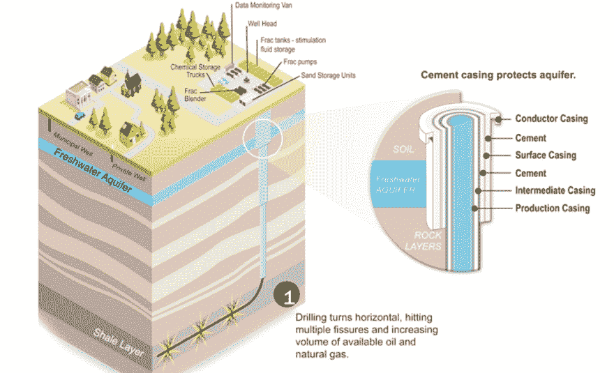

## 水泥井壳保护含水层。

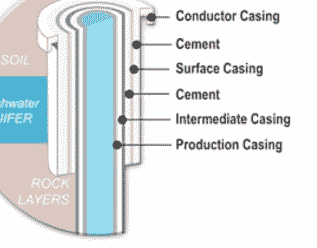

钻井转向水平，产生多个裂缝且油气量不断增加。

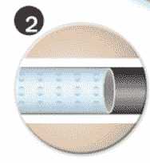

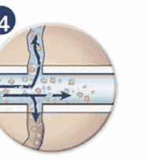

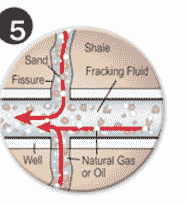

- 1 2 3 4 5

- 生产井套插入井筒，周围被水泥包裹。

- 井套在管子、水泥和页岩上穿穿出小孔。

钻井后，对井进行水压压裂。水、砂和化学品的混合物（压裂液）以高压泵入井中。流体在页岩中产生大量裂缝，释放出受困的油气并使其沿管道流动。砂子保持裂缝开放状态，以增加油和天然气的流量。

图 1. 水压压裂过程。（图片来源：https://www.watercouncil.org/hydraulic-fracturing）。非等比例绘制。

离散或连续，以及约束条件和/或目标函数的性质（例如，线性或非线性，凸或非凸）。每一类数学规划都存在严谨且定义良好的解（例如，单纯形法或分支定界法）。有几个特征可以将数学规划与其他优化技术（例如，元启发式或约束规划）区分开，例如这些方法不涉及详尽搜索。(2) 对于每一类数学规划（例如，线性、非线性），如果给定的输入（时间）存在可行解，则也可能存在解；(3) 严谨的数学规划方法能够从真实最优值计算出最优性度量（“最优性间隙”）。数学规划的这些特征对从业者来说是有价值的，因此，数学优化被广泛用于改进许多工业过程（例如，见 Beale, 1968; Cooper, 1968）。

多年来，不同的优化和其他改进技术（严谨和非严谨）被提出并应用于规划（Knudson et al., 2014; Bessel, 2022）。页岩油气开发的背景及其影响

图 1 显示了油气开发的基本步骤，天然气生产。该过程通常始于井的建设，如图 2 所示。天然气生产需要井或多个井的临时设备。该井可能延伸数百米。最后，大量的水（特殊砂）和化学品在高压注入岩层，从而在页岩中产生水压裂缝，增强了页岩的产量。理想情况下，进行压裂（带有钢和水泥层）以确保井的完整性。在井达到目标深度之前，井筒被固井，并开始“水平”钻井。

## 2020年页岩产量 - 可用资源及2013年技术可采资源（103亿桶）

美国

页岩产量：2.2 [$10^9$ 桶/年]

页岩资源：103 [$10^9$ 桶]

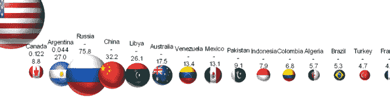

## 2020年页岩气产量 - 可用资源及2013年技术可采资源（12万亿标准立方尺）

美国

页岩气产量：20.1 [$10^9$/年]

页岩气资源：12 [$10^9$ scf]

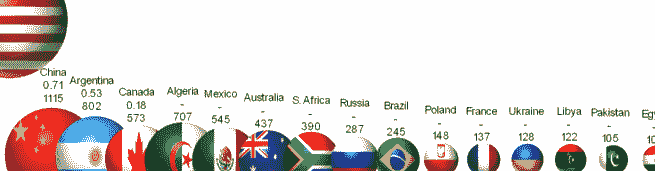

图3. 截至2020年的全球页岩油和天然气产量（已发布数据）。圆圈代表美国能源信息署（EIA）截至2013年6月的技术可采资源（美国除外，其估计已更新至2020年）。

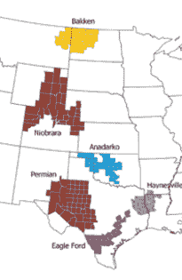

来源：美国能源信息署

图4. 美国主要的页岩盆地。

2020年日均原油和冷凝油产量最大的公司是Chevron、Exxon Resources、ConocoPhillips & China、Occidental Gas and Petroleum以及ExxonMobil。页岩气最大的生产商是EQT、Continental Resources、Halliburton和Chevron Energy Corporation。值得注意的是，这些知名的巨头（如ExxonMobil、Chevron、ConocoPhillips、Shell、BP、Total等）都是活跃的油气生产商，但也有一些规模较小且知名度较低的机构也处于产量榜的前列。主要的美国公司业务范围涉及：

同样值得注意的是，自2005年左右美国开始页岩开发活动以来，二氧化碳排放的减少受到了良好评价。这一趋势归于煤电发电被天然气发电所取代。这意味着，美国范围内页岩资源的广泛开发——虽然被视为保障国内能源供应的威胁，同时也减少了排放需求，但页岩开发作为向完全碳中和过渡步骤（即“桥梁燃料”），可能是一个值得考虑的选择。

Anadarko、Appalachia 盆地、Eagle

## 美国能源相关二氧化碳排放（2000–2023年）

百万公吨

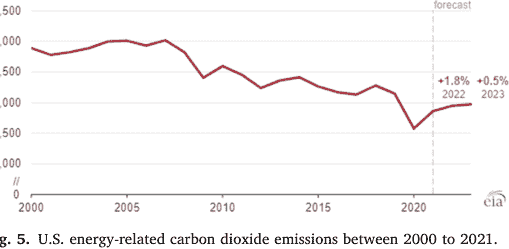

图5. 2000年至2021年间美国能源相关的二氧化碳排放。（图片来源：https://www.eia.gov/today/energy/detail.php?id=50958）

# 3. 页岩开发的数学规划模型

## 3.1. 页岩开发优化的早期历史

20世纪70年代初，开创性的贡献提出了开采页岩矿的优化策略（Crookston, 1975）。首次评估了热解作为一种石油提取的分析技术（Wen & Yen, 1977; Gufel, 1979）。20世纪80年代，提高油水混合物回收率的优化技术出现（Bose, 1980; Svart, 1982）。井产量的优化由Reeves等人（1993）解决，而早期对页岩开发的贡献实际上关注的是用水。随后在2000年代提出了后期模型（Muskim, 2008; Gausfeld et al., 2008）。当时，这些贡献仅占出版物总数的10%；我们现在发现，2014年这一频率增加到了25%，专注于页岩气产量的经济和环境影响（Stephens, 2010; Jiang, 2011; Guanarni et al., 2013）。

Cafano & Grassmann（2014）建立了页岩气战略规划、设计和开发的优化模型。随后，该领域的贡献显著增加。2017年，Gao & Yu（2017）发表了关于页岩能源系统设计和优化的综述。这项工作限于页岩气。最近的研究涉及2017年以来全球范围内所有的油气开发文献。其他重要事件（如COVID-19疫情、俄罗斯入侵乌克兰）引发了学术界和普通公众对碳氢回收及其影响的讨论。

## 3.2. 主要领域

作为本回顾的一部分，我们将油气优化领域分为五个主要主题，如图6所示：(1）开发规划、（2）产量优化、（3）供应、（4）水资源管理以及（5）生命周期分析（LCA）与可持续性。开发规划活动涉及钻探、压裂和生产。在该阶段的研究人员提出了数学模型，帮助决策者如何协调活动以提高经济或环境性能。注意的是，油气开发需要不同的方法。对于传统石油开发方法，我们参考了Tavalli等人（2014）、Tavalli（2016）和Eggios（2019）。

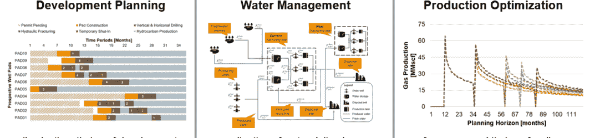

- 开发规划-井的选择、开发作业时机

- 产量优化-完井频率和时机、模拟、不确定性协调

- 水资源管理-供水协调、淡水消耗

- 供应、采集、处理-供应链管道、网络设计、设施布局

- LCA与可持续性-排放评估与量化、“从摇篮到坟墓”分析

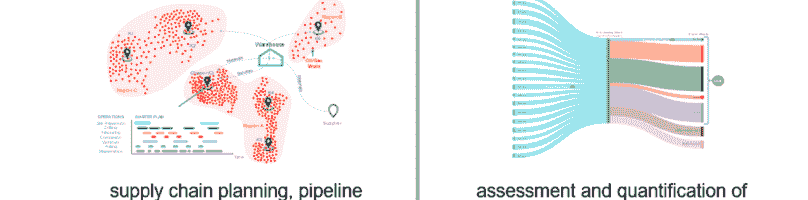

图6. 页岩油气领域的主要主题。

2017年以来相关的优化出版物总结。

| 开发 | 单井 | 多井 | 单系统 | 多系统 | 国家规模 |
| :--- | :--- | :--- | :--- | :--- | :--- |
| 规划 | Ondeck et al. (2019), Li et al. (2020) | Gao et al. (2018), Bean (2020), Soni et al. (2021), Díaz-Gomez et al. (2021), Peng et al. (2022) | Ondeck et al. (2019) | | |
| 产量优化 | Drouven et al. (2017), Cafaro et al. (2018), Zou & Cremazzi (2021) | Hülbe et al. (2020), Ahmed et al. (2019), Achkar et al. (2021) | Foss et al. (2018) | Drouven & Grousmann (2017), Hong, Li (2020), Allen et al. (2019) | Montagna & Cafaro (2019), Hong, Li et al. (2022) | Tan & Barton (2017) |
| 供应、采集、处理、管理 | | Drouven & Grousmann (2017), Tavikakis (2016), López-Díaz et al. (2018), Ahmed et al. (2019), Carreiro-Pareja et al. (2020), Al-Aboud El-Hagwi (2019), Gao & Grousmann (2019), Wang, Quiez et al. (2019), Caballero et al. (2020) | Okey et al. (2016) | Gao & You (2017), Gao & You (2017c), Gao & You (2018), Gao & You (2019), Chen et al. (2017) | |

## 生命周期分析与可持续性

另一方面，优化技术则受限于从储层中回收碳氢化合物的效率。生产参数（例如井压或人工举升）的操纵或协调可以极大地提高经济效益。此外，研究人员研究了控制策略如何成功应对需求（例如天然气流量）。

供应、采集和处理优化工作多年来一直非常突出。应该注意的是，该领域通过钻探和作业控制与开发相关，这决定了油气地层的形状。

水资源管理对油气开发至关重要。反之，从储层中提取碳氢化合物取决于水的可用性。油气的生产会产生水，通常被称为“产水”。上游公司需要匹配需求：供应和水资源管理本身就是一项物流挑战。但在完井后，必须对大量的产水进行管理和运输，以减少水流量。

最后，我们对油气开发采用LCA方法，但压裂是学者和普通公众的一个特定话题。令人惊讶的是，学术界已通过提出优化工具来评估和量化油气开发的性能（例如甲烷排放和二氧化碳）。LCA已成为一种强大且有见地的框架，能够更好地处理储层回收碳氢化合物的“从摇篮到坟墓”影响（Chem et al., 2019）。

虽然有些研究针对上述五个主题的油气优化机会，然而，这些主题在工作范围内仅存在一个区分特征，范围从（1）单口油气井、（2）多井场、（3）开发或系统复杂、（4）由单一实体管理的多个设计系统以及（5）国家规模。在问题方面，拟生产地点（例如井、道路、区域）的大小和数量并不一致，但在15到40之间波动。此外，多重复杂性可能归因于油气开发“感知”层面的边界。

我们参考表1。如图所示，大多数报告集中在单个开发区域或系统，这涉及水资源管理和开发规划。然而，在光谱的另一端，很少有观点关注油气开发活动的整体可持续性。

2017年，Gao & You（2017a）有

M.G. Drousen 等人

- 发展规划

- 供应、采集与处理

- 生命周期评估（LCA）与可持续性

- 生产优化

- 水资源管理

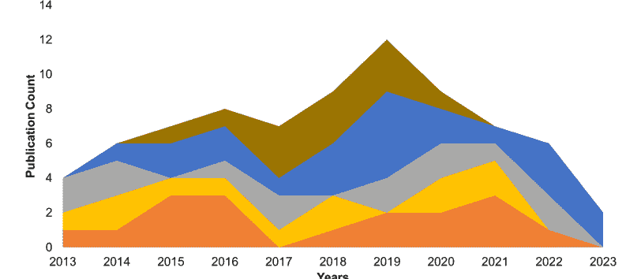

图 7.2013年以来各主题领域的论文数量。

- 供应、采集与处理：Martin 和 Grossmann (2013); Wang 等 (2014); Noured 等 (2014); Wang 和 Xu (2014)

- 水资源管理：Yang 等 (2014); Yang 等 (2015); Gao & You (2015);Bartholomew 等 (2016)

- LCA 持续性：Gao & You (2015);Pascual-Gonzalez 等 (2016)

学术界对上述领域投入了大量的关注。近年来，所有的构建都包含了混合整数规划模型（线性或非线性）。引入离散变量是为了捕捉有关钻井/压裂作业调度的决策、上游基础设施（如水处理设施和工厂）的存在/布局。图 8 显示了一个开发进度表，说明了开发问题中涉及的复杂性。

图 7 考虑了表 1 中记录的所有论文，以及上述列出的贡献。优化开发问题通常采用混合整数规划来考虑基础设施规模（例如压缩机、站站、管道）的经济性，并解决使用不同替代模型生产的碳烃组组成的变化（Wilson & Dorsey, 2013）。然而，学术界正倾向于考虑规划中不确定性的后期模型。不确定性参数包括预期储储量（EUR）、产量（Gao 等, 2018）和商品价格（Li 等， 2020）。在规划开发过程中，考虑钻井和压裂需要不同类型的资源这一事实可能是有益的或必要的。此外，井的垂直剖面段通常使用垂直钻头钻井，而水平段则使用水平钻头钻井。井的水力压裂由由配备高压泵的卡车队执行。拆卸这些钻机和所需设备并非易事，特别是在偏远地区（Vale 等，2018；Wang 等，2019），他们提出了考虑了资源富裕度和动员成本的数学框架。

## 3.3. 发展规划

从核心上讲，开发规划方案旨在帮助组织高效且经济地运营。这种开发被认为是相对直接的。规划涉及逐个钻钻井，然后尽可能多地完成完井。然而，研究人员和工业界意识到，这种方法是次优的，因为在生产开始前可能花费几个月。他们很快证明了钻井和压裂是强大的工具，这取决于杠杆机制和支持的重叠。支持开发和规划问题在本质上是离散的，因为如果能在活动、协调和目标冲突方面及时做出决策，就有可能钻井或完井水井。

如表 1 所示，开发规划方案的范围从多井（Wang 等，2019；Li 等，2020）到单井平台（Gao 等，2018；Wang 等，2021；Za-Gomez 等，2022），最好的计划是跨地理分布区域规划多场地系统（Wang 等，2019）。最近几乎所有的论文都是针对跨越多年的规划场景。离散时间公式占主导地位，规划跨度按周、月、年度期或年进行离散化。

自 Cafaro 和 Grossmann (2014) 在战略性开发规划优化方面的开创性工作以来，这一领域持续发展

年度季度

| 操作 | 1 | 2 | 3 | 4 | 5 | 6 | 7 | 8 | 9 | 10 | 11 | 12 | 13 | 14 | 15 | 16 | 17 | 18 | 19 | 20 | 21 | 22 | 23 | 24 | 25 | 26 | 27 | 28 | 29 | 30 |
|---|---|---|---|---|---|---|---|---|---|---|---|---|---|---|---|---|---|---|---|---|---|---|---|---|---|---|---|---|---|---|
| A1 | | | | | | | | | | | | 14 | 14 | | | | | | | | | | | | | | | | | | |
| A2 | | | | | | | | | | | | | 14 | 14 | | | | | | | 21 | | | | | | | | | | | |

| A3 | | | | | | | | | | | | | | | | 15 | 15 | 15 | | | | | | | | | | | | | |

| A4 | | | | | | | | | | | | | 21 | 11 | 11 | 13 | 13 | 10 | 10 | 10 | | | | | | | | | | | |

| A5 | | | | | | | | | | | | | 11 | 11 | 1 | | 13 | 10 | 10 | 14 | | | | | | | | | | | |

| A6 | | | | | | | | | | | | | 21 | | | | | | | | | | | | | | | | | | |

| B1 | | | | | | | | | | | | | | | | | | | | | | | | | | | | | | | | |

| B2 | | | | | | | | | | | | | | | | | | | | | | | | | | | | | | | | |

| B3 | | | | | | | | | | | | | | | | | | | | | | | | | | | | | | | | |

| B4 | | | | | | | | | | | | | | | | | | | | | | | | | | | | | | | | |

| B5 | | | | | | | | | | | | | | | | | | | | | | | | | | | | | | | | |

| B6 | | | | | | | | | | | | | | | | | | | | | | | | | | | | | | | | |

| C1 | | | | | | | | | | | | | | | | | | | | | | | | | | | | | | | | |

| C2 | | | | | | | | | | | | | | | | | | | | | | | | | | | | | | | | |

| C3 | | | | | | | | | | | | | | | | | | | | | | | | | | | | | | | | |

| C4 | | | | | | | | | | | | | | | | | | | | | | | | | | | | | | | | |

| C5 | | | | | | | | | | | | | | | | | | | | | | | | | | | | | | | | |

| C6 | | | | | | | | | | | | | | | | | | | | | | | | | | | | | | | | |

| 论文 | 油/气 | 问题范围 | 目标 | 自由度 | 模型 | 求解策略 | 不确定性考虑 |

|---|---|---|---|---|---|---|---|

| Wilson & Dorsey (2013) | 气 | | | | | | 替代模型 | |

| Cafaro 和 Grossmann (2014) | 气 | | 最大 NPV | | MINLP | 自定义分支定策略 | |

| Draven (2016) | 气 | | 最大 NPV | | MINLP | 自定义分解策略 | |

| Gao 等 (2018) | 气 | | 最小成本 | | | 重新建模 | 是 (EUR) |

| Ondeck 等 (2019) | 气 | | | | MILP | 商业服务 | |

| Ondeck 等 (2019b) | 气 | | | | MILP | 商业服务 | |

| Bean (2020) | 气 | | 最大 NPV | | MILP | 商业服务 | 是 (价格预测) |

| Li 等 (2020) | 气 | | 最大 NPV | | | 商业服务 | 是 (价格预测) |

| Díaz-Gomez 等 (2021) | 气 | | | | | 商业服务 | |

| Wang 等 (2021) | 气 | | | | MILP | 双层分解 |否 |

| Peng 等 (2022) | 气 | | | | MILP | 拉格朗日分解算法 | 是 (产量不确定性) |

## 3.4. 生产优化

页岩气行业中的生产优化模型涉及一系列在更长的时间跨度内维持或提高井产量的策略，从而延长其经济寿命。

## Drouven 等人

- 许可租赁

- 井场建设

- 垂直与水平钻井

- 水力压裂

- 临时停井

- 烃烃生产

| | 4 | 7 | 10 | 13 | 16 | 19 | 22 | 25 | 28 | 31 | 34 | 37 | 40 | 43 |

|---|---|---|---|---|---|---|---|---|---|---|---|---|---|------|

| PAD10 | | | | | | | | | | | | | | | | |

| PAD09 | | | | | | | | | | | | | | | | |

| PAD08 | | | | | | | | | | | | | | | | |

| PAD07 | | | | | | | | | | | | | | | | |

| PAD06 | | | | | | | | | | | | | | | | |

| PAD05 | | | | | | | | | | | | | | | | |

| PAD04 | | | | | | | | | | | | | | | | | |

| PAD03 | | | | | | | | | | | | | | | | |

| PAD02 | | | | | | | | | | | | | | | | |

| PAD01 | | | | | | | | | | | | | | | | | |

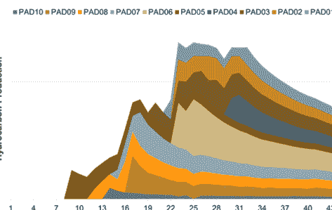

图 9. 开发策略及相应的剖面。（改编自 Drouven & Grommann, 2016）。

由于页岩油气井产力具有急剧下降的特征，这对于非常规油井的生产至关重要。优化页岩井的产量从操作角度来看大致分为四类，控制顺序为：减产和停井、人工抬升和采收方法。

### 3.4.1. 产量削减与停井

Foss 等人 (2018) 提出了每日产量优化（DPO）概念，生产工程师的目标是尽可能有效地优化系统。他们讨论了如何通过调整节流阀的控制输入来使用仿真，并探讨了使用静态模型与动态模型的局限性，以解决这些问题。

许多重要问题可以通过使用稳态模型来解决，而另一些问题（特别是与页岩气相关的问题）具有不同的特征。该领域的研究认为，每日产量优化问题非常适合数学规划。

Foss 等人 (2018) 提出了一种基于代理储层模型的用于储层管理的广义直接优化规划（GDOP）框架。在每一步中都会重复求解移动边界优化策略。另一方面，当储层产量可以忽略时，则对每个时间步提出了一个静态模型。使用分段线性近似将混合非线性规划（MINLP）转换为混合整数线性规划（MILP）。从仿真分析来看，静态优化框架在大多数开发案例中都是足够的，特别是对于海上水井的生产。重要的例外是气井和薄油带。Hulse 等人 (2020) 建议，当优化规模快于底层储层动力学时，静态模型是适用的。通过一个带有用于油井生产和气注作业阀的油井平台插图说明了静态模型的局限性。静态实践可以根据需求的变化得到有效解决。然而，当地表条件频繁或突然变化时（可能是由于处理能力降低），人们认为不应忽视井的动力学，并应相应地解决这些问题。当条件正常时，这些优化模型寻求寻找具有不同压缩能力的井的最佳进度。显然，当使用更准确的仿真模型和参数实施该方法时，可以获得更好的结果。尽管如此，考虑到此类领域大量的决策，即使对于小实例（井数和时间步较少），在多大程度上将这些细节（增加更多复杂性）纳入决策工具仍然是一个未解决的问题。

### 3.4.2. 人工抬升

人工抬升系统涉及广泛的技术

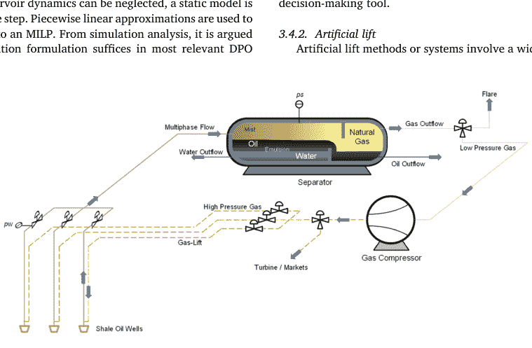

图 10. 油油生产平台或井场的简化插图，带有气注作业。（改编自 Hulse et al., 2020）。

M.G. Drown

旨在交付页岩气井。这些操作对于常规储层中的垂直井来说相对成熟，而提高水平油气井的产量已成为非常规生产的新前沿。人工基础设施计划包括选择适当设备，其实施方案最早由 Tao 和 Cremashi 提出，后由作者（Zao 和 Cremashi）扩展。作者提出了一个离散时间 MINLP 公式来求解多阶段抬升方法。它考虑了页岩气价格的内生不确定性和外生不确定性，尽管后者并不影响解决方案。尽管考虑到多阶段抬升方法（即 ALMs），不确定性受限于井的寿命。Akhtar 等人开发的抬升方法集成规划管理了投资和运营决策。

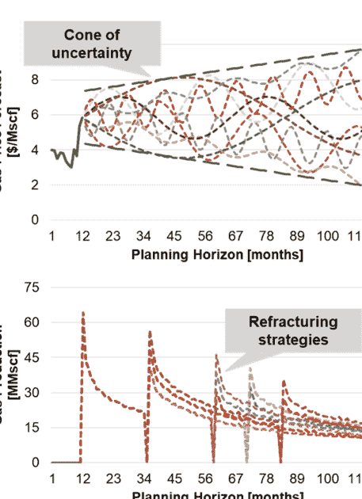

不确定性锥

图 11. 基于不确定性的规划图（改编自 Driver al.）。

### 3.4.3. 采收

采收提出了一种应对递减率的策略。采收的核心思想是刺激储层以产生整体产量。关于页岩井优化方案的开创性工作由 Driver 等人（2016）提出。在本文中，我们提出了一种基于离散规划的采收模型（Big-M, Stage）。所提框架限于单井，并适用于既有井或新井。压裂作业的数量和时间对不稳定的气价非常敏感。两年后作者进一步扩展了他们的方法以应对不确定性的挑战（Driver et al., 2017）。开发了一个移动边界策略的双阶段随机规划模型来解决该问题。该模型预测随时间的产量，取决于井进行采收的频率以及最后估计的时间。

页岩油。Calderon 和 Pekoven (2020) 处理了页岩油提高采的规划以减少压裂。多阶段 MILP 框架优化了井位、压裂、管道和处理基础设施、注水点布置、注水速率以及提高采作业持续。由于数学问题的复杂性，提出了一种启发式方法来解决该问题。作者还提议使用包含函数的伪动态模型来近似瞬态过程。

### 3.4.4. 提高采收 (EOR)

近年来，解决采油中压裂的技术一直是焦点。一种极具前景的替代方案是注入气体以刺激生产

## 3.5. 水资源管理

水管理是油气开发中一个重要且高成本的方面。从非常规储层中提取碳烃需要大量水。钻井和压裂单井消耗数十吨水——这相当于数百个标准游泳池。然而，公司依赖回收水进行压裂。在许多地方，水是在现场获取或处理的，一个井场可以运行 60 口井，这表明总水需求可能达到数十英里。与此同时，油气井产生的高总溶解固体（TDS）水质，其地球化学性质通常不会释放到地表环境中。产水通常被注入处置，或供油气行业重复使用以满足需求

M.G. Drouven 等人

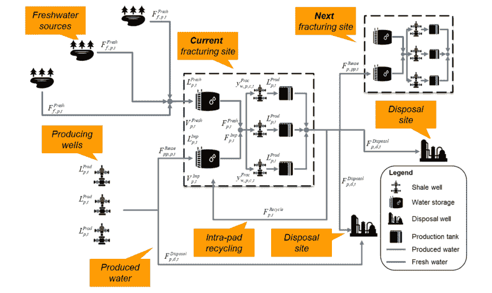

图 12. 页岩层水管理方案示意图。（改编自 Drouven and Grossmann, 2017）。

随后的钻探和生产。产水的活化问题持续被提出，且目前仅限于小众应用。

页岩水水管理优化仍然是一个活跃的研究领域。近年来，该领域持续产出大量论文，如图 7 所示。几乎所有研究都涉及单井内的水分管理（供需平衡），而少数研究专门关注页岩油的水分管理。该领域的几项近期研究侧重于页岩水的协同水管理方案与调度的结合——调度同时驱动了水资源需求和石油产出（Drouven et al., 2018）。由于压裂调度决定了油气生产服务的成本，几位研究人员选择利润最大化或净现值（NPV）作为主要目标。其重点是寻找完工顺序和实际水管理的优化方案。同样注意到，页岩调度涉及离散决策（即水井开发项目的排序）。这自然解释了为什么使用整数规划模型，尽管已有研究通过非线性模型控制实现了丙烷和水泵服务的优化（Lin et al., 2021）。

页岩水管理优化的挑战在于：(1) 水源方案的选择（即淡水、咸水或产水），(2) 产水的输送去至何处（例如设施、场址或处理地）以及 (3) 如何使用水（例如蒸发、孔隙储存、处理设施、注水）。后者很少涉及场址选择或标准化设备，这为数学规划框架增加了二元整数变量。极少的研究将水质作为水管理框架的一部分；然而，Yang 等人 (2015)、Guiserra 等人 (2016) 以及 Carreiro-Ferreno 等人 (2018) 的工作就是范例。

有趣的是，过程系统工程社区也利用数学规划技术解决了页岩水管理优化问题。其中大多数是混合整数线性规划。当引入非线性因素时，相应的模型考虑了水质（即由于未知流量与浓度相乘产生的双线性项 (Carcena et al., 2019)，或化学剂的经济成本（例如 Lopez-Diar et al., 2018 和 Tavakolli 2018 中的幂函数）。在此背景下，值得注意的是，开发同时考虑水质生产的调度模型的工作还较少。许多近期研究人员关注页岩水的协同水管理（例如 PLEX 或 Gurobi）（Serrano-Aviles et al., 2022; Hernández-Perez et al., 2022; Cao et al., 2022）。已开发了一个开源优化框架，以识别管理、处理、回收和安全处置油气田产水的策略。这种新颖的

最后，我们关注到一点，很少有文献报告考虑参数模型中的不确定性。随机规划已被用于此，因为它们考虑了水量的波动（Yang et al., 2014）、难以预测的需求和流量波动，以及不确定的油气生产率（Liu et al., 2020）。尽管在技术上没有直接处理水，但 Carreiro-Ferreno (2019, 2021) 的工作侧重于

## 3.6. 供应与工艺优化

几十年来，石油和天然气领域特别关注油气生产的优化设计、管道网络以及设施的选址。这些网络之一是收集碳烃并将其输送至中游设施。M.G. Drouven 等人

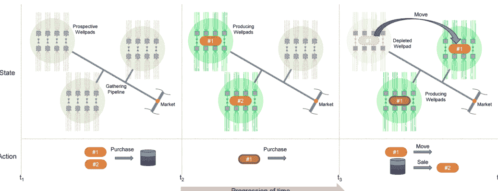

图 13. 动态分配的简化示意图。（改编自 Hong, Song, Zhang & Gao 2020）。

或炼油厂。然而，非常页岩井的大规模生产改变了设施规划的范式。首先，页岩井的产量衰减使得有必要开发新井，并将产出优化地分配给设施。供应链网络的设计可以促进任务完成。根据范围，设施规划可分为三类：处理设施、管道和储罐单元。

### 3.6.1. 处理设施

Tan 和 Barton (2016) 解决了页岩气的模块动态分配。以巴肯页岩作为案例研究，通过两阶段随机规划讨论了未来供需和价格条件的不确定性。他们考虑了两种类型的工厂：提提（将甲烷转化为重烃）和液化工厂（生产液化天然气 LNG）。他们在整数规划模型中引入了 0-1 变量，以确定建设工厂的数量。目标是最大页岩产量的净现值（NPV）。Allen 等人 (2021) 处理了不确定环境下的模块化运输基础设施的尺寸分配。采用多期随机规划结构解决了多阶段问题。结果表明，模块化单元比固定工厂更有优势。与之前的方法相比，井期也是问题中的变量，但在确定性条件下求解。当处理能力不足时，限制产量是一种可行方案，产量受限的保守假设不再成立。与开发规划方面的贡献类似，这项工作证实了规划与设施尺寸及动态分配的协同作用可以提高效率。

### 3.6.2. 管道网络

Drouven 和 Grossman (2007) 寻求通过运行（即井的运行）优化管线燃气管道网络的规划。管道压力测量提供了产量能力的信息；随着井的投产，气体收益实现最大化。作者引入了整数线性规划模型来确定压缩站的最优位置和容量，以使总投资和压缩成本最低。他们还使用了一种算法来解决非凸问题。

在当前工作中，整数线性规划模型用于线性基础设施；其次，求解非线性基础设施的整数线性规划模型。最后，混合非线性规划模型用于非线性规划；最后全局混合非线性规划寻求优化集成问题。该算法用于求解来自阿拉契亚盆地的稳健解，该地是一个代表性模型。

Wang 等人 (2022) 评估了天然气管道网络的设计和规划。管道直径的选择考虑了水力方程和详细产量报告，非线性相关性通过使用线性相关性来考虑。他们通过结合线性规划（用于流量子问题）和蒙特卡洛模拟来解决该问题。

更最近，Montana 等人 (2022) 处理了……的优化设计

M.G. Droussen 等人

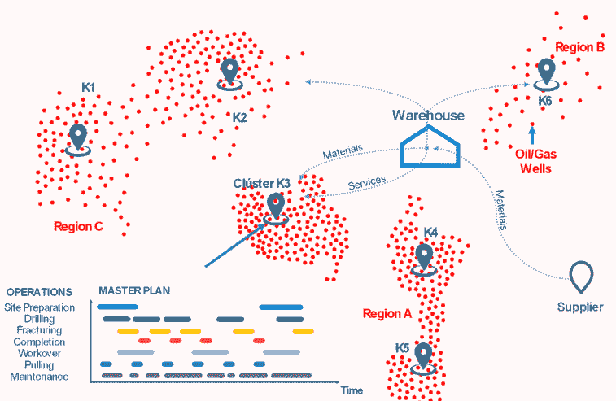

**图 14.** 上游供应链优化模型所包含的主要元素以及与每个生产地相关的尺寸数据的图解表述。（改编自 Montague and Cafaro, 2019）。

收集来自页岩油井多相流体的输送管网网络。我们开发了一个全面的 MINLP（混合整数非线性规划）公式，以优化确定储罐区、处理设施以及地下管道的数量、尺寸和位置。使用非凸松弛来预测性能、输送石油，该模型能够合理地规定尺寸维度。考虑到其复杂性，我们开发了一种 NLP（非线性规划）分解方法来寻找更好的解决方案，还实施了精炼策略以收紧目标函数的边界，并从页岩油行业中学习以实现 5% 的全局最优性。

活动转移以改变页岩开发区域。为了减轻计算负担，将具有许多特征的邻近井进行分组并聚合为单一地理节点，该节点通常代表油气行业中供应的材料和服务。

## 3.7. 生命周期与可持续性

在对解决页岩气行业环境影响的优化工具进行全面的文献综述后，Gas and You (2017a) 识别了几个相关的研究领域。基于整合可持续设计方法的需求，他们提供了一系列兼顾可持续性的设计和运营策略方法。这可以被视为在供应链层面上（从井到电网级）的可持续优化。与此同时，生命周期评估工具侧重于评估能源系统的环境影响，使用了多标准帕累托前沿。结果，该领域的贡献（如表 6 所示）被分为两类，如下所示

### 3.6.3. 支持链

Tan 和 Barton (2017) 通过界定油气行业设施规划问题的范围，探讨了涉及多个地点的全国性供应链网络的最优设计。我们为美国宾夕法尼亚州的 Haynes Eagle 矿区提出了一个集成框架。其目标是确定不同类型工厂（页岩剥离炼油厂、气转液化工厂、原油和柴油炼油厂）的最优位置、数量和容量。该模型还考虑了接入网络的运输模式（管道、铁路、船舶）。对于不确定性，根据原油价格提出了不同的场景。一个限制假设是页岩气价格与油价挂钩。该研究开发了一个两阶段随机规划，其确定性评估导致了一个大型多变量 MINLP。最后，模型确定了向矿区输送材料和服务的设施的最优位置、容量和平均响应时间。如图 14 所示，在开发计划具有吸引力的假设下，在传统的油气行业中，供应链会适应钻井活动。

Chen 等人 (2017) 使用多级框架来改进页岩气井的发展。这些方法通过可持续决策，对环境、经济和能源资源寻求领导者-追随者优化（leader-follower optimization）：下层考虑可持续性，如生命周期温室气体（GHG）排放并侧重于运营效率；而上层则寻求使能源供应生命周期最小化。在随后的贡献中，Chen 等人 (2018) 开发了一种非严谨的多决策标准，整合了生命周期分析、线性规划和多目标规划（以处理不确定性）。他们认为，与纯经济优化方案相比，考虑环境目标将减少 17% 的温室气体排放和淡水消耗，这是基于他们的框架在阿巴拉契亚盆地页岩气链中的实际应用得出的。

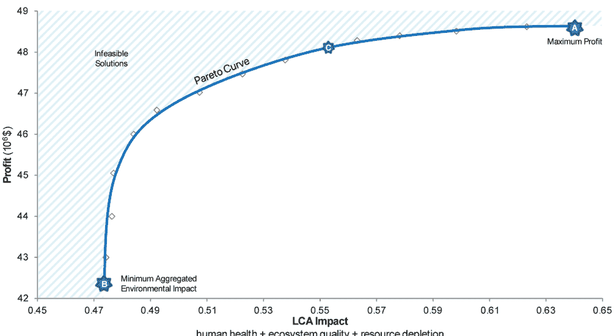

图 15. 缓解聚合环境影响和追求股东利润最大化的帕累托曲线（Caballero 等人，2020）。

反地，Wang 和 Zhang (2019) 对中国页岩气行业的可持续发展进行了实证分析。研究表明，缺水、水污染、管道密度、地质、市场风险和技术是影响中国气链可持续发展的前三个主要因素。Kroetz 等人 (2019) 开发了一个考虑栖息地损失的页岩气管道网开发的 MILP（混合整数线性规划）。在宾夕法尼亚州（美国），他们得出结论，结合与井和管道选址相关的影响可以确保更多的局部环境效益。引导管道选址和工艺设计的优化模型使当地社区、公司和利益相关者能够识别出土地保护的成本效益方案。在对管理领域的贡献扩展中，Caballero 等人 (2020) 开发了一个生命周期评估（LCA）模型。该模型评估了最常用的脱盐技术。基于双准则 LIFM 公式的经济和环境结果，市场分析表明膜蒸汽再压缩（MVR）是处理废水最合适的技术。他们证明，通过调整 1.0% 的利润，环境影响可减少高达 13.5%，如图 15 中的点 B 和 C 所示。

多个利益相关者之间的关系。通过求解用于页岩气供应链全局优化的 MILBFP（混合整数双线性分数规划）模型，他们得出结论：非竞争性视角为生命贡献提供了更多见解，且 CCS（碳捕集与储存）的应用显著提高了页岩气链整体的环境性能。

该小组关于该主题的第二篇论文 (Gao and You (2019)) 提出了一种混合整数非线性规划模型，用于处理页岩气链的环境影响。该模型可以视为之前贡献的扩展，关于基础设施设计和投资的决策是导致页岩气链经济和环境性能的关键因素。近期，作者 (Gao and You (2018)) 使用集成生命周期优化 (LCO) 框架处理页岩气的可持续性。

### 3.7.2 供应链

对页岩气的整体分析已在 Gao and You (2017, 2018, 2019) 的近期论文中提出。在开创性贡献中，Gao and You (2017) 提出了一个用于经济和环境生命周期优化的通用框架，尽管去中心化的领导者-追随者结构捕捉了每个运营单元的定义。

| 发表日期 | 油/气 | 问题范围 | 目标 | 自由度 | 模型类型 | 策略 | 不确定性考虑 |
|---|---|---|---|---|---|---|---|
| Gao 等人 (2016) | 气 | 上游 | | 调优 | MILP, MILP | 离散模型。 | 无 |
| Gao 等人 (2017) | 气 | 上游及中游 | 最大 NPV | 钻井或等待（考虑后期支持） | MILP | 两阶段规划。 | 是（气价；波动性） |
| Gao 等人 (2018) | 气 | 上游 | 最大 NPV | 井和重启操作的控制变量 | MILP | 全局优化。 | 无 |
| Fine (2018) | 油/气 | 下游 | 最大 NPV | 钻井（产量）+ 设施成本。 | MINLP | 重构 | 无 |
| Calderón & McKinney (2020) | 气 | 上游 | | 井和重启的控制变量 | MILP | 基于聚类的策略。 | 无（简单分析） |
| Hilse 等人 (2020) | 气 | 上游 | 最大 NPV | 伪动态模型+ | MILP | 分解法 - 分段线性近似。 | 是（气价；生产力） |
| Zuo & Cremaschi (2021) | 气 | 上游 | 最大 NPV | 接近系统。安装和移除。 | MILP | 多阶段随机规划。 | 无 |
| Akhlar 等人 (2021) | 气 | 上游 | | 接近系统。时间分配。 | MILP | 商业求解 | |

# 4. 批判性评估与优化的新机会

在接下来的段落中，我们批判性地回顾了油气开发优化领域的文献贡献。通过识别未来的研究机会，我们揭示了该领域的进展。

目前，主要的挑战之一是对区域或特定场地的页岩开发策略优化。已有研究专门针对完全优化页岩开发对能源供应安全的影响。此外，美国页岩气驱动的天然气电厂导致了二氧化碳的减少，但为了实现增长需要更高的运营成本（Clemente, 2022）。同时，油气运营产生的甲烷排放仍然是一个主要关注点（Coble 等人，2021）。研究社区似乎需要探索并量化这些权衡，以便政策制定者和公众能够更好地评估页岩和气开发中的风险和不确定性。

## 表 4

| 出版物 | 油/气 | 问题范围 | 目标(s) | 自由度 | 类型 | 求解策略 | 不确定性考虑 |
| :--- | :--- | :--- | :--- | :--- | :--- | :--- | :--- |
| Drouven & Grosmann (2017) | 天然气 | 水管理 | 最大净值 | 压裂计划、水输送、水调配、储水/投注/处理单元 | MINLP | 商业求解器 | 否 |
| Lopez-Diaz et al. (2018) | 天然气 | 水管理 | 最小成本、环境影响 | 储水/处理单元的数量/尺寸 | MINLP | 商业求解器 | 否 |
| Carreño et al (2018) | 天然气 | 水管理 | 最大稳定性利润 | 淡水调度、布局；储水箱尺寸定额；压裂计划、水回用、处理单元 | MINLP | 自定义分解策略 | 否 |
| Tavalli (2018) | 天然气 | 水管理 | 最小成本 | 水/运输/处置协调、处理单元尺寸定额 | (MIN) | 遗传算法 | 否 |
| Abmad et al. (2019) | 天然气 | 水管理 | 最小成本 | 压裂计划、处置、水体积、处理/产能扩张 | MINLP | 商业求解器 | 否 |
| Carreño et al (2019) | 天然气 | 水管理 | 最大系数剖面 | 水调度、储水箱布局/尺寸定额、压裂计划、运营商付费/参数 | MINLP | 商业求解器 | 否 |
| Al-Booski & El-Halevi (2019) | 油气 | 产水 | 最大利润 | | MINLP | 商业求解器 | 是（关注太阳辐射、价格重点） |
| Ole et al. (2019) | 天然气 | 上游、下游及水管理 | 最大利润 | 水调度、水处理/设计、处理厂/发电厂/管道尺寸定额 | MINLP | 商业求解器 | 否 |
| Ren et al. (2019) | 天然气 | 水管理 | 最小成本 | 水协调、流向、使用 | LP | 多目标规划 | 部分（灵敏性） |
| Cafaro & Grosmann (2020) | 天然气 | 上游规划和水管理 | 最大净值 | 水模式和储水设施尺寸、开发规划、调度/设计（包括压裂计划） | MINLP | 商业求解器 | 否 |
| Ole et al. (2020) | 天然气 | 上游、下游及水管理 | 最小成本 | | MINLP | 商业求解器 | 是（气价和需求） |
| Carreño et al. (2021) | 天然气 | 水管理 | 最小运营成本、企业中领先 | 水供应、处理设施、副产品水回用、水回用设施的管道与施工以及设施扩建 | MINLP | 纳什哈希方法、函数线性化 | 否 |
| Drouven et al. (2022) | 油气 | | 最小总成本、最大水回用 | | MINLP | 免费及商业求解器 | 否 |
| Hernández-Perez et al (2022) | 天然气 | 水管理 | 最小总成本、最小总水需求 | 井调度、淡水消耗、内部水流、处理及尺寸定额 | MINLP | 商业求解器 | 是（确定性）+ 元启发式 |
| Serrano-Arrazola et al (2022) | 天然气 | 水管理 | 最小总成本、最小总水需求 | 水的选择、来源和存储策略的选择。废水分离。淡水的季节性可用性 | MINLP | 商业求解器 | 否 |
| Cao et al. (2023) | 天然气 | 上游规划和水管理 | 最大净值 | CWT 和设施约束（压缩、扩张）模块化设备、开发规划、压裂用的水/CO2供应以及产水/CO2开发的处理与尺寸定额 | MINLP | 商业求解器 | 否 |

以及跨越得克萨斯州和新墨西哥州的互联水水管道网络。这些“水力学压裂”（Collins, 2021）促进了水的大规模使用，这是许多干旱地区共同关注的问题。例如，在二叠纪盆地，生产商已依赖将盐水注入咸水处置井中，作为管理其带来的海量水的一种手段。然而，很少有工作专注于建模或优化产水注水动态及其影响。这是值得的，因为近年来，产水处置与俄亥俄州、得克萨斯州和新墨西哥州的诱发性地震有关。在其他地方，工业向地下注水导致震级达5.0及以上的地面地震已成为主要关注问题。事实上，得克萨斯州最近被描述为“美国地震之都”（Chen and May, 2022）。地震活动的增加——无论是从频率还是震级——已对美国的石油和能源安全产生了影响。另一个可能引起更广泛社区极大感兴趣的话题是油气产水管理如何为运输和封存做出贡献。最近，为了致力于已经利用CO2进行强化采油（EOR）的页岩生产工作，CO2从捕集设施长距离运输。

对平台选择、近期发表的关于天然气集集及优化策略进行了详细对比。

| 发表物 | 油/气 | 问题范围 | 目标 | 自由度 | 模型 | 求解策略 | 不确定性考虑 |
| :--- | :--- | :--- | :--- | :--- | :--- | :--- | :--- |
| Tan & Barrios (2016) | 气 | 上游与中游 | 最大净现值 (NPV) | | 中质液体分配和 LNG 工厂配置 | MILP | 两阶段随机规划模型的确定性等效。 | 是（同质需求，天然气产量预测） |
| Allen, Allende, El-Hargai (2019) | 气 | 上游 | 最小净现成本 (NPC) | | 模块化产气单元（撬块）的数量、尺寸和位置。 | MILP | 多随机规划模型的确定性等效。 | 是（同质产量预测） |
| Hong, Li, Zhang & Gong (2020) | 气 | 上游 | 最大净现值 (NPV) | | 生产开始时间。集输设施的分配（购买与调动）。 | MILP | 商用求解器。 | 否 |
| Droussen & Graham (2017a) | 气 | 上游 | | | 处理泄漏。管网络节点的压力、流量能力和压缩 | MILP | 用于初始化的 NLP。用于寻找解的 MILP 边界。从现有解出发的全局 NLP。 | 否 |
| Hong, Di, Shi, Chen & Long (2020) | 气 | 上游 | 最大净现值 (NPV) | | 管道位置、管径。随时间变化的流量和压力。 | MILP | 针对离散管径的分段线性近似。 | 否 |
| Zhang, Li & Liang (2022) | 气 | 上游 | 最小购买+成本 | | | MILP | 商用求解器。 | 否 |
| Montana, Cagiao, Barth, Wu & Furman (2021) | 油 | 上游 | 最小净现值 (NPV) | | 储罐和处理设施的数量、尺寸和位置。管道连接和压缩 | MILP | 方案的 NLP 分解与精炼策略。用于定界的 MILP 松弛 | |
| Tan & Barrios (2017) | 气 | 上游与下游 | 最大净现值 (NPV) | | 工厂（炼油厂、天然气和 LNG 工厂）的位置和产能。运输建模 | 两阶段随机规划模型的确定性等效。 | 是（例如 egOD，气价联动） |
| Montana & Cagiao (2019) | 油 | 上游 | 最小净现值 (NPV) | | 设施的尺寸和位置以及对所有井的服务。 | MILP | 井聚类。 | 否 |
| Wu et al. (2022) | 气 | 上游 | 最小总年度成本 | | 探探产设施。 | LP/NLP -> 元启发算法 | 线性规划（网络流） | 是（蒙特卡洛模拟） |

从表 2 总结的规划优化模型可以看出，大部分工作都针对天然气，很少涉及油气。有趣的是，12 个模型中有 4 个使用了不确定性约束。大多数提出的模型使用 MILP、启发式或定制的分解技术。对于表 3 总结的生产优化模型，它们是 NLP、MILP 和 MINLP，其中 8 个模型有 7 个考虑了不确定性。

未来的工作需要解决油气优化中的挑战，特别是可再生能源的整合。为了应对环境影响，应该纳入长期扩张规划模型（例如 Lara 等人，2018）和 Li 等人（2022），以帮助天然气模型评估燃料能源和供应灵活性的效益，以及天然气和风能等可再生能源的渗透。定量评估用天然气替代煤炭发电来减少 CO2 排放的影响至关重要。

在表 4 总结的水管理模型中，MILP 和 MINLP 模型几乎平分，只有一个模型考虑了不确定性。对于调度和处理优化问题，大多数模型使用 MILP 或 MINLP 求解器。

对于表 5 总结的集输和处理优化模型，MILP 模型远多于 MINLP，10 个模型中有 4 个考虑了不确定性。在气系统的生命周期分析中，研究重点是水的回收和处理，以及减少甲烷排放的策略。

此外，油气田的碳封存方面存在有趣的可能性，以及碳捕集与封存技术的机遇。

最后，我们得出结论，数学规划技术在页岩气和天然气开发系统的优化中发挥了重要作用。显然，它们已经证明了其价值，正如水调度工具案例所示，EQT 公司的一个项目预计每年可节省 2500-3500 万美元（Ecot 等，2019）。

最后，我们指出还有许多待解决的我们

## 计算利益声明

作者声明没有可能影响本文所报道工作的竞争性财务利益或个人关系。

## 对各领域近期关于生命周期评估（LCA）和可持续性发表物的详细对比。

| 发表物 | 问题 | 目标 | 自由度 | 模型类型 | 求解策略 | 不确定性 |
| --- | --- | --- | --- | --- | --- | --- |
| Gao & Yu (2017b) | 气 | 上游、中游和下游 | * 功能单位的生命周期影响净现值 NPV | 设施的位置和选址；产品、加工工艺的选择以及终端使用标准 | 领导者-跟随者 Stockenberg-博弈 MILP-P（双层，分式规划） | 自定义全局优化策略；参数化、基于项目的分解。 | 否 |
| Gao & Yu (2017c) | 气 | 上游、中游和下游 | * NPV * 最小环境影响 | 钻井进度。压力管理、设备采购和管道尺寸。 | NLP（非线性规划） | 基于参数化的分支全局优化 | |
| Chen 等 al. (2017) | 气 | 上游、中游和下游 | * 净现值 NPV | 井的数量、水处理工厂的定界。 | MILP | 多层规划 | 否 |
| Chen 等 al. (2018) | 气 | 上游、中游和下游 | * 效益 * 气体排放 | 井的数量、水处理工厂。 | MILP | 多层规划 | |
| Gao & Yu (2019) | 气 | 上游、中游和下游 | * 气体排放 | 区域选择、产能、网络。 | MILP | 基于牛顿法的参数化 |
| Wang & Zhou (2019) | 气 | 上游、中游和下游 | | 区域选择、产能、拓扑结构。 | NLP | 驱动的遗传算法（RGA） | |
| Kretz 等 al. (2019) | 气 | 中游 | * 成本 | | MILP | 商用求解器 | 否 |
| Caballero 等 al. (2020) | 气 | 上游 | * 影响 | 进度、天然气产量、工厂。 | MILP | 商用求解器 | 否 |

## 数据可用性

研究未使用任何数据。

## 参考文献

Ashkar, V., Vargo, G., Mendez, C., 2021. 页岩气开发的优化规划。AIChE 37 (6), e1799. https://doi.org/10.1002/acct.1799.

Ahmed, M., Ali, S., & Khan, S., 2019. 用于页岩气水管理的随机规划生命周期方法。Energy 189, 11304. https://doi.org/10.1016/j.energy.2019.11304.

Al-Abousi, F., El-Hajweh, M.M., 2019. 页岩气水系统的多目标生命周期评估建模。Journal of Cleaner Production 233, 11468. https://doi.org/10.1016/jclepro.2019.11468.

Ali, A. & El-Hajweh, M.M., 2019. 页岩气产量的容量规划和基础设施。Ing. Eng. Res. 150, 10632. https://doi.org/10.1016/j.ijpr.2019.10632.

# 参考文献

Arreondo-Ramirez, K., Ponce-Ortega, J., El-Hajweh, M.M., 2016. 页岩气产量的最优规划和基础设施。Energy Conv. 129, 1155-1160. https://doi.org/10.1016/j.energycon.2016.05.073.

Aznit, C., Ruiz, L., 2009. 产品系统的生命周期评估和清单框架。International Journal of Life Cycle 14(4), 229-235. https://doi.org/10.1008/0961-340909001105.

Bartholomew, T., Masek, S., 2018. 页岩气水管理环境影响评估的多目标建模。ACS Chem. Eng. 7 (4), 3728-3735. https://doi.org/10.1021/acschemeng.8b0012.

Boole, E.M., 1988. Python 中的数学规划。John Wiley & Sons. ISBN 978

Bean M.U. (2020). 压力下非常规岩气开发。博士论文，德克萨斯大学。http://www.utexas.org/repository/140972.

Beck, A., Riley, J.E., 2022. 提高页岩气井决策质量的可扩展分析方法。Jiers 213, 110827. https://doi.org/10.1016/j.jclepro.2022.110827.

Bigler, L.T., 2017. 化学工业过程优化的未来非线性规划框架。Energy 138, 17-183. https://doi.org/10.1016/j.energy.2017.03019.

M.G. Brown

Gao, J., Castro, S., 和 Owens, K. J. (2023). 利用小分子设计进行柔性气体供应链管理的益处。[清洁生产学杂志] 344, 135282; https://doi.org/10.1016/j.jclepe.2022.135282.

Carreiro-Parrido, Q., Uribe, A., Saldo-Diaz, Ruiz-Femeiza, R., Onstibi, V., Caballera, J., Gassmann, I., 等人. (2018). 气体供应链管理中的整体分配与合作。[清洁生产学杂志] 57(39), 133111-133114; https://doi.org/10.1016/j.jclepro.2018.09.205

Gao, J., 和 Yu, F. (2015). 气体供应链设计与优化中的不确定性处理：新型建模框架和计算高效的求解算法。[化学与工程杂志] 61 (11), 3739-3755; https://doi.org/10.1002/alchem.201410

Gao, J., 和 Yu, F. (2015). 天然水煤气生产网络的运营设计与运行。[能量] 96(4), 11184-11208; https://doi.org/10.1016/j.energy.2015.06.062

Gao, J., 和 Yu, F. (2015). 面向经济生命周期性能的战略性气体供应链设计与运行：MINLP 模型与遗传算法。[计算与工业工程] 106, 597-608; https://doi.org/10.1016/j.cie.2016.08.010.

Carreiro-Parrido, Q., Uribe, A., Saldo-Diaz, R., Ruiz-Femeiza, R., Onstibi, V., 等人. (2021). 气体行业的战略性供应链管理：气体供应商与消费者的合作。[环境与环境杂志] 177(11), 67237-67242; https://doi.org/10.1007/s40693-021-00499

Gao, J., 和 Yu, F. (2017). 经济生命周期性能气体供应链设计与运行的下一个游戏改变者：模块化制造。[能量] 135, 1053-1060; https://doi.org/10.1016/j.energy.2017.03.028

Chen, H., Chen, Y., Liu, J., 和 Li, H. (2017). 基于多目标优化的气体供应链规划排放与水足迹生命周期评价。[能量] 134, 382-398; https://doi.org/10.1016/j.energy.2017.05.038

Gao, J. (2019). 使用动态物质流分析分析气体供应链动力学。[化学与工程杂志] 79(9), 1099-1104; https://doi.org/10.1002/alchem.201803114

Chen, Y., Gao, J., Chen, B., 等人. (2019). 油气生产中温室气体排放的整合与分配：生命周期评价与过程模拟。[计算清洁生产] 223, 119633; https://doi.org/10.1016/j.jclepro.2019.119633

Gifford, A. W., Hough, O.L., Tayds, H. (2008). 使用生命周期评价的水资源供应链管理。[国际生命周期杂志] 20(6), 1063-1078; https://doi.org/10.1080/159443908022165-x

Collins Grosman, M., Gassmann, I., 等人. (2016). 开发性气体供应链主动管理中多期规划与设计的整合。[化学与工程杂志] 62(12), 4297-4306; https://doi.org/10.1002/alchem.20160114

Gao, J., 和 Yu, F. (2021). 使用生命周期评价对油岩炼炼的环境影响评估。[能量] 205, 525-537. https://doi.org/10.1016/j.energy.2018.118945

Zheng, Y., Wang, J., 等人. (2020). 基于 PARTO 的能源源水煤气生产优化。[优化能源] 128, 107410; https://doi.org/10.1016/j.optene.2020.107410

Feng, F., Xu, S., Shen, X., Zhang, J., Wang, S., 和 Zhao, Y. (2022). 气体供应链中的优势与挑战：综述。[能源开发研究] 44(4), 406-418; https://doi.org/10.1016/j.egdr.2022.004

Foss, R., Kindrun, B., 和 Grimast, B. (2018). 石油生产——一种战略性和动态性的方法。[计算化学与工程] 184, 245-253; https://doi.org/10.1016/j.comchem.2018.09.010

EO Trust (2019). 新市场格局，新焦点。2019年第一季度更新，2019年4月25日; https://www.reuters.com/article/USL1N2M6S-business-report-q1

Kladson, B.R., Foss, B. (2015). 基于规模的现场开发生产模型。[天然气科学与工程] 27, 504-514, https://doi.org/10.1016/j.natgas.2015.004

Kladson, B.R., Foss, B., Conn, B. (2014a). 电力系统中气转电供应的基于规模调度。[能量] 81, 176-182, https://doi.org/10.1016/j.energy.2014.016

Kladson, B.R., Foss, B., Conn, A. (2014b). 页岩气市场调度中的拉格朗日松弛分解。[计算化学与工程] 66, 215-223, https://doi.org/10.1016/j.comchem.2014.032

Kladson, B.R., Foss, B., Sharma, S. (2020). 用于页岩气开发的混合整数线性规划启发式算法。[能源政策] 140, 2771-2786, https://doi.org/10.1016/j.energypol.2020

Kladson, B.R., Foss, B. (2019). 系统地将投资选项纳入页岩气开发：MILP。[能量转换与管理] 190, 785-793

Kumer, A., Fattakul, H., Alam, J. (2019). 使用动态规划分析的页岩气田开采效率。[计算化学与工程] 184, 1471-1475, https://doi.org/10.1016/j.comchem.2019

Li, C., Casey, J., Brown, M.G. (2021). 具有不确定性的页岩气田开发：随机规划。[能量] 205, 525-537. https://doi.org/10.1016/j.energy.2018.118945

Kladson, B.R., Foss, B., Conn, A. (2021). 用于电力系统扩展的混合整数线性规划。[能源研究] 54 (3), 1081-1082, https://doi.org/10.1016/j.energy.2020

Li, C., Hahn, J. (2017). 用于页岩气田开发的多阶段规划。[能量] 132, 95-100, https://doi.org/10.1016/j.energy.2017

Liu, J., Wang, J., Chen, Y. (2022). 带水资源管理的页岩气开发需求预测。[能量] 217, 119675, https://doi.org/10.1016/j.energy.2021

Liu, J., 等人. (2013). 使用水力压裂流体进行页岩气田井间距优化。[能量] 94, 1472-1484, https://doi.org/10.1016/j.energy.2015.07033

Nouraei, M., Elbadawi, H., Bock, J. (2018). 页岩气田开发的最优跟踪控制。[AIChE杂志] 64 (5), 1895-1906, https://doi.org/10.1002/aic.5438

Nouraei, M., Wang, J., Chen, Y. (2019). 能源交换的页岩气田开发。[能量转换与管理] 246, 114, https://doi.org/10.1016/j.energy.2019

Odek, A., Roucek, D., Blendino, N., Grossmann, I. (2019a). 使用分解算法的页岩气田调度。[计算化学与工程] 128, 47-50, https://doi.org/10.1016/j.comchem.2019

Odek, A., Roucek, D., Blendino, N., Grossmann, I. (2019b). 针对电力系统的页岩气田调度。[计算化学与工程] 184, 99-101, https://doi.org/10.1016/j.comchem.2019

Pascual, J., Jimenez-Gonzalez, G., Grossmann, I. (2006). 最小化二氧化碳排放的宏观产出模型。[AIChE杂志] 52 (2), 1013, https://doi.org/10.1002/aic.54

Shi, J., Al-Shura, A., 2018. 页岩气工程：回顾与对未来的问题。[AIChE杂志] 64 (5), 1895-1906, https://doi.org/10.1002/aic.5438

Peng, Z., Greenwell, I., Foss, J. (2021). 页岩气开发的多期需求预测。[能量] 217, 119675, https://doi.org/10.1016/j.energy.2020

Ren, K., Tang, J., Yan, Y., Feng, J., Mok, H. (2019). 带水资源管理的页岩气投资多目标优化：长马页岩地的案例研究。[能量转换与管理] 190, 785-793, https://doi.org/10.1016/j.energy.2019.01045

Sanchez-Miera, R., Kalbaugh, M. (2015). 页岩市场中注采生产作业的油藏模拟与优化。[能量] 94, 1472-1484, https://doi.org/10.1016/j.energy.2015.07033

Sargarg, R.H., 2004. 页岩气工程：回顾性观点和对未来的问题。[石油工程师杂志] 129(6), 55-560.

21

M.G. Drowson 等人

计算机与化学工程 177 (2023) 108317

Wilson, K.C., Darlucky, L.J., 2013. 使用直接搜索技术和简化物理模型的页岩气田开发优化。J. Pet. Spec. Eng. 108, 304-315.

Wolley (2019) 伦信旭 smackover 项目的初步经济评估。技术报告 https://www.sec.gov/Archives/edget/1537137/000119325/d209119325.pdf

Wright, K., 2021. 碳捕集、存储与产水管理之间的重叠。B3 Insight。https://www.b3insight.com/overlap-be-carbon-capture-storage-

Wu, Y., Cui, Z., Lin, H., Wang, Y.F., Feng, X., 2022. 地震相关不确定性下的页岩气储层开发优化方法。Pet. Spec. Sol. 95 (5), 2431-2447. http://doi.org/10.1016/j.fuel.2022.125646

Yang, L., Grossmann, I., Mansour, J., 2014. 页岩气水管理优化模型。AIChE J. 60 (10), 3490-3501. https://doi.org/10.1002/sac.24528.

Yang, J., Geimelsleben, M., 2012. 页岩气生产中淡水获取与废水处理的随机优化模型。AIChE J. 61 (6), 1770-1782. https://doi.org/10.1002/sac.14804.

Yergin, D., 2022. 全球能源安全寻求。华街日报。https://www.wsj.com/articles/energy-security-security-gas-natural-gas-independent-

Zhang, H., Sheng, J., 2020. 刺激储层体积下页岩储层水压裂优化。J. Pet. 190, 1-22. https://doi.org/10.1016/j.jpet.2020.03.015

Zhou, J., Zhang, H., Li, L., 等., 2022. 用于页岩气集输系统组合预测优化的 MINLP 模型。J. Pet. Explor. Prod. Tech. 12,

Zao, Z., Cremaschi, S., 2021. 异质地质不确定性下页岩气水平基础设施人工规划。AIChE J. 6. 68 (2), e17435. https://doi.org/10.1016/978-0-444-64241-5.209-3.

Zao, Z., Cremaschi, S., 2018. 页岩气人工抽油基础设施的代理随机模型。Comp. Anal. Chem. 44, 1285-1290. https://doi.org/10.1016/978-0-444-64241-5.209-3.
