# Max Power：Check Point 防火墙性能优化


DAMEON D. WELCH-ABERNATHY (A.K.A. PHONEBOY) 序言

# 图表列表

--1

--:::

# 前言

这是一段漫长而奇特的旅程，而它已完成了一个轮回。

1996年，我开始在一家 Check Point 代理商工作。虽然这最初并不是我去那里工作的初衷，但我很快发现自己开始支持那些运行 Check Point FireWall-1 的客户，在经历了许多磨折和挑战后，我成为了该产品的专家。

在早早的日子里，并没有 SecureKnowledge。当时唯一的公共论坛是旧的 FireWall-1 邮件列表。意识到其他人也在该产品上挣扎时，我建立了一个网站，其中包含了我收集的知识。你们中可能有人还记得旧的 PhoneBoy FireWall-1 FAQ，甚至是 FireWall-1 专家邮件列表。你们中可能有人手里有一本《Essential Check Point FireWall-1》一书。我就是这些资源背后的那个人。

当还处于前线支持 FireWall-1 时……

防火墙始终是组织应该部署的安全控制措施之一以保护其关键资产；它们在整体策略中仍然起着关键作用。我们仍然期望它们能阻止未显式允许的流量，但显式允许不能仅通过端口和 IP 地址来定义。这种定义需要对流量进行更深层次的检查，包括我们想要允许的内容（特定应用程序）以及我们不允许的内容（恶意内容或敏感数据外泄）。

这种更深层次的流量检查是有代价的。在某些情况下，组织承担了代价，但许多组织选择了放弃深层检查，将快速连接置于安全之上。鉴于报告的泄露事件逐年增加，且修复成本迅速上升，将快速连接置于安全之上是一种极有缺陷的长期策略。

# XVI 前言

本书将确保你从对 Check Point 网关的投资中获得最大回报，而这始于许多与防火墙完全无关的内容：基础网络知识。我无法向你描述我曾多少次帮助排查“防火墙”问题，结果发现问题出在其他地方。Tim 为你提供了所需的实用知识，以验证流量是否顺畅地流向防火墙。

一旦网络数据包到达防火墙，你还需要做很多工作来确保它们得到最优化的处理。在早期，还没有需要担心的 CoreXL 或 SecureXL。在最开始的阶段，虽然还没有 ClusterXL，但 Tim 会带你一步步了解所有功能，为你提供坚实的基础，以确保你的网关以峰性能运行。你也将能够排查潜在的性能问题，无论这些问题出现在配置的何处。

我认识 Tim 很多年，在 CPU（Check Point 用户组，网址 https://cpug.org），在那里，他帮助了成千上万的 Check Point 管理员，提供了实用的建议来解决他们与问题相关的问题。他对 Check Point 最近启动的社区倡议 CheckMates 也做出了巨大贡献！如果你仔细看 https://community.checkpoint.com，你会看到一个经常在那里发帖的脸：就是我。即使我不负责 CheckMates 社区，我可能还会发帖，但我负责这个社区当然没有坏处。正如我在开头所说，我这段漫长而奇特的旅程正式完成了一个轮回。

# 序言

知识是唯一不会产生递减收益的工具。

- J.M. Clark

## 为什么创建这本书？

作为一名在 Check Point 授权培训中心（ATC）教学并进行咨询的人，我发现我遇到的每一位客户都没有正确配置。防火墙规模越大，配置不当的可能性越高。然而，有许多条件会损害性能，例如：

- 你最近在防火墙上开启了许多新功能
- 你的组织正在快速增长，安全需求超出了预算
- 你的防火墙将在预算可用时更换，但你还需要时间
- 你继承了一个现有的防火墙（你对它的了解有限），且性能突然下降，没有明显原因

随着时间的推移，我发现自己反复遇到同样的性能问题。我记录了在书中发现的每一个技巧、方法和冷门知识。

当第一版《Max Power》于 2015 年初出版时，Check Point 的最新版本是 R77.20，追溯到 R75.20 的版本仍受官方支持。带有动态分发器（Dynamic Dispatcher）等重大新功能的 R77.30 尚未可用，而 R80 像是一个遥遥的梦想。

然而，R80.10 终于可用，并包含了许多缓解第一版局限性的新功能。在第二版出版期间，R77.30 是最旧的版本，并将与 R80.10 并列介绍。即使你目前完全使用 R77.30 且没有将网关升级到 R80.10+ 的计划，我也精心构建了书中的建议，尽可能使其“面向未来”，以便在你最终升级时能够实现 R80.10 巨大的性能效益。

## XX 前言

如果你是 R80+ 管理的新手，CheckMates (community.checkpoint.com) 提供了一系列非常优秀的名为“R80.x Training Videos”的免费培训视频，在迁移到 R80+ 管理之前，花时间浏览这些视频非常值得。在出版时，这些视频可以在此位置找到：

```
https://community.checkpoint.com/docs/DOC-2158-r80-training-videos
```

除非另有说明，否则提供的命令在生产环境中运行应该是安全的；但是，你有责任跟踪所修改的内容，以便在出现问题时能够快速恢复设置。


本书假设你在防火墙上运行 Gaia 操作系统。虽然我们想要检查的许多计数器和其他信息可以通过 `clish` 命令外壳进行查看，但通常情况下，我们将通过 `bash` 壳层使用专家模式命令来检查这些参数。

在防火墙硬件方面，书中的专家模式命令适用于 Check Point 2200-23000 系列硬件设备。书中的优化步骤不适用于以下设备：

书中描述的优化技术也不适用于 VSX 产品；然而，来自 Midpoint Technology (https://dreeman.wordpress.com/) 的 Michael Endrizzi 在他的“VSX & CoreXL Training”页面上提供了一些优秀的针对 VSX 的 CoreXL/SecureXL 优化技巧，链接如下：

https://dreeman.wordpress.com/2015/01/24/corexl-training-youll-love-the-price/

书中到处引用了 SecureKnowledge (SK) 文章，可以查阅它们获取更多信息。在任何情况下，都会提供 SK 编号（例如 `sk13214`）以及 SK 标题。随着 Check Point 支持网站的演进，这些 SK 文章完全可能被删除、重修或合并。

如果你搜索特定的 SK 编号发现它已不存在，请尝试搜索该 SK 文章的标题。这很可能会引导你找到所需的内容。如果你阅读的是本书的电子版，SK 链接是“热”且可点击的；但请记住并非所有 SK 文章都是公开的。如果在尝试访问超链接 SK 时收到错误消息，请使用你的用户凭据登录 Check Point 站点重试。SK 文章正在不断更新。如果你在运行查询命令时看到与书中显示不符的内容，可能需要访问该章节中引用的 SK 文章，以查看后续发布中是否发生了变化。

## 结几句话

即使你不是通过 maxpowerfirewalls.com 合法购买而是获得了这本书的 PDF 版，我希望这本书能帮助你和你的机构充分利用 Check Point 防火墙的功能。是的，你没读错！我写这本书并不是为了发财。这本书的合规电子版仅以一种格式发行：PDF。它没有烦人的数字版权管理 (DRM) ；你可以在过去、现在和未来的所有设备上阅读这本书，没有任何限制。

这本书并不是免费的；如果它对你有所帮助（特别是如果它救了你的急/或让你在客户、同事和/或管理层面前像个明星一样），我希望你愿意通过 maxpowerfirewalls.com 为自己/或你的机构购买一本合法的电子版或硬质版。感谢！

Max Power 第一版发布了三个附录，并在 maxpowerfirewalls.com 免费发布。我打算在本书的第二版中继续这一做法，因此请务必检查该 URL。

## 关于作者

好计划的敌人是完美计划的梦想。

## 引言

性能调优并不是门精确的科学。事实上，这个过程通常被称为性能调优的“艺术与科学”。在每一章中，首先会介绍要检查的背景。我承诺只提供完成当前任务所需的背景知识，而不会涉及深奥领域。通过具备必要的基础，希望你将能够对如何处理你的发现结果做出明智的决策。

在许多章节中，下一节“发现与分析”将始终从你在防火墙上的专家提示符（expert prompt）运行的一系列快速命令开始。除非另有说明，这些命令在生产环境中运行应该是安全的。理想情况下，你应该在防火墙最忙的时候，并从高可用性 (HA) 配置中的活动集群成员上运行大部分此类命令。

## 背景：Check Point 历史与架构

Check Point 于 1993 年开始提供防火墙产品，直到五年后的 1998 年，Check Point 防火墙的终端用户仍需要提供运行 Check Point 软件的硬件和操作系统。这导致 Check Point 的解决方案被称为“基于软件的”防火墙，而 Cisco 和 Juniper 提供的防火墙则是将硬件、操作系统和防火墙软件作为一个集成捆包进行销售的。

## 你的最佳朋友：GA Jumbo 补丁累积包 (Accumulators) 3

从 SOHO 设备到能够传输数百 Gbps 数据的箱式系统。该系统还支持使用所谓的“开放硬件”（例如 Dell 或 HP 服务器）作为防火墙。如今绝大多数新的 Check Point 安装都由防火墙设备组成。防火墙操作系统（Gaia – 基于 RedHat Enterprise Linux 5）与实际的 Check Point 防火墙检查代码（CPShared、INSPECT 驱动、SecureXL 驱动）之间存在清晰的界限。而在 Cisco 和 Juniper 等解决方案中，这种界限要模糊得多，它们向终端用户隐藏了操作系统的大部分内部。Check Point 通常不会向防火墙管理员隐藏内部实现，可以使用许多 Linux 工具的完整功能，这非常方便。书中详述的许多技术在大多数通用 Linux 系统上也同样适用。

## 你的最佳朋友：GA Jumbo 补丁累积包

在尝试排查防火墙性能问题时，我无论如何强调确保你正在使用最新的通用可用（GA）Jumbo 补丁累积包都是重要的。不同的 Jumbo 补丁累积包已经修复了数以百计的不同性能问题。没有什么比在辛苦工作几个小时（甚至几天或几周）后才隔离出一个困难的防火墙问题更令人沮丧的了，结果发现该性能问题已经被 Check Point 发现并修复。

只要最新的 GA Jumbo 补丁累积包已持续可用至少 2 周，预先安装它的风险是值得冒的。虽然我在安装 GA HA 时运气非常好，但我遇到过以下情况：

## 简介与概念

某些标记为“GA”的 Jumbo 补丁累积包曾被突然撤回，并被新的版本号（take number）取代。你可能已经猜出发生这种情况的原因，所以只要它们已经持续可用 2 周，我认为 GA 版本的安装是非常安全的。可以通过 Check Point 升级服务引擎 (CPUSE) 从 `clish` 或如下所示的 Gaia Web 界面轻松安装 Jumbo HFA：

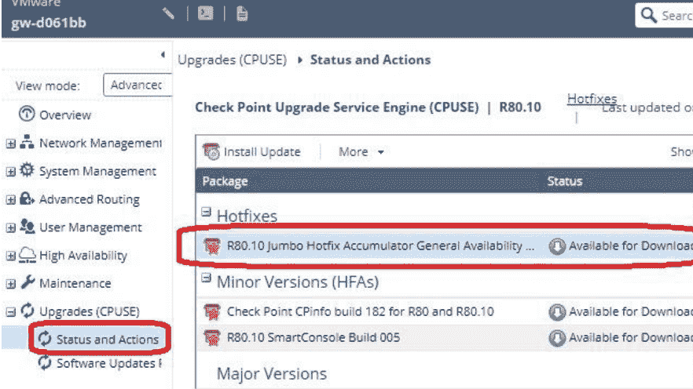

图 1-1：利用 CPUSE 安装 Jumbo HFA

此外也有“进行中”（ongoing）的版本，我在这些方面的运气没那么好。通常情况下，我不建议安装“进行中”的 Jumbo 补丁累积包，除非它包含解决我目前正在遇到的某个特定问题的特定修复。进行中的版本不应预先安装。有关 Jumbo 补丁累积包的更多信息请参阅：`sk98028:Jumbo Hotfix Accumulator FAQ`。

最后，确保你正在运行最新版本的 R80.10 SmartConsole 有时也会帮助，因为最近有很多修复和增强在此处详细介绍：`sk119612: R80.10 SmartConsole Releases`。

我们将采用自下而上的方法，在对高层尝试任何调优操作之前，确保防火墙的底层 OSI 层正在清洁高效地交付数据包。

在调优过程中，有一个必须确定的关键因素：不可接受的性能是由数据包交付的过度（或高度波动）延迟引起的，还是纯粹的丢包？从性能角度来看，丢包往往是破坏性最大的，但不要低估不稳定交付延迟（称为抖动）对网络性能的影响。传统上，抖动影响语音和视频等实时流应用，但过度的抖动会干扰 TCP 的拥塞控制机制，并降低 HTTP 和 FTP 等非流协议的网络性能。例如，Microsoft Windows 环境使用的通用网络文件系统 (CIFS) 协议特别容易受到高延迟导致的糟糕性能的影响；关于这种效应的更多内容将在第 8 章介绍。

帮助你判断特定网络路径是经历延迟还是丢包的一个绝佳技巧是使用 `ping` 命令发送超大测试包，这些数据包具有能够激扰任何底层网络问题的技巧，从而使它们变得更加明显且更容易识别：

```
Gaia/Linux: ping -s 1400 129.82.102.32
Windows: ping -l 1400 129.82.102.32
```

## 测试环境搭建

通常来说，你的测试工作站应该尽可能靠近防火墙，以尽量减少内部网络的影响，所示：

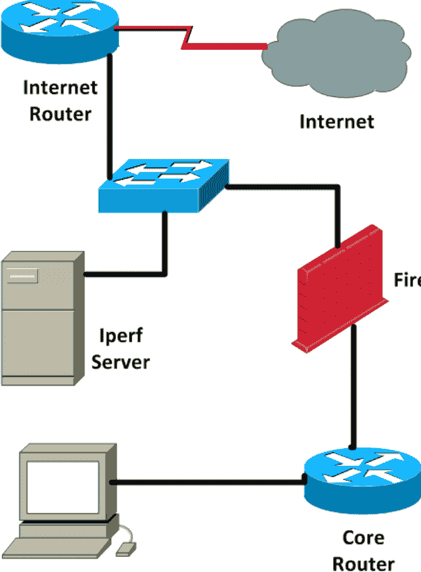

图 1-2：测试工作站搭建

## 简介与概念

理想情况下，你的测试工作站距离防火墙内部接口仅隔一个路由器跳，内部接口是大部分内部流量到达的地方。虽然有互联网速度测试网站并可以使用（Comcast 的速度测试 http://speedtest.xfinity.com/ 是我目前喜欢的——我看到过下行轻松达到 900Mbps，上行超过 800Mbps），但你可能想考虑在连接到防火墙外部接口的网络上建立自己的测试服务器，如上图所示。有一个名为 iPerf (https://iperf.fr) 的优秀免费工具，可以在测试工作站和测试服务器上使用，通过防火墙产生网络负载。速度测试受互联网波动性的影响。

在对防火墙进行网络性能调优之前，必须对 Gaia（基于 Red Hat Linux）如何接收、处理和传输数据包有一定的了解。

- 阶段 1：帧到达线缆；网卡 (NIC) 检查目标 MAC。如果目标 MAC 与网卡的 匹配，或者目标 MAC 是广播/组播，或者网卡被 `tcpdump` 等数据包捕获工具设置为混杂模式，网卡控制器将帧复制到 RAM 区域。

- 阶段 2：网卡控制器信号运行在操作系统内核中的网卡设备程序，通过硬件中断 (hi) 从网卡的 RAM 中检索帧。

- 阶段 3：网卡驱动程序开始处理硬件中断，从网卡的硬件缓冲区中检索帧，并对帧进行各种完整性检查。如果帧通过检查，它将帧放在主机内存中的一个预留区域，称为“接收套接字缓冲区”（receive socket buffer）。

- 阶段 4：网卡驱动程序填充环形缓冲区（ring buffer）槽，引用内存中新接收帧的位置。硬件中断处理完成。

- 阶段 5：网卡驱动程序向 CPU 调度软中断 (si/SoftIRQ)，以便在方便时通过环形缓冲区检索帧。

- 阶段 6：稍后 CPU 开始处理 SoftIRQ 并查找环形缓冲区。如果存在描述符，CPU 从关联的套接字缓冲区检索帧，清除环形缓冲区中引用帧的描述符，并将帧发送给所有“注册接收者”，这些接收者将是 SecureXL 加速驱动（如果启用了 SecureXL）或 Check Point INSPECT 驱动程序（如果禁用了 SecureXL）。如果当前运行 `tcpdump` 捕获，`libcap` 将也是一个“注册接收者”，并接收帧的副本。

- 阶段 7：如果 SecureXL 激活，数据包首先到达 SecureXL 加速层。现有连接在经过优化的检查操作后可能会立即转发到输出 SecureXL 层。（SecureXL 在第 9 和第 11 章介绍）。

- 阶段 8：如果 SecureXL 无法在加速路径中独立处理数据包，数据包将发送到 Check Point INSPECT 驱动 (F2F)，在防火墙路径或中间路径中处理。（不同路径将在第 9 章介绍）。

- 阶段 9：Check Point INSPECT 驱动处理数据包（规则库允许吗？数据包是否需要 NAT？）。(i->I) 如果策略允许，数据包继续并应用目标 NAT。

- 阶段 10：数据包转发到 Gaia IP 驱动进行路由；出站接口通过 IP 路由表查找确定。

## 简介与概念

**第 11 :** Gaia IP 驱动将数据包发送到 Check Point INSPECT 驱动进行最终处理 (o->O)

**第 12 :** 数据包到达出站 SecureXL 加速驱动程序。

**第 13 :** 数据包被复制到“发送套接缓冲区”，该缓冲区绑定到通过 IP 路由查找确定的出站接口。

**第 14 :** Linux 数据包调度器向 TX 环形缓冲区中添加一个描述符，指向内存中包含数据包的发送套接缓冲区的位置。

**第 15 :** 网卡获取数据包，添加以太网帧结构，并通过硬件中断将其发送到网卡的内存（RAM）。

**第 16 :** 网卡通过出站接口在物理线上传输该帧。

大多数情况下，许多 Check Point 防火墙性能问题是由于接收操作（阶段 10-9）期间的问题引起的，而几乎不会发生在传输操作期间。缓冲区缺失、数据包损坏或网卡溢出都是接收操作期间遇到的导致数据包丢失的问题示例，这对防火墙的性能可能是毁灭性的。

如前所述，希望你的测试工作站和速度测试服务器之间通过防火墙有一条短路径。你需要发现从测试工作站开始，通过内部网络、通过防火墙，到达互联网测试服务器的交换路径和路由路径。逻辑路径可以通过 `traceroute/tracerert` 命令来识别，该命令将显示路径中的所有第 3 层路由器。Windows 内置的另一个有用命令是 `pathping`；这是一个增强版的 `traceroute` 版本，它会向其发现的每个跳数发送大量流量，以查看该特定跳是否是导致过度数据包延迟或丢失的罪祸首：

```
C:\>pathping -n 4.2.2.2
Tracing route to 4.2.2.2 over a maximum of 30 hops
0  10.30.11.222
1  10.30.11.254
2              .238.226
3              .224.41
4  205.214.65.5
5  *              4.53.14.89
6  *              4.69.145.139
7  4.2.2.2
```

正在计算 175 秒的统计信息...

```
Hop RTT      Source/Sent = Pct Last/Sent = Pct Address
1  0ms      0/ 100 = 0% 0/ 100 = 0% 10.30.11.254
2  0ms      0/ 100 = 0% 0/ 100 = 0% .238.226
3  0ms      0/ 100 = 0% 0/ 100 = 0% .224.41
4  0ms      0/ 100 = 0% 0/ 100 = 0% 205.214.65.5
5  28ms     0/ 100 = 0% 0/ 100 = 0% 4.53.14.89
6  -ms      100/ 100=100% 0/ 100=100% 4.69.145.139
7  15ms     0/ 100 = 0% 0/ 100 = 0% 4.2.2.2
```

跟踪完成。

图 1-3：Windows `pathping` 命令示例

如果防火墙在 `traceroute/pathping` 输出中显示为星号 (* * *)，那么在安全策略中从你的测试工作站 IP 地址向防火墙对象本身提供“Any”（任意）可能会有所帮助。此规则将是规则库中前面的规则之一，并放置在防火墙隐身规则之前。使用 `netstat -rn` 命令（适用于 Gaia 和 Windows）也可以帮助确定路由路径。

## 简介与概念

确定第 2 层交换路径要困难得多，并且可能涉及追踪线。如果你在网络中使用 Cisco 交换机，可以从防火墙使用以下命令嗅探并解码连接到防火机的 Cisco 发现协议 (CDP) 帧：

```
tcpdump -vn -s 1500 -i (interface) 'ether[20:2] == 0x00'
# tcpdump -vn -s 1500 -i Mgmt 'ether[20:2] == 0x00'
03:57:11.920646, ttl: 180, checksum: 692 (verified), leng
Device-ID (001), length: 7 bytes: Switch0
Version String (005), length: 189 bytes:
Cisco IOS Software, C3550-IPVERSESK9-M
Version 2.2(4) RELEASE (fc1)
Copyright (c) 1986-2009 by Cisco Systems, Inc.
Compiled 09-Mar-09 20:28 by gereddy
Platform (006), length: 7 bytes: 'Cisco WS-3550-48'
Address (002), length: 13 bytes: IPv4 (1) 10.30.11.200
Port-ID (003), length: 16 bytes: 'FastEthernet0/10'
Capability (004), length: 4 bytes: (0x000029): Router,
Switch VLAN management
Protocol-Hello Option (008), length: 32 bytes:
VTP Management Domain (009), length: 14 bytes: 'shadowpeak'
Native VLAN ID (00a), length: 2 bytes: 11
Duplex (00b), length: 1: full
AVVID trust bitmap (012), length: 1 byte: 0x00
AVVID untrusted ports CoS (0x13), length: 1 byte: 0x00
Management Addresses (016), length: 13 bytes:
10.30.11.200
```

> 图 1-4：`tcpdump` 流量流量

在你的工作站上，你可以在 Wireshark 中进行类似的操作。在你的网络接口上启动捕获并使用以下过滤器：

```
eth.dst == 01:00:0c:cc:cc
```

```
Filter: eth.dst == 01:00:0c:cc:cc
```

| 序号 | 时间 | 源 | 目的 | 协议 | 类型 |
|---|---|---|---|---|---|
| 12 | 001685170 | Cisco_68:59:8a | CDP/VTP/DTP/PaGP/UDP | UDP |

* 帧 12: 线上 388 字节 (3104 字节)，捕获 388 字节
* IEEE 802.3 以太网
* 逻辑链路控制
* Cisco 发现协议
* 版本: 2
* TTL: 180 秒
* 校验和: 0x66c4
* 设备 ID: Switch0
* 软件版本
* 平台: Cisco WS-3550-24
* 地址
* 端口 ID: FastEthernet0/10


# 能力

- 协议问候：`Management`
- VTP 管理域：`shadowpeak`
- 原生 VLAN：`11`
- 双工：全双工
- 信任位图：`0x00`
- 不信任端口 COS：`0x00`
- 管理地址

> 图 1-5：Wireshark 解码流量

在你的工作站上，你可以在 Wireshark 中进行类似的操作。在你的网络接口上启动捕获并使用以下过滤器：

```
eth.dst == 01:00:0c:cc:cc:cc
```

如果防火墙在 `traceroute`/`pathping` 输出中显示为星号（`* * *`），那么在安全策略中从你的测试工作站 IP 地址向防火墙对象本身提供“Any”可能会有所帮助。此规则将是规则库中前面的规则之一，并放置在防火墙隐身规则之前。使用 `netstat -rn` 命令（适用于 Gaia 和 Windows）也可以帮助确定路由路径。

# 简介与概念

## 网络设备检查

确定第 2 层交换路径要困难得多，并且可能涉及追踪线。如果你在网络中使用 Cisco 交换机，可以从防火墙使用以下命令嗅探并解码连接到防火墙的 Cisco 发现协议（CDP）帧：

现在你已经发现了网络中的所有设备（包括路由器、交换机、作为内联设备的其它防火墙），是时候评估它们的健康状况了。执行此操作的方法因厂商而异，但通常中间设备是某种 Cisco 设备或运行 Linux 操作系统变体的设备。你可能需要让网络团队的某人运行这些命令。在评估网络设备的健康状况时，你应该查看五个基本点：

- CPU 负载（Cisco：`show proc cpu`；Linux：`top`）
- 空闲内存或内存不足（Cisco：`show proc mem`；Linux：`free -m`）
- 网络接口错误，例如 CRC/帧错误以及接口崩溃和重置。不要忘记检查接收接口的网络流量（即在 `traceroute` 中显示的接口）和出站接口。（Cisco：`show interface` 查找“input error”、“output error”和“carrier transitions”计数器；Linux：`netstat -ni` 查找 `RX-ERR` 和 `RX-OVR`；`ifconfig (interface)` 检查“carrier”值）
- 网络缓冲区处理错误——不要忘记检查接收接口的网络流量（即在 `traceroute` 中显示的接口）和出站接口。（Cisco：`show buffers` 查找 misses；Linux：`netstat -ni` 查找 `RX-DRP`）
- 设备运行时间，以防设备不稳定或频繁崩溃（Cisco：`show version`；Linux：`uptime`）

任何计数器非零（特别是如果正在不断增加）、CPU 利用率持续处于高位、空闲内存极少或运行时间可疑的设备，在开始对防火墙进行调优之前都应该进行检查并尽可能修复。你可能刚刚发现了主要的网络性能问题，而且这次并不是防火墙的错：太好了！

## 是否存在监控插件

你的安全管理服务器（SMS）许可证是否包含监控插件（`CPSB-MNTR`）？最简单的方法是启动 SmartView Monitor GUI 应用程序。对于 R77.30 管理，可以通过每个 R77.30 GUI 工具顶部的 SmartConsole 链接启动 SmartView Monitor 工具轻松完成。

对于 R80+ 管理，这要复杂一些。在 R80+ SmartConsole 中选择“Tunnel & User Monitoring”链接，如图所示：

# 16 介绍与概念

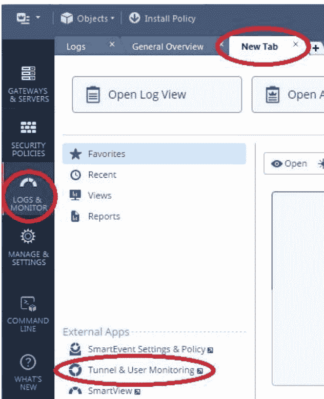

图 1-6：从 R80+ SmartConsole 调用 SmartView Monitor

# 是否存在 Monitoring Blade？ 17

现在让我们查看 SmartView Monitor 显示的类别：

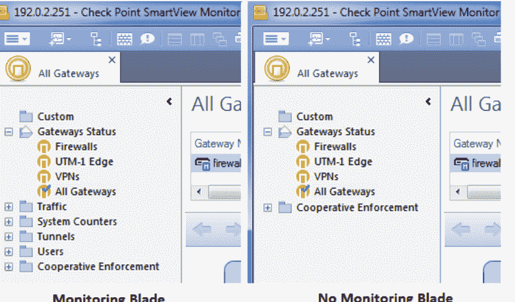

图 1-7：Monitoring Blade 额外报告

R80+ SmartConsole 可以通过在“Gateways and Servers”（网关和服务器）选项卡上右键点击防火墙对象并选择“Monitor”（监控），直接提供 SmartView Monitor 相同的流量/系统计数（Traffic/System Counters）功能。对于 SmartView Monitor 任何缺失的功能，将在需要时提供命令行替代，但在 SmartView Monitor 中图形化访问这些数据方便得多。另一个选项是联系您的 Check Point 代理商并请求 30 天评估许可，这将启用增强型 SmartView Monitor 报告。一旦正确附加了评估许可，SmartView Monitor 的完整报告功能将为您可用。如果您预算中还有剩余资金，我的首要建议是如果您还没有它，就购买 Monitoring Blade，因为它的图表功能使性能故障排除变得简单得多。

## 确定一天中最繁忙的时段

通常，我们希望在防火墙最忙的时段（以及如果使用了高可用性则在活动集群成员上）分析性能并运行各种命令。虽然可以使用第 14 节介绍的 `sar` 和 `cpview` 等工具事后调查性能问题，但如果使用这些工具的历史模式，其可用颗粒度将低得多。

如果您有 Monitoring Blade，确定一天中最繁忙的时段将轻而易举；在 SmartView Monitor 左侧选择 System Counters...Firewall History（系统计数...防火墙历史）报告。选择您想要检查的网关，一旦报告出现，选择时间范围为“Last Week”（上周）。注意防火墙最繁忙的时间。在许多组织中，这倾向于上午和午休后立即。另一个非常繁忙的时期可以是夜间备份流量通过防火墙时。

如果您没有 Monitoring Blade，请在防火墙上运行 `sar -u` 命令：

# 确定一天中最繁忙的时段 19

```
[Expert@firewall:0]# sar -u
Linux 2.6.18-2cpx86_64 (gw-35dd56)
```

| Time | CPU | %user | %nice | %system | %iowait | %steal | %idle |
| :--- | :--- | :--- | :--- | :--- | :--- | :--- | :--- |
| 00:10:01 | all | 0.44 | 0.00 | 0.40 | 0.06 | 0.00 | 99.10 |
| 00:20:01 | all | 0.48 | 0.00 | 0.42 | 0.07 | 0.00 | 99.04 |
| 00:30:01 | all | 0.43 | 0.00 | 0.41 | 0.06 | 0.00 | 99.10 |
| 00:40:01 | all | 0.43 | 0.00 | 0.41 | 0.05 | 0.00 | 99.11 |
| 00:50:01 | all | 0.47 | 0.00 | 0.41 | 0.06 | 0.00 | 99.06 |
| 01:00:01 | all | 0.43 | 0.00 | 0.41 | 0.06 | 0.00 | 99.11 |
| 01:10:01 | all | 0.43 | 0.00 | 0.40 | 0.05 | 0.00 | 99.12 |
| 01:20:01 | all | 0.48 | 0.00 | 0.41 | 0.07 | 0.00 | 99.04 |
| 01:30:01 | all | 0.43 | 0.00 | 0.41 | 0.06 | 0.00 | 99.10 |
| 01:40:01 | all | 0.43 | 0.00 | 0.41 | 0.06 | 0.00 | 99.11 |
| 01:50:01 | all | 0.47 | 0.00 | 0.41 | 0.07 | 0.00 | 99.06 |
| 02:00:01 | all | 0.43 | 0.00 | 0.41 | 0.06 | 0.00 | 99.11 |
| 02:10:01 | all | 0.43 | 0.00 | 0.41 | 0.06 | 0.00 | 99.11 |
| 02:20:01 | all | 0.48 | 0.00 | 0.41 | 0.07 | 0.00 | 99.04 |
| 02:30:01 | all | 0.44 | 0.00 | 0.41 | 0.07 | 0.00 | 99.09 |
| 02:40:01 | all | 0.44 | 0.00 | 0.41 | 0.06 | 0.00 | 99.10 |
| 02:50:01 | all | 0.47 | 0.00 | 0.41 | 0.06 | 0.00 | 99.06 |
| 03:00:01 | all | 0.43 | 0.00 | 0.41 | 0.06 | 0.00 | 99.11 |
| 03:10:01 | all | 0.44 | 0.00 | 0.41 | 0.05 | 0.00 | 99.11 |
| 03:20:01 | all | 0.51 | 0.00 | 0.42 | 0.06 | 0.00 | 99.01 |
| 03:30:01 | all | 0.51 | 0.00 | 0.42 | 0.06 | 0.00 | 99.03 |
| 03:40:01 | all | 0.44 | 0.00 | 0.41 | 0.05 | 0.00 | 99.10 |
| 03:50:01 | all | 0.48 | 0.00 | 0.42 | 0.07 | 0.00 | 99.03 |
| 04:00:01 | all | 0.44 | 0.00 | 0.41 | 0.06 | 0.00 | 99.11 |
| 04:10:01 | all | 0.43 | 0.00 | 0.41 | 0.06 | 0.00 | 99.10 |
| 04:20:01 | all | 0.48 | 0.00 | 0.41 | 0.07 | 0.00 | 99.04 |
| 04:30:01 | all | 0.44 | 0.00 | 0.41 | 0.07 | 0.00 | 99.09 |
| 04:40:01 | all | 0.47 | 0.00 | 0.41 | 0.06 | 0.00 | 99.10 |
| 04:50:01 | all | 0.47 | 0.00 | 0.41 | 0.06 | 0.00 | 99.06 |

另一种确定一天中最繁忙时段的方法是在历史模式下使用 `cpview`，如下所示。图 1-9：使用 `cpview` 确定繁忙时段。

```bash
ls -1 /sys/class/net | grep -v ^lo | xargs -i ethtool -i {} | grep driver
driver: e1000
driver: e1000
driver: e1000
driver: e1000
driver: e1000
driver: e1000
driver: e1000
driver: e1000
driver: e1000
driver: e1000
driver: e1000
driver: e1000
driver: e1000
```

图 2-1: 使用 `ethtool` 检查 NIC 驱动类型

问题：您的网卡链路速率是多少？

```bash
ls -1 /sys/class/net | xargs -i -t ethtool {} | grep -i speed
```

注意：`ls` 命令后的选项是一个数字型 `l`

```bash
ls -1 /sys/class/net | xargs -i ethtool {} | grep -i speed
Speed: 1000MB/s
Speed: 1000MB/s
Speed: 1000MB/s
Speed: 1000MB/s
Speed: 1000MB/s
Speed: 1000MB/s
Speed: 1000MB/s
Speed: 1000MB/s
Speed: 1000MB/s
Speed: 1000MB/s
Speed: 1000MB/s
Speed: 1000MB/s
```

图 2-2: 显示所有网络接口的速率

问题：我的接口稳定吗？是否存在任何载波转换（carrier transitions）？

# 26 第 1 & 2 层性能优化

答案：运行 `ifconfig -a | more`。对于每个接口，都有一个“carrier”计数器，其值应该是：

```
[Expert@firewall:0]# ifconfig -a addr 00:0C:29:D0:BC:DA
eth0 Link encap:Ethernet HWaddr -a\inet addr=172.31.128.99 Bcast=172.31.128.255 Mask=255.25
UP BROADCAST RUNNING MULTICAST MTU:1500 Metric:1
RX packets:799844 errors:1 dropped:0 overruns:0 frame:0
TX packets:919880 errors:0 dropped:0 overruns:0 carrier:0
collisions:0 txqueuelen:1000
RX bytes:107093267 (102.13 MiB) TX bytes:81534121 (77.7 MiB)
Interrupts:5 Base address:0x02000
```

图 2-3: 使用 `ifconfig` 检测计数器转换

问题：是否有接口的 `RX-OVR` 或 `RX-ERR` 值为非零？

答案：在防火墙的专家模式下运行 `netstat -ni`，并检查所有接口的 `RX-OVR` 和 `RX-ERR` 计数器。

## 首选 NIC 硬件：Intel

希望 `ethtool` 命令已显示您的防火墙使用的是所有的 Intel NIC（驱动名称将为 `e1000`、`e1000e`、`igb`、`igbe` 或 `w83627`），这些是近期 Check Point 设备硬件中最常用的驱动类型。只要您的防火墙运行着最新的通用发布版（GA）巨型热补丁累积器（Jumbo Hotfix Accumulator），您的 NIC 始终会使用最新支持的 NIC 驱动。旧的 NIC 驱动有时会导致防火墙出现性能和/或稳定性问题，尽管只要防火墙至少运行 R77.30 版本，这类问题很少见。如果您不想安装最新的巨型热补丁累积器，Check Point 技术支持中心（TAC）可以为您的防火墙版本提供最新的 NIC 驱动（热补丁格式）。

但如果您看到了未提到的驱动名称怎么办？

请参考下表：

## 表 1：`ethtool` 显示的 NIC 驱动名称厂商摘要

| 驱动名称 | NIC 厂商 | 注意 |
|---|---|---|
| `e1000`, `e1000e`, `igb`, `ixgbe`, `w83627` | Intel | 建议在加载最新的 GA Jumbo 热补丁后使用 |
| `mlx5_core`, `mlx_compat` | Mellanox | 仅适用于 15000/23000 设备的较新 40G 光纤卡 |
| `bge`, `tg3` | Broadcom | 不建议用于生产流量 |
| `be2net` | Emulex | 不建议用于生产流量 |
| `sk98lin` | SysKonnect/Marvell | 已淘汰 |

如果您的部分或全部 NIC 是由 Broadcom、Emulex 或 SysKonnect/Marvell 制造的，我有一个坏消息要告诉你。每当我处理这些 NIC 时都会遇到问题；正因为如此，它们从未被包含在较新的 Check Point 防火墙设备中。在许多涉及开放硬件防火墙的情况下，我曾将连接从这些 NIC（通常内置在开放式服务器的主板上）迁移到扩展槽中添加的 Intel 品牌 NIC，并看到在没有任何额外调优的情况下，性能*至少*翻了一倍。虽然书中的原理仍然适用，但我担心如果您的防火墙使用的是 Intel 或 Mellanox 以外的 NIC，在性能方面将面临一场苦战。我甚至见过，当这些其他 NIC 甚至未使用（即未配置且未插入任何设备）时，由于某种总线竞争，必须在 BIOS 中禁用它们才能获得 Intel NIC 那样的良好性能！

# 28 第 1 & 2 层性能优化

如果您的硬件防火墙没有足够的 NIC 端口，且被迫使用非 Intel/Mellanox NIC，请仅将它们用于防火墙集群同步或可能的管理；绝不要用它们传输生产流量，因为性能将非常糟糕。如果被迫使用它们，联系 Check Point TAC 获取最新的 Broadcom 或 Emulex 驱动也是一个好主意。更糟糕的是，Broadcom 和 Emulex NIC 无法利用多队列功能（第 12 章介绍），而且我也听过关于 Broadcom/Emulex 的各种问题。尽可能使用 Intel NIC！

## “黑暗三三角”（Dark Triad）

在您的防火墙上运行 `netstat -ni`：

```
[Expert@firewall:0]# netstat -ni
Kernel
Interface RX-OK RX-ERR RX-DRP RX-OVR TX-OK TX-ERR TX-DRP TX-OVR
eth0 799796 1 0 0 917594 0 0 0
eth1 521824 2 4 0 1342053 0 0 0
eth2 467258 0 0 0 459184 0 0 0
eth3 467032 0 0 0 5944661 0 0 0
lo 285998 0 0 0 285998 0 0 0
```

……表示在第 1 章“帧生命中的毫秒”讨论的第 1 阶段发生了 NIC 溢出。“黑暗三三角”是我从心理学中引用的学术术语，对应每个接口列出的 `RX-ERR`、`RX-DRP` 和 `RX-OVR` 三个字段：

- `RX-OVR` –（溢出）自恋、自傲与自大（Narcissism, Pride, & Egotism）
- `RX-ERR` –（错误）反社会性人格障碍（Psychopathy）


# 网络接口稳定性与错误计数器

- `RX-DRP`（丢弃）马基雅维主义（Machiavellism）

如果这些计数器中的任何一个非零，这就不是好事，会导致数据包丢失且必须进行恢复。

虽然书中的原理仍然适用，但我担心如果您的防火墙使用的是 Intel 或 Mellanox 以外的 NIC，在性能方面将面临一场苦战。我甚至见过，当这些其他 NIC 甚至未使用（即未配置且未插入任何设备）时，由于某种总线竞争，必须在 BIOS 中禁用它们才能获得 Intel NIC 那样的良好性能！

如果您的硬件防火墙没有足够的 NIC 端口，且被迫使用非 Intel/Mellanox NIC，请仅将它们用于防火墙集群同步或可能的管理；绝不要用它们传输生产流量，因为性能将非常糟糕。如果被迫使用它们，联系 Check Point TAC 获取最新的 Broadcom 或 Emulex 驱动也是一个好主意。更糟糕的是，Broadcom 和 Emulex NIC 无法利用多队列功能（第 12 章介绍），而且我也听过关于 Broadcom/Emulex 的各种问题。尽可能使用 Intel NIC！

## 绑定接口

`SmartConsole`/`SmartDashboard`。绑定（Bonded）物理接口共享相同的 IP 地址，但现在有两个独立的 NIC 硬件在处理同一帧数据流；绑定设置理想情况下应该导致零溢出（`overrun`）状态。请参考 Check Point 文档获取有关绑定接口的信息；可以像这里从 Gaia Web 界面轻松完成：

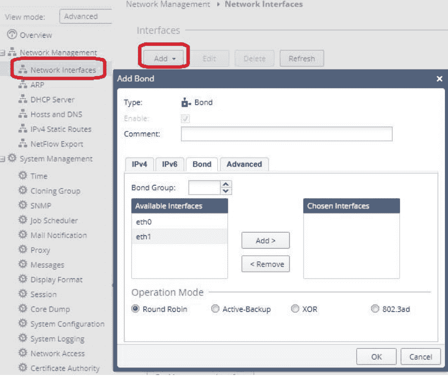

图 2-5：创建绑定接口

## 流控制

或者，千兆以太及更高标准提供了网卡与交换机之间的流控制能力；通常情况下，此功能在防火墙网卡上是默认开启，但在大多数交换机上是关闭的。本质上，当网卡的内存缓存开始不足时，它会向交换机发送名为“暂停帧”（pause frame）的特殊控制帧，告诉交换机“我跟不上了，请停止发送流量一会儿（XOFF）”。一旦网卡再次拥有足够的缓存容量，它会向交换机发送一个 XON，告诉它重启发送帧。

此功能具有争议性，对整体性能的损害可能大于其帮助；关于这一点将在稍后详细说明。让我们看看防火墙网卡是否已尝试与交换机进行流控制。

**后续问题：** 显示 `RX-OVR` 计数器非零的接口是否尝试与交换机实现流控制？

```
ethtool -S (interface) | grep -i flow_control
ethtool -a (interface)
```

```
## ethtool -S Lan1 | grep -i "flow_control"
rx flow control xon: 0
rx flow control xoff: 0
tx_flow_control xon: 0
tx_flow_control xoff: 0
```

图 2-6：使用 `ethtool -S` 流控制计数器

```
[Expert@fw:0]# ethtool -a eth0
Pause parameters for eth0:
Autonegotiate: on
RX: off
TX: on
```

图 2-7：使用 `ethtool -a` 接口流控制设置

如果 `tx` 流控制参数非零，说明防火墙网卡已尝试向交换机发出信号，即将溢出并请求“请慢一点”。然而，默认情况下大多数交换机的流控制是关闭的，因此除非交换机也开启了流控制，否则 `rx` 值几乎肯定为零。实际上，`netstat -ni` 输出中的 `RX-OVR` 计数器可能是零，但 `tx_flow_control_xon` 和 `tx_flow_control_xoff` 计数器是非零。这怎么可能？本质上，网卡向交换机信号其内存缓存已耗尽（使用非零的 `tx_flow_control` 计数器），但它并没有真正耗尽并丢弃任何帧。在某些情况下可能需要绑定配置。

为什么绑定比流控制更受推崇？千兆以太网控制本质上是尝试对网络进行拥塞管理以防止网卡溢出。然而，大多数网络中的绝大部分流量都是面向 TCP 的，它有自己的拥塞控制机制。因为当开启网卡流控制时，现在有两种不同的拥塞控制机制在实现，它们可能会以意想不到的方式相互作用，实际上导致 TCP 系统比应该的变慢，从而损害性能。这种现象的一个例子被称为“头部阻塞”（Head of Line Blocking）。（注意《以太网流控制》，这是一篇佳文章）结论是：如果你在接口上累积了 `RX-OVR` 事件，在以下两种情况下我才建议用流控制代替绑定：

- 你的网络中绝大多数流量不是 TCP（UDP、ICMP 等）且没有自己的拥塞控制

- 你没有其他可用的物理接口来实现绑定

即使你满足了上述一个或两个条件，在启用流控制后务必重新测试网络性能。流控制对防火墙性能的损害很有可能大于帮助。

## 其他网络接口错误

如果 `netstat -ni` 显示的 `RX-ERR` 计数器非零，说明网卡接收到的帧在某种程度上损坏并被丢弃。要查看更多细节，请运行：

```
ethtool -S (interface) | grep -i errors
```

```
## ethtool -S Lan | grep -i errors
rx errors: 0
tx errors: 0
rx length errors: 0
rx errors: 0
rx frame errors: 0
rx_missed_errors: 0
tx aborted_errors: 0
tx carrier_errors: 0
tx fifo_errors: 0
tx heartbeat_errors: 0
tx window_errors: 0
rx long_errors: 0
rx short length_errors: 0
rx align_errors: 0
rx offload_errors: 0
```

图 2-8：使用 `ethtool` 查看错误计数器

我们感兴趣的特定字段是：

- `rx_errors`：（带错误的帧数；下述所有值的总和）

- `rx_length_errors`

- `rx_crc_errors`

- `rx_frame_errors`

- `rx_align_errors`

此处的任何非零值都可能指示电缆故障或网络附近存在电磁干扰，特别是当电缆长度超过 50 米时。尝试使用符合 Cat5 或 Cat6 级的新电缆进行短距离测试；如果使用 Cat5 电缆后状况持续，则说明问题在电缆上。

## RXDR 是什么？

你可能好奇为什么我们没有涵盖 `RXDR`，这将在第 7 节中详细介绍。

## 防火墙硬件检查

硬件问题会严重影响防火墙性能。运行此命令：`cpstat -f sensors`。（如果你使用的是 R7 或更高版本）你会看到如下输出：

```
[Expert@fw:0]# cpstat -f sensors
```

| Name | Value | Unit | Status |
|---|---|---|---|
| CPU 2 Temp | 87 | degrees C | 1 |
| M/B Temp | 29 | degrees C | 0 |
| CPU 1 Temp | 42 | degrees C | 0 |

| Name | Value | Unit | Status |
|---|---|---|---|
| Case Fan 2 | 1985 | RPM | 0 |
| Case Fan 3 | 2033 | RPM | 0 |
| CPU 2 Fan | 0 | RPM | 1 |
| Case Fan 1 | 6026 | RPM | 0 |
| Case Fan 1 | 2008 | RPM | 0 |

图 2-9：使用 `cpstat` 查看温度和风扇速度

看到问题了吗？2 号风扇故障了，因为它运行温度极高。CPU 几乎被降频到较低时，以至于不会烧毁。要检查发生降频的情况，请运行此命令：

```
dmidecode -t processor | grep -i "speed"
```

```
## dmidecode -t processor | grep -i "speed"
Max Speed: 2400 MHz
Current Speed: 2400 MHz
Max Speed: 2400 MHz
Current Speed: 2400 MHz
```

```
[Expert@fw:0]# CPU 过热导致降频
```

图 2-10：检查 CPU 过热导致的降频

此命令将显示所有 CPU 核心的当前和最大速度。（可以使用 Gaia 命令 `show asset all` 来查看 CPU 速度）。所有处理器应始终以最高速度运行。这看起来像是一个异常的边缘情况，但我在现场见过很多。显然，防火墙需要进行 RMA（返修），但不要尝试打开防火墙设备壳来重新安装 CPU 风扇，否则会导致保修失效。

另一种需要关注的情况各种电压水平及其状态，这也是 `cpstat` 命令输出的一部分：

## 电压传感器

| Name | Value | Unit | Type | Status |
|---|---|---|---|---|
| VBat | 2.99 | Volts | Voltage | 0 |
| VSB | 3.23 | Volts | Voltage | 0 |
| +5V | 4.97 | Volts | Voltage | 0 |
| VCore2 | 0.96 | Volts | Voltage | 0 |
| AVCC | 3.23 | Volts | Voltage | 0 |
| +3.3 | 3.23 | Volts | Voltage | 0 |
| +1.5V | 1.62 | Volts | Voltage | 0 |
| VCore1 | 0.90 | Volts | Voltage | 0 |

图 2-11：检查电源和主板电压

如果使用开放硬件防火墙，并且在尝试运行上述命令时遇到“超出正常范围”（Out of normal bound）错误，请参考以下内容：`sk94629`：如何在开放服务器上为 SecurePlatform / GaIA OS 温度和风扇传感器。

## 防火墙开放硬件 – BIOS 调优

如果为防火墙使用了所谓的“开放硬件”，进行若干 BIOS 配置调整以确保最佳性能至关重要。这些是通用建议；特定的 BIOS 设置名称在不同硬件供应商之间略有不同，因此你可能需要进行一些研究和探索，以找到相关的调整设置。

如果防火墙使用了具有多个电源的开放硬件，电源问题实际上会导致系统 CPU 处于禁用状态，这从性能角度来看是灾难性的。请参考以下 SK 以解释这种罕见且棘手的边缘情况：`sk103348`：`cat /proc/cpuinfo` 命令和 `top` 命令的输出在多处理器开放服务器上仅显示一个 CPU 核心。

通常情况下，任何允许 CPU 频率偏离其处理器基础速度（更快或更慢）的 BIOS 设置都应该禁用。虽然 Gaia 操作系统本身在 CPU 频率变化运行时良好，但 Check Point 防火墙代码的部分（如安全网络分配器 SND、动态调度器 Dynamic Dispatcher 和 ClusterXL）假设在时钟频率和处理能力方面，所有核心始终相等。

如果防火墙 CPU 时钟频率发生细微变化，这些功能的性能将处于次优状态；CPU 频率调整有多种形式，但这里是开放硬件防火墙上应该禁用的部分示例：

- Intel Turbo Boost/Turbo Mode

- Intel SpeedStep

- Energy Saving: P-States, C-States, & HPC Optimizations

- SMT/Hyperthreading（仅在 Check Point 防火墙设备上支持）

- IO Non Posted Prefetching

- X2APIC Support

- Dynamic Power Capping Function

- Intel Virtualization Technology **

其他需要检查的相关的 BIOS 设置：

- 启动模式：Legacy BIOS（即非 UEFI）

- CPU 和内存速度：最高性能（Maximum Performance）

- 内存通道模式：独立（Independent）

- 温度/风扇模式：最高性能（Maximum Performance）

- AES-NI 支持：启用（Enabled）

** 使用 Intel Virtualization Technology CPU 扩展来通过威胁仿真（Threat Emulation）功能加速可疑执行文件的本地仿真，在开放式防火墙硬件上是不支持的，但在某些 Check Point 设备上支持，见：`sk92374`：Check Point 设备对 Intel 虚拟化技术 (VT) 的支持兼容性。

## 生成树协议完整性检查

接下来我们将讨论交换机实现的生成树协议。你在说什么？我原以为这本书是关于防火墙性能优化的，我们干嘛要谈论交换机使用的生成树协议？交换机上的生成树问题会导致间歇性的网络变慢甚至完全中断，但实际上防火墙却因此被埋怨。我参与过许多咨询项目，以排查“防火墙间歇性性能问题”，结果发现了一个需要纠正的严重生成树问题。让我们深入研究：

生成树协议 (STP) 是一种网络协议，用于确保任何桥接以太网局域网具有无环路拓扑。STP 的基本功能是防止桥接环路以及由此产生的广播风。生成树还允许网络设计包含备用（冗余）链路，以便在活动链路故障时提供自动备份路径，而不会产生桥接环路的风险，也无需手动启用/禁用这些备用链路。

Wikipedia 在总结生成树协议 (STP) 方面做得很好。虽然防火墙本身不直接参与 STP，但 STP 问题对性能的影响会像网络其他部分影响防火墙。网络中的所有交换机都会从交换机端口发送称为桥接协议数据单元 (BPDU) 的特殊帧，用于选举根桥接并禁用（分区）任何必要的确保无环路架构的交换机端口。防火墙本身从不发送 BPDU，也不参与生成树算法。被 STP 禁用的交换机端口在 Cisco 交换机上显示为琥黄色，而不是通常的绿色。STP 有许多扩展，如 Rapid STP、Per-VLAN STP 和 Multiple STP；为了简单起见，我们将仅关注 IEEE 802.1D 标准中原始定义的 STP。

当交换机端口首次启动时，默认情况下生成树会在该端口上进入“监听和学习”阶段。交换机将监听进入端口的流量，但不会转发任何帧。交换机正在“监听”接口上收到的源 MAC 地址，试图判断同一个源 MAC 地址是否在不同的交换机端口上被“看到过”。如果同一个单播 MAC 地址出现在多个交换机端口接口上，可能表明网络中存在桥接环路，这可能会减慢或导致整个网络崩溃。在这种情况下，端口将永远离开“监听和学习”阶段，并处于分区/禁用状态，无法转发任何流量。

此监听和学习阶段通常会持续 12-15 秒，期间 Cisco 交换机正面的端口会呈琥黄色。一旦计时器过期且未检测到任何冲突的 MAC 地址，交换机端口将变为绿色并进入转发状态。

通过将交换机端口设置为 `portfast` 模式，可以将此监听和学习阶段缩短至基本零。启用后，`portfast` 允许交换机端口跳过学习阶段并立即激活。但是，必须确保没有其他交换机连接到启用了 `portfast` 的交换机端口，因为这会导致立即出现生成树问题并可能影响网络性能。可以在交换机中启用 BPDU Guard（后文讨论）来防止此类问题发生。

STP 可能会出现什么问题？我在排查实际上与 STP 相关的“防火墙性能问题”时最常遇到的场景是：

- 异常根桥（Rogue root bridges）

- 由于持续的网络抖动导致根桥不断变化（尤其在汇干端口上）

- STP 已完全禁用（这与在端口上设置 `fastport` 不同，后者要糟糕得多）

- 同一网络在使用不同的 STP 变体（例如 PVSTP、RTSP、MST），且它们之间无法互操作

**问题：** STP 目前的状态是什么？谁是根桥？

在运行以下命令的防火墙上：

```
tcpdump -vvv
```

如果启用了 STP，每隔几秒你就应该看到本地交换机发送的 BPDU。显示的信息之一将是根桥的 MAC 地址。下此地址以备后参考。

**问题：** 根桥当根桥多久了？

答案：获取此信息的唯一方法是在 Cisco 交换机上运行 `show spanning-tree detail`；除非发生了事件（停电、更换交换机），否则此处显示的时间应该是久以前：

```
Switch0>show spanning-tree detail
```

VLAN011 正在执行兼容 IEEE 生成树协议

桥标识符优先级为 32768，系统 ID 为 11，地址 000c.3168.59

配置 hello 时间 2，max age 20，forward delay 15

我们是生成树的根

拓扑变化标志已设置，检测标志未设置

拓扑变化次数 102，最后变化发生在 1d1h 前

来自Ethernet0/1

- Times: hold 1, topology change 35, notification 2

- hello 2, max age 20, forward delay 15


- `Timers: hello 0, topology change 0, notification 0, aging 300`

图 2-13：显示 Cisco 生成树详情

如果没有，可能表明网络中引入了根桥，或者存在某种网络抖动。Cisco 交换机上防止这两种事件影响你网络的功能是 `Root Guard` 和 `BDU Guard`。`Root Guard` 指定网络中一个或多个可以作为根桥的交换机；其他交换机可以通过发送 `BPDU` 参与生成树，但如果它们尝试选举自己为根桥，将立即从网络中断开。另一方面，`BDU Guard` 会自动禁用任何接收到 `BDU` 的设置为 `port` 的交换端口；回想我们之前的讨论，这不应在连接到另一个交换机的交换端口上启用。Cisco 命令 `show spanning-tree summary` 会显示 `Root Guard` 和 `BDU Guard` 是否激活。

## 44 第 1 层和 2 层性能优化

以及网络带宽。交换机没有为第 2 层帧实现“生存时间”（`TTL`）机制；第 3 层路由器使用 `TTL` 值来检测并丢弃在跳数过多后产生的环路流量。随着越来越多的流量被引入桥接环路（`bridging loop`），网络性能会显著下降。最终，涉及的两个或多个交换机通过的流量变得过大，导致其中至少一台交换机崩溃，最终打破了环路并导致全面的网络中断。交换机恢复后，一切都会正常，直到当然地，这一切再次发生。

不言而喻，禁用你所在组织交换机的 `STP`（生成树协议）不是一个好主意。如果你希望这些端口在插入网线后立即启动并开始转发数据包，请将必要的交换机端口设置为 `portfast` 模式；完全禁用 `STP` 并不是实现此点的正确方法。

- **问题：** 连接到防火墙的交换机端口是否启用了 `portfast`？

- **答案：** 除非你物理上拔掉电缆再插回去以查看会发生什么（显然这会导致该接口出现中断）。如果交换机端口 `LED` 在插入时立即变绿，则已启用 `portfast`；如果它保持琥珀色约 15 秒后变绿，则未启用 `portfast`。在交换机上使用 `spanning-tree portfast` 或 `set spantree portfast` 命令在交换机端口上启用 `portfast`。要检查 Cisco 上的特定交换机端口是否设置为 `portfast`，运行 Cisco IOS 命令 `show interface (interfacename)`，如果输出中显示所示 `spanning-tree portfast`，则该端口确实已设置为 `portfast`：

图 2-14：检查 Cisco 上的 Portfast 设置

通常情况下，在所有连接防火墙的端口上都应该设置 `portfast`，特别是当防火墙处于高可用（`HA`）集群中时。未在连接到防火墙集群的交换机端口上设置 `portfast`，可能会导致每次从一个集群成员切换到另一个成员时，都会发生 12-15 秒的网络中断。这些所谓的“慢”切换将在第 6 章中进一步探讨。

## 增加罕见但仍然致命的问题：双工匹配

你是否有任何以快速以太网（`100Mbps`）速度运行的接口？

`ethtool (interface)`

```
[Expert@firewall:0]# ethtool Lan1
Settings for Lan1:
Supported ports: [ TP]
Supported link modes: 10baseT/Half 10bas
100baseT/Half 100b
1000baseT/Full
Supports auto-negotiation: Yes
Advertised link modes: 10baseT/Half 10bas
100baseT/Half 100b
1000baseT/Full
Advertised auto-negotiation: Yes
Speed: 100Mb/s
Duplex: Half
Port: Twisted Pair
PHYAD: 1
Transceiver: internal
Auto-negotiation: on
Supports Wake-on: pumbag
Wake-on: g
Current message level: 0x00000001 (1)
Link detected: yes
[Expert@firewall:0]#
```

图 2-15：使用 `ethtool` 检查网卡速度

如有必要，网络接口速度和双工可以从防火墙的 `Gaia Web` 界面或 `cliff` 更改：

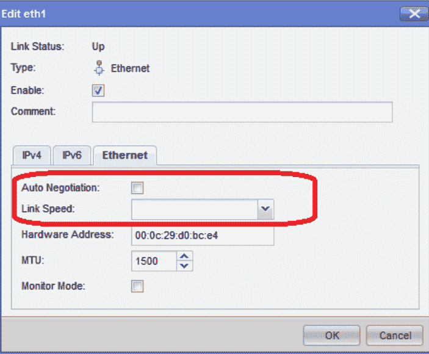

图 2-16：`Gaia Web` 界面网卡速度设置

希望你防火墙上的所有网卡都以千兆比特速度（`1000Mbps`）或更高速度运行。如果任何接口以快速以太网（`100Mbps`）速度运行，请注意双工匹配问题，这将导致这些接口的整体吞吐量在负载增加到快速剧增的帧丢包时而骤降。双向网络性能都会受到影响，但从防火墙发送的流量受影响更为严重。

# 三层性能优化

如果在 `Gaia` 上显示的唯一非零计数器是 **connected**（已连接）、**kernel**（内核）和 **static**（静态），那么你的防火墙是静态路由。（在 `SecurePlatform` 上运行：`netstat -rn`。是否有任何路由具有 `R`、`D` 或 `M` 标志？如果是，则防火墙是动态路由；如果不是，防火墙是静态路由。）

如果防火墙是动态路由，请通过 `Gaia` 上的 `clish show route` 命令检查动态路由的年龄，或在 `SecurePlatform` 上使用 `showigate` 命令。所有动态路由的年龄应该是一个较大的数值，与上次网络中断或停机事件发生的时间对应。如果计数器不断重置，则网络中可能存在抖动（`flap`），应该予以修正。

## 特殊情况：双默认网关问题

防火墙是否通过专用的 `VLAN`/段连接到你的内部核心路由器，且该段没有其他系统？换句话说，你的防火墙是否通过一个仅用于防火墙与核心路由器之间流量的传输网络连接到内部核心路由器，如下所示：

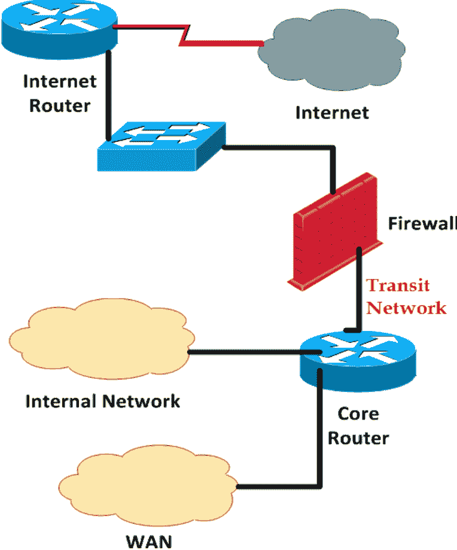

图 3-1：私有防火墙-核心路由器传输网络

或者你有类似这样的结构：

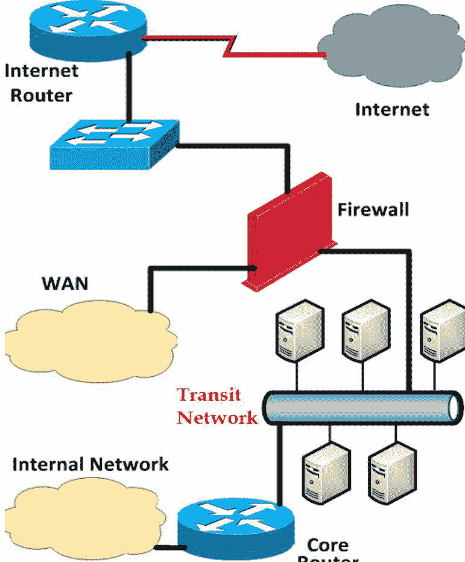

图 3-2：防火墙与核心路由器之间的非私有传输网络

## 特殊情况：双默认网关问题

我可能有一个坏消息告诉你：这种网络架构因导致网络性能问题而闻名。理想情况下，防火墙内部接口与内部核心路由器之间的 `VLAN` 仅用于在两个实体之间传输流量。当传输 `VLAN` 上存在其他系统时，这些系统在路由时有两个可能的网关，在路由方面处于一种“无人区”。那么，这些系统的默认网关应该是什么呢？在我看到的大多数场景中，默认网关被设置为内部核心路由器，一切似乎运行正常。然而，这种设置会导致以下情况之一发生：

- 从这些系统发往 Internet 和/或防火墙 `DMZ` 的流量在防火墙的进出是非称的。

- 核心路由器将发出 `ICMP` 重定向包以动态更新“无人区”系统的路由表，鼓励它们直接将 Internet/`DMZ` 流量发送到防火墙以避免非对称性。

让我们探讨这两种场景。前者是一个轻微问题，而从网络性能的角度来看，后者可能是一个重大问题。

## 非对称路径问题

在第一种场景中，假设防火墙和内部核心路由器之间的某个无人区系统（用户工作站）需要向位于内部网络的某个系统发送流量。目标 `IP` 被确定为非本地，因此工作站在前方向将数据包发送到其默认路由（内部核心路由器）（阶段 1）。路由器将数据包发送到网络内部的目标地，而在回路上，核心路由器直接将回复发送给工作站（阶段 2）。一切都是对称的且处理得当；这里没有问题：

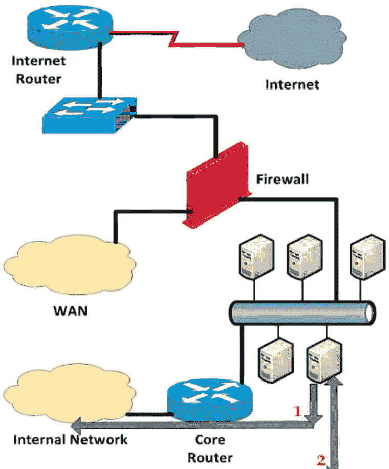

图 3-3：从服务器到内部网络的对称流量路径

## 特殊情况：双默认网关问题

现在，假设无人区的一个系统发起了到 Internet 的连接。

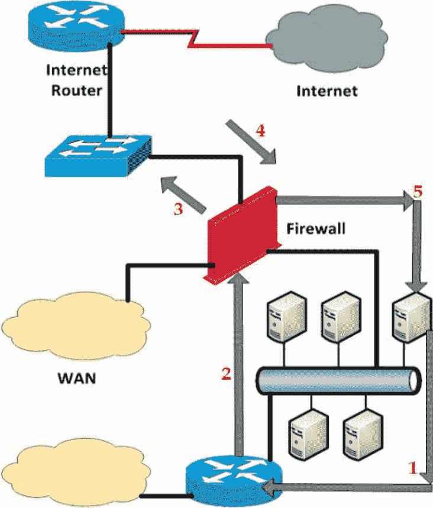

图 3-4：服务器到 Internet 的非对称流量路径

再次，目标 `IP` 被确定为非本地，因此工作站将数据包发送到其默认网关：内部路由器（阶段 1）。注意，数据包最初是发向内部网络而不是 Internet。接收后，假设核心路由器没有配置为发送 `ICMP` 重定向。在这种情况下，路由器会将数据包“折返”（`hairpin`）或“U型弯”，直接从接收它的同一个接口发回防火墙（阶段 2）。假设防火墙接受数据包并将其转发到 Internet（阶段 3）。回复通过防火墙的外部接口返回防火墙（阶段 4）。然后防火墙直接发送到无人区系统（阶段 5）。注意前向路径和回路路径并不完全相同，这根据定义是非对称的。从防火墙的强制角度来看，连接是对称的，因为流量在前向和回路上都跨越了同一个防火墙接口。

通常情况下，这种情况不会引起剧烈的性能问题，但总而言，在网络中避免非对称路由是理想的。作为一个示例，假设内部核心路由器由于在内部网络多个不同 `VLAN` 上运行大量备份任务而过载。无人区工作站上的用户发起了一个到 Internet 的 `FTP` 请求并获取大文件。在这种情况下，流量的主流（以及最大的包）是从 Internet 到工作站的回程方向，核心路由器不参与这些沉重流量。系统通过核心路由器发送了一系列 `ACK` 流，在前向方向返回到防火墙并发送到 Internet，但这些是较小且不频繁的数据包，不会受到剧烈影响。在这种情况下，用户会看到非常好的代码传输性能，不会直接受到核心路由器重负载的影响。

然而，在同一个 `FTP` 连接会话中，用户尝试执行文件 `PUT` 操作。现在，最重的流量是从用户工作站到 Internet 的前向方向，这些流量必须经过过载的核心路由器并经过防火墙。由于核心路由器过载，用户现在看到了糟糕的文件传输性能。这就是为什么要在网络中避免非对称路由的教科书级示例；它会导致奇怪、不稳定的性能问题。

## ICMP 重定向问题

我们在默认网关讨论中的第二种可能性远不明显，且几乎肯定会导致间歇性性能问题。让我们过一遍它。

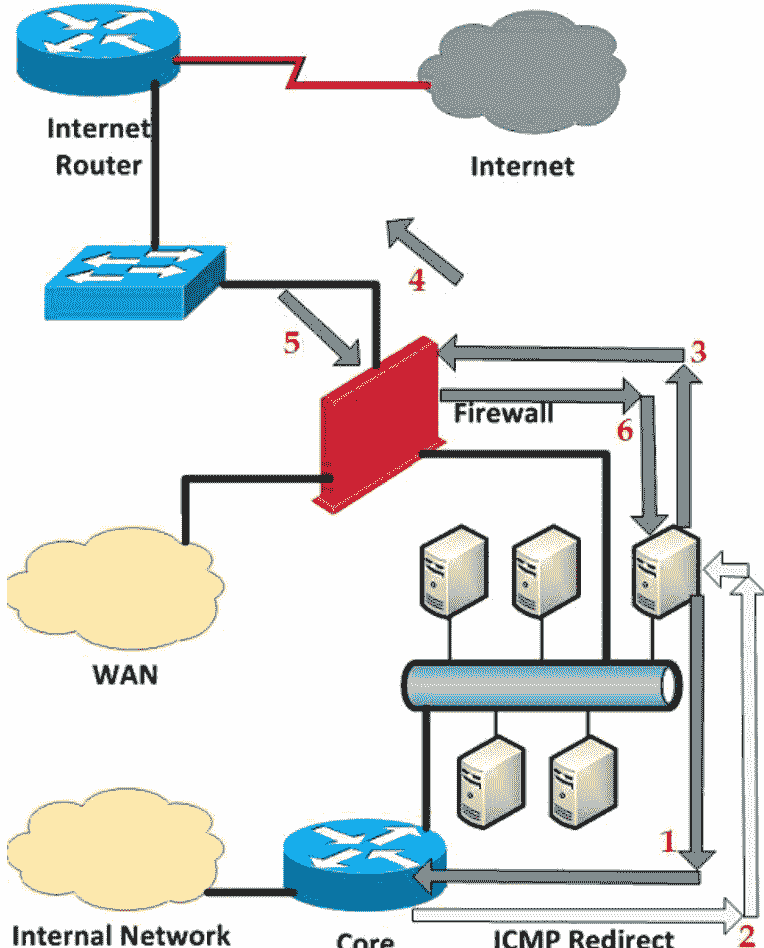

图 3-5：核心路由器通过 `ICMP` 重定向强制服务器实现对称路径

## 特殊情况：双默认网关问题

问题工作站发起到 Internet 上某个系统的连接。假设目标 `IP` 地址为 `129.02.32`。再次，目标 `IP` 被确定为非本地，因此工作站将数据包发送到其默认网关，即内部路由器（阶段 1）。注意，数据包最初发向内部网络而不是 Internet。接收后，假设核心路由器配置为发送 `ICMP` 重定向。在查询路由表后，核心路由器发现工作站将数据包发送到了“错误”的默认网关。如果核心路由器配置为使用 `ICMP` 重定向，它会将包转发到防火墙，并向工作站发送一种特殊的 `ICMP` 消息称为重定向（`ICMP` 类型 5），类似于：“你走错路，不要用我做该目标主机的网关，改用防火墙发送它”（阶段 2）。接收到此特殊的 `ICMP` 包后，工作站会在其路由表中动态为 `129.02.32` 添加一条临时的静态基于主机的路由，其下一跳为防火墙的内部接口地址。未来所有发往 `129.02.32` 的包现在都直接发送到防火墙（阶段 3），从而确保了路径对称。工作站到此 Internet 目的地的 `FTP` 性能现在完全不受内部路由器性能状态的影响。

这听起来很棒，但暗伏着危险。这里有很多很多问题，而且所有问题都会影响用户工作站的网络性能。首先，我们如何知道我们的网络是否存在这种情况呢？在用户工作站上，发起到几个 Internet 网站的流量，然后运行 `netstat` 命令，并在 `ICMP` 部分查看名为 **Redirects** 的计数器。如果该值不为零且在每次访问不同的 Internet 网站时都会增加，则说明所讨论的情况存在，*你不应该依赖此机制来维持网络正常运行。*

# 三层性能优化

尽管这种情况可能存在于你的网络中，但一切看起来运行良好！你很幸运，因为这种情况最终会在某个时刻困扰你；这不是“是否”会发生，而是“何时”发生的问题。为什么？这里是一些可能出现问题的示例：

- 路由器对允许发送的 `ICMP` 数量进行了限制。如果它无法足够地发送 `ICMP` 以跟上需求，不对性将会在随机的时间间隔出现，并可能导致性能下降。

- `ICMP` 消息发送并不可靠。没有直接的机制来检测它们是否丢失并重发。

- 如果工作站与互联网上的大量目标 `IP` 地址通信，工作站的路由表可能会被数百或数千条路由条目填充，从而降低主机的路由查找性能。

从性能角度来看，像这里描述的双默认网关场景是有风险的，它现在可能正在影响你的网络性能，而你却毫无不知。除非你想开始在位于“无人地”的所有工作站上硬编码静态路由，否则你需要创建一个隔离的 `VLAN`，专门用于核心路由器和防火墙之间的传输，如下所示：

1. 在维护窗口内，将实现在核心路由器与其 `IP` 方案之间的 `VLAN` 移动到网络内部区域。被移动的无人地工作站不需要更改 `IP` 地址或默认网关。

2. 接下来创建一个新的私有 `VLAN`。将防火墙内部接口接入此 `VLAN`，并为其分配一个新的 `IP` 方案（使用私有 `RFC1918` 范围内的任何地址均可，只要不与你的内部网络或连接的任何业务伙伴冲突即可）。在该新网络上为内部路由器分配一个新的 `IP` 地址并接入。不要忘记在 `SmartDashboard`/`SmartConsole` 中根据此更改更新防火墙对象的拓扑结构，并重新安装策略。

3. 将核心路由器上的默认路由更改指向防火墙的新内部地址。

4. 在防火墙上，将所有面向内部的路由（下一跳为内部核心路由器的路由）的下一跳改为核心路由器在私有 `VLAN` 新 `IP` 地址。

## 核心路由器超网环路

此问题由于在防火墙路由表中为整个 `RFC1918` 私有地址空间添加了子网路由，并指向内部核心路由器引起的。随后，核心路由器通常有一个指向防火墙的默认路由。假设防火墙将所有 `RFC1918` 地址空间路由到内部核心路由器，当然还有一条通往互联网的默认路由。

防火墙路由：

| 路由 | 下一跳 |

| :--- | :--- |

| `10.0.0.0/8` | 核心路由器 |

| `172.16.0.0/12` | 核心路由器 |

| `192.168.0.0/16` | 核心路由器 |

| `default` | 互联网边界路由器 |

# 三层性能优化

在内部核心路由器上，有 10 个实际使用的 `RFC1918` 私有网络通过直接连接或静态路由引用它们，以及一个默认网关。

核心路由器路由：

| 路由 | 下一跳 |

| :--- | :--- |

| `192.168.0/21` | 某些内部下一跳 |

| `192.168.9.0/24` | 直接 |

| `192.168.10.0/24` | 直接 |

| `default` | 防火墙 |

现在假设一个数据包从内部 `VLAN` 到达核心路由器，目标地为 `192.168.66.11`。核心路由器没有该网络的路由，因此数据包匹配默认路由并发送到防火墙。假设防火墙安全策略允许，防火墙可能会对数据包的源 `IP` 地址进行 `Hide NAT`（隐藏转换），然后根据 `IP` 路由通过相同的接口发回核心路由器，然后核心路由器又将数据包发回防火墙。如果之前已经执行了 `Hide NAT`，防火墙将在该处杀掉数据包，因为其到达时的源 `IP` 地址是防火墙在 `NAT` 操作中分配的，这本不应该发生。

然而，如果没有匹配该流量的 `Hide NAT` 规则（或者匹配了反 `NAT` 规则），数据包将在防火墙和核心路由器之间循环，直到 `IP` 报头中的存活时间（`TTL` - 默认值 255）字段最终减至零，此时数据包将被丢弃。现在请想象一下，一个在你的网络内部蔓延的自我传播蠕虫。蠕虫每秒涌入数百或数千个探测包，指向你内部网络中不存在的 `RFC1918` 地址，而每一个独立数据包都在核心路由器和防火墙之间循环 255 次。当 `Code Red` 和 `Nimda` 蠕虫在 20 世纪 90 年代进入各种网络时，这种循环反复导致整个网络崩溃，某些组织花了几周时间才完全恢复并恢复正常的网络。

这个问题有两个解决方案：

1) 在防火墙上，仅将你实际使用的特定 `RFC1918` 网络路由到内部核心路由器。在我们的示例中，防火墙上与 `RFC1918` 相关的路由应该是针对 `192.168.0.0/21`、`192.168.9.0/24` 和 `192.168.10.0/24` 的。

2) 如果你必须从防火墙到核心路由器对所有 `RFC1918` 路由进行超网汇总，请在核心路由器上添加以下 `Null0` 路由：

- `192.16.0.0/16` -> `Null0`

- `172.16.0.0/12` -> `Null0`

- `10.0.0.0/8` -> `Null0`


> 警告：如果你在防火墙 `DMZ` 网络上使用任何 `RFC1918` 地址空间（或通过站点到站点 `VPN` 访问这些 `RFC1918` 网络），在添加上述 `Null0` 路由之前，确保在核心路由器上为这些网络添加静态路由（以防火墙为下一跳）！

## ICMP：矿井里的

`ICMP` 不仅仅关于 `ping` 和 `traceroute`；`ICMP` 数据的各种类型和代码值有时表明防火墙正遇到问题。在防火墙上运行 `netstat -s` 显示接收了多少不同类型的 `ICMP` 消息：

- 需要分片但设置了 `DF`（Type 3, Code 4）

- 优先级生效（Type 3, Code 5）

- 源猝速限制（Type 4, Code 0）

- 重定向（Type 5, Code 0）

- 超时（Type 11, Code 0）

如果在 `netstat -s` 中注意到上述任何类型的非零值，它们可能来自互联网。然而，如果你在接口上看到这些类型，绝对值得花时间调查。要显示接口上的所有 `ICMP` 流量：

`tcpdump -eni (interface name) icmp and not icmp[8]`

## ARP 表溢出

在防火墙和核心路由器之间没有私有传输网络的一个有趣副作用是，防火墙必须维护多得 `IP` 地址到 `MAC` 地址的映射。如果直接连接防火墙的接口上有数百或数千工作站/服务器，情况尤其如此。


然而，这种情况发生会严重损害防火墙性能：防火墙 ARP 缓存溢出。默认情况下，R77.30/R80.10 Gaia 提供了 4096 个可用 ARP 缓存槽。低版本防火墙的默认值要低得多（R75.40 Gaia 的默认值为 1024）。这些 ARP 缓存槽由防火墙的所有接口（未标记和标记的）共享。如果 ARP 缓存表满了（假设我们示例中的限制为 1024），防火墙将无法为第 1025 个工作站缓存 IP 地址到 MAC 地址的映射。在 ARP 槽可用之前，该工作站与防火墙之间的成功通信是不可能的。一旦映射最终形成并缓存在防火墙的 ARP 表中，该工作站的通信现在将成功，但另一个工作站的映射现在将变成那个“落单者”。

另一种无论你将其调到多高都可能耗尽防火墙可用 ARP 缓存空间的一个问题情况是：在添加防火墙默认路由时，将本地网络接口定义为下一跳，而不是将实际网关 IP 地址作为下一跳。大多数情况下尝试这样做完全不起作用，但如果你的上游互联网路由器上开启了代理 ARP，它会热心地响应互联网上每一个 IP 地址的 ARP 请求并返回它自己的 MAC 地址。

# 68 第三层性能优化

非常糟糕。若要在你的防火墙上检查此条件，请运行 `netstat -rn | grep ^0.0.0.0`。如果网关地址（第二列）显示为 `0.0.0.0`，那么你绝对需要在维护窗口修复它。移除网络接口的下一跳，并添加与你的上行互联网路由器对应的正确下一跳网关 IP。

你的防火墙是否发生了此类 ARP 缓存溢出？在防火墙上运行 `dmesg -i "table overflow"`。如果没有返回任何输出，说明你可能没问题；但是，如果你看到大量的“neighbour table overflow”消息，则防火墙上正在发生 ARP 缓存溢出，你可能在某种程度上看到了描述的“间歇性中断”症状。

然而，作为额外的健康检查，在防火墙最繁忙的期间，在防火墙上执行 `arp -an | wc -1` 以获取正在使用的 ARP 缓存槽活跃计数：

```
[Expert@firewall:0]# arp -an | wc -1
3212
[Expert@firewall:0]#
```

图 3-6：使用 `arp` 命令获取 IP-MAC 地址映射计数

现在进入防火墙的 Gaia Web 界面并选择 Network Management...ARP。ARP Table Settings 下的“Maximum Entries”（最大条目）字段将显示可用 ARP 表槽位的最大数量：

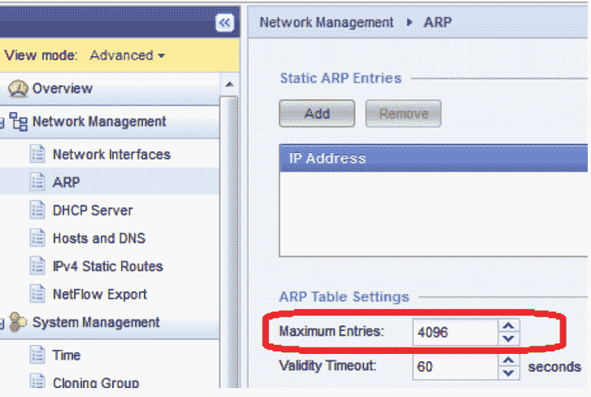

图 3-7：Gaia Web 界面 ARP 最大条目设置

将显示的值与你之前运行的 `arp -an | wc -1` 命令（其提供了 ARP 表中的当前计数）进行比较。如果 `arp` 命令报告的数字超过“Maximum Entries”值的 50%，我建议将此 Maximum Entries 值翻倍，以确保为 ARP 缓存的未来增长留出足够的空间。此建议的依据：默认情况下，当 ARP 条目超过 Maximum Entries 值的一半（默认为 2048，即 4096/2），Gaia 就越过了 ARP 驱动程序中被称为“gc2”的阈值。Gaia 会自动触发激进垃圾回收，试图将 ARP 缓存中的条目数量减少到 gc2 阈值以下。这种垃圾回收通过向网络发送大量 ARP 请求，在防火墙上消耗了大量的 CPU 时间，试图在这些 ARP 请求正常过期之前确定哪些可以提前从缓存中删除。通常情况下，在

maxpowerfirewalls.com

Copyright © 2018 Shadow Peak Inc. All Rights Reserved

尽可能避免频繁激活这种对 ARP 缓存的激进垃圾回收是良好的。可以通过检查 `/proc/net/stat/arp_cache` 文件获取垃圾回收调用统计数据，但该文件的内容晦涩且相当难以解释。

除非绝对必要，否则请克制随意将 ARP Maximum Entries 调到允许的最大值 16384 的冲动。大小合适的缓存有助于确保防火墙的高效运行；4096 是一个合理的默认值，在大多数情况下你不需要更改它。对于 NIC 驱动程序要传输的每一个帧，它必须在 ARP 缓存中进行查找，以确定要发送的帧的正确目标 MAC 地址。允许 ARP 缓存无必要地增长远超其尺寸，将为防火墙发送的每一个帧带来轻微的性能损失，因为 NIC 驱动程序执行的 ARP 缓存查找将比其他情况下所需的时间更长。

## 第三层性能优化：关键点

- 如果参与动态路由协议（如 OSPF），确保防火墙的路由表保持正确收敛，且网络某处没有持续的路由抖动（flap）。

- 在防火墙和内部核心路由器之间使用专用的传输 VLAN；其他工作站或服务器不应放置在该传输 VLAN 上。

- 网络中的非对称路径会导致间歇性的单向性能问题。

- 不要依赖 ICMP 重定向机制来实现正确的路由。

- 当防火墙上实现了针对整个 RFC1918 地址空间的路由，并将内部核心路由器作为下一跳时，可能会发生核心路由器超网环路（Supernet Loops）。

- 如果大量与 ping 测试流量无关 ICMP 数据包到达防火墙的内部和/或 DMZ 接口，可能表明你的网络其他地方存在性能问题。

- ARP 邻居表溢出会导致间歇性的防火墙连接问题，特别是当防火墙和内部核心路由器之间没有使用专用传输 VLAN 时。

# 第 4 章

## 基础 GAIA 优化

> 一个优秀的独立硬件设备之所以优秀，与一个优秀的网络设备的标准并不相同。前者可以作为一个本质上封闭的系统工作；而后者则完全取决于它的开放性。

-Douglas Rushkoff

## 背景

在本章中，我们将分析防火墙的 CPU 利用率，为 CoreXL/SecureXL 调优做准备，并执行各种与是否启用 CoreXL & SecureXL 无关 Gaia 优化。一个重要的概念是处理开销是在每个数据包级别产生的，而不是每个实际数据字节产生的。一个处理大量小数据包（每个包负载仅几字节）的系统，其工作量与处理具有 1500 字节典型 MTU 限制的数据系统相同。巨帧被大多数防火墙支持，由于网络架构的影响会有不同。

## 发现与分析

虽然我仍然认为管理员需要熟悉评估防火墙性能的所有命令，但 Check Point 提供了一个名为 `healthcheck.sh` 的优秀工具：执行时，它会检查 Gaia 系统（无论防火墙还是安全服务器）并突出可能影响性能的区域，其示例所示：

## 快捷方式：healthcheck.sh

```
[Expert@fw:0]# ./healthcheck.sh
+------------------------------------------------+
```

| Category | Title | Result |

|----------|-------|----------|

| System | Uptime | INFO |

| System | OS Version | OK |

| NTP | NTP Daemon | WARNING |

| NTP | NTP Logs | WARNING |

| Disk Space | Free Disk Space | OK |

| Memory | Physical Memory | WARNING |

| Memory | Swap Memory | |

| Memory | Hash Kernel Memory (hmem) | OK |

| Memory | System Kernel Memory (smem) | OK |

| Memory | Kernel Memory (kmem) | OK |

| CPU | CPU idle% | OK |

| CPU | CPU user% | OK |

| CPU | CPU system% | OK |

| CPU | CPU wait% | OK |

| CPU | CPU interrupt% | OK |

| Interface Stats | RX Errors | OK |

| Interface Stats | RX Drops | OK |

| Interface Stats | TX Errors | OK |

| Interface Stats | TX Drops | OK |

图 4-1：healthcheck 脚本摘要

# 76 基础 Gaia 优化

## 系统检查：

```
###########################
Uptime Check Info:
系统在过去一周内重启过。
请查看 "/var/log/messages" 文件（如果它们还没有滚动）
```

## NTP 检查：

```
#####################
NTP Daemon: 无法与 NTP 守护通信。
NTP Logs: 在 "/var/log/messages" 中未找到 NTP 信息。
```

## NTP 信息：

请使用 sk92602 和 sk83820 协助验证 NTP 是否

## 内存检查：

```
######################
```

## 核心文件检查：

```
######################
用户态核心文件：
-rw-r--r-- 1 admin root 15M Dec 1 17:09 scanengine_k.8300.core.gz
-rw-r--r-- 1 admin root 7.5M Aug 24 20:34 sim_ex.25491.core.gz
系统中检测到核心文件。
请将以下内容上传给 Check Point 进行分析：
- 本系统的当前 cpinfo
- 位于 /var/log/dump/usermode/ 的用户态核心文件
```

图 4-2：healthcheck 脚本详细结果

## 软件组件对性能的影响

答案：确定此点的最简单方法是在 SmartConsole 中打开防火墙对象进行编辑，在 Network Security（网络安全）选项卡的 General Properties（常规属性）界面底部，你会看到一系列复选框。功能旁边的勾选表示该功能已启用。或者通过 CLI 获取此信息，在 R75.47 或更高版本的防火墙中，你可以运行 `enabled_blades` 命令。如果使用 R80+ 管理平台，运行 License Report（许可证报告）将会在单个 PDF 报告中显示所有管理网关上启用的组件的方便摘要。访问 License Report 的位置如下：

| | | | | | | | | | | |

|---|---|---|---|---|---|---|---|---|---|

| 网关与服务器 | 状态 名称 | | 版本 A | | | | | | | |

| | | BranchOffice | 198.51.100.0 | R77.30 | | 系统备份... | | | | |

| | | Corporate-GW | 198.51.100.4 | R80 | | 打开 Shell... | | | | |

| | | EuropeBranchGW | 192.0.2.1 | R80 | | 打开 Web UI | | | | |

| | | HQQw | 192.0.2.200 | R80 | | 支持 | | | | | |

| | | mgmt | 10.0.97.229 | R80.10 | | 许可证报告... | | | | |

| | | Remote-1-gw | 192.0.22.1 | R75.40 | | 导出... | | | | | |

| | | Remote-2-gw | 192.0.23.1 | R75.40 | | | 打开 | | | | |

| | | Remote-3-gw | 192.0.24.1 | R77.20 | | | 打开 | | | | |

| | | Remote-4-gw | 192.0.25.1 | R75.40 | | | 打开 | | | | |

图 4-3: R80+ SmartConsole 许可证报告

以下是安全网关上可用组件的列表，根据我的经验，启用每个组件所带来的相对性能影响。目前，你只需记录你的防火墙上启用了哪些组件即可；在后面的章节中，我们将检查如何调优和优化这些各种组件的性能。

## 表 2：各种防火墙功能的相对性能影响

| 功能 | 性能影响 | 备注 |

|---|---|---|

| 防火墙 | 低 | 始终启用 |

| IPSec VPN | 低->中 | 取决于加密/解密流量量 |

| 移动访问 (Mobile Access) | 低->中 | 取决于加密/解密流量量 |

| IPS | 低->高 | 波动较大 |

| 反机器人 (Anti-Bot) | 中** | | |

| 防病毒 (Anti-Virus) | 中->高** | | |

| 身份感知 (Identity Awareness) | 低 | 在大型 Windows 域中大量使用防火墙进程*** |

| 监控 (Monitoring) | 低 | 加载独立的内核驱动程序 |

| 应用控制 (App. Control) | 低** | | | |

| Web URL 过滤 | 低** | | |

| 内容感知 (Content Awareness) | 中** | 大量使用防火墙进程*** |

| 数据泄露防护 (DLP) | 极高** | 大量使用防火墙进程*** |

| 威胁仿真 (Threat Emulation) | 中** | 大量使用防火墙进程*** |

| 威胁提取 (Threat Extraction) | 中** | 大量使用防火墙进程*** |

| QoS | 高 | 加载独立的内核驱动程序 |

** 如果通过 HTTPS 检查策略为该组件启用了 HTTPS 检查，则可能会产生极高的性能影响。

# “top” & “free” Gaia/Linux 命令

**问题：** 防火墙当前的 CPU 负载是多少？

**答案：** 在专家模式（expert mode）下运行当前的 `top`。你的整个屏幕将立即列出系统中最繁忙的进程列表。我们需要关注的行是：

```
04:44:04 1 day, 19:35, 2 users, load average: 0.16, 0.10, 0.05  DAAService
Tasks(s): 212 total, 1 running, 211 sleeping, 0 stopped, 0 zombie
Cpu: 0.2%us, 0.4%sy, 0.0%ni, 99.3%id, 0.0%wa, 0.0%hi, 0.0%si
802894k total, 276748k used, 526140k free, 272012k buff
0 used, 1890032k free, 100471k cache
```

| PID USER PR NI VIRT RES SHR SGL S S %CPU %MEM TIME+ COMMAND |

|---|---|---|---|---|---|---|---|---|---|---|---|

| 9776 admin 21 0 69000 3960 S 0.1 27:00.64 ServicePolicy |

| 6031 admin 18 0 367m 50m 24s S 0.6 01:01.78 fw_full |

| 1 admin 18 0 1976 724s S 0.0 01:36.17 int |

| 2 admin RT-5 0 0 0 S 0.0 00:00 migration/0 |

| 3 admin 15 0 0 0 S 0.0 00:00 ksoftqd/2 |

| 4 admin RT-5 0 0 0 S 0.0 00:00 watchdog/0 |

| 5 admin RT-5 0 0 0 S 0.0 01:22 migration/1 |

| 6 admin 15 0 0 0 S 0.0 00:07 ksoftqd/1 |

| 7 admin RT-5 0 0 0 S 0.0 00:01 watchdog/1 |

| 8 admin RT-5 0 0 0 S 0.0 00:07 migration/2 |

| 9 admin 15 0 0 0 S 0.0 00:00 ksoftqd/2 |

| 10 admin RT-5 0 0 0 S 0.0 00:00 watchdog/2 |

| 11 admin RT-5 0 0 0 S 0.0 00:01 migration/3 |

| 12 admin 15 0 0 0 S 0.0 00:00 ksoftqd/3 |

| 13 admin RT-5 0 0 0 S 0.0 00:00 watchdog/3 |

| 14 admin RT-5 0 0 0 S 0.0 00:01 migration/4 |

| 15 admin 15 0 0 0 S 0.0 00:00 ksoftqd/4 |

| 16 admin RT-5 0 0 0 S 0.0 00:00 watchdog/4 |

图 4-4: `top` 命令显示聚合 CPU 负载

## Basic Gaia

Cpu (s) 行是防火墙在所有核心上的负载实时摘要。在大多数防火墙中，大部分 CPU 时间消耗在系统/内核空间 (sy) 和软中断 (si) 中。让我们详细检查每个字段。

### Top 输出：“us” – 用户空间

用于处理进程的 CPU 周期。你可能会看到 `fw_worker` 进程占用大量 CPU。这在启用了 CoreXL 的系统中是正常的。`fw_worker` 进程是利用 CoreXL 的多内核 Check Point 防火墙实例。如果 `fw_worker` 以外的进程消耗了大量的 CPU 时间 (>40%)，则可能需要进一步检查。忽略括号内的进程，因为它们是内核/系统线程。向下移动可以看到正在消耗 CPU 的顶部进程。查看 `%CPU` 列。是否有进程使用了大量的 CPU？可能是失控进程或不断重启的进程。运行命令 `cpwd_admin list`：

```
[Expert@firewall0]# cpwd_admin list
```


| APP | PID STAT #START TIME MON COMMAND |
|---|---|---|---|---|
| HISTORYD | 5695 E 1 | [08:05:30] | 15/3/2015 | N | cpview_his |
| CPD | 5698 E 1 | [08:05:30] | 15/3/2015 | Y | cpd |
| MPDAEMON | 5822 E 1 | [08:05:31] | 15/3/2015 | N | mpdaemon_ |
| CPCOSET | 6015 E 1 | [08:05:35] | 15/3/2015 | N | chamcset |
| CI_CLEANUP | 6027 E 1 | [08:05:40] | 15/3/2015 | N | avi_del_ |
| CIHS | 6031 E 1 | [08:05:40] | 15/3/2015 | N | cp_http_se |
| FWD | 6045 E 1 | [08:05:45] | 15/3/2015 | N | fwd |
| FWM | 6050 E 1 | [08:05:45] | 15/3/2015 | N | fwm |
| STPR | 6053 E 1 | [08:05:44] | 15/3/2015 | N | status_pro |
| CPSM | 6921 E 1 | [08:05:59] | 15/3/2015 | N | cpview |
| SVR | 7770 E 1 | [08:06:02] | 15/3/2015 | N | Servis |
| CPSEAD | 7852 E 1 | [08:06:02] | 15/3/2015 | N | cpdead |
| CPWD | 7924 E 1 | [08:06:04] | 15/3/2015 | N | cpwd - |
| CPHTTD | 7927 E 1 | [08:06:04] | 15/3/2015 | N | cp_http_se |
| DASSERVICE | 7952 E 1 | [08:06:04] | 15/3/2015 | N | DASService |

图 4-5: 使用 `cpwd_admin list` 查找重启的防火墙进程

此命令显示防火墙进程上次重启的时间。对于受守护进程（`cpwd`）监控的所有进程，`START_TIME` 值应该非常接近，并且大致对应系统启动的时间。使用 `uptime` 命令确认。如果进程与其他进程不接近，则需要检查。

# “top” & “free” Gaia/Linux 命令 83

- `fw debug fwd on|off`（调试信息将至 `$FWDIR/log/fwd.log`）
- `fw debug fwm on|off`（调试信息将至 `$FWDIR/log/fwm.log`）
- `$FWDIR/scripts/cpm_debug.sh -t <TOPIC> -s <SEVERITY>`
- `vpn debug on|off`（调试信息将至 `$FWDIR/log/vpnd.log`）
- `cpm_admin debug on|off`（调试信息将至 `$CPDIR/log/cpnd.log`）

如果你对某个进程启用了调试，请务必在完成后将其关闭！要识别这些或可能遇到的任何其他守护进程的功能，请参阅 sk97638：Check Point 进程与守护进程（Check Point Processes and Daemons）。

但假设你在 `top` 输出中看到一个看起来奇怪的进程正在占用大量 CPU：

| PID USER | PR NI | VIRT RES SHR S | CPU | TIME+ | COMMAND |
|---|---|---|---|---|---|---|
| 15215 admin | 25 | 0 | 660m | 180m | 144R | 94 | 20198:16 | /bin/cat |

图 4-7: 消耗大量 CPU 的进程

嗯？为什么 `cat` 命令会消耗这么多 CPU，以及是什么进程启动了这个“怪兽”？Gaia 内置工具 `pstree` 可以帮助我们找到答案：

```
[Expert@gw:~]# pstree
init++-acpid
  |-cpwd+--CpnUMD
    |-fw_full+--cp_file_convert--20*[ {cp_file_convert}]
      +-scrubd- -configure_scrub--configure_scrub+-cat
        |-fold
          -tr
```

图 4-8: 使用 `pstree` 帮助识别占用 CPU 的进程

## Gaia 基础优化

事实证明该进程与 `scrubd` 进程有关，sk97638 将列为威胁提取（Threat Extraction）模块功能的一部分。当进程名称本身（或其参数）不足以确定其用途以及我们是否应该对其采取措施时，使用 `pstree` 可以帮助确定失控进程的来源。

另一个可以为消耗大量 CPU 的神秘进程提供见解的命令是 `lsof`（List Open Files）。一旦确定了进程 ID（示例中为 15215），运行 `lsof -p 15215`。输出将显示进程当前访问的所有文件，以及该进程正在监听的所有网络连接和 TCP/UDP 端口（如果有）。

最后一个能够满足即使是对某个讨厌进程信息有极贪求需求的人的选项，是使用 `trace` 二进制文件（类似于 Solaris 上的 `truss` 命令），并使用 `-p` 选项动态附加到问题进程上。这允许实时监控进程执行的所有系统调用，试图确定它在做什么。Gaia 默认不包含 `trace`（且未官方支持），但你可以从这里获取预编译的 CentOS 版本 `trace`：

http://vault.centos.org/3.8/os/i386/RedHat/RPMS/strace-4.5.14-0.EL3.1.i386.rpm

## top 输出：“sy” & “si” – 系统空间

`top` 输出中显示用于服务内核驱动程序模块的 CPU 周期。在 `top` 中看到绝大多数 CPU 周期消耗在这两个区域是正常的，因为 Check Point 的 INSPECT 和 SecureXL 内核驱动在防火墙上执行了大部分安全检查功能。防火墙路径（Path）和媒介路径（Medium Path）处理通常显示为 `sy` 空间的 CPU 使用；加速路径（Accelerated Path）和 SoftIRQ 处理通常显示为 `si` 空间的 CPU 使用（各种路径将在第9章介绍）。与运行在进程空间的进程不同，对于系统中哪些服务或函数消耗 CPU 的可见性有限。然而，可以通过运行 `cpview` 并选择 `CPU...Top Connections` 来查看 CPU 消耗率最高的单个连接。这些使用数据可以对所有防火墙工作核心进行汇总，或者根据需要查看单个核心的情况。

## top 输出：“wa” – 等待 I/O 操作

此值最多应在 0 到 5% 之间。该字段指定了 CPU 在等待某种 I/O 操作完成时阻塞（无法做其他事情）的时间。最常见的罪祸首是等待防火墙硬盘响应请求。这在防火墙启动后不久可能会经常发生，因为所需的执行代码正在从磁盘分页并缓存到 RAM 中。此数字在策略加载期间也会短暂飙升，这是完全正常的。然而，在配置适当的防火墙上，这种活动最终应该下降到接近零。如果有超过 5% 的 CPU 持续浪费在等待状态，你的防火墙几乎没有足够的 RAM，或者正经历某些硬件外围设备的问题。

# Gaia 内存管理

运行命令 `free -m`。提供如下示例输出：

```
[Expert@firewall:0]## free -m
| total used free shared buffers cached |
|---|---|---|---|---|---|
| Mem: 7840 | 3760 | 4079 | 0 | 276 | 1126 |
| Swap: 0 | 0 | 0 | | | |
```

图 4-9: 使用 `free -m` 查看内存统计

让我们详细讨论一下；第二行的第一个数字（示例中为 7840）是防火墙的内存总量。第二个数字（3760）是系统使用的量。`shared` 始终为 0。`buffers` 表示用于缓冲量。`cached` 是存储目录列表和文件属性的内存量。这让我们看到第三行：2357 是分配给缓冲和缓存的内存。注意，如果将分配给缓冲和缓存的内存（276+1126=1402）从第二行的总量（3760）中减去，你会得到大约 2357，这是防火墙消耗的真实量。第三行的值（示例中为 4079）在某些情况下看起来非常低，导致你得出防火墙内存不足的结论。事实并非如此。第三行的 `free` 值（示例中为 5483）报告了不考虑缓冲和缓存时真实的可用内存。

理想情况下，`free` 命令输出的第四行交换使用报告为 0，如之前的截图所示。如果此值非零，表明防火墙正（或曾）可用内存不足，并且将分配给进程的部分系统内存分页到了磁盘。交换使用越多，性能影响越大。

**问题：** 我的系统 `free -m` 输出的第三行显示可用内存不足，和/或“Swap used”显示非零。防火墙上什么消耗这么多内存？

**回答：** 运行 `top` 命令并按下 M（大写 M）。这将更改默认排序（默认排序通常先显示使用 CPU 最高的进程）；现在使用内存最多的进程将排在前面。再次忽略我们将在后续章节中讨论的 `fw_worker` 进程。你在 RES 列中是否还看到其他使用极大量内存的进程？该进程可能是失控的或存在内存泄漏。根据该问题进程的身份，你可能可以杀死它（让其自动重启）而不会导致服务中断。请联系 Check Point TAC 协助做出此判断。

## Gaia 基础优化

问题：我的 `free -m` 报告的 RAM 总量约为 4096，但我很确定系统至少有 6GB 的 RAM。出什么问题了？

回答：Gaia 操作系统正在以 32 位模式运行。如果防火墙在初始配置时内存少于 6GB，并在之后升级了内存，Gaia 可能仍以 32 位模式运行。只要系统中至少存在 6GB 内存，你就可以将 Gaia 设置为 64 位运行，以利用这些额外的内存容量。通过运行 `clish` 命令 `show version os edition` 来检查版本（32 位或 64 位）。要从 32 位操作更改到 64 位操作，请在 `clish` 中运行 `set edition 64-bit` 命令，执行 `save config` 命令，然后重启系统。

## Gaia 内存区域回收

NUMA（非统一内存访问）允许 Gaia 操作系统中的多个核心同时访问系统的 RAM。它通过将系统 RAM 划分为若干区域，并为每个核心分配一个专用的内存区域来实现这一点。当特定区域的内存不足且无法满足内存分配请求时，可以启动“回收”（reclaim）程序，尝试释放该区域内当前未使用或预计不会被使用的内存。遗憾的是，此回收过程非常密集，当内存密集型进程尝试在防火墙上执行时，可能会导致看似随机的运行缓慢。

运行以下命令：`cat /proc/sys/vm/zone_reclaim_mode`。返回结果应为“0”以获得最佳的 Gaia 内存管理，通常默认设置为零。如果你收到“no such file or directory”错误消息，这意味着系统的处理硬件不支持 NUMA，或者 Gaia OS 正在以 32 位模式运行，在这种情况下无法使用 NUMA。当 `zone_reclaim_mode` 设置为零且某个区域没有足够的空闲内存来满足分配请求时，系统在启动密集的区域回收程序之前，将直接从另一个没有空闲内存的区域分配所需的内存。

如果你的防火墙上 `zone_reclaim_mode` 因某种原因被设置为非零值，请参考以下 SK 获取将其永久设置为零的说明：sk109772: R77.30 NGTP, NGTX 和 HTTPSS 检查性能和内存消耗优化。

## 防火墙磁盘空间检查

问题：我的防火墙磁盘空间用尽了吗？

回答：运行命令 `df -h`。如果任何分区的利用率超过 90%，则需要尝试清理文件。确定哪个分区接近满（`/`、`/opt`、`/var/log` 等）并运行此命令：

```
find /var/log -mount -type f -size +1000000 -ls
```

查看文件并在可能的情况下将其删除；旧的 `cpos` 或调试捕获文件（debug captures）经常消耗大量磁盘空间并可以删除。如果 `find` 输出中没有显示任何文件，将命令中的 `+1000000` 部分减一个零并重新运行。如果你无法找到任何可以删除的大型用户生成文件，可以使用 Check Point 在此处提供的清理脚本：sk91060: 在 Security Gateway / Security Management Server 升级后删除旧的 Check Point 软件包。如果你仍然无法在 Gaia 上释放足够的磁盘空间，请考虑使用 `lvm_manager` 脚本来回收分区大小，详见此处：sk95566: 在 Gaia OS 上通过 LVM manager 管理分区大小。注意，在 R80 及更高版本中，只有在系统首先进入维护模式（Maintenance Mode）后才能成功使用 `lvm_manager` 工具。

## Check Point 特定命令

问题：防火墙在处理流量时，资源（如内存）是否用尽了？

回答：在防火墙上运行命令 `fw ctl pstat`。关注系统容量摘要（System Capacity Summary）、系统内核内存（smem）和内核内存（kmem）部分：

```
[Expert@firewall:0]# fw ctl pstat

System Capacity Summary:
Memory used: 11% (181 MB out of 1587 MB) - 低水位线
Concurrent Connections: 0% (43 out of 24900) - 低水位线
Aggressive Aging: is not active

Hash kernel memory (hmem) statistics:
Total memory allocated: 163577856 bytes in 39936 (4096 bytes) |
Total memory used: 19019912 unused: 14557994 (88.37%) |
Total memory blocks: 20380914 alloc: 6544 unused: 33392 (83%) |
Allocations: 20230364 free | failed alloc

System kernel memory (smem) statistics:
Total memory used: 24736208 peak: 271764448
Total memory used: 16011980
Blocking memory bytes: 5100120 peak: 5765280
Non-Blocking memory bytes used: 24253288 peak: 26599168
Allocations: 20833288 free | failed alloc

Kernel memory (kmem) statistics:
Total memory used: 10289632 peak: 13813834
Allocations: 2039953 free | failed alloc
```

问题：我的防火墙磁盘空间用尽了吗？

回答：运行命令 `df -h`。如果任何分区的利用率超过 90%，则需要尝试清理文件。确定哪个分区接近满（`/`、`/opt`、`/var/log` 等）并运行此命令：

```
find /var/log -mount -type f -size +1000000 -ls
```

查看文件并在可能的情况下将其删除；旧的 `cpos` 或调试捕获文件经常消耗大量磁盘空间并可以删除。如果 `find` 输出中没有显示任何文件，将命令中的 `+1000000` 部分减一个零并重新运行。如果你无法找到任何可以删除的大型用户生成文件，可以使用 Check Point 在此处提供的清理脚本：sk91060: 在 Security Gateway / Security Management Server 升级后删除旧的 Check Point 软件包。如果你仍然无法在 Gaia 上释放足够的磁盘空间，请考虑使用 `lvm_manager` 脚本来回收分区大小，详见此处：sk95566: 在 Gaia OS 上通过 LVM manager 管理分区大小。注意，在 R80 及更高版本中，只有在系统首先进入维护模式后才能成功使用 `lvm_manager` 工具。

问题：防火墙在处理流量时，资源（如内存）是否用尽了？

回答：在防火墙上运行命令 `fw ctl pstat`。关注系统容量摘要、系统内核内存（smem）和内核内存（kmem）部分。

问题：我的防火墙磁盘空间用尽了吗？

回答：运行命令 `df -h`。如果任何分区的利用率超过 90%，则需要尝试清理文件。确定哪个分区接近满（`/`、`/opt`、`/var/log` 等）并运行此命令：

```
find /var/log -mount -type f -size +1000000 -ls
```


查看文件并在可能的情况下将其删除；旧的`cpos`或调试捕获文件经常消耗大量磁盘空间并可以删除。如果`find`输出中没有显示任何文件，将命令中的`+1000000`部分减一个零并重新运行。如果你无法找到任何可以删除的大型用户生成文件，可以使用 Check Point 在此处提供的清理脚本：sk91060: 在 Security Gateway / Security Management Server 升级后删除旧的 Check Point 软件包。如果你仍然无法在 Gaia 上释放足够的磁盘空间，请考虑使用`lvm_manager`脚本来回收分区大小，详见此处：sk95566: 在 Gaia OS 上通过 LVM manager 管理分区大小。注意，在 R80 及更高版本中，只有在系统首先进入维护模式后才能成功使用`lvm_manager`工具。

```
find /var/log -mount -type f -size +1000000 -ls
```

查看文件并在可能的情况下将其删除；旧的`cpos`或调试捕获文件经常消耗大量磁盘空间并可以删除。如果`find`输出中没有显示任何文件，将命令中的`+1000000`部分减一个零并重新运行。如果你无法找到任何可以删除的大型用户生成文件，可以使用 Check Point 在此处提供的清理脚本：sk91060: 在 Security Gateway / Security Management Server 升级后删除旧的 Check Point 软件包。如果你仍然无法在 Gaia 上释放足够的磁盘空间，请考虑使用`lvm_manager`脚本来回收分区大小，详见此处：sk95566: 在 Gaia OS 上通过 LVM manager 管理分区大小。注意，在 R80 及更高版本中，只有在系统首先进入维护模式后才能成功使用`lvm_manager`工具。

**问题：** 防火墙在处理流量时，资源（如内存）是否用尽了？

**回答：** 在防火墙上运行命令`fw ctl pstat`。关注系统容量摘要、系统内核内存（smem）和内核内存（kmem）部分。

# 94 基础 Gaia 优化

违规者将首先列出。在我们的示例中，最大的违规者是`0a1e0b53`（`0a`=10, `1e`=30, `0b`=11, `53`=83）或`10.30.11.83`。此 IP 地址在连接表中占用了约 12,322 个槽位，对于单个 IP 地址来说，这非常过度，除非它是某种代理服务器或终端服务器。如果该 IP 地址不是某种服务器，导致这种行为的经典场景包括：

- 主机感染了某种自我传播的病毒或蠕虫，正在发送成千上万个短连接连接请求
- 主机正在运行端口扫描或执行某种网络发现，这涉及到极数量的连接请求（例如审计员、渗透测试员，或者让 CEO 感到极其无聊的聪明孩子）

处理这种烦人情况的缓解措施（除了不礼貌地告诉违规者停止）见第 7 章“CoreXL 防火墙加载器分布”和第 13 章。另一个可以提供精确查看哪些是连接表槽位占用者的工具是 Craig Dod 提供的“Top Talkers”脚本：

`http://expert-mode.blogspot.com/2013/05/checkpoint-top-talkers-script-display.html`。

然而，“Top Talkers”脚本的一个局限性必须启用 SecureXL。如果由于某些原因你的防火墙上禁用了 SecureXL（或在本章第9节），你仍然可以使用本节开头显示的替代`fw`标签。

## “sar” 命令和在批模式下使用 top

运行某种持续系统监控脚本是系统管理员的一项传统技术，用于“抓包”性能下降现场并提供统计数据供审查。虽然可以监控的系统计数器和统计数据极多，但从防火墙性能的角度来看，在性能下降期间，我们首先想要关注两个方面：

- **网络错误计数器** – 防火墙是否在网络层面突然产生错误导致数据包丢失？
- **CPU 利用率** – 是否有一个或多个防火墙 CPU 的利用率飙升至 100%，导致网络延迟剧增？

但在性能下降期间，当我们不确定何时会发生时，如何查看这些内容呢？我们可以在事后通过`sar -n EDV`命令来检查网络错误的峰值：

```
[Expert@firewall:0]# sar -n EDV
Linux 2.6.18-92cp (firewall) 03/23/15
00:00:01 IFACE rxerr/s txerr/s rxdrop/s tdrop/s tcarr/s
00:00:01 lo 0.00 0.00 0.00 0.00 0.00
00:00:01 eth0 0.00 0.00 0.00 0.00 0.00
00:00:01 eth1 0.00 0.00 0.00 0.00 0.00
00:00:01 eth2 0.00 0.00 0.00 0.00 0.00
00:00:01 eth3 0.00 0.00 0.00 0.00 0.00
00:00:01 lo 0.00 0.00 0.00 0.00 0.00
00:00:01 eth0 0.00 0.00 780.00 0.00 0.00
00:00:01 eth1 0.00 0.00 0.00 0.00 0.00
00:00:01 eth2 0.00 0.00 0.00 0.00 0.00
00:00:01 eth3 0.00 0.00 0.00 0.00 0.00
```

> 图 4-12：使用`sar -n EDV`确定网络错误发生的 10 分钟粒度时期

如果`sar -n EDV`不精确，你也可以运行`netstat -c -ni 5`命令，它将每 5 秒持续显示网络统计数据。遗憾的是，没有其他方法可以由于`netstat`命令在每次输出时都打印时间戳，除非创建一个更复杂的 shell 脚本），因此你可能一直守着这个输出，等待性能出现糟糕的情况。

`sar`还可以通过运行`sar -P ALL`来显示每个核心的历史 CPU 利用率：

```
[Expert@firewall:0]# sar -P ALL
Linux 2.6.18-92cp (firewall)           03/23/15

00:00:01 CPU    %user  system  iowait  idle
00:00:01 all   0.28     1.38    0.00 98.32
00:00:01 0     0.11     1.55    0.03 98.31
00:00:01 1     0.43     1.99    0.00 97.55
00:00:01 2     0.03     0.54    0.00 99.42
00:00:01 3     0.51     2.01    0.01 97.41
00:00:01 4     0.01     0.56    0.00 99.42
00:00:01 5     0.60     2.00    0.00 97.40
00:00:01 6     0.03     0.55    0.00 99.41
00:00:01 7     0.49     1.84    0.00 97.67
00:20:01 all   0.20     1.28    0.00 98.51
00:20:01 0     0.03     1.67    0.01 98.29
00:20:01 1     0.38     1.62    0.00 98.00
00:20:01 2     0.02     0.64    0.00 99.33
00:20:01 3     0.33     1.54    0.00 98.13
00:20:01 4     0.01     0.69    0.00 99.30
00:20:01 5     0.46     1.86    0.00 97.68
00:20:01 6     0.02     0.69    0.00 99.28
00:20:01 7     0.32     1.57    0.00 98.10
```

> 图 4-13：使用`sar -P`显示历史 CPU 利用率

`sar`命令报告的历史数据虽然有用，但除非你清楚自己在寻找什么，否则绝对会让你感到压力巨大。一图胜过千言，所以如果你发现自己盯着`sar`数据看了几个小时试图寻找问题，请考虑`ksar`工具。`ksar`可以像这样浏览并绘制`sar`图表：

```
ksar : Sar graph
File Help
- kSar
- Processes
- Contexts
- CPU
- Interrupts
- Swapping
- I/O
- Page
- Interface
- Io
- Interface tr
- Interface er
- eth1
- eth2
- eth3
- Block
- dev8-0
- Block trans
- dev8-1
- dev8-2
- dev8-3
- dev8-4
- dev8-16
- dev8-17
- Paging Activity
- Memory Usage
- Swap usage
- Memory Misc.
- Sockets
- Load
```


> 图 4-14：使用`ksar`绘制`sar`数据

Gaia 操作系统未包含，但可以从 `https://sourceforge.net/projects/ksar` 免费下载`ksar`。更多信息请参见 sk12734：使用 "sar" 命令收集活动报告。在第 14 章中，我们还涵盖了 SmartView Monitor 提供系统资源利用历史图表的功能。

# 98 基础 Gaia 优化

虽然默认收集`sar`统计非常有用，但它们没有提供粒度细节，因为中断处理（hi）、系统（si）和系统处理（sy）都合并在`%system`计数器下。但如果我们需要单独查看这些元素，或者查看间歇性峰值的`%user`值怎么办？

我们可以通过批模式运行`top`命令来定期监控 CPU 使用情况并将其输出重定向到文件，同时单独运行`top`以查看单个核心，这需要一些设置：

首先运行`top`命令：

```
top - 04:44:04 1 up day, 19:35, 2 users, load average: 0.16, 0.10,
Tasks: 212 total, 1 running, 211 sleeping, 0 stopped, 0 zombie
Cpu(s): 0.2us, 0.4%sy, 0.0%ni, 99.3%id, 0.0%wa, 0.0%hi, 0.0%si
```

| PID USER | VIRT | RES | SHR | %CPU | TIME+ | COMMAND |
|---|---|---|---|---|---|---|
| 9776 admin | 802894k | 276748k | 526142k | 0.1 | 27:00:64 | Daervice |
| 6031 admin | 16m | 724m | 0.1 | 12:01:78 | |
| admin | RT | 0 | 0 | 0.0 | 00:00:08 | migration/1 |
| admin | RT-5 | 0 | 0 | 0.0 | 00:00:00 | ksoftqd/0 |
| admin | RT-5 | 0 | 0 | 0.0 | 00:01:22 | watchdog/0 |
| admin | RT-5 | 0 | 0 | 0.0 | 00:00:07 | ksoftqd/1 |
| admin | 15m | 0 | 0 | 0.0 | 00:00:00 | |
| admin | RT-5 | 0 | 0 | 0.0 | 00:00:00 | migration/2 |
| admin | 15m | 0 | 0 | 0.0 | 00:00:00 | ksoftqd/2 |
| admin | RT-5 | 0 | 0 | 0.0 | 00:00:00 | watchdog/2 |
| admin | RT-5 | 0 | 0 | 0.0 | 00:00:00 | ksoftqd/3 |
| admin | 15m | 0 | 0 | 0.0 | 00:00:00 | |
| admin | RT-5 | 0 | 0 | 0.0 | 00:00:01 | migration/4 |
| admin | RT-5 | 0 | 0 | 0.0 | 00:00:00 | ksoftqd/4 |

> 图 4-15：使用`top`显示聚合率

现在按下数字 ‘1’ 显示单个 CPU 使用情况，然后按下大写 “W” 将当前显示写入`torc`文件：

```
top - 10:12:39 up 5 days, 1:12, 2 users, load average: 0.09, 0.12,
Tasks: 165 total, 2 running, 166 sleeping, 0 stopped, 0 zombie
Cpu(s): 0.00us, 0.00%sy, 0.0%ni, 99.78%id, 0.0%wa, 0.0%hi, 0.3%si
Cpu1: 0.00us, 0.03%sy, 0.00%ni, 96.68%id, 0.0%wa, 0.0%hi, 3.0%si
Cpu2: 0.00us, 0.02%sy, 0.00%ni, 96.08%id, 0.0%wa, 0.0%hi, 4.0%si
Cpu3: 0.00us, 0.34%sy, 0.00%ni, 95.38%id, 0.0%wa, 0.0%hi, 3.0%si
Cpu4: 0.00us, 0.00%sy, 0.00%ni, 97.38%id, 0.0%wa, 0.0%hi, 2.7%si
Cpu5: 0.00us, 1.02%sy, 0.00%ni, 94.48%id, 0.0%wa, 0.0%hi, 4.3%si
Cpu6: 0.00us, 0.03%sy, 0.00%ni, 96.68%id, 0.0%wa, 0.0%hi, 3.0%si
Cpu7: 0.00us, 0.78%sy, 0.00%ni, 94.68%id, 0.0%wa, 0.0%hi, 3.7%si
Swap: 408260 total, 3931836 free, 1464246 free, 299728 buff
      8358920 total, 92k used, 8358828 free, 1155234 cache
```

```
写入配置到 /home/admin/.toprc:
PID USER PR NI VIRT RES SHR %CPU MEM TIME+ COMMAND
7504 admin 19 0 110m 51m 57s S 1.3 70:19.56 Daemons
  11 admin RT-5 0 0 2172 114 832 R 0.0 00:01.01
9339 admin RT-5 0 0 2024 724 624 S 0.0 00:01.63
  2 admin RT-5 0 0 0 0 S 0.0 00:02.50 migration
  3 admin 15 0 0 0 0 S 0.0 00:03.64 ksoftirq
  4 admin RT-5 0 0 0 0 S 0.0 00:00.05 watchdog
  5 admin RT-5 0 0 0 0 S 0.0 05:32.21 migration
  6 admin 15 0 0 0 0 S 0.0 00:02.84 ksoftirq
  7 admin RT-5 0 0 0 0 S 0.0 00:10.10
```

退出并重启。注意所有单个核心的统计数据默认显示，这将带入我们的批模式监控中。现在假设你知道间歇性性能问题可能会在未来一小时内（3600 秒）发生，你希望在此期间密切监控 CPU 利用率和进程。命令为：`top -b -d 5 -n 720 outputfile`。此命令将每 5 秒保存一次所有 CPU 的副本（总共 3600 次），始终使用`-n`来指定迭代次数！简单的`top`命令将运行直到你通过 CTRL-C 停止、防火墙重启或磁盘空间耗尽，以先发生者为准。

另一个有趣的选项是使用`cpview -p`命令，它可以立即一次性导出`cpview`工具所有可能屏幕的所有数据；当问题出现时，可以快速多次执行该命令并在稍后分析其详尽输出。该命令也可以通过脚本每几秒运行一次，尝试在“现场”捕捉间歇性问题。`cpview`工具还有自己的“批处理”模式，其输出非常庞大，看起来与你熟悉的`cpview`界面完全不同。间歇性或过去的性能问题的排除将在第 14 章进行更深入的探讨。

## 防火墙网关阈值

如果你怀疑在间歇性性能缓慢期间防火墙的整体 CPU 使用率达到满载（或在 SmartView Monitor 的防火墙历史报告中看到可疑的 CPU 利用率飙升），那么捕捉防火墙“现场”至关重要，这样你就可以运行`top`或`cpview`工具来确定事件期间到底发生了什么。在 SmartView Monitor 中，通过右键点击防火墙网关对象并选择“配置阈值 (Configure Thresholds)”，可以在整体 CPU 使用率超过设定阈值（默认值为 90%）时自动发送 SNMP 陷阱或电子邮件：

# 防火墙网关阈值 101

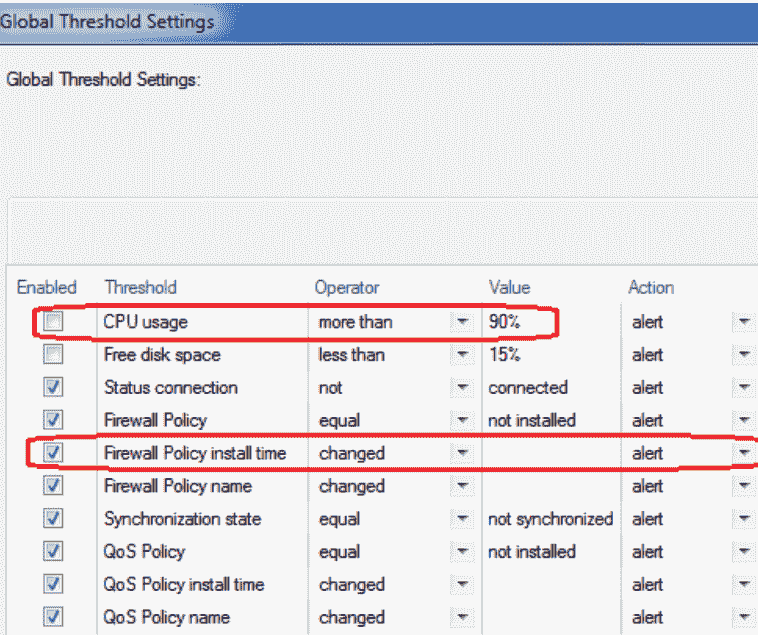

图 4-17：SmartView Monitor 阈值设置


这些警报可以对所有防火墙进行全局配置，也可以对单个防火墙进行配置。这种设置可以在性能相关事件发生期间为你提供所需的“提醒”。`SNMP` 陷阱接收器的 IP 地址和这些警报的电子邮件设置参数在 `SmartDashboard/SmartConsole` 的全局属性 (`Global Properties`)...日志和告报 (`Log and Alert`)...告报 (`Alerts`) 中配置。有关电子邮件警报的更多信息，请参考：`sk25941`: 使用 `'internal sendmail'` 命令配置“邮件警告”。

虽然与性能没有直接关系，但我强烈建议配置“防火策略安装时间...更改 (`Firewall Policy install time...changed`)”的电子邮件警报。此功能

## 基础 Gaia 优化

每当防火墙策略重新安装时都会发送电子邮件。示例：一位同事做了一些大的安全策略更改，将策略安装到防火墙，然后（根据真正的墨菲定律）去吃午饭并忘记了手机。10 分钟后，你接到了帮助台的电话，涉及现在正在发生的各种问题，因为理所当然，任何网络问题都是防火墙的错。如果在该电话之前能收到一封邮件，让你知道防火墙策略中的某些内容被更改并安装了，那该有多好？

## 使用 cpview 监控 Gaia OS

通过 `cpview` 工具可以获得有关防火墙 `Gaia OS` 的丰富监控信息。更令人兴奋的是`cpview` 提供的强大统计数据不仅可以实时查看，还可以查看历史统计数据。默认情况下，`Check Point` 防火墙存储30 天的历史统计数据可以通过 `cpview` 访问；一个名为 `historyd` 的守护进程实现了这一点。可以通过传递 `-t` 选项访问 `cpview` 的历史模式；一旦激活，你可以在 `cpview` 的几乎所有可用屏幕上以 60 秒为步进“向前”或“向后”移动，这对于性能问题发生后或间歇性问题发生后的回顾分析绝对非常有价值。`cpview` 的这种历史模式将在第14 章中深入探讨。

现在，我们将关注使用 `cpview` 实时监控 `Gaia` 操作系统的健康和利用率；让我们直接进入一些截图，显示可能是四个最有用的 `Gaia` 相关界面。这些界面将不带注释，应该是自显易懂的。

## 使用 cpview 监控 Gaia OS 103

`CPVIEW.Overview`

`Overview SysInfo Network CPU Software-blades Advanced`

CPU:

CPU 数量: 4

| CPU | 使用率 |

| :--- | :--- |

| 2 | 2% |

| 3 | 2% |

| 0 | 100% |

内存:

| 总计 MB | 使用 MB | 空闲 MB |

| :--- | :--- | :--- |

| 物理内存 | 1,450 | 556 | 893 |

| FW 内核 | 1,160 | 277 | 882 |

| 交换分区 | 2,047 | 540 | 1,506 |

网络:

| 比/秒 | 81, 788 |

| 包/秒 | 16 |

| 连接/秒 | 4 |

| 并发连接 | 62 |

磁盘空间（前3个已用分区）：

| 分区 | 总计 MB | 使用 MB | 空闲 MB |

| :--- | :--- | :--- | :--- |

| / | 10,911 | 5,439 | 4,908 |

| /boot | 288 | 23 | 250 |

| /var/log | 10,911 | 882 | 9,465 |

图 4-18：`cpview` 概述界面

Copyright © 2018 Shadow Peak Inc. All Rights Reserved

## 基础 Gaia 优化

| `CPVIEW.SysInfo` |

| `Overview SysInfo Network CPU Software-blades Advanced` |

配置信息:-

| 平台 | `Gaia` 32Bit |

| :--- | :--- |

| 配置 | 集群安全网关 |

| 集群状态开启 | |

| `SecureXL` 状态 | 3 |

| `CoreXL` 状态 | `Unsupported` |

| `CoreXL` 实例 | |

| `SMT` 状态 | |

一般信息:-

| 系统运行时间 | 3 天, 18:42:24 |

| 上次策略安装时间 | 2017年10月23日11:26 |

| 上次策略名称 | `Alpha` |

版本信息:-

| `fwl_wrapper` 版本 | `R80.10` |

| 分支名称 | |

| `FW` 用户模式 | `R80_10_jumbo_hf 99114020` |

| `FW` 内核 | `R80_10_jumbo_hf 99114025` |

图 4-19：`cpview SysInfo`

## 使用 cpview 监控 Gaia OS 105

`CPVIEW.Network.Interfaces 26oct2017 11:0`

`Overview SysInfo Network CPU-blades Advanced Interfaces Top-Protocols Top-Connections Overview Traffic`

RX 流量:

| 接口 | 包数 | pps | 比特 | Mbps |

| :--- | :--- | :--- | :--- | :--- | :--- |

| `lo` | 264K | 1 | 13 | 1,318 | 0 |

| `eth0` | 3,636K | 21 | 75 | 11,039 | 0 |

| `eth1` | 2,719K | 7 | 119 | 2,357 | 0 |

| `eth2` | 13,181K | 36 | 379 | 18,130 | 0 |

| `eth3` | 12,116M | 39 | 720 | 24,550 | 0 |

| `eth4` | 2,522K | 7 | 10 | 1,641 | 0 |

| `eth5` | 2,507K | 7 | 8 | 1,623 | 0 |

| 总计 | 28,133K | 89 | N/A | 38,330 | 0 |

错误和丢包:

图 4-20：`cpview Network.Interfaces` 界面

## 基础 Gaia 优化 106

| `CPVIEW.CPU.Top-Connections 20` |

| `Overview SysInfo Network CPU Software-blades Advanced` |

| `Overview Top-Protocols Top-Connections` |

| 实例0-2 |

| 实例0 实例1 实例2 |

| CPU 利用率 (CPU 连接统计应开启. R) |

| 平均连接 CPU 利用率 | 0.00% |

| 连接 CPU 利用率 | |

| 顶部连接 0.00% |

| 其他连接 0.00% |

| 总连接 0.00% |

| 顶部连接 | 占 CPU 百比 |

图 4-21：`cpview CPU.Top-Connections` 界面

## 基础 Gaia 优化：关键点

- 启用某些防火墙组件会对防火墙性能产生巨大影响。

- 可以使用 `top` 命令分析防火墙在进程空间和系统/内核空间的 CPU 使用情况。

- 可以使用 `free` 命令评估防火墙是否有足够的可用内存，或者是否不得不使用损害性能的虚拟内存。

- 如果防火墙至少有 6GB 内存，请确保 `Gaia` 在 64 位模式下运行。

- 如果防火墙磁盘空间低，请清理旧文件。

- 所有 `Gaia` 防火墙都应将容量优化设置为“自动”，以避免连接表项耗尽。

- `sar` 命令和批处理模式下的 `top` 命令可以提供防火墙性能的实时监控。

- `cpview` 是一个优秀的工具，可以提供实时和历史防火墙统计数据。

# 第5 章

访问控制策略调优

如果你在咖啡上花的钱比在 IT 安全上多，你会被黑。而且，你应该被黑。

- Richard Clarke

## 背景

在本章中，我们将讨论 `R80+ SmartConsole` 中访问控制策略层的优化策略。虽然本章的截图和整体语调假设你正在使用 `R80+` 管理，但这些建议经过精心设计，同样适用于 `R77.30` 管理，并为你最终升级到 `R80.10+` 防火墙代码提供了“面向未来的保障”。本章提出的建议无论你的防火墙上 `CoreXL/SecureXL` 的状态或配置如何，都能提高防火墙性能；这些关键加速技术的调优将在后续章节中介绍。本章将跳过命令行发现阶段，因为策略层的配置是在 `SmartDashboard/SmartConsole` GUI 中完成的。在我们继续时，假设你正在对照自己的策略配置，并随之进行调整。

# 110 访问控制策略优化

除非对它们非常熟悉。由当地的 `Check Point` 授权培训中心 (`ATC`) 提供的 `CCSA`（`Check Point` 认证安全管理员）课程是该领域的一个良好起点。如果你是 `R80+` 管理和策略层的完全新手，`CheckMates` (`community.checkpoint.com`) 有有一系列名为“`R80.x` 培训视频”的优秀免费培训视频，在阅读本章之前值得你花时间查阅。在出版时，这些免费视频可以通过以下地址获取：

`https://community.checkpoint.com/docs/DOC-2158-r80-training-videos`

首先，让我们精确定义在 `R80+` 管理中构成访问控制策略的规则集，这些内容将在本章中涵盖：

- 网络访问层 (`Network Access Layer`)：通过 IP 地址和端口号进行过滤

- `APCL/URLF` 层：应用控制与 URL 过滤

- 内容感知层 (`R80.10+`)：数据防泄露 (`DLP`) “轻量版”与文件类型识别

- `NAT` 策略：网络地址转换规则

虽然下面的策略也是访问控制策略的一部分，但它们将不会在书中介绍，因为这些功能的使用频率较低，或者对防火墙整体性能有直接影响：

- 服务质量 (`QoS`) - 以前称为 `Floodgate-1`

- 桌面安全 (`Desktop Security`)

- 移动访问模块 (`MAB`)

- 数据防泄露 (`DLP`)

策略：`R77.30` vs. `R80+` 管理 111

由于这些策略对流量如何被 `SecureXL` 加速（或无法加速）影响巨大，威胁防护 (`Threat Prevention`) 策略的优化将在第 9 章介绍。威胁防护包含 `IPS`、反机器人、反病毒、威胁仿真和威胁提取功能。

`HTTPS` 检测及其策略的优化将在第 10 章介绍。

## 策略：R77.30 vs. R80+ 管理

下面的图总结了 `R77.30 SmartDashboard` 应用与 `R80+ SmartConsole` 之间策略位置的总体变化。在 `R80+` 管理中，某些功能的配置仍然在独立于 `R80+ SmartConsole` 的旧 `SmartDashboard` 应用中进行。

`maxpowerfirewalls.com`

Copyright © 2018 Shadow Peak Inc. All Rights Reserved

# 112 访问控制策略优化

## R77.30

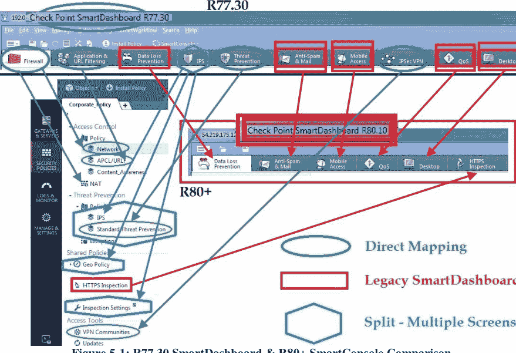

## R80+

图 5-1：`R77.30 SmartDashboard` 与 `R80+ SmartConsole` 比较

本章优化的策略将在 `R80+ SmartConsole` 中进行。对于那些仍在使用 `R77.30` 管理的人，这些建议仍然有效，但在 `R77.30 SmartDashboard` 中看起来可能有些不同。

## 防火墙拓扑

在我们继续下去之前，确保在你的防火墙/集群对象上完全且正确地定义防火墙拓扑至关重要。未能确保此配置正确会导致后期出现大问题，并使实现合理的防火墙性能几乎成为可能。具体而言，你防火墙的拓扑

# 防火墙拓扑 113

配置将严重影响利用内置对象“`Internet`”以及引用 `DMZ` 网络的策略。错误或不完整的防火墙拓扑配置会导致大量流量被许多不同的防火墙功能错误处理，从而使得即使是通过防火墙的 `LAN` 到 `LAN` 通信也会变得极其缓慢。

> 警告：将网络接口从外部 (`External`) 更改到内部 (`Internal`)（或反之）以及切换“接口通向 `DMZ`”复选框时，请务必极端小心。更改此设置或其他接口拓扑值可能会对反欺骗和模块强制产生巨大影响，可能会丢弃或阻碍大量的网络流量导致中断。如果需要修正防火墙接口上的 `Internal/External/DMZ` 定义，请安排维护窗口进行更改。

在 `SmartDashboard` 中打开你的防火墙/集群对象进行编辑，并选择网络管理 (`Network Management`)（在 `R77.30` 管理中称为“`Topology`”）：

| 名称 (`Name`) | 拓扑 (`Topology`) | IP |

|---|---|---|

| `eth0` | `External` | `198.51.100.5/24` |

| `eth1` | `Corporate LANs` | `192.0.2.1/24` |

| `eth2` | `This network, DMZ` | `192.168.1.1/24` |

| `eth3` | `This network, DMZ` | `192.168.2.1/24` |

图 5-2：防火墙网络管理拓扑屏幕

`maxpowerfirewalls.com`

Copyright © 2018 Shadow Peak Inc. All Rights Reserved

# 114 访问控制策略优化

你应该能看到防火墙接口的列表。仔细检查它们。面向互联网的接口其“网络类型”是“`External`”吗？它应该是。通常只有面向外部的接口应该被定义为“`External`”，所有其他接口都应定义为“`Internal`”。在某些环境中，完全可能存在多个接口定义为“`External`”，例如当使用多个互联网服务提供商时。

在 `R80+` 管理中，“`Topology`”下 `External`以外的任何内容都意味着接口被定义为 `Internal`。（在 `R77.30 SmartDashboard` 中会显式显示“`Internal`”）。在我们的示例 `R77.30 SmartDashboard` 中，一个接口被定义为 `External`，而另外三个定义为 `Internal`。在接下来的部分中，我们将检查当前接口拓扑是如何定义的，但先不要更改任何内容！现在我们需要查看每个定义为 `Internal` 的接口，首先我们查看 `eth1`：

# 防火墙拓扑 115

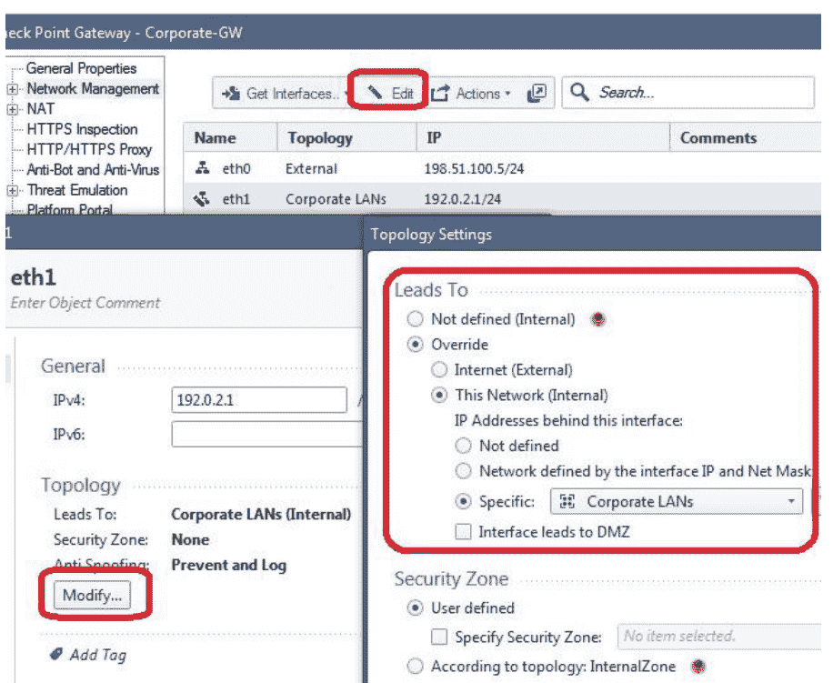

## eth1

对象注释 (`Object Comment`)

`IPv4`: `192.0.2.1`

`IPv6`:

拓扑: `Corporate LANs` (`Internal`)

安全区域: `None`

反欺骗: `Prevent and Log`

图 5-3：防火墙接口设置 - `eth1`

此接口被定义为 `Internal`，可能通向我们的主内部网络。让我们查看 `eth2`：

## 116 访问控制策略优化

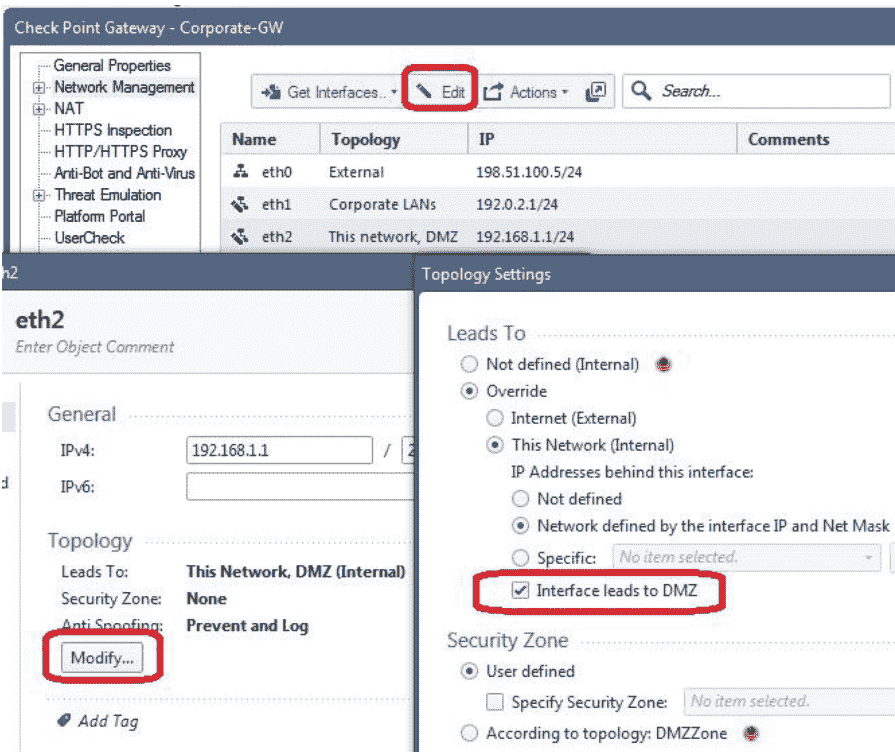

## eth2

对象注释 (`Object Comment`)

`eth2` 也定义为 `Internet`，注意“`Interface leads to DMZ`”复选框已勾选，这从安全角度表明该接口通向一个托管敏感数据的 `DMZ` 网络。但这个复选框到底做了什么？总结来说，它对对象“`Internet`”的计算方式有巨大影响，并直接影响 `DLP` 模块和 `Threat`

`maxpowerfirewalls.com`

Copyright © 2018 Shadow Peak Inc. All Rights Reserved

# 防火墙拓扑 117

防护模块 `Anti-Virus & Threat Emulation` 将进行检查。关于影响此复选框的模块完整列表，请参见 `sk108057`: What does the box "Interface leads to DMZ" control in interface topology?

防火墙拓扑定义中另一个需要注意的大问题：缺失接口。假设对于某个防火墙，你在 `Gaia` Web 界面中配置了一个新接口 `eth3`。你为新接口分配了 IP 地址并设置了所需的路由。在 `SmartConsole` 中，你随后为 `eth3` 网络创建了一个新对象，分配了 `NAT`，并添加了允许通过的安全策略规则。一切运行良好，但你忘记了这一点：将 `eth3` 接口添加到防火墙对象的拓扑中。这个新网络没有被显式定义为“`Internal`”（实际上在防火墙拓扑中完全没有定义），因此必须是 `External`！在这种情况下，所有出入 `eth3` 接口的流量将被视为 `External`。这将导致对象“`Internet`”在我们的策略中的计算和应用方式产生差异。

# 118 访问控制策略优化

在没有“`Topology`”（拓扑）菜单选项的情况下，应使用相应的选项来添加任何缺失的接口。点击“`Get Interfaces With Topology`”将尝试修改所有现有接口的拓扑定义，这可能会影响反欺骗（`anti-spoofing`）强制执行，可能导致大规模停机，甚至破坏你管理防火墙的能力！如果你发现由于反欺骗强制配置不当而无法管理或向防火墙安装策略，请在防火墙上运行这些专家模式命令以恢复安装策略的能力（最后两行假设第一行启用了 `SecureXL`）：

```
fw ctl set int fw_antispoofing_enabled 0
fwaccel off;fwaccel on
```

## 动态对象“Internet”

在 `APCL/URLF` 策略层中恰当使用“`Internet`”对象，是你策略优化武器库中最重要的武器之一，但前提是如上一节所述，防火墙的拓扑已完全且正确地定义。通常，“`Internet`”对象应用于 `APCL/URLF` 规则的冲突（`Destination`）中，如下：

## 动态对象“Internet” 119

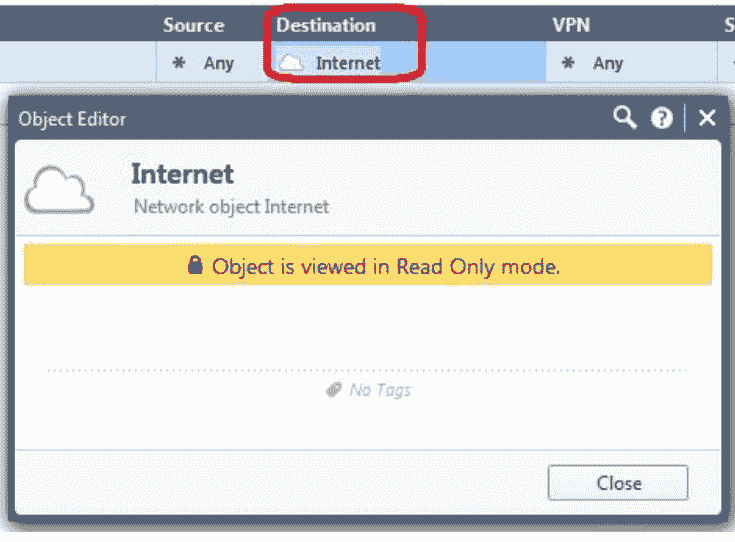

图 5-5: `R80+` 管理中的“`Internet`”对象


但在 R77.30 SmartDashboard 中，查看“Internet”对象会包含一个描述得非常好的额外贴士：

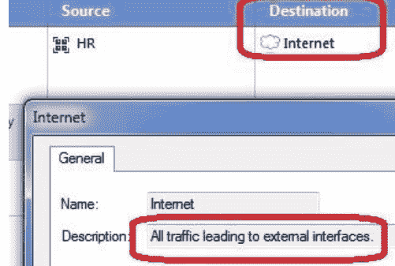

图 5-6: R77.30 管理中的“Internet”对象

## 访问控制策略优化

现在，我们终于准备好描述当在策略中使用“Internet”时会匹配哪些内容了：

- 路由目的通过防火墙拓扑中显式定义为“External”（外部）接口的流量
- 路由目的通过勾选了“Interface leads to DMZ”（接口指向 DMZ）的接口流量
- 路由目的通过完全未出现在防火墙对象拓扑定义中的接口。（是的，这意味着为 802.1q VLAN 标记分配的所有单个子接口都必须列在防火墙拓扑中并正确设置其拓扑）

在本章的后半部分，“Internet”对象将广泛用于优化策略层的应用。

## 安全区域 - R80.10

R80.10+ 策略的另一个有趣选项是使用安全区域（Security Zone）对象。作为其他厂商防火墙产品的长期特色，在策略层中使用安全区域对象需要防火墙运行 R80.10+ 代码。虽然安全区域有助于构建更简单的策略，但它们在 R80.10 版本有一个明显的局限性：它们不能用于手动 NAT 规则。

在各种策略规则的源和目的列中使用安全区域与使用主机/网络/组对象相比，从防火墙性能的角度来看并没有太大区别。遍历 R80.10+ 网关的流量始终会计算其源目的安全区域，无论防火墙的各种策略层是否使用安全区域对象。尽管将安全区域对象分配给接口，然后在规则的源/目的中使用该安全区域对象代替该接口后的大网络组可能会非常方便。

结论：如果你为了方便和策略简化，请使用安全区域；目前，它们对防火墙性能没有影响。

## Geo 策略：你的秘密武器

Geo 策略（地理策略）是一个被严重低估的防火墙性能改进功能，你的环境中几乎没有被充分利用。在 R77.30 及早期版本中，Geo 策略（以前称为 Geo Protection）是入侵防御系统（IPS）组件不可分割的一部分，因此需要防火墙拥有有效的 IPS 许可/合同。

然而，在 R80.10 的重大变化中，Geo 策略已从 IPS 组件中抽离，现在只是主访问控制策略的一部分。因此，Geo 策略的更改将在安装访问策略时生效；无需安装威胁防护策略。此外，在 R80.10+ 网关上完全不需要启用（或授权）IPS 组件即可利用 Geo 策略。

实施了精心设计的 Geo 策略的客户报告，防火墙 CPU 利用率下降了 10%，有时更高，取决于其互联网可路由地址空间的大小。互联网“背景噪声”很大一部分是来自受感染系统的寻找其他感染系统的自动化探测和扫描。

这种持续不断的攻破尝试必须由防火墙检查并最终丢弃；当互联网可路由子网超过 `/24`（255 个以上主机）时，这种消耗性能的影响会变得更加明显。讽刺的是，这些尝试绝大多数是通用的，并非针对你的组织。如果能为真正的攻击节省宝贵的防火墙资源，而不是浪费时间处理这些来自互联网遥远角落的“垃圾流量”，不是很好吗？这就是 Geo 策略的作用。

Geo 策略允许高效地批量丢弃来自特定国家的流量。如果你确定你的组织在世界上大多数国家没有业务或客户，就可以大幅减少互联网持续背景噪声所消耗的开销。

如果你知道组织需要与哪些国家通信，难道不应该阻止所有其他国家吗？Geo 策略执行的丢弃发生在防火墙处理的早期，远于咨询任何其他策略层，可以节省大量的 CPU 开销。

## Geo 策略：你的秘密武器 123

在不涉及地缘政治的情况下，如果列表中某个国家是你组织所在国家的政治对手或直接敌人，它们很可能是屏蔽的好选对象。人口排名前 20 的国家：中国、印度、美国、印度尼西亚、巴西、巴基斯坦、尼日利亚、孟加拉国、俄罗斯、日本、墨西哥、菲律宾、埃塞俄比亚、越南、埃及、土耳其、德国、伊朗、刚果（民主共和国）、泰国

## 配置 Geo 策略

在首次启用 Geo 策略之前，强烈建议确保已下载并安装了最新的 Geo 策略数据库更新，如此处所示：`sk92823: Geo Protection fails to update`。

第一步是确定分配给网关的 Geo Protection 配置文件。在 R7.30 管理中，Geo Protection 元素是分配给网关的 IPS 配置文件的一部分，而在 R80+ 管理中，Geo Policy 配置分配是共享策略（Shared Policies）的一部分：

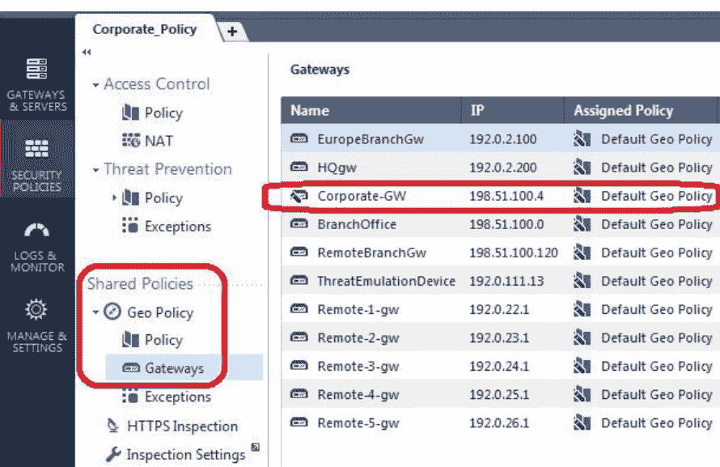

图 5-7: Geo Policy 防火配置文件设置

当前分配给我们网关 `Corporate-GW` 的 Geo 策略名称为“Default Geo Policy”。接下来我们进入策略配置界面并选择正确的 Geo 策略（如果有多个）：

## 地理策略（Geo Policy）：您的秘密武器 125

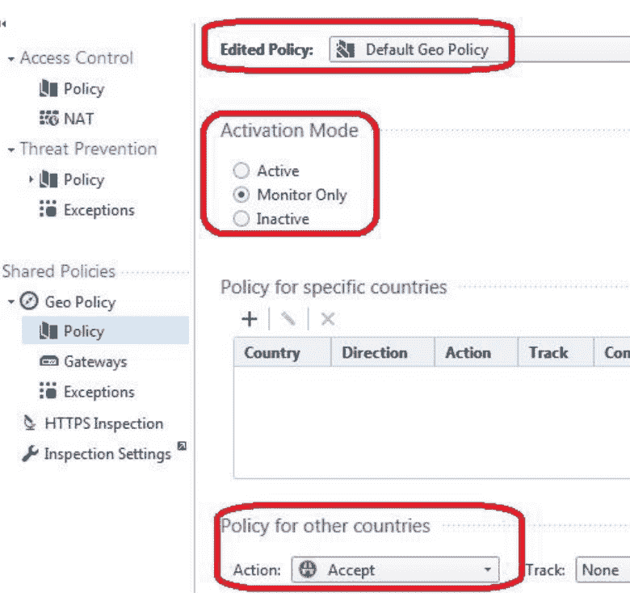

图 5-8: 针对特定国家的地理策略

如果是首次设置地理策略，强烈建议如所示将“激活模式（Activation Mode）”设置为“仅监控（Monitor Only）”。一旦日志分析确认新的地理策略不会干扰生产流量，稍后可以将激活模式设置为“已激活（Active）”。同时请注意，“其他国家策略（Policy for other countries）”设置为“接受（Accept）”，这意味着我们计划通过地理策略显式阻止来自我们不想国家的流量，同时让来自所有其他国家的流量继续由各个策略层进行进一步检查（此时这些流量最终仍可能被丢弃）。这种“黑名单”方法是目前最常用的，但也可以通过特殊的热补程序采用“白名单”方法。更多细节请参阅：`sk110683: IPS Geo Protection 在配置为白名单时会丢弃错误的流量`。

## 访问控制策略调优

接下来我们配置想要阻止的国家；大多数情况下，我们希望将方向（Direction）都选择“源和目的国家（From and To Country）”，以既阻止来自该国的攻击，同时也防止可能入侵我们网络的恶意软件向该国发送“回传信号”。此外，请确保将“跟踪字段（Track Field）”设置为“日志（Log）”以便于排故障：

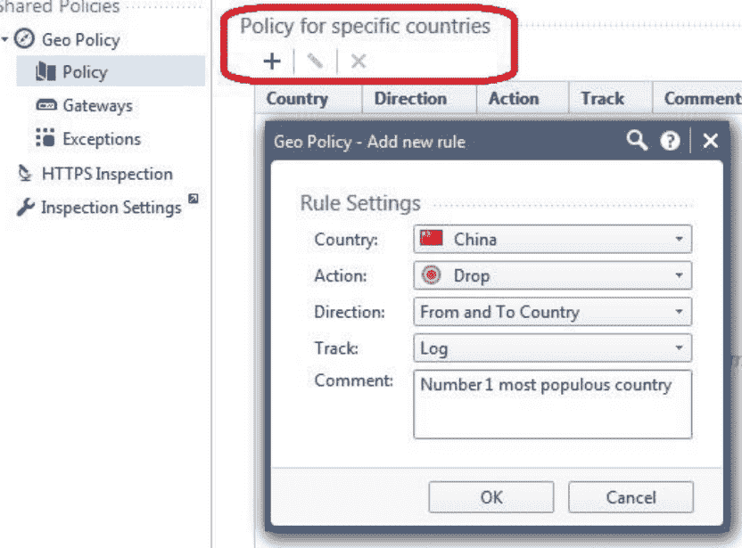

图 5-9: 使用地理策略阻止特定国家

## 策略层“清理”规则与性能 127

一旦添加了所有想要阻止的国家，只需将访问策略重新安装到防火墙即可使其生效。注意，如果有客户或业务合作伙伴位于本应被阻止的国家，可以为地理策略添加例外。一旦配置并应用了地理策略，防火墙 CPU 的利用率应该立即下降，特别是当您的组织在互联网上有一大范围的可路由地址时。不要忘记在合理的时间范围内检查地理日志，并最终将其设置为已激活模式！

## 策略层“清理”规则与性能

在 R80+ 管理之前，当遇到“清理规则（Cleanup Rule）”时，大多数 Check Point 管理员会假设该术语指的是典型防火墙规则库中最后一个显式创建的规则。此规则将匹配任何不符合上方规则的流量，将其丢弃，并通常将其记录为丢弃（drop）。大多数 Check Point 管理员都知道防火墙主规则库末尾存在不可见的“隐式丢弃（implicit drop）”。被此最终隐式丢弃规则丢弃的流量有时被称为“掉落在规则末尾的流量”。然而，如果规则库末尾已经存在显式清理规则，则这种情况永远不会发生，因为无法到达隐式丢弃。“整个流量被显式允许或拒绝”是包括 Check Point 在内的每个厂商防火墙的基础部分。

然而，在 R7.30 及更早的管理中并不明显的是，其他策略（如 APCL/URLF 和威胁防护 Threat Prevention）末尾也存在一条不可见的清理规则，其默认操作是“接受（Accept）”。遗憾的是大多数防火墙管理员并没有注意到事实，并会像这样在这些策略的末尾添加显式的“接受”：

## 访问控制策略调优

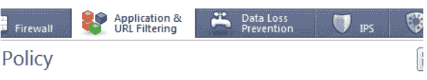

| 编号 | 源 (Source) | 目的 (Destination) | 应用/站点 | 动作 (Action) | 跟踪 (Track) |
|---|---|---|---|---|---|
| 1 | MKT | Internet | Facebook | Allow | Log |
| 2 | Any | Internet | Bad_Stuff | Block | Log |
| 3 | Any | Internet | Any Recognized | Allow | Log |

图 5-10: 不必要的默认 APCL/URLF 策略“清理规则”

糟糕的是，上述最后的 Accept 规则在 R77.30 及更早的 APCL/URLF 策略中是包含包含。从防火墙性能的角度来看，为什么这个事实很重要？

在 R77.30 中，这个最终的显式 Accept 规则是不必要的，除非你想记录所有被 APCL/URLF 允许并分类的其他应用程序/URL；使用它将导致你指向互联网和所有 DMZ 的出站流量无法通过 SecureXL 进行加速。回想一下“Internet”对象实际上意味着什么；目的地为未显式定义为内部（Internal）或被指定为 DMZ 的接口的流量。你真的需要看到成千上万条额外的日志，记录 443 端口存在 TLS 协议，或者（意料之中的）SSH 协议不断出现在 22 端口上吗？当然，具有 Block 动作的 APCL/URLF 规则应该始终在显式规则上匹配并记录。

然而，如果你有任何允许所有内部用户访问应用程序/类别但不记录的 APCL/URLF 规则，则应该删除这些规则，除非它们优于 APCL/URLF 规则库后面更通用的 Block 动作。如前所述，APCL/URLF 策略末尾没有网络策略末尾那样的“隐式丢弃

## 策略层“清理”规则与性能

如前所述，APCL/URLF 策略末尾没有网络策略末尾那样的“隐式丢弃”；如果没有显式清理规则，会出现一个通知，说明流量“掉落在该策略层末尾”时的默认操作。第二个截图显示，隐式清理（Implicit Cleanup）的操作现在可以由用户进行切换。

## 策略层“清理”规则与性能 131

- 访问控制 (Access Control)
- 策略 (Policy)
- 网络 (Network)
- Web 控制 (Web Control)

| 编号 | 源 | 目的 | 服务与 |
|---|---|---|---|
| 1 | DNS Ser... | External... | 域名 |
|   |   |   |   |

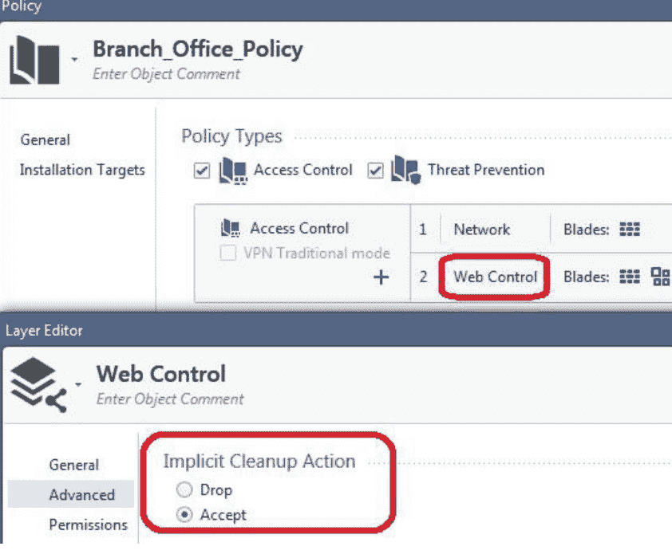

图 5-12: 更改隐式清理的默认操作

如你在第一个截图所示，如果没有显式清理规则，将出现一个通知，说明流量“掉落在策略层末尾”时的默认操作。第二个截图显示，隐式清理的操作现在可以由用户进行切换。

因此从性能角度来看，结论是：抵制在策略层末尾添加接受流量的显式清理规则，特别是对于执行 APCL/URLF 和威胁防护的层。避免在这些策略层中使用接受流量的显式清理规则，可能会使更多流量获得 SecureXL 的加速。

对于仅基于 IP 地址和端口号做出过滤决策的网络策略访问层，使用丢弃动作的显式清理规则仍然是合适的且不会影响潜在的加速。

## 网关性能：有序层 vs. 内联/统一层

本书并不旨在介绍使用有序策略层（这是你在将现有的 R7.30 安全管理服务器升级到 R80+ 管理后最初开始使用的）与使用内联/统一层（需要 R80.10+ 防火墙）之间的优缺点。从防火墙的角度来看，只要遵循本章的建议，使用有序层还是内联/统一层对策略评估开销和常规防火墙性能的影响非常小。

使用新的统一/内层的主要优势是增加了管理控制的粒度，并能够在在一个合并视图中查看整个安全策略。这确实可以优化管理员在进行和跟踪策略配置更改时的时间，有序层 vs. Inline/Unified 层对防火墙的性能方面的影响很小，而这恰是本书关注的重点。

## 通用访问控制策略最佳实践

本节涵盖的最佳实践适用于以下策略层：

- **网络访问 (Network Access)**：通过 IP 地址和端口过滤
- **APCL/URLF**：应用控制与 URL 过滤
- **内容感知 (Content Awareness)** (R80.10+)：数据泄防护 (DLP) 与文件识别
- **NAT 策略 (NAT Policy)**：网络地址转换

威胁防御（Threat Prevention）策略层的优化见第 9 章，而 HTTPS 策略见第 10 章。

## 列匹配与早期丢弃 (Column-based Matching & Early Drop)

传统的自顶向下优先（top-down, first-fit）规则匹配方法的一项重大改进扩展到了 R80.10+ 防火墙几乎所有策略类型。虽然在 R77.30 防火墙的某些策略类型存在列匹配，但 R80.10+ 防火墙充分利用了这项新技术。列匹配不再逐条遍历规则以尝试匹配（并采用找到的第一个匹配），而是根据规则库中各种列的值排除可能匹配的候选流量，然后对执行接受/允许（Accept/Allow）操作的剩余规则进行传统的自顶向下优先评估。与其纠结于这种新列匹配的工作细节，我们将直接使用它来制定策略建议。如果你在使用 R80.10+ 防火墙，某些策略评估的性能提升在 R77.30 防火墙上也可以实现。这种新的规则库列匹配技术对于有序层和统一层都同样适用。

关于列匹配的详细文档此前较少；请参阅此名为“统一策略列匹配”的帖子获取最新信息：`https://community.checkpoint.com/message/10388`

## “Any”是敌人

让我们直接进入主题：现在尽可能在许多策略层规则的源（Source）、目的（Destination）和业务（Service）字段中避免使用“Any”，特别是在目的（Destination）列中。在上一节中，我们简要讨论了“列规则匹配”，它在开始传统的自顶向下优先匹配之前，本质上排除了策略规则。随着策略变得越来越大，防火墙使用传统的自顶向下优先方法查找规则匹配的开销变得非常高。SecureXL 会话加速（第 11 章）通过形成模板来尽可能避免规则库查找，试图应对这种日益增长的影响。然而，如果策略经过仔细优化以充分利用列匹配，防火墙在查找规则匹配时可以节省大量时间。

但“Any”究竟为什么是敌人？假设我们在规则库顶部有以下六条规则：

| 编号 | 源 (Source) | 目的 (Destination) | VPN |
|---|---|---|---|
| 1 | Admins | Corporate-GW | Any |
| 2 | Any | Corporate-GW | Any |
| 3 | Remote Access Users | Data Center LAN | RemoteAccess |
| 4 | Corporate Lanes | Branch Office LAN | Site2Site |
| 5 | Branch Office LAN | Corporate Lanes |   |
| 6 | attackers | Any | Any |

图 5-13：演示“Any”是敌人的示例策略

对于此示例规则库，假设新连接的目的 IP 是一个 DMZ 地址。在开始对规则库进行传统的自顶向下优先评估之前，防火墙执行列匹配。它确定该连接无法匹配规则 1-5（基于目的 IP 地址），因此无需尝试对这些规则进行匹配。但为什么它不能排除规则 6 呢？因为规则 6 在目的字段使用了“Any”！

当防火墙执行列匹配以排除进一步评估规则时，它查看哪些列以及顺序如何？

1. 目的 (Destination)
2. 源 (Source)
3. 业务 (Service)

正如你可能怀疑的，使用“Internet”对象的规则甚至对象的取反规则如何？列匹配可以排除这些规则以避免复杂的自顶向下优先匹配过程吗？是的！从策略调优的角度来说，只有“Any”对象（它与“Internet”不同）才是你的敌人。

这种新的列策略评估技术的一个有趣方面是可能会发生“早期丢弃（early drop）”。假设候选流量与规则库进行列匹配，所有具有接受/允许操作的规则均被排除。换句话说，在列评估后，唯一剩余规则的操作是丢弃/阻止（Drop/Block）。在这种情况下，流量将被丢弃并记录，但日志条目中没有匹配规则编号。虽然我们通常不在意这种情况（因为数据包已经被丢弃了），但在尝试排故障时，缺少匹配规则编号可能会令人困惑。如果需要，可以禁用这种“早期丢弃”行为。

## 网络策略建议

本章提供的策略优化建议是通用的，适用于所有访问控制层（甚至是第 9 章中的威胁防御层）。在本节中，我们主要关注网络层的特定建议，主要通过 IP 地址和端口进行匹配。在 R77.30 管理中，这是“防火墙”选项卡下的策略。遵循以下提示：

- 如果在 R80.10+ 管理中使用有序层（Ordered layers），尝试在 IP 地址和端口上尽可能丢弃流量。如果使用统一/内置层（Unified/Inline layers），仅使用 IP 地址和业务来匹配顶层规则，并在内部调用 APCL/URLF 和内容感知模块。

## 访问控制策略调优

遵循这些建议可以确保尽可能多的流量在早期被丢弃，远在调用性能密集密集型模块之前被处理。

- 尝试将命中计数最高的规则放在规则库顶部，同时注意不要损害安全性。由于之前讨论的新型列匹配功能，此建议提供的“性价比（bang for the buck）”已不再。如果命中计数数据显示不准确或不完整，强烈建议进行 `sk79240: 命中计数调试`。在 R80+ 管理中，命中计数默认隐藏，右键点击任何列标题并勾选“Hits”以使其可见。如果你的策略非常大，尝试通过滚动查找命中计数最高的规则可能是一个挑战，因为没有方法按命中计数对规则排序。但是你可以运行一个快捷命令：在防火墙上运行 `cpstat blades` 命令。该命令将以非常简洁的显示显示当前安装策略中命中率最高的规则。

- 创建规则以匹配并丢弃所有广播流量且不记录日志。


> 警告：如果在防火墙的 Gaia OS 中设置了 DHCP 或 DHCP 中继，此规则将阻止以前形式的 DHCP 正常工作。你需要在此新规则之前添加显式规则以允许 `dhcp-request` 和 `dhcp-reply` 业务。

例如，假设防火墙有 4 个接口：

```
eth0: 129.82.102.32/24
eth1: 10.1.1.1/24
```

# 网络策略层建议 139

`eth2: 192.168.1.1/24`

`eth3: 172.16.16.1/16`

创建五个如下节点（`Node`）对象：

`OutsideBC: 129.82.102.255`

`DMZBC: 10.1.1.255`

`DMZ2BC: 192.168.1.255`

`InternalBC: 172.16.25.255`

`AllOnesBC: 255.255.255.255`

将所有五个主机（`Host`）对象放入名为“Broadcast-Nets”的组中。现在在防火墙隐身规则（Stealth Rule）之前，创建一个如下早期规则：

| 编号 (No.) | 命中 (Hits) | 源 (Source) | 目的 (Destination) | VPN | 服务 (Service) | 动作 (Action) | 跟踪 (Track) |
|---|---|---|---|---|---|---|---|
| | | 防火墙管理与隐身规则（规则 1-3） | | | | | |
| 1 | | Any | Broadcast-Nets | Any | Any | drop | - 无 |

图 5-14: 广播日志抑制策略规则

现在，所有原本无法跨防火墙的广播流量将被静默丢弃。到 `ff:ff:ff:ff:ff:ff` 的层2 MAC 地址广播和多播地址仍将工作，因此 ARP 和 VRRP 等协议不受此规则的影响。

- **清理垃圾内部流量** – 在检查日志时，创建一个匹配所有来自你内部网络和 DMZ 的数据包的源过滤器。在“动作”（Action）列中添加另一个过滤器以显示 Drop（丢弃）和 Reject（拒绝）动作。你是否看到内部系统不断尝试使用被禁止的协议（如 NTP、DNS、NNTP、SNMP 和 POP3/IMAP 连接某些地方，而这些连接正被你的安全策略拦截？联系系统管理员，告诉他们关闭这些功能，或者在停止不断尝试通过防火墙访问这些被禁的服务时对其进行修改。通常，该领域有少数非常严重的违规者，一旦他们整改了行为，防火墙上就能节省惊人的策略评估和日志开销。如果他们拒绝整改，或者强迫他们整改会引发 OSI 第 8 层问题（政治风暴），请查看第 13 章讨论的速率限制（Rate Limiting）功能，该功能可以以最小的防火墙性能影响有效限制它们的流量。

- **避免在 R77.30 防火墙中使用域（Domain）对象来匹配域名通配符**。这些对象在 R77.30 防火墙上消耗极其大量的 CPU 开销，并影响 SecureXL 加速。虽然 R80.10+ 防火墙对域对象的实现已通过新的 QDN 功能得到了大幅改进，但从原则上讲仍应避免使用，尽管它们不再禁用 SecureXL Accept 模板（这些在第 11 章中介绍）。如果你必须在 R77.30 策略中使用域对象，请将包含它们的规则放置在离策略尽可能远的地方。关于 R80.10 防火墙对域对象的新处理方式的更多信息，请参阅 `sk120633:Domain Objects in R80.10 and above` 以及此处的 CheckMates 线程“FQDN in Policy Access rule”：`https://community.checkpoint.com/thread/1379`。

- **删除未使用对象**。在 R80+ 管理中，打开对象资源管理器（Object Explorer）窗口并选择“未使用对象”（Unused Objects）而不是默认的“所有”（All）。在 R77.30 SmartDashboard 中，在左侧对象树的“网络对象”（Network Objects）下右键点击“节点”（Nodes），选择“更多…查询对象”。在出现的屏幕上，在“精炼过滤器…按字段精炼”中选择“未使用对象”。将显示一个未在任何策略中引用的对象列表。打开列出的每个对象进行编辑并检查其 NAT 选项卡。如果对象上没有勾选 NAT 复选框，则可以安全地删除。在不检查 NAT 选项卡的情况下删除对象可能会破坏你的某些 NAT 配置，请务必小心！

- **7. 避免使用 Reject 动作**：安全策略规则中的“Reject”（拒绝）动作不应被使用，因为生成负应确认（NACKs）涉及开销；请改用 Drop 动作。

# APCL/URLF 策略层提示

在本节中，我们将重点关注 APCL/URLF 策略层的特定建议，这些层匹配应用程序类型和 URL 类别。在 R77.30 管理中，这是 SmartDashboard 中“应用程序与 URL 过滤”（Application & URL Filtering）标签页下的策略。许多建议的总体目标是确保流量在不应检查时不会被 APCL/URLF 意外检查。匹配 APCL/URLF 策略中精确 Allow/Accept 规则的连接将自动无法获得防火墙 SecureXL 的全加速。有关 Check Point 配置应用程序控制的最新最佳实践，请参阅 `sk11249: Best Practices - Application Control`。

- 1. 确保在执行 APCL/URLF 的策略层中，“目的”（Destination）列中绝不指定对象“Any”；在大多数情况下使用对象“Internet”。请记住，由于防火墙拓扑的所有接口上都设置了“到 DMZ 的接口”复选框，APCL/URLF 将应用于从内部网络到这些 DMZ 的连接，而不仅仅是到 Internet！

- 2. 同样避免在“源”（Source）列中直接使用“Any”（或通过放置在源列的访问对象的“网络”标签卡）；尝试始终指定内部网络对象和组。

- 3. 在匹配应用程序和 URL 类别的规则中可以指定限制（Limit）动作，以限制不受欢迎或占用带宽的应用程序，例如：`img/f71ded7ff9665818f413a53bb0d5abb_170.png` 图 5-15: 设置 APCL/URLF 带宽限制。但请记住，这种方式定义的限制是按规则共享的，而不是按用户甚至每个连接。在我们的示例中，所有“审计员”（Auditors）组的成员并匹配规则的用户在尝试访问 Facebook 或 Twitter 时，将共享惊人的 3Kbps 带宽。

- 4. 注意，在应用程序/URL 类别上实施的带宽限制在高可用（High Availability）情况下的防火墙故障转移失效。带有限制的现有连接将在故障转移中生存并继续，但接管的集群成员将不再对这些连接执行带宽限制。在新建激活的集群成员上发起的连接连接，实施更细粒度限制唯一方法是将它们拆分为单独的规则，或启用 QoS 刀，它可以执行每个连接的限制（但不是每个用户）。

- 5. 在使用内联（Inline）层在子规则中调用 APCL/URLF 时，始终评估对显式 Accept 日志规则的实际需求。

## APCL/URLF 策略：网站分类模式

关于 Check Point URL 过滤解决方案的一个鲜为人知的事实（不包括应用程序控制）是，URL 分类完全基于云端。自 R75.40 版本防火墙起，不再每天下载包含数百万网站及其类别的大型 URL 数据库；URL 分类是由防火墙通过 Check Point ThreatCloud “实时”完成的。网站分类结果一旦从 Check Point ThreatCloud 接收到，就会缓存在防火墙的内存中。在 R80+ 管理的后续屏幕上，有一个引起争议的设置称为“网站分类模式”（Website Categorization Mode）：`img/f71ded7ff9665818f413a53bb0d5abb_172_0.png` 图 5-16: APCL/URLF 分类模式，后台还是等待？（在 R77.30 管理中，此屏幕位于“引擎设置”屏幕下的“应用程序与 URL 过滤…高级”）默认情况下，它设置为“后台”（Background），这从性能角度来看是最优的，但从安全（以及巨大的尴尬）角度来看不是。考虑一下：你的合规官注意到，默认情况下当他们访问一个公司内没人会访问的、极其晦涩的新 URL 时，有时在他们第一次尝试时网站就会出现，尽管它本应被拦截。然而，如果几秒钟后刷新刷新页面，它就会被正确拦截，并对所有人保持拦截状态。你的合规官表示这是不可接受的，并希望确保 URL 过滤在第一次始终绝对执行，即使这会导致额外的浏览延迟。你如何确保这一点？由于 URL 分类云端查询的固有性质，当用户尝试访问分类结果尚未包含在防火墙缓存中的网站时，通常会有延迟。但默认情况下，“网站分类模式”设置为“后台 – 在分类完成之前允许请求”。这允许用户始终快速、无延迟地打开一个尚未分类的网站，即使该网站从从上本就不该被允许访问的。一旦从 Check Point ThreatCloud 接收到网站分类结果，如果该网站未被允许，它将立即开始被拦截，所有用户（包括原始请求者）将不再能够访问它。但它在第一次出现了，初始用户仍然可以看到它（至少简短地）。这是我认为安全优于性能的案例之一，所有组织都应该将“网站分类模式”设置为“等待 – 在分类完成之前阻止请求”。用户在首次尝试连接到未缓存的网站时将看到短暂的延迟；但只要你的防火墙配置正确，具有良好的快速响应的 DNS 服务器和快速的互联网连接，该延迟通常小于 1 秒。一旦网站被分类并填充到防火墙缓存中，用户访问该网站将不再有任何延迟。

## 仅限 R77.30：APCL/URLF 策略优化

R77.30 APCL/URLF 策略的一个不为人知的特性是可以根据服务（端口号）以及应用程序指定 APCL/URLF 规则。在 R80+ 管理中，可以在包含 APCL/URLF 的策略层中轻松指定服务。但对于 R77.30 管理，APCL/URLF 策略中的“Service”（服务）列默认是隐藏的。要显示，请右键点击任何 APCL/URLF 策略列顶部并勾选“Service”：

``

| 序号 | 源 | 目的 | 应用程序/会... | 动作 | 跟踪 | 服务 | 安装位置 |
|---|---|---|---|---|---|---|---|
| 1 | MKTG | Internet | Facebook | 允许 | 日志 | 全部 | 命中 |
| 2 | 全部 | Internet | Bad_Stuff | 拒绝 | 日志 | 全部 | 源 |
| 3 | 全部 | Internet | 所有已识别 | 允许 | 日志 | 全部 | 目的 应用程序/站点 服务 跟踪 安装位置 时间 注释 |

图 5-17：为 R77.30 APCL/URLF 策略添加服务列

请注意，默认情况下每个 APCL/URLF 策略规则的服务均为“Any”（全部）。何时可以利用这些额外的服务标准来增强防火墙性能？

在每个 Check Point 防火墙的主安全策略中，通常有一条允许内部用户访问 Internet 的通用规则。在 APCL/URLF 策略接管之前，主安全策略必须允许连接启动（通常意味着完成了 TCP 三次握手），然后通过检查包数据来尝试确定与连接关联的应用程序或 URL 类别。某些组织允许用户在任何 TCP/UDP 端口上发起到 Internet 的连接，而其他更注重安全的组织则仅允许已批准的端口列表，例如 80、443、8080、22 等。通常，此已批准的端口列表实现在名为“allowed ports”（允许端口）或类似的组对象中。APCL/URLF 规则的默认服务器为“Any”。如果您的组织允许用户在允许的端口列表中发起到 Internet 的连接，您绝对应该在所有 APCL/URLF 规则的 Service 列中利用现有的组，以限制 APCL/URLF 模块需要检查的流量。

对于极其特定的 APCL/URLF 规则，您甚至可以为在已知端口上的已知应用程序指定单个端口号。这不仅可以使 APCL/URLF 策略不检查不需要的流量，还可以实现更高效的基于列的 APCL/URLF 规则匹配，因为被检查流量上的“错误”端口号可以快速地排除任何端口号不匹配的 APCL/URLF 规则。检测应用程序或 URL 类别需要大量的 CPU 资源；但在评估 APCL/URLF 策略期间，确定目的端口号是否匹配可以非常快速高效。关于匹配服务的更多信息，请参考 `sk90940`：当启用 Application Control 模块时，“`fw_worker`” 进程占用 100% CPU。

## 内容感知提示（仅限 R80.10 防火墙）

以下是在 R80.10+ 防火墙上调用内容感知（Content Awareness）模块时的建议，该模块可以匹配特定的文件类型以及敏感/机密数据：

- 1. 如果尝试在同一策略层中同时匹配文件类型和特定内容类型，请将匹配文件类型的规则放在前面，随后跟上匹配特定类型内容的规则。这种规则放置顺序镜像了防火墙本身评估内容的顺序，且效率更高。

- 2. 使用内容感知功能确实会触发防火墙对任何需要检查的数据进行一次第 10 章所述的进程“往返（trip）”。在您的策略层中调用内容感知时，请确保它仅限于访问如 Internet 等限带宽连接的流量。具体而言，尽量避免配置内容感知来检查在两个高速内部 LAN 网络之间的流量。

- 3. 如果在策略中使用内联/统一层（Inline/Unified），避免在顶部策略层中调用内容感知匹配；尽可能将内容感知匹配限制在子层中。

## NAT 策略优化

通常情况下，NAT 策略不需要大量的优化。在 Check Point 防火墙策略中有两种技术可用于配置 NAT：

- *自动 NAT*：选择网络对象的 NAT 选项卡，配置静态 NAT（Static NAT）或隐藏 NAT（Hide NAT），并指定要使用的 NAT 地址。此技术将在 NAT 策略中自动创建所需的 NAT 规则。

- *手动 NAT*：通过添加自己的手动规则直接操作 NAT 策略。此技术为精确指定防火墙如何执行 NAT 提供了更细粒度的控制。

通常建议使用自动 NAT 设置技术。它能很好地处理大多数 NAT 场景，并帮助简化（忽略掉 NAT 工作原理的某些内部细节（例如必须处理 Proxy ARP）。如果自动设置已经处理了您防火墙上的所有 NAT，那么在优化方面几乎没有什么可做的。快速查看 NAT 策略可以发现，自动生成的 NAT 规则顺序是无法更改的（所有自动静态 NAT 将在所有自动隐藏 NAT 之后），并且没有“命中计数”（Hit Count）列。

NAT 策略查找始终在防火墙路径（F2F）中进行，除非启用了 NAT 模板（将在第 11 章中讨论）。

## 访问控制策略调优

### NAT 缓存

NAT 策略查找始终在防火墙路径（F2F）中进行，除非启用了 NAT 模板（将在第 11 章中讨论）。NAT 缓存最多包含 10,000 条条目（缓存条目默认 30 分钟后过期）。当“原始包”（Original Packet）匹配发生在 **`fwx_cache`** 表中，源、目的和服务数量将被缓存在“翻译后的包”（Translated Packet）下。

您的防火墙上 10,000 个潜在 NAT 条目中有多少在使用？运行命令 `fw tab -t fwx_cache -s:`：

```
[Expert@firewall:0]# fw tab -t fwx_cache -s
HOST            NAME ID #VALS #PEAK #SLIN
localhost fwx_cache 8116 455 4518 0
[Expert@firewall:0]#
```

图 5-18：显示 NAT 缓存统计

VALS 表示当前缓存的 NAT 条目数量，#PEAK 表示防火墙启动以来表中条目的峰值。如果这两个者的值都远小于 10,000，说明您的防火墙没有进行大量的 NAT，或者防火墙路径已经发生了最大级别的 NAT 缓存，无可做了。

然而，如果 #PEAK 正好显示 10,000 呢？首先，不要害怕。使用 NAT 缓存表中的所有条目不会导致宕机或阻碍流量；它会导致更多的 NAT 规则查找，这会影响性能。那么，我们如何评估是否应该增加 NAT 缓存的大小？

如前所述，NAT 规则没有命中计数。但是，您可以直接在网关上的 `fwx_cache` 表中进行查看，以了解哪些 NAT 规则正在使用。`fwx_cache` 表确实跟踪缓存条目的 NAT 规则；这条长命令将显示最常用的 20 条规则：

```
fw tab -ut fwx_cache|awk '{ print $3 }'|cut -c5-8|sort -n|uniq -c | \
sort -nr|head -20
```

（注意此命令第 1 行末尾的 '\' 是反斜杠，允许我们在新行继续同一条命令）

## 访问控制策略调优

希望你现在已经对 NAT 策略中经常被命中的规则有了良好的了解。但接下来的一个大问题是：如果 `fwx_cache` 表的 #PEAK 值恰好为 10000，那么增加 NAT 缓存大小会有多大的帮助？没有直接的方法来回答这个问题，但有一种方法可以查看 NAT 缓存按当前大小节省了多少 CPU 开销：我们可以简单地将其关闭，并观察防火墙 CPU 利用率发生了什么变化！

要实现这一点，请在另一个窗口中运行命令 `mpstat 1`。该命令每秒显示一次 CPU 利用率（如 `top` 命令所示的 user/sys/soft/hi）。让命令运行一段时间，以便对防火墙当前的 CPU 负载有一个直观的认识。现在在另一个窗口中动态禁用 NAT 缓存：`fwctl set int do_nat_cache 0`。密切观察更改后的 CPU 利用率。它是上升了、下降了还是保持不变？你可能已经根据目前观察到的现象得出结论，但通常情况下，如果 CPU 负载保持不变或下降（且之前的 #PEAK 正好是 10,000，或设置的任何限制），那么增加 `fwx_cache` 将没有帮助。然而，如果整体 CPU 负载上升了，特别是显著上升，那么增加 `fwx_cache` 大小可能会有效，特别是当你拥有大型规则库（1500+ 条规则）时。


在考虑增加 NAT 缓存大小之前，请确保防火墙有足够的空内存（运行`free -m`并查看最后章节详细说明的第三行）。默认情况下，`fwx_alloc`表可以有多达 10,000 个条目，似乎每个条目消耗大约 50 字节的内存，因此`fwx_alloc`消耗的最大 RAM 量为 500,000 字节（或约 500Kbytes）。要增加 NAT 缓存大小，请参阅 sk21834：如何修改与 NAT 缓存表相关的属性值。如果你确定需要增加它，我建议从开始将`fwx_cache`大小增加一倍，忍住将其调到一个高得离谱的冲动，因为这会导致自身的问题并实际上损害性能。增加该值后，再次运行之前显示的命令以评估更改的影响，如果仍然需要增加，则再次翻倍。只需忘记在完成后通过将`fwx_do_nat_cache`设置回 1 来重新开启 NAT 缓存！

## 50K Hide NAT 连接限制

在使用自动 NAT 设置技术为网络对象设置 Hide NAT 时，无论隐藏的 IP 地址是你手动输入的还是防火墙自身的地址，都只能指定单个 IP 地址进行隐藏。所有形式的多对一 Hide NAT 操作（无论何种防火墙厂商）都会重新映射翻译后数据包中的源端口号。这样做是为了确保响应流量可以定向到最初发起连接的正确内部主机。遗憾的是，可用端口数量有限：65,535。Check Point 防火墙默认使用 10,000–60,000 端口用于 NAT 流量的源端口重映射。因此，通过单个隐藏地址进行 Hide NAT 的并发连接不能超过 50,000 个。

那么，当第 50,001 个使用相同外部隐藏地址的连接尝试启动时会发生什么？它会被防火墙丢弃（即使安全策略接受了它），并在日志中出现可怕的“NAT Hide failure - there are currently no ports for hide operation”（NAT 隐藏失败 - 当前没有用于隐藏操作的端口）错误信息。使用该 Hide NAT 的新连接将继续被防火墙丢弃，直到某些端口“释放”以供重映射。这种情况的感知效果是防火墙性能看起来极其糟糕，因为某些连接似乎可以工作，而另一些连接似乎挂起了。这种现象在基于 HTTP 的连接中非常明显，因为网页的某些部分似乎加载正常，而网页的其他元素可能保持为空或在渲染过程中停滞。

处理此限制的典型方法是简单使用更多的外部隐藏地址，让一些内部网络隐藏在一个外部地址后面，而其他网络隐藏在另一个独立的外部地址后面。这种具有 2 个外部地址的配置在理论上可以将总并发连接增加到 100k。但如果第一组网络达到了其隐藏地址的 50k 限制，它们可以“溢出”到另一个隐藏地址吗？不能！

所以此时现在你可能想知道：我的防火墙上当前有多少并发连接正在使用某个特定的 Hide NAT 地址，该数量距离 50k 并发连接限制有多近？假设涉及的 Hide NAT 地址为`203.0.113.1`，将其转换为十六进制 (`cb007101`) 并运行此命令：

```
fw tab -u -t connections | grep -ci cb007101
```

将报告的数字除以 2，你就得到了答案。结果必须除以 2，是因为每个 NAT 后连接由 2 个流表示，一个出站 (c2s) 和一个进入 (s2c)。

## 每个防火墙核心 Hide NAT 端口的静态与动态分配

上述考虑外，启用 SMT/超线程可能会导致通过防火墙大部分连接出现问题。虽然启用 SMT/超线程可以使可用核心数量翻倍（CoreXL 概念在第 7 章介绍），但 R77.30 每个核心有 50,000 个可用端口。例如，在具有 16 个核心的 R77.30 上，有 800,000 个端口可用于 Hide NAT。这是一个相当低的值，无法获取重映射源端口的新 NAT 连接将直接被防火墙丢弃，无论安全策略是否接受了它们。

然而，当启用 SMT 时，用于 Hide NAT 的端口可以在所有防火墙核心之间动态池化，而不是静态分配。此新功能在 R77.30 中未启用。它涉及将`fwx_nat_dynamic_allocation`变量从 0 改为 1，sk103656：动态 NAT 分配功能。

在 R80.10 网关中（无论是从 R77.XX 升级还是从头加载），配置了 6 个或更多核心，默认`fwx_nat_dynamic_allocation`变量将自动设置为 1，否则它将保持为 0。可以通过运行以下命令获取动态分配功能的统计信息：

```
fw ctl set int fwx_nat_dynamic_allocation_print_stats 1
```

然后可以使用`dmesg`命令查看这些 Hide NAT 端口分配失败的统计信息。

## 避免限制：“多对少”NAT 配置

如果之前`fw tab`命令报告的数字（当然要除以 2）接近之前讨论的 50k Hide NAT 限制，可以设置一种我称为“多对少”的 Hide NAT。正如顾义所示，它涉及在多个外部 IP 地址后面隐藏网络。等式中“少”侧每增加一个外部 IP 地址，就允许另外 50,000 个可能的并发连接进行 Hide NAT。“多对少”Hide NAT 自 R75 左右起就可以手动 NAT 规则实现。它没有在任何地方真正记录，但确实有效；以下是配置的快速概述：

- 创建手动 NAT 规则
- 在 Original Source 中放入要隐藏的内部网络对象（或内部网络对象组）
- 此手动规则的 Translated Source 必须是一个 IP Address Range 对象（网络对象无效），配置为要隐藏的“少”地址的可路由范围。

4) 在翻译后的源（Translated Source）中添加 IP 地址范围对象后，它默认将设置为静态（Static），右键点击它并强制设为隐藏（Hide）模式。

5) 如果你从防火墙外部接口和互联网边界路由器之间的脏子网中提取“少量（fewer）”外部地址，你必须为“少量”范围内的所有地址添加手动静态代理 ARP。有关如何操作的详细信息请参阅 sk30197：为手动 NAT 配置代理 ARP。然而，如果你使用的是 R80.10+ 版本的防火墙代码，可以配置防火墙为所有手动 NAT 自动创建代理 ARP 条目。此功能在 R80.10+ 中默认禁用，但可以在此处启用：sk114395：在安全网关 R80.10 上为手动 NAT 规则自动创建代理 ARP。


> 警告：如果如上述所示“提取”了可路由地址，未能为防火墙上“少量”范围内的每个地址添加静态代理 ARP 将导致某些内部主机出现随机的连接故障。这些故障将非常难以诊断；请使用`fwctl arp`命令来确定防火墙认为需要提供代理响应的 IP 地址。

一旦设置了“多对少（many-to-fewer）NAT”，内部隐藏系统将始终分配来自“少量”范围的相同外部 IP 隐藏地址。隐藏特定主机时选择哪个“少量”IP 地址取决于该主机的 IP 地址。例如，如果我们在内部使用`192.168.1.0/24`并隐藏在`203.0.113.17-203.0.113.20`之后，内部主机`192.168.1.3`可能为其所有连接分配`203.0.113.18`，而`192.168.1.134`可能为其所有连接分配`203.0.113.20`。与内部 IP 关联的“少量”隐藏地址永远不会改变（除非此处简要提到了“少量”IP 范围分配行为：sk105302：在地址范围对象后 NAT 的流量始终 NAT 到相同的 IP 地址）。以下是显示“多对少”隐藏 NAT 配置中主要元素的截图：

- 访问控制
  - 策略
    - 网络
      - appctl
      - ca
      - NAT
  - 威胁防护
    - 策略
      - IPS
      - 威胁防护
      - 异常
- 共享策略
  - 移动访问
  - 地理策略
    - 策略
      - 网关
    - 异常
- HTTPS 昆虫检查

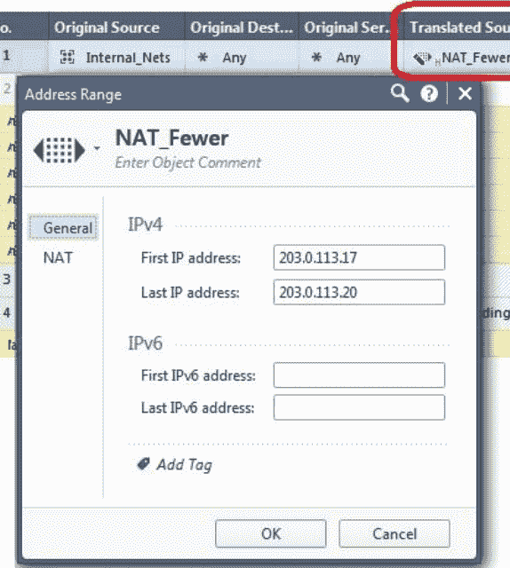

图 5-19：多对少隐藏 NAT 设置示例

# 杂项策略优化与可见性

本节涵盖了多个主题，可以提供更多关于防火墙如何处理连接的视图，并帮助防火墙更好地处理某些特别棘手的应用程序相关网络流量。

## 在连接超时时发送 TCP RST

某些应用程序（例如作为数据库服务器后端的 SQL 连接的 Web 服务器）会创建大量的 TCP 连接，但从不在其中发送任何可忽略量的数据。所有状态检测防火墙（包括 Check Point）都会对所有打开的连接执行空闲计时。Check Point 的 TCP 连接空闲计时器默认设置为 60 分钟。遗憾的是，当 Check Point 空闲计时器超时 TCP 连接时，默认情况下该连接会从防火墙的状态表中静默删除，不会向建立该 TCP 连接的两个系统发送任何通知。当其中一个系统尝试向现在已死的连接发送某些数据时，数据会被防火墙立即丢弃，并报错“TCP out of state（TCP 状态错误）”。遗憾的是，某些应用程序太笨了，无法快速意识到连接已断；它们继续尝试使用它，而其流量持续被丢弃。

在某个时刻，涉及的一个或两个终端系统最终会发现连接真正且不可恢复地死亡，然后启动一个新的 TCP 连接，该连接会立即被防火墙允许，一切又恢复正常。取决于双方需要多久才能发现发生了什么，应用程序可能会看起来挂起，用户对整体性能的感知将非常糟糕。无疑，防火墙将为应用程序的行为埋单，而防火墙管理员必须再次证明自己的清白。这个问题有三种解决方案：

1. 在参与频繁空闲的 TCP 连接的一个或两个系统中启用 TCP 保留包（keepalives）。保活包需要至少每 60 分钟发送一次。这并不是一个受欢迎的选择，因为它涉及更改应用程序系统来修复被认为是“防火墙问题的问题”。
2. 在服务对象的“高级”选项卡上，将服务对象（我们示例中的 SQL）的空闲超时时间从默认的 60 分钟增加到最大 86400 秒（24 小时）。这可能有所帮助，但并非万无一失。
3. 配置防火墙向空闲连接的两个参与方发送 RST 包。接收到 RST 后，两个参与方立即意识到连接已断，并立即启动新连接以恢复局面。要启用此“动态”功能，你需要查看以下内容：sk1946：如何强制安全网关在连接超时时发送 RST 包。
4. 然而，在某些情况下，此设置无法完全解决问题。需要此设置的一个经典示例是 SAP 流量。运行`nmap`扫描的审计员会看到它像圣诞树一样，成千上万个端口显示为已过滤（filtered）而不是已关闭（closed）。由于此原因，通常不建议在互联网边界使用此设置，但在某些内部防火墙上是可以接受的。请记住，此设置在重启后不会保留，因此要永久生效，你需要设置`cctl set int fw_expired 1`。

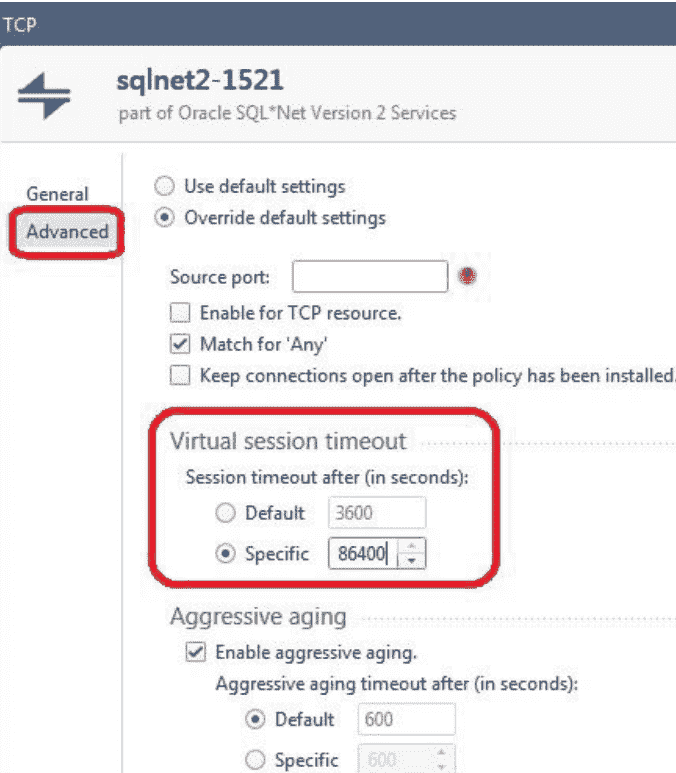

## 访问控制策略调优

## 连接超时的增强日志

如果你仍然遇到连接被空闲出防火墙状态表的问题（并且怀疑是防火墙这样做不当），你可以配置防火墙开始创建详细日志，指定连接何时因无活动而从状态表中移除，甚至指定它最初是否成功建立：

| 日志信息 | 规则 |
| --- | --- |
| 产品 | 安全网关/管理 | 接受 |
| 日期 | 2015年3月19日 | 13 |
| 时间 | 9:31:09 | 当前数字 13 |
| 编号 | 77947 | 规则名称 |
| 类型 | 日志 | 用户 |
| 起源 | 防火墙 | -- |
| 更多 | | |
| 流量 | 规则 UID | (90F3C90-A765-4005-B821-07CC5315FBCF) |
| 源 | 192.0.2.111 | NAT 编号 4 |
| 目的 | nyx2.nyx.net (54.68.197.142) | NAT 额外数字 1 |
| 服务 | ssh_version_2 (22) | Xlate 源 防火墙 (172.31.128.254) |
| 协议 | tcp | Xlate 端口 19260 |
| 接口 | eth1 | 网络 |
| 源端口 | 1758 | 产品族 |
| 策略 | | 服务 id:tcp 状态:ESTABLISHED |
| 策略名称 | 标准 | 过期时间：2015年3月19日 9:32:25 |

图 5-21：增强 TCP 状态日志示例

查看 sk101221：TCP 状态日志。在 R77.30 网关上动态启用此日志的命令是`fw ctl set int fwconn_tcp_state_logging x`。

## 访问控制策略调整

| 普通属性 | 日志转发设置 |
|---|---|
| 集群成员 | ☐ 将日志文件转发到日志服务器： |
| ClusterXL 和 VRRP | 日志转发计划： |
| 网络管理 | 日志文件 |
| NAT | ☐ 当当前文件大于 [ 1000 ] 时创建新日志文件 |
| HTTPS 检查 | ☐ 在计划时间创建新日志文件 |
| HTTP/HTTPS 代理 | |
| 平台门户 | 高级设置 |
| IPSec VPN | ☐ 当磁盘空间低于 [ 500 ] MBytes 时，停止记录。 |
| VPN 客户端 | 日志未保存时拒绝所有连接 |
| 日志 | 每 [ 3600 ] 秒更新一次账户日志 |
| 本地存储 | ☐ 开启 QoS 日志 |
| 额外日志 | |
| 策略 | 检测新的 Citrix ICA 应用名称 |
| 优化 | 包含 TCP 状态信息：从不 |
| 命中计数 | 从不 |
| 其他 | 连接非正常关闭时 连接正常关闭时 连接状态变化时 |

图 5-22：在 R80+ SmartConsole 中启用 TCP 状态日志

此功能对于排除间歇性挂起或超时导致应用程序性能下降的连接非常有帮助。如果您想以人类可读的格式获取防火墙连接表的实时更多信息（包括连接空闲计时器的当前值），请尝试`ctl conntab`命令：

```
[Expert@fw:0]# fw ctrl cntnab
<outbound, src=[172.31.128.251,40870], dest=[8.8.8.8,53], UDP);
18/40 rule=0, service=domain-udp(333), Ifnsin=2, Ifnsout=2, conn
modules=RTM2>
```

```
<inbound, src=[192.0.2.222,12247], dest=[146.0.132.177,80], TCP);
3587/3600 rule=7, tcp state=TCP ESTABLISHED, service=http(366),
Ifnsin=1, Ifnsout=2, conn modules: NAT, RTM2, SecVerifier>
```

```
<inbound, src=[192.0.2.222,10959], dest=[23.35.204.171,80], TCP);
3554/3600 rule=7, tcp state=TCP ESTABLISHED, service=http(366),
Ifnsin=1, Ifnsout=2, conn modules: NAT, RTM2, SecVerifier>
```

```
<inbound, src=[192.0.2.222,11622], dest=[72.125.124.113,80], TCP);
3559/3600 rule=7, tcp state=TCP ESTABLISHED, service=http(366),
Ifnsin=1, Ifnsout=2, conn modules: NAT, RTM2, SecVerifier>
```

```
<inbound, src=[192.0.2.222,14744], dest=[172.217.1.70,443], TCP);
3572/3600 rule=7, tcp state=TCP ESTABLISHED, service=https(368),
Ifnsin=1, Ifnsout=2, conn modules: NAT, RTM2, SecVerifier>
```

图 5-23：使用`fw ctrl cntnab`查看连接空闲计时器

## 计费 (Accounting)

TCP 状态日志功能的替代方案是在匹配问题流量的跟踪（Track）列中使用“账户（Account）”选项。当为规则设置此选项时，连接开始时会创建一个接受（Accept）条目，因为此时跟踪列被设置为日志（Log）。但是一旦连接结束（FIN、RST、空闲超时等），或者如果连接持续了 60 分钟，现有的日志条目将从“日志”类型转换为“账户”类型。还会添加额外信息，如防火墙路由出口接口、连接时间以及发送和接收的字节数：

| 类型 | 用户 -- |
|---|---|
| 起源 | gw-3009f |
| 流量 | 更多 |
| 源 | 规则 UID-CD1F4D9-6FDA- |
| 192.0.2.222 | NAT 号 0 |
| 205.207.162 | NAT 额外规则 0 |
| 服务 | http (80) | Xlate Src gw-3009f120 |
| 协议 | tcp | Xlate Dst 47986 |
| 接口 eth0 | 耗时 0:00:00 |
| 源端口 1924 | 流量 1902 |
| 策略 | 数据包 10 |
| 策略名称 Standard | 开始时间 2016年11月30日 9:00:42 |
| 策略日期 11月30日08:59:23 | 客户端入站接口 eth0 |
| 策略管理 gw-3009f | 服务器出口接口 eth1 |
| | 客户端入站字节 742 |
| | 客户端出站字节 1160 |
| | 服务器出站字节 742 |
| | 服务器入站字节 1160 |

图 5-24：由计费选项提供的统计信息


虽然账户选项可以用于推断连接和会话行为，但管理功能被称为“会话日志（Session Logging）”。启用后，该功能将单个连接关联到单一的“会话”，并提供额外的日志。有关此功能的更多信息，请参阅 Check Point 的以下线程“Cool Feature of the Day - Session logging”：https://community.checkpoint.com/thread/5164

## 策略测试：数据包模式搜索与注入器

你花费了大量时间优化策略，这时一个用户打电话来问你一个看似无关紧要的问题：“如果我尝试从系统 `129.82.102.32` 访问系统 `2.3.2` 且使用 FTP 服务，防火墙会允许吗？”你的策略中有成千上条规则，你如何找到是否存在匹配此类流量的规则呢？用户可以直接尝试，但假设他们现在还不能这样做，因为这些新系统的上线时间是周日凌晨 3:00，所以用户会在届时发现不通后再打电话。或者，他们现在就打电话，说它不通。

数据包模式搜索（Packet Mode Searches）可以告诉你你（包包的，，。。。。。。，，          ，，，，， ，，。。。。。。。。在在在在 ` ` ` ip   命令：

```
[Expert@fw:0]# ip route get 129.82.102.32
129.82.102.32 via 172.31.128.1 dev eth1 src172231.118.251 cache1110.111111112..1.122.22
 cachems 1500 hoplimit 64
[Expert@fw:0]#
```

图 5-25：使用 `ip route get` 查询  表

测试策略的第二种技术是使用数据包注入工具 `pinj` 来构造你想测试的精确流量，然后将其注入防火墙并观察发生了什么。成功注入后，数据包将像任何到达防火墙的数据包一样处理，并根据策略进行评估，创建日志记录，如果允许，将通过所有防火墙处理点（iO）。当你无法访问系统但仍想查看防火墙是否处理某些流量时，这非常有用。

你可以在此处阅读更多关于 `pinj` 工具的信息：sk11065：Check Point 数据包注入器。遗憾的是，发布时 `pinj` 工具仅支持 R77.3.2，在 R80.10 中完全不起作用。

如果没有 `pinj`，另一个可用工具是 `tcptroute`；例如我们可能这样调用它：

```
[Expert@fw:0]# tcptroute -4 -T -p 21 2.3.2
traceroute to 2.3.2 (2.3.2), 最大 30 跳, 40 字节数据包
1 172.31.128.1 (172.31.128.1) 1.329 ms 1.453 ms 1.286 ms
2 172.31.128.1 (172.31.128.1) 2.017 ms 0.989 ms 1.556 ms
3 96.120.12.57 (96.120.12.57) 22.844 ms 24.485 ms 21.832
4 ae-27-ar01.denver.denver.com.net (68.86.128.55) 24
```

图 5-26：`tcptroute` 示例用法

## 访问控制策略调优：关键点

- 正确定义防火墙的接口拓扑对于正确应用“Internet”网络对象以及任何使用的安全区域（Security Zone）对象至关重要。
- 地策略（Geo Policy）是一个被严重低估的功能，根据源或目的地理国家，以极小的处理开销丢弃大量的不良流量。
- 在 R80+ 管理下使用策略层时，“清理”（cleanup）规则并不一定会丢弃流量。
- 从性能调优的角度来看，在 R80+ 管理下的安全策略中使用有序（Ordered）或统一/内联（Unified/Inline）层的差异微乎其微。
- 尽可能在策略层的许多列中避免使用“Any”对象，特别是目的（Destination）列，以帮助最大化基于列匹配（Column-based Matching）和早期丢弃（Early Drop）带来的性能提升。
- 在 APCL/URLF 策略中使用“Internet”对象，并尽量避免使用“Any”。
- 可以配置“多对少”手动隐藏地址转换（Hide NAT），以便在单条 Hide NAT 规则中允许超过 50,000 个并发连接。
- 被防火墙超时出的应用程序连接可以选择性接收来自防火墙的 TCP RST 通知。
- 可用对从防火墙状态表中空闲退出的 TCP 连接进行增强日志记录。
- 在规则的跟踪（Track）列中指定“计数”（Accounting）可以提供有关匹配连接的额外统计信息，并可用于推断连接中发送了多少数据（如果有）以及连接是如何路由的。

# 第 6 章：ClusterXL HA 性能调优

成功不是终点，失败不是致命：坚持下去的勇气才是最重要的。

- 温斯顿·丘尔（Winston Churchill）

## 背景

在当今日益云化的世界中，防火墙故障会导致无法接受的停机并产生深远的影响。ClusterXL 允许在集群中部署多个防火墙，确保如果某一台防火墙由于任何原因发生故障，另一台可以立即接管并继续通过流量。

在防火墙实现中使用高可用（HA）为确保最佳性能带来了一系列新挑战。监控和维护集群状态需要额外的开销，还需要在集群成员之间同步状态表，以确保无缝故障转移。此外，R77.30 及更高版本默认启用了较新的集群负载（CUL）机制，如果你不了解它，可能会对集群故障转移行为产生一些意想不到的影响。然而，在深入优化细节之前，让我们先处理这个显而易见的问题：主/备（HA）与主/主（负载共享）。

## ClusterXL HA 性能调优

### 防火墙集群：高可用 vs. 负载共享

今天部署的大多数 Check Point 防火墙集群使用 ClusterXL 高可用性，这是一种主/备模型。单台主防火墙处理 100% 的流量负载，而备用成员（或成员）处理 0% 的负载，仅接收来自主成员的状态同步更新。提高防火墙整体性能的种常见建议是采用主/主模型，Check Point 将其称为“负载共享”（Load Sharing），所示：

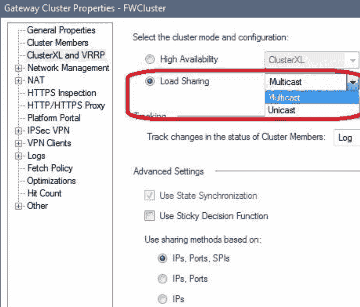

图 6-1：防火墙集群负载共享选项

## 背景

迁移到负载共享模型可以提高防火墙的整体性能吗？可以。这值得增加额外的复杂性和排障的模糊性吗？对于现实世界中的大多数站点来说，答案是肯定的否。你可能会问：“等等，两个头总比一个好吧？”你的经理可能还会问：“为什么我们昂贵的备用防火墙就坐在那里无所事事？”

为了回答这些问题，让我们检查支持的 ClusterXL 负载共享模式：

- 1. 负载共享组播（Load Sharing Multicast）——这种主/主集群模式利用组播地址将流量分发到防火墙集群的所有成员。虽然它是最高效的负载共享方法，并能显著提升集群性能和吞吐量，但它依赖于组播 MAC 地址，而相邻集群的交换机和路由器几乎无法正确处理这些地址。为了让这种负载共享技术正常工作，可能需要对相邻防火墙集群的所有交换机和路由器对 IP 和 MAC 地址进行大量的硬编码。这大大增加了配置复杂性，因为需要对周围网络进行重大更改，而这对任何防火墙管理员或第三方可能都不是显而易见的。这些硬编码更改几乎会在最恼、最不方便的时刻给你带来麻烦。此外，在使用这种 ClusterXL 负载共享模式时，某些功能（如 Mobile Access 模块）为了正常工作，必须频繁启用“粘性决策函数”（SDF）。启用 SDF 将杀死防火墙上几乎所有的 SecureXL 加速，导致性能下降。

- 2. 负载共享单播（Load Sharing Unicast）——这种主/主技术避免了使用组播 MAC 地址带来的硬编码配置困境，但集群成员之间的流量分发方法效率低得多。单播流量分发方法在存在 3 个或更多集群成员时，你的网络交换机必须携带的流量甚至会翻倍！在负载共享单播设置中，其中一个集群成员被选为“枢纽”（Pivot），它将始终初始接收所有指向集群接口的流量。在 2 成员的负载共享单播集群中，默认情况下枢纽会将 70% 的入站流量重定向到另一个集群成员进行处理，然后自己处理 30% 的网络负载。在 3 成员的负载共享单播集群中，枢纽检查 20% 的网络负载，其余部分则将 80% 重定向到其他集群成员。在这种情况下，被选为枢纽的防火墙只不过是一个增加了交换端口利用率的华化负载均衡器。

基于上一节的整体基调，你可能已经怀疑我不喜欢负载共享。你的你是正确的。这并不是针对 Check Point 负载共享实现的特定意见；我不喜欢所有防火墙厂商的主/主实现。通常来说，我认为负载共享带来的复杂性并不值得。从设计角度来看，如果你坚持要使用负载共享配置，你至少需要 3 台防火墙。如果只有 2 台防火墙使用负载共享，且其中一台故障，剩余的防火墙可能无法独立处理 100% 的负载，会出现明显的性能下降。因此，为了应对这种可能的情况，你需要一台更大的防火墙。但如果你已经有一台更大的防火墙，为什么不直接使用主/备 HA 从而避免负载共享的麻烦呢？负载共享不应该仅仅为了让性能不足的防火墙达到接受水平。

## VRRP 如何？

虽然本章关注目前新部署中最常用的集群技术 ClusterXL，但另一种可用方案：路由器冗余协议（VRRP）。这种流行的集群协议最初出现在基于 IPSO 的 IP 系列设备（以前称为 Nokia 设备）上，Gaia 操作系统也支持 VRRP。

遗憾，与 ClusterXL 相比，VRRP 有几个缺点，尽管 VRRP 仍然有其忠实粉丝：

- 集群 IP 地址必须在 SmartConsole 和 Gaia Web 界面中分别设置，并手动保持同步。
- 由于 VRRP 实现中的配置错误，集群脑裂（两个 HA 成员错误地同时处于主 状态）和路由“黑洞”的可能性更大。
- 从 Check Point GUI 工具（如 SmartConsole 和 SmartView Monitor）监控 VRRP 集群状态的能力有限；必须从防火墙 CLI 或 Gaia Web 界面进行 VRRP 状态监控。

# 176 ClusterXL HA 性能优化

ClusterXL 和 VRRP 在主/备切换能力方面大多提供相同的功能，但 ClusterXL 在日常操作中的管理要简单得多，且从配置角度来看更不容易出错。然而，VRRP 具有两个 ClusterXL 不具备的额外功能，即：

- VRRP 可以在同一个物理接口或逻辑子接口上显示多个 IP 地址（有时称为次要地址），而 ClusterXL 只能显示一个。不过这是一种相对罕见的需求，因为通常意味着同一个 VLAN/网络分段上有多个 IP 子网，而这通常表明网络设计不合理。
- VRRP 允许外部实体（如负载均衡设备或动态路由协议）在集群成员之间平衡流量负载；而 ClusterXL 仅能在负载共享模式下使用其自身的负载共享算法。

如果您的环境不适用于上述两种 VRRP 用例，强烈建议使用 ClusterXL。在本章的剩余部分，我们将关注 ClusterXL，因为在大多数防火墙部署中，ClusterXL 的使用频率比 VRRP 高得多。

## 如何正确执行管理级切换

有时我们希望触发一种不需要拔掉网络电缆或引起其他物理故障的管理级切换。执行此操作有两种方法：正确的方法和错误的方法：

## 如何正确执行管理级切换 177

```
Expert@fw:0]# cphaprob state
```

| 集群模式: | 高可用性 (Active Up) 带有： |
| :--- | :--- |
| 数量 | 唯一地址 | 分配负载 | 状态 |
| :--- | :--- | :--- | :--- |
| 1 (local) | 192.168.10.2 | 100% | Active |
| 2 | 192.168.10.3 | 0% | Standby |

本地成员自 Fri Oct 20 01 起起处于当前状态

```
Expert@fw:0]# clusterXL_admin
Setting member to administratively down state ...
Member current state is Down
Expert@fw:0]# 
```

图 6-2：使用 `clusterXL_admin` 启动切换

这将安装一个名为“admin_down”的处于故障状态的新设备，导致立即切换到没有此类故障的备用成员。执行命令 `clusterXL_admin up` 将恢复正常运行，并根据防火墙的 ClusterXL 恢复设置，可能会导致切换回该成员。

- 2. 错误的方法：从 SmartView Monitor GUI 中，右键点击防火墙并选择“Cluster Member...Stop Member”。选择“Cluster Member...Start Member”来恢复集群成员的正常运行：

# 178 ClusterXL HA 性能优化

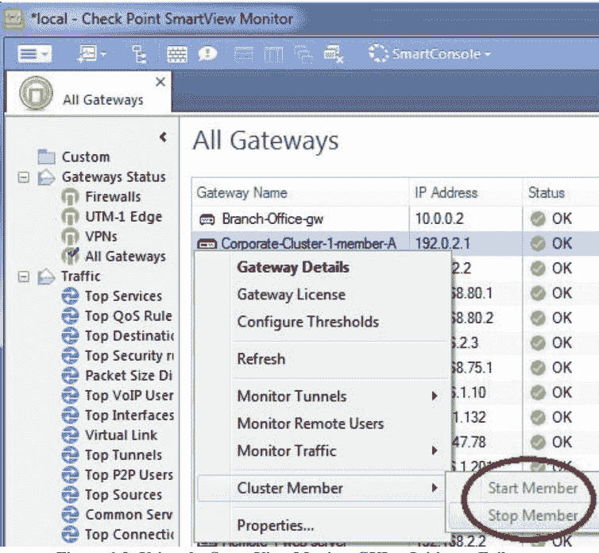

为什么在我看来，使用 `clusterXL_admin` 命令来诱发管理级切换被认为是“正确”的？两者都会导致预期的切换发生，但如果你不小心从 SmartView Monitor 停止了所有集群成员，将导致业务中断。如果你不小心在所有集群成员上运行 `clusterXL_admin down`，它们最终处于“相等”的故障状态（admin_down），流量将继续通过集群流动而不会发生事故。

图 6-3：使用 SmartView Monitor GUI 启动切换

Copyright © 2018 Shadow Peak Inc. All Rights Reserved

## 发现：防火墙集群特定性能问题 179

默认情况下，运行 `clusterXL_admin down` 命令产生的影响不会在重启后持续；一旦成员重启，处于故障的“admin_down”设备将不再存在，集群成员将恢复正常运行。在某些情况下（例如防火墙升级），希望此“admin_down”设备在集群成员重启后依然存在。这可以通过一个不为人知的 `-p` 选项来实现，如下所示：`clusterXL_admin down -p`。现在，集群成员将不会尝试跨越重启（除非它被检测为集群中唯一的运行成员），直到发布了 `clusterXL_admin up -p` 命令。在这种情况下，发布“up”命令时不要忘记使用 `-p` 选项，否则“admin_down”设备将在重启后再次来困扰你！

虽然本节内容可能没有直接涉及防火墙的性能优化，但不当使用 SmartView Monitor 诱发 ClusterXL 切换很容易导致最糟糕的性能状况：业务中断。

## 发现：防火墙集群特定性能问题

问题：从 ClusterXL 的角度来看，集群成员是否健康且运行正常？

答案：从集群的所有成员运行 `cphaprob stat`。所有防火墙报告的正确状态应该是“active”或“standby”。如果你看到任何其他状态报告为“ready”或“down”，说明集群设置不正确或正经历一个在继续之前应纠正的问题。虽然进一步讨论“down”和“ready”状态以及如何纠正它们超出了本书的范围，但以下 SK 有帮助：sk42096：集群成员卡在‘Ready’ 状态和 sk66527：ClusterXL 推荐配置。

## ClusterXL HA 性能优化

## 魔术 MAC/全局集群 ID

然而，在配置错误的集群中，你可能会看到一种值得提及的情况，因为它可能非常令人困。当在所有集群成员上运行 `cphaprob stat` 命令时，两个集群成员都报告它们是唯一存在的成员（即集群成员无法“看到”对方），并且它们都报告自己是“active”在在设置新的 ClusterXL 集群时，到底是如何发生这种“脑裂”状况的？

这个问题与所谓的“魔术地址”（是的，那是它的原始名字！）有关，但现在被称为“集群全局 ID”（Cluster Global ID）。在 R77.30 防火墙上，这是在 Gaia Web 界面的首次向导中的 Cluster ID 字段中设置的：

## 发现：防火墙集群特定性能问题 181

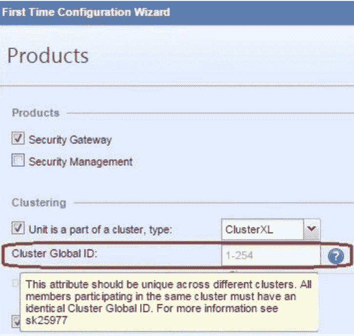

图 6-4：在 R77.30 中设置全局 ID

命令 `cpahconf cluster_id set (Cluster ID Value)` 也可设置此值。对于 R77.30 防火墙，集群全局 ID 应该在同一集群的所有成员上手动设置为相同的值，但对于不同的集群应是一个唯一的值。在两个 R77.30 成员上未配置匹配的全局集群 ID 将导致上述的脑裂状况。在 R77.30 及早版本的防火墙上，可以使用 `cpahconf cluster_id get` 命令在每个集群成员上检查全局 ID。

maxpowerfirewalls.com

Copyright © 2018 Shadow Peak Inc. All Rights Reserved

## ClusterXL HA 性能优化

不过，对于 R80.10+ 网关，这种情况有一个好消息：匹配的全局 ID 现在通过一个名为“自动魔术地址”的过程为所有集群成员自动计算。此新功能还设计用于防止与同一网络上的现有防火墙发生冲突。可以在 R80.10+ 网关上使用 `cphrob magic` 命令验证實此功能的状态（包括自动计算的全局 ID 值）。它也可以在 R80.10 网关的 `cpview` 工具新的基于 ClusterXL 的屏幕中检查（Advanced...ClusterXL）。此新的“自动魔术地址”功能也兼容早期版本中手动设置了全局集群 ID 的 R77.30 网关。

另一种有时会导致两个成员不当变为激活的情况是在一个成员上启用了 SecureXL 而另一个成员上禁用，sk121753：两个 ClusterXL 高可用成员均为 Active。

## 同步网络健康

问题：我的防火墙集群在 sy/si 空间消耗了大量的 CPU（通过 `top` 命令显示），整体性能运行缓慢。我的状态同步网络是否健康？

答案：集群防火墙状态同步代码之间的同步网络被认为是快速且相对无误差的。同步网络丢包超过 2-3%，或延迟超过 100ms（即使是瞬时的），可能会导致集群性能和稳定性问题。运行命令 `fw cstat` 并检查标记为 Sync 的最后部分：

# 发现：防火墙集群特定性能问题 183

同步：


版本：new

状态：能够发送/接收同步数据包

已发送的同步数据包：

总计：3345939，重传：1996

重传请求：8，确认 (acks)：4

已接收的同步数据包：

总计：0，已在队列中：0，被网络丢弃：8811

重传请求：8649，接收到 329 个确认 (acks)

非法序列号的重传请求：0

由于同步重叠导致的丢包更新：8610

图 6-5：集群同步网络统计数据

查看数据包的总数，以及那些重传或被网络丢弃的数据包。如果比例超过 1%，你可能需要采用选择性同步（在本章末尾将讨论）或添加另一个物理接口来帮助分载大量的状态同步流量。如果该区域发生问题，你可能还会看到 syslog 消息，如下本 SK 中提到的：`sk23695:'FW-1: State synchronization is in risk. Please examine your synchronization network to avoid further problems!'` 出现在 `/var/log/messages` 文件中。

另一个可以提供更多关于由同步触发的同步网络健康的详细信息的命令是`cphaprob syncstat`。通过此命令显示的同步统计数据也可以运行`cphaprob -syncstat`进行实时重置。

如果你添加了第二个同步网络，请将其与另一个物理接口绑定（bond）到 Gaia 界面（或 clish），并在集群对象拓扑设置中将新的绑定接口声明为“1st Sync”。**不要**简单地添加一个新的非绑定接口并在集群拓扑中将其声明为“2nd sync”，因为这种设置将严重降低集群性能。同时检查物理同步接口的`netstat -ni`统计数据，确保 RX-ERR 和 RX-OVR 值为零。

欲了解更多信息，请咨询 `sk34476`：ClusterXL同步统计数据 - 'fw ctl pstat' 命令的输出以及 `sk34475`：ClusterXL同步统计数据 - 'chapaprob syncstat' 命令的输出。

## CCP：多播 vs. 广播

问题：在 SmartView Tracker/SmartLog 中检查控制事件，或在 R80+ SmartConsole 的 Logs & Monitor 标签页上使用过滤器“type:Control”时，我看到集群中的接口不断上下波动（flapping），并伴有偶发的伪故障转移（failovers）和性能下降。这是什么问题？

回答：使用`ifconfig`命令检查报告发生波动的接口是否有非零载波（carrier）值，以确保网卡硬件本身没有因为网线松动或其他物理问题导致链路状态变化。

如果发现接口稳定且没有丢失完整性，那么连接到防火墙的交换机可能无法可靠地转发集群成员的集群控制协议（CCP）流量，由于其多播特性。结果是防火墙偶尔丢失彼此联系，并将它们之间的接口声明为“down”，尽管物理接口本身是 up 状态，且两个集群成员之间在“down”接口上的通用网络连接实际上是正常的。交换机可能需要配置 IGMP snooping 以可靠地处理多播流量。此外，某些交换机（如 Cisco Nexus 7000）会丢弃使用多播 MAC 地址的多播流量，但不使用“传统的”类 D 多播 IP 地址（`224.0.0.239.255.255.255`），这是 ClusterXL 的默认行为。查看以下 SK 以更改此行为：`sk115142`：当 CCP 在多播模式下工作时，交换机丢弃 Check Point CCP 包。

作为最后手段，可以在两个集群成员上执行命令`cphaconf set_ccp broadcast`，以将 CCP 流量宣告从多播永久更改为广播。注意，将 CCP 设置为广播将大幅增加所有集群防火墙接口上的交换机泛洪广播流量，除非绝对必要，否则应避免。欲了解更多信息，请参 `sk20576`：如何在 ClusterXL 中以广播/多播模式设置 ClusterXL 控制协议 (CCP)。

## 其他 ClusterXL 问题

**问题：** 我有一个 HA 防火墙集群，在同一个物理接口上使用了 802.1q 链路（trunked）接口并混合了带标记（tagged）和未标记（untagged）的流量，网络性能非常糟糕。为什么？

回答：不要这样做，因为 ClusterXL 不支持。如果你有一个处理 VLAN 标记流量的接口，则进入该接口的所有流量都应该是带标记的。接口不应有任何未标记（有时称为 native）的流量到达。参见 `sk101428`：使用原生/未标记 VLAN 的单播负载均衡 ClusterXL 性能低下的。

**问题：** 我的集群似乎并不稳定，并且会由于各种不同的原因随机发生故障转移，这影响了性能（并让利益相关者感到紧张）。

回答：在尝试排查间歇性或意外的 ClusterXL 故障转移时，确定故障转移发生的确切时间以及它们是否发生在任何可疑的可预测的时间间隔内可能非常耗时。从 R80.10 开始，`cphaprob stat`命令的输出现在显示了成员在当前集群状态中持续了多久（即自上一次状态更改或故障转移以来多久）。

在某些情况下，设置每当集群发生故障转移时发送实时通知，可以提醒你立即进行排查。在此处的集群对象本身上可以轻松设置：

 图 6-6：集群状态跟踪

一个未记录的命令选项（自 R77.30）提供了一种查看过去故障转移发生的简便方法：`show cluster-state detailed`

```
cluster: clustered
Master/Slave: Master
Sync IP: 192.168.212.73
Cluster Sync: Synchronized
Last Sent: INIT_STATE_FIN
Last Received: MASTER_INIT_STATE_REQ
```

```
cluster_VIPS
(long list of VIPs deleted)
```

```
Cluster Members: 2
```

```
Member ID Address
2 192.168.252.71
```

```
Cluster change History
Timestamp State Type
Jun 5 14:44 slave to Master
Jun 5 14:44 Master to

Jun 5 13:3 to Master
 Master 5 5 :232 to Slave
Jun 5 12:56 slave to Master
Jun 5 12:56 Master to Slave
```

> 6-7：通过 `show cluster-state detailed` 查看故障转移时间

一旦确定了意外故障转移的时间，会有大量关于集群稳定性问题的 SK 文章供参考。处理所有可能的情况已超出了本书的范围。以下两个 SK 在这方面非常有帮助：`sk56202`：如何在 ClusterXL 中排查故障转移以及 `sk62570`：如何在 ClusterXL 中排查故障转移 - 高级指南。

问题：我们遭受了上游网络故障，故障并未发生在防火墙直接相邻的网络/VLAN 上。并没有转移到上游的备用成员，因为 ClusterXL 无法检测到这种间接的上游故障。我们可以配置 ClusterXL 监控某些上游 IP 地址，并在无法访问它们时引发故障转移吗？

回答：可以！参见 `sk35780`：如何在 Gaia / SecurePlatform OS 上自动运行 `$FWDIR/bin/clusterXL_monitor_ips` 脚本。

问题：我已经遵循了书中的所有建议，但我的 ClusterXL 防火墙集群性能仍然无法接受！我怀疑我的 ClusterXL 设置出现某些问题，或者可能是集群与周围网络交互的方式有问题。有任何方法可以证明或否定 ClusterXL 本身是问题的根源吗？

回答：当然！在维护期间，优雅地关闭集群备用成员。这样做创建了一个“单成员集群”，并为存活防火墙减轻了大量的性能节省任务（如同步）。如果性能在此期间有了显著提高，则强烈表明你的 ClusterXL 设置中某些元素存在问题，或者集群成员连接到网络并同时与网络交互的方式可能是罪祸首。如果性能仍然无法接受，则是防火墙配置中除 ClusterXL 以外的元素或周围网络的问题导致了性能问题。

## 故障排除“缓慢”的故障转移

**问题：** 每当发生故障转移（failover）时，所有尝试通过防火墙集群的网络流量都会突然停顿约 15 秒，然后才恢复。当我们在短时间内经历多次故障转移时，这会严重损害我们的网络性能。到底发生了什么？

回答：有几种情况可能导致这些“缓慢”的故障转移：

1. ClusterXL 的默认“死亡”计时器（dead timer）大约为 3 秒。如果活动成员发生灾难性故障（例如电源线被拔掉或 Gaia 系统崩溃/内核恐慌），备用成员必须等待死亡间隔（dead interval）才能断定活动成员已故障并接管。在等待期间，将没有流量通过集群。然而，对于使用`clusterXL_admin`的管理级故障转移或其他部分故障（例如单个网络接口被拔掉，或运行影响服务的命令如`fw unloadlocal`），到备用成员的故障转移应该几乎是瞬间发生的，且数据包丢失极少。

2. 如果活动集群成员的 CPU 利用率达到 80% 或更高，在 R77.30 网关中默认会触发集群负载下集群（CUL）机制，*这会将 ClusterXL 死亡计时器从 3 秒扩展到 12 秒*。CUL 的目的是避免由于活动集群成员瞬时高 CPU 负载导致的虚假和必要的故障转移。不用说，如果在 CUL 激活期间活动成员发生灾难性故障，备用成员将等待四倍的时间才能接管。要确定 CUL 机制当前（或之前）是否激活，请运行`grep cul_load_freeze /var/log/messages*`，因为 CUL 会将其操作的所有信息记录网关的 syslog。确保按照书中概述对您的集群成员进行适当调优和优化，可以使活动集群成员的 CPU 利用率保持在 80% 以下并避免触发 CUL。有关 CUL 机制的更多信息请参阅：`sk92723`: Cluster flapping prevention。

3. 在某些情况下，防火墙集群相邻交换机上的生成树协议（STP）算法在发生故障转移时可能会错误地感知到环路。正如第 2 章提到的，默认情况下，交换机上的 STP 算法将阻塞所有指向问题端口的转发约 10-15 秒，以尝试打破环路。在某些 Cisco 交换机上，在此阻塞期间，交换端口的 LED 将显示闪烁而不是通常的绿色。如果在集群对象属性中设置了“使用虚拟 MAC（Use Virtual MAC）”选项（默认是禁用的），这种情况越可能发生。在所有连接到防火墙集群的交换机端口上设置“portfast”模式将有助于避免这种情况并确保及时故障转移。

4. 如果防火墙集群成员本身参与了动态路由协议（如 OSPF 或 BGP，而不仅仅是使用静态路由），那么缓慢的故障转移可能表明网络中存在路由表收敛问题。特别是，应该在两个集群成员上都启用 Gaia 的“等待集群同步（Wait for Clustering）”选项，以确保防火墙集群成员上的任何动态路由协议在开始操作前等待集群完全稳定。“Wait for Cluster”设置从 R77.30 开始默认启用，但如果您的防火墙是从较早版本升级的，则可能未启用。请参阅下文以获取有关“Wait for Cluster”设置的更多信息：`sk92322`: Neighbourhood for OSPF, BGP, RIP, and PIM in Gaia Cluster is formed with Physical IP addresses upon a reboot。

虽然上述列表并非详尽，但它们是我在现实世界遇到的“缓慢”故障转移的最常见原因。

为了帮助尽可能减少故障转移的发生次数，特别是在经历“缓慢”故障转移时（无论实际原因是什么），强烈建议采取最佳实践是将“集群成员恢复时（Upon cluster member recovery）”设置设置为“保持当前活动集群成员（Maintain current active Cluster Member）”，如下：

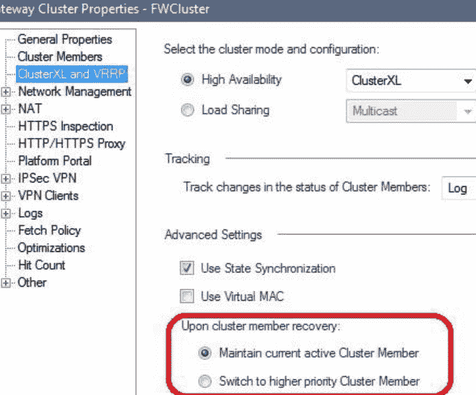

图 6-8：集群成员恢复设置

## 服务选择性同步

默认情况下，防火墙集群的成员将同步它们之间所有连接的状态。如果同步流量过大，导致防火墙 CPU 无法负担，处理时间就会浪费在重传和处理丢失的同步更新上。在大多数网络中，有两种协议占了至少 50% 的状态同步网络流量：HTTP 和 DNS。要确定您的网络是否存在这种情况，请在防火墙处于最繁忙的期间，从 SmartView（或 cpview）执行实时“顶级服务”报告。HTTP 和 DNS 协议是否占了大量的新连接？可以禁用集群成员之间 HTTP 和 DNS 的同步，这将大幅减少同步流量，并几乎肯定能让同步网络恢复健康，尽管带有一个后果：如果发生故障转移，接管的防火墙将无法识别任何活动 HTTP 或 DNS 连接，因此会被视为“状态外（out of state）”并随后被丢弃。

在大多数情况下，这不是问题，因为如果 HTTP 连接或下载挂起，当用户点击刷新按钮时，新防火墙已完全运行，网页渲染或文件下载将从中断的地方继续。DNS 使用用户数据报协议（UDP）作为传输协议。反正 UDP 本身不提供可靠性，DNS 只会重新发送查询，此时另一台防火墙已经接管，重传的 DNS 查询将成功。

然而，我们可以以一种非常用的方式将“选择性同步”更进一步。假设我们的网络中有两种类型的 HTTP 流量：

- 摸鱼者（Slackers）：由内部摸鱼群体发起的指向的 HTTP 连接，他们只是在 Facebook 上混日子，没有为公司赚钱

- 赚钱者（Money-making）：付费客户从互联网发起的指向 Web 服务器的 HTTP 连接，他们想在季度最后一天为我们付款并确保我们的高管拿到奖金

不用说，出于职业考虑，我们可能希望在故障转移期间保留这些 HTTP 连接（让客户在花钱的过程中额外执行点击刷新之类的操作不是好主意），但我们并不关心故障转移场景下的离站“摸鱼”HTTP 连接。坦率地说，我们可以按单个服务指定同步。因此，在示例中，我们创建了两个名为“http_customer”和“http_slackers”的服务对象，并在“常规”屏幕上将它们都设置为端口 80。虽然两个服务都设置为匹配 80，但在 http_customer 服务的高级屏幕上，我们确保“集群同步连接（Synchronize connection on cluster）”保持勾选，而在 http_slackers 服务上，相同的选项取消勾选，所示：

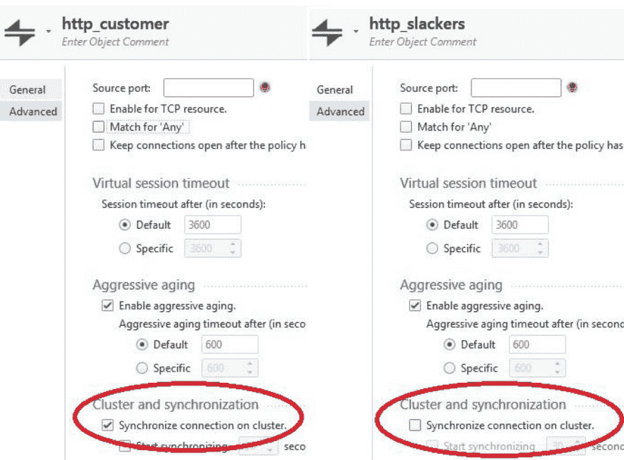

图 6-9：选择性同步服务设置

同时，如所示，确保两个服务上的“匹配‘任意’”复选框都已清除。在我们的规则库中，我们利用这些新定义创建两个独立的规则：

## 访问控制

| 编号. | 源 | 目的地 | 动作 | 跟踪 |
|---|---|---|---|---|
| 1 | *Any | Ecommerce | http_customer |  | 日志 |
| 2 | internal_net | *Any | http_slackers |  | 日志 |

图 6-10：选择性同步策略规则

现在，关键客户 HTTP 连接将在故障转移时存活，而非关键连接（“懒惰”连接）则不会，同时这将显著减少我们同步网络的负载，并提高防火墙的整体性能。

在之前的示例中，你可能注意到在检查 HTTP 和 DNS 服务的高级属性时有一个“开始同步”的选项。请勿对“延迟同步”（Delayed Synchronization）使用此设置，因为该功能的正常工作有许多限制（而且你很可能无法妥善满足所有这些错综的要求），如下：

- 仅适用于“协议类型”（Protocol Type）设置为“HTTP”或“无”（None）的 TCP 服务。

- 如果规则中的“跟踪”（Track）选项设置为“日志”（Log）或“计数”（Account），则禁用延迟同步。

- 仅对匹配 SecureXL 容纳模板的连接执行延迟同步。

除非你采取了特殊措施来确保所有这些条件都成立（某些条件将在后面的章节讨论），否则延迟同步将无法以你预期的方式工作，你的集群同步接口将像往常一样不健康。

## ClusterXL HA 性能调优：关键点

- 在大多数情况下，建议使用高可用性（主/备）而非负载均衡（主/主）。

- 使用`clusterXL_admin`命令执行管理级故障转移；不要使用 SmartView GUI 上的“启动/停止集群成员”功能。

- 遵循 Check Point 防火墙集群优化的最佳实践。确保同步网络健康，并注意连接到同一 VLAN 的多个防火墙集群之间的“魔术 MAC”冲突。

- 某些交换机可能无法正确处理多播 CCP 数据包流，这会导致集群中出现伪故障转移。CCP 可能需要设置为广播模式以确保可靠的集群行为。

- “缓慢”的 ClusterXL 故障转移（看起来花费很长时间并导致短暂中断）可能是由多种因素引起的，例如 STP/portfast、负载下集群（CUL）机制以及未汇的防火墙路由表。

- 如果集群成员之间的同步网络过载，可以在集群成员之间对 HTTP 和 DNS 等协议进行选择性同步。

# 第 7 章

## COREXL 调优

任何人都可以构建快速的 CPU。秘诀在于构建一个快速的系统。

- Seymour Cray

## 背景

现在我们已经确保了底层网络能够清洁地交付数据包供防火墙进行检查，并学习了一些 Check Point 调优的基础知识，我们终于准备好着可能占据我们大部分工作的内容：CoreXL 调优，以及后续章节中的 SecureXL。CoreXL 是 Check Point 防火墙利用多个 CPU 核心处理能力的方式。系统上的每个可用核心理想情况下仅专门用于以下两个功能之一：


# 安全网络分发器与 CoreXL 调优

## 核心组件概述

1. 安全网络分发器（SND）和 IRQ（中断请求）处理（这包括第 9 章讨论的“加速路径”）。该功能在 Check Point 的文档中有时称为“分发器”。

2. 防火墙工作单元 INSPECT 处理（包括第 9 章讨论的介质路径 (PXL)、防火墙路径 (F2F) 和 QXL 路径）。当运行 `top` 命令时，你将在输出中看到大量的 `fw_worker_X` 进程，它们代表防火墙工作核心。

## CoreXL 调优

此图显示了两种类型的核心分配以及它们如何融入更宏大的方案中：

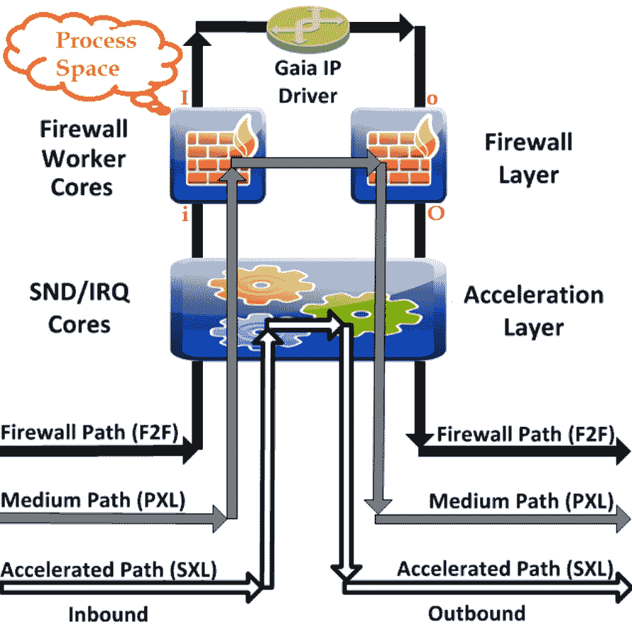

图 7-1：防火墙流量处理路径

## 背景

我们的主要性能目标是：启用 CoreXL 并为 SND/IRQ 处理分配足够数量的核心，同时具有自动接口亲和力，以确保所有接口的 RX-DRP 速率低于 0.1%。所有接口的 RX 环缓冲区设置为默认值。所有接口启用具有自动接口亲和力的 SecureXL。在防火墙繁忙期间，所有核心显示出至少 50% 的空闲时间。

对于大多数网络来说，这是最优配置，也是我们的目标。你的防火墙是否存在过度订阅导致我们无法实现这些目标的情况？是的！但稍后会详细介绍。

到目前为止，我们已经确保了底层物理层网络能够清洁地将数据包传递到我们的防火墙，并且数据包正在可靠地发送和接收。我们还通过检查交换机上生成树算法的运行情况，确保了网络二层组件的稳定性，并对防火墙的 CPU 和内存利用率进行了分析，以便我们准确衡量调优带来的任何收益。我们还确保了策略的构建方式能够最大化规则库查找的性能，并确保 ClusterXL（如果存在）运行正常且没有导致性能问题。

最后，我们终于获取了关于你防火墙设置的必要知识，可以开始进行巨大的 CoreXL/SecureXL 调优调整了。目前的更改本质上是较小的，主要是修正围绕防火墙本身的现有网络问题以及其他优化。在这一章中，我们终于可以讨论“黑暗三要素”中的计数 RX-DRP，它是目前黑暗三要素中最隐蔽的成员，因为在大多数防火墙部署中它都不是零值，且经常被误解。然而，与“黑暗三要素”的另外两个成员（RX-OVR 和 RX-ERR）不同（后者的目标是达到零或极低的值），对于 RX-DRP，我们并不追求（也不期望）RX-DRP 计数器始终为零或接近零。然而，这些原因将会变得清晰，但我们必须先涵盖 CoreXL 的基础，因为它与 RX-DRP 计数器密不可分。

## 发现与分析

问题：我的防火墙上有多少个物理核心？

```
grep -c ^processor /proc/cpu-info
```

问题：CoreXL 是否开启？

```
fw ctl affinity -l
```

问题：SecureXL 是否开启？

```
fwaccel stat
```

问题：接口 IRQ 目前是如何处理的？

```
cat /proc/interrupts
```

（你可能需要将屏幕调宽以避免换行）

问题：多队列是否启用？（见第12 章）

```
cpmq get
```

问题：TCP 分段卸载 (TSO) 是否开启？

（注意：`ls` 命令后的选项为数字 1）

```
ls -1 /sys/class/net|xargs -i -t ettool -k|grep tcp| more
```

你应该看到所有接口的 `tcp segmentation offload: off`。如果在任何接口上开启，可能会导致网络性能问题，可以使用 `etool -K (interface) tso off` 命令禁用。参考 sk92524：更改默认网关或默认路由后 Gaia Portal 无响应或超时，以及 sk81100：通过 10G 接口连接时 SecurePlatform WebUI / Gaia Portal 缓慢或部分加载。

问题：RX 环缓冲区是否已从 1Gbps 接口默认的 256 或 10Gbps 接口默认的 512 进行了调整？

（注意：`ls` 命令后的选项为数字 1）

```
ls -1 /sys/class/net|grep -v ^|lo|ettool -g|less
```

问题：超线程 (Hyperthreading) 是否开启？

```
cat /proc/smt_status
```

问题：是否指定了手动接口亲和力？

```
cat $FWDIR/conf/fwaffinity.conf | grep -v "^#" file $PPKDIR/boot/modules/sim_aff.conf
```

呼，这真是大量的发现工作！我们的首要任务是关注防火墙是如何处理接口 IRQ 中断的，因为这是导致数据包缓冲区丢失及后续性能问题的常见原因。根据我们上面的发现结果，让我们来看看 CoreXL 和 SecureXL 的四种可能的配置状态。你需要确定以下组合中哪一种适用于你的防火墙：

## CoreXL 优化

### 场景 1：CoreXL 开启，SecureXL 开启

这是多核防火墙环境中的默认且最可能出现的情况。执行 `fw ctl affinity -1` 有输出，且 `fwaccel stat` 返回：`Accelerator Status : on`。

### 场景 2：CoreXL 开启，SecureXL 关闭

`fw ctl affinity -1` 有输出，但 `fwaccel stat` 返回 `Accelerator Status : off`。为了让防火墙获得最佳性能，需要启用 SecureXL，除非你想自愿进入附录 A 中手动接口亲和性的“兔子洞”。请继续阅读第 9 章，以确定为什么 SecureXL 在你的环境中处于关闭状态，并并在启用 SecureXL 后返回本章。

### 场景 3：CoreXL 关闭，SecureXL 关闭

如果 CoreXL 是关闭的（`fw ctl affinity -1` 命令无输出），这很可能表明系统只有一个核心，或者你的配置受到下一节中讨论的 VPN 限制。单内核系统不具备使用 CoreXL 的条件。假设你有 4 个或更多核心以及适当的核心许可（这仅是开放硬件防火墙需要的问题——Check Point 设备始终带有适当的核心许可），你几乎肯定要在继续之前启用 CoreXL。请务必检查下一节“CoreXL 不支持的 VPN 功能”部分中的 CoreXL VPN 限制，如果这些限制不适用于你的环境，请在防火墙上运行 `config` 命令以默认设置启用 CoreXL，并重启防火墙。如果你是 2 核心系统，你需要查看本章中的“特殊情况：2 核心”部分，因为出于性能考虑，CoreXL 可能在 2 核心系统上被故意关闭。

注意：你可能记得关闭防火墙中的“某些东西”导致了网络中某个关键应用程序崩溃。那个“东西”几乎肯定不是 CoreXL，很可能是 SecureXL。为什么 SecureXL 有时会发生这种情况，在第 9 章有详细讨论。请重新开启 CoreXL，除非你正在使用下一节描述的“CoreXL 不支持的 VPN 功能”。

如果 SecureXL 也是关闭的，你需要找出原因。请阅读第 9 章的引言，确定 SecureXL 在你的环境中被显式禁用的可能；它是默认开启的。一旦启用 SecureXL，返回本章。

### 场景 4：CoreXL 关闭，SecureXL 开启

如果 CoreXL 是关闭的（`fw ctl affinity -1` 命令无输出），这很可能表明系统只有一个核心，或者你的配置受到下一节“CoreXL 不支持的 VPN 功能”中讨论的限制。单内核系统不具备使用 CoreXL 的条件。假设你有 4 个或更多核心以及适当的许可（这仅是开放硬件防火墙需要的问题——Check Point 设备始终带有适当的许可），你肯定要在继续之前开启 CoreXL。请务必检查下一节“CoreXL 不支持的 VPN 功能”部分中的 CoreXL VPN 限制，如果这些限制不适用于你的环境，请运行 `cpconfig` 命令以默认设置启用 CoreXL，并重启防火墙。如果你是 2 核心系统，你将需要查看本章中的“特殊情况：2 核心”部分，因为出于性能考虑，CoreXL 可能在 2 核心系统上被故意关闭。

注意：你可能记得关闭防火墙中的“某些东西”导致了网络中某个关键应用程序崩溃。那个“东西”几乎肯定不是 CoreXL，很可能是 SecureXL。为什么 SecureXL 有时会发生这种情况，在第 9 章有详细讨论。请重新开启 CoreXL，除非你正在使用下一节描述的“CoreXL 不支持的 VPN 功能”。

## RX-DRP 分析与讨论

我们在圆圈中跳动并假设，但秘密坐在中心，洞如一切。

> - 罗伯特·罗斯特 (Robert Frost)

我们终于来到了历史上最被误解的计数器之一，也是 RX “三位一体”的最后一个成员。首先让我们检查防火墙上第一个接口 eth0 的 RX-DRP 速率：

```
[Expert@firewall:0]# netstat -ni | grep eth0
```

| Iface | RX-OK | RX-ERR | RX-DRP | RX-OVR | TX-OK | TX-ERR | TX-DRP | TX-OVR |
|---|---|---|---|---|---|---|---|---|
| eth0 | 3701 | 0 | 93 | 0 | 4896 | 0 | 0 | 0 |

图 7-2：使用 `netstat -ni` 检查 RX-DRP 计数器

我们想要检查的主要计数器是 RX-OK 和 RX-DRP。`netstat -ni` 命令显示了防火墙启动时这些计数器的值（记得你也可以使用 `sar -n EDEV` 命令来了解计数器何时实际增加的）。它们是随时间缓慢但持续地累积，还是在一天中的某些时间突然爆发？

在我们的示例中，eth0 接口上的 RX-OK 为 3701，而 RX-DRP 为 93。计算丢包率的公式为 `(RX-DRP/RX-OK)*100`。在我们的示例中：(93/3701) * 100 = 2.51%。请记住，我们在这里检查的丢包与防火墙安全策略中的丢弃（Drop）或拒绝（Rejection）拦截流量无关。这些包更准确的术语是“网络缓冲区缺失”。你可以在 Cisco 路由器上通过 `show buffers` 查看缺失情况。

## 网络缓冲区缺失

然而，我们已经识别出一个或多个接口具有不可接受的 RX-DRP 比例，让我们具体查看是什么导致了它们。在我们的示例中，eth0 接口显示的 RX-DRP 速率超过 0.1%。我们可以通过此命令进行更深入的观察：`ethtool -S eth0`

以下是输出中感兴趣的会增加 RX-DRP 的特定字段：

```
rx_missed_errors: 93
rx_fifo_errors: 0
rx_over_errors: 0
rx_length_errors: 0
rx_long_length_errors: 0
rx_short_length_errors: 0
```

非零“缺失”计数器是最常见的，表明环形缓冲区可用。在其他字段中看到非零计数器相对罕见。因此我们确定 RX-DRP 速率是不可接受的，我们需要通过缓冲区缺失来调整防火墙。首先 RX-DRP 到底是什么？让我们回顾第一章的“帧的毫秒”：

**第 3 阶段**：NIC 内核驱动开始处理硬件中断，从 NIC 的硬件缓冲区检索帧，并对帧进行各种健康检查。如果帧通过检查，则将其放入主机内存中的预留区域，称为接收套接缓冲区。

**第 4 阶段**：NIC 程序在 RX 环形缓冲区中填充描述符，指向内存中新收到的帧。硬件中断处理完成。

**第 5 阶段**：NIC 驱动程序向主 CPU 调度软中断（si/SoftIRQ），以便在其方便时通过 RX 环形缓冲区检索帧。

RX-DRP 计数器在第 4 阶段驱动程序无法或不愿在 RX 环形缓冲区中放置指向其从 NIC 硬件缓冲区收到的帧的描述符。*无法*意味着没有可用的 RX 环形缓冲区槽。*不愿*意味着对帧进行的基本健康检查失败；这种情况将在“再次查看 RX-DRP：仍然在增加？”中讨论。

在硬件中断处理期间，没有地方存放帧描述符（descriptor），因为环形缓冲区已满。问题的关键在于：第 5 阶段调度的 SoftIRQ 处理在 RX 环形缓冲区溢出之前，未能足够快地清空缓冲区，导致进入的帧发生丢失。

## 修复网络缓冲区缺失

如果发生缓冲区缺失，可以通过以下三种方法降低 RX-DRP（接收丢弃）率：

- 1) 最佳方法：如果允许，为分配更多的处理资源来及时处理 SoftIRQs，这可能包括第 12 节中讨论的多队列（Multi-Queue）。

- 2) 虽然不理想但在某些情况下不可避免：增加 RX 环形缓冲区的大小，以提供更多的接口缓冲能力。

- 3) 除非极端情况，否则不支持且不推荐：通过调整未记录的 `net.core.netdev_budget` Gaia 内核变量，增加单次 SoftIRQ 处理运行期间处理帧的 CPU“预算”。

## 这是一个陷阱！增大环形缓冲区尺寸

让我们从方法 #2 开始：在 RX-DRP 过多的情况下，常见的建议是将接口环形缓冲区的大小从默认的 256/512 帧缓冲增加到某个较高值（大多数网卡支持最高 4096 帧的环形缓冲区尺寸）。然而，增大 RX 环形缓冲区的大小仅仅是治了实际问题的症状：没有足够的 CPU 资源在 RX 环形缓冲区变满之前清空它。最佳解决方案是分配足够的处理资源及时清空缓冲区，而不是增加环形缓冲区本身的大小。

但对于计算机来说，内存不是越大越好吗？这对于环形缓冲区也不适用吗？对于像在操作系统中执行代码等典型的处理操作，拥有更多的 RAM 总是越好的。与从 RAM 或 CPU 快速缓存中检索数据相比，等待从硬盘中检索数据的时间简直是漫长的永恒。

然而，这一准则并不适用于缓冲区处理。缓冲区越大，服务该缓冲区所需的时间越长，这将增加延迟和抖动（jitter）。更糟糕的是，过度缓冲和数据包交付的剧烈波动（称为“抖动”）会干扰通信工作站上的 TCP 拥塞避免机制，导致它们“退避”，从而进一步降低整体网络吞吐量。抖动过大时遭受痛苦的并不是语音和视频等实时流应用。由于缓冲区过大的网络吞吐量下降被称为缓冲区膨胀（BufferBloat）。引用维基百科的话：

缓冲区膨胀是分组交换网络中的一种现象，数据包的过度缓冲会导致高延迟和数据包延迟变化（也称为抖动），还会降低整体网络吞吐量。当路由器被配置为使用过大的缓冲区时，即使是高速网络，对于语音通话、聊天甚至网页浏览等许多交互式应用来说，在实践中也变得无法使用。

制造商已经由于其设计考虑，在某些型号的设备中放置了过大的缓冲区。在这些设备中，当网络链路拥塞时，会出现缓冲区膨胀，导致数据包在这些缓冲区中队列时间过长。在先进先出的（FIFO）队列系统中，过大的缓冲区会导致更长的队列和更高的延迟，但不能提高网络吞吐量，在极端情况下甚至会将有效吞吐量（goodput）降为零。

为 SoftIRQ 处理合理分配 CPU 处理资源远比增加网络缓冲好。你可以使用此免费测试工具测试你的网络中是否存在缓冲区膨胀，具体在“网络缓冲区测量”报告部分：

http://netalyzr.icsi.berkeley.edu


记住，我们的性能目标是合理分配 CPU 资源，使 `SoftIRQ` 处理能够及时完成，且 `RX-DRP` 率在 0.1% 或以下。在某些有限情况下，由于防火墙性能不足导致足够的处理资源，在问题的接口上增加 `RX` 环形缓冲区的大小可能是值得的。在所有环境中实现 `RX-DRP` 为零并不总是理想的（或可能的），而且当 `RX-DRP` 率已小于 0.1% 时在该领域尝试性能调优，其对性能的损害可能与帮助一样大。

## 过大环形缓冲区的影响 —— 例

你现在可能在想：“数据包丢失不是坏的吗？我们不应该不惜一切代价防止它吗？”不！在这种情况下，“代价”是整体网络吞吐量的实际下降，不仅对于那些试图消耗大量网络带宽的连接是如此，对于每一个尝试通过防火墙的数据包也是如此。维基百科关于缓冲区膨胀的文章很好地解释了这一点，但让我们快速来看一下一个例子：

两个基于 `TCP` 的流正在通过防火墙。“Slowpoke”偶尔发送频率低且延迟敏感的数据，而“Screamer”对延迟不敏感，但有数 `TB` 的数据要发送。`Screamer` 一开始就会向接收接口的 `RX` 环形缓冲区中灌入大量帧。

假设入站接口的 `RX` 环形缓冲区设置为默认的 `256`。`Screamer` 几乎立即溢出 `RX` 环形缓冲区并经历数据包丢失。`Screamer` 的 `TCP` 很快发现丢失，`Screamer` 上的 `TCP` 拥塞控制算法立即退避，感知到网络拥塞。退避后，`Screamer` 的 `TCP` 一旦再次遇到，将仅尝试以越来越快的速度发送流量。`Screamer` 将很快地稳定在不会导致数据包丢失的最快速度，从而确保其连接以及所有通过防火墙的其他连接能够最有效率利用网络资源。抖动非常低，如果带宽较低的 `Slowpoke` 在此期间尝试发送几个数据包，以下情况可能是真实的：

- `RX` 环形缓冲区槽位应该有一个空位来接收 `Slowpoke` 的数据包
- 从缓冲区读取 `Slowpoke` 数据包的延迟不会超过处理 `254` 帧所需的时间。

现在假设 `RX` 环形缓冲区增加到了最大值 `4096`。同样的场景现在看起来是这样的：

`Screamer` 最初不会溢出 `RX` 环形缓冲区，但会全速发送帧直到其 `TCP` 窗口完全关闭，消耗掉部分但不是全部缓冲区容量（`TCP` 窗口是在无需从接收端接收 `ACK` 的情况下发送的数据量）。`Screamer` 的 `TCP` 没有立即看到丢失，而是相对较大的延迟。`Screamer` 的 `TCP` 必须停止发送并等待接收端返回 `ACK` 才能发送更多。当 `ACK` 开始返回时，一旦窗口再次打开，`Screamer` 立即发送尽可能的数据。在这种情况下，`Screamer` 的流量模式是快速的、断断续续包冲击。`Screamer` 看到网络中存在长时间且看似随机的延迟（由于与其他流量竞争以及过度延迟），从而导致它比应该退避得更多。如果带宽较低的 `Slowpoke` 在此期间尝试发送几个帧，以下情况可能是真实的：

- `RX` 环形缓冲区槽位应该有一个空位来接收 `Slowpoke` 的数据包，但如果 `Screamer` 正处于“包冲击”中间，可能会丢失
- 从缓冲区读取 `Slowpoke` 数据包所产生的延迟波动极大（最好情况下为 `1`，最坏情况下为 `4096`）。`Slowpoke`（以及其他跨防火墙的流）的抖动可能是前一个例的 `16` 倍（`4096/256=16`），`Screamer` 可能也会因为队列处理延迟的剧烈波动而遭受痛苦。

这是一个非常简单的例子，但希望你明白为什么为了不惜代价，在 `TCP` 流试图消耗过多带宽时发生数据丢失是正常且预期的，这样它们就能适应网络状况并确保有序访问。

# RX-DRP 分析与讨论 213

所有连接流的网络。随着网络负载增加，过大的环形缓冲区尺寸会使该机制失效。如果作为最后手段你仍然需要增加环形缓冲区的大小（我们将讨论这种不幸的情况，请参见 `sk42181`：如何为 `SecurePlatform/Gaia` 为 `Intel NIC` 和 `Broadcom NIC` 增加缓冲区大小）。

## 诱人但危险：增加 SoftIRQ


> 警告：改动 `net.core.netdev_budget` Gaia 内核变量并未 Check Point 记录，且不受官方支持。运行在与 `SoftIRQ` 例程序相同 `SND/IRQ` 核心上的 Check Point `SND` 代码几乎肯定在预期相对于这些 `SoftIRQ` 服务程序对核心处理资源的一定程度的访问，分配比默认值更大的 `SoftIRQ` CPU 预算可能会产生不可预测的结果。

现在让我们来看上面提到的方法 #3：通过调整 `net.core.netdev_budget` Gaia 内核变量，增加单次 `SoftIRQ` 处理运行期间处理数据帧的 CPU“预算”。当一次调度的 `SoftIRQ` 处理运行开始时，数据包会被处理，直到发生以下三个条件之一，这将终止该特定的 `SoftIRQ` 运行：

- 所有可能的数据包都已处理完毕，并且在该 CPU 正在清空的任何接口环形缓冲区中没有数据包。

## CoreXL 调优

- 达到了两个“jiffies”的不可调绝对时间限制。一个“jiffy”的实际持续取决于 CPU 时钟频率。这有助于避免 `SoftIRQ` 例程序对 CPU 的不当独占。

- 当 CPU 分配清空的所有接口的总预算（`net.core.netdev_budget`）达到上限时。该变量的默认值被设置为 `300` 帧。

在上述列出的最后两种情况下，`SoftIRQ` 处理运行在完全清空环形缓冲区之前就会提前终止，并被强制释放 CPU 以供其他想要使用它的操作使用。我们如何判断我们的防火墙上是否发生了后两种情况的某一种，以及数量是多少？使用 `cat /proc/net/softnet_stat | cut -c1-27` 命令，该命令将以十六进制形式显示所有值：

# RX-DRP 分析与讨论 215

```
[Expert@fw:0]# cat /proc/net/softnet_stat | cut -c1-27
```

| 8 CPUs 总计 | 提前终止的 SoftIRQ 运行 |
| :--- | :--- |
| 0000d72e 000006d 000006a2 | |
| 000017aa 0000030 000012a | |
| 000026b0 0000000 0000000 | |
| 00003f38 0000000 0000000 | |
| 00003040 0000000 0000000 | |
| 00001624 0000000 0000000 | |
| 000044a0 0000000 0000000 | |
| 00005b20 0000000 0000002 | |


图 7-3：检查 SoftIRQ 运行的提前终止

输出的第三列在此上下文中最重要的。如果每一行的第三列都是全零（每行代表一个 CPU），则不需要改动 `SoftIRQ` 预算。然而，如果第三列存在显著的大值，表明 `SoftIRQ` 处理提前终止，那么极可能第二列也表示发生了大量的 `RX-DRP`。这里报告的 `RX-DRP` 也可以通过 `netstat -ni` 看到，但 `netstat` 报告的是每个接口总的 `RX-DRP` 总数，而上面的统计数据显示的是每个 CPU 的相同 `RX-DRP` 事件。

即使你在第三列看到显著的非零值，处理这种情况的正确方法也是优先通过通过分配更多 CPU 资源给 `SoftIRQ` 处理来解决 `RX-DRP` 问题；这可能还会启用第 12 节中讨论的多队列（`Multi-Queue`）。增加 `SoftIRQ` 预算应该是最后的手段。

# 216 CoreXL 调优

## 为 SoftIRQ 处理分配更多 CPU 资源

现在我们在一个或多个接口上观察到 `RX-DRP` 速率 >0.1%。接下来我们需要确定防火墙上是否分配了足够的 CPU 资源来处理网络接口 `SoftIRQ` 处理。然后我们可以有效的方法对防火墙进行调优，希望这些方法不涉及增加 `RX` 缓冲区大小或 `SoftIRQ` 预算，这两者应该始终被视为最后手段。

让我们看看如何做到。在防火墙上运行 `netstat -ni` 并记录任何具有非零 `RX-DRP` 计数器的接口。如之前所示计算 `RX-DRP` 速率；任何显示 `RX-DRP` 速率超过 0.1% 的接口都可以进行调优。假设 `eth0` 和 `eth1` 接口非常忙，且都表现出 `RX-DRP` 的迹象。让我们使用此命令查看这些接口的 `SoftIRQ` 处理情况：

```
cat /proc/interrupts
```

（扩展你的终端显示以避免换行）查看输出的右侧并找到 `eth0` 和 `eth1` 接口。在每个接口的同一行，向左查看找到任何带有非零计数器的列。你会看到类似这样的内容：

# RX-DRP 分析与讨论 217

```
[Expert@firewall]# cat /proc/interrupts
CPU0                CPU1. . . . . . .CPU7
0: 10571436       0       1  APIC-edge timer
1:               127             0       1  APIC-edge i8042
4:               693             127     234  APIC-edge serial
6:               5               0       1  APIC-edge floppy
7:               0               0       1  APIC-edge port0
8:               3               0       1  APIC-edge rtc
9:               0               0       1  APIC-level acpi
12:              113               0       2  APIC-edge i8042
15:               57              0      40  APIC-edge ide1
59:               65               0       1  APIC-edge uhci
66:             344065            112     160 APIC-level
75:          25512470        49       3  APIC-edge eth0,eth2
83:          19342739        145       0  APIC-level eth3,eth1
NMI:                 0               0
ERR:                0               0
MIS:                 0               0
[Expert@firewall]#
```

图 7：SoftIRQ 分配

`CPU0` 列中两个接口都有非零值，但其他列（`CPUs 1-7`）的数字很小，这意味着这些接口的 `IRQ` 处理都发生在一个核心（`CPU0`）上。等等，看看其他接口 `eth2` 和 `eth3`。它们的 `IRQ` 在哪里处理？噢，看起来它们也都在 `CPU0` 上处理。显然，一个核心处理这些接口的 `SoftIRQ` 非常忙。让我们在防火墙最忙期间通过 `top` 命令查看核心的利用率。按“1”显示所有核心并关注 `CPU0`：

## 218 CoreXL 调优

```
top - 05:25:43 1 day, 20:17, 2 users, load average: 0.10, 0.11
Tasks: 90 total, 3 running, 209 sleeping, 0 zombie
Cpu0: 0.4us, 3.3%sy, 0.0ni, 0.1%id, 0.5wa, 0.0%hi, 9.7%si
Cpu1: 1.1us, 1.3%sy, 0.0ni, 97.6%id, 0.0wa, 0.0%hi, 0.0%si
Cpu2: 0.2us, 0.1%sy, 0.0ni, 99.7%id, 0.0wa, 0.0%hi, 0.0%si
Cpu3: 0.2us, 0.1%sy, 0.0ni, 99.8%id, 0.0wa, 0.0%hi, 0.0%si
Cpu4: 0.2us, 0.1%sy, 0.0ni, 99.8%id, 0.0wa, 0.0%hi, 0.0%si
Cpu5: 1.4us, 1.2%sy, 0.0ni, 97.3%id, 0.0wa, 0.0%hi, 0.0%si
Cpu6: 0.1us, 0.1%sy, 0.0ni, 99.7%id, 0.0wa, 0.0%hi, 0.0%si
Cpu7: 0.2us, 0.1%sy, 0.0ni, 99.8%id, 0.0wa, 0.0%hi, 0.0%si
Mem: 8028904 total, 276764 used, 5261240 free, 272288 buff
Swap: 18900432k total, 0k used, 18900432k free, 1004720k free
```

| PID USER | PR VIRT RES SHR S %CPU %MEM TIME+ COMMAND |
| :--- | :--- | :--- | :--- | :--- | :--- | :--- | :--- | :--- |
| 6507 admin | 15 | 0 | 122m | 33m 24m | 1 | 0.4 | 00:01.58 | dlptu |
| 6644 admin | 15 | 0 | 175m | 24m 16s | 1 | 0.3 | 00:41.59 | cvpnd |
| 1 admin | | 0 | 1976 724 62 s | 0 | 0 | 00:03.16 | int |
| 2 admin | | RT-5 | | | 0 s | 0 | 0 | 00:00.00 | migrat |
| 3 admin | | 15 | | | 0 s | 0 | 0 | 00:00.00 | watchctd |
| 4 admin | | RT-5 | | | 0 s | 0 | 0 | 00:00.00 | ksofti |
| 5 admin | | RT-5 | | | 0 s | 0 | 0 | 00:01.25 | migrat |

## 默认核心分配与 CPU 缓存

我们已经确定需要添加更多核心来处理 `SoftIRQ` 处理，这是一个非常常见的性能问题。近年来，处理器

# 默认核心分配与 CPU 快速缓存 219

内核的发展速度远快于 `RAM` 的访问速度；核心可能会花费大量时间处于阻塞状态，等待访问速度慢得多的 `RAM`。解决这一阻塞问题的答案是使用位于核心本身区域的快速内存缓存。为了最大限度地利用快速内存缓存，在可能的情况下，我们可以让让偶数个相邻的核心执行相同的功能。

在某些 `Intel` 架构中，相邻的核心（例如 `Core 0&1`，`Core 2&3` 等）共享 2 级（`Level 2`）快速缓存，如果相邻核心执行相同的功能，就可以实现显著的性能提升。相邻核心可以更频繁地从快速的 2 级缓存中提取所需数据，而不是等待数据从 `RAM` 或 3 级缓存（`Level 3`，如果存在）检索。遵循这一“相邻核心”建议还可以最大化所有现代处理器架构中固有的名为“预取”（`prefetching`）的功能带来的收益，这有助于确保核心在等待内存访问的阻塞状态下花费尽可能少的时间。

为了强调通过相邻核心技术可以获得的收益，并尽可能地让核心快速缓存保持“热状态”（即持续填充代码和执行有用工作所需的数据，无需等待），请考虑以下内容：CPU 在开始处理之前必须将可执行代码和相关数据集检索到其 1 级（`L1`）缓存中执行。以下近似显示了系统中不同内存存储级别访问时间的差异。仅供参考，2GHz 处理器每秒有 20 亿（2,000,000,000）个时钟周期：

- 如果数据在 `L1` 缓存中，CPU 大约可以在 1-2 个时钟周期内访问
- 如果数据在 `L2` 缓存中，CPU 大约可以在 10 个时钟周期内访问
- 如果数据在 `L3` 缓存中，CPU 大约可以在 50 个时钟周期内访问
- 如果数据在 `RAM` 中，CPU 大约 100 个时钟周期才能到达


# CoreXL 优

- 如果必须从固定磁盘存储器检索数据，将需要 100,000 到 10,000,000 个时钟周期

注意，访问 `RAM` 所花费的时间比所需数据从核心的 `L2` 或 `L3` 快速缓存可用要长得多。不言说，有一对核心专门用于一个目的（`SND/IRQ` 处理或防火墙工作线程实例）是理想的，以最大限度地增加各种快速缓存处于“热状态”的概率，而不是在 `RAM` 访问上等待多达 10 倍。如果配置单个核心同时执行 `SND/IRQ` 和防火墙工作线程功能，每当处理器切换到执行另一个功能时，都会发生大量的 `L2/L3` 缓存“缺失”。在缓存未中的情况下，CPU 必须等待许多倍的时间从 `RAM` 检索所需的代码和数据才能开始执行。你的防火墙上 `L1/L2`（如果存在则还有 `L3`）快速 CPU 缓存的量可以通过在防火墙上运行 `dmidecode -t cache` 命令来确定。

在我遇到过的许多调优和部署场景中，默认分配给 `SND/IRQ` 功能的 CPU 核心不足。这些核心在重负载下会达到上限，导致 `RX-DRP`（接收丢包）发生，从而限制了到达防火墙工作线程核心的流量，结果是这些核心几乎从不像 `SND/IRQ` 核心那样忙。

# R80.10 “Taskset”进程亲和性

手动进程亲和性（即指定防火墙守护进程允许使用的核心）在本书的第一版中仅简要提到，主要是在为处理大量日志的转发进程添加专用核心的背景下。在本版中，手动亲和已移至附录 A，因为在 `R77.30` 及更高版本中手动配置亲和性的需求已变得有些稀。但 `R80.10` 及更高版本有一个大例外。比较以下两张 `fw affinity -l -r` 命令输出截图，它们都在同一个 8 核心防火墙上拍摄。第一张截图是在防火墙运行 `R77.30` 时取的，而第二张是在该防火墙升级到 `R80.10` 后获取的：


# CoreXL 优化

```
[Expert@fwr730:0]# fw affinity -l -r
CPU 0: eth0 eth1
CPU 1: 
CPU 2: fw_5
CPU 3: fw_4
CPU 4: fw_3
CPU 5: fw_2
CPU 6: fw_1
CPU 7: fw_0
```

```
All: cpseud mpdadaemon rad status_proxy cpca cpstat_mo
```

```
[Expert@fwr8010:0]# fw affinity -l -r
CPU 0: eth0 eth1
CPU 1: 
CPU 2: fw_5
rtmd fwd vpnd cpstat_monitor mpdaemon rad ii
CPU 3: fw_4
rtmd fwd vpnd cpstat_monitor mpdaemon rad ii
CPU 4: fw_3
rtmd fwd vpnd cpstat_monitor mpdaemon rad ii
CPU 5: fw_2
rtmd fwd vpnd cpstat_monitor mpdaemon rad ii
CPU 6: fw_1
rtmd fwd vpnd cpstat_monitor mpdaemon rad ii
CPU 7: fw_0
rtmd fwd vpnd cpstat_monitor mpdaemon rad ii
```

```
All:
```

图 7-6：查看 R77.30 和 R80.10 之间的 taskset 亲和性

在 R77.30 及之前的版本中，防火墙进程允许在任何可用核心上运行。这意味着 SND/IRQ 功能经常与防火墙工作线程共享，导致在高负载期间性能下降。在 R80.10 中，系统引入了改进的亲和性，为特定功能专用核心。

表 3：Check Point 内内核模块

| 功能 | 驱动程序名称 (Ismod) | 驻留内存 |
| :--- | :--- | :--- |
| SND/IRQ | | |
| RX_SOFT | | |
| TX_SOFT | | |
| Firewall Worker | | |
| Monitoring | | |
| QoS | | |
| Route-based VPNs | | |
| VRRP HA | | |
| IP/Net | | |

所以你可能想：这一切听起来很棒，但我必须升级到 R80.10 才能利用这种巨大的提升吗？实际上，这种增强可以通过 `taskset_us_all` 命令在回到 R77.30 中实现：

```
[Expert@fwr7730:0]# fw affinity -l -r
CPU 0: eth0 eth1
CPU 1: 
CPU 2: fw_5
CPU 3: fw_4
CPU 4: fw_3
CPU 5: fw_2
CPU 6: fw_1
CPU 7: fw_0
```

```
All: cpseud mpdadaemon rad status_proxy cpca cpstat_mo
```

```
[Expert@fwr7730:0]# taskset us_all -1 2-7
[Expert@fwr7730:0]# fw affinity -l -r
CPU 0: eth0 eth1
CPU 1: 
CPU 2: fw_5
cpsead mpdadaemon rad status_proxy cpca cpstat_monitor f
CPU 3: csead mpdadaemon rad status_proxy cpca cpstat_monitor f
CPU 4: fw_3 csead mpdadaemon rad status_proxy cpca cpstat_monitor f
CPU 5: fw_2 csead mpdadaemon rad status_proxy cpca cpstat_monitor f
CPU 6: fw_1 csead mpdadaemon rad status_proxy cpca cpstat_monitor f
CPU 7: fw_0 csead mpdadaemon rad status_proxy cpca cpstat_monitor f
```

```
All:
```

图 7-7：R77.30 的 taskset 亲和性

执行此操作时请记住以下准则：

1. 如果你的 R77.30 防火墙少于 6 个核心，不要手动调用 `taskset_us_all` 命令。这会导致供进程使用的核心数量不足，可能导致这些进程无法获得足够的 CPU 时间片来正常运行。这种“第四路径”对性能的影响情况将在第 10 章中进行探讨。

2. 注意，提供给 `taskset_us_all` 命令的处理器列表（我们的示例中为 2–7）是物理核心编号（即 CPU X），而不是防火墙 Worker 实例编号（我们的示例中为 0-5）。

3. 虽然 `taskset_us_all` 命令会立即生效，但它不会在重启后依然有效。要使此命令永久生效，请添加到防火墙上的 `/etc/rc.local` 文件中。如果在之后更改了防火墙 Worker，您将需要更新 `/etc/rc.local` 中为命令提供的 CPU 编号！在系统启动时，R80.10 将动态确定哪些核心用于防火墙 Worker 操作并自动分配进程亲和性。

4. 一旦防火墙升级到 R80.10，如果在网关仍运行 R77.30 时添加了该命令，请从 `/etc/rc.local` 中移除 `taskset_us_all` 命令。

5. 虽然此更改将允许 SND/IRQ 核心运行得高效得多，但可能会增加防火墙 Worker 核心的负载，因为它们现在承担了允许防火墙进程在上面独占运行的额外责任。这实际上可能需要减少 SND/IRQ 核心的数量，因为这些核心现在的负载可能更轻，这随后会分配更多的防火墙 Worker 核心。

## 按核心数量的特定建议

下表包含了启用 CoreXL 时的“开箱即用”的默认核心分配，以及我在部署新的 Check Point 防火墙时使用的通用指南。在对现有 Check Point 防火墙进行调优调整的情况下，除了相同的建议外，还提供了 Firewall Worker 核心的最小空闲百分比。列出的数字始终存在例外，但在大多数情况下，它们作为初始起点对我非常有效。请注意，在开放式防火墙硬件（如 Dell 或 HP 服务器）上，如果核心总数超过授权的核心数，对于 CoreXL 而言，它将只能“看到”授权的核心数，剩余核心将无法使用。此行为将在接后的“CoreXL 许可”部分进行详细介绍。

## 表 4：推荐的核心分配

| 总数 | 默认 | 默认 | 最小 | 重新分配的核心数 | 目标基准初始值 |
| :--- | :--- | :--- | :--- | :--- | :--- |
| 核心数 | SND/IRQ 核心 | Firewall Worker 核心 | Firewall Worker 核心空闲 %；若 RX-DRP > 0.1% 则添加 SND/IRQ IRQ 核心 | 新防火墙的配置 | |
| 2 | 2 | 2 | 开启 CoreXL 为 2/2 或 1/1 (关闭 CoreXL) | 开启 CoreXL 为 2/2 或 1/1 (关闭 CoreXL) | 开启 CoreXL 为 2/2 或 1/1 (关闭 CoreXL) |
| 4 | 1 | 3 | 40% | +1 | 2/2 |
| 6 | 2 | 4 | 35% | +1 | 3/3 |
| 8 | 2 | 6 | 35% | +1 | 3/5 |
| 12 | 2 | 10 | 30% | +2 或 +3* | 4/8 或 5/7* |
| 16 | 2 | 14 | 25% | +2 或 +4** | 4/12 或 6/10** |
| 20 | 2 | 18 | 25% | +2 或 +4** | 4/16 或 6/12** |
| 24+ | 4 | 20 | 20% | +4 或 +6*** | 6/18+*** |

* 如果存在 2 个或更多 10Gig+ 接口且 Firewall Worker 聚合空闲率 >45%，则重新分配总计 +3 个核心到 SND/IRQ
** 如果存在 2 个或更多 10Gig+ 接口且 Firewall Worker 聚合空闲率 >40%，则重新分配总计 +4 个核心到 SND/IRQ
*** 如果存在 4 个或更多 10Gig+ 接口且 Firewall Worker 聚合空闲率 >25%，则重新分配总计 +6 个核心到 SND/IRQ。

如果防火墙在使用 IPv6，它必须拥有自己的专用工作站核心，并与 IPv4 Firewall Worker 核心分开。请记住以下指南：

- 如果防火墙上启用了 IPv6，必须至少分配两个 IPv6 Firewall Worker 核心
- 分配的 IPv6 Firewall Worker 核心不能超过 IPv4 Firewall Worker 核心

## 特殊情况：2 核心

仅具有 2 个核心的防火墙在 CoreXL 方面某种程度上处于进退两难。不建议在 2 核心系统上使用 10Gbps 接口（即使可用）。如上表所示，默认分配了 2 个核心给 Firewall Worker/INSPECT 处理，当启用 CoreXL 时，这些相同的核心也被分配给 SND/IRQ 处理。这种核心功能的缺乏专业化将导致严重的 CPU 快速抖动（thrashing），因为两个可用核心会在 SND/IRQ 功能和 Firewall Worker/INSPECT 功能之间来回切换。在这种情况下，我们有两种选择：

- 默认：开启 CoreXL，2 SND/IRQ，2 Firewall Workers
- 选项：关闭 CoreXL，1 SND/IRQ，1 Firewall Worker

在 2 核心系统上，无法在启用 CoreXL 的情况下将 Firewall Worker 实例数量从 2 减少到 1。在 2 核心系统上，关于 CoreXL 的唯一选择是开启或关闭（SecureXL 是独立控制的）。然而，如果任何接口上的 RX-DRP 为 0.1%，且您的防火墙配置了默认的 2 个 SND/IRQ 实例和 2 个 Firewall Worker/INSPECT 实例，请进行良好的性能和 CPU 测量，使用 `cpconfig` 命令禁用 CoreXL，重启防火墙并再次测量性能。

## CoreXL 调优

禁用 CoreXL 后，所有 SND/IRQ 处理都集中在 Core 0 上，单个 Firewall Worker 实例放置在 Core 1 上。在某些环境中，这将提供显著的性能提升。

## CoreXL 调优

实例从 3 个减少到 2 个。相邻的核心 0 和 1 现在在处理 SND/IRQ 操作时效率高得多，并且仍有 2 个防火墙工作核心（Firewall Worker）可用。

对于 4 核系统，采用 2/2 划分，不太可能需要增加 RX 环形缓冲区大小（除非防火墙严重过载），但在某些情况下，增加接口环形缓冲区大小也是合理的。如果你决定增加接口的环形缓冲区大小，请尝试先将其翻倍。从默认的 256/512 开始，使用 clish 命令集 `set eth0 rx-ringsize X` 对出现问题的接口将环形缓冲区大小翻倍。不要盲目地将其推到允许的最大值。

如果增加环形缓冲区后 RX-DRP 速率仍大于 0.1%，请再次翻倍，并持续到最大值。如果你达到了网卡（NIC）的环形缓冲区最大尺寸，我遗憾地通知你，你的防火墙规格可能不符合你的环境，现在可能是时候为新防火墙硬件准备预算数字了。Check Point `cps` 工具在确定需要购买多大的防火墙设备时非常有帮助。详情请参阅 sk88160：Check Point 性能规格工具。

如果在防火墙最繁忙期间，剩余防火墙工作核心的空闲百分比仍小于 50%，请参考 SecureXL 章节中的优化步骤来提高该空闲百分比。

## 按核心数的特定建议

## 6-12 核心建议

此范围内的系统默认拥有 2 个 SND/IRQ 实例，其余核心分配给防火墙工作实例。除非存在 10Gbps 接口或大量 1Gbps 接口在高持续利用率（>90%）下运行，否则默认的 CoreXL 设置通常足够了。然而，如果一个或多个接口的 RX-DRP 超过 0.1%，则分配更多核心给 SND/IRQ 处理是理想的。通常，在具有 6 个或更多核心的系统上增加 RX 环形缓冲区不是好主意；其他调优途径将提供更好的结果。

如果可能，为单个 10Gbps 或更快的接口分配单个 SND/IRQ 核心是理想的。根据我的经验，如果 10Gbps 或更快的接口有专用核心来处理 IRQ，它应该能够处理至少 4-5 Gbps 的持续吞吐量，且 RX-DRP 速率低于所需的 0.1%。更改核心分配后，执行 `show affinity -1` 显示一个或多个 10Gbps+ 接口拥有自己的专用 SND/IRQ 核心，但自更改以来 RX-DRPs 仍 >0.1%，则该接口是多队列（Multi-Queue）的候选（见第 12 章）。如果添加更多 SND/IRQ 核心后防火墙工作核心利用率过高，在进行任何 CoreXL 调整之前，按照第 9 章指定的执行 SecureXL 调优。

## 16-40 核心建议

默认情况下，16-20 核的系统分配 2 个核心给 SND/IRQ，其余部分作为防火墙工作实例。24 核或更多核心的系统分配 4 个核心给 SND/IRQ，其余部分作为防火墙工作实例。在此级别处理任何大量网络流量的防火墙几乎总是需要分配更多的 SND/IRQ 核心以获得 >0.1% 的 RX-DRP，特别是当存在大量 10Gbps 或更快的接口时。通常，在具有 16 个或更多核心的系统上增加 RX 环形缓冲区不是好主意；其他调优途径应提供更好的结果。

如果可能，为单个 10Gbps 或更快的接口分配一个专用 SND/IRQ 核心是理想的。根据我的经验，如果 10Gbps 或更快的接口有专用核心来处理 IRQ，它应该能够处理至少 4-5 Gbps 的持续吞吐量，且 RX-DRP 速率低于 0.1%。更改核心分配后，执行 `show affinity -1` 显示一个或多个 10Gbps 接口拥有专用 SND/IRQ 核心，但自更改以来 RX-DRPs 仍 >0.1%，则该接口是多队列的候选（见第 12 章）。如果添加更多 SND/IRQ 核心后防火墙工作核心利用率过高，在进行任何进一步的 CoreXL 调整之前，按照第 9 章指定的执行。

## 调整防火墙工作核心数量

调整防火墙工作核心数量（直接影响 SND/IRQ 核心数量）的首选方法是从 CLI 运行 `cpconfig` 命令。选择 CoreXL 菜单并输入所需的防火墙工作核心数量。任何未分配为防火墙工作的核心将自动配置为 SND/IRQ 核心。编号最高的 CPU 核心将自动分配为防火墙工作核心，而编号最低的 CPU 核心将分配为 SND/IRQ 核心。以下是一个 8 核防火墙的示例：

```
[Expert@gw-3900f9:0]# fw ctl affinity -1 -r
CPU 0: eth0 eth1 SND/IRQ/Dispatcher Cores
CPU 1:
```

| CPU 2 | fw_5 |
| :--- | :--- |
| CPU 3 | fw_4 |
| CPU 4 | fw_3 |
| CPU 5 | fw_2 |
| CPU 6 | fw_1 |
| CPU 7 | fw_0 |

防火墙工作/INSPECT 核心

图 7-8：查看 SND/IRQ 与防火墙工作核心分配

任何核心分配的更改生效都需要重启防火墙。如果你有一个防火墙集群，你必须像对待版本升级一样更改核心分配；一次处理一个成员，在新分配下进行测试，然后按照此处 `cpconfig` 所示更改另一个成员的 CoreXL 分配：

```
## Configuring Check Point CoreXL...
CoreXL 当前启用
带有 6 个 IPv4 防火墙实例。
+   (1) 修改防火墙实例数量
(2) 禁用 Check Point CoreXL
(3) 退出
输入你的选择 (1-3) : 1
此机器有 8 个 CPU。
你希望启用多少个 IPv4 防火墙实例 (2 到 8) [6] ?
```


> 图 7-9：使用 `cpconfig` 更改防火墙工作核心分配

然而，在某些系统上有更简单的方法。在防火墙的 Gaia Web 界面，`Network Management ▸ Performance Optimization` 下可以使用以下项：

+ 设置这些选项以针对不同场景优化设备性能。

## 性能优化

+ **针对软件刀片优化**：最佳 Blades 性能。大多数核心被分配给 CoreXL 实例。如果你启用的刀片多于防火墙 Blade 和 VPN Blade，请选择此。
+ **针对会话率优化**：模板连接的最佳会话率。最多 4 个核心分配给 Performance Pack。将应用推荐的多队列接口配置。
+ **针对数据包速率和吞吐量优化**：最佳的小包或大包加速吞吐量。最多 6 个核心分配给 Performance Pack。将应用推荐的多队列接口配置。
+ **自定义**

## 核心划分 (Core Split)

核心划分：


## 多队列 (Multi Queue)

这些接口支持多队列。

> 图 7-10：通过 Gaia Web 界面更改核心分配

可以使用滑动块调整防火墙工作核心的数量（在这里称为 CoreXL 实例；SND/IRQ 核心在此屏幕上称为“Performance Pack”），它将根据更改显示生成的 SN/IRQ 核心数量。遗憾的是，所有防火墙模型可能没有此屏幕；你的防火墙必须至少有六核，且至少有一个核心使用 Intel 的 `igb`/`ixge` 驱动或 Mellanox 的 `mlx5_core` 驱动。如果你的防火墙上没有此 Gaia 页面，只需使用 `epconfig` 即可。

## CoreXL 授权

如果你购买了最多 X 核的 Check Point 设备，它会自动带有一个许可，允许你配置最多 X 个防火墙工作核心。你可以按照你喜意的方式分配 X 个核心作为防火墙核心和/或 SND/IRQ 核心。如果你的防火墙是开放式硬件（戴尔服务器、HP 服务器等），你应该购买与系统中的物理核心数量匹配的 Check Point 核心许可。

例如，你购买了一个具有 8 个物理核心的硬件防火墙系统，但仅从 Check Point 购买了 2 核许可，则只有 2 个核心可分配给防火墙工作核心和 SND/IRQ 处理。默认情况下，相同的 2 个物理核心上将运行 2 个 SND/IRQ 实例和 2 个防火墙工作实例，这是只有 2 个物理核心系统的默认配置。在这种情况下，核心 0 和 1 承受了 100% 的负载，而其余六个核心将处于相对空闲。不用说，两个功能核心很容易因为 CPU 快速缓存抖动而过载，并严重限制防火墙的整体性能。我们如何查看防火墙授权了多少核心？运行命令 `fw ctl get fwlic_num_of_allowed_cores`。此处为完全授权的 8 核系统的示例输出：

```
[Expert@fwr8010:0]## fw ctl get fwlic_num_of_allowed_cores fwlic_num_of_allowed_cores = 8
```

> 图 7-11：检查 CoreXL 授权状态

maxpowerfirewalls.com
Copyright © 2018 Shadow Peak Inc. 保留所有权利

# CoreXL 许可证 239

你也可以运行 `cplic print`。对于开放防火墙硬件许可证，请在输出中查找“CPSG-C-XX-UU”，其中 XX 代表你的防火墙授权的核心数：

```
[Expert@firewall:0]# cplic print

Host Expiration Features

.2.251 16Apr2015 CPSG-C-8-U CPSB-FW CPSB-VPN

CPSB-IPSA CPSB-DLP CPSB-SSLVN-U CPSB-IA CPSB-ADNS CSC

-VSX-25S CPSB-5WB CPSB-IPS CPSB-AV CPSB-URLF CPSB-ASPM C

CB-APCL CPSB-ABOT-L CK-
```

> 图 7-12: 授权 8 核的开放硬件防火墙示例 CPSG-XXXX, XXXX

对于大多数 Check Point 设备，你将看到一个代表具有已知核心数的型号数字：

```
[Expert@firewall]# cplic print

Host Expiration Features

.48.10 never CPAP-SG460X CPSB-FW CPSM-C-2

CPSB-VPN CPSB-NPM CPSB-LOGS CPSB-IA CPSB-SSLVN-5 CPSB-ADN C CPSB-ASM CPSB-IPS-S1 CPSB-URLF CPSB-APCL-S1 CPSB-AV CK-
```

> 图 7-13: 授权 2 核的 Check Point 4600 设备示例

在运行的防火墙上，你可以执行 `grep -c ^processor /proc/cpuinfo` 命令来查看有多少核心。但如果你正准备购买 Check Point 防火墙设备，该如何发现它有多少个核心呢？Check Point 不发布其设备的硬件规格，但著名的 Check Point 专家 Tobias Lachmann 汇总了所有 Check Point 防火墙型号用户报告的核心规格列表。虽然 Tobias 不再维护此列表，但 Oliver Fink 已在以下 URL 接管了它：

https://lwf.fink.sh/category/security

# 240 CoreXL 调优

### 试用许可证“核心挤压”（Core Crunch）

这个问题可以用一个关键的截图非常简洁地总结出来：

```
[Expert@fw:01# fw ctl affinity -1 -r

CPU 0: fw_3

CPU 1: eth0 eth1

fw_2

CPU 2: fw_1 fw_5

CPU 3: fw_0 fw_4
```

All: rtmd rwd vpnd cpstat monitor fwm fgd50 mpdaemon rad nr current license 仅允许使用 CPU 0, 1, 2, 3。

图 7-14: 显示许可证“核心挤压”影响的示例

什么……？我们看到总共有 4 个处理器核心，但有 6 个防火墙线程（Firewall Workers）散落在各地。但它是如何变成这样的？利用我们之前介绍过的命令进行一些调查会有帮助：

```
[Expert@fw:0]# grep -c ^processor /proc/cpuinfo

8
```

```
[Expert@fw:0]# fw ctl get int fwlic_num_of_allowed_cores fwlic_num_of_allowed_cores = 4
```

图 7-15: 诊断许可证“核心挤压”

哎呀。这种情况可能会发生在硬件防火墙上，其物理核心多于永久授权的核心数。当此示例防火墙首次配置时，它使用的是内置的 15 天试用许可证，该许可证允许 CoreXL 使用无限数量的核心。由于总共有 8 个核心，在试用许可证下最初设置了 2 个 SND/IRQ 核心和 6 个防火墙线程核心。然而，一旦应用了仅 4 核的永久许可证并重启防火墙，系统中仍然分配了 2 个 SND/IRQ 和 6 个防火墙线程核心，而它们如上面的命令输出所示，全部被“挤”在了那 4 个允许的核心上。SND/IRQ 和防火墙线程功能正在相互冲突，在某些情况下，不同的防火墙线程还在为同一个核心而争斗！不用说，CPU 缓存将受到无情的损刷，整个防火墙的性能将极其糟糕。

要纠正示例中描述的这种特定情况：运行 `cpconfig`，分配 3 个防火墙线程核心，然后重启防火墙。然而，即使执行了这一步，正如你可能怀疑的那样，剩余 4 个未授权的核心将几乎无所事事，而 4 个授权的核心却被迫承担整个流量负载；核心限制*是由* Check Point 代码强制执行的。这种情况在 Check Point 防火墙设备上不应出现，除非应用了错误的许可证，因为设备自带的许可证允许的核心数与物理核心数相同。

# CoreXL 防火墙线程负载均衡

运行 `fw ctl multik stat`。这显示了防火墙线程以及每个线程在 **Connections**（连接）列中处理的连接数以及 **Peak**（峰值）值。所有防火墙线程的连接数应该是相同的。在下一章中，我们将讨论一种情况，即 R77.30 防火墙上的主（编号最低的）防火墙线程由于 IPSec VPN 操作在该核心集中，与其他防火墙线程相比显示出异常高的负载。

# 242 CoreXL 调优

然而，还有另一种情况会导致防火墙线程之间出现剧烈的负载不平衡，如图所示：

```
[Expert@firewall:0]# fw ctl multik stat

ID | Active | Connections | Peak

0 | Yes | 7 | 123

1 | Yes | 6 | 124

2 | Yes | 5 | 123

3 | Yes | 4 | 124

4 | Yes | 3 | 125

5 | Yes | 2 | 124

[Expert@firewall:0]#
```

图 7-16: 扫描导致防火墙线程利用不平衡

第 4 章介绍了防火墙连接表如何耗尽：位于网络外部的审计员或渗透测试运行端口扫描工具（使用 `nmap` 或 `Nessus`），每秒产生数千次连接请求。大多数来自互联网的端口扫描流量会被拦截，因此不会消耗过多的连接槽。但当从信任内部启动扫描时，大多数流量可能会被允许，从而连接表可能会迅速填满。但在启用 CoreXL 的情况下，还会发生另一种现象：绝大多数扫描流量可能会集中在一个防火墙线程上。这是如何发生的呢？

假设审计员的端口扫描从单个内部工作站目标 DMZ 中的一个系统。审计员从工作站向目标服务器 IP 地址发送数千个连接。在 R77.30 上，默认当 SND/IRQ 核心接收到新连接请求并需要选择一个合适的防火墙线程来处理时，SND/IRQ 核心运行一个仅涉及新连接源 IP 和目的 IP 地址的简单哈希计算。由于两个 IP 地址之间存在数千个连接，SND/IRQ 将始终选择同一个防火墙线程。

## 动态调度器（Dynamic Dispatcher）R77.30+

R77.30 增加了通过动态调度器功能大幅改进防火墙线程负载均衡的选项。新的防火墙线程负载均衡功能在 R77.30 中默认禁用，但在 R80.10 网关上默认启用。使用命令 `fw ctl multik dynamic_dispatching get_mode` 可以检查 R80.10+ 上动态调度器的状态。在 R77.30 上，检查动态调度器状态的网关命令为 `fw ctl multik get_mode`。

与上述仅使用哈希（以及通过内核变量 `fwmultik_hash_use_dport` 可选的目的端口号），动态调度器不断测量所有防火墙线程的 CPU 负载，并将新连接分配给负载最低的防火墙线程。请注意，动态调度器仅在防火墙线程之间平衡负载；此功能*并不会*在不同的 SND/IRQ 核心之间平衡负载。SND/IRQ 核心所承受的开销非常微，由

# 244 CoreXL 调优

启用动态调度器（Dynamic Dispatcher），因为 SND/IRQ 核心对新连接的负载测量和动态分配比旧的哈希方法更复杂。一旦启用，动态调度器功能将始终激活，并尝试在防火墙工作核心（Firewall Worker cores）之间平衡负载，无论防火墙的整体利用率如何。请注意，动态调度器在处理所谓的“大流”（elephant flow）方面能力有限，大流是指通过单个连接以高速发送大量数据流。所有与大流相关的数据包必须由同一个防火墙工作核心处理，以避免潜在的包乱序交付。

如果计划在 R77.30 上启用动态调度器，请确保在尝试启用之前，已加载了最新的通用可用（GA）巨型热补丁累积包（Jumbo Hotfix Accumulator）。初始版本的 R77.30 动态调度器存在过各种问题，这些问题在随后的 R77.30 Jumbo HFAs 中得到了修复：

- sk108432: 启用 CoreXL 动态调度器时，通过安全网关流量的问题
- sk108856: 禁用 CoreXL 动态调度器后，R77.30 集群节点可能会离
- sk108894: 同时启用 HTTPS 检查和 CoreXL 动态调度器时，连接不受信任站点的困难
- sk106665: 启用 CoreXL 动态调度器后，VoIP 流量或使用预留 VoIP 端口的流量被丢弃

在加载最新的 GA Jumbo HFA 后在 R77.30 上启用动态调度器几乎是如此，我个人没有目击过任何启用动态调度器导致防火墙或通过它的应用程序出现问题的情况。但有趣的是，似乎存在一种实时机制，可以通过 `fwctl set/get` 命令设置或查询这些内核变量来按端口部分禁用动态调度器：

- `dynamic_dispatcher_bypass_add_port`
- `dynamic_dispatcher_bypass_ports_number`
- `dynamic_dispatcher_bypass_remove_port`
- `dynamic_dispatcher_bypass_show_port`

这些内核变量在 R77.30 的初始发布版本中不存在，但似乎是在某个 R77.30 Jumbo HFA 中添加的；它们也存在于 R80.10 防火墙代码中。但警告，这些变量没有文档说明，且绝对不支持对它们进行篡改。但如果证明某些应用程序由于某些原因与动态调度器不兼容，那么值得联系 Check Point TAC 询问此隐藏功能，而不是完全禁用动态调度器。

更多信息请参见：sk105261：R77.30 / R80.10 及以上版本的 CoreXL 动态调度器。

## 优先级队列 (R77.30+)

优先级队列确保在防火墙工作核心利用率达到 100% 的情况下，关键的防火墙控制流量优先处理。除非工作核心利用率达到 100%，否则优先级队列不会工作。在 R77.30 网关上，动态调度器和优先级队列是不可分割的；你不能在不启用另一个的情况下启用，反之亦然。默认情况下，R77.30 网关上的这两项功能都是禁用的，我强烈建议在加载 GA Jumbo 热补丁累积包后立即在 R77.30 网关上启用两者。检查防火墙是否因高负载导致优先级队列激活的最简单方法是通过 `cpview` 工具：

```
| CPVIEW.Advanced.PrioQ

| Overview SysInfo Network CPU Software-blades Advanced

| CPU-Profiler Memory Network SecureXL ClusterXL CoreXL PrioQ S

| Overview Instances

| PrioQ General Information

| PrioQ enabled 0

| Number of active queues 8

| Queue length limit 512

| packet limit/conn 128 |
```

图 7-17：使用 `cpview` 检查优先级队列状态

在 R80.10+ 网关上，这两个功能可以通过略有不同的命令分别启用和禁用；默认情况下，R80.10+ 网关上的动态调度器和优先级队列是启用的。我在现实世界中没有见过任何由优先级队列引起的问题，因此建议保持启用。如果启用了优先级队列，你就可以查看按 CPU 使用率排名的连接。运行 `cpview` 并选择 `CPU...Top Connections` 来查看 CPU 消耗最高的单个连接。关于优先级队列的最新信息，请咨询：sk105762 - R77.30 / R80.10 及以上版本的防火墙优先级队列。

## 回顾 RX-DRP：仍在增加吗？

所以，希望到目前你已经通过 `cpconfig` 调整了防火墙工作核心的数量（在此过程中几乎创建了更多的 SND/IRQ 核心），并且有足够的 CPU 资源来处理来自各种网卡的 SoftIR。你可能已经达到了我们的目标，在防火墙最忙期间所有核心的利用率至少达到 50%，甚至启用了第 12 节描述的多队列（Multi-Queue）功能；启用多队列后，允许多个 SND/IRQ 核心处理来自单个接口的中断。

假设现在你的防火墙上所有 SND/IRQ 核心始终保持在 50% 以上。但你发现了一个令人不安的现象：RX-DRP 计数器仍在增加！我们如何判断这是否由于未知协议导致的？让我们详细检查每一个。

## CoreXL 调优：

### RX-DRP 罪魁祸首：未知或不需要的协议

导致完整性检查失败并产生 RX-DRP 的原因有两个：以太网头部指定第 3 层协议。该字段称为“EtherType”。该头的常见值为 `0x0800`，表示数据帧携带互联网协议版本 4 (IPv4)。在硬件中断处理期间，网卡驱动程序将检查 EtherType 字段并验证是否存在数据帧指定的协议接收者。如果没有，数据帧将被丢弃，RX-DRP 增加。例如：到达一个 EtherType 为 `0x86dd` 的以太帧，表示存在 IPv6。如果防火墙未启用 IPv6（默认关闭），数据帧将由驱动程序丢弃，RX-DRP 增加。

现实世界中还有哪些其他协议会导致这种情况？让我们简要采样你可能看到的其他流氓 EtherType，这并非完整列表：

- Appletalk (`0x809b`)
- IPX (`0x8137` 或 `0x8138`)
- 以太网流控制 (`0x8808`)，如果禁用了网卡流控
- 巨型帧 (`0x8870`)，如果防火墙未配置处理巨型帧

丢弃这些没有“注册接收者”的协议确实会对防火墙硬件中断处理产生极小的开销，但除非此类丢弃帧的数量超过所有入站包的 0.1%，否则你可能不需要太担心。

但我们如何发现这些流氓协议，并且更重要的是搞清楚它们来自哪里？运行此 `tcpdump` 命令，根据 EtherType 头部字段显示所有非 IPv4 流量且非 ARP 流量的帧：


`tcpdump -c100 -eni (iface) not ether proto 0x0800 and not ether proto proto 0x0806`

```
(在输出中，你可能会看到来自本地连接交换机的 BPDU 生成树广告报文，这是正常的；这些报文使用了多种 EtherType，无法轻易过滤掉)。
```

## RX-DRP 魁祸首 2：意外或无效的 VLAN 标签

以下三种情况也可能导致接口上的 `RX-DRP` 增加：

1. 防火墙接口未配置 `802.1q` VLAN 标记（它仅使用直接分配的 IP 地址且没有子接口），但接收到了来自交换机的带有 VLAN 标记的帧。这些标记帧将被丢弃，且 `RX-DRP` 增加。
2. 防火墙接口通过子接口配置了数量已知 VLAN 标签的 `802.1q` VLAN 标记；然而，它还接收了引用未知 VLAN 标签的标记流量。这些帧将被丢弃，`RX-DRP` 增加。
3. 防火墙接口通过子接口配置了数量已知 VLAN 标签的 `802.1q` VLAN 标记，但它也接收了未标记的流量（可能来自“原生” VLAN），且前置/未标记的物理防火墙接口未设置 IP 地址配置。这些未标记帧将被丢弃，`RX-DRP` 增加。这些情况表明网络配置错误；连接到防火墙的交换机未对 VLAN 流量进行适当裁剪。

## 重新审 RX-DRP：计数仍在增加吗？

通过多次调用 `tcpdump`，我们可以确定存在的无效帧的 EtherType 及其来源。

如果你怀疑存在情况 #1，请运行：

```bash
tcpdump -c100 -eni (iface) vlan
```

这将显示带有 VLAN 标记的帧（这些帧本不该到达），以及发送它们到防火墙的设备的源 MAC 地址。

如果你怀疑存在情况 #2，`tcpdump` 语法会稍微复杂一些，这是由于 `tcpdump` 处理多个 `vlan` 表达式的方式存在特殊性。首先，你需要确定防火墙在问题接口上正确配置接收的 VLAN 标签列表。这可以通过 `ifconfig -a` 命令轻松完成，或从 Gaia Web 界面完成。假设到达的有效 VLAN 标签确定为 4、8 和 96。要查看所有其他不恰当到达的可能 VLAN 标签，你可能认为此命令可以生效：

`tcpdump -c 100 -eni (iface) vlan and not vlan 4 and not vlan 8 and not vlan 96`

由于上述的 `tcpdump` 处理多个 `vlan` 表达式的特殊性，此命令不会按你的预期工作。然而，下面的命令将生效并显示与所有 VLAN 标签相关的流量（在示例中排除已知的 4、8 和 96）：

```bash
tcpdump -c 100 -eni (iface) vlan and not "(ether[14:2]&0x0fff = 4 \
or ether[14:2]&0x0fff = 8 or ether[14:2]&0x0fff = 96"
```

（注意命令第 1 行尾的 `\` 是反斜杠，允许我们在新行继续执行同一命令）

这将显示所有带有意外 VLAN 标签的帧（这些帧本不该到达），以及发送它们到防火墙的设备的源 MAC 地址。

如果你怀疑存在情况 #3，请运行以下命令，它将显示所有未标记的流量（这些帧本不该到达）：

```bash
tcpdump -c 100 -eni (iface) not vlan
```

再次，最后这一节描述的情况实际上不应该对防火墙产生很大的性能影响（除非异常流量的数量极其惊人），但包含它们是为了完整性，并进一步说明为什么在大多数现实环境中，我们并不期望 `RX-DRP` 始终为 0。

## CoreXL 调优：关键点

- 为了获得最大的防火墙性能，`CoreXL` 和 `SecureXL` 都应该启用。
- 你选择分配的防火墙工作核心（Firewall Worker cores）数量是你所做的最重要的防火墙调优决策之一。
- 所有防火墙接口的 `RX-DRP` 目标为 <0.1%（不一定为 0）。
- 网络接口环形缓冲区大小应仅在非常特定的情况下才增加，以避免缓冲区膨胀（BufferBloat）。
- 成对（相邻核心）分配核心功能有助于最大化 CPU 快速缓存。
- 在 R80.10+ 网关上，默认情况下，防火墙进程可能只在分配为防火墙工作核心的核心上执行；进程可能不在分配给 `SND/IRQ` 功能的核心上执行，这显著增加了 `SND/IRQ` CPU 快速缓存利用率和整体防火墙性能。
- 在现实世界中，大型防火墙的默认核心分配几乎都需要更改，特别是当存在大量 10Gbps+ 接口时。
- 动态调度器（Dynamic Dispatcher）和优先级队列（Priority Queuing）功能从 R80.10 开始默认启用，假设安装了最新的 GA HFA，在 R77.30 防火墙上也应都启用。
- `RX-DRP` 计数可能会由于周围网络配置错误而增加，通常涉及对 `802.1q` VLAN 标记流量的不当接收或未知的层 3 协议。

# 第 8 章：COREXL 优化

## 引言

加密有两种：一种会阻止你文件的加密。

注意：如果大量使用 IPSec VPN，此功能允许基于 SSL 的 VPN 在许多不同的防火墙工作节点上处理。有关如何启用此功能的更多信息，请参阅 `sk101223`：R77.20 及以上版本的 SSL 多核心支持。

R80.10+ 防火墙默认启用 `MultiCore SSL`。

## 基于路由的 VPN

目前大多数 Check Point IPSec VPN 都是“基于域的”，这意味着 VPN 终点拓扑结构上的 VPN 域（以前称为“加密域”）设置决定了哪些候选流量是“感兴趣的”并需要加密。基于路由的 VPN 提供了极大的灵活性，允许通过 VPN 隧道利用动态路由协议（如 OSPF），与远程 VPN 站点交换路由信息，甚至能够通过更改防火墙规则动态适应网络故障，以避免拥塞或不可用的网络链路。然而，有一点需要注意：如果在防火墙上使用 `VTI`，则不支持 QoS 模块，请参阅 `sk34086`：虚拟隧道接口 (VTI) QoS 支持。

## R80.10：MultiCore

在 R77.30 防火墙上，可以通过启用名为“MultiCore SSL”的功能来缓解部分单核心处理负担。此功能允许基于 SSL 的 VPN 在许多不同的防火墙工作节点上处理。有关如何启用此功能的更多信息，请参阅 `sk101223`：R77.20 及以上版本的 SSL 多核心支持。

R80.10+ 防火墙默认启用 `MultiCore SSL`。

### 最佳性能的 VPN 算法

以下章节详细说明了在不牺牲安全的情况下应使用哪些 VPN 算法设置来最大化 IPSec VPN 性能。请注意，这些建议旨在提高性能，而不一定是为了为您的 VPN 隧道提供可能的最高安全性。

除非另有说明，这些建议适用于 R77.30 和 R80.10+ 的网关。

## 3DES 对比 AES 及 AES 新指令 (NI)

无论您在防火墙上使用什么版本的代码，高级加密标准 (AES) 算法的计算效率都远高于 3DES。将现有的使用 3DES 的隧道转换为某种形式的 AES（通常在阶段 1 使用 AES-256，在阶段 2 使用 AES-128）可以帮助显著减轻 R77.30 中单 VPN 防火墙工作核心的负载，并优化 `SecureXL` 加速路径中 `SND/IRQ` 核心上可能发生的任何 VPN 处理。

当明确了 56 位 DES 算法不再能提供合理的安全水平时，3DES 算法被匆忙引入。3DES 最初被设计为直接在硬件上运行，在 Intel/AMD 等通用处理器上进行虚拟化处理时性能很差。然而，AES 算法从设计之初就旨在在通用处理器上高效运行，在现实世界中，其速度通常是 3DES 的 2-3 倍。

另一个值得研究的选项是 AES 新指令 (NI) 处理器扩展，它可以将 AES 操作从主 CPU 卸载到近期 Intel 服务器级处理器架构中的专用硬件中。许多 Check Point 设备型号都可以支持 AES-NI 加速；但是，它们必须运行 64 位模式的 Gaia OS（这至少需要 6GB 内存）才能利用此功能。通常情况下，5600 及更高型号的设备支持 AES-NI，*除了 12200 型和过时的 Power-1 9000/11000 系列外*。3100 和 3200 防火墙设备型号也支持 AES-NI。

支持 AES-NI 的开放硬件防火墙处理器也可以利用 AES 加速；2010 年之后制造的大多数服务器级处理架构都包含了对 AES-NI 的支持。但某些供应商在服务器的 BIOS 中默认禁用了 AES-NI 支持（如果是这种情况，请咨询您的开放硬件供应商的文档）。开放硬件防火墙现在必须运行 64 位模式的 Gaia OS（这至少需要 6GB 内存）才能利用 AES-NI。将所有隧道从 3DES 转换为 AES，结合 AES-NI 硬件支持，可以带来真正惊叹的 VPN 性能提升。

要检查防火墙是否存在并正在使用 AES-NI，请运行命令 `dmesg | grep AES-NI`。

如果支持 AES-NI，您将看到：

```
VPN-1: AES-NI is allowed on this machine. Testing hardware support.
VPN-1: AES-NI is supported on this hardware
```

如果不支持 AES-NI，您将看到这个：

```
VPN-1: AES-NI is not supported on this hardware.
```

为了执行 AES-NI 能力测试并在所有设备上生成上述消息，必须在防火墙上启用 IPSec VPN 刀片。*验证 AES-NI 支持激活（如果支持），至少将加密/解密速度提高四倍*，因此如果支持已激活，将隧道从 3DES 转换为 AES 是非常值得的。Check Point 对于不同加密和哈希算法的相对性能水平有一篇非常好的文章：请参阅 `sk73980`：用于 IPSec 和 SSL 的算法相对速度。此外，该 SK 还赞扬了使用 AES 代替 3DES 以提高性能的优点：`sk98950`：通过带有 3DES 加密的 VPN 隧道传输文件时速度慢（高延迟）。

## IPSec VPN 算法与 SecureXL

取决于您的网络流量中有多少符合 `SecureXL` 加速路径（第 9 章讨论），部分 IPSec VPN 处理可以通过 `SND/IRQ` 核心卸载到 `SecureXL`。如果您的防火墙上启用了 `SecureXL`，且您想检查它正在运行，请运行 `fwaccel stats`。输出中“Accelerated VPN Path”部分的非零或快速增加的值表示正在进行 `SecureXL` 加速 IPSec 流量，如下：

```
[Expert@fw:0]# fwaccel stats
| Name | Value | Name | Value |
| :--- | :--- | :--- | :--- |
| **Accelerated Path** | | | |
| accel packets | 0 | accel bytes | 0 |
| conns created | 389 | conns deleted | 243 |
| C total conns | 15 | C templates | 0 |
| C TCP conns | 13 | C delayed TCP conns | 0 |
| C non TCP conns | 2 | C delayed nonTCP con | 0 |
| conns from templates | 0 | temporary conns | 131 |
| nat counts | 0 | dropped packets | 0 |
| dropped bytes | 0 | nat templates | 0 |
| port alloc templates | 0 | conns from nat mpl | 0 |
| port alloc conns | 0 | conns auto expired | 0 |
| **Accelerated VPN Path** | | | |
| C crypt conns | 0 | enc bytes | 0 |
| dec bytes | 0 | ESP enc pkts | 0 |
| ESP enc err | 0 | ESP dec pkts | 0 |
| ESP dec err | 0 | ESP other err | 0 |
| AH enc pkts | 0 | AH enc err | 0 |
| AH dec pkts | 0 | AH dec err | 0 |
| AH dec err | 0 | AH other err | 0 |
| AH other err | 0 | spudpd enc | 0 |
| spudpd err | 0 | spudpd dec pkts | 0 |
| spudpd dec err | 0 | spudpd other err | 0 |
```

图 8-1：查看 IPSec 加速统计数据

如果卸载某些复杂的 VPN 流量出现问题（现在很少见），可以通过 `set vpn off` 命令禁用加速路径的卸载。

## CoreXL VPN 优化

虽然将符合条件的 IPSec 流量卸载到 `SND/IRQ` 核心可以提高整体 VPN 性能，但以下算法未在 `SecureXL` 中实现，将阻止 IPSec 流量的加速：

- SHA-384 哈希算法
- AES-GCM-128
- AES-GCM-256

AES 的伽罗瓦计数模式 (GCM) 版本将完整性和加密合并到一个操作中，需要更少的 CPU（并且可以通过 AES-NI 加速），所有基于 GCM 的流量都无法通过 `SecureXL` 处理并会被强制进入防火墙路径 (F2F)。AES-128 和 AES-256 的通用版本可以在加速路径中处理，其中迪菲-赫尔曼 (DH) 组 19 和 20 使用椭圆曲线加密，从防火墙性能的角度来看比低组号更优。迪菲-赫尔曼组 1-18 使用模幂 (MODP) 加密，其效率低得多且安全性较低。更多信息请咨询 `sk27054`：为 IKE 定义迪菲-赫尔曼组。

NAT-T 的使用在站点 VPN 中并不常见，但在使用 IPSec 代替 SSL/TLS 的远程访问 VPN 中非常流行。NAT-T 在 R77.30 版本防火墙中仅部分支持 IPSec 站点 VPN，但在 R80 版本中已完全支持（但默认未启用）；请查看所需的 SK：`sk32664`：Check Point 安全网关通过 NAT-T 发起 IKE 协商。

虽然双封装 VPN 流量的额外开销是为人知的（应尽量避免），但存在一种不明显但同样巨大的性能影响。除非封装了 NAT-T 的 VPN 流量由 `SecureXL` 在加速路径中处理，否则 NAT-T 功能本身完全无法在防火墙内核中进行。在防火墙路径 (F2F) 中处理的受 NAT-T 影响的 IPSec 流量将进入“第四路径”，通过 `vpnd` 守护进程进行特殊处理；网关内核空间与进程空间之间的任何切换都会产生额外开销。每一个未被 `SecureXL` 加速的受 NAT-T 影响的 VPN 数据包都会产生这种额外开销；第 10 章详细讨论了第四路径。

## 低 MTU 与 PMTUD

尝试建立 IPSec VPN 隧道的防火墙之间的中间网络路径中，存在小于 1500 最大传输单元 (MTU) 会破坏 VPN 性能，因为无法对数字签名的 IPSec 流量进行 IP 分片。典型症状是：经常使用最大尺寸包的应用程序（如文件传输和驱动器共享）的 VPN 性能严重下降；但小包（如 ping）通过 VPN 运行正常。

## CoreXL VPN 优化

大包协议在通过完全相同的网络路径以明文发送时性能非常出色。

如果 VPN 隧道两端都是 Check Point 防火墙，建议的解决方案是在两台防火墙的相关 VPN 组对象设置中启用“永久隧道”（Permanent Tunnels）功能。这样做将导致防火墙在 VPN 初始化时使用路径最大传输单元发现 (PMTUD) 探测进行隧道测试，以帮助确定网络路径中是否存在低 MTU 值。如果存在低 MTU，两台防火墙将恰好地减小其 IPSec 数据包的大小，使其能够符合 MTU 限制，从而避免对大包性能产生影响。永久隧道的另一个被忽视的功能是，可以在隧道故障时自动发送电子邮件或 SNMP 陷阱；请参阅 `sk25941`：使用 `internal sendmail` 命令配置“邮件警告”：

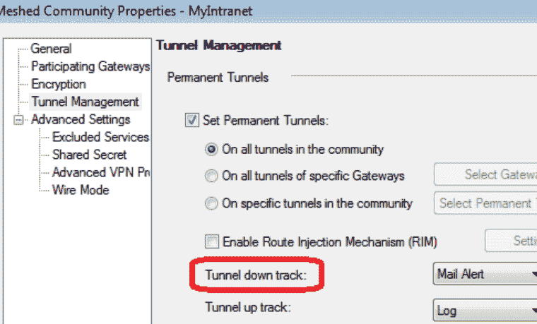

图 8-2：VPN 隧道故障的通知警告选项

如果在与非 Check Point VPN 对等端的可互操作 VPN 中看到低 MTU 问题，则无法使用永久隧道功能，因为它是 Check Point 防火墙策略特有的。纠正这种互操作情况有两种方法：

- 在两端启用并强制使用 IKE2；IKE2 包含内置的 PMTUD 机制。
- 启用 TCP MSS 钳制：[sk61221：如何控制安全网关 TCP SYN 和 TCP SYN-ACK 数据包的最大分段大小 (MSS)](https://support.checkpoint.com/solutions/sk61221)。如果启用了 `SecureXL`，防火墙必须运行 R77.20+ 版本才能使钳制正常；请参阅以下内容：[sk101219：R77.20 中的新 VPN 功能](https://support.checkpoint.com/solutions/sk101219)。注意，在防火墙升级到 R80.10+ 代码后，MSS 钳制的行为发生细微变化，并可能需要一些调整以按预期运行；请查看此链接处的 CheckM 线程“R80.10 gateway, can't set sim_clamp_vpn_mss”以获取最新更新：[https://community.checkpoint.com/thread/6148]

## R77.30 网关 IPSec VPN 性能限制

注意：此节不适用于 R80.10+ 防火墙。

如前所述，在 R77.30 防火墙上，所有基于 IPSec 的加密和解密默认只能在编号最低的防火墙工作核心 (`fw_0`) 上进行：

## CoreXL VPN 优化


[Expert@firewall:0]# fw ctl affinity -1

```
Mgmt: CPU 0
fw 0: CPU 7
fw 1: CPU 6
fw 2: CPU 5
fw 3: CPU 4
fw 4: CPU 3
fw 5: CPU 2
```

**图 8-3：**确定主防火墙工作核心的 CPU 编号

由于这种限制，如果 R77.30 防火墙上终止了大量的 IPSec VPN 相关流量，你可能会发现主防火墙工作核心的利用率极高，从而限制了防火墙的 VPN 性能。除了 IPSec VPN 职责外，R77.30 主防火墙工作核心还专门负责检查通过防火墙的所有 VoIP 协议，例如 H.323/SIP/MGCP/SCCP。如果有大量的 VoIP 和 VPN 流量通过 R77.30 防火墙，主防火墙核心将变得非常繁忙，你绝对希望尽可能遵循之前讨论的 CoreXL VPN 优化建议。

如果自动分配处理所有 IPSec 加密和解密的单个 R77.30 主防火墙工作核心仍经历着不可接受的利用率水平（空闲率小于 50%），即使使用了 AES 加密并已验证支持 AES-NI（或已确定在你的防火墙硬件上无法实现），我们还可以做另一件事。主防火墙核心不仅负责所有的 IPSec VPN 操作，默认情况下还充当通用防火墙工作单元，处理其份额的中路径和防火墙处理。你可以通过 `fw ctl stat multik stat` 命令验证这一点，并查看主防火墙工作核心在处理重大的 IPSec 职责之外仍在处理的数百或数千连接：

```
[Expert@firewall:0]# fw ctrl multik stat
```

| ID | Active | CPU | Connections | Peak |
| :--- | :--- | :--- | :--- | :--- |
| 0 | Yes | 7 | 2101 | 3153 |
| 1 | Yes | 6 | 73 | 124 |
| 2 | Yes | 5 | 337 | 429 |
| 3 | Yes | 4 | 74 | 95 |
| 4 | Yes | 3 | 110 | 147 |
| 5 | Yes | 2 | 85 | 121 |

```
[Expert@firewall:0]#
```

图 8-4：防火墙工作核心分布不均衡

## R77.30 网关 IPSec VPN 性能限制 267

但如果在 R77.30 上启用了 SecureXL，主防火墙核心将变得非常繁忙，你绝对希望尽可能遵循之前讨论的 CoreXL VPN 优化建议。

如果自动分配处理所有 IPSec 加密和解密的单个 R77.30 主防火墙工作核心仍经历着不可接受的利用率水平（空闲率小于 50%），即使使用了 AES 加密并已验证支持 AES-NI（或已确定在你的防火墙硬件上无法实现），我们还可以做另一件事。主防火墙核心不仅负责所有的 IPSec VPN 操作，默认情况下还充当通用防火墙工作单元，处理其份额的中路径和防火墙处理。你可以通过 `fw ctl stat multik stat` 命令验证这一点，并查看主防火墙工作核心在处理重大的 IPSec 职责之外仍在处理的数百或数千连接：

如果在与非 Check Point VPN 对等端的可互操作 VPN 中看到低 MTU 问题，则无法使用永久隧道功能。纠正这种互操作情况有两种方法：

- 在两端启用并强制使用 IKE2；IKE2 包含内置的 PMTUD 机制。
- 启用 TCP MSS 钳制：[sk61221：如何控制安全网关 TCP SYN 和 TCP SYN-ACK 数据包的最大分段大小 (MSS)](https://support.checkpoint.com/solutions/sk61221)。如果启用了 SecureXL，防火墙必须运行 R77.20+ 版本才能使钳制正常；请参阅以下内容：[sk101219：R77.20 中的新 VPN 功能](https://support.checkpoint.com/solutions/sk101219)。注意，在防火墙升级到 R80.10+ 代码后，MSS 钳制的行为发生细微变化，并可能需要一些调整以按预期运行；请查看此链接处的 CheckM 线程“R80.10 gateway, can't set sim_clamp_vpn_mss”以获取最新更新：[https://community.checkpoint.com/thread/6148](https://community.checkpoint.com/thread/6148)

## CoreXL 优化 268

当在 R77.30 上启用 SecureXL 时，主防火墙核心将变得非常繁忙，你绝对希望尽可能遵循之前讨论的 CoreXL VPN 优化建议。

如果自动分配处理所有 IPSec 加密和解密的单个 R77.30 主防火墙工作核心仍经历着不可接受的利用率水平（空闲率小于 50%），即使使用了 AES 加密并已验证支持 AES-NI（或已确定在你的防火墙硬件上无法实现），我们还可以做另一件事。主防火墙核心不仅负责所有的 IPSec VPN 操作，默认情况下还充当通用防火墙工作单元，处理其份额的中路径和防火墙处理。你可以通过 `fw ctl stat multik stat` 命令验证这一点，并查看主防火墙工作核心在处理重大的 IPSec 职责之外仍在处理的数百或数千连接：

当在 R77.30 上启用 SecureXL 时，主防火墙核心将变得非常繁忙，你绝对希望尽可能遵循之前讨论的 CoreXL VPN 优化建议。

如果自动分配处理所有 IPSec 加密和解密的单个 R77.30 主防火墙工作核心仍经历着不可接受的利用率水平（空闲率小于 50%），即使使用了 AES 加密并已验证支持 AES-NI（或已确定在你的防火墙硬件上无法实现），我们还可以做另一件事。主防火墙核心不仅负责所有的 IPSec VPN 操作，默认情况下还充当通用防火墙工作单元，处理其份额的中路径和防火墙处理。你可以通过 `fw ctl stat multik stat` 命令验证这一点，并查看主防火墙工作核心在处理重大的 IPSec 职责之外仍在处理的数百或数千连接：

当在 R77.30 上启用 SecureXL 时，主防火墙核心将变得非常繁忙，你绝对希望尽可能遵循之前讨论的 CoreXL VPN 优化建议。

当在 R77.30 上启用 SecureXL 时，主防火墙核心将变得非常繁忙，你绝对希望尽可能遵循之前讨论的 CoreXL VPN 优化建议。

当在 R77.30 上启用 SecureXL 时，主防火墙核心将变得非常繁忙，你绝对希望尽可能遵循之前讨论的 CoreXL VPN 优化建议。

当在 R77.30 上启用 SecureXL 时，主防火墙核心将变得非常繁忙，你绝对希望尽可能遵循之前讨论的 CoreXL VPN 优化建议。

当在 R77.30 上启用 SecureXL 时，主防火墙核心将变得非常繁忙，你绝对希望尽可能遵循之前讨论的 CoreXL VPN 优化建议。

当在 R77.30 上启用 SecureXL 时，主防火墙核心将变得非常繁忙，你绝对希望尽可能遵循之前讨论的 CoreXL VPN 优化建议。

当在 R77.30 上启用 SecureXL 时，主防火墙核心将变得非常繁忙，你绝对希望尽可能遵循之前讨论的 CoreXL VPN 优化建议。

当在 R77.30 上启用 SecureXL 时，主防火墙核心将变得非常繁忙，你绝对希望尽可能遵循之前讨论的 CoreXL VPN 优化建议。

当在 R77.30 上启用 SecureXL 时，主防火墙核心将变得非常繁忙，你绝对希望尽可能遵循之前讨论的 CoreXL VPN 优化建议。

当在 R77.30 上启用 SecureXL 时，主防火墙核心将变得非常繁忙，你绝对希望尽可能遵循之前讨论的 CoreXL VPN 优化建议。

当在 R77.30 上启用 SecureXL 时，主防火墙核心将变得非常繁忙，你绝对希望尽可能遵循之前讨论的 CoreXL VPN 优化建议。

当在 R77.30 上启用 SecureXL 时，主防火墙核心将变得非常繁忙，你绝对希望尽可能遵循之前讨论的 CoreXL VPN 优化建议。

当在 R77.30 上启用 SecureXL 时，主防火墙核心将变得非常繁忙，你绝对希望尽可能遵循之前讨论的 CoreXL VPN 优化建议。

当在 R77.30 上启用 SecureXL 时，主防火墙核心将变得非常繁忙，你绝对希望尽可能遵循之前讨论的 CoreXL VPN 优化建议。

# CoreXL VPN 优化

一个关于 CIFS/SMB 性能的最后提示：请注意此在 R80.10 中修复的问题：sk1095282：在通过 CIFS/SMB2 传输大文件进行反病毒扫描时，安全网关 CPU 占用率高。

# CoreXL 不支持的 VPN 特性

CoreXL 在 R77.30 或 R80.10+ 上均不支持“传统（Traditional）”VPN 设置模式。设置 Check Point VPN 的默认模式是“简化（Simplified）”VPN ，它与 CoreXL 完全兼容。简化模式使用称为 VPN 组（VPN Communities）的对象，并且安全策略规则库中会出现“VPN”列。传统模式使用安全策略规则中的“Encrypt”和“Client Encrypt”动作来构建隧道，策略中将没有 VPN 列。

幸运的是，R77.30 SmartDashboard 提供了一个向导，可以通过菜单“Policy（策略）...Convert（转换）...to Simplified（到简化）”将传统 VPN 策略转换为。如果你使用的是传统模式 VPN，你必须将其转换为简化模式，否则你将被迫在 R77.30 防火墙上禁用 CoreXL；结果无论防火墙有多少个物理核心，100% 的防火墙工作操作都将拥挤在一个过载的内核上。此外请注意，R80+ 管理平台中没有将传统 VPN 策略转换为简化的向导。如果你计划使用该向导将 VPN 策略从传统转换为简化，请在在升级到 R80+ 管理平台之前完成。

如果 R77.30 防火墙使用了基于路由的 VPN，则无法启用 CoreXL；R77.30 防火墙也不支持对基于路由的 VPN 使用 IKE2。这两个限制已在 R80.10 版本的防火墙中得到解决。

# CoreXL VPN 优化：关键点

- 如果非 R80.10 之前的防火墙正在处理大量的 IPSec VPN 流量，出于性能和功能考虑，强烈建议升级到 R80.10+。
- 在 R77.30 防火墙上，所有隧道的 IPSec VPN 处理只能在一个防火墙工作核心上进行。
- R80.10+ 防火墙默认支持多核 IPSec 和基于路由的 VPN，即使与 CoreXL 结合使用也是。
- 多核 SSL 可以显著提高远程访问 VPN 的性能，必须在 R77.30 防火墙上手动启用。
- 出于性能考虑，应避免 3DES 加密算法；应使用高级加密标准（AES）算法，特别是当你的防火墙硬件支持 AES-NI 时。
- 在尝试通过 IPSec 流量的防火墙之间存在中间小于 1500 的 MTU 会杀死 VPN 性能。
- 早期版本的 CIFS/SMB 协议族对高延迟网络不敏感，在跨越互联网的 VPN 中表现将非常糟糕。
- 通过将防火墙升级到 R80.10 版本，可以消除许多 R77.30 VPN 的性能和功能限制。

# 第 9 章 SECUREXL 吞吐量加速

速度是一项巨大的资产；但当它与快捷相结合时价值更大——这之间有很大区别。

- 泰·科布（Ty Cobb）

## 背景

SecureXL。向经验丰富的 Check Point 防火墙管理员提到这个术语，你可能会看到他们脸上掠过痛苦的表情。进一步询问，你可能会得到几个故事，关于 SecureXL 特性如何在防火墙切换或升级期间导致问题。问题出在其中一个令人恐惧的“遗留”企业应用上，这些应用至关重要，但由于老旧，以至于组织中已经没有人完全理解它，或者坦率地说，甚至没人碰它。SecureXL 确实名不虚传，会导致某些只能通过禁用 SecureXL 来解决的模糊问题。我自己经历过很多次，可以清晰地记得在经历了昏眼通明的排除故障之夜后，沮丧地不得不禁用它的很多次。

> 我在这里是告诉你：再给 SecureXL 一机会吧！

# 274 SecureXL 吞吐量加速

SecureXL 在 R77 及随后的版本中得到了显著改进，破坏遗留应用程序的可能性小得多；反正它们在你的组织中可能已经不存在了！你可能有一项长期的组织政策，始终在所有防火墙上禁用 SecureXL。该政策需要重新审视；不仅是为了在 SND/IRQ 和防火墙内核中高效地处理安全执行操作，还为了防火墙能够响应流量和网络流量的突然变化动态移动 SoftIRQ 处理。这种动态能力被称为“自动接口亲和力（automatic interface affinity)”，它需要启用 SecureXL。记住我们声明的目标，这是大多数站点的最佳解决方案：

启用 CoreXL 并为 SND/IRQ 分配足够数量的核心，并具有自动接口亲和力，使所有接口的 RX-DRP 速率低于 0.1%。所有接口的 RX 环形缓冲区设置为默认值。所有接口均启用带有自动接口亲和力的 SecureXL。在防火墙最忙碌期间，所有 CPU 显示空闲率至少为 50%。

当然，可能存在由于某些原因无法启用 SecureXL 的情况。R75 及更高版本引入的新功能是可以选择性地禁用 SecureXL 的部分，而无需完全关闭。如果你仍然想完全禁用 SecureXL，并确保大多数网络流量得到高效处理，你将必须进入附 A 中讨论的手动接口亲和力的深渊。在我看来，这不是一个值得开始的路径，因为它为你的配置引入了额外的复杂性，另一个防火墙管理员（或顾问）可能会因此绊倒。然而，一个更严重的缺点是失去了防火墙响应流量变化而动态移动 SoftIRQ 处理的能力。虽然手动分配接口亲和力目前可能运行良好，但网络中架构或流量模式的变化（有时可能在你不知情的情况下发生）可能会与你的手动亲和力冲突并

# 选择性禁用 SecureXL 275

突然导致 RX-DRP 速率超过目标 0.1%。更理想的方法是利用自动接口亲和力，让防火墙在无需你干预的情况下动态调整其 SND 处理资源。

# 选择性禁用 SecureXL

在你机房的一个偏远角落，立着一台反叛且巨大的巨兽级计算机系统，它对周围崭新的服务器和网络设备嗤之以鼻。这个巨兽存在的时间比任何记忆都要长，你的组织为维护它支付了高昂的支持费用。这个巨兽已经至少十年没有生产了，因为它运行着对组织功能至关重要的遗留软件。遗留软件和它的巨兽主机不在乎网络标准和 RFC 等这些东西，并迫使你完全禁用 SecureXL 以便遗留软件通过防火墙正常工作。

接下来的章节将讨论如果由于应用程序兼容性问题在防火墙上禁用了 SecureXL，如何重新启用。不知道在准备这本书的第一版时到底错过了如此实用的提示，但有一种技术可以在 R77 及更高版本中选择性地禁用某些 IP 地址的 SecureXL：[sk104468: 如何为特定 IP 地址禁用 SecureXL.]()涉及到安全管理服务器上的 `table.def` 更改，带有一个 `f2f_addresses` 指令，可以通过简单的防火墙策略推送来激活。所有匹配该指令指定的 IP 地址的流量将始终发送到 Medium/Firewall 路径进行处理。也可以使用此技术按端口禁用 SecureXL 加速，但这种选项很少使用。在某些环境下这种方法非常有用

## 276 SecureXL 吞吐量加速

仅仅为了配合那一个讨厌的系统或应用程序，就要禁用 SecureXL 及其所有优势！

假设该“巨无兽”（Behemoth）的 IP 地址为 192.168.6.66，我们希望对所有进出该系统的流量都禁用 SecureXL 加速。首先，我们需要确定要编辑的安全管理服务器（SMS）的正确 `table.def` 文件。此信息可以从 sk98339 - 安全管理服务器上 'table.def' 文件的位置中获取。以下是当前支持版本的实用摘要，请注意，SMS 的版本和防火墙版本对于确定正确的文件名至关重要：

表 5：`f2f_addresses` 指令对应的 `table.def` 文件位置

| SMS 版本 | 版本 | 文件名 |
| --- | --- | --- |
| R77.30 (Gaia) | R77.30 | $FWDIR/lib/table.def |
| R77.30 (Windows) | R77.30 | %FWDIR%\lib\table.def |
| R80/R80.10 | R77.30 | /opt/CPR77CMP-R80/lib/table.def |
| R80/R80.10 | R80.10 | $FWDIR/lib/table.def |

请务必咨询上述 SK，以确保自本书出版以来文件名未发生更改，或者查看未列出的任何版本组合。对 `table.def` 文件的更改可能在安全管理服务器（SMS）升级后无法保留，别忘记记录这些更改并在升级后检查它们！

然后，我们在适当的 `table.def` 文件中如下所示添加 `f2f_addresses` 指令，如果你添加了多个 IP 地址，别忘记在 IP 地址之间包含逗号：

## 277 选择性禁用 SecureXL

- 下表将根据其元组（tuples）强制将 TCP 和 UDP 连接转发到防火墙。
- `src` 源 IP 地址
- `dst` 目的 IP 地址
- `dport` 目的端口

```
/* tcp_f2f_ports = { <dport> }; */
/* udp_f2f_ports = { <dport> }; */
/* tcp_f2f_conns = { <src, dest, dport> }; */
/* udp_f2f_conns = { <src, dest, dport> }; */
```


| `f2f_addresses` = |
| { 192.168.6.66 }; |

`voip_codecs_length_tab` = { <0;420> , /* G.711 (PCMU) * /

图 9-1：配置 `f2f_addresses` 以选择性禁用 SecureXL

保存并退出文件，向防火墙重新安装策略。完成后，在防火墙上运行命令 `fw tab -t f2f_addresses` 以验证针对已配置的 IP 地址的 SecureXL 排除已激活。排除的 IP 地址将以十六进制形式显示。

```
[Expert@fw:0]# fw tab -t f2f_addresses

localhost:

------ f2f_addresses ------

static, id 245

c0a80642
```

图 9-2：在防火墙上验证 SecureXL 排除

少了一件让“巨无兽”暗自庆幸你付出的开支的事情……

`maxpowerfirewalls.com`
Copyright © 2018 Shadow Peak Inc. All Rights Reserved

## SecureXL 吞吐量加速

使用 `fwaccel stat` 命令检查防火墙上是否启用了 SecureXL。在尝试重新启用 SecureXL 并重新测试你组织的关键应用程序时，请准备好这些其他命令；供参考，“SIM”代表“SecureXL 实现模块”（SecureXL Implementation Module）：

- `sim vpn on|off` – 默认情况下，SecureXL 会尽可能通过加速路径（Accelerated Path）处理某些 VPN 流量以提高 VPN 性能。

遗憾的是，在某些旧版本中，这可能会破坏 VPN 功能；特别是那些在放入 VPN 隧道之前需要进行 NAT 的流量（这并不常见，但由于两个站点之间存在 RFC1918 私有地址重叠，有时是必要的），在启用 SecureXL 时有时无法正常工作。禁用 SecureXL 将解决此问题。`sim vpn off` 命令告诉 SecureXL 停止尝试加速任何 VPN 流量，但仍允许自动接口亲和力和 SecureXL 的所有其他优势。运行此命令后，必须使用 `fwaccel;fwaccel` 命令优雅地重启 SecureXL 才能生效。要使此更改在防火墙重启后依然有效，请在文件中添加行 `sim_is_vpn_disabled=1`：

```
$PPKDIR/boot/modules/simkern.conf
```

- `sim feature pbroute on` – 原本在防火墙上禁用 SecureXL 是因为正在使用 Gaia 策略路由（PBR）功能，PBR 之前与 SecureXL 的不兼容性在 R77.30 中已修复，但默认未启用。上述命令将在 R77.30 网关上启用配合 SecureXL 使用 PBR。R80.10 上的 SecureXL 默认支持使用 PBR。更多信息请参阅 sk109741：当配置 PBR 且启用 SecureXL 时，数据包无法正确路由。

## 检查手动接口亲和力

现在你已经掌握了在需要时选择性禁用 SecureXL 的知识，希望你已经决定给 SecureXL 另一个机会。你在 SecureXL 禁用时可能配置的任何手动接口亲和力设置在重新启用时将会被忽略。如果你的防火墙当前启用了 SecureXL，请务必检查之前设置的手动亲和力。由于自动接口亲和力（假设 `PPKDIR/boot/modules/simkern.conf` 文件不存在）是首选行为，请查看附录 A 了解如何定义亲和力。

## 280 SecureXL 吞吐量加速

```
[Expert@fw:0]# cat $FWDIR/conf/fwaffinity.conf

# 接口亲和力设置

# 每行应包含：

# 1. 类型 - "i" 代表接口，"n" 代表进程名，"k" 代表内核实例。

# 2. ID - 接口名称、进程名称或内核实例号。

# a. 对于接口，也可以写 "default" 或任何 CPU。

# b. "ignore" - 对此项不进行操作。

# c. "auto" - 使用任何 CPU。

# 3. 期望的亲和力：

# a. 一个或多个 CPU。

# b. "all" - 所有 CPU 都可用。

# c. "ignore" - 对此项不进行操作。

# d. "auto" - 使用任何空闲 CPU。
```

![f71ded7ff966581f413a53bb0d5a4bb308_0.png]

图 9-3：在 `fwaffinity` 文件中检查亲和力

SecureXL 自动接口亲和力参阅 sk63330：关于 `'sim affinity -c'`, `'fwaffinity used cpus'`, `'fw ctl affinity -l'` 的解释。

## SecureXL 吞吐加速

SecureXL 吞吐加速（Throughput Acceleration）和 SecureXL 会话速率加速（Session Rate Acceleration）是两个独立的功能，但经常被误认为；当运行 `fwaccel stats -it` 等命令时，很容易混淆每个计数器指的是哪个功能：

```
[Expert@firewall:0]# fwaccel stats -s

Accelerated conns/Total conns : 

Accelerated pkts/Total pkts : 3847076259/3991577672 (96%)

F2Fed pkts/Total pkts : 142170995/3991577672 (3%)

PXL pkts/Total pkts : 2330418/3991577672 (0%)

[Expert@firewall:0]#
```

图 9-4：使用 `fwaccel stats -s` 查看 SecureXL 加速统计

只有包含 `Total pkts` 字符串的行指向 SecureXL 吞吐加速处理的数据包。包含 `Total conns` 的单行仅指向 SecureXL 会话速率加速处理的数据包，该部分将在第 11 章中介绍。我们用于查询 SecureXL 状态的大多数命令将始终报告有关 SecureXL 这两个部分的信息；在进行 SecureXL 调优时，查看错误的输出是非常重要的。虽然 `fwaccel stats -s` 提供了有加速包计数器，显示了各种处理路径中处理的数据包总量，但你还可以以每秒包数 (pps) 和 Mbps 为单位查看三个路径的实时吞吐量数字。在防火墙上运行 `cpview`，然后选择 `Advanced...Network...Path:`：

| `CPVIEW.Advanced.Network.Path` | Overview SysInfo Network CPU Software-blades Advanced |
| :--- | :--- | :--- | :--- | :--- | :--- |
| CPU-Profiler Memory Network SecureXL ClusterXL CoreXL Prioq Streamin | | | | | | |
| Path Direction Size BOTH_FIN | | | | | | |

路径分布摘要（当 SecureXL 开启时可用）：

| Totals | SXL Mbps | SSL pps | PXL Mbps | PXL pps | FW Mbps | FW pps |
| :--- | :--- | :--- | :--- | :--- | :--- | :--- |
| TCP | 0 | 0 | 0 | 0 | 0 | 0 |
| UDP | 0 | 0 | 0 | 0 | 0 | 0 |
| Other | 0 | 0 | 0 | 0 | 2 | 3,164 |

| Protocol | SXL Mbps | SSL pps | PXL Mbps | PXL pps | FW Mbps | FW pps |
| :--- | :--- | :--- | :--- | :--- | :--- | :--- |
| Other:-1 | 0 | 0 | 0 | 0 | 2 | 3,164 |

图 9-5：使用 `cpview` 查看实时 SXL/PXL/F2F 统计

在现实世界中，SecureXL 吞吐加速往往能从 SecureXL 调优中获得大部分性能提升，因此将首先介绍。SecureXL 会话速率加速也带来可观的收益，特别是在安全策略或 NAT 策略极其巨大的情况下。SecureXL 会话速率加速将在第 11 章中介绍。

## 吞吐加速

本质上，吞吐加速允许跨越防火墙的连接“捷径”（从而使用更少的 CPU 资源）。这不会以任何方式降低防火墙检查的安全性，只是处理某些流量的一种更高效的方法。考虑此图：

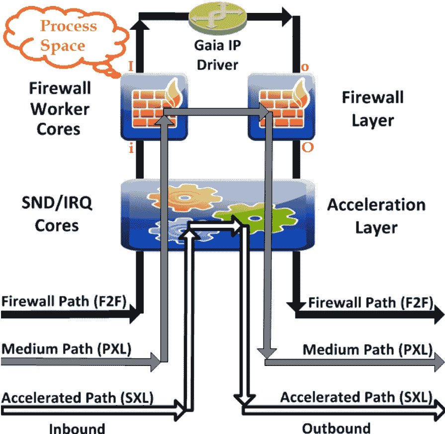

图 9-6：防火墙流量处理路径

当数据包到达防火墙并启用 SecureXL 时，它到达 SecureXL 加速层（实现在 SND/IRQ 核心上），该层尝试判断是否可以以最少处理自行处理数据包（在加速路径 Accelerated Path 中），或者数据包是否需要进入防火墙 Worker 核心，通过中间路径 Medium Path 或防火墙路径 Firewall Path 进行额外的安全处理。在某些情况下，数据包必须发送到进程空间进行特殊处理；我将这种影响性能的情况称为“第四条路径”，将在第 10 章介绍。可以由加速层独立处理的数据包在检查和转发时需要的 CPU 处理要少得多。让我们通过一个示例，假设没有发生 SecureXL 会话速率加速（也称为“模板化 templating”，将在第 11 章介绍）：

1. 一个带有 SYN 标志的 TCP 段的 IP 数据包到达防火墙。一个新连接尝试启动。
2. 数据包由 SND/IRQ 核心上的 SecureXL 加速层接收。这是一个全新的连接，尽管它需要转发到防火墙 Worker/INSPECT 层进行完整处理；但加速层在它的状态表中记录了数据包的属性以及从哪个接口进入的。
3. 防火墙 Worker/INSPECT 驱动程序在入站侧接收新连接的数据包，并根据安全策略进行评估。假设存在匹配该数据包的规则且动作为 Accept（接受）；还会对 NAT 策略进行评估，以确定是否需要对数据包应用 NAT。
4. 防火墙 Worker/INSPECT 驱动程序在入站侧接收新连接的数据包，并根据安全策略进行评估。假设存在匹配该数据包的规则且动作为 Accept；还会对 NAT 策略进行评估，以确定是否需要对数据包应用 NAT。
5. 防火墙 Worker/INSPECT 驱动程序在入站侧接收新连接的数据包，并根据安全策略进行评估。假设存在匹配该数据包的规则且动作为 Accept；还会对 NAT 策略进行评估，以确定是否需要对数据包应用 NAT。
6. ... 在出站接口进行任何最终处理。
7. ... 将数据包发送到出站接口。

该连接的所有后续包将由加速层处理，跳过防火墙 Worker/INSPECT 层、Gaia 驱动或输出层。优化操作完全由加速层执行（运行在 SND/IRQ 核心上），从而节省了防火墙核心宝贵的 CPU 时间。

一个重要的说明：ICMP 流量（如 ping）以及指向或自防火墙流量永远不会加速！要测试吞吐加速的存在，必须使用像 TCP 这样的状态协议，且流量必须经过防火墙。其他可以被 SecureXL 加速的协议包括 UDP、PIM、GRE 和 ESP。所有其他协议都不具备吞吐加速的条件，并将始终由防火墙路径中的防火墙 Worker 处理。

## SecureXL 吞吐量加速

加速连接数/总连接数：暂时忽略此行；它与 SecureXL 会话加速（Session Acceleration）相关，这将在第 11 章中介绍。

加速数据包/总数据包：这显示了有多少包通过上一节讨论的吞吐量加速，专门在加速路径（Accelerated Path）中处理。百分比越高越好；数据包加速率达到 50% 或更高是可以接受的，75% 或更高为理想。通过这种方式处理的数据包能够以最小处理代价“捷径”通过防火墙，且完全不涉及防火墙工作核心或 Gaia IP 路由。由于这种“捷径”，加速层处理的数据包不会显示在 `fw monitor` 数据包捕获中。

F2F 数据包/总数据包：这显示了有多少包必须转发到防火墙工作核心上的防火墙路径（Firewall Path），且完全无法加速。通常，我们希望这个百分比越低越好。低于 20% 是合理目标，低于 10% 为理想。

PXL 数据包/总数据包：这显示了有多少包无法完全由加速路径处理，但也不需要经过完整的防火墙路径。PXL 为中间路径（Medium Path），通常用于检查 IPS 签名的流量，但也涉及防火墙功能应用控制/URL 过滤（Application Control/URL Filtering）以及各种威胁防护（Threat Prevention）刀片。中间路径的处理在防火墙工作核心上进行。与 Check Point 文档所述不同，正如早些章节讨论的，在 2 核心系统上完全禁用 SecureXL 并不排除中间路径的使用。

QXL 数据包/总数据包：此行仅在 R77.10 及更高版本中显示。此计数器测量受 QoS 策略规则集限制的数据包；明确，这不包括在应用控制/URL 过滤层中设置的 Limit 操作。

## 数据包/吞吐量加速：内核路径

如果防火墙未启用 QoS 功能，此计数器和百分比将始终为 0。让我们查看活动系统的 `fwaccel stats -s` 示例：

```
[Expert@firewall:0]# fwaccel stats -s

Accelerated conns/Total conns : 

Accelerated pkts/Total pkts : 3847076259/3991577672 (96%)

F2F pkts/Total pkts : 142170995/3991577672 (3%)

PXL pkts/Total pkts : 2330418/3991577672 (0%)

[Expert@firewall:0]#
```

图 9-8：使用 `fwaccel stats -s` 查看大量使用加速路径 (SXL)的情况

此输出显示，从数据包加速的角度来看，96% 的处理数据包专门由加速层处理，而只有 3% 经过了防火墙路径。中间路径处理的数据包甚至不到总包的 1%。如前所述，如果超过 75% 的数据包通过加速路径，那么在 SecureXL 吞吐量加速方面进一步调优的收益微乎其微。这通常在未优化的系统上不会看到，除非防火墙上仅激活了防火墙和 VPN 刀片而没有其他功能。再次暂时忽略包含“Total conns”的行；这指的是会话速率加速。让我们看另一个 `fwaccel stats -s` 输出：

```
[Expert@firewall:0]# fwaccel stats -s

Accelerated conns/Total conns : 

Accelerated pkts/Total pkts : 9651006/71950385 (13%)

F2F pkts/Total pkts : 4060369/71950385 (5%)

PXL pkts/Total pkts : 58239010/71950385 (80%)

QXL pkts/Total pkts : 0/71950385 (0%)

[Expert@firewall:0]#
```


图 9-9：使用 `fwaccel stats -s` 查看大量使用中间路径 (PXL) 的情况

这比现实中看到的要典型得多。注意，13% 的数据包采用了加速路径，5% 经过了防火墙路径，而惊人的 80% 采用了 PXL 路径（也称为中间路径）。中间路径上的数据包没有被加速层完全处理，但也没有经过完整的防火墙路径；然而，中间路径的处理确实在防火墙工作核心上进行。阻止流量离开加速路径并将其拉入中间路径 (PXL) 的功能是：IPS、应用控制/URL 过滤以及各种威胁防护刀片。请注意，任何受 HTTPS 检查功能影响的流量始终会在防火墙路径 (F2F) 中处理；我们将在第 10 章介绍 HTTPS 检查调优。

在几乎所有硬件上，SecureXL 都实现为在所有 SND/IRQ 核心上执行的高度优化内核驱动程序。然而，对于配备可选安全加速模块 [SAM] 卡的 21000 系列设备，在 SecureXL 加速路径中处理的流量完全在专用的 SAM 硬件中处理，完全不会触及主核心（或系统总线）。

## SecureXL 吞吐量加速

IPS 功能导致多少流量进入中间路径（Medium Paths）和/或防火墙路径（Firewall Paths）。完成后不要忘记使用 `ips on` 命令重新开启 IPS！

如果您正在使用其他威胁防护组件（反病毒、反机器人、威胁模拟和/或威胁提取）的某种组合，我们可以进行一次与最后一段相似的测试，以查看这些组件如何影响路径选择和防火墙性能。运行 `cpview` 并查看“Advanced...Network...Path”，仔细观察报告的统计数据和整体 CPU 负载，然后在防火墙上运行 `amw down` 命令。此命令将禁用除 IPS 以外的所有威胁防护组件，您可以立即观察这些威胁防护组件如何影响防火墙的路径选择和 CPU 占用率，这与之前观察到 IPS 的情况类似。您可以使用 `stat -b AMW` 命令来验证各种威胁防护组件的禁用状态。不要忘记使用 `amw fetch local` 命令重新开启威胁防护！

这虽然是一个有趣的实验，但我们必须关闭 IPS 和/或威胁防护组件才能看到这些巨大的提升！我们该如何调整这些功能，以避免产生如此大的影响呢？

## IPS：R77.30 vs. R80.10 防火墙

在继续之前，我们需要简单讨论一下根据防火墙版本（而非安全管理服务器版本），IPS 与威胁防护策略之间的关系（或无关系）。

R80.10 及更高版本的网关将 IPS 功能完全集成到主威胁防护策略层中。不再需要设置“IPS 保护范围”（IPS Protection Scope）并配置特定的 IPS 异常，可以使用威胁防护策略层的“保护范围”（Protected Scope）、“源”（Source）和“目的”（Destination）列来明确指定匹配此列标准的网络流量应应用的 IPS 配置文件。仍然可以在威胁防护策略层中添加异常，但它们可能会应用于整个威胁防护策略，而不仅仅是 IPS 功能。某些在 R80 之前的管理中列为 IPS 保护的项目现在已分离到 R80/R80.10 SmartConsole 的“检查设置”（Inspection Settings）部分。更改这些“检查设置”值需要重新安装网络访问策略才能生效，因为它们已经从威胁防护策略层中分离出来：

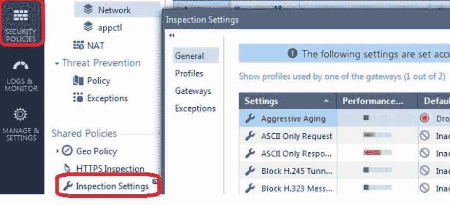

图 9-10：R80+ 管理设置

在 R80+ SmartConsole 中，IPS 配置文件不再直接分配给防火墙对象上的 R80.10+ 网关；此操作是在威胁防护策略与其他所有威胁防护组件一起执行的。但对于 R80 之前的防火墙，IPS 配置文件分配在一个特殊的 IPS“规则集”中，如果您定义了一个至少启用 IPS 功能的 R80.10 之前的防火墙，该规则集就会可见：

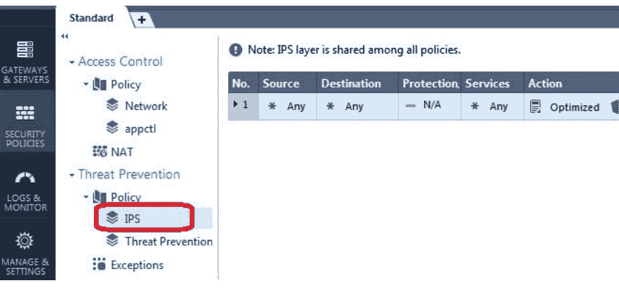

图 9-11：针对 R80 之前防火墙的特殊 IPS“策略”

虽然这个策略看起来像典型的安全策略，但一旦你开始使用，就会很快发现它并非如此。例如，对于所有 R80 之前的网关，源、目的、保护/站点和服务的字段无法无法编辑！如果您希望更细粒地控制 IPS 保护应用于 R77.30 网关网络流量的方式，您将受到限制。

在 IPS 屏幕上 R80.10 之前的防火墙对象属性中，您可以选择“仅保护内部网络”或“对所有 IPS 流量进行检查”。前者设置将仅对通往网关拓扑中定义的非外部（即内部）接口的流量应用 IPS 保护。后者设置将把 IPS 保护应用于所有流量，无论其目的地位于何处。被检查连接最初发起的方向（即入站或出站）不影响此设置的生效方式。此设置将在下一节中详细讨论。

您可以为单个 IPS 配置文件或多个配置文件定义 IPS 异常。通过 IPS 异常规则，由源、目的和/或服务匹配的流量可以从所有 IPS 强制执行或部分 IPS 强制执行中排除。该子集可以是单个保护或多个保护。对于 R80 之前的网关，R80+ SmartConsole 中的 IPS“策略”实际上只是一个定义 IPS 配置文件分配到网关的何处、以及创建异常的地方。R80.10 防火墙将其 IPS 设置整合到灵活得多的主威胁防护策略中，以及所有其他威胁防护功能：反病毒、反机器人、威胁模拟和威胁提取。

有三种主要方法可以限制 IPS 检查导向中间路径（以及可能的防火墙路径）的流量量：

- IPS 保护范围设置（仅限 R80 之前的网关）
- 签名性能影响排名
- 避免已知禁用加速的 IPS 签名

## IPS 保护范围设置（仅限 R80.10 之前的防火墙）

这个非常简单。在 SmartDashboard 中，编辑您的防火墙/集群对象并打开 IPS 屏幕：

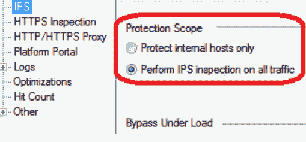

图 9-12：R77.30 防火墙上的 IPS 保护范围

对于 80 之前的版本，保护范围下有两个设置：

- **对所有流量进行检查**：这是 R77.30 的默认设置；它包括无论方向如何的所有流量。这包括从一个内部网络（如 DMZ）通过到另一个内部网络的流量。在此语境下，“内部”是指防火墙/集群对象拓扑中定义为内部的任何接口

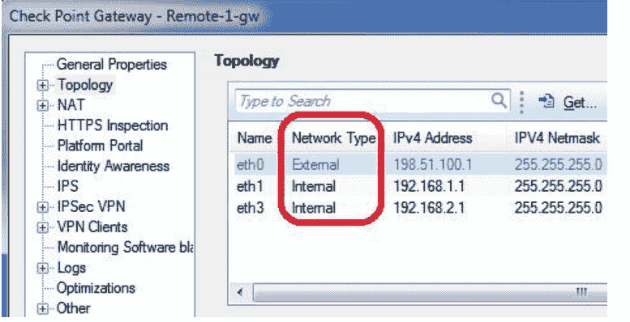

图 9-13：R77.30 防火墙上的 IPS 保护范围

- **仅保护内部网络**：对于 R77.30，选择此项后，IPS 保护仅适用于通往定义为内部的网络的流量。目的地为外部接口（通常是互联网或可能是站点到 VPN）的流量将不会应用 IPS 保护。

## 300 SecureXL 吐量加速

在所有流量上启用 IPS 检查在大多数 R80.10 之前的防火墙环境中是常见的；然而，如果您的防火墙工作核心（Worker cores）持续过载，且由于核心不足无法分配更多防火墙工作核心，请考虑将 IPS 检查仅设置为“保护内部主机”（Protect Internal Hosts only）。

## 签名性能影响排名

无论防火墙代码版本如何，所有单个 IPS 保护都有自己的性能影响排名：极低、低、中等、高或关键。但在三个内核处理路径的背景下，这些排名意味着什么？根据我的实验室观察和实际经验，我得了以下结论：

- 性能影响为“极低”或“低”的 IPS 保护 100% 在加速路径（Accelerated Path）中处理
- 性能影响为“中等”的 IPS 保护至少 90% 在中等路径（Medium Path）中处理
- 性能影响为“高”的 IPS 保护似乎 50% 在中等路径、约 50% 在防火墙路径（Firewall Path）处理（注意：所有导入的 SNORT IPS 签名都会自动分配此排名，因此无法在加速路径中处理）
- 性能影响为“关键”的 IPS 保护 100% 在防火墙路径中处理。

无需多说，性能影响为中等、高或关键的活动 IPS 保护会极大减少加速路径可以处理的流量量。防火墙“开箱即用”分配的默认 IPS 配置文件是一个内置配置

## 签名性能影响排名 301

在 R77.30 或更早的 SMS 上称为“Default_Protection”；R80+ SMS 的等效默认配置称为“Optimized”。这些配置文件中启用的所有签名都可以在 100% 在加速路径中处理。在 NSS Labs 的独立测试中，Default_Protection/Optimized IPS 配置文件在阻止攻击方面的有效性约为 86%，而另一个包含的 IPS 配置文件“Recommended_Protection”（在 R80+ 管理中命名为“Strict”）则阻止了 99% 的攻击。然而，Recommended_Protection/Strict IPS 配置文件确实启用了许多性能影响排名为中等、高和关键的保护。

让我们确定您的防火墙使用的是什么 IPS 配置文件，以便评估每种类型 IPS 保护的存在量。在管理 R77.30 或更早防火墙的 R80+ SMS 上，可以通过进入 SmartConsole 中的 Security Policies...Threat Prevention...Policy...IPS 屏幕找到找到分配的 IPS 配置文件名称。在 R77.30 SmartDashboard 的 IPS 选项卡中，选择 Gateways，您应该能看到防火墙使用的 IPS 配置文件。假设分配的配置文件是“MyProfile”。

对于由 R80.10+ SMS 管理的 R80.10+ 防火墙，IPS 优化将在后文中介绍的主威胁防护策略中执行。

进入 IPS Protections 屏幕并点击“Performance Impact”列顶部以按此列排序视图，直到您看到大量性能影响为“Critical”（关键）的签名。现在查看名为“MyProfile”的列，您将看到网关使用的配置文件的单个 IPS 保护设置。所有性能影响为“Critical”的 IPS 签名应应优先显示：

## 302 SecureXL 吐量加速


图 9-14：按性能影响排序 IPS 签名

对于 R77.30 SmartDashboard，通过选择屏幕顶部的 IPS 选项卡、点击“Protections”并按“Performance Impact”排序列表访问此屏幕。

对于防火墙配置文件设置为“Detect”（检测）或“Prevent”（阻止）操作的任何签名，请快速评估该签名与您环境的相关性；一个

## 签名性能影响排名 303

置信度水平（Confidence Level）仅为“低”或“中等”的签名表明它更容易产生误报，这可能是禁用该特定签名的有力理由。对于设置为“Detect”而非“Prevent”的签名，要格外谨慎。令人惊讶的是，将 IPS 签名设置为“Detect”实际上消耗的 CPU 比将其设置为“Prevent”要多。“Prevent”操作会立即杀死违规包，如果它是基于 TCP 的，则会丢弃/挂起其余连接。（某些 IPS 签名实际上还会通过向连接的两个端点发送 TCP RST 来执行“Reject”拒绝——IPS 保护是调用这种拒绝还是仅仅执行丢弃动作是不可调优的）“Detect”设置只是记录结果并允许连接继续，由于它会继续监控活动连接以寻找相同或额外的威胁，因此消耗更多的 CPU。

注意，您可以双击任何 IPS 保护并进入其 Description（描述）以阅读更多关于签名的信息。它是在寻找针对 Oracle 数据库的攻击，但您整个组织唯一的数据库产品是微软的 SQL Server 吗？还要考虑该 IPS 保护的 Severity（严重性）评分：如果性能是关键但攻击的严重性是低或中等呢？这是否应该影响您关于启用签名是否值得产生相应开销的决策？您可以直接右键点击 MyProfile 列中的 Prevent/Detect 操作并选择“Inactive”（不活动）来禁用签名。继续向下查看列表，直到到达指定为 Critical 性能影响的签名末尾。截至撰写此时，大约有 226 个，所以请耐心。

休息一下（如果使用 R77.30 SmartDashboard，请点击 File...Save 以确保工作已保存），继续处理所有排名为 High（高）的签名。大约会有 500-600 个，因此再次请耐心。根据我的经验，获得最高“性价比”的方法仅评估 Critical 和

## 304 SecureXL 吐量加速

高影响签名，并禁用您需要的签名以减少发送到中等和防火墙路径的流量，特别是当签名置信度水平仅为“低”或“中等”。记住，将签名操作从 Prevent 改为 Detect 并不会节省 CPU，实际上可能会导致略高的负载。将 IPS 签名设置为 Inactive 减少 CPU 的效果最好。

## 避免已知禁用 SecureXL 的 IPS 签名

有几个签名已知会导致大量流量进入中等路径，在某些情况下甚至进入防火墙路径：

- IP ID Masking/Fingerprint Scrambling（IP 掩码/指纹干扰）
- Time to Live (TTL) Masking/Fingerprint Scrambling
- TCP SYN Attack Configuration
- ASCII Only Response
- Small PTMU
- Network Quota（配额，请查看第 13 章中的“Rate Limiting”功能以获得更高效的强制配额方法）
- ClusterXL Load Sharing Decision Function (SDF)，它仅适用于负载共享多播部署

## 威胁防护策略优化 305

检查这些签名和 SDF（如果适用）的配置；您几乎肯定想要将这些设置为 Inactive，因为它们往往会不同程度地禁用受影响流量的 SecureXL。

## 优化

无论版本版本，威胁策略（指定反病毒、反机器人、威胁模拟和威胁提取操作）的优化程序与第 5 章涵盖的 APCL/URLF 策略非常相似。对于由 R80.10+ SMS 管理的防火墙，IPS 也直接从同一个威胁防护策略控制，并提供了许多 IPS 优化途径。如果您的防火墙仍运行 R77.30 或更早版本，通过限制到某些流量来提高 IPS 性能的能力将受到严重限制。

R80.10+ 防火墙允许激活多个威胁策略层。如果是这样，所有独立的威胁策略层将同时评估，在每个层中选择匹配的第一条规则，然后根据匹配结果执行最严格的操作。简单来说，从最严格到最松的操作顺序是：Prevent、Ask、Detect，最后是 Inactive。每个独立的威胁策略层只能匹配一条规则（找到的）。

以下是构建威胁防护策略的一些通用建议，但威胁防护策略优化的真正强大工具是所谓“空”配置文件的正确使用，这将在后文章节介绍。威胁防护策略规则优化的通用目标是仅应用特定的威胁

# 306 SecureXL 吞吐量加速

功能在需要的地方发挥作用，这通常是为了跨越网络边界进入较或较可信区域的流量。威胁防护（Threat Prevention, TP）功能通常会对防火墙产生巨大的开销，出于而易见的原因，在数兆比特速率的两个内部网络之间传输的流量上意外应用完整的威胁防护功能是不理想的。此外，正确构建威胁防护规则可以确保尽可能多的流量符合 SecureXL 在加速路径（Accelerated Path）中处理的条件：

- 确保防火墙接口的拓扑结构定义正确且完整，这样“Internet”（互联网）对象和 DMZ 网络才能被正确计算。此主题在第 5 章中介绍过。
- 尝试在威胁防护策略中尽可能使用最特定的“保护范围”（Protected Scope）。您在“保护范围”列中配置的任何对象，其流量将受到威胁防护策略规则的检查，无论该对象是否发起了连接。“保护范围”的使用与访问控制策略层不同，在后者中，源（Source）对象定义了最初是谁开启了连接。
- 如果您想根据连接发起的方向来限制威胁防护保护的执行，从而使更少流量受到扫描并提高防火墙性能，可以取消威胁防护策略中源（Source）和目的（Destination）列的隐藏并相应配置。也可以取消“服务”（Services）列的隐藏并显式配置为仅匹配某些端口号，如下：

# 威胁防护策略规则优化 307

| 编号 | 保护范围 | 保护/站点/文件/组件 | 动作 |
|---|---|---|---|
| 1 | * 任意 | 名字 | 优化 |
| | | 保护范围 | |
| | | 源 | |
| | | 目的 | |
| | | 保护/站点/文件/组件 | |
| | | 服务 | |
| | | 动作 | |
| | | 跟踪 | |
| | | 安装到 | |
| | | 注释 | |

图 9-15：在威胁防护策略中取消列的隐藏显示

然而，为了简单起见并确保网络流量的完全覆盖，通常建议尽可能利用保护范围。

如果可能，不要使用“任意”作为保护范围，而是使用组、网络和/或主机对象的组合。回想第 5 章中的格言：“任意是敌人！”尽量避免在威胁防护规则列中将保护范围设为“任意”，除非：

- 源（Source）和目的（Destination）字段被用于更细粒度的控制，用以替代仅使用保护范围定义（该定义被留为“任意”）；在这种情况下，请确保源字段或目的字段未被设置为空。
- 反病毒和威胁仿真（Threat Emulation）组件的用户设置中包含了额外的保护范围标准。但是，请注意，在使用了启用了 IPS、反机器人（Anti-Bot）或威胁提取（Threat Extraction）配置文件的威胁防护规则中，不要将保护范围列设置为“任意”。反病毒和

# SecureXL 吞吐量加速

威胁仿真在配置属性（profile properties）中嵌入了它们自己的保护范围设置（在下一节中介绍），而其他三个组件则没有，如果规则的保护范围留为“任意”，则它们将应用于极大量的流量。

- 规则中动作（Action）字段指定的配置文件被用于禁用大部分或所有威胁防护组件检查匹配规则的流量，详细如文所示。
- 就像在 APCL/URLF 策略层中一样，TP 策略末尾没有“隐式丢弃”（implicit drop），在 TP 策略底部不需要显式的“接受”（Accept）清理规则即可实现正常运行。在威胁防护策略策略尾存在此类规则，将确保几乎没有网络流量会在 SecureXL 的加速路径中处理。

# 威胁防护配置文件优化

虽然威胁防护策略规则规定了威胁防护的各个组件应该匹配并检查何种威胁，但匹配规则动作（Action）列中指定的至关重要的配置文件控制着各个威胁防护功能的行为。与防火墙性能直接相关的配置选项将在本章的后续章节中突出并讨论。截图所示的设置通常是“开箱即用”的默认值，我们将使用名为“Optimized”的内置 R80+ 配置文件。在我们继续时，请留意您的本地环境中相对于默认设置已更改的防火墙性能相关设置。

# 通用策略配置文件优化

在编辑威胁防护配置文件时，“通用策略”（General Policy）屏幕可能是性能优化方面最重要的屏幕之一。对于匹配在动作字段中调用为“Optimized”配置文件的威胁防护规则的流量，我们可以控制哪些单个 TP 功能将检查流量。请记住，除非在通用属性（General Properties）...网络安全的防火墙对象下实际启用了引用功能，否则该功能将不会应用于通过特定防火墙的流量。在防火墙专家模式提示符上运行 `enabled_blades` 命令是确定哪些功能活动的快速方法。

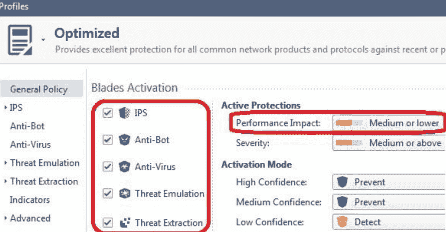

图 9-16：威胁防护组件性能影响设置

# 310 SecureXL 吞吐量加速

如果威胁防护规则匹配候选流量，且配置文件设置中未勾选显示的功能之一，则该功能的保护将完全不应用于流量。假设存在一个威胁防护策略层，但如果存在多个威胁防护层，将选择多个威胁防护层中任何匹配规则限制最严格的动作。如果候选流量不匹配任何威胁防护规则，默认动作是接受（不会记录），并且该流量可能会被加速。

下一个重要字段“性能影响”（Performance Impact）通常指定了根据潜在影响对五个威胁防护组件应用哪些保护措施。您可能认为此设置仅管理 IPS 功能，但它控制了所有不同威胁防护功能的哪些元素处于激活状态。下表显示了不同性能影响设置所启用的保护类型；此列表可以在 R80+ SmartConsole 的安全策略...威胁防护...保护措施 中访问：

# 威胁防护配置文件优化 311

表 6：TP保护类别的性能影响摘要

| 保护 | 组件 | 引擎 | 性能影响 |
|---|---|---|---|
| IPS | IPS | 签名 | 变化 |
| 信誉 IP | 反机器人 | 信誉 | 低 |
| 信誉 URL | 反机器人 | 信誉 | 低 |
| 信誉域名 | 反机器人 | 信誉 | 低 |
| 邮件活动 | 反机器人 | 邮件爆发 | 低 |
| 病毒 | 反病毒 | 签名 | 低 |
| 含有恶意软件的 URL | 反病毒 | 信誉 | 低 |
| 文件类型 | 反病毒 | 文件类型 | 低 |
| 恶意活动 | 反病毒与反机器人 | 签名 | 低-69% 中-27% 高-4% |
| 异常活动 | 反机器人 | 行为模式 | 低-54% 中-8% 高-38% |
| 漏洞检测 | 威胁仿真 | 漏洞检测 | 低 –33.3% 中-33.3% 高-33.3% |
| 邮件内部链接 | 反病毒与反机器人 | 信誉 | 中 |
| 异常活动 | 反病毒 | 行为模式 | 高 |

在尝试根据组织计划使用的功能确定如何配置性能影响设置时，此表非常有用。

## 312 SecureXL 吞吐量加速

## IPS 配置文件优化（仅限 R80.10+ 防墙）

本节假设威胁防护（Threat Prevention）层已应用于 R80.10+ 防墙。对于上述 IPS 配置文件设置，从优化角度来看（除了本章已涵盖的内容），最有用的界面是“附加激活（Additional Activation）……要禁用的防护（Protections to Deactivate）”。

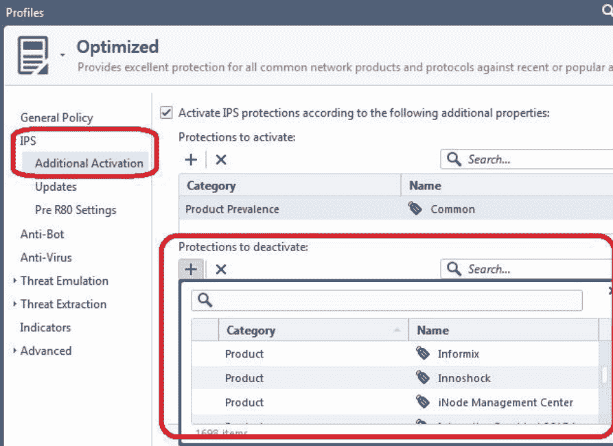

图 9-17：IPS 配置文件/厂商禁用类别

这是一个非常长的列表，但最有用的类别是“产品（Product）”和“厂商（Vendor）”。通过禁用大量涵盖你确定不在你组织内的厂商和产品的 IPS 签名，可以大幅减少防火墙搜索的 IPS 签名总数。这将为中等路径（Medium Path）节大量的大量的 CPU 处理资源。

## 反机器人/反病毒配置文件优化

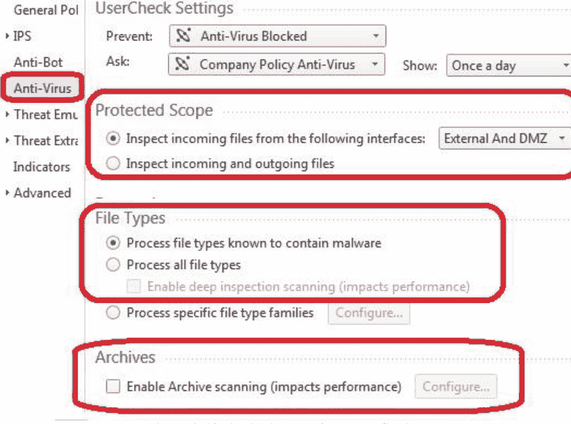

图 9-18：反病毒性能设置

注意，在反病毒配置文件设置中，我们有机会对受反病毒扫描的流量的“保护范围（Protected Scope）”进行更进一步的限制。显然，只有当调用此配置文件的规则首先在“保护范围”列上发生匹配时，才会实施这些额外的范围限制。

## 314 SecureXL 吞吐量加速

但请记住，你的防火墙拓扑结构必须如第 5 章所示经过正确定义，“外部（External）”和“DMZ”术语在此处才有实际意义。

截图中的“文件类型（File Types）”设置是默认值，出于性能考虑应保持原样。受深度检查扫描的文件（如果已启用）也会导致防火墙跳转到处理空间，这被称为“第四路径（Fourth Path）”，并在第 10 章中介绍。

启用压缩包扫描（Archive Scanning）可能会对防火墙性能产生巨大影响，因为该功能是由防火墙“第四路径”上的 `dlpu` 进程处理的。如果在扫描压缩文件时遇到不可接受的性能，或者防火墙上的 `dlpu` 和/或 `rad` 进程消耗了过多 CPU，请参考以下信息：sk94056：启用反病毒和反机器人刀片时，RAD 进程和 DLPU 进程在高水平消耗 CPU。显而易见的安全权衡是，如果直接允许压缩包而不进行扫描，它们可能包含防火墙不会拦截的威胁。

最后一个提示：如果你正在使用 R80.10 之前的防火墙版本，在高峰时期，R77.30 或更早版本的网关上的反病毒和反机器人存在性能问题，详见此处：sk106062：在安全网关上激活反机器人和/或反病毒刀片后的 CPU 负载和流量延迟。该问题在 R80.10+ 网关中已修复。

与反病毒刀片类似，对于威胁仿真（Threat Emulation）功能，我们有能力明确威胁防护策略“保护范围”列中匹配内容之外的保护范围。与之前一样，防火墙的拓扑结构必须如第 5 章所示经过正确定义，“外部”和“DMZ”术语在此处才有实际意义。

## 316 SecureXL 吞吐量加速

- 通用策略
- IPS
- 反机器人
- 反病毒
- 威胁仿真
  - 通用
  - 仿真环境
  - 排除的邮件地址
- 高级

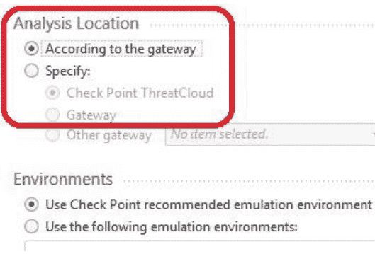

图 9-20：威胁仿真分析位置

虽然对可疑执行文件的仿真可以在 Check Point ThreatCloud 以外的地方执行，但如果不进行仔细调优，可能会导致仿真性能剧烈波动。如果你选择在本地执行仿真，需要注意一些局限性：

- 1. 默认情况下，分配给仿真的 CPU 核心忙率超过 90%，在 CPU 负载下降到该值之前，不会启动新的仿真虚拟机，从而可能导致仿真请求积压。
- 2. **不要**勾选下页所示所示“禁用静态分析（Disable static analysis）”复选框。这样做会导致遇到的每个文件都被发送进行仿真（即使之前已经仿真过），应仅在实验室环境或 Check Point TAC 的指导下启用。
- 3. 默认情况下，仿真虚拟机进程可能不会超过系统内存的 70%。如果没有足够的内存，新仿真会话的启动将延迟。仿真系统上无关进程的失控内存泄漏可能会延迟或导致仿真完全停止。

maxpowerfirewalls.com
Copyright © 2018 Shadow Peak Inc. All Rights Reserved

## 威胁防护配置文件优化 317

Check Point ThreatCloud 最常用于仿真服务；也可以从 Check Point 购买专用的威胁仿真设备。

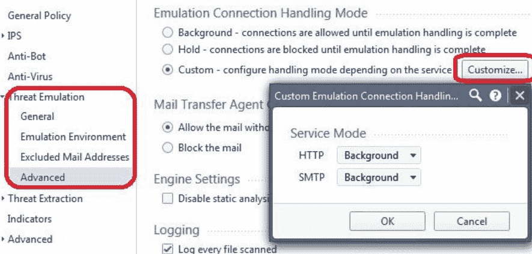

图 9-21：威胁仿真处理模式

仿真文件会导致用户可察觉的长时间延迟。上述“仿真处理模式（Emulation Handling Mode）”的默认值通常为“后台（Background）”，当结合使用威胁提取（Threat Extraction）在快速交付清理后的文档副本的同时进行处理时，这种模式对于大多数环境都是合适的。

## 318 SecureXL 吞吐量加速

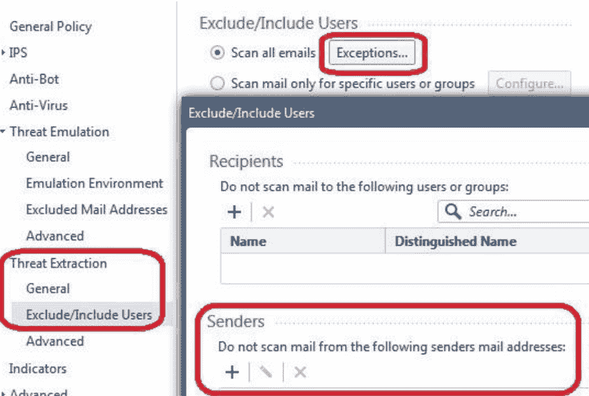

### 9-22：从威胁提取中排除邮件

对于上述的威胁提取设置，请确保排除发送大量邮件的服务账户和其他账户，以免该功能处理。

## 测试防护策略优化：CheckMe

威胁防护策略的一个经典问题一直是在进行重大更改后如何测试它们。病毒扫描器经常被用于此目的，但 Check Point 提供了一种更简单的方法，称为 CheckMe。只需从浏览器访问 http://www.checkpointme.com 并启动评估：


图 9-23：CheckMe 评估结果

## 319 SecureXL 吞吐量加速

此工具可以快速验证你的威胁防护策略/配置文件优化没有以任何意外影响防火墙对防护的执行。更多信息请见 sk15236：CheckMe - 安全检查。

## 中等路径 CPU 使用优化

到目前，我们检查了 IPS 保护范围（仅限 R77.30 网关），它限制了需要由 IPS 处理的流量，并至少指向中等路径。我们优化了威胁防护策略以使更多流量适用于加速路径，并检查了影响性能的威胁防护配置文件设置。通过尝试减少在中等路径时消耗的 CPU，可以进一步提高防火墙工作节点的利用率，同时也存在让更多流量进入加速路径的机会。

实现此优化有两种方法，每种都有优缺点：

- 1. 在威胁防护策略规则中匹配流量，并调用该规则以禁用一个或多个威胁防护功能的检查
- 2. 创建威胁防护和/或 IPS 异常

## 威胁防护：基于配置文件的禁用与异常

在深入研究之前，让我们从视觉上检查这些技术具体是什么样的。在接下来的示例中，我们在本章前面的“选择性禁用 SecureXL”节中提到的可怕的“巨兽”系统（意料之中）正违反了各种威胁防护功能。由于该系统对全世界遵循的网络和应用标准极度不尊重，误报正在阻塞进出该“巨兽”的关键流量。请查看以下两个截图：

## 322 SecureXL 吞吐量加速

- 威胁防护 (Threat Prevention)
- 策略 (Policy)
- IPS
- 威胁防护
- 异常 (Exceptions)
- 规则策略 (ared Policies)
- 地理策略 (Geo Policy)
- HTTPS 检查
- 检查设置 (Inspection Settings)

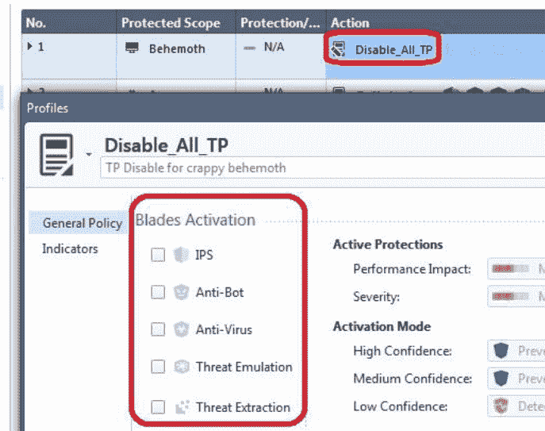

图 9-24：“空”威胁防护配置示例

- 威胁防护
- 策略
- IPS
- 威胁防护
- 异常
- 规则策略
- 地理策略
- HTTPS 检查
- 检查设置

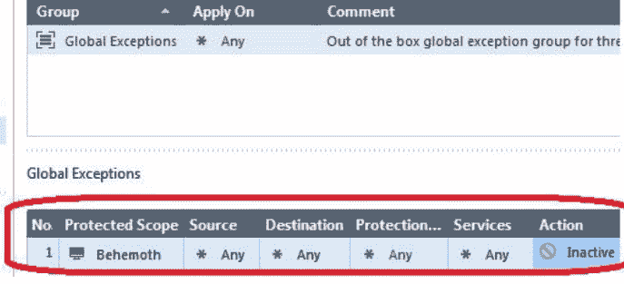

图 9-25: 威胁防护异常示例

## 中等路径 CPU 使用率优化 323

虽然所示的禁用 Behemoth 所有威胁防护的两种方法都能达到预期目标，但通俗来说，只有其中一种方法会让进出 Behemoth 的流量可能符合在加速路径（Accelerated Path）中处理，而另一种方法对防火墙的路径选择没有影响，但在中等路径（Medium Path）中可以节省 CPU。从性能调优的角度来看，你能猜哪种更优吗？

当像后一张截图所示定义威胁防护异常时，只有此类流量会影响各种威胁防护组件做出的决策：该流量是否具有敌意？像我们的示例那样使用异常仍会导致 Behemoth 的流量至少经过中等路径，而完全不会使流量符合在加速路径中处理的。这种行为在所有情况下和每个防火墙代码版本中并不是所有 TP（威胁防护）组件的硬性规则，但在大多数现实情况下应假定如此。

在第一张截图中，威胁防护规则将 Behemoth 的流量判定为“受保护范围”（Protected Scope），并调用了一个名为“Disable_All_TP”的配置，该配置取消勾选了所有五个威胁防护组件（一个“空”TP 配置）。在 R80.10+ 防火墙上，这种技术向 SecureXL 信号出绝对不需要任何威胁防护处理，SecureXL 可能可以在加速路径中处理这些流量。即使进出 Behemoth 的示例流量因为被 APCL/URLF 等其他功能检查而仍需要中等路径，由于完全跳过了所有威胁防护检查，在中等路径中节省了大量的 CPU 时间。由于防火墙代码的持续改进，使用这种空配置技术在加速路径中潜在处理的流量在 R80.10+ 网关上远高于 R77.30 或更早版本的网关。

## SecureXL 吞吐量加速

不过还有一点需要注意：对于 R80.10+ 防火墙的多层威胁防护该怎么办？在我见过的大多数配置中，策略包中只有一个威胁防护策略层，或者至少有一个典型的威胁防护策略层和一个针对 R77.30 及更早版本网关的“特殊”独立 IPS 策略层。上一个示例假设只存在一个威胁防护策略层，但如果有多个会发生什么呢？

如果存在多个威胁防护策略层，它们将同时被评估，每个单个 TP 策略层匹配的规则不超过一个。多次匹配将始终选择限制性最大的操作。在我们的示例中，如果进出 Behemoth 的流量匹配了多个 TP 策略层中的规则，则 Disable_All_TP 配置可能不会被应用，因为它几乎肯定比另一个 TP 策略层中的匹配限制性小。另一方面，全局异常（Global Exceptions）确实是全局：全局应用于所有 TP 策略层。因此，只要只有一个 TP 策略层（不包括针对 R77.30 网关的“特殊”IPS 层），Disable_All_TP 配置就会按预期应用到 Behemoth 的流量。不过，当你第一次添加第二个 TP 策略层时要小心，因为它可能会开始覆盖你在原始 TP 策略层中定义的空配置！

## 威胁防护异常的用例

如上一节所述，从性能优化的角度来看，优先使用所谓的“空”TP 配置。当你目标是以广泛、大范围的方式让某些流量免受 TP 检查时，空 TP 配置是首选。但如果你需要对某些流量应用精确、非常具体的 TP 异常，

## 中等路径 CPU 使用率优化 325

那么在主 TP 策略中尝试这样做是非常笨拙的方法。这种情况非常适合使用全局异常，如果你需要，它可以允许将某些流量免于单个 IPS 保护检查，同时保持其他 IPS 签名和其余 TP 提供的保护。如果你仍然不信服要尽可能使用空 TP 配置，请看这里：

> 即使 TP 全局异常排除了所有流量的威胁防护检查（包括 IPS），各种分区仍会被强制，例如 IPS 保护的 HTTP Header 模式、仅 ASCII 、仅 ASCII 请求、HTTP URL 模式和 CIFS 文件名模式。这种行为在出版时是 R80.10 网关的已知限制（ID 02518174 & 12515164/02513631）。

## 异常：DMZ 间交互与 DMZ 后端连接

查看允许不同 DMZ 网络之间交互的网络访问策略层，以及允许从 DMZ 发起到内部网络的连接。允许什么样的流量？它们会消耗大量带宽吗？

一个很好的选项：如果 DMZ 系统目前向备份服务器发起连接，看看能否将其反过来。免除来自内部网络的连接要安全得多。

## SecureXL 吞吐量加速 326

## 中等路径 CPU 使用率优化 327

## 异常：内部到 DMZ 的连接

在大多数网络架构中，内部网络比位于 DMZ 的系统要信任得多。在在中等路径的处理开销方面，有许多机会创建异常并实现极高的“性价比”。在在前节中，建议对从 DMZ 发起的连接进行盲目的威胁防护检查时要非常谨慎。当内部网络向半信的 DMZ 发起连接时，则不需要那么谨慎。特别是如果网络备份连接、Microsoft Active Directory 复制和/或 vSphere 复制是从受信网络发起到 DMZ 系统，对于这些特定的流量类型可以大幅提高防火墙性能。因此，对于一个为了备份目的而发起连接到 DMZ 服务器的内部备份服务器，相关的异常如下：

| 威胁防护 | 应用于 | 注释 |
| --- | --- | --- |
| - 策略 | 全局异常 *  | 威胁防护的内置全局异常组 |
| IPS | | |
| 威胁防护 | | |
| 异常 | | |

| 全局异常 | | | | | |
| 编号 | 受保护范围 | 源 | 目的地 | 保护... | 服务 | 操作 |
| --- | --- | --- | --- | --- | --- | --- |
| 1 | * 所有 | | Backup_Server | All_DMZs | * 所有 | * 所有 | ◯ 未激活 |
| 2 | | Behemoth | * 所有 | * 所有 | * 所有 | ◯ 未激活 |

图 9-26: 针对备份流量的异常

在你的网关上运行“top...1”并观察当前的防火墙进程利用率。安装带有新建异常的策略。取决于

maxpowerfirewalls.com Copyright © 2018 Shadow Peak Inc. 版权所有

## 中路径 CPU 使用率优化 329

在 R80+ SmartConsole 中更改这些“检查设置”（Inspection Settings）值只需重新安装访问策略（Network Access policy）即可生效，因为它们已经从 IPS 功能和威胁防护策略层中分离出来。

## IPS 分析：查找占用高 CPU 的 IPS 保护

你已经使用 IPS 异常来限制中路径消耗的 CPU 数量，并禁用了与你的环境无关且具有关键/高性能影响的 IPS 签名。你已经为 R80.10+ 网关优化了 IPS 中的威胁防护策略。你也检查了与 IPS 相关的引擎/检查设置（Engine/Inspection Settings）。但在中路径和防火墙路径的防火墙工作器核心上似乎仍然消耗了大量的 CPU，如 `top` 命令所示……运行本章前面提到的“快速评估”测试，IPS 确实是消耗大量 CPU 的功能，但你似乎无法确定是哪个 IPS 保护导致的。

检查这些 SK：sk110737: IPS Analyzer Tool - 如何高效分析 IPS 性能以及 sk43733 - 如何测量 IPS 保护消耗的 CPU 时间。这些 SK 中记录的步骤演示了如何收集单个 IPS 保护的 CPU 使用统计信息并识别“大户”。指令根据使用的代码版本以及你的环境是独立式还是分布式的而有所不同，因此超出了本书的范围。

## 防火墙路径优化

到目前为止你已经遵循了本章所有的建议，但当你运行 `facc stats -s` 命令时，采用防火墙路径的流量百分比仍然高得离谱（>20%)！在典型的防火墙上，防火墙路径中会有某些进程发生。我们花费了大量精力将流量从中路径移到加速路径（Accelerated Path），但当流量似乎一直卡在防火墙路径时，我们能做什么呢？首先，总流量中高达 20% 采用防火墙路径通常是正常的（根据我的观察，调优良好的防火墙平均值约为 5-10%），但什么情况下会导致超过 20% 的流量一直通过防火墙路径？我们将在接下来的章节中介绍一些常见原因，请记住 Check Point 正在不断优化你的代码，以尽可能让更多处理在中路径和加速路径中发生，避免高开销的防火墙路径。你可能会在未来的某个时刻升级防火墙代码，发现顽固的高防火墙路径利用率突然消失了！

在开始之前有一点：配置为“监控模式”（Monitor Mode）的防火墙接口永远无法获得 SecureXL 加速，并将始终走 F2F（直连），详细信息见后续：sk121792: 配置为监控模式的接口的流量无法被 SecureXL 完全加速。

## 防火墙路径优化 331

### IP 分片：SecureXL 的宿敌

你会认为，在当今高速互联网访问的世界，以及各种以太网标准的极普及背景下，世界上几乎每个网络的最大传输单元（MTU）至少至少是以太网默认的 1500。遗憾的是，你错了。在互联网的早期，由于拨号连接和 SLIP/PPP 协议，小于 1500 的 MTU 值非常常见（大多数情况下默认 MTU 为 576）。不同网络上的不同 MTU 值通过称为 IP 分片（IP fragmentation）的过程来处理。比目标网络较小 MTU 的数据包会被中间路由器拆分成 2 或更多碎片，碎片将成功穿越网络路径的其余部分到达接收端。接收端有责任将碎片重组回原始数据包并对其进行处理。正如我们在第 8 章的“低 MTU 和 PMTUD”部分中看到的，数字签名的流量（如 IPSec）在传输过程中不能被分片，因为这会违反 ESP 数据包的数字签名。

然而，当分片数据包到达防火墙时，会对防火墙性能产生一种真正隐蔽的影响：所有接收到的分片数据包都不适用于 SecureXL 吞吐量加速（加速路径）或中路径；它们将始终走防火墙路径。这种限制在 R80.10 网关中仍然存在。你可以需要执行本章前面提到的优化策略，但无论你做什么，分片数据包总是进入防火墙路径。Check Point 防火墙执行名为“虚拟去重分”（virtual defragmentation）的过程，以确保单个攻击不会为了规避检测而被拆分成多个数据包，而这种虚拟重分过程只能在防火墙路径中进行。

## 332 SecureXL 吞吐量加速

唯一的例外是安装了可选 SAM 卡的 Check Point 21000 系列设备；如果存在，SAM 卡可以以高度加速的方式执行虚拟重分。如果接收到的流量中大部分是分片的，分片会降低防火墙性能，而你在防火墙本身上直接做的事情很少。但是，如果一个连接符合中路径或加速路径的处理条件，且该连接的一个或多个数据包被分片，则只有分片数据包会在防火墙路径中处理。连接的其余数据包仍在中路径或加速路径中处理；连接流中仅仅存在分片数据包并不会导致连接的其余注定滞留在防火墙路径中，无论后续状态如何。如果你怀疑发生了分片，我们可以使用各种工具在防火墙上确认这一点。对于从互联网到达的分片数据包，你无能为力（除非你组织的边界路由器是执行分片的那个），但我们可以从防火墙上确认这一点。要确定防火墙接收了多少碎片，请运行以下命令：


`fwctl pstat`

```
Fragments:
  0 fragments, 0 packets, 0 expired
```

图9-28: 通过`fwctl`显示的分片统计

## 防火墙路径优化

```
[Expert@firewall:0]# faccel stats -p
```

```
F2F packets:

| Violation | Packets | Violation | Packets |
|---|---|---|---|
| pkt is a fragment | 4896 | pkt has IP options | 0 |
| ICMP miss conn | 6 | TCP-SYN miss conn | 3688 |
| TCP-other miss conn | 146 | UDP miss conn | 194417 |
| other miss conn | 0 | VPN returned F2F | 0 |
| ICMP conn is F2Fed | 0 | TCP conn is F2Fed | 38783 |
| UDP conn is F2Fed | 6694 | possible spoof | 0 |
| uni-directional viol | 0 | out if not/accl | 0 |
| TCP state viol | 405 | routing decision err | 0 |
| bridge,src-dt | 0 | temp conn expired | 0 |
| sanity checks failed | 0 | broadcast/multicast | 0 |
| fwd to non-pivot | 0 | partial conn | 0 |
| cluster manage | 0 | cluster forward | 0 |
| PXL returned F2F | 0 | general reason | 0 |
| chain forwarding |  |  |  |
```

```
[Expert@firewall:0]#
```

图 29: 使用`faccel stats -p`显示分片数据包计数

如果数字看起来很高，运行此`tcpdump`命令查看所有分片数据包并确定它们来自哪里：

```
tcpdump -eni any '((ip[6:2] > 0) and (not ip[6] = 64))'
```

出现在此输出中的任何流量都是分片的；注意`-e`选项还会显示向防火墙发送分片数据包的源 MAC 地址，以帮助你将分片数据包追溯到源头。纠正这种情况的唯一方法是确保在内部和 DMZ 网络中使用一致的 MTU 值。我曾看到修复内部 MTU 问题对防火墙性能产生了巨大影响。当然，在某些情况下低 MTU 是由于与合作伙伴或供应商的遗留私有网络连接（例如 56Kbps 线路、拨号线路和 ISDN）而合法存在。

如果你担心分片会影响防火墙的性能，可以完全禁止 IP 分片通过防火墙。


如果你的网络中大部分合法生产流量是分片的，那么在防火墙上禁止分片会导致大规模停机。在决定尝试禁止 IP 分片之前，请运行前面提到的`tcpdump`命令，并**确保**你的网络中没有分片的合法生产流量！

可以在 R77.30 SmartDashboard 的 IPS 选项卡下...Protections（防护）...IP Fragments（你的防火墙正在使用的 IPS 配置文件)...Forbid Fragments（禁止分片）复选框。在 R80+ 管理中，该设置位于“Inspection Settings”（检查设置）下：

## 防火墙路径优化 335

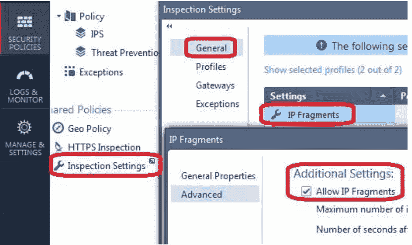

图 9-30：Inspection Settings IP Fragments 复选框

> 最后强调一次：操作这个要小心！取消勾选该框会导致大规模停机！

## 案例研究：Oracle 数据库流量与 IP 分片

一个 Oracle 用户报告通过 Check Point 防火墙的数据库性能糟糕。当通过防火墙运行 Oracle 流量的性能基准时，一个防火墙工作核心的利用率达到 100%，整体吞吐量仅为可用 LAN 带宽的一大部分。

## 336 SecureXL 吞吐量加速

`fwaccel stats -p`和`fwctl pstat`命令报告有大量的分片包通过防火墙。

经过调查发现，Oracle 数据库产品有一个名为“会话数据单元”（SDU）的关键设置。在默认情况下，Oracle 将此值设置为 2048，这明显高于典型的 1500 以太网 MTU。遗憾的是，默认设置将导致离开 Oracle 数据库服务器的流量产生大量的 IP 分片。如果这些流量尝试通过 Check Point 防火墙，将没有任何数据库流量符合 SecureXL 吞吐量加速条件，并将始终走防火墙路径（F2F）。如果涉及的流量通过两个高速 LAN 接口，一个不幸的防火墙工作核心在性能方面迅速遇到瓶颈。在这种情况下，动态分发器（Dynamic Dispatcher）无法缓解这种状况，因为大量流量发生在单个 TCP 连接内部（有时被称为“大象流”），这种流量无法由多个一个防火墙工作核心处理。

消除这种数据分片的修复方法是？将 Oracle SDU 值设置为 1460。为什么不设置为 1500 呢？40 字节的差异是为了考虑到 IP 和 TCP 头部，总共约 40 字节。应用此 Oracle SDU 设置更改后，由于缺少数据分片，防火墙性能得到了大幅提升。

## 特定连接在使用哪种路径，以及为什么？

假设通过防火墙的某个连接正遇到延迟或功能问题。它很可能是那些没人不想碰或干涉的、令人讨厌的“遗留应用程序”之一，类似于书中之前讨论过的“巨兽”。在随之而来的相互指责中，防火墙总是会被首先指责，必须证明自己没有过错。你检查防火墙日志，一切看起来都正常，针对相关连接只有 Accept/Allow 操作；没有出现来自 ACL/URLF、IPS、Threat Prevention 或任何其他模块的丢弃/拦截。你运行了`tcpdump`或`fw monitor`，并验证了目标连接的基础网络连通性和双向数据包流。作为防火墙管理员，你现在可能在想：这个问题连接是在三条路径（加速、中等或防火墙）中的哪一条处理的？过去，SecureXL 名在使用加速路径时有时会以不明显的方式破坏应用程序连接；禁用 SecureXL（从而完全消除加速路径）是让遗留应用程序重新运行的唯一方法。

首先确保连接实际上是活跃并通过流量的。在日志中看到连接的“Accept”操作仅意味着连接已启动并被防火墙接受。这并不意味着它此时此刻仍然活跃。接下来，确定问题连接的源和目的 IP 地址（假设源为 192.168.1.100，目的为 129.82.102.32）。如果你的防火墙运行的是 R77 或更高版本，请运行以下命令来验证 SecureXL 连接：

```
fwrack conns | grep 192.168.1.100 | grep 129.82.102.32
```

> 警告：在运行比 R77 旧的代码防火墙上运行`fwrack conns`命令会导致防火墙在命令执行期间突然出现性能问题。参考 sk97772：“在运行 Gaia OS 的安全网关上运行 'fwrack conns' / 'fwrack conns -s' 或运行 'cpinfo' 时，多个 CPU 核心上发生‘软锁死’。”


## 特定连接在使用哪种路径，以及为什么？ 337

## 338 SecureXL 吞吐量加速

查看我们目标连接的 Flags 列。如果点号行中显示的唯一标记是 F，则该连接在防火墙路径（Firewall Path）中处理。如果同时存在 F 和 S，则连接在中等路径（Medium Path）中处理。如果你看到一行点号（没有字母），则该连接在加速路径（Accelerated Path）中处理。

可以使用以下技术来判断此连接是否似乎一直卡在防火墙或中等路径中。首先，我们需要为调试设置一个过滤器。一次只能激活一个过滤器。以下是为我们的示例设置的方法：

```
fwrack -f 192.168.1.100,*,129.82.102.32
```

此过滤器将匹配所有从 192.168.1.100 到 129.82.102.32 的任何源端口和任何目的端口的流量。请根据你的环境将过滤器设置得尽可能具体！

## 特定连接在使用哪种路径，以及为什么？ 339

如果你可以用星号代替目的端口号，请这样做！请注意，此示例过滤器不会显示源自 129.82.102.32 回到 192.168.1.100 的响应流量。运行`sim dbg list`命令并验证过滤器显示正确：

```
fwrack -f 192.168.1.100,*,129.82.102.32,*,6

sim dbg list
```

Module: mgr
Module: adp


图 9-31：使用 dbg 设置路径确定

双检查过滤器。三检查！确保目标连接正在通过流量，并如下所示启动调试：

```
sim dbg -m pkt + pxl + f2f; sleep 15; sim dbg resetall
```

注意，我们只运行 15 秒调试，然后会自动关闭。这种接近调试的“死开关”确保了防火墙在没有你干预的情况下自行恢复，而不会因为过滤不当的调试而变得缓慢。现在查看`/var/log/messages`：

> [fw4_0];get_conn_flags: 连接设置了 ISP 余 -> F2F;

在此示例中，流量受到 ISP 冗余功能的限制，该功能处于负载均衡模式，这将强制所有流量进入防火墙路径（F2F）进行所有处理。还有什么会导致大量流量被导向

## 340 SecureXL 吞吐量加速

防火墙路径？请参考 sk32578：权威且最新的列表——SecureXL 机制。在阅读此 SK 时，请记住“流量加速”（Traffic Acceleration）章节指的是本章涵盖的吞吐量加速，而“连接建立加速”（Connection establishment acceleration）章节指的是“会话速率加速”（Session Rate Acceleration），后者直到第11章才会介绍。

在测试场景中可以严格控制通过防火墙流量的实验室环境中，快速了解为什么流量不断被推送到加速路径之外的一种简单方法是运行以下命令：

```
watch -d n1 fwacc stats -p
```


现在启动应用流量，观察 SecureXL“违规”如何高亮显示：

```
每 1.0s: fwacc stats -p
```

| 违规项 | 包数 | 违规项 | 包数 |
|---|---|---|---|
| `pkt` 是分片 | 0 | `pkt` 有 IP 选项 | 0 |
| ICMP 缺失连接 | 7 | TCP-SYN 缺失连接 | 4173 |
| TCP-other 缺失连接 | 146 | UDP 缺失连接 | 200603 |
| 其他缺失连接 | 0 | VPN 返回 F2F | 0 |
| ICMP 连接是 F2Ed | 0 | TCP 连接是 F2Ed | 40282 |
| UDP 连接是 F2Ed | 6723 | 其他连接是 F2Ed | 0 |
| 单向违规 | 0 | 可能的队列溢出 | 0 |
| TCP 状态违规 | 421 | 超出未定义/acl | 0 |
| 桥接, 源-目的 | 0 | 路由决策错误 | 0 |
| 完整性检查失败 | 0 | 连接过期 | 0 |
| 转发至非枢节点 | 0 | 广播/组播 | 0 |
| 集群消息 | 0 | 部分连接 | 0 |
| PXL 返回 F2F | 0 | 集群转发 | 0 |
| 链转发 | 0 | 通用原因 | 0 |

> 图 9-32：通过 `fwacc stats -p` 观察 SecureXL 违规

## 某个连接在使用哪条路径，以及为什么？

此处显示的违规计数器在任何地方都没有正式文档，希望它们足够通俗易懂，能让你了解正在发生什么。有关更多信息，还可以考虑使用不带其他命令行参数的 `fwaccel stats` 命令，它将为加速加速路径、加速 VPN 路径、中等路径 (PXL)、加速 QoS 路径 (QXL) 和防火墙路径 (F2F) 提供更详细的数据包统计。

## SecureXL 吞吐量加速

### SecureXL 吞吐量加速：关键点

- 为了获得最大性能应启用 SecureXL；如果需要，可以对某些 IP 地址选择性禁用 SecureXL 以确保应用程序兼容性。
- SecureXL 吞吐量加速允许在三种可能的内核路径（SXL、PXL 和 F2F）中对现有连接进行优化处理。
- 使用 IPS 和威胁防护功能是流量无法完全在加速路径中处理的最常见原因。
- IPS 影响排名直接指示流量是否可以在加速路径、中等路径或防火墙路径中处理。
- 如果可能，避免在威胁防护策略的“保护范围”（Protected Scope）列中使用“任意”（Any）。
- 通过“空”威胁防护配置文件和全局异常可以大幅降低防火墙工作 CPU 的负载。
- 理想情况下，在调优良好的防火墙上，由防火墙路径处理的流量不应超过 20%。
- 可以使用 `fwaccel` 命令确定是哪种内核处理路径（SXL、PXL 或 F2F）正在处理特定连接。
- 可以（谨慎地）使用 `sim dbg` 命令确定为什么大量流量或某些连接似乎持续阻塞在防火墙或中等路径中。

# 第 10 章

## 第四条路径：进程空间跳转 (PROCESS SPACE TRIPS)

重要的是过程而非终点……

- T.S. Eliot

注意：本章使用的“第四条路径”一词是我选择用来描述防火墙上某些进程空间操作的术语，并不是 Check Point 使用或认可的术语。

## 背景

从一开始我就想说得很明确：由运行在进程空间而非 Gaia 内核内部进程执行的某些防火墙检查操作并不一定是坏事，即使它会产生性能影响。在经过合理配置和调优的防火墙上，跳转到进程空间并不是大问题，且性能下降微乎其微。然而，在未根据书中的建议进行合理调优的防火墙上，或者在过载的防火墙上，性能问题最初出现的地方往往涉及跳转到进程空间的防火墙操作。

阅读这一节时，你可能会认为 Check Point 防火墙上的进程空间跳转是 Check Point 特有的某种可怕的设计缺陷，导致永远无法被纠正。事实完全非如此。Check Point 防火墙的优点之一（这也是为什么无法为任何厂商的防火墙写这样本书的原因）是，管理员可以通过专家模式（expert mode）完全访问底层的 Gaia/Linux 操作系统。因此，Check Point 管理员可以根据所需的亲密程度观察防火墙的内部工作机制，并利用多年来开发的各种优秀 Unix/Linux 工具。其他厂商的防火墙也会发生这种进程空间跳转吗？几乎是肯定的，但那些供应商只是不让你看到。回想之前显示的三条路径图，它显示了防火墙路径 (F2F) 以及指向进程空间的链接（即“第四条路径”），我们将在本章中讨论：


从性能调优的角度来看，为什么了解导致进程空间跳转（有时称为“折叠”）的 Check Point 防火墙功能如此重要？有三个原因：

第一个原因与任何操作系统的基本原则有关：为了与底层硬件交互，在进程空间中执行的代码必须与内核层接口完成任务。巨大的优势是，进程代码不需要直接了解底层系统组件，可以在任何硬件组合上运行而无需重新编译。另一个优势是，进程可能会发生严重错误或崩溃，而内核会自动清理它留下的烂摊子，从而确保整个系统的稳定性。

第二个原因是，进程与内核之间的这种接口会产生巨大的开销，远大于内核驱动程序/模块本身访问底层硬件产生的开销。这种开销在少于 8 个核心的小型防火墙上，甚至在过载的大型防火墙上会变得更加显著。

第三也是也是要意识到防火墙进程空间跳转的原因：内核代码始终拥有对进程进行 CPU 抢占的权力；如果进程和内核模块都有工作要做且都想使用同一个 CPU 执行，进程每次都会输掉并必须等待内核代码执行完毕。如果内核模块的整体 CPU 利用率非常高，进程等待 CPU 的时间可能会任意地长（相对而言）。

Check Point 防火墙的大部分处理在 Gaia 内核中进行，利用 Check Point 开发的自定义内核代码。大多数流量在内核内部完全由 Check Point 的内核代码进行检查，并由内核内的其他驱动程序完全处理，例如 IP 和各种以太网卡驱动程序。当不需要处理进程空间时，完全在 SXL、PXL 和 F2F 路径的内核中处理流量可以以真正不可思议的速度完成。那么，为什么 Check Point 防火墙会在进程中执行某些检查操作而不是内核内核中？

许多新的 Check Point 防火墙功能在首次引入时是以进程形式实现的。随着时间的推移，这些功能的部分或全部会被移动到 Check Point 内核代码中进行更高效的处理。这样做的主要目的是为了确保防火墙的稳定性：如果以进程实现的新代码发生崩溃，内核会清理现场，进程将自动重启。然而，如果这些新代码在内核内部崩溃，整个 Gaia 操作系统将会崩溃，整个防火墙将重启。

某些功能永远不会迁移到内核，并保持以进程的形式实现。一个经典的例子是与 VPN 对等网关的 IKE 阶段 1 和阶段 2 协商。虽然主要的 IPSec 加解密完全在内核中处理，但尽管 IKE VPN 功能自 20 世纪 90 年代以来一直存在，IKE 协商仍然由一个名为 `vpd` 的守护进程处理。为什么呢？

IKE 协商协议的一个特殊之处是，在 VPN 对等端身份验证之前，IKE 阶段 1 就会发生大量的处理（包括计算成本极高的 Diffie-Hellman 密钥计算）。这就是我所防火墙执行的一种“潜在不安全”的操作。我们正在协商的未验证对等端可能带有恶意，向我们发送恶意构造的数据包，试图导致拒绝服务 (DoS) 甚至让我们直接崩溃吗？是的！如果崩溃发生在进程中，内核会清理现场并重启进程。然而，如果这个“潜在不安全”的操作在内核中导致了 DoS 或意外故障，整个防火墙可能会变慢甚至完全崩溃。

在进程而非内核中执行防火墙函数的一个场景是：防火墙与外部服务器（包括 Check Point ThreatCloud）的交互。进程非常适合“等待”外部服务器的响应，而让内核代码这样做通常是适得其反的。例如，如果一个 URL 需要被分类，且所需信息尚在缓存中，内核可以将相关连接挂起，并将站点分类请求传递给进程 (`rad`)，然后内核可以恢复处理其他网络流量。当分类结果最终返回时，内核会收到结果并对挂挂的连接采取适当操作。这比让内核代码“等待”该分类响应要高效得多，因为我们希望内核代码立即回到它应该做的事情上：快速检查并让数据包通过防火墙。

总结一下，在进入下一节之前，请注意防火墙上发生进程空间跳转（trips）的以下情况：

- 在经过合理配置和调优的防火墙上，到进程空间的跳转不是大问题，不会导致性能的明显下降。
- 内核在进程和底层硬件之间提供了一个抽象层，并可以清理崩溃进程留下的现场。
- 在检查流量时，到进程空间的跳转会产生额外的处理开销，这种影响在较小的防火墙（<8 核心）上可能更为明显。
- 如果 CPU 负载过重且在大多数系统/内核空间执行，尝试使用该同一 CPU 的进程可能会遇到不确定长度的延迟。

## 进程空间跳转：列表

- 较新的 Check Point 功能经常以进程形式实现，这些功能最终可能会移动到内核中以提高效率。
- 防火墙进程还处理“潜在不安全”的情况，即恶意对等端可能尝试让防火墙崩溃或通过其他方式导致 DoS。
- 防火墙进程还用于向外部服务器（如 Check Point ThreatCloud）发送请求，并“等待”响应，从而允许内核恢复处理其他流量；当响应到达时，它会被发送回请求它的内核代码。

现在我们已经建立了 Check Point 防火墙上进程空间跳转的基础知识，让我们进入在 R80.10 防火墙上具体哪些功能和选项会导致离开内核的跳转。请记住，这里将介绍的功能和设置是可能会对实时流量产生性能影响、并会被用户察觉到的情况。这绝不是防火墙上进程处理的所有可能函数的完整列表，而是一个由于进程空间跳转而对实时用户流量产生明显性能影响的情况列表。

作为一个不直接影响用户流量的进程空间函数示例：默认情况下，应用程序控制 (APCL) 组件将每 2 小时联系一次 Check Point ThreatCloud，以检查是否有任何应用程序模式更新。此过程在防火墙的进程空间执行，但即使有新的更新可用需要安装，此更新过程也不会以任何方式直接阻碍或延迟用户流量。但请注意，每当 APCL/URLF 和/或某些威胁防护（Threat Prevention）组件应用签名更新时，SecureXL 将自动重启；这可能会导致此处提到的防火墙工作核心利用率出现瞬时峰值：sk121712：当 Application Control & URL Filtering / Anti-Bot / Anti-Virus 组件时，SecureXL 定期重启。

另一方面，如果防火墙上启用了 HTTPS 检查，就会发生跳转，并调用进程空间守护进程 `wstslld/pkxld` 来处理 HTTPS 协商和不对称密钥计算，用户必须等待 HTTPS 站点才会开始显示；协商完成后，HTTPS 加解密将在路径中的某点发生，该部分在内核中完全实现。如果 `wstslld/pkxld` 进程尝试使用系统空间中负载过重的 CPU，用户将被迫等待。取决于进程等待时间的长短，用户在尝试通过 HTTPS 连接安全网站时可能会看到空白屏幕和长时间延迟，但随后页面会快速渲染，且同一站点的后续导航性能非常良好。如果用户访问完全不同的 HTTPS 站点且 CPU 情况仍然存在，用户可能会再次看到初始状态延迟。HTTPS 检查优化将在本章稍后部分进行详细介绍。

再次，下面列出的进程涉及到进程空间的跳转，这种跳转可能会以明显的方式延迟用户流量。这里特别关注的是那些在内核内部获得良好性能，但由于防火墙到进程空间的跳转而可能导致下降的流量。

以下情况被明确排除在外之外：

- 从进程空间“向下”到内核的跳转。例如显示移动访问（Mobile Access）组件的登录门户、显示身份感知（Identity Awareness）强制门户以及显示 UserChecks。虽然这些门户页面确实是由防火墙进程处理的，且用户等待这些各种门户页面出现的延迟确实令人恼恼，但它们是相对少见的事件，不会直接影响防火墙吞吐量。
- 不包含延迟 SMTP 发送/接收邮件的跳转，因为这些延迟通常不会被用户察觉，除非延迟大得离谱，那时通常存在其他问题。

最后一点：下表中述跳转的“可能原因”是我的个人观点，并不一定代表 Check Point 的观点。表中未列出的任何组件都不会导致进程空间跳转：

表 7：进程空间跳转事件总结

| 模块 (Blade) | 进程 (Processes) | 目的 | 可能的原因 |
| :--- | :--- | :--- | :--- |
| 防火墙 (Firewall) | `fwd` | 域名对象的 DNS 查询 | 不安全，等待 |
| IPSec VPN | `vpnd` | IKE P1/P2 协商、非加速 NAT-T 流量、访问模式流量 | 不安全，等待 |
| APCL** | `rad` | 分类为应用程序的未缓存站点 | 等待 |
| URLF** | `rad` | 分类为 URL 类别的未缓存站点 | 等待 |
| DLP | (多个) | 几乎所有基于进程的操作 | 不安全，等待 |
| 反机器人 | `rad` | 对未缓存 IP 地址项进行声誉检查 | 等待 |
| 防病毒威胁 (Anti-Virus Threat) | `dlpu`, `rad` | 存档/MD5 文件检查 | 不安全 |
| 仿真 (Emulation)*** | `dlpu`, `ted` | 未知可执行文件检测 - 如果禁用“静态分析”，则会大幅增加 | 不安全，新功能，等待 |
| 威胁提取 (Threat Extraction) | `scrubd`, `scrub_cp_file_convertd` | 从文档删除任何活动内容 | 不安全，新功能 |
| 身份感知 (Identity Awareness)**** | `pddp` | 为访问角色对象创建用户到 IP 的映射 | 不安全，等待 |
| 内容感知 (Content Awareness) | `dlpda`, `cp_file_convertd` | “DLP-lite”和文件类型识别 | 新功能 |
| HTTPS 检查 | `wstlssd`, `pkxld` | HTTPS 协商、非对称密钥计算 | 不安全，等待 |

** 对于 APCL/URLF：仅当此屏幕上的“网站分类模式”设置为“阻止（Hold）”时生效：

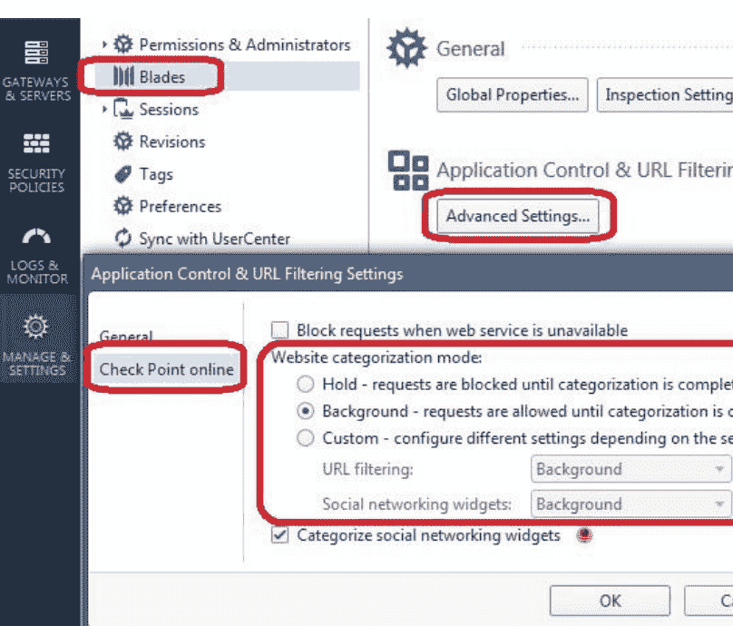

图 10-2：APCL/URLF 网站分类模式

*** 对于威胁仿真，仅当威胁仿真下的“仿真连接处理模式”设置为“阻止（Hold）”时……如所示，在相关的威胁防护策略中开启“高级”选项：

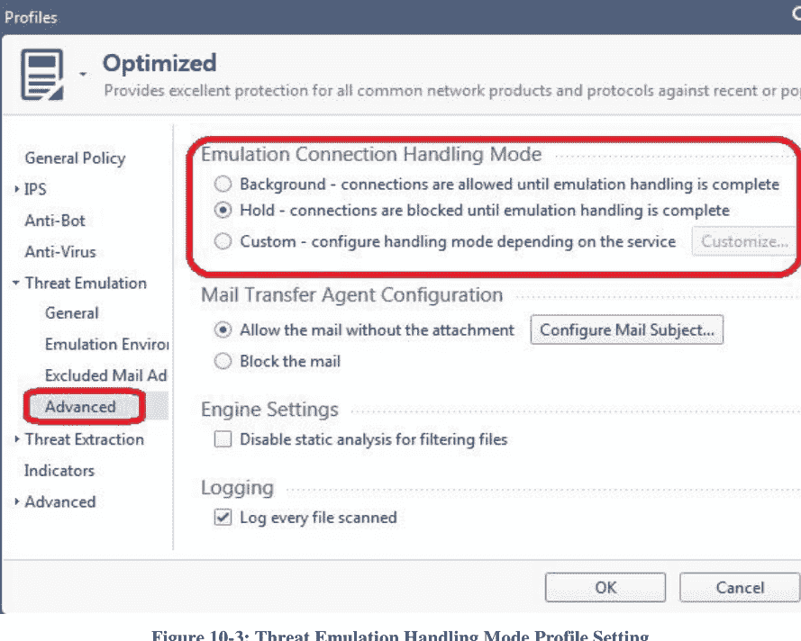

图 10-3：威胁仿真处理模式策略设置

**** 当防火墙的身份感知进程 `pdpd` 可用 CPU 周期不足时，`pdpd` 不会直接影响用户的流量性能，但通过 AD 查询及时形成用户到 IP 地址映射可能会滞后，导致用户最初因缺乏身份而被拒绝访问特权资源。在 R80.10+ 版本中，可以通过使用独立的身份收集器（Identity Collector）软件将用户到 IP 映射的形成“外包”给防火墙外的 `dppd`，从而避免这种情况。参见 sk108235：Identity Collector - 技术概述。

## 特殊情况：DNS 和 rad 守护进程

资源建议守护进程 (`rad`) 是上表列表中许多常用模块的关键进程。`rad` 进程处理防火墙与 Check Point ThreatCloud 之间的交互，用于对 URL 等内容进行动态查询；因为它需要可靠的互联网访问和及时的 DNS 响应，以避免用户流量出现潜在延迟。为了确保 Gaia 中定义的所有 DNS 服务器均可达并提供及时响应（`rad` 积极依赖这些），请运行此快速测试：

- 在防火墙的专家模式下，运行 `cat /etc/resolv.conf` 并记录列出的 DNS 服务器。在示例中，列出的 DNS 服务器将是 `8.8.8.8` 和 `4.2.3.2`。
- 现在确保列出的所有 DNS 服务器都是可用的，并使用类似 `nslookup` 命令快速响应：

```
[Expert@fw-0]# nslookup
> server 8.8.8.8
Default server: 8.8.8.8
Address: 8.8.8.8#53
> www.shadowpeak.com
Server: 8.8.8.8
Address: 8.8.8.8#53
```

非权威答案：
`www.shadowpeak.com` canonical name = `shadowpeak.com`
Name: `shadowpeak.com`
Address: `97.74.144.158`

```
> server 4.2.3.2
Default server: 4.2.3.2
Address: 4.2.3.2#53
```

```
> www.shadowpeak.com
;; connection timed out; trying next origin
;; connection timed out; no servers could be reached
```


图 10-4：验证 `rad` 守护进程的 DNS 响应性

看到了吗？看起来第二个 DNS 服务器的 IP 地址写有拼写错误（应该是 `4.2.2.2`），请修复它！确保列表中的所有 DNS 服务器都是正确的且响应迅速，否则 `rad` 守护进程经历的 DNS 解析延迟可能会传递到用户会话中。

正如书中多次提到的，在防火墙上加载最新的 GA Jumbo Hotfix Accumulator（热补丁包）以获取最新的性能修复至关重要，关键 `rad` 进程也不例外。仍然不信吗？那么，请随时查看这些可以轻松避免的与 `rad` 守护进程相关的性能问题：

## 356 第四条路径：进程空间跳转

### 进程跳转：列表

如果网站分类模式已设置为“阻止（Hold）”，且用户遇到了无法接受的延迟，可能是缓存不断溢出。该缓存最大容量为 `20,000` 条目（通常足够支持 `1,000` 个用户），如果它溢出，整个缓存将导致 `rad` 守护进程在重新填充缓存时向 Check Point ThreatCloud 发起大量 URL 查询。如果缓存不断溢出，会导致 `rad` 守护进程持续高 CPU 占用率，并在网站分类模式设置为“阻止（Hold）”时引起明显的用户流量延迟。可以使用此命令检查当前的 URL 过滤利用率：

```
[Expert@fw-0]# fw tab -t urlf_cache_table -s

HOST            NAME ID #VALS #PEAK #SLINKS

localhost     urlf_cache_table 89 934 0 0

[Expert@fw-0]#
```

图 10-6：检查 URL 过滤利用率

除非确定防火墙中发生了这种溢出情况，否则不应将 URL 缓存大小从默认的 `20,000` 增加。要修改 URL 缓存大小，请参考 `sk90422`：如何修改 URL 缓存大小？

### HTTPS 检查

HTTPS 检查是一项允许防火墙对内部用户访问到互联网的 HTTPS 安全连接执行成功的“中间人”攻击的功能。它也可以配置为检查指向您的 DMZ 服务器的入站 HTTPS 流量。一旦配置成功，该功能允许防火墙使用通常用于检查明文流量（APCL/URLF、威胁防护等）的所有功能来检查加密的 HTTPS 流量。

由于其流行程度日益增加，且往往处于用户所经历潜在进程空间跳转延迟的前沿，本节将详细探讨 HTTPS 检查的优化。本讨论并不旨在介绍 HTTPS 检查功能、其基本原理或整体

## 360 第四条路径：进程空间跳转

在防火墙上部署该功能涉及的组织和法律影响。如果您尚未设置 HTTPS 检查或在相关工作方面缺乏经验，在继续之前强烈建议阅读以下两个 SK：`sk65123`：HTTPS 检查常见问题解答和 `sk108202`：最佳实践 - HTTPS 检查。

正如本书前面提到的，网关上的 HTTPS 检查始终在防火墙路径（F2F）中进行，完全无法通过 SecureXL 进行吞吐量加速。此外，某些操作如 HTTPS 握手（`wtlsd`）和异步密钥计算（`pkxld`）会触发防火墙上的进程空间跳转（process space trip）。

### 影响：启用 HTTPS 检查

在您的防火墙上启用 HTTPS 检查在性能方面会产生潜在的“双重打击”。

- 首先，对于从用户接收到的每个 HTTPS 连接请求，防火墙基本上必须对 HTTPS 连接进行代理，现在必须处理两个独立安全连接的初始 HTTPS 握手和密钥计算，以及这两个连接的数据的对称加密和解密。
- 其次，之前由于流量经过 HTTPS 加密，不受威胁防护（Threat Prevention）和 APCL/URLF 等各种防火墙组件检查的流量，现在可以由更多的组件进行完全解密和检查，从而给防火墙带来额外的开销。

在这里使用“双重打击”一词特别合适，因为在为打算使用 HTTPS 检查功能的购买新防火墙进行规划时，通用建议基本上是将防火墙的规模增加一倍。在现实

## HTTPS 检查 361

世界中，我发现这个建议是非常准确的。因此，如果根据客户需求，Check Point 设备选型工具（Appliance Sizing Tool）推荐了能够 `200` 个安全功率单元（SPU）的防火墙硬件，如果将广泛使用 HTTPS 检查，请将其翻倍为 `400` SPU。SPU 是 Check Point 专用基准系统的一部分，用于评估不同防火墙设备硬件的速度。

### HTTPS 检查性能建议

以下是在启用 HTTPS 检查时，尽量减少对用户产生性能影响和延迟的通用建议：

1. 确保 Gaia 运行在 64 位模式下，这至少需要 `6GB` RAM。可以通过 `clish` 命令 `show os edition` 检查 Gaia 版本。如果 Gaia 正在使用 64 位模式并启用了 HTTPS 检查，会产生一个 `wtlsd` 进程的特殊 64 位伴生进程：

```
[Expert@fw:0]## ps -ef | egrep -e "wtlsd|pkxld"

admin 22361 6721 0 08:34 ? 00:00:00 wtlsd 0
admin 22362 6721 0 08:34 ? 00:00:00 wtlsd 1
admin 22363 6721 0 08:34 ? 00:00:00 wtlsd 2
admin 22364 6721 0 08:34 ? 00:00:00 wtlsd 3
admin 22366 6721 0 08:34 ? 00:00:00 wtlsd 4
admin 22367 6721 0 08:34 ? 00:00:00 wtlsd 5
admin 22380 22363 0 08:34 ? 00:00:00 /opt/CPshrd-R80/bin/pkxld
```

图 10-7：具有六个工作核心的 64 位防火墙上的 `pkxld` 和 `wtlsd`

maxpowerfirewalls.com

Copyright © 2018 Shadow Peak Inc. All Rights Reserved

## 362 第四条路径：进程空间跳转

`pkxld` 进程利用处理器的 64 位模式和各种性能增强处理器扩展，在建立到 HTTPS 站初始连接时大幅加速密钥计算。由于用户必须等待此计算在进程空间中完成后 HTTPS 网页才会开始显示，64 位模式的激活会对用户体验产生显著影响。

2. 确保如第 8 章“3DES vs. AES & AES-NI”节所示，防火墙已正确检测并利用了 AES-NI。如果 Gaia 运行在 64 位模式下，`pkxld` 进程可以利用此特性，将 AES 操作提高 `4-10` 倍。在考虑实施 HTTPS 检查的新防火墙时，请选择支持 AES-NI 的防火墙硬件架构。通常，`5600` 及以上的设备型号支持 AES-NI，*除了* `1200` 型以及过时的 Power-1 `9000/1100` 系列。`3100` 和 `3200` 设备型号也支持 AES-NI。

3. 确保在防火墙最繁忙期间，防火墙工作核心（Worker cores）有足够的空闲时间。对于每个配置的防火墙 Worker，都会产生一个 `wtlsd` 进程，负责处理该特定防火墙工作核心上所有受检查 HTTPS 连接的初始 HTTPS 握手（以及当 Gaia 运行在 32 位模式时的密钥计算）。如果分配给防火墙 Worker 的核心（R80.10+ 防火墙）或系统上的所有核心（R77.30）利用率持续超过 `85%`，`wtlsd` 进程可能会出现资源饥饿。

4. 某些 Check Point 管理员尝试使用“分类站点 (Categorize Sites)”功能来减轻 HTTPS 检查的开销。此功能并不能避免进程跳转和页面加载缓慢，因为 HTTPS 握手仍然由 `wtlsd` 守护进程执行。

5. 正如本书在策略优化方面多次提到的，尽量避免在源、目的和业务字段中使用“Any”。类似于访问控制和威胁防护策略，不遵守此建议可能会导致大量局域网流量意外地受到 HTTPS 检查。

6. 如果使用 R77.30 之前的防火墙，在尝试启用 HTTPS 检查之前，强烈建议升级到至少 R77.30 并安装最新的 Jumbo补丁包（HFA）。R77.30 及其后续补丁包对 HTTPS 检查功能引入了大量的性能增强。

7. R80.10 和 R77.30 之间 HTTPS 检查的功能、能力和性能大同小（当然是在加载了最新 GA R7.30 的情况下）。但对于内存为 `8GB` 或更少的防火墙，强烈推荐使用 R80.10+，因为其引入了各种内存消耗优化，特别是如果启用了 SMT/超线程，本身会大幅增加内存消耗。有关这些 R80.10 内存使用优化的更多信息，请参考：`sk120131`：R80.10 安全 Gateway内存占用。

8. 注意，当 ACL/URLFL Limit 操作限制应用程序流量规则的带宽时，在某些情况下，有效吞吐量可能远低于 Limit 操作中指定的带宽。更多信息请参考：`sk70600`：配置应用控制限制并启用 HTTPS 检查时的连接问题。

9. 如果尝试对 Check Point 防火墙进行 HTTPS 检查的基准测试，请务必按照此处说明以“测试模式”启用 HTTPS 检查：`sk104717`：R77.30 及更高版本的 HTTPS 检查增强。HTTPS 检查测试模式补偿了 HTTPS 负载流量中的非唯一特性，有助于确保测试结果的准确。

10. 如果由于性能问题对受 HTTPS 检查的流量进行内核调试，调试结果将不会显示实际的解密数据，这会阻碍故障排除。要让解密数据显示在内核调试中，请执行以下命令：

## 364 第四条路径：进程空间跳转

```
fw ctl set int https_inspection_show_decrypted_data_in_debug 1
fw ctl set int ssl_inspection_extra_debug 1
```

如果你将这些设置用于非法和/或不道德的目的，你是一个非常糟糕的人，应该感到羞愧。

# 第四条路径 - 进程空间跳转：关键点

- 在过载的防火墙上，需要在防火墙进行进程空间跳转（process space trip）的情况可能会导致明显的延迟。
- 受 HTTPS 检查限制的流量始终在防火墙路径（F2F）中处理。
- 某些防火墙功能在进程中实现是因为以下原因之一：确保防火墙稳定性、处理需要等待外部服务器响应的情况，和/或因为它们是新实现的功能。
- `rad` 进程对于许多模块正常运行至关重要。
- 防火墙上配置缓慢或无法访问的 DNS 服务器会导致用户流量延迟。
- 确保可接受的 HTTPS 检查性能的主要建议是：确保 Gaia 运行在 64 位模式，确保防火墙未过载，并避免在 HTTPS 检查策略中使用“Any”（任意）。
- 内存为 `8GB` 或更少的防火墙从 R80.10 代码版本引入的 HTTPS 检查内存优化中受益匪浅。

# 第 11 章 SECXL 会话速率加速

硬件让机器变快。软件让快速的机器变慢。

- Craig Bruce

## 背景

在第 9 章中，我们注意到与 TCP 三次握手相关的第一个数据包通常会通过整个防火墙路径。一旦 SecureXL “学习”了新连接，并收到了 TCP 三次握手的第二个数据包（SYN-ACK），该连接及其随后的所有数据包就潜在地都有资格进行吞吐量加速，并可以完全由加速路径（Accelerated Path）处理。当然，这假设流量没有受到 APCL/URLF 或威胁防护功能的额外检查，如果是这种情况下，将采用用中间路径（Medium Path）。回想这张显示各种路径的图表：

# 368 SecureXL 会话速率加速

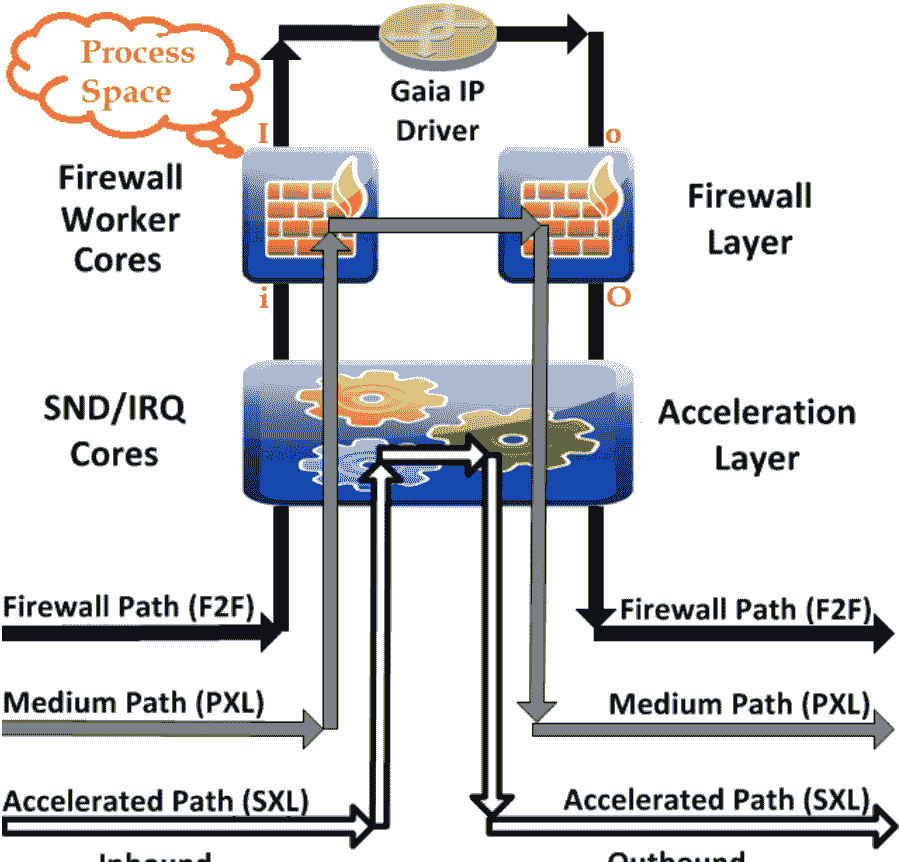

图 11-1：防火墙流量处理路径

然而，在收到新连接的第一个数据包（大多数情况下是 TCP SYN）时，防火墙工作核心必须在防火墙路径中执行计算开销最大的操作之一：安全策略规则库评估。换句话说，防火墙工作核心必须根据安全策略决定是否允许连接启动。在现代生产环境中，安全规则可以轻松达到数百条或数千条，在 R77.30 上，防火墙工作核心必须按顺序搜索安全和 NAT 规则库，以“自上而下、首次匹配”的方式寻找匹配项。R80.10+ 网关使用第 5 章详细介绍的列式匹配（Column-based matching），但在查找规则匹配时可能仍有大量的开销。随着策略规模的不断增长，无论防火墙使用何种技术来查找规则库，所需的 CPU 处理量都将增加。经历极高连接率的防火墙将在防火墙路径中花费大量的 CPU 时间，通过评估访问控制策略来确定是否允许这些连接。

一旦 TCP SYN 被接受并转发，加速层（Acceleration Layer）就可以可能接管，并通过加速路径以高度高效的方式移动与该连接相关的后续数据包。如果我们能以某种方式简化在防火墙路径中处理第一个数据包的过程（该过程正占用我们防火墙工作核心上大量的 CPU 来执行查找），难道不是太好了吗？答案是 SecureXL 会话速率加速。

当会话速率加速激活时，加速层最初仍会将新的连接请求转发到防火墙路径，但它还会尝试为它刚刚传递给防火墙路径的连接请求形成所谓的“接受模板”（Accept Template）。例如，下面的接受模板记录了加速层模板缓存中关于该连接的以下八个属性：

# 370 SecureXL 会话速率加速

- 源 IP 地址：`192.168.1.100`
- 目的 IP 地址：`129.82.102.52`
- 源端口号：`1050`
- 目的端口号：`80`
- IP 协议类型：`6` (TCP)
- 入站接口（由加速层在入侧确定）：`eth0`
- 出站接口（由加速层在出侧确定，假设数据包被允许）：`eth1`

该新连接的初始 TCP SYN 将仍然遍历防火墙路径，一旦加速层收到 SYN-ACK 数据包，它将通过 SND/IRQ 核心上的加速路径进行处理，或者在需要时将其发送到防火墙工作核心进行中间/防火墙路径处理。

然而，假设另一个新连接在加速层请求入站。加速层将查询其接受模板表。此新连接的属性是否匹配接受模板表中当前任何条目的 `8` 个元素中的 `7` 个？假设新连接请求如下所示：

- 源 IP 地址：`192.168.1.100`
- 目的 IP 地址：`129.82.102.52`
- 源端口号：`2055`
- 目的端口号：`80`
- IP 协议类型：`6` (TCP)
- 入站接口（由加速层在入侧确定）：`eth0`
- 出站接口（由加速层在出侧确定）：`eth1`

将此与我们第一个连接的属性进行比较。看到只有一个字段不同（源端口）吗？对于接受模板匹配来说足够了，因为 SecureXL 会话速率加速可以“掩盖”或忽略仅仅一个字段，就能匹配之前的连接。SYN 数据包和 TCP 三次握手的其余部分现在完全由加速层处理。

# Discovery 371

不需要在网络访问层中执行安全规则库查找。连接的数据包被允许并在加速路径上进行加速，或者立即发送到中间/防火墙路径进行处理。

本质上加速层假设既然第一个连接被防火墙接受，第二个连接也应该被允许并具有相同的路由。注意到我们避免了为第二个连接在网络访问层执行策略评估，这再次是防火墙执行的计算开销最大的操作之一。加速层默认创建的接受模板最大数量为连接表的 `25%`。接受模板空闲超时为 `100` 秒。

你可能在想：“好吧，有多少后续连接仅仅有一个变化并能匹配接受模板的呢？”实际上，有两种协议以快速、短寿命的连接而闻名，这些连接之间只有一个字段不同（通常是源端口）：HTTP 和 DNS。这两种协议本身就可以占防火墙上创建的新连接的 `40%`，这自然需要网络访问策略查找。

# 372 SecureXL 会话速率加速

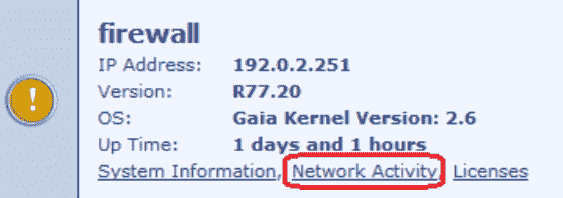


图 11-2：在 SmartView Monitor 中查看新连接速率

在 `10` 秒后，您应该在“新连接速率”字段中看到连接率。或者，要从命令行查看防火墙的新连接（每秒），请运行 `cpview` 命令并选择“Network”。

如何利用 SecureXL 会话速率加速功能？会话速率加速确实需要对策略进行一些微调和调整以获得全部益处。但希望现在你了解了它的工作原理，调优过程将变得更容易。

**问题：** 我的防火墙安全策略是否正在形成会话速率接受模板？

答案：运行命令 `fwaccel stat`：

```
[Expert@firewall:0]# fwaccel stat

Accelerator Status : on
Accept Templates : [enabled]
Drop Templates : disabled
NAT Templates : disabled by user
```

```
Accelerator Features : Accounting, NAT,
HasClock, Templates
Sequencing, Tcp
DelayedNotif, To
WireMode, Drop
Streaming, Multi
Nac, Asynchronous

Cryptography Features : Tunnel, UDPEnc
3DES, DES, CAST
ESP, LinkSelect
EncRouting, AES
```

```
[Expert@firewall:0]#
```

图 11-3：SecureXL Accept Templates 已完全启用

如果你在 Accept Templates 行看到 `enabled`（已启用），那么恭喜你！不需要对安全策略进行进一步的调优；所有具有“Accept”动作的网络访问（Network Access）策略规则都符合 SecureXL 的会话速率加速（Session Rate Acceleration）。相比于 R77.30 防火墙，在 R80.10+ 防火墙上更有可能看到此类 Accept Templates 完全启用的情况，这是因为 R80.10 版本对 SecureXL 模板功能进行了许多改进；后文将详细介绍这些改进。

然而，你更有可能在命令输出中看到类似的内容，特别是防火墙版本为 R77.30 时：

```
[Expert@fw:0]# fwaccel stat

Accelerator Status : : on
```


`Accept Templates : disabled by Firewall`

`Layer Network disables template offloads from rule #7`

`Throughput acceleration still enabled`

+ `Drop Templates : disabled`

`NAT Templates : disabled by user`

`NMR Templates : enabled`

`NMT Templates : enabled`

`Accelerator Features : Accounting, NAT, Cryptography, Routing`

`HasClock, Templates, Synchronous, Idle Sequencing TempStateDetect. AutoExp`

```

```

这意味着安全策略中带有动作的规则 1-6 符合会话速率加速/模板化的条件。在 R80.10+ 防火墙中，情况下输出中会出现额外的 `Throughput acceleration still enabled`（吞吐量加速仍启用）消息，这了 SecureXL 吞吐量加速（第 9 章介绍）不受此条件的影响。规则 7 的配置方式使其不符合模板化。因此，规则 7 之后的所有规则也不符合模板化。在随后的章节中，我们将查看是什么原因导致规则（示例中的 #7 号规则）禁用模板化，以及如何修改或绕过此类规则。

**问题：** 我的防火墙当前连接中有多少是通过模板允许的？

**答案：** 运行 `fwaccel stats -s`：

```
[Expert@firewall]# fwaccel stats -s

Accelerated conns/Total conns : 3910/4297 (90%)
Accelerated pkts/Total pkts : :
F2Fed pkts/Total pkts : :
PXL pkts/Total pkts : :
QXL pkts/Total pkts : :

[Expert@firewall]#
```

图 11-5：使用 `fwaccel stats -s` 显示高百分比的模板优化

本章我们需要检查的输出部分是 `Accelerated conns/Total conns`（加速连接/总连接）行；输出的所有其他部分均涉及第 9 章中介绍过的吞吐量加速。`Accelerated conns/Total conns` 显示了防火墙状态表中的当前连接中有多少能够通过会话速率加速完全在加速层内部启动；百分比越高越好。通常希望连接加速率达到 50% 或以上；75% 或更高为理想。在此被加速的连接避免了在网络访问策略层中进行计算开销巨大的安全策略查找。在我们的示例输出中，防火墙状态表中跟踪的当前连接中有 90% 已通过 `Accept Templates` 允许。这是非常优秀的，如果你的防火墙上的 `Accelerated conns` 百分比达到 75% 或更高，则没有必要进行任何进一步的会话速率加速。

你更有可能看到类似这样的内容：

```
[Expert@firewall:0]# fwaccel stats -s

Accelerated conns/Total conns : 310/4297 (7%)
Accelerated pkts/Total pkts : :
F2Fed pkts/Total pkts : :
PXL pkts/Total pkts : :
QXL pkts/Total pkts : :

[Expert@firewall:0]#
```

图 11-6：使用 `fwaccel stats -s` 显示低百分比的模板优化

`max` 表示该防火墙急需会话速率加速调优，将在下一节介绍。泛而言之，我们的目标是加速连接率至少达到 50%，最好达到 75% 或更高。

**问题：** SecureXL 会话速率加速创建了多少 `Accept Templates`？

**答案：** 运行 `fwaccel -s`：

**SecureXL 模板表中有 105 个模板**

这只是一个为了稍后对比以评估我们会话速率加速调优成效的数字；请记录下你的防火墙当前返回的值以备后后参考。在接下来的章节中，我们将通过调优策略来优化 SecureXL `Accept Templates` 的生成。然而，在继续之前，有一点你需要注意。

## 反机器人防护：SecureXL 模板

在根据本章后文建议进行了一系列艰苦的尝试后，`fwaccel stat` 终于报告了 **Accept Templates: enabled**。胜利！你开始好奇模板百分比能达到多高，但出现了一个严重错误。模板化率（**Accelerated conns**）为零。

## 最大化 SecureXL 模板化的策略调优

如果你在防火墙上启用了 Anti-Bot，所有受其影响的流量将不符合模板化条件（但吞吐量加速不受影响）。在这种情况下，如果你看到模板率为零，你可能将保护范围（Protected Scope）设置为“Any”并将 Anti-Bot 应用于所有流量。由于此原因，Anti-Bot 无法看到连接启动并判断 IP 的信誉。从 R80.10 开始，SecureXL 和 Anti-Bot 之间似乎没有通知机制，因此新连接无法允许模板。这种限制在我找到的任何地方都没有记录，但第一次遇到它时确实把我搞懵了。

## 最大化 SecureXL 模板化的策略调优

在上一节中，当我们在运行 `fwaccel stat` 时看到了类似的内容：

```
[Expert@fw:0]# fwaccel stat

Accelerator Status : on
Accept Templates : disabled by Firewall
Layer Network disables template offloads from rule #7
Throughput acceleration still enabled

Drop Templates : disabled
NAT Templates : disabled by user
NMR Templates : enabled
NMT Templates : enabled

Accelerator Features : Accounting, NAT, Cryptography, Routing
HasClock, Templates, Synchronous, Idle
Semantics. TempDetect. AutoExpiry
```

图 11-7：SecureXL Accept Templates 部分禁用

显然，安全策略规则 7 中的某些内容导致了策略中该点之后的 `Accept Templates` 被禁用。但它是什么？

| int_nets | All_DMZs | Any | ALL_DCE_RPC |

图 11-8：使用禁用模板服务的安全策略规则

考虑以下可能导致这种情况情况的规则。请注意，在你的防火墙上运行 R80.10+ 可以消除几乎所有的模板限制，最棒的一点是，除了将防火墙升级到 R80.10 外，你不需要做任何特殊操作即可利用这些特性！

- 使用 RPC/DCOM/DCE-RPC 服务的规则
- 罕用的复杂服务（例如 `http_mapped`, `ftp_mapped`）以及具有自定义匹配条件的类型服务
- 带有 User、Client 或 Session 认证动作的规则（这些已被身份识别取代的遗留功能）。
- 包含服务 `traceroute` 的规则（在 R80.10+ 中解决）。

## 策略优化以最大化 SecureXL 模板化 379

- 包含 `dhcp-request`/`dhcp-reply` 规则（在 R80.10+ 中解决）
- 时间对象（在 R80.10+ 中通过 NMT 模板解决）
- 动态对象（在 R80.10+ 中通过 NMR 模板解决）
- 域名对象（在 R80.10+ 中通过 NMR 模板解决 - 不要在 R77.30 或更版本的网关上使用域名对象，因为这会导致防火墙性能严重！）

导致 SecureXL 形成接受模板（Accept Templates）的规则可能使用了上述列出的对象类型之一。首先，你还需要该规则吗？它的命中计数（hit count）是多少？如果是零，禁用该规则，重新安装策略并再次运行 `fwaccl stat`。现在查看是哪条规则（如果有）禁用了模板化。如果你能够重复此过程直到 `fwaccl stat` 报告：

`Accept Templates : enabled`

那么你就没问题了，网络策略层（Network Policy layer）中所有具有“Accept”动作的规则都可以完全模板化；现在使用 `fwaccl templates -s` 命令查看又创建了多少模板。然而，由于该规则具有关键功能，如果你无法简单地删除或禁用阻止模板形成的规则，那么基本上有两个选择。（接下来的截图仍将来自 SMS R77.30 版本，因为如果你的防火墙仍在使用该版本，则更有可能需要以下技术）

- 将违规规则移动到规则库中尽可能靠后的位置，以便其上许多规则能够符合模板化条件；特别是，如果可能，请尝试将违规规则移动到所有高命中计数规则下方。如果你的防火墙上使用 R80.10+，最需要担心的情况是存在

## SecureXL 会话速率加速

策略中的 RPC/DCOM/DCE-RPC 服务；将这些规则移动到策略中尽可能靠后的位置。移动规则始终存在在策略验证期间导致规则隐藏冲突（rule hiding conflicts）的可能性，因此你可能需要进行尝试。

- 将命中计数最高的规则移到规则库的顶部。

这样做不仅会让这些规则符合模板化条件，而且在 R77.30 防火墙上不存在接受模板的情况下，有助于优化防火墙路径（Firewall Path）中的策略查找。虽然第二种技术从性能角度来看往往能产生最大的收益，但遗憾的是，命中计数最高的规则往往是非常通用规则，在规则的源（Source）、目的（Destination）和/或服务（Service）字段中使用大型网络或“Any”。按照目前的配置尝试将这些规则向向上移动，很可能会在策略验证期间产生雪崩般的规则隐藏错误。

规避此问题的一种方法是确定高利用率通用规则的源、目的和/或服务字段中的哪些特定元素导致了最多的命中。例如，在大多数规则集的末尾通常有一条规则允许所有内部用户访问互联网，它看起来像这样：

| No. | Source | Destination | VPN | Service | Action | Track |
| :--- | :--- | :--- | :--- | :--- | :--- | :--- |
| 18 | Internal_Nets | Any | Any | Approved_Ports | accept | Log |

图 11-9：典型的出站互联网访问策略规则

尝试将此规则移动到策略顶部（可能仅紧随防火墙隐身规则之后）几乎肯定会导致大量的规则隐藏错误，从而阻止你安装策略。这通常是因为服务字段被设置为

## 策略优化以最大化 SecureXL 模板化

“Any”，或大量的已批准端口。然而，假设你确定在 SmartView Tracker/SmartLog 中，该规则用户访问互联网时的首选服务是 `http`、`https` 和 `ssh`。如果你拥有监控组件（Monitoring blade）的许可，你可以通过在 SmartView Monitor 中运行“顶级服务（Top Services）”实时报告或上周的历史 SmartView Monitor“顶级服务”报告来轻松确定这一点。

现在，你在防火墙隐身规则正下方创建一个新的“拆分”（split）规则：

| No. | Source | Destination | VPN | Service | Action | Track |
| :--- | :--- | :--- | :--- | :--- | :--- | :--- |
| | Any | Firewall_ | Any | Any | drop | Log |
| | SecureXL Templating Optimized Rules (Rules 3-6) | | | | | TCP http |
| 3 | Internal_Nets | Any | Any | accept | Log TCP ssh |

图 11-10：从下级规则拆分服务的新模板化规则

原始的通用规则留在规则库底部，除了从 `Approved_Ports` 组中移除 `http` 和 `ssh` 服务外未作变动。现在，绝大多数出站互联网流量都可以通过会话速率加速进行模板化，而且作为一个额外奖励，R77.30 防火墙路径中的自而下策略评估要高效得多！你的新规则与下方规则之间可能会存在少量服务冲突，但与在这条新规则中将服务字段保留为“Approved_Ports”相比，这些冲突可能很容易处理！取决于你尝试以这种方式拆分的规则，你可能可能还需要在源和/或目的字段中替换比“Any”更具体的内容。

以下是一个显示这些技术实际应用的示例规则库：

## 382 SecureXL 会话速率加速

## 策略

| No. | Hits | Source | Destination | VPN | Service | Action | Track |
| :--- | :--- | :--- | :--- | :--- | :--- | :--- | :--- |
| | Firewall Mgmt & Stealth Rule (Rules 1-2) | | | | | |
| 1 | Admin | Firewall_ | Any | accept | Log | |
| 2 | Firewall_ | Any | drop | Log | |
| | SecureXL Templating Optimized Rules (Rules 3-6) | | | | | |
| 3 | Internal_Nets | Any | Any | accept | Log TCP ssh |
| 4 | Any | Web_Server | Any | accept | Log | |
| 5 | Any | Mail_Server | Any | accept | Log | |
| 6 | Web_Server | DB_Server | Any | accept | Log | |
| | Rest of Policy for rare-hit rules (Rules 7-19) | | | | | |

图 11-11：显示优化 SecureXL 模板化的策略

我们在策略顶部创建了一个“SecureXL 模板化”部分，并将高命中规则置于。理想情况下，任何高命中规则（在“Hits”字段中会显示红色或橙色色条）都应该移动到策略的此部分。

## 可能禁用加速的其他情况

某些匹配安全策略规则的单个连接无法模板化，但它们的存在不会干扰后续规则的模板化过程。这是调整 SecureXL 会话速率加速时主要的困惑来源。例如，FTP 服务经常被引用为“禁用加速”。这并不意味着在规则中使用 FTP 服务会禁用所有受其影响规则的模板化；它仅仅意味着单个 FTP 连接无法模板化，并在防火墙路径中进行完整的安全策略规则库查找。

# 384 SecureXL 会话速率加速

引用 FTP 服务规则下方的规则仍然可以进行模板化。还有哪些类型的连接无法进行单独的模板化？

- VPN 流量无法进行单独模板化。流向 VPN 隧道出站的加密或从 VPN 隧道入站解密的连接，都不符合通过接受模板（Accept Templates）进行会话速率加速条件。（在之前的章节中，我们也提到，大多数 VPN 流量也不符合吞吐量加速，并且在 R77.30 防火墙上必须在编号最低的 Firewall Worker 核心上执行防火墙路径）
- 复杂连接（FTP、H323 等）无法进行单独模板化。
- “复杂连接”通常定义为动态生成数据端口的协议。
- 非 TCP 和非 UDP 流量（包括 ICMP 和 GRE 流量）无法进行单独模板化。只有 TCP 连接和 UDP 流量适用于模板化。

再次强调，安全策略规则库中存在这些情况不会禁用后续规则的模板化；它只是排除了这些特定连接的模板化。

# NAT 模板

NAT 规则库模板化能力是在 R75.40 版本中相对引入的。在本章的前部，我们花大量时间优化了主安全策略（在 R80+ 管理中称为网络策略层）的模板化过程。希望您能够将 `fwaccel stats -s` 显示的“加速连接（Accelerated conns）”百分比提高至少 50%，最好超过 75%。然而，如果所有连接都经过 NAT，那么这些连接的 NAT 规则库查找如何处理？除非在 SecureXL 中启用了 NAT 模板，否则这些 NAT 查找仍然在防火墙路径中处理。

除非 `fwaccel stats -s` 显示至少有 50% 的连接可以模板化（加速连接/总连接）且至少有 50% 的流量在加速路径中处理（加速数据包/总数据包），否则启用 NAT 模板的获益甚微，且可能带来巨大损失。NAT 模板只能通过 `fwkern.conf` 文件和重启防火墙来启用或禁用；如果在启用 NAT 模板后开始出现问题，除非你有防火墙集群，否则需要停机才能将其关闭。启用 NAT 模板似乎还会增加防火墙其他部分出现问题的概率，包括 SecureXL 自动禁用：

- `sk113398`: 80 和 443 端口上出现动态调度器“实例不匹配”导致丢包
- `sk100467`: `"fwaccel stat"` 输出中的“Accelerator Status : off by Firewall (too many general errors) (caller: ...)”
- `sk1067099` - 当启用 SecureXL NAT 模板且在 VSX 上配置 Hide NAT 时 SecureXL 不稳定
- `sk111015` - 同时启用 CoreXL 动态调度器和 SecureXL NAT 模板后，ClusterXL 出现流量中断
- `sk117332` - 启用 SecureXL 的集群成员在安装策略时因 SecureXL NAT 模板问题而崩溃


那么，你会启用 NAT 模板吗？我只能从我自己的经验来说，但我很少需要启用它们。NAT 模板在 R80.10 防火墙上默认仍禁用的这一事实，似乎证实了我对启用它们的疑虑。

# 386 SecureXL 会话速率加速

如果正确实施了书中详细的调优技术，在几乎所有情况下，我都能获得良好的性能，并为未来的增长留出可接受的余量，而不需要 NAT 模板。在我看来，对于大多数防火墙性能优化工作，启用 NAT 模板通常是收益递减的节点，特别是当绝大多数流量检查发生在中间路径（Medium Path）时，这在现实世界中非常典型。在整本书中，我强调了一种“性价比最高”的方法，可以最大化性能收益，而无需过度努力或涉足晦涩深奥的领域。除非有特殊情况，否则书中大部分性能提升可能已经实现。

如果您希望启用 SecureXL NAT 模板，请参考 `sk71200`：SecureXL NAT Templates。再次强调，除非 `fwaccel stats -s` 显示至少有 50% 的连接可以模板化（`加速连接/总连接`）且至少有 50% 的流量在加速路径中处理（`加速数据包/总数据包`），否则启用 NAT 模板可能获益甚微。还要注意以下本章已提到过的内容：

- 启用 NAT 模板涉及对防火墙 `fwkern.conf` 文件的修改，该文件用于在 Check Point 代码中指定自定义内核变量值。此文件通常在防火墙版本升级后无法保留，必须在任何升级完成后手动重新配置。重启防火墙才能使任何 `fwkern.conf` 的更改生效；不用说，除非你有防火墙集群，否则会导致停机。

- 如果 NAT 模板导致问题，关闭它们的唯一方法是编辑 `fwkern.conf` 文件并重启网关；再次，除非你有防火墙集群，此过程会导致停机。

- 一旦启用，可以使用 `fwaccel stats` 命令查看涉及 NAT 模板的统计数据。

# SecureXL 会话速率加速：重点

- SecureXL 会话速率加速与通过三个内核路径实现的吞吐量加速完全独立的功能。

- 会话速率加速使用接受模板（Accept Templates）加速新连接的启动，并避免在网络策略层中进行计算密集的安全策略规则库查找。

- 受 Anti-Bot 组件检查的流量无法进行会话速率加速（模板化）。

- R80.10+ 防火墙代码包含了大量的会话速率加速改进，使得网络策略层中的所有规则都更容易模板化。

- 为了获得会话加速的最大收益，可能需要对安全策略层进行优化。

- 启用 NAT 模板允许 NAT 连接进行 SecureXL 模板化；但如果大多数数据包在中间或防火墙路径中处理，性能收益将微乎其微。

# 第 12 章

多队列与 SMT/超线程

> 我接触的现实越多，我就越信简单的方案越好。

- William J. Bernstein

## 引言：多队列

在第 7 章中，我们详细讨论了所谓的“三剑客”中最具隐蔽性的成员：RX-DRP 计数器。在很多情况下，大量的入数据包被防火墙丢弃。不是因为它们违反了安全策略，而是因为分配给及时处理缓冲区的 CPU 资源不足。在深入分析网络缓冲机制以及 RX-DRP 计数器如何指示问题后，我们看到分配更多的 CPU 核心用于 IRQ 处理是显而易见的，我们的目标是 RX-DRP 速率低于 0.1%。

启用多队列和/或 SMT/超线程绝非显而易见的！

# 390 多队列与 SMT/超线程

这两个功能默认都没有启用，理由非常充分。如果盲目启用这些功能，防火墙配置的复杂性将会增加，而没有实质性收益。这种复杂性不可避免地会在最不方便（甚至可能影响职业生涯）的时刻找上门。复杂性是安全以及通用网络的敌人。作为顾问，没有什么比在没有可衡量的实质收益的设计中引入不必要的复杂性更让我愤怒的。不恰当启用这些功能不仅会增加复杂性，还可能降低防火墙性能。

尽管如此，在适当的情况下，多队列和 SMT/超线程是极大提升防火墙性能的优秀功能。在本章中，我们将探讨哪些情况适用于激活这些功能，以及如何在网络中最佳实施。如果启用了一个或两个功能但没有获得实质收益，我强烈建议将其关闭！

注意：`sk63128` 中描述的将使用 IXGBE 驱动程序的 10 Gb 接口 RX 和 TX 分配到不同 CPU 核心的方法是将接口处理开销分散到多个核心的原始方法，也是多队列功能的先驱。不要使用这种原始的替代方案，请改用多队列。

## 发现：多队列 (Multi-Queue)

回想我们性能优化的核心目标：网络接口的 RX-DRP 速率低于 0.1%，且在防火墙最繁忙期间，所有核心的空闲率至少达到 50%。如果你的防火墙已经达到了这一目标，那么启用多队列可能在为防火墙抵御拒绝服务（DoS）攻击提供更多处理“余量”之外，可能不再有实质性的益处。如果你想这样做，可以继续，但请注意之前的关于不必要地增加防火墙复杂性的警告。

- 问题：我的防火墙是否有任何一个接口已经启用了多队列？

  运行 `cpmq get`

- 问题：是否启用了 SecureXL？

  运行 `fwaccel stat`

- 问题：我是否有使用 `igb/ixgbe/mlx5_core` 驱动且符合多队列条件的接口？

  （注意：`ls` 命令后的选项是数字 1）

  `ls -1 /sys/class/net | grep -v ^lo | xargs -i ethtool {}`

- 问题：我所有的接口的 RX-DRP 速率都低于 0.1%？

  运行 `netstat -ni`。将 RX-DRP 除以 RX-OK 并乘以 100 以得到 RX-DRP 百分比。

- 问题：我的防火墙有多少核心？

  `cpstat -f cp os | grep -i CPUs`

## 392 多队列与 SMT/超线程

你的防火墙必须至少有 2 个核心才能使用多队列，且底层硬件必须支持 IRQ Swizzling（中断重定向）；然而，在 2 核防火墙上启用多队列几乎闻所未闻，在 4 核防火墙上其提供的性能提升可能微乎其微。多队列主要用于具有 6 或更多核心的防火墙。

## 分析：多队列

如果你跳过了之前所有章节的步骤直接跳到这一章启用多队列，那么在评估是否需要多队列之前，按照之前章节中的描述对防火墙进行调优非常重要。在完成那些优化后，你可能会发现自己根本不需要多队列！保持防火墙配置尽可能简单！

如果你已经到了这一步，说明防火墙可能已经过你所能做的最佳调优，但你的一个或多个接口仍存在 >0.1% 的 RX-DRP 速率，或者你未能实现在防火墙最繁忙期间所有核心空闲 50% 的既定目标。这通常表明存在三种情况：

- 1. 分配了大量核心给 SND/IRQ 功能，相关接口甚至可能分配了专用的核心来处理 SoftIRQ（`sim affinity -1`），且该核心的工作仅是处理该接口的 RX 环形缓冲区。然而，这个唯一的专用核心在防火墙最繁忙期间的空闲时间远少于 50%，且/或 RX-DRP 速率仍然 >0.1%。这种情况在 1Gbps 接口上并不常见（如果是的话，则可能存在其他问题，例如防火墙严重过载），但在繁忙的 10Gbps+ 接口上很容易发生。在这种情况下，多队列绝对会有帮助，性能提升可能会非常惊人。

- 你已经执行了之前章节中所有的调优程序，但似乎没有足够的可用核心来分配给 SND/IRQ 处理。理想情况下，每个 10Gbps+ 接口都有自己的专用核心用于 SoftIRQ 处理，但随后尝试分配足够的 SND/IRQ 核心来完成此会导致剩余的防火墙工作核心（Worker cores）过载。在这种情况下，甚至可能有 1Gbps 接口出现大量的 RX-DRP 错误。检查 SND/IRQ 核心的处理器利用率（`sim affinity -1` 后接 `top...1!`）。如果防火墙最繁忙期间 SND/IRQ 核心的平均空闲率为 25-50%（或你看到 SND/IRQ 核心之间的空闲百分比差异巨大），多队列在这种情况下确实可以提供一些性能收益，但记住防火墙处于中度过载状态，因此务必降低预期。

- 如果所有 SND/IRQ 核心在防火墙最繁忙期间的空闲时间都小于 25%，且由于高利用率你无法将核心重新分配给 SND/IRQ，则防火墙已严重过载，多队列可能不会产生影响；开启它会导致整体性能变差。当禁用多队列时（默认设置），每个接口只有一个队列。

## 多队列与 SMT/超线程

对于未标记流量，多队列允许每个接口拥有多个队列。默认情况下，多队列创建的并行队列数量与 SND/IRQ 核心数量相同。然而，如果相关接口使用 `igb` 驱动（通常是旧的 Intelps NIC），无论 SND/IRQ 核心数量有多少，该接口创建的队列上限为 4 个。

## 分析：多队列 395

对于 3000/5000/15000/23000 系列设备，板载（内置）NIC 还有一个额外限制；由于硬件限制，它们使用的 `igb` 驱动导致每个接口最多只能有两个队列。因此，建议避免使用这些设备的板载 NIC 处理需要多队列功能的密集流量。对于使用 `igbe` 驱动的新型 Intel 接口（通常是 10Gbps+ NIC），每个接口的限制为 16 个并行队列。过去，Intel 制造的 NIC 在 Gaia 上支持多队列。但 15000/23000 系列设备现在有一种 Mellanox 制造的 40G 光纤扩展卡（`ethtool -i` 显示的驱动名为 `mlx5_core`），也支持多队列。请注意这些网卡较新，尚未像 Intel NIC 那样经过彻底验证，并且存在以下限制：`sk112517`：在 15000 / 23000 设备上安装 R77.30 及以上版本的 Take 128 Jumbo Hotfix 后，40 GbE 光纤卡将停止。

关于多队列的通用说明：

- 必须启用 SecureXL 才能使用多队列。

- 多队列同时最多只能用于 5 个物理接口，无论 NIC 硬件和驱动类型如何。

- 如果更改了防火墙核心数（这将导致 SND/IRQ 核心数量发生变化），请以新的核心配置启动防火墙。

# 396 多队列与 SMT/超线程

运行命令 `cpmq reconfigure`，然后再次重启防火墙，以针对新的核心配置正确重新配置多队列（Multi-Queue）。你无法跳过中间的重启步骤，必须重启防火墙两次。

- 可以通过 `cpmq set rxnum` 命令手动更改每个接口的并行队列数量，使其不再与 SND/IRQ 核心的总数匹配。在某些限制性情况下，这可能非常有用，可以避免让某些 SND/IRQ 核心处理来自特定接口的多队列流量，从而为其他操作释放这些核心资源。

- 仅在需要的接口上启用多队列，因为将连接“绑定”到同一队列会给所需的 SND/IRQ 核心带来轻微的额外开销。适用于多队列的良好接口标准是：RX-DRP 速率大于 0.1%，或者在防火墙最繁忙的期间，其对应的 SND/IRQ 核心的空闲率远低于 50%。

- 如果防火墙绝大部分流量仅由两个接口处理（特别是当这些接口速率为 10Gbps 或更高时），强烈建议为这两个接口启用多队列。

# 启用多队列

注意：如果你是因为盲目地开启“听起来很酷”的多队列功能而直接跳到这一节，请停下来并阅读本章中本节之前的所有内容，以确保你完全理解你正要的操作可能产生的影响。

一旦你确定了哪些接口需要通过多队列获得 SoftIRQ 处理帮助，运行命令 `cpmq set`。你将看到一个符合多队列操作要求的接口列表。选择你之前确定的接口进行多队列操作并退出。更改完成后，你需要重启防火墙以使更改生效。重启后，运行 `cpmq get` 以验证目标接口上是否已启用多队列。运行 `top...I` 并重新检查所有 SND/IRQ 核心的处理负载；现在负载应该要平衡得多。

然而，在某些系统上，有一种更简单的方法启用多队列。在防火墙的 Gaia Web 界面的“网络管理...性能优化”（Network Management... Performance Optimization）下，可能会出现以下界面：

# 多队列与 SMT/超线程


图 12-1：Gaia Web 界面多队列设置

屏幕底部列出了所有适用于多队列的网接口列表；只需勾选你想要启用的接口旁边的框并点击 OK。更改仍需重启才能生效。你的防火墙必须至少有六核心，并且必须有一个接口使用 Intel 的 `igb` 或 `igxe` 驱动（或 Mellanox `ml5_core` 驱动），才能显示此界面。如果你的防火墙上没有此网页，请直接使用 `cpmq set` 命令。

Copyright © 2018 Shadow Peak Inc. All Rights Reserved

# 多队列：RX-DRP 仍在定期增加？

如果你已经启用了多队列功能，并确保所有 SND/IRQ 核心始终至少有 50% 的空闲，那么 RX-DRP 的发生应该非常罕见。但如果你发现即使在防火墙完全不忙时（尽管整体性能仍然出色），它们仍在定期堆积，那么可能是你的网络交换机配置存在错误，应该进行纠正。请参阅第 7 章中的“RX-DRP Visited: Still Racking Them Up?”章节。

# 引言：SMT/超线程

在《Max Power》第一版中，SMT/超线程被称为“Hyperspect”，这是一个过时的术语。第一版还对 SMT 采取了相当强硬的态度，除非确凿证明绝大多数防火墙流量都在中路径（PXL）中处理的。书中还提到，在任何其他情况下启用 SMT 都会增加复杂性，而性能提升却存疑，且 Check Point 客户在现实世界并未广泛部署 SMT。我对 SMT 的立场有所松动，但假设你已经达到了我们所述的目标：即在防火墙最繁忙的期间，所有核心的空闲率达到 50%，且所有接口的 RX-DRP 速率小于 0.1%，那么即使你的防火墙支持，你也真的不需要启用 SMT。

然而，对于新的 5800/5900/15400/15600/23500/23800 系列设备，Check Point 现在建议根据 PXL 流量比例将启用 SMT 作为一项最佳实践，前提是他们在防火墙上至少运行了 R77.30 Jumbo HFA（或 R80.10+）。显然，这种

# 400 多队列与 SMT/超线程

建议的原因是，Check Point 在这些特定的硬件型号上，是在启用 SMT 的情况下进行了所有质量保证测试，而不是在对之前型号的所有测试中都禁用 SMT。

> 我还没有准备好说支持在防火墙上启用 SMT/超线程是一件“显而易见”的事，但我们正在接近。

# 发现：SMT/超线程

问题：SMT（同步多线程）是否已启用？

答案：运行 `cat /proc/smt_status` 可能有三种结果：

- **Unsupported（不支持）** - 你的防火墙设备不符合下方详细列出的 SMT/超线程众多要求之一。

- **Soft Disable（软禁用）** - 你的防火墙设备支持 SMT/超线程，但尚未通过 `cpconfig` 启用。

- **Enabled（已启用）** - SMT/超线程已启用。Check Point 设备默认是禁用的，但在某些点已被显式启用。

SMT/超线程支持是在 R77 版本中引入的，允许 Check Point 防火墙利用某些处理器架构的 CPU 超线程功能（技术上称为同步多线程或 SMT）。在 R77 版本之前，所有 Check Point 设备始终禁用超线程，且 Check Point 强烈建议在 CoreXL 中禁用超线程。虽然 Intel 声称启用超线程可以获得高达 50% 的性能提升

# 发现：SMT/超线程 401

提升，但 Check Point 表示在防火墙上获得的收益预计在 20-30% 的范围内。

希望你已经完成了直到此处所有章节的调优程序。如果你只是为了在不知道可能影响的情况下启用 SMT/超线程而跳过了这一节，你需要停止并完成之前章节的所有调优程序。可能经过适当调优，你可能会发现根本不需要启用 SMT/超线程！如果你已经完成了之前的所有程序，请继续阅读。

在进一步研究 SMT 之前，我们必须先查看利用此功能需要满足的所有要求列表。它们是：

- 1. 只有高端 Check Point 设备型号支持 SMT。通常情况下，5800 及以上的设备型号支持 SMT/超线程，但 12200 型号和过时的 9000/11000 系列除外。

- 2. 防火墙设备必须以 64 位模式运行 Gaia，代码版本为 R77 或更高以启用 SMT，并且至少拥有 8GB 内存。所有支持 SMT 处理器架构的当前 Check Point 设备都配备了至少 8GB 内存，12400 和 12600 设备除外。

- 3. 必须启用 CoreXL。无论是否启用 SMT，可以配置的最大防火墙核心数在 R77.30 版本中限制为 32。对于 R80.10+ 网关，此限制已增加到 40。

- 4. 在候选防火墙上运行 `free -m`。输出中“-/ buffers/cache”一行的“free”列数字对于总核心少于 12 个的防火墙应至少为 3072，对于超过 12 个核心的防火墙应至少为 6144。

## 多队列与 SMT/超线程

如果可用内存不足，当尝试开启 SMT 时，防火墙性能将由于虚拟内存分页和交换而受到严重损害。

- 由于内存限制（以及可能对性能产生巨大影响），某些功能不建议启用 SMT：较旧版 DLP 模块（不包含内容感知功能）、反病毒（仅限传统模式）以及使用遗留资源对象的安全策略规则。

- 在使用较新的 25G/100G Mellanox 网卡的 15000/23000 系列设备上，勿启用 SMT；该功能在发布时尚不支持此。请参阅 `sk116742`：在 15000 和 23000 设备上安装和配置双 25G/100G I/O 卡以获取更新。

- 任何开放式防火墙硬件均未官方支持过 SMT，此限制持续适用于 R80.10 代码。

- 从 SMT 中获益最显著的软件功能是“下一代防火墙”功能，这些功能执行一些流量模式匹配和中间路径活动流处理（PXL），例如应用控制、URL 过滤和威胁防护。请注意，“传统的”防火墙安全策略/NAT 功能并不能从 SMT 中获益。在未利用上述任何“下一代防火墙”功能的防火墙上启用 SMT，可能会以一种令你意料的方式实际上降低性能和容量（我可能会说这种不太愉快）。


作为高级网络模块（Advanced Networking blade）一部分的 QoS 功能不支持 SMT。此限制不适用于专门使用了至少 R77.30 巨型热补丁积累（或 R80.10+）的 5800/15400/15600/23500/23800 设备。此限制不包括在任何设备型号的 APCL/URLF 策略层中实现的 Limit 操作。

## 分析：SMT/超线程

一旦启用 SMT，可用于配置的核心数本质上是 SND/IRQ 或防火墙 Worker 核心的两倍。还记得 CoreXL 章节中的建议——将核心分配在相邻对中以最大化 CPU 快速内存访问吗？启用 SMT 后，该建议变得更加重要。启用 SMT 时，绝不要选择相邻的核心来执行不同的功能。记录一下，相邻的核心为 0+1、2+3、4+5 等。这些所谓的“相邻核心”在启用 SMT 时并不实际上是两个独立的核心；它们只是同一个物理核心上的两个逻辑线程。如果可能，强烈建议按 4 个核心一组的块来分配核心功能（例如 0,1,2,3 和 4,5,6,7），以便在启用 SMT 时最大化 2 个物理（4 个逻辑）相邻核心之间的 CPU L2 快速缓存共享。

## R77.30 特殊情况：IPSec VPN 与 SMT/超线程

回想第 8 节，在 R77.30 防火墙上，所有的 IPSec VPN 流量都受限于在一个防火墙 Worker 核心，无论是否启用了 CoreXL。R80.10+ 防火墙默认支持多核心 IPSec VPN，不受此限制。然而，当 R77.30 启用 SMT 时，这产生了一个特殊问题：默认情况下，负责所有 IPSec VPN 操作的那个的单逻辑核心现在必须与另一个尝试运行在同一物理核心上的防火墙 Worker 实例共享资源。R77.30 只能使用一个核心进行所有 IPSec VPN 操作已经足够糟糕了，而启用 SMT 后这种情况进一步恶化。

幸好，R77.30 有变通方法；只需按照如下所述将 `fmwltik_dispatch_skip_global` 内核变量设置为 2：

- sk93000：SMT（超线程）功能指南。当设置为 2 时，该变量规定处理 IPSec VPN 流量的单核心线程将仅处理 IPSec VPN 流量（它不会同时尝试充当通用防火墙 Worker 核心），并且相邻的核心（实际上只是物理核心上的另一个逻辑线程）将保持空闲且完全不做。此配置避免了专门处理 IPSec VPN 操作的物理核心上的线程竞争和 CPU 缓存抖动。R80.10+ 防火墙不受此限制。

## 多队列与 SMT/超线程

（注：OCR 文本中的此部分似乎是之前章节的重复或片段，但遵循所提供的结构）

- 为了避免线程竞争，将 `fmwltik_dispatch_skip_global` 设置为 2。

- R80.10+ 防火墙不受此限制。

## 启用 SMT/超线程

要启用 SMT：

- 运行 `cpconfig` 并选择 "yes"。

- 在 R77.30 中，将内核变量 `fmwltik_dispatch_skip_global` 设置为 2。

- 在 R80.10+ 上，这些功能不受上述限制。

## 多队列与 SMT/超线程：关键点

- 始终启用 SMT 并不完全是一个“明智之举”；无差别地这样做实际上可能会损害性能并增加复杂性。

- 多队列允许多个 SND/IRQ 核心处理 SoftIRQs，对于 10Gbps+ 接口特别有用。

- 启用后，超线程利用处理器架构的 SMT 功能使核心总数翻倍。

- 传统的防火墙处理性能不会因启用 SMT 而增强。

- 严重依赖中间路径的所谓“下一代防火墙”功能从 SMT 中获益最多。

- 防火墙使用 SMT 需要满足许多内存和硬件要求。

- 处理大量 IPSec 流量的 R77.30 防火墙应升级到 R80.10+。

## 第 13 章：增强防火墙对 DOS 攻击的抵抗力

## 背景

我们的目标是在防火墙最忙期间所有 CPU 核心的空闲率达到 50%，且 RX-DRP 速率 <0.1%，这对于确保有大量的“余量”非常有帮助。本章列出的功能可以帮助增强防火墙对 DoS 攻击的抵抗力。这些功能主要设计用于缓解来自互联网的攻击，但特定能力（如下文所述的速率限制）有时可以用于限制消耗过多连接的内部系统或网络。启用多队列功能（上一节介绍）也可以通过将网络接口 SoftIRQs 的处理分布到多个核心，在 DoS 场景下提供一些益处。

## 增强防火墙对 DoS 攻击的抵抗力

有关最新的 Check Point 防火墙 DoS 缓解策略，请参阅 sk12241：Check Point Security Gateway 的 DDoS 攻击最佳实践。

## 激进老化 (Aggressive Aging)

良好的起点是确保防火墙始终开启“激进老化”。下面列出的其他功能往往是直接响应观察到或预期的 DoS 攻击而部署的。在 R77.30 中，“激进老化”能力通过 IPS 签名实现，可以在 SmartDashboard 的 IPS 选项卡下的“Protections”中找到。需要有效的 IPS 许可/合同。确保分配给网关的 IPS 配置文件已启用激进老化签名。

在 R80.10+ 防火墙上，激进老化已从 IPS 模块分离，并成为访问控制策略层中检查设置（Inspection Settings）组件的一部分。

# 激进老化 409

网关与服务器

安全策略

日志与监控

管理与设置

- 访问控制

- 策略

- NAT

- 威胁防护

- 策略

- IPS

- 标准威胁防...护...

- 异常

- 共享策略

- 地理策略

- 检查设置

## 检查设置

以下设置根据网关进行配置：

| 通用 | | | |
|---|---|---|---|
| 配置文件 | 显示由其中一个网关使用的配置文件（2 个中的 1 个） | | |
| 网关 | | | |
| 设置 | 性能影响 | 默认检查 |
| 异常 | | 丢弃 (Drop) |
| | 仅限 ASCB 请求 | 禁用 |
| 仅限 ASCB 原因 | 禁用 |

激进老化

以下检查设置根据网关强制执行：

## 激进老化

| 配置文件 | 动作 | 跟踪 | 捕获数据包 |
|---|---|---|---|
| 默认检查 | 丢弃日志 | 否 | |
| 推荐检查 | 丢弃日志 | 否 | |

## 激进老化

| 通用属性 | 激进老化超时 |
|---|---|
| 高级 | 配置... |

> 在以下情况下将执行激进老化超时：
> - 连接表接近其限制，达到：80%
> - 内存消耗接近网关容量，达到：80%
> - 连接表和内存消耗均超过特定阈值

图 13-1：激进老化

如果启用了激进老化，默认情况下，如果防火墙的 RAM 消耗和连接表容量达到 80%，防火墙连接表中的空闲连接将提前过期，以防止防火墙耗尽可用 RAM 内存或连接容量而运行。如果防火墙耗尽了其中任一资源，尝试通过防火墙启动的新连接将被丢弃，且整体防火墙性能将受到影响。激进老化的动作默认会被记录；您可以从“跟踪”（Track）菜单设置电子邮件告警或 SNMP 陷阱，在达到触发阈值并激活功能时向您发送实时提醒。每当超过阈值且激进老化激活时，防火墙的 syslog 将写入诸如 FW-1: 检测到容量问题：连接表/内存消耗已超过 XX% 的消息，或出现在 SmartConsole GUI 可见的防火墙流量日志视图中。

这种告警设置可以作为一个极佳的“矿井金丝雀”通知，提醒您的防火墙由于意外的大量合法连接而突然接近容量限制，或者由于 DoS 攻击的开始，根据攻击的性质和范围，可能需要启用下方列出的其他功能。

# 410 增强防火墙对 DoS 攻击的抵抗力

## 防火墙增强耐久性/高负载 QoS

该功能最初在 R60 中引入，由于引入了更新、更稳健的抗 DoS 功能，目前已较少使用。此 HLQoS 功能由 `sim hlgqos` 和 `sim tmplquota` 命令集组成。更多信息请参阅：sk33239：什么是增强耐久性功能？

## 丢弃模板与丢弃优化

丢弃模板（Drop Templates）在 R70 中引入，这种技术通过直接向加速路径（Accelerated Path）插入“快速丢弃”规则，以更快速、更有效地丢弃流量；这些“快速丢弃”规则与 SmartDashboard/SmartConsole 中可见的主安全策略规则完全没有任何关系。除非使用丢弃模板，否则只有接受的流量才会通过 SecureXL 会话速率加速模板进行加速。不匹配加速模板的流量将转发到防火墙路径（Firewall Path）进行安全策略评估，随后才会发生丢弃。这与直接在加速路径中立即丢弃流量相比，无疑会产生高得多的 CPU 开销。可以使用 `sim dropcfg` 命令从 CLI 命令行添加和修改丢弃模板。在 R70-R75.30 版本中，使用了一个隐藏较深的名为“enable_drop_templates”的全局属性复选框，用于为所有管理的防火墙开启或关闭整个丢弃模板功能。

由于各种原因，原始的丢弃模板功能并不理想，当管理员实施它时曾导致过许多问题。由于问题严重，在 R75.40 版本中全局属性中的“enable_drop_templates”复选框消失了。丢弃模板的实现在 R76 彻底重构并重生；R76 之前的版本不支持 SecureXL 丢弃模板（sk6402）。

作为丢弃模板重构的一部分，引入了一项名为“丢弃优化”（Drop Optimization）的新功能。与管理员手动使用 `dropcfg` 命令创建和删除的静态丢弃模板相比，丢弃优化利用各种默认阈值来决定何时自动创建和删除丢弃模板。在防火墙对象上启用丢弃优化如下：

# 412 增强防火墙对 DoS 攻击的抵抗力


图 13-2：在防火墙对象上启用丢弃优化的复选框

启用丢弃优化后，默认阈值规定，如果单个防火墙核心每秒发生超过 101 次丢弃，该功能将激活。丢弃模板将被自动创建并插入 SecureXL加速层；丢弃立即在加速路径中发生，无需访问防火墙路径，从而节省宝贵的 CPU 资源。

一旦丢弃数量下降到每秒低于 20 次（根据默认阈值），丢弃优化功能将禁用，所有动态创建的丢弃模板将被移除。丢弃再次发生在防火墙路径，并根据安全策略规则中的“跟踪”（Track）列指定的进行完整记录。

# 丢弃模板与丢弃优化 413

因此不可避免的问题是：是否应该在防火墙上启用丢弃优化？它默认未启用（包括在 R80.10），但在许多运行至少 R77.30 版本的环境中，可能应该开启丢弃优化。在启用丢弃优化之前，请考虑以下因素：

- 丢弃优化的动态特性最初可能会产生错误的安全感，随后导致间歇性问题。例如：在 SmartDashboard/SmartConsole 中启用了丢弃优化并将策略推送到防火墙。当前的丢弃率不足以形成动态丢弃模板；您执行测试计划，一切正常。但随后丢弃率上升到开始形成丢弃模板。此时您注意到之前不存在的网络问题；被丢弃模板拦截的流量不会被记录。

- SecureXL 可以根据流量状况在没有您的干预或知情的情况下丢弃流量。坦率地说，当丢弃优化达到激活阈值时默认会出现日志记录，当它低于禁用阈值时再次出现。在持续激活期间，丢弃优化默认每 5 分钟还会发布一次日志，提供有关丢弃数据包数量的统计信息。如果在之后某个时间开始遇到无法解释的问题，请留意防火墙流量日志中的这些日志记录。

## 414 增强防火墙对 DoS 攻击的防御能力

启用丢弃优化（Drop Optimization）。当丢弃优化处于激活状态时，它将不再提供显示丢弃模板精确匹配的具体内容（源 IP、目的 IP、服务等）的单独日志。

- 如果你怀疑流量目前正被丢弃模板（Drop Templates）丢弃，可以运行命令 `fw ctl zdebug -T drop`，这将实时显示所有被防火墙丢弃的数据包（包括丢弃模板）；在这种情况下，zdebug 输出中的丢弃原因将被说明为“Attack Mitigation”（攻击缓解）。命令 `sim dropcfg -l` 也会显示防火墙上任何由丢弃优化创建的现有的丢弃模板（如果它当前处于激活状态）。

## SecureXL “惩罚盒”(Penalty Box) 机制

该功能引入于 R75.45，并且当使用 `sim erdos` 命令启用时，它将默认开始丢弃所有每秒触发超过 500 次安全策略或 IPS 相关丢弃操作的源 IP 地址的流量。违规的源 IP将被放入“惩罚盒”中，默认时间为 180 秒：

## 415 用于 DoS 缓解/网络配额的速率限制

```
Usage: sim erdos <options>
-h - 此帮助信息
-x <0/1> - 仅在外部接口上强制
-v <0/1> - 应用于 VPN 流量
-m <0/1> - 仅监控
Penalty box:
-e <0/1> - 启用/禁用
-t <seconds> - 主机被惩罚的时间
-d <violations> - 每个地址允许的违规速率
-l <0/1> - 当主机被放入惩罚盒时记录日志
-k <0/1> - 记录丢弃的数据包
Misc:
-z - 清除统计数据
-f <0/1> - 启用/禁用丢弃所有分片
-o <0/1> - 启用/禁用丢弃所有 IP 选项
```

图 13-3：SecureXL 惩罚盒选项

在惩罚盒期间，来自源 IP 地址的所有流量都将被安全加速层（Secure Acceleration Layer）丢弃，永远不会到达防火墙补丁（Firewall Patch）。更多信息请参见：sk74520：用于违规 IP 地址的 SecureXL 惩罚盒机制是什么。

## 用于 DoS 缓解/网络配额的速率限制

引入于 R76 引入并在 R77.10 中进一步增强，这一极其有用且被低估的功能由怀疑活动监控（SAM）命令 `fw samp sim_dos` 组成。它允许创建灵活、快速的 SAM 规则，限制新连接请求数、并发连接、总数据包数和/或源（或目的）IP 地址、网络或地理国家可以消耗的负载数据字节数。在这里我们看到 `fw samp add quota` 的用法：

## 416 增强防火墙对 DoS 攻击的防御能力

```
[Expert@firewall:0]# fw samp add quota
add quota: bad number of arguments
NAME: fw samp add quota - 添加带有配额限制的规则
USAGE:
fw samp add ... quota [flush true]
[source-negated true] source SOURCE
[destination-negated true] destination DESTINATION
[service-negated true] service SERVICE
[LIMIT-NAME LIMIT-VALUE] ...
[track TRACK]
```

OPTIONS:

flush 加配额规则

SOURCE: 范围, cidr, cc 或 asn,...

SERVICE: IPPROTO[/PORT]-[PORT], ...

```
LIMIT-NAME: concurrent-conns, new-conn-rate, pkt-rate,
new-conn-rate-ratio, pkt-rate-ratio,
byte-rate-ratio
```

```
TRACK: source or source-service
[Expert@firewall:0]#
```

图 13-4：fw samp add quota 的速率限制选项

看起来有点吓人，因为有超过 20 个参数和匹配标准可用，让我们快速过一遍一个示例。

你的新内部审计员 Jim Profit 发现了 nmap 和 Nessus 攻击工具的奇之处，并正用大量的端口扫描流量猛烈攻击你性能不足的防火墙，这些流量针对你组织的各种 DMZ 网络。Jim 的内部工作站静态 IP 地址为 192.168.48.96，目标是各种目的 DMZ 网络，可以总结为 172.17.8.0/22。

你想让 Jim 执行他的工作（因为没人想让审计员不高兴），但你需要确保其他所有人都有可接受的防火墙性能。你决定将 Jim 的工作站限制为每秒 100 次新连接请求。执行此操作的命令是：

## 417 用于 DoS 缓解/网络配额的速率限制

```
fw samp add -a -d l r -n Limit_Jim_PortScanning quota \
source cidr:192.168.48.96/32 destination cidr:172.17.8.0/22 service any \
new-conn-rate 100 flush true
```

（注意：此命令第 1 和 2 行末尾的 `\` 字符是反斜杠，允许我们在新行继续同一命令）

- 我们示例 `fw samp add` 命令的关键参数：

- a d (动作 drop 丢弃)

- l r (常规日志记录)

- -n Limit_Jim_PortScanning (规则名称)

- new-conn-rate 100 (限制新连接)

- flush true (使此新规则生效)

我们可以通过 `fw samp` 检查强制状态：

```
[Expert@firewall:0]# fw samp get
- name: Limit_Jim_PortScanning
  source: 192.168.48.96/32 destination: 172.17.8.0/22
  service: any
-conn-rate: 100 action: drop
log: log
flush: true
```

图 13-5：使用 fw samp get 检查强制

## 418 增强防火墙对 DoS 攻击的防御能力


```
[Expert@firewall:0]# cat /proc/dos
Memory:
allocations (small)   11
allocations (big)      24
allocations (total)   35
bytes (small)         85
bytes (big)           24
bytes (total)         88
failed (small)         0
failed (big)          0
Objects:
Rules                 2
Policies               1
Tracked objects        0
Fragments             0
States                1
Active                true
Monitor only          false
External only         false
Max log rate           100
Expert@firewall:0]#
```

图 13-6：通过 `cat /proc/dos` 查看强制执行

但我们做了这一切，Jim 仍然在大笑，因为他正以每秒超过100 次请求冲击防火墙！为什么我们的新配额不起作用？记住，这些配额最初的设计是为了缓解 DoS 攻击，这些攻击通常发生在外部接口上。为了在所有接口上执行配额（并突然停止 Jim 的大），请运行 `sim_dos ctl -x 0` 命令。

## 419 用于 DoS 缓解/网络配额的速率限制

如果在配置这些功能时出现混乱，以下命令将通过立即将这些功能的执行置于监控模式来救急：`sim_dos ctl -m 1`。解决问题后，运行 `sim_dos ctl -m 0` 禁用监控模式并恢复执行

正如示例所示，此功能可以用于限制内部系统（例如运行端口扫描的审计员）或消耗防火墙状态表连接过多的网络，或向防火墙发送极其密集的数据包，这对整体防火墙性能是有害的。此功能与 IPS“网络配额”保护相似，但使用 IPS“网络配额”功能的一个严重缺点是，所有受此 IPS 保护的流量无法获得任何 SecureXL 加速，并将始终通过防火墙路径。本节讨论的速率限制功能不受性能限制，并在加速路径中完全实现。

更多信息，请参阅 [R77 安全网关技术管理指南](https://www.checkpoint.com/support/products/r77-security-gateway/technical-administration-guide/) 中的“DDoS DDoS Mitigation”章节。

最后，如果你发现你的网络遭受了确认的 DoS 攻击，非常有价值的文档 [DDoS Protections on the Security Gateway Best Practices Guide](https://www.checkpoint.com/support/dos-protections/)可以在 Check Point 网站获取并非常有帮助。但是，如果 DDoS 攻击成为你组织的经常发生且日益困扰的事件，请注意 Check Point 销售专用的 DDoS Protector 设备。

# 提高防火墙对 DoS 攻击的防护：关键点

- 可以采用过滤优化（Drop Optimization）和过滤模板（Drop Templates）在加速路径（Accelerated Path）中高效丢弃流量，而无需在防火墙路径中进行昂贵的规则库查找。

- 积极老化（Aggressive Aging）、高负载 QoS（Heavy Load QoS）以及 SecureXL“惩罚箱”机制等功能可以加强防火墙对 DoS 攻击的防御。

- `fw samp` 命令基于 SecureXL 的速率限制功能非常强大，应该始终使用它替代 IPS 签名“网络配额”（Network Quota）。

# 第 14 章

## 诊断间歇性性能问题

人类有一句格言：“过去是序幕。”米巴人（Minbari）也有一句话：“过去有时也是未来。”

《巴比比伦 5 号》，“扎哈杜姆”集。

## 引言

啊……那种令人恐惧的“间歇性网络性能问题”，直击全球各地防火墙和网络管理员的心脏。用户抱怨网络在某些看似随机的时间段变慢，而你似乎无法找到变慢的规律，也无法发现其与网络/或防火墙负载增加有任何关联。在其他情况下，报告显示性能在过去的某个时刻很慢，但随后似乎“自动”恢复正常了。如果你在信息技术领域工作过相当长的时间，你痛苦地意识到，当问题发生后又在没有任何解释的情况下消失时，它们不可避免地会在最不方便、最令人恼火的时刻回来。

无论该问题是过去的单次事件，还是看似反复出现的问题，防火墙难免会被指责，可怜的防火墙管理员被要求为自己辩白。一个典型的网络管理系统（NMS）通过简单网络管理协议（SNMP）等协议对网络设备进行轮询并接收其事件陷报，在追踪此类问题及其成因方面具有不可估量的价值。但要小心：某些 NMS 对 DMZ 系统的 SNMP 和 ICMP 轮询过于激进，实际上会导致防火墙出现性能问题。如果需要防止 NMS 过度地轰击防火墙，请查阅第 13 章描述的速率限制功能。

在本章中，我们将研究在尝试诊断过去和/或间歇性性能问题时你需要处理的内容（而且在现实中是不可能“在案现场”捕捉到问题的）。虽然我们倾向于遵循本书章节进展所推崇的哲学，并从 OSI 栈底部开始工作，但在快速找到问题根源时，某些检查项具有很高的“投入效益”价值。在这些情况下，我们将采用一些捷径方法来节省排查故障的时间。

虽然本章介绍的工具和技术在诊断间歇性（或永久性）故障且完全无法工作时确实非常有用，但我们的重点将放在一切仍然正常运行但只是比平时慢很多的情况。根源肯定位于防火墙本身外部的某处；然而，我们的主要关注将是性能问题如何恶化或进一步牵连防火墙。

### 发生了什么变化？何时？

性能问题是否是在防火墙或周边网络发生变化后立即开始（或随机发生）的？首先，确保你非常清楚问题何时开始以及通常发生的频率（如果适用）。它似乎影响了你组织的任何地方，还是仅限某些部分？它倾向于发生在大家都在办公桌前的白天，还是在通常只有备份等自动化程序运行的深夜？务必对这些问题建立明确的答案：哪里？什么时候？谁？怎么做？这将引导我们找到“为什么？”的答案，这正是我们所寻求的。当然，还有一个大问题：问题似乎影响了完全不通过防火墙的流量？如果最后一个问题的答案是定的，那么问题可能与防火墙并不相关。

如果你能够清楚地确定性能问题何时开始（以及如果适用，它何时复发），你的第一步是查看防火墙上发生了什么变化导致了这种行为。有两个主要区域需要检查：Gaia OS 和 Check Point 配置。对于 Gaia OS，查看防火墙的 `messages` 文件。如果存在集群，确保查看问题发生时的防火墙日志。在上面的截图中，我们可以看到 Gaia OS 的更改被记录了，字段显示了是通过 `clish` 还是 Web 界面进行的。如果你怀疑使用了专家模式（expert mode），请查看审计日志，这非常有帮助。请查看问题发生时的日志。

图 14-1: 日志中的 Gaia 配置更改

## 426 诊断间性性能问题


图 14-4：R80+ 审计日志条目示例

请特别注意出现问题的防火墙重新安装策略的时间点，以及在此之前刚刚发布的更改，因为策略安装操作可能安装了多个不同的发布会话及其相关更改！

## Syslog – 一个经常有效的捷径

如最后一节所示，在尝试快速确定是否对 Gaia OS 配置进行了有问题的更改时，防火墙上的 syslog 日志文件会很有帮助。然而，Gaia OS 和 Check Point 节点检查代码都通过 syslog 记录了许多其他消息，这些信息可能包含极大的参考价值。因此，我们在这里将采取一种捷径的方法，在工作早期尽早调查 syslog 消息，这可以指示防火墙上几乎任何地方的问题。

遗憾的是，有许多消息可能会被重定向到这些 syslog 文件，导致它们溢出，最旧的消息文件会被滚动记录并自动删除。这种效应会导致你正在寻找的旧 syslog 日志文件不可用，这至少是令人感到沮丧的。但是，有一种解决方法可以确保这些日志始终可用用于追溯检查：配置防火墙通过 Check Point 日志机制将所有的 syslog 日志自动转发到安全服务器（Security Management Server）进行存储。现在，即使是从防火墙滚出的 syslog 文件仍然可用，你可以使用 R77.30 SmartLog 强大的搜索功能或 R80+ SmartConsole 的 Logs & Monitor 标签页！如果你还没有像 Splunk 这样的外部 syslog 监控产品，强烈建议将所有防火墙的日志自动转发到你的安全管理器；操作步骤详见此处：

sk102995: 如何从 Gaia OS 上的安全网关导出 syslog 消息并在 SmartView Tracker 中查看。

在查看 syslog 条目时，在问题开始或反复发生附近的任何可疑日志条目都值得你花时间调查。以下是你可能会看到的典型消息及其含义的部分列表：sk33219：严重错误消息和日志。然而，你在这里可能遇到的日志消息几乎是无尽的，因此你几乎将通过进行 SecureKnowledge 和互联网搜索来试图确定这些消息的含义以及你应该如何处理。Check Point TAC 在这方面也很有帮助，同样的 CheckMates (community.checkpoint.com) 和 CPUG (cpug.org)。

## 428 诊断间性性能问题

### 历史统计细粒度 – cpview vs. sar

Sar 和 cpview 是极佳的工具，可以实时运行以极高的细粒度检查实时统计数据。在实时模式下运行这些工具时，`sar` 命令的最小粒度为 1 秒，而 `cpview` 的刷新率可以低至 0.1 秒。这种粒度对于你想要观察的几乎每情况（无论它是多么瞬即逝）都绰绰有余。

然而，在历史模式下使用这些工具时，可用的粒度显著降低。默认情况下，`sar` 每每 10 分钟报告一次历史统计，且对于 CPU 使用率等变量项目报告的数字是该 10 分钟期间的平均值。记录历史数据的 `cpview` 守护进程每 30 秒对变量统计进行一次采样，然后每分钟返回那两个样本的平均值。虽然 `cpview` 在历史模式下提供的粒度看起来可能完全足够，但仍有一些限制需要注意。持续 20 秒的 CPU 利用率峰值如果没有出现在 `cpview` 每 30 秒一次的历史采样捕捉中，它将完全不会显示，而在 `cpview` 的实时模式下则很容易被检测到。显然，对于只增不减的数据（例如跟踪发送和接收数据包总数的网络计数器），粒度限制并不重要。虽然 `sar` 在 10 分钟间隔内对其数据点取平均值，这种情况也很多。例如，在 `sar` 的 10 分钟间隔测量中，如果防火墙的核心在 9 分钟内空闲率为 99.9%，然后在最后 1 分钟内利用率为 100%，`sar` 报告的该期间整体平均 CPU 利用率仅为 10%，这在技术上是准确的但具有误导性。

因此我们可以看到，与 `sar` 相比，`cpview` 确实提供了优越的历史粒度，因此我们通常会倾向于使用 `cpview`。然而，`cpview` 中没有某些只有 `sar` 才能提供的统计数据，在这种情况下我们将使用 `sar`。这两个工具默认情况下都会自动记录其历史数据，`cpview` 数据在防火墙上保留 30 天。`sar` 保留的历史数据为 7 天，但可以通过编辑 `/etc/sysconfig/sysstat` 文件来增加此时间。

`cpview` 的历史数据存储在数据库格式中，只能通过使用 `cpview` 工具本身从 CLI 直接查看。然而，`sar` 存储的历史数据不仅可以使用 `sar` 命令本身查询，特定一天的所有 `sar` 历史值的可读副本也存储在文件 `/var/log/sa/saXX` 中，其中 XX 是月的几。（注意，非常相似的文件名 `/var/log/sa/saXX` 是命令在历史模式下执行时查询的文件，它不直接供人类可读）。`sarXX` 文件非常适合使用 `grep` 进行搜索，或者只是对性能问题的日期和时间进行浏览，它等同于对该日期运行 `sar -A`（显示所有）。

### 运行 sar 和 cpview 历史报告

说明历史报告如何最好的方法是使用示例：假设日期是 2017 年 11 月 20 日。你收到了一份报告，假设日期是 2017 年 11 月 20 日 1:30 分，性能出现了下降。关键是开始逐分钟向前推进。假设，在 2017 年 11 月 20 日 1:30 分，性能出现了下降。这种方法的妙处在于，你可以在查看的任何时间点访问 `cpview` 的任何页面。对于 `sar` 命令，我们可能会通过以下命令从 2017 年 11 月 19 日下午 1:30 开始检查核心利用率：

图 14-6：在历史模式下使用 `sar`

maxpowerfirewalls.com

Copyright © 2018 Shadow Peak Inc. All Rights Reserved

# 诊断间歇性性能问题

我们可以查看问题发生前以及一直到问题持续期间的整体和单个核心的利用率。在本章的稍后部分中，我们将同时使用这这两项工具来帮助确定性能下降的原因。

## SmartView 历史报告

为了完整性，这里包含了 R77.30 和 R80+ SmartView Monitor GUI 中一个不为人知的功能，它可以提供历史网络和 CPU 活动报告。虽然这些报告的可用粒度在 24 小时后会大幅下降，但它们对于建立防火墙 CPU 利用率和网络活动等项目的长期视觉趋势分析非常有用处。要使这些 SmartView Monitor 报告可用，必须满足以下几几个前提条件：

- 安全管理服务器（Security Management Server）必须拥有监控叶片（CPSB-MNTR）许可证。

- 在您想要运行报告的防火墙对象上，必须设置“Monitoring”复选框（然后必须将策略安装到防火墙），以便加载防火墙内核模块 `rtm` 并开始收集所需的统计数据。

- 在防火墙对象的“Monitoring software blade”屏幕上，确保勾选所有复选框，以最大限度地获取可用的历史数据。

（注意，除非在防火墙对象上设置了“Monitoring”复选框，否则此屏幕将不会出现）

如所示，在 SmartView Monitor 中右键点击“Custom”开始：


图 14-7：SmartView Monitor 历史报告

## 434 诊断间歇性性能问题

这些 SmartView Monitor 流量/计数报告（上述前提限制）的许多元素也可以从 R80+ SmartConsole 访问：


图 14-8：R80+ SmartConsole 历史报告

maxpowerfirewalls.com

Copyright © 2018 Shadow Peak Inc. Reserved

对于 R80+ 管理，假设 SmartView 在安全管理服务器上已获得许可并启用，还可以从 SmartConsole 获取一份额外的历史网络活动报告：


图 14-9：R80+ SmartView 历史网络活动报告

## Gaia 系统与网络检查

我们检查 Gaia 系统/网络统计数据的两个主要武器是 `cpview` 和 `sar`。这些工具呈现的历史统计数据是相互不同的，并且正如前面提到的，它们的收集方式也大相同。

在调查的这一阶段，我们将关注防火墙的历史 CPU、内存和网络利用率，以寻找性能问题。

在性能问题发生前后，这些统计数据中的任何峰值都绝对应该进一步调查。下表总结了我们可以传递给 `sar` 的有用选项、`cpview` 中对应的屏幕（如果适用）以及首选工具：

### 表 8：查看历史数据的 sar 对比 cpview

| sar 选项 | cpview 屏幕 | 首选工具与注意事项 |

| :--- | :--- | :--- |

| `-n DEV` | Network.Interfaces.Traffic | `cpview` - 两个工具都显示相似的网络流量统计数据，但 `cpview` 具有更好的时间粒度；SmartView Monitor 报告也可以用于绘制此类数据图 |

| `-n EDEV` | Network.Interfaces."Errors and Drops" | `sar` - 显示每 10 分钟间隔增加的网络错误计数器，`cpview` 只显示运行总计 |

| `-P ALL` | CPU | `cpview` - 两个工具都显示相似的利用率数据，但 `cpview` 具有更好的时间粒度；SmartView Monitor 报告也可以用于绘制此类数据图 |

| `-r` | Overview."Memory" | `sar` - 显示更详细的内存统计，包括分配给缓冲/缓存的内存；SmartView Monitor 报告也可以用于绘制此类数据图 |

| N/A | Overview."Network" | `cpview` - 检查“每秒新连接”、“并发连接”和“每秒数据包”的突然增加 |

| `-A` | `-p` | 一次性导出所有可能的数据/屏幕 |

## Check Point 防墙软件检查

如果在检查了上一节中的历史 Gaia 系统和网络统计数据后，仍未性能低下的原因，那么是时候检查 Check Point 防墙软件方面了。通常，性能问题不会通过防火墙日志中显式的丢弃/阻止/拒绝日志条目来指示，但请在性能问题发生前后在 SmartLog (R77.30) 或“Logs & Monitor” SmartConsole 标签页 (R80+) 中调用这些日志过滤器，看看是否有有趣的发现：

- `type:Control`

- `type:Alert`（仅限 R77.30 SmartLog）

- `type:"System Alert"`（R80+）

- “Aggressive Aging”（显示是否由于高负载触发了激进老化）

- “Quota”（检查网络带宽/配额）

以下截图显示了 `type:Control` 的作用：


图 14-10：使用 `type:Control` 过滤器

在上一节中提到的，为了在性能问题发生前后检查是否有突然的新的连接或并发连接。

## Check Point 防墙软件检查 439

第 6 章可以提供最近故障的方便时间，并且 `type:Control` 过滤器可以提供更多信息。在 R80.10 防墙上，`cphabrob stat` 命令也会报告故障的时间；`cpview` 的“Advanced.ClusterXL”屏幕也可以提供这些信息。

`cpwd_admin list` 命令也应该运行，以确定关键进程在问题发生前后是否崩溃并重启。对于某些进程，可用的日志文件可能有帮助：

- `fwd`: `$FWDIR/log/fwd.elg`
- `fwm`: `$FWDIR/log/fwm.elg`
- `vpnd`: `$FWDIR/log/vpnd.elg`
- `cpd`: `$CPDIR/log/cpd.elg`

`$CPDIR` 和 `$FWDIR` 目录中还有其他 `*.elg` 日志文件可能有用。

## 诊断间歇性性能问题：要点

- 第一步，确保在问题开始前后没有更改 Gaia 或 Check Point 防墙配置。
- 检查防火墙上的 `syslog` 条目是各种问题的有效方法。
- 使用历史模式的 `cpview` 和 `sar` 是诊断过去或间歇性性能问题的两个主要工具。
- SmartView Monitor GUI 和 R80+ SmartConsole 中的 SmartView 组件可用于绘制网络和系统利用率数据。
- `cpview` 和 `sar` 工具在呈现的数据量和可用时间粒度方面各有优劣。
- 诸如 `type:Control` 之类的日志过滤器可在 Check Point 日志中搜索间歇性问题的更多细节，例如 ClusterXL 故障的原因。

# 第 15 章

最后的想法 - 重洗并重复

你所做的一切，难道不是你把你的网投到量子物理和系统理论这些遥远的地方吗？难道你没有发现你抓到的只是又回来的你自己吗？

- Thomas Harriman，《Mindwalk》

恭喜。你现在应该能看到你预期的防火墙性能，或者至少理解为什么无法。但如果你仍然没有获得所需的性能？你已经实现了所有核心空闲率 50% 的目标，并且所有防火墙网络接口的 `RX-DRP` 小于 0.1%。但你似乎仍然获得了你预期的防火墙和周围网络的性能！

# 结语 - 重复循环

在进入防火墙及其之后呢？当你在一团乱麻般的铜电缆中追踪电缆时，你可能在某个时刻正咒着我的名字，并且可能发现了各种内联设备，如 IPS、Web 过滤器和 DDoS 防护设备，以及你网络的核心，如交换机和路由器。

这里就是所有工作取得成效的地方：即使你现在已经获得了预期的网络性能（特别是如果你还没有获得的话），你仍然需要回头重新检查在第 1 章“网络设备健康检查”章节中发现的所有网络设备的健康状况。是否有网络过载？缓冲区溢命中？CPU 满载？在为客户完成防火墙性能优化后，大约有三分之一的时间，我发现客户网络中的另一台设备现在正由于新的负载而崩溃。

通常的“嫌疑犯”是谁呢？那台运行着 90 年代后期固件的旧 Cisco DMZ 交换机导致了延迟随机抖动。一个无法跟上网络缓冲需求并导致丢包的内联负载均衡设备。一个 IPS 设备的 CPU 在防火墙优化之前就接近饱和，但现在却实实地卡在 100%。某些无法识别的、色彩鲜艳且带有漂亮蓝色 LED 的设备，其网卡突然开始以随机间隔挂起并自我重置。

这一切都是为了确保流量通过防火墙时处理干净且高效！当你进入 IT 行业时，你从未把自己当成艺术家，对吧？欢迎来到现代性能优化的“艺术与科学”。祝你好运！

# 附录 A – 手动亲和性

这是你的最后机会。在此之后，无路回头。你选择蓝药 - 故事结束，你在床上醒来，并相信任何你想相信的。你选择红药 - 你将留在仙境中，我会向你展示兔子洞到底有多深。

- 墨菲菲斯，《黑矩阵》

## 背景

你可能不想来到带有手动亲和性的“红药”之地。如果你遵循了前面章节概述的“蓝药”建议，除非你的环境有非常独特的设置或需求，否则你可能已经从防火墙中挤出了至少 75% 的极限最大性能。如果你读到了书这里并需要处理手动亲和性，可能存在以下 3 种情况之一：

## 场景 1：实验室基准测试

你正在实验室进行防火墙性能基准测试，或作为防火墙“大比赛”的一部分，需要从防火墙中榨取每一丝性能。由于你是在实验室环境中工作，不需要担心影响生产流量；你可以尽情进行实验，而不用担心你的经理冲过走廊来问你防火墙到底是怎么了。这绝对是一个合理的情况，一旦你开始手动摆弄我们讨论过的所有组件，它会具有很高的教育意义。使用多队列（如果可用）并分配适当数量的 SND/IRQ 核心可以避免增加接口 RX 环形缓冲区设置；但请注意，这样做可能会降低测得的吞吐量。此外，在实验室测试基准测试中创建足够多样化的流量路径可能会有问题；请务必查阅第 7 章的“CoreXL 防火墙工作负载负载”章节，以避免在性能测试期间饱和单个核心。

## 场景 2：防火墙中度过载

在生产防火墙最忙期间，空闲百分率处于 20-49% 的范围内；你遵循了书中的所有建议，但似乎仍然无法达到我们设定的目标：在防火墙最忙期间，所有核心的空闲率达到 50%，且 `RX-DRP` 率小于 0.1%。20-49% 的空闲百分率在大多数环境中仍然是可以接受的，并为防火墙处理提供了足够的“余量”来应对意外的、短暂的流量峰值。绝对可以尝试使用手动亲和性来让这些空闲百分率更高，但在这种情况下，你做的只是为防火墙提供更多的处理余量。因为防火墙并没有严重过载且并不经常（如果经常的话）CPU 满载达到 100%，你的手动亲和性努力可能不会给你带来实质性的性能提升。但获得额外的余量可能帮助你晚上睡得更安稳，甚至在快速增长的情况下为你赢得一些额外时间来准备明年的防火墙硬件升级预算数字。

## 场景 3：防火墙严重过载

在防火墙最忙期间，所有核心的空闲百分率均小于 20%；你遵循了书中的所有建议，但似乎仍然无法接近我们设定的目标：在防火墙最忙期间，所有核心的空闲率达到 50%，且 `RX-DRP` 率小于 0.1%。你绝对处于危险区域；网络流量意外但持续的增加、温和的 DDoS 攻击或病毒式的 YouTube 视频很容易让单个核心飙升至 100%（从而触发已启用的优先级队列），整体网络吞吐量将明显下降。在这种情况下，手动亲和性可以帮助防火墙从深渊边缘稍微拉回来，但请记住，所有“快速简单”的性能提升已经在书前面的部分获得了。还请记住，如果你在手动调优过程中犯了错误或做了错误的假设，影响可能是巨大的，并可能导致利益相关者看来像是防火墙故障。请谨慎操作。

# 附录 A – 手动亲和性

手动亲和性允许你对核心如何分配给讨论过的组件进行非常细粒度的控制。使用多队列（如果可用）并分配适当数量的 SND/IRQ 核心可以避免增加接口 RX 环形缓冲区设置；但请注意，这样做可能会降低测得的吞吐量。此外，在实验室测试基准测试中创建足够多样化的流量路径可能会有问题；请务必查阅第 7 章的“CoreXL 防火墙工作负载负载”章节，以避免在性能测试期间饱和单个核心。

（此处由于原文内容重复，翻译内容保持一致，略）

## 手动亲和与 SecureXL

配置手动接口亲和的过程在很大程度上取决于关键问题的答案：是否启用了 SecureXL（也称为 Performance Pack）？如果启用了 SecureXL（根据我们在第 9 章开头的讨论，希望它是启用的），那么 `sim affinity` 命令将是设置手动接口亲和性的主要技术。如果禁用 SecureXL，则必须使用 `fw ctl affinity` 命令。在接下来的章节中，我们还将检查 `$FWDIR/conf/fwaffinity.conf` 文件及其在设置永久手动亲和性方面的适用性。

## 启用 SecureXL 的手动接口亲和

当启用 SecureXL 时，使用 `sim affinity` 命令设置手动接口亲和。当 SecureXL 启用时，通过 `$FWDIR/conf/fwaffinity.conf` 文件设置手动接口亲和的尝试将被完全忽略。首先使用 `affinity -l` 命令检查当前的接口亲和：

```
[Expert@firewall:0]# sim affinity -l
eth0 : 0
eth1 : 1
eth2 : 0
eth3 : 1
[Expert@firewall:0]#
```

图 A-1：检查自动接口亲和

您应该能看到所有物理接口的列表以及它们的 SoftIRQ 处理被分配给哪个核心。如果当前默认的自动亲和性正在生效，接口将被分配到不同的 SND/IRQ 核心（假设通过防火墙的流量足够）。如果流量水平极低（例如在实验室环境中），您可能会看到所有接口都分配到 CPU 0。请放心，当防火墙的流量负载足够增加时，接口 SoftIRQ 处理将开始分布在多个 SND/IRQ 核心上。如果您想设置手动接口亲和性 `sim -s`：

```
[Expert@firewall:0]# sim affinity -s
Usage : 为每个接口输入以下内容之一：
Return - 保留默认值（显示在 [ ] 中）
all - 允许此接口使用所有处理器
List of processors - 0 到 7 之间的处理器列表
```

```
eth0 [0] :
eth1 [1] :
eth2 [0] :
eth3 [1] :
[Expert@firewall:0]#
```

> 图 A-2：在启用 SecureXL 时设置手动接口亲和

一旦运行此命令，系统将逐个提示防火墙的每个物理接口。提示符将显示分配给接口的当前数字。您可以按 `<RETURN>` 接受当前值、输入新数字，或输入“any”（不建议）。如果您输入了新的核心编号，请确保通过 `fw ctl affinity -l -a -v` 命令确认它确实是一个非防火墙工作进程（non-Firewall Worker）。意外将接口的 SoftIRQ 处理分配给现有的防火墙 Worker 核心会对性能产生巨大的负面影响。出于相同的原因，为手动接口亲和设置“any”也会产生极大的负面性能影响，应避免这样做。在此所做的更改将立即生效并在重启后依然；修改后的设置存储在防火墙的 `$PPKDIR/boot/modules/sim_aff.conf` 文件中。再次运行 `sim affinity -l` 以验证更改。请记住，一旦为特定接口设置了手动接口亲和，它将不再能够根据防火墙网络负载的变化而通过 SND/IRQ 核心上的自动亲和进行移动。所有未设置手动接口亲和的接口仍然可以根据 SecureXL 自动接口亲和的需要移动其 SoftIRQ 处理。

## 禁用 SecureXL 的手动接口亲和

当禁用 SecureXL 时，可以使用 `fw ctl affinity` 命令“动态”更改接口亲和；然而，这些亲和更改在重启后不会持续。在禁用 SecureXL 的情况下，必须修改 `$FWDIR/conf/fwaffinity.conf` 文件以使任何手动亲和在防火墙重启后持续存在。首先使用 `fw ctl affinity -l -a -v` 命令检查当前的接口亲和：

```
[Expert@firewall:0]# fw ctl affinity -l -v -a
Interface eth0 (irq 75): CPU 0
Interface eth1 (irq 83): CPU 1
Interface eth2 (irq 75): CPU 0
Interface eth3 (irq 83): CPU 1
Kernel fw_0: CPU 7
Kernel fw_1: CPU 6
Kernel fw_2: CPU 5
Kernel fw_3: CPU 4
Kernel fw_4: CPU 3
Kernel fw_5: CPU 2
Daemon cpca: CPU all
Daemon status_proxy: CPU all
Daemon lmd: CPU all
Daemon fwd: CPU all
Daemon in.assessiond: CPU all
Daemon in.geod: CPU all
Daemon mpdaemon: CPU all
Daemon cpd: CPU all
[Expert@firewall:0]#
```

图 A-3：检查接口、内核和进程亲和

我们希望将接口 `eth0` 从当前的 CPU 0 更改到核心 1。首选技术是在 `$fwaffinity.conf` 文件中添加以下行：

```
fw eth0 1
```

运行 `$FWDIR/scripts/fwaffinity_apply` 使 `fwaffinity.conf` 中的设置立即生效；该设置在重启后依然有效。或者使用以下命令将立即生效，但重启后失效：

```
fw ctl affinity -s -f -i eth0
```

## 附录 A – 手动亲和

```
[Expert@firewall:0]# fw ctl affinity -s -f -i eth0 1
eth0: 1 - set successfully
[Expert@firewall:0]# fw ctl affinity -l -v -a
Interface eth0 (irq 75): CPU 0
Interface eth1 (irq 83): CPU 1
Interface eth2 (irq 75): CPU 0
Interface eth3 (irq 83): CPU 1
Kernel fw_0: CPU 7
Kernel fw_1: CPU 6
Kernel fw_2: CPU 5
Kernel fw_3: CPU 4
Kernel fw_4: CPU 3
Kernel fw_5: CPU 2
Daemon cpca: CPU all
Daemon status_proxy: CPU all
Daemon lmd: CPU all
Daemon fwd: CPU all
Daemon in.assessiond: CPU all
Daemon in.geod: CPU all
Daemon mpdaemon: CPU all
Daemon cpd: CPU all
[Expert@firewall:0]#
```

图 A-4：在禁用 SecureXL 时设置手动亲和

## 手动进程与内核亲和

守护进程与内核亲和比手动接口亲和使用少得多。（注意：在 R80.10 防火墙上，第 7 章讨论的 `taskset` 命令亲和会将所有进程分配到防火墙 Worker 核心）

- 进程和内核亲和有两种可用技术：

1. 修改 `$FWDIR/conf/fwaffinity.conf` 文件并运行 `$FWDIR/scripts/fwaffinity_apply`
2. 使用命令 `fw ctl affinity -s -f -k`（内核亲和）或 `fw ctl affinity -s -f -n`（Check Point 进程亲和）进行动态更改。

演示其实的最佳方法是提供一个示例。我们有一个八核系统，采用 4/4 分（4 个 SND/IRQ 核心和 4 个防火墙 Worker 核心）。我们有 4 个活跃网络接口，目前由 4 个 SND/IRQ 核心提供服务。进程亲和仍为默认的“任何”。我们想要移动所有接口 SoftIRQ

# 454 附录 A – 手动亲和性

将处理仅限于核心 0 和 1，将所有守护进程放在核心 2 & 3 上，并将防火墙工作（Worker）核心保留在核心 4-7 上。现在，SND/IRQ 和防火墙工作核心将不再受到需要使用 CPU 的守护进程随机中断的干扰。首先，我们运行 `fwctl affinity -1 -a -v`：

```
Interface eth0 (irq 75): CPU 0
Interface eth1 (irq 83): CPU 1
Interface eth2 (irq 88): CPU 2
Interface eth3 (irq 97): CPU 3
```

```
Kernel fw_0: CPU 4
Kernel fw_1: CPU 5
Kernel fw_2: CPU 6
Kernel fw_3: CPU 7
```

```
Daemon in.geod: CPU all
Daemon cpca: CPU all
Daemon status_proxy: CPU all
Daemon in.asession: CPU all
Daemon fwd: CPU all
Daemon mpdaemon: CPU all
Daemon vpnd: CPU all
Daemon rtmd: CPU all
Daemon cpd: CPU all
```

我们现在已经验证了当前配置，并获取了需要进行核心重新分配的守护进程当前列表。

# 455 手动守护进程与内核亲和性

**方法 1：** 在 `$FWDIR/conf/fwaffinity.conf` 中添加以下行，然后运行 `$FWDIR/scripts/fwaffinity_apply`：

```
i eth0 0
i eth1 0
i eth2 1
i eth3 1
n in.geod 2 3
n cpca 2 3
n status_proxy 2 3
n in.asession 2 3
n fwd 2 3
n mpdaemon 2 3
n vpnd 2 3
n rtmd 2 3
n cpd 2 3
```

注意我们如何为进程亲和性指定了多个核心（2 和 3）；在这种情况下，任何一个核心都有资格处理来自命名守护进程的活动。通常，你不应该在手动接口亲和性中指定超过 1 个核心，因为它不会像你预期的那样在两个指定的核心之间平衡 SoftIRQ 处理；其中一个核心会被选中并处理 100% 的 SoftIRQ 负载。如果你希望在单个接口的 2 或多个 SND/IRQ 核心之间平衡 SoftIRQ 处理，请使用多队列（在第 12 章介绍）。注意，我们没有使用 `k` 操符指定任何内核实例；通过 `cpconfig` 指定防火墙工作实例的数量并让它们占据编号最高的核心，同时不重叠地分配编号最低的核心，而不使用 `fwaffinity.conf` 或 `fwctl affinity`。

# 456 附录 A – 手动亲和性

对于几乎所有环境都是足够的。我从未需要将内核实例分配给非常特定的核心；只需使用 `cpconfig` 命令调整总数即可。


**方法 2：** 运行以下命令。它们将立即生效，但重启后不会保留（非常适合实验室实验！）：

```
fwctl affinity -s -i eth0 0
fwctl affinity -s -f -i eth1 0
fwctl affinity -s -f -i eth2 1
fwctl affinity -s -f -n in.geod 2 3
fwctl affinity -s -f -n cpca 2 3
fwctl affinity -s -f -n status_proxy 2 3
fwctl affinity -s -f -n in.asession 2 3
fwctl affinity -s -f -n fwd 2 3
fwctl affinity -s -f -n mpdaemon 2 3
fwctl affinity -s -f -n vpnd 2 3
fwctl affinity -s -f -n rtmd 2 3
fwctl affinity -s -f -n cpd 2 3
```

运行 `fwctl affinity -a -v`，我们看到如下：

```
Interface eth0 (irq 75): CPU 0
Interface eth1 (irq 83): CPU 0
Interface eth2 (irq 88): CPU 1
Interface eth3 (irq 97): CPU 1
Kernel fw_0: CPU 4
Kernel fw_1: CPU 5
Kernel fw_2: CPU 6
```

# 糟糕的亲和性原型

```
Kernel fw_3: CPU 7
Daemon in.geod: CPU 2 3
Daemon cpca: CPU 2 3
Daemon status_proxy: CPU 2 3
Daemon in.asessiond: CPU 2 3
Daemon fwd: CPU 2 3
Daemon mpdaemon: CPU 2 3
Daemon vpnd: CPU 2 3
Daemon rtmd: CPU 2 3
Daemon cpd: CPU 2 3
```

# 糟糕的亲和性原型

理解像手动亲和性这样的内容的极佳方法是看一个关于如何滥用它的绝对糟糕的例子。一个客户抱怨防火墙性能极差。出于合法的应用程序兼容性考虑，他们关闭了 SecureXL，因此配置了手动接口亲和性。该防火墙正在使用 1Gbps 网络接口和 8 个物理核心。CoreXL 配置了 8 个防火墙工作核心（如果你读过这本书，你的脑里应该已经响警报了）。当我看到他们的 `fwaffinity.conf` 时，我必须字斟句酌以保持专业：

```
i eth0 0
i eth1 1
i eth2 2
i eth3 3
i eth4 4
i eth5 5
i eth6 6
i eth7 7
```

不用说，他们由于 CPU 抖动和核心之间缺乏专门化而遇到了一些性能问题（因为每一个核心都在处理 SND/IRQ 任务和工作任务）。雪上加霜的是，在最繁忙的接口上 RX-drop 远高于 0.1%。运行 `netstat -i` 后，我们确定最繁忙的接口降序排列为：`eth7`、`eth6`、`eth0`、`eth1`、`eth2`、`eth4`、`eth3`。我们减少了核心数量，通过 `cpconfig` 将防火墙核心从 8 个减少到 4 个，并修改 `fwaffinity.conf` 如下：

```
eth7 0
eth6 1
eth0 2
eth1 3
eth2 3
eth4 1
eth5 0
```

（注：重启后通过 `fwaffinity.conf` 文件中的配置，性能得到了极大提升，最繁忙的接口分配到了核心 0-3，最不繁忙的接口分配到了核心 7，第二个繁忙的接口分配到了核心 6，RX-drop 降至 0.1% 以下。）

# 附录 B 资源与索引

以下是书中与性能相关的命令和 Check Point 高级技术指南（ATGs），其中最重要的包括：

- R77 命令行界面 (CLI) 参考
- R80.10 性能优化指南
- sk9348: 安全关 R65 / R77
- sk9837: CoreXL ATRG
- sk9872: SecureXL ATRG
- sk9300: SMT（超线程）功能指南
- Check Point 高级技术指南

此外，Check Point YouTube 频道有一个关于“安全关优化”的视频系列，请访问：https://www.youtube.com/checkpointsupport

如果你使用的是书籍的电子版，此处列出的页码是可以点击的，并将直接跳转到相应页面。

# 附录 B 资源与索引

## 网络/系统命令 – Gaia OS 与防火墙

```
arp -an | wc -l
```

显示 IP 到 MAC 地址的映射数量页面：68, 69

```
cat /etc/resolv.conf
```

显示当前配置的 DNS 服务器页面：355

```
cat $FWDIR/conf/fwaffinity.conf | grep -v "^#"
```

检查手动接口亲和性（禁用 SecureXL）页面：201

```
cat /proc/interrupts
```

显示每个接口的当前 SoftIRQ 分配页面：200, 216

```
cat /proc/net/softnet_stat
 -c1-2
```

显示 SoftIRQ 处理统计数据页面：214

```
cat /proc/sys/vm/zone_reclaim_mode
```

显示 Gaia 内存区域回收设置页面：88

```
clconfig
```

SecurePlatform 动态路由配置页面：52

## 464 附录 B - 其他资源与 CLI 快速索引

### cphaconf cluster_id get

获取 Magic MAC/全局集群 ID

页: 181

### cphaconf cluster_id set (Cluster ID Value)

设置 Magic MAC/全局集群 ID

页: 181

### cphaprob mmagic

Magic MAC/全局集群 ID 设置 (R80.10+)

页: 182

### cphaconf set_ccp broadcast

将 CCP 模式从多播更改为广播

页: 185

### cphaprob stat

查看 ClusterXL 状态

页: 179, 180, 186, 439

### cphaprob syncstat

查看详细的 ClusterXL 状态同步计数器

页: 183

### cphaprob -reset syncstat

重置 ClusterXL 状态同步计数器

页: 183

### cplic print

检查当前防火墙许可证

页: 239

### cpm_debug.sh -t <TOPIC> -s <SEVERITY>

调试 cpm 进程

页: 83

### cpmq get

查看多队列（Multi-Queue）接口状态

页: 200, 391, 397, 405

### cpmq reconfigure

为新的核心分配应用多队列更改

页: 396, 405

### cpmq set

更改多队列接口状态

页: 397, 398

### cpmq set rxnum

设置接口 RX 队列的最大数量

页: 396

### cpsizeme

测量当前防火墙的尺寸需求

页: 231, 232, 345

### cpstat blades

查看命中计数前 10 的规则

页: 138

### cpstat -f cp os | grep -i CPUs

确定 CPU 的总数

页: 391

## 466 附录 B - 其他资源与 CLI 快速索引

### cpstat -f power_supply os

检查防火墙电源状态

页: 37

### cpstat -f sensors os

检查防火墙电压/温度传感器

页: 35

### cpview

实时查看防火墙性能统计数据

页: 81, 85, 98, 100, 182, 246, 282, 293, 357, 372, 428, 429, 436, 438, 439

### cpview -p

打印所有 cpview 统计数据

页: 100, 436

### cpview -t

查看历史防火墙性能统计数据

页: 20, 430

### cpwd_admin list

查看 cpwd 监控的防火墙进程的启动时间

页: 80, 439

### df -h

检查可用磁盘空间

页: 89

### dmesg

查看当前 syslog 日目

页: 156

## 467 网络/系统命令 – Gaia OS & 防火墙

### dmesg | grep -i "table overflow"

搜索 ARP 邻居溢出消息

页: 68

### dmesg | grep AES

验证 AES-NI 支持

页: 259

### dmidecode -t cache

查看 CPU 快速缓存大小

页: 220

### dmidecode -t processor | grep -i "speed"

查看所有处理器的当前时钟

页: 36

### enabled_blades

检查当前启用了哪些 Check Point 功能

页: 77, 309

### ethtool -a (interface)

检查接口暂停/流控制状态

页: 32

### ethtool -S (interface)

查看接口的扩展流量与错误统计数据

页: 32, 34, 45, 206

### ethtool -K (interface) tso off

禁用接口卸载（offload）

页: 201

## 468 附录 B - 其他资源与 CLI 快速索引

### file $PPKDIR/boot/modules/sim_aff.conf

检查通过 sim affinity 命令设置的手动接口亲和性

页: 279

### find /var/log -mount -type f -size +1000000 -ls

查找大文件

页: 89

### free -m

检查防火墙可用内存

页: 14, 86, 87, 88, 152, 401

### fwaccel conns

查看 SecureXL 连接加速表

页: 337

### fwaccel off

禁用 SecureXL

页: 118

### fwaccel off;fwaccel on

重启 SecureXL

页: 278

### fwaccel on

启用 SecureXL

页: 118

### fwaccel stat

检查 SecureXL 状态与模板化

页: 200, 202, 278, 372, 376, 379, 391, 446

## 469 网络/系统命令 – Gaia OS & 防火墙

### fwaccel stats

扩展的 SecureXL 加速统计数据

页: 260, 341, 387

### fwaccel stats -p

SecureXL 违规统计数据

页: 332, 336

### fwaccel stats -s

SecureXL 加速摘要

页: 282, 287, 330, 376, 384, 385, 386

### fwaccel templates -s

已形成的 SecureXL 数量

页: 376, 379, 383

### fwaffinity_apply

将手动亲和性应用到 fwaffinity.conf

页: 452, 453, 455

### fw amw fetch local

在卸载 amw 后重新安装威胁防护策略

页: 294

### fw amw unload

禁用除 IPS 以外的所有威胁防护

页: 294

### fw ctl affinity -1

查看当前内核、进程和接口

页: 200, 202, 203, 221, 448, 450, 452, 455

## 附录 B - 其他资源与 CLI 快速索引

### fw ctl affinity -l -v

详细查看当前内核、进程和接口

页: 405, 446, 450, 454, 456

### fw ctl affinity -s -f

设置手动内核亲和性

页: 453

### fw ctl affinity -s -n

设置手动接口亲和性（禁用 SecureXL）

页: 453

### fw ctl arp

查看活动代理地址

页: 157

### fw ctl conntab

查看带有空闲计时器的防火墙连接表

页: 164

### fw ctl get int fwlic_num_of_cores

显示许可证核心数量

页: 238

### fw ctl multik dynamic_dispatch_mode

检查调度器状态 (R80.10+)

页: 243

### fw ctl multik get_mode

检查动态调度器/优先级队列状态 (仅 R77.30)

页: 243

## 471 网络/系统命令 – Gaia OS & 防火墙

### fw ctl multik stat

查看各个防火墙核心的计数器

页: 241, 256, 266, 268

### fw ctl pstat

查看内核和 ClusterXL 状态统计

页: 241, 256, 266, 268

### fw ctl set int fwconn_tcp_state_logging

启用 TCP 状态日志 (R77.30)

页: 163

### fw ctl set int fw_antispoing_enabled 0

运行时禁用反欺骗 fwaccel off;fwaccel on

页: 118

### fw ctl set int fwx_do_nat_cache 0

禁用 NAT 策略缓存

页: 152

### fw ctl set int fwx_nat_port_allocation_print_stats

将动态 NAT 分配统计数据打印到 syslog

页: 156

### fw ctl set int fw_rst_expired_conn 1

防火墙连接过期时发送 TCP RST

页: 162

### fw ctl set int fw_reject_non_syn 1

对已过期的连接发送 TCP RST

页: 162

## 472 附录 B - 其他资源与 CLI 快速索引

### fw ctl set int https_inspection_show_decrypted_data_in_debug 1

在内核调试中显示解密的 HTTPS 数据

页: 365

### fw ctl set int ssl_inspection_extra_debug 1

在内核调试中显示解密的 HTTPS 数据

页: 365

### fw ctl zdebug -T

带时间戳实时显示所有防火墙丢包

页: 414

### fw debug fwd on|off

调试进程 fwd

页: 83

### fw debug fwm on|off

调试进程 fwm

页: 83

### fw monitor

在防火墙路径捕包

页: 288, 337

### fw samp add

添加速率限制配额

页: 415, 417

### fw samp get

查看速率限制配额

页: 417

## 473 网络/系统命令 – Gaia OS & 防火墙

### fw stat -b AMW

检查威胁防护模块的执行状态

页: 294

### fw tab -t connections -s

状态表中的连接总数和峰值

页: 93

### fw tab -t f2f_addresses

查看排除 SecureXL 加速的 IP 地址

页: 277

### fw tab -t fwx_cache -s

查看 NAT 缓存中的当前条目数

页: 150, 151

### fw tab -t cphwd_db

查看 SecureXL 连接表

页: 338

### fw tab -t urlf_cache_tbl -s

查看 URLF 缓存表的条目计数

页: 359

### fw unloadlocal

卸载防火墙安全策略（会导致中断）

页: 189

### grep -c ^processor /proc/cpuinfo

查看 CPU 的总数

页: 200, 239

## 474 附录 B - 其他资源与 CLI 快速索引

### grep cul_load_freeze /var/log/messages*

搜索 ClusterXL 负载事件

页: 189

### healthcheck.sh

Check Point 提供的 Gaia/防火墙健康检查

页: 74

### ifconfig

查看接口信息

页: 14, 24, 26, 184

### ip route get

测试 Gaia

页: 168

### ips off

禁用 IPS

页: 293

### ips on

启用 IPS

页: 294

### ksar

sar 数据（Gaia 不包含）

页: 96

```
ls -1 /sys/class/net | grep -v lo | xargs -i ethtool {
```

查看所有防火墙接口的信息

页: 391

# 476 附录 B - 其他资源与索引 CLI 快速查表

### nslookup

执行手动 DNS 查询

页面：355

### pathping

显示带有性能统计的网络路径（Windows 操作系统）

页面：10

### ping -s 1400 129.82.102.32

发送大型 ping 数据包

页面：6

### ping -i 1400 129.82.102.32

发送大型 ping 数据包（Windows 操作系统）

页面：6

### pinj

Check Point 封包注入器工具

页面：168


# pstree

查看 Gaia 进程树以确定父子进程关系

页：83, 84

# rad_admin stats on (urlf|appi|malware|av)

启用 rad 守护进程 ThreatCloud 交互统计

页面：357

# sar

系统活动报告器 – 查看 Gaia OS 统计数据

页：98, 428, 429, 431, 436

# 网络/系统命令 – Gaia OS 与防火墙 477

## sar -A

查看所有 sar 统计数据

页面：429, 436

## sar -f /var/log/sa/sa19 -s 13:30:00 -P ALL

查看历史 sar 数据

页面：431

## sar -n EDEV

查看扩展网络接口统计数据，包括错误/丢弃/溢出

页：95, 205

## sar -P ALL

查看各个核心的利用率

页面：96

## sar -u

显示 CPU 利用率摘要

页：18

## save config

将当前激活的 Gaia OS 配置保存到启动配置（clish）

页面：88

## set edition 64-bit

为 64 位操作保存 Gaia（clish）

页面：88

## set interface eth0 rx-ringsize X

设置接口 RX 环形缓冲区大小（clish）

页：230, 232

# 478 附录 B - 其他资源与索引 CLI 快速查表

## show asset all

- 显示 CPU 时钟频率（clish）

页面：37

## show route

- 显示 Gaia 路由表（clish）

页面：52

## show routed cluster-state detailed

- 显示 ClusterXL 故障转移时间线（clish）

页：186, 438

## show route summary

- 显示路由表中的路由源（clish）

页面：51

## show version os edition

- 显示 Gaia OS 的 32/64 位状态（clish）

页：88, 361

## sim affinity -a

- 设置 SecureXL 使用自动接口亲和性

页面：279

## sim affinity -l

- 显示通过 SecureXL 管理的当前接口亲和性

页：233, 234, 392, 393, 405, 446, 448, 450

## sim affinity -s

- 通过 SecureXL 设置手动接口亲和性

页：279, 449

# 网络/系统命令 – Gaia OS 与防火墙 479

## sim dbg

SecureXL 调试以确定路径选择的原因

页：338, 339

## sim_dos

设置 DoS 保护

页面：415

## sim_dos ctl -m 1

将速率限制 DoS 保护设置为仅监控模式

页面：419

## sim_dos ctl -m 0

将速率限制 DoS 保护设置为活动模式

页面：419

## sim_dos ctl -x 0

将速率限制 DoS 保护应用到所有接口

页面：418

## sim dropcfg

设置 SecureXL 丢弃模板

页面：411

## sim dropcfg -l

列出激活的 SecureXL 丢弃模板

页面：414

## sim erdos

设置 SecureXL “罚箱”保护机制

页面：414

# sim pbrreroute on

启用对 SecureXL 策略路由的支持 (R77.30)

页面：278

# sim hlqos

高负载 QoS 保护（已弃用）

页面：410

# sim tmplquota

高负载 QoS 保护（已弃用）

页面：410

# sim vpn on|off

启用/禁用 IPSec 流量的 SecureXL 加速

页：261, 278

# strace

跟踪进程系统执行（非 Gaia OS）

页面：84

# taskset_us_all

将全局进程 CPU 亲和性设置为防火墙核心

页面：225

# tcptraceroute

发送基于 TCP 的路由跟踪用于测试和策略代替 ping

页：168, 169

# top

实时监控 Gaia 进程、内存和 CPU 利用率

页：79, 83, 84, 98, 99, 197, 217, 293, 327, 329, 393, 397, 447

# 网络/系统命令 – Gaia OS 与防火墙 481

## top -b -d -n 72 > output

以批模式运行 top 命令

页面：99

## uptime

检查 Gaia 系统运行时间

页：14, 81, 206

## vpn debug on|off

调试进程

## vpn tu stats

监控多核 IPSec VPN (R80.10+) 的隧道统计

页面：256

## vpn tu list

监控多核 IPSec VPN (R80.10+) 的隧道统计

页面：256

## watch -d -n fw accel stats -p

监控进入 FXL 的 SecureXL 计数

页面：340

# 有用的 Tcpdump 过滤器

## tcpdump -vn -s 1500 -i (interface) 'ether[0:2] == 0x200'

带解码捕捉 Cisco 发现协议 (CDP) 数据包

页面：12

## tcpdump -i any 'ip[6:2] > 0 and (not ip[6] = 64)'

仅捕捉 IP 分片

页面：333

## tcpdump -c 100 -i (interface) not proto 0x0800 and not proto 0x0800

仅捕捉 IPv4 数据包

页面：249

## tcpdump -c 100 -i (interface) not vlan

仅捕捉未标记/原生流量

页：252

## tcpdump -vvv -i (interface) stp

捕捉交换机 BPDU 帧

页面：42

## tcpdump -c 100 -i (interface) vlan

捕捉带 VLAN 的流量

页：251

## tcpdump -c 100 -i (interface) vlan

捕捉已知 VLAN 的流量

页面：251

# 网络发现命令 – Cisco IOS

## set own portfast

为交换端口设置 portfast（Cisco）

页面：44

## show buffers

显示缓冲区统计数据（包括丢失）

页：14, 205

## show cdp neighbors

通过 Cisco 发现协议显示相邻设备

页面：13

## show interface

显示接口计数器（Cisco）

页面：14

## show proc cpu

显示 Cisco CPU 利用率（Cisco）

页面：14

## show proc mem

显示 Cisco 内存利用率（Cisco）

页面：14

## show run interface (interfaceename)

显示包含 portfast 状态的接口信息（Cisco）

页面：44

## show spanning-tree detail

详细显示 STP 状态（Cisco）

页：42

## show spanning-tree summary

显示 STP 状态摘要（Cisco）

页：43

## show version

显示 Cisco 信息，包括运行时间

页：14, 29

## spanning-tree portfast

在交换端口上启用 STP portfast 模式（Cisco）

页面：44
