# MCSD 认证工具包 (考试 70-483)：C# 编程

加入 @n2p.wrox.com 的讨论


## 与 Wrox 连接

### 参与

通过参与我们的 P2P 论坛 @ p2p.wrox.com 在线积极活跃

### 用户组计划

成为成员并享受所有福利

### Wrox Bloc

下载简短的信息文章和代码，保持您的最新状态并避免麻烦

### Twitter 上的 Wrox

在 Twitter 上关注 @wrox，获取 Wrox 世界的最新动态

### 加入社区

在 newsletter.wrox.com 订阅我们的免费月度通讯

### Facebook 上的 Wrox

加入 facebook.com/wroxpress 上的 Wrox Facebook 页面，获取新书、出版物以及即将举行的程序员会议的更新

### Wrox.com

浏览丰富的 Wrox 书籍、电子书和博客，找到您确切需要的内容

## 联系我们

我们热爱反馈！有书籍构思吗？需要社区支持吗？请通过邮件 wrox-partnerwithus@wrox.com 告诉我们


Tiberiu Covaci

Gerry O'Brien

Rod Stephens

Vince Varallo


除《版权法》第 107 条允许外，否则在没有出版商事先书面许可或通过向版权许可中心（222 Rosewood Drive, Andover, MA 01923, (877) 750-8400, 传真 (877) 750-8600）支付相应费用获得授权的情况下，出版物的任何部分不得以任何形式或方式复制、存储在检索系统中或传输——电子、机械、复印、录音或其他方式。

感谢 Lia 的耐心以及在写作过程中的理解。

GERRY OBRIEN

感谢 Maki

VINCE VARALLO

## 关于作者

TIBERIU COVACI 是独立培训师和导师，教授 C# 和 .NET，特别是并行计算。他与 Microsoft Learning 密切合作开发新课程并进行技术评审。他在 2010 年至 2012 年加入了微软认证培训师顾问委员会。

Tiberiu 是全球行业会议和研讨会上受欢迎的演讲者。他的课程受到了参会者组织者的好评。

Tiberiu 是微软认证培训师，并精通所有 .NET 2.0。他还是 ASP.NET Insider、INETA 演讲者和 IASA 演讲者。由于他的奉献和热情，Microsoft 和 Telerik 为 Tibi 授予了 MVP 奖。

Tiberiu 是 Nicoleta 的丈夫，Anna 和 Disha 的父亲。

GERRY OBRIEN 目前在 Microsoft Learning 担任经理，管理内部工具和平台，与开发者和培训师团队合作。在担任经理职位之前，Gerry 在 Microsoft Learning 担任开发者和 SQL Server 受众的认证规划师。在该职位上，他与行业专家合作规划这些受众的考试内容，并从构思、测试到发布的全过程管理考试。在 Microsoft 工作之前，Gerry 曾担任软件顾问和培训师。

ROD STEPHENS 最初是一名数学家，但在麻省理工学院（MIT）学习期间发现编程是多么有趣，从那时起从事职业编程。在职业生涯中，他参与了多个领域的应用开发，如电话交换、账单、维修调度、税务处理、废水处理、演唱会票务、地图绘制以及职业足球运动员的训练。

Rod 是微软 Visual Basic 最有价值专业人士 (MVP)，并在 ITT 技术学院教授过导论编程。他编写了二十多本书并翻译成世界各种语言，还发表了关于 Visual Basic、C#、Excel VBA、Delphi 和 Java 的 250 多篇文章。

Rod 流行的 VB Helper 网站（www.vb-helper.com）每月获得数百万次访问，包含了针对 Visual Basic 程序员的数页提示、技巧和示例程序，以及本书的示例代码。他的 C# Helper 网站（www.csharphelper.com）包含了针对 C# 程序员的类似材料。

您可以通过 RodStephens@csharphelper.com 或 RodStephens@vb-helper.com 联系 Rod。

VINCE VARALLO 在过去的 17 年中一直使用微软技术开发应用程序。他的职业生涯始于 Visual Basic 3 开发者，并一直使用过 VB 4、5 和 6 版本，直到 .NET Framework 1.0 发布。他是 ASP.NET 和 C# 的早期采用者，在整个职业生涯中一直专注于业务型应用程序。目前，他在一家数字营销机构担任技术解决方案总监，在那里处理各种技术。他之前编写过《使用 Visual Studio 2008 进行 ASP.NET 3.5 企业级应用开发》，并作为《Professional Visual Basic 6: The 2003 Programmer's Resource》一书作者。

## 关于技术编辑

**ANDERS BRATLAND** 通过担任自由职业顾问，将编程和教授他人如何编程这两大爱好相结合，这让他有机会既担任微软认证培训师，又担任开发人员。

Anders 是 TechDays、斯堪的纳维亚开发者大会和 Developer Summit 等会议的知名演讲者。Anders 还活跃于不同的用户组，如 DotnetForum，并且瑞典最大的用户组 Swenug 的组织者之一。

Anders 致力于能够帮助项目成功的技术和方法，特别是通过采用敏捷价值观和纪律。

Anders 是微软 ASP.NET MVP，也是瑞典微软扩展专家团队 MEET 的成员。

## 制作人员

Jennifer Lynn

副总裁兼执行小组

Jeff Litle, Happenstance Type-O-Rama

Ron Strauss

Wiley

业务经理

iStockphoto/microstocker

## 致谢

我想感谢我亲爱的妻子 Nicoleta 和我的女儿 Anna 和 Disa，在过去的三年里对我的支持并忍受我的情绪。我知道这是一个漫长的过程，我知道你们有时并不喜欢，但现在它已经完成了，我希望人们能发现它具有教育意义，那么这一切都是值得的。

我想感谢 Bob Elliott，即使我不相信自己时也相信我。我想感谢 Jennifer Lynn 和 Rosemarie Graham 为这本书的诞生所付出的帮助。我想感谢 Anders Bratland 提供他的专业知识，并确保这本书在技术上是准确的。感谢我的共同作者 Gerry O'Brien、Rod Stephens 和 Vince Varallo 的辛勤工作和奉献。

我还要感谢 Sergiu Damian 在审阅我的章节提供的帮助，感谢 Catalin Pop 在加密方面的专业知识提供的帮助，感谢 Susan Ibach 和 Christopher Harrison 推荐我担任作者。

最后但同样重要的是，感谢我的父母成就了今天的我。

—Tiberiu Covaci

引言 xxvii

# 第 1 章：C# 编程认证简介 1

- 获取认证 1

为什么要获取认证？ 2

什么是微软认证？ 4

认证变更 5

初始认证（版本一） 5

新一代认证（版本二） 6

当前的微软认证（版本三） 6

其他微软认证：MTA 7

- 关于测试的知事项 8

测试是如何创建的 8

问题是如何编写的 9

- 如何使用本书书备考 11

备考指南 11

功能组 11

练习题 12

准备 12

- 70-483 目标 12

管理程序流（25%） 12

实现多线程和异步处理 13

管理多线程 13

实现程序流 13

创建并实现事件和回调 13

实现异常处理 13

创建和使用类型（24%） 13

创建类型 14

使用类型 14

强制封装 14

创建并实现类层次结构 14

使用反射在运行时查找、执行和创建类型 14

管理对象生命周期 14

处理字符串 14

调试应用程序并实现安全（25%） 14

验证应用程序输入 15

执行对称和非对称加密 15

管理程序集 15

调试应用程序 15

在应用程序中实现诊断 15

实现数据访问（26%） 15

执行 I/O 操作 15

使用数据 16

使用 LINQ 查询和处理数据及对象 16

序列化和反序列化数据 16

在集合中存储数据并从集合检索数据 16

# 总结 17

额外的阅读和资源 17

# 第 2 章：基础程序结构 19

# 编写你的第一个程序 20

探索程序的结构 21

理解简单语句 21

理解复杂语句 23

# 控制程序流 24

条件指令 25

布尔表达式 28

在代码中做出决策 29

if 语句 30

基础 if 语句 35

switch 语句 36

# 使用循环 38

for 语句 39

嵌套 for 循环 42

foreach 语句 43

while 语句 45

do-while 语句 46

# 总结 51

# 测试题 51

# 额外的阅读和资源 53

# 抄表 54

# 关键术语回顾 56

# 第 3 章：使用类型系统工作 59

# 创建值类型 61

理解预定义值类型 61

与数据结构工作 66

与枚举工作 72

# 创建引用类型 76

理解修饰符 77

- 定义字段 79

使用构造函数 81

定义方法 82

重载方法 88

抽象和覆盖方法 90

扩展方法 92

可选参数和命名参数 94

理解封装 95

属性 96

通过属性强制封装 97

索引属性 101

理解泛型类型和泛型方法 102

定义泛型类型 103

使用泛型类型 103

定义泛型方法 104

使用泛型方法 105

总结 106

章节测试题 106

额外的阅读和资源 108

抄表 109

术语回顾 111

# 第 4 章：使用类型 113

- 类型之间的转换 114

宽转换和窄式转换 114

隐式和显式转换 116

强制转换 117

is 运算符 118

as 运算符 118

强制转换数组 119

值转换 122

解析方法 122

System.Convert 127

System.BitConverter 128

值的装箱和拆箱 128

确保与托管代码的互操作性 130

处理动态类型 133

处理字符串 137

字符串构造函数 138

字符串字段和属性 139

字符串方法 140

- 其他字符串类 144

StringBuilder 145

StringWriter 147

StringReader 147

格式化值 149

ToString 150

String.Format 150

格式化字符串 151

总结 153

测试题 154

额外的阅读和资源 156

抄表 157

术语回顾 158

# 第 5 章：创建和实现类层次结构 161

- 继承基类 162

调用父类构造函数 164

调用同类构造函数 165

设计和实现接口 171

定义接口 173

实现接口 174

委托接口 175

实现常用接口 176

IComparable 177

IComparer 179

IEquatable 182

ICloneable 183

IEnumerable 185

管理对象生命周期 190

实现 IDisposable 接口 190

提供析构函数 191

使用 using 语句 197

总结 199

测试题 199

额外的阅读和资源 202

抄表 203

术语回顾 205

# 第 6 章：使用委托、事件和异常工作 207

- 使用委托 208

## 委托详情

- 静态方法与实例方法 212

- 协变与逆协变 214

- 内置委托类型 215

- Action 委托 216

- Func 委托 216

- 匿名方法 217

- Lambda 表达式 218

- 表达式 Lambda 表达式 218

- 语句 Lambda 表达式 221

- 异步 Lambda 表达式 222

# 事件 223

- 发布事件 224

- 预定义事件类型 225

- 事件最佳实践 225

- 事件继承 227

- 订阅与取消订阅 230

- 使用代码订阅事件 230

- 使用设计器订阅事件 231

# 异常处理 234

- 错误检查与异常处理 234

- try-catch-finally 块 235

- 未处理的异常 238

- 常见异常类型 240

- SQL 异常 242

- 溢出异常 244

- 异常属性 246

- 抛出与重新抛出异常 248

- 使用异常与返回值 248

- 捕获、抛出与重新抛出异常 249

- 创建自定义异常 251

- 使用断言 252

# 总结 253

- 章节测试题 253

- 额外阅读与资源 258

- 备查表 259

- 关键术语回顾 262

# 第 7 章：多线程与异步处理 265

# 创建响应式应用程序 266

处理线程 267

- 使用 ThreadPool 开启新线程 273

- 解除 UI 阻塞 276

- BackgroundWorker 类 276

- 多线程 Windows Forms 应用程序 279

- 多线程 WPF 应用程序 280

# 使用任务并行库 (TPL) 281

- 介绍 Task 282

- 创建任务 284

- 使用调度器 288

- 使用 Parallel 类 288

- 处理延续 (Continuations) 291

- 使用 C# 编写异步应用程序 293

## 探索高级多线程

# 编程主题 297

- 资源同步 298

- 同步事件 298

- 屏障 (Barriers) 302

- 使用锁定机制 304

- Monitor (监视器) 305

- 无锁替代方案 306

- 处理并发集合 308

- 处理取消 309

# 总结 311

- 章节测试题 312

- 额外阅读与资源 314

- 备查表 315

- 关键术语回顾 316

# 第 8 章：使用反射、自定义特性、CodeDOM 和 Lambda 表达式创建和使用类型 319

# 使用 System.Reflection 命名空间 320

- Assembly 类 321

- System.Type 类 325

- GetArrayRank 328

- GetConstructors 328

- GetEnumName, GetEnumNames 和 GetEnumValues 329

- GetField 和 GetFields 330

- GetProperty 和 Properties 332

- GetMethod 和 GetMethods 332

# 读取和创建自定义特性 335

- 读取特性 335

- 创建特性 337

## 使用 CodeDOM 命名空间生成代码 340

- CodeCompileUnit 344

- CodeNamespace 和 CodeNamespaceImport 344

- CodeTypeDeclaration 345

- CodeMemberField 345

- CodeMemberProperty 345

- CodeMemberMethod 347

- CodeParameterDeclarationExpression 和 CodeMethodInvokeExpression 348

- CodeDOMProvider 348

- Lambda 表达式 349

- 委托 349

- 匿名方法 351

- Lambda 表达式 351

- 总结 352

- 章节测试题 353

- 额外阅读与资源 357

- 备查表 358

- 关键术语回顾 359

## 第 9 章：处理数据 361

# 处理数据集合 362

- 数组 362

- 集合 365

- System.Collections.Generic 371

- 自定义集合 374

# 使用数据 377

- 使用 ADO.NET 377

- Command 379

- DataSet, DataTable 和 DataAdapter 384

# 使用 ADO.NET Entity Framework 388

- 创建实体模型 388

- 选择记录 391

- 插入记录 392

- 更新记录 393

- 删除记录 393

- 调用存储过程 393

# 创建 WCF 数据服务 394

- 创建 WCF 数据服务 395

- 创建使用 WCF 数据服务的客户端应用程序 400

在客户端应用程序中请求 JSON 格式数据 403

# 执行 I/O 操作 404

- 文件和目录 405

- 流 (Streams) 408

- 读取器和写入器 410

# 理解序列化 416

- 二进制序列化 416

- XML 序列化 417

- JSON 序列化 418

- 自定义序列化 419

- 总结 421

- 章节测试题 422

- 额外阅读与资源 427

- 备查表 428

- 关键术语回顾 429

# 第 10 章：语言集成查询 (LINQ) 431

# 理解查询表达式 432

- 过滤 434

- 排序 436

- 投影 437

- 连接 438

- 分组 443

# 理解基于方法的 LINQ 445

- 过滤 445

- 排序 446

- 投影 446

- 连接 449

- 分组 454

- 聚合函数 455

- first 和 last 456

- 拼接 (Concatenation) 457

- Skip 和 Take 459

- Distinct 459

- 利用 LINQ 处理 XML 461

- 总结 462

- 章节测试题 463

- 额外阅读与资源 465


# 关键术语回顾

# 第 11 章：输入验证、调试与插桩分析

- 输入验证
- 避免验证
- 触发验证
- 验证数据
- 使用内置函数
- 使用字符串方法
- 使用正则表达式
- 使用健全性检查
- 管理数据完整性
- 使用数据库验证
- 使用断言
- 预处理器指令
- `#define` 和 `#undef`
- `#if`、`#elif`、`#else` 和 `#endif`
- `#warning` 和 `#error`
- `#line`
- `#region` 和 `#endregion`
- `#pragma warning`
- `#pragma checksum`
- 预定义常量
- 调试与跟踪
- 调试与跟踪对象
- 监听器
- 编程数据库文件
- 应用程序插桩
- 跟踪
- 日志与事件日志
- 使用性能分析工具
- 手动性能分析
- 使用性能计数器
- 总结
- 章节测试题
- 额外阅读与资源
- 备查表
- 关键术语回顾

# 第 12 章：使用加密与管理程序集

- 使用加密
- 选择合适的加密算法
- 对称加密
- 非对称加密
- 流序列化
- 数据哈希处理
- 管理和创建证书
- 密钥管理
- 选择何时使用哪个
- 管理程序集
- 什么是程序集？
- 理解程序集版本
- 使用强名称签名程序集
- 实现侧并版本
- 将程序集添加到全局程序集缓存
- 总结
- 章节测试题
- 额外阅读与资源
- 备查表
- 关键术语回顾

- 第 1 章：C# 编程认证
- 第 2 章：基础程序结构
- 第 3 章：处理类型系统
- 第 4 章：使用类型
- 第 5 章：创建和实现类体系
- 第 6 章：处理委托、事件与异常
- 第 7 章：多线程与异步处理
- 第 8 章：使用反射、自定义特性、CodeDOM 和 Lambda 表达式创建和使用类型
- 第 9 章：处理数据
- 第 10 章：语言集成查询
- 第 11 章：输入验证、调试与插桩分析
- 第 12 章：使用加密与管理程序集

# 索引

# 引言

当我们最初讨论编写这本书时，我们的想法是让读者学会使用 C# 进行编程，而这一过程的副产品就是让你通过 70-483 认证考试。在特定技术上获得认证在这方面很有帮助。首先，它帮助你理解专家认为哪些部分是重要的。其次，它通过设定目标来帮助你理解新技术。最后，它对你的职业有所帮助，因为雇主认可认证，这可以让你比其他申请者更具优势。

# 本书适用读者

微软建议你在尝试参加 70-483 考试之前至少有 1 年的 C# 编程经验。此外，我们建议你掌握其他一些编程语言，尽管这并非必须。如果你是一个经验丰富的程序员，我们建议你跳过熟悉的章节，并详细阅读那些你不把握的章节。如果你是一个初学者，我们建议你阅读整本书，并确保理解了所有的章节测试题以及每章末尾的备查表。

# 本书内容

本书涵盖了 C# 语言 5.0 版本和 .NET Framework 4.5 版本。我们尝试涵盖 70-483 考试衡量的所有技能，每个章节都侧重于关键目标。我们还提供了许多与微软使用的类似的代表性样本测试题。你可以在每个章节的末尾找到这些题目。

# 本书结构

本书没有遵循微软指定的测试目标，而是遵循了一种更自然的学习方法，即逐步构建知识库。

在本书的每个章节中，你可以找到以下部分：

- 显示每个章节与测试目标对应关系的表格
- 带有解决方案的现实场景和代码实验
- 建议、警告、最佳实践、常见错误、注释和侧栏，用于指出重要内容
- 与考试题目结构相似的章节测试题
- 额外阅读与资源
- 快速备查表
- 关键术语回顾

> **注意** 章节测试题及答案、快速备查表和关键术语回顾在网站上提供，供你下载和打印。

以下是各章节重点的详细说明：

- 第 1 章，“介绍 C# 编程认证测试”：本章将向你介绍微软认证流程以及 70-483 C# 编程认证的细节。
- 第 2 章，“基础程序结构”：本章涵盖了你成功理解 C# 编程语言核心功能所需的话题。关键主题将使你学习 C# 中的语句，包括简单和复杂的语句。在本章结束时，你将理解如何在 C# 中创建基础程序。
- 第 3 章，“与类型系统工作”：本章涵盖了 C# 中的类型系统。你将学习值类型和引用类型、如何定义它们以及如何使用它们。你还将学习面向对象编程的基本概念。
- 第 4 章，“使用类型”：本章讨论了如何处理类型、在数据类型之间进行转换以及处理动态类型。之后，你将探索处理字符串的不同方法。
- 第 5 章，“创建和实现类层次结构”：本章继续讨论面向对象编程（始于第 3 章），并描述了如何创建类层次结构以及实现 .NET 接口的类。它还涵盖了对象的生命以及如何处理未托管资源。
- 第 6 章，“与委托、事件和异常工作”：本章继续第 3 章开始的关于类型系统的讨论，并讲解了两种特殊数据类型：异常和委托。之后，它讨论了如何使用委托来创建和使用事件。
- 第 7 章，“多线程和异步处理”：本章展示了如何通过线程、任务以及 C# 5.0 引入的新异步编程范式来提高应用程序的性能。
- 第 8 章，“使用反射、自定义属性、CodeDOM 和 Lambda 表达式创建和使用类型”：反射是动态分析、读取、修改和动态调用代码的能力。你将学习如何使用属性类为你的代码定义元数据。你还将学习如何使用 CodeDOM 创建生成器。最后，你将学习使用基于表达式和方法的 Lambda 表达式来查询数据。
- 第 9 章，“与数据工作”：本章查看了处理数据集的不同方法。讨论了数组、集合以及使用 ADO.NET、ADO.NET Entity Framework 和 WCF Data Services 的技术，以及如何与 I/O 系统工作。
- 第 10 章，“使用语言集成查询 (LINQ)”：本章涵盖了使用语言集成查询查询数据的方法。
- 第 11 章，“输入验证、调试和插桩”：本章从讨论验证数据输入的不同方法开始。之后继续讨论调试和插桩应用程序的方法，以尽可能地减少错误。
- 第 12 章，“使用加密和管理程序集”：本章涵盖了两个看似无关的技术。首先，你学习加密以理解如何确保数据的完整性和隐私。之后，你学习了将程序集作为部署单元的方法。

# 使用本书所需的条件

要运行书中的示例，你需要以下条件：

- 运行 Windows 7 或更高版本的计算机
- Visual Studio 2012 专业版或更高版本。如果你没有这个版本，可以从微软下载 90 天试用版（参见 `http://www.microsoft.com/visualstudio/eng/downloads`）。

示例的源代码可以从 Wrox 网站下载：`www.wrox.com/remtitle.cgi?isbn=118612094`。

# 规范

为了帮助你充分利用书中的内容并跟踪进度，我们在整本书中使用了多种规范。

## 真实案例场景

“真实案例场景”是一种练习，其形式类似于可能出现在考试中的题目。你应该遵循书中的描述来解决问题。

### 解决方案

在每个真实案例场景之后，都将详细解释示例。

## 代码实验室

代码实验室专注于之前讨论过的代码亮点。你必须理解这些代码如何以及为什么要这样使用，以通过测试。

### 解决方案

在每个代码实验室之后，都将详细解释代码及其作用。

> ### 常见错误
>
> 这些方框突出了你可能犯过或看到他人犯过的错误。在这里，你有机会从他人的惨痛教训中学习。

> ### 最佳实践
>
> 你阅读这本书主要是为了通过 MCSD 认证测试。此功能涵盖了重点标记的话题，因为它们对测试很重要，对日常工作实践也是。

> ### 专家建议
>
> 在这些框中，你可以找到作者的建议。我们曾经历过这些，并希望你能够从我们的学习中获益。

> ### 考试技巧与策略
>
> 在这里，你可以找到关注微软认证测试或通用应试技巧的信息。

> **警告** 警告包含了与正文直接相关的、且不容忘记的信息。

> **注意** 注意指出了需要你记住的重要事实。

# 关于文中的样式

- 当我们引入新术语和重要词汇时，会进行高亮。
- 我们这样显示键盘按键操作：`Ctrl+A`。
- 我们在文中这样显示文件名、URL 和代码：`persistence`。
- 我们使用粗体来强调代码。

# 网站上的学习材料和代码

在阅读本书时，你会发现指向网站上额外学习材料的引用。这些材料包括代码示例、练习等等。要找到这些材料，请访问：

`www.wrox.com/remtitle.cgi?isbn=118612094`。

网站还提供了在线资源，帮助你掌握书中涵盖的概念。这些资源包括论坛、文章和技术支持。要找到这些资源，请访问：

`www.wrox.com/remtitle.cgi?isbn=118612094`。

如果你有任何问题，请通过以下联系我们：

`www.wrox.com/remtitle.cgi?isbn=118612094`。

要查找更多在线信息，请访问：

`www.wrox.com/remtitle.cgi?isbn=118612094`。

# 第 1 章：介绍 C# 编程认证

本章你将学到

- 获取认证
- 了解微软认证
- 了解微软认证考试
- 为备考做准备

本章是对微软认证的总体介绍，并更具体地涵盖了 **C# 编程认证**。在本章中，你将了解微软认证的世界，以及为什么你可能考虑参加此考试并获得认证。本章还介绍了微软考试题目的是如何考量和编写的，并描述了你如何利用本节学习内容来准备 70-483 考试。

书中还包含了 70-483 考试所涵盖的主题领域完整列表，以帮助你在使用 C# 编程语言获得 MCPD 认证的过程中，了解每项考试的预期目标。

由于第一章内容的性质，本章不提供任何代码下载。

## 获取认证

认证已经存在多年。硬件制造商对组件进行认证，汽车经销商提供经过认证的二手车，开发者对软件进行认证以便在特定的操作系统上运行——这只是其中一角。

这基本上意味着，“认证”一词可以根据其使用的语境有许多不同的定义。在本书中，认证指的是微软认证。（关于微软认证的特定细节将在本章稍后的“什么是微软认证？”章节中介绍。）像 IT 行业中许多其他大型公司一样，微软建立并维护着一套认证计划，以证明开发者使用微软产品进行设计和开发程序的能力。

尽管包括微软在内的每个组织都有自己的认证计划、福利和要求，但认证之间仍然有很多相似之处。例如，并不是所有的组织都通过考试合作伙伴（EDP）提供考试。这通常通过 Prometric、Pearson Vue 和 Certiport 等 EDP 进行。

每个计划都要求候选人在计划中注册，并在参与者获得认证证书之前满足某些要求。某些计划只需要一次考试即可获得认证证书，而另一些则需要多次考试。例如，Cisco、Microsoft、Adobe、Novell 和 Oracle 都有你可以通过参加一项知识型考试即可获得的认证。某些认证比其他认证更难。

更复杂的、多场考试的场景出现在高级认证中，例如微软认证大师（MCM，现已更名为微软认证解决方案大师即 MCSM）或思科认证网络专家（CCIE）。这些认证和考试不仅仅是知识型考试。这些认证要求候选人完成实验部分，这意味着参与者要在真实或模拟环境中执行实际任务。

对于思科考试，你需要访问测试中心，并根据规范配置必要的网络交换机、路由器和防火墙。然后团队会引入 Bug 或破坏你的配置，你必须排查问题并修复它。

MCM 计划根据你所寻求的认证有不同的要求。对于大多数 MCM 认证，你需要参加课堂培训、参加知识型考试，并在为期 21 天期间参加最终的实验型考试——也就是说，21 天内没有休息。某些 MCM 计划允许候选人在不同的机构接受培训，然后参加基于要求的考试，最后参加由 Prometric 主持的基于性能的最终实验式风格考试。

显然，认证的要求越严苛，该认证在行业中的公信力就越高。这也意味着成本更高，但手握严谨的认证，你也可以要求（并且通常能获得）更高的咨询费或薪水。但这将进入下一个节的内容：你为什么要获取认证。

## 为什么要获取认证？

显然，如果你购买了这本书，你已经决定获取认证，或者至少参加一次认证考试。当然，你可能只是借了这本书，因为你对获取认证可能涉及的内容感到好奇。无论哪种情况，本节描述了你可能考虑获取认证的一些原因。

在过去投入大量时间追求认证，加上曾任认证产品规划师，我遇到的原因多种多样且丰富。在大多数情况下，这些原因被总结并合理化为为什么认证是好的，以及为什么你可能想追求它们。

在 IT 行业，特别是在开发者领域，大多数在该行业工作了一段时间的程序员都是通过学术途径并持有大学学位（通常是计算机科学专业）。你想一想，学士或硕士学位从某个角度来看也是一种认证。学位显示证书上签名的人员满足了由某个委员会（通常是大学教职员工和管理机构）设立的要求。

并不是每个程序员、数据库开发人员、数据库管理员或其他 IT 专业人员都上过四年制的大学学位课程。许多人而是参加了课程和两年制的证书计划。无论机构或教育背景如何，学生在成功完成计划后，都会获得文凭、证书、学位或其他命名的证明文件，表明他们已经达到了某种水平的知识。

毕业生在完成这些计划后面临的问题之一是，他们在学校学习期间获得的知识实际上在某种程度上已经过时了。你可能认为计算机科学概念在核心上没有改变，在很大程度上来说，你是对的。但改变的是他们在投身于计算机科学职业生涯中每天使用的技术和 IT 专业知识。一个很好的例子是互联网和万维网如何改变了你对应用程序的概念。在网页短短的生命周期内，你已经看到技术从带有超链接的静态页面转变为支持层叠样式表（CSS）、JavaScript、ActiveX 控制、服务器端编程、状态管理的页面。这些技术或概念均没有过时。

## 认证的示例

认证的示例包括微软认证解决方案副专家 (MCSA)、微软认证解决方案专家 (MCSD)、微软认证解决方案专家 (MCSE) 或微软认证解决方案大师 (MCSM)。接下来的章节将描述这些每一个称号。

## 认证的变更

MCSD 和较早的微软认证系统工程师 (MCSE) 认证为行业服务了多年。与所有计划一样，变更和改进是必不可少的。其中某些变化是为了精简需求和简化计划而引入的，而其他驱动因素则是员工和招聘经理。

随着技术的演变，IT 专业人员要么能够保持其技能与时俱进，要么不能。这对于正试图从提交的简历中进行甄别的招聘经理来说，可能会引发一些问题。例如，程序员可能表示他们持有 MCSD 认证，但没有告诉招聘经理他们是使用哪种编程语言获得该证书的。如果招聘经理正在寻找一个能够使用 C++ 编程的开发者，那么这项认证实际上并没有告诉他们答案。此外，候选人参加了哪门自选考试？与 Windows 开发经验相比，他们拥有多少 Web 经验？

候选人和招聘经理都向微软提供了反馈，告诉他们很难确定该认证意味着什么，或者获得认证需要哪些要求。自选系统使得确定资格变得困难。其他反馈表明，某项认证并不一定对应于行业对工作角色和技能资质的理解。

由于这些反馈和行业研究，微软对计划进行了更改，并创建了认证和新考试以帮助解决这些问题和需求。他们将这一新计划称为“新一代认证”，并将旧系统标记为“遗留认证”。随后，在变更后的短短几年里，微软引入了当前版本的认证，这是认证（或简称 cert）计划的第三次迭代。这些变更的设计并不是为了引起困惑，而是为了帮助确保你的凭证在劳动力市场具有有效性和意义。

## 初始认证（版本一）

微软认证计划的首次迭代创建了一个被称为 MCP 的基础凭证。这是任何高级认证的起点，这些高级认证包括：

- MCSE
- MCSD
- MCDBA（微软数据库管理员）

这些是微软认证计划版本一中存在的大型机认证。它们很好地服务了微软多年，而且这三项凭证在行业内广为人知。

## 新一代认证（版本二）

与任何计划一样，存在无法满足每个相关方需求的可能。来自微软学习的反馈和研究导致了认证计划的一些更改。这些变更旨在解决两个关键领域：工作角色和知识验证。

这两个领域具有某些相似性。招聘经理需要一种方法来识别潜在候选人可能具备哪些特定技术，并且需要一种方法将认证映射到工作角色。这里仅涵盖了开发者认证。

### 微软认证技术专家 (MCTS)

为了验证技术主题方面的知识，微软创建了微软认证技术专家 (MCTS) 凭证。MCTS 认证不被认为是入门级认证，而是针对想要证明其在特定微软技术方面的知识和技能的候选人。

要获得 MCTS 认证，候选人必须通过一项或多个考试。MCTS 认证和考试还允许微软提供一种更有效的方法来测试候选人的技术知识和技能，允许他们对技术进行更全面的覆盖。为了更清楚地解释这一点，请考虑旧的 MCSCD 认证如何侧重于 Web 或 Windows 开发，这本身没有坏，问题是这两个平台包含了许多不同的编程技能。

通过使用 MCTS 考试和微软发布的不同技术，现在可以在单独的考试中包含每种技术的充分覆盖。这允许微软在考试中提供对技术的足够覆盖，并清晰地说明是什么技术。通过该考试的候选人已经证明了他们在该技术的知识和技能。招聘经理现在有了一种方法来确定工作候选人获得了什么方面的认证。

### 微软认证专业开发者 (MCPD)

微软还创建了另一层认证，称为专业级。该凭证标题为微软认证专业开发者 (MCPD)。要获得 MCPD 凭证，候选人必须通过任何先决的 MCTS 认证以及 MCPD 考试。

MCPD 考试旨在测试候选人担任团队负责人或开发人员的能力，并围绕应用程序设计做出决策。MCPD 凭证也没有那么多，这是为了支持一个事实，即它们旨在关注工作角色，而不是技术的广度。

## 当前的微软认证（版本三）


# 当前版本的微软认证

当前版本的微软认证通过关注如专家（Specialist）、解决方案专家（Solutions Experts）或解决方案开发者（Solutions Developers）之类的候选人稍微改变了重点。针对当前组凭证的更改旨在实现以下目标：

- 减少入口数量
- 减少认证数量
- 明确认证路径
- 使简单的基础认证能够通向多个高级认证
- 将计划精简为无缝流程

再次，更改认证计划的原因是为了响应行业反馈和研究。正如前面的列表所示，由于进入计划的入口数量，之前的代认证仍然令人困惑，因为有许多条路径和许多不同的认证和考试。目前的计划侧重于三个级别的认证。

## 最新的认证计划有三个层级

- **解决方案副专家级（Solutions Associate level）**：设计作为微软技术技能认证的基础。
- **解决方案专家级（Solutions Expert level）**：扩展副专家级别的知识，并在考试和测试知识方面有更高的严谨性。这一级别的候选人应该能够使用包括云计算在内的多种技术构建解决方案。
- **解决方案大师级（Solutions Master level）**：微软认证计划的顶端。由需要知识的考试以及基于性能的测试组成。持有大师认证的人要求更高的薪水。

# 其他微软认证：MTA

之前所有的认证都可以被认为是技术认证。将技术认证理解为一组验证技能的考试和凭证。还有另一组缩写为 MTA（微软技术助理）的认证。

实际上，微软非常谨慎不将 MTA 称为证书。它针对中学生和提供两年制证书课程的后中等教育机构；尽管四年制大学也可以提供。

虽然考试在性质上是技术性的，但它们被设计为入门级，且 80% 的内容旨在知识水平而非特定的实现。这意味着问题旨在测试候选人对概念的理解，例如：

- 面向对象编程 (OOP) 中的类是什么？
- 数据库中的元组（tuple）是什么？

MTA 考试被一些学校用来增强它们现有的测试，有时取代它们，以确定学生对某个领域的知识。这些考试还设计用于几个目的，最相关的是为学生提供成就感，帮助他们进步学习。此外，它们还通过让他们接触微软考试环境提供了向他们介绍认证世界的方法。如果他们通过了考试，就可以访问微软认证专业社区，在 MCP 社区和可用资源的帮助下开始为更具技术性的认证做准备。MTA 深受学术界的欢迎。

# 关于考试的注意事项

对于大多数微软之外、甚至是微软学习部门之外的开发者和 IT 专业人员来说，考试开发过程就像一个黑盒。对于开发者来说，它类似于 `Windows Communication Foundation (WCF)` 服务。你知道如何调用它并获取结果，但你对使其运行的算法并没有真正的了解。你可以对其进行猜测，但永远无法完全确定。

当有人第一次进入这一流程并看到创建这些考试需要什么时，这总是一次大开眼界的经历。下一节将描述考试题目是如何编写的，但首先，了解考试是如何创建的对你有所帮助。

# 考试是如何创建的

曾几何，微软认证考试侧重于产品功能。毕竟，开发者是使用产品功能来创建应用程序，客户要求的也是产品功能，因此产品功能似乎是需要测试的重要方面。或者这种逻辑真的合理吗？

这些考试的历史表明，这种方法并不能提供良好的测试体验，也无法验证候选人是否真的可以使用这些功能。引入这种方法仅仅是为了解决这些问题并处理其他一些问题。心理测量学（Psychometrics）是一门研究通过测量过程验证知识和技能的理论和技术的学科。在这种情况下，测量就是测试。在深入探讨心理测量学的参与之前，首先看看考试的构想和设计如何变化以更好地满足行业需求。

微软平均每两年发布一次新版本的软件。微软学习（Microsoft Learning）的一名产品经理和产品规划师共同工作，评估产品下一个版本的变化以及它将如何影响行业。例如，他们对构成微软 `.NET Framework` 的所有技术进行了仔细评估，以确定创建 Windows 或基于 Web 程序的开发者将如何应用新功能。数据访问机制发生了什么变化？`WCF` 服务中包含什么？

在评估了这些信息后，产品经理和产品规划师开始服务于在组织中使用这些新技术的行业开发者。正如你可以想象的，这些开发者将是特别早期的采用者，他们与微软合作获取软件早期构建的权限。他们还包括微软最有价值专业人士 (MVP) 和微软认证培训师 (MCT)。标准是明确的：开发者必须在现实世界场景中使用新软件，并描述行业如何使用以及未来如何使用这些新功能。

微软随后与这些行业专家（通常在华盛顿州雷德蒙德）举行焦点小组会议，以确定这些技术是如何被使用的。这些会议不仅关注功能。会议的设计目的是从这些专家那里提取他们在真实世界中使用技术的产品场景，无论功能集如何。显而易见的是，必须关注软件的新方面，否则考试将变成以前版本的简单重述。

# 关于考试的注意事项

考试备考指南是这个焦点小组的产物——好吧，某种程度上是这样。备考指南的结构将在本节详细介绍考试将测试目标的章节中稍作解释，但目前，你只需要知道备考指南是焦点小组的结果即可。从焦点小组获取的信息被制定成考试设计，并由更多行业专家进行另一的的验证。这一验证步骤被称为“蓝图过程（blueprinting process）”，在此过程中，其他从未见过该列表且未参与焦点小组的专家可以查看每个列出的目标，并根据相关性、重要性和频率进行评分。数值被输入到电子表格中，执行某些心理测量公式，这些公式计算出每个目标所需的考试题目数量，以便在测试中适当衡量候选人的知识。在蓝图绘制完成且数据汇总后，就可以开始编写考试题目。请注意，在编写本文时，考试题目为单选题或真假题格式。目前正在测试一些新的题型，包括拖放或选择方案，但大部分题目是单选题。

> 注意：微软致力于在未来某点将其所有认证转向基于性能的测试环境。在实现这一目标之前还有障碍需要克服，但这将极大改变微软认证的面貌。

# 题目是如何编写的

题目具体是如何编写的？微软学习与各种合作伙伴合作，在一个清晰的过程中创建考试内容，该过程由微软的产品规划师、内容开发经理和项目经理进行指导和监督。

根据考试设计文档和蓝图数值，组建了一个题目编写团队开始该流程。这些题目编写人员也必须是行业专家，他们每天与技术打交道。他们接受有关有效编写考试题目的培训。

这初听起来可能有点奇怪。你可能会对自己说：“为什么需要接受如何编写考试题目的培训？如果你了解这项技术，你就可以就它编写测试题。”

尽管这种想法有一定道理，但编写有效的考试题目并不总是一件易事。原因如下：

- 题目必须测试其所对应的目标。
- 题目的措述必须在技术上是准确且正确的。
- 不能使用俚语或昵称。（例如，在 IT 世界中，北美的写写 `DMZ` 被用于表示安全目的的边界网络。在某些其他国家，`DMZ` 有负面含义。）
- 措辞和术语必须考虑翻译成其他语言。
- 每个题目必须在法律上是可辩护的。也就是说，如果题目被定义，它可以受到挑战。
- 题目不应该有多个正确答案。
- 题目不应该具有陷阱或隐藏线索。
- 题目不应该是简单的记忆，即可以通过 `MSDN` 或 `IntelliSense` 找到答案。
- 题目不应该提供另一个题目的答案。
- 题目必须根据正确的认知水平编写。

正如你所见，验收标准涉及的规则很少。大多数编写者认为由于他们非常熟悉技术，可以轻松完成题目，但他们发现好的题目需要努力。

在题目编写完成后，流程的下一部分是处理 Alpha 会议。Alpha 会议通常涉及首席题目编写人员以及六到八名审查每道题目的领域专家。原始题目不参与此过程，以免在进行批判性审查时有人感到难过。这也有助于房间内的专家专注于诚实地评价题目的优点。

任何有问题的题目将在会议期间得到修复或重写。该会议的产出是包含在 Beta 版本中的题目集。Beta 版本是让 500 组眼睛有机会评估题目的地方。每个 Beta 候选人都有机会在考试结束时对题目提供评论和反馈。Beta 测试结束后将审查反馈和评论，并举行更多领域专家参与的会议。任务是验证题目和反馈，并设定考试通过分数。在此阶段，任何在考试中表现不好或有技术问题的题目将从最终题目池中删除。

整个过程从设计阶段到考试发布可能需要六到九个月。当然，考试的规划过程要早得多，但实际的考试设计、开发、测试和发布部分确实需要这样做。

# 考试技巧和窍门

并不是每个过程都是完美的，即使有这么多领域专家查看考试题目，当你参加考试时，记住结尾有一个评论期，你可以在那里对考试或单个题目提交反馈。不要害怕直言不讳。同时，请确保提供可用的反馈。诸如“这道题很糟糕”之类的回答是不可操作的，无法识别题目的问题。反馈对于提高考试题目的质量有很大帮助。

# 如何使用本书准备考试

现在，你回到了购买此书的初衷。你的目标是准备并通过考试，而你购买这本书正是为了帮助你实现这一目标。除了书中提供的极佳信息外，你还将获得关于如何更有效地利用本书来帮助你备考的建议。

虽然开始准备考试的方法有很多，但只有结构化的方法才能确保成功。通常，在考虑备考试时，候选人面临的局面类似于作者盯着他正在撰写的第一个空白页。你该从哪里开始？不仅如此，你可能还会认为准备工作会很困难，因为你不知道自己不知道什么。你不确定是否想要学习你本应该已经掌握的大部分涵盖内容，但你如何知道重点关注什么呢？以下章节将帮助你确定。

## 备考指南

你应该做的第一件事是关注列出考试目标的备考指南。（为了方便起见，这些目标包含在本章的末尾，你也可以在 `www.microsoft.com/learning/en/us/exam.aspx?ID=70-483` 找到它们。）这些目标让你对考试将涵盖的内容有一个大致的概念。备考指南中有一个注意事项，你可能会在每个目标下看到以下措辞：

> “此目标可能包括但不限于……”

这段文字表明，其后所列出的项目是从考试设计会议中确定的涵盖区域。由于各种原因，该列表通常是不完整的，例如在设计期间没有考虑到所有主题，或者可能没有完全覆盖。

无论不完整的原因是什么，这些项目只是你可能看到针对其编写的题目的指示器。另一个问题是，考试设计者和题目编写者在大多数情况下是不同的人。这意味着编写考试试题的人没有参加考试设计，也没有参与围绕该主题的讨论。他们也有属于自己的经验，在编写他们被分配的题目时，会利用这些经验作为依据。

这并不意味着过程中存在脱节或其有缺陷。这与你在学校参加的考试相似。你被要求对该学科的理解程度要能够回答关于该学科的任何问题。在那那些考试中，你也没有得到明确的主题覆盖。这些考试与备考指南的相似之处在于，它们提供了更多关于可能涵盖的信息，但只要你充分理解了该学科，你就应该能够回答与其相关的任何问题。

## 功能组

现在第一步已经完成；你已经查看了备考指南并评估了目标，现在你已经对考试题将测试什么有了底。在花时间学习主题之前，你应该对你认为的每个这些目标的知识水平进行评分。不要太担心这里列出的目标中的加粗项目（括号中带有百分比评分的项目）。这些项目被称为**功能组（Functional Groups）**，它们是对相关目标进行分组的方便方法。列出的百分比让你了解特定功能组占考试的比例。你可以使用此值来决定如果愿意将学习时间集中何处。

## 练习题

在对目标评分后，将注意力转向练习题。练习测试题是根据你认为自己掌握的知识以及现实情况来评估知识的极佳方法。它们也是让你集中注意力思考考试是如何编写的以及参加实际考试时的体验可能是怎样的很好的方法。你从练习题中获得的另一个优势是能够识别自己的薄弱环节，让你能够专注于学习并使你的准备投入最大化。

## 准备

准备部分主要是本书发挥作用的地方。此书的章节直接对应考试目标。这意味着这本书是针对考试的强化训练。这并不意味着它是一份作弊指南或脑力题库。为了获得最大的收益，你需要阅读并理解章节的内容。你还可以通过每章中的代码实验室（code labs）来应用你的理解。这些实验室旨在强化章节中介绍的理论。每章还将包含练习题、抄表（Cheat Sheets）和关键术语（Key Terms），帮助你关注正确的内容。

Microsoft Learning 网站上的备考指南将帮助你识别考试本身的关键方面以及测量的技能、准备材料列表（如课程或书籍），以及一个旨在从你的候选人和开发者提供资源的社区板块。社区也可以是一个非常好的学习资源。

本书的作者已尽力评估考试目标，并为你提供旨在帮助准备考试的材料。你的学习习惯以及对这里呈现内容的理解程度将是你成功的因素。你获得的经验越多，在书中练习的实验室越多，你成功（通过考试）的机会就越大。

## 70-483 目标

以下章节列出了 70-483 考试的目标，这也是本书的主题。这些目标直接取自你可以在 `www.microsoft.com/learning` 认证选项卡下找到在线备考指南。

### 管理程序流 (25%)

在此类别下，你将找到处理线程、程序流、事件、回调和异常处理的主题——这些对于管理你的应用程序的执行方式都是重要的。

#### 实现多线程和异步处理

此目标可能包括但不限于：使用任务并行库（`Parallel.For`、`PLINQ` 和 `Tasks`）；创建延续任务；使用 `ThreadPool` 派生线程；解锁 UI；使用 `async` 和 `await` 关键字；通过并发集合管理数据。

参见第 7 章，“多线程和异步处理”。

#### 管理多线程

此目标可能包括但不限于：同步资源；实现锁定；取消长时间运行的任务；以及实现线程安全的方法来处理竞态条件。

参见第 7 章，“多线程和异步处理”。

#### 实现程序流

此目标可能包括但不限于：遍历集合和数组中的项；使用 `switch` 语句、`if/then` 和运算符进行程序决策；以及评估表达式。

参见第 2 章，“基础程序结构”。

#### 创建并实现事件和回调

此目标可能包括但不限于：创建事件处理程序；订阅和取消订阅事件；使用内置委托类型创建事件；创建委托；lambda 表达式；以及匿名方法。

参见第 6 章，“处理委托、事件和异常”。

#### 实现异常处理

此目标可能包括但不限于：处理异常类型（SQL 异常、网络异常、通信异常和网络超时异常）；捕获类型 `catch` 块；实现 `try-catch-finally` 块；抛出异常；确定何时重抛与抛出；以及创建自定义异常。

参见第 6 章，“处理委托、事件和异常”。

### 创建和使用类型 (24%)

创建和使用类型将带你进入 C# 数据的世界。它涵盖了 C# 提供的内置类型（如 `int` 和 `string`），但也深入探讨了更复杂的类型，如结构、枚举和类。

#### 创建类型

此目标可能包括但不限于：创建值类型（结构、枚举）、引用类型、泛型、构造函数、静态变量、类、扩展方法、可选参数和命名参数以及索引属性；创建重载和重写方法。

参见第 3 章，“处理类型系统”。

#### 消耗类型

此目标可能包括但不限于：装箱或拆箱以在值类型之间转换；类型转换、类型转换以及处理动态类型；并确保与非托管代码的互操作性，例如 `dynamic` 关键字。

参见第 4 章，“使用类型”。

#### 强制封装

此目标可能包括但不限于：通过属性、使用访问器（`public`、`private` 和 `protected`）以及使用显式接口实现来强制封装。

参见第 3 章，“使用类型系统”。

#### 创建和实现类层次

此目标可能包括但不限于：设计和实现接口；继承基类；以及基于 `IComparable`、`IEnumerable`、`IDisposable` 和 `IUnknown` 接口创建并实现类。

参见第 5 章，“创建和实现类层次”。

#### 使用反射在运行时查找、执行和创建类型

此目标可能包括但不限于：创建和应用属性；读取属性；使用 CodeDOM 和表达式树在运行时生成代码；使用来自 `System.Reflection` 命名空间的类型（`Assembly`、`PropertyInfo`、`MethodInfo` 和 `Type`）。

参见第 8 章，“使用反射、自定义属性、CodeDOM 和 Lambda 表达式创建和使用类型”。

#### 管理对象生命周期

此目标可能包括但不限于：管理非托管资源；实现 `IDisposable`（包括与终结器的交互）；使用 `using` 语句管理 `IDisposable`；以及管理终结器和垃圾回收。

参见第 5 章，“创建和实现类层次”。

#### 操作字符串

此目标可能包括但不限于：使用 `StringBuilder`、`StringWriter` 和 `StringReader` 类操作字符串；搜索字符串；枚举字符串方法以及格式化字符串。

参见第 4 章，“使用类型”。

### 调试应用程序和实现安全（25%）

本节重点关注理解如何使用 .NET Framework 的工具和功能来调试应用程序，以及在代码中实现加密和验证的安全。

#### 验证应用程序输入

此目标可能包括但不限于：验证 JSON 数据；数据集合类型；管理数据完整性；评估正则表达式以验证输入格式；使用内置函数验证范围外的数据类型和内容；以及编写正则表达式。

参见第 11 章，“输入验证、调试和插桩”。

#### 执行对称和非对称加密

此目标可能包括但不限于：选择合适的加密算法；管理和创建证书；实现密钥管理；实现 `System.Security` 命名空间；数据哈希以及加密流。

参见第 12 章，“使用加密和管理程序集”。

#### 管理程序集

此目标可能包括但不限于：程序集版本；使用强名称签名程序集；实现并行托管；将程序集放入全局程序集缓存以及创建 WinMD 程序集。

参见第 12 章，“使用加密和管理程序集”。

#### 调试应用程序

此目标可能包括但不限于：创建和管理编译器指令；选择合适的生成类型以及管理程序数据库文件和符号。

参见第 11 章，“输入验证、调试和插桩”。

#### 在应用程序中实现诊断

此目标可能包括但不限于：实现日志和跟踪；对应用程序进行分析；创建和监控性能计数器；以及写入事件日志。

参见第 11 章，“输入验证、调试和插桩”。

### 实现数据访问（26%）

大多数应用程序都以某种形式处理数据。数据可能存储在数据库系统中，也可能存储在平面文件中。平面文件可以是文本文件、逗号分隔值 (CSV) 文件或 XML 文件。对于开发者来说，了解如何访问这些数据进行读写至关重要。

#### 执行 I/O 操作

此目标可能包括但不限于：读写文件和流；使用 `System.Net` 命名空间中的类从网络读写数据以及实现异步操作。

参见第 9 章，“处理数据”。

#### 消耗数据

此目标可能包括但不限于：从数据库检索数据；更新数据库中的数据；消耗 JSON 和 XML 数据以及使用 Web 服务检索数据。

参见第 9 章，“处理数据”。

#### 使用 LINQ 查询和操作数据及对象


此目标可能包括但不限于：使用运算符（投影、连接、分组、`take`、`skip` 和聚合）查询数据；创建基于方法的 LINQ 查询；使用查询内表达式语法查询数据；通过匿名类型选择数据；强制执行查询；以及使用 LINQ to XML 读取、过滤、创建和修改数据结构。

参见第 10 章“使用语言集成查询 (LINQ)”。

# 序列化和反序列化数据

此目标可能包括但不限于：使用二进制序列化、自定义序列化、XML 序列化、JSON 序列化和数据契约序列化对数据进行序列化和反序列化。

参见第 9 章“处理数据”。

# 从集合中存储和检索数据

此目标可能包括但不限于：使用字典、数组、列表、集合和队列存储和检索数据；选择集合类型；初始化集合；从集合中添加和删除项；使用有类型集合与无类型集合；实现自定义集合以及实现集合接口。

参见第 9 章“处理数据”。

## 总结

本章概述了微软认证计划，以及在准备 70-483 考试时从书中可以预期的内容，该考试侧重于使用 C# 开发 Windows Store 应用程序。

本章解释了微软认证的历史、它们多年来发生的变化，以及做出进行这些变化的原因。这有助于帮助你理解该认证计划在行业中的定位。

# 额外阅读和资源

以下是一些额外的有用资源，可以帮助你理解本章的主题：

## 培训和认证资源

<http://www.microsoft.com/learning>

## 与开发者工具和技术相关的趋势

<http://msdn.microsoft.com/en-us/>

> 注意 大多数微软平台的开发者都了解，MSDN 是获取信息的终极资源。在安装 Visual Studio 时，可以安装 MSDN 文档。你也可以直接通过网站获取最新的开发者文档。

# 考试技巧

每章的术语表和复习表可以打印出来帮助你学习。你可以在 <www.wrox.com/remitle.cgi?isbn=111861094> 的代码选项卡找到每个章节 ZIP 包中的这些文件。由于本章内容的性质，不包含复习表或术语表。

# 2

## 基础程序结构

本章将学习

- 理解 C# 简单语句
- 探索 C# 复杂语句
- 使用布尔表达式
- 创建 `if-then-else` 语句
- 使用 `switch` 语句
- 构建 `for` 语句
- 使用 `foreach` 语句
- 理解 `while` 语句
- 使用 `do-while` 语句

### WROX.COM 本章代码下载

你可以在 <www.wrox.com/remtitle.cgi?isbn=111861094> 的代码选项卡找到本章的代码下载。代码位于章节 02 下载包中，并根据章中的名称单独命名。

计算机编程具有任何编程语言必须包含的某些基础概念。C# 也不例外。编程具有某些基本概念，例如帮助你重复某些任务的重复结构，以及允许你根据比较结果执行不同的语句分支。本章将为你介绍 C# 编程的基础，并涵盖了你理解核心所需的主题。

# 第2章 基础程序结构

C# 编程语言中的功能将帮助你成功通过考试。这些关键主题使你能够学习 C# 中的语句（简单语句和复杂语句），以及它们如何在 C# 应用程序中使用，以执行完成你的代码旨在执行的任务所需的的操作。你将学习什么是语句以及如何构建你的代码。

本章随后重点于让你理解一些核心编程结构，你可以使用这些结构来构建程序代码的逻辑。在开发应用程序时，你可以专注于编写算法。这些算法是通过基于决策和重复的逻辑程序流形成的。

表 2-1 向你介绍了本章所涵盖的考试目标。

### 表 2-1：本章涵盖的 70-483 考试目标

| 目标 | 涵盖内容 |
|---|---|
| 实现程序流 | 遍历集合。这包括使用循环结构，例如：用于 `for`、`while` 和 `do-while` 循环进行迭代。<br><br>使用 `switch` 语句进行编程。这包括描述允许数据类型的 `switch` 语法，以及如何在 `switch` 语句中处理条件。<br><br>使用 `if/then` 进行编程。这包括使用决策结构根据一个或多个条件来控制程序流。<br><br>使用运算符。这包括使用运算符执行数学函数、使用赋值运算符为变量赋值，以及用于决策结构中的比较运算符。<br><br>评估表达式。这包括理解当使用布尔表达式时代码的行为。 |

## 编写你的第一个程序

绝大多数侧重于教授计算机编程的书都从一个简单的“Hello World”开始。本书假设你已经了解了基本的编程概念，而是侧重于将你的 C# 知识水平提高到正确的程度，以便你在考试中取得成功。这并不是说这本书为你提供了显式且专注的信息来保证通过考试，而是它专注于知识本身，同时为你提供理解这些概念的机会。只有通过理解，你才能有效地应用所学的概念。微软将测试你对编程基础和 C# 语言的掌握，因此你需要对这些概念有清晰的理解。

你可能是一个寻求参加最新认证考试的经验丰富的 C# 程序员，也可能来自另一种编程语言并正在学习 C#。无论何种情况，回顾基础语言概念都不会浪费时间。

> 注意 C# 是在微软设计并开发的，是一种 .NET 平台的面向对象的编程语言。你在本章中学到的概念并不是新概念，是大多数其他编程语言的一部分。本章将帮助你从 C# 的视角来理解这些概念。

### 专家建议：不要跳过本章

如果你已经使用 C# 编程了一段时间，你可能会考虑跳过这一章。考试是由具有多年编程经验的程序员编写的，因此他们通常编写的问题将测试你对这些核心概念的理解，而不仅仅是知道它们是什么。确保你理解了这些概念，而不仅仅是记住了语法。记住，在考试中你无法使用 IntelliSense。

## 探索程序的结构

虽然关于 C# 语句类型的章节与考试中的某个章节或目标之间没有直接关系，但这里涵盖的概念对于帮助你理解 C# 语言程序的基本结构至关重要。当你开始学习 C# 语言并准备考试时，这些基础信息将有助于你理解为什么语言的其他方面（如决策和重复结构）是这样运作的。

其余章节将提供对可以在应用程序中使用的基础 C# 程序结构的理解。你可以学习如何使用重复和决策结构来控制程序流。这些是 C# 编写应用程序的核心构建块，无论该程序是控制台程序还是具有 Windows 8 风格用户界面（UI）的程序。

C# 代码使用一系列语句编写。该语言将语句分为两种基本类型：简单和复杂。接下来的两个章节将让你理解这些语句类型，使你能够更好地阅读 C# 代码并理解如何在程序中使用这些语句类型。

## 理解简单语句

在任何编程语言中，语句都是导致应用程序执行操作的代码结构。C# 使用了简单语句和复杂语句的概念。在 C# 中，简单语句是以分号（`;`）结尾的语句，通常用于以下程序操作：

- 声明变量（声明语句）
- 给变量赋值（赋值语句）
- 在代码中调用方法
- 改变程序流的分支语句

> 注意 即使是像给变量赋值这样的简单语句，在代码编译后，也可以等于计算机 CPU 的许多实际指令。

由于所有语句仅在单行结束的规则，你可能会得出结论：由于长度短，简单语句在开发编辑器中只存在于单行；为了可读性或屏幕分辨率限制，你可能会发现必要将一个长语句跨越多行。在这种情况下，该语句仍被视为简单语句，但它只是跨越了多行。语句末仅使用一个分号。

简单语句的示例。不要担心这些示例中的 `int`、`float` 等数据类型。第 3 章“处理类型系统”将介绍这些内容并重点关注类型。

```csharp
//variable declaration statements
int counter;
float distance;
string firstName;

// assignment statements
counter = 0;
distance = 4.5;
firstName = "Bill";

// jump statements
break;
```

## C# 复杂语句

C# 还有复杂语句。复杂语句是那些可以将一个或多个简单语句封装在大括号 `{}` 包围的块中的语句。典型的复杂语句涵盖循环和决策结构，例如 `if()`、`switch`、`do()` 等。

使用复杂语句的示例可能是遍历数组并执行某些操作。这样的示例如下：

```csharp
// check to see how many values in an array are even
int[] numbers = {5, 24, 36, 19, 45, 60, 78};
int evenNums = 0;

foreach (int num in numbers)
{
    Console.WriteLine(num);

    if (num % 2 == 0)
    {
        evenNums++;
    }
}
```

在这个代码示例中，第一行声明了一个整数数组或集合。（数组在第 9 章“处理数据”中介绍）。数组仅仅是相似类型数据的集合，在本例中是整数。

声明变量为 `int` 类型以便在 `foreach` 循环中使用它。`foreach` 循环在本章稍后的“使用循环”部分中介绍，所以现在不需要太担心语法。第一行的数组声明和第二行的变量声明被视为简单语句。（声明用于在代码中创建变量。）复杂语句是整个 `foreach` 循环，它从 `foreach` 关键字开始，到最后一个大括号 `}` 结束。

注意，这些每一个复杂语句内部都是简单语句。`Console.WriteLine(num);` 是一个简单语句，`evenNums++;` 也是。你也可以说复杂语句是由多个简单语句组成的，但仍然需要结构来包含这些简单语句。除了少数情况，复杂语句不以分号结束。

## 控制程序流

所有应用程序都需要一些程序流选项。如果你回顾历史并观察结构化编程，你会发现程序流通常是以自上而下的方式完成的，执行从代码的第一行开始，逐行向后持续，直到代码序列的结束。

通常情况下，这种自上而下的方法在帮助解决非计算机特定的现实世界问题时并不理想。在现实世界中，你会对一系列步骤进行迭代，但在某些时刻，你可能需要根据其他某些操作的结果来执行某些操作。

考虑你代码中的一个场景：你正尝试登录一个安全网站。如果用户提供了正确的用户名和密码组合，你的代码将引导他们进入网站上的请求页面；否则告知用户登录失败并为他们重新登录的机会。

这等同于代码分支。*代码分支*可以认为是程序流移动到代码列表中的另一个位置，然后返回之前停止的地方，或者重复某些代码以完成一组任务。

早期的程序流控制尝试使用诸如 `goto` 之类的语句，在代码中使用标记，并将程序流引导到带有标记的区域。在 BASIC 时代，子程序被广泛使用，关键字 `GOSUB` 也是 BASIC 的一部分，用于提供代码流。

这些代码分支语句创建了意大利面代码（spaghetti code），使得调试和维护应用程序代码变得困难，因为它们强制程序在不同位置之间跳转并反复返回，以试图理解在此过程中丢失的逻辑。为什么叫意大利面？下次当你面前有一盘意大利面时，尝试顺着其中一根面条从头跟踪到另一头，而不将其从其他面条中拉出来。你会明白这种意思的。

关于如何克服这些问题的更多细节将在书中介绍函数时进行讨论。本章的剩余部分重点关注各种程序组件和方面，这些要素使你在程序中做出决策并根据这些决策控制程序流。你可能会执行一段代码，或者什么都不做。本章还查看了你在必要操作中需要使用的 C# 组件。

这些章节可以帮助你理解“实现程序流”这一目标。该目标涵盖了如迭代集合和数组、使用 `switch` 语句进行程序决策以及 `if/then` 结构等主题。你还可以了解评估表达式的运算符。

### 考试技巧与窍门：理解考试设计与题目编写之间的区别

考试设计和题目命题是两个独立的过程。设计会议设定了主题覆盖范围，目标也由此产生。编写考试题目的作者通常不参与设计会议。因此，你必须理解考试目标中涵盖的所有概念，因为你完全不知道作者选择了什么主题来编写题目。

## 条件指令

C# 中的条件指令是那些评估条件并执行操作、不采取操作或在可用操作之间选择执行的指令。为了评估条件，C# 提供了以下内容：

- 关系运算符
- 布尔表达式
- 逻辑运算符
- 条件运算符（三元运算符）

你 C# 程序中的条件允许你比较值，这些值通常存储在变量中，但也可能是常量和字面量。变量是内存中的一个命名位置，允许你存储一个值以供以后使用。它之所以被称为变量，是因为你可以随时更改其中的内容。常量类似于变量，它们也是一个用于存储值的内存位置，但不能随心所欲地更改该值。它在声明时接受一个值，并在整个程序执行期间保持该值不变。字面量是那些值，字面上就是它们本身的值。字面量的示例包括 `1`、`25`、`'c'` 和 `'strings'`。你不能将其他项分配给字面量；你只能将字面量分配给变量或常量。

你的程序执行可以根据这些比较进行控制。为了在程序中有效使用这些概念，你需要理解可用的比较逻辑运算符（运算符对值执行操作）。这些运算符列在表 2-2 和表 2-3 中。每个表后面都包含了示例。

### 表 2-2：关系运算符

| 运算符 | 含义 | 示例 |
|---|---|---|
| `<` | 小于 | `expr1 < expr2` |
| `>` | 大于 | `expr1 > expr2` |
| `<=` | 小于等于 | `expr1 <= expr2` |
| `>=` | 大于等于 | `expr1 >= expr2` |
| `==` | 等于 | `expr1 == expr2` |
| `!=` | 不等于 | `expr1 != expr2` |

现在看一些示例来阐明这些运算符的含义。关系运算符应该是自言易懂的，但一些简单的例子有助于巩固你的理解。表达式是返回结果的活动或代码语句。

表达式 `2 < 3` 检查左侧的值是否小于右侧的值。在这种情况下，2 小于 3 吗？如果是，表达式返回 `true`，在这种情况下它确实返回 `true`。

表达式 `2 > 3` 检查左操作数是否大于右操作数。在这种情况下，2 并不大于 3，表达式返回 `false`。

运算符 `<=` 和 `>=` 分别检查左操作数是否小于或等于右操作数（前者如此，后者则反之）。例如，`2 < 3` 和 `3 <= 3` 均返回 `true`，因为 2 小于 3，而在第二次比较中，3 等于 3。然而，`2 >= 3` 将返回 `false`，因为 2 并不大于 3。

每当你在 C# 中使用 `=` 运算符时，务必记住它是一个赋值运算符而不是比较运算符。C# 使用两个符号 `==` 来表示相等。因此，`2 = 2` 不同于 `2 == 2`。前者在 C# 中是非法的，因为它尝试将字面量分配给变量，这是不可能的。字面量在 C# 中是实际值而非变量。然而，`2 == 2` 在 C# 中是有效的，用于评估字面量 2 是否等于字面量 2。在这种情况下它们相等，比较的结果为 `true`。

关系运算符是 `!` 运算符，意思是“非字面量”。表达式 `2 != 3` 将返回 `true`，因为字面量 2 不等于字面值 3。

### 表 2-3：逻辑运算符

| 运算符 | 含义 | 示例 |
|---|---|---|
| `&` | 一元形式返回操作数的地址。二元形式是两个操作数的按位与。 | `&expr1 & expr2` |
| `\|` | 二元或运算符。如果一个或两个操作数为真则为真，如果都为假则为假。 | `expr1 \| expr2` |
| `^` | 按位异或。如果一个或两个操作数为真则为真，如果都为假则为假。 | `expr1 ^ expr2` |
| `!` | 一元否定运算符。如果操作数为真，则返回假。 | `!expr` |
| `~` | 按位取反运算符。 | `~expr` |
| `&&` | 条件与运算符，对操作数执行逻辑操作。必要时评估第二个操作数。 | `expr1 && expr2` |
| `\|\|` | 条件或运算符，对操作数执行逻辑操作。必要时仅评估第一个操作数。 | `expr1 \|\| expr2` |

`true` 和 `false` 的值在 C# 中被认为是 `bool` 类型。布尔值是一个为真或假的值。

你也可以通过一元逻辑取反运算符 `!` 来翻转布尔值。这实际上可能会创建一些令人困惑的代码，但也是“翻转”布尔值的一种独特方式：

```csharp
// logical negation sample
result = true; // result 的值为 true
result = !result; // result 的值为 false
```

C# 提供的用于条件逻辑的最后一个运算符是条件运算符，也称为三元运算符。该运算符根据布尔表达式的求值结果返回运算符中包含的两个值之一：

```csharp
// example of using conditional operator
Random rnd = new Random();
int num = 0;
num = rnd.Next(100); // 生成一个 1 到 100 之间的随机数并赋值给 num
```

```csharp
// 如果 mod 2 的值等于 0，该运算符将返回表示偶数的字符串，否则它将返回字符串 "odd"
string type = num % 2 == 0 ? "even" : "odd";
```

前面的示例使用了 C# 内置功能生成随机数的代码。`Random` 是 .NET 中的一个类，用于生成 1 到 100 之间的随机数。你可以将该数字赋值给变量 `num`。

代码随后执行了一个名为取模（modulus）的数学函数。取模返回整数除法的余数。例如，5 除以 2 的不是偶数也不是整数，因为它有一个小数部分。结果 2 是浮点数数学中的结果，但取模适用于整数（没有小数的数字），因此，从取模的角度来看，返回的值实际上是 1。偶数除以 2 的余数为 0。因此，三元运算符通过在条件位置使用取模运算符来检查这一点。如果返回 0，则意味着该数是偶数，运算符返回一个指示该结果的字符串；否则它返回字符串值 "odd"。

三元运算符的语法为：

```csharp
condition ? value if true : value if false
```

## 布尔表达式

你已经在上一节中看到了布尔运算符的示例。本节描述了什么是布尔表达式，并为你提供了关于它们的更多详细信息。


从最简单的话来说，C# 中的布尔表达式是一个返回 `bool` 类型值的表达式。在 C# 中，关键字 `bool` 是 `System.Boolean` 类型的别名。`System.Boolean` 有许多方法，但你最关心的是它使用的类型。这些类型是简单的 `true` 和 `false`。作为一个简单的例子，如果你被问及 2 和 2 是否为同一个数字，你可能会回答“是”，或者你会说那是 `true`。然而，2 和 3 并不是同一个数字，你会说该比较是 `false`。

在 C# 中，你通过比较来形成布尔表达式。这些比较是使用前面表格中的关系运算符和布尔运算符进行的。下面的代码实验展示了 C# 布尔表达式中比较的一些用法。

## 展示 bool 的用法

```csharp
// 创建一个类型为 bool 的变量 result 并给它赋一个初始
// 值 false

bool result = false;

// 检查一个简单的比较并将值赋值给变量 result
// 在这种情况下，我们检查字面量 2 是否等于字面量 2
// 此比较的结果为 true，变量 result 现在
// 将包含布尔值 true

result = 2 == 2;
Console.WriteLine(result); // 将输出值 true
```

## 代码实验分析

`result = 2 == 2` 这一行对你来说可能有点陌生，或者一眼看很难破译。虽然这本书没有详细介绍顺序或优先级，但在这里进行一些简短的介绍会有帮助。

C# 有特定的优先级顺序。这决定了语句的哪些部分先被计算，然后是，以此类推。如果你考虑数学中的优先级，你知道乘法和除法的优先级高于加法或减法。如果加法和减法在同一个表达式中，则左边的先被计算。

在这个代码示例中，比较的优先级高于赋值，因此表达式 `2 == 2` 先被计算。这得到了一个布尔值，在这种情况下是 `true`。然后该布尔值被赋值给变量 `result`。顺带提，你可以像在数学中一样通过使用括号改变 C# 中的优先级。

## 在代码中做出决策

生活每天都涉及决策。你早上闹钟定在几点？你今晚是买牛奶和面包，还是等到明天？如果信号灯变黄，你会停下来，还是应该在灯变红之前冲过交叉路口？

## 第2章 基础程序结构

编程在某些时候也不一样。你的代码可以执行简单的任务而不需要决策，但你的代码需要评估一个条件并根据该条件的结果采取适当的行动。这可能是用户输入的结果。也可能是因为在读写文件时设备没有磁盘。在向服务器发送请求之前，你可能需要检查网络连接。所有场景都需要在程序代码中进行决策，C# 为处理代码中的决策提供了关键字和基础。

## 专家建议：实现决策类型

在你学习后续不同的决策类型时，确保你不仅理解语法和如何使用它们，还要确保你理解了为什么要使用一个而不是另一个。考试测试你实现这些内容的知识，但理解何时使用特定的决策结构将对你的程序员生涯大有裨益。


## if 语句

C# 语言提供了多种做出决策的方法。其中最常见的是 `if` 语句，它允许只在特定条件为真时执行代码块。`if` 语句的语法为：

```csharp
if (condition)
{
    // 如果条件为真则执行的代码
}
```

如果条件为真，则执行大括号内的代码。如果条件为假，则跳过大括号内的代码。你还可以使用 `else` 语句在条件为假时执行不同的代码块：

```csharp
if (condition)
{
    // 如果条件为真则执行的代码
}
else
{
    // 如果条件为假则执行的代码
}
```

当你有多个条件需要检查时，你可以使用 `else if` 语句：

```csharp
if (condition1)
{
    // 如果 condition1 为真则执行的代码
}
else if (condition2)
{
    // 如果 condition2 为真则执行的代码
}
else
{
    // 如果没有任何一个条件为真则执行的代码
}
```

另一种方法是使用嵌套 `if` 语句，即将一个 `if` 语句放在另一个 `if` 语句内部。当你需要按顺序检查多个条件时非常有用：

```csharp
if (condition1)
{
    if (condition2)
    {
        // 如果 condition1 和 condition2 都为真则执行的代码
    }
}
```

或者，你可以使用逻辑运算符将多个条件合并到单个 `if` 语句中。例如，你可以使用与逻辑运算符 `&&` 来检查多个条件是否为真：

```csharp
if (condition1 && condition2)
{
    // 如果 condition1 和 condition2 都为真则执行的代码
}
```

你也可以使用或逻辑运算符 `||` 来检查多个条件中是否至少一个为真：

```csharp
if (condition1 || condition2)
{
    // 如果 condition1 或 condition2 为真则执行的代码
}
```

最后是条件运算符，或称为三元运算符，它是编写 `if-else` 语句的一种更简洁的方式。它允许你根据条件给变量赋值。语法为：

```csharp
variable = condition ? valueIfTrue : valueIfFalse;
```

三元运算符最适用于逻辑直接的简单赋值。对于更复杂的逻辑，使用标准的 `if-else` 语句更好。

## 代码实验：使用 if 语句

在你的计算机上打开 Visual Studio，并使用 C# 模板创建一个新的控制台应用程序。将你的应用程序命名为 `using_if_statements` 或你自定义的名称。

IDE 加载项目后，将以下代码复制并粘贴或输入到编辑器窗口。请注意，Visual Studio 会自动为你创建一些代码，例如 `using` 语句、命名空间、类和 `main` 组件，因此你可以用这些代码替换项目中的全部代码，或者选择仅包含 `static void Main(string[] args)` 函数内部的代码。

```csharp
using System;
using System.Collections.Generic;
using System.Linq;
using System.Text;
using System.Threading.Tasks;

namespace using_if_statements
{
    class Program
    {
        static void Main(string[] args)
        {
            // 为代码声明一些变量并分配初始值
            int first = 2;
            int second = 0;

            // 使用单个 if 语句评估条件并输出
            // 某些文本
            // 指明结果
            Console.WriteLine("Single if statement");

            if (first == 2)
            {
                Console.WriteLine("The statement evaluated to true");
            }
            Console.WriteLine("This line outputs regardless of the if condition");
            Console.WriteLine();

            // 创建评估两个条件的语句，只有当两个条件都为真时才执行语句
            Console.WriteLine("An if statement using && operator.");

            if (first == 2 && second == 0)
            {
                Console.WriteLine("The statement evaluated to true");
            }
            Console.WriteLine("This line outputs regardless of the if condition");
            Console.WriteLine();

            // 创建嵌套 if 语句
            Console.WriteLine("Nested if statements.");

            if (first == 2)
            {
                if (second == 0)
                {
                    Console.WriteLine("Both outer and inner conditions are true.");
                }
                Console.WriteLine("Outer condition is true, inner may be true.");
            }

            Console.WriteLine("This line outputs regardless of the if condition.");
            Console.WriteLine();
        }
    }
}
```

## 代码实验分析

将此代码输入你的应用程序后，按 `Ctrl+F5`，或从调试（Debug）菜单中选择“不调试启动”（Start Without Debugging）。这将执行代码并在屏幕上生成输出，如图 2-1 所示。注意，如果你按 `F5` 在不调试的情况下启动应用程序，输出将会显示，但代码一旦执行完毕窗口就会消失。通过不调试启动，控制台窗口将保持打开，让你能够查看输出，并在你按下任意键之前停止执行。

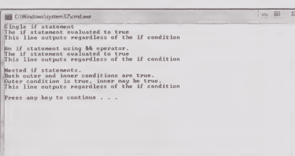

图 2-1：代码实验的输出

在初始设置中，你确保了所有路径都返回真，因此，所有行都输出到了控制台窗口。开始更改两个变量的值，并实验结果，看看在返回真和假的情况下，根据条件评估，哪些行会被输出。评估每个条件的所有可能值，以确保你理解 if 语句是如何工作的。

## 第2章 基础程序结构

如前所述，在执行 if 语句时，你会评估一个条件，如果条件为真则采取操作。如果为假，代码将继续执行 if 语句之后。但如果你想在条件为真时执行一组代码语句，在条件为假时执行另一组代码语句，然后无论结果如何继续执行剩余的代码语句该怎么办？你可以使用 if-else 语句：

```csharp
// if-else 语句语法
if (condition)
{
    statement1;
}
else
{
    statement2;
}
remaining code statements;
```

在此示例中，如果条件为真，则执行 `statement1`，否则进入 `else` 子句并执行 `statement2`。无论条件如何，在执行 `if` 或 `else` 子句之后，剩余的代码语句都会执行。

你还看到了嵌套 if 语句的示例，用于仅当当前和之前的条件评估为真时才执行代码。你也可以选择使用 `if, else if` 语句根据多个条件执行代码路径：

```csharp
// if-else if 语句语法
if (condition)
{
    statement1;
}
else if (condition2)
{
    statement2;
}
else if (condition3)
{
    statement3;
}
else
{
    statement4;
}
remaining code statements;
```

上述示例中 `else` 语句上方的省略号 (`...`) 表示你可以根据需要拥有任意多个 `else` 部分。注意，`else` 子句也是可选的，就像单 `if` 语句中一样。这段代码演示了你检查条件，如果该条件为真，则执行 `statement1`。如果 `condition1` 不为真，你跳过 `statement1` 并检查 `condition2`。在这种情况下，如果 `condition2` 为真，则执行 `statement2`；否则，你检查 `condition3`，依此类推。重要的是，一旦某个条件评估为真，该条件的语句就会被执行并退出该结构。其他任何条件将不再被评估，剩余的代码语句将执行。

## 基础 if 语句之外

现在看一个演示这些语句使用的简单应用程序。将此代码复制并粘贴到 C# 控制台应用程序中。更改条件变量的值并执行代码，看看它如何影响结果。

```csharp
using System;
using System.Collections.Generic;
using System.Linq;
using System.Text;
using System.Threading.Tasks;

namespace beyond_basic_if_statements
{
    class Program
    {
        static void Main(string[] args)
        {
            bool condition1;
            bool condition2;
            bool condition3;

            // 单个 if 语句
            condition1 = true;
            if (condition1)
            {
                Console.WriteLine("This statement prints if condition is true");
                Console.WriteLine("This statement executes regardless of condition.");
            }
            Console.WriteLine();

            // 嵌套 if 语句
            condition1 = true;
            condition2 = true;
            if (condition1)
            {
                if (condition2)
                {
                    Console.WriteLine("This only prints if both conditions are true.");
                }
            }
            Console.WriteLine();

            // 逻辑运算符的 if 语句
            condition1 = true;
            condition2 = true;
            if (condition1 && condition2)
            {
                Console.WriteLine("This only prints if both conditions are true.");
            }

            // if-else 语句
            condition1 = true;
            if (condition1)
            {
                Console.WriteLine("This statement prints if condition is true.");
            }
            else
            {
                Console.WriteLine("This statement prints if condition is false.");
            }
            Console.WriteLine("This statement executes regardless of condition.");
            Console.WriteLine();

            // if-else 语句
            condition1 = true;
            condition2 = false;
            condition3 = false;

            if (condition1)
            {
                Console.WriteLine("This statement prints if condition1 is true.");
            }
            else if (condition2)
            {
                Console.WriteLine("This statement prints if condition2 is true.");
            }
            else if (condition3)
            {
                Console.WriteLine("This statement prints if condition3 is true.");
            }
            else
            {
                Console.WriteLine("This statement prints if previous conditions are false.");
            }
            Console.WriteLine("This statement executes regardless of condition.");
            Console.WriteLine();
        }
    }
}
```

## switch 语句


# 控制程序流

在前面的节中，你看到了嵌套 `if` 语句以及 `if, else` 语句的示例。当嵌套或 `if-else` 语句的数量超过一定数量时，这两组语句都很难阅读。C# 与其他基于 C 的编程语言一样，提供了 `switch` 语句，允许你根据条件或多个条件进行多次比较，并执行相应的代码。

返回 `true`。这比多个 `if-else` 或嵌套的 `if` 语句要整洁得多。考虑以下内容：

```cs
// switch statement syntax
switch (condition)
{
    case 1:
        statement1;
        break;
    case 2:
        statement2;
        break;
    case 3:
        statement3;
        break;
    default:
        defaultStatement;
        break;
}
```

在 C 等之前的语言中，`switch` 语句中的条件必须是 `int` 类型。C# 允许你比较任何简单的数据类型，如 `int`、`string`、`float` 甚至是枚举。

在 `switch` 语句中，要评估的条件是起始 `switch` 表达式中包含的值。代码从第一个 `case` 语句开始执行以寻找匹配。匹配条件的 `case` 语句中的代码将被执行。最后，`break` 语句会导致代码跳出 `switch` 语句，并在 `switch` 语句结束括号之后继续执行。

你可以包含任意数量的 `case` 语句，但请记住没有两个 `case` 语句可以包含相同的值。如果没有 `case` 语句匹配，则选择可能存在的 `default` 语句。示例如下：

```cs
// sample switch statement using a string comparison
string condition = "Hello";

switch (condition)
{
    case "Good Morning":
        Console.WriteLine("Good morning to you");
        break;
    case "Hello":
        Console.WriteLine("Hello");
        break;
    case "Good Evening":
        Console.WriteLine("Wonderful evening");
        break;
    default:
        Console.WriteLine("So long");
        break;
}
```

`switch` 语句的另一个关键特性是你可以根据多个条件在代码中执行单个操作。要处理多个条件，你只需删除 `switch` 语句中包含要处理的每个 `case` 部分的 `break` 语句。示例显示了如何这样做：

```cs
// switch handling multiple conditions with a single action
int number;

switch (number)
{
    case 0:
    case 1:
    case 2:
        Console.WriteLine("Contained in the set of whole numbers.");
        break;
    case -1:
    case -10:
        Console.WriteLine("Contained in the set of Integers.");
        break;
}
```

在前面的示例中，代码检查 `number` 的值是否为 0、1 或 2。如果是，它会向控制台输出这些值包含在正整数（whole numbers）的数学集中。`break` 语句位于 `case 2` 之后，这意味着代码将顺序比较 `number` 与 0、1 或 2，从而允许任何条件为真。如果 `number` 的值是这些数值之一，则打印该语句并退出 `switch` 语句。

如果 `number` 的值不是 0、1、2，`switch` 语句将继续评估 `number` 以检查是否为 -1 或 -10。如果是，它将打印出这些数字包含在整数（integers）的数学集中。

> **常见错误：数学整数与编程整数类型**
>
> 不要将数学整数与编程语言整数数据类型混淆。编程语言整数类型根据其大小（16、32 位或 64 位）具有特定的值范围，而数学整数从负无穷到正无穷，包括零。

# 第 2 章 程序结构

## 使用循环

在代码中使用循环结构允许你的应用程序重复一系列指令以完成任务。（循环是一种重复指令的结构。）你可能需要计算存储在数组等数据结构中的系列分数的平均值，或者你可能需要对项目集合进行迭代，例如存储数据库记录的数据集。

C# 提供了四种循环结构：

- `for` 语句
- `foreach` 语句
- `while` 语句
- `do-while` 语句

决定使用哪一个取决于你的需求，但最终这些结构都提供了重复功能。你看到的第一个循环结构是基本的 `for` 结构。

### for 语句

C# 中的 `for` 语句循环结构允许你重复一个语句或一系列语句，直到满足指定的条件。`for` 语句包含初始化器、条件和增量（迭代器）组件——迭代器是循环中改变值的部分：

```cs
// for statement syntax
for(initializer; condition; iterator)
{
    statement(s);
}
```

在前面的示例中，`for` 语句包含了控制语句本身的括号内组件。初始化器用于声明和/或初始化（设置起始值）一个将在循环中使用的计数器变量。条件用于确定什么会导致循环停止，而迭代器部分用于修改计数器变量。注意每个组件都用分号分隔。示例如下：

```cs
// Count up to 10 in increments of 2
for (int counter = 0; counter <= 10; counter += 2)
{
    Console.WriteLine(counter);
}
```

在此示例中，`for` 语句初始化了一个方便命名为 `counter` 的循环变量。你可以对任何变量用于 `for` 循环部分，但请记住以下几点：

- 你不能使用关键字作为变量名。
- 在此处声明的变量不应与循环中用于其他用途的变量同名。
- 作为初始化器使用的变量...

创建 `for` 循环时的另一个考虑因素是，你的循环不需要执行任何操作。空语句块意味着在循环期间不执行任何代码。循环将一直迭代，直到条件为真：

```csharp
// 空的 for 循环
for(int counter = 0; counter >= 10; counter++)
{
    ;
}
```

到目前，你只见过 `for` 迭代器是向上递增的。你可以在循环的这部分使用任何 C# 增减运算符，这意味着你可以增加或减少（即减少某个特定值）。注意：OCR 文本在运算符列表中存在错误；我已根据标准的 C# 语法对其进行了修正。

以下运算符在你的循环迭代器部分中都是合法的：

- `++` 是递增运算符，值增加 1。
- `--` 是递减运算符，值减少 1。
- `+=` 是一个可以与字面量一起使用的用以更改步长的运算符，例如 `+= 2`，它每次增加 2。
- `-=` 是一个可以与字面量一起使用的用以更改步长的运算符，例如 `-= 2`，它每次减少 2。
- `*=` 是通过乘法因子进行增加。
- `/=` 是通过除因子进行减少。

#### 嵌套 for 循环

作为关于循环的最后一个讨论话题，同样重要的是，你也可以嵌套 `for` 循环。这允许你创建更复杂的循环结构，你可能会发现它们在各种应用程序中很有用。立刻想到的例子就是彩票。

##### 现实世界案例：彩票程序的嵌套循环

在我成长的地方，我们有一种被称为 6/49 的彩票。你可以从 1 到 49 的范围内选择六个数字。我的姐夫请我为他写一个程序来预测中奖号码。当然，我告诉他这是可能的，因为如果可能的话，比我聪明得多的程序员们现在都是亿万翁了。然而，为了安抚他，我创建了一个小型应用程序，让他随机选择自己的号码。你可以自己创建一个相同的应用程序。注意，此代码示例不需要包含防止重复的逻辑。

###### 解决方案 (lottery_program)

以下是解决方案：

```csharp
static void Main(string[] args)
{
    // 用于设置要选择的值范围
    int[] range = new int[49];

    // 用于模拟选出的彩票号码
    int[] picked = new int[6];

    // 设置随机数生成器
    Random rnd = new Random();

    // 用 1 到 49 的值填充范围
    for (int i = 0; i < 49; i++)
    {
        range[i] = i + 1;
    }

    // 随机选取 6 个数字
    for (int limit = 0; limit < 49; limit++)
    {
        for (int select = 0; select < 6; select++)
        {
            picked[select] = rnd.Next(49);
        }
    }
    Console.WriteLine("Your numbers are:");
    for (int j = 0; j < 6; j++)
    {
        Console.Write(picked[j] + " ");
    }
    Console.WriteLine();
}
```

在这段代码中，数组被设置为包含可以从数量 (6) 中选择的范围 (49) 的值。随机数生成器用于开始从 1 到 49 中选择一个随机数。第一个循环用 1 到 49 的值填充范围数组。C# 数组从 0 开始。嵌套循环设置了外层部分以遍历所有可能的值并选取六次随机值。这不是实现此操作最简洁的方法，但它展示了嵌套。

### foreach 语句

`foreach` 循环可以被看作是一种哨兵循环，在其中你通过使用计数器确定循环何时终止。但当你不知道需要循环多少次时，会发生什么呢？这种情况在处理数量预先未知的条目集合时可能会出现。C# 提供了 `foreach` 语句来遍历集合。集合通常是数组，也是实现了 `IEnumerable` 接口的对象（`IEnumerable` 是 C# 中支持迭代的组件）。

#### 基础程序结构

你可能拥有一个包含已知或未知数量值的数组或集合。虽然你可以对这些具有已知数量值的类型使用标准的 `for` 循环，但在运行时要确定集合中有多少个值几乎是不可能的。例如，你可能会通过用户输入创建一个由单个字符组成的数组。在这两种情况下，你都在编写代码时并不知道值的数量。请考虑以下内容：

```csharp
// foreach 语法
foreach(type in collection)
{
    statement;
}
```

在这个语法示例中，`type` 是集合将包含的数据类型。一个简单的示例可以演示这一点。假设你有一个数组，存储了你想要取平均值的整数分数值，如下方的代码实验室（Code Lab）所示。

##### 使用 foreach 循环计算平均分的代码实验室 [average_grades]

```csharp
// 使用 foreach 循环计算数组中的平均分
// 设置一个整数数组并分配一些值
int[] arrGrades = new int[]{78, 89, 90, 76, 98, 65};

// 创建三个变量来存储总和、分数数量和平均分
int total = 0;
int gradeCount = 0;
double average = 0.0;

// 遍历数组中的每个整数值
// foreach 不需要预先知道大小，因为是在访问数组时确定的。
foreach(int grade in arrGrades)
{
    total = total + grade; // 将每个分数加到总和
    gradeCount++;          // 计数，以便计算平均分
}

average = total / gradeCount; // 计算平均分
Console.WriteLine(average);
```

###### 代码实验室分析

在前面的代码示例中，你通过设计就知道了数组中有多少个分数，但这种方法也适用于动态创建数组的情况。你创建了三个变量：

- `total` 用于相加分数。
- `gradeCount` 用于跟踪有多少个分数，以便计算平均分。
- `average` 声明为 `double`，以防结果出现小数。

`foreach` 循环声明了一个名为 `grade` 的整数变量。使用整数变量是因为数组中的值是整数。确保 `foreach` 循环中的变量与集合中的类型很重要。然后使用变量 `grade` 遍历数组中的每个值。`foreach` 中的语句将每个整数值加到 `total` 变量中。

你每次将 `gradeCount` 增加 1，以便在平均分计算中使用它。循环结束后，平均分计算完成并输出到控制台窗口。

### while 语句

`while` 语句的作用与 `for` 语句相似，它允许你重复执行一个或一组语句，直到条件满足（返回假）。理解 `while` 语句最简单的方法将其描述为：“条件为真，执行循环”。

```csharp
// while 语法
while(condition)
{
    statement;
}
```

`while` 语句以 `while` 关键字开头，括号内是需要测试的条件。如果条件返回真，则大括号内的语句或语句将执行。当条件返回假时，执行将到 `while` 语句大括号之后的代码行。一个示例有助于演示这一概念：

```csharp
// while 语句示例
int someValue = 0;

while(someValue < 10)
{
    Console.WriteLine(someValue);
    someValue++;
}
```


注意 `while` 循环和 `for` 循环之间的区别。`for` 循环在 `for` 循环括号内同时设置了变量、条件和递增。而 `while` 循环依赖于之前设置的变量，并且在循环内部进行递增。如果未在循环中进行递增，在这里也会导致死循环。

### do-while 语句

最后一个要查看的重复结构是 `do-while` 循环。这种循环结构的工作方式与 `while` 循环相似，但有两个明显的区别。首先，无论条件如何，`do-while` 循环都会至少执行一次语句。其原因源于第二个区别，即条件在每种结构中求值的位置不同。其次，`while` 循环在开始检查条件，而 `do-while` 循环在末尾检查条件。

```csharp
// do-while loop syntax
do
{
    statement;
} while (condition);
```

从上述语法可以看出，首先执行 `statement;`；然后在 `while` 部分的末尾检查条件。同样重要的是，尽管分号在花括号之后，但在 `while` 部分的末尾仍需要分号。忘记这个分号被视为语法错误，会导致编译器生成带有消息 `; expected` 的错误。

> **考试技巧与窍门：了解循环之间的区别**
>
> 出题者喜欢测试你对循环之间区别的理解。在阅读考试题时，确保注意分号或条件求值位置等细微之处。

花点时间看看之前的 `while` 循环示例，将其转换为 `do-while` 循环：

```csharp
// do-while statement example
int someValue = 0;

do {
    Console.WriteLine(someValue);
    someValue++;
} while (someValue < 10);
```

上述代码示例产生的输出与之前的 `while` 语句相同（见图 2-6）。


因此，这个示例并没有实际描绘这两个循环行为不同的事实，你将修改代码以显示 `do-while` 循环与 `while` 循环的区别：

```csharp
// do-while statement example
int someValue = 10;

do {
    Console.WriteLine(someValue);
    someValue++;
} while (someValue < 10);
```

你在这个代码示例中更改的是变量 `someValue` 的初始值。它现在被设置为 10。结果，你可能会认为因为条件测试的是小于 10 的值，所以这个循环不会执行花括号中的语句。然而，`do-while` 循环至少会执行一次，结果是图 2-7 显示了运行此代码示例的输出。


输出只显示了一个值 10。这是变量中设置的初始值，它被输出到屏幕上，表明 `do-while` 至少执行了一次语句块。当在循环末尾检查条件时，它返回 false，因为 `someValue` 并不小于 10，循环不再执行。

那么，你会选择 `do-while` 而不是 `while` 吗？选择其中一个而不是另一个可能有很多原因，但一个典型的场景是你期望来自用户的输入，并且需要确保输入是在循环内获取的而不是循环外。一个例子可以帮助说明：


// while statement example
char someValue;
do {
    someValue = (char) Console.Read();
    Console.WriteLine(someValue);
} while (someValue != 'q');

这个示例引入了一些你可能还不熟悉的代码，所以不要为此过度担心。变量声明类型为 `char`，它返回一个单个字符。在循环内部，你将值设置等于程序运行时用户输入的字符。`Console.Read()` 是 Console 的一个方法，用于从控制台输入中读取单个字符。`(char)` 是一个显式强制转换，将输入转换为 `char` 值以供程序使用。

用户的值通过 `Console.WriteLine` 方法在屏幕上回显。条件检查用户输入的值是否为字母 q。如果是，循环退出；否则，它将继续执行直到在控制台输入 q。这种类型的循环控制被称为“哨兵”（sentinel）。哨兵值导致循环停止。输出的示例见图 2-8。


**图 2-8：** 使用哨兵结束循环

## 使用循环

在 Visual Studio 中创建一个名为 `Loops` 的新 C# 控制台应用程序。在 `program.cs` 代码窗口打开后，将以下代码粘贴到 `main` 函数中：

```csharp
// using a loop to count up by one
Console.WriteLine("Count up by one");

for (int i = 0; i < 10; i++)
{
    Console.WriteLine(i);
}
Console.WriteLine();

// using a loop to count down by one
Console.WriteLine("Count down by one");

for (int i = 10; i > 0; i--)
{
    Console.WriteLine(i);
}
Console.WriteLine();

// using a loop to count up by 2
Console.WriteLine("Count up by two");

for (int i = 0; i < 10; i += 2)
{
    Console.WriteLine(i);
}
Console.WriteLine();

// using a loop to increment multiples by multiples by 5
Console.WriteLine("Count up by multiples of 5*");

for (int i = 5; i < 10; i += 5)
{
    Console.WriteLine(i);
}
Console.WriteLine();
```

c. &

d. &&

3. if 语句的条件部分返回什么类型的的结果？

a. 布尔 (Boolean)

b. 整数 (Integer)

c. 双精度浮 (Double)

d. 字符串 (String)

4. if 语句支持哪些关键字？

a. if, else, else-if, return

b. if, else, else if

c. if, else, else if, break

d. if, else, else, default

5. 在下面的代码中，第二个结构会被评估吗？

bool condition = true;

```csharp
if(condition)
  if(5 < 10)
    Console.WriteLine("*5 is less than 10");
```

a. 是

b. 否

6. 如果你想遍历名为 arrNumbers 的整数数组中的值并执行操作，哪种循环语句可以让你实现这一点？

a. foreach (int number in arrNumbers) {}

b. for each (int number in arrNumbers) {}

c. for (int i; each i in arrNumbers; i++) {}

d. foreach (number in arrNumbers) {}

7. break; 在 switch 语句中的作用是什么？

a. 它导致程序退出。

b. 它导致代码退出 switch 语句。

c. 它导致程序暂停。

d. 它导致代码停止执行，直到用户在键盘上按键。

8. C# 中的四种基本重复结构是什么？

a. for, foreach, loop, while

b. loop, while, do-for, for-each

c. for, foreach, while, do-while

d. do-each, while, for, do

9. 这个循环将执行多少次？

```csharp
int value = 0;
do
{
    Console.WriteLine(value);
} while value > 10;
```

a. 10 次

b. 1 次

c. 0 次

d. 9 次

# 额外阅读与资源

以下是一些额外的有用资源，可以帮助你理解本章介绍的主题：

C# 关键字

http://msdn.microsoft.com/en-us/library/x53a06bb.aspx

C# 编程指南

http://msdn.microsoft.com/en-us/library/kx37x362.aspx

开发者代码示例

http://code.msdn.microsoft.com/

C# Corner

http://www.c-sharpcorner.com/

# 备查表 (CHEAT SHEET)

此备查表旨在帮助你快速学习本章的关键点。

## 简单语句 (Simple statements)

- 以分号结束。
- 它们通常只有一行，但可能会扩展到多行。
- 常用于变量声明。
- 它们也用于赋值语句。
- 典型的使用场景是执行简单的任务。

## 复杂语句 (Complex statements)

- 可能不以分号结尾，do-while 循环就是以分号结尾的示例。
- 通常在大括号内包含简单语句。
- 复杂语句使用大括号包裹其他语句。
- 它们具有结构（如括号），以支持其功能。

### 布尔表达式 (Boolean expressions)

- 这些用于比较。
- C# 使用布尔值 true 和 false，而不是某些其他语言中的 1 和 0。
- 它们可以被视为逻辑运算符。
- 它们可以以一元和二元的形式存在。
- 一元作用于单个操作数，例如逻辑取非 `!`。
- 二元作用于两个操作数，例如 `&&` 和 `||`。

### if-then-else 语句

- 用于决策。
- 根据条件执行特定的代码路径。
- 从条件检查返回 true 或 false。
- 不需要大括号，但建议使用大括号以帮助明确语句中包含的内容。
- 可以嵌套在其他 if-then-else 语句中。
- else 子句用于为假条件选择备用路径。
- else if 子句用于为真条件选择备用路径。

## switch 语句

- 与 if 语句相比，切换语句可以检查条件中的各种数据类型。
- 使用 case 语句对每个值与条件进行测试。
- 对于代码可读性，相比嵌套的 if 语句，switch 语句是更整洁的选择。
- 当没有 case 返回 true 时，可以使用 default case。
- break 语句用于在真用例中结束 switch 评估。
- 它们通过移除每个持有匹配条件的 case 语句中的 break，用一组指令处理多个条件。

## for 语句

- 创建一个简单的重复结构。
- 在括号中使用初始化组件、条件和迭代器。
- 使用语句块（用大括号括起来）来包含一个或多个待执行的语句。
- 可以嵌套以创建更复杂的循环结构。
- 初始化部分仅在循环开始时执行，而不是每次迭代都执行。
- 条件部分在每次迭代时检查。
- 递增部分在每次迭代的语句执行后发生。
- 此循环不以分号结束。

## foreach 语句

- 它们可以用于遍历项目集合。
- 在设计时未知值数量时使用效果最好。
- 它们适用于任何实现 `IEnumerable` 的集合。

## while 语句

- 它们的执行方式与 for 相似。
- 初始化在循环外部。
- 条件在开始和每次迭代时进行评估。
- 递增在循环内部完成。

## do-while 语句

- 与 while 相似，初始化在循环之前。
- 条件在结束时评估。
- 递增在循环内部完成。
- 循环至少执行一次。
- 这种样式以分号结束。

# 术语复习

赋值 (assignment)：为变量提供值。

布尔 (Boolean)：一个为真或假的值。

分支 (branching)：指将代码执行切换到不同的路径。

条件 (condition)：对操作数的评估。

条件指令 (conditional instructions)：根据评估结果采取行动的指令。

注释 (comment)：以 `//` 字符开头的代码行，帮助程序员理解不同段落。

复杂语句 (complex statement)：用大括号 `{}` 包裹的语句。典型的复杂语句用于重复和决策结构。

常量 (constant)：声明时赋值且在代码中不可更改的值。

声明 (declaration)：用于在代码中创建变量。

递减 (decrement)：减少某个值。

表达式 (expression)：返回结果的活动或代码语句。

IEnumerable：支持迭代的代码组件。

递增 (increment)：增加某个值。

初始化 (initialize)：设置起始值。

迭代器 (iterator)：循环中改变值的部分。

字面量 (literal)：用于指示代码中固定值的符号。与常量不同。你不能给字面量赋值。

循环 (loop)：重复指令的重复结构。

取模 (modulus)：整数除法的余数。

运算符 (operator)：对值执行操作。

程序流 (program flow)：代码的逻辑执行。

哨兵 (sentinel)：用于信号循环执行结束的值。

简单语句 (simple statement)：以分号结束的语句，通常用于程序操作，如变量声明、变量赋值、方法调用和代码分支。

意大利代码 (spaghetti code)：描述由于分支导致难以追踪和理解的代码术语。

语句 (statement)：C# 编程语言的代码结构，导致应用程序执行操作。

三元运算符 (ternary operator)：接受三个参数（条件、真值、假值）的运算符。

变量 (variables)：代码中更改的命名值。

# 考试技巧

本章的术语复习和备查表可以打印出来帮助你学习。你可以在 www.wrox.com/remtitle.cgi?isbn=118612094 的下载代码选项卡下载本章的 ZIP 文件中找到这些文件。

# 3 使用类型系统

本章你将学习到

- 使用 C# 值类型
- 理解数据结构
- 使用枚举
- 理解 C# 引用类型
- 操作引用类型的属性
- 理解封装
- 使用泛型

本章的 WROX.COM 代码下载

你可以在 www.wrox.com/remtitle.cgi?isbn=1118612094 的“Download Code”（下载代码）选项卡中找到本章的下载代码。代码位于 `chapter03` 下载文件夹中，并根据整个章节中出现的名称对文件进行了逐一命名。

本章将向你介绍 C# 中的类型系统，该系统为对象建模以及处理程序中不同类型的数据和信息提供了必要的结构。因此，考试将测试你使用 C# 语言创建和用用类型的能力。

为了帮助你获得这些理解，你将按照顺序和逻辑的方式探索类型。值类型是 C# 中简单的类型，本章将从这里开始。它们不仅是你代码中存储值和数据的各种核心类型，还用于维护属性，而属性是 C# 类的组成部分。类属性定义了你所创建的类的特征。

接下来，你将查看引用类型，微软将其定义为“存储对实际数据的引用”的类型。引用类型的另一个术语是类。

处理如 C# 类等引用类型的关键在于封装的概念。封装允许开发者在类中创建功能这些功能对于使用该类的其他开发者是隐藏的。

### 表 3-1：本章涵盖的 70-483 考试目标

| 目标 | 涵盖内容 |
|---|---|
| 创建类型 | 创建值类型。侧重于在代码中创建和使用标准的 C# 值类型。创建引用类型。这包括在 C# 中创建和使用类文件。类文件的组件内容将在后续章节中介绍。创建泛型。这包括在代码中创建和使用泛型，以表示代码运行时的未知类型。构造函数。这包括定义构造函数以及它们如何在类文件中被使用。方法。侧重于为代码和类文件中的功能创建并使用方法。类。这包括在代码中定义和使用类文件来表示现实世界的对象。扩展方法。侧重于理解如何在不重新编译类的情况下扩展现有类的功能。可选和命名参数。这包括讨论在方法中正确使用可选和命名参数。索引属性。这包括在类中使用索引属性来支持属性枚举。重载方法。侧重于创建多个同名但接受不同参数的方法。重写方法。讨论如何重写虚方法以更改在类中继承方法的功能。 |
| 强制封装 | 属性。侧重于通过使用属性对类文件的成员变量进行封装，并提供修改值的方法。访问器方法。此主题侧重于通过封装访问类文件中隐藏成员变量的方法。 |

## 创建值类型

考试 70-483 有一个“创建类型”的目标。在 C# 中创建和使用值类型是一项核心基础技能。值类型是你 C# 程序中使用的所有数据类型的类型。C# 将值类型分为两个类别：结构体（struct）和枚举（enum）。结构体进一步分为数值类型、浮点类型、布尔类型（bool）和用户定义的结构体。枚举，是使用 `enum` 关键字声明的一组类型。（在后文“枚举”章节中会有更多内容。）

## 理解定义值类型

微软开发文档将值类型称为内置的、简单的或内置类型。值类型是一个相当简单的陈述，包含了许多其他编程语言中存在的内置类型。下表列出的名称是 .NET 类型的别名。所有值类型都派自 `System.ValueType`。

表 3-2 列出了 C# 支持的基本值类型及其支持的数据范围。

| 类型 | 值 | 大小 | .NET 类型 |
|---|---|---|---|
| bool | true, false | 1 byte | System.Boolean |
| Byte | 0–255 | 1 byte | System.Byte |
| char | 0000–FFFF | 16-bit | System.Char |
| decimal | ±1.0 × 10⁻⁸ to +7.9 × 10²⁸ | 28–29 digits | System.Decimal |
| double | ±5.0 × 10⁻³² to ±1.7 × 10³⁸ | 15–16 digits | System.Double |
| enum | 用户定义的常量集 | | |
| float | ±1.5 × 10⁴⁵ to ±3.4 × 10³⁸ | 7 digits | System.Single |
| int | -2,147,483,648 to 2,147,483,647 | 有符号 32-bit | System.Int32 |
| long | -9,223,372,036,854,775,808 to 9,223,372,036,854,775,807 | 有符号 64-bit | System.Int64 |
| sbyte | -128 to 127 | 有符号 8-bit | System.SByte |

表 3-2（续）

| 类型 | 值 | 大小 | .NET 类型 |
|---|---|---|---|
| short | -32,768 to 32,767 | 有符号 16-bit | System.Int16 |
| struct | 包括此表列出的数值类型以及 bool 和用户定义的结构体 | 无符号 32-bit | System.ValueType |
| uint | 0 to 4,294,967,295 | 无符号 32-bit | System.UInt32 |
| ulong | 0 to 18,446,744,073,709,551,615 | 无符号 64-bit | System.UInt64 |
| ushort | 0 to 65,535 | 无符号 16-bit | System.UInt16 |

处理这些类型时，你声明变量为特定的数据类型。声明变量后，你可以通过赋值直接存储值。赋值也可以作为声明的一部分。例如：

```csharp
// 声明整数
int myInt;

// 给它赋值
myInt = 3;

// 在一个语句中使用声明和赋值
int myInt = 5;
```

关键字 `int` 用于指示变量将是 `int` 类型，该类型是 `System.Int32` 的别名。因此，它可以包含从 -2,147,483,648 到 2,147,483,647 的任何值。

> 专家建议：不要混淆 C# 数据类型
>
> 不要将 C# 数据类型与数学概念中具有相似名称的类型混淆。例如，`int` 数据类型与数学上的整数不是一的。数学中的整数可以包含从负无穷到正无穷的值。然而，C# 中的数据类型取决于所使用的位数。在一种情况下，`int` 是 32 位有符号的；2 的 32 次方为你提供了最大 4,294,967,296。减去一个位用于符号部分，你就找到了前表中列出的 `int` 的值。


你应该意识到值类型的几处限制：你不能从值类型派生新类型，且值类型不能为空值（`null`）。由于值类型本质上是结构体，它们在 `System` 命名空间下具有对应的 .NET 类型。使用未赋值的变量会导致 Visual Studio 产生错误。这是因为通过 `new` 运算符创建的引用类型具有默认值。以下是代码示例。

## 代码实验：值类型的比较

```csharp
// 使用 int 别名创建值类型
// 声明变量
int myInt;

// 使用 new 运算符创建引用类型
// 注意这里使用了 new 关键字
System.Int32 myInt2 = new System.Int32();

// 给 int 赋值
myInt = 3;

// 在一个语句中使用声明和赋值
int myInt3 = 5;

// 输出未赋值的 System.Int32 变量的默认值
Console.WriteLine(myInt2);

// 你需要注释掉第一行 Console.WriteLine 语句
// 因为 Visual Studio 会产生关于使用未赋值变量的错误
// Console.WriteLine(myInt);

// 输出 int 变量的赋值
Console.WriteLine(myInt3);
```

.NET Framework 为所有以此方式创建的 System 值类型提供了默认值。所有数值类型的默认值均等同于零值 (`0`)。任何浮点类型（如 `decimal`、`double` 或 `float`）均为 `0.0`。`bool` 的默认值为 `false`，`char` 为 `'\0'`，枚举（enums）为 `(E) 0`，结构体（structs）则设置为 `null`。

关于值类型的另一个重要理解点是值的管理方式。.NET Framework 将值类型存储在计算机内存的栈（stack）上，而不是堆（heap）上。这些类型直接存储值导致的结果是：如果你将一个值类型赋值给另一个值类型，它将把值从第一个拷贝到第二个。而引用类型（Reference types）复制的是引用（内存地址），而不是实际值，后者将在“创建引用类型”一节中进行讨论。下面的示例代码显示了两个整数变量的创建。为其中一个变量赋值一个值，然后：

```csharp
// 将一个值类型赋值给另一个值类型
int myInt;
int secondInt;
```

```csharp
// myInt 将被赋值为 2
myInt = 2;
```

```csharp
// 在此语句执行后，secondInt 将包含值 2
secondInt = myInt;
```

```csharp
// 输出变量的值
Console.WriteLine(myInt);
Console.WriteLine(secondInt);
Console.WriteLine();
```

尽管在之前的示例中你只使用了整数数据类型，但你可以以类似的方式处理其他简单值类型。将此代码复制并粘贴（或手动输入）到 Visual Studio 的新控制台应用程序中，以查看如何操作其他值类型。

# 使用值类型的代码实验 CODE LAB [using_value_types]

```csharp
// 声明一些数值数据类型
int myInt;
double myDouble;
byte myByte;
char myChar;
decimal myDecimal;
float myFloat;
long myLong;
short myShort;
bool myBool;
```

```csharp
// 为这些类型赋值，然后
// 将它们打印到控制台窗口
// 同时使用 sizeof 运算符来确定
// 每个类型所占的字节数
```

```csharp
myInt = 5000;
Console.WriteLine("*Integer*");
Console.WriteLine(myInt);
```

## 创建值类型

```csharp
Console.WriteLine(myInt.GetType());
Console.WriteLine(sizeof(int));
Console.WriteLine();
```

```csharp
myDouble = 5000.0;
Console.WriteLine("Double");
Console.WriteLine(myDouble);
Console.WriteLine(myDouble.GetType());
Console.WriteLine(sizeof(double));
Console.WriteLine();
```

```csharp
myByte = 254;
Console.WriteLine("Byte");
Console.WriteLine(myByte);
Console.WriteLine(myByte.GetType());
Console.WriteLine(sizeof(byte));
Console.WriteLine();
```

```csharp
myChar = 'r';
Console.WriteLine("Char");
Console.WriteLine(myChar);
Console.WriteLine(myChar.GetType());
Console.WriteLine(sizeof(byte));
Console.WriteLine();
```

```csharp
myDecimal = 20987.9576M;
Console.WriteLine("Decimal");
Console.WriteLine(myDecimal);
Console.WriteLine(myDecimal.GetType());
Console.WriteLine(sizeof(byte));
Console.WriteLine();
```

```csharp
myFloat = 254.09F;
Console.WriteLine("Float");
Console.WriteLine(myFloat);
Console.WriteLine(myFloat.GetType());
Console.WriteLine(sizeof(byte));
Console.WriteLine();
```

```csharp
myLong = 25445675387754;
Console.WriteLine("Long");
Console.WriteLine(myLong);
Console.WriteLine(myLong.GetType());
Console.WriteLine(sizeof(byte));
Console.WriteLine();
```

```csharp
myShort = 3276;
Console.WriteLine("Short");
Console.WriteLine(myShort);
Console.WriteLine(myShort.GetType());
Console.WriteLine(sizeof(byte));
Console.WriteLine();
```

```csharp
myBool = true;
Console.WriteLine("Boolean");
Console.WriteLine(myBool);
```

```csharp
Console.WriteLine(myBool.GetType());
Console.WriteLine(sizeof(byte));
Console.WriteLine();
```

# 代码实验分析

本实验声明了多种 C# 内置的变量类型。每个变量都用于一组重复的赋值语句，这些语句会：

- 给变量赋值
- 向控制台输出一行以指示值类型
- 输出所赋值的值
- 输出与该值类型关联的 System 类型
- 输出该值类型以字节为单位的大小

为了理解这些类型，请将赋值语句中的值更改为不同的类型或超出范围，并查看编译器返回了什么错误信息。

理解这些简单类型对于表示你的应用程序解决现实世界问题时使用的数据是必须的。当你进入下一节关于引用类型的学习时，这些类型也构成了你在类中创建的属性的基础。

> **最佳实践：代码效率**
>
> 编写代码的开发者在思考效率和所用数据类型上花费的时间越来越少，这主要归功于目前使用的计算机的性能和存储能力。在个人电脑早期（回溯 Commodore VIC-20 时代），内存非常昂贵，所有代码的编写都是为了节省应用程序的内存使用。
>
> 理解数据大小有助于你为选择合适的合适的数据类型。

以下代码通过添加一个构造函数扩展了之前的 `Student` 结构体，该构造函数会在对象创建时设置学生的名称：

```csharp
// 创建一个使用构造函数的 Student 结构体
public struct Student
{
    public string firstName;
    public string lastName;
    private string courseName;

    public Student(string first, string last, string course)
    {
        this.firstName = first;
        this.lastName = last;
        this.courseName = course;
    }
}
```

在之前的示例代码中，该结构体被简化为仅显示构造函数的使用。你只有两个用于名字和姓氏的字段，并使用构造函数在用 `new` 关键字创建对象时将这些值提供给相应字段。

下一个示例代码片段展示了在结构体中使用构造函数的非法用法。其原因是：在结构体中，如果你创建了构造函数，则必须为结构体中的每个成员字段提供赋值；否则 Visual Studio 会抛出错误。

```csharp
public struct Student
{
    public string firstName;
    public string lastName;
    public char initial;
    public double score1;
    public double score2;
    public double score3;
    public double score4;
    public double score5;
    public double average;

    public Student(string first, string last)
    {
        this.firstName = first;
        this.lastName = last;
    }
}
```

如前所述，结构体也可以包含函数。你可能希望允许它对其包含的数据成员执行某些操作，或者为了你认为的其他目的。以下代码片段展示了之前 `Student` 结构体的示例，包含一个计算学生平均分的方法。为了保持示例整洁，已移除构造函数代码。

```csharp
// 包含计算学生平均分方法的 Student 结构体
public struct Student
{
    public string firstName;
    public string lastName;
    public char initial;
    public double score1;
    public double score2;
    public double score3;
    public double score4;
    public double score5;
    public double average;

    public void calcAverage()
    {
        double avg = ((score1 + score2 + score3 + score4 + score5) / 5);
        this.average = avg;
    }
}
```

# 第 3 章 与类型系统的操作

从高效代码的角度来看，程序员应该始终考虑如何使用语言中可用的数据结构。为此，在决定如何存储应用程序对象时，你应该考虑是需要结构体（`struct`）还是类（`class`）。

在之前的示例代码中，`Student` 结构体应该被创建为结构体，以避免类文件必要的开销。然而，考虑一种要在集合（如数组）中存储大量学生对象的场景。由于值类型是通过值传递的，如果你在传递一个 `Student` 结构体数组，你的内存消耗可能会迅速增长。记住，这些是在栈上传递的。相反，考虑为学生使用类，在这种情况下，学生对象数组将填充指向学生对象的指针（引用），而不是学生数据结构本身。

现在你已经涵盖了结构体的核心概念，请在代码中练习创建它们。

# 现实世界案例场景 创建结构体

打开 Visual Studio 并创建一个 C# 控制台应用程序，将其命名为 `bookStruct`。该 `book` 结构体将包含以下属性：

- 标题 (Title)
- 类别 (Category)
- 作者 (Author)
- 页数 (Number of pages)
- 当前页 (Current page)
- ISBN
- 封面样式 (Cover style)
- 翻页方法，称为 `nextPage` 和 `prevPage`

根据你目前为止学到的关于结构体的知识实现代码。使用构造函数来初始化属性。在你的控制台应用程序的 `main` 方法中，为你熟悉的某本书创建一个新的结构体（例如下面这本），并在构造函数中分配属性。使用 `Console.WriteLine` 方法将每个属性输出到控制窗口，然后调用 `nextPage` 和 `prevPage` 方法。这些方法需要考虑当前页。

# 解决方案

完整的代码如下：

```csharp
public struct Book
{
    public string title;
    public string category;
    public string author;
    public int numPages;
    public int currentPage;
    public double ISBN;
    public string coverStyle;

    public Book(string title, string category, string author, int numPages, int currentPage, double isbn, string cover)
    {
        this.title = title;
        this.category = category;
        this.author = author;
        this.numPages = numPages;
        this.currentPage = currentPage;
        this.ISBN = isbn;
        this.coverStyle = cover;
    }

    public void nextPage()
    {
        if (currentPage != numPages)
        {
            currentPage++;
            Console.WriteLine("当前页为: " + this.currentPage);
        }
        else
        {
            Console.WriteLine("已到达书末。");
        }
    }

    public void prevPage()
    {
        if (currentPage != 1)
        {
            currentPage--;
            Console.WriteLine("当前页为: " + this.currentPage);
        }
        else
        {
            Console.WriteLine("已到达开头。");
        }
    }
}

static void Main(string[] args)
{
    Book myBook = new Book("MCSD Certification Toolkit (Exam 70-483)",
    "Certification", "Covaci, Tiberiu", 648, 1, 1234567890, "Soft");

    Console.WriteLine(myBook.title);
    Console.WriteLine(myBook.category);
    Console.WriteLine(myBook.author);
    Console.WriteLine(myBook.numPages);
    Console.WriteLine(myBook.ISBN);
    Console.WriteLine(myBook.coverStyle);

    myBook.nextPage();
    myBook.prevPage();
}
```

## 第 3 章 使用类型系统

- `uint`
- `long`
- `ulong`

所有这些类型都是数值类型。那么，你为什么想要选择一个与默认不同的底层类型呢？这取决于你对枚举值的要求。例如，如果你真的关注应用程序中的内存节省，你可能会像之前在 `Months` 枚举中显示的那样选择 `byte` 类型以节省内存需求。毕竟，`int` 是一个 32 位的值，与使用单个字节的 `byte` 类型相比，它占用了 4 个字节。在这种情况下，这并不上产生巨大的节省，但积少成也能成多。

你也不需要依赖于值的增量赋值。你可以为每个枚举成员分配非连续的值。例如，飞机飞行员需要处理不同的空速，以帮助他们判断何时可以收起起架和襟翼，或者何时飞机将发生空气动力学失速。你可以通过字母代号表示特定的空速，并使用枚举为这些速度分配相应的数值。

```csharp
// to depict airspeeds for aircraft
enum AirSpeeds
{
    Vx = 55,
    Vy = 65,
    Vs0 = 50,
    Vsl = 40,
    Vne = 120
}
```


在此示例枚举中，你建立了五个枚举成员来代表飞机的不同空速。`Vx` 是最佳爬升角；`Vy` 是最佳爬升速率；`Vs0` 是洁净配置下的失速速度；`Vsl` 是开启襟翼和起落架时的失速速度；`Vne` 是最大不允许超过速度。如果你使用任何这些数值来编写代码，代码将难以阅读，因为你无法轻松破译这些值的含义。然而，通过枚举，编写处理空速应用程序的程序员在代码中遇到这些常量时就能理解它们的含义——前提是他们知道不同的空速代号。

除了使用这些常量使你的代码更易读之外，枚举还有其他几个优势，例如允许使用你枚举的其他开发者能够清楚地知道该枚举的允许值，并为 Visual Studio 的 IntelliSense 引擎提供支持。当你决定声明枚举并创建一个使用该枚举的新类型时，IntelliSense 会显示允许的值，如图 3-1 所示。

早些你学过每个值类型都有其对应的 `System` 类型，例如 `System.Int32` 或 `System.Byte`。`enum` 也不例外，因为它是 `System.Enum` 类型的实例。`System.Enum` 包含许多可以在你自己的枚举上使用的方法。请参考 MSDN 文档以获取这些方法的完整列表，但下面是一些示例代码，展示了在处理枚举时你可以使用的一些方法。

## 创建值类型 | 75

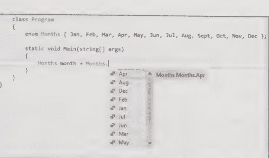

图 3-1: IntelliSense 显示枚举列表

## 代码实验室 使用 enum [using_enums]

```csharp
class Program
{
    enum Months { Jan = 1, Feb, Mar, Apr, May, Jun, Jul, Aug, Sept,
    Oct, Nov, Dec };
    static void Main(string[] args)
    {
        string name = Enum.GetName(typeof(Months));
        Console.WriteLine("The 8th month in the enum is " + name);

        Console.WriteLine("The underlying values of the Months enum:");
        foreach (int value in Enum.GetValues(typeof(Months)))
        {
            Console.WriteLine(value);
        }
    }
}
```

代码实验室分析：代码示例创建了一个名为 `Months` 的枚举，它从 1 开始，并为随后的每个月份递增 1。在 `main` 方法中，你创建了一个名为 `name` 的字符串变量，然后使用 `System.Enum` 的 `GetName()` 方法获取枚举中的第八个值，将其赋值给变量 `name`，然后将其输出到控制窗口。

接下来，代码利用了枚举隐式实现 `IEnumerable` 的事实，因此你可以使用 `foreach` 遍历它们。`foreach` 循环使用 `System.Enum` 类的 `GetValues()` 方法提取枚举的底层值，并将它们打印到控制窗口。

## 创建引用类型

在上一节中，你学习了值类型，它们代表了你在应用程序中使用中最基础的数据类型。早期的应用程序实际上是只使用这些基础类型编写的。虽然你可以只用这些基础类型编写一个完整的应用程序，但尝试创建能够帮助解决现实世界问题的复杂应用程序是极其复杂的。面向对象编程 (OOP) 的诞生是为了帮助开发者管理这种复杂性。

OOP 允许开发者通过使用类在代码中对现实世界对象进行建模。考虑创建一个可能用于银行 ATM 的接口。你的应用程序需要处理诸如客户、存款、取款、余额等对象。通过在代码中创建对象的表示，并为这些代码对象分配与现实世界对象相同的特性和功能，编写代码来建模这些对象要简单得多。这就是类发挥作用的地方。类文件是一个包含所有代码的文件。

# 第 3 章 操作系统

表格 3-3: C# 修饰符

| 修饰符 | 说明 |
|---|---|
| public | 访问修饰符，用于声明其赋值的类型的可访问性。这是权限最高的级别。允许在类体或结构体外部进行访问。引用类型和值类型都可以声明为 public。方法也可以声明为 public。 |
| private | 访问修饰符，用于声明其赋值的类型的可访问性。权限最低，仅允许在类或结构体内部访问。引用类型和值类型都可以声明为 private。方法也可以声明为 private。 |
| internal | 访问修饰符，用于声明其赋值的类型的可访问性。仅允许在同一个 .NET 程序集中的文件中进行访问。 |
| protected | 成员访问修饰符。受保护的成员仅可从类本身及其派生类进行访问。 |
| abstract | 用于类，表示该类不能实例化，但它可以作为继承层次结构中其他类的基类。 |
| async | 将所应用的方法或 lambda 表达式设置为异步方法。这允许方法调用长时间运行的过程而不阻塞调用者代码。 |
| const | 应用于此字段时表示该字段不可修改。常量必须在创建时初始化。 |
| event | 用于在代码中声明事件。 |
| extern | 用于表示方法已在外部声明并实现。你可能将其与 DLL 或外部程序集一起使用。 |
| new | 与类成员一起使用时，此修饰符会隐藏继承自基类的成员。如果你继承了基类的某个成员，但你的派生类需要使用该成员的自己的版本，则可以这样做。 |
| override | 用于继承你想要更改的基类功能。重覆盖将在本章后的“抽象和被重覆盖的方法”部分中介绍。 |
| partial | 类文件存在于同一程序集中的多个文件中。此修饰符告诉编译器该类存在于另一个文件或同一个文件中。 |
| readonly | 只读成员只能在声明期间或在类构造函数中赋值。不允许通过其他手段更改或为该成员赋值。 |
| sealed | 应用于类。密封类不能被继承。 |

## 创建引用类型

| 修饰符 | 说明 |
|---|---|
| static | 应用于类成员时，意味着该成员仅属于类，而不属于从该类创建的特定对象。.NET Framework 有许多此类示例，例如 Math 类或 String 类。 |
| unsafe | C# 是托管代码，这意味着内存操作是以受保护的方式处理的。使用 `unsafe` 关键字声明了一个在内存管理方面是不安全的上下文。C++ 指针是不安全内存操作的示例。在 C# 中使用指针需要声明一个不safe 上下文。 |
| virtual | 如果你创建一个类并允许方法在派生类中被重覆盖，你可以使用 `virtual` 修饰符。 |
| volatile | 当此修饰符应用于字段时，该字段可以被你的代码以外的组件修改。例如可能是操作系统。 |

当你在“理解封装”章节查看封装时，你会开始应用一些访问修饰符来对你的类强制封装。在查看创建和使用类时，你还会探索一些其他修饰符。

# 定义字段

如早些在引用类型部分中讨论的那样，你使用字段来存储描述你的类特征的数据。字段被声明为类内部的变量，可以是任何类型，包括值类型和引用类型。

字段有两种基本类型：实例字段和静态字段，类可以包含其中一种或两者都包含。实例字段是你类中使用中最频繁的字段。实例字段是包含在你从类定义创建的每个对象（实例）中的字段。每个实例字段包含与其赋值的对象相关的特定数据。例如，在代码中创建一个简单的类文件，然后创建两个实例，为类中的字段设置不同的值。

# 代码实验 描述实例字段的 Student 类 [student_class]

```csharp
// 创建一个名为 Student 的类
class Student
{
    public static int StudentCount;
    public string firstName;
    public string lastName;
    public string grade;
}

class Program
{
    static void Main(string[] args)
    {
        Student firstStudent = new Student();
    }
}
```

```csharp
Student.StudentCount++;
Student secondStudent = new Student();
Student.StudentCount++;

firstStudent.firstName = "John";
firstStudent.lastName = "Smith";
firstStudent.grade = "six";

secondStudent.firstName = "Tom";
secondStudent.lastName = "Thumb";
secondStudent.grade = "two";

Console.WriteLine(firstStudent.firstName);
Console.WriteLine(secondStudent.firstName);
Console.WriteLine(Student.StudentCount);
}
```

# 代码实验分析

这是一个创建和使用类的简单示例，但它演示了一些关键点。在这个类中，你创建了四个变量。代码的第一部分创建了一个名为 Student 的简单类。其中一个被声明为 int 类型的静态变量，并命名为 StudentCount。你使用此变量来跟踪创建了多少个学生。因为它是静态的，所以它是赋值给类的变量，而不是实例。（你将在后的代码中看到这一点。）

剩余的每个变量都是实例变量，将在你创建的该类的每个对象（实例）中被赋值。再次，这些只是简单的符-

# 使用构造函数

上一部分展示了创建简单类并实例化某些对象的示例。该类之所以简单是因为因为它只包含了数据字段。每个数据字段是在类实例化后被赋值的。另一种方法（也是某些人的首选方法）为成员赋值，这就是使用构造函数。

构造函数是在对象实例化时调用的方法。你可以在类中使用构造函数，允许你或其他程序员为部分或所有数据成员设置初始值。在之前的代码示例中，你没有使用构造函数，因为 C# 允许你创建自己的构造函数。如果你不提供自己的构造函数，C# 会创建一个默认构造函数。默认构造函数将成员变量的值设置为其默认值。

构造函数有特定的语法，如下所示：

```csharp
// 构造函数语法
public ClassName()
{
    可选的初始化语句
}

// Student 类的构造函数
class Student
{
    public static int StudentCount;
    public string firstName;
    public string lastName;
    public string grade;

    public Student(string first, string last, string grade)
    {
        this.firstName = first;
        this.lastName = last;
        this.grade = grade;
    }

    public Student()
    {
    }
}
```

之前的示例代码中列出了两个构造函数。代码列表顶部显示了构造函数的语法。构造函数使用 public 修饰符，因为它们必须在类外部可访问。构造函数的名称与类名相同。

不包含任何语句且不接受任何参数的构造函数。如果开发者没有创建其他构造函数，编译器就会生成构造函数。该构造函数使用默认值初始化成员变量。

当类中存在多个构造函数时，编译器会处理构造函数。当你从构造函数创建新对象时，可以选择使用类中声明的任何可用构造函数，或者一个都不使用。在之前的 `Student` 类示例中，你可以调用非默认构造函数，并传入名、姓以及年级。如果你不提供任何值，则将调用默认构造函数。此外，你不能只提供部分值来调用之前的非默认构造函数。这要求要么全给，要么全不给。

> 注意：默认构造函数仅在没有调用其他构造函数或不存在其他构造函数时使用。

## 定义方法

方法是应用程序中的组件，允许你将应用程序的计算需求拆分为更小的功能单元。良好的编程实践规范要求你创建方法来执行代码中离散的功能，并且让方法只执行实现预期结果所必需的操作。有人认为，这种编码方式产生的代码比操作系统维护所有函数调用指令指针和引用所需的资源更多，但它让你的代码变得更容易阅读和维护。如果你的程序产生错误，追踪提供功能的方法并调试那小段代码要容易得多。

本质上，方法是代码中的一种结构，包含一个名称、一个签名、一个包含语句或一组语句的语句块以及一个可选的返回语句。方法的语法如下：

```csharp
// method syntax
modifier return type name(optional arguments)
{
    statements;
}
```

在上述的语法示例中，修饰符（modifier）可以是 `public`、`private` 等。返回类型（return type）可以是任何有效的 C# 类型（值或引用），但也可以是关键字 `void`，它表示方法不向调用者返回任何值。名称（name）用于在代码中标识方法，并在调用方法时使用。括号包包含方法的可选参数（optional arguments）。根据方法的需求，方法可以有 0 个或多个参数。大括号内部是方法以语句形式存在功能的地方。这些语句可以是任何合法的 C# 语句，也可以包含一个可选的返回语句。只有在方法声明了返回类型时才使用返回语句。

**注意**：在声明返回类型为 `void` 的方法中包含返回语句是非合法的。此外，如果省略返回语句或声明了 `void` 以外返回类型的方法，将生成编译器警告。

现在看一些你可能会编写的执行代码中简单功能的方法示例。继续使用 `Student` 类示例并在代码中创建两个简单方法。一个方法获取 `Student` 的名和姓，拼接名称，并将名称返回给调用它的方法。调用方法不返回值，而是将名称打印到控制台窗口。

## 类中的 CODE LAB 方法 [student_class_with_methods]

```csharp
class Student {
    public static int StudentCount;
    public string firstName;
    public string lastName;
    public string grade;

    public string concatenateName() {
        string fullName = this.firstName + " " + this.lastName;
        return fullName;
    }

    public void displayName() {
        string name = concatenateName();
        Console.WriteLine(name);
    }
}

class Program {
    static void Main(string[] args) {
        Student firstStudent = new Student();
        StudentCount++;
        Student secondStudent = new Student();
        StudentCount++;

        firstStudent.firstName = "John";
        firstStudent.lastName = "Smith";
        firstStudent.grade = "six";

        secondStudent.firstName = "Tom";
        secondStudent.lastName = "Thumb";
        secondStudent.grade = "two";

        firstStudent.displayName();
    }
}
```

## Code Lab 分析

此示例演示了如何在类内部以及应用程序的主方法中使用方法。第一个方法被调用为 `concatenate()`，并返回一个字符串值。在 `Student` 类中，你添加了两个方法。第一个方法使用了 `public` 修饰符，将返回类型列为 `string`，并包含了一个返回语句。该方法不接受参数，只是声明了一个类型为 `string` 的名为 `fullName` 的变量。它随后使用了 C# 中的拼接功能，将 `firstName` 变量与空格以及 `lastName` 变量结合，以为 `Student` 创建全名。它将其赋值给 `fullName` 变量，然后通过返回语句将其发送回调用函数。

`concatenateName()` 的调用函数是你创建的另一个简单方法，名为 `displayName()`。注意 `displayName()` 使用了返回类型 `void`，这意味着它不返回值，且在语句块中没有返回语句。它声明了一个名为 `name` 的字符串变量，并使用被调用方法 `concatenateName()` 的返回值将其赋值给 `name` 变量。它将值写入控制台窗口。在应用程序的主方法中，你在方法末尾添加了一个新语句 `firstStudent.displayName()`。该语句使用了你在代码中创建的 `firstStudent` 对象，并调用它的公共方法 `displayName()`。执行跳转到该方法的代码。该方法创建了一个变量，然后在赋值过程中，调用了同一对象的 `concatenateName()` 方法。执行现在将拼接后的名和姓值传递给此方法。

由于语句 `string name = concatenateName();` 负责调用此方法，编译器已在内存栈中跟踪了这一点，并知道返回值需要去哪里。`concatenateName()` 的返回语句结束了该方法并将值返回给调用函数。


```csharp
result = sum(num1, num2);
Console.Write("Sum is: ");
Console.WriteLine(result); // outputs 5
Console.WriteLine();
```

```csharp
changeValues(num1, num2);
Console.WriteLine();
Console.Write("*Back from changeValues()*");
Console.WriteLine(num1); // outputs 2
Console.WriteLine(num2); // outputs 3
```

```csharp
Console.WriteLine();
Console.WriteLine("*First name for firstStudent is " +
firstStudent.firstName);
changeName(firstStudent);
Console.WriteLine();
Console.WriteLine("*First name for firstStudent is " +
firstStudent.firstName);
}
```

```csharp
static int sum(int value1, int value2)
{
    Console.WriteLine("*In method sum()*");
    return value1 + value2;
}
```

```csharp
static void changeValues(int value1, int value2)
{
    Console.WriteLine("*In changeValues()*");
    Console.WriteLine("*value1 is " + value1); // outputs 2
    Console.WriteLine("*value2 is " + value2); // outputs 3
    Console.WriteLine("*Changing values*");
    value1--;
    value2 += 5;
}
```

```csharp
Console.WriteLine();
Console.WriteLine("*value1 is now " + value1); // outputs 1
Console.WriteLine("*value2 is now " + value2); // outputs 8
}
```

```csharp
static void changeName(Student refValue)
{
    Console.WriteLine();
    Console.WriteLine("*In changeName()*");
    refValue.firstName = "George";
}
```

# 代码实验室分析

这里有很多操作。在这个示例中，`Student` 类被简化，你只有三个成员字段。在程序的 `main` 方法中，你声明了四个变量，三个是 `int` 类型，一个是 `Student` 类型。你为 `num1`、`num2` 以及名为 `firstStudent` 的 `Student` 对象的成员赋了值。变量 `result` 将在代码后面赋值。

你调用的第一个方法是 `sum` 方法。你将 `num1` 和 `num2` 作为参数传递给方法。在 `sum()` 内部，你写了一条消息来指示你正在该方法内部。这有助于你跟踪自己的位置。接下来，将两个值相加并将结果返回给调用者，证明 `sum()` 方法确实将这两个值相加了。

接下来，展示一个调用值如何使用值副本的示例。再次向 `changeValues()` 方法传递了 `num1` 和 `num2`。在方法内部输出你正在 `changeValues()` 内部的事，并输出两个参数 `value1` 和 `value2` 的结果。这是为了说明你并没有为 `num1` 和 `num2` 传递相同的值。指示你将更改这些值，并将 `value1` 减 1，并给 `value2` 加 5。在离开 `changeValues()` 之前，输出 `value1` 和 `value2` 的新值。方法结束。

回到 `main` 方法，输出 `num1` 和 `num2` 的值，以证明这些变量没有被 `changeValues()` 方法修改。只有局部副本被修改了，原始值没有变。这就是值类型在方法调用中的工作方式。

为了显示引用类型在方法调用中受影响的情况，输出创建的 `firstStudent` 对象的 `firstName`，以证明其值为 `Fred`（这是代码早期赋值给它的值）。然后调用另一个名为 `changeName()` 的方法，它接受一个 `Student` 类型的引用变量并将 `firstStudent` 作为引用类型传递给该方法。在方法内部，将 `firstStudent` 的 `firstName` 更改为 `George`。从方法返回后，输出 `firstStudent` 的 `firstName`，注意它已经改变。这清楚地表明将引用变量传递给方法会导致原始值的改变——与传递值类型完全不同。图 3-2 显示了上述代码的输出。

```
C:\Windows\system32\cmd.exe
In method()
Sum: 5
In changeValues()
value1 is 2
value2 is 3
Changing values
value1 is now 1
value2 is now 8
Back from changeValues()
2
First name for firstStudent is John
In changeName()
First name for firstStudent is George
Press any key to continue . . .
```

图 3-2：值类型传递的输出

# 重载方法

方法由修饰符、返回值、名称和参数数量定义。但方法还有一个“签名”（signature）。签名是将该方法与任何具有相同名称的其他方法区分开来的标识。当你在代码中调用方法时，编译器会寻找具有正确签名的方法。签名实际上由方法名加上方法中参数的类型和种类组成。你已经知道数据类型代表什么，但方法中的参数种类可以是值类型、引用类型或输出参数。返回值不是方法签名的唯一组成部分。

你可能会问，为什么要在代码中创建多个同名的方法？这难道不会确实引入复杂性并让你的代码难以阅读吗？为了回答这个问题，请考虑你可能需要根据你想要的操作来命名方法，但该方法会根据发送给方法的数据以不同的方式执行其功能。以一些简单的数学为例。你可以使用特定的公式计算各种几何形状的面积。以下是计算圆和矩形面积的两个示例方法：

```csharp
// 计算圆的面积
public double calcArea(double radius)
{
    double area = Math.PI * (radius * radius);
    return area;
}
```

```csharp
// 计算矩形的面积
public double calcArea(double length, double width)
{
    double area = length * width;
    return area;
}
```

这里你有两个同名的 `calcArea` 方法。第一个方法接受单个 `double` 类型来表示圆的半径。第二个方法也叫 `calcArea()`，它接受长度和宽度来确定矩形的面积。

这就是重载方法的示例。重载本质意味着你创建了多个相同的方法，但每个方法都有不同的签名，旨在执行特定的操作。

重载方法的另一种常见用途是构造函数。重载为你提供了选择性初始化成员变量的机会。记住，构造函数就是没有返回值的方法。

# 现实世界场景重载构造函数

有时在程序中使用类时，你需要多种初始化类的方法。理由是在程序创建时，你希望为用户提供灵活性，仅要求已知信息。一个例子是在应用程序中填写表单以建立新学生。此时，老师可能不知道学生的班级或者学生一定有成绩。重载构造函数是提供此功能的首选机制。

启动 Visual Studio 并创建一个 C# 控制台应用程序。创建 `Student` 类，包含以下变量：

- 类型为 `string` 的 `firstName`
- 类型为 `string` 的 `lastName`
- 类型为 `int` 的 `grade`
- 类型为 `string` 的 `schoolName`

在 `Student` 类中，创建三个将被重载的构造函数。创建一个没有参数且不初始化任何成员变量的默认构造函数。创建第二个构造函数，接受学生的名和姓。将这些值赋值给构造函数中的成员变量。使用最后一个构造函数接受所有成员变量的值并在构造函数中赋值。

创建类后，在你的控制台应用程序的 `main` 方法中，创建三个新的 `Student` 对象。为每个 `Student` 对象调用不同的构造函数，观察 Visual Studio 中的 IntelliSense 查看不同构造函数是如何列出的。为每个 `Student` 对象提供必要的值，使用构造函数设置成员值。

# 解决方案

这里是解决方案：

```csharp
class Student
{
    public string firstName;
    public string lastName;
    public int grade;
    public string schoolName;

    public Student()
    {
    }

    public Student(string first, string last)
    {
        this.firstName = first;
        this.lastName = last;
    }

    public Student(string first, string last, int grade, string school)
    {
        this.firstName = first;
        this.lastName = last;
        this.grade = grade;
        this.schoolName = school;
    }
}
```

```csharp
class Program
{
    static void Main(string[] args)
    {
        Student student1 = new Student();
        Student student2 = new Student("Tom", "Jones");
        Student student3 = new Student("Mike", "Myers", 5, "My School");
    }
}
```

如从前面的代码所示，方法重载允许你在类的构造函数中实现某些特定的功能。每个版本通过构造函数中参数的数量来区分。这为在类中创建对象提供了相当大的灵活性，允许你在创建对象时赋值，或者将赋值推迟到以后。

## 抽象方法与重写方法

到为止，你已经查看了简单方法和重载方法，并讨论了它们的原理以及使用方法。面向对象编程（OOP）的另一个方面是抽象方法和重写方法的使用。首先查看抽象方法；然后回顾重写方法。两者之间密切相关。

在 OOP 概念中，抽象方法是一种仅声明方法签名但没有实现的方法。它也被称为虚方法（virtual method），这意味着由于没有实现，它不被视为真实的方法。那么，如果没有实现，它如何变得有用呢？简单来说，这意味着派生类必须在自己的代码中实现该功能。这也是重写方法出现的地方。派生类必须通过实现来重写抽象类。

```csharp
// 类内部的一个抽象方法
public abstract class Student
{
    public abstract void outputDetails();
}
```

从这个简单的示例可以看出，该方法使用 `abstract` 关键字声明，并以分号结束。它不包含任何实现细节。换句话说，从此 `Student` 基类派生类的开发者必须提供如何输出所创建的 `Student` 对象详情自己的实现。

> **警告** 你不能在非抽象类中包含抽象方法声明。

要等到第 5 章才会学习继承。为了理解抽象和重写方法，你需要在这里看一个示例，展示一个抽象基类以及一个包含重写方法的派生类。以下代码示例使用了之前相同的 `Student` 类和方法，但展示了使用派生类重写抽象方法的方法：

再次记住，这些示例保持简单是为了演示概念，而不会在实际实现周围引入过多的复杂性。在这个示例中，`Student` 类变成了一个抽象类，作为其他类型类的基类。在这种情况下，你创建了一个新类来表示大学学生（`CollegeStudent`）。学生类的声明命名了类名，并在其后跟着 `: Student`，这表示 `CollegeStudent` 继承自 `Student` 类。（再次，这在第 5 章会有更详细的介绍）。

继承类具有了其基类的特征，在本例中，基类中仅提供了一个抽象方法。这意味着 `CollegeStudent` 必须通过重写此方法来实现功能。该方法简单地将成员变量连接成输出字符串并输出到控制台。再次，这并不复杂，但它确实说明了抽象方法的要点。通过创建一个带有抽象方法的抽象类，你可以对派生自抽象基类的类强制执行特定的结构，但将实现细节留给每个派生类。这意味着每个派生类都可以自由地以最符合该类逻辑的方式实现此 `output()` 方法。

> **警告** 你不能创建抽象类的实例。如果你尝试这样做，Visual Studio 将生成错误且你的代码将无法编译。抽象类仅用于作为基类。

## 扩展方法

扩展方法提供了在不修改原始类或类型且不重新编译该类或类型的情况下，通过添加新方法来扩展现有类或类型的机会。你可能想这样做是为了给现有类型添加功能，而无需扩展整个类或类型。在 .NET 3.5 之前，这是向现有类型添加功能的唯一方法。

扩展方法可以应用于你自己的类型，甚至可以扩展 .NET 中的类型。一个示例可能是为 .NET 已经包含的 `Math` 类添加功能。是的，现有的 `Math` 类提供了一些功能，但它没有涵盖你应用程序可能需要的所有数学函数或过程。没有必要创建一个新的 `Math` 类，也没有必要为了添加你想要的功能而继承现有的类。使用扩展方法即可。在本节中，你不需要为 `Math` 类使用扩展方法，而是扩展 .NET 的 `int` 以包含一个用于数字数值平方的方法。

如果你的程序员正在钻研这个，你可能会认为可以只创建一个自己的轻量级类，其中包含你需要的方法，并在代码中调用它们。你可能会说实际上没有必要创建扩展方法，因为你自己的类可以完成你的需求。这也是正确的，如果你不需要，完全可以不理会扩展方法。然而，.NET 的 LINQ 标准查询运算符使用扩展方法为 `IEnumerable` 等类型添加功能。这并不意味着你必须使用它们，但理解它们对于帮助你在 C# 代码中处理 LINQ 有很大帮助——更不用说考试也涵盖了。

那么，到底如何创建扩展方法？首先，你需要将扩展方法包含在一个 `public static` 类中，因此你必须创建该类。创建类后，你在该类内部定义方法，通过简单添加关键字 `this` 使其成为扩展方法。记住，`this` 关键字指向它所出现的类的特定实例。以下代码示例演示了你可能如何为 .NET 类型创建扩展方法：

```csharp
public static class MyExtendedMethods
{
    public static int square(int num)
    {
        int result = 0;
        result = num * num;
        return result;
    }
}
```

```csharp
public static class MyExtendedMethods
{
    public static int square(int num)
    {
        int result = 0;
        result = num * num;
        return result;
    }
}
```

方法还必须是静态的。如果你不将其声明为静态，它就不会显示在 IntelliSense 窗口中，也无法供你调用。图 3-3 显示了未声明静态方法的示例，而图 3-4 显示了方法添加了 `static` 关键字。在 `Main` 方法调用中，你现在可以看到 IntelliSense 窗口中添加了该方法，表明你确实扩展了 `int` 类型以包含一个计算整数平方的方法。

```csharp
public static class MyExtendedMethods
{
    public static int square(int num)
    {
        int result = 0;
        result = num * num;
        return result;
    }
}

class Program
{
    static void Main(string[] args)
    {
        int myNum = 3;
        myNum = square(myNum);
    }
}
```


## 图 3-3：内置方法

## 图 3-4：添加扩展方法

> **专家建议：扩展方法的命名**
> 如果你为某个类型创建了扩展方法，但该类型已经有一个与你的扩展方法同名的方法，编译器将仅使用该类型的方法而不使用你的扩展方法。请仔细命名你的扩展方法。

> **警告** 在 `Object` 类型上创建扩展方法将导致该扩展方法对框架中的所有类型都可用。它们的实现必须深思熟虑，并允许在可能应用的不同类型上正确运行。

# 第 3 章 与类型系统交互

## 可选参数和命名参数

通常，在调用包含多个参数的方法时，你必须按照参数存在的顺序传入参数值。这些参数被称为位置参数（`positional parameters`）。`IntelliSense` 对调试这一工作有很大帮助，并允许你从参数和顺序的角度来查看方法签名。然而，并非所有程序员都使用 `Visual Studio` 进行编码；对于他们来说，`IntelliSense` 可能并不是一个选项。

命名参数（`Named arguments`）允许你显式地指定参数打算用于哪个参数。命名参数与命名参数是配套使用的。换句话说，必须先命名参数；然后你传递的参数将使用该参数名称。但等一下，你的参数都是无名的，所以解决方案的一半已经存在了。

例如，考虑计算矩形的面积。该方法包含矩形长度和宽的参数。它执行面积计算并返回结果。对该方法的调用使用了命名参数。

```csharp
class Program {
    static void Main(string[] args) {
        double area = rectArea(length: 35.0, width: 25.5);
        Console.WriteLine(area);
    }

    public static double rectArea(double length, double width) {
        return length * width;
    }

    double rectArea() { }
}
```

在对 `rectArea()` 方法的调用中，你可以传入所需的两个参数，但使用命名参数 `length` 和 `width:`。未在参数名末尾添加冒号会导致编译器警告。遗憾的是，该警告并不直观，它仅仅表示需要一个闭合括号。这仅仅是因为编译器并不确定你在没有冒号的情况下对该标签的意图是什么。

使用命名参数的另一个关键优势是代码的可读性。查看代码示例，你可以精确地看出哪个值是矩形的长度，哪个值是你想要计算面积的矩形的宽度。这也是一种快速粗略的调试形式，因为它帮助你确保传入了正确的值。由这类错误引起的缺陷被称为逻辑错误，并且通常难以调试。

> **注意** 命名参数可以跟在位置参数之后，但位置参数不能跟在命名参数之后。

可选参数（`Optional parameters`）是方法的一个特性，允许你在调用方法时仅要求传递某些参数，而让其他参数可选。调用带有可选参数的方法意味着调用者必须提供必需参数，但可以省略可选参数。必需参数是指那些没有声明为可选的参数。

可选参数允许用于方法、构造函数、索引器和委托。每个参数还包含一个默认值，以便在调用该方法时未提供值。默认值可以是：

- 常量表达式
- 值类型，包括使用 `new` 关键字创建新类型

可选参数位于方法签名中参数列表的末尾。所有必需参数必须在方法签名中首先列出。此外，如果你为可选参数提供了值，那么在该可选参数之前的任何可选参数也必须提供值。

```csharp
// 带有可选参数的示例方法
public void displayName(string first, string initial = "", string last = "") {
    Console.WriteLine(first + " + " + initial + " + " + last);
}
```

在这个简单的示例中，你可以创建一个向控制台窗口输出名称的方法。它为中间名首字母和姓使用了两个可选参数。它们之所以是可选参数，是因为分配给它们的默认值是空字符串，因为如果调用者没有为这些参数提供值，你不希望输出任意的字符或字符串。在这个示例中，调用者必须为第一个参数提供值，但可以排除首字母和姓。然而，如果调用者为 `last` 提供了值，它也必须为 `initial` 提供值。但是，如果传递了 `initial` 的值，`last` 的值仍然是可选的。

> **警告** 在方法签名中，必需参数不能出现在可选参数之后。

## 理解封装

在面向对象编程（`OOP`）中，封装（`encapsulation`）一词用于描述将属性、方法以及任何其他成员封装到一个名为“类”（`class`）的包中。它不仅仅是这些组件的打包。封装还用于“隐藏”类功能的实现细节，以及对类特征的保护。

为了更好地理解这一点，请考虑你的 `MP3` 播放器。当你观察这个设备时，你会看到外部特征，如颜色、形状、大小等。还有其他固有的特征，如存储的数量和类型，以及播放列表、播放、暂停、停止、随机播放等功能。你不知道设备内部是如何运行的，在使用 `MP3` 播放器时也不需要这些。你提供了一组特定的控件来操作设备。这些控件是与设备交互的基本接口。

现在将其应用到类的概念上。如果你为数字音乐播放器创建一个类，你可以以成员变量的形式为软件播放器创建特征。你还在类中提供了一些功能，如打开文件、显示歌曲信息、随机播放列表、播放列表、歌曲、暂停、停止、添加、删除等。这个类定义了你软件版本的音乐播放器，它可能是你希望其他开发者在他们的代码使用的类。

为了确保其他开发者能够以最小努力使用音乐播放器类，并确保其他开发者不会陷入你各种方法工作原理的细节，请使用封装。你类的方法仅暴露了类方法的签名。当你使用类的属性时，封装的“隐藏”方面就产生了。你的类包含用于存储类特征的成员变量。

避免这些问题的方法是将成员变量设为私有，并仅通过属性暴露它们。下一节将向你介绍属性、它们是什么以及如何在类中使用它们。

### 属性

属性是用于访问私有成员变量的公共方法。将成员变量设为私有意味着无法从类外部直接访问。那么，如果这些变量是私有的，你如何访问这些变量或设置值呢？你可以通过使用属性来实现。记住，公共访问意味着方法可以在类外部被访问。此外，由于属性是类的成员，它们可以访问类的私有成员。

就像基类中的方法一样，你也可以选择将属性设置为虚拟（`virtual`），这允许派生类重写属性中的行为代码，以更好地适应派生类的需求。你也可以在声明属性时使用抽象（`abstract`）关键字，它的作用类似于抽象方法，要求在派生类中进行实现。

尽管属性被认为是表示对象特征的类组件，但它们本身并不是特征。属性依赖于两个关键方法来访问和修改成员变量。第一个方法称为 `get` 方法。`get` 用于访问属性的成员变量。第二个方法称为 `set`。正如你所预期的那样，属性的语法用于修改（设置）它所代表的成员变量的数据。

```csharp
// 属性语法示例
class Student {
    private string FirstName;
    public string FirstName {
        get { return FirstName; }
        set { FirstName = value; }
    }
}
```

注意属性语法的特定特征。首先，在类中将 `FirstName` 声明为私有（`private`）。紧随其后的属性包含一个返回类型，并使用与成员变量相同的名称，只是首字母大写了。这并不是严格的语法要求，而更多是一种推荐的编码形式。为了代码的可读性，该名称应尽可能接近它旨在修改的成员变量名称。某些开发者喜欢在名称中也包含 `Property` 单词，但也不是强制要求的。

在属性内部，你使用了 `get` 和 `set` 两个方法。正如你预期的，`get` 方法从相应的成员变量返回值，而 `set` 负责修改相关的成员变量。`set` 方法使用一个名为 `value` 的参数。这个属性方法 `set` 的组件包含了传递给方法调用的值。

你可以通过在属性类中分别省略 `get` 或 `set` 来创建只读属性和只写属性。只写属性很罕见；然而，最常见的是读写属性或只读属性。

这两个属性方法允许你控制赋值给类或从类返回的值。通过这样，你可以在赋值之前验证传递给属性的数据，并在必要时在将值传递给调用者之前对正在读取的值进行转换。下一节将讨论如何通过属性来实现强制封装。

## 使用属性强制封装

如前所述，`OOP` 中的封装涉及隐藏数据和实现。现在来看一个通过修改你的 `Student` 类来利用属性实现封装的示例。

## 第 3 章 使用类型系统

你创建了一个 `Student` 类，其中包含许多成员变量，但将它们声明为私有。你只允许通过属性访问它们。启动 `Visual Studio` 并创建一个新的基于控制台的应用程序，或者如果你在本章之前已经创建了 `Student` 类示例，则使用现有的示例。向你的应用程序中添加以下代码以创建 `Student` 类。

## 使用属性的代码实验 [using_properties]

```csharp
public class Student {
    private string firstName;
    private char middleInitial;
    private string lastName;
    private int age;
    private string program;
    private double gpa;

    public Student(string first, string last) {
        this.firstName = first;
        this.lastName = last;
    }

    public string FirstName {
        get { return firstName; }
        set { firstName = value; }
    }

    public string LastName {
        get { return lastName; }
        set { lastName = value; }
    }

    public char MiddleInitial {
        get { return middleInitial; }
        set { middleInitial = value; }
    }

    public int Age {
        get { return age; }
        set {
            if (value > 6) {
                age = value;
            } else {
                Console.WriteLine("Student age must be greater than 6");
            }
        }
    }

    public string Program {
        get { return program; }
        set { program = value; }
    }

    public double GPA {
        get { return gpa; }
        set {
            if (value <= 4.0) {
                gpa = value;
            } else {
                Console.WriteLine("GPA cannot be greater than 4.0");
            }
        }
    }

    public void displayDetails() {
        Console.WriteLine(this.FirstName + " " + this.MiddleInitial + " " + this.LastName);
        Console.WriteLine("Has a GPA of " + this.GPA);
    }
}
```

## 代码实验分析

在此类中，你声明了许多私有数据成员。除非调用者通过属性或构造函数，否则这些成员在类外部无法访问。没错；如果你查看 `Student` 类，会发现构造函数仍然可以直接访问成员变量。构造函数是类的一部分，因此它有访问私有成员的权限。注意，构造函数使用了 `this` 关键字来确保值被应用到实例化类的实例变量上。

在构造函数之后，你开始为该类创建属性——每个私有成员变量对应一个属性。这就是你的代码现在如何访问成员变量的方式。与标准方法不同，属性不在括号中包含参数。这是因为你只为属性接收一个值，并且只返回一个值。属性的参数被称为 `value`，如这些属性的 `set` 部分所示。

你可以在每个属性中编写多得代码进行验证，例如包含对传递给名称属性的值长度的检查，或者确保中间首字母仅为单个字符。为了在理解属性操作的同时保持代码简单，你只包含了 `age` 和 `GPA` 值的验证逻辑。但这是一个示例，展示如何允许你在赋值给成员变量之前对其进行验证。

## 第 3 章 使用类型系统

`Student` 类中的最后一段代码是一个 `displayDetails()` 方法。在该方法中，只需拼接名称组件，然后包含一条关于学生 `GPA` 的文本信息。当代码调用此方法时，它并不关心细节是如何组合并输出到控制台窗口的。通过这种方式，你可以随时更改方法的实现，只要你不更改签名，调用此方法的程序就能正常运行，细节也会输出。

现在，在你的程序中使用 `Student` 类，查看属性现在如何成为成员变量的接口。在向 `Student` 类输入代码之前，请参考图 3-5 中显示的 `IntelliSense`，它显示的是属性名称而不是成员变量的名称。这是由于成员变量使用的访问修饰符使得它们变为私有，而属性是公共的。

```csharp
class Program {
    static void Main(string[] args) {
        Student student = new Student("Tom", "Thumb");
        student.
            Equals
            FirstName
            GetHashCode
            GetType
            GetDetails
            LastName
            MiddleInitial
            Program
            ToString()
    }
}
```


在你的应用程序中输入以下代码，利用你创建的 `Student` 类并通过给它们赋值来访问属性。当你输入并运行代码后，将 `age` 和 `GPA` 的值更改为范围之外的值观察行为。

## 访问属性的代码实验 [accessing_properties]

```csharp
class Program {
    static void Main(string[] args) {
        Student myStudent = new Student("Tom", "Thumb");
        myStudent.MiddleInitial = 'R';
        myStudent.Age = 15;
        myStudent.GPA = 3.5;
        myStudent.displayDetails();
    }
}
```

## 代码实验室分析

在用 `Student` 类的示例代码中，你依赖构造函数来设置姓和名。然后，你调用属性来设置中间首字母、年龄和 `GPA` 值。接着，你将这些值输出到控制台窗口，以验证它们确实已正确设置。

## 索引属性

索引属性（也称为索引器）的行为与标准属性略有不同。根据 `MSDN` 文档，索引属性的主要目的是允许“对组项目进行类似数组的访问”。换句话说，如果你有使用数组或其他集合类型的类，你应该考虑使用索引器来访问这些内部集合的值。到目前为止所发现的标准属性用于访问类中的单个值，而索引属性将用于用于封装一组值。

为了演示索引属性，你需要一个简单的示例来说明在类中使用此类属性的方法。其中一个示例可以是用于处理 `IP` 子网划分场景中网络地址的应用程序。如果你不熟悉 `TCP/IP v4` 寻址，后面有一个简要的解释。对于不理解这部分的人，可以随意跳过此部分。

`TCP/IP` 第 4 版本的 `IP` 地址是 32 位地址。这些位可以设置为 0 或 1，从而为你提供 2 的 32 次方，即可用的 32 个值。你可能想创建一个包含 32 个值数组的类来存储这些地址。每个数组可以通过将数组元素设置为 1 或 0 来表示特定的 `IP` 地址，然后用于表示一个 `IP` 地址。现在创建一个地址类，并创建一个索引位数组，该位数组将用于 `IPAddress` 类内部的索引属性。

```csharp
public class IPAddress {
    private int[] ip;
    public int this[int index] {
        get {
            return ip[index];
        }
        set {
            if (value == 0 || value == 1)
                ip[index] = value;
            else
                throw new Exception("Invalid value");
        }
    }
}

class Program {
    static void Main(string[] args) {
        IPAddress myIP = new IPAddress();
    }
}
```


// 将 IP 地址初始化为全零

```csharp
for (int i = 0; i < 32; i++)
{
    myIP[i] = 0;
}
```

再次，你创建了简单的代码示例来关注核心原理。此类仅包含一个属性，即用于存储 IP 地址 32 位比特的索引属性。使该属性成为索引属性的关键区别在于在属性中使用了 `this` 关键字。请注意，该属性似乎接受一个参数，但实际上它接收的是用于值参数的索引。

将此代码放入 C# 控制台应用程序中并原样执行，以向 `IPAddress` 中的 `int` 数组属性填充 0。若要进一步尝试此代码示例，可以添加你自己的代码来更新任意索引值的值，并通过调试检查数组，以查看值是如何应用的。

以下是关于索引属性需要记住的一些关键点：

- 它们在标准属性的值参数中接收一个索引值。
- 它们通过使用 `this` 关键字来标识。
- 索引属性可以在类或结构体中创建。
- 单个类或结构体中只能存在一个索引属性。
- 它们像其他属性一样包含 get 和 set 方法。

# 理解泛型类型和泛型方法

泛型并不是在 C# 中一直存在的；它们只出现在 C# 语言的 2.0 版本。使用泛型的好处是，你现在设计类以及这些类中的方法时，不需要在声明和实例化之前指定类型。这样做的优势减少了运行时类型转换或装箱和拆箱。泛型同时适用于值类型和引用类型。泛型的其他优势可以在代码重用、安全性和效率中找到。

考虑在你的代码中使用操作对象的不同类型。例如，考虑 `Queue` 类。你可以使用 `Enqueue()` 方法在队列类中存储对象，并使用 `Dequeue()` 方法删除它们。但是，如果你使用它来存储不同类型（如 `int` 或 `char`）的项目会发生什么？由于 .NET `Queue` 类对象设计用于持有引用类型，因此你需要对值类型使用装箱和拆箱。如果你在队列中存储对象，在出队列时需要对这些引用类型使用显式转换。这可能会导致易错的代码。

与其处理类型转换带来的性能损失，可以使用带有泛型参数的泛型类，该参数可以在运行时接收类类型。这还节省了为你每个需要支持的类型创建多个实现相同功能的类的开销。

## 定义泛型类型

定义泛型类型通过使用位于尖括号 `<T>` 中的泛型类型参数来完成。`T` 是大多数关于泛型文档中泛型类型的标准表示。你可以使用自己选择的字母。下面是一个泛型队列类的示例：

```csharp
// 泛型风格类示例
public class GenericQueue<T>
{
    public void Enqueue(T obj);
    public T Dequeue();
}
```

虽然这里演示了一个类 `GenericQueue<T>` 以区分队列与 .NET 类，但你应该查看 `System.Generic` 命名空间。

## 使用泛型类型

通过使用泛型，你可以在实例化类时指定类型。例如，如果你想要一个字符串队列，可以使用 `GenericQueue<string>`。

```csharp
// 实例化示例
GenericQueue<string> queue = new GenericQueue<string>();
```

## 定义泛型方法

泛型方法允许你定义处理不同类型的方法。与泛型类类似，你使用尖括号和类型占位符 `<T>`。这是一个泛型交换方法的示例：

```csharp
// 泛型交换方法示例
public void Swap<T>(ref T valueOne, ref T value2)
{
    T temp = valueOne;
    valueOne = value2;
    value2 = temp;
}
```

## 使用泛型方法

使用泛型方法时，你只需在方法调用中传递正确的类型，将 `T` 参数替换为你用于交换的类型。对于此示例，假设你有一个数组，并希望调用交换方法来帮助排序数组。数组可以是几乎任何类型，但如果你在进行排序，你会希望它是那些可以具有排序值的类型。这里的示例设计用于排序整数值：

```csharp
class Program
{
    static void Main(string[] args)
    {
        int[] arrInts = new int[] {2, 5, 4, 7, 6, 7, 1, 3, 8};
        char[] arrChar = new char[] {'f', 'a', 'r', 'c', 'h' };

        // 排序：整数排序
        for (int i = 0; i < arrInts.Length; i++)
        {
            for (int j = i + 1; j < arrInts.Length; j++)
            {
                if (arrInts[i] > arrInts[j])
                {
                    Swap<int>(ref arrInts[i], ref arrInts[j]);
                }
            }
        }

        // Sorting: character Sort
        for (int i = 0; i < arrChar.Length; i++)
        {
            for (int j = i + 1; j < arrChar.Length; j++)
            {
                if (arrChar[i] > arrChar[j])
                {
                    Swap<char>(ref arrChar[i], ref arrChar[j]);
                }
            }
        }
    }

    static void Swap<T>(ref T valueOne, ref T value2)
    {
        T temp = valueOne;
        valueOne = value2;
        value2 = temp;
    }
}
```

你本可以在嵌套的 `for` 循环中编写 `swap` 功能，因为 `swap` 操作相对简单。然而，在这种情况下，你想要演示如何使用一个类型安全的泛型方法，该方法可以接受任何可以进行大小比较的类型类型。

第一个数组由整数组成，当你调用 `swap` 方法并传入 `int` 类型时，冒泡排序运行良好。第二个数组由类型为 `char` 的字符组成。当你调用 `swap` 方法时，传入 `char` 类型作为操作对象即可。

好了，你稍微作了点弊，因为 `char` 值最终是使用它们的数值代码进行比较的，这允许你确定哪个字符在另一个字符之前。但再次，在不复杂概念的情况下，它演示了你如何使用不同类型的泛型方法。

## 总结

C# 中的系统是你应用程序将要处理的数据的基础。在基础层面，值类型为支持数值和字符数据的基本数据类型提供了数据结构。为了建模现实世界对象，.NET 平台以类的形式提供了面向对象的编程。

值类型是最容易处理的，并可以通过 `struct`（结构体）和 `enum`（枚举）来存储简单数据或复杂数据。`struct` 类似于轻量级类文件，而枚举通过对相关数据使用命名常量来提高代码的可读性。

通过面向对象编程（OOP）的封装原则，你可以创建隐藏构成类的实现细节的类文件。封装意味着类可以像黑盒一样工作。换句话说，公共访问的接口只暴露带有必要参数和可选参数的方法签名，而不暴露类或方法执行其功能的细节。这使得类文件更易使用，因为基于这些类编写的对象代码不需要绕过类的实现细节进行编写。

随着 C# 引入泛型，该平台支持创建不特定于任何特定数据类型的类。泛型不仅包括类，它们还扩展到接口、方法和委托。泛型为开发者提供了创建类型安全类和方法的便利性，从而产生更不易出错的代码，同时也消除通过装箱（boxing）和值类型装箱对数据类型进行转换的需求，获得了性能更好的代码。

# 章节测试题

请仔细阅读每个问题，并选择代表问题最佳解决方案的一个或多个答案。你可以在附录 A“章节测试题答案”中找到答案。

1. `int` 数据类型中可以存储的最大值是多少？
   a. 正无穷大
   b. 32,167
   c. 65,536
   d. 4,294,967,296

2. 正或错：`double` 和 `float` 数据类型可以存储带小数的值。

3. 哪种声明可以为 `int` 类型分配默认值？
   a. `new int();`
   b. `int myInt = new int();`
   c. `int myInt;`
   d. `int myInt = new int(default);`

4. 正或错：`struct` 可以包含方法。

5. 访问名为 `Student` 的 `struct` 的 `firstName` 属性的正确方法是什么？
   a. `string name = Student.firstName;`
   b. `string name = Student.firstName();`
   c. `string name = Student(firstName);`
   d. `string name = Student.(firstName);`

6. 在下面的枚举中，`Wed` 的底层值是多少？
   `enum Days (Mon = 1, Tue, Wed, Thu, Fri, Sat, Sun);`
   a. 2
   b. 3
   c. 4
   d. 它没有数值

7. 名称相同但参数不同的方法称为什么？
   a. 重载 (Overloading)
   b. 重写 (Overriding)
   c. 双工 (Duplexing)
   d. 重复 (Duplicate)

8. 此方法中的参数被称为什么？
   ```csharp
   public void displayAbsoluteValue(int value = 1)
   ```
   a. 修改的 (Modified)
   b. 可选的 (Optional)
   c. 命名的 (Named)
   d. 默认的 (Default)

9. 当你抽象方法时，如何在派生类中使用该方法？
   a. 你必须在派生类中重载该方法。
   b. 你必须在派生类中重写该方法。
   c. 抽象方法不能在派生类中使用。
   d. 你需要在派生类中将方法声明为 virtual。

10. 你如何对类的数据成员强制封装？
    a. 创建私有数据成员。
    b. 创建私有方法。
    c. 使用公共属性。
    d. 使用私有属性。
    e. 在方法、属性和成员变量上使用 `protected` 访问修符。

11. 装箱（Boxing）指的是：
    a. 封装
    b. 将值类型转换为引用类型
    c. 将值类型转换为引用类型
    d. 封装

# 使用系统

12. 使用泛型的一个优势是什么？
    a. 你可以创建类。
    b. 你可以创建类来。
    c. 命名参数让快得多。
    d. 框架包含了标准数据类型。

13. .NET 中使用泛型的优势是什么？
    a. 泛型启用了类型。
    b. 泛型允许你。
    c. 泛型性能更好。
    d. 泛型不使用可选。

14. `<T>` 在泛型类中代表什么？
    a. 它是参数。
    b. 它是设计标识符。
    c. 它是一个占位符，将。
    d. 它是类名。

15. 值类型是如何传递的？
    a. 它们按值传递。
    b. 它们按引用传递。
    c. 它们必须被封装
    d. 它们在期间传递。

# 额外阅读和资源

这里有一些帮助你这些主题的额外资源：

- C# 关键字
  http://msn.microsoft.com/en-us/library/x53a6bb.aspx

- C# 编程指南
  http://msn.microsoft.com/en-us/library/kx37x62.aspx

- MSDN 代码库
  http://code.msdn.microsoft.com


# 构造函数

- 用于初始化类。
- 不包含返回类型。
- 名称与类名相同。
- 可以不包含参数（默认构造函数）。
- 如果没有定义构造函数，编译器会生成默认构造函数。

# 方法

- 为类提供功能
- 可以配合修饰符使用
- 可以返回值，也可以不返回值（返回类型为 `void`）
- 可以通过签名中的参数接受参数
- 可以使用可选参数和命名参数

# 重载方法

- 具有相同方法名但有多个实例以实现不同功能
- 由签名（名称、类型和参数种类）定义

# 抽象方法

- 不定义实现
- 只能在抽象类中声明
- 以分号结尾

# 重写方法

- 隐藏基类中同名方法的实现
- 提供在派生类中更改方法行为手段
- 用于基类中的虚方法和抽象方法

# 扩展方法

- 可以应用于你自己的类型，甚至可以应用于 .NET 中现有类型
- 通过添加方法而无需重新编译代码来扩展类

# 可选参数

- 允许选择方法中哪些参数是必须的。
- 通过包含默认值被定义为可选。
- 如果调用者没有传递值，则使用默认值。
- 必须位于必选参数之后。
- 如果存在多个可选参数并为其中一个指定了值，则所有之前的可选参数也必须提供值。

# 命名参数

- 允许在方法名中给出参数
- 增加代码可读性
- 允许你以不同于方法签名中的顺序向方法传递参数

# 封装

- 也称为数据隐藏。
- 涉及将成员变量设为 `private`。
- 数据通过属性暴露。
- 功能和数据都被封装在类内部。
- 创建了“黑盒”概念。

# 属性

- 为你的类提供公共接口
- 强制执行封装
- 可以是读/写、只读或只写
- 可用于对输入和输出的数据值进行数据验证

# 索引属性

- 允许对项目组进行类似数组的访问
- 必须以数组的方式使用索引进行访问

# 通用类型

- 在定义阶段不指定类型的情况下设计类
- 在定义阶段不指定参数类型的情况下设计方法
- 在定义阶段使用占位符，在实例化期间将其替换为类型
- 实现类型安全编码
- 由于减少转换、装箱/拆箱而提高了性能

## 关键术语回顾

**abstract method 抽象方法** 表示被修改的内容缺失或不完整的实现。`abstract` 修饰符用于类、方法、属性、索引器和事件。类声明中的 `abstract` 修饰符用于指示该类仅仅作为其他类的基类。

**accessor methods 访问器方法** 用于访问隐藏成员变量的方法。

**classes files 类文件** 包含 C# 类的文件。类将数据和功能封装在一个代码单元中。

**classes 类** 允许你创建自定义类型以将特性、方法和事件组合在一起的代码组件。

**constructors 构造函数** 创建给定类型对象时执行的类方法。

**data structures 数据结构** 代码中用于存储程序数据的组件。

**encapsulation 封装** 隐藏对象实现的细节，使得对特定实现没有外部依赖。

**enumerations 枚举** 由一组命名常量组成的独特类型。

**event publisher 事件发布者** 代码中为监听器或订阅者引发事件的对象。

**event subscriber 事件订阅者** 等待事件引发的对象。

**fields 字段** 存储类特性数据的变量。

**heap 堆** .NET 编译器用于存储引用类型变量的内存区域。

**instance fields 实例字段** 与字段相同，但被称为实例字段，因为它们与对象的实例相关。换句话说，它们的值不在同类对象之间共享。

**memory address 内存地址** 计算机内存中用于存储和检索存储值的可访问位置。

**methods 方法** 为类和类型成员提供功能。

**modifiers 修饰符** 修改类型和类型成员的声明。

**overloaded methods 重载方法** 对不同数据类型操作的具有相同名称过程。

**override 重写** 扩展或修改继承的方法、属性、索引器或事件的抽象或虚实现。

**properties 属性** 提供了一种读取、写入或计算私有字段值灵活机制的成员。

**reference types 引用类型** 表示为实际数据（内存地址）引用的类文件或其他对象。

**signature 签名** 在此情况下，指方法签名。它是方法的唯一标识组件，如返回类型、名称和参数。

**stack 栈** .NET 编译器用于在程序执行期间存储值类型的内存区域。

# 考试技巧与窍门

本章的关键术语回顾和备用 get 表可以打印出来以帮助你学习。你可以在 www.wrox.com/remtitle.cgi?isbn=1118612094 的 `Download Code` 选项卡中找到这些文件。


# 4

# 使用类型

在本章中将学到

- 将值从一种数据类型转换为另一种数据类型
- 宽转换、窄、隐式和显式转换
- 强制转换
- 借助辅助方法和类转换值
- 操作字符串
- 格式化值

本章的 WROX.COM 代码下载

你可以在 www.wrox.com/remtitle.cgi?isbn=1118612094 的 `Download Code` 选项卡中找到本章的代码下载。

第 3 章“处理类型”介绍了 C# 类型系统。它解释了如何创建值类型（数据结构和枚举）以及引用类型（类）。本章继续讨论类型，解释了如何进行 `int` 或 `float` 的转换。它还解释了如何操作字符串，例如确定字符串是否以给定前缀开头或提取子字符串。

表 4-1 向你介绍了本章的考试目标。

# 使用类型

# 表 4-1：涵盖的内容

| 目标 | 内容 |
|---|---|
| 创建和使用类型 | 包括值类型的装箱和拆箱、类型之间的转换、处理动态类型以及确保互操作性。 |
| 操作字符串 | 包括理解字符串、搜索字符串、格式化字符串以及使用 `StringBuilder`、`StringWriter` 和 `StreamReader` 操作字符串。 |

## 类型之间的转换

相比之下，从 `int` 转换为 `short` 是一种收缩转换，因为 `short` 无法存储 `int` 中所有可能的值。然而，这并不意味着从 `int` 到 `short` 的收缩转换总是会失败。如果 `int` 变量恰好包含一个 `short` 能够容纳的值（例如 100 或 -13,000），则转换将成功。如果 `int` 持有的值无法被 `short` 容纳（例如 70,000），则转换将失败。

默认情况下，如果收缩转换导致整数或浮点类型的结果，C# 不抛出异常。对于整数，它会截断结果并继续顺利运行，仿佛没有发生任何错误一样。对于浮点类型，如果值无法容纳，程序会将结果变量的值设置为 `Infinity`（无穷）并继续执行。

你可以通过两种方式让 C# 对无效的整数收缩转换抛出异常。首先，你可以使用如下代码所示的 `checked` 块。（转换运算符 `(short)` 在本章稍后的“强制转换”部分中描述）。

```csharp
checked
{
    int big = 1000000;
    short small = (short)big;
}
```

在 `checked` 块内部，如果从 `int big` 到 `short small` 的转换失败，程序将抛出 `OverflowException`。

> 注意：`checked` 块不保护块内调用的方法的代码。例如，假设 `checked` 块内部的代码调用了 `CalculateTaxes` 方法。在这种情况下，如果 `CalculateTaxes` 执行了收缩转换，`checked` 块不会保护该方法。`CalculateTaxes` 会尝试进行失败的收缩转换，但不会抛出异常。

你还可以打开项目的属性页，选择生成选项卡并点击“高级”按钮显示高级生成设置对话框（见图 4-1），让程序对无效的整数转换抛出异常。确保勾选了“检查算术/溢出”复选框，然后点击确定。

| 高级生成设置 | |
|---|---|
| 语言版本: | 默认 |
| 编译器错误报告: | 提示 |
| 检查算术溢出/下溢 | |
| 输出 | |
| 调试信息: | 完整 |
| 文件对齐: | 512 |
| DLL 基地址: | 0x00400000 |
| 好 取消 |

图 4-1：使用高级生成设置对话框让程序检查整数溢出下溢。

`checked` 块和“检查溢出”设置仅对整数操作抛出异常。如果程序将 `double` 值保存到 `float` 变量中，代码必须显式检查结果是否被设置为 `Infinity` 以检测溢出。代码可能还需要检查 `NegativeInfinity` 以捕获下溢情况。

## 常见错误：执行导致整数溢出的收缩转换

初学者往往没有意识到，如果程序执行导致整数溢出或下溢的收缩转换，程序不会报错。为了避免误导性的错误，请让程序在这些情况下抛出异常。

以下代码使用 `float` 类型的 `IsInfinity` 方法判断转换是否导致了溢出或下溢：

```csharp
double big = -1E40;
float small = (float)big;
if (float.IsInfinity(small)) throw OverflowException();
```

## 常见错误：执行导致溢出的浮点转换

初学者往往没有意识到，如果浮点转换或计算导致了溢出或下溢，程序将继续运行。为了避免错误，请检查结果是否为 `Infinity` 和 `NegativeInfinity`。

## 使用隐式和显式转换

隐式转换是指程序自动将值从一种数据类型转换为另一种类型，而不需要任何额外的语句告诉它进行转换。相比之下，显式转换使用额外的运算符或方法，例如转换运算符（在下一节中描述）或解析方法（在“解析方法”部分中描述），显式地告诉程序如何进行转换。

由于收缩转换可能导致数据丢失，C# 程序不会自动执行收缩转换，因此它不会避免隐式收缩转换。代码必须显式地使用某种转换运算符或方法，以明确其意图执行会导致数据丢失的转换。

相比之下，扩展转换总是成功的，因此 C# 程序可以隐式地进行扩展转换，而无需使用显式转换运算符或方法。你可以使用转换运算符，但不是强制这样做。

以下代码展示了隐式和显式转换的示例：

```csharp
// 收缩转换，因此需要显式转换。
double value1 = 10;
float value2 = (float)value1;

// 扩展转换，因此允许隐式转换。
int value3 = 10;
long value4 = value3;
```

## 类型之间的转换

对于引用类型，转换为直接或间接基类或接口是扩展转换，因此程序可以隐式地转换。下一节包含更多关于引用类型转换的内容。

## 强制转换

转换运算符显式地告诉编译器你想将一个值转换为特定的数据类型。要将变量转换为特定类型，请将括号括起来的类型放在要转换的值之前。

例如，以下代码初始化了 `double` 变量 `value1`，将其转换为 `float` 数据，然后将新的 `float` 值保存在 `value2` 中。

```csharp
double value1 = 10;
float value2 = (float)value1;
```

> 注意：将浮点值转换为整数数据类型会导致值被截断。

例如，以下代码在尝试将 `Person` 对象强制转换为 `Employee` 时会抛出异常：

```csharp
Person person2 = new Person();
// 不允许，因为 person2 是 Person 而不是 Employee。
Employee employee3 = (Employee)person2;
```

由于程序经常需要将引用数据转换为兼容的类（如之前的代码所示），C# 提供了两个运算符来简化操作：`is` 和 `as`。

### is 运算符

该运算符确定对象是否与特定类型兼容。例如，假设 `Employee` 类派生自 `Person`，而 `Manager` 类派生自 `Employee`。现在假设程序有一个名为 `user` 的变量，如果该变量指向 `Employee` 而不是 `Person`，则必须采取特殊操作。以下代码使用运算符判断 `Person` 变量是否指向 `Employee` 并采取特殊操作：

```csharp
if (user is Employee)
{
    // 对 Employee 进行某些操作...
}
```

如果运算符返回 `true`，表示变量 `user` 指向 `Employee`，代码执行必要的操作。

只要对象与指定的类型兼容，运算符就会返回 `true`，而不仅仅是对象确实是该类型。之前的代码在 `user` 指向 `Employee` 时返回 `true`，当 `user` 指向 `Manager` 时也返回 `true`，因为 `Manager` 是 `Employee` 的类型。

### as 运算符

之前的代码在变量 `user` 指向与 `Employee` 类兼容的类型时采取特殊操作（在本例中，这意味着 `user` 是 `Employee` 或 `Manager`）。通常的下一步是在处理对象之前将变量转换为更具体的类。以下代码将 `user` 强制转换为 `Employee`，以便可以像该类型那样处理它：

```csharp
if (user is Employee)
{
    // user 是 Employee。像它那样处理它。
    Employee emp = (Employee)user;
    // 对 Employee 进行某些操作...
}
```

`as` 关键字让这种转换稍微变得容易。如果对象与类兼容，`object as Class` 语句会将对象转换为指定的类。如果对象与该类不兼容，该语句将返回 `null`。

以下代码展示了使用 `as` 运算符重写的之前的示例：

```csharp
Employee emp = user as Employee;
if (emp != null)
{
    // 对 Employee 进行某些操作...
    ...
}
```

> 注意：使用使用 `is` 的早期版本还是使用这个使用 `as` 的版本，在很大程度上取决于个人喜好。

`as` 运算符特别实用的场景之一是你知道一个变量指向特定类型的对象时。例如，考虑以下 `RadioButton` 控件的 `Changed` 事件处理器：

```csharp
// 将选中的设置为红色。
private void MenuRadioButtonCheckedChanged(object sender, EventArgs e)
{
    RadioButton rad = sender as RadioButton;
    if (rad.Checked) rad.ForeColor = Color.Red;
    else rad.ForeColor = SystemColors.Control;
}
```

该事件处理器被分配给 `RadioButton` 的 `Changed` 事件，但无论点击了哪个控件，你都知道 `sender` 参数指向一个 `RadioButton`。代码使用 `as` 运算符将 `sender` 转换为 `RadioButton`，这样就可以使用 `RadioButton` 的 `Checked` 和 `ForeColor` 属性了。

## 数组转换

如之前的示例所示，转换允许你将数据从一种类型转换为另一种兼容类型。如果转换是收缩的，你不需要显式提供转换运算符，例如 `(type)`。这些规则适用于值类型（例如在 `int` 和 `long` 之间转换）和引用类型（例如在 `Person` 和 `Employee` 之间转换）。

这些规则也适用于引用值的数组。`is` 和 `as` 运算符适用于引用值的数组。

假设 `Employee` 类派生自 `Person` 类，`Manager` 类派生自 `Employee` 类。`CastingArrays` 程序使用以下代码演示这些类的数组转换规则：

```csharp
// 声明并初始化 Employee 数组。
Employee[] employees = new Employee[10];
for (int id = 0; id < employees.Length; id++)
    employees[id] = new Employee(id);
```

```csharp
// 隐式转换为 Person 数组。
// (Employee 是 Person 的一种类型。)
Person[] persons = employees;
```

```csharp
// 显式转换为 Employee 数组。
// (数组中的 Person 恰好是 Employee。)
employees = (Employee[])persons;

// 使用 is 运算符。
if (persons is Employee[])
{
    // 将它们视为 Employee。
}

// 使用 as 运算符。
employees = persons as Employee[];

// 在此 as 语句之后，managers 为 null。
Manager[] managers = persons as Manager[];

// 再次使用 is 运算符，这次是为了查看
// persons 是否与 Manager[] 兼容。
if (persons is Manager[])
{
    // 将它们视为 Managers。
    //...
}

// 此处转换在运行时失败，因为数组
// 存放的是 Employee 而不是 Manager。
managers = (Manager[])persons;
```


这段代码以相当直观的方式遵循了之前关于转换的讨论。代码首先声明并初始化了一个名为 `employees` 的 `Employee` 对象数组。

然后，它定义了一个名为 `persons` 的 `Person` 对象数组，并将其赋值为 `employees`。由于 `Employee` 和 `Person` 是兼容类型（一个是另一个的后代），这种转换潜在可能是有效的。这是一个扩展转换（`Employee` 是 `Person` 的一种类型），可以是隐式转换，因此不需要转换运算符，该转换就足够。

接下来，代码将 `persons` 转换回 `Employee[]` 类型并将结果保存到 `employees` 中。同样，这些是兼容类型，转换可能是有效的。这是一个收缩转换（`Employee` 是 `Person` 但并非所有的 `Person` 都是 `Employee`），因此必须是显式转换，并且需要 `(Employee[])` 转换运算符。

代码使用 `is` 运算符确定 `persons` 是否与 `Employee[]` 类型兼容。在本例中，`persons` 持有一个指向 `Employee` 对象数组的引用，因此它是兼容的，程序执行了语句内部的代码。（这现在看起来很合理，但稍后会讨论一个反直觉的事实。）

接下来，程序使用 `as` 运算符将 `persons` 转换为 `Employee[]` 数组 `employees`。由于 `persons` 可以转换为 `Employees` 数组，此转换按预期工作。

代码再次使用 `as` 运算符将 `persons` 转换为 `Manager[]` 数组 `managers`。由于 `persons` 持有 `Employees`，而其无法转换为 `Managers`，此转换失败，因此变量 `managers` 被留为 `null`。

程序随后使用该运算符查看 `persons` 是否可以转换为 `Managers` 数组。同样，该转换将不起作用，因此跳过了此块中的代码。

类似地，尝试将 `persons` 转换为 `Managers` 数组的显式转换也失败了。当尝试执行此语句时，程序抛出 `InvalidCastException`。

## 常见错误：转换不会创建新数组

这一切都是合逻辑的，并与之前关于转换以及隐式和显式转换的讨论完美契合。然而，有一个与数组转换相关的反直觉问题。当你将数组转换为新的数组类型时，新数组变量实际上是指向现有数组的引用，而不是一个完全新的数组。

这与 C# 在设置值类型数组变量相互相等时的工作方式一致。例如，以下代码使两个整数变量指向同一个数组：

```csharp
int[] array1, array2;

array1 = new int[10];

array2 = array1;
```

这段代码声明了两个数组变量，初始化了 `array1`，然后 `array2` 指向同一个数组。如果你更改其中一个数组中的值，另一个数组也将包含相同的更改，因为 `array1` 和 `array2` 指向同一个数组。

如果你不小心，这可能会引起混乱。

已知 `persons` 实际上是一个 `Employee` 对象数组，以下语句的失败是合理的：

```csharp
persons[0] = new Person(0);
```

这段代码尝试在 `persons` 数组中保存一个新的 `Person` 对象。`persons` 数组声明为 `Employee[]`，所以你可能认为这应该可行，但 `persons` 目前指向 `Employee`。因此此语句抛出 `ArrayTypeException`。

## 常见错误：引用数组转换为新类型

记住，转换为新类型的引用数组并没有真正拥有新类型。你只需要将它持有的对象视为新类型即可。

总结来说，你可以以相当直观的方式转换引用数组。只需记住，即使你将它们视为其他类型，底层值仍然具有它们的原始类型。

## 值转换

转换允许程序将值从一种类型转换为另一种兼容类型，但有时你可能将值从一种类型转换为不兼容类型。例如，你可能想将字符串值 "10" 转换为整数值 10，或者你可能想将字符串值 "True" 转换为布尔值 True。在这些情况下，转换将不起作用。

要将值从一种类型转换为不兼容类型，你必须使用某些辅助类。.NET Framework 提供了用于此类转换的三种方法：

- 解析方法
- `System.Convert`
- `System.BitConverter`

这些方法的每一种将在后续章节中进行详细描述。

## 解析方法

每个 C# 基本数据类型（`int`、`bool`、`double` 等）都有一个 `Parse` 方法，用于将值的字符串表示转换为该数据类型。例如，`bool.Parse` 接收代表布尔值的字符串（如 "true"）作为参数并返回相应的 `bool` 值。

如果输入格式无法识别，这些解析方法将抛出异常。例如，`bool.Parse("yes")` 语句会抛出 `FormatException`，因为该方法只理解 `true` 和 `false` 值。

当你使用这些方法解析输入时，必须意识到如果用户输入了格式无效的值，这些方法可能会抛出异常。如果用户在期望 `int` 的 TextBox 中输入 `ten`，`int.Parse` 方法将抛出 `FormatException`。如果用户在期望 `short` 的地方输入了 `13` 或 `10000`，`short.Parse` 方法将抛出 `OverflowException`。

你可以使用 `try-catch` 块来保护程序免受这些异常，但为了使检查变得更容易，这些类中的每个都提供了一个 `TryParse` 方法。该方法尝试解析字符串，如果成功则返回 `true`，失败则返回 `false`。如果成功，该方法还将解析后的值保存在传递方法的输出变量中。

表 4-2 列出了提供 `Parse` 和 `TryParse` 方法的最常见数据类型。

## 表 4-2：提供 Parse 和 TryParse 方法的数据类型

| bool | byte |
| char | DateTime |
| decimal | double |
| float | int |
| long | sbyte |
| short | TimeSpan |
| uint | ulong |
| ushort | |

以下代码显示了程序解析在 TextBox 中输入的整数值的两种方式：

```cs
int quantity;

try {

    quantity = int.Parse(quantityTextBox.Text);

} catch {

    quantity = 1;

}

int weight;

if (!int.TryParse(weightTextBox.Text, out weight)) weight = 10;
```

代码声明了变量 `quantity`。在 `try-catch` 块内部，代码使用 `int.Parse` 将 `quantityTextBox` 控件中的文本转换为整数。如果转换失败，代码将 `quantity` 设置为默认值 `1`。

## 第 4 章 使用类型

接下来，代码声明了变量 `weight`。然后，它使用 `int.TryParse` 尝试解析 `weightTextBox` 控件中的文本。如果尝试成功，变量 `weight` 将持有解析后的值。如果尝试失败，`TryParse` 返回 `false`，代码将默认值设置为 `10`。

## 最佳实践：尽可能避免解析

有时，你可以通过使用控件让用户选择而不是输入，来避免解析数值以及处理诸如 `ten` 的无效输入。例如，你可以使用 `NumericUpDown` 控件让用户选择数量，而不是在 TextBox 中输入。

通常情况下，如果输入符合逻辑，解析方法运行良好。例如，语句 `int.Parse("645")` 会返回 `645` 且没有歧义。

即使是 `DateTime` 类型的 `Parse` 方法也能识别出大多数不合理的输入。例如，在美英语中，以下语句都解析为 2014 年 4 月 1 日下午 3:45。

```cs
DateTime.Parse("3:45 PM April 1, 2014").ToString()

DateTime.Parse("1 apr 2014 15:45").ToString()

DateTime.Parse("15:45 4/14").ToString()

DateTime.Parse("3:45pm 4.14").ToString()
```

然而，解析方法对货币值的处理并不理想。例如，以下代码（在美英语区域设置下）会抛出 `FormatException`：

```cs
decimal amount = decimal.Parse("$123,456.78");
```

这段代码失败的原因是，默认情况下，`decimal.Parse` 方法启用了千位分隔符和小数分隔符，但没有启用货币符号。

你可以通过添加由 `System.Globalization.NumberStyles` 枚举定义的数值组合，让 `decimal.Parse` 启用货币符号。此枚举允许你指定允许的特殊字符，例如货币符号、前符号和括号。

表 4-3 显示了 `NumberStyles` 枚举定义的值

|  | 描述 |
|---|---|
| None | 无特殊字符。该值必须是小数整数。 |
| AllowLeadingWhite | 允许前导空格。 |
| AllowTrailingWhite | 允许尾随空格。 |
| AllowLeadingSign | 允许前符号。有效字符由 `NumberInfo.PositiveSign` 和 `NumberFormatInfo.NegativeSign` 属性提供。 |

## 类型之间的转换

|  | 描述 |
| --- | --- |
| AllowTrailingSign | 允许后缀符号。有效字符由 `NumberFormatInfo.PositiveSign` 和 `NumberFormatInfo.NegativeSign` 属性提供。 |
| AllowParentheses | 允许值用括号包围以表示负值。 |
| AllowDecimalPoint | 允许值包含小数点。如果也指定了 `AllowCurrencySymbol`，允许的货币符号由 `NumberFormatInfo.CurrencyDecimalSeparator` 属性提供。如果没有指定 `AllowCurrencySymbol`，允许的货币符号由 `NumberFormatInfo.NumberDecimalSeparator` 提供。 |
| AllowThousand | 允许千位分隔符。如果也指定了 `AllowCurrencySymbol`，分隔符由 `NumberFormatInfo.CurrencyGroupSeparator` 属性提供，每组数字位数由 `NumberFormatInfo.CurrencyGroupSizes` 属性提供。如果没有指定 `AllowCurrencySymbol`，分隔符由 `NumberFormatInfo.NumberGroupSeparator` 提供，每组数字位数由 `NumberFormatInfo.NumberGroupSizes` 提供。 |
| AllowExponent | 允许指数符号 `e` 或 `E` 后跟正负号。 |
| AllowCurrencySymbol | 允许货币符号。货币符号由 `NumberFormatInfo.CurrencySymbol` 提供。 |
| AllowHexSpecifier | 表示值为十六进制。这并不意味着输入字符串可以以 `0x` 或 `&` 等十六进制指定符开头。值必须包含十六进制数字。 |
| Integer | 这是一个包含 `HexSpecifier` 的复合样式。 |
| HexNumber | 这是一个复合样式。 |
| Number | 这是一个复合样式。 |
| Float | 这是一个复合样式。 |
| Currency | 这是一个复合样式。 |

## 表 4-3（续）

| 样式 | 描述 |
|---|---|
| Any | 这是一个复合样式。 |

如果你提供了任何 `NumberStyles` 值，它们会根据区域设置解析输入，默认值会被移除。`Parse` 会启用千位分隔符和小数分隔符。如果你将 `NumberStyles.AllowCurrencySymbol` 传递给方法，它将不再启用千位和小数分隔符。为了允许这三者，你需要在代码中传递所有三个值：

```cs
decimal amount = decimal.Parse("$123,456.78", NumberStyles.AllowCurrencySymbol | NumberStyles.AllowThousands | NumberStyles.AllowDecimalPoint);
```

或者，你可以传递 `Currency`，如下所示：

```cs
decimal amount = decimal.Parse("$123,456.78", NumberStyles.AllowCurrencySymbol);
```

## 区域感知解析

解析方法是感知区域的，因此它们根据程序运行的区域设置来解析输入。你可以在表 4-3 中提到 `NumberFormatInfo` 类的描述看到这一点。例如，允许的货币符号由 `NumberFormatInfo.CurrencySymbol` 属性定义，该值根据计算机的区域设置而异。

如果计算机本地化为法国法语，`DateTime.Parse` 可以理解法语格式的日期 "1 mars 2020"，但不能理解德国版本的 "1. März 2020"（在法语或德语区域下，它都能理解英语版本的 "March 1, 2020"）。

同样，如果计算机的区域设置为法语，`int.Parse` 方法可以解析文本 "123 456,78"，但无法解析德国风格的数值 "123,456,78"。

C# 代码中的所有字面量都应使用美英语格式。例如，无论计算机使用什么格式，C# 程序内部都会使用双类型变量 `0.05` 而不是 `0,05`。

## 常见错误：解析货币值

许多程序员并没有意识到可以解析货币值。如果 TextBox 应该持有货币值，请正确解析它，以免用户被告知 "$1.25" 具有无效的数值格式。

## System.Convert

`System.Convert` 类提供了超过 300 个方法（包括重载版本），用于将一种数据类型转换为另一种类型。例如，`ToInt32` 方法将值转换为 32 位整数（`int`）。方法的不同重载版本接受 `bool`、`bytes`、`DateTimes`、`double`、`string` 等类型的参数。

表 4-4 列出了 `System.Convert` 类所提供的最实用的数据类型转换方法。

## 表 4-4：基础 System.Convert 数据转换方法

| ToBoolean | ToByte |
|---|---|
| ToChar | ToDateTime |
| ToDecimal | ToDouble |
| ToInt16 | ToInt32 |
| ToInt64 | ToByte |
| ToSingle | ToString |
| ToUInt16 | ToInt32 |
| ToInt64 | |

## 银行家舍入法 (BANKER'S ROUNDING)

转换为整数类型的方法（`ToByte`、`ToXX` 和 `ToUIntXX`）使用“银行家舍入法”，这意味着值会被舍入到最近的整数，但如果出现平局（即值恰好尾数为 .5），则将舍入到最近的偶整数。例如，`ToInt16(9.5)` 和 `ToInt16(10.5)` 都返回 10。

如果这些方法的结果超出了允许值的范围，它们将抛出异常。例如，`ToByte(255.5)` 返回 256，该值太大无法放入 `byte` 中；而 `ToInt32(-3.3)` 返回 3，它小于零，因此无法放入无符号整数中。

`Math.Round` 方法默认使用银行家舍入，但也允许你使用参数来指示它是否应该向零舍入。此方法返回的结果为 `decimal` 或 `double`，因此在下面的代码中通常必须使用类型转换将结果转换为整数数据类型：

```csharp
float total = 100;

int numItems = 7;

int average = (int)Math.Round(total / numItems);
```

`System.Convert` 类还提供了一个 `ChangeType` 方法，它可以根据运行时的参数将值转换为新类型。例如，`(int)Convert.ChangeType(5.5, typeof(int))` 返回整数 6。通常使用像 `ToInt32` 这样更具体的方法更为方便。

## System.BitConverter

`System.BitConverter` 类提供了在值与字节数组（byte arrays）之间转换的方法。
`GetBytes` 方法返回一个表示你传递给它的值的字节数组。例如，如果你向该方法传递一个 `int`（占用 4 字节内存），它将返回一个表示该值的 4 字节数组。

`System.BitConverter` 类还提供了诸如 `ToInt32` 和 `ToString` 等方法，可以将存储在数组中的字节值转换回特定的数据类型。

例如，假设一个 API 函数将两个 16 位的值封装在一个 32 位整数的左半部分和右半部分。你可以使用以下代码来解包这两个值：

```csharp
int packedValue;

// API 函数在此处调用并设置了 packedValue。

// 将封装的值转换为字节数组。

byte[] valueBytes = BitConverter.GetBytes(packedValue);

// 解包两个值。

short value1 = BitConverter.ToInt16(valueBytes, 0);

short value2 = BitConverter.ToInt16(valueBytes, 2);
```


在 API 函数设置 `packedValue` 的值后，代码使用 `BitConverter` 类的 `GetBytes` 方法将值转换为 4 字节数组。字节的顺序取决于计算机架构是大端（big-endian）还是小端（little-endian）。（你可以使用 `BitConverter` 的 `IsLittleEndian` 字段来判断该值是大端还是小端。）

`BitConverter` 类的方法非常专门化，因此此处不再进行详细描述。如需更多信息，请参阅 http://msdn.microsoft.com/library/3ktecaf.aspx 中的“BitConverter 类”。

## 值类型的装箱与拆箱（Boxing and Unboxing）

装箱（Boxing）是将 `int` 或 `bool` 等值类型转换为该类型支持的对象或接口的过程。拆箱（Unboxing）是将装箱的值转换回其原始值的过程。

例如，以下代码创建一个整数变量，然后创建一个引用其值的对象：

```csharp
// 声明并初始化整数 i。
int i = 10;

// 装箱 i。
object iObject = i;
```

此代码执行后，变量 `iObject` 是一个引用值 10 对象。

装箱和拆箱所需的时间比简单将一个值类型变量赋值给另一个要多得多，因此你应该尽可能避免装箱和拆箱。如果是这样的话，为什么要进行这种操作呢？

通常，装箱和拆箱会自动发生，无需任何特殊操作。当你在调用一个期望对象作为参数的方法但传递给它值时，经常发生这种情况。例如，考虑以下代码：

```csharp
int i = 1337;
Console.WriteLine(string.Format("i is: {0}", i));
```

这里使用的 `string` 类的 `Format` 方法版本将格式化字符串和它应该打印的对象序列作为参数。该方法检查对象并相应地打印它们。

代码将值 `i` 传递给 `Format` 方法。该方法期望一个对象作为参数。（剩余的 OCR 文本包含原始来源重复/乱码伪迹，但装箱/拆箱的核心逻辑得以保留。）

程序将该属性应用于静态 `extern` 声明。该声明包含了方法所需的所有参数，并定义了返回类型。此声明应该放在类内部，例如使用该方法的类中。

例如，下面的代码片段显示了 `using` 语句和 `DllImport` 属性在 ShortPathNames 示例程序中的位置（该程序中有更详细描述）。`DllImport` 语句已高亮显示。

```csharp
using System;
using System.Collections.Generic;
// ... 其他标准 "using" 语句
using System.Runtime.InteropServices;

namespace ShortPathNames
{
    public partial class Form1 : Form
    {
        public Form1()
        {
            InitializeComponent();
        }

        [DllImport("kernel32.dll", CharSet = CharSet.Auto, SetLastError = true)]
        static extern uint GetShortPathName(string lpszShortPath, char[] lpszPathBuffer);
        // ... 特定代码 ...
    }
}
```

`DllImport` 语句表示该方法位于 `kernel32.dll` 库中，程序会自动确定应该使用 Unicode 还是 ANSI 字符集，如果发生问题，方法将调用 `SetLastError`。如果发生错误，程序可以使用 `GetLastWin32Error` 查看发生了什么问题。

方法的声明表明程序将使用 `GetShortPathName` 方法，该方法将完整路径转换为 Windows 可以识别的短路径。（如果方法使用 Unicode 字符集，方法名通常以“W”（代表“wide characters”）结尾，例如 `GetShortPathNameW`。）此方法返回一个 `uint`，并接受 `string`、`char` 数组和 `int` 作为参数。

> 注意：通常参数名称上的前缀会提供关于这些参数用途的提示。在示例中，`lpsz` 表示“指向零终止字符串的长指针”，而 `cch` 表示“字符计数”。如果你阅读 `GetShortPathName` API 函数的在线帮助，你会发现这些前缀是有意义的。

## 第 4 章节 使用类型

第一个参数是你想要转换为短路径的文件路径。当你调用该方法时，P/Invoke 会自动将其转换为空终止的字符串。第二个参数应该是一个预分配的缓冲区，`GetShortPathName` 可以在其中存储结果。第三个参数是你分配的缓冲区的长度，`GetShortPathName` 知道它有多少空间可以工作。

方法返回一个 `uint`，表示方法在 `lpszLongPath` 缓冲区中的字符串长度。

你可以通过查看在线帮助中的方法签名来确定 `DllImport` 语句的语法，你可以在此处找到它：http://msdn.microsoft.com/library/desktop/aa364989.aspx。更简单的方法是在 http://www.pinvoke.net 查找该方法。该网站包含了大量 Win32 API 函数的 `DllImport` 语句。它有时还包含示例、讨论以及指向方法在线文档的链接。当你需要使用 Win32 API 函数时，这是一个很好的起点。

声明该方法后，程序现在可以使用它了。可以在书籍网站上下载的 ShortPathNames 示例程序在下面的代码使用了该方法：

```csharp
// 获取文件名。
string longPath = textBox.Text;

// 分配一个缓冲区来存放结果。
char[] buffer = new char[1024];
uint length = GetShortPathName(
    longPath, buffer,
    buffer.Length);

// 获取短名称。
string shortName = new string(buffer, 0, (int)length);
shortNameTextBox.Text = shortName;
```

这段代码获取文件 `textBox` 控件输入的长路径，并分配一个 1024 字符的缓冲区来存放短路径。然后它调用 `GetShortPathName` 方法，传递长文件路径、缓冲区和缓冲区的长度。

在方法返回后，程序使用该缓冲区初始化一个新的 `string`。它使用 `Substring` 方法和由 `GetShortPathName` 返回的长度将字符串截断到适当长度并显示结果。

通常情况下，之前所示的 `DllImport` 语句足够完成工作了。如果你需要更精确地控制托管代码和非托管代码之间值的转换方式，你可以在方法的参数或返回值上添加 `MarshalAs`。

下面的代码显示了 `GetShortPathName` 方法的一个新版本的 `DllImport` 语句，它使用了 `MarshalAs` 属性：

```csharp
[DllImport("kernel32.dll", CharSet = CharSet.Auto, SetLastError = true)]
static extern uint GetShortPathName(
    [MarshalAs(UnmanagedType.LPStr)] string lpszLongPath,
    [MarshalAs(UnmanagedType.LPStr)] StringBuilder lpszShortPath, uint uintSize);
```

第一个 `MarshalAs` 属性表示你的第一个参数是非托管代码中的 `LPTStr` 数据类型，在托管代码中应被视为 `string`。

第二个 `MarshalAs` 属性表示第二个参数是非托管代码中的 `LPTStr` 数据类型，在托管代码中应被视为 `StringBuilder`。

当然，如果你使用此声明，你需要更改代码以使用 `StringBuilder` 缓冲区而不是 `char` 数组。

## 处理动态类型

上一节描述的 `DllImport` 和 `MarshalAs` 属性允许你告诉程序在何处找到非托管方法，以及它对参数和返回类型使用什么数据类型。这使得程序能够调用它。

最后一条语句尝试将字符串保存在 `array4[7]` 中。在设计和编译时，Visual Studio 不会尝试验证此语句，因为 `array4` 被声明为动态类型。然而，在运行时，这会失败，因为 `array4` 实际上是一个 `int[]`，且无法存储字符串。

动态数据类型允许您在编译时不知道（或无法知道）对象的类型时避免语法错误。遗憾的是，在设计阶段不理解对象的类型也意味着 Visual Studio 无法提供类型检查或智能感知（IntelliSense）。这意味着您需要确保所调用的方法确实存在，可以为动态变量或属性分配特定值，并且不要尝试将动态值保存到不兼容的变量中。程序会在运行时对任何错误进行报错，但在设计和编译时，你不会获得太多帮助。

为了防止在运行时发生此类错误，你应该避免使用 `dynamic` 数据类型，并尽可能使用特定的数据类型。

## 真实场景：订单输入表单

与图 4-3 所示订单输入表单在订单处理应用程序中非常常见。在这个真实场景中，你将构建一个类似的表单。你可以根据喜好将其制作成 Windows 应用程序、Metro 风格应用程序，甚至是 Windows Phone 应用程序。

| 描述 | 数量 | 单价 | 扩展总价 |
|---|---|---|---|
| 铅笔 1打 | 3 | $1.99 | $5.97 |
| 100页笔记本 | 6 | $0.75 | $4.50 |
| 笔记本电脑 | 1 | $1217.99 | $1217.99 |
| | | 小计 | 1228.46 |
| | | 税率 | 0.05 |
| | | 销售税 | 61.42 |
| | | 总计 | 1289.88 |
| 确定 | 取消 | | |

图 4-3：此订单输入表单解析用户输入的数字值和货币值。

当用户点击**确定**按钮时，验证表单并计算和显示适当的值。（不用担心将输出字段格式化为货币。使用变量的 `ToString` 方法显示文本。你将在“格式化值”章节中学习如何将值格式化为货币。）

如果用户输入的所有值都是有效的，显示一个消息框告诉用户订单无误，并询问程序是否继续。如果用户点击消息框上的“是”，或者点击表单的“取消”按钮，则关闭表单。

进行以下验证：

- 如果某行中的任何字段不为空，则该行中的所有字段都不能为空。
- 数量是 1 到 100 之间的整数。
- 价格是 $0.01 到 $100,000.00 之间的小数。（确保允许带有货币格式的值。）
- 税率是 0.00 到 0.20 之间的小数。（现在不用担心诸如 7% 这样的百分比值。你将在之后在“处理字符串”章节学习了操作字符串后会添加该功能。）

提示：不要忘记添加 `using System.Globalization` 语句，以便更方便地使用 `NumberStyles`。

一个跟进问题是，你能够改进用户界面以减少所需的数据验证量吗？

## 解决方案

这里是解决方案：

1. 你有多种方法可以组织程序代码，使其更容易使用和维护。然而，这并不是本章节的重点，因此在这里没有详细介绍。你可以下载本章节的代码并查看 `Ch04RealWorldScenario01` 程序以获取详情。简而言之，你可能想要编写以下方法：
   - a. `DisplayErrorMessage` 显示标准错误消息并将焦点置到具有缺失或无效值的 `TextBox` 上。
   - b. `ValidateRequiredTextBox` 验证特定的 `TextBox` 是否具有非空值。
   - c. `ValidateRow` 验证由描述、数量和单价文本框组成的行输入。

2. 要检查 `TextBox` 是否有空值，请将其 `Text` 属性与空字符串 `""` 或 `string.Empty` 进行比较。

3. 要从 `TextBox` 获取值，请使用相应的 `TryParse` 方法。例如，代码显示了程序如何读取单价：

```csharp
// 为了解析 priceEach。
if (!decimal.TryParse(priceTextBox.Text, NumberStyles.Currency,
    null, out priceEach))
{
    // 报错。
    DisplayErrorMessage(
        "格式无效。单价必须是货币值。",
        "格式无效", priceTextBox);
    return true;
}
```

这段代码使用 `NumberStyles.Currency` 来启用货币值。

4. 使用 `if else` 语句来确定值是否在预期范围内。以下代码显示了程序如何验证单价值：

```csharp
// 确保 priceEach 在 $0.01 到 $100,000.00 之间。
if ((priceEach < 0.01m) || (priceEach > 100000.00m))
{
    // 报错。
    DisplayErrorMessage(
        "单价无效。单价必须在 $0.01 到 $100,000.00 之间",
        "数量无效", priceTextBox);
    return true;
}
```

5. 计算并显示扩展总价、小计、销售税和总计。以下代码显示了示例解决方案：

```csharp
subtotal = 0;
if (decimal.TryParse(priceTextBox.Text, NumberStyles.Currency,
    null, out priceEach))
{
    extendedPrice = priceEach * quantity;
    subtotal += extendedPrice;
}
```

这段代码使用 `NumberStyles.Currency` 来启用货币值。

## 处理字符串

字符串与其他类型不同。程序通常将它们像值类型一样处理，但在底层字符串非常复杂。如果你理解字符串是如何工作的，你就会知道什么时候这样做更好。

> 注意：在 C# 中，关键字 `string` 是 `System.String` 的别名，所以当你创建一个字符串变量时，你实际上是在创建一个对象。习惯上，后续章节使用 `String` 以强调它们是对象。

### 字符串背后

.NET Framework 使用 Unicode 版本 UTF-16 表示字符，这种格式使用 16 位来存储每个字符。这使得 Unicode 字符可以表示比标准键盘更多的字符。

字符串是一个使用一系列 UTF-16 字符表示文本的对象。字符串更独特的特征之一是不可变性。这意味着一旦创建字符串，其内容就无法更改。修改字符串值的方法（如 `Replace` 和 `ToUpper`/`ToLower`）实际上返回一个包含修改后值的新字符串对象。

为了节省内存，CLR 维护一个名为内部字符串池（intern pool）的表，存储程序使用的每个文本值的单个引用。任何引用特定文本的字符串变量实际上都是内部字符串池中的一个引用。表示相同值的多个字符串引用的是池中的同一个条目。

所有这些操作都需要开销，因此处理字符串并不像处理值类型那样快。如果程序必须执行大量的拼接，每次拼接都会创建一个新的字符串实例并进行内部化，消耗时间。在这种情况下，使用 `StringBuilder` 类性能更好。

### 字符串构造函数

初始化字符串变量的三种常见方法是：

- 赋值为字符串字面量。
- 赋值为用户在控件（如 `TextBox` 或 `ComboBox`）中输入的文本。
- 赋值为字符串计算的结果。

最后一种包含了格式化变量以生成字符串的方法，例如使用 `ToString` 方法或 `String.Format` 方法。这些技术在“格式化值”章节中进行了描述。

### 字符串操作

除了这些方法外，`String` 类还提供了几个构造函数，这些函数有时非常有用：

- 一个构造函数可以从 `char` 数组初始化 `String`。
- 第二个构造函数只使用 `char` 数组的一部分，其参数为数组、起始位置以及要使用的字符长度。
- 第三个构造函数接收一个字符作为参数，以及你希望在新的 `String` 中重复该字符的次数。如果你想通过特定数量的空格或制表符来缩进字符串，这特别有用。例如，以下代码分行显示了 1 到 10 的数字，每行比前一行多缩进四个空格：

```csharp
for (int i = 1; i <= 10; i++)
{
    string indent = new String(' ', 4 * i);
    Console.WriteLine(indent + i.ToString());
}
```


大多数 String 值是通过字符串字面量、用户输入的文本或计算结果创建的，但 String 构造函数有时也会有用。

# 字符串字段和属性

String 类仅提供三个字段和属性：`Empty`、`Length` 以及一个只读索引器。

`Empty` 字段返回一个表示空字符串的对象。你可以使用此值来设置 String 的值，或者检查 String 是否持有空值。（或者，你可以使用空字符串字面量 `""`）。

`Length` 属性返回 String 中字符的数量。

只读索引器返回 String 中的字符。因为它是索引器，所以你可以通过在 String 变量名后添加索引来获取它的值。例如，语句 `username[4]` 返回字符串 `username` 中的第 4 个字符。

该索引器是只读的，因此你不能通过类似 `username[4] = 'x';` 的语句来设置 String 的某个字符。如果你需要执行此类操作，可以使用下一节中描述的 String 方法。

如果你想将 String 视为一个可读写的字符数组，可以使用 `ToArray` 方法将 String 转换为字符数组，对其进行操作，然后通过将修改后的数组传递给构造函数来创建一个新的 String。例如，以下代码使用数组使字符串的字符在大小写之间交替：

```csharp
char[] characters = text.ToArray();

for (int i = 0; i < characters.Length; i++)
{
    if (i % 2 == 0) characters[i] = char.ToUpper(characters[i]);
    else characters[i] = char.ToLower(characters[i]);
}

text = new String(characters);
```


你还可以将索引作为 `foreach` 循环的迭代源：

```csharp
string text = "The quick brown fox jumps over the lazy dog.";

int[] counts = new int[26];

text = text.ToUpper();

foreach (char ch in text)
{
    if (char.IsLetter(ch))
    {
        int index = (int)ch - (int)'A';
        counts[index]++;
    }
}
```

这段代码创建了一个名为 `text` 的 String 对象。它创建了一个 `counts` 数组来存储字符串中使用的 A 到 Z 26 个字母的计数。在处理字符串时，代码将 `text` 转换为大写。接下来，代码使用 `foreach` 循环遍历字符串中的字符。对于每个字符，代码使用字符的 `IsLetter` 方法来判断该字符是字母还是空格或标点符号。如果是字母，代码将其转换为整数，并减去转换为整数的 "A" 的值，以得到 `counts` 数组的索引。字母 A 的索引为 0，B 的索引为 1，以此类推。代码增加每个索引的计数。当代码执行完毕，`counts` 数组存储每个字符在字符串中出现的次数。

# 字符串方法

String 类提供了许多方法，允许你处理字符串。表 4-5 描述了 String 类提供的最常用的静态方法。由于这些是静态方法，程序使用 String 类来调用这些方法。例如，对于 `Compare` 方法，程序使用类似于 `(String.Compare(value1, value2) > 0)` 的语句。

#### 表 4-5：实用的静态字符串方法

| 方法 | 描述 |
| --- | --- |
| Compare | 比较两个 String并返回 -1、0 或 1，表示在排序顺序中第一个 String 应该在第二个 String 之前、等同或之后。该方法的重载版本允许你指定比较规则、是否忽略大小写以及使用的文化比较规则。 |
| Concat | 接收 String 数组或其他对象作为参数，并返回包含它们拼接结果的 String。重载版本允许你传递任意数量的参数并返回拼接后的参数。另见 Join。 |
| Copy | 返回 String 的副本。另见表 4-6 中的 Clone 实例方法。 |
| Equals | 如果两个 String 的值相同，返回 true。另见 4-6 中的 Equals 实例方法。 |
| Format | 使用格式字符串和一系列对象生成格式化的文本字符串。 |
| IsEmpty | 如果 String为空，返回 true。另见 4-6 中的 Equals 实例方法。 |
| IsNull | 如果 String 为空，返回 true。 |
| IsWhiteSpace | 如果字符串仅包含空白字符，返回 true。 |
| Join | 使用分隔符连接字符串数组或其他对象。例如，以下代码设置 `allDays` 为： |
```csharp
string[] weekdays = { "Monday", "Tuesday", "Wednesday", "Thursday", "Friday", "Saturday", "Sunday" };

string allDays = string.Join(",", weekdays);
```

#### 表 4-6：实用的实例字符串方法

| 方法 | 描述 |
| --- | --- |
| CompareTo | 与另一个 String 比较并返回 -1、0 或 1，表示在排序顺序中此 String 应该在另一个 String 之前、相同或之后。如果你想指定比较规则、是否忽略大小写以及文化，请使用 Compare 方法。 |
| CopyTo | 将指定位置的指定字符复制到字符数组。 |
| EndsWith | 如果字符串以指定的子字符串结尾，返回 true。重载版本允许你指定比较类型、是否忽略大小写以及文化。 |
| Equals | 如果与另一个 String 的值相同，返回 true。另见 4-5 中的静态 Equals 方法。 |
| IndexOf | 返回字符串中字符或子字符串首次出现的索引。参数允许你指定字符串中搜索的起始和结束位置以及比较选项。 |
| IndexOfAny | 返回字符串中数组内任意一个字符首次出现的索引。参数允许你指定字符串中搜索的起始和结束位置。 |
| Insert | 在字符串的特定位置插入一个字符串并返回结果。 |
| LastIndexOf | 返回字符串中字符或子字符串最后出现的索引。参数允许你指定字符串中搜索的起始和结束位置以及比较选项。 |
| LastIndexOfAny | 返回字符串中数组内任意一个字符最后出现的索引。参数允许你指定字符串中搜索的起始和结束位置。 |
| PadLeft | 通过在左侧添加空格或指定字符将字符串填充到特定长度。这有助于在等宽字体中列出对齐文本。 |
| PadRight | 通过在右侧添加空格或指定字符将字符串填充到特定长度。这有助于在等宽字体中列出对齐文本。 |
| Clone | 返回 String 的新引用，因为 String 是不可变的。另见表 4-5 中的静态 Copy 方法。 |

## 字符串操作

| 方法 | 说明 |
| --- | --- |
| Remove | 从指定位置开始，删除到字符串末尾或指定数量的字符，并返回结果 |
| Replace | 将所有指定字符或字符串的实例替换为另一个字符或字符串，并返回结果 |
| Split | 返回一个数组，其中包含由数组中的字符作为分隔符拆分后的字符串片段。重载版本允许你指定返回的最大片段数以及拆分选项（例如是否移除空项）。例如，以下代码拆分了一组由逗号和破号分隔的数字，并移除了任何空项： |
```csharp
char[] delimiters = { ',', '-' };

string[] values = { "12-21", "33-17,929" };

string[] fields = values.Split(delimiters, StringSplitOptions.RemoveEmptyEntries);
```
| StartsWith | 如果字符串以指定的子字符串开头，则返回 true。重载版本允许你指定比较类型、是否忽略大小写以及文化设置 |
| Substring | 返回一个新的字符串，其中包含此字符串中指定位置和长度的子字符串 |
| ToCharArray | 返回一个表示字符串部分或全部字符的 char 数组 |
| ToLower | 返回一个转换为小写的字符串副本 |
| ToString | 返回该字符串。通常情况下，你不需要这样做，但如果你将字符串视为对象（例如当它在对象的列表或数组中时），知道此对象有一个 ToString 方法是很有用的 |
| ToUpper | 返回一个转换为大写的字符串副本 |
| Trim | 返回一个删除了开头和末尾空白字符的字符串副本。一个重载版本允许你指定应该删除哪些字符 |
| TrimEnd | 返回一个删除了末尾字符的字符串副本 |
| TrimStart | 返回一个删除了开头空白字符的字符串副本 |

String 类的方法允许你执行所有类型的字符串操作，例如通过解析用户输入来获取地址、电话号码或其他格式化信息的片段。第 11 章“输入验证、调试和插桩”包含更多关于如何使用字符串类方法对输入进行解析和验证的内容。

## 真实世界案例处理百分比值

修改你为本章第一个真实世界案例构建的订单输入表单，使其能够处理指定为百分比的税率。如果用户输入的值包含 `%` 字符，则解析该值并除以 100。

## 解决方案

`decimal.TryParse` 方法无法解析包含 `%` 字符的字符串。为了解析该值，程序必须在存在 `%` 字符时将其移除，使用 `TryParse` 将结果转换为十进制值，如果原始文本包含 `%`，则将其除以 100。

以下代码片段显示了程序实现此操作的一种方法：

```csharp
// 如果原始字符串包含 % 字符，则将其除以 100。

if (taxRateTextBox.Text.Contains("%")) taxRate /= 100;
```

## 额外的字符串类

String 类直观且易用。你可以使用它的方法轻松地检查字符串、从字符串中删除部分、修剪字符串的开头或结尾以及提取子字符串。

然而，字符串处理的特殊方式使其在某些用途上效率低下。图 4-4 显示了排列程序，该程序可以在书籍网站上下载。该程序显示了一个包含一组字母所有排列组合的大字符串。在图 4-4 中，程序正在显示 A 到 H 字母的排列。

共有 8!（或 8 个字母的 5040 种排列），因此结果是 5040 个连接的字符串。更糟糕的是，程序每次构建一个字符的排列，因此每个排列都需要构建 8 个较小的字符串。这

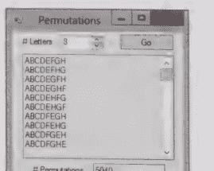

图 4-4：排列示例程序显示了一组字母的排列。

这意味着程序总共构建了 8 × 5040 = 40320 个字符串，每个字符串都必须进行 intern（内化）。因此，程序运行非常慢，使用字符串拼接大约需要 23 秒才能产生这 5,040 种排列。

对于此类 String 类效率特别低下的特殊情况，程序程序可以通过使用专门的字符串处理类来获得更好的性能：

- `StringBuilder`
- `StringWriter`
- `StringReader`

参考图 4-4，你可以看到当程序使用 `StringBuilder` 而不是字符串拼接时，构建排列仅花费了 0.05 秒。接下来的章节将描述这些字符串处理类中的每一个。

## StringBuilder

`StringBuilder` 类表示一个可变的、非内化的字符串。它在数组中存储字符数据，并可以添加、删除、替换、追加字符，而无需创建新的 String 对象或使用 intern 池。

通常，程序使用 `StringBuilder` 在长一系列步骤中构建字符串，然后调用 `StringBuilder` 的 `ToString` 方法将结果转换为普通 String。

例如，以下代码使用 `StringBuilder` 构建了一个包含系列员工姓名（每行一个）的字符串：

```csharp
string[] employeeNames = {
  "Able",
  "Baker",
  "Charley",
  "Davis",
};

StringBuilder allNames = new StringBuilder();

foreach (string name in employeeNames) {
  allNames.Append("" + name + "*") + Environment.NewLine;
}

employeeTextBox.Text = allNames.ToString();
```


该代码首先定义了一个姓名数组。创建一个 `StringBuilder` 并遍历这些名称。对于每个名称，代码调用 `Append` 方法将带括号的名称添加进去。处理完所有名称后，代码调用 `ToString` 方法将其转换并显示在 `employeeTextBox` 中。表 4-7 描述了 `StringBuilder` 类实用的属性。

## 表 4-7：常用属性

| 属性 | 说明 |
| --- | --- |
| Capacity | 获取或设置 `StringBuilder` 可以容纳的字符数。如果存储的文本超过容量，对象将分配更多空间。如果你知道 `StringBuilder` 需要至少某些数量的字符，可以使用它让对象预分配内存而不是增量分配。类的某些重载版本允许指定初始容量。 |
| Length | 获取或设置 `StringBuilder` 中当前的字符数。如果你将此值小于当前长度，`StringBuilder` 中的文本将被截断。 |

`StringBuilder` 的索引器返回存储在对象中的。程序可以使用索引器获取和设置字符值。例如，语句 `allNames[10] = 'X'` 将第 10 个字符设置为 'X'。表 4-8 描述了 `StringBuilder` 类实用的方法。

## 表 4-8：常用方法

| 方法 | 说明 |
|---|---|
| Append | 将对象的字符串表示追加到 `StringBuilder` 文本的末尾 |
| AppendFormat | 格式化一系列并将并将追加到 `StringBuilder` 文本的末尾 |
| EnsureCapacity | 确保 `StringBuilder` 至少具有指定的容量 |
| Insert | 在 `StringBuilder` 文本的指定位置插入对象的字符串表示 |
| Remove | 从 `StringBuilder` 文本中删除范围内的字符 |
| Replace | 将所有指定字符或字符串的实例替换为新的字符或字符串 |
| ToString | 返回 `StringBuilder` 文本的普通 `String` 表示 |

## 字符串操作

此外请记住，某些字符串操作所需的时间非常短。使用 `StringBuilder` 拼接 10 个字符串可能比执行 10 次简单的字符串拼接稍微快一点，但节省的总时间以毫秒计。除非该操作重复了很多次，或者进行了长得多的拼接，否则牺牲几毫秒来保持代码更易于理解可能会更好。

## StringWriter

`StringWriter` 类提供了一个接口，在某些情况下可以方便在底层的 `StringBuilder` 上构建字符串。`StringWriter` 类提供了许多方法，可以方便按顺序读取和写入值到字符串中。

表 4-9 描述了 `StringWriter` 最有用的方法。

| METHOD | DESCRIPTION |
|---|---|
| Flush | 将任何缓冲区数据刷新到底层的 `StringWriter`。 |
| toString | 将对象的当前内容作为 `String` 返回。 |
| Write | 向字符串数据中追加一个项。重载版本可以追加 `char`、`string`、`int`、`double` 以及其他许多数据类型。 |
| WriteAsync | 异步地向字符串数据的末尾追加 `char`、`string` 或 `char` 数组。 |
| WriteLine | 像 `Write` 一样将项追加到字符串数据中，并添加新行。 |

当你只想向字符串追加值时，`StringWriter` 就会很有用。`StringWriter` 还实现了 `TextWriter` 接口，因此当其他类需要 `TextWriter` 生成输出而你想将其存储在字符串中时，它非常有用。例如，`XmlSerializer` 的 `Serialize` 方法将输出发送到 `TextWriter`。如果你想序列化为字符串，可以将输出发送到 `StringWriter`，然后使用 `StringWriter` 的 `toString` 方法获取结果。如果你需要其他方式操作底层字符串数据（例如删除或替换字符），`StringBuilder` 提供了更大的灵活性。

## StringReader

`StringReader` 类提供了 `TextReader` 实现，用于从底层的 `StringBuilder` 读取数据片段。它提供了许多方法，可以方便按顺序从字符串中读取文本片段。

表 4-10 描述了 `StringReader` 最有用的方法。

### 表 4-10：有用的 StringReader 方法

| METHOD | DESCRIPTION |
| --- | --- |
| Peek | 返回数据中的下一个字符但不移动到下一个字符。 |
| Read | 返回数据中的下一个字符并移动到下一个字符。重载版本可以读取一个字符块。 |
| ReadAsync | 异步将字符从 `StringReader` 读取到缓冲区。 |
| ReadBlock | 从指定索引开始的缓冲区从 `StringReader` 读取最多数量的字符。 |
| ReadBlockAsync | 异步从指定索引开始的缓冲区从 `StringReader` 读取最多数量的字符。 |
| ReadLine | 从 `StringReader` 读取字符直到遇到行尾。 |
| ReadLineAsync | 异步从 `StringReader` 读取字符直到遇到行尾。 |
| ReadToEnd | 返回 `StringReader` 的剩余文本。 |
| ReadToEndAsync | 异步返回 `StringReader` 的剩余文本。 |

`StringReader` 类在较低的级别访问 `StringBuilder` 的数据。通常，程序使用 `StringReader` 仅仅是因为它需要将信息传递给需要 `StringReader` 或 `TextReader` 作为参数的预定义方法。

## 现实场景 | 使用 StringBuilder

仅使用 `StringBuilder`（不使用 `String`），编写一个程序，在 `TextBox` 中显示字母表的所有初始子序列（如 A、B、ABC 等），如图 4-5 所示。

## 解决方案

以下代码完成了该任务：

```csharp
private void Form_Load(object sender, EventArgs e)
{
    // 创建一个包含 ABC 的 StringBuilder。
    StringBuilder letters = new StringBuilder("ABCDEFGHIJKLMNOPQRSTUVWXYZ");

    // 此用于存储下一行字母。
    StringBuilder line = new StringBuilder();

    // 创建结果 StringBuilder。
    StringBuilder result = new StringBuilder();

    // 遍历字母。
    for (int i = 0; i < 26; i++) {
        // 将下一个字母添加到 line 中。
        line.Append(letters[i]);

        // 将 line 添加到 result 中。
        result.AppendLine(line.toString());
    }

    // 显示结果。
    stringBuilderTextBox.Text = result.toString();
    stringBuilderTextBox.Select(0, 0);
}
```

代码首先构建了一个包含字母表字母的 `StringBuilder`。它创建了第二个 `StringBuilder` 来存储一行输出，以及第三个 `StringBuilder` 来存储最终结果。

接下来，代码遍历数字 0 到 25。对于每个 `i` 的值，代码将 `letters` 中的字符追加到 `line` 值中。然后将 `line` 的新值追加到 `result` 中，并跟上新行。

当代码完成循环后，它会显示结果。

在这个示例中，并不清楚 `StringBuilder` 是否比使用简单的字符串拼接更快。在一次执行此代码以及执行 100,000 次字符串拼接的类似代码测试中，`StringBuilder` 版本所花费的时间大约是 54%，因此节省了时间，但单次执行的结果是可以忽略不计的。

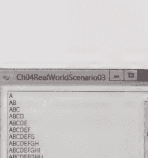

> - 此程序使用 `StringBuilder` 列出字母表的初始序列。

## 值的格式化

对值进行显示格式化是一种特别重要的类型转换。在将 `DateTime`、`decimal` 或 `double` 转换为某些 `String` 之前，你无法显示它们。格式化值为字符串的最有用方法是 `ToString` 和 `String.Format` 方法。这两个方法都使用格式化字符串。

### ToString

`Object` 类提供了一个所有类继承的 `ToString` 方法。默认情况下，该方法返回对象的类型，但大多数有意义的类都重写了该方法以返回对象的值。例如，如果一个 `float` 变量持有 1.23，它的 `ToString` 方法将返回该值。

`ToString` 方法还可以接收格式字符串作为参数，或者两者都接收。通过使用格式化字符串，你可以自定义生成的文本。

### String.Format

`ToString` 方法允许你将单个变量的值转换为 `String`。`String` 类的静态 `Format` 方法允许你构建一个可能包含不同方式格式化的许多变量值的字符串。

`Format` 方法有重载版本，但最常见的是接收一个格式化字符串和多个用于填充格式化字符串中项目的参数。

格式化字符串中的每个格式项具有以下复合格式语法：

```
{index,length][formatString]}
```

在这里，`index` 是格式化字符串之后用于该项的参数的零索引；`length` 是项的最小长度；`formatString` 是该项的标准或自定义格式字符串。如果 `length` 为负，则值在其长度内左对齐。

正式表述听起来很复杂，但并不难。以下代码展示了一个简单的示例。

```csharp
int i = 163;
Console.WriteLine(string.Format("{0} = {1,4} or 0x{2:X}", (char)i, i, i));
```

格式字符串中的其他字符（`=` 或 `0x`）将按照它们在格式字符串中出现的形式包含在输出中。

格式字符串后面的参数是与格式字符串配合使用的参数。第一个参数将整数 `i` 强制转换为 `char`。第二个和第三个参数只是变量 `i`。

结果是，此行显示了转换为字符的值 `163`，然后以十进制值显示，最后以十六进制显示。以下显示了结果：

```
f = 163 or 0xA3
```

参数并不一定需要在格式字符串中使用。参数也可以以任何顺序使用并可以重复，因此以下语句是：

```csharp
string text = string.Format("{1} (4) (2) (1) (3)",
"who", "I", "therefore", "am", "think");
```

使用 `String.Format` 还是通过拼接字符串来产生输出，很大程度上取决于个人的喜好。

## 格式字符串

`ToString` 和 `String.Format` 方法都可以接受格式字符串作为参数，以告诉它们如何格式化值。对于 `String.Format`，指的是格式项目内部的格式字符串。例如，在语句 `string.Format("{0:0(X)*", 90)` 中，格式字符串是大括号内的 `x`。

格式字符串分为大类：

- **标准格式字符串**允许你在高层级确定想要如何显示一个值。标准格式字符串是感知区域（locale-aware）的，因此它们让程序产生适用于计算机区域设置的输出。例如，“d” 日期格式表示短日期模式，并产生类似于美国式的 `3/14/2014` 或法国式的 `14/03/2014` 的结果。
- **自定义格式字符串**允许你构建标准格式字符串未提供的格式。例如，以下语句产生类似于 `It is 14 o'clock.` 的结果。

```csharp
Console.WriteLine(string.Format("It is now (0:HH) o'clock", DateTime.Now));
```

你可以使用自定义格式字符串来产生与标准字符串相似的结果，但你应该尽可能使用标准字符串，以便当你的程序运行在配置有不同区域设置的计算机上，获得适当的结果。

`ToString` 和 `String.Format` 方法理解数百种标准和自定义格式字符串。有些非常罕见，以至于在这里列出所有的将浪费大量空间。下面的表列出了数值和 `DateTime` 值最常用的标准格式字符串。有关允许的标准和自定义格式字符串的完整列表，请参见“附加阅读和资源”部分中的 URL。

表 4-11 描述了最常用的标准数值格式字符串。

## 表 4-11: 标准数值格式字符串

| 格式 | 描述 | 示例 |
| :--- | :--- | :--- |
| C or c | 货币 | $12,345.67 |
| D or d | 十进制（仅限整数类型） | 12345 |
| E or e | 科学计数法 | 1.234567E+004 |
| F or f | 固定点 | 12345.67 |
| G or g | 通用（固定点或科学计数法，以较短者为准） | 12345.67 |
| N or n | 数字（带小数点和千分位分隔符） | 12345.67 |
| P or p | 百分比（乘以 100 并添加 %） | 0.12 变为 12.00 |
| X or x | 十六进制（仅限整数类型） | 3039 |

这些格式中的某些接受一个可选的精度指定器，用于控制显示的位数。对于这些大多数类型，精度指定器表示小数点后显示的位数。例如，如果值 `value` 为 `12345.67`，则 `value.toString("C4")` 产生 `12,345.6700`。

对于科学计数法，精度指定器表示尾数中小数点后的位数。例如，如果 `value` 为 `12345.67`，则 `value.toString("E2")` 产生 `1.23E+004`。

表 4-12 描述了最常用的 `DateTime` 格式字符串。

## 表 4-12: 标准 DateTime 格式字符串

| 格式 | 描述 | 示例 |
| :--- | :--- | :--- |
| d | 短日期 | 3/14/2014 |
| D | 长日期 | Friday, March 14, 2012 |
| f | 带短时间的“完整”格式 | Friday, March 14, 2012 2:15 PM |
| F | 带长时间的“完整”格式 | Friday, March 14, 2012 2:15:16 PM |
| g | 带短时间的“通用”格式 | 3/14/2014 2:15 PM |
| G | 带长时间的“通用”格式 | 3/14/2014 2:15:16 PM |
| m or M | 月/日 | March 14 |

## 总结

| 格式 | 描述 | 示例 |
| :--- | :--- | :--- |
| t | 短时间 | 2:15 PM |
| T | 长时间 | 2:15:16 PM |
| y or Y | 年月 | March 14 |

除了这些标准格式外，`DateTime` 结构还提供了 `ToShortDateTime`、`ToLongDateTime`、`ToShortTime` 和 `ToLongTime`。有关这些内容的更多信息，请参见“附加阅读”。

## 真实世界场景：显示货币

程序已经使用 `ToString` 来显示这些值。例如，以下代码显示总金额：

```csharp
grandTotal = total.ToString("C");
```


## 总结

本章解释了如何处理类型。解释了如何使用隐式和显式转换在类型之间转换。解释了如何使用 `Convert` 和 `BitConverter` 等类执行特殊的数据转换。

程序可以进行的许多类型转换之一。例如，如果 `Employee` 类派自 `Person`，那么你可以隐式地将 `Employee` 转换为 `Person`，而在某些情况下你可以显式地将 `Person` 转换为 `Employee`。下一章解释如何构建此类转换。

## 测试题

仔细阅读每个问题，并选择代表问题的答案。你可以在附录 A，“章节答案”中找到答案。

1. 为了解析包含如 `$1,234.56` 货币值的字符串，你应该传递以下哪些值的 `Parse` 或 `TryParse` 方法？
   - a `NumberStyles.AllowCurrencySymbol`
   - b `NumberStyles.AllowThousands`
   - c `NumberStyles.Currency`
   - d 所有 `NumberStyles` 的组合

2. 关于宽转换（widening conversions），以下哪个说法是正确的？
   - a 源类型中的任何值都可以放入目标类型。
   - b 转换不会导致溢出，但可能会丢失精度。
   - c 强制转换是可选的。
   - d 以上。

3. 关于窄转换（narrowing conversions），以下哪个说法是正确的？
   - a 转换不会导致溢出，但可能会丢失精度。
   - b 源类型和目标类型必须兼容。
   - c 强制转换是可选的。
   - d 转换可以将数字数字字符串转换为 int。

4. 假设 `total` 是一个持有 `1234.56` 值的十类型变量，以下哪个语句可以以当前格式 `$1,234.56` 显示 `total`？
   - a `Console.WriteLine(total.toString());`
   - b `Console.WriteLine(total.ToCurrencyString());`
   - c `Console.WriteLine(total.ToString("*C"));`
   - d `Console.WriteLine(total.Format("{0:0C}", total));`

5. 以下哪个语句生成包含文本“Veni, vidi, vici?”的字符串？
   - a `String.Format("{0}", {1}, {2}", Veni, vidi, vici)`
   - b `String.Format("{0}", {1}, {2}, {3}", "Veni", "vidi", "vici")`
   - c `String.Format("{0}", {1}, (0), {3}", "Vidi", "vidi", "Venti", "Veni", "vici")`
   - d `String.Format("{0}", Veni, vidi, vici)`

6. 如果 i 是一个 int，l 是一个 long，那么下列哪个语句是正确的？
   - a. `i = (int)l` 是一个收缩转换（narrowing conversion）。
   - b. `l = (long)i` 是一个收缩转换。
   - c. `l = (long)i` 可能会导致整数溢出。
   - d. 将 i 的值拷贝到 l 中的正确方法是 `long.Parse(i)`。

7. 下列哪个方法是将用户输入的整数值存储在变量中的最佳方法？
   - a. `ToString`
   - b. `Convert`
   - c. `ParseInt`
   - d. `TryParse`

8. 语句 `object obj = 72` 是以下哪种操作示例？
   - a. 显式转换（Explicit conversion）
   - b. 不变转换（Immutable conversion）
   - c. 装箱（Boxing）
   - d. 拆箱（Unboxing）

9. 如果 Employee 继承自 Person，且 Manager 继承自 Employee，下列哪个语句是有效的？
   - a. `Person alice = new Employee();`
   - b. `Employee bob = new Person();`
   - c. `Manager cindy = new Employee();`
   - d. `Manager dan = (Manager) (new Employee());`

10. 下列哪个不是 String 方法？
    - a. `IndexOf`
    - b. `StartWith`
    - c. `StopsWith`
    - d. `Trim`

11. 下列哪种技术没有创建一个包含 10 个空格的 String？
    - a. 将 String 变量赋值为包含 10 个空格的字面量量。
    - b. 使用 String 构造函数，并传入一个包含 10 个空格字符的数组。
    - c. 使用 String 构造函数，传入空格字符并将 10 作为重复的次数。
    - d. 使用 String 类的 Space 方法，传入 10 作为字符串应包含的空格数。

12. 下列哪个语句可以用来捕获整数溢出和欠溢错误？
    - a. `checked`
    - b. `overflow`
    - c. `watch`
    - d. `try`

13. 你应该使用下列哪种技术来监控导致溢出或欠溢的浮点操作？
    - a. 使用 `checked` 块。
    - b. 使用 `try-catch` 块。
    - c. 检查结果是否为 `Infinity` 或 `NegativeInfinity`。
    - d. 检查结果是否为 `Error`。

## 拓展阅读与资源

以下是一些额外的有用资源，可以帮助你理解本章介绍的主题：

- 大端（Big Endian）和小小端（Little Endian）架构的解释
http://support.microsoft.com/kb/102025

- Convert 类 (Convert Class)
http://msdn.microsoft.com/library/system.convert.aspx

- BitConverter 类 (BitConverter Class)
http://msdn.microsoft.com/library/3ktfcaf9.aspx

- 标准日期时间格式字符串 (Standard Date and Time Format Strings)
http://msdn.microsoft.com/library/az4se3k1.aspx

- 自定义日期时间格式字符串 (Custom Date and Time Format Strings)
http://msdn.microsoft.com/library/8kb3dddd4.aspx

- 标准数值格式字符串 (Standard Numeric Format Strings)
http://msdn.microsoft.com/library/dwhawy9k.aspx

- 自定义数值格式字符串 (Custom Numeric Format Strings)
http://msdn.microsoft.com/library/0c899ak8.aspx

- 标准 TimeSpan 格式字符串 (Standard TimeSpan Format Strings)
http://msdn.microsoft.com/library/ee372286.aspx

- 自定义 TimeSpan 格式字符串 (Custom TimeSpan Format Strings)
http://msdn.microsoft.com/library/ee372287.aspx

- 枚举格式字符串 (Enumeration Format Strings)
http://msdn.microsoft.com/library/c3slez6e.aspx

- 理解 C# 中的 dynamic 关键字 (Understanding the Dynamic Keyword in C#) #
http://msdn.microsoft.com/en-us/magazine/gg598922.aspx

## 备查表 (CHEAT SHEET)

此备查表旨在帮助你快速学习本章的核心要点。

- 转换基础
* 隐式转换（Implicit conversion）不使用强制转换符。
* 显式转换（Explicit conversion）使用强制转换符。
* 宽转换（Widening conversions）总是成功的，且强制转换是可选的。数值不会丢失，但可能会丢失精度。
* 收缩转换（Narrowing conversions）并不总是成功的，需要强制转换符或其他转换方法。
* 导致溢出或欠溢的整数操作（包括强制转换）会被忽略，除非你使用 `checked` 块或高级生成器设置对话框。
* 导致溢出或欠溢的浮点操作会被忽略。检查结果是否为 `Infinity` 或 `NegativeInfinity` 以查看是否发生了溢出或欠溢。
* 你可以对引用数组进行强制转换，但请注意新数组指向的是同一个数组，而不是新数组。

- is 和 as 运算符
* 使用 `is` 运算符判断变量是否与特定类型兼容。
* 使用 `as` 运算符将对象转换为兼容的类型（如果对象与类型不兼容则返回 null）。
* 如果你知道对象的类型（例如在事件处理程序中），`as` 运算符特别有用。

- 解析 (Parsing)
* 使用 `Parse` 方法将文本解析为值。你必须用 `try-catch` 块保护 `Parse` 方法调用。
* 使用 `TryParse` 方法尝试解析文本并检查是否有错误。如果成功则返回 true，如果有错误则返回 false。
* 使用 `System.Globalization.NumberStyles` 枚举允许 `Parse` 和 `TryParse` 将特殊符号识别为千位分隔符、小数点和货币符号。
* 一些常用的 `NumberStyles` 值包括 `Integer`, `HexNumber`, `Number`, `Float`, `Currency` 和 `Any`。

- 特殊转换 (Specialized Conversions)
* `System.Convert` 类提供了从一种数据类型转换为另一种数据类型的方法。
* `System.Convert` 方法包括 `ToBoolean`, `ToDouble`, `ToSingle`, `ToByte`, `ToInt16`, `ToInt32`, `ToInt64`, `ToChar`, `ToDateTime`, `ToDecimal`。
* 装箱（Boxing）是将值类型转换为对象的过程。
* 拆箱（Unboxing）是将装箱的对象转换回原始类型的过程。

# 5
创建与实现类层次结构

本章你将学习到

- 从一个类派生出另一个类
- 调用基类构造函数
- 定义和实现接口
- 使用重要的接口，如 `IComparable`、`IEquatable` 和 `IEnumerable`
- 通过实现 `IDisposable` 和提供析构函数来管理资源

本章的 WROX.COM 代码下载

你可以在 www.wrox.com/remitle.cgi?isbn=118612094 上的“Download Code”（下载代码）选项卡中找到本章的代码下载。代码位于 chapter05 下载文件夹中，并根据本章中的各个名称进行了单独命名。

第 4 章“使用类型”解释了你如何在各种数据类型之间进行数据转换。某些转换发生在原始类型之间，例如将 `float` 值转换为 `int` 或将 `DateTime` 值转换为 `string`。

然而，一些最有趣的类型转换发生在一种对象类型和另一种对象类型之间。例如，如果 `Employee` 类继承自 `Person` 类，你可以将指向 `Employee` 的引用转换为指向 `Person` 的引用，因为 `Employee` 是 `Person` 的一种。

本章解释了你如何构建类的层次结构，例如 Person-Employee 层次结构。它还解释了如何创建和使用接口，接口提供了另一种形式的继承。最后，本章解释了在对象被销毁时如何管理对象的资源。

162 第 5 章 创建与实现类层次结构

## 表 5-1：本章涵盖的 70-483 考试目标

| 目标 | 涵盖内容 |
| --- | --- |
| 创建并实现类层次结构 | 继承基类。这包括从派生类的或同类的构造函数调用构造函数。创建并实现接口。这包括定义和使用接口，以及使用标准接口如 `IComparable`、`IEquatable` 和 `IEnumerable`。 |
| 管理对象生命周期 | 实现 `Disposable`。这包括处理托管和未托管资源、提供析构函数以及使用 `using` 语句。 |

## 继承自基类

第 3 章“处理类型系统”中的“创建引用类型”节解释了如何创建类。以下代码显示了一个简单的 `Person` 类的定义，你对它应该很熟悉：

```csharp
public class Person
{
    public string FirstName { get; set; }
    public string LastName { get; set; }
    public Person(string firstName, string lastName)
    {
        // 验证名字和姓氏。
        if ((firstName == null) || (firstName.Length < 1))
            throw new ArgumentOutOfRangeException(
                "*firstName",
                "FirstName must not be null or blank.");
        if ((lastName == null) || (lastName.Length < 1))
            throw new ArgumentOutOfRangeException(
                "*lastName", lastName,
                "LastName must not be null or blank.");
        // 保存名字和姓氏。
        FirstName = firstName;
        LastName = lastName;
    }
}
```

`Person` 类包含两个自动实现的字符串属性：`FirstName` 和 `LastName`。（实际应用程序使用的类可能会有多得属性来存储邮政地址、电话号码和电子邮件地址等信息。）它的构造函数将名和姓作为参数，执行一些验证，并将值保存在 `FirstName` 和 `LastName` 属性中。

### 继承基类

现在假设你想创建一个具有 `FirstName`、`LastName` 和 `DepartmentName` 属性的 `Employee` 类。你可以从零开始构建这个类，但它需要与 `Person` 类相同的属性，并且需要相同的验证，从零构建将要求你重复所有这些内容。

更好的解决方案是从 `Person` 类派生出 `Employee` 类，这样它就能继承该类的字段、属性、方法和事件。这在逻辑上也是合理的。`Employee` 是 `Person` 的一种，所以 `Employee` 应该是 `Person` 的一种，这符合逻辑。如果 `Employee` 是 `Person` 的一种，那么没有理由 `Person` 类中适用于 `Person` 对象的相同代码不应该同样适用于 `Employee` 对象。

## 类术语

关于类层次结构有很多术语。

当你从一个类派生出另一个类时，新类继承了原始类中包含的所有代码。在这种情况下，原始类被称为父类类（parent class）、基类（base class）或超类（superclass）。新类被称为派生类（derived class）、子类（child class）或子类类（subclass）。从一个类派生出另一个被称为子类化（subclassing）。

家谱树中的一些术语也适用于继承层次结构。例如，父类的后代、它们的后代等等都是父类的后裔（descendants）。同样，一个类的父类、父类的父类等等是该类的祖先（ancestors）。你甚至可以定义子类为具有共同父类的类。

要从另一个类派生一个类，只需在类名后加上冒号，然后是父类的名称。以下代码显示了一个派生自 `Person` 类的 `Employee` 类。

```csharp
public class Employee : Person
{
    public string DepartmentName { get; set; }
}
```

在这个示例中，`Employee` 类继承了 `Person` 类定义的所有字段、属性、方法和事件。它还添加了一个新属性 `DepartmentName`。虽然子类继承了父类的大部分代码，但它并不继承类的构造函数。

此时，程序可以使用以下代码创建一个 `Employee` 对象，而无需初始化其 `FirstName` 和 `LastName` 属性：

```csharp
Employee employee = new Employee();
```


由于这段代码没有初始化 `FirstName` 和 `LastName` 属性，它们的值为 `null`，这违背了 `Person` 类构造函数的目的。解决方案是为子类提供调用父类的构造函数。

### 调用父类构造函数

为了确保调用 `Person` 类的构造函数以便验证 `Employee` 的名和姓，你需要为 `Employee` 类提供构造函数，因此你首先为 `Employee` 类创建一个构造函数。然后你在构造函数的参数列表后加上冒号、`base` 关键字以及你想传递给基类的任何参数。

在这个示例中，`Employee` 构造函数将它接收的名字和姓传递给 `Person` 类的构造函数。高亮的代码显示了构造函数调用基类的构造函数。

```csharp
public class Employee : Person
{
    public string DepartmentName { get; set; }

    public Employee(string firstName, string lastName, string departmentName)
        : base(firstName, lastName)
    {
        // 验证部门名称。
        if (departmentName == null || (departmentName.Length < 1))
            throw new ArgumentNullException(
                "DepartmentName", departmentName,
                "DepartmentName must not be null or blank.");

        // 保存部门名称。
        DepartmentName = departmentName;
    }
}
```

如果基类有多个构造函数，子类可以使用 `base` 关键字调用其中的任何一个。程序使用 `base` 关键字后面的参数来确定使用哪一个构造函数。

> 注意：当构造函数使用 `base` 关键字调用基类构造函数时，基类的构造函数会在子类构造函数的体执行之前执行。

如果父类和子类都有构造函数，则子类的构造函数必须调用父类的构造函数之一。这意味着上一个代码段中高亮的 `base` 语句。如果你删除了该代码，Visual Studio 将显示错误信息“PersonHierarchy, Person 不包含带有 0 个参数的构造函数”（这里，PersonHierarchy 是包含 `Person` 类的命名空间）。`Employee` 类的构造函数隐式地尝试访问一个不带参数的 `Person` 构造函数，但找不到。

如果你想防止程序绕过父类的构造函数，你应该为子类提供至少一个构造函数。

### 调用同一类的构造函数

通常，为一个类提供多个构造函数是方便的，以便根据传入构造函数的参数来执行不同类型的初始化。在这种情况下，多个构造函数可能需要执行相同的任务。

例如，假设 `Person` 类具有 `FirstName` 和 `LastName` 属性，你希望允许程序通过仅指定名字或同时指定名和姓来创建 `Person` 对象。下面的代码展示了使用两个构造函数编写类以处理这两种选项的方法：

```cs
class Person
{
    public string FirstName { get; set; }
    public string LastName { get; set; }

    // 带名字的构造函数。
    public Person(string firstName)
    {
        FirstName = firstName;
    }

    // 带名字和姓的构造函数。
    public Person(string firstName, string lastName)
    {
        FirstName = firstName;
        LastName = lastName;
    }
}
```

第一个构造函数接受名字作为参数并将其存储在 `FirstName` 属性中。第二个构造函数接受名字和姓作为参数，并将它们的值保存在 `FirstName` 和 `LastName` 属性中。

在这段代码中，第二个构造函数首先执行了与第一个构造函数在保存名字时执行相同的工作。在这个简单的示例中，这并不是什么大问题。但在构造函数执行更困难任务的复杂场景中，这种代码重复将成为一个问题。这意味着你需要随着时间的推移实现、调试和维护多份相同的代码。

避免这种代码重复的方法是让一个构造函数调用另一个构造函数。在这种情况下，你可以重写第二个构造函数，使其调用第一个构造函数，以便处理名字参数。

你让一个构造函数调用第二个构造函数，就像调用基类构造函数一样，只不过使用的是 `this` 关键字而不是 `base` 关键字。下面的代码显示了 `Person` 类的第二个构造函数如何调用它的第一个构造函数。调用第一个构造函数的代码已高亮。

```cs
// 带名字和姓的构造函数。
public Person(string firstName, string lastName)
    : this(firstName)
{
    LastName = lastName;
}
```

> 注意：当构造函数使用 `this` 关键字调用同一类中的第二个构造函数时，第二个构造函数会在第一个构造函数的体执行之前执行。

更进一步，假设你从 `Person` 类派生出 `Employee` 类，并且 `Employee` 类添加了 `DepartmentName` 属性。你可能希望不同的 `Employee` 构造函数，可以接受名字、名和姓或名、姓和部门名称作为参数。

这些构造函数在类版本的 `Person` 类中使用了相同的技术，让更复杂的构造函数调用更简单的构造函数。`Employee` 构造函数还可以使用上一节描述的 `base` 关键字来调用 `Person` 构造函数。

例如，`Employee(firstName, lastName)` 构造函数可以使用 `this` 来调用 `Employee(firstName)`，而该构造函数可以使用 `base` 来调用 `Person(firstName, lastName)` 构造函数。

图 5-1 显示了 `ThisAndBase` 示例程序，该程序可以在书籍网站下载。该程序创建 `Person` 和 `Employee` 对象，并显示指示构造函数执行时间的消息。

下面的代码显示了创建 `Person` 和 `Employee` 对象的主 `Load` 事件处理程序。

## 演示调用其他构造函数的构造函数实验 [ThisAndBase]

```cs
public static string Results = "";

private void Form1_Load(object sender, EventArgs e)
{
    // 创建一些 Person。
    Results += "Making Person(Bea)" + Environment.NewLine;
    Person bea = new Person("Bea");
    Results += Environment.NewLine;

    Results += "Making Person(Al, Able)" + Environment.NewLine;
    Person al = new Person("Al", "Able");
    Results += Environment.NewLine;

    // 创建一些 Employees。
    Results += "Making Employee(Carl)" + Environment.NewLine;
    Person carl = new Employee("Carl");
    Results += Environment.NewLine;

    Results += "Making Employee(Deb, Dart)" + Environment.NewLine;
    Person deb = new Employee("Deb", "Dart");
    Results += Environment.NewLine;

    Results += "Making Employee(Ed, Eager, IT)" + Environment.NewLine;
    Person ed = new Employee("Ed", "Eager", "IT");
    Results += Environment.NewLine;

    // 显示结果。
    resultsTextBox.Text = Results;
    resultsTextBox.Select(0, 0);
}
```

## 代码实验分析

此代码定义了一个静态字符串 `Results`，程序的其他部分可以向其写入内容以记录发生的情况。事件处理程序创建了一系列 `Person` 和 `Employee` 对象来演示类的构造函数。在创建每个对象之前，它会向 `Results` 字符串添加一条消息说明它正在做什么。完成对象创建后，代码在表单的 `TextBox` 中显示 `Results` 字符串。

下面的代码显示了 `ThisAndBase` 程序中的 `Person` 类：

```cs
class Person
{
    public string FirstName { get; set; }
    public string LastName { get; set; }

    // 带名字的构造函数。
    public Person(string firstName)
    {
        FirstName = firstName;
    }

    // 带名字和姓的构造函数。
    public Person(string firstName, string lastName)
    {
        FirstName = firstName;
    }
}
```

## 第 5 章 创建与实现类层次

```cs
class Person
{
    public string FirstName { get; set; }
    public string LastName { get; set; }

    // 带名字的构造函数。
    public Person(string firstName)
    {
        FirstName = firstName;
    }

    // 带名字和姓的构造函数。
    public Person(string firstName, string lastName)
    {
        FirstName = lastName;
    }
}
```

```cs
class Employee : Person
{
    public string DepartmentName { get; set; }

    // 带名字的构造函数。
    public Employee(string firstName)
        : base(firstName)
    {
    }

    // 带名字和姓的构造函数。
    public Employee(string firstName, string lastName)
        : base(firstName, lastName)
    {
    }

    // 带名字、姓和部门名称的构造函数。
    public Employee(string firstName, string lastName, string departmentName)
        : base(firstName, lastName)
    {
        DepartmentName = departmentName;
    }
}
```


下面的代码显示程序的 `Employee` 类：

如果你仔细观察图 5-1，你会发现被调用的构造函数会在调用它的构造函数之前执行。你可以追踪每个对象的调用链。例如，当程序创建 Ed Eager 时，构造函数调用如下：

1. `Employee(Ed, Eager, IT)` 使用 `this` 调用。
2. `Employee(Ed, Eager)` 使用 `base` 调用。
3. `Person(Ed, Eager)` 使用 `this` 调用。
4. `Person(Ed)`。

一个构造函数只能直接调用一个基类构造函数或一个同一类构造函数。然而，不同的同一类构造函数必须调用基类构造函数，因此当你使用 `this` 调用同一类构造函数时，你实际上是在间接调用一个基类构造函数。例如，`Employee(firstName, lastName)` 构造函数调用了 `Person(firstName, lastName)` 构造函数。

## 最佳实践：创意构造函数

> 如果你想调用多个构造函数，可以将代码移动到单独的方法中并调用它们。例如，假设你希望 `Customer` 类具有构造函数 `Customer(email)`、`Customer(address)` 和 `Customer(email, address)`，其中 email 参数是字符串，address 参数是持有地址信息的 `Address` 结构体。在这种情况下，你可能希望使用下面的代码来构建构造函数：

```java
public Customer(string email)
{
    // 存储电子邮件地址。
    ...
}

public Customer(Address address)
{
    // 存储邮政地址。
}

public Customer(string email, Address address)
{
    this(email), this(address)
}
```

禁止调用多个构造函数的限制了这一点。幸运的是，你可以通过将有趣的代码移动到方法中并调用它们来绕过这个问题：

```csharp
public Customer(string email)
{
    StoreEmail(email);
}

public Customer(Address address)
{
    StoreAddress(address);
}

public Customer(string email, Address address)
{
    StoreEmail(email);
    StoreAddress(address);
}

// 存储电子邮件地址。
private void StoreEmail(string email)
{
}

// 存储邮政地址。
private void StoreAddress(Address address)
{
    ...
}
```

## 现实世界案例：椭圆与圆

创建一个表示椭圆的 `Ellipse` 类。它应该通过类型为 `RectangleF`（定义在 `System.Drawing` 命名空间）的 `Location` 属性来存储椭圆的大小和位置。为它提供两个构造函数：一个接受 `RectangleF` 作为参数，另一个接受 X 位置、Y 位置、宽度和高度作为参数。让第二个构造函数调用第一个，并让在宽度或高度小于或等于 0 时让构造函数抛出异常。

创建一个继承自 `Ellipse` 的 `Circle` 类。让它的构造函数调用相应的基类构造函数，并验证 `width = height`。（提示：你应该只在一个地方验证 `height = width`。）

不要担心类在实际程序可能提供的任何其他代码，例如绘制椭圆和圆的方法。

## 解决方案

以下 `Ellipse` 和 `Circle` 类可以工作：

```csharp
class Ellipse
{
    public RectangleF Location { get; set; }

    // 接受 RectangleF 作为参数的构造函数。
    public Ellipse(RectangleF rect)
    {
        // 验证宽度和高度
        if (rect.Width <= 0)
            throw new ArgumentOutOfRangeException("width");
    }

    // 接受 x, y, 宽度, 高作为参数的构造函数
    public Ellipse(float x, float y, float width, float height)
        : this(new RectangleF(x, y, width, height))
}
```

```csharp
class Circle : Ellipse
{
    // 接受 RectangleF 作为参数的构造函数。
    public Circle(RectangleF rect)
        : base(rect)
    {
        // 验证宽度和高度。
        if (rect.Width != rect.Height)
            throw new ArgumentOutOfRangeException(
                "width",
                "Circle width and height must be the same.");
    }

    // 接受 x, y, 宽度, 高作为参数的构造函数
    public Circle(float x, float y, float width, float height)
        : this(new RectangleF(x, y, width, height))
}
```

## 设计与实现接口

现在你已经知道如何从父类派生子类，你可以构建构建使用箭头来显示不同类之间关系的图表了。C# 允许一个类最多有一个父类，因此结果是树状的层次结构。例如，图 5-2 显示了一个用于模拟航空公司客户和人员的小型层次结构。

# 第 5 章 创建与实现类层次结构

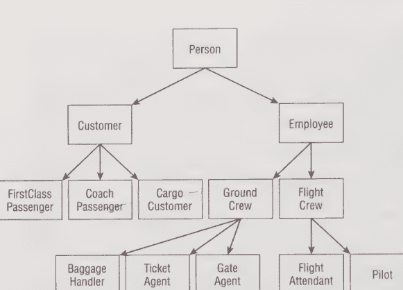

**图 5-2：** 通过类与类之间的派生，你可以构建类层次结构。

类层次结构对于各种建模问题都是足够的，但偶尔允许一个类继承多个父类会很方便。例如，假设你正在编写一个用于管理大学学生和人员的应用程序。两个重要的类是 `Student`（代表上课的人）和 `Faculty`（代表授课的人）。

当你尝试添加一个*助教（*Teaching Assistant*）类来表示既是学生又授课的助教时，问题就出现了。理想情况下，你希望使用多重继承，同时继承 `Student` 和 `Faculty` 类，以便利用图 5-3 所示的它们的代码。遗憾的是，C# 不允许多重继承，这是可能的。

虽然你不能在 C# 中使用多重继承，但可以使用接口来模拟多重继承，如下所述。

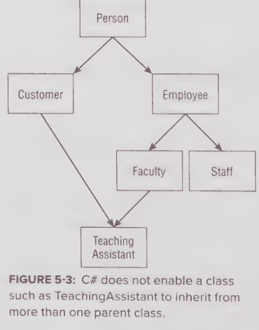

**图 5-3：** C# 不允许像 `TeachingAssistant` 这样的类继承多个父类。

> 注意：接口要求类提供某些功能，就像父类一样，但接口不提供实现。由于这与没有实现的继承有些相似，因此有时被称为接口继承。一个类最多继承一个父类，但它可以实现任意数量的接口。

## 定义接口

接口类似于指定属性、方法和事件的类，但它不提供任何实现它们的代码。它形成了一个合约，规定了其他类可以实现的功能。

如果一个类实现一个接口，它就同意提供接口定义的功能。这告诉程序的其他部分该类具有这些功能，因此代码可以调用它们。

这提供了一种多态，类似于类允许程序将对象处理为另一个另一个类的方式。例如，假设 `Employee` 类继承自 `Person` 类并实现了 `ICloneable` 接口。在这种情况下，程序可以将 `Employee` 视作 `Employee`、`Person` 或 `ICloneable` 对象。

这些似乎似乎都有点抽象，但一个例子会使其更容易理解。以下代码显示了一个简单的接口 `IStudent`：

```csharp
public interface IStudent
{
    // 学生的课程列表。
    List<string> Courses { get; set; }

    // 打印学生的成绩。
    void PrintGrades();
}
```

接下来的代码显示了实现 `IStudent` 的 `Student` 类：

```csharp
class Student : Person, IStudent
{
    // 实现 IStudent.Courses。
    public List<string> Courses { get; set; }

    // 实现 IStudent.PrintGrades。
    public void PrintGrades()
    {
        // 执行任何必要的...
    }
}
```

为 `IStudent` 接口定义的功能实现。在这个示例中，它以自动实现属性的形式提供了 `Courses`，并包含了用于实现的代码（未显示）。

接下来的代码显示了 `TeachingAssistant` 类。（目前假定图 5-3 所示的其它类，如 `Employee`、`Faculty` 和 `Staff` 已定义）。

```csharp
class TeachingAssistant : Faculty, IStudent
{
    // 实现 IStudent.Courses.
    public List<string> Courses { get; set; }

    // 实现 IStudent.PrintGrades.
    public void PrintGrades()
    {
        // 执行任何必要的...
    }
}
```

该类继承自 `Faculty` 类并实现了 `IStudent` 接口。现在程序可以创建一个 `TeachingAssistant` 对象并将其视为 `Faculty` 对象或实现 `IStudent` 的对象。

## 实现接口

有时编写接口定义的所有方法可能是一大量工作。除非接口有良好的文档，否则确定需要哪些属性、方法和事件是困难的。

幸运的是，Visual Studio 提供了一个工具可以为你创建实现接口的代码。使用该工具，编写类的声明并指定接口：

```csharp
class TeachingAssistant : Faculty, IStudent
{
}
```

此时，Visual Studio 知道你还没有实现接口。右键点击接口的声明以显示上下文菜单（在本例中为类语句中的 `IStudent`），并选择“实现接口”或“显式实现接口”，让 Visual Studio 插入满足接口的代码存根。

以下代码显示了如果你选择“显式实现接口”项时，该工具为 `TeachingAssistant` 类生成的结果：

```csharp
// 显式实现。
public class TeachingAssistant : Faculty, IStudent
{
    List<string> IStudent.Courses
    {
        get
        {
            throw new NotImplementedException();
        }
        set
        {
            throw new NotImplementedException();
        }
    }

    void IStudent.PrintGrades()
    {
        throw new NotImplementedException();
    }
}
```

如果你选择“实现接口”（Implement Interface），代码将不包含 `IStudent.` 部分，这些部分在之前的代码中已高亮显示。

新的代码段在被调用时只会抛出异常。你需要编辑代码以替换提供所需功能的默认代码。

除了语法上的区别外，隐式和显式接口实现在功能上也有区别。如果一个类显式地实现接口，程序无法通过类实例访问接口的成员。相反，它必须使用接口的实例。

例如，假设 `TeachingAssistant` 类显式地实现了 `IStudent` 接口。下面的代码显示了调用 `PrintGrades` 方法的错误和正确方式：

```csharp
TeachingAssistant ta = new TeachingAssistant();

// 以下代码会导致设计时错误。
ta.PrintGrades();

// 以下代码可以正常工作。
IStudent student = ta;
student.PrintGrades();
```

如果一个类隐式地实现接口，程序可以通过类实例或接口实例访问接口成员。

## 委托接口

之前显示的 `Student` 和 `TeachingAssistant` 类都实现了 `IStudent` 接口，因此它们都包含了提供接口功能的代码。

> 最佳实践：避免危险的重复

看到重复的代码应该让你感到不悦，因为在程序中包含重复的代码段绝不是一个好主意。重复的代码意味着你需要编写和调试两次代码。更糟糕的是，这意味着随着时间的推移你需要并行维护这些代码。如果你在其中一个更新了代码但忘记在另一个地方更新，可能会隐藏 Bug，并且程序可能会根据执行了哪部分代码产生不一致的结果。

你可以通过将实现接口的工作委托给 `TeachingAssistant` 类内部的 `Student` 对象来避免重复这段代码。只需在 `TeachingAssistant` 类中放置一个 `Student` 对象即可。每当 `TeachingAssistant` 类需要执行 `IStudent` 接口指定的任何任务时，它都会让它的 `Student` 对象来完成该工作。

下面的代码显示了 `TeachingAssistant` 类委托给 `Student` 对象的情况：

```csharp
// 将 IStudent 委托给 Student 对象。
public class TeachingAssistant : Faculty, IStudent
{
    // 处理 IStudent 的 Student 对象。
    private Student MyStudent = new Student();

    public List<string> Courses
    {
        get
        {
            return MyStudent.Courses;
        }
        set
        {
            MyStudent.Courses = value;
        }
    }

    public void PrintGrades()
    {
        MyStudent.PrintGrades();
    }
}
```

该类定义了一个名为 `MyStudent` 的 `Student` 类私有实例。为了实现 `Courses` 属性，该类使用了 `MyStudent` 对象的 `Courses` 属性。为了实现 `PrintGrades` 方法，该类调用了 `MyStudent` 对象的 `PrintGrades` 方法。

这似乎是额外的工作，但它让你实现接口的所有代码保留在 `Student` 类中。现在，如果你需要更改代码，可以在一个地方完成。

## 实现常用接口

.NET 框架包含了许多帮助框架类完成工作的接口。例如，如果你的其中一个类实现了 `IComparable` 接口，那么 `Array.Sort` 方法就可以对该类的数组进行排序。

接下来的章节将解释如何实现 .NET 框架定义的一些最有用的接口。

> 注意：`IDisposable` 接口是 .NET 框架定义的另一个有用接口。它在“实现 IDisposable 接口”章节中进行了描述。

## IComparable

如果一个类实现了 `IComparable`，它就提供了一个 `CompareTo` 方法，允许程序比较该类的两个实例，并确定它们在排序顺序中的先后位置。例如，假设你想创建一个 `Car` 类来跟踪你喜欢的汽车，并想按名称对 `Car` 对象进行排序。在这种情况下，你可以让 `Car` 类实现 `IComparable` 接口，并使用 `Array.Sort` 对 `Car` 对象的数组进行排序。

`IComparable` 接口有两个版本：普通版本和泛型版本。

如果你使用普通版本，`CompareTo` 方法接受两个非特定对象作为参数，代码在比较名称之前必须将它们转换为 `Car` 对象。下面的代码显示了具有此类类型 `CompareTo` 方法的 `Car` 类：

```csharp
class Car : IComparable
{
    public string Name { get; set; }
    public int MaxMPH { get; set; }
    public int Horsepower { get; set; }
    public decimal Price { get; set; }

    // 按名称字母顺序比较 Car。
    public int CompareTo(object obj)
    {
        if (!(obj is Car))
            throw new ArgumentException("Object is not a Car");
    }
}
```


Car other = obj as Car;

return Name.CompareTo(other.Name);

}

}

```

`CompareTo` 方法首先检查 `obj` 参数是否为 `Car` 对象，如果不是则抛出异常。如果 `obj` 是 `Car`，该方法会创建一个 `Car` 变量来处理它，然后比较当前对象的 `Name` 属性和其他 `Car` 的 `Name` 属性。

下面的代码显示了实现 `IComparable` 泛型接口的 `Car` 类：

```cs
class Car : IComparable<Car>
{
    public string Name { get; set; }
    public int MaxMPH { get; set; }
    public int Horsepower { get; set; }
    public decimal Price { get; set; }

    // 按名称字母顺序比较 Car。
    public int CompareTo(Car other)
    {
        return this.Name.CompareTo(other.Name);
    }
}
```

在此版本中，接口名称后面跟着泛型参数，告诉类要比较的对象类型。

## 常见错误：IComparable 的泛型版本

`IComparable` 的泛型版本比非泛型版本更好，并提供了强类型检查。非泛型版本是为了兼容旧版本的 .NET 框架。泛型版本的强类型检查防止你尝试比较错误类型的对象。如果你使用泛型版本，Visual Studio 将在设计时标记错误。

`IComparableCars` 示例程序可以从书的网站下载，它使用此版本的 `Car` 类来显示数组。程序使用以下代码显示汽车数组：

# IComparableCars

```cs
private void Form1_Load(object sender, EventArgs e)
{
    // 创建一些数据。
    Car[] cars =
    {
        new Car() { Name="SSC Ultimate", MaxMPH=257, Horsepower=1183, Price=654400m },
        new Car() { Name="Bugatti Veyron", MaxMPH=253, Horsepower=101, Price=1700000m }
    };

    // 显示未排序的。
    DisplayCars(cars, unsortedListView);

    // 对数组排序。
    Array.Sort(cars);

    // 显示排序后的。
    DisplayCars(cars, sortedListView);
}
```

## 代码分析

在创建 `cars` 数组后，代码调用了 `DisplayCars` 方法（稍后描述）在 `unsortedListView` 控件中显示汽车。然后调用 `Array.Sort` 对汽车排序，并再次调用 `DisplayCars` 在 `sortedListView` 控件中显示排序后的数组。

下面的代码显示了 `DisplayCars` 方法：

```cs
// 在 ListView 控件中显示汽车。
private void DisplayCars(Car[] cars, ListView listView)
{
    listView.Items.Clear();
    foreach (Car car in cars)
    {
        ListView item = listView.Items.Add(car.Name);
        item.SubItems.Add(car.Mph.ToString());
        item.SubItems.Add(car.Horsepower.ToString());
        item.SubItems.Add(car.Price.ToString("$"));
    }
    foreach (ColumnHeader header in listView.Columns)
    {
        header.Width = -2;
    }
}
```

# IComparable

使用了一个实现了 `IComparable` 的 `Car` 类，因此它可以按名称对 `Car` 对象数组进行排序，但如果你想按最大速度、马力或价格进行排序呢？`Compare` 方法一次只能对一个字段进行排序，因此没有好的方法可以让 `Car` 类按不同的属性进行排序。

# 180 | 第 5 章 创建和实现类层次结构

`IComparator` 接口提供了一种解决方案。实现 `IComparator` 接口的类必须提供一个 `Compare` 方法来比较两个对象。例如，你可以创建一个实现 `IComparator` 的 `CarPriceComparator` 类，该类包含一个按价格比较对象的 `Compare` 方法。然后你可以将 `CarPriceComparator` 对象传递给 `Array.Sort` 方法，它可以使用该对象对任何 Car 对象进行排序。

> 专家建议：使用 IComparator 的泛型版本

就像 `IComparable` 接口一样，`IComparer` 有泛型和非泛型版本。泛型版本简单并提供了强检查，因此你应该使用它。

`CarPriceComparator` 类负责按价格排序，但仍然留下了按最高速度或其他 Car 属性排序的问题。你可以创建多个 Car 比较器类，但有一个更简单的解决方案。

创建一个单一的 `CarComparator` 类，并给它提供一个程序可以设置的字段，以告诉它在比较 Car 对象时使用哪个字段。下面的代码展示了一个演示这种方法的 `CarComparator` 类：

```cs
class CarComparator : IComparator<Car>
{
    // 要比较的字段。
    public enum CompareField
    {
        Name,
        Maxmph,
        Horsepower,
        Price,
    }

    public CompareField SortBy = CompareField.Name;

    public int Compare(Car x, Car y)
    {
        switch (SortBy)
        {
            case CompareField.Name:
                return x.Name.CompareTo(y.Name);
            case CompareField.Maxmph:
                return x.Maxmph.CompareTo(y.Maxmph);
            case CompareField.Horsepower:
                return x.Horsepower.CompareTo(y.Horsepower);
            case CompareField.Price:
                return x.Price.CompareTo(y.Price);
        }
        return x.Name.CompareTo(y.Name);
    }
}
```

## 实现常用接口

该类从一个枚举开始，定义了该类可以提供的排序类型。`SortBy` 字段指示该类在排序时应该使用的 Car。

`Compare` 方法检查 `SortBy` 值并比较两个 Car 对象。

图 5-5 所示且可在书籍网站下载的 `IComCarers` 示例程序使用此 `CarComparer` 类按名称、最高速度、马力或价格对 Car 对象进行排序。

`IComCarers` 示例程序使用以下代码显示其汽车：

```cs
// 在 ListView 控件中显示汽车。
private void DisplayCars()
{
    if (Cars == null) return;

    // 创建适当的比较器。
    CarComparer comparer = new CarComparer();
    if (sortByComboBox.Text == "Name")
        comparer.SortBy = CarComparer.CompareField.Name;
    else if (sortByComboBox.Text == "Max MPH")
        comparer.SortBy = CarComparer.CompareField.MaxMPH;
    else if (sortByComboBox.Text == "Horsepower")
        comparer.SortBy = CarComparer.CompareField.Horsepower;

    // 排序。
    Array.Sort(Cars, comparer);

    // 如果不是按名称排序，则反转顺序。
    if (sortByComboBox.Text != "Name") Array.Reverse(Cars);

    listView.Items.Clear();
    foreach (Car car in Cars)
    {
        ListView item = listView.Items.Add(car.Name);
        item.SubItems.Add(car.MaxMph.ToString());
        item.SubItems.Add(car.Horsepower.ToString());
        item.SubItems.Add(car.Price.ToString("C"));
    }
    foreach (ColumnHeader header in listView.Columns)
    {
        header.Width = -2;
    }
}
```

| Name | MaxMph | Horsepower | Price |
|---|---|---|---|
| SSC Ultimate Aero | 257 | 1183 | $654,400.00 |
| Bugatti Venom | 253 | 100 | $1,700,000.00 |
| Shelby 5-5 Two-Turbo | 248 | 750 | $545,568.00 |
| Koenigsegg | 245 | 806 | $970,000.00 |
| Jaguar S-Type | 217 | 542 | $55,000.00 |
| Ferrari Enzo | 217 | 660 | $970,000.00 |
| Pagani Zonda F2 | 215 | 640 | $1,320,000.00 |
| Lamborghini LP640 | 211 | 640 | $430,000.00 |
| Porsche Carrera GT | 205 | 612 | $440,000.00 |

图 5-5：`IComCarers` 程序显示按名称、最高速度、马力或价格排序的 Car 对象列表。

# 182 | 第 5 章 创建和实现类层次结构

此方法创建一个 `CarComparer` 对象，并根据程序 `sortByComboBox` 控件中选中的值设置其 `SortBy` 值。然后它调用 `Array.Sort` 并传递 Car 对象。

程序的 `sortByComboBox` 控件允许用户选择排序准则。然后使用 `CarComparer` 对象根据所选准则对 Car 对象进行排序。

## IEquatable

如果一个类实现了 `IEquatable` 接口，它提供了一种比较相等性的方法。有时你可能不需要知道对象应该如何排序，但你需要知道它们是否相等。下面的代码展示了 `Person` 类：

```cs
class Person : IEquatable<Person>
{
    public string FirstName { get; set; }
    public string LastName { get; set; }

    public bool Equals(Person other)
    {
        return (FirstName == other.FirstName) && (LastName == other.LastName);
    }
}
```

`btnAdd_click` 事件处理程序使用 TextBoxes 中输入的值来创建一个新的 `Person` 对象。然后它使用列表的 `Contains` 方法查看该 `Person` 是否已经在列表中。如果 `Person` 已经在列表中，程序将显示消息。如果 Person 不在列表中，程序将将其添加。

```cs
// Person 列表。
private List<Person> People = new List<Person>();

// 将 Person 添加到列表。
private void btnAdd_Click(object sender, EventArgs e)
{
    // 创建新的 Person。
    Person person = new Person()
    {
        FirstName = firstNameTextBox.Text,
        LastName = lastNameTextBox.Text
    };

    if (People.Contains(person))
    {
        MessageBox.Show("列表已包含此人员。");
    }
    else
    {
        People.Add(person);
        firstNameTextBox.Clear();
        lastNameTextBox.Clear();
        firstNameTextBox.Focus();
    }
}
```

## 最佳实践：提供 IEquatable

泛型集合类如 `List`、`Dictionary`、`Stack` 和 `Queue` 提供了比较对象相等性的方法。Microsoft 建议任何可能放入这些泛型集合的类都实现 `IEquatable`。

# ICloneable

实现 `ICloneable` 接口的类必须提供一个 `Clone` 方法，用于返回调用对象的副本。例如，下面的代码展示了一个简单的克隆 `Person` 类：

```cs
class Person : ICloneable
{
  public string FirstName { get; set; }
  public string LastName { get; set; }
  public Person Manager { get; set; }

  // 返回此人员的克隆。
  public object Clone()
  {
    Person person = new Person();
    person.FirstName = FirstName;
    person.LastName = LastName;
    person.Manager = Manager;
    return person;
  }
}
```

该类的 `Clone` 方法简单地创建一个具有相同 `FirstName`、`LastName` 和 `Manager` 属性的新 `Person` 对象并返回该新对象。注意，`Clone` 方法返回一个非特定对象，而不是 `Person`，因此调用代码必须将结果强制转换为 `Person`。

以下代码显示了 `ICloneablePerson` 示例程序（可以在书籍网站上下载）如何创建两个 `Person` 对象并克隆其中一个：

```csharp
Person ann = new Person() {
    FirstName = "Ann",
    LastName = "Archer",
    Manager = null
};

Person bob = new Person() {
    FirstName = "Bob",
    LastName = "Baker",
    Manager = ann
};

Person bob2 = (Person)bob.Clone();
```

这段代码创建了一个名为 Ann Archer 的 `Person` 和另一个名为 Bob Baker 的 `Person`。然后它克隆了 Bob Baker 以创建第三个 `Person` 对象。

## 聪明的克隆 (CLEVER CLONES)

克隆有两种类型：浅克隆（shallow clones）和深克隆（deep clones）。

在浅克隆中，副本中的任何引用值都指向原始对象中的相同对象。本节描述的 `Person.Clone` 方法类是浅克隆，因为它将克隆对象的 `Manager` 属性设置为与原始对象的 `Manager` 属性相等。

在深克隆中，新对象的引用值被设置为新对象。以下代码显示了 `Person` 类如何提供深克隆：

```csharp
public object Clone()
{
    Person person = new Person();
    person.FirstName = FirstName;
```


person.LastName = LastName;

person.Manager = Manager;

if (Manager.Manager != null)
    person.Manager = (Person)Manager.Clone();

return person;

}

`ICloneable` 接口没有指定是浅克隆还是深克隆，因此你必须根据你的应用程序采取最合理的做法。如果你愿意，还可以创建第二个 `Clone` 方法，接受一个布尔值作为参数，指示副本是否应为深克隆。

## IEnumerable

实现 `IEnumerable` 接口的类提供了一个用于枚举类所包含的项目的方法。其 `GetEnumerator` 方法返回一个实现 `IEnumerator` 的对象。

`IEnumerator` 对象提供了一个 `Current` 属性，返回枚举中的当前对象。它还提供了一个 `MoveNext` 方法，将枚举器移动到枚举中的下一个对象，以及一个 `Reset` 方法，将枚举器重置为枚举开始之前的状态。最后，枚举器提供了一个 `Dispose` 方法，让其在正在使用或不再需要时清理任何资源。

`IEnumerable` 示例程序（在图 5-6 所示，可以在书籍网站上下载）构建了一棵树，然后枚举它所包含的节点。

以下代码显示了 `TreeNode` 类，它持有树中节点的信息。

### 枚举树节点 [IEnumerableTree]

```csharp
class TreeNode : IEnumerable<TreeNode>
{
    public int Depth = 0;
    public string Text = "**";
    public List<TreeNode> Children = new List<TreeNode>();

    public TreeNode(string text)
    {
        Text = text;
    }

    // 添加并创建子节点。
    public TreeNode AddChild(string text)
    {
        TreeNode child = new TreeNode(text);
        child.Depth = Depth + 1;
        Children.Add(child);
        return child;
    }

    // 按前序遍历返回树的节点。
    public List<TreeNode> Preorder()
    {
        // 创建结果列表。
        List<TreeNode> nodes = new List<TreeNode>();
        // 遍历此节点的子树。
        TraversePreorder(nodes);
        // 返回结果。
        return nodes;
    }

    private void TraversePreorder(List<TreeNode> nodes)
    {
        // 遍历此节点。
        nodes.Add(this);
        // 遍历子节点。
        foreach (TreeNode child in Children)
        {
            child.TraversePreorder(nodes);
        }
    }

    public IEnumerator<TreeNode> GetEnumerator()
    {
        return new TreeEnumerator(this);
    }

    IEnumerable IEnumerable.GetEnumerator()
    {
        return new TreeEnumerator(this);
    }
}
```

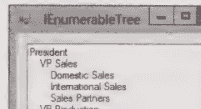

图 5-6：`IEnumerable` 示例程序枚举了树中的节点。

### 代码实验室分析

该类首先定义了节点在树中的 `Depth` 以及节点持有的 `Text` 值。`Children` 字段持有 `TreeNode` 对象的列表，这些对象是该节点在树中的子节点。该类提供了一个单构造函数来初始化节点的文本。

为了让构建树变得更容易，`AddChild` 方法向节点的 `Children` 列表添加一个新子节点并返回该子节点。`Preorder` 方法按前序遍历返回树的节点。在前序遍历中，每个节点都会在其子节点之前显示。`Preorder` 方法构建一个 `TreeNode` 对象的列表来存储遍历结果，然后调用 `TraversePreorder` 方法执行实际遍历。`TraversePreorder` 方法将当前节点添加到节点列表中，然后递归地调用每个子节点的 `TraversePreorder` 方法，以便它们将自己添加到列表中。图 5-6 显示了示例所构建的树的前序遍历。

`TreeNode` 类的其余部分是 `IEnumerable` 接口的一部分。两个 `GetEnumerator` 方法（都是必须的）都返回一个枚举器对象。在这个程序中，该对象的类型是 `TreeEnumerator`。

```csharp
class TreeEnumerator : IEnumerator<TreeNode>
{
    // 树的前序遍历节点。
    private List<TreeNode> Nodes;
    // 当前节点的索引。
    private int CurrentIndex;

    // 构造函数接受 TreeNode。
    public TreeEnumerator(TreeNode root)
    {
        Nodes = root.Preorder();
    }

    // 当前对象。
    public TreeNode Current
    {
        get { return Nodes[CurrentIndex]; }
    }

    // 移动到下一个项目。
    public bool MoveNext()
    {
        CurrentIndex++;
        return CurrentIndex < Nodes.Count;
    }

    // 重置枚举器到开头。
    public void Reset()
    {
        CurrentIndex = -1;
    }

    // 清理资源。
    public void Dispose()
    {
    }
}
```

`TreeEnumerator` 类遵循 `IEnumerator` 接口。

### 第5章：创建与实现类层次结构

`MoveNext` 方法简单地将 `CurrentIndex` 加 1。如果 `CurrentIndex` 的新值在 `Nodes` 的范围内，`MoveNext` 返回 `true` 表示存在有效的当前记录。

`Reset` 方法将 `CurrentIndex` 设置为 -1。按照惯例，枚举应该从第一个项目之前的位置开始，因此程序在使用第一个项目之前必须调用 `MoveNext`。

带有 `Dispose` 方法的类。在示例中，该方法不需要做任何事情。关于 `Dispose` 方法和 `IDisposable` 接口的更多信息，请参见“实现 IDisposable 接口”章节。

由于 `TreeNode` 类实现了 `IEnumerable`（可枚举的），主程序可以创建并使用枚举器来遍历 `TreeNode` 树。以下代码显示了示例程序如何构建并显示其树：

```csharp
// 构建并显示树。
private void Form_Load(object sender, EventArgs e)
{
    // 构建树。
    TreeNode president = new TreeNode("President");
    TreeNode sales = president.AddChild("VP Sales");
    sales.AddChild("Domestic Sales");
    sales.AddChild("International Sales");
    // 其他构建树的代码。
    ...

    // 显示树。
    string text = "";
    IEnumerator<TreeNode> enumerator = president.GetEnumerator();
    while (enumerator.MoveNext())
    {
        text += new string(' ', 4 * enumerator.Current.Depth) +
                enumerator.Current.Text +
                Environment.NewLine;
        text = text.Substring(0, text.Length - Environment.NewLine.Length);
        treeBox.Text = text;
        treeBox.Select(0, 0);
    }
}
```

## 最佳实践：让枚举变得简单

实现 `IEnumerable` 接口是一项大量工作，它要求你实现几个方法，并创建一个 `IEnumerator` 辅助类。如果程序只是想遍历一系列对象，有一种更简单的方法。

为类提供一个返回 `IEnumerable<class>` 类型对象的方法，其中 `class` 是你正在处理的类。让该方法找到应该在枚举中的对象，并调用 `yield` 将每个对象放入枚举中。在完成枚举构建时，让方法返回或调用 `yield break`。

以下代码显示了 `TreeNode` 如何在 `TreeEnumerator` 示例程序中创建枚举，该程序可以在书籍的网站上下载：

```cs
// 返回一个枚举器。
public IEnumerable<TreeNode> GetTraversal()
{
    // 获取前序遍历。
    List<TreeNode> traversal = Preorder();
    // 产生遍历中的节点。
    foreach (TreeNode node in traversal) yield return node;
    yield break;
}
```

该代码调用了之前描述的 `Preorder` 方法来获取包含树节点的列表。然后，它遍历列表中的节点并调用 `yield return` 将每个节点添加到枚举中。最后通过调用 `yield break` 完成枚举。

以下代码显示了主程序如何使用枚举：

```cs
string text = "";
foreach (TreeNode node in president.GetTraversal())
{
    text += new string(' ', 4 * node.Depth) +
    node.Text +
    Environment.NewLine;
}
```

这段代码遍历由 `GetTraversal` 方法返回的枚举，以与程序上一个版本相同的方式构建结果字符串。

如果你只是想使用 `foreach` 迭代某些项，使用 `yield` 关键字比实现 `IEnumerable` 要容易得多。

## 对象的生命周期管理

当 C# 程序实例化一个类时，它会创建一个对象。程序会操作该对象一段时间，在某个时间点，该对象可能不再被需要。当程序丢失对该对象的最后一个引用时（即对它的所有引用都已设置为 `null` 或已超出作用范围），该对象将不再能被程序访问，并成为垃圾回收的候选对象（运行垃圾回收器以回收程序无法访问的内存的过程）。

在之后的某个时间点，垃圾回收器 (GC) 可能会认为程序内存不足并决定开始垃圾回收。GC 将程序使用的所有内存标记为当前不可达。然后，它会遍历程序可以访问的所有引用，并将它们所引用的内存标记为可达。如果一个引用指向一个拥有自身引用的对象，GC 将顺着这些引用一直访问，直到访问程序可以到达的每个对象。

检查完成后，GC 会检查任何仍被标记为不可达的对象。如果一个对象具有 `Finalize` 方法（在本章稍后的“提供析构函数”一节中将有更详细的描述），GC 将调用它以让对象执行任何必要的清理。在调用 `Finalize` 之后，GC 最后回收对象的内存并将其供未来使用。

调用对象的 `Finalize` 方法的过程称为终结化（finalization）。因为你无法确定 GC 何时会调用对象的 `Finalize` 方法，所以这个过程被称为非确定性终结化（nondeterministic finalization）。

对于简单对象，这个过程相当直接，但当对象拥有需要清理的资源时，情况可能会变得复杂。例如，假设程序创建了一个用于写入文件的对象，可能用于记录事件。当对象超出作用范围时，它是终结化的候选对象，但你无法确定 GC 何时会处理终结化。在此期间，文件保持锁定状态，可能持续很长时间。实际上，如果程序没有消耗过多内存，GC 在程序执行期间可能根本不会运行，因此它可能直到程序结束时才会释放文件。

你可以采取两个步骤来帮助对象释放资源：实现 `IDisposable` 接口和提供析构函数。

## 实现 IDisposable 接口

实现 `IDisposable` 接口的类必须提供一个 `Dispose` 方法来清理该类使用的任何资源。当对象不再被需要时，程序应该调用 `Dispose` 方法（或在本章稍后的“使用 using 语句”一节中使用 `using` 语句），以便其执行清理工作。

`Dispose` 方法的主要用途是清理未托管资源，但它也可以管理托管资源。如果对象使用了指向实现了 `IDisposable` 接口的其他对象的引用，它可以调用这些对象的 `Dispose` 方法。

### 对象的生命周期

> 托管资源是指受公共语言运行时 (CLR) 控制的资源，CLR 是执行 C# 程序的运行时环境。

未托管资源是指不受 CLR 控制的资源。未托管资源包括窗口句柄、文件、笔、画刷以及程序通过 API 调用正在操作的其他对象。

例如，假设一个 `Shape` 对象表示一个绘制的形状，并具有指向 `Brush` 和 `Pen` 对象的属性。`Brush` 和 `Pen` 类是托管类，并实现了 `IDisposable`，`Shape` 的 `Dispose` 方法应该调用它们的 `Dispose` 方法以释放资源。

另一个例子，假设 `ImageTransformer` 类使用未托管代码来操作位图。它使用 API 调用获取位图句柄 (HBITMAP)，并使用其他 API 调用获取设备上下文 (DC) 并操作位图。因为这些句柄是通过 API 调用获取的，它们代表了未托管资源。如果 `ImageTransformer` 对象在没有使用其他 API 调用释放这些句柄的情况下被删除，其内存就会丢失。`ImageTransformer` 类的 `Dispose` 方法应该使用适当的 API 调用来释放不再需要的资源。

### 最佳实践：复用对象

Microsoft 建议如果程序可能重新打开对象，应提供 `Close` 和 `Open` 方法。在调用 `Dispose` 方法后尝试使用对象通常会导致异常。按照惯例，多次调用对象的 `Dispose` 方法是安全的。

遗憾的是，`IDisposable` 只是故事的一半。在看到实现 `IDisposable` 的类的代码之前，你应该了解释放资源的剩余部分：析构函数。

## 提供析构函数

如果程序调用 `Dispose` 方法，它可以释放资源，但如果程序没有调用，资源就不会被释放。当 GC 准备销毁对象时，你可以为类提供一个析构函数来释放资源。

析构函数是一个没有返回类型且名称带有 `~` 前缀的方法。GC 执行对象的析构函数来永久销毁它。

例如，以下代码显示了 `DisposableClass` 的空析构函数：

```cs
~DisposableClass()
{
}
```

### 析构 Final器

GC 实际上调用的是对象的终结器，而不是析构函数。析构函数被转换为 `Finalize` 方法的覆盖版本，执行析构函数的代码然后调用基类的 `Finalize` 方法。例如，假设 `Person` 类包含以下析构函数：

```cs
~Person()
{
    // 在此处释放未托管资源。
    ...
}
```

该析构函数被转换为以下 `Finalize` 方法：

```cs
protected override void Finalize()
{
    try
    {
        // 在此处释放未托管资源。
        ...
    }
    finally
    {
        base.Finalize();
    }
}
```


在 C# 代码中，你不能显式覆盖 `Finalize` 方法。这正是因为你无法直接调用基类的 `Finalize` 方法。（参见前面的析构函数列表。）

# 管理对象生命周期

它的 `Company` 对象存在是因为它可能已经被 GC（垃圾回收）销毁了。这意味着 `Person` 类的析构函数无法调用 `Company` 对象的 `Dispose` 方法（如果有的话）。

资源管理故事还有一个最后的转折。如果一个对象具有析构函数，它在被销毁之前必须通过一个终结队列（一个准备好进行终结的对象队列），这会消耗额外的时间。如果 `Dispose` 方法已经释放了对象的所有资源，则不需要运行对象的析构函数。在这种情况下，`Dispose` 方法可以调用 `GC.SuppressFinalize` 告诉 GC 不要调用对象的终结器（析构函数），并让对象跳过终结队列。

以下列表总结了资源管理的规则和概念：

- 如果一个类既不包含托管资源也不包含非托管资源，则它不需要实现 `IDisposable` 也不需要析构函数。
- 如果类只包含托管资源，它应该实现 `IDisposable`，但不需要析构函数。（当析构函数执行时，你无法确定托管对象是否仍然存在，因此你也无法调用它们的 `Dispose` 方法。）
- 如果类只包含非托管资源，它需要实现 `IDisposable` 并且需要析构函数，以防程序没有调用 `Dispose`。
- `Dispose` 方法必须能够安全多次运行。你可以通过使用变量来跟踪它是否已经运行过。
- `Dispose` 方法应该同时释放托管和非托管资源。
- 析构函数应该只释放非托管资源。（当析构函数执行时，你无法确定托管对象是否仍然存在，因此你也无法调用它们的 `Dispose` 方法。）
- 释放资源后，析构函数应该调用 `GC.SuppressFinalize`，这样对象就可以跳过终结队列。

# 常见错误：使用托管与非托管资源

为了避免混淆，类理想情况下不应同时包含托管资源和非托管资源。如果类有非托管资源，它应该只管理一种资源。

可下载的 `IDisposableClass` 示例程序使用了以下类来演示 `IDisposable` 接口和析构函数：

```csharp
class DisposableClass : IDisposable
{
    // 用于跟踪对象的名称。
    public string Name = "";

    // 释放托管和非托管资源。
    public void Dispose()
    {
        FreeResources(true);
    }

    // 析构函数用于清理非托管资源但不是托管资源。
    ~DisposableClass()
    {
        FreeResources(false);
    }

    // 跟踪资源是否已经释放。
    private bool ResourcesAreFreed = false;

    // 释放资源。
    private void FreeResources(bool freeManagedResources)
    {
        Console.WriteLine(Name + ": FreeResources");

        if (!ResourcesAreFreed)
        {
            // 如果适当，释放托管资源。
            if (freeManagedResources)
            {
                // 在此处释放托管资源。
                Console.WriteLine(Name + ": Dispose of managed resources");
            }
        }

        // 在此处释放非托管资源。
        Console.WriteLine(Name + ": Dispose of unmanaged resources");

        // 记住我们已经释放了资源。
        ResourcesAreFreed = true;

        // 我们不需要析构函数，因为我们的资源已经释放了。
        GC.SuppressFinalize(this);
    }
}
```

该类开始定义了一个字符串属性 `Name`。示例程序使用 `Name` 来跟踪它创建的对象。（你可能在自己的类中不需要这个字段。）

`Dispose` 方法调用稍后描述的 `FreeResources` 方法来完成所有工作。它传递方法值 `true` 表示 `FreeResources` 应该释放托管资源。

析构函数也调用 `FreeResources` 来执行相应的工作。它传递方法值 `false` 表示 `FreeResources` 不应该释放托管资源。请记住，当析构函数执行时，托管对象可能已经被销毁，因此 `FreeResources` 方法不应尝试对其进行任何操作。

接下来，类声明了变量 `ResourcesAreFreed` 并将其设置为 `false`，表示资源尚未释放。

`FreeResources` 方法首先在控制台窗口中写入消息，然后检查变量 `ResourcesAreFreed` 以查看资源是否已经释放。如果资源已经释放，该方法将什么都不做。

如果资源尚未释放，`FreeResources` 方法检查其 `freeManagedResources` 参数以查看它是否应该释放托管资源。如果 `freeManagedResources` 为 `true`，该方法将释放其托管资源。（在本示例中，代码只是向控制台窗口写入了一条消息，因此你可以看到发生了什么。）

接下来，`FreeResources` 方法释放对象的非托管资源。（在本示例中，代码向控制台窗口写入了另一条消息，因此你可以看到发生了什么。）

代码随后将 `ResourcesAreFreed` 设置为 `true`，以便它知道资源已经释放了。这样，如果程序稍后再次调用 `Dispose`，该方法将什么都不做，因此多次调用 `Dispose` 是安全的。

最后，方法调用 `GC.SuppressFinalize` 让对象在被销毁时跳过终结队列。

`DisposableClass` 有三个按钮：一个标记为 `Create & Dispose`，第二个标记为 `Create`，第三个标记为 `Collect Garbage`。

当你点击按钮时，将执行以下代码：

```csharp
// 用于给对象赋予不同的名称。
private int ObjectNumber = 1;

// 创建一个对象并释放它。
private void createAndDisposeButtonClick(object sender, EventArgs e)
{
    // 创建一个对象。
    DisposableClass obj = new DisposableClass();
    obj.Name = "CreateAndDispose" + ObjectNumber;
    ObjectNumber++;

    // 释放对象。
    obj.Dispose();
}

// 创建一个对象。
private void createButtonClick(object sender, EventArgs e)
{
    // 创建一个对象。
    DisposableClass obj = new DisposableClass();
    obj.Name = "Create " + ObjectNumber;
    ObjectNumber++;
}
```

# 第 5 章 创建和实现类层次结构

这与另一个按钮的代码相似，但它没有调用对象的 `Dispose` 方法。

你可以使用这些按钮来查看你创建的对象何时释放它们的资源。例如，假设你按照以下顺序点击按钮，然后关闭程序：

1. Create & Dispose
2. Create
3. Create
4. Create & Dispose

当你第一次点击 `Create & Dispose` 时，你在控制台中会看到以下消息：
```text
CreateAndDispose 1: FreeResources
CreateAndDispose 1: Dispose of managed resources
CreateAndDispose 1: Dispose of unmanaged resources
```

当你点击两次 `Create` 时，你不会在控制台窗口中看到任何新消息，因为这些对象尚未被销毁。引用它们的变量已经离开了作用域，GC 可终结的对象尚未被销毁。

当你点击 `Create & Dispose` 时，你会在控制台中看到以下消息，因为程序创建并释放了另一个对象：
```text
CreateAndDispose 4: FreeResources
CreateAndDispose 4: Dispose of managed resources
CreateAndDispose 4: Dispose of unmanaged resources
```

最后，当你关闭程序时，你在控制台中看到以下消息：
```text
Create 3: FreeResources
Create 3: Dispose of unmanaged resources
Create 2: FreeResources
Create 2: Dispose of unmanaged resources
```

注意，最后两个对象直到程序结束且它们的析构函数反向调用时才被销毁。通常，你无法假设一个对象会在另一个对象之前销毁。

同样注意，第一个和第四个对象没有再次调用 `FreeResources`。它们的 `Dispose` 方法已经调用过，因此 `GC.SuppressFinalize` 的调用阻止了它们的析构函数。

如果你点击 `IDisposableClass` 程序的 `Collect Garbage` 按钮，以下代码将强制 GC 立即执行垃圾回收：

```csharp
// 强制垃圾回收。
private void collectGarbageButton_Click(object sender, EventArgs e)
{
    GC.Collect();
}
```

你可以使用 `GC.Collect` 语句来测试垃圾回收和析构函数，但你不应该在最终程序中使用它，因为它会干扰垃圾回收（GC）的正常调度算法并降低性能。

## 使用 using 语句

如果一个对象具有 `Dispose` 方法，使用该对象的程序在完成对象操作后应该调用它以释放其资源。这很重要，但很容易被忘记。为了更容易确保调用 `Dispose` 方法，C# 提供了 `using` 语句。

`using` 语句开始了一个与实现 `IDisposable` 的对象绑定的代码块。当代码块结束时，程序会自动为你调用对象的 `Dispose` 方法。例如，下面的代码显示了上一节描述的 `IDisposableClass` 程序如何使用 `using` 来分配和释放对象：

```csharp
using (DisposableClass obj = new DisposableClass())
{
    obj.Name = "CreateAndDispose " + ObjectNumber.ToString();
    ObjectNumber++;
}
```

`using` 块在结束时会调用 `Dispose`，即使代码内部抛出异常也是如此。这使得之前的代码等同于以下代码：

```csharp
DisposableClass obj = new DisposableClass();
try
{
    obj.Name = "CreateAndDispose " + ObjectNumber.ToString();
    ObjectNumber++;
}
finally
{
    if (obj != null) obj.Dispose();
}
```

`using` 语句有三种语法形式：

```csharp
// 版本 1.
using (DisposableClass obj1 = new DisposableClass())
{
}
```

```csharp
// 版本 2.
DisposableClass obj2 = new DisposableClass();
using (obj2)
{
}
```

```csharp
// 版本 3.
DisposableClass obj3;

using (obj3 = new DisposableClass())
{
}
```

在第一个版本中，由 `using` 块释放的对象在 `using` 关键字后面的括号内声明并初始化的。这种方法更受青睐，因为它将变量声明和赋值结合在一起，并且将变量的作用域限制在 `using` 块内。

第二种和第三种方法都在 `using` 块之外声明了变量，因此变量的作用域扩展到了代码块之外。然而，在 `using` 块结束后，该变量已经被释放了，除非将其重新初始化为另一个对象，否则可能无法再次使用。

## 现实世界案例 Shape 资源

假设 `Shape` 类具有属性 `FillBrush`（类型为 `Brush`）和 `OutlinePen`（类型为 `Pen`）。`Brush` 和 `Pen` 类定义在 `System.Drawing` 命名空间中并且是托管类。你会如何管理 `Shape` 类的 `FillBrush` 和 `OutlinePen` 资源？（忽略类应该提供的任何代码，例如绘制形状的方法。）

## 解决方案

由于 `FillBrush` 和 `OutlinePen` 属性是托管资源，`Shape` 类应该实现 `IDisposable` 而不是拥有析构函数。以下 `Shape` 类可以正常工作：

```csharp
class Shape : IDisposable
{
    // FillBrush 和 OutlinePen 属性。
    public Brush FillBrush { get; set; }
    public Pen OutlinePen { get; set; }

    // 记住我们已经运行过 Dispose。
    private bool IsDisposed = false;

    // 清理托管资源。
    public void Dispose()
    {
        // 如果已经运行过 Dispose，则什么都不做。
        if (IsDisposed) return;

        // 释放 FillBrush 和 OutlinePen。
        FillBrush.Dispose();
        OutlinePen.Dispose();

        // 记住我们运行过 Dispose。
        IsDisposed = true;
    }
}
```


该类实现了 `IDisposable` 接口。它的 `Dispose` 方法调用了它的两个托管资源 `FillBrush` 和 `OutlinePen` 的 `Dispose` 方法。它还将布尔变量 `IsDisposed` 设置为 `true`，以便它知道 `Dispose` 方法已经执行。

## 测试题 | 199

此类不需要析构函数，因为它没有未托管资源。它不需要调用 `GC.SuppressFinalize`，因为它没有析构函数，因此不会被放入终结队列中。

## 总结

本章解释了如何处理类和接口。解释了如何从一个类派生另一个类，以及如何定义和实现接口。

它还解释了如何实现 .NET 框架定义的一些最常用的接口：`IComparable`、`IComparer`、`IEquatable`、`ICloneable` 和 `IEnumerable`。它解释了如何使用 `yield return` 语句比使用 `IEnumerable` 接口更容易地进行枚举。

最后，本章解释了垃圾回收以及如何管理作为创建和销毁的对象。它解释了如何使用 `IDisposable` 释放托管和未托管资源，并解释了如何使用析构函数释放未托管资源。

接口指定了类实现该接口必须提供的属性、方法和事件。委托在某种程度上类似于接口，因为它指定了方法的特征。它指定了方法接受的参数以及返回的结果类型（如果有的话）。下一章将解释委托。它还会解释使用委托的事件以及在任何程序中都有用的异常。

## 测试题

仔细阅读每个问题，并选择代表问题最佳解决方案的答案。你可以在附录 A，“章节测试题答案”中找到答案。

- 1. 关于 `base` 关键字的下列述错误的是？
  a. 构造函数最多可以使用一个 `base` 语句。
  b. 构造函数不能同时使用 `base` 语句和 `this` 语句。
  c. `base` 关键字允许构造函数调用同一类中的另一个构造函数。
  d. 如果构造函数使用了 `base` 语句，其代码将在被调用的构造函数之后执行。

- 2. 关于 `this` 关键字的下列述错误的是？
  a. 构造函数最多可以使用一个 `this` 语句。
  b. 如果 `base` 语句在前，构造函数可以使用 `this` 语句。
  c. `this` 关键字允许构造函数调用同一类中的另一个构造函数。
  d. 如果构造函数使用了 `this` 语句，其代码将在被调用的构造函数之后执行。

- 3. 假设你有 `House` 和 `Boat` 类，并你想创建一个继承自 `House` 和 `Boat` 的 `HouseBoat` 类。下列哪方法不可行？
  a. 让 `HouseBoat` 同时继承自 `House` 和 `Boat`。
  b. 让 `HouseBoat` 继承 `House` 并实现 `IBoot` 接口。
  c. 让 `HouseBoat` 继承 `Boat` 并实现 `IHouse` 接口。
  d. 让 `HouseBoat` 同时实现 `IHouse` 和 `IBoot` 接口。

- 4. 假设 `HouseBoat` 类隐式实现 `IHouse` 接口，显式实现 `IBoot` 接口。下列表述错误的是？
  a. 可以使用 `HouseBoat` 对象访问其 `IHouse` Members。
  b. 可以使用 `HouseBoat` 对象访问其 `IBoot` Members。
  c. 可以将 `HouseBoat` 对象转换为 `IHouse` 类型以访问其 `IHouse` Members。
  d. 可以将 `HouseBoat` 对象转换为 `IBoot` 类型以访问其 `IBoot` 成员。

- 5. 下列哪项不是接口的良好用途？
  a. 模拟多重继承。
  b. 允许以接口“类”的形式多态地处理对象。
  c. 允许程序以统一的方式处理无关类的对象。
  d. 重用接口定义的代码。

- 6. 假设你想创建一个 `Recipe` 类来存储菜谱，并想根据 `MainIngredient` 属性对菜谱进行排序。在这种情况下，以下哪个接口可能是最有用的？
  a. `IDisposable`
  b. `IComparable`
  c. `IComparer`
  d. `ISortable`

- 7. 假设你想对第6 题中的 `Recipe` 类按 `MainIngredient`、`TotalTime` 或 `CostPerPerson` 任何一个属性进行排序。在这种情况下，以下哪个接口可能是最有用的？
  a. `IDisposable`
  b. `IComparable`
  c. `IComparer`
  d. `ISortable`

8. 下述哪个述是正确的？

-   a. 一个类最多继承自一个类并最多实现一个接口。
-   b. 一个类可以继承任意数量的类并实现任意数量的接口。
-   c. 一个类最多继承自一个类并实现任意数量的接口。
-   d. 一个类可以继承任意数量的类并最多实现一个接口。

9. 程序使用 `IEnumerable` 和 `IEnumerator` 接口是为了执行以下哪个操作？

-   a. 使用 `MoveNext` 和 `Reset` 遍历对象列表。
-   b. 使用 `foreach` 遍历对象列表。
-   c. 通过索引遍历对象列表。
-   d. 使用 `yield` 语句创建一个用于迭代的对象列表。

10. 关于垃圾回收，下列哪个陈述是错误的？

-   a. 通常情况下，你无法预知 GC 何时会执行垃圾回收。
-   b. 程序可能在运行过程中从不执行任何垃圾回收。
-   c. 对象的 `Dispose` 方法可以调用 `GC.SuppressFinalize` 以防止 GC 调用对象的析构函数。
-   d. 在销毁对象之前，GC 会调用其 `Dispose` 方法。

11. 关于析构函数，下列哪个陈述是错误的？

-   a. 析构函数是自动调用的。
-   b. 析构函数在执行时不能假设其他托管对象仍然存在。
-   c. 析构函数不能被继承。
-   d. 析构函数不能被重载。

12. 如果一个类实现了 `IDisposable`，它的 `Dispose` 方法应该执行以下哪个操作？

-   a. 释放托管资源。
-   b. 释放非托管资源。
-   c. 调用 `GC.SuppressFinalize`。
-   d. 以上都是。

13. 如果一个类有托管资源没有非托管资源，它应该执行以下哪个操作？

-   a. 实现 `IDisposable` 并提供析构函数。
-   b. 实现 `IDisposable` 但不提供析构函数。
-   c. 不实现 `IDisposable` 但提供析构函数。
-   d. 不实现 `IDisposable` 且不提供析构函数。

14. 如果一个类有非托管资源没有托管资源，它应该执行以下哪个操作？

-   a. 实现 `IDisposable` 并提供析构函数。
-   b. 实现 `IDisposable` 但不提供析构函数。
-   c. 不实现 `IDisposable` 但提供析构函数。
-   d. 不实现 `IDisposable` 且不提供析构函数。

## 额外阅读与资源

这里有一些额外的资源，可以帮助你理解本章介绍的内容：

IEnumerable 接口
http://msdn.microsoft.com/en-us/library/system.collections.ienumerable.aspx

在 .NET Framework 中使用 IEnumerator 和 IEnumerable
http://www.codeproject.com/Articles/4074/
Using-IEnumerator-and-IEnumerable-in-the-NET-Frame (C# 引用)
http://msdn.microsoft.com/library/studio/9k7k7cf00.aspx

垃圾回收器基础与性能提示
http://msdn.microsoft.com/library/ms97383.aspx

垃圾回收：Microsoft .NET Framework 中的自动内存管理
http://msdn.microsoft.com/magazine/bb985010.aspx

Finalize 方法与析构函数
http://msdn.microsoft.com/library/0s71x931.aspx

## 备查表

此备查表旨在帮助你快速学习本章的关键点。

### 继承

-   C# 不支持多继承。

-   使用 `base` 关键字让构造函数调用父类构造函数，如下代码所示：

```csharp
public class Employee : Person
{
    public Employee(string firstName, string lastName)
        : base(firstName, lastName)
    {
    }
}
```

-   使用 `this` 关键字让构造函数调用同一类中的另一个构造函数，如如下代码所示：

```csharp
public class Person
{
    public string FirstName { get; set; }
    public string LastName { get; set; }

    public Person(string firstName)
    {
        FirstName = firstName;
    }

    public Person(string firstName, string lastName)
        : this(firstName)
    {
        LastName = lastName;
    }
}
```

-   一个构造函数最多调用一个基类构造函数或一个同类构造函数。

-   如果父类有构造函数，子类的构造函数必须直接或间接地地调用它们。

### 接口

-   按照惯例，接口名称以 `I` 开头，例如 `IComparable`。

-   一个类最多继承自一个父类，但可以实现任意数量的接口。

-   实现接口有时被称为接口继承。

-   如果类显式地实现接口，代码不能使用对象引用来访问接口的成员。相反，必须使用接口实例。

-   如果类隐式地实现接口，代码可以使用类实例或接口实例来访问接口的成员。

-   `IComparable` 类提供了 `CompareTo` 方法，用于确定对象的顺序。

-   `IComparer` 类提供了 `Compare` 方法，用于比较两个对象并确定它们的顺序。

-   `IEquatable` 类提供了 `Equals` 方法，用于判断对象是否相等。

-   `ICloneable` 类提供了 `Clone` 方法，返回对象的副本。

-   `IEnumerable` 类提供了 `GetEnumerator` 方法，返回一个 `IEnumerator`。

-   `IEnumerator` 类提供了 `MoveNext` 和 `Reset` 方法来遍历集合。

### 析构函数

-   析构函数由 GC 在销毁对象之前自动调用。

-   析构函数在执行时不能假设其他托管对象仍然存在。

-   析构函数不能被继承。

-   析构函数不能被重载。

### 资源管理

-   如果一个类有托管资源，它应该实现 `IDisposable` 来释放资源。

-   如果一个类有非托管资源，它应该有一个析构函数。

## 关键术语回顾

**ancestor class (祖先类)**: 类的父类、父类的父类等等。

**base class (基类)**: 另一个类所派生的类。也称为 *superclass*（超类）。

**child class (子类)**: 派自父类的类。

**Common Language Runtime (CLR)**: 一个管理 C# 和其他 .NET 程序执行的虚拟机。

**deep clone (深克隆)**: 对象的副本，其中引用字段指向新的对象实例，而不是指向原始对象字段相同的对象。

**derive (派生)**: 通过继承基于一个类创建另一个类。

**derived class (派生类)**: 派自父类的子类。

**descendant class (后代类)**: 类的子类、其子类等等。

**destructor (析构函数)**: 一个没有返回类型且名称带有类名以前缀 `~` 方法。析构函数被转换为 *Finalize* 方法，GC 在永久销毁对象之前执行它。

**finalization (终结)**: GC 调用对象的 *Finalize* 方法的过程。

**finalization queue (终结队列)**: 析构函数的对象在被销毁之前经过的队列。这需要时间，因此除非需要，否则不要为类提供析构函数。

**garbage collection (垃圾回收)**: 运行 GC 回收程序不可访问内存的过程。

**garbage collector (GC) (垃圾回收器)**: 定期执行以回收程序不可访问内存的过程。

**inherit (继承)**: 派生类继承其基类的属性、方法、事件和其他代码。

**interface inheritance (接口继承)**: 使用接口要求类提供某些功能，就像继承所做的那样（接口不提供实现）。

**managed resources (托管资源)**: 由 CLR 控制的资源。

**multiple inheritance (多继承)**: 允许一个类拥有多个父类。C# 不允许多继承。

**nondeterministic finalization (非确定性终结)**: 因为你无法判断 GC 何时调用对象的 *Finalize* 方法，所以该过程被称为 *nondeterministic finalization*。

**parent class (父类)**: 基类。也称为 *superclass*（超类）。

**reachable (可达)**: 在垃圾回收期间，如果程序有一个引用路径可以访问该对象，则该对象是可达的。

**shallow clone (浅拷贝)**: 对象的副本，其中引用字段指向与原始对象字段相同的对象。

**sibling classes (兄弟类)**: 具有相同父类的类。

**subclass (子类)**: 一种派生类。

**subclassing (子类化)**: 通过继承从基类派生子类的过程。

**superclass (父类)**: 基类。也称为*父类*。

**unmanaged resources (非托管资源)**: 不受 CLR 控制的资源。

**unreachable (不可达的)**: 在垃圾回收期间，如果程序没有可以访问该对象的引用路径，则该对象是不可达的。

> **考试提示与技巧**
> 本章节的要点术语回顾和备习表可以打印出来帮助你学习。你可以在 www.wrox.com/remtitle.cgi?isbn=1118612094 的 "Download Code" 选项卡在本章节的 ZIP 文件中找到这些文件。

# 第 6 章 使用委托、事件和异常

### 你在本章中将学习什么

- 理解委托和预定义的委托类型
- 使用包括 lambda 表达式在内的匿名方法
- 发布和订阅事件
- 允许派生类引发基类事件
- 捕获、抛出和重新抛出异常
- 创建自定义异常

### WROX.COM 本章代码下载

你可以在 www.wrox.com/remtitle.cgi?isbn=1118612094 的 "Download Code" 选项卡找到本章的代码下载。代码位于 chapter 11 下载包中，并根据整个章节中的名称单独命名。

第 3 章“处理类型系统”解释了数据类型，包括预定义类型（如 `int` 和 `string`）、数据结构和枚举。例如，下面的代码段定义了一个 `Person` 结构体，将人的姓名和地址信息分组：

```csharp
struct Person
{
    public string FirstName, LastName, Street, City, State, ZIP;
}
```

# 第 6 章 使用委托、事件和异常

本章解释了委托（定义方法类型的数据类型）。它还解释了事件（使用委托）、异常和错误处理。

表 6-1 向你介绍了本章涵盖的考试目标。

表 6-1：本章涵盖的 70-483 考试目标

| 目标 | 涵盖的内容 |
|---|---|
| 管理程序流 | 创建并实现事件和回调。这包括创建事件处理程序、订阅和取消订阅事件、使用内置委托类型创建事件、创建委托、使用 lambda 表达式以及使用匿名方法。 |
| 异常处理 | 这包括处理不同类型的异常、捕获特定类型和基类类型的异常、实现 try-catch-finally 块、抛出异常、创建自定义异常，以及确定何时抛出或重新抛出异常。 |

# 使用委托

正如你在本章引言中所看到的，委托是一种定义方法类型的数据类型，并解释了事件（使用委托）、异常和错误处理。委托是一种数据类型，类似于类或结构体。这些类型定义了类或结构体提供的属性、方法和事件。相比之下，委托是一种定义方法的参数和返回值的数据类型。接下来的章节将解释你如何定义和使用委托。

# 委托

下面的代码显示了你如何定义委托类型。

```csharp
[accessibility] delegate returnType DelegateName({parameters});
```

以下是该代码的拆解：

- *accessibility*：委托类型的访问级别控制，如 `public` 或 `private`。
- *delegate*：`delegate` 关键字。
- *returnType*：此委托方法返回的数据类型，如 `void`、`int` 或 `string`。
- *delegateName*：你想要给委托类型起的名字。
- *parameters*：该委托类型的方法应该接受的参数列表。

例如，下面的代码定义了一个名为 `FunctionDelegate` 的委托类型。

```csharp
```


# 最佳实践：委托类型的命名

某些程序员在委托类型的名称结尾带有 `Delegate` 单词，例如 `FunctionDelegate`。这很常见但并非普遍如此。如果委托被用作在代码完成任务时调用的回调方法，大多数开发者会在委托类型名称的结尾带有 `Callback`，例如 `InvoiceGeneratedCallback`。

```cs
private delegate float FunctionDelegate(float x);
```

这种类型代表接受一个 `float` 作为参数并返回一个整数的方法。在定义了委托类型后，你可以创建该类型的变量。下面的代码定义了一个名为 `TheFunction` 的变量，其类型为 `FunctionDelegate`：

```cs
private FunctionDelegate TheFunction;
```

# 专家建议：将委托值存储在变量中

你可以像存储任何类型的值一样将委托值存储在变量中。例如，你可以声明一个单个变量为委托类型；你可以创建一个具有委托类型属性或字段的结构体；你还可以创建一个委托类型变量的数组。你甚至可以创建一个该类型的 `List`。例如，下面的代码创建了一个可以持有匹配 `FunctionDelegate` 类型方法引用的 `List`。

```cs
List<FunctionDelegate> functions = new List<FunctionDelegate>();
```

稍后你可以将变量设置为具有适当参数和返回类型的方法。下面的代码定义了一个名为 `Function1` 的方法。表单的 `Load` 事件处理程序将变量 `TheFunction` 设置为此方法。

```cs
// y = 12 * Sin(3 * x) / (1 + |x|)

private static float Function1(float x)
{
    return (float)(12 * Math.Sin(3 * x) / (1 + Math.Abs(x)));
}
```

# 第 6 章：处理委托、事件和异常

你甚至可以使用减法运算符 `-=` 从委托序列中移除一个委托。例如，如果你执行语句 `delete -= Method3` 然后调用 `delete`，程序将先执行 `Method1`，然后执行 `Method2`。

委托中存在一些棘手的问题。接下来的章节描述了使用静态方法和实例方法的委托之间的区别，以及协变（covariance）和逆变（contravariance）这两个概念。

## 静态方法和实例方法

如果你将委托变量赋值为一个静态方法，那么调用该变量的方法时发生什么是显而易见的。该类的所有实例都共享同一个方法，因此调用的是该方法。

如果你将委托变量赋值为一个实例方法，结果就会稍微复杂一些。当你调用该变量的方法时，它会在你设置该变量方法时所使用的实例中执行。

> **Code LAB** Using static and instance delegates [StaticAndInstanceDelegates]

可以在书籍网站下载的 `StaticAndInstanceDelegates` 示例程序演示了如何将委托变量赋值为静态方法和实例方法。接下来的示例定义了以下 `Person` 类：

```csharp
class Person
{
    public string Name;

    // 一个返回字符串的方法。
    public delegate string GetStringDelegate();

    // 一个静态方法。
    public static string StaticName()
    {
        return "Static";
    }

    // 返回此实例的 Name。
    public string GetName()
    {
        return Name;
    }

    // 用于持有 GetStringDelegate 的变量。
    public GetStringDelegate StaticMethod;
    public GetStringDelegate InstanceMethod;
}
```

## 代码实验室分析

该类定义了一个公共的 `Name` 变量，以便你可以区分对象。它接着声明了 `GetStringDelegate` 委托类型，这是一个不接受任何参数并返回字符串的方法。

该类随后定义了两个方法。
静态方法 `StaticName` 仅返回字符串 "Static"。
实例方法 `GetName` 返回它所运行的实例的名称。

最后，该类声明了两个 `GetStringDelegate` 类型的变量：`StaticMethod` 和 `InstanceMethod`。

当程序启动时，会执行以下 `Load` 事件处理程序来演示委托：

```csharp
private void Form1_Load(object sender, EventArgs args)
{
    // 一些 Person。
    Person alice = new Person() { Name = "Alice" };
    Person bob = new Person() { Name = "Bob" };

    // alice 的 InstanceMethod 变量引用它的 GetName 方法。
    alice.InstanceMethod = alice.GetName;
    alice.StaticMethod = Person.StaticName;

    // bob 的 InstanceMethod 变量引用 alice 的 GetName 方法。
    bob.InstanceMethod = alice.GetName;
    bob.StaticMethod = Person.StaticName;

    // 演示这些方法。
    string result = "";
    result += "Alice's InstanceMethod returns: " + alice.InstanceMethod() + Environment.NewLine;
    result += "Bob's InstanceMethod returns: " + bob.InstanceMethod() + Environment.NewLine;
    result += "Alice's StaticMethod returns: " + alice.StaticMethod() + Environment.NewLine;
    result += "Bob's StaticMethod returns: " + bob.StaticMethod();

    TextBox.Text = result;
    TextBox.Select(0, 0);
}
```

这段代码创建了名为 `alice` 和 `bob` 的两个 `Person` 对象。它将 `alice` 的 `InstanceMethod` 变量赋值为 `alice` 的 `GetName` 方法，并将 `alice` 的 `StaticMethod` 变量赋值为 `Person` 类的静态 `StaticName` 方法。

代码将 `bob` 的 `InstanceMethod` 和 `StaticMethod` 变量赋值为相同的值。
接下来，代码执行存储在委托变量中的方法。`alice` 对象的 `InstanceMethod` 调用对象的 `GetName` 方法并返回 "Alice"。

`bob` 的 `InstanceMethod` 变量也引用 `alice` 实例的 `GetName` 方法，因此它也返回 "Alice"。

两个对象的 `StaticMethod` 变量都引用类的 `StaticName` 方法，因此它们都执行了该方法并返回值 "Static"。

图 6-2 显示了程序的输出。

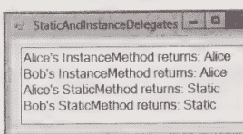

**图 6-2：** `StaticAndInstanceDelegates` 示例程序演示了指向静态方法和实例方法的委托。

## 协变和逆变

协变和逆变在将方法分配给委托变量时提供了灵活性。它们基本上允许你以多态的方式处理委托的返回类型和参数。

协变允许方法返回来自委托期望结果的*子类*的值。例如，假设 `Employee` 类派生自 `Person` 类，并且 `ReturnPersonDelegate` 类型表示返回 `Person` 对象的方法。你可以将 `ReturnPersonDelegate` 变量赋值为一个返回 `Employee` 的方法，因为 `Employee` 是 `Person` 的子类。这是合理的，因为该方法应该返回一个 `Person`，而 `Employee` 也是一种 `Person`。（如果一个变量能够启用协变，则称该变量为*协变*的。）

逆变则允许方法接受来自委托期望类型的*父类*的参数。例如，假设 `EmployeeParameterDelegate` 类型表示接受 `Employee` 对象作为参数的方法。你可以将 `EmployeeParameterDelegate` 变量赋值为一个接受 `Person` 的方法，因为 `Person` 是 `Employee` 的父类。这是合理的，因为委托期望 `Employee`，而 `Person` 可以处理它。（如果一个变量能够启用逆变，则称该变量为*逆变*的。）

> **CODE LAB** Understanding covariance and contravariance [CovarianceAndContravariance]

`CovarianceAndContravariance` 示例程序可以在书籍网站下载，它使用了 `Person` 和 `Employee` 类来演示协变和逆变。以下代码显示程序的 `Load` 事件处理协变和逆变：

```csharp
// 一个返回 Person 的方法。
private delegate Person ReturnPersonDelegate();
private ReturnPersonDelegate ReturnPersonMethod;

// 一个返回 Employee 的方法。
private Employee ReturnEmployee()
{
    return new Employee();
}
```

```csharp
// 一个接受 Employee 作为参数的委托。
private delegate void EmployeeParameterDelegate(Employee employee);
private EmployeeParameterDelegate EmployeeParameterMethod;

// 一个接受 Person 作为参数的方法。
private void PersonParameter(Person person)
{
}
```

```csharp
// 初始化委托变量。
private void Form1_Load(object sender, EventArgs args)
{
    // 使用协变将 ReturnPersonMethod 设置为 ReturnEmployee。
    ReturnPersonMethod = ReturnEmployee;

    // 使用逆变将 EmployeeParameterMethod 设置为 PersonParameter。
    EmployeeParameterMethod = PersonParameter;
}
```

## 内置委托类型

.NET 框架定义了两个泛型委托类型，在许多情况下可以使用它们来避免定义自己的委托：`Action` 和 `Func`。

### Action 委托

泛型 `Action` 委托表示返回 `void` 的方法。`Action` 委托的不同版本之间有 0 到 18 个输入参数。以下代码显示了接受两个参数的 `Action` 委托的定义：

```cs
public delegate void Action<in T1, in T2>(T1 arg1, T2 arg2)
```

泛型参数列表中的 `in` 关键字表示类型参数 `T1` 和 `T2` 是逆变的（contravariant）。

除非你需要定义接受超过 18 个参数的委托，否则你可以使用 `Action` 而不是创建自己的委托。例如，前一节中的代码定义了一个 `EmployeeParameterDelegate`，它接受一个 `Employee` 对象作为参数并返回 `void`。以下代码显示了声明该类型变量两种方法：

```cs
// 方法 1.
private delegate void EmployeeParameterDelegate(Employee employee);
private EmployeeParameterDelegate EmployeeParameterMethod;

// 方法 2.
private Action<Employee> EmployeeParameterMethod2;
```

此代码的第一条语句定义了 `EmployeeParameterDelegate` 类型。第一条注释后的语句声明了该类型的变量。第二条注释后的语句声明了一个类型为 `Action<Employee>` 的可比较变量。

### Func 委托

泛型 `Func` 委托表示返回值的方法。与 `Action` 类似，不同版本的 `Func` 之间有 0 到 18 个输入参数。以下代码显示了接受两个参数的 `Func` 委托的定义：

```cs
public delegate TResult Func<in T1, in T2, out TResult>(T1 arg1, T2 arg2)
```

泛型委托定义的三个类型代表了两个参数的类型和返回值。

前一节中的代码定义了一个 `ReturnPersonDelegate` 类型，它不接受参数并返回一个 `Person` 对象。以下代码显示了声明该类型变量两种方法：

```cs
// 方法 1.
private delegate Person ReturnPersonDelegate();
private ReturnPersonDelegate ReturnPersonMethod;

// 方法 2.
private Func<Person> ReturnPersonMethod2;
```

此代码的第一条语句定义了 `ReturnPersonDelegate` 类型。第一条注释后的语句声明了该类型的变量。第二条注释后的语句声明了一个类型为 `Func<Person>` 的可比较变量。

## 匿名方法

匿名方法本质上是一个没有名字的方法。你不需要像通常那样去创建一个方法，而是创建一个委托，该委托引用了方法应该包含的代码。你可以像使用持有该方法引用的委托变量一样来使用该委托。

以下显示了创建匿名方法的语法。

```cs
delegate([{parameters}]) { code ... }
```

以下是代码拆解：

- `delegate`: 委托关键字。
- `parameters`: 你想要让方法接受的任何参数。
- `code`: 你想要让方法执行的任何代码。如果方法应该返回结果，代码可以使用 `return` 语句。

以下代码将匿名方法存储在委托类型的变量中。

```cs
private Func<float, float> Function = delegate(float x) { return x * x; };
```

此代码声明了一个名为 `Function` 的命名变量，其类型由内置 `Func` 委托定义，它接受一个 `float` 作为参数并返回一个 `float`。它将函数 `Function` 设置为返回其参数平方的方法。

由于该方法是匿名的，程序无法通过名称引用它，但可以使用变量 `Function` 来调用该方法。

> **最佳实践：一次性使用**
> 通常，匿名方法在程序单处需要一段相对简单的代码时使用。如果方法很长或将在多个地方被调用，大多数程序员会将其写为普通方法。

上一行代码显示了如何让委托变量引用匿名方法。程序员经常使用匿名方法的另外两个地方是定义简单的事件处理器以及在单独的线程上执行简单任务。

以下代码为表单的 `Paint` 事件添加了一个事件处理器：

```cs
void Form1_Load(object sender, EventArgs e)
{
    this.Paint += delegate(object obj, EventArgs args)
    {
        args.Graphics.DrawEllipse(Pens.Red, 10, 10, 200, 100);
    };
}
```

当表单接收到 `Paint` 事件时，匿名方法会画出一个红色椭圆。

以下代码在单独线程上执行匿名方法：

```cs
private void Form1_Load(object sender, EventArgs e)
{
    System.Threading.Thread thread = new System.Threading.Thread(
```


```cs
delegate() { MessageBox.Show("Hello World"); }

);

thread.Start();

}
```

此代码创建了一个新的 `Thread` 对象，并传递了匿名方法的引用。当线程启动时，它会执行该方法，在此情况下显示一个消息框。

## Lambda 表达式

匿名方法为你提供了一个仅在一个处使用的短方法的快捷方式。如果这还不够短，Lambda 方法为创建这些快捷方式提供了简记法。Lambda 表达式使用简洁的语法来创建匿名方法。

> 注意：这里的示例在委托变量中显示 Lambda 表达式，是因为这样描述很直观。在许多应用程序中，Lambda 表达式被添加到事件的事件处理器列表中、作为参数传递给使用委托的方法，或者在 LINQ 表达式中使用。第 10 章“使用语言集成查询 (LINQ)”将详细讨论 LINQ。

Lambda 表达式有几种格式和多种变体。为了更易于讨论，接下来的章节将 Lambda 表达式分为三类：表达式 Lambda、语句 Lambda 和异步 Lambda。每种类型都有几种变体，将在下一节中介绍。

### 表达式 Lambda (Expression Lambdas)

下文显示了表达式 Lambda 最简单的形式：

```cs
() => expression;
```

在这里，`expression` 是由委托执行的单条 C# 语句。该 Lambda 表达式右侧只有一个表达式，这一事实使其成为表达式 Lambda。空圆括号代表匿名方法的空参数列表。以下代码片段显示了你可以如何使用这种 Lambda 表达式：

```cs
Action note;

note = () => MessageBox.Show("Hi!");

note();
```

### 断点与匿名名称

你可以在 Lambda 表达式内部设置断点，当 Lambda 表达式运行时，执行会在该点停止。然而，如果你预计要花费大量时间调试一段代码，这可能会相当困惑，此时你可能想使用命名方法。

如果你在匿名方法内部暂停执行，调用堆栈（Call Stack）窗口将允许你发现它的名称。以下代码显示了一个接受字符串作为参数的匿名方法被赋予的复杂名称。它在调用堆栈窗口中显示为一行，但这里为了适应页面对其进行了换行。

```
AnonymousMethods.exeAnonymousMethods.
Form1..ctor.AnonymousMethod__0(string m)
```

此代码的第一条语句创建了一个名为 `Action` 的变量，根据本章之前“内置委托类型”节的解释，它是一个表示不接受参数并返回 `void` 的委托类型。

第二条语句将 `note` 设置为 Lambda 表达式创建的匿名方法。该表达式执行单条语句 `MessageBox.Show("Hi!")`。

代码的最后语句调用了变量 `note` 引用的匿名方法。

#### 最佳实践：声明与初始化

在此示例中，你可以像下面将前两行合并为一条语句：

```cs
Action note = () => MessageBox.Show("Hi!");
```

之前的示例将这些行分开以便于阅读。之前的示例演示了最简单的 Lambda 表达式，它不接受参数并执行单条语句。你也可以像下面的示例那样为 Lambda 表达式添加参数：

```cs
Action<string> note = (message) => MessageBox.Show(message);
```

> 注意：如果 lambda 表达式恰好有一个参数，你可以像下面的代码一样省略参数外的括号：
```csharp
Action<string> note = message => MessageBox.Show(message);
```

包含括号会让代码稍微增加可读性，而且 lambda 表达式已经足够让人困惑了，所以很多程序员即使在不需要的情况下也会包含它们。

通常，Visual Studio 可以推断 lambda 表达式参数的数据类型。在上一个示例中，`note` 变量被声明为类型 `Action<string>`，因此该参数必须是 `string`。

如果 Visual Studio 无法推断参数的数据类型，或者你想让代码更显式，可以像下面的版本那样包含参数的数据类型：

```csharp
Action<string> note = (string message) => MessageBox.Show(message);
```

你可以根据需要为 lambda 表达式添加任意数量的参数。下面的示例使用了接收四个参数的 lambda 表达式：

```csharp
Action<string, string, MessageBoxButtons, MessageBoxIcon> note;

note = (message, caption, buttons, icon) =>
    MessageBox.Show(message, caption, buttons, icon);

note("Invalid input", "Alert", MessageBoxButtons.OK,
    MessageBoxIcon.Asterisk);
```

在此代码中，该委托接收四个参数：两个字符串、一个 `MessageBoxButtons` 枚举值和一个 `MessageBoxIcon` 枚举值。

此 lambda 表达式使用这些参数来显示包含消息和标题的消息框，并显示相应的指示按钮和图标。

最后一行代码显示了一个消息参数为 "Invalid input"、标题为 "Alert" 的消息框。消息框显示了 OK 按钮和星号图标，如图 6-3 所示。


图 6-3：Lambda 表达式可以接受任意数量的参数。

在目前为止的示例中，lambda 表达式返回的是 `void`，但没有理由认为 lambda 表达式不能返回值。表达式 lambda 可以通过创建该值来返回结果。

下面的代码显示了一个接收 `float` 作为参数并返回该值平方的 lambda 表达式：

```csharp
Func<float, float> square = (float x) => x * x;

float y = square(13);
```

表达式右侧的部分 `x * x` 创建了返回值。

> 注意：这种类型的 lambda 表达式返回由右侧语句定义的值，这一事实使得这种形式被称为“表达式 lambda（expression lambda）”。

对于一个更复杂的示例，图 6-1 中的 `GraphFunction` 程序使用委托来绘制三个函数之一。下面的代码显示了一个 `switch` 语句，将委托变量 `TheFunction` 设置为程序应该绘制的函数：

```csharp
switch (equationComboBox.SelectedIndex) {
  case 0:
    TheFunction = Function1;
    break;
  case 1:
    TheFunction = Function2;
    break;
  case 2:
    TheFunction = Function3;
    break;
}
```

代码没有将 `TheFunction` 设置为命名方法，而是可以将其设置为由 lambda 表达式创建的匿名方法。下面的代码显示将第一个 `case` 语句重写为使用 lambda 表达式：

```csharp
case 0:
  TheFunction = x => (float)(12 * Math.Sin(3 * x)) / (1 + Math.Abs(x));
  break;
```

这个表达式的复杂程度可能就是表达式 lambda 可以接受的极限。如果它复杂得多，读起来就会非常困惑。

语句 lambda（Statement lambdas）提供了一种让复杂的 lambda 表达式变得易读的方法。

# 第 6 章 处理委托、事件和异常

## 语句 lambda (Statement Lambdas)

语句 lambda 与表达式 lambda 类似，但它用大括号括起来其代码。这使得更容易将复杂的 lambda 表达式与周围的代码分开。它还允许你在匿名方法中包含多个语句。

除了大括号之外，语句 lambda 与表达式 lambda 的另一个区别是语句 lambda 必须使用 `return` 语句来返回值。

图 6-4 显示了 `AnonymousGraph` 示例程序（该程序可以在书籍网站下载），它绘制了常量 A, B, C, D, E, F 和 G 的函数 $Ax⁶ + Bx⁵ + Cx⁴ + Dx³ + Ex² + Fx$。（该程序与之前描述的 `GraphFunction` 程序相似，不同之处在于对函数使用了匿名方法而不是命名方法。）

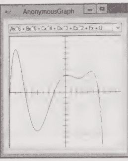

**图 6-4：** 此处 `GraphFunction` 程序第三个函数的方程在语句 lambda 中比在表达式 lambda 中易读。

图 6-4 中绘制的函数是一个简单的多项式，但它很长，如果写在表达式 lambda 中将会非常杂乱。下面的代码显示了程序如何使用语句 lambda 来保存一个评估该函数的匿名方法的引用：

```csharp
TheFunction = (float x) => {
  const float A = -0.0003f;
  const float B = -0.0024f;
  const float C = 0.02f;
  const float D = 0.09f;
  const float E = -0.5f;
  return A * (float)Math.Pow(x, 6) + B * (float)Math.Pow(x, 5) + C * (float)Math.Pow(x, 4) + D * (float)Math.Pow(x, 3) + E * (float)Math.Pow(x, 2) + F * x;
};
```

```cs
}
// 从账户中扣款。

public void Debit(decimal amount)
{
    // 检查账户中是否有足够的资金。
    if (Balance >= amount)
    {
        // 扣除资金。
        Balance -= amount;
    }
    else
    {
        // 触发 Overdrawn 事件。
        if (Overdrawn != null) Overdrawn();
    }
}
}
```

该类定义了 `OverdrawnEventHandler` 委托，并将 `Overdrawn` 事件声明为该类型。然后它定义了自动实现的 `Balance` 属性。

接下来，该类定义了两个方法：`Credit` 和 `Debit`，用于向账户添加和移除资金。`Credit` 方法简单地将金额加到余额中。

`Debit` 方法首先检查账户的 `Balance`，以查看账户是否有足够的资金。如果 `Balance >= amount`，该方法直接从账户中扣除资金。

如果账户中的资金不足，该方法会触发 `Overdrawn` 事件。要触发该事件，代码首先检查该事件是否有任何订阅者。如果事件没有订阅者，则对代码来说该“事件”似乎为 `null`。如果事件不是 `null`，代码将调用它以通知其订阅者。

## 预定义事件类型

上一个示例使用了以下代码来定义事件委托并创建该类型的事件：

```cs
public delegate void OverdrawnEventHandler();

public event OverdrawnEventHandler Overdrawn;
```

此委托代表不接受参数且返回 `void` 的方法。本章较早之前的“内置委托类型”部分描述过，`Action` 委托代表相同类型的方法。这意味着你可以将之前的代码简化为以下内容：

```cs
public event Action Overdrawn;
```

## 事件最佳实践

Microsoft 建议所有事件都应提供两个参数：触发事件的对象，以及另一个提供与事件相关参数的对象。第二个对象应该是派生自 `EventArgs` 类的派生类。

例如，如果程序使用了前一节中描述的多个 `BankAccount` 对象，那么事件处理程序的第一个参数可以帮助程序确定是哪一个账户触发了 `Overdrawn` 事件。

事件被触发这一事实告诉程序账户没有足够的资金执行扣款，但它并没有告诉程序扣款的金额是多少。程序可以检查 `BankAccount` 对象来确定当前余额，但无法确定扣款的金额有多大。你可以使用事件处理程序的第二个参数为程序提供该信息。

为了传递事件处理程序第二个参数中的信息，请派生自 `EventArgs` 类来持有这些信息。按照惯例，该类型的名称应以事件名称开头，并以 `EventArgs` 结尾。

例如，以下代码显示了一个 `OverdrawnEventArgs` 类，它可以向 `Overdrawn` 事件处理程序传递信息：

```cs
class OverdrawnEventArgs
{
    public decimal CurrentBalance, DebitAmount;
    public OverdrawnEventArgs(decimal currentBalance, decimal debitAmount)
    {
        CurrentBalance = currentBalance;
        DebitAmount = debitAmount;
    }
}
```

该类持有 `BankAccount` 的当前余额和扣款金额。它提供了一个构造函数，使初始化新对象变得更加容易。

现在程序可以向 `Overdrawn` 事件传递触发事件的对象以及一个 `OverdrawnEventArgs` 对象，以向程序提供有关事件的额外信息。

由于事件处理程序现在接受两个参数，你需要修改事件声明，以便其使用的委托能够反映这些参数。你可以创建一个新的委托，但 .NET Framework 定义了一个泛型 `EventHandler` 委托，这使得变得更加简单。只需使用 `EventHandler` 类型，并将第二个参数的数据类型（在本例中为 `OverdrawnEventArgs`）作为泛型委托的类型参数。

以下代码显示了修改后的事件声明：

```cs
public event EventHandler<OverdrawnEventArgs> Overdrawn;
```

这表示 `Overdrawn` 事件接受两个参数。第一个参数假设是触发事件的对象，第二个参数是 `OverdrawnEventArgs` 类型的对象。

以下代码显示了修改后使用新事件类型的 `Debit` 方法：

```cs
// 从账户中扣款。
public void Debit(decimal amount)
{
    // 检查账户中是否有这笔资金。
    if (Balance >= amount)
    {
        // 扣除资金，
        Balance -= amount;
    }
    else
    {
        // 触发 Overdrawn 事件。
        if (Overdrawn != null)
            Overdrawn(this, new OverdrawnEventArgs(Balance, amount));
    }
}
```

当代码触发 `Overdrawn` 事件时，它会将事件参数 `this`（触发事件的对象）和一个提供进一步信息的新 `OverdrawnEventArgs` 对象传递出去。

`BankAccount` 示例程序可以在书籍网站下载，它演示了 `BankAccount` 类的此版本。

## 事件继承

在构建 Windows Forms 类和 .NET Framework 中的类时，Microsoft 发现像目前为止描述的简单事件在派生类中工作并不良好。问题在于，事件只能在声明它的类内部被触发，因此子类无法触发基类的事件。

Microsoft 在 .NET Framework 以及许多其他类层次结构中使用的解决方案是给基类提供一个触发事件的受保护（protected）方法。然后派生类可以调用该方法来触发事件。按照惯例，该方法的名称应以 `On` 开头，并以事件名称结尾，例如 `OnOverdrawn`。

例如，考虑前一节描述的 `BankAccount` 类。如果程序尝试移除超过账户所持有的金额，其 `Debit` 方法将触发 `Overdrawn` 事件。为了遵循这种新模式，类应该将触发事件的代码移动到新的 `OnOverdrawn` 方法中，然后按如下所示调用它：

```cs
// 触发 Overdrawn 事件。
protected virtual void OnOverdrawn(OverdrawnEventArgs args)
{
    if (Overdrawn != null) Overdrawn(this, args);
}
```

```cs
// 从账户中扣款。
public void Debit(decimal amount)
{
    // 检查账户中是否有足够的资金。
    if (Balance >= amount)
    {
        // 扣除资金。
        Balance -= amount;
    }
    else
    {
        // 触发 Overdrawn 事件。
    }
}
```


现在假设你想添加一个派生自 `BankAccount` 的新 `MarketAccount` 类。当它的代码需要触发事件时，它调用基类的 `OnOverdrawn` 方法。

以下代码显示了 `MarketAccount` 类：

```cs
class MoneyMarketAccount : BankAccount
{
    void DebitFee(decimal amount)
    {
        // 检查账户中是否有资金。
        if (Balance >= amount)
        {
            // 扣除资金。
            Balance -= amount;
        }
        else
        {
            // 触发 Overdrawn 事件。
            OnOverdrawn(new OverdrawnEventArgs(Balance, amount));
        }
    }
}
```

`DebitFee` 方法从账户中扣除费用。如果余额小于要扣除的金额，代码调用基类的 `OnOverdrawn` 方法来触发事件。

## 真实世界场景：透支账户

创建一个继承自 `BankAccount` 的 `OverdraftAccount` 类。为它提供一个 `SavingsAccount` 属性，该属性是另一个 `BankAccount` 对象的引用。

当程序尝试从 `OverdraftAccount` 对象移除资金时，如果对象没有足够的余额，它可以从 `SavingsAccount` 获取额外的资金。

如果 `OverdraftAccount` 及其 `SavingsAccount` 之间的资金不足以扣款，则触发 `OverdraftAccount` 对象的事件。

构建一个与图 6-5 所示类似的界面以便测试新类。

确保捕获 `OverdraftAccount` 对象及其关联的 `SavingsAccount` 对象的 `Overdrawn` 事件。

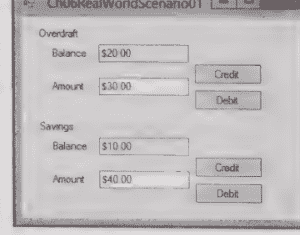

> 图 6-5：必要时，透支账户对象可以从其关联的储蓄账户对象中移除资金。

## 解决方案

以下代码显示了 `OverdraftAccount` 类：

```csharp
class OverdraftAccount : BankAccount
{
    // 关联储蓄账户。
    public BankAccount SavingsAccount { get; set; }

    // 从账户中扣除资金。
    public new void Debit(decimal amount)
    {
        // 检查账户中是否有足够的资金。
        if (Balance + SavingsAccount.Balance < amount)
        {
            // 抛出 Overdrawn 事件。
            OnOverdrawn(new OverdrawnArgs(Balance, amount));
        }
        else
        {
            // 从透支账户中扣除可以提取资金。
            if (Balance >= amount) Balance -= amount;
            else
            {
                amount = Balance;
                Balance = 0m;
                // 如果还有未付金额，从储蓄账户中扣除。
                if (amount > 0m) SavingsAccount.Balance -= amount;
            }
        }
    }
}
```

该类继承自 `BankAccount` 类。它定义了新的 `SavingsAccount` 属性。

新类可以继承 `BankAccount` 类的 `Balance` 属性和 `Credit` 方法，但它需要用新版本替换 `Debit` 方法，以便在必要时从 `SavingsAccount` 对象中提取资金。`OverdraftAccount` 的 `Debit` 方法使用 `new` 关键字声明，表示此版本应替换由 `BankAccount` 类定义的版本。

新版本会检查透支账户及其储蓄账户中的可用资金。如果两个账户中的资金都不足以支付扣款，代码将调用继承的 `OnOverdrawn` 来抛出 `Overdrawn` 事件。

如果透支账户中有足够的资金支付扣款，代码将从该账户中减除资金。

如果透支账户中的资金不足以支付扣款，代码将先扣除现有的资金，并将剩余部分从关联的储蓄账户中扣除。

## 订阅和取消订阅

有几种方法可以订阅和取消事件，取决于你是想在代码中操作还是在窗口设计器中操作。以下章节描述了这两种方法。

### 使用代码订阅事件

你可以使用类似于下面的代码来订阅事件：

```csharp
processOrderButton.Click += processOrderButton_Click;
```

这会将名为 `processOrderButton_Click` 的方法添加到 `processOrderButton` 的 `Click` 事件的事件程序。

> 注意：以下代码显示了订阅事件的另一种语法：
> `processOrderButton.Click += System.EventHandler(processOrderButton_Click);`

这是一种旧语法，但仍然被支持。你可能不应该在代码中使用它，因为它会让代码变得更长、更乱，但如果你看到它，应该理解它。

以下代码显示了一个空的 `processOrderButton_Click` 事件程序：

```csharp
void processOrderButton_Click(object sender, EventArgs e)
{}
```

事件程序使用的参数列表必须与事件所需的参数匹配。在这种情况下，事件程序必须接受两个参数：一个非特定类型的 `object` 和一个 `EventArgs` 对象。

你可以编写一个事件程序，也可以让 Visual Studio 的代码编辑器为你生成一个。如果你输入文本 `processOrderButton.Click +=`，代码编辑器会显示图 6-6 所示的消息。（此消息适用于 Windows Forms 项目，但如果你编写 XAML 应用程序，也会收到类似的消息。）

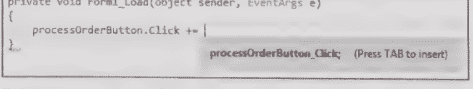

> 图 6-6：Visual Studio 的代码编辑器可以为你插入默认事件程序。

如果你按下 `Tab` 键，代码编辑器会插入按钮的默认名称，该名称由按钮名称、下划线和事件名称组成，例如 `processOrderButton_Click`。

### 处理事件

此时，如果你还没有定义事件程序，代码编辑器会显示图 6-7 所示的消息。如果你按下 `Tab` 键，代码编辑器将创建一个类似于下面的代码的事件程序：

```csharp
private void Form_load(object sender, EventArgs e)
{
    processOrderButton.Click += processOrderButtonClick;
    // 按 Tab 键在此类中生成程序 'processOrderButtonClick'
}
```

> 图 6-7：Visual Studio 的代码编辑器可以为你生成事件程序。

```csharp
void processOrderButton_Click(object sender, EventArgs e)
{
    throw new NotImplementedException();
}
```

此初始事件程序简单地抛出一个异常，提醒你稍后实现它。你应该删除该语句，并插入任何你需要事件程序执行的代码。

以下代码显示了程序如何取消事件的订阅：

```csharp
processOrderButton.Click -= processOrderButtonClick;
```

> 常见错误：过度订阅
> 如果你多次订阅同一个事件，该事件程序会被调用多次。例如，如果程序执行了三次 `processOrderButton.Click += processOrderButtonClick` 语句，那么当用户点击按钮时，`processOrderButton.Click` 事件程序将执行三次。
> 每当你取消订阅一次事件时，该事件程序就会从订阅者列表中移除。例如，如果程序执行了三次 `processOrderButton.Click += processOrderButtonClick` 语句并执行了一次 `processOrderButton.Click -= processOrderButtonClick` 语句，当用户点击按钮时，事件程序将执行两次。
> 如果你取消了一个未订阅某个事件的事件程序，什么都不会发生，也不会有错误。例如，如果程序执行了 `processOrderButton.Click -= processOrderButtonClick` 但该事件程序尚未订阅该事件，程序将正常运行。

### 使用设计器订阅事件

如果你编写 Windows Forms 应用程序，并且事件发布者是你添加到表单的控件或组件，可以使用表单设计器将事件程序附加到事件。在表单设计器中打开表单并选择控件。在属性窗口中，点击事件按钮（图标像一个闪电）查看控件的事件。图 6-8 显示了显示 `Form` 对象事件的属性窗口。

> **232 | 第 6 章 处理委托、事件和异常**

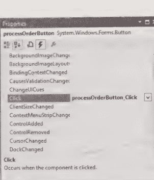

> **图 6-8:** Visual Studio 的属性窗口允许你选择或创建事件程序。

要将现有的事件程序订阅到事件，请点击属性窗口中的事件。

要为事件创建一个新的空事件程序，请双击属性窗口中的事件。

要使用属性窗口取消事件的订阅，请右键点击事件名称并选择“重置”。

#### 常见错误：未订阅

如果你通过属性窗口删除了已订阅某个事件的事件处理程序，Visual Studio 会发出强烈警告。它不会允许你运行应用程序，如果你尝试在表单设计器中打开表单，你会看到类似于图 6-9 所示的错误。

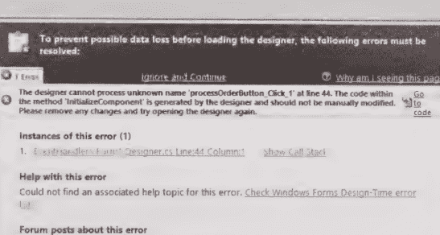

> 图 6-9：如果缺少订阅的事件，表单设计器将无法显示表单。

要解决这个问题，请点击表单设计器上的链接，或双击错误窗口中的错误消息，以找到设计器代码中的错误行。如果表单名称为 `Form1`，则该文件名为 `Form1.Designer.cs`。

导致问题的行会在表单设计器代码中被高亮，如图 6-10 所示。删除包含缺失事件处理程序的行，表单应该就可以再次运行了。

```csharp
// processOrderButton
this.processOrderButton.Location = new System.Drawing.Point(73, 63);
this.processOrderButton.Name = "processOrderButton";
this.processOrderButton.Size = new System.Drawing.Size(75, 25);
this.processOrderButton.TabIndex = 0;
this.processOrderButton.Text = "Button";
this.processOrderButton.BackColor = true;
this.processOrderButton.Click += new System.EventHandler(this.processOrderButton_Click);
```

> 图 6-10：删除包含缺失事件处理程序的行以修复表单。

## 异常处理

无论应用程序设计得多么良好，问题仍然不可避免。用户会输入无效值，必备文件会被删除，关键网络连接可能会失败。为了避免并从这类问题中恢复，程序必须执行错误检查和异常处理。

### 错误检查与异常处理

错误检查是预测错误、检查是否会发生并规避它们的过程。例如，如果用户必须在文本框中输入整数，最终会有人输入非数字值。如果程序尝试将该值解析为整数，它将会崩溃。

程序不应该崩溃，而应该在尝试解析之前验证检查结果是否合理。`int.TryParse` 方法兼顾了这两点：尝试解析文本值，并在失败时返回错误指示器。

> 专家建议：让错误无法发生
> 你可以通过消除用户输入无效值的机会来减少对这种类型错误检查的需求。例如，如果程序使用 `NumericUpDown` 或 `TextBoxBar` 而不是 `TextBox`，用户无法输入像“ten”或“1.2”这样的无效整数。
> 同样，在打开文件或跨网络下载文件之前，程序可以验证文件是否存在以及网络连接是否存在。如果程序检测到此类错误，它可以告诉用户并取消正在尝试的任何操作。

与错误检查相反，异常处理是在发生意外错误时保护应用程序的过程。例如，假设程序开始通过网络下载文件，但网络突然消失了。程序无法预测这个问题，因为在下载期间网络是连接的。

即使你验证了用户输入的每个值并检查了每种可能的情况，意料之外的异常仍可能出现。文件可能会损坏；存在的网络连接可能会失败；系统可能会耗尽内存；或者你正在使用且无法控制的代码库可能会抛出异常。

如果可能，最好在问题发生之前主动寻找麻烦，而不是在发生后才做出反应。例如，在打开文件之前检查文件是否存在，比直接尝试打开它并在文件不存在时处理错误要好。

如果你在问题发生之前发现了问题，你通常对问题是什么有得多的了解，因此在告诉用户哪里出错时可以更具体。如果你寻找一个文件但它丢失了，你可以告诉用户。如果你尝试打开一个文件并失败，你不知道是文件丢失、损坏、被另一个进程锁定，还是由于其他原因无法访问。

生成异常信息也会给程序增加一些额外开销，因此如果你在错误发生之前预测它们，通常会获得更好的性能。

即使你验证了用户输入、寻找所需的文件和网络连接，并检查了你能想到的所有其他错误，程序可能仍然遇到意外情况。在这种情况下，程序可以使用 `try-catch-finally` 块来保护自己。

### try-catch-finally 块

`try-catch-finally` 块允许程序捕获并处理意外。此块实际上由三个部分组成：`try` 部分、一个或多个 `catch` 部分以及 `finally` 部分。`try` 部分是必须的，你必须至少包含一个 `catch` 或 `finally` 部分。虽然你不需要两者都包含，也不需要在 `catch` 或 `finally` 部分内部包含任何代码。

`try` 部分包含可能抛出异常的语句。你可以在此部分包含任意数量的语句。你甚至可以在 `try` 部分内部嵌套其他的 `try-catch-finally` 序列，以便在不离开 `try` 部分的情况下捕获错误。

以下显示 `try` 部分的语法：

```csharp
try {
  // 可能抛出异常的语句
}
```

以下显示 `catch` 部分的语法：

```csharp
catch (Exception ex) {
  // 要执行的语句...
}
```

如果在 `try` 部分发生异常，程序将按照它们出现的顺序遍历 `catch` 列表。程序会将异常与每个 `ExceptionType` 进行比较，直到找到匹配项。

如果异常可以被视为 `Exception` 类，则视为匹配。例如，`DivideZeroException` 继承自 `ArithmeticException` 类，该类继承自 `SystemException` 类，而后者继承自 `Exception` 类。所有直接或间接源自 `Exception` 的异常。

当找到匹配的 `ExceptionType` 时，程序执行该 `catch` 部分并跳过剩余的 `catch` 部分。

#### 专家建议：异常排序

由于程序按照它们在代码中出现的顺序考虑 `catch` 部分，请确保按照最具体（最派生）到最不具体的顺序列出它们。例如，`FormatException` 类继承自 `SystemException` 类，该类又继承自 `Exception` 类。考虑以下 `catch` 语句列表：

```csharp
try {
  // 语句...
}
catch (SystemException ex) {
  // 语句...
}
catch (FormatException ex) {
  // 语句...
}
catch (Exception ex) {
  // 语句...
}
```

`FormatException` 类比 `SystemException` 类更具体，但它的 `catch` 部分位于后者的之后。如果发生了 `FormatException`，第一个 `catch` 部分将处理它，因为 `FormatException` 是 `SystemException` 的一种类型。这意味着第二个 `catch` 部分永远不会执行。

最后的 `catch` 部分处理 `Exception` 类，它是所有异常类的祖先。如果任何异常跳过了其他 `catch` 部分，最后的 `catch` 部分将处理它。

如果你省略了 `ExceptionType`，`catch` 部分将捕获所有类型的异常。例如，考虑以下代码：

```csharp
int quantity;
try {
  quantity = int.Parse(quantityTextBox.Text);
} catch {
  MessageBox.Show("数量必须是整数。");
}
```


此代码尝试解析 `TextBox` 中的值。如果该值不是整数，`int.Parse` 语句将抛出异常，`catch` 部分显示消息框。在这种情况下，无论抛出什么异常，只有一条消息是合适的。

如果你包含了 `ExceptionType`，则 `variable` 是 `ExceptionType` 类的变量，它提供了有关异常的信息。所有异常类都提供 `Message` 属性，提供有关异常的文本信息。有时你可以向用户显示此消息，但通常这些消息具有技术性，可能会让用户感到困惑。

如果你包含了 `ExceptionType` 但省略了 `variable`，则 `catch` 部分将为匹配的异常类型执行，但代码中没有可以提供异常信息的变量。

`finally` 部分在 `try` 和 `catch` 部分完成后会执行其语句，无论代码如何离开这些部分。即使程序由于以下任何原因离开了 `try` 和 `catch` 部分，`finally` 部分也始终会执行：

- `try` 部分中的代码执行成功，且没有执行 `catch` 部分。
- `try` 部分中的代码抛出异常，并由 `catch` 部分处理了它。
- `try` 部分中的代码抛出异常，且该异常没有被任何 `catch` 部分捕获。
- `try` 部分中的代码使用 `return` 语句退出方法。
- `catch` 部分中的代码使用 `return` 语句退出方法。
- `catch` 部分中的代码抛出了异常。

## 使用 USING 语句

`using` 语句的行为实际上是一个特殊的专用的 `try-finally` 序列，它在 `finally` 部分中调用对象的 `Dispose` 方法。例如，考虑以下代码：

```cs
using (Pen pen = new Pen(Color.Red, 10))
{
    // Use the pen to draw...
}
```

这大致同于以下 `try-finally` 序列：

```cs
Pen pen;
try
{
    pen = new Pen(Color.Red, 10);
    // Use the pen to draw...
}
finally
{
    if (pen != null) pen.Dispose();
}
```

这意味着无论程序如何离开 `using` 块，都会调用 pen 的 `Dispose` 方法。例如，如果块内的语句执行了 `return` 语句或抛出了异常，`Dispose` 方法仍然会被调用。

## 238 | 第 6 章 使用委托、事件和异常

注意，只有 `try-catch-finally` 块中 `try` 部分的代码才受到该块的保护。如果在 `catch` 或 `finally` 部分内部发生异常，该异常不会被该块捕获。

你可以在 `catch` 或 `finally` 部分内部嵌套另一个 `try-catch-finally` 块，以保护程序免受这些位置错误的影响。然而，这会导致代码变得相当杂乱，因此在某些情况下，最好将风险代码放在另一个具有自身错误处理的方法中。

## 预期的异常

构建 `try-catch-finally` 块的 `catch` 列表的一种常用方法是从一系列 `catch` 语句开始，用于处理你预料的异常。添加一个查找 `Exception` 类的最后的 `catch` 部分，并在你的部分中设置断点。现在，充分测试程序，尽可能多地触发异常。每当代码在最后的 `catch` 部分停止时，就向该块中添加一个特定的 `catch` 部分。在充分测试代码后，你应该列出一个相当全面的异常列表。

然而，请在代码中保留最后的 `catch` 块，以防你漏掉了某些情况。

## 未处理的异常

当抛出异常且程序没有受 `try-catch-finally` 块保护时，就会发生未处理的异常。这可以通过两种方式发生：首先，抛出错误的语句可能不在 `try-catch-finally` 块的 `try` 部分内部。其次，该语句可能在 `try` 部分内部，但 `try-catch-finally` 的任何 `catch` 部分可能匹配该异常。

当程序遇到未处理的异常时，控制将向上调用栈移动到调用抛出异常代码的方法。如果该方法正在执行 `try-catch-finally` 块的 `try` 部分，其 `catch` 部分将尝试匹配该异常。如果调用方法不在 `try-catch-finally` 块的 `try` 部分内部，或者没有 `catch` 部分可以匹配该异常，则控制将向上调用栈移动到调用该方法的方法。

控制继续向上调用栈移动，直到发生两种情况之一。首先，程序可能处于一个活跃的 `try-catch-finally` 块中，该块有一个可以处理异常的 `catch` 部分。在这种情况下，`catch` 部分执行其代码，程序将从该点继续运行。

可能发生的第二种情况是控制从栈中弹出且程序崩溃。如果你在 Visual Studio 环境中运行，程序将停止在导致未处理异常的语句处，你会看到类似于图 6-11 所示的错误消息。

如果程序在 Visual Studio 之外运行并遇到未处理的异常，控制将展开调用栈，并显示类似于图 6-12 所示的消息。

通常，程序大部分时间都在什么都不做，等待事件的发生。当事件发生时（例如用户点击按钮或选择菜单项时），程序会采取某些操作。如果该操作导致了未处理的异常，用户将看到图 6-12 所示的消息。

## 异常处理

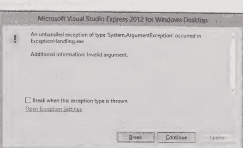

**图 6-11：** 如果 Visual Studio 内部运行的程序遇到未处理的异常，执行将停止在抛出异常的语句处，并出现此对话框。

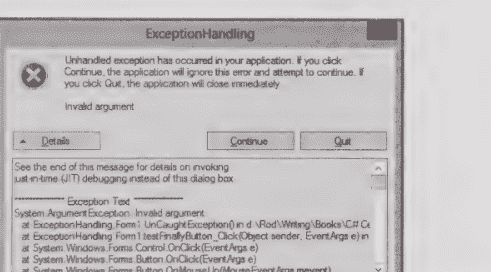

**图 6-12：** 如果 Visual Studio 之外运行的程序遇到未处理的异常，将出现此消息。

通常，程序在等待事件发生时大部分时间都在什么都不做。当事件发生时（例如用户点击按钮或选择菜单项），程序会采取某些操作。如果该操作导致了未处理的异常，用户将看到图 6-12 所示的消息。

**专家建议：** 为了保护程序免受意外异常的影响，将代码封装在 `try-catch` 块中。

## 异常类型

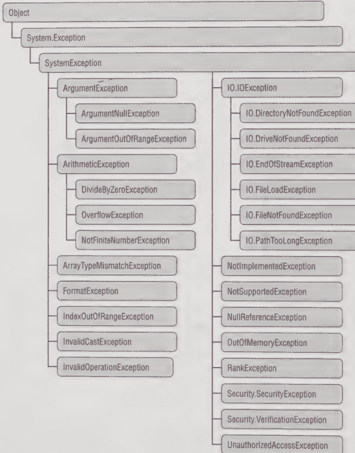

图 6-13：所有的异常类都是类的类的类。

表 6-2：有用类

| 类 | 描述 |
|---|---|
| Object | 这是所有类的祖先。 |
| System.Exception | 这是所有异常的基类。它表示高级错误。 |

## 异常处理

| 类 | 描述 |
|---|---|
| SystemException | 这是 System 中定义的异常的基类。 |
| ArgumentException | 方法的一个参数无效。 |
| ArgumentNullException | 参数为空但允许允许。 |
| ArgumentOutOfRangeException | 参数在允许范围之外。 |
| ArithmeticException | 发生了算术、转换或转换错误。 |
| DivideByZeroException | 程序尝试将整数或小数除以 0。此异常不会为浮点运算抛出。如果程序将浮点值除以零，结果是特殊值 Infinity。 |
| OverflowException | 检查的算术、转换或转换操作导致溢出。 |
| NotFiniteNumberException | 浮点运算给出的结果为无限、负无限或 NaN（非数字）。 |
| ArrayTypeMismatchException | 程序尝试在数组中存储错误类型的项目。 |
| FormatException | 参数格式不。 |
| IndexOutOfRangeException | 程序尝试访问超出数组范围的数组元素。 |
| InvalidCastException | 转换或转换无效。 |
| InvalidOperationException | 方法调用对于对象的当前状态无效。 |
| IO.IOException | 发生了输入/输出错误。 |
| DirectoryNotFoundException | 未找到文件或目录路径的一部分。 |
| IO.DriveException | 程序尝试访问不可用的驱动器或网络共享。 |
| IO.EndOfStreamException | 程序尝试读取流的末端。 |
| IO.FileException | 程序尝试加载存在但无法加载的程序集。 |
| IO.FileNotFoundException | 程序尝试访问找不到的文件。 |
| IO.PathTooLongException | 程序尝试使用过长的路径或文件名。 |

# 表 6-2（续）

| 类名 | 描述 |
| --- | --- |
| NotImplementedException | 程序尝试访问一个尚未实现的功能。你可以抛出此异常，作为尚未实现的功能的占位符。 |
| NotSupportedException | 程序尝试调用一个不支持的方法。你可以抛出此异常，以指示该方法在库的最新版本中已被移除。 |
| NullReferenceException | 程序尝试通过空引用访问对象。 |
| OutOfMemoryException | 没有足够的内存供程序继续运行。这种异常很难从中恢复，因为可能没有足够的内存来执行任何有用操作。 |
| RankException | 程序向方法传递了一个维度数量错误的数组。 |
| Security.SecurityException | 程序检测到安全错误。 |
| Security.VerificationException | 安全策略要求代码必须是类型安全的，但该代码无法被验证为类型安全。 |
| UnauthorizedAccessException | 操作系统由于输入/输出安全错误拒绝了访问。 |

除了这些基本异常外，.NET Framework 还定义了几个具有更专门用途的异常类。例如，当程序与 SQL Server 数据库交互时，可能会发生 SQL 异常。

接下来的章节描述了这些专门异常中一些常见且实用的。

## SQL 异常

SQL Server 使用单一类 `System.Data.SqlClient.SqlException` 来表示所有错误和异常。你可以使用 `SQLException` 对象的属性来确定发生了什么以及严重程度。

表 6-3 描述了一些实用的 `SqlException` 类属性。

## 表 6-3：实用的 SqlException 属性

| 属性 | 描述 |
|---|---|
| Class | 一个 0 到 25 之间的数字，表示错误类型。20 到 25 是致命的，会导致数据库连接关闭。这些值表示：<br>- 0-10: 信息消息而非错误。<br>- 11-16: 用户可以通过修复解决的问题。<br>- 17: SQL Server 耗尽可配置的资源（如锁）。DBA 可以修复此问题。<br>- 18: 非致命的内部软件问题。<br>- 19: SQL Server 超过了不可配置的资源限制。<br>- 20: 当前进程发出的语句中发生问题。<br>- 21: SQL Server 遇到影响数据库中所有进程的问题。<br>- 22: 表或索引已损坏。<br>- 23: 数据库可疑。<br>- 24: 硬件问题。<br>- 25: 系统错误 |
| LineNumber | 返回 T-SQL 命令批处理或存储过程中过程中导致错误的行号 |
| Message | 返回描述问题的消息 |
| Number | 返回错误代码 |
| Procedure | 返回导致错误的存储过程或远程过程调用的名称 |

`System.Data.Common.DbException` 是 `SqlException` 的父类，以及另外三个为其他数据库类型返回类似信息的类的父类。以下列表总结了另外三个 `DbException` 子类：
- `System.Data.Odbc.DbException`: ODBC 数据库中的错误
- `System.Data.OleDb.OleDbException`: OLE DB 数据库中的错误
- `System.Data.OracleClient.OracleException`: Oracle 数据库中的错误

所有这些类都提供 `Message` 属性，用于提供有关异常的信息，但它们不提供 `SqlException` 类提供的 `Class`、`LineNumber`、`Number` 和 `Procedure` 属性。

## 溢出异常

默认情况下，如果算术运算导致整数溢出，C# 程序不会抛出异常。如果操作数是整型或小数，程序将丢弃任何额外的位，返回截断后的结果，并继续运行，仿佛什么都没有发生一样。在这种情况下，你可能无法意识到结果是错误的。

你可以通过使用 `checked` 块或使用高级生成设置对话框来让程序抛出 `OverflowException`。更多信息，请参阅第 4 章“使用类型”中的“宽和窄转换”节。

如果浮点运算导致溢出或欠溢，或者它产生了特殊的 `NaN`（代表“不是数字”），C# 程序同样也不会抛出异常。

浮点类型定义了静态属性 `PositiveInfinity`、`NegativeInfinity` 和 `NaN`。你可以将浮点变量与 `PositiveInfinity` 和 `NegativeInfinity` 值进行比较。然而，如果你将一个值与 `NaN` 比较，结果始终为 `false`。（即使 `float.NaN == float.NaN` 也返回 `false`。）

与其尝试将结果与特殊值进行比较，不如使用类型的方法来判断变量是否持有这些特殊值之一。表 6-4 描述了这些方法。

## 表 6-4：浮点数特殊值方法

| 方法 | 描述 |
|---|---|
| IsInfinity | 如果值为 `PositiveInfinity` 或 `NegativeInfinity`，则返回 `true` |
| IsNaN | 如果值为 `NaN`，则返回 `true` |
| IsNegativeInfinity | 如果值为 `NegativeInfinity`，则返回 `true` |
| IsPositiveInfinity | 如果值为 `PositiveInfinity`，则返回 `true` |

使用表 6-4 列出的特殊值方法可以使代码更容易理解，并在 .NET 的后续版本中特殊值（如 `PositiveInfinity`）发生变化时保护代码，例如如果 `float` 数据类型变为 64 位。

## 现实世界案例：阶乘

数字 $N$ 的阶乘写作 $N!$，定义为 $N! = 1 \times 2 \times 3 \dots \times N$。编写一个使用长整数计算数字阶乘的 `Factorial` 方法。注意以下错误：
- N 无效
- N < 0
- 溢出

## 解决方案

以下代码显示了基本的 `Factorial` 方法：

```csharp
// 计算数字的阶乘。
long Factorial(long n)
{
    long result = 1;
    for (int i = 1; i <= n; i++)
    {
        result *= i;
    }
    return result;
}
```

以下代码显示了改进的 `Factorial` 方法：

```csharp
// 计算数字的阶乘。
long Factorial(long n)
{
    if (n < 0) throw new ArgumentOutOfRangeException("数字至少为 0");
    long result = 1;
    checked
    {
        for (int i = 1; i <= n; i++)
        {
            result *= i;
        }
    }
    return result;
}
```

以下代码显示了程序如何调用 `Factorial`：

```csharp
// 计算数字的阶乘。
private void calculateButtonClick(object sender, EventArgs e)
{
    richTextBox.Clear();
    try
    {
        long n;
        if (!long.TryParse(textBox.Text, out n))
        {
            MessageBox.Show("数字必须是整数。");
            return;
        }
        richTextBox.Text = Factorial(n).ToString();
    }
    catch (ArgumentOutOfRangeException)
    {
        MessageBox.Show("数字至少为 0。");
    }
    catch (OverflowException)
    {
        MessageBox.Show("这个数字太大，无法计算阶乘。");
    }
    catch (Exception ex)
    {
        MessageBox.Show(ex.ToString());
    }
}
```


# 异常处理

| 属性 | 描述 |
| --- | --- |
| HResult | 描述异常的数值代码。 |
| InnerException | 一个提供有关异常更多信息的 `Exception` 对象。某些库会捕获异常并将其封装在新的异常对象中，以提供与库更相关的信息。在这种情况下，它们可能在 `InnerException` 属性中包含对原始异常的引用。 |
| Message | 用通俗术语描述异常的消息。 |
| Source | 引起异常的应用程序或对象的名称。 |
| StackTrace | 异常发生时程序堆栈跟踪的字符串表示。 |
| TargetSite | 关于抛出异常的方法的信息。 |

`Message` 属性并没有告诉错误发生的确切位置，而是泛指地说明发生了什么问题。例如，`OverflowException` 的 `Message` 属性为“算术运算结果溢出”。

许多程序简单地将异常的 `Message` 显示给用户，让尝试判断发生了什么问题。虽然异常的 `Message` 是正确的，但它对用户并不友好，也没有告诉用户是哪个计算导致了异常或如何修复它。更好的解决方案是让程序捕获异常并向用户显示更有意义的消息。

例如，假设一个程序处理订单表单，并在计算第三个物品的数量乘以单价时捕获了 `OverflowException`。与其告诉用户“算术运算结果溢出”，不如说如“第 3 物品的数量乘以价格太大。请输入较小的数值。（如果分别验证数量和价格会更好，这样你就可以显示‘数量必须在 1 到 100 之间’的消息。）”

异常的 `Message` 不具体，不足以显示给用户，但在调试期间显示给开发者有时是足够的。然而，异常类的 `ToString` 方法为开发者提供了更多有用的信息。它包含了异常类的名称、`Message` 属性和堆栈跟踪。例如，`OverflowException` 的 `ToString` 方法可能会返回以下内容：

```
System.OverflowException: Arithmetic operation resulted in an overflow.

at OrderProcessor.OrderForm.CalculateSubtotal() in

d:\Support\Apps\OrderProcessor\OrderForm.cs:line 66
```

使用此信息中包含的类名，你可以为 `try-catch` 块添加一个新部分，专门查找此异常并显示更用户友好的错误消息。

# 抛出和重新抛出异常

方法可以使用 `try-catch-finally` 块来捕获异常。如果该方法与用户交互，它可以向用户显示有关该问题的消息。

然而，通常方法不应该直接与用户交互。例如，如果你正在编写一个会被其他方法调用的工具库，你的方法可能不应该直接与用户交互。相反，这些方法应该抛出自己的异常来告诉调用代码发生了什么，然后让代码来处理问题。该代码可能会向用户显示消息，也可能在不打扰用户的情况下处理问题。

问题随后变为：“你的方法应该捕获哪些异常，忽略哪些异常，以及抛出哪些异常？”接下来的章节将讨论捕获、抛出和重新抛出异常时涉及的一些问题。

# 使用异常和返回值

方法可以执行某些操作，并通过返回值或参数向调用代码返回信息。异常为方法提供了与调用代码通信的另一种方式。异常告诉程序发生了异常情况，并且该方法可能没有完成它正在执行的任务。

互联网上关于方法何时应该通过返回值或参数返回信息，何时应该通过异常返回信息有很多讨论。大多数开发者认为，正常的状态信息应该通过返回值返回，只有在发生错误时才使用异常。

决定是否使用异常的最好方法是询问调用代码是否允许忽略方法的状态。如果方法通过其返回值返回状态信息，调用代码可以忽略它。如果方法抛出异常，调用代码必须包含一个 `try-catch` 块来显式处理异常。

例如，考虑以下返回数字阶乘的方法：

```
// 计算数字的阶乘。

private long factorial(long n)

{

  // 确保 n >= 0;

  if (n < 0) return 0;

  checked {

    try {

      long result = 1;

      for (long i = 2; i <= n; i++) result *= i;

      return result;

    } catch {

      return 0;

    }

  }

}
```

如果参数小于零，或者计算导致整数溢出，该方法返回值 0。因为 0 不是阶乘函数的有效值，调用代码可以检测到发生了问题。

这种方法有两个问题。首先，调用代码可能会忽略错误并将值 0 视为数字的阶乘，从而导致错误的结果。如果该值用于复杂的计算，错误可能会被嵌入计算中。程序将产生一个错误的结果，这在以后可能很难修复。

第二个问题是调用代码无法判断发生了什么。返回值 0 并没有指示输入参数是小于 0 还是发生了整数溢出。你可以使用多个返回值，0 表示参数小于 0，-1 表示整数溢出，但这只是创建了更多调用代码可以忽略的状态值。

更好的解决方案是在适当的时候抛出异常。下面的 `Factorial` 方法显示了这一点：

```
// 计算数字的阶乘。

private long factorial(long n) {

    // 确保 n >= 0。

    if (n < 0) throw new ArgumentOutOfRangeException("n", "不能为负");

    checked {

        try {

            long result = 1;

            for (long i = 2; i <= n; i++) result *= i;

            return result;

        } catch (OverflowException ex) {

            throw new Exception("计算过程中发生溢出", ex);

        }

    }

}
```

例如，假设一个映射程序读取具有晦名称的文件，如 `nam.map`。如果文件缺失，方法将接收到 `FileNotFoundException`，消息为“无法找到西弗吉尼亚州的地图文件”。如果你以此方式抛出新异常，良好的做法是将原始异常包含在新异常的 `InnerException` 属性中，以便调用代码在需要帮助时可以访问原始信息。

# 第 6 章 委托、事件和异常

# 捕获和重新抛出异常

如果方法无法为异常添加任何信息，它通常不应该捕获它。相反，它应该让异常向上抛出，让调用代码处理。

例如，如果 `LoadParameters` 方法尝试从 `parameters.txt` 加载设置并接收 `FileNotFoundException`，没有理由捕获该异常。调用代码知道哪个文件丢失了，因此方法实际上无法添加任何新信息。

你想打破这条规则的情况是你想要在允许异常移动堆栈之前执行某些私有操作。例如，假设你正在编写供程序员使用的工具库。当方法遇到异常时，你可能希望它将异常信息保存到日志文件中，以便以后修复问题。在这种情况下，你可能希望方法捕获异常、记录错误，然后重新抛出异常，以便其正常向上抛出。

要重新抛出当前异常，使用 `throw` 语句而不传递任何异常。下面的代码片段演示了这种技术：

```
try {

    // 执行某些危险的操作。

    ...

} catch (Exception) {

    // 记录错误。

    ...

    // 重新抛出异常。

    throw;

}
```

将此代码与以下版本对比：

```
try {

    // 执行某些危险的操作。

    ...

} catch (Exception ex) {

    // 记录错误。

    ...

    // 重新抛出异常。

    throw ex;

}
```

新版本显式地抛出了一个与 `try-catch-finally` 块捕获的相同的异常对象。当代码以这种方式抛出异常时，异常的调用栈会被重置，使其指向包含 `throw` 语句的代码行。这可能会误导任何试图通过定位代码来查找问题的程序员，使他们查看错误的代码行。如果抛出异常的代码行位于此方法调用的另一个方法内部，情况会更加糟糕。如果你以这种方式重新抛出异常，错误位于另一个方法这一事实就会——

在任何情况下，方法在抛出或重新抛出异常之前，都应该尽可能地清理工作。如果方法打开了文件或连接了数据库，它应该在抛出异常之前关闭文件或数据库连接，使代码尽可能少地产生副作用。

> **专家建议：丢弃调用栈**
>
> 在某些情况下，你可能希望像这样重新抛出异常以重置调用栈信息。例如，如果该方法位于库中，而你希望向调用者隐藏库的细节，你并不一定希望调用栈包含库内部私有方法的信息。在这种情况下，你可以在库的公共方法中捕获异常，然后重新抛出它们，以便调用栈从这些公共方法开始。

# 创建自定义异常

当你的代码遇到问题时，它可以抛出一个异常来告诉调用代码该问题。如果可能，你应该抛出由 .NET 框架定义的异常类之一。预定义的异常类具有特定的含义，因此如果你使用它们，其他开发者将很好地了解该异常代表什么。

有时，你可能找不到适合你情况的预定义异常类。在这种情况下，你可以创建自己的异常类。

从 `Exception` 派生新类。以 `Exception` 单词结束新类。为了使新类尽可能有用，请为它提供与 `Exception` 类定义的匹配构造函数。以下代码显示了一个简单的 `InvalidException` 类，它提供了四个构造函数，其参数与 `Exception` 类中定义的构造函数所使用的参数相似：

```
[Serializable]

class InvalidProjectionException : Exception

{

  public InvalidProjectionException()

    : base() { }

  public InvalidProjectionException(string message)

    : base(message) { }

  public InvalidProjectionException(string message,

    Exception innerException)

    : base(message, innerException) { }
```

```
protected InvalidProjectionException(SerializationInfo info,

    StreamingContext context)

    : base(info, context) {

}
```

每个构造函数都简单地将其参数传递给基类的构造函数。
`SerializationInfo` 和 `StreamingContext` 类型定义在 `System.Runtime.Serialization` 命名空间中。

> **最佳实践：需要序列化**
>
> 异常必须跨 AppDomain 边界序列化和反序列化。
> 为了使类尽可能有用，请给它加上 `Serializable` 特性。
> 如果自定义异常类提供了专门的信息，请向类添加适当的属性，并根据需要添加额外的构造函数。

> **专家建议：从 Exception 派生**
>
> 微软曾建议从 `ApplicationException` 派生新的异常类，但后来决定这只是在异常层次结构中增加了一层，而没有提供任何实际益处。无论从 `Exception` 还是 `ApplicationException` 派生新的异常类都可以，但为了与遵循微软建议的其他开发者保持一致，使用 `Exception` 可能是值得的。

# 使用断言

`System.Diagnostics.Debug` 类提供了一个 `Assert` 方法，通常用于在通过方法的数据。该方法接受一个布尔值作为第一个参数，如果该值为 `false`，则抛出异常。其他参数允许你指定要显示的其它消息，为你提供关于断言失败位置的更多信息。

在调试生成中，`Assert` 方法处理执行并显示堆栈跟踪。在发布生成中，程序会跳过对 `Assert` 的调用，因此即使断言为假，程序继续运行。

方法可以使用 `Assert` 来验证数据是否合理。例如，假设 `PrintInvoice` 方法接收一个名为 `items` 的 `OrderItem` 对象数组作为参数，并为这些项目打印发票。该方法可以使用以下 `Assert` 语句开头，以验证 `items` 数组包含的项目不超过 100 个：

```
Debug.Assert(items.Length <= 100)
```


# 章节测试题

如果订单包含的项目超过 100 个，`Assert` 语句将停止执行，因此你可以检查代码以判断这是一个 bug 还是一个异常订单。如果这是一个有效但异常的订单，你可以更改语句来查找包含超过 150 个项目的订单。

在发布生成中，此 `Assert` 语句被忽略，程序必须准备好处理包含许多项目的订单，即使 `Assert` 语句在调试生成中不允许这样做。

如果某条数据无效且程序无法继续，请抛出异常。如果某条数据异常并可能指示一个 bug，但程序可以有意义地继续，请使用 `Debug.Assert` 在测试期间检测异常值。

## 总结

本章描述了程序的不同部分用于通信事件和异常的两种方法。

事件允许对象在发生某些有趣事件时通知应用程序的其他部分。要定义和引发事件，以及——

异常允许方法告诉调用者它遇到了问题。本章解释了如何使用 `try-catch-finally` 块处理异常。它还解释了当没有合适的如何定义自定义异常类。

有三种 Lambda 表达式：表达式 Lambda、语句 Lambda 和异步 Lambda。本章描述了所有这些，但仅提到了异步运行的异步 Lambda。第 7 章将详细介绍异步处理和多线程。

## 测试题

仔细阅读每个问题，并选择代表最佳解决方案的答案。你可以在附录中找到答案。

1. 下列哪个是有效的委托定义？
   a. `private delegate float MyDelegate();`
   b. `private delegate();`
   c. `private delegate MyDelegate(float);`
   d. `private delegate void MyDelegate(float);`

2. 关于委托变量的说法是不正确的？
   a. 你需要使用转换运算符执行委托指向的方法。
   b. 结构体或类可以包含委托变量字段。
   c. 你可以创建委托变量的数组或列表。
   d. 你可以使用加法组合委托变量，并使用减法移除一个方法。

3. 如果 `Employee` 类继承自 `Person` 类，协变允许你执行以下操作？
   a. 在代表 `Employee` 的委托中存储返回 `Person` 的方法。
   b. 在代表 `Person` 的委托中存储返回 `Employee` 的方法。
   c. 在代表 `Employee` 的委托中存储接收 `Person` 参数的方法。
   d. 在代表 `Person` 的委托中存储接收 `Employee` 参数的方法。

4. 如果 `Employee` 类继承自 `Person` 类，逆协变允许你执行以下操作？
   a. 在代表 `Employee` 的委托中存储返回 `Person` 的方法。
   b. 在代表 `Person` 的委托中存储返回 `Employee` 的方法。
   c. 在代表 `Employee` 的委托中存储接收 `Person` 参数的方法。
   d. 在代表 `Person` 的委托中存储接收 `Employee` 参数的方法。

5. 在变量声明 `Action<Order> processor` 中，变量 `processor` 代表以下哪项？
   a. 不接受参数并返回 `Order` 对象的方法。
   b. 接收 `Order` 对象作为参数并返回 `void` 的方法。
   c. 接收 `Order` 对象作为参数并返回 `Order` 对象的方法。
   d. `Action` 类提供的不接受参数并返回 `void` 的方法。

6. 在变量声明 `Func<Order> processor` 中，变量 `processor` 代表以下哪一个？
   a. 不接受参数并返回 `Order` 对象的方法。
   b. 接收 `Order` 对象作为参数并返回 `void` 的方法。
   c. 接收 `Order` 对象作为参数并返回 `Order` 对象的方法。
   d. 由 `Action` 类提供的、不接受参数并返回 `void` 的方法。

7. 假设 `F` 由语句 `Func<float, float> F` 声明。那么以下一项正确将 `F` 初始化为匿名方法？
   a. `F = (float x) { return x * x };`
   b. `F = delegate { return x * x };`
   c. `F = float Func(float x) { return x * x };`
   d. `F = delegate(float x) { return x * x };`

8. 假设变量 `note` 由语句 `Action note` 声明。那么以下一项正确将 `note` 初始化为表达式 lambda？
   a. `note = { return x * x };`
   b. `note = () { return x * x };`
   c. `note = () => MessageBox.Show("Hi");`
   d. `note = MessageBox.Show("Hi");`

9. 假设变量 `result` 由语句 `Func<float, float> result` 声明。以下哪一项正确将 `result` 初始化为表达式 lambda？
   a. `result = (float x) => x * x;`
   b. `result = (float x) => return x * x;`
   c. `result = x => x * x;`
   d. a 和 c 都是正确的。

10. 关于语句 lambda（statement lambdas），以下陈述中哪项是错误的？
    a. 语句 lambda 可以包含多条语句。
    b. 语句 lambda 不能返回返回值。
    c. 语句 lambda 必须使用大括号 `{ }`。
    d. 如果语句 lambda 返回值，它必须使用 `return` 语句。

11. 假设 `MovedEventHandler` 委托由语句 `delegate void MovedEventHandler()` 定义。以下哪一项正确声明了 `Moved` 事件？
    a. `public delegate MovedEventHandler MovedEvent;`
    b. `public event MovedEventHandler MovedEvent;`
    c. `public event Action MovedEvent;`
    d. b 和 c 都是正确的。

12. 假设 `Employee` 类派生自 `Person` 类，且 `Person` 类定义了一个 `AddressChanged` 事件。为了让 `Employee` 对象能够引发此事件，你应该执行以下哪些操作？
    a. 在 `Person` 类中创建一个触发事件的 `OnAddressChanged` 方法。
    b. 在 `Employee` 类中创建一个触发事件的 `OnAddressChanged` 方法。
    c. 让 `Employee` 类根据需要调用 `OnAddressChanged`。
    d. 让 `Person` 类中用于触发事件的代码改为调用 `OnAddressChanged` 方法。

13. 以下哪项陈述通过订阅 `myButton_Click` 事件处理程序来捕获 `myButton` 的点击事件？
    a. `myButton.Click += myButton_Click;`
    b. `myButton.Click += myButton.Click;`
    c. `myButton_Click handles myButton.Click;`
    d. `myButton.Click = myButton_Click;`

14. 假设 `Car` 类提供了一个接受 `sender` 和 `StoppedArgs` 对象作为参数的事件。假设代码已经创建了一个名为 `args` 的适当 `StoppedArgs` 对象。以下哪个代码片段正确引发了事件？

```csharp
if (!Stopped.IsEmpty) Stopped(this, args);
```

```csharp
if (Stopped) Stopped(this, args);
```

```csharp
if (Stopped != null) Stopped(this, args);
```

```csharp
raise Stopped(this, args);
```

15. 关于事件，以下陈述中哪项是错误的？
    a. 如果一个对象两次订阅了同一个事件，当事件引发时，其事件处理程序会执行两次。
    b. 如果一个对象两次订阅了同一个事件并取消订阅一次，当事件引发时，其事件处理程序会执行一次。
    c. 如果一个对象订阅了一次事件后又取消订阅一次，当事件引发时，其事件处理程序会抛出异常。
    d. 在 Windows Forms 中，你可以使用属性窗口来订阅和取消订阅事件，创建空的事件处理程序。

16. 关于继承事件，以下陈述中哪项是错误的？
    a. 派生类可以使用类似于下面的代码引发基类事件：`if (base.EventName != null) base.EventName(this, args);`
    b. 派生类无法引发在祖类中定义的事件。
    c. 派生类可以定义一个 `OnEvent` 方法，通过引发事件来允许派生类引发该事件。
    d. 派生类继承基类事件的定义，因此程序可以订阅派生对象的事件。

17. 关于异常处理，以下陈述中哪项是正确的？
    a. 你可以在 `try`、`catch` 或 `finally` 内部嵌套一个 `try-catch-finally` 块。
    b. `try-catch-finally` 块必须包含至少一个 `catch` 部分和一个 `finally` 部分。
    c. 异常由具有最特定匹配异常类型的 `catch` 部分处理。
    d. 如果代码执行完毕，则 `finally` 部分中的代码会执行。

18. 你可以使用以下哪种方法来捕获（catch）？
    a. 使用 `try-finally` 块。
    b. 使用 `catch` 方法。
    c. 使用 `try-catch`。
    d. b 或 c 均可。

19. 以下哪一项关于 `result` 是 true？
    a. result 返回 true
    b. result 是
    c. result 是
    d. 以上都是。

20. 关于抛出（throw），以下陈述中哪项是错误的？
    a. 如果抛出异常，堆栈跟踪将被保留。
    b. 如果抛出异常，它被重置。
    c. 抛出一个新异常，堆栈跟踪。
    d. 如果委托指向实例方法，它会执行。

21. 以下哪项是不应该做的？
    a. 派生自委托结果的结果。
    b. 实现 `IDisposable`。
    c. 给它标记 `Serializable` 特性。

# 额外阅读资源

以下资源可以帮助你理解这些主题：

- 委托 (C# Guide)
- 匿名方法 (C# Guide)
- Lambda 表达式 (C# Guide)
- 事件 (C# Guide)
- 如何：派生类
- 异常处理最佳实践
- `SQLException` 类
- `AppDomain` 类

# 备查表

此备查表旨在让你快速学习委托的要点。

## 使用委托

- 委托是一种表示方法的类型。它定义了方法的参数和返回类型。
- 委托类型的名称通常以 `Delegate` 或 `Callback` 结尾。
- 你可以使用 `+` 和 `-` 组合委托变量。例如，如果程序执行 `del3 = del1 + del2`，`del3` 将执行 `del1` 和 `del2` 所指向的方法。
- 如果委托变量指向实例方法，它将与其赋值的实例一起执行。
- 协变允许方法返回委托结果的子类。
- .NET 框架定义了两种可以在许多情况下使用的内置委托类型：`Action` 和 `Func`。以下代码显示了带有两个参数的 `Action` 和 `Func` 委托的声明：

```csharp
public delegate void Action<in T1, in T2>(T1 arg1, T2 arg2)

public delegate TResult Func<in T1, in T2, out TResult>(T1 arg1, T2 arg2)
```

- 匿名方法是没有名字的方法。以下代码将匿名方法的引用保存在变量 `function` 中：

```csharp
Func<float, float> function = delegate(float x) { return x * x; };
```

- Lambda 表达式使用简洁的语法创建匿名方法。以下是 Lambda 表达式的示例：

```csharp
Action note1 = MessageBox.Show("Hi");

Action<string> note2 = message => MessageBox.Show(message);

Action<string> note3 = (message) => MessageBox.Show(message);

Action<string> note4 = (string message) => MessageBox.Show(message);

Func<float, float> square = (float x) => x * x;
```

- 表达式 lambda 评估单个表达式，其值由匿名方法返回。
- 语句 lambda 执行一系列语句。它必须使用 `return` 语句来返回值。
- async lambda 是包含 `async` 关键字的 lambda 表达式。

## 使用事件

- 事件具有发布者和订阅者。给定的事件可能有许多订阅者，也可以没有订阅者。
- 使用委托（delegate）类型定义事件，如下代码所示：

```csharp
public delegate void OverdrawnEventHandler();

public event OverdrawnEventHandler Overdrawn;
```

- 你可以使用预定义的 `Action` 委托类型定义事件，如下代码所示：

```csharp
public event Action Overdrawn;
```

- 微软最佳实践：将事件的第一个参数设置为发送者对象（sender），第二个对象设置为提供更多事件信息的对象。对象的类型应派生自 `EventArgs` 类，并在 `OverdrawnEventArgs` 名称中以 `Args` 结尾。
- 你使用预定义的 `EventHandler` 委托来定义事件，该事件第一个参数为名为 `sender` 的对象，第二个参数为事件数据对象，如下所示：

```csharp
public event EventHandler<OverdrawnEventArgs> Overdrawn;
```

- 触发事件，如下代码所示：

```csharp
if (EventName != null) EventName(arguments...);
```


- 类继承事件。为了让派生类能够触发基类事件，请重写触发该事件的基类 `OnEventName` 方法。
- 程序可以使用 `+=` 和 `-=` 来订阅和取消订阅事件。
- 如果程序多次订阅某次事件，则事件处理程序会被调用多次。
- 如果程序取消订阅事件的次数多于订阅次数，则什么都不会发生。

## 异常处理

- 错误检查是主动预测并寻找错误的过程。异常处理是保护程序免受意外错误的过程。错误检查通常比异常处理更高效。
- `try-catch-finally` 块必须至少包含一个 `catch` 节或 `finally` 节。
- 无论程序如何离开 `try-catch-finally` 块，`finally` 节始终执行。
- 最具体的（派生程度最远的）`catch` 节必须放在 `try-catch-finally` 块的开头。

如果你不需要对异常进行任何操作，可以在 `catch` 节中仅包含一种异常类型并省略异常变量。

`Exception` 类是所有异常类的祖先，因此 `catch (Exception)` 可以捕获所有异常。

不带异常类型的 `catch` 节可以捕获所有异常。

`using` 语句等同于带有一个释放对象的 `finally` 节的 `try-catch-finally` 块。

如果异常没有被处理，控制权将沿调用栈向上移动，直到某个 `try-catch-finally` 块处理它，或者程序崩溃。

对象的 `Message` 属性提供了有关异常的信息。`ToString` 方法包含了 `Message` 外信息，包括堆栈跟踪（stack trace）。

`SQLException` 代表所有 SQL Server 异常。`Class` 和 `Message` 等属性提供了有关错误的额外信息。

默认情况下，整数运算不会导致 `OverflowException`。使用 `checked` 块或“高级生成设置”对话框来抛出此异常。

浮点数运算不会溢出。相反，它们会将结果重置为 `PositiveInfinity`（正无穷大）、`NegativeInfinity`（负无穷大）或 `NaN`（非数字）。

使用浮点方法 `IsInfinity` 和 `IsNaN` 来判断结果是否为这些特殊值之一。

要重新抛出当前异常，请使用不传递异常对象的 `throw` 语句。若要在重置堆栈跟踪的同时重新抛出异常 `ex`，请使用 `throw ex`。

要返回非关键状态信息，方法应该返回一个状态值。为了防止程序忽略关键问题，方法应该抛出异常。

如果方法无法向异常中添加有用信息，则它不应该捕获并重新抛出异常。相反，让它传播到调用代码中。

要创建自定义异常，请派生自 `System.Exception` 类，并将其标记为可序列化（serializable），同时提供与 `Exception` 类定义的匹配的构造函数。

你可以使用 `Debug.Assert` 在调试生成（debug build）中抛出异常以发现可疑数据。该语句在发布生成（release builds）中会被忽略，因此即使 `Debug.Assert` 在调试生成中停止了程序，程序也继续运行。

如果你捕获了一个异常并抛出一个新异常以添加额外信息，请在新异常的 `InnerException` 属性中包含对原始异常的引用。

在抛出或重新抛出异常之前尽可能多进行清理工作，以便让调用代码面临尽可能少的副作用。

## 关键术语回顾

**checked**: 默认情况下，当算术运算导致溢出时，程序不会抛出异常。程序可以使用 `checked` 块使算术表达式产生这些异常。

**contravariance（逆协变）**: C# 的一项功能允许方法接收来自委托期望类型之父类的参数。例如，假设 `Employee` 类派生自 `Person` 类，且 `EmployeeDelegate` 委托表示接受 `Employee` 对象作为参数的方法。那么你可以将 `EmployeeParameterDelegate` 委托变量赋值给一个接受 `Person` 作为参数的方法，因为 `Person` 是 `Employee` 的父类。当你调用委托变量的方法时（因为委托要求方法接受 `Employee` 参数），并向其传递一个 `Employee`（因为 `Employee` 是 `Person` 的一种），该方法可以处理它。

**contravariant（逆协变的）**: 如果变量允许逆协变，则该变量是逆协变的。

**covariance（协变）**: C# 的一项功能允许方法返回来自委托期望结果之子类的值。例如，假设 `Employee` 类派生自 `Person` 类，且 `CreatePersonDelegate` 委托指示一个返回 `Person` 对象的方法。那么你可以将 `CreatePersonDelegate` 委托变量赋值给一个返回 `Employee` 的方法，因为 `Employee` 是 `Person` 的一种。

**delegate（委托）**: 定义具有给定参数和返回值的方法的数据类型。

**error checking（错误检查）**: 预测错误、检查它们是否发生并处理它们的过程。参见“异常处理”。

**exception handling（异常处理）**: 保护应用程序免受意外错误的过程。参见“错误检查”。

**expression（表达式）**: Lambda 表达式有一个单一。

**lambda expression（lambda 表达式）**: 匿名方法的简洁语法。

**publisher（发布者）**: 触发事件的对象。

**statement（语句）**: Lambda 表达式将其代码封装在大括号中。

**try-catch-finally 块**: 用于捕获异常的程序结构。`try` 部分包含可能抛异常的代码，`finally` 部分包含要执行的代码。

**subscriber（订阅者）**: 接收事件的对象。

**unhandled exception（未处理异常）**: 当异常被抛出且未被 `try-catch-finally` 块保护时发生。

# 考试技巧与策略

关键术语回顾（REVIEW OF KEY TERMS）和本章的备考表（Cheat Sheet）可以打印出来帮助学习。你可以在 `www.wrox.com/remtitle.cgi?isbn=111861094` 的 ZIP 文件找到这些文件。

# 第 7 章 多线程与异步处理

本章你将学到

- 理解线程和线程池
- 使用任务并行库（Task Parallel Library）
- 使用并发集合
- 实现异步方法

## WROX.COM 本章代码

你可以在 `www.wrox.com/remtitle.cgi?isbn=111861094` 的 Download Code 标签页找到本章的代码。代码位于 chapter7 下载中，并根据书中的名称单独命名。

在本章中，你将探索提高应用程序性能的各种选项。本章从讨论线程和线程池开始，然后讨论 `BackgroundWorker` 类以及你如何在 WPF 和 Windows Forms 应用程序中使用它。接下来，你将学习任务并行库（TPL）以及 TPL 的一些应用，例如 `Parallel` 类。在本章涵盖了 C# 5.0 引入的新异步编程范式后，将通过描述使用并发集合对资源进行同步访问来继续讨论。最后，本章将描述 .NET Framework 中的取消操作机制。

### 表 7-1：本章涵盖的 70-483 考试目标

| 目标 | 涵盖内容 |
|---|---|
| 实现多线程和异步处理 | 任务并行库（Parallel, Plink, Tasks）。这包括创建新任务并使用这些任务来提高应用程序的性能。<br>创建延续任务。这包括讨论处理任务延续的技术。<br>使用 ThreadPool 派生线程。这包括创建 `Thread` 对象和使用线程池中的线程。<br>解除阻塞 UI。这包括使用 `BackgroundWorker` 类来创建响应式应用程序。<br>使用 `async` 和 `await` 关键字。这包括使用新的 `async` 和 `await` 关键字创建响应式应用程序。<br>使用并发集合管理数据。这包括使用 `System.Concurrent.Collections` 中的类。 |
| 管理多线程 | 同步资源。这包括使用 `ManualResetEvent` 和 `AutoResetEvent` 类。<br>实现锁定。这包括讨论 `Monitor`、`Mutex` 和 `Semaphore` 类。<br>取消长时间运行的任务。这包括使用 `CancellationTokenSource` 和 `CancellationToken`。<br>实现线程安全的方法来处理竞态条件。 |

## 创建响应式应用程序

第一批计算机是根据名为“冯·诺依曼架构”的逻辑设计设计的，该架构由约翰·冯·诺依曼等数学家1945年开发。根据该设计，计算机应该有一个处理单元、一个控制单元、内存以及输入输出系统（IO）。处理单元和控制单元形成了中央处理器（CPU）。由于该设计只有一个处理单元，为这种设计编写程序必须是顺序的，大多数编程语言都是为了以顺序方式而创建的，这种做法在今天的编程语言（包括 C#）中仍然被使用。创建此类应用程序最大的缺点是每当你的应用程序需要等待某些事件发生时，系统就会冻结，导致非常不佳的用户体验。线程的引入就是为了尽量减少这类问题。

## 使用线程工作

不到20年前，大多数消费级操作系统（OS）只能运行带有单个执行线程的单个进程。线程是操作系统可以独立调度的最小执行单元。在单线程操作系统中，计算机一次只运行一个应用程序。通常有一个命令行解释器来解释用户输入的命令。当执行一个命令时，解释器会将控制权转移给命令所指的处理器。当应用程序执行完毕，它会将控制权交还给解释器。想一想，考虑到你只有一个线程，这非常有意义。最大的问题是，当应用程序执行以下两种操作之一时，用户会感觉到计算机冻结了：

- 密集计算
- 从 I/O 获取数据

当你的应用程序必须进行密集计算时，你所能做的不多，使用更快的计算机来缩短计算时间，或者将问题拆分为更小的问题并分配到几台计算机上，这两者都是昂贵的操作，而且有时计算可能需要更长时间。

当你的应用程序从 I/O 获取数据时，你的 CPU 正在等待数据到达，在此期间不进行任何处理。为了提高应用程序的响应能力，引入了多线程的概念。在多线程应用程序中，一个线程会产生另一个线程来执行获取和等待，而父线程则被阻塞，等待派生线程完成工作。这种模式被称为分叉-连接（fork-join）模式。

> **专家建议：理解线程**
>
> 虽然考试没有显式要求线程，但作者坚信，充分理解线程在 Windows 中如何工作将帮助你成为更好的程序员并理解本章。如果你已经熟悉这个主题，可以在浏览完本节的代码后，跳过此节并直接跳转到下一节“使用 ThreadPool 派生新线程”。

拥有一个处理器意味着在任何给定时间只有一个线程可以运行。这可以通过两种不同的方式实现：

- 协作式：每个线程必须放弃控制权，以便另一个线程执行。
- 抢占式：操作系统有一个名为调度器（scheduler）的组件，它确保没有线程垄占 CPU。这就是 Windows 的实现方式。

Windows 调度器的工作原理如下：

1. 每个线程在创建时都会被分配一个优先级。创建的线程不会自动启动；你必须手动启动。
2. 当线程启动时，它将与所有可以运行的线程一起被加入队列。
3. 调度器获取队列中优先级最高的线程并开始运行它。
4. 如果多个线程具有相同的优先级，调度器按轮询顺序（round robin）对它们进行调度。
5. 当时间用完时，调度器挂起该线程，将其添加到队列末尾。之后，它选择另一个线程运行。
6. 如果有几个线程的优先级比刚刚中断的线程高，它们将执行。
7. 当线程因为必须等待 I/O 或其他原因（将在后文“同步资源”部分讨论的锁定）而被阻塞时，它将从队列中移除。
8. 当阻塞原因结束时，该线程被重新加入队列。
9. 当线程完成工作时，调度器可以选择另一个线程运行。

有一个名为“空闲进程”（Idle process）的线程，除了在没有线程可运行时保持处理器忙碌外什么都不做。这种时间分片的过程营造了你的操作系统可以同时运行多个应用程序（包括响应 UI 命令）的印象。在 .NET 中，所有应用程序都有多个线程。以下是其中一些线程的列表：

- 垃圾回收线程（Garbage Collector thread）：负责垃圾回收。
- 终结线程（Finalizer thread）：负责运行对象的 `Finalize` 方法。
- 主线程（Main thread）：负责运行主应用程序的方法。
- UI 线程（UI thread）：如果你的应用程序是 Windows Forms 应用程序、WPF 应用程序或 Windows Store 应用程序，它将有一个专门更新用户界面的线程。

主线程外，提到的所有线程都是后台线程。当你创建一个新线程时，你可以指定该线程是否为后台线程。

当 .NET 应用程序的主线程所有其他非后台线程结束时，.NET 应用程序也会结束。

随着多核和许多核处理器的出现，以多线程方式编写的应用程序将能够从这些改进中受益，而按顺序编写的应用程序将在低度利用资源的同时让用户等待。

> **注意：多核（Multicore）和许多核（many-core）都用于描述具有多个核心的系统，但它们之间存在差异。多核是指在同一块硅片上具有多个相同核心的 CPU。许多核是指在同一块硅片上具有不同类型专用核心的 CPU。**

为了说明当你的应用程序是计算密集型但按顺序编写，与考虑到多核以并发方式编写时的对比，请分析图 7-1 和图 7-2。


**图 7-1：单线程计算密集型应用程序**

如图 7-1 所示，左上角的 CPU 在大部分时间内以 100% 的负载运行，而其他七个 CPU 在大部分时间内处于空闲。在某些情况下，你可能会看到负载从一个 CPU 移动到另一个，但在任何给定时间，仍然只有一个 CPU 被应用程序完全装载。

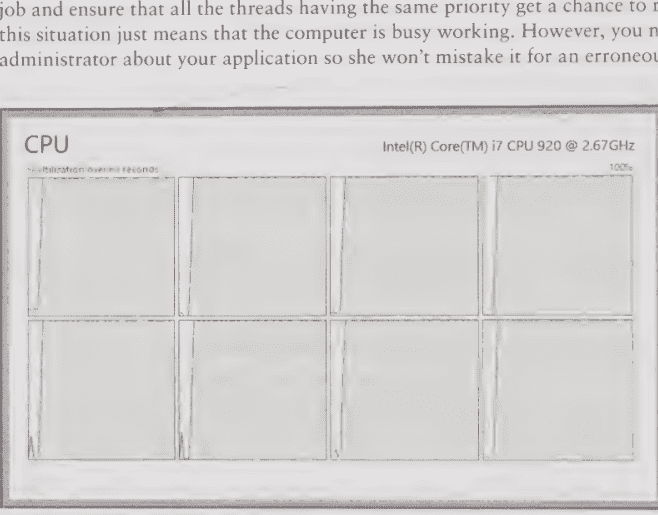

**图 7-2：多线程计算密集型应用程序**

图 7-2 中的相同应用程序正在将所有 CPU 的加载率推到 100%。虽然在系统管理员看来这可能是一件坏事，但实际上这是一件好事。对于系统管理员来说，这可能是坏事的原因是，从历史上看，CPU 加载到 100% 意味着一个应用程序进入了死循环并消耗了所有资源，阻碍了同一台机器上其他应用程序的工作。在这种情况下，你知道该应用程序是计算密集型的，因此它没有在等待任何 I/O 完成。调度器会履行它的职责，确保所有具有相同优先级的线程都有机会运行，在这种情况下，100% 的负载仅意味着计算机正在忙于工作。然而，你需要让你的系统管理员了解你的应用程序，这样她才不会将其误认为是错误的程序。

以下是多线程应用程序的一些缺点：

- 所有的线程都是资源密集型的。它们需要大量的内存（标准为 1 兆），每当调度器必须在线程之间切换时，处理器都将忙于保存挂起线程的上下文并恢复运行线程的上下文。
- 如果你的应用程序创建了多的线程，上下文切换将消耗大量时间。
- 因为线程需要这么多内存，系统创建一个线程通常需要相当的时间，销毁一个线程也需要一些时间。

在 .NET 中，线程是在 `System.Threading.Thread` 类中实现的。由于考试不需要这些线程，你可以在本章末尾的“额外阅读和资源”部分找到更多关于 `Thread` 类的信息。

与线程一起工作是一个简单的过程：

1. 创建一个线程对象。
2. 启动线程。
3. 在调用方法中执行更多工作。
4. 等待线程完成。
5. 在调用方法中继续工作。

请看下面的代码实验室（Code Lab）。

### 使用线程的代码实验室 [Chapter7\SimpleProgram.cs]

```
class Program {

    static void Main(string[] args) {

        // 我们正在使用 Stopwatch 对代码进行计时

        Stopwatch sw = Stopwatch.StartNew();

        // 这里我们调用不同的方法

        // 用于运行应用程序的不同方式。

        RunSequentially();

        // 打印运行应用程序所需的时间。

        Console.WriteLine("We're done in {0}ms", sw.ElapsedMilliseconds);

        if (Debugger.IsAttached) {

            Console.Write("Press any key to continue ..");

            Console.ReadKey(true);

        }

    }

    static void RunSequentially() {

        double result = 0;

        // 调用函数从 I/O 读取数据

        result += ReadDataIO();

        // 添加第二次计算的结果

        result += DoIntensiveCalculations();

        // 打印结果

        Console.WriteLine("The result is {0}", result);

    }

    static double ReadDataIO() {

        // 我们通过让当前线程睡眠来模拟 I/O。

        Thread.Sleep(5000);

        return 10d;

    }

    static double DoIntensiveCalculations() {

        // 我们通过通过执行无意义的除法

        // 来模拟密集型计算

        double result = 1000000000d;

        var maxValue = Int32.MaxValue;
```


```csharp
for (int i = 1; i < maxValue; i++) {
    result /= i;
}
return result + 10d;
}
}
```

# 代码实验室分析

此代码显示了一个程序必须做两件事：从 I/O 读取数据和进行一些密集型计算。在这种上下文中，这两个方法的实现并不重要；它们模拟了预期的行为。在实际应用程序中，假设 `ReadIO` 方法执行真实的 I/O 操作，例如读取文件或从网络获取数据，而 `DoIntensiveCalculations` 则执行应用程序所需的计算。运行此应用程序产生以下结果：

The result is 20.
We're done in 1037ms.

由于这两个方法是独立的，你可以使用线程来提高这段代码的响应时间。要做到这一点，你需要相应地修改 `Main` 方法，调用 `RunWithThreads` 而不是 `RunSequential`。

```csharp
static void RunWithThreads() {
    double result = 0;
    // 创建从 I/O 读取的线程
    var thread = new Thread(() => result = ReadDataFromIO());
    // 启动线程
    thread.Start();
    // 将计算结果存入另一个变量
    double result2 = DoIntensiveCalculations();
    // 等待线程完成
    thread.Join();
    // 计算最终结果
    result += result2;
    // 打印结果
    Console.WriteLine("The result is {0}", result);
}
```

你开始创建一个新线程，它将运行 `result = ReadDataFromIO()` 代码。线程在创建时不会启动，因此你需要通过调用 `Start()` 方法来启动它。这会将此新线程加入执行队列，同时继续运行当前方法中的代码，在此情况下是 `double result2 = DoIntensiveCalculations()`。当密集型计算完成后，你需要等待之前创建的线程执行完毕。你通过调用 `Join()` 方法来实现这一点。`Join` 会阻塞当前线程，直到另一个线程完成执行。当另一个线程完成时，`Join` 将返回，当前线程将解除阻塞。

## 创建响应式应用程序

请注意，引入了一个名为 `result2` 的新变量来存储第二个方法的结果，而不是使用 `result` 变量。（为什么这在本章稍后的“同步资源”部分中讨论过。）现在当你运行应用程序时，你会得到以下结果：

The result is 20
We're done in 5370ms!

如你所见，这缩短了 5 秒计算时间（即 I/O 操作完成所需）。这种改进可以适用于任何数量的内核。如果两个方法都在进行计算，只有你有两个或更多内核时，你才能减少执行时间。

这是对多线程问题的简单处理，但它很好地说明了问题和解决方案。

由于你可以创建的线程数量很大，而且由于线程的资源密集性质，有时让线程被创建会更好。

# 创建响应式应用程序 | 275

- 你无法从线程池中中止或中断线程。
- 你无法对线程池中的线程进行 Join（等待）。要实现这一点，你必须使用其他机制（将在本章稍后的“同步资源”部分中进行讨论）。
- 线程池中的线程在完成工作后会被重用，而普通线程则会被销毁。
- 你无法控制线程池中线程的优先级。

还存在其他差异，但超出了本书的范围。

> 注意：不同版本的 .NET 线程池最大线程数不同，应被视为实现细节。在 .NET 2.0 中，每个核心有 25 个线程；在 .NET 3.5 中有 250 个；在 .NET 4 中，32 位应用程序有 1023 个线程，64 位应用程序有 32,767 个线程。

# 真实世界案例场景

现在是时候回到问题了。如果你跳过了上一节，请返回并查看早些提出的程序。此场景要求你创建一个名为 `RunInThreadPool` 的方法，该方法使用线程池来运行 `ReadDataFromIO` 方法，并在 `Main` 方法中调用它。

# 解决方案

`RunInThreadPool` 如下：

```csharp
static void RunInThreadPool() {
    double result = 0;
    // 创建一个从 I/O 读取的工作项
    ThreadPool.QueueUserWorkItem(x => result = ReadDataFromIO());
    // 将计算结果保存到另一个变量中
    double result2 = DoIntensiveCalculations();
    // 等待线程完成
    // TODO: 我们需要一种方式来指示
    // 线程池何时完成执行
    // 计算最终结果
    result += result2;
    // 打印结果
    Console.WriteLine("The result is {0}", result);
}
```

调用 `ThreadPool.QueueUserWorkItem` 方法会将工作项放入由线程池管理的队列中。当线程获取该项并将其运行完成时，唯一的问题是你并不知道线程何时完成其工作。这里没有 `Join` 方法或类似的方法。要解决这个问题，你需要使用某种信号机制（不同的信号机制将在本章稍后的“同步资源”部分中讨论）。

如果你现在运行该应用程序，之所以能得到正确的结果，仅仅是因为线程池在另一个方法完成工作之前就返回了。如果你增加传递给 `Sleep` 的值大于运行其他方法所需的总时间，你会发现结果是 10 而不是 20，这是错误的。

通常你不会直接使用 `ThreadPool` 类。相反，你可以使用构建在其上的其他技术，例如并行库 (TPL)、异步模式模型 (APM)、基于事件的异步模式 (EAP)、基于任务的异步模式模型 (TAP) 或新的 `async/await` 关键字。

# 解锁 UI

本章早些提到的最大问题之一是，你的应用程序可能会变得无响应，导致用户卡死。这通常是因为繁重工作被放置在了负责更新 UI 的线程上。为了提高应用程序的感知性能，你可以将这些繁重工作移动到另一个线程。要实现这一点，你必须应用不同的异步编程模式。（你可以在“额外阅读和资源”部分找到这些模式的详细解释。）

Windows Forms 或 WPF 应用程序有一个线程负责更新 UI。对 UI 的任何更新都应该通过该线程完成。

如果你的目标应用程序是 .NET 4.5，新的 `async/await` 编程模型（在本章稍后的“使用 C# 5.0 编写异步应用程序”部分中讨论）将为你处理这个问题。如果你目标是 4.5 之前的 .NET 版本，你必须自己处理。

# BackgroundWorker 类

.NET 2.0 引入了一个名为 `System.ComponentModel.BackgroundWorker` 的类，它抽象了线程的创建和线程池的使用。表 7-3、7-4 和 7-5 显示该类提供的一些方法、属性和事件。

## 表 7-3：System.ComponentModel.BackgroundWorker 方法

| 方法 | 描述 |
| --- | --- |
| RunWorkerAsync | 为后台操作注册启动请求 |
| ReportProgress | 触发 ProgressChanged 事件 |
| CancelAsync | 为后台操作注册取消请求 |

## 表 7-4：System.ComponentModel.BackgroundWorker 属性

| 属性 | 描述 |
| --- | --- |
| CancellationPending | 如果对此后台操作调用了 CancelAsync，则设置为 true。 |
| IsBusy | 在调用 RunAsync 之后且后台操作完成之前返回 true。 |
| WorkerReportsProgress | 如果你想让后台操作报告进度更新，则将此属性设置为 true。 |
| WorkerSupportsCancellation | 如果你想让后台操作支持取消，则将此属性设置为 true。 |

## 表 7-5：System.ComponentModel.BackgroundWorker 事件

| 事件 | 描述 |
| --- | --- |
| DoWork | 当 RunWorkerAsync 被调用时触发。这是你调用长时间运行方法的地方。 |
| ProgressChanged | 当 ReportProgress 被调用时触发。 |
| RunWorkerCompleted | 当后台操作完成时触发。可能是因为操作成功完成，可能是因为对取消请求的响应，也可能是由于未处理的异常。 |

> 注意：要获得完整的方法、属性和事件列表，请参考本章末尾的“额外阅读和资源”部分。

使用 `BackgroundWorker` 的流如下：

1. 创建一个符合 `DoWork` 签名的方法。
2. 在此方法中调用你的长时间运行操作。
3. 创建 `BackgroundWorker` 实例。
4. 将你创建的方法订阅到 `DoWork` 事件。
5. 创建一个符合 `RunWorkerCompleted` 签名的方法。
6. 在此方法中获取长时间运行操作的结果。
7. 订阅 `RunWorkerCompleted` 事件以确保你的操作已完成。
8. 可选：创建一个用于报告进度的方法，并将其订阅到 `ProgressChanged` 事件。
9. 调用 `RunWorkerAsync` 方法启动工作。
10. 如果工作支持取消且你想取消，可以调用 `CancelAsync` 方法。

假设你有一个 Windows Forms 应用程序，带有一个标签 `lblResult` 和一个按钮 `btnRun`。如果你结合上一节的长时间运行方法更新 UI，代码可能如下：

```csharp
public partial class Form1 {
    private BackgroundWorker worker;
    public Form1() {
        InitializeComponent();
        worker = new BackgroundWorker();
        worker.DoWork += worker_DoWork;
        worker.RunWorkerCompleted += worker_RunWorkerCompleted;
    }
    void worker_DoWork(object sender, DoWorkEventArgs e) {
        e.Result = DoIntensiveCalculations();
    }
    private void worker_RunWorkerCompleted(object sender, RunWorkerCompletedEventArgs e) {
        lblResult.Text = e.Result.ToString();
    }
    private void btnRun_Click(object sender, EventArgs e) {
        if (!worker.IsBusy) {
            worker.RunWorkerAsync();
        }
    }
}
```

```csharp
static double DoIntensiveCalculations() {
    // 我们通过无意义的除法来模拟密集计算
    double result = 1000000000;
    var maxValue = Int32.MaxValue;
    for (int i = 1; i < maxValue; i++) {
        result /= i;
    }
    return result + 10;
}
```

# 多线程 Windows Forms 应用程序

前面提到的，Windows Forms 和 WPF 应用程序都有更新 UI 的线程来避免多线程应用程序中可能出现的情况——竞态条件。竞态发生在两个或多个线程同时访问共享数据进行写入。（如何处理竞态条件在本章的“同步资源”中介绍。）如果你尝试从其他线程更新 UI，.NET Framework 会抛出 `InvalidOperationException`，包含以下消息：“跨线程操作无效：控件 'ctrlName' 不是由创建它的线程访问。”你可能不会总是得到这个异常，但这并不意味着你的代码是正确的。上一节的代码之所以有效，是因为你从 UI 线程启动了后台工作器。如果后台工作器是从另一个线程启动的，你就会得到前面提到的异常。要解决这个问题，将 `worker_RunWorkerCompleted` 方法修改如下：

```csharp
void worker_RunWorkerCompleted(object sender, RunWorkerCompletedEventArgs e) {
    if (this.InvokeRequired) {
        this.Invoke(
            new Action<string>(UpdateLabel),
            e.Result.ToString()
        );
    } else {
        UpdateLabel(e.Result.ToString());
    }
}
private void UpdateLabel(string text) {
    lblResult.Text = text;
}
```

这是你对之前的代码需要做的操作：

1. 你移动了 `worker_RunWorkerCompleted` 方法，现在你检查 `InvokeRequired` 属性。
2. 在 worker... 该属性定义在 `Control` 类中，因此它存在于所有的页面上的控件。如果你从 UI 线程调用它，则将 `InvokeRequired` 设置为 false，否则设为 true。
3. 如果你正处于 UI 线程中，可以直接调用 `UpdateLabel` 方法。如果你在另一个线程中，必须调用定义在 `Control` 类上的 `Invoke` 方法。
4. `Invoke` 方法的第一个参数是委托（delegate），这意味着任何方法都可以放在那里。使用新的 `Action<string>()` 构造函数类是为了确保你传递了一个委托。如果你的方法签名不同，你必须相应地更改构造函数。`Invoke` 方法的其余参数将直接发送到你想要运行的方法。`Invoke` 将该方法放入队列中，等待 UI 线程取用。

# 多线程 WPF 应用

与 Windows 应用程序一样，WPF 应用程序拥有专门的 UI。与 Windows Forms 不同，WPF 有一个额外的线程负责渲染 UI。这个第二个线程是 WPF 私有的，你无法从你的应用程序中访问它。有关关于 WPF 中多线程模型的详细信息，请参阅本章末尾的“附加阅读和资源”部分。

现在来看看上一节中的应用程序在 WPF 世界中是何样子的。假设你有一个主窗口。在该窗口上，你有一个名为 `btnRun` 的按钮和一个名为 `lblResult` 的标签。调用 `DoIntensiveCalculation` 方法的 `MainWindow` 类的一种可能实现如下：

```csharp
public class MainWindow : Window {
    private BackgroundWorker worker;
    public MainWindow() {
        InitializeComponent();
        worker = new BackgroundWorker();
        worker.DoWork += worker_DoWork;
        worker.RunWorkerCompleted += worker_RunWorkerCompleted;
    }
    void RunWorkerCompleted(object sender, RunWorkerCompletedEventArgs e) {
        lblResult.Content = e.Result;
    }
    void DoWork(object sender, DoWorkEventArgs e) {
        e.Result = DoIntensiveCalculations();
    }
    private void btnRun_click(object sender, EventArgs e) {
        if (!worker.IsBusy) {
            worker.RunWorkerAsync();
        }
    }
    static double DoIntensiveCalculations() {
        // 我们正在通过执行无意义的除法
        // 来模拟密集型计算
        double result = 1000000000d;
        var maxValue = Int32.MaxValue;
        for (int i = 1; i < maxValue; i++) {
            result /= i;
        }
        return result + 10d;
    }
}
```


# 第 7 章 多线程与异步处理

## WPF 中的 UI 更新

如你所示，WPF 应用的代码与 Windows Forms 应用的代码几乎相同。唯一的区别在于你更新标签的方式——不是设置 `Text` 属性，而是设置 `Content` 属性。该解决方案面临着与 Windows Forms 解决方案相同的问题。如果后台工作器是从 UI 线程以外的线程触发的，当你尝试更新 UI 时，.NET Framework 会抛出一个 `InvalidOperationException` 异常，消息为：调用线程无法访问此对象，因为由另一个线程拥有它。解决此问题的方案仍然是上一节中的那个，但简单得多。新的 `worker_RunWorkerCompleted` 应该像如下：

```csharp
void worker_RunWorkerCompleted(object sender, RunWorkerCompletedEventArgs e) {
    this.Dispatcher.Invoke(() => lblResult.Content = e.Result);
}
```

如你所示，在所有情况下调用 `Dispatcher.Invoke` 方法就足够了。此调用确保了 lambda 表达式 `(() => lblResult.Content = e.Result)` 由 UI 线程运行，无论方法是从哪个线程调用的。

## 最佳实践：更新 UI

当你需要更新 UI 时，请确保将非 UI 工作减少到最低。你应该只分发更新 UI 的代码（在之前的示例中，仅限更新标签的代码）。如果你的代码中在从后台工作器获取结果后，在更新 UI 之前需要进行一些处理，请在调用 WPF 应用的 `Dispatcher.Invoke` 方法或 Windows Forms 应用的 `Invoke` 方法之前完成处理。

## 使用任务并行库 (TASK PARALLEL LIBRARY)

使用线程的缺点之一是它们非常消耗资源。当你启动一个线程时，该线程将与其他线程竞争 CPU 以运行。有时，线程在操作过程中会被中断，并且必须等待再次运行的机会才能完成该操作。

大多数时候，你需要单元化地执行某些工作并返回结果。你并不关心操作系统底层的实现。这个工作单元被称为任务（task），可以独立运行。微软引入了一个新库 TPL，它是一组旨在抽象线程的类。

### 引入 Task

随着 .NET 4，微软引入了 `Task` 类，它代表一个异步操作。任务也是一种从程序员中抽象出线程需求的方法。它使用线程池中的线程，但对任务的创建方式提供了大量的灵活性和控制。`Task` 定义在 `System.Threading.Tasks` 命名空间中。有两个任务类：`Task` 和 `TaskResult`。第一个用于当你将方法作为任务运行且你没有或不返回值时，第二个用于当你将函数作为任务运行并且你想使用返回值时。

最常用的方法和属性分别在表 7-6 和表 7-7 中描述。

**表 7-6：System.Threading.Tasks.Task 方法**

| 方法 | 描述 |
|---|---|
| ContinueWith | 创建新任务，该任务将在当前任务完成后异步启动。 |
| Delay | 方法创建一个在指定的延迟后标记为完成的任务。 |
| Run | 在线程池上添加请求并返回一个 Task 对象。 |
| Start | 启动由实例表示的任务。 |
| Wait | 等待实例表示的任务完成。 |
| WaitAll | 静态方法，等待所有传递的任务完成。 |
| WaitAny | 静态方法，等待传递的任务中的任何一个完成。 |
| WhenAll | 静态方法，创建一个在所有传递的任务完成后标记为完成的任务。 |
| WhenAny | 静态方法，创建一个在传递的任务中的任何一个完成后标记为完成的任务。 |

**表 7-7：System.Threading.Tasks.Task 属性**

| 属性 | 描述 |
|---|---|
| CurrentId | 只读静态属性，获取当前执行任务的 ID。 |
| Exception | 只读属性，获取导致任务结束的未处理 AggregateException（如果有）。 |
| Factory | 只读静态属性，返回一个用于创建新任务的工厂对象。 |
| ID | 只读静态属性，获取特定任务实例的 ID。 |
| IsCanceled | 只读属性，当任务因取消而完成时将其设置为 true。 |
| IsCompleted | 只读属性，当任务完成时将其设置为 true。 |
| IsFaulted | 只读属性，当任务因未处理异常完成时将其设置为 true。 |
| Status | 只读属性，返回任务的状态。 |
| Result | 只读属性，获取由此任务表示的异步操作返回的值。 |

有关方法和属性的完整列表，请参考本章末尾的“附加阅读和资源”部分。

静态属性 `Factory` 类型为 `TaskFactory`，用于创建新任务。表 7-8 描述了一些最常用的方法。

**表 7-8：System.Threading.Tasks.TaskFactory 方法**

| 方法 | 描述 |
|---|---|
| ContinueWhenAll | 创建在所有传递的任务完成后启动的任务。 |
| ContinueWhenAny | 创建一个在传递的任务中的任何一个完成后启动的任务。 |
| FromAsync | 多个重载方法，通过在异步调用周围包装任务来将旧的 APM 代码引入新的 TAP 模型。 |
| StartNew | 多个重载方法，用于创建并启动任务。 |

### 创建任务

你可以通过多种方式创建任务：

- 你可以创建一个 `Task` 实例。当你想要更新代码，让线程使用任务代替线程时，这种创建方法非常有用。任务不会启动，因此你必须调用 `Start` 方法。
- 你可以调用静态方法 `TaskFactory.StartNew` 的一个重载版本。这些方法会创建并启动任务。
- 你可以调用静态方法 `Task.Run` 的一个重载版本。这些方法会创建并启动任务。它是 `TaskFactory.StartNew` 的简化封装器。
- 你可以调用其中一个延续方法。这些是 `Task.WhenAll`、`Task.WhenAny`、`TaskFactory.ContinueWhenAll` 和 `TaskFactory.ContinueWhenAny`。

`TaskFactory.StartNew` 提供了极大的灵活性。当你创建一个新任务时，你至少需要指定要作为任务运行的方法或函数。此外，你还可以指定创建任务的选项、一个取消令牌（cancel token）以及一个将任务队列到线程的调度器（调度器将在下一节中讨论，取消将在本章后后的“处理取消”部分讨论）。

`TaskCreationOptions` 枚举描述了创建任务的选项。表 7-9 描述了这些选项。

**表 7-9：System.Threading.Tasks.TaskCreationOptions 成员**

| 成员名称 | 说明 |
|---|---|
| None | 默认行为。 |
| PreferFairness | 任务应该以更公平的方式调度。这只是一个提示，预期结果是较早调度的任务更有机会运行，较晚调度的任务更有可能运行。 |
| LongRunning | 这用于指定任务将花费很长时间才能完成。这只是一个提示，结果将是超订阅（oversubscription）。超订阅允许调度器创建比可用硬件线程更多的线程来运行任务。 |
| AttachedToParent | 新创建的任务附加到层级结构中的父任务。 |
| DenyChildAttach | 指定不允许任何子任务附加到当前任务。如果你尝试将子任务附加到此新创建的任务，将抛出 `InvalidOperationException`。 |
| HideScheduler | 指定从此新创建的任务创建新任务时，不应使用当前调度器。这些新任务在创建时应使用 `Default` 作为当前调度器。 |

此枚举装饰了 `FlagsAttribute` 特性，这意味着这些选项可以组合使用。

### 任务并行示例

现在花点时间看一些处理任务的代码。考虑以下代码段。它是你在第一节中看到的代码的变体，但它不是调用一个 I/O 方法和一个计算密集型方法，而是调用了同一个方法 32 次。

```csharp
class Program {
    const int NUMBER_OF_ITERATIONS = 32;

    static void Main(string[] args) {
        // 我们正在使用 Stopwatch 为代码计时
        Stopwatch sw = Stopwatch.StartNew();

        // 运行方法
        RunSequential();

        // 打印运行应用程序所需的时间。
        Console.WriteLine("We're done in {0}ms!", sw.ElapsedMilliseconds);
    }

    static void RunSequential() {
        double result = 0;

        // 在这里我们多次调用了同一个方法。
        for (int i = 0; i < NUMBER_OF_ITERATIONS; i++) {
            result += DoIntensiveCalculations();
        }

        // 打印结果
        Console.WriteLine("The result is {0}", result);
    }

    static double DoIntensiveCalculations() {
        // 我们正在模拟密集计算
        // 通过执行无意义的除法和乘法
        double result = 10000d;
        var maxValue = Int32.MaxValue >> 4;

        for (int i = 1; i < maxValue; i++) {
            if (i % 2 == 0) {
                result /= i;
            } else {
                result *= i;
            }
        }
        return result;
    }
}
```

运行这段代码将得到以下输出：

```
The result is 22.0386557304958
We're done in 41860ms!
```

如你所见，顺序运行这段代码大约需要 42 秒。你应该通过任务来改进这段时间。首先，你必须将对 `RunSequential` 的调用替换为对 `RunTasks` 的调用。在你的代码中添加 `RunTasks` 方法，它看起来如下：

```csharp
static void RunTasks() {
    double result = 0d;
    Task[] tasks = new Task[NUMBER_OF_ITERATIONS];

    // 我们为每次迭代创建一个任务。
    for (int i = 0; i < NUMBER_OF_ITERATIONS; i++) {
        tasks[i] = Task.Run(() => result += DoIntensiveCalculations());
    }

    // 打印结果
    Console.WriteLine("The result is {0}", result);
}
```

在具有八核心的机器上运行此应用程序，你得到以下结果：

```
The result is 2.75483196631197
We're done in 10115ms!
```

这里有两个点需要注意：

1. 任务是并行执行的。
2. 结果可能是不正确的。

### 专家建议：从任务获取结果

实际上没有必要调用 `Task.WaitAll(tasks)`，因为 `Result` 会阻塞调用者。

### 处理调度器

将任务队列到线程的工作是由称为任务调度器的组件完成的，由 `TaskScheduler` 类实现。通常，你不需要操作调度器。当你启动新任务时，如果你没有指定任何调度器，它会使用一个默认调度器。

但有一种情况，你在使用任务时需要调度器，那就是在 Windows Forms 或 WPF 应用程序中使用任务。如果你记得前面的章节，UI 可以由 UI 线程更新，因此如果任务需要更新 UI，它需要由 UI 线程执行。为了这一点，你需要调用 `StartNew` 或 `ContinueWith` 的一个接受 `TaskScheduler` 参数的重载，并将 `TaskScheduler.FromSynchronizationContext()` 作为该参数的值。例如，如果你在 Windows Forms 应用程序中使用任务并在 UI 线程上调用 `UpdateLabel` 方法，可以使用：

```csharp
Task.Factory.StartNew(UpdateLabel,
    CancellationToken.None,
    TaskCreationOptions.None,
    TaskScheduler.FromSynchronizationContext());
```


通过这种方式创建任务，它会在 UI 线程处理它时立即执行。

## 使用 Parallel 类

正如所述，任务是线程异步操作的抽象。它们比线程轻量，但有时你只需要更好的抽象来完成这种多任务处理。这就是为什么微软创建了 `Parallel` 类。该类属于 `System.Threading.Tasks` 命名空间。该类有三个静态方法，如表 7-10 所示。

### 表 7-10：System.Threading.Tasks.Parallel 方法

| 方法 | 说明 |
| --- | --- |
| For | 类似于 for 循环但迭代可以并行运行。该方法有 12 个重载，某些接受 `ParallelOptions` 参数，另一些使用 `ParallelLoopState` 控制循环。 |
| ForEach | 类似于 foreach 循环，但迭代可能会并行方式运行。该方法有 20 个重载，其中一些接受 `ParallelOptions` 参数，使用 `ParallelLoopState` 来控制循环。 |
| Invoke | 此方法将尝试并行运行提供的操作。该方法有两个重载，都接受一个要执行的 `Actions` 委托数组。其中一个重载接受 `ParallelOptions` 参数。 |

如你所见，所有三个方法都提到了并行运行的可能性，但它们并不保证这一点。

`ParallelLoopState` 用于某些 `For` 和 `ForEach` 方法的输入参数。它有两个方法：`Stop` 和 `Break`，你可以用它们完全停止循环运行。如果你在 `For` 方法中使用 `Break`，你是在指示循环停止所有比当前迭代器索引更高的迭代。

现在看看如何用 `Parallel.For` 实现之前的示例：

```cs
static void RunParallelFor() {
    double result = 0;
    // 在这里我们并行多次调用同一个方法。
    Parallel.For(0, NUMBER_OF_ITERATIONS, i => {
        result += DoIntensiveCalculations();
    });
    // 打印结果
    Console.WriteLine("The result is {0}", result);
}
```

正如你猜的，如果你运行上面的代码段，你会得到一个错误的结果，原因和之前一样：竞态条件（race conditions）。结果如下：

The result is 2.06612397473398
We're done in 10186ms!

要解决这个问题，你必须通过中间结果来处理。你可以使用 `Parallel.ForEach` 的重载来解决这个问题：

```cs
public static ParallelLoopResult<TLocal>(
    int fromInclusive,
    int toExclusive,
    Func<TLocal> localInit,
    Func<int, ParallelLoopState, TLocal, TLocal> body,
    Action<TLocal> localFinally
)
```

这是一个可能的解决方案：

```cs
static void RunParallelForCorrected() {
    double result = 0d;
    // 在这里我们多次调用同一个方法。
    //for (int i = 0; i < NUMBER_OF_ITERATIONS; i++)
    Parallel.For(0, NUMBER_OF_ITERATIONS,
        // Func<TLocal> localInit,
        () => 0d,
        // Func<int, ParallelLoopState, TLocal, TLocal> body,
        (i, state, interimResult) => interimResult + DoIntensiveCalculations(),
        // 计算后的最终步骤
        // 将结果加到最终结果
        // Action<TLocal> localFinally
        (lastInterimResult) => result += lastInterimResult
    );
    // 打印结果
    Console.WriteLine("The result is {0}", result);
}
```

现在运行应用程序，你将得到这个结果：

The result is 22.0386557304958
We're done in 10370ms!

再次，你得到了正确的结果，并且速度提高了四倍。

## 常见错误：何时使用并行循环

尽量克制将所有 `for` 和 `foreach` 循环改为其并行版本的冲动。如果你这样做，可能会有破坏应用程序的风险。正如你在简单示例中看到的，这样做很容易。如果你知道迭代之间是完全独立的，并且可以避免竞态条件，那么尽管去做吧。很有可能你的循环都不是简单的，因此始终建议进行一些分析和测试。

> 注意：TPL 还有另一种形式的抽象——并行 LINQ (PLinQ)，它也是使用任务和 TPL 构建的。该主题将在第 10 章“使用语言集成查询 (LINQ)”中讨论。

## 使用延续 (Continuations)

在某些情况下，你无法在不破坏应用程序的情况下将所有内容转换为任务。你需要处理算法强制要求的依赖关系。如果任务之间存在依赖关系（例如在步骤 1 和 2 完成之前无法开始步骤 3），你可以使用 TPL 提供的某些延续机制。假设你的应用程序中需要调用三个方法，可以将它们命名为 `Step1`、`Step2` 和 `Step3`。

代码看起来应该是这样的：

```cs
class Program {
    static void Main(string[] args) {
        Step1();
        Step2();
        Step3();
    }
    static void Step1() {
        Console.WriteLine("Step1");
    }
    static void Step2() {
        Console.WriteLine("Step2");
    }
    static void Step3() {
        Console.WriteLine("Step3");
    }
}
```

以下是四种主要场景：

- Step1、Step2 和 Step3 相互独立。
- Step1 和 Step2 之间相互独立，且只有在 Step1 完成后才能运行 Step3。
- Step1 和 Step2 之间相互独立，且只有在 Step1 和 Step2 完成后才能运行 Step3。
- Step1 和 Step2 之间相互独立，且只有在 Step1 和 Step2 完成后才能运行 Step3。

如果你想使用任务，代码应该如下：

对于第一种情况，Step1、Step2 和 Step3 相互独立。

对于第二种情况，Step1 和 Step2 之间相互独立，且只有在 Step1 完成后才能运行 Step3。

对于第三种情况，Step1 和 Step2 之间相互独立，且只有在 Step1 和 Step2 完成后才能运行 Step3。

对于第四种情况，Step1 和 Step2 之间相互独立，且只有在 Step1 和 Step2 完成后才能运行 Step3。

## 使用 C# 5.0 编写异步应用程序

在 C# 5.0 之前，实现异步必须手动使用 `IAsync` 来实现。生成的代码很难理解。当 Lambda 表达式在 C# 3.0 中引入时，代码可以变得紧凑，但仍然存在相同的问题。TPL 使得 .NET 中另一种范式的诞生：异步编程。在 C# 5.0 中，Microsoft 引入了两个新关键字：`async` 和 `await`。

你可以使用 `async` 修饰符标记方法为异步，并通知编译器该方法将至少有一个 `await` 语句。如果你的方法缺少 `await` 语句，编译器会生成警告。

`await` 运算符应用于异步方法中的任务，以挂起方法的执行，直到等待等待的任务完成。任务代表正在进行的工作。

.NET Framework Library 中许多涉及 I/O 的类已经通过添加异步方法来支持 `async/await` 模式进行了修改。如果你有带有 I/O 的类，你也可以这样做。你可以将同步方法转换为异步方法。这里有一个 `ReadDataFromIO` 方法：

```cs
public static double ReadDataFromIO() {
    // 我们通过让当前睡眠来模拟 I/O。
    Thread.Sleep(2000);
    return 10d;
}
```

该方法的异步变体可以简单地实现：

```cs
public static Task<double> ReadDataFromIOAsync() {
    return Task.Run(new Func<double>(ReadDataFromIO));
}
```

### 专家建议：要异步还是不异步？

你在上一个示例中做的是对异步方法的朴素实现，它是通过将同步方法封装在任务（task）中获得的。仅仅因为这样做很简单，并不意味着你应该将所有的同步方法都转换为异步方法，也不意味着所有方法都应该这样转换。本章多次提到了 I/O 操作，所以如果你的方法处理 I/O，那么你应该考虑将你的方法设为异步。

现在是时候回到之前章节中的 WPF 应用程序，看看你可以如何将应用程序从使用 `ReadDataFromIO` 方法改为使用它的异步版本。回想一下，这是一个简单的 WPF 应用，有一个名为 `btnRun` 的按钮和一个名为 `lblResult` 的标签。

```csharp
public partial class MainWindow {
    public MainWindow() {
        InitializeComponent();
    }
    private void btnRun_Click(object sender, EventArgs e) {
        lblResult.Content = ReadDataFromIO();
    }
}
```

如果你运行应用程序并点击按钮，UI 会冻结两秒。你无法移动它或对其进行任何操作。原因很简单：`btnRun_Click` 是由 UI 线程运行的，因此 `ReadDataFromIO` 方法也将由 UI 线程运行。在 C# 5.0 之前，你必须利用 `BackgroundWorker` 来卸载 UI 线程。要解决 C# 5.0 的问题，解决方案是：

```csharp
private async void btnRun_Click(object sender, EventArgs e) {
    lblResult.Content = await ReadDataFromIOAsync();
}
```

如果你现在运行应用程序，你会发现这次应用程序没有冻结，并且得到了相同的结果。

花一点时间分析你刚刚所做的，并理解它为什么有效：

- 你添加了 `async` 关键字来将方法标记为异步。方法的返回类型没有改变，因为你需要遵循 `EventHandler` 委托的签名。
- 你将对 `ReadDataFromIO` 的调用替换为 `await ReadDataFromIOAsync`。这大约等同于 `Task<double> task = ReadDataFromIOAsync(); lblResult.Content = task.Result;`
- 当你调用 `ReadDataFromIOAsync` 时，.NET Framework 会运行代码，直到该方法被 I/O 操作阻塞。在那个点，框架会保存方法的状态，将其封装在任务中，并返回到调用方法。
- 调用方法继续运行，直到它需要结果。在这种情况下，它是即刻需要的，但完全可能先保存任务，然后执行更多同步工作，稍后再调用 `await task`，从而阻塞调用方法。
- 当编译器看到 `await` 关键字时，它会重写该方法以执行你描述的操作。

如果你有一个使用某些异步方法的应用程序和库，你也可以更改它们。花一点时间看看，如果你不是从事件处理程序中直接调用 `ReadDataFromIO`，而是通过另一个方法多次调用并更新多个标签，代码会发生什么变化。就使用之前的例子，你添加了一个名为 `lblResult2` 的额外标签。

代码可能像这样：

```csharp
public partial class MainWindow : Window {
    public MainWindow() {
        InitializeComponent();
    }
    private void btnRun_Click(object sender, EventArgs e) {
        GetData();
    }
    private void GetData() {
        lblResult.Content = ReadDataFromIO();
        lblResult2.Content = ReadDataFromIO();
    }
}
```

要将其变为异步，你首先需要转换 `GetData`。一种可能的实现如下：

```csharp
private async Task GetData() {
    lblResult.Content = await ReadDataFromIOAsync();
    lblResult2.Content = await ReadDataFromIOAsync();
}
```


# 第 7 章 多线程与异步处理

如你所示，方法添加了 `async` 后缀。方法名添加了 `async` 后缀，返回类型从 `void` 更改为 `Task`。当你使用 `await` 关键字时，它会重写方法以执行你描述的操作。当你现在运行应用程序，你会发现它不会冻结。使用 `await` 时它不会阻塞调用方法。

- 4. 第一个线程将值加到 1。
- 5. 第一个线程将值 1 写回 `sharedData`。
- 6. 第二个线程将值加到 1。现在该值本应为 2，但第二个线程拥有的值是“旧”值 0。
- 7. 第二个线程将值 1 写回 `sharedData`。

如前文解释的那样，即使你在单核机器上运行应用程序，也可能发生这种行为，但在具有多个核心的机器上运行时，这种问题更容易出现。为了避免这类问题，你必须确保在任何给定时间只有一个线程可以访问共享变量。

处理数据的最佳方式是不共享它。如果你需要共享数据，请以只读的方式进行处理。有时，由于数据量过大，这可能是不可行的。如果是这样，请尝试隔离数据并确保你以受控的方式访问它。如果这不可行，请确保使用不同的机制对数据的访问进行同步。总之，考虑共享数据的顺序如下：

1. 不要共享。
2. 将数据设为只读。
3. 在较小的模块中隔离数据。
4. 使用同步机制。

微软提供了几个类来处理此类问题。有处理信号的类、处理互斥的类、处理取消的类，以及处理并发集合的类。大部分内容将在本节的剩余部分进行讨论。

## 同步资源

如果你还记得，在本章前面的部分关于信号的讨论被推后了，现在是讨论它的时候。信号被用作线程之间的通信机制。在 .NET 中有两种类型的信号机制：同步事件（synchronization events）和屏障（barriers）。

> **常见错误：区分事件**
> 同步事件不应与 C# 事件发生混淆。

## 同步事件

同步事件是处于两种状态之一的对象：已信号（signaled）和未信号（nonsignaled）。如果一个线程需要另一个线程完成某项工作，它可以使用同步事件并将事件的状态作为通信机制。如果已发出信号，它将继续执行；如果没有，它将阻塞执行，等待事件被信号。当另一个线程完成工作时，它会发出信号，释放等待的线程或多个线程。同步事件由两个类实现：`EventWaitHandle` 和 `CountdownEvent`。

### EventWaitHandle 类

该类表示线程同步事件。`EventWaitHandle` 定义在 `System.Threading` 命名空间中，表 7-11 列出了常用的方法。

**表 7-11：System.Threading.EventWaitHandle 方法**

| 方法 | 说明 |
| --- | --- |
| EventWaitHandle | 构造函数。该方法有四个不同的重载。至少你需要指定事件是否应该发出信号，以及是否使用 `EventMode` 枚举手动或自动重置事件。 |
| Dispose | 来自 `IDisposable` 接口的方法。你需要调用此对象以确保在当对象不再需要时释放操作系统资源。 |
| Reset | 将事件的状态置为未信号状态，导致线程阻塞。 |
| Set | 将事件的状态置为已信号状态。一个或多个线程将能够继续。如果事件被创建为 `AutoReset`，则只有一个线程会被允许调用 `WaitOne` 而不被阻塞。或者如果已经线程因调用 `WaitOne` 而阻塞，则只有一个线程会被解除阻塞，并且在再次调用 `Set` 方法之前，事件将处于未信号状态。如果事件被创建为 `ManualReset`，则事件将在对该事件调用 `Reset` 之前保持已信号。 |
| WaitOne | 阻塞线程直到事件发出信号。当事件发出信号时，如果它被创建为 `AutoReset`，它将解除线程阻塞并将事件重置回未信号状态。 |

你可以在章节末尾的“延伸阅读和资源”找到方法和属性的完整列表。

这是一个使用该类的示例。更准确地说，你可以看到如何修正线程池解决方案，以便你不会在计算准确完成之前尝试读取结果。原始方法看起来如下：

```csharp
static void RunInThreadPool() {
    double result = 0;

    // 创建一个工作项从 I/O 读取数据
    ThreadPool.QueueUserWorkItem((x) => result = ReadDataFromIO());

    // 将计算结果保存到另一个变量
    double result2 = DoIntensiveCalculations();

    // 等待线程完成
    // TODO: 我们需要一种方法来指示
    // 池线程何时完成执行

    // 计算最终结果
    result += result2;

    // 打印结果
    Console.WriteLine("The result is {0}", result);
}
```

使用信号的可能解决方案如下：

```csharp
static void RunInThreadPoolWithEvents() {
    double result = 0d;

    // 使用此事件在线程完成执行时发出信号
    EventWaitHandle calculationDone = new EventWaitHandle(false, EventMode.ManualReset);

    // 创建一个工作项从文件读取数据
    ThreadPool.QueueUserWorkItem(x => {
        result = ReadDataFromFile();
        calculationDone.Set();

        // 将计算结果保存到另一个变量
        double result2 = DoIntensiveCalculations();

        // 等待线程完成
        calculationDone.WaitOne();

        // 计算最终结果
        result += result2;

        // 输出结果
        Console.WriteLine("The result is {0}", result);
    });
}
```

之前的代码执行了以下操作：
1. 代码创建一个未信号状态的 `EventWaitHandle`。
2. 代码随后队列了一个工作项。
3. 在主线程，你需要等待计算完成。
4. 在方法返回后，你发出信号以指示计算已完成。
5. 当收到信号时，你就知道了结果。

.NET 提供了两个继承自 `EventWaitHandle` 的类：`AutoResetEvent` 和 `ManualResetEvent`。这两个类只有一个构造函数且没有自己的方法或属性。在两种情况下，构造函数都接收一个布尔参数来指定是否初始信号。

### CountdownEvent 类

.NET 4 引入了一个新类 `CountdownEvent`，定义在 `System.Threading` 命名空间。使用场景非常直接：你需要等待规定数量的线程完成工作。在 .NET 之前通过多个 `EventWaitHandle` 对象并调用 `WaitHandle.WaitAll` 方法来实现。由于这是一个常见场景，微软决定在 .NET 中实现此功能。表 7-12 和 7-13 列出了 `CountdownEvent` 的常用方法和属性。

**表 7-12：System.Threading.CountdownEvent 方法**

| 方法 | 说明 |
| --- | --- |
| CountdownEvent | 构造函数，接受一个整数值 `count` 作为参数，表示变为信号之前需要接收的信号数。 |
| AddCount | 将 `CountdownEvent` 的当前计数加 1，或加指定值。如果 `CountdownEvent` 对象已设置，则此方法可能会抛出 `InvalidOperationException`。 |
| Dispose | 来自 `IDisposable` 接口的方法。你必须调用此方法以确保在对象不再需要时释放操作系统资源。 |
| Reset | 将 `CurrentCount` 重置为 `InitialCount` 的值或指定值。 |
| Signal | 向 `CountdownEvent` 注册信号，将 `CurrentCount` 的值减 1 或指定值。 |
| TryAddCount | 尝试将 `CurrentCount` 加 1 或指定值。此方法不会像 `AddCount` 那样抛出异常。返回 true 或 false 以指示操作的成功或失败。 |
| Wait | 阻塞当前线程直到 `CountdownEvent` 设置。重载用于带取消令牌和/或超时时的调用。 |

**表 7-13: System.Threading.CountdownEvent 属性**

| 属性 | 描述 |
| --- | --- |
| CurrentCount | 只读属性，返回设置事件所需的剩余信号数。 |
| InitialCount | 只读属性，返回设置事件时最初所需的信号数。 |
| IsSet | 只读属性，如果事件已设置则返回 true。 |
| WaitHandle | 只读属性，返回一个用于等待事件设置的 WaitHandle。 |

你可以在本章节末尾的“附加阅读和资源”部分找到方法和属性的完整列表。

`CountdownEvent` 没有像其他同步类那样继承自 `WaitHandle`，而是有一个名为 `WaitHandle` 的属性，它会返回一个 `WaitHandle` 实例。该实例可以用任何需要 `WaitHandle` 的地方。

## 屏障 (Barriers)

在多线程场景中，存在这样的情况：你启动了几个线程，并希望确保它们在你继续执行代码之前都到达某个特定点。这种场景的一个示例是：一群朋友决定开车从 A 点旅行到 B 点。他们希望从 A 点一起出发，并在 B 点停止；然后他们计划再次一起出发，在终点 C 点汇合。他们中的一些甚至可能决定不再继续并返回家中。

在查看可能的实现之前，你首先查看 .NET 能为这类问题提供什么方案。一种方法是使用 `CountdownEvent`，但它实际上并没有模拟你所需的内容！.NET 4 引入了一个新类 `System.Threading.Barrier`，专门用于处理此类情况。表 7-14 和表 7-15 列出了该类的一些方法和属性。

**表 7-14: System.Threading.Barrier 方法**

| 方法 | 描述 |
| --- | --- |
| Barrier | 构造函数。初始化 `Barrier` 类的一个新实例。此方法有两个重载，都将参与者数量作为参数。第二个重载额外接受一个 `Action` 参数，该 Action 将在所有参与者到达某一阶段的屏障后运行。 |
| AddParticipant | 向屏障发送通知，表示将增加一个参与者。 |
| AddParticipants | 向屏障发送通知，表示将增加多个参与者。 |
| Dispose | 这是 `IDisposable` 接口中的方法。你必须调用此方法以确保在不再需要此对象时释放操作系统资源。 |
| RemoveParticipant | 向屏障发送通知，表示将减少一个参与者。 |
| RemoveParticipants | 向屏障发送通知，表示将减少多个参与者。 |
| SignalAndWait | 六个重载。信号一个参与者已到达屏障，并等待所有其他参与者也到达屏障。重载用于带有取消令牌和/或超时时间调用该方法。 |

**表 7-15: System.Threading.Barrier 属性**

| 属性 | 描述 |
| --- | --- |
| CurrentPhaseNumber | 只读属性，返回屏障当前阶段的编号。 |
| ParticipantCount | 只读属性，返回屏障中参与者的总数。 |
| ParticipantsRemaining | 只读属性，返回屏障中尚未到达的参与者数量。 |

你可以在本章节末尾的“附加阅读和资源”部分找到方法和属性的完整列表。

### 使用屏障的代码实验 [Chapter7\BarrierSample\Program.cs]

考虑以下使用 `Barrier` 类的代码片段：

```csharp
static void Main(string[] args) {
    var participants = 5;

    Barrier barrier = new Barrier(participants + 1, b => { // 此方法在所有参与者都到达时被调用。
        Console.WriteLine("*{0} 个参与者位于汇合点 ({1})。",
            b.ParticipantCount - 1, // 我们减去主线程。
            b.CurrentPhaseNumber);
    });

    for (int i = 0; i < participants; i++) {
        var localCopy = i;

        Task.Run(() => {
            Console.WriteLine("*{0} 离开了 A 点!", localCopy);
            Thread.Sleep(1000 * localCopy + 1); // 执行一些“工作”

            if (localCopy % 2 == 0) {
                Console.WriteLine("*{0} 到了 B 点!", localCopy);
                barrier.SignalAndWait();
            } else {
                Console.WriteLine("任务 {0} 改变了主意回去了！", localCopy);
                barrier.RemoveParticipant();
                return;
            }

            Thread.Sleep(1000 * (participants - localCopy)); // 执行一些“更多工作”
            Console.WriteLine("任务 {0} 到了 C 点!", localCopy);
            barrier.SignalAndWait();
        });
    }

    Console.WriteLine("主线程正在等待 {0} 个任务！", barrier.ParticipantCount - 1);
    barrier.SignalAndWait(); // 等待第一阶段
    barrier.SignalAndWait(); // 等待第二阶段
    Console.WriteLine("主线程完成了!");
}
```

## 探索高级多线程编程主题

`Wait` 和 `PulseAll` 只能由拥有该对象锁的线程调用。这里是使用监视器（monitor）的简单代码：

```csharp
object syncObject = new object();
Monitor.Enter(syncObject);
// 更新某些共享数据的代码
Monitor.Exit(syncObject);
```

这段代码创建了一个新对象，专门用于锁定。你通过调用 `Monitor.Enter` 获取锁。你执行访问共享数据的代码。然后你通过调用 `Monitor.Exit` 释放锁。

虽然这是一段完整的代码，但它没有考虑到更新共享数据的代码可能会抛出异常的情况。如果发生这种情况，锁将不会被释放，导致死锁。为了解决这个问题，你可以将代码修改如下：

```csharp
object syncObject = new object();
Monitor.Enter(syncObject);
try {
    // 更新某些共享数据的代码
} finally {
    Monitor.Exit(syncObject);
}
```

通过这种方式，你确保了即使代码抛出异常，锁仍然会被释放。C# 语言为此提供了一个快捷指令，称为 `lock`。之前的代码段可以使用 `lock` 写如下：

```csharp
object syncObject = new object();
lock (syncObject) {
    // 更新某些共享数据的代码
}
```

### 无锁替代方案

锁定是危险且消耗资源的。有时，你只需要执行简单的操作，并且需要确保它们是原子性的。为了解决这类问题，.NET 提供了一个名为 `Interlocked` 的类，定义在 `System.Threading` 命名空间中。该类只有静态方法，并且所有方法代表原子操作，这意味着它们在执行时不会被调度程序中断。这些方法列在表 7-17 中。

> **常见错误：配合监视器使用引用**
> 如所述，监视器仅适用于引用对象，而不适用于值类型对象。原因很简单：值类型对象在作为参数传递时会被复制。结果是在一个对象上获取了锁，但当你释放时，却是在另一个对象上。当你对从未调用过 `Enter` 的对象调用 `Exit` 时，.NET 将抛出异常。

处理处理锁的最佳实践是前面所示的方法。你必须创建一个仅用于此目的的对象。如果你必须处理遗留代码，或者在互联网上查找示例，你可能会发现对此引用获取锁的代码。代码如下：

```csharp
lock (this) {
    // 更新某些共享数据的代码
}
```

虽然这是一段完全有效的 C# 代码，并且确实获取并释放了当前对象的锁，但这段代码有一个潜伏错误，该错误可能随时出现。错误可能源于哪里？参见以下代码：

```csharp
public class LockThisBadSample {
    public void OneMethod() {
        lock (this) {
```


// 在此处做什么

}

}

}

public class UsingTheLockedObject {

    public void AnotherMethod() {

        LockThisBadSample lockObject = new LockThisBadSample();

        lock (lockObject) {

            // 做其他事情

        }

    }

}

```

如你所见，`AnotherMethod` 获取了 `lockObject` 的锁，它是 `OneMethod` 调用内部引用。由于你无法控制所有想要获取这些对象锁的代码，这很容易导致死锁。

这里的教训是避免使用 `lock(this)`，即使你在网络示例中看到这种编程方式，MSDN 也不例外。

## 308 | 第 7 章 多线程与异步处理

## 表 7-17：System.Threading.Interlocked 方法

| 方法 | 说明 |
| --- | --- |
| Add | 将两个 32 位或 64 位整数相加，并将第一个整数替换为和，作为原子操作执行。 |
| CompareExchange | 比较第一个参数和第三个参数，如果相等，将第一个参数的值替换为第二个参数的值。 |
| Decrement | 减少指定变量的值并存储结果，作为原子操作执行。 |
| Exchange | 将对象设置为指定值并返回原始对象的引用，作为原子操作执行。 |
| Increment | 增加指定变量的值并存储结果，作为原子操作执行。 |
| Read | 作为原子操作加载 64 位值并将其返回给调用者。这在 32 位平台上仅是必要的。 |

## 使用并发集合

`System.Collections` 和 `System.Collections.Generic` 中定义的集合在实现时并不是为了线程安全。它们的实现目标是快速。在 .NET 4 之前，如果你需要线程安全的集合，必须自己实现它。在 .NET 4 中，微软引入了新的线程安全集合。它们都定义在 `System.Collections.Concurrent` 命名空间中。除了 `Concurrent.Dictionary` 之外，微软实现的所有并发集合类都实现了 `IProducerConsumerCollection` 接口。该接口要求实现它的类提供表 7-18 中列的方法。

## 表 7-18：System.Collections.Concurrent.IProducerConsumerCollection 接口

| 方法 | 说明 |
| --- | --- |
| CopyTo | 将 `IProducerConsumerCollection` 对象的元素复制到数组中，从指定位置开始。 |
| ToArray | 返回一个包含 `IProducerConsumerCollection` 中所有元素的新数组。 |
| TryAdd | 尝试向 `IProducerConsumerCollection` 添加一个对象。 |
| TryTake | 尝试从 `IProducerConsumerCollection` 中移除并返回一个对象。 |

## 探索高级多线程编程主题 | 309

.NET 可用的并发集合类列在表 7-19 中。

表 7.19：System.Collections.Concurrent 类

| 类 | 说明 |
| --- | --- |
| BlockingCollection<T> | 实现 `IProducerConsumerCollection<T>` 接口，提供阻塞和边界能力。 |
| ConcurrentBag<T> | 代表一个线程安全的对象集合。 |
| ConcurrentDictionary<TKey, TValue> | 代表 `Dictionary<TKey, TValue>` 类的线程安全版本。 |
| ConcurrentQueue<T> | 代表 `Queue<T>` 类的线程安全版本。 |
| ConcurrentStack<T> | 代表 `Stack<T>` 类的线程安全版本。 |

## 处理取消

在本章多次提到但从未讨论如何取消正在进行的操作。在 .NET 之前，取消的方法是中断线程，或者直接放弃你不再感兴趣的操作。虽然这在大多数情况下是有效，但取消是许多错误的根源…… .NET 4 将取消作为 .NET 库的一等公民引入。.NET 提供的取消是协作式取消，这意味着你可以向另一个线程或任务发出取消请求，但取决于它们是否遵守该请求。取消令牌通过一个类和一个结构体 `CancellationToken` 实现，其工作原理如下：

- 如果一个线程想要具有取消后续操作的能力，它会创建一个 `CancellationTokenSource` 对象。
- 当可取消的异步操作启动时，调用线程传递通过 `CancellationSource` 对象的 `Token` 属性获取的 `CancellationToken`。可取消的异步操作意味着一个支持取消的操作或由当前线程的新线程。这通常表示为接受 `CancellationToken` 参数的一个或多个重载方法。通过发送 `CancellationToken`，你不允许操作发起取消。这只能通过 `CancellationTokenSource` 对象完成。
- 如果父线程想要取消正在进行的操作，它调用 `CancellationTokenSource` 的 `Cancel` 方法。
- 所有正在进行的操作都可以检查是否有待的取消请求。注意忽略取消请求是一个完全有效的选项。

## 310 第 7 章 多线程与异步处理

你可以在本章末的“附加阅读和资源”部分找到更多关于取消的详细信息。

你可以在下面的代码实验中找到一个关于如何使用取消的实际示例。

```
CODE LAB: 使用带取消的屏障

[Chapter7]BarrierWithCancellationSample\Program.cs
```

在本章的较早部分，你看到过一个使用屏障（barriers）来协调多个线程在同一点到达的示例。但如果你想取消这次旅行会发生什么？下一个代码示例演示了这一点。

```cs
static void Main(string[] args) {

    var participants = 5;

    // 创建一个 CancellationSource 以启动取消

    var tokenSource = new CancellationTokenSource();

    // 创建一个 barrier 对象用于会合点

    var barrier = new Barrier(participants, (participantIndex) => {

        Console.WriteLine("{0} participants are at rendezvous-point ({1}).",

            barrier.Count, barrier.CurrentPhaseNumber);

    });

    for (int i = 0; i < participants; i++) {

        var localCopy = i;

        Task.Run(() => {

            Console.WriteLine("{0} left point A!", localCopy);

            Thread.Sleep(1000 * localCopy + 1); // 执行一些“工作”

            if (localCopy % 2 == 0) {

                Console.WriteLine("{0} arrived at point B!", localCopy);

                barrier.SignalAndWait(tokenSource.Token);

            } else {

                Console.WriteLine("{0} changed its mind and went back!", localCopy);

                barrier.RemoveParticipant(localCopy);

                return;

            }

            Thread.Sleep(1000 * localCopy + 1);

            Console.WriteLine("{0} arrived at point C!", localCopy);

            barrier.SignalAndWait(tokenSource.Token);

        });

    }

    Console.WriteLine("Main is waiting for {0} tasks!", barrier.ParticipantsRemaining - 1);

    Console.WriteLine("Press enter to cancel!");

    Console.ReadLine();

    if (barrier.CurrentPhaseNumber < 2) {

        tokenSource.Cancel();

        Console.WriteLine("We canceled the operation!");

    } else {

        Console.WriteLine("Too late to cancel!");

    }

    Console.WriteLine("Main thread done!");

}
```


## 实验分析

代码首先创建一个 `CancellationTokenSource` 和 `Barrier`。此屏障的计数与参与者的数量相同，因为你想使用主线程进行取消。接下来，代码为每个参与者创建一个任务。此前，代码让每个任务改变主意并从屏障中移除自身。代码调用 `SignalAndWait`，它会等待取消令牌。主线程现在等待 `Console.ReadLine()` 以等待用户输入。当用户按下回车键时，代码通过查询屏障的 `CurrentPhaseNumber` 来检查是否人都已到达目的地。如果为 2，意味着所有人都通过了第一阶段，因此不需要取消。最后，代码调用 `tokenSource.Cancel`，这会通知所有等待的对象。

## 总结

本章描述了如何使用不同的技术来提高应用程序的性能。首先，章节查看了线程以及如何创建和启动。遗憾的是，线程是消耗资源的，但规避这一点的一种方法是使用线程池。在 .NET 4 中，微软引入了 Task 库。Task 代表异步工作单元。可以使用 `Task.Run` 或 `Task.Factory.StartNew` 创建并启动任务。可以通过调用 `ContinueWith`、`WhenAll/WhenAny` 方法将任务作为其他任务的延续启动。.NET 引入的另一个类是 `Parallel` 类，它抽象了任务创建。C# 5.0 通过 `async/await` 关键字使得异步编程变得更容易。本章还讨论了多线程的一些高级主题，如同步事件、屏障以及 `Interlocked` 类提供的无锁替代方案。

## 测试题

仔细阅读每个问题并选择答案。答案位于附录。

- 你是 XYZ 公司的开发者。被要求提高 WPF 应用程序的响应。哪种解决方案符合要求？
  a. 使用 BackgroundWorker 类。
  b. 使用 LongRunning 类。
  c. 在 UI 线程运行。
  d. 使用 WorkInBackground 类。
  e. 以上都不是。

- 如何作为任务执行方法？
  a. 创建任务对象并调用 Start 方法。
  b. 通过 `Task.Run` 方法创建任务。
  c. 通过 `Task.Factory.StartNew` 方法创建任务。
  d. 以上都是。
  e. 以上都不是。

- 以下哪项不是锁定机制？
  a. Monitor
  b. Semaphore
  c. Mutex
  d. async

- 如何调度由线程池执行的工作？
  a. 创建 `ThreadPool` 对象，然后调用 Start 方法。
  b. 调用 `ThreadPool.Run` 方法。
  c. 调用 `ThreadPool.QueueUserItem` 方法。
  d. 创建一个线程并将其 `IsThreadPool` 属性设置为 true。
  e. 对运行中的线程调用 `ContinueWith`。

- Parallel 类的下列哪些方法？
  a. Run
  b. Invoke
  c. For
  d. ForEach
  e. Parallel

- 你可以使用哪种方法取消使用 `CancellationToken` 的进行操作？
  a. 调用 `CancellationToken` 的 `Cancel` 方法。
  b. 调用创建该令牌的 `CancellationTokenSource` 的 `Cancel` 方法。
  c. 调用 `CancellationToken` 的 `Abort` 方法。
  d. 调用创建该令牌的 `CancellationTokenSource` 的 `Abort` 方法。

- 使用屏障时，调用哪个方法来标记参与者到达了该点？
  a. Signal
  b. Wait
  c. Set
  d. Reset
  e. SignalAndWait

- 哪个代码等于 `lock(syncObject)`？
  a. `Monitor.Enter(syncObject);`
  b. `Monitor.Enter(syncObject); try finally { Monitor.Exit(syncObject); }`

- 在多线程环境中，如何以无锁的方式增加变量？选择适用。
  a. `lock(counter)++;`
  b. `counter++;`
  c. `Interlocked.Add(ref counter, 1);`
  d. `Interlocked.Increment(counter);`
  e. `Interlocked.Increment(ref counter);`

- 你将使用哪个方法信号 `EventWaitHandle`？
  a. Signal
  b. Wait
  c. Set
  d. Reset
  e. SignalAndWait

# 备忘清单 (CHEAT SHEET)

本备忘清单旨在帮助你快速学习本章节的关键点。

## 线程 (Threads)

- 向构造函数发送一个委托（该委托将作为线程的主方法），创建一个线程对象。
- 通过显式调用线程对象的 `Start` 方法启动线程。
- 要使用线程池，调用 `ThreadPool.QueueUserWorkItem` 或 `ThreadPool.RegisterWaitForSingleObject`。

## 任务 (Tasks)

- 向构造函数发送一个委托（该委托将作为任务的主方法），创建一个任务对象。通过显式调用任务对象的 `Start` 方法启动任务。
- 调用 `Task.Run` 的静态方法之一，并将一个作为任务主方法的委托作为参数传递。任务将自动启动。
- 调用 `Task.Factory.StartNew` 的静态方法之一并将一个作为任务主方法的委托作为参数传递。任务将自动启动。

## 锁 (Locks)

- 使用 `Monitor.Enter` 或 `Monitor.TryEnter` 获取锁，并使用 `Monitor.Exit` 释放锁。
- 在 C# 中使用 `lock` 语句。

## 取消 (Cancellations)

- 使用 `CancellationTokenSource` 对象控制可取消的操作。
- 使用通过 `CancellationTokenSource` 对象的 `Token` 属性获取的 `CancellationToken` 来启动可取消的操作。
- 调用 `CancellationTokenSource` 对象的 `Cancel` 方法以发起取消。
- 在可取消的操作内部，停止你正在执行的操作。

## async/await

- 这些是 C# 5.0 引入的两个新关键字。
- `async` 将方法标记为异步方法，实际上是告诉编译器该方法体中将有一个 `await` 指令。如果你的方法体中没有任何 `await` 指令，编译器将发出警告。
- `await` 阻塞当前方法的执行，等待被等待的操作执行完成。

## 后台工作线程 (BackgroundWorker)

- 通过 `DoWork` 事件挂接你需要执行的长耗方法。
- 通过调用 `RunWorkerAsync` 启动操作。
- 要确定长耗操作何时完成，请订阅 `RunWorkerCompleted` 事件。
- 要获取有关操作进度的信息，请订阅 `ProgressChanged` 事件。

## 任务延续 (Task continuation)

- 通过调用 `ContinueWith`、`WhenAll` 或 `WhenAny` 方法继续执行任务。

## 关键术语回顾

**异步 (asynchrony)** 以非阻塞方式运行的操作。当一个方法需要调用可能导致阻塞的方法时，与其直接调用该方法，不如采用不同的技术来避免调用者方法的阻塞。

**异步模式模型 (APM)** 当使用此模式时，方法被拆分为两个部分：**开始 (Begin)** 部分和**结束 (End)** 部分。开始部分负责处理调用并立即返回调用者，而结束部分负责获取结果。该方法在线程池的线程中运行。不建议在新的开发中使用这种方法；请使用新的 TAP。

**原子性 (atomic)** 一种可以同时运行且不会被调度程序中断的操作。

**死锁 (deadlock)** 当两个或多个线程尝试获取一个已被其他线程锁定的资源锁时，就会发生死锁；它们都无法取得进一步进展。需要满足以下四个条件才可能导致死锁：互斥、持有并等待、非抢占和循环等待。

**基于事件的异步模式 (EAP)** 这种模式要求方法名以 `Async` 结尾，并提供事件和委托来信号方法的完成或失败。不建议在新的开发中使用这种方法；请使用新的 TAP。

**分叉-合并 模式 (fork-join pattern)** 从当前线程派生另一个线程（分叉）来执行其他操作，同时当前线程继续工作，然后等待被派生的线程完成执行（合并）的过程。

**多线程 (multithreading)** 操作系统或硬件平台同时拥有多个执行线程的能力。

**互斥 (mutual exclusion)** 互斥是一个最早由 Edsger W. Dijkstra 解决的问题。

**竞态条件 (race condition)** 当两个或多个线程同时访问共享数据时发生的情况。

**调度器 (scheduler)** 一个用于管理线程执行的组件。

**任务 (task)** 一个执行的单元。

**任务并行库 (TPL)** 一个用于任务的库。

**基于任务的异步模式 (TAP)** 一种基于任务的模式。

**线程 (thread)** 执行的最小单元。

**线程池 (thread pool)** 一个用于存放线程的集合。

## 考试技巧 (EXAM TIPS AND TRICKS)

你可以在本章节找到这些考试技巧。


- 这些是 C# 5.0 引入的两个新关键字。

- `async` 将方法标记为异步方法，实际上是告诉编译器该方法体中将有一个 `await` 指令。如果你的方法体中没有任何 `await` 指令，编译器将发出警告。

- `await` 阻塞当前方法的执行，等待被等待的操作执行完成。

# 第 316 页 第 7 章 多线程与异步处理

## 后台工作线程 (BackgroundWorker)

- 通过 `DoWork` 事件挂接你需要执行的长耗方法。
- 通过调用 `RunWorkerAsync` 启动操作。
- 要确定长耗操作何时完成，请订阅 `RunWorkerCompleted` 事件。
- 要获取有关操作进度的信息，请订阅 `ProgressChanged` 事件。

## 任务延续 (Task continuation)

- 通过调用 `ContinueWith`、`WhenAll` 或 `WhenAny` 方法继续执行任务。

## 关键术语回顾 (REVIEW OF KEY TERMS)

**异步 (asynchrony)** 以非阻塞方式运行的操作。当一个方法需要调用可能导致阻塞的方法时，与其直接调用该方法，不如采用不同的技术来避免调用者方法的阻塞。

**异步模式模型 (APM)** 当使用此模式时，方法被拆分为两个部分：**开始 (Begin)** 部分和**结束 (End)** 部分。开始部分负责处理调用并立即返回调用者，而结束部分负责获取结果。该方法在线程池的线程中运行。不建议在新的开发中使用这种方法；请使用新的 TAP。

**原子性 (atomic)** 一种可以同时运行且不会被调度程序中断的操作。

**死锁 (deadlock)** 当两个或多个线程尝试获取一个已被其他线程锁定的资源锁时，就会发生死锁；它们都无法取得进一步进展。需要满足以下四个条件才可能导致死锁：互斥、持有并等待、非抢占和循环等待。

**基于事件的异步模式 (EAP)** 这种模式要求方法名以 `AsyncAsync` 结尾，并提供事件和委托来信号方法的完成或失败。不建议在新的开发中使用这种方法；请使用新的 TAP。

**分叉-合并 模式 (fork-join pattern)** 从当前线程派生另一个线程（分叉）来执行其他操作，同时当前线程继续工作，然后等待被派生的线程完成执行（合并）的过程。

**多线程 (multithreading)** 操作系统或硬件平台同时拥有多个执行线程的能力。

**互斥 (mutual exclusion)** 互斥是一个最早由 Edsger W. 解决的问题。

**竞态条件 (race condition)** 当两个或多个线程同时访问共享数据时发生的情况。

**调度器 (scheduler)** 一个用于管理线程执行的组件。

**任务 (task)** 一个执行的单元。

**任务并行库 (TPL)** 一个用于任务的库。

**基于任务的异步模式 (TAP)** 一种基于任务的模式。

**线程 (thread)** 执行的最小单元。

**线程池 (thread pool)** 一个用于存放线程的集合。

## 使用 System.Reflection 命名空间

| 类型 | 描述 |
| :--- | :--- |
| Module | 模块是组成程序集的文件。通常是一个 DLL 或 EXE 文件。 |
| ParameterInfo | 表示方法或构造函数的参数声明。这允许你确定参数的类型、名称以及其他属性。 |
| PropertyInfo | 表示你在类中定义的属性，包含属性名称和类型等属性。 |

反射（Reflection）是一项强大的功能，可以与某些设计模式配合，例如工厂模式或反转控制设计模式。这些设计模式是更高级的话题，不会在测试中涵盖，但理解反射的概念及其能力是非常重要的。

# Assembly 类

程序集本质上是一个编译的代码，通常是一个 DLL 或 EXE 文件。你可以使用 `Assembly` 类来加载程序集、读取关于程序集的元数据，甚至创建程序集所包含的类型的实例。表 8-3 列出了 `Assembly` 常用的属性。

### 表 8-3：常用的 System.Reflection Assembly 属性

| 属性 | 描述 |
| :--- | :--- |
| CodeBase | 返回程序集的路径 |
| DefinedTypes | 返回此程序集中定义的类型集合 |
| ExportedTypes | 返回此程序集中定义的公共类型集合 |
| FullName | 返回程序集的名称 |
| GlobalAssemblyCache | 返回一个布尔值，指示程序集是否从全局程序集缓存加载 |
| ImageRuntimeVersion | 返回程序集对应的通用语言运行时 (CLR) 版本 |
| Location | 返回程序集的路径或 UNC 位置 |
| Modules | 返回一个包含此程序集中所有模块的集合 |
| SecurityRuleSet | 返回一个值，指示通用语言运行时为程序集强制执行哪一组安全规则 |

以下代码加载了 System.Data 程序集并将程序集的一些属性写入输出窗口：

```csharp
Assembly myAssembly = Assembly.Load("System.Data, Version=4.0.0.0, Culture=neutral, PublicKeyToken=b77a5c61934e089");
Debug.WriteLine("CodeBase: {0}", myAssembly.CodeBase);
Debug.WriteLine("FullName: {0}", myAssembly.FullName);
Debug.WriteLine("GlobalAssemblyCache: {0}", myAssembly.GlobalAssemblyCache);
Debug.WriteLine("ImageRuntimeVersion: {0}", myAssembly.ImageRuntimeVersion);
Debug.WriteLine("Location: {0}", myAssembly.Location);
```

上述代码产生以下输出：

```
CodeBase: file:///C:/Windows/Microsoft.Net/assembly/GAC_32/System.Data/v4.0.0.0__b77a5c61934e089/System.Data.dll
FullName: System.Data, Version=4.0.0.0, Culture=neutral, PublicKeyToken=b77a5c61934e089
GlobalAssemblyCache: True
ImageRuntimeVersion: v4.0.30319
Location: C:\Windows\Microsoft.Net\assembly\GAC_32\System.Data\v4.0.0.0__b77a5c61934e089\System.Data.dll
```

### 表 8-4：Reflection.Assembly 常用方法

| 方法 | 描述 |
| :--- | :--- |
| CreateInstance(String) | 通过在程序集中搜索类名来创建该类的实例 |
| GetCustomAttributes(Boolean) | 返回一个表示此程序集自定义属性的对象的数组 |
| GetExecutingAssembly | 返回当前运行程序的 Assembly 对象 |
| GetExportedTypes | 返回此程序集中定义的公共类 |
| GetModule | 返回此程序集中指定的模块 |
| GetModules() | 返回作为此程序集一部分的所有模块 |
| GetName() | 返回此程序集的 AssemblyName |
| GetReferencedAssemblies | 返回一个表示所有引用程序集的 AssemblyName 对象数组 |
| GetTypes | 返回此程序集中定义的 Type 对象数组 |
| Load(String) | 给定程序集的全称并加载程序集 |
| LoadFile(String) | 给定文件路径加载程序集文件的内容 |
| LoadFrom(String) | 给定程序文件名或路径加载程序集 |
| ReflectionOnlyLoad(String) | 加载程序集，但你只能对程序集定义的类型执行反射 |
| UnsafeLoadFrom | 跳过某些安全检查加载程序集 |

`GetExecutingAssembly` 方法是一个静态方法，允许你获取当前执行代码的引用。`GetExportedTypes` 和 `GetTypes` 方法都用于获取程序集中定义的类型引用。`System.Type` 类将在下一节中详细介绍。`GetExportedTypes` 和 `GetTypes` 的区别在于 `GetExportedTypes` 仅返回公共类型。以下代码片段显示了当前执行的程序集中定义的所有类型：

```csharp
Assembly myAssembly = Assembly.GetExecutingAssembly();
Type[] myAssemblyTypes = myAssembly.GetTypes();
foreach (Type type in myAssemblyTypes)
{
    Debug.WriteLine(string.Format("*TypeName: {0}", type.Name));
}
```

`Modules` 属性或 `GetLoadedModules`、`GetModule` 方法返回程序集中定义的模块列表或特定模块。模块是包含 Assembly 的文件，通常是一个单个 DLL 或 EXE 文件。以下代码列出了 System.Data 程序集中定义的所有模块：

```csharp
Assembly myAssembly = Assembly.Load("System.Data, Version=4.0.0.0, Culture=neutral, PublicKeyToken=b77a5c61934e089");
Module[] myAssemblyModules = myAssembly.GetModules();
foreach (Module module in myAssemblyModules)
{
    Debug.WriteLine(string.Format("*Module Name: {0}", module.Name));
}
```

上述代码的输出如下：

```
*AssemblyName: System.Data.dll
```

上述代码片段使用 `Load` 方法将 System.Data 程序集加载到内存中。因为使用了 `Load` 方法加载，你可以执行程序集中的代码。如果你不需要执行代码，可以使用 `ReflectionOnly` 方法。这两个方法都接受文件路径作为参数。

你也可以通过调用 `LoadFrom` 或 `LoadFile` 方法加载程序集。要理解 `LoadFrom` 和 `LoadFile` 的区别，你需要理解上下文（context）的概念。反射搜索程序集的上下文类型，程序集可能处于三种上下文之一，或者没有任何上下文：

- 第一种是加载上下文（load context），包含通过探测（probing）找到程序集。探测是在 GAC、主机程序集存储、执行程序集的文件夹或执行程序集的私有文件夹中查找的过程。
- 第二种是加载上下文（load-from context），包含位于传入 `LoadFrom` 方法的路径中的程序集。
- 第三种是仅反射上下文（reflection-only context），包含通过 `ReflectionOnlyLoad` 和 `ReflectionLoadFrom` 方法加载的程序集。

一旦加载了程序集，你就可以创建程序集中定义的类的实例。要创建类的实例，请使用 `CreateInstance` 方法。以下代码创建了一个 `DataTable` 实例并将行数输出到窗口：

```csharp
Assembly myArray = Assembly.Load("System.Data, Version=4.0.0.0, Culture=neutral, PublicKeyToken=b77a5c61934e089");
DataTable dt = (DataTable)myAssembly.CreateInstance("System.Data.DataTable");
```

如果你传递了一个在程序集中未找到的类型名称，`CreateInstance` 方法不会抛出异常。返回值将为 `null`，因此请确保名称正确。

## 使用 System.Reflection 命名空间

`GetReferencedAssemblies` 用于发现程序集的引用。这在排查部署问题时很有帮助。以下代码打印 System.Data 程序集的所有引用的程序集：

```csharp
Assembly myAssembly = Assembly.Load("System.Data, Version=4.0.0.0, Culture=neutral, PublicKeyToken=b77a5c61934e089");
AssemblyName[] referencedAssemblyNames = myAssembly.GetReferencedAssemblies();
foreach (AssemblyName assemblyName in referencedAssemblyNames)
{
    Debug.WriteLine("Assembly Name: {0}", assemblyName.Name);
    Debug.WriteLine("Assembly Version: {0}", assemblyName.Version);
}
```

上述代码将产生以下结果：

```
Assembly Name: mscorlib
Assembly Version: 4.0.0.0
Assembly Name: System
Assembly Version: 4.0.0.0
Assembly Name: System.Xml
Assembly Version: 4.0.0.0
Assembly Name: System.Configuration
Assembly Version: 4.0.0.0
Assembly Name: System.Transactions
Assembly Version: 4.0.0.0
Assembly Name: System.Numerics
Assembly Version: 4.0.0.0
Assembly Name: System.EnterpriseServices
Assembly Version: 4.0.0.0
Assembly Name: System.Core
Assembly Version: 4.0.0.0
```

`GetCustomAttributes` 和 `GetCustomAttributesData` 将在本章的“读取和创建自定义属性”节中进行解释。但现在，请意识到你可以使用 `Assembly` 类来获取在程序集中定义的自定义属性类列表。

# System.Type 类

`System.Type` 类表示类、接口、数组、值类型、枚举、参数泛型类型以及开放或关闭的泛型类型。在大多数情况下，你使用 `Type` 获取有关程序集中包含的类的信息。你可以通过两种方式获取类型的引用。你可以使用 `typeof(type)` 关键字并传递类型的名称：

```csharp
System.Type myType = typeof(int);
```

或者，你可以在类型的实例上使用 `GetType()` 方法：

```csharp
int myVariable = 0;
System.Type myType = myVariable.GetType();
```

这两个示例都为 int 类型创建了类型类的实例。在你获得类型引用后，你就可以检查这些属性。表 8-4 列出了 `System.Type` 类的常用属性。

### 表 8-4：System.Type 类的常用属性

| 属性 | 说明 |
| :--- | :--- |
| Assembly | 返回声明该类型的程序集 |
| AssemblyQualifiedName | 返回一个字符串，即该类型的程序集限定名称，它包含了加载该类型时的程序集名称 |
| BaseType | 返回当前类型继承的类型 |
| FullName | 返回一个字符串，即该类型的全限定名称，包括类型的命名空间但不包含程序集 |
| IsAbstract | 返回一个布尔值，表示该类型是否为抽象类型 |
| IsArray | 返回一个布尔值，表示该类型是否为数组 |
| IsClass | 返回一个布尔值，表示该类型是类而非值类型或接口 |
| IsEnum | 返回一个布尔值，表示当前类型是否表示枚举 |
| IsInterface | 返回一个布尔值，表示该类型是否为接口 |
| IsNotPublic | 返回一个布尔值，表示该类型未声明为公共 |
| IsPublic | 返回一个布尔值，表示该类型是否声明为公共 |
| IsSerializable | 返回一个布尔值，表示该类型是否可序列化 |
| IsValueType | 返回一个布尔值，表示该类型是否为值类型 |
| Name | 返回类型的名称 |
| Namespace | 返回当前类型的命名空间 |

以下代码创建了一个 int 变量的实例，获取 int 类型的引用，并将其某些属性写入输出窗口：

```csharp
int myIntVariable = 0;
System.Type myType = myIntVariable.GetType();
```


```csharp
Debug.WriteLine("AssemblyQualifiedName: {0}", myType.AssemblyQualifiedName);
Debug.WriteLine("FullName: {0}", myType.FullName);
Debug.WriteLine("IsValueType: {0}", myType.IsValueType);
Debug.WriteLine("Name: {0}", myType.Name);
Debug.WriteLine("Namespace: {0}", myType.Namespace);
```

上述代码产生以下输出：

```
AssemblyQualifiedName: System.Int32, mscorlib, Version=4.0.0.0, Culture=neutral,PublicKeyToken=b77ae5c61934e089

FullName: System.Int32

IsValueType: True

Namespace: System
```

`System.Type` 类还拥有你可以使用的方法来获取属性、方法、构造函数、接口、事件以及关于类型的任何其他元数据。表 8-5 列出了该类型类的一些方法。

## 表 8-5：System.Type 类的常用方法

| 名称 | 说明 |
| --- | --- |
| `GetArrayRank` | 当类型表示数组时，此返回数组中的维度数。 |
| `GetConstructor(Type[])` | 搜索公共实例构造函数，其参数与指定数组中的类型匹配，并返回一个 `ConstructorInfo` 对象。 |
| `GetConstructors()` | 返回为当前类型定义的所有公共构造函数的 `ConstructorInfo` 对象数组。 |
| `GetEnumName` | 当类型表示枚举时，此返回枚举的名称。 |
| `GetEnumNames` | 当类型表示枚举时，返回枚举名称数组。 |
| `GetEnumValues` | 当类型表示枚举时，返回枚举值数组。 |
| `GetField(String)` | 搜索指定的字段。 |
| `GetFields()` | 返回该类型的所有字段。 |
| `GetInterface(String)` | 搜索指定的接口。 |
| `GetInterfaces()` | 返回该类型的所有接口。 |
| `GetMethod(String)` | 搜索指定的方法。 |
| `GetMethods()` | 返回该类型的所有方法。 |
| `GetMember(String)` | 搜索指定的成员。 |
| `GetMembers()` | 返回该类型的所有成员。 |
| `GetProperty(String)` | 搜索指定的属性。 |
| `GetProperties()` | 返回该类型的所有属性。 |
| `Invoke(String, BindingFlags, Object[])` | 使用指定的绑定标志和参数列表执行方法。 |
| `GetToArray` | 返回类型数组。 |

## GetEnumName, GetEnumNames 和 GetEnumValues

当对象表示枚举时，`GetEnum` 方法允许你确定枚举中的所有名称和值。例如，以下是一个具有三个成员的自定义枚举：

```csharp
private enum MyCustomEnum
{
    Red = 1,
    White = 2,
    Blue = 3
}
```

以下代码将枚举中的所有名称写入输出窗口：

```csharp
Type myCustomEnumType = typeof(MyCustomEnum);

string[] enumNames = myCustomEnumType.GetEnumNames();

foreach (string enumName in enumNames)
{
    Debug.Print("Name: {0}", enumName);
}
```

上述代码在输出窗口中显示：

```
Name: Red
Name: White
Name: Blue
```

你可以使用 `GetEnumValues` 方法获取枚举的值。以下代码将所有枚举值打印到输出窗口：

```csharp
Type myCustomEnumType = typeof(MyCustomEnum);

Array enumValues = myCustomEnumType.GetEnumValues();
foreach (object enumValue in enumValues)
{
    Debug.Print(string.Format("Enum Value: {0}", enumValue.ToString()));
}
```

上述代码将产生以下输出：

```
Enum Value: Red
Enum Value: White
Enum Value: Blue
```

### 常见错误：值与名称相同

请注意，值与名称相同，而不是数字 1、2 或 3。

你也可以使用 `GetEnumName` 方法来检索名称。以下通过使用枚举的底层值显示所有成员。

```csharp
Type myCustomEnumType = typeof(MyCustomEnum);

for (int i = 1; i <= 3; i++)
{
    string enumName = myCustomEnumType.GetEnumName(i);
    Debug.Print(string.Format("{0}: {1}", enumName, i));
}
```

上述代码将产生以下输出：

```
Red: 1
White: 2
Blue: 3
```

## GetField 和 GetFields

```csharp
class ReflectionExample
{
    private string _privateField = "Hello";
    public string _publicField = "Goodbye";
    internal string _internalField = "Hola";
    protected string _protectedField = "Adios";
    static string _staticField = "Bonjour";
}
```

你可以使用 `GetFields` 来获取这些变量的值，无论其作用域如何。

```csharp
ReflectionExample reflectionExample = new ReflectionExample();
Type reflectionExampleType = typeof(ReflectionExample);
FieldInfo[] fields = reflectionExampleType.GetFields(BindingFlags.Public | BindingFlags.Instance | BindingFlags.Static | BindingFlags.NonPublic | BindingFlags.FlattenHierarchy);
```

```csharp
foreach (FieldInfo field in fields)
{
  object fieldValue = field.GetValue(reflectionExample);
  Debug.WriteLine(string.Format("Field Name: {0}, Value: {1}", field.Name, fieldValue.ToString()));
}
```

上述代码将产生以下输出：

```
Field Name: _privateField, Value: Hello
Field Name: _publicField, Value: Goodbye
Field Name: _internalField, Value: Hola
Field Name: _protectedField, Value: Adios
Field Name: _staticField, Value: Bonjour
```

在调用 `GetFields` 时，你使用 `BindingFlags` 枚举，并可以使用位运算符指定多个一个值。

> **专家建议：将变量声明为私有**
>
> 即使你将变量声明为私有（`private`），你类的用户仍然可以通过反射读取该字段的值，因此在这些变量中存放内容时要小心，特别是当你存储了密码或敏感数据时。

`FieldInfo` 对象还有一个 `SetValue` 方法，允许你更改字段的值，即使它是私有或保护的。为了演示，请为 `ReflectionExample` 类添加以下 get 访问器：

```csharp
public string PrivateField
{
  get { return _privateField; }
}
```

以下代码更改了 `_privateField` 变量的值并将其打印到输出窗口：

```csharp
ReflectionExample reflectionExample = new ReflectionExample();
Type reflectionExampleType = typeof(ReflectionExample);

reflectionExampleType.GetField("_privateField", BindingFlags.NonPublic |
    BindingFlags.Instance).SetValue(reflectionExample, "My New Value");

Debug.Print("Private Field Value: {0}", reflectionExample.PrivateField);
```

上述代码将产生以下输出：

```
Private Field Value: My New Value
```

## GetProperty 和 GetProperties

`GetProperty` 和 `GetProperties` 方法与 `GetField` 和 `GetFields` 方法类似，因为它们允许你获取属性、获取其值或设置其值。区别在于你使用的是 `PropertyInfo` 对象而不是 `FieldInfo` 对象，并且你只能访问属性而不是字段。`PropertyInfo` 对象拥有 `GetValue` 和 `SetValue` 方法，就像 `FieldInfo` 对象一样，且工作方式相同。

## GetMethod 和 GetMethods

`GetMethod` 和 `GetMethods` 方法允许你获取有关类型的方法的信息。获取方法引用后，可以通过调用 `MethodInfo` 类的 `Invoke` 方法来执行该方法。你也可以通过调用 `System.Type` 类的 `InvokeMember` 方法并传递方法名称及其参数来执行该方法。

向 `ReflectionExample` 类添加以下方法：

```csharp
public double Multiply(double x, double y)
{
    return x * y;
}
```

以下代码调用 `Multiply` 方法并将结果返回到输出窗口：

```csharp
ReflectionExample reflectionExample = new ReflectionExample();
Type reflectionExampleType = typeof(ReflectionExample);

MethodInfo methodInfo = reflectionExampleType.GetMethod("Multiply");

double returnValue = (double)methodInfo.Invoke(reflectionExample, new object[] { 4, 5 });

Debug.Print("Return Value: {0}", returnValue);
```

注意，你通过创建一个对象数组并将其作为 `Invoke` 方法的第二个参数来向方法传递参数。上述代码在输出窗口打印“Return Value: 20”。

### 使用 System.Reflection 命名空间

当使用 `System.Type` 类的 `InvokeMember` 方法时，语法如下：

```csharp
ReflectionExample reflectionExample = new ReflectionExample();
Type reflectionExampleType = typeof(ReflectionExample);

double returnValue = (double)reflectionExampleType.InvokeMember("Multiply",
    BindingFlags.Instance | BindingFlags.Public,
    null,
    reflectionExample,
    new object[] { 4, 5 });

Debug.Print("Return Value: {0}", returnValue);
```

## 读取和创建自定义属性

属性（Attributes）允许你为类、属性或方法定义元数据。该类、属性或方法被称为属性的**目标（target）**。随后，可以使用反射（Reflection）来动态地读取这些属性，并改变目标的行为。属性包含在目标上方的方括号 `[ ]` 中，当需要多个属性来定义目标时，可以将它们堆叠在一起。例如，如果你想让一个类变为可序列化，需要在类声明上方添加 `[Serializable]` 属性：

```csharp
[Serializable()]
public class MyClass
{
}
```

`Serializable` 属性实际上是 .NET Framework 中定义的一个类，它继承自 `System.Attribute`。`System.Attribute` 类是一个抽象类，是所有自定义属性的基类。本节将解释如何使用反射读取属性以及创建你的自定义属性。

### 读取属性

在上一节中，你学习了 `System.Reflection` 命名空间以及该命名空间定义的许多类，这些类允许你读取程序集（assembly）内部类的元数据。程序集具有 `GetCustomAttributes` 方法，允许你枚举程序集中包含的所有自定义属性，或者过滤你想要检索的特定类型的属性。下面的代码块遍历当前执行程序集的所有引用程序集，并将自定义属性类的名称和属性打印到输出窗口：

```csharp
Assembly assembly = Assembly.GetExecutingAssembly();

Assembly[] assemblyNames = assembly.GetReferencedAssemblies();

foreach (Assembly assemblyName in assemblyNames)
{
    Debug.WriteLine("\nAssemblyName: {0}", assemblyName.FullName);
    Assembly referencedAssembly = Assembly.Load(assemblyName.FullName);
    object[] attributes = referencedAssembly.GetCustomAttributes(false);
    foreach (object attribute in attributes)
    {
        Debug.WriteLine("\nAttribute Name: {0}", attribute.GetType().Name);
        //获取此属性的属性
        PropertyInfo[] properties = attribute.GetType().GetProperties();

        foreach (PropertyInfo property in properties)
        {
            Debug.WriteLine("{0} : {1}", property.Name, property.GetValue(attribute));
        }
    }
}
```

下文是上述代码输出的部分列表。当前执行的程序集引用了三个程序集：mscorlib、System.Data 和 System。每个程序集都有自己的一组自定义属性类。

```
Assembly Name: mscorlib, Version=4.0.0.0, Culture=neutral, PublicKey=b77a5c561934e089

Attribute Name: StringFreezingAttribute
TypeId: System.Runtime.CompilerServices.StringFreezingAttribute

Assembly Name: System.Data, Version=4.0.0.0, Culture=neutral, PublicKey=b77a5c561934e089

Attribute Name: AllowPartiallyTrustedCallersAttribute
PartialTrustVisibilityLevel: VisibleToAllHosts
TypeId: System.Security.AllowPartiallyTrustedCallersAttribute

Attribute Name: CLSCompliantAttribute
IsCompliant: True
TypeId: System.CLSCompliantAttribute

Attribute Name: RuntimeCompatibilityAttribute
WrapNonExceptionThrows: True
TypeId: System.Runtime.CompilerServices.RuntimeCompatibilityAttribute
```


Assembly Name: `System, Version=4.0.0.0, Culture=neutral, PublicKey=b77a5c561934e089`

Attribute Name: `ComVisibleAttribute`

Value: `False`

TypeId: `System.Runtime.InteropServices.ComVisibleAttribute`

注意 `GetCustomAttributes` 方法返回的是一个对象数组。这是因为每个属性都是自己的类。`mscorlib` 程序集中的第一个属性是 `StringFreezingAttribute`。这是一个继承自 `System.Attribute` 的类，它可以拥有自己的自己的属性和方法。当你阅读之前的输出时，你可以看到每个属性类都有它们自己的自定义属性，以及 `System.Attribute` 类的属性。

# 创建属性

要创建你自己的自定义属性，你需要创建一个继承自 `System.Attribute` 抽象类的类：

```csharp
class MyCustomAttribute : System.Attribute
{
}
```

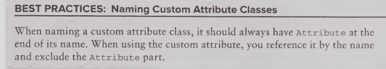

在声明类之后，你可以像其他任何类一样向类添加属性和枚举。在这个示例中，你添加了一个枚举和三个属性：

```csharp
public enum MyCustomAttributeEnum
{
    Red,
    White,
    Blue
}
public bool Property1 { get; set; }
public string Property2 { get; set; }
public MyCustomAttributeEnum Property3 { get; set; }
```

下一步是定义属性的作用范围。在这个示例中，你限制了该属性的作用范围，使其目标只能是类或结构体。为了这一点，你使用了 `AttributeUsage` 属性。将其应用于类：

```csharp
[AttributeUsage(AttributeTargets.Class | AttributeTargets.Struct)]
class MyCustomAttribute : System.Attribute
{
}
```

# 第8章 反射、自定义属性和 Lambda 表达式

在本章中，你将学习反射、自定义属性和 Lambda 表达式。反射是在运行时检查代码元数据的能力。这允许你创建非常灵活且通用的代码，例如对象映射器、依赖注入容器或单元测试环境。自定义属性是为代码添加元数据的方法。Lambda 表达式是编写匿名方法的方法。

## 使用自定义属性的真实场景

在之前的真实场景中，你学习了如何使用反射将列映射到属性。当列的名称与属性名称匹配时，这种方法效果很好。但由于某些原因，它们并不匹配，你可能希望将列映射到特定的属性。自定义属性是处理这种场景的好方法。

### 解决方案

1. 在项目中添加一个类并命名为 `DataMapping`。因为此属性仅用于类，所以将 `AttributeTarget` 属性设置为 `Class`。你还希望此属性用于多个列，所以你需要将 `AttributeUsage` 的 `AllowMultiple` 属性设置为 `true`。

```csharp
[AttributeUsage(AttributeTargets.Class, AllowMultiple = true)]
class DataMappingAttribute : System.Attribute
{
}
```

2. 添加两个名为 `ColumnName` 和 `PropertyName` 的字符串属性。实现后，这些属性包含映射到属性的列名：

```csharp
public string ColumnName { get; set; }
public string PropertyName { get; set; }
```

3. 为属性添加一个构造函数，接收列和属性参数并设置属性值：

```csharp
public DataMappingAttribute(string columnName, string propertyName)
{
    ColumnName = columnName;
    PropertyName = propertyName;
}
```

4. 打开在之前的场景中创建的 `Person` 类，将 `FirstName` 属性重命名为 `FName`，将 `LastName` 属性重命名为 `LName`。在类名添加 `DataMapping` 属性，并为姓氏列/属性设置相应的映射：

```csharp
[DataMapping("FirstName", "FName")]
[DataMapping("LastName", "LName")]
class Person
{
}
```

5. 打开 `ReflectionExample` 类，并将 `LoadClassFromSqlDataReader` 方法修改为如下：

```csharp
public static bool LoadClassFromSqlDataReader(object myClass, SqlDataReader dr)
{
    if (dr.HasRows)
    {
        dr.Read();
        Type typeClass = myClass.GetType();
        object[] dataMappingAttributes = typeClass.GetAttributes(typeof(DataMappingAttribute), false);
        for (int columnIndex = 0; columnIndex <= dr.FieldCount - 1; columnIndex++)
        {
            // 获取列名。
            string columnName = dr.GetName(columnIndex);
            // 检查是否存在匹配名称的属性。
            PropertyInfo propertyInfo = null;

            // 检查是否存在将此列映射到属性的属性。
            foreach (DataMappingAttribute dataMappingAttribute in dataMappingAttributes)
            {
                if (dataMappingAttribute.ColumnName == columnName)
                {
                    propertyInfo = typeClass.GetProperty(dataMappingAttribute.PropertyName);
                    break;
                }
            }
        }
    }
    return true;
}
```

```csharp
// 属性已显式映射，然后尝试查找
// 与列名同名的属性。
if (propertyInfo == null)
{
    propertyInfo = typeOfClass.GetProperty(columnName);
}

// 如果找到了属性，则设置其值。
if (propertyInfo != null)
{
    // 将值设置为 SqlDataReader 中的值
    propertyInfo.SetValue(myClass, dr.GetValue(columnIndex));
}

return true;
else
{
    return false;
}
```

现在你已经看到了特性的强大之处，以及它们如何帮助控制应用程序的执行流。

## 使用 CODEDOM 命名空间生成代码

代码文档对象模型（CodeDOM）是 .NET Framework 中的一组类，它允许你创建代码生成器。代码生成器是一个可以自动为你编写代码的程序。CodeDOM 是一个对象模型，其中包含了表示属性、方法、类、布尔逻辑、参数以及你在程序中编写的任何其他代码元素的类。你可以使用 CodeDOM 类来编写通用代码，然后将其生成为 C#、VB.NET 或 JavaScript。

你是否写过过具有映射到表格属性的类？这可能是枯燥且耗时的。当你想使用 CodeDOM 自动生成这些代码时，这是一个很好的示例。你可以创建一个程序，从数据库的表中读取列，并为每个属性创建一个类。本节解释了 CodeDOM 命名空间中的类，并向你展示如何为类、属性和方法生成代码，甚至生成循环结构和 if 语句。

## 使用 CodeDOM 命名空间生成代码

CodeDOM 模型中的类模拟了代码语句，例如 if 语句或变量声明。你可以使用 CodeDOM 类编写代码生成器，然后在 C#、VB.NET 或 JavaScript 中生成你的代码。CodeDOM 类非常适合自动化重复的编码任务或在项目中强制执行设计模式。本节将演示如何使用 CodeDOM 创建一个包含字段、属性和方法的类文件。

C# 中类的典型结构包含以下元素：

- 包含类代码的文本文件
- 一组 `using` 语句
- 命名空间声明
- 类名声明
- 一组字段和属性
- 一组方法，包含循环结构和逻辑表达式（如 if 和 switch 语句）的逻辑

CodeDOM 命名空间包含允许你创建一个名为“CodeDOM 图”的结构，该结构模拟了这些元素。表 8-6 列出了可以在 CodeDOM 命名空间中使用的一些类。

表 8-6：CodeDOM 命名空间中的常用类

| 名称 | 描述 |
|---|---|
| `CodeArgumentReferenceExpression` | 表示传递给方法的参数值的引用 |
| `CodeAssignStatement` | 表示赋值语句 |
| `CodeBinaryOperatorExpression` | 表示一个由二元操作组成的表达式 |
| `CodeCastExpression` | 表示一个转换为到其他数据类型或接口的表达式 |
| `CodeComment` | 表示注释 |
| `CodeCompileUnit` | 为 CodeDOM 提供容器，包含你的类的声明、命名空间、类和组件 |
| `CodeConditionStatement` | 表示条件语句，通常表示为 if 语句 |
| `CodeConstructor` | 表示实例构造函数的声明 |
| `CodeFieldReferenceExpression` | 表示对字段的引用 |
| `CodeIterationStatement` | 表示 for 语句或其他循环结构 |
| `CodeMemberEvent` | 表示事件的声明 |
| `CodeMemberField` | 表示字段的声明 |
| `CodeMemberMethod` | 表示方法的声明 |
| `CodeMemberProperty` | 表示属性的声明 |
| `CodeMethodInvokeExpression` | 表示调用方法的表达式 |
| `CodeMethodReturnStatement` | 表示返回值语句 |
| `CodeNamespace` | 表示命名空间声明 |
| `CodeNamespaceImport` | 表示命名空间导入指令 |
| `CodeObjectCreateExpression` | 表示创建类型新实例的表达式 |
| `CodeDeclarationExpression` | 表示方法、属性或构造函数的参数声明 |
| `CodePropertyReferenceExpression` | 表示对属性值的引用 |
| `CodePropertySetValueReferenceExpression` | 表示属性设置方法的值参数 |
| `CodeRegionDirective` | 指定代码区域的名称和模式 |
| `CodeSnippetCompileUnit` | 表示可以编译的字面量代码片段 |
| `CodeSnippetStatement` | 表示使用字面量代码片段的语句 |
| `CodeThisReferenceExpression` | 表示对当前本地类实例的引用 |
| `CodeThrowExceptionStatement` | 表示抛出异常的语句 |
| `CodeTryCatchFinallyStatement` | 表示 try、catch 和 finally 块 |
| `CodeTypeConstructor` | 表示类的静态构造函数 |
| `CodeTypeDeclaration` | 表示类、结构体、接口或枚举的声明 |
| `CodeTypeDelegate` | 表示委托声明 |
| `CodeTypeVariableDeclarationStatement` | 表示变量声明 |
| `CodeVariableReferenceExpression` | 表示对本地变量的引用 |

从表 8-6 的类列表中可以看出，CodeDOM 为你可以在 .NET Framework 中创建的每种语句都提供了类。然后你可以选择用你喜欢的语言来渲染代码。例如，查看下面的类，在本章稍后的部分，你将使用 CodeDOM 生成此类类：

```csharp
using System;
using System.Collections.Generic;
using System.Linq;
using System.Text;
using System.Threading.Tasks;
```

```csharp
namespace Reflection
class Calculator
{
    private double x;
    private double y;

    public double X
    {
        get { return this.x; }
        set { this.x = value; }
    }

    public double Y
    {
        get { return this.y; }
        set { this.y = value; }
    }

    public double Divide()
    {
        if (this.Y == 0)
        {
            return 0;
        }
        else
        {
            return this.X / this.Y;
        }
    }

    public double Exponent(double power)
    {
        return Math.Pow(this.X, power);
    }
}
```

这是一个简单的 `Calculator` 类，位于 `Reflection` 命名空间中，包含两个字段、两个属性和两个方法。接下来的章节将演示如何使用 CodeDom 动态创建类。

## CodeCompileUnit

`CodeCompileUnit` 类是所有生成的类对象的顶层容器。将其视为包含你代码的类。以下代码用于创建 `CodeCompileUnit` 类的实例：

```csharp
CodeCompileUnit codeCompileUnit = new CodeCompileUnit();
```

## CodeNamespace 和 CodeNamespaceImport

下一步是添加命名空间。`CodeNamespace` 类表示命名空间。构造函数接收命名空间作为参数。

```csharp
CodeNamespace namespace = new CodeNamespace("Reflection");
```

有了命名空间后，你可以附加 `using` 语句。通常创建类文件时，`using` 语句位于命名空间声明之上，但如果你在之后添加，它们仍然有效。`CodeNamespaceImport` 类用于定义你想导入的命名空间。在 C# 中你使用关键字，但在 VB.NET 中你通过 CodeDom 使用导入，你不需要担心正确的关键字。

```csharp
namespace.Imports.Add(new CodeNamespaceImport("System"));
namespace.Imports.Add(new CodeNamespaceImport("System.Collections.Generic"));
namespace.Imports.Add(new CodeNamespaceImport("System.Linq"));
namespace.Imports.Add(new CodeNamespaceImport("System.Text"));
namespace.Imports.Add(new CodeNamespaceImport("System.Threading.Tasks"));
```

上述代码产生了以下输出：

```csharp
namespace Reflection
{
    using System;
    using System.Collections.Generic;
    using System.Linq;
    using System.Text;
    using System.Threading.Tasks;
}
```

## CodeTypeDeclaration

下一步是声明类。这是通过使用 `CodeTypeDeclaration` 类来实现的。


```
CodeTypeDeclaration targetClass = new CodeTypeDeclaration("Calculator");
targetClass.IsClass = true;
targetClass.TypeAttributes = TypeAttributes.Public;

// 将类添加到命名空间。
codeNamespace.Types.Add(targetClass);
```

上述代码创建了 `CodeTypeDeclaration` 类的实例，并将 `IsClass` 属性设置为 `true`，这告诉 .NET Framework 生成类声明。`TypeAttributes` 属性允许你将属性定义为公共、私有和静态。这些属性可以使用位运算符 `(|)` 进行组合。在定义类之后，你需要将它添加到 `Types` 集合中。上述代码产生以下输出：

```
public class Calculator
{}
```

### CodeMemberField

下一步向类中添加字段。这是通过使用 `CodeMemberField` 类来实现的。你只需要创建该类的实例，设置其 `Name`，设置 `Type` 属性，并将其添加到 `CodeTypeDeclaration` 对象的 `Members` 集合中。以下代码创建了两个字段 `_x` 和 `_y`，它们都被声明为 `double`：

```
CodeMemberField xField = new CodeMemberField();
xField.Name = "x";
xField.Type = new CodeTypeReference(typeof(double));
targetClass.Members.Add(xField);

CodeMemberField yField = new CodeMemberField();
yField.Name = "y";
yField.Type = new CodeTypeReference(typeof(double));
targetClass.Members.Add(yField);
```

上述代码产生以下输出：

```
private double x;
private double y;
```

### CodeMemberProperty

下一步为 `x` 和 `y` 字段创建属性。你使用 `CodeMemberProperty` 类创建属性并生成 `get` 和 `set` 方法。以下代码在 `Calculator` 类中创建了 `X` 和 `Y` 属性：

```cs
// 属性
CodeMemberProperty xProperty = new CodeMemberProperty();
xProperty.Attributes = MemberAttributes.Public | MemberAttributes.Final;

xProperty.Name = "X";
xProperty.HasGet = true;
xProperty.HasSet = true;
xProperty.Type = new CodeTypeReference(typeof(System.Double));

xProperty.GetStatements.Add(new CodeMethodReturnStatement(
    new FieldReferenceExpression(new CodeThisReferenceExpression(), "x")));

xProperty.SetStatements.Add(new CodeAssignStatement(
    new FieldReferenceExpression(new CodeThisReferenceExpression(), "x"),
    new CodePropertyValueReferenceExpression()));

targetClass.Members.Add(xProperty);
```

```cs
// Y 属性
CodeMemberProperty yProperty = new CodeMemberProperty();
yProperty.Attributes = MemberAttributes.Public | MemberAttributes.Final;
yProperty.Name = "Y";
yProperty.HasGet = true;
yProperty.HasSet = true;
yProperty.Type = new CodeTypeReference(typeof(System.Double));

yProperty.GetStatements.Add(new CodeMethodReturnStatement(
    new FieldReferenceExpression(new CodeThisReferenceExpression(), "y")));

yProperty.SetStatements.Add(new CodeAssignStatement(
    new FieldReferenceExpression(new CodeThisReferenceExpression(), "y"),
    new CodePropertyValueReferenceExpression()));

targetClass.Members.Add(yProperty);
```

`CodeMemberProperty` 类有两个属性（`HasGet` 和 `HasSet`），你需要设置它们，以便代码生成器可以创建 `Get` 和 `Set` 访问器。`GetStatements` 属性集合用于向 `Get` 访问器添加代码。在本示例中，方法返回 `this.x` 字段。`CodeThisReferenceExpression` 类在 C# 中对应 `this`；在 VB 中则使用 `this`。代码生成器在生成代码时需要知道使用哪个关键字。`SetStatements` 属性包含设置 `this.x` 字段的代码。在此实例中，你需要创建一个带有 `CodePropertyValueReferenceExpression` 代码的 `CodeAssignStatement`。上述代码产生以下输出：

```cs
public double X {
    get {
        return this.x;
    }
    set {
        this.x = value;
    }
}
public double Y {
    get {
        return this.y;
    }
    set {
        this.y = value;
    }
}
```

### CodeMemberMethod

下一步是创建方法。使用 CodeDOM 创建方法需要使用 `CodeMemberMethod` 类。以下代码创建了 `CodeMemberMethod` 实例，将方法命名为 `Divide`，将返回类型设置为 `double`，并将属性设置为 `public` 和 `final`。如果你想设置其他属性（如 `static`、`virtual` 或 `new`），可以使用位运算符连接这些属性。

```cs
CodeMemberMethod divideMethod = new CodeMemberMethod();
divideMethod.Name = "Divide";
divideMethod.ReturnType = new CodeTypeReference(typeof(double));
divideMethod.Attributes = MemberAttributes.Public | MemberAttributes.Final;
```

现在签名定义，你需要为方法体创建代码。`Divide` 方法检查 `Y` 属性是否为零，并返回 0 或商。通过使用 `CodeConditionStatement` 创建逻辑：

```cs
CodeConditionStatement ifLogic = new CodeConditionStatement();
ifLogic.Condition = new BinaryOperatorExpression(
    new CodeReferenceExpression(
        new CodeThisReferenceExpression(), yProperty.Name),
    CodeBinaryOperatorType.Equal,
    new CodeLiteralExpression("0"));
ifLogic.TrueStatements.Add(new CodeMethodReturnStatement(
    new CodeLiteralExpression("0")));
ifLogic.FalseStatements.Add(new CodeMethodReturnStatement(
    new FieldReferenceExpression(new CodeThisReferenceExpression(), yProperty.Name)));
divideMethod.Statements.Add(ifLogic);
```

## 第 8 章 反射、自定义属性、代码域与 Lambda 表达式

`myFirstDelegate` 变量本质上持有一个对方法的引用。你现在可以使用 `myFirstDelegate` 变量并传递参数来调用该方法。

```csharp
myFirstDelegate("Hello World");
```

创建一个接受字符串作为参数并将字符串反序写入控制台的方法。

```csharp
static void WriteConsoleBackwards(string stringToWrite)
{
    char[] charArray = stringToWrite.ToCharArray();
    Array.Reverse(charArray);

    Console.WriteLine("This is my string backwards: " + new string(charArray));
}
```

这两个方法具有相同的签名，你可以创建一个单一委托来引用其中任何一个方法。现在创建另一个接受委托作为参数并调用该方法的方法。

```csharp
static void WriteToConsole(MyFirstDelegate myDelegate, string stringToWrite)
{
    myDelegate(stringToWrite);
}
```

现在你可以调用 `WriteToConsole` 方法并将方法作为参数传递。

```csharp
WriteToConsole(LambdaExpressions.WriteToConsoleForward, "Hello World");
WriteToConsole(LambdaExpressions.WriteToConsoleBackwards, "Hello World");
```

上述两行代码产生以下输出：

```
This is my string: Hello World
This is my string backwards: diroW olleh
```

> **专家建议：协变与逆变**

关于委托，需要注意的一点是协变（Covariance）和逆变（Contravariance）。协变允许你拥有一个返回类型比委托返回类型更具派生的方法。因此，委托的返回类型可以是基类，而方法的返回类型可以是继承自该基类的类型。逆变则允许参数类型比委托的参数类型更少派生（即更通用）。因此，委托的参数可以是基类，但方法的参数可以是派生自基类的类。

## 匿名方法

匿名方法与委托相似，不同在于你不需要手动创建方法。你仍然创建委托，但你可以在同一行代码中完成方法的赋值。

```csharp
MyFirstDelegate forward = delegate (string s2)
{
    Console.WriteLine("This is my string: {0}", s2);
}

forward("Hello World");
```

上述代码创建了一个名为 `forward` 的委托变量，它引用了方法的体。该方法可以包含你需要的任意行数。匿名方法与委托的一个区别是，你可以引用未作为参数传递的局部变量。例如，下面的示例创建了一个没有参数的委托。它创建了一个局部变量和一个使用该变量的匿名方法。

```csharp
delegate void MyAnonymousMethod();

static void Main(string[] args)
{
    string myLocalString = "Hello World";
    // 使用局部变量创建匿名方法。
    MyAnonymousMethod forward = delegate ()
    {
        Console.WriteLine(string.Format("*This is my string: {0}", myLocalString));
    }

    forward();
}
```

此方法产生的输出与上一个方法相同。如你所示，在程序上这些方法产生相同的输出，但匿名方法涉及的代码更少。

## Lambda 表达式

Lambda 表达式允许你使用简写语法创建匿名函数。考虑以下内容：

```csharp
delegate double square(double x);

static void Main(string[] args)
{
    square myLambdaExpression = x => x * x;
    Console.WriteLine("*X squared is {0}", myLambdaExpression(5));
}
```

### 352 | 第 8 章 反射、自定义属性、代码域与 Lambda 表达式

Lambda 表达式是 `x => x * x`。在读取代码时，你会说 `x` 结果乘以 `x`。`=>` 被称为进入运算符（goes to operator）。运算符的左侧评估你方法的输入参数。方法体位于运算符的右侧。在此实例中，该方法可以对传入方法的任何数字进行平方。如果你需要传递多个参数，使用以下语法：

```csharp
delegate bool GreaterThan(double x, double y);
static void Main(string[] args)
{
    GreaterThan gt = (x, y) => x > y;
    Console.WriteLine("Is 6 greater than 5. (0)", gt(6, 5));
}
```

上述代码产生以下输出：

```
Is 6 greater than 5. True
```

当方法仅包含单个表达式时，它被称为表达式 Lambda（expression lambda）。当你需要在方法体中使用多个语句时，它被称为语句 Lambda（statement lambda）。语句 Lambda 包含在括号 `{}` 中。以下是用于 `WriteToBackward` 方法的 Lambda 表达式：

```csharp
s =>
{
    char[] charArray = s.ToCharArray();
    Array.Reverse(charArray);
    Console.WriteLine("This is my string to write backwards: {0}", new string(charArray));
}
```

你也可以使用 Lambda 表达式将函数传递给方法。以下使用 Lambda 表达式调用 `WriteToConsole` 方法：

```csharp
WriteToConsole(x => Console.WriteLine("This is my string {0}", x), "Hello World");
```

你可以看到，从委托到匿名函数再到 Lambda 表达式，语法所需的输入更少。

## 总结

本章描述了许多主题，从反射开始。反射是 .NET 框架中的强大功能，允许你在运行时检查代码的元数据。属性（Attributes）是可以添加到类、方法和属性中的元数据。代码模型（DOM）是一组允许你动态操作代码的。Lambda 表达式是创建匿名函数的简写语法。

## 测试题

仔细阅读每个问题，并选择最佳答案。

1. 哪个命名空间包含类型？

a. Reflection

b. CodeDom

c. System

d. CodeDom

2. 哪个代码可以创建 Lambda 表达式？

a. delegate double x;

b. delegate MySub(double y) { y; }

c. x => x;

d. delegate MySub();

3. 如何确定应用程序引用的 DLL 文件？

a. 创建 Assembly 实例，加载程序，遍历 ReferencedAssemblies 属性。

b. 创建 Assembly 实例，加载程序，调用 Getenced 方法。

c. 创建 Assembly 实例，加载程序，遍历 Modules 属性。

d. 创建 Assembly 实例，加载程序，调用 Getenced 方法。

4. 使用什么语法可以确定作为参数传递的对象类型？

a. TypeType = typeof(myParameter);

b. Object objectForKey = myParameter.GetType(object);

c. Object objectForKey = typeof(myParameter);

d. Type myType = myParameter.GetType();

5. 哪个代码可以创建属性？

a. class MyCustomAttribute :System.Reflection.Attribute { public string Version { get; set; } }


b. `class MyCustomAttribute : System.Attribute { public string Version { get; set; } }`

c. `class MyCustomAttribute : System.AttributeUsage { public string Version { get; set; } }`

d. `class MyCustomAttribute : System.ClassAttribute { public string Version { get; set; } }`

6. 如果你想确定 DLL 文件中包含的所有类，应该使用 `System.Reflection` 中的哪个类？

a. `FileInfo`

b. `Assembly`

c. `Type`

d. `Module`

7. `Assembly` 类的哪个方法允许你获取程序集中定义的所有公共类型？

a. `DefinedTypes`

b. `Types`

c. `GetExportedTypes`

d. `GetModules`

8. `Assembly` 类的哪个属性返回程序集的名称？

a. `Name`

b. `FullyQualifiedName`

c. `Location`

d. `FullName`

9. `Assembly` 类中的哪种方法返回当前程序集的实例？

- a. `GetExecutingAssembly`

- b. `GetAssembly`

- c. `GetCurrentAssembly`

- d. `Assembly`

10. 哪种语法可以加载程序集？（选择所有适用项）

- a. `Assembly.Load("System.Data.Data, Version=4.0.0.0, Culture=neutral, PublicKeyToken=b77a5c561934e089");`

- b. `Assembly.LoadFrom("c:\\MyProject\\Project1.dll");`

- c. `Assembly.LoadFrom("c:\\MyProject\\Project1.dll");`

- d. `Assembly.ReflectionOnlyLoad("System.Data, Version=4.0.0.0, Culture=neutral, PublicKeyToken=b77a5c561934e089");`

11. 如果你想让 .NET Framework 在 load-context（加载上下文）中查找以加载程序集，你应该调用哪个方法？

- a. `ReflectionOnlyLoad`

- b. `LoadFrom`

- c. `Load`

- d. `LoadFromContext`

12. 如果你想让 .NET Framework 在 load-context 中查找，你应该调用哪个方法？

- a. `ReflectionOnlyLoad`

- b. `LoadFrom`

- c. `Load`

- d. `LoadFromContext`

13. 哪一行代码使用反射创建了 `DataTable` 的实例？

- a. `myAssembly.CreateInstance("System.Data.DataTable");`

- b. `DataTable.GetType();`

- c. `typeof("System.Data.DataTable");`

- d. `myType.CreateInstance("System.Data.DataTable");`

14. 如果你想使用反射确定类中包含的所有属性，你会创建哪个类？

- a. `Assembly`

- b. `Class`

- c. `Property`

- d. `Type`

15. 你如何判断一个类是公有的（public）还是私有的（private）？

- a. 使用 `typeof` 关键字创建 `Type` 类的实例并检查 `Type` 变量的 `IsPublic` 属性。

- b. 使用 `typeof` 关键字创建 `Type` 类的实例并检查 `Type` 变量的 `IsPrivate` 属性。

- c. 在 try catch 块中创建类的实例，如果无法创建类的实例则捕获异常。

- d. 创建类的实例并检查 `IsPublic` 属性。

16. `System.Reflection` 命名空间中的哪个类用于表示类中定义的字段 (field)?

- a. `PropertyInfo`

- b. `FieldInfo`

- c. `Type`

- d. `EventInfo`

17. 你可以使用 `Type` 类的哪个属性确定数组的维度数？

- a. `GetDimension`

- b. `GetRank`

- c. `GetDimensions`

- d. `GetArrayRank`

18. 哪条语句使用反射返回一个名为 "myField" 的私有实例字段？假设 `MyClass` 变量是类的一个实例。

- a. `myClass.GetType().GetField("myField", BindingFlags.NonPublic | BindingFlags.Instance)`

- b. `myClass.MyField`

- c. `myClass.GetType().GetField("myField")`

- d. `myClass.GetType().GetField("myField", BindingFlags.NonPublic & BindingFlags.Instance)`

19. `MethodInfo` 类的哪个方法可以用于执行该方法？

- a. `Execute`

- b. `Invoke`

- c. `Load`

- d. `Call`

20. 哪条语句使用反射执行方法并传入以下代码块中的两个参数？

```
MyClass myClass = new MyClass();
MethodInfo myMethod = typeof(MyClass).GetMethod("Multiply");
```

- a. `myMethod.Invoke(myClass, new object[] { 4, 5 });`

- b. `myMethod.Execute(MyClass, new object[] { 4, 5 });`

- c. `myMethod.Invoke(myClass, new object[] { 4, 5 });`

- d. `myMethod.Invoke(myClass, new object[] { 4, 5 });`

# 拓展阅读与资源

以下是一些额外的资源，可以帮助你理解本章介绍的主题：

- Microsoft `System.Reflection` 命名空间类的完整列表：<http://msdn.microsoft.com/en-us/library/system.reflection(v=vs.110).aspx>
- Microsoft 特性 (Attribute) 参考：<http://msdn.microsoft.com/en-us/library/z0wl1kczw(v=vs.110).aspx>
- Microsoft CodeDom 快速参考：<http://msdn.microsoft.com/en-us/library/f1dfsbhbc.aspx>
- Microsoft Lambda 表达式描述：<http://msdn.microsoft.com/en-us/library/bb3976887(v=vs.110).aspx>
- Code Project.com (一个包含反射、CodeDom 和 lambda 表达式示例的优秀参考网站)：<http://www.codeproject.com/>
- StackOverflow.com (一个示例代码的优秀参考网站)：<http://www.stackoverflow.com>

# 备习指南 (CHEAT SHEET)

此备习指南旨在帮助你快速学习本章的关键点。

## 反射 (Reflection)

- 获取 `Type` 对象引用的两种方式：使用 `typeof()` 或对象上的 `.GetType()` 方法。
- 你可以使用 `System.Reflection.Assembly` 类来检查 EXE 文件或 DLL 文件中的类型。
- `Assembly.Load` 方法将程序集加载到内存中，并允许你执行代码。
- `Assembly.ReflectionOnlyLoad` 方法将程序集加载到内存中，但你不能执行任何代码。
- `Assembly.CreateInstance` 方法创建程序集的实例。
- `Type` 类表示类、接口、值类型、枚举、参数、泛型定义以及开放或关闭的泛型。
- `Type.GetProperty` 方法返回 `PropertyInfo` 并允许你设置或获取属性值。

## 特性 (Attributes)

- 特性允许为类、方法等关联元数据。
- 特性位于目标方的方括号 `[]` 中。
- 自定义特性继承自 `System.Attribute` 类。

## 代码对象模型 (CodeDom)

- CodeDom 是一组用于生成代码的类。
- `CodeDomUnit` 类是顶层类；它是所有其他类的容器。
- `CodeDomProvider` 根据单个代码生成 C#、VB 或 JScript。

## Lambda 表达式 (Lambda Expression)

- Lambda 表达式是匿名方法的简写语法。
- 委托 (delegate) 是引用方法的类型。
- 协变 (Covariance) 允许方法具有更派生的返回类型。
- 逆变 (Contravariance) 允许参数类型更派生。
- Lambda 表达式中的 `=>` 被称为“指向”。

# 关键术汇回顾

**匿名方法 (anonymous method)**：在不声明方法签名的情况下将代码块与委托关联。

**程序集 (assembly)**：文件中的编译代码单元。

**特性 (attribute)**：允许为程序集、类型、方法等关联元数据。

**代码对象模型 (CodeDom)**：一组根据单一代码生成代码的类。

**上下文 (context)**：使用反射加载程序集时，这是反射搜索的地方。

**逆变 (contravariance)**：允许参数类型更派生。

**协变 (covariance)**：允许方法具有更派生的返回类型。

**委托 (delegate)**：引用方法的类型。

**表达式 lambda (expression lambda)**：正文包含一个语句的 lambda 表达式。

**表达式树 (Expression Tree)**：树形结构的代码，每个节点都是表达式。

**字段 (field)**：在类或结构中定义的变量。

**lambda 表达式 (lambda expression)**：与委托或表达式树关联的匿名方法的简写语法。

**加载上下文 (load context)**：使用反射加载程序集时，该上下文包含通过探测找到的程序集。

**加载上下文 (load-from context)**：使用反射加载程序集时，该上下文包含位于传入 `LoadFrom` 方法的路径中的程序集。

**模块 (module)**：包含程序集的文件。

**探测 (probing)**：在全局程序集缓存 (GAC)、宿主程序集存储、执行程序集的文件夹或执行程序集的私有文件夹中查找程序集的过程。

**反射 (reflection)**：提供了可用于读取元数据或动态调用类型行为的类。

**仅反射上下文 (reflection-only context)**：使用反射加载程序集时，该上下文包含使用 `ReflectionOnlyLoad` 和 `ReflectionOnlyLoadFrom` 方法加载的程序集。

**语句 lambda (statement lambda)**：表达式正文中包含多个语句的 lambda 表达式。

**目标 (target)**：由特性定义元数据的类、属性或方法。

**类型 (type)**：任何类、接口、数组、值类型、枚举、参数、泛型定义以及开放或关闭的泛型。

# 考试技巧与窍门

本章的关键术语回顾和备题手册（Cheat Sheet）可以打印出来帮助你学习。你可以在 <www.wrox.com/remtitle.cgi?isbn=1118612094> 的“Download Code”（代码下载）选项卡中找到本章的 ZIP 文件。

## 处理数据

本章你将学到：

- 处理数据集合
- 消费数据
- 执行 I/O 操作
- 理解序列化

WROX.COM 本章代码下载

你可以在 <www.wrox.com/remtitle.cgi?isbn=1118612094> 的“Download Code”（代码下载）选项卡中找到本章的代码下载。代码位于 chapter09 下载文件夹中，并根据整个章节中的名称进行单独命名。

数据管理是大多数应用程序的重要部分。在准备考试时，理解所有可用的选项至关重要，这对于你提升开发者职业生涯也同样关键。本章的第一节将解释数组和集合的概念。这是你在 C# 中管理一组数据的两种选择。

第二节关于消费数据的内容，讨论了如何使用 ADO.NET、ADO.NET Entity Framework 和 WCF Data Services 访问数据库。ADO.NET 是 .NET Framework 中的一组类，允许你连接到数据库、检索数据、执行存储过程、添加、更新和删除记录。ADO.NET Entity Framework 是一个对象映射工具，提供图形化用户界面，它可以生成代码供你使用 ADO.NET 对数据库执行操作。WCF Data Services 是 .NET 中的一项功能，它可以暴露 ADO.NET Entity Framework 模型，以便通过网络或内网进行访问。

第三节回顾了 I/O 操作以及读写文件的许多选择。它还演示了如何异步地读写文件，以便在长时间运行的过程中创建具有响应性的应用程序。

最后一节讨论了序列化以及如何将对象转换为二进制格式、XML 或 JSON。这允许你轻松地将数据库中的一条或多条记录转换为任何其他系统都可以使用的格式，或者作为文件持久化到磁盘。

### 表 9-1：本章涵盖的 70-483 考试目标

| 目标 | 涵盖内容 |
| --- | --- |
| 执行 I/O 操作 | 包括同步或异步地读写文件和流。 |
| 消费数据 | 包括从数据库中检索、添加、更新和删除数据。还包括使用 ADO.Net Entity Framework 和 WCF Data Services 将数据库暴露给其他系统。 |
| 序列化和反序列化数据 | 包括如何使用二进制、自定义、XML、JSON 和数据约（Data Contract）序列化数据。 |
| 在集合中存储和从集合检索数据 | 包括使用数组和集合 |

## 处理数据集合

理解如何操作一组数据对于所有类型的开发者都是至关重要的。例如，下拉列表需要一组数据，从数据库读取记录需要一个在内存中存储数据集的文件。人们使用许多不同的术语来描述一组数据，如数组、集合、列表、字典或队列。它们都用于在内存中存储一组数据，且每种都提供了追加、搜索和排序数据的功能。本节解释了数组和集合以及两者之间的区别。数组是 C# 中最原始的类型，功能有限，而集合是一个包括了列表、字典、队列和其他对象的通用术语。

### 数组

数组是用于存储一组数据的最基本的类型。数组包含元素，并使用方括号 `[]` 通过索引对其进行引用。以下示例创建了一个单维整数数组：

```
int[] mySet = new int[5];

mySet[0] = 1;
mySet[1] = 2;
mySet[2] = 3;
mySet[3] = 4;
mySet[4] = 5;
```

### 处理数据集合

当你创建一个数组时，必须指定数组可以包含的元素数量。在上一个示例中，元素数量是 5。你还可以使用以下语法创建多维数组：

```
int[,] myArray = new int[3, 2];

myArray[0, 0] = 1;
myArray[0, 1] = 2;
myArray[1, 0] = 3;
myArray[1, 1] = 4;
myArray[2, 0] = 5;
myArray[2, 1] = 6;
```

### 常见错误：数组从零开始

C# 中的数组是从零开始索引的。因此，如果你有一个两个元素的数组，第一个索引是 0，第二个索引是 1。你可能会在考试中遇到关于此的问题。

之前的代码创建了一个第一维有三个元素、第二维有两个元素的二维数组。从概念上说，这就像一个有行和列的表格。之前的代码可以用图 9-1 所示的表格表示。

| | |
|---|---|
| 1 | 2 |
| 3 | 4 |
| 5 | 6 |

图 9-1：二维数组

> **考试技巧与窍门：声明多维数组**
>
> 你可能会遇到关于如何声明多维数组的问题，因此请务必知道在声明数组时，类型在前，维度数在符号的左侧。
>
> 你可能会看到一个关于如何声明多维数组的问题，所以请确保知道在声明数组时，类型在前，维度数指定在符号的右侧（注：原文此处表述可能有误，或“类型在前且维度数是指定在符号的左侧”，此处按逻辑理解为声明语法规则）。
>
> 声明数组时，类型在前，维度数指定在括号内。这些属性指定了数组的维度。`Length` 属性指定了数组的元素数量。`Rank` 属性指定了数组的维度。
>
> `Clone` 方法用于创建数组的浅拷贝。`CopyTo` 方法将元素复制到另一个数组。

> **专家建议：理解浅拷贝**
>
> 在处理引用类型时理解浅拷贝是重要的。考虑以下示例：
>
> 你可能会看到一个关于浅拷贝的问题。在原始数组中，使用浅拷贝是必要的。你可能会惊讶地发现输出是：
>
> 原始名称 Mary
>
> Bob

### 集合

集合是 C# 中一些类的通用术语，它们比数组更灵活。这些类允许你在初始化后动态添加或删除元素。某些类如 `List`、`List<T>`、`Dictionary`、`Dictionary<T>`、`Stack` 和 `Queue`。这些类的功能略有不同，将在后续详细介绍。

集合类的命名空间有 `System.Collections`、`System.Collections.Generic` 和 `System.Collections.Concurrent`。`System.Collections.Concurrent` 命名空间中的类用于多线程的安全操作，在本节中未介绍。

### System.Collections


# System.Collections 命名空间

`System.Collections` 命名空间包含了在不在集合中存储相同类型元素时使用的类。这些集合可以在同一个集合中混合 `int`、`string`、类或结构体。表 9-2 列出了 `System.Collections` 命名空间中的类型。这些类型将在后续章节中详细讨论。

## 表 9-2：System.Collections 命名空间中的类型

| 集合名称 | 说明 |
| :--- | :--- |
| `ArrayList` | 创建一个大小动态且可以包含任何类型对象的集合 |
| `HashTable` | 创建一个具有键值对的动态且可以包含任何类型对象的集合 |
| `Queue` | 创建一个先进先出的集合 |
| `SortedList` | 创建一个按键值排序的键值对集合 |
| `Stack` | 创建一个后进先出的集合 |

# ArrayList

`ArrayList` 是一个类，允许你动态地向数组中添加或删除元素。这与简单数组不同，后者不允许在初始化后更改维度。当在创建时不知道元素的数量，并且要在数组中存储不同类型的数据时，`ArrayList` 类非常有用。在数组示例中，`myList` 数组的所有元素都必须是 `int`。`ArrayList` 有一个 `Add` 方法，它接受对象作为参数并允许你存储任何类型的对象。以下代码创建了一个 `ArrayList` 对象并向其添加了三个不同类型的元素：

```csharp
ArrayList myList = new ArrayList();
myList.Add(1);
myList.Add("hello world");
myList.Add(new DateTime(2012, 01, 01));
```

表 9-3 和 9-4 列出了 `System.Collections.ArrayList` 类最常用的属性和方法。

## 表 9-3：常用的 System.Collections.ArrayList 属性

| 属性 | 说明 |
| :--- | :--- |
| `Capacity` | 获取或设置 `ArrayList` 中的元素数量 |
| `Count` | 获取 `ArrayList` 中实际元素的数量 |
| `Item` | 获取或设置指定索引处的元素 |

## 表 9-4：常用的 System.Collections.ArrayList 方法

| 方法 | 说明 |
| :--- | :--- |
| `Add` | 在 `ArrayList` 的末尾添加一个元素 |
| `AddRange` | 在 `ArrayList` 的末尾添加多个元素 |
| `BinarySearch` | 使用默认比较器在已排序的 `ArrayList` 中搜索元素，并返回该元素的索引 |
| `Clear` | 移除 `ArrayList` 中的所有元素 |
| `Contains` | 确定元素是否在 `ArrayList` 中 |
| `CopyTo` | 将 `ArrayList` 复制到兼容的一维数组中 |
| `IndexOf` | 搜索 `ArrayList` 并返回其在 `ArrayList` 中首次出现项的索引 |
| `Insert` | 在指定的索引处向 `ArrayList` 插入元素 |
| `Remove` | 从 `ArrayList` 中移除一个元素 |
| `RemoveAt` | 通过索引从 `ArrayList` 中移除一个元素 |
| `Reverse` | 反转 `ArrayList` 中元素的顺序 |
| `Sort` | 对 `ArrayList` 中的元素进行排序 |

除了 `Add` 方法外，`AddRange` 方法允许你通过一次调用添加多个元素。你可以使用 `Insert` 方法，它允许你在数组的特定位置添加元素；以及 `Remove` 方法，它允许你从数组中移除一个元素。与简单的数组类型相比，这几个方法使得维护更加容易。

## 考试技巧与提示：数组索引

你可能会在考试中遇到一个使用 `Insert` 方法的问题，并会被要求提供新添加元素在 `ArrayList` 中的索引。

你还可以使用 `Sort` 方法，它允许你对数组中的元素进行排序。请考虑以下简单的排序练习：

```csharp
ArrayList myList = new ArrayList();

myList.Add(4);
myList.Add(1);
myList.Add(5);
myList.Add(3);
myList.Add(2);

myList.Sort();
```

前面的代码可以在输出窗口中打印数字。但是，如果你想在数组列表中存储一个不是简单类型的自定义对象呢？例如，你有一个自定义类，它包含一个 `ID` 属性，用于存储该对象的唯一标识符：

```csharp
class MyObject
{
    public int ID { get; set; }
}
```

现在，如果你能够创建一个 `ArrayList`，添加五个该类的实例，然后调用 `Sort` 方法，你认为会发生什么？

```csharp
ArrayList myList = new ArrayList();

myList.Add(new MyObject() { ID = 4 });
myList.Add(new MyObject() { ID = 1 });
myList.Add(new MyObject() { ID = 5 });
myList.Add(new MyObject() { ID = 3 });
myList.Add(new MyObject() { ID = 2 });

myList.Sort();
```

如果你执行了这段代码，你将在调用 `Sort` 方法的行上得到一个异常：无法比较数组中的两个元素。这是因为 `Sort` 方法不知道应该根据什么进行排序。要修复这个问题，你必须在 `MyObject` 类中实现 `IComparable` 接口。`IComparable` 接口使得类可以被排序。

`IComparable` 接口有一个名为 `CompareTo` 的方法，它接受一个参数，即你想比较的对象。`CompareTo` 方法返回小于零、零或大于零的数字。小于零表示当前实例在排序顺序中较高；零表示两个对象相等；大于零表示第二个对象在排序顺序中较高。

```csharp
class MyObject : IComparable
{
    public int ID { get; set; }
    public int CompareTo(object obj)
    {
        MyObject obj1 = obj as MyObject;
        return this.ID.CompareTo(obj1.ID);
    }
}
```

在前面的示例中，`ID` 属性被用于排序 `MyObject` 类型。由于 `ID` 属性被定义为 `int`，你可以使用它的 `CompareTo` 方法来确定哪个对象在层次结构中更高。如果你执行了之前的代码，它将无错误运行。

数组和 `ArrayList` 的另一个常见用途是搜索数组。你可以使用简单的 `for`/`foreach` 循环来在数组中查找特定元素，或者可以使用更快的 `BinarySearch` 方法。为了使用 `BinarySearch` 方法，你必须已经对 `Array` 中的元素进行了排序，要么通过调用 `Sort` 方法，要么显式地按顺序将元素添加到 `ArrayList` 中；否则你将得到意外的结果。`BinarySearch` 方法在找到元素时返回该元素的索引。如果没有找到，它将返回一个负数。

```csharp
ArrayList myList = new ArrayList();
myList.Add(new MyObject() { ID = 4 });
myList.Add(new MyObject() { ID = 1 });
myList.Add(new MyObject() { ID = 5 });
myList.Add(new MyObject() { ID = 3 });
myList.Add(new MyObject() { ID = 2 });

myList.Sort();
int currentIndex = myList.BinarySearch(new MyObject() { ID = 4 });

if (currentIndex >= 0)
{
    // 找到元素
}
```


# 处理数据

## 排序与搜索

在前面的示例中，`ID` 属性被用于排序 `MyObject` 类型。由于 `ID` 属性被定义为 `int`，你可以使用它的 `CompareTo` 方法来确定哪个对象在层次结构中更高。如果你执行了之前的代码，它将无错误运行。

数组和 `ArrayList` 的另一个常见用途是搜索数组。你可以使用简单的 `for`/`foreach` 循环来在数组中查找特定元素，或者可以使用更快的 `BinarySearch` 方法。为了使用 `BinarySearch` 方法，你必须已经对 `Array` 中的元素进行了排序，要么通过调用 `Sort` 方法，要么显式地按顺序将元素添加到 `ArrayList` 中；否则你将得到意外的结果。`BinarySearch` 方法在找到元素时返回该元素的索引。如果没有找到，它将返回一个负数。

```csharp
ArrayList myList = new ArrayList();
myList.Add(new MyObject() { ID = 4 });
myList.Add(new MyObject() { ID = 1 });
myList.Add(new MyObject() { ID = 5 });
myList.Add(new MyObject() { ID = 3 });
myList.Add(new MyObject() { ID = 2 });
```

```csharp
myList.Sort();
int currentIndex = myList.BinarySearch(new MyObject() { ID = 4 });

if (currentIndex >= 0)
{
    // 找到元素
}
```

前面的代码将产生以下输出：

```
third
second
first
```

## 栈

你无法通过索引访问栈中的元素。你所做的只是添加、移除或查看栈上的下一个元素。

### 考试技巧与窍门：注意栈的方法

关于栈的问题是微软喜欢在考试中出的另一类题目。只需记住用 `Push` 和 `Pop` 代替 `Add` 和 `Remove`。另外要记住你可以 `Peek` 查看下一个元素，但不能通过索引引用元素。

## System.Collections.Generic

`System.Collections.Generic` 命名空间包含了一些类，当你知道要存储在集合中的数据类型，并且希望集合中的元素具有相同类型时可以使用。表 9-5 列出了 `System.Collections.Generic` 命名空间中的类型。这些类型在后续章节中进行了详细描述。

**表 9-5：System.Collections.Generic**

| 集合名称 | 描述 |
| :--- | :--- |
| `Dictionary<TKey, TValue>` | 创建一个具有相同类型的键值对集合 |
| `List<T>` | 创建一个所有对象类型相同的集合 |
| `Queue<T>` | 为所有类型相同的对象创建一个先入先出的集合 |
| `SortedList<TKey, TValue>` | 创建一个基于键排序的键值对集合，且必须是相同类型 |
| `Stack<T>` | 创建一个所有类型相同的后进先出对象集合 |

### 最佳实践：尽可能使用泛型类型

使用泛型命名空间中的集合被认为是最佳实践，因为与非泛型集合相比，它们提供了类型安全并提升了性能。

## Dictionary

`Dictionary` 类型允许你存储一组元素，并为每个元素关联一个键。使用键而不是索引来从字典中检索元素。当你想要存储来自一个具有 `Id` 列的表中的数据时，这种方法非常有用。你可以创建一个持有数据的对象，并使用记录的 `Id` 作为键。

下面的示例创建了一个名为 `MyRecord` 的类，它表示具有三列的表中的一条记录。使用 `Dictionary` 来存储该类的多个实例。加载字典后，你使用键而不是索引从字典中检索元素。

```csharp
class MyRecord {
    public int ID { get; set; }
    public string FirstName { get; set; }
    public string LastName { get; set; }
}

static void Sample1() {
    Dictionary<int, MyRecord> myDictionary = new Dictionary<int, MyRecord>();

    myDictionary.Add(5, new MyRecord() { ID = 5,
    FirstName = "Bob",
    LastName = "Smith" });

    myDictionary.Add(2, new MyRecord() { ID = 2,
    FirstName = "Jane",
    LastName = "Doe" });

    myDictionary.Add(10, new MyRecord() { ID = 10,
    FirstName = "Bill",
    LastName = "Jones" });
}
```

前面的代码会将 "Bob"、"Jane" 和 "Bill" 写入输出窗口。

如果你想知道 `Dictionary` 对象中有多少个元素，你需要使用 `Count` 属性，而数组使用的是 `Length` 属性。

表 9-6 列出了 `System.Collections.Generic.Dictionary` 类最常用的方法。

**表 9-6：常用的 System.Collections.Generic.Dictionary 方法**

| 方法 | 描述 |
| :--- | :--- |
| `Add` | 向字典添加一个键和一个值 |
| `Clear` | 移除字典中所有的键和值 |
| `ContainsKey` | 如果字典包含指定的键，则返回 true |
| `ContainsValue` | 如果字典包含指定的值，则返回 true |
| `Remove` | 移除指定键的元素 |

`Dictionary` 对象有一个 `Add` 方法用于向字典添加元素，一个 `Remove` 方法用于移除元素，以及一个 `Clear` 方法用于从 `Dictionary` 中移除所有元素。此外，还有 `ContainsKey` 和 `ContainsValue` 方法允许你在尝试引用元素之前确定该元素是否存在于 `Dictionary` 中。

### 最佳实践：注意字典异常

如果你通过键引用 `Dictionary` 中的元素但未找到该键，将得到一个异常。在从字典中检索元素之前，检查 `ContainsKey` 方法始终是一个良好的实践。

## List

`List` 类是对象的强类型集合。它与 `ArrayList` 类似，区别是 `List` 的所有元素必须是相同类型。它与 `Dictionary` 的不同在于它没有键，元素通过索引进行引用。当你声明 `List` 对象时，要指定它可以包含的元素类型。

```csharp
List<int> myList = new List<int>();
```

当你向列表添加元素时，它们必须是该类型，否则将得到错误。前面的代码创建了一个只能包含 `int` 值的 `List` 对象。

```csharp
myList.Add(1);
myList.Add(2);
myList.Add(3);
```

> **考试技巧与窍门：了解集合之间的区别**
>
> 你可能会被要求根据特定的需求判断使用哪种集合类。请记住以下几点：
>
> 1. 当所有元素的类型都相同时，使用泛型集合。
> 2. `List` 和 `ArrayList` 通过索引引用，且没有键。
> 3. `Dictionary`、`SortedList` 和 `Hashtable` 具有键值对。
> 4. 当你有特定的处理顺序时，使用 `Queue`（队列）和 `Stack`（栈）。

`SortedList<TKey, TValue>`、`Queue<T>` 和 `Stack<T>` 类型与 `System.Collections` 命名空间中的对应类型相同，不同在于当创建对象时，必须指定键或元素的数据类型，且所有元素必须是相同类型。

## 自定义集合

除了 .NET 提供的标准集合外，你还可以创建自定义的类型集合。强类型集合非常有用，因为它们不会由于装箱和拆箱而产生性能影响。要创建你的自定义集合，可以继承自 `CollectionBase` 类。表 9-7 和 9-8 列出了 `CollectionBase` 类常用的属性和方法。

**表 9-7：System.Collections.CollectionBase 属性**

| 属性 | 描述 |
| :--- | :--- |
| `Capacity` | 获取或设置集合可以包含的元素数量 |
| `Count` | 返回集合中的元素数量 |
| `InnerList` | 获取包含元素的 `ArrayList` |
| `List` | 获取包含元素的 `IList` |

**表 9-8：System.Collections.CollectionBase 方法（部分列表）**

| 方法 | 描述 |
| :--- | :--- |
| `Clear` | 清空集合中的元素 |
| `OnInsert` | 允许在插入新元素之前进行自定义处理 |
| `OnRemove` | 允许在移除元素之前进行自定义处理 |
| `OnSet` | 允许在设置集合值之前进行自定义处理 |
| `RemoveAt` | 移除指定索引处的元素 |

基类中没有 `Add`、`Insert`、`Sort` 或 `Search` 方法。当你实现类时，需要实现你想要在集合中添加、插入、排序或搜索的方法。

例如，你有一个具有几个属性的 `Person` 类：

```csharp
class Person
{
    public int PersonId { get; set; }
    public string FName { get; set; }
    public string LName { get; set; }
    public string Address { get; set; }
    public string City { get; set; }
    public string State { get; set; }
    public string ZipCode { get; set; }
}
```

你可以创建一个继承自 `CollectionBase` 类的集合类。下面的代码为 `Person` 类创建了一个自定义集合，并创建了 `Add`、`Insert` 和 `Remove` 方法，以及一个强类型索引器。索引器用于通过索引引用集合，例如 `myCollection[index]`。

```csharp
class PersonCollection : CollectionBase
{
    public void Add(Person person)
    {
        List.Add(person);
    }
    public void Insert(int index, Person person)
    {
        List.Insert(index, person);
    }
    public void Remove(Person person)
    {
        List.Remove(person);
    }
    public Person this[int index]
    {
        get
        {
            return (Person)List[index];
        }
        set
        {
            List[index] = value;
        }
    }
}
```

现在你有了一个强类型的 `PersonCollection` 类，你可以在代码中使用：

```csharp
static void Main(string[] args)
{
    PersonCollection persons = new PersonCollection();

    persons.Add(new Person()
    {
        PersonId = 1,
        FName = "John",
        LName = "Smith"
    });
    
    persons.Add(new Person()
    {
        PersonId = 2,
        FName = "Jane",
        LName = "Doe"
    });
    
    persons.Add(new Person()
    {
        PersonId = 3,
        FName = "Bill",
        LName = "Jones"
    });

    foreach (Person person in persons)
    {
        Debug.WriteLine(person.FName);
    }
}
```

上述代码创建了 `PersonCollection` 类的实例，向该类添加了三个对象，然后遍历集合并将元素的值打印到输出窗口。

## 现实世界场景：从泛型列表填充下拉列表

`ArrayList`、`List` 或 `Dictionary` 的常见用途之一是填充 Windows Form 或 Web Form 中的下拉列表。创建一个带有下拉列表的 ASP.NET 网页。接下来，创建一个带有 `Id` 和 `Name` 的类，创建一个 `List<T>` 对象并用列表项填充下拉列表。

### 解决方案

1. 使用 Visual Studio 2012 创建一个新的空 Web 项目。向项目添加一个新的 Web Form，并将下拉列表控件拖到 Web Form 上。下拉列表的名称将默认为 `DropDownList1`。
2. 向应用程序添加一个包含以下代码的类：

```csharp
public class MyRecord
{
    public int Id { get; set; }
    public string Name { get; set; }
}
```

该类有一个 `Id` 属性和一个 `Name` 属性。`Id` 将存储在下拉 `ListItem` 的 `Value` 属性中。`Name` 属性将被设置为下拉列表中 `ListItem` 的文本。

3. 在 Web Form 后置代码的 `Page_Load` 事件添加以下代码：

```csharp
List<MyRecord> myRecordList = new List<MyRecord>();

myRecordList.Add(new MyRecord() { Id = 1, Name = "John" });
myRecordList.Add(new MyRecord() { Id = 2, Name = "Sue" });
myRecordList.Add(new MyRecord() { Id = 3, Name = "Jack" });

DropDownList1.DataSource = myRecordList;
DropDownList1.DataTextField = "Name";
DropDownList1.DataValueField = "Id";
DropDownList1.DataBind();
```

这段代码创建了一个名为 `myRecordList` 的泛型列表对象。此列表只能包含类型为 `MyRecord` 的对象。接下来向列表中添加三个项。然后，将下拉列表的 `DataSource` 设置为 `myRecordList`。现在控件知道从哪里获取数据，你需要告诉它使用哪个属性作为列表项的文本和值。`DataTextField` 属性必须设置为 `MyRecord` 类的 `Name`。`DataValueField` 属性指定使用哪个属性作为值字段；在此例中为 `Id` 属性。最后一步是调用 `DataBind` 方法，它会为下拉列表控件生成 HTML，并为 `myRecordList` 对象中的每个元素创建一个 `ListItem`。

## 消费数据

本节介绍了如何使用 ADO.NET、Entity Framework 或 WCF Data Service 从数据库检索数据。许多应用程序将信息存储在数据库中并使用这些方法之一检索数据，并将数据存储在数组或集合中。

## 使用 ADO.NET 工作

ADO.NET 是 .NET Framework 中的一组类，允许你连接到数据库；插入、更新、查询或删除表中的记录；执行存储过程；或执行数据定义语言语句。几乎所有应用程序都使用数据库，因此你必须理解 ADO.NET 的相关概念。

ADO.NET 类型位于 `System.Data` 命名空间中。该命名空间定义了许多基类和接口，数据提供程序必须实现这些接口以便 ADO.NET 访问数据库。例如，`System.Data.SqlClient` 包含了实现 ADO.NET 基类和接口以连接 SQL Server 的类型。Oracle、MySQL 和其他主要数据库系统都有自己的命名空间和实现 ADO.NET 基类和接口的类。这允许你在所有数据库中使用一致的语法。此连接使用了 `System.Data.SqlClient` 命名空间定义的类。

## 连接

连接对象用于与 SQL Server 数据库建立通信链路。该类以及任何提供程序的连接类都继承自 `System.Data.Common.DbConnection` 类。表 9-9 列出了 `DbConnection` 类最常用的属性。

**表 9-9：System.Data.Common.DbConnection 属性**

| 属性 | 描述 |
| :--- | :--- |
| `ConnectionString` | 获取或设置用于打开数据库连接的字符串 |
| `ConnectionTimeout` | 获取系统在建立数据库连接时生成错误之前应等待的秒数 |
| `Database` | 获取数据库名称 |
| `DataSource` | 获取数据库服务器的名称 |
| `ServerVersion` | 获取数据库的服务器版本 |


| State | 获取表示连接状态（如 Open 或 Closed）的字符串 |

最需要注意的属性是 `ConnectionString` 属性。它告诉连接对象要连接到哪个服务器和哪个数据库。对于 SQL Server，连接字符串具有以下语法：

`Server=myServerAddress;Database=myData;User Id=myUsername;Password=myPassword;`

> **专家建议：连接字符串**
>
> 每个提供程序在连接字符串的设置上都有略微差异。<http://www.ConnectionStrings.com> 是确定许多不同类型数据库连接字符串差异语法的极佳资源。

表 9-10 列出了 `DBConnection` 类最重要的方法。

## 表 9-10：System.Data.Common.DBConnection 方法（部分列表）

| 方法 | 描述 |
| :--- | :--- |
| `BeginTransaction` | 开启一个数据库事务 |
| `Close` | 关闭与数据库的连接 |
| `GetSchema` | 返回一个包含数据源架构信息的 `DataTable` |
| `Open` | 使用连接字符串打开数据库连接 |

`Open` 方法用于建立到数据库的连接。建立连接后，你可以使用此对象配合其他 ADO.NET 对象对数据库执行命令。以下代码创建了 `SqlConnection` 实例，设置了 `ConnectionString` 属性并打开数据库连接：

```csharp
SqlConnection cn = new SqlConnection();
cn.ConnectionString = "Server=mySqlServer;Database=myDatabase;User Id=myUsername;Password=myPassword";
cn.Open();
```

## 命令

命令对象用于对数据库执行语句。你可以使用命令对象执行插入、更新、删除、查询或存储过程。`System.Data.Common.DBCommand` 类是所有命令类的基类。`System.Data.SqlClient.SqlCommand` 类是 SQL Server 对 `DBCommand` 类的实现。

## ExecuteNonQuery 方法

`ExecuteNonQuery` 方法用于对数据库执行不返回结果语句。例如，插入、更新或删除语句不会返回任何记录。它们只是对表执行语句。以下代码演示了如何对数据库执行插入语句：

```csharp
SqlConnection cn = new SqlConnection();
cn.ConnectionString = "Server=mySqlServer;Database=myDatabase;User Id=myUsername;Password=myPassword";
cn.Open();

SqlCommand cmd = new SqlCommand();
cmd.Connection = cn;
cmd.CommandType = CommandType.Text;
cmd.CommandText = "INSERT INTO Person (FirstName, LastName) VALUES('Joe', 'Smith')";

cmd.Close();
```

注意在调用 `ExecuteNonQuery` 方法之前必须设置命令对象的三个属性。第一个是 `Connection` 属性。它必须被设置为已打开的连接。这告诉命令对象在执行 `CommandText` 中包含的文本时使用哪个数据库。在示例中使用了内联 SQL，这就是为什么 `CommandType` 属性被设置为 `CommandType.Text`。

如果你使用存储过程来插入 Person 记录，你需要将 `CommandType` 改为 `StoredProcedure` 并将 `CommandText` 设置为存储过程名称。例如，假设你有以下向 Person 表插入记录的存储过程：

```sql
CREATE PROCEDURE PersonInsert
@FirstName varchar(50),
@LastName varchar(50)
BEGIN
    INSERT INTO PERSON (FirstName, LastName) VALUES (@FirstName, @LastName)
END
```

以下代码执行存储过程并传递了 `@FirstName` 和 `@LastName` 参数：

```csharp
SqlConnection cn = new SqlConnection();
cn.ConnectionString = "Server=myServerAddress;Database=myDatabase;User ID=myUsername;Password=myPassword;";
cn.Open();

SqlCommand cmd = new SqlCommand();
cmd.Connection = cn;
cmd.CommandType = CommandType.StoredProcedure;
cmd.CommandText = "PersonInsert";
cmd.Parameters.Add(new SqlParameter(
```

`Command` 对象有一个属性，供你向存储过程传递参数。另外注意，`ExecuteNonQuery` 方法返回受查询影响的行数。在本示例中，如果返回 1，如果你有 `Update` 或 `Delete` 语句，可以使用返回值来确定查询影响的记录数。

## ExecuteReader 方法

使用 `ExecuteReader` 方法从数据库中检索结果，就像使用 `Select` 语句一样。`ExecuteReader` 返回一个 `DataReader` 对象。`DataReader` 对象是 ADO.NET 中定义的另一个类。`DataReader` 是一个只读的结果集，在读取器打开期间它一直与数据库保持连接。“只读”意味着你只能遍历一次记录，而不能将光标移回任何之前的记录。以下代码使用 `DataReader` 对象将 `Person` 表中的所有记录打印到输出窗口。返回对象被声明为 `SqlDataReader`，因为这是 SQL Server。

```csharp
SqlConnection cn = new SqlConnection();
cn.ConnectionString = "Server=myServerAddress;Database=myDatabase;User ID=myUsername;Password=myPassword;";
cn.Open();

SqlCommand cmd = new SqlCommand();
cmd.Connection = cn;
cmd.CommandType = CommandType.Text;
cmd.CommandText = "SELECT * FROM Person";
SqlDataReader dr = cmd.ExecuteReader();
```

```csharp
if (dr.HasRows)
{
    while (dr.Read())
    {
        Debug.WriteLine(string.Format("First Name: {0}, Last Name: {1}",
            dr["FirstName"], dr["LastName"]));
    }
}
dr.Close();
cn.Close();
```

你必须在 `DBDataReader` 对象上调用 `Close` 方法，然后关闭 `Connection` 对象。如果不这样做，可能会留下孤立的打开连接，这会损害性能。`ExecuteReader` 方法是重载的，可以接受 `CommandBehavior` 类型的参数，告诉 ADO.NET 在读取器关闭时自动关闭连接。

### 最佳实践：在 C# 中关闭连接

在 C# 中关闭连接有两种方法。第一是调用 `Close` 方法，第二是使用 `using` 语句。`using` 语句定义了所声明对象的范围，并在其超出范围后自动释放该对象。为连接定义范围的 `using` 语句语法如下：

```csharp
using (SqlConnection cn = new SqlConnection())
{}
```

打开和关闭括号 `()` 定义了连接的作用范围。当连接被释放时，它就会被关闭。

表 9-11 列出了 `DBDataReader` 类中常用的属性。

### 表 9-11：System.Data.Common.DBDataReader 的常用属性

| 属性 (PROPERTY) | 描述 (DESCRIPTION) |
| --- | --- |
| `FieldCount` | 返回当前行中的列数。 |
| `HasRows` | 返回一个布尔值，指示读取器是否包含任何行。 |
| `IsClosed` | 返回一个布尔值，指示读取器是否已关闭。 |
| `Item[Int32]` | 这是一个根据索引返回列的索引器。 |
| `Item[String]` | 这是一个根据列名返回列的索引器。 |

结果集中没有用于行数的 `Count` 属性。获取计数的唯一方法是遍历数据读取器。作为 `Item` 属性的索引器返回一个对象。它们允许你通过列索引或名称来获取列的值。在使用索引器时，将对象转换为正确的类型由你决定。

### 常见错误：null 语义 Null.Value 的区别

请注意，如果某一列包含 `null` 值，则从索引器返回的对象不是 `null`；而是 `Null.Value`。如果你不理解这两者的区别，这可能是许多 bug 的根源。

### 表 9-12 列出了 `DBDataReader` 类常用的方法。

**表 9-12：System.Data.Common.DBDataReader 的常用方法**

| 方法 (METHOD) | 描述 (DESCRIPTION) |
|---|---|
| `Close` | 关闭对象 |
| `GetBoolean` | 将指定列的值作为布尔值返回 |
| `GetByte` | 将指定列的值作为字节返回 |
| `GetChar` | 将指定列的值作为字符返回 |
| `GetDateTime` | 将指定列的值作为 `DateTime` 对象返回 |
| `GetDecimal` | 将指定列的值作为 `Decimal` 对象返回 |
| `GetDouble` | 将指定列的值作为 `double` 对象返回 |
| `GetFieldType` | 返回指定列的数据类型 |
| `GetFieldValue<T>` | 将指定列的值作为类型返回 |
| `GetFloat` | 将指定列的值作为单精度对象返回 |
| `GetGuid` | 将指定列的值作为 GUID 返回 |
| `GetInt16` | 将指定列的值作为 16 位整数返回 |
| `GetInt32` | 将指定列的值作为 32 位整数返回 |
| `GetInt64` | 将指定列的值作为 64 位整数返回 |
| `GetName` | 根据索引位置返回列的名称 |
| `GetOrdinal` | 根据名称返回列的索引位置 |
| `GetSchemaTable` | 返回描述列的 `DataTable` |
| `GetString` | 将指定列的值作为字符串返回 |
| `GetValue` | 将指定列的值作为对象返回 |
| `GetValues` | 用对象数组填充列的值 |
| `NextResult` | 将光标移动到下一个结果集 |
| `IsDBNull` | 返回一个布尔值，指示指定列是否包含空值 |
| `Read` | 将光标移动到下一个记录 |

许多 `Get` 方法允许你使用列索引从数据读取器获取值并将其转换为指定类型。这仅适用于列索引和名称。如果 `SELECT` 子句中的顺序发生变化，你的索引也必须发生变化。

`Read` 方法在存在记录时移动到下一条记录并返回 `true`，到达结果集末尾后返回 `false`。还有一个 `HasRows` 属性，它返回一个布尔值，告知结果集中是否有行。

### 最佳实践：读取记录时防止错误

在调用 `Read` 方法之前检查 `HasRows` 属性是一个良好的习惯，因为如果结果集中没有任何行你调用了 `Read` 方法，会导致异常。

从数据库检索数据时，可以通过单次调用执行多个 `SELECT` 语句来减少往返次数。`DBDataReader` 在一个对象中持有多个结果集。要移动到下一个结果集，只需调用 `NextResult`。

`GetSchemaTable` 方法返回一个包含列元数据的 `DataTable`。返回的表为每一列有一行，包含列名、列类型、列大小、索引位置、是否为标识列以及列是否允许空值。如果你只需要查询的架构而不是数据，可以调用 `ExecuteDataReader` 方法并传入 `CommandBehavior.SchemaOnly`。

## ExecuteXmlReader 方法

`ExecuteXmlReader` 方法返回一个 `XmlReader`，允许您将数据表示为 XML。以下代码将 `Person` 表中的数据返回到 `XmlReader` 对象：

```csharp
SqlConnection cn = new SqlConnection();
cn.ConnectionString = "Server=myServerAddress;Database=myData;User ID=myUsername;Password=myPassword";
cn.Open();

SqlCommand cmd = new SqlCommand();
cmd.Connection = cn;
cmd.CommandType = CommandType.Text;
cmd.CommandText = "SELECT * FROM Person FOR XML AUTO, XLMDATA";
System.Xml.XmlReader xml = cmd.ExecuteXmlReader();

cn.Close();
```

SQL 语句经过修改并包含了 `FOR XML AUTO, XLMDATA` 子句。该查询的结果如下：

```xml
<Schema name="Schema" xmlns="urn:schemas-microsoft.com:xml-data"
xmlns:dt="urn:schemas-microsoft.com:datatypes">
  <Element name="Person" content="empty" model="closed">
    <AttributeType name="PersonId" dt="i4"/>
    <AttributeType name="FirstName" dt="string"/>
    <AttributeType name="LastName" dt="string"/>
    <AttributeType name="Address" dt="string"/>
    <AttributeType name="City" dt="string"/>
    <AttributeType name="State" dt="string"/>
    <AttributeType name="ZipCode" dt="string"/>
    <attribute type="PersonId"/>
    <attribute type="FirstName"/>
    <attribute type="LastName"/>
    <attribute type="Address"/>
    <attribute type="City"/>
    <attribute type="State"/>
    <attribute type="ZipCode"/>
  </Element>
</Schema>
<Person xmlns="x-schema:Schema" PersonId="1" FirstName="John" LastName="Smith"
Address="123 First Street" City="Philadelphia" State="PA" ZipCode="19111"/>
```

注意，在此示例中结果与数据一同返回的。

## DataSet、DataTable 和 DataAdapter

从数据库检索结果另一种方法是使用 `DataSet` 和 `DataTable`。`DataTable` 与 `DbDataReader` 的不同在于它是与数据库断开的；你可以前后移动光标；你可以更新 `DataTable`、重新连接数据库并提交更改。`DataSet` 是一个或多个 `DataTable` 的容器。你可以执行返回多个结果的 SQL 语句，每个结果都可以包含在 `DataSet` 中。然后你可以在内存中对数据进行过滤、排序或更新。`DataAdapter` 是用于填充 `DataSet` 或 `DataTable` 的对象，同时也用于重新连接数据库以执行插入、更新或删除命令。

以下代码使用 `DataSet` 从 `Person` 表检索数据，并将所有记录写入输出窗口（Output window）：


```cs
SqlConnection cn = new SqlConnection();
cn.ConnectionString = "Server=myServerAddress; Database=myDatabase;
User Id=myUsername; Password=myPassword";
cn.Open();

SqlDataAdapter da = new SqlDataAdapter("SELECT * FROM Person", cn);

DataSet ds = new DataSet();
da.Fill("Person");

cn.Close();

foreach (DataRow row in ds.Tables[0].Rows)
{
    Debug.WriteLine(string.Format("First Name: {0}, Last Name: {1}",
        row["FirstName"], row["LastName"]));
}
```

在此示例中，`SqlDataAdapter` 的构造函数在调用 `Fill` 方法时传递了要执行的 SQL 语句。`Fill` 方法用于填充 `DataSet`。注意，调用 `Fill` 方法后连接已关闭，但 `DataSet` 仍然可用。你不能对 `DBDataReader` 这样做，因为它与数据库保持连接。

`DataSet` 对象有一个 `Tables` 属性，你可以用它来引用查询返回的 `DataTable` 对象。在这种情况下，只返回了一个，所以你可以通过 `Tables` 属性的零索引来引用它。`DataTable` 有 `Rows` 属性，它包含包含记录的 `DataRow` 对象集合。你可以通过行索引引用记录或通过循环遍历它们。`Rows` 集合还有一个 `Count` 属性，可以告诉你 `DataTable` 中的行数。这与 `DBDataReader` 也不同，因为你可以在行之间前后移动。

`DataTable` 类允许你在更改了数据集中底层 `DataTable` 之后插入、更新或删除行。以下示例显示了如何使用 `DataAdapter` 向数据库插入记录。

# 使用 DataAdapter 向数据库插入记录

以下示例显示了如何使用 `DataAdapter` 向数据库插入记录。此代码演示了如何使用 `DataAdapter` 添加记录。

```cs
SqlConnection cn = new SqlConnection();
cn.ConnectionString = "Server=myServerAddress; Database=myDatabase;
User Id=myUsername; Password=myPassword";
cn.Open();

SqlDataAdapter da = new SqlDataAdapter("SELECT * FROM Person", cn);
// ... (插入逻辑)
```

8. 因为你已经有了数据库，请选择“从数据库生成”（Generate from Database）选项。这种方法被称为数据库优先（Database First）。另一种方法被称为模型优先（Model First），它允许你先在模型中创建所有类，然后从模型生成数据库。

9. 点击“下一步”（Next）按钮。下一页要求输入数据库连接。

10. 点击“新建连接”（New Connection）按钮。出现“选择数据源”（Choose Data Source）对话框。

11. 从数据源列表中选择 Microsoft SQL Server，点击“继续”（Continue）按钮。出现“连接属性”（Connection Properties）对话框。

12. 输入创建 Northwinds 数据库的服务器名称。

13. 你可以使用 Windows 验证（Windows Authentication）或 SQL Server 验证（SQL Server Authentication）连接到数据库。如果你选择 SQL Server 验证，你需要输入有效的 SQL 登录和密码。

14. 从“选择或输入数据库名称”（Select or Enter Database name）列表中选择 Northwinds 数据库。

15. 点击“确定”（OK）按钮。这将返回实体数据模型向导（Entity Data Model Wizard）。默认情况下，连接字符串将存储在项目中的 `app.config` 文件中。

16. 点击“下一步”（Next）按钮。此屏幕允许你选择想要映射到数据库中的对象。勾选列表中“表”（Tables）、“视图”（Views）和“存储过程”（Stored Procedures）的复选框，保持其他设置不变。点击“完成”（Finish）按钮。

实体数据模型会自动生成模型（见图 9-2）。

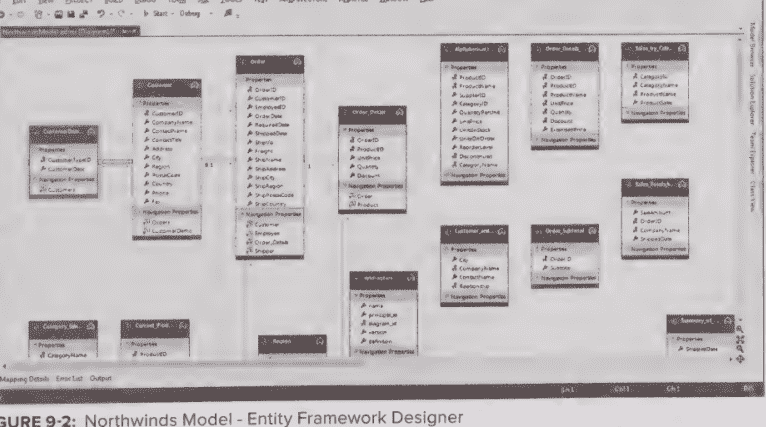

图 9-2：`NorthwindsModel.edmx` 文件已添加到你的解决方案管理器中。该文件是用于表示数据库对象创建的所有类的图形化表示。

Northwinds 模型是用于表示数据库对象而创建的所有类的图形化表示。

# 第 9 章 处理数据

点击解决方案管理器中 `NorthwindsModel.edmx` 文件旁边的箭头，以查看为你生成的所有文件。

注意名为 `NorthwindsModel.tt` 的文件。这是一个文本转换工具包（Text Transformation Toolkit）文件，也称为 T4 模板文件，用于在 Visual Studio 中自动生成代码。T4 模板是文本块和控制语句的混合，允许你生成代码文件。点击 `NorthwindsModel.tt` 文件旁边的箭头，展开由此模板生成的文件列表。对于每个表、视图和返回结果的存储过程，都创建了一个文件。

点击 `Category.cs` 文件。它包含一个映射到 Northwinds 数据库中 `Category` 表的类。表中的每一列都有一个属性。还有一个名为 `Products` 的属性，其类型为 `ICollection<Product>`。创建此属性的原因是 `Products` 表中有一个引用 `Category` 表的外键。每个类别（Category）可以关联许多产品。Entity Framework 足够智能，能够识别这一点并为你生成了这些属性。

点击 `Category_Sales_for_1997.cs` 文件。它映射到数据库中的 `Category_Sales_for_1997` 视图。生成的类文件映射到视图查询中的列。

点击 `CustOrderHist.cs` 文件。创建此类的目的是表示从 `CustOrderHist` 存储过程中返回的列。`CustOrderHist` 存储过程定义：

```sql
CREATE PROCEDURE [db].[CustOrderHist] @CustomerID nchar(5)
AS
SELECT ProductName, Total=SUM(Quantity)
FROM Products, [Order Details] O, Orders, Customers C
WHERE C.CustomerID = @CustomerID
AND C.CustomerID = O.CustomerID
AND O.OrderID = O.OrderID
AND O.ProductID = P.ProductID
GROUP BY ProductName
```

此过程返回两个列：`ProductName` 和 `Total`。注意 `CustOrderHist_Result` 类有两个属性：`ProductName` 和 `Total`。如你所示，Data Model Viewer 足够智能可以读取视图或存储过程的定义以创建一个可以表示其结果的类。

```csharp
public DbSet<Category> Categories { get; set; }
public DbSet<CustomerDemographic> CustomerDemographics { get; set; }
public DbSet<Customer> Customers { get; set; }
public DbSet<Employee> Employees { get; set; }
public DbSet<Order_Details> Order_Details { get; set; }
```

存储过程被创建为方法。在定义属性后，有一个方法列表，其名称与数据库中的存储过程相同。存储过程的任何参数都是方法的参数。如果存储过程返回结果集，则方法的返回值类型为 `ObjectResult` 集合。例如，`CustOrderHist` 存储过程被创建如下方法：

```csharp
public virtual ObjectResult<CustOrderHist_Result> CustOrderHist(string customerID)
{
    var customerIDParameter = customerID != null ? new ObjectParameter("CustomerID", customerID) : new ObjectParameter("CustomerID", typeof(string));
```

`CustOrderHist_Result` 类对结果集进行了类型定义。存储过程有一个用于客户 ID 的字符串参数，因此方法也有一个用于客户 ID 的参数。要调用存储过程，会调用 `ExecuteFunction` 方法，它是包含在 Northwinds 基类 `DbContext` 中的一个方法。`DbContext` 类定义在 `System.DataEntity` 命名空间，这就像是加强版的 ADO.NET 连接对象。该类拥有用于对数据库执行命令的方法，并使用 ADO.NET 绑定场景以处理繁重工作。繁琐的细节被为你省略了，一切都通过运行向导自动生成。

## 选择记录

现在你已经有了一个模型，你可以使用它来从数据库中检索所需的记录，而无需编写任何 SQL 语法。打开 `Program.cs` 文件，添加以下 `using` 语句：

```csharp
using System.Diagnostics;
```

添加以下代码：

```csharp
using (NorthwindsEntities db = new NorthwindsEntities())
{
    var categories = from c in db.Categories
                    select c;
    foreach (Category category in categories)
    {
        Debug.WriteLine(string.Format("CategoryID: {0}, CategoryName: {1}", category.CategoryID, category.CategoryName));
    }
}
```

运行项目，输出窗口将显示内容：

```
CategoryId: 1, Beverages
CategoryId: 2, Condiments
CategoryId: 3, Confections
CategoryId: 4, Dairy Products
CategoryId: 5, Grains/Cereals
CategoryId: 6, Meat/Poultry
CategoryId: 7, Produce
CategoryId: 8, Seafood
```

```cs
{
  CategoryName = "Alcohol",
  Description = "Happy Beverages",
}

db.Categories.Add(category);
db.SaveChanges();
}
```

这段代码创建了 `Category` 类的实例并初始化了它的属性。它将该对象添加到 `NorthwindsEntities` 的 `Categories` 属性中。然后调用 `SaveChanges()` 方法将记录添加到数据库中。同样，这不需要 SQL 语法；Entity Framework 处理了所有这些工作。

## 更新记录

更新记录也是轻而易举。以下代码示例检索了名为 "Alcohol" 的 `Category`，更改其描述，并更新数据库中的记录：

```cs
category = db.Categories.First(c => c.CategoryName == "Alcohol");
category.Description = "Happy People";
db.SaveChanges();
```

## 删除记录

你也可以使用几行代码来删除记录。

```cs
using (NorthwindsEntities db = new NorthwindsEntities)
{
  category = db.Categories.First(c => c.CategoryName == "Alcohol");
  db.Categories.Remove(category);
  db.SaveChanges();
}
```

在 Entity Framework 5.0 中你使用 `Remove` 方法。在之前的版本中，该方法被称为 `DeleteObject`。

## 调用存储过程

如之前所述，所有的存储过程都是由数据模型向导创建为 `NorthwindsEntities` 类中的方法。要调用存储过程，你只需要调用该方法。以下代码示例调用了 `CustOrderHist` 存储过程，传入客户 ID，然后将订单打印到输出窗口：

```cs
using (NorthwindsEntities db = new NorthwindsEntities)
{
  var custOrderHist = db.CustOrderHist("ALFKI");
  foreach (CustOrderHist_Result result in custOrderHist)
  {
    Debug.WriteLine(string.Format("ProductName: {0}, Total: {1}*", result.ProductName, result.Total));
  }
}
```

# 394 | 第 9 章 处理数据

如你所见，所有的繁重工作都已完成，理解 ADO.NET 在后台发生了什么对于成为一个更完整的开发者至关重要。

## 创建 WCF 数据服务

WCF Data Services 是 .NET Framework 的一个组件，允许你通过网络或内域 URI 访问数据库。在 .NET 的之前的版本中，它被称为 ADO.NET Data Services。你可以使用 URI 和查询字符串参数进行选择、过滤、添加、更新甚至删除数据。WCF Data Services 使用开放数据协议 OData，这是一种使用 HTTP 的 Web 协议。例如，可以对暴露 Northwinds 数据库 `Categories` 的 WCF 数据服务发送以下请求。

```http
http://localhost/WcfDataService1.svc?$filter=CategoryName eq 'Beverages'
```

在此示例中，`Categories` 标识要返回的实体，而查询字符串中的 `filter` 用于查找名为 'Beverages' 的类别。在示例中，过滤器被设置为 `CategoryName` 'Beverages'。查询字符串允许存在空格。你可以选择将数据作为 XML 这种（它遵循 OData ATOM 格式，即 OData 查询返回数据的 XML 表示形式），或作为 JavaScript 对象、JSON（一种轻量级数据交换格式）。XML 显示了对 WCF 服务预调用的响应。


```xml
<?xml version="1.0" encoding="utf-8"?>
<feed xmlns="http://localhost:5000/WcfDataService1.svc/"
      xmlns="http://www.w3.org/2005/Atom"
      xmlns:d="http://schemas.microsoft.com/ado/2007/008/dataservices"
      xmlns:m="http://schemas.microsoft.com/ado/2007/008/dataservices/metadata">
  <id type="text">http://localhost:5000/WcfDataService1.svc/Categories</id>
  <title type="text">Categories</title>
  <updated>2013-01-01T10:23:54Z</updated>
  <link rel="self" title="Categories" href="Categories" />
  <entry>
    <id type="text">http://localhost:5000/WcfDataService1.svc/Categories(1)</id>
    <category term="Northwinds.Model.Category" 
              scheme="http://schemas.microsoft.com/ado/2007/008/dataservices/scheme" />
    <link rel="edit" title="Category" href="Categories(1)" />
    <title>
    <updated>2013-01-01T10:23:54Z</updated>
    <author>
      <name>
    </author>
    <content type="application/xml">
      <m:properties>
        <d:CategoryID m:type="Edm.Int32">1</d:CategoryID>
        <d:CategoryName>Beverages</d:CategoryName>
        <d:Description>Soft drinks, coffees, teas, beers, and ale/s</d:Description>
        <d:Picture m:type="Edm.Binary">/FRWv_</d:Picture>
      </m:properties>
    </content>
  </entry>
</feed>
```

注意，列已作为数据作为 `m:properties` 元素中的元素返回。

## 创建 WCF 数据服务

创建 WCF 数据服务涉及：

1. 在解决方案管理器中右键点击项目，点击“添加”，然后点击“新建项”。
2. 从列表中选择 WCF 数据服务。
3. 选择数据库的 ADO.NET 实体模型并点击“下一步”。
4. 将文件命名为 `NorthwindService` 并点击“确定”。
5. 从列表中选择数据服务器。
6. 将名称更改为 Northwinds。这将创建该类。

```cs
public class NorthwindService : DataService
    /* TODO: 在此处放置你的类 */
    // 此方法仅调用一次以初始化全局策略。
    public static void InitializeService(DataServiceConfiguration config)
    {
        // TODO: 设置规则以指示哪些实体集和操作是可见的、可更新的
        // --config.SetEntityAccessRule("MyEntity", EntityRights.All);
        // --config.SetOperationAccessRule("MyOperation", ServiceOperationRights.All);
        config.DataServiceBehavior.MaxProtocolVersion = DataServiceProtocolVersion.V3;
    }
```

`NorthwindService` 继承 `DataService` 类，该类包含一个 Entity Framework 模型。注意生成的 `/* TODO: 代码。将注释 TODO 文本替换为你在第 5 到 14 步中创建的实体模型。它应该是 `NorthwindEntities`。

2. 移除 `InitializeService` 方法中的注释代码。
3. 在 `InitializeService` 方法中添加以下行：

`config.SetEntityAccessRule("Categories", EntityRights.AllRead);`

此行代码定义了哪些实体适用于 Web 服务。在此示例中，只有 `Categories` 实体被暴露了。你的类应该包含以下代码：

```cs
public class NorthwindService : DataService<NorthwindEntities>
{
    // 此方法仅调用一次以初始化全局策略。
    public static void InitializeService(DataServiceConfiguration config)
    {
        config.SetEntityAccessRule("Categories", EntityRights.AllRead);
        config.DataServiceBehavior.MaxProtocolVersion = DataServiceProtocolVersion.V3;
    }
}
```

4. 点击运行按钮开始调试。你得到以下 XML 响应：

```xml
<?xml version="1.0" encoding="UTF-8?>
<xml xmlns:atom="http://www.w3.org/2005/Atom" xmlns="http://www.w3.org/2007/app">
  <workspace xml:base="http://localhost:8999/NorthwindsService.svc/">
    <atom:title>Default</atom:title>
    <collection href="Categories">
      <atom:title>Categories</atom:title>
    </collection>
  </workspace>
</xml>
```

此列出了由该服务暴露的实体；在本示例中仅暴露了 Categories 实体。

- 在浏览器的 URL 末尾附加 `Categories` 并按回车。

`http://localhost:8999/NorthwindsService.svc/Categories`

你不应该会得到一个列出 Categories 表中所有记录的 XML 响应。如果你在浏览器的 URL 末尾附加 `?$filter=CategoryName eq 'Beverages'` 并点击回车，你将只获得名为 Beverages 的类别。`$filter` 是 OData 查询选项。WCF Data Services 还支持以下查询选项，如表 9-13 所示。

## 表 9-13：OData 查询选项

| 选项 | 说明 |
|---|---|
| `$orderby` | 设置返回数据的排序顺序。例如：`$orderby=CategoryName, CategoryId` |
| `$top` | 设置返回数据中包含的实体数量。例如：`$top=10` |
| `$skip` | 指定在返回数据之前跳过的实体数量。例如：`$skip=10` |
| `$filter` | 定义一个用于过滤实体的表达式。OData 过滤选项请参见表 9-14 至表 9-18。 |
| `$expand` | 指定在数据中返回哪些相关实体。例如：`$expand=Products` |
| `$select` | 指定返回数据中的哪些属性（列）。例如：`$select=CategoryName, CategoryId` |
| `$inlinecount` | 请求查询返回的实体计数。 |

表 9-14 列出了用于配合 `$filter` 查询选项使用的关键字。

## 表 9-14：OData $filter 查询选项

| 选项 | 说明 |
|---|---|
| `Eq` | 等于 |
| `Ne` | 不等于 |
| `Gt` | 大于 |
| `Ge` | 大于等于 |
| `Lt` | 小于 |
| `Le` | 小于等于 |
| `And` | 逻辑与 |
| `Or` | 逻辑或 |
| `Not` | 逻辑非 |
| `()` | 优先级分组 |
| `Add` | 加法（`$filter=Cost Add 5 Gt 100`） |
| `Sub` | 减法（`$filter=Cost Sub 5 Gt 100`） |
| `Mul` | 乘法（`$filter=Cost Mul 5 Gt 1000`） |
| `Div` | 除法（`$filter=Cost Div 5 Gt 100`） |
| `Mod` | 余数（`$filter=Cost Mod 2 Eq 0`） |

除了运算符外，还有可以用于字符串、日期、数学和类型的特定函数（参见表 9-15 至表 9-18）。

## 表 9-15：OData $filter 字符串函数

| 函数 | 说明 |
|---|---|
| `bool substring(string p0, string p1)` | 如果 p0 包含 p1 中则返回 true |
| `bool endswith(string p0, string p1)` | 如果 p0 以 p1 结尾则返回 true |
| `bool startswith(string p0, string p1)` | 如果 p0 以 p1 开头则返回 true |
| `int length(string p0)` | 返回 p0 的长度 |
| `int indexof(string p0, string p1)` | 返回 p0 中包含 p1 的第一个字符的索引 |
| `string replace(string p0, string p1, string replace)` | 在 p0 中查找 p1 并将其替换为 replace |
| `string substring(string p0, int pos)` | 返回 p0 从位置 pos 开始的子字符串 |
| `string substring(string p0, int pos, int length)` | 返回 p0 从位置 pos 开始的指定长度的子字符串 |
| `string tolower(string p0)` | 返回小写的 p0 |
| `string toupper(string p0)` | 返回大写的 p0 |
| `string trim(string p0)` | 删除头部和末尾的空格 |
| `string concat(string p0, string p1)` | 拼接字符串 p0 和 p1 |

## 表 9-16：OData $filter 函数

| 函数 | 说明 |
|---|---|
| `int day(DateTime p0)` | 返回日时间的日 |
| `int hour(DateTime p0)` | 返回日时间的时 |
| `int minute(DateTime p0)` | 返回日时间的分 |
| `int month(DateTime p0)` | 返回日时间的月 |
| `int second(DateTime p0)` | 返回日时间的秒 |
| `int year(DateTime p0)` | 返回日时间的年 |

## 表 9-17：OData $filter 数学函数

| 函数 | 说明 |
|---|---|
| `double round(double p0)` | 根据 IEEE754-2008 定义的规则，距离参数值最近的整数值 |
| `decimal round(decimal p0)` | 根据 IEEE754-2008 定义的规则，距离参数值最近的整数值 |
| `double floor(double p0)` | 小于或等于参数值的最大整数值 |
| `decimal floor(decimal p0)` | 小于或等于参数值的最大整数值 |
| `double ceiling(double p0)` | 大于或等于参数值的最小整数值 |
| `decimal ceiling(decimal p0)` | 大于或等于参数值的最小整数值 |

## 表 9-18：OData $filter 类型函数

| 函数 | 说明 |
|---|---|
| `bool typeof(value p0, type t)` | 如果 p0 是类型 t 则返回 true |
| `bool notype(value p0, type t)` | 如果 p0 不是类型 t 则返回 true |

（注：由于原文文本在后半部分存在大量重复和乱码，上述译文已根据逻辑进行了清理和整理，确保了可读性）

# 消费数据

```cs
EntitySetRights.AllWrite;
config.DataServiceBehavior.MaxProtocolVersion = DataServiceProtocolVersion.V3;
}
```

`SetEntityAccessRule` 有一个额外的权限 `EntitySetRights.AllWrite`。这允许客户端在表中添加、更新或删除记录。如果你运行该项目，它将添加新的 Category 记录并在输出窗口中打印新添加的 CategoryId。

## 使用 WCF Data Services 更新记录

以下代码使用 WCF Data Service 更新 Category 记录。将 `Main` 方法中的代码替换为以下内容：

```cs
NorthwindsEntities db = new NorthwindsEntities(new
Uri("http://localhost:8999/NorthwindsService.svc/"));

Category category = db.Categories.Where(c => c.CategoryName == "Alcohol*").FirstOrDefault();

category.Description = "Happy People";
db.UpdateObject(category);
db.SaveChanges();
```

此代码使用 lambda 表达式从服务中检索 `Category` 实体。代码更改了 Description 属性并调用了 `NorthwindsEntities` 对象的 `UpdateObject` 方法。当调用 `SaveChanges` 时，标记的更新会被执行。

## 使用 WCF Data Services 删除记录

以下代码从 Category 表中删除一条记录：

```cs
NorthwindsEntities db = new NorthwindsEntities(new
Uri("http://localhost:8999/NorthwindsService.svc/"));

Category category = db.Categories.Where(c => c.CategoryName == "Alcohol*").FirstOrDefault();

db.DeleteObject(category);
db.SaveChanges();
```

这一次，在使用 ADO.NET Entity Framework 时，你需要使用 `DeleteObject` 方法而不是 `Remove` 方法。

## 在客户端应用程序中请求 JSON 的数据

默认情况下，WCF Data Service 返回的数据是 XML 格式。但是，你可以在 HTTP 请求中发送标头 "Accept:application/json;odata=verbose" 以 JSON 格式返回数据。以下代码使用 `Net` 命名空间中的 `WebRequest` 对象创建请求：

```cs
HttpWebRequest req =
(HttpWebRequest)WebRequest.Create("http://localhost:8999/NorthwindsService.svc/Categories(1)?$select=CategoryID, CategoryName, Description");

req.Accept = "application/json;odata=verbose";

using (HttpWebResponse resp = (HttpWebResponse)req.GetResponse())
{
    Stream s = resp.GetResponseStream();
    StreamReader readStream = new StreamReader(s);
    string jsonString = readStream.ReadToEnd();
    Debug.WriteLine(jsonString);
    resp.Close();
    readStream.Close();
}
```

此代码创建了一个请求，选择主键为 1 的 Category 记录，并选择了 CategoryId、CategoryName 和 Description 属性。`req.Accept = "application/json;odata=verbose"` 告诉 WCF Data Service 以 JSON 格式返回数据。当你执行此代码时，它将打印到输出窗口。为了方便阅读，添加了换行。


```json
{
  "__metadata": {
    "id": "http://localhost:8999/NorthwindsService.svc/Categories(1)",
    "uri": "http://localhost:8999/NorthwindsService.svc/Categories(1)",
    "type": "NorthwindsModel.Category"
  },
  "CategoryID": 1,
  "CategoryName": "Beverages",
  "Description": "Soft drinks, coffees, teas, beers, and ales"
}
```

# 执行 I/O 操作

I/O 操作指的是在存储器与之间读写文件。文件存储在目录中，.NET Framework 提供了一系列类，用于复制、移动、删除或检查文件或目录的存在性。文件是保存到存储器中的有序且命名的字节集合。在处理文件时，你使用流（`Stream`）。流是一个用于表示文件中字节序列的内存中对象。特殊的读取器（`Reader`）和写入器（`Writer`）类允许处理编码流。本节首先回顾了表示文件和目录的基本类型，然后回顾了不同类型的流，最后回顾了不同类型的读取器写入器。执行这些 I/O 操作的所有类型都可以在 `System.IO` 命名空间中找到。

# 文件和目录

表 9-19 列出了用于处理文件和目录定义的类。

| 类名 | 描述 |
| --- | --- |
| `File` | 一个静态类，提供了创建、复制、删除、移动和打开文件的方法 |
| `FileInfo` | 用于创建类的实例，该类提供了创建、复制、删除、移动和打开文件的方法 |
| `Directory` | 一个静态类，提供了创建、移动、删除和枚举目录中文件的方法 |
| `DirectoryInfo` | 用于创建类的实例，该类提供了创建、移动、删除和枚举目录中文件的方法 |
| `Path` | 一个静态类，提供了使用字符串变量获取信息或操纵文件或目录名称的方法 |

`File` 类和 `FileInfo` 类相似，不同在于 `File` 类是静态的，且仅包含方法；而 `FileInfo` 类允许你创建一个表示文件的实例，因此它具有属性和方法。表 9-20 列出了 `FileInfo` 类的一些属性。注意，`File` 类没有属性，因为它是一个静态类。

| 属性名 | 描述 |
| --- | --- |
| `Directory` | 获取父目录的 `DirectoryInfo` 对象的实例 |
| `DirectoryName` | 获取完整路径的字符串 |
| `Exists` | 获取文件是否存在的布尔值 |
| `IsReadOnly` | 获取文件是否为只读的布尔值 |
| `Length` | 获取文件的字节大小 |
| `Name` | 获取文件名 |

`FileInfo` 对象继承自 `FileSystem`，不同于 `File` 对象，它包含了属性、创建时间、扩展名、全路径、最后访问时间和最后写入时间。`FileInfo` 构造函数接受一个包含文件路径和名称的字符串。这是 `FileInfo` 的唯一构造函数。以下代码示例创建了 `FileInfo` 实例并将文件名写入输出窗口：

```csharp
FileInfo fileInfo = new FileInfo(@"c:\9Samples\HelloWorld.txt");
Debug.WriteLine(fileInfo.Name);
```

## 错误：FileInfo 并没有打开文件

文件并没有“打开”，实例只是允许获取文件的信息。虽然有打开并更改内容的方法，但创建 `FileInfo` 实例并没有打开文件。

`File` 类和 `FileInfo` 类的方法相似。`File` 类的方法接收文件路径，而 `FileInfo` 类使用实例而不是参数。表 9-21 列出了 `File` 和 `FileInfo` 类之间的常用方法。请注意，根据使用的是 `File` 类还是 `FileInfo` 类，参数有所不同。

表 9-21：File 和 FileInfo 方法

| 方法名 | 描述 |
|---|---|
| `AppendAllText` | 创建一个可以向文件追加文本的 `StreamWriter` |
| `CopyTo` (`FileInfo`) | 复制文件 |
| `Copy` (`File`) | 创建文件 |
| `Decrypt` | 解密由当前账户加密的文件 |
| `Delete` | 删除文件 |
| `Encrypt` | 加密文件，只有用于加密文件的账户才能解密 |
| `MoveTo` | 将文件移动到不同的目录 |
| `Open` | 返回一个用于读取、写入或读/写访问的 `FileStream` 对象 |
| `Replace` | 使用另一个文件的内容替换文件的内容 |
| `SetAccessControl` | 通过 `FileSecurity` 对象应用访问控制项 |

`System.IO.FileSystemInfo` 对象，与 `FileInfo` 对象一样，它包含了目录的属性、创建时间、扩展名、全路径、最后访问时间和最后写入时间的相同属性。`DirectoryInfo` 类的属性如表 9-22所示。

## 表 9-22：DirectoryInfo 属性

| 属性名称 | 说明 |
|---|---|
| `Exists` | 返回指示目录是否存在的布尔值 |
| `Name` | 获取 `DirectoryInfo` 实例的名称 |
| `Parent` | 返回父目录的 `DirectoryInfo` 对象 |
| `Root` | 返回根目录的 `DirectoryInfo` 对象 |

`Directory` 和 `DirectoryInfo` 对象具有相似的方法，可以执行相同的操作；唯一的区别是 `Directory` 对象是静态的，其方法需要接收要操作的目录作为参数，而 `DirectoryInfo` 对象则是针对实例进行目录操作。表 9-23 列出了 `Directory` 和 `DirectoryInfo` 对象之间的一些常用方法。

## 表 9-23：Directory 和 DirectoryInfo 方法

| 方法 | 说明 |
|---|---|
| `Create` (`DirectoryInfo`) | 创建目录 |
| `CreateDirectory` (`Directory`) | |
| `Delete` | 删除目录 |
| `GetAccessControl` | 返回一个 `DirectorySecurity` 对象，它封装了当前目录的访问列表项 |
| `GetDirectories` | 返回子目录的 `DirectoryInfo` 数组 |
| `GetFiles` | 返回当前目录下所有文件的 `FileInfo` 数组 |
| `GetFileSystemInfos` | 返回当前目录下文件和目录的 `FileSystemInfo` 数组 |
| `MoveTo` (`DirectoryInfo`) | 移动目录 |
| `Move` (`Directory`) | |
| `SetAccessControl` | 将由 `DirectorySecurity` 对象描述的访问列表项应用于当前目录 |

## 以下代码将 c 盘中的所有目录和所有文件写入输出窗口：

```csharp
// DirectoryInfo
DirectoryInfo directoryInfo = new DirectoryInfo(@"c:\");

// Directories
Debug.WriteLine("Directories");
foreach (FileInfo fileInfo in directoryInfo.GetFiles())
{
    Debug.WriteLine(fileInfo.Name);
}

// Files
Debug.WriteLine("Files");
foreach (DirectoryInfo di in directoryInfo.GetDirectories())
{
    Debug.WriteLine(di.Name);
}
```

# 流 (Streams)

流用于包含文件的内容。表 9-24 列出了 .NET Framework 中提供的不同流类型。

## 表 9-24：流

| 类名 | 说明 |
| --- | --- |
| `FileStream` | 读写文件 |
| `IsolatedStorageFileStream` | 在隔离存储中读写文件 |
| `MemoryStream` | 在内存中读写数据 |
| `BufferedStream` | 用于在内存中存储字节块以缓存数据 |
| `NetworkStream` | 通过网络套接字读写数据 |
| `PipeStream` | 通过匿名管道或命名管道读写数据 |
| `CryptoStream` | 用于将数据流链接到加密转换 |

`FileStream` 可用于读取、写入、打开和关闭文件。以下示例创建了一个新文件，在文件中写入数字 1 到 10，然后关闭该文件流：

```csharp
FileStream fileStream = new FileStream(@"c:\Chapter9Samples\Numbers.txt",
    FileMode.Create, FileAccess.Write, FileShare.None);

for (int i = 0; i < 10; i++)
{
    byte[] number = new UTF8Encoding(true).GetBytes(i.ToString());
    fileStream.Write(number, 0, number.Length);
}
fileStream.Close();
```

在此示例中，`FileStream` 构造函数接受四个参数：文件路径、文件模式、文件访问权限和文件共享模式。`FileMode` 枚举值如表 9-25所示。`FileMode` 枚举决定了你是创建、打开还是截断文件。

## 考试技巧：了解打开文件时的各个选项

请务必注意这些选项，因为你可能会被问到 `FileMode`、`FileAccess` 或 `FileShare` 枚举的问题。

## 表 9-25：FileMode 枚举

| 值 | 说明 |
|---|---|
| `Append` | 如果文件存在，则打开并移动到文件末尾；如果不存在，则创建一个新文件。这只能与 `FileAccess.Write` 使用。 |
| `CreateNew` | 创建新文件。如果文件已存在，则抛出异常。 |
| `Create` | 创建新文件。如果文件已存在，将会被覆盖。如果文件存在且为隐藏文件，则抛出异常。 |
| `Open` | 打开文件。如果文件不存在，则抛出异常。 |
| `OpenOrCreate` | 如果文件存在，则打开文件；如果不存在，则创建一个新文件。 |
| `Truncate` | 打开现有文件并截断文件中的数据。如果文件不存在，则抛出异常。 |

`FileAccess` 枚举决定了在创建流后你可以对其进行的操作（见表 9-26）。

## 表 9-26：FileAccess 枚举

| 值 | 说明 |
|---|---|
| `Read` | 文件的读取权限 |
| `Write` | 文件的写入权限 |
| `ReadWrite` | 文件的读和写权限 |

`FileShare` 枚举决定了在你打开文件时，其他访问流同时对该文件拥有的访问类型（见表 9-27）。

## 表 9-27：FileShare

| 值 | 说明 |
| --- | --- |
| `None` | 不允许其他进程打开该文件 |
| `Read` | 允许其他进程读取文件 |
| `Write` | 允许其他进程写入文件 |
| `ReadWrite` | 允许其他进程读写文件 |
| `Inheritable` | 允许子进程继承句柄 |

`FileIOPermissions` 枚举包含了文件的各种权限类型（见表 9-28）。

## 表 9-28：FileIOPermissions

| 值 | 说明 |
| --- | --- |
| `NoAccess` | 无文件访问权限 |
| `Read` | 读取文件的权限 |
| `Write` | 写入文件的权限 |
| `Append` | 向文件追加数据的权限 |
| `Delete` | 删除文件的权限 |
| `PathDiscovery` | 路径发现权限 |

流类用于读写字节数组。下一节将讨论处理二进制值、字符和字符串的读取器和写入器类。

# 读取器和写入器

读取器和写入器是 `System.IO` 命名空间中的类，用于读写编码的字符和字符串。表 9-29 列出了常见的读取器和写入器类型。

## 表 9-29：读取器和写入器类

| 类 | 说明 |
|---|---|
| `BinaryReader`, `BinaryWriter` | 用于读写二进制值 |
| `StreamReader`, `StreamWriter` | 使用编码读写字符 |
| `StringReader`, `StringWriter` | 从字符串中读写字符 |
| `TextReader`, `TextWriter` | 其它读写字符数据的抽象类 |

`StreamReader` 和 `StringReader` 都继承自 `TextReader`。`StreamWriter` 和 `StringWriter` 都继承自 `TextWriter`。

`StreamReader` 用于按特定的编码读取字符输入。默认编码是 UTF-8。你可以使用 `StreamReader` 读取标准文本文件。表 9-30 列出了 `StreamReader` 类的一些方法。

## 表 9-30：StreamReader 方法

| 方法名称 | 说明 |
|---|---|
| `Close` | 关闭流读取器和底层流 |
| `Peek` | 返回流中的下一个字符但不移动字符位置 |
| `Read()` | 返回流中的下一个字符并将字符位置移动一位 |
| `Read(Char[], Int32, Int32)` | 将指定数量的字符读入字节数组 |
| `ReadBlock(Char[], Int32, Int32)` | |
| `ReadLine` | 读取一行字符并返回字符串 |
| `ReadToEnd` | 从当前位置到文件末尾的所有字符并返回字符串 |

`StreamReader` 提供了逐字符、逐行或一次性读取整个文件的方法。`Read` 和 `ReadBlock` 方法返回字符和字符数组；`ReadLine` 和 `ReadToEnd` 方法返回字符串。以下代码打开了一个包含以下内容的文件：

```
abc
123
456
789
```

代码首先逐字符地将内容写入输出窗口，然后逐行写入输出窗口，最后将整个内容写入输出窗口：

```csharp
StreamReader streamReader = new StreamReader(@"c:\Chapter9\Samples\Numbers.txt");
Debug.WriteLine("Char by Char");
while (!streamReader.EndOfStream)
{
    Debug.WriteLine((char)streamReader.Read());
}

streamReader.Close();

streamReader = new StreamReader(@"c:\Chapter9\Samples\Numbers.txt");
Debug.WriteLine("Line by line");
while (!streamReader.EndOfStream)
{
    Debug.WriteLine(streamReader.ReadLine());
}

streamReader.Close();

streamReader = new StreamReader(@"c:\Chapter9\Samples\Numbers.txt");
Debug.WriteLine("Entire file");
Debug.WriteLine(streamReader.ReadToEnd());
```

- 逐个字符

a
b
c
1
2
3
4
5
6
7
8
9

- 逐行

abc
123
456
789

- 整个文件

abc
123
456
789

`StringReader` 类与 `Stream` 类相似，不同在于它不是读取文件而是读取一个字符串。`StringReader` 类的构造函数接受一个字符串作为参数。这不是文件路径，而只是包含文本的普通字符串。`StringReader` 随后允许你逐字符、逐行或读取整个字符串。以下代码逐字符地将字符串的内容写入输出窗口：

```csharp
StringReader stringReader = new StringReader("Hello\nGoodbye");
int pos = stringReader.Read();
while (pos != -1)
{
    Debug.WriteLine((char)pos);
    pos = stringReader.Read();
}
stringReader.Close();
```

`StreamWriter` 类与 `Stream` 相似，不同在于 `StreamWriter` 用于字符编码，而 `Stream` 设计用于输入和输出。你可以使用 `StreamWriter` 将数据写入文件。`StreamWriter` 拥有 `Write` 和 `WriteLine` 方法，用于向内存中的流写入数据。`StreamWriter` 有一个名为 `AutoFlush` 的属性，当其设置为 `true` 时，可以在调用 `Flush` 方法或关闭 `StreamWriter` 时将内容写入存储器。以下代码创建一个 `StreamWriter` 并向文件中写入一个字符串、一个布尔值和一个整数：


```csharp
StreamWriter streamWriter = new StreamWriter(@"c:\Chapter9Samples\StreamWriter.txt");

streamWriter.WriteLine("ABC");
streamWriter.Write(true);
streamWriter.Write(1);

streamWriter.Close();
```

在此示例中，构造函数传递了一个文件路径。如果文件不存在，则会创建；如果存在，则会被覆盖。请注意，你可以将 `Stream` 对象传递给构造函数。示例代码同时使用了 `WriteLine` 和 `Write` 方法写入文件。非字符串或 char 值的字符表示将被写入。布尔值以 "True" 的形式写入文件。

你可以使用 `BinaryWriter` 类以二进制格式写入原始类型，或以特定编码写入字符串。以下代码写入与上一个练习相同的数据，但它是二进制格式写入的：

```csharp
FileStream fileStream = new FileStream(@"c:\Chapter9Samples\BinaryWriter.txt", FileMode.Create);
BinaryWriter binaryWriter = new BinaryWriter(fileStream);

binaryWriter.Write("*ABC");
binaryWriter.Write(true);
binaryWriter.Write(1);

binaryWriter.Close();
```

# 第 9 章：处理数据

`BinaryWriter` 类要求向构造函数传递一个 `Stream` 对象；你不能传递指向文件路径的字符串。如果你打开在此练习中创建的 `BinaryWriter.txt` 文件，你将看到二进制格式的值。

如果你需要读取二进制文件，可以使用 `BinaryReader` 类来读取数据。以下代码读取了上一个练习中的 `fileStream`：

```csharp
FileStream fileStream = new FileStream(@"c:\Chapter9Samples\BinaryWriter.txt", FileMode.Open);
BinaryReader binaryReader = new BinaryReader(fileStream);
string abs = binaryReader.ReadLine();
bool b = binaryReader.ReadBoolean();
int i = binaryReader.ReadInt32();
binaryReader.Close();
```

# 异步 I/O 操作

`Stream`、`Reader` 和 `Writer` 类提供了异步读取或写入文件的能力。当你在对大文件执行耗时操作的同时，希望将处理权返回给用户界面时，这非常有帮助。在 C# 中，处理异步处理使用了两个关键字：`async` 和 `await`。

`async` 关键字是一个方法修饰符，允许该方法使用 `await` 关键字，并允许调用方法使用 `await` 关键字调用此函数。`await` 关键字用于调用方法时，挂起该方法的执行，直到等待的任务完成。例如，假设你有一个 Windows 表单应用程序，其中有一个执行长时间运行任务的按钮。你可以使用 `async` 修饰符修改按钮点击事件的签名，然后使用 `await` 关键字调用长时间运行的方法。这允许长时间运行的过程运行，同时也允许用户导航到应用程序的不同部分，因此系统看起来没有被锁住。

```csharp
private async void button1_Click(object sender, EventArgs e)
{
    this.Text = "Started";

    await MyLongRunningProcess();

    this.Text = "Finished";
}
```

在前面的示例中，当点击按钮时，按钮的标题将变为 "Started"。当 `MyLongRunningProcess` 方法完成后，标题将变为 "Finished"。

`MyLongRunningProcess` 方法是一个如何在执行长时间运行任务时保持 UI 响应的示例。`async` 和 `await` 关键字允许你编写像同步代码的异步代码，使其更容易阅读和维护。

以下代码演示了如何使用异步方法读取文件：

```csharp
public async Task ReadFileAsync(string filePath)
{
    using (StreamReader reader = new StreamReader(filePath))
    {
        string content = await reader.ReadToEndAsync();
        Console.WriteLine(content);
    }
}
```

请注意，即使是私有字段也会持久化磁盘。你可以通过读取 `Person.bin` 文件并反序列化该文件来恢复对象的状态。

```
stream = new FileStream("Person.bin", FileMode.Open, FileAccess.Read, FileShare.Read);
person2 = (Person)formatter.Deserialize(stream);
stream.Close();
```

如果你在监视（Watch）窗口中执行代码 `person2`，你可以看到所有字段都保留了它们的值，即使你在字段声明之前添加了 `[NonSerialized]` 特性。

```csharp
[Serializable]
class Person
{
    [NonSerialized]
    private int _id;
    public string FirstName;
    public string LastName;

    public void SetId(int id)
    {
        _id = id;
    }
}
```

在序列化对象时，`_id` 字段将被跳过。如果你再次运行代码并序列化对象、反序列化对象并在监视窗口中查看 `person2`，你会发现 `_id` 为 0。

# XML 序列化

XML 序列化的实现与二进制序列化一样简单。你使用 `System.Xml` 命名空间中的 `XmlSerializer` 类。`XmlSerializer` 和 `BinaryFormatter` 之间的区别在于，`XmlSerializer` 只序列化公共属性和字段。在声明类时，不需要使用 `[Serializable]` 特性。此外，类必须是公共的。以下代码序列化了 `Person` 对象：

```csharp
person = new Person();
person.SetId(1);
person.FirstName = "Joe";
person.LastName = "Smith";
```

```csharp
XmlSerializer serializer = new XmlSerializer(typeof(Person));
StreamWriter streamWriter = new StreamWriter("Person.xml");
serializer.Serialize(streamWriter, person);
```

该代码生成以下文件：

```xml
<?xml version="1.0" encoding="utf-8"?>
<Person xmlns:xsi="http://www.w3.org/2001/XMLSchema-instance" xmlns:xsd="http://www.w3.org/2001/XMLSchema">
  <FirstName>Joe</FirstName>
  <LastName>Smith</LastName>
</Person>
```

# 418 | 第 9 章 常用数据

如果你想忽略某个属性，请在属性之前使用 `[XmlIgnore]` 特性。以下代码在将对象序列化 XML 时会忽略 `FirstName` 属性：

```csharp
[XmlIgnore]
public string FirstName;
```

你可以使用以下代码将 XML 读回对象：

```csharp
XmlSerializer serializer = new XmlSerializer(typeof(Person));
FileStream fs = new FileStream("Person.xml", FileMode.Open);
Person person = (Person)xmlSerializer.Deserialize(fs);
```

# JSON 序列化

JSON 与 XML 类似，但它不那么冗长。JSON 看起来像键值对，但也支持一对多多的关系，例如当你有一个发票对象和发票详情时。使用 JSON 需要你编写更多的代码，因为你必须在每个要被序列化的属性或字段之前显式地放置一个特性。此外，你需要在类声明之前添加 `[DataContract]` 特性。以下代码演示了如何修改 `Person` 类代码以允许 JSON 序列化：

```csharp
[DataContract]
public class Person
{
    [DataMember]
    private int _id;
    [DataMember]
    public string FirstName;
    [DataMember]
    public string LastName;

    public void SetId(int id)
    {
        _id = id;
    }
}
```

要忽略一个字段或属性，你只需在其声明前不放置 `[DataMember]` 特性。要将对象序列化为 JSON，使用 `DataContractJsonSerializer` 类。该类位于 `System.Runtime.Serialization.Json` 命名空间。以下代码将 `Person` 对象序列化为 JSON：

```csharp
Person person = new Person();
person.SetId(1);
person.FirstName = "Joe";
person.LastName = "Smith";
```

```csharp
Stream stream = new FileStream("Person.json", FileMode.Create);
DataContractJsonSerializer ser = new DataContractJsonSerializer(typeof(Person));
ser.WriteObject(stream, person);
stream.Close();
```

你不是调用 `Serialize` 方法，而是调用 `WriteObject` 方法。`Person` 对象的 JSON 如下：

```json
{
  "FirstName": "Joe",
  "LastName": "Smith",
  "_id":1
}
```

将 JSON 读取回对象的代码如下：

```csharp
Person person = new Person();

Stream stream = new FileStream("Person.json", FileMode.Open);
DataContractJsonSerializer ser = new DataContractJsonSerializer(typeof(Person));
person = (Person)ser.ReadObject(stream);
stream.Close();
```

# 自定义序列化

有两种方法可以自定义序列化过程。第一种是在自定义方法之前添加特性，该方法会在序列化或反序列化期间及完成后操作对象的数据。你可以使用以下特性来实现这一点：`OnDeserializedAttribute`、`OnDeserializingAttribute`、`OnSerializedAttribute` 和 `OnSerializingAttribute`。在方法之前添加此特性将将在序列化期间或之后触发该方法。可以将以下代码添加到 `Person` 类中以自定义序列化逻辑：

```csharp
[OnSerializing]
internal void OnSerializingMethod(StreamingContext context)
{
  FirstName = "Bob";
}
```

```csharp
[OnSerialized]
internal void OnSerializedMethod(StreamingContext context)
{
  FirstName = "Serialize";
}
```

```csharp
[OnDeserializing]
internal void OnDeserializingMethod(StreamingContext context)
{
  FirstName = "John";
}
```

```csharp
[OnDeserialized]
internal void OnDeserializedMethod(StreamingContext context)
{
  FirstName = "Deserialize";
}
```


要忽略一个字段或属性，你只需在其声明前不放置 `[DataMember]` 特性。要将对象序列化为 JSON，使用 `DataContractJsonSerializer` 类。该类位于 `System.Runtime.Serialization.Json` 命名空间。以下代码将 `Person` 对象序列化为 JSON：

```csharp
Person person = new Person();
person.SetId(1);
person.FirstName = "Joe";
person.LastName = "Smith";
```

```csharp
Stream stream = new FileStream("Person.json", FileMode.Create);
DataContractJsonSerializer ser = new DataContractJsonSerializer(typeof(Person));
ser.WriteObject(stream, person);
stream.Close();
```

你不是调用 `Serialize` 方法，而是调用 `WriteObject` 方法。`Person` 对象的 JSON 如下：

```json
{
  "FirstName": "Joe",
  "LastName": "Smith",
  "_id":1
}
```

将 JSON 读取回对象的代码如下：

```csharp
Person person = new Person();

Stream stream = new FileStream("Person.json", FileMode.Open);
DataContractJsonSerializer ser = new DataContractJsonSerializer(typeof(Person));
person = (Person)ser.ReadObject(stream);
stream.Close();
```

# 自定义序列化

有两种方法可以自定义序列化过程。第一种是在自定义方法之前添加特性，该方法会在序列化或反序列化期间及完成后操作对象的数据。你可以使用以下特性来实现这一点：`OnDeserializedAttribute`、`OnDeserializingAttribute`、`OnSerializedAttribute` 和 `OnSerializingAttribute`。在方法之前添加此特性将在序列化期间或之后触发该方法。可以将以下代码添加到 `Person` 类中以自定义序列化逻辑：

```csharp
[OnSerializing]
internal void OnSerializingMethod(StreamingContext context)
{
  FirstName = "Bob";
}
```

```csharp
[OnSerialized]
internal void OnSerializedMethod(StreamingContext context)
{
  FirstName = "Serialize";
}
```

```csharp
[OnDeserializing]
internal void OnDeserializingMethod(StreamingContext context)
{
  FirstName = "John";
}
```

```csharp
[OnDeserialized]
internal void OnDeserializedMethod(StreamingContext context)
{
  FirstName = "Deserialize";
}
```

请注意，即使是私有字段也会持久化磁盘。你可以通过读取 `Person.bin` 文件并反序列化该文件来恢复对象的状态。

```csharp
stream = new FileStream("Person.bin", FileMode.Open, FileAccess.Read, FileShare.Read);
person2 = (Person)formatter.Deserialize(stream);
stream.Close();
```

如果你在监视窗口中执行代码 `person2`，你可以看到所有字段都保留了它们的值，即使你在字段声明之前添加了 `[NonSerialized]` 特性。

在序列化对象时，`_id` 字段将被跳过。如果你再次运行代码并序列化对象、反序列化对象并在监视窗口中查看 `person2`，你会发现 `_id` 为 0。

# XML 序列化

XML 序列化的实现与二进制序列化一样简单。你使用 `System.Xml` 命名空间中的 `XmlSerializer` 类。`XmlSerializer` 和 `BinaryFormatter` 之间的区别在于，`XmlSerializer` 只序列化公共属性和字段。在声明类时，不需要使用 `[Serializable]` 特性。此外，类必须是公共的。以下代码序列化了 `Person` 对象：

```csharp
person = new Person();
person.SetId(1);
person.FirstName = "Joe";
person.LastName = "Smith";
```

```csharp
XmlSerializer serializer = new XmlSerializer(typeof(Person));
StreamWriter streamWriter = new StreamWriter("Person.xml");
serializer.Serialize(streamWriter, person);
```

该代码生成以下文件：

```xml
<?xml version="1.0" encoding="utf-8"?>
<Person xmlns:xsi="http://www.w3.org/2001/XMLSchema-instance" xmlns:xsd="http://www.w3.org/2001/XMLSchema">
  <FirstName>Joe</FirstName>
  <LastName>Smith</LastName>
</Person>
```

# 418 | 第 9 章 常用数据

如果你想忽略某个属性，请在属性之前使用 `[XmlIgnore]` 特性。以下代码在将对象序列化为 XML 时会忽略 `FirstName` 属性：

```csharp
[XmlIgnore]
public string FirstName;
```

你可以使用以下代码将 XML 读回对象：

```csharp
XmlSerializer serializer = new XmlSerializer(typeof(Person));
FileStream fs = new FileStream("Person.xml", FileMode.Open);
Person person = (Person)xmlSerializer.Deserialize(fs);
```

# JSON 序列化

JSON 与 XML 类似，但它不那么冗长。JSON 看起来像键值对，但也支持一对多多的关系，例如当你有一个发票对象和发票详情时。使用 JSON 需要你编写更多的代码，因为你必须在每个要被序列化的属性或字段之前显式地放置一个特性。此外，你需要在类声明之前添加 `[DataContract]` 特性。以下代码演示了如何修改 `Person` 类代码以允许 JSON 序列化：

```csharp
[DataContract]
public class Person
{
    [DataMember]
    private int _id;
    [DataMember]
    public string FirstName;
    [DataMember]
    public string LastName;

    public void SetId(int id)
    {
        _id = id;
    }
}
```

要忽略一个字段或属性，你只需在其声明前不放置 `[DataMember]` 特性。要将对象序列化为 JSON，使用 `DataContractJsonSerializer` 类。该类位于 `System.Runtime.Serialization.Json` 命名空间。以下代码将 `Person` 对象序列化为 JSON：

```csharp
Person person = new Person();
person.SetId(1);
person.FirstName = "Joe";
person.LastName = "Smith";
```

```csharp
Stream stream = new FileStream("Person.json", FileMode.Create);
DataContractJsonSerializer ser = new DataContractJsonSerializer(typeof(Person));
ser.WriteObject(stream, person);
stream.Close();
```

你不是调用 `Serialize` 方法，而是调用 `WriteObject` 方法。`Person` 对象的 JSON 如下：

```json
{
  "FirstName": "Joe",
  "LastName": "Smith",
  "_id":1
}
```

将 JSON 读取回对象的代码如下：

```csharp
Person person = new Person();

Stream stream = new FileStream("Person.json", FileMode.Open);
DataContractJsonSerializer ser = new DataContractJsonSerializer(typeof(Person));
person = (Person)ser.ReadObject(stream);
stream.Close();
```

# 自定义序列化

有两种方法可以自定义序列化过程。第一种是在自定义方法之前添加特性，该方法会在序列化或反序列化期间及完成后操作对象的数据。你可以使用以下特性来实现这一点：`OnDeserializedAttribute`、`OnDeserializingAttribute`、`OnSerializedAttribute` 和 `OnSerializingAttribute`。在方法之前添加此特性将在序列化期间或之后触发该方法。可以将以下代码添加到 `Person` 类中以自定义序列化逻辑：

```csharp
[OnSerializing]
internal void OnSerializingMethod(StreamingContext context)
{
  FirstName = "Bob";
}
```

```csharp
[OnSerialized]
internal void OnSerializedMethod(StreamingContext context)
{
  FirstName = "Serialize";
}
```

```csharp
[OnDeserializing]
internal void OnDeserializingMethod(StreamingContext context)
{
  FirstName = "John";
}
```

```csharp
[OnDeserialized]
internal void OnDeserializedMethod(StreamingContext context)
{
  FirstName = "Deserialize";
}
```

请注意，即使是私有字段也会持久化磁盘。你可以通过读取 `Person.bin` 文件并反序列化该文件来恢复对象的状态。

```csharp
stream = new FileStream("Person.bin", FileMode.Open, FileAccess.Read, FileShare.Read);
person2 = (Person)formatter.Deserialize(stream);
stream.Close();
```

如果你在监视窗口中执行代码 `person2`，你可以看到所有字段都保留了它们的值，即使你在字段声明之前添加了 `[NonSerialized]` 特性。

在序列化对象时，`_id` 字段将被跳过。如果你再次运行代码并序列化对象、反序列化对象并在监视窗口中查看 `person2`，你会发现 `_id` 为 0。

# XML 序列化

XML 序列化的实现与二进制序列化一样简单。你使用 `System.Xml` 命名空间中的 `XmlSerializer` 类。`XmlSerializer` 和 `BinaryFormatter` 之间的区别在于，`XmlSerializer` 只序列化公共属性和字段。在声明类时，不需要使用 `[Serializable]` 特性。此外，类必须是公共的。以下代码序列化了 `Person` 对象：

```csharp
person = new Person();
person.SetId(1);
person.FirstName = "Joe";
person.LastName = "Smith";
```

```csharp
XmlSerializer serializer = new XmlSerializer(typeof(Person));
StreamWriter streamWriter = new StreamWriter("Person.xml");
serializer.Serialize(streamWriter, person);
```

该代码生成以下文件：

```xml
<?xml version="1.0" encoding="utf-8"?>
<Person xmlns:xsi="http://www.w3.org/2001/XMLSchema-instance" xmlns:xsd="http://www.w3.org/2001/XMLSchema">
  <FirstName>Joe</FirstName>
  <LastName>Smith</LastName>
</Person>
```

# 418 | 第 9 章 常用数据

如果你想忽略某个属性，请在属性之前使用 `[XmlIgnore]` 特性。以下代码在将对象序列化为 XML 时会忽略 `FirstName` 属性：

```csharp
[XmlIgnore]
public string FirstName;
```

你可以使用以下代码将 XML 读回对象：

```csharp
XmlSerializer serializer = new XmlSerializer(typeof(Person));
FileStream fs = new FileStream("Person.xml", FileMode.Open);
Person person = (Person)xmlSerializer.Deserialize(fs);
```


```csharp
Person person = new Person();

Stream stream = new FileStream("Person.json", FileMode.Open);
DataContractJsonSerializer ser = new DataContractJsonSerializer(typeof(Person));
person = (Person)ser.ReadObject(stream);
stream.Close();
```

# 自定义序列化

有两种方法可以自定义序列化过程。第一种是在自定义方法之前添加特性，该方法会在序列化或反序列化期间及完成后操作对象的数据。你可以使用以下特性来实现这一点：`OnDeserializedAttribute`、`OnDeserializingAttribute`、`OnSerializedAttribute` 和 `OnSerializingAttribute`。在方法之前添加此特性将在序列化期间或之后触发该方法。可以将以下代码添加到 `Person` 类中以自定义序列化逻辑：

```csharp
[OnSerializing]
internal void OnSerializingMethod(StreamingContext context)
{
  FirstName = "Bob";
}
```

```csharp
[OnSerialized]
internal void OnSerializedMethod(StreamingContext context)
{
  FirstName = "Serialize";
}
```

```csharp
[OnDeserializing]
internal void OnDeserializingMethod(StreamingContext context)
{
  FirstName = "John";
}
```

```csharp
[OnDeserialized]
internal void OnDeserializedMethod(StreamingContext context)
{
  FirstName = "Deserialize";
}
```

请注意，即使是私有字段也会持久化磁盘。你可以通过读取 `Person.bin` 文件并反序列化该文件来恢复对象的状态。

```csharp
stream = new FileStream("Person.bin", FileMode.Open, FileAccess.Read, FileShare.Read);
person2 = (Person)formatter.Deserialize(stream);
stream.Close();
```

如果你在监视窗口中执行代码 `person2`，你可以看到所有字段都保留了它们的值，即使你在字段声明之前添加了 `[NonSerialized]` 特性。

在序列化对象时，`_id` 字段将被跳过。如果你再次运行代码并序列化对象、反序列化对象并在监视窗口中查看 `person2`，你会发现 `_id` 为 0。

# XML 序列化

XML 序列化的实现与二进制序列化一样简单。你使用 `System.Xml` 命名空间中的 `XmlSerializer` 类。`XmlSerializer` 和 `BinaryFormatter` 之间的区别在于，`XmlSerializer` 只序列化公共属性和字段。在声明类时，不需要使用 `[Serializable]` 特性。此外，类必须是公共的。以下代码序列化了 `Person` 对象：

```csharp
person = new Person();
person.SetId(1);
person.FirstName = "Joe";
person.LastName = "Smith";
```

```csharp
XmlSerializer serializer = new XmlSerializer(typeof(Person));
StreamWriter streamWriter = new StreamWriter("Person.xml");
serializer.Serialize(streamWriter, person);
```

该代码生成以下文件：

```xml
<?xml version="1.0" encoding="utf-8"?>
<Person xmlns:xsi="http://www.w3.org/2001/XMLSchema-instance" xmlns:xsd="http://www.w3.org/2001/XMLSchema">
  <FirstName>Joe</FirstName>
  <LastName>Smith</LastName>
</Person>
```

# 418 | 第 9 章 常用数据

如果你想忽略某个属性，请在属性之前使用 `[XmlIgnore]` 特性。以下代码在将对象序列化为 XML 时会忽略 `FirstName` 属性：

```csharp
[XmlIgnore]
public string FirstName;
```

你可以使用以下代码将 XML 读回对象：

```csharp
XmlSerializer serializer = new XmlSerializer(typeof(Person));
FileStream fs = new FileStream("Person.xml", FileMode.Open);
Person person = (Person)xmlSerializer.Deserialize(fs);
```

# JSON 序列化

JSON 与 XML 类似，但它不那么冗长。JSON 看起来像键值对，但也支持一对多多的关系，例如当你有一个发票对象和发票详情时。使用 JSON 需要你编写更多的代码，因为你必须在每个要被序列化的属性或字段之前显式地放置一个特性。此外，你需要在类声明之前添加 `[DataContract]` 特性。以下代码演示了如何修改 `Person` 类代码以允许 JSON 序列化：

```csharp
[DataContract]
public class Person
{
    [DataMember]
    private int _id;
    [DataMember]
    public string FirstName;
    [DataMember]
    public string LastName;

    public void SetId(int id)
    {
        _id = id;
    }
}
```

要忽略一个字段或属性，你只需在其声明前不放置 `[DataMember]` 特性。要将对象序列化为 JSON，使用 `DataContractJsonSerializer` 类。该类位于 `System.Runtime.Serialization.Json` 命名空间。以下代码将 `Person` 对象序列化为 JSON：

```csharp
Person person = new Person();
person.SetId(1);
person.FirstName = "Joe";
person.LastName = "Smith";
```

```csharp
Stream stream = new FileStream("Person.json", FileMode.Create);
DataContractJsonSerializer ser = new DataContractJsonSerializer(typeof(Person));
ser.WriteObject(stream, person);
stream.Close();
```

你不是调用 `Serialize` 方法，而是调用 `WriteObject` 方法。`Person` 对象的 JSON 如下：

```json
{
  "FirstName": "Joe",
  "LastName": "Smith",
  "_id":1
}
```

将 JSON 读取回对象的代码如下：

```csharp
Person person = new Person();

Stream stream = new FileStream("Person.json", FileMode.Open);
DataContractJsonSerializer ser = new DataContractJsonSerializer(typeof(Person));
person = (Person)ser.ReadObject(stream);
stream.Close();
```


```csharp
[OnDeserialized]
internal void OnDeserializedMethod(StreamingContext context)
{
  FirstName = "Deserialize";
}
```

请注意，即使是私有字段也会持久化磁盘。你可以通过读取 `Person.bin` 文件并反序列化该文件来恢复对象的状态。

```
stream = new FileStream("Person.bin", FileMode.Open, FileAccess.Read, FileShare.Read);
person2 = (Person)formatter.Deserialize(stream);
stream.Close();
```

如果你在监视窗口中执行代码 `person2`，你可以看到所有字段都保留了它们的值，即使你在字段声明之前添加了 `[NonSerialized]` 特性。

在序列化对象时，`_id` 字段将被跳过。如果你再次运行代码并序列化对象、反序列化对象并在监视窗口中查看 `person2`，你会发现 `_id` 为 0。

# XML 序列化

XML 序列化的实现与二进制序列化一样简单。你使用 `System.Xml` 命名空间中的 `XmlSerializer` 类。`XmlSerializer` 和 `BinaryFormatter` 之间的区别在于，`XmlSerializer` 只序列化公共属性和字段。在声明类时，不需要使用 `[Serializable]` 特性。此外，类必须是公共的。以下代码序列化了 `Person` 对象：

```csharp
person = new Person();
person.SetId(1);
person.FirstName = "Joe";
person.LastName = "Smith";
```

```csharp
XmlSerializer serializer = new XmlSerializer(typeof(Person));
StreamWriter streamWriter = new StreamWriter("Person.xml");
serializer.Serialize(streamWriter, person);
```

该代码生成以下文件：

```xml
<?xml version="1.0" encoding="utf-8"?>
<Person xmlns:xsi="http://www.w3.org/2001/XMLSchema-instance" xmlns:xsd="http://www.w3.org/2001/XMLSchema">
  <FirstName>Joe</FirstName>
  <LastName>Smith</LastName>
</Person>
```

## 忽略属性

如果你想忽略某个属性，请在属性之前使用 `[XmlIgnore]` 特性。以下代码在将对象序列化为 XML 时会忽略 `FirstName` 属性：

```csharp
[XmlIgnore]
public string FirstName;
```

你可以使用以下代码将 XML 读回对象：

```csharp
XmlSerializer serializer = new XmlSerializer(typeof(Person));
FileStream fs = new FileStream("Person.xml", FileMode.Open);
Person person = (Person)xmlSerializer.Deserialize(fs);
```

# JSON 序列化

JSON 与 XML 类似，但它不那么冗长。JSON 看起来像键值对，但也支持一对多的关系，例如当你有一个发票对象和发票详情时。使用 JSON 需要你编写更多的代码，因为你必须在每个要被序列化的属性或字段之前显式地放置一个特性。此外，你需要在类声明之前添加 `[DataContract]` 特性。以下代码演示了如何修改 `Person` 类代码以允许 JSON 序列化：

```csharp
[DataContract]
public class Person
{
    [DataMember]
    private int _id;
    [DataMember]
    public string FirstName;
    [DataMember]
    public string LastName;

    public void SetId(int id)
    {
        _id = id;
    }
}
```

要忽略一个字段或属性，你只需在其声明前不放置 `[DataMember]` 特性。要将对象序列化为 JSON，使用 `DataContractJsonSerializer` 类。该类位于 `System.Runtime.Serialization.Json` 命名空间。以下代码将 `Person` 对象序列化为 JSON：

```csharp
Person person = new Person();
person.SetId(1);
person.FirstName = "Joe";
person.LastName = "Smith";
```

```csharp
Stream stream = new FileStream("Person.json", FileMode.Create);
DataContractJsonSerializer ser = new DataContractJsonSerializer(typeof(Person));
ser.WriteObject(stream, person);
stream.Close();
```

你不是调用 `Serialize` 方法，而是调用 `WriteObject` 方法。`Person` 对象的 JSON 如下：

```json
{
  "FirstName": "Joe",
  "LastName": "Smith",
  "_id":1
}
```

将 JSON 读取回对象的代码如下：

```csharp
Person person = new Person();

Stream stream = new FileStream("Person.json", FileMode.Open);
DataContractJsonSerializer ser = new DataContractJsonSerializer(typeof(Person));
person = (Person)ser.ReadObject(stream);
stream.Close();
```

# 自定义序列化

有两种方法可以自定义序列化过程。第一种是在自定义方法之前添加特性，该方法会在序列化或反序列化期间及完成后操作对象的数据。你可以使用以下特性来实现这一点：`OnDeserializedAttribute`、`OnDeserializingAttribute`、`OnSerializedAttribute` 和 `OnSerializingAttribute`。在方法之前添加此特性将在序列化期间或之后触发该方法。可以将以下代码添加到 `Person` 类中以自定义序列化逻辑：

```csharp
[OnSerializing]
internal void OnSerializingMethod(StreamingContext context)
{
  FirstName = "Bob";
}
```

```csharp
[OnSerialized]
internal void OnSerializedMethod(StreamingContext context)
{
  FirstName = "Serialize";
}
```

```csharp
[OnDeserializing]
internal void OnDeserializingMethod(StreamingContext context)
{
  FirstName = "John";
}
```

```csharp
[OnDeserialized]
internal void OnDeserializedMethod(StreamingContext context)
{
  FirstName = "Deserialize";
}
```


```csharp
XmlSerializer serializer = new XmlSerializer(typeof(Person));
StreamWriter streamWriter = new StreamWriter("Person.xml");
serializer.Serialize(streamWriter, person);
```

该代码生成以下文件：

```xml
<?xml version="1.0" encoding="utf-8"?>
<Person xmlns:xsi="http://www.w3.org/2001/XMLSchema-instance" xmlns:xsd="http://www.w3.org/2001/XMLSchema">
  <FirstName>Joe</FirstName>
  <LastName>Smith</LastName>
</Person>
```

# 第 9 章 常用数据

如果你想忽略某个属性，请在属性之前使用 `[XmlIgnore]` 特性。以下代码在将对象序列化为 XML 时会忽略 `FirstName` 属性：

```csharp
[XmlIgnore]
public string FirstName;
```

你可以使用以下代码将 XML 读回对象：

```csharp
XmlSerializer serializer = new XmlSerializer(typeof(Person));
FileStream fs = new FileStream("Person.xml", FileMode.Open);
Person person = (Person)xmlSerializer.Deserialize(fs);
```

## JSON 序列化

JSON 与 XML 类似，但它不那么冗长。JSON 看起来像键值对，但也支持一对多的关系，例如当你有一个发票对象和发票详情时。使用 JSON 需要你编写更多的代码，因为你必须在每个要被序列化的属性或字段之前显式地放置一个特性。此外，你需要在类声明之前添加 `[DataContract]` 特性。以下代码演示了如何修改 `Person` 类代码以允许 JSON 序列化：

```csharp
[DataContract]
public class Person
{
    [DataMember]
    private int _id;
    [DataMember]
    public string FirstName;
    [DataMember]
    public string LastName;

    public void SetId(int id)
    {
        _id = id;
    }
}
```

要忽略一个字段或属性，你只需在其声明前不放置 `[DataMember]` 特性。要将对象序列化为 JSON，使用 `DataContractJsonSerializer` 类。该类位于 `System.Runtime.Serialization.Json` 命名空间。以下代码将 `Person` 对象序列化为 JSON：

```csharp
Person person = new Person();
person.SetId(1);
person.FirstName = "Joe";
person.LastName = "Smith";
```

```csharp
Stream stream = new FileStream("Person.json", FileMode.Create);
DataContractJsonSerializer ser = new DataContractJsonSerializer(typeof(Person));
ser.WriteObject(stream, person);
stream.Close();
```

你不是调用 `Serialize` 方法，而是调用 `WriteObject` 方法。`Person` 对象的 JSON 如下：

```json
{
  "FirstName": "Joe",
  "LastName": "Smith",
  "_id":1
}
```

将 JSON 读取回对象的代码如下：

```csharp
Person person = new Person();

Stream stream = new FileStream("Person.json", FileMode.Open);
DataContractJsonSerializer ser = new DataContractJsonSerializer(typeof(Person));
person = (Person)ser.ReadObject(stream);
stream.Close();
```

## 自定义序列化

有两种方法可以自定义序列化过程。第一种是在自定义方法之前添加特性，该方法会在序列化或反序列化期间及完成后操作对象的数据。你可以使用以下特性来实现这一点：`OnDeserializedAttribute`、`OnDeserializingAttribute`、`OnSerializedAttribute` 和 `OnSerializingAttribute`。在方法之前添加此特性将在序列化期间或之后触发该方法。可以将以下代码添加到 `Person` 类中以自定义序列化逻辑：

```csharp
[OnSerializing]
internal void OnSerializingMethod(StreamingContext context)
{
  FirstName = "Bob";
}
```

```csharp
[OnSerialized]
internal void OnSerializedMethod(StreamingContext context)
{
  FirstName = "Serialize";
}
```

```csharp
[OnDeserializing]
internal void OnDeserializingMethod(StreamingContext context)
{
  FirstName = "John";
}
```

```csharp
[OnDeserialized]
internal void OnDeserializedMethod(StreamingContext context)
{
  FirstName = "Deserialize";
}
```

请注意，即使是私有字段也会持久化到磁盘。你可以通过读取 `Person.bin` 文件并反序列化该文件来恢复对象的状态。

```csharp
stream = new FileStream("Person.bin", FileMode.Open, FileAccess.Read, FileShare.Read);
person2 = (Person)formatter.Deserialize(stream);
stream.Close();
```

如果你在监视窗口中执行代码 `person2`，你可以看到所有字段都保留了它们的值，即使你在字段声明之前添加了 `[NonSerialized]` 特性。

在序列化对象时，`_id` 字段将被跳过。如果你再次运行代码并序列化对象、反序列化对象并在监视窗口中查看 `person2`，你会发现 `_id` 为 0。

## XML 序列化

XML 序列化的实现与二进制序列化一样简单。你使用 `System.Xml` 命名空间中的 `XmlSerializer` 类。`XmlSerializer` 和 `BinaryFormatter` 之间的区别在于，`XmlSerializer` 只序列化公共属性和字段。在声明类时，不需要使用 `[Serializable]` 特性。此外，类必须是公共的。以下代码序列化了 `Person` 对象：

```csharp
person = new Person();
person.SetId(1);
person.FirstName = "Joe";
person.LastName = "Smith";
```

```csharp
XmlSerializer serializer = new XmlSerializer(typeof(Person));
StreamWriter streamWriter = new StreamWriter("Person.xml");
serializer.Serialize(streamWriter, person);
```

该代码生成以下文件：

```xml
<?xml version="1.0" encoding="utf-8"?>
<Person xmlns:xsi="http://www.w3.org/2001/XMLSchema-instance" xmlns:xsd="http://www.w3.org/2001/XMLSchema">
  <FirstName>Joe</FirstName>
  <LastName>Smith</LastName>
</Person>
```

# 418 | 第 9 章 常用数据

如果你想忽略某个属性，请在属性之前使用 `[XmlIgnore]` 特性。以下代码在将对象序列化为 XML 时会忽略 `FirstName` 属性：

```csharp
[XmlIgnore]
public string FirstName;
```

你可以使用以下代码将 XML 读回对象：

```csharp
XmlSerializer serializer = new XmlSerializer(typeof(Person));
FileStream fs = new FileStream("Person.xml", FileMode.Open);
Person person = (Person)xmlSerializer.Deserialize(fs);
```

# JSON 序列化


# JSON 与 XML 序列化

JSON 与 XML 类似，但它不那么冗长。JSON 看起来像键值对，但也支持一对多的关系，例如当你有一个发票对象和发票详情时。使用 JSON 需要你编写更多的代码，因为你必须在每个要被序列化的属性或字段之前显式地放置一个特性。此外，你需要在类声明之前添加 `[DataContract]` 特性。以下代码演示了如何修改 `Person` 类代码以允许 JSON 序列化：

```csharp
[DataContract]
public class Person
{
    [DataMember]
    private int _id;
    [DataMember]
    public string FirstName;
    [DataMember]
    public string LastName;

    public void SetId(int id)
    {
        _id = id;
    }
}
```

要忽略一个字段或属性，你只需在其声明前不放置 `[DataMember]` 特性。要将对象序列化为 JSON，使用 `DataContractJsonSerializer` 类。该类位于 `System.Runtime.Serialization.Json` 命名空间。以下代码将 `Person` 对象序列化为 JSON：

```csharp
Person person = new Person();
person.SetId(1);
person.FirstName = "Joe";
person.LastName = "Smith";
```

```csharp
Stream stream = new FileStream("Person.json", FileMode.Create);
DataContractJsonSerializer ser = new DataContractJsonSerializer(typeof(Person));
ser.WriteObject(stream, person);
stream.Close();
```

你不是调用 `Serialize` 方法，而是调用 `WriteObject` 方法。`Person` 对象的 JSON 如下：

```json
{
  "FirstName": "Joe",
  "LastName": "Smith",
  "_id":1
}
```

将 JSON 读取回对象的代码如下：

```csharp
Person person = new Person();

Stream stream = new FileStream("Person.json", FileMode.Open);
DataContractJsonSerializer ser = new DataContractJsonSerializer(typeof(Person));
person = (Person)ser.ReadObject(stream);
stream.Close();
```

## 自定义序列化

有两种方法可以自定义序列化过程。第一种是在自定义方法之前添加特性，该方法会在序列化或反序列化期间及完成后操作对象的数据。你可以使用以下特性来实现这一点：`OnDeserializedAttribute`、`OnDeserializingAttribute`、`OnSerializedAttribute` 和 `OnSerializingAttribute`。在方法之前添加此特性将在序列化期间或之后触发该方法。可以将以下代码添加到 `Person` 类中以自定义序列化逻辑：

```csharp
[OnSerializing]
internal void OnSerializingMethod(StreamingContext context)
{
  FirstName = "Bob";
}
```

```csharp
[OnSerialized]
internal void OnSerializedMethod(StreamingContext context)
{
  FirstName = "Serialize";
}
```

```csharp
[OnDeserializing]
internal void OnDeserializingMethod(StreamingContext context)
{
  FirstName = "John";
}
```

```csharp
[OnDeserialized]
internal void OnDeserializedMethod(StreamingContext context)
{
  FirstName = "Deserialize";
}
```

请注意，即使是私有字段也会持久化磁盘。你可以通过读取 `Person.bin` 文件并反序列化该文件来恢复对象的状态。

```
stream = new FileStream("Person.bin", FileMode.Open, FileAccess.Read, FileShare.Read);
person2 = (Person)formatter.Deserialize(stream);
stream.Close();
```

如果你在监视窗口中执行代码 `person2`，你可以看到所有字段都保留了它们的值，即使你在字段声明之前添加了 `[NonSerialized]` 特性。

在序列化对象时，`_id` 字段将被跳过。如果你再次运行代码并序列化对象、反序列化对象并在监视窗口中查看 `person2`，你会发现 `_id` 为 0。

## XML 序列化

XML 序列化的实现与二进制序列化一样简单。你使用 `System.Xml` 命名空间中的 `XmlSerializer` 类。`XmlSerializer` 和 `BinaryFormatter` 之间的区别在于，`XmlSerializer` 只序列化公共属性和字段。在声明类时，不需要使用 `[Serializable]` 特性。此外，类必须是公共的。以下代码序列化了 `Person` 对象：

```csharp
person = new Person();
person.SetId(1);
person.FirstName = "Joe";
person.LastName = "Smith";
```

```csharp
XmlSerializer serializer = new XmlSerializer(typeof(Person));
StreamWriter streamWriter = new StreamWriter("Person.xml");
serializer.Serialize(streamWriter, person);
```

该代码生成以下文件：

```xml
<?xml version="1.0" encoding="utf-8"?>
<Person xmlns:xsi="http://www.w3.org/2001/XMLSchema-instance" xmlns:xsd="http://www.w3.org/2001/XMLSchema">
  <FirstName>Joe</FirstName>
  <LastName>Smith</LastName>
</Person>
```

如果你想忽略某个属性，请在属性之前使用 `[XmlIgnore]` 特性。以下代码在将对象序列化为 XML 时会忽略 `FirstName` 属性：

```csharp
[XmlIgnore]
public string FirstName;
```

你可以使用以下代码将 XML 读回对象：

```csharp
XmlSerializer serializer = new XmlSerializer(typeof(Person));
FileStream fs = new FileStream("Person.xml", FileMode.Open);
Person person = (Person)xmlSerializer.Deserialize(fs);
```


```csharp
Stream stream = new FileStream("Person.json", FileMode.Create);
DataContractJsonSerializer ser = new DataContractJsonSerializer(typeof(Person));
ser.WriteObject(stream, person);
stream.Close();
```

你不是调用 `Serialize` 方法，而是调用 `WriteObject` 方法。`Person` 对象的 JSON 如下：

```json
{
  "FirstName": "Joe",
  "LastName": "Smith",
  "_id":1
}
```

将 JSON 读取回对象的代码如下：

```csharp
Person person = new Person();

Stream stream = new FileStream("Person.json", FileMode.Open);
DataContractJsonSerializer ser = new DataContractJsonSerializer(typeof(Person));
person = (Person)ser.ReadObject(stream);
stream.Close();
```

# 自定义序列化

有两种方法可以自定义序列化过程。第一种是在自定义方法之前添加特性，该方法会在序列化或反序列化期间及完成后操作对象的数据。你可以使用以下特性来实现这一点：`OnDeserializedAttribute`、`OnDeserializingAttribute`、`OnSerializedAttribute` 和 `OnSerializingAttribute`。在方法之前添加此特性将在序列化期间或之后触发该方法。可以将以下代码添加到 `Person` 类中以自定义序列化逻辑：

```csharp
[OnSerializing]
internal void OnSerializingMethod(StreamingContext context)
{
  FirstName = "Bob";
}
```

```csharp
[OnSerialized]
internal void OnSerializedMethod(StreamingContext context)
{
  FirstName = "Serialize";
}
```

```csharp
[OnDeserializing]
internal void OnDeserializingMethod(StreamingContext context)
{
  FirstName = "John";
}
```

```csharp
[OnDeserialized]
internal void OnDeserializedMethod(StreamingContext context)
{
  FirstName = "Deserialize";
}
```

请注意，即使是私有字段也会持久化磁盘。你可以通过读取 `Person.bin` 文件并反序列化该文件来恢复对象的状态。

```
stream = new FileStream("Person.bin", FileMode.Open, FileAccess.Read, FileShare.Read);
person2 = (Person)formatter.Deserialize(stream);
stream.Close();
```

如果你在监视窗口中执行代码 `person2`，你可以看到所有字段都保留了它们的值，即使你在字段声明之前添加了 `[NonSerialized]` 特性。

在序列化对象时，`_id` 字段将被跳过。如果你再次运行代码并序列化对象、反序列化对象并在监视窗口中查看 `person2`，你会发现 `_id` 为 0。

# XML 序列化

XML 序列化的实现与二进制序列化一样简单。你使用 `System.Xml` 命名空间中的 `XmlSerializer` 类。`XmlSerializer` 和 `BinaryFormatter` 之间的区别在于，`XmlSerializer` 只序列化公共属性和字段。在声明类时，不需要使用 `[Serializable]` 特性。此外，类必须是公共的。以下代码序列化了 `Person` 对象：

```csharp
person = new Person();
person.SetId(1);
person.FirstName = "Joe";
person.LastName = "Smith";
```

```csharp
XmlSerializer serializer = new XmlSerializer(typeof(Person));
StreamWriter streamWriter = new StreamWriter("Person.xml");
serializer.Serialize(streamWriter, person);
```

该代码生成以下文件：

```xml
<?xml version="1.0" encoding="utf-8"?>
<Person xmlns:xsi="http://www.w3.org/2001/XMLSchema-instance" xmlns:xsd="http://www.w3.org/2001/XMLSchema">
  <FirstName>Joe</FirstName>
  <LastName>Smith</LastName>
</Person>
```

# 418 | 第 9 章 常用数据

如果你想忽略某个属性，请在属性之前使用 `[XmlIgnore]` 特性。以下代码在将对象序列化为 XML 时会忽略 `FirstName` 属性：

```csharp
[XmlIgnore]
public string FirstName;
```

你可以使用以下代码将 XML 读回对象：

```csharp
XmlSerializer serializer = new XmlSerializer(typeof(Person));
FileStream fs = new FileStream("Person.xml", FileMode.Open);
Person person = (Person)xmlSerializer.Deserialize(fs);
```

# JSON 序列化

JSON 与 XML 类似，但它不那么冗长。JSON 看起来像键值对，但也支持一对多的关系，例如当你有一个发票对象和发票详情时。使用 JSON 需要你编写更多的代码，因为你必须在每个要被序列化的属性或字段之前显式地放置一个特性。此外，你需要在类声明之前添加 `[DataContract]` 特性。以下代码演示了如何修改 `Person` 类代码以允许 JSON 序列化：

```csharp
[DataContract]
public class Person
{
    [DataMember]
    private int _id;
    [DataMember]
    public string FirstName;
    [DataMember]
    public string LastName;

    public void SetId(int id)
    {
        _id = id;
    }
}
```

要忽略一个字段或属性，你只需在其声明前不放置 `[DataMember]` 特性。要将对象序列化为 JSON，使用 `DataContractJsonSerializer` 类。该类位于 `System.Runtime.Serialization.Json` 命名空间。以下代码将 `Person` 对象序列化为 JSON：

```csharp
Person person = new Person();
person.SetId(1);
person.FirstName = "Joe";
person.LastName = "Smith";
```

```csharp
Stream stream = new FileStream("Person.json", FileMode.Create);
DataContractJsonSerializer ser = new DataContractJsonSerializer(typeof(Person));
ser.WriteObject(stream, person);
stream.Close();
```

你不是调用 `Serialize` 方法，而是调用 `WriteObject` 方法。`Person` 对象的 JSON 如下：

```json
{
  "FirstName": "Joe",
  "LastName": "Smith",
  "_id":1
}
```

将 JSON 读取回对象的代码如下：

```csharp
Person person = new Person();

Stream stream = new FileStream("Person.json", FileMode.Open);
DataContractJsonSerializer ser = new DataContractJsonSerializer(typeof(Person));
person = (Person)ser.ReadObject(stream);
stream.Close();
```

# 自定义序列化

有两种方法可以自定义序列化过程。第一种是在自定义方法之前添加特性，该方法会在序列化或反序列化期间及完成后操作对象的数据。你可以使用以下特性来实现这一点：`OnDeserializedAttribute`、`OnDeserializingAttribute`、`OnSerializedAttribute` 和 `OnSerializingAttribute`。在方法之前添加此特性将在序列化期间或之后触发该方法。可以将以下代码添加到 `Person` 类中以自定义序列化逻辑：


# 自定义序列化

有两种方法可以自定义序列化过程。第一种是在自定义方法之前添加特性，该方法会在序列化或反序列化期间及完成后操作对象的数据。你可以使用以下特性来实现这一点：`OnDeserializedAttribute`、`OnDeserializingAttribute`、`OnSerializedAttribute` 和 `OnSerializingAttribute`。在方法之前添加此特性将在序列化期间或之后触发该方法。可以将以下代码添加到 `Person` 类中以自定义序列化逻辑：

```csharp
[OnSerializing]
internal void OnSerializingMethod(StreamingContext context)
{
  FirstName = "Bob";
}
```

```csharp
[OnSerialized]
internal void OnSerializedMethod(StreamingContext context)
{
  FirstName = "Serialize";
}
```

```csharp
[OnDeserializing]
internal void OnDeserializingMethod(StreamingContext context)
{
  FirstName = "John";
}
```

```csharp
[OnDeserialized]
internal void OnDeserializedMethod(StreamingContext context)
{
  FirstName = "Deserialize";
}
```

请注意，即使是私有字段也会持久化磁盘。你可以通过读取 `Person.bin` 文件并反序列化该文件来恢复对象的状态。

```
stream = new FileStream("Person.bin", FileMode.Open, FileAccess.Read, FileShare.Read);
person2 = (Person)formatter.Deserialize(stream);
stream.Close();
```

如果你在监视窗口中执行代码 `person2`，你可以看到所有字段都保留了它们的值，即使你在字段声明之前添加了 `[NonSerialized]` 特性。

在序列化对象时，`_id` 字段将被跳过。如果你再次运行代码并序列化对象、反序列化对象并在监视窗口中查看 `person2`，你会发现 `_id` 为 0。

# XML 序列化

XML 序列化的实现与二进制序列化一样简单。你使用 `System.Xml` 命名空间中的 `XmlSerializer` 类。`XmlSerializer` 和 `BinaryFormatter` 之间的区别在于，`XmlSerializer` 只序列化公共属性和字段。在声明类时，不需要使用 `[Serializable]` 特性。此外，类必须是公共的。以下代码序列化了 `Person` 对象：

```csharp
person = new Person();
person.SetId(1);
person.FirstName = "Joe";
person.LastName = "Smith";
```

```csharp
XmlSerializer serializer = new XmlSerializer(typeof(Person));
StreamWriter streamWriter = new StreamWriter("Person.xml");
serializer.Serialize(streamWriter, person);
```

该代码生成以下文件：

```xml
<?xml version="1.0" encoding="utf-8"?>
<Person xmlns:xsi="http://www.w3.org/2001/XMLSchema-instance" xmlns:xsd="http://www.w3.org/2001/XMLSchema">
  <FirstName>Joe</FirstName>
  <LastName>Smith</LastName>
</Person>
```

如果你想忽略某个属性，请在属性之前使用 `[XmlIgnore]` 特性。以下代码在将对象序列化为 XML 时会忽略 `FirstName` 属性：

```csharp
[XmlIgnore]
public string FirstName;
```

你可以使用以下代码将 XML 读回对象：

```csharp
XmlSerializer serializer = new XmlSerializer(typeof(Person));
FileStream fs = new FileStream("Person.xml", FileMode.Open);
Person person = (Person)xmlSerializer.Deserialize(fs);
```

# JSON 序列化

JSON 与 XML 类似，但它不那么冗长。JSON 看起来像键值对，但也支持一对多的关系，例如当你有一个发票对象和发票详情时。使用 JSON 需要你编写更多的代码，因为你必须在每个要被序列化的属性或字段之前显式地放置一个特性。此外，你需要在类声明之前添加 `[DataContract]` 特性。以下代码演示了如何修改 `Person` 类代码以允许 JSON 序列化：

```csharp
[DataContract]
public class Person
{
    [DataMember]
    private int _id;
    [DataMember]
    public string FirstName;
    [DataMember]
    public string LastName;

    public void SetId(int id)
    {
        _id = id;
    }
}
```

要忽略一个字段或属性，你只需在其声明前不放置 `[DataMember]` 特性。要将对象序列化为 JSON，使用 `DataContractJsonSerializer` 类。该类位于 `System.Runtime.Serialization.Json` 命名空间。以下代码将 `Person` 对象序列化为 JSON：

```csharp
Person person = new Person();
person.SetId(1);
person.FirstName = "Joe";
person.LastName = "Smith";
```

```csharp
Stream stream = new FileStream("Person.json", FileMode.Create);
DataContractJsonSerializer ser = new DataContractJsonSerializer(typeof(Person));
ser.WriteObject(stream, person);
stream.Close();
```

你不是调用 `Serialize` 方法，而是调用 `WriteObject` 方法。`Person` 对象的 JSON 如下：

```json
{
  "FirstName": "Joe",
  "LastName": "Smith",
  "_id":1
}
```

将 JSON 读取回对象的代码如下：

```csharp
Person person = new Person();

Stream stream = new FileStream("Person.json", FileMode.Open);
DataContractJsonSerializer ser = new DataContractJsonSerializer(typeof(Person));
person = (Person)ser.ReadObject(stream);
stream.Close();
```


# XML 序列化

XML 序列化的实现与二进制序列化一样简单。你使用 `System.Xml` 命名空间中的 `XmlSerializer` 类。`XmlSerializer` 和 `BinaryFormatter` 之间的区别在于，`XmlSerializer` 只序列化公共属性和字段。在声明类时，不需要使用 `[Serializable]` 特性。此外，类必须是公共的。以下代码序列化了 `Person` 对象：

```csharp
person = new Person();
person.SetId(1);
person.FirstName = "Joe";
person.LastName = "Smith";
```

```csharp
XmlSerializer serializer = new XmlSerializer(typeof(Person));
StreamWriter streamWriter = new StreamWriter("Person.xml");
serializer.Serialize(streamWriter, person);
```

该代码生成以下文件：

```xml
<?xml version="1.0" encoding="utf-8"?>
<Person xmlns:xsi="http://www.w3.org/2001/XMLSchema-instance" xmlns:xsd="http://www.w3.org/2001/XMLSchema">
  <FirstName>Joe</FirstName>
  <LastName>Smith</LastName>
</Person>
```

## 忽略属性

如果你想忽略某个属性，请在属性之前使用 `[XmlIgnore]` 特性。以下代码在将对象序列化为 XML 时会忽略 `FirstName` 属性：

```csharp
[XmlIgnore]
public string FirstName;
```

## 反序列化

你可以使用以下代码将 XML 读回对象：

```csharp
XmlSerializer serializer = new XmlSerializer(typeof(Person));
FileStream fs = new FileStream("Person.xml", FileMode.Open);
Person person = (Person)xmlSerializer.Deserialize(fs);
```

# JSON 序列化

JSON 与 XML 类似，但它不那么冗长。JSON 看起来像键值对，但也支持一对多的关系，例如当你有一个发票对象和发票详情时。使用 JSON 需要你编写更多的代码，因为你必须在每个要被序列化的属性或字段之前显式地放置一个特性。此外，你需要在类声明之前添加 `[DataContract]` 特性。以下代码演示了如何修改 `Person` 类代码以允许 JSON 序列化：

```csharp
[DataContract]
public class Person
{
    [DataMember]
    private int _id;
    [DataMember]
    public string FirstName;
    [DataMember]
    public string LastName;

    public void SetId(int id)
    {
        _id = id;
    }
}
```

要忽略一个字段或属性，你只需在其声明前不放置 `[DataMember]` 特性。要将对象序列化为 JSON，使用 `DataContractJsonSerializer` 类。该类位于 `System.Runtime.Serialization.Json` 命名空间。以下代码将 `Person` 对象序列化为 JSON：

```csharp
Person person = new Person();
person.SetId(1);
person.FirstName = "Joe";
person.LastName = "Smith";
```

```csharp
Stream stream = new FileStream("Person.json", FileMode.Create);
DataContractJsonSerializer ser = new DataContractJsonSerializer(typeof(Person));
ser.WriteObject(stream, person);
stream.Close();
```

你不是调用 `Serialize` 方法，而是调用 `WriteObject` 方法。`Person` 对象的 JSON 如下：

```json
{
  "FirstName": "Joe",
  "LastName": "Smith",
  "_id":1
}
```

将 JSON 读取回对象的代码如下：

```csharp
Person person = new Person();

Stream stream = new FileStream("Person.json", FileMode.Open);
DataContractJsonSerializer ser = new DataContractJsonSerializer(typeof(Person));
person = (Person)ser.ReadObject(stream);
stream.Close();
```

# 自定义序列化

有两种方法可以自定义序列化过程。第一种是在自定义方法之前添加特性，该方法会在序列化或反序列化期间及完成后操作对象的数据。你可以使用以下特性来实现这一点：`OnDeserializedAttribute`、`OnDeserializingAttribute`、`OnSerializedAttribute` 和 `OnSerializingAttribute`。在方法之前添加此特性将在序列化期间或之后触发该方法。可以将以下代码添加到 `Person` 类中以自定义序列化逻辑：

```csharp
[OnSerializing]
internal void OnSerializingMethod(StreamingContext context)
{
  FirstName = "Bob";
}
```

```csharp
[OnSerialized]
internal void OnSerializedMethod(StreamingContext context)
{
  FirstName = "Serialize";
}
```

```csharp
[OnDeserializing]
internal void OnDeserializingMethod(StreamingContext context)
{
  FirstName = "John";
}
```

```csharp
[OnDeserialized]
internal void OnDeserializedMethod(StreamingContext context)
{
  FirstName = "Deserialize";
}
```

请注意，即使是私有字段也会持久化到磁盘。你可以通过读取 `Person.bin` 文件并反序列化该文件来恢复对象的状态。

```
stream = new FileStream("Person.bin", FileMode.Open, FileAccess.Read, FileShare.Read);
person2 = (Person)formatter.Deserialize(stream);
stream.Close();
```

如果你在监视窗口中执行代码 `person2`，你可以看到所有字段都保留了它们的值，即使你在字段声明之前添加了 `[NonSerialized]` 特性。

在序列化对象时，`_id` 字段将被跳过。如果你再次运行代码并序列化对象、反序列化对象并在监视窗口中查看 `person2`，你会发现 `_id` 为 0。


你可以使用以下代码将 XML 读回对象：

```csharp
XmlSerializer serializer = new XmlSerializer(typeof(Person));
FileStream fs = new FileStream("Person.xml", FileMode.Open);
Person person = (Person)xmlSerializer.Deserialize(fs);
```

# JSON 序列化

JSON 与 XML 类似，但它不那么冗长。JSON 看起来像键值对，但也支持一对多的关系，例如当你有一个发票对象和发票详情时。使用 JSON 需要你编写更多的代码，因为你必须在每个要被序列化的属性或字段之前显式地放置一个特性。此外，你需要在类声明之前添加 `[DataContract]` 特性。以下代码演示了如何修改 `Person` 类代码以允许 JSON 序列化：

```csharp
[DataContract]
public class Person
{
    [DataMember]
    private int _id;
    [DataMember]
    public string FirstName;
    [DataMember]
    public string LastName;

    public void SetId(int id)
    {
        _id = id;
    }
}
```

要忽略一个字段或属性，你只需在其声明前不放置 `[DataMember]` 特性。要将对象序列化为 JSON，使用 `DataContractJsonSerializer` 类。该类位于 `System.Runtime.Serialization.Json` 命名空间。以下代码将 `Person` 对象序列化为 JSON：

```csharp
Person person = new Person();
person.SetId(1);
person.FirstName = "Joe";
person.LastName = "Smith";
```

```csharp
Stream stream = new FileStream("Person.json", FileMode.Create);
DataContractJsonSerializer ser = new DataContractJsonSerializer(typeof(Person));
ser.WriteObject(stream, person);
stream.Close();
```

你不是调用 `Serialize` 方法，而是调用 `WriteObject` 方法。`Person` 对象的 JSON 如下：

```json
{
  "FirstName": "Joe",
  "LastName": "Smith",
  "_id":1
}
```

将 JSON 读取回对象的代码如下：

```csharp
Person person = new Person();

Stream stream = new FileStream("Person.json", FileMode.Open);
DataContractJsonSerializer ser = new DataContractJsonSerializer(typeof(Person));
person = (Person)ser.ReadObject(stream);
stream.Close();
```

# 自定义序列化

有两种方法可以自定义序列化过程。第一种是在自定义方法之前添加特性，该方法会在序列化或反序列化期间及完成后操作对象的数据。你可以使用以下特性来实现这一点：`OnDeserializedAttribute`、`OnDeserializingAttribute`、`OnSerializedAttribute` 和 `OnSerializingAttribute`。在方法之前添加此特性将在序列化期间或之后触发该方法。可以将以下代码添加到 `Person` 类中以自定义序列化逻辑：

```csharp
[OnSerializing]
internal void OnSerializingMethod(StreamingContext context)
{
  FirstName = "Bob";
}
```

```csharp
[OnSerialized]
internal void OnSerializedMethod(StreamingContext context)
{
  FirstName = "Serialize";
}
```

```csharp
[OnDeserializing]
internal void OnDeserializingMethod(StreamingContext context)
{
  FirstName = "John";
}
```

```csharp
[OnDeserialized]
internal void OnDeserializedMethod(StreamingContext context)
{
  FirstName = "Deserialize";
}
```

请注意，即使是私有字段也会持久化到磁盘。你可以通过读取 `Person.bin` 文件并反序列化该文件来恢复对象的状态。

```csharp
stream = new FileStream("Person.bin", FileMode.Open, FileAccess.Read, FileShare.Read);
person2 = (Person)formatter.Deserialize(stream);
stream.Close();
```

如果你在监视窗口中执行代码 `person2`，你可以看到所有字段都保留了它们的值，即使你在字段声明之前添加了 `[NonSerialized]` 特性。

在序列化对象时，`_id` 字段将被跳过。如果你再次运行代码并序列化对象、反序列化对象并在监视窗口中查看 `person2`，你会发现 `_id` 为 0。

# XML 序列化

XML 序列化的实现与二进制序列化一样简单。你使用 `System.Xml` 命名空间中的 `XmlSerializer` 类。`XmlSerializer` 和 `BinaryFormatter` 之间的区别在于，`XmlSerializer` 只序列化公共属性和字段。在声明类时，不需要使用 `[Serializable]` 特性。此外，类必须是公共的。以下代码序列化了 `Person` 对象：

```csharp
person = new Person();
person.SetId(1);
person.FirstName = "Joe";
person.LastName = "Smith";
```

```csharp
XmlSerializer serializer = new XmlSerializer(typeof(Person));
StreamWriter streamWriter = new StreamWriter("Person.xml");
serializer.Serialize(streamWriter, person);
```

该代码生成以下文件：

```xml
<?xml version="1.0" encoding="utf-8"?>
<Person xmlns:xsi="http://www.w3.org/2001/XMLSchema-instance" xmlns:xsd="http://www.w3.org/2001/XMLSchema">
  <FirstName>Joe</FirstName>
  <LastName>Smith</LastName>
</Person>
```

# 418 | 第 9 章 常用数据

如果你想忽略某个属性，请在属性之前使用 `[XmlIgnore]` 特性。以下代码在将对象序列化为 XML 时会忽略 `FirstName` 属性：

```csharp
[XmlIgnore]
public string FirstName;
```

你可以使用以下代码将 XML 读回对象：

```csharp
XmlSerializer serializer = new XmlSerializer(typeof(Person));
FileStream fs = new FileStream("Person.xml", FileMode.Open);
Person person = (Person)xmlSerializer.Deserialize(fs);
```


```csharp
Person person = new Person();
person.SetId(1);
person.FirstName = "Joe";
person.LastName = "Smith";
```

```csharp
Stream stream = new FileStream("Person.json", FileMode.Create);
DataContractJsonSerializer ser = new DataContractJsonSerializer(typeof(Person));
ser.WriteObject(stream, person);
stream.Close();
```

你不是调用 `Serialize` 方法，而是调用 `WriteObject` 方法。`Person` 对象的 JSON 如下：

```json
{
  "FirstName": "Joe",
  "LastName": "Smith",
  "_id":1
}
```

将 JSON 读取回对象的代码如下：

```csharp
Person person = new Person();

Stream stream = new FileStream("Person.json", FileMode.Open);
DataContractJsonSerializer ser = new DataContractJsonSerializer(typeof(Person));
person = (Person)ser.ReadObject(stream);
stream.Close();
```

# 自定义序列化

有两种方法可以自定义序列化过程。第一种是在自定义方法之前添加特性，该方法会在序列化或反序列化期间及完成后操作对象的数据。你可以使用以下特性来实现这一点：`OnDeserializedAttribute`、`OnDeserializingAttribute`、`OnSerializedAttribute` 和 `OnSerializingAttribute`。在方法之前添加此特性将在序列化期间或之后触发该方法。可以将以下代码添加到 `Person` 类中以自定义序列化逻辑：

```csharp
[OnSerializing]
internal void OnSerializingMethod(StreamingContext context)
{
  FirstName = "Bob";
}
```

```csharp
[OnSerialized]
internal void OnSerializedMethod(StreamingContext context)
{
  FirstName = "Serialize";
}
```

```csharp
[OnDeserializing]
internal void OnDeserializingMethod(StreamingContext context)
{
  FirstName = "John";
}
```

```csharp
[OnDeserialized]
internal void OnDeserializedMethod(StreamingContext context)
{
  FirstName = "Deserialize";
}
```

请注意，即使是私有字段也会持久化磁盘。你可以通过读取 `Person.bin` 文件并反序列化该文件来恢复对象的状态。

```
stream = new FileStream("Person.bin", FileMode.Open, FileAccess.Read, FileShare.Read);
person2 = (Person)formatter.Deserialize(stream);
stream.Close();
```

如果你在监视窗口中执行代码 `person2`，你可以看到所有字段都保留了它们的值，即使你在字段声明之前添加了 `[NonSerialized]` 特性。

在序列化对象时，`_id` 字段将被跳过。如果你再次运行代码并序列化对象、反序列化对象并在监视窗口中查看 `person2`，你会发现 `_id` 为 0。

# XML 序列化

XML 序列化的实现与二进制序列化一样简单。你使用 `System.Xml` 命名空间中的 `XmlSerializer` 类。`XmlSerializer` 和 `BinaryFormatter` 之间的区别在于，`XmlSerializer` 只序列化公共属性和字段。在声明类时，不需要使用 `[Serializable]` 特性。此外，类必须是公共的。以下代码序列化了 `Person` 对象：

```csharp
person = new Person();
person.SetId(1);
person.FirstName = "Joe";
person.LastName = "Smith";
```

```csharp
XmlSerializer serializer = new XmlSerializer(typeof(Person));
StreamWriter streamWriter = new StreamWriter("Person.xml");
serializer.Serialize(streamWriter, person);
```

该代码生成以下文件：

```xml
<?xml version="1.0" encoding="utf-8"?>
<Person xmlns:xsi="http://www.w3.org/2001/XMLSchema-instance" xmlns:xsd="http://www.w3.org/2001/XMLSchema">
  <FirstName>Joe</FirstName>
  <LastName>Smith</LastName>
</Person>
```

# 418 | 第 9 章 常用数据

如果你想忽略某个属性，请在属性之前使用 `[XmlIgnore]` 特性。以下代码在将对象序列化为 XML 时会忽略 `FirstName` 属性：

```csharp
[XmlIgnore]
public string FirstName;
```

你可以使用以下代码将 XML 读回对象：

```csharp
XmlSerializer serializer = new XmlSerializer(typeof(Person));
FileStream fs = new FileStream("Person.xml", FileMode.Open);
Person person = (Person)xmlSerializer.Deserialize(fs);
```

# JSON 序列化

JSON 与 XML 类似，但它不那么冗长。JSON 看起来像键值对，但也支持一对多多的关系，例如当你有一个发票对象和发票详情时。使用 JSON 需要你编写更多的代码，因为你必须在每个要被序列化的属性或字段之前显式地放置一个特性。此外，你需要在类声明之前添加 `[DataContract]` 特性。以下代码演示了如何修改 `Person` 类代码以允许 JSON 序列化：

```csharp
[DataContract]
public class Person
{
    [DataMember]
    private int _id;
    [DataMember]
    public string FirstName;
    [DataMember]
    public string LastName;

    public void SetId(int id)
    {
        _id = id;
    }
}
```

要忽略一个字段或属性，你只需在其声明前不放置 `[DataMember]` 特性。要将对象序列化为 JSON，使用 `DataContractJsonSerializer` 类。该类位于 `System.Runtime.Serialization.Json` 命名空间。以下代码将 `Person` 对象序列化为 JSON：

```csharp
Person person = new Person();
person.SetId(1);
person.FirstName = "Joe";
person.LastName = "Smith";
```

```csharp
Stream stream = new FileStream("Person.json", FileMode.Create);
DataContractJsonSerializer ser = new DataContractJsonSerializer(typeof(Person));
ser.WriteObject(stream, person);
stream.Close();
```

你不是调用 `Serialize` 方法，而是调用 `WriteObject` 方法。`Person` 对象的 JSON 如下：

```json
{
  "FirstName": "Joe",
  "LastName": "Smith",
  "_id":1
}
```

将 JSON 读取回对象的代码如下：

```csharp
Person person = new Person();

Stream stream = new FileStream("Person.json", FileMode.Open);
DataContractJsonSerializer ser = new DataContractJsonSerializer(typeof(Person));
person = (Person)ser.ReadObject(stream);
stream.Close();
```

# 自定义序列化

有两种方法可以自定义序列化过程。第一种是在自定义方法之前添加特性，该方法会在序列化或反序列化期间及完成后操作对象的数据。你可以使用以下特性来实现这一点：`OnDeserializedAttribute`、`OnDeserializingAttribute`、`OnSerializedAttribute` 和 `OnSerializingAttribute`。在方法之前添加此特性将在序列化期间或之后触发该方法。可以将以下代码添加到 `Person` 类中以自定义序列化逻辑：

```csharp
[OnSerializing]
internal void OnSerializingMethod(StreamingContext context)
{
  FirstName = "Bob";
}
```

```csharp
[OnSerialized]
internal void OnSerializedMethod(StreamingContext context)
{
  FirstName = "Serialize";
}
```

```csharp
[OnDeserializing]
internal void OnDeserializingMethod(StreamingContext context)
{
  FirstName = "John";
}
```

```csharp
[OnDeserialized]
internal void OnDeserializedMethod(StreamingContext context)
{
  FirstName = "Deserialize";
}
```

请注意，即使是私有字段也会持久化磁盘。你可以通过读取 `Person.bin` 文件并反序列化该文件来恢复对象的状态。

```
stream = new FileStream("Person.bin", FileMode.Open, FileAccess.Read, FileShare.Read);
person2 = (Person)formatter.Deserialize(stream);
stream.Close();
```

如果你在监视窗口中执行代码 `person2`，你可以看到所有字段都保留了它们的值，即使你在字段声明之前添加了 `[NonSerialized]` 特性。

在序列化对象时，`_id` 字段将被跳过。如果你再次运行代码并序列化对象、反序列化对象并在监视窗口中查看 `person2`，你会发现 `_id` 为 0。

# XML 序列化

XML 序列化的实现与二进制序列化一样简单。你使用 `System.Xml` 命名空间中的 `XmlSerializer` 类。`XmlSerializer` 和 `BinaryFormatter` 之间的区别在于，`XmlSerializer` 只序列化公共属性和字段。在声明类时，不需要使用 `[Serializable]` 特性。此外，类必须是公共的。以下代码序列化了 `Person` 对象：

```csharp
person = new Person();
person.SetId(1);
person.FirstName = "Joe";
person.LastName = "Smith";
```

```csharp
XmlSerializer serializer = new XmlSerializer(typeof(Person));
StreamWriter streamWriter = new StreamWriter("Person.xml");
serializer.Serialize(streamWriter, person);
```

该代码生成以下文件：

```xml
<?xml version="1.0" encoding="utf-8"?>
<Person xmlns:xsi="http://www.w3.org/2001/XMLSchema-instance" xmlns:xsd="http://www.w3.org/2001/XMLSchema">
  <FirstName>Joe</FirstName>
  <LastName>Smith</LastName>
</Person>
```

# 418 | 第 9 章 常用数据

如果你想忽略某个属性，请在属性之前使用 `[XmlIgnore]` 特性。以下代码在将对象序列化为 XML 时会忽略 `FirstName` 属性：

```csharp
[XmlIgnore]
public string FirstName;
```

你可以使用以下代码将 XML 读回对象：

```csharp
XmlSerializer serializer = new XmlSerializer(typeof(Person));
FileStream fs = new FileStream("Person.xml", FileMode.Open);
Person person = (Person)xmlSerializer.Deserialize(fs);
```

# JSON 序列化

JSON 与 XML 类似，但它不那么冗长。JSON 看起来像键值对，但也支持一对多多的关系，例如当你有一个发票对象和发票详情时。使用 JSON 需要你编写更多的代码，因为你必须在每个要被序列化的属性或字段之前显式地放置一个特性。此外，你需要在类声明之前添加 `[DataContract]` 特性。以下代码演示了如何修改 `Person` 类代码以允许 JSON 序列化：

```csharp
[DataContract]
public class Person
{
    [DataMember]
    private int _id;
    [DataMember]
    public string FirstName;
    [DataMember]
    public string LastName;

    public void SetId(int id)
    {
        _id = id;
    }
}
```

要忽略一个字段或属性，你只需在其声明前不放置 `[DataMember]` 特性。要将对象序列化为 JSON，使用 `DataContractJsonSerializer` 类。该类位于 `System.Runtime.Serialization.Json` 命名空间。以下代码将 `Person` 对象序列化为 JSON：

```csharp
Person person = new Person();
person.SetId(1);
person.FirstName = "Joe";
person.LastName = "Smith";
```

```csharp
Stream stream = new FileStream("Person.json", FileMode.Create);
DataContractJsonSerializer ser = new DataContractJsonSerializer(typeof(Person));
ser.WriteObject(stream, person);
stream.Close();
```

你不是调用 `Serialize` 方法，而是调用 `WriteObject` 方法。`Person` 对象的 JSON 如下：

```json
{
  "FirstName": "Joe",
  "LastName": "Smith",
  "_id":1
}
```

将 JSON 读取回对象的代码如下：

```csharp
Person person = new Person();

Stream stream = new FileStream("Person.json", FileMode.Open);
DataContractJsonSerializer ser = new DataContractJsonSerializer(typeof(Person));
person = (Person)ser.ReadObject(stream);
stream.Close();
```

# 自定义序列化


# 自定义序列化

有两种方法可以自定义序列化过程。第一种是在自定义方法之前添加特性，该方法会在序列化或反序列化期间及完成后操作对象的数据。你可以使用以下特性来实现这一点：`OnDeserializedAttribute`、`OnDeserializingAttribute`、`OnSerializedAttribute` 和 `OnSerializingAttribute`。在方法之前添加此特性将在序列化期间或之后触发该方法。可以将以下代码添加到 `Person` 类中以自定义序列化逻辑：

```csharp
[OnSerializing]
internal void OnSerializingMethod(StreamingContext context)
{
  FirstName = "Bob";
}
```

```csharp
[OnSerialized]
internal void OnSerializedMethod(StreamingContext context)
{
  FirstName = "Serialize";
}
```

```csharp
[OnDeserializing]
internal void OnDeserializingMethod(StreamingContext context)
{
  FirstName = "John";
}
```

```csharp
[OnDeserialized]
internal void OnDeserializedMethod(StreamingContext context)
{
  FirstName = "Deserialize";
}
```

请注意，即使是私有字段也会持久化到磁盘。你可以通过读取 `Person.bin` 文件并反序列化该文件来恢复对象的状态。

```
stream = new FileStream("Person.bin", FileMode.Open, FileAccess.Read, FileShare.Read);
person2 = (Person)formatter.Deserialize(stream);
stream.Close();
```

如果你在监视窗口中执行代码 `person2`，你可以看到所有字段都保留了它们的值，即使你在字段声明之前添加了 `[NonSerialized]` 特性。

在序列化对象时，`_id` 字段将被跳过。如果你再次运行代码并序列化对象、反序列化对象并在监视窗口中查看 `person2`，你会发现 `_id` 为 0。

# XML 序列化

XML 序列化的实现与二进制序列化一样简单。你使用 `System.Xml` 命名空间中的 `XmlSerializer` 类。`XmlSerializer` 和 `BinaryFormatter` 之间的区别在于，`XmlSerializer` 只序列化公共属性和字段。在声明类时，不需要使用 `[Serializable]` 特性。此外，类必须是公共的。以下代码序列化了 `Person` 对象：

```csharp
person = new Person();
person.SetId(1);
person.FirstName = "Joe";
person.LastName = "Smith";
```

```csharp
XmlSerializer serializer = new XmlSerializer(typeof(Person));
StreamWriter streamWriter = new StreamWriter("Person.xml");
serializer.Serialize(streamWriter, person);
```

该代码生成以下文件：

```xml
<?xml version="1.0" encoding="utf-8"?>
<Person xmlns:xsi="http://www.w3.org/2001/XMLSchema-instance" xmlns:xsd="http://www.w3.org/2001/XMLSchema">
  <FirstName>Joe</FirstName>
  <LastName>Smith</LastName>
</Person>
```

# 418 | 第 9 章 常用数据

如果你想忽略某个属性，请在属性之前使用 `[XmlIgnore]` 特性。以下代码在将对象序列化为 XML 时会忽略 `FirstName` 属性：

```csharp
[XmlIgnore]
public string FirstName;
```

你可以使用以下代码将 XML 读回对象：

```csharp
XmlSerializer serializer = new XmlSerializer(typeof(Person));
FileStream fs = new FileStream("Person.xml", FileMode.Open);
Person person = (Person)xmlSerializer.Deserialize(fs);
```

# JSON 序列化

JSON 与 XML 类似，但它不那么冗长。JSON 看起来像键值对，但也支持一对多的关系，例如当你有一个发票对象和发票详情时。使用 JSON 需要你编写更多的代码，因为你必须在每个要被序列化的属性或字段之前显式地放置一个特性。此外，你需要在类声明之前添加 `[DataContract]` 特性。以下代码演示了如何修改 `Person` 类代码以允许 JSON 序列化：

```csharp
[DataContract]
public class Person
{
    [DataMember]
    private int _id;
    [DataMember]
    public string FirstName;
    [DataMember]
    public string LastName;

    public void SetId(int id)
    {
        _id = id;
    }
}
```

要忽略一个字段或属性，你只需在其声明前不放置 `[DataMember]` 特性。要将对象序列化为 JSON，使用 `DataContractJsonSerializer` 类。该类位于 `System.Runtime.Serialization.Json` 命名空间。以下代码将 `Person` 对象序列化为 JSON：

```csharp
Person person = new Person();
person.SetId(1);
person.FirstName = "Joe";
person.LastName = "Smith";
```

```csharp
Stream stream = new FileStream("Person.json", FileMode.Create);
DataContractJsonSerializer ser = new DataContractJsonSerializer(typeof(Person));
ser.WriteObject(stream, person);
stream.Close();
```

你不是调用 `Serialize` 方法，而是调用 `WriteObject` 方法。`Person` 对象的 JSON 如下：

```json
{
  "FirstName": "Joe",
  "LastName": "Smith",
  "_id":1
}
```

将 JSON 读取回对象的代码如下：

```csharp
Person person = new Person();

Stream stream = new FileStream("Person.json", FileMode.Open);
DataContractJsonSerializer ser = new DataContractJsonSerializer(typeof(Person));
person = (Person)ser.ReadObject(stream);
stream.Close();
```

# 章节测试题


仔细阅读每个问题，并选择代表问题最佳解决方案的答案。你可以在附录 A“章节测试题答案”中找到答案。

- 1. 变量 `mySet` 继承自哪个对象？

```csharp
Int[] mySet = new int[5];
```

- a. `System.Collection`
- b. `System.Collection.List`
- c. `System.Array`
- d. 无，这是一个值类型。

- 2. 如果存储不同类型的对象，但在创建时不知道需要多少个元素，你应该使用哪种类型？

- a. `Collection`
- b. `List<T>`
- c. `Stack<T>`
- d. `ArrayList`

- 3. 如果你创建一个自定义类并作为 `List` 对象的元素使用，并且你想使用 `List` 对象的 `Sort` 方法对数组中的元素进行排序，在编写自定义类时必须采取哪些步骤？

- a. 继承 `ICompare` 接口。实现 `Comparable` 方法。
- b. 继承 `IComparable` 接口。实现 `CompareTo` 方法。
- c. 继承 `System.Array` 类。重写 `Sort` 方法。
- d. 继承 `List` 类。实现 `Sort` 方法。

- 4. 如果你需要按照先入先出（FIFO）顺序处理集合中的项，你会使用哪种集合？

- a. `HashTable`
- b. `Queue`
- c. `Stack`
- d. `List`

- 5. 如果你需要按照后入先出（LIFO）顺序处理集合中的项，你会使用哪种集合？

- a. `HashTable`
- b. `Queue`
- c. `Stack`
- d. `List`

- 6. 如果你需要通过键（key）而不是索引快速查找元素，你会使用哪种集合？

- a. `Dictionary`
- b. `List`
- c. `SortedList`
- d. `Queue`

- 7. 哪个 ADO.NET 对象用于连接到数据库？

- a. `Database`
- b. `Connection`
- c. `Command`
- d. `DataAdapter`

- 8. 执行存储过程时，必须设置 ADO.NET `Command` 对象的哪些属性？

- a. `CommandTypeStoredProcedureName`
- b. `IsStoredProcedureCommandTypeStoredProcedureNameParameters`
- c. `CommandTypeCommandTextParameters`
- d. `IsStoredProcedureCommandTextParameters`

- 9. 使用哪个 `Command` 对象的方法来执行不返回任何结果的查询？

- a. `ExecuteNonQuery`
- b. `ExecuteDataReader`
- c. `ExecuteScalar`
- d. `Execute`

- 10. 使用哪个 `Command` 对象的方法来执行只返回一行一列的查询？

- a. `ExecuteNonQuery`
- b. `ExecuteDataReader`
- c. `ExecuteScalar`
- d. `Execute`

- 11. 哪个 ADO.NET 对象是前向游标，并且在游标打开期间与数据库保持连接？

- a. `DBDReader`
- b. `DataSet`
- c. `DataTable`
- d. `DataAdapter`

- 12. 当查询返回表中某列的求和（SUM）时，你会使用哪个 ADO.NET `Command` 对象的属性？

- a. `ExecuteNonQuery`
- b. `ExecuteDataReader`
- c. `ExecuteScalar`
- d. `Execute`

- 13. 哪个 ADO.NET 对象是全可遍历游标，并且与数据库断开？

- a. `DBDReader`
- b. `DataSet`
- c. `DataTable`
- d. `DataAdapter`

- 14. `DataAdapter` 的哪个方法用于填充 `DataSet`？

- a. `Populate`
- b. `Fill`
- c. `Load`
- d. `DataSets[0].Fill`

- 15. ADO.NET `DataAdapter` 的哪个属性用于在数据库中插入记录？

- a. `InsertText`
- b. `InsertType`
- c. `InsertCommand`
- d. `InsertDataTable`

- 16. 当查询返回表中某列的求和（SUM）时，你会使用哪个 ADO.NET `Command` 对象的属性？

- a. `ExecuteNonQuery`
- b. `ExecuteDataReader`
- c. `ExecuteScalar`

- 17. 使用 ADO.NET Entity Framework 时，你创建一个表示数据库中对象的 Model。该 Model 继承自哪个类？

- a. `DBContext`
- b. `DBSet`
- c. `Model`
- d. `Connection`

- 18. 存储过程在 ADO.NET Entity Framework 中如何表示？

- a. 创建一个与存储过程同名的类，并实现 `Execute` 方法。
- b. 在 Model 中添加一个与存储过程相同的方法。
- c. 无法从 ADO.NET Entity Framework 中调用存储过程。
- d. 在存储过程中对应表的实体类中创建一个方法。

- 19. 哪段代码使用 ADO.NET Entity Framework 向数据库添加一条记录？

- a.
```csharp
using (NorthwindsEntities db = new NorthwindsEntities())
{
    Category category = new Category()
    {
        CategoryName = "Alcohol",
        Description = "Happy Beverages"
    };

    db.Categories.Add(category);
    db.SaveChanges();
}
```

- b.
```csharp
using (NorthwindsEntities db = new NorthwindsEntities())
{
    Category category = new Category()
    {
        CategoryName = "Alcohol",
        Description = "Happy Beverages"
    };

    db.Categories.Add(category);
    db.InsertRecords();
}
```

- c.
```csharp
using (NorthwindsEntities db = new NorthwindsEntities())
{
    Category category = new Category()
    {
        CategoryName = "Alcohol",
        Description = "Happy Beverages"
    };
    db.Categories.Add(category);
    db.SaveChanges();
}
```

- d.
```csharp
using (NorthwindsEntities db = new NorthwindsEntities())
{
    Category category = new Category()
    {
        CategoryName = "Alcohol",
        Description = "Happy Beverages"
    };
    db.Categories.Add(category);
    db.UpdateRecords();
}
```

- 20. 哪段代码使用 ADO.Net Entity Framework 更新数据库中的一条记录？

- a.
```csharp
Category category = db.Categories.First(c => c.CategoryName == "Alcohol");
category.Description = "Happy People";
db.UpdateRecords();
```

- b.
```csharp
Category category = db.Categories.First(c => c.CategoryName == "Alcohol");
category.Description = "Happy People";
db.Execute();
```

- c.
```csharp
Category category = db.Categories.First(c => c.CategoryName == "Alcohol");
category.Description = "Happy People";
db.ExecuteScalar();
```

- d.
```csharp
Category category = db.Categories.First(c => c.CategoryName == "Alcohol");
category.Description = "Happy People";
db.ExecuteNonQuery();
```

# WCF Data Services

- WCF Data Services 允许你通过网络或局域网访问数据库。
- WCF Data Services 使用 `OData` 协议。
- WCF Data Services 以 `OData ATOM` 格式返回数据，也可以以 `JSON` 格式返回数据。
- 你可以通过在 URL 的查询字符串中传递参数来查询数据库中的数据。

# File I/O

- `File` 和 `FileInfo` 对象用于确定有关文件的属性，并对文件执行操作。
- `Stream` 用于表示内存中的文件内容，可以用于向文件写入数据或从文件中读取数据。
- `BinaryReader` 和 `BinaryWriter` 用于读取和写入二进制值。
- `StreamReader` 和 `StreamWriter` 用于使用编码值转换字符和从字节来读取和写入字符。
- `StreamReader` 和 `StreamWriter` 的默认字符编码是 `UTF-8`。
- 你可以使用 `StreamReader` 按字符、逐行读取文件，或一次性读取整个文件。
- `StreamReader` 和 `StreamWriter` 用于读取和写入字符串数据。
- `async` 和 `await` 关键字用于执行异步操作。
- `async` 关键字必须修改方法签名才能使用 `await` 关键字。
- `await` 命令启动方法，但在方法完成之前会将处理权交还给调用方法。

# Serialization

- 序列化将对象数据转换为持久化存储或将对象从一个领域传输到另一个领域的过程。
- `BinaryFormatter` 用于执行二进制序列化。
- `XmlSerializer` 用于执行 XML 序列化。
- `DataContractSerializer` 用于执行序列化。
- 有两种方法自定义序列化：使用属性或实现 `ISerializable` 接口。

## 关键术语回顾

- **ADO.NET**: .NET Framework 中的一组类，允许你连接到数据库、检索数据、执行存储过程、在表中添加、更新或删除记录。
- **ADO.NET Framework**: 一种对象关系映射工具，提供图形用户界面，用于生成代码使用 ADO.NET 对数据库执行操作。
- **array (数组)**: 用于存储一组数据的最基本类型。
- **async**: 表示该方法、lambda 表达式或匿名方法是异步的。
- **await**: 挂起方法的执行，直到所等待的任务完成。
- **boxing/unboxing (装箱/拆箱)**: 装箱是将值类型转换为引用类型的过程。拆箱是将引用类型转换为值类型的过程。
- **collection (集合)**: 泛指术语，涵盖列表、字典、队列、栈、哈希表和其他包含数据集的对象。
- **connection object (连接对象)**: ADO.NET 中的对象，允许你打开并对数据库执行命令。
- **IComparable interface (IComparable 接口)**: 实现了 `IComparable` 接口的类在集合或数组中使用时可以排序。
- **indexer (索引器)**: 当通过方括号 `[]` 及其索引引用数组或集合中的元素时使用的方法。
- **JSON**: JavaScript Object Notation 是一种轻量级的数据交换格式。
- **Object Relational Mapping ORM (对象关系映射)**: 一种计算机软件术语，指使用面向对象的编程语言转换数据类型的工具。
- **OData ATOM**: 从 `OData` 查询返回的数据的 XML 表示形式。
- **Open Data Protocol [OData]**: 一种通过互联网或局域网查询和更新数据的网络协议。
- **shallow copy (浅拷贝)**: 创建对象的新副本，它复制所有值类型，并为引用类型复制对象引用。
- **serialization (序列化)**: 将对象转换为可以存储或传输的字节流的过程。
- **stream (流)**: 一种提供字节序列通用视图的抽象类。
- **Text Transformation Template Toolkit (T4 模板工具)**: 一个包含文本块和控制语句的文件，允许你生成代码文件。
- **WCF Data Services**: 允许你使用 `OData` 通过网络或局域网暴露和消费数据。

# 考试技巧与窍门

本章的关键术语回顾和快速备习指南可以打印出来以帮助你理解。你可以在 `www.wrox.com/remtitle.cgi?isbn=1118612094` 的 "Download Code" 选项卡中找到本章的 ZIP 文件。

# 10

# 使用语言集成查询 (LINQ)

## 本章你将学到

- 理解查询表达式
- 理解基于方法的 LINQ 查询
- 利用 LINQ 查询 XML

**本章的 WROX.COM 代码下载**

你可以在 `www.wrox.com/remtitle.cgi?isbn=1118612094` 的 "Download Code" 选项卡中找到本章的代码下载。代码位于 chapter10 下载文件夹中，并根据整个在本章中的名称进行单独命名。

语言集成查询 (LINQ) 是 .NET Framework 中的一种语言特性，允许你使用通用语法查询集合、XML 文档、数据库或任何支持 `IEnumerable<T>` 或 `IQueryable<T>` 接口的类型中的数据。在 LINQ 之前，开发者需要根据数据源学习不同的语法。如果数据源是数据库，你需要学习 SQL。如果数据源是 XML 文档，你需要学习 XQuery。如果数据源是数组或集合，你将编写循环结构（例如 `foreach` 循环），遍历集合中的项目并对其进行适当的过滤。LINQ 允许你无论数据源是什么都使用通用语法。

在本章中，你将学习两种风格的 LINQ 语法。查询表达式是第一种风格，基于方法的查询是第二种。它们在功能上是等价的，但在初学 LINQ 时可能会让你困惑，因为你可以用两种不同的方式编写代码，而效果完全相同。最后一部分讨论了 LINQ to XML，它允许你在无需编写所有标签的情况下创建 XML 文档。

# 第10 章 使用语言集成查询 (LINQ)

表 10-1 向你介绍了本章涵盖的考试目标。

# 表 10-1：本章涵盖的考试目标

| 目标 | 内容 |
| --- | --- |
| 使用 LINQ 查询数据和对象 | 使用 LINQ 的查询表达式和基于方法的查询。包括投影、集合连接、`take` 和 `skip` 方法以及聚合方法。你还将学习如何使用 LINQ XML 创建和修改数据结构。 |

## 理解查询表达式

正如在本章介绍所示，语言集成查询是 .NET Framework 中的一种语言特性，允许你使用通用语法查询集合、XML 文档、数据库或任何支持 `IEnumerable<T>` 或 `IQueryable<T>` 接口的类型中的数据。LINQ 查询有两种形式。第一种是查询表达式，在本节讨论。第二种是基于方法的查询，在下一节讨论。从功能上讲它们完全相同；唯一的区别在于语法。你必须决定使用哪种语法，编译器不决定。

> 专家建议：查询表达式对比方法查询
>
> 在你的程序集编译时，编译器会将查询表达式转换为方法表达式。查询表达式有时更容易阅读，因此你可能会统一使用这种语法，但请注意，查询表达式无法执行所有使用方法查询可以执行的操作（例如 `Count` 或 `Sum`）。

## 理解查询表达式

```csharp
{
    evenNumbers[evenIndex] = i;
    evenIndex++;
}
foreach (int i in evenNumbers)
{
    Debug.WriteLine(i);
}
```

LINQ 查询允许你使用类似于 SQL 的语法对数组执行“查询”，只不过它使用的是 C# 语法，且元素的顺序也不同。查询表达式的用处是代码更少、可读性更高。以下代码对数组执行了 LINQ 查询，只返回偶数：

```csharp
int[] myArray = new int[10] { 1, 2, 3, 4, 5, 6, 7, 8, 9, 10 };
var evenNumbers = from i in myArray
    where i % 2 == 0
    select i;
foreach (int i in evenNumbers)
{
    Debug.WriteLine(i);
}
```

这里有几点需要解释一下。首先，`evenNumbers` 变量被声明为 `var`。定义为 `var` 的变量被称为“隐式类型”。这意味着编译器根据初始化语句右侧的表达式来确定变量的类型。在这个示例中，编译器知道 `evenNumbers` 变量中的项是 `int`。将 LINQ 查询表达式的结果声明为 `var` 是一种常见做法。

第二点是 `from` 子句语法。在这个示例中，from 子句包含了 `i in myArray`。编译器根据 `myArray` 的类型隐式地知道 `i` 的类型。这在功能上等同于 `foreach(int i in myArray)` 语句。变量 `i` 代表枚举时数组中的一个项。


# 第 10 章 使用语言集成查询 (LINQ)

## 考试提示与技巧：查询表达式语法

你可能会在考试中看到一道题目，其包含查询表达式中的不同子句，并要求你将这些子句按正确的顺序排列。

第三点是 `where` 子句在第二，`select` 子句在第三。这与 SQL 语法相反。在编写 LINQ 查询时，如果你对数据库进行查询，`where` 子句在 `select` 子句之前。第四点是 `where` 子句包含了用于过滤数据的 C# 语法，`select` 意味着你使用等价运算符 (`==`) 而不是赋值运算符 (`=`)。这本质上是告诉编译器评估数组中的每个元素并返回符合此条件的项。

最后，注意 `select` 子句返回了变量 `i`。这实际上意味着如果你逐步执行这段代码，代码会遍历数组，你会发现一些与你预期的不同之处。当你开始单步执行代码并到达 `foreach` 语句时，你会注意到执行一直从 `foreach` 语句传回 LINQ 查询中的 `where` 子句。这是因为 LINQ 查询在 `even` 变量被使用之前实际上不会执行。如果你为 `evenNumbers` 变量添加了监视，你会发现它并没有实际存储结果。它在每次枚举元素时都会执行。如果数据源发生变化并再次枚举元素，它将捕捉到变化。例如：以下代码：

```csharp
int[] myArray = new int[10] { 1, 2, 3, 4, 5, 6, 7, 8, 9, 10 };

var evenNumbers = from i in myArray
                   where i % 2 == 0
                   select i;

foreach (int i in evenNumbers)
{
    Debug.WriteLine(i);
}

myArray[1] = 12;

foreach (int i in evenNumbers)
{
    Debug.WriteLine(i);
}
```

在前面的示例中，数组中的第二个元素（包含数字 2）在第一个 `foreach` 循环之后被替换为数字 12。当第二次枚举 `evenNumbers` 变量时，数字 12 会与其他偶数一起写入到输出窗口。

## 过滤

数据过滤通过使用查询表达式中的 `where` 子句完成。由于你编写的是 C#，因此在编写复合语句时，必须使用 `&&` 和 `||` 运算符。在之前的示例中，`where` 子句包含了布尔表达式 `i % 2 == 0`。这被称为谓词。谓词是针对序列中每个元素执行的比较语句。以下示例返回所有大于 5 的元素：

```csharp
int[] myArray = new int[10] { 1, 2, 3, 4, 5, 6, 7, 8, 9, 10 };

var evenNumbers = from i in myArray
                   where i % 2 == 0 && i > 5
                   select i;

foreach (int i in evenNumbers)
{
    Debug.WriteLine(i);
}
```

你可以在查询表达式中使用多个 `where` 子句。这等同于在 `where` 子句中使用 `&&` 运算符的多个表达式。以下代码产生与前一个代码相同的结果：

```csharp
int[] myArray = new int[10] { 1, 2, 3, 4, 5, 6, 7, 8, 9, 10 };

var evenNumbers = from i in myArray
    where i % 2 == 0
    where i > 5
    select i;

foreach (int i in evenNumbers)
{
    Debug.WriteLine(i);
}
```

### 考试提示与技巧：多个 `where` 子句

> 你通常不会在代码中使用多个 `where` 子句。相反，你会通过 `&&` 运算符分隔子句。然而，你可能会看到一个使用多个 `where` 子句的题目。此外，请注意多个 `where` 子句等同于使用 `&&` 运算符。例如：

```csharp
var evenNumbers = from i in myArray
    where (i > 5)
```

## 排序

你可以使用 `orderby` 子句对结果进行排序。你也可以通过逗号对多个属性进行排序。以下示例按字母顺序排序：

```csharp
class Hometown
{
    public string City { get; set; }
    public string State { get; set; }
}

static void OrderOrderBy()
{
    List<Hometown> hometowns = new List<Hometown>{
        new Hometown() { City = "Philadelphia", State = "PA" },
        new Hometown() { City = "Ewing", State = "NJ" },
        new Hometown() { City = "Havertown", State = "PA" },
        new Hometown() { City = "Fort Washington", State = "PA" },
        new Hometown() { City = "Trenton", State = "NJ" }
    };

    var orderedHometowns = from h in hometowns
        orderby h.State ascending, h.City ascending

    foreach (Hometown hometown in orderedHometowns)
    {
        Debug.WriteLine(hometown.City + ", " + hometown.State);
    }
}
```

## 投影

`select` 子句可以返回序列中的对象，也可以返回序列的有限数量属性。选择有限属性或将结果转换为不同的类型被称为投影。例如，假设你声明了一个具有以下属性的 `Person`：

```csharp
class Person
{
    public string FirstName { get; set; }
    public string LastName { get; set; }
    public string Address { get; set; }
    public string City { get; set; }
    public string State { get; set; }
    public string Zip { get; set; }
}
```

现在你需要编写一个查询，只返回 `Person` 对象列表中每个 `Person` 的 `LastName`：

```csharp
List<Person> people = new List<Person>()
{
    new Person()
    {
        FirstName = "John",
        LastName = "Smith",
        Address = "First St",
        City = "Havertown",
        State = "PA",
        Zip = "19084"
    },
    new Person()
    {
        FirstName = "Jane",
        LastName = "Doe",
        Address = "Second St",
        City = "Ewing",
        State = "NJ",
        Zip = "08560"
    },
    new Person()
    {
        FirstName = "Jack",
        LastName = "Jones",
        Address = "Third St",
        City = "Ft Washington",
        State = "PA",
        Zip = "19034"
    }
};

var lastNames = from p in people
                select p.LastName;

foreach (string lastName in lastNames)
{
    Debug.WriteLine(lastName);
}
```

`select` 子句选择了 `p.LastName` 而不是整个 `p` 对象。编译器根据所选属性的类型确定结果应该是一个字符串列表。这是**投影**的一个示例。你选择了一个单独属性并从查询返回了一个字符串列表。

现在假设你需要返回 `FirstName` 和 `LastName` 属性。以下查询创建了一个仅包含 `FirstName` 和 `LastName` 属性的匿名类型。匿名类型是一种具有只读属性且未被显式声明的类型。

```csharp
var names = from p in people
    select new { p.FirstName, p.LastName };

foreach (var name in names)
{
    Debug.WriteLine(name.FirstName + ", " + name.LastName);
}
```

你也可以使用以下语法显式地命名匿名类型的属性：

```csharp
var names = from p in people
    select new { First = p.FirstName, Last = p.LastName };

foreach (var name in names)
{
    Debug.WriteLine(name.First + ", " + name.Last);
}
```

在前面的示例中，匿名类型的属性命名为 `First` 和 `Last`。Visual Studio 的 IntelliSense 可以识别这些属性，当使用匿名类型时，它们会出现在下拉列表中。

## 连接

你可以使用 `join` 子句来合并两个或多个对象序列，类似于在 SQL 语句中连接表的方式。以下示例通过名为 `StateId` 的公共属性连接了两个独立的列表：

```csharp
class Employee
{
    public string FirstName { get; set; }
    public string LastName { get; set; }
    public int StateId { get; set; }
}

class State
{
    public int StateId { get; set; }
    public string StateName { get; set; }
}

static void Join()
{
    List<Employee> employees = new List<Employee>() {
        new Employee()
        {
            FirstName = "John",
            LastName = "Smith",
            StateId = 1
        },
        new Employee()
        {
            FirstName = "Jane",
            LastName = "Doe",
            StateId = 2
        },
        new Employee()
        {
            FirstName = "Jack",
            LastName = "Jones",
            StateId = 1
        }
    };

    List<State> states = new List<State>() {
        new State()
        {
            StateId = 1,
            StateName = "PA"
        },
        new State()
        {
            StateId = 2,
            StateName = "NJ"
        }
    };

    var employeeByState = from e in employees
                           join s in states
                           on e.StateId equals s.StateId
                           select new { e.LastName, s.StateName };

    foreach (var employee in employeeByState)
    {
        // 代码片段结束
    }
}
```


# 第 10 章：使用语言集成查询 (LINQ)

`join` 子句使用 `equals` 关键字而不是 `=`。这是因为你只能基于等价性连接字段，不像 SQL 那样可以使用 `>` 或 `<` 符号。使用 `equals` 关键字是为了明确该操作是等价比较。

> **考试贴士与技巧：Equals 对比 "="**
> 你可能会在考试中看到一个显示四个不同 `join` 子句的题目，并要求判断哪一个是正确的。务必记住，`join` 子句必须使用 `equals` 关键字而不是 `=` 运算符。

## 外连接 (Outer Join)

现在假设你需要执行外连接。外连接会从一个序列中选择所有元素，即使第二个序列中没有匹配的元素。在 SQL 中，这被称为 `RIGHT OUTER JOIN` 或 `LEFT OUTER JOIN`。在 SQL 中，如果你想获取 `join` 子句右侧表的所有行，则使用 `RIGHT OUTER JOIN`；如果你想获取连接句左侧表的所有行，则使用 `LEFT OUTER JOIN`。这种情况在编写数据库查询时经常发生。例如，如果你有一个包含可空外键的表，并且你想将该表与主键连接，你将使用 `OUTER join` 子句来确保包含所有记录，即使该列为 `NULL`。

要在查询表达式中实现相同的功能，你需要使用 `group join` 关键字和 `DefaultIfEmpty` 方法。`group join` 允许你将两个序列合并第三三个对象。例如，假设你在上一个示例的 `employees` 列表中添加了另一个 `Employee` 对象，但该新对象的 `StateId` 在 `states` 列表中不存在。

```csharp
new Employee {
    FirstName = "Sue",
    LastName = "Smith",
    StateId = 3
}
```

以下查询从 `employees` 列表中选择所有元素，即使 `states` 列表中没有匹配项：

```csharp
var employeeByState = from e in employees
    join s in states
    on e.StateId equals s.StateId into employeeGroup
    from item in employeeGroup.DefaultIfEmpty(new State
        { StateId = 0, StateName = "" })
    select new { e.LastName, item.StateName };

foreach (var employee in employeeByState)
    Debug.WriteLine(employee.LastName + " * " + employee.StateName);
```

连接后的列表被合并到一个名为 `employeeGroup` 的对象中。`into` 子句会创建一个 `StateId` 为 0 且 `StateName` 为空的新 `State` 对象，当没有 `StateId` 匹配项时。

> **常见错误：左连接 (Left Joins)**
> 对于查询表达式，你只能执行左连接，因此序列的顺序在 `from` 子句中很重要。

## 复合键 (Composite Keys)

在某些情况下，你需要基于复合键进行连接。复合键包含多个属性。为了实现这一点，你需要创建具有相同属性的匿名类型。例如，让 `Hometown` 类具有 `City` 属性，并让 `Employee` 类包含 `City` 和 `State` 属性且移除 `StateId`：

```csharp
class Hometown {
    public string City { get; set; }
    public string State { get; set; }
    public string CityCode { get; set; }
}
```

```csharp
class Employee {
    public string FirstName { get; set; }
    public string LastName { get; set; }
    public string City { get; set; }
    public string State { get; set; }
}
```

以下查询使用它们的 `City` 和 `State` 属性连接 `Hometown` 对象和 `Employee` 对象：

```csharp
static void CompositeKey() {
    List<Employee> employees = new List<Employee>() {
        new Employee() {
            FirstName = "John",
            LastName = "Smith",
            City = "Havertown",
            State = "PA"
        },
        new Employee() {
            FirstName = "Jane",
            LastName = "Doe",
            City = "Ewing",
            State = "NJ"
        },
        new Employee() {
            FirstName = "Jack",
            LastName = "Jones",
            City = "Fort Washington",
            State = "PA"
        }
    };

    List<Hometown> hometowns = new List<Hometown>{
        new Hometown() {
            City = "Havertown",
            State = "PA",
            CityCode = "1234"
        },
        new Hometown() {
            City = "Ewing",
            State = "NJ",
            CityCode = "5678"
        },
        new Hometown() {
            City = "Fort Washington",
            State = "PA",
            CityCode = "9012"
        }
    });

    var employeeByState = from e in employees
    join h in hometowns
    on new { City = e.City, State = e.State } equals
    new { City = h.City, State = h.State }
    select new { e.LastName, h.CityCode };
}
```

该代码创建了具有相同属性的匿名类型。等价性通过匹配匿名类型的所有属性来确定。

## 分组

在处理对象序列时，通常需要对项目进行分组，以确定元素的计数或特定属性的总和。例如，你可能需要生成一份显示按州划分员工人数的报告。你可以在查询表达式中使用 `group` 子句按特定属性进行分组，来实现这一需求。例如，下面的代码创建了一个 `Employee` 对象的列表，并执行查询按 `State` 对其分组。员工的数量可以写入输出窗口。

```csharp
static void VoidGroup()
{
    List<Employee> employees = new List<Employee>()
    {
        new Employee()
        {
            FirstName = "John",
            LastName = "Smith",
            City = "Havertown",
            State = "PA"
        },
        new Employee()
        {
            FirstName = "Jane",
            LastName = "Doe",
            City = "Ewing",
            State = "NJ"
        },
        new Employee()
        {
            FirstName = "Jack",
            LastName = "Jones",
            City = "Fort Washington",
            State = "PA"
        }
    };

    var employeesByState = from e in employees
        group e by e.State;

    foreach (var employeeGroup in employeesByState)
    {
        Debug.WriteLine(employeeGroup.Key + ": " + employeeGroup.Count());
    }

    foreach (var employee in employeeGroup)
    {
        Debug.WriteLine(employee.LastName + ", " + employee.State);
    }
}
```

在此示例中，没有 `select` 子句。这是因为 `group` 子句返回一个 `IGrouping<TKey, TElement>` 集合。该对象是一个包含序列分组键（key）属性的集合。此示例中有两个 `foreach` 循环。第一个循环遍历 `IGrouping` 集合，并将 `State` 的 `Key` 属性和元素计数写入输出窗口。内部 `foreach` 循环将组成组的元素写入输出窗口。上一个示例的输出如下：

```
PA: 2
Smith, PA
Jones, PA
NJ: 1
Doe, NJ
```

你可以在 `group by` 子句中添加逻辑来对任何内容进行分组。下面的示例将奇偶数进行分组，然后将每个组的计数和总和打印到输出窗口：

```csharp
static void GroupV2()
{
    int[] myArray = new int[10] { 1, 2, 3, 4, 5, 6, 7, 8, 9, 10 };
    var groupedNumbers = from i in myArray
        group i by (i % 2 == 0 ? "Even" : "Odd");

    foreach (var groupNumber in groupedNumbers)
    {
        Debug.WriteLine(groupNumber.Key + ": " + groupNumber.Sum());
        foreach (var number in groupNumber)
        {
            Debug.WriteLine(number);
        }
    }
}
```

在前面的示例中，`group by` 子句包含一个条件语句，它返回字符串 "Even" 或 "Odd" 并对数字进行相应的分组。前面的代码产生以下结果：

```
Odd: 25
1
3
5
7
9
Even: 30
2
4
6
8
10
```

在对序列分组时可以使用 `select` 子句，但你必须在 `group` 子句中包含 `into` 子句。假设在上一个示例中，你想在查询中选择奇偶数的键和总和。下面的代码可以实现此目标：

```csharp
static void GroupV3()
{
    int[] myArray = new int[10] { 1, 2, 3, 4, 5, 6, 7, 8, 9, 10 };
    var groupedNumbers = from i in myArray
        group i by (i % 2 == 0 ? "Even" : "Odd") into g
        select new { Key = g.Key, SumOfNumbers = g.Sum() };

    foreach (var groupNumber in groupedNumbers)
    {
        Debug.WriteLine(groupNumber.Key + ": " + groupNumber.SumOfNumbers);
    }
}
```

变量 `g` 的类型为 `IGrouping<TKey, TElement>`，你可以在 `select` 子句中使用它。`select` 子句创建了一个具有两个属性：`Key` 和 `SumOfNumbers` 的匿名类型。前面的代码产生以下输出：

```
Odd: 25
Even: 30
```

## 理解基于方法的查询

上一节讨论了查询表达式，这是使用简写语法执行 LINQ 查询的语法。你也可以使用基于方法的 LINQ 查询来执行相同的查询。它们在功能上是等价的；区别在于语法。

基于方法的查询实际上是位于 `System.Linq` 命名空间中的方法。这些方法扩展了实现 `IEnumerable<T>` 或 `IQuery<T>` 接口的变量。基于方法的查询使用 Lambda 表达式作为参数，该表达式表示在遍历序列时要执行的逻辑。回顾查询语法的第一个示例：

```csharp
int[] myArray = new int[10] { 1, 2, 3, 4, 5, 6, 7, 8, 9, 10 };
var evenNumbers = from i in myArray
where i % 2 == 0
select i;
```

此代码选择了数组中所有的偶数。等效基于方法的查询如下：

```csharp
var evenNumbers = myArray.Where(i => i % 2 == 0);
```

### 过滤

过滤是通过 `Where` 方法完成的。你可以链式多个 `Where` 子句来创建复杂条件。下面的示例根据多个条件过滤员工列表：

```csharp
var filteredEmployees = employees.Where(e => e.State == "PA" && e.LastName == "Smith");
```

### 排序

可以使用 `OrderBy` 或 `OrderByDescending` 方法对序列中的元素排序。如果你需要按多个字段排序，可以使用 `ThenBy` 或 `ThenByDescending` 方法。下面的示例按 `State` 然后按 `City` 排序：

```csharp
static void OrderExample()
{
    List<Hometown> hometowns = new List<Hometown>
    {
        new Hometown() { City = "Philadelphia", State = "PA" },
        new Hometown() { City = "Ewing", State = "NJ" },
        new Hometown() { City = "Havertown", State = "PA" },
        new Hometown() { City = "Fort Washington", State = "PA" },
        new Hometown() { City = "Trenton", State = "NJ" }
    };

    var orderedHometowns = hometowns.OrderBy(h => h.State).ThenBy(h => h.City);

    foreach (Hometown hometown in orderedHometowns)
    {
        Debug.WriteLine(hometown.City + ": " + hometown.State);
    }
}
```

### 投影

可以使用 `Select` 方法投影结果。下面的代码选择了 `Person` 对象列表的 `LastName` 属性：

```csharp
static void Method1()
{
    List<Person> people = new List<Person>
    {
        new Person() {
            FirstName = "John",
            LastName = "Smith",
            Address1 = "First St",
            City = "Havertown",
            State = "PA",
            Zip = "19084"
        },
        new Person() {
            FirstName = "Jane",
            LastName = "Doe",
        }
    };
}
```


# 448 | 第 10 章 使用语言集成查询 (LINQ)

```csharp
Address1 = "Second St",
City = "Ewing",
State = "NJ",
Zip = "08560"
},
new Person() {
    FirstName = "Jack",
    LastName = "Jones",
    Address1 = "Third St",
    City = "Ft Washington",
    State = "PA",
    Zip = "19034"
}
}};

var lastNames = people.Select(p => p.LastName);

foreach (string lastName in lastNames) {
    Debug.WriteLine(lastName);
}
```

你可以像在查询表达式中那样创建一个匿名类型。唯一的区别在于你使用 Lambda 表达式。下面的代码创建了一个仅包含 `FirstName` 和 `LastName` 属性的匿名类型：

```csharp
static void MethodBasedProjectionV2() {
    List<Person> people = new List<Person>() {
        new Person() {
            FirstName = "John",
            LastName = "Smith",
            Address1 = "First St",
            City = "Havertown",
            State = "PA",
            Zip = "19084"
        },
        // ... 其他员工
    };

    var projected = people.Select(p => new { p.FirstName, p.LastName });
}
```

```csharp
FirstName = "Jane",
LastName = "Doe",
Address = "Second St",
City = "Ewing",
State = "NJ",
Zip = "08560",
new Person({
    FirstName = "Jack",
    LastName = "Jones",
    Address = "Third St",
    City = "Ft Washington",
    State = "PA",
    Zip = "19034"
});

var names = people.Select(p => new { p.FirstName, p.LastName });

foreach (var name in names) {
    Debug.WriteLine(name.FirstName + ", " + name.LastName);
}
```

你也可以使用以下语法为匿名类型的属性设置别名：

```csharp
var names = people.Select(p => new { First = p.FirstName, Last = p.LastName });
```

前面的示例创建了一个具有 `First` 和 `Last` 属性的匿名类型，而不是 `FirstName` 和 `LastName`。

还有一个 `SelectMany` 方法，你可以用它将两个序列展平为一个序列，类似于 `join` 的工作方式。下面的代码展平 `Employee` 列表和 `State` 列表，并返回两者的组合：

```csharp
static void MethodBasedProjectionV4() {
    List<Employee> employees = new List<Employee>({
        new Employee({
            FirstName = "John",
            LastName = "Smith",
            StateId = 1
        }),
        new Employee({
            FirstName = "Jane",
            LastName = "Doe",
            StateId = 2
        }),
        new Employee()
    });
}
```

```csharp
{
    FirstName = "John",
    LastName = "Smith",
    StateId = 1
}
```

```csharp
List<State> states = new List<State>(){
    new State {
        StateId = 1,
        State = "PA"
    },
    new State {
        StateId = 2,
        State = "NJ"
    }
}
```

```csharp
var employeeByState = employees.SelectMany(e => states.Where(s => e.StateId == s.StateId)).Select(s => new { e.LastName, s.StateName }));
```

```csharp
foreach (var employee in employeeByState) {
    Debug.WriteLine(employee.LastName + ", " + employee.StateName);
}
```

## 链接 (Joining)

`Join` 方法允许你使用公共属性或一组属性将两个序列连接在一起。下面的代码使用 `StateId` 属性连接了 `Employee` 对象列表和 `State` 对象的列表：

```csharp
static void MethodBaseJoin() {
    List<Employee> employees = new List<Employee>(){
        new Employee() {
            FirstName = "John",
            LastName = "Smith",
            StateId = 1
        },
        new Employee() {
            FirstName = "Jane",
            LastName = "Doe",
            StateId = 2
        },
        new Employee() {
            FirstName = "John",
            LastName = "Smith",
            StateId = 1
        }
    };

    List<State> states = new List<State>(){
        new State() {
            StateId = 1,
            StateName = "PA"
        },
        new State() {
            StateId = 2,
            StateName = "NJ"
        }
    };

    var employeeState = employees.Join(states,
        e => e.StateId,
        s => s.StateId,
        (e, s) => new { e.LastName, s.StateName });

    foreach (var employee in employeeState) {
        Debug.WriteLine(employee.LastName + " * " + employee.State);
    }
}
```

`employees` 列表被视为外部序列。`Join` 方法的第一个参数是你想要连接到 `states` 的序列，这被称为内部序列。第二个参数是外部序列的键属性。第三个参数是内部序列的键属性。默认情况下，将使用等效性来连接两个序列。第四个参数是一个 Lambda 表达式，用于创建结果的匿名类型。在示例中，你创建了一个具有 `LastName` 和 `StateName` 属性的新类型。在连接两个序列时，使用查询表达式比使用 `Join` 方法更具可读性。

## 外连接 (Outer Join)

外连接是通过使用 `GroupJoin` 方法创建的。下面的示例使用 `Employee` 和 `State` 对象列表执行左连接。如果在 `State` 列表中没有找到匹配的州，则 `StateName` 将为空白。

```csharp
static void MethodBasedOuterJoin() {
    List<Employee> employees = new List<Employee>(){
        new Employee() {
            FirstName = "John",
            LastName = "Smith",
            StateId = 1
        },
        new Employee() {
            FirstName = "Jane",
            LastName = "Doe",
            StateId = 2
        },
        new Employee() {
            FirstName = "Jack",
            LastName = "Jones",
            StateId = 1
        },
        new Employee() {
            FirstName = "Sue",
            LastName = "Smith",
            StateId = 3
        }
    };

    List<State> states = new List<State>() {
        new State() {
            StateId = 1,
            StateName = "PA"
        },
        new State() {
            StateId = 2,
            StateName = "NJ"
        }
    };

    var employeeByState = employees.GroupJoin(states,
        e => e.StateId,
        s => s.StateId,
        (e, group) => group.Select(s => new { e.LastName, s.StateName }))
        .SelectMany(x => x)
        .DefaultIfEmpty(new { LastName = null, StateName = null });

    foreach (var employee in employeeByState) {
        Debug.WriteLine(employee.LastName + ", " + employee.StateName);
    }
}
```

## 分组 (Grouping)

`GroupBy` 方法可以根据一个或多个字段进行分组。这等同于创建查询表达式时使用的 `group` 关键字。以下代码根据 State（州）对 `Employee` 对象列表进行分组：

```csharp
static void MethodBasedGroupV1() {
    List<Employee> employees = new List<Employee>() {
        new Employee() {
            FirstName = "John",
            LastName = "Smith",
            City = "Havertown",
            State = "PA"
        },
        new Employee() {
            FirstName = "Jane",
            LastName = "Doe",
            City = "Ewing",
            State = "NJ"
        },
        new Employee() {
            FirstName = "Jack",
            LastName = "Jones",
            City = "Fort Washington",
            State = "PA"
        }
    };

    var employeesByState = employees.GroupBy(e => e.State);

    foreach (var employeeGroup in employeesByState) {
        Debug.WriteLine(employeeGroup.Key + ": " + employeeGroup.Count());
        foreach (var employee in employeeGroup) {
            Debug.WriteLine(employee.LastName + ", " + employee.State);
        }
    }
}
```

`GroupBy` 方法返回一个 `IGrouping<TKey, TElement>` 集合，可以对其进行枚举以对组中的元素执行聚合函数，或者遍历每个组中的元素。

如果你需要根据多个一个字段进行分组，可以创建一个匿名类型作为 `GroupBy` 方法的参数。例如，以下代码将根据 State 属性对 City（城市）进行分组：

```csharp
var employeesByState = employees.GroupBy(e => new { e.City, e.State });
```

以下结果将打印到输出窗口：

```
( City = Havertown, State = PA ): 1
Smith, PA
( City = Ewing, State = NJ ): 1
Doe, NJ
( City = Fort Washington, State = PA ): 1
Jones, PA
```

`(City = Havertown, State = PA)` 被打印到输出窗口，因为它现在是键。该键是通过具有两个属性的匿名类型创建的。

## 聚合函数 (Aggregate Functions)

聚合函数允许你快速地在序列上计算平均值、总和、计数、最大值或最小值。例如，如果你有一个代表发票行项目的项目列表，你可以使用 `Sum` 方法快速计算发票的总额。这些函数仅以基于方法的查询的形式可用，并可用于查询表达式中。以下代码示例展示了聚合函数的查询表达式语法和等效基于方法的语法。

### 计数 (Count)

查询表达式：

```csharp
int count = (from i in myArray
             where i % 2 == 0
             select i).Count();
```

基于方法的查询：

```csharp
int count = myArray.Where(i => i % 2 == 0).Count();
```

或者，如果你想引用查询的执行情况，可以如下所示编写查询表达式：

```csharp
var evenNumbers = from i in myArray
                  where i % 2 == 0
                  select i;
```

```csharp
int count = evenNumbers.Count();
```

如果你逐步执行查询表达式的代码，你会发现当执行 `int count = evenNumbers.Count()` 语句时，它会跳转到 `where i % 2 == 0` 语句五次，然后设置变量 `count` 的值。如果你想返回项目的计数并在稍后的语句中枚举查询结果，这种编写查询代码方式可能会很有用。请注意，每当你执行聚合函数或枚举结果时，查询都会被执行一次。

### 平均值 (Average)

查询表达式：

```csharp
double average = (from i in myArray
                  where i % 2 == 0
                  select i).Average();
```

基于方法的查询：

```csharp
double average = myArray.Where(i => i % 2 == 0).Average();
```

### 总和 (Sum)

查询表达式：

```csharp
int sum = (from i in myArray
           where i % 2 == 0
           select i).Sum();
```

基于方法的查询：

```csharp
int sum = myArray.Where(i => i % 2 == 0).Sum();
```

### 最小值 (Min)

查询表达式：

```csharp
int min = (from i in myArray
           where i % 2 == 0
           select i).Min();
```

基于方法的查询：

```csharp
int min = myArray.Where(i => i % 2 == 0).Min();
```

### 最大值 (Max)

查询表达式：

```csharp
int max = (from i in myArray
           where i % 2 == 0
           select i).Max();
```

基于方法的查询：

```csharp
int max = myArray.Where(i => i % 2 == 0).Max();
```


# 第一个和最后一个 (First and Last)

还有两个函数允许你找到序列中的第一个或最后一个元素。它们也仅以方法的形式可用，但可以通过查询表达式使用。当你想要找到序列中满足特定条件的第一个或最后一个元素时（例如数组中的第一个偶数），这些函数会非常有帮助。`First` 和 `Last` 方法的语法在示例所示。

## 第一个 (First)

查询表达式：

```csharp
int first = (from i in myArray
where i % 2 == 0
select i).First();
```

基于方法的查询：

```csharp
int first = myArray.Where(i => i % 2 == 0).First();
```

## 最后一个 (Last)

查询表达式：

```csharp
int last = (from i in myArray
where i % 2 == 0
select i).Last();
```

基于方法的查询：

```csharp
int last = myArray.Where(i => i % 2 == 0).Last();
```

# 合并 (Concatenation)

`Concat` 方法允许你将两个序列合并。这类似于 SQL 中的 `UNION` 子句。以下示例合并了类型并打印到输出窗口：

```csharp
static void Concat()
{
    List<Employee> employees = new List<Employee>()
    {
        new Employee()
        {
            FirstName = "John",
            LastName = "Smith",
            City = "Havertown",
            State = "PA"
        },
        new Employee()
        {
            FirstName = "Jane",
            LastName = "Doe",
            City = "Ewing",
            State = "NJ"
        },
        new Employee()
        {
            FirstName = "Jack",
            LastName = "Jones",
            City = "Fort Washington",
            State = "PA"
        }
    };

    List<Person> people = new List<Person>()
    {
        new Person()
        {
            FirstName = "Bob",
            LastName = "Peters"
        },
        new Person()
        {
            FirstName = "Charlie",
            LastName = "Donalds"
        }
    };

    var combinedEmployees = employees.Select(e => new { Name = e.LastName })
        .Concat(people.Select(p => new { Name = p.LastName }));

    foreach (var employee in combinedEmployees)
    {
        Debug.WriteLine(employee.Name);
    }
}
```

# 跳过和获取 (Skip and Take)

你可以使用 `Skip` 或 `Take` 方法划分序列。`Skip` 方法允许你传递一个数字并返回该数字之后的所有元素。例如，以下代码跳过了 Employee 列表的元素：

```csharp
var newEmployees = employees.Skip(1);
```

你可以使用 `Take` 方法限制从序列返回的元素数量。以下代码仅返回 Employee 对象的前两个元素。

```csharp
var newEmployees = employees.Take(2);
```

这两个方法在对查询结果进行分页并在屏幕上一次显示一页时非常有用。如果你一次显示 10 个元素并想显示第三页，你可以使用以下语法：

```csharp
var newEmployees = employees.Skip(20).Take(10);
```

# 去重 (Distinct)

`Distinct` 方法返回序列中不重复的值。当你想要移除序列中的重复项时，它非常有用。以下代码从数组返回不重复的数字列表：

```csharp
int[] myArray = new int[] { 1, 2, 3, 1, 2, 3, 1, 2, 3 };
var distinctArray = myArray.Distinct();

foreach (int i in distinctArray)
{
    Debug.WriteLine(i);
}
```

之前的代码在输出窗口打印 1, 2, 3。

# CODE LAB 使用自定义类的 Distinct 方法

当底层对象是自定义类时，`Distinct` 方法的行为会有不同。考虑以下代码：

```csharp
class State : IEquatable<State>
{
    public int StateId { get; set; }
    public string StateName { get; set; }

    public bool Equals(State other)
    {
        if (Object.ReferenceEquals(this, other))
        {
            return true;
        }
        else
        {
            if (StateId == other.StateId && StateName == other.StateName)
            {
                return true;
            }
            else
            {
                return false;
            }
        }
    }

    public override int GetHashCode()
    {
        return StateId.GetHashCode() ^ StateName.GetHashCode();
    }
}

static void DistinctLab()
{
    List<State> states = new List<State>()
    {
        new State() { StateId = 1, StateName = "PA" },
        new State() { StateId = 2, StateName = "NJ" },
        new State() { StateId = 1, StateName = "PA" },
        new State() { StateId = 3, StateName = "NY" }
    };

    var distinctStates = states.Distinct();

    foreach (State state in distinctStates)
    {
        Debug.WriteLine(state.StateName);
    }
}
```

# Code Lab 分析

`State` 类必须实现 `IEquatable<T>` 接口，因为 `Distinct` 方法在确定两个对象是否等价时使用默认的相等比较器。`IEquatable<T>` 接口有一个你必须重写的方法，称为 `Equals`。在示例中，使用 `StateId` 和 `StateName` 来确定等效性。你还必须重写 `GetHashCode` 方法，并根据对象中的属性返回哈希值。当你执行 `DistinctCode` 方法时，输出窗口将打印三个状态。如果 `State` 类没有实现 `IEquatable<T>` 接口，那么所有状态都将打印到窗口，这并不是你预期的。

# 利用 LINQ to XML

LINQ to XML 允许你轻松地将序列转换为 XML 文档。记住，你可以使用 LINQ 查询任何来源的任何序列。只要源支持 `IEnumerable<T>` 或 `IQueryable<T>` 接口，你就可以使用 LINQ 查询表达式将序列转换为 XML。这在两个系统之间传输数据时非常有用。

以下示例将 `Employee` 对象的列表转换为 XML：

```csharp
static void LINQTOXML()
{
    List<Employee> employees = new List<Employee>(){
        new Employee() {
            FirstName = "John",
            LastName = "Smith",
            StateId = 1
        },
        new Employee() {
            FirstName = "Jane",
            LastName = "Doe",
            StateId = 2
        },
        new Employee() {
            FirstName = "Jack",
            LastName = "Jones",
            StateId = 1
        }
    };

    var xmlEmployees = new XElement("Root", from e in employees
        select new XElement("Employee", new XElement("FirstName", e.FirstName),
            new XElement("LastName", e.LastName)));

    Debug.WriteLine(xmlEmployees);
}
```

```xml
<Root>
  <Employee>
    <FirstName>John</FirstName>
    <LastName>Smith</LastName>
  </Employee>
  <Employee>
    <FirstName>Jane</FirstName>
    <LastName>Doe</LastName>
  </Employee>
  <Employee>
    <FirstName>Jack</FirstName>
    <LastName>Jones</LastName>
  </Employee>
</Root>
```


`Element` 类位于 `System.Linq` 命名空间中。构造函数的第一个参数是元素。第二个参数是一个 `ParamArray`，这意味着你可以向构造函数传递任意数量的参数。在示例中，你传递了一个返回员工列表的 LINQ 查询表达式。

## 总结

语言集成查询 (LINQ) 是 .NET Framework 中的一项功能，允许你使用通用的语法查询不同的数据源，例如集合或数据库。理解 LINQ 的不同语法形式可能需要一些时间，但一旦学会，它将让你成为一名更高效的程序员。语法形式有两种：查询表达式和基于方法的查询。如章所述，这两种语法在功能上是等价的。查询表达式可能更具可读性，但它们没有提供基于方法的所有功能。基于方法的查询要求你理解 lambda 表达式，这有时更难读。

LINQ to Objects、LINQ to SQL 和 LINQ to XML 都指的是查询集合、数据库或 XML 文档等数据源的能力。你还可以使用 LINQ 查询 ADO.NET Entity Framework 模型中的数据。LINQ 取代了你学习特定 SQL 或查询语法的需要，并允许你使用几个关键字来操作数据。你肯定会在考试中看到一些关于 LINQ 或使用 LINQ 语法的问题，因此请务必理解本章描述的所有关键字。

# 章节测试题

以下问题与你在考试 70-483 中会看到的问题类型相似。请仔细阅读每个问题，并选择代表问题最佳解决方案的答案。你可以在附录 A，“章节测试题答案”中找到答案。

1. 哪个子句具有正确的 LINQ？
   a. where
   b. select
   c. from
   d. join

2. 哪行代码执行了 LINQ？
   a. var result = from
   b. order by
   c. select
   d. where

3. 哪个子句返回所有偶数？
   a. where
   b. select
   c. from
   d. join

4. 你可以使用哪个方法来找到最小值？
   a. Min
   b. First
   c. Skip
   d. Take

5. 哪个子句返回 10 到 20 之间的整数？
   a. where 10 and lt 20
   b. where >= 10 && <= 20
   c. where gt 10 and lt 20
   d. where 10 and lt 20

6. 哪个子句按状态后城市排序？
   a. orderby State
   b. orderby State.City
   c. orderby State, City
   d. orderby State thenby

7. 哪个语句选择了匿名类型？
   a. select { City, State }
   b. select h
   c. select new { City, State }
   d. select

8. 哪个语句通过 StateId 属性连接两个序列？
   a. on e.StateId equals s.StateId
   b. on e.StateId = s.StateId
   c. on e.StateId == s.StateId
   d. on e.StateId.Equals(s.StateId)

9. 创建外部连接时必须使用哪两个关键字？
   a. groupby, into
   b. into, DefaultEmpty

10. 哪个连接子句使用了复合键？
    a. on new { City = e.City, State = e.State } equals new { City = h.City, State = h.State }
    b. on e.City = h.City && e.State = h.State
    c. on e.City = h.City and e.State = h.State
    d. on e.City equals h.City and e.State equals h

11. 哪个语句按 State 属性分组？
    a. groupby e.State
    b. group e.State
    c. group e by e.State
    d. groupby e.State in states

12. 哪些答案返回所有偶数的计数？
    a. myArray.Where(i => i % 2 == 0).Count()
    b. myArray.Count(i => i % 2 == 0)
    c. myArray.Count(i => =).Where(i % 2 == 0)
    d. myArray.Count(Where(i => i % 2))

# 备查表

此备查表旨在帮助你快速学习本章的关键点。

## 语言集成查询 (LINQ)

- 任何实现了 `IEnumerable<T>` 或 `IQueryable<T>` 接口的对象都可以使用 LINQ 进行查询。
- LINQ 查询的结果通常返回给类型为 `var` 的变量，这是一种隐式类型变量。

## 查询表达式

- 查询表达式包含一个 `from` 子句，并可以包含 `select`、`groupby`、`order by`、`where` 或 `join` 子句。
- 对于 LINQ 查询，连接（Joins）始终是基于等值的。
- 在结果被枚举之前，查询不会实际执行。你可以通过使用聚合函数来强制执行查询。
- 查询表达式中 `where` 子句中的代码是谓词（predicate）。
- 多个 `where` 子句使用 `and` 运算符。
- `orderby` 用于在查询表达式中根据一个或多个属性对结果进行排序。
- 你可以在查询表达式的 `select` 子句中根据原始对象的有限数量属性动态创建一个新类型。这被称为投影（projection）。
- 你在 `join` 子句中使用 `equals` 关键字。
- 要创建外部连接，你需要在 `join` 中包含一个 `into` 子句，并调用 `DefaultEmpty` 方法在两个序列之间未找到匹配项时设置对象上的属性。
- `join` 子句可以包含一个匿名类型以创建复合键。
- `group` 子句返回一个 `IGrouping<TKey, TElement>` 集合。

## 基于方法的查询

- 基于方法的查询和查询表达式是可互换的，且产生相同的结果。唯一的区别在于语法。
- 将基于方法的 lambda 表达式作为参数传递给方法。
- 你可以使用 `SelectMany` 方法将两个序列展平为一个序列，类似于 `join` 的工作。
- 在使用基于方法的查询时，可以使用 `GroupJoin` 方法创建外部连接。
- 你可以使用 `Concat` 方法连接两个序列。
- 你可以使用 `Skip` 方法指定序列中特定数量的元素。
- 你可以使用 `Take` 方法从序列中返回有限数量的元素。
- 你可以使用 `Distinct` 方法返回序列的去重元素列表。

## LINQ to XML

- 你可以在 LINQ to XML 查询中使用 `XElement` 类来以 XML 格式返回查询结果。

## 关键术语回顾

**匿名类型 (anonymous type)** 一种使用只读属性创建的类型，而无需编写声明类的代码。

**复合键 (composite keys)** 包含你为了连接目的所需的多个属性。

**延迟执行 (deferred execution)** LINQ 查询的执行被推迟直到结果被枚举或通过在结果上调用函数。

**Goes To 运算符 (Goes To operator)** Go 运算符是 lambda 表达式中的 `=>` 符号。

**隐式类型变量 (implicitly typed variable)** 类型由初始化语句右侧表达式确定的变量。使用关键字 `var` 声明隐式类型变量。

**内部序列 (inner sequence)** 当使用基于方法的 `Join` 函数时，指的是作为参数传递给 `Join` 方法的序列。

**语言集成查询 (Language Integrated Query, LINQ)** 将为 C# 扩展了强大查询能力的特性。

**基于方法的查询 (method-based query)** LINQ 的一项功能，使用对实现 `IEnumerable<T>` 或 `IQueryable<T>` 接口的类型扩展方法来查询数据。

**外部连接 (outer join)** 当与另一个序列连接时，即使在连接属性上没有匹配，也选取一个序列中的所有元素。

**外部序列 (outer sequence)** 当使用基于方法的 `Join` 函数时，指的是调用 `Join` 方法的序列。

**ParamArray** 方法的某种参数，允许你向方法传递未知数量的参数。

**谓词 (predicate)** 查询表达式中 `where` 子句内执行的代码。

**投影 (projection)** 从类型中选择属性子集以创建一个新的匿名类型。

**查询表达式 (query expression)** LINQ 的一项功能，允许你使用易于理解的语法查询任何实现 `IEnumerable<T>` 或 `IQueryable<T>` 接口的类型。


# 11 输入验证、调试与插桩

### 本章你将学到

- 理解输入验证
- 使用正则表达式
- 管理数据完整性
- 使用预处理器指令和符号
- 使用 `Debug` 和 `Trace` 类
- 追踪、日志记录和性能分析

本章代码下载

你可以在 www.wrox.com/remtitle.cgi?isbn=1118612084 的 "Download Code" 标签页上找到本章的代码下载。代码位于 chapter11 下载文件夹中，并根据章节中的名称进行单独命名。

本章解释了几个初看起来相互无关的主题。它首先讨论了程序可以使用的输入验证技术，以保护自己免受用户输入的错误值的影响。

在数据进入程序后，你仍然需要管理数据，以防止其因错误计算而损坏。执行此操作的一种有效方法是使用预处理器指令在调试生成（debug builds）中包含测试代码，但在发布生成（release builds）中排除它。

这种使用预处理器指令的技术也对于研究程序的活动和性能非常有用。它允许你在适当的发布版本中包含或排除跟踪执行、记录进度和分析应用程序性能的代码。

本章介绍了所有这些主题：输入验证、管理数据完整性、追踪、日志记录、性能分析以及你可以用于确定在不同版本中发生了哪些活动的预处理器指令。

表 11-1 介绍了本章涵盖的目标

| 目标 | 内容涵盖 |
|---|---|
| 调试应用程序 | 输入验证。这包括 |
| 调试应用程序 | 这包括预处理器指令，使用 |
| 实现 | 这包括追踪，写入日志和 |

# 输入验证

本章首先讨论了程序可以使用的输入验证技术，以保护自己免受用户输入的错误值的影响。

在数据进入程序后，你仍然需要管理数据，以防止其因错误计算而损坏。执行此操作的一种有效方法是使用预处理器指令在调试生成中包含测试代码，但在发布生成中排除它。

这种使用预处理器指令的技术也对于研究程序的活动和性能非常有用。它允许你在适当的发布版本中包含或排除跟踪执行、记录进度和分析应用程序性能的代码。

本章介绍了所有这些主题：输入验证、管理数据完整性、追踪、日志记录、性能分析以及你可以用于确定在不同版本中发生了哪些活动的预处理器指令。

## 避免验证

在讨论如何验证数据之前，有必要花一点时间讨论避免验证的方法。如果用户输入了错误值，C# 程序可以使用不同种控件来避免验证。例如，某些控件可以限制用户的输入。在 Windows Forms 应用程序中，你可以使用 `Validating` 事件来验证输入，当焦点移动到另一个控件时。它提供了一个具有 `Cancel` 属性的 `EventArgs` 类型。如果你将此属性设置为 `true`，程序将取消移动到该控件的事件。这会将焦点锁定在字段中，直到用户修复输入问题。

## 触发验证

现实情况下，控件无法帮助用户选择所有可能的值。为了选择任意数字，程序可能需要让用户每次选择一个数字，这是一个极其痛苦的过程。在这种情况下，程序应该让用户输入数据，然后对结果进行验证。程序应该验证电话号码是否符合程序区域的格式。它对名称无法进行很多验证，但可以验证其是否为空。这一切引发了一个问题：“程序何时应该验证用户输入的数据？”是在每次按键时？还是在用户输入值并移动到新字段时？或者是在用户输入所有数据并点击 OK 后验证表单上的所有值？答案取决于特定事件发生的频率以及验证的成本。例如，当用户在 `TextBox` 中输入值时，会发生很多按键。如果程序在每次按键之间都用错误消息中断用户，将非常不受欢迎。相反，程序可能会忽略无效的按键。例如，`MaskedTextBox` 控件允许你指定文本必须匹配的掩码。在美国，你可以将掩码设置为 `(999)000-0000`，以要求文本匹配 10 位电话号码格式。用户必须在对应 `9` 的地方输入数字或空格，并在对应 `0` 的地方输入数字。括号和连字符字符由控件显示，但用户无法更改它们。如果用户输入任何其他字符，控件将忽略它。`MaskedTextBox` 无法防止所有无效输入。例如，用户可以输入 `(000)000-0000`，但这并不是一个电话号码。

## 472 | 第 11 章 输入验证、调试与插桩

> 注意：只要控件的 Validating（验证）事件将 `e.Cancel` 设置为 `true`，表单就不会关闭；尽管如果焦点从未到达该控件，表单将会关闭。
> 表单有时关闭有时不关闭的事实，使得使用 `e.Cancel` 让用户变得更加困惑。

将用户困在某个字段中会破坏用户的工作流，并迫使用户立即采取行动。如果用户在不看屏幕的情况下输入“head down”（低头写），可能要过了一段时间用户才会注意到焦点卡在了有问题的控件上。

一种更好的方法（也是现在许多网站采用的方法）是让控件显示某种状态，让用户能够看到其中包含错误，但允许用户继续操作表单的其他部分，直到他们决定修复问题。例如，程序可以将 `TextBox` 的背景颜色改为黄色，将前景颜色改为红色，或者在旁边显示一个星号。

稍后用户点击 OK 按钮或通过其他方式接受表单上的值时，代码可以重新验证这些值并显示相应的错误消息。

以下列表总结了输入验证的三个阶段，按频率从最高且侵入性最小到频率最低且侵入性最大排序：

1. **键验证（Keystroke validation）**：程序可以忽略任何无意义的按键，但要确保允许可能变成有效内容的值，例如“123”可能会变成“1.23”。可选的是，在不中断用户的情况下，可以将该字段标记为包含无效值。

2. **字段验证（Field validation）**：当焦点离开字段时，程序可以验证其内容并标记无效值。如果字段包含“-”，则它是无效的。程序应该显示一个指示器说明该值无效，但不要强制用户立即纠正它。

3. **表单验证（Form validation）**：当用户尝试接受表单上的值时，程序应该验证所有值并显示相应的错误消息。这是程序应该强制用户修复值的唯一地方。

> 注意：表单验证也是程序执行跨字段验证的唯一地方，其中一个字段的值取决于其他字段的值。例如，邮编 02138 位于马萨诸塞州的剑桥（Cambridge, MA）。如果用户输入了这个邮编但州是 AZ，那么就有问题了。要么邮编错误，要么州错误（或者两者都错误）。

## 验证数据

在决定了何时验证用户输入之后，你仍然需要知道如何执行实际验证。以下章节描述了两种方法：使用内置函数和使用正则表达式。

## 使用内置函数

最基础的数据验证之一是验证用户是否输入了必填值。如果应该在 `TextBox` 中输入值，程序可以简单地检查其长度。例如，以下代码检查 `emailTextBox` 控件以确定其内容是否为空：

```csharp
if (emailTextBox.Text.Length == 0)
{
    // 电子邮件字段为空。显示错误消息。
}
```

对于其他类型的控件，程序必须查看其他控件属性以判断用户是否进行了选择。例如，`ListBox` 或 `ComboBox` 使用其 `SelectedIndex` 和 `SelectedItem` 属性来指示用户的选择。要检查用户是否进行了选择，代码应该检查 `SelectedIndex` 是否等于 -1 或 `null`。

> 注意：在普通选择模式下，`ComboBox` 或 `ListBox` 选中某个项目后，用户无法取消选择所有项目。用户可以选择不同的项目，但无法取消选择所有项目。你可以在表单加载时选择一个默认值来确保用户进行了选择。这样你就不需要验证用户是否进行了选择，因为你知道一定会有选择。

如果字段不为空，程序可能需要执行额外的验证以判断该字段是否有意义。例如，该测试字符串不是一个有效的电子邮件地址。

C# 和 .NET 框架提供了几种内置方法来执行额外的数据验证。其中可能有用的是由内置数据类型（如 `int`、`float` 和 `DateTime`）提供的 `TryParse` 方法。`TryParse` 方法尝试解析字符串值，并在成功时返回 `true`。以下代码检查了成本是否包含有效的货币格式：

```csharp
decimal cost;

if (decimal.TryParse(costTextBox.Text,
```


```csharp
NumberStyles.Currency,
CultureInfo.CurrentCulture,
out cost))
{
    // 成本不是有效的货币值。显示错误消息。
}
```

`NumberStyles` 枚举和 `CultureInfo` 类位于 `System.Globalization` 命名空间中，因此此代码假设程序已通过 `using` 语句包含了该命名空间。

注意，某些值现在可能没有意义，但稍后它们可能会变得有意义，因此必须允许。例如，如前面提到的，值“-”不是一个有效的浮点数，但“-1”是，因此程序在用户输入时必须允许“-”。

# 第 11 章 输入验证、调试与插桩

然而，值“--”不是浮点数值的合法部分，因此你不需要允许它。大多数程序会忽略这个问题，并在用户接受表单之前不尝试验证该输入。

然而，如果你想验证部分值，你可以将部分输入转换为完整输入。在这个示例中，你可以向字符串末尾添加“0”。文本“--0”是一个有效的浮点值，但文本“--0”不是。

## 使用字符串方法

程序可以使用字符串数据类型的 `Length` 属性来判断字符串是否为空。例如，你可以通过在字符串末尾添加字符来判断字符串是否为空。字符串类还提供了许多方法，用于更复杂的验证。表 11-2 总结了这些方法中最实用的。

### 表 11-2：常用的字符串方法

| 方法 | 用途 |
| :--- | :--- |
| `Contains` | 返回字符串是否包含子字符串。 |
| `EndsWith` | 返回字符串是否以子字符串结尾。 |
| `IndexOf` | 返回子字符串在字符串中的位置（可以指定起始位置）。 |
| `IndexOfAny` | 返回字符串中任何指定字符的首次出现的位置（可以指定起始位置）。 |
| `IsNullOrEmpty` | 如果字符串为 `null` 或空，则返回 `true`。 |
| `IsNullOrWhitespace` | 如果字符串为 `null`、空或仅包含空白字符（如空格、制表符），则返回 `true`。 |
| `LastIndexOf` | 返回子字符串在字符串中最后一次出现的位置（可以指定起始位置）。 |
| `LastIndexOfAny` | 返回字符串中任何指定字符的最后一次出现的位置（可以指定起始位置）。 |
| `Remove` | 从字符串中删除字符。 |
| `Replace` | 将字符或子字符串实例替换为新值。 |
| `Split` | 根据一组字符分割字符串并返回数组。 |
| `StartsWith` | 返回字符串是否以子字符串开头。 |
| `Substring` | 返回指定位置的子字符串。 |
| `ToLower` | 将字符串转换为小写。如果你想忽略字符串的大小写差异，这非常有用。 |
| `ToUpper` | 将字符串转换为大写。如果你想忽略字符串的大小写差异，这非常有用。 |
| `Trim` | 删除字符串首尾的空白字符。 |
| `TrimEnd` | 删除字符串末尾的空白字符。 |
| `TrimStart` | 删除字符串开头的空白字符。 |

通过足够的努力，你可以使用这些字符串方法执行各种验证。例如，假设用户输入格式为 `(234)567-8901` 的数字。你可以使用 `Split` 方法将其分解为 `234`、`567` 和 `8901`。然后你可以验证 `Split` 返回了三个片段，并且这些片段的长度。

虽然你可以使用字符串方法执行任何验证，但有时很困难，有时很麻烦，因为验证可能是复杂的。例如，`(234)567-8901` 不是唯一的美国电话格式。你可能还希望程序允许 `234-567-8901`、`1(234)567-8901`、`1-234-567-8901`、`+1-234-567-8901` 以及其他格式。

其他国家的电话号码、电子邮件地址、邮政编码和序列号等值也需要复杂的验证。虽然可以使用字符串类的方法来实现，但有时非常困难。在这种情况下，你通常可以使用下一节描述的正则表达式来验证这些实体的更复杂结构。

## 使用正则表达式

正则表达式为字符串中的模式提供了一种灵活的语言。正则表达式允许程序确定整个字符串是否匹配模式（用于匹配字符串部分的正则表达式）、查找字符串中匹配模式的片段，并用新值替换字符串部分。

`System.Text.RegularExpressions.Regex` 类提供了程序可以用来处理正则表达式的对象。使用 `Regex` 类相当复杂，因此本节仅描述其最常用的操作。

### 表 11-3：有用的正则表达式方法

| 方法 | 目的 |
| --- | --- |
| `IsMatch` | 如果正则表达式匹配字符串，则返回 true。 |
| `Match` | 在字符串中搜索匹配正则表达式的第一个部分。 |
| `Matches` | 返回一个集合，提供关于字符串中所有匹配正则表达式的部分的信息。 |
| `Replace` | 将字符串中匹配模式的部分或全部部分替换为新值。这比字符串类的 `Replace` 方法更强大。 |
| `Split` | 将字符串拆分为子字符串数组，这些子字符串由匹配正则表达式的字符串片段隔开。 |

表 11-3 中描述的许多方法都有多个重载版本。特别是，许多方法接受一个字符串作为参数，并可以可选接受另一个提供正则表达式的参数。如果你不传递正则表达式，该方法将使用你在传递给对象构造函数时传递的表达式。

`Regex` 类还提供了这些方法的静态版本，它们同时接受字符串和正则表达式作为参数。例如，以下代码验证了 `TextBox` 中的文本，并设置其背景颜色，以提示用户该值是否匹配正则表达式。（暂时不要担心正则表达式。稍后会描述正则表达式。）

```csharp
private void ValidateTextBox(TextBox txt, bool allowBlank, string pattern)
{
    // 假设它是无效的
    bool valid = false;

    // 如果文本是空的，允许它。
    string text = txt.Text;
    if (allowBlank && (text.Length == 0)) valid = true;

    // 如果正则表达式匹配文本，则允许它。
    if (Regex.IsMatch(text, pattern)) valid = true;

    // 显示适当的背景颜色。
    if (valid) txt.BackColor = SystemColors.Window;
    else txt.BackColor = Color.Yellow;
}
```

代码假设输入是有效的，因此将变量 `valid` 设置为 `false`。

接下来，如果参数 `allowBlank` 为 `true` 且文本为空，代码将 `valid` 设置为 `true`。代码使用 `Regex` 类的静态 `IsMatch` 方法判断正则表达式是否匹配文本。如果表达式匹配文本，代码将 `valid` 设置为 `true`。

最后，如果文本有效，代码将 `TextBox` 的背景颜色设置为 `SystemColors.Window`；如果文本无效，则设置为黄色。这在不中断输入的情况下，当文本无效时给用户一个可见的指示。

表 11-3 只列出了 5 个方法，而表 11-2 列出了字符串类提供的 18 个方法，因此你可能认为 `Regex` 类没有那么用。`Regex` 类的强大之处在于正则表达式语言的灵活性。

> **注意**：不同的编程语言和环境使用几种不同的正则表达式语言。这些语言相似但并不完全相同，因此很容易产生混淆并使用错误的语法。如果你发现某个表达式的作用并不如你预想的那样，请确保你使用的是 C# 的正确语法。
> 特别是，如果你在互联网上查找匹配某些标准格式（如英国电话号码或加拿大邮政编码）的表达式，请确保你找到表达式的网站使用了 C# 要求的语法。

正则表达式是字面字符和具有特殊含义字符的组合。例如，序列 `[a-z]` 意味着 `Regex` 应该匹配 "a" 到 "z" 范围内的任何单个字符。

正则表达式还可以包含称为转义序列的特殊字符序列，表示某些特殊值。例如，序列 `\w` 匹配单词边界，`\d` 匹配任何 0 到 9 的数字。

有时程序需要将某个字符作为本身使用，尽管它看起来像是一个特殊字符。例如，`[` 字符通常绑定一个字符范围。如果你想使用 `[` 本身，可以通过在它前面添加一个 `\` 来进行“转义”，即 `\[`。例如，有些令人困惑的序列 `\[\-\]` 匹配 `[` 和 `]` 之间的字符范围。

> **最佳实践：避免过多的 \ 字符**
> 记住 C# 代码内部的字符串也将 `\` 视为特殊字符。例如，`\t` 表示制表符，`\n` 表示换行符。
> 在 C# 字符串内部添加 `\`，你必须通过在它前面添加另一个 `\` 来进行转义，如 `\\`。这可能会变得极其令人困惑。例如，在 C# 代码中，对于已经令人困惑的正则表达式模式 `\[\\-\\]`，你需要使用 `\[\\\\-\\\]`。
> 一个简单的方法是使用以 `@` 字符开头的字符串字面量。例如，以下代码创建了一个包含文本 `\[\\\\-\\\]` 的字符串模式。
> `string pattern = @"\[\\\\-\\\\";`

正则表达式最有用的部分可以分为字符转义、字符类、锚点、分组结构、量词和交替结构。后续章节描述了这些每一个部分。请参见本章后面“附加阅读和资源”部分中的链接，获取有关正则表达式其他功能的信息。

### 字符转义

#### 表 11-4：有用的字符转义

| 字符 | 含义 |
| --- | --- |
| `\t` | 匹配制表符 |
| `\r` | 匹配返回 |
| `\n` | 匹配换行 |
| `\nnn` | 匹配由两个或三个八进制数字 `nnn` 指定 ASCII 码的字符 |
| `\xnn` | 匹配由两个十六进制数字 `nn` 指定 ASCII 码的字符 |
| `\unnnnn` | 匹配由四个十进制数字 `nnnn` 指定 Unicode 表示的字符 |

### 字符类

字符类匹配字符中的任意一个。表 11-5 描述了最有用的字符类。

#### 表 11-5：有用的字符类

| 结构 | 含义 |
| --- | --- |
| `[chars]` | 匹配括号内的任何字符 |
| `[^chars]` | 匹配不在括号内的任何字符 |
| `\w` | 匹配单个单词字符 |
| `\W` | 匹配非单词字符 |
| `\s` | 匹配单个空白字符 |
| `\S` | 匹配非空白字符 |
| `\d` | 匹配单个数字 |
| `\D` | 匹配非数字 |

### 锚点

锚点是零宽断言，表示字符串必须处于某种状态。锚点不消耗字符。表 11-6 描述了最有用的锚点。

#### 表 11-6：有用的锚点

| 锚点 | 含义 |
| --- | --- |
| `^` | 匹配行的开头 |
| `$` | 匹配行的结尾 |
| `\A` | 匹配字符串的开头 |
| `\z` | 匹配字符串的结尾 |
| `\Z` | 匹配字符串的结尾 |
| `\G` | 匹配上次匹配结束的地方 |
| `\B` | 匹配非单词边界 |

### 正则表达式选项

程序可以通过三种方式指定正则表达式选项。

首先，可以将选项参数传递给 `Regex` 对象的方法（如 `IsMatch`）。选项由 `RegexOptions` 枚举定义。

其次，可以使用语法 `?(options)` 在正则表达式中包含内联选项。在这里，选项可以是 `i, m, n, s` 或 `x`。如果列表以 `-` 开头，则这些选项被关闭。

第三，可以在正则表达式中使用语法 `?(options:subexpression)`。在这种情况下，`options` 与之前相同，`subexpression` 是选项生效的正则表达式部分。

#### 表 11-7：正则表达式选项

| 选项 | 含义 |
|---|---|
| `i` | 忽略大小写 |
| `m` | 多行模式。在这里 `^` 和 `$` 匹配行的开头和结尾 |
| `s` | 单行模式。在这里 `.` 匹配包括 `\n` 在内的所有字符。（参见表 11-5 中的 `.` 条目。） |
| `n` | 显式捕获。不捕获未命名的组。有关组的更多信息请参见“分组结构”。 |
| `x` | 忽略模式中未转义的空白并启用 `#` 字符后的注释 |

有关这些选项的更多信息，请参见 http://msdn.microsoft.com/library/ydlhcz.aspx 中的“正则表达式选项”。

### 分组结构

分组结构允许你定义字符串匹配部分的组。例如，在格式为 `234-567-8901` 的美国电话号码中，你可以定义组来保存 `234`、`567` 和 `8901` 这些部分。程序稍后可以通过代码或同一表达式的其他部分引用这些组。

例如，考虑表达式 `(\w)\1`。括号创建了一个组，在示例中它匹配单个单词字符。`\1` 指向编号为 1 的组。这意味着该正则表达式匹配一个紧随其自身的单词字符。如果字符串是 "book"，此模式将匹配中间的 "oo"。

有几种类型的组，其中一些相当特殊且令人困惑。最常见的是编号分组和命名分组。

要创建一个编号分组，只需将普通的正则表达式子表达式括在括号中，如上一个示例所示的 `(\w)\1`。注意，组编号从 1 开始，而不是 0。

要创建一个命名分组，使用语法 `(?<name>subexpression)`，其中 `name` 是你想要分配给该组的名称，`subexpression` 是一个正则表达式子表达式。例如，表达式 `(?<twice>\w)\k<twice>` 与之前的版本类似，但该组被命名为 `twice`。在这里，`\k` 匹配其后的命名组所匹配的表达式子串。

### 量词

量词使正则表达式引擎按照指定的次数匹配上一个元素。例如，`\d{3}` 精确匹配三次任意数字。表 11-8 描述了正则表达式量词。

#### 表 11-8：量词

| 量词 | 含义 |
| --- | --- |
| `*` | 匹配上一个元素 0 次或多次 |
| `+` | 匹配上一个元素 1 次或多次 |
| `?` | 匹配上一个元素 0 次或 1 次 |
| `{n}` | 匹配上一个元素精确 n 次 |
| `{n,}` | 匹配上一个元素 n 次或多次 |
| `{n,m}` | 匹配上一个元素 n 到 m 次之间（包含边界） |

如果你在这些量词后面跟一个 `?`，则模式将尽可能少地匹配。例如，模式 `bo+` 匹配 `b` 后跟 1 次或多次的字母 `o`，因此它会匹配 "book" 中的 "boo"。模式 `bo+?` 同样匹配 `b` 后跟 1 次或多次的字母 `o`，但它匹配尽可能少的字母，因此它会匹配 "book" 中的 "bo"。

### 分支结构

分支结构使用 `|` 允许模式匹配两个子表达式中的任意一个。例如，表达式 `(yes|no)` 匹配 `yes` 或 `no`。

## 有用的正则表达式

以下代码显示了验证 `TextBox` 以检查其是否包含 7 位美国号码的一种方法：

```csharp
// 对 7 位美国号码进行简单验证。
private void phone7TextBox_TextChanged(object sender, EventArgs e)
{
    const string pattern = @"^\d{3}-\d{4}$";
    bool valid = false;
    string text = phone7TextBox.Text;
    if (text.Length == 0) valid = true;
    if (Regex.IsMatch(text, pattern)) valid = true;
    if (valid) phone7TextBox.BackColor = SystemColors.Control;
    else phone7TextBox.BackColor = Color.Yellow;
}
```


代码定义了一个名为 `pattern` 的常量，用于存储文本应匹配的正则表达式。该模式的各个含义如下：

| 模式部分 | 描述 |
| --- | --- |
| `^` | 匹配字符串的开头，电话号码必须从字符串开始开始。 |
| `\d` | 匹配任意数字。 |
| `{3}` | 重复上一个（匹配任意数字）三次。换句话说，即三个数字。 |
| `-` | 匹配字符。 |
| `\d` | 匹配任意数字。 |
| `{4}` | 匹配 4 个数字。 |

这是一个简单的 7 位电话号码格式，并允许一些不法的电话号码，例如 `111-1111` 和 `000-0000`。

代码将布尔变量 `valid` 初始化为 `false`。

如果用户输入的文本为空，代码将 `valid` 设置为 `true`。接下来，如果文本匹配模式，代码将 `valid` 设置为 `true`。

在执行这些检查后，如果值有效，代码将 `TextBox` 的背景色设置为系统控件颜色；如果无效则设置为黄色。

以下列表描述了几个有用的正则表达式。

- `[2-9][0-9]-\d{3}`: 该模式更严格地匹配 7 位美国电话号码。开头的交换机代码必须匹配模式 `NXX`，其中 `N` 是 2-9 之间的数字，`X` 是 0-9 之间的任意数字。
- `[2-9][0-8]\d-[2-9][0-9]-\d{3}`: 该模式匹配格式为 `NPA-NXX-XXXX` 的 10 位美国电话号码，其中 `N` 是 2-9 之间的数字，`P` 是 0–8 之间的数字，`A` 是 0-9 之间的任意数字，`X` 是 0-9 之间的任意数字。
- `^([0-9]-\d-)?[0-9]{2}-\d{3}$`: 该模式匹配带有可选区区的美国电话号码。模式部分 `([0-9]-\d-)?` 匹配区号。末尾问号意味着括号内的部分可以出现 0 次或 1 次。模式的其余部分与之前匹配 7 位美国号码的模式类似。
- `^\d{5}(\d{4})?`: 该模式匹配带有 `+4` 的美国邮政编码，例如 `12345` 或 `12345-6789`。
- `^[A-Z]\d[A-Z]\d$`: 该模式匹配格式为 `A# #A#` 的加拿大邮政编码，其中 `A` 是任何大写字母，`#` 是任意数字。
- `^[a-zA-Z0-9._%+-]+@[a-zA-Z0-9.-]+\.[a-zA-Z]{2,}$`: 该模式匹配电子邮件地址。序列 `[a-zA-Z0-9._%+-]+` 匹配字母、数字、下划线、点、百分比、加号和减号。后面跟着另一个字母、`@` 然后是 2 到 4 个字母。例如，它匹配 `Stephen@Sharp.com`。此模式并不完美，但它匹配有效的电子邮件地址。注意所有模式都以行首锚 `^` 和行尾锚 `$`，这使得模式匹配整个字符串而不是部分。例如，`\d{5}(\d{4})?` 匹配像 `12345` 这样的完整邮编。

## 合理性检查

在程序验证格式合理后，可以进行合理性检查查看其是否符合逻辑。如果用户输入的成本为 `$ trillion` 或电子邮件地址 `@@com`，可能是错误的。程序可以查找这类可疑值并询问用户是否正确。有时异常值是正确的，所以程序应该允许它们。名称可能非常复杂，因为它们可以包含任何内容。你甚至无法要求具有最小数量的字母或包含元音和辅音。一些复杂的名称包括 `Ly`、`Su` 和 `Gd`，而一些包括 `Ng`、`Bt` 和 `O`。你可能会遇到只用单个名字的人；尽管如此，某些程序要求用户填写。

## 现实场景：新订单表

创建一个与图 11-1 类似的新订单表。


**图 11-1:** 一个新订单表包含许多验证。给表单以下验证：

- 姓和名：这些必须的。这些应该由一个大写字母跟随任意数量的小写字母组成。后面可以是连字符、撇号或空格，然后整个部分可以重复。例如 `O'Neil`、`Mary Ann` 和 `Jones` 都应该被允许。
- 街道：这是必须的，但没有验证。
- 城市和邮编：这是一个小企业，所以程序应该只允许特定邮政编码的三个城市：`meria` (13370, 13371, and 13372), `Bugsville` (13375 and 13376) 以及 `Abend` (13376, 13377, 13378, and 13379)。
- 州：程序应该只允许 `FL`。
- 项目：如果某行存在字段，则都是必须的。作为合理检查，描述应至少包含六个字符。成本和数量是整数。如果成本和数量都存在，计算该行的金额。作为合理检查，成本应在 $0.01 到 $1000.00 之间，数量应在 1 到 100 之间。
- 总计：如果任何行有金额，则计算总计。只有当所有联系字段填写且至少有一行时才启用 OK 按钮。用户点击 OK 时，让用户确认任何违反合理检查的值。

## 解决方案

此示例有三种验证。首先，当用户输入时，它更改每个字段的背景颜色以指示当前值是否有效。它并不限制用户，例如允许在数字字段输入无效字符，只是将值标记为无效。

其次，当用户点击 OK 时，程序检查字段，如果任何值无效则拒绝关闭表单。

最后，当用户点击 OK 且所有字段都包含有效值时，它检查异常值，例如价格超过 $1000.00 或只有一个字符的名字。如果发现异常值，程序会警告用户并询问是否继续。以下步骤说明了解决方案：

1. 按照图 11-1 所示构建表单。因为城市只有三个选择，所以它应该是 `ComboBox`。给定城市后，邮政编码只有几个选择，所以它也应该是 `ComboBox`。通过使用 `ComboBox`，程序防止用户输入值。
2. 所有其他字段都是 `TextBox`。用户不输入的（行金额和总计）是只读的。由于州必须是 `FL`，它也是只读的。将这些 `TextBox` 的 `ReadOnly` 属性设置为 `true`。
3. 程序从以下设置代码开始：

```csharp
using System.Globalization;
using System.Text.RegularExpressions;
...
// 用于的正则表达式
private const string namePattern = ^([A-Z][a-z]*['- ]?)+$;
// 合理性检查边界。
private const int minNameLength = 3;
private const int minDescLength = 6;
private const decimal minUnitCost = 1.00m;
private const decimal maxUnitCost = 1000.00;
private const int minQuantity = 1;
private const int maxQuantity = 100;
// 不同城市的邮政编码。
private string[][] zips = {
    new string[] { "13370", "13371", "13372" }, // 城市 0
    new string[] { "13375", "13376" }, // 城市 1
    new string[] { "13376", "13377", "13378", "13379" } // 城市 2
};
// 有效和无效字段的颜色。
private Color validColor = SystemColors.Window;
private Color invalidColor = Color.Yellow;
// 持有行 TextBox 的数组。
private TextBox[] rowTextBoxes;
```

代码首先包含了解析货币值时必需的 `System.Globalization` 命名空间，然后包含了为了方便使用正则表达式而必需的 `System.Text.RegularExpressions` 命名空间。

接着，它定义了几个在验证中使用的值。第一个是用于验证名称的正则表达式模式。该模式匹配一个大写字母，后面跟随着任意数量的小写字母，以及一个连字符、单引号或空格。整个模式被锚定在文本的开头和结尾，因此所有文本必须被该模式匹配。

代码定义了一些用于完整性检查（sanity checking）的功能。它创建了一个数组数组，用于存储程序允许的三个城市的有效 ZIP 邮编码。

最后部分的初始化代码定义了包含有效值和无效值的字段的颜色，以及一个用于存储订单项目信息的 `TextBox` 数组。

以下代码显示了程序的 `Load` 事件处理器，以及当用户点击取消（Cancel）时执行的事件处理器：

```csharp
// 准备工作。
private void Form1_Load(object sender, EventArgs e)
{
    // 选择一个城市，以便始终有一个选择。
    cityComboBox.SelectedIndex = 0;
}
```

```csharp
// 初始化项目行框数组
rowTextBox = new TextBox[][]
{
    descTextBox1, unitCostTextBox1, quantityTextBox1, totalTextBox1,
    descTextBox2, unitCostTextBox2, quantityTextBox2, totalTextBox2,
    descTextBox3, unitCostTextBox3, quantityTextBox3, totalTextBox3,
    descTextBox4, unitCostTextBox4, quantityTextBox4, totalTextBox4
};
```

```csharp
// 直接关闭表单。
private void cancelButton(object sender, EventArgs e)
{
    Close();
}
```

事件处理器选择了城市组合框中的第一个城市，因此始终始终会选中一个城市。由于始终选择了城市且所有选择都是有效的，程序永远不需要对此进行验证。

事件处理器还初始化了代表订单项目的 `TextBox` 数组。

取消按钮简单地关闭表单。

以下代码显示了程序的一些验证方法。它们被封装在 `#region` 和 `#endregion` 指令中，可以很容易隐藏验证代码。

#region 字段验证方法

```csharp
// 验证 TextBox。
private void ValidateTextBox(TextBox txt, bool allowBlank, string pattern)
{
    // 假设它是无效的。
    bool valid = false;
    // 检查允许为空。
    string text = txt.Text;
    if (allowBlank && (text.Length == 0)) valid = true;
    // 如果正则表达式匹配文本，则允许它。
    if (Regex.IsMatch(text, pattern)) valid = true;
    // 显示适当的背景颜色。
    if (valid) txt.BackColor = validColor;
    else txt.BackColor = invalidColor;
}

// 验证包含货币值的 TextBox。
// 如果 TextBox 的值有效，则返回 true。
private bool ValidateTextBoxCurrency(TextBox txt, bool allowBlank, out decimal value)
{
    // 假设它是无效的。
    bool valid = false;
    // 检查允许为空。
    string text = txt.Text;
    if (allowBlank && (text.Length == 0)) valid = true;
    // 如果包含货币值，则允许。
    if (decimal.TryParse(text, NumberStyles.Currency, CultureInfo.CurrentCulture, out value)) valid = true;
    // 显示适当的背景颜色。
    if (valid) txt.BackColor = validColor;
    else txt.BackColor = invalidColor;
    return valid;
}

// 验证包含整数的 TextBox。
// 如果值有效，则返回 true。
private bool ValidateTextBoxInteger(TextBox txt, bool allowBlank, out int value)
{
    // 假设它是无效的。
    bool valid = false;
    // 如果文本为空且允许为空，则允许它。
    string text = txt.Text;
    if (allowBlank && (text.Length == 0)) valid = true;
    // 如果包含值，则允许它。
    if (int.TryParse(text, out value)) valid = true;
    // 显示适当的背景颜色。
    if (valid) txt.BackColor = validColor;
    else txt.BackColor = invalidColor;
    return valid;
}

// 验证一行的输入。
// 如果该行有效，则返回 true。
private bool ValidateRow(int row)
{
    // 如果每个字段都为空，它是有效的。
    if ((rowTextBoxes[row, 0].Text.Length == 0) &&
        (rowTextBoxes[row, 1].Text.Length == 0) &&
        (rowTextBoxes[row, 2].Text.Length == 0))
    {
        rowTextBoxes[row, 0].BackColor = validColor;
        rowTextBoxes[row, 1].BackColor = validColor;
        rowTextBoxes[row, 2].BackColor = validColor;
    }
    // 清空总计。
    rowTextBoxes[row, 3].Clear();
    return true;
    // 某些字段为空，所以所有都是必须的。
    bool descriIsValid = (rowTextBoxes[row, 0].Text.Length > 0);
    if (descriIsValid) rowTextBoxes[row, 0].BackColor = validColor;
    else rowTextBoxes[row, 0].BackColor = invalidColor;
    // 验证单价。
    decimal unitCost;
    bool unitCostIsValid =
        ValidateTextBoxCurrency(rowTextBoxes[row, 1], false, out unitCost);
    // 验证数量。
    int quantity;
    bool quantityIsValid =
        ValidateTextBoxInteger(rowTextBoxes[row, 2], false, out quantity);
    // 如果成本和数量有效，则计算总额。
    if (unitCostIsValid && quantityIsValid)
    {
        rowTextBoxes[row, 3].Text = (unitCost * quantity).ToString("C");
    }
    else
    {
        rowTextBoxes[row, 3].Clear();
    }
    return true;
}
#endregion
```

此代码使用 `ValidateTextPattern` 来恰当地设置控件的背景颜色。然后，它调用 `EnableOkButton` 来启用或禁用 OK 按钮。

其他字段执行类似的但适当的验证。例如，数量 `TextBox` 使用 `ValidateTextBoxInteger` 来确定它们是否包含整数值。

城市 `ComboBox` 与其他字段有所不同。当用户选择一个城市时，将执行以下代码：

```csharp
private void cityComboBox_SelectedIndexChanged(object sender, EventArgs e)
{
    zipComboBox.Items.Clear();
    foreach (string zip in zip[cityComboBox.SelectedIndex])
        zipComboBox.Items.Add(zip);
    zipComboBox.SelectedIndex = 0;
}
```

此代码将所选城市的邮政编码复制到邮政编码 `ComboBox` 中。它选择了第一个邮政编码，因此总有一个被选中。

当用户点击 OK 按钮时，以下代码将执行验证：

```csharp
// 确保表单已填写。
private void okButton_Click(object sender, EventArgs e)
{
    // 执行需要修复的验证。
    string message = "";
    TextBox focusTextBox = null;
    if (firstName.Text.Length == 0)
    {
        message += "  名字不能为空。\n";
    }
}
```


# 输入验证、调试和插桩

## 代码示例：验证逻辑

```csharp
if (focusTextBox == null) focusTextBox = firstName;

if (lastName.Text.Length == 0)
{
    message += "  姓氏不能为空。\n";
    if (focusTextBox == null) focusTextBox = lastName;
}

if (streetTextBox.Text.Length == 0)
{
    message += "  街道不能为空。\n";
    if (focusTextBox == null) focusTextBox = streetTextBox;
}

if (grandTotalTextBox.Text.Length == 0)
{
    message += "  必须至少输入一个项目行。\n";
    if (focusTextBox == null) focusTextBox = descTextBox1;
}

// 检查是否任何一个检查失败了。
if (message.Length > 0)
{
    // 移除最后的 \n。
    message = message.Substring(0, message.Length - 1);
}

// 显示消息。
MessageBox.Show(message, "无效数据", MessageBox.Buttons.OK, MessageBoxIcon.Error);
focusTextBox.Focus();
return;

// 执行合理性检查。
if (firstNameTextBox.Text.Length < minNameLength)
{
    message += "名字异常短了。\n";
    if (focusTextBox == null) focusTextBox = firstNameTextBox;
}

if (lastNameTextBox.Text.Length < minNameLength)
{
    message += "姓氏异常短了。\n";
    if (focusTextBox == null) focusTextBox = lastNameTextBox;
}

if (streetTextBox.Text.Length < minNameLength)
{
    message += "街道名称异常短了。\n";
    if (focusTextBox == null) focusTextBox = streetTextBox;
}

for (int row = 0; row < count; row++)
{
    SanityCheckRow(row, ref message, ref focusTextBox);
}

// 检查是否有任何合理性检查失败。
if (message.Length > 0)
{
    // 构造问题。
    message += "某些字段包含异常值。\n\n";
    message += "\n你是否仍然继续？";

    // 显示消息并让用户决定是否继续。
    if (MessageBox.Show(message, "继续?", MessageBox.Buttons.YesNo, MessageBoxIcon.Question) == DialogResult.Yes)
    {
        Close();
    }
}
else
{
    // 让用户编辑数据。
    focusTextBox.Focus();
}
```

代码首先执行强制性验证。它验证名字、姓氏和街道是否为空，以及是否存在总额。在检查这些条件时，它会构建一个描述任何问题的消息。如果未满足任何这些条件，程序将显示该消息，将焦点置于第一个出现问题的控件，并返回。

如果表单通过了强制性检查，代码将执行合理性检查。它验证名字、姓氏和街道是否具有特定的最小长度。对于每个项目行，代码都会调用 `SanityCheckRow` 方法来检查其值是否合理。与强制性检查一样，代码会构建一个描述发现的任何问题的消息。如果任何合理性检查发现了问题，该方法将显示描述这些问题的消息，并询问用户是否仍然继续。如果用户点击“是”，表单将关闭。（在实际应用程序中，程序可能会将订单信息保存到数据库）。

以下代码显示了 `SanityCheckRow` 方法：

```csharp
// 对行进行合理性检查。
// 如果某个字段未通过检查，则向消息字符串添加消息，
// 并将焦点置于该字段（如果焦点不在其他地方）。
private void SanityCheckRow(int row, ref string message, ref TextBox focus)
{
    // 每个字段都存在，或者每个字段都为空。
    // 如果描述为空，返回 true。
    if (rowTextBox[row, 0].Text.Length == 0) return;

    // 检查描述。
    if (rowTextBox[row, 0].Text.Length < minLength)
    {
        message += " 描述 " + (row + 1) + " 异常短了。\n";
        if (focus == null) focus = rowTextBox;
    }

    // 检查价格。
    decimal price = decimal.Parse(rowTextBox[row, 1].Text);
    if (price < minPrice || price > maxPrice)
    {
        message += " 价格 " + (row + 1) + " 异常短了。\n";
        if (focus == null) focus = rowTextBox;
    }

    // 检查数量。
    int quantity = int.Parse(rowTextBox[row, 2].Text);
    if (quantity < minQuantity || quantity > maxQuantity)
    {
        message += " 数量 " + (row + 1) + " 异常短了。\n";
        if (focus == null) focus = rowTextBox;
    }
}
```

如果断言失败，程序将显示与图 11-2 所示类似的对话框。

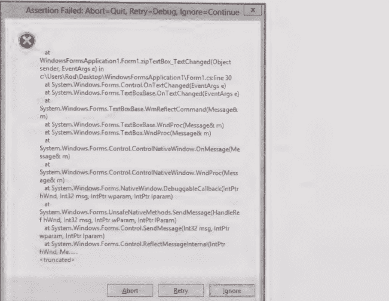

图 11-2：如果断言失败，`Debug.Assert` 方法会显示一个包含堆栈跟踪的对话框，显示出断言失败的位置。

如果你点击“中止”（Abort），程序将结束。如果你点击“重试”（Retry），Visual Studio 将在 `Assert` 语句处暂停程序的执行，这样你就可以尝试找出哪里出了问题。如果你点击“忽略”（Ignore），程序将在 `Assert` 语句后继续执行。

`Assert` 方法的重载版本允许在显示堆栈跟踪的同时，指定一个应在对话框中显示的消息。

图 11-2 所示的对话框是抛出异常与使用 `Assert` 语句之间的一个大区别。另一个大区别是 `Assert` 语句仅在调试生成（debug builds）中执行。在发布生成（release builds）中，`Assert` 语句会被完全忽略。当你测试程序时，断言将帮助你定位错误。当你编译发布生成并将其交给最终用户时，用户将看不到图 11-2 所示的令人畏惧的对话框。

> **注意**：要选择调试或发布，打开“生成”（Build）菜单并选择“配置管理器”（Configuration Manager）。在“活动解决方案配置”（Active Solution Configuration）下拉菜单中，选择 Debug 或 Release。

这意味着即使断言失败，程序也必须准备好继续运行。程序必须有一种处理无效数据的方法，否则它将在发布生成中失败。

如果断言失败意味着程序无法合理地继续运行，程序应该抛出异常并停止，而不是使用会在发布生成中被跳过的断言。

例如，假设一个零售商销售程序需要打印客户发票，而客户订购了 1000 副太阳墨镜。这是一个非常可疑的订单，程序可以使用断言对其进行标记。例如，它可能会断言订购物品的数量少于 100。

在调试生成中，断言会失败，因此你可以查看订单是否真的需要 1000 副太阳墨镜，或者数据是否已经损坏。在发布生成中，此断言会被跳过，因此程序会打印 1000 副太阳墨镜的发票。这是一个不常见的订单，但它确实可能发生——而且你将获得相当的利润。

相比之下，假设订单不包含客户地址。在这种情况下，程序不应该打印毫无意义的发票。打印代码可以捕获此错误、显示错误消息并尝试打印发票，或者它可以抛出异常并让问题在调用堆栈中向上传递。与不常见的订单大小的情况不同，程序无法成功打印发票，因此它很可能会放弃。

你可以在任何认为数据可能被损坏的地方使用断言。断言的一个特别好的位置是任何使用该数据的方法的开头。例如，下面的代码显示了发票打印方法如何验证其输入：

```csharp
private void printInvoice(string customerName, string customerAddress, List<OrderItem> items)
{
    // 验证输入。
    // 验证客户名称。
    if (string.IsNullOrWhiteSpace(customerName))
        throw new ArgumentNullException("缺少客户名称.");

    // 验证客户地址。
    if (string.IsNullOrWhiteSpace(customerAddress))
        throw new ArgumentException("缺少客户地址.");

    // 验证数量和单价。
    foreach (OrderItem item in items)
    {
        Debug.Assert(item.Quantity <= 100,
            "OrderItem " + item.Description + ", 数量大于100.");

        Debug.Assert(item.UnitPrice <= 100,
            "OrderItem " + item.Description + ", 单价大于$100.00.");
    }

    // 打印发票。
    ...
}
```

该方法从数据验证代码开始。首先，它验证客户的名称和地址是否为空。如果这两个值中的一个为空，方法将无法打印实用的发票，因此它抛出一个异常。

接下来，方法遍历订单中的项目，并验证它们的数量和单价。对于每个项目，代码断言物品的数量最多为 100，单价最高为 $100.00。如果由于调试生成中失败了其中任何一个断言，执行将停止，这样你可以尝试确定数据是否已损坏或是否是一个不常订单。在发布生成中，这些断言会被忽略，如果物品的数量或价格异常大，程序将打印发票。

另一个使用断言的好地方是任何操作数据的方法的末尾。在那时，代码可以验证方法所做的更改是否合理。

例如，假设有一个方法对客户记录列表进行排序，这些记录按欠款余额从大到小的顺序排列。在返回新排序的列表之前，该方法可以遍历该列表并验证客户是否处于正确的顺序。

> **注意**：程序员有时会反感在方法末尾编写验证代码，因为他们无法直观地看到代码会出错。这是很自然的，因为他们刚刚写了这些代码，如果里面有错误，他们会修复它的。

当然，如果程序员是正确的，且他们的模块都不包含错误，那么整个程序就不会包含错误，但这对于非平凡的程序来说是罕见的。

鼓励验证的一种方法是编写代码。断言在发布生成中会被忽略。

## 调试

Visual Studio 提供了良好的交互式调试工具。断点（`Breakpoints`）、监视（`watches`）和过滤（`filters`）很有帮助。这些是每个程序员应该掌握的技术，但它们不是 C# 语言的一部分。

## 预处理器指令

预处理器指令告诉 C# 编译器如何处理代码。它们定义了编译所需的符号。以下章节描述了 C# 预处理器。

### `#define` 和 `#undef`

`#define` 定义预处理器符号或条件编译符号。注意，你不能为符号赋值，你所能做的只是定义或取消定义。

你也可以使用 Visual Studio 为整个项目定义符号。要这样做，打开“项目”（Project）菜单并选择“属性”（Properties），在“条件编译符号”（Conditional Symbols）框中输入任何要定义的符号名称。

`#undef` 取消之前定义的预处理器符号。由于 `#define` 和 `#undef` 指令必须在任何非指令代码之前出现在模块中，因此你通常不会使用 `#undef` 取消你通过 `#define` 创建的符号。通常 `#undef` 更适用于取消你通过项目属性页创建的符号。

### `#if`、`#elif`、`#else` 和 `#endif`

`#if`、`#elif`、`#else` 和 `#endif` 指令类似于 C# 的 `if`、`else` 和 `else if` 语句，但它们测试预处理布尔表达式。由于你不能为预处理器符号赋值，这些语句仅仅测试符号是否存在。

`#if` 和 `#elif` 指令确定符号是否存在，如果是，则将其代码包含在编译中。如果符号不存在，则其后的代码将完全从编译中剔除。

如果一系列 `#if` 和 `#elif` 指令中没有任何符号存在，则 `#else` 指令（如果存在）之后代码将包含在编译中。

例如，假设一个模块开头有以下 `#define` 语句：

```csharp
// 调试级别。级别2提供的信息最多。
#define DEBUG1
//#define DEBUG2
```

这段代码定义了两个预处理器符号：`DEBUG1` 和 `DEBUG2`。第二个被注释掉了，所以只有 `DEBUG1` 被定义。

现在假设该模块随后包含了以下方法：

```csharp
private void VerifyInternetConnections()
{
    #if DEBUG2
        // 显示大量的调试信息。
    #elif DEBUG1
        // 显示一些调试信息。
    #else
        // 显示最少的调试信息。
    #endif

    // 验证连接。
}
```

`#if` 指令查找符号 `DEBUG2`。该符号的定义被注释掉了，因此紧随其后的代码被忽略。

接下来，`#elif` 指令查找符号 `DEBUG1`。该符号的定义没有被注释，因此该符号存在。紧随 `#elif` 指令后的代码被包含在编译中，程序将显示一些调试信息。

如果 `DEBUG2` 和 `DEBUG1` 都没有定义，则 `#else` 指令将包含其代码，程序将显示最少的调试信息。

你可以使用逻辑运算符 `!`、`&&` 和 `||` 在表达式中组合符号。例如，如果两个符号 `DEBUG1` 和 `DEBUG2` 都已定义，则指令 `#if DEBUG1 && DEBUG2` 会包含其代码。

你也可以使用关系运算符 `!=` 和 `==` 来比较两个符号的存在。如果 `DEBUG1` 和 `DEBUG2` 都已定义或都未定义，则指令 `#if DEBUG1 == DEBUG2` 会包含其代码。

特殊值 `true` 和 `false` 代表符号的存在。例如，以下语句都是等价的：

```csharp
#if DEBUG1
#if DEBUG1 == true
#if DEBUG1 != false
```

同样地，以下语句也是等价的：

```csharp
#if !DEBUG1
#if DEBUG1 != true
#if DEBUG1 == false
```

最后，你可以使用括号来分组符号，使复杂的表达式更容易理解。

> **注意**：Visual Studio 会立即将未包含在当前编译中的任何代码显示为灰色。例如，如果一段代码紧随 `#if DEBUG1` 指令之后且 `DEBUG1` 未定义，则该代码将显示为灰色。让我们轻松地看到哪些代码将被包含在编译中，哪些不会。

### `#warning` 和 `#error`

`#warning` 指令会生成一个显示在 Visual Studio“错误列表”（Error List）中的警告。Visual Studio 的代码编辑器默认还会用绿色波浪线下划线突出该警告。

其中一个用途是对比那些包含在 `#if` 指令中的过时代码进行标记。例如，考虑以下代码：

```csharp
#if OLD_METHOD
#warning 使用过时方法计算费用。
#else
#endif
```

如果符号 `OLD_METHOD` 已定义，代码会将警告添加到错误列表中并包含任何适当的代码。如果 `#else` 指令存在，则不包含警告。

`#error` 指令与 `#warning` 指令有些相似，区别在于它生成的是错误而不是警告。与警告一样，错误会出现在 Visual Studio 的“错误列表”中。与警告不同，错误会阻止 Visual Studio 成功生成程序。Visual Studio 的代码编辑器默认还会用红色波浪线下划线突出该错误。

### `#line`

`#line` 指令允许你更改程序的行号，并可选地更改在警告、错误和堆栈跟踪中报告的文件。例如，以下代码显示了具有修改后的行号和文件的堆栈跟踪：

```csharp
#line 10000 "Geometry Methods"
Console.WriteLine("**************" + Environment.StackTrace);
```


此堆栈跟踪将指示 `Console.WriteLine` 语句位于“Geometry Methods”文件的第 10000 行。

通过这种方式更改行号信息可能会引起困惑，你应该谨慎地使用这种方法。你可能想这样做的原因之一是即使在前面插入了其他代码行，也能保持一段代码的行号。

`#line default` 会将随后的行恢复到原始编号。在这种情况下，由 `#line` 指令重命名的行是正常创建的。

`#line hidden` 指令会向调试器隐藏随后的行，直到下一个 `#line` 指令。如果你逐步执行代码，调试器将跳过这些行。

## #region 和 #endregion

正如其名称所示，`#region` 和 `#endregion` 指令会在代码中创建一个区域，你可以在代码编辑器中展开或收叠该区域以隐藏代码。图 11-3 显示了代码编辑器显示了一个定义三个区域的代码。前两个分别命名为 Sales Routines（销售例程）和 Billing Routines（计费例程），是展开的。第三个命名为 Graphical Routines（图形例程），是收叠的，以隐藏其包含的代码。点击 + 或 - 符号可以展开或收叠区域。

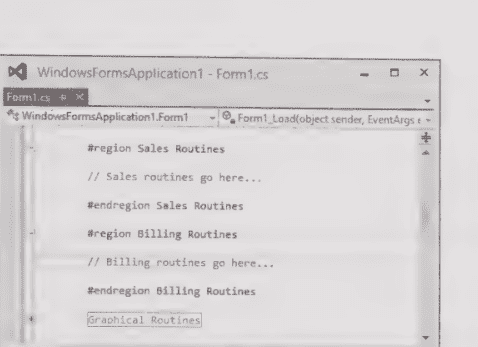

**图 11-3：** 你可以使用区域来隐藏代码块，使文件更易读。

每个 `#region` 必须以相应的 `#endregion` 结束。你可以将区域嵌套在 `#if` 指令中，但你不能创建一个重叠 `#if` 指令部分的区域。

然而，区域可以重叠方法的一部分。例如，一个区域可以起始于 `LocateCustomer` 方法之外，也可以在它的中间。如果你收叠了该区域，代码读起来会很混乱，所以你可能不应该创建一个重叠方法的区域。

你可以在 `#region` 和 `#endregion` 指令后跟随一个可选名称。如果你在 `#region` 指令后跟随一个名称，代码编辑器会在你收叠区域时显示该名称。在图 11-3 中，Graphical Routines 区域被收叠，代码编辑器显示了它的名称。

`#region` 和 `#endregion` 之后的名称只是代码编辑器忽略的字符串，因此可以包含任何字符。`#endregion` 指令后的文本不需要与 `#region` 指令后的文本匹配；

## #pragma warning

`#pragma` 指令向编译器提供特殊指令，允许你创建警告。编译器支持两种 `#pragma` 指令：`#pragma warning` 和 `#pragma checksum`。

`#pragma warning` 可以启用和禁用特定的警告。例如，考虑以下类：

```cpp
private class OrderItem
{
    public string Description;
    public int Quantity;
    public decimal UnitPrice;
}
```

此代码定义了三个公共字段：`Description`、`Quantity` 和 `UnitPrice`。它初始化了 `Quantity` 和 `UnitPrice` 但没有初始化 `Description`，因此当你尝试生成程序时，Visual Studio 会标记 `Description` 行并显示以下警告：字段 'WindowsFormsApplication.Form1.Description' 未赋值

以下代码显示了如何使用 `#pragma` 指令隐藏该警告：

```cpp
private class OrderItem
{
    #pragma warning disable 0649
    public string Description;
    #pragma warning restore 0649
    public int Quantity = 0;
    public decimal UnitPrice = 0;
}
```

第一个 `#pragma` 指令禁用了警告编号 0649，即未赋值警告。（有关如何找到警告编号的内容。）

第二个 `#pragma` 指令重新启用它。警告的显示是有原因的，因此在没有理由的情况下关闭它们不是好主意。重新启用它可以让 Visual Studio 标记初始化变量以便你修复它们。

在禁用警告之前，你需要确定它的编号。遗憾的是，“错误列表”显示警告消息，但不显示其编号。要找到编号，请生成程序并在“输出”窗口中查看。

图 11-4 显示了生成包含多个警告程序后的输出窗口。第一个警告“使用过时方法计算费用”是由 `#warning` 指令创建的，编号为 1030。

接下来三个警告是关于初始化但未使用的变量。它们的警告编号为 0219。

最后一个关于 `Description` 字段未赋值的警告，编号为 0649。

## #pragma checksum

`#pragma checksum` 指令用于为文件生成校验和。通常情况下，编译器会为文件生成校验和并将其放入程序数据库 (PDB) 文件中，调试器可以将其正在调试的文件与源文件进行比较。然而，对于 ASP.NET 应用程序，校验和代表的是生成的源文件而不是原始的 `.aspx` 文件，因此该方案不起作用。

`#pragma checksum` 指令允许你显式地为文件指定校验和。以下是语法：

```
#pragma checksum "filename" "guid" "bytes"
```

其中，`filename` 是文件名，`guid` 是文件的全局唯一标识符 (GUID)，而 `bytes` 是一个给出偶数位十六进制数字的字符串，用于指定校验和。

这是一个特殊的指令，因此此处未作详述。欲需更多信息，请参阅在线 C# 参考页面 http://msdn.microsoft.com/library/ms173226.aspx。

# 预定义编译器常量

本章前面的部分解释了如何使用 `#define` 和 `#undef` 指令来定义和取消定义编译符号。默认情况下，Visual Studio 还定义了两个符号：`DEBUG` 和 `TRACE`。你可以使用这些符号以及 `#if`、`#elif`、`#else` 和 `#endif` 指令在构建中包含或排除代码，就像你使用自己定义的符号一样。

通常情况下，`DEBUG` 在调试构建中定义，而 `TRACE` 在调试和发布构建中都定义，但你可以更改这种行为。

要确定 Visual Studio 将创建哪种构建，请打开“生成 (Build)”菜单并选择“配置管理器 (Configuration Manager)”显示配置管理器，如图 11-5 所示。使用左上角的“活动解决方案配置 (Active Solution Configuration)”下拉列表选择调试或发布构建。下拉列表还包含一个“新建 (New)”选项，允许你定义新的构建类型。

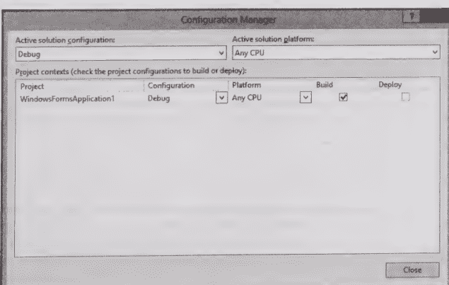

图 11-5：使用配置管理器选择调试或发布构建。

接下来，打开“项目 (Project)”菜单并选择“属性 (Properties)”显示项目的属性页。在“生成 (Build)”选项卡上，如图 11-6 所示，勾选或取消勾选“调试常量 (Debug Constant)”和“定义 TRACE 常量 (Define TRACE Constant)”框来确定这些常量是否被定义。你还可以在“条件编译符号 (Conditional Compilation Symbols)”框中添加自己的新常量。（你也可以使用“生成”页的“配置”下拉列表来选择要修改的配置；尽管这可能会让人困惑，因为它不会更改当前活动的配置。）

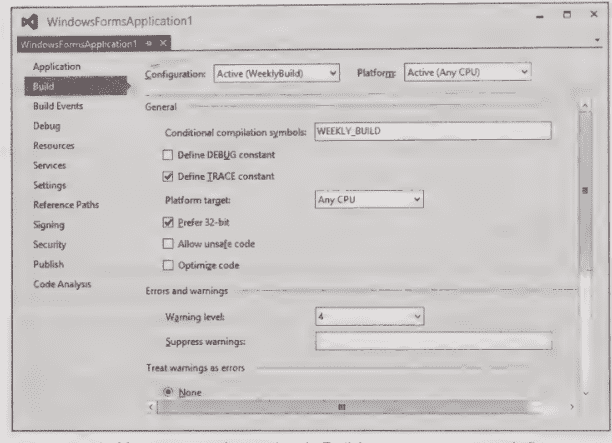

图 11-6：你可以使用项目的“生成”属性页来定义条件编译常量。

`DEBUG` 和 `TRACE` 符号，以及你在“调试”属性页中定义的符号都会与当前配置一起保存。稍后如果你使用配置管理器选择不同的配置，其设置将生效。

例如，假设你想为每周构建创建一个特殊配置，该配置定义了 `TRACE` 和 `WEEKLY_BUILD` 符号，但不定义 `DEBUG` 符号。要做到，你需要使用配置管理器定义并选择名为 WeeklyBuild 的新配置。然后在项目属性页上，取消勾选 `DEBUG` 框，并在“条件编译符号”文本框中添加 `WEEKLY_BUILD`。现在，每当你选择 WeeklyBuild 配置时，Visual Studio 都会定义 `TRACE` 和 `WEEKLY_BUILD` 符号。

# 调试与跟踪

本章前面解释了程序可以使用 `Debug.Assert` 方法来测试代码中的断言，并且相关的 `Trace` 类的功能不仅限于验证断言。它们提供了向监听器对象发送消息的服务。默认情况下，唯一的监听器是 `DefaultTraceListener` 类的实例，它向“输出”窗口发送消息。

接下来的章节将介绍更多关于 `Debug` 和 `Trace` 类的内容。之后的章节将更详细地讨论监听器。

# 调试与跟踪对象

本章前面提到，`Debug` 类的方法在发布构建中会被忽略。实际上，控制这种行为的并不是构建而是预定义的 `DEBUG` 符号。默认情况下，该符号在调试构建中定义而在发布构建中不定义；尽管如前所述，你可以使用“生成”属性来更改这种行为。正如前面提到的，你可以创建可能定义或不定义 `DEBUG` 符号的配置。

你还可以使用 `#define` 和 `#undef` 指令来定义或取消定义 `DEBUG` 符号。例如，你可以在特定模块中定义该符号，使程序即使在该模块的发布构建中也能执行 `Debug.Assert` 方法。

`Trace` 类也定义在 `System.Diagnostics` 命名空间中，与 `Debug` 类类似，不同之处它的行为由 `TRACE` 符号控制。默认情况下，调试和发布构建都会定义 `TRACE` 符号。

`Debug` 和 `Trace` 类提供了许多相同的方法。表 11-9 汇总了这些类中最有用的方法。

表 11-9：有用的调试和跟踪方法

| 方法 | 用途 |
|---|---|
| Assert | 检查布尔条件，如果条件为假则抛出异常。 |
| Fail | 向对象的监听器发出失败消息。通常情况下，其效果类似于 Assert 抛出此类异常的方式。 |
| Flush | 向监听器刷新输出。 |
| Indent | 将缩进级别增加 1。这可能会使 Write 和 WriteLine 方法显示的输出更易读。例如，你可以让递归方法对输出进行缩进，这样你就能看出是哪个方法调用在显示不同的消息。 |
| Unindent | 将缩进级别减少 1。如果一个方法对其输出进行了缩进，它应该在结束时取消缩进。 |
| Write | 向监听器写入消息。 |
| WriteIf | 如果指定的表达式为真，则向监听器写入消息。 |
| WriteLine | 向监听器写入消息并换行。 |
| WriteLineIf | 如果指定的表达式为真，则向监听器写入消息并换行。 |

# 监听器

`Debug` 和 `Trace` 类都拥有一个监听器集合，其中持有监听器对象的引用。初始状态，这些集合持有 `DefaultTraceListener` 对象的引用，但你可以根据需要进行更改。要移除 `DefaultTraceListener`，请调用监听器集合的方法传入 `DefaultTraceListener` 对象。

要将输出重定向到其他位置，向监听器集合添加适当的跟踪监听器。以下列表了你可能使用的某些其他跟踪监听器：

- `ConsoleTraceListener`：向控制台输出。
- `EventLogTraceListener`：向事件日志输出。
- `StreamWriterTraceListener`：向流（例如 `FileStream`）输出。这允许你输出到任何文件。

例如，下面的代码显示了程序如何创建 `StreamWriterTraceListener` 将跟踪输出记录到 TraceFile.txt。

```csharp
using System;
using System.Diagnostics;

private void Form_Load(object sender, EventArgs e)
{
    // 创建跟踪输出文件。
    Stream traceStream = File.Create("TraceFile.txt");
    // 为跟踪输出文件创建 StreamWriterTraceListener。
    WriterTraceListener traceListener = new StreamWriterTraceListener(traceStream);
    Trace.Listeners.Add(traceListener);
    // 向跟踪文件写入状态注释。
    Trace.WriteLine("Trace started " + DateTime.Now.ToString());
}
```

当表加载时，此代码创建一个与 TraceFile.txt 关联的流。然后使用该流创建一个 `StreamWriterTraceListener`，它会将内容写入文件。Load 事件通过向文件中写入指示跟踪已启动的消息来处理处理。

在程序运行时，它可以向文件中写入其他消息。下面的代码显示了程序在处理订单时可能添加的跟踪信息：

```csharp
private void processOrderButton_Click(object sender, EventArgs e)
{
    // 记录订单处理消息。
    Trace.WriteLine("Processing order");
    // 记录订单数据。
    Trace.Indent();
    Trace.WriteLine("CustomerId: " + CustomerId);
    Trace.WriteLine("OrderId: " + OrderId);
    Trace.WriteLine("OrderItems: ");
}
```

```csharp
Trace.Indent();
foreach (OrderItem item in OrderItems) {
    Trace.WriteLine(item.ToString());
    Trace.Unindent();
    Trace.WriteLine("ShippingAddress: " + ShippingAddress);
    Trace.Unindent();
}
// Process the order.
```

代码首先添加一条消息，表示正在处理订单。然后，它缩进了跟踪输出并显示订单信息。它显示了客户 ID 和订单 ID。它再次缩进跟踪并显示订单中的项目。在显示项目后，代码取消缩进以回到主订单的缩进级别，并显示订单的收货地址。最后，在显示所有订单信息后，代码再次取消缩进以返回原始的缩进级别。然后，它执行处理订单所需的任何必要操作。

当程序停止时，可以使用以下代码将任何缓冲区文本刷新（flush）到跟踪文件中：

```csharp
private void Form1_FormClosing(object sender, FormClosingEventArgs e) {
    // 刷新跟踪输出。
    Trace.WriteLine("Trace stopped " + DateTime.Now.ToString());
    Trace.Flush();
}
```

此代码将当前日期和时间写入文件并刷新输出。如果程序在结束之前没有刷新输出，任何缓冲区输出将丢失。

以下文本显示了描述单个订单的示例输出：

```
Trace started 4/1/2014 10:43:19 AM
Processing order
CustomerId: 1310
OrderId: 112980
OrderItems:
    - 6 x White copy paper, ream
    - 1 x Pencils, dozen box
    - 6 x White copy paper, ream
ShippingAddress: 123 Main St, East Zephyr NY 01293
Trace stopped 4/1/2014 10:47:19 AM
```

通过使用 `StreamWriterListener`，你可以让程序保留其活动的完整日志。

你可以对此技术进行一些实用的修改。首先，你可以以追加模式打开文件，而不是像上一个示例那样创建它。这让跟踪文件保留过去程序运行的记录，而不是每次都覆盖文件。

你还可以在打开文件时允许共享。这允许 Microsoft Word 等其他程序以只读模式打开该文件，这样你可以在程序运行时查看该文件。如果你这样做，你应该在每次向文件中写入可能想要查看的内容时，调用 `Trace` 或 `Debug` 对象的 `Flush` 方法。在上述示例中，你可能想在打开文件后以及向写入订单信息后刷新输出。

> 注意：如果你将 `Trace` 或 `Debug` 对象的 `AutoFlush` 属性设置为 `true`，则对象会在每次写入后自动刷新其输出。

以下代码显示了如何打开跟踪文件，并在文件末尾追加新文本，同时允许其他程序读取文件。

```csharp
Stream traceStream = File.Open("TraceFile.txt", FileMode.Append, FileAccess.Write, FileShare.Read);
```


有关如何构建自定义监听器类的信息，请参阅 http://msdn.microsoft.com/library/system.diagnostics.tracelistener.aspx 中的 `TraceListener 类`。

# 编程数据库文件

当你构建调试发布（`debug release`）时，Visual Studio 会创建一个程序数据库文件，其中包含关于程序的调试信息。调试器使用这些信息来让你调试应用程序。

你可以使用项目的属性页来控制 Visual Studio 包含在 PDB 文件中的信息量。要这样做，请选择 `Project Properties` 命令打开项目属性页。在 `Build` 选项卡上，点击 `Advanced`。在 `Advanced Build Settings` 对话框中，使用 `Debug Info` 下拉菜单选择 `full`、`pdb-only` 或 `none`。

`full` 设置（调试构建的默认值）会创建一个完全可调试的程序。

`pdb-only` 设置（发布构建的默认值）创建一个 PDB 文件，以便异常消息可以包含错误发生位置的信息。然而，Visual Studio 不会包含使代码可调试的 `Debuggable` 特性。

`none` 设置会使 Visual Studio 不创建 PDB 文件。

如果你创建了编译的可执行文件，只要你有 PDB 文件，仍然可以对其进行调试。请注意，PDB 文件与特定的构建绑定，它将仅允许调试该特定的构建。由于构建创建的方式，即使你没有更改代码，PDB 文件也无法调试来自不同构建的可执行文件。

要调试编译的可执行文件，请将 PDB 文件放置在与可执行文件相同的目录下。接下来，使用 Visual Studio 打开可执行文件并运行。如果 `Debug` 或 `Trace` 对象的 `Assert` 或 `Fail` 方法导致异常，你可以点击生成的对话框上的 `Retry` 按钮来调试程序。

这个故事的启示是，如果你想在构建后对可执行程序进行调试，请保存它的 PDB 文件，并确保你能确定哪一个 PDB 文件对应哪个版本的可执行程序。

# 程序插桩

对程序进行插桩意味着向其添加功能以研究程序本身。这通常意味着添加代码来监控性能、记录错误并跟踪程序执行情况。通过良好的插桩，你可以了解应用程序正在做什么，并在无需在调试器中单步执行的情况下识别性能瓶颈。

以下章节讨论了插桩程序的方法。

## 跟踪

跟踪是对程序进行插桩的过程，以便跟踪它的运行。之前的章节解释了如何使用 `Trace` 类。如果 `Debug` 或 `Trace` 对象的 `Assert` 或 `Fail` 方法导致异常，你可以点击生成的对话框上的 `Retry` 按钮来调试程序。

## 日志与事件日志

日志是对程序进行插桩的过程，以便记录错误。之前的章节解释了如何使用 `Trace` 类。如果 `Debug` 或 `Trace` 对象的 `Assert` 或 `Fail` 方法导致异常，你可以点击生成的对话框上的 `Retry` 按钮来调试程序。

图 11-8 显示了事件查看器显示的由此程序创建的日志条目。此处选择了第三个条目，因此查看器底部的通用选项卡显示该条目的消息文本，“Created New Order 120193.”

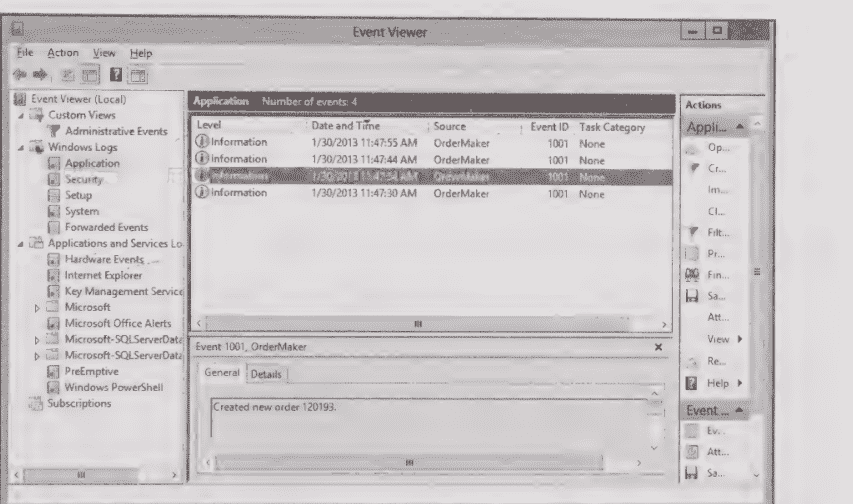

图 11-8：系统事件查看器显示日志条目。

系统事件日志提供了一个查看消息的集中位置，如果你想在一个地方监控多个应用程序，这些日志将特别方便。

## 性能分析

性能分析是收集有关程序的信息以研究其速度、内存、磁盘使用或其他性能特征的过程。分析程序的性能有两种基本方法：使用性能分析工具和手动对代码进行插桩。

### 使用性能分析工具

自动性能分析工具可以通过多种方法对应用程序进行性能分析。某些性能分析工具通过在程序的某些或所有方法中添加计时语句对源代码进行插桩。另一些则对编译后的代码进行插桩。还有一些则使用 CPU 采样，定期查看程序的执行状态，并建立一个程序在每个方法上花费时间的统计模型。

Visual Studio 的高级版和终版包含了性能分析工具，可以使用它们来测量应用程序的性能。

性能分析工具的某些功能需要提升权限，因此当你准备好使用时，请以管理员身份运行 Visual Studio。（一种方法是右键点击 Visual Studio 应用程序并选择 `以管理员身份运行`。）

首先，打开项目，打开 `分析` 菜单，并选择 `启动性能向导`，显示图 11-9 所示向导。CPU 采样方法定期检查程序状态以查看它正在做什么。这可以让你了解哪些例程消耗最多的 CPU 时间，而不会严重拖慢程序。插桩代码可能提供更准确的信息，但会在编译后的代码中添加插桩，因此会减慢程序。`.NET 内存分配` 选项使用采样来收集内存使用信息。`资源争用数据` 用于解决多线程应用程序中的并发问题。现在，只需选择 `CPU 采样` 并点击 `下一步`。

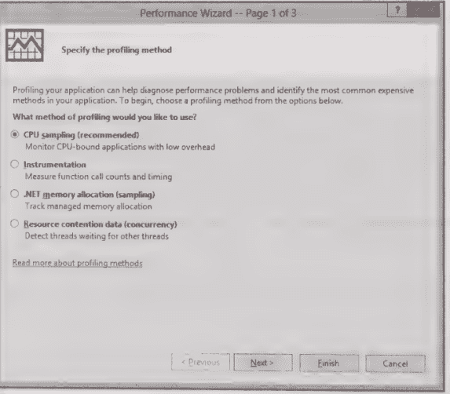

**图 11-9：**性能向导让你研究应用程序的内存或 CPU 使用情况。

向导的下一页让你选择要分析性能的应用程序。保持当前加载的项目被选中状态并点击 `下一步`。

向导的最后一页显示已准备好收集性能信息。勾选 `在向导完成后启动性能分析` 框并点击 `完成`。

向导关闭后，程序将启动并运行性能分析工具。（性能分析工具的启动可能需要几秒钟，请耐心等待。）当程序出现时，执行你想要分析的功能。由于采样方法是定期获取数据，它可能会错过一些快速的方法调用。为了获得最佳数据，请多次执行你正在研究的功能。

当你完成后，正常关闭程序，性能分析工具将分析数据并呈现与图 11-10 所示的结果。图 11-10 显示的面板显示了热点路径（最频繁使用的调用路径）以及采样次数最多的的方法。

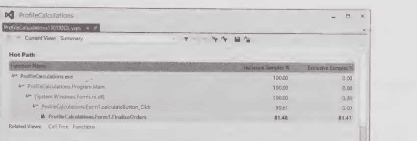

图 11-10：性能分析工具的输出让你看到最活跃的调用路径、采样最频繁的方法和其他统计数据。

报告的其他视图让你查看模块、方法、所有调用路径、代码行和其他类别的信息。我们可以在 http://msdn.microsoft.com/library/ms182372.aspx 查看 `初学者性能分析指南`，以获得关于使用性能分析工具的全面介绍。

### 手动性能分析

你可以通过在源代码中插入记录程序状态以及当前或已通过时间的语句来分析程序。例如，以下代码显示了方法如何使用 .NET Framework 提供的 `Stopwatch` 类对自身计时：

```cs
private void PerformCalculations()
{
    Stopwatch stopwatch = new Stopwatch();
    stopwatch.Start();
    // Perform the calculations here.
    Console.WriteLine("Time: " + 
        stopwatch.Elapsed.TotalSeconds.ToString("0.00") + 
        " seconds");
}
```

当方法开始时，它会创建一个 `Stopwatch` 对象并调用其 `Start` 方法开始计时。该方法检查是否需要，然后检查 `Stopwatch` 的 `Elapsed` 属性以查看通过了多少时间。代码将通过的时间转换为秒并显示结果。

如果你需要研究一个或两个关键方法，这种技术是有效的，但它也有缺点。如果你不知道程序的大部分时间都花在了哪里，就很难知道将性能分析代码放在哪里。你可以使用预处理器符号在不需要时启用或隐藏这些代码，但这可能仍然需要大量代码。

手动性能分析的另一种方法是使用性能计数器。

### 使用性能计数器

性能计数器跟踪系统操作以让你了解计算机的活动。

例如，假设一个图像处理程序每分钟扫描一次目录。它获取该目录中的任何图像进行处理，然后将其移动到另一个目录。要使用性能计数器，请为计数器创建一个 `System.Diagnostics.PerformanceCounter` 对象。以下代码显示程序如何为图 11-11 中的两个计数器创建 `PerformanceCounter` 对象：

```cs
private PerformanceCounter totalImages, imagesPerSecond;

private void Form1_Load(object sender, EventArgs e)
{
}
```

```cs
totalImages = new PerformanceCounter();
totalImages.CategoryName = "ImageProcessor";
totalImages.CounterName = "Images processed";
totalImages.MachineName = ".";
totalImages.ReadOnly = false;

imagesPerSecond = new PerformanceCounter();
imagesPerSecond.CategoryName = "ImageProcessor";
imagesPerSecond.CounterName = "Images per second";
imagesPerSecond.MachineName = ".";
imagesPerSecond.ReadOnly = false;
```

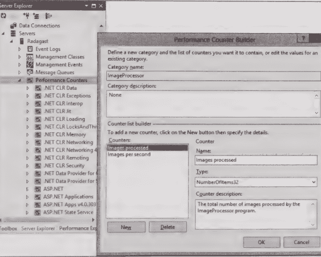

图 11-11：你可以使用 Visual Studio 的服务器资源管理器创建新的性能计数器。

此代码创建一个 `PerformanceCounter` 对象。它将对象的 `CategoryName` 和 `CounterName` 设置为创建图 11-11 中计数器时使用的值。代码将 `MachineName` 设置为 `.`，表示本地计算机。然后它将 `ReadOnly` 设置为 `false`，允许程序修改计数器的值。

代码随后重复这些步骤创建第二个 `PerformanceCounter` 对象。

创建了 `PerformanceCounter` 对象后，程序可以在执行你想要计数的动作时增加它们的值。

假设 `ImageProcessor` 程序定期检查目录以查看其中是否包含图像文件。当它发现文件时，程序调用以下 `ProcessImageFile` 方法：

```csharp
private void ProcessImageFile(string filename)
{
    // 处理文件。
    ...
    // 增加性能计数器。
    totalImages.Increment();
    imagesPerSecond.Increment();
}
```


该方法会对文件执行任何必要的操作。然后它调用性能计数器对象的 `Increment` 方法来增加计数器。

创建和使用性能计数器，你只需要使用系统的性能监视器工具来查看结果。

要在 Windows 8 中启动性能监视器，打开控制面板，并使用导航栏进入“控制面板>控制面板项目>性能信息和工具”。点击“高级工具”链接，然后点击“性能监视器”。

在性能监视器左侧的树上，展开“监控工具”并选择“性能监视器”。在右侧出现的图中，点击 + 号将性能计数器添加到图表中。选择你想要查看的性能计数器并点击“添加”。选择好计数器后，点击“确定”。

图 11-12 显示了性能监视器显示的此示例使用的两个计数器。围绕图右边缘到左边缘稳定上升的曲线代表“Images Processed”（已处理图像）计数器。上下波动的曲线代表“Images Per Second”（每秒图像数）。

图表使用范围从 0 到 100 的 Y 轴，因此你通常需要对计数器值进行缩放。在图 11-12 中，程序运行了一段时间，因此 `Images Processed` 按 0.1 的因子缩放，使其值能够适应图形。`Images per Second` 按 10 的因子缩放，因此程序实际上每秒处理处理 0 到大约 6 个图像。

要缩放计数器，右键点击图表并选择“属性”。在属性对话框中，选择“数据”选项卡，点击你想缩放的计数器，并将“缩放”（Scale）值设置为你所需的缩放因子。完成后，点击“确定”。

性能计数器相当复杂，`NumberItems32` 和 `RateCountsPerSecond` 只是许多计数器类型中的两种。有关性能计数器的更多信息，请参见本章后面列出的“附加阅读和资源”。

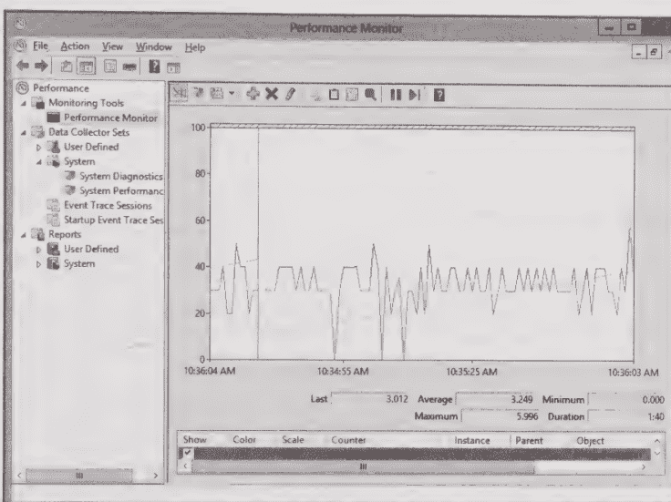

## 总结

本章描述了你可以保护程序免受错误数据以及研究程序行为的方法。

输入验证技术允许你在处理之前验证用户输入。实用的技术包括使用由 `string` 类提供的方法和正则表达式。当然，如果你使用如 `ComboBox` 和 `DateTimePicker` 等控件，你就可以完全避免验证，因为用户无法选择无效值。

即使在程序读取了用户输入后，必须在数据流经程序时管理其完整性。`Debug.Assert` 语句允许程序检测程序内部意外或错误的值。

预处理器符号和指令允许你确定哪些代码包含在程序编译中。使用这些符号，你可以仅为调试生成（debug builds）编译大量的数据验证代码，就像 `Debug.Assert` 语句在调试生成之外会被忽略一样。

本章最后讨论了对应用程序插桩和研究程序性能的不同方法。这些包括 `Debug` 和 `Trace` 类、性能分析器（profilers）、手工插桩以及性能计数器。

通过使用所有这些技术，你可以保护程序免受无效的用户输入，并监控处理过程中数据的意外变化。你还可以监控程序的性能，查看它在做什么以及运行效率如何。

# 章节测试题

仔细阅读每个问题，并选择代表问题最佳解决方案的答案答案。你可以在附录 A，“章节测试题答案”中找到答案。

- 1. 如果用户在 TextBox 中输入数据并输入了无效字符，程序采取以下哪些操作是不恰当的？
  a. 更改 TextBox 的背景颜色以指示错误。
  b. 静默丢弃该字符。
  c. 在 TextBox 旁边显示一个星号以指示错误。
  d. 显示消息框告诉用户存在错误。

- 2. 如果用户在 TextBox 中输入了无效值并将焦点移动到另一个 TextBox，程序采取以下哪些操作是不恰当的？
  a. 强制将焦点移回包含错误的 TextBox 中。
  b. 更改第一个 TextBox 的背景颜色以指示错误。
  c. 更改第一个 TextBox 的字体以指示错误。
  d. 在第一个 TextBox 旁边显示一个星号以指示错误。

- 3. 如果用户在表单上输入了一些无效数据并点击表单的接受 按钮，程序采取以下哪些操作是恰当的？
  a. 更改包含无效值的 TextBoxes 的背景颜色以指示错误。
  b. 显示消息框告诉用户存在错误。
  c. 在用户修正所有错误之前不关闭表单。
  d. 以上所有。

- 4. 下面哪个方法在正则表达式匹配字符串时返回 true？
  a. `Regex.Matches`
  b. `Regex.IsMatch`
  c. `Regexp.Matches`
  d. `String.Matches`

- 5. 下面哪个正则表达式匹配社会安全号码格式 ###--########，其中 # 是任意数字？
  a. `^####-##-####$`
  b. `^\d3-\d2-\d4$`
  c. `^\d(3)-\d(2)-\d(4)$`

# 延伸阅读与资源

这里有一些额外的有用资源，帮助你理解本章介绍的主题：

- .NET Framework 正则表达式
http://msdn.microsoft.com/library/hs600312.aspx
- 正则表达式语言 - 快速参考
http://msdn.microsoft.com/library/az24scfc.aspx
- 正则表达式中的字符类
http://msdn.microsoft.com/library/bw87z.aspx
- 正则表达式选项
http://msdn.microsoft.com/library/ydlhcs.aspx
- C# 预处理器指令
http://msdn.microsoft.com/library/ed1ha.aspx
- John Robbins，PDB 文件：开发者必须了解的事实
http://www.intellect.com/blogs/robbins/archive/2009/05/pdb-files-what-developer-know.aspx
- `TraceListener` 类
http://msdn.microsoft.com/library/tracelist.aspx
- 在 Visual Basic 和 C# 中跟踪和分析应用程序
http://msdn.microsoft.com/library/aa9841.aspx
- 性能分析入门指南
http://msdn.microsoft.com/library/ms18237.aspx
- 使用 Visual Studio Profiler 查找瓶颈
http://msdn.microsoft.com/magazine/cc3787.aspx
- 性能计数器简介
http://www.codeproject.com/Articles/8590/Introduction-To-Performance-Counters
- 如何创建自定义计数器
http://msdn.microsoft.com/library/e3s6wf.aspx
- `PerformanceCounter` 类
http://msdn.microsoft.com/library/performancecounter.aspx

# 速查表

此速查表旨在让你快速学习本章的关键点。

## 输入验证

- 使用 TrackBar、ComboBox、ListBox、DateTimePicker、FolderBrowserDialog 等控件进行验证。
- 频繁验证（例如在按键期间）提供非侵入性的反馈（例如更改字段背景颜色）。
- 不要在此用户正确输入值之前接受表单。
- 记住某些值（例如 "-"）可能是无效的，但可能是有效值的一部分（例如 "0"）。
- 如果存在异常值，请警告用户。

## 使用内置函数验证数据

- 使用字符串长度来检查缺失值。
- 初始化 ComboBox 或 ListBox 以确保始终有一个有效选择。
- 使用 `TryParse` 验证数据类型为 int 或 decimal。
- 有助于验证的字符串方法包括 `Contains`、`EndsWith`、`IndexOf`、`IndexOfAny`、`IsNullEmpty`、`IsNullWhitespace`、`LastIndexOf`、`LastIndexOfAny`、`Remove`、`Split`、`StartsWith`、`Substring`、`ToLower`、`ToUpper`、`Trim`、`TrimEnd`。

## 使用正则表达式验证数据

- 表格 11-13 总结了一些常用的 Match、Replace 和 Split 方法。
- 使用字面量（以 @ 字符开头）方便包含转义字符正则表达式。
- 例如，以下代码检查变量 phone 是否匹配 7 位电话号码：

```csharp
if (Regex.IsMatch(phone, @"^\d(3)-\d(4)$")) ...
```


- 表格 11-10 总结了一些最常用的正则表达式组件。

| 项目 | 用途 |
|---|---|
| `\|` | 开始特殊符号，如 `\n` 或转义后续字符 |
| `^` | 匹配字符串或行的开头 |
| `$` | 匹配字符串或行的结尾 |

| 项目 | 用途 |
| --- | --- |
| `\A` | 匹配字符串的开头（即使在多行模式下） |
| `\z` | 匹配字符串的结尾（即使在多行模式下） |
| `*` | 匹配前面的 0 次或多次 |
| `+` | 匹配前面的 1 次或多次 |
| `?` | 匹配前面的 0 次或 1 次 |
| `.` | 匹配任意字符 |
| `[abc]` | 匹配括号内的任意字符 |
| `[^abc]` | 匹配不在括号内的字符 |
| `[a-z]` | 匹配范围内的任意字符 |
| `[^a-z]` | 匹配不在范围内的字符 |
| `x\|y` | 匹配 x 或 y |
| `(pattern)` | 创建编号匹配组 |
| `(?<name>expr)` | 创建命名组 |
| `\2` | 引用之前定义的组 2 |
| `\k<name>` | 引用之前定义的命名组 name |
| `{n}` | 恰好匹配 n 次 |
| `{n,}` | 匹配 n 次或多次 |
| `{n,m}` | 匹配 n 到 m 次之间 |
| `\b` | 匹配单词边界 |
| `\B` | 匹配非单词边界 |
| `\d` | 匹配数字 |
| `\D` | 匹配非数字 |
| `\f` | 匹配分页符 |
| `\n` | 匹配换行符 |
| `\r` | 匹配回车符 |
| `\s` | 匹配空白字符 |
| `\S` | 匹配非空白字符 |

| 项目 | 用途 |
| --- | --- |
| `\t` | 匹配制表符 |
| `\v` | 匹配垂直制表符 |
| `\w` | 匹配单词字符 |
| `\W` | 匹配非单词字符 |

| 项目 | 用途 |
| --- | --- |
| `\d` | 匹配数字 |
| `\D` | 匹配非数字 |

- 使用 `Debug` 和 `Trace` 检查符号是否定义。
- `DEBUG` 和 `TRACE` 通常在调试和发布版本中定义。
- 有用的 `Debug` 和 `Trace` 方法包括 `Flush()`、`Indent()`、`Unindent()`、`Write()`、`WriteIf()`、`WriteLine()`。
- 你可以为 `Debug` 和 `Trace` 添加监听器。标准监听器写入输出窗口、事件日志和文本文件。

# 程序数据库文件

- 你需要 `PDB` 文件来调试编译后的执行文件。

# 分析应用程序

- 跟踪意味着对程序进行跟踪以记录进度。你可以使用 `Debug` 和 `Trace`。
- 日志意味着记录关键事件。日志的方法包括写入文本文件、使用监听器的 `Debug` 和 `Trace`。
- 性能分析意味着收集程序的性能数据以研究其速度、内存、磁盘使用或其他性能特征。性能分析的方法包括使用性能分析工具、手动插桩代码以及使用性能计数器。

## 术语表

**正则表达式（regular expression）** 正则表达式语言中用于定义匹配模式的表达式。正则表达式允许程序在字符串中匹配模式并进行替换。

**完整性检查（sanity check）** 对数据进行测试，以查看数据是否合理。例如，如果用户输入一包纸的价格为 $1e10.00，这可能是一个拼写错误，用户可能想输入的是 $100.00。有时用户可能确实想要一个不寻常的值，因此程序必须决定拒绝该值还是询问用户该值是否正确。

**追踪（tracing）** 对程序进行插桩的过程，以便你可以跟踪其执行的操作。

## 考试提示与技巧

本章的重点术语回顾和备考表可以打印出来帮助你学习。你可以在 `www.wrox.com/remtitle.cgi?isbn=1118612094` 的“Download Code”（下载代码）标签页，在本章的 ZIP 压缩文件中找到这些文件。

# 第 12 章 使用加密和管理程序集

## 本章学习目标

- 理解加密
- 使用对称加密
- 使用非对称加密
- 对数据进行签名和哈希
- 创建强名称程序集
- 将程序集部署到全局程序集缓存 (GAC)

## 代码下载

你可以在 `www.wrox.com/remtitle-cgi?isbn=1118612094` 的“Download”（下载）标签页找到本章的代码。代码位于 `chapter12` 下载中，并根据全章中的名称单独命名。

## 概述

当你处理敏感数据时，必须保护其免受未经授权的访问或修改，为此你需要使用加密、数字签名和数据哈希等技术。.NET 经常使用的数字签名和数据哈希的应用之一就是强名称程序集。

本章首先介绍了你可以用来确保数据隐私性、完整性和真实性的不同技术。你将查看对称和非对称算法。在本章的第二部分，你将详细查看如何使用数字签名确保程序集的完整性。

### 表 12-1：本章涵盖的 70-483 考试目标

| 目标 | 涵盖内容 |
| --- | --- |
| 执行对称和非对称加密 | 选择合适的加密算法。这包括讨论对称和非对称算法。<br>管理并创建证书。这包括与不同类型的证书和证书存储工作。<br>实现密钥管理。这包括讨论 .NET 中用于存储加密密钥的选项。<br>实现 `System.Security` 命名空间。这包括讨论 `System.Security` 命名空间中可用的类和接口。<br>哈希数据。这包括讨论哈希数据和创建数字签名的可用选项。<br>加密流。这包括使用 `CryptoStream` 类加密流 |
| 管理程序集 | 版本化程序集。这包括为程序集选择版本方案。<br>使用强名称签名程序集。这包括从 Visual Studio 签名程序集，以及使用 `sn.exe`。<br>实现并存托管（side-by-side hosting）。这包括讨论你可以使用的技术，以便在同一机器上同时运行不同版本的同一程序集。<br>将程序集放入全局程序集缓存。这包括使用不同的工具将程序集部署到全局程序集缓存。 |

## 使用加密

加密是转换明文数据的过程，使得未经授权的人难以理解它。加密后的数据被称为密文（ciphertext）。解密是相反的过程，意味着你必须对密文应用转换以获取原始信息。密文越难解密，算法就越好。你可能对“更难”解密这种说法有反应，而不是说“不可能”。这是因为任何加密数据最终都可以被解密，但某些算法非常复杂，可能需要花费很长时间（例如几百年）才能解密数据，从而使信息变得毫无用处。密码学是加密和解密技术的实践与研究。

罗马人使用简单的算法，如置位。他们将每个字母替换为另一个字母，例如字母表中的另一个，或者当前字母后三个位置的字母。但这只是简单的算法。要解密消息，你只需要弄清楚使用的算法（在本例中为置位）和算法参数（使用了多少个位置）。随着时间的推移，算法不断演变，解密数据变得越来越困难。在计算机出现之前，著名的尝试是德国的恩格玛机（Enigma），它使用电磁转子密码来加密解密消息。

## 选择合适的加密算法

你已经看到加密和解密保护数据免受未经授权的访问。加密可以通过两种方式进行。一种是对称加密（或称共享密钥），另一种是非对称加密（或称公钥）（这两种加密类型将在接下来的章节中详细介绍）。

微软在 .NET 中实现了一些现有的算法，通过三种方式实现：

- **托管类（.NET）**：算法名称带有 `Managed` 后缀的，例如 `RijndaelManaged` 是实现 Rijndael 算法的托管类。托管实现比其他实现稍慢，且没有通过联邦信息处理标准 (FIPS) 认证。
- **原生加密 API (CAPI) 实现的封装类**：算法名称带有 `CryptoServiceProvider` 后缀的，例如 `DESCryptoServiceProvider` 是实现数据加密标准 (DES) 算法的封装类。CAPI 实现适用于旧系统，但已不再开发。
- **原生加密下一代 (CNG) 实现的封装类**：算法名称带有 `Cng` 后缀的，例如 `ECDiffieHellmanCng` 是实现椭圆曲线迪菲-赫尔曼 (ECDH) 算法的封装类。CNG 算法需要 Windows Vista 或更高操作系统。

所有的加密类都定义在 `System.Security.Cryptography` 命名空间中，并且是 .NET 核心库的一部分。

## 对称加密

如前所述，对称加密也称为共享密钥加密，这是因为数据的加密是使用加密密钥、字节数组完成的，并且同一个密钥被用于解密数据。对称算法依赖于只有一个授权人员可以访问加密密钥这一事实。

.NET 提供的对称算法使用链式模式块密码。这类算法的工作方式如下。如果数据大于预定义的尺寸，称为块大小（block size），数据被分成预定义大小的块。第一个块使用相同大小的随机数据块（称为初始化向量 IV）以及加密密钥进行加密。下一个块使用上一个加密块的结果进行加密，而不是使用 IV 和相同的加密密钥，依此类推，直到达到最后一个块。块大小由所使用的算法决定。如果最后一个块小于该大小，则将用数据进行填充，使其与算法使用的尺寸一致。要解密密文，你必须拥有 IV 和密钥。IV 不需要保密，你将在本章稍后的部分看到如何处理加密密钥。

.NET Framework 实现了五种不同的对称算法，如表 12-2 所示。

### 表 12-2：.NET 实现的对称算法

| 算法缩写 | 描述 |
|---|---|
| `Aes` | 高级加密标准 (AES)。有两个类实现了它：`AesManaged` 和 `AesCryptoServiceProvider`。 |
| `DES` | 由 `DESCryptoServiceProvider` 实现的数据加密标准算法。 |
| `RC2` | 由 `RC2CryptoServiceProvider` 实现的 Rivest 密码（或 Ron 的代码）算法。 |
| `Rijndael` | 由 `RijndaelManaged` 实现的 Rijndael 算法。 |
| `TripleDES` | 由 `TripleDESCryptoServiceProvider` 实现的三重数据加密标准 (DES) 算法。 |

表 12-2 中提到的所有类都继承自 `System.Security.Cryptography.SymmetricAlgorithm` 类。该类包含了处理对称算法时非常有用的属性和方法。表 12-3 和 12-4 列出了该类的属性和方法。

### 表 12-3：System.Security.Cryptography.SymmetricAlgorithm 属性

| 属性 | 描述 |
|---|---|
| `BlockSize` | 获取或设置加密操作使用的块大小。块大小以位为单位，表示一次操作中可以加密或解密的基本数据单元。长于块大小的消息将被分成此大小的块；短于块大小的消息将用额外位填充，直到达到块的大小。所使用的算法决定了块大小的有效性。 |
| `FeedbackSize` | 获取或设置加密操作使用的反馈大小。反馈大小表示回馈给下一次加密或解密操作的数据量（位）。反馈大小不能低于块大小。 |
| `IV` | 获取或设置 IV。每当你创建一个对称算法的新实例时，IV 被设置为新值。你也可以通过调用 `GenerateIV()` 方法生成一个。`IV` 属性的大小必须等于 `BlockSize` 属性除以八。 |
| `Key` | 获取或设置算法使用的密钥。加密和解密必须使用相同的密钥。为了使对称算法成功，密钥必须保持保密。有效的密钥大小由特定的对称算法实现指定，并列在 `LegalKeySizes` 属性中。 |
| `KeySize` | 获取或设置对称算法使用的密钥大小。有效的密钥大小由特定的对称算法实现以位指定，并列在 `KeySizes` 属性中。 |
| `LegalBlockSizes` | 获取算法接受的块大小（位）。 |
| `LegalKeySizes` | 获取算法接受的密钥大小（位）。 |
| `Mode` | 获取或设置算法的操作模式。请查看 `System.Security.Cryptography.CipherMode` 枚举以获取特定模式说明。 |
| `Padding` | 获取或设置算法使用的填充模式。请查看 `System.Security.Cryptography.PaddingMode` 枚举以获取特定模式说明。 |

### 表 12-4：System.Security.Cryptography.SymmetricAlgorithm 方法

| 方法 | 描述 |
| --- | --- |
| `Clear()` | 释放 `SymmetricAlgorithm` 类使用的所有资源。你需要调用此方法来清除算法分配的所有资源，以确保在完成加密对象后内存中不留任何敏感数据。不要依赖垃圾回收器清除数据。 |
| `Create()` | 此静态方法使用默认算法创建一个新的加密对象，在 .NET 4.5 中是 `RijndaelManaged`。 |
| `Create(String)` | 此静态方法使用指定的加密算法创建一个新的加密对象。算法的名称可以是表 12-2 左列中的名称之一，也可以是类型本身，或不带命名空间。`Aes` 对应 `AesCryptoServiceProvider` 算法。如果你想使用算法的托管版本，需要指定 `AesManaged`。 |
| `CreateDecryptor()` | 使用当前属性中设置的 `Key` 和 `IV` 创建解密器。 |
| `CreateDecryptor(Byte[], Byte[])` | 使用参数指定的 `Key` 和 `IV` 值创建解密器。 |
| `CreateEncryptor()` | 使用当前属性中设置的 `Key` 和 `IV` 创建加密器。 |
| `CreateEncryptor(Byte[], Byte[])` | 使用参数指定的 `Key` 和 `IV` 属性创建加密器。 |
| `GenerateIV()` | 生成一个供算法使用的随机 IV。通常不需要调用此方法。 |
| `GenerateKey()` | 生成一个供算法使用的随机 Key。加密和解密必须使用相同的密钥。 |
| `ValidKeySize(Int32)` | 如果指定的密钥大小对于此算法有效，则返回 true。 |

将明文加密为密文的工作流非常简单：

1. 通过调用 `SymmetricAlgorithm.Create()` 方法创建对称算法对象，并将可选的字符串参数设置为用于加密的算法名称。
2. 你可以设置密钥和 IV，但这不是必须的，因为它们是默认生成的。
3. 通过调用 `CreateEncryptor()` 方法创建加密器。同样，如果你在上一步中没有这样做，可以选择将密钥和 IV 作为参数传递给此方法。
4. 在加密器上调用 `TransformFinalBlock()` 方法，该方法接收一个表示明文数据的字节数组、从哪里开始加密的偏移量以及要加密的数据长度作为输入。它返回加密后的数据。

代码如下：

```csharp
byte[] EncryptData(byte[] plainData, byte[] IV, byte[] key) {
    SymmetricAlgorithm cryptoAlgorithm = SymmetricAlgorithm.Create();
    ICryptoTransform encryptor = cryptoAlgorithm.CreateEncryptor(key, IV);
    byte[] cipherData = encryptor.TransformFinalBlock(plainData, 0, plainData.Length);
    return cipherData;
}
```

将密文解密为明文的工作流同样简单：

1. 通过调用 `SymmetricAlgorithm.Create()` 方法创建对称算法对象，并将可选的字符串参数设置为与加密时相同的算法名称。
2. 你可以设置密钥和 IV，但现在这不是必须的，因为你可以在下一步中设置它们。
3. 通过调用 `CreateDecryptor()` 方法创建解密器。如果你在上一步中没有这样做，必须通过将密钥和 IV 作为参数传递给此方法。
4. 在解密器上调用 `TransformFinalBlock()` 方法，该方法接收密文数据的字节数组、从哪里开始解密的偏移量以及要解密的数据长度作为输入，并返回明文。

代码如下：

```csharp
byte[] DecryptData(byte[] cipherData, byte[] IV, byte[] key) {
    SymmetricAlgorithm cryptoAlgorithm = SymmetricAlgorithm.Create();
    ICryptoTransform decryptor = cryptoAlgorithm.CreateDecryptor(key, IV);
    byte[] plainData = decryptor.TransformFinalBlock(cipherData, 0, cipherData.Length);
    return plainData;
}
```


对称加密算法最大的挑战是保持密钥保密。如果数据不需要离开机器，你必须将其保存在安全的地方，以便只有你才能访问。

当你需要解密数据时使用它。你稍后会在本章的“实现密钥管理”部分看到如何解决这个问题。

如果你需要跨网络发送数据，请确保对方也拥有该密钥。传输密钥必须安全地进行，以确保没有未经授权的人员访问；否则，整个数据都会泄露。

# 专家建议：使用对称算法

通过使用抽象基类 `SymmetricAlgorithm` 而不是具体类，并调用工厂方法 `Create`，你的系统将具有良好的灵活性。如果以后你的加密需求发生变化，并且你需要使用不同的算法，原则上你唯一需要做的就是更改算法的名称。

# 非对称加密

对称加密的替代方案是使用非对称加密。使用非对称加密的主要目的是避免共享加密密钥，因为这被认为是一个漏洞。非对称加密使用两个数学相关且互补的密钥，因此任何用一个密钥加密的数据只能用另一个密钥解密。其中一个密钥是公开的，被接收方称为公钥，因此任何想要传输安全数据的人都可以对数据进行加密。同时要确保只有接收方可以使用另一个密钥（即私钥）来解密数据。（生成密钥背后的数学原理超出了本书的范围。）

非对称加密的主要缺点是它比对称加密慢，但最大的优势是非对称加密工作不需要共享密钥。
.NET Framework 实现了五种不同的非对称算法，如表 12-5 所示。

## 表 12-5：.NET 中实现的非对称算法

| 算法缩写 | 描述 |
|---|---|
| DSA | 数字签名算法。用于创建数字签名以帮助保护数据的完整性。只有一个类实现此功能：`DSACryptoServiceProvider`。仅将 DSA 用于与旧应用程序和数据的兼容。 |
| ECDiffieHellman | 由 `ECDiffieHellmanCng` 实现的椭圆曲线 Diffie-Hellman 算法。 |
| ECDsa | 由 `ECDsaCng` 实现的椭圆曲线数字签名算法 (ECDSA)。 |
| RSA | 由 `RSACryptoServiceProvider` 实现的 RSA 算法 |

在 .NET 中，所有实现非对称算法的类都继承自 `System.Security.Cryptography.AsymmetricAlgorithm`。

使用非对称加密加密数据的流程如下：

1. 获取接收者的公钥。
2. 创建一个新的非对称加密对象。
3. 设置公钥。
4. 加密数据。
5. 将数据发送给接收者。

使用非对称加密解密数据的流程如下：

1. 从发送者获取数据。
2. 创建一个新的非对称加密对象。
3. 设置私钥。
4. 解密数据。

如果数据被更改或未使用相应的公钥进行加密，将抛出 `CryptographicException`。

处理密钥有两种方法。第一种是直接发送密钥；第二是将密钥保存在加密服务提供程序容器中。如何处理密钥将在本章后的“实现密钥管理”部分进行讨论。要查看如何实现这两种方法，请查看本节末尾的代码实验室。

一个常见的场景是使用非对称加密来交换对称加密所需的密钥，其流程如下：

1. 双方生成一对公钥/私钥。
2. 双方交换公钥。
3. 每个方都生成一个可以用于加密数据的对称密钥。
4. 每个方使用非对称算法和对方的公钥对对称密钥进行加密。
5. 每个方将加密后的密钥发送给对方。
6. 每个方使用相同的非对称算法和自己的私钥解密密钥，以获得对方生成的对称密钥。
7. 他们开始使用相同的对称算法和上一步的密钥来交换数据。

另一个常见的场景是使用非对称加密对数据进行数字签名，通过这种方式确保真实性和身份一致性。

# 流加密

如第 9 章“处理数据”所述，流代表文件、I/O 设备或通信通道，并可以执行三种基本操作：

- 读取（Read）：你可以将数据从流传输到数据结构中。
- 写入（Write）：你可以将数据从数据结构传输到流中。
- 寻址（Seek）：你可以更改流中的当前位置，下次读取或写入操作将在该位置进行。

.NET 流的一个重要属性是可以通过将一个流的输出数据馈给另一个流来链接。有时你需要加密通过这些流的数据，以确保数据的隐私或完整性。你可以在数据通过流之前对其进行加密，也可以通过链式让其中一个流负责加密。记住第 9 章中介绍的流之一是 `CryptoStream`，可以使用它来加密或解密通过它的数据。

加密流程非常直观：

1. 通过调用 `SymmetricAlgorithm` 类的 `Create` 方法创建一个对称算法对象，并将可选的字符串参数设置为所需算法的名称。
2. 如果你想设置密钥和 IV，这是没有必要的，因为它们将默认生成。
3. 通过调用 `CreateEncryptor` 方法创建一个加密器对象。再次，你可以选择将密钥和 IV 作为此方法的参数，或使用默认生成的。
4. 创建一个 `CryptoStream` 对象。`CryptoStream` 的构造函数需要三个参数。第一个参数是用于发送加密数据的流；第二个参数是你创建的加密器；第三个参数是流模式（此处为 `Write`）。
5. 将数据写入流，完成后，通过调用方法清除 `CryptoStream` 对象中的敏感数据。

代码看起来应该是这样的：

```csharp
byte[] EncryptString(string plainData, byte[] IV, byte[] key) {
    SymmetricAlgorithm cryptoAlgorithm = SymmetricAlgorithm.Create();
    ICryptoTransform encryptor = cryptoAlgorithm.CreateEncryptor(key, IV);
    byte[] cipherData = new byte[0];
    using (MemoryStream msEncrypt = new MemoryStream()) {
        using (CryptoStream csEncrypt = new CryptoStream(msEncrypt, encryptor, CryptoStreamMode.Write)) {
            StreamWriter swEncrypt = new StreamWriter(csEncrypt);
            swEncrypt.Write(plainData);
            swEncrypt.Close();
            csEncrypt.Clear();
            cipherData = msEncrypt.ToArray();
        }
    }
    return cipherData;
}
```

解密流程同样直观：

1. 通过调用 `SymmetricAlgorithm` 类的 `Create` 方法创建一个对称算法对象，并将可选的字符串参数设置为加密时使用的相同算法。
2. 如果你可以设置密钥和 IV，现在这是没有必要的，因为你可以在下一个流中设置它们。
3. 通过调用 `CreateDecryptor` 方法创建一个解密器。如果你在上一步中没有这样做，现在必须将它们作为参数传递给此方法。密钥和 IV 必须与加密相同。
4. 创建一个 `CryptoStream` 对象。`CryptoStream` 的构造函数需要三个参数。第一个参数是用于发送加密数据的流；第二个参数是你上一步创建的解密器；第三个参数是流模式（此处为 `Read`）。
5. 通过调用 `CryptoStream` 暴露的读取方法从 `CryptoStream` 对象中读取数据，使用 `StreamReader` 或将其链到另一个流。
6. 完成后，通过调用方法清除 `CryptoStream` 对象中的所有敏感数据，然后释放对象。

代码看起来应该是这样的：

```csharp
string DecryptString(byte[] cipherData, byte[] key, byte[] IV) {
    SymmetricAlgorithm cryptoAlgorithm = SymmetricAlgorithm.Create();
    ICryptoTransform decryptor = cryptoAlgorithm.CreateDecryptor(key, IV);
    string plainText = string.Empty;
    using (MemoryStream msDecrypt = new MemoryStream(cipherData)) {
        using (CryptoStream csDecrypt = new CryptoStream(msDecrypt, decryptor, CryptoStreamMode.Read)) {
            StreamReader srDecrypt = new StreamReader(csDecrypt);
            plainText = srDecrypt.ReadToEnd();
            srDecrypt.Close();
            csDecrypt.Clear();
        }
    }
    return plainText;
}
```

## 专家建议：链用流来加密和压缩数据

一个常见的场景是对通过网络发送的数据进行加密和压缩。执行这些操作的顺序非常重要，原因有两个：首先，压缩文本比压缩二进制数据更有效，这会导致需要加密的数据量更少。其次，你必须按照相反顺序应用变换，这意味着如果你在发送端先压缩后加密数据，那么在接收端你必须先解密数据再进行解压缩。

# 数据哈希

哈希是将可变长度的二进制数据映射到固定大小二进制数据的过程。对两个相同的数据结构应用相同的哈希函数会得到相同的结果。哈希函数用于多种场景：

- 数据索引：当索引键为可变长度时，与其通过匹配数据，不如计算索引键的哈希值并定位该索引。数据结构产生的哈希值通常比原始值短，因此在搜索较少的数据时，搜索时间也会更短。两个或多个索引键产生相同的哈希值。在这种情况下，索引算法使用一种名为“哈希桶”（hash bucket）的技术，将所有具有相同哈希值的索引键分组在一起。这种场景下的哈希与密码学无关，但值得提及。
- 数据完整性：数据完整性用于确保数据到达目的地时保持不变。发送者对想要发送的数据计算加密哈希，然后将数据以及计算哈希所使用的技术信息发送给接收者。接收者可以对数据应用相同的算法，并将生成的哈希值与收到的哈希进行比较。如果它们相同，则说明数据在计算哈希后没有被更改。不过，这并不能保证数据没有更改。如果有人想更改消息，他们唯一需要做的就是计算新消息的哈希并改为发送它。
- 数据真实性：当接收者想要确保数据来自正确的发送者且在传输过程中未被更改时使用。原理如下：发送者计算加密哈希并使用自己的私钥对其签名。接收者对数据进行哈希，然后解密收到的签名，使用发送者的公钥解密并验证其是否与哈希相同。
- 密码存储：以明文存储密码是不安全的技术，如果数据泄露，所有密码都将泄露。为了保护密码，通常会对它们进行哈希处理，与其保存密码，不如保存密码的哈希值。当有人尝试登录时，你可以对输入的密码进行哈希，并验证两个哈希是否相同。

加密哈希的强度在于，两个不同的输入产生相同哈希的是不可能的。两个不相同且差异微小的密码会产生两个完全不同的哈希。

哈希算法有两种：带密钥的和不带密钥的。不带密钥的算法仅用于计算数据的安全哈希以确保完整性，而带密钥的算法则配合密钥用作 MAC（消息认证码），同时用于完整性和真实性。

.NET Framework 提供了不同算法的实现，如表 12-6 所示。

## 表 12-6：.NET 中实现的哈希算法

| 算法简写 | 描述 |
|---|---|
| SHA1 | SHA 算法的实现，生成的哈希大小为 160 位 |
| SHA256 | SHA 算法的实现，生成的哈希大小为 256 位 |
| SHA512 | SHA 算法的实现，生成的哈希大小为 512 位 |
| SHA384 | SHA 算法的实现，生成的哈希大小为 384 位 |
| MD5 | MD5 哈希算法的实现 |
| RIPEMD160 | RIPEMD 哈希算法的实现 |

在 .NET 中，所有哈希算法都继承自 `System.Security.Cryptography.HashAlgorithm` 抽象类。表 12-7 和 12-8 列出了 `HashAlgorithm` 属性和方法。

## 表 12-7：System.Security.Cryptography.HashAlgorithm 属性

| 属性 | 描述 |
|---|---|
| CanReuseTransform | 只读属性，如果当前变换可以重用则返回 true |
| CanTransformMultipleBlocks | 只读属性，如果可以对多个块进行变换则返回 true |
| Hash | 只读属性，返回计算出的哈希代码 |
| HashSize | 只读属性，返回计算出的哈希代码的大小（位为单位） |
| InputBlockSize | 只读属性，返回输入块的大小 |
| OutputBlockSize | 获取输出块的大小 |

## 不同的哈希算法族

有几类哈希算法族：

- 消息摘要 (MD)，具有不同的版本，如 MD2、MD4 以及当前使用的 MD5：MD5 生成的哈希大小为 128 位。仅在处理遗留应用程序时才选择此算法。请改用 SHA256 或 SHA512，因为它们提供了更好的安全性能。该算法的实现必须继承自 `System.Security.Cryptography.MD5` 抽象类。.NET 4.5 中有两个具体实现：`MD5CryptoServiceProvider` 类中的 CAPI 实现和 `MD5Cng` 类中的 CNG 实现。
- RACE 完整性原语评估消息摘要 (RIPEMD)：这一族算法的哈希大小为 128、160、256 和 320 位。仅在处理遗留应用程序时才选择此算法。请改用 SHA256 或 SHA512，因为它们提供了更好的安全性能。该算法的实现必须继承自 `System.Security.Cryptography.RIPEMD` 抽象类。.NET 4.5 中有两个具体实现：`RIPEMDCryptoServiceProvider` 类中的 CAPI 实现和 `RIPEMDCng` 类中的 CNG 实现。
- SHA-1：这是 SHA 算法的第一种实现。SHA-1 生成的哈希大小为 160 位。该算法的实现必须继承自 `System.Security.Cryptography.SHA1` 抽象类。.NET 4.5 有三种实现：`SHA1Managed` 类中的托管实现、`SHA1CryptoServiceProvider` 类中的 CAPI 实现以及 `SHA1Cng` 类中的 CNG 实现。
- SHA2：这是 SHA 的第二种实现，解决了 SHA-1 的某些漏洞。这一族算法的哈希大小为 224、256、384 和 512 位。该算法的实现必须继承自 `System.Security.Cryptography.SHA256`、`SHA384` 或 `SHA512` 抽象类。所有三个版本都有托管、CAPI 和 CNG 的实现。

## 表 12-8：System.Security.Cryptography.HashAlgorithm 方法

| 方法 | 描述 |
|---|---|
| Clear | 释放 `HashAlgorithm` 类使用的所有资源 |
| ComputeHash(Byte[]) | 为字节数组计算哈希 |
| ComputeHash(Stream) | 为流对象计算哈希 |
| ComputeHash(Byte[], Int32, Int32) | 为字节数组的区域计算哈希 |
| Create() | 此静态方法使用默认算法创建加密对象，在 .NET 4.5 中是 SHA1 |
| Create(String) | 此静态方法使用指定的算法创建哈希对象。算法名称可以是表 12-6 左列中的任一名称，也可以是带或不带命名空间的类型名称 |
| TransformBlock | 为指定的区域计算哈希，并将结果复制到输出缓冲区的指定区域 |
| TransformFinalBlock | 为输入缓冲区字节数组的指定区域计算哈希 |

通常，你只需使用 `Create` 和 `ComputeHash` 方法。`TransformBlock` 和 `TransformFinalBlock` 方法用于对数据的部分计算哈希。

> **最佳实践：实现自己的算法**
> 如果你查看 MSDN 上关于 `HashAlgorithm` 类的在线文档，你会注意到表 12-8 未提到的三个额外方法。它们是 `HashCore`、`HashFinal` 和 `Initialize`。这三个方法都是抽象方法，需要由哈希算法实现者来实现。这就是微软实现现有算法的方式。尽管听起来很有吸引力，但如果这不是你的主营业务，你不应该实现自己的哈希算法。你应该使用现有的实现。

带密钥的哈希算法继承自 `System.Security.Cryptography.KeyedHashAlgorithm` 类，与 `HashAlgorithm` 类相比，它只多了一个属性，如表 12-9 所示。

## 表 12-9：System.Security.Cryptography.KeyedHashAlgorithm 属性

| 属性 | 说明 |
|---|---|
| Key | 读/写属性，表示哈希算法将使用的密钥。如果你在哈希开始后尝试更改密钥，将抛出 `CryptographicException`。 |

数据哈希处理的工作流如下：

1. 创建一个哈希算法对象。
2. 如果所使用的算法是带密钥的算法，则设置哈希密钥。
3. 调用 `ComputeHash` 方法。
4. 保存数据的哈希值。

代码可能看起来如下所示：

```csharp
string ComputeHash(string input) {
    HashAlgorithm sha = SHA256.Create();
    byte[] hashData = sha.ComputeHash(Encoding.Default.GetBytes(input));
    return Convert.ToBase64String(hashData);
}
```


验证数据哈希的工作流如下：

1. 使用与哈希数据时相同的算法创建一个哈希算法对象。
2. 如果使用了带密钥的哈希算法，则将密钥设置为与哈希时相同的值。
3. 提取数据的原始哈希值。
4. 调用 `ComputeHash` 方法。
5. 比较提取的哈希值与计算出的哈希值。如果它们相同，说明数据没有被更改。

```csharp
bool VerifyHash(string input, string hashValue)
{
    HashAlgorithm sha = SHA256.Create();
    byte[] hashData = sha.ComputeHash(Encoding.Default.GetBytes(input));
    return Convert.ToBase64String(hashData) == hashValue;
}
```

## 管理和创建证书

尽管当两个人通信时通信看起来是安全的，但他们需要确保自己正在与正确的伙伴交流。例如，当你想通过互联网进行银行交易时，你需要确保你处于银行网站上，而不是某个冒充你银行身份的网站上。你还希望确保通信是安全的。对于 Web 应用程序有两个协议可以解决这个问题：传输层安全协议 (TLS) 和安全套接层 (SSL)。

## 常见错误：避免使用 Convert.ToBase64String

`Convert.ToBase64String` 将输入的字节数组转换为 base64 编码的字符串。没有必要使用此函数。我们在这里使用的唯一理由是为了更容易比较哈希函数的结果。另一种方法是编写一个函数来比较两个数组在长度和内容上是否相同。上述两种方法的使用类似于下面的代码：

```csharp
public static void Run()
{
    string input = "Data to be hashed!";
    string hash = ComputeHash(input);
    bool sameHash = VerifyHash(input, hash);
    Console.WriteLine("Input: {0}", input);
    Console.WriteLine("Hash: {0}", hash);
    Console.WriteLine("Same hash: {0}", sameHash);
}
```

这段代码的输出应该与图 12-1 中的完全一致。

图 12-1：字符串哈希的输出

两者都用于加密数据并确保数据的真实性。对于真实性，它们使用公钥基础设施 (PKI)（处理数字证书所需的设施）。PKI 使用了一种名为证书颁发机构 (CA) 的概念。CA 是颁发数字证书的实体。数字证书将公钥与身份绑定。通过这种方式，当双方想要通信且发送方想要确保它与正确的对方通信时，发送方可以使用 PKI 来验证接收方的身份。

原理非常简单。你可以选择直接信任对方，但如果你必须对每个对方都这样做，这可能会变得非常繁琐；或者你可以选择信任一个第三方，该第三方只验证不同实体的身份。第二种选择是层次化的，这意味着你选择信任的实体数量是有限的。这些实体可以验证其他实体的身份，这些实体变成受信任的实体，以此类推，直到其中一个实体信任了你想要通信的实体并确认了其身份。

你选择信任的顶层证书被称为根证书。它们随 Windows 安装提供或通过 Windows 更新提供。如果你想查看哪些根证书被设置为计算机的默认设置，请转到控制面板并打开“Internet 选项”对话框。从那里打开“内容”选项卡，点击“证书”按钮；然后选择“信任的根证书颁发机构”选项卡。会出现一个与图 12-2 类似的对话框。如你所见，列表很长，但如果你想进行安全通信，它可以节省你很多麻烦。

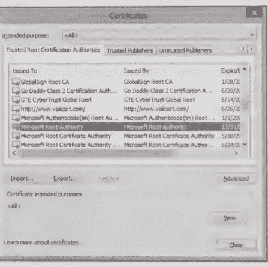

**图 12-2：** 根证书颁发机构列表

如果现在要保证你的身份，它必须首先通过你选择信任的实体之一验证其身份。一个例子是 Microsoft。在你的计算机上，如上一图所示，有一个名为 GTE CyberTrust Global Root 的根证书颁发机构。如果你将浏览器指向 `https://www.microsoft.com`（注意 https）并想查看该站点的证书并进入“证书路径”，会出现一个与图 12-3 类似的对话框。

如你所见，Microsoft.com 受 Microsoft Secure CyberTrust Global Root 信任，你可以选择信任它。

> **注意**：Microsoft 提供了一个名为 `Makecert.exe`（证书创建）的工具，可以使用它创建证书。有关此工具的更多信息请参见本文末尾的“附加阅读”部分。

要通过编程处理证书，可以使用 `X509Certificate` 类。证书使用存储库，即安全保存证书的地方。.NET 使用 `X509` 命名空间。

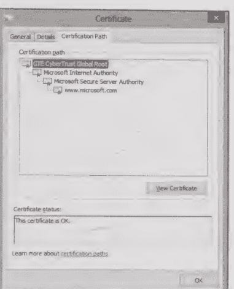

**图 12-3：** Microsoft.com 的 SSL

表 12-10: `System.Security.Cryptography.X509Certificates.StoreLocation`

| 成员 | 说明 |
|---|---|
| CurrentUser | 表示当前用户的存储库 |
| LocalMachine | 表示所有用户通用的存储库 |

Windows 提供了 `StoreLocation` 枚举表示两种存储位置。可能的值见表 12-9。

表 12-11: `System.Security.Cryptography.X509Certificates.StoreName`

| 成员 | 说明 |
|---|---|
| AddressBook | 其他用户的地址存储库 |
| AuthRoot | 第三方 CA 的存储库 |
| CertificateAuthority | 中间 CA 的存储库 |
| Disallowed | 已撤销证书的存储库 |
| My | 个人证书存储库 |
| Root | 受信任根 CA 的存储库 |
| TrustedPeople | 直接信任的人和资源的存储库 |
| TrustedPublisher | 直接信任的发布者的存储库 |

`X509Store` 类提供了一个名为 `Name` 的字符串属性，如果你想创建自己的存储库，可以使用它。

下面的程序展示了如何使用 `X509Store` 显示与图 12-2 类似的 `X509Certificates` 信息。

```csharp
using System;
using System.Security.Cryptography.X509Certificates;

namespace Encryption
{
    class CertificateTest
    {
        static void Main()
        {
            X509Store store = new X509Store(StoreName.Root, StoreLocation.LocalMachine);
            store.Open(OpenFlags.ReadOnly);
            Console.WriteLine("友好名称\t\t\t 期:");
            foreach (X509Certificate2 certificate in store.Certificates)
            {
                Console.WriteLine("{0}\t{1}\t", certificate.FriendlyName, certificate.NotAfter);
            }
            store.Close();
        }
    }
}
```

这个简单的程序首先以只读模式打开本地的根存储库，然后打印其中所有证书的名称和过期日期。

## 使用加密

> **注意** 图 12-2 包含了两个更多字段，称为“颁给”（Issued To）和“发布者”（Issued By）。如果你想获取这些信息，它们分别是主体（Subject）和发行者（Issuer）属性的一部分。这些属性的类型为 `X509DistinguishedName`。你必须从中提取通用名称（CN）属性的值。

## 实现密钥管理

有时你可能只需要保持数据安全，而无需过多考虑使用的算法或其实现方式。例如，为了使加密算法生效，你需要保护对称算法的共享密钥以及非对称算法的私钥。

为了解决这类问题，.NET Framework 中的 `System.Security.Cryptography` 命名空间提供了一个名为 `ProtectedData` 的静态类。该类有两个静态方法：`Protect` 和 `Unprotect`。顾名思义，第一个用于加密数据，第二个用于解密数据。

它们的签名如下：

```csharp
public static byte[] Protect(
    byte[] userData,
    byte[] optionalEntropy,
    DataProtectionScope scope
)

public static byte[] Unprotect(
    byte[] encryptedData,
    byte[] optionalEntropy,
    DataProtectionScope scope
)
```

如所示，两个方法都接受三个参数。第一个参数表示要加密（`userData`）或解密（`encryptedData`）的数据；第二个称为 `optionalEntropy`，用于增加加密数据的复杂度；最后一个参数类型为 `DataProtectionScope`。`scope` 参数指定了谁可以解密数据。它可以取的值有：`DataProtectionScope.CurrentUser` 和 `DataProtectionScope.LocalMachine`。第一个指定只有当前用户可以解密加密数据，第二个指定本地机器上的任何已登录用户都能解密该数据。

`Protect` 返回加密后的数据，`Unprotect` 返回未受保护的数据。

## 真实世界场景：使用 ProtectedData 类加密数据

使用 `ProtectedData` 类编写一个名为 `ProtectString` 的方法，该方法接收一个明文字符串并对其加密，使得只有当前用户可以解密。

## 解决方案

一个可能的解决方案可能如下：

```csharp
byte[] ProtectString(string data)
{
    byte[] userData = System.Text.Encoding.Default.GetBytes(data);
    byte[] encryptedData = ProtectedData.Protect(userData, null,
                               DataProtectionScope.CurrentUser);
    return encryptedData;
}
```

首先，你将字符串转换为字节数组，然后调用 `ProtectedData.Protect` 方法来加密数据。

## 选择何时使用何种算法

微软建议在以下情况下使用相应的算法：

- 对于数据隐私，使用 `Aes`。
- 对于数据完整性，使用 `HMACSHA256` 或 `HMACSHA512`。
- 对于数字签名，使用 `RSA` 或 `ECDsa`。
- 对于密钥交换，使用 `RSA` 或 `ECDiffieHellman`。
- 对于随机数生成，使用 `RNGCryptoServiceProvider`。
- 从密码生成密钥，使用 `Rfc2898DeriveBytes`。

你可以在 MSDN 的“其他阅读和资源”部分找到更多关于加密模型（Cryptography Model）的链接。

> 使用 RSA 非对称算法 [Chapter12\Asymmetric\RSASample.cs]

考虑以下这段完整的代码：

```csharp
using System;
using System.Text;
using System.Security.Cryptography;

namespace EncryptionSamples.Asymmetric
{
    public class RSASample
    {
        public static void Main()
        {
            string keyContainerName = "MyKeyContainer";
            string clearText = "This is the data we want to encrypt";
            CspParameters cspParams = new CspParameters();
        }
    }
}
```

```csharp
cspParams.KeyContainerName = keyContainerName;
RSAParameters publicKey;
RSAParameters privateKey;
using (var rsa = new RSACryptoServiceProvider(cspParams))
{
    rsa.PersistKeyInCsp = true;
    publicKey = rsa.ExportParameters(false);
    privateKey = rsa.ExportParameters(true);
    rsa.Clear();
    byte[] encrypted = EncryptUsingRSAParam(clearText, publicKey);
    string decrypted = DecryptUsingRSAParam(encrypted, privateKey);
    Console.WriteLine("Asymmetric RSA - Using RSA Parameters");
    Console.WriteLine("Encrypted: {0}", Convert.ToBase64String(encrypted));
    Console.WriteLine("Decrypted: {0}", decrypted);
    Console.WriteLine("Asymmetric RSA - Using Persistent Key Container");
    encrypted = EncryptUsingContainer(clearText, keyContainerName);
    decrypted = DecryptUsingContainer(encrypted, keyContainerName);
    Console.WriteLine("Encrypted: {0}", Convert.ToBase64String(encrypted));
    Console.WriteLine("Decrypted: {0}", decrypted);
}

static byte[] EncryptUsingRSAParam(string value, RSAParameters rsaKeyInfo)
{
    using (RSACryptoServiceProvider rsa = new RSACryptoServiceProvider())
    {
        rsa.ImportParameters(rsaKeyInfo);
        byte[] encodedData = Encoding.Default.GetBytes(value);
        byte[] encryptedData = rsa.Encrypt(encodedData, true);
        rsa.Clear();
        return encryptedData;
    }
}

static string DecryptUsingRSAParam(byte[] encryptedData, RSAParameters rsaKeyInfo)
{
    using (RSACryptoServiceProvider rsa = new RSACryptoServiceProvider())
    {
        rsa.ImportParameters(rsaKeyInfo);
        byte[] decryptedData = rsa.Decrypt(encryptedData, true);
        string decryptedValue = Encoding.Default.GetString(decryptedData);
        rsa.Clear();
        return decryptedValue;
    }
}
```

```csharp
static byte[] EncryptUsingContainer(string value, string containerName)
{
    CspParameters cspParameters = new CspParameters();
    cspParameters.KeyContainerName = containerName;
    using (var rsa = new RSACryptoServiceProvider(cspParameters))
    {
        byte[] encodedData = System.Text.Encoding.Default.GetBytes(value);
        byte[] encryptedData = rsa.Encrypt(encodedData, true);
```


# 第 12 章 使用加密和管理程序集

## RSA 加密示例代码

```csharp
rsa.Clear();

return encryptedData;

}

}

static string DecryptUsingContainer(byte[] encryptedData, string container) {

    CspParameters cspParameters = new CspParameters();

    cspParameters.KeyContainerName = container;

    using (var rsa = new RSACryptoServiceProvider(cspParameters)) {

        byte[] decryptedData = rsa.Decrypt(encryptedData, true);

        string decryptedValue = Encoding.Default.GetString(decryptedData);

        rsa.Clear();

        return decryptedValue;

    }

}

```

## 程序集（Assembly）概述

程序集（Assembly）是 .NET 应用程序的部署单元。如果你想将应用程序拆分为更小的部署单元，以便更容易管理和供不同产品复用，你需要将功能拆分为不同的程序集。每个程序集随后都可以代表应用程序中的一个模块，并且可以独立于其他项目进行更新。实现这种模块化的最简单方法是创建不同的项目，一个项目一个模块，并将这些项目分到一个大的解决方案（Solution）中。为了区分同一个程序集的不同版本，你需要使用程序集版本（Assembly Versions）。

## 理解程序集版本

软件在不断演进，实现这一点的方法是创建新版本，每个新版本都会添加功能、修复错误，或者对软件进行完全重写（希望变得更好）。.NET 程序集版本实现为一个字符串，通常由由点分隔的四个数字部分组成：主版本号（Major）、次版本号（Minor）、生成号（Build）和修订号（Revision）。例如，.NET 的当前版本被称为 4.5。这是营销版本号，即客户看到的版本。相反，随此版本发布的程序集嵌入了以下版本字符串：`4.0.30319.17929`，其中 `4` 代表主版本号，`0` 代表次版本号，`30319` 代表生成号，`17929` 代表修订号。如果你选择使用其他格式的版本号，编译器将生成错误。建议使用数字格式来给程序集版本赋予意义。

> **专家建议：为程序集进行版本控制**
> 请仔细选择所选版本，因为这从长远来看对你有帮助。如果你使用推荐的数字方法，那么根据版本号判断哪个版本更新的要容易得多。以下是关于版本中不同部分的思考方式。
>
> - **修订号（Revision）**：通常是一个随机数，用于区分两个具有相同生成号的版本。通常，每当你提交代码（check in）并构建项目时，必须设置一个新的版本。
> - **生成号（Build number）**：是你开发产品某个版本时通常每天增加的数字。这由你的每夜构建过程（nightly build process）每晚完成。
> - **次版本号（Minor number）**：随着产品的每次公发布而增加。通常，具有相同主版本号但不同次版本的同一程序集的两个版本是向后兼容的——尽管并非总是如此。向后兼容意味着当用相同程序集的更新版本替换程序集时，系统仍然可以工作。实现这种方法的途径是添加新功能，而不删除现有功能或更改现有功能的公共接口。
> - **主版本号（Major number）**：每当你发布产品的重大版本时就会增加一次，可能是通过更改现有功能或重写整个应用程序。

## 管理程序集版本

你可以通过两种方式设置程序集的版本。

1.  **通过项目设置**：右键点击你的项目并选择“属性”（Properties）。在“程序集”属性页上，点击“程序集信息”（Assembly Information）按钮。会出现一个与图 12-4 类似的对话框。四个程序集版本字段代表了上述程序集的各个部分。
2.  **直接编辑 `AssemblyInfo.cs` 文件**：要找到该文件，你必须点击想要更改版本的项目，然后展开属性节点，如图 12-5 所示。

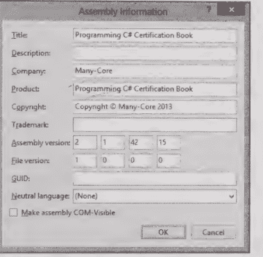
图 12-4：程序集信息对话框

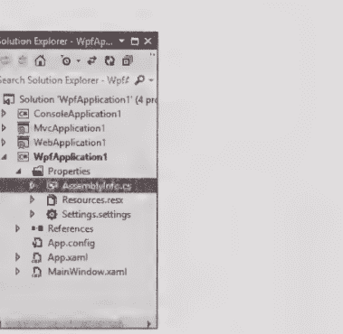
图 12-5：打开 AssemblyInfo.cs 文件

在文件末尾，你可以找到一行类似于下面的代码：

```csharp
[assembly: AssemblyVersion("2.1.42.15")]
```

正如在第 8 章“使用反射、自定义属性、CodeDOM 和 Lambda 表达式创建和使用类型”中所解释的，这是一个通过 `AssemblyVersionAttribute` 实现的属性，应用于程序集上，并指定了该程序集应该具有哪个版本。

除非与强名称（strong names）一起使用，否则 CLR 会忽略程序集版本。名称将在下一节介绍。

## 使用不同类型的版本

参考图 12-4，你可以看到两种版本：程序集版本（Assembly Version）和文件版本（File Version）。文件版本对应的属性称为 `AssemblyFileVersionAttribute`。

CLR 不使用文件版本。这个信息对你或你的产品具有意义。通常，营销部门关心文件版本。虽然文件版本的格式通常被指定为与程序集相同的格式（具有主版本号、次版本号、生成号和修订号），但你可以使用任何你想要的字符串。不过，如果你使用不同的格式，编译器会发出无害的警告。你不能通过 `AssemblyFileVersionAttribute` 将文件版本设置为字符串。你必须在代码中将值传递给 `AssemblyFileVersionAttribute` 属性来实现。

.NET Framework 提供了第三种版本控制属性，称为 `AssemblyInformationalVersionAttribute`。这是纯文本，通常是你的产品版本值。如果不设置，它将具有 `AssemblyVersionAttribute` 的值。

要查看 `AssemblyFileVersionAttribute` 和 `AssemblyInformationalVersionAttribute` 的值，你可以编译程序集，使用 Windows 资源管理器导航到输出文件夹，并右键点击程序集。然后选择属性菜单打开属性窗口，并选择“详细信息”（Details）选项卡。会出现一个与图 12-6 类似的对话框。


图 12-6：文件和产品版本

## 使用强名称签名程序集

在 .NET 出现之前，开发者面临的主要问题之一是 DLL 地狱（DLL hell）。DLL 代表动态链接库，它是共享代码并优化磁盘空间的一种方式。当不同的应用程序使用同一个库时，后安装的库会导致运行异常或拒绝启动，这就是 DLL 地狱。.NET 通过引入“并存版本控制”（side-by-side versioning）的新概念解决了这个问题。为了让这种机制生效，你必须对来源的不同版本进行区分。

在 .NET 中，程序集的名称由四个部分组成：

- **友好名称（friendly name）**
- **版本（version）**
- **文化（culture）**
- **公钥令牌（public key token）**

友好名称是你之前称为库的名称。通常情况下，它是不带扩展名的程序集文件名，所以如果你的程序集文件是 `Programming.dll`，那么程序集名称就是 `Programming`。版本是上一节讨论的程序集版本。文化代表程序集的文化。当你想要本地化应用程序时可以使用文化。要本地化应用程序，创建一个包含代码的程序集，并为你想要本地化的每个区域创建一个程序集。本地化程序集仅包含区域资源，如翻译后的字符串或特定图像。执行程序集的文化始终设置为中性（neutral）。如果你尝试设置其他的，编译器将生成错误。

为了让程序集具有强名称，它需要使用上一节讨论的技术用一对公钥/私钥进行签名。私钥用于对程序集进行数字签名，而公钥用于验证签名。公钥令牌是程序集公钥的 64 位哈希值。.NET 使用签名本身的哈希的原因是为了节省空间，因为签名比 64 位大得多。未数字签名的程序集公钥令牌可以为 null。

如前所述，为了签名程序集，你需要一对公钥/私钥。你可以通过两种方式生成这些密钥。

### 方法一：通过 Visual Studio 创建文件

右键点击项目并选择“属性”。在属性页上，选择“签名”（Signing）选项卡。在那里，勾选“签名程序集”（Sign Assemblies）复选框，如图 12-7 所示。

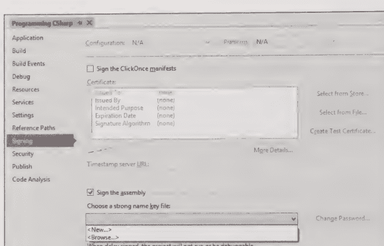
图 12-7：Visual Studio 2012 中的签名选项卡

当你执行该操作时，会弹出一个与图 12-8 类似的对话框。

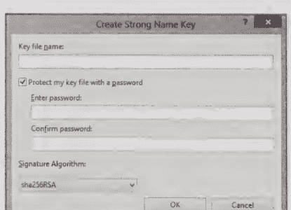
图 12-8：创建强名称密钥对话框

如你所见，你可以指定密钥文件的名称、用于保护文件中私钥的密码，以及用于签名的算法。算法的选择有 `sha256RSA` 和 `sha1RSA`。创建文件后，它将添加到你的项目中。当其他用户或你在另一台机器上打开项目时，你必须输入在上一个步骤中设置的密码。

> **最佳实践：签名程序集**
> 建议对密钥文件使用强密码，并将密码仅提供给少数选定的开发者——或者更好，提供给负责你应用程序部署的人员。如果密码泄露，其他人将很容易创建程序集并分发，就像它们来自你那里的一样。为了保持密码秘密的同时仍让其他开发者处理你的应用程序，你必须使用“延迟签名”（Delay sign）。延迟签名不在本次考试的范围内。有关延迟签名过程的额外信息，请参阅“附加阅读和资源”部分。

### 方法二：使用 `sn.exe` 程序

要为此，你需要打开 VS2012 的开发人员命令提示符。从命令行运行以下命令：

```bash
sn.exe -k myFile.snk
```

命令输出应与图 12-9 所示类似。

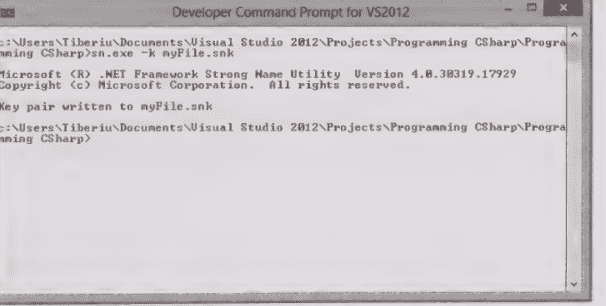
图 12-9：Sn.exe 输出

生成文件后，在 Visual Studio 的签名选项卡上，不需要选择<新建...>，而是需要选择<浏览...>并选择新创建的文件。使用 `sn.exe` 的缺点是无法指定密码，但 `sn.exe` 用于延迟签名场景，以便从文件中提取公钥，或在部署之前对程序集进行签名。你可以在“附加阅读和资源”部分找到更多关于 `sn.exe` 的信息。

> **注意**：考试不需要延迟签名，但你应该阅读“附加阅读和资源”部分中关于该主题的文章。

## 完全限定名称（FQN）

当程序集需要进行数字签名时，编译器使用私钥对程序集进行签名，并嵌入公钥，供引用它的其他程序集稍后验证。下一步是对公钥进行哈希处理以创建公钥令牌（Public Key Token），并将其嵌入程序集中。

总之，程序集名称不仅是文件名和友好名称。程序集的完整名称称为完全限定名称（Fully Qualified Name，FQN）。例如 .NET 4.5 中 System 程序集的 FQN 为：

```
System, Version=4.0.0.0, Culture=neutral, PublicKeyToken=b77a5c561934e089
```

## 实现并存版本控制

如果没有并存运行不同版本程序集的能力，强命名将几乎毫无价值。考虑以下场景。

在你的组织中，有两个团队在开发两个不同的产品，但它们都需要使用一些公共功能。如前所述，处理这种情况的最好方法是将公共代码移动到单独的项目中，创建一个供两个团队共同使用的独立程序集。一切运行良好；他们部署了自己的产品，并且每台机器上只有一个公共程序集的副本，而不是每个产品一个。过了一段时间，第一个团队可能需要向公共程序集中添加一些额外功能，但第二个团队“还没准备好”。如果没有并存版本控制，你必须为每个安装保留一个程序集的副本。对于两个产品，这可能是一个可以接受的解决方案，但如果你有更多产品，或者如果你是第三方供应商，那么维护这种状况将变得困难得多。

并存版本控制仅对强命名程序集有效，因为它们需要被部署在全局程序集缓存（GAC）中。下一节将介绍 GAC。但现在，来看并存版本控制是如何工作的。

当你向程序集添加引用时，有关被引用程序集的信息会被添加到程序集的清单文件（manifest）中。清单作为元数据的一部分嵌入程序集中。在清单文件中，每个引用的程序集都由类似于下面的代码块表示：

```text
// Metadata version: v4.0.30319

.assembly extern mscorlib
{
    .publickeytoken = (B7 7A 5C 56 19 34 E0 89 ) // .z\V.4..
    .ver 4:0:0:0
}

.assembly extern CommonFunctionality
{
    .ver 1:0:0:0
}

.assembly extern CSharp
```


## 实现并存版本控制

如果没有并存运行不同版本程序集的能力，强命名将几乎毫无价值。考虑以下场景。

在你的组织中，有两个团队在开发两个不同的产品，但它们都需要使用一些公共功能。如前所述，处理这种情况的最好方法是将公共代码移动到单独的项目中，创建一个供两个团队共同使用的独立程序集。一切运行良好；他们部署了自己的产品，并且每台机器上只有一个公共程序集的副本，而不是每个产品一个。过了一段时间，第一个团队可能需要向公共程序集中添加一些额外功能，但第二个团队“还没准备好”。如果没有并存版本控制，你必须为每个安装保留一个程序集的副本。对于两个产品，这可能是一个可以的解决方案，但如果你有更多产品，或者如果你是第三方供应商，那么维护这种状况将变得困难得多。

并存版本控制仅对强命名程序集有效，因为它们需要被部署在全局程序集缓存（GAC）中。下一节将介绍 GAC。但现在，来看并存版本控制是如何工作的。

当你向程序集添加引用时，有关被引用程序集的信息会被添加到程序集的清单文件中。清单作为元数据的一部分嵌入程序集中。在清单文件中，每个引用的程序集都由类似于下面的代码块表示：

```
// Metadata version: v4.0.30319

.assembly extern mscorlib
{
    .publickeytoken = (B7 7A 5C 56 19 34 E0 89 ) // .z\V.4..
    .ver 4:0:0:0
}

.assembly extern CommonFunctionality
{
    .ver 1:0:0:0
}

.assembly extern CSharp
```

# 将程序集添加到全局缓存

如前所述，经过签名的程序集可以放在 GAC 中，但什么是 GAC 呢？

如果你的应用程序是非 .NET 应用程序并使用动态链接库（DLL），它会在程序安装的文件夹或 PATH 环境变量中的文件夹中查找它们。如果你想查看 PATH 环境变量的值，请打开适用于 VS2012 的开发人员命令提示符并运行以下命令：

```
set PATH
```

此命令将输出与图 12-13 所示内容类似的文本。


图 12-13：set PATH 命令的输出

相反，GAC 是一个程序集存储库，作为共享库的缓存。GAC 的位置是 `<你的 Windows 安装文件夹>\assembly`。如果你想查看你的 GAC 中包含哪些程序集，可以打开 Windows 资源管理器并导航到此文件夹，你将看到类似于图 12-14 的内容。

如你所见，列表显示了上述程序集的所有所有属性：程序集名称（Assembly Name）、版本（Version）、文化（Culture）、公密钥令牌（Public Key Token）和处理器架构（Processor Architecture）。空的 Culture 表示这是中性文化，而空的 Processor Architecture 则表示处理器架构为 NONE（无）。不存在空的 Public Key Token，因为只有强名称（经过数字签名的）程序集才能部署到 GAC 中。

在谈论如何将程序集添加到 GAC 之前，你将首先探索使用 GAC 的优势。

# 管理程序集 | 563

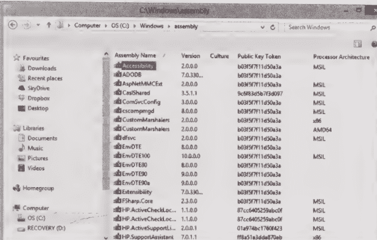

图 12-14：来自 Windows 资源管理器的 GAC 视图

首先，前面提到的两个程序集优势是并存版本（side-by-side versioning）和程序集共享。如果程序集已加载到内存中，CLR 将不会再次加载它。

另一个优势是，程序集在安装到 GAC 之前会验证其签名，因此当程序集在执行时由 CLR 加载，它将跳过验证，从而提高你应用程序的启动速度。

最后是预编译程序集的可能性，这样它们在每次加载时就不需要由 JIT 编译器进行编译（正如本节开头讨论）。这可以进一步加快启动过程。要做到这一点，你必须运行一个名为 `ngen.exe`（原生映像生成器）的工具，这超出了本书的范围，但你始终可以在“附加阅读和资源”部分找到更多信息。

你可以通过两种方式在 GAC 中安装程序集。

首先，使用可以执行此操作的安装程序。这是首选方法。通过使用安装程序，你可以确保安装是原子的，这意味着要么成功安装所有组件，要么完全不安装，并且它让你以后能以相同的方式进行卸载。当以这种方式安装程序集时，如果程序集不存在，安装程序将将其添加；如果它已存在，则仅增加引用计数，确保在你卸载安装时如果程序集仍在在使用，则不会被卸载。

第二方法是使用名为 `gacutil.exe` 的工具，其运行方式如下：

```
gacutil.exe [options] [assemblyName | assemblyPath | assemblyListFile]
```

表 12-13 显示了 `gacutil.exe` 最常用的参数。完整的参考信息请参阅“附加阅读和资源”部分。

## 表 12-13：gacutil.exe 使用

| 选项 | 说明 |
| --- | --- |
| /i | 将程序集添加到 GAC |
| /u | 从 GAC 中删除程序集 |
| /l [assemblyName] | 列出 GAC 中的所有程序集。指定 assemblyName 参数将仅列出匹配该名称的程序集。 |
| /r | 通过在每次安装时增加计数器、每次卸载时减少计数器来跟踪对程序集的引用。在使用 /i, /i1, /u 或 /u1 选项时指定此选项。如果程序集被跟踪，则仅当计数器为 0 时才会从 GAC 中删除。 |

## 总结

在本章中，你学习了如何使用对称和非对称算法在应用程序中加密敏感数据。你查看了一些现有的算法、如何管理和创建证书，以及如何管理加密密钥。然后，你查看了如何对数据进行哈希处理以确保信息未被修改，最后你学习了如何加密数据流。

在本章中，你很好地学习了程序集、它们是什么，以及如何使用多个并存版本创建具名程序集（named assemblies）。然后，你查看了将程序集添加到 GAC 的可用选项，以及如何创建 WINMD 程序集。

# 章节测试题

以下问题类似于你在考试 70-483 中遇到的问题类型。请仔细阅读每个问题，并选择代表问题最佳解决方案的答案或。你可以在附录 A，“章节测试题答案”中找到答案。

- 1. 你是 xyx 公司的开发人员。被要求实现一种在本地机器上安全保存和恢复数据的方法。哪种算法最符合要求？
    a. 对称算法
    b. 非对称算法
    c. 哈希算法
    d. X509Certificate
    e. 以上都不是

- 2. 你是 xyx 公司的开发人员。被要求实现一种在本地机器上安全保存和恢复数据的方法。哪种算法最符合要求？
    a. 对称算法
    b. 非对称算法
    c. 哈希算法
    d. X509Certificate
    e. 以上都不是

- 3. 你是 xyx 公司的开发人员。被要求实现一种在本地机器上安全保存和恢复数据的方法。哪种算法最符合要求？
    a. 对称算法
    b. 非对称算法
    c. 哈希算法
    d. X509Certificate
    e. 以上都不是

- 4. 使用哪个代码片段来计算 userData 字节数组的哈希？
    a. `userData.GetHashCode();`
    b. `sha.ComputeHash(userData);`
    c. `sha.GetHash(userData);`
    d. `sha.EncryptHash(userData);`

- 5. 使用哪个代码片段来加密 userData 数组，使其可以被登录机器的任何用户解密，且不需要熵？
    a. `ProtectedData.Protect(userData, null, DataScope.CurrentUser);`
    b. `ProtectedData.Protect(userData, null, DataScope.LocalMachine);`
    c. `ProtectedData.Encrypt(userData, null, DataScope.CurrentUser);`
    d. `ProtectedData.Unprotect(userData, null, DataScope.LocalMachine);`

- 6. 使用哪个代码片段来加密 encryptedData 数组，使其可以被当前用户解密，且不需要熵？
    a. `ProtectedData.Unprotect(encryptedData, null, DataScope.CurrentUser);`
    b. `ProtectedData.Protect(encryptedData, null, DataScope.LocalMachine);`
    c. `ProtectedData.Decrypt(encryptedData, null, DataScope.CurrentUser);`
    d. `ProtectedData.Unprotect(encryptedData, null, DataScope.LocalMachine);`

- 7. 什么描述了强名称程序集？
    a. 名称
    b. 版本
    c. 公密钥令牌
    d. 文化
    e. 处理器架构
    f. 以上所有

- 8. 如何部署强名称程序集？
    a. 运行 `gacutil.exe`
    b. 创建安装程序
    c. 运行 `asm.exe`
    d. 将文件复制到应用程序的 Bin 文件夹
    e. 运行 `regsvcs.exe`

- 9. 如何部署私有程序集？
    a. 运行 `gacutil.exe`
    b. 在 Visual Studio 中引用该程序集
    c. 将文件复制到应用程序的 Bin 文件夹
    d. 将文件复制到 C:\Windows 文件夹

- 10. 什么是强名称程序集？
    a. 名称标记为粗体的程序集
    b. 指定了主版本和次版本的程序集
    c. 指定了完整版本的程序集
    d. 指定了文化信息的程序集
    e. 经过签名的程序集

# 额外阅读和资源

这里是一些额外的有用资源，帮助你理解本章介绍的内容：

- Makecert.exe (证书创建工具)
  http://msdn.microsoft.com/en-us/library/bfsktky3.aspx

- 程序集集 (Working with Assemblies)
  http://msdn.microsoft.com/en-us/library/8wxf689z.aspx

- 国际化与本地化 (Globalization and Localization)
  http://msdn.microsoft.com/en-us/library/hh965328.aspx

- Ngen.exe (原生映像生成器)
  http://msdn.microsoft.com/en-us/library/6t9t5wcf (v=vs.110).aspx

- Sn.exe (强名称工具)
  http://msdn.microsoft.com/en-us/library/k5b5tt23 (v=vs.110).aspx

- CLR 如何定位程序集
  http://msdn.microsoft.com/en-us/library/yx7xezcf.aspx

- Gacutil.exe (全局程序集缓存工具)
  http://msdn.microsoft.com/en-us/library/ex0ss12c.aspx

# 快速查表

此快速查表旨在帮助你快速学习本章的关键点。

## 选择加密算法

- 如果你需要加密本地使用的数据，或者你有一种安全的方法分发加密密钥，请使用对称加密。
- 如果你没有安全的方法在双方之间发送加密密钥数据，则建议使用非对称加密。
- 如果你只需要确保数据的完整性，请使用哈希算法。
- 如果你需要同时确保数据的完整性和真实性，请选择 MAC 算法。

## 对称加密

- 基于共享秘密的共同密钥。
- 它需要一个初始化向量 (IV)，该向量不需要保密，但用于加密第一块数据。
- 你通过实例化对称算法对象，然后调用 `CreateEncrypt` 或 `CreateDecrypt` 来使用它。
- 随后，通过直接调用 `TransformFinalBlock` 方法或将其发送到 `CryptoStream` 来使用加密/解密器。

## 非对称加密

- 它基于一对互补的密钥。使用一个密钥加密的数据只能用另一个密钥进行解密。
- 一个密钥被保密并称为*私钥*；另一个密钥提供给任何想要加密数据或验证加密数据的人，它称为*公钥*。

## 哈希

- 将变长度的二进制数据映射到固定大小的二进制数据 `hash`。
- 当你需要确保数据在传输过程中不被修改时，可以计算加密哈希并将其与要验证的数据一起发送给接收方进行验证。
- 两种常用的算法是 SHA256 和 SHA512，生成的哈希值分别为 256 位和 512 位（32 和 64 字节）。

## 密钥管理

- 对称密钥可以使用非对称算法进行交换。
- 非对称私钥可以使用证书或加密服务提供程序 (CSP) 容器来保护。

## 程序集版本

- 程序集版本由部分组成：主版本 (Major)、次版本 (Minor)、生成版本 (Build) 和修订版本 (Revision)。

## 强名称

- 经过数字签名的程序集称为强命名程序集。
- 强名称包含五个部分：友好名称 (Friendly Name)、版本 (Version)、文化 (Culture)、公钥令牌 (Public Key Token) 和处理器架构 (Processor Architecture)。

## GAC

- 全局程序集缓存 (Global Assembly Cache)。
- 一个用于共享 .NET 程序集的仓库。
- 只有强命名程序集可以部署在 GAC 上。
- 同一个程序集的多个版本可以同时部署在 GAC 上。

## 关键术语回顾

**程序集 (assembly)**: 程序集是重用、部署、版本控制和安全的单元。

**非对称加密（公钥）**: 一种使用两个互补密钥的加密算法，一个用于加密，一个用于解密。使用公钥加密的数据只能使用私钥解密。

**证书颁发机构 (CA)**: 发行数字证书的实体。

**证书吊销列表 (CRL)**: 一个因各种原因被吊销的数字证书列表。如果证书被吊销，则你不应使用它。

**证书存储 (certificate stores)**: 计算机上用于加密证书的特殊存储位置。

**通用语言运行时 (CLR)**: CLR 是 .NET Framework 的组件，负责运行 .NET 应用程序并管理其运行环境。

**密码学 (cryptography)**: 用于安全通信的技术实践和使用。

**解密 (decomposition)**: 解码之前加密的数据的过程，以便你的应用程序可以使用它。

**加密 (encryption)**: 对数据进行编码的过程，使其无法被未经授权的人读取。

**全局程序缓存 (GAC)**: GAC 是一个全机器范围的代码缓存。

**哈希桶 (hash bucket)**: 存储具有相同哈希值项的数据结构。

**哈希 (hashing)**: 用于将变长度的数据结构映射到固定大小的数据结构。使用相同算法对数据进行哈希处理始终产生相同的哈希值。

**初始化向量 (IV)**: 加密算法用于加密第一块数据的数据数组。IV 不需要保密。

**中间语言 (IL)**: 从源代码编译 .NET 应用程序的产物。

**即时编译器 (JIT)**: .NET 的一个组件，它将 IL 转换为可以在目标平台上运行的二进制代码。

**消息认证码 (MAC)**: 一类用于提供数据完整性和真实性的加密算法。

**私钥 (private key)**: 公钥。（注：此处基于非对称加密的语境）

**公钥基础设施 (PKI)**: 基础架构。

**安全套接层 (SSL)**: 一种协议。

**安全哈希算法 (SHA)**: 一类算法。

**传输层安全 (TLS)**: SSL 的继者。

**对称加密 (symmetric encryption)**: 一对用于加密和解密的密钥。

## 8. 此方法中的参数被称为什么？

```csharp
public void displayAbsoluteValue(int value = 1)
```


# 练习题集

## 第 3 章：基础概念

- **9.** 当你创建一个抽象方法时，如何在派生类中使用该方法？
  - **b.** 你必须在派生类中重写（`override`）该方法。

- **10.** 如何对类的数据成员强制封装？
  - **a.** 创建私有数据成员。
  - **c.** 使用公共属性。

- **11.** 装箱（Boxing）指的是：
  - **b.** 将值类型转换为引用类型。

- **12.** 使用命名参数（named parameters）的优势是什么？
  - **a.** 你可以使用参数名任意顺序向方法传递参数。

- **13.** 在 .NET 中使用泛型（Generics）的优势是什么？
  - **b.** 泛型允许你创建在创建时接受类型的类。

- **14.** 泛型类中的 `<T>` 代表什么？
  - **c.** 它是一个占位符，将包含使用的对象类型。

- **15.** 泛型方法中的值是如何传递的？
  - **b.** 它们通过引用传递。

## 第 4 章：使用类型

- **1.** 为了解析可能包含如 `$1,234.56` 等货币数值的字符串，你应该传递以下哪个值给 `Parse` 或 `TryParse` 方法？
  - **c.** `NumberStyles.Currency`

- **2.** 关于宽化转换（widening conversions），以下哪个陈述是正确的？
  - **d.** 以上所有。

- **3.** 关于收窄转换（narrowing conversions），以下哪个陈述是正确的？
  - **b.** 源类型和目标类型必须兼容。

- **4.** 假设 `total` 是一个持有 `1234.56` 值的 `decimal` 变量，以下哪个陈述以 `$1,234.56` 的货币格式显示 `total`？
  - **c.** `Console.WriteLine(total.ToString("C"));`

- **5.** 下面哪个语句生成包含“Veni, vici, vici”文本的字符串？
  - **c.** `String.Format("{2}, {0}, {3}", "vidi", "Venti", "Veni", "vici")`

- **6.** 如果 `i` 是 `int` 且 `l` 是 `long`，以下哪个陈述是正确的？
  - **a.** `i = (int)l` 是一个收窄转换。

- **7.** 以下哪个方法是将用户输入的整数值存储在变量中的最佳方法？
  - **d.** `TryParse`

- **8.** 语句 `object obj = 72` 是以下哪种的示例？
  - **c.** 装箱 (Boxing)

- **9.** 如果 `Employee` 继承自 `Person` 而 `Manager` 继承自 `Employee`，以下哪个陈述是有效的？
  - **a.** `Person alice = new Employee();`

- **10.** 以下哪个不是 `String` 方法？
  - **c.** `StopsWith`

- **11.** 以下哪种技术不会创建一个包含 10 个空格的字符串？
  - **d.** 使用 `String` 类的 `Space` 方法并传递 10 作为字符串应包含的空格数。

- **12.** 你可以使用以下哪个语句来捕捉整数溢出和下溢错误？
  - **a.** `checked`

- **13.** 你应该使用以下哪个技术来监控导致溢出或下溢的浮点操作？
  - **b.** 检查结果是否为 `Infinity` 或 `NegativeInfinity`。

## 第 5 章：创建和实现类层次结构

- **1.** 关于 `base` 关键字，以下哪个陈述是错误的？
  - **a.** `base` 关键字允许构造函数调用同一类中的另一个构造函数。

- **2.** 关于 `this` 关键字，以下哪个陈述是错误的？
  - **b.** 如果 `base` 语句在前面，构造函数可以使用 `this` 语句和 `base` 语句。

- **3.** 假设你定义了 `House` 和 `Boat` 类，并且你想创建一个同时继承自 `House` 和 `Boat` 的 `HouseBoat` 类。以下哪种方法不可行？
  - **a.** 让 `HouseBoat` 同时继承 `House` 和 `Boat`。

- **4.** 假设 `HouseBoat` 隐式地实现了 `IHouse` 接口并显式地实现了 `IBoat` 接口。以下哪个陈述是错误的？
  - **b.** 代码可以使用 `HouseBoat` 对象访问其 `IBoat` 成员。

## 第 6 章：处理委托、事件和异常

- **5.** 以下哪个不是接口的良好用法？
  - **d.** 重用由接口定义的代码。

- **6.** 假设你想创建一个 `Recipe` 类来存储菜谱，并想根据 `MainIngredient` 属性对 `Recipes` 进行排序。在这种情况下，以下哪个接口可能有用？
  - **b.** `IComparable`

- **7.** 假设你想根据 `MainIngredient`、`TotalTime` 或 `CostPerson` 的任何一个属性对问题 6 中的 `Recipe` 类进行排序。在这种情况下，以下哪个接口可能有用？
  - **c.** `IComparer`

- **8.** 以下哪个陈述是正确的？
  - **c.** 一个类最多继承一个类并实现任意数量的接口。

- **9.** 程序可以使用 `IEnumerable` 和 `IEnumerator` 接口执行以下操作？
  - **a.** 使用 `MoveNext` 和 `Reset` 遍历对象列表。

- **10.** 关于垃圾回收（garbage collection），以下哪个陈述是错误的？
  - 在销毁对象之前，GC 调用其 `Dispose` 方法。

- **11.** 关于析构函数（destructors），以下哪个陈述是错误的？
  - *(原文缺少选项)*

- **12.** 假设 `HouseBoat` 隐式地实现了 `IHouse` 接口并显式地实现了 `IBoat` 接口。以下哪个陈述是错误的？
  - **b.** 代码可以使用 `HouseBoat` 对象访问其 `IBoat` 成员。

> **注：** 提供的 OCR 文本存在大量重复和混乱，已根据逻辑流进行合并和清理。

## 第 7 章：多线程与并行编程

- **4.** 你如何调度让线程池中的线程执行工作？
  - **c.** 你调用 `ThreadPool.QueueUserWorkItem` 方法。
  - **d.** 你创建一个新线程并设置其属性。

- **5.** 下列哪些项是 `Parallel` 类的方法？
  - **b.** `Invoke`
  - **c.** `For`
  - **d.** `ForEach`

- **6.** 你可以使用哪种方法来取消正在使用 `CancellationToken` 的进行操作？
  - **b.** 在用于创建 `CancellationToken` 的 `CancellationTokenSource` 对象上调用 `Cancel` 方法。

- **7.** 当你使用 `barrier` 来标记参与者已到达该点时，你会调用哪个方法？
  - **c.** `SignalWait`

- **8.** 哪些代码等同于 `lock(syncObject) { ... }`？
  - **c.** 
    ```
    Monitor.Enter(syncObject); 
    try { ... } 
    finally { Monitor.Exit(syncObject); }
    ```

- **9.** 在多线程应用中，你如何以无锁（lock free）的方式增加名为 `counter` 的变量？选择所有适用项。
  - **c.** `Interlocked.Add(ref counter, 1);`
  - **e.** `Interlocked.Increment(ref counter);`

- **10.** 你将使用哪种方法来信号 `EventWaitHandle`？
  - **c.** `Set`

## 第 8 章：使用反射、CodeDOM、自定义属性和 Lambda 表达式创建和使用类型

- **1.** 你被分配了一个创建一个代码生成器以自动化创建重复代码的任务。哪个命名空间包含生成代码所需的类型？
  - **d.** `System.CodeDom`

- **2.** 哪些代码可以创建 lambda 表达式？
  - **c.** `x => x * x;`

- **3.** 你正在为 Cantoso 公司提供咨询并接手一个由第三方软件公司构建的应用。有一个可执行文件目前无法运行，因为缺少一个引用的 DLL 文件。你如何确定应用程序引用了哪些 DLL 文件？
  - **b.** 创建 `Assembly` 类的实例，加载该程序集并调用 `GetReferencedAssemblies` 方法。

- **4.** 你是财务部门的开发人员，正在构建一个使用反射来获取作为参数传递的对象类型引用的方法。哪种语法可以确定对象的类型？
  - **d.** `typeType = myParameter.GetType();`

- **5.** 你被要求创建一个具有单个属性（名为 `Version`）的自定义属性，允许调用者确定方法的版本。哪些代码可以创建该属性？
  ```
  class MyCustomAttribute : System.Attribute { public string Version { get; set; } }
  ```

- **6.** 如果你想确定 DLL 文件中包含的所有类，你会使用 `System.Reflection` 命名空间中的哪个类？
  - **b.** `Assembly`

- **7.** `Assembly` 类的哪个方法允许你获取在程序集中定义的所有公开类型？
  - **c.** `GetExportedTypes`

- **8.** `Assembly` 类的哪个属性返回程序集的名称？
  - **d.** `FullName`

- **9.** `Assembly` 类的哪个方法返回当前程序集的实例？
  - **a.** `GetExecutingAssembly`

- **10.** 哪种语法将加载程序集？
  - **a.** `Assembly.Load("System.Data, Version=4.0.0.0, Culture=neutral, PublicKeyToken=b77a5c561934e089");`
  - **b.** `Assembly.LoadFrom(@"c:\MyProject\Project1.dll");`
  - **c.** `Assembly.LoadFile(@"c:\MyProject\Project1.dll");`
  - **d.** `Assembly.ReflectionOnlyLoad("System.Data, Version=4.0.0.0, Culture=neutral, PublicKeyToken=b77a5c561934e089");`

- **11.** 如果你想让 .NET Framework 在加载上下文（load-context）中查找程序集，你应该调用哪个方法？
  - **c.** `Load`

- **12.** 如果你想让 .NET Framework 在加载从上下文（load-from context）中查找程序集，你应该调用哪个方法？
  - **b.** `LoadFrom`

- **13.** 哪一行代码使用反射创建 `DataTable` 实例？
  - **a.** `myAssembly.CreateInstance("System.Data.DataTable");`

- **14.** 如果你想使用反射确定类中包含的所有属性，你会创建哪个类？
  - **b.** `Type`

- **15.** 你如何确定一个类是公开的还是私有的？
  - **a.** 使用 `typeof` 关键字创建 `Type` 类的实例，并检查 `Type` 变量的 `IsPublic` 属性。

- **16.** `System.Reflection` 命名空间中的哪个类表示类中定义的字段？
  - **b.** `FieldInfo`

- **17.** 你可以使用 `Type` 类的哪个属性来确定数组的维度？
  - **c.** `GetArrayRank`

- **18.** 哪条语句使用反射返回名为 "myPrivateField" 的私有实例字段？假设 `myClass` 是一个类的实例。
  ```
  myClass.GetType().GetField("myPrivateField", BindingFlags.NonPublic | BindingFlags.Instance)
  ```

- **19.** `MethodInfo` 类的哪个方法可以执行该方法？
  - **d.** `Invoke`

- **20.** 哪条语句使用反射执行方法并传入两个代码块中的两个参数？
  ```
  MyClass myClass = new MyClass();
  MethodInfo myMethod = typeof(myClass).GetMethod("Multiply");
  ```
  - **e.** `myMethod.Invoke(myClass, new object[] { 4, 5 });`

## 第 9 章：处理数据

*(注：第 9 章内容与第 8 章重复，此处省略。)*


+ e. `myMethod.Invoke(myClass, new object[] { 4, 5 });`

## 第 10 章：处理语言集成 LINQ 查询

+ 1. 哪个答案具有 LINQ 查询表达式的关键字顺序？
+ c. `from`, `where`, `select`

+ 2. 哪一个子句可以选择 `myList` 对象中所有的偶数整数？
+   `from i in myList`
+   c. `where i % 2 == 0`

# 3. 哪行代码执行了 LINQ 查询？
- d. Line 4

- 4. 你可以使用哪种方法找到序列中的最小值？
- a. `(from i in myArray select i).Min()`

- 5. 你可以使用哪些方法找到序列中的第一个项目？
- b. `First`
- d. `Take`

- 6. 哪个子句返回了 10 到 20 之间的所有整数？
- b. `where i >= 10 && i <= 20`

- 7. 哪个子句先对状态再对城市排序？
- c. `orderby h.State, h.City`

- 8. 哪个语句选择了匿名类型？
- c. `select new { h.City, h.State }`

- 9. 哪个 `on` 语句根据 `StateId` 属性连接了两个序列？
- a. `on StateId equals s.StateId`

- 10. 在 `join` 中创建外部连接时必须使用哪两个关键字？
- b. `into`, `DefaultIfEmpty`

- 11. 哪个 `join` 子句使用了复合键？
- a. `on new { City = e.City, State = e.State } equals new { City = h.City, State = h.State }`

- 12. 哪个语句按 `State` 属性对序列分组？
- c. `group e by e.State`

- 13. 哪些答案返回了所有偶数的计数？
- a. `myArray.Where(i => i % 2 == 0).Count()`
- b. `myArray.Count(i => i % 2 == 0)`

# 第 11 章：输入验证、调试与插桩

- 1. 如果用户在 `TextBox` 中输入数据并输入了无效字符，下列哪些操作对程序来说是不恰当的？
- d. 显示消息框告诉用户存在错误。

- 2. 如果用户在 `TextBox` 中输入了无效值并将焦点移动到另一个 `TextBox`，下列哪些操作对程序来说是不恰当的？
- a. 强制将焦点返回包含错误的 `TextBox`。

- 3. 如果用户在表单上输入了一些无效数据并点击表单的 `Accept` 按钮，下列哪些操作对程序来说是恰当的？
- d. 以上所有。

- 4. 下列哪个方法在正则表达式匹配字符串时返回 `true`？
- b. `Regex.IsMatch`

- 5. 下列哪个正则表达式匹配社会安全号码格式 `###-######`（其中 `#` 是任意数字）？
- c. `^\d(3)-\d(2)-\d(4)$`

- 6. 下列哪个正则表达式匹配必须包含 6 到 16 个字母及下划线的用户名？
- b. `^[a-zA-Z0-9_]{6,16}$`

- 7. 下列哪个正则表达式匹配车牌号，其必须包含三个大写字母后跟一个空格和三个数字，或三个数字后跟一个空格和三个大写字母？
- a. `^([A-Z]{3}) |([A-Z]{3}) \d{3}$`

- 8. 关于断言（assertions），下列哪个说法是正确的？
- d. 以上所有。

- 9. 关于 `Debug` 和 `Trace` 类，下列哪些是正确的？
- b. 如果定义了 `DEBUG`，`Debug` 类会生成消息。如果定义了 `TRACE`，`Trace` 类会生成消息。

- 10. 关于生成（builds），下列哪些说法在默认情况下是正确的？
- a. `Debug` 构建定义了 `DEBUG` 符号。
- b. `Debug` 构建定义了 `TRACE` 符号。
- d. `Release` 构建定义了 `TRACE` 符号。

- 11. 关于 `PDB` 文件，下列哪个说法是错误的？
- b. 你可以使用 `PDB` 文件调试任何版本的编译后可执行文件。

# 第 12 章：使用加密和管理程序集

- 12. 关于跟踪（tracing）和日志记录（logging），下列哪个说法是错误的？
- d. 程序不能将事件写入系统事件日志中，因此你可以在事件查看器中看到它们。

- 13. 如果你完全不知道从哪里寻找，下列哪种方法可能是寻找程序瓶颈最简单的方法？
- a. 使用自动性能分析器（profiler）。

- 14. 性能计数器（performance counters）的最佳用途是什么？
- b. 确定整个系统上特定操作发生的频率。

# 第 12 章：使用加密和管理程序集

- 1. 你是 `yxy` 公司的开发人员。你被要求实现一种方法在本地机器上安全地保存和恢复数据。哪种算法最符合要求？
- a. 对称算法

- 2. 你是 `yxy` 公司的开发人员。你被要求实现一种方法安全地发送数据到另一台机器。哪种算法最符合要求？
- b. 非对称算法

- 3. 你是 `yxy` 公司的开发人员。你被要求实现一种方法处理密码加密但不提供恢复密码的可能性。哪种算法最符合要求？
- c. 哈希算法

- 4. 你将使用哪个代码来计算名为 `userData` 的字节数组的安全哈希值？如果你已经创建了一个名为 `sha` 的算法对象。
- b. `sha.ComputeHash(userData);`

- 5. 你将使用哪个代码加密名为 `userData` 的数组，该数组可以被登录当前机器的任何人解密，且不需要任何熵（entropy）？
- b. `ProtectedData.Protect(userData, null, DataProtectionScope.LocalMachine);`

- 6. 你将使用哪个代码加密 `encryptedData`，该数组可以由当前用户解密且不需要任何熵？
- a. `ProtectedData.Unprotect(encryptedData, null, DataProtectionScope.CurrentUser);`

- 7. 哪个描述了强名称程序集（strong name assembly）？
- f. 以上所有

- 8. 如何部署命名程序集（named assembly）？
- a. 运行 `util.exe`
- b. 创建安装程序
- d. 将文件复制到应用程序的 `Bin` 文件夹

- 9. 如何部署私有程序集（private assembly）？
- b. 在 `Visual Studio` 中添加程序集
- c. 在应用程序的 `Bin` 文件夹

- 10. 什么是强名称程序集？
- e. 签名程序集（signed assembly）

## 索引

& 运算符，26–27
抽象方法 – 参数，90–91
- 访问修饰符、变量和属性，96
- 访问方法，72
- `Action` 委托，216
- 将程序集添加到全局程序集缓存，562–564
- 表单 `Paint` 事件的事件处理程序，217–218
- 结构体的函数，69–70
- 结构体的方法，69–70
- lambda 表达式的参数，220
- 使用 `DataAdapter` 将记录到表中（代码实验，385–386）
- 使用 `WCF` 数据服务的记录，402–403
`AddToCategories` 方法，402
`ADO.NET`，377–394
`ADO.NET Entity Framework`。参见 `ADO.NET Entity Framework` 基础，37
使用 `DataAdapter` 将记录添加到表中（代码实验），385–386
`DataSet`、`DataTables` 和 `DataAdapter`，384–385
使用 `DataAdapter` 更新和删除记录（代码实验），387–388
`System.Data.Common.DBclass`。参见 `Command` 对象
`System.Data.Common.DBConnection` 类，377–379
`ADO.NET Entity Framework`，388–394 基础，388
`Entity Framework` 模型，创建，388–391
记录的删除，393
记录的插入，392–393
记录的查询，391–392
记录的更新，393
存储过程的调用，393–394
高级生成设置对话框，溢出异常，244
聚合函数、查询，455–466
算法
非对称，534
基础，528–529
哈希，539
用于加密，529, 548
对称，530
别名
值类型的比较（代码实验），63–64
值类型，61
交替结构（正则表达式），481
祖先（类），定义，163
匿名方法
基础，351
定义，349
与 委托，351
委托和，217–218
lambda 表达式和，218, 349
匿名类型
查询表达式和，438
查询数据，16
匿名示例程序，221–222
应用程序输入、验证（考试目标），15
应用程序
调试（考试目标），15
提高性能。参见线程
`#define` 预处理器指令，498, 505
`#elif` 预处理器指令，498–499
`#else` 预处理器指令，498–499
`#endif` 预处理器指令，498–499
`#endregion` 预处理器指令，500–501
`#error` 预处理器指令，500–501
`#if` 预处理器指令，498–499
`#line` 预处理器指令，500
`#pragma checksum` 预处理器指令，503
`#pragma` 预处理器指令，501–502
`#region` 预处理器指令，500–501
`#undef` 预处理器指令，498, 505
`#warning` 预处理器指令，500
`do-while` 循环，46
`$` 字符，锚点，472–483
`@` 字符，正则表达式和477
...（省略号）简单语句，21–22
省略号和圆（真实场景），`[ ]` 括号，170–171
数组和，362
`else` 子句和，34
语句 lambda 和221
`()` 括号，在 lambda 表达式中
`[DataClass]` 特性，418
`[XmlIgnore]` 特性，418
`^` 字符，锚点，479–483

587

# 抽象方法 – 参数

- 抽象方法，90–91
- 访问修饰符、变量和属性，96
- 访问方法，72
- `Action` 委托，216
- 将程序集添加到全局程序集缓存，562–564
- 表单 `Paint` 事件的事件处理程序，217–218
- 结构体的函数，69–70
- 结构体的方法，69–70
- lambda 表达式的参数，220
- 使用 `DataAdapter` 将记录到表中（代码实验，385–386）
- 使用 `WCF` 数据服务的记录，402–403
`AddToCategories` 方法，402
`ADO.NET`，377–394
`ADO.NET Entity Framework`。参见 `ADO.NET Entity Framework` 基础，37
使用 `DataAdapter` 将记录添加到表中（代码实验），385–386
`DataSet`、`DataTables` 和 `DataAdapter`，384–385
使用 `DataAdapter` 更新和删除记录（代码实验），387–388
`System.Data.Common.DBclass`。参见 `Command` 对象
`System.Data.Common.DBConnection` 类，377–379
`ADO.NET Entity Framework`，388–394 基础，388
`Entity Framework` 模型，创建，388–391
记录的删除，393
记录的插入，392–393
记录的查询，391–392
记录的更新，393
存储过程的调用，393–394


## `ArrayList` 类 – 基类

- `Array` 类, 365–371
  - 基础, 365–366
  - `Hashtable`, 369
  - 比较 `List` 类, 373
  - 方法, 366–368
  - 从泛列表填充下拉列表（真实世界场景）, 376–377
  - 属性, 366
  - `Queue` 集合, 369
  - `SortedList` 集合, 370
  - `Stack` 集合, 370–371
  - 何时使用, 373

- `async` 关键字, 276, 293, 414, 415
- `async lambda` 表达式, 222–223
- 异步应用程序编程, 293–297
- 异步 `I/O` 操作, 414–415
- 异步模式模型 (`APM`), 276
- 异步处理
  - 作为考试目标, 13, 266
  - lambda 表达式和, 222
  - 何时使方法变为异步, 294
- `AsyncLambda` 示例程序（代码实验）, 223
- 原子操作，定义, 297
- 属性方法，数据的序列化和, 421
- 属性，自定义, 335–340
  - 基类, 335
  - 创建, 337–338
  - 读取属性, 335–336
  - 使用（真实世界场景）, 338–340
- `AutoResetEvent` 类, 301
- 平均聚合函数, 455–456

## 数组
  - 强制转换, 119–122
  - 数据集合和, 362–365
  - 定义, 362
  - 多维数组，声明, 363
  - 引用数组, 119, 122
  - 变量数组，委托类型和, 209
  - `as` 关键字，强制转换和, 118
- `as` 算符
  - 基础, 118–119
  - 强制转换数组, 120

## 程序集
  - 基础, 551–552
  - 定义, 321, 551

## `await` 关键字
  - 异步 `I/O` 操作和, 414, 415
  - 异步编程和, 293, 295, 296, 297
  - 线程和, 276

- `GetCustomAttributes` 方法, 335–336
- 全局程序集缓存，向其添加程序集, 562–564
  - 管理（作为考试目标）, 15, 528
  - 并行版本控制, 558–562
  - 签名，强名称和, 555–558
  - 版本, 552–554

- `BackgroundWorker` 类, 276–279
- 银行家舍入, 127
- 屏障

## `Assembly` 类（`System.Reflection` 命名空间, 321–325）
## 断言
  - 基础, 252–253
  - 数据完整性，管理, 494–496
  - 定义, 494
  - 基础, 302–304
  - 配合取消使用（代码实验）, 309–310
  - 基类，继承自, 162–171
  - 基类，定义, 163
  - 基础, 162–163

- 非对称加密, 15, 529, 534–538

## 基类（续）– 字符转义

- 基类（续）
  - 调用其他构造函数的构造函数（代码实验）, 166–167
  - 省号和圆（真实世界场景）, 170–171
  - 调用父类构造函数, 164–165
  - 调用类构造函数, 155–166, 167–170

- `base` 关键字，调用父类构造函数和, 164, 168
- 《性能分析初学者指南》, 513
- 数据的二进制序列化, 416–417

## `BinaryFormatter`
  - 基类, 416
  - 比较 `System.Xml.Serialization` 命名空间, 417
- `BinarySearch` 方法, 368
- `BinaryWriter` 类, 413–414
- 绑定重定向, 561
- 密文链中的块大小, 529–530
- 蓝过程, 9

## `bool`
  - 关键字, 28
  - 程序流和, 29
  - 结构体和, 61
  - 真和假值，和, 27–28
- 布尔逻辑和位 算符, 26
- 布尔表达式, 28–29
- 布尔类型，见 `bool`

## 装箱 (`boxing`)
  - 自定义集合和, 374
  - 值类型, 128–130
  - 倾储, 4
  - 断点，lambda 表达式和, 219
  - `Build` 号，程序集版本, 552
  - `Build` 属性, 504, 505
  - 内置函数，验证数据, 473–474

## `C#` 编程基础, 19–57
  - `C#` 程序结构, 21
  - 复杂语句, 23
  - 考试目标, 20
  - 循环. 程序流.见见代码中的决策
  - 简单语句, 21–23

- `CA`（认证机构）, 543–544
  - `CalculateTotal` 方法, 490
  - `Calculator` 类, 344
  - 调用栈，抛出异常和, 251
  - 取消, 309–310
  - `case` 语句, 37
  - 强制转换。见转换值,
  - 基础, 117–118
  - 强制转换数组, 119–122
  - `cast` 算符, 119
  - `as` 算符, 118–119
  - `catch-catch-finally` 块, 238
  - `catch` 
  - `CCIE` 认证, 2
  - `CA`（认证机构）, 543–544
  - 吊销列表 (`CRL`), 544
  - 证书, 522–546
  - 认证。见微软认证, 4
  - 字符类（正则表达式）, 478–479
  - 字符转义（正则表达式）, 478

## `Cheat Sheet` – 代码生成器
  - `Cheat Sheet`, xiv
  - `checked` 块，抛出溢出, 244
  - 校验和，`#pragma` 指令, 503
  - `childException`, 243
  - 密文链, 529–530
  - 密文, 528
  - `Cisco` 认证网络专家 (`CCIE`) 认证, 2
  - 类层次结构, 161–206
  - 基类，继承自.
  - 接口。见接口设计和方法, 163
  - 对象生命周期。见对象生命周期
  - 类。见引用类型
  - `System.Collections` 命名空间, 365
  - `System.Reflection` 命名空间，通用, 320–321. 见特定类
  - `CodeDom` 命名空间
  - `CodeCompileUnit` 类, 344
  - `CodeProvider` 类, 348–349
  - `CodeMemberField` 类, 347–348
  - `CodeMemberMethod` 类, 345–347
  - `CodeMemberProperty` 类, 345–347
  - `CodeMethodInvoke` 类, 348
  - `CodeNamespaceImport` 类, 344
  - `CodeNamespace` 类, 344
  - `CodeParameterDeclarationExpression` 类, 348
  - `CodeTypeDeclaration` 类, 345
  - 通用, 341–344
  - 使用 `WCF` 服务的客户端应用程序，创建, 400–403
  - `Clone` 方法
  - `ICloneable` 接口, 183–184
  - 183–184
  - `Close` 方法, 381
  - 关闭连接, 381
  - 字符类（正则表达式）, 478–479
  - 子类，`DbException`, 243
  - 类层次结构（作为考试示例）, 14
  - `CodeDom` 命名空间, 341–344
  - 集合，使用的类型, 373
  - 并发集合, 309
  - 创建和使用（代码实验）, 79–80
  - 异常, 240–242
  - 代码分支, 244
  - 数据验证代码，方法和, 497
  - 重复, 175–176
  - `eff`, 66
  - 文件和目录类（`System.IO` 命名空间）, 405
  - 继承。见继承
  - （代码实验）中的方法, 83–84
  - 嵌套，在 `.NET` 代码中, 76–77
  - `new` 算符和, 63
  - `Reader` 和 `Writer`, 411
  - `string`, 144–148
  - 使用 `CodeDom` 生成。见 `CodeDom` 命名空间
  - 使用订阅事件, 230–231
  - `Code` 对象模型。见 `CodeDom` 命名空间
  - 代码编辑器（`Visual Studio`），插入事件处理程序名称, 230–231
  - 代码生成器
  - `CodeDom` 和, 340
  - 定义, 340

## `Code Labs` 书籍习惯 – 消费数据

- `Code Labs` 书籍习惯, xx-xxvi
- `CodeBinaryOperatorExpression` 类, 347–348
- `CodeConditionStatement` 类, 347
- `CodeDOM` 命名空间, 340–349
  - 基础, 340–341
  - 类, 341–344
- `CodeUnitTest` 类, 344
- `CodeDOMProvider` 类, 348–349
- `CodeMemberField` 类, 347–348
- `CodeMemberMethod` 类, 345–347
- `CodeMemberProperty` 类, 345–347
- `CodeMethodInvokeExpression` 类, 344
- `CodeNamespaceImport` 类, 344
- `CodeNamespace` 类, 344
- `CodeParameterDeclarationExpression` 类, 348
- `CodeTypeDeclaration` 类, 345
- 通用, 341–344

## 集合
  - `ArrayList` 类.见 `ArrayList`
  - 基础, 365
  - `System.Collections` 命名空间, 365
  - `CollectionBase` 类, 374–375
  - 定义, 362
  - `COM` 互操作，托管代码和, 130, 133
  - 命令对象, 379–384
  - 基础, 379
  - `ExecuteNonQuery` 方法, 379–380
  - `ExecuteReader` 方法, 380–383
  - `ExecuteScalar` 方法, 383
  - `ExecuteXmlReader` 方法, 384
  - 注释部分，简单语句, 22
- 通用语言运行时 (`CLR`)
  - 程序集和, 551, 553–554
  - 互操作性, 130
  - 托管资源, 191
  - 常见错误，无限循环, 41
  - `CompareTo` 方法, 177, 368
  - 比较汽车（代码实验）, 178–179
  - 比较, 27
  - 编译器常量（预定义），调试, 503–504
  - 复杂语句, 21, 23
  - 方法查询和, 452–553
  - 查询表达式和, 441–442
  - 拼接，查询和, 457–459
  - 并发集合, 308–309
  - 条件指令, 25–28
  - 条件运算符, 28
  - 条件，定义, 25
  - 配置管理器, 503
  - 连接属性, 379
  - 连接字符串, 378
  - 关闭连接, 381
  - `ConnectionString`, 378
  - 常量
  - 定义, 25
  - 构造函数
    - 基础, 81–82
    - 调用多个构造函数, 169–170
    - 载载方法和, 88
    - 重载（真实世界场景）, 89–90
    - 调用父类构造函数, 164–165
    - 调用同类构造函数, 155–166, 167–170
  - `String` 类, 139
  - 字符串构造函数, 138–139
  - 调用其他构造函数的构造函数（代码实验）, 166–167
  - 构造结构
    - 替构造（正则表达式）, 481
    - 字符类（正则表达式）, 478–479
    - 分组构造（正则表达式）, 480–481

` 标签的短语列表），我将根据您的要求对这两部分内容进行完整的翻译。

以下是翻译后的内容：

[content]
消耗类型（作为考试目标）, 14
消耗数据。参见 `ADO.NET` `ContainsKey` 方法, 373
上下文（程序集）, 324
延续（`TPL`）, 291–292
用于表示语句块的逆协变, 30
货币

显示货币值（真实世界场景）, 153
`NumberStyles.Currency`, 136
`Parse` 方法和, 124, 126
自定义格式化字符串, 151
`CovarianceAndContravariance` 示例（代码实验项目）, 214–215
委托和, 214, 350
控件

# D

数据 数据验证和, 473
验证事件, 272
在类型之间转换的基础, 114, 161
类型转换。参见类型转换访问，实现（作为考试目标）,15–16 
`ADO.NET` 和.
真实性，哈希和, 538
集合 数据集合
隐式和隐式转换, 116–117
宽转换和收窄转换, 114–116
将序列转换为 `XML` 文档, 461
转换值, 122–128
基础, 122
压缩，加密和, 538
消耗。参见 `ADO.NET`; `WCF Data Services`
检测错误的输入。参见输入验证
加密。参见加密
考试 目标, 362
完整性，哈希和, 538
完整性，管理, 494–497
`I/O` 操作。参见 `I/O` 操作
数据的序列化。参见数据的序列化, 298
`Parse` 方法, 122–126 
`System.BitConverter` 类和, 128
`System.Convert` 类和, 127
`Convert.ToBase64String`, 543
核心, 265, 287
`count` 聚合函数, 455
协变结构。参见结构
验证。参见数据验证的正则表达式；
验证数据集合, 362–365
数组和, 365
`CovarianceAndContravariance` 示例（代码实验项目）, 214–215
委托和, 214, 350
`CPU` 使用 创建类型（作为考试目标）, 123
`CreateInstance` 方法, 324
凭据，已定义, 4
`CRL`（证书吊销列表）, 544
密码学。另见加密的定义, 528
集合和。参见 `ArrayList` 类;
集合类, 374–376
自定义，从泛型列表填充下拉列表（真实世界场景）, 376–377
在其中存储数据（作为考试目标）, 16
`System.Collections.Generic` 命名空间, 371–374
大括号 `( )` 复杂语句和, 23

# 数据结构 – 委托

数据结构。参见结构
数据类型。另见委托
基础, 61–62
存储需求和, 66
决策类型基础, 30
代码中的决策, 29–38
`if` 语句, 30–32, 34
`if` 语句，超出基础（代码实验项目）, 35–36

`DataAdapter` (`ADO.NET`)
向表添加记录（代码实验项目）, 385–386
基础, 384–385
`DataAdapter` 类, 385
`if` 语句（代码实验项目）, 32–34
`switch` 语句, 36–38
声明，变量和, 23
声明事件, 224–225
递减运算符，用于 `for` 语句和, 40
递减，循环和, 42
数据库
数据库验证, 494
文件，编程, 508
`[DataContext]` 属性, 418
使用非对称加密, 535
密文转为明文, 533
已定义, 528
流的, 537
默认构造函数, 882
`DataJsonSerializer` 类, 418
`DataSets` (`ADO.NET`), 384–385
`DataTables` (`ADO.NET`), 384–385
日期和时间

`OData $filter` 日期函数, 399
`Parse` 方法和, 124
标准 `DateTime` 格式字符串, 152–153
`DefaultEmpty` 方法，外部连接和, 440
`DefaultTableAdapter` 类, 504, 506
延迟执行，已定义（查询表达式）, 434
`#define` 预处理器指令, 498
定义
`DBConnection` 类, 377–379
使用 `DbDataAdapter` 更新和删除记录（代码实验项目）,, 387–388
`DbDataReader` 类
`ExecuteMethod` 和, 380
方法, 382–383
属性, 381
+ 委托, 208–209
接口, 173–174
延迟处理, 22–23
`delegate` 关键字, 211
委托变量
基础, 209–210, 211
逆协变和, 214
协变和, 214
一系列, 211–212
在其中存储 `lambda` 表达式, 218
使用委托变量（代码实验项目）, 210–211
`DBNull.Value` 值, 381
`Debug` 和 `Trace` 类, 504–508, 509
`Debug.Assert` 方法, 495, 504
调试, 497–508
应用程序, 14–15, 498
数据库文件，编程, 508
`Debug` 和 `Trace` 类, 504–508
`DEBUG` 符号, 503
考试目标, 470
预定义常量, 503–504
预处理器指令。另见预处理器指令
`decimal.Parse` 方法, 124
`Action` 委托, 216
匿名方法, 217–218, 351
基础, 270, 349
协变和逆协变, 214

`DeleteCommand` 属性 – 加密

定义, 208–209
委托变量。另见委托变量
`Func` 委托, 216
`lambda` 表达式和。另见 `lambda` 表达式
静态实例方法, 212
理解协变和逆协变（代码实验项目）, 214–215
使用委托变量（代码实验项目）, 210–211
使用静态和实例委托（代码实验项目）, 212
`ErrorMessage` 项（真实世界场景）, 130
`Dispose` 方法, 190, 191, 193, 197
使用自定义类（代码实验项目）, 460–461
基于方法的查询和, 459–461
`Divide` 方法，创建, 347
`DLL` 文件（程序集）, 551
`Dll` 语句，未托管代码和, 130–132, 133
`do` 循环对比 `while` 循环, 47–48
`do-while` 循环对比 `while` 循环, 47–48
`do-while` 语句，循环和, 46–49
下拉列表，填充（真实世界场景）, 376–377
动态类型, 133–137
删除 `DeleteCommand` 属性, 387–388
`DbDataAdapter` 更新和删除记录（`Entity Framework`）, 393
`Dequeue` 方法, 369
派生类，已定义, 163
派生新类, 252
后代类（类），已定义, 163
数据的序列化（作为考试目标）, 36
异常的序列化, 252
序列化方法，`Deserialize` 方法, 416
析构函数和, 192
提供, 191–197
诊断（作为考试目标）, 470
字典，已定义, 362
`elif` 预处理器指令, 498–499
`else` 语句和循环（真实世界场景）, 170–171
`else` 子句和, 34
`#else` 预处理器指令, 498–499
空字段（`String` 类）, 139
空语句, 22
封装, 95–102
强制使用属性, 77–98
索引属性, 101–102
属性, 96–97
访问属性, 100–101
使用属性（代码实验项目）, 98–100
使用 `ProtectData` 类加密数据（真实世界场景）, 547–548
加密, 527–551
非对称的, 15, 534–538
加密（继续）已定义, 528–529
使用 `ProtectData` 类加密数据（真实世界场景）, 547–548
哈希, 538–542
密钥管理, 547
使用 `RSA` 算法（代码实验项目）, 548–551
流, 536–538
对称的。另见对称加密
`#endif` 预处理器指令, 498–499
`#endregion` 预处理器指令, 500–501
强制封装（作为考试目标）, 14
`Enqueue` 方法, 369
枚举树节点（代码实验项目）, 185–188
`enum` 关键字和, 61
使用 `enum`（代码实验项目）, 75–76
`GetEnum` 方法，和（`System.Type` 类）, 329–330
变得简单, 189
命名, 73
`equals` 关键字和连接子句和 440
`Equals` 方法, 182
`#error` 预处理器指令, 498–499, 500
错误 `#warning` 和 `#error` 指令和, 500
错误检查对比异常处理, 234
转义序列，已定义, 477
添加到表单 `Paint` 事件的事件处理程序, 217–218
匿名方法和, 217
事件日志, 509–511
事件查看器, 511
基于事件异步模式 (`EAP`), 276
事件, 223–233
基础, 77, 223–224
创建和实现（作为考试目标）, 13
事件发布者，已定义, 77
事件订阅者，已定义, 77
发布。另见发布事件
订阅和取消, 230–233
同步事件, 298–302
`System.ComponentModel.BackgroundWorker` 类, 277
`EventWaitHandle` 类, 299–301
考试 70–483
基础, 8–10
考试准备指南, 9, 11, 12
目标, 12–16
考试中的问题，如何编写, 9–10
参加的建议准备条件, xxxiii
学习, 11–12
技巧和技巧, 10
考试交付伙伴 (`EDPs`), 已定义, 2


# `ExcelInterop` 示例程序 – 最终队列

- 类型, 114, 320
- 值类型, 61
- `ExcelInterop` 示例程序, 133
- `Exception` 类
    - 创建自定义异常，和, 251
    - 属性, 246–247
    - 异常处理, 234–253
    - 基础, 234–235
    - 错误检查，对比作为考试目标, 13
    - 异常属性, 246–247
    - 异常类型, 240–244
    - `ExceptionType` 类, 235–236
- 阶乘（真实世界场景）, 244–246
- 抛出和重新抛出异常。参见 exceptions, throwing
    - `try-catch-finally` 块, 235–238
    - 未处理的异常, 238–239
- `Dictionary` 类型, 373
    - 保护代码免受, 239
    - 返回值和, 248–249
    - 排序, 236
- 异常，抛出
    - 捕获和重新抛出, 249–251
    - 断言, 252–253
    - 自定义异常，创建, 251–252
- 异常和返回值和, 248–249
    - 无效整数转换和, 115
    - 缩窄转换和, 115–116
- `throw` 语句, 250
- `EXE` 文件（程序集）, 551
- `ExecuteNonQuery` 方法, 379–380
- `ExecuteReader` 方法, 380–383
- `ExecuteScalar` 方法, 383
- `ExecuteXmlReader` 方法, 384
- 循环退出条件, 41
- 显式异常, 116
- `Exponent` 方法，创建, 348
- 表达式 `Lambdas`
    - 基础, 218–221
    - 定义, 352
    - 表达式，定义, 25
    - 扩展方法, 92–93
- `Factorial` 方法, 244, 245, 249
- 阶乘（真实世界场景）, 244–246
- 假值
    - `if` 语句和, 34
    - 类型 `bool` 和, 27
- 字段。另见文本框字段
    - 定义, 67, 330
    - 实例字段（代码实验）, 79–80
    - 在 `.NET` 代码中, 77
    - 类型，定义的基础, 79
    - 字符串字段, 139–140
- `File` 和 `FileInfo` 类 (`System.IO`)
    - 命名空间, 366
    - `FileAccess` 枚举, 409
    - `FileIOPermission` 枚举, 410
    - `FileLoadException`, 561
    - `FileMode` 枚举值, 409
    - `FileNotFoundException`, 561
- 文件
    - 数据库文件，编程, 508
    - 定义, 404
    - `FileMode`, `FileAccess` 或 `FileShare` 枚举, 409
    - 使用 (`I/O`) 进行操作, 405–408
    - 使用 (`I/O`) 处理, 405–408
    - 文件类 (`System.IO` 命名空间), 405
    - `FileStream` 枚举, 409, 410
    - `FileStream` 构造函数, 408–409
- `FillBrush` 属性, 198
- 过滤
    - 基于方法的查询和, 445–446
    - 查询表达式和, 434–435
- 最终化，定义, 190
- 最终化队列，析构函数和, 193


# `Finalize` 方法 – `GetLoadedModules`

- `Finalize` 方法, 190, 192
    - `final`, 析构函数和, 192
    - `finally` 部分，`try-catch-finally` 块, 235, 237, 238
- 第一个方法，查询和, 456–437
- `FlagsAttribute`, 285
- 浮点转换，溢出和, 116
- 浮点值
    - 转换, 117
    - 浮点, 117
    - 方法, 244
- `for` 循环
    - 嵌套, 42–43
    -对比 `while` 循环, 46
    - `for` 语句，循环和, 39–42
    - `foreach` 循环, 44–45
    - 复杂语句和, 23
    - 其中的只读索引器, 140
- `foreach` 语句
    - 遍历字符串字符和, 140
    - 循环和, 43–44
    - `fork-join` 模式, 267
- 格式
    - 字符串，类型转换和, 151–153
    - 值，类型转换和, 149–153
    - 表单，输入表单（真实世界场景）, 135–137
- `FreeResources` 方法, 194, 195
- `from` 子句，查询表达式和, 433
- 全限定名称 (`FQN`), 558
- `Func` 委托, 216
- 泛型组, 11–12
- 函数
    - 添加到结构体中, 69–70
    - 内置的，验证数据, 473–474
    - `OData$filter` `OData`, 398–400


- `GAC` (全局程序集), 558, 562–564
- `gac.exe`, 561–562
- 垃圾回收，定义, 190
- 垃圾收集 (`GC`)，不可达, 190
- 泛型集合，`IEquatable` 和, 183
- 泛型方法, 103–105
- 泛型类型
    - 的, 102–103
    - 泛型委托类型, 215–216
    -对比非泛型, 371
    - 非泛型版本的, 180
    - `get` 方法，属性和, 97
- `GetRank` 方法 (`System.Type` 类), 328
- `GetConstructors` 方法 (`System.Type` 类), 328–329
- `GetCustomAttributes` 方法 (程序集), 335–336
- `GetDataAsync` 方法, 296
- `GetEnum` 方法 (`System.Type` 类), 329–330
- `GetEnumerator` 方法, 185, 186, 188
- `GetExecutingAssembly` 方法 (程序集), 322, 323
- `GetExportedTypes` 和 `GetTypes` 方法 (程序集), 322, 323
- `GetField/GetFields` 方法 (`System.Type` 类), 330–332
- `GetLoadedModules`, `GetModule` 方法 (程序集), 323

# `GetMethod/GetMethods` 方法 – 增加运算符

- `GetMethod/GetMethods` 方法 (`System.Type` 类), 332–333
- `GetObject`, 420
- `GetProperty/GetProperties` 方法 (`System.Type` 类), 332
- `GetReferencesAssemblies` (程序集), 325
- `GetStringDelegate` 类型, 212
- `GetMethods`, (`System.Data.DataReader`), 382
- 全局程序集缓存 (`GAC`), 552–564
- 运算符 (`=>`)
- `lambda` 表达式和, 352
- 基于方法的查询和, 445
- 图形示例程序, 210–211
- `GroupBy` 方法, 452
- 分组
    - 基于方法的查询和, 454–495
    - 查询表达式和, 434–445
    - 分组结构，用于数据验证, 480–481
- `GroupJoin` 方法, 450–452
- `GTE` 全局根, 354
- `ICloneable` 类, 183–184
- `IComparable` 示例程序（代码实验）, 178–179
    - 实现接口和, 177–179
    - 排序和, 367–368
- `IComparer` 示例程序, 181
    - 实现接口和, 179–182
- `IDisposable` 接口, 176, 190–191
- `IDisposableClass` 示例程序, 193–196, 197
- `IEnumerable`
    - 定义, 441
    - 实现接口和, 185
- `IEnumerableTree` 示例程序（代码实验）, 185–189
- `IEquatable`, 182–183
- `if`, `else if` 语句中的决策, 34
- `#if` 预处理器指令, 498–999
- `#if` 语句
    - 基础, 32–34
    - 基础 `if` 语句, 35–36
    - 代码实验, 35–36
    - 决策和, 30–32, 34
- 忽略属性, 418
- `IGrouping<TKey, Element>` 集合, 443, 445, 454
- `ildasm.exe`, 559–560
- 字符串的不可变性, 138
- 隐式转换, 116
- `in` 关键字, 216
- 运算符，`for` 语句和, 40
- 哈希桶, 538
- 哈希数据, 538–542
- `Hashtable`, 369, 373
- `HasRows` 属性, 381, 383
- 堆，在 `.NET` 代码中, 76
- “如何：创建自定义性能计数器”, 514

# 增加 - `I/O` 操作

- 增加，循环和, 39–42
- 索引器
    - 基础, 101–102
    - `CollectionBase` 类和, 375
    - 只读索引器 (`String` 类), 139–140
- 索引，数组, 367
- 索引数据，哈希和, 538
- 继承的基础, 91–92
- 事件继承, 227–228
- 继承的类，定义, 163
- 无限循环, 41
- 初始化向量 (`IV`) 在链式中, 530
- 初始化器，`for` 语句和, 39
- `InitializeService` 方法, 402–403
- 初始化
    - 定义，`for` 语句和, 39–41
    - 字符串变量, 138
- 行选项（正则表达式）, 480
- 内部序列，连接和, 450
- 插入记录（`ADO.NET Framework`）, 392–393
- 实例字段
    - 代码实验, 79–80
    - 实例方法和, 212
    - 在程序集中的实例, 79
    - 创建, 324–325
- 实例化, 509–517
- 日志和事件日志, 509
- 跟踪, 509
- 整数溢出, 115–116
- 整数类型, 38
- 整数值，枚举和, 73
- `IntelliSense`, 10
- 新类型, 74–75
- 可选和命名参数和, 94
- 在数组中显示值, 121
- 静态方法和, 93
- 接口继承, 172–174
- 设计和实现, 175–176
- 委托接口, 185-
- 枚举 `Tree` 节点（代码标签）, 185–188
- 枚举易用, 189
- 可复制, 183–184
- `Comparable`, 177–179
- `IComparer`, 179–182
- `IEquatable`, 185–183
- 实现, 174
- `Interlocked` 类, 306, 308
- 中间语言反汇器 (`ildasm.exe`), 559–560
- 中间语言 (`IL`)，程序集, 551
- 互操作性，无人代码, 130–133
- `into` 子句，分组, 444
- 内生数据类型, 61
- `int.TryParse` 方法, 234
- `System.Type` 类 `InvokeMember` 方法, 333
- `I/O` 操作, 405–415
- 异步, 414
- 基础, 405

# `Is` 运算符 – 锁

- `is` 运算符
    - 基础, 118
    - 转换数组, 120
    - 异步 `lambdas`, 222–223
    - 表达式 `lambdas`, 218–221
    - 语句 `lambdas`, 221–222
- `isLetter` 方法, 140
- 可序列化接口, 420–421
- `Last` 方法，查询和, 456–457
- 左连接，查询表达式和, 441
- `Length` 属性 (`String` 类), 139
- `Length` 属性 (`System.Array` 类), 363–364
- 循环中的迭代，定义, 39
- 只读索引器作为源, 140
- 库引用，`COM Interop` 和, 183
- 行号，`#line` 指令和 500
- `LINQ`, 431–467. 参见基于方法的
- `LINQ` 查询
- `JavaScript` 对象表示 (`JSON`)
    - `JSON` 格式请求数据 (`WCF Data Services`), 404–404
    - `WCF Data Services` 和, 394
    - `join` 关键字，外连接和, 440
- 连接
    - 基于方法的查询和, 449–452
    - 查询表达式和, 438–441
- `JSON`. 参见 `JavaScript` 对象表示 (`JSON`)
    - 基础, 431, 432
    - 数据和对象（作为考试对象）, 16
    - 考试对象, 432
- `LINQ to XML`, 461–462
- 查询，写入, 392
- 查询表达式。参见查询表达式
- 盒字段，数据验证和, 473
- 即时编译 (`JIT`) 编译器，程序集和, 551
- `List` 类 (`System.Collections.Generic` 命名空间), 373–374
- 列表，定义, 362
- 字面量，定义, 25
- 加载上下文（程序集）, 324
- `load-from`（程序集）, 324
- `LoadFrom` 或 `LoadFile` 方法 (`Assembly` 类), 323
- 区域感知解析, 126
- 本地化, 555
- 密钥管理
    - 非对称加密和, 535
    - 基础, 547
    - 哈希算法和, 539
    - 密钥安全性, 533–534
    - `RSA` 非对称算法，使用（代码实验）, 548–551
- 密钥参数，`SortedList`, 370
- 锁
    - 锁的替代方案, 306–307
    - 处理, 307
    - 锁定机制, 304–308


# 日志 – 方法

日志，509–511
循环，38–51
基础，38–39

- `do-while` 语句，46–49
- `foreach` 循环（代码实验），44–45
- `foreach` 语句，43–44
- 无限循环，41
- 循环结构，39
- 循环（代码实验），49–50
- 嵌套 `for` 循环，42–43
- 并行，289–290
- `for` 语句，39–42
- `while` 语句，45–46

`MCSE`（微软认证系统工程师）认证，5
`MCSM`（微软认证解决方案大师）认证，2
`MCTS`（微软认证技术专家）资证书，6
`MDM`，2
内存
`CPU` 使用率的，512
内存地址，在 `.NET` 代码中，76–77
消息认证码 (`MACs`)
算法，529
消息摘要 (`MD`)（哈希算法），540
基于方法的 `LINQ` 查询，445–459
聚合函数，455–456
基础，432, 445
复合键，452–453
连接，457–459
`Distinct`，459–461
过滤，444–446
第一种方法，456–457
分组，454–455
连接，449–450
最后一个方法，456–457
排序，446–452
外连接，446–449
vs. 查询表达式，432, 445
`Skip` 或 `Take` 方法。另参见构造函数；特定方法

主版本号、程序集版本和，552

`Makecert.exe`（证书创建工具），545
托管资源
`CLR` 和，191 决. 非托管资源，193
`ManualResetEvent` 类，301
多核处理器，269
`MarshalAs` 特性，132–133
`MaskedTextBox` 控件，471

- `OData` 过滤函数，399–400
- vs. 编程整数类型，38
- `max`聚合函数，456
- `MCM`（微软认证大师）认证，2

`MCP`（微软认证专业人士）认证，5。另参见微软认证
`MCPD`（微软认证专业开发人员）认证，6
`MCSD`（微软认证解决方案开发者）认证，5

- `ArrayList` 类，366–368
- `Assembly` 类，322–325
- 异步，295, 297
- 特性方法、序列化的以及，421
- `Barrier` 类，302–303
- `BitConverter` 类，128

# 微软认证 - 模型 (`Entity Framework`) [注：此处原文应为 `Model` 类]

`CountdownEvent` 类，301–302
数据验证代码和，497
`DBDataReader` 类，382–383
`Debug` 和 `Trace` 类，505
定义，82–83
委托和，208
`Directory` 和 `DirectoryInfo` 类（`I/O`），407
`EventHandle` 类，299
扩展方法，92–93
`File` 和 `FileInfo` 类，406
浮点数特殊值，244
泛型，103–105
哈希算法，541
输入值和，84
`Interlocked` 类，308
使其异步，293, 295
基于方法的查询和，445
类中的方法（代码实验），83–85
`Monitor` 类，305–306
对象和，77
重载的，88
`Parallel` 类，288–289
私有的（在结构体中），72
公有的（在结构体中），72 [注：此处原文页码重复]
`Regex` 类，476
重新抛出异常和，249–250, 251
适用于析构函数的规则，192
`StreamReader` 类，411
`string`，140, 143–475
`StringBuilder` 类，146
`StringReader` 类，148
`StringWriter`，147
对称加密，531–532
`System.Collections.CollectionBase`，374
`System.Collections.Concurrent` 命名空间，308
`System.Collections.Generic.Dictionary`，372–373
`System.ComponentModel.BackgroundWorker` 类，266–277
`System.Convert` 类，127
`System.Data.Common.DBConnection` 类，378
`System.Security.Cryptography.Symmetricalalgorithm` 类，531–532
`System.Threading.ThreadPool` 类，273–274
`System.Type` 类，327–328
`Task` 类，282
`TaskFactory`，283
使用字符串方法验证数据，474–475
验证方法，489–490
值类型、传递给（代码实验），85–87
微软认证，1–8
基础，4–7
认证，定义，2
考试，70–483
`MDM`, `MCSM` 基础，2
各种，2–4
微软认证大师 (`MCM`) 认证，2
微软认证专业人士 (`MCPD`)，6
微软认证解决方案开发者 (`MCSD`)，5
微软认证解决方案大师 (`MCSM`) 认证，2
微软认证系统工程师 (`MCSE`) 认证，5
微软认证技术专家 (`MCTS`)，6
微软学习网站，12
微软技术助理 (`MTA`)，7
`min`聚合函数，456
次要数字、程序集版本和，552
`Model` (`Entity Framework`)，创建，388–391

# 修饰符 – 对象生命周期

修饰符，77–79
定义，323
`System.Data` 程序集，323
属性 (`Assembly` 类)，23
取模，28
`Moore, Gordon`，265
多核处理器，269
多个类构造函数，165, 170
多重继承、接口的，172–174
`Multiply` 方法，332
多线程
屏障，302–304
屏障代码实验，303–304, 310–311
取消，309
并发集合，308–309
难度，270
考试目标，266
`lambda` 表达式，和，222
无锁替代方案，306–307
作为（考试目标），13
监视器，305–306, 307
多线程应用程序，279–280
多线程 `WPF` 应用程序，280–281
互，304–308
共享数据和，298
同步事件，298–302
互斥，304–308
`myDelegate` 变量，349–350
`MyRunningProcess` 方法，414
命名
自定义属性类，337
委托类型，209
枚举，73
扩展方法，93
接口，173
方法，88
当值与相同时，330
`NaN` 和溢出异常，244
嵌套 `for` 循环，42–43
嵌套 `if` 统计，31
新一代认证，定义，6
`new` 操作符、创建类和，63
`new` 顺序（真实场景），484–493
确定性终结，190
`null` vs. `DBNull.Value`，381
`NumberFormatInfo` 类，126
数字
`NumberTypes` 枚举、值的定义，124–226
数值类型，定义，61
标准数字格式字符串，152
对象生命周期，管理，190–199
基础，190
析构函数，提供的，191–197
作为考试目标，14
`IDisposable` 接口、实现，190–191
`Shape Resources`（真实场景），198–199
`using` 语句，197–198

# 面向对象编程 (`OOP`) – 百比值

面向对象编程 (`OOP`)，76
对象关系映射工具 (`ORM` tool)，388

外连接
基于方法的查询，和 450–452
查询表达式和，440–441
外部序列、连接和，450 [注：此处原文为 `sequences`]
`OutlinePen` 属性，198

对象
给成员赋值。参见构造函数
构造函数
基础，77
透支账户（真实场景），228–229
`Debug` 和 `Trace` 类，505
重用，191
溢出异常，244
重写方法，90, 91
覆盖，定义，73

`OData` (`Open Data Protocol`)
`$filter` 日期函数，399
`$filter` 数学函数，399–400
`$filter` 查询选项，398
`$filter` 字符串函数，398–399
`$filter` 类型函数，400

订阅事件，231

`P2P` 论坛，xxviii
`Parallel` 类，288–289
`Parallel Inq`，290
`ParallelState`，289

基础，4–7
`OData` ，394
查询选项，397
`Parallel` 方法，289

考试，定义，2
`OnDeserializedAttribute`，和，418
`OnSerializedAttribute`，421

基础，25–26
布尔和，28
强制类型转换 (`cast`)，119
条件的，25
递减运算符，和，40
父构造函数，164, 165
父类，定义，163
`lambda` 表达式中的括号 `()`，220
递增运算符，和，40
关系的，25
三元运算符，28

相加，222–226
转换，134
布尔表达式，28
条件指令，25
错误，134
考试指南，9, 11
用于考试，12
模式，475
前缀、关于名称，131
谓词，定义（查询表达式），434
签名程序集和，557
存储、哈希和，538
排序，446–452
基于方法的查询，和 450–452
查询表达式和，440–441
外部序列、连接和，450
`OutlinePen` 属性，198
`ORM` 工具，388

性能计数器，514–517
性能监视器，514–517
性能向导，512
主键值、指定，400
`Print` 方法，175
私钥，534
私有成员变量，96
处理器类型，定义，235

预处理器指令
`#define` 和 `#undef`，498
`#error`，500
`#if`, `#elif`, `#else`, 和 `#endif`，498–499
`#line`，500
`#pragma`，501–502
`#pragma checksum`，503
`#region` 和 `#endregion`，500–501
`#warning`，507


# `ProtectData` 类 – 作为书籍惯例的真实世界场景

- 反射将表列映射到类属性（真实世界场景），333–334
- `SQL` 异常, 243
- `SqlException` 类, 242–243
- `static`, 浮点类型, 244
- `string`, 139–140
- `StringBuilder` 类, 146
- 对称加密, 530–531
- `System.Collections.CollectionBase`, 374
- `System.Data.Common.DBConnection` 类, 378
- `System.Exception` 类, 246–247
- `System.Security.Cryptography.SymmetricAlgorithm` 类, 530–531
- `System.Type` 类, 326–327
- `Task` 类, 283
- 使用反射将表列映射到（真实世界场景），333–334
- `ProtectData` 类，使用进行加密（真实世界场景），547–548
- `ProtectedData` 类, 547
- 心理测量学，考试与，8, 9
- 公钥加密。另见非对称加密
- 未定义，529
- 公钥基础设施 (`PKI`), 543
- 公钥令牌 (`Public Key Token`), 555
- 公钥, 534
- 结构体中的公有方法和属性，72
- 公有事件
    - 声明事件，224–225
    - 事件最佳实践，225–227
    - 事件继承，227–228
    - 支款透支账户（真实世界场景），228–229
    - 预定义事件类型，225
    - 发布者，已定义，224
- `Push` 方法，`Stack` 集合和，370–371
- 四核，定义为，287
- 量词（正则表达式），481
- 查询表达式，432–445
    - 聚合函数和，455–456
    - 基础，432–434
    - 复合键，441–442
    - 过滤，434–435
    - `First` 和 `Last` 方法，456–557
    - 分组，443–445
    - 结，438–440
    - 与基于方法的查询对比，432
    - 排序，436–437
    - 外连接，440–441
    - 投影，437–438
    - 语法，考试与，433
- 查询选项 (`OData`)，397–398
- 考试中的问题，如何编写，9–10
- 队列集合，369, 373
    - 定义为，362
    - `Enqueue` 和 `Dequeue` 方法和，369
    - `QueueUserWidgetItem` 方法，273, 274, 276
- 竞态条件，279, 297
- `RACE` 继承原语的评估
- 消息摘要 (`RIPEMD`)，哈希算法和，540
- 排序优先级，`System.Array` 类，363–364
- 可达内存，190
- `readFromIO` 方法，293, 294–296
- 读取器 `I/O` 操作和，410–414
- `System.10` 命名空间，410–414
- 只读索引器（`String` 类，139）
- 作为书籍惯例的真实世界场景，xxv

607

# records – 调度器

- 添加到表（代码实验），385–386
- 添加/删除/更新，使用 `WCF Data Services`，402–403
- 选择/插入/更新/删除（`ADO.NET Entity Framework`），391–393
- 用于数据验证的正则表达式，475–483
    - 备选择结构，481
    - 锚点，479
    - 基础，475–478
    - 字符类，478–479
    - 字符转义，479
- 引用类型，76–95
    - 基础，59–60, 76–77
    - 构造函数，81–82
    - 构造函数，重载（真实世界场景），89–90
    - 扩展方法，定义的定义，79
    - 实例字段（代码实验），79–80
    - 方法，抽象和重写，90–92
    - 方法，重写，82–83
    - 类中的方法（代码实验），83–85
- 分组结构，480–481
    - 选项，480
    - 量词，481
    - 有用的，481–483
- 资源管理，190–193
- 重新抛出异常，249–251
- 从集合中检索数据（作为示例目标），16
- 返回语句
    - 方法和，82–83
    - 语句 `Lambda` 表达式和，221
    - 返回值，异常和，248–249
    - 修订，程序集版本和，552
    - `RIPEMED` (完整性原语)，哈希算法和，540
    - 根证书，544
    - 修饰符，77–79
    - 参数，可选和命名的，94–95
    - 类型，传递到方法（代码实验），85–87
    - `RSA` 非对称算法，使用（代码实验），558–551
    - 数组的引用，120, 121
    - 使用监器，307
    - 顺序方法，286
    - `RunTasks` 方法，286
    - `Runtime` (`CLR`) 命名空间
    - 基础，320–321
    - 装箱和拆箱和，129
    - 仅反射上下文（程序集），324
    - 将表列映射到属性（真实世界场景），333–334
    - 类型，作为示例目标，14
- `Regex` 类
    - 数据验证，475–476
    - 威力，777

# `Sanity checks`
    - 使用验证数据，483
    - 调度器 (`TPL`)，288
    - 线程和，268

`#region` 预处理器指令，500–501

608

# `Secure Socket Layer` (`SSL`)
- `Secure Socket Layer` (`SSL`)，网络安全和，542, 545
- 哈希算法 (`SHAs`)，529, 540
- 安全，实现（作为示例目标），14–15, 470
- 共享数据，298
- 兄弟类，定义为，163
- 并行版本化和，555, 558–562
- 信号机制，298
- 方法签名，88
- 签名程序集，555–558
- 简单语句，21–23
- `Skip` 方法，查询，和，459
- `Solutions` 关联级，7
- `Solutions` 专家级，7
- `Solutions` `Master`级，7
- `Sort` 方法（数组），367
- `Sortedlist` 集合，370, 373
- `select` 子句
    - 分组和，444
    - 投影和，437, 438
- `Select` 方法
    - 与外连接和，452
    - 投影和，446
- `SelectMany` 方法，投影和，448
- `do-while` 循环和，46
- 简单语句和，21–22
- 哨兵，48–49
- 可序列化属性，335
- 数据序列化的基础，416
- 二进制，416–417
- 自定义，419–421
- 作为示例目标，16
- `JSON`，418–419
- `XML`，417–418
- 异常的序列化，252
- `Serialize` 方法，416
- 委托变量系列，211–212
- `set` 方法，属性和，97
- `SetEntityAccessRule`，403
- `SetMinWidth` 方法，274
- `dets`，定义为，362
- `SHA` (哈希算法)，529
- `SHA-1`，540
- `SHA-2`，540
- 浅克隆，184
- 数组的浅拷贝，364
- 资源（真实世界场景），198–199
- 共享密钥加密。另见对称加密
- `SSL` (`Secure Socket Layer`)，网络安全和，542, 545
- `Stack` 集合，370–371, 373
- `.NET` 代码中的栈，76
- 标准 `DateTime` 格式化字符串，152–153
- 标准格式化字符串，151–152
- 标准数字格式化字符串，152
- 语句 `Lambda`
    - 基础，221–222
    - 定义为，352
- 语句
    - 复杂的，23
    - 方法和，82
    - 简单的，21–23
    - `static` 关键字，声明属性和，96
-静态 方法
    - 委托和，212
    - `IntelliSense` 和，93
- `static String` 方法，140
- `StaticAndInstanceDelegates` 示例程序（代码标签），212–214
- `stopwatch` 类，513–514

# 存储过程 – 对称加密
- 存储过程，调用（`ADO.NET`），393–394
- 存储
    - 字符串构造函数，138–139
    - 字符串字段和属性，139–140
    - 字符串处理类，145
    - `StringBuilder`, 使用（真实世界场景），148–149
    - 委托变量中的匿名方法，217
    - 集合中的数据（作为示例目标），16
    - 变量中的委托值，209
    - 密码，哈希和，538–539
    - 数据系列
    - 加密，536–538
    - `StringWriter` 类，147
    - 签名程序集和，555–558
    - 强类型集合，374–376
- 结构体
    - 基础，61, 66–70
    - 创建（真实世界场景），70
    - 委托类型和，209
    - 不允许使用，69
    - 实例创建，68
    - 用户定义的，61
    - 使用，68
- `StreamReader` 类
    - `ReadToEnd` 方法，415
         基础，411–413
    - 流，408–410
- `StreamWriter` 类
    - 字符串函数，`OData` 过滤器，398–399
    - `string` 关键字，138
    - 字符串方法
    - 基础，140–141
    - 字符串实例方法，141–143
    - 使用验证数据，474–475

# 功能分组组，11–12
- 练习题，12
- 准备指南，11
- 子类
    - 协变和，214
    - 定义为，163
    - 子类化，定义为，163

- `StringBuilder` 类
    - `ToString` 方法，145
    - 基础，147
    - 使用（真实世界场景），148–149
    - `String.Format` 方法，150–151
    - 百分值（真实世界场景），144
    - 字符串类，137–148

- 字符串，137–149
    - 程序集版本和，552
    - 基础，138
    - 基础操作，137–138
    - 连接字符串，378
    - 作为示例目标，14
    - 格式化，类型转换和，151–153
    - 方法。见字符串方法

- `Reader` 类
    - 基础，147
    - 与 `StreamReader` 类对比，413


## `C# 2012`
- `ISBN`: 978-111-314-2
- 本书提供了...

## 专业版 `Visual Studio 2012`
- `ISBN`: 978-111-337-0
- 本书提供了...

## 专业版 `2012`
- `ISBN`: 978-111-328-5
- 本书提供了...

[content]...

## 专业版 `ASP.NET 4.5`
- `ISBN`: 978-111-329-2
- 本书提供了...

## 获取通过 `MCSD 70-483`考试所需的知识和技能
[content]...

```
