# C & C++ Linux 内存诊断内存思维

` 标签中似乎不完整（从 `# Preface` 之后开始被截断了），我为您翻译了您提供的开头部分。如果您有完整的文本，请继续提供，我会为您完成翻译。

Dmitry Vostokov

软件诊断服务

Dmitry Vostokov

软件诊断服务

### 指针 35

### 指针解引用 36

### 多对一 37

### 多对一解引用 38

### 无效指针 39

### 无效指针解引用 40

### 野指针（悬空指针） 41

### 指向指针的指针 42

### 指向指针解引用 43

### 指针与实体的命名 44

### 名称作为指针内容 45

### 指针作为实体 46

### 心理练习 48

### 调试器内存布局 49

### 内存解引用布局 50

### 名称即地址 51

### 地址与实体 52

### 地址与结构 53

### 指向结构的指针 54

### 数组 55

### 数组与指向数组的指针 56

### 字符串与指向字符串的指针 57

### ASCII 字符与指针 59

### 字节与指针 60

### 宽字符与指针 61

### 整数 62

### 小端序系统 63

### 短整型 64

### 长整型与长长型 65

### 有符号与无符号整数 66

### 固定尺寸整数 67

### 布尔值 68

### 字节 69

### 大小 70

### 对齐 71

### LP64 72

### 无与任何物 73

### 自动类型推导 74

### 指针转换（C 风格） 76

### 数值提升/转换 77

### 数值转换 78

### 不兼容类型 79

### 强制转换 80

### 结构 83

### 访问级别 84

### 类与对象 85

### 结构与类 86

### 指向结构的指针 87

### 指向结构指针解引用 88

### 指向结构的多个指针 89

### 多对一解引用 90

### 指向结构的无效指针 91

### 无效指针解引用 92

### 野指针（悬空指针） 93

### 指向结构指针的指针 94

### 指向结构指针解引用 95

### 地址与结构 97

### 结构体字段访问 98

### 指向结构的指针 99

### 指向结构体字段的指针 100

### 结构继承 101

### 结构切片 102

### 继承访问级别 104

### 结构与类 II 105

### 内部结构对齐 106

### 静态结构体字段 107

### 旧方法 109

### 新方法 110

### 静态结构初始化 111

### 旧方法 113

### 新方法 114

...

### 逻辑层（编译单元） 134

### 物理层（源文件） 135

### TU 间共享 136

### 经典 TU 隔离 137

### 声明与定义 138

### TU 冲突 139

### 细粒度 TU 范围 140

### 局部变量生命周期 141

### 动态分配（C 风格） 142

### 动态分配（C++） 143

### 内存表达式 144

### 局部指针（手动） 145

...

### 常量类型 149

### 常量值 150

### 指向函数的指针 152

### 函数类型 153

### 结构体字段 154

### 虚函数 155

### 结构体继承 156

### 纯虚函数 157

### 结构体构造函数 158

### 结构体拷贝构造函数 159

### 结构体析构函数 160

### 结构体析构层次 161

### 虚函数调用 162

### VTBL 内存布局 163

### VPTR 内存布局 164

### 模板的类型 219

### 模板参数 220

### 迭代器作为指针 224

### 迭代器 226

# 算法 229

# 内存所有权 230

### 指针作为所有者 231

### 指针所有的问题 232

### 基本设计 234

### 唯一指针 235

### 描述符作为唯一指针 236

### 共享指针 237

### RAII 定义 239

### RAII 优势 240

### 文件描述符 RAII 241

### C/C++ 中的线程 243

### 正确的 C++ 线程 244

### 同步问题 245

### 同步解决方案 246

### C 和 C++ 248

### 培训（Linux C & C++） 249

# 前言

这本彩色参考书是 Software Diagnostics Services (www.patterndiagnostics.com) 组织的 Linux C & C++ 诊断课程的一部分。书中包含了幻灯片、针对特定要点的简要说明以及便于复制到您常用 IDE 中的代码片段。详细的目录使得索引变得多余。我们希望这本书对以下读者有所帮助：

- 想要深化知识的 C 和 C++ 开发者；
- 在 Linux 平台上开发和维护产品的的软件工程师；
- 处理复杂软件问题的技术支持、升级、DevSecOps、云和站点可靠性工程师；
- 在 Linux 平台上测试软件的质量保证工程师；
- 安全和漏洞研究人员、逆向工程师、恶意软件和内存取证分析师。

如果您遇到错误，请使用 Software Diagnostics Services 网站上的联系表，或者通过 Twitter @DumpAnalysis 联系我们。

Facebook 小组：

http://www.facebook.com/groups/dumpanalysis

LinkedIn 页面和小组：

https://www.linkedin.com/company/software-diagnostics-institute/

https://www.linkedin.com/groups/8473045/

# 关于作者


Dmitry Vostikov 是一位国际认可的专家、演讲者、教育者、科学家和作者。他创立了面向模式的软件诊断 (Systematic Diagnostics) 和软件取证学院 (Forensics Institute)。Vostikov 还编写了 50 多本关于软件诊断、异常检测、软件取证、根因分析、内存转储分析、软件跟踪、逆向工程和恶意软件分析的书。他在软件架构、设计、开发以及多个行业的维护方面拥有 25 年以上的经验，担任过领导和技术管理角色。在空闲时间，他针对各种主题进行演讲，并探索 C++ 机制及其进一步发展。他目前的兴趣领域包括理论软件诊断以及计算机科学基础、形式逻辑、人工智能、机器学习、数据挖掘、诊断驱动的开发以及交互。最近的兴趣领域还包括云原生计算、安全、自动化、函数式编程、范畴论应用于开发和大数据以及人工智能。

# 引言

原始课程名称


# 前提条件


为了完成大部分培训，预计你具备 C 或 C++ 以外的编程语言基础开发经验，以及可选的内存转储分析经验。我还包含了某些主题的 x64 和 A64 反汇编回顾。

## 培训目标


我们的主要目标是以快速方式学习 C 和 C++ 及其内部机制。首先，我们将回顾软件诊断所需的 C 和 C++ 基础。然后，我们将重点关注内存和内部机制学习各种 C++ 特性。我们还将查看 C 和 C++ 知识如何帮助诊断和调试。

## 培训原则


有很多种培训格式可以考虑，我决定最好的方法是集中在幻灯片和你可以验证的代码示例上。

## 课程安排

```
std::vector<Session> sessions;
assert(sessions.size() == 5);
assert(sessions.capacity() > 5);
```

我计划培训仅包含 5 节每两小时的课程，但如果有必要，我可以扩展到更多课程，以详细涵盖所有必要的材料。

## 培训理念


在创建了类似的 Windows 培训后，将其移植到 Linux 是自然而然的。此外，转储分析和逆向工程课程的参与者也提出了关于 C 和 C++ 的问题，我意识到如果他们参加这项培训，也将受益。这项培训也可以填补这些课程之间的某些空白。最后，我最近开发了快速 Linux API 培训课程（参见书末的参考文献部分），该课程假设学员具备经典 C 和 C++ 的坚实知识，而当前的 C 和 C++ 课程可能提供此类知识。

## 通用 C & C++ 方面

我们在课程中讨论的通用 C 和 C++ 方面：

- 指针哲学
- 结构体、类和对象
- 提升与转换
- 宏、类型和别名
- 源码组织、Pimpl
- 指针解引用详述
- 函数和函数指针
- 继承
- 运算符、函数对象
- 析构函数、虚析构函数
- 局部栈变量和值
- 内存运算符和表达式
- 对齐
- 切片 (Slicing)
- 迭代器指针
- 线程与同步
- 内存和指针
- 基础类型
- 内存和结构体
- 统一初始化
- 内存存储
- 引用
- 值、迭代器、值
- 常量值和表达式
- 命名空间
- 构造函数、拷贝、赋值
- 虚函数、纯方法
- VTBL 和 VPTR
- 访问级别
- 重载、重写
- 模板

我们承诺在第二版中包含：

- 枚举
- 移动构造函数和赋值
- 删除成员
- 概念 (Concepts)
- 协程
- 模块 (Modules)
- 范围 (Ranges)
- 容器语义
- 分配器


此外，我们将讨论特定的：

- 宏
- x64
- A64


在培训中，我们将：

- 接口
- 漏洞
- 调试
- 监控
- 安全编码
- 静态分析


我们还将查看：

- 内存转储
- 演示
- 差异
- 系统编程
- 标准

那个时候。C++03 与 C++98 相比没有重大变化，这就是为什么我在 2001 年将其与 C++98 包含在一起。2003 年，情况发生了出乎意料的发展，我从全职 C++ 开发转向了在 2012 年通过 Mac OS X 核心转储分析进行用户空间（BSD）C++ 程序内存转储分析，以及2015 年的 Linux 用户空间核心转储分析。尽管如此，我继续使用 C++03 编写诊断工具。2016 年，我了解到该语言已完全变为 C++11/14。我在 2017 年底回归了全职 C++ 编程，并开始开始使用 C++17 的语言特性。2020 年，我转向了 Scala 函数式编程，这也影响了我对新项目的 C++ 代码编写。现在，我开始使用 C++20 —— 晚了一点，因为 C++23 已经发布了，并且正在从 Scala 切换到 Rust。

https://en.wikipedia.org/wiki/Zinc_Application_Framework

# 旧简历

https://opentask.com/Vostokov/CV.htm

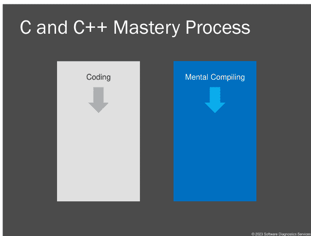

尽管 C++ 拥有高级特性，但它与 C 之间仍有很多底层重叠，当我用 C 和 C++ 编程时，我会在脑中将其编译为内存。这在我怀疑某个构造是否安全时很有帮助。我认为，观察 C 和 C++ 构造在内存中是如何实现的，极大有助于学习这些语言。

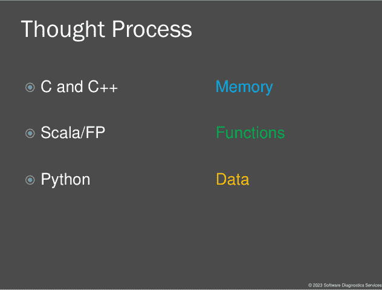

这张关于使用编程语言时思维过程的幻灯片可能存在争议。使用 C 和 C++ 时，我们考虑内存；使用 Scala/FP 时，我们考虑函数；使用 Python 时，我们考虑数据。


我们从指针开始，这是 C 以及 C++ 中最重要的概念。我最初在 2015 年创建了这种方法，但现在为了这次培训对其进行了扩展。

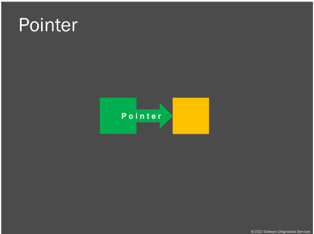

从概念上说，指针是一个引用（或指向）另一个实体的实体（entity）。我们称之为实体而不是对象（object），以免与 C++ 中的对象或面向对象编程中的对象混淆。例如，这可以是我的手指，指向一个苹果。

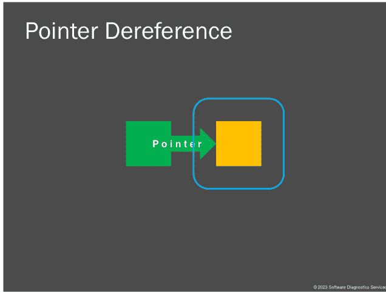

指针解引用是获取其所引实体以便进一步检查或使用的行为。想象我指向一个苹果，而你抓起它来吃。

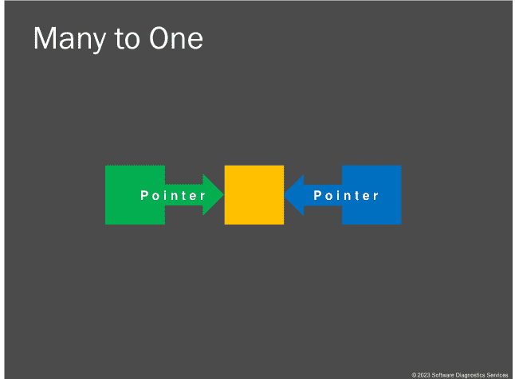

多个指针可以引用（或指向）同一个实体。例如，两个人指向同一个苹果。所以，从概念上说，指针与它们所指向的实体是分离的。我们应该把后者称为“被指实体”（pointees）吗？

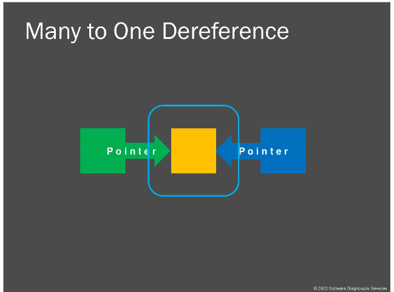

当然，如果你解引用同一个对象，你就会得到同一个对象。如果另一个人和你同时指向一个苹果，你们得到同一个苹果。

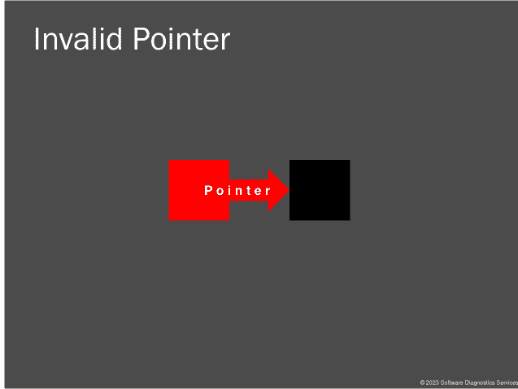

某些指针可能是的；例如，我可能指向一个虚幻的苹果。

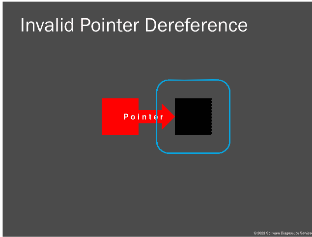

当你解引用无效指针时，会出现问题；例如，你无法得到那个虚幻的苹果。

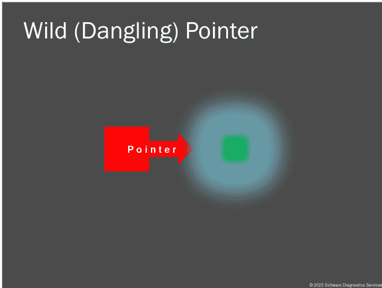

某些指针被称为悬空指针 ——它们曾经指向某些实体，但现在不再了，所以解引用失败。你伸手去拿我指向的苹果，但它在几秒前被夺走了。

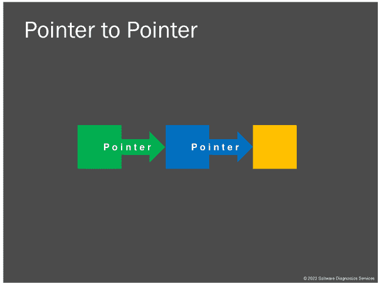

由于指针也是可以被指向的实体，因此可以存在指针链。你指向我；我指向一个苹果。

## 指向指针的指针解引用


当我们解引用第一个指针时，我们得到一个实体（另一个指针），我们可以再次解引用它获取底层实体。你指向我，另一个人拿到苹果。

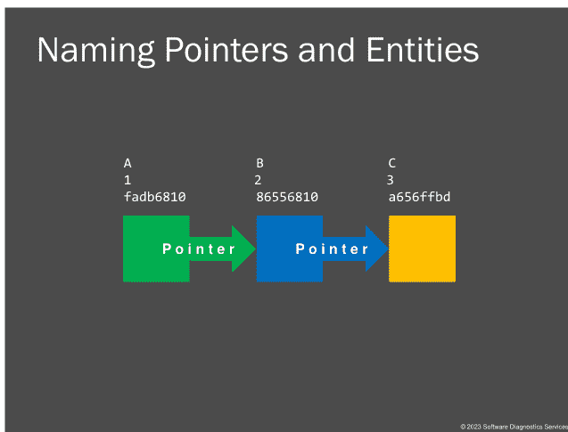

名称与实体是不同的。名称可以是编程语言的标识符，或只是数字或 ID。

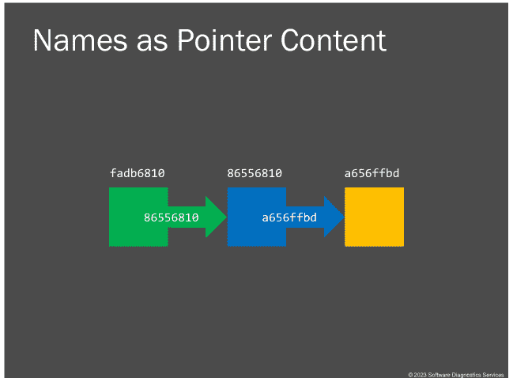

作为实体的指针可能包含名称，这些名称也可以是指针。如果指针只包含名称，我们就说指针值为名称。因此，指针值可以是另一个指针值，而后者指针值是另一个实体的名称。

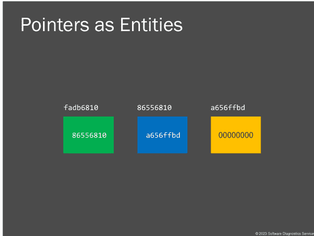

指针解引用是一种行为。如果需要，指针只是带有可以被解释为名称内容的实体。所有这些解引用只发生在运行时。在使用它之前，指针内容（其值）可能是无效的。

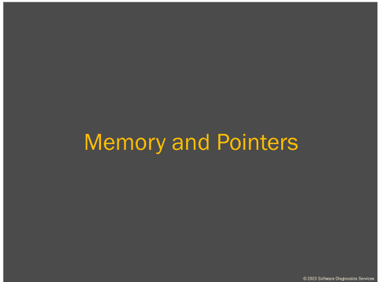

现在，我们来看指针及其指向的实体的内存表示。

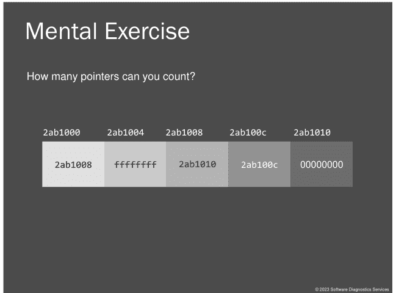

在这张图中，实体是所谓的内存单元。内存单元的地址从 0 开始，通常按所谓的指针大小递增（32 位系统上为 4，64 位系统上为 8）。为了视觉清晰，这里使用 32 位系统的内存单元。

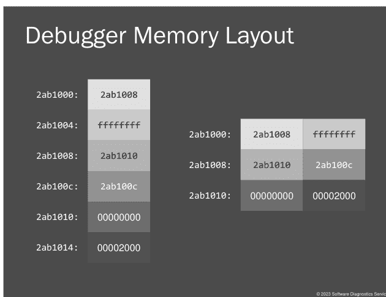

当我们使用调试器时，它按照此幻灯片所示的布局打印内存单元地址及其内容。某些调试器命令（如 GDB 中的 `x`）使用 2 列和 n 列布局来打印内存。

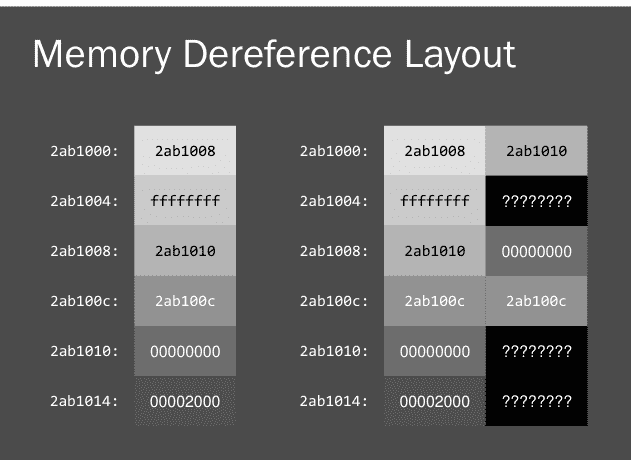

对于 2 列格式，某些调试器和其命令可能会将第二列解释为指针。在这种情况下，第三列是指针解引用的值。还要注意指针指向自身的情况。对于 GDB，可以使用自定义脚本模拟这种行为：

```
define dpp
  set $si = 0
  set $p = $arg0
  while $si < $arg1
    printf "%p: %s", $p
    x/gx *(long *)$p
    set $si = $si + 1
    set $p = $p + 8
end
```

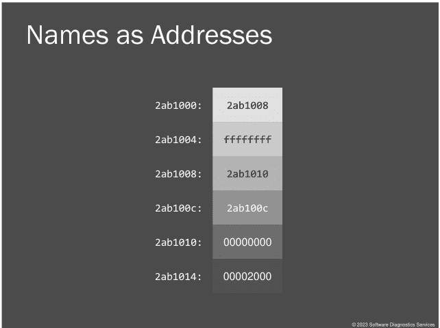

重复一遍，对于内存布局，名称被解释为地址，内存单元内容（单元值）也可以解释为内存地址。

| 2ab1000: | 2ab1008 | 2ab1000: | 2ab1008 |
| 2ab1004: | fffffff | 2ab1004: | fffffff |
| 2ab1008: | 2ab1010 | 2ab1008: | 2ab1010 |
| 2ab100c: |  |  |  |
| 2ab1010: | 00000000 | 2ab1010: | 00000000 |
| 2ab1014: | 00002000 | 2ab1014: | 00002000 |


实体可以是单单元或多单元。多单元的每个部分在必要时都可以解释为内存地址，即使它原本并不是内存地址。

| | |

|---|---|

| 2ab1000: | 2ab1008 |

| 2ab1004: | fffffff |

| 2ab1008: | 2ab1010<br>2ab100c |

| 2ab1010: | 00000000 |

| 2ab1014: | 00002000 |

内存中的结构是内存单元的顺序集合；某些可能是多单元且本身是子结构。除了结构的整体地址外，结构的每个部分、其成员或结构字段也有自己的地址。

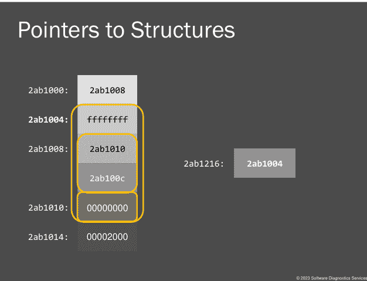

结构有其地址。指向结构的指针是包含该地址的内存单元。它有自己的地址。

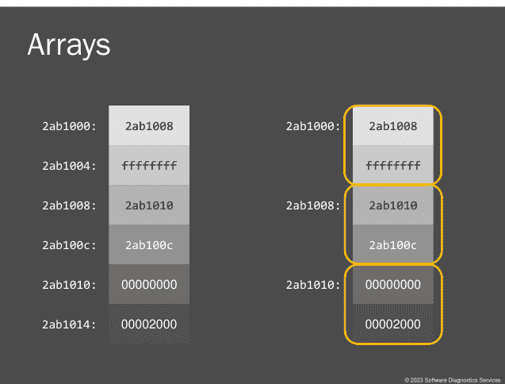

数组是内存中连续的 n 单元序列，称为数组元素。每个数组元素都有自己的地址。由于每个数组元素的大小固定且相同，访问随机元素非常快。

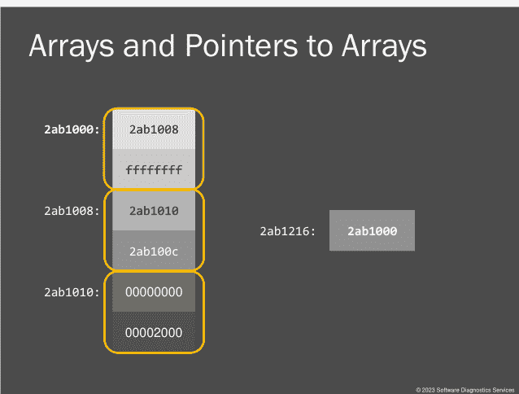

数组地址是其第一个元素的地址。但指向数组的指针是一个不同的内存单元，它包含了数组的地址。这与结构体和指向结构体的指针相似。数组也可以被视为一种结构体。

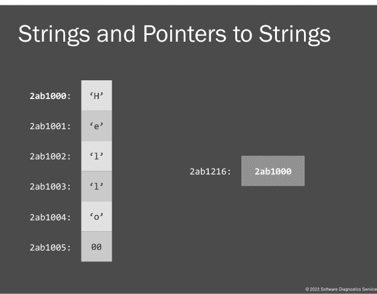

字符串又是呢？ASCII 字符串是一个零终止的单字节内存单元数组。字符串的地址是其第一个字节的地址。与数组类似，字符串的指针是一个内存单元，它包含了字符串的地址，即其第一个元素的地址——它的第一个字符。

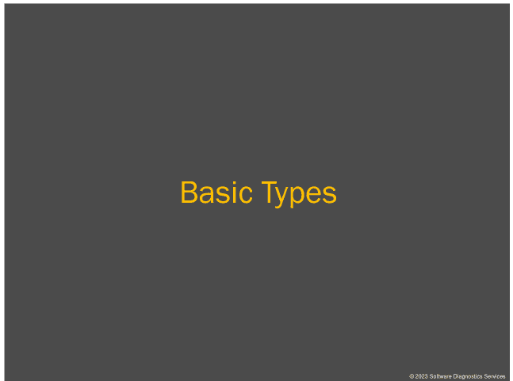

现在，我们来看几个基础基础类型。

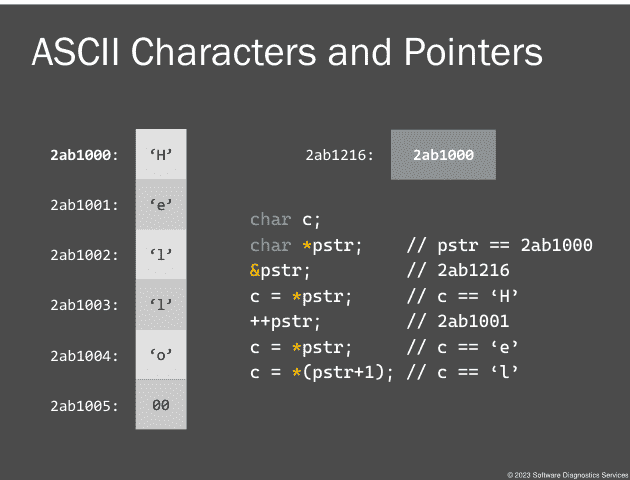

```
2ab1000:   'H'               2ab1216: 2ab1000
2ab1001:   'e'             char c;           // pstr == 2ab1000
2ab1002:   '1'               char *pstr;      // 2ab1216
2ab1003:   '1'               c = *pstr;       // c == 'H'
                               ++pstr;
2ab1004:   'o'               c = *pstr;        // c == 'e'
2ab1005: 00                c = *(pstr+1);   // c == 'l'
```

我们已经通过内存图在概念上看过了 ASCII 零终止字符串和指针。在这里，我们来看一些惯用的 C 代码。

与内存图对应的代码示例：

```
char c;               // pstr == 2ab1000
char *pstr;          // 2ab1216
&pstr;                // c == 'H'
c = *pstr;            // 2ab1001
++pstr;
c = *pstr;            // c == 'e'
c = *(pstr+1);        // c == 'l'
```

```
2ab1000: 12          2ab1216: 2ab1000
2ab1001: 34          unsigned char b;
2ab1002: 56          unsigned char *pb; // pb == 2ab1000
                        &pb; // 2ab1216
2ab1003: 78          b = *pb; // b == 12
                        ++pb; // 2ab1001
2ab1004: ab           b = *pb; // b == 34
                        b = *(pb+1); // b == 56
2ab1005: cd
```

字符是用带有 -128 到 127 的小整数值符号的。但如果我们想处理范围从 0 到 255 的无符号字节，我们需要使用 `unsigned char`。稍后，我们将看到还有其他类型可以处理字节。

与内存图对应的代码示例：

```
unsigned char b;
unsigned char *pb; // pb == 2ab1000
&pb; // 2ab1216
b = *pb; // b == 12
++pb; // 2ab1001
b = *pb; // b == 34
b = *(pb+1); // b == 56
```

```
2ab1000:   'H'               2ab1216:    2ab1000
               0                                 wchar_t wc;
2ab1002:   'e'               wchar_t *pwstr; // pwstr == 2ab1000
                                 // 2ab1216
                               wc = *pwstr;     // wc == L'H'
                               ++pwstr;          // 2ab1216
2ab1004:   00                c = *pwstr;      // c == L'e'
                                 c = *(pwstr+1);   // c == L'\0'
```

如果你想使用 UNICODE，使用每个占用两个字节的宽字符是自然的选择。

```
wchar_t wc;
wchar_t *pwstr; // pwstr == 2ab1000
&pwstr;          // 2ab1216
wc = *pwstr;      // wc == L'H'
++pwstr;          // 2ab1002
c = *pwstr;      // c == L'e'
c = *(pwstr+1);   // c == L'\0'
```


我们现在来看第二种占用 4 字节的整数。

与内存图对应的代码示例：

```
int i; // 2ab1000
&pi; // 2ab1116
i;
i = 0ffffffffffff // i = -1
i = *(pi+1); // i == 0ab1010
```

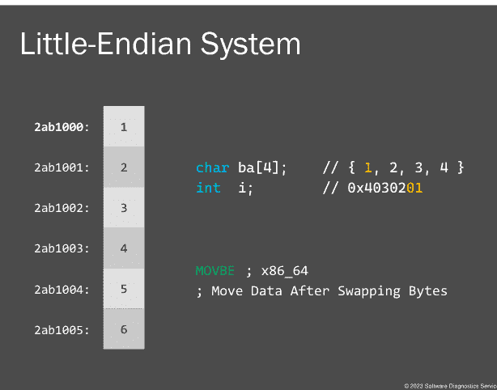

在字节序列和数字之间转换时，需要考虑低位字节位于最低地址的小端序系统。

与内存图对应的代码示例：

```
char ba[4]; // { 1, 2, 3, 4 }
int i; // 0x40301
```

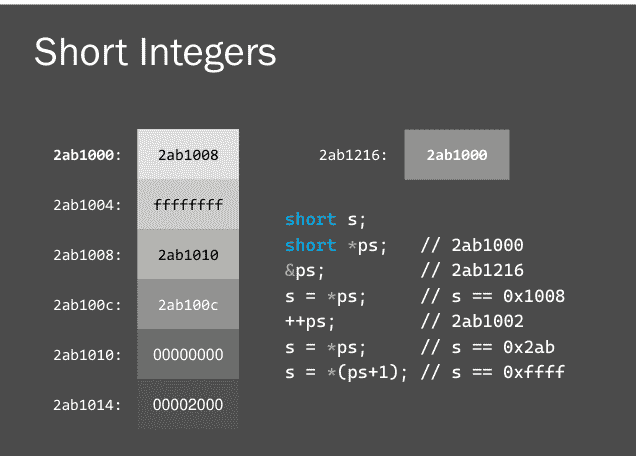

短整数占用 2 字节。

与内存图对应的代码示例：

```
short s; // 2ab1000
short *ps; // 2ab1216
&ps; // s = 0x1008
s = *ps; // s = 2ab
++ps;
s = *ps; // s = 0xffff
s = *(ps+1); // s =
```


| 地址 | 值 | 地址 | 值 |
|---|---|---|---|
| 2ab1000 | 2ab1008 | 2ab1216 | 2ab1000 |
| 2ab1004 | ffffffff | | |
| 2ab1008 | 2ab1010 | | |
| 2ab100c | 2ab10c | | |
| 2ab1010 | 00000000 | | |
| 2ab1014 | 00002000 | | |

```
long l; // long long

long *pl; // 2ab1000

&pl; // 2ab1216

l = *pl; // ll == 0xffffffff2ab1010

++pl; // 2ab1008

l = *pl; // ll == 0x2ab10c2ab100

l = *(pl+1); // ll == 0x20000000
```

我们需要 8 字节整数，需要使用 `long` 或 `long long` 来保证移植性。

- (有符号) short / 无符号 short
- (有符号) int / 无符号 int
- (有符号) long (int) / 无符号 long (int)
- (有符号) long long (int) / 无符号 long long (int)

在经典循环中使用无符号变量需要小心。以下代码会无限循环，因为循环变量始终为正：

```
for (unsigned i = 0xffff; i >= 0; --i)

{

    // ...

}
```

https://www.dumpanalysis.org/blog/index.php/2015/12/14/crash-dump-analysis-part-14-linux/

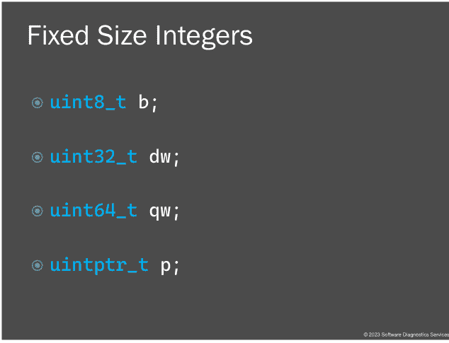

也可以精确地使用可移植的固定大小类型。

代码示例：

```
uint8_t b;

uint32_t dw;

uint64_t qw;

uintptr_t p;
```

```
bool b;

b = true;

b = false;
```

C++ 也包含布尔变量的原生类型。如果你想在纯 C 中使用它，需要包含 `stdbool.h` 头文件。

代码示例：

```
bool b;

b = true;

b = false;
```

```cpp

std::byte b;

```

- 不是字符
- 不是整数

最新的 C++ 标准也包含一种专门的字节类型。

代码示例：

```cpp

std::byte b;

```

- `sizeof` 运算符
- `size_t size = sizeof(int);
- int i; size = sizeof i;
- size = sizeof(1 + 1);

`sizeof` 运算符可以评估类型、变量以及表达式的结果类型的大小（而不进行表达式求值）。

代码示例：

```
size_t size = sizeof(int);

int i;

size = sizeof i;

size = sizeof(1 + 1);
```

```cpp

auto a = "Hello";

auto func(decltype("Hello") cstr) {

    return cstr;

}

```

C++11 增加了自动类型规格，因此类型是从初始化表达式中推导出的。

代码示例：

```cpp

auto a = "Hello";

auto func(decltype("Hello") cstr) {

    return cstr;

}

```


正如你所预期的，相同的内存单元地址及其值是不同实体类型之间转换的基础。现在，让我们来看一些示例。

# 指针转换（C 风格）

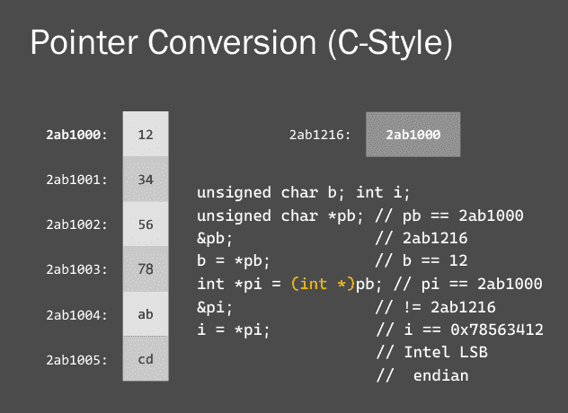

| 2ab1000 | 12 | 2ab1216 | 2ab1000 |
|---|---|---|---|
| 2ab1001 | 34 | unsigned char b; int i; | |
| 2ab1002 | 56 | unsigned char *pb; // pb == 2ab1000 | |
| 2ab1003 | 78 | // 2ab1216 b = *pb; // b == 12 | |
| 2ab1004 | ab | int *pi = (int *)pb; // pi == 2ab1000 | |
| 2ab1005 | cd | &pi; // != 2ab1216 i = *pi; // i == 0x78563412 // | |

指针可以自由转换，因为它们的值只是内存地址。然而，当我们对它们进行解引用时，我们得到的是基于内存内容的值，如此处所示，这些内容不会改变。请注意，由于低位优先字节序约定，我们得到的整数值与内存布局的字节顺序不同。

与内存图对应的代码示例：

```
unsigned char b; int i;

unsigned char *pb; // pb == 2ab1000

&pb; // 2ab1216

b = *pb; // b == 12

int *pi = (int *)pb; // pi == 2ab1000

&pi; // != 2ab1216

i = *pi; // i == 0x78563412

// Intel LSB endian
```

```cpp

Numeric Promotion/Conversion

char c = 'a'; int n = c;

short s = c;

int n = 0x1234; char c = n;

```

来自较小范围的值可以自动提升为范围更宽的类型。相反的自动转换可能会丢失某些信息，应该经过仔细检查。

代码示例：

```
char c = 'a';

int n = c;

short s = c;

int n = 0x1234;

char c = n;
```cpp
(type)(expr) // C 风格
```

```cpp
static_cast<type>(expr)
```

```cpp
for (unsigned i = 0xffff; (int)i >= 0; --i)
{}
```

```cpp
for (unsigned i = 0xffff; static_cast<int>(i) >= 0; --i)
{}
```

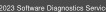

在兼容类型没有自动转换的情况下，我们可以使用 C 风格强制转换或显式的、特定的 C++ 强制转换。

以下代码示例解决了无限循环的问题：

```
for (unsigned i = 0xffff; (int)i >= 0; --i)
{}
```

```
for (unsigned i = 0xffff; static_cast<int>(i) >= 0; --i)
{}
```

```
Incompatible Types
* (type)(expr) // C 风格
* reinterpret_cast<type>(expr)
int *p = (int *)1;
p = reinterpret_cast<int *>(1);
```

当类型不兼容时（例如整数和指向它们的指针），我们可以使用 C 风格强制转换或特定的 C++ 类型重新解释转换。

代码示例：

```cpp
int *p = (int *)1;
p = reinterpret_cast<int *>(1);
```

```cpp
struct A
{
    unsigned int u1;
    unsigned int u2;
};
struct B
{
    unsigned long ul;
} b;

A a = *(reinterpret_cast<A*>(&b));
a = *(reinterpret_cast<A*>(&b));
```

不同的结构更加不兼容，直接的 C++ 重新解释转换会失败。然而，我们可以通过将指向源结构的指针重新解释为指向目标结构的指针并对其进行解引用，强制重新解释结构。在这种情况下，底层内存单元被重新解释为目标结构的值。在学习了关于结构和内存的后续章节后，你可以查看代码示例：

```
struct A
{
    unsigned int u1;
    unsigned int u2;
};
struct B
{
    unsigned long ul;
} b;
```

```cpp
A a = *(reinterpret_
<A*>(&b));
a = *(reinterpret_cast<A*>(&b));
```

# 结构、类和对象

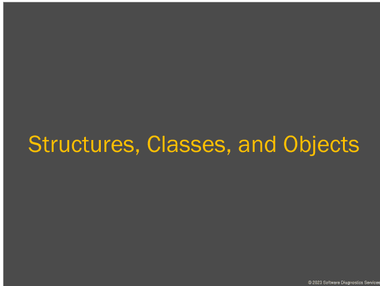

现在，我们涵盖结构、类和它们的对象。

## 结构

```cpp
struct MyStruct {
    int field;
    // ...
}
struct MyStruct myStruct;
MyStruct my2;
struct MyStruct *pMyStruct;
MyStruct *pStruct2;
struct {
    int field;
    // ...
} myOtherStruct;
struct {
    int field;
    // ...
```

我们可以将结构视为内存中布局的字段集合。结构可以有名称，也可以是匿名的。

代码示例：


```cpp
struct MyStruct {
    int field;
    // ...
}
struct MyStruct myStruct;
MyStruct my2;
struct MyStruct *pMyStruct;
MyStruct *pStruct2;
struct {
    int field;
    // ...
} myOtherStruct;
struct {
    int field;
    // ...
} *pOtherStruct;
```

## 访问级别

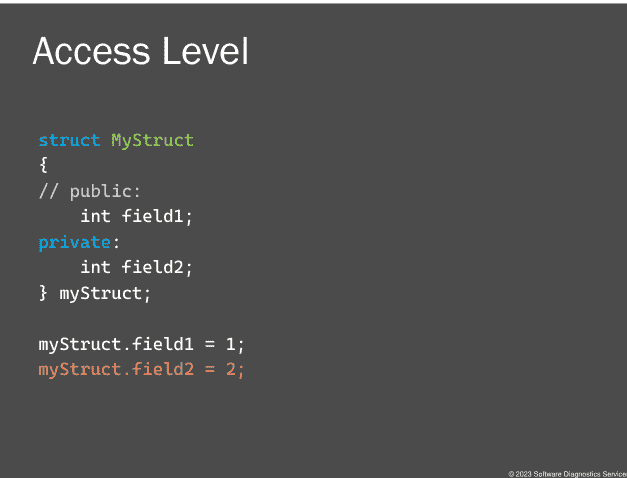

```cpp
struct MyStruct {
  public:
  int field1;
  private:
  int field2;
} myStruct;

myStruct.field1 = 1;
// myStruct.field2 = 2
```

带有 `private` 访问符的字段无法从外部引用。

代码示例：

```cpp
struct MyStruct {
  public:
  int field1;
  private:
  int field2;
} myStruct;

myStruct.field1 = 1;
// myStruct.field2 = 2
```

## 类和对象

```cpp
class MyClass {
    int field;
    // ...
}

class MyClass MyClass;
MyClass my2;

class MyClass *pMyClass;
class MyClass *pClass2;
class {
    int field;
    // ...
} myOtherClass;
class {
    int field;
    // ...
} *pOtherClass;
```

类具有相同的结构。

代码示例：

```cpp
class MyClass {
    int field;
    // ...
}

class MyClass MyClass;
MyClass my2;

class MyClass *pMyClass;
class MyClass *pClass2;
class {
    int field;
    // ...
} myOtherClass;
class {
    int field;
    // ...
} *pOtherClass;
```

## 结构和类

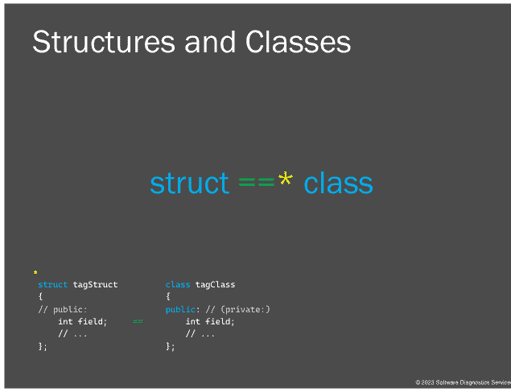

结构和类在 C++ 中是完全相同的，可以交叉使用。这就是为什么你可以在良好的 C++ 书中总是看到 `struct`。唯一的区别（如果我们现在忽略继承的话）是字段访问，结构中默认是 `public` 的，而类中是 `private` 的。

代码示例：

```cpp
struct tagStruct {
// public:
int field;
// ...
};
class tagClass {
public: // (private: by:)
int field;
// ...
};
```

# 指向结构

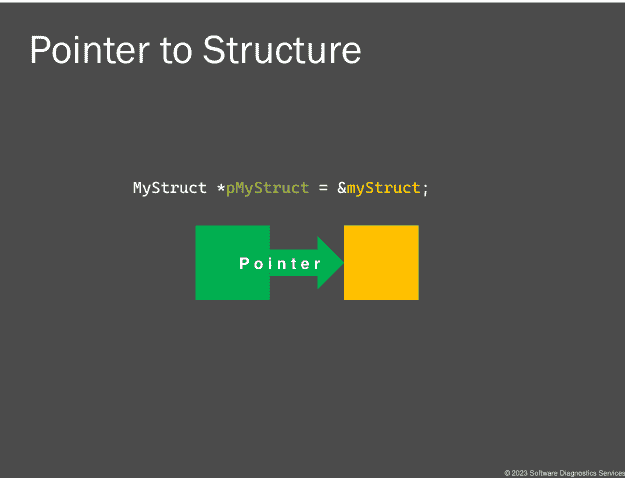

在这里，我们再次通过指针的概念图，并用 C 和 C++ 代码对其进行注释。

代码示例：

```cpp
MyStruct *pMyStruct = &myStruct;
```

# 指向结构解引用

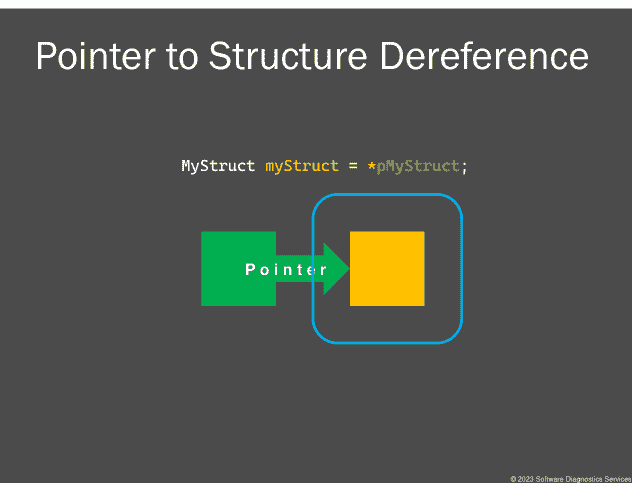

在这里，我们对某些结构的指针进行解引用。我们得到结构的值并将其赋值给 `myStruct` 变量。

代码示例：

```cpp
MyStruct myStruct = *pMyStruct;
```

## 指向结构的多个指针

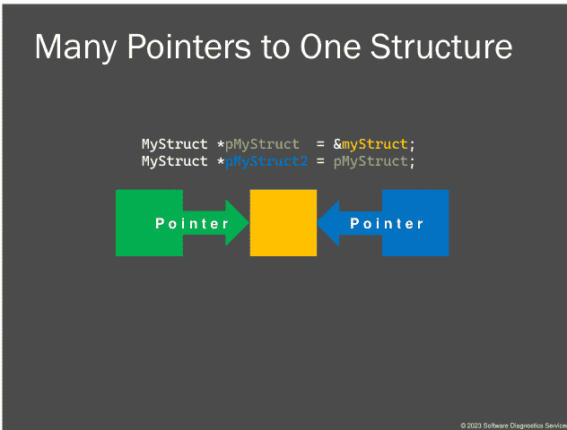

在这里，我们将一个指针的值赋值给另一个指针，它们现在都指向同一个结构。

代码示例：

```cpp
MyStruct *pMyStruct = &myStruct;
MyStruct *pMyStruct2 = pMyStruct;
```

## 多对一解引用

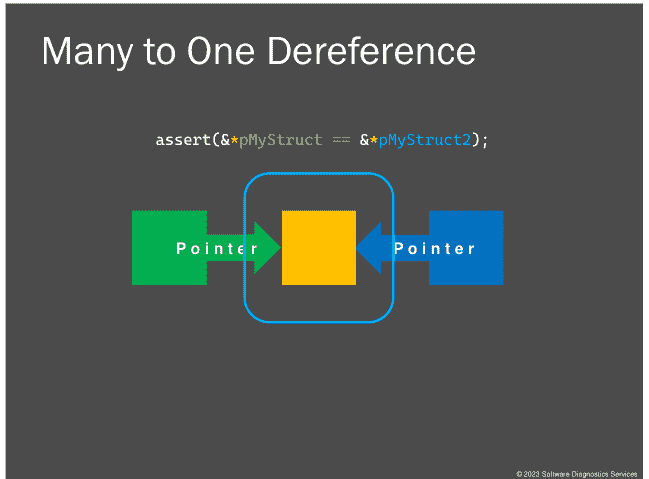

如果我们对两者都解引用，我们将得到相同地址的相同。

代码示例：

```cpp
assert(&pMyStruct == &pMyStruct2);
```

# 无效结构指针

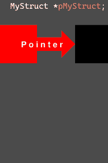

在这里，我们描述了一个未定义的指针，根据内存存储类型，它可以是一个 NULL 指针或某些随机值。

代码示例：

```cpp
MyStruct *pMyStruct;
```

## 无效指针解引用

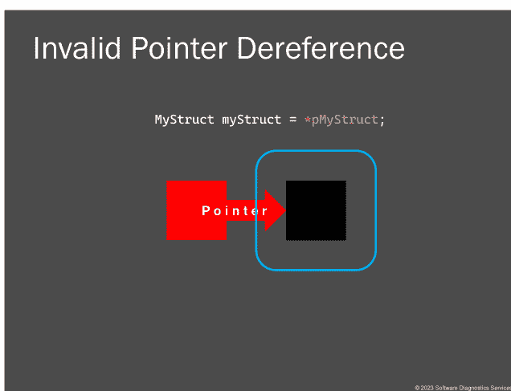

对未定义的指针进行解引用会导致未定义行为，最可能导致访问违规并崩溃。

代码示例：

```cpp
MyStruct *pMyStruct;
MyStruct myStruct = *pMyStruct;
```

## 野指针（悬空指针）

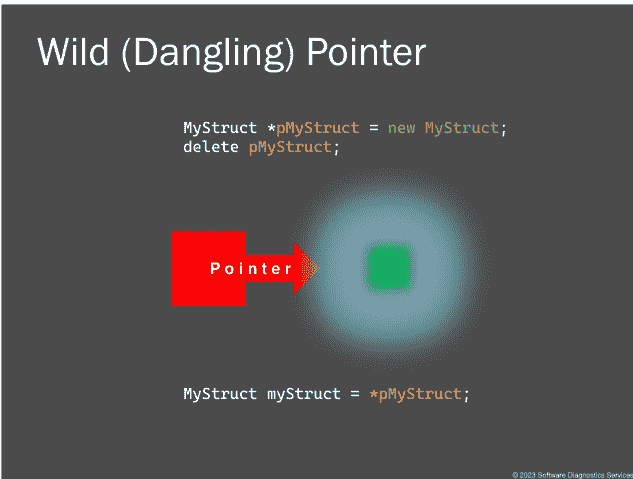

结构体的内存可以被动态分配然后释放，但如果指针没有重置为某个易于检查的值（例如 0），那么我们就会得到一个悬空指针，对其进行解引用会导致未定义行为，并可能导致进一步的损坏。

代码示例：

```
MyStruct *pMyStruct = new MyStruct;
delete pMyStruct;
```

MyStruct myStruct = *pMyStruct;

## 指向结构体的指针指针

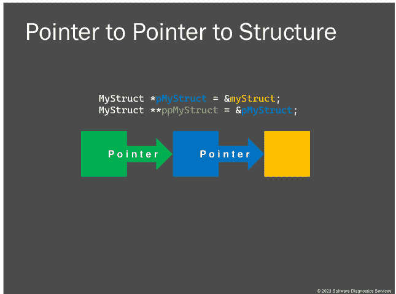

我们也可以拥有指向结构体的指针，以此类推，需要两次或多次解引用才能获取该值。稍后在讨论向函数传递参数时，我们将看到为什么我们需要双指针。

代码示例：

```
MyStruct *pMyStruct = &myStruct;
MyStruct **ppMyStruct = &myStruct;
```

## 指针指针的解引用

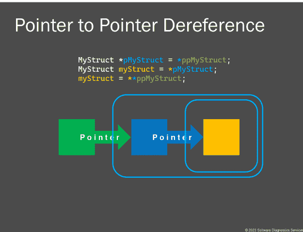

在这里，我们展示了双解引用。

代码示例：

```
MyStruct *pMyStruct = *ppMyStruct;
MyStruct myStruct = *pMyStruct;
myStruct = **ppMyStruct;
```

## 内存与结构体

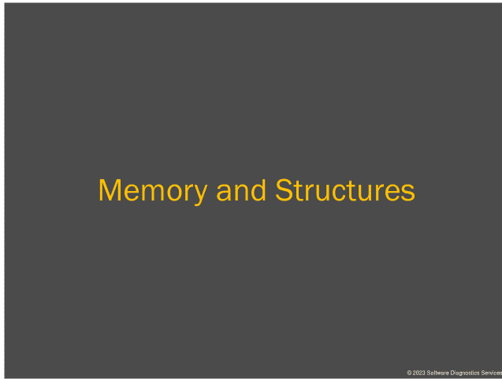

现在，我们来看结构体的内存表示。

## 地址与结构体

```
struct OuterStruct {
    int field1;
    struct InnerStruct {
        int field1;
        int field2;
    } field2;
    struct InnerStruct {
        int field;
    } field3;
    } myStruct;
```

| 2ab1000 | 2ab1008 |

|--- | --- |

| 2ab1004 | ffffffff |

| 2ab1008 | 2ab1010 |

| 2ab1008 | 2ab100c |

| 2ab1010 | 00000000 |

| 2ab1014 | 00002000 |

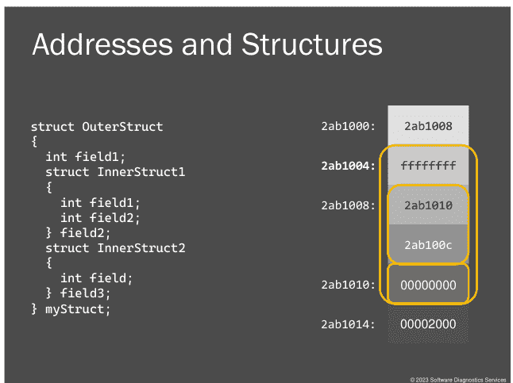

内存中的结构体是内存单元的顺序集合；某些可能是多单元的，且其本身也是子结构。除了结构体的整体地址外，它的每个部分、成员或结构体字段也有自己的地址。

与内存图对应的代码示例：

```
struct OuterStruct {
    int field1;
    struct InnerStruct {
        int field1;
        int field2;
    } field2;
    struct InnerStruct {
        int field;
    } field3;
    } myStruct;
```

## 结构体字段访问

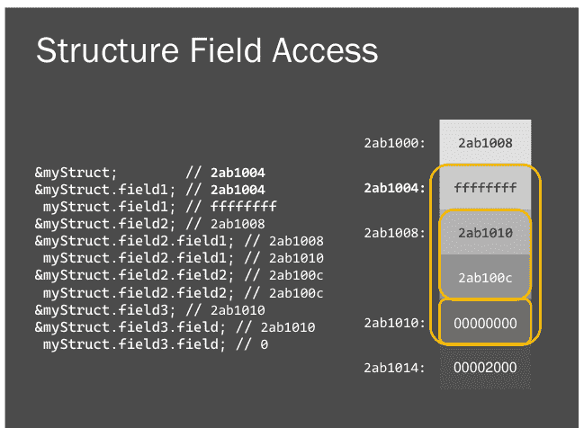

```
&myStruct; // 2ab1004
myStruct.field1; // 2ab1004
myStruct.field1; // fffffff
myStruct.field2; // 2ab1008
&myStruct.field2; // 2ab1008
myStruct.field2.field1; // 2ab1010
myStruct.field2.field2; // 2ab100c
myStruct.field2.field2; // 2ab100c
&myStruct.field3; // 2ab1010
myStruct.field3.field; // 2ab1010
myStruct.field3.field; // 0
```

这个示例展示了当我们拥有一个结构体值时的字段地址和访问方式。

与内存图对应的代码示例：

```
&myStruct; // 2ab1004
myStruct.field1; // 2ab1004
myStruct.field1; // fffffff
myStruct.field2; // 2ab1008
&myStruct.field2; // 2ab1008
myStruct.field2.field1; // 2ab1010
myStruct.field2.field1; // 2ab1010
myStruct.field2.field2; // 2ab100c
myStruct.field2.field2; // 2ab100c
&myStruct.field3; // 2ab1010
myStruct.field3.field; // 2ab1010
myStruct.field3.field; // 0
```

## 指向结构体的指针

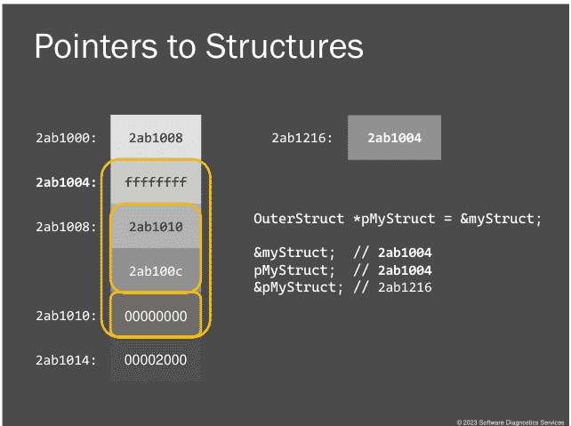

结构体有自己的地址。指向结构体的指针是一个包含该地址的内存单元。它有自己的地址。

与内存图对应的代码示例：

```
MyStruct *pMyStruct = &myStruct;
```

```
myStruct; // 2ab1004
```

## 结构体字段


这个示例展示了当我们拥有一个结构体值时的字段地址和访问方式。

与内存图对应的代码示例：

```
&myStruct; // 2ab1004
myStruct.field1; // 2ab1004
myStruct.field1; // fffffff
myStruct.field2; // 2ab1008
&myStruct.field2; // 2ab1008
myStruct.field2.field1; // 2ab1010
myStruct.field2.field1; // 2ab1010
myStruct.field2.field2; // 2ab100c
myStruct.field2.field2; // 2ab100c
&myStruct.field3; // 2ab1010
myStruct.field3.field; // 2ab1010
myStruct.field3.field; // 0
```

## 静态结构体字段

```
Static Structure Fields
struct MyStruct {
    int field;
    static unsigned shared_field;
} myStruct1, myStruct2;

unsigned MyStruct::shared_field = 123;
myStruct1.field = 0;
myStruct1.shared_field = 123;
myStruct2.field = 1;

(gdb) ptype /o MyStruct {
    /* offset    size */
    0          4
    int field;
    static unsigned int shared_field;
/* total size (bytes): 4 */
}

(gdb) x &MyStruct::shared_field:
0x402b8 <MyStruct::shared_field>: 0x0000007b
```

静态结构体字段的值相同类型的不同对象之间共享。它们占据与对象内存不同的、唯一独立的内存单元。

与 GDB 输出对应的代码示例：

```
struct MyStruct {
    int field;
    static unsigned shared_field;
} myStruct1, myStruct2;

unsigned MyStruct::shared_field = 123;
myStruct1.field = 0;
myStruct1.shared_field = 123;
myStruct2.field = 1;
```

# 统一初始化

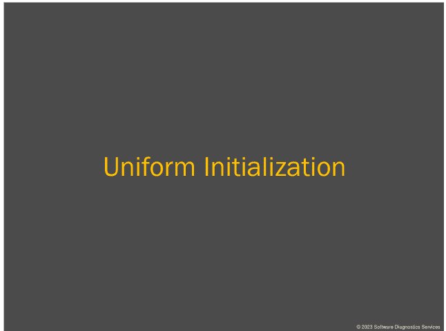

在整个 C++ 历史中，有多种初始化变量的方法。最后，有一种统一的方法来一致地执行它。

# 旧的初始化方式

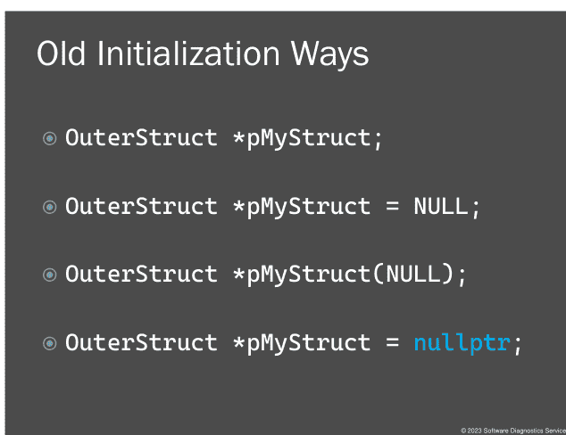

```
OuterStruct *pMyStruct;
OuterStruct *pMyStruct = NULL;
OuterStruct *pMyStruct(NULL);
OuterStruct *pMyStruct = nullptr;
```

当我们省略初始化值时，如果变量内存属于某些内存类（如栈），则该变量被视为未初始化。对于静态内存，它可能会用零值进行默认初始化。

代码示例：

```
OuterStruct *pMyStruct;
OuterStruct *pMyStruct = NULL;
OuterStruct *pMyStruct(NULL);
OuterStruct *pMyStruct = nullptr;
```

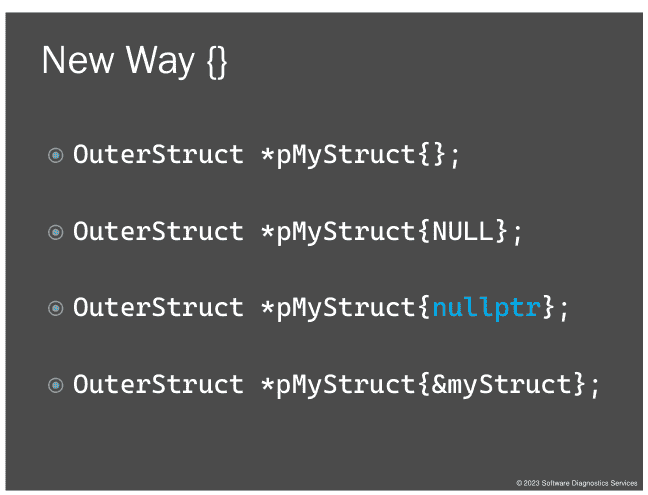

当我们在现代 C++ 中使用新的初始化方式时，可以使用空 `{}` 来指示默认初始化，即使是栈内存。

代码示例：

```
OuterStruct *pMyStruct{}
OuterStruct *pMyStruct{NULL};
OuterStruct *pMyStruct{nullptr};
OuterStruct *pMyStruct{&myStruct};
```

# 统一结构体初始化

```
Uniform Structure Initialization

struct OuterStruct
{
    int field1;
    struct InnerStruct1
    {
        int field1;
        int field2;
    } field2;
    struct InnerStruct2
    {
        int field;
    } field3;
} myStructA {1, {2, 3}, {4}};

struct OuterStruct
{
    int field1{1};
    struct InnerStruct1
    {
        int field1{2};
        int field2{3};
    } field2;
    struct InnerStruct2
    {
        int field{4};
    } field3;
} myStructB;
```

可以在结构体外部进行统一初始化，或者在结构体定义中提供默认字段初始化器。

代码示例：

```struct
struct OuterStruct
{
    int field1;
    struct InnerStruct1
    {
        int field1;
        int field2;
    } field2;
    struct InnerStruct2
    {
        int field;
    } field3;
} myStructA {1, {2, 3}, {4}};

struct OuterStruct
{
    int field1{1};
    struct InnerStruct1
    {
        int field1{2};
        int field2{3};
    } field2;
    struct InnerStruct2
    {
        int field{4};
    } field3;
} myStructB;
```

# 静态字段初始化

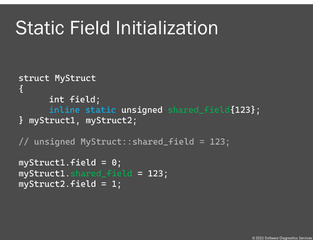

最新的 C++ 标准允许在结构体定义内部进行静态字段初始化，而不是传统的 C++ 外部初始化方式（如注释所示）。

代码示例：


```cpp
struct MyStruct{
  int field;
  inline static unsigned shared_field{123};
} myStruct1, myStruct2;

// unsigned MyStruct::shared_field = 123;

myStruct1.field = 0;
myStruct1.shared_field = 123;
myStruct2.field = 1;
```

# 宏、类型和别名

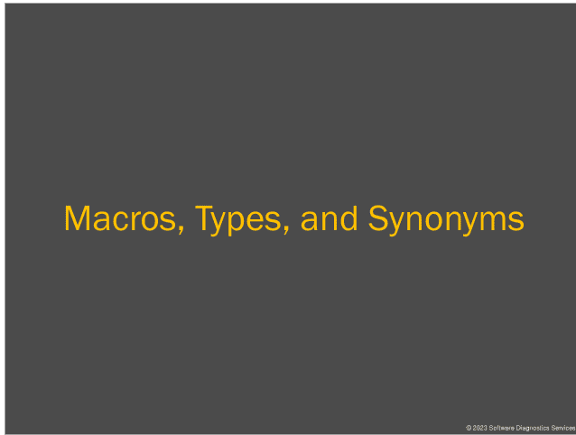

类型名称可能很长或不方便。有一些方法可以构造更容易的名字。

## 宏


代码示例：

```cpp
#define TRUE 1
#define byte_t unsigned char
#define p_byte_t unsigned char *
#define p_MyStruct MyStruct *
```

## 旧方式


代码示例：

```cpp
typedef unsigned char byte_t;
typedef unsigned char *p_byte_t;
typedef struct MyStruct *p_byte_t; // 注意：此处原文存在重定义冲突，已按样翻译
```

## 新方式


代码示例：

```cpp
typedef unsigned chart_;
;
...;
```

## 结构体代码示例：

```cpp
using byte_t = unsigned char;
using MyStruct;
```

# 内存存储


这所示，可以在结构体外部进行统一初始化，或者在结构体定义中提供默认字段初始化器。

# 概述

- 静态
- 结构
- 字段
- 静态
- 结构
- 字段
- 统一
- 结构
- 
- 统一
- 栈
- 局部
- 局部
- 栈
- 静态
- 统一
- 结构
- 初始化
- 统一
- 结构
- 初始化
- 静态
- 字段
- 初始化
- 静态内存
- 局部
- 栈

# 线程栈


当我们在现代 C++ 中使用新的初始化方式时，可以使用空 `{}` 来指示默认初始化，即使是栈内存。(c36cc1b69ac7baa75db5d13135bb9d30_118_0.png)

## 局部变量生命周期


# 栈分配


# 动态分配（C风格）


# 动态分配 (C++)


C++ 有其自己的动态内存实现，这些实现通常通过底层的 C 风格调用和 Linux API 完成。然而，这些高级分配设施对于结构设计者的需求更具灵活性和定制性。它为全局内存块分配和特定结构分配提供了可替换的运算符。

# 内存运算符


在释放全局分配的内存时，务必注意是否是以数组形式分配的，以避免内存泄漏、崩溃和其他未定义行为。此外，永远像 C 风格分配那样检查分配的内存地址是否为 `nullptr`：C++ 分配运算符会抛出异常。

## 内存表达式


内存分配表达式用于为值、结构及其数组分配内存。在内部，它们可能会使用内存运算符。对于非数组/数组释放和检查返回地址的建议也适用于这里。

## 局部指针（手动）


在动态分配内存并将内存地址赋值给局部变量时，我们不能忘记在从函数返回之前释放/删除内存，以避免内存泄漏。

与内存图对应的代码示例：

# foo();

当我们进入 `foo` 函数时，分配的栈帧包含了局部变量：

```cpp
void foo()
{
  ...
}
```

局部变量 `p` 包含分配的整数值内存的地址：

```cpp
void foo()
{
    int *p = new int;
...
}
```

然而，在退出函数之前，我们必须释放内存；否则会导致内存泄漏。请注意，`delete` 或 `free` 都不会改变变量 `p` 的值。它变成了一个悬空指针，但没关系，因为它在这里超出了作用域，除非被保存到其他地方，否则不会被用于解引用。

```cpp
void foo()
{
    int *p = new int;
...
    delete p;
}
```

# 原地分配


```cpp
char buf[sizeof(int)];
int *pi = new(buf) int;
*pi = 1;

char *pbuf = new char[sizeof(int)];
pi = new(pbuf) int;
*pi = 2;
delete[] pbuf;
```

如果我们想重用现有的内存缓冲区，可以使用定位 new（placement new）。

与内存图对应的代码示例：

```cpp
char buf[sizeof(int)];
int *pi = new(buf) int;
*pi = 1;

char *pbuf = new char[sizeof(int)];
pi = new(pbuf) int;
*pi = 2;
delete[] pbuf;
```

# 源代码组织


我们现在讨论 C 和 C++ 的源代码组织。

## 逻辑层（编译单元）


从编译器的角度来看，它以整个编译单元的形式工作并将编译单元的源码转换为目标文件。多个目标文件由链接器合并为执行文件。

## 物理层（源文件）


尽管一个物理源文件对应一个编译单元，但它通过预处理器处理，预处理器会查找包含其他文件的指令，而这些文件也可能包含其他文件。从 `common.h` 文件的情况可以看出，同一个文件可能被包含多次。

# 跨 TU 共享

)

不同编译单元中具有相同的变量在链接阶段可能会冲突。

与图对应的代码示例：

```cpp
// TU A
int counter;
```

```cpp
// TU B
extern int counter;
int counter;
```

# 经典的静态 TU 隔离

)

为了避免链接期间命名冲突，C 和 C++ 建议使用 `static` 限定符。

与图对应的代码示例：

```cpp
// TU A
static int counter;
```

```cpp
// TU B
extern int counter;
int counter;
```

# 命名空间隔离

)

现代 C++ 建议使用命名空间。

与图对应的代码示例：

```cpp
// TU A
namespace
{
    int counter;
}
```

```cpp
// TU B
extern int counter;
int counter;
```

## 声明与定义

)

在 C 和 C++ 中，在编译时考虑声明和定义的区别是有用的。经验法则是后者描述了内存布局。请注意，定义也是一种声明。

# TU 定义冲突

```cpp
struct S { }; // thirdparty.h
struct S { }; //...
S s;
```

允许对同一实体进行多个声明，但只允许一个定义，这是 ODR（单一定义规则）的精髓。

代码示例：

```cpp
struct S { }; // thirdparty.h
struct S { }; //...
S s;
```

# 细粒度 TU 作用域


命名空间允许细粒度的作用域。

代码示例：

```cpp
struct S { }; // thirdparty.h
namespace mycode { struct S { }; // ...
mycode::S;
using namespace mycode;
S2; // ambiguous
```

# 概念层（设计）


在设计层，我们可能希望分离实现细节。

# 不完整类型


这种分离通过不完整类型和所谓的 Pimpl（指向实现的指针）用法实现。

```cpp
struct MyStruct; // 声明
struct MyStruct *pMyStruct; // (声明和定义)
// Pimpl（指向实现的指针）用法
struct Instrument // (声明和定义)
{
    int getMeasurement(); // 声明
private:
    struct InstrumentImpl; // 声明
    struct InstrumentImpl *pImpl; // 定义
};
```

# 引用


现在是关于 C++ 引用的幻灯片。我们计划在第二版中扩展这部分。

# Type& vs. Type*

```cpp
Type& vs. Type*

* 从内存角度来看是相同的
* 定义: int& ref{val}; int *ptr{&val};
* 解引用: ref; *ptr;
* 字段访问: rStruct.field; pStruct->field; (*pStruct).field;
```

从内存角度来看，引用和指针是同一件事。唯一的区别是你不能拥有悬空引用；它必须被初始化。

# 值类别


现在让我们简要讨论各种类别的值。这些是存储在内存中的内容。指针值也是一个解释为指向某处其他值的内存地址的值。

# 值类别

5d1315bb9d30_146_)

在阅读严肃的 C++ 文档时，你经常看到所谓的左值（lvalues）和右值（rvalues）。粗略地说，你可以把它们理解为表达式中的左值和右值，其中右值可以是临时的，而左值必须有内存支持。

# 分类

https://en.cppreference.com/w/cpp/language/value_category

## 常量值

```cpp
Constant Values

const int cv{1}; int v;

const int *pc;
int * const cp&v;
const int * const cpc{cp};

const int& rc{v}; int& r{v};
```


值也可以是常量的，有助于函数式编程和代码安全。请注意，可以指向常量值的指针和引用、指向可变变量的常量指针，以及兼者。读取此类声明的方法是从右向左的。

代码示例：

```cpp
const int cv{1}; int v;
const int *pc;
int * const cp&v;
const int * const cpc{cp};
const int& rc{v}; int& r{v};
```

# 常量表达式

```
Constant Expressions
#define myConst 1
const int myConst = 1;
constexpr int myConst = 1;
```

有多种方法可以定义常量以便后续符号化使用。C 和经典的 C++ 方法使用预处理器（遗旧式）和 `const`。现代方法是使用 `constexpr`，它更加灵活。

代码示例：

```
#define myConst 1
const int myConst = 1;
constexpr int myConst = 1;
```


这一部分是课程中最大的。一旦内容继续增加，我们可能会在第二版中将其拆分。

# 函数指针

```
(4bc2000):    int (* ) (int) { };
                            = &;
                            int (*6) (int) { * };
int (int i)
// ...
return 0;
(2ab1210): 4bc2000
(2ab1218): 4bc2000
(10);
(*)(10);
(10)
```


函数是代码字节，因此它们以其起始地址占用某些内存位置。

与内存图对应的代码示例：

```
int foo (int i)
{
// ...
return 0;
}
```

可以拥有函数的指针和引用：

```
int (*pf) (int) {foo};
pf = &foo;
int (*rf) (int) {*pf};
```

当拥有函数的指针或引用时，可以使用或不使用解引用语法 (`*`) 来调用函数：

```
pf(10);
(*pf)(10);
rf(10);
```

# 函数指针类型


函数指针类型的声明可以使用经典的 `typedef` 语法，也可以通过更现代的 `using` 类型别名。

代码示例：

```
typedef int (*PF)(int);
using PF = int (*)(int);
PF func{foo}; func(10);
```

# 读取声明

- * 从右向左。[]<sub>右</sub> 或 ()<sub>右</sub> → 右

- * 示例：

```
const int* const* * [10];

int (*difficult)(int (*) (int, int))(int);
using DF = (*)( int);
DF difficult2{difficult};
```


了解读取声明的规则是值得的，因为函数指针类型可能非常复杂。第一个示例读为一个包含 10 个元素的数组，每个元素都是指向指向常量整数常量指针的指针。下一个示例是一个指向函数的指针，该函数接受一个接受整数并返回整数的函数指针，并再接受另一个整数，最后返回一个接受整数并返回整数的函数指针。可以通过通用子类型 `PF` 来简化。我们可以通过初始化来验证这两种描述的兼容性。GPT-4 非常擅长解析此类类型。

```
const int* const*arr[10];
```

```
int (*difficult)(int (*) (int, int))(int);
using DF = PF (*) (PF, int);
DF difficult2{difficult};
```

# 结构体函数字段

```
struct
{
    int field;
    PF pFunc;
} myStruct;
```

结构体可能包含指向函数的字段：在 C 中实现 OOP 的明显方法。

代码示例：

```
struct
{
    int field;
    PF pFunc;
} myStruct;
```

# 结构体方法

```cpp
struct MyStruct {
  int field;
  PF pFunc;
  int method (int i);
} foo;
```

C++ 引入了结构体或类方法。它们可以在结构体内部定义，也可以通过结构体作用域符在外部定义。

代码示例：

```cpp
struct MyStruct {
  int field;
  PF pFunc;
  int method (int i);
} foo;

int MyStruct::method(int i) { return i; }
```

# 结构体方法（内联）


这是定义函数的另一种方式，尽管它暴露了实现细节。

代码示例：

```cpp
struct MyStruct {
    int field;
    PF pFunc;
    int method (int i) { return i; }
} myStruct;
```

# 结构体方法（继承）

```cpp
struct Base {
    int method (int i) { return i; }
};
struct Derived : Base {
    int method (int i) { return i; }
} derived;
```

在继承的情况下，派生结构体会隐藏基类中同名的方法，除非使用了显式的基类类型作用域。然而，当我们拥有基类指针时，即使实际对象属于派生类型，也会调用基类方法：

```cpp
struct Base {
    int method (int i) { return i; }
};
struct Derived : Base {
    int method (int i) { return i; }
} derived;

Base *pBase = &derived;
pBase->method(0);
```

# 结构体虚方法

```cpp
struct Base {
    int method (int i) { return i; }
    virtual int vmethod (int i) { return i; }
};
struct Derived : Base {
    int method (int i) { return i; }
    virtual int vmethod (int i) override { return i; }
} derived;
```

通过引入类型无关的虚方法解决了之前的问题。

# 结构体纯虚方法

```cpp
struct Base {
    int method (int i) { return i; }
    virtual int vmethod (int i) = 0;
};
struct Derived : Base {
    int method (int i) { return i; }
    virtual int vmethod (int i) override { return i; }
} derived;

Base *pBase = &derived;
pBase->vmethod(0);
```

如果我们想确保从不定义基类对象，并确保重写派生类型中的所有虚方法，可以使用 `= 0` 将虚函数变为**纯虚**的。

代码示例：

```cpp
struct Base {
    int method (int i) { return i; }
    virtual int vmethod (int i) = 0;
};

struct Derived : Base {
    int method (int i) { return i; }
    virtual int vmethod (int i) override { return i; }
} derived;

Base *pBase = &derived;
pBase->vmethod(0);
```

# 结构体作为接口

```cpp
struct {
    virtual int (int i) = 0;
    virtual int (int i) = 0;
};
struct Implementer : {
    virtual int vmethod1 (int i) override { return i; }
    virtual int vmethod2 (int i) override { return i; }
} myObject;

void *pIFace = &myObject;
pIFace->vmethod1(0);
```


纯虚函数允许为派生类型指定抽象接口。

代码示例：

```cpp
struct Interface {
    virtual int vmethod1 (int i) = 0;
    virtual int vmethod2 (int i) = 0;
};
struct Implementer : Interface {
    virtual int vmethod1 (int i) override { return i; }
    virtual int vmethod2 (int i) override { return i; }
} myObject;

Interface *pIFace = &myObject;
pIFace->vmethod1(0);
```

# 函数结构体

```cpp
struct MyFunction
{
    int field{1};
    int operator() { return field; }
} myFunction;

myFunction();
```

函数也可以封装状态。实现此点的方法是通过实现函数调用运算符的结构体。

代码示例：

```cpp
struct MyFunction
{
    int field{1};
    int operator() { return field; }
} myFunction;

```

myFunction();

# 结构构造函数


现在，我们来看经典 C++ 中传统的 OOP 主题。构造函数是带有或不带参数的方法，用于结构初始化，内部包含自定义的初始化逻辑，例如获取所需的资源。

代码示例：

```cpp
struct MyFunction {
    MyFunction(): field{1} { }
    MyFunction(int _field): field{_field} { }
    int field;
    int operator() { return field; }
};
MyFunction myFunction, myFunction2(2);

myFunction();
myFunction2();
```

# 结构拷贝构造函数


当我们复制对象但需要复杂的复制逻辑或非平凡的内存管理时，拷贝构造函数非常有用。我们传递源对象的引用，仿佛我们没有打算对其修改它。

代码示例：

```cpp
struct MyFunction
{
    MyFunction(): field{1} { }
    MyFunction(int _field): field{_field} { }
    MyFunction(const MyFunction& src)
        : field(src.field) { ++field; }
    int field;
    int operator() { return field; }
};
MyFunction myFunction;

MyFunction myFunction2(myFunction);
MyFunction myFunction3 = myFunction;
```

# 结构拷贝赋值

```cpp
struct MyFunction
{
    MyFunction(): field{1} {}
    MyFunction(int _field): field(_field) {}
    MyFunction(const MyFunction& src)
        : field(src.field) { ++field; } 
    MyFunction& operator=(const MyFunction& src) {
        if (this != &src) ++(field = src.field);
        return *this;
    }

    int field;
    int operator() { return field; }
};
```

MyFunction myFunction2;

myFunction = myFunction;

在非平凡赋值的情况下，我们可以实现赋值运算符。然而，我们应该注意不要赋值到自身（this），并返回指向自身的非const引用（*this）以允许链拷贝。

```cpp
struct MyFunction
{
    MyFunction(): field{1} {}
    MyFunction(int _field): field(_field) {}
    MyFunction(const MyFunction& src)
        : field(src.field) { ++field; } 
    MyFunction& operator=(const MyFunction& src) {
        if (this != &src) ++(field = src.field);
        return *this;
    }

    int field;
    int operator() { return field; }
};

MyFunction myFunction2;
myFunction = myFunction;
```

# 结构析构函数

```cpp
struct MyFunction {

  MyFunction(): field{1} { }

  ~MyFunction() { /* close resources */ }

  MyFunction(int _field): field{field} { }

  MyFunction(const MyFunction& src)

    : field(src.field) { ++field; }

  MyFunction&operator=(const MyFunction& src) {

    if (this != &src) ++field = src.field; 

    return *this;

  }

  int field;

  int operator() { return field; }

};

{ MyFunction myFunction; }
```


如果我们需要一些复杂的逻辑，例如在局部对象超出作用域时释放资源，或者我们删除了它，怎么办？析构函数在这种情况下会被调用的方法。

```cpp
struct MyFunction {

  MyFunction(): field{1} { }

  ~MyFunction() { /* close resources */ }

  MyFunction(int _field): field{field} { }

  MyFunction(const MyFunction& src)

    : field(src.field) { ++field; }

  MyFunction&operator=(const MyFunction& src) {

    if (this != &src) ++field = src.field; 

    return *this;

  }

  int field;

  int operator() { return field; }

};

{ MyFunction myFunction; }
```

# 结构析构函数层次结构


```cpp
struct IFunction
{
    ~IFunction() {}
    virtual int operator()() = 0;
};
struct MyFunction : IFunction
{
    ~MyFunction() { /* close resources*/}
    int field;
    int operator()() override { return field; }
};
IFunction *pIFunction = new MyFunction;
pIFunction->operator()();
(*pIFunction)();
delete pIFunction; // ~IFunction()
```

从概念上说，析构函数就像普通方法，因此当我们有一个基类指针指向派生类对象时，可能会调用错误的析构函数。

```cpp
struct IFunction
{
    ~IFunction() {}
    virtual int operator()() = 0;
}
struct MyFunction : IFunction
{
    ~MyFunction() { /* close resources*/}
    int field;
    int operator()() override { return field; }
};
IFunction *pIFunction = new MyFunction;
pIFunction->operator()();
(*pIFunction)();
delete pIFunction; // ~IFunction()
```

# 虚拟析构函数

```cpp
struct IFunction
{
    ~IFunction() {}
    virtual int operator()() = 0;
}
struct MyFunction : IFunction
{
    ~MyFunction() { /* close resources*/}
    int field;
    int operator()() override { return field; }
};
IFunction *pIFunction = new MyFunction;
pIFunction->operator()();
(*pIFunction)();
delete pIFunction; // ~IFunction()
```

# 虚拟析构函数

```cpp
struct IFunction
{
    ~IFunction() {}
    virtual int operator()() = 0;
}
struct MyFunction : IFunction
{
    ~MyFunction() { /* close resources*/}
    int field;
    int operator()() override { return field; }
};
IFunction *pIFunction = new MyFunction;
pIFunction->operator()();
(*pIFunction)();
delete pIFunction; // ~IFunction()
```

## 按指针/常量引用传递参数


如果只只对结构体追求效率，则需要通过常量引用进行传递。在这种情况下，我们无法无法修改原始值。

代码示例：

```
void func(const MyStruct *pms)
  { pms->field = 0; }
func(&MyStruct{});

void func(const int& ri)
  { ri = 0; }
func(int(0));
```

## 可能的错误


```
void func(const MyStruct ms)
  { ms.field = 0; }
func(myStruct);

void func(const MyStruct& ms)
  { ms.field = 0; }
func(myStruct);
```

如果你来自使用隐式引用的语言，可能会不小心省略 `&`：

```
void func(const MyStruct ms)
  { ms.field = 0; }
func(myStruct);

void func(const MyStruct& ms)
  { ms.field = 0; }
func(myStruct);
```

## 函数重载


函数重载允许为不同参数数量和类型的函数重用相同的函数名。

代码示例：

```
int funco(int i);
int funco(int i, int j);
int funco(long &rl);
```

## 不变对象


如果你有常量对象，只允许调用定义中带有 `const` 修饰符的方法。

代码示例：

```
struct MyStruct {
  MyStruct(int _field) : field{_field} { }
  int get() const { return field; }
  void set(int newval) { field = newval; }
  private:
    int field;
}; myStruct(1);

const MyStruct& myCStruct{myStruct};

myCStruct.get();
myCStruct.set(2);
```

## 静态结构函数

```cpp
```


```
// 此处忽略了多线程问题

struct MyStruct

{

    MyStruct(int _field) : field{field} { ++count; }

    int get() const { return field; }

    void set(int newval) { field = newval; }

    static auto get_count()

    {

        field++;

        return count;

    };

private:

    int field;

    inline static unsigned count{0};

} myStruct1(1), myStruct2(2);

MyStruct::get_count();

assert(myStruct1.get_count() == myStruct2.get_count());
```

静态结构函数只允许访问对象间共享的静态结构字段。

## Lambda 表达式

- 间插：必要的 x64 和 A64 反汇编
- 无名函数对象
- 一个函数参数
- 可选捕获上下文
- 返回值

在讨论 C++11 引入的 lambda 及其内部机制之前，我们先简单回顾基础的 x64 和 A64 反汇编。

## x64 CPU 寄存器


有熟悉的 32 位 CPU 寄存器名称，例如 `EAX`，它们被扩展为 64 位名称，如 `RAX`。它们大多数在传统上是专门的，例如 ALU（算术逻辑单元）、计数器和内存复制寄存器。尽管现在它们都可以作为通用寄存器使用。当然，还有一个栈指针 `RSP`，此外还有一个帧指针 `RBP`，用于寻址局部变量和保存的参数。在某些编译器代码生成实现中，`RBP` 也用作通用寄存器，而 `RSP` 承担帧指针的角色。指令指针 `RIP` 在每次函数调用时都会保存在栈内存区域，然后在从调用函数返回时恢复。此外，x64 平台还有另外八个通用寄存器，从 `R8` 到 `R15`。

## x64 指令和寄存器

- 操作码 `SRC, DST` = 默认 AT&T 格式
- 示例：

```
mov $10, %rax          # 0x10 -> RAX

mov %rbp               # RSP -> RSP

add $10, %r10          # R10 + 0x10

imul %ecx, %edx       # ECX * EDX

call %rdx             # RDX 已经包含 (func) 的地址

push RIP               # RSP -> RIP

sub $30, %rsp          # 为局部变量留空间
```

此页幻灯片展示了几个涉及寄存器的 CPU 指令示例，例如移动值和进行算术运算。如果你习惯 Windows 上的 Winbg，那么操作数的方向与 Intel x64 反汇编相反。在 GDB 中可以使用 Intel 反汇编格式，但我们在 Linux 环境中选择了默认的 AT&T 格式。

## x64 内存与栈


在查看内存操作之前，让我们看看内存的图形表示。栈只是另一个内存区域，而不是 `RSP` 和 `RBP`。请注意栈是向低地址增长的，访问值需要使用 的偏移量。

## x64 加载指令


- 操作码 `Offset(SRC), DST`
- 示例：

```
mov 10(%rsp), %rax      # RSP+10 -> RAX

mov -10(%rbp), %rcx      # RBP-10 -> RCX

add (%rax), %rdx        # RAX -> RDX

pop %rdi                # RSP

lea 20(%rbp), %rb8       # RBP+20 -> R8

                               # 地址 R8
```

常量编码在指令中，但如果我们需要任意值，必须从内存获取。括号显示相对于某个寄存器的内存访问。

## x64 存储指令


存储与加载类似。

## x64 Flow指令


- 操作码 `DST`
- 示例：

```
jmpq 0x1049fc1c      # 0x1049fc1c -> RIP

                      # (跳转 0x1049fc1c)

jmpq *0x100(%rip)     # RIP+100 -> RIP

callq 0x1049ff74    # RSP - 8 -> RSP

0x1049fc14:         # 值

                      # ff74 -> RIP
```

跳转（无条件跳转）通过 `JMP` 指令实现。函数调用通过 `CALL` 指令实现。对于条件分支，请参考 Intel 官方文档。

## x64 函数参数


在 x64 Linux 平台上，从左到右的前六个 C 和 C++ 函数参数移动到 CPU 寄存器，其余通过栈位置传递。

## x64 结构体函数参数


调用结构体静态成员函数时，第一个参数是隐式的，在 x64 Linux 平台上通过 `RDI` 传递。这是一个对象地址，用于帮助区分相同结构类型的对象并引用正确的字段内存。其余参数按常传递。

## A64 CPU 寄存器


- `X0-X28, W0-W28`
- `X16` (`XIP0`), `X17` (`XIP1`)
- 栈：`SP, X29` (`FP`)
- 下一条指令：`PC`
- 寄存器：`X30` (`LR`)
- 零寄存器：`XZR, WZR`

# A64 指令与寄存器


操作码 `DST, SRC, SRC2`

示例：

```
mov   x0, #16          // X0 ← 16 (0x10)

mov   x29, sp           // X29 ← SP

add   x1, x2, #16       // X1 ← X2+16 (0x10)

mul   x1, x2, x3         // X1 ← X2*X3

blr  x8                 // X8 已经包含

                      // 函数地址 (&func)

                      // LR ← PC+4; PC &func

                      // SP ← SP-48 (-0x30)

sub   sp, sp, #48       // 为局部变量留出空间
```

这张幻灯片展示了几个涉及寄存器操作的 CPU 指令示例，例如移动值和进行算术运算。如果你习惯 Windows 上的 WinDbg，那么操作数的方向与 Intel x64 反汇编格式相同。它等同于赋值。`BLR` 是对某个寄存器中地址的函数的调用。`BL` 代表 Branch and Link（跳转并链接）。

# A64 内存与栈寻址


在查看内存操作之前，让我们来看内存寻址的图形化表示。线程栈只是其他内存区域之一，因此可以使用除 `SP` 和 `X29` (`FP`) 以外的任何寄存器。请注意，栈向低地址方向增长，因此要访问之前压入的值，需要使用 `SP` 的正偏移量。

# A64 内存加载指令


- 操作码 `DST, DST_, [SRC], Offset`
- 操作码 `DST, DST_, [SRC], Offset` // 后增位 (Postincrement)
- 示例：

```
ldr x0, [sp] // 地址 SP+0 处的值

ldr x0, [x29, -8] // 地址 X29-0x8 处的值

ldp x29, x30, [sp, #16] // X29 + 地址 SP+32 (0x20) 处的值

ldp x29, x30, [sp] // X30 + 地址 SP+0 处的值

// SP -> SP+16 (0x10)
```

常量编码在指令中，但我们需要任意值，必须从内存中获取。方括号表示相对于存储在某个寄存器中的地址的内存访问。还有在加载后调整寄存器值的选项，称为“后增位”，该值可以是负数。

# A64 内存存储指令

- 操作码 `SRC, SRC2, [DST, Offset]`
- 操作码 `SRC, SRC2, [DST, Offset]` // 前增位 (Preincrement)
- 示例：

```
str x0, [sp, #16]              // x0 -> 地址 SP+16 (0x10) 处的值

str x0, [x29, #-8]           // x0 -> 地址 SP+32 处的值

stp x29, x30, [sp, #32]           // x29 -> 地址 SP+40 (0x28) 处的值

st x29, x30, [sp, #-16]!          // SP -> SP-16 (-0x10)

                                     // x29 -> 设置地址 SP 处的值

                                     // x29 -> 设置地址 SP+8 处的值
```

存储操作数的顺序与其他指令相反。存在在存储前增位寄存器值的可能性。

# A64 流指令


- 操作码 `DST, SRC`
- 示例：

```
adrp x0, 0x42000          // x0 ← 0x42000

b      0x1049fc1          // (goto 0x1049fc1)

br     x17               // PC ← x17

bl     0x1049fc4          // goto 0x1049fc4)
```

由于每条指令的大小为 4 字节（32 位），因此只能编码 4GB 地址范围的一部分，可以通过相对于当前 PC 的偏移或通过 `ADRP` 指令来实现。跳转（无条件分支）通过 `B` 指令实现。函数调用通过 `BL`（跳转并链接）指令实现。

# A64 参数

在 ARM64 Linux 平台上，前八个参数通过寄存器（`X0-X7`）传递，其余通过栈位置传递。

# 结构体参数

调用静态成员函数时，第一个参数是隐式的并通过 `X0` 传递。其余参数按常传递。

# 函数对象与 Lambda

Lambda 在内部实现为函数对象。代码示例：

```cpp
struct MyStruct {
    int a;
    int foo(int i, MyStruct* this) {
        return a + i + this->a;
    }
};
```

等等，更准确的：
```cpp
struct lambda_0 {
    auto operator()(int x) const { return -x; }
};
auto negate = [](int x) { return -x; };
```

# Lambda 示例

```cpp
struct lambda_0 {
    auto operator()(int x) const { return -x; }
} negate;
auto negate = []() { return -x; };
```

# 捕获与闭包

在 Lambda 代码内部，可以通过拷贝或引用使用外部作用域内的局部对象。

```cpp
{
    int b;
    auto negate1 = [](int x) { return b - x; };
    auto negate2 = [](int x) { return - x; };
    auto negate4 = [&](int x) { return - x; };
    auto negate5 = [&](int x) { return b - x; }; negate5(10);
    auto negate6 = [&](int x) { return b - x; }; negate6(10);
}
```

# A64 捕捉示例

```cpp
{
  int b={0};
  auto negate = [](int x) { return b - x; }
  auto negate2 = [](int x) { return b - x; }
  auto negate4 = [](int x) { return b - x; }
  auto negate5 = [](int x) { return b - x; }; negate5(10);
  auto negate6 = [](int x) { return b - x; }; negate6(10);
}
```

```cpp
// GCC
struct <lambda(int)> {
  int b;
  <lambda(int)>(int _b) : b(_b) {}
  auto operator()(int x) { return b - x; }
} negate5;
nstr wzr, [sp, #36]
ldr w0, [sp, #36]
str w0, [sp, #32]
add x0, sp, #0x20
mov w1, #0
bl <<<lambda(int)>::operator(int) const
```

```cpp
// GCC
struct <lambda(int)> {
  int b;
  <lambda(int)>(int _b) : b(_b)
  auto operator()(int x) { return b - x; }
} negate5;
ldr w0, [sp, #36]
str w0, [sp, #24]
add x0, sp, #0x24
add x0, sp, #0x30
mov w1, #0
bl <<<lambda(int)>::operator(int) const
```


相同 lambda 表达式 GCC 伪代码以及对应的 ARM64 反汇编代码：

```cpp
// GCC
struct <lambda(int)> {
  int b;
  <lambda(int)>(int _b) : b(_b)
  auto operator()(int x) { return b - x; }
} negate5;
```

```asm
nstr wzr, [sp, #36]
ldr w0, [sp, #36]
str w0, [sp, #32]
add x0, sp, #0x20
mov w1, #0
bl <<<lambda(int)>::operator(int) const
```

```cpp
// GCC
struct <lambda(int)> {
  int b;
  <lambda(int)>(int _b) : b(_b)
  auto operator()(int x) { return b - x; }
} negate5;
```

```asm
ldr w0, [sp, #36]
str w0, [sp, #24]
add x0, sp, #0x24
add x0, sp, #0x30
mov w1, #0
bl <<<lambda(int)>::operator(int) const
```

# 作为参数的 Lambda

```cpp
auto negate = [](int x) { return -x; };
int apply(int arg, int (*pf)(int)) {
    return pf(arg);
}
int apply2(int arg, decltype(negate) f) {
    return f(arg);
}
void foo() {
    // Clang: apply(100, <$_0>::operator int()())(int) const&&$_0)
    apply(100, negate);
    apply2(102, negate);
}
apply: // Clang
push %rbp
mov %rsp, %rbp
sub $0x10, %sp
mov %edi, -10(%rbp)
mov %edx, -14(%rbp)
call *%rsi
apply2: // Clang
push %rbp
mov %rsp, %rbp
sub $0x10, %sp
mov %edi, -14(%rbp)
lea -0x8(%rbp),%rdi
```


Lambda 可以作为函数参数传递。我们可以使用 `decltype` 来指定它们的类型。如果期望的是普通的函数指针，则内部会调用一个特殊的调用者函数来处理调用。如果期望的是 lambda 类型参数，则会调用 lambda 函数对象的 `operator()`。

```cpp
auto negate = [](int x) { return -x; };
```

```cpp
int apply(int arg, int (*pf)(int)) {
    return pf(arg);
}
```

```cpp
int apply2(int arg, decltype(negate) f) {
    return f(arg);
}
```

```cpp
void foo() {
    // clang: apply(100, <$_0>::operator int()())(int) const&&$_0)
    apply(100, negate);
    apply2(102, negate);
}
```

对应的 Clang x64 汇编语言片段：

```asm
apply: // Clang
push    %rbp
mov     %rsp,%rbp
sub     $0x10,%rbp
mov     %edi,-0x4(%rbp)
mov     %rsi,-0x10(%rbp)
mov     -0x8(%rbp),%edi
callq*%rsi
```

```asm
apply2: // Clang
push    %rbp
mov     %rsp,%rbp
mov     $0x10,%rsp
mov     %edi,-0xcrbp)
mov     -0xcrbp),),esiesilea     -0x8rbp),),rdi
callq<$0:operator()(int)const
```

# Lambda 参数示例

```cpp
auto negate = [](int x) { return -x; };
int apply(int arg, int (*pf)(int)) {
    return pf(arg);
}
int apply2(int arg, decltype(negate) f) {
    return f(arg);
}
void foo() {
    // Clang: apply(100, <$_0>::operator int()())(int) const$_0)
    apply(100, negate);
}
```

```asm
apply: // Clang
sub    sp, sp, #0x20
stp    x29, x8, [sp, #16]
add    x29, sp, #0x10
stur    w0, [x29, #-4]
str    w1, [sp]
lldr    x8, [sp, -8]
ldr    w0, [x29, #-4]
blr    x
```

```asm
apply2: // Clang
sub    sp, sp, #0x20
stp    x29, x8, [sp, #16]
add    x29, sp, #0x10
stur    w0, [x29, #-4]
str    w1, [sp]
ldr    x8, [sp, -8]
mov     x0, x8
bl     <$0:operator()(int) const
```

# Lambda 参数优化

```cpp
auto negate = [](int x) { return -x; };
int apply3(int arg, const decltype(negate)& f) {
    return f(arg);
}
void bar() {
    apply3(negate);
}
```

```asm
apply3: // Clang
push   %rsp,%rbp
mov    $0x18,%rsp
mov    %rsi,-0x10(%rbp),%rdi
mov    -0x10(%rbp),%rdi
call   $0x10<%operator()(int)const
add    $0x18,%rsp
pop    %rbp
retq
```


如果你通过引用传递 lambda，则没有函数对象的拷贝。

代码示例及对应的汇编：

```cpp
auto negate = [](int x) { return -x; };
int apply3(int arg, const decltype(negate)& f) {
    return f(arg);
}
void bar()
{
    apply3(10, negate);
}
```

在 x64 Clang 反汇编中，我们看到通过 RSI 传递了函数对象地址，随后它成为 `operator()` 的隐式 RDI 参数：

```asm
apply3: // Clang
push    %rbp
mov     %rsp,%rbp
sub     $0x10,%rsp
mov     %edi,-0x4(%rbp)
mov     %rsi,-0x10(%rbp)
mov     -0x10(%rbp),%rdi
mov     -0x4(%rbp),%esi
callq  <$0:operator()(int) const>
add     $0x10,%rsp
pop    %rbp
retq
```

# A64 优化示例

```cpp
A64 优化示例
auto negate = [](int x) { return -x; };
apply3(int any, const decltype(negate)& f) {
    return f(0);
}
void bar() {
    apply3(102, negate);
}
apply3: // Clang
sub    sp, sp, #0x20
stp    x29, x8, [sp, #16]
add    x29, sp, #0x10
stur    w0, [x29, #-4]
str    w1, [sp]
lldr    x8, [sp, -8]
ldr    w0, [x29, #-4]
bl     <$0:operator()(int) const
```

# A64 优化示例

```cpp
auto negate = [](int x) { return -x; };
apply3(int any, const decltype(negate)& f) {
    return f(0);
}
void bar() {
    apply3(102, negate);
}
```

在 Clang x64 汇编语言中，我们看到函数对象构造函数捕获了上下文：
// Clang

```
movl    $0x0,-0x4(%rbp)
mov     -0x4(%rbp),%eax
mov     %eax,-0x30(%rbp)
mov     -0x30(%rbp),%esi
lea     -0x28(%rbp),%rcx
mov     %rcx,-0x48(%rbp)
mov     %rcx,-0x48(%rdi)
callq   <std::function<int(int)>::function<$0,void>($0)>
mov     $0x64,%edi
mov     -0x48(%rbp),%rsi
callq   <apply4(int,std::function<int(int)>>
```

## auto Lambda 参数

```
int apply5(
    const auto& f) { // g++ 带有 -fconcepts
    return f(c);
}
void foo() {
    int b[0];
    apply5(100, [&](int x) -> int { return -x-b; });
}
mov -8x(%p), eax
mov -4x(%p), eax
mov -8x(%p), eax
mov -rax, eax
mov eax, rsi
call <apply5<lambda<int)>(int, const <lambda<int)>> &)>
apply5<lambda<int)>(int, const <lambda<int) > &);
mov -8x(%p), eax
mov eax, rdi
call <<lambda<int>(int):operator()}(int) const
```

捕获上下文并允许更高的灵活性和效率，现代方法是使用 auto。

代码示例：

```
int apply5(int arg, const auto& f) // g++ 带有 -fconcepts
{
    return f(arg);
}
void foo() {
    int b[0];
    apply5(100, [&](int x) -> int { return -x-b; });
}
```

在对应的 GCC x64 反汇编代码中，我们看到所有必要的函数都是自动生成的：

``````movl    $0x0,-0x4(%rbp)   // GCC
mov     -0x4(%rbp),%eax
mov     %eax,-0x8(%rbp)
lea     -0x8(%rbp),%rax
mov     %rax,%rsi
mov     $0x64,%edi
callq   <apply5<<lambda(int)>(int, const <lambda(int)>&):
...
apply5<<lambda(int)>(int, const <lambda(int)>):
mov     %edi,-0x4(%rbp)
mov     %rsi,-0x10(%rbp)
mov     -0x10(%rbp),%edx
mov     -0x10(%rbp),%rax
mov     %edx,%esi
mov     %rax,%rdi
callq   <<lambda(int)>:operator()(int) const
```

## 将 Lambda 作为返回值

```
auto getFunc(int par) {
    return [par]() { return x - par; };
}
void foo() {
    getFunc(200);
}
// Clang
foo() {
    push   %rbp
    mov    %rsp,%rbp
    sub    $16,%rsp
    mov    -4(%rbp),%edi
    call   getFunc
    mov    %rax,-4(%rbp)
    lea    4(%rsp),%rax
}
sallq getFunc(int):$0:operator()(int) const {
    add    $16,%rsp
    pop    %rbp
    ret
}
```

返回 lambda 从而模拟函数式编程中所谓的“柯里”特性。

代码示例以及对应的 Clang x64 汇编语言：

```
auto getFunc(int par) {
    return [par](int x) { return x - par; };
}
void foo() {
    getFunc(200)(16);
}
```

反汇编显示我们返回了底层的函数对象：

// Clang
-foo():
push    %rbp
mov     %rsp,%rbp
sub     $0xc8,%edi
callq   <getFunc(int)>
mov     %eax,-0x8(%rbp)
lea     -0x8(%rbp),%rdi
mov     $0x10,%esi
callq   <getFunc(int):$__0::operator()(int) const>
mov     %eax,-0xc(%rbp)
add     $0x10,%rsp
pop     %rbp
retq

## 虚拟函数调用


本节提供了 C++ 中虚拟函数调用的概述。

## VTBL 内存布局


这些虚拟函数调用通过为每个结构体设置特定的虚函数表（vtbl）来实现，其中基结构体的方法地址替换为派生结构体的方法。

与内存图对应的代码示例：

```
struct Base {
  virtual void method1() {}
  virtual void method2() {}
} Base;
struct Derived : Base {
  int field;
  void method2() override {}
} Derived;
```

## VPTR 和结构布局


每个拥有虚方法的对象都有一个隐式的函数表指针（vptr），包含对应函数表的地址。因此，通过基结构体指针进行的虚函数调用是根据虚表偏移计算的目标函数。

与内存图对应的代码示例：

```
Base *pBase = &Base;
pBase->method1();
```

```
pBase = &Derived;
pBase->method2();
```

## 模板：简介


C++ 模板和元编程是一个巨大的领域。我们只介绍一下。

## 为什么用模板？


在接下来的幻灯片中，我们将简要介绍“为什么”的问题。

## 可重用性


模板允许我们通过更高的抽象性编写更少的代码，将实现交给编译器。编译器检查模板参数是否实现了所需的运算和方法。

代码示例：

```cpp
template<typename T>
add (const T& op1, const T& op2)
{
    return op1 + op2;
}
void foo()
{
    add<int>(1, 2);
    add<struct S>(struct S(1), struct S(2));
}
```

```cpp
struct S
{
    S(int _val) : val(_val) {}
    S operator+(const S& s) const
    {
        return S(val + s.val);
    }
    int val;
};
```

## 模板类型


以下代码提供了结构体、函数和变量模板类的示例：

```cpp
template <typename T> struct TStruct { T data; }
TStruct<int> ts;
struct FStruct {
    template <typename T> T zero() { return T(0); }
} fs;
fs.zero<int>();
template <typename T> T zero{};
auto z = zero<int>;
```

## 模板参数类型


模板参数有两种：类型和非类型。

代码示例以及对应的汇编语言：

```
template <int c> decltype(c) constant() { return c; }
constant<1>():
```

非类型模板参数允许生成具有特定目的的紧凑代码，如 x64 和 ARM64 反汇编所示：

```
call <constant<1>>() // Clang and GCC
...
constant<1>():
push  %rbp
mov   %rsp,%rbp
mov   $1,%eax
pop   %rbp
retq
```

```
bl <constant<1>()
... constant<1>():
mov w0, #0x1
ret
```

## 类型安全


```cpp
template <typename T>
T add(const T& op1, const T& op2) 
{
    return op1 + op2;
}
void foo() {
```


`add(struct M(1), struct M(2));`

```

```

`struct S`

{

    `S(int _val) : val(_val) {}`

    `S operator+(const S& s) const` {

        return `S(val + s.val)`;

    }

    int val;

};

```

与指针转换相比，通用模板通过检查所需的运算和方法来强制类型安全。

代码示例：

```cpp
struct S {
    S(int _val) : val(_val) {}
    S operator+(const S& s) const {
        return S(val + s.val);
    }
    int val;
};
struct M {
    M(int _val) : val(_val) {}
    int val;
};
```

```cpp
template <typename T>
T add(const T& op1, const T& op2) 
{
    return op1 + op2;
}
void foo()
{
    add(struct M(1), struct M(2));
}
```

## 灵活性


也可以为了性能等原因对特定类型进行模板特化。

代码示例：

```cpp
template<>
struct M add<struct M> (const struct M& op1,
    const struct M& op2)
{
    return op1.val + op2.val;
}
void foo()
{
    add<struct S>(struct S(1), struct S(2));
}
template<> decltype(13) constant<13>() { return 14; }
```

# 作为指针的迭代器


现在，我们从指针的角度对标准库容器、迭代器和算法进行全局观察。

# 容器


标准 C++ 库中有许多容器类型（以前称为 STL，标准模板库）。在本课程版本中，我们不会深入探讨它们的细节。我们希望这些名称能够直观地体现出它们的语义。

## 迭代器

```cpp
std::vector<int> v{1, 2, 3, 4, 5};
std::vector<int>::iterator it = v.begin();
while (it != v.end())
{
    std::cout << *it;
    ++it;
}
int a[5]{1, 2, 3, 4, 5};
int *pa = &a[0];
while (pa != &a[5])
{
    std::cout << *pa;
    ++pa;
}
```

迭代器是指针的抽象。你可以根据容器的语义像指针递//减一样移动它，并且可以像指针一样解引用它来获取值：

```cpp
std::vector<int> v{1, 2, 3, 4, 5};
std::vector<int>::iterator it = v.begin();
while (it != v.end())
{
    std::cout << *it;
    ++it;
}
int a[5]{1, 2, 3, 4, 5};
int *pa = &a[0];
while (pa != &a[5])
{
    std::cout << *pa;
    ++pa;
}
```

# 常量迭代器

```cpp
std::vector<int> v1{1, 2, 3, 4, 5};
std::vector<int>::const_iterator cit = v1.cbegin();
while (cit != v1.end())
{
    std::cout << *cit;
    ++cit;
}
int a[5]{1, 2, 3, 4, 5};
const int *cpa = &a[0];
while (cpa != &a[5])
{
    std::cout << *cpa;
    ++cpa;
}
```

就像指向常量值的指针一样，还有常量迭代器：

```cpp
std::vector<int> v{1, 2, 3, 4, 5};
std::vector<int>::const_iterator cit = v.cbegin();
while (cit != v.end())
{
    std::cout << *cit;
    ++cit;
}
int a[5]{1, 2, 3, 4, 5};
const int *cpa = &a[0];
while (cpa != &a[5])
{
    std::cout << *cpa;
    ++cpa;
}
```

# 作为迭代器的指针

```cpp
int a[5]{ 1, 2, 3, 4, 5 };
int *itarr = std::begin(a);
// auto itarr = std::begin(a);
while (itarr != std::end(a))
{
    std::cout << *itarr;
    ++itarr;
}
const int *citarr = std::cbegin(a);
while (citarr != std::cend(a))
{
    std::cout << *citarr;
    ++citarr;
}
```

指针也可以被视为迭代器：

```cpp
int a[5]{ 1, 2, 3, 4, 5 };
int *itarr = std::begin(a);
// auto itarr = std::begin(a);
while (itarr != std::end(a))
{
    std::cout << *itarr;
    ++itarr;
}
const int *citarr = std::cbegin(a);
while (citarr != std::cend(a))
{
    std::cout << *citarr;
    ++citarr;
}
```

# 算法

```cpp
std::vector<int> v{1, 2, 3, 4, 5};
std::sort(v.begin(), v.end());
int arr[5]{ 2, 1, 3, 4, 5 };
std::sort(std::begin(arr), std::end(arr));
```

迭代器、容器以及作为迭代器的指针和数组都可以与标准库算法配合。

# 内存所有权


我们现在来看常见的所有权问题，以及它们在现代 C++ 中是如何解决的。

# 作为所有者的指针


指针可以认为是动态分配内存的所有者，因为它们包含了地址，可以通过它们访问该内存。

# 指针所有者的问题

- 拷贝后的共享所有权
- 覆盖地址导致的内存泄漏
- 指向已释放内存的悬空指针
- 作用域结束前的内存泄漏

然而，手动使用指针容易出现共享所有权、崩溃、内存泄漏以及悬空指针的问题。

# 智能指针


为了解决所有权问题，现代 C++ 在标准库中引入了几种智能指针。

## 基本设计


智能指针应该包含与原始指针类似的功能，以便在重构代码时无缝使用，并消除大部分在使用原始指针使用的问题。

## 唯一指针

```cpp
std::unique_ptr<int> fooU(std::unique_ptr<int> pInt)
{
    std::unique_ptr<int> p(pInt.release());
    assert(pInt == nullptr);
    if (p)
        int n = *p; // p.get()
    return p;
}
void barU() {
    std::unique_ptr<int> pInt(new int(0));
    std::unique_ptr<int> pRes;
    assert(pRes == nullptr);
    pRes = fooU(std::move(pInt));
    assert(pInt == nullptr && pRes != nullptr);
}
```

对于不需要共享功能的智能指针，应该使用 `unique_ptr`。拷贝必须转移所有权，使源变为 `nullptr`。

# 作为唯一指针的描述符

```cpp
// int fd = open(...);
// close(fd);
auto fdDeleter = 
    [](auto pfd) 
    {
        if (pfd && (*pfd != -1))
            ::close(pfd);
    };
using FD = std::unique_ptr<int, decltype(fdDeleter)>;
```

文件描述符是唯一指针的良好候选者，但它们应该提供自定义的删除机制。

## 共享指针

## 共享指针

```cpp
std::shared_ptr<int> fooS(std::shared_ptr<int> pInt)
{
    std::shared_ptr<int> p(pInt.get());
    assert(pInt == nullptr);
    if (p)
        int n = *p;
    return p;
}
void barS() {
    std::shared_ptr<int> pInt(new int(0));
    std::shared_ptr<int> pRes;
    assert(pRes == nullptr);
    pRes = fooS(pInt);
    assert(pInt == nullptr && pRes != nullptr);
}
```

如果我们想要自由地拷贝指向同一内存的指针，那么 `shared_ptr` 是我们的选择。

## RAII 优势


使用 RAII 范式有几个优点。当离开作用域时，由于析构函数的调用，它会自动释放资源：

```cpp
void foo() { Resource r; }
```

在存在异常的情况下，析构函数会自动释放已获取的资源。这些共同贡献了可预测的资源生命周期。

```cpp
{
    Resource r;
    throw -1;
} catch (...) {
}
```

## 文件描述符 RAII

```cpp
File Descriptor RAII
struct RAII_FD : FD {
  int fd;
  RAII_FD(int _fd) : FD(&fd, fdDeleter), fd(_fd) {};
  void operator=(int _fd) { FD::reset(); fd = _fd;
    FD::reset(&fd); }
  operator int() const { return fd; }
  private:
  int fd;
};
int foo () 
{
  RAII_FD fd = ::open(...);
  if (fd == -1)
    // ...
    return -1;
  return 0;
}
```

使用 RAII 范式封装文件描述符的代码示例。我们复用了之前 Descriptors 里的 FD 类型，就像 Unique Pointers 的滑动移动一样：

```cpp
struct RAII_FD : FD {
  int fd;
  RAII_FD(int _fd) : FD(&fd, fdDeleter), fd(_fd) {};
  void operator=(int _fd) { FD::reset(); fd = _fd;
    FD::reset(&fd); }
  operator int() const { return fd; }
  private:
  int fd;
};
int foo () 
{
  RAII_FD fd = ::open(...);
  if (fd == -1)
    // ...
    return -1;
  return 0;
}
```

# 线程与同步


本版的最后一部分是关于 C++ 中的线程和同步。

## C/C++ 中的线程

```cpp
void *thread_proc (void *arg)
{
    sleep((unsigned long)arg);
    return 0;
}
void foo()
{
    pthread_t tid;
    pthread_create(&tid, NULL, thread_proc, (void *));
}
```

使用原始 pthread API 的传统 C/C++ 线程是有限的。传递任何参数类型并对其强制转换很容易出错。

代码示例：

```cpp
void *thread_proc (void *arg)
{
    sleep((unsigned long)arg);
    return 0;
}
void foo()
{
    pthread_t tid;
    pthread_create (&tid, NULL, thread_proc, (void*)5);
}
```

# 真正的 C++ 线程

```cpp
// 函数、函数对象、lambdas
void threadProcCpp(int param, std::string msg)
{
    std::sleep(param);
    std::cout <<
        "New Thread Created!" + msg << std::endl;
}
void foo()
{
    std::thread threadProcCpp(threadProcCpp, 6, "Hello");
    //...
    threadProcCpp.join();
    // std::jthread threadProcCpp(threadProcCpp, 6, "Hello");
}
```

正确的 C++ 标准库线程允许利用现代 C++ 抽象的力量。请也注意 `jthread` 的存在，它结合了线程创建和连接：

```cpp
// 函数、函数对象、lambdas
void threadProcCpp(int param, std::string msg)
{
    std::sleep(param);
    std::cout <<
        "New Thread Created!" + msg << std::endl;
}
void foo()
{
    std::thread threadProcCpp(threadProcCpp, 6, "Hello");
    //...
    threadProcCpp.join();
    // std::jthread threadProcCpp(threadProcCpp, 6, "Hello");
}
```
